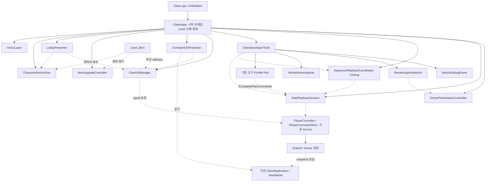
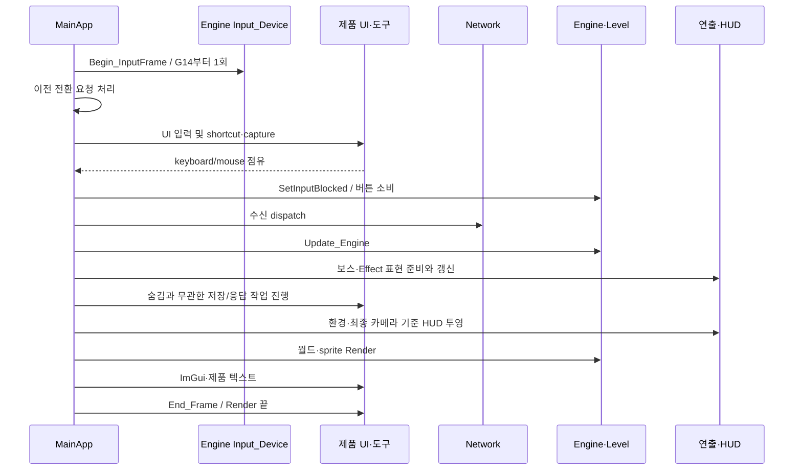

# G05 Dragon부터 G16까지 — MainApp 통합 구현 코드

기준: 2026-10-15 현재 작업본, G01~G04 소스 반영 뒤. 이 문서의 G05~G16은 **제품 미반영 코드 후보**다. 사용자가 순서대로 직접 구현할 전체 코드와 추가·교체 위치를 한 파일에 모았다. 과거 G05/G06A 단독 문서 대신 이 문서를 기준으로 적용한다.

## 먼저 읽는 순서와 반영 범위

1. G05부터 시작한다. 각 G의 `추가·교체 위치와 변경분`을 먼저 보고, 그 아래 `적용 후 전체 코드`와 대조한다.
2. 새 H → 새 CPP → 기존 H/CPP → 프로젝트 등록 순서로 한 G를 완성한다. G06에서 잠깐 만드는 부분 CPP는 G07~G09에서 삭제/이동하므로 순서를 건너뛰지 않는다.
3. 같은 파일이 여러 G에 나오면 해당 G까지 적용한 전문이다. 끝까지 반영한 파일을 찾을 때는 아래 `파일별 마지막 수정 단계`를 사용한다. G16 MainApp만 먼저 복사하면 앞 단계의 타입과 API가 없어서 빌드되지 않는다.
4. 기존 파일의 delta에는 직전 단계 기준 줄 번호와 주변 실제 코드가 있다. `-`는 제거, `+`는 추가다. diff의 기호까지 소스에 붙이지 말고, 복사할 실제 코드는 이어지는 전체 코드에서 가져온다. 전체 전문은 검색·펼치기로 볼 수 있다.
5. 문서 작성 뒤 사용자가 추가로 수정한 코드가 있다면 기존 파일을 통째로 덮지 말고 delta를 먼저 병합한다. 각 파일의 기준 SHA-256은 이 문서가 읽은 정확한 버전을 식별한다.

현재 소스에서 용 탑승은 `CCharacter → CPart_Vehicle`, 발탄의 실제 도끼는 `CValtan → CPart_Equipment`가 맡는다. 이번 Dragon 파일은 F1에서 속도 값을 편집하고 게시하는 화면이므로 도구로 분리한다. G04의 `AXE_DRAFT`도 보스 패턴의 도끼 생성 목록 전체가 아니라 손 무기 소켓 Transform 편집본이다. 게임 객체와 저작 편집 상태를 각각 그 수명에 맞는 소유자에 둔다.

`Manager`라는 접미사를 붙이는 것보다 소유 상태·호출자·종료 시점을 정하는 것이 먼저다. 창 집합은 UIManager가 필요하지만 카메라 속도 UI·UI sound cue 선택·시작 자원 등록처럼 보관 상태가 없는 기능은 작은 비멤버 함수로 둔다. Engine의 기존 manager·Prototype/Clone/Layer·CModel 경로는 계속 사용한다.

## G00~G16 전체 순서

| G | 맡는 범위 | 이 문서의 상태 |
|---|---|---|
| G00 | 책임·의존·수명 지도 | 아래 설계도와 최종 소유 표로 통합 |
| G01 | 네 창 단축키 처리/키 상태 동기화 | 기존 반영 상태를 전제로 함 |
| G02 | 네 UI cue 선택을 UISoundPlayer로 이동 | 기존 반영 상태를 전제로 함 |
| G03 | 공용 UI 음원 준비와 기존 Sound Manager cache/실패 반환 계약 | 기존 반영 상태를 전제로 함 |
| G04 | F1 발탄 손 무기 소켓 draft를 기존 ValtanBossTool로 이동 | 기존 반영 상태를 전제로 함 |
| [G05](#g05) | Dragon·카메라 개발 패널 | 이 문서에 전체 후보 코드 포함·제품 미반영 |
| [G06](#g06) | 개발 도구 소유자 | 이 문서에 전체 후보 코드 포함·제품 미반영 |
| [G07](#g07) | 렌더링 저작 상태 | 이 문서에 전체 후보 코드 포함·제품 미반영 |
| [G08](#g08) | 월드 편집 연결 | 이 문서에 전체 후보 코드 포함·제품 미반영 |
| [G09](#g09) | 레이드·시퀀스 재생 요청 | 이 문서에 전체 후보 코드 포함·제품 미반영 |
| [G10](#g10) | 제품 창·입력·명령 | 이 문서에 전체 후보 코드 포함·제품 미반영 |
| [G11](#g11) | 재련 요청·연출·음원 | 이 문서에 전체 후보 코드 포함·제품 미반영 |
| [G12](#g12) | 전투 HUD 표시 | 이 문서에 전체 후보 코드 포함·제품 미반영 |
| [G13](#g13) | 로비·캐릭터 복귀 | 이 문서에 전체 후보 코드 포함·제품 미반영 |
| [G14](#g14) | 프레임 입력 snapshot | 이 문서에 전체 후보 코드 포함·제품 미반영 |
| [G15](#g15) | 제품 장면·보스 표현 | 이 문서에 전체 후보 코드 포함·제품 미반영 |
| [G16](#g16) | MainApp·역참조·시작·종료 마무리 | 이 문서에 전체 후보 코드 포함·제품 미반영 |

G02의 네 cue는 공용 버튼·창 열기·창 닫기·popup 알림이다. 모든 보스·캐릭터 음원을 앱 시작에 읽는 목록이 아니다. 실제 음원 저장소와 재생은 기존 Engine Sound Manager이며 UISoundPlayer는 UI 의미를 asset ID로 고르는 Client 경계다.

`audition`은 이 프로젝트에서 선택한 패턴·배우를 시험 실행하는 이름이다. 별도 전투 권위가 아니라 기존 typed command와 Server 실행 경로를 사용한다. `draft`는 저장 전 편집본, `canonical`은 여러 소비자가 맞춰 읽는 정본을 뜻한다. 두 용어만으로 메모리/파일의 소유권이 정해지지 않으므로 실제 owner와 저장 지점을 아래 코드에 표시한다.

## 최종 소유 관계와 의존 방향

실선은 소유, 점선은 차용 또는 명령이다. 모든 소유자가 서로를 포함하는 구조를 만들지 않는다.



`IPlayerCommandSink`와 `ICompletePlayCommands`는 다른 경계다. 전자는 gameplay 명령 제출, 후자는 개발 도구의 기존 Complete Play 네 명령이다. 인터페이스를 상속한 구현 객체가 가상함수를 구현하고, 소비자는 주입받은 인터페이스 포인터로 호출한다. 포인터를 받은 도구가 구현 객체를 소유하거나 Server를 직접 대신하는 것은 아니다.



종료는 callback·preview 차용을 먼저 끊고, 제품 연출과 도구를 정리한 뒤 Engine의 Level/worker를 끝낸다. 그 다음 UI owner와 공유 준비 cache를 해제한다. 도구 종료 중 profile 복원이 필요하므로 Scene의 profile·광원 서비스는 끝까지 살아 있다. 각 Level이 빌린 UI callback은 그 owner보다 먼저 끊는다.

## 파일별 마지막 수정 단계

단계별로 작성할 때는 다음 목차를 순서대로 따른다. 이미 끝까지 반영한 상태를 대조할 때만 이 표의 마지막 전문을 사용한다. 삭제 표시 파일은 앞 단계에서 내용을 옮긴 뒤 프로젝트 등록과 물리 파일을 함께 제거한다.

| 실제 파일 | 마지막 단계 | 최종 작업 |
|---|---|---|
| `Client/Default/Client.vcxproj` | [G16](#g16-client-default-client-vcxproj) | 등록 블록 |
| `Client/Default/Client.vcxproj.filters` | [G16](#g16-client-default-client-vcxproj-filters) | 등록 블록 |
| `Client/Private/Animation_Tool_PatternAuthoring.cpp` | [G09](#g09-client-private-animation-tool-patternauthoring-cpp) | 전체 코드 |
| `Client/Private/Animation_Tool_ValtanPanels.cpp` | [G09](#g09-client-private-animation-tool-valtanpanels-cpp) | 전체 코드 |
| `Client/Private/CameraDebugControls.cpp` | [G05](#g05-client-private-cameradebugcontrols-cpp) | 전체 코드 |
| `Client/Private/CameraTool.cpp` | [G09](#g09-client-private-cameratool-cpp) | 전체 코드 |
| `Client/Private/CharacterReturnFlow.cpp` | [G13](#g13-client-private-characterreturnflow-cpp) | 전체 코드 |
| `Client/Private/CharacterSelectWindowView.cpp` | [G14](#g14-client-private-characterselectwindowview-cpp) | 전체 코드 |
| `Client/Private/ClientDeveloperTools.cpp` | [G16](#g16-client-private-clientdevelopertools-cpp) | 전체 코드 |
| `Client/Private/ClientDeveloperTools_Profiler.cpp` | [G16](#g16-client-private-clientdevelopertools-profiler-cpp) | 전체 코드 |
| `Client/Private/ClientDeveloperTools_RenderingLighting.cpp` | [G07](#g07-client-private-clientdevelopertools-renderinglighting-cpp) | 삭제 |
| `Client/Private/ClientDeveloperTools_SequenceViewer.cpp` | [G09](#g09-client-private-clientdevelopertools-sequenceviewer-cpp) | 삭제 |
| `Client/Private/ClientDeveloperTools_WorldLevel.cpp` | [G08](#g08-client-private-clientdevelopertools-worldlevel-cpp) | 삭제 |
| `Client/Private/ClientFrameDiagnostics.cpp` | [G16](#g16-client-private-clientframediagnostics-cpp) | 전체 코드 |
| `Client/Private/ClientRuntimeResources.cpp` | [G16](#g16-client-private-clientruntimeresources-cpp) | 전체 코드 |
| `Client/Private/ClientUIManager.cpp` | [G14](#g14-client-private-clientuimanager-cpp) | 전체 코드 |
| `Client/Private/CombatHUDPresenter.cpp` | [G16](#g16-client-private-combathudpresenter-cpp) | 전체 코드 |
| `Client/Private/EffectAuthoringSequencer.cpp` | [G14](#g14-client-private-effectauthoringsequencer-cpp) | 전체 코드 |
| `Client/Private/Effect_Tool.cpp` | [G09](#g09-client-private-effect-tool-cpp) | 전체 코드 |
| `Client/Private/Effect_Tool_DocumentIo.cpp` | [G09](#g09-client-private-effect-tool-documentio-cpp) | 전체 코드 |
| `Client/Private/Effect_Tool_Helpers.cpp` | [G09](#g09-client-private-effect-tool-helpers-cpp) | 전체 코드 |
| `Client/Private/Effect_Tool_Internal.h` | [G09](#g09-client-private-effect-tool-internal-h) | 전체 코드 |
| `Client/Private/Effect_Tool_V2.cpp` | [G09](#g09-client-private-effect-tool-v2-cpp) | 전체 코드 |
| `Client/Private/Effect_Tool_Valtan.cpp` | [G09](#g09-client-private-effect-tool-valtan-cpp) | 전체 코드 |
| `Client/Private/Effect_Tool_ValtanWorld.cpp` | [G09](#g09-client-private-effect-tool-valtanworld-cpp) | 전체 코드 |
| `Client/Private/HUDLayoutTool.cpp` | [G09](#g09-client-private-hudlayouttool-cpp) | 전체 코드 |
| `Client/Private/ItemUpgradeController.cpp` | [G11](#g11-client-private-itemupgradecontroller-cpp) | 전체 코드 |
| `Client/Private/Level_Bern.cpp` | [G16](#g16-client-private-level-bern-cpp) | 전체 코드 |
| `Client/Private/Level_CharacterSelect.cpp` | [G16](#g16-client-private-level-characterselect-cpp) | 전체 코드 |
| `Client/Private/Level_Development.cpp` | [G16](#g16-client-private-level-development-cpp) | 전체 코드 |
| `Client/Private/Level_KoukuSaydonArena.cpp` | [G16](#g16-client-private-level-koukusaydonarena-cpp) | 전체 코드 |
| `Client/Private/Level_Lobby.cpp` | [G16](#g16-client-private-level-lobby-cpp) | 전체 코드 |
| `Client/Private/Level_ValtanArena.cpp` | [G16](#g16-client-private-level-valtanarena-cpp) | 전체 코드 |
| `Client/Private/LobbyPresenter.cpp` | [G13](#g13-client-private-lobbypresenter-cpp) | 전체 코드 |
| `Client/Private/MainApp.cpp` | [G16](#g16-client-private-mainapp-cpp) | 전체 코드 |
| `Client/Private/MainApp_Dragon.cpp` | [G05](#g05-client-private-mainapp-dragon-cpp) | 삭제 |
| `Client/Private/MainApp_Profiler.cpp` | [G06](#g06-client-private-mainapp-profiler-cpp) | 삭제 |
| `Client/Private/MainApp_RenderingLighting.cpp` | [G06](#g06-client-private-mainapp-renderinglighting-cpp) | 삭제 |
| `Client/Private/MainApp_SequenceViewer.cpp` | [G06](#g06-client-private-mainapp-sequenceviewer-cpp) | 삭제 |
| `Client/Private/MainApp_WorldLevel.cpp` | [G06](#g06-client-private-mainapp-worldlevel-cpp) | 삭제 |
| `Client/Private/MapTool.cpp` | [G14](#g14-client-private-maptool-cpp) | 전체 코드 |
| `Client/Private/PlayerController.cpp` | [G14](#g14-client-private-playercontroller-cpp) | 전체 코드 |
| `Client/Private/ProductUIUtilities.cpp` | [G12](#g12-client-private-productuiutilities-cpp) | 전체 코드 |
| `Client/Private/ProfilerTool.cpp` | [G06](#g06-client-private-profilertool-cpp) | 전체 코드 |
| `Client/Private/RaidEntryPreviewView.cpp` | [G14](#g14-client-private-raidentrypreviewview-cpp) | 전체 코드 |
| `Client/Private/RaidPlaybackSession.cpp` | [G16](#g16-client-private-raidplaybacksession-cpp) | 전체 코드 |
| `Client/Private/RenderingWorkbench.cpp` | [G16](#g16-client-private-renderingworkbench-cpp) | 전체 코드 |
| `Client/Private/ScenePresentationController.cpp` | [G15](#g15-client-private-scenepresentationcontroller-cpp) | 전체 코드 |
| `Client/Private/SequencePlaybackCoordinator.cpp` | [G09](#g09-client-private-sequenceplaybackcoordinator-cpp) | 전체 코드 |
| `Client/Private/UIInputRouter.cpp` | [G14](#g14-client-private-uiinputrouter-cpp) | 전체 코드 |
| `Client/Private/ValtanActionWorkbench.cpp` | [G09](#g09-client-private-valtanactionworkbench-cpp) | 전체 코드 |
| `Client/Private/ValtanActionWorkbench_Preview.cpp` | [G09](#g09-client-private-valtanactionworkbench-preview-cpp) | 전체 코드 |
| `Client/Private/ValtanBossTool.cpp` | [G09](#g09-client-private-valtanbosstool-cpp) | 전체 코드 |
| `Client/Private/VehicleDebugPanel.cpp` | [G05](#g05-client-private-vehicledebugpanel-cpp) | 전체 코드 |
| `Client/Private/WorldAuthoringHost.cpp` | [G16](#g16-client-private-worldauthoringhost-cpp) | 전체 코드 |
| `Client/Private/WorldSceneTool.cpp` | [G08](#g08-client-private-worldscenetool-cpp) | 전체 코드 |
| `Client/Public/Animation_Tool.h` | [G09](#g09-client-public-animation-tool-h) | 전체 코드 |
| `Client/Public/CameraDebugControls.h` | [G05](#g05-client-public-cameradebugcontrols-h) | 전체 코드 |
| `Client/Public/CameraTool.h` | [G09](#g09-client-public-cameratool-h) | 전체 코드 |
| `Client/Public/CharacterReturnFlow.h` | [G13](#g13-client-public-characterreturnflow-h) | 전체 코드 |
| `Client/Public/ClientDeveloperToolTypes.h` | [G06](#g06-client-public-clientdevelopertooltypes-h) | 전체 코드 |
| `Client/Public/ClientDeveloperTools.h` | [G16](#g16-client-public-clientdevelopertools-h) | 전체 코드 |
| `Client/Public/ClientFrameDiagnostics.h` | [G16](#g16-client-public-clientframediagnostics-h) | 전체 코드 |
| `Client/Public/ClientRuntimeResources.h` | [G16](#g16-client-public-clientruntimeresources-h) | 전체 코드 |
| `Client/Public/ClientRuntimeUICommands.h` | [G16](#g16-client-public-clientruntimeuicommands-h) | 전체 코드 |
| `Client/Public/ClientUIManager.h` | [G10](#g10-client-public-clientuimanager-h) | 전체 코드 |
| `Client/Public/CombatHUDPresenter.h` | [G12](#g12-client-public-combathudpresenter-h) | 전체 코드 |
| `Client/Public/CompletePlayCommands.h` | [G09](#g09-client-public-completeplaycommands-h) | 전체 코드 |
| `Client/Public/Effect_Tool.h` | [G09](#g09-client-public-effect-tool-h) | 전체 코드 |
| `Client/Public/Effect_Tool_V2.h` | [G09](#g09-client-public-effect-tool-v2-h) | 전체 코드 |
| `Client/Public/HUDLayoutTool.h` | [G09](#g09-client-public-hudlayouttool-h) | 전체 코드 |
| `Client/Public/ItemUpgradeController.h` | [G11](#g11-client-public-itemupgradecontroller-h) | 전체 코드 |
| `Client/Public/KoukuHUDModeDefinition.h` | [G06](#g06-client-public-koukuhudmodedefinition-h) | 전체 코드 |
| `Client/Public/Level_Bern.h` | [G16](#g16-client-public-level-bern-h) | 전체 코드 |
| `Client/Public/LobbyPresenter.h` | [G13](#g13-client-public-lobbypresenter-h) | 전체 코드 |
| `Client/Public/MainApp.h` | [G16](#g16-client-public-mainapp-h) | 전체 코드 |
| `Client/Public/MapTool.h` | [G09](#g09-client-public-maptool-h) | 전체 코드 |
| `Client/Public/ProductUIUtilities.h` | [G12](#g12-client-public-productuiutilities-h) | 전체 코드 |
| `Client/Public/ProfilerTool.h` | [G06](#g06-client-public-profilertool-h) | 전체 코드 |
| `Client/Public/RaidPlaybackSession.h` | [G16](#g16-client-public-raidplaybacksession-h) | 전체 코드 |
| `Client/Public/RenderingWorkbench.h` | [G07](#g07-client-public-renderingworkbench-h) | 전체 코드 |
| `Client/Public/ScenePresentationController.h` | [G15](#g15-client-public-scenepresentationcontroller-h) | 전체 코드 |
| `Client/Public/SequencePlaybackCoordinator.h` | [G09](#g09-client-public-sequenceplaybackcoordinator-h) | 전체 코드 |
| `Client/Public/ValtanActionWorkbench.h` | [G09](#g09-client-public-valtanactionworkbench-h) | 전체 코드 |
| `Client/Public/ValtanBossTool.h` | [G09](#g09-client-public-valtanbosstool-h) | 전체 코드 |
| `Client/Public/VehicleDebugPanel.h` | [G05](#g05-client-public-vehicledebugpanel-h) | 전체 코드 |
| `Client/Public/WorldAuthoringHost.h` | [G08](#g08-client-public-worldauthoringhost-h) | 전체 코드 |
| `Client/Public/WorldSceneTool.h` | [G08](#g08-client-public-worldscenetool-h) | 전체 코드 |
| `Engine/Private/GameInstance.cpp` | [G14](#g14-engine-private-gameinstance-cpp) | 전체 코드 |
| `Engine/Private/Input_Device.cpp` | [G14](#g14-engine-private-input-device-cpp) | 전체 코드 |
| `Engine/Public/GameInstance.h` | [G14](#g14-engine-public-gameinstance-h) | 전체 코드 |
| `Engine/Public/Input_Device.h` | [G14](#g14-engine-public-input-device-h) | 전체 코드 |

## 단계 목차

- [G05 — Dragon·카메라 개발 패널](#g05)
- [G06 — 개발 도구 소유자](#g06)
- [G07 — 렌더링 저작 상태](#g07)
- [G08 — 월드 편집 연결](#g08)
- [G09 — 레이드·시퀀스 재생 요청](#g09)
- [G10 — 제품 창·입력·명령](#g10)
- [G11 — 재련 요청·연출·음원](#g11)
- [G12 — 전투 HUD 표시](#g12)
- [G13 — 로비·캐릭터 복귀](#g13)
- [G14 — 프레임 입력 snapshot](#g14)
- [G15 — 제품 장면·보스 표현](#g15)
- [G16 — MainApp·역참조·시작·종료 마무리](#g16)

<a id="g05"></a>

## G05 — Dragon·카메라 개발 패널

G05는 F1 안의 Dragon 편집 화면과 현재 카메라 속도 조절을 MainApp에서 분리한다. 실제 용의 모델·탑승·애니메이션은 기존 `CCharacter → CPart_Vehicle` 경로에 남는다. 편집창은 월드에 Clone되는 GameObject가 아니므로 `CVehicleDebugPanel`이 맞는 소유자다.

1. `CameraDebugControls.h/.cpp`를 새로 만든다. 현재 Level의 카메라를 그 호출 동안 찾고 속도 값을 읽고 쓴다. 유지할 편집 상태가 없으므로 클래스를 새로 만들지 않는다. Debug/Release에서 기존 F1 카메라 제어를 계속 사용할 수 있다.
2. `VehicleDebugPanel.h/.cpp`를 새로 만든다. `DragonFlight.json`에서 읽은 세 속도, 저장 기준값, 로드 여부, 상태 문구, publisher process handle을 이 객체가 단독 소유한다. 모든 접근은 main thread다.
3. MainApp 헤더의 Dragon 함수 선언과 CPP의 파일 범위 상태를 제거한다. Debug 소유 포인터 하나를 두고 기존 F1 위치에서 `Render()`를 호출한다. G06에서는 이 포인터의 소유권도 DeveloperTools로 옮긴다.
4. 기존 `MainApp_Dragon.cpp` 등록을 제거하고 새 두 CPP를 등록한다. 새 파일은 UTF-8 BOM 없음, 파일별 `/utf-8`, PCH 미사용이다. 물리 파일은 기존 Client/Public·Private에 추가하며 기존 필터를 재배치하지 않는다.

`Render()`는 먼저 진행 중 publisher 완료를 확인하고, 그 뒤 Dragon tree의 펼침 상태를 검사한다. 따라서 **F1 자체가 숨겨져 있으면 완료 확인도 다음 F1 표시까지 미룬다. F1이 열려 있고 Dragon tree만 접힌 경우에는 확인한다.** 별도 Update polling을 도입하지 않아 현재 동작을 보존한다. 실행한 publisher는 F1을 닫아도 계속 돌며 `Shutdown()`은 보관한 OS handle을 닫는다. 작업 프로세스를 강제로 종료하는 함수는 아니다.

`Load`는 기존 문서 경로·검증·저장 기준을 사용하고, `Save`/`Publish`도 기존 pipeline을 호출한다. 새 catalog나 모델 cache를 만들지 않는다. 원래 구현의 실패 표시와 재로드 정책도 유지한다. 이 단계는 실패 정책 개선이나 Dragon 이동 로직 변경을 포함하지 않는다.

새 헤더의 include는 공통 scalar/Win32 타입과 보관 컨테이너를 위한 것이다. 카메라·Level·JSON·publisher의 완전한 구현 타입은 CPP에서만 사용한다. 패널이 보관한 HANDLE은 panel owner 수명에 묶이고, 조회한 카메라 포인터는 함수 호출 밖으로 저장하지 않는다.

검증: 이 단계의 MainApp, VehicleDebugPanel, CameraDebugControls는 Debug/Release 문법 검사에 통과했다. 실제 Save/Publish, Client 화면·카메라 조작은 사용자가 제품 빌드 후 확인한다. 기존 G05 단독 문서의 숨김 중 polling 제안 대신 이 통합 문서의 동작을 적용한다.


### 추가·교체 위치와 변경분

| 순서 | 작업 | 파일 | 기준 |
|---:|---|---|---|
| 1 | 새 파일 | [Client/Public/CameraDebugControls.h](#g05-client-public-cameradebugcontrols-h) | 새 파일 처음부터 끝 |
| 2 | 새 파일 | [Client/Public/VehicleDebugPanel.h](#g05-client-public-vehicledebugpanel-h) | 새 파일 처음부터 끝 |
| 3 | 새 파일 | [Client/Private/CameraDebugControls.cpp](#g05-client-private-cameradebugcontrols-cpp) | 새 파일 처음부터 끝 |
| 4 | 새 파일 | [Client/Private/VehicleDebugPanel.cpp](#g05-client-private-vehicledebugpanel-cpp) | 새 파일 처음부터 끝 |
| 5 | 추가·교체 | [Client/Public/MainApp.h](#g05-client-public-mainapp-h) | 현재 G04 뒤 작업본 |
| 6 | 추가·교체 | [Client/Private/MainApp.cpp](#g05-client-private-mainapp-cpp) | 현재 G04 뒤 작업본 |
| 7 | 추가·교체 | [Client/Default/Client.vcxproj](#g05-client-default-client-vcxproj) | 현재 G04 뒤 작업본 |
| 8 | 추가·교체 | [Client/Default/Client.vcxproj.filters](#g05-client-default-client-vcxproj-filters) | 현재 G04 뒤 작업본 |
| 9 | 삭제 | [Client/Private/MainApp_Dragon.cpp](#g05-client-private-mainapp-dragon-cpp) | 현재 G04 뒤 작업본 |

<a id="g05-client-public-cameradebugcontrols-h"></a>

### G05 · Client/Public/CameraDebugControls.h

파일: [Client/Public/CameraDebugControls.h](C:/Users/tnest/Desktop/LostArk/Client/Public/CameraDebugControls.h)  
작업: **새 파일 추가**. 위치: 해당 물리 경로의 새 파일 처음부터 끝.

역할과 연결: 현재 카메라를 호출 동안 차용해 속도를 편집하는 상태 없는 비멤버 함수다.

인코딩: `utf-8` (BOM 없음); 줄바꿈은 `CRLF`를 유지한다.  
적용 후 SHA-256: `8587030f327d4286fe397c57d0b188c34d3a3c8519dc73ee2f821b0aa6baa9da`

헤더는 아래 직접 의존만 포함한다. 값으로 보관하는 타입은 정의가 필요하고, 포인터로만 보관하는 타입은 전방 선언 후 CPP에서 생성·호출한다. public은 호출자에게 허용한 명령/조회, private은 그 명령을 실행하는 상태와 세부 처리다. 개별 필드·함수의 차용/실패 규약은 선언 바로 앞 주석을 따른다.

| include | 필요한 이유 |
|---|---|
| `Engine_Macro.h` | 선언·값 멤버·함수 인자에 사용하는 프로젝트 타입의 실제 정의 |
| `memory` | unique_ptr/shared_ptr 소유·차용 표현 |

#### 적용 후 전체 코드

<!-- full-code:g05:Client/Public/CameraDebugControls.h -->
```cpp
#pragma once

#include "Engine_Macro.h"
#include <memory>

NS_BEGIN(Client)

class CCamera_Free;

// 현재 Level이 사용하는 자유 카메라를 조회한다. Character Select는 Level의 getter를,
// 다른 Level은 Layer_Camera의 첫 객체를 사용하며, 대상이 없거나 형식이 다르면 빈 shared_ptr를 반환한다.
// 반환값은 기존 객체의 공유 수명에 참여한다. UI 호출의 지역 변수로 보관하고 Level 전환 뒤에는 다시 조회한다.
std::shared_ptr<CCamera_Free> Find_ActiveDebugCamera();

// MainApp의 F1 화면에서 Debug·Release 공통으로 호출한다. 속도(m/s)를 읽고 변경 요청만 전달한다.
// 속도와 저장 범위는 카메라·Level이 이미 소유하므로 이 기능에는 별도 상태나 관리 객체가 필요하지 않다.
// Debug 아레나는 Level의 세션 값, 나머지는 현재 카메라 인스턴스만 바꾸며 파일을 저장하지 않는다.
void Render_CameraSpeedControls();

NS_END
```

<a id="g05-client-public-vehicledebugpanel-h"></a>

### G05 · Client/Public/VehicleDebugPanel.h

파일: [Client/Public/VehicleDebugPanel.h](C:/Users/tnest/Desktop/LostArk/Client/Public/VehicleDebugPanel.h)  
작업: **새 파일 추가**. 위치: 해당 물리 경로의 새 파일 처음부터 끝.

역할과 연결: F1 Dragon의 속도 편집본·저장 기준·publisher handle을 단독 소유한다. 실제 탈것 GameObject는 기존 경로를 유지한다.

인코딩: `utf-8` (BOM 없음); 줄바꿈은 `CRLF`를 유지한다.  
적용 후 SHA-256: `549dbc36e8d4e8fb4aabd0447bc9d250757d28e37f81ba28e7808983277f6ffc`

헤더는 아래 직접 의존만 포함한다. 값으로 보관하는 타입은 정의가 필요하고, 포인터로만 보관하는 타입은 전방 선언 후 CPP에서 생성·호출한다. public은 호출자에게 허용한 명령/조회, private은 그 명령을 실행하는 상태와 세부 처리다. 개별 필드·함수의 차용/실패 규약은 선언 바로 앞 주석을 따른다.

| include | 필요한 이유 |
|---|---|
| `Engine_Macro.h` | 선언·값 멤버·함수 인자에 사용하는 프로젝트 타입의 실제 정의 |
| `Client_Defines.h` | 선언·값 멤버·함수 인자에 사용하는 프로젝트 타입의 실제 정의 |
| `Engine_Typedef.h` | 선언·값 멤버·함수 인자에 사용하는 프로젝트 타입의 실제 정의 |
| `string` | stable ID·상태 문구 값 |

#### 적용 후 전체 코드

<!-- full-code:g05:Client/Public/VehicleDebugPanel.h -->
```cpp
#pragma once

#include "Engine_Macro.h"

#ifdef _DEBUG
//Client 공통 헤더로 WinSock2/Windows 순서를 유지하고 소유 HANDLE의 선언을 확보.
#include "Client_Defines.h"
#include "Engine_Typedef.h"

#include <string>

NS_BEGIN(Client)

class CCamera_Free;
class CPlayerController;
struct HUD_PLAYER_STATE;

//MainApp이 한 번 생성해 종료까지 소유하는 Debug 탈것 패널. 창 닫기·Level 교체에도 편집 상태를 유지.
//세 속도와 저장 기준, 외부 publisher의 HANDLE만 소유하며 실제 탈것·Server 상태·카메라는 소유하지 않음.
//모든 멤버 접근은 주 스레드. publisher는 별도 프로세스이며 이 객체의 메모리를 직접 읽지 않음.
class CVehicleDebugPanel final
{
public:
    CVehicleDebugPanel() = default;
    ~CVehicleDebugPanel();

    //소유 HANDLE이 복사되어 두 번 닫히거나 살아 있는 작업의 주인이 바뀌지 않도록 복사·이동 금지.
    CVehicleDebugPanel(const CVehicleDebugPanel&) = delete;
    CVehicleDebugPanel& operator=(const CVehicleDebugPanel&) = delete;
    CVehicleDebugPanel(CVehicleDebugPanel&&) = delete;
    CVehicleDebugPanel& operator=(CVehicleDebugPanel&&) = delete;

public:
    //MainApp의 Debug Developer Tools에서 호출. 먼저 publisher 완료를 확인한 뒤 펼친 Dragon UI를 그림.
    //허브가 숨겨져 호출되지 않으면 Poll도 멈추며, Dragon 트리만 접힌 경우에는 Poll을 먼저 수행.
    //세 인자는 이번 호출 동안만 차용. 호출자가 카메라 shared_ptr를 유지하고 패널은 주소를 저장하지 않음.
    //player는 복제 상태 조회용이며 승하차는 controller의 기존 typed 요청으로 제출.
    void Render(const HUD_PLAYER_STATE& player, CPlayerController* controller, CCamera_Free* camera);

    //MainApp::Free와 소멸자가 호출. 보유 HANDLE만 닫고 null로 만들어 중복 정리를 허용.
    //실행 중인 외부 publisher를 종료하거나 완료까지 기다리지 않으며 편집값을 자동 저장하지 않음.
    void Shutdown() noexcept;

private:
    //저작 정본 읽기: 최초 펼침·명시적 Reload·저장 성공 후 호출하며 유효한 세 값만 함께 반영.
    //실패 시 편집값·baseline·기존 loaded 상태를 유지하고 상태 메시지만 교체.
    void Load();

    //저장 요청: Save는 정본 저장, Save + Publish는 정본 저장과 게시를 기존 스크립트에 위임.
    //편집값과 마지막 성공 Load의 baseline을 함께 전달해 publisher가 동시 편집을 검사.
    void Start(Engine::bool_t publish);

    //작업 완료 수거: Render가 timeout 0으로 종료만 확인하고 완료 시 HANDLE을 닫음.
    //종료 코드 0이면 Load를 호출하나, Load 성공 여부를 별도 결과로 받지는 않는 기존 흐름.
    void Poll();

private:
    //속도 편집 상태: 지상·수평 비행·수직 비행 순서의 m/s. UI가 바꾸며 Server의 현재 속도와 별개.
    Engine::f32_t m_fSpeeds[3]{10.f, 16.f, 8.f};
    //마지막 성공 Load의 같은 세 값. Start의 Expected* 인자로 보내고 Save 요청만으로 갱신하지 않음.
    Engine::f32_t m_fBaseline[3]{10.f, 16.f, 8.f};
    //유효한 정본을 한 번 읽었는지 표시. 실패한 Reload는 false로 되돌리지 않으며 저장 가능 여부에 사용.
    Engine::bool_t m_bLoaded = false;

    //저장 작업 상태: CreateProcessW에서 받은 process HANDLE의 단독 소유자. thread HANDLE은 즉시 닫음.
    //null이 아니면 완료 대기 또는 미수거 상태이며 중복 Save·Reload를 막음. Poll/Shutdown이 닫음.
    HANDLE m_hProcess = nullptr;
    //로드·시작·완료 결과를 UI에 표시. 최초 Load 자동 시도의 조건에도 쓰므로 오류 뒤에는 수동 Reload 필요.
    std::string m_strStatus;
};

NS_END
#endif
```

<a id="g05-client-private-cameradebugcontrols-cpp"></a>

### G05 · Client/Private/CameraDebugControls.cpp

파일: [Client/Private/CameraDebugControls.cpp](C:/Users/tnest/Desktop/LostArk/Client/Private/CameraDebugControls.cpp)  
작업: **새 파일 추가**. 위치: 해당 물리 경로의 새 파일 처음부터 끝.

역할과 연결: 현재 카메라를 호출 동안 차용해 속도를 편집하는 상태 없는 비멤버 함수다.

인코딩: `utf-8` (BOM 없음); 줄바꿈은 `CRLF`를 유지한다.  
적용 후 SHA-256: `5ba6a243f189269c8fd26436e6a412d32c84dd89e75e609d006bccc1950ea9c5`

#### 적용 후 전체 코드

<!-- full-code:g05:Client/Private/CameraDebugControls.cpp -->
```cpp
#include "CameraDebugControls.h"

// Client 공통 헤더가 WinSock2를 Windows 선언보다 먼저 포함한다.
#include "Client_Defines.h"
#include "Engine_Typedef.h"
#include "Camera_Free.h"
#include "GameInstance.h"
#include "Level_CharacterSelect.h"
#include "imgui.h"
#ifdef _DEBUG
// 세션 속도 setter는 Debug 아레나에만 있으므로 Release에서 이 의존성을 만들지 않는다.
#include "Level_ValtanArena.h"
#include "Level_KoukuSaydonArena.h"
#endif

#include <memory>

NS_BEGIN(Client)

// 속도 UI와 탈것 패널이 같은 조회 경로를 쓴다. 새 카메라를 생성하거나 MainApp에 저장하지 않는다.
// Level·Layer가 보유한 객체의 shared_ptr를 반환해 호출자가 UI 처리 동안 수명을 유지할 수 있게 한다.
std::shared_ptr<CCamera_Free> Find_ActiveDebugCamera()
{
    auto& game = Engine::CGameInstance::Get();
    if (game.Get_CurrentLevelID() == ETOUI(LEVEL::CHARACTER_SELECT))
    {
        // 선택 화면은 Level이 보유한 카메라를 기준으로 삼는다. 준비되지 않았으면 다른 객체로 대체하지 않는다.
        const auto* level = CLevel_CharacterSelect::Get_Active();
        return level ? level->Get_DebugCamera() : nullptr;
    }

    // 다른 Level의 기존 Layer_Camera 첫 객체만 조회한다. 객체가 없거나 타입이 다르면 빈 shared_ptr가 된다.
    return std::dynamic_pointer_cast<CCamera_Free>(
        game.Get_GameObject(game.Get_CurrentLevelID(), L"Layer_Camera", 0));
}

// 현재 속도를 매번 읽어 UI의 별도 초안과 실제 카메라 값이 어긋나지 않게 한다.
// 적용 범위는 기존 setter에 맡긴다. 범위·유한성 검사에 실패하면 setter가 이전 속도를 유지한다.
void Render_CameraSpeedControls()
{
    const auto camera = Find_ActiveDebugCamera();
    const auto level = static_cast<LEVEL>(Engine::CGameInstance::Get().Get_CurrentLevelID());
    const Engine::bool_t characterSelect = level == LEVEL::CHARACTER_SELECT;
    if (!camera || !ImGui::CollapsingHeader(
        characterSelect ? "Character Select Camera" : "Camera",
        characterSelect ? ImGuiTreeNodeFlags_DefaultOpen : ImGuiTreeNodeFlags_None))
    {
        return;
    }

    // 드래그와 초기화 버튼이 같은 경로를 사용한다. 람다는 이 호출 안에서만 실행하고 보관하지 않는다.
    const auto setSpeed = [&](Engine::f32_t value)
    {
#ifdef _DEBUG
        // 두 아레나는 현재 카메라 적용에 성공한 뒤 프로세스 세션 값도 갱신해 다음 진입 때 재사용한다.
        if (level == LEVEL::VALTAN_ARENA && CLevel_ValtanArena::Get_Active())
        {
            CLevel_ValtanArena::Get_Active()->Set_DebugCameraSpeed(value);
            return;
        }
        if (level == LEVEL::KOUKUSAYDON_ARENA && CLevel_KoukuSaydonArena::Get_Active())
        {
            CLevel_KoukuSaydonArena::Get_Active()->Set_DebugCameraSpeed(value);
            return;
        }
#endif
        // Release를 포함한 나머지 경우는 이번 맵 방문에서 사용하는 카메라의 속도만 바꾼다.
        camera->Set_FreeMoveSpeed(value);
    };

    Engine::f32_t speed = camera->Get_FreeMoveSpeed();
    if (ImGui::DragFloat(
        "Free camera speed (m/s)", &speed, .5f, CCamera_Free::MIN_FREE_MOVE_SPEED,
        CCamera_Free::MAX_FREE_MOVE_SPEED, "%.1f", ImGuiSliderFlags_AlwaysClamp))
    {
        setSpeed(speed);
    }
    if (ImGui::Button("Reset speed to 20 m/s"))
    {
        setSpeed(20.f);
    }

    // 이동 속도만 조절하므로 F6 전환·Shift 배율·선택 화면의 Movie 재생 시간은 기존 경로가 유지한다.
    ImGui::TextDisabled("F6: Follow / Free. Shift: x%.0f.", CCamera_Free::FREE_MOVE_SPRINT_MULTIPLIER);
    if (characterSelect)
    {
        ImGui::TextDisabled("Applies to F6 / Movie free-camera movement; Movie playback timing stays authored.");
    }
#ifdef _DEBUG
    if (level == LEVEL::VALTAN_ARENA || level == LEVEL::KOUKUSAYDON_ARENA)
    {
        ImGui::TextDisabled("Arena speed is retained for this Client session.");
    }
    else
#endif
    {
        ImGui::TextDisabled("Speed applies during this map visit.");
    }
}

NS_END
```

<a id="g05-client-private-vehicledebugpanel-cpp"></a>

### G05 · Client/Private/VehicleDebugPanel.cpp

파일: [Client/Private/VehicleDebugPanel.cpp](C:/Users/tnest/Desktop/LostArk/Client/Private/VehicleDebugPanel.cpp)  
작업: **새 파일 추가**. 위치: 해당 물리 경로의 새 파일 처음부터 끝.

역할과 연결: F1 Dragon의 속도 편집본·저장 기준·publisher handle을 단독 소유한다. 실제 탈것 GameObject는 기존 경로를 유지한다.

인코딩: `utf-8` (BOM 없음); 줄바꿈은 `CRLF`를 유지한다.  
적용 후 SHA-256: `474f42a3a30b267ea7e3118418e6b79c8c67912750b8a1ebe9457830ef72fc77`

#### 적용 후 전체 코드

<!-- full-code:g05:Client/Private/VehicleDebugPanel.cpp -->
```cpp
#include "VehicleDebugPanel.h"

#ifdef _DEBUG
//카메라 preview·복제 상태 조회·승하차 요청은 각 기존 소비자에 위임.
#include "Camera_Free.h"
#include "CombatHUDViewModel.h"
#include "PlayerController.h"
//저작 경로와 JSON 읽기만 사용하며 저장·게시 검증은 기존 publisher가 담당.
#include "ProjectDataRoot.h"
#include "DataJson.h"
#include "imgui.h"

#include <cmath>
#include <filesystem>
#include <fstream>
#include <iterator>
#include <locale>
#include <sstream>
#include <string>

NS_BEGIN(Client)

//MainApp이 소유 포인터를 정리할 때 남은 HANDLE을 회수. Free에서 먼저 정리했어도 안전.
CVehicleDebugPanel::~CVehicleDebugPanel()
{
    Shutdown();
}

void CVehicleDebugPanel::Shutdown() noexcept
{
    if (nullptr != m_hProcess)
    {
        CloseHandle(m_hProcess);
        m_hProcess = nullptr;
    }
}

//Render의 최초 펼침·Reload 버튼과 Poll의 종료 코드 0 경로에서 호출.
//입력 후보를 모두 검증한 뒤 세 편집값과 baseline을 교체하며 실패는 이전 값과 loaded를 보존.
void CVehicleDebugPanel::Load()
{
    //저작 정본만 읽음. Client/Server의 게시 snapshot이나 실행 중 Server 상태는 바꾸지 않음.
    const auto path = CProjectDataRoot::Resolve(L"Vehicles/VehicleProfiles.json");
    std::ifstream input(path, std::ios::binary);
    const std::string text((std::istreambuf_iterator<char>(input)), {});
    DATA_JSON_VALUE document;
    std::string error;
    if (!input || !CDataJson::Parse(text, document, error))
    {
        m_strStatus = "Cannot read VehicleProfiles.json: " + error;
        return;
    }

    //vehicleId 9523의 지상 override를 우선하고 비행 수평·수직 속도를 같은 행에서 조회.
    const auto* vehicles = document.Find("vehicles");
    if (vehicles && vehicles->Is_Array())
    {
        for (const auto& vehicle : vehicles->Get_Array())
        {
            const auto* id = vehicle.Find("vehicleId");
            if (!id || !id->Is_Number() || id->Get_Number() != 9523)
            {
                continue;
            }

            const auto* ground = vehicle.Find("moveSpeedOverride");
            if (!ground)
            {
                ground = vehicle.Find("moveSpeed");
            }
            const auto* flight = vehicle.Find("flight");
            const auto* speed = flight ? flight->Find("speed") : nullptr;
            const auto* vertical = flight ? flight->Find("verticalSpeed") : nullptr;
            if (!ground || !speed || !vertical || !ground->Is_Number() || !speed->Is_Number() ||
                !vertical->Is_Number())
            {
                break;
            }

            //지상 (0, 30], 비행 두 축 (0, 60] m/s의 유한 값만 편집 기준으로 채택.
            const Engine::f32_t candidate[]{
                static_cast<Engine::f32_t>(ground->Get_Number()),
                static_cast<Engine::f32_t>(speed->Get_Number()),
                static_cast<Engine::f32_t>(vertical->Get_Number())};
            if (!std::isfinite(candidate[0]) || !std::isfinite(candidate[1]) || !std::isfinite(candidate[2]) ||
                candidate[0] <= 0.f || candidate[0] > 30.f || candidate[1] <= 0.f || candidate[1] > 60.f ||
                candidate[2] <= 0.f || candidate[2] > 60.f)
            {
                break;
            }

            for (int i = 0; i < 3; ++i)
            {
                m_fBaseline[i] = m_fSpeeds[i] = candidate[i];
            }
            m_bLoaded = true;
            m_strStatus = "Loaded authored speeds. Server values change after Publish and restart.";
            return;
        }
    }

    m_strStatus = "Ancient Sea speed profile is invalid; the previous draft is preserved.";
}

//Render의 두 Save 버튼만 호출. 새 속도와 baseline을 명령행 값으로 복사해 외부 프로세스에 전달.
//실제 검증·동시 편집 검사·정본 교체·선택적 게시·실패 복구는 기존 Publish-VehicleProfiles.ps1이 담당.
void CVehicleDebugPanel::Start(const Engine::bool_t publish)
{
    if (m_hProcess || !m_bLoaded)
    {
        return;
    }

    //Data/Vehicles/VehicleProfiles.json에서 저장소 root를 찾아 기존 publisher를 사용.
    const auto root = CProjectDataRoot::Resolve(L"Vehicles/VehicleProfiles.json")
        .parent_path()
        .parent_path()
        .parent_path();
    const auto script = root / L"Tools/GameplayPipeline/Publish-VehicleProfiles.ps1";
    if (!std::filesystem::is_regular_file(script))
    {
        m_strStatus = "Vehicle publisher is unavailable in this installation.";
        return;
    }

    //숫자 소수점과 정밀도를 고정. Expected*에는 마지막 성공 Load의 값을 보내 디스크와 비교.
    std::wostringstream command;
    command.imbue(std::locale::classic());
    command.precision(9);
    command << L"powershell.exe -NoProfile -ExecutionPolicy Bypass -File \"" << script.wstring() << L"\" -Mode "
        << (publish ? L"SaveAndPublish" : L"Save") << L" -AncientSeaGroundSpeed " << m_fSpeeds[0]
        << L" -AncientSeaFlightSpeed " << m_fSpeeds[1] << L" -AncientSeaVerticalSpeed " << m_fSpeeds[2]
        << L" -ExpectedGroundSpeed " << m_fBaseline[0] << L" -ExpectedFlightSpeed " << m_fBaseline[1]
        << L" -ExpectedVerticalSpeed " << m_fBaseline[2];

    //CreateProcessW가 수정할 수 있는 명령행 버퍼는 이 호출에만 사용. 별도 콘솔 창 없이 실행.
    auto args = command.str();
    STARTUPINFOW startup{};
    startup.cb = sizeof(startup);
    PROCESS_INFORMATION info{};
    if (!CreateProcessW(nullptr, args.data(), nullptr, nullptr, FALSE, CREATE_NO_WINDOW, nullptr, root.c_str(),
        &startup, &info))
    {
        m_strStatus = "Could not start the vehicle publisher; no changes were made.";
        return;
    }

    //종료 확인에 필요한 process HANDLE만 보유하고 thread HANDLE은 즉시 회수.
    CloseHandle(info.hThread);
    m_hProcess = info.hProcess;
    m_strStatus = publish ? "Saving and publishing dragon speeds..." : "Saving dragon speeds...";
}

//Render 진입마다 한 번 호출. F1 허브가 숨겨지면 호출되지 않으며 외부 publisher 자체는 계속 실행.
//timeout 0은 프로세스를 기다리지 않지만, 종료 코드 0 뒤 Load는 기존처럼 동기 파일 읽기를 수행.
void CVehicleDebugPanel::Poll()
{
    if (!m_hProcess || WaitForSingleObject(m_hProcess, 0) != WAIT_OBJECT_0)
    {
        return;
    }

    DWORD code = 1;
    GetExitCodeProcess(m_hProcess, &code);
    CloseHandle(m_hProcess);
    m_hProcess = nullptr;
    if (code == 0)
    {
        Load();
        //기존 문구는 프로세스 종료 코드의 성공을 표시. Load 실패 메시지도 덮으므로 재로드 성공 보장은 아님.
        m_strStatus = "Speed operation succeeded. Publish and restart Server before testing movement.";
    }
    else
    {
        m_strStatus =
            "Speed operation failed (validation or concurrent edit). Disk changes were preserved; reload the draft.";
    }
}

//MainApp이 이번 호출의 player/controller/camera를 제공. 패널은 차용 주소를 멤버에 보관하지 않음.
//카메라 preview는 즉시 Client에 적용하고, 승하차와 저작 속도는 각각 Server 요청·publisher로 분리.
void CVehicleDebugPanel::Render(const HUD_PLAYER_STATE& player, CPlayerController* controller, CCamera_Free* camera)
{
    //기존 RenderDragonControls 순서 유지. Dragon 트리가 접혀도 허브가 호출한 프레임에는 완료를 수거.
    Poll();
    if (!ImGui::CollapsingHeader("Dragon"))
    {
        return;
    }

    //최초 자동 로드는 한 번만 시도. 실패 메시지가 남으면 사용자의 Reload로 다시 시도.
    if (!m_bLoaded && m_strStatus.empty())
    {
        Load();
    }

    //복제된 정상 player와 controller가 있고, 추적 카메라에 연출 override가 없을 때만 승하차 허용.
    const Engine::bool_t cameraAcceptsGameplay = camera && camera->Is_FollowEnabled() && !camera->Is_PresentationOverrideActive();
    const Engine::bool_t canRequestRiding = controller && player.isValid && !player.isPreview && cameraAcceptsGameplay;
    ImGui::Text("Ancient Sea (9523) | flight phase: %u", static_cast<unsigned>(player.eVehicleFlightPhase));
    ImGui::BeginDisabled(!canRequestRiding);
    if (ImGui::Button(player.iVehicleId == 9523u ? "Dismount dragon" : "Mount Ancient Sea") && canRequestRiding)
    {
        controller->Request_VehicleRiding(player.iVehicleId == 9523u ? 0u : 9523u);
    }
    ImGui::EndDisabled();
    if (!cameraAcceptsGameplay)
    {
        ImGui::TextDisabled("Mount / dismount requires the follow camera (F6).");
    }
    ImGui::TextWrapped(
        "E: takeoff / land. WASD: fly, Space / Ctrl: ascend / descend. Landing requires walkable ground below; ground mount keeps the character view.");

    //이번 카메라의 비행 구도만 편집. Server 속도나 VehicleProfiles 정본에 저장하지 않음.
    if (camera)
    {
        Engine::f32_t distance, pitch, height;
        Engine::bool_t enabled, heading;
        camera->Get_DragonCameraSettings(distance, pitch, height, enabled, heading);
        Engine::bool_t changed = ImGui::Checkbox("Flight camera", &enabled);
        changed |= ImGui::Checkbox("Follow dragon heading", &heading);
        changed |=
            ImGui::DragFloat("Flight distance (m)", &distance, .1f, 4.f, 80.f, "%.2f", ImGuiSliderFlags_AlwaysClamp);
        changed |=
            ImGui::DragFloat("Flight pitch (degrees)", &pitch, .2f, -8.f, 75.f, "%.1f", ImGuiSliderFlags_AlwaysClamp);
        changed |=
            ImGui::DragFloat("Flight look height (m)", &height, .05f, 0.f, 15.f, "%.2f", ImGuiSliderFlags_AlwaysClamp);
        if (ImGui::Button("Reset flight camera"))
        {
            distance = 16.f;
            pitch = 24.f;
            height = 2.4f;
            enabled = heading = changed = true;
        }
        if (changed)
        {
            camera->Set_DragonCameraSettings(distance, pitch, height, enabled, heading);
        }
        ImGui::TextDisabled(
            "Camera edits apply immediately during flight; left drag orbits. F6 keeps its normal meaning.");
    }

    //세 속도는 draft에만 보관하다 Save 버튼에서 전달. 작업 HANDLE 수거 전에는 중복 저장·재로드를 제한.
    ImGui::SeparatorText("Server speed authoring");
    ImGui::BeginDisabled(m_hProcess != nullptr || !m_bLoaded);
    ImGui::DragFloat("Ground speed (m/s)", &m_fSpeeds[0], .1f, .1f, 30.f, "%.2f", ImGuiSliderFlags_AlwaysClamp);
    ImGui::DragFloat("Flight speed (m/s)", &m_fSpeeds[1], .1f, .1f, 60.f, "%.2f", ImGuiSliderFlags_AlwaysClamp);
    ImGui::DragFloat("Vertical speed (m/s)", &m_fSpeeds[2], .1f, .1f, 60.f, "%.2f", ImGuiSliderFlags_AlwaysClamp);
    if (ImGui::Button("Save dragon speeds"))
    {
        Start(false);
    }
    ImGui::SameLine();
    if (ImGui::Button("Save + Publish dragon speeds"))
    {
        Start(true);
    }
    ImGui::EndDisabled();

    ImGui::BeginDisabled(m_hProcess != nullptr);
    if (ImGui::Button("Reload dragon speeds"))
    {
        Load();
    }
    ImGui::EndDisabled();
    ImGui::TextWrapped("%s", m_strStatus.c_str());
}

NS_END
#endif
```

<a id="g05-client-public-mainapp-h"></a>

### G05 · Client/Public/MainApp.h

파일: [Client/Public/MainApp.h](C:/Users/tnest/Desktop/LostArk/Client/Public/MainApp.h)  
작업: **기존 파일 추가·교체**. 아래 변경분의 직전 단계 기준 줄 번호와 실제 주변 코드를 먼저 찾는다. 함수 교체는 해당 함수의 시작 선언부터 닫는 `}`까지이며, 전체 교체본은 이어지는 전문이다.

역할과 연결: 상위 owner 생성·수명, Level 교체와 프레임 순서를 조율한다. 개별 도구·보스·창 상태의 소유를 줄이는 교체다.

인코딩: `utf-8` (BOM 없음); 줄바꿈은 `CRLF`를 유지한다.  
기준 SHA-256: `f414e72a63dececf4bab7e69938619f33a88c754a0fe58c7d4b319d64c088344`  
적용 후 SHA-256: `e9ff215c0223bc83926bb5cac70bf5409ee9364a59694a14c7a81899ef18ffd1`

<details open>
<summary>먼저 볼 추가·교체 코드와 정확한 위치</summary>

```diff
--- Client/Public/MainApp.h / 직전 단계
+++ Client/Public/MainApp.h / G05
@@ -49,6 +49,9 @@
 class CValtanBossTool;
 class CKoukuSaydonBossTool;
 class CCameraTool;
+#ifdef _DEBUG
+class CVehicleDebugPanel;
+#endif
 class CCharacterPreviewPanel;
 class CEquipmentAuthoringTool;
 class CProfilerTool;
@@ -460,10 +463,6 @@
 	void RenderDebugLevelNavigation();
 	// 현재 Level의 카메라·로컬 위치를 표시하고 명시적 Move Player를 controller에 예약한다. 물총 로컬 preview와 Server 패턴 요청은 별도 버튼이다.
 	void RenderArenaCameraAndPlayerControls();
-	// 현재 자유 카메라 이동 속도를 m/s로 편집한다. 아레나는 Level setter로, 다른 맵은 현재 카메라 인스턴스로 전달한다.
-	void RenderCameraSpeedControls();
-	// Developer Tools의 승하차·비행 카메라·속도 저작 패널이다. controller 요청, 로컬 preview, 파일 저장의 경계를 나눈다.
-	void RenderDragonControls();
 	// 캐릭터 선택 Level의 바닥 preset과 m/degree 단위 보정을 편집한다. Apply/Restore가 실제 Level에 요청하고 draft 선택만으로 적용하지 않는다.
 	void RenderCharacterSelectFloorSwapControls();
 	// F1의 명시적 쿠크 UI 미리보기는 HUD ViewModel의 preview override를 편집한다.
@@ -929,6 +928,8 @@
 	unique_ptr<CKoukuSaydonBossTool> m_pKoukuSaydonBossTool = { nullptr };
 	unique_ptr<CCameraTool> m_pCameraTool = { nullptr };
 #ifdef _DEBUG
+	// F1을 닫아도 속도 편집값과 외부 작업 HANDLE을 유지하고 MainApp 종료 때 정리한다.
+	std::unique_ptr<CVehicleDebugPanel> m_pVehicleDebugPanel;
 	unique_ptr<CWorldObjectTool> m_pWorldObjectTool;
 	unique_ptr<CWorldLevelTool> m_pWorldLevelTool;
 	unique_ptr<CWorldSceneTool> m_pWorldSceneTool;
```

</details>

#### 적용 후 전체 코드

<details>
<summary>MainApp.h 전체 코드 펼치기 — G05 적용 직후</summary>

<!-- full-code:g05:Client/Public/MainApp.h -->
```cpp
#pragma once

// Client 이름 공간·LEVEL·공통 타입을 사용한다.
#include "Client_Defines.h"
// 장면 렌더링·품질 draft와 행렬·광원 값을 멤버로 보관한다.
#include "Engine_RenderTypes.h"
// D3D COM 참조·HRESULT·컨테이너 등의 공통 선언을 사용한다.
#include "Engine_Defines.h"
// Loading 전환과 로비 승인 흐름을 연결하는 명령 토큰을 사용한다.
#include "LobbyCommandService.h"
// Server 요청과 복제 식별자·장비·전투 enum을 원래 typed 값으로 보관한다.
#include "Network/PacketMessages.h"
// 장면/품질 프로필의 조회·활성화 서비스 수명을 소유한다.
#include "RenderingProfileService.h"
// 재사용 광원 정의와 미리보기용 catalog를 소유한다.
#include "LightResourceCatalog.h"
// Area 조명 draft·저장·게시의 기존 세션을 값으로 소유한다.
#include "AreaLightAuthoringSession.h"
// Server 복제 상태를 읽는 HUD 타입과 Debug preview 값을 사용한다.
#include "CombatHUDViewModel.h"

// 고정 개수의 창 표시·slot·아레나 조회 상태를 보관한다.
#include <array>
// 요청 timeout·프레임 제한·미리보기 경과 시간을 steady_clock으로 측정한다.
#include <chrono>
// 이 헤더에서는 직접 쓰지 않지만 MainApp.cpp의 파일 경로 처리가 간접 포함에 의존한다.
#include <filesystem>

NS_BEGIN(Engine)
class CImGuiLayer;
NS_END

NS_BEGIN(Client)

// MainApp이 보관하거나 연결할 Client UI·도구의 타입들이다. 실제 생성과 연결은 MainApp.cpp에서 한다.
class CMapTool;
class CLevelNavigationDebug;
class CEffect_Tool;
class CEffect_Tool_V2;
class CAnimation_Tool;
class CValtanActionWorkbench;
class CKoukuSaydonActionWorkbench;
class CKoukuSaydonPresentationPlayer;
class CHUDLayoutTool;
class CUILayoutRuntime;
class CDungeonTimerView;
class CWorldHealthBarView;
class CBalanceTool;
class CValtanBossTool;
class CKoukuSaydonBossTool;
class CCameraTool;
#ifdef _DEBUG
class CVehicleDebugPanel;
#endif
class CCharacterPreviewPanel;
class CEquipmentAuthoringTool;
class CProfilerTool;
class CSequencerTool;
class CCharacterActionWorkbench;
class CWorldObjectTool;
class CWorldLevelTool;
class CWorldSceneTool;
class CGuideAITool;
class CMaharakaAITool;
struct WORLD_LEVEL_TOOL_REQUEST;
struct KOUKU_MAP_EFFECT_PLACEMENT_REQUEST;
struct KOUKU_SAYDON_COMPOSITION_DOCUMENT;
struct KOUKU_SAYDON_COMPOSITION_PATTERN;
class CWorldSequenceDocument;
class CRenderingBenchmark;
class CSkillWindowView;
class CInventoryView;
class CRepairWindowView;
class CShopWindowView;
class CDurabilityHudView;
class CCombatAnalysisFrameView;
class CCharacterInfoWindowView;
class CCharacterPortraitRenderer;
class CAvatarBookWindowView;
class CVehicleWindowView;
class CHonorTitleWindowView;
class CWorldMapWindowView;
class CSystemOptionWindowView;
class CSongCastGaugeView;
class CQuickSlotDragView;
class CPlayerController;
class CChatWindowView;
class CPartyWindowView;
class CCharacterSelectWindowView;
class CMinimapView;
class CEstherCutinPresentationService;

// Client.cpp가 생성·해제하며 제품 UI·도구와 프레임 순서, Level 전환 요청을 조정한다.
// Engine의 manager는 CGameInstance가 소유한다. CObject_Manager → CLayer → CGameObject → CComponent로 실제 객체를 관리한다.
// MainApp은 UI/도구 객체와 표시·요청 대기 상태를 보관하고 게임 객체 등록·갱신·렌더는 Engine 경로로 요청한다.
class CMainApp final
{
private:
	// 도구별 표시 상태와 단일 viewport 입력 소유자를 같은 index 집합으로 연결한다.
	enum class DEBUG_TOOL
	{
		NONE,
		MAP,
		VALTAN_ACTION_WORKBENCH,
		KOUKU_SAYDON_ACTION_WORKBENCH,
		ANIMATION,
		EFFECT,
		// V2 문서와 미리보기 창은 기존 도구와 독립적으로 관리한다.
		EFFECT_V2,
		RENDERING,
		UI,
		BALANCE,
		VALTAN_BOSS,
		KOUKU_SAYDON_BOSS,
		VALTAN_LOGIC_PATTERN,
		CAMERA,
		EQUIPMENT,
		SEQUENCER,
		SEQUENCER_BENCHMARK,
		PROFILER,
		WORLD_OBJECT,
		WORLD_LEVEL,
		WORLD_SCENE,
		GUIDE_AI,
		MAHARAKA_AI,
		EFFECT_COMPOSITION,
		COUNT
	};

	// 자원 검색 행의 경로·검색어와 열 도구를 보관한다.
	struct DEBUG_RESOURCE_FILE
	{
		string strDomain;
		string strSource;
		string strRelativePath;
		string strSearchText;
		DEBUG_TOOL eTool = DEBUG_TOOL::NONE;
	};

private:
	// Client.cpp의 Create 경로에서 현재 앱을 등록한다.
	CMainApp();

public:
	// 현재 앱 주소를 비운 뒤 Free로 도구·네트워크·Engine 종료 순서를 진행한다.
	~CMainApp();

public:
	// Engine과 공용 원형·UI를 준비하고 Lobby로 가는 Loading을 시작한다.
	HRESULT Initialize();
	// Client.cpp가 전달한 delta(초)로 입력·Level·UI를 갱신하고 Level Update 뒤 전환 요청을 처리한다.
	void Update(f32_t fTimeDelta);
	// Engine의 월드/UI 렌더와 도구 표시를 연결한다. 제품 글자는 UI 합성 뒤에 그린다.
	HRESULT Render();
	// Client.cpp의 프레임 끝에서 전경/배경 FPS 제한을 맞춘다. 제한이 없으면 기준 시각만 갱신한다.
	void Limit_FrameRate();

	// Level/NPC가 MainApp 소유 창을 열 때 현재 인스턴스를 차용한다. 생성 시 등록하고 소멸 전에 비운다.
	static CMainApp* Get_Active()
	{
		return s_pActiveInstance;
	}
	// 베른 슈미트 NPC가 재련 창을 연다. 새로 열 때만 대기 상태를 초기화한다.
	void Open_ItemUpgradeWindow();
	// 베른 선박 NPC가 탈것 창을 선박 전용 모드로 연다.
	void Open_ShipWindow();
	// 베른 수리 NPC가 MainApp 소유 수리 창을 연다.
	void Open_RepairWindow();
	// 베른 물약 상인의 placement ID로 상점의 상품과 요청 대상을 정한다.
	void Open_ShopWindow(const string& strNpcPlacementId);
	// 월드 하단 메뉴 버튼이 Escape와 같은 환경설정 창을 연다. 이미 열려 있으면 유지한다.
	void Open_SystemOptionsWindow();
	// 활성 캐릭터가 있으면 Server의 상태 capture를 요청하고 이후 Pump가 로비 복귀를 마무리한다.
	// false는 capture 대기 시작과 예약·전송 실패를 모두 포함한다. true는 로비 LOAD 요청을 예약하고 연결을 닫은 경우다.
	bool_t Return_ToCharacterSelect();
	// Update가 capture 완료·연결 세대·timeout을 확인한다. 실패하면 슬롯을 다시 덮어쓰지 않고 대기를 정리하며 진단을 기록한다.
	// Apply_CaptureResult가 이미 반영한 뒤 생긴 전환 실패까지 로스터에서 되돌리는 함수는 아니다.
	void Pump_ReturnToCharacterSelect();

	// Debug 제목의 FPS를 최소 500ms 간격으로 갱신한다. 기본 제목이 바뀌면 간격을 기다리지 않고 반영한다.
	static void Update_DebugWindowTitleWithFps(const wchar_t* pBaseTitle);
	// 각 도구의 Complete Play 선택을 공용 stable Pattern ID에 모은다. 도구별 편집 draft는 유지한다.
	bool_t Debug_SelectCompletePlayPattern(const std::string& strPatternId);
	const std::string& Debug_GetSelectedCompletePlayPatternId() const;
	// 선택한 패턴을 CValtanBossTool → CValtanPatternAuditionService의 Server 재생 경로로 요청한다.
	bool_t Debug_CompletePlaySelected(std::string& strOutStatus);
    // Map Tool 편집 전에 World Scene의 placement 편집 해제를 요청한다. 실패하면 그 도구의 draft를 보존한다.
    bool Debug_PrepareMapToolAuthoring(std::string& status);
    // 같은 Area의 Object Details 편집 전에 Map Tool의 미저장 변경과 preview 복원을 확인한다. 거부 이유는 status로 전달한다.
    bool Debug_PrepareWorldPlacementEditing(const std::string& areaId, std::string& status);
    // 현재 live Area의 stable placement를 공용 상세 창에 넘긴다. 준비·선택 실패 시 이전 창 표시 상태 복원을 시도한다.
    bool Debug_OpenWorldObjectDetails(const std::string& areaId, uint64_t placementId,
        bool deploy, std::string& status);
	// 통합 composition 도구의 요청을 Valtan Boss Tool의 Flow 편집 창에 연결한다.
	bool_t Debug_OpenValtanPatternFlow(std::string& strOutStatus);

private:
	// Update가 자원 준비→START 응답→참가자 READY→Server 시각 연출을 진행한다.
	// 연결·world generation 변경은 이전 요청 추적을 비우며, 준비 실패와 Server 응답 지연을 구분해 기록한다.
	void UpdateKoukuGateCompletePlay();
    // 쿠크 Complete Play의 로컬 준비·READY 전송·Server 수신 상태를 표시한다.
    void RenderKoukuRaidPreparationDiagnostics();
    // 현재 run epoch의 준비·전송 진단이다. observedAt은 로컬 표시용 시각이다.
    struct KOUKU_RAID_PREPARATION_DIAGNOSTICS final
    {
        uint32_t epoch = 0u;
        std::string stage, detail, submission;
        bool failed = false;
        std::chrono::steady_clock::time_point observedAt{};
    };
    KOUKU_RAID_PREPARATION_DIAGNOSTICS m_KoukuRaidPreparationDiagnostics;
	// Update와 도구 화면이 공유하는 관문 실행 상태다. Sequence 복사본은 document epoch가 바뀌면 다시 읽는다.
	string m_strKoukuCompletePlayFlowGate;
	std::unique_ptr<KOUKU_SAYDON_COMPOSITION_DOCUMENT> m_pKoukuRaidSequenceDocument;
	// 전송한 START/STOP 원문과 대기 순번을 보존해 정확한 응답에 대응한다. 다음 순번이 0이 되면 새 요청을 거부한다.
	LostArk::Shared::C2S_DEBUG_KOUKUSAYDON_RAID_REQUEST m_KoukuRaidRequest;
	std::uint32_t m_iNextKoukuRaidRequest = 1u, m_iKoukuRaidPendingRequest = 0u, m_iKoukuRaidDocumentEpoch = 0u;
	// run·문서·패턴·시작 tick의 키로 이미 시작한 연출과 실패한 연출을 구분한다. 같은 실패 키의 재시작을 막는다.
	std::string m_strKoukuRaidPresentationKey, m_strKoukuRaidFailedKey;
	// START/STOP 전송 후 5초가 지나면 지연 안내만 기록한다. timeout으로 대기 순번을 지우거나 두 번째 START를 허용하지 않는다.
	std::chrono::steady_clock::time_point m_KoukuRaidReplyDeadline{};
	std::string m_strKoukuRaidReplyStatus; // broadcast 레이드 표시와 별도로 보관하는 최신 미해결·거절 요청 상태다.
    // START를 보내기 전의 임시 준비다. 요청의 revision과 대상 패턴을 값으로 고정하고 연결 세대·20분 제한을 Update에서 재검사한다.
    // 실패·취소 시 이 준비를 폐기한다. 서버에 이미 전송한 요청은 위 pending 순번으로 따로 추적한다.
    struct KOUKU_RAID_RESOURCE_PREPARATION final
    {
        LostArk::Shared::C2S_DEBUG_KOUKUSAYDON_RAID_REQUEST request;
        std::vector<std::string> patternIds;
        uint64_t worldGeneration = 0u;
        std::chrono::steady_clock::time_point deadline;
    };
    std::optional<KOUKU_RAID_RESOURCE_PREPARATION> m_KoukuRaidResourcePreparation;
    // Server PREPARING의 run epoch별 게시 패턴 목록이다. 같은 실행의 자원 준비를 이어갈 때 목록을 재사용한다.
    uint32_t m_iKoukuRaidResourceEpoch = 0u;
    std::vector<std::string> m_KoukuRaidResourcePatternIds;

	// START/STOP 응답을 기다리는 중 요청된 중지는 응답을 받은 뒤 처리한다. 로컬 preview 중지 예약과 Server 실행 epoch를 구분한다.
	bool_t m_bKoukuRaidStopAfterAdmission = false;
	bool_t m_bKoukuLocalPreviewStopRequested = false;
	uint64_t m_iKoukuCompletePlayWorldGeneration = 0u;
	// 이 Client가 READY 또는 FAILED 제출에 성공한 run epoch다. Server의 READY 확인 여부는 수신한 ready mask로 별도 판정한다.
	std::uint32_t m_iKoukuRaidAcknowledgedEpoch = 0u;
	string m_strKoukuCompletePlayStatus =
		"Load the KoukuSaydon inventory, pick a gate and a saved pattern, then Complete Play.";

	// Initialize가 제품 폰트를 등록한다. 필수 폰트 실패만 시작을 막는다.
	HRESULT Ready_Fonts();
	// Level을 넘어 쓸 셰이더·quad·Effect·UI 원형을 Engine의 STATIC 저장소에 등록한다.
	HRESULT Ready_Prototype_For_Static();
	// Loading 화면 자원을 STATIC 원형으로 등록한다. 문서 누락은 건너뛰고 등록 실패는 반환한다.
	HRESULT Ready_Prototype_For_LoadingChrome();
	// 목적지 descriptor와 profile을 검사한 뒤 Loading을 생성한다. 교체 실패 시 이전 profile 복원을 시도하며 실패 진단을 보존한다.
	HRESULT Start_Level(
		LEVEL eTargetLevel,
		LOBBY_COMMAND_TOKEN lobbyCommandToken =
			INVALID_LOBBY_COMMAND_TOKEN);
	// 프레임 경계에서 비동기 준비의 취소 완료를 기다린 뒤 LOAD/ACTIVATE 요청을 한 번 소비한다.
	// 활성화 실패는 생성 자원을 정리하고 연결을 닫은 뒤 기존 서비스로 로비 복구를 예약한다.
	void Apply_LevelRequest();
	// MainApp 소유 ImGui layer를 장치·창에 연결하고 실행 모드별 UI 설정을 적용한다.
	HRESULT ReadyImGuiRuntime();
	// 제품 단축키·프레임 제한·F7에서 전경 창이 이 process에 속하는지 확인한다.
	static bool_t IsWindowOwnedByCurrentProcess(HWND hWnd);
	// Update가 비동기 저장 진행을 확인하고 F7 상승 edge로 Profiler 창을 토글한다. 텍스트 입력 중에는 단축키를 소비하지 않는다.
	void UpdateProfilerRuntime();

	//I/P/N/M 키로 열고 닫기
	void Update_RuntimeWindowShortcuts();

	//UI가 숨겨진 동안 네 단축키의 눌림 상태만 갱신한다.
	void Sync_RuntimeWindowShortcutKeys(bool_t bFocused);

	// Update가 cinematic 표시 조건을 UI router에 맞추고, 억제가 시작되면 창 gesture와 운반 아이콘을 취소한다.
	void Sync_CinematicUI();
	// 현재 연출의 시각·배우 위치로 자막을 표시한다. 수집한 월드 자막은 instanceId·subtitleTrackId 쌍으로 같은 프레임의 중복을 제거한다.
	void RenderCinematicSubtitles();

	// 복제 상태를 HUD_Layout의 STATIC sprite에 반영한다. 표시 대상이 아니면 남아 있는 슬롯을 명시적으로 숨긴다.
	void Update_CombatHUD(f32_t fTimeDelta);
	// m_pHUDRuntimeView의 슬롯만 숨긴다. 보스·에스더 등 별도 view는 각 Hide 함수가 맡는다.
	void Hide_CombatHUD();
	// HealthBar/ManaBar는 빈 배경을 유지하고 별도 Fill 슬롯의 g_FillRatio로 현재/최대 HP·resource 비율을 표시한다.
	void Update_PlayerHealthManaBar();
	// 등록된 아이템을 Item_1..4_Icon에 표시한다. 인벤토리 drop의 화면 위치를 실제 viewport 기준 슬롯 rect와 비교한다.
	void Update_ItemQuickSlots();
	// UI 합성 뒤 스킬·특수·아이템 슬롯 그림 위에 단축키 글자를 그린다.
	void RenderQuickSlotKeyLabels();
	// 해양 HUD의 보급량·노트 속도와 슬롯·버튼 단축키 글자를 표시한다.
	void RenderShipHudTexts();
	// 쿠크 HUD 모드가 있으면 class identity와 T/V를 숨기고 Q..F에 모드 아이콘·쿨다운을 덮어쓴다.
	// 기본 스킬 아이콘·쿨다운 갱신 뒤 실행하며 모드가 없으면 추가 문양 슬롯을 숨긴다.
	void Update_KoukuHudMode();
	// 탑승 HUD가 class identity 대신 탈것 문양과 전용 스킬을 표시한다.
	// 쿠크 HUD 갱신 뒤 실행하며 미탑승 상태의 문양은 기본 ownerClass 갱신에서 숨긴다.
	void Update_VehicleHud();
	// Server가 마하라카 물총 장착을 알리면 줍기 문양과 Q/W/E/R 물총 스킬·복제된 쿨다운을 표시한다.
	// 탈것 HUD 다음에 실행하고 class identity·T/V를 숨기며 A/S/D/F는 빈 어두운 슬롯으로 둔다.
	void Update_WaterGunHud();
	// 인벤토리·탈것 창이 시작한 아이콘 운반을 소비한다. 아이템은 Item_1..4, 탈것은 SpecialSkill_1..6에 drop하며 다른 곳은 놓는다.
	// 창 Update 다음에 실행해 같은 프레임의 선택을 읽는다.
	void Update_QuickSlotDrag();
	// SpecialSkill_1..6_Icon에 5/6/7/8/9/0으로 등록한 탈것을 표시한다.
	void Update_SpecialQuickSlots();
	// Space 이동 스킬 또는 탑승 탈것의 Space 돌진 쿨다운을 문양 위에 표시한다.
	// 쿨다운이 없거나 쿠크 상호작용 모드이면 숨기며 탈것 HUD 다음에 갱신한다.
	void Update_SpecialSlot();
	// 복제된 탈것·방어 태세·침묵·속박·공포 등의 상태로 buff/debuff 줄을 구성한다.
	// 아이콘 정의는 HudBuffSources.json, 남은 시간 글자는 RenderSkillCooldownText가 담당한다.
	void Update_BuffBar();
	// SkillSlotMarks.json의 combo/holding/perfectCombo 표시와 Server combo 입력 시간의 원형 표시를 갱신한다.
	// 탑승 또는 쿠크 모드에서는 숨긴다.
	void Update_SkillSlotMarks();
	// SkillSlotMarks.json과 HudBuffSources.json을 읽는다. 파일 누락·오류는 해당 표시를 비운 상태로 처리한다.
	void Load_HudQuickSlotData();
	// class quick slot 밖 스킬의 남은 쿨다운 비율을 catalog cooldownMs로 계산한다. 0은 준비 완료이며 슬롯 위 초 단위 글자도 예약한다.
	f32_t Resolve_HudCooldownRatio(const HUD_PLAYER_STATE& player, uint32_t iSkillId,
		uint32_t iCooldownMs, const string& strTextSlotId);
	// 현재 Level의 플레이어 controller를 차용한다. 탈것 요청은 이 controller를 거치며 없는 Level이면 nullptr이다.
	CPlayerController* Find_ActivePlayerController() const;
	// KoukuHudModes.json의 모드 정의를 읽는다. 누락·오류면 빈 목록을 유지해 임의 모드를 표시하지 않는다.
	void Load_KoukuHudModes();
	// LOBBY에서 배경·로고·서버 목록과 접속(서버 선택), 종료/뒤로/환경설정 버튼을 갱신한다. 접속은 캐릭터 선택 창을 연다.
	void Update_LobbyButtons(f32_t fTimeDelta);
	// 로비의 캐릭터 선택 창을 갱신하고 생성 의도를 CHARACTER_SELECT 명령으로 연결한다. 열린 동안 로비 버튼 입력을 막는다.
	void Update_CharacterSelectWindow(f32_t fTimeDelta);
	// 프레임 시작에 다른 runtime 창이 없을 때만 Escape로 환경설정을 연다.
	// 같은 Escape로 다른 창을 닫으며 환경설정까지 열지 않고, 영상 옵션 변경 후 장면 프로필을 다시 활성화한다.
	void Update_SystemOptionWindow(f32_t fTimeDelta);
	bool_t Is_AnyRuntimeWindowOpen() const;
	// Loading 진입 때 runtime 창을 닫는다. STATIC sprite만 숨기고 열린 상태를 남겨 글자가 Loading 위에 그려지는 일을 막는다.
	void Close_RuntimeWindowsForLoading();
	// 미니게임·시네마틱·Loading의 HUD 숨김 조건을 조회한다. 제품 sprite와 텍스트가 같은 화면 점유 판정을 사용한다.
	bool_t Is_KoukuMinigameHUDHidden() const;
	bool_t Is_KoukuBossHealthBarHidden() const;
	bool_t Is_RuntimeUIScreenSuppressed() const;
	// Escape 한 번에 가장 최근에 연 창 하나를 닫기 위한 창 종류다.
	enum class ESCAPE_WINDOW : uint8_t
	{
		INVENTORY, CHARACTER_INFO, AVATAR_BOOK, HONOR_TITLE, VEHICLE, WORLD_MAP, REPAIR, SHOP, END
	};
	bool_t Is_EscapeWindowOpen(ESCAPE_WINDOW eWindow) const;
	// 닫힌 창은 순서에서 빼고 새로 열린 창을 맨 뒤에 추가한다.
	void Sync_EscapeWindowOrder();
	// 가장 최근에 연 창 하나를 닫는다. 열린 창이 없으면 false다.
	bool_t Close_TopEscapeWindow();
	// 이 프레임의 Escape를 나중에 직접 소비할 팝업·아이콘 운반 상태가 있는지 확인한다.
	bool_t Is_EscapeOwnedElsewhere() const;
	// Update 끝에서 창 rect를 텍스트 가림 영역으로 등록해 뒤의 이름표·HUD·말풍선이 창을 뚫고 보이지 않게 한다.
	// 표시 중인 UI의 텍스트 layer를 CUITextOcclusion에 함께 등록한다.
	void Register_UITextOccluders();
	// 서버 선택 패널의 제목·행·버튼·저작권과 Release 상태 글자를 EndFrame 이후 표시한다.
	void RenderLobbyButtonText();
	// LobbyServers.json을 서버 목록에 읽는다. 누락·오류면 행을 만들지 않고 접속 버튼을 비활성화한다.
	void Load_LobbyServers();
	// 게임 시작·서버 선택·카드 라벨은 RenderLobbyButtonText와 같이 EndFrame 뒤에 그려 UI 그림 위에 표시한다.
	void RenderCharacterSelectWindowText();
	// 현재 Level이 제공하는 복제 marker snapshot으로 우측 상단 미니맵을 갱신한다. 지원하지 않는 Level에서는 숨긴다.
	void Update_Minimap(f32_t fTimeDelta);
	void RenderMinimapText();
	// UI 합성 뒤 빈 버튼 그림 위에 흰색 "장비 재련"을 그린다.
	void RenderItemUpgradeButtonText();
	void RenderItemUpgradeLevelText();
	void RenderItemUpgradeMaterialCounts();
	void RenderItemUpgradeGaugePercentText();
	// WAITING에서 대기 원 위에 "화면을 클릭하여 결과 즉시 확인"을 표시한다.
	void RenderItemUpgradeResultWaitText();
	// SUCCESS frame 위에 아이템 이름·등급·"재련 성공"을 표시한다.
	void RenderItemUpgradeSuccessDetailText();
	// FAIL frame 위에 아이템 이름·"재련 실패"를 표시한다. 강화 단계는 그대로다.
	void RenderItemUpgradeFailDetailText();
	void RenderItemUpgradeListText();
	// UIInputRouter 입력으로 장비 선택·성장·재련 결과 화면을 갱신한다. 닫힘/미지원 Level에서는 STATIC 슬롯을 숨긴다.
	void Update_ItemUpgrade(f32_t fTimeDelta);
	void Update_CustomizingSceneProfile();
	void Update_ClassShowcaseShadowFocus();
	void Update_KoukuGateSceneProfile();
	void Hide_ItemUpgrade();
	void Update_ItemUpgradeSelection();
	// 성장 버튼을 누르면 gauge를 0부터 다시 채우고 CoreFlash를 한 번 시작한다.
	// 100%가 될 때까지 WingedRingGold·LevelUpMotion2Big·CompleteEffect는 숨긴다.
	void Update_ItemUpgradeGrowButton();
	// 선택한 인벤토리 identity와 기대 강화 단계를 Server 재련 요청에 담는다.
	void Update_ItemUpgradeReforgeButton();
	void Update_ItemUpgradeServerResult();
	// 요청과 일치하는 Server 결과가 도착해야 클릭으로 결과를 공개한다. 응답 대기 중에는 성공을 만들어 내지 않는다.
	void Update_ItemUpgradeResultWaitClick();
	// 표시 중인 성공/실패 확인 버튼을 누르면 결과 modal을 닫고 gauge를 대기 상태 0%로 되돌린다.
	void Update_ItemUpgradeResultOkButton();
	// 재련 요청/결과 닫기 때 gauge를 대기 0%로 돌려 이전 완료 표시를 지운다.
	void Reset_ItemUpgradeIdleGauge();
	// 결과 modal 뒤의 기본 중앙 패널을 숨기거나 복원한다. 완료 이펙트는 성장/초기화 흐름이 따로 관리한다.
	void Set_ItemUpgradeCenterPanelVisible(bool_t bVisible);
	// Update가 보스 HP의 fill·다음 줄·frame·무력화·구분선·줄 전환·피격 광택을 갱신한다.
	// 표시 조건이나 보스 유효성이 깨지면 STATIC 슬롯이 이전 상태를 남기지 않도록 모두 숨긴다.
	void Update_BossHealthBar();
	void Hide_BossHealthBar();
	// 복제된 적·다른 플레이어의 현재 pose를 최종 카메라 갱신 뒤 화면에 투영한다.
	void Update_WorldHealthBars(f32_t fTimeDelta);
	std::array<f32_t, 12> Get_HealthBarPositions() const;
	bool_t Set_HealthBarPositions(const std::array<f32_t, 12>& offsets);
	std::array<f32_t, 2> Get_MechanicBarScale() const;
	bool_t Set_MechanicBarScale(const std::array<f32_t, 2>& scale);
	bool_t Set_ValtanMechanicTuning(const std::array<f32_t, 8>& tuning);
	void Apply_MechanicBarRect();
	void Update_MechanicBarAnchor();
	bool_t Save_HealthBarPositions(std::string& status);
	bool_t Reload_HealthBarPositions(std::string& status);
	void RenderHUDBarPositionControls();
	// Server의 combo stage·action 시작 tick과 PlayerSkills.json의 stage 길이로 HOLD 진행률을 재구성한다.
	// 네트워크에 연속 충전 퍼센트가 없으므로 관측한 단계 시간을 사용한다.
	void Update_ChargeGauge();
	// 충전 gauge와 같은 표시 조건으로 스킬 이름을 track 가운데 그린다. EndFrame 이후의 제품 텍스트 pass를 사용한다.
	void RenderChargeGaugeText();
	// 보스 제목·HP·남은 줄 수는 EndFrame 뒤에 그린다. Draw_Text는 즉시 제출하므로 아래 UI 그림의 합성 이후에 호출한다.
	void RenderBossHealthBarText();
	// Level이 제공한 rect에 "사망하였습니다"·"부활"·"관전하기"를 UI 합성 뒤 그린다. 패널과 클릭 처리는 Level이 맡는다.
	void RenderDeadSceneText();
	// 레이드 클리어 제목은 Level이 채운 Get_RaidClearTextRects를 사용해 EndFrame 뒤에 표시한다.
	void RenderRaidClearText();
	// Level이 준비한 rect와 "OO을(를) 획득하였습니다" 문구를 ViewModel에서 받아 표시한다.
	void RenderItemAnnounceText();
	// 방이 공유하는 에스더 gauge를 STATIC UI 슬롯으로 표시한다. 발탄·쿠크 아레나와 유효한 gauge/player 등 표시 조건이 필요하다.
	// 조건을 벗어나면 Hide_EstherUI로 이전 프레임의 sprite도 숨긴다.
	void Update_EstherGauge(f32_t fTimeDelta);
	void Hide_EstherUI();
	// ESTHER 및 준비 완료·Ctrl+Z/X/C 안내는 gauge 위에 EndFrame 이후 그린다.
	void RenderEstherGaugeText();
	// 창술사의 3구간 identity를 퍼센트별 Gauge0/1/2 키프레임과 최초 점화→유지 반복 이펙트로 표시한다.
	void Update_LanceMasterIdentityGauge();
	// Server snapshot의 identity·태세·socket 수로 가디언나이트 구슬과 Embereth 10개 socket을 표시한다.
	void Update_GuardianKnightIdentity();
	// 각 Ember socket의 마지막 show/hide/lock 상태다. 바뀔 때만 전환을 재생하고 같으면 끝 프레임을 유지한다. 빈 값은 최초 상태다.
	string m_EmberSocketStates[10];
	// Server DAMAGE_EVENT의 피격 당시 월드 위치에 숫자를 띄운다. 대상의 이후 이동을 따라가지 않으며 EndFrame 뒤 Draw_Text로 표시한다.
	void RenderDamageNumbers();
	// Debug는 FPS 표시 옵션을 따른다. Release는 저장 옵션을 바꾸지 않고 FPS를 표시하며 상위 cinematic 숨김 조건을 따른다.
	void RenderFpsText();
	// class·stance에 대응한 스킬 아이콘을 Skill_<X>_Icon에 넣는다. 기존 Frame 슬롯은 sprite 순서상 위에 남긴다.
	void Update_SkillIcons();
	// 스킬 쿨다운을 g_ArcRatio로 원형 clip한다. 12시 방향에서 시계 방향으로 줄이며 남은 초 글자는 별도 텍스트 pass다.
	void Update_SkillCooldowns();
	// 스킬 슬롯·도화가 Z/X 위의 남은 초 글자를 EndFrame 이후 표시한다.
	void RenderSkillCooldownText();
	// 준비 완료→사용 불가 전환을 감지해 Skill_<X>_Flash 키프레임을 한 번 재생한다.
	void Update_QuickSlotFlash();
	// 제품 UI 합성 뒤 같은 표시 조건으로 HUD 글자와 보스 이름·HP·남은 줄 수를 그린다.
	void RenderCombatHUDText();

	// Debug 초기화에서 Profiler 기록·활성 상태를 초기화하고 HUD 배치 도구를 만든다. 나머지 도구는 필요할 때 준비한다.
	HRESULT ReadyDebugTools();
	// 열 도구와 연결할 세션을 준비한다. bShowWindow가 true이면 공용 표시·입력 focus도 갱신한다.
	HRESULT EnsureDebugTool(DEBUG_TOOL eTool, bool_t bShowWindow = true);
	// 리소스 선택에 필요한 공용 모델 preview·Balance·발탄·Animation 도구를 준비한다. 공용 창 표시·focus는 별도 열기 경로가 담당한다.
	HRESULT EnsureAnimationPreviewBackend();
	// 이전 도구 이름을 공용 창에 대응시켜 표시 상태를 읽는다. World Object/Sequence는 공용 창의 선택 대상도 함께 확인한다.
	bool_t IsDebugToolVisible(DEBUG_TOOL eTool) const;
	// 공용 표시 flag를 갱신하고 닫힐 때 입력·focus와 해당 도구 preview를 정리한다. 도구 객체와 편집 draft는 소유 멤버에 남긴다.
	void SetDebugToolVisible(DEBUG_TOOL eTool, bool_t bVisible);
	// 도구를 숨기고 preview를 정리한다. 도구 객체와 편집 draft는 유지한다.
	void CloseAllDebugTools();

	// 목적지 버튼과 전환 추적 상태를 표시한다. 15초 경과는 화면의 추적만 해제하며 실제 입장·전환 소유자의 처리는 취소하지 않는다.
	void RenderDebugLevelNavigation();
	// 현재 Level의 카메라·로컬 위치를 표시하고 명시적 Move Player를 controller에 예약한다. 물총 로컬 preview와 Server 패턴 요청은 별도 버튼이다.
	void RenderArenaCameraAndPlayerControls();
	// 캐릭터 선택 Level의 바닥 preset과 m/degree 단위 보정을 편집한다. Apply/Restore가 실제 Level에 요청하고 draft 선택만으로 적용하지 않는다.
	void RenderCharacterSelectFloorSwapControls();
	// F1의 명시적 쿠크 UI 미리보기는 HUD ViewModel의 preview override를 편집한다.
	// 광기·모드·슬롯 재배치·샘플 쿨다운을 조절하며 Server의 실제 기믹 상태와 구분한다.
	void RenderKoukuUiPreviewControls();
	// 지원 목적지를 Lobby 또는 Character Select의 typed 입장 경로에 예약한다. true는 요청 수락이며 실제 목적지 도착을 뜻하지 않는다.
	bool_t RequestDebugLevelNavigation(LEVEL eTargetLevel);
	// Resources·Data의 허용 루트에서 도구별 검색 목록을 다시 만든다.
	void RefreshDebugResourceFiles();
	// 쿠크 아레나 관문 버튼은 보스 활성화·자기 플레이어 이동·HUD 대상 변경을 Server 경계로 요청한다.
	void RenderKoukuSaydonArenaControls();
	// 발탄 아레나 안에서 Stage_1/Stage_2 일반 몬스터 재소환을 Server에 요청한다.
	void RenderValtanArenaControls();
	// 발탄 아레나의 복제 상태를 표시하고 벽·지형 변경 버튼을 기존 Server 명령 경계로 전달한다.
	void RenderValtanArenaStateControls();
	// 목록 index를 검사한 뒤 해당 domain 도구를 연다. 지원하는 보스·직업 경로만 구체적 문서에 연결하고 임의 raw 파일을 편집본으로 취급하지 않는다.
	void OpenDebugResourceFile(size_t iFile);

	// 발탄 도구에서 저장된 Server 패턴 목록을 받아 ID·표시 목록을 교체한다. 조회 실패면 이전 목록을 유지하며 성공하면 가능한 이전 선택을 보존한다.
	void RefreshCompletePlayPatternOptions();
	// 발탄 패턴 선택·준비 취소·Complete Play 버튼과 Server 진행 상태를 표시한다. 목록 로드는 명시 요청에서 시작한다.
	void RenderCompletePlayControls();
	// 저장된 쿠크 패턴을 관문별로 표시한다. Complete Play는 기존 CKoukuSaydonBossTool의 Server 요청 경로를 사용한다.
	void RenderKoukuSaydonCompletePlayControls();
	// 활성 쿠크 아레나·command sink·대기 여부·지원 관문·저장 문서와 게시 revision 일치를 확인한다. 도구 생성·Reload는 할 수 있으나 START는 보내지 않는다.
	bool_t PrepareKoukuGateCompletePlay(std::string_view gateId, std::string& status);
	// 검증한 관문 요청을 자원 준비 상태로 보관한다. true여도 아직 START 전송 전이며 Update가 준비·revision을 다시 검사한 뒤 제출한다.
	bool_t StartKoukuGateCompletePlay(std::string_view gateId, std::string& status);
	// 호출자에게 연출 완료와 다음 흐름은 Server 소유라는 상태만 돌려준다. Client가 다음 관문을 직접 진행시키지 않는다.
	void FinishKoukuGateCompletePlay(std::string_view gateId, std::string& status);
	// 전송 전 준비는 폐기하고, 응답 대기 중이면 중지를 예약한다. 활성 실행 소유자는 STOP을 제출하며 응답과 presentation 정리를 구분한다.
	void CancelKoukuGateCompletePlay(const std::string& status);

	// ROOM_PLAYER_ARRIVAL의 slot·목적지를 검증해 시각순 cue를 만든다. 시작할 때 이전 cue를 비우므로 실패 시 이전 목록을 복원하지 않는다.
	bool BeginKoukuSequenceArrivals(const KOUKU_SAYDON_COMPOSITION_DOCUMENT& document,
		const KOUKU_SAYDON_COMPOSITION_PATTERN& pattern, uint32_t startClockMs, std::string& status);
	// preview 시각(ms)에 도달한 cue를 Server 이동 명령으로 한 번 제출한다. advance가 false여도 이미 보낸 요청의 timeout은 확인한다.
	bool SampleKoukuSequenceArrivals(uint32_t clockMs, bool advance, std::string& status);
	// PLACE_ROOM_PLAYER 응답을 요청 순번·월드·패턴·현재 연결 world generation에 대응시킨다. 거절은 다음 sample이 읽을 실패로 남긴다.
	bool ConsumeKoukuSequenceArrivalResult(const LostArk::Shared::S2C_DEBUG_WORLD_PLAYBACK_RESULT& result);
	// 제출했으나 Server 결과가 없는 cue를 조회한다. 아직 시작 시각 전인 cue는 대기로 세지 않는다.
	bool KoukuSequenceArrivalsPending() const;
	// cue·패턴·실패·연결 세대를 비운다. 이전 응답과 구분하기 위한 실행 epoch는 여기서 초기화하지 않는다.
	void ClearKoukuSequenceArrivals();
	// 저작 ROOM_PLAYER_ARRIVAL의 시각(ms)과 player slot, Server 요청 순번·응답 deadline을 함께 보관한다.
	struct KOUKU_SEQUENCE_ARRIVAL_CUE final
	{
		std::string occurrenceId;
		uint32_t startMs = 0u, playerSlot = 0u, requestSequence = 0u;
		float3_t position{};
		bool submitted = false, completed = false, moved = false;
		std::chrono::steady_clock::time_point deadline{};
	};
	// cue는 이 세션 소유다. 실행 epoch는 요청에 싣고, 응답은 요청 순번·월드·패턴·현재 연결 world generation으로 구분한다.
	std::vector<KOUKU_SEQUENCE_ARRIVAL_CUE> m_KoukuSequenceArrivalCues;
	std::string m_strKoukuSequenceArrivalPatternId, m_strKoukuSequenceArrivalFailure;
	std::string m_strKoukuSequenceArrivalCompletedPreview;
	uint32_t m_iKoukuSequenceArrivalRunEpoch = 0u;
	uint64_t m_iKoukuSequenceArrivalWorldGeneration = 0u;
	bool m_bKoukuCompletePreservesArrivalPosition = false;
	// 발탄·쿠크의 Server 확정 아레나 상태를 공용 패널에 표시하고 typed 명령 버튼을 제공한다.
	void RenderServerArenaActiveControls();
	// 전경 창의 F1 상승 edge로 Developer Tools를 토글한다. ImGui나 제품 UI가 텍스트를 입력 중이면 건너뛴다.
	void UpdateDebugToolShortcut();

	// Action·Sequence workbench의 월드 애니메이션 편집·저장·이력 callback을 World Object 소유자에 연결한다.
	// 문서 포인터·세대·revision이 바뀌면 draft 또는 현재 Level 문서에서 리소스 목록을 재구성한다.
	void RefreshWorldObjectResources();
	// 통합 연출 창만 미저장 Motion 편집을 미리 본다. 다른 소비 경로는 이미 읽은 저장 문서를 유지한다.
	const CWorldSequenceDocument* CompositionPreviewWorldSource() const;
	// Development 편집기의 열린 Area 또는 제품 Level descriptor의 Area를 반환한다. 대응 Area가 없으면 빈 문자열이다.
	std::string GetWorldLevelAreaId() const;
	// 선택 위치(m)와 반경을 현재 저작 카메라에 전달한다. 카메라 확보에 실패하면 false이며, preview 중지를 시도한 뒤 override 해제에 실패할 수도 있다.
	bool FocusWorldLevelPosition(const float3_t& position, float radius, std::string& status);
	// workbench의 token·draft·Area를 확인해 한 클릭의 GPU 월드 위치를 전달한다. 저장은 해당 도구가 담당한다.
	bool UpdateMapEffectPlacementInput();
	// Guide trigger 박스가 예약한 한 번의 표면 위치 선택을 처리한다. 취소·소유권 변경은 기존 위치를 유지하고 표면 miss는 다음 클릭을 기다린다.
	bool UpdateWorldLevelPlacementPickInput();
	// 예약한 live mesh 선택의 소유 도구·Level·focus를 검사한다. 성공은 stable 배치 선택만 바꾸고 TRS는 수정하지 않는다.
	bool UpdateWorldMeshInspectionInput();
	// 현재 Level의 저작 host가 있으면 World Scene 진입 버튼을 표시한다.
	void RenderWorldMeshInspection();
	// World Scene 창의 선택·focus·일회 picking을 중재한다. 새 picking을 예약할 때 다른 저작 소비자의 예약을 해제한다.
	void RenderWorldSceneTool();
	// 선택 위치와 1m 축을 화면에 투영한다. 저작 시작·종료 ms는 안내할 때 초로 환산한다.
	void RenderMapEffectPlacementMarker();
	// 활성 Area와 composition draft 세대를 통합 목록에 전달한다. Map Tool 준비 대기는 60초 안에서 재조회하고 완료·닫힘 때 해제한다.
	void UpdateWorldLevelTool();
	// runtime generation과 stable ID를 확인해 통합 목록의 요청을 기존 저작 소유자에게 연결한다.
	void RenderWorldLevelTool();

	// preview 소유자가 바뀌면 이전 workbench 재생을 멈추고 collider 저작 세대를 비운 뒤 새 소유자를 기록한다.
	void ClaimCompositionPreviewOwner(DEBUG_TOOL owner);
	// 현재 로컬 preview 소유자가 요청한 경우에만 정리한다. Server 시각으로 재생 중인 presentation은 이 경로로 멈추지 않는다.
	void StopCompositionPreview(DEBUG_TOOL owner);
	// Balance 도구 열기와 수리 창 표시 버튼을 제공한다. 수치 편집과 요청 처리는 각 기존 도구에 남긴다.
	void RenderBalanceTestLauncher();
	// F1 허브의 Level·카메라·도구 버튼을 기존 소유자의 명령에 연결한다.
	void RenderDeveloperTools();

	// 두 Area의 trigger·연출·보스 패턴 목록과 필터를 표시한다. 선택한 버튼만 실행 요청 경계로 전달한다.
	void RenderSequenceViewer();
	// 아레나 playback 응답과 편집기 준비를 확인한다. 5초 응답·60초 편집기 timeout 뒤 자동 Server 재전송은 하지 않는다.
	void UpdateSequenceViewer();
	// 최초 열기·Refresh에서 종류별 목록을 다시 읽는다. 특정 종류 읽기 실패는 그 종류의 이전 행을 유지한다.
	void RefreshSequenceViewer();
	// 선택한 stable 행의 버튼을 Test 편집기 preview 또는 아레나의 Server 명령으로 연결한다. 전송 수락과 실제 실행 결과를 구분한다.
	void ExecuteSequenceViewerAction(int action);
	// 목록용 stable ID·표시 이름·관련 실행 대상을 소유한다. vector index를 Server identity로 보내지 않는다.
	struct SEQUENCE_VIEWER_ROW
	{
		int kind = 0; // trigger, 월드 시퀀스, 보스 패턴의 종류 값이다.
		std::string id, name, location, action, sequenceId, related, error;
		float3_t position{};
		bool enabled = true, hasPosition = false;
	};
	std::array<std::vector<SEQUENCE_VIEWER_ROW>, 2> m_SequenceViewerRows;
	std::array<std::string, 2> m_SequenceViewerLoadStatus;
	std::string m_SequenceViewerSelection;
	std::string m_SequenceViewerStatus;
	std::array<char, 256> m_SequenceViewerSearch{};
	bool m_bSequenceViewerLoaded = false;
	int m_iSequenceViewerArea = 0, m_iSequenceViewerKind = 0;
	std::uint32_t m_iSequenceViewerRequest = 0;
	std::uint32_t m_iSequenceViewerAwaitingRequest = 0;
	std::chrono::steady_clock::time_point m_SequenceViewerReplyDeadline{};
	int m_iSequenceViewerPendingEditorAction = -1;
	std::chrono::steady_clock::time_point m_SequenceViewerPendingDeadline{};

	// Debug의 rendering profile·품질·광원 편집 패널을 구성한다. 저장과 세션 비교 측정은 각 서비스의 명시 경계로 전달한다.
	void RenderRenderingWorkbench();
	// Release에서도 사용하는 최적화 비교 창이다. 현재 profile의 세션 측정 UI를 연결하고 닫히면 공용 도구 표시 상태를 맞춘다.
	void RenderOptimizationBenchmarkPanel();
	// 지도 광원·장면 프로필·재사용 광원 목록을 표시한다. 선택과 생성·저장·게시·재로드 버튼을 구분한다.
	void RenderLightingWorkbench();
	// stable 선택 ID가 바뀌면 이전 preview를 멈추고 상세 패널 draft를 새 대상에 맞춘다.
	void SelectRenderingLight(const string& id);
	// 선택 prefix에 따라 지도 행·프로필·재사용 정의의 상세 입력을 나눈다. Save와 Publish는 별도 버튼으로 실행한다.
	void RenderLightDetail();
	// 기존 profile draft와 Update_Profile 경계에 상세 입력을 전달한다. 저장·게시 자체는 상위 패널이 담당한다.
	void RenderSceneProfileDetail();
	// 선택 광원의 재생·일시정지·seek를 조절한다. ms 길이는 세션 preview 상태이며 저작 문서의 수명을 저장하지 않는다.
	void RenderLightSequencer();
	// preview를 먼저 멈추고 게시된 Area 광원을 재조회한다. 후속 실패가 앞선 정지나 목록 갱신까지 되돌리지는 않는다.
	bool ReloadPublishedMapLights();
	// 이전 preview를 정지한 뒤 선택 종류의 anchor·복사 문서·profile을 준비한다. 실패해도 이전 재생을 복원하지 않는다.
	bool StartLightingPreview();
	// 지도 문서 복사본에서 선택 광원을 켜고 나머지 행의 enabled는 보존한다. 검증 후 별도 preview runtime에 전달한다.
	bool StageMapLightPreview();
	// 같은 Level에서 자신이 활성화한 profile을 계속 소유할 때 이전 profile 복원을 시도한다. 복원 결과와 별개로 preview 상태는 정리한다.
	void StopLightingPreview();
	// Debug Update가 preview 시각과 프레임 광원을 갱신한다. 창 닫힘·Level 변경은 정지하고 anchor 실패는 해당 프레임 제출을 건너뛴다.
	void UpdateLightingPreview();
	// 표시가 켜져 있고 Profiler가 있을 때 live FPS·CPU·유효한 GPU 측정값을 입력 없는 overlay로 그린다.
	void RenderProfilerOverlay();
	// 기록 초기화와 JSON 저장 버튼을 제공한다. 저장은 공용 ProfilerTool의 비동기 경로로 요청하고 진행 상태를 표시한다.
	void RenderProfilerSettings();

private:
	// Engine이 만든 장치/context를 UI·도구 생성에 공유한다. Engine manager를 이 멤버가 소유하는 것은 아니다.
	ComPtr<ID3D11Device> m_pDevice = { nullptr };
	ComPtr<ID3D11DeviceContext> m_pContext = { nullptr };
	// 프로필 목록과 활성화 상태는 Client service가 보관하고 실제 렌더 설정은 Engine에 적용한다.
	CRenderingProfileService m_RenderingProfiles;
	// 캐릭터 생성의 어두운 무대 프로필을 활성화하기 전 ID다. 열기/닫기 전환에서만 프로필을 바꾼다.
	string m_strSceneProfileBeforeCustomizing;
	bool_t m_bClassShowcaseShadowFocusActive = false;
	float4_t m_vShadowFocusBeforeClassShowcase{};
	float4_t m_vClassShowcaseShadowFocus{};
	string m_strKoukuGateProfileRequest;
	string m_strKoukuGateProfileApplied;
	string m_strSceneProfileBeforeKoukuGate;
	CLightResourceCatalog m_LightResources;
	unique_ptr<CKoukuSaydonPresentationPlayer> m_pKoukuPresentationPlayer;
	unique_ptr<Engine::CImGuiLayer> m_pImGuiLayer = { nullptr };
	unique_ptr<CProfilerTool> m_pProfilerTool;
	bool_t m_bRuntimeProfilerVisible = false;
	bool_t m_bF7Down = false;
	// MainApp이 layout을 보관하고 실제 CUI_Sprite는 Engine의 STATIC Layer에도 등록한다. 먼저 생성해 다른 창 아래에 그린다.
	unique_ptr<CUILayoutRuntime> m_pHUDRuntimeView = { nullptr };
	// HUD 다음에 생성하는 전투 분석 창이다. ViewModel 통계를 읽어 다른 runtime 창 아래에 표시한다.
	unique_ptr<CCombatAnalysisFrameView> m_pCombatAnalysisView = { nullptr };
	// KoukuHudModes.json 한 모드의 문양과 Q..F 아이콘 목록이다. 기믹 순서가 있으면 재배치하며 스킬 없는 슬롯은 비운다.
	struct KOUKU_HUD_MODE_SKILL
	{
		string strDisplayName;
		string strIconPath;
	};
	struct KOUKU_HUD_MODE_DEF
	{
		string strId;
		string strEmblemSlot;
		bool_t bRandomOrder = false;
		vector<KOUKU_HUD_MODE_SKILL> Skills;
	};
	vector<KOUKU_HUD_MODE_DEF> m_KoukuHudModes;
	struct HUD_SKILL_MARK
	{
		uint32_t iSkillId = 0u;
		string strMark;
	};
	vector<HUD_SKILL_MARK> m_HudSkillMarks;
	vector<pair<string, string>> m_HudSkillMarkAssets;
	struct HUD_BUFF_SOURCE
	{
		string strSource;
		string strStance;
		bool_t bDebuff = false;
		string strIconAsset;
	};
	vector<HUD_BUFF_SOURCE> m_HudBuffSources;
	// SkillBuff ID를 HudBuffIcons.json의 이미지에 대응시킨다. snapshot에만 있고 정의가 없는 buff는 슬롯을 그리지 않는다.
	unordered_map<uint32_t, string> m_HudSkillBuffIcons;
	// HUD 갱신이 그 프레임의 쿨다운·buff 남은 시간 글자를 예약한다. RenderSkillCooldownText가 EndFrame 뒤 소비한다.
	struct HUD_TIMED_TEXT
	{
		string strSlotId;
		uint32_t iEndTick = 0u;
		bool_t bDebuff = false;
		bool_t bUnderSlot = false;
	};
	vector<HUD_TIMED_TEXT> m_HudTimedTexts;
	bool_t m_bHudSpecialSlotShown = false;
	// 로컬 플레이어가 배에 탔을 때 해양 HUD가 숨긴 HP/마나·아이템·class 특수 슬롯의 글자도 숨기는 표시 상태다.
	bool_t m_bShipHudActive = false;
	// Update_VehicleHud가 채우는 보급량/최대 보급량과 노트 단위 선박 속도다.
	uint32_t m_iShipSupply = 0u;
	uint32_t m_iShipSupplyMax = 0u;
	f32_t m_fShipKnots = 0.f;
#ifdef _DEBUG
	unique_ptr<CLevelNavigationDebug> m_pLevelNavigationDebug;
	// 아직 적용하지 않은 UI draft다. 실제 설치된 바닥은 현재 Level이 소유한다.
	std::string m_strCharacterSelectFloorDraftId;
	float3_t m_vCharacterSelectFloorOffsetMeters{};
	f32_t m_fCharacterSelectFloorYawDegrees = 0.f;
	int32_t m_iCharacterSelectFloorEnvironment = 1;
	bool_t m_bCharacterSelectFloorShaderDefaultBrightness = false;
	bool_t m_bKoukuUiPreview = false;
	HUD_KOUKU_GIMMICK_STATE m_KoukuUiPreview;
	// 명시적 저작 미리보기 시간이다. 제품의 제한 시간은 Server deadline을 읽는다.
	bool_t m_bDungeonTimerPreview = false;
	f32_t m_fDungeonTimerStartSeconds = 90.f;
	f32_t m_fDungeonTimerWarningSeconds = 10.f;
#endif
	// BossUI.json의 layout을 보관한다. 보스 HP는 class별 전투 HUD와 따로 갱신한다.
	unique_ptr<CUILayoutRuntime> m_pBossUIView = { nullptr };
	// MainApp이 보관하는 쿠크 미니게임 제한 시간 UI다. Server deadline을 읽어 화면에 고정 표시한다.
	unique_ptr<CDungeonTimerView> m_pDungeonTimerView;
	unique_ptr<CWorldHealthBarView> m_pWorldHealthBarView = { nullptr };
	// X/Y 쌍 순서는 기믹·아군·일반 몬스터·쿠크세이튼·쿠크·발탄이다.
	std::array<f32_t, 12> m_HealthBarOffsets{}, m_SavedHealthBarOffsets{};
	// 기믹 줄에 적용할 너비/높이 배율이다. 기준 rect를 직접 덮어쓰지 않는다.
	std::array<f32_t, 2> m_MechanicBarScale{ 1.f / 3.f, 1.f };
	std::array<f32_t, 2> m_SavedMechanicBarScale{ 1.f / 3.f, 1.f };
	// 그룹마다 머리 기준 X/Y offset과 너비/높이 배율을 둔다. 발탄 무력화와 갑옷 PNG는 각각 조절한다.
	std::array<f32_t, 8> m_ValtanMechanicTuning{ 0.f, 0.f, 1.f / 3.f, 1.f, -24.f, -40.f, 1.f, 1.f };
	std::array<f32_t, 8> m_SavedValtanMechanicTuning{ 0.f, 0.f, 1.f / 3.f, 1.f, -24.f, -40.f, 1.f, 1.f };
	bool_t m_bValtanStaggerDebug = false;
	bool_t m_bValtanArmorBreakDebug = false;
	std::array<float4_t, 3> m_MechanicBarBaseRects{};
	std::array<bool_t, 3> m_MechanicBarHasBase{};
	// 최종 카메라 갱신 뒤 월드 HP bar와 같은 실제 머리 anchor에서 읽은 화면 위치다.
	float2_t m_MechanicBarHeadAnchor{};
	bool_t m_bMechanicBarHasHeadAnchor = false;
	bool_t m_bMechanicBarUIAllowed = false;
	std::string m_strHealthBarPositionStatus;
	// 레이드 공통 에스더 gauge의 STATIC layout을 보관한다.
	unique_ptr<CUILayoutRuntime> m_pEstherUIView = { nullptr };
	// 에스더 전면 컷인 flipbook을 소유한다. gauge UI 뒤에 생성해 gauge와 전투 HUD 위에 그린다.
	unique_ptr<CEstherCutinPresentationService> m_pEstherCutinService = { nullptr };
	// 재련 layout과 gauge/결과 연출을 보관한다. 실제 강화 단계는 Server 응답을 읽으며 P 키는 캐릭터 정보 창이 사용한다.
	unique_ptr<CUILayoutRuntime> m_pItemUpgradeView = { nullptr };
	bool_t m_bItemUpgradePreviewVisible = false;
	// BuildItemUpgradeSlots의 현재 표시 목록에 대한 index다. 행 선택으로 바뀌며 열기·프레임 동기화 때 유효 범위로 제한한다.
	int32_t m_iItemUpgradeSelectedSlot = 0;
	// 성장 버튼이 시작한 0~100 표시값이다. gauge와 퍼센트 글자가 같은 값을 읽는다.
	int32_t m_iItemUpgradePreviousPercent = 0;
	// 0→100 채우기 진행 여부다. 완료 이펙트는 채우기 중 숨기고 100에서 표시하며 SmeltGlow는 대기 0%에서만 반복한다.
	bool_t m_bItemUpgradeGrowing = false;
	f64_t m_dItemUpgradeGrowStartSeconds = -1.0;
	// 채우기 완료 뒤 WingedRingGold·LevelUpMotion2Big의 alpha 0→1 시작 시각이다.
	// 음수는 fade 대기가 없음을 뜻하며 새 클릭마다 초기화한다.
	f64_t m_dItemUpgradeCompleteRevealStartSeconds = -1.0;
	// 성장 클릭 때 CoreFlash를 한 번 시작할 예약이다. 프레임 갱신이 소비해 비우며 ShockwaveRing은 28프레임/20fps 뒤에 예약한다.
	bool_t m_bItemUpgradeCoreFlashPending = false;
	f64_t m_dItemUpgradeShockwaveScheduledAt = -1.0;
	// 재련 요청·응답의 화면 단계다. WAITING은 응답/공개 대기, SUCCESS/FAIL은 결과 modal이며 확인 전 새 시도를 막는다.
	enum class ITEM_UPGRADE_ATTEMPT_RESULT
	{
		NONE, WAITING, SUCCESS, FAIL
	};
	ITEM_UPGRADE_ATTEMPT_RESULT m_eItemUpgradeAttemptResult = ITEM_UPGRADE_ATTEMPT_RESULT::NONE;
	// 결과 연출만 위한 상태다. 실제 강화 단계는 Server 인벤토리 snapshot에서 읽는다.
	bool_t m_bItemUpgradePendingAttemptSuccess = false;
	bool_t m_bItemUpgradeResultUnavailable = false;
	uint32_t m_iNextItemUpgradeRequest = 1;
	uint32_t m_iPendingItemUpgradeRequest = 0;
	f64_t m_dItemUpgradeRequestDeadline = -1.0;
	string m_strItemUpgradeAttemptItemId;
	string m_strItemUpgradeAttemptIcon;
	wstring m_strItemUpgradeAttemptName;
	LostArk::Shared::EQUIPMENT_SLOT m_eItemUpgradeAttemptSlot = LostArk::Shared::EQUIPMENT_SLOT::NONE;
	uint16_t m_iItemUpgradeConfirmedLevel = 0;
	// SmeltSuccess/Fail 표시 후 120프레임/30fps에 맞춘 4초 대기의 만료 시각이다. 애니메이션 완료 통지를 받는 값은 아니다.
	// 그 뒤 대기 원과 burst를 숨겨 결과 문구만 남기며 음수는 종료 예약이 없음을 뜻한다.
	f64_t m_dItemUpgradeResultSettleAt = -1.0;
	// 로컬 플레이어 stance가 바뀔 때만 identity 아이콘 전환을 재생하기 위한 이전 값이다. NONE은 최초 관측도 전환으로 만들게 한다.
	LostArk::Shared::PLAYER_STANCE_ID m_ePreviousHudStance =
		LostArk::Shared::PLAYER_STANCE_ID::NONE;
	// HOLD는 조기 해제로 stage가 짧아질 수 있어 관측한 combo stage·시작 tick으로 실제 누적 시간을 계산한다.
	// 현재 stage의 시작 tick과 앞서 완료한 stage의 ms를 별도 보관하며 INVALID_SKILL_ID는 추적하지 않는 상태다.
	// 단축·건너뛴 stage를 관측하면 같은 스킬 사용 동안 취소를 유지해 충전 gauge를 숨긴다.
	LostArk::Shared::SKILL_ID m_iChargeGaugeTrackedSkillId =
		LostArk::Shared::INVALID_SKILL_ID;
	std::uint8_t m_iChargeGaugeTrackedComboStage = 0;
	std::uint32_t m_iChargeGaugeStageStartTick = 0;
	f32_t m_fChargeGaugeElapsedBeforeCurrentStageMs = 0.f;
	bool_t m_bChargeGaugeCancelled = false;
	// Q/W/E/R/A/S/D/F/T/V 순서의 준비 완료 여부다. ready→not-ready 전환만 사용 이펙트를 시작한다.
	// 준비된 스킬의 cooldown end tick은 매번 현재 tick일 수 있으므로 raw tick 증가로 판정하지 않는다.
	bool_t m_bPreviousQuickSlotReady[10] =
		{ true, true, true, true, true, true, true, true, true, true };
	// 창술사 identity 3구간 각각이 100에 도달하는 전환을 감지해 점화 이펙트를 한 번만 시작한다.
	bool_t m_bLanceGaugeSegmentWasFull[3] = { false, false, false };
	// ImGui::GetTime 기준 구간별 점화 시작 초다. 단발 점화가 끝난 후 유지 loop로 바꾸며 음수는 비활성이다.
	f64_t m_dLanceGaugeIgniteStartSeconds[3] = { -1.0, -1.0, -1.0 };
	bool_t m_bLanceGaugeLoopStarted[3] = { false, false, false };
	// ViewModel의 Server 피격 정보에 Client 표시 시각·애니메이션 상태를 더한 숫자 표시 기록이다.
	struct FLOATING_DAMAGE_NUMBER
	{
		LostArk::Shared::NET_ENTITY_ID iTargetNetEntityId = LostArk::Shared::INVALID_NET_ENTITY_ID;
		LostArk::Shared::PLAYER_ID iSourcePlayerId = LostArk::Shared::INVALID_PLAYER_ID;
		f64_t dSpawnSeconds = 0.0;
		float3_t vWorldPosition = {};
		uint32_t iAmount = 0;
		bool_t isOutgoing = false;
		// 0은 피해량, 1은 카운터, 2는 무력화 성공이다.
		uint8_t iMechanicSuccess = 0u;
		// NONE이면 iAmount를 피해량으로, 문양이 있으면 카드 미로 사냥꾼의 조각 수로 표시한다.
		LostArk::Shared::MECHANIC_CARD_SYMBOL eCardMazeSuit =
			LostArk::Shared::MECHANIC_CARD_SYMBOL::NONE;
		// 피격 종류에 대응하는 숫자 색과 재생 구간을 고른다.
		LostArk::Shared::DAMAGE_HIT_FLAG eHitFlag =
			LostArk::Shared::DAMAGE_HIT_FLAG::NORMAL;
		// 같은 대상의 여러 숫자가 겹치지 않도록 anchor에서 벌리는 기준 pixel 거리다.
		// 원본 영상에서 추적한 수치가 아닌 프로젝트 표시값이다.
		f32_t fScatterX = 0.f;
		f32_t fScatterY = 0.f;
	};
	vector<FLOATING_DAMAGE_NUMBER> m_FloatingDamageNumbers;
	// 보스 줄 전환과 피격을 감지하는 이전 상태다. 줄 감소 시 흰 fill과 교차 fade하고 HP 감소 시 fill 끝에 광택을 준다.
	// 원본 mark의 확장·감쇠 움직임은 절차적 표시로 근사하며 별도 원본 이미지 추출 성공을 의미하지 않는다.
	string m_strPreviousBossArchetypeId;
	uint32_t m_iPreviousBossBarsRemaining = 0u;
	f64_t m_dBossBarTickFlashStartSeconds = -1.0;
	uint32_t m_iPreviousBossCurrentHp = 0u;
	uint32_t m_iPreviousBossMaximumHp = 0u;
	f64_t m_dBossHitGlowStartSeconds = -1.0;
	f32_t m_fBossHitGlowFillRatio = 0.f;
	// rolling damage buffer에서 이미 띄운 snapshot batch를 구분하는 Server tick 커서다.
	// 동일 snapshot의 이벤트들은 같은 tick으로 묶이므로 처리한 이전 batch가 buffer에서 잘려도 중복 표시하지 않는다.
	uint32_t m_iLastRenderedDamageServerTick = 0u;
	// Lobby_Layout.json의 반복 배경과 버튼을 소유한다. STATIC CUI_Sprite라 엔진 경로로 그려지고 Debug ImGui보다 아래에 있다.
	unique_ptr<CUILayoutRuntime> m_pLobbyBackgroundView = { nullptr };
	struct LOBBY_SERVER_ENTRY
	{
		wstring		strName;
		wstring		strState;
		wstring		strTag;
		uint32_t	iCharacterCount = 0;
		// 이 행의 인원 수를 CCharacterRoster의 현재 process-session 캐릭터 수로 표시할지 결정한다. 계정·디스크 저장 캐릭터 수가 아니다.
		bool_t		bCountsSavedCharacters = false;
		bool_t		bCreatable = true;
	};
	vector<LOBBY_SERVER_ENTRY>	m_LobbyServers;
	int32_t						m_iLobbySelectedServer = -1;
	// 로비 밖에서는 false다. 다음 로비 최초 프레임에 로고 도입부를 다시 시작한다.
	bool_t						m_bLobbyWasActive = false;
	f32_t						m_fLobbyLogoIntroElapsed = 0.f;
	// 로비의 "게임 시작" 버튼으로 여는 창을 보관한다. STATIC sprite를 갱신하고 선택 의도는 MainApp이 소비한다.
	unique_ptr<CCharacterSelectWindowView> m_pCharacterSelectWindowView = { nullptr };
	// 현재 Level의 복제 marker로 갱신하는 STATIC 미니맵 view를 보관한다.
	unique_ptr<CMinimapView> m_pMinimapView = { nullptr };
	// 현재 초기화에서 생성하지 않는 기존 스킬 창 멤버다. K 단축키도 연결하지 않는다.
	unique_ptr<CSkillWindowView> m_pSkillWindowView = { nullptr };
	// Release에서도 I 키로 여는 인벤토리다.
	unique_ptr<CInventoryView> m_pInventoryView = { nullptr };
	// 베른 수리 NPC가 여는 수리 창이다. 독립 토글 키 없이 Open/Close와 Escape 경로를 사용한다.
	unique_ptr<CRepairWindowView> m_pRepairWindowView = { nullptr };
	// NPC별 상점 view를 보관한다. MainApp이 구매 의도를 받아 CNetworkManager::Send_BuyItems로 보낸다.
	unique_ptr<CShopWindowView> m_pShopWindowView = { nullptr };
	// 미니맵 아래 내구도 HUD다. 창이 아니므로 별도의 열림 상태나 Escape 순서를 갖지 않는다.
	unique_ptr<CDurabilityHudView> m_pDurabilityHudView = { nullptr };
	bool_t m_bIDown = false;
	// Release에서도 P 키로 여는 캐릭터 정보 창이다. 초상화는 Render의 월드 pass 전에 준비한다.
	unique_ptr<CCharacterInfoWindowView> m_pCharacterInfoView = { nullptr };
	// 캐릭터 정보 창이 여는 아바타 view다. 장착 상태는 Server 복제값을 읽는다.
	unique_ptr<CAvatarBookWindowView> m_pAvatarBookView = { nullptr };
	// 베른에 콜로세움 LOAD 요청이 남아 있는 Render에서 로컬 캐릭터를 그리는 초상화다. 요청 소비가 늦어지면 반복해서 그릴 수 있다.
	// 전환 서비스가 결과 SRV의 COM 참조를 보관하므로 이후 Loading에서도 이미지 수명을 유지한다.
	unique_ptr<CCharacterPortraitRenderer> m_pTransferPortrait = { nullptr };
	void Render_ColosseumTransferPortrait();
	bool_t m_bCharacterInfoKeyDown = false;
	// Release에서도 N 키로 여는 탈것 창이다. 아바타 창 뒤에 생성해 위에 표시하며 Alt+V는 기존 스킬 슬롯으로 유지한다.
	unique_ptr<CVehicleWindowView> m_pVehicleWindowView = { nullptr };
	bool_t m_bVehicleWindowKeyDown = false;
	// 캐릭터 정보의 칭호 변경 버튼이 열며 먼저 생성된 창들 위에 표시한다.
	unique_ptr<CHonorTitleWindowView> m_pHonorTitleWindowView = { nullptr };
	// M 키로 여는 구역 단계의 월드 지도 창이다.
	unique_ptr<CWorldMapWindowView> m_pWorldMapWindowView = { nullptr };
	// 네모난 구멍의 노래를 연주하는 동안 표시하는 주황색 시전 gauge다.
	unique_ptr<CSongCastGaugeView> m_pSongCastGaugeView = { nullptr };
	bool_t m_bWorldMapKeyDown = false;
	// 다른 runtime 창이 없을 때 Escape로 여는 환경설정이다. 기존 오디오 버스와 지원되는 영상 옵션을 편집한다.
	unique_ptr<CSystemOptionWindowView> m_pSystemOptionView = { nullptr };
	bool_t m_bSystemOptionKeyDown = false;
	// 캐릭터 선택 복귀가 예약되면 도착한 로비에서 선택 창을 열도록 남기는 상태다.
	bool_t m_bOpenCharacterSelectOnLobby = false;
	bool_t m_bCharacterReturnPending = false;
	f64_t m_dCharacterCaptureStartedAt = 0.0;
	uint64_t m_iCharacterCaptureWorldGeneration = 0u;
	// Loading 최초 진입에서 창 정리를 한 번 수행하기 위한 이전 Level 상태다.
	bool_t m_bWasLoadingLevel = false;
	// 열린 창을 오래된 순서로 보관한다. 유효 구간은 [0, m_iEscapeWindowCount)다.
	ESCAPE_WINDOW m_EscapeWindowOrder[ETOUI(ESCAPE_WINDOW::END)] = {};
	uint32_t m_iEscapeWindowCount = 0u;
	// 프레임 대기와 FPS 표시를 위한 평활값·직전 피격 시각·프레임 종료 시각이다.
	f32_t m_fSmoothedFps = 0.f;
	f64_t m_dLastDamageSeconds = -1000.0;   // FPS의 전투 중 판정에 사용하는 최근 피격 시각이다.
	std::chrono::steady_clock::time_point m_LastFrameEnd{};
	// 모든 runtime 창 뒤에 생성해 위에 표시하는 운반 아이콘이다.
	// 아이템은 1..4, 탈것은 5..0에 연결하며 등록은 Client 표시 상태다.
	unique_ptr<CQuickSlotDragView> m_pQuickSlotDragView = { nullptr };
	uint32_t m_iSpecialQuickSlotVehicle[6] = {};
	bool_t m_bSpecialKeyDown[6] = {};
	// 각 Item_1..4의 item ID 연결은 Client 로컬 상태다. Server에는 인벤토리 item ID로 사용을 요청한다.
	// 이 연결 자체를 별도 quick slot 프로토콜이나 영구 저장 데이터로 보내지 않는다.
	string m_strItemQuickSlot[4];
	bool_t m_bItemKeyDown[4] = {};
	uint32_t m_iNextUseItemSequence = 1u;
	// Release에서도 Enter로 여는 채팅 입력 창이다.
	unique_ptr<CChatWindowView> m_pChatWindowView = { nullptr };
	bool_t m_bEnterDown = false;
	bool_t m_bEscapeDown = false;
	// Release에서도 표시하는 파티 창이다. 현재 Level의 복제된 party roster·체력 view를 받아 표시한다.
	unique_ptr<CPartyWindowView> m_pPartyWindowView = { nullptr };

	// MainApp이 도구를 보관한다. 닫을 때 draft는 유지하고 Level 전환 때 차용 Level과 preview 연결을 정리한다.
	unique_ptr<CMapTool> m_pMapTool = { nullptr };
	unique_ptr<CEffect_Tool> m_pEffectTool = { nullptr };
	unique_ptr<CEffect_Tool_V2> m_pEffectToolV2 = { nullptr };
	unique_ptr<CAnimation_Tool> m_pAnimationTool = { nullptr };
	unique_ptr<CValtanActionWorkbench> m_pValtanActionWorkbench =
		{ nullptr };
	unique_ptr<CKoukuSaydonActionWorkbench> m_pKoukuSaydonActionWorkbench =
		{ nullptr };
	// Animation·Effect·Character 도구가 같은 preview panel을 공유한다. Level 전환/종료 때 MainApp이 공용 preview를 정리한다.
	shared_ptr<CCharacterPreviewPanel> m_pCharacterPreviewPanel = { nullptr };
	unique_ptr<CEquipmentAuthoringTool> m_pEquipmentAuthoringTool = { nullptr };
	unique_ptr<CHUDLayoutTool> m_pHUDLayoutTool = { nullptr };
	unique_ptr<CBalanceTool> m_pBalanceTool = { nullptr };
	unique_ptr<CValtanBossTool> m_pValtanBossTool = { nullptr };
	unique_ptr<CKoukuSaydonBossTool> m_pKoukuSaydonBossTool = { nullptr };
	unique_ptr<CCameraTool> m_pCameraTool = { nullptr };
#ifdef _DEBUG
	// F1을 닫아도 속도 편집값과 외부 작업 HANDLE을 유지하고 MainApp 종료 때 정리한다.
	std::unique_ptr<CVehicleDebugPanel> m_pVehicleDebugPanel;
	unique_ptr<CWorldObjectTool> m_pWorldObjectTool;
	unique_ptr<CWorldLevelTool> m_pWorldLevelTool;
	unique_ptr<CWorldSceneTool> m_pWorldSceneTool;
	bool m_bWorldMeshPickArmed = false, m_bWorldMeshPickLeftDown = true;
	bool m_bWorldMeshPickSuppressMouse = false;
	uint32_t m_iWorldMeshPickLevel = UINT32_MAX;
	unique_ptr<CGuideAITool> m_pGuideAITool;
	unique_ptr<CMaharakaAITool> m_pMaharakaAITool;
	unique_ptr<WORLD_LEVEL_TOOL_REQUEST> m_pWorldLevelPendingMapRequest;
#endif
	std::chrono::steady_clock::time_point m_WorldLevelMapDeadline{};
	// World Level 배치와 Guide trigger가 공유하는 단일 viewport pick 예약이다.
	bool m_bWorldLevelPickArmed = false;
	DEBUG_TOOL m_eWorldLevelPickOwner = DEBUG_TOOL::WORLD_LEVEL;
	uint32_t m_iWorldLevelPickLevel = UINT32_MAX;
	bool m_bWorldLevelPickLeftDown = true;
	bool m_bWorldLevelPickSuppressMouse = false;
	unique_ptr<KOUKU_MAP_EFFECT_PLACEMENT_REQUEST> m_pMapEffectPlacementRequest;
	DEBUG_TOOL m_eMapEffectPlacementOwner = DEBUG_TOOL::NONE;
	uint32_t m_iMapEffectPlacementLevel = UINT32_MAX;
	bool m_bMapEffectPlacementLeftDown = true;
	bool m_bMapEffectPlacementSuppressMouse = false;
	std::string m_strMapEffectPlacementStatus;
	// 현재 선택한 문서를 차용하는 cache다. generation/revision과 함께 검사하고 Level 전환에서 차용 포인터를 비운다.
	const CWorldSequenceDocument* m_pWorldObjectCatalogSource = nullptr;
	uint64_t m_iWorldObjectCatalogGeneration = UINT64_MAX;
	uint32_t m_iWorldObjectCatalogRevision = 0;
	unique_ptr<CSequencerTool> m_pSequencerTool = { nullptr };
	unique_ptr<CKoukuSaydonActionWorkbench> m_pSequenceActionWorkbench;
	unique_ptr<CCharacterActionWorkbench> m_pCharacterActionWorkbench;
	// 공용 미리보기 시계는 UI focus와 무관하게 시작한 세션이 소유한다.
	DEBUG_TOOL m_eCompositionPreviewOwner = DEBUG_TOOL::NONE;
	DEBUG_TOOL m_eColliderAuthoringOwner = DEBUG_TOOL::NONE;
	uint64_t m_iColliderAuthoringDraftGeneration = UINT64_MAX;
	uint64_t m_iColliderAuthoringSerial = 0;
	unique_ptr<CRenderingBenchmark> m_pRenderingBenchmark = { nullptr };
	bool_t m_bF1Down = false;
	bool_t m_bDeveloperToolsVisible = false;
	bool_t m_bProfilerVisible = false;
	bool_t m_bRenderQualityDraftInitialized = false;
	array<bool_t, static_cast<size_t>(DEBUG_TOOL::COUNT)>
		m_DebugToolVisible = {};
	// 여러 창을 표시해도 월드 viewport 입력은 한 도구에만 준다. 창 표시와 입력 focus를 따로 추적한다.
	DEBUG_TOOL m_eDebugInputOwner = DEBUG_TOOL::NONE;
	DEBUG_TOOL m_eDebugWindowFocusPending = DEBUG_TOOL::NONE;
	LEVEL m_eDebugLevelNavigationTarget = LEVEL::END;
	std::chrono::steady_clock::time_point m_DebugLevelNavigationDeadline{};
	bool_t m_bDebugLevelNavigationDeadlineActive = false;
	string m_strDebugLevelNavigationStatus =
		"Choose a destination. Gameplay Areas always use the existing Server-approved entry route.";
	vector<DEBUG_RESOURCE_FILE> m_DebugResourceFiles;
	array<char_t, 192> m_DebugResourceSearch = {};
	bool_t m_bDebugResourceScanAttempted = false;
	size_t m_iSelectedDebugResourceFile =
		static_cast<size_t>(-1);
	string m_strDebugResourceStatus =
		"Resource Files has not been indexed yet.";
	string m_strServerArenaActiveStatus =
		"Enter the Server-approved Valtan Arena to inspect Active state.";
	bool_t m_bServerArenaPresetStatusTracking = false;
	uint32_t m_iNextKoukuStageTeleportRequestSequence = 1u;
	string m_strKoukuStageTeleportStatus =
		"Enter the Server-approved KoukuSaydon Arena to inspect SL01-SL05 stages.";
	// 쿠크 Complete Play 목록은 Boss Tool에서 읽고 관문 combo는 목록만 거른다. 실제 선택은 stable Pattern ID다.
	bool_t m_bKoukuCompletePlayLoadAttempted = false;
	bool_t m_bKoukuBingoHammerColliders = false;
	int32_t m_iKoukuCompletePlayGate = 0;
	int32_t m_iKoukuCompletePlayCategory = 0;
	uint32_t m_iKoukuCompletePlayFlowRevision = 0u;
	bool_t m_bKoukuCompletePlayAwaitingGate = false;
	bool_t m_bKoukuFlowPublishPending = false;
	int32_t m_iKoukuCompletePlaySelection = 0;
	string m_strKoukuCompletePlayPatternId;

	vector<string> m_CompletePlayPatternIds;
	vector<string> m_CompletePlayPatternLabels;
	// 선택 정본은 stable ID다. UI index는 매 프레임 여기서 찾으며 저장 identity로 사용하지 않는다.
	string m_strCompletePlayPatternId;
	bool_t m_bCompletePlayPatternLoadAttempted = false;
	bool_t m_bCompletePlayStatusTracking = false;
	string m_strCompletePlayTrackedPatternId;
	string m_strCompletePlayStatus =
		"Select a saved semantic pattern, then submit Complete Play to the Server.";
	RENDER_QUALITY_SETTINGS m_RenderQualityDraft = {};
	SCENE_RENDERING_PROFILE m_SceneRenderingDraft = {};
	string m_strRenderingDraftProfileId;
	string m_strRenderingSelectedProfileId;
	string m_strRenderingQualityProfileId;
	LEVEL m_eRenderingSelectedLevel = LEVEL::END;
	uint32_t m_iRenderingLastLevel = UINT32_MAX;
	char m_szRenderingNewProfileId[129]{};
	char m_szRenderingNewProfileName[257]{};
	// 조명 저작 세션과 목록 선택은 저장 문서의 상태를 보관한다. 아래 preview 시계·문서 복사본과 구분한다.
	CAreaLightAuthoringSession m_AreaLightSession;
	string m_strRenderingLightAreaAttempt;
	string m_strSelectedRenderingLightId = "@default-directional";
	int m_iRenderingLightCategory = 0;
	int m_iRenderingLightUsageCategory = 0;
	int m_iRenderingLightCreateUsage = 0;
	int m_iRenderingLightCreateAnchor = 0;
	int m_iRenderingLightCreateType = 2;
	char m_szRenderingLightName[129] = "Spotlight";
	string m_strLightingStatus;
	// 미리보기 ID·이전 profile·Level을 함께 보관한다. Stop은 자신이 활성화한 profile을 여전히 소유할 때만 복원을 시도한다.
	string m_strLightPreviewResourceId;
	string m_strLightPreviewSelectionId;
	string m_strLightPreviewPreviousProfileId;
	string m_strLightPreviewSceneProfileId;
	shared_ptr<CMapLightPresentationRuntime> m_pLightSequencerMapPreview;
	std::chrono::steady_clock::time_point m_LightPreviewLastUpdate{};
	double m_fLightPreviewCursorMs = 0.0;
	int m_iLightPreviewLifetimeMs = 3000;
	bool_t m_bLightPreviewPaused = false;
	float4x4_t m_LightPreviewMapPivot{};
	uint32_t m_iLightPreviewLevel = UINT32_MAX;
	bool_t m_bLightingDebugWire = true;
	bool_t m_bLightResourcesWindowVisible = true;
	bool_t m_bLightDetailWindowVisible = true;
	bool_t m_bLightSequencerWindowVisible = true;
	bool_t m_bRenderingQualityWindowVisible = true;
	bool_t m_bResetLightingLayout = false;
	bool_t m_bPreviewMapLightDraft = true;
	shared_ptr<uint32_t> m_pLightPreviewSkipped = make_shared<uint32_t>(0u);
	string m_strToolStatus =
		"Select a tool. Map authoring targets the current level Area.";
	string m_strRenderingStatus =
		"Rendering profiles are loaded from the published runtime catalog.";
	string m_strProfilerCaptureStatus;
	// Debug 아이템 지급 목록의 catalog index와 로컬 요청 순번이다.
	// Server가 돌려준 전체 인벤토리 snapshot으로 표시를 갱신하며 이 패널이 결과를 로컬 생성하지 않는다.
	int32_t m_iSelectedDebugItemIndex = 0;
	uint32_t m_iNextDebugGiveItemSequence = 1;
	string m_strDebugItemStatus;

private:
	// Level/UI가 현재 MainApp에 접근하는 비소유 주소다. 실제 수명은 Client.cpp의 앱 소유자가 관리한다.
	static CMainApp* s_pActiveInstance;

public:
	// Client.cpp가 호출해 준비된 MainApp을 받는다. 초기화 실패는 nullptr로 알린다.
	static unique_ptr<CMainApp> Create();
	// 도구/네트워크를 정리하고 Engine을 종료한다. Loading worker 종료 뒤 공유 준비 cache를 해제한다.
	void Free();
};

NS_END
```

</details>

<a id="g05-client-private-mainapp-cpp"></a>

### G05 · Client/Private/MainApp.cpp

파일: [Client/Private/MainApp.cpp](C:/Users/tnest/Desktop/LostArk/Client/Private/MainApp.cpp)  
작업: **기존 파일 추가·교체**. 아래 변경분의 직전 단계 기준 줄 번호와 실제 주변 코드를 먼저 찾는다. 함수 교체는 해당 함수의 시작 선언부터 닫는 `}`까지이며, 전체 교체본은 이어지는 전문이다.

역할과 연결: 상위 owner 생성·수명, Level 교체와 프레임 순서를 조율한다. 개별 도구·보스·창 상태의 소유를 줄이는 교체다.

인코딩: `utf-8` (BOM 없음); 줄바꿈은 `CRLF`를 유지한다.  
기준 SHA-256: `4ec20abf4c4a92fe0f72923971b62c8caa3a51ea376c404b86f88ca69b992858`  
적용 후 SHA-256: `fab23eb74526919776cc1863ec6e3fff6db60856383f6c947857f849ce2e95ad`

<details open>
<summary>먼저 볼 추가·교체 코드와 정확한 위치</summary>

```diff
--- Client/Private/MainApp.cpp / 직전 단계
+++ Client/Private/MainApp.cpp / G05
@@ -118,6 +118,11 @@
 #include "ValtanBossTool.h"
 #include "CameraTool.h"
 #include "Camera_Free.h"
+// 현재 카메라 속도 패널과 Debug 탈것 편집 상태
+#include "CameraDebugControls.h"
+#ifdef _DEBUG
+#include "VehicleDebugPanel.h"
+#endif
 #include "CharacterPreviewPanel.h"
 #include "ClientReplication.h"
 #include "Effect_Tool.h"
@@ -14416,7 +14421,7 @@
 		CMapEditorWorkspaceService::Is_Active();
 	ImGui::Text("Current level id: %u", currentLevelId);
 	if (currentLevelId == ETOUI(LEVEL::CHARACTER_SELECT))
-		RenderCameraSpeedControls();
+		Render_CameraSpeedControls();
     if (ImGui::CollapsingHeader("Bern Entrance Camera", ImGuiTreeNodeFlags_DefaultOpen))
     {
         // 같은 F1 구역에서 FOV를 고른 뒤 재생한다. UI는 현재 Level에 요청만 전달한다.
@@ -14626,8 +14631,19 @@
 		if (!m_strDebugItemStatus.empty()) ImGui::TextWrapped("%s", m_strDebugItemStatus.c_str());
 	}
 	if (currentLevelId != ETOUI(LEVEL::CHARACTER_SELECT))
-		RenderCameraSpeedControls();
-	RenderDragonControls();
+		Render_CameraSpeedControls();
+#ifdef _DEBUG
+    // 편집 상태는 패널이 유지하고 현재 플레이어·controller·카메라는 이번 호출에만 연결한다.
+    if (!m_pVehicleDebugPanel)
+    {
+        m_pVehicleDebugPanel = std::make_unique<CVehicleDebugPanel>();
+    }
+    {
+        const std::shared_ptr<CCamera_Free> camera = Find_ActiveDebugCamera();
+        m_pVehicleDebugPanel->Render(CCombatHUDViewModel::Get().Get_Player(),
+            Find_ActivePlayerController(), camera.get());
+    }
+#endif
 	CLevel_Development::Render_ColosseumIntroControls();
 	ImGui::TextWrapped("%s", m_strToolStatus.c_str());
 	if (ImGui::CollapsingHeader("Character Select Movie", ImGuiTreeNodeFlags_DefaultOpen))
@@ -15351,6 +15367,12 @@
 void CMainApp::Free()
 {
 #ifdef _DEBUG
+    // 외부 publisher를 강제 종료하지 않고 이 패널이 소유한 HANDLE만 닫는다.
+    if (m_pVehicleDebugPanel)
+    {
+        m_pVehicleDebugPanel->Shutdown();
+    }
+    m_pVehicleDebugPanel.reset();
 	if (m_pEffectTool)
 		m_pEffectTool->Deactivate_AuthoringWorkspace();
 	if (m_pEffectToolV2)
```

</details>

#### 적용 후 전체 코드

<details>
<summary>MainApp.cpp 전체 코드 펼치기 — G05 적용 직후</summary>

<!-- full-code:g05:Client/Private/MainApp.cpp -->
```cpp
// Client 진입점과 엔진 사이에서 Level 전환, 제품 UI, 네트워크·연출·도구의 프레임 순서를 조율한다.
// socket 선언을 Windows 계열 헤더보다 먼저 준비하는 Client include 순서를 유지한다.
#include <WinSock2.h>
#include "imgui.h"
//제품 글자 색의 Colors::White 등을 읽는다.
#include <DirectXColors.h>
// 초기 장치·창 설정, 렌더링 조정값, 공용 shader의 정점 layout을 엔진에 전달한다.
#include "Engine_InitTypes.h"
#include "Engine_RenderTypes.h"
#include "Engine_VertexTypes.h"

// wWinMain이 호출하는 MainApp의 진입 함수와 제품 창·도구 보유 상태를 선언한다.
#include "MainApp.h"
// 전환 전에 캐릭터 자원 비동기 준비를 취소·대기해 이전 작업이 다음 Level로 넘어가지 않게 한다.
#include "PlayableCharacterAssetService.h"
// Server 제한 시간·월드 체력을 표시하는 view를 MainApp이 생성·보유하고 현재 HUD snapshot으로 갱신한다.
#include "DungeonTimerView.h"
#include "WorldHealthBarView.h"
// 보스 mechanic 막대의 머리 위치를 화면에 투영할 때 이름표의 공통 투영 함수를 사용한다.
#include "WorldPlayerNameplateView.h"

// 선택 창의 세션 roster와 입장 pending identity를 연결하고 실제 Level 전환 뒤 확정한다.
#include "CharacterRoster.h"
#include "CharacterSelectionState.h"
#include "CharacterSelectWindowView.h"
// 현재 Level의 marker·채팅·전투 snapshot을 제품 창에 전달하고 창이 내놓은 intent를 소비한다.
#include "MinimapView.h"
#include "ChatWindowView.h"
#include "CombatHUDViewModel.h"
#include "DataJson.h"
#include "Effect_Catalog.h"
#include "EstherCutinPresentationService.h"
#include "RaidBossShowcaseService.h"
#include "EstherActionSoundCueDocument.h"
#include "Effect_Object.h"
#include "Effect_PresentationService.h"
#include "EffectV2_Runtime.h"
#include "EffectV2_Catalog.h"
#include "KoukuSaydonPatternAuditionService.h"
#include "KoukuSaydonPresentationPlayer.h"
#include "Valtan.h"
#include "KoukuSaydonCompositionDocument.h"
#include "PlayerCommandSink.h"
// 엔진 관리자 생성·프레임 갱신·그리기·종료를 요청하는 단일 접근점이다. MainApp은 각 관리자를 직접 소유하지 않는다.
#include "GameInstance.h"
// 제품 루프에 ImGui frame을 열고 닫으며 창의 입력 점유를 gameplay 차단에 반영한다.
#include "ImGuiLayer.h"
#include "ItemCatalog.h"
// 목적지의 등록 정보와 생성 함수를 찾고, TransitionService에 예약된 LOAD/ACTIVATE를 안전한 프레임 경계에서 소비한다.
#include "LevelRegistry.h"
#include "LevelTransitionService.h"
#include "Level_Bern.h"
#include "CharacterPortraitRenderer.h"
#include "Level_Development.h"
#include "Gameplay/MaharakaWaterpangContract.h"
#include "Level_Lobby.h"
#include "ActionPresentationTimeline.h"
#include "Level_CharacterSelect.h"
#include "Level_KoukuSaydonArena.h"
#include "Level_Loading.h"
#include "Level_ValtanArena.h"
#include "LobbyCommandService.h"
// 수신 dispatch와 수리·구매·장착 요청 전송, 연결 종료를 담당한다. 이동·스킬 요청은 현재 Level의 command sink 경계를 이용한다.
#include "NetworkManager.h"
#include "Npc.h"
#include "PartyWindowView.h"
#include "UITextOcclusion.h"
#include "PlayerSkillCatalog.h"
// 엔진·UI·도구 단계의 CPU/GPU 시간을 기록하고 F7 표시 도구에 엔진의 측정기를 연결한다.
#include "Profiler.h"
#include "ProfilerTool.h"
#include "AnimationTargetService.h"
#include "Character.h"
#include "EffectFailureDiagnostic.h"
#include "Presentation_Manager.h"
// 저작 JSON은 ProjectDataRoot, 실행 이미지·모델은 RuntimeAssetRoot 아래에서 찾아 두 경로의 역할을 구분한다.
#include "ProjectDataRoot.h"
#include "RuntimeAssetRoot.h"
#include "UserSettingsDocument.h"
#include "WorldGameplayDocument.h"
#include "WorldSequencePlayer.h"
#include <set>
#include "AvatarBookWindowView.h"
#include "UILabelFont.h"
#include "CharacterInfoWindowView.h"
#include "VehicleWindowView.h"
#include "CustomizingView.h"
#include "SystemOptionWindowView.h"
#include "ClientWindowDisplay.h"
#include "CombatAnalysisFrameView.h"
#include "HonorTitleCatalog.h"
#include "HonorTitleWindowView.h"
#include "WorldMapWindowView.h"
#include "SongCastGaugeView.h"
#include "Network/PacketMessages.h"
#include "InventoryView.h"
#include "RepairWindowView.h"
#include "ShopWindowView.h"
#include "DurabilityHudView.h"
#include "QuickSlotDragView.h"
#include "SkillWindowView.h"
#include "SkillGroundTargetPreview.h"
#include "ClickMoveEffect.h"
#include "SoundCueCatalog.h"
#include "UI_Sprite.h"
// 여러 제품 창의 클릭·텍스트 입력 점유를 모아 gameplay 입력에 전달한다. UILayoutRuntime은 저작 슬롯을 STATIC Layer sprite로 만든다.
#include "UIInputRouter.h"
#include "UILayoutRuntime.h"

// MainApp이 F1 요청으로 도구를 지연 생성하고 현재 Level·문서·preview 소유자를 연결한다.
#include "ActorCatalog.h"
#include "Animation_Tool.h"
#include "KoukuSaydonActionWorkbench.h"
#include "KoukuSaydonBossTool.h"
#include "ValtanActionWorkbench.h"
#include "BalanceTool.h"
#include "BalanceTestPanel.h"
#include "ValtanBossTool.h"
#include "CameraTool.h"
#include "Camera_Free.h"
// 현재 카메라 속도 패널과 Debug 탈것 편집 상태
#include "CameraDebugControls.h"
#ifdef _DEBUG
#include "VehicleDebugPanel.h"
#endif
#include "CharacterPreviewPanel.h"
#include "ClientReplication.h"
#include "Effect_Tool.h"
#include "Effect_Tool_V2.h"
#include "EquipmentAuthoringTool.h"
#include "HUDLayoutTool.h"
#include "MapAssetRenderUtils.h"
#include "MapEditorWorkspaceService.h"
#include "LevelNavigationDebug.h"
#include "MapTool.h"
#include "NetworkPlayerCommandSink.h"
#include "RenderingBenchmark.h"
#include "SequencerTool.h"
#include "CharacterActionWorkbench.h"
#include "EffectAuthoringSequencer.h"
#include "WorldObjectTool.h"
#include "WorldLevelTool.h"
#include "WorldSceneTool.h"
#include "GuideAITool.h"
#include "MaharakaAITool.h"
#include "ValtanPatternAuditionService.h"
#include "ValtanPatternFlowService.h"
#include "ValtanTuningCommandService.h"

//UISoundPlayer, OPEN과 CLOSE sound에 대한 enum을 제공해준다.
//실제 물리 wav 폴더를 쓰지 않도록 한다.
#include "UISoundPlayer.h"

#include <algorithm>
#include <cctype>
#include <chrono>
#include <cmath>
#include <cstdlib>
#include <cstring>
#include <iterator>
#include <limits>
#include <random>
#include <tuple>
#include <cwchar>
#include <fstream>
#include <iomanip>
#include <locale>
#include <sstream>

namespace
{
	constexpr const char* HUD_BAR_POSITION_KEYS[] = {
		"mechanicHeadOffsetX", "mechanicHeadOffsetY", "allyOffsetX", "allyOffsetY", "enemyOffsetX", "enemyOffsetY",
		"koukuSaydonOffsetX", "koukuSaydonOffsetY", "koukuOffsetX", "koukuOffsetY", "valtanOffsetX", "valtanOffsetY" };
	constexpr const char* HUD_MECHANIC_SCALE_KEYS[] = { "mechanicWidthScale", "mechanicHeightScale" };
	constexpr const char* HUD_VALTAN_MECHANIC_KEYS[] = {
		"valtanStaggerHeadOffsetX", "valtanStaggerHeadOffsetY", "valtanStaggerWidthScale", "valtanStaggerHeightScale",
		"valtanArmorBreakOffsetX", "valtanArmorBreakOffsetY", "valtanArmorBreakWidthScale", "valtanArmorBreakHeightScale" };

	// 보스 HP 표시가 발탄 본체·유령의 stable archetype ID를 같은 계열로 분류한다.
	bool IsValtanBossArchetype(const std::string& id)
	{
		return id == "BOSS_VALTAN" || id == "BOSS_VALTAN_GHOST";
	}

	constexpr const char* HUD_MECHANIC_SLOTS[] = { "Boss_StaggerBg", "Boss_StaggerTrack", "Boss_StaggerFill" };

	// HUD 위치 문서의 byte를 읽는다. 파일 열기 실패는 출력을 보존하지만 읽기 도중 실패는 출력 문자열을 바꿨을 수 있다.
	bool ReadHudBarText(const std::filesystem::path& path, std::string& text)
	{
		std::ifstream stream(path, std::ios::binary);
		if (!stream.is_open()) return false;
		text.assign(std::istreambuf_iterator<char>(stream), std::istreambuf_iterator<char>());
		return !stream.bad();
	}

	// 로드·저장 검증이 schema와 각 숫자의 finite·범위를 확인해 지역 배열에 준비한다.
	// 전부 성공한 뒤 세 출력 배열을 함께 바꾸므로 검증 실패는 이전 출력값을 보존한다.
	bool ReadHudBarPositions(const Client::DATA_JSON_VALUE& root, std::array<f32_t, 12>& offsets,
		std::array<f32_t, 2>& mechanicScale, std::array<f32_t, 8>& valtanTuning)
	{
		const auto* schema = root.Find("schema");
		const auto* version = root.Find("formatVersion");
		if (!root.Is_Object() || !schema || !schema->Is_String() ||
			schema->Get_String() != "lostark.kouku-hud-modes" || !version ||
			!version->Is_Number() || version->Get_Number() != 1.0) return false;
		// 기존 mechanicOffsetX/Y는 화면 기준 저장값이다. 새 머리 기준 offset은 0에서 시작해 이전 값을 다른 좌표계로 재해석하지 않는다.
		// 이전 저장 field는 문서에 보존하고 새 좌표계의 기본값만 별도로 준비한다.
		std::array<f32_t, 12> staged{};
		std::array<f32_t, 2> stagedScale{ 1.f / 3.f, 1.f };
		if (const auto* positions = root.Find("healthBarPositions"))
		{
			if (!positions->Is_Object()) return false;
			for (size_t i = 0u; i < staged.size(); ++i)
				if (const auto* value = positions->Find(HUD_BAR_POSITION_KEYS[i]))
				{
					if (!value->Is_Number() || !std::isfinite(value->Get_Number()) ||
						std::abs(value->Get_Number()) > 1280.0) return false;
					staged[i] = static_cast<f32_t>(value->Get_Number());
				}
			// 보스별 field가 없는 이전 문서는 공통 적 X/Y를 초기값으로 물려받는다. 개별 저작값이 있으면 그대로 유지한다.
			for (size_t i = 6u; i < staged.size(); ++i)
				if (!positions->Find(HUD_BAR_POSITION_KEYS[i])) staged[i] = staged[4u + i % 2u];
			for (size_t i = 0u; i < stagedScale.size(); ++i)
				if (const auto* value = positions->Find(HUD_MECHANIC_SCALE_KEYS[i]))
				{
					if (!value->Is_Number() || !std::isfinite(value->Get_Number()) ||
						value->Get_Number() < 0.1 || value->Get_Number() > 3.0) return false;
					stagedScale[i] = static_cast<f32_t>(value->Get_Number());
				}
		}
		// 로드 때 기존 쿠크 튜닝을 초기값으로 한 번만 이어받고 이후 각 보스를 독립적으로 편집한다.
		std::array<f32_t, 8> stagedValtan{ staged[0], staged[1], stagedScale[0], stagedScale[1], -24.f, -40.f, 1.f, 1.f };
		if (const auto* positions = root.Find("healthBarPositions"))
			for (size_t i = 0u; i < stagedValtan.size(); ++i)
				if (const auto* value = positions->Find(HUD_VALTAN_MECHANIC_KEYS[i]))
				{
					if (!value->Is_Number() || !std::isfinite(value->Get_Number())) return false;
					const double number = value->Get_Number();
					if (i % 4u < 2u ? std::abs(number) > 1280.0 : number < 0.1 || number > 3.0) return false;
					stagedValtan[i] = static_cast<f32_t>(number);
				}
		offsets = staged;
		mechanicScale = stagedScale;
		valtanTuning = stagedValtan;
		return true;
	}

	// HUD 저장이 기존 JSON의 모든 field를 재귀적으로 직렬화한다. 문자열은 Escape하고 숫자는 17자리 정밀도로 쓴다.
	// 스트림 소유권과 최종 I/O 성공 확인은 호출자에게 있으며 여기서는 반환 상태를 제공하지 않는다.
	void WriteHudBarJson(std::ostream& out, const Client::DATA_JSON_VALUE& value, const size_t depth = 0u)
	{
		using Client::DATA_JSON_TYPE;
		switch (value.Get_Type())
		{
		case DATA_JSON_TYPE::NULL_VALUE: out << "null"; break;
		case DATA_JSON_TYPE::BOOLEAN: out << (value.Get_Boolean() ? "true" : "false"); break;
		case DATA_JSON_TYPE::NUMBER: out << std::setprecision(17) << value.Get_Number(); break;
		case DATA_JSON_TYPE::STRING: out << '"' << Client::CDataJson::Escape(value.Get_String()) << '"'; break;
		case DATA_JSON_TYPE::ARRAY:
			out << '[';
			for (size_t i = 0u; i < value.Get_Array().size(); ++i)
			{ if (i) out << ", "; WriteHudBarJson(out, value.Get_Array()[i], depth + 1u); }
			out << ']'; break;
		case DATA_JSON_TYPE::OBJECT:
			out << '{';
			{ bool first = true;
			for (const auto& [key, item] : value.Get_Object())
			{
				out << (first ? "\n" : ",\n") << std::string((depth + 1u) * 2u, ' ') << '"'
					<< Client::CDataJson::Escape(key) << "\": ";
				WriteHudBarJson(out, item, depth + 1u); first = false;
			} }
			out << '\n' << std::string(depth * 2u, ' ') << '}'; break;
		}
	}

#ifdef _DEBUG
    // 도구에 전달할 class movie 상태 조회·검사 명령 callback을 만든다.
    // Level 포인터를 장기 보관하지 않고 호출 때 현재 Character Select를 확인하며 배경 열기 callback의 소유권은 이동한다.
    Client::CLASS_MOVIE_INSPECTION_CALLBACKS ClassMovieInspectionCallbacks(
        Client::CLASS_MOVIE_INSPECTION_CALLBACKS::OPEN_BACKGROUND openBackground)
    {
        Client::CLASS_MOVIE_INSPECTION_CALLBACKS callbacks;
        callbacks.openBackground = std::move(openBackground);
        callbacks.state = [canOpenBackground = static_cast<bool>(callbacks.openBackground)](const std::string& classId, bool loop) {
            auto* level = CLevel_CharacterSelect::Get_Active();
            if (level && CGameInstance::Get().Get_CurrentLevelID() == ETOUI(LEVEL::CHARACTER_SELECT))
            {
                auto state = level->Get_ClassSelectionPresentation().Get_WorldInspection(classId, loop);
                state.backgroundAreaId = level->Get_ClassCinematicBackgroundArea(classId);
                state.canEditBackground = canOpenBackground && state.active && level->Get_ClassMovieId() == classId &&
                    !state.backgroundAreaId.empty() && level->Find_ClassCinematicBackgroundRuntime(state.backgroundAreaId) != nullptr;
                return state;
            }
            Client::CLASS_MOVIE_INSPECTION_STATE state;
            state.classId = classId; state.loop = loop;
            state.status = "Enter Character Select to inspect Movie models.";
            return state;
        };
        callbacks.command = [](const std::string& classId, bool loop,
            const Client::CLASS_MOVIE_INSPECTION_COMMAND& command, std::string& status) {
            auto* level = CLevel_CharacterSelect::Get_Active();
            if (!level || CGameInstance::Get().Get_CurrentLevelID() != ETOUI(LEVEL::CHARACTER_SELECT))
            { status = "Movie inspection requires Character Select."; return false; }
            return level->Get_ClassSelectionPresentation().Inspect_World(classId, loop, command, status);
        };
        return callbacks;
    }
    // 기존 effect 도구를 Character Select와 발탄 입장 연출의 Level-owned player에 연결한다.
    // play·seek·pause·선택 preview callback은 호출 때 현재 Level을 확인하고 불가 상태는 오류로 돌려준다.
    void ConfigureClassMovieEditor(Client::CEffect_Tool& tool,
        Client::CLASS_MOVIE_INSPECTION_CALLBACKS::OPEN_BACKGROUND openBackground)
    {
        CEffect_Tool::CLASS_MOVIE_CALLBACKS movieCallbacks;
        movieCallbacks.state = [](const std::string& classId) {
            CEffect_Tool::CLASS_MOVIE_STATE state;
            if (classId == "valtan.entrance")
            {
                auto* arena = CLevel_ValtanArena::Get_Active();
                if (!arena || CGameInstance::Get().Get_CurrentLevelID() != ETOUI(LEVEL::VALTAN_ARENA))
                { state.status = "Enter Valtan Arena to inspect the entrance scene."; return state; }
                const auto& preview = arena->Debug_GetEffectCinematicState();
                state.available = preview.available; state.active = preview.active; state.paused = preview.paused;
                state.clockMs = preview.clockMs; state.durationMs = preview.durationMs; state.playbackRate = preview.playbackRate;
                state.selectionActive = preview.selectionActive; state.selectionRepeat = preview.selectionRepeat;
                state.status = preview.status;
                return state;
            }
            auto* level = CLevel_CharacterSelect::Get_Active();
            if (!level || CGameInstance::Get().Get_CurrentLevelID() != ETOUI(LEVEL::CHARACTER_SELECT))
            { state.status = "Enter Character Select to edit this Movie."; return state; }
            const auto& preview = level->Get_ClassSelectionPresentation();
            state.available = level->Can_PlayClassCinematic() && preview.Has_Class(classId);
            state.active = preview.Is_Active() && preview.Get_ActiveClass() == classId;
            state.paused = preview.Is_Paused(); state.loop = preview.Is_Looping();
            state.clockMs = preview.Get_ClockMs(); state.durationMs = preview.Get_DurationMs();
            state.playbackRate = preview.Get_PlaybackRate();
            state.selectionActive = preview.Is_SelectionActive();
            state.selectionRepeat = preview.Is_SelectionRepeating();
            state.status = level->Get_ClassCinematicStatus();
            return state;
        };
        movieCallbacks.timeline = [](const std::string& classId, bool loop) -> std::shared_ptr<const CLASS_MOVIE_TIMELINE> {
            if (classId == "valtan.entrance")
            {
                auto* arena = CLevel_ValtanArena::Get_Active();
                return arena && !loop && CGameInstance::Get().Get_CurrentLevelID() == ETOUI(LEVEL::VALTAN_ARENA) ?
                    arena->Debug_GetEffectCinematicTimeline() : nullptr;
            }
            auto* level = CLevel_CharacterSelect::Get_Active();
            return level && CGameInstance::Get().Get_CurrentLevelID() == ETOUI(LEVEL::CHARACTER_SELECT) ?
                level->Get_ClassSelectionPresentation().Get_Timeline(classId, loop) : nullptr;
        };
        movieCallbacks.play = [](const std::string& classId, std::string& status) {
            if (classId == "valtan.entrance")
            {
                auto* arena = CLevel_ValtanArena::Get_Active();
                if (!arena || CGameInstance::Get().Get_CurrentLevelID() != ETOUI(LEVEL::VALTAN_ARENA))
                { status = "Enter Valtan Arena to play the entrance scene."; return false; }
                return arena->Debug_PlayEffectCinematic(status);
            }
            auto* level = CLevel_CharacterSelect::Get_Active();
            if (!level || CGameInstance::Get().Get_CurrentLevelID() != ETOUI(LEVEL::CHARACTER_SELECT))
            { status = "Enter Character Select to play this Movie."; return false; }
            const auto& options = level->Get_ClassMovieOptions();
            const auto option = std::find_if(options.begin(), options.end(), [&](const auto& value) { return value.classId == classId; });
            const bool played = option != options.end() && level->Select_ClassMovieCategory(static_cast<size_t>(std::distance(options.begin(), option))) &&
                level->Can_PlayClassCinematic() && level->Play_ClassCinematic(classId);
            status = level->Get_ClassCinematicStatus();
            return played;
        };
        movieCallbacks.seek = [](const std::string& classId, bool loop, double timeMs, std::string& status) {
            if (classId == "valtan.entrance")
            {
                auto* arena = CLevel_ValtanArena::Get_Active();
                if (!arena || loop || CGameInstance::Get().Get_CurrentLevelID() != ETOUI(LEVEL::VALTAN_ARENA))
                { status = "Enter Valtan Arena to scrub the entrance scene."; return false; }
                return arena->Debug_SeekEffectCinematic(timeMs, status);
            }
            auto* level = CLevel_CharacterSelect::Get_Active();
            if (!level || CGameInstance::Get().Get_CurrentLevelID() != ETOUI(LEVEL::CHARACTER_SELECT) || !level->Can_PlayClassCinematic())
            { status = "Wait for Character Select admission and close other character previews."; return false; }
            const auto& options = level->Get_ClassMovieOptions();
            const auto option = std::find_if(options.begin(), options.end(), [&](const auto& value) { return value.classId == classId; });
            if (option == options.end() || !level->Select_ClassMovieCategory(static_cast<size_t>(std::distance(options.begin(), option))))
            { status = "This Movie category is no longer available."; return false; }
            auto& preview = level->Get_ClassSelectionPresentation();
            // 공용 seek 전에 Level의 Play로 선택한 배경과 현재 연출을 먼저 준비한다.
            if ((!preview.Is_Active() || preview.Get_ActiveClass() != classId) && !level->Play_ClassCinematic(classId))
            { status = level->Get_ClassCinematicStatus(); return false; }
            const bool sampled = preview.Seek(classId, loop, timeMs);
            if (sampled) preview.Set_Paused(true);
            status = level->Get_ClassCinematicStatus();
            return sampled;
        };
        movieCallbacks.pause = [](bool paused) {
            if (auto* arena = CLevel_ValtanArena::Get_Active(); arena &&
                CGameInstance::Get().Get_CurrentLevelID() == ETOUI(LEVEL::VALTAN_ARENA))
            { arena->Debug_PauseEffectCinematic(paused); return; }
            if (auto* level = CLevel_CharacterSelect::Get_Active()) level->Get_ClassSelectionPresentation().Set_Paused(paused);
        };
        movieCallbacks.stop = [] {
            if (auto* arena = CLevel_ValtanArena::Get_Active(); arena &&
                CGameInstance::Get().Get_CurrentLevelID() == ETOUI(LEVEL::VALTAN_ARENA))
            { arena->Debug_StopEffectCinematic(); return; }
            if (auto* level = CLevel_CharacterSelect::Get_Active()) level->Get_ClassSelectionPresentation().Stop();
        };
        movieCallbacks.preview = [](const EFFECT_DOCUMENT_DESC& document, std::string& status) {
            if (auto* arena = CLevel_ValtanArena::Get_Active(); arena &&
                CGameInstance::Get().Get_CurrentLevelID() == ETOUI(LEVEL::VALTAN_ARENA))
                return arena->Debug_PreviewCinematicEffect(document, status);
            auto* level = CLevel_CharacterSelect::Get_Active();
            if (!level || CGameInstance::Get().Get_CurrentLevelID() != ETOUI(LEVEL::CHARACTER_SELECT))
            { status = "Movie Effect preview requires Character Select."; return false; }
            return level->Get_ClassSelectionPresentation().Preview_EffectDocument(document, status);
        };
        movieCallbacks.previewVisibility = [](const EFFECT_DOCUMENT_DESC& document,
            const std::vector<std::string>& drawElementIds, std::string& status) {
            auto* level = CLevel_CharacterSelect::Get_Active();
            if (!level || CGameInstance::Get().Get_CurrentLevelID() != ETOUI(LEVEL::CHARACTER_SELECT))
            { status = "Movie Element visibility requires Character Select."; return false; }
            return level->Get_ClassSelectionPresentation().Preview_EffectDocument(document, status, &drawElementIds);
        };
        movieCallbacks.playSelection = [](const std::string& classId, bool loop,
            const EFFECT_DOCUMENT_DESC& full, const EFFECT_DOCUMENT_DESC& selected,
            const std::vector<std::string>& drawElementIds, double startAgeMs, double endAgeMs, bool repeat, std::string& status) {
            if (classId == "valtan.entrance")
            {
                auto* arena = CLevel_ValtanArena::Get_Active();
                if (!arena || loop || CGameInstance::Get().Get_CurrentLevelID() != ETOUI(LEVEL::VALTAN_ARENA))
                { status = "Enter Valtan Arena to play entrance Elements."; return false; }
                return arena->Debug_PlayCinematicEffectSelection(full, selected, drawElementIds, startAgeMs, endAgeMs, repeat, status);
            }
            auto* level = CLevel_CharacterSelect::Get_Active();
            if (!level || CGameInstance::Get().Get_CurrentLevelID() != ETOUI(LEVEL::CHARACTER_SELECT))
            { status = "Enter Character Select to play Movie elements."; return false; }
            const auto& options = level->Get_ClassMovieOptions();
            const auto option = std::find_if(options.begin(), options.end(), [&](const auto& value) { return value.classId == classId; });
            if (option == options.end() || !level->Select_ClassMovieCategory(static_cast<size_t>(std::distance(options.begin(), option))))
            { status = "This Movie category is no longer available."; return false; }
            return level->Play_ClassCinematicSelection(classId, loop, full, selected, drawElementIds, startAgeMs, endAgeMs, repeat, status);
        };
        movieCallbacks.previewSelection = [](const EFFECT_DOCUMENT_DESC& full,
            const EFFECT_DOCUMENT_DESC& selected, const std::vector<std::string>& drawElementIds, double startAgeMs, double endAgeMs, std::string& status) {
            if (auto* arena = CLevel_ValtanArena::Get_Active(); arena &&
                CGameInstance::Get().Get_CurrentLevelID() == ETOUI(LEVEL::VALTAN_ARENA))
                return arena->Debug_PreviewCinematicEffectSelection(full, selected, drawElementIds, startAgeMs, endAgeMs, status);
            auto* level = CLevel_CharacterSelect::Get_Active();
            if (!level || CGameInstance::Get().Get_CurrentLevelID() != ETOUI(LEVEL::CHARACTER_SELECT))
            { status = "Movie Effect preview requires Character Select."; return false; }
            return level->Get_ClassSelectionPresentation().Preview_EffectSelection(full, selected, drawElementIds, startAgeMs, endAgeMs, status);
        };
        movieCallbacks.selectEffectOccurrence = [](const std::string& trackId, std::string& status) {
            if (auto* arena = CLevel_ValtanArena::Get_Active(); arena &&
                CGameInstance::Get().Get_CurrentLevelID() == ETOUI(LEVEL::VALTAN_ARENA))
                return arena->Debug_SelectCinematicEffectOccurrence(trackId, status);
            status = "Effect occurrence selection requires the Valtan entrance editor.";
            return false;
        };
        movieCallbacks.setPlaybackRate = [](double rate) {
            if (auto* arena = CLevel_ValtanArena::Get_Active(); arena &&
                CGameInstance::Get().Get_CurrentLevelID() == ETOUI(LEVEL::VALTAN_ARENA))
                return arena->Debug_SetEffectCinematicPlaybackRate(rate);
            auto* level = CLevel_CharacterSelect::Get_Active();
            return level && CGameInstance::Get().Get_CurrentLevelID() == ETOUI(LEVEL::CHARACTER_SELECT) &&
                level->Get_ClassSelectionPresentation().Set_PlaybackRate(rate);
        };
        movieCallbacks.clearPreviews = [](std::string& status) {
            if (auto* arena = CLevel_ValtanArena::Get_Active(); arena &&
                CGameInstance::Get().Get_CurrentLevelID() == ETOUI(LEVEL::VALTAN_ARENA))
                return arena->Debug_ClearCinematicEffectPreviews(status);
            auto* level = CLevel_CharacterSelect::Get_Active();
            return !level || CGameInstance::Get().Get_CurrentLevelID() != ETOUI(LEVEL::CHARACTER_SELECT) ||
                level->Get_ClassSelectionPresentation().Clear_EffectPreviews(status);
        };
        movieCallbacks.inspection = ClassMovieInspectionCallbacks(std::move(openBackground));
        tool.Set_ClassMovieCallbacks(std::move(movieCallbacks));
    }
#endif
	// MVP 결과 화면은 전면 modal이다. 표시 중에는 전투 HUD·보스 bar와 그 글자의 표시를 함께 제한한다.
	bool_t Is_MvpResultPageOpen()
	{
		const CLevel_KoukuSaydonArena* pArena = CLevel_KoukuSaydonArena::Get_Active();
		if (nullptr != pArena && pArena->Debug_Is_MvpResultVisible())
			return true;
		const CLevel_ValtanArena* pValtan = CLevel_ValtanArena::Get_Active();
		return nullptr != pValtan && pValtan->Is_MvpResultVisible();
	}

	// 제품 표시 타이머가 사용하는 최초 호출 이후의 단조 증가 초다.
	// ImGui frame 시계에 의존하지 않으며 실제 날짜/시각을 나타내는 벽시계는 아니다.
	f64_t Product_Now_Seconds()
	{
		static const std::chrono::steady_clock::time_point s_Epoch =
			std::chrono::steady_clock::now();
		return std::chrono::duration<f64_t>(
			std::chrono::steady_clock::now() - s_Epoch).count();
	}

	// Lobby_Layout.json의 1280×720 슬롯에 접속(서버 선택)·종료·환경설정을 배치한다.
	// 서버 이름·상태·인원은 LobbyServers.json의 표시 데이터이며 계정 서버 응답이 아니다.
	constexpr size_t LOBBY_SERVER_ROW_COUNT = 8;
	// 37장 로고 도입부를 20fps로 재생한 뒤 Logo_Final 정지 그림으로 넘기는 초 단위 길이다.
	constexpr f32_t LOBBY_LOGO_INTRO_SECONDS = 37.f / 20.f;

	struct LOBBY_PRODUCT_RECT final
	{
		f32_t fX = 0.f;
		f32_t fY = 0.f;
		f32_t fWidth = 0.f;
		f32_t fHeight = 0.f;
	};

	// 좌표와 크기가 finite이고 너비·높이가 양수인지 확인한다. viewport 내부 여부까지 제한하지는 않는다.
	bool_t Is_ValidProductRect(const LOBBY_PRODUCT_RECT& Rect)
	{
		return std::isfinite(Rect.fX) && std::isfinite(Rect.fY) &&
			std::isfinite(Rect.fWidth) && std::isfinite(Rect.fHeight) &&
			Rect.fWidth > 0.f && Rect.fHeight > 0.f;
	}

	// UI view에서 받은 rect를 검증한다. false여도 view가 출력 성분을 이미 채웠을 수 있으므로 호출자는 반환값을 먼저 확인한다.
	bool_t Get_LobbySlotRect(Client::CUILayoutRuntime* pView, const char* pSlotId,
		LOBBY_PRODUCT_RECT& outRect)
	{
		return nullptr != pView && pView->Get_SlotRect(pSlotId,
			outRect.fX, outRect.fY, outRect.fWidth, outRect.fHeight) &&
			Is_ValidProductRect(outRect);
	}


	// Release 피해 숫자에도 사용할 수 있도록 12345를 12,345 형식의 소유 wide 문자열로 만든다.
	wstring Format_ThousandsSeparated(uint32_t iValue)
	{
		const wstring strDigits = std::to_wstring(iValue);
		wstring strResult;
		int32_t iDigitsSinceComma = 0;
		for (auto it = strDigits.rbegin(); it != strDigits.rend(); ++it)
		{
			if (0 != iDigitsSinceComma && 0 == iDigitsSinceComma % 3)
				strResult.push_back(L',');
			strResult.push_back(*it);
			++iDigitsSinceComma;
		}
		std::reverse(strResult.begin(), strResult.end());
		return strResult;
	}

	// 재련 목록·선택·결과 표시가 같은 item ID·이름·아이콘 값을 사용한다.
	// 복제 인벤토리에서 매번 새 목록을 구성하므로 별도 cache 무효화 없이 다음 snapshot이 표시된다.
	struct ITEM_UPGRADE_SLOT_INFO
	{
		string strItemId;
		wstring strName;
		string strIconPath;
		LostArk::Shared::EQUIPMENT_SLOT eSlot = LostArk::Shared::EQUIPMENT_SLOT::NONE;
		uint16_t iUpgradeLevel = 0;
	};

	// 표시 이름의 UTF-8 유효성을 검사하며 wide 문자열을 만든다. 먼저 출력을 비우므로 실패 시 이전 문자열은 보존하지 않는다.
	bool_t ConvertUtf8ToWide(const string& strUtf8, wstring& outWide)
	{
		outWide.clear();
		if (strUtf8.empty())
			return false;
		const int iRequiredLength = MultiByteToWideChar(CP_UTF8, MB_ERR_INVALID_CHARS,
			strUtf8.data(), static_cast<int>(strUtf8.size()), nullptr, 0);
		if (iRequiredLength <= 0)
			return false;
		outWide.resize(static_cast<size_t>(iRequiredLength));
		return iRequiredLength == MultiByteToWideChar(CP_UTF8, MB_ERR_INVALID_CHARS,
			strUtf8.data(), static_cast<int>(strUtf8.size()), outWide.data(), iRequiredLength);
	}

	// 복제 인벤토리에 실제 보유한 강화 가능 장비만 목록으로 만든다. 장착 장비도 포함하며 순서는 snapshot을 따른다.
	vector<ITEM_UPGRADE_SLOT_INFO> BuildItemUpgradeSlots()
	{
		vector<ITEM_UPGRADE_SLOT_INFO> slots;
		for (const LostArk::Shared::INVENTORY_ITEM_SNAPSHOT& item :
			Client::CCombatHUDViewModel::Get().Get_Inventory().Items)
		{
			const ITEM_DEFINITION* pDefinition = CItemCatalog::Find_ById(item.strItemId);
			if (!item.iQuantity || nullptr == pDefinition || "combat" != pDefinition->strCategory)
				continue;
			if (!LostArk::Shared::Is_Upgradeable_Equipment(pDefinition->strItemId, pDefinition->strEquipSlot))
				continue;
			wstring strName;
			if (!ConvertUtf8ToWide(pDefinition->strDisplayName, strName))
				continue;
			ITEM_UPGRADE_SLOT_INFO info{};
			info.strItemId = pDefinition->strItemId;
			info.strName = std::move(strName);
			info.strIconPath = pDefinition->strIconPath;
			info.eSlot = item.eEquippedSlot;
			info.iUpgradeLevel = item.iUpgradeLevel;
			slots.push_back(std::move(info));
		}
		return slots;
	}


	// 저작 예시 아이콘을 실제 보유 장비로 바꾸고 표시 가능한 최대 6행 안에서 선택 index를 제한한다.
	void SyncItemUpgradeSlotSprites(CUILayoutRuntime& view,
		const vector<ITEM_UPGRADE_SLOT_INFO>& slots, int32_t& selected)
	{
		const int32_t count = static_cast<int32_t>((std::min)(slots.size(), size_t{6}));
		for (int32_t i = 0; i < 6; ++i)
		{
			const string suffix = to_string(i);
			view.Set_SlotVisible("ItemUpgrade_ListItemIcon" + suffix, i < count);
			view.Set_SlotVisible("ItemUpgrade_ListGradeBg" + suffix, i < count);
			if (i < count)
				view.Set_SlotTexture("ItemUpgrade_ListItemIcon" + suffix, slots[i].strIconPath);
		}
		view.Set_SlotVisible("ItemUpgrade_ListSelectedExample", count > 0);
		view.Set_SlotVisible("ItemUpgrade_SelectedItemIcon", count > 0);
		selected = count > 0 ? std::clamp(selected, 0, count - 1) : 0;
		if (!count) return;
		view.Set_SlotTexture("ItemUpgrade_SelectedItemIcon", slots[selected].strIconPath);
		f32_t x = 0.f, y = 0.f, width = 0.f, height = 0.f;
		if (view.Get_SlotRect("ItemUpgrade_ListGradeBg" + to_string(selected), x, y, width, height))
			view.Set_SlotPosition("ItemUpgrade_ListSelectedExample", x, y);
	}

	// STATIC 재련 슬롯은 명시적으로 표시 상태를 관리한다.
	// 전체 숨김 또는 최초 열기 후 modal·완료 이펙트를 별도로 숨기는 공통 목록이다.
	constexpr const char_t* ITEM_UPGRADE_ALL_SLOTS[] =
	{
		// 중앙 장식의 투명한 가장자리 사이로 월드가 비치지 않도록 창 전체 아래에 두는 불투명 배경이다.
		"ItemUpgrade_WindowBg",
		"ItemUpgrade_SuccessModalBg", "ItemUpgrade_PanelBg", "ItemUpgrade_RecipeIconBgExample",
		"ItemUpgrade_RecipeMaterial0", "ItemUpgrade_RecipeAmount0", "ItemUpgrade_RecipeIconBg1",
		"ItemUpgrade_RecipeMaterial1", "ItemUpgrade_RecipeAmount1", "ItemUpgrade_RecipeIconBg2",
		"ItemUpgrade_RecipeMaterial2", "ItemUpgrade_RecipeAmount2", "ItemUpgrade_DecoIcon",
		"ItemUpgrade_LevelUpMotion2Big", "ItemUpgrade_GaugeFill", "ItemUpgrade_WingedRingGold",
		"ItemUpgrade_SelectedItemIconBounds", "ItemUpgrade_LevelUpBtn", "ItemUpgrade_EquipExpPageLine",
		"ItemUpgrade_SmeltGlow", "ItemUpgrade_CoreFlash", "ItemUpgrade_ShockwaveRing",
		"ItemUpgrade_CompleteEffect", "ItemUpgrade_WingDecoFade", "ItemUpgrade_LeftListBg",
		"ItemUpgrade_ListGradeBg0", "ItemUpgrade_SelectedItemGradeBg", "ItemUpgrade_SelectedItemIcon",
		"ItemUpgrade_ItemNameLabel", "ItemUpgrade_CurLevelLabel", "ItemUpgrade_NextLevelLabel",
		"ItemUpgrade_ListGradeBg1", "ItemUpgrade_ListGradeBg2", "ItemUpgrade_ListGradeBg3",
		"ItemUpgrade_RightGradeListBg", "ItemUpgrade_GradeRowEmblem0", "ItemUpgrade_GradeRowEmblem1",
		"ItemUpgrade_GradeRowEmblem2", "ItemUpgrade_GradeRowEmblem3", "ItemUpgrade_GradeRowEmblem4",
		"ItemUpgrade_GradeRowEmblem5", "ItemUpgrade_GradeRowEmblem6", "ItemUpgrade_GradeStripB0",
		"ItemUpgrade_GradeStripB1", "ItemUpgrade_ListSelectedExample", "ItemUpgrade_GradeStripB2",
		"ItemUpgrade_GradeStripB6", "ItemUpgrade_GradeStripB5", "ItemUpgrade_GradeStripB4",
		"ItemUpgrade_GradeStripB3", "ItemUpgrade_GradeSelectedExample", "ItemUpgrade_ListItemIcon0",
		"ItemUpgrade_ReforgeButton", "ItemUpgrade_ListLevel0", "ItemUpgrade_ListItemName0",
		"ItemUpgrade_ListLevel1", "ItemUpgrade_ListItemName1", "ItemUpgrade_ListLevel2",
		"ItemUpgrade_ListItemName2", "ItemUpgrade_ListLevel3", "ItemUpgrade_ListItemName3",
		"ItemUpgrade_ListLevel4", "ItemUpgrade_ListItemName4", "ItemUpgrade_ListLevel5",
		"ItemUpgrade_ListItemName5", "ItemUpgrade_GradeRowText6", "ItemUpgrade_GradeRowText0",
		"ItemUpgrade_GradeRowText5", "ItemUpgrade_GradeRowText1", "ItemUpgrade_GradeRowText4",
		"ItemUpgrade_GradeRowText2", "ItemUpgrade_GradeRowText3", "ItemUpgrade_ListItemIcon1",
		"ItemUpgrade_ListItemIcon2", "ItemUpgrade_ListItemIcon3", "ItemUpgrade_ListItemIcon4",
		"ItemUpgrade_ListGradeBg4", "ItemUpgrade_ListGradeBg5", "ItemUpgrade_LevelArrowBase",
		"ItemUpgrade_LevelArrow", "ItemUpgrade_ListItemIcon5", "ItemUpgrade_FailModalBg",
		"ItemUpgrade_ResultWaitBg", "ItemUpgrade_ResultWaitEmblem", "ItemUpgrade_SuccessEffect",
		"ItemUpgrade_FailEffect", "ItemUpgrade_SuccessDiamondWinged", "ItemUpgrade_SuccessDiamondFrame",
		"ItemUpgrade_SuccessItemIconMarker", "ItemUpgrade_SuccessItemNameMarker",
		"ItemUpgrade_SuccessGradeMarker", "ItemUpgrade_SuccessStatusMarker",
		"ItemUpgrade_FailDiamondFrame", "ItemUpgrade_FailItemIconMarker",
		"ItemUpgrade_FailItemNameMarker", "ItemUpgrade_FailStatusMarker",
		"ItemUpgrade_SuccessOkBtn", "ItemUpgrade_FailOkBtn",
	};

#ifdef _DEBUG

	// Debug HUD 도구의 class 이름을 고른다. 미지원 enum은 도구의 Default 그룹으로 연결한다.
	const char_t* GetHUDLayoutClassId(
		const LostArk::Shared::CHARACTER_CLASS_ID characterClass)
	{
		using LostArk::Shared::CHARACTER_CLASS_ID;
		switch (characterClass)
		{
		case CHARACTER_CLASS_ID::LANCE_MASTER:
			return "LanceMaster";
		case CHARACTER_CLASS_ID::GUNSLINGER:
			return "Gunslinger";
		case CHARACTER_CLASS_ID::SLAYER:
			return "Slayer";
		case CHARACTER_CLASS_ID::ARTIST:
			return "Artist";
		case CHARACTER_CLASS_ID::DIMENSIONMASTER:
			return "DimensionMaster";
		case CHARACTER_CLASS_ID::WARLORD:
			return "Warlord";
		case CHARACTER_CLASS_ID::GUARDIANKNIGHT:
			return "GuardianKnight";
		default:
			return "Default";
		}
	}
#endif

	// HUD_Layout.json의 ownerClass는 schema·도구에서 쓰는 공백 없는 class 이름과 일치해야 한다.
	const string GetHUDOwnerClassName(
		const LostArk::Shared::CHARACTER_CLASS_ID characterClass)
	{
		using LostArk::Shared::CHARACTER_CLASS_ID;
		switch (characterClass)
		{
		case CHARACTER_CLASS_ID::LANCE_MASTER:
			return "LanceMaster";
		case CHARACTER_CLASS_ID::GUNSLINGER:
			return "Gunslinger";
		case CHARACTER_CLASS_ID::SLAYER:
			return "Slayer";
		case CHARACTER_CLASS_ID::ARTIST:
			return "Artist";
		case CHARACTER_CLASS_ID::DIMENSIONMASTER:
			return "DimensionMaster";
		case CHARACTER_CLASS_ID::WARLORD:
			return "Warlord";
		case CHARACTER_CLASS_ID::GUARDIANKNIGHT:
			return "GuardianKnight";
		default:
			return "";
		}
	}

	// uint32_t tick의 wrap을 고려해 차이의 부호로 같은 half-range 순서를 사용한다.
	// 0 deadline은 비활성이며 wrap 이후의 미래 시각을 즉시 만료로 보지 않게 한다.
	bool_t Is_ServerDeadlinePending(const uint32_t iServerTick, const uint32_t iDeadlineTick)
	{
		return 0u != iDeadlineTick &&
			static_cast<int32_t>(iServerTick - iDeadlineTick) < 0;
	}

}

CMainApp* CMainApp::s_pActiveInstance = nullptr;

// wWinMain이 보유한 MainApp 주소를 등록해 Level과 메뉴가 공용 UI 열기를 요청할 수 있게 한다. 요청자는 이 객체를 소유하지 않는다.
CMainApp::CMainApp()
{
	s_pActiveInstance = this;
}

// 공용 UI 요청의 접근 주소를 먼저 끊고 Free로 제품·엔진을 종료한다. Create의 초기화 실패도 이 경로를 따른다.
CMainApp::~CMainApp()
{
	if (this == s_pActiveInstance)
		s_pActiveInstance = nullptr;
	Free();
}

// 월드 메뉴가 닫힌 환경설정 창만 연다. 존재하지 않거나 이미 열렸으면 상태를 유지한다.
void CMainApp::Open_SystemOptionsWindow()
{
	if (nullptr != m_pSystemOptionView && !m_pSystemOptionView->Is_Open())
		m_pSystemOptionView->Open();
}

// 월드 메뉴가 캐릭터 선택 복귀를 시작한다. Server capture 대기 등록과 예약·전송 실패 모두 false를 반환한다.
// 즉시 복귀 가능한 경우에는 로비 요청 예약 성공 뒤 연결을 닫고 true를 반환한다.
bool_t CMainApp::Return_ToCharacterSelect()
{
	if (CLevelTransitionService::Is_Pending() || m_bCharacterReturnPending)
		return false;
	CNetworkManager &network = CNetworkManager::Get();
	if (CCharacterSelectionState::Has_ActiveCharacter() && network.Is_Connected() &&
		!CCharacterSelectionState::Is_RestorePending())
	{
		using namespace LostArk::Shared;
		WORLD_ID world = WORLD_ID::END;
		switch (static_cast<LEVEL>(CGameInstance::Get().Get_CurrentLevelID()))
		{
		case LEVEL::BERN:
			world = WORLD_ID::BERN;
			break;
		case LEVEL::VALTAN_ARENA:
			world = WORLD_ID::VALTAN_ARENA;
			break;
		case LEVEL::KOUKUSAYDON_ARENA:
			world = WORLD_ID::KOUKUSAYDON_ARENA;
			break;
		case LEVEL::MAHARAKA:
			world = WORLD_ID::MAHARAKA;
			break;
		case LEVEL::COLOSSEUM:
			world = WORLD_ID::COLOSSEUM;
			break;
		default:
			break;
		}
		if (world != WORLD_ID::END)
		{
			const auto sequence = CCharacterSelectionState::Next_StateRequestSequence();
			const auto generation = network.Get_WorldInboundGeneration();
			if (!CCharacterSelectionState::Begin_WorldStateCapture(sequence, world, network.Get_LocalPlayerId(),
																   network.Get_LocalEntityId(), generation))
				return false;
			CNetworkPlayerCommandSink sink;
			if (!sink.Request_CaptureCharacter(sequence))
			{
				CCharacterSelectionState::Finish_WorldStateCapture();
				CLevelTransitionService::Report_Recovery(
					SESSION_DIAGNOSTIC_REASON::CLIENT_IDENTITY_COMMIT_FAILED, "character.capture-send",
					"Character state could not be requested. Retry character selection.", E_FAIL);
				return false;
			}
			m_bCharacterReturnPending = true;
			m_dCharacterCaptureStartedAt = Product_Now_Seconds();
			m_iCharacterCaptureWorldGeneration = generation;
			// 최종 상태 응답을 받을 때까지 현재 Level의 복제 갱신을 유지한다.
			return false;
		}
	}
	CCharacterSelectionState::Capture_ActiveWorldState();
	if (!CLevelTransitionService::Request_Load(LEVEL::LOBBY, "world.menu.character-select"))
		return false;
	m_bOpenCharacterSelectOnLobby = true;
	network.Close_ServerConnection();
	return true;
}

// Update가 capture 결과와 같은 world generation을 확인해 로비 요청을 마무리한다.
// 5초 timeout·연결 종료·세대 변경·실패는 여기서 슬롯을 다시 덮어쓰지 않고 대기만 정리해 진단을 남긴다.
void CMainApp::Pump_ReturnToCharacterSelect()
{
	if (!m_bCharacterReturnPending)
		return;
	CNetworkManager &network = CNetworkManager::Get();
	const auto status = CCharacterSelectionState::Get_WorldStateCaptureStatus();
	const bool_t sameWorld = network.Get_WorldInboundGeneration() == m_iCharacterCaptureWorldGeneration;
	if (status == CHARACTER_CAPTURE_STATUS::CAPTURED && sameWorld && !CLevelTransitionService::Is_Pending())
	{
		if (!CLevelTransitionService::Request_Load(LEVEL::LOBBY, "world.menu.character-select.saved"))
			return;
		m_bOpenCharacterSelectOnLobby = true;
		m_bCharacterReturnPending = false;
		CCharacterSelectionState::Finish_WorldStateCapture();
		network.Close_ServerConnection();
		return;
	}
	if (status == CHARACTER_CAPTURE_STATUS::FAILED || !sameWorld || !network.Is_Connected() ||
		CLevelTransitionService::Is_Pending() || Product_Now_Seconds() - m_dCharacterCaptureStartedAt >= 5.0)
	{
		m_bCharacterReturnPending = false;
		CCharacterSelectionState::Finish_WorldStateCapture();
		CLevelTransitionService::Report_Recovery(
			LostArk::Shared::SESSION_DIAGNOSTIC_REASON::CLIENT_IDENTITY_COMMIT_FAILED, "character.capture-incomplete",
			"Character state was not confirmed. The previous slot state is preserved; retry character selection.",
			E_FAIL);
	}
}

// 베른 선박 NPC가 탈것 창을 선박 mode로 연다. view가 없으면 아무 상태도 바꾸지 않는다.
void CMainApp::Open_ShipWindow()
{
	if (nullptr != m_pVehicleWindowView)
		m_pVehicleWindowView->Open_Ships();
}

// 베른 수리 NPC가 기존 수리 view의 열기 경로를 호출한다.
void CMainApp::Open_RepairWindow()
{
	if (nullptr != m_pRepairWindowView)
		m_pRepairWindowView->Open();
}

// 상점 NPC의 stable placement ID를 view에 전달한다. 상품 상태·구매 요청은 기존 view 경계가 담당한다.
void CMainApp::Open_ShopWindow(const string &strNpcPlacementId)
{
	if (nullptr != m_pShopWindowView)
		m_pShopWindowView->Open(strNpcPlacementId);
}

// NPC가 처음 열 때 재련 요청 identity와 연출 시각을 초기화하고 보유 장비 sprite를 맞춘다. 이미 열린 창은 보존한다.
void CMainApp::Open_ItemUpgradeWindow()
{
	if (nullptr == m_pItemUpgradeView || m_bItemUpgradePreviewVisible)
		return;

	m_bItemUpgradePreviewVisible = true;
	m_iPendingItemUpgradeRequest = 0;
	m_bItemUpgradeResultUnavailable = false;
	m_bItemUpgradePendingAttemptSuccess = false;
	// 전체 저작 슬롯의 표시 소유권을 명시적으로 설정한 뒤 아래에서 완료 전용·modal·결과 슬롯을 숨긴다.
	for (const char_t *pSlotId : ITEM_UPGRADE_ALL_SLOTS)
		m_pItemUpgradeView->Set_SlotVisible(pSlotId, true);

	// 다시 열면 gauge를 0% 대기로 초기화한다. 이전 완료 이펙트와 예약 시각이 새 화면으로 이어지지 않게 비운다.
	m_iItemUpgradePreviousPercent = 0;
	m_bItemUpgradeGrowing = false;
	m_dItemUpgradeGrowStartSeconds = -1.0;
	m_bItemUpgradeCoreFlashPending = false;
	m_dItemUpgradeShockwaveScheduledAt = -1.0;
	m_dItemUpgradeCompleteRevealStartSeconds = -1.0;
	m_dItemUpgradeResultSettleAt = -1.0;
	m_pItemUpgradeView->Set_SlotVisible("ItemUpgrade_WingedRingGold", false);
	m_pItemUpgradeView->Set_SlotVisible("ItemUpgrade_LevelUpMotion2Big", false);
	m_pItemUpgradeView->Set_SlotAlpha("ItemUpgrade_WingedRingGold", 0.f);
	m_pItemUpgradeView->Set_SlotAlpha("ItemUpgrade_LevelUpMotion2Big", 0.f);
	m_pItemUpgradeView->Set_SlotVisible("ItemUpgrade_CompleteEffect", false);
	m_eItemUpgradeAttemptResult = ITEM_UPGRADE_ATTEMPT_RESULT::NONE;
	m_pItemUpgradeView->Set_SlotVisible("ItemUpgrade_SuccessModalBg", false);
	m_pItemUpgradeView->Set_SlotVisible("ItemUpgrade_SuccessOkBtn", false);
	m_pItemUpgradeView->Set_SlotVisible("ItemUpgrade_FailModalBg", false);
	m_pItemUpgradeView->Set_SlotVisible("ItemUpgrade_FailOkBtn", false);
	m_pItemUpgradeView->Set_SlotVisible("ItemUpgrade_ResultWaitBg", false);
	m_pItemUpgradeView->Set_SlotVisible("ItemUpgrade_ResultWaitEmblem", false);
	m_pItemUpgradeView->Set_SlotVisible("ItemUpgrade_SuccessEffect", false);
	m_pItemUpgradeView->Set_SlotVisible("ItemUpgrade_FailEffect", false);
	m_pItemUpgradeView->Set_SlotVisible("ItemUpgrade_SuccessDiamondWinged", false);
	m_pItemUpgradeView->Set_SlotVisible("ItemUpgrade_SuccessDiamondFrame", false);
	m_pItemUpgradeView->Set_SlotVisible("ItemUpgrade_SuccessItemIconMarker", false);
	m_pItemUpgradeView->Set_SlotVisible("ItemUpgrade_FailDiamondFrame", false);
	m_pItemUpgradeView->Set_SlotVisible("ItemUpgrade_FailItemIconMarker", false);
	Set_ItemUpgradeCenterPanelVisible(true);
	SyncItemUpgradeSlotSprites(*m_pItemUpgradeView, BuildItemUpgradeSlots(), m_iItemUpgradeSelectedSlot);
}

// 창 닫기·Level 전환이 WAITING 반복음을 멈추고 현재 요청/결과 표시를 비운다.
// Server 인벤토리는 바꾸지 않으며 STATIC 슬롯만 숨긴다.
void CMainApp::Hide_ItemUpgrade()
{
	if (ITEM_UPGRADE_ATTEMPT_RESULT::WAITING == m_eItemUpgradeAttemptResult)
		CGameInstance::Get().Stop_LoopingSound();
	m_iPendingItemUpgradeRequest = 0;
	m_eItemUpgradeAttemptResult = ITEM_UPGRADE_ATTEMPT_RESULT::NONE;
	if (nullptr == m_pItemUpgradeView)
		return;
	for (const char_t *pSlotId : ITEM_UPGRADE_ALL_SLOTS)
		m_pItemUpgradeView->Set_SlotVisible(pSlotId, false);
}

// 현재 쿠크 관문이 요청한 presentation profile을 변경 edge에서만 적용한다.
// 같은 Level에서 자신이 적용한 profile을 아직 소유한 경우에만 이전 profile 복원을 시도한다.
void CMainApp::Update_KoukuGateSceneProfile()
{
	auto *arena = CLevel_KoukuSaydonArena::Get_Active();
	if (!arena || CGameInstance::Get().Get_CurrentLevelID() != ETOUI(LEVEL::KOUKUSAYDON_ARENA))
	{
		// 새 Level이 현재 profile을 소유하므로 Level을 넘어 이전 쿠크 profile을 복원하지 않는다.
		m_strKoukuGateProfileRequest.clear();
		m_strKoukuGateProfileApplied.clear();
		m_strSceneProfileBeforeKoukuGate.clear();
		return;
	}
	const string requested = arena->Get_GatePresentationProfileId();
	if (requested == m_strKoukuGateProfileRequest)
		return;
	// 관문 요청 변경을 한 번 소비한다. 실패 요청도 기록해 다음 프레임의 다른 시퀀스 profile을 반복 덮어쓰지 않는다.
	// 뒤이어 profile을 소유한 시퀀스의 선택은 그대로 유지한다.
	m_strKoukuGateProfileRequest = requested;
	string status;
	bool changed = false;
	if (!requested.empty())
	{
		const string previous = m_RenderingProfiles.Get_ActiveProfileId();
		changed = m_RenderingProfiles.Activate_Profile(requested, status);
		if (changed)
		{
			if (m_strSceneProfileBeforeKoukuGate.empty())
				m_strSceneProfileBeforeKoukuGate = previous;
			m_strKoukuGateProfileApplied = requested;
		}
	}
	else
	{
		if (!m_strKoukuGateProfileApplied.empty() &&
			m_RenderingProfiles.Get_ActiveProfileId() == m_strKoukuGateProfileApplied &&
			!m_strSceneProfileBeforeKoukuGate.empty())
			changed = m_RenderingProfiles.Activate_Profile(m_strSceneProfileBeforeKoukuGate, status);
		m_strKoukuGateProfileApplied.clear();
		m_strSceneProfileBeforeKoukuGate.clear();
	}
	if (!status.empty())
	{
#ifdef _DEBUG
		m_strRenderingStatus = status;
#endif
		if (!changed)
			OutputDebugStringA(("[MainApp][KoukuGateProfile] " + status + "\n").c_str());
	}
}

// 생성/showcase 화면의 열림 상태로 어두운 무대 profile을 활성화하거나 이전 profile을 복원한다.
// 복원 실패는 로그로 남기고 보관 ID를 비우는 기존 정책을 유지한다.
void CMainApp::Update_CustomizingSceneProfile()
{
	// 캐릭터 생성·showcase 화면의 어두운 무대를 MainApp 소유 profile service로 전환한다.
	// 화면의 필요 상태와 보관된 이전 ID가 달라졌을 때만 활성화/복원을 시도한다.
	static constexpr const char_t *CUSTOMIZING_PROFILE_ID = "scene.character-select.customizing-dark.v1";
	auto *characterSelect = CLevel_CharacterSelect::Get_Active();
	const bool_t wantsDarkStage = nullptr != characterSelect &&
								  (characterSelect->Is_CustomizingOpen() || characterSelect->Is_ClassShowcaseOpen());
	const bool_t holdsDarkStage = !m_strSceneProfileBeforeCustomizing.empty();
	if (wantsDarkStage == holdsDarkStage)
		return;

	string status;
	if (wantsDarkStage)
	{
		const string previous = m_RenderingProfiles.Get_ActiveProfileId();
		if (!m_RenderingProfiles.Activate_Profile(CUSTOMIZING_PROFILE_ID, status))
		{
			// profile 활성화 실패는 화면 전체 시작 실패로 확대하지 않고 이전 밝은 무대 상태와 진단을 유지한다.
			OutputDebugStringA(("[MainApp][SceneProfile] " + status + "\n").c_str());
			return;
		}
		m_strSceneProfileBeforeCustomizing = previous;
		return;
	}

	if (!m_RenderingProfiles.Activate_Profile(m_strSceneProfileBeforeCustomizing, status))
	{
		OutputDebugStringA(("[MainApp][SceneProfile] " + status + "\n").c_str());
	}
	m_strSceneProfileBeforeCustomizing.clear();
}

// showcase 대상의 월드 위치만큼 shadow의 eye와 at을 함께 이동해 기존 방향을 유지한다.
// 직전 소유 focus만 되돌리고 적용 실패는 추적 상태를 새 값으로 확정하지 않는다.
void CMainApp::Update_ClassShowcaseShadowFocus()
{
	auto &game = CGameInstance::Get();
	const auto original = game.Get_ShadowLightDesc();
	if (!original.Settings.bEnabled)
	{
		m_bClassShowcaseShadowFocusActive = false;
		return;
	}
	auto shadow = original;
	const auto samePoint = [](const float4_t &a, const float4_t &b)
	{ return a.x == b.x && a.y == b.y && a.z == b.z && a.w == b.w; };
	// 직전에 자신이 적용한 focus와 아직 같을 때만 그 이동을 되돌린다. 다른 profile/도구가 바꾼 focus는 덮어쓰지 않는다.
	if (m_bClassShowcaseShadowFocusActive && samePoint(shadow.vAt, m_vClassShowcaseShadowFocus))
	{
		const vector_t undo = XMLoadFloat4(&m_vShadowFocusBeforeClassShowcase) - XMLoadFloat4(&shadow.vAt);
		XMStoreFloat4(&shadow.vEye, XMLoadFloat4(&shadow.vEye) + undo);
		shadow.vAt = m_vShadowFocusBeforeClassShowcase;
	}
	const float4_t previousFocus = shadow.vAt;
	float3_t focus{};
	const auto *characterSelect = CLevel_CharacterSelect::Get_Active();
	const bool_t active = characterSelect && characterSelect->Try_GetClassShowcaseFocus(focus);
	if (active)
	{
		const float4_t target(focus.x, focus.y, focus.z, shadow.vAt.w);
		const vector_t offset = XMLoadFloat4(&target) - XMLoadFloat4(&shadow.vAt);
		XMStoreFloat4(&shadow.vEye, XMLoadFloat4(&shadow.vEye) + offset);
		shadow.vAt = target;
	}
	if ((!samePoint(shadow.vEye, original.vEye) || !samePoint(shadow.vAt, original.vAt)) &&
		FAILED(game.Apply_Shadow_Light(shadow)))
	{
		OutputDebugStringA("[MainApp][ClassShowcase] Shadow focus translation failed.\n");
		return;
	}
	m_bClassShowcaseShadowFocusActive = active;
	m_vShadowFocusBeforeClassShowcase = previousFocus;
	m_vClassShowcaseShadowFocus = shadow.vAt;
}

// 제품 Update가 재련 응답·선택·버튼을 처리한 뒤 gauge와 결과 연출을 갱신한다.
// 성장 퍼센트와 연출 시각은 Client 표시값이며 성공 여부는 Server 결과 경로가 정한다.
void CMainApp::Update_ItemUpgrade(const f32_t fTimeDelta)
{
	Engine::CProfilerScope scope(CGameInstance::Get().Get_Profiler(), "UI.Runtime.ItemUpgrade.Update");
	if (nullptr == m_pItemUpgradeView)
		return;

	// 재련 창의 표시 플래그와 지원 Level을 함께 검사한다.
	// STATIC 슬롯은 호출을 생략해도 남으므로 로비 등 지원 범위 밖에서는 명시적으로 숨긴다.
	const uint32_t currentLevel = CGameInstance::Get().Get_CurrentLevelID();
	const bool_t isSupportedLevel = currentLevel == ETOUI(LEVEL::BERN) || currentLevel == ETOUI(LEVEL::VALTAN_ARENA) ||
									currentLevel == ETOUI(LEVEL::DEVELOPMENT) ||
									currentLevel == ETOUI(LEVEL::CHARACTER_SELECT) ||
									currentLevel == ETOUI(LEVEL::KOUKUSAYDON_ARENA);
	if (!m_bItemUpgradePreviewVisible || !isSupportedLevel)
	{
		Hide_ItemUpgrade();
		return;
	}

	// 이 view의 일반 flipbook은 delta 초로 갱신한다. GaugeFill만 아래 수동 퍼센트에 대응한 정확한 frame으로 고정한다.
	m_pItemUpgradeView->Update(fTimeDelta);

	Update_ItemUpgradeServerResult();
	Update_ItemUpgradeSelection();
	Update_ItemUpgradeGrowButton();
	// 기존 WAITING의 결과 공개 클릭을 새 재련 시작보다 먼저 검사한다.
	// 재련 버튼을 누른 같은 edge가 새로 연 대기 화면까지 즉시 통과하지 않게 순서를 지킨다.
	Update_ItemUpgradeResultWaitClick();
	Update_ItemUpgradeReforgeButton();
	Update_ItemUpgradeResultOkButton();

	// 성장 버튼은 Client 게이지를 0→100으로 한 번 재생한다. 별도 재련 버튼이 Server에 요청하고 응답으로 성공 여부를 받는다.
	if (m_bItemUpgradeGrowing)
	{
		constexpr f32_t GAUGE_FILL_FPS = 45.f;
		constexpr f32_t GAUGE_FILL_FRAME_COUNT = 100.f;
		const f32_t fCycleSeconds = GAUGE_FILL_FRAME_COUNT / GAUGE_FILL_FPS;
		const f64_t fElapsed = Product_Now_Seconds() - m_dItemUpgradeGrowStartSeconds;
		const int32_t iPercent =
			std::clamp(static_cast<int32_t>(fElapsed / fCycleSeconds * GAUGE_FILL_FRAME_COUNT), 0, 100);

		if (100 <= iPercent)
		{
			m_iItemUpgradePreviousPercent = 100;
			m_bItemUpgradeGrowing = false;
			// 완료 슬롯을 그릴 수 있게 하되 alpha는 0에서 시작한다. 아래 시간 기반 fade가 실제 표시량을 올린다.
			m_pItemUpgradeView->Set_SlotVisible("ItemUpgrade_WingedRingGold", true);
			m_pItemUpgradeView->Set_SlotVisible("ItemUpgrade_LevelUpMotion2Big", true);
			m_pItemUpgradeView->Set_SlotAlpha("ItemUpgrade_WingedRingGold", 0.f);
			m_pItemUpgradeView->Set_SlotAlpha("ItemUpgrade_LevelUpMotion2Big", 0.f);
			m_dItemUpgradeCompleteRevealStartSeconds = Product_Now_Seconds();
			m_pItemUpgradeView->Set_SlotVisible("ItemUpgrade_CompleteEffect", true);
			m_pItemUpgradeView->Restart_Animation("ItemUpgrade_CompleteEffect");
		}
		else
		{
			m_iItemUpgradePreviousPercent = iPercent;
			// flipbook 자체 시계와 성장 시작 기준 퍼센트가 어긋나지 않도록 매 갱신에 GaugeFill frame을 고정한다.
			m_pItemUpgradeView->Set_Animation_Frame("ItemUpgrade_GaugeFill", iPercent);
		}
	}
	else if (100 == m_iItemUpgradePreviousPercent)
	{
		// 100%를 유지할 때도 마지막 frame 99를 고정해 JSON의 loop 시계가 처음으로 되돌아가지 않게 한다.
		m_pItemUpgradeView->Set_Animation_Frame("ItemUpgrade_GaugeFill", 99);

		if (m_dItemUpgradeCompleteRevealStartSeconds >= 0.0)
		{
			constexpr f64_t REVEAL_FADE_SECONDS = 0.45;
			const f32_t fFadeAlpha = static_cast<f32_t>(std::clamp(
				(Product_Now_Seconds() - m_dItemUpgradeCompleteRevealStartSeconds) / REVEAL_FADE_SECONDS, 0.0, 1.0));
			m_pItemUpgradeView->Set_SlotAlpha("ItemUpgrade_WingedRingGold", fFadeAlpha);
			m_pItemUpgradeView->Set_SlotAlpha("ItemUpgrade_LevelUpMotion2Big", fFadeAlpha);
		}
	}

	// 성장 시작 프레임에 CoreFlash를 한 번 재생하고 28프레임/20fps 뒤에 ShockwaveRing을 예약한다.
	// 동시에 시작하지 않아 원래 두 layer의 순서를 유지한다.
	if (m_bItemUpgradeCoreFlashPending)
	{
		m_pItemUpgradeView->Restart_Animation("ItemUpgrade_CoreFlash");
		constexpr f64_t CORE_FLASH_DURATION_SECONDS = 28.0 / 20.0;
		m_dItemUpgradeShockwaveScheduledAt = Product_Now_Seconds() + CORE_FLASH_DURATION_SECONDS;
		m_bItemUpgradeCoreFlashPending = false;
	}
	if (m_dItemUpgradeShockwaveScheduledAt >= 0.0 && Product_Now_Seconds() >= m_dItemUpgradeShockwaveScheduledAt)
	{
		m_pItemUpgradeView->Restart_Animation("ItemUpgrade_ShockwaveRing");
		m_dItemUpgradeShockwaveScheduledAt = -1.0;
	}
	if (m_dItemUpgradeResultSettleAt >= 0.0 && Product_Now_Seconds() >= m_dItemUpgradeResultSettleAt)
	{
		// 결과 효과가 끝나면 아이콘·상세 글자로 전환한다. 아래에서 settle 예약을 비워 텍스트 pass도 같은 프레임부터 상세 화면을 그리게 한다.
		m_pItemUpgradeView->Set_SlotVisible("ItemUpgrade_ResultWaitEmblem", false);
		m_pItemUpgradeView->Set_SlotVisible("ItemUpgrade_SuccessEffect", false);
		m_pItemUpgradeView->Set_SlotVisible("ItemUpgrade_FailEffect", false);

		const bool_t bSuccess = m_bItemUpgradePendingAttemptSuccess;
		m_pItemUpgradeView->Set_SlotVisible("ItemUpgrade_SuccessOkBtn", bSuccess);
		m_pItemUpgradeView->Set_SlotVisible("ItemUpgrade_FailOkBtn", !bSuccess);
		// 성공·실패 모두 공통 장식 frame을 쓰고 결과 아이콘만 고른다. 상세 글자는 뒤의 텍스트 pass가 같은 결과 상태로 그린다.
		m_pItemUpgradeView->Set_SlotVisible("ItemUpgrade_SuccessDiamondFrame", true);
		m_pItemUpgradeView->Set_SlotVisible("ItemUpgrade_SuccessItemIconMarker", bSuccess);
		m_pItemUpgradeView->Set_SlotVisible("ItemUpgrade_FailItemIconMarker", !bSuccess);
		m_pItemUpgradeView->Set_SlotTexture(bSuccess ? "ItemUpgrade_SuccessItemIconMarker"
													 : "ItemUpgrade_FailItemIconMarker",
											m_strItemUpgradeAttemptIcon);
		m_dItemUpgradeResultSettleAt = -1.0;
	}

	// SmeltGlow는 채우지 않는 0% 대기에서만 표시한다.
	// 완료 이펙트는 100% 유지에서만 보이며 새 성장 클릭은 같은 프레임에 다시 숨긴다.
	const bool_t bIdle = !m_bItemUpgradeGrowing && 0 == m_iItemUpgradePreviousPercent;
	m_pItemUpgradeView->Set_SlotVisible("ItemUpgrade_SmeltGlow", bIdle);
	// 대기 중에도 GaugeFill을 frame 0에 고정해 자체 loop가 진행되는 모습을 막는다.
	if (bIdle)
		m_pItemUpgradeView->Set_Animation_Frame("ItemUpgrade_GaugeFill", 0);
}

#ifdef _DEBUG
// Debug 창 제목에 ImGui 측정 FPS를 표시한다. 최소 500ms 경과 후 갱신하되 기본 제목이 바뀌면 기다리지 않고 새로 표시한다.
void CMainApp::Update_DebugWindowTitleWithFps(const wchar_t *pBaseTitle)
{
	if (nullptr == g_hWnd || nullptr == pBaseTitle || L'\0' == pBaseTitle[0] || nullptr == ImGui::GetCurrentContext())
		return;

	constexpr size_t WINDOW_TITLE_CAPACITY = 128u;
	constexpr ULONGLONG REFRESH_INTERVAL_MS = 500ull;
	static WCHAR previousBaseTitle[WINDOW_TITLE_CAPACITY]{};
	static ULONGLONG previousRefreshTick = 0ull;

	const ULONGLONG currentTick = ::GetTickCount64();
	const bool baseTitleChanged = 0 != std::wcscmp(previousBaseTitle, pBaseTitle);
	if (!baseTitleChanged && currentTick - previousRefreshTick < REFRESH_INTERVAL_MS)
		return;

	::wcsncpy_s(previousBaseTitle, _countof(previousBaseTitle), pBaseTitle, _TRUNCATE);
	previousRefreshTick = currentTick;

	WCHAR windowTitle[WINDOW_TITLE_CAPACITY]{};
	::_snwprintf_s(windowTitle, _countof(windowTitle), _TRUNCATE, L"%ls | FPS %.1f", pBaseTitle,
				   ImGui::GetIO().Framerate);
	::SetWindowTextW(g_hWnd, windowTitle);
}
#endif

// wWinMain의 Create 요청으로 엔진 관리자, 제품 데이터·UI를 준비한 뒤 Lobby용 Loading Level을 연다.
// 엔진 관리자는 GameInstance가, 제품 창·도구·렌더링 프로필은 MainApp이 보유한다. 필수 초기화 실패는 Free로 정리된다.
HRESULT CMainApp::Initialize()
{
	// HUD 이미지의 WIC 로더를 위해 메인 스레드에 COM을 준비한다. 현재 이 호출 자체의 HRESULT는 검사하지 않는다.
	CoInitializeEx(nullptr, COINIT_APARTMENTTHREADED);

	// Client.cpp가 만든 창 handle과 현재 client pixel 크기를 ENGINE_DESC에 담는다. GameInstance가 이 값으로 장치·입력·Level별 관리 공간을 준비한다.
	ENGINE_DESC engineDesc{};
	engineDesc.hInstance = g_hInst;
	engineDesc.hWnd = g_hWnd;
	engineDesc.eWinMode = WINMODE::WIN;
	engineDesc.iNumLevels = ETOUI(LEVEL::END);
	RECT physicalClient{};
	if (!GetClientRect(g_hWnd, &physicalClient) || physicalClient.right <= 0 || physicalClient.bottom <= 0)
		return E_FAIL;
	engineDesc.iWinSizeX = physicalClient.right;
	engineDesc.iWinSizeY = physicalClient.bottom;

	// Get()으로 찾은 GameInstance의 Initialize_Engine이 장치와 Graphic_Device·Renderer·Object/Level/Prototype_Manager 등을 만들고 보유한다.
	// 반환받은 장치·context의 COM 참조는 MainApp의 UI·도구 생성에도 공유한다.
	HRESULT startupResult = CGameInstance::Get().Initialize_Engine(engineDesc, m_pDevice, m_pContext);
	if (FAILED(startupResult))
		return startupResult;

	// 엔진 연결 뒤에 사용자 표시 변경 callback을 등록한다. 게시 rendering profile 로드는 별도로 실패 여부를 검사한다.
	string displayStatus;
	if (!CClientWindowDisplay::Attach_Engine(displayStatus))
		return E_FAIL;
	CUserSettings::Get().Set_DisplayApplyCallback(CClientWindowDisplay::Apply);
	// 창 생성 전에 읽은 사용자 설정의 오디오 적용은 엔진 시작 뒤 수행한다.
	CUserSettings::Get().Initialize();

	string renderingProfileStatus;
	if (!m_RenderingProfiles.Load_Runtime(renderingProfileStatus))
	{
		OutputDebugStringA(
			("[MainApp] Rendering profile initialization failed: " + renderingProfileStatus + "\n").c_str());
#ifdef _DEBUG
		MessageBoxA(g_hWnd, renderingProfileStatus.c_str(), "Rendering Profile Load Failed", MB_OK | MB_ICONERROR);
#endif
		return E_FAIL;
	}

	// 선택적 조명 inventory는 실패를 기록하고 계속한다. 필수 profile 로드와 같은 실패 정책으로 묶지 않는다.
	std::string lightStatus;
	if (!m_LightResources.Load_Runtime(lightStatus))
		OutputDebugStringA(("[MainApp] Light resources unavailable: " + lightStatus + "\n").c_str());
	if (!m_LightResources.Refresh_MapResources("LV_LUT_MIDNIGHTC_ED", lightStatus))
		OutputDebugStringA(("[MainApp] Map light resources unavailable: " + lightStatus + "\n").c_str());
	if (!CNetworkManager::Get().Initialize())
	{
		const int networkError = CNetworkManager::Get().Get_LastErrorCode();
		const HRESULT networkResult = networkError ? HRESULT_FROM_WIN32(networkError) : E_FAIL;
		return networkResult;
	}
	startupResult = ReadyImGuiRuntime();
	if (FAILED(startupResult))
		return startupResult;

#ifdef _DEBUG
	startupResult = ReadyDebugTools();
	if (FAILED(startupResult))
		return startupResult;
#endif

	startupResult = Ready_Fonts();
	if (FAILED(startupResult))
		return startupResult;
	startupResult = Ready_Prototype_For_Static();
	if (FAILED(startupResult))
		return startupResult;

	std::string effectCatalogStatus;
	if (!CEffectCatalog::Load(effectCatalogStatus))
	{
		const std::string diagnostic = "[MainApp] Effect Catalog initialization failed: " + effectCatalogStatus + "\n";
		OutputDebugStringA(diagnostic.c_str());
#ifdef _DEBUG
		MessageBoxA(g_hWnd, effectCatalogStatus.c_str(), "Effect Catalog Load Failed", MB_OK | MB_ICONERROR);
#endif
		return E_FAIL;
	}


	// Loader worker가 사용할 스킬 정의를 먼저 읽는다. 실패는 로그로 남기고 실제 Level·복제의 자원 준비 경계에서 처리한다.
	if (CPlayerSkillCatalog::Get_Skills().empty())
	{
		Engine::CProfilerScope scope(CGameInstance::Get().Get_Profiler(), "Catalog.PlayerSkills.Initialize");
		std::string skillCatalogStatus;
		if (!CPlayerSkillCatalog::Load(skillCatalogStatus))
			OutputDebugStringA(
				("[MainApp] Player Skill Catalog initialization failed: " + skillCatalogStatus + "\n").c_str());
	}

	// 아이템 아이콘이 도구를 처음 여는 시점에 의존하지 않도록 catalog를 시작 때 읽는다. 실패하면 빈 catalog 처리를 유지한다.
	std::string itemCatalogStatus;
	if (!Client::CItemCatalog::Load(itemCatalogStatus))
	{
		const std::string diagnostic = "[MainApp] Item Catalog initialization failed: " + itemCatalogStatus + "\n";
		OutputDebugStringA(diagnostic.c_str());
	}
	// 칭호 catalog도 같은 선택적 로드 정책이다. 실패하면 기존 이름표·빈 칭호 목록 처리를 사용한다.
	std::string honorTitleStatus;
	if (!Client::CHonorTitleCatalog::Load(honorTitleStatus))
	{
		OutputDebugStringA(("[MainApp] Honor title catalog initialization failed: " + honorTitleStatus + "\n").c_str());
	}

	// 소리 cue 정의가 없어도 시작은 계속한다. 누락은 로그와 해당 표시 경로에서 처리한다.
	std::string soundCatalogStatus;
	const bool_t soundCatalogLoaded = Client::CSoundCueCatalog::Load(soundCatalogStatus);
	{
		const std::string diagnostic = (soundCatalogLoaded ? "[MainApp] Sound Cue Catalog: "
														   : "[MainApp] Sound Cue Catalog initialization failed: ") +
									   soundCatalogStatus + "\n";
		OutputDebugStringA(diagnostic.c_str());
	}
	std::string estherActionSoundStatus;
	if (!Client::CEstherActionSoundCueDocument::Load(estherActionSoundStatus))
	{
		const std::string diagnostic = "[MainApp] Esther action Sound cues isolated: " + estherActionSoundStatus + "\n";
		OutputDebugStringA(diagnostic.c_str());
	}

	//공통 UI 음원만 미리 준비하고 누락은 해당 효과음에 한정한다.
	Prepare_UISounds();

	// MainApp은 화면별 view를 보유하고 CUILayoutRuntime은 JSON 슬롯을 STATIC Layer의 sprite로 만든다.
	// Level을 바꿔도 남는 UI이므로 아래에서 최초 표시·숨김과 창 겹침 순서를 함께 정한다.
	m_pHUDRuntimeView = std::make_unique<CUILayoutRuntime>(m_pDevice, m_pContext, ETOUI(LEVEL::STATIC),
														   TEXT("Layer_UI"), L"UI/HUD/HUD_Layout.json");
	Hide_CombatHUD();
	m_pCombatAnalysisView = std::make_unique<CCombatAnalysisFrameView>(m_pDevice, m_pContext);
	Load_KoukuHudModes();
	Load_HudQuickSlotData();
	m_pBossUIView = std::make_unique<CUILayoutRuntime>(m_pDevice, m_pContext, ETOUI(LEVEL::STATIC), TEXT("Layer_UI"),
													   L"UI/BossUI/BossUI.json");
	// 저작 기준 rect를 먼저 보관하고 화면 배율·offset을 적용한다. 기준 자체를 preview 값으로 덮어쓰지 않는다.
	for (size_t i = 0u; i < m_MechanicBarBaseRects.size(); ++i)
	{
		auto &base = m_MechanicBarBaseRects[i];
		m_MechanicBarHasBase[i] = m_pBossUIView->Get_SlotRect(HUD_MECHANIC_SLOTS[i], base.x, base.y, base.z, base.w);
	}
	Apply_MechanicBarRect();

	m_pDungeonTimerView = std::make_unique<CDungeonTimerView>(m_pDevice, m_pContext, ETOUI(LEVEL::STATIC));
	// 보스가 없는 초기 프레임에 저작된 불투명 슬롯이 나타나지 않도록 생성 직후 숨긴다.
	Hide_BossHealthBar();
	m_pWorldHealthBarView = std::make_unique<CWorldHealthBarView>(m_pDevice, m_pContext);
	(void)Reload_HealthBarPositions(m_strHealthBarPositionStatus);
	m_pEstherUIView = std::make_unique<CUILayoutRuntime>(m_pDevice, m_pContext, ETOUI(LEVEL::STATIC), TEXT("Layer_UI"),
														 L"UI/Esther/EstherUI.json");
	// 실제 raid gauge의 표시 조건을 만족하기 전에는 에스더 슬롯도 숨긴다.
	Hide_EstherUI();
	m_pEstherCutinService = std::make_unique<CEstherCutinPresentationService>(m_pDevice, m_pContext);
	m_pItemUpgradeView = std::make_unique<CUILayoutRuntime>(m_pDevice, m_pContext, ETOUI(LEVEL::STATIC),
															TEXT("Layer_UI"), L"UI/ItemUpgrade/ItemUpgradeUI.json");
	// 재련 창이 처음 열리기 전까지 STATIC 슬롯을 명시적으로 숨긴다.
	Hide_ItemUpgrade();
	m_pLobbyBackgroundView = std::make_unique<CUILayoutRuntime>(m_pDevice, m_pContext, ETOUI(LEVEL::STATIC),
																TEXT("Layer_UI"), L"UI/Lobby/Lobby_Layout.json");
	// 로비가 활성화될 때까지 배경을 숨긴다. 엔진 sprite이므로 ImGui 창보다 먼저 그려진다.
	m_pLobbyBackgroundView->Set_AllSlotsVisible(false);
	Load_LobbyServers();
	// 캐릭터 선택 창은 로비 뒤에 생성해 로비 배경·버튼 위에 표시한다. 창 생성자가 초기 슬롯을 숨긴다.
	m_pCharacterSelectWindowView =
		std::make_unique<CCharacterSelectWindowView>(m_pDevice, m_pContext, ETOUI(LEVEL::STATIC));
	// 현재 스킬 창은 생성하지 않는다. 관련 갱신 분기는 view가 있을 때만 실행된다.
	m_pInventoryView = std::make_unique<CInventoryView>(m_pDevice, m_pContext);
	m_pRepairWindowView = std::make_unique<CRepairWindowView>(m_pDevice, m_pContext);
	m_pShopWindowView = std::make_unique<CShopWindowView>(m_pDevice, m_pContext);
	m_pDurabilityHudView = std::make_unique<CDurabilityHudView>(m_pDevice, m_pContext);
	m_pChatWindowView = std::make_unique<CChatWindowView>(m_pDevice, m_pContext);
	m_pPartyWindowView = std::make_unique<CPartyWindowView>(m_pDevice, m_pContext);
	m_pMinimapView = std::make_unique<CMinimapView>(m_pDevice, m_pContext, ETOUI(LEVEL::STATIC));
	// 캐릭터 정보 창은 앞서 만든 인벤토리·채팅·파티 위에 그린다. router의 창 우선순위도 해당 view가 관리한다.
	m_pCharacterInfoView = std::make_unique<CCharacterInfoWindowView>(m_pDevice, m_pContext);
	// 아바타 창은 캐릭터 정보 창에서 열리고 그 위에 표시하도록 뒤에 생성한다.
	m_pAvatarBookView = std::make_unique<CAvatarBookWindowView>(m_pDevice, m_pContext);
	// N 탈것 창은 앞서 생성한 창들 위에 표시한다.
	m_pVehicleWindowView = std::make_unique<CVehicleWindowView>(m_pDevice, m_pContext);
	// 칭호 창은 캐릭터 정보 창에서 열고 그 위에 표시한다.
	m_pHonorTitleWindowView = std::make_unique<CHonorTitleWindowView>(m_pDevice, m_pContext);
	// M 월드 지도 창은 화면 중앙의 큰 패널로 앞선 창 위에 표시한다.
	m_pWorldMapWindowView = std::make_unique<CWorldMapWindowView>(m_pDevice, m_pContext);
	m_pSongCastGaugeView = std::make_unique<CSongCastGaugeView>(m_pDevice, m_pContext);
	// Escape 환경설정 창은 앞선 runtime 창들 위에 표시한다.
	m_pSystemOptionView = std::make_unique<CSystemOptionWindowView>(m_pDevice, m_pContext);
	// 운반 중인 quick-slot 아이콘은 마지막에 생성해 모든 창 위에 표시한다.
	m_pQuickSlotDragView = std::make_unique<CQuickSlotDragView>(m_pDevice, m_pContext);

	// 시작 목적지는 Lobby로 고정하고 Start_Level에 Loading 생성과 엔진 Level 교체를 맡긴다.
	startupResult = Start_Level(LEVEL::LOBBY);
	if (FAILED(startupResult))
		return startupResult;
	return S_OK;
}
#ifdef _DEBUG
namespace
{
 void Refresh_KoukuPresentationResources(const std::vector<CKoukuSaydonActionWorkbench*>& workbenches,
  CRenderingProfileService& profiles, CLightResourceCatalog& lights)
 {
  using Kind = KOUKU_SAYDON_PRESENTATION_KIND;
  std::vector<KOUKU_SAYDON_COMPOSITION_PRESENTATION_RESOURCE> rows;
  std::string status;
  std::vector<EFFECT_V2_RESOURCE_SUMMARY> effectRows;
  if (CEffectV2Catalog::Get().Read_Inventory(effectRows, status))
   for (const auto& effect : effectRows)
   {
    KOUKU_SAYDON_COMPOSITION_PRESENTATION_RESOURCE row;
    row.strResourceId = row.strAssetId = effect.strResourceId;
    row.strDisplayName = effect.strDisplayName.empty() ? effect.strResourceId : effect.strDisplayName;
    row.eKind = Kind::EFFECT;
    row.strResourceKind = effect.eKind == EFFECT_V2_RESOURCE_KIND::GROUP ? "GROUP" : "LEAF";
    row.iDurationMs = effect.iDurationMs;
    rows.push_back(std::move(row));
   }
  for (const auto& id : CEffectCatalog::Get_EffectAssetIds())
  {
   if (!CEffectCatalog::Is_DirectAuthoredDocument(id)) continue;
   KOUKU_SAYDON_COMPOSITION_PRESENTATION_RESOURCE row;
   row.strResourceId = "v1:" + id;
   row.strAssetId = id;
   row.strDisplayName = id;
   row.eKind = Kind::EFFECT;
   row.strResourceKind = "V1_EFFECT";
   row.iDurationMs = 3000u;
   rows.push_back(std::move(row));
  }
  // 명시적인 새로고침 때 실제 Sound 파일 목록을 한 번 수집한다. 재생 시에는
  // 기존 오디오 소유자가 각 Resources 상대 ID를 해석하므로 별도 재생 경로를 만들지 않는다.
  std::error_code ec;
  const auto root = CRuntimeAssetRoot::Get_ResourceRoot();
  const auto sounds = CRuntimeAssetRoot::Resolve(L"Sound");
  if (!sounds.empty())
   for (std::filesystem::recursive_directory_iterator it(sounds,
      std::filesystem::directory_options::skip_permission_denied, ec), end;
     !ec && it != end; it.increment(ec))
   {
    if (!it->is_regular_file(ec)) continue;
    auto extension = it->path().extension().string();
    std::transform(extension.begin(), extension.end(), extension.begin(),
     [](unsigned char c) { return static_cast<char>(std::tolower(c)); });
    if (extension != ".wav" && extension != ".ogg" && extension != ".mp3") continue;
    const auto id = it->path().lexically_relative(root).generic_string();
    if (CRuntimeAssetRoot::Resolve(id).empty()) continue;
    KOUKU_SAYDON_COMPOSITION_PRESENTATION_RESOURCE row;
    row.strResourceId = row.strAssetId = id; row.strDisplayName = id;
    row.eKind = Kind::SOUND; row.iDurationMs = 3000u;
    rows.push_back(std::move(row));
   }
  if (ec) status += " Sound inventory: " + ec.message();
  if (const auto* arena = CLevel_KoukuSaydonArena::Get_Active())
   for (const auto& shot : arena->Get_CameraShots())
   {
    KOUKU_SAYDON_COMPOSITION_PRESENTATION_RESOURCE row;
    row.strResourceId = row.strAssetId = shot.strShotId;
    row.strDisplayName = shot.strDisplayName.empty() ? shot.strShotId : shot.strDisplayName;
    row.eKind = Kind::CAMERA;
    row.iDurationMs = shot.hasCameraTrack ? shot.CameraTrack.iDurationMs : shot.iBlendInMs + shot.iDefaultHoldMs;
    rows.push_back(std::move(row));
   }
  const auto profileIds = profiles.Collect_ProfileIds();
	(void)lights.Refresh_MapResources("LV_LUT_MIDNIGHTC_ED", status);
	for(const auto& light : lights.Get_Resources())
	{
		KOUKU_SAYDON_COMPOSITION_PRESENTATION_RESOURCE row;
		row.strResourceId=row.strAssetId=light.strLightResourceId;row.strDisplayName=light.strDisplayName;
		row.eKind=Kind::LIGHT;row.strResourceKind.clear();row.iDurationMs=3000u;
		row.strDefaultAnchorKind=light.strDefaultAnchorKind;rows.push_back(std::move(row));
	}
	std::vector<std::string> protectedProfiles;
	for (const auto* workbench : workbenches)
		for (const auto& scene : workbench->Get_Composition().SceneProfiles) protectedProfiles.push_back(scene.strRenderingProfileId);
	profiles.Protect_ProfileIds(protectedProfiles);
  for (auto* workbench : workbenches)
  {
   workbench->Set_RenderingProfileResources(profileIds,
    "Loaded " + std::to_string(profileIds.size()) + " admitted rendering profiles.");
   workbench->Set_PresentationResources(rows, status);
  }
 }

 bool Resolve_KoukuWorldPreviewActor(const KOUKU_SAYDON_COMPOSITION_DOCUMENT& document,
  const CWorldSequenceDocument& sequences, const std::string& selectedPatternId,
  KOUKU_SAYDON_COMPOSITION_PATTERN& resourcePattern, bool& requiresActor, std::string& status)
 {
  requiresActor = false;
  std::string requiredArchetype;
  for (const auto& box : resourcePattern.WorldOccurrences)
  {
   const auto world = std::find_if(document.Worlds.begin(), document.Worlds.end(),
    [&box](const auto& value) { return value.strWorldId == box.strWorldId; });
   const auto* instance = world == document.Worlds.end() ? nullptr : sequences.Find_Instance(world->strSequenceInstanceId);
   if (!instance) { status = "World Object Preview has no saved motion for: " + box.strWorldId; return false; }
   if (instance->anchorKind != "BOSS") continue;
   for (const auto& binding : instance->bindings)
   {
    if (binding.targetKind != WORLD_SEQUENCE_TARGET_KIND::OBJECT_RESOURCE) continue;
    const auto* object = sequences.Find_ObjectResource(binding.targetId);
    if (!object || object->anchorBossArchetypeId.empty())
    { status = "World Object Preview has no exact Boss anchor: " + binding.targetId; return false; }
    if (!requiredArchetype.empty() && requiredArchetype != object->anchorBossArchetypeId)
    { status = "World Object Preview contains different Boss anchors; preview their Patterns separately."; return false; }
    requiredArchetype = object->anchorBossArchetypeId;
    requiresActor = true;
   }
  }
  if (!requiresActor) return true;
  const auto selected = std::find_if(document.Patterns.begin(), document.Patterns.end(),
   [&selectedPatternId](const auto& value) { return value.strPatternId == selectedPatternId; });
  if (selected == document.Patterns.end() || !selected->strLoadError.empty() ||
   selected->strActorProfileId.empty() || selected->strGateId.empty() ||
   CKoukuSaydonCompositionDocument::Resolve_BossArchetypeId(selected->strTargetBossPlacementId) != requiredArchetype)
  { status = "World Object Preview requires its Boss Pattern to be selected: " + requiredArchetype; return false; }
  resourcePattern.strActorProfileId = selected->strActorProfileId;
  resourcePattern.strGateId = selected->strGateId;
  resourcePattern.strTargetBossPlacementId = selected->strTargetBossPlacementId;
  return true;
 }

 bool Begin_KoukuWorldPreview(const KOUKU_SAYDON_COMPOSITION_DOCUMENT& document,
  const KOUKU_SAYDON_COMPOSITION_PATTERN& pattern, std::string& status,
  const CWorldSequenceDocument* sourceDocument = nullptr, const bool previewAtCharacter = false)
 {
  auto* arena = CLevel_KoukuSaydonArena::Get_Active();
  if (!arena) { status = "World preview requires the KoukuSaydon Arena."; return false; }
  std::vector<CLevel_KoukuSaydonArena::COMPOSITION_WORLD_PREVIEW_CUE> cues;
  CWorldGameplayDocument placements;
  bool loaded = false;
  for (const auto& box : pattern.WorldOccurrences)
  {
   const auto def = std::find_if(document.Worlds.begin(), document.Worlds.end(),
    [&box](const auto& world) { return world.strWorldId == box.strWorldId; });
   if (def == document.Worlds.end()) { status = "World box refers to an unknown resource."; return false; }
   float3_t offset(static_cast<float>(def->PositionOffset[0]),
    static_cast<float>(def->PositionOffset[1]), static_cast<float>(def->PositionOffset[2]));
   if (previewAtCharacter)
   {
    const auto& sequences = sourceDocument ? *sourceDocument : arena->Get_WorldSequenceDocument();
    const auto* instance = sequences.Find_Instance(def->strSequenceInstanceId);
    if (!instance) { status = "Resource preview has no saved default motion."; return false; }
    if (instance->anchorKind == "WORLD")
    {
     float3_t baseline, position;
     if (!arena->Try_GetWorldSequencePlacementBaseline(*instance, baseline, &sequences))
     { status = "Resource preview cannot resolve its saved placement group."; return false; }
     if (!arena->Try_Get_AuthoringForwardPlacement(position, status)) return false;
     offset = {position.x - baseline.x, position.y - baseline.y, position.z - baseline.z};
    }
   }
   else if (!box.Placement && def->strAnchorKind == "BOSS_SPAWN")
   {
    if (!loaded)
    {
     if (!placements.Load(CProjectDataRoot::Resolve(std::filesystem::path("Worlds") /
        document.strAreaId / "Gameplay.world.json"), document.strAreaId, status)) return false;
     loaded = true;
    }
    std::string placementId = document.strBossPlacementId;
    const auto gate = arena->Get_ActiveDebugGate();
    const auto& gates = arena->Get_DebugGates();
    if (gate < gates.size() && gates[gate].pAuditionPlacementId)
     placementId = gates[gate].pAuditionPlacementId;
    const auto* boss = placements.Find(placementId);
    if (!boss) { status = "World preview cannot resolve the boss spawn placement."; return false; }
    offset.x += boss->position.x - static_cast<float>(def->AnchorPosition[0]);
    offset.y += boss->position.y - static_cast<float>(def->AnchorPosition[1]);
    offset.z += boss->position.z - static_cast<float>(def->AnchorPosition[2]);
   }
   std::optional<CWorldSequencePlayer::OBJECT_PLACEMENT> placement;
   if (box.Placement)
   {
    const auto& value = *box.Placement;
    placement = CWorldSequencePlayer::OBJECT_PLACEMENT{
     {float(value.Position[0]), float(value.Position[1]), float(value.Position[2])},
     {float(value.RotationDegrees[0]), float(value.RotationDegrees[1]), float(value.RotationDegrees[2])},
     {float(value.Scale[0]), float(value.Scale[1]), float(value.Scale[2])}};
   }
   cues.push_back({box.strOccurrenceId, def->strSequenceInstanceId, box.iStartMs, box.iDurationMs,
    box.fPlaybackSpeed, offset, placement, previewAtCharacter ? CKoukuSaydonPresentationPlayer::WORLD_EMISSION_ANCHOR{} :
     CKoukuSaydonPresentationPlayer::Make_WorldEmissionAnchor(pattern, *def, box),
    previewAtCharacter ? std::string{} : std::string(CKoukuSaydonCompositionDocument::Resolve_BossArchetypeId(pattern.strTargetBossPlacementId)),
    previewAtCharacter ? std::string{} : pattern.strActorProfileId});
  }
  return arena->Debug_BeginCompositionWorldPreview(pattern.strPatternId, std::move(cues), status, sourceDocument);
 }
}
#endif

namespace
{
    void Record_KoukuRaidRequestEvent(const std::string_view eventName,
        const LostArk::Shared::C2S_DEBUG_KOUKUSAYDON_RAID_REQUEST& request,
        const uint64_t worldGeneration, const uint32_t runEpoch, const std::string_view reason) noexcept
    {
        try
        {
            CNetworkManager::Get().Record_SessionEvent(eventName,
                "request=" + std::to_string(request.iRequestSequence) + "; operation=" + std::to_string(unsigned(request.eOperation)) +
                "; worldGeneration=" + std::to_string(worldGeneration) + "; runEpoch=" + std::to_string(runEpoch) +
                "; gate=" + request.strStartGateId + "; reason=" + std::string(reason));
        }
        catch (...) { } // 진단 기록은 입장 판정이나 요청 소유권을 변경하지 않는다.
    }
}

void CMainApp::UpdateKoukuGateCompletePlay()
{
    using namespace LostArk::Shared;
    const auto revisionMismatch = [](const char* source, const std::uint32_t expected, const std::uint32_t actual) {
        return std::string(source) + " revision mismatch: expected " + std::to_string(expected) +
            ", current " + std::to_string(actual) + ". Wait for Publish to finish, then retry Complete Play.";
    };
    auto* arena = CLevel_KoukuSaydonArena::Get_Active();
    auto& network = CNetworkManager::Get();
    const bool worldChanged = m_iKoukuCompletePlayWorldGeneration != 0u &&
        m_iKoukuCompletePlayWorldGeneration != network.Get_WorldInboundGeneration();
    if (!arena || !network.Is_Connected() || worldChanged)
    {
        if (arena) arena->Expect_KoukuRaidReply(0u);
        if (m_iKoukuCompletePlayWorldGeneration || m_iKoukuRaidPendingRequest)
            m_strKoukuCompletePlayStatus = "The connected world session changed; the previous raid request is no longer tracked.";
        if (m_iKoukuRaidPendingRequest)
        {
            Record_KoukuRaidRequestEvent("kouku.raid.request.reset", m_KoukuRaidRequest,
                m_iKoukuCompletePlayWorldGeneration, 0u, m_strKoukuCompletePlayStatus);
        }
        if (arena) arena->Debug_ResetCompletePlayPreparation();
        m_KoukuRaidResourcePreparation.reset();
        m_iKoukuRaidResourceEpoch = 0u; m_KoukuRaidResourcePatternIds.clear();
        if (m_pKoukuPresentationPlayer && m_pKoukuPresentationPlayer->Preview_IsServerClock()) m_pKoukuPresentationPlayer->Stop_Preview();
        if (arena)
        {
            std::string restore;
            if (!arena->End_ServerRaidCinematicPresentation(true, restore))
                m_strKoukuCompletePlayStatus += " / Previous gate restore: " + restore;
            arena->Debug_SetSequenceCombatPending(false);
        }
        m_pKoukuRaidSequenceDocument.reset(); m_iKoukuRaidDocumentEpoch = m_iKoukuRaidAcknowledgedEpoch = 0u;
        m_strKoukuRaidPresentationKey.clear(); m_strKoukuRaidFailedKey.clear(); m_strKoukuCompletePlayFlowGate.clear();
        m_iKoukuRaidPendingRequest = 0u; m_bKoukuRaidStopAfterAdmission = false;
        m_KoukuRaidRequest = {}; m_KoukuRaidReplyDeadline = {}; m_strKoukuRaidReplyStatus.clear();
        m_iKoukuCompletePlayWorldGeneration = 0u;
        m_KoukuRaidPreparationDiagnostics = {};
        return;
    }
    if (m_KoukuRaidResourcePreparation)
    {
        const auto& pending = *m_KoukuRaidResourcePreparation;
        const auto fail = [&](std::string reason) {
            m_KoukuRaidResourcePreparation.reset(); arena->Debug_ResetCompletePlayPreparation();
            m_strKoukuCompletePlayStatus = "Complete raid preparation stopped; no Server start was sent. " + reason;
        };
        if (!CNetworkManager::Get().Is_Connected() || !arena->Get_PlayerCommandSink() ||
            pending.worldGeneration != CNetworkManager::Get().Get_WorldInboundGeneration() ||
            pending.request.ExpectedGameplayRevision != CNetworkManager::Get().Get_GameplayRevisionState().ServerActiveRevision)
        { fail("The connected world or gameplay revision changed."); return; }
        if (std::chrono::steady_clock::now() >= pending.deadline)
        { fail("Preparation exceeded 20 minutes. " + m_strKoukuCompletePlayStatus); return; }
        if ((m_pKoukuSaydonActionWorkbench && (m_pKoukuSaydonActionWorkbench->Is_Dirty() || m_pKoukuSaydonActionWorkbench->Is_PublishRunning())) ||
            (m_pSequenceActionWorkbench && (m_pSequenceActionWorkbench->Is_Dirty() || m_pSequenceActionWorkbench->Is_PublishRunning())) ||
            (m_pKoukuSaydonBossTool && m_pKoukuSaydonBossTool->Is_PlayPreparationPending()) ||
            CKoukuSaydonPatternAuditionService::Get().Get_Snapshot().Is_InFlight() ||
            CKoukuSaydonPatternAuditionService::Get().Get_FlowSnapshot().bActive)
        { fail("An editor mutation or another playback replaced this preparation."); return; }
        bool ready = false; std::string reason;
        if (!arena->Debug_PrepareCompletePlayResources(pending.patternIds, {}, pending.request.iActionSourceRevision,
            ready, reason, pending.request.strStartGateId != "BINGO")) { fail(reason); return; }
        m_strKoukuCompletePlayStatus = std::move(reason);
        if (!ready) return;
        CKoukuSaydonCompositionDocument actions;
        CKoukuSaydonCompositionDocument sequences(CKoukuSaydonCompositionDocument::Resolve_SequencePath());
        CKoukuSaydonBossTool product;
        if (!actions.Reload(reason)) { fail("Saved Action reload failed: " + reason); return; }
        if (!sequences.Reload(reason)) { fail("Saved Sequence reload failed: " + reason); return; }
        if (!product.Reload(reason)) { fail("Published Action reload failed: " + reason); return; }
        if (actions.Get_LastGood().iRevision != pending.request.iActionSourceRevision)
        { fail(revisionMismatch("Saved Action", pending.request.iActionSourceRevision, actions.Get_LastGood().iRevision)); return; }
        if (product.Get_SourceRevision() != pending.request.iActionSourceRevision)
        { fail(revisionMismatch("Published Action", pending.request.iActionSourceRevision, product.Get_SourceRevision())); return; }
        if (sequences.Get_LastGood().iRevision != pending.request.iSequenceSourceRevision)
        { fail(revisionMismatch("Saved Sequence", pending.request.iSequenceSourceRevision, sequences.Get_LastGood().iRevision)); return; }
        const auto request = pending.request;
        if (!arena->Get_PlayerCommandSink()->Request_KoukuRaid(request))
        { fail("The prepared raid request could not be submitted."); return; }
        m_KoukuRaidResourcePreparation.reset();
        arena->Expect_KoukuRaidReply(request.iRequestSequence);
        m_KoukuRaidRequest = request; m_iKoukuRaidPendingRequest = request.iRequestSequence;
        m_KoukuRaidReplyDeadline = std::chrono::steady_clock::now() + std::chrono::seconds(5);
        m_iKoukuCompletePlayWorldGeneration = CNetworkManager::Get().Get_WorldInboundGeneration();
        m_strKoukuRaidReplyStatus.clear();
        m_strKoukuCompletePlayStatus = "All raid resources prepared; waiting for Server admission.";
        Record_KoukuRaidRequestEvent("kouku.raid.request.sent", request,
            m_iKoukuCompletePlayWorldGeneration, request.iExpectedRunEpoch, {});
    }
    const auto reply = arena->Get_KoukuRaidReply();
    if (m_iKoukuRaidPendingRequest && reply.iRequestSequence == m_iKoukuRaidPendingRequest &&
        (!reply.iRunEpoch || reply.iOwnerPlayerId == CNetworkManager::Get().Get_LocalPlayerId()))
    {
        Record_KoukuRaidRequestEvent("kouku.raid.request.reply", m_KoukuRaidRequest,
            m_iKoukuCompletePlayWorldGeneration, reply.iRunEpoch, reply.strReason);
        arena->Expect_KoukuRaidReply(0u);
        m_iKoukuRaidPendingRequest = 0u; m_KoukuRaidReplyDeadline = {};
        m_strKoukuRaidReplyStatus.clear();
        if (!reply.iRunEpoch)
        {
            m_bKoukuRaidStopAfterAdmission = false;
            m_strKoukuRaidReplyStatus = m_strKoukuCompletePlayStatus = reply.strReason;
            return;
        }
    }
    if (m_iKoukuRaidPendingRequest && m_KoukuRaidReplyDeadline != std::chrono::steady_clock::time_point{} &&
        std::chrono::steady_clock::now() >= m_KoukuRaidReplyDeadline)
    {
        // 기한 초과는 알림이며 Server의 최종 판정이 아니다. 같은 요청을 보존하고
        // 응답을 받거나 해당 월드 세션이 끝날 때까지 두 번째 START를 허용하지 않는다.
        m_KoukuRaidReplyDeadline = {};
        m_strKoukuRaidReplyStatus = m_strKoukuCompletePlayStatus =
            "Server raid reply timed out; still waiting for this request's final Server response.";
        Record_KoukuRaidRequestEvent("kouku.raid.request.timeout", m_KoukuRaidRequest,
            m_iKoukuCompletePlayWorldGeneration, m_KoukuRaidRequest.iExpectedRunEpoch, m_strKoukuRaidReplyStatus);
    }
    const auto& state = arena->Get_KoukuRaidState();
    if (!state.iRunEpoch) return;
    const bool active = state.ePhase == KOUKUSAYDON_RAID_PHASE::PREPARING || state.ePhase == KOUKUSAYDON_RAID_PHASE::CINEMATIC || state.ePhase == KOUKUSAYDON_RAID_PHASE::COMBAT ||
        state.ePhase == KOUKUSAYDON_RAID_PHASE::WAIT_GATE || state.ePhase == KOUKUSAYDON_RAID_PHASE::WAIT_MINIGAME || state.ePhase == KOUKUSAYDON_RAID_PHASE::WAIT_ENTRY;
    m_iKoukuCompletePlayWorldGeneration = CNetworkManager::Get().Get_WorldInboundGeneration();
    m_strKoukuCompletePlayFlowGate = active ? state.strGateId : std::string{};
    if (m_bKoukuRaidStopAfterAdmission && !m_iKoukuRaidPendingRequest)
    {
        m_bKoukuRaidStopAfterAdmission = false;
        if (active && state.iRunEpoch == reply.iRunEpoch && state.iOwnerPlayerId == reply.iOwnerPlayerId)
        { CancelKoukuGateCompletePlay("Queued Complete Play stop."); return; }
    }
    if (state.ePhase == KOUKUSAYDON_RAID_PHASE::PREPARING)
    {
        auto& diagnostics = m_KoukuRaidPreparationDiagnostics;
        if (diagnostics.epoch != state.iRunEpoch)
        {
            diagnostics = {};
            diagnostics.epoch = state.iRunEpoch;
            diagnostics.observedAt = std::chrono::steady_clock::now();
        }
        size_t readyCount = 0u;
        for (size_t i = 0u; i < state.ParticipantPlayerIds.size(); ++i)
            if (state.iReadyMask & (1u << i)) ++readyCount;
        m_strKoukuCompletePlayStatus = "Raid preparation: " + std::to_string(readyCount) + " / " +
            std::to_string(state.ParticipantPlayerIds.size()) +
            " participants confirmed by Server. Playback starts automatically when all are ready.";
        const auto localId = CNetworkManager::Get().Get_LocalPlayerId();
        if (std::find(state.ParticipantPlayerIds.begin(), state.ParticipantPlayerIds.end(), localId) == state.ParticipantPlayerIds.end())
        {
            diagnostics.stage = "observer";
            diagnostics.detail = "Joined after START; this Client is not part of the preparation barrier.";
            return;
        }
        if (m_iKoukuRaidAcknowledgedEpoch == state.iRunEpoch) return;
        if (!arena->Get_PlayerCommandSink())
        {
            diagnostics.stage = "command.sink";
            diagnostics.detail = "Cannot report readiness: the player command sink is unavailable.";
            return;
        }
        std::string preparationError;
        CKoukuSaydonCompositionDocument actions;
        CKoukuSaydonCompositionDocument sequences(CKoukuSaydonCompositionDocument::Resolve_SequencePath());
        std::string& preparationStage = diagnostics.stage;
        preparationStage = "action.reload";
        bool ready = true;
        if (m_iKoukuRaidDocumentEpoch != state.iRunEpoch || !m_pKoukuRaidSequenceDocument)
        {
        ready = actions.Reload(preparationError);
        if (ready)
        {
            preparationStage = "sequence.reload";
            ready = sequences.Reload(preparationError);
        }
        if (ready) preparationStage = "revision.match";
        if (ready && actions.Get_LastGood().iRevision != state.iActionSourceRevision)
        { ready = false; preparationError = revisionMismatch("Saved Action", state.iActionSourceRevision, actions.Get_LastGood().iRevision); }
        if (ready && sequences.Get_LastGood().iRevision != state.iSequenceSourceRevision)
        { ready = false; preparationError = revisionMismatch("Saved Sequence", state.iSequenceSourceRevision, sequences.Get_LastGood().iRevision); }
        if (ready && sequences.Get_LastGood().strCompositionId != state.strSequenceCompositionId)
        { ready = false; preparationError = "Saved Sequence composition mismatch: expected " + state.strSequenceCompositionId + ", current " + sequences.Get_LastGood().strCompositionId; }
        if (ready && CNetworkManager::Get().Get_GameplayRevisionState().ServerActiveRevision != state.PinnedGameplayRevision)
        { ready = false; preparationError = "Gameplay revision mismatch: expected " + Format_GameplayDataRevision(state.PinnedGameplayRevision) +
            ", current " + Format_GameplayDataRevision(CNetworkManager::Get().Get_GameplayRevisionState().ServerActiveRevision); }
        if (ready)
        {
            // 여기서는 불변 문서를 미리 읽고 검증한다. 재생·생성·카메라·순간이동은 시작하지 않는다.
            for (const auto& pattern : sequences.Get_LastGood().Patterns)
            {
                preparationStage = "sequence.expand:" + pattern.strPatternId;
                KOUKU_SAYDON_COMPOSITION_DOCUMENT expanded;
                if (!CKoukuSaydonCompositionDocument::Try_ExpandPatternDocument(sequences.Get_LastGood(), pattern.strPatternId, expanded, preparationError))
                { ready = false; break; }
            }
        }
        if (ready)
        {
            m_pKoukuRaidSequenceDocument = std::make_unique<KOUKU_SAYDON_COMPOSITION_DOCUMENT>(sequences.Get_LastGood());
            m_iKoukuRaidDocumentEpoch = state.iRunEpoch;
        }
        else if (preparationError.empty()) preparationError = "Raid document preparation failed";
        }
        if (ready)
        {
            preparationStage = "resources.prepare";
            CKoukuSaydonBossTool published;
            if (m_iKoukuRaidResourceEpoch != state.iRunEpoch)
            {
                if (!published.Reload(preparationError))
                    ready = false;
                else if (published.Get_SourceRevision() != state.iActionSourceRevision)
                { ready = false; preparationError = revisionMismatch("Published Action", state.iActionSourceRevision, published.Get_SourceRevision()); }
                else
                {
                    m_KoukuRaidResourcePatternIds = published.Get_PlayAllPatternIds();
                    m_iKoukuRaidResourceEpoch = state.iRunEpoch;
                }
            }
            bool resourcesReady = false;
            if (ready && !arena->Debug_PrepareCompletePlayResources(m_KoukuRaidResourcePatternIds, {},
                state.iActionSourceRevision, resourcesReady, preparationError, true)) ready = false;
            if (ready && !resourcesReady)
            {
                diagnostics.detail = preparationError;
                diagnostics.submission = "READY has not been sent; local resources are still preparing.";
                return; // PREPARING에는 재생 시계가 없으므로 큐 등록만 끝난 작업을 준비 완료로 회신하지 않는다.
            }
            if (ready)
            {
                preparationStage = "resources.final_revision";
                ready = actions.Reload(preparationError) && sequences.Reload(preparationError) && published.Reload(preparationError);
                if (ready && actions.Get_LastGood().iRevision != state.iActionSourceRevision)
                { ready = false; preparationError = revisionMismatch("Saved Action", state.iActionSourceRevision, actions.Get_LastGood().iRevision); }
                if (ready && sequences.Get_LastGood().iRevision != state.iSequenceSourceRevision)
                { ready = false; preparationError = revisionMismatch("Saved Sequence", state.iSequenceSourceRevision, sequences.Get_LastGood().iRevision); }
                if (ready && published.Get_SourceRevision() != state.iActionSourceRevision)
                { ready = false; preparationError = revisionMismatch("Published Action", state.iActionSourceRevision, published.Get_SourceRevision()); }
                if (ready) preparationError.clear();
                else if (preparationError.empty()) preparationError = "Saved or published data changed during resource preparation";
            }
        }
        if (ready)
        {
            preparationStage = "gate.prepare";
            ready = arena->Prepare_ServerRaidGatePresentation(state.strGateId, preparationError);
        }
        diagnostics.failed = !ready;
        diagnostics.detail = ready ? "Local documents, resources and gate presentation are prepared." : preparationError;
        // 전송 사유가 길이 제한으로 축약되기 전에 로컬 사전 검증 결과 원문을 보관한다.
        try
        {
            CNetworkManager::Get().Record_SessionEvent("kouku.raid.prepare",
                "runEpoch=" + std::to_string(state.iRunEpoch) + "; ready=" + (ready ? "true" : "false") +
                "; stage=" + preparationStage + "; actionLocal=" + std::to_string(actions.Get_LastGood().iRevision) +
                "; actionPinned=" + std::to_string(state.iActionSourceRevision) +
                "; sequenceLocal=" + std::to_string(sequences.Get_LastGood().iRevision) +
                "; sequencePinned=" + std::to_string(state.iSequenceSourceRevision) +
                "; compositionLocal=" + sequences.Get_LastGood().strCompositionId +
                "; compositionPinned=" + state.strSequenceCompositionId +
                "; gameplayLocal=" + Format_GameplayDataRevision(CNetworkManager::Get().Get_GameplayRevisionState().ServerActiveRevision) +
                "; gameplayPinned=" + Format_GameplayDataRevision(state.PinnedGameplayRevision) +
                "; reason=" + preparationError);
        }
        catch (...) { } // 진단 기록은 준비 상태를 판정하거나 확인 응답을 변경하지 않는다.
        if (preparationError.size() > MAX_KOUKUSAYDON_PATTERN_AUDITION_REASON_BYTES)
        {
            auto cut = MAX_KOUKUSAYDON_PATTERN_AUDITION_REASON_BYTES;
            while (cut && (static_cast<unsigned char>(preparationError[cut]) & 0xc0u) == 0x80u) --cut;
            preparationError.resize(cut);
        }
        if (!m_iNextKoukuRaidRequest || state.iRequestSequence == UINT32_MAX)
        { diagnostics.submission = m_strKoukuCompletePlayStatus = "Raid request sequence is exhausted; readiness cannot be submitted."; return; }
        m_iNextKoukuRaidRequest = (std::max)(m_iNextKoukuRaidRequest, state.iRequestSequence + 1u);
        C2S_DEBUG_KOUKUSAYDON_RAID_REQUEST acknowledgement;
        acknowledgement.iRequestSequence = m_iNextKoukuRaidRequest++;
        acknowledgement.eWorldId = state.eWorldId;
        acknowledgement.eOperation = ready ? KOUKUSAYDON_RAID_OPERATION::READY : KOUKUSAYDON_RAID_OPERATION::FAILED;
        acknowledgement.iExpectedRunEpoch = state.iRunEpoch;
        acknowledgement.ExpectedGameplayRevision = state.PinnedGameplayRevision;
        acknowledgement.iActionSourceRevision = state.iActionSourceRevision;
        acknowledgement.iSequenceSourceRevision = state.iSequenceSourceRevision;
        acknowledgement.strStartGateId = state.strGateId;
        if (!ready) acknowledgement.strReason = preparationError;
        const bool submitted = arena->Get_PlayerCommandSink()->Request_KoukuRaid(acknowledgement);
        const std::string submission = submitted ?
            (ready ? "READY submitted; waiting for Server confirmation." : "FAILED submitted; waiting for Server abort.") :
            "Readiness submission failed; the Server has not confirmed this Client.";
        if (submitted || diagnostics.submission != submission)
            Record_KoukuRaidRequestEvent(submitted ? "kouku.raid.prepare.submitted" : "kouku.raid.prepare.submit_failed",
                acknowledgement, m_iKoukuCompletePlayWorldGeneration, state.iRunEpoch, diagnostics.detail);
        diagnostics.submission = submission;
        if (submitted) m_iKoukuRaidAcknowledgedEpoch = state.iRunEpoch;
        if (!ready) m_strKoukuCompletePlayStatus = preparationStage + ": " + diagnostics.detail;
        return;
    }
    const bool cinematic = active && state.ePhase == KOUKUSAYDON_RAID_PHASE::CINEMATIC;
    if (cinematic) arena->Debug_SetSequenceCombatPending(true);
    if (!cinematic)
    {
        if (m_pKoukuPresentationPlayer && m_pKoukuPresentationPlayer->Preview_IsServerClock())
        {
            Engine::CProfilerScope scope(CGameInstance::Get().Get_Profiler(), "Kouku.Cinematic.StopPreview");
            m_pKoukuPresentationPlayer->Stop_Preview();
            // 시네마틱이 자연 종료되면 저작된 복귀 블렌드를 유지한다.
            // 명시적인 Stop/중단은 아래 Debug_ReturnToPlayerCamera 경로를 사용한다.
            arena->Stop_CompositionCamera(!active);
        }
        // 시네마틱 사용권을 반환하기 전에 준비된 전투 소유자를 먼저 확정한다.
        // 이전 book을 먼저 복원하면 다시 교체할 재생본에 Play/Seek를 수행하게 된다.
        std::string restorationStatus;
        if (active)
        {
            std::string gateStatus;
            if (!arena->Apply_ServerRaidGatePresentation(state.strGateId, state.iRunEpoch, gateStatus))
            {
                (void)arena->End_ServerRaidCinematicPresentation(true, restorationStatus);
                m_strKoukuCompletePlayStatus = "Server gate presentation failed: " + gateStatus;
                if (!restorationStatus.empty()) m_strKoukuCompletePlayStatus += " / " + restorationStatus;
                return;
            }
            // Stop_Preview가 진입 때의 프로필을 복원하므로 이 관문의 환경을 여기서 확정해
            // 복귀 카메라와 처음 다시 보이는 HUD 프레임이 같은 장면을 사용하게 한다.
            Update_KoukuGateSceneProfile();
        }
        if (!arena->End_ServerRaidCinematicPresentation(!active, restorationStatus))
        { m_strKoukuCompletePlayStatus = "Previous gate restore failed: " + restorationStatus; return; }
        // 준비된 장면 인계가 성공한 뒤 입력과 HUD의 잠금을 함께 해제한다.
        arena->Debug_SetSequenceCombatPending(false);
        m_strKoukuRaidPresentationKey.clear(); m_strKoukuRaidFailedKey.clear();
        m_strKoukuCompletePlayStatus = state.strReason.empty() ? "Server " + state.strGateId + " | " +
            (state.ePhase == KOUKUSAYDON_RAID_PHASE::WAIT_ENTRY ? "waiting for Gate 3 entry approval" : state.ePhase == KOUKUSAYDON_RAID_PHASE::WAIT_GATE ? "boss defeated: waiting for the gate entry vote" : state.ePhase == KOUKUSAYDON_RAID_PHASE::WAIT_MINIGAME ? "waiting for every maze hunter to return" :
             state.ePhase == KOUKUSAYDON_RAID_PHASE::COMPLETE ? "raid completed" : "saved flow " + state.strFlowEntryId) : state.strReason;
        if (!active) { m_pKoukuRaidSequenceDocument.reset(); m_iKoukuRaidDocumentEpoch = 0u; }
        return;
    }
    const std::string key = std::to_string(state.iRunEpoch) + ":" + state.strSequenceCompositionId + ":" + state.strSequencePatternId + ":" + std::to_string(state.iStartTick);
    if (key == m_strKoukuRaidFailedKey)
    {
        arena->Debug_SetSequenceCombatPending(false);
        std::string restore;
        if (!arena->End_ServerRaidCinematicPresentation(true, restore))
            m_strKoukuCompletePlayStatus = "Previous gate restore failed: " + restore;
        return;
    }
    if (!m_pKoukuPresentationPlayer) return;
    std::string status;
    const auto fail = [&](const std::string& reason) {
        m_strKoukuRaidFailedKey = key;
        if (m_pKoukuPresentationPlayer->Preview_IsServerClock()) m_pKoukuPresentationPlayer->Stop_Preview();
        arena->Debug_SetSequenceCombatPending(false);
        arena->Debug_ReturnToPlayerCamera();
        CNetworkManager::Get().Record_SessionEvent("kouku.cinematic.failed", key + " / " + reason);
        std::string restore;
        m_strKoukuCompletePlayStatus = "Server cinematic presentation failed: " + reason;
        if (!arena->End_ServerRaidCinematicPresentation(true, restore)) m_strKoukuCompletePlayStatus += " / " + restore;
    };
    if (m_iKoukuRaidDocumentEpoch != state.iRunEpoch || !m_pKoukuRaidSequenceDocument)
    {
        CKoukuSaydonCompositionDocument source(CKoukuSaydonCompositionDocument::Resolve_SequencePath());
        if (!source.Reload(status)) { fail(status); return; }
        if (source.Get_LastGood().iRevision != state.iSequenceSourceRevision || source.Get_LastGood().strCompositionId != state.strSequenceCompositionId)
        { fail("Saved Sequence identity/revision differs from the Server pin. Reload the published source before restarting."); return; }
        m_pKoukuRaidSequenceDocument = std::make_unique<KOUKU_SAYDON_COMPOSITION_DOCUMENT>(source.Get_LastGood());
        m_iKoukuRaidDocumentEpoch = state.iRunEpoch;
    }
    const auto snapshotTick = arena->Get_PresentationServerTick();
    const auto serverTick = static_cast<std::int32_t>(snapshotTick - state.iServerTick) >= 0 ? snapshotTick : state.iServerTick;
    const auto elapsedTicks = static_cast<std::int32_t>(serverTick - state.iStartTick);
    const std::uint32_t clockMs = elapsedTicks <= 0 ? 0u : static_cast<std::uint32_t>((std::min)(std::uint64_t(elapsedTicks) * 1000u / 30u, std::uint64_t(600000u)));
    if (m_strKoukuRaidPresentationKey != key)
    {
        KOUKU_SAYDON_COMPOSITION_DOCUMENT expanded;
        if (!CKoukuSaydonCompositionDocument::Try_ExpandPatternDocument(*m_pKoukuRaidSequenceDocument, state.strSequencePatternId, expanded, status))
        { fail(status); return; }
        const auto pattern = std::find_if(expanded.Patterns.begin(), expanded.Patterns.end(), [&](const auto& item) { return item.strPatternId == state.strSequencePatternId; });
        if (pattern == expanded.Patterns.end()) { fail("Pinned Sequence pattern is absent."); return; }
        KOUKU_SAYDON_COMPOSITION_BUNDLE wrapper;
        wrapper.strBundleId = "raid.sequence." + std::to_string(state.iRunEpoch); wrapper.strGateId = pattern->strGateId;
        wrapper.Members.push_back({wrapper.strBundleId + ".member", state.strSequencePatternId, 0u});
        const auto bundleId = wrapper.strBundleId; expanded.Bundles.push_back(std::move(wrapper));
#ifdef _DEBUG
        StopCompositionPreview(m_eCompositionPreviewOwner); ClearKoukuSequenceArrivals();
#endif
        // 후속 관문이나 늦게 합류한 관찰자는 최초 PREPARING 단계를 거치지 않을 수 있다.
        if (!arena->Prepare_ServerRaidGatePresentation(state.strGateId, status)) { fail(status); return; }
        if (!arena->Begin_ServerRaidCinematicPresentation(status)) { fail(status); return; }
        // Sequence의 장면 복귀 대상을 준비된 전투 프로필로 바로 설정한다.
        Update_KoukuGateSceneProfile();
        if (!m_pKoukuPresentationPlayer->Begin_BundlePreview(expanded, bundleId, clockMs, false, status, &arena->Get_WorldSequenceDocument(), true, false))
        { fail(status); return; }
        m_strKoukuRaidPresentationKey = key;
    }
    m_pKoukuPresentationPlayer->Sample_ServerSequence(clockMs);
    if (!m_pKoukuPresentationPlayer->Preview_Playing()) { fail(m_pKoukuPresentationPlayer->Status()); return; }
    m_strKoukuCompletePlayStatus = "Server " + state.strGateId + " | " + state.strSequencePatternId + " | " + std::to_string(clockMs) + " ms";
}

//I/P/N/M 키로 열고 닫기, Update의 UI 표시 허용 분기에서 네 창의 단축키를 처리한다.
void CMainApp::Update_RuntimeWindowShortcuts()
{
	//창 존재 문자 입력 확인 -> 전경과 키 상태 확인 -> 새로 누른 순간에 토글 -> 소리 재생
	//이전 키 상태 저장
	//I: 인벤토리 열기 닫기
	if (nullptr != m_pInventoryView && !ImGui::GetIO().WantTextInput &&
		!CUIInputRouter::Get().Is_TextInputActive())
	{
		//GetForegrondWindow 함수가 반환하는 것과 그거를 IsWindowOwnedByCurrentProcess가
		//어떤 원리로 반환을 하는 거지?
		const bool_t windowFocused =
			IsWindowOwnedByCurrentProcess(GetForegroundWindow());
		//I 키 입력 GetAsyncKeyState <- InputManager가 없나?
		const bool_t iDown =
			windowFocused && 0 != (GetAsyncKeyState(0x49 /* I 키 */) & 0x8000);

		if (iDown && !m_bIDown)
		{
			m_pInventoryView->Toggle();

			Play_UISound(m_pInventoryView->Is_Open()
				? UI_SOUND_CUE::WINDOW_OPEN
				: UI_SOUND_CUE::WINDOW_CLOSE);
		}
		m_bIDown = iDown;
	}

	// P는 캐릭터 정보 창을 토글하며 I와 같은 텍스트 입력·전경·Loading 조건을 사용한다.
	if (nullptr != m_pCharacterInfoView && !ImGui::GetIO().WantTextInput &&
		!CUIInputRouter::Get().Is_TextInputActive())
	{
		const bool_t windowFocused = IsWindowOwnedByCurrentProcess(GetForegroundWindow());
		const bool_t keyDown = windowFocused && 0 != (GetAsyncKeyState(0x50 /* P 키 */) & 0x8000);
		if (keyDown && !m_bCharacterInfoKeyDown)
		{
			m_pCharacterInfoView->Toggle();

			Play_UISound(m_pCharacterInfoView->Is_Open()
				? UI_SOUND_CUE::WINDOW_OPEN
				: UI_SOUND_CUE::WINDOW_CLOSE);
		}
		m_bCharacterInfoKeyDown = keyDown;
	}

	// N은 탈것 창을 토글하며 기존 제품 창과 같은 입력 허용 조건을 사용한다.
	if (nullptr != m_pVehicleWindowView && !ImGui::GetIO().WantTextInput &&
		!CUIInputRouter::Get().Is_TextInputActive())
	{
		const bool_t windowFocused = IsWindowOwnedByCurrentProcess(GetForegroundWindow());
		const bool_t keyDown = windowFocused && 0 != (GetAsyncKeyState(0x4E /* N 키 */) & 0x8000);
		if (keyDown && !m_bVehicleWindowKeyDown)
		{
			m_pVehicleWindowView->Toggle();

			Play_UISound(m_pVehicleWindowView->Is_Open()
				? UI_SOUND_CUE::WINDOW_OPEN
				: UI_SOUND_CUE::WINDOW_CLOSE);
		}
		m_bVehicleWindowKeyDown = keyDown;
	}

	// M은 월드 지도 창을 토글한다. 실제 지도 영역이 없는 Level의 표시는 Update_Minimap이 별도로 제한한다.
	if (nullptr != m_pWorldMapWindowView && !ImGui::GetIO().WantTextInput &&
		!CUIInputRouter::Get().Is_TextInputActive())
	{
		const bool_t windowFocused = IsWindowOwnedByCurrentProcess(GetForegroundWindow());
		const bool_t keyDown = windowFocused && 0 != (GetAsyncKeyState(0x4D /* M 키 */) & 0x8000);
		if (keyDown && !m_bWorldMapKeyDown)
		{
			m_pWorldMapWindowView->Toggle();

			Play_UISound(m_pWorldMapWindowView->Is_Open()
				? UI_SOUND_CUE::WINDOW_OPEN
				: UI_SOUND_CUE::WINDOW_CLOSE);
		}
		m_bWorldMapKeyDown = keyDown;
	}
}

//UI가 숨겨진 동안 네 단축키의 눌림 상태만 갱신한다.
void CMainApp::Sync_RuntimeWindowShortcutKeys(bool_t bFocused)
{
    m_bIDown = bFocused && 0 != (GetAsyncKeyState(0x49 /* I 키 */) & 0x8000);
    m_bCharacterInfoKeyDown = bFocused && 0 != (GetAsyncKeyState(0x50 /* P 키 */) & 0x8000);
    m_bVehicleWindowKeyDown = bFocused && 0 != (GetAsyncKeyState(0x4E /* N 키 */) & 0x8000);
    m_bWorldMapKeyDown = bFocused && 0 != (GetAsyncKeyState(0x4D /* M 키 */) & 0x8000);
}


// 현재 아레나의 cinematic 표시 조건을 UI router에 맞춘다.
// 처음 억제되는 프레임에는 열린 창의 gesture와 운반 icon을 취소해 연출 종료 뒤 지연 클릭이 확정되지 않게 한다.
void CMainApp::Sync_CinematicUI()
{
	auto *arena = CLevel_KoukuSaydonArena::Get_Active();
	// composition 카메라는 Engine.Late_Update 뒤 샘플되므로 body·장비·shadow 제출 전에 캐릭터 표시 소유 상태를 맞춘다.
	// 이 함수는 제품 UI 입력 억제와 캐릭터의 시네마틱 표시 상태를 같은 프레임에 동기화한다.
	if (arena)
		arena->Sync_CinematicPlayerVisibility();
	const uint32_t currentLevel = CGameInstance::Get().Get_CurrentLevelID();
	auto *valtanArena = CLevel_ValtanArena::Get_Active();
	if (valtanArena && currentLevel == ETOUI(LEVEL::VALTAN_ARENA))
		valtanArena->Sync_CinematicPlayerVisibility();
	auto *colosseum =
		currentLevel == ETOUI(LEVEL::COLOSSEUM) ? CLevel_Development::Get_Active(LEVEL::COLOSSEUM) : nullptr;
	const bool_t colosseumResult = colosseum && colosseum->Get_Replication().Get_ColosseumMatchState().iMatchId != 0u &&
								   colosseum->Get_Replication().Get_ColosseumMatchState().ePhase ==
									   LostArk::Shared::COLOSSEUM_MATCH_PHASE::FINISHED;
	const bool_t suppressed =
		(arena && currentLevel == ETOUI(LEVEL::KOUKUSAYDON_ARENA) && arena->Is_CinematicInputBlocked()) ||
		(valtanArena && currentLevel == ETOUI(LEVEL::VALTAN_ARENA) && valtanArena->Is_CinematicHUDSuppressed()) ||
		(colosseum && (colosseum->Is_ColosseumIntroActive() || colosseumResult));
	auto &router = CUIInputRouter::Get();
	if (suppressed && !router.Is_CinematicSuppressed())
	{
		// 갱신을 숨긴 사이 mouse release가 들어올 수 있으므로 시네마틱 진입 edge에서 진행 중 UI gesture를 취소한다.
		if (m_pInventoryView)
			m_pInventoryView->Cancel_Interaction();
		if (m_pRepairWindowView)
			m_pRepairWindowView->Cancel_Interaction();
		if (m_pShopWindowView)
			m_pShopWindowView->Cancel_Interaction();
		if (m_pCharacterInfoView)
			m_pCharacterInfoView->Cancel_Interaction();
		if (m_pAvatarBookView)
			m_pAvatarBookView->Cancel_Interaction();
		if (m_pVehicleWindowView)
			m_pVehicleWindowView->Cancel_Interaction();
		if (m_pHonorTitleWindowView)
			m_pHonorTitleWindowView->Cancel_Interaction();
		if (m_pWorldMapWindowView)
			m_pWorldMapWindowView->Cancel_Interaction();
		if (m_pSystemOptionView)
			m_pSystemOptionView->Cancel_Interaction();
		if (m_pChatWindowView)
			m_pChatWindowView->Cancel_Interaction();
		if (m_pPartyWindowView)
			m_pPartyWindowView->Cancel_Interaction();
		if (m_pQuickSlotDragView)
			m_pQuickSlotDragView->Cancel();
	}
	router.Set_CinematicSuppressed(suppressed);
}
// wWinMain의 한 프레임을 제품 순서로 조율한다. 전환 요청 → UI 입력 차단 → 수신 dispatch → 엔진 갱신 → 연출·도구·환경 반영 순이다.
// Object·Physics·Level의 실제 갱신은 GameInstance에 위임하고 MainApp은 이들 사이의 제품 요청을 연결한다.
void CMainApp::Update(const f32_t fTimeDelta)
{
#ifdef _DEBUG
	if (m_pGuideAITool)
		m_pGuideAITool->Update();
	if (m_pMaharakaAITool)
	{
		m_pMaharakaAITool->Set_Active(static_cast<LEVEL>(CGameInstance::Get().Get_CurrentLevelID()) ==
										  LEVEL::MAHARAKA &&
									  CNetworkManager::Get().Is_Connected());
		m_pMaharakaAITool->Update();
	}
#endif
	// 전 프레임 요청을 UI와 렌더 큐 구성 전에 반영한다.
	// 새 Level은 첫 Render 전에 Update/Late_Update를 거쳐 표시 상태를 준비해야 한다.
	Pump_ReturnToCharacterSelect();
	Apply_LevelRequest();
	{
		Engine::CProfilerScope cpuPhaseScope(CGameInstance::Get().Get_Profiler(), "MainApp.InputAndUI.Update");
		Update_CustomizingSceneProfile();

		// 각 view가 widget 입력을 읽기 전에 프레임별 클릭 추적을 초기화한다.
		// 프레임의 마우스 점유 확정인 End_Frame은 Update 끝이 아니라 아래 Render 끝에서 호출한다.
		CUIInputRouter::Get().Begin_Frame();
		CUITextOcclusion::Get().Begin_Frame();
		Sync_CinematicUI();
		UpdateProfilerRuntime();

		UpdateDebugToolShortcut();

		// 현재 사용자 설정으로 커서 잠금과 전경 상태를 갱신하고 FPS 표시값은 프레임 시간으로 평활한다.
		CUserSettings::Get().Update_CursorLock(IsWindowOwnedByCurrentProcess(GetForegroundWindow()));
		if (fTimeDelta > 0.f)
		{
			const f32_t fInstantFps = 1.f / fTimeDelta;
			m_fSmoothedFps =
				m_fSmoothedFps <= 0.f ? fInstantFps : m_fSmoothedFps + (fInstantFps - m_fSmoothedFps) * 0.1f;
		}

		// Loading 동안 이전 Level의 열린 창을 닫고 새 창 토글도 막아 로딩 화면의 입력 소유권을 유지한다.
		const bool_t bLoadingLevel = ETOUI(LEVEL::LOADING) == CGameInstance::Get().Get_CurrentLevelID();
		if (bLoadingLevel && !m_bWasLoadingLevel)
			Close_RuntimeWindowsForLoading();
		m_bWasLoadingLevel = bLoadingLevel;

		if (!Is_RuntimeUIScreenSuppressed())
		{
			Update_RuntimeWindowShortcuts();

			Update_SystemOptionWindow(fTimeDelta);
			Update_LobbyButtons(fTimeDelta);
			Update_CharacterSelectWindow(fTimeDelta);
			Update_Minimap(fTimeDelta);
			Update_CombatHUD(fTimeDelta);
			// 화면 좌표를 쓰는 HUD이므로 특정 월드에 한정하지 않고 저작 도구가 열린 Level에서도 갱신한다.
			if (nullptr != m_pDungeonTimerView)
			{
#ifdef _DEBUG
				CCombatHUDViewModel::Get().Debug_Tick_DungeonTimer(fTimeDelta);
#endif
				// 만료 tick은 Server가 정한다. 받은 tick 사이의 표시만 로컬 경과 시간으로 보간한다.
				{
					static std::uint32_t previousTick = 0u, previousDeadline = 0u;
					static f32_t snapshotAge = 0.f;
					CCombatHUDViewModel &HudModel = CCombatHUDViewModel::Get();
					const HUD_PLAYER_STATE &player = HudModel.Get_Player();
					const auto *arena = CLevel_KoukuSaydonArena::Get_Active();
					const auto *subject = arena ? arena->Get_CameraPlayerSnapshot() : nullptr;
					const auto deadline = subject ? subject->iKoukuMinigameEndTick : player.iKoukuMinigameEndTick;
					if (previousTick != player.iServerTick || previousDeadline != deadline)
					{
						previousTick = player.iServerTick;
						previousDeadline = deadline;
						snapshotAge = 0.f;
					}
					else
						snapshotAge += (std::max)(0.f, fTimeDelta);
					bool_t previewVisible = false;
#ifdef _DEBUG
					previewVisible = m_bDungeonTimerPreview;
#endif
					if (deadline != 0u || (!HudModel.Is_DungeonTimerRunning() && !previewVisible))
					{
						HUD_DUNGEON_TIMER_STATE state{};
						state.isVisible = player.isValid && deadline != 0u;
						const auto remainingTicks = deadline - player.iServerTick;
						state.fSeconds = state.isVisible && remainingTicks <= 0x7fffffffu
											 ? (std::max)(0.f, static_cast<float>(remainingTicks) / 30.f - snapshotAge)
											 : 0.f;
						HudModel.Set_DungeonTimer(state, false);
					}
				}
				m_pDungeonTimerView->Update(fTimeDelta, CCombatHUDViewModel::Get().Get_DungeonTimer());
			}
			Update_ItemUpgrade(fTimeDelta);
			Update_BossHealthBar();
			Update_EstherGauge(fTimeDelta);
			if (nullptr != m_pEstherCutinService)
				m_pEstherCutinService->Update(fTimeDelta);

			// UI capture·전경 이탈 중에도 실제 키 edge를 기록해 눌러 둔 키가 창을 닫을 때 새 요청이 되지 않게 한다.
			// 던지는 아이템은 sequence를 로컬 예약하고 PlayerController의 조준 확인 후 제출한다.
			{
				constexpr int VIRTUAL_KEYS[4] = {0x31, 0x32, 0x33, 0x34};
				const bool_t inputAllowed = GetForegroundWindow() == g_hWnd && !ImGui::GetIO().WantTextInput &&
											!ImGui::GetIO().WantCaptureKeyboard &&
											!CUIInputRouter::Get().Is_TextInputActive() &&
											!CUIInputRouter::Get().Is_MouseClaimedThisFrame() &&
											!CUIInputRouter::Get().Is_CinematicSuppressed() &&
											!(m_pQuickSlotDragView && m_pQuickSlotDragView->Is_Carrying());
				for (int32_t i = 0; i < 4; ++i)
				{
					const bool_t keyDown = 0 != (GetAsyncKeyState(VIRTUAL_KEYS[i]) & 0x8000);
					if (inputAllowed && keyDown && !m_bItemKeyDown[i] && !m_strItemQuickSlot[i].empty())
					{
						if (CPlayerController *pController = Find_ActivePlayerController();
							pController && pController->Request_UseItem(m_iNextUseItemSequence, m_strItemQuickSlot[i]))
						{
							if (0u == ++m_iNextUseItemSequence)
								m_iNextUseItemSequence = 1u;
						}
					}
					m_bItemKeyDown[i] = keyDown;
				}
			}

			// 5/6/7/8/9/0은 SpecialSkill_1..6에 등록한 탈것의 탑승을 요청한다. 같은 탈것의 키는 하차를 요청하며 결과는 Server 왕복을 따른다.
			if (!ImGui::GetIO().WantTextInput && !CUIInputRouter::Get().Is_TextInputActive())
			{
				constexpr int SPECIAL_VIRTUAL_KEYS[6] = {0x35, 0x36, 0x37,
														 0x38, 0x39, 0x30}; // 5~9와 0의 가상 키 코드 순서다.
				const bool_t windowFocused = IsWindowOwnedByCurrentProcess(GetForegroundWindow());
				for (int32_t i = 0; i < 6; ++i)
				{
					const bool_t keyDown = windowFocused && 0 != (GetAsyncKeyState(SPECIAL_VIRTUAL_KEYS[i]) & 0x8000);
					if (keyDown && !m_bSpecialKeyDown[i] && 0u != m_iSpecialQuickSlotVehicle[i])
					{
						const HUD_PLAYER_STATE &quickSlotPlayer = CCombatHUDViewModel::Get().Get_Player();
						const uint32_t iRequest = quickSlotPlayer.iVehicleId == m_iSpecialQuickSlotVehicle[i]
													  ? 0u
													  : m_iSpecialQuickSlotVehicle[i];
						if (CPlayerController *pController = Find_ActivePlayerController())
							(void)pController->Request_VehicleRiding(iRequest);
					}
					m_bSpecialKeyDown[i] = keyDown;
				}
			}

			// Enter는 다른 텍스트 입력이 없을 때 채팅을 연다. 열린 InputText의 capture는 아래 gameplay 키 입력도 막는다.
			// Escape는 텍스트 입력 중에도 닫기에 사용해야 하므로 WantTextInput 검사 밖에서 처리한다.
			if (nullptr != m_pChatWindowView && !ImGui::GetIO().WantTextInput &&
				!CUIInputRouter::Get().Is_TextInputActive())
			{
				// 채팅을 실제 그리는 Level에서만 열어 보이지 않는 입력창이 키를 점유하지 않게 한다.
				const uint32_t chatLevel = CGameInstance::Get().Get_CurrentLevelID();
				const bool_t chatLevelAllowed =
					ETOUI(LEVEL::BERN) == chatLevel || ETOUI(LEVEL::VALTAN_ARENA) == chatLevel ||
					ETOUI(LEVEL::KOUKUSAYDON_ARENA) == chatLevel || ETOUI(LEVEL::MAHARAKA) == chatLevel ||
					ETOUI(LEVEL::COLOSSEUM) == chatLevel;
				const bool_t windowFocused = IsWindowOwnedByCurrentProcess(GetForegroundWindow());
				const bool_t enterDown =
					chatLevelAllowed && windowFocused && 0 != (GetAsyncKeyState(VK_RETURN) & 0x8000);
				if (enterDown && !m_bEnterDown && !m_pChatWindowView->Is_Open())
					m_pChatWindowView->Open_Input();
				m_bEnterDown = enterDown;
			}
			if (nullptr != m_pChatWindowView && m_pChatWindowView->Is_Open())
			{
				const bool_t escapeDown =
					IsWindowOwnedByCurrentProcess(GetForegroundWindow()) && 0 != (GetAsyncKeyState(VK_ESCAPE) & 0x8000);
				if (escapeDown && !m_bEscapeDown)
					m_pChatWindowView->Close_Input();
				m_bEscapeDown = escapeDown;
			}
		}
		else
		{
			// 시네마틱으로 창을 숨겨도 실제 키 edge는 갱신하되 창의 열림 상태를 바꾸지는 않는다.
			const bool_t focused = IsWindowOwnedByCurrentProcess(GetForegroundWindow());
			const auto down = [focused](int key) { return focused && 0 != (GetAsyncKeyState(key) & 0x8000); };
			Sync_RuntimeWindowShortcutKeys(focused);
			m_bSystemOptionKeyDown = m_bEscapeDown = down(VK_ESCAPE);
			m_bEnterDown = down(VK_RETURN);
			for (int i = 0; i < 4; ++i)
				m_bItemKeyDown[i] = down(0x31 + i);
			const int keys[] = {0x35, 0x36, 0x37, 0x38, 0x39, 0x30};
			for (int i = 0; i < 6; ++i)
				m_bSpecialKeyDown[i] = down(keys[i]);
		}

		if (nullptr != m_pImGuiLayer)
			m_pImGuiLayer->BeginFrame();

#ifdef _DEBUG
		const bool_t mapToolOpen = m_bDeveloperToolsVisible && nullptr != m_pMapTool && m_pMapTool->IsOpen();
		const HWND foregroundWindow = GetForegroundWindow();
		const bool_t externalToolFocused = mapToolOpen && nullptr != foregroundWindow && foregroundWindow != g_hWnd &&
										   IsWindowOwnedByCurrentProcess(foregroundWindow);
		const bool_t authoredEffectPlacementConsumed =
			(nullptr != m_pEffectTool && m_pEffectTool->Update_AuthoringPlacementInput(
											 m_bDeveloperToolsVisible && IsDebugToolVisible(DEBUG_TOOL::EFFECT) &&
											 m_eDebugInputOwner == DEBUG_TOOL::EFFECT)) |
			(nullptr != m_pEffectToolV2 && m_pEffectToolV2->Update_AuthoringPlacementInput(
											   m_bDeveloperToolsVisible && IsDebugToolVisible(DEBUG_TOOL::EFFECT_V2) &&
											   m_eDebugInputOwner == DEBUG_TOOL::EFFECT_V2));
		// 각 picker를 OR의 단축 평가 전에 갱신해 다른 picker가 true여도 예약된 입력 처리를 생략하지 않는다.
		if (m_pWorldSceneTool)
			m_pWorldSceneTool->Update(fTimeDelta,
									  m_bDeveloperToolsVisible && IsDebugToolVisible(DEBUG_TOOL::WORLD_SCENE));
		const bool_t worldMeshPickConsumed = UpdateWorldMeshInspectionInput();
		const bool_t worldLevelPickConsumed = UpdateWorldLevelPlacementPickInput();
		const bool_t mapEffectPlacementConsumed = UpdateMapEffectPlacementInput() || authoredEffectPlacementConsumed ||
												  worldLevelPickConsumed || worldMeshPickConsumed;
		const bool_t worldLeftMouseConsumed =
			mapEffectPlacementConsumed || (nullptr != m_pMapTool && m_pMapTool->ConsumesWorldLeftMouse());
#else
		constexpr bool_t mapEffectPlacementConsumed = false;
		constexpr bool_t externalToolFocused = false;
		constexpr bool_t worldLeftMouseConsumed = false;
#endif

		// 제품 nickname 입력도 ImGui 키보드 capture와 합쳐 WASD·스킬 키가 문자 입력과 동시에 나가지 않게 한다.
		const bool_t keyboardCaptured =
			(nullptr != m_pImGuiLayer && (m_pImGuiLayer->WantsCaptureKeyboard() || externalToolFocused)) ||
			CUIInputRouter::Get().Is_TextInputActive() || CUIInputRouter::Get().Is_CinematicSuppressed();
		// 제품 창의 마우스 점유와 전 프레임 점유를 함께 읽어 PlayerController 직전에 입력 차단을 다시 풀지 않게 한다.
		// Render에서만 hover를 등록하는 창은 이 시점에 전 프레임 점유가 필요하다.
		const bool_t mouseCaptured =
			(nullptr != m_pImGuiLayer && (m_pImGuiLayer->WantsCaptureMouse() || externalToolFocused)) ||
			CUIInputRouter::Get().Is_MouseClaimedThisFrame() || CUIInputRouter::Get().Was_MouseClaimedLastFrame();
		CGameInstance::Get().SetInputBlocked(keyboardCaptured, mouseCaptured);
		CGameInstance::Get().SetMouseButtonBlocked(DIM::LB, worldLeftMouseConsumed);
		CGameInstance::Get().SetMouseButtonBlocked(DIM::RB, mapEffectPlacementConsumed);
	}
	{
		Engine::CProfilerScope cpuPhaseScope(CGameInstance::Get().Get_Profiler(), "Network.DrainAndDispatch");
		// 수신 큐를 제품 소비자에게 전달한 다음 Engine/Level을 갱신해 이번 프레임이 새 snapshot을 읽게 한다.
		CNetworkManager::Get().Update();
	}
	// Release raid도 소유자 수명 이벤트를 내므로 공용 큐를 매 프레임 비운다.
	CKoukuSaydonPatternAuditionService::Get().Update();
	{
		const auto &admitted = CKoukuSaydonPatternAuditionService::Get().Get_Snapshot();
		using STATE = KOUKU_SAYDON_PATTERN_AUDITION_STATE;
		if (CLevel_KoukuSaydonArena::Get_Active() && CNetworkManager::Get().Is_Connected() &&
			admitted.iWorldInboundGeneration == CNetworkManager::Get().Get_WorldInboundGeneration() &&
			admitted.DraftRowsRevision.Is_Valid() && admitted.iRoomAuditionEpoch && admitted.iPinnedSourceRevision &&
			(admitted.eState == STATE::QUEUED || admitted.eState == STATE::ACTIVE ||
			 admitted.eState == STATE::COMPLETED) &&
			!CKoukuSaydonPresentationAssetService::Matches_AdmittedRun(
				admitted.iPinnedSourceRevision, admitted.DraftRowsRevision, admitted.iRoomAuditionEpoch))
		{
			std::string status;
			if (CKoukuSaydonPresentationAssetService::Authorize_DraftProduct(admitted.DraftRowsRevision,
																			 admitted.iRoomAuditionEpoch, status))
				(void)CKoukuSaydonPresentationAssetService::Admit_RunProduct(
					ETOUI(LEVEL::KOUKUSAYDON_ARENA), admitted.iPinnedSourceRevision, admitted.DraftRowsRevision,
					admitted.iRoomAuditionEpoch, status);
		}
	}
	// PLAY_PATTERN_ID의 판정·수명 큐는 Balance·Effect·Valtan 도구가 함께 사용한다.
	// 창 표시나 tree 펼침에 관계없이 여기서 프레임당 한 번 소비한다.
	CValtanPatternAuditionService::Get().Update();
	CValtanPatternFlowService::Get().Update();
	CValtanTuningCommandService::Get().Update();
	if (m_pKoukuSaydonActionWorkbench && m_pKoukuSaydonActionWorkbench->Consume_ServerPlayCancelRequest())
	{
		m_pKoukuSaydonActionWorkbench->Cancel_DraftPlayPreparation();
		if (m_pKoukuSaydonBossTool)
			(void)m_pKoukuSaydonBossTool->Cancel_PlayPreparation(m_strKoukuCompletePlayStatus);
	}
	if (m_pKoukuSaydonBossTool)
	{
		const bool preparing = m_pKoukuSaydonBossTool->Is_PlayPreparationPending();
		m_pKoukuSaydonBossTool->Update();
		if (preparing)
			m_strKoukuCompletePlayStatus = m_pKoukuSaydonBossTool->Get_Status();
		if (m_pKoukuSaydonActionWorkbench)
			m_pKoukuSaydonActionWorkbench->Set_ServerPlayPreparationPending(
				m_pKoukuSaydonBossTool->Is_PlayPreparationPending(),
				preparing ? std::string_view(m_pKoukuSaydonBossTool->Get_Status()) : std::string_view{});
	}
	{
		Engine::CProfilerScope cpuPhaseScope(CGameInstance::Get().Get_Profiler(), "MainApp.Engine.Update");
		// 입력·Object·Physics·Level·Late_Update는 엔진 관리자가 순서대로 수행한다. MainApp이 각 오브젝트를 직접 순회하지 않는다.
		CGameInstance::Get().Update_Engine(fTimeDelta);
	}
	Update_KoukuGateSceneProfile();
#ifdef _DEBUG
	// 공용 raid 소비 뒤에 Debug reset 요청을 처리한다.
#endif
	if (!CLevel_KoukuSaydonArena::Get_Active())
		UpdateKoukuGateCompletePlay();
	// 입장 preview 완료가 다음 관문을 예약하기 전에 Server reset을 먼저 소비한다.
	if (auto *startArena = CLevel_KoukuSaydonArena::Get_Active();
		startArena && startArena->Consume_DebugReturnToStartSucceeded())
	{
		CancelKoukuGateCompletePlay("Returned to arena start after Server reset.");
#ifdef _DEBUG
		StopCompositionPreview(DEBUG_TOOL::SEQUENCER);
#endif
	}
	{
		Engine::CProfilerScope cpuPhaseScope(CGameInstance::Get().Get_Profiler(), "MainApp.Presentation.Prepare");
		std::vector<BOSS_STAGE_ENVIRONMENT_SAMPLE> valtanEnvironmentSamples;
		CValtan::Collect_StageEnvironmentSamples(valtanEnvironmentSamples);
		if (auto *arena = CLevel_KoukuSaydonArena::Get_Active())
		{
			if (!m_pKoukuPresentationPlayer)
				m_pKoukuPresentationPlayer =
					std::make_unique<CKoukuSaydonPresentationPlayer>(m_pDevice, m_pContext, m_RenderingProfiles);
			arena->Set_TargetedCombatPresentationPlayer(m_pKoukuPresentationPlayer.get());
			std::vector<KOUKU_BOSS_PRESENTATION_VIEW> bosses;
			m_pKoukuPresentationPlayer->Set_LightResources(&m_LightResources);
			std::vector<KOUKU_CARD_PRESENTATION_VIEW> cards;
			arena->Collect_KoukuPresentationViews(bosses, cards);
			UpdateKoukuGateCompletePlay();
			m_pKoukuPresentationPlayer->Update(fTimeDelta, bosses, cards);
			arena->Set_CompositionWorldEmissionResolver(
				[this](std::uint32_t sourceRevision, std::string_view patternId, std::string_view occurrenceId,
					   CLevel_KoukuSaydonArena::WORLD_EMISSION_ANCHOR &anchor)
				{
					return m_pKoukuPresentationPlayer && m_pKoukuPresentationPlayer->Resolve_ProductWorldEmissionAnchor(
															 sourceRevision, patternId, occurrenceId, anchor);
				});
#ifdef _DEBUG
			if (m_pEffectTool)
				m_pEffectTool->Set_AuthoringPlayer(m_pKoukuPresentationPlayer.get());
			if (m_pEffectToolV2)
				m_pEffectToolV2->Set_AuthoringPlayer(m_pKoukuPresentationPlayer.get());
#endif
		}
		else if (m_pKoukuPresentationPlayer && !CLevel_ValtanArena::Get_Active() && valtanEnvironmentSamples.empty())
		{
#ifdef _DEBUG
			if (m_pEffectTool)
				m_pEffectTool->Set_AuthoringPlayer(nullptr);
			if (m_pEffectToolV2)
				m_pEffectToolV2->Set_AuthoringPlayer(nullptr);
			StopCompositionPreview(m_eCompositionPreviewOwner);
#endif
			m_pKoukuPresentationPlayer->Reset();
			m_pKoukuPresentationPlayer.reset();
		}
		if (!valtanEnvironmentSamples.empty() && !m_pKoukuPresentationPlayer)
			m_pKoukuPresentationPlayer =
				std::make_unique<CKoukuSaydonPresentationPlayer>(m_pDevice, m_pContext, m_RenderingProfiles);
		if (m_pKoukuPresentationPlayer)
		{
			m_pKoukuPresentationPlayer->Set_LightResources(&m_LightResources);
			m_pKoukuPresentationPlayer->Update_BossStageEnvironments(valtanEnvironmentSamples);
		}
#ifdef _DEBUG
		UpdateLightingPreview();
#endif
		if (m_pRenderingBenchmark)
			m_pRenderingBenchmark->Update_RestorationPreview(
				m_RenderingProfiles, m_bDeveloperToolsVisible && IsDebugToolVisible(DEBUG_TOOL::RENDERING) &&
										 m_bRenderingQualityWindowVisible);
		if (ETOUI(LEVEL::LOADING) != CGameInstance::Get().Get_CurrentLevelID())
		{
			CEffectPresentationService::Advance_ProductCuePreparation(m_pDevice, m_pContext);
		}
		CEffectPresentationService::Commit_PendingSpawns();
		CEffectPresentationService::Prepare_FrameCamera(fTimeDelta);
		CEffectPresentationService::Synchronize_FollowAnchors();
	}
	CEffectPresentationService::Update(fTimeDelta);
	// 제품 전투 오브젝트와 Effect 도구가 같은 free-group 시계를 사용한다.
	// Engine 객체 tick 뒤 MainApp이 한 번만 진행시켜 양쪽에서 시간이 중복 누적되지 않게 한다.
	{
		Engine::CProfilerScope cpuPhaseScope(CGameInstance::Get().Get_Profiler(), "Effect.ProductGroups.Update");
		CEffectV2Runtime::Advance_ProductGroups(fTimeDelta, m_pDevice, m_pContext);
	}

	// 저장·게시 작업은 창이 숨겨져도 진행된다. 변경 불가능한 Save receipt를 먼저 전달해 해당 로컬 소유자가 결과를 수용하게 한 뒤 Full DataOnly 작업을 확인한다.
	if (nullptr != m_pBalanceTool)
	{
		Engine::CProfilerScope toolScope(CGameInstance::Get().Get_Profiler(),
										 "ImGui.Tool.Balance.Update_ValtanSaveJob");
		m_pBalanceTool->Update_EmbeddedPanel();
		m_pBalanceTool->Update_ValtanSaveJob();
	}
	if (nullptr != m_pValtanActionWorkbench)
	{
		Engine::CProfilerScope toolScope(CGameInstance::Get().Get_Profiler(),
										 "ImGui.Tool.ValtanComposition.Update_SaveState");
		m_pValtanActionWorkbench->Update_SaveState();
	}
	if (nullptr != m_pBalanceTool)
	{
		Engine::CProfilerScope toolScope(CGameInstance::Get().Get_Profiler(),
										 "ImGui.Tool.Balance.Update_ServerRuntimeSetPublishJob");
		m_pBalanceTool->Update_ServerRuntimeSetPublishJob();
	}
	if (nullptr != m_pValtanBossTool)
	{
		{
			Engine::CProfilerScope toolScope(CGameInstance::Get().Get_Profiler(), "ImGui.Tool.ValtanBoss.Update");
			m_pValtanBossTool->Update(m_bDeveloperToolsVisible && IsDebugToolVisible(DEBUG_TOOL::VALTAN_BOSS),
									  m_bDeveloperToolsVisible && IsDebugToolVisible(DEBUG_TOOL::VALTAN_LOGIC_PATTERN));
		}
	}

	if (m_pKoukuSaydonBossTool && m_pKoukuSaydonBossTool->Consume_PublishRequest())
	{
#ifdef _DEBUG
		const bool available =
			SUCCEEDED(EnsureDebugTool(DEBUG_TOOL::SEQUENCER, false)) && m_pKoukuSaydonActionWorkbench;
#else
		if (!m_pKoukuSaydonActionWorkbench)
			m_pKoukuSaydonActionWorkbench = make_unique<CKoukuSaydonActionWorkbench>();
		const bool available = true;
#endif
		if (!available)
			m_strKoukuCompletePlayStatus = "The Composition publisher workspace could not initialize.";
		else if (m_pKoukuSaydonActionWorkbench->Is_Dirty() || m_pKoukuSaydonActionWorkbench->Is_PublishRunning())
			m_strKoukuCompletePlayStatus =
				"Save Composition edits and wait for the current publish before publishing Pattern Flow.";
		else if (m_pKoukuSaydonActionWorkbench->Reload(m_strKoukuCompletePlayStatus))
			m_bKoukuFlowPublishPending =
				m_pKoukuSaydonActionWorkbench->Publish_AllPatterns(m_strKoukuCompletePlayStatus);
		m_pKoukuSaydonBossTool->Set_Status(m_strKoukuCompletePlayStatus);
	}
	if (m_pKoukuSaydonActionWorkbench)
	{
		m_pKoukuSaydonActionWorkbench->Tick_Background();
		if (m_bKoukuFlowPublishPending && !m_pKoukuSaydonActionWorkbench->Is_PublishRunning())
		{
			m_bKoukuFlowPublishPending = false;
			m_strKoukuCompletePlayStatus = m_pKoukuSaydonActionWorkbench->Get_Status();
			if (m_pKoukuSaydonBossTool)
				m_pKoukuSaydonBossTool->Set_Status(m_strKoukuCompletePlayStatus);
		}
		if (m_pKoukuSaydonActionWorkbench->Consume_ProductInventoryRefreshRequest() && m_pKoukuSaydonBossTool)
			(void)m_pKoukuSaydonBossTool->Reload(m_strKoukuCompletePlayStatus);
	}

#ifdef _DEBUG
	{
		Engine::CProfilerScope cpuPhaseScope(CGameInstance::Get().Get_Profiler(), "MainApp.DebugTools.Update");
		if (nullptr != m_pMapTool)
		{
			{
				Engine::CProfilerScope toolScope(CGameInstance::Get().Get_Profiler(), "ImGui.Tool.Map.Update");
				m_pMapTool->Update(fTimeDelta, m_bDeveloperToolsVisible && IsDebugToolVisible(DEBUG_TOOL::MAP) &&
												   DEBUG_TOOL::MAP == m_eDebugInputOwner);
			}
		}
		UpdateSequenceViewer();
		UpdateWorldLevelTool();
		// Composition의 일회성 점유 요청은 MainApp이 확정한다.
		// Animation_Tool 갱신 전에 소비해 다른 도구 연결에서 복귀한 preview가 한 프레임 더 멈추지 않게 한다.
		if (nullptr != m_pValtanActionWorkbench && m_pValtanActionWorkbench->Consume_PreviewOwnerClaimRequest())
		{
			if (m_bDeveloperToolsVisible && IsDebugToolVisible(DEBUG_TOOL::SEQUENCER) && nullptr != m_pSequencerTool &&
				m_pSequencerTool->Uses_ValtanSession())
			{
				StopCompositionPreview(m_eCompositionPreviewOwner);
				m_eDebugInputOwner = m_pSequencerTool->Get_SelectedTarget() == COMPOSITION_WORKBENCH_TARGET::SEQUENCE
										 ? DEBUG_TOOL::SEQUENCER_BENCHMARK
										 : DEBUG_TOOL::SEQUENCER;
				m_strToolStatus = "Valtan Action Workbench reclaimed viewport/preview input.";
			}
			else
			{
				m_strToolStatus = "Preview-owner claim rejected because Valtan Action Workbench is not visible.";
			}
		}
		if (nullptr != m_pAnimationTool)
		{
			const bool_t bValtanClockActive = m_pAnimationTool->Get_ValtanCompositionPreviewState().bPlaying;
			const bool_t bAnimationPreviewOwned =
				(IsDebugToolVisible(DEBUG_TOOL::ANIMATION) && DEBUG_TOOL::ANIMATION == m_eDebugInputOwner) ||
				(IsDebugToolVisible(DEBUG_TOOL::SEQUENCER) && m_pSequencerTool &&
				 (((m_pSequencerTool->Is_BossSelected() ||
					(m_pSequencerTool->Get_SelectedTarget() == COMPOSITION_WORKBENCH_TARGET::OBJECT &&
					 m_pSequencerTool->Uses_ValtanSession())) &&
				   DEBUG_TOOL::SEQUENCER == m_eDebugInputOwner) ||
				  (m_pSequencerTool->Get_SelectedTarget() == COMPOSITION_WORKBENCH_TARGET::SEQUENCE &&
				   DEBUG_TOOL::SEQUENCER_BENCHMARK == m_eDebugInputOwner))) ||
				(IsDebugToolVisible(DEBUG_TOOL::SEQUENCER_BENCHMARK) &&
				 DEBUG_TOOL::SEQUENCER_BENCHMARK == m_eDebugInputOwner) ||
				(m_eCompositionPreviewOwner != DEBUG_TOOL::NONE && !bValtanClockActive);
			{
				Engine::CProfilerScope toolScope(CGameInstance::Get().Get_Profiler(), "ImGui.Tool.Animation.Update");
				m_pAnimationTool->Update(fTimeDelta, m_bDeveloperToolsVisible && bAnimationPreviewOwned);
			}
		}
		// Composition Save receipt는 Developer Tools 표시나 Render 호출과 관계없이 전달한다.
		// Effect Tool이 아직 없으면 Workbench의 요청을 소비하지 않고 대기시킨다.
		if (nullptr != m_pValtanActionWorkbench && nullptr != m_pEffectTool)
		{
			std::string ExpectedValtanSourceRevision;
			if (m_pValtanActionWorkbench->Consume_EffectGraphRefreshRequest(ExpectedValtanSourceRevision))
			{
				m_pEffectTool->Request_ValtanGraphRefresh(ExpectedValtanSourceRevision);
			}
		}
		if (m_pEffectTool || m_pEffectToolV2)
		{
			shared_ptr<CCamera_Free> effectCamera;
			const LEVEL effectLevel = static_cast<LEVEL>(CGameInstance::Get().Get_CurrentLevelID());
			if (effectLevel == LEVEL::CHARACTER_SELECT)
			{
				if (auto *arena = CLevel_CharacterSelect::Get_Active())
					effectCamera = arena->Get_DebugCamera();
			}
			else if (effectLevel == LEVEL::VALTAN_ARENA)
			{
				if (auto *arena = CLevel_ValtanArena::Get_Active())
					effectCamera = arena->Get_DebugCamera();
			}
			else if (effectLevel == LEVEL::KOUKUSAYDON_ARENA)
			{
				if (auto *arena = CLevel_KoukuSaydonArena::Get_Active())
					effectCamera = arena->Get_DebugCamera();
			}
			if (m_pCharacterActionWorkbench)
				m_pCharacterActionWorkbench->Set_Camera(effectCamera);
			if (m_pEffectToolV2)
			{
				m_pEffectToolV2->Set_AuthoringCamera(effectCamera);
				{
					Engine::CProfilerScope toolScope(CGameInstance::Get().Get_Profiler(),
													 "ImGui.Tool.EffectV2.Update_AuthoringWorkspace");
					m_pEffectToolV2->Update_AuthoringWorkspace(
						fTimeDelta, m_bDeveloperToolsVisible && IsDebugToolVisible(DEBUG_TOOL::EFFECT_V2) &&
										m_eDebugInputOwner == DEBUG_TOOL::EFFECT_V2);
				}
			}
			if (m_pEffectTool)
			{
				std::vector<CEffect_Tool::CLASS_MOVIE_RESOURCE_ROW> movies;
				if (auto *level = CLevel_CharacterSelect::Get_Active();
					level && CGameInstance::Get().Get_CurrentLevelID() == ETOUI(LEVEL::CHARACTER_SELECT))
					for (const auto &option : level->Get_ClassMovieOptions())
						movies.push_back({option.classId, option.label});
				m_pEffectTool->Set_ClassMovieResources(std::move(movies));

				m_pEffectTool->Set_AuthoringCamera(effectCamera);
				{
					Engine::CProfilerScope toolScope(CGameInstance::Get().Get_Profiler(),
													 "ImGui.Tool.EffectV1.Update_AuthoringWorkspace");
					m_pEffectTool->Update_AuthoringWorkspace(fTimeDelta, m_bDeveloperToolsVisible &&
																			 IsDebugToolVisible(DEBUG_TOOL::EFFECT) &&
																			 m_eDebugInputOwner == DEBUG_TOOL::EFFECT);
				}
				{
					Engine::CProfilerScope toolScope(CGameInstance::Get().Get_Profiler(), "ImGui.Tool.EffectV1.Update");
					m_pEffectTool->Update(fTimeDelta);
				}
				EFFECT_RESOURCE_KEY ResourceKey;
				if (m_pEffectTool->Consume_TypedEffectResourceOpenRequest(ResourceKey))
				{
					const bool_t bOpened = ResourceKey.eOwnerKind == EFFECT_RESOURCE_OWNER_KIND::V1_DOCUMENT
											   ? m_pEffectTool->Open_AuthoringResource(ResourceKey)
											   : SUCCEEDED(EnsureDebugTool(DEBUG_TOOL::EFFECT_V2)) &&
													 m_pEffectToolV2->Open_Resource(ResourceKey);
					m_strToolStatus =
						bOpened ? "Opened the selected resource in its typed Effect owner."
								: "The typed Effect owner preserved its current draft; inspect the owner status.";
				}
				std::string movieClassId;
				if (m_pEffectTool->Consume_ClassMovieEditorRequest(movieClassId))
				{
					auto *level = CLevel_CharacterSelect::Get_Active();
					bool opened = false;
					if (level && CGameInstance::Get().Get_CurrentLevelID() == ETOUI(LEVEL::CHARACTER_SELECT))
					{
						const auto &options = level->Get_ClassMovieOptions();
						const auto option = std::find_if(options.begin(), options.end(), [&](const auto &value)
														 { return value.classId == movieClassId; });
						if (option != options.end() && SUCCEEDED(EnsureDebugTool(DEBUG_TOOL::SEQUENCER)) &&
							level->Select_ClassMovieCategory(
								static_cast<size_t>(std::distance(options.begin(), option))))
						{
							m_pSequencerTool->Open(COMPOSITION_WORKBENCH_TARGET::WORLD);
							m_eDebugInputOwner = DEBUG_TOOL::SEQUENCER;
							opened = true;
						}
					}
					m_strToolStatus = opened
										  ? "Opened the selected class movie timeline."
										  : "Enter Character Select from Lobby before opening a class movie timeline.";
				}
			}
		}
		if (nullptr != m_pValtanBossTool)
		{
			if (m_pValtanBossTool->Consume_LogicPatternOpenRequest())
			{
				(void)EnsureDebugTool(DEBUG_TOOL::VALTAN_LOGIC_PATTERN);
			}
			CAMERA_TOOL_OPEN_REQUEST cameraRequest;
			if (m_pValtanBossTool->Consume_CameraToolOpenRequest(cameraRequest))
			{
				if (SUCCEEDED(EnsureDebugTool(DEBUG_TOOL::CAMERA)) && nullptr != m_pCameraTool)
				{
					(void)m_pCameraTool->Open_Cue(cameraRequest);
				}
			}
			EFFECT_TOOL_VALTAN_PRODUCT_OPEN_REQUEST effectRequest;
			if (m_pValtanBossTool->Consume_EffectToolOpenRequest(effectRequest))
			{
				if (SUCCEEDED(EnsureDebugTool(DEBUG_TOOL::EFFECT)) && nullptr != m_pEffectTool)
				{
					const bool_t bOpened = m_pEffectTool->Open_ValtanProductEffect(effectRequest);
					m_strToolStatus = bOpened ? "Opened the exact Valtan Product Effect in Effect Tool."
											  : "Effect Tool opened, but the exact Product occurrence needs attention.";
				}
			}
		}
		// Workbench의 일회성 연결 요청을 기존 Effect·Camera 소유자에게 전달한다.
		// 새 런타임 객체 경로를 만드는 대신 제품에서 쓰는 stable 요청을 소비한다.
		if (nullptr != m_pAnimationTool)
		{
			EFFECT_TOOL_VALTAN_PRODUCT_OPEN_REQUEST effectRequest;
			if (m_pAnimationTool->Consume_EffectToolOpenRequest(effectRequest))
			{
				if (SUCCEEDED(EnsureDebugTool(DEBUG_TOOL::EFFECT)) && nullptr != m_pEffectTool)
				{
					const bool_t bOpened = m_pEffectTool->Open_ValtanProductEffect(effectRequest);
					m_strToolStatus = bOpened ? "Opened the Workbench Product Effect in Effect Tool."
											  : "Effect Tool opened, but the Workbench occurrence needs attention.";
				}
			}
			CAMERA_TOOL_OPEN_REQUEST cameraRequest;
			if (m_pAnimationTool->Consume_CameraToolOpenRequest(cameraRequest))
			{
				if (SUCCEEDED(EnsureDebugTool(DEBUG_TOOL::CAMERA)) && nullptr != m_pCameraTool)
				{
					const bool_t bOpened = m_pCameraTool->Open_Cue(cameraRequest);
					m_strToolStatus = bOpened ? "Opened the Workbench camera sequence in Camera Tool."
											  : "Camera Tool opened, but the Workbench cue needs attention.";
				}
			}
		}
		if (nullptr != m_pValtanActionWorkbench)
		{
			EFFECT_RESOURCE_KEY resourceKey;
			if (m_pValtanActionWorkbench->Consume_EffectResourcePreviewRequest(resourceKey) &&
				SUCCEEDED(EnsureDebugTool(DEBUG_TOOL::EFFECT)) && nullptr != m_pEffectTool)
			{
				(void)m_pEffectTool->Preview_AuthoringResource(resourceKey, m_strToolStatus);
			}
			if (m_pValtanActionWorkbench->Consume_EffectResourceOpenRequest(resourceKey) &&
				SUCCEEDED(EnsureDebugTool(DEBUG_TOOL::EFFECT)) && nullptr != m_pEffectTool)
			{
				const bool opened = m_pEffectTool->Open_AuthoringResource(resourceKey);
				m_strToolStatus =
					opened ? "Opened the saved Composition resource in its Effect editor."
						   : "Effect editor preserved its draft; finish the pending edit or check its source status.";
			}
			EFFECT_TOOL_VALTAN_PRODUCT_OPEN_REQUEST effectRequest;
			if (m_pValtanActionWorkbench->Consume_EffectToolOpenRequest(effectRequest))
			{
				if (SUCCEEDED(EnsureDebugTool(DEBUG_TOOL::EFFECT)) && nullptr != m_pEffectTool)
				{
					const bool_t bOpened = m_pEffectTool->Open_ValtanProductEffect(effectRequest);
					m_strToolStatus =
						bOpened ? "Opened the exact Composition Sequencer Effect in its owner Tool."
								: "Effect Tool opened, but the selected Composition occurrence needs attention.";
				}
			}
			CAMERA_TOOL_OPEN_REQUEST cameraRequest;
			if (m_pValtanActionWorkbench->Consume_CameraToolOpenRequest(cameraRequest))
			{
				if (SUCCEEDED(EnsureDebugTool(DEBUG_TOOL::CAMERA)) && nullptr != m_pCameraTool)
				{
					const bool_t bOpened = m_pCameraTool->Open_Cue(cameraRequest);
					m_strToolStatus = bOpened ? "Opened the exact Composition Sequencer camera cue."
											  : "Camera Tool opened, but the selected Composition cue needs attention.";
				}
			}
			if (m_pValtanActionWorkbench->Consume_AnimationToolOpenRequest())
			{
				if (SUCCEEDED(EnsureDebugTool(DEBUG_TOOL::ANIMATION)) && nullptr != m_pAnimationTool)
				{
					(void)m_pAnimationTool->Open_ValtanWorkspace();
					m_strToolStatus = "Opened Animation Clip/Sequence Intake beside Valtan Action Workbench.";
				}
			}
			m_pValtanActionWorkbench->Set_PreviewOwnerActive(
				m_bDeveloperToolsVisible && IsDebugToolVisible(DEBUG_TOOL::SEQUENCER) && nullptr != m_pSequencerTool &&
				m_pSequencerTool->Uses_ValtanSession() &&
				m_eDebugInputOwner == (m_pSequencerTool->Get_SelectedTarget() == COMPOSITION_WORKBENCH_TARGET::SEQUENCE
										   ? DEBUG_TOOL::SEQUENCER_BENCHMARK
										   : DEBUG_TOOL::SEQUENCER));
		}
		struct COMPOSITION_SESSION_ROUTE
		{
			DEBUG_TOOL owner;
			CKoukuSaydonActionWorkbench *workbench;
			CSequencerTool *shell;
		};
		const std::array<COMPOSITION_SESSION_ROUTE, 2> compositionRoutes{
			{{DEBUG_TOOL::SEQUENCER, m_pKoukuSaydonActionWorkbench.get(),
			  m_pSequencerTool && (m_pSequencerTool->Is_BossSelected() ||
								   (m_pSequencerTool->Get_SelectedTarget() == COMPOSITION_WORKBENCH_TARGET::OBJECT &&
									m_pSequencerTool->Uses_ValtanSession()))
				  ? m_pSequencerTool.get()
				  : nullptr},
			 {DEBUG_TOOL::SEQUENCER_BENCHMARK, m_pSequenceActionWorkbench.get(),
			  m_pSequencerTool && m_pSequencerTool->Get_SelectedTarget() == COMPOSITION_WORKBENCH_TARGET::SEQUENCE
				  ? m_pSequencerTool.get()
				  : nullptr}}};
		// 각 갱신 edge를 소비한 뒤 실제 파일 목록을 한 번 읽고 같은 값 목록을 두 도구에 나눈다.
		bool shellResourceRefresh = false, koukuResourceRefresh = false, presentationResourceRefresh = false;
		std::vector<CKoukuSaydonActionWorkbench *> resourceSessions;
		for (const auto &route : compositionRoutes)
		{
			if (route.shell)
				shellResourceRefresh |= route.shell->Consume_ResourceRefreshRequest();
			if (!route.workbench)
				continue;
			resourceSessions.push_back(route.workbench);
			route.workbench->Set_PresentationModelResolver(
				[this](const auto &pattern, auto target, auto &view)
				{
					return m_pKoukuPresentationPlayer &&
						   m_pKoukuPresentationPlayer->Resolve_PatternModelTarget(pattern, target, view);
				});
			koukuResourceRefresh |= route.workbench->Consume_ResourceRefreshRequest();
			presentationResourceRefresh |= route.workbench->Consume_PresentationResourceRefreshRequest();
		}
		if (presentationResourceRefresh)
			Refresh_KoukuPresentationResources(resourceSessions, m_RenderingProfiles, m_LightResources);
		if ((shellResourceRefresh || presentationResourceRefresh) && m_pValtanActionWorkbench)
		{
			std::vector<std::string> lights;
			for (const auto &resource : m_LightResources.Get_Resources())
				lights.push_back(resource.strLightResourceId);
			m_pValtanActionWorkbench->Set_EnvironmentResources(m_RenderingProfiles.Collect_ProfileIds(),
															   std::move(lights));
		}
		if (shellResourceRefresh || koukuResourceRefresh)
		{
			if (SUCCEEDED(EnsureAnimationPreviewBackend()))
			{
				std::vector<COMPOSITION_ANIMATION_RESOURCE> resources;
				std::string status;
				(void)m_pAnimationTool->Read_CompositionAnimationResources(resources, status);
				std::vector<CAnimation_Tool::COMPOSITION_SEQUENCE_VIEW> sequences;
				std::vector<COMPOSITION_ANIMATION_SEQUENCE_RESOURCE> sequenceResources;
				std::string sequenceStatus;
				const bool_t sequencesLoaded =
					m_pAnimationTool->Get_ValtanCompositionSequences(sequences, sequenceStatus);
				if (sequencesLoaded)
				{
					for (const auto &sequence : sequences)
					{
						COMPOSITION_ANIMATION_SEQUENCE_RESOURCE resourceSequence;
						resourceSequence.strStableId = sequence.strStableId;
						resourceSequence.strDisplayName = sequence.strDisplayName;
						resourceSequence.strProfileId = "Valtan";
						resourceSequence.strTargetAssetName = "Valtan";
						for (const auto &clip : sequence.Clips)
						{
							const auto native = std::find_if(resources.begin(), resources.end(),
															 [&clip](const auto &candidate)
															 {
																 return candidate.strTargetAssetName == "Valtan" &&
																		candidate.strRuntimeClip == clip.strClipName;
															 });
							COMPOSITION_ANIMATION_RESOURCE resource;
							if (native != resources.end())
								resource = *native;
							const std::uint32_t nativeDurationMs = resource.iDurationMs;
							resource.strTargetAssetName = resource.strProfileId = "Valtan";
							resource.strRuntimeClip = clip.strClipName;
							if (!clip.bUsesNativeDuration && clip.iDurationMs > 0u)
								resource.iDurationMs = clip.iDurationMs;
							if (nativeDurationMs > 0u && resource.iDurationMs > nativeDurationMs)
								resource.strEndPolicy = clip.strClipName.find("_loop") != std::string::npos
															? "LOOP_TO_WINDOW"
															: "HOLD_LAST_POSE";
							resourceSequence.Clips.push_back(std::move(resource));
						}
						sequenceResources.push_back(std::move(resourceSequence));
					}
				}
				for (const auto &route : compositionRoutes)
				{
					if (route.shell)
						route.shell->Set_AnimationResources(resources, status);
					if (!route.workbench)
						continue;
					route.workbench->Set_ModelResources(resources, status);
					route.workbench->Set_SequenceResources(sequenceResources, sequenceStatus, sequencesLoaded);
				}
			}
			else
			{
				m_strToolStatus = "Animation preview backend could not initialize for Resources.";
				for (const auto &route : compositionRoutes)
					if (route.shell)
						route.shell->Set_AnimationResources({}, m_strToolStatus);
			}
		}
		// 초안 generation은 각 세션 내부 값이므로 소유자를 고른 뒤 공용 소비자용 증가 serial을 부여한다.
		// 서로 다른 초안에 같은 occurrence ID가 있어도 같은 편집으로 오인하지 않게 한다.
		for (const auto &route : compositionRoutes)
		{
			if (!m_strKoukuCompletePlayFlowGate.empty() || !route.workbench || !m_pKoukuPresentationPlayer)
				continue;
			const bool ownsPreview = route.owner == m_eCompositionPreviewOwner;
			const bool productDebugAuthoring = m_eCompositionPreviewOwner == DEBUG_TOOL::NONE &&
											   !m_pKoukuPresentationPlayer->Preview_Playing() &&
											   route.owner == DEBUG_TOOL::SEQUENCER;
			if (!ownsPreview && !productDebugAuthoring)
				continue;
			const auto generation = route.workbench->Get_DraftGeneration();
			if (m_eColliderAuthoringOwner != route.owner || m_iColliderAuthoringDraftGeneration != generation)
			{
				m_eColliderAuthoringOwner = route.owner;
				m_iColliderAuthoringDraftGeneration = generation;
				m_pKoukuPresentationPlayer->Refresh_ColliderAuthoring(route.workbench->Get_Composition(),
																	  ++m_iColliderAuthoringSerial);
			}
		}
		std::string activePreviewRouteStatus;
		DEBUG_TOOL previewStatusOwner = DEBUG_TOOL::NONE;
		if (m_strKoukuCompletePlayFlowGate.empty())
			m_bKoukuLocalPreviewStopRequested = false;
		for (const auto &route : compositionRoutes)
		{
			auto *workbench = route.workbench;
			auto *shell = route.shell;
			if (!workbench)
				continue;
			// 공용 action publisher는 Debug/Release 공통 경로에서 위에서 이미 확인한다.
			if (route.owner != DEBUG_TOOL::SEQUENCER)
				workbench->Tick_Background();
			if (!m_strKoukuCompletePlayFlowGate.empty())
			{
				// 활성 raid가 있어도 Reset/Play 요청을 잃지 않도록 기존 Server 소유자에게 정지를 요청한다.
				// raid의 종료 상태가 도착한 뒤에만 대기 중인 로컬 초안을 소비한다.
				// 대기하는 요청은 Workbench의 값 snapshot을 유지한다.
				bool resetRequested = false;
				if (workbench->Has_PendingPreviewReset())
				{
					KOUKU_PREVIEW_TRANSPORT transport;
					std::uint32_t seekMs = 0u;
					resetRequested = workbench->Consume_PreviewTransportRequest(transport, seekMs);
				}
				if (shell && !shell->Uses_ValtanSession())
				{
					CSequencerTool::ANIMATION_PREVIEW_TRANSPORT transport;
					if (shell->Consume_AnimationPreviewTransportRequest(transport))
						resetRequested |= transport == CSequencerTool::ANIMATION_PREVIEW_TRANSPORT::STOP;
				}
				if (resetRequested)
					m_bKoukuLocalPreviewStopRequested = false;
				if (resetRequested || workbench->Has_PendingLocalPreviewRequest())
				{
					if (!m_bKoukuLocalPreviewStopRequested)
					{
						m_bKoukuLocalPreviewStopRequested = true;
						CancelKoukuGateCompletePlay("Stopped Complete Play for local Sequence editing.");
					}
					auto state = workbench->Get_PreviewState();
					state.strStatus = m_strKoukuCompletePlayStatus;
					workbench->Set_PreviewState(state);
					if (shell)
						shell->Set_AnimationPreviewStatus(state.strStatus);
				}
				continue;
			}
			if (nullptr != shell)
			{
				COMPOSITION_ANIMATION_RESOURCE resource;
				if (shell->Consume_AnimationPreviewRequest(resource))
				{
					workbench->Cancel_CompleteSequencePlay();
					if (SUCCEEDED(EnsureAnimationPreviewBackend()) && nullptr != m_pAnimationTool)
					{
						if (m_pAnimationTool->Preview_CompositionAnimationResource(resource, m_strToolStatus))
						{
							if (auto *arena = CLevel_KoukuSaydonArena::Get_Active())
								arena->Debug_StopCompositionWorldPreview();
							if (m_pKoukuPresentationPlayer)
								m_pKoukuPresentationPlayer->Stop_Preview();
							ClaimCompositionPreviewOwner(route.owner);
							m_eDebugInputOwner = route.owner;
						}
					}
					else
						m_strToolStatus = "Animation preview backend could not initialize for the selected resource.";
					shell->Set_AnimationPreviewStatus(m_strToolStatus);
				}
			}
			// Workbench는 composition 데이터만 소유한다. 클릭은 occurrence·pattern 값 snapshot을 기존 CModel preview 소유자에게 전달한다.
			// 이 경계에서 초안 포인터나 발탄 문서의 소유권을 넘기지 않는다.
			std::string previewRouteStatus;
			const auto notifySequencePlaybackStarted = [&]()
			{
				if (route.owner == DEBUG_TOOL::SEQUENCER_BENCHMARK)
					if (auto *arena = CLevel_KoukuSaydonArena::Get_Active())
						arena->Notify_SequencePlaybackStarted();
			};
			const auto pausePreviousLocalPreview = [&]()
			{
				if (m_eCompositionPreviewOwner != route.owner || !m_pKoukuPresentationPlayer ||
					m_pKoukuPresentationPlayer->Preview_IsServerClock())
					return;
				// 교체가 거부되어 이전 장면을 남기는 경우에도 이전 소리 window는 정지시킨다.
				// 수정한 타임라인 뒤로 이전 preview 소리가 계속 나지 않게 한다.
				m_pKoukuPresentationPlayer->Pause_Preview(true);
				if (m_pAnimationTool)
				{
					std::string pauseStatus;
					(void)m_pAnimationTool->Set_KoukuCompositionPreviewPaused(true, pauseStatus);
				}
			};
			if (nullptr != workbench)
			{
				KOUKU_SAYDON_COMPOSITION_ANIMATION_OCCURRENCE occurrence;
				if (workbench->Consume_AnimationPreviewRequest(occurrence))
				{
					if (SUCCEEDED(EnsureAnimationPreviewBackend()) && nullptr != m_pAnimationTool)
					{
						const bool_t previewed =
							m_pAnimationTool->Preview_KoukuSaydonCompositionAnimation(occurrence, m_strToolStatus);
						if (previewed)
						{
							if (auto *arena = CLevel_KoukuSaydonArena::Get_Active())
								arena->Debug_StopCompositionWorldPreview();
							if (m_pKoukuPresentationPlayer)
								m_pKoukuPresentationPlayer->Stop_Preview();
							ClaimCompositionPreviewOwner(route.owner);
							m_eDebugInputOwner = route.owner;
						}
						else
							previewRouteStatus = m_strToolStatus;
					}
					else
					{
						m_strToolStatus = "Animation Tool could not open for KoukuSaydon resource preview.";
						previewRouteStatus = m_strToolStatus;
					}
				}

				std::string bundlePreviewId;
				std::uint32_t bundleClockMs = 0;
				bool_t bundlePaused = false;
				if (workbench->Consume_BundlePreviewRequest(bundlePreviewId, bundleClockMs, bundlePaused))
				{
					if (m_pKoukuPresentationPlayer &&
						m_pKoukuPresentationPlayer->Begin_BundlePreview(
							workbench->Get_PatternPreviewDocument(), bundlePreviewId, bundleClockMs, bundlePaused,
							previewRouteStatus, CompositionPreviewWorldSource()))
					{
						if (m_pAnimationTool)
						{
							std::string stoppedAnimationStatus;
							(void)m_pAnimationTool->Stop_KoukuCompositionPreview(stoppedAnimationStatus);
						}
						if (auto *arena = CLevel_KoukuSaydonArena::Get_Active())
							arena->Debug_StopCompositionWorldPreview();
						ClaimCompositionPreviewOwner(route.owner);
						m_eDebugInputOwner = route.owner;
						workbench->Notify_SequencePreviewAdmission(true, previewRouteStatus);
						if (!bundlePaused)
							notifySequencePlaybackStarted();
					}
					else
					{
						if (!m_pKoukuPresentationPlayer)
							previewRouteStatus = "Bundle preview requires the KoukuSaydon Arena.";
						workbench->Notify_SequencePreviewAdmission(false, previewRouteStatus);
						pausePreviousLocalPreview();
					}
				}
				std::string serverBundleId;
				std::uint32_t bundleRevision = 0;
				if (workbench->Consume_BundleServerPlayRequest(serverBundleId, bundleRevision) &&
					route.owner == DEBUG_TOOL::SEQUENCER)
				{
					if (m_pKoukuPresentationPlayer)
						m_pKoukuPresentationPlayer->Stop_Preview();
					if (auto *arena = CLevel_KoukuSaydonArena::Get_Active())
						arena->Debug_StopCompositionWorldPreview();
					ClaimCompositionPreviewOwner(DEBUG_TOOL::NONE);
					if (!m_pKoukuSaydonBossTool)
						m_pKoukuSaydonBossTool = make_unique<CKoukuSaydonBossTool>();
					m_pKoukuSaydonBossTool->Set_CompletePlayAdmission(
						[this](std::string_view gate, std::string &status)
						{ return StartKoukuGateCompletePlay(gate, status); });
					(void)m_pKoukuSaydonBossTool->Play_BundleById(serverBundleId, bundleRevision, m_strToolStatus);
					workbench->Set_ServerPlayPreparationPending(m_pKoukuSaydonBossTool->Is_PlayPreparationPending(),
																m_strToolStatus);
				}
				KOUKU_SAYDON_COMPOSITION_PATTERN pattern;
				std::uint32_t startClockMs = 0u;
				bool_t startPaused = false;
				std::string targetAssetName;
				if (workbench->Consume_PatternPreviewRequest(pattern, startClockMs, startPaused, targetAssetName))
				{
					const bool completeSequenceRequested = workbench->Is_CompleteSequencePlaying();
					if (!completeSequenceRequested && route.owner == DEBUG_TOOL::SEQUENCER_BENCHMARK &&
						!m_strKoukuCompletePlayFlowGate.empty())
						CancelKoukuGateCompletePlay("Switched to Play Sequence; automatic combat entry was cancelled.");
					bool previewAccepted = false;
					const bool hasAnimation =
						std::any_of(pattern.Stages.begin(), pattern.Stages.end(),
									[](const auto &stage) { return !stage.AnimationOccurrences.empty(); });
					const auto &previewDocument = workbench->Get_PatternPreviewDocument();
					const bool hasActorLogic =
						std::any_of(pattern.SummonOccurrences.begin(), pattern.SummonOccurrences.end(),
									[&](const auto &summon)
									{
										return !summon.PatternSpawns.empty() ||
											   std::any_of(
												   previewDocument.Summons.begin(), previewDocument.Summons.end(),
												   [&](const auto &definition)
												   {
													   return definition.strSummonId == summon.strSummonId &&
															  definition.strSummonKind == "CROSS_DIRECTION_CLONES";
												   });
									}) ||
						std::any_of(pattern.LogicOccurrences.begin(), pattern.LogicOccurrences.end(),
									[&](const auto &box)
									{
										return box.bEnabled &&
											   std::any_of(
												   previewDocument.Logics.begin(), previewDocument.Logics.end(),
												   [&](const auto &logic)
												   {
													   return logic.strLogicId == box.strLogicId &&
															  (logic.strJudgementKind == "CROSS_DIRECTION_CLONES" ||
															   logic.strJudgementKind == "BOSS_TRACK_TARGET" ||
															   logic.strJudgementKind == "SHOWTIME_PLAYER_TARGETS" ||
															   logic.strTriggerKind == "BOSS_TELEPORT_XZ" ||
															   logic.strTriggerKind == "BOSS_TELEPORT_GROUNDED" ||
															   logic.strTriggerKind == "ALBION_AIRBORNE" ||
															   logic.strTriggerKind == "ALBION_BLUE_CIRCLE");
												   });
									});
					if ((hasAnimation || hasActorLogic) &&
						(!pattern.strActorProfileId.empty() || pattern.BossMotion ||
						 pattern.fAnimationRootVerticalScale != 1.0) &&
						targetAssetName.empty())
					{
						auto document = workbench->Get_PatternPreviewDocument();
						for (auto &previewPattern : document.Patterns)
							if (previewPattern.strPatternId == pattern.strPatternId)
							{
								previewPattern = pattern;
								break;
							}
						KOUKU_SAYDON_COMPOSITION_BUNDLE single;
						single.strBundleId = pattern.strPatternId;
						single.strGateId = pattern.strGateId;
						single.Members.push_back({pattern.strPatternId + ".preview.member", pattern.strPatternId, 0u});
						document.Bundles.push_back(std::move(single));
						if (m_pKoukuPresentationPlayer &&
							m_pKoukuPresentationPlayer->Begin_BundlePreview(
								document, pattern.strPatternId, startClockMs, startPaused, previewRouteStatus,
								CompositionPreviewWorldSource(), true, true))
						{
							if (m_pAnimationTool)
							{
								std::string stoppedAnimationStatus;
								(void)m_pAnimationTool->Stop_KoukuCompositionPreview(stoppedAnimationStatus);
							}

							ClaimCompositionPreviewOwner(route.owner);
							previewAccepted = Begin_KoukuWorldPreview(document, pattern, previewRouteStatus,
																	  CompositionPreviewWorldSource());
							if (!previewAccepted)
								StopCompositionPreview(route.owner);
							m_eDebugInputOwner = route.owner;
						}
						else if (!m_pKoukuPresentationPlayer)
							previewRouteStatus = "Pattern actor preview requires the KoukuSaydon Arena.";
					}
					else
					{
						bool previewed = !hasAnimation;
						if (hasAnimation && SUCCEEDED(EnsureAnimationPreviewBackend()) && m_pAnimationTool)
							previewed = targetAssetName.empty()
											? m_pAnimationTool->Preview_KoukuSaydonCompositionPattern(
												  pattern, m_strToolStatus, startClockMs, startPaused)
											: m_pAnimationTool->Preview_CompositionResourcePattern(
												  pattern, targetAssetName, m_strToolStatus, startClockMs, startPaused);
						if (previewed && m_pKoukuPresentationPlayer)
						{
							const auto &document = workbench->Get_PatternPreviewDocument();
							previewed = m_pKoukuPresentationPlayer->Begin_Preview(
								document, pattern, !hasAnimation, startClockMs, startPaused, previewRouteStatus);
							if (previewed)
							{
								if (!hasAnimation && m_pAnimationTool)
								{
									std::string stoppedAnimationStatus;
									(void)m_pAnimationTool->Stop_KoukuCompositionPreview(stoppedAnimationStatus);
								}
								ClaimCompositionPreviewOwner(route.owner);
								m_eDebugInputOwner = route.owner;
								previewAccepted = Begin_KoukuWorldPreview(document, pattern, previewRouteStatus,
																		  CompositionPreviewWorldSource());
								if (!previewAccepted)
								{
									workbench->Notify_SequencePreviewAdmission(false, previewRouteStatus);
									StopCompositionPreview(route.owner);
								}
							}
						}
						else if (previewed)
							previewRouteStatus = "Presentation preview requires the KoukuSaydon Arena.";
						else
							previewRouteStatus = m_strToolStatus;
					}
					if (previewAccepted && route.owner == DEBUG_TOOL::SEQUENCER_BENCHMARK)
					{
						previewAccepted = BeginKoukuSequenceArrivals(workbench->Get_PatternPreviewDocument(), pattern,
																	 startClockMs, previewRouteStatus);
						if (!previewAccepted)
							StopCompositionPreview(route.owner);
					}
					workbench->Notify_SequencePreviewAdmission(previewAccepted, previewRouteStatus);
					if (previewAccepted && !startPaused)
						notifySequencePlaybackStarted();
					if (!previewAccepted && !completeSequenceRequested)
						pausePreviousLocalPreview();
					if (completeSequenceRequested && !previewAccepted)
					{
						StopCompositionPreview(route.owner);
						if (route.owner == DEBUG_TOOL::SEQUENCER_BENCHMARK)
							CancelKoukuGateCompletePlay(previewRouteStatus);
					}
				}

				KOUKU_SUMMON_PLACEMENT_PREVIEW_REQUEST summonPlacementPreview;
				if (workbench->Consume_SummonPlacementPreviewRequest(summonPlacementPreview) &&
					m_pKoukuPresentationPlayer && m_eCompositionPreviewOwner == route.owner)
					if (!m_pKoukuPresentationPlayer->Preview_SummonPlacement(summonPlacementPreview.strPatternId,
																			 summonPlacementPreview.Occurrence))
						workbench->Notify_WorldObjectEditResult(
							"Summon placement preview is unavailable. Use World Preview to rebuild this box.");

				KOUKU_PRESENTATION_GEOMETRY_PREVIEW_REQUEST presentationGeometryPreview;
				while (workbench->Consume_PresentationGeometryPreviewRequest(presentationGeometryPreview))
					if (m_pKoukuPresentationPlayer && m_eCompositionPreviewOwner == route.owner)
						(void)m_pKoukuPresentationPlayer->Preview_PresentationGeometry(
							presentationGeometryPreview.strPatternId, presentationGeometryPreview.Occurrence);

				KOUKU_PRESENTATION_PREVIEW_REQUEST resourcePreview;
				if (workbench->Consume_PresentationPreviewRequest(resourcePreview))
				{
					if (m_pWorldObjectTool)
						m_pWorldObjectTool->Deactivate();
					const bool keepCurrentPreview =
						m_eCompositionPreviewOwner == route.owner && m_pKoukuPresentationPlayer &&
						m_pKoukuPresentationPlayer->Preview_HasActiveWorldBox(resourcePreview.strEditedOccurrenceId);
					if (!keepCurrentPreview)
					{
						if (m_pKoukuPresentationPlayer)
						{
							auto document = workbench->Get_Composition();
							KOUKU_SAYDON_COMPOSITION_PATTERN resourcePattern;
							resourcePattern.strPatternId = "preview.kouku.resource";
							// 리소스 시청용 임시 pattern은 현재 선택한 보스 문맥을 사용한다.
							// 이 임시 배치는 Timeline occurrence의 저작 anchor를 덮어쓰지 않는다.
							if (resourcePreview.Resource.eKind == KOUKU_SAYDON_PRESENTATION_KIND::EFFECT ||
								(resourcePreview.Resource.eKind == KOUKU_SAYDON_PRESENTATION_KIND::LIGHT &&
								 resourcePreview.Occurrence.strAnchorKind == "BOSS"))
							{
								const auto selected = std::find_if(
									document.Patterns.begin(), document.Patterns.end(), [&](const auto &item)
									{ return item.strPatternId == workbench->Get_SelectedPatternId(); });
								if (selected != document.Patterns.end() && selected->strLoadError.empty())
								{
									resourcePattern.strActorProfileId = selected->strActorProfileId;
									resourcePattern.strGateId = selected->strGateId;
									resourcePattern.strTargetBossPlacementId = selected->strTargetBossPlacementId;
								}
							}
							KOUKU_SAYDON_COMPOSITION_STAGE stage;
							stage.strStageId = "preview.resource.stage";
							stage.iDurationMs = resourcePreview.Occurrence.iDurationMs;
							resourcePattern.Stages.push_back(stage);
							if (resourcePreview.Resource.eKind == KOUKU_SAYDON_PRESENTATION_KIND::WORLD)
							{
								if (!resourcePreview.WorldBoxes.empty())
								{
									resourcePattern.WorldOccurrences = resourcePreview.WorldBoxes;
									resourcePattern.Stages.front().iDurationMs = 600000u;
								}
								else
								{
									if (resourcePreview.Resource.strResourceId.empty())
									{
										KOUKU_SAYDON_COMPOSITION_WORLD_DEFINITION world;
										world.strWorldId = "preview.resource.world-definition";
										world.strDisplayName = resourcePreview.Resource.strDisplayName;
										world.strSequenceInstanceId = resourcePreview.Resource.strAssetId;
										world.PositionOffset = resourcePreview.Occurrence.PositionOffset;
										document.Worlds.push_back(world);
										resourcePreview.Resource.strResourceId = world.strWorldId;
									}
									KOUKU_SAYDON_COMPOSITION_WORLD_OCCURRENCE box;
									box.strWorldId = resourcePreview.Resource.strResourceId;
									box.strOccurrenceId = "preview.resource.world";
									box.iDurationMs = resourcePreview.Occurrence.iDurationMs;
									resourcePattern.WorldOccurrences.push_back(box);
									const auto world = std::find_if(document.Worlds.begin(), document.Worlds.end(),
																	[&box](const auto &value)
																	{ return value.strWorldId == box.strWorldId; });
									if (world != document.Worlds.end() && !world->strCompanionEffectResourceId.empty())
									{
										KOUKU_SAYDON_COMPOSITION_PRESENTATION_OCCURRENCE effect;
										effect.strOccurrenceId = "preview.resource.world.effect";
										effect.strResourceId = world->strCompanionEffectResourceId;
										effect.strWorldOccurrenceId = box.strOccurrenceId;
										effect.iDurationMs = box.iDurationMs;
										resourcePattern.PresentationOccurrences.push_back(std::move(effect));
									}
								}
							}
							else
							{
								if (resourcePreview.Resource.strResourceId.empty())
									resourcePreview.Resource.strResourceId = "preview.resource";
								resourcePreview.Occurrence.strResourceId = resourcePreview.Resource.strResourceId;
								if (resourcePreview.Occurrence.strOccurrenceId.empty())
									resourcePreview.Occurrence.strOccurrenceId = "preview.resource.occurrence";
								resourcePreview.Occurrence.iStartMs = 0u;
								const auto existing = std::find_if(
									document.PresentationResources.begin(), document.PresentationResources.end(),
									[&resourcePreview](const auto &resource)
									{ return resource.strResourceId == resourcePreview.Resource.strResourceId; });
								if (existing == document.PresentationResources.end())
									document.PresentationResources.push_back(resourcePreview.Resource);
								else
									*existing = resourcePreview.Resource;
								resourcePattern.PresentationOccurrences.push_back(resourcePreview.Occurrence);
								if (resourcePreview.Occurrence.strAnchorKind == "WORLD")
								{
									KOUKU_SAYDON_COMPOSITION_WORLD_OCCURRENCE worldBox;
									worldBox.strWorldId = resourcePreview.Occurrence.strWorldId;
									worldBox.strOccurrenceId = "preview.resource.anchor";
									worldBox.iDurationMs = resourcePreview.Occurrence.iDurationMs;
									resourcePattern.WorldOccurrences.push_back(worldBox);
								}
							}
							const auto *worldSource = CompositionPreviewWorldSource();
							bool worldRequiresActor = false;
							bool contextReady = true;
							if (resourcePreview.Resource.eKind == KOUKU_SAYDON_PRESENTATION_KIND::WORLD)
							{
								const auto *arena = CLevel_KoukuSaydonArena::Get_Active();
								if (!arena)
								{
									previewRouteStatus = "World Object Preview requires the KoukuSaydon Arena.";
									contextReady = false;
								}
								else
									contextReady = Resolve_KoukuWorldPreviewActor(
										document, worldSource ? *worldSource : arena->Get_WorldSequenceDocument(),
										resourcePreview.strSourcePatternId.empty() ? workbench->Get_SelectedPatternId()
																				   : resourcePreview.strSourcePatternId,
										resourcePattern, worldRequiresActor, previewRouteStatus);
							}
							bool resourceStarted = false;
							if (contextReady && worldRequiresActor)
							{
								// 손 소품은 Pattern Play와 같은 actor·pose 소유자를 사용한다.
								// WORLD 표시·배치·조명 복원 책임은 계속 Level에 남는다.
								document.Patterns.push_back(resourcePattern);
								KOUKU_SAYDON_COMPOSITION_BUNDLE bundle;
								bundle.strBundleId = resourcePattern.strPatternId;
								bundle.strGateId = resourcePattern.strGateId;
								bundle.Members.push_back(
									{resourcePattern.strPatternId + ".member", resourcePattern.strPatternId, 0u});
								document.Bundles.push_back(std::move(bundle));
								resourceStarted = m_pKoukuPresentationPlayer->Begin_BundlePreview(
									document, resourcePattern.strPatternId, 0u, !resourcePreview.WorldBoxes.empty(),
									previewRouteStatus, worldSource, true, true);
							}
							else if (contextReady)
								resourceStarted = m_pKoukuPresentationPlayer->Begin_Preview(
									document, resourcePattern, true, 0u, !resourcePreview.WorldBoxes.empty(),
									previewRouteStatus);
							if (resourceStarted)
							{
								if (m_pAnimationTool)
								{
									std::string stoppedAnimationStatus;
									(void)m_pAnimationTool->Stop_KoukuCompositionPreview(stoppedAnimationStatus);
								}
								ClaimCompositionPreviewOwner(route.owner);
								m_eDebugInputOwner = route.owner;
								if ((worldRequiresActor || !m_pKoukuPresentationPlayer->Preview_IsBundle()) &&
									!Begin_KoukuWorldPreview(document, resourcePattern, previewRouteStatus, worldSource,
															 !worldRequiresActor &&
																 resourcePreview.Resource.eKind ==
																	 KOUKU_SAYDON_PRESENTATION_KIND::WORLD &&
																 resourcePreview.WorldBoxes.empty()))
									StopCompositionPreview(route.owner);
							}
						}
						else
							previewRouteStatus = "Presentation preview requires the KoukuSaydon Arena.";
					}
				}

				// 같은 프레임의 preview 시작 뒤 transport를 적용하고 결과 identity·시계를 함께 Workbench로 돌려준다.
				KOUKU_PREVIEW_TRANSPORT transport = KOUKU_PREVIEW_TRANSPORT::NONE;
				std::uint32_t seekMs = 0u;
				if (workbench->Consume_PreviewTransportRequest(transport, seekMs) &&
					m_eCompositionPreviewOwner == route.owner)
				{
					const bool ownClock = m_pKoukuPresentationPlayer && m_pKoukuPresentationPlayer->Preview_OwnsClock();
					bool previewResumed = false;
					if (ownClock)
					{
						if (transport == KOUKU_PREVIEW_TRANSPORT::PAUSE)
						{
							// 이 프레임 Update에서 시계가 진행됐으므로 화면에 표시했던 시각으로 되돌린 뒤 일시 정지한다.
							m_pKoukuPresentationPlayer->Seek_Preview(seekMs);
							m_pKoukuPresentationPlayer->Pause_Preview(true);
						}
						if (transport == KOUKU_PREVIEW_TRANSPORT::RESUME)
						{
							m_pKoukuPresentationPlayer->Pause_Preview(false);
							previewResumed = m_pKoukuPresentationPlayer->Preview_Playing();
						}
						if (transport == KOUKU_PREVIEW_TRANSPORT::SEEK)
							m_pKoukuPresentationPlayer->Seek_Preview(seekMs);
					}
					else if (m_pAnimationTool)
					{
						if (transport == KOUKU_PREVIEW_TRANSPORT::PAUSE &&
							m_pAnimationTool->Seek_KoukuCompositionPreview(seekMs, m_strToolStatus))
						{
							(void)m_pAnimationTool->Set_KoukuCompositionPreviewPaused(true, m_strToolStatus);
							if (m_pKoukuPresentationPlayer)
								m_pKoukuPresentationPlayer->Seek_Preview(seekMs);
						}
						if (transport == KOUKU_PREVIEW_TRANSPORT::RESUME)
							previewResumed =
								m_pAnimationTool->Set_KoukuCompositionPreviewPaused(false, m_strToolStatus);
						if (transport == KOUKU_PREVIEW_TRANSPORT::SEEK &&
							m_pAnimationTool->Seek_KoukuCompositionPreview(seekMs, m_strToolStatus))
						{
							if (m_pKoukuPresentationPlayer)
								m_pKoukuPresentationPlayer->Seek_Preview(seekMs);
						}
					}
					if (previewResumed)
						notifySequencePlaybackStarted();
					if (transport == KOUKU_PREVIEW_TRANSPORT::STOP)
					{
						StopCompositionPreview(route.owner);
					}
				}

				KOUKU_DRAFT_PLAY_REQUEST draftPlay;
				if (workbench->Consume_DraftServerPlayRequest(draftPlay) && route.owner == DEBUG_TOOL::SEQUENCER)
				{
					if (auto *arena = CLevel_KoukuSaydonArena::Get_Active())
						arena->Debug_StopCompositionWorldPreview();
					if (m_pKoukuPresentationPlayer)
						m_pKoukuPresentationPlayer->Stop_Preview();
					ClaimCompositionPreviewOwner(DEBUG_TOOL::NONE);
					if (SUCCEEDED(EnsureDebugTool(DEBUG_TOOL::KOUKU_SAYDON_BOSS)) && m_pKoukuSaydonBossTool)
					{
						(void)m_pKoukuSaydonBossTool->Play_Draft(std::move(draftPlay), m_strToolStatus);
						workbench->Set_ServerPlayPreparationPending(m_pKoukuSaydonBossTool->Is_PlayPreparationPending(),
																	m_strToolStatus);
					}
					else
						workbench->Set_ServerPlayPreparationPending(
							false, "KoukuSaydon Boss Tool could not prepare draft playback.");
				}
				std::string serverPatternId;
				std::uint32_t sourceRevision = 0u;
				// 제품 presentation 교체는 Server가 승인한 실행 epoch를 따라야 하므로 기존 Server Play 준비 경로로 보낸다.
				if (workbench->Consume_ServerPlayRequest(serverPatternId, sourceRevision) &&
					route.owner == DEBUG_TOOL::SEQUENCER)
				{
					if (auto *arena = CLevel_KoukuSaydonArena::Get_Active())
						arena->Debug_StopCompositionWorldPreview();
					if (m_pKoukuPresentationPlayer)
						m_pKoukuPresentationPlayer->Stop_Preview();
					ClaimCompositionPreviewOwner(DEBUG_TOOL::NONE);
					if (SUCCEEDED(EnsureDebugTool(DEBUG_TOOL::KOUKU_SAYDON_BOSS)) && nullptr != m_pKoukuSaydonBossTool)
					{
						SetDebugToolVisible(DEBUG_TOOL::KOUKU_SAYDON_BOSS, true);
						(void)m_pKoukuSaydonBossTool->Play_PatternById(serverPatternId, sourceRevision,
																	   m_strToolStatus);
						workbench->Set_ServerPlayPreparationPending(m_pKoukuSaydonBossTool->Is_PlayPreparationPending(),
																	m_strToolStatus);
						m_eDebugInputOwner = DEBUG_TOOL::KOUKU_SAYDON_BOSS;
						m_eDebugWindowFocusPending = DEBUG_TOOL::KOUKU_SAYDON_BOSS;
					}
					else
					{
						m_strToolStatus = "KoukuSaydon Boss Tool could not open for Server Play.";
						workbench->Set_ServerPlayPreparationPending(false, m_strToolStatus);
					}
				}
			}
			// 예약된 시작 요청을 모두 처리한 뒤 공용 transport를 적용한다.
			// Resources의 Stop이 같은 UI 프레임에 들어온 Pattern·행 시작도 취소할 수 있게 한다.
			if (nullptr != shell)
			{
				CSequencerTool::ANIMATION_PREVIEW_TRANSPORT transport =
					CSequencerTool::ANIMATION_PREVIEW_TRANSPORT::NONE;
				const bool completeEntryPending =
					route.owner == DEBUG_TOOL::SEQUENCER_BENCHMARK && !m_strKoukuCompletePlayFlowGate.empty();
				bool hasTransport = shell->Consume_AnimationPreviewTransportRequest(transport);
				if (hasTransport && shell->Uses_ValtanSession() && m_pAnimationTool)
				{
					const auto valtan = m_pAnimationTool->Get_ValtanCompositionPreviewState();
					if (valtan.bPlaying)
					{
						if (transport == CSequencerTool::ANIMATION_PREVIEW_TRANSPORT::STOP)
							m_pAnimationTool->Stop_ValtanCompositionPattern(m_strToolStatus);
						else if (valtan.bSourceSequencePlaying)
						{
							const bool pause = transport == CSequencerTool::ANIMATION_PREVIEW_TRANSPORT::PAUSE;
							const uint32_t position =
								!pause && valtan.bPaused && valtan.iPositionMs >= valtan.iDurationMs
									? 0u
									: valtan.iPositionMs;
							(void)m_pAnimationTool->Seek_ValtanCompositionSourceSequence(position, pause,
																						 m_strToolStatus);
						}
						else
							(void)m_pAnimationTool->Seek_ValtanCompositionPattern(
								valtan.strPatternId, valtan.iPositionMs,
								transport == CSequencerTool::ANIMATION_PREVIEW_TRANSPORT::PAUSE, m_strToolStatus);
						shell->Set_AnimationPreviewStatus(m_strToolStatus);
						hasTransport = false;
					}
				}
				if (hasTransport &&
					(m_eCompositionPreviewOwner == route.owner ||
					 (completeEntryPending && transport == CSequencerTool::ANIMATION_PREVIEW_TRANSPORT::STOP)))
				{
					if (transport == CSequencerTool::ANIMATION_PREVIEW_TRANSPORT::STOP)
					{
						if (completeEntryPending)
							CancelKoukuGateCompletePlay("Complete Play stopped before Pattern Flow.");
						else
							StopCompositionPreview(route.owner);
					}
					else if (transport == CSequencerTool::ANIMATION_PREVIEW_TRANSPORT::RESUME && workbench)
					{
						// 재개 전에 Workbench가 변경 불가능한 snapshot을 검증한다.
						// 생성된 transport 또는 갱신 요청은 다음 프레임에 소비한다.
						(void)workbench->Request_PreviewResume();
					}
					else if (m_pKoukuPresentationPlayer && m_pKoukuPresentationPlayer->Preview_OwnsClock())
					{
						if (transport == CSequencerTool::ANIMATION_PREVIEW_TRANSPORT::PAUSE)
							m_pKoukuPresentationPlayer->Pause_Preview(true);
						if (transport == CSequencerTool::ANIMATION_PREVIEW_TRANSPORT::RESUME)
							m_pKoukuPresentationPlayer->Pause_Preview(false);
					}
					else if (nullptr != m_pAnimationTool)
					{
						switch (transport)
						{
						case CSequencerTool::ANIMATION_PREVIEW_TRANSPORT::PAUSE:
							(void)m_pAnimationTool->Set_KoukuCompositionPreviewPaused(true, m_strToolStatus);
							break;
						case CSequencerTool::ANIMATION_PREVIEW_TRANSPORT::RESUME:
							(void)m_pAnimationTool->Set_KoukuCompositionPreviewPaused(false, m_strToolStatus);
							break;
						case CSequencerTool::ANIMATION_PREVIEW_TRANSPORT::STOP:
						case CSequencerTool::ANIMATION_PREVIEW_TRANSPORT::NONE:
							break;
						}
					}
					else
						m_strToolStatus = "No animation preview backend is active.";
					shell->Set_AnimationPreviewStatus(m_strToolStatus);
				}
			}

			if (!previewRouteStatus.empty())
			{
				auto state = workbench->Get_PreviewState();
				state.strStatus = previewRouteStatus;
				workbench->Set_PreviewState(state);
				if (shell)
					shell->Set_AnimationPreviewStatus(previewRouteStatus);
				if (m_eCompositionPreviewOwner == route.owner)
				{
					activePreviewRouteStatus = previewRouteStatus;
					previewStatusOwner = route.owner;
				}
			}
		}
		if (!m_pKoukuPresentationPlayer || !m_pKoukuPresentationPlayer->Preview_IsServerClock())
		{
			KOUKU_PREVIEW_STATE finalPreview;
			std::string worldAnchorWaitingStatus;
			std::string completedPreviewId;
			bool previewFailed = false;
			const auto rejectPreview = [&](const std::string &patternId, const std::string &error)
			{
				previewFailed = true;
				completedPreviewId.clear();
				finalPreview.strPatternId = patternId;
				finalPreview.bPlaying = finalPreview.bPaused = false;
				finalPreview.strStatus = error;
				const auto failedOwner = m_eCompositionPreviewOwner;
				if (failedOwner == DEBUG_TOOL::SEQUENCER_BENCHMARK && !m_strKoukuCompletePlayFlowGate.empty())
					CancelKoukuGateCompletePlay(error);
				else
					StopCompositionPreview(failedOwner);
				for (const auto &route : compositionRoutes)
					if (route.owner == failedOwner)
					{
						if (route.workbench)
						{
							route.workbench->Notify_SequencePreviewAdmission(false, error);
							route.workbench->Set_PreviewState(finalPreview);
						}
						if (route.shell)
							route.shell->Set_AnimationPreviewStatus(error);
					}
			};
			if (m_pKoukuPresentationPlayer)
			{
				std::string failedPatternId, failureStatus;
				if (m_pKoukuPresentationPlayer->Consume_FailedPreview(failedPatternId, failureStatus))
					rejectPreview(failedPatternId, failureStatus);
				else
					(void)m_pKoukuPresentationPlayer->Consume_CompletedPreview(completedPreviewId);
			}
			const bool ownedClock = m_pKoukuPresentationPlayer && m_pKoukuPresentationPlayer->Preview_OwnsClock();
			if (previewFailed)
			{ /* 실패 처리에서 이미 finalPreview에 종료 오류를 기록했다. */
			}
			else if (!completedPreviewId.empty())
			{
				finalPreview.strPatternId = completedPreviewId;
				finalPreview.iClockMs = finalPreview.iDurationMs = m_pKoukuPresentationPlayer->Preview_DurationMs();
				finalPreview.strStatus = "Sequence preview completed.";
			}
			else if (ownedClock)
			{
				finalPreview.strPatternId = m_pKoukuPresentationPlayer->Preview_PatternId();
				finalPreview.bPlaying = m_pKoukuPresentationPlayer->Preview_Playing();
				finalPreview.bPaused = m_pKoukuPresentationPlayer->Preview_Paused();
				finalPreview.iClockMs = m_pKoukuPresentationPlayer->Preview_ClockMs();
				finalPreview.iDurationMs = m_pKoukuPresentationPlayer->Preview_DurationMs();
				finalPreview.strStatus = m_pKoukuPresentationPlayer->Status();
			}
			else if (m_pAnimationTool)
			{
				const auto sampled = m_pAnimationTool->Get_KoukuCompositionPreviewState();
				finalPreview.strPatternId = sampled.strPatternId;
				finalPreview.bPlaying = sampled.bPlaying;
				finalPreview.bPaused = sampled.bPaused;
				finalPreview.iClockMs = sampled.iClockMs;
				finalPreview.iDurationMs = sampled.iDurationMs;
				finalPreview.strStatus = sampled.strStatus;
			}
			if (!previewFailed && finalPreview.bPlaying && m_pKoukuPresentationPlayer &&
				!m_pKoukuPresentationPlayer->Preview_IsBundle())
			{
				std::uint32_t effectiveMs = finalPreview.iClockMs;
				if (!m_pKoukuPresentationPlayer->Resolve_PreviewCaptureClock(finalPreview.iClockMs, effectiveMs))
				{
					const std::string captureError = m_pKoukuPresentationPlayer->Status();
					rejectPreview(finalPreview.strPatternId, captureError);
				}
				else
				{
					// 사용자가 요청한 cursor를 표시하기 전에 WORLD·애니메이션·카메라가 같은 capture 경계를 샘플해야 한다.
					// 필요하면 animation 시계도 해당 effectiveMs로 맞춘다.
					if (effectiveMs != finalPreview.iClockMs && !ownedClock && m_pAnimationTool)
					{
						std::string captureStatus;
						if (!m_pAnimationTool->Seek_KoukuCompositionPreview(effectiveMs, captureStatus))
							rejectPreview(finalPreview.strPatternId, captureStatus);
					}
					finalPreview.iClockMs = effectiveMs;
				}
			}
			if (auto *arena = CLevel_KoukuSaydonArena::Get_Active();
				!previewFailed && arena &&
				(!m_pKoukuPresentationPlayer || !m_pKoukuPresentationPlayer->Preview_IsBundle()))
			{
				std::string worldPreviewStatus;
				if (!arena->Debug_SampleCompositionWorldPreview(finalPreview.strPatternId, finalPreview.bPlaying,
																finalPreview.iClockMs, worldPreviewStatus))
				{
					rejectPreview(finalPreview.strPatternId, worldPreviewStatus);
				}
				else
					worldAnchorWaitingStatus = worldPreviewStatus;
			}
			if (!previewFailed && m_pKoukuPresentationPlayer && !m_pKoukuPresentationPlayer->Preview_IsBundle())
			{
				float4x4_t pivot{};
				const bool colliderResource = m_pKoukuPresentationPlayer->Preview_IsColliderResource();
				auto model =
					colliderResource ? std::shared_ptr<Engine::CModel>{} : CAnimationTargetService::Resolve_Model();
				bool pivotReady = !colliderResource && CAnimationTargetService::Resolve_RootTransform(&pivot);
				if (!pivotReady)
				{
					const auto *arena = CLevel_KoukuSaydonArena::Get_Active();
					const auto character = arena ? arena->Get_LocalCharacter() : nullptr;
					if (character && character->Get_Transform())
					{
						pivot = *character->Get_Transform()->Get_WorldMatrixPtr();
						model = character->Get_BodyModel();
						pivotReady = true;
					}
				}
				if (pivotReady && finalPreview.strPatternId == m_pKoukuPresentationPlayer->Preview_PatternId())
				{
					m_pKoukuPresentationPlayer->Sample_Preview(finalPreview.iClockMs, finalPreview.bPlaying,
															   finalPreview.bPaused, pivot, model);
					if (!m_pKoukuPresentationPlayer->Status().empty())
						finalPreview.strStatus = m_pKoukuPresentationPlayer->Status();
				}
				else if (!pivotReady && finalPreview.bPlaying)
					finalPreview.strStatus = "Preview requires an active arena character or animation target.";
			}
			if (!previewFailed && m_eCompositionPreviewOwner == DEBUG_TOOL::SEQUENCER_BENCHMARK)
			{
				std::string arrivalStatus;
				if (!SampleKoukuSequenceArrivals(
						finalPreview.iClockMs,
						(finalPreview.bPlaying && !finalPreview.bPaused) || !completedPreviewId.empty(), arrivalStatus))
					rejectPreview(finalPreview.strPatternId, arrivalStatus);
				else
				{
					if (!completedPreviewId.empty())
						m_strKoukuSequenceArrivalCompletedPreview = completedPreviewId;
					if (!m_strKoukuSequenceArrivalCompletedPreview.empty())
					{
						if (KoukuSequenceArrivalsPending())
						{
							completedPreviewId.clear();
							finalPreview.strStatus = "Sequence finished; waiting for Server player arrival approval.";
						}
						else
							completedPreviewId = std::exchange(m_strKoukuSequenceArrivalCompletedPreview, {});
					}
				}
			}
			if (previewStatusOwner == m_eCompositionPreviewOwner && !activePreviewRouteStatus.empty())
				finalPreview.strStatus = activePreviewRouteStatus;
			if (!previewFailed && !worldAnchorWaitingStatus.empty())
				finalPreview.strStatus = worldAnchorWaitingStatus;
			for (const auto &route : compositionRoutes)
			{
				if (route.owner != m_eCompositionPreviewOwner)
					continue;
				if (route.workbench)
				{
					route.workbench->Set_PreviewState(finalPreview);
					std::string completedGate;
					if (!completedPreviewId.empty() &&
						route.workbench->Advance_CompleteSequencePlay(completedPreviewId, &completedGate))
					{
						finalPreview.strStatus = route.workbench->Get_Status();
						if (!route.workbench->Is_CompleteSequencePlaying())
						{
							m_bKoukuCompletePreservesArrivalPosition =
								std::any_of(m_KoukuSequenceArrivalCues.begin(), m_KoukuSequenceArrivalCues.end(),
											[](const auto &cue) { return cue.moved; });
							StopCompositionPreview(route.owner);
							if (auto *arena = CLevel_KoukuSaydonArena::Get_Active())
								arena->Debug_ReturnToPlayerCamera();
						}
						if (!completedGate.empty() && route.owner == DEBUG_TOOL::SEQUENCER_BENCHMARK)
							FinishKoukuGateCompletePlay(completedGate, finalPreview.strStatus);
						route.workbench->Set_PreviewState(finalPreview);
					}
					else if (!completedPreviewId.empty() && route.owner == DEBUG_TOOL::SEQUENCER_BENCHMARK)
					{
						StopCompositionPreview(route.owner);
						if (auto *arena = CLevel_KoukuSaydonArena::Get_Active())
							arena->Debug_ReturnToPlayerCamera();
						m_eDebugInputOwner = DEBUG_TOOL::NONE;
						finalPreview.strStatus = "Sequence finished. Player camera restored; combat was not started.";
						route.workbench->Set_PreviewState(finalPreview);
					}
				}
				if (!route.shell)
					continue;
				CSequencerTool::ANIMATION_PREVIEW_STATE state;
				state.strPatternId = finalPreview.strPatternId;
				state.strStatus = finalPreview.strStatus;
				state.bPlaying = finalPreview.bPlaying;
				state.bPaused = finalPreview.bPaused;
				state.iClockMs = finalPreview.iClockMs;
				state.iDurationMs = finalPreview.iDurationMs;
				route.shell->Set_AnimationPreviewState(std::move(state));
			}

			if (m_pSequencerTool && m_pSequencerTool->Uses_ValtanSession() && m_pAnimationTool)
			{
				const auto valtan = m_pAnimationTool->Get_ValtanCompositionPreviewState();
				// Workbench가 공용 리소스 경로를 점유하지 않고 재생했어도 정지 상태를 도구에 전달한다.
				// 따라서 재생 중인 상태만 골라서 게시하지 않는다.
				if (valtan.bPlaying || !finalPreview.bPlaying)
				{
					CSequencerTool::ANIMATION_PREVIEW_STATE state;
					state.strPatternId = valtan.strPatternId;
					state.strStatus = valtan.strStatus;
					state.bPlaying = valtan.bPlaying;
					state.bPaused = valtan.bPaused;
					state.iClockMs = valtan.iPositionMs;
					state.iDurationMs = valtan.iDurationMs;
					m_pSequencerTool->Set_AnimationPreviewState(std::move(state));
				}
			}
		}
		// 현재 프레임의 Seek/Stop 이후 모델·환경·카메라를 다시 샘플해 Render 전 시각을 맞춘다.
		// 소유권을 넘기면 카메라 override도 종료한다.
		const auto valtanPreview = m_pAnimationTool ? m_pAnimationTool->Get_ValtanCompositionPreviewState()
													: CAnimation_Tool::COMPOSITION_PREVIEW_STATE{};
		const bool activeValtanSession = m_pSequencerTool && m_pSequencerTool->Uses_ValtanSession() &&
										 m_bDeveloperToolsVisible && IsDebugToolVisible(DEBUG_TOOL::SEQUENCER) &&
										 m_pAnimationTool && valtanPreview.bPlaying;
		bool valtanCinematicSampleReady = true;
		std::string cinematicStatus;
		if (auto *arena = CLevel_ValtanArena::Get_Active())
		{
			if (activeValtanSession)
			{
				std::string wallStatus;
				const bool wallReady = arena->Debug_SampleActionWorkbenchDestruction(
					valtanPreview.strPatternId, valtanPreview.iPositionMs, wallStatus);
				valtanCinematicSampleReady = arena->Debug_SampleActionWorkbenchCinematic(
					valtanPreview.strPatternId, valtanPreview.iPositionMs, valtanPreview.bPaused,
					CAnimationTargetService::Resolve_Boss(), cinematicStatus);
				if (!wallReady)
				{
					cinematicStatus += " | " + wallStatus;
					m_strToolStatus = wallStatus;
				}
				else if (valtanPreview.strPatternId == "VALTAN_ARENA_BREAK_109")
					cinematicStatus += " | " + wallStatus;
				if (!valtanCinematicSampleReady && !cinematicStatus.empty())
					m_strToolStatus = cinematicStatus;
			}
			else
			{
				std::string wallStatus;
				if (!arena->Debug_StopActionWorkbenchDestruction(wallStatus))
					m_strToolStatus = wallStatus;
				arena->Debug_StopActionWorkbenchCinematic();
			}
		}
		if (m_pValtanActionWorkbench)
			m_pValtanActionWorkbench->Set_CinematicPreviewStatus(cinematicStatus);
		std::vector<BOSS_STAGE_ENVIRONMENT_SAMPLE> currentValtanSamples;
		CValtan::Collect_StageEnvironmentSamples(currentValtanSamples);
		if (m_pKoukuPresentationPlayer)
			m_pKoukuPresentationPlayer->Update_BossStageEnvironments(currentValtanSamples);
		// 발탄 Workbench의 카메라 preview는 독립 Camera Tool 창을 열지 않아도 동작해야 한다.
		// 첫 활성 preview에서 문서·sampler 소유자를 지연 생성한다.
		if (activeValtanSession && nullptr == m_pCameraTool)
			m_pCameraTool = make_unique<CCameraTool>();
		if (m_pCameraTool)
		{
			const auto local = std::find_if(currentValtanSamples.begin(), currentValtanSamples.end(),
											[](const auto &sample) { return sample.bPreview; });
			if (activeValtanSession && valtanCinematicSampleReady && local != currentValtanSamples.end())
			{
				std::string cameraStatus;
				if (!m_pCameraTool->Sample_CompositionPreview(*local, cameraStatus) && !cameraStatus.empty())
					m_strToolStatus = std::move(cameraStatus);
			}
			else
				m_pCameraTool->Stop_CompositionPreview();
		}
		if (m_pCharacterActionWorkbench)
			m_pCharacterActionWorkbench->Update(
				fTimeDelta, m_bDeveloperToolsVisible && IsDebugToolVisible(DEBUG_TOOL::SEQUENCER) && m_pSequencerTool &&
								m_pSequencerTool->Get_SelectedTarget() == COMPOSITION_WORKBENCH_TARGET::CHARACTER &&
								m_eDebugInputOwner == DEBUG_TOOL::SEQUENCER);
		if (m_pWorldObjectTool)
		{
			Engine::CProfilerScope toolScope(CGameInstance::Get().Get_Profiler(), "ImGui.Tool.WorldObjects.Update");
			m_pWorldObjectTool->Update(fTimeDelta, m_bDeveloperToolsVisible &&
													   IsDebugToolVisible(DEBUG_TOOL::WORLD_OBJECT) &&
													   DEBUG_TOOL::WORLD_OBJECT == m_eDebugInputOwner);
		}
		if (m_pWorldObjectTool)
		{
			std::string patternId, status;
			uint32_t sourceRevision = 0u;
			if (m_pWorldObjectTool->Consume_ServerPlayRequest(patternId, sourceRevision))
			{
				if (SUCCEEDED(EnsureDebugTool(DEBUG_TOOL::KOUKU_SAYDON_BOSS)) && m_pKoukuSaydonBossTool)
				{
					if (auto *arena = CLevel_KoukuSaydonArena::Get_Active())
						arena->Debug_StopCompositionWorldPreview();
					if (m_pKoukuPresentationPlayer)
						m_pKoukuPresentationPlayer->Stop_Preview();
					ClaimCompositionPreviewOwner(DEBUG_TOOL::NONE);
					(void)m_pKoukuSaydonBossTool->Play_PatternById(patternId, sourceRevision, status);
				}
				else
					status = "KoukuSaydon Boss Tool could not prepare Server collision playback.";
				m_pWorldObjectTool->Set_ServerPlayStatus(std::move(status));
			}
			if (m_pWorldObjectTool->Consume_ServerStopRequest())
			{
				if (m_pKoukuSaydonBossTool)
					(void)m_pKoukuSaydonBossTool->Cancel_PlayPreparation(status);
				(void)CKoukuSaydonPatternAuditionService::Get().Stop(status);
				m_pWorldObjectTool->Set_ServerPlayStatus(std::move(status));
			}
			m_pWorldObjectTool->Set_ServerPlayPreparationPending(m_pKoukuSaydonBossTool &&
																 m_pKoukuSaydonBossTool->Is_PlayPreparationPending());
		}
		RefreshWorldObjectResources();
		if (nullptr != m_pCameraTool)
		{
			{
				Engine::CProfilerScope toolScope(CGameInstance::Get().Get_Profiler(), "ImGui.Tool.Camera.Update");
				m_pCameraTool->Update(fTimeDelta, m_bDeveloperToolsVisible && IsDebugToolVisible(DEBUG_TOOL::CAMERA) &&
													  DEBUG_TOOL::CAMERA == m_eDebugInputOwner);
			}
		}
	}
#endif

	{
		Engine::CProfilerScope cpuPhaseScope(CGameInstance::Get().Get_Profiler(), "MainApp.LevelAndEnvironment.Update");
		string environmentStatus;
		const auto *cinematicArena = CLevel_KoukuSaydonArena::Get_Active();
		const bool_t koukuCinematic = cinematicArena &&
									  CGameInstance::Get().Get_CurrentLevelID() == ETOUI(LEVEL::KOUKUSAYDON_ARENA) &&
									  cinematicArena->Is_CinematicPresentationActive();
		const auto *valtanArena = CLevel_ValtanArena::Get_Active();
		const bool_t valtanCinematic = valtanArena &&
									   CGameInstance::Get().Get_CurrentLevelID() == ETOUI(LEVEL::VALTAN_ARENA) &&
									   valtanArena->Is_CinematicCameraActive();
		const bool_t marioStage = cinematicArena &&
								  CGameInstance::Get().Get_CurrentLevelID() == ETOUI(LEVEL::KOUKUSAYDON_ARENA) &&
								  cinematicArena->Is_LocalMarioStageActive();
		// 선박 승선 중의 안개 설정은 Bern camera의 shipFog 입력을 presentation 환경에 전달한다.
		// disable이 아니면 밀도 배율·시작 거리(m)·최대 불투명도를 넘기며 저작 profile 자체를 저장하지 않는다.
		const ARENA_SHIP_FOG *pShipFog = CLevel_Bern::Get_ActiveShipFog();
		PRESENTATION_FOG_TUNING shipFogTuning{};
		const bool_t shipFogThinned = nullptr != pShipFog && !pShipFog->disable;
		if (shipFogThinned)
		{
			shipFogTuning.fDensityScale = pShipFog->densityScale;
			shipFogTuning.fStartDistanceMeters = pShipFog->startDistanceMeters;
			shipFogTuning.fMaximumOpacity = pShipFog->maximumOpacity;
		}
		const auto localCharacter = CAnimationTargetService::Resolve_SceneCharacter();
		float controlsBrightness = 1.f;
		float4_t controlsColor{};
		const auto selectedCharacter = CAnimationTargetService::Resolve_Character();
		if (!(selectedCharacter &&
			  selectedCharacter->Get_PresentationDirectionalControl(controlsBrightness, controlsColor)) &&
			localCharacter)
			localCharacter->Get_PresentationDirectionalControl(controlsBrightness, controlsColor);
		// 탈것 cue의 표시 조정과 별개로 현재 선택 캐릭터 또는 장면 캐릭터의 명시적인 방향광 조정만 사용한다.
		// 선택한 밝기는 아래에서 0~16 범위로 제한한다.
		controlsBrightness = std::clamp(controlsBrightness, 0.f, 16.f);
		// Lobby의 캐릭터 선택 창이 열리면 얼굴을 비추는 방향광 값을 이 프레임의 presentation override로 전달한다.
		// 저장된 Lobby profile의 조명값을 바꾸지는 않는다.
		LIGHT_DESC characterSelectLight{};
		const bool_t characterSelectLit = nullptr != m_pCharacterSelectWindowView &&
										  m_pCharacterSelectWindowView->Is_Open() &&
										  CGameInstance::Get().Get_CurrentLevelID() == ETOUI(LEVEL::LOBBY);
		if (characterSelectLit)
		{
			characterSelectLight.eType = LIGHT::DIRECTIONAL;
			XMStoreFloat4(&characterSelectLight.vDirection,
						  XMVector3Normalize(XMVectorSet(-0.35f, -0.6f, -0.72f, 0.f)));
			characterSelectLight.vDiffuse = float4_t(1.3f, 1.3f, 1.35f, 1.f);
			characterSelectLight.vAmbient = float4_t(0.53f, 0.53f, 0.55f, 1.f);
			characterSelectLight.vSpecular = float4_t(0.f, 0.f, 0.f, 1.f);
		}
		if (!m_RenderingProfiles.Apply_CameraEnvironment(
				fTimeDelta, environmentStatus, koukuCinematic || valtanCinematic || marioStage || nullptr != pShipFog,
				characterSelectLit ? &characterSelectLight : nullptr, controlsBrightness, &controlsColor,
				shipFogThinned ? &shipFogTuning : nullptr))
			OutputDebugStringA((environmentStatus + "\n").c_str());
		Update_ClassShowcaseShadowFocus();
	}

	// 각 제품 표면의 화면 영역과 layer를 등록해 위쪽 창이 가리는 부분의 글자만 숨긴다.
	Sync_CinematicUI();
	Update_WorldHealthBars(fTimeDelta);
	Update_MechanicBarAnchor();
	if (!CUIInputRouter::Get().Is_CinematicSuppressed())
		Register_UITextOccluders();
}

// Update 끝에서 현재 제품 창·HUD의 화면 pixel 영역과 layer를 수집한다.
// Render의 텍스트 pass가 이 목록을 읽으며 닫힌 view의 rect 노출 여부는 각 view가 판단한다.
void CMainApp::Register_UITextOccluders()
{
	CUITextOcclusion &Occlusion = CUITextOcclusion::Get();
	f32_t fX = 0.f, fY = 0.f, fWidth = 0.f, fHeight = 0.f;
	// sprite 생성 순서와 같은 창 layer를 사용해 화면 rect를 occluder로 등록한다.
	if (nullptr != m_pInventoryView && m_pInventoryView->Get_ScreenRect(fX, fY, fWidth, fHeight))
		Occlusion.Add_Occluder(UI_TEXT_LAYER::WINDOW_INVENTORY, fX, fY, fWidth, fHeight);
	if (nullptr != m_pRepairWindowView && m_pRepairWindowView->Get_ScreenRect(fX, fY, fWidth, fHeight))
		Occlusion.Add_Occluder(UI_TEXT_LAYER::WINDOW_REPAIR, fX, fY, fWidth, fHeight);
	if (nullptr != m_pShopWindowView && m_pShopWindowView->Get_ScreenRect(fX, fY, fWidth, fHeight))
		Occlusion.Add_Occluder(UI_TEXT_LAYER::WINDOW_SHOP, fX, fY, fWidth, fHeight);
	if (nullptr != m_pCharacterInfoView && m_pCharacterInfoView->Get_ScreenRect(fX, fY, fWidth, fHeight))
		Occlusion.Add_Occluder(UI_TEXT_LAYER::WINDOW_CHARACTER_INFO, fX, fY, fWidth, fHeight);
	if (nullptr != m_pAvatarBookView && m_pAvatarBookView->Get_ScreenRect(fX, fY, fWidth, fHeight))
		Occlusion.Add_Occluder(UI_TEXT_LAYER::WINDOW_AVATAR_BOOK, fX, fY, fWidth, fHeight);
	if (nullptr != m_pVehicleWindowView && m_pVehicleWindowView->Get_ScreenRect(fX, fY, fWidth, fHeight))
		Occlusion.Add_Occluder(UI_TEXT_LAYER::WINDOW_VEHICLE, fX, fY, fWidth, fHeight);
	if (nullptr != m_pHonorTitleWindowView && m_pHonorTitleWindowView->Get_ScreenRect(fX, fY, fWidth, fHeight))
		Occlusion.Add_Occluder(UI_TEXT_LAYER::WINDOW_HONOR_TITLE, fX, fY, fWidth, fHeight);
	if (nullptr != m_pWorldMapWindowView && m_pWorldMapWindowView->Get_ScreenRect(fX, fY, fWidth, fHeight))
		Occlusion.Add_Occluder(UI_TEXT_LAYER::WINDOW_WORLD_MAP, fX, fY, fWidth, fHeight);
	if (nullptr != m_pSystemOptionView && m_pSystemOptionView->Get_ScreenRect(fX, fY, fWidth, fHeight))
		Occlusion.Add_Occluder(UI_TEXT_LAYER::WINDOW_SYSTEM_OPTION, fX, fY, fWidth, fHeight);
	// 재련의 대기·결과 화면도 전체 창 배경 영역을 사용한다. 중앙 panel만 등록하면 양옆 목록 위로 월드 이름표가 보인다.
	if (m_bItemUpgradePreviewVisible && nullptr != m_pItemUpgradeView)
		Occlusion.Add_SlotOccluder(UI_TEXT_LAYER::WINDOW_ITEM_UPGRADE, *m_pItemUpgradeView, "ItemUpgrade_WindowBg");
	// 파티 HUD를 표시하는 Level에서만 해당 view의 가림 영역을 등록한다.
	const uint32_t iLevel = CGameInstance::Get().Get_CurrentLevelID();
	if (nullptr != m_pPartyWindowView && (ETOUI(LEVEL::BERN) == iLevel || ETOUI(LEVEL::VALTAN_ARENA) == iLevel ||
										  ETOUI(LEVEL::KOUKUSAYDON_ARENA) == iLevel))
		m_pPartyWindowView->Register_TextOccluders();
	// MVP 결과와 캐릭터 생성은 viewport 전체를 가린다. Bern의 입장 창은 해당 Level이 별도로 등록한다.
	const float2_t vViewport = CGameInstance::Get().Get_ViewportSize();
	if (Is_MvpResultPageOpen())
		Occlusion.Add_Occluder(UI_TEXT_LAYER::PAGE, 0.f, 0.f, vViewport.x, vViewport.y);
	if (ETOUI(LEVEL::CHARACTER_SELECT) == iLevel && nullptr != CLevel_CharacterSelect::Get_Active() &&
		CLevel_CharacterSelect::Get_Active()->Is_CustomizingOpen())
		Occlusion.Add_Occluder(UI_TEXT_LAYER::MODAL, 0.f, 0.f, vViewport.x, vViewport.y);
}

// Bern에서 Colosseum LOAD 요청이 남아 있는 Render에서 현재 캐릭터를 전용 target으로 그린다.
// 이후 Level 교체 뒤에도 Loading이 사용할 수 있도록 SRV의 COM 소유 참조를 전환 service에 전달한다.
void CMainApp::Render_ColosseumTransferPortrait()
{
	const uint32_t iLevel = CGameInstance::Get().Get_CurrentLevelID();
	if (ETOUI(LEVEL::BERN) != iLevel)
	{
		// LOADING 동안은 초상화를 유지하고 다른 Level이 활성화되면 service의 참조를 해제한다.
		if (ETOUI(LEVEL::LOADING) != iLevel)
			CLevelTransitionService::Set_TransferPortraitSRV(nullptr);
		return;
	}

	LEVEL_TRANSITION_REQUEST Request;
	if (!CLevelTransitionService::Peek_Pending(Request) || LEVEL_TRANSITION_PHASE::LOAD != Request.ePhase ||
		LEVEL::COLOSSEUM != Request.eTargetLevel)
		return;

	CLevel_Bern *pBern = CLevel_Bern::Get_Active();
	const shared_ptr<CCharacter> pCharacter = nullptr != pBern ? pBern->Get_LocalCharacter() : nullptr;
	const float2_t vViewport = CGameInstance::Get().Get_ViewportSize();
	if (nullptr == pCharacter || vViewport.x <= 0.f || vViewport.y <= 0.f)
	{
		CLevelTransitionService::Set_TransferPortraitSRV(nullptr);
		OutputDebugStringA("[Colosseum.MatchLoading] portrait snapshot skipped: no local character\n");
		return;
	}
	if (nullptr == m_pTransferPortrait)
		m_pTransferPortrait = std::make_unique<CCharacterPortraitRenderer>(m_pDevice, m_pContext);

	// 1280×720 저작 layout에서 373.333×324인 초상화 슬롯을 현재 viewport pixel 크기로 환산한다.
	const uint32_t iWidth = static_cast<uint32_t>(std::lround(373.333f * vViewport.x / 1280.f));
	const uint32_t iHeight = static_cast<uint32_t>(std::lround(324.f * vViewport.y / 720.f));
	// 기존 튜닝 기록은 capture 171625의 머리·눈 위치를 기준으로 class별 눈높이에 비례한 화면 span을 사용했다.
	// 고정 1.3m span 대신 각 캐릭터 크기를 반영한 배경이며 아래 상수는 후속 조정값이다.
	// 기존 후속 튜닝 기록은 capture 052127/211807 비교 뒤 span을 눈높이의 0.71배로 조정했다.
	// 아래 상수는 그 후속값을 사용하며 화면 옆 이동과 yaw를 0으로 둔다.
	constexpr f32_t PORTRAIT_SPAN_PER_EYE = 0.71f;
	constexpr f32_t PORTRAIT_LOOK_PER_EYE = 0.767f;
	constexpr f32_t PORTRAIT_FOV_DEGREES = 30.f;
	constexpr f32_t PORTRAIT_YAW_DEGREES = 0.f;
	constexpr f32_t PORTRAIT_SHIFT_RIGHT = 0.f;
	const f32_t fScale = (std::max)(pCharacter->Get_PresentationScale(), 0.1f);
	f32_t fEyeHeight = 0.f;
	if (!CCharacterPortraitRenderer::Try_Measure_EyeHeight(*pCharacter, fEyeHeight))
		fEyeHeight = 1.04f * fScale;
	// 모델의 눈높이로 세로 span(m)을 정하고 수직 FOV의 반각으로 필요한 카메라 거리(m)를 구한다.
	const f32_t fSpan = PORTRAIT_SPAN_PER_EYE * fEyeHeight;
	CCharacterPortraitRenderer::CAMERA Camera{};
	Camera.fFovDegrees = PORTRAIT_FOV_DEGREES;
	Camera.fLookHeight = PORTRAIT_LOOK_PER_EYE * fEyeHeight;
	Camera.fEyeHeight = Camera.fLookHeight;
	Camera.fDistance = fSpan / (2.f * std::tan(XMConvertToRadians(Camera.fFovDegrees) * 0.5f));
	Camera.fYawDegrees = PORTRAIT_YAW_DEGREES;
	Camera.fLateralOffset = -PORTRAIT_SHIFT_RIGHT * fSpan * static_cast<f32_t>(iWidth) / static_cast<f32_t>(iHeight);
	// 장착 외형은 유지하고 무기만 숨긴 뒤 초상화를 그린다. 곧 Level이 바뀌는 경로이며 이 함수에서 무기 표시를 복원하지 않는다.
	pCharacter->Set_WeaponPartsVisible(false);
	const HRESULT hResult = m_pTransferPortrait->Render(pCharacter, iWidth, iHeight, Camera, 0u, 0u);
	{
		char szLog[256];
		sprintf_s(
			szLog,
			"portrait=3d eyeWorld=%.3f dist=%.2f camH=%.2f look=%.2f fov=%.0f yaw=%.0f lateral=%.3f scale=%.2f rt=%ux%u\n",
			fEyeHeight, Camera.fDistance, Camera.fEyeHeight, Camera.fLookHeight, Camera.fFovDegrees, Camera.fYawDegrees,
			Camera.fLateralOffset, fScale, iWidth, iHeight);
		OutputDebugStringA("[Colosseum.MatchLoading] ");
		OutputDebugStringA(szLog);
		Write_EffectFailureDiagnostic("Colosseum.MatchLoading", szLog);
	}
	// 정확히 S_OK인 렌더 결과만 Loading으로 넘긴다. 실패하면 이전 service 이미지를 비워 2D 대체 표시를 허용한다.
	CLevelTransitionService::Set_TransferPortraitSRV(S_OK == hResult ? m_pTransferPortrait->Get_SRV() : nullptr);
	if (S_OK != hResult)
		OutputDebugStringA("[Colosseum.MatchLoading] portrait snapshot failed: render returned not-OK\n");
}
// 제품 메인 루프가 Update 뒤 호출한다. 초상화 target → 월드·sprite → ImGui → 보스 showcase → 텍스트 순으로 제출한다.
// begin/world 실패는 진단 후 ImGui frame을 취소하고 원래 HRESULT를 반환하며, 정상 제출 후 Render_End 결과를 그대로 반환한다.
HRESULT CMainApp::Render()
{
	// 세션 진단에 실패 단계와 장치 제거 사유를 보충한다. 예외는 격리하고 연결 상태를 복구하거나 종료하지 않는다.
	const auto recordRenderFailure = [this](const char *stage, HRESULT result) noexcept
	{
		try
		{
			CNetworkManager::Get().Record_SessionEvent(
				"render.failed",
				std::string("stage=") + stage + "; hresult=" + std::to_string(static_cast<unsigned long>(result)) +
					"; deviceRemovedReason=" +
					std::to_string(
						static_cast<unsigned long>(m_pDevice ? m_pDevice->GetDeviceRemovedReason() : E_POINTER)));
		}
		catch (...)
		{
		} // 진단 중 예외가 나도 원래 렌더 실패값과 전송 상태를 바꾸지 않는다.
	};
	Sync_CinematicUI();
	float4_t clearColor = {0.008f, 0.012f, 0.025f, 1.f};
	HRESULT hBeginResult;
	{
		Engine::CProfilerScope cpuPhaseScope(CGameInstance::Get().Get_Profiler(), "Render.BeginFrame");
		Engine::CProfilerGpuScope gpuPhaseScope(CGameInstance::Get().Get_Profiler(), "Render.BeginFrame");
		hBeginResult = CGameInstance::Get().Render_Begin(&clearColor);
	}
	if (FAILED(hBeginResult))
	{
		recordRenderFailure("begin-frame", hBeginResult);
		if (nullptr != m_pImGuiLayer)
			m_pImGuiLayer->CancelFrame();
		return hBeginResult;
	}

	// 월드/UI가 SRV를 읽기 전에 실행할 초상화 draw를 예약한다. 실제 target 렌더는 뒤의 Engine Renderer가 처리한다.
	if (!CUIInputRouter::Get().Is_CinematicSuppressed())
	{
		Engine::CProfilerScope cpuPhaseScope(CGameInstance::Get().Get_Profiler(), "Render.Portraits");
		Engine::CProfilerGpuScope gpuPhaseScope(CGameInstance::Get().Get_Profiler(), "Render.Portraits");
		if (nullptr != m_pCharacterInfoView)
			(void)m_pCharacterInfoView->Render_Portrait();
		if (nullptr != m_pAvatarBookView)
			(void)m_pAvatarBookView->Render_Portrait();
		if (nullptr != m_pCharacterSelectWindowView && CGameInstance::Get().Get_CurrentLevelID() == ETOUI(LEVEL::LOBBY))
			m_pCharacterSelectWindowView->Render_Portraits();
		if (auto *pArena = CLevel_KoukuSaydonArena::Get_Active();
			nullptr != pArena && CGameInstance::Get().Get_CurrentLevelID() == ETOUI(LEVEL::KOUKUSAYDON_ARENA))
			pArena->Render_MvpPortraits();
		if (auto *pValtan = CLevel_ValtanArena::Get_Active();
			nullptr != pValtan && CGameInstance::Get().Get_CurrentLevelID() == ETOUI(LEVEL::VALTAN_ARENA))
			pValtan->Render_MvpPortraits();
	}
	Render_ColosseumTransferPortrait();
	if (auto *colosseum = CLevel_Development::Get_Active(LEVEL::COLOSSEUM))
		colosseum->Submit_ColosseumLoadingPortraits();

	CEffectPresentationService::Submit_VisibleLevelPresentations();

	// 이번 프레임 Composition의 WORLD/Seek/Stop을 반영한 뒤 맵 조명의 소유자를 선택한다.
	if (auto *arena = CLevel_KoukuSaydonArena::Get_Active();
		arena && CGameInstance::Get().Get_CurrentLevelID() == ETOUI(LEVEL::KOUKUSAYDON_ARENA))
	{
		arena->Submit_MapLightFrame();
		arena->Trace_CinematicPresentation(m_RenderingProfiles.Get_ActiveProfileId());
		arena->Submit_EntranceTriggerMarkers();
	}
	if (auto *pValtanArena = CLevel_ValtanArena::Get_Active();
		pValtanArena && CGameInstance::Get().Get_CurrentLevelID() == ETOUI(LEVEL::VALTAN_ARENA))
		pValtanArena->Submit_TriggerMarkers();
	if (auto *pMaharaka = CLevel_Development::Get_Active(LEVEL::MAHARAKA);
		pMaharaka && CGameInstance::Get().Get_CurrentLevelID() == ETOUI(LEVEL::MAHARAKA))
		pMaharaka->Submit_TriggerMarkers();
	if (m_pProfilerTool) m_pProfilerTool->Begin_CutsceneDiagnosticFrame();
	HRESULT hWorldResult;
	{
		Engine::CProfilerScope cpuPhaseScope(CGameInstance::Get().Get_Profiler(), "Render.World");
		// 이름표·말풍선 같은 Level 글자는 WORLD layer로 처리해 제품 UI 표면 아래에서 가려지게 한다.
		CUITextOcclusion::Get().Apply(UI_TEXT_LAYER::WORLD);
		hWorldResult = CGameInstance::Get().Render(CGameInstance::Get().Get_CurrentLevelID() == ETOUI(LEVEL::BERN));
	}
	if (m_pProfilerTool) m_pProfilerTool->End_CutsceneDiagnosticFrame(SUCCEEDED(hWorldResult));
	if (FAILED(hWorldResult))
	{
		recordRenderFailure("world", hWorldResult);
		if (nullptr != m_pImGuiLayer)
			m_pImGuiLayer->CancelFrame();
		return hWorldResult;
	}

	if (nullptr != m_pImGuiLayer)
	{
		Engine::CProfilerScope cpuPhaseScope(CGameInstance::Get().Get_Profiler(), "ImGui.BuildAndSubmit");
		// Lobby 제품 sprite는 Update_LobbyButtons가 갱신하고 앞선 엔진 렌더 경로가 그린다.
#ifdef _DEBUG
		const HUD_PLAYER_STATE &hudPlayer = CCombatHUDViewModel::Get().Get_Player();
		const uint32_t hudLevel = CGameInstance::Get().Get_CurrentLevelID();
		const bool_t supportsAuthoredHUD = ETOUI(LEVEL::CHARACTER_SELECT) == hudLevel ||
										   ETOUI(LEVEL::DEVELOPMENT) == hudLevel || ETOUI(LEVEL::BERN) == hudLevel ||
										   ETOUI(LEVEL::VALTAN_ARENA) == hudLevel;
		const bool_t skillWindowOpenForPreview = nullptr != m_pSkillWindowView && m_pSkillWindowView->Is_Open();
		// 캐릭터 선택의 입장 preview가 class HUD와 겹치므로 저작 HUD preview도 제품 sprite와 같은 표시 조건을 적용한다.
		const bool_t isCharSelectDebugPreviewOpen =
			ETOUI(LEVEL::CHARACTER_SELECT) == hudLevel && nullptr != CLevel_CharacterSelect::Get_Active() &&
			CLevel_CharacterSelect::Get_Active()->Is_DebugRaidEntryPreviewOpen();
		// 캐릭터 생성·제품 presentation은 같은 Level 위의 전체 화면이다. 아래 class HUD가 겹치지 않게 공통 표시 조건에 포함한다.
		const bool_t isCharSelectOverlayOpen =
			isCharSelectDebugPreviewOpen ||
			(ETOUI(LEVEL::CHARACTER_SELECT) == hudLevel && nullptr != CLevel_CharacterSelect::Get_Active() &&
			 CLevel_CharacterSelect::Get_Active()->Is_ProductPresentationOpen());
		if (!CUIInputRouter::Get().Is_CinematicSuppressed() && nullptr != m_pHUDLayoutTool && hudPlayer.isValid &&
			supportsAuthoredHUD && !skillWindowOpenForPreview && !isCharSelectOverlayOpen)
		{
			m_pHUDLayoutTool->Render_RuntimePreview(GetHUDLayoutClassId(hudPlayer.eCharacterClass));
		}
#endif
		// 전투 HUD도 Update_CombatHUD가 실제 CUI_Sprite를 갱신하며 그리기는 앞선 엔진 pass가 담당한다.
		// 입장 modal의 foreground 목록은 제출 순서대로 합성되므로 HUD preview 이후에 제출한다.
		// 앞선 엔진 pass에서 그린 보스 bar sprite와 이 ImGui 제출 순서를 구분한다.
		if (!CUIInputRouter::Get().Is_CinematicSuppressed())
		{
			if (ETOUI(LEVEL::BERN) == CGameInstance::Get().Get_CurrentLevelID())
			{
				if (CLevel_Bern *pBern = CLevel_Bern::Get_Active())
					pBern->Render_ValtanEntryModal();
			}
			else if (CLevel_Development *island = CLevel_Development::Get_Active(LEVEL::MAHARAKA))
				island->Render_TravelModal();
#ifdef _DEBUG
			// 캐릭터 선택의 Debug 입장 preview도 Bern modal과 같은 foreground 제출 순서를 따른다. 실제 입장 요청은 이 표시와 별개다.
			if (ETOUI(LEVEL::CHARACTER_SELECT) == CGameInstance::Get().Get_CurrentLevelID())
			{
				if (CLevel_CharacterSelect *pCharacterSelectDebug = CLevel_CharacterSelect::Get_Active())
					pCharacterSelectDebug->Render_RaidEntryDebugPreview();
			}
#endif
			if (nullptr != m_pChatWindowView)
			{
				// 채팅을 지원하는 Bern·발탄·쿠크·마하라카·콜로세움에서만 현재 Level의 명령 sink를 전달한다.
				const uint32_t chatLevel = CGameInstance::Get().Get_CurrentLevelID();
				// 수신 채팅은 현재 Level의 replication에서 가져온다. 발신자 자신의 줄도 Server broadcast의 nickname·본문을 그대로 표시한다.
				std::vector<CClientReplication::CHAT_LINE> chatLines;
				if (ETOUI(LEVEL::BERN) == chatLevel)
				{
					CLevel_Bern *pBern = CLevel_Bern::Get_Active();
					if (nullptr != pBern)
						pBern->Drain_ChatLines(chatLines);
					for (const CClientReplication::CHAT_LINE &Line : chatLines)
						m_pChatWindowView->Append_ReceivedLine(Line.strNickname, Line.strText);
					{
						Engine::CProfilerScope toolScope(CGameInstance::Get().Get_Profiler(), "UI.Runtime.Chat.Update");
						m_pChatWindowView->Render(nullptr != pBern ? pBern->Get_PlayerCommandSink() : nullptr);
					}
				}
				else if (ETOUI(LEVEL::VALTAN_ARENA) == chatLevel)
				{
					CLevel_ValtanArena *pValtanArena = CLevel_ValtanArena::Get_Active();
					if (nullptr != pValtanArena)
						pValtanArena->Drain_ChatLines(chatLines);
					for (const CClientReplication::CHAT_LINE &Line : chatLines)
						m_pChatWindowView->Append_ReceivedLine(Line.strNickname, Line.strText);
					{
						Engine::CProfilerScope toolScope(CGameInstance::Get().Get_Profiler(), "UI.Runtime.Chat.Update");
						m_pChatWindowView->Render(nullptr != pValtanArena ? pValtanArena->Get_PlayerCommandSink()
																		  : nullptr);
					}
				}
				else if (ETOUI(LEVEL::KOUKUSAYDON_ARENA) == chatLevel)
				{
					CLevel_KoukuSaydonArena *pKouku = CLevel_KoukuSaydonArena::Get_Active();
					if (nullptr != pKouku)
						pKouku->Drain_ChatLines(chatLines);
					for (const CClientReplication::CHAT_LINE &Line : chatLines)
						m_pChatWindowView->Append_ReceivedLine(Line.strNickname, Line.strText);
					{
						Engine::CProfilerScope toolScope(CGameInstance::Get().Get_Profiler(), "UI.Runtime.Chat.Update");
						m_pChatWindowView->Render(nullptr != pKouku ? pKouku->Get_PlayerCommandSink() : nullptr);
					}
				}
				else if (ETOUI(LEVEL::MAHARAKA) == chatLevel || ETOUI(LEVEL::COLOSSEUM) == chatLevel)
				{
					CLevel_Development *social = CLevel_Development::Get_Active(static_cast<LEVEL>(chatLevel));
					if (social)
						social->Drain_ChatLines(chatLines);
					for (const auto &line : chatLines)
						m_pChatWindowView->Append_ReceivedLine(line.strNickname, line.strText);
					Engine::CProfilerScope scope(CGameInstance::Get().Get_Profiler(), "UI.Runtime.Chat.Update");
					m_pChatWindowView->Render(social ? social->Get_PlayerCommandSink() : nullptr);
				}
			}
			if (nullptr != m_pPartyWindowView)
			{
				// 각 Level이 소유한 replication의 현재 파티 roster·HP를 view로 전달한다. 창이 별도 파티 상태를 생성하지 않는다.
				const uint32_t partyLevel = CGameInstance::Get().Get_CurrentLevelID();
				if (ETOUI(LEVEL::BERN) == partyLevel)
				{
					if (CLevel_Bern *pBern = CLevel_Bern::Get_Active())
						m_pPartyWindowView->Sync_From_Roster(pBern->Get_PartyRoster(), pBern->Get_PlayerHealth());
					{
						Engine::CProfilerScope toolScope(CGameInstance::Get().Get_Profiler(),
														 "UI.Runtime.Party.Update");
						m_pPartyWindowView->Render();
					}
				}
				else if (ETOUI(LEVEL::VALTAN_ARENA) == partyLevel)
				{
					if (CLevel_ValtanArena *pValtanArena = CLevel_ValtanArena::Get_Active())
						m_pPartyWindowView->Sync_From_Roster(pValtanArena->Get_PartyRoster(),
															 pValtanArena->Get_PlayerHealth());
					{
						Engine::CProfilerScope toolScope(CGameInstance::Get().Get_Profiler(),
														 "UI.Runtime.Party.Update");
						m_pPartyWindowView->Render();
					}
				}
				else if (ETOUI(LEVEL::KOUKUSAYDON_ARENA) == partyLevel)
				{
					if (CLevel_KoukuSaydonArena *pKoukuArena = CLevel_KoukuSaydonArena::Get_Active())
						m_pPartyWindowView->Sync_From_Roster(pKoukuArena->Get_PartyRoster(),
															 pKoukuArena->Get_PlayerHealth());
					{
						Engine::CProfilerScope toolScope(CGameInstance::Get().Get_Profiler(),
														 "UI.Runtime.Party.Update");
						m_pPartyWindowView->Render();
					}
				}
				else if (ETOUI(LEVEL::MAHARAKA) == partyLevel || ETOUI(LEVEL::COLOSSEUM) == partyLevel)
				{
					if (CLevel_Development *social = CLevel_Development::Get_Active(static_cast<LEVEL>(partyLevel)))
						m_pPartyWindowView->Sync_From_Roster(social->Get_PartyRoster(), social->Get_PlayerHealth());
					Engine::CProfilerScope scope(CGameInstance::Get().Get_Profiler(), "UI.Runtime.Party.Update");
					m_pPartyWindowView->Render();
				}
			}
		}
#ifdef _DEBUG
		if (!m_pLevelNavigationDebug)
			m_pLevelNavigationDebug = std::make_unique<CLevelNavigationDebug>();
		// Development 편집 workspace에서는 MapTool이 선택 Area를 소유하므로 Level 기반 navigation 동기화를 비활성 값으로 보낸다.
		m_pLevelNavigationDebug->Sync_Level(CMapEditorWorkspaceService::Is_Active()
												? LEVEL::END
												: static_cast<LEVEL>(CGameInstance::Get().Get_CurrentLevelID()));
		m_pLevelNavigationDebug->Render_Overlay();
		if (m_pKoukuPresentationPlayer)
			m_pKoukuPresentationPlayer->Render_Debug();
#endif
		if (nullptr != m_pRenderingBenchmark)
			m_pRenderingBenchmark->Update(CGameInstance::Get().Get_Profiler());
		if (m_bDeveloperToolsVisible)
		{
			Engine::CProfilerScope developerToolsScope(CGameInstance::Get().Get_Profiler(), "ImGui.DeveloperTools");
			RenderDeveloperTools();
			// 예약된 도구 하나에만 다음 창 focus를 요청하고 즉시 예약을 소비한다.
			const auto focusNextWindow = [this](const DEBUG_TOOL eTool)
			{
				if (m_eDebugWindowFocusPending != eTool)
					return;
				ImGui::SetNextWindowFocus();
				m_eDebugWindowFocusPending = DEBUG_TOOL::NONE;
			};
#ifdef _DEBUG
			RenderWorldLevelTool();
			RenderWorldSceneTool();
			if (m_pMaharakaAITool && IsDebugToolVisible(DEBUG_TOOL::MAHARAKA_AI))
			{
				focusNextWindow(DEBUG_TOOL::MAHARAKA_AI);
				m_pMaharakaAITool->Render();
				if (m_pMaharakaAITool->Consume_InteractionRequest())
					m_eDebugInputOwner = DEBUG_TOOL::MAHARAKA_AI;
				if (!m_pMaharakaAITool->Is_Open())
					SetDebugToolVisible(DEBUG_TOOL::MAHARAKA_AI, false);
			}
			if (m_pGuideAITool)
			{
				if (IsDebugToolVisible(DEBUG_TOOL::GUIDE_AI))
				{
					const LostArk::Shared::S2C_GUIDE_STATE *guideState = nullptr;
					const auto guideLevel = static_cast<LEVEL>(CGameInstance::Get().Get_CurrentLevelID());
					if (guideLevel == LEVEL::BERN)
					{
						if (auto *level = CLevel_Bern::Get_Active())
							guideState = level->Get_GuideState();
					}
					else if (guideLevel == LEVEL::VALTAN_ARENA)
					{
						if (auto *level = CLevel_ValtanArena::Get_Active())
							guideState = level->Get_GuideState();
					}
					else if (guideLevel == LEVEL::KOUKUSAYDON_ARENA)
					{
						if (auto *level = CLevel_KoukuSaydonArena::Get_Active())
							guideState = level->Get_GuideState();
					}
					m_pGuideAITool->Set_RuntimeState(guideState);
					m_pGuideAITool->Set_ActiveArea(GetWorldLevelAreaId());
					focusNextWindow(DEBUG_TOOL::GUIDE_AI);
					m_pGuideAITool->Render();
					if (m_pGuideAITool->Consume_InteractionRequest())
						m_eDebugInputOwner = DEBUG_TOOL::GUIDE_AI;
					if (m_pGuideAITool->Consume_PlacementPickRequest())
					{
						m_bWorldMeshPickArmed = false;
						if (auto *bern = CLevel_Bern::Get_Active())
							bern->Get_PlayerController().Cancel_DebugPlayerPlacement();
						if (auto *arena = CLevel_ValtanArena::Get_Active())
							arena->Get_DebugPlayerController().Cancel_DebugPlayerPlacement();
						if (auto *arena = CLevel_KoukuSaydonArena::Get_Active())
							arena->Get_DebugPlayerController().Cancel_DebugPlayerPlacement();
						if (auto *select = CLevel_CharacterSelect::Get_Active())
							select->Get_DebugPlayerController().Cancel_DebugPlayerPlacement();
						m_eWorldLevelPickOwner = DEBUG_TOOL::GUIDE_AI;
						m_eDebugInputOwner = DEBUG_TOOL::GUIDE_AI;
						m_bWorldLevelPickArmed = true;
						m_iWorldLevelPickLevel = CGameInstance::Get().Get_CurrentLevelID();
						m_bWorldLevelPickLeftDown = true;
					}
					if (!m_pGuideAITool->Is_Open())
						SetDebugToolVisible(DEBUG_TOOL::GUIDE_AI, false);
				}
			}
			// Workbench shell은 선택한 boss session 하나를 표시한다. 다른 도구 창과 각각의 초안 소유권은 독립적으로 유지한다.
			if (IsDebugToolVisible(DEBUG_TOOL::MAP) && nullptr != m_pMapTool)
			{
				focusNextWindow(DEBUG_TOOL::MAP);
				{
					Engine::CProfilerScope toolScope(CGameInstance::Get().Get_Profiler(), "ImGui.Tool.Map.Build");
					m_pMapTool->Render();
				}
			}
			// 통합 Save 버튼에 초안 변경 상태를 전달하고 요청된 저작 저장을 수행한다. 이 경로는 publisher를 실행하지 않는다.
			if (nullptr != m_pMapTool && m_pMapTool->Is_IntegratedCutsceneViewOpen())
			{
				// 이 통합 저장은 현재 host가 쿠크 composition일 때만 소유한다. 발탄은 자체 분할 저작 저장 경로를 사용한다.
				const bool_t koukuHosted =
					m_pMapTool->Get_HostedCompositionSession() ==
					static_cast<ICompositionWorkbenchSession *>(m_pSequenceActionWorkbench.get());
				const bool_t sequenceDirty =
					koukuHosted && m_pSequenceActionWorkbench && m_pSequenceActionWorkbench->Is_Dirty();
				// WorldObjectTool의 Area는 쿠크로 고정되어 있다. 발탄을 host한 저장에서 쿠크 오브젝트 문서를 함께 쓰지 않게 제한한다.
				const bool_t objectDirty = koukuHosted && m_pWorldObjectTool && m_pWorldObjectTool->Is_Dirty();
				std::string integratedStatus;
				if (m_pMapTool->Consume_IntegratedSaveRequest())
				{
					// 각 초안을 순서대로 저장한다. 뒤 저장이 실패해도 앞에서 성공한 원본 저장을 이 함수가 되돌리지는 않는다.
					bool_t saved = true;
					if (sequenceDirty && m_pSequenceActionWorkbench)
						saved = m_pSequenceActionWorkbench->Save(integratedStatus) && saved;
					if (objectDirty && m_pWorldObjectTool && m_pWorldObjectTool->Is_Dirty())
					{
						// false는 저작 원본 저장만 의미한다. Area 게시와 연결된 전투 패턴 게시는 별도 명시 동작으로 남긴다.
						saved = m_pWorldObjectTool->Save_Source(false) && saved;
					}
					if (integratedStatus.empty())
						integratedStatus = saved ? "Saved authoring sources. Runtime data was not published."
												 : "Save failed; the existing authoring edits are preserved.";
				}
				m_pMapTool->Set_IntegratedSaveState(sequenceDirty, objectDirty, std::move(integratedStatus));
			}
			// MapTool을 먼저 그린 뒤 이번 프레임에 이미 연 session을 shell에 알려 중복 창 생성을 막는다.
			if (nullptr != m_pSequencerTool)
			{
				// 고정 session 대신 현재 편집 Area에서 실제 host한 composition·object session을 넘긴다.
				m_pSequencerTool->Suppress_SessionFrameThisFrame(
					nullptr != m_pMapTool ? m_pMapTool->Get_HostedCompositionSession() : nullptr,
					nullptr != m_pMapTool ? m_pMapTool->Get_HostedObjectSession() : nullptr);
			}
			if (IsDebugToolVisible(DEBUG_TOOL::SEQUENCER) && nullptr != m_pSequencerTool)
			{
				focusNextWindow(DEBUG_TOOL::SEQUENCER);
				{
					Engine::CProfilerScope toolScope(CGameInstance::Get().Get_Profiler(),
													 "ImGui.Tool.Composition.Build");
					m_pSequencerTool->Render();
				}
				if (m_pCharacterActionWorkbench && m_pCharacterActionWorkbench->Consume_InteractionRequest() &&
					m_pSequencerTool->Get_SelectedTarget() == COMPOSITION_WORKBENCH_TARGET::CHARACTER)
					m_eDebugInputOwner = DEBUG_TOOL::SEQUENCER;
				if (m_pWorldObjectTool && m_pWorldObjectTool->Consume_InteractionRequest() &&
					m_pSequencerTool->Get_SelectedTarget() == COMPOSITION_WORKBENCH_TARGET::OBJECT &&
					!m_pSequencerTool->Uses_ValtanSession())
					m_eDebugInputOwner = DEBUG_TOOL::WORLD_OBJECT;
				if (!m_pSequencerTool->Is_Open())
					SetDebugToolVisible(DEBUG_TOOL::SEQUENCER, false);
			}
			// 두 Workbench의 오브젝트 편집 요청을 실제 WorldObjectTool로 연결한다. 임시 배치는 값으로 변환해 넘기고 결과 상태를 원래 요청자에게 돌려준다.
			for (auto *workbench : {m_pKoukuSaydonActionWorkbench.get(), m_pSequenceActionWorkbench.get()})
			{
				KOUKU_WORLD_OBJECT_EDIT_REQUEST request;
				if (!workbench || !workbench->Consume_WorldObjectEditRequest(request))
					continue;
				std::string status;
				if (FAILED(EnsureDebugTool(DEBUG_TOOL::WORLD_OBJECT)) || !m_pWorldObjectTool)
					status = "Object Tool is unavailable. Existing authoring edits are preserved.";
				else
				{
					std::optional<CWorldSequencePlayer::OBJECT_PLACEMENT> placement;
					if (request.PreviewPlacement)
					{
						const auto &value = *request.PreviewPlacement;
						placement = CWorldSequencePlayer::OBJECT_PLACEMENT{
							{float(value.Position[0]), float(value.Position[1]), float(value.Position[2])},
							{float(value.RotationDegrees[0]), float(value.RotationDegrees[1]),
							 float(value.RotationDegrees[2])},
							{float(value.Scale[0]), float(value.Scale[1]), float(value.Scale[2])}};
					}
					(void)m_pWorldObjectTool->Open_ObjectMotion(
						request.strObjectId, request.strMotionInstanceId, status, placement, request.strPatternId,
						request.strOccurrenceId, request.bSequenceWorkspace, request.bExplicitPlacement,
						request.bFocusAnimationClips);
				}
				workbench->Notify_WorldObjectEditResult(std::move(status));
			}
			RenderMapEffectPlacementMarker();
			if (IsDebugToolVisible(DEBUG_TOOL::ANIMATION) && nullptr != m_pAnimationTool)
			{
				focusNextWindow(DEBUG_TOOL::ANIMATION);
				{
					Engine::CProfilerScope toolScope(CGameInstance::Get().Get_Profiler(), "ImGui.Tool.Animation.Build");
					m_pAnimationTool->Render();
				}
			}

			if (IsDebugToolVisible(DEBUG_TOOL::EFFECT) && m_pEffectTool)
			{
				focusNextWindow(DEBUG_TOOL::EFFECT);
				{
					Engine::CProfilerScope toolScope(CGameInstance::Get().Get_Profiler(), "ImGui.Tool.EffectV1.Build");
					m_pEffectTool->Render();
				}
				if (m_pEffectTool->Consume_AuthoringInteraction())
					m_eDebugInputOwner = DEBUG_TOOL::EFFECT;
			}
			if (IsDebugToolVisible(DEBUG_TOOL::EFFECT_V2) && m_pEffectToolV2)
			{
				focusNextWindow(DEBUG_TOOL::EFFECT_V2);
				{
					Engine::CProfilerScope toolScope(CGameInstance::Get().Get_Profiler(), "ImGui.Tool.EffectV2.Build");
					m_pEffectToolV2->Render();
				}
				if (m_pEffectToolV2->Consume_AuthoringInteraction())
					m_eDebugInputOwner = DEBUG_TOOL::EFFECT_V2;
			}
			if (IsDebugToolVisible(DEBUG_TOOL::RENDERING))
			{
				focusNextWindow(DEBUG_TOOL::RENDERING);
				RenderRenderingWorkbench();
			}
			// UI 저작 창도 기존 HUDLayoutTool 소유자를 그린다. 제품 sprite의 생성·갱신 경로를 추가하지 않는다.
			if (IsDebugToolVisible(DEBUG_TOOL::UI) && nullptr != m_pHUDLayoutTool)
			{
				focusNextWindow(DEBUG_TOOL::UI);
				{
					Engine::CProfilerScope toolScope(CGameInstance::Get().Get_Profiler(), "ImGui.Tool.HUDLayout.Build");
					m_pHUDLayoutTool->Render();
				}
			}
#else
			if (IsDebugToolVisible(DEBUG_TOOL::RENDERING))
			{
				focusNextWindow(DEBUG_TOOL::RENDERING);
				RenderOptimizationBenchmarkPanel();
			}
#endif
			if (IsDebugToolVisible(DEBUG_TOOL::BALANCE) && nullptr != m_pBalanceTool)
			{
				focusNextWindow(DEBUG_TOOL::BALANCE);
				{
					Engine::CProfilerScope toolScope(CGameInstance::Get().Get_Profiler(), "ImGui.Tool.Balance.Build");
					m_pBalanceTool->Render();
				}
			}
			if (IsDebugToolVisible(DEBUG_TOOL::VALTAN_BOSS) && nullptr != m_pValtanBossTool)
			{
				focusNextWindow(DEBUG_TOOL::VALTAN_BOSS);
				{
					Engine::CProfilerScope toolScope(CGameInstance::Get().Get_Profiler(),
													 "ImGui.Tool.ValtanBoss.Build");
					m_pValtanBossTool->Render();
				}
				if (!m_pValtanBossTool->Is_Open())
					SetDebugToolVisible(DEBUG_TOOL::VALTAN_BOSS, false);
			}
			if (IsDebugToolVisible(DEBUG_TOOL::KOUKU_SAYDON_BOSS) && nullptr != m_pKoukuSaydonBossTool)
			{
				focusNextWindow(DEBUG_TOOL::KOUKU_SAYDON_BOSS);
				{
					Engine::CProfilerScope toolScope(CGameInstance::Get().Get_Profiler(), "ImGui.Tool.KoukuBoss.Build");
					m_pKoukuSaydonBossTool->Render();
				}
				if (!m_pKoukuSaydonBossTool->Is_Open())
					SetDebugToolVisible(DEBUG_TOOL::KOUKU_SAYDON_BOSS, false);
			}
#ifdef _DEBUG
			if (IsDebugToolVisible(DEBUG_TOOL::VALTAN_LOGIC_PATTERN) && nullptr != m_pValtanBossTool)
			{
				focusNextWindow(DEBUG_TOOL::VALTAN_LOGIC_PATTERN);
				{
					Engine::CProfilerScope toolScope(CGameInstance::Get().Get_Profiler(),
													 "ImGui.Tool.ValtanBoss.Render_LogicPatternWindow");
					m_pValtanBossTool->Render_LogicPatternWindow();
				}
				if (!m_pValtanBossTool->Is_LogicPatternOpen())
					SetDebugToolVisible(DEBUG_TOOL::VALTAN_LOGIC_PATTERN, false);
			}
			if (IsDebugToolVisible(DEBUG_TOOL::CAMERA) && nullptr != m_pCameraTool)
			{
				focusNextWindow(DEBUG_TOOL::CAMERA);
				{
					Engine::CProfilerScope toolScope(CGameInstance::Get().Get_Profiler(), "ImGui.Tool.Camera.Build");
					m_pCameraTool->Render();
				}
			}
			if (IsDebugToolVisible(DEBUG_TOOL::EQUIPMENT) && nullptr != m_pEquipmentAuthoringTool)
			{
				focusNextWindow(DEBUG_TOOL::EQUIPMENT);
				{
					Engine::CProfilerScope toolScope(CGameInstance::Get().Get_Profiler(), "ImGui.Tool.Equipment.Build");
					m_pEquipmentAuthoringTool->Render(DEBUG_TOOL::EQUIPMENT == m_eDebugInputOwner);
				}
			}

			if (m_bProfilerVisible)
			{
				RenderProfilerOverlay();
				RenderProfilerSettings();
			}
#endif
		}
		bool_t profilerWindowVisible = m_bRuntimeProfilerVisible;
		profilerWindowVisible |= m_bDeveloperToolsVisible && IsDebugToolVisible(DEBUG_TOOL::PROFILER);
		if (profilerWindowVisible && DEBUG_TOOL::PROFILER == m_eDebugWindowFocusPending)
		{
			ImGui::SetNextWindowFocus();
			m_eDebugWindowFocusPending = DEBUG_TOOL::NONE;
		}
		if (profilerWindowVisible && m_pProfilerTool)
		{
			Engine::CProfilerScope toolScope(CGameInstance::Get().Get_Profiler(),
											 "ImGui.Tool.CompositionProfiler.Build");
			m_pProfilerTool->Render(CGameInstance::Get().Get_Profiler());
			if (!m_pProfilerTool->Is_Open())
			{
				m_bRuntimeProfilerVisible = false;
				SetDebugToolVisible(DEBUG_TOOL::PROFILER, false);
			}
		}
		{
			if (m_bKoukuBingoHammerColliders)
				if (auto *arena = CLevel_KoukuSaydonArena::Get_Active())
					arena->Debug_DrawBingoHammerColliders();
			Engine::CProfilerScope cpuPhaseScope(CGameInstance::Get().Get_Profiler(), "ImGui.BackendSubmit");
			Engine::CProfilerGpuScope gpuPhaseScope(CGameInstance::Get().Get_Profiler(), "ImGui.BackendSubmit");
			m_pImGuiLayer->EndFrame();
		}
	}
	// 입장 popup의 실시간 보스 모델은 popup sprite 위, 해당 글자를 그리는 텍스트 pass 아래에 제출한다.
	{
		Engine::CProfilerScope cpuPhaseScope(CGameInstance::Get().Get_Profiler(), "Render.BossShowcase");
		Engine::CProfilerGpuScope gpuPhaseScope(CGameInstance::Get().Get_Profiler(), "Render.BossShowcase");
		if (!CUIInputRouter::Get().Is_CinematicSuppressed())
			CRaidBossShowcaseService::Render(m_pDevice, m_pContext);
	}
	{
		Engine::CProfilerScope cpuPhaseScope(CGameInstance::Get().Get_Profiler(), "Render.UIText");
		Engine::CProfilerGpuScope gpuPhaseScope(CGameInstance::Get().Get_Profiler(), "Render.UIText");
		if (!Is_RuntimeUIScreenSuppressed())
		{
			// HP·자원·게이지 글자는 ImGui 제출 이후의 별도 pass이므로 제품 HUD와 같은 숨김 조건을 다시 계산한다.
			// Debug 입장 preview의 지역 변수를 이 범위에서 다시 선언하고 Release에서는 false로 둔다.
#ifdef _DEBUG
			const bool_t isCharSelectDebugPreviewOpenForText =
				ETOUI(LEVEL::CHARACTER_SELECT) == CGameInstance::Get().Get_CurrentLevelID() &&
				nullptr != CLevel_CharacterSelect::Get_Active() &&
				CLevel_CharacterSelect::Get_Active()->Is_DebugRaidEntryPreviewOpen();
#else
			const bool_t isCharSelectDebugPreviewOpenForText = false;
#endif
			// 캐릭터 생성·제품 presentation은 같은 Level 위의 전체 화면이다. 아래 class HUD가 겹치지 않게 공통 표시 조건에 포함한다.
			const bool_t isCharSelectOverlayOpen =
				isCharSelectDebugPreviewOpenForText ||
				(ETOUI(LEVEL::CHARACTER_SELECT) == CGameInstance::Get().Get_CurrentLevelID() &&
				 nullptr != CLevel_CharacterSelect::Get_Active() &&
				 CLevel_CharacterSelect::Get_Active()->Is_ProductPresentationOpen());
			// 미니게임이 전투 HUD를 숨겨도 마감 타이머는 Debug/Release 공통 제품 UI로 표시한다.
			if (!isCharSelectOverlayOpen && !Is_MvpResultPageOpen() && m_pDungeonTimerView)
			{
				CUITextLayerScope TimerText(UI_TEXT_LAYER::HUD);
				m_pDungeonTimerView->Render();
			}
			if (!isCharSelectOverlayOpen && !Is_MvpResultPageOpen() && !Is_KoukuMinigameHUDHidden())
			{
				CUITextLayerScope HudText(UI_TEXT_LAYER::HUD);
				RenderCombatHUDText();
				RenderBossHealthBarText();

				RenderChargeGaugeText();
				RenderSkillCooldownText();
				// 에스더 gauge 글자도 같은 전투 HUD 표시 조건으로 묶는다. 실제 raid 지원 여부는 RenderEstherGaugeText가 검사한다.
				RenderEstherGaugeText();
				// 퀵슬롯 키 글자도 HUD의 일부다. popup 위에 남지 않도록 같은 숨김 조건 안에서 그린다.
				RenderQuickSlotKeyLabels();
			}
			{
				CUITextLayerScope HudText(UI_TEXT_LAYER::HUD);
				RenderDeadSceneText();
				RenderRaidClearText();
				RenderItemAnnounceText();
			}
			RenderDamageNumbers();
			if (m_pWorldHealthBarView)
				m_pWorldHealthBarView->Render_Text();
			{
				CUITextLayerScope HudText(UI_TEXT_LAYER::HUD);
				if (nullptr != m_pCombatAnalysisView)
					m_pCombatAnalysisView->Render_Text();
			}
			{
				CUITextLayerScope WindowText(UI_TEXT_LAYER::WINDOW_INVENTORY);
				if (nullptr != m_pInventoryView)
					m_pInventoryView->Render_Text();
			}
			{
				CUITextLayerScope WindowText(UI_TEXT_LAYER::WINDOW_REPAIR);
				if (nullptr != m_pRepairWindowView)
					m_pRepairWindowView->Render_Text();
			}
			{
				CUITextLayerScope WindowText(UI_TEXT_LAYER::WINDOW_SHOP);
				if (nullptr != m_pShopWindowView)
					m_pShopWindowView->Render_Text();
			}
			{
				CUITextLayerScope HudText(UI_TEXT_LAYER::HUD);
				RenderLobbyButtonText();
				RenderCharacterSelectWindowText();
				if (!Is_MvpResultPageOpen())
					RenderMinimapText();
			}
			{
				CUITextLayerScope WindowText(UI_TEXT_LAYER::WINDOW_ITEM_UPGRADE);
				RenderItemUpgradeButtonText();
				RenderItemUpgradeLevelText();
				RenderItemUpgradeMaterialCounts();
				RenderItemUpgradeGaugePercentText();
				RenderItemUpgradeResultWaitText();
				RenderItemUpgradeSuccessDetailText();
				RenderItemUpgradeFailDetailText();
				RenderItemUpgradeListText();
			}
			if (ETOUI(LEVEL::CHARACTER_SELECT) == CGameInstance::Get().Get_CurrentLevelID())
			{
				if (CLevel_CharacterSelect *pCharacterSelect = CLevel_CharacterSelect::Get_Active())
				{
					// 아레나 spawn 버튼의 글자는 실제 버튼 이미지와 같은 overlay 조건을 사용한다.
					// 이 함수에서는 이미지와 분리된 텍스트 pass로 제출한다.
					if (!isCharSelectOverlayOpen)
					{
						CUITextLayerScope HudText(UI_TEXT_LAYER::HUD);
						pCharacterSelect->Render_ArenaSpawnLabels();
					}
					// 직업 미리보기 단계의 버튼·체험 문구는 위 spawn 버튼 숨김 조건 밖에서 표시 여부를 판단한다.
					{
						CUITextLayerScope HudText(UI_TEXT_LAYER::HUD);
						pCharacterSelect->Render_BrowseLabels();
					}
					// nickname 입력은 생성 화면에서 열리는 modal이므로 spawn 버튼 조건으로 함께 숨기지 않는다.
					CUITextLayerScope ModalText(UI_TEXT_LAYER::MODAL);
					pCharacterSelect->Render_CreateCharacterModalText();
					pCharacterSelect->Render_CustomizingText();
#ifdef _DEBUG
					pCharacterSelect->Render_RaidEntryDebugPreviewText();
#endif
				}
			}
			if (ETOUI(LEVEL::BERN) == CGameInstance::Get().Get_CurrentLevelID())
			{
				if (CLevel_Bern *pBern = CLevel_Bern::Get_Active())
				{
					{
						CUITextLayerScope HudText(UI_TEXT_LAYER::HUD);
						pBern->Render_SystemMenuText();
					}
					CUITextLayerScope ModalText(UI_TEXT_LAYER::MODAL);
					pBern->Render_ValtanEntryModalText();
					pBern->Render_PartyInviteText();
				}
			}
			else if (ETOUI(LEVEL::VALTAN_ARENA) == CGameInstance::Get().Get_CurrentLevelID())
			{
				if (CLevel_ValtanArena *pValtanArena = CLevel_ValtanArena::Get_Active())
				{
					CUITextLayerScope ModalText(UI_TEXT_LAYER::MODAL);
					pValtanArena->Render_PartyInviteText();
				}
			}
			else if (ETOUI(LEVEL::KOUKUSAYDON_ARENA) == CGameInstance::Get().Get_CurrentLevelID())
			{
				if (CLevel_KoukuSaydonArena *kouku = CLevel_KoukuSaydonArena::Get_Active())
				{
					CUITextLayerScope modal(UI_TEXT_LAYER::MODAL);
					kouku->Render_TransferFailureNotice();
				}
			}
			if (const LEVEL socialLevel = static_cast<LEVEL>(CGameInstance::Get().Get_CurrentLevelID());
				socialLevel == LEVEL::MAHARAKA || socialLevel == LEVEL::COLOSSEUM)
			{
				if (CLevel_Development *social = CLevel_Development::Get_Active(socialLevel))
				{
					CUITextLayerScope modal(UI_TEXT_LAYER::MODAL);
					social->Render_PartyInviteText();
					social->Render_TravelModalText();
				}
			}
			CUITextLayerScope HudText(UI_TEXT_LAYER::HUD);
			// 채팅 sprite를 그리는 Level과 글자의 Level 조건을 맞춘다. 이전 방의 문구가 Loading이나 다른 Level 위에 남지 않게 한다.
			{
				const uint32_t chatTextLevel = CGameInstance::Get().Get_CurrentLevelID();
				const bool_t bChatTextLevel =
					ETOUI(LEVEL::BERN) == chatTextLevel || ETOUI(LEVEL::VALTAN_ARENA) == chatTextLevel ||
					ETOUI(LEVEL::KOUKUSAYDON_ARENA) == chatTextLevel || ETOUI(LEVEL::MAHARAKA) == chatTextLevel ||
					ETOUI(LEVEL::COLOSSEUM) == chatTextLevel;
				if (nullptr != m_pChatWindowView && bChatTextLevel)
					m_pChatWindowView->RenderText();
			}
			// 파티 글자도 해당 sprite를 그리는 같은 Level에서만 제출한다. 마지막 방의 이름이 전환 화면에 남지 않게 한다.
			{
				const uint32_t partyTextLevel = CGameInstance::Get().Get_CurrentLevelID();
				const bool_t bPartyTextLevel =
					ETOUI(LEVEL::BERN) == partyTextLevel || ETOUI(LEVEL::VALTAN_ARENA) == partyTextLevel ||
					ETOUI(LEVEL::KOUKUSAYDON_ARENA) == partyTextLevel || ETOUI(LEVEL::MAHARAKA) == partyTextLevel ||
					ETOUI(LEVEL::COLOSSEUM) == partyTextLevel;
				if (nullptr != m_pPartyWindowView && bPartyTextLevel)
					m_pPartyWindowView->RenderText();
			}

			// 제품 창 글자는 Register_UITextOccluders가 사용한 각 창 layer로 그려 위쪽 창이 덮은 영역에서 숨긴다.
			// Loading에는 sprite가 숨겨지므로 대응하는 창 글자도 제출하지 않는다.
			if (ETOUI(LEVEL::LOADING) != CGameInstance::Get().Get_CurrentLevelID())
			{
				CUITextOcclusion &Occlusion = CUITextOcclusion::Get();
				Occlusion.Apply(UI_TEXT_LAYER::WINDOW_CHARACTER_INFO);
				if (nullptr != m_pCharacterInfoView)
					m_pCharacterInfoView->Render_Text();
				Occlusion.Apply(UI_TEXT_LAYER::WINDOW_AVATAR_BOOK);
				if (nullptr != m_pAvatarBookView)
					m_pAvatarBookView->Render_Text();
				Occlusion.Apply(UI_TEXT_LAYER::WINDOW_VEHICLE);
				if (nullptr != m_pVehicleWindowView)
					m_pVehicleWindowView->Render_Text();
				Occlusion.Apply(UI_TEXT_LAYER::WINDOW_HONOR_TITLE);
				if (nullptr != m_pHonorTitleWindowView)
					m_pHonorTitleWindowView->Render_Text();
				Occlusion.Apply(UI_TEXT_LAYER::WINDOW_WORLD_MAP);
				if (nullptr != m_pWorldMapWindowView)
					m_pWorldMapWindowView->Render_Text();
				Occlusion.Apply(UI_TEXT_LAYER::WINDOW_SYSTEM_OPTION);
				if (nullptr != m_pSystemOptionView)
					m_pSystemOptionView->Render_Text();
				Occlusion.Apply(UI_TEXT_LAYER::HUD);
				if (nullptr != m_pSongCastGaugeView)
					m_pSongCastGaugeView->Render_Text();
			}
		}
		// 일반 전투 UI를 숨긴 시네마틱 중에도 자막은 별도 경로로 표시한다.
		RenderCinematicSubtitles();
		{
			CUITextLayerScope TopText(UI_TEXT_LAYER::PAGE);
			if (!CUIInputRouter::Get().Is_CinematicSuppressed() ||
                (m_pProfilerTool && m_pProfilerTool->Is_CutsceneRecording()))
				RenderFpsText();
		}
		// 시네마틱으로 피해 표시가 숨겨져도 이벤트 cursor는 진행시켜 나중에 이전 피격을 다시 재생하지 않는다.
		if (CUIInputRouter::Get().Is_CinematicSuppressed())
			RenderDamageNumbers();
		// 정상 렌더 경로에서 Update와 Render의 클릭 판정을 모두 마친 뒤 버튼 edge와 마우스 점유를 다음 프레임으로 넘긴다.
		// 위의 begin/world 실패 조기 반환은 이 지점에 도달하지 않는다.
		CUIInputRouter::Get().End_Frame();
	}
	return CGameInstance::Get().Render_End();
}

namespace
{
// 마하라카에서는 Server가 물총을 장착한 유효 플레이어가 도보 상태일 때 전용 pickup HUD를 표시한다.
bool_t Is_WaterGunHudLevel(const uint32_t iLevel, const HUD_PLAYER_STATE &player)
{
	return ETOUI(LEVEL::MAHARAKA) == iLevel && player.isValid && player.isWaterpangArmed && 0u == player.iVehicleId;
}
} // 이 파일의 보조 구현 범위 끝

// HUD 비지원 Level·overlay 진입이 m_pHUDRuntimeView의 모든 슬롯을 숨긴다. view나 저작 문서의 소유권은 유지한다.
void CMainApp::Hide_CombatHUD()
{
	if (nullptr != m_pHUDRuntimeView)
		m_pHUDRuntimeView->Set_AllSlotsVisible(false);
}
// Update가 복제 HUD 상태로 현재 class·자원·장착 표시를 갱신한다. 지원하지 않거나 overlay가 대신 표시되는 화면에서는 STATIC 슬롯도 명시적으로 숨긴다.
// 장비·구매·수리 요청은 기존 Server 명령 경로로 보내며 이 함수가 권위 인벤토리 값을 직접 확정하지 않는다.
void CMainApp::Update_CombatHUD(const f32_t fTimeDelta)
{
	Engine::CProfilerScope scope(CGameInstance::Get().Get_Profiler(), "UI.Runtime.CombatHUD.Update");
	if (nullptr == m_pHUDRuntimeView)
		return;

	if (Is_KoukuMinigameHUDHidden())
	{
		Hide_CombatHUD();
		if (m_pCombatAnalysisView)
			m_pCombatAnalysisView->Hide();
		if (m_pDurabilityHudView)
			m_pDurabilityHudView->Hide();
		if (m_pQuickSlotDragView)
		{
			m_pQuickSlotDragView->Cancel();
			m_pQuickSlotDragView->Hide();
		}
		return;
	}

	const uint32_t currentLevel = CGameInstance::Get().Get_CurrentLevelID();
	const bool_t isSupportedLevel =
		currentLevel == ETOUI(LEVEL::BERN) || currentLevel == ETOUI(LEVEL::VALTAN_ARENA) ||
		currentLevel == ETOUI(LEVEL::KOUKUSAYDON_ARENA) || currentLevel == ETOUI(LEVEL::DEVELOPMENT) ||
		currentLevel == ETOUI(LEVEL::CHARACTER_SELECT) || currentLevel == ETOUI(LEVEL::KOUKUSAYDON_ARENA) ||
		currentLevel == ETOUI(LEVEL::COLOSSEUM) ||
		Is_WaterGunHudLevel(currentLevel, CCombatHUDViewModel::Get().Get_Player());
	// 스킬 창과 캐릭터 선택의 Debug 입장 preview가 HUD 영역을 대신 사용하므로 동일한 숨김 조건을 적용한다.
	const bool_t skillWindowOpen = nullptr != m_pSkillWindowView && m_pSkillWindowView->Is_Open();
#ifdef _DEBUG
	const bool_t isCharSelectDebugPreviewOpen = ETOUI(LEVEL::CHARACTER_SELECT) == currentLevel &&
												nullptr != CLevel_CharacterSelect::Get_Active() &&
												CLevel_CharacterSelect::Get_Active()->Is_DebugRaidEntryPreviewOpen();
#else
	const bool_t isCharSelectDebugPreviewOpen = false;
#endif
	// 같은 Level 위에서 캐릭터 생성·제품 presentation이 열리면 아래 class HUD를 숨긴다.
	const bool_t isCharSelectOverlayOpen =
		isCharSelectDebugPreviewOpen ||
		(ETOUI(LEVEL::CHARACTER_SELECT) == currentLevel && nullptr != CLevel_CharacterSelect::Get_Active() &&
		 CLevel_CharacterSelect::Get_Active()->Is_ProductPresentationOpen());

	const HUD_PLAYER_STATE &player = CCombatHUDViewModel::Get().Get_Player();
	if (!isSupportedLevel || skillWindowOpen || isCharSelectOverlayOpen || Is_MvpResultPageOpen() || !player.isValid ||
		0u == player.iMaximumHp || 0u == player.iMaximumResource)
	{
		Hide_CombatHUD();
		if (nullptr != m_pCombatAnalysisView)
			m_pCombatAnalysisView->Hide();
		// 인벤토리 등 제품 창도 STATIC sprite를 사용해 Level 전환 뒤 상태가 남는다.
		// 지원하지 않는 화면에서는 호출을 생략하는 대신 명시적으로 숨긴다.
		if (nullptr != m_pInventoryView)
			m_pInventoryView->Hide();
		if (nullptr != m_pRepairWindowView)
			m_pRepairWindowView->Hide();
		if (nullptr != m_pShopWindowView)
			m_pShopWindowView->Hide();
		if (nullptr != m_pDurabilityHudView)
			m_pDurabilityHudView->Hide();
		if (nullptr != m_pCharacterInfoView)
			m_pCharacterInfoView->Hide();
		if (nullptr != m_pAvatarBookView)
			m_pAvatarBookView->Hide();
		if (nullptr != m_pVehicleWindowView)
			m_pVehicleWindowView->Hide();
		if (nullptr != m_pHonorTitleWindowView)
			m_pHonorTitleWindowView->Hide();
		if (nullptr != m_pQuickSlotDragView)
		{
			m_pQuickSlotDragView->Cancel();
			m_pQuickSlotDragView->Hide();
		}
		return;
	}

	{
		// 공통 슬롯을 켠 뒤 현재 class의 ownerClass를 선택한다.
		// 아래 동적 갱신이 같은 프레임에 gauge·icon·cooldown의 실제 표시 상태를 덮어쓴다.
		const string strOwnerClass = GetHUDOwnerClassName(player.eCharacterClass);
		m_pHUDRuntimeView->Set_AllSlotsVisible(true);
		m_pHUDRuntimeView->Set_ActiveOwnerClass(strOwnerClass);

		// 창술사 stance 아이콘은 label로 시작하는 keyframe animation이다.
		// 같은 stance를 매 프레임 재생해 시작 시각을 계속 초기화하지 않도록 stance 변경 때만 호출한다.
		if (LostArk::Shared::CHARACTER_CLASS_ID::LANCE_MASTER == player.eCharacterClass &&
			player.eStance != m_ePreviousHudStance)
		{
			// 기존 추출 기록의 label 대응에 따라 짧은 창 stance는 wild, 반대 stance는 focus를 선택한다.
			const char_t *pLabel =
				LostArk::Shared::PLAYER_STANCE_ID::LANCE_MASTER_SHORT_SPEAR == player.eStance ? "wild" : "focus";
			m_pHUDRuntimeView->Play_KeyframeAnimation("Lance_Id_Stance", pLabel);
		}
		// 워로드의 방어 stance 변경은 방어 body·effect의 on/off label로 표시한다.
		// protectMode를 위한 별도 활성 상태는 이 분기에서 읽지 않으므로 해당 연출을 추측해 시작하지 않는다.
		else if (LostArk::Shared::CHARACTER_CLASS_ID::WARLORD == player.eCharacterClass &&
				 player.eStance != m_ePreviousHudStance)
		{
			const char_t *pLabel = LostArk::Shared::PLAYER_STANCE_ID::WARLORD_DEFENSE == player.eStance ? "on" : "off";
			m_pHUDRuntimeView->Play_KeyframeAnimation("WarL_Id_DefenseBody", pLabel);
			m_pHUDRuntimeView->Play_KeyframeAnimation("WarL_Id_DefenseEffect", pLabel);
		}
		m_ePreviousHudStance = player.eStance;

		// 워로드 identity 비율을 0~99 frame label로 환산해 좌우 gauge에 같은 값을 적용한다.
		// 시간에 따른 재생 대신 기존 keyframe label 조회를 그대로 사용한다.
		if (LostArk::Shared::CHARACTER_CLASS_ID::WARLORD == player.eCharacterClass && player.iMaximumIdentity > 0u)
		{
			const int32_t iGaugeFrame =
				std::clamp(static_cast<int32_t>(player.iCurrentIdentity * 99u / player.iMaximumIdentity), 0, 99);
			const string strGaugeLabel = std::to_string(iGaugeFrame);
			m_pHUDRuntimeView->Play_KeyframeAnimation("WarL_Id_GaugeR", strGaugeLabel);
			m_pHUDRuntimeView->Play_KeyframeAnimation("WarL_Id_GaugeL", strGaugeLabel);
		}

		// 워로드 Z/X 테두리는 실제 스킬 준비 상태를 사용한다.
		// Z는 방어 stance가 아닐 때만 추가로 켜며 X는 별도 보호 활성 상태 없이 cooldown 준비 여부만 반영한다.
		if (LostArk::Shared::CHARACTER_CLASS_ID::WARLORD == player.eCharacterClass)
		{
			bool_t bZReady = false, bXReady = false;
			const HUD_SKILL_STATE *pZSkill = nullptr;
			const HUD_SKILL_STATE *pXSkill = nullptr;
			for (const HUD_SKILL_STATE &Skill : player.Skills)
			{
				if ("Z" == Skill.strInputSlot)
				{
					bZReady = Skill.Is_Ready(player.iServerTick);
					pZSkill = &Skill;
				}
				else if ("X" == Skill.strInputSlot)
				{
					bXReady = Skill.Is_Ready(player.iServerTick);
					pXSkill = &Skill;
				}
			}
			const bool_t bShowZRing = bZReady && LostArk::Shared::PLAYER_STANCE_ID::WARLORD_DEFENSE != player.eStance;
			m_pHUDRuntimeView->Play_KeyframeAnimation("WarL_Id_EnableRingZ", bShowZRing ? "on" : "off");
			m_pHUDRuntimeView->Play_KeyframeAnimation("WarL_Id_EnableRingX", bXReady ? "on" : "off");

			// ready/cooldown label로 배지의 밝은 그림과 어두운 그림을 고른다.
			// 배지 교체와 아래 시간에 따른 가림 효과는 별도 슬롯이다.
			m_pHUDRuntimeView->Play_KeyframeAnimation("Skill_Z", bZReady ? "ready" : "cooldown");
			m_pHUDRuntimeView->Play_KeyframeAnimation("Skill_X", bXReady ? "ready" : "cooldown");

			// 전체 cooldown 중 이미 지난 비율을 0~239 frame으로 바꾼다.
			// 사용 직후 덮인 그림이 시간이 지나며 줄어드는 순서이므로 남은 비율을 그대로 쓰지 않는다.
			const auto PlayCooldownWipe = [&](const char *pSlotId, const HUD_SKILL_STATE *pSkill, bool_t bReady)
			{
				if (bReady || nullptr == pSkill || 0u == pSkill->iCooldownDurationTicks)
				{
					m_pHUDRuntimeView->Play_KeyframeAnimation(pSlotId, "ready");
					return;
				}
				const uint32_t remainingTicks =
					pSkill->iCooldownEndTick > player.iServerTick ? pSkill->iCooldownEndTick - player.iServerTick : 0u;
				const f32_t fElapsedFraction = std::clamp(1.f - static_cast<f32_t>(remainingTicks) /
																	static_cast<f32_t>(pSkill->iCooldownDurationTicks),
														  0.f, 1.f);
				const int32_t iWipeFrame = std::clamp(static_cast<int32_t>(fElapsedFraction * 239.f), 0, 239);
				m_pHUDRuntimeView->Play_KeyframeAnimation(pSlotId, std::to_string(iWipeFrame));
			};
			PlayCooldownWipe("WarL_Id_CooldownWipeZ", pZSkill, bZReady);
			PlayCooldownWipe("WarL_Id_CooldownWipeX", pXSkill, bXReady);
		}

		// 차원술사의 현재 identity/최대 identity 비율을 360도 회전으로 표시한다.
		// Server에서 온 gauge를 읽을 뿐 이 함수가 자원을 증가시키거나 순환시키지는 않는다.
		if (LostArk::Shared::CHARACTER_CLASS_ID::DIMENSIONMASTER == player.eCharacterClass &&
			player.iMaximumIdentity > 0u)
		{
			const f32_t fIdentityFraction =
				static_cast<f32_t>(player.iCurrentIdentity) / static_cast<f32_t>(player.iMaximumIdentity);
			m_pHUDRuntimeView->Set_SlotRotation("Dimen_MinuteHand", fIdentityFraction * 360.f);
		}

		// 차원술사의 여섯 장식은 gameplay gauge와 독립적인 반복 움직임이다.
		// 기존 추출 곡선의 주기·구간값을 GetTickCount64의 ms 위상에 대응하며 전체 회전과 짧은 흔들림을 각각 계산한다.
		if (LostArk::Shared::CHARACTER_CLASS_ID::DIMENSIONMASTER == player.eCharacterClass)
		{
			const uint64_t ullNowMs = GetTickCount64();

			// gear545는 2000ms 주기의 0→360도 회전이다.
			{
				constexpr uint64_t GEAR545_CYCLE_MS = 2000ull;
				const f32_t fFrac =
					static_cast<f32_t>(ullNowMs % GEAR545_CYCLE_MS) / static_cast<f32_t>(GEAR545_CYCLE_MS);
				m_pHUDRuntimeView->Set_SlotRotation("Dimen_Gear_545", fFrac * 360.f);
			}

			// gear523은 3000ms 동안 0→-90도로 진행한다.
			// 주기가 바뀌면 0도로 돌아가며 중간 보간은 선형이다.
			{
				constexpr uint64_t GEAR523_CYCLE_MS = 3000ull;
				const f32_t fFrac =
					static_cast<f32_t>(ullNowMs % GEAR523_CYCLE_MS) / static_cast<f32_t>(GEAR523_CYCLE_MS);
				m_pHUDRuntimeView->Set_SlotRotation("Dimen_Gear_523", fFrac * -90.f);
			}

			// gear529는 2000ms 동안 0→-60도로 진행한다.
			// 주기가 바뀌면 다시 0도로 시작한다.
			{
				constexpr uint64_t GEAR529_CYCLE_MS = 2000ull;
				const f32_t fFrac =
					static_cast<f32_t>(ullNowMs % GEAR529_CYCLE_MS) / static_cast<f32_t>(GEAR529_CYCLE_MS);
				m_pHUDRuntimeView->Set_SlotRotation("Dimen_Gear_529", fFrac * -60.f);
			}

			// gear515는 주기의 앞부분에서 0도를 유지하다가 뒤쪽 구간에서 회전한다.
			// 위상 0.625~0.8에서 0→60도로 보간하고 이후 60도를 유지한다.
			// 다음 주기 시작에 0도로 돌아가므로 전체 구간을 선형 회전으로 바꾸지 않는다.
			{
				constexpr uint64_t GEAR515_CYCLE_MS = 2000ull;
				const f32_t fFrac =
					static_cast<f32_t>(ullNowMs % GEAR515_CYCLE_MS) / static_cast<f32_t>(GEAR515_CYCLE_MS);
				f32_t fDegrees = 0.f;
				if (fFrac >= 0.8f)
					fDegrees = 60.f;
				else if (fFrac >= 0.625f)
					fDegrees = 60.f * (fFrac - 0.625f) / 0.175f;
				m_pHUDRuntimeView->Set_SlotRotation("Dimen_Gear_515", fDegrees);
			}

			// gear519는 주기 2000ms 중 위상 0.80~0.8625에서 0→7.5→0도로 흔들린다.
			// 나머지 구간은 0도를 유지한다.
			{
				constexpr uint64_t GEAR519_CYCLE_MS = 2000ull;
				const f32_t fFrac =
					static_cast<f32_t>(ullNowMs % GEAR519_CYCLE_MS) / static_cast<f32_t>(GEAR519_CYCLE_MS);
				f32_t fDegrees = 0.f;
				if (fFrac >= 0.80f && fFrac < 0.825f)
					fDegrees = 7.5f * (fFrac - 0.80f) / 0.025f;
				else if (fFrac >= 0.825f && fFrac < 0.8625f)
					fDegrees = 7.5f * (1.f - (fFrac - 0.825f) / 0.0375f);
				m_pHUDRuntimeView->Set_SlotRotation("Dimen_Gear_519", fDegrees);
			}

			// gear535는 2375ms 주기의 마지막 구간에서 0→-8.984→6.015→0도로 움직인다.
			// 각 구간의 길이가 다르므로 아래의 구간별 선형 보간을 사용한다.
			{
				constexpr uint64_t GEAR535_CYCLE_MS = 2375ull;
				const f32_t fFrac =
					static_cast<f32_t>(ullNowMs % GEAR535_CYCLE_MS) / static_cast<f32_t>(GEAR535_CYCLE_MS);
				f32_t fDegrees = 0.f;
				if (fFrac >= 0.7368f && fFrac < 0.9053f)
					fDegrees = -8.984f * (fFrac - 0.7368f) / (0.9053f - 0.7368f);
				else if (fFrac >= 0.9053f && fFrac < 0.9474f)
					fDegrees = -8.984f + (6.015f - -8.984f) * (fFrac - 0.9053f) / (0.9474f - 0.9053f);
				else if (fFrac >= 0.9474f && fFrac < 0.9895f)
					fDegrees = 6.015f * (1.f - (fFrac - 0.9474f) / (0.9895f - 0.9474f));
				m_pHUDRuntimeView->Set_SlotRotation("Dimen_Gear_535", fDegrees);
			}
		}

		// 도화가 붓의 idle label을 첫 분기 진입 때 한 번 요청한다. 이후 반복 재생은 CUILayoutRuntime의 문서 규칙에 맡긴다.
		// 지역 static 플래그는 재생 호출 성공 여부와 무관하게 true가 되며 view나 class 변경에서 여기서 초기화하지 않는다.
		if (LostArk::Shared::CHARACTER_CLASS_ID::ARTIST == player.eCharacterClass)
		{
			static bool_t bBrushLoopStarted = false;
			if (!bBrushLoopStarted)
			{
				m_pHUDRuntimeView->Play_KeyframeAnimation("Yi_id_brush", "idle");
				bBrushLoopStarted = true;
			}
		}

		// 도화가 identity를 세 구간으로 나눠 완성된 구간은 pop, 아직 도달하지 않은 구간은 empty, 진행 중인 구간은 0~99 label로 표시한다.
		// 완성 edge만 pop을 요청해 매 프레임 재생 시각이 초기화되지 않게 하며 Server의 기존 현재량·최대량만 소비한다.
		if (LostArk::Shared::CHARACTER_CLASS_ID::ARTIST == player.eCharacterClass && player.iMaximumIdentity > 0u)
		{
			const f32_t fFraction =
				static_cast<f32_t>(player.iCurrentIdentity) / static_cast<f32_t>(player.iMaximumIdentity);
			const f32_t fScaled = std::clamp(fFraction, 0.f, 1.f) * 3.f;
			// 완료 구간 수는 0~3이다. 전체 gauge가 가득 차면 세 번째 구간도 완료로 처리해야 하므로 2에서 제한하지 않는다.
			const int32_t iCompletedCount = std::min(3, static_cast<int32_t>(fScaled));
			const f32_t fSegmentFraction = fScaled - static_cast<f32_t>(iCompletedCount);

			const char *pSlotIds[3] = {"Yi_Id_GaugeRing", "Yi_Id_GaugeSlot_2", "Yi_Id_GaugeSlot_3"};
			// 완료 연출 edge를 기억하는 함수 지역 static 상태다. 도화가 분기가 실행되지 않는 동안에도 값이 남는다.
			static bool_t bPopped[3] = {false, false, false};
			for (int32_t i = 0; i < 3; ++i)
			{
				if (i < iCompletedCount)
				{
					if (!bPopped[i])
					{
						m_pHUDRuntimeView->Play_KeyframeAnimation(pSlotIds[i], "pop");
						bPopped[i] = true;
					}
				}
				else if (i > iCompletedCount)
				{
					bPopped[i] = false;
					m_pHUDRuntimeView->Play_KeyframeAnimation(pSlotIds[i], "empty");
				}
				else
				{
					bPopped[i] = false;
					const int32_t iGaugeFrame = std::clamp(static_cast<int32_t>(fSegmentFraction * 99.f), 0, 99);
					m_pHUDRuntimeView->Play_KeyframeAnimation(pSlotIds[i], std::to_string(iGaugeFrame));
				}
			}
		}

		// 도화가 Z/X도 스킬의 실제 준비 여부로 ready/cooldown을 고른다.
		// 가림 효과는 이미 지난 cooldown 비율을 0~237 frame으로 환산하는 별도 슬롯에 적용한다.
		if (LostArk::Shared::CHARACTER_CLASS_ID::ARTIST == player.eCharacterClass)
		{
			bool_t bZReady = false, bXReady = false;
			const HUD_SKILL_STATE *pZSkill = nullptr;
			const HUD_SKILL_STATE *pXSkill = nullptr;
			for (const HUD_SKILL_STATE &Skill : player.Skills)
			{
				if ("Z" == Skill.strInputSlot)
				{
					bZReady = Skill.Is_Ready(player.iServerTick);
					pZSkill = &Skill;
				}
				else if ("X" == Skill.strInputSlot)
				{
					bXReady = Skill.Is_Ready(player.iServerTick);
					pXSkill = &Skill;
				}
			}
			m_pHUDRuntimeView->Play_KeyframeAnimation("Yin_Skill_Z", bZReady ? "ready" : "cooldown");
			m_pHUDRuntimeView->Play_KeyframeAnimation("Yin_Skill_X", bXReady ? "ready" : "cooldown");

			const auto PlayZXWipe = [&](const char *pSlotId, const HUD_SKILL_STATE *pSkill, bool_t bReady)
			{
				if (bReady || nullptr == pSkill || 0u == pSkill->iCooldownDurationTicks)
				{
					m_pHUDRuntimeView->Play_KeyframeAnimation(pSlotId, "ready");
					return;
				}
				const uint32_t remainingTicks =
					pSkill->iCooldownEndTick > player.iServerTick ? pSkill->iCooldownEndTick - player.iServerTick : 0u;
				const f32_t fElapsedFraction = std::clamp(1.f - static_cast<f32_t>(remainingTicks) /
																	static_cast<f32_t>(pSkill->iCooldownDurationTicks),
														  0.f, 1.f);
				const int32_t iWipeFrame = std::clamp(static_cast<int32_t>(fElapsedFraction * 237.f), 0, 237);
				m_pHUDRuntimeView->Play_KeyframeAnimation(pSlotId, std::to_string(iWipeFrame));
			};
			PlayZXWipe("Yin_Skill_Z_Wipe", pZSkill, bZReady);
			PlayZXWipe("Yin_Skill_X_Wipe", pXSkill, bXReady);
		}
		Update_PlayerHealthManaBar();
	}

	// 창술사의 세 구간 채움과 완료 연출은 기존 전용 갱신 함수가 처리한다. 화면 배치는 HUD layout의 저작 rect를 따른다.
	if (LostArk::Shared::CHARACTER_CLASS_ID::LANCE_MASTER == player.eCharacterClass)
		Update_LanceMasterIdentityGauge();

	// ownerClass가 class별 표시 범위를 고른 뒤 가디언 나이트의 구슬·stance·socket 동적 값을 갱신한다.
	if (LostArk::Shared::CHARACTER_CLASS_ID::GUARDIANKNIGHT == player.eCharacterClass)
		Update_GuardianKnightIdentity();

	Update_ChargeGauge();
	Update_SkillIcons();
	Update_SkillSlotMarks();
	Update_SkillCooldowns();
	Update_QuickSlotFlash();
	m_HudTimedTexts.clear();
	Update_ItemQuickSlots();
	Update_SpecialQuickSlots();
	// 전투 분석 view는 발탄·쿠크 raid에서만 갱신하고 다른 지원 Level에서는 명시적으로 숨긴다.
	if (nullptr != m_pCombatAnalysisView)
	{
		if (ETOUI(LEVEL::VALTAN_ARENA) == currentLevel || ETOUI(LEVEL::KOUKUSAYDON_ARENA) == currentLevel)
			m_pCombatAnalysisView->Update(fTimeDelta, player);
		else
			m_pCombatAnalysisView->Hide();
	}
	Update_KoukuHudMode();
	Update_VehicleHud();
	Update_WaterGunHud();
	Update_SpecialSlot();
	Update_BuffBar();
	if (nullptr != m_pRepairWindowView)
	{
		m_pRepairWindowView->Update();
		bool_t bRepairAllSlots = false;
		if (m_pRepairWindowView->Try_Consume_RepairRequest(bRepairAllSlots))
		{
			// 수리는 Server에 요청하며 실제 복구된 내구도는 돌아오는 인벤토리 snapshot으로 표시된다.
			Play_UISound(UI_SOUND_CUE::BUTTON_CLICK);
			(void)CNetworkManager::Get().Send_RepairEquipment(m_iNextUseItemSequence++, bRepairAllSlots);
		}
	}
	if (nullptr != m_pShopWindowView)
	{
		m_pShopWindowView->Update();
		// 구매 가격·잔액·아이템 적용은 Server가 판정한다. UI는 NPC ID와 장바구니 값만 요청한다.
		string strShopNpcId;
		vector<LostArk::Shared::SHOP_BASKET_ENTRY> BasketEntries;
		if (m_pShopWindowView->Try_Consume_BuyRequest(strShopNpcId, BasketEntries))
			(void)CNetworkManager::Get().Send_BuyItems(m_iNextUseItemSequence++, strShopNpcId, BasketEntries);
	}
	// 내구도 view는 유효 플레이어·지원 Level 검사 뒤 실제 장착 아이템의 snapshot을 읽는다.
	// 아래에서 손상 부품이 하나도 없으면 silhouette까지 숨긴다.
	if (nullptr != m_pDurabilityHudView)
	{
		// 내구도 표시는 Bern·발탄·쿠크에서만 켜며 다른 Level에서는 숨긴다.
		if (currentLevel == ETOUI(LEVEL::BERN) || currentLevel == ETOUI(LEVEL::VALTAN_ARENA) ||
			currentLevel == ETOUI(LEVEL::KOUKUSAYDON_ARENA))
		{
			// 장착 슬롯의 내구도가 0이면 파괴, 30% 미만이면 손상이다. 빈 슬롯이나 정상 장비는 NORMAL이며 손상 부품이 있을 때만 전체 view를 갱신한다.
			using LostArk::Shared::EQUIPMENT_SLOT;
			struct HUD_PART_SLOT
			{
				CDurabilityHudView::PART ePart;
				EQUIPMENT_SLOT eSlot;
			};
			constexpr HUD_PART_SLOT PART_SLOTS[] = {
				{CDurabilityHudView::PART::WEAPON, EQUIPMENT_SLOT::WEAPON},
				{CDurabilityHudView::PART::HELMET, EQUIPMENT_SLOT::HELMET},
				{CDurabilityHudView::PART::TOP, EQUIPMENT_SLOT::TOP},
				{CDurabilityHudView::PART::GLOVES, EQUIPMENT_SLOT::GLOVES},
				{CDurabilityHudView::PART::BOTTOMS, EQUIPMENT_SLOT::PANTS},
				{CDurabilityHudView::PART::SHOULDER, EQUIPMENT_SLOT::SHOULDER},
			};
			const auto &InventoryItems = CCombatHUDViewModel::Get().Get_Inventory().Items;
			bool_t bAnyRed = false;
			for (const HUD_PART_SLOT &PartSlot : PART_SLOTS)
			{
				CDurabilityHudView::PART_STATE eState = CDurabilityHudView::PART_STATE::NORMAL;
				for (const LostArk::Shared::INVENTORY_ITEM_SNAPSHOT &Item : InventoryItems)
				{
					if (Item.eEquippedSlot != PartSlot.eSlot)
						continue;
					if (0u == Item.iDurabilityPercent)
						eState = CDurabilityHudView::PART_STATE::DESTROYED;
					else if (Item.iDurabilityPercent < 30u)
						eState = CDurabilityHudView::PART_STATE::DAMAGED;
					break;
				}
				m_pDurabilityHudView->Set_PartState(PartSlot.ePart, eState);
				bAnyRed = bAnyRed || CDurabilityHudView::PART_STATE::NORMAL != eState;
			}
			if (bAnyRed)
				m_pDurabilityHudView->Update();
			else
				m_pDurabilityHudView->Hide();
		}
		else
			m_pDurabilityHudView->Hide();
	}
	if (nullptr != m_pInventoryView)
	{
		m_pInventoryView->Update(CCombatHUDViewModel::Get().Get_Inventory().Items);
		// 장비 종류에 맞는 슬롯 중 첫 빈자리를 우선하고 모두 사용 중이면 첫 슬롯을 고른다.
		// 실제 종류·class·장착 가능 여부는 Server가 검증한다.
		string strEquipItemId;
		bool_t bEquipRequested = m_pInventoryView->Try_Consume_EquipRequest(strEquipItemId);
		if (!bEquipRequested && nullptr != m_pAvatarBookView)
			bEquipRequested = m_pAvatarBookView->Try_Consume_EquipRequest(strEquipItemId);
		if (bEquipRequested)
		{
			using LostArk::Shared::EQUIPMENT_SLOT;
			const ITEM_DEFINITION *pEquip = CItemCatalog::Find_ById(strEquipItemId);
			EQUIPMENT_SLOT eTarget = EQUIPMENT_SLOT::NONE;
			for (uint32_t iSlot = ETOUI(EQUIPMENT_SLOT::HELMET);
				 nullptr != pEquip && iSlot < ETOUI(EQUIPMENT_SLOT::END); ++iSlot)
			{
				const EQUIPMENT_SLOT eSlot = static_cast<EQUIPMENT_SLOT>(iSlot);
				const char *pKind = LostArk::Shared::Equipment_SlotKind(eSlot);
				if (nullptr == pKind || pEquip->strEquipSlot != pKind)
					continue;
				bool_t bWorn = false;
				for (const LostArk::Shared::INVENTORY_ITEM_SNAPSHOT &Item :
					 CCombatHUDViewModel::Get().Get_Inventory().Items)
					bWorn = bWorn || Item.eEquippedSlot == eSlot;
				if (EQUIPMENT_SLOT::NONE == eTarget)
					eTarget = eSlot;
				if (!bWorn)
				{
					eTarget = eSlot;
					break;
				}
			}
			if (EQUIPMENT_SLOT::NONE != eTarget)
				(void)CNetworkManager::Get().Send_SetEquipment(m_iNextUseItemSequence++, eTarget, true, strEquipItemId);
		}
		LostArk::Shared::EQUIPMENT_SLOT eAvatarUnequipSlot = LostArk::Shared::EQUIPMENT_SLOT::NONE;
		bool_t bUnequipRequested = m_pInventoryView->Try_Consume_UnequipRequest(eAvatarUnequipSlot);
		if (!bUnequipRequested && nullptr != m_pAvatarBookView)
			bUnequipRequested = m_pAvatarBookView->Try_Consume_UnequipRequest(eAvatarUnequipSlot);
		if (bUnequipRequested)
			(void)CNetworkManager::Get().Send_SetEquipment(m_iNextUseItemSequence++, eAvatarUnequipSlot, false, {});
	}
	if (nullptr != m_pCharacterInfoView)
	{
		// 현재 지원 Level에서 실제 캐릭터의 shared_ptr를 잠시 받아 정보·외형 view 갱신 동안 수명을 유지한다.
		shared_ptr<CCharacter> pLocalCharacter;
		if (ETOUI(LEVEL::BERN) == currentLevel)
		{
			if (CLevel_Bern *pBern = CLevel_Bern::Get_Active())
				pLocalCharacter = pBern->Get_LocalCharacter();
		}
		else if (ETOUI(LEVEL::VALTAN_ARENA) == currentLevel)
		{
			if (CLevel_ValtanArena *pValtanArena = CLevel_ValtanArena::Get_Active())
				pLocalCharacter = pValtanArena->Get_LocalCharacter();
		}
		else if (ETOUI(LEVEL::CHARACTER_SELECT) == currentLevel)
		{
			if (CLevel_CharacterSelect *pCharacterSelect = CLevel_CharacterSelect::Get_Active())
				pLocalCharacter = pCharacterSelect->Get_CharacterInfoCharacter();
		}
		else if (ETOUI(LEVEL::KOUKUSAYDON_ARENA) == currentLevel)
		{
			if (CLevel_KoukuSaydonArena *pKoukuArena = CLevel_KoukuSaydonArena::Get_Active())
				pLocalCharacter = pKoukuArena->Get_LocalCharacter();
		}
		m_pCharacterInfoView->Update(fTimeDelta, pLocalCharacter, player);
		LostArk::Shared::EQUIPMENT_SLOT eUnequipSlot = LostArk::Shared::EQUIPMENT_SLOT::NONE;
		if (m_pCharacterInfoView->Take_UnequipRequest(eUnequipSlot))
			(void)CNetworkManager::Get().Send_SetEquipment(m_iNextUseItemSequence++, eUnequipSlot, false, {});
		if (nullptr != m_pAvatarBookView)
		{
			// 아바타 도감은 캐릭터 정보 창의 버튼으로 토글하며 정보 창을 닫으면 함께 닫는다.
			// 도감의 슬롯·아이템 표시 입력은 기존 정보 view에서 가져온다.
			if (m_pCharacterInfoView->Take_AvatarBookRequest())
			{
				if (m_pAvatarBookView->Is_Open())
					m_pAvatarBookView->Close();
				else
					m_pAvatarBookView->Open();
			}
			if (!m_pCharacterInfoView->Is_Open())
				m_pAvatarBookView->Close();
			m_pCharacterInfoView->Set_Covered(m_pAvatarBookView->Is_Open());
			m_pAvatarBookView->Update(fTimeDelta, pLocalCharacter, player, *m_pCharacterInfoView);
		}
		if (nullptr != m_pVehicleWindowView)
		{
			m_pVehicleWindowView->Update(fTimeDelta, pLocalCharacter, player);
			// 탈것 창은 stable vehicle ID를 요청한다. 현재 Level의 PlayerController가 대기 sequence와 Server 응답을 소유한다.
			// 여기서는 controller 부재·요청 거부·전송 실패를 기록하며 실제 탑승 가능 여부는 기존 Server 왕복 경계에서 판정한다.
			uint32_t iVehicleId = 0u;
			if (m_pVehicleWindowView->Take_RidingRequest(iVehicleId))
			{
				CPlayerController *pController = Find_ActivePlayerController();
				if (nullptr == pController || !pController->Request_VehicleRiding(iVehicleId))
					OutputDebugStringA(
						"[Client][VehicleWindow] Riding request not sent (no controller, or one is still pending).\n");
			}
		}
		if (nullptr != m_pHonorTitleWindowView)
		{
			// 칭호 창도 정보 창 버튼으로 토글하고 정보 창을 닫으면 함께 닫는다. Server 왕복은 현재 PlayerController로 위임한다.
			if (m_pCharacterInfoView->Take_HonorTitleWindowRequest())
				m_pHonorTitleWindowView->Toggle();
			if (!m_pCharacterInfoView->Is_Open())
				m_pHonorTitleWindowView->Close();
			// 칭호 창이 열렸으면 아래 정보 창 글자를 가리는 표시 상태를 설정한다.
			if (m_pHonorTitleWindowView->Is_Open())
				m_pCharacterInfoView->Set_Covered(true);
			m_pHonorTitleWindowView->Update(fTimeDelta, player);
			uint32_t iTitleId = 0u;
			if (m_pHonorTitleWindowView->Take_TitleRequest(iTitleId))
			{
				CPlayerController *pController = Find_ActivePlayerController();
				if (nullptr == pController || !pController->Request_HonorTitle(iTitleId))
					OutputDebugStringA(
						"[Client][HonorTitleWindow] Title request not sent (no controller, or one is still pending).\n");
			}
		}
	}
	Update_QuickSlotDrag();

	// 이번 프레임에 선택한 animation label을 sprite에 평가한 뒤 Render할 수 있도록 CUILayoutRuntime 갱신을 마지막에 호출한다.
	m_pHUDRuntimeView->Update(fTimeDelta);
}

// RenderQuickSlotKeyLabels가 선박 HUD일 때 위임한다. 현재 보급량·속도·키 글자를 기존 저작 기준점에 배치하며 view가 없거나 선박 HUD가 아니면 생략한다.
void CMainApp::RenderShipHudTexts()
{
	if (!m_bShipHudActive || nullptr == m_pHUDRuntimeView)
		return;
	const float2_t vViewportSize = CGameInstance::Get().Get_ViewportSize();
	const f32_t fScaleX = vViewportSize.x / 1280.f;
	const f32_t fScaleY = vViewportSize.y / 720.f;
	const f32_t fUiScale = (std::min)(fScaleX, fScaleY);

	// 입력 위치·글자 크기는 HUD 기준 pixel이다. viewport 배율로 변환하고 측정한 글자 크기의 절반을 빼서 중심 정렬한다.
	const auto DrawHudText =
		[&](const wchar_t *pText, const f32_t fHudX, const f32_t fHudY, const f32_t fHudPx, const fvector_t vColor)
	{
		f32_t fScale = 1.f;
		const wstring_t strFont = UILabelFont::Resolve(TEXT("Font_YG760"), fHudPx * fUiScale, fScale);
		const float2_t vMeasured = CGameInstance::Get().Measure_Text(strFont, pText);
		const float2_t vPosition(std::round(fHudX * fScaleX - vMeasured.x * fScale * 0.5f),
								 std::round(fHudY * fScaleY - vMeasured.y * fScale * 0.5f));
		CGameInstance::Get().Draw_Text(strFont, pText, float2_t(vPosition.x + 1.f, vPosition.y + 1.f),
									   XMVectorSet(0.f, 0.f, 0.f, 0.75f), 0.f, float2_t(0.f, 0.f), fScale);
		CGameInstance::Get().Draw_Text(strFont, pText, vPosition, vColor, 0.f, float2_t(0.f, 0.f), fScale);
	};
	// 원본 1920×1080 무대 좌표를 HUD 기준 좌표로 2/3 축소해 옮긴다.
	// 무대 기준점(960,974)을 HUD의(673.5,644.702026)에 대응한다.
	constexpr f32_t STAGE_SCALE = 2.f / 3.f;
	const auto DrawStageText = [&](const wchar_t *pText, const f32_t fStageX, const f32_t fStageY, const f32_t fStagePx,
								   const fvector_t vColor)
	{
		DrawHudText(pText, 673.5f + (fStageX - 960.f) * STAGE_SCALE, 644.702026f + (fStageY - 974.f) * STAGE_SCALE,
					fStagePx * STAGE_SCALE, vColor);
	};
	const fvector_t vWhite = XMVectorSet(1.f, 1.f, 1.f, 1.f);
	const fvector_t vSpeed = XMVectorSet(225.f / 255.f, 210.f / 255.f, 157.f / 255.f, 1.f);

	// 선박 보급량은 현재/최대로, 속도는 소수 한 자리 knot 문구로 표시한다.
	if (m_iShipSupplyMax > 0u)
	{
		const wstring strSupply = std::to_wstring(m_iShipSupply) + L"/" + std::to_wstring(m_iShipSupplyMax);
		DrawStageText(strSupply.c_str(), 961.f, 975.f, 17.f, vWhite);
	}
	const int32_t iKnotsTenths = static_cast<int32_t>(std::lround(m_fShipKnots * 10.f));
	const wstring strKnots =
		std::to_wstring(iKnotsTenths / 10) + L"." + std::to_wstring(iKnotsTenths % 10) + L" \uB178\uD2B8";
	DrawStageText(strKnots.c_str(), 960.f, 1051.f, 16.f, vSpeed);

	// 8개 슬롯의 기준 rect를 읽어 아래쪽 tab 중심에 키 문자를 배치한다.
	constexpr const char *SLOT_KEYS[] = {"Q", "W", "E", "R", "A", "S", "D", "F"};
	constexpr const wchar_t *SLOT_LABELS[] = {L"Q", L"W", L"E", L"R", L"A", L"S", L"D", L"F"};
	for (size_t i = 0; i < 8u; ++i)
	{
		f32_t fX = 0.f, fY = 0.f, fWidth = 0.f, fHeight = 0.f;
		if (!m_pHUDRuntimeView->Get_SlotRect(string("Ship_Slot_") + SLOT_KEYS[i] + "_Frame", fX, fY, fWidth, fHeight))
			continue;
		DrawHudText(SLOT_LABELS[i], fX + fWidth * 0.5f, fY + fHeight * 0.83f, 13.f * STAGE_SCALE, vWhite);
	}

	// 선박 버튼의 키 문자는 기존 원본 무대 기준 좌표에 놓고 같은 좌표 변환을 사용한다.
	DrawStageText(L"T", 1109.f, 995.f, 13.f, vWhite);
	DrawStageText(L"Z", 1064.f, 1053.f, 13.f, vWhite);
	DrawStageText(L"SPACE", 1141.f, 1053.f, 13.f, vWhite);
	DrawStageText(L"C", 1224.f, 1053.f, 13.f, vWhite);
	DrawStageText(L"M", 1316.f, 1043.f, 13.f, vWhite);
	DrawStageText(L"\uC790\uB3D9 \uD56D\uB85C", 1316.f, 1057.f, 13.f, vWhite);
}

// 제품 텍스트 pass가 유효 플레이어의 실제 HUD 모드에 맞는 키 글자를 그린다.
// 기준 rect가 없는 슬롯은 해당 문자만 건너뛰며 입력이나 스킬 준비 상태를 변경하지 않는다.
void CMainApp::RenderQuickSlotKeyLabels()
{
	const uint32_t currentLevel = CGameInstance::Get().Get_CurrentLevelID();
	if (currentLevel != ETOUI(LEVEL::COLOSSEUM) && currentLevel != ETOUI(LEVEL::BERN) &&
		currentLevel != ETOUI(LEVEL::VALTAN_ARENA) && currentLevel != ETOUI(LEVEL::DEVELOPMENT) &&
		currentLevel != ETOUI(LEVEL::CHARACTER_SELECT) && currentLevel != ETOUI(LEVEL::KOUKUSAYDON_ARENA) &&
		!Is_WaterGunHudLevel(currentLevel, CCombatHUDViewModel::Get().Get_Player()))
	{
		return;
	}
	const HUD_PLAYER_STATE &keyLabelPlayer = CCombatHUDViewModel::Get().Get_Player();
	if (!keyLabelPlayer.isValid)
		return;
	if (nullptr == m_pHUDRuntimeView)
		return;

	struct KEY_LABEL
	{
		const char *pSlotId;
		const wchar_t *pLabel;
	};
	constexpr KEY_LABEL LABELS[] = {
		{"Skill_Q", L"Q"},		  {"Skill_W", L"W"},		{"Skill_E", L"E"},		  {"Skill_R", L"R"},
		{"Skill_A", L"A"},		  {"Skill_S", L"S"},		{"Skill_D", L"D"},		  {"Skill_F", L"F"},
		{"Skill_T", L"T"},		  {"Skill_V", L"V"},		{"SpecialSkill_1", L"5"}, {"SpecialSkill_2", L"6"},
		{"SpecialSkill_3", L"7"}, {"SpecialSkill_4", L"8"}, {"SpecialSkill_5", L"9"}, {"SpecialSkill_6", L"0"},
		{"Item_1", L"1"},		  {"Item_2", L"2"},			{"Item_3", L"3"},		  {"Item_4", L"4"},
	};

	const float2_t vTextViewportSize = CGameInstance::Get().Get_ViewportSize();
	const float textScaleX = vTextViewportSize.x / 1280.f;
	const float textScaleY = vTextViewportSize.y / 720.f;
	const float textUiScale = (std::min)(textScaleX, textScaleY);

	const auto DrawKeyLabel = [&](const char *pSlotId, const wchar_t *pLabel)
	{
		f32_t fX = 0.f, fY = 0.f, fWidth = 0.f, fHeight = 0.f;
		if (!m_pHUDRuntimeView->Get_SlotRect(pSlotId, fX, fY, fWidth, fHeight))
			return;

		// 슬롯 그림의 하단 tab 중심을 사용하도록 가로50%·세로87% 위치에 키 글자를 배치한다.
		const f32_t fLabelCenterX = fX + fWidth * 0.5f;
		const f32_t fLabelCenterY = fY + fHeight * 0.87f;

		// 키 글자는 기존 Font_YoonGasiIIM을 사용한다. 측정 글자 높이와 슬롯 높이의 22%로 배율을 정한다.
		const float2_t vMeasured = CGameInstance::Get().Measure_Text(TEXT("Font_YoonGasiIIM"), pLabel);
		const f32_t fScale = (vMeasured.y > 0.f) ? (fHeight * 0.22f / vMeasured.y) : 1.f;
		CGameInstance::Get().Draw_Text(TEXT("Font_YoonGasiIIM"), pLabel,
									   float2_t(fLabelCenterX * textScaleX, fLabelCenterY * textScaleY), Colors::White,
									   0.f, float2_t(0.5f, 0.5f), fScale * textUiScale);
	};

	// 쿠크 상호작용 mode가 T/V 슬롯을 숨길 때 해당 글자도 건너뛴다.
	const HUD_KOUKU_GIMMICK_STATE &koukuLabelState = CCombatHUDViewModel::Get().Get_KoukuGimmick();
	const bool_t bKoukuModeLabels = koukuLabelState.isValid && HUD_KOUKU_HUD_MODE::NONE != koukuLabelState.eHudMode &&
									ETOUI(LEVEL::KOUKUSAYDON_ARENA) == currentLevel;
	// 탑승 중인 탈것과 워터팡 물총 HUD도 같은 T/V 글자 제외 조건을 사용한다.
	const bool_t bMountedLabels = 0u != keyLabelPlayer.iVehicleId || Is_WaterGunHudLevel(currentLevel, keyLabelPlayer);
	// 선박 HUD는 자체 문자 배치를 사용하므로 일반 class 퀵슬롯 글자를 그리기 전에 반환한다.
	if (m_bShipHudActive)
	{
		RenderShipHudTexts();
		return;
	}
	for (const KEY_LABEL &Label : LABELS)
	{
		// 선박의 아이템·특수 슬롯 제외 조건이다. 현재 선박 상태는 위에서 이미 전용 글자를 그리고 반환한다.
		if (m_bShipHudActive &&
			(0 == std::strncmp(Label.pSlotId, "Item_", 5) || 0 == std::strncmp(Label.pSlotId, "SpecialSkill_", 13)))
		{
			continue;
		}
		if ((bKoukuModeLabels || bMountedLabels) &&
			(0 == std::strcmp(Label.pSlotId, "Skill_T") || 0 == std::strcmp(Label.pSlotId, "Skill_V")))
		{
			continue;
		}
		DrawKeyLabel(Label.pSlotId, Label.pLabel);
	}
	if (m_bHudSpecialSlotShown)
		DrawKeyLabel("Special_Space", L"Space");

	// 가디언 나이트 Z는 저작된 일반 슬롯 GK_Id_SkillKeyBg의 중심을 기준으로 표시한다.
	// identity가 가득 찼거나 용 stance이면 흰색, 그 외에는 기존 어두운 색을 사용한다.
	if (LostArk::Shared::CHARACTER_CLASS_ID::GUARDIANKNIGHT == keyLabelPlayer.eCharacterClass)
	{
		f32_t fKeyX = 0.f, fKeyY = 0.f, fKeyWidth = 0.f, fKeyHeight = 0.f;
		if (m_pHUDRuntimeView->Get_SlotRect("GK_Id_SkillKeyBg", fKeyX, fKeyY, fKeyWidth, fKeyHeight))
		{
			const bool_t bGaugeFull = 0u != keyLabelPlayer.iMaximumIdentity &&
									  keyLabelPlayer.iCurrentIdentity >= keyLabelPlayer.iMaximumIdentity;
			const bool_t bUsable =
				bGaugeFull || LostArk::Shared::PLAYER_STANCE_ID::GUARDIANKNIGHT_DRAGON == keyLabelPlayer.eStance;
			const float2_t vKeyMeasured = CGameInstance::Get().Measure_Text(TEXT("Font_YoonGasiIIM"), L"Z");
			const f32_t fKeyScale = (vKeyMeasured.y > 0.f) ? (fKeyHeight * 0.82f / vKeyMeasured.y) : 1.f;
			CGameInstance::Get().Draw_Text(
				TEXT("Font_YoonGasiIIM"), L"Z",
				float2_t((fKeyX + fKeyWidth * 0.5f) * textScaleX, (fKeyY + fKeyHeight * 0.5f) * textScaleY),
				bUsable ? Colors::White : XMVectorSet(0x68 / 255.f, 0x6C / 255.f, 0x20 / 255.f, 1.f), 0.f,
				float2_t(0.5f, 0.5f), fKeyScale * textUiScale);
		}
	}

	// 도화가·워로드의 Z/X는 일반 슬롯 rect에 맞출 공통 anchor가 없어 이 경로에서 키 글자를 생략한다.
}

namespace
{
constexpr const char *KOUKU_SLOT_KEYS[HUD_KOUKU_SLOT_COUNT] = {"Q", "W", "E", "R", "A", "S", "D", "F"};
constexpr const char *KOUKU_EMBLEM_SLOTS[] = {"Kouku_Emblem_Npc", "Kouku_Emblem_Pickup"};
// 쿠크 상호작용 HUD에서 제외하는 T/V 이미지·가림·flash 슬롯 목록이다.
constexpr const char *KOUKU_HIDDEN_SLOTS[] = {
	"Skill_T",		"Skill_T_Icon",	 "Skill_T_Frame",	 "Skill_T_Cooldown", "Skill_T_Flash", "Skill_V",
	"Skill_V_Icon", "Skill_V_Frame", "Skill_V_Cooldown", "Skill_V_Flash",	 "Skill_V_Edge1", "Skill_V_Edge2",
};

// 선박 HUD가 대신 표시될 때 숨길 HP·자원·아이템·class 특수 슬롯·charge gauge 목록이다.
constexpr const char *SHIP_HIDDEN_SLOTS[] = {
	"HealthBar_BG",
	"HealthBar",
	"HealthBar_Fill",
	"HealthBar_Shield_Fill",
	"ManaBar_BG",
	"ManaBar",
	"ManaBar_Fill",
	"Item_1",
	"Item_2",
	"Item_3",
	"Item_4",
	"Item_1_Icon",
	"Item_2_Icon",
	"Item_3_Icon",
	"Item_4_Icon",
	"SpecialSkill_1",
	"SpecialSkill_2",
	"SpecialSkill_3",
	"SpecialSkill_4",
	"SpecialSkill_5",
	"SpecialSkill_6",
	"SpecialSkill_1_Icon",
	"SpecialSkill_2_Icon",
	"SpecialSkill_3_Icon",
	"SpecialSkill_4_Icon",
	"SpecialSkill_5_Icon",
	"SpecialSkill_6_Icon",
	"ChargeGauge_Bg",
	"ChargeGauge_Track",
	"ChargeGauge_Fill",
};

// Update_VehicleHud가 선박 탑승 상태에 따라 함께 켜고 끄는 선박 전용 슬롯 목록이다.
constexpr const char *SHIP_HUD_SLOTS[] = {
	"Ship_Hud_Plate",		"Ship_Hud_Wheel",		"Ship_Hud_Bezel",		"Ship_Hud_Dome",
	"Ship_Hud_Icon",		"Ship_Slot_Q_Frame",	"Ship_Slot_W_Frame",	"Ship_Slot_E_Frame",
	"Ship_Slot_R_Frame",	"Ship_Slot_A_Frame",	"Ship_Slot_S_Frame",	"Ship_Slot_D_Frame",
	"Ship_Slot_F_Frame",	"Ship_Slot_Q_Icon",		"Ship_Slot_W_Icon",		"Ship_Slot_E_Icon",
	"Ship_Slot_R_Icon",		"Ship_Slot_A_Icon",		"Ship_Slot_S_Icon",		"Ship_Slot_D_Icon",
	"Ship_Slot_F_Icon",		"Ship_Slot_Q_Cooldown", "Ship_Slot_W_Cooldown", "Ship_Slot_E_Cooldown",
	"Ship_Slot_R_Cooldown", "Ship_Slot_A_Cooldown", "Ship_Slot_S_Cooldown", "Ship_Slot_D_Cooldown",
	"Ship_Slot_F_Cooldown", "Ship_Btn_Horn",		"Ship_Hud_Bottle",		"Ship_Hud_EventSlot",
	"Ship_Btn_Anchor_Bg",	"Ship_Btn_Anchor_Icon", "Ship_Btn_Boost_Dark",	"Ship_Btn_Boost_Fill",
	"Ship_Btn_Boost_Gear",	"Ship_Btn_Boost_Arrow", "Ship_Btn_Cruise_Icon", "Ship_Btn_Cruise_Ring",
	"Ship_Btn_AutoCruise",
};

// HUD 문서 조회에 사용할 mode 문자열을 고른다. 지원하지 않는 값은 nullptr로 반환해 조회 실패와 구분한다.
const char *KoukuHudModeId(const HUD_KOUKU_HUD_MODE eMode)
{
	switch (eMode)
	{
	case HUD_KOUKU_HUD_MODE::POLYMORPH:
		return "POLYMORPH";
	case HUD_KOUKU_HUD_MODE::MARIO:
		return "MARIO";
	case HUD_KOUKU_HUD_MODE::DANCE:
		return "DANCE";
	case HUD_KOUKU_HUD_MODE::MAZE:
		return "MAZE";
	default:
		return nullptr;
	}
}
} // 이 파일의 보조 구현 범위 끝

// 탈것·칭호·아이템 UI가 현재 지원 Level의 controller를 차용한다. Level이 교체되면 보관해 재사용하지 않으며 미지원 Level은 nullptr다.
CPlayerController *CMainApp::Find_ActivePlayerController() const
{
	const uint32_t currentLevel = CGameInstance::Get().Get_CurrentLevelID();
	if (ETOUI(LEVEL::BERN) == currentLevel)
	{
		if (CLevel_Bern *pBern = CLevel_Bern::Get_Active())
			return &pBern->Get_PlayerController();
	}
	else if (ETOUI(LEVEL::CHARACTER_SELECT) == currentLevel)
	{
		if (CLevel_CharacterSelect *pCharacterSelect = CLevel_CharacterSelect::Get_Active())
			return &pCharacterSelect->Get_DebugPlayerController();
	}
	else if (ETOUI(LEVEL::VALTAN_ARENA) == currentLevel)
	{
		if (CLevel_ValtanArena *pValtanArena = CLevel_ValtanArena::Get_Active())
			return &pValtanArena->Get_DebugPlayerController();
	}
	else if (ETOUI(LEVEL::KOUKUSAYDON_ARENA) == currentLevel)
	{
		if (CLevel_KoukuSaydonArena *pKoukuArena = CLevel_KoukuSaydonArena::Get_Active())
			return &pKoukuArena->Get_DebugPlayerController();
	}
	else if (ETOUI(LEVEL::COLOSSEUM) == currentLevel)
	{
		if (CLevel_Development *pColosseum = CLevel_Development::Get_Active(LEVEL::COLOSSEUM))
			return &pColosseum->Get_PlayerController();
	}
	return nullptr;
}
// 전투 HUD가 인벤토리·탈것 창에서 고른 값을 운반하고 내려놓은 슬롯에 세션용 단축 연결만 저장한다.
// 아이템 사용·장착이나 탈것 탑승 요청 자체는 여기서 보내지 않는다.
void CMainApp::Update_QuickSlotDrag()
{
	if (nullptr == m_pQuickSlotDragView || nullptr == m_pHUDRuntimeView)
		return;
	string strItemId, strIconPath;
	if (nullptr != m_pInventoryView && m_pInventoryView->Try_Consume_ItemPick(strItemId, strIconPath))
		m_pQuickSlotDragView->Begin_ItemCarry(strItemId, strIconPath);
	uint32_t iVehicleId = 0u;
	if (nullptr != m_pVehicleWindowView && m_pVehicleWindowView->Take_IconPick(iVehicleId, strIconPath))
		m_pQuickSlotDragView->Begin_VehicleCarry(iVehicleId, strIconPath);
	if (!m_pQuickSlotDragView->Update())
		return;

	// 내려놓은 위치가 운반 종류에 맞는 슬롯이면 세션의 단축 슬롯 값을 바꾸고, 어느 경우든 운반 상태를 끝낸다.
	CUIInputRouter &Router = CUIInputRouter::Get();
	const f32_t fRefWidth = m_pHUDRuntimeView->Get_ResolutionWidth();
	const f32_t fRefHeight = m_pHUDRuntimeView->Get_ResolutionHeight();
	const auto Hovered = [&](const char *pSlotId)
	{
		f32_t fX = 0.f, fY = 0.f, fWidth = 0.f, fHeight = 0.f;
		return m_pHUDRuntimeView->Get_SlotRect(pSlotId, fX, fY, fWidth, fHeight) &&
			   Router.Is_Hovered(fX, fY, fWidth, fHeight, fRefWidth, fRefHeight);
	};
	if (CQuickSlotDragView::PAYLOAD::ITEM == m_pQuickSlotDragView->Get_Payload())
	{
		constexpr const char *ITEM_SLOT_IDS[4] = {"Item_1", "Item_2", "Item_3", "Item_4"};
		for (int32_t i = 0; i < 4; ++i)
		{
			if (!Hovered(ITEM_SLOT_IDS[i]))
				continue;
			m_strItemQuickSlot[i] = m_pQuickSlotDragView->Get_ItemId();
			Play_UISound(UI_SOUND_CUE::BUTTON_CLICK);
			break;
		}
	}
	else if (CQuickSlotDragView::PAYLOAD::VEHICLE == m_pQuickSlotDragView->Get_Payload())
	{
		constexpr const char *SPECIAL_SLOT_IDS[6] = {"SpecialSkill_1", "SpecialSkill_2", "SpecialSkill_3",
													 "SpecialSkill_4", "SpecialSkill_5", "SpecialSkill_6"};
		for (int32_t i = 0; i < 6; ++i)
		{
			if (!Hovered(SPECIAL_SLOT_IDS[i]))
				continue;
			m_iSpecialQuickSlotVehicle[i] = m_pQuickSlotDragView->Get_VehicleId();
			Play_UISound(UI_SOUND_CUE::BUTTON_CLICK);
			break;
		}
	}
	m_pQuickSlotDragView->Cancel();
}

// 세션의 여섯 vehicle ID를 창의 아이콘 목록에서 조회해 특수 퀵슬롯에 표시한다. 정의가 없으면 해당 아이콘만 숨긴다.
void CMainApp::Update_SpecialQuickSlots()
{
	if (nullptr == m_pHUDRuntimeView)
		return;
	constexpr const char *SPECIAL_ICON_SLOT_IDS[6] = {"SpecialSkill_1_Icon", "SpecialSkill_2_Icon",
													  "SpecialSkill_3_Icon", "SpecialSkill_4_Icon",
													  "SpecialSkill_5_Icon", "SpecialSkill_6_Icon"};
	for (int32_t i = 0; i < 6; ++i)
	{
		const string *pIcon = (0u != m_iSpecialQuickSlotVehicle[i] && nullptr != m_pVehicleWindowView)
								  ? m_pVehicleWindowView->Find_IconAsset(m_iSpecialQuickSlotVehicle[i])
								  : nullptr;
		if (nullptr == pIcon || pIcon->empty())
		{
			m_pHUDRuntimeView->Set_SlotVisible(SPECIAL_ICON_SLOT_IDS[i], false);
			continue;
		}
		m_pHUDRuntimeView->Set_SlotTexture(SPECIAL_ICON_SLOT_IDS[i], *pIcon);
		m_pHUDRuntimeView->Set_SlotVisible(SPECIAL_ICON_SLOT_IDS[i], true);
	}
}

namespace
{
// 아래 Update_SkillIcons 앞의 아이콘 표와 함께 정의하는 조회 함수를 먼저 선언한다.
const char *Find_HudSkillIcon(LostArk::Shared::SKILL_ID iSkillId);
} // 이 파일의 보조 구현 범위 끝

// 공통 class HUD 갱신 뒤 복제된 탑승 ID로 일반 탈것 또는 선박 표시를 덮어쓴다.
// 이번 프레임의 선박 표시 플래그를 먼저 초기화하고 catalog·아이콘은 호출 동안만 차용한다.
void CMainApp::Update_VehicleHud()
{
	m_bShipHudActive = false;
	if (nullptr == m_pHUDRuntimeView)
		return;
	const HUD_PLAYER_STATE &player = CCombatHUDViewModel::Get().Get_Player();
	// 도보 상태의 class별 표시는 앞선 Update_CombatHUD의 ownerClass 선택이 복구한다. 이 함수는 탑승 상태일 때만 덮어쓴다.
	if (0u == player.iVehicleId)
		return;
	const std::vector<VEHICLE_SKILL_UI> *pSkills =
		nullptr != m_pVehicleWindowView ? m_pVehicleWindowView->Find_Skills(player.iVehicleId) : nullptr;

	// 탈것 전용 ownerClass를 고르고 class identity·T/V 슬롯을 숨긴다.
	m_pHUDRuntimeView->Set_ActiveOwnerClass("VehicleRiding");
	for (const char *pHiddenSlot : KOUKU_HIDDEN_SLOTS)
		m_pHUDRuntimeView->Set_SlotVisible(pHiddenSlot, false);
	// 선박은 일반 탈것 문양 대신 선박 전용 프레임을 표시한다. HP·자원·아이템·class 특수 슬롯은 선박 숨김 목록을 따른다.
	const VEHICLE_ACTOR_ENTRY *pMountedVehicle = CActorCatalog::Find_Vehicle(player.iVehicleId);
	const bool_t bShip = nullptr != pMountedVehicle && pMountedVehicle->isShip;
	m_bShipHudActive = bShip;
	m_pHUDRuntimeView->Set_SlotVisible("Vehicle_Hud_Emblem", !bShip);
	for (const char *pShipSlot : SHIP_HUD_SLOTS)
		m_pHUDRuntimeView->Set_SlotVisible(pShipSlot, bShip);
	if (bShip)
	{
		for (const char *pShipHiddenSlot : SHIP_HIDDEN_SLOTS)
			m_pHUDRuntimeView->Set_SlotVisible(pShipHiddenSlot, false);
		// 선박의 Ship_Slot_*를 사용하므로 class Q~F 슬롯의 이미지·가림·표식을 함께 숨긴다.
		for (const char *pKey : KOUKU_SLOT_KEYS)
		{
			for (const char *pPart : {"", "_Icon", "_Frame", "_Cooldown", "_Flash", "_TypeMark", "_Chain"})
				m_pHUDRuntimeView->Set_SlotVisible(string("Skill_") + pKey + pPart, false);
		}
		for (const char *pClassSlot : {"Skill_T_TypeMark", "Skill_T_Chain", "Skill_V_TypeMark", "Skill_V_Chain"})
			m_pHUDRuntimeView->Set_SlotVisible(pClassSlot, false);

		// 선박의 8개 키 중 실제 등록된 VEHICLE_SKILL_UI만 아이콘을 표시한다.
		// 시간 표시는 해당 탈것 스킬의 Server cooldown을 사용한다.
		for (size_t i = 0; i < HUD_KOUKU_SLOT_COUNT; ++i)
		{
			const string strKey = KOUKU_SLOT_KEYS[i];
			const VEHICLE_SKILL_UI *pSkill = nullptr;
			if (nullptr != pSkills)
			{
				for (const VEHICLE_SKILL_UI &Skill : *pSkills)
				{
					if (Skill.strSlot == strKey)
						pSkill = &Skill;
				}
			}
			const string strIconSlot = "Ship_Slot_" + strKey + "_Icon";
			const string strCooldownSlot = "Ship_Slot_" + strKey + "_Cooldown";
			const bool_t bHasIcon = nullptr != pSkill && !pSkill->strIconAsset.empty();
			if (bHasIcon)
				m_pHUDRuntimeView->Set_SlotTexture(strIconSlot, pSkill->strIconAsset);
			m_pHUDRuntimeView->Set_SlotVisible(strIconSlot, bHasIcon);
			const f32_t fRatio =
				nullptr != pSkill ? Resolve_HudCooldownRatio(player, pSkill->iSkillId, pSkill->iCooldownMs, strIconSlot)
								  : 0.f;
			m_pHUDRuntimeView->Set_SlotTint(strCooldownSlot, float4_t(0.f, 0.f, 0.f, 150.f / 255.f));
			m_pHUDRuntimeView->Set_SlotArcRatio(strCooldownSlot, fRatio);
			m_pHUDRuntimeView->Set_SlotVisible(strCooldownSlot, fRatio > 0.f);
		}

		// 선박 boost의 남은 cooldown 비율을 1에서 빼 준비된 비율로 링을 채운다.
		f32_t fBoostReady = 1.f;
		if (nullptr != pSkills)
		{
			for (const VEHICLE_SKILL_UI &Skill : *pSkills)
			{
				if ("SPACE" == Skill.strSlot)
					fBoostReady = 1.f - Resolve_HudCooldownRatio(player, Skill.iSkillId, Skill.iCooldownMs, string());
			}
		}
		m_pHUDRuntimeView->Set_SlotArcRatio("Ship_Btn_Boost_Fill", fBoostReady);

		// 현재는 보급 소모 상태를 별도 사용하지 않고 catalog 최대량을 현재량에도 대입한다.
		// 최대량이 0이면 빈 frame, 양수이면 가득 찬 frame을 표시한다.
		m_iShipSupplyMax = pMountedVehicle->iMaxSupply;
		m_iShipSupply = m_iShipSupplyMax;
		constexpr int32_t SHIP_DOME_FRAME_COUNT = 41;
		const f32_t fSupplyRatio =
			m_iShipSupplyMax > 0u
				? std::clamp(static_cast<f32_t>(m_iShipSupply) / static_cast<f32_t>(m_iShipSupplyMax), 0.f, 1.f)
				: 0.f;
		m_pHUDRuntimeView->Set_Animation_Frame(
			"Ship_Hud_Dome",
			static_cast<int32_t>(std::lround(fSupplyRatio * static_cast<f32_t>(SHIP_DOME_FRAME_COUNT - 1))));

		// 노트 표시는 기존 표본에서 정한 추정 배율 22.3/4를 m/s 이동 속도에 곱한다.
		// 정확한 물리 단위 환산값이 아니며 이동 목표가 없으면 0으로 표시한다.
		constexpr f32_t SHIP_KNOTS_PER_METER_PER_SECOND = 22.3f / 4.f;
		m_fShipKnots = player.hasMoveGoal ? player.fMoveSpeed * SHIP_KNOTS_PER_METER_PER_SECOND : 0.f;
		return;
	}

	// 일반 탈것은 등록된 키의 아이콘과 cooldown을 사용하고 나머지는 잠금 아이콘을 표시한다.
	// SPACE는 아래 별도 특수 슬롯에서 처리한다.
	for (size_t i = 0; i < HUD_KOUKU_SLOT_COUNT; ++i)
	{
		const string strKey = KOUKU_SLOT_KEYS[i];
		const VEHICLE_SKILL_UI *pSkill = nullptr;
		if (nullptr != pSkills)
		{
			for (const VEHICLE_SKILL_UI &Skill : *pSkills)
			{
				if (Skill.strSlot == strKey)
					pSkill = &Skill;
			}
		}
		const string strIconSlot = "Skill_" + strKey + "_Icon";
		m_pHUDRuntimeView->Set_SlotTexture(strIconSlot, nullptr != pSkill ? pSkill->strIconAsset
																		  : string("UI/Vehicle/Vehicle_LockIcon.png"));
		m_pHUDRuntimeView->Set_SlotVisible(strIconSlot, true);
		const string strCooldownSlot = "Skill_" + strKey + "_Cooldown";
		const f32_t fRatio = nullptr != pSkill ? Resolve_HudCooldownRatio(player, pSkill->iSkillId, pSkill->iCooldownMs,
																		  "Skill_" + strKey)
											   : 0.f;
		m_pHUDRuntimeView->Set_SlotTint(strCooldownSlot, float4_t(0.f, 0.f, 0.f, 150.f / 255.f));
		m_pHUDRuntimeView->Set_SlotArcRatio(strCooldownSlot, fRatio);
		m_pHUDRuntimeView->Set_SlotVisible(strCooldownSlot, fRatio > 0.f);
	}
}

// Server가 물총을 장착한 도보 마하라카 플레이어일 때 기존 class HUD를 물총 슬롯으로 바꾼다.
void CMainApp::Update_WaterGunHud()
{
	if (nullptr == m_pHUDRuntimeView)
		return;
	const HUD_PLAYER_STATE &player = CCombatHUDViewModel::Get().Get_Player();
	if (!Is_WaterGunHudLevel(CGameInstance::Get().Get_CurrentLevelID(), player))
		return;

	// 워터팡 전용 ownerClass를 고르고 class identity·T/V를 숨긴 뒤 pickup 문양을 표시한다.
	m_pHUDRuntimeView->Set_ActiveOwnerClass("WaterpangWaterGun");
	for (const char *pHiddenSlot : KOUKU_HIDDEN_SLOTS)
		m_pHUDRuntimeView->Set_SlotVisible(pHiddenSlot, false);
	m_pHUDRuntimeView->Set_SlotVisible("Kouku_Emblem_Pickup", true);

	// Shared의 물총 스킬 표에 있는 키만 아이콘·cooldown을 표시한다. 해당 키가 없으면 아이콘과 가림 슬롯을 함께 숨긴다.
	for (size_t i = 0; i < HUD_KOUKU_SLOT_COUNT; ++i)
	{
		const string strKey = KOUKU_SLOT_KEYS[i];
		const string strIconSlot = "Skill_" + strKey + "_Icon";
		const string strCooldownSlot = "Skill_" + strKey + "_Cooldown";
		const LostArk::Shared::MAHARAKA_WATERGUN_SKILL *pGun =
			LostArk::Shared::Find_MaharakaWaterGunSkillBySlot(strKey.front());
		if (nullptr == pGun)
		{
			m_pHUDRuntimeView->Set_SlotVisible(strIconSlot, false);
			m_pHUDRuntimeView->Set_SlotArcRatio(strCooldownSlot, 0.f);
			m_pHUDRuntimeView->Set_SlotVisible(strCooldownSlot, false);
			continue;
		}
		m_pHUDRuntimeView->Set_SlotTexture(strIconSlot,
										   "UI/HUD/Waterpang/skill_" + std::to_string(pGun->iSkillId) + ".png");
		m_pHUDRuntimeView->Set_SlotVisible(strIconSlot, true);
		const f32_t fRatio = pGun->iCooldownMs > 0u ? Resolve_HudCooldownRatio(player, pGun->iSkillId,
																			   pGun->iCooldownMs, "Skill_" + strKey)
													: 0.f;
		m_pHUDRuntimeView->Set_SlotTint(strCooldownSlot, float4_t(0.f, 0.f, 0.f, 150.f / 255.f));
		m_pHUDRuntimeView->Set_SlotArcRatio(strCooldownSlot, fRatio);
		m_pHUDRuntimeView->Set_SlotVisible(strCooldownSlot, fRatio > 0.f);
	}
}

// 탈것·물총·SPACE 표시가 특정 스킬의 남은 cooldown 비율을 요청한다. 없거나 이미 끝났으면 0이며 일치한 첫 진행 중 행만 소비한다.
f32_t CMainApp::Resolve_HudCooldownRatio(const HUD_PLAYER_STATE &player, const uint32_t iSkillId,
										 const uint32_t iCooldownMs, const string &strTextSlotId)
{
	// 복제된 종료 tick에서 현재 Server tick을 뺀 남은 비율이다. 길이는 snapshot duration을 우선하고 없으면 catalog ms를 사용한다.
	// 텍스트 슬롯이 있으면 남은 초 표시용 종료 tick도 이번 프레임 목록에 추가한다.
	constexpr f32_t SERVER_TICK_HZ = 30.f;
	for (const LostArk::Shared::SKILL_COOLDOWN_SNAPSHOT &Cooldown : player.Cooldowns)
	{
		if (Cooldown.iSkillId != iSkillId || Cooldown.iCooldownEndTick <= player.iServerTick)
			continue;
		const f32_t fRemaining = static_cast<f32_t>(Cooldown.iCooldownEndTick - player.iServerTick) / SERVER_TICK_HZ;
		const f32_t fTotal = Cooldown.iCooldownDurationTicks > 0u
								 ? static_cast<f32_t>(Cooldown.iCooldownDurationTicks) / SERVER_TICK_HZ
								 : (iCooldownMs > 0u ? static_cast<f32_t>(iCooldownMs) / 1000.f : fRemaining);
		if (!strTextSlotId.empty())
			m_HudTimedTexts.push_back({strTextSlotId, Cooldown.iCooldownEndTick, false, false});
		return fTotal > 0.f ? std::clamp(fRemaining / fTotal, 0.f, 1.f) : 0.f;
	}
	return 0.f;
}

// 현재 SPACE 동작의 cooldown 표시를 결정하고 숨기는 경우 예약된 시간 글자까지 정리한다.
void CMainApp::Update_SpecialSlot()
{
	if (nullptr == m_pHUDRuntimeView)
		return;
	// 선박의 SPACE는 전용 boost 버튼이 표시하므로 일반 특수 슬롯과 예약된 글자를 숨긴다.
	if (m_bShipHudActive)
	{
		m_bHudSpecialSlotShown = false;
		for (const char *pSpecial :
			 {"Special_Space", "Special_Space_Frame", "Special_Space_Icon", "Special_Space_Cooldown"})
			m_pHUDRuntimeView->Set_SlotVisible(pSpecial, false);
		m_HudTimedTexts.erase(std::remove_if(m_HudTimedTexts.begin(), m_HudTimedTexts.end(),
											 [](const HUD_TIMED_TEXT &Text)
											 { return "Special_Space" == Text.strSlotId; }),
							  m_HudTimedTexts.end());
		return;
	}
	const HUD_PLAYER_STATE &player = CCombatHUDViewModel::Get().Get_Player();
	const HUD_KOUKU_GIMMICK_STATE &kouku = CCombatHUDViewModel::Get().Get_KoukuGimmick();
	const bool_t bKoukuMode = kouku.isValid && HUD_KOUKU_HUD_MODE::NONE != kouku.eHudMode;

	// 탑승 중이면 탈것 SPACE 스킬을, 도보이면 현재 class·stance에 맞는 SPACE 스킬을 고른다.
	const char *pIcon = nullptr;
	f32_t fRatio = 0.f;
	if (0u != player.iVehicleId)
	{
		const std::vector<VEHICLE_SKILL_UI> *pSkills =
			nullptr != m_pVehicleWindowView ? m_pVehicleWindowView->Find_Skills(player.iVehicleId) : nullptr;
		if (nullptr != pSkills)
		{
			for (const VEHICLE_SKILL_UI &Skill : *pSkills)
			{
				if ("SPACE" != Skill.strSlot)
					continue;
				pIcon = Skill.strIconAsset.c_str();
				fRatio = Resolve_HudCooldownRatio(player, Skill.iSkillId, Skill.iCooldownMs, "Special_Space");
			}
		}
	}
	else if (const PLAYER_SKILL_DEFINITION *pSkill =
				 CPlayerSkillCatalog::Find_BySlot(player.eCharacterClass, "SPACE", player.eStance);
			 nullptr != pSkill)
	{
		pIcon = Find_HudSkillIcon(pSkill->iSkillId);
		fRatio = Resolve_HudCooldownRatio(player, pSkill->iSkillId, pSkill->iCooldownMs, "Special_Space");
	}

	// 일반 특수 슬롯은 쿠크 상호작용 mode가 아니고 유효 플레이어·아이콘·진행 중 cooldown이 있을 때만 표시한다.
	m_bHudSpecialSlotShown = !bKoukuMode && nullptr != pIcon && player.isValid && fRatio > 0.f;
	m_pHUDRuntimeView->Set_SlotVisible("Special_Space", m_bHudSpecialSlotShown);
	m_pHUDRuntimeView->Set_SlotVisible("Special_Space_Frame", m_bHudSpecialSlotShown);
	m_pHUDRuntimeView->Set_SlotVisible("Special_Space_Icon", m_bHudSpecialSlotShown);
	if (m_bHudSpecialSlotShown)
		m_pHUDRuntimeView->Set_SlotTexture("Special_Space_Icon", pIcon);
	m_pHUDRuntimeView->Set_SlotArcRatio("Special_Space_Cooldown", fRatio);
	m_pHUDRuntimeView->Set_SlotVisible("Special_Space_Cooldown", m_bHudSpecialSlotShown);
	if (!m_bHudSpecialSlotShown)
	{
		// 숨긴 슬롯에는 앞서 예약한 남은 시간 글자도 남지 않게 제거한다.
		m_HudTimedTexts.erase(std::remove_if(m_HudTimedTexts.begin(), m_HudTimedTexts.end(),
											 [](const HUD_TIMED_TEXT &Text)
											 { return "Special_Space" == Text.strSlotId; }),
							  m_HudTimedTexts.end());
	}
}

// 저작된 source 순서로 최대 네 개씩 buff/debuff 표시 값을 모은 뒤 스킬 buff를 남은 자리에 추가한다.
// 아이콘 포인터는 멤버 문자열 또는 탈것 목록을 이 호출 동안만 차용하며 실제 buff 적용·만료는 Server가 소유한다.
void CMainApp::Update_BuffBar()
{
	if (nullptr == m_pHUDRuntimeView)
		return;
	const HUD_PLAYER_STATE &player = CCombatHUDViewModel::Get().Get_Player();
	constexpr size_t BUFF_SLOTS = 4;
	struct BUFF_DRAW
	{
		const string *pIcon;
		uint32_t iEndTick;
		f32_t fRatio;
	};
	std::vector<BUFF_DRAW> Buffs, Debuffs;
	Buffs.reserve(BUFF_SLOTS);
	Debuffs.reserve(BUFF_SLOTS);

	// 버프 활성 상태는 복제된 플레이어 값으로 판정하고 저작 JSON은 표시 아이콘·분류를 연결한다.
	for (const HUD_BUFF_SOURCE &Source : m_HudBuffSources)
	{
		if (!player.isValid)
			break;
		BUFF_DRAW Draw{&Source.strIconAsset, 0u, 0.f};
		bool_t bActive = false;
		if ("vehicle" == Source.strSource)
		{
			const string *pVehicleIcon = (0u != player.iVehicleId && nullptr != m_pVehicleWindowView)
											 ? m_pVehicleWindowView->Find_IconAsset(player.iVehicleId)
											 : nullptr;
			bActive = nullptr != pVehicleIcon && !pVehicleIcon->empty();
			Draw.pIcon = pVehicleIcon;
		}
		else if ("stance" == Source.strSource)
		{
			bActive = ("WARLORD_DEFENSE" == Source.strStance &&
					   LostArk::Shared::PLAYER_STANCE_ID::WARLORD_DEFENSE == player.eStance) ||
					  ("GUARDIANKNIGHT_DRAGON" == Source.strStance &&
					   LostArk::Shared::PLAYER_STANCE_ID::GUARDIANKNIGHT_DRAGON == player.eStance);
		}
		else if ("silence" == Source.strSource)
		{
			bActive = Is_ServerDeadlinePending(player.iServerTick, player.iSilenceEndTick);
			Draw.iEndTick = player.iSilenceEndTick;
			if (bActive && 0u != player.iSilenceDurationTicks)
			{
				Draw.fRatio = std::clamp(static_cast<f32_t>(player.iSilenceEndTick - player.iServerTick) /
											 static_cast<f32_t>(player.iSilenceDurationTicks),
										 0.f, 1.f);
			}
		}
		else if ("fetter" == Source.strSource)
		{
			bActive = player.isPatternBound;
			Draw.iEndTick = player.iPatternBindEndTick > player.iServerTick ? player.iPatternBindEndTick : 0u;
		}
		else if ("fear" == Source.strSource)
		{
			bActive = Is_ServerDeadlinePending(player.iServerTick, player.iFearEndTick);
			Draw.iEndTick = player.iFearEndTick;
		}
		if (!bActive || nullptr == Draw.pIcon || Draw.pIcon->empty())
			continue;
		std::vector<BUFF_DRAW> &List = Source.bDebuff ? Debuffs : Buffs;
		if (List.size() < BUFF_SLOTS)
			List.push_back(Draw);
	}

	// 스킬이 준 활성 buff ID를 아이콘 표에서 찾아 표시한다. 현재 플레이어 buff와 보스에게 적용된 buff를 같은 조회 함수로 처리한다.
	// snapshot의 buff 배열과 아이콘 문자열을 복사하지 않고 이 호출 동안 조회한다. 만료됐거나 아이콘이 없는 항목은 건너뛴다.
	const auto AppendSkillBuffs = [&](const LostArk::Shared::ACTIVE_BUFF *pBuffs, const size_t iCount,
									  const uint32_t iServerTick, std::vector<BUFF_DRAW> &List)
	{
		for (size_t i = 0; i < iCount && List.size() < BUFF_SLOTS; ++i)
		{
			const auto Found = m_HudSkillBuffIcons.find(pBuffs[i].iBuffId);
			if (m_HudSkillBuffIcons.end() == Found || Found->second.empty())
				continue;
			if (!Is_ServerDeadlinePending(iServerTick, pBuffs[i].iEndTick))
				continue;
			List.push_back({&Found->second, pBuffs[i].iEndTick, 0.f});
		}
	};
	if (player.isValid)
	{
		AppendSkillBuffs(player.ActiveBuffs, player.iActiveBuffCount, player.iServerTick, Buffs);
	}
	const HUD_BOSS_STATE &boss = CCombatHUDViewModel::Get().Get_Boss();
	if (boss.isValid)
	{
		AppendSkillBuffs(boss.ActiveBuffs, boss.iActiveBuffCount, player.iServerTick, Debuffs);
	}

	const auto Apply = [&](const char *pPrefix, const std::vector<BUFF_DRAW> &List, const bool_t bDebuff)
	{
		for (size_t i = 0; i < BUFF_SLOTS; ++i)
		{
			const string strBase = string(pPrefix) + "_" + std::to_string(i);
			const bool_t bShown = i < List.size();
			m_pHUDRuntimeView->Set_SlotVisible(strBase + "_Bg", bShown);
			m_pHUDRuntimeView->Set_SlotVisible(strBase + "_Border", bShown);
			m_pHUDRuntimeView->Set_SlotVisible(strBase + "_Icon", bShown);
			if (!bShown)
			{
				m_pHUDRuntimeView->Set_SlotVisible(strBase + "_Cooldown", false);
				continue;
			}
			const BUFF_DRAW &Draw = List[i];
			m_pHUDRuntimeView->Set_SlotTexture(strBase + "_Icon", *Draw.pIcon);
			m_pHUDRuntimeView->Set_SlotArcRatio(strBase + "_Cooldown", Draw.fRatio);
			m_pHUDRuntimeView->Set_SlotVisible(strBase + "_Cooldown", Draw.fRatio > 0.f);
			if (0u != Draw.iEndTick)
				m_HudTimedTexts.push_back({strBase + "_Icon", Draw.iEndTick, bDebuff, true});
		}
	};
	Apply("Buff", Buffs, false);
	Apply("Debuff", Debuffs, true);
}

// class 스킬의 종류 표식과 현재 combo 입력 window를 sprite에 표시한다.
// Server 입력 허용 판정은 바꾸지 않으며 탈것·쿠크 mode에서는 class 표식을 숨긴다.
void CMainApp::Update_SkillSlotMarks()
{
	if (nullptr == m_pHUDRuntimeView)
		return;
	const HUD_PLAYER_STATE &player = CCombatHUDViewModel::Get().Get_Player();
	const HUD_KOUKU_GIMMICK_STATE &kouku = CCombatHUDViewModel::Get().Get_KoukuGimmick();
	const bool_t bClassSlots =
		0u == player.iVehicleId && !(kouku.isValid && HUD_KOUKU_HUD_MODE::NONE != kouku.eHudMode);
	constexpr f32_t SERVER_TICK_HZ = 30.f;
	constexpr const char *INPUT_SLOTS[] = {"Q", "W", "E", "R", "A", "S", "D", "F", "T", "V"};

	for (const char *pInputSlot : INPUT_SLOTS)
	{
		const string strMarkSlot = string("Skill_") + pInputSlot + "_TypeMark";
		const string strChainSlot = string("Skill_") + pInputSlot + "_Chain";
		const PLAYER_SKILL_DEFINITION *pSkill =
			bClassSlots ? CPlayerSkillCatalog::Find_BySlot(player.eCharacterClass, pInputSlot, player.eStance)
						: nullptr;

		// 스킬별 표식 종류는 m_HudSkillMarks, 종류별 이미지는 m_HudSkillMarkAssets에서 연결한다.
		const string *pMarkAsset = nullptr;
		if (nullptr != pSkill)
		{
			for (const HUD_SKILL_MARK &Mark : m_HudSkillMarks)
			{
				if (Mark.iSkillId != pSkill->iSkillId)
					continue;
				for (const auto &Asset : m_HudSkillMarkAssets)
				{
					if (Asset.first == Mark.strMark)
						pMarkAsset = &Asset.second;
				}
			}
		}
		if (nullptr != pMarkAsset)
			m_pHUDRuntimeView->Set_SlotTexture(strMarkSlot, *pMarkAsset);
		m_pHUDRuntimeView->Set_SlotVisible(strMarkSlot, nullptr != pMarkAsset);

		// 현재 시전 스킬·combo stage가 일치할 때만 입력 window의 남은 비율을 계산한다.
		// 시작/현재 tick은 복제 상태이고 window의 열림·닫힘 ms는 같은 스킬 catalog의 stage 값이다.
		f32_t fChain = 0.f;
		if (nullptr != pSkill && pSkill->iSkillId == player.iCurrentSkillId && player.iComboStage > 0u &&
			player.iComboStage <= pSkill->ComboStages.size())
		{
			const PLAYER_COMBO_STAGE_TIMING &Stage = pSkill->ComboStages[player.iComboStage - 1u];
			if (Stage.iInputCloseMs > Stage.iInputOpenMs && player.iServerTick >= player.iActionStartTick)
			{
				const f32_t fElapsedMs =
					static_cast<f32_t>(player.iServerTick - player.iActionStartTick) * 1000.f / SERVER_TICK_HZ;
				if (fElapsedMs >= static_cast<f32_t>(Stage.iInputOpenMs) &&
					fElapsedMs <= static_cast<f32_t>(Stage.iInputCloseMs))
				{
					fChain = (static_cast<f32_t>(Stage.iInputCloseMs) - fElapsedMs) /
							 static_cast<f32_t>(Stage.iInputCloseMs - Stage.iInputOpenMs);
				}
			}
		}
		m_pHUDRuntimeView->Set_SlotArcRatio(strChainSlot, std::clamp(fChain, 0.f, 1.f));
		m_pHUDRuntimeView->Set_SlotVisible(strChainSlot, fChain > 0.f);
	}
}

// 초기화가 스킬 표식·버프 source·buff ID 아이콘의 저작 JSON을 읽는다. 먼저 기존 목록을 비우므로 실패가 이전 값을 보존하는 reload 계약은 아니다.
// 세 문서는 각각 지역 값으로 검증한 뒤 해당 목록만 확정하며 숫자 ID는 타입 검사 뒤 기존 정수 변환을 사용한다.
void CMainApp::Load_HudQuickSlotData()
{
	m_HudSkillMarks.clear();
	m_HudSkillMarkAssets.clear();
	m_HudBuffSources.clear();
	m_HudSkillBuffIcons.clear();
	// Data 상대 파일의 byte를 읽고 JSON object인지 확인한다. 오류 문자열은 이 helper 밖으로 전달하지 않는다.
	const auto ReadObject = [](const wchar_t *pRelative, DATA_JSON_VALUE &Root) -> bool_t
	{
		ifstream Stream(CProjectDataRoot::Resolve(pRelative), ios::binary);
		if (!Stream.is_open())
			return false;
		const string Text((istreambuf_iterator<char>(Stream)), istreambuf_iterator<char>());
		string Error;
		return CDataJson::Parse(Text, Root, Error) && Root.Is_Object();
	};

	DATA_JSON_VALUE Marks;
	if (ReadObject(L"UI/HUD/SkillSlotMarks.json", Marks))
	{
		vector<HUD_SKILL_MARK> StagedMarks;
		vector<pair<string, string>> StagedAssets;
		bool_t bValid = true;
		if (const DATA_JSON_VALUE *pAssets = Marks.Find("assets"); nullptr != pAssets && pAssets->Is_Object())
		{
			for (const auto &Entry : pAssets->Get_Object())
			{
				if (!Entry.second.Is_String())
				{
					bValid = false;
					break;
				}
				StagedAssets.emplace_back(Entry.first, Entry.second.Get_String());
			}
		}
		const DATA_JSON_VALUE *pMarks = Marks.Find("marks");
		if (nullptr == pMarks || !pMarks->Is_Array())
			bValid = false;
		else
		{
			for (const DATA_JSON_VALUE &Value : pMarks->Get_Array())
			{
				const DATA_JSON_VALUE *pId = Value.Is_Object() ? Value.Find("skillId") : nullptr;
				const DATA_JSON_VALUE *pMark = Value.Is_Object() ? Value.Find("mark") : nullptr;
				if (nullptr == pId || !pId->Is_Number() || nullptr == pMark || !pMark->Is_String())
				{
					bValid = false;
					break;
				}
				StagedMarks.push_back({static_cast<uint32_t>(pId->Get_Number()), pMark->Get_String()});
			}
		}
		if (bValid)
		{
			m_HudSkillMarks = std::move(StagedMarks);
			m_HudSkillMarkAssets = std::move(StagedAssets);
		}
		else
			OutputDebugStringA("[HUD] SkillSlotMarks.json is invalid -- no skill type marks.\n");
	}

	DATA_JSON_VALUE Buffs;
	if (ReadObject(L"UI/HUD/HudBuffSources.json", Buffs))
	{
		vector<HUD_BUFF_SOURCE> Staged;
		bool_t bValid = true;
		const DATA_JSON_VALUE *pSources = Buffs.Find("sources");
		if (nullptr == pSources || !pSources->Is_Array())
			bValid = false;
		else
		{
			for (const DATA_JSON_VALUE &Value : pSources->Get_Array())
			{
				const DATA_JSON_VALUE *pSource = Value.Is_Object() ? Value.Find("source") : nullptr;
				const DATA_JSON_VALUE *pKind = Value.Is_Object() ? Value.Find("kind") : nullptr;
				if (nullptr == pSource || !pSource->Is_String() || nullptr == pKind || !pKind->Is_String())
				{
					bValid = false;
					break;
				}
				HUD_BUFF_SOURCE Source{};
				Source.strSource = pSource->Get_String();
				Source.bDebuff = "debuff" == pKind->Get_String();
				if (const DATA_JSON_VALUE *pStance = Value.Find("stance"); nullptr != pStance && pStance->Is_String())
					Source.strStance = pStance->Get_String();
				if (const DATA_JSON_VALUE *pIcon = Value.Find("iconAsset"); nullptr != pIcon && pIcon->Is_String())
					Source.strIconAsset = pIcon->Get_String();
				Staged.push_back(std::move(Source));
			}
		}
		if (bValid)
			m_HudBuffSources = std::move(Staged);
		else
			OutputDebugStringA("[HUD] HudBuffSources.json is invalid -- no buff bar.\n");
	}

	DATA_JSON_VALUE BuffIcons;
	if (ReadObject(L"UI/HUD/HudBuffIcons.json", BuffIcons))
	{
		unordered_map<uint32_t, string> Staged;
		bool_t bValid = true;
		const DATA_JSON_VALUE *pIcons = BuffIcons.Find("icons");
		if (nullptr == pIcons || !pIcons->Is_Array())
			bValid = false;
		else
		{
			for (const DATA_JSON_VALUE &Value : pIcons->Get_Array())
			{
				const DATA_JSON_VALUE *pBuffId = Value.Is_Object() ? Value.Find("buffId") : nullptr;
				const DATA_JSON_VALUE *pAsset = Value.Is_Object() ? Value.Find("iconAsset") : nullptr;
				if (nullptr == pBuffId || !pBuffId->Is_Number() || nullptr == pAsset || !pAsset->Is_String() ||
					pAsset->Get_String().empty())
				{
					bValid = false;
					break;
				}
				Staged.emplace(static_cast<uint32_t>(pBuffId->Get_Number()), pAsset->Get_String());
			}
		}
		if (bValid)
			m_HudSkillBuffIcons = std::move(Staged);
		else
			OutputDebugStringA("[HUD] HudBuffIcons.json is invalid -- no skill buff icons.\n");
	}
}

// 초기화가 쿠크 mode의 emblem·icon 목록을 값으로 읽는다. 기존 목록을 먼저 비우고 전체 mode 검증 성공 뒤 교체하므로 실패하면 빈 목록이다.
void CMainApp::Load_KoukuHudModes()
{
	m_KoukuHudModes.clear();
	const filesystem::path DataPath = CProjectDataRoot::Resolve(L"UI/KoukuSaydon/KoukuHudModes.json");
	ifstream Stream(DataPath, ios::binary);
	if (!Stream.is_open())
	{
		OutputDebugStringA("[KoukuHudMode] KoukuHudModes.json missing -- no interaction mode can show.\n");
		return;
	}
	const string Text((istreambuf_iterator<char>(Stream)), istreambuf_iterator<char>());
	DATA_JSON_VALUE Root;
	string Error;
	if (!CDataJson::Parse(Text, Root, Error) || !Root.Is_Object())
	{
		OutputDebugStringA(("[KoukuHudMode] KoukuHudModes.json parse failed: " + Error + "\n").c_str());
		return;
	}
	const DATA_JSON_VALUE *pModes = Root.Find("modes");
	if (nullptr == pModes || !pModes->Is_Array())
		return;

	vector<KOUKU_HUD_MODE_DEF> Staged;
	for (const DATA_JSON_VALUE &Value : pModes->Get_Array())
	{
		if (!Value.Is_Object())
			return;
		KOUKU_HUD_MODE_DEF Mode{};
		const DATA_JSON_VALUE *pId = Value.Find("id");
		const DATA_JSON_VALUE *pEmblem = Value.Find("emblemSlot");
		const DATA_JSON_VALUE *pSkills = Value.Find("skills");
		if (nullptr == pId || !pId->Is_String() || pId->Get_String().empty() || nullptr == pEmblem ||
			!pEmblem->Is_String() || nullptr == pSkills || !pSkills->Is_Array() ||
			pSkills->Get_Array().size() > HUD_KOUKU_SLOT_COUNT)
		{
			OutputDebugStringA("[KoukuHudMode] KoukuHudModes.json has an invalid mode entry -- file rejected.\n");
			return;
		}
		Mode.strId = pId->Get_String();
		Mode.strEmblemSlot = pEmblem->Get_String();
		if (const DATA_JSON_VALUE *pRandom = Value.Find("randomOrder"); nullptr != pRandom && pRandom->Is_Boolean())
		{
			Mode.bRandomOrder = pRandom->Get_Boolean();
		}
		for (const DATA_JSON_VALUE &Skill : pSkills->Get_Array())
		{
			const DATA_JSON_VALUE *pIcon = Skill.Is_Object() ? Skill.Find("iconPath") : nullptr;
			if (nullptr == pIcon || !pIcon->Is_String() || pIcon->Get_String().empty())
			{
				OutputDebugStringA("[KoukuHudMode] KoukuHudModes.json skill without iconPath -- file rejected.\n");
				return;
			}
			KOUKU_HUD_MODE_SKILL Entry{};
			Entry.strIconPath = pIcon->Get_String();
			if (const DATA_JSON_VALUE *pName = Skill.Find("displayName"); nullptr != pName && pName->Is_String())
			{
				Entry.strDisplayName = pName->Get_String();
			}
			Mode.Skills.push_back(std::move(Entry));
		}
		Staged.push_back(std::move(Mode));
	}
	m_KoukuHudModes = std::move(Staged);
}

// Update_CombatHUD가 준비한 view에 Server의 mode·슬롯 index·cooldown을 표시한다.
// 호출자는 유효한 m_pHUDRuntimeView를 보장하며 mode 정의가 없으면 문양을 숨긴 상태로 반환한다.
void CMainApp::Update_KoukuHudMode()
{
	constexpr f32_t SERVER_TICK_HZ = 30.f;
	const float4_t vCooldownTint = float4_t(0.f, 0.f, 0.f, 150.f / 255.f);

	const HUD_KOUKU_GIMMICK_STATE &kouku = CCombatHUDViewModel::Get().Get_KoukuGimmick();
	const HUD_PLAYER_STATE &player = CCombatHUDViewModel::Get().Get_Player();
	const bool_t bActive = kouku.isValid && HUD_KOUKU_HUD_MODE::NONE != kouku.eHudMode &&
						   ETOUI(LEVEL::KOUKUSAYDON_ARENA) == CGameInstance::Get().Get_CurrentLevelID();
	const KOUKU_HUD_MODE_DEF *pMode = nullptr;
	if (bActive)
	{
		const char *pModeId = KoukuHudModeId(kouku.eHudMode);
		for (const KOUKU_HUD_MODE_DEF &Mode : m_KoukuHudModes)
		{
			if (nullptr != pModeId && Mode.strId == pModeId)
			{
				pMode = &Mode;
				break;
			}
		}
	}

	// 공통 HUD 갱신이 슬롯을 먼저 켜므로 쿠크 mode가 꺼진 프레임에도 전용 문양을 다시 숨긴다.
	for (const char *pEmblemSlot : KOUKU_EMBLEM_SLOTS)
		m_pHUDRuntimeView->Set_SlotVisible(pEmblemSlot, false);
	if (nullptr == pMode)
		return;

	// 쿠크 전용 ownerClass를 골라 class identity 표시를 제외한다.
	m_pHUDRuntimeView->Set_ActiveOwnerClass("KoukuSaydonInteraction");
	for (const char *pHiddenSlot : KOUKU_HIDDEN_SLOTS)
		m_pHUDRuntimeView->Set_SlotVisible(pHiddenSlot, false);
	m_pHUDRuntimeView->Set_SlotVisible(pMode->strEmblemSlot, true);

	for (size_t i = 0; i < HUD_KOUKU_SLOT_COUNT; ++i)
	{
		const string strKey = KOUKU_SLOT_KEYS[i];
		const string strIconSlot = "Skill_" + strKey + "_Icon";
		const string strCooldownSlot = "Skill_" + strKey + "_Cooldown";

		const int32_t iSkillIndex = kouku.ModeSkillIndexBySlot[i];
		// 카드 미로의 mouse 망치는 입력 동작으로 남고 HUD의 표시 가능 슬롯은 Has_VisibleSkillSlot이 제한한다.
		const bool_t bHasSkill =
			kouku.Has_VisibleSkillSlot(i) && static_cast<size_t>(iSkillIndex) < pMode->Skills.size();
		if (bHasSkill)
		{
			m_pHUDRuntimeView->Set_SlotTexture(strIconSlot,
											   pMode->Skills[static_cast<size_t>(iSkillIndex)].strIconPath);
		}
		// 해당 칸에 표시할 스킬이 없으면 아이콘을 숨겨 기본 어두운 슬롯만 남긴다.
		m_pHUDRuntimeView->Set_SlotVisible(strIconSlot, bHasSkill);

		const uint32_t iEndTick = kouku.CooldownEndTicks[i];
		const uint32_t iRemaining = (bHasSkill && iEndTick > player.iServerTick) ? iEndTick - player.iServerTick : 0u;
		if (0u == iRemaining)
		{
			m_pHUDRuntimeView->Set_SlotArcRatio(strCooldownSlot, 0.f);
			m_pHUDRuntimeView->Set_SlotVisible(strCooldownSlot, false);
			continue;
		}
		const f32_t fRemainingSeconds = static_cast<f32_t>(iRemaining) / SERVER_TICK_HZ;
		const f32_t fTotalSeconds = kouku.CooldownDurationTicks[i] > 0u
										? static_cast<f32_t>(kouku.CooldownDurationTicks[i]) / SERVER_TICK_HZ
										: fRemainingSeconds;
		const f32_t fFraction =
			fTotalSeconds > 0.f ? (std::min)(1.f, (std::max)(0.f, fRemainingSeconds / fTotalSeconds)) : 0.f;
		m_pHUDRuntimeView->Set_SlotTint(strCooldownSlot, vCooldownTint);
		m_pHUDRuntimeView->Set_SlotArcRatio(strCooldownSlot, fFraction);
		m_pHUDRuntimeView->Set_SlotVisible(strCooldownSlot, true);
	}
}
// 일반 UI가 허용된 Update에서 로비의 버튼 입력·서버 선택·로고 표시를 갱신한다.
// 서버 목록은 표시용 값이며 이 함수가 네트워크 endpoint를 교체하거나 접속을 시작하지는 않는다.
void CMainApp::Update_LobbyButtons(const f32_t fTimeDelta)
{
	Engine::CProfilerScope scope(CGameInstance::Get().Get_Profiler(), "UI.Runtime.LobbyButtons.Update");
	if (nullptr == m_pLobbyBackgroundView)
		return;
	if (ETOUI(LEVEL::LOBBY) != CGameInstance::Get().Get_CurrentLevelID())
	{
		m_pLobbyBackgroundView->Set_AllSlotsVisible(false);
		m_bLobbyWasActive = false;
		return;
	}

	// 캐릭터 선택 창이 열려 있으면 로비 배경·버튼을 숨기고 입력 조회를 생략한다.
	// 선택 창의 입력과 화면 갱신은 뒤에 호출되는 Update_CharacterSelectWindow가 맡는다.
	if (nullptr != m_pCharacterSelectWindowView && m_pCharacterSelectWindowView->Is_Open())
	{
		m_pLobbyBackgroundView->Set_AllSlotsVisible(false);
		return;
	}

	// 로비가 비활성이었다가 다시 갱신될 때 로고 등장 시간을 초기화한다.
	// 선택 창을 닫는 것만으로는 m_bLobbyWasActive를 초기화하지 않으므로 로고를 다시 시작하지 않는다.
	if (!m_bLobbyWasActive)
	{
		m_bLobbyWasActive = true;
		m_fLobbyLogoIntroElapsed = 0.f;
		m_pLobbyBackgroundView->Restart_Animation("Lobby_LogoIntro");
	}
	m_fLobbyLogoIntroElapsed += fTimeDelta;
	const bool_t bLogoIntroDone = m_fLobbyLogoIntroElapsed >= LOBBY_LOGO_INTRO_SECONDS;

	m_pLobbyBackgroundView->Set_AllSlotsVisible(true);
	m_pLobbyBackgroundView->Set_SlotVisible("Lobby_LogoIntro", !bLogoIntroDone);
	m_pLobbyBackgroundView->Set_SlotVisible("Lobby_Logo", bLogoIntroDone);

	CUIInputRouter &Router = CUIInputRouter::Get();
	const f32_t fRefWidth = m_pLobbyBackgroundView->Get_ResolutionWidth();
	const f32_t fRefHeight = m_pLobbyBackgroundView->Get_ResolutionHeight();
	// view 기준 해상도의 rect를 router에 전달한다. 포인터가 올라오면 이번 프레임 마우스를 점유하고 클릭 여부를 별도로 반환한다.
	const auto HoverAndClick = [&](const LOBBY_PRODUCT_RECT &Rect, bool_t &outClicked)
	{
		outClicked = false;
		const bool_t bHovered = Router.Is_Hovered(Rect.fX, Rect.fY, Rect.fWidth, Rect.fHeight, fRefWidth, fRefHeight);
		if (bHovered)
		{
			Router.Claim_Mouse_This_Frame();
			outClicked = Router.Is_Clicked(Rect.fX, Rect.fY, Rect.fWidth, Rect.fHeight, fRefWidth, fRefHeight);
		}
		return bHovered;
	};

	// 저작된 서버 목록 크기와 표시 행 상한 중 작은 개수만 표시한다. 선택 행·포인터 행의 문양을 구분하고 나머지 행은 숨긴다.
	const size_t iRowCount = (std::min)(m_LobbyServers.size(), LOBBY_SERVER_ROW_COUNT);
	if (m_iLobbySelectedServer >= static_cast<int32_t>(iRowCount))
		m_iLobbySelectedServer = iRowCount > 0 ? 0 : -1;
	for (size_t i = 0; i < LOBBY_SERVER_ROW_COUNT; ++i)
	{
		const string strRowId = "Lobby_ServerRow_" + std::to_string(i);
		const string strCountId = "Lobby_ServerRowCount_" + std::to_string(i);
		if (i >= iRowCount)
		{
			m_pLobbyBackgroundView->Set_SlotVisible(strRowId, false);
			m_pLobbyBackgroundView->Set_SlotVisible(strCountId, false);
			continue;
		}
		LOBBY_PRODUCT_RECT Rect{};
		bool_t bClicked = false;
		const bool_t bHovered =
			Get_LobbySlotRect(m_pLobbyBackgroundView.get(), strRowId.c_str(), Rect) && HoverAndClick(Rect, bClicked);
		if (bClicked)
		{
			m_iLobbySelectedServer = static_cast<int32_t>(i);
			Play_UISound(UI_SOUND_CUE::BUTTON_CLICK);
		}
		const bool_t bSelected = static_cast<int32_t>(i) == m_iLobbySelectedServer;
		m_pLobbyBackgroundView->Set_SlotTexture(strRowId, bSelected	 ? "UI/Lobby/ServerSelect/row_selected.png"
														  : bHovered ? "UI/Lobby/ServerSelect/row_over.png"
																	 : "");
		// 생성 가능한 서버 행에는 인원 아이콘을, 불가능한 행에는 텍스트 단계에서 "생성 불가" 상태를 표시한다.
		m_pLobbyBackgroundView->Set_SlotVisible(strCountId, m_LobbyServers[i].bCreatable);
	}

	// 접속(서버 선택)은 선택 창만 연다. 선택 창의 intent를 받아 실제 월드 입장 명령을 제출하는 곳은 Update_CharacterSelectWindow다.
	{
		LOBBY_PRODUCT_RECT Rect{};
		bool_t bClicked = false;
		const bool_t bHovered =
			Get_LobbySlotRect(m_pLobbyBackgroundView.get(), "Lobby_JoinButton", Rect) && HoverAndClick(Rect, bClicked);
		const bool_t bEnabled = m_iLobbySelectedServer >= 0 && nullptr != m_pCharacterSelectWindowView &&
								CLevel_Lobby::Can_SubmitProductCommand();
		m_pLobbyBackgroundView->Set_SlotTexture("Lobby_JoinButton",
												bHovered && bEnabled ? "UI/Lobby/ServerSelect/btn_join_over.png" : "");
		if (bClicked && bEnabled)
		{
			m_pCharacterSelectWindowView->Open();
			Play_UISound(UI_SOUND_CUE::BUTTON_CLICK);
		}
	}

	// 종료 아이콘은 WM_CLOSE를 보내 기존 창 종료 흐름을 따른다. 로비의 환경설정 아이콘은 현재 hover 그림만 바꾼다.
	struct LOBBY_ICON_BUTTON
	{
		const char *pSlotId;
		const char *pOverTexture;
		bool_t bExit;
	};
	constexpr LOBBY_ICON_BUTTON IconButtons[2] = {
		{"Lobby_ExitIcon", "UI/Lobby/ServerSelect/btn_exit_over.png", true},
		{"Lobby_OptionIcon", "UI/Lobby/ServerSelect/btn_option_over.png", false},
	};
	for (const LOBBY_ICON_BUTTON &Icon : IconButtons)
	{
		LOBBY_PRODUCT_RECT Rect{};
		if (!Get_LobbySlotRect(m_pLobbyBackgroundView.get(), Icon.pSlotId, Rect))
			continue;
		// 아이콘보다 넓은 입력 사각형을 별도로 만든다. 현재 폭은 원래 폭+52, 높이는 54이며 위치를 왼쪽26·위6만큼 옮긴다.
		const LOBBY_PRODUCT_RECT HitRect{Rect.fX - 26.f, Rect.fY - 6.f, Rect.fWidth + 52.f, 54.f};
		bool_t bClicked = false;
		const bool_t bHovered = HoverAndClick(HitRect, bClicked);
		m_pLobbyBackgroundView->Set_SlotTexture(Icon.pSlotId, bHovered ? Icon.pOverTexture : "");
		if (bClicked && Icon.bExit)
		{
			Play_UISound(UI_SOUND_CUE::BUTTON_CLICK);
			PostMessage(g_hWnd, WM_CLOSE, 0, 0);
		}
	}

	// 로비 배경 반복 flipbook과 로고 등장 animation의 표시 시간을 진행한다.
	m_pLobbyBackgroundView->Update(fTimeDelta);
}

// 미니맵·일반 HUD가 쿠크 미로 mode의 숨김 여부를 조회한다. 다른 Level이나 유효하지 않은 gimmick은 숨기지 않는다.
bool_t CMainApp::Is_KoukuMinigameHUDHidden() const
{
	if (ETOUI(LEVEL::KOUKUSAYDON_ARENA) != CGameInstance::Get().Get_CurrentLevelID())
		return false;
	const auto gimmick = CCombatHUDViewModel::Get().Get_KoukuGimmick();
	return gimmick.isValid && gimmick.eHudMode == HUD_KOUKU_HUD_MODE::MAZE;
}

// 보스 체력바는 미로와 댄스 두 mode에서 숨긴다. 일반 HUD의 미로 전용 조건과 별도로 유지한다.
bool_t CMainApp::Is_KoukuBossHealthBarHidden() const
{
	if (ETOUI(LEVEL::KOUKUSAYDON_ARENA) != CGameInstance::Get().Get_CurrentLevelID())
		return false;
	const auto gimmick = CCombatHUDViewModel::Get().Get_KoukuGimmick();
	return gimmick.isValid &&
		   (gimmick.eHudMode == HUD_KOUKU_HUD_MODE::MAZE || gimmick.eHudMode == HUD_KOUKU_HUD_MODE::DANCE);
}

// 일반 제품 UI의 Update/Render가 cinematic 숨김 또는 Loading 여부를 함께 확인한다.
bool_t CMainApp::Is_RuntimeUIScreenSuppressed() const
{
	return CUIInputRouter::Get().Is_CinematicSuppressed() ||
		   ETOUI(LEVEL::LOADING) == CGameInstance::Get().Get_CurrentLevelID();
}

// Loading 진입을 관찰한 첫 Update가 열려 있던 창과 임시 입력 상태를 정리한다.
// 각 view의 Close/Hide 정책을 호출하고 Escape 순서 목록을 비우며 view 소유 포인터는 유지한다.
void CMainApp::Close_RuntimeWindowsForLoading()
{
	// Loading 첫 Update에서 일반 창의 갱신을 생략하기 전에 호출한다. STATIC sprite는 Level 교체 뒤에도 남으므로 명시적으로 숨긴다.
	// 이 함수에 나열된 view의 닫기·숨김과 운반 취소를 수행하며, 모든 UI 객체를 파괴하는 정리는 아니다.
	if (nullptr != m_pLobbyBackgroundView)
		m_pLobbyBackgroundView->Set_AllSlotsVisible(false);
	m_bLobbyWasActive = false;
	if (nullptr != m_pCharacterSelectWindowView)
		m_pCharacterSelectWindowView->Close();
	if (nullptr != m_pInventoryView)
		m_pInventoryView->Close();
	if (nullptr != m_pRepairWindowView)
		m_pRepairWindowView->Close();
	if (nullptr != m_pShopWindowView)
		m_pShopWindowView->Close();
	// 내구도 HUD는 창은 아니지만 STATIC sprite가 로딩 화면에 남지 않게 숨긴다.
	if (nullptr != m_pDurabilityHudView)
		m_pDurabilityHudView->Hide();
	if (nullptr != m_pCharacterInfoView)
		m_pCharacterInfoView->Close();
	if (nullptr != m_pAvatarBookView)
		m_pAvatarBookView->Close();
	if (nullptr != m_pVehicleWindowView)
		m_pVehicleWindowView->Close();
	if (nullptr != m_pHonorTitleWindowView)
		m_pHonorTitleWindowView->Close();
	if (nullptr != m_pWorldMapWindowView)
		m_pWorldMapWindowView->Close();
	if (nullptr != m_pSystemOptionView)
		m_pSystemOptionView->Close();
	if (nullptr != m_pQuickSlotDragView)
		m_pQuickSlotDragView->Cancel();
	if (nullptr != m_pChatWindowView)
	{
		m_pChatWindowView->Close_Input();
		m_pChatWindowView->Hide_AllSlots();
	}
	m_iEscapeWindowCount = 0u;
}

// 환경설정 창을 새로 열기 전에 다른 제품 화면이 Escape를 사용할 가능성이 있는지 조회한다.
bool_t CMainApp::Is_AnyRuntimeWindowOpen() const
{
	// 환경설정 창 외에 열린 제품 창·미리보기·결과 화면이 있는지 조회한다.
	// 이 목록과 아래 ESCAPE_WINDOW 순서 배열은 범위가 다르며 환경설정 창 자체의 Escape는 호출자가 먼저 처리한다.
	const bool_t bOpen = (nullptr != m_pInventoryView && m_pInventoryView->Is_Open()) ||
						 (nullptr != m_pRepairWindowView && m_pRepairWindowView->Is_Open()) ||
						 (nullptr != m_pShopWindowView && m_pShopWindowView->Is_Open()) ||
						 (nullptr != m_pCharacterInfoView && m_pCharacterInfoView->Is_Open()) ||
						 (nullptr != m_pAvatarBookView && m_pAvatarBookView->Is_Open()) ||
						 (nullptr != m_pVehicleWindowView && m_pVehicleWindowView->Is_Open()) ||
						 (nullptr != m_pHonorTitleWindowView && m_pHonorTitleWindowView->Is_Open()) ||
						 (nullptr != m_pWorldMapWindowView && m_pWorldMapWindowView->Is_Open()) ||
						 (nullptr != m_pSkillWindowView && m_pSkillWindowView->Is_Open()) ||
						 (nullptr != m_pChatWindowView && m_pChatWindowView->Is_Open()) ||
						 (nullptr != m_pCharacterSelectWindowView && m_pCharacterSelectWindowView->Is_Open()) ||
						 m_bItemUpgradePreviewVisible || Is_MvpResultPageOpen();
	return bOpen;
}

// Escape 순서 배열이 관리하는 여덟 종류만 조회한다. 지원하지 않는 enum은 닫힌 것으로 반환한다.
bool_t CMainApp::Is_EscapeWindowOpen(const ESCAPE_WINDOW eWindow) const
{
	switch (eWindow)
	{
	case ESCAPE_WINDOW::INVENTORY:
		return nullptr != m_pInventoryView && m_pInventoryView->Is_Open();
	case ESCAPE_WINDOW::REPAIR:
		return nullptr != m_pRepairWindowView && m_pRepairWindowView->Is_Open();
	case ESCAPE_WINDOW::SHOP:
		return nullptr != m_pShopWindowView && m_pShopWindowView->Is_Open();
	case ESCAPE_WINDOW::CHARACTER_INFO:
		return nullptr != m_pCharacterInfoView && m_pCharacterInfoView->Is_Open();
	case ESCAPE_WINDOW::AVATAR_BOOK:
		return nullptr != m_pAvatarBookView && m_pAvatarBookView->Is_Open();
	case ESCAPE_WINDOW::HONOR_TITLE:
		return nullptr != m_pHonorTitleWindowView && m_pHonorTitleWindowView->Is_Open();
	case ESCAPE_WINDOW::VEHICLE:
		return nullptr != m_pVehicleWindowView && m_pVehicleWindowView->Is_Open();
	case ESCAPE_WINDOW::WORLD_MAP:
		return nullptr != m_pWorldMapWindowView && m_pWorldMapWindowView->Is_Open();
	default:
		return false;
	}
}

// 닫힌 항목을 제거하고 새로 관찰한 창을 뒤에 추가한다. 클릭에 의한 시각적 포커스 순서를 추적하는 배열은 아니다.
void CMainApp::Sync_EscapeWindowOrder()
{
	uint32_t iKept = 0u;
	for (uint32_t i = 0u; i < m_iEscapeWindowCount; ++i)
	{
		if (Is_EscapeWindowOpen(m_EscapeWindowOrder[i]))
			m_EscapeWindowOrder[iKept++] = m_EscapeWindowOrder[i];
	}
	m_iEscapeWindowCount = iKept;
	// 같은 갱신에서 처음 발견한 창은 enum 순서대로 뒤에 추가한다. 기존에 열린 창의 상대 순서는 유지한다.
	for (uint32_t iWindow = 0u; iWindow < ETOUI(ESCAPE_WINDOW::END); ++iWindow)
	{
		const ESCAPE_WINDOW eWindow = static_cast<ESCAPE_WINDOW>(iWindow);
		if (!Is_EscapeWindowOpen(eWindow))
			continue;
		bool_t bListed = false;
		for (uint32_t i = 0u; i < m_iEscapeWindowCount && !bListed; ++i)
			bListed = m_EscapeWindowOrder[i] == eWindow;
		if (!bListed)
			m_EscapeWindowOrder[m_iEscapeWindowCount++] = eWindow;
	}
}

// 정리한 순서 배열의 마지막 창에 Escape를 전달한다. true는 입력을 맡겼다는 뜻이며 내부 dialog만 닫혀 창이 남을 수도 있다.
bool_t CMainApp::Close_TopEscapeWindow()
{
	Sync_EscapeWindowOrder();
	if (0u == m_iEscapeWindowCount)
		return false;
	const ESCAPE_WINDOW eTop = m_EscapeWindowOrder[--m_iEscapeWindowCount];
	switch (eTop)
	{
	case ESCAPE_WINDOW::INVENTORY:
		m_pInventoryView->Close();
		break;
	case ESCAPE_WINDOW::REPAIR:
		m_pRepairWindowView->Close();
		break;
	case ESCAPE_WINDOW::SHOP:
		m_pShopWindowView->Close();
		break;
	case ESCAPE_WINDOW::CHARACTER_INFO:
		m_pCharacterInfoView->Close();
		break;
	case ESCAPE_WINDOW::AVATAR_BOOK:
		m_pAvatarBookView->Close();
		break;
	case ESCAPE_WINDOW::HONOR_TITLE:
		m_pHonorTitleWindowView->Close();
		break;
	case ESCAPE_WINDOW::VEHICLE:
		m_pVehicleWindowView->Close();
		break;
	case ESCAPE_WINDOW::WORLD_MAP:
		// 월드맵 내부의 이동 확인 창이 먼저 Escape를 받는다. 월드맵이 여전히 열려 있으면 순서 배열의 맨 위 자리를 유지한다.
		m_pWorldMapWindowView->Handle_EscapeEdge();
		if (m_pWorldMapWindowView->Is_Open())
			++m_iEscapeWindowCount;
		break;
	default:
		break;
	}
	return true;
}

// 섬 이동·물건 운반·레이드 입장 팝업이 Escape를 별도로 처리하는지 읽는다. 여기서는 대상 상태를 변경하지 않는다.
bool_t CMainApp::Is_EscapeOwnedElsewhere() const
{
	if (const auto *island = CLevel_Development::Get_Active(LEVEL::MAHARAKA); island && island->Is_TravelModalOpen())
		return true;
	// 운반 중인 값과 입장 팝업은 각자의 입력 처리에서 Escape를 소비하므로 일반 창을 함께 닫지 않는다.
	if (nullptr != m_pQuickSlotDragView && m_pQuickSlotDragView->Is_Carrying())
		return true;
	if (CLevel_Bern *pBern = CLevel_Bern::Get_Active();
		nullptr != pBern && ETOUI(LEVEL::BERN) == CGameInstance::Get().Get_CurrentLevelID() &&
		pBern->Is_ValtanEntryModalOpen())
		return true;
#ifdef _DEBUG
	if (CLevel_CharacterSelect *pCharacterSelect = CLevel_CharacterSelect::Get_Active();
		nullptr != pCharacterSelect && ETOUI(LEVEL::CHARACTER_SELECT) == CGameInstance::Get().Get_CurrentLevelID() &&
		pCharacterSelect->Is_DebugRaidEntryPreviewOpen())
		return true;
#endif
	return false;
}

// Update의 제품 창 순서에서 먼저 Escape를 배분하고 환경설정 자체의 입력·화면을 갱신한다.
// 텍스트 입력 중에는 이 키 추적을 갱신하지 않으며, foreground가 같은 process인지도 검사한다.
void CMainApp::Update_SystemOptionWindow(const f32_t fTimeDelta)
{
	Engine::CProfilerScope scope(CGameInstance::Get().Get_Profiler(), "UI.Runtime.SystemOptionWindow.Update");
	if (nullptr == m_pSystemOptionView)
		return;

	// 다른 창의 이번 프레임 Update 전에 열린 상태를 읽고 Escape의 눌림 전환을 한 곳에서 판정한다.
	// 환경설정→결과 화면→강화 화면→별도 입력 소유자→순서 배열의 창 순으로 처리하며, 다른 창이 없을 때만 환경설정을 연다.
	const bool_t bOtherWindowOpen = Is_AnyRuntimeWindowOpen();
	Sync_EscapeWindowOrder();
	if (!ImGui::GetIO().WantTextInput && !CUIInputRouter::Get().Is_TextInputActive())
	{
		const bool_t bWindowFocused = IsWindowOwnedByCurrentProcess(GetForegroundWindow());
		const bool_t bKeyDown = bWindowFocused && 0 != (GetAsyncKeyState(VK_ESCAPE) & 0x8000);
		if (bKeyDown && !m_bSystemOptionKeyDown)
		{
			if (m_pSystemOptionView->Is_Open())
				m_pSystemOptionView->Handle_EscapeEdge();
			else if (Is_MvpResultPageOpen())
			{
				// 결과 화면이 열려 있으면 해당 아레나의 결과 표시만 닫는다. 같은 Escape로 환경설정을 여는 분기는 실행하지 않는다.
				if (CLevel_KoukuSaydonArena *pArena = CLevel_KoukuSaydonArena::Get_Active())
					pArena->Debug_Hide_MvpResult();
				if (CLevel_ValtanArena *pValtan = CLevel_ValtanArena::Get_Active())
					pValtan->Hide_MvpResult();
			}
			else if (m_bItemUpgradePreviewVisible)
			{
				m_bItemUpgradePreviewVisible = false;
				Hide_ItemUpgrade();
			}
			else if (Is_EscapeOwnedElsewhere())
			{
				// 운반·팝업 쪽이 이 입력을 처리하므로 여기서는 추가 창 동작을 하지 않는다.
			}
			else if (Close_TopEscapeWindow())
			{
				// 이번 눌림은 순서 배열에서 마지막으로 등록된 열린 창 하나에만 전달했다.
			}
			else if (!bOtherWindowOpen)
			{
				m_pSystemOptionView->Open();
				Play_UISound(UI_SOUND_CUE::BUTTON_CLICK);
			}
		}
		m_bSystemOptionKeyDown = bKeyDown;
	}

	m_pSystemOptionView->Update(fTimeDelta);

	// 화면 설정 변경 표시는 Take_VideoDirty에서 한 번 소비한다. 현재 활성 렌더링 프로필을 다시 적용해 설정을 반영한다.
	// 활성 ID가 없으면 별도 적용하지 않고, 재적용 실패는 로그로 남기며 이 함수에서 변경을 재시도하지 않는다.
	if (m_pSystemOptionView->Take_VideoDirty())
	{
		const string strActiveProfileId = m_RenderingProfiles.Get_ActiveProfileId();
		string strStatus;
		if (!strActiveProfileId.empty() && !m_RenderingProfiles.Activate_Profile(strActiveProfileId, strStatus))
		{
			OutputDebugStringA(("[MainApp] System option video re-apply failed: " + strStatus + "\n").c_str());
		}
	}
}

// 로비의 선택창 intent를 기존 identity stage와 Lobby typed 명령으로 연결한다.
// 선택창은 roster 표시·입력을 소유하고 MainApp은 Level 및 다른 창과의 전환 순서를 조율한다.
void CMainApp::Update_CharacterSelectWindow(const f32_t fTimeDelta)
{
	Engine::CProfilerScope scope(CGameInstance::Get().Get_Profiler(), "UI.Runtime.CharacterSelectWindow.Update");
	if (nullptr == m_pCharacterSelectWindowView)
		return;
	if (ETOUI(LEVEL::LOBBY) != CGameInstance::Get().Get_CurrentLevelID())
	{
		// 로비 밖에서는 STATIC 선택창을 닫는다. 입장 준비가 이 창을 차용 중이면 stage 해제를 미루고, 아니면 현재 stage를 정리한다.
		if (m_pCharacterSelectWindowView->Is_Open())
			m_pCharacterSelectWindowView->Close();
		if (!m_pCharacterSelectWindowView->Is_PreparingEntry())
			m_pCharacterSelectWindowView->Release_Stage();
		return;
	}

	// 월드에서 선택창 복귀를 요청한 상태라면 로비 명령 제출이 가능한 시점에 창을 열고 예약 플래그를 소비한다.
	if (m_bOpenCharacterSelectOnLobby && !m_pCharacterSelectWindowView->Is_Open() &&
		CLevel_Lobby::Can_SubmitProductCommand())
	{
		m_pCharacterSelectWindowView->Open();
		m_bOpenCharacterSelectOnLobby = false;
	}
	// 환경설정이 열려 있으면 선택창은 표시를 유지하되 입력 차단 인자를 받아 포인터·Escape 처리를 넘긴다.
	m_pCharacterSelectWindowView->Update(fTimeDelta, nullptr != m_pSystemOptionView && m_pSystemOptionView->Is_Open());

	switch (m_pCharacterSelectWindowView->Consume_Intent())
	{
	case CCharacterSelectWindowView::INTENT::START_CHARACTER:
	{
		// 현재 roster의 ID·class·nickname·외형과 일치하는 기존 캐릭터 입장을 pending으로 보관한 뒤 Bern 입장을 요청한다.
		// 새 캐릭터 생성으로 기록하지 않으며, 명령 제출 실패 시 pending만 취소한다. 실제 입장 확정은 이후 전환 흐름이 맡는다.
		LostArk::Shared::CHARACTER_CLASS_ID eClass = LostArk::Shared::CHARACTER_CLASS_ID::END;
		string strNickname;
		string strAppearance;
		string strCharacterId;
		m_pCharacterSelectWindowView->Get_StartCharacter(eClass, strNickname, strAppearance, strCharacterId);
		if (CCharacterSelectionState::Stage_ExistingEntry(eClass, strNickname, strAppearance, strCharacterId) &&
			!CLevel_Lobby::Submit_ProductCommand(LOBBY_STAGE::BERN))
			CCharacterSelectionState::Cancel_PendingCreation();
		break;
	}
	case CCharacterSelectWindowView::INTENT::OPEN_OPTIONS:
		if (nullptr != m_pSystemOptionView)
			m_pSystemOptionView->Open();
		break;
	case CCharacterSelectWindowView::INTENT::NEW_CHARACTER:
		// 빈 생성 슬롯이 아직 유효할 때 Character Select 입장 명령을 제출한다.
		// 승인 대기에는 선택창을 유지하며 Level이 바뀌면 함수 앞의 로비 밖 분기가 창을 닫는다.
		if (CCharacterSelectionState::Select_CreationSlot(
				static_cast<size_t>(m_pCharacterSelectWindowView->Get_CreationSlot())))
			(void)CLevel_Lobby::Submit_ProductCommand(LOBBY_STAGE::CHARACTER_SELECT);
		break;
	case CCharacterSelectWindowView::INTENT::CLOSE:
		m_pCharacterSelectWindowView->Close();
		break;
	default:
		break;
	}
}

// Render의 텍스트 단계에서 로비 선택창에 글자 출력을 위임한다. 열린 상태와 실제 표시 자료는 view가 검사한다.
void CMainApp::RenderCharacterSelectWindowText()
{
	if (nullptr == m_pCharacterSelectWindowView)
		return;
	if (ETOUI(LEVEL::LOBBY) != CGameInstance::Get().Get_CurrentLevelID())
		return;
	m_pCharacterSelectWindowView->RenderText();
}

// 지원하는 네 Level의 marker snapshot 하나로 미니맵과 월드맵을 갱신한다.
// 지역 값의 포인터는 이 호출 동안만 전달하며, 월드맵 요청과 Bern 시전 게이지 갱신도 같은 UI 순서에서 처리한다.
void CMainApp::Update_Minimap(const f32_t fTimeDelta)
{
	Engine::CProfilerScope scope(CGameInstance::Get().Get_Profiler(), "UI.Runtime.Minimap.Update");
	if (nullptr == m_pMinimapView)
		return;
	// 현재 지원 Level의 replication 소유자에게 지역 marker snapshot 값을 수집한다.
	// 이 함수는 복제 객체를 교체하거나 마커 위치를 Server로 보내지 않는다.
	const uint32_t iLevel = CGameInstance::Get().Get_CurrentLevelID();
	CClientReplication::MINIMAP_MARKER_SNAPSHOT Snapshot{};
	LEVEL eLevel = LEVEL::END;
	bool_t bHasSnapshot = false;
	if (ETOUI(LEVEL::BERN) == iLevel)
	{
		if (CLevel_Bern *pBern = CLevel_Bern::Get_Active())
		{
			pBern->Collect_MinimapMarkers(Snapshot);
			eLevel = LEVEL::BERN;
			bHasSnapshot = true;
		}
	}
	else if (ETOUI(LEVEL::VALTAN_ARENA) == iLevel)
	{
		if (CLevel_ValtanArena *pValtanArena = CLevel_ValtanArena::Get_Active())
		{
			pValtanArena->Collect_MinimapMarkers(Snapshot);
			eLevel = LEVEL::VALTAN_ARENA;
			bHasSnapshot = true;
		}
	}
	else if (ETOUI(LEVEL::KOUKUSAYDON_ARENA) == iLevel)
	{
		if (CLevel_KoukuSaydonArena *pKoukuSaydonArena = CLevel_KoukuSaydonArena::Get_Active())
		{
			pKoukuSaydonArena->Collect_MinimapMarkers(Snapshot);
			eLevel = LEVEL::KOUKUSAYDON_ARENA;
			bHasSnapshot = true;
		}
	}
	else if (ETOUI(LEVEL::COLOSSEUM) == iLevel)
	{
		if (CLevel_Development *pColosseum = CLevel_Development::Get_Active(LEVEL::COLOSSEUM))
		{
			pColosseum->Collect_MinimapMarkers(Snapshot);
			eLevel = LEVEL::COLOSSEUM;
			bHasSnapshot = true;
		}
	}
	// 결과 화면이나 쿠크 미로 mode에서는 snapshot 전달을 막는다. MinimapView는 nullptr 입력이면 모든 슬롯을 숨긴다.
	if (Is_MvpResultPageOpen() || Is_KoukuMinigameHUDHidden())
		bHasSnapshot = false;
	m_pMinimapView->Update(fTimeDelta, eLevel, bHasSnapshot ? &Snapshot : nullptr);
	// 같은 지역 snapshot을 월드맵에도 전달한다. 유효 지역·로컬 위치가 없으면 월드맵은 자기 표시를 숨긴다.
	if (nullptr != m_pWorldMapWindowView)
	{
		m_pWorldMapWindowView->Update(fTimeDelta, eLevel, bHasSnapshot ? &Snapshot : nullptr);
		// 월드맵이 보관한 이동 intent를 한 번 꺼내 현재 controller의 typed 요청으로 넘긴다.
		// controller 부재·입력 거부·전송 실패는 로그로만 남기며, 실제 이동과 시전 상태 확정은 Server가 맡는다.
		uint16_t iHoleId = 0u;
		if (m_pWorldMapWindowView->Take_SquareHoleRequest(iHoleId))
		{
			CPlayerController *pController = Find_ActivePlayerController();
			// 콜로세움 종료 후 참가자 복귀인지 복제된 match·local entity로 확인한다. 이 값은 controller의 현재 action 제한 예외에 쓰인다.
			bool_t finishedColosseumReturn = false;
			if (const auto arena = CLevel_Development::Get_Active(LEVEL::COLOSSEUM))
			{
				const auto &match = arena->Get_Replication().Get_ColosseumMatchState();
				const auto local = CNetworkManager::Get().Get_LocalEntityId();
				finishedColosseumReturn =
					match.iMatchId != 0u && match.ePhase == LostArk::Shared::COLOSSEUM_MATCH_PHASE::FINISHED &&
					std::any_of(match.Players.begin(), match.Players.end(), [local](const auto &row)
								{ return row.iNetEntityId == local && row.bParticipant && row.iTeam < 2u; });
			}
			if (nullptr == pController || !pController->Request_UseSquareHole(iHoleId, finishedColosseumReturn))
				OutputDebugStringA(
					"[Client][WorldMapWindow] Square hole request not sent (no controller, or the player is busy).\n");
		}
		// 선박 출발도 별도 local 이동 대신 예약 destination ID를 같은 SquareHole 요청으로 보낸다.
		if (m_pWorldMapWindowView->Take_ShipTravelRequest())
		{
			CPlayerController *pController = Find_ActivePlayerController();
			if (nullptr == pController ||
				!pController->Request_UseSquareHole(LostArk::Shared::WORLD_MAP_SHIP_TRAVEL_DESTINATION_ID))
			{
				OutputDebugStringA(
					"[Client][WorldMapWindow] Ship travel request not sent (no controller, or the player is busy).\n");
			}
		}
	}
	if (nullptr != m_pSongCastGaugeView)
		m_pSongCastGaugeView->Update(fTimeDelta, CCombatHUDViewModel::Get().Get_Player(),
									 ETOUI(LEVEL::BERN) == CGameInstance::Get().Get_CurrentLevelID());
}

// Render의 텍스트 단계가 미니맵 view에 출력을 위임한다. 대상 view가 없으면 건너뛴다.
void CMainApp::RenderMinimapText()
{
	if (nullptr != m_pMinimapView)
		m_pMinimapView->RenderText();
}

// Render의 텍스트 단계에서 서버 목록과 로비 버튼의 글자를 출력한다.
// 이미지 슬롯의 기준 rect를 조회하고 현재 viewport에 맞춰 위치·배율을 계산한다.
void CMainApp::RenderLobbyButtonText()
{
	if (ETOUI(LEVEL::LOBBY) != CGameInstance::Get().Get_CurrentLevelID())
		return;
	if (nullptr == m_pLobbyBackgroundView)
		return;
	// 캐릭터 선택 창이 열렸으면 로비 sprite와 함께 서버 목록의 글자도 그리지 않는다.
	if (nullptr != m_pCharacterSelectWindowView && m_pCharacterSelectWindowView->Is_Open())
		return;

	const float2_t vTextViewportSize = CGameInstance::Get().Get_ViewportSize();
	const float textScaleX = vTextViewportSize.x / 1280.f;
	const float textScaleY = vTextViewportSize.y / 720.f;
	const float textUiScale = (std::min)(textScaleX, textScaleY);

	// 위치는 1280×720 기준 좌표에서 viewport 축별로 변환하고 글자 크기는 두 축 중 작은 배율을 사용한다.
	// fAlign은 0=왼쪽, 0.5=가운데, 1=오른쪽 기준이며, 최대 폭을 넘으면 글자 배율을 줄인다.
	const auto DrawAt = [&](const wchar_t *pText, const wstring &strFont, f32_t fFontPx, f32_t fX, f32_t fCenterY,
							f32_t fAlign, f32_t fMaxWidth, fvector_t vColor)
	{
		if (nullptr == pText || 0 == pText[0])
			return;
		const float2_t vMeasured = CGameInstance::Get().Measure_Text(strFont, pText);
		f32_t fScale = (vMeasured.y > 0.f) ? (fFontPx / vMeasured.y) : 1.f;
		if (fMaxWidth > 0.f && vMeasured.x * fScale > fMaxWidth)
			fScale = fMaxWidth / vMeasured.x;
		CGameInstance::Get().Draw_Text(strFont, pText, float2_t(fX * textScaleX, fCenterY * textScaleY), vColor, 0.f,
									   float2_t(fAlign, 0.5f), fScale * textUiScale);
	};
	// 슬롯의 rect가 없는 글자는 생략한다. 위치·최대 폭은 해당 슬롯을 사용하고 가운데 정렬로 그린다.
	const auto DrawInSlot =
		[&](const char *pSlotId, const wchar_t *pText, const wstring &strFont, f32_t fFontPx, fvector_t vColor)
	{
		LOBBY_PRODUCT_RECT Rect{};
		if (!Get_LobbySlotRect(m_pLobbyBackgroundView.get(), pSlotId, Rect))
			return;
		DrawAt(pText, strFont, fFontPx, Rect.fX + Rect.fWidth * 0.5f, Rect.fY + Rect.fHeight * 0.5f, 0.5f, Rect.fWidth,
			   vColor);
	};
	const auto Rgb = [](uint32_t iHex)
	{ return XMVectorSet(((iHex >> 16) & 0xFF) / 255.f, ((iHex >> 8) & 0xFF) / 255.f, (iHex & 0xFF) / 255.f, 1.f); };
	const wstring strYoon = TEXT("Font_YoonGasiIIM");
	const wstring strYG760 = TEXT("Font_YG760");

	// 서버 / 상태 / 캐릭터 제목은 각 저작 텍스트 슬롯의 가운데에 맞춘다.
	DrawInSlot("Lobby_ServerTitleText", L"\xC11C\xBC84 \xC120\xD0DD", strYoon, 20.f, Rgb(0xfff7e2));
	DrawInSlot("Lobby_ServerHeaderName", L"\xC11C\xBC84", strYoon, 18.f, Rgb(0xd5ac66));
	DrawInSlot("Lobby_ServerHeaderState", L"\xC0C1\xD0DC", strYoon, 18.f, Rgb(0xd5ac66));
	DrawInSlot("Lobby_ServerHeaderChar", L"\xCE90\xB9AD\xD130", strYoon, 18.f, Rgb(0xd5ac66));

	// 서버 행 rect에 tag·이름·상태를 배치하고 생성 가능 여부에 따라 인원수 또는 생성 불가 문구를 고른다.
	// 신규·추천 tag와 원활·보통·혼잡 상태는 각각 아래 색을 사용한다.
	const size_t iRowCount = (std::min)(m_LobbyServers.size(), LOBBY_SERVER_ROW_COUNT);
	for (size_t i = 0; i < iRowCount; ++i)
	{
		const LOBBY_SERVER_ENTRY &Entry = m_LobbyServers[i];
		LOBBY_PRODUCT_RECT Rect{};
		if (!Get_LobbySlotRect(m_pLobbyBackgroundView.get(), ("Lobby_ServerRow_" + std::to_string(i)).c_str(), Rect))
			continue;
		const f32_t fCenterY = Rect.fY + 12.333f;
		if (!Entry.strTag.empty())
		{
			const fvector_t vTagColor = Entry.strTag == L"\xC2E0\xADDC"	  ? Rgb(0xffd43e)
										: Entry.strTag == L"\xCD94\xCC9C" ? Rgb(0x00aeff)
																		  : Rgb(0x22facf);
			DrawAt(Entry.strTag.c_str(), strYoon, 16.f, Rect.fX + 6.667f, fCenterY, 0.f, 52.f, vTagColor);
		}
		DrawAt(Entry.strName.c_str(), strYG760, 16.f, Rect.fX + 41.333f + 79.333f, fCenterY, 0.5f, 158.667f,
			   Colors::White);
		const fvector_t vStateColor = Entry.strState == L"\xC6D0\xD65C"	  ? Rgb(0x7ed957)
									  : Entry.strState == L"\xBCF4\xD1B5" ? Rgb(0xffd43e)
									  : Entry.strState == L"\xD63C\xC7A1" ? Rgb(0xff6a5a)
																		  : Colors::White;
		DrawAt(Entry.strState.c_str(), strYG760, 16.f, Rect.fX + 209.333f + 45.667f, fCenterY, 0.5f, 91.333f,
			   vStateColor);
		if (Entry.bCreatable)
		{
			// 현재 process roster를 세도록 지정한 행만 세션 캐릭터 수를 표시하고, 나머지는 JSON의 수를 표시한다.
			const uint32_t iShownCount = Entry.bCountsSavedCharacters
											 ? static_cast<uint32_t>(CCharacterRoster::Get_CharacterCount())
											 : Entry.iCharacterCount;
			const wstring strCount = std::to_wstring(iShownCount);
			DrawAt(strCount.c_str(), strYG760, 16.f, Rect.fX + 365.333f, fCenterY, 0.f, 33.333f, Colors::White);
		}
		else
		{
			DrawAt(L"\xC0DD\xC131 \xBD88\xAC00", strYG760, 16.f, Rect.fX + 317.333f + 41.333f, fCenterY, 0.5f, 82.667f,
				   Rgb(0xb0b0b0));
		}
	}

	// 접속(서버 선택)·종료·환경설정 글자를 저작 슬롯에 맞춘다. 버튼 활성 색은 선택 index를 보고 실제 클릭 허용은 Update_LobbyButtons가 판단한다.
	{
		LOBBY_PRODUCT_RECT Rect{};
		if (Get_LobbySlotRect(m_pLobbyBackgroundView.get(), "Lobby_JoinButton", Rect))
		{
			const bool_t bEnabled = m_iLobbySelectedServer >= 0;
			DrawAt(L"\xC11C\xBC84 \xC120\xD0DD", strYG760, 13.6f, Rect.fX + Rect.fWidth * 0.5f, Rect.fY + 16.2f, 0.5f,
				   Rect.fWidth - 8.f, bEnabled ? Colors::White : Rgb(0x787878));
		}
	}
	struct LOBBY_ICON_CAPTION
	{
		const char *pSlotId;
		const wchar_t *pLabel;
		f32_t fCenterX;
	};
	const LOBBY_ICON_CAPTION IconCaptions[2] = {
		{"Lobby_ExitIcon", L"\xC885\xB8CC", 54.667f},
		{"Lobby_OptionIcon", L"\xD658\xACBD\xC124\xC815", 1226.667f},
	};
	for (const LOBBY_ICON_CAPTION &Caption : IconCaptions)
	{
		LOBBY_PRODUCT_RECT Rect{};
		if (!Get_LobbySlotRect(m_pLobbyBackgroundView.get(), Caption.pSlotId, Rect))
			continue;
		DrawAt(Caption.pLabel, strYG760, 9.333f, Caption.fCenterX, 672.f, 0.5f, 100.f, Colors::White);
	}
	DrawAt(L"(C) Smilegate RPG, Inc. All rights reserved.", strYG760, 9.333f, 640.f, 711.f, 0.5f, 800.f, Rgb(0xeeeeee));
}

// 초기화가 UI/Lobby/LobbyServers.json의 표시용 행을 읽는다. 기존 목록·선택을 먼저 비우므로 실패하면 빈 목록이 남는다.
// 행별 타입을 확인하고 이름 없는 행을 건너뛰며, 유효한 첫 행을 기본 선택한다. 네트워크 endpoint 로더는 아니다.
void CMainApp::Load_LobbyServers()
{
	m_LobbyServers.clear();
	m_iLobbySelectedServer = -1;
	const filesystem::path DataPath = CProjectDataRoot::Resolve(L"UI/Lobby/LobbyServers.json");
	ifstream Stream(DataPath, ios::binary);
	if (!Stream.is_open())
	{
		OutputDebugStringA("[Lobby] LobbyServers.json missing -- server list stays empty.\n");
		return;
	}
	const string Text((istreambuf_iterator<char>(Stream)), istreambuf_iterator<char>());
	DATA_JSON_VALUE Root;
	string Error;
	if (!CDataJson::Parse(Text, Root, Error) || !Root.Is_Object())
	{
		OutputDebugStringA(("[Lobby] LobbyServers.json parse failed: " + Error + "\n").c_str());
		return;
	}
	const DATA_JSON_VALUE *pServers = Root.Find("servers");
	if (nullptr == pServers || !pServers->Is_Array())
		return;
	for (const DATA_JSON_VALUE &Value : pServers->Get_Array())
	{
		if (!Value.Is_Object())
			continue;
		LOBBY_SERVER_ENTRY Entry{};
		// 문자열 필드만 UTF-8에서 wide 값으로 변환한다. 변환 성공 여부는 별도 진단하지 않고 아래 이름 검사로 빈 행을 제외한다.
		const auto ReadText = [&](const char *pKey, wstring &outText)
		{
			const DATA_JSON_VALUE *pText = Value.Find(pKey);
			if (nullptr != pText && pText->Is_String())
				(void)ConvertUtf8ToWide(pText->Get_String(), outText);
		};
		ReadText("name", Entry.strName);
		ReadText("state", Entry.strState);
		ReadText("tag", Entry.strTag);
		if (const DATA_JSON_VALUE *pCount = Value.Find("characterCount"))
			if (pCount->Is_Number() && pCount->Get_Number() >= 0.0)
				Entry.iCharacterCount = static_cast<uint32_t>(pCount->Get_Number());
		if (const DATA_JSON_VALUE *pCounts = Value.Find("countsSavedCharacters"))
			if (pCounts->Is_Boolean())
				Entry.bCountsSavedCharacters = pCounts->Get_Boolean();
		if (const DATA_JSON_VALUE *pCreatable = Value.Find("creatable"))
			if (pCreatable->Is_Boolean())
				Entry.bCreatable = pCreatable->Get_Boolean();
		if (Entry.strName.empty())
			continue;
		m_LobbyServers.push_back(std::move(Entry));
		if (m_LobbyServers.size() >= LOBBY_SERVER_ROW_COUNT)
			break;
	}
	if (!m_LobbyServers.empty())
		m_iLobbySelectedServer = 0;
}
// Render의 텍스트 단계에서 일반 재련 화면의 재련·성장 버튼 문구를 슬롯 크기에 맞춰 그린다.
// 좌표는 1280×720 기준에서 축별 변환하고 글자 크기는 작은 축 배율로 통일한다.
void CMainApp::RenderItemUpgradeButtonText()
{
	if (nullptr == m_pItemUpgradeView || !m_bItemUpgradePreviewVisible ||
		ITEM_UPGRADE_ATTEMPT_RESULT::NONE != m_eItemUpgradeAttemptResult)
	{
		return;
	}

	f32_t fX = 0.f, fY = 0.f, fWidth = 0.f, fHeight = 0.f;
	if (!m_pItemUpgradeView->Get_SlotRect("ItemUpgrade_ReforgeButton", fX, fY, fWidth, fHeight))
	{
		return;
	}

	const float2_t vTextViewportSize = CGameInstance::Get().Get_ViewportSize();
	const float textScaleX = vTextViewportSize.x / 1280.f;
	const float textScaleY = vTextViewportSize.y / 720.f;
	const float textUiScale = (std::min)(textScaleX, textScaleY);

	const f32_t fCenterX = fX + fWidth * 0.5f;
	const f32_t fCenterY = fY + fHeight * 0.5f;

	const wchar_t *pLabel = L"\xC7A5\xBE44 \xC7AC\xB828"; // "장비 재련"
	const float2_t vMeasured = CGameInstance::Get().Measure_Text(TEXT("Font_YoonGasiIIM"), pLabel);
	const f32_t fScaleByHeight = (vMeasured.y > 0.f) ? (fHeight * 0.32f / vMeasured.y) : 1.f;
	const f32_t fScaleByWidth = (vMeasured.x > 0.f) ? (fWidth * 0.8f / vMeasured.x) : 1.f;
	const f32_t fScale = (std::min)(fScaleByHeight, fScaleByWidth);
	CGameInstance::Get().Draw_Text(TEXT("Font_YoonGasiIIM"), pLabel,
								   float2_t(fCenterX * textScaleX, fCenterY * textScaleY), Colors::White, 0.f,
								   float2_t(0.5f, 0.5f), fScale * textUiScale);

	// 성장 글자는 재련 버튼과 같은 슬롯 측정·가운데 정렬을 사용한다.
	f32_t fGrowX = 0.f, fGrowY = 0.f, fGrowWidth = 0.f, fGrowHeight = 0.f;
	if (m_pItemUpgradeView->Get_SlotRect("ItemUpgrade_LevelUpBtn", fGrowX, fGrowY, fGrowWidth, fGrowHeight))
	{
		const wchar_t *pGrowLabel = L"\xC131\xC7A5"; // "성장"
		const float2_t vGrowMeasured = CGameInstance::Get().Measure_Text(TEXT("Font_YoonGasiIIM"), pGrowLabel);
		const f32_t fGrowScaleByHeight =
			(vGrowMeasured.y > 0.f) ? (fGrowHeight * 0.35f / vGrowMeasured.y) : 1.f; // 0.5 * 0.7
		const f32_t fGrowScaleByWidth = (vGrowMeasured.x > 0.f) ? (fGrowWidth * 0.8f / vGrowMeasured.x) : 1.f;
		const f32_t fGrowScale = (std::min)(fGrowScaleByHeight, fGrowScaleByWidth);
		CGameInstance::Get().Draw_Text(
			TEXT("Font_YoonGasiIIM"), pGrowLabel,
			float2_t((fGrowX + fGrowWidth * 0.5f) * textScaleX, (fGrowY + fGrowHeight * 0.5f) * textScaleY),
			Colors::White, 0.f, float2_t(0.5f, 0.5f), fGrowScale * textUiScale);
	}
}

// 보유 장비의 목록과 선택 장비의 현재·예상 단계 표를 그린다. 인벤토리를 복사해 표시할 뿐 강화 요청이나 상태 변경은 하지 않는다.
void CMainApp::RenderItemUpgradeListText()
{
	if (nullptr == m_pItemUpgradeView || !m_bItemUpgradePreviewVisible ||
		ITEM_UPGRADE_ATTEMPT_RESULT::NONE != m_eItemUpgradeAttemptResult)
	{
		return;
	}

	const float2_t vTextViewportSize = CGameInstance::Get().Get_ViewportSize();
	const float textScaleX = vTextViewportSize.x / 1280.f;
	const float textScaleY = vTextViewportSize.y / 720.f;
	const float textUiScale = (std::min)(textScaleX, textScaleY);

	auto DrawFit = [&](const char *pSlotId, const wchar_t *pLabel, f32_t fHeightRatio, fvector_t vColor)
	{
		f32_t fX = 0.f, fY = 0.f, fWidth = 0.f, fHeight = 0.f;
		if (!m_pItemUpgradeView->Get_SlotRect(pSlotId, fX, fY, fWidth, fHeight))
			return;

		const float2_t vMeasured = CGameInstance::Get().Measure_Text(TEXT("Font_YoonGasiIIM"), pLabel);
		const f32_t fScaleByHeight = (vMeasured.y > 0.f) ? (fHeight * fHeightRatio / vMeasured.y) : 1.f;
		const f32_t fScaleByWidth = (vMeasured.x > 0.f) ? (fWidth * 0.95f / vMeasured.x) : 1.f;
		const f32_t fScale = (std::min)(fScaleByHeight, fScaleByWidth);
		CGameInstance::Get().Draw_Text(TEXT("Font_YoonGasiIIM"), pLabel,
									   float2_t(fX * textScaleX, (fY + fHeight * 0.5f) * textScaleY), vColor, 0.f,
									   float2_t(0.f, 0.5f), fScale * textUiScale);
	};

	// 복제 인벤토리에서 강화 가능한 보유 장비를 모아 최대 여섯 행의 단계·이름을 그린다.
	// 각 글자의 위치는 저작된 슬롯 rect를 사용하며 여기에 없는 장비의 행은 출력하지 않는다.
	const vector<ITEM_UPGRADE_SLOT_INFO> upgradeSlots = BuildItemUpgradeSlots();
	// 단계 글자는 금색 #FFBD4A, 이름은 크림색 #E3C7A1을 사용한다.
	const fvector_t vLevelColor = XMVectorSet(1.0f, 0.7412f, 0.2902f, 1.f);	  // 색상 #FFBD4A
	const fvector_t vNameColor = XMVectorSet(0.8902f, 0.7804f, 0.6314f, 1.f); // 색상 #E3C7A1
	for (int32_t i = 0; i < 6 && i < static_cast<int32_t>(upgradeSlots.size()); ++i)
	{
		const string strLevelSlot = "ItemUpgrade_ListLevel" + to_string(i);
		const string strNameSlot = "ItemUpgrade_ListItemName" + to_string(i);
		const wstring strLevel = to_wstring(upgradeSlots[i].iUpgradeLevel) + L"\xB2E8\xACC4"; // "N단계"
		DrawFit(strLevelSlot.c_str(), strLevel.c_str(), 0.765f, vLevelColor);				  // "18단계" (0.85 * 0.9)
		DrawFit(strNameSlot.c_str(), upgradeSlots[i].strName.c_str(), 0.72f, vNameColor);	  // 0.8 * 0.9
	}

	// 선택 장비의 Server 인벤토리 단계를 기준으로 최대 일곱 단계 행을 표시한다.
	// 현재 Server 재련 정책의 성공률은 50%이며 이 표는 별도 공격력 보너스를 계산하지 않는다.
	const fvector_t vRowGray = XMVectorSet(0.4039f, 0.4039f, 0.4039f, 1.f);	  // #676767
	const fvector_t vSelectedGold = XMVectorSet(1.0f, 0.7412f, 0.2902f, 1.f); // 색상 #FFBD4A
	const int32_t ROW_COUNT = 7;
	const int32_t iSelectedForLadder =
		upgradeSlots.empty() ? -1
							 : std::clamp(m_iItemUpgradeSelectedSlot, 0, static_cast<int32_t>(upgradeSlots.size()) - 1);
	const int32_t iCurrentLevel = (iSelectedForLadder >= 0) ? upgradeSlots[iSelectedForLadder].iUpgradeLevel : 0;
	int32_t ROW_LEVELS[ROW_COUNT];
	for (int32_t i = 0; i < ROW_COUNT; ++i)
		ROW_LEVELS[i] = (std::min)(iCurrentLevel + (ROW_COUNT - 1 - i),
								   static_cast<int32_t>(LostArk::Shared::MAX_EQUIPMENT_UPGRADE_LEVEL));
	for (int32_t i = 0; i < ROW_COUNT; ++i)
	{
		const string strSlot = "ItemUpgrade_GradeRowText" + to_string(i);
		f32_t fX = 0.f, fY = 0.f, fWidth = 0.f, fHeight = 0.f;
		if (!m_pItemUpgradeView->Get_SlotRect(strSlot.c_str(), fX, fY, fWidth, fHeight))
			continue;

		const bool_t bSelected = (iCurrentLevel == ROW_LEVELS[i]);
		const fvector_t vNumColor = bSelected ? vSelectedGold : vRowGray;
		const fvector_t vStatTextColor = bSelected ? Colors::White : vRowGray;

		const wstring strNum = to_wstring(ROW_LEVELS[i]);
		const wchar_t *pDanggye = L"\xB2E8\xACC4";		   // "단계"
		const wstring strStat = L"\xC131\xACF5\xB960 50%"; // 현재 Server 재련 성공률 표시다.

		const float2_t vNumMeasured = CGameInstance::Get().Measure_Text(TEXT("Font_YoonGasiIIM"), strNum.c_str());
		const f32_t fNumScale = (std::min)((vNumMeasured.y > 0.f) ? fHeight * 0.24f / vNumMeasured.y : 1.f,
										   (vNumMeasured.x > 0.f) ? fWidth * 0.3f / vNumMeasured.x : 1.f);
		CGameInstance::Get().Draw_Text(
			TEXT("Font_YoonGasiIIM"), strNum.c_str(),
			float2_t((fX + fWidth * 0.15f) * textScaleX, (fY + fHeight * 0.35f) * textScaleY), vNumColor, 0.f,
			float2_t(0.5f, 0.5f), fNumScale * textUiScale);
		CGameInstance::Get().Draw_Text(
			TEXT("Font_YoonGasiIIM"), pDanggye,
			float2_t((fX + fWidth * 0.15f) * textScaleX, (fY + fHeight * 0.65f) * textScaleY), vNumColor, 0.f,
			float2_t(0.5f, 0.5f), fNumScale * textUiScale);

		const float2_t vStatMeasured = CGameInstance::Get().Measure_Text(TEXT("Font_YoonGasiIIM"), strStat.c_str());
		const f32_t fStatScale = (vStatMeasured.y > 0.f) ? (fHeight * 0.18f / vStatMeasured.y) : 1.f;
		CGameInstance::Get().Draw_Text(TEXT("Font_YoonGasiIIM"), strStat.c_str(),
									   float2_t((fX + fWidth * 0.35f) * textScaleX, (fY + fHeight * 0.5f) * textScaleY),
									   vStatTextColor, 0.f, float2_t(0.f, 0.5f), fStatScale * textUiScale);
	}
}

// 일반 재련 화면의 장비 행 클릭을 선택 index와 표시 아이콘에 반영한다.
// 목록을 복제 인벤토리에서 다시 구성해 사라진 항목을 제외하고 최대 여섯 행의 sprite와 선택 범위를 맞춘다.
void CMainApp::Update_ItemUpgradeSelection()
{
	if (nullptr == m_pItemUpgradeView || !m_bItemUpgradePreviewVisible ||
		ITEM_UPGRADE_ATTEMPT_RESULT::NONE != m_eItemUpgradeAttemptResult)
	{
		return;
	}

	const vector<ITEM_UPGRADE_SLOT_INFO> upgradeSlots = BuildItemUpgradeSlots();
	SyncItemUpgradeSlotSprites(*m_pItemUpgradeView, upgradeSlots, m_iItemUpgradeSelectedSlot);
	f32_t fListX = 0.f, fListY = 0.f, fListWidth = 0.f, fListHeight = 0.f;
	if (!m_pItemUpgradeView->Get_SlotRect("ItemUpgrade_LeftListBg", fListX, fListY, fListWidth, fListHeight))
	{
		return;
	}

	CUIInputRouter &Router = CUIInputRouter::Get();
	const f32_t fRefWidth = m_pItemUpgradeView->Get_ResolutionWidth();
	const f32_t fRefHeight = m_pItemUpgradeView->Get_ResolutionHeight();

	for (int32_t i = 0; i < 6 && i < static_cast<int32_t>(upgradeSlots.size()); ++i)
	{
		const string strGradeBgSlot = "ItemUpgrade_ListGradeBg" + to_string(i);
		f32_t fRowX = 0.f, fRowY = 0.f, fRowWidth = 0.f, fRowHeight = 0.f;
		if (!m_pItemUpgradeView->Get_SlotRect(strGradeBgSlot.c_str(), fRowX, fRowY, fRowWidth, fRowHeight))
		{
			continue;
		}

		// 아이콘의 좁은 rect 대신 목록 배경의 X·폭과 각 행의 Y·높이로 판정해 이름 부분을 눌러도 같은 행을 선택한다.
		const bool_t bHovered = Router.Is_Hovered(fListX, fRowY, fListWidth, fRowHeight, fRefWidth, fRefHeight);
		if (!bHovered)
			continue;
		Router.Claim_Mouse_This_Frame();
		if (!Router.Is_Clicked(fListX, fRowY, fListWidth, fRowHeight, fRefWidth, fRefHeight))
			continue;

		Play_UISound(UI_SOUND_CUE::BUTTON_CLICK);
		m_iItemUpgradeSelectedSlot = i;

		f32_t fTargetX = 0.f, fTargetY = 0.f, fTargetWidth = 0.f, fTargetHeight = 0.f;
		if (m_pItemUpgradeView->Get_SlotRect(strGradeBgSlot.c_str(), fTargetX, fTargetY, fTargetWidth, fTargetHeight))
		{
			m_pItemUpgradeView->Set_SlotPosition("ItemUpgrade_ListSelectedExample", fTargetX, fTargetY);
		}
		m_pItemUpgradeView->Set_SlotTexture("ItemUpgrade_SelectedItemIcon", upgradeSlots[i].strIconPath);
		break;
	}
}

// 성장 버튼 클릭은 Client의 게이지 연출만 다시 시작한다. Server 재련 요청은 100% 이후 별도 재련 버튼이 제출한다.
void CMainApp::Update_ItemUpgradeGrowButton()
{
	if (nullptr == m_pItemUpgradeView || !m_bItemUpgradePreviewVisible ||
		ITEM_UPGRADE_ATTEMPT_RESULT::NONE != m_eItemUpgradeAttemptResult || BuildItemUpgradeSlots().empty())
	{
		return;
	}

	f32_t fX = 0.f, fY = 0.f, fWidth = 0.f, fHeight = 0.f;
	if (!m_pItemUpgradeView->Get_SlotRect("ItemUpgrade_LevelUpBtn", fX, fY, fWidth, fHeight))
		return;

	CUIInputRouter &Router = CUIInputRouter::Get();
	const f32_t fRefWidth = m_pItemUpgradeView->Get_ResolutionWidth();
	const f32_t fRefHeight = m_pItemUpgradeView->Get_ResolutionHeight();
	if (!Router.Is_Hovered(fX, fY, fWidth, fHeight, fRefWidth, fRefHeight))
		return;
	Router.Claim_Mouse_This_Frame();
	if (!Router.Is_Clicked(fX, fY, fWidth, fHeight, fRefWidth, fRefHeight))
		return;

	Play_UISound(UI_SOUND_CUE::BUTTON_CLICK);

	// 성장 표시를 매번 0에서 다시 시작한다. 완료 상태의 장식·alpha·예약 시간을 함께 초기화해 이전 100% 표시가 남지 않게 한다.
	m_iItemUpgradePreviousPercent = 0;
	m_bItemUpgradeGrowing = true;
	m_dItemUpgradeGrowStartSeconds = Product_Now_Seconds();
	m_bItemUpgradeCoreFlashPending = true;
	m_dItemUpgradeShockwaveScheduledAt = -1.0;
	m_dItemUpgradeCompleteRevealStartSeconds = -1.0;
	m_pItemUpgradeView->Set_SlotVisible("ItemUpgrade_WingedRingGold", false);
	m_pItemUpgradeView->Set_SlotVisible("ItemUpgrade_LevelUpMotion2Big", false);
	m_pItemUpgradeView->Set_SlotAlpha("ItemUpgrade_WingedRingGold", 0.f);
	m_pItemUpgradeView->Set_SlotAlpha("ItemUpgrade_LevelUpMotion2Big", 0.f);
	m_pItemUpgradeView->Set_SlotVisible("ItemUpgrade_CompleteEffect", false);

	const filesystem::path growSoundPath =
		CRuntimeAssetRoot::Resolve(L"Sound/UI/Enhancement/sys_enhance_levelup_growup_full1__465402134.wav");
	CGameInstance::Get().Play_Sound(growSoundPath.wstring(), 1.f);
}

// 성장 완료 화면의 클릭을 Bern command sink에 재련 요청으로 제출한다.
// 아이템 ID·장착 슬롯·예상 단계를 요청에 넣고 결과 표시용 이름·아이콘을 값으로 보관한다. 실제 단계 변경은 Server 응답을 따른다.
void CMainApp::Update_ItemUpgradeReforgeButton()
{
	if (nullptr == m_pItemUpgradeView || !m_bItemUpgradePreviewVisible || m_bItemUpgradeGrowing ||
		100 != m_iItemUpgradePreviousPercent || ITEM_UPGRADE_ATTEMPT_RESULT::NONE != m_eItemUpgradeAttemptResult ||
		BuildItemUpgradeSlots().empty())
	{
		return;
	}

	f32_t fX = 0.f, fY = 0.f, fWidth = 0.f, fHeight = 0.f;
	if (!m_pItemUpgradeView->Get_SlotRect("ItemUpgrade_ReforgeButton", fX, fY, fWidth, fHeight))
		return;

	CUIInputRouter &Router = CUIInputRouter::Get();
	const f32_t fRefWidth = m_pItemUpgradeView->Get_ResolutionWidth();
	const f32_t fRefHeight = m_pItemUpgradeView->Get_ResolutionHeight();
	if (!Router.Is_Hovered(fX, fY, fWidth, fHeight, fRefWidth, fRefHeight))
		return;
	Router.Claim_Mouse_This_Frame();
	if (!Router.Is_Clicked(fX, fY, fWidth, fHeight, fRefWidth, fRefHeight))
		return;

	Play_UISound(UI_SOUND_CUE::BUTTON_CLICK);

	// 요청 직전 목록을 다시 읽고 캐릭터 저장·복원 대기 중에는 명령을 만들지 않는다. sequence가 0으로 소진된 경우도 제출하지 않는다.
	const vector<ITEM_UPGRADE_SLOT_INFO> slots = BuildItemUpgradeSlots();
	if (slots.empty() || !m_iNextItemUpgradeRequest || CCharacterSelectionState::Is_WorldStateSyncPending())
		return;
	const auto &item = slots[std::clamp(m_iItemUpgradeSelectedSlot, 0, static_cast<int32_t>(slots.size()) - 1)];
	auto *bern = CLevel_Bern::Get_Active();
	const auto sink = bern ? bern->Get_PlayerCommandSink() : nullptr;
	LostArk::Shared::C2S_UPGRADE_EQUIPMENT request{};
	request.iRequestSequence = m_iNextItemUpgradeRequest++;
	request.strItemId = item.strItemId;
	request.eSlot = item.eSlot;
	request.iExpectedUpgradeLevel = item.iUpgradeLevel;
	m_strItemUpgradeAttemptItemId = item.strItemId;
	m_strItemUpgradeAttemptIcon = item.strIconPath;
	m_strItemUpgradeAttemptName = item.strName;
	m_eItemUpgradeAttemptSlot = item.eSlot;
	m_iItemUpgradeConfirmedLevel = item.iUpgradeLevel;
	m_bItemUpgradePendingAttemptSuccess = false;
	// 요청 번호는 제출 시도 전에 이미 증가한다. 실제 제출 성공 때만 pending sequence를 보관하며 실패도 대기 화면의 확인 불가 상태로 보여준다.
	const bool submitted = CGameInstance::Get().Get_CurrentLevelID() == ETOUI(LEVEL::BERN) && sink &&
						   sink->Request_UpgradeEquipment(request);
	m_iPendingItemUpgradeRequest = submitted ? request.iRequestSequence : 0;
	m_dItemUpgradeRequestDeadline = Product_Now_Seconds() + 5.0;
	m_bItemUpgradeResultUnavailable = !submitted;
	m_eItemUpgradeAttemptResult = ITEM_UPGRADE_ATTEMPT_RESULT::WAITING;
	// 대기 화면을 준비하면서 성장 게이지를 0으로 되돌리고 중앙 기본 패널의 아이콘·버튼을 숨긴다.
	// 전송 실패도 WAITING 상태로 들어가지만 대기 문양·반복 사운드는 켜지 않고 결과 확인 불가 문구를 표시한다.
	Reset_ItemUpgradeIdleGauge();
	Set_ItemUpgradeCenterPanelVisible(false);
	m_pItemUpgradeView->Set_SlotVisible("ItemUpgrade_ResultWaitBg", true);
	m_pItemUpgradeView->Set_SlotVisible("ItemUpgrade_ResultWaitEmblem", submitted);
	m_pItemUpgradeView->Restart_Animation("ItemUpgrade_ResultWaitEmblem");

	// 이 UI 반복 사운드 경로는 Level BGM과 분리되어 있다. 실제 제출에 성공한 경우에만 재생을 시작한다.
	const filesystem::path waitSoundPath =
		CRuntimeAssetRoot::Resolve(L"Sound/UI/Enhancement/sys_enhance_3_waiting1__95424590.wav");
	if (submitted)
		CGameInstance::Get().Play_LoopingSound(waitSoundPath.wstring(), 1.f);
}

// Update_ItemUpgrade가 pending sequence와 Bern world가 일치하는 응답을 현재 인벤토리와 대조한다.
// 일치하는 응답의 거절·항목 부재·단계 불일치는 확인 불가로 처리한다. 일치하는 응답이 없을 때 Bern 이탈·기한 도달을 검사하며 시간 초과가 서버 명령 취소를 뜻하지는 않는다.
void CMainApp::Update_ItemUpgradeServerResult()
{
	if (!m_iPendingItemUpgradeRequest)
		return;
	using namespace LostArk::Shared;
	const auto &hud = CCombatHUDViewModel::Get();
	const auto &result = hud.Get_UpgradeEquipmentResult();
	const bool inBern = CGameInstance::Get().Get_CurrentLevelID() == ETOUI(LEVEL::BERN) && CLevel_Bern::Get_Active() &&
						hud.Get_Player().isValid;
	// Server는 인벤토리 snapshot을 결과보다 먼저 같은 reliable 묶음에 담는다.
	// 여기서는 해당 장비의 현재 복제 단계가 응답 단계와 맞는지 확인하고, 거절과 정상 실패를 구분한다.
	if (inBern && result.iRequestSequence == m_iPendingItemUpgradeRequest && result.eWorldId == WORLD_ID::BERN)
	{
		const auto &items = hud.Get_Inventory().Items;
		const auto item = std::find_if(items.begin(), items.end(),
									   [this](const INVENTORY_ITEM_SNAPSHOT &entry)
									   {
										   return entry.strItemId == m_strItemUpgradeAttemptItemId &&
												  entry.eEquippedSlot == m_eItemUpgradeAttemptSlot;
									   });
		m_bItemUpgradeResultUnavailable = result.eResult == EQUIPMENT_UPGRADE_RESULT::REJECTED || item == items.end() ||
										  item->iUpgradeLevel != result.iUpgradeLevel;
		m_bItemUpgradePendingAttemptSuccess =
			!m_bItemUpgradeResultUnavailable && result.eResult == EQUIPMENT_UPGRADE_RESULT::SUCCEEDED;
		m_iItemUpgradeConfirmedLevel = result.iUpgradeLevel;
		m_iPendingItemUpgradeRequest = 0;
	}
	else if (!inBern || Product_Now_Seconds() >= m_dItemUpgradeRequestDeadline)
	{
		m_iPendingItemUpgradeRequest = 0;
		m_bItemUpgradeResultUnavailable = true;
	}
	if (m_bItemUpgradeResultUnavailable)
	{
		CGameInstance::Get().Stop_LoopingSound();
		m_pItemUpgradeView->Set_SlotVisible("ItemUpgrade_ResultWaitEmblem", false);
	}
}

// 응답 대기가 끝난 WAITING 화면을 누르면 확인 불가는 기본 창을 다시 열고, 유효 결과는 성공/실패 연출로 넘어간다.
// 이 함수는 저장된 결과를 공개하며 재련 성공 여부를 다시 추첨하지 않는다.
void CMainApp::Update_ItemUpgradeResultWaitClick()
{
	if (nullptr == m_pItemUpgradeView || !m_bItemUpgradePreviewVisible ||
		ITEM_UPGRADE_ATTEMPT_RESULT::WAITING != m_eItemUpgradeAttemptResult || m_iPendingItemUpgradeRequest ||
		!CUIInputRouter::Get().Is_LeftClickEdge())
	{
		return;
	}
	// 응답이 끝난 WAITING 화면의 왼쪽 클릭 edge를 확인하고 이번 프레임 마우스를 점유한다.
	// 이 경로는 rect 기반 Is_Clicked를 호출하지 않으며, 다른 재련 버튼은 각자의 상태 조건으로 입력을 건너뛴다.
	CUIInputRouter::Get().Claim_Mouse_This_Frame();
	if (m_bItemUpgradeResultUnavailable)
	{
		m_bItemUpgradePreviewVisible = false;
		Hide_ItemUpgrade();
		Open_ItemUpgradeWindow();
		return;
	}

	// 대기 배경을 유지한 채 성공/실패 연출을 시작하고 4초 뒤 상세 표시 전환을 예약한다.
	// 현재 ItemUpgradeUI.json의 두 결과 flipbook은 각각 120장·30fps이며, 상세 전환은 Update_ItemUpgrade의 시계 검사에서 수행한다.
	// 이 상수는 실제 animation 완료 통지를 기다리는 값이 아니므로 JSON 재생 길이와 함께 유지해야 한다.
	constexpr f64_t RESULT_BURST_DURATION_SECONDS = 120.0 / 30.0;
	m_dItemUpgradeResultSettleAt = Product_Now_Seconds() + RESULT_BURST_DURATION_SECONDS;

	const bool_t bSuccess = m_bItemUpgradePendingAttemptSuccess;
	m_eItemUpgradeAttemptResult = bSuccess ? ITEM_UPGRADE_ATTEMPT_RESULT::SUCCESS : ITEM_UPGRADE_ATTEMPT_RESULT::FAIL;
	// 대기 문양을 숨기고 성공/실패 효과 중 하나만 켠 뒤 처음부터 재생한다. 넓은 SuccessModalBg/FailModalBg는 여기서 켜지 않는다.
	m_pItemUpgradeView->Set_SlotVisible("ItemUpgrade_ResultWaitEmblem", false);
	m_pItemUpgradeView->Set_SlotVisible("ItemUpgrade_SuccessEffect", bSuccess);
	m_pItemUpgradeView->Set_SlotVisible("ItemUpgrade_FailEffect", !bSuccess);
	if (bSuccess)
		m_pItemUpgradeView->Restart_Animation("ItemUpgrade_SuccessEffect");
	else
		m_pItemUpgradeView->Restart_Animation("ItemUpgrade_FailEffect");

	CGameInstance::Get().Stop_LoopingSound();
	// 성공은 세 파일 중 난수 나머지값, 실패는 두 파일 중 난수 나머지값으로 사운드를 고른다.
	// 함수 static 난수 상태는 메인 UI 호출 흐름에서 사용하며 이번 사운드 선택은 Server 재련 결과와 무관하다.
	static std::mt19937 s_itemUpgradeResultSoundRng{std::random_device{}()};
	if (bSuccess)
	{
		static const wchar_t *const SUCCESS_SOUNDS[] = {
			L"Sound/UI/Enhancement/sys_enhance_1_success1__168050678.wav",
			L"Sound/UI/Enhancement/sys_enhance_2_success1__225949772.wav",
			L"Sound/UI/Enhancement/sys_enhance_4_success1__596670890.wav",
		};
		const filesystem::path soundPath =
			CRuntimeAssetRoot::Resolve(SUCCESS_SOUNDS[s_itemUpgradeResultSoundRng() % 3u]);
		CGameInstance::Get().Play_Sound(soundPath.wstring(), 1.f);
	}
	else
	{
		static const wchar_t *const FAIL_SOUNDS[] = {
			L"Sound/UI/Enhancement/sys_enhance_3_casting_fail1__668013724.wav",
			L"Sound/UI/Enhancement/sys_enhance_4_casting_fail1__490424786.wav",
		};
		const filesystem::path soundPath = CRuntimeAssetRoot::Resolve(FAIL_SOUNDS[s_itemUpgradeResultSoundRng() % 2u]);
		CGameInstance::Get().Play_Sound(soundPath.wstring(), 1.f);
	}
}

// 결과 연출이 끝난 SUCCESS/FAIL 화면의 확인 버튼을 처리해 기본 재련 화면으로 복귀한다.
void CMainApp::Update_ItemUpgradeResultOkButton()
{
	if (nullptr == m_pItemUpgradeView || !m_bItemUpgradePreviewVisible ||
		(ITEM_UPGRADE_ATTEMPT_RESULT::SUCCESS != m_eItemUpgradeAttemptResult &&
		 ITEM_UPGRADE_ATTEMPT_RESULT::FAIL != m_eItemUpgradeAttemptResult) ||
		// 결과 연출 종료 시각이 아직 예약되어 있으면 확인 버튼의 입력을 받지 않는다.
		m_dItemUpgradeResultSettleAt >= 0.0)
	{
		return;
	}

	const char_t *pOkButtonSlotId = ITEM_UPGRADE_ATTEMPT_RESULT::SUCCESS == m_eItemUpgradeAttemptResult
										? "ItemUpgrade_SuccessOkBtn"
										: "ItemUpgrade_FailOkBtn";

	f32_t fX = 0.f, fY = 0.f, fWidth = 0.f, fHeight = 0.f;
	if (!m_pItemUpgradeView->Get_SlotRect(pOkButtonSlotId, fX, fY, fWidth, fHeight))
		return;

	CUIInputRouter &Router = CUIInputRouter::Get();
	const f32_t fRefWidth = m_pItemUpgradeView->Get_ResolutionWidth();
	const f32_t fRefHeight = m_pItemUpgradeView->Get_ResolutionHeight();
	if (!Router.Is_Hovered(fX, fY, fWidth, fHeight, fRefWidth, fRefHeight))
		return;
	Router.Claim_Mouse_This_Frame();
	if (!Router.Is_Clicked(fX, fY, fWidth, fHeight, fRefWidth, fRefHeight))
		return;

	Play_UISound(UI_SOUND_CUE::BUTTON_CLICK);

	m_eItemUpgradeAttemptResult = ITEM_UPGRADE_ATTEMPT_RESULT::NONE;
	m_pItemUpgradeView->Set_SlotVisible("ItemUpgrade_ResultWaitBg", false);
	m_pItemUpgradeView->Set_SlotVisible("ItemUpgrade_ResultWaitEmblem", false);
	m_pItemUpgradeView->Set_SlotVisible("ItemUpgrade_SuccessModalBg", false);
	m_pItemUpgradeView->Set_SlotVisible("ItemUpgrade_SuccessOkBtn", false);
	m_pItemUpgradeView->Set_SlotVisible("ItemUpgrade_FailModalBg", false);
	m_pItemUpgradeView->Set_SlotVisible("ItemUpgrade_FailOkBtn", false);
	m_pItemUpgradeView->Set_SlotVisible("ItemUpgrade_SuccessEffect", false);
	m_pItemUpgradeView->Set_SlotVisible("ItemUpgrade_FailEffect", false);
	m_pItemUpgradeView->Set_SlotVisible("ItemUpgrade_SuccessDiamondWinged", false);
	m_pItemUpgradeView->Set_SlotVisible("ItemUpgrade_SuccessDiamondFrame", false);
	m_pItemUpgradeView->Set_SlotVisible("ItemUpgrade_SuccessItemIconMarker", false);
	m_pItemUpgradeView->Set_SlotVisible("ItemUpgrade_FailDiamondFrame", false);
	m_pItemUpgradeView->Set_SlotVisible("ItemUpgrade_FailItemIconMarker", false);

	// 결과 확인 뒤 성장 게이지를 0으로 돌리고 가려 둔 기본 재련 패널을 다시 연다. Server 장비 단계는 응답으로 확정된 값을 유지한다.
	Reset_ItemUpgradeIdleGauge();
	Set_ItemUpgradeCenterPanelVisible(true);
}

// 성장·연출 예약 시간을 초기화하고 완료 장식을 숨긴다. 호출자가 유효한 m_pItemUpgradeView를 보장한다.
// 요청 sequence·확정 장비 단계·결과 enum 자체를 취소하는 함수는 아니다.
void CMainApp::Reset_ItemUpgradeIdleGauge()
{
	m_iItemUpgradePreviousPercent = 0;
	m_bItemUpgradeGrowing = false;
	m_dItemUpgradeGrowStartSeconds = -1.0;
	m_bItemUpgradeCoreFlashPending = false;
	m_dItemUpgradeShockwaveScheduledAt = -1.0;
	m_dItemUpgradeCompleteRevealStartSeconds = -1.0;
	m_dItemUpgradeResultSettleAt = -1.0;
	m_pItemUpgradeView->Set_SlotVisible("ItemUpgrade_WingedRingGold", false);
	m_pItemUpgradeView->Set_SlotVisible("ItemUpgrade_LevelUpMotion2Big", false);
	m_pItemUpgradeView->Set_SlotAlpha("ItemUpgrade_WingedRingGold", 0.f);
	m_pItemUpgradeView->Set_SlotAlpha("ItemUpgrade_LevelUpMotion2Big", 0.f);
	m_pItemUpgradeView->Set_SlotVisible("ItemUpgrade_CompleteEffect", false);
}

// 기본 중앙 패널의 지정 슬롯만 같은 visible 값으로 바꾼다. 목록·결과 배경 등 이 배열 밖 슬롯은 각 화면 전환이 관리한다.
void CMainApp::Set_ItemUpgradeCenterPanelVisible(bool_t bVisible)
{
	if (nullptr == m_pItemUpgradeView)
		return;

	constexpr const char_t *CENTER_PANEL_SLOTS[] = {
		"ItemUpgrade_WindowBg",
		"ItemUpgrade_PanelBg",
		"ItemUpgrade_RecipeIconBgExample",
		"ItemUpgrade_RecipeMaterial0",
		"ItemUpgrade_RecipeAmount0",
		"ItemUpgrade_RecipeIconBg1",
		"ItemUpgrade_RecipeMaterial1",
		"ItemUpgrade_RecipeAmount1",
		"ItemUpgrade_RecipeIconBg2",
		"ItemUpgrade_RecipeMaterial2",
		"ItemUpgrade_RecipeAmount2",
		"ItemUpgrade_DecoIcon",
		"ItemUpgrade_GaugeFill",
		"ItemUpgrade_SelectedItemIconBounds",
		"ItemUpgrade_SelectedItemIcon",
		"ItemUpgrade_LevelUpBtn",
		"ItemUpgrade_EquipExpPageLine",
		"ItemUpgrade_ReforgeButton",
		"ItemUpgrade_LevelArrowBase",
		"ItemUpgrade_LevelArrow",
	};
	for (const char_t *pSlotId : CENTER_PANEL_SLOTS)
		m_pItemUpgradeView->Set_SlotVisible(pSlotId, bVisible);

	// 숨길 때만 완료 효과 목록도 함께 내린다. 다시 보일 시점은 성장 입력과 Update_ItemUpgrade의 시간 처리가 결정한다.
	if (!bVisible)
	{
		constexpr const char_t *CENTER_PANEL_EFFECT_SLOTS[] = {
			"ItemUpgrade_WingedRingGold", "ItemUpgrade_LevelUpMotion2Big", "ItemUpgrade_SmeltGlow",
			"ItemUpgrade_CoreFlash",	  "ItemUpgrade_ShockwaveRing",	   "ItemUpgrade_CompleteEffect",
			"ItemUpgrade_WingDecoFade",
		};
		for (const char_t *pSlotId : CENTER_PANEL_EFFECT_SLOTS)
			m_pItemUpgradeView->Set_SlotVisible(pSlotId, false);
	}
}

// 기본 화면에서 선택한 보유 장비의 이름·현재 단계·다음 단계 문구를 그린다. 목록 문자열 참조는 이 함수 호출 동안만 사용한다.
void CMainApp::RenderItemUpgradeLevelText()
{
	if (nullptr == m_pItemUpgradeView || !m_bItemUpgradePreviewVisible ||
		ITEM_UPGRADE_ATTEMPT_RESULT::NONE != m_eItemUpgradeAttemptResult)
	{
		return;
	}

	const float2_t vTextViewportSize = CGameInstance::Get().Get_ViewportSize();
	const float textScaleX = vTextViewportSize.x / 1280.f;
	const float textScaleY = vTextViewportSize.y / 720.f;
	const float textUiScale = (std::min)(textScaleX, textScaleY);

	// 선택 index를 현재 보유 장비 목록 범위로 제한한 뒤 이름과 단계를 표시한다. 목록이 비었으면 출력하지 않는다.
	// 이름은 아래 금주황색, 현재 단계는 금색, 다음 단계는 연두색 인자를 사용하며 화살표는 별도 animation 슬롯이다.
	const vector<ITEM_UPGRADE_SLOT_INFO> upgradeSlots = BuildItemUpgradeSlots();
	if (upgradeSlots.empty())
		return;
	const int32_t iSelectedSlot =
		std::clamp(m_iItemUpgradeSelectedSlot, 0, static_cast<int32_t>(upgradeSlots.size()) - 1);
	{
		f32_t fX = 0.f, fY = 0.f, fWidth = 0.f, fHeight = 0.f;
		if (m_pItemUpgradeView->Get_SlotRect("ItemUpgrade_ItemNameLabel", fX, fY, fWidth, fHeight))
		{
			const wchar_t *pLabel = upgradeSlots[iSelectedSlot].strName.c_str();
			const float2_t vMeasured = CGameInstance::Get().Measure_Text(TEXT("Font_YoonGasiIIM"), pLabel);
			const f32_t fScaleByHeight = (vMeasured.y > 0.f) ? (fHeight * 0.95f / vMeasured.y) : 1.f;
			const f32_t fScaleByWidth = (vMeasured.x > 0.f) ? (fWidth * 0.95f / vMeasured.x) : 1.f;
			const f32_t fScale = (std::min)(fScaleByHeight, fScaleByWidth);
			CGameInstance::Get().Draw_Text(
				TEXT("Font_YoonGasiIIM"), pLabel,
				float2_t((fX + fWidth * 0.5f) * textScaleX, (fY + fHeight * 0.5f) * textScaleY),
				XMVectorSet(1.0f, 0.5686f, 0.0f, 1.f), 0.f, float2_t(0.5f, 0.5f), fScale * textUiScale);
		}
	}

	// 현재 단계는 Server 인벤토리 값이며 다음 단계 표시는 현재+1을 Shared의 최대 강화 단계로 제한한다.
	const int32_t iLevel = upgradeSlots[iSelectedSlot].iUpgradeLevel;
	const wstring strCurLevel = to_wstring(iLevel) + L"\xB2E8\xACC4";
	const wstring strNextLevel =
		to_wstring((std::min)(iLevel + 1, static_cast<int32_t>(LostArk::Shared::MAX_EQUIPMENT_UPGRADE_LEVEL))) +
		L"\xB2E8\xACC4";
	struct LEVEL_TEXT_ENTRY
	{
		const char *pSlotId;
		const wstring &strLabel;
		f32_t fHeightRatio;
		fvector_t vColor;
	};
	const LEVEL_TEXT_ENTRY SLOTS[] = {
		{"ItemUpgrade_CurLevelLabel", strCurLevel, 0.95f, XMVectorSet(1.0f, 0.7412f, 0.2902f, 1.f)},
		{"ItemUpgrade_NextLevelLabel", strNextLevel, 0.95f, XMVectorSet(0.7176f, 0.9843f, 0.0f, 1.f)},
	};

	for (const LEVEL_TEXT_ENTRY &Slot : SLOTS)
	{
		f32_t fX = 0.f, fY = 0.f, fWidth = 0.f, fHeight = 0.f;
		if (!m_pItemUpgradeView->Get_SlotRect(Slot.pSlotId, fX, fY, fWidth, fHeight))
			continue;

		const f32_t fCenterX = fX + fWidth * 0.5f;
		const f32_t fCenterY = fY + fHeight * 0.5f;

		const float2_t vMeasured = CGameInstance::Get().Measure_Text(TEXT("Font_YoonGasiIIM"), Slot.strLabel.c_str());
		const f32_t fScaleByHeight = (vMeasured.y > 0.f) ? (fHeight * Slot.fHeightRatio / vMeasured.y) : 1.f;
		const f32_t fScaleByWidth = (vMeasured.x > 0.f) ? (fWidth * 0.95f / vMeasured.x) : 1.f;
		const f32_t fScale = (std::min)(fScaleByHeight, fScaleByWidth);
		CGameInstance::Get().Draw_Text(TEXT("Font_YoonGasiIIM"), Slot.strLabel.c_str(),
									   float2_t(fCenterX * textScaleX, fCenterY * textScaleY), Slot.vColor, 0.f,
									   float2_t(0.5f, 0.5f), fScale * textUiScale);
	}
}

// 기본 재련 화면의 재료 칸에 현재 무료 정책을 표시한다. 슬롯 세 개가 같은 글자 배율을 쓰도록 먼저 공통 크기를 구한다.
void CMainApp::RenderItemUpgradeMaterialCounts()
{
	if (nullptr == m_pItemUpgradeView || !m_bItemUpgradePreviewVisible ||
		ITEM_UPGRADE_ATTEMPT_RESULT::NONE != m_eItemUpgradeAttemptResult)
	{
		return;
	}

	const float2_t vTextViewportSize = CGameInstance::Get().Get_ViewportSize();
	const float textScaleX = vTextViewportSize.x / 1280.f;
	const float textScaleY = vTextViewportSize.y / 720.f;
	const float textUiScale = (std::min)(textScaleX, textScaleY);

	// 현재 Server 재련 경로가 재료·재화를 차감하지 않으므로 세 재료 칸에 무료 문구를 표시한다.
	const wstring strAmount = L"\xBB34\xB8CC";
	const char *SLOT_IDS[3] = {"ItemUpgrade_RecipeAmount0", "ItemUpgrade_RecipeAmount1", "ItemUpgrade_RecipeAmount2"};
	const fvector_t vSufficientColor =
		XMVectorSet(0.7176f, 0.9843f, 0.0f,
					1.f); // #B7FB00 색을 사용하며 세 재료 슬롯에 들어가는 배율 중 최솟값을 모든 문구에 공통 적용한다.
	f32_t fSharedScale = 1.f;
	{
		bool_t bAny = false;
		for (int32_t i = 0; i < 3; ++i)
		{
			f32_t fX = 0.f, fY = 0.f, fW = 0.f, fH = 0.f;
			if (!m_pItemUpgradeView->Get_SlotRect(SLOT_IDS[i], fX, fY, fW, fH))
				continue;

			const float2_t vMeasured = CGameInstance::Get().Measure_Text(TEXT("Font_YoonGasiIIM"), strAmount.c_str());
			if (vMeasured.y <= 0.f || vMeasured.x <= 0.f)
				continue;

			const f32_t fFit = (std::min)(fH * 0.9f / vMeasured.y, fW * 0.95f / vMeasured.x);
			fSharedScale = bAny ? (std::min)(fSharedScale, fFit) : fFit;
			bAny = true;
		}
	}

	for (int32_t i = 0; i < 3; ++i)
	{
		f32_t fX = 0.f, fY = 0.f, fWidth = 0.f, fHeight = 0.f;
		if (!m_pItemUpgradeView->Get_SlotRect(SLOT_IDS[i], fX, fY, fWidth, fHeight))
			continue;

		const f32_t fCenterX = fX + fWidth * 0.5f;
		const f32_t fCenterY = fY + fHeight * 0.5f;

		const fvector_t vColor = vSufficientColor;
		CGameInstance::Get().Draw_Text(TEXT("Font_YoonGasiIIM"), strAmount.c_str(),
									   float2_t(fCenterX * textScaleX, fCenterY * textScaleY), vColor, 0.f,
									   float2_t(0.5f, 0.5f), fSharedScale * textUiScale);
	}
}

// Client 성장 표시 상태의 정수 퍼센트를 게이지 가운데 그린다. Server 재련 확률·진행률을 나타내는 값은 아니다.
void CMainApp::RenderItemUpgradeGaugePercentText()
{
	if (nullptr == m_pItemUpgradeView || !m_bItemUpgradePreviewVisible ||
		ITEM_UPGRADE_ATTEMPT_RESULT::NONE != m_eItemUpgradeAttemptResult)
	{
		return;
	}

	f32_t fX = 0.f, fY = 0.f, fWidth = 0.f, fHeight = 0.f;
	if (!m_pItemUpgradeView->Get_SlotRect("ItemUpgrade_GaugeFill", fX, fY, fWidth, fHeight))
		return;

	const float2_t vTextViewportSize = CGameInstance::Get().Get_ViewportSize();
	const float textScaleX = vTextViewportSize.x / 1280.f;
	const float textScaleY = vTextViewportSize.y / 720.f;
	const float textUiScale = (std::min)(textScaleX, textScaleY);

	const wstring strPercent = to_wstring(m_iItemUpgradePreviousPercent) + L"%";
	const float2_t vMeasured = CGameInstance::Get().Measure_Text(TEXT("Font_YoonGasiIIM"), strPercent.c_str());
	const f32_t fScale = (vMeasured.y > 0.f) ? (fHeight * 0.2f / vMeasured.y) : 1.f;

	// 게이지 퍼센트와 결과 안내 문구에 같은 금노랑색 #FFD959를 사용한다.
	const fvector_t vColor = XMVectorSet(1.0f, 0.851f, 0.353f, 1.f); // 색상 #FFD959
	CGameInstance::Get().Draw_Text(TEXT("Font_YoonGasiIIM"), strPercent.c_str(),
								   float2_t((fX + fWidth * 0.5f) * textScaleX, (fY + fHeight * 0.5f) * textScaleY),
								   vColor, 0.f, float2_t(0.5f, 0.5f), fScale * textUiScale);
}

// WAITING 화면의 현재 요청 상태를 문구로 표시한다. 전송 실패나 시간 초과도 결과 확인 불가 안내를 통해 기본 창으로 돌아갈 수 있다.
void CMainApp::RenderItemUpgradeResultWaitText()
{
	if (nullptr == m_pItemUpgradeView || !m_bItemUpgradePreviewVisible ||
		ITEM_UPGRADE_ATTEMPT_RESULT::WAITING != m_eItemUpgradeAttemptResult)
	{
		return;
	}

	f32_t fX = 0.f, fY = 0.f, fWidth = 0.f, fHeight = 0.f;
	if (!m_pItemUpgradeView->Get_SlotRect("ItemUpgrade_ResultWaitBg", fX, fY, fWidth, fHeight))
		return;

	const float2_t vTextViewportSize = CGameInstance::Get().Get_ViewportSize();
	const float textScaleX = vTextViewportSize.x / 1280.f;
	const float textScaleY = vTextViewportSize.y / 720.f;
	const float textUiScale = (std::min)(textScaleX, textScaleY);

	// WAITING 안내 한 줄이 서버 응답 대기·확인 불가·결과 공개 가능 상태를 구분한다. pending sequence가 남으면 결과 공개 클릭을 받지 않는다.
	const wstring strPrompt =
		m_iPendingItemUpgradeRequest
			? L"\xC11C\xBC84 \xACB0\xACFC\xB97C \xAE30\xB2E4\xB9AC\xB294 \xC911\xC785\xB2C8\xB2E4"
			: (m_bItemUpgradeResultUnavailable
				   ? L"\xACB0\xACFC\xB97C \xD655\xC778\xD558\xC9C0 \xBABB\xD588\xC2B5\xB2C8\xB2E4. \xD074\xB9AD\xD558\xC5EC \xB3CC\xC544\xAC00\xAE30"
				   : L"\xD654\xBA74\xC744 \xD074\xB9AD\xD558\xC5EC \xACB0\xACFC \xC989\xC2DC \xD655\xC778");
	const float2_t vMeasured = CGameInstance::Get().Measure_Text(TEXT("Font_YoonGasiIIM"), strPrompt.c_str());
	const f32_t fScale = (vMeasured.y > 0.f) ? (fHeight * 0.045f / vMeasured.y) : 1.f;

	// 게이지 퍼센트와 결과 안내 문구에 같은 금노랑색 #FFD959를 사용한다.
	const fvector_t vColor = XMVectorSet(1.0f, 0.851f, 0.353f, 1.f); // 색상 #FFD959
	CGameInstance::Get().Draw_Text(TEXT("Font_YoonGasiIIM"), strPrompt.c_str(),
								   float2_t((fX + fWidth * 0.5f) * textScaleX, (fY + fHeight * 0.88f) * textScaleY),
								   vColor, 0.f, float2_t(0.5f, 0.5f), fScale * textUiScale);
}

// 성공 연출이 끝난 뒤 요청 당시 이름과 Server가 확정한 단계·성공 문구·확인 버튼 글자를 표시한다.
void CMainApp::RenderItemUpgradeSuccessDetailText()
{
	if (nullptr == m_pItemUpgradeView || !m_bItemUpgradePreviewVisible ||
		ITEM_UPGRADE_ATTEMPT_RESULT::SUCCESS != m_eItemUpgradeAttemptResult ||
		// 결과 연출 중에는 상세 글자를 그리지 않는다. Update_ItemUpgrade가 전환 예약을 비운 다음부터 표시한다.
		m_dItemUpgradeResultSettleAt >= 0.0)
	{
		return;
	}

	const float2_t vTextViewportSize = CGameInstance::Get().Get_ViewportSize();
	const float textScaleX = vTextViewportSize.x / 1280.f;
	const float textScaleY = vTextViewportSize.y / 720.f;
	const float textUiScale = (std::min)(textScaleX, textScaleY);

	const auto DrawCentered =
		[&](const char_t *pSlotId, const wchar_t *pLabel, f32_t fHeightRatio, const fvector_t &vColor)
	{
		f32_t fX = 0.f, fY = 0.f, fWidth = 0.f, fHeight = 0.f;
		if (!m_pItemUpgradeView->Get_SlotRect(pSlotId, fX, fY, fWidth, fHeight))
			return;
		const float2_t vMeasured = CGameInstance::Get().Measure_Text(TEXT("Font_YoonGasiIIM"), pLabel);
		const f32_t fScaleByHeight = (vMeasured.y > 0.f) ? (fHeight * fHeightRatio / vMeasured.y) : 1.f;
		const f32_t fScaleByWidth = (vMeasured.x > 0.f) ? (fWidth * 0.95f / vMeasured.x) : 1.f;
		const f32_t fScale = (std::min)(fScaleByHeight, fScaleByWidth);
		CGameInstance::Get().Draw_Text(TEXT("Font_YoonGasiIIM"), pLabel,
									   float2_t((fX + fWidth * 0.5f) * textScaleX, (fY + fHeight * 0.5f) * textScaleY),
									   vColor, 0.f, float2_t(0.5f, 0.5f), fScale * textUiScale);
	};

	// 요청 당시 보관한 장비 이름을 현재 레이아웃의 성공 아이콘 아래 슬롯에 표시한다. 기본 화면과 같은 금주황색·높이 비율을 사용한다.
	const fvector_t vGoldOrange = XMVectorSet(1.0f, 0.5686f, 0.0f, 1.f);
	DrawCentered("ItemUpgrade_SuccessItemNameMarker", m_strItemUpgradeAttemptName.c_str(), 0.95f, vGoldOrange);

	// sequence·world가 일치하고 인벤토리 단계와 대조한 Server 응답의 확정 단계를 표시한다.
	const wstring strReachedLevel = to_wstring(m_iItemUpgradeConfirmedLevel) + L"\xB2E8\xACC4";
	DrawCentered("ItemUpgrade_SuccessGradeMarker", strReachedLevel.c_str(), 0.9f, vGoldOrange);

	// "재련 성공"은 지정된 연두색 #90EE90으로 표시한다.
	const fvector_t vLightGreen = XMVectorSet(0.5647f, 0.9333f, 0.5647f, 1.f); // 색상 #90EE90
	DrawCentered("ItemUpgrade_SuccessStatusMarker", L"\xC7AC\xB828 \xC131\xACF5", 0.9f, vLightGreen);

	// 결과 연출이 끝난 뒤 SuccessOkBtn에 "확인"을 그린다. 기본 버튼과 같은 흰색·높이 0.32 비율을 사용한다.
	DrawCentered("ItemUpgrade_SuccessOkBtn", L"\xD655\xC778", 0.32f, Colors::White);
}

// 유효한 실패 결과의 연출이 끝난 뒤 요청 당시 이름과 실패 문구·확인 버튼 글자를 표시한다. 거절/확인 불가 상태는 이 화면으로 보내지 않는다.
void CMainApp::RenderItemUpgradeFailDetailText()
{
	if (nullptr == m_pItemUpgradeView || !m_bItemUpgradePreviewVisible ||
		ITEM_UPGRADE_ATTEMPT_RESULT::FAIL != m_eItemUpgradeAttemptResult ||
		// 결과 연출 중에는 상세 글자를 그리지 않는다. Update_ItemUpgrade가 전환 예약을 비운 다음부터 표시한다.
		m_dItemUpgradeResultSettleAt >= 0.0)
	{
		return;
	}

	const float2_t vTextViewportSize = CGameInstance::Get().Get_ViewportSize();
	const float textScaleX = vTextViewportSize.x / 1280.f;
	const float textScaleY = vTextViewportSize.y / 720.f;
	const float textUiScale = (std::min)(textScaleX, textScaleY);

	const auto DrawCentered =
		[&](const char_t *pSlotId, const wchar_t *pLabel, f32_t fHeightRatio, const fvector_t &vColor)
	{
		f32_t fX = 0.f, fY = 0.f, fWidth = 0.f, fHeight = 0.f;
		if (!m_pItemUpgradeView->Get_SlotRect(pSlotId, fX, fY, fWidth, fHeight))
			return;
		const float2_t vMeasured = CGameInstance::Get().Measure_Text(TEXT("Font_YoonGasiIIM"), pLabel);
		const f32_t fScaleByHeight = (vMeasured.y > 0.f) ? (fHeight * fHeightRatio / vMeasured.y) : 1.f;
		const f32_t fScaleByWidth = (vMeasured.x > 0.f) ? (fWidth * 0.95f / vMeasured.x) : 1.f;
		const f32_t fScale = (std::min)(fScaleByHeight, fScaleByWidth);
		CGameInstance::Get().Draw_Text(TEXT("Font_YoonGasiIIM"), pLabel,
									   float2_t((fX + fWidth * 0.5f) * textScaleX, (fY + fHeight * 0.5f) * textScaleY),
									   vColor, 0.f, float2_t(0.5f, 0.5f), fScale * textUiScale);
	};

	// 실패 화면도 요청 당시 장비 이름과 기본 화면의 금주황색·높이 비율을 사용한다.
	const fvector_t vGoldOrange = XMVectorSet(1.0f, 0.5686f, 0.0f, 1.f);
	DrawCentered("ItemUpgrade_FailItemNameMarker", m_strItemUpgradeAttemptName.c_str(), 0.95f, vGoldOrange);

	// "재련 실패"는 지정된 빨간색 #E82929로 표시한다. 실패 응답은 장비 단계를 올리지 않으므로 도달 단계 문구를 붙이지 않는다.
	const fvector_t vRed = XMVectorSet(0.9098f, 0.1608f, 0.1608f, 1.f); // 색상 #E82929
	DrawCentered("ItemUpgrade_FailStatusMarker", L"\xC7AC\xB828 \xC2E4\xD328", 0.9f, vRed);

	// 결과 연출이 끝난 뒤 FailOkBtn의 "확인"을 기본 버튼과 같은 흰색·높이 0.32 비율로 표시한다.
	DrawCentered("ItemUpgrade_FailOkBtn", L"\xD655\xC778", 0.32f, Colors::White);
}
// Update_CombatHUD가 보장한 HUD view에 인벤토리 드롭과 아이템 아이콘 상태를 반영한다.
// 드롭은 한 번 소비하며 어느 HUD 슬롯에도 맞지 않으면 배치를 바꾸지 않는다. 보관되는 item ID는 Client 표시 배치이고 사용 가능 여부·수량은 복제 인벤토리로 확인한다.
void CMainApp::Update_ItemQuickSlots()
{
	Engine::CProfilerScope scope(CGameInstance::Get().Get_Profiler(), "UI.Runtime.ItemQuickSlots.Update");
	if (nullptr == m_pInventoryView)
		return;

	constexpr const char *ITEM_SLOT_IDS[4] = {"Item_1", "Item_2", "Item_3", "Item_4"};
	constexpr const char *ITEM_ICON_SLOT_IDS[4] = {"Item_1_Icon", "Item_2_Icon", "Item_3_Icon", "Item_4_Icon"};

	string strDroppedItemId;
	float fDropX = 0.f, fDropY = 0.f;
	if (m_pInventoryView->Try_Consume_ItemDrop(strDroppedItemId, fDropX, fDropY))
	{
		// 드롭 위치는 InventoryView가 UIInputRouter에서 얻은 Client 영역의 실제 픽셀 좌표다.
		// Get_SlotRect는 1280×720 기준 좌표를 주므로 viewport의 축별 배율을 적용한 뒤 같은 좌표계에서 비교한다.
		const float2_t vViewportSize = CGameInstance::Get().Get_ViewportSize();
		const float scaleX = vViewportSize.x / 1280.f;
		const float scaleY = vViewportSize.y / 720.f;
		for (int32_t i = 0; i < 4; ++i)
		{
			f32_t fX = 0.f, fY = 0.f, fWidth = 0.f, fHeight = 0.f;
			if (!m_pHUDRuntimeView->Get_SlotRect(ITEM_SLOT_IDS[i], fX, fY, fWidth, fHeight))
				continue;
			const float left = fX * scaleX;
			const float top = fY * scaleY;
			const float right = left + fWidth * scaleX;
			const float bottom = top + fHeight * scaleY;
			if (fDropX >= left && fDropX < right && fDropY >= top && fDropY < bottom)
			{
				m_strItemQuickSlot[i] = strDroppedItemId;
				break;
			}
		}
	}

	for (int32_t i = 0; i < 4; ++i)
	{
		const ITEM_DEFINITION *pDefinition =
			m_strItemQuickSlot[i].empty() ? nullptr : CItemCatalog::Find_ById(m_strItemQuickSlot[i]);
		if (nullptr == pDefinition || pDefinition->strIconPath.empty())
		{
			m_pHUDRuntimeView->Set_SlotVisible(ITEM_ICON_SLOT_IDS[i], false);
			continue;
		}
		m_pHUDRuntimeView->Set_SlotTexture(ITEM_ICON_SLOT_IDS[i], pDefinition->strIconPath);
		m_pHUDRuntimeView->Set_SlotVisible(ITEM_ICON_SLOT_IDS[i], true);
		const auto &inventory = CCombatHUDViewModel::Get().Get_Inventory().Items;
		const auto owned = std::find_if(inventory.begin(), inventory.end(),
										[&](const auto &item)
										{
											return item.strItemId == m_strItemQuickSlot[i] &&
												   item.eEquippedSlot == LostArk::Shared::EQUIPMENT_SLOT::NONE &&
												   item.iQuantity > 0u;
										});
		const f32_t cooldown =
			Resolve_HudCooldownRatio(CCombatHUDViewModel::Get().Get_Player(), pDefinition->iBattleSkillId,
									 pDefinition->iCooldownMs, ITEM_SLOT_IDS[i]);
		const f32_t brightness = owned == inventory.end() ? 0.25f : cooldown > 0.f ? 0.45f : 1.f;
		m_pHUDRuntimeView->Set_SlotTint(ITEM_ICON_SLOT_IDS[i], float4_t(brightness, brightness, brightness, 1.f));
	}
}

// 복제된 HP·보호막·자원을 표시 비율로 바꾸어 공통 HUD 막대에 적용한다. 실제 전투 수치의 소유자는 Server다.
void CMainApp::Update_PlayerHealthManaBar()
{
	Engine::CProfilerScope scope(CGameInstance::Get().Get_Profiler(), "UI.Runtime.PlayerHealthManaBar.Update");
	// Update_CombatHUD가 유효한 player snapshot·view와 0이 아닌 최대 HP·자원을 확인한 뒤 호출한다.
	const HUD_PLAYER_STATE &player = CCombatHUDViewModel::Get().Get_Player();

	const float healthRatio =
		(std::clamp)(static_cast<float>(player.iCurrentHp) / static_cast<float>(player.iMaximumHp), 0.f, 1.f);
	const float manaRatio =
		(std::clamp)(static_cast<float>(player.iCurrentResource) / static_cast<float>(player.iMaximumResource), 0.f,
					 1.f);

	// 현재 HP와 보호막 합이 최대 HP보다 작으면 보호막은 최대 HP에 대한 비율로 체력 끝에 붙는다.
	// 합이 최대 HP 이상이면 전체 폭을 HP와 보호막의 합으로 나누어 두 영역을 배치한다.
	// 따라서 보호막이 줄어들 때 빨간 체력 영역이 다시 넓어질 수 있으며 Server HP 자체를 바꾸는 계산은 아니다.
	const double shield = static_cast<double>(player.iShield);
	const double currentHp = static_cast<double>(player.iCurrentHp);
	const double maximumHp = static_cast<double>(player.iMaximumHp);
	float shieldRatio = 0.f;
	float healthTrackRatio = healthRatio;
	if (shield > 0.0 && maximumHp > 0.0)
	{
		if (shield + currentHp < maximumHp)
		{
			shieldRatio = static_cast<float>(shield / maximumHp);
		}
		else
		{
			shieldRatio = static_cast<float>(shield / (shield + currentHp));
			healthTrackRatio = 1.f - shieldRatio;
		}
	}

	m_pHUDRuntimeView->Set_SlotFillRatio("HealthBar_Fill", healthTrackRatio);
	m_pHUDRuntimeView->Set_SlotVisible("HealthBar_Fill", healthTrackRatio > 0.f);
	// 두 슬롯의 저작 기준은 왼쪽 시작점이므로 흰 보호막 구간을 현재 체력 표시의 끝으로 옮긴다.
	f32_t healthX = 0.f, healthY = 0.f, healthWidth = 0.f, healthHeight = 0.f;
	if (m_pHUDRuntimeView->Get_SlotRect("HealthBar_Fill", healthX, healthY, healthWidth, healthHeight))
		m_pHUDRuntimeView->Set_SlotRect("HealthBar_Shield_Fill", healthX + healthWidth * healthTrackRatio, healthY,
										healthWidth * shieldRatio, healthHeight);
	m_pHUDRuntimeView->Set_SlotFillRatio("HealthBar_Shield_Fill", 1.f);
	m_pHUDRuntimeView->Set_SlotVisible("HealthBar_Shield_Fill", shieldRatio > 0.f);
	m_pHUDRuntimeView->Set_SlotFillRatio("ManaBar_Fill", manaRatio);
	// Ember 자원을 사용하는 직업은 마나 채움 영역을 숨긴다. 가디언 나이트의 socket과 구슬 표시는 별도 갱신 함수가 맡는다.
	m_pHUDRuntimeView->Set_SlotVisible("ManaBar_Fill", manaRatio > 0.f && 0u == player.iEmberMaximumSockets);
}

// 창술사 HUD의 세 구간 채움과 점화→반복 효과를 갱신한다. 유효하지 않은 snapshot·최대치·view이면 기존 표시를 건드리지 않고 반환한다.
// 점화 시작 시각과 직전 full 상태는 이 MainApp이 보관하며 Server identity 수치에는 쓰지 않는다.
void CMainApp::Update_LanceMasterIdentityGauge()
{
	Engine::CProfilerScope scope(CGameInstance::Get().Get_Profiler(), "UI.Runtime.LanceMasterIdentityGauge.Update");
	// 최대 identity를 세 구간으로 나눈 뒤 앞 구간부터 0~100 값으로 채운다.
	// 이 함수는 복제된 수치를 표시용 구간 값으로 바꾸며 identity를 소비하거나 증가시키지 않는다.
	const HUD_PLAYER_STATE &player = CCombatHUDViewModel::Get().Get_Player();
	if (!player.isValid || 0u == player.iMaximumIdentity || nullptr == m_pHUDRuntimeView)
		return;

	constexpr f32_t SEGMENT_MAX = 100.f;
	const f32_t fSegmentScale = player.iMaximumIdentity / (SEGMENT_MAX * 3.f);
	f32_t fRemaining = static_cast<f32_t>(player.iCurrentIdentity) / fSegmentScale;
	f32_t fSegmentValue[3];
	for (int32_t i = 0; i < 3; ++i)
	{
		fSegmentValue[i] = (std::min)(SEGMENT_MAX, (std::max)(0.f, fRemaining));
		fRemaining -= SEGMENT_MAX;
	}

	// 채움 모양은 Gauge0/1/2Fill.json의 정수 이름 keyframe으로 표현한다.
	// 각 구간 값을 0~99의 frame 이름으로 제한하므로 100%도 마지막 99번 frame을 사용한다.
	for (int32_t i = 0; i < 3; ++i)
	{
		const int32_t iFillFrame = std::clamp(static_cast<int32_t>(fSegmentValue[i]), 0, 99);
		m_pHUDRuntimeView->Play_KeyframeAnimation(string("Lance_Id_GaugeFill") + std::to_string(i),
												  std::to_string(iFillFrame));

		// 구간이 가득 찬 순간 점화 animation을 한 번 시작하고 고정 대기 0.9/0.8/0.9초 뒤 반복 animation으로 바꾼다.
		// 아래 상수는 40으로 나누지만 실제 Burn/BurnLoop JSON은 24fps다. 문서의 animation 완료 통지를 기다리는 전환은 아니다.
		constexpr f32_t BURN_IGNITE_SECONDS[3] = {36.f / 40.f, 32.f / 40.f, 36.f / 40.f};
		const bool_t bIsFull = fSegmentValue[i] >= SEGMENT_MAX;
		if (bIsFull && !m_bLanceGaugeSegmentWasFull[i])
		{
			m_pHUDRuntimeView->Play_KeyframeAnimation(string("Lance_Id_GaugeBurn") + std::to_string(i), "burn");
			m_dLanceGaugeIgniteStartSeconds[i] = Product_Now_Seconds();
			m_bLanceGaugeLoopStarted[i] = false;
		}
		m_bLanceGaugeSegmentWasFull[i] = bIsFull;

		const bool_t bIgniteDone =
			bIsFull && m_dLanceGaugeIgniteStartSeconds[i] >= 0.0 &&
			(Product_Now_Seconds() - m_dLanceGaugeIgniteStartSeconds[i]) >= BURN_IGNITE_SECONDS[i];
		if (bIgniteDone && !m_bLanceGaugeLoopStarted[i])
		{
			m_pHUDRuntimeView->Play_KeyframeAnimation(string("Lance_Id_GaugeBurnLoop") + std::to_string(i), "burn");
			m_bLanceGaugeLoopStarted[i] = true;
		}

		// 점화와 반복 불꽃 중 현재 단계에 맞는 것만 켠다. 구간이 가득 차 있지 않으면 두 효과를 모두 숨긴다.
		m_pHUDRuntimeView->Set_SlotVisible(string("Lance_Id_GaugeBurn") + std::to_string(i), bIsFull && !bIgniteDone);
		m_pHUDRuntimeView->Set_SlotVisible(string("Lance_Id_GaugeBurnLoop") + std::to_string(i),
										   bIsFull && bIgniteDone);
	}
}

// 가디언 나이트의 stance 이미지·identity 구슬·Ember socket을 복제 상태에 맞춘다.
// 이 함수는 표시 rect·UV·animation만 바꾸며 자원의 잠금 해제·소모·stance 변경 요청은 하지 않는다.
void CMainApp::Update_GuardianKnightIdentity()
{
	Engine::CProfilerScope scope(CGameInstance::Get().Get_Profiler(), "UI.Runtime.GuardianKnightIdentity.Update");
	const HUD_PLAYER_STATE &player = CCombatHUDViewModel::Get().Get_Player();
	if (!player.isValid || nullptr == m_pHUDRuntimeView)
		return;

	// Ember socket 막대가 같은 영역을 사용하므로 기본 마나 배경·테두리·채움을 함께 숨긴다.
	m_pHUDRuntimeView->Set_SlotVisible("ManaBar_BG", false);
	m_pHUDRuntimeView->Set_SlotVisible("ManaBar", false);
	m_pHUDRuntimeView->Set_SlotVisible("ManaBar_Fill", false);

	const bool_t bDragon = LostArk::Shared::PLAYER_STANCE_ID::GUARDIANKNIGHT_DRAGON == player.eStance;

	// 구슬은 아래에서 위로 차오르도록 채움 rect와 UV 창을 같은 비율로 잘라 표시한다.
	// 텍스처 전체를 작은 rect에 눌러 넣지 않도록 UV의 시작점과 높이도 함께 바꾸며 인간·용 stance별 이미지를 고른다.
	const f32_t fIdentityRatio =
		0u != player.iMaximumIdentity
			? std::clamp(static_cast<f32_t>(player.iCurrentIdentity) / static_cast<f32_t>(player.iMaximumIdentity), 0.f,
						 1.f)
			: 0.f;
	m_pHUDRuntimeView->Set_SlotTexture("GK_Id_OrbFill", bDragon ? "UI/HUD/GuardianKnight/Orb_Fill_Dragon.png"
																: "UI/HUD/GuardianKnight/Orb_Fill_Human.png");
	m_pHUDRuntimeView->Set_SlotVisible("GK_Id_OrbFill", fIdentityRatio > 0.f);

	// 움직이지 않는 빈 구슬의 rect를 매번 기준으로 읽는다. 이미 줄인 채움 rect를 다시 기준으로 삼으면 크기가 누적해서 줄어든다.
	f32_t fOrbX = 0.f, fOrbY = 0.f, fOrbWidth = 0.f, fOrbHeight = 0.f;
	if (fIdentityRatio > 0.f && m_pHUDRuntimeView->Get_SlotRect("GK_Id_OrbEmpty", fOrbX, fOrbY, fOrbWidth, fOrbHeight))
	{
		const f32_t fFillHeight = fOrbHeight * fIdentityRatio;
		m_pHUDRuntimeView->Set_SlotRect("GK_Id_OrbFill", fOrbX, fOrbY + fOrbHeight - fFillHeight, fOrbWidth,
										fFillHeight);
		m_pHUDRuntimeView->Set_SlotUVWindow("GK_Id_OrbFill", 0.f, 1.f - fIdentityRatio, 1.f, fIdentityRatio);

		// 채움 위쪽 경계에 표시선을 배치한다. 빈 상태·가득 찬 상태에서 숨기는 판정은 아래에서 별도로 수행한다.
		f32_t fMarkX = 0.f, fMarkY = 0.f, fMarkWidth = 0.f, fMarkHeight = 0.f;
		if (m_pHUDRuntimeView->Get_SlotRect("GK_Id_OrbMark", fMarkX, fMarkY, fMarkWidth, fMarkHeight))
		{
			// 표시선의 중심을 수면 높이에 맞추되 구슬 위·아래 경계 안으로 제한한다.
			const f32_t fLevelY = fOrbY + fOrbHeight - fFillHeight - fMarkHeight * 0.5f;
			m_pHUDRuntimeView->Set_SlotPosition("GK_Id_OrbMark", fOrbX + fOrbWidth * 0.5f - fMarkWidth * 0.5f,
												std::clamp(fLevelY, fOrbY, fOrbY + fOrbHeight - fMarkHeight));
		}
	}
	// 표시선은 채움 비율의 양 끝에서 숨긴다. 0과 1의 완전 일치 대신 0.001 여유를 두므로 아주 작거나 거의 가득 찬 구간도 숨겨진다.
	constexpr f32_t MARK_END_EPSILON = 0.001f;
	m_pHUDRuntimeView->Set_SlotVisible("GK_Id_OrbMark",
									   fIdentityRatio > MARK_END_EPSILON && fIdentityRatio < 1.f - MARK_END_EPSILON);

	// Z 글자는 별도 텍스트 단계가 그린다. 여기서는 글자 뒤 배경 슬롯만 켠다.
	m_pHUDRuntimeView->Set_SlotVisible("GK_Id_SkillKeyBg", true);

	// 여덟 점은 현재 상수 배열대로 표시하며 복제된 스킬 종류로 다시 계산하지 않는다.
	// 위쪽 네 칸은 숨기고 아래쪽 첫째·둘째·넷째 점을 켜는 현재 표시 설정을 두 stance에서 공통 사용한다.
	constexpr bool_t AWAKENING_SLOT_DOTS[8] = {false, false, false, false, true, true, false, true};
	m_pHUDRuntimeView->Set_SlotVisible("GK_Id_StatusPlate", true);
	for (int32_t i = 0; i < 8; ++i)
	{
		m_pHUDRuntimeView->Set_SlotVisible(string("GK_Id_StatusDot") + std::to_string(i), AWAKENING_SLOT_DOTS[i]);
	}

	// 최대 socket에서 잠긴 수를 뺀 값을 0~10으로 제한해 열린 칸 수를 구한다.
	// 복제된 Ember 구슬 수 중 열린 칸에 들어가는 만큼 채우고 나머지는 빈 칸 또는 잠금 상태로 표시한다.
	constexpr int32_t SOCKET_COUNT = 10;
	const int32_t iUnlockedSockets =
		std::clamp(static_cast<int32_t>(player.iEmberMaximumSockets) - static_cast<int32_t>(player.iEmberLockedSockets),
				   0, SOCKET_COUNT);
	const int32_t iFilledSockets = (std::min)(static_cast<int32_t>(player.iEmberOrbs), iUnlockedSockets);
	const bool_t bHasEmberPool = 0u != player.iEmberMaximumSockets;
	m_pHUDRuntimeView->Set_SlotVisible("GK_Embereth_Frame", bHasEmberPool);
	for (int32_t i = 0; i < SOCKET_COUNT; ++i)
	{
		const string strIndex = std::to_string(i);
		m_pHUDRuntimeView->Set_SlotVisible("GK_Embereth_Socket" + strIndex, bHasEmberPool);

		const string strStateSlot = "GK_Embereth_State" + strIndex;
		m_pHUDRuntimeView->Set_SlotVisible(strStateSlot, bHasEmberPool);
		if (!bHasEmberPool)
		{
			m_EmberSocketStates[i].clear();
			continue;
		}
		// 이전 표시 상태와 달라진 socket만 lock/show/hide keyframe을 시작한다.
		// 같은 상태의 animation을 매 프레임 처음부터 재생하지 않도록 마지막 요청한 상태를 Client에 보관한다.
		const string strState = i >= iUnlockedSockets ? "lock" : (i < iFilledSockets ? "show" : "hide");
		if (m_EmberSocketStates[i] != strState)
		{
			m_pHUDRuntimeView->Play_KeyframeAnimation(strStateSlot, strState);
			m_EmberSocketStates[i] = strState;
		}
	}
}

// 일반 스킬 칸의 침묵·남은 쿨다운 마스크를 갱신한다. player와 HUD view의 유효성은 호출한 Update_CombatHUD의 진입 검사를 따른다.
void CMainApp::Update_SkillCooldowns()
{
	Engine::CProfilerScope scope(CGameInstance::Get().Get_Profiler(), "UI.Runtime.SkillCooldowns.Update");
	// Update_CombatHUD의 표시 경로에서 호출한다. Server tick 차이를 초로 바꾸는 이 표시 계산은 초당 30 tick을 사용한다.
	constexpr f32_t SERVER_TICK_HZ = 30.f;
	constexpr const char *INPUT_SLOTS[] = {"Q", "W", "E", "R", "A", "S", "D", "F", "T", "V"};

	const HUD_PLAYER_STATE &player = CCombatHUDViewModel::Get().Get_Player();
	const float4_t vCooldownTint = float4_t(0.f, 0.f, 0.f, 150.f / 255.f);
	const float4_t vSilenceTint = float4_t(0.85f, 0.f, 0.f, 150.f / 255.f);
	const bool_t bSilenced = Is_ServerDeadlinePending(player.iServerTick, player.iSilenceEndTick);

	// Q~F·T·V의 기존 overlay를 먼저 초기화한다. 침묵 중에는 현재 player.Skills에 있는 칸만 빨간 전체 마스크로 덮고 아래 일반 쿨다운 계산은 건너뛴다.
	// 침묵이 아니면 남은 시간 비율을 arc mask로 표시하며 아이콘과 Server 쿨다운 값은 바꾸지 않는다. 초 단위 글자는 RenderSkillCooldownText가 따로 그린다.
	for (const char *pInputSlot : INPUT_SLOTS)
	{
		const string strOverlaySlot = string("Skill_") + pInputSlot + "_Cooldown";
		const bool_t bActiveSlot =
			std::any_of(player.Skills.begin(), player.Skills.end(),
						[pInputSlot](const HUD_SKILL_STATE &Skill) { return Skill.strInputSlot == pInputSlot; });
		m_pHUDRuntimeView->Set_SlotTint(strOverlaySlot, bSilenced ? vSilenceTint : vCooldownTint);
		m_pHUDRuntimeView->Set_SlotArcRatio(strOverlaySlot, bSilenced && bActiveSlot ? 1.f : 0.f);
		m_pHUDRuntimeView->Set_SlotVisible(strOverlaySlot, bSilenced && bActiveSlot);
	}
	if (bSilenced)
		return;

	for (const HUD_SKILL_STATE &Skill : player.Skills)
	{
		if (Skill.strInputSlot.empty() || Skill.Is_Ready(player.iServerTick))
			continue;

		// Z/X는 일반 arc overlay를 사용하지 않는다. 워로드의 아이콘 상태 전환과 도화가의 전용 keyframe 표현은 Update_CombatHUD가 처리한다.
		if ("Z" == Skill.strInputSlot || "X" == Skill.strInputSlot)
			continue;

		// 종료 tick이 현재보다 큰 경우만 차이를 사용한다. 총 지속 tick이 없으면 남은 시간을 전체 시간으로 삼아 마스크를 가득 채운다.
		const uint32_t remainingTicks =
			Skill.iCooldownEndTick > player.iServerTick ? Skill.iCooldownEndTick - player.iServerTick : 0u;
		if (0u == remainingTicks)
			continue;

		const f32_t fRemainingSeconds = static_cast<f32_t>(remainingTicks) / SERVER_TICK_HZ;
		const f32_t fTotalSeconds = Skill.iCooldownDurationTicks > 0u
										? static_cast<f32_t>(Skill.iCooldownDurationTicks) / SERVER_TICK_HZ
										: fRemainingSeconds;
		const f32_t fFraction =
			fTotalSeconds > 0.f ? (std::min)(1.f, (std::max)(0.f, fRemainingSeconds / fTotalSeconds)) : 0.f;

		const string strOverlaySlot = "Skill_" + Skill.strInputSlot + "_Cooldown";
		m_pHUDRuntimeView->Set_SlotArcRatio(strOverlaySlot, fFraction);
		m_pHUDRuntimeView->Set_SlotVisible(strOverlaySlot, true);
	}
}

// Render의 텍스트 단계에서 아이템 수량과 남은 쿨다운 숫자를 표시한다.
// 지원 Level·유효 snapshot·HUD view를 확인하고 스킬 창이 열렸으면 생략한다. 모든 tick과 수량은 표시용으로 읽으며 명령을 전송하지 않는다.
void CMainApp::RenderSkillCooldownText()
{
	const uint32_t currentLevel = CGameInstance::Get().Get_CurrentLevelID();
	if (currentLevel != ETOUI(LEVEL::COLOSSEUM) && currentLevel != ETOUI(LEVEL::BERN) &&
		currentLevel != ETOUI(LEVEL::VALTAN_ARENA) && currentLevel != ETOUI(LEVEL::DEVELOPMENT) &&
		currentLevel != ETOUI(LEVEL::CHARACTER_SELECT) && currentLevel != ETOUI(LEVEL::KOUKUSAYDON_ARENA) &&
		!Is_WaterGunHudLevel(currentLevel, CCombatHUDViewModel::Get().Get_Player()))
	{
		return;
	}
	const HUD_PLAYER_STATE &player = CCombatHUDViewModel::Get().Get_Player();
	if (!player.isValid || 0u == player.iMaximumHp || 0u == player.iMaximumResource)
		return;
	if ((nullptr != m_pSkillWindowView && m_pSkillWindowView->Is_Open()) || nullptr == m_pHUDRuntimeView)
	{
		return;
	}

	constexpr f32_t SERVER_TICK_HZ = 30.f;
	const float2_t vTextViewportSize = CGameInstance::Get().Get_ViewportSize();
	const float textScaleX = vTextViewportSize.x / 1280.f;
	const float textScaleY = vTextViewportSize.y / 720.f;
	const float textUiScale = (std::min)(textScaleX, textScaleY);

	const auto DrawCooldownLabel = [&](f32_t fCenterX, f32_t fCenterY, f32_t fTargetHeight, const wstring &strLabel)
	{
		const float2_t vMeasured = CGameInstance::Get().Measure_Text(TEXT("Font_YoonGasiIIM"), strLabel.c_str());
		const f32_t fScale = (vMeasured.y > 0.f) ? (fTargetHeight / vMeasured.y) : 1.f;
		CGameInstance::Get().Draw_Text(TEXT("Font_YoonGasiIIM"), strLabel.c_str(),
									   float2_t(fCenterX * textScaleX + 1.f, fCenterY * textScaleY + 1.f),
									   XMVectorSet(0.f, 0.f, 0.f, 220.f / 255.f), 0.f, float2_t(0.5f, 0.5f),
									   fScale * textUiScale);
		CGameInstance::Get().Draw_Text(TEXT("Font_YoonGasiIIM"), strLabel.c_str(),
									   float2_t(fCenterX * textScaleX, fCenterY * textScaleY), Colors::White, 0.f,
									   float2_t(0.5f, 0.5f), fScale * textUiScale);
	};

	// 슬롯에 보관한 item ID로 현재 Server 인벤토리를 조회한다. 장착하지 않은 첫 일치 항목의 수량을 쓰고 항목이 사라졌으면 0을 표시한다.
	for (int32_t i = 0; i < 4; ++i)
	{
		if (m_strItemQuickSlot[i].empty())
			continue;
		const auto *definition = CItemCatalog::Find_ById(m_strItemQuickSlot[i]);
		if (!definition || definition->strIconPath.empty())
			continue;
		const auto &inventory = CCombatHUDViewModel::Get().Get_Inventory().Items;
		const auto owned = std::find_if(inventory.begin(), inventory.end(),
										[&](const auto &item)
										{
											return item.strItemId == m_strItemQuickSlot[i] &&
												   item.eEquippedSlot == LostArk::Shared::EQUIPMENT_SLOT::NONE;
										});
		const wstring quantity = std::to_wstring(owned != inventory.end() ? owned->iQuantity : 0u);
		f32_t x, y, width, height;
		if (!m_pHUDRuntimeView->Get_SlotRect("Item_" + std::to_string(i + 1), x, y, width, height))
			continue;
		const float2_t measured = CGameInstance::Get().Measure_Text(TEXT("Font_YG330"), quantity.c_str());
		if (measured.y <= 0.f)
			continue;
		const f32_t scale = (11.f / measured.y) * textUiScale;
		const float2_t position((x + width - 2.f) * textScaleX, (y + height - 2.f) * textScaleY);
		CGameInstance::Get().Draw_Text(TEXT("Font_YG330"), quantity.c_str(),
									   float2_t(position.x + 1.f, position.y + 1.f), XMVectorSet(0.f, 0.f, 0.f, 0.85f),
									   0.f, float2_t(1.f, 1.f), scale);
		CGameInstance::Get().Draw_Text(TEXT("Font_YG330"), quantity.c_str(), position, Colors::White, 0.f,
									   float2_t(1.f, 1.f), scale);
	}

	// 이번 HUD 갱신에서 모은 아이템·특수 슬롯·탈것·버프의 종료 tick을 초로 올림해 표시한다.
	// bUnderSlot은 아이콘 아래 숫자만 그리며 버프/디버프 색을 나누고, 나머지는 중앙에 s 접미사를 붙인다.
	// 이 목록을 그린 뒤에도 아래 별도 분기의 쿠크 또는 직업 스킬 글자 처리가 이어진다.
	constexpr f32_t BUFF_TEXT_PX = 10.f * (2.f / 3.f);
	const fvector_t vBuffText = XMVectorSet(155.f / 255.f, 217.f / 255.f, 121.f / 255.f, 1.f);
	const fvector_t vDebuffText = XMVectorSet(226.f / 255.f, 200.f / 255.f, 122.f / 255.f, 1.f);
	for (const HUD_TIMED_TEXT &Text : m_HudTimedTexts)
	{
		if (Text.iEndTick <= player.iServerTick)
			continue;
		f32_t fX = 0.f, fY = 0.f, fWidth = 0.f, fHeight = 0.f;
		if (!m_pHUDRuntimeView->Get_SlotRect(Text.strSlotId, fX, fY, fWidth, fHeight))
			continue;
		const int32_t iSeconds =
			static_cast<int32_t>(std::ceil(static_cast<f32_t>(Text.iEndTick - player.iServerTick) / SERVER_TICK_HZ));
		const wstring strSeconds = std::to_wstring(iSeconds) + (Text.bUnderSlot ? L"" : L"s");
		if (!Text.bUnderSlot)
		{
			DrawCooldownLabel(fX + fWidth * 0.5f, fY + fHeight * 0.5f, fHeight * 0.34f, strSeconds);
			continue;
		}
		f32_t fScale = 1.f;
		const wstring_t strFont = UILabelFont::Resolve(TEXT("Font_YG760"), BUFF_TEXT_PX * textUiScale, fScale);
		const float2_t vMeasured = CGameInstance::Get().Measure_Text(strFont, strSeconds.c_str());
		const float2_t vPosition(std::round((fX + fWidth * 0.5f) * textScaleX - vMeasured.x * fScale * 0.5f),
								 std::round((fY + fHeight) * textScaleY + 1.f));
		CGameInstance::Get().Draw_Text(strFont, strSeconds.c_str(), float2_t(vPosition.x + 1.f, vPosition.y + 1.f),
									   XMVectorSet(0.f, 0.f, 0.f, 0.75f), 0.f, float2_t(0.f, 0.f), fScale);
		CGameInstance::Get().Draw_Text(strFont, strSeconds.c_str(), vPosition, Text.bDebuff ? vDebuffText : vBuffText,
									   0.f, float2_t(0.f, 0.f), fScale);
	}

	// 쿠크 특수 HUD가 유효하면 해당 모드에서 보이는 칸만 표시한 뒤 반환해 일반 직업 스킬 숫자를 생략한다.
	const auto kouku = CCombatHUDViewModel::Get().Get_KoukuGimmick();
	if (kouku.isValid && kouku.eHudMode != HUD_KOUKU_HUD_MODE::NONE && currentLevel == ETOUI(LEVEL::KOUKUSAYDON_ARENA))
	{
		for (std::size_t i = 0; i < HUD_KOUKU_SLOT_COUNT; ++i)
		{
			if (!kouku.Has_VisibleSkillSlot(i) || kouku.CooldownEndTicks[i] <= player.iServerTick)
				continue;
			float x, y, width, height;
			if (m_pHUDRuntimeView->Get_SlotRect(std::string("Skill_") + KOUKU_SLOT_KEYS[i] + "_Icon", x, y, width,
												height))
			{
				const auto seconds =
					static_cast<unsigned>(std::ceil((kouku.CooldownEndTicks[i] - player.iServerTick) / SERVER_TICK_HZ));
				DrawCooldownLabel(x + width * .5f, y + height * .5f, height * .34f, std::to_wstring(seconds) + L"s");
			}
		}
		return;
	}

	for (const HUD_SKILL_STATE &Skill : player.Skills)
	{
		if (Skill.strInputSlot.empty() || Skill.Is_Ready(player.iServerTick))
			continue;
		const uint32_t remainingTicks =
			Skill.iCooldownEndTick > player.iServerTick ? Skill.iCooldownEndTick - player.iServerTick : 0u;
		if (0u == remainingTicks)
			continue;
		const f32_t fRemainingSeconds = static_cast<f32_t>(remainingTicks) / SERVER_TICK_HZ;
		const int32_t iDisplaySeconds = static_cast<int32_t>(ceilf(fRemainingSeconds));
		const wstring strLabel = std::to_wstring(iDisplaySeconds) + L"s";

		if ("Z" == Skill.strInputSlot || "X" == Skill.strInputSlot)
		{
			// Z/X의 숫자는 도화가만 표시한다. 워로드 등 다른 직업은 이 분기에서 숫자를 건너뛰며 일반 arc overlay도 추가하지 않는다.
			if (LostArk::Shared::CHARACTER_CLASS_ID::ARTIST != player.eCharacterClass)
				continue;
			f32_t fX = 0.f, fY = 0.f, fWidth = 0.f, fHeight = 0.f;
			if (!m_pHUDRuntimeView->Get_SlotRect("Yin_Skill_" + Skill.strInputSlot, fX, fY, fWidth, fHeight))
			{
				continue;
			}
			// 도화가의 숫자 위치는 슬롯 시작점에 22.5 기준 픽셀 상자를 적용한다. 슬롯의 width·height 대신 기존 전용 표시 크기를 사용한다.
			DrawCooldownLabel(fX + 22.5f * 0.5f, fY + 22.5f * 0.5f, 22.5f * 0.34f, strLabel);
			continue;
		}

		f32_t fX = 0.f, fY = 0.f, fWidth = 0.f, fHeight = 0.f;
		if (!m_pHUDRuntimeView->Get_SlotRect("Skill_" + Skill.strInputSlot, fX, fY, fWidth, fHeight))
			continue;
		DrawCooldownLabel(fX + fWidth * 0.5f, fY + fHeight * 0.5f, fHeight * 0.34f, strLabel);
	}
}
// 보스 HUD를 닫을 때 mechanic 표시 허용·머리 anchor를 먼저 해제하고 지정된 보스 슬롯을 숨긴다.
// WorldHealthBarView의 개별 배우 체력바나 다른 HUD의 visible 상태까지 바꾸는 함수는 아니다.
void CMainApp::Hide_BossHealthBar()
{
	m_bMechanicBarUIAllowed = false;
	m_bMechanicBarHasHeadAnchor = false;
	if (nullptr == m_pBossUIView)
		return;
	constexpr const char_t *BOSS_UI_ALL_SLOTS[] = {
		"Boss_Frame",
		"Boss_FillBehind",
		"Boss_Fill",
		"Boss_StaggerBg",
		"Boss_StaggerFill",
		"Boss_StaggerTrack",
		"Boss_Separator",
		"Boss_TickFlash",
		"Boss_HitGlow",
		// 텍스트 위치용 슬롯도 이미지가 연결되어 있으면 자체 sprite를 가진다.
		// STATIC Layer에 남는 이 슬롯들을 함께 숨겨 Lobby 등 다음 화면에 placeholder 이미지가 남지 않게 한다. 글자는 별도 텍스트 함수가 그린다.
		"Boss_TitleText",
		"Boss_HPText",
		"Boss_BarCountText",
	};
	for (const char_t *pSlotId : BOSS_UI_ALL_SLOTS)
		m_pBossUIView->Set_SlotVisible(pSlotId, false);
}

// Debug 위치 편집기가 현재 미리보기 offset을 값으로 받는다. 저장 완료 기준은 별도의 Saved 배열이 보관한다.
std::array<f32_t, 12> CMainApp::Get_HealthBarPositions() const
{
	return m_HealthBarOffsets;
}

// 공통 mechanic X/Y와 아군·적·쿠크세이튼·쿠크·발탄의 X/Y offset을 검사해 미리보기에 적용한다.
// 모든 값은 HUD 기준 좌표이며 유한한 ±1280 범위만 받는다. 입력 실패는 기존 배열을 유지하고 파일 저장은 별도 Save가 수행한다.
bool_t CMainApp::Set_HealthBarPositions(const std::array<f32_t, 12> &offsets)
{
	for (const f32_t value : offsets)
		if (!std::isfinite(value) || std::abs(value) > 1280.f)
			return false;
	// 배열0/1은 mechanic용이며 뒤의 다섯 X/Y 쌍을 월드 체력바 view에 전달한다. 두 계층은 같은 finite·범위 검사를 사용한다.
	m_HealthBarOffsets = offsets;
	if (m_pWorldHealthBarView)
	{
		std::array<float2_t, 5> groups{};
		for (size_t i = 0u; i < groups.size(); ++i)
			groups[i] = float2_t(offsets[2u + i * 2u], offsets[3u + i * 2u]);
		(void)m_pWorldHealthBarView->Set_Offsets(groups);
	}
	Apply_MechanicBarRect();
	return true;
}

// 위치 편집기에 공통 mechanic의 가로·세로 배율을 값으로 반환한다. 발탄 전용 배율은 별도 tuning 배열에 있다.
std::array<f32_t, 2> CMainApp::Get_MechanicBarScale() const
{
	return m_MechanicBarScale;
}

// 공통 mechanic의 두 축 배율을 0.1~3 범위에서 적용한다. 발탄 보스일 때 실제 rect는 발탄 전용 tuning을 사용한다.
bool_t CMainApp::Set_MechanicBarScale(const std::array<f32_t, 2> &scale)
{
	for (const f32_t value : scale)
		if (!std::isfinite(value) || value < 0.1f || value > 3.f)
			return false;
	m_MechanicBarScale = scale;
	Apply_MechanicBarRect();
	return true;
}

// 발탄 무력화와 갑옷 파괴 표시의 offset X/Y·배율 X/Y 두 묶음을 검사해 보관한다.
// 무력화 rect는 즉시 갱신하고 갑옷 파괴 값은 Update_WorldHealthBars가 별도 view에 전달한다.
bool_t CMainApp::Set_ValtanMechanicTuning(const std::array<f32_t, 8> &tuning)
{
	for (size_t i = 0u; i < tuning.size(); ++i)
		if (!std::isfinite(tuning[i]) ||
			(i % 4u < 2u ? std::abs(tuning[i]) > 1280.f : tuning[i] < 0.1f || tuning[i] > 3.f))
			return false;
	m_ValtanMechanicTuning = tuning;
	Apply_MechanicBarRect();
	return true;
}

// 현재 보스가 발탄인지에 따라 배치 값을 골라 보관한 기본 rect에서 mechanic 슬롯을 재계산한다.
// view 또는 기본 rect가 없으면 표시를 바꾸지 않는다. 이 함수는 배치만 갱신하며 visible 여부는 anchor 갱신이 결정한다.
void CMainApp::Apply_MechanicBarRect()
{
	if (!m_pBossUIView)
		return;
	const bool valtan = IsValtanBossArchetype(CCombatHUDViewModel::Get().Get_Boss().strArchetypeId);
	const std::array<f32_t, 2> scale =
		valtan ? std::array<f32_t, 2>{m_ValtanMechanicTuning[2], m_ValtanMechanicTuning[3]} : m_MechanicBarScale;
	const float2_t offset = valtan ? float2_t(m_ValtanMechanicTuning[0], m_ValtanMechanicTuning[1])
								   : float2_t(m_HealthBarOffsets[0], m_HealthBarOffsets[1]);
	float2_t center{}, placementCenter{};
	bool hasCenter = false;
	for (size_t i = 0u; i < m_MechanicBarBaseRects.size(); ++i)
		if (m_MechanicBarHasBase[i])
		{
			const auto &base = m_MechanicBarBaseRects[i];
			center = float2_t(base.x + base.z * 0.5f, base.y + base.w * 0.5f);
			// 머리 anchor가 있으면 확대 후 frame 전체가 머리보다 기준 좌표 3만큼 위에 오도록 중심을 배치한다.
			placementCenter =
				m_bMechanicBarHasHeadAnchor
					? float2_t(m_MechanicBarHeadAnchor.x, m_MechanicBarHeadAnchor.y - 3.f - base.w * scale[1] * 0.5f)
					: center;
			hasCenter = true;
			break;
		}
	if (!hasCenter)
		return;
	// 보관한 저작 rect를 첫 유효 frame의 중심 주위로 확대한다. 이미 조절한 runtime rect를 재사용해 크기가 누적되지 않게 한다.
	for (size_t i = 0u; i < m_MechanicBarBaseRects.size(); ++i)
		if (m_MechanicBarHasBase[i])
		{
			const auto &base = m_MechanicBarBaseRects[i];
			m_pBossUIView->Set_SlotRect(
				HUD_MECHANIC_SLOTS[i], placementCenter.x + (base.x - center.x) * scale[0] + offset.x,
				placementCenter.y + (base.y - center.y) * scale[1] + offset.y, base.z * scale[0], base.w * scale[1]);
		}
}

// Update 끝에서 현재 카메라와 배우 presentation으로 mechanic 막대의 머리 기준 위치를 다시 구한다.
// 먼저 세 슬롯을 숨겨 투영·상태 검사 실패 시 이전 위치의 막대가 남지 않게 한다. 위치 정보가 없는 보스는 저작 배치를 사용한다.
void CMainApp::Update_MechanicBarAnchor()
{
	if (!m_pBossUIView)
		return;
	const auto hide = [&]()
	{
		for (const auto *slot : HUD_MECHANIC_SLOTS)
			m_pBossUIView->Set_SlotVisible(slot, false);
	};
	m_bMechanicBarHasHeadAnchor = false;
	hide();
	const auto &hud = CCombatHUDViewModel::Get();
	const auto &boss = hud.Get_Boss();
	using KIND = LostArk::Shared::BOSS_MECHANIC_GAUGE_KIND;
	// 발탄 Debug 미리보기는 유효하고 살아 있는 보스가 필요하지만 mechanic 종류·최대치 검사는 생략하고 비율0.65를 사용한다.
	const bool preview = m_bValtanStaggerDebug && IsValtanBossArchetype(boss.strArchetypeId) &&
						 CGameInstance::Get().Get_CurrentLevelID() == ETOUI(LEVEL::VALTAN_ARENA);
	if (!m_bMechanicBarUIAllowed || Is_RuntimeUIScreenSuppressed() || Is_KoukuMinigameHUDHidden() ||
		Is_MvpResultPageOpen() || !boss.isValid || !boss.iCurrentHp ||
		(!preview && (!boss.iMaximumMechanicGauge ||
					  (boss.eMechanicGaugeKind != KIND::STAGGER && boss.eMechanicGaugeKind != KIND::BOSS_HP))))
		return;
	// 위치가 있는 보스는 같은 entity의 살아 있는 비player 표시 상태를 찾는다. weak presentation으로 머리 위치를 구하지 못하면 숨긴 상태를 유지한다.
	if (boss.hasPosition)
	{
		const auto &states = hud.Get_WorldHealthBars();
		const auto state = std::find_if(
			states.begin(), states.end(), [&](const auto &value)
			{ return !value.isPlayer && value.iNetEntityId == boss.iNetEntityId && value.iCurrentHp > 0u; });
		if (state == states.end() || boss.iNetEntityId == LostArk::Shared::INVALID_NET_ENTITY_ID)
			return;
		auto &game = CGameInstance::Get();
		const auto *view = game.Get_Transform(D3DTS::VIEW);
		const auto *projection = game.Get_Transform(D3DTS::PROJ);
		const auto viewport = game.Get_ViewportSize();
		float3_t head{};
		float2_t screen{};
		if (!view || !projection || !CWorldHealthBarView::Try_GetHeadAnchor(*state, head) ||
			!CWorldPlayerNameplateView::Try_ProjectWorldPosition(head, *view, *projection, viewport, screen))
			return;
		// 투영 결과의 화면 픽셀 좌표를 Boss UI 문서의 기준 해상도로 바꾸어 저장한다.
		m_MechanicBarHeadAnchor = float2_t(screen.x * m_pBossUIView->Get_ResolutionWidth() / viewport.x,
										   screen.y * m_pBossUIView->Get_ResolutionHeight() / viewport.y);
		m_bMechanicBarHasHeadAnchor = true;
	}
	Apply_MechanicBarRect();
	const f32_t ratio = preview
							? 0.65f
							: static_cast<f32_t>((std::min)(boss.iCurrentMechanicGauge, boss.iMaximumMechanicGauge)) /
								  static_cast<f32_t>(boss.iMaximumMechanicGauge);
	m_pBossUIView->Set_SlotVisible("Boss_StaggerBg", true);
	m_pBossUIView->Set_SlotVisible("Boss_StaggerTrack", false);
	m_pBossUIView->Set_SlotFillRatio("Boss_StaggerFill", ratio);
	m_pBossUIView->Set_SlotVisible("Boss_StaggerFill", ratio > 0.f);
}

// Debug 편집기가 디스크의 공통·발탄 체력바 배치를 다시 읽는다. 세 배열을 함께 검증한 뒤 미리보기와 Saved 기준을 갱신한다.
// 읽기·파싱·검증 실패는 현재 미리보기와 저장 기준을 유지하며 status로 이유를 반환한다.
bool_t CMainApp::Reload_HealthBarPositions(std::string &status)
{
	std::string text, error;
	DATA_JSON_VALUE root;
	std::array<f32_t, 12> staged{};
	std::array<f32_t, 2> stagedScale{};
	std::array<f32_t, 8> stagedValtan{};
	if (!ReadHudBarText(CProjectDataRoot::Resolve(L"UI/KoukuSaydon/KoukuHudModes.json"), text) ||
		!CDataJson::Parse(text, root, error) || !ReadHudBarPositions(root, staged, stagedScale, stagedValtan))
	{
		status = "Invalid health bar positions; current preview preserved. " + error;
		return false;
	}
	(void)Set_HealthBarPositions(staged);
	(void)Set_MechanicBarScale(stagedScale);
	m_SavedHealthBarOffsets = staged;
	m_SavedMechanicBarScale = stagedScale;
	(void)Set_ValtanMechanicTuning(stagedValtan);
	m_SavedValtanMechanicTuning = stagedValtan;
	status = "Reloaded saved health bar positions and stagger size.";
	return true;
}

// Debug 저장 명령이 현재 미리보기에서 바꾼 field만 최신 디스크 문서에 병합한다.
// 같은 field의 외부 변경은 거절하고 무관한 값은 최신 문서에서 보존한다. 성공 뒤에만 미리보기·Saved 기준을 갱신한다.
// 교체 뒤 경합 감지는 자기 저장본이 남아 있을 때 복구를 시도하지만 복구 API의 성공을 보장하지 않는다.
bool_t CMainApp::Save_HealthBarPositions(std::string &status)
{
	const std::filesystem::path path = CProjectDataRoot::Resolve(L"UI/KoukuSaydon/KoukuHudModes.json");
	// 다른 Client의 광기 위치 저장과 같은 문서 잠금 파일을 사용한다. 공유 모드0으로 연 handle을 함수 끝까지 유지한다.
	const std::filesystem::path lockPath = path.wstring() + L".madness-position.lock";
	const HANDLE lock = CreateFileW(lockPath.c_str(), GENERIC_READ | GENERIC_WRITE, 0u, nullptr, OPEN_ALWAYS,
									FILE_ATTRIBUTE_TEMPORARY | FILE_FLAG_DELETE_ON_CLOSE, nullptr);
	if (lock == INVALID_HANDLE_VALUE)
	{
		status = "HUD position save is already in progress.";
		return false;
	}
	struct LOCK_GUARD
	{
		HANDLE handle;
		~LOCK_GUARD()
		{
			CloseHandle(handle);
		}
	} guard{lock};
	std::string before, error;
	DATA_JSON_VALUE root;
	std::array<f32_t, 12> saved{};
	std::array<f32_t, 2> savedScale{};
	std::array<f32_t, 8> savedValtan{};
	if (!ReadHudBarText(path, before) || !CDataJson::Parse(before, root, error) ||
		!ReadHudBarPositions(root, saved, savedScale, savedValtan))
	{
		status = "HUD configuration could not be read; disk and preview preserved. " + error;
		return false;
	}
	// 저장 기준과 미리보기를 비교해 사용자가 바꾼 field를 찾는다. 해당 field의 디스크 값도 저장 기준과 달라졌으면 충돌로 중단한다.
	std::array<bool, 12> changed{};
	bool anyChanged = false;
	for (size_t i = 0u; i < changed.size(); ++i)
	{
		changed[i] = m_HealthBarOffsets[i] != m_SavedHealthBarOffsets[i];
		anyChanged |= changed[i];
		if (changed[i] && saved[i] != m_SavedHealthBarOffsets[i])
		{
			status = "Edited position field changed on disk. Reload saved positions before saving; preview preserved.";
			return false;
		}
	}
	std::array<bool, 2> scaleChanged{};
	for (size_t i = 0u; i < scaleChanged.size(); ++i)
	{
		scaleChanged[i] = m_MechanicBarScale[i] != m_SavedMechanicBarScale[i];
		anyChanged |= scaleChanged[i];
		if (scaleChanged[i] && savedScale[i] != m_SavedMechanicBarScale[i])
		{
			status = "Edited stagger size field changed on disk. Reload before saving; preview preserved.";
			return false;
		}
	}
	std::array<bool, 8> valtanChanged{};
	for (size_t i = 0u; i < valtanChanged.size(); ++i)
	{
		valtanChanged[i] = m_ValtanMechanicTuning[i] != m_SavedValtanMechanicTuning[i];
		anyChanged |= valtanChanged[i];
		if (valtanChanged[i] && savedValtan[i] != m_SavedValtanMechanicTuning[i])
		{
			status = "Edited Valtan HUD field changed on disk. Reload before saving; preview preserved.";
			return false;
		}
	}
	// 로컬 편집이 없으면 파일을 쓰지 않고 현재 디스크의 배치를 미리보기와 저장 기준으로 받아들인다.
	if (!anyChanged)
	{
		(void)Set_HealthBarPositions(saved);
		m_SavedHealthBarOffsets = saved;
		(void)Set_MechanicBarScale(savedScale);
		m_SavedMechanicBarScale = savedScale;
		(void)Set_ValtanMechanicTuning(savedValtan);
		m_SavedValtanMechanicTuning = savedValtan;
		status = "No edits; refreshed health bar positions and stagger size from disk.";
		return true;
	}
	// 최신 문서의 전체 object를 복사하고 변경한 배치 field만 교체한다. 빠진 알려진 key에는 검증된 기본값을 채운다.
	auto fields = root.Get_Object();
	const auto *previous = root.Find("healthBarPositions");
	auto positions = previous ? previous->Get_Object() : DATA_JSON_VALUE::OBJECT{};
	for (size_t i = 0u; i < changed.size(); ++i)
		if (changed[i] || !positions.contains(HUD_BAR_POSITION_KEYS[i]))
			positions[HUD_BAR_POSITION_KEYS[i]] =
				DATA_JSON_VALUE::Number(changed[i] ? m_HealthBarOffsets[i] : saved[i]);
	for (size_t i = 0u; i < scaleChanged.size(); ++i)
		if (scaleChanged[i] || !positions.contains(HUD_MECHANIC_SCALE_KEYS[i]))
			positions[HUD_MECHANIC_SCALE_KEYS[i]] =
				DATA_JSON_VALUE::Number(scaleChanged[i] ? m_MechanicBarScale[i] : savedScale[i]);
	for (size_t i = 0u; i < valtanChanged.size(); ++i)
		if (valtanChanged[i] || !positions.contains(HUD_VALTAN_MECHANIC_KEYS[i]))
			positions[HUD_VALTAN_MECHANIC_KEYS[i]] =
				DATA_JSON_VALUE::Number(valtanChanged[i] ? m_ValtanMechanicTuning[i] : savedValtan[i]);
	fields["healthBarPositions"] = DATA_JSON_VALUE::Object(std::move(positions));
	std::ostringstream serialized;
	serialized.imbue(std::locale::classic());
	WriteHudBarJson(serialized, DATA_JSON_VALUE::Object(std::move(fields)));
	const std::string after = serialized.str() + "\n";
	// 직렬화한 문서를 다시 파싱·범위 검사한다. 검증된 세 배열은 저장 성공 뒤 반영할 최종 값이 된다.
	DATA_JSON_VALUE verified;
	if (!CDataJson::Parse(after, verified, error) || !ReadHudBarPositions(verified, saved, savedScale, savedValtan))
	{
		status = "Position serialization rejected; disk and preview preserved.";
		return false;
	}
	// 원본 옆에 process·시각 접미사의 임시 파일과 백업 경로를 만든다. 이 코드는 파일 교체 전에 임시 본문을 flush하고 다시 읽는다.
	const auto suffix = std::to_wstring(GetCurrentProcessId()) + L"." + std::to_wstring(GetTickCount64());
	const std::filesystem::path temporary = path.wstring() + L".tmp." + suffix;
	const std::filesystem::path backup = path.wstring() + L".backup." + suffix;
	{
		std::ofstream stream(temporary, std::ios::binary | std::ios::trunc);
		stream.write(after.data(), static_cast<std::streamsize>(after.size()));
		stream.flush();
		if (!stream.good())
		{
			stream.close();
			DeleteFileW(temporary.c_str());
			status = "Position temporary write failed; source preserved.";
			return false;
		}
	}
	// 임시 파일 byte가 예상과 같은지 확인하고 원본도 최초 읽은 byte와 대조한 뒤 ReplaceFileW로 교체한다.
	// 잠금 규칙을 따르지 않는 외부 writer와의 경합은 교체 뒤 백업 대조로 한 번 더 검사한다.
	std::string current;
	if (!ReadHudBarText(temporary, current) || current != after || !ReadHudBarText(path, current) || current != before)
	{
		DeleteFileW(temporary.c_str());
		status = "HUD source changed during save; disk and preview preserved.";
		return false;
	}
	if (!ReplaceFileW(path.c_str(), temporary.c_str(), backup.c_str(), 0u, nullptr, nullptr))
	{
		DeleteFileW(temporary.c_str());
		status = "Position atomic replace failed; backup preserved at " + backup.string();
		return false;
	}
	// 교체로 밀려난 백업이 최초 본문과 다르면 동시 저장으로 판단한다. 원본이 아직 자기 after인 경우에만 백업 복구를 시도하고 복구 자료를 남긴다.
	std::string displaced;
	if (!ReadHudBarText(backup, displaced) || displaced != before)
	{
		if (ReadHudBarText(path, current) && current == after)
		{
			const std::filesystem::path recovery = path.wstring() + L".conflict." + suffix;
			(void)ReplaceFileW(path.c_str(), backup.c_str(), recovery.c_str(), 0u, nullptr, nullptr);
		}
		status = "Concurrent HUD save detected; recovery files preserved beside source. Reload before retrying.";
		return false;
	}
	(void)Set_HealthBarPositions(saved);
	m_SavedHealthBarOffsets = saved;
	(void)Set_MechanicBarScale(savedScale);
	m_SavedMechanicBarScale = savedScale;
	(void)Set_ValtanMechanicTuning(savedValtan);
	m_SavedValtanMechanicTuning = savedValtan;
	status = "Saved health bar positions and stagger size. Backup: " + backup.string();
	return true;
}

// Update 끝에서 복제된 월드 체력바 목록을 값으로 복사해 view에 전달한다.
// 쿠크 관전/연출 정책에 따라 숨길 player만 복사본에서 제거하고 실제 HUD snapshot이나 Server 상태는 바꾸지 않는다.
void CMainApp::Update_WorldHealthBars(const f32_t fTimeDelta)
{
	Engine::CProfilerScope scope(CGameInstance::Get().Get_Profiler(), "UI.Runtime.WorldHealthBars.Update");
	if (nullptr == m_pWorldHealthBarView)
		return;
	const uint32_t currentLevel = CGameInstance::Get().Get_CurrentLevelID();
	const bool_t isSupportedLevel = currentLevel == ETOUI(LEVEL::BERN) || currentLevel == ETOUI(LEVEL::VALTAN_ARENA) ||
									currentLevel == ETOUI(LEVEL::DEVELOPMENT) ||
									currentLevel == ETOUI(LEVEL::CHARACTER_SELECT) ||
									currentLevel == ETOUI(LEVEL::MAHARAKA) || currentLevel == ETOUI(LEVEL::COLOSSEUM) ||
									currentLevel == ETOUI(LEVEL::KOUKUSAYDON_ARENA);
	const bool_t characterPresentation = currentLevel == ETOUI(LEVEL::CHARACTER_SELECT) &&
										 CLevel_CharacterSelect::Get_Active() &&
										 CLevel_CharacterSelect::Get_Active()->Is_ProductPresentationOpen();
	const auto &hud = CCombatHUDViewModel::Get();
	const auto gimmick = hud.Get_KoukuGimmick();
	const auto *arena =
		currentLevel == ETOUI(LEVEL::KOUKUSAYDON_ARENA) ? CLevel_KoukuSaydonArena::Get_Active() : nullptr;
	const auto *subject = arena ? arena->Get_CameraPlayerSnapshot() : nullptr;
	const bool cardMazeActive = subject ? subject->eKoukuHudMode == LostArk::Shared::KOUKU_HUD_MODE::MAZE
										: (LostArk::Shared::CARD_MAZE_ROLE::NONE != gimmick.eCardMazeRole ||
										   LostArk::Shared::KOUKU_HUD_MODE::MAZE == hud.Get_Player().eKoukuHudMode);
	// 표시할 목록은 복사본이다. camera subject가 있으면 그 subject의 쿠크 모드를 우선해 카드 미로 상태를 판단한다.
	auto worldBars = hud.Get_WorldHealthBars();
	if (arena)
		std::erase_if(worldBars, [arena](const auto &state)
					  { return state.isPlayer && !arena->Should_ShowPlayerWorldUI(state.iNetEntityId); });
	// 발탄 tuning의 뒤 네 값은 갑옷 파괴 표시가 소비한다. 화면 허용 여부와 카드 미로 상태는 view의 Update에 따로 전달한다.
	(void)m_pWorldHealthBarView->Set_ValtanArmorBreakTuning(
		float2_t(m_ValtanMechanicTuning[4], m_ValtanMechanicTuning[5]),
		float2_t(m_ValtanMechanicTuning[6], m_ValtanMechanicTuning[7]),
		m_bValtanArmorBreakDebug && currentLevel == ETOUI(LEVEL::VALTAN_ARENA));
	m_pWorldHealthBarView->Update(fTimeDelta, worldBars,
								  isSupportedLevel && !Is_RuntimeUIScreenSuppressed() && !characterPresentation &&
									  !Is_MvpResultPageOpen(),
								  cardMazeActive);
}
// Update가 복제 보스 상태를 읽어 화면 고정 HP 막대와 피격 효과의 표시 값을 갱신한다.
// 지원 Level·창 상태·snapshot 검사를 통과하지 못하면 보스 슬롯을 숨기고 mechanic 표시 허용도 해제한다. Server HP와 줄 수는 읽기만 한다.
void CMainApp::Update_BossHealthBar()
{
	Engine::CProfilerScope scope(CGameInstance::Get().Get_Profiler(), "UI.Runtime.BossHealthBar.Update");
	if (nullptr == m_pBossUIView)
	{
		return;
	}

	const uint32_t currentLevel = CGameInstance::Get().Get_CurrentLevelID();
	const bool_t isSupportedLevel =
		currentLevel == ETOUI(LEVEL::BERN) || currentLevel == ETOUI(LEVEL::VALTAN_ARENA) ||
		currentLevel == ETOUI(LEVEL::KOUKUSAYDON_ARENA) || currentLevel == ETOUI(LEVEL::DEVELOPMENT) ||
		currentLevel == ETOUI(LEVEL::CHARACTER_SELECT) || currentLevel == ETOUI(LEVEL::KOUKUSAYDON_ARENA);
	const bool_t skillWindowOpen = nullptr != m_pSkillWindowView && m_pSkillWindowView->Is_Open();
	// Debug 레이드 입장 preview의 정보 패널이 보스 HUD 영역과 겹치므로 해당 화면의 열림 상태를 표시 조건에 포함한다.
#ifdef _DEBUG
	const bool_t isCharSelectDebugPreviewOpen = ETOUI(LEVEL::CHARACTER_SELECT) == currentLevel &&
												nullptr != CLevel_CharacterSelect::Get_Active() &&
												CLevel_CharacterSelect::Get_Active()->Is_DebugRaidEntryPreviewOpen();
#else
	const bool_t isCharSelectDebugPreviewOpen = false;
#endif
	// 캐릭터 생성·제품 presentation도 같은 Level 위의 화면이므로 보스 HUD를 함께 숨기는 조건에 포함한다.
	const bool_t isCharSelectOverlayOpen =
		isCharSelectDebugPreviewOpen ||
		(ETOUI(LEVEL::CHARACTER_SELECT) == currentLevel && nullptr != CLevel_CharacterSelect::Get_Active() &&
		 CLevel_CharacterSelect::Get_Active()->Is_ProductPresentationOpen());

	const HUD_BOSS_STATE &boss = CCombatHUDViewModel::Get().Get_Boss();
	if (!isSupportedLevel || skillWindowOpen || isCharSelectOverlayOpen || Is_KoukuBossHealthBarHidden() ||
		Is_MvpResultPageOpen() || !boss.isValid || 0u == boss.iMaximumHp)
	{
		Hide_BossHealthBar();
		return;
	}

	// Server의 최대 HP를 체력 줄 수로 나눠 현재 줄의 채움과 남은 줄 수를 구한다. 전투 HP는 바꾸지 않고 한 줄씩 줄어드는 보스 HUD로 표현한다.
	const uint32_t iMaximumBars = (std::max)(1u, boss.iMaximumHealthBars);
	const double segmentHp = static_cast<double>(boss.iMaximumHp) / static_cast<double>(iMaximumBars);
	float healthRatio = 0.f;
	uint32_t iBarsRemaining = 0u;
	if (boss.iCurrentHp > 0u && segmentHp > 0.0)
	{
		const double scaledHp = static_cast<double>(boss.iCurrentHp) / segmentHp;
		const double fraction = scaledHp - std::floor(scaledHp);
		// 줄 경계에 정확히 도달한 양수 HP는 다음 남은 줄이 가득 찬 상태다. 최대 HP일 때도 비율1로 표시한다.
		healthRatio = static_cast<float>(0.0 == fraction ? 1.0 : fraction);
		iBarsRemaining = (std::clamp)(static_cast<uint32_t>(std::ceil(scaledHp)), 1u, iMaximumBars);
	}

	// 직전 표시와 비교해 줄 감소·HP 감소 시각을 기록한다. archetype 또는 최대 HP가 바뀌면 비교 기준과 효과 시각을 초기화한다.
	// 여기서는 entity ID까지 비교하지 않으므로 같은 archetype·최대 HP를 가진 다른 대상의 교체를 별도로 구분하지 않는다.
	if (boss.strArchetypeId != m_strPreviousBossArchetypeId || boss.iMaximumHp != m_iPreviousBossMaximumHp)
	{
		m_strPreviousBossArchetypeId = boss.strArchetypeId;
		m_iPreviousBossMaximumHp = boss.iMaximumHp;
		m_iPreviousBossBarsRemaining = iBarsRemaining;
		m_iPreviousBossCurrentHp = boss.iCurrentHp;
		m_dBossBarTickFlashStartSeconds = -1.0;
		m_dBossHitGlowStartSeconds = -1.0;
	}
	else
	{
		if (iBarsRemaining < m_iPreviousBossBarsRemaining)
			m_dBossBarTickFlashStartSeconds = Product_Now_Seconds();
		if (boss.iCurrentHp < m_iPreviousBossCurrentHp)
		{
			m_dBossHitGlowStartSeconds = Product_Now_Seconds();
			m_fBossHitGlowFillRatio = healthRatio;
		}
		m_iPreviousBossBarsRemaining = iBarsRemaining;
		m_iPreviousBossCurrentHp = boss.iCurrentHp;
	}

	// Boss UI 문서의 슬롯별 위치·크기를 사용한다. HP 채움 슬롯을 찾지 못하면 보스 HUD를 숨긴다.
	// 이 함수의 separator/flash/glow는 채움 rect에서 계산하며, mechanic 슬롯의 머리 배치는 별도 anchor 갱신이 맡는다.
	f32_t fFillRectX = 0.f, fFillRectY = 0.f, fFillRectWidth = 0.f, fFillRectHeight = 0.f;
	if (!m_pBossUIView->Get_SlotRect("Boss_Fill", fFillRectX, fFillRectY, fFillRectWidth, fFillRectHeight))
	{
		Hide_BossHealthBar();
		return;
	}
	// 위 표시 조건을 통과하면 HP frame을 켠다. 이 경로 자체는 현재 HP0을 거절하지 않으며 mechanic 막대는 별도 상태 검사를 거친다.
	m_pBossUIView->Set_SlotVisible("Boss_Frame", true);

	// 현재 줄 수를 1부터 시작하는 여섯 색 순환 index로 바꾼다.
	// 목록은 청록·파랑·보라·주황·빨강·초록이며 현재 줄의 이미지만 채움 비율로 자른다.
	constexpr const char *FILL_COLOR_CYCLE[] = {
		"UI/BossUI/boss_bar_fill_teal.png",	  "UI/BossUI/boss_bar_fill_blue.png", "UI/BossUI/boss_bar_fill_purple.png",
		"UI/BossUI/boss_bar_fill_orange.png", "UI/BossUI/boss_bar_fill_red.png",  "UI/BossUI/boss_bar_fill_green.png",
	};
	constexpr uint32_t FILL_COLOR_COUNT = static_cast<uint32_t>(sizeof(FILL_COLOR_CYCLE) / sizeof(FILL_COLOR_CYCLE[0]));
	const uint32_t iColorCycleValue = (std::max)(1u, iBarsRemaining);
	const uint32_t iColorIndex =
		((iColorCycleValue % FILL_COLOR_COUNT == 0) ? FILL_COLOR_COUNT : (iColorCycleValue % FILL_COLOR_COUNT)) - 1u;

	m_pBossUIView->Set_SlotTexture("Boss_Fill", FILL_COLOR_CYCLE[iColorIndex]);
	m_pBossUIView->Set_SlotFillRatio("Boss_Fill", healthRatio > 0.f ? healthRatio : 0.f);
	m_pBossUIView->Set_SlotVisible("Boss_Fill", healthRatio > 0.f);

	// separator와 효과 배치는 문서 기준 좌표에서 계산한다. 실제 화면 배율은 UI sprite 표시 경로가 처리하므로 여기서 다시 곱하지 않는다.
	const f32_t fFillInset = 2.f;
	const f32_t fFillMinX = fFillRectX + fFillInset;
	const f32_t fFillMinY = fFillRectY + fFillInset;
	const f32_t fFillMaxX = fFillRectX + fFillRectWidth - fFillInset;
	const f32_t fFillMaxY = fFillRectY + fFillRectHeight - fFillInset;
	const f32_t fFillBoundaryX = fFillMinX + (fFillMaxX - fFillMinX) * healthRatio;

	// 두 줄 이상 남아 있으면 다음 줄의 색을 뒤쪽 슬롯으로 켠다. 마지막 한 줄과 HP0에서는 뒤쪽 슬롯을 숨긴다.
	// 뒤쪽 슬롯의 위치·크기·채움 비율을 여기서 다시 설정하지는 않는다.
	if (iBarsRemaining > 1u)
	{
		const uint32_t iNextColorCycleValue = iBarsRemaining - 1u;
		const uint32_t iNextColorIndex =
			((iNextColorCycleValue % FILL_COLOR_COUNT == 0) ? FILL_COLOR_COUNT
															: (iNextColorCycleValue % FILL_COLOR_COUNT)) -
			1u;
		m_pBossUIView->Set_SlotTexture("Boss_FillBehind", FILL_COLOR_CYCLE[iNextColorIndex]);
		m_pBossUIView->Set_SlotVisible("Boss_FillBehind", true);
	}
	else
	{
		m_pBossUIView->Set_SlotVisible("Boss_FillBehind", false);
	}

	// mechanic 막대 갱신을 허용한다. 실제 보스 머리 위치·최종 카메라·Server mechanic 값은 Update 끝의 anchor 갱신에서 다시 검사한다.
	// 화면에 고정된 HP 막대와 머리를 따라가는 mechanic 막대는 별도 배치 경로를 사용한다.
	m_bMechanicBarUIAllowed = true;

	// 현재 줄이 일부만 찼을 때 채움 경계에 폭6의 separator를 놓는다. 비율0과1에서는 경계 표시를 숨긴다.
	const bool_t bShowSeparator = healthRatio > 0.f && healthRatio < 1.f;
	m_pBossUIView->Set_SlotVisible("Boss_Separator", bShowSeparator);
	if (bShowSeparator)
	{
		constexpr f32_t SEPARATOR_HALF_WIDTH = 3.f;
		m_pBossUIView->Set_SlotRect("Boss_Separator", fFillBoundaryX - SEPARATOR_HALF_WIDTH, fFillMinY,
									SEPARATOR_HALF_WIDTH * 2.f, fFillMaxY - fFillMinY);
	}

	// 줄 수가 감소한 뒤 0.3초 동안 채움 내부 rect의 흰 flash alpha를 선형으로 줄인다.
	// 아래 분기는 색과 rect를 갱신하며 visible을 true로 되돌리는 호출은 포함하지 않는다.
	bool_t bShowTickFlash = false;
	if (m_dBossBarTickFlashStartSeconds >= 0.0)
	{
		constexpr f64_t BAR_TICK_FLASH_SECONDS = 0.3;
		const f64_t fFlashAge = Product_Now_Seconds() - m_dBossBarTickFlashStartSeconds;
		if (fFlashAge < BAR_TICK_FLASH_SECONDS)
		{
			bShowTickFlash = true;
			const f32_t fFlashAlpha = 1.f - static_cast<f32_t>(fFlashAge / BAR_TICK_FLASH_SECONDS);
			m_pBossUIView->Set_SlotRect("Boss_TickFlash", fFillMinX, fFillMinY, fFillMaxX - fFillMinX,
										fFillMaxY - fFillMinY);
			// Set_SlotAlpha는 RGB를 흰색으로 맞추고 alpha를 기록한다. 현재 CUI_Sprite의 Set_Visible과는 별개이므로 이미 숨긴 sprite를 이 호출만으로 다시 켜지지는 않는다.
			m_pBossUIView->Set_SlotAlpha("Boss_TickFlash", (220.f / 255.f) * fFlashAlpha);
		}
	}
	if (!bShowTickFlash)
		m_pBossUIView->Set_SlotVisible("Boss_TickFlash", false);

	// HP 감소 순간 저장한 채움 경계에서 0.35초 동안 반경을6에서16으로 늘리고 glow alpha를 줄인다.
	// 위치는 현재 HP가 아닌 피격 순간의 비율을 사용하며, 이 분기도 visible을 true로 바꾸지 않는다.
	bool_t bShowHitGlow = false;
	if (m_dBossHitGlowStartSeconds >= 0.0)
	{
		constexpr f64_t HIT_GLOW_SECONDS = 0.35;
		const f64_t fGlowAge = Product_Now_Seconds() - m_dBossHitGlowStartSeconds;
		if (fGlowAge < HIT_GLOW_SECONDS)
		{
			bShowHitGlow = true;
			const f32_t fGlowT = static_cast<f32_t>(fGlowAge / HIT_GLOW_SECONDS);
			const f32_t fGlowAlpha = 1.f - fGlowT;
			const f32_t fGlowRadius = 6.f + 10.f * fGlowT;
			const f32_t fGlowCenterX = fFillMinX + (fFillMaxX - fFillMinX) * m_fBossHitGlowFillRatio;
			const f32_t fGlowCenterY = (fFillMinY + fFillMaxY) * 0.5f;
			m_pBossUIView->Set_SlotRect("Boss_HitGlow", fGlowCenterX - fGlowRadius, fGlowCenterY - fGlowRadius,
										fGlowRadius * 2.f, fGlowRadius * 2.f);
			// glow는 따뜻한 흰색 RGB를 유지하도록 Set_SlotTint로 alpha까지 함께 쓴다. 이 API는 tint만 바꾸며 숨김 여부는 별도 상태다.
			m_pBossUIView->Set_SlotTint("Boss_HitGlow",
										float4_t(1.f, 250.f / 255.f, 230.f / 255.f, (200.f / 255.f) * fGlowAlpha));
		}
	}
	if (!bShowHitGlow)
		m_pBossUIView->Set_SlotVisible("Boss_HitGlow", false);
}

// Render의 텍스트 단계가 보스 이름·HP·남은 줄 수를 그린다. 같은 HUD snapshot에서 줄 수를 다시 계산해 별도 캐시 상태를 만들지 않는다.
// 문자열은 CGameInstance::Draw_Text로 제출하며 sprite의 visible 상태 자체를 텍스트 표시 조건으로 읽지는 않는다.
// 호출한 Render가 전체 화면·MVP·미니게임 숨김을 먼저 검사하며, 이 함수도 Level·스킬 창·보스 값·view를 확인한다.
// 텍스트 슬롯 하나가 없으면 해당 글자만 생략하고 나머지 글자는 계속 그린다.
void CMainApp::RenderBossHealthBarText()
{
	if (Is_KoukuBossHealthBarHidden())
		return;
	const uint32_t currentLevel = CGameInstance::Get().Get_CurrentLevelID();
	if (currentLevel != ETOUI(LEVEL::BERN) && currentLevel != ETOUI(LEVEL::VALTAN_ARENA) &&
		currentLevel != ETOUI(LEVEL::KOUKUSAYDON_ARENA) && currentLevel != ETOUI(LEVEL::DEVELOPMENT) &&
		currentLevel != ETOUI(LEVEL::CHARACTER_SELECT) && currentLevel != ETOUI(LEVEL::KOUKUSAYDON_ARENA))
	{
		return;
	}
	if (nullptr != m_pSkillWindowView && m_pSkillWindowView->Is_Open())
		return;

	const HUD_BOSS_STATE &boss = CCombatHUDViewModel::Get().Get_Boss();
	if (!boss.isValid || 0u == boss.iMaximumHp)
		return;
	if (nullptr == m_pBossUIView)
		return;

	const float2_t vTextViewportSize = CGameInstance::Get().Get_ViewportSize();
	const float textScaleX = vTextViewportSize.x / 1280.f;
	const float textScaleY = vTextViewportSize.y / 720.f;
	const float textUiScale = (std::min)(textScaleX, textScaleY);

	const uint32_t iMaximumBars = (std::max)(1u, boss.iMaximumHealthBars);
	const double segmentHp = static_cast<double>(boss.iMaximumHp) / static_cast<double>(iMaximumBars);
	uint32_t iBarsRemaining = 0u;
	if (boss.iCurrentHp > 0u && segmentHp > 0.0)
	{
		const double scaledHp = static_cast<double>(boss.iCurrentHp) / segmentHp;
		iBarsRemaining = (std::clamp)(static_cast<uint32_t>(std::ceil(scaledHp)), 1u, iMaximumBars);
	}
	const bool_t isMultiBar = boss.iMaximumHealthBars > 1u;

	// Boss_TitleText에 BOSS_VALTAN은 "마수군단장 발탄", 다른 보스는 HUD의 displayName을 쓴다. 이름 변환 실패·빈 이름은 BOSS로 표시한다.
	f32_t fTitleX = 0.f, fTitleY = 0.f, fTitleWidth = 0.f, fTitleHeight = 0.f;
	if (m_pBossUIView->Get_SlotRect("Boss_TitleText", fTitleX, fTitleY, fTitleWidth, fTitleHeight))
	{
		wstring strBossTitle;
		if ("BOSS_VALTAN" == boss.strArchetypeId)
			strBossTitle = L"\xB9C8\xC218\xAD70\xB2E8\xC7A5 \xBC1C\xD0C4";
		else if (!ConvertUtf8ToWide(boss.strDisplayName, strBossTitle) || strBossTitle.empty())
			strBossTitle = L"BOSS";
		// 측정한 글자 높이와 제목 슬롯 높이의 비율로 배율을 구한다. 위치는 축별 viewport 배율, 글자 크기는 작은 축 배율을 사용한다.
		const float2_t vTitleMeasured = CGameInstance::Get().Measure_Text(TEXT("Font_YG760"), strBossTitle.c_str());
		const f32_t fTitleScale = (vTitleMeasured.y > 0.f) ? (fTitleHeight / vTitleMeasured.y) : 1.f;
		CGameInstance::Get().Draw_Text(
			TEXT("Font_YG760"), strBossTitle.c_str(),
			float2_t((fTitleX + fTitleWidth * 0.5f) * textScaleX, (fTitleY + fTitleHeight * 0.5f) * textScaleY),
			XMVectorSet(1.f, 0.31f, 0.24f, 1.f), 0.f, float2_t(0.5f, 0.5f), fTitleScale * textUiScale);
	}

	// Boss_HPText는 현재 / 최대 HP, Boss_BarCountText는 두 줄 이상 남은 다중 체력 보스의 X 줄 수를 표시한다.
	f32_t fHpTextX = 0.f, fHpTextY = 0.f, fHpTextWidth = 0.f, fHpTextHeight = 0.f;
	if (m_pBossUIView->Get_SlotRect("Boss_HPText", fHpTextX, fHpTextY, fHpTextWidth, fHpTextHeight))
	{
		const wstring strHpNumbers = std::to_wstring(boss.iCurrentHp) + L" / " + std::to_wstring(boss.iMaximumHp);
		// HP 숫자도 글자 측정 높이에 대한 슬롯 높이 비율을 사용한다. 측정 높이가0 이하이면 배율1을 기본으로 쓴다.
		const float2_t vHpMeasured = CGameInstance::Get().Measure_Text(TEXT("Font_YG760"), strHpNumbers.c_str());
		const f32_t fHpScale = (vHpMeasured.y > 0.f) ? (fHpTextHeight / vHpMeasured.y) : 1.f;
		CGameInstance::Get().Draw_Text(
			TEXT("Font_YG760"), strHpNumbers.c_str(),
			float2_t((fHpTextX + fHpTextWidth * 0.5f) * textScaleX, (fHpTextY + fHpTextHeight * 0.5f) * textScaleY),
			Colors::White, 0.f, float2_t(0.5f, 0.5f), fHpScale * textUiScale);
	}
	if (isMultiBar && iBarsRemaining > 1u)
	{
		f32_t fCountX = 0.f, fCountY = 0.f, fCountWidth = 0.f, fCountHeight = 0.f;
		if (m_pBossUIView->Get_SlotRect("Boss_BarCountText", fCountX, fCountY, fCountWidth, fCountHeight))
		{
			const wstring strBarCount = L"X " + std::to_wstring(iBarsRemaining);
			const float2_t vCountMeasured = CGameInstance::Get().Measure_Text(TEXT("Font_YG760"), strBarCount.c_str());
			const f32_t fCountScale = (vCountMeasured.y > 0.f) ? (fCountHeight / vCountMeasured.y) : 1.f;
			CGameInstance::Get().Draw_Text(
				TEXT("Font_YG760"), strBarCount.c_str(),
				float2_t((fCountX + fCountWidth * 0.5f) * textScaleX, (fCountY + fCountHeight * 0.5f) * textScaleY),
				Colors::White, 0.f, float2_t(0.5f, 0.5f), fCountScale * textUiScale);
		}
	}
}
// Render의 HUD 텍스트 단계에서 발탄·쿠크의 사망 안내를 그린다. 유효한 DEAD snapshot과 Level이 게시한 rect가 모두 필요하다.
// 관전 중에는 제목·부활 질문만 생략하고 부활·관전 버튼 글자는 계속 그린다. 부활·관전 명령 처리는 Level이 맡는다.
void CMainApp::RenderDeadSceneText()
{
	if (ETOUI(LEVEL::VALTAN_ARENA) != CGameInstance::Get().Get_CurrentLevelID() &&
		ETOUI(LEVEL::KOUKUSAYDON_ARENA) != CGameInstance::Get().Get_CurrentLevelID())
		return;

	const HUD_PLAYER_STATE &player = CCombatHUDViewModel::Get().Get_Player();
	if (!player.isValid || LostArk::Shared::PLAYER_ACTION_STATE::DEAD != player.eAction)
	{
		return;
	}

	const HUD_DEADSCENE_TEXT_RECTS &rects = CCombatHUDViewModel::Get().Get_DeadSceneTextRects();
	if (!rects.isValid)
		return;

	const float2_t vTextViewportSize = CGameInstance::Get().Get_ViewportSize();
	const float textScaleX = vTextViewportSize.x / 1280.f;
	const float textScaleY = vTextViewportSize.y / 720.f;
	const float textUiScale = (std::min)(textScaleX, textScaleY);

	// 발탄·쿠크 Level의 Update_DeadScene이 자기 view의 제목·부활·관전·질문 슬롯 rect를 HUD view model에 값으로 전달한다.
	// MainApp은 Level view를 직접 소유하지 않고 전달된 기준 좌표에 viewport 배율을 적용해 글자를 맞춘다.
	const wstring strTitle = L"\xC0AC\xB9DD\xD558\xC600\xC2B5\xB2C8\xB2E4"; // 사망하였습니다 
	const float2_t vTitleMeasured = CGameInstance::Get().Measure_Text(TEXT("Font_YoonGasiIIM"), strTitle.c_str());
	const f32_t fTitleScale = (vTitleMeasured.y > 0.f) ? (rects.fTitleHeight * 0.6f / vTitleMeasured.y) : 1.f;
	if (!rects.isSpectating)
		CGameInstance::Get().Draw_Text(TEXT("Font_YoonGasiIIM"), strTitle.c_str(),
									   float2_t((rects.fTitleX + rects.fTitleWidth * 0.5f) * textScaleX,
												(rects.fTitleY + rects.fTitleHeight * 0.5f) * textScaleY),
									   Colors::White, 0.f, float2_t(0.5f, 0.5f), fTitleScale * textUiScale);

	const wstring strReviveLabel = L"\xBD80\xD65C"; // 부활 
	const float2_t vReviveMeasured =
		CGameInstance::Get().Measure_Text(TEXT("Font_YoonGasiIIM"), strReviveLabel.c_str());
	const f32_t fReviveScale = (vReviveMeasured.y > 0.f) ? (rects.fReviveTextHeight * 0.55f / vReviveMeasured.y) : 1.f;
	CGameInstance::Get().Draw_Text(TEXT("Font_YoonGasiIIM"), strReviveLabel.c_str(),
								   float2_t((rects.fReviveTextX + rects.fReviveTextWidth * 0.5f) * textScaleX,
											(rects.fReviveTextY + rects.fReviveTextHeight * 0.5f) * textScaleY),
								   Colors::White, 0.f, float2_t(0.5f, 0.5f), fReviveScale * textUiScale);

	const wstring strSpectateLabel = L"\xAD00\xC804\xD558\xAE30"; // 관전하기 
	const float2_t vSpectateMeasured =
		CGameInstance::Get().Measure_Text(TEXT("Font_YoonGasiIIM"), strSpectateLabel.c_str());
	const f32_t fSpectateScale =
		(vSpectateMeasured.y > 0.f) ? (rects.fSpectateHeight * 0.5f / vSpectateMeasured.y) : 1.f;
	CGameInstance::Get().Draw_Text(TEXT("Font_YoonGasiIIM"), strSpectateLabel.c_str(),
								   float2_t((rects.fSpectateX + rects.fSpectateWidth * 0.5f) * textScaleX,
											(rects.fSpectateY + rects.fSpectateHeight * 0.5f) * textScaleY),
								   Colors::White, 0.f, float2_t(0.5f, 0.5f), fSpectateScale * textUiScale);

	const wstring strReviveMessage = L"\xBD80\xD65C\xD558\xC2DC\xACA0\xC2B5\xB2C8\xAE4C?"; // 부활하시겠습니까?
	const float2_t vMessageMeasured =
		CGameInstance::Get().Measure_Text(TEXT("Font_YoonGasiIIM"), strReviveMessage.c_str());
	const f32_t fMessageScale = (vMessageMeasured.y > 0.f) ? (rects.fMessageHeight * 0.6f / vMessageMeasured.y) : 1.f;
	if (!rects.isSpectating)
		CGameInstance::Get().Draw_Text(TEXT("Font_YoonGasiIIM"), strReviveMessage.c_str(),
									   float2_t((rects.fMessageX + rects.fMessageWidth * 0.5f) * textScaleX,
												(rects.fMessageY + rects.fMessageHeight * 0.5f) * textScaleY),
									   Colors::White, 0.f, float2_t(0.5f, 0.5f), fMessageScale * textUiScale);
}

// 발탄·쿠크가 게시한 클리어 제목과 선택적 버튼 rect를 읽어 글자를 그린다.
// 클리어 판정·연출 시각·퇴장 요청은 Level이 소유하며 이 함수는 유효 flag별 텍스트만 제출한다.
void CMainApp::RenderRaidClearText()
{
	// 두 아레나는 각자의 클리어 화면에서 읽은 rect를 같은 HUD_RAIDCLEAR_TEXT_RECTS로 전달한다. 실제 슬롯 이름·연출은 각 Level이 소유한다.
	const uint32_t iRaidClearLevel = CGameInstance::Get().Get_CurrentLevelID();
	if (ETOUI(LEVEL::VALTAN_ARENA) != iRaidClearLevel && ETOUI(LEVEL::KOUKUSAYDON_ARENA) != iRaidClearLevel)
		return;

	const HUD_RAIDCLEAR_TEXT_RECTS &rects = CCombatHUDViewModel::Get().Get_RaidClearTextRects();
	if (!rects.isValid && !rects.isButtonValid)
		return;

	const float2_t vTextViewportSize = CGameInstance::Get().Get_ViewportSize();
	const float textScaleX = vTextViewportSize.x / 1280.f;
	const float textScaleY = vTextViewportSize.y / 720.f;
	const float textUiScale = (std::min)(textScaleX, textScaleY);

	if (rects.isValid)
	{
		// 던전 클리어 제목은 현재 고정 한국어 문자열을 사용하며 이 함수에서 별도 localization key를 조회하지 않는다.
		const wstring strTitle = L"\xB358\xC804 \xD074\xB9AC\xC5B4"; // 던전 클리어 
		const float2_t vTitleMeasured = CGameInstance::Get().Measure_Text(TEXT("Font_YoonGasiIIM"), strTitle.c_str());
		const f32_t fTitleScale = (vTitleMeasured.y > 0.f) ? (rects.fTitleHeight * 0.6f / vTitleMeasured.y) : 1.f;
		CGameInstance::Get().Draw_Text(TEXT("Font_YoonGasiIIM"), strTitle.c_str(),
									   float2_t((rects.fTitleX + rects.fTitleWidth * 0.5f) * textScaleX,
												(rects.fTitleY + rects.fTitleHeight * 0.5f) * textScaleY),
									   Colors::White, 0.f, float2_t(0.5f, 0.5f), fTitleScale * textUiScale);
	}

	// "돌아가기"는 isButtonValid일 때 버튼 rect에 맞춰 그린다. 현재 발탄·쿠크 생산자는 이 flag를 켜지 않으므로 여기의 버튼 글자도 표시되지 않는다.
	if (rects.isButtonValid)
	{
		const wstring strReturnLabel = L"\xB3CC\xC544\xAC00\xAE30"; // 돌아가기 
		const float2_t vReturnMeasured =
			CGameInstance::Get().Measure_Text(TEXT("Font_YoonGasiIIM"), strReturnLabel.c_str());
		const f32_t fScaleByHeight = (vReturnMeasured.y > 0.f) ? (rects.fButtonHeight * 0.6f / vReturnMeasured.y) : 1.f;
		const f32_t fScaleByWidth = (vReturnMeasured.x > 0.f) ? (rects.fButtonWidth * 0.85f / vReturnMeasured.x) : 1.f;
		const f32_t fReturnScale = (std::min)(fScaleByHeight, fScaleByWidth);
		CGameInstance::Get().Draw_Text(TEXT("Font_YoonGasiIIM"), strReturnLabel.c_str(),
									   float2_t((rects.fButtonX + rects.fButtonWidth * 0.5f) * textScaleX,
												(rects.fButtonY + rects.fButtonHeight * 0.5f) * textScaleY),
									   Colors::White, 0.f, float2_t(0.5f, 0.5f), fReturnScale * textUiScale);
	}
}

// 발탄 Level이 게시한 획득 알림의 이름·접미사·품질 문자열을 표시한다.
// 유효하지 않은 rect나 빈 이름은 전체 알림 글자를 생략한다. 인벤토리 지급·등급·품질 판정은 여기서 수행하지 않는다.
void CMainApp::RenderItemAnnounceText()
{
	if (ETOUI(LEVEL::VALTAN_ARENA) != CGameInstance::Get().Get_CurrentLevelID())
		return;

	const HUD_ITEMANNOUNCE_TEXT_RECTS &rects = CCombatHUDViewModel::Get().Get_ItemAnnounceTextRects();
	if (!rects.isValid || rects.strItemName.empty())
		return;

	const float2_t vViewport = CGameInstance::Get().Get_ViewportSize();
	const f32_t fScaleX = vViewport.x / 1280.f;
	const f32_t fScaleY = vViewport.y / 720.f;
	// 기준 글자 높이16·품질12에 1920→1280 변환2/3과 현재 확대값1.3을 곱한다.
	// 최종 글자 높이는 viewport의 세로 배율을 사용하며 가로 배율은 위치 계산에만 사용한다.
	constexpr f32_t ITEM_ANNOUNCE_TEXT_SCALE = 1.3f;
	const f32_t fTextPx = 16.f * 2.f / 3.f * ITEM_ANNOUNCE_TEXT_SCALE * fScaleY;
	const f32_t fQualityPx = 12.f * 2.f / 3.f * ITEM_ANNOUNCE_TEXT_SCALE * fScaleY;

	// 이름과 접미사의 측정 폭을 합쳐 한 줄 전체를 가운데 맞춘다. 이름은 전달된 등급 RGB, 접미사는 흰색으로 그린다.
	f32_t fNameScale = 1.f, fSuffixScale = 1.f;
	const wstring_t strNameFont = UILabelFont::Resolve(TEXT("Font_YG760"), fTextPx, fNameScale);
	const wstring_t strSuffixFont = UILabelFont::Resolve(TEXT("Font_YG760"), fTextPx, fSuffixScale);
	const f32_t fNameWidth = CGameInstance::Get().Measure_Text(strNameFont, rects.strItemName.c_str()).x * fNameScale;
	const float2_t vSuffixSize = CGameInstance::Get().Measure_Text(strSuffixFont, rects.strSuffix.c_str());
	const f32_t fLineWidth = fNameWidth + vSuffixSize.x * fSuffixScale;
	const f32_t fLineLeft = std::round((rects.fTextX + rects.fTextWidth * 0.5f) * fScaleX - fLineWidth * 0.5f);
	const f32_t fLineTop =
		std::round((rects.fTextY + rects.fTextHeight * 0.5f) * fScaleY - vSuffixSize.y * fSuffixScale * 0.5f);
	// 입력 정수의 RGB 각 byte를0~1로 바꾸고 전달받은 alpha를 붙인다. alpha의 범위를 이 함수에서 다시 제한하지는 않는다.
	const auto Rgb = [](const std::uint32_t iRgb, const f32_t fAlpha)
	{
		return XMVectorSet(((iRgb >> 16) & 0xffu) / 255.f, ((iRgb >> 8) & 0xffu) / 255.f, (iRgb & 0xffu) / 255.f,
						   fAlpha);
	};
	const fvector_t vNameColor = Rgb(rects.iNameRgb, rects.fTextAlpha);
	CGameInstance::Get().Draw_Text(strNameFont, rects.strItemName.c_str(), float2_t(fLineLeft, fLineTop), vNameColor,
								   0.f, float2_t(0.f, 0.f), fNameScale);
	CGameInstance::Get().Draw_Text(strSuffixFont, rects.strSuffix.c_str(),
								   float2_t(std::round(fLineLeft + fNameWidth), fLineTop),
								   XMVectorSet(1.f, 1.f, 1.f, rects.fTextAlpha), 0.f, float2_t(0.f, 0.f), fSuffixScale);

	// Level이 전달한 품질 제목은 중앙, 값은 오른쪽에 맞춘다. 등급별 색·문자열·alpha도 Level의 표시값을 사용한다.
	UILabelFont::Draw_Centered(TEXT("Font_YG760"), L"\xD488\xC9C8",
							   (rects.fQualityLabelX + rects.fQualityLabelWidth * 0.5f) * fScaleX,
							   (rects.fQualityLabelY + rects.fQualityLabelHeight * 0.5f) * fScaleY, fQualityPx,
							   XMVectorSet(1.f, 1.f, 1.f, rects.fQualityAlpha));
	f32_t fValueScale = 1.f;
	const wstring_t strValueFont = UILabelFont::Resolve(TEXT("Font_YG760"), fQualityPx, fValueScale);
	const float2_t vValueSize = CGameInstance::Get().Measure_Text(strValueFont, rects.strQualityValue.c_str());
	CGameInstance::Get().Draw_Text(
		strValueFont, rects.strQualityValue.c_str(),
		float2_t(std::round((rects.fQualityValueX + rects.fQualityValueWidth) * fScaleX - vValueSize.x * fValueScale),
				 std::round((rects.fQualityValueY + rects.fQualityValueHeight * 0.5f) * fScaleY -
							vValueSize.y * fValueScale * 0.5f)),
		Rgb(rects.iQualityRgb, rects.fQualityAlpha), 0.f, float2_t(0.f, 0.f), fValueScale);
}
// Update_CombatHUD가 복제된 현재 스킬·단계·시작 tick과 로컬 스킬 정의를 조합해 HOLD 게이지를 갱신한다.
// 표시용 경과 시간·취소 추정만 MainApp에 보관하며 Server 스킬 진행이나 입력 해제 상태를 변경하지 않는다.
void CMainApp::Update_ChargeGauge()
{
	Engine::CProfilerScope scope(CGameInstance::Get().Get_Profiler(), "UI.Runtime.ChargeGauge.Update");
	if (nullptr == m_pHUDRuntimeView)
		return;

	const HUD_PLAYER_STATE &player = CCombatHUDViewModel::Get().Get_Player();

	// HOLD 게이지는 Server snapshot의 단계·tick을 표시한다. 17240은 단계2에서 300ms씩 세 번, 분기형 HOLD는 단계2 비율로 채운다.
	// 일반 HOLD는 관측한 단계 시간을 누적해 최초 타격까지 채우며 단계 누락·50ms 초과 단축은 표시 취소로 추정한다. 실제 키 해제 원인은 받지 않는다.
	constexpr LostArk::Shared::SKILL_ID FULL_BARREL_CANNON_SKILL_ID = 17240;
	constexpr std::uint8_t FULL_BARREL_CANNON_PUMP_STAGE = 2u;
	constexpr f32_t FULL_BARREL_CANNON_PUMP_MS = 300.f;
	constexpr std::uint32_t FULL_BARREL_CANNON_PUMP_COUNT = 3u;
	constexpr f32_t SERVER_TICK_HZ = 30.f;
	// 세 단계이고 첫 단계의 comboAdvanceMs가 actionDurationMs보다 짧으면 분기형 HOLD 표시로 처리한다.
	// 단계2에서 경과 시간/해당 단계 지속 시간으로 채우며 일반 HOLD의 조기 종료 추정은 적용하지 않는다.
	constexpr std::uint8_t BRANCHING_HOLD_LOOP_STAGE = 2u;

	bool_t bCharging = false;
	f32_t fChargeProgress = 0.f;
	const bool_t bIsHoldAction =
		player.isValid && LostArk::Shared::PLAYER_ACTION_STATE::SKILL == player.eAction && 0u != player.iComboStage;
	const PLAYER_SKILL_DEFINITION *pSkill =
		bIsHoldAction ? CPlayerSkillCatalog::Find_ById(player.iCurrentSkillId) : nullptr;
	const bool_t bValidHoldStage = nullptr != pSkill &&
								   LostArk::Shared::PLAYER_SKILL_KIND::HOLD == pSkill->eSkillKind &&
								   player.iComboStage <= pSkill->ComboStages.size();

	if (!bValidHoldStage)
	{
		// 유효한 HOLD 단계가 아니면 추적 skill ID와 취소 flag를 초기화한다. 다음 일반 HOLD 시작에서 나머지 추적 상태도 새로 설정한다.
		m_iChargeGaugeTrackedSkillId = LostArk::Shared::INVALID_SKILL_ID;
		m_bChargeGaugeCancelled = false;
	}
	else if (FULL_BARREL_CANNON_SKILL_ID == pSkill->iSkillId)
	{
		if (FULL_BARREL_CANNON_PUMP_STAGE == player.iComboStage)
		{
			f32_t fStageAgeSeconds = 0.f;
			CActionPresentationTimeline::Try_ResolveActionAgeSeconds(player.iServerTick, player.iActionStartTick,
																	 SERVER_TICK_HZ, fStageAgeSeconds);
			const f32_t fStageAgeMs = fStageAgeSeconds * 1000.f;
			const f32_t fPumpTotalMs = FULL_BARREL_CANNON_PUMP_MS * FULL_BARREL_CANNON_PUMP_COUNT;
			const f32_t fClampedAgeMs = std::clamp(fStageAgeMs, 0.f, fPumpTotalMs);
			// 현재 단계 나이를0~900ms로 제한하고300ms 나머지로 한 번의 pump 진행률을 만든다. 정확히300/600/900ms에서는 나머지가0이 된다.
			const f32_t fWithinPumpMs = std::fmod(fClampedAgeMs, FULL_BARREL_CANNON_PUMP_MS);
			fChargeProgress = std::clamp(fWithinPumpMs / FULL_BARREL_CANNON_PUMP_MS, 0.f, 1.f);
			bCharging = true;
		}
		// 17240은 단계2에서만 게이지를 켠다. 단계1과3에서는 기본 false가 유지된다.
	}
	else if (3u == pSkill->ComboStages.size() &&
			 pSkill->ComboStages[0].iComboAdvanceMs < pSkill->ComboStages[0].iActionDurationMs)
	{
		if (BRANCHING_HOLD_LOOP_STAGE == player.iComboStage)
		{
			f32_t fStageAgeSeconds = 0.f;
			CActionPresentationTimeline::Try_ResolveActionAgeSeconds(player.iServerTick, player.iActionStartTick,
																	 SERVER_TICK_HZ, fStageAgeSeconds);
			const f32_t fLoopMs =
				static_cast<f32_t>(pSkill->ComboStages[BRANCHING_HOLD_LOOP_STAGE - 1u].iActionDurationMs);
			if (fLoopMs > 0.f)
			{
				fChargeProgress = std::clamp(fStageAgeSeconds * 1000.f / fLoopMs, 0.f, 1.f);
				bCharging = true;
			}
		}
	}
	else
	{
		// 추적이 비었거나 skill ID가 바뀌거나 단계 번호가 감소했으면 새 일반 HOLD로 본다. action 시작 tick만 바뀐 같은 단계는 이 조건에 포함하지 않는다.
		const bool_t bFreshCharge = LostArk::Shared::INVALID_SKILL_ID == m_iChargeGaugeTrackedSkillId ||
									m_iChargeGaugeTrackedSkillId != pSkill->iSkillId ||
									player.iComboStage < m_iChargeGaugeTrackedComboStage;
		if (bFreshCharge)
		{
			m_iChargeGaugeTrackedSkillId = pSkill->iSkillId;
			m_iChargeGaugeTrackedComboStage = player.iComboStage;
			m_iChargeGaugeStageStartTick = player.iActionStartTick;
			m_fChargeGaugeElapsedBeforeCurrentStageMs = 0.f;
			m_bChargeGaugeCancelled = false;
		}
		else if (player.iComboStage != m_iChargeGaugeTrackedComboStage)
		{
			// 관측된 이전·새 단계의 시작 tick 차이를 초로 구한 뒤 ms로 변환한다. timeline 함수 실패는 출력0이며 이 호출부는 bool 반환을 따로 검사하지 않는다.
			f32_t fEndedStageSeconds = 0.f;
			CActionPresentationTimeline::Try_ResolveActionAgeSeconds(
				player.iActionStartTick, m_iChargeGaugeStageStartTick, SERVER_TICK_HZ, fEndedStageSeconds);
			const f32_t fEndedStageRealMs = fEndedStageSeconds * 1000.f;
			const std::size_t iEndedStageIndex = static_cast<std::size_t>(m_iChargeGaugeTrackedComboStage) - 1u;
			const f32_t fEndedStageAuthoredMs =
				static_cast<f32_t>(pSkill->ComboStages[iEndedStageIndex].iActionDurationMs);
			constexpr f32_t TRUNCATION_TOLERANCE_MS = 50.f;
			const bool_t bStageWasSkipped = player.iComboStage > m_iChargeGaugeTrackedComboStage + 1u;
			const bool_t bStageWasCutShort = fEndedStageRealMs < fEndedStageAuthoredMs - TRUNCATION_TOLERANCE_MS;
			if (bStageWasSkipped || bStageWasCutShort)
				m_bChargeGaugeCancelled = true;

			m_fChargeGaugeElapsedBeforeCurrentStageMs += fEndedStageRealMs;
			m_iChargeGaugeTrackedComboStage = player.iComboStage;
			m_iChargeGaugeStageStartTick = player.iActionStartTick;
		}

		if (!m_bChargeGaugeCancelled)
		{
			// 첫 양수 hitTimeMs가 있는 단계까지의 저작 시간을 목표로 계산한다. 그런 단계가 없으면 마지막 단계의 전체 지속 시간까지를 목표로 삼는다.
			std::size_t iHitStageIndex = pSkill->ComboStages.size() - 1;
			for (std::size_t i = 0; i < pSkill->ComboStages.size(); ++i)
			{
				if (0u != pSkill->ComboStages[i].iHitTimeMs)
				{
					iHitStageIndex = i;
					break;
				}
			}
			f32_t fTargetMs = 0.f;
			for (std::size_t i = 0; i < iHitStageIndex; ++i)
				fTargetMs += static_cast<f32_t>(pSkill->ComboStages[i].iActionDurationMs);
			fTargetMs += (0u != pSkill->ComboStages[iHitStageIndex].iHitTimeMs)
							 ? static_cast<f32_t>(pSkill->ComboStages[iHitStageIndex].iHitTimeMs)
							 : static_cast<f32_t>(pSkill->ComboStages[iHitStageIndex].iActionDurationMs);

			f32_t fStageAgeSeconds = 0.f;
			CActionPresentationTimeline::Try_ResolveActionAgeSeconds(player.iServerTick, player.iActionStartTick,
																	 SERVER_TICK_HZ, fStageAgeSeconds);
			const f32_t fStageAgeMs = fStageAgeSeconds * 1000.f;

			if (fTargetMs > 0.f)
			{
				fChargeProgress =
					std::clamp((m_fChargeGaugeElapsedBeforeCurrentStageMs + fStageAgeMs) / fTargetMs, 0.f, 1.f);
				bCharging = true;
			}
		}
	}

	// 배경과 track은 충전 상태에 맞춰 켜고 채움 슬롯은 진행률이 양수일 때만 켠다. 실제 채움 비율만 바꾸며 슬롯의 저작 rect는 유지한다.
	m_pHUDRuntimeView->Set_SlotVisible("ChargeGauge_Bg", bCharging);
	m_pHUDRuntimeView->Set_SlotVisible("ChargeGauge_Track", bCharging);
	const bool_t bShowFill = bCharging && fChargeProgress > 0.f;
	m_pHUDRuntimeView->Set_SlotVisible("ChargeGauge_Fill", bShowFill);
	if (bShowFill)
		m_pHUDRuntimeView->Set_SlotFillRatio("ChargeGauge_Fill", fChargeProgress);
}

// Render의 HUD 텍스트 단계에서 현재 HOLD 스킬 이름을 track rect 중앙에 그린다.
// 지원하는 단계·취소 flag·이름 변환을 확인하며 글자 크기는 상자 높이70%와 폭90%에 맞는 배율 중 작은 값이다.
void CMainApp::RenderChargeGaugeText()
{
	if (nullptr == m_pHUDRuntimeView)
		return;

	const HUD_PLAYER_STATE &player = CCombatHUDViewModel::Get().Get_Player();
	if (!player.isValid || LostArk::Shared::PLAYER_ACTION_STATE::SKILL != player.eAction || 0u == player.iComboStage)
	{
		return;
	}

	const PLAYER_SKILL_DEFINITION *pSkill = CPlayerSkillCatalog::Find_ById(player.iCurrentSkillId);
	if (nullptr == pSkill || LostArk::Shared::PLAYER_SKILL_KIND::HOLD != pSkill->eSkillKind ||
		player.iComboStage > pSkill->ComboStages.size())
	{
		return;
	}
	// HOLD 이름도 17240·분기형은 단계2, 일반형은 Update가 남긴 취소 flag를 따른다. 목표 시간·loop 길이 검사는 반복하지 않아 게이지와 판정이 완전히 같지는 않다.
	constexpr LostArk::Shared::SKILL_ID FULL_BARREL_CANNON_SKILL_ID = 17240;
	if (FULL_BARREL_CANNON_SKILL_ID == pSkill->iSkillId)
	{
		if (2u != player.iComboStage)
			return;
	}
	else if (3u == pSkill->ComboStages.size() &&
			 pSkill->ComboStages[0].iComboAdvanceMs < pSkill->ComboStages[0].iActionDurationMs)
	{
		// 분기형 HOLD의 이름은 단계2에서만 표시한다. loop 지속 시간의 양수 여부는 이 텍스트 경로가 검사하지 않는다.
		if (2u != player.iComboStage)
			return;
	}
	else if (m_bChargeGaugeCancelled)
	{
		return;
	}

	f32_t fX = 0.f, fY = 0.f, fWidth = 0.f, fHeight = 0.f;
	if (!m_pHUDRuntimeView->Get_SlotRect("ChargeGauge_Track", fX, fY, fWidth, fHeight))
		return;

	const float2_t vTextViewportSize = CGameInstance::Get().Get_ViewportSize();
	const float textScaleX = vTextViewportSize.x / 1280.f;
	const float textScaleY = vTextViewportSize.y / 720.f;
	const float textUiScale = (std::min)(textScaleX, textScaleY);

	// 카탈로그의 UTF-8 이름을 Windows wide 문자열로 변환한다. 필요한 길이 조회와 실제 변환 결과를 모두 확인하며 실패하면 이 글자만 생략한다.
	wstring strLabel;
	const int iRequiredLength = MultiByteToWideChar(CP_UTF8, MB_ERR_INVALID_CHARS, pSkill->strDisplayName.data(),
													static_cast<int>(pSkill->strDisplayName.size()), nullptr, 0);
	if (iRequiredLength <= 0)
		return;
	strLabel.resize(static_cast<size_t>(iRequiredLength));
	if (iRequiredLength != MultiByteToWideChar(CP_UTF8, MB_ERR_INVALID_CHARS, pSkill->strDisplayName.data(),
											   static_cast<int>(pSkill->strDisplayName.size()), strLabel.data(),
											   iRequiredLength))
	{
		return;
	}

	const float2_t vMeasured = CGameInstance::Get().Measure_Text(TEXT("Font_YoonGasiIIM"), strLabel.c_str());
	const f32_t fScaleByHeight = (vMeasured.y > 0.f) ? (fHeight * 0.7f / vMeasured.y) : 1.f;
	const f32_t fScaleByWidth = (vMeasured.x > 0.f) ? (fWidth * 0.9f / vMeasured.x) : 1.f;
	const f32_t fScale = (std::min)(fScaleByHeight, fScaleByWidth);
	CGameInstance::Get().Draw_Text(TEXT("Font_YoonGasiIIM"), strLabel.c_str(),
								   float2_t((fX + fWidth * 0.5f) * textScaleX, (fY + fHeight * 0.5f) * textScaleY),
								   Colors::White, 0.f, float2_t(0.5f, 0.5f), fScale * textUiScale);
}
void CMainApp::Hide_EstherUI()
{
	if (nullptr == m_pEstherUIView)
		return;
	constexpr const char_t* ESTHER_ALL_SLOTS[] = {
		"Esther_HeaderFrame",
		"Esther_Slot1_Frame", "Esther_Slot1_KeyBg", "Esther_Slot1_Icon", "Esther_Slot1_Ready",
		"Esther_Slot2_Frame", "Esther_Slot2_KeyBg", "Esther_Slot2_Icon", "Esther_Slot2_Ready",
		"Esther_Slot3_Frame", "Esther_Slot3_KeyBg", "Esther_Slot3_Icon", "Esther_Slot3_Ready",
		"Esther_GaugeTrack", "Esther_GaugeFill",
	};
	for (const char_t* pSlotId : ESTHER_ALL_SLOTS)
		m_pEstherUIView->Set_SlotVisible(pSlotId, false);
}

void CMainApp::Update_EstherGauge(const f32_t fTimeDelta)
{
	Engine::CProfilerScope scope(CGameInstance::Get().Get_Profiler(), "UI.Runtime.EstherGauge.Update");
	if (nullptr == m_pEstherUIView)
		return;

	/* 에스더 창은 발탄·쿠크 레이드에서만 표시한다. Character Select에서도 게이지 최대값이
	전달될 수 있으므로 최대값만으로 레이드 UI를 열지 않고 현재 Level도 확인한다. */
	const uint32_t maximum =
		CCombatHUDViewModel::Get().Get_EstherGaugeMaximum();
	const bool_t skillWindowOpen =
		nullptr != m_pSkillWindowView && m_pSkillWindowView->Is_Open();
	const uint32_t currentLevel = CGameInstance::Get().Get_CurrentLevelID();
	const bool_t isRaidArena =
		ETOUI(LEVEL::VALTAN_ARENA) == currentLevel ||
		ETOUI(LEVEL::KOUKUSAYDON_ARENA) == currentLevel;
	if (!isRaidArena || 0u == maximum || skillWindowOpen || Is_KoukuMinigameHUDHidden() ||
		!CCombatHUDViewModel::Get().Get_Player().isValid)
	{
		Hide_EstherUI();
		return;
	}

	/* 프레임·초상화·트랙은 창이 표시되는 동안 함께 보인다. Esther_GaugeFill은 별도 rect를
	가진 슬롯이므로 위치 편집과 실제 게이지 비율 적용을 분리한다. 아래에서 비율을 0~1로
	제한하고, 세 Ready 슬롯은 게이지가 최대값에 도달했을 때만 켠다. */
	constexpr const char_t* ESTHER_STATIC_SLOTS[] = {
		"Esther_HeaderFrame",
		"Esther_Slot1_Frame", "Esther_Slot1_KeyBg", "Esther_Slot1_Icon",
		"Esther_Slot2_Frame", "Esther_Slot2_KeyBg", "Esther_Slot2_Icon",
		"Esther_Slot3_Frame", "Esther_Slot3_KeyBg", "Esther_Slot3_Icon",
		"Esther_GaugeTrack",
	};
	for (const char_t* pSlotId : ESTHER_STATIC_SLOTS)
		m_pEstherUIView->Set_SlotVisible(pSlotId, true);

	/* 같은 UI view가 Level 전환 뒤에도 남을 수 있으므로 현재 레이드의 세 초상화를 모두
	지정한다. 쿠크와 발탄의 슬롯별 이미지 경로를 여기서 선택해 이전 레이드의 그림이 남지 않게 한다. */
	if (ETOUI(LEVEL::KOUKUSAYDON_ARENA) == currentLevel)
	{
		m_pEstherUIView->Set_SlotTexture("Esther_Slot1_Icon", "UI/Esther/esther_icon_3.png");
		m_pEstherUIView->Set_SlotTexture("Esther_Slot2_Icon", "UI/Esther/esther_portrait_wei.png");
		m_pEstherUIView->Set_SlotTexture("Esther_Slot3_Icon", "UI/Esther/esther_icon_4.png");
	}
	else
	{
		m_pEstherUIView->Set_SlotTexture("Esther_Slot1_Icon", "UI/Esther/esther_portrait_sillian.png");
		m_pEstherUIView->Set_SlotTexture("Esther_Slot2_Icon", "UI/Esther/esther_portrait_wei.png");
		m_pEstherUIView->Set_SlotTexture("Esther_Slot3_Icon", "UI/Esther/esther_portrait_bahuntur.png");
	}

	const uint32_t gauge = CCombatHUDViewModel::Get().Get_EstherGauge();
	const float fillRatio = (std::clamp)(
		static_cast<float>(gauge) / static_cast<float>(maximum), 0.f, 1.f);
	m_pEstherUIView->Set_SlotFillRatio("Esther_GaugeFill", fillRatio);
	m_pEstherUIView->Set_SlotVisible("Esther_GaugeFill", fillRatio > 0.f);

	const bool_t bReady = gauge >= maximum;
	m_pEstherUIView->Set_SlotVisible("Esther_Slot1_Ready", bReady);
	m_pEstherUIView->Set_SlotVisible("Esther_Slot2_Ready", bReady);
	m_pEstherUIView->Set_SlotVisible("Esther_Slot3_Ready", bReady);
	/* Ready 효과를 포함한 슬롯 애니메이션은 view의 Update에 전달한 시간으로 진행한다. */
	m_pEstherUIView->Update(fTimeDelta);
	CUITextOcclusion::Get().Add_SlotOccluder(UI_TEXT_LAYER::HUD, *m_pEstherUIView, "Esther_HeaderFrame");
}

void CMainApp::RenderEstherGaugeText()
{
	/* 이 문자는 에스더 창의 슬롯 rect를 사용하므로 현재 레이드·최대 게이지·스킬 창·플레이어
	유효성을 먼저 확인한다. Update_EstherGauge의 추가 미니게임 숨김 조건까지 이 함수가 재검사하는 것은 아니다. */
	const uint32_t currentLevel = CGameInstance::Get().Get_CurrentLevelID();
	const bool_t isRaidArena =
		ETOUI(LEVEL::VALTAN_ARENA) == currentLevel ||
		ETOUI(LEVEL::KOUKUSAYDON_ARENA) == currentLevel;
	if (nullptr == m_pEstherUIView || !isRaidArena)
		return;
	const uint32_t maximum =
		CCombatHUDViewModel::Get().Get_EstherGaugeMaximum();
	if (0u == maximum ||
		(nullptr != m_pSkillWindowView && m_pSkillWindowView->Is_Open()) ||
		!CCombatHUDViewModel::Get().Get_Player().isValid)
	{
		return;
	}

	const float2_t vTextViewportSize = CGameInstance::Get().Get_ViewportSize();
	const float textScaleX = vTextViewportSize.x / 1280.f;
	const float textScaleY = vTextViewportSize.y / 720.f;
	const float textUiScale = (std::min)(textScaleX, textScaleY);

	/* 초상화 아래 키판에 Ctrl+Z/X/C의 축약 표기를 중앙 정렬한다. 최대 게이지 전에는 흰색,
	도달 후에는 금색(#FFD200)을 쓰며, 글자 높이는 1080p 기준 12px를 720p 기준으로 환산한다. */
	const uint32_t gauge = CCombatHUDViewModel::Get().Get_EstherGauge();
	const vector_t vColor = gauge >= maximum ?
		XMVectorSet(1.f, 210.f / 255.f, 0.f, 1.f) : Colors::White;
	struct ESTHER_KEY_LABEL { const char_t* pPlateSlot; const wchar_t* pLabel; };
	constexpr ESTHER_KEY_LABEL KEY_LABELS[] = {
		{ "Esther_Slot1_KeyBg", L"C+Z" },
		{ "Esther_Slot2_KeyBg", L"C+X" },
		{ "Esther_Slot3_KeyBg", L"C+C" },
	};
	constexpr f32_t LABEL_HEIGHT = 12.f * (2.f / 3.f);
	for (const ESTHER_KEY_LABEL& Label : KEY_LABELS)
	{
		f32_t fX = 0.f, fY = 0.f, fWidth = 0.f, fHeight = 0.f;
		if (!m_pEstherUIView->Get_SlotRect(Label.pPlateSlot, fX, fY, fWidth, fHeight))
			continue;
		const float2_t vMeasured =
			CGameInstance::Get().Measure_Text(TEXT("Font_YoonGasiIIM"), Label.pLabel);
		const f32_t fScale = (vMeasured.y > 0.f) ? (LABEL_HEIGHT / vMeasured.y) : 1.f;
		/* 원본 키판의 y+5, 높이 22px 배치를 기준으로 중심을 위쪽에서 16px 아래에 둔다. */
		const f32_t fCenterX = fX + fWidth * 0.5f;
		const f32_t fCenterY = fY + 16.f * (2.f / 3.f);
		CGameInstance::Get().Draw_Text(TEXT("Font_YoonGasiIIM"), Label.pLabel,
			float2_t(fCenterX * textScaleX + 1.f, fCenterY * textScaleY + 1.f),
			XMVectorSet(0.f, 0.f, 0.f, 220.f / 255.f), 0.f, float2_t(0.5f, 0.5f),
			fScale * textUiScale);
		CGameInstance::Get().Draw_Text(TEXT("Font_YoonGasiIIM"), Label.pLabel,
			float2_t(fCenterX * textScaleX, fCenterY * textScaleY),
			vColor, 0.f, float2_t(0.5f, 0.5f), fScale * textUiScale);
	}
}

namespace
{
	struct SKILL_ICON_ENTRY { LostArk::Shared::SKILL_ID iSkillId; const char* pIconPath; };
	constexpr SKILL_ICON_ENTRY SKILL_ICON_TABLE[] =
	{
		/* 창술사 장창 스킬 아이콘 */
		{ 34040, "UI/Skill/LanceMaster/34040_DoubleStrike.png" },
		{ 34090, "UI/Skill/LanceMaster/34090_ThornJab.png" },
		{ 34100, "UI/Skill/LanceMaster/34100_BlueDragonsClaw.png" },
		{ 34160, "UI/Skill/LanceMaster/34160_SpearDive.png" },
		{ 34140, "UI/Skill/LanceMaster/34140_SoulCutter.png" },
		{ 34120, "UI/Skill/LanceMaster/34120_ChainSlash.png" },
		{ 34110, "UI/Skill/LanceMaster/34110_HalfMoonSlash.png" },
		{ 34150, "UI/Skill/LanceMaster/34150_RagingDragonSlash.png" },
		/* 창술사 T 스킬 아이콘 */
		{ 34650, "UI/Skill/LanceMaster/34650_DeadlyRedDragon.png" },
		/* 창술사 단창 스킬 아이콘: 이 자세에는 D/F 슬롯이 없다. */
		{ 34540, "UI/Skill/LanceMaster/34540_SpiralingSpear.png" },
		{ 34550, "UI/Skill/LanceMaster/34550_4HeadedDragon.png" },
		{ 34560, "UI/Skill/LanceMaster/34560_ThrustOfDestruction.png" },
		{ 34570, "UI/Skill/LanceMaster/34570_StarfallPounce.png" },
		{ 34580, "UI/Skill/LanceMaster/34580_DragonscaleDefense.png" },
		{ 34590, "UI/Skill/LanceMaster/34590_RedDragonsHorn.png" },
		/* 창술사 V 각성기 아이콘 */
		{ 34610, "UI/Skill/LanceMaster/34610_StormingRedDragon.png" },
		/* 워로드 기본 스킬 아이콘 */
		{ 17030, "UI/Skill/Warlord/17030_SharpSpear.png" },
		{ 17060, "UI/Skill/Warlord/17060_FireBullet.png" },
		{ 17080, "UI/Skill/Warlord/17080_DashUpperFire.png" },
		{ 17110, "UI/Skill/Warlord/17110_LeapAttack.png" },
		{ 17090, "UI/Skill/Warlord/17090_HookChain.png" },
		{ 17040, "UI/Skill/Warlord/17040_Bash.png" },
		{ 17100, "UI/Skill/Warlord/17100_ShieldShock.png" },
		{ 17140, "UI/Skill/Warlord/17140_GuardiansLightning.png" },
		/* 워로드 T 스킬 아이콘 */
		{ 17240, "UI/Skill/Warlord/17240_FullBarrelCannon.png" },
		/* 워로드 V 각성기 아이콘 */
		{ 17170, "UI/Skill/Warlord/17170_GuardiansProtection.png" },
		/* 도화가 기본 스킬 아이콘 */
		{ 31200, "UI/Skill/Artist/31200_InkShower.png" },
		{ 31430, "UI/Skill/Artist/31430_Scatter.png" },
		{ 31480, "UI/Skill/Artist/31480_CraneWings.png" },
		{ 31210, "UI/Skill/Artist/31210_Kongkongi.png" },
		{ 31460, "UI/Skill/Artist/31460_ButterflyDream.png" },
		{ 31420, "UI/Skill/Artist/31420_OrchidStrike.png" },
		{ 31490, "UI/Skill/Artist/31490_TigerSlash.png" },
		{ 31470, "UI/Skill/Artist/31470_OneStroke.png" },
		/* 도화가 T 스킬 아이콘 */
		{ 31950, "UI/Skill/Artist/31950_DragonEngraving.png" },
		/* 도화가 V 각성기 아이콘 */
		{ 31910, "UI/Skill/Artist/31910_DreamPeachGarden.png" },
		/* 차원술사 기본 스킬 아이콘 */
		{ 2050100, "UI/Skill/DimensionMaster/2050100_OneNeedle.png" },
		{ 2050120, "UI/Skill/DimensionMaster/2050120_Fragment.png" },
		{ 2050160, "UI/Skill/DimensionMaster/2050160_CrossThrust.png" },
		{ 2050180, "UI/Skill/DimensionMaster/2050180_BeyondSlash.png" },
		{ 2050210, "UI/Skill/DimensionMaster/2050210_LightSplit.png" },
		{ 2050220, "UI/Skill/DimensionMaster/2050220_PointPierce.png" },
		{ 2050240, "UI/Skill/DimensionMaster/2050240_BoundaryBreak.png" },
		{ 2050230, "UI/Skill/DimensionMaster/2050230_TimeShatter.png" },
		/* 차원술사 T 스킬 아이콘 */
		{ 2050500, "UI/Skill/DimensionMaster/2050500_KarmaBoundary.png" },
		/* 차원술사 V 각성기 아이콘 */
		{ 2050520, "UI/Skill/DimensionMaster/2050520_TimeShackles.png" },
		/* 가디언나이트 인간 자세 스킬 아이콘 */
		{ 49100, "UI/Skill/GuardianKnight/49100_Cleave.png" },
		{ 49110, "UI/Skill/GuardianKnight/49110_WildStrike.png" },
		{ 49120, "UI/Skill/GuardianKnight/49120_Ignite.png" },
		{ 49130, "UI/Skill/GuardianKnight/49130_ValiantCharge.png" },
		{ 49150, "UI/Skill/GuardianKnight/49150_QuakeSmash.png" },
		{ 49200, "UI/Skill/GuardianKnight/49200_DragonsBlow.png" },
		{ 49220, "UI/Skill/GuardianKnight/49220_BurningFlame.png" },
		{ 49260, "UI/Skill/GuardianKnight/49260_InfernoStrike.png" },
		/* 가디언나이트 용 자세 스킬 아이콘 */
		{ 49210, "UI/Skill/GuardianKnight/49210_DragonsSpear.png" },
		{ 49230, "UI/Skill/GuardianKnight/49230_AbaddonFlame.png" },
		{ 49270, "UI/Skill/GuardianKnight/49270_InfernoFlame.png" },
		{ 49330, "UI/Skill/GuardianKnight/49330_FireBreath.png" },
		/* 가디언나이트 자세 공용 스킬과 양방향 Z 전환 아이콘 */
		{ 49400, "UI/Skill/GuardianKnight/49400_DragonRampage.png" },
		{ 49420, "UI/Skill/GuardianKnight/49420_BreathOfDestruction.png" },
		{ 49040, "UI/Skill/GuardianKnight/49040_DragonAvatar.png" },
		{ 49041, "UI/Skill/GuardianKnight/49041_DragonAvatarRelease.png" },
		/* 특수 슬롯에 쓰는 이동(Space) 아이콘이며 build_quickslot_hud_ui.py의 출력 경로를 사용한다. */
		{ 34020, "UI/Skill/LanceMaster/34020_Space.png" },
		{ 34520, "UI/Skill/LanceMaster/34520_Space.png" },
		{ 17020, "UI/Skill/Warlord/17020_Space.png" },
		{ 31020, "UI/Skill/Artist/31020_Space.png" },
		{ 2050020, "UI/Skill/DimensionMaster/2050020_Space.png" },
		{ 49020, "UI/Skill/GuardianKnight/49020_Lunge.png" },
		{ 49021, "UI/Skill/GuardianKnight/49021_Glide.png" },
	};

	const char* Find_HudSkillIcon(const LostArk::Shared::SKILL_ID iSkillId)
	{
		for (const SKILL_ICON_ENTRY& Entry : SKILL_ICON_TABLE)
		{
			if (Entry.iSkillId == iSkillId)
				return Entry.pIconPath;
		}
		return nullptr;
	}
}

void CMainApp::Update_SkillIcons()
{
	Engine::CProfilerScope scope(CGameInstance::Get().Get_Profiler(), "UI.Runtime.SkillIcons.Update");
	/* Skill_Q부터 Skill_F까지의 아이콘은 현재 직업·자세의 스킬 내용이 결정한다. 입력 처리와
	같은 CPlayerSkillCatalog::Find_BySlot을 사용해 PlayerSkills.json과 HUD에 서로 다른 슬롯
	대응표를 두지 않는다. HUD_Layout.json은 공용 슬롯의 위치·크기를 맡고, 이 함수는
	Update_CombatHUD의 표시 경로에서 현재 슬롯에 맞는 텍스처를 선택한다. */
	const HUD_PLAYER_STATE& player = CCombatHUDViewModel::Get().Get_Player();

	constexpr const char* INPUT_SLOTS[] = { "Q", "W", "E", "R", "A", "S", "D", "F", "T", "V" };

	for (const char* pInputSlot : INPUT_SLOTS)
	{
		/* 기본 슬롯은 배경을, Skill_<X>_Icon은 현재 스킬 이미지를, Skill_<X>_Frame은 테두리를
		그린다. 아이콘을 바꿔도 배경과 테두리의 별도 슬롯 배치·표시 순서를 유지한다. */
		const char* pIconPath = nullptr;
		bool_t bUsableInStance = true;
		if (const PLAYER_SKILL_DEFINITION* pSkill = CPlayerSkillCatalog::Find_BySlot(
			player.eCharacterClass, pInputSlot, player.eStance))
		{
			pIconPath = Find_HudSkillIcon(pSkill->iSkillId);
		}
		else if (LostArk::Shared::CHARACTER_CLASS_ID::GUARDIANKNIGHT == player.eCharacterClass &&
			0 == std::strcmp(pInputSlot, "T"))
		{
			/* 가디언나이트 T는 용 자세에서 사용하는 스킬이다. 인간 자세의 조회가 비어 있을 때에도
			용 자세의 아이콘을 찾아 어둡게 표시한다. 이 보완은 해당 직업·슬롯에만 적용한다. */
			for (const PLAYER_SKILL_DEFINITION& Skill : CPlayerSkillCatalog::Get_Skills())
			{
				if (Skill.eCharacterClass != player.eCharacterClass ||
					Skill.strInputSlot != pInputSlot ||
					LostArk::Shared::PLAYER_STANCE_ID::NONE == Skill.eRequiredStance)
				{
					continue;
				}
				pIconPath = Find_HudSkillIcon(Skill.iSkillId);
				if (nullptr != pIconPath)
				{
					bUsableInStance = false;
					break;
				}
			}
		}

		const string strIconSlot = string("Skill_") + pInputSlot + "_Icon";
		if (nullptr != pIconPath)
		{
			m_pHUDRuntimeView->Set_SlotTexture(strIconSlot, pIconPath);
			/* 비활성 아이콘을 별도 파일로 바꾸지 않고 같은 텍스처의 RGB에 0.3을 곱한다.
			알파는 1로 유지하므로 투명도를 낮추는 것과 구분된다. */
			m_pHUDRuntimeView->Set_SlotTint(strIconSlot, bUsableInStance ?
				float4_t(1.f, 1.f, 1.f, 1.f) : float4_t(0.3f, 0.3f, 0.3f, 1.f));
			m_pHUDRuntimeView->Set_SlotVisible(strIconSlot, true);
		}
		else
		{
			m_pHUDRuntimeView->Set_SlotVisible(strIconSlot, false);
		}
	}
}

void CMainApp::Update_QuickSlotFlash()
{
	Engine::CProfilerScope scope(CGameInstance::Get().Get_Profiler(), "UI.Runtime.QuickSlotFlash.Update");
	/* Update_CombatHUD의 표시 경로에서 퀵슬롯 사용 효과만 갱신한다. 아이콘과 쿨다운은
	함께 호출되는 Update_SkillIcons/Update_SkillCooldowns가 맡으므로 여기서 다시 갱신하지 않는다. */
	const HUD_PLAYER_STATE& player = CCombatHUDViewModel::Get().Get_Player();

	constexpr const char* INPUT_SLOTS[] = { "Q", "W", "E", "R", "A", "S", "D", "F", "T", "V" };

	uint32_t iSlotIndex = 0;
	for (const char* pInputSlot : INPUT_SLOTS)
	{
		bool_t bIsReady = true;
		for (const HUD_SKILL_STATE& Skill : player.Skills)
		{
			if (Skill.strInputSlot == pInputSlot)
			{
				bIsReady = Skill.Is_Ready(player.iServerTick);
				break;
			}
		}

		/* 이전 프레임에는 준비됐고 지금은 준비되지 않은 전이를 사용 직후 신호로 삼는다.
		원시 종료 tick 대신 플레이어의 현재 Server tick으로 계산한 Is_Ready 결과를 비교한다. */
		if (m_bPreviousQuickSlotReady[iSlotIndex] && !bIsReady)
		{
			m_pHUDRuntimeView->Play_KeyframeAnimation(
				string("Skill_") + pInputSlot + "_Flash", "flash");
		}
		m_bPreviousQuickSlotReady[iSlotIndex] = bIsReady;
		++iSlotIndex;
	}
}

void CMainApp::RenderCombatHUDText()
{
	const uint32_t currentLevel = CGameInstance::Get().Get_CurrentLevelID();
	if (currentLevel != ETOUI(LEVEL::COLOSSEUM) &&
		currentLevel != ETOUI(LEVEL::BERN) &&
		currentLevel != ETOUI(LEVEL::VALTAN_ARENA) &&
		currentLevel != ETOUI(LEVEL::KOUKUSAYDON_ARENA) &&
		currentLevel != ETOUI(LEVEL::DEVELOPMENT) &&
		currentLevel != ETOUI(LEVEL::CHARACTER_SELECT) &&
		currentLevel != ETOUI(LEVEL::KOUKUSAYDON_ARENA) &&
		!Is_WaterGunHudLevel(currentLevel, CCombatHUDViewModel::Get().Get_Player()))
	{
		return;
	}
	if (nullptr != m_pSkillWindowView && m_pSkillWindowView->Is_Open())
		return;
	const float2_t viewportSize = CGameInstance::Get().Get_ViewportSize();
	const float scaleX = viewportSize.x / 1280.f;
	const float scaleY = viewportSize.y / 720.f;
	const float textScale = (std::min)(scaleX, scaleY);
	const auto position = [scaleX, scaleY](const float x, const float y)
	{
		return float2_t(x * scaleX, y * scaleY);
	};
	const HUD_PLAYER_STATE& player = CCombatHUDViewModel::Get().Get_Player();
	if (player.isValid && player.iMaximumHp > 0u && player.iMaximumResource > 0u && !m_bShipHudActive)
	{
		/* 보호막이 있을 때만 HP 숫자 뒤에 (+n)을 붙여 별도 보호막 수치를 구분한다. */
		const wstring hp = std::to_wstring(player.iCurrentHp) +
			L" / " + std::to_wstring(player.iMaximumHp) +
			(0u == player.iShield ? wstring() :
				L"(+" + std::to_wstring(player.iShield) + L")");
		/* ember 자원을 쓰는 직업은 Update_GuardianKnightIdentity의 구슬·소켓으로 표시하므로
		이 공용 자원 숫자는 그리지 않아 중복 표시를 피한다. */
		const bool_t bHasEmberPool = 0u != player.iEmberMaximumSockets;
		const wstring mana = std::to_wstring(player.iCurrentResource) +
			L" / " + std::to_wstring(player.iMaximumResource);
		/* 이 두 글자는 C++에 둔 1280×720 기준 좌표를 viewport의 scaleX/scaleY로 변환해
		그린다. 글자 크기는 두 배율 중 작은 textScale을 사용해 가로·세로 비율을 유지한다. */
		CGameInstance::Get().Draw_Text(TEXT("Font_YG760"), hp.c_str(),
			position(504.419f, 635.273f), Colors::White, 0.f, float2_t(0.5f, 0.5f), 0.315f * textScale);
		if (!bHasEmberPool)
		{
			CGameInstance::Get().Draw_Text(TEXT("Font_YG760"), mana.c_str(),
				position(835.169f, 635.273f), Colors::White, 0.f, float2_t(0.5f, 0.5f), 0.315f * textScale);
		}
	}
	/* 보스 HP·이름·등급 문자는 RenderBossHealthBarText가 실제 막대 rect를 기준으로 그린다. */
}

void CMainApp::RenderDamageNumbers()
{
	const auto& player = CCombatHUDViewModel::Get().Get_Player();
	if (!player.isValid || player.iServerTick < m_iLastRenderedDamageServerTick)
	{
		m_iLastRenderedDamageServerTick = 0u;
		m_FloatingDamageNumbers.clear();
	}
	const uint32_t currentLevel = CGameInstance::Get().Get_CurrentLevelID();
	if (currentLevel != ETOUI(LEVEL::BERN) &&
		currentLevel != ETOUI(LEVEL::VALTAN_ARENA) &&
		currentLevel != ETOUI(LEVEL::DEVELOPMENT) &&
		currentLevel != ETOUI(LEVEL::CHARACTER_SELECT) &&
		currentLevel != ETOUI(LEVEL::KOUKUSAYDON_ARENA))
	{
		return;
	}
	if (CUIInputRouter::Get().Is_CinematicSuppressed())
	{
		for (const auto& event : CCombatHUDViewModel::Get().Get_DamageEvents())
			m_iLastRenderedDamageServerTick = (std::max)(m_iLastRenderedDamageServerTick, event.iServerTick);
		m_FloatingDamageNumbers.clear();
		return;
	}
	if (nullptr != m_pSkillWindowView && m_pSkillWindowView->Is_Open())
		return;

	/* 아래 값은 피해 숫자에 쓰는 30fps 배율 키다. 5프레임까지 2.65배로 커지고 18프레임에
	1배로 돌아온다. 글자 크기는 1080p 기준 32px로 계산하며, 위치와 종료 투명도는
	아래 화면 좌표 변환·fade 처리에서 별도로 적용한다. */
	constexpr f32_t DAMAGE_TIMELINE_FPS = 30.f;
	constexpr f32_t DAMAGE_SCALE_NORMAL[] = {
		1.00f, 1.25f, 2.00f, 2.33f, 2.65f, 2.60f, 2.55f, 2.50f, 2.17f,
		1.83f, 1.50f, 1.37f, 1.26f, 1.16f, 1.09f, 1.04f, 1.01f, 1.00f };
	/* 회복 숫자는 전체 구간에서 1.5배를 유지한다. */
	constexpr f32_t DAMAGE_SCALE_HEAL = 1.5f;
	constexpr f32_t DAMAGE_FONT_PX_START = 32.f;
	/* 배율 키를 모두 지난 뒤에는 마지막 크기를 유지한다. 유지·사라짐 시간은 아래
	상수로 정하고, 숫자 위치는 유지한 채 종료 구간의 알파만 줄인다. */
	constexpr f64_t DAMAGE_HOLD_SECONDS = 0.25;
	constexpr f64_t DAMAGE_FADE_SECONDS = 0.25;
	constexpr f64_t DAMAGE_NUMBER_LIFETIME_SECONDS =
		std::size(DAMAGE_SCALE_NORMAL) / DAMAGE_TIMELINE_FPS +
		DAMAGE_HOLD_SECONDS + DAMAGE_FADE_SECONDS;
	/* 피해 숫자 애니메이션을 동시에 보관할 최대 개수는 20개다. */
	constexpr size_t MAX_FLOATING_DAMAGE_NUMBERS = 20u;

	/* Get_DamageEvents는 이전에 보관한 타격도 반환하므로 마지막 처리 Server tick보다
	새로운 사건만 숫자로 만든다. 배열 위치 대신 tick을 기억해 앞쪽 항목 제거에 영향받지 않는다. */
	const std::vector<HUD_DAMAGE_EVENT>& damageEvents =
		CCombatHUDViewModel::Get().Get_DamageEvents();
	/* 이번 순회를 시작할 때의 커서와 비교한다. 같은 snapshot의 여러 타격이 같은 tick을
	가지므로 루프 안에서 비교 기준을 앞당기면 같은 tick의 후속 타격을 놓칠 수 있다. */
	const uint32_t iSpawnedUpToTick = m_iLastRenderedDamageServerTick;
	const auto* arena = currentLevel == ETOUI(LEVEL::KOUKUSAYDON_ARENA) ? CLevel_KoukuSaydonArena::Get_Active() : nullptr;
	for (const HUD_DAMAGE_EVENT& damageEvent : damageEvents)
	{
		if (damageEvent.iServerTick <= iSpawnedUpToTick)
			continue;
		m_iLastRenderedDamageServerTick =
			(std::max)(m_iLastRenderedDamageServerTick, damageEvent.iServerTick);
		if (arena && !arena->Should_ShowDamageWorldUI(damageEvent.Event.iTargetNetEntityId,
			damageEvent.Event.iSourcePlayerId)) continue;
		/* 카드 조각은 해당 문양을 배정받은 사냥꾼에게만 보이도록 로컬 플레이어 ID를 확인한다. */
		if (LostArk::Shared::MECHANIC_CARD_SYMBOL::NONE !=
				damageEvent.Event.eCardMazeSuit &&
			damageEvent.Event.eCardMazeSuit !=
				CCombatHUDViewModel::Get().Get_KoukuGimmick().eCardMazeSuit)
		{
			continue;
		}
		FLOATING_DAMAGE_NUMBER number{};
		number.iTargetNetEntityId = damageEvent.Event.iTargetNetEntityId;
		number.iSourcePlayerId = damageEvent.Event.iSourcePlayerId;
		number.dSpawnSeconds = Product_Now_Seconds();
		number.vWorldPosition = float3_t(
			damageEvent.Event.fPositionX,
			damageEvent.Event.fPositionY,
			damageEvent.Event.fPositionZ);
		number.iAmount = damageEvent.Event.iAmount;
		number.isOutgoing = damageEvent.Event.isOutgoing;
		number.eCardMazeSuit = damageEvent.Event.eCardMazeSuit;
		number.eHitFlag = damageEvent.Event.eHitFlag;
		/* 한 번에 발생한 숫자가 한 점에 겹치지 않도록 타격별 초기 오프셋을 만든다.
		아래 범위는 이 프로젝트의 화면 공간 분산값이다. */
		{
			static std::mt19937 scatterRandom{ std::random_device{}() };
			std::uniform_real_distribution<f32_t> spreadX(-42.f, 42.f);
			std::uniform_real_distribution<f32_t> spreadY(-26.f, 12.f);
			number.fScatterX = spreadX(scatterRandom);
			number.fScatterY = spreadY(scatterRandom);
		}
		m_dLastDamageSeconds = number.dSpawnSeconds;
		if (number.iAmount != 0u || number.eHitFlag == LostArk::Shared::DAMAGE_HIT_FLAG::INVINCIBLE)
			m_FloatingDamageNumbers.push_back(number);
		const auto appendSuccess = [&](const uint8_t kind, const f32_t offsetY)
		{
			auto success = number;
			success.iMechanicSuccess = kind;
			success.fScatterX = 0.f;
			success.fScatterY = offsetY;
			m_FloatingDamageNumbers.push_back(success);
		};
		if (damageEvent.Event.isCounterSuccess) appendSuccess(1u, -64.f);
		if (damageEvent.Event.isStaggerSuccess) appendSuccess(2u,
			damageEvent.Event.isCounterSuccess ? -104.f : -64.f);
	}
	/* 피해 숫자 표시 옵션을 꺼도 위에서 사건 커서는 진행시켜 다시 켤 때 지난 타격을 재생하지 않는다. */
	if (!CUserSettings::Get().Is_DamageNumberShown())
	{
		std::erase_if(m_FloatingDamageNumbers, [](const auto& number) { return number.iMechanicSuccess == 0u; });
	}
	while (m_FloatingDamageNumbers.size() > MAX_FLOATING_DAMAGE_NUMBERS)
	{
		// 같은 tick의 연속 숫자가 카운터·무력화 성공 문구를 첫 렌더 전에 밀어내지 않게 한다.
		const auto amount = std::find_if(m_FloatingDamageNumbers.begin(), m_FloatingDamageNumbers.end(),
			[](const auto& number) { return number.iMechanicSuccess == 0u; });
		m_FloatingDamageNumbers.erase(amount == m_FloatingDamageNumbers.end() ?
			m_FloatingDamageNumbers.begin() : amount);
	}

	const f64_t dNow = Product_Now_Seconds();
	m_FloatingDamageNumbers.erase(
		std::remove_if(m_FloatingDamageNumbers.begin(), m_FloatingDamageNumbers.end(),
			[dNow](const FLOATING_DAMAGE_NUMBER& number)
			{
				return dNow - number.dSpawnSeconds >= DAMAGE_NUMBER_LIFETIME_SECONDS;
			}),
		m_FloatingDamageNumbers.end());
	if (m_FloatingDamageNumbers.empty())
		return;

	const float2_t viewportSize = CGameInstance::Get().Get_ViewportSize();
	if (viewportSize.x <= 0.f || viewportSize.y <= 0.f)
		return;
	const matrix_t view = XMLoadFloat4x4(CGameInstance::Get().Get_Transform(D3DTS::VIEW));
	const matrix_t projection = XMLoadFloat4x4(CGameInstance::Get().Get_Transform(D3DTS::PROJ));
	/* 전투 글자 크기 옵션(75~300%)을 전체 배율 애니메이션에 함께 적용한다. */
	const f32_t stageScale = viewportSize.y / 1080.f * CUserSettings::Get().Get_DamageFontScale();

	/* 카드 조각은 타격 위치에 문양·조각·개수를 표시한다. 한글 문자열은 아래 universal
	   character name 표기를 유지하며 Font_EventDamage로 그린다. */
	const auto shardText = [](const LostArk::Shared::MECHANIC_CARD_SYMBOL suit,
		const uint32_t count) -> wstring
	{
		const wchar_t* name = L"\uBB38\uC591";
		switch (suit)
		{
		case LostArk::Shared::MECHANIC_CARD_SYMBOL::HEART:
			name = L"\uD558\uD2B8"; break;
		case LostArk::Shared::MECHANIC_CARD_SYMBOL::SPADE:
			name = L"\uC2A4\uD398\uC774\uB4DC"; break;
		case LostArk::Shared::MECHANIC_CARD_SYMBOL::CLUB:
			name = L"\uD074\uB85C\uBC84"; break;
		case LostArk::Shared::MECHANIC_CARD_SYMBOL::DIAMOND:
			name = L"\uB2E4\uC774\uC544"; break;
		default: break;
		}
		return wstring(name) + L" \uC870\uAC01 x " + std::to_wstring(count);
	};
	for (const FLOATING_DAMAGE_NUMBER& number : m_FloatingDamageNumbers)
	{
		if (arena && !arena->Should_ShowDamageWorldUI(number.iTargetNetEntityId, number.iSourcePlayerId)) continue;
		const f64_t dAge = dNow - number.dSpawnSeconds;
		/* 해당 숫자의 프레임을 따라가되 키 범위를 지나면 마지막 배율을 유지한다. */
		const bool_t isHeal = LostArk::Shared::DAMAGE_HIT_FLAG::HEAL == number.eHitFlag;
		/* 치명타 여부는 아래 색상 분기에서 표현하고 배율 곡선은 일반 피해와 공유한다. */
		const f32_t* pCurve = DAMAGE_SCALE_NORMAL;
		const size_t iCurveKeys = std::size(DAMAGE_SCALE_NORMAL);
		const f32_t fFrame = static_cast<f32_t>(dAge) * DAMAGE_TIMELINE_FPS;
		f32_t fTimelineScale = DAMAGE_SCALE_HEAL;
		if (!isHeal)
		{
			const size_t iKey = (std::min)(static_cast<size_t>((std::max)(fFrame, 0.f)),
				iCurveKeys - 1u);
			const size_t iNext = (std::min)(iKey + 1u, iCurveKeys - 1u);
			const f32_t fBlend = (std::clamp)(fFrame - static_cast<f32_t>(iKey), 0.f, 1.f);
			fTimelineScale = pCurve[iKey] + (pCurve[iNext] - pCurve[iKey]) * fBlend;
		}
		const f32_t fFontPx = DAMAGE_FONT_PX_START * fTimelineScale;
		/* 숫자의 위치는 유지하고 마지막 구간에서만 알파를 줄인다. */
		const f64_t dTimeline = iCurveKeys / DAMAGE_TIMELINE_FPS;
		const f32_t fAlpha = dAge <= dTimeline + DAMAGE_HOLD_SECONDS ? 1.f :
			1.f - (std::clamp)(static_cast<f32_t>(
				(dAge - dTimeline - DAMAGE_HOLD_SECONDS) / DAMAGE_FADE_SECONDS), 0.f, 1.f);
		/* 사건의 월드 바닥 위치에서 조금 위를 기준점으로 잡고 투영한 뒤 화면 공간 오프셋을 더한다. */
		const vector_t vProjected = XMVector3Project(
			XMVectorSet(
				number.vWorldPosition.x,
				number.vWorldPosition.y + 1.f,
				number.vWorldPosition.z,
				1.f),
			0.f, 0.f, viewportSize.x, viewportSize.y, 0.f, 1.f,
			projection, view, XMMatrixIdentity());
		if (XMVectorGetZ(vProjected) < 0.f || XMVectorGetZ(vProjected) > 1.f)
			continue;
		const bool_t isShard =
			LostArk::Shared::MECHANIC_CARD_SYMBOL::NONE != number.eCardMazeSuit;
		const bool_t isInvincible = LostArk::Shared::DAMAGE_HIT_FLAG::INVINCIBLE == number.eHitFlag;
		const bool_t isAbsorb = LostArk::Shared::DAMAGE_HIT_FLAG::ABSORB == number.eHitFlag;
		const wstring strAmount = number.iMechanicSuccess == 1u ? L"\uCE74\uC6B4\uD130" :
			number.iMechanicSuccess == 2u ? L"\uBB34\uB825\uD654" : isInvincible ? L"\uBB34\uC801" :
			isAbsorb ? L"\uD761\uC218" : isShard ?
			shardText(number.eCardMazeSuit, number.iAmount) :
			Format_ThousandsSeparated(number.iAmount);
		const float2_t vMeasured =
			CGameInstance::Get().Measure_Text(TEXT("Font_EventDamage"), strAmount.c_str());
		const f32_t fScale = vMeasured.y > 0.f ? (fFontPx * stageScale) / vMeasured.y : 1.f;
		/* 나가는 피해는 흰색, 받는 피해는 빨간색을 기본으로 한다. Server가 전달한 hit flag에
		따라 치명타·빗나감·회복·흡수·무적의 색을 아래에서 덮어쓴다. 어떤 flag를 발행할지는
		이 렌더 함수가 판정하지 않는다. */
		vector_t vColor = number.isOutgoing ?
			XMVectorSet(1.f, 1.f, 1.f, fAlpha) :
			XMVectorSet(1.f, 0.f, 0.f, fAlpha);
		switch (number.eHitFlag)
		{
		case LostArk::Shared::DAMAGE_HIT_FLAG::CRITICAL:
		case LostArk::Shared::DAMAGE_HIT_FLAG::CRITICAL_DAMAGE_REDUCED:
			vColor = XMVectorSet(1.f, 204.f / 255.f, 0.f, fAlpha); break;
		case LostArk::Shared::DAMAGE_HIT_FLAG::MISS:
			vColor = XMVectorSet(0.6f, 0.6f, 0.6f, fAlpha); break;
		case LostArk::Shared::DAMAGE_HIT_FLAG::HEAL:
			vColor = XMVectorSet(0.f, 1.f, 0.f, fAlpha); break;
		case LostArk::Shared::DAMAGE_HIT_FLAG::ABSORB:
			vColor = XMVectorSet(0.2f, 0.65f, 1.f, fAlpha); break;
		case LostArk::Shared::DAMAGE_HIT_FLAG::INVINCIBLE:
			vColor = XMVectorSet(0.2f, 0.6f, 1.f, fAlpha); break;
		default: break;
		}
		/* 카드 조각은 피해 판정 대신 획득 표시이므로 흰색을 사용한다. */
		if (isShard)
			vColor = XMVectorSet(1.f, 1.f, 1.f, fAlpha);
		if (number.iMechanicSuccess == 1u) vColor = XMVectorSet(0.15f, 0.55f, 1.f, fAlpha);
		if (number.iMechanicSuccess == 2u) vColor = XMVectorSet(1.f, 0.9f, 0.f, fAlpha);
		const float2_t vDrawPosition(
			XMVectorGetX(vProjected) + number.fScatterX * stageScale,
			XMVectorGetY(vProjected) + number.fScatterY * stageScale);
		/* 밝은 배경에서도 글자를 읽을 수 있도록 색상 글자를 그리기 전에 주변 방향에 검은
		글자를 한 번씩 찍는다. 이 sprite font 경로는 흐림 필터 대신 외곽선을 근사한다. */
		const f32_t fGlowOffset = (std::max)(1.f, fFontPx * 0.06f * stageScale);
		const fvector_t vGlowColor = XMVectorSet(0.f, 0.f, 0.f, fAlpha);
		for (const float2_t& vStep : {
			float2_t(-1.f, 0.f), float2_t(1.f, 0.f), float2_t(0.f, -1.f), float2_t(0.f, 1.f),
			float2_t(-0.7f, -0.7f), float2_t(0.7f, -0.7f), float2_t(-0.7f, 0.7f),
			float2_t(0.7f, 0.7f) })
		{
			CGameInstance::Get().Draw_Text(TEXT("Font_EventDamage"), strAmount.c_str(),
				float2_t(vDrawPosition.x + vStep.x * fGlowOffset,
					vDrawPosition.y + vStep.y * fGlowOffset),
				vGlowColor, 0.f, float2_t(0.5f, 0.5f), fScale);
		}
		CGameInstance::Get().Draw_Text(TEXT("Font_EventDamage"), strAmount.c_str(),
			vDrawPosition, vColor, 0.f, float2_t(0.5f, 0.5f), fScale);
		if (number.eHitFlag == LostArk::Shared::DAMAGE_HIT_FLAG::DAMAGE_REDUCED ||
			number.eHitFlag == LostArk::Shared::DAMAGE_HIT_FLAG::CRITICAL_DAMAGE_REDUCED)
		{
			constexpr const wchar_t* label = L"\uD53C\uD574 \uAC10\uC18C";
			const float2_t measured = CGameInstance::Get().Measure_Text(TEXT("Font_YoonGasiIIM"), label);
			const f32_t height = fFontPx * stageScale * 0.72f;
			const f32_t scale = measured.y > 0.f ? height / measured.y : fScale * 0.72f;
			const float2_t position(vDrawPosition.x,
				vDrawPosition.y + fFontPx * stageScale * 0.5f + height * 0.5f + 2.f * stageScale);
			CGameInstance::Get().Draw_Text(TEXT("Font_YoonGasiIIM"), label,
				float2_t(position.x + stageScale, position.y + stageScale),
				vGlowColor, 0.f, float2_t(0.5f, 0.5f), scale);
			CGameInstance::Get().Draw_Text(TEXT("Font_YoonGasiIIM"), label, position,
				XMVectorSet(1.f, 1.f, 1.f, fAlpha), 0.f, float2_t(0.5f, 0.5f), scale);
		}
	}
}

void CMainApp::RenderCinematicSubtitles()
{
    const auto viewport = CGameInstance::Get().Get_ViewportSize();
    if (viewport.x <= 0.f || viewport.y <= 0.f) return;
    struct SUBTITLE_LINE { std::wstring text; float2_t offset{}; f32_t scale = 1.f; };
    std::array<std::vector<SUBTITLE_LINE>, 2> lines;
    const auto splitLines = [](const std::string& utf8, std::vector<std::wstring>& target)
    {
        std::wstring text;
        if (!ConvertUtf8ToWide(utf8, text)) return;
        size_t begin = 0u;
        while (begin < text.size())
        {
            const size_t end = text.find(L'\n', begin);
            auto line = text.substr(begin, end == std::wstring::npos ? end : end - begin);
            if (!line.empty() && line.back() == L'\r') line.pop_back();
            if (!line.empty()) target.push_back(std::move(line));
            if (end == std::wstring::npos) break;
            begin = end + 1u;
        }
    };
    const auto appendLines = [&](const std::string& text, const bool upper,
        const float2_t offset = {}, const f32_t scale = 1.f)
    {
        if (!std::isfinite(offset.x) || !std::isfinite(offset.y) || !std::isfinite(scale) || scale <= 0.f) return;
        std::vector<std::wstring> parsed;
        splitLines(text, parsed);
        for (auto& line : parsed) lines[upper ? 1u : 0u].push_back({std::move(line), offset, scale});
    };
    if (m_pKoukuPresentationPlayer &&
        CGameInstance::Get().Get_CurrentLevelID() == ETOUI(LEVEL::KOUKUSAYDON_ARENA))
        for (const auto& subtitle : m_pKoukuPresentationPlayer->Collect_Subtitles())
            appendLines(subtitle.strText, subtitle.bUpper, subtitle.vScreenOffset, subtitle.fTextScale);

    std::vector<WORLD_SEQUENCE_SUBTITLE_SAMPLE> worldSubtitles;
    if (auto* arena = CLevel_ValtanArena::Get_Active())
        arena->Collect_SourceCinematicSubtitles(worldSubtitles);
#ifdef _DEBUG
    if (m_pMapTool) m_pMapTool->Collect_WorldSequenceSubtitles(worldSubtitles);
#endif
    std::set<std::pair<std::string, std::string>> seen;
    std::vector<WORLD_SEQUENCE_SUBTITLE_SAMPLE> balloons;
    for (const auto& subtitle : worldSubtitles)
    {
        if (!seen.emplace(subtitle.instanceId, subtitle.subtitleTrackId).second) continue;
        if (subtitle.position == "BALLOON") balloons.push_back(subtitle);
        // 저작된 쿠크 2관문 클리어 자막 배치와 같은 1080p 기준 단위를 사용한다.
        // 말풍선은 월드 기준점을 유지하며 별도 배치 계산을 사용한다.
        else appendLines(subtitle.text, subtitle.position == "UPPER", float2_t(0.f, 90.f), 2.f);
    }
    if (lines[0].empty() && lines[1].empty() && balloons.empty()) return;
    const CUITextLayerScope subtitleLayer(UI_TEXT_LAYER::PAGE);
    const f32_t uiScale = viewport.y / 1080.f;
    const f32_t fontHeight = 26.f * uiScale;
    const f32_t lineStep = 34.f * uiScale;
    const f32_t shadow = std::max(1.f, std::round(2.f * uiScale));
    const auto drawLine = [&](const std::wstring& line, f32_t x, f32_t y, f32_t width, f32_t height)
    {
        UILabelFont::Draw_Centered(TEXT("Font_YoonGasiIIM"), line.c_str(),
            x + shadow, y + shadow, height,
            XMVectorSet(0.f, 0.f, 0.f, 0.95f), width);
        UILabelFont::Draw_Centered(TEXT("Font_YoonGasiIIM"), line.c_str(),
            x, y, height, XMVectorSet(1.f, 1.f, 1.f, 1.f), width);
    };
    for (size_t side = 0u; side < lines.size(); ++side)
    {
        f32_t blockHeight = 0.f;
        for (const auto& line : lines[side]) blockHeight += lineStep * line.scale;
        f32_t y = side == 1u ? viewport.y * 0.10f : viewport.y * 0.90f - blockHeight;
        for (const auto& line : lines[side])
        {
            drawLine(line.text, viewport.x * 0.5f + line.offset.x * uiScale,
                y + line.offset.y * uiScale, viewport.x * 0.84f, fontHeight * line.scale);
            y += lineStep * line.scale;
        }
    }
    const matrix_t view = XMLoadFloat4x4(CGameInstance::Get().Get_Transform(D3DTS::VIEW));
    const matrix_t projection = XMLoadFloat4x4(CGameInstance::Get().Get_Transform(D3DTS::PROJ));
    for (const auto& subtitle : balloons)
    {
        const auto& anchor = subtitle.worldPosition;
        const vector_t point = XMVectorSet(anchor.x, anchor.y, anchor.z, 1.f);
        if (XMVectorGetW(XMVector4Transform(point, view * projection)) <= 0.f) continue;
        const vector_t projected = XMVector3Project(point, 0.f, 0.f, viewport.x, viewport.y,
            0.f, 1.f, projection, view, XMMatrixIdentity());
        const f32_t x = XMVectorGetX(projected), y = XMVectorGetY(projected), z = XMVectorGetZ(projected);
        if (!std::isfinite(x) || !std::isfinite(y) || !std::isfinite(z) ||
            z < 0.f || z > 1.f || x < 0.f || x > viewport.x || y < 0.f || y > viewport.y) continue;
        std::vector<std::wstring> bubbleLines;
        splitLines(subtitle.text, bubbleLines);
        f32_t textY = y - lineStep * static_cast<f32_t>(bubbleLines.size()) - 12.f * uiScale;
        for (const auto& line : bubbleLines)
        {
            drawLine(line, x, textY, viewport.x * 0.42f, fontHeight);
            textY += lineStep;
        }
    }
}

// 제품 텍스트 pass가 평활 FPS를 표시한다. 유효한 viewport·측정된 폰트 높이가 없으면 그 프레임만 건너뛴다.
void CMainApp::RenderFpsText()
{
	// Debug의 FPS 표시 모드는 항상/최근 피격 중/숨김이다.
	// Release는 아래 빌드 분기 밖에서 같은 노란 FPS 글자를 표시하며 저장 옵션은 바꾸지 않는다.
	if (m_fSmoothedFps <= 0.f)
		return;
#ifdef _DEBUG
	const int32_t iMode = CUserSettings::Get().Get_FpsDisplayMode();
	if (!(m_pProfilerTool && m_pProfilerTool->Is_CutsceneRecording()) &&
        (2 == iMode || (1 == iMode && Product_Now_Seconds() - m_dLastDamageSeconds > 6.0)))
		return;
#endif
	// Release는 저장 설정을 바꾸지 않고 프레임 확인용 FPS를 표시한다.
	const float2_t viewportSize = CGameInstance::Get().Get_ViewportSize();
	if (viewportSize.x <= 0.f || viewportSize.y <= 0.f)
		return;
    wchar_t text[160]{};
    Engine::FProfilerGeometryStats geometry{};
    const auto* profiler = CGameInstance::Get().Get_Profiler();
    const bool available = profiler && profiler->Get_GeometryStats(geometry);
    wchar_t vertices[32] = L"--", indices[32] = L"--";
    // Vtx는 버퍼 용량이 아니라 GPU의 실제 VS 실행 수다. Idx는 계측된 Engine draw의
    // 인스턴스 포함 참조 수이며 indirect도 완료된 args만 더한다. 미완료를 0으로 쓰지 않는다.
    if (available && geometry.VertexValid)
        ::_snwprintf_s(vertices, _countof(vertices), _TRUNCATE, L"%llu", static_cast<unsigned long long>(geometry.VSInvocations));
    if (available && geometry.IndexValid)
        ::_snwprintf_s(indices, _countof(indices), _TRUNCATE, L"%llu", static_cast<unsigned long long>(geometry.TotalIndices));
    ::_snwprintf_s(text, _countof(text), _TRUNCATE, L"FPS %d  |  Vtx(VS) %ls  |  Idx %ls  |  GPU -%lluF",
        static_cast<int32_t>(std::lround(m_fSmoothedFps)), vertices, indices,
        static_cast<unsigned long long>(available ? geometry.LatencyFrames : 0u));
	const float2_t measured = CGameInstance::Get().Measure_Text(TEXT("Font_YG760"), text);
	if (measured.y <= 0.f)
		return;
	const f32_t refScale = viewportSize.y / 720.f;
	CGameInstance::Get().Draw_Text(
		TEXT("Font_YG760"), text, float2_t(std::round(8.f * refScale), std::round(6.f * refScale)),
		XMVectorSet(1.f, 0.95f, 0.6f, 1.f), 0.f, float2_t(0.f, 0.f), 13.f * refScale / measured.y);
}

// 메인 루프 끝에서 현재 전경/배경 제한을 읽고 다음 시작 시각을 맞춘다.
// 제한이 없거나 이미 늦은 프레임은 현재 시각을 다음 기준으로 남긴다.
void CMainApp::Limit_FrameRate()
{
	const bool_t bForeground = IsWindowOwnedByCurrentProcess(GetForegroundWindow());
	const int32_t iLimit = CUserSettings::Get().Get_FrameLimit(bForeground);
	const std::chrono::steady_clock::time_point now = std::chrono::steady_clock::now();
	if (iLimit <= 0)
	{
		m_LastFrameEnd = now;
		return;
	}
	// 제한 FPS의 역수는 프레임당 초다. steady_clock duration으로 변환해 직전 종료 기준에 더한다.
	const std::chrono::steady_clock::time_point target =
		m_LastFrameEnd + std::chrono::duration_cast<std::chrono::steady_clock::duration>(
							 std::chrono::duration<f64_t>(1.0 / static_cast<f64_t>(iLimit)));
	if (now >= target)
	{
		// 이미 제한 시각을 지난 프레임은 따라잡기 반복 없이 지금부터 다음 주기를 시작한다.
		m_LastFrameEnd = now;
		return;
	}
	// 대부분의 남은 시간은 고해상도 타이머로 기다리고 마지막 짧은 구간은 spin으로 맞춘다.
	static const HANDLE s_hTimer =
		CreateWaitableTimerExW(nullptr, nullptr, CREATE_WAITABLE_TIMER_HIGH_RESOLUTION, TIMER_ALL_ACCESS);
	std::chrono::steady_clock::time_point current = now;
	while (current < target)
	{
		const std::chrono::nanoseconds remain = target - current;
		if (nullptr != s_hTimer && remain > std::chrono::milliseconds(2))
		{
			LARGE_INTEGER due{};
			// Win32 상대 timer 시각은 음수 100ns 단위다. 마지막 1ms를 남기고 나머지만 기다린다.
			due.QuadPart = -static_cast<LONGLONG>((remain - std::chrono::milliseconds(1)).count() / 100);
			if (SetWaitableTimerEx(s_hTimer, &due, 0, nullptr, nullptr, nullptr, 0))
				WaitForSingleObject(s_hTimer, 20);
		}
		else
		{
			YieldProcessor();
		}
		current = std::chrono::steady_clock::now();
	}
	m_LastFrameEnd = target;
}

// 초기화가 제품 텍스트용 폰트를 등록한다. 필수 폰트 실패는 E_FAIL, 선택적 크기 변형 누락은 로그 후 계속한다.
// 앞서 등록한 폰트를 이 함수에서 개별 rollback하지 않으며 전체 초기화 실패 정리는 앱 종료 경로가 담당한다.
HRESULT CMainApp::Ready_Fonts()
{
	const filesystem::path fontPath = CRuntimeAssetRoot::Resolve_Font(L"161ex.spritefont");
	if (fontPath.empty() || FAILED(CGameInstance::Get().Add_Font(TEXT("Font_Default"), fontPath.c_str())))
	{
		return E_FAIL;
	}

	// 원본 FontMap의 역할에 맞춘 spritefont 등록이다. 기존 Font 태그를 유지해 제품 텍스트 소비자가 같은 이름을 사용한다.
	struct SOURCE_FONT
	{
		const tchar_t *strTag;
		const wchar_t *strFile;
	};
	constexpr SOURCE_FONT sourceFonts[] = {
		{TEXT("Font_YG760"), L"YG760.spritefont"},
		{TEXT("Font_YG330"), L"YG330.spritefont"},
		{TEXT("Font_YoonGasiIIM"), L"YoonGasiIIM.spritefont"},
		// Font_159는 한글 없는 95자 ASCII 부분집합이다. 숫자와 X N처럼 ASCII만 필요한 보스 HP·줄 수에 사용한다.
		{TEXT("Font_159"), L"159.spritefont"},
		// 피해 숫자 태그는 원본 DamageTextCBT2의 YoonGasiIIM 계열에 대응한다.
		// eventDamageFont라는 이름의 별도 원본 토큰과 혼동하지 않도록 태그는 유지하고 실제 폰트는 YoonGasiIIM을 등록한다.
		{TEXT("Font_EventDamage"), L"YoonGasiIIM.spritefont"},
	};

	for (const SOURCE_FONT &sourceFont : sourceFonts)
	{
		const filesystem::path sourceFontPath = CRuntimeAssetRoot::Resolve_Font(sourceFont.strFile);
		if (sourceFontPath.empty() || FAILED(CGameInstance::Get().Add_Font(sourceFont.strTag, sourceFontPath.c_str())))
		{
			return E_FAIL;
		}
	}

	// 작은 라벨은 UILabelFont::BAKED_SIZES에 맞춘 별도 크기 파일을 선택적으로 등록한다.
	// 누락은 로그만 남기며 UILabelFont의 기존 큰 폰트 대체 경로를 사용한다.
	for (const wchar_t *pFamily : {L"YG760", L"YoonGasiIIM"})
	{
		for (const int32_t iSize : UILabelFont::BAKED_SIZES)
		{
			const wstring strTag = wstring(L"Font_") + pFamily + L"_" + std::to_wstring(iSize);
			const wstring strFile = wstring(L"UI/Fonts/") + pFamily + L"_" + std::to_wstring(iSize) + L".spritefont";
			const filesystem::path smallFontPath = CRuntimeAssetRoot::Resolve(strFile);
			if (smallFontPath.empty() || FAILED(CGameInstance::Get().Add_Font(strTag, smallFontPath.c_str())))
				OutputDebugStringW((L"[Fonts] optional small label font missing: " + strFile + L"\n").c_str());
		}
	}

	// 큰 Latin 표시는 별도 raster 크기를 등록한다. Resolve_LatinDisplay 소비용이며 일반 라벨 선택에는 쓰지 않는다.
	for (const int32_t iSize : UILabelFont::LATIN_DISPLAY_SIZES)
	{
		const wstring strTag = wstring(L"Font_YoonGasiIIM_Latin") + std::to_wstring(iSize);
		const wstring strFile = wstring(L"UI/Fonts/YoonGasiIIM_Latin") + std::to_wstring(iSize) + L".spritefont";
		const filesystem::path displayFontPath = CRuntimeAssetRoot::Resolve(strFile);
		if (displayFontPath.empty() || FAILED(CGameInstance::Get().Add_Font(strTag, displayFontPath.c_str())))
			OutputDebugStringW((L"[Fonts] optional display font missing: " + strFile + L"\n").c_str());
	}

	return S_OK;
}

// MainApp이 제품 공통 shader·quad·effect·UI 원형을 STATIC 영역에 등록한다. 원형 보관과 이후 Clone은 GameInstance의 Prototype_Manager가 맡는다.
HRESULT CMainApp::Ready_Prototype_For_Static()
{
	if (FAILED(CGameInstance::Get().Add_Prototype(
			ETOUI(LEVEL::STATIC), CSkillGroundTargetPreview::SHADER_TAG,
			CShader::Create(m_pDevice, m_pContext, TEXT("../Bin/ShaderFiles/Shader_VtxSkillGroundTargetPreview.hlsl"),
							VTXTEX::Elements, VTXTEX::iNumElements))) ||
		FAILED(CGameInstance::Get().Add_Prototype(ETOUI(LEVEL::STATIC), TEXT("Prototype_Component_Shader_VtxTex"),
												  CShader::Create(m_pDevice, m_pContext,
																  TEXT("../Bin/ShaderFiles/Shader_VtxTex.hlsl"),
																  VTXTEX::Elements, VTXTEX::iNumElements))) ||
		FAILED(CGameInstance::Get().Add_Prototype(ETOUI(LEVEL::STATIC), TEXT("Prototype_Component_VIBuffer_Rect"),
												  CVIBuffer_Rect::Create(m_pDevice, m_pContext))))
	{
		return E_FAIL;
	}

	if (FAILED(CGameInstance::Get().Add_Prototype(ETOUI(LEVEL::STATIC), TEXT("Prototype_GameObject_EffectObject"),
												  CEffectObject::Create(m_pDevice, m_pContext))))
	{
		return E_FAIL;
	}
	if (FAILED(CGameInstance::Get().Add_Prototype(ETOUI(LEVEL::STATIC), CSkillGroundTargetPreview::PROTOTYPE_TAG,
												  CSkillGroundTargetPreview::Create(m_pDevice, m_pContext))))
	{
		return E_FAIL;
	}
	if (FAILED(CGameInstance::Get().Add_Prototype(ETOUI(LEVEL::STATIC), CClickMoveEffect::PROTOTYPE_TAG,
												  CClickMoveEffect::Create(m_pDevice, m_pContext))))
	{
		return E_FAIL;
	}

	// Loading과 제품 UI가 clone할 공용 sprite prototype을 등록한다.
	if (FAILED(CGameInstance::Get().Add_Prototype(ETOUI(LEVEL::STATIC), TEXT("Prototype_GameObject_UI_Sprite"),
												  CUI_Sprite::Create(m_pDevice, m_pContext))))
	{
		return E_FAIL;
	}

	// Loading 문서의 Resources 상대 texture 경로를 prototype key로 미리 등록한다.
	// Loading의 sprite clone도 같은 경로로 texture를 조회한다.
	return Ready_Prototype_For_LoadingChrome();
}

// Loading 전에 layout과 목적지별 배경 texture를 STATIC prototype으로 준비한다.
// 문서 누락·parse 오류는 기존 S_OK 정책으로 건너뛰고 실제 prototype 등록 실패만 E_FAIL로 반환한다.
HRESULT CMainApp::Ready_Prototype_For_LoadingChrome()
{
	const filesystem::path layoutPath = CProjectDataRoot::Resolve(L"UI/Loading/LoadingLayout.json");

	ifstream stream(layoutPath);
	if (!stream.is_open())
		return S_OK;

	const string text((istreambuf_iterator<char>(stream)), istreambuf_iterator<char>());

	DATA_JSON_VALUE root;
	string error;
	if (!CDataJson::Parse(text, root, error))
		return S_OK;

	const DATA_JSON_VALUE *pSlots = root.Find("slots");
	if (nullptr == pSlots || !pSlots->Is_Array())
		return S_OK;

	// 문서가 같은 path를 여러 layer에서 사용해도 한 번만 등록한다. 빈/잘못된 layer와 루트 밖 경로는 건너뛴다.
	vector<wstring_t> registeredPaths;
	for (const DATA_JSON_VALUE &slot : pSlots->Get_Array())
	{
		const DATA_JSON_VALUE *pLayers = slot.Find("layers");
		if (nullptr == pLayers || !pLayers->Is_Array())
			continue;

		for (const DATA_JSON_VALUE &layer : pLayers->Get_Array())
		{
			const DATA_JSON_VALUE *pPath = layer.Find("path");
			if (nullptr == pPath || !pPath->Is_String() || pPath->Get_String().empty())
				continue;

			// 기존 Loading 경로 계약의 ASCII byte를 wchar_t로 확장한다. UTF-8 다중 byte를 변환하는 경로는 아니다.
			const string &narrowPath = pPath->Get_String();
			const wstring_t widePath(narrowPath.begin(), narrowPath.end());

			if (registeredPaths.end() != find(registeredPaths.begin(), registeredPaths.end(), widePath))
				continue;
			registeredPaths.push_back(widePath);

			const filesystem::path resolvedPath = CRuntimeAssetRoot::Resolve(widePath);
			if (resolvedPath.empty())
				continue;

			if (FAILED(CGameInstance::Get().Add_Prototype(
					ETOUI(LEVEL::STATIC), widePath, CTexture::Create(m_pDevice, m_pContext, resolvedPath.c_str(), 1))))
			{
				return E_FAIL;
			}
		}
	}

	// Loading이 목적지에 따라 선택하는 배경은 기본 layout의 layer 목록에 없으므로 별도로 등록한다.
	// 이 prototype이 있어야 목적지 배경으로 바뀐 sprite가 같은 경로 key를 찾을 수 있다.
	for (const wchar_t *pLoadingBackground :
		 {L"UI/Loading/Loading_Background_Valtan.png", L"UI/Loading/Loading_Background_Kouku.png",
		  L"UI/Loading/Loading_Background_Prologue.png", L"UI/Loading/Loading_Background_Maharaka.png",
		  L"UI/Loading/Loading_Background_Sea_0.png", L"UI/Loading/Loading_Background_Colosseum.png"})
	{
		const filesystem::path resolvedPath = CRuntimeAssetRoot::Resolve(pLoadingBackground);
		if (!resolvedPath.empty() && FAILED(CGameInstance::Get().Add_Prototype(
										 ETOUI(LEVEL::STATIC), pLoadingBackground,
										 CTexture::Create(m_pDevice, m_pContext, resolvedPath.c_str(), 1))))
		{
			return E_FAIL;
		}
	}

	return S_OK;
}

// MainApp이 목적지 로딩을 시작하는 경계다. Loading을 만들고 프로필을 적용한 뒤 GameInstance의 Level_Manager로 소유권을 넘긴다.
// 교체 실패 시 프로필 복원을 시도하며 목적지 Level의 실제 생성은 이후 ACTIVATE 요청에서 처리한다.
HRESULT CMainApp::Start_Level(const LEVEL eTargetLevel, const LOBBY_COMMAND_TOKEN lobbyCommandToken)
{
	// STATIC 재련 UI와 반복 소리는 Loading 전환을 시작할 때 정리한다.
	// 이후 검사에서 실패해도 이미 수행한 숨김·소리 정지를 되돌리지는 않는다.
	m_bItemUpgradePreviewVisible = false;
	Hide_ItemUpgrade();
	CGameInstance::Get().Stop_LoopingSound();

	const CLIENT_LEVEL_DESCRIPTOR *pTarget = CLevelRegistry::Find(eTargetLevel);
	if (nullptr == pTarget || nullptr == pTarget->pRenderingProfileId ||
		!m_RenderingProfiles.Has_Profile(pTarget->pRenderingProfileId) ||
		!m_RenderingProfiles.Has_Profile(CRenderingProfileService::LOADING_PROFILE_ID))
	{
		CLevelTransitionService::Report_Recovery(
			LostArk::Shared::SESSION_DIAGNOSTIC_REASON::CLIENT_ACTIVATION_PROFILE_MISSING,
			"main-app.start-level-profile", "Target or Loading rendering profile is not registered.", E_INVALIDARG);
		return E_INVALIDARG;
	}

	unique_ptr<CLevel_Loading> loading = CLevel_Loading::Create(
		m_pDevice, m_pContext, eTargetLevel, lobbyCommandToken,
		LEVEL::LOBBY == eTargetLevel && m_bOpenCharacterSelectOnLobby ? m_pCharacterSelectWindowView.get() : nullptr);
	if (nullptr == loading)
	{
		CLevelTransitionService::Report_Recovery(
			LostArk::Shared::SESSION_DIAGNOSTIC_REASON::CLIENT_LOADING_START_FAILED, "main-app.loading-level-create",
			"CLevel_Loading::Create returned null.", E_FAIL);
		return E_FAIL;
	}

	// Loading profile만 먼저 활성화한다. Level 교체 실패에 대비해 이전 profile identity를 보관한다.
	const string previousProfileId = m_RenderingProfiles.Get_ActiveProfileId();
	string status;
	if (!m_RenderingProfiles.Activate_Profile(CRenderingProfileService::LOADING_PROFILE_ID, status))
	{
		CLevelTransitionService::Report_Recovery(
			LostArk::Shared::SESSION_DIAGNOSTIC_REASON::CLIENT_ACTIVATION_PROFILE_FAILED,
			"main-app.loading-profile-activation", status, E_FAIL);
		return E_FAIL;
	}
	CPresentation_Manager::Get().Clear_Frame();
	const HRESULT hChange = CGameInstance::Get().Change_Level(ETOUI(LEVEL::LOADING), move(loading));
	if (FAILED(hChange))
	{
		CLevelTransitionService::Report_Recovery(
			LostArk::Shared::SESSION_DIAGNOSTIC_REASON::CLIENT_LOADING_START_FAILED, "main-app.loading-change-level",
			"Change_Level(LOADING) failed.", hChange);
		if (!previousProfileId.empty())
		{
			string rollbackStatus;
			if (!m_RenderingProfiles.Activate_Profile(previousProfileId, rollbackStatus))
			{
				OutputDebugStringA(("[MainApp] Loading profile rollback failed: " + rollbackStatus + "\n").c_str());
			}
		}
		return hChange;
	}
	return S_OK;
}

// UI·Level·Loader는 전환 요청만 예약하고 MainApp이 다음 Update 시작에서 LOAD/ACTIVATE를 소비한다. 갱신 중인 Level을 그 자리에서 파괴하지 않기 위한 경계다.
// LOAD 실패는 pending 정리·연결 종료 후 현 Level을 유지한다. ACTIVATE 실패는 대상 자원 정리와 필요 시 프로필 복원 후 Lobby 복구를 예약한다.
void CMainApp::Apply_LevelRequest()
{
	// 모델 decode는 협력 취소 경계에서 끝난다. 준비 작업이 종료될 때까지 요청을 큐에 남기고 현재 장면을 갱신한다.
	// 취소 완료를 확인한 뒤에만 전환 요청을 소비한다.
	if (CLevelTransitionService::Is_Pending())
	{
		Engine::CProfilerScope drainScope(CGameInstance::Get().Get_Profiler(), "CharacterAssets.LevelTransition.Drain");
		CPlayableCharacterAssetService::Cancel_AllAsyncPreparations();
		if (CPlayableCharacterAssetService::Has_ActivePreparations())
			return;
	}
	LEVEL_TRANSITION_REQUEST request{};
	if (!CLevelTransitionService::Try_Consume(request))
		return;
#ifdef _DEBUG
	if (m_pEffectTool)
		m_pEffectTool->Deactivate_AuthoringWorkspace();
	if (m_pEffectToolV2)
		m_pEffectToolV2->Deactivate();
	if (m_pWorldObjectTool)
		m_pWorldObjectTool->Deactivate();
	StopCompositionPreview(m_eCompositionPreviewOwner);
	m_pWorldObjectCatalogSource = nullptr;
	m_iWorldObjectCatalogGeneration = UINT64_MAX;
#endif
	const uint32_t iPreviousLevel = CGameInstance::Get().Get_CurrentLevelID();

	if (LEVEL_TRANSITION_PHASE::LOAD == request.ePhase)
	{
		// 캐릭터 선택·연결 종료 등으로 월드에서 로비로 복귀할 때 현재 캐릭터 보유 상태를 capture한다.
		if (LEVEL::LOBBY == request.eTargetLevel &&
			(iPreviousLevel == ETOUI(LEVEL::BERN) || iPreviousLevel == ETOUI(LEVEL::VALTAN_ARENA) ||
			 iPreviousLevel == ETOUI(LEVEL::KOUKUSAYDON_ARENA) || iPreviousLevel == ETOUI(LEVEL::MAHARAKA) ||
			 iPreviousLevel == ETOUI(LEVEL::COLOSSEUM)))
			CCharacterSelectionState::Capture_ActiveWorldState();
		const HRESULT result = Start_Level(request.eTargetLevel, request.iLobbyCommandToken);
		if (FAILED(result))
		{
			CCharacterSelectionState::Cancel_PendingCreation();
			if (INVALID_LOBBY_COMMAND_TOKEN != request.iLobbyCommandToken)
			{
				CLobbyCommandService::Cancel(request.iLobbyCommandToken, "target level loading could not start");
			}
			CLevelTransitionService::Report_Recovery(
				LostArk::Shared::SESSION_DIAGNOSTIC_REASON::CLIENT_LOADING_START_FAILED, "main-app.start-level-request",
				request.strSource, result);
			// Server 입장 승인으로 확보한 연결을 닫아 다음 로비 시도가 새 연결 진단 세대로 시작하게 한다.
			// Loading 전환에 실패한 기존 바인딩을 재사용하지 않는다.
			// 실제 연결 종료·룸 회수는 기존 Network/Server 경계가 처리한다.
			CNetworkManager::Get().Close_ServerConnection();
		}
		else
		{
			CEffectPresentationService::Clear_Level(iPreviousLevel);
		}
		return;
	}

	const CLIENT_LEVEL_DESCRIPTOR *pTarget = CLevelRegistry::Find(request.eTargetLevel);
	const bool_t hasTargetProfile = nullptr != pTarget && nullptr != pTarget->pRenderingProfileId &&
									m_RenderingProfiles.Has_Profile(pTarget->pRenderingProfileId);
	if (!hasTargetProfile)
	{
		OutputDebugStringA("[MainApp] Activation target has no registered rendering profile.\n");
	}
	unique_ptr<CLevel> nextLevel =
		hasTargetProfile ? CLevelRegistry::Create_Level(request.eTargetLevel, m_pDevice, m_pContext) : nullptr;
	const bool_t levelCreated = nullptr != nextLevel;
	if (hasTargetProfile && nullptr == nextLevel)
	{
		OutputDebugStringA("[MainApp] Create_Level returned null (target Level::Initialize failed).\n");
	}
	const string previousProfileId = m_RenderingProfiles.Get_ActiveProfileId();
	const string previousLevelQualityId = m_RenderingProfiles.Get_LevelQualityProfileId();
	string profileStatus;
	const bool_t profileActivated =
		nullptr != nextLevel && m_RenderingProfiles.Activate_LevelProfile(pTarget->pRenderingProfileId, profileStatus);
	if (nullptr != nextLevel && !profileActivated)
	{
		OutputDebugStringA(("[MainApp] Target rendering profile activation failed: " + profileStatus + "\n").c_str());
	}
#ifdef _DEBUG
	if (profileActivated && nullptr != m_pCameraTool)
		m_pCameraTool->On_LevelChanged();
	if (profileActivated && nullptr != m_pEffectToolV2)
		m_pEffectToolV2->On_LevelChanged();
#endif
	if (profileActivated)
		CPresentation_Manager::Get().Clear_Frame();
	// 대상 생성과 profile 활성화가 모두 성공해야 Change_Level로 소유권을 넘긴다. identity 생성 확정은 실제 Bern 교체 성공 뒤다.
	const bool_t levelChanged =
		profileActivated && SUCCEEDED(CGameInstance::Get().Change_Level(ETOUI(request.eTargetLevel), move(nextLevel)));
	if (levelChanged)
	{
#ifdef _DEBUG
		if (nullptr != m_pCharacterPreviewPanel)
			m_pCharacterPreviewPanel->On_LevelChanged();
		if (nullptr != m_pAnimationTool)
			m_pAnimationTool->On_LevelChanged();
		if (m_pCharacterActionWorkbench)
			m_pCharacterActionWorkbench->On_LevelChanged();
		if (nullptr != m_pValtanActionWorkbench)
			m_pValtanActionWorkbench->On_LevelChanged();
		CKoukuSaydonPatternAuditionService::Get().Reset(
			"Level changed; no KoukuSaydon Server pattern is Live in this Client session.");
		if (nullptr != m_pEquipmentAuthoringTool)
			m_pEquipmentAuthoringTool->On_LevelChanged();
#endif
		CEffectPresentationService::Clear_Level(iPreviousLevel);
		if (LEVEL::BERN == request.eTargetLevel && CCharacterSelectionState::Has_PendingCreation() &&
			!CCharacterSelectionState::Commit_PendingCreation())
		{
			OutputDebugStringA("[MainApp] Bern identity commit invariant failed.\n");
			CNetworkManager::Get().Close_ServerConnection();
			CLevelTransitionService::Report_Recovery(
				LostArk::Shared::SESSION_DIAGNOSTIC_REASON::CLIENT_IDENTITY_COMMIT_FAILED, "main-app.identity-commit",
				"Bern pending identity commit invariant failed.", E_FAIL);
			if (!CLevelTransitionService::Request_Load(LEVEL::LOBBY, "main-app.identity-commit-failure"))
			{
				OutputDebugStringA("[MainApp] Failed to stage Lobby after identity commit failure.\n");
			}
			return;
		}
		return;
	}
	// 메모리 교체 전 실패한 profile 변경은 기존 품질·장면 ID로 복원을 시도한다. 복원 실패를 원래 실패의 성공으로 처리하지 않는다.
	if (profileActivated && !previousProfileId.empty())
	{
		string rollbackStatus;
		const string &rollbackQualityId = previousLevelQualityId.empty() ? previousProfileId : previousLevelQualityId;
		if (!m_RenderingProfiles.Activate_LevelProfile(rollbackQualityId, rollbackStatus) ||
			(previousProfileId != rollbackQualityId &&
			 !m_RenderingProfiles.Activate_Profile(previousProfileId, rollbackStatus)))
		{
			OutputDebugStringA(
				("[MainApp] Rendering profile rollback failed after level activation failure: " + rollbackStatus + "\n")
					.c_str());
		}
	}

	CCharacterSelectionState::Cancel_PendingCreation();
	if (INVALID_LOBBY_COMMAND_TOKEN != request.iLobbyCommandToken)
	{
		CLobbyCommandService::Cancel(request.iLobbyCommandToken, "target level activation failed");
	}
	// 활성화 실패의 대상 자원만 정리하고 최초 실패 단계에 맞는 복구 진단을 남긴다.
	CGameInstance::Get().Clear_Resources(ETOUI(request.eTargetLevel));
	if (!hasTargetProfile)
	{
		CLevelTransitionService::Report_Recovery(
			LostArk::Shared::SESSION_DIAGNOSTIC_REASON::CLIENT_ACTIVATION_PROFILE_MISSING,
			"main-app.target-profile-missing", request.strSource, E_FAIL);
	}
	else if (!levelCreated)
	{
		CLevelTransitionService::Report_Recovery(
			LostArk::Shared::SESSION_DIAGNOSTIC_REASON::CLIENT_ACTIVATION_LEVEL_CREATE_FAILED,
			"main-app.target-level-create", request.strSource, E_FAIL);
	}
	else if (!profileActivated)
	{
		CLevelTransitionService::Report_Recovery(
			LostArk::Shared::SESSION_DIAGNOSTIC_REASON::CLIENT_ACTIVATION_PROFILE_FAILED,
			"main-app.target-profile-activation", profileStatus, E_FAIL);
	}
	else
	{
		CLevelTransitionService::Report_Recovery(
			LostArk::Shared::SESSION_DIAGNOSTIC_REASON::CLIENT_ACTIVATION_CHANGE_LEVEL_FAILED,
			"main-app.target-change-level", request.strSource, E_FAIL);
	}
	CNetworkManager::Get().Close_ServerConnection();
	if (!CLevelTransitionService::Request_Load(LEVEL::LOBBY, "main-app.activation-failure"))
	{
		OutputDebugStringA("[MainApp] Failed to stage Lobby recovery after activation failure.\n");
	}
}

// MainApp이 ImGuiLayer를 보유해 매 프레임 Begin/Render를 제품 루프에 연결한다. 종료 때 엔진보다 먼저 backend를 Shutdown한다.
HRESULT CMainApp::ReadyImGuiRuntime()
{
	m_pImGuiLayer = make_unique<Engine::CImGuiLayer>();
	if (!m_pImGuiLayer->Initialize(g_hWnd, m_pDevice.Get(), m_pContext.Get()))
	{
		return E_FAIL;
	}

#ifndef _DEBUG
	// Release는 제품 UI를 주 창에서 유지하고 저작용 docking·추가 viewport 및 ini 저장을 끈다.
	ImGui::GetIO().ConfigFlags &= ~(ImGuiConfigFlags_DockingEnable | ImGuiConfigFlags_ViewportsEnable);
	ImGui::GetIO().IniFilename = nullptr;
#endif
	return S_OK;
}

// 여러 입력 경로가 같은 창 소유 판정을 쓰도록 본체에 유지한다. 
// HWND는 차용하며 null이나 PID 조회 실패는 false다.
// 제품 단축키와 프레임 제한에서도 현재 프로세스의 전경 창인지 확인하므로 Release에서 함께 사용한다.
bool_t CMainApp::IsWindowOwnedByCurrentProcess(HWND hWnd)
{
	if (nullptr == hWnd)
		return false;

	DWORD processId = {};
	return 0 != GetWindowThreadProcessId(hWnd, &processId) &&
		GetCurrentProcessId() == processId;
}
#ifdef _DEBUG
HRESULT CMainApp::ReadyDebugTools()
{
	if (Engine::CProfiler* pProfiler = CGameInstance::Get().Get_Profiler())
	{
		pProfiler->Reset_History();
		pProfiler->Set_Enabled(false);
	}
	m_bProfilerVisible = false;
	m_pHUDLayoutTool =
		make_unique<CHUDLayoutTool>(m_pDevice, m_pContext);
	return S_OK;
}

#endif

bool_t CMainApp::IsDebugToolVisible(const DEBUG_TOOL eTool) const
{
	if (eTool == DEBUG_TOOL::WORLD_OBJECT || eTool == DEBUG_TOOL::SEQUENCER_BENCHMARK)
		return m_pSequencerTool && m_DebugToolVisible[static_cast<size_t>(DEBUG_TOOL::SEQUENCER)] &&
			m_pSequencerTool->Get_SelectedTarget() == (eTool == DEBUG_TOOL::WORLD_OBJECT ?
				COMPOSITION_WORKBENCH_TARGET::OBJECT : COMPOSITION_WORKBENCH_TARGET::SEQUENCE);
	const DEBUG_TOOL eCanonicalTool = DEBUG_TOOL::EFFECT_COMPOSITION == eTool ?
		DEBUG_TOOL::EFFECT :
		(DEBUG_TOOL::VALTAN_ACTION_WORKBENCH == eTool ||
		 DEBUG_TOOL::KOUKU_SAYDON_ACTION_WORKBENCH == eTool) ? DEBUG_TOOL::SEQUENCER : eTool;
	const size_t iTool = static_cast<size_t>(eCanonicalTool);
	return DEBUG_TOOL::NONE != eCanonicalTool &&
		DEBUG_TOOL::COUNT != eCanonicalTool &&
		iTool < m_DebugToolVisible.size() && m_DebugToolVisible[iTool];
}

void CMainApp::SetDebugToolVisible(
	const DEBUG_TOOL eTool,
	const bool_t bVisible)
{
	const DEBUG_TOOL eCanonicalTool = DEBUG_TOOL::EFFECT_COMPOSITION == eTool ?
		DEBUG_TOOL::EFFECT :
		(DEBUG_TOOL::VALTAN_ACTION_WORKBENCH == eTool ||
		 DEBUG_TOOL::KOUKU_SAYDON_ACTION_WORKBENCH == eTool) ? DEBUG_TOOL::SEQUENCER : eTool;
	if (eTool == DEBUG_TOOL::WORLD_OBJECT || eTool == DEBUG_TOOL::SEQUENCER_BENCHMARK)
	{
		if (bVisible && m_pSequencerTool)
			m_pSequencerTool->Open(eTool == DEBUG_TOOL::WORLD_OBJECT ?
				COMPOSITION_WORKBENCH_TARGET::OBJECT : COMPOSITION_WORKBENCH_TARGET::SEQUENCE);
		if (bVisible || IsDebugToolVisible(eTool)) SetDebugToolVisible(DEBUG_TOOL::SEQUENCER, bVisible);
		return;
	}
	const size_t iTool = static_cast<size_t>(eCanonicalTool);
	if (DEBUG_TOOL::NONE == eCanonicalTool ||
		DEBUG_TOOL::COUNT == eCanonicalTool ||
		iTool >= m_DebugToolVisible.size())
	{
		return;
	}

	m_DebugToolVisible[iTool] = bVisible;
	if (DEBUG_TOOL::SEQUENCER == eCanonicalTool)
	{
		m_DebugToolVisible[static_cast<size_t>(DEBUG_TOOL::VALTAN_ACTION_WORKBENCH)] = false;
		m_DebugToolVisible[static_cast<size_t>(DEBUG_TOOL::KOUKU_SAYDON_ACTION_WORKBENCH)] = false;
	}
	if (DEBUG_TOOL::EFFECT == eCanonicalTool)
	{
        m_DebugToolVisible[static_cast<size_t>(DEBUG_TOOL::EFFECT_COMPOSITION)] = false;
	}
	if (!bVisible)
	{
#ifdef _DEBUG
		if (eCanonicalTool == DEBUG_TOOL::SEQUENCER)
		{
			if (m_pSequencerTool) m_pSequencerTool->Deactivate();
			StopCompositionPreview(m_eCompositionPreviewOwner);
			if (m_eDebugInputOwner == DEBUG_TOOL::WORLD_OBJECT || m_eDebugInputOwner == DEBUG_TOOL::SEQUENCER_BENCHMARK)
				m_eDebugInputOwner = DEBUG_TOOL::NONE;
		}
		if (eCanonicalTool == DEBUG_TOOL::SEQUENCER || eCanonicalTool == DEBUG_TOOL::SEQUENCER_BENCHMARK)
			StopCompositionPreview(eCanonicalTool);
#endif
		if (m_eDebugInputOwner == eCanonicalTool)
			m_eDebugInputOwner = DEBUG_TOOL::NONE;
		if (m_eDebugWindowFocusPending == eCanonicalTool)
			m_eDebugWindowFocusPending = DEBUG_TOOL::NONE;
#ifdef _DEBUG
		if (DEBUG_TOOL::MAP == eCanonicalTool && nullptr != m_pMapTool)
			m_pMapTool->SetOpen(false);
		else if (DEBUG_TOOL::WORLD_SCENE == eCanonicalTool && m_pWorldSceneTool)
			m_pWorldSceneTool->Hide();
		else if (DEBUG_TOOL::WORLD_OBJECT == eCanonicalTool && m_pWorldObjectTool)
			m_pWorldObjectTool->Deactivate();
		else if (DEBUG_TOOL::CAMERA == eCanonicalTool && nullptr != m_pCameraTool)
			m_pCameraTool->Deactivate();
        else if (DEBUG_TOOL::EFFECT == eCanonicalTool && m_pEffectTool)
            m_pEffectTool->Deactivate_AuthoringWorkspace();
        else if (DEBUG_TOOL::EFFECT_V2 == eCanonicalTool && m_pEffectToolV2)
            m_pEffectToolV2->Deactivate();
#endif
	}
}

#ifdef _DEBUG
void CMainApp::ClaimCompositionPreviewOwner(const DEBUG_TOOL owner)
{
	if (m_eCompositionPreviewOwner == owner) return;
	auto* previousWorkbench = m_eCompositionPreviewOwner == DEBUG_TOOL::SEQUENCER ?
		m_pKoukuSaydonActionWorkbench.get() :
		(m_eCompositionPreviewOwner == DEBUG_TOOL::SEQUENCER_BENCHMARK ? m_pSequenceActionWorkbench.get() : nullptr);
	auto* previousShell = m_eCompositionPreviewOwner == DEBUG_TOOL::SEQUENCER ? m_pSequencerTool.get() :
		(m_eCompositionPreviewOwner == DEBUG_TOOL::SEQUENCER_BENCHMARK ? m_pSequencerTool.get() : nullptr);
    if (m_eCompositionPreviewOwner == DEBUG_TOOL::SEQUENCER_BENCHMARK)
        if (auto* arena = CLevel_KoukuSaydonArena::Get_Active())
            arena->Notify_SequencePlaybackEnded();
	if (previousWorkbench)
	{
		previousWorkbench->Cancel_CompleteSequencePlay();
		auto state = previousWorkbench->Get_PreviewState();
		state.bPlaying = false;
		state.bPaused = true;
		previousWorkbench->Set_PreviewState(state);
	}
	if (previousShell)
	{
		auto state = previousShell->Get_AnimationPreviewState();
		state.bPlaying = false;
		state.bPaused = true;
		previousShell->Set_AnimationPreviewState(std::move(state));
	}
	m_eCompositionPreviewOwner = owner;
	m_eColliderAuthoringOwner = DEBUG_TOOL::NONE;
	m_iColliderAuthoringDraftGeneration = UINT64_MAX;
}

void CMainApp::StopCompositionPreview(const DEBUG_TOOL owner)
{
    if (m_pKoukuPresentationPlayer && m_pKoukuPresentationPlayer->Preview_IsServerClock()) return;
	if (owner == DEBUG_TOOL::NONE || m_eCompositionPreviewOwner != owner) return;
	if (owner == DEBUG_TOOL::SEQUENCER_BENCHMARK) ClearKoukuSequenceArrivals();
	if (m_pAnimationTool) { std::string stoppedAnimationStatus; (void)m_pAnimationTool->Stop_KoukuCompositionPreview(stoppedAnimationStatus); }
	if (m_pKoukuPresentationPlayer) m_pKoukuPresentationPlayer->Stop_Preview();
	if (auto* arena = CLevel_KoukuSaydonArena::Get_Active()) arena->Debug_StopCompositionWorldPreview();
	ClaimCompositionPreviewOwner(DEBUG_TOOL::NONE);
}

#endif

void CMainApp::CloseAllDebugTools()
{
	for (size_t iTool = static_cast<size_t>(DEBUG_TOOL::NONE) + 1u;
		iTool < static_cast<size_t>(DEBUG_TOOL::COUNT); ++iTool)
	{
		const DEBUG_TOOL eTool = static_cast<DEBUG_TOOL>(iTool);
		SetDebugToolVisible(eTool, false);
	}
	m_strToolStatus = "All authoring windows hidden; domain drafts remain owned by their tools.";
}

#ifdef _DEBUG
HRESULT CMainApp::EnsureAnimationPreviewBackend()
{
	// Resources 선택에는 공용 CModel 미리보기 소유자가 필요하지만 이 준비 과정은
	// Animation Tool 창을 표시하거나 포커스를 옮기지 않는다. 명시적인 열기는 EnsureDebugTool을 거친다.
	if (nullptr == m_pCharacterPreviewPanel)
		m_pCharacterPreviewPanel =
			make_shared<CCharacterPreviewPanel>(m_pDevice, m_pContext);
	if (nullptr == m_pBalanceTool)
		m_pBalanceTool = make_unique<CBalanceTool>(false);
	if (nullptr == m_pValtanBossTool)
		m_pValtanBossTool = make_unique<CValtanBossTool>(
			make_shared<CNetworkPlayerCommandSink>(), m_pBalanceTool.get());
	if (nullptr == m_pAnimationTool)
		m_pAnimationTool = make_unique<CAnimation_Tool>(
			m_pCharacterPreviewPanel, m_pBalanceTool.get(), m_pValtanBossTool.get(),
			m_pDevice, m_pContext);
	return S_OK;
}

#endif

HRESULT CMainApp::EnsureDebugTool(const DEBUG_TOOL eTool, const bool_t bShowWindow)
{
	Engine::CProfilerScope panelScope(CGameInstance::Get().Get_Profiler(), "ImGui.Tool.Open");
#ifdef _DEBUG
    // 도구 callback은 MainApp의 서비스에 요청을 되돌린다. 도구를 보유한 MainApp에 연결하므로 지역 변수 대신 소유자인 this를 사용한다.
    const CLASS_MOVIE_INSPECTION_CALLBACKS::OPEN_BACKGROUND openMovieBackground =
        [this](const std::string& classId, const std::string& expectedAreaId, std::string& status) {
            auto* level = CLevel_CharacterSelect::Get_Active();
            if (!level || CGameInstance::Get().Get_CurrentLevelID() != ETOUI(LEVEL::CHARACTER_SELECT))
            { status = "Background editing requires the active Character Select Movie."; return false; }
            auto& preview = level->Get_ClassSelectionPresentation();
            const std::string currentAreaId = level->Get_ClassCinematicBackgroundArea(classId);
            if (!preview.Is_Active() || preview.Get_ActiveClass() != classId || level->Get_ClassMovieId() != classId ||
                expectedAreaId.empty() || currentAreaId != expectedAreaId ||
                !level->Find_ClassCinematicBackgroundRuntime(expectedAreaId))
            { status = "The Movie or its loaded background changed. Refresh the Movie inspector; the current Map Tool draft was preserved."; return false; }
            if (FAILED(EnsureDebugTool(DEBUG_TOOL::MAP, false)) || !m_pMapTool)
            { status = "Map Tool could not be prepared; the Movie preview was preserved."; return false; }
            if (!m_pMapTool->Open_ClassMovieBackground(expectedAreaId, status)) return false;
            std::string cameraStatus;
            if (!preview.Set_InspectionFreeCamera(true, cameraStatus))
                status += " Free camera handoff failed: " + cameraStatus;
            if (preview.Get_WorldInspection(classId, preview.Is_Looping()).pickArmed)
            {
                CLASS_MOVIE_INSPECTION_COMMAND cancelPick;
                cancelPick.action = CLASS_MOVIE_INSPECTION_ACTION::PICK_IN_SCENE;
                cancelPick.enabled = false;
                (void)preview.Inspect_World(classId, preview.Is_Looping(), cancelPick, cameraStatus);
            }
            SetDebugToolVisible(DEBUG_TOOL::MAP, true);
            m_eDebugInputOwner = DEBUG_TOOL::MAP;
            m_eDebugWindowFocusPending = DEBUG_TOOL::MAP;
            return true;
        };
	/* 이전 enum 값은 내부 호환 분기로 받아 기존 EFFECT 도구 열기에 연결한다. */
	if (DEBUG_TOOL::EFFECT_COMPOSITION == eTool)
		return EnsureDebugTool(DEBUG_TOOL::EFFECT, bShowWindow);
	if (eTool == DEBUG_TOOL::WORLD_OBJECT || eTool == DEBUG_TOOL::SEQUENCER_BENCHMARK)
	{
		if (FAILED(EnsureDebugTool(DEBUG_TOOL::SEQUENCER, bShowWindow))) return E_FAIL;
        if (bShowWindow)
        {
		    m_pSequencerTool->Open(eTool == DEBUG_TOOL::WORLD_OBJECT ?
			    COMPOSITION_WORKBENCH_TARGET::OBJECT : COMPOSITION_WORKBENCH_TARGET::SEQUENCE);
		    m_eDebugInputOwner = eTool;
        }
		return S_OK;
	}
	if (DEBUG_TOOL::VALTAN_ACTION_WORKBENCH == eTool ||
		DEBUG_TOOL::KOUKU_SAYDON_ACTION_WORKBENCH == eTool)
	{
		if (FAILED(EnsureDebugTool(DEBUG_TOOL::SEQUENCER, bShowWindow)))
			return E_FAIL;
        if (bShowWindow)
		    m_pSequencerTool->Open(DEBUG_TOOL::VALTAN_ACTION_WORKBENCH == eTool ?
			    COMPOSITION_WORKBENCH_BOSS::VALTAN : COMPOSITION_WORKBENCH_BOSS::KOUKU_SAYDON);
		return S_OK;
	}

#endif
	switch (eTool)
	{
	case DEBUG_TOOL::RENDERING:
		if (nullptr == m_RenderingProfiles.Get_ActiveProfile()) return E_FAIL;
#ifdef _DEBUG
		m_bLightResourcesWindowVisible = true;
		m_bLightDetailWindowVisible = true;
		m_bLightSequencerWindowVisible = true;
		m_bRenderQualityDraftInitialized = false;
#endif
		m_bRenderingQualityWindowVisible = true;
		if (nullptr == m_pRenderingBenchmark)
		{
			m_pRenderingBenchmark = make_unique<CRenderingBenchmark>();
			m_pRenderingBenchmark->Set_DeviceInfo(m_pDevice.Get());
		}
		break;
#ifdef _DEBUG
    case DEBUG_TOOL::WORLD_SCENE:
        if (!m_pWorldSceneTool) m_pWorldSceneTool = make_unique<CWorldSceneTool>();
        m_pWorldSceneTool->Open();
        break;
	case DEBUG_TOOL::WORLD_LEVEL:
		if (!m_pWorldLevelTool) m_pWorldLevelTool = make_unique<CWorldLevelTool>();
		m_pWorldLevelTool->Open(GetWorldLevelAreaId());
		break;
	case DEBUG_TOOL::MAHARAKA_AI:
		if (!m_pMaharakaAITool) m_pMaharakaAITool = make_unique<CMaharakaAITool>(make_shared<CNetworkPlayerCommandSink>());
		m_pMaharakaAITool->Set_Active(static_cast<LEVEL>(CGameInstance::Get().Get_CurrentLevelID()) == LEVEL::MAHARAKA &&
			CNetworkManager::Get().Is_Connected());
		m_pMaharakaAITool->Open();
		break;
	case DEBUG_TOOL::GUIDE_AI:
		if (!m_pGuideAITool) m_pGuideAITool = make_unique<CGuideAITool>();
		m_pGuideAITool->Open();
		break;
	case DEBUG_TOOL::MAP:
		if (nullptr == m_pMapTool)
		{
			auto mapTool = make_unique<CMapTool>();
			if (FAILED(mapTool->Initialize(m_pDevice, m_pContext)))
				return E_FAIL;
			m_pMapTool = move(mapTool);
		}
		m_pMapTool->SetOpen(true);
		if (!m_pMapTool->IsOpen()) return E_FAIL;
		break;
	case DEBUG_TOOL::ANIMATION:
		if (FAILED(EnsureAnimationPreviewBackend())) return E_FAIL;
		break;
	case DEBUG_TOOL::EFFECT:
	{
		if (nullptr == m_pCharacterPreviewPanel)
			m_pCharacterPreviewPanel =
				make_shared<CCharacterPreviewPanel>(m_pDevice, m_pContext);
		if (nullptr == m_pBalanceTool)
			m_pBalanceTool = make_unique<CBalanceTool>();
		if (nullptr == m_pEffectTool)
			m_pEffectTool =
				make_unique<CEffect_Tool>(
					m_pDevice, m_pContext, m_pCharacterPreviewPanel,
					m_pBalanceTool.get());
		/* Effect 도구가 만들어지기 전에 Save가 끝났을 수 있다. 첫 열기의 정본 새로고침보다
		   먼저 해당 저장 영수증을 넘겨 어떤 저장 결과를 반영할지 고정한다. */
		if (nullptr != m_pValtanActionWorkbench)
		{
			std::string ExpectedValtanSourceRevision;
			if (m_pValtanActionWorkbench->
					Consume_EffectGraphRefreshRequest(
						ExpectedValtanSourceRevision))
			{
				m_pEffectTool->Request_ValtanGraphRefresh(
					ExpectedValtanSourceRevision);
			}
		}
        m_pEffectTool->Configure_AuthoringWorkspace(m_pKoukuPresentationPlayer.get());
                ConfigureClassMovieEditor(*m_pEffectTool, openMovieBackground);
        m_pEffectTool->Set_KoukuPatternPreviewProvider(
            [this](const std::string& effectId, EFFECT_TOOL_KOUKU_PATTERN_PREVIEW& context, std::string& status)
            {
                status.clear();
                CKoukuSaydonActionWorkbench* workbench = nullptr;
                if (m_pSequencerTool && m_pSequencerTool->Get_SelectedTarget() == COMPOSITION_WORKBENCH_TARGET::SEQUENCE)
                    workbench = m_pSequenceActionWorkbench.get();
                else if (m_pSequencerTool && m_pSequencerTool->Is_BossSelected())
                    workbench = m_pKoukuSaydonActionWorkbench.get();
                if (!workbench || !workbench->Has_Composition()) return false;
                return CEffect_Tool::Build_KoukuPatternPreviewContext(workbench->Get_Composition(),
                    workbench->Get_SelectedPatternId(), workbench->Get_SelectedPresentationOccurrenceId(),
                    effectId, context, status);
            });
        break;
	}
    case DEBUG_TOOL::EFFECT_V2:
        if (!m_pCharacterPreviewPanel)
            m_pCharacterPreviewPanel = make_shared<CCharacterPreviewPanel>(m_pDevice, m_pContext);
        if (!m_pEffectToolV2)
            m_pEffectToolV2 = make_unique<CEffect_Tool_V2>(m_pDevice, m_pContext);
        m_pEffectToolV2->Configure_AuthoringWorkspace(m_pCharacterPreviewPanel, m_pKoukuPresentationPlayer.get());
        m_pEffectToolV2->Activate();
        break;
	case DEBUG_TOOL::SEQUENCER:
		if (FAILED(EnsureAnimationPreviewBackend())) return E_FAIL;
		// 발탄·쿠크 편집 세션은 MainApp이 각각 보유하고 선택된 세션만 필요한 문서를 읽는다. 다른 도구에는 세션 접근만 빌려 준다.
		if (nullptr == m_pValtanActionWorkbench)
			m_pValtanActionWorkbench = make_unique<CValtanActionWorkbench>(
				m_pAnimationTool.get(), m_pBalanceTool.get(), m_pValtanBossTool.get());
		if (nullptr == m_pKoukuSaydonActionWorkbench)
		{
			m_pKoukuSaydonActionWorkbench = make_unique<CKoukuSaydonActionWorkbench>();
			m_pWorldObjectCatalogSource = nullptr;
			m_iWorldObjectCatalogGeneration = UINT64_MAX;
			m_pKoukuSaydonActionWorkbench->Set_WorldPlacementResolver(
				[](KOUKU_SAYDON_WORLD_PLACEMENT& placement, std::string& status)
				{
					auto* arena = CLevel_KoukuSaydonArena::Get_Active();
					float3_t position{};
					if (!arena) { status = "WORLD placement requires the KoukuSaydon arena."; return false; }
					if (!arena->Try_Get_AuthoringForwardPlacement(position, status)) return false;
					KOUKU_SAYDON_WORLD_PLACEMENT staged;
					staged.Position = {position.x, position.y, position.z};
					placement = std::move(staged);
					return true;
				});
		}
		m_pKoukuSaydonActionWorkbench->Set_CompleteSequenceAdmission(
            [this](std::string_view gate, std::string& status) { return StartKoukuGateCompletePlay(gate, status); });
		if (!m_pWorldObjectTool) m_pWorldObjectTool = make_unique<CWorldObjectTool>();
		m_pWorldObjectTool->Set_LinkedSaveCallbacks(
			[this](std::string& status) {
				for (auto* editor : {m_pKoukuSaydonActionWorkbench.get(), m_pSequenceActionWorkbench.get()})
				{
					if (!editor) continue;
					const std::string owner = editor == m_pKoukuSaydonActionWorkbench.get() ? "Pattern" : "Sequence";
					if (editor->Is_PublishRunning())
					{ status = owner + " Publish is already running. Wait for it to finish, then retry Object Save. All edits are preserved."; return false; }
					if (editor->Is_CompositionDirty())
					{ status = "Save " + owner + " edits first, including newly created Logic definitions, then retry Object Save. Starting Publish is not required. All edits are preserved."; return false; }
				}
				return true;
			},
			[this](bool publishPatterns, std::string& status) {
				for (auto* editor : {m_pKoukuSaydonActionWorkbench.get(), m_pSequenceActionWorkbench.get()})
				{
					if (!editor) continue;
					const std::string owner = editor == m_pKoukuSaydonActionWorkbench.get() ? "Pattern" : "Sequence";
					if (editor->Is_PublishRunning())
					{ status = "Object is saved; linked reload waits for the running " + owner + " Publish. Retry Object Save after it finishes."; return false; }
					if (editor->Is_CompositionDirty())
					{ status = "Object is saved; new " + owner + " edits are preserved. Save them first, then retry Object Save. Starting Publish is not required."; return false; }
				}
				if (publishPatterns && !m_pKoukuSaydonActionWorkbench)
				{
					m_pKoukuSaydonActionWorkbench = make_unique<CKoukuSaydonActionWorkbench>();
					m_pWorldObjectCatalogSource = nullptr;
					m_iWorldObjectCatalogGeneration = UINT64_MAX;
					m_pKoukuSaydonActionWorkbench->Set_WorldPlacementResolver(
						[](KOUKU_SAYDON_WORLD_PLACEMENT& placement, std::string& status)
						{
							auto* arena = CLevel_KoukuSaydonArena::Get_Active();
							float3_t position{};
							if (!arena) { status = "WORLD placement requires the KoukuSaydon arena."; return false; }
							if (!arena->Try_Get_AuthoringForwardPlacement(position, status)) return false;
							KOUKU_SAYDON_WORLD_PLACEMENT staged;
							staged.Position = {position.x, position.y, position.z};
							placement = std::move(staged);
							return true;
						});
				}
				for (auto* editor : {m_pKoukuSaydonActionWorkbench.get(), m_pSequenceActionWorkbench.get()})
					if (editor && (editor->Has_Composition() || (publishPatterns && editor == m_pKoukuSaydonActionWorkbench.get())))
						{ editor->Notify_WorldAnimationSaved(); if (!editor->Reload(status)) return false; }
				RefreshWorldObjectResources();
				if (publishPatterns)
				{
					if (!m_pKoukuSaydonActionWorkbench->Publish_AllPatterns(status)) return false;
					status = "Map applied; linked Pattern publication started. Its status is shown in Composition.";
				}
				else status = "Map applied and the linked Sequence source reloaded for the next play.";
				return true;
			});
		if (!m_pSequenceActionWorkbench)
		{
			m_pSequenceActionWorkbench = make_unique<CKoukuSaydonActionWorkbench>(true);
			m_pSequenceActionWorkbench->Set_CompleteSequenceAdmission(
				[this](std::string_view gate, std::string& status) { return StartKoukuGateCompletePlay(gate, status); });
			m_pSequenceActionWorkbench->Set_WorldPlacementResolver(
				[](KOUKU_SAYDON_WORLD_PLACEMENT& placement, std::string& status)
				{
					auto* arena = CLevel_KoukuSaydonArena::Get_Active();
					float3_t position{};
					if (!arena) { status = "WORLD placement requires the KoukuSaydon arena."; return false; }
					if (!arena->Try_Get_AuthoringForwardPlacement(position, status)) return false;
					placement = {};
					placement.Position = {position.x, position.y, position.z};
					return true;
				});
			m_pWorldObjectCatalogSource = nullptr;
			m_iWorldObjectCatalogGeneration = UINT64_MAX;
		}
		if (!m_pCharacterActionWorkbench)
		{
			if (!m_pEffectTool)
			{
				m_pEffectTool = make_unique<CEffect_Tool>(m_pDevice, m_pContext,
					m_pCharacterPreviewPanel, m_pBalanceTool.get());
				m_pEffectTool->Configure_AuthoringWorkspace(m_pKoukuPresentationPlayer.get());
                ConfigureClassMovieEditor(*m_pEffectTool, openMovieBackground);
			}
			m_pCharacterActionWorkbench = make_unique<CCharacterActionWorkbench>(m_pCharacterPreviewPanel,
				m_pEffectTool->Create_CompositionSequencer("character.actions"), m_pAnimationTool.get());
			m_pCharacterActionWorkbench->Set_OpenEffectResourceCallback([this](const std::string& id) {
				std::string error;
				if (!CEffectResourceCatalog::Get().Reload_Valtan(error)) { m_strToolStatus = error; return; }
				auto catalog = CEffectResourceCatalog::Get().Get_Snapshot();
				const auto* entry = catalog ? catalog->Find(id) : nullptr;
				if (!entry) { m_strToolStatus = "Effect resource is not in the active catalog: " + id; return; }
				if (entry->Key.eOwnerKind == EFFECT_RESOURCE_OWNER_KIND::V1_DOCUMENT)
				{
					if (SUCCEEDED(EnsureDebugTool(DEBUG_TOOL::EFFECT)))
						(void)m_pEffectTool->Open_AuthoringResource(entry->Key);
				}
				else if (entry->Key.eOwnerKind == EFFECT_RESOURCE_OWNER_KIND::V2_LEAF ||
					entry->Key.eOwnerKind == EFFECT_RESOURCE_OWNER_KIND::V2_GROUP)
				{
					if (SUCCEEDED(EnsureDebugTool(DEBUG_TOOL::EFFECT_V2)))
						(void)m_pEffectToolV2->Open_Resource(entry->Key);
				}
				else m_strToolStatus = "Effect resource has no supported authoring owner: " + id;
			});
		}
		if (nullptr == m_pSequencerTool)
		{
			m_pSequencerTool = make_unique<CSequencerTool>(
				m_pValtanActionWorkbench.get(), m_pKoukuSaydonActionWorkbench.get());
			m_pSequencerTool->Set_ActionSessions(m_pCharacterActionWorkbench.get(),
				m_pWorldObjectTool.get(), m_pSequenceActionWorkbench.get());
			CSequencerTool::CLASS_SELECTION_PREVIEW_CALLBACKS classSelection;
			classSelection.state = [] {
				CSequencerTool::CLASS_SELECTION_PREVIEW_STATE state;
				auto* level = CLevel_CharacterSelect::Get_Active();
				if (!level || CGameInstance::Get().Get_CurrentLevelID() != ETOUI(LEVEL::CHARACTER_SELECT))
				{ state.status = "Enter Character Select from Lobby to preview this WORLD scene."; return state; }
				const auto& preview = level->Get_ClassSelectionPresentation();
				state.available = level->Can_PlayClassCinematic();
				for (const auto& option : level->Get_ClassMovieOptions())
					state.options.push_back({option.id, option.label, option.classId});
				state.selectedCategory = level->Get_SelectedClassMovieCategory();
				state.selectedClassId = level->Get_ClassMovieId();
				state.activeClassId = preview.Get_ActiveClass();
				state.selectedLabel = level->Get_ClassMovieLabel();
				state.authoringDirty = preview.Has_AuthoringChanges();
                state.authoringPublishPending = preview.Is_AuthoringPublishPending();
                state.authoringStatus = preview.Get_AuthoringStatus();
                state.authoringGeneration = preview.Get_AuthoringGeneration();
                state.canUndoAuthoring = preview.Can_UndoAuthoring();
                state.canRedoAuthoring = preview.Can_RedoAuthoring();
				state.active = preview.Is_Active();
				state.paused = preview.Is_Paused();
				state.looping = preview.Is_Looping();
                state.repeatMovie = preview.Get_RepeatMovie(state.selectedClassId);
                state.completedHold = preview.Is_CompletedHold();
				state.ownerToken = preview.Get_PlaybackToken();
				state.loopCycle = preview.Get_LoopCycle();
				state.clockMs = preview.Get_ClockMs();
                state.sourceClockMs = preview.Get_SourceClockMs();
                state.sourceRate = preview.Get_SourceRate();
                state.playbackRate = preview.Get_PlaybackRate();
                state.cameraSample = preview.Get_CameraSample();
				state.durationMs = preview.Get_DurationMs();
				state.introDurationMs = preview.Get_PhaseDurationMs(state.selectedClassId, false);
				state.loopDurationMs = preview.Get_PhaseDurationMs(state.selectedClassId, true);
				state.activeIntroDurationMs = preview.Get_PhaseDurationMs(state.activeClassId, false);
				state.activeLoopDurationMs = preview.Get_PhaseDurationMs(state.activeClassId, true);
				state.status = level->Get_ClassCinematicStatus();
				if (!level->Can_PlayClassCinematic())
					state.status = "Close customizing or another preview and wait for the arena to finish connecting.";
				return state;
			};
			classSelection.selectCategory = [](std::size_t category) {
				if (auto* level = CLevel_CharacterSelect::Get_Active(); level &&
					CGameInstance::Get().Get_CurrentLevelID() == ETOUI(LEVEL::CHARACTER_SELECT))
					(void)level->Select_ClassMovieCategory(category);
			};
            classSelection.play = [this] {
                auto* level = CLevel_CharacterSelect::Get_Active();
                if (!level || !level->Can_PlayClassCinematic() ||
                    CGameInstance::Get().Get_CurrentLevelID() != ETOUI(LEVEL::CHARACTER_SELECT)) return false;
                if (m_pEffectTool && m_pEffectTool->Is_EditingClassMovie(level->Get_ClassMovieId()))
                    return m_pEffectTool->Play_ClassMovie();
                return level->Play_ClassCinematic(level->Get_ClassMovieId());
            };
			classSelection.stop = [] {
				if (auto* level = CLevel_CharacterSelect::Get_Active(); level &&
					CGameInstance::Get().Get_CurrentLevelID() == ETOUI(LEVEL::CHARACTER_SELECT))
					level->Get_ClassSelectionPresentation().Stop();
			};
			classSelection.setPaused = [](bool paused) {
				if (auto* level = CLevel_CharacterSelect::Get_Active(); level &&
					CGameInstance::Get().Get_CurrentLevelID() == ETOUI(LEVEL::CHARACTER_SELECT))
					level->Get_ClassSelectionPresentation().Set_Paused(paused);
			};
			classSelection.seek = [](bool loop, double timeMs) {
				auto* level = CLevel_CharacterSelect::Get_Active();
				return level && level->Can_PlayClassCinematic() &&
					CGameInstance::Get().Get_CurrentLevelID() == ETOUI(LEVEL::CHARACTER_SELECT) &&
					level->Get_ClassSelectionPresentation().Seek(
						level->Get_ClassMovieId(), loop, timeMs);
			};
			classSelection.setPlaybackRate = [](double rate) {
                auto* level = CLevel_CharacterSelect::Get_Active();
                return level && CGameInstance::Get().Get_CurrentLevelID() == ETOUI(LEVEL::CHARACTER_SELECT) &&
                    level->Get_ClassSelectionPresentation().Set_PlaybackRate(rate);
            };
            classSelection.setRepeatMovie = [](const std::string& classId, bool repeat, std::string& status) {
                auto* level = CLevel_CharacterSelect::Get_Active();
                if (!level || CGameInstance::Get().Get_CurrentLevelID() != ETOUI(LEVEL::CHARACTER_SELECT))
                { status = "Open Character Select to change Movie repeat."; return false; }
                return level->Get_ClassSelectionPresentation().Set_RepeatMovie(classId, repeat, status);
            };
            classSelection.timeline = [](const std::string& classId, bool loop) -> std::shared_ptr<const CLASS_MOVIE_TIMELINE> {
                auto* level = CLevel_CharacterSelect::Get_Active();
                return level && CGameInstance::Get().Get_CurrentLevelID() == ETOUI(LEVEL::CHARACTER_SELECT) ?
                    level->Get_ClassSelectionPresentation().Get_Timeline(classId, loop) : nullptr;
            };
            classSelection.beginAuthoring = [](std::string& status) {
                auto* level = CLevel_CharacterSelect::Get_Active();
                return level && level->Get_ClassSelectionPresentation().Begin_Authoring(status);
            };
            classSelection.setHistorySelection = [](const CLASS_MOVIE_HISTORY_SELECTION& selection) {
                if (auto* level = CLevel_CharacterSelect::Get_Active(); level &&
                    CGameInstance::Get().Get_CurrentLevelID() == ETOUI(LEVEL::CHARACTER_SELECT))
                    level->Get_ClassSelectionPresentation().Set_AuthoringHistorySelection(selection);
            };
            classSelection.finishHistory = [] {
                if (auto* level = CLevel_CharacterSelect::Get_Active(); level &&
                    CGameInstance::Get().Get_CurrentLevelID() == ETOUI(LEVEL::CHARACTER_SELECT))
                    level->Get_ClassSelectionPresentation().Finish_AuthoringHistory();
            };
            classSelection.undoAuthoring = [](CLASS_MOVIE_HISTORY_SELECTION& selection, std::string& status) {
                auto* level = CLevel_CharacterSelect::Get_Active();
                if (!level || CGameInstance::Get().Get_CurrentLevelID() != ETOUI(LEVEL::CHARACTER_SELECT))
                { status = "Enter Character Select before restoring Movie edits."; return false; }
                return level->Get_ClassSelectionPresentation().Undo_Authoring(selection, status);
            };
            classSelection.redoAuthoring = [](CLASS_MOVIE_HISTORY_SELECTION& selection, std::string& status) {
                auto* level = CLevel_CharacterSelect::Get_Active();
                if (!level || CGameInstance::Get().Get_CurrentLevelID() != ETOUI(LEVEL::CHARACTER_SELECT))
                { status = "Enter Character Select before restoring Movie edits."; return false; }
                return level->Get_ClassSelectionPresentation().Redo_Authoring(selection, status);
            };
            classSelection.editableBox = [](const std::string& classId, bool loop, const std::string& kind,
                const std::string& id, CLASS_MOVIE_AUTHORING_BOX& out, std::string& status) {
                auto* level = CLevel_CharacterSelect::Get_Active();
                return level && level->Get_ClassSelectionPresentation().Get_AuthoringBox(classId, loop, kind, id, out, status);
            };
            classSelection.applyBox = [](const CLASS_MOVIE_AUTHORING_BOX& before, const DATA_JSON_VALUE& value, std::string& status) {
                auto* level = CLevel_CharacterSelect::Get_Active();
                return level && level->Get_ClassSelectionPresentation().Apply_AuthoringBox(before, value, status);
            };
            classSelection.saveAuthoring = [](std::string& status) {
                auto* level = CLevel_CharacterSelect::Get_Active();
                return level && level->Get_ClassSelectionPresentation().Save_Authoring(status, false);
            };
            classSelection.publishAuthoring = [](std::string& status) {
                auto* level = CLevel_CharacterSelect::Get_Active();
                return level && level->Get_ClassSelectionPresentation().Publish_Authoring(status);
            };
            classSelection.mapTime = [](const std::string& classId, bool loop, double timeMs, bool toSource) {
                auto* level = CLevel_CharacterSelect::Get_Active();
                return level ? level->Get_ClassSelectionPresentation().Map_TimelineTime(classId, loop, timeMs, toSource) : -1.;
            };
            classSelection.captureFreeCamera = [](VALTAN_CINEMATIC_CAMERA_POSE& pose, std::string& status) {
                auto* level = CLevel_CharacterSelect::Get_Active();
                if (!level || CGameInstance::Get().Get_CurrentLevelID() != ETOUI(LEVEL::CHARACTER_SELECT))
                { status = "Open the Character Select movie to capture its free camera."; return false; }
                const auto camera = level->Get_DebugCamera();
                if (!camera || camera->Is_FollowRequested() || camera->Is_PresentationOverrideActive())
                { status = "Switch to Movie Free camera (F6) before capturing a key."; return false; }
                VALTAN_CINEMATIC_CAMERA_POSE captured;
                if (!CCameraTool::Capture_ViewPose(captured))
                { status = "The current free camera pose is invalid."; return false; }
                pose = captured; status.clear(); return true;
            };
            classSelection.editTiming = [](const CLASS_MOVIE_AUTHORING_BOX& box, double start, double end,
                CLASS_MOVIE_TIMING_EDIT gesture, std::string& status) {
                auto* level = CLevel_CharacterSelect::Get_Active();
                return level && level->Get_ClassSelectionPresentation().Edit_AuthoringTiming(box, start, end, gesture, status);
            };
            classSelection.reloadAuthoring = [](std::string& status) {
                auto* level = CLevel_CharacterSelect::Get_Active();
                return level && level->Get_ClassSelectionPresentation().Reload_Authoring(status);
            };
            classSelection.openEffectEditor = [this](const std::string& classId, bool loop, const std::string& assetId, std::string& status) {
                if (FAILED(EnsureDebugTool(DEBUG_TOOL::EFFECT)) || !m_pEffectTool ||
                    !m_pEffectTool->Open_ClassMovie(classId, loop, assetId))
                { status = "The Movie Effect could not be opened. Inspect V1 Movie status; current unsaved work is preserved."; return false; }
                m_eDebugInputOwner = DEBUG_TOOL::EFFECT;
                status = "Movie Effect opened in V1. Edit Elements with the Movie actors; Play All replays the complete Movie.";
                return true;
            };
            classSelection.inspection = ClassMovieInspectionCallbacks(openMovieBackground);
            m_pSequencerTool->Set_ClassSelectionPreviewCallbacks(std::move(classSelection));
			/* Map Tool의 통합 컷신 화면도 같은 Sequence 세션을 프레임 동안 차용한다.
			   별도 소유자나 문서 복사본을 만들지 않는다. */
			if (m_pMapTool)
			{
				m_pMapTool->Set_SequenceCompositionSession(m_pSequenceActionWorkbench.get());
				/* Valtan Area에는 발탄 Workbench를 연결한다. Sequence 세션은
				   KoukuSaydon composition을 읽으므로 발탄 문서의 편집 세션으로 대체하지 않는다. */
				m_pMapTool->Set_ValtanCompositionSession(m_pValtanActionWorkbench.get());
			}
			if (m_pMapTool)
				m_pMapTool->Set_ObjectCompositionSession(m_pWorldObjectTool.get());
			m_pSequencerTool->Set_TargetChangedCallback([this](COMPOSITION_WORKBENCH_TARGET target) {
				StopCompositionPreview(m_eCompositionPreviewOwner);
				if (m_pValtanActionWorkbench) m_pValtanActionWorkbench->Set_PreviewOwnerActive(false);
				m_eDebugInputOwner = target == COMPOSITION_WORKBENCH_TARGET::OBJECT &&
					!m_pSequencerTool->Uses_ValtanSession() ? DEBUG_TOOL::WORLD_OBJECT :
					(target == COMPOSITION_WORKBENCH_TARGET::SEQUENCE ? DEBUG_TOOL::SEQUENCER_BENCHMARK : DEBUG_TOOL::SEQUENCER);
			});
            if (bShowWindow)
            {
			    if (CGameInstance::Get().Get_CurrentLevelID() == ETOUI(LEVEL::CHARACTER_SELECT))
				    m_pSequencerTool->Open(COMPOSITION_WORKBENCH_TARGET::WORLD);
			    else m_pSequencerTool->Open(ETOUI(LEVEL::KOUKUSAYDON_ARENA) ==
				    CGameInstance::Get().Get_CurrentLevelID() ?
				    COMPOSITION_WORKBENCH_BOSS::KOUKU_SAYDON : COMPOSITION_WORKBENCH_BOSS::VALTAN);
            }
		}
		else if (bShowWindow)
		{
			const auto level = CGameInstance::Get().Get_CurrentLevelID();
			const bool selectedValtan = m_pSequencerTool->Get_SelectedBoss() == COMPOSITION_WORKBENCH_BOSS::VALTAN;
			if (m_pSequencerTool->Is_BossSelected() && level == ETOUI(LEVEL::CHARACTER_SELECT))
				m_pSequencerTool->Open(COMPOSITION_WORKBENCH_TARGET::WORLD);
			else if (m_pSequencerTool->Is_BossSelected() && level == ETOUI(LEVEL::KOUKUSAYDON_ARENA) && selectedValtan)
				m_pSequencerTool->Open(COMPOSITION_WORKBENCH_BOSS::KOUKU_SAYDON);
			else if (m_pSequencerTool->Is_BossSelected() && level == ETOUI(LEVEL::VALTAN_ARENA) && !selectedValtan)
				m_pSequencerTool->Open(COMPOSITION_WORKBENCH_BOSS::VALTAN);
			else m_pSequencerTool->Open();
		}
		break;
	case DEBUG_TOOL::UI:
		if (nullptr == m_pHUDLayoutTool)
			m_pHUDLayoutTool =
				make_unique<CHUDLayoutTool>(m_pDevice, m_pContext);
		break;
#endif
	case DEBUG_TOOL::PROFILER:
		if (nullptr == m_pProfilerTool)
			m_pProfilerTool = make_unique<CProfilerTool>(m_pDevice.Get());
		m_pProfilerTool->Open();
		break;
	case DEBUG_TOOL::BALANCE:
		if (nullptr == m_pBalanceTool)
			m_pBalanceTool = make_unique<CBalanceTool>(false);
		m_pBalanceTool->Open();
		break;
	case DEBUG_TOOL::VALTAN_BOSS:
		if (nullptr == m_pBalanceTool)
			m_pBalanceTool = make_unique<CBalanceTool>();
		(void)m_pBalanceTool->Ensure_Initialized();
		if (nullptr == m_pValtanBossTool)
			m_pValtanBossTool = make_unique<CValtanBossTool>(
				make_shared<CNetworkPlayerCommandSink>(),
				m_pBalanceTool.get());
		m_pValtanBossTool->Open();
		break;
	case DEBUG_TOOL::KOUKU_SAYDON_BOSS:
		if (nullptr == m_pKoukuSaydonBossTool)
			m_pKoukuSaydonBossTool = make_unique<CKoukuSaydonBossTool>();
		m_pKoukuSaydonBossTool->Set_CompletePlayAdmission(
		    [this](std::string_view gate, std::string& status) { return StartKoukuGateCompletePlay(gate, status); });
		m_pKoukuSaydonBossTool->Open();
		break;
#ifdef _DEBUG
	case DEBUG_TOOL::VALTAN_LOGIC_PATTERN:
		if (nullptr == m_pBalanceTool)
			m_pBalanceTool = make_unique<CBalanceTool>();
		(void)m_pBalanceTool->Ensure_Initialized();
		if (nullptr == m_pValtanBossTool)
			m_pValtanBossTool = make_unique<CValtanBossTool>(
				make_shared<CNetworkPlayerCommandSink>(),
				m_pBalanceTool.get());
		m_pValtanBossTool->Open_LogicPattern();
		break;
	case DEBUG_TOOL::CAMERA:
		if (nullptr == m_pCameraTool)
			m_pCameraTool = make_unique<CCameraTool>();
		m_pCameraTool->Open();
		break;
	case DEBUG_TOOL::EQUIPMENT:
		if (nullptr == m_pCharacterPreviewPanel)
			m_pCharacterPreviewPanel =
				make_shared<CCharacterPreviewPanel>(m_pDevice, m_pContext);
		if (nullptr == m_pEquipmentAuthoringTool)
			m_pEquipmentAuthoringTool =
				make_unique<CEquipmentAuthoringTool>(
					m_pDevice, m_pContext, m_pCharacterPreviewPanel);
		break;
#endif
	default:
		return E_INVALIDARG;
	}

    // 내장 조절 UI는 세션만 준비하고 창 표시나 미리보기·입력 포커스를 옮기지 않을 수 있다.
    // 명시적인 열기 호출은 기본 인자인 true를 사용해 아래 표시·포커스 처리를 계속한다.
    if (!bShowWindow) return S_OK;
	SetDebugToolVisible(eTool, true);
	/* Valtan Logic Pattern은 Server 상태를 읽는 청사진이다. 열기·포커스 요청만으로
	현재 월드·미리보기 입력 소유자를 바꾸지 않는다. */
	if (DEBUG_TOOL::VALTAN_LOGIC_PATTERN != eTool)
		m_eDebugInputOwner = eTool;
	m_eDebugWindowFocusPending = eTool;
	return S_OK;
}

bool_t CMainApp::RequestDebugLevelNavigation(const LEVEL eTargetLevel)
{
	const LEVEL currentLevel = static_cast<LEVEL>(
		CGameInstance::Get().Get_CurrentLevelID());
	if (LEVEL::END == eTargetLevel || LEVEL::LOADING == currentLevel)
	{
		m_strDebugLevelNavigationStatus =
			"Level navigation is unavailable while the current Level is loading or the target is invalid.";
		return false;
	}
	if (eTargetLevel == currentLevel)
	{
		m_strDebugLevelNavigationStatus =
			"The selected Level is already current.";
		return false;
	}
	if (LEVEL::END != m_eDebugLevelNavigationTarget ||
		CLevelTransitionService::Is_Pending())
	{
		m_strDebugLevelNavigationStatus =
			"Another Server entry or Level transition is already pending.";
		return false;
	}

	auto routeThroughLobby = [this, currentLevel](
		const LOBBY_STAGE stage,
		const LEVEL finalTarget,
		const char_t* targetName) -> bool_t
	{
		bool_t accepted = false;
		if (LEVEL::LOBBY == currentLevel)
		{
			accepted = CLevel_Lobby::Submit_ProductCommand(stage);
			if (!accepted)
			{
				m_strDebugLevelNavigationStatus =
					CLevel_Lobby::Get_ProductStatus();
				return false;
			}
		}
		else if (LEVEL::CHARACTER_SELECT == currentLevel)
		{
			CLevel_CharacterSelect* pCharacterSelect =
				CLevel_CharacterSelect::Get_Active();
			accepted = nullptr != pCharacterSelect &&
				pCharacterSelect->Submit_StageEntry(stage);
			if (!accepted)
			{
				m_strDebugLevelNavigationStatus = nullptr != pCharacterSelect ?
					pCharacterSelect->Get_NavigationStatus() :
					"The active Character Select owner is unavailable.";
				return false;
			}
		}
		else
		{
			LOBBY_COMMAND_TOKEN token = INVALID_LOBBY_COMMAND_TOKEN;
			if (!CLobbyCommandService::Request(stage, token))
			{
				m_strDebugLevelNavigationStatus =
					CLobbyCommandService::Get_Status();
				return false;
			}
			if (!CLevelTransitionService::Request_Load(
				LEVEL::LOBBY,
				"f1.level-navigation.route-via-lobby",
				token))
			{
				CLobbyCommandService::Cancel(
					token, "F1 Level Navigation load was rejected");
				m_strDebugLevelNavigationStatus =
					CLevelTransitionService::Get_Status();
				return false;
			}
			accepted = true;
		}

		m_eDebugLevelNavigationTarget = finalTarget;
		m_DebugLevelNavigationDeadline =
			std::chrono::steady_clock::now() + std::chrono::seconds(15);
		m_bDebugLevelNavigationDeadlineActive = true;
		m_strDebugLevelNavigationStatus =
			string("Server-approved route staged for ") + targetName +
			". Lobby owns connection and admission; F1 does not send a packet directly.";
		return accepted;
	};

	if (LEVEL::LOBBY == eTargetLevel)
	{
		if (!CLevelTransitionService::Request_Load(
			LEVEL::LOBBY, "f1.level-navigation.return-lobby"))
		{
			m_strDebugLevelNavigationStatus =
				CLevelTransitionService::Get_Status();
			return false;
		}
		m_eDebugLevelNavigationTarget = LEVEL::LOBBY;
		m_DebugLevelNavigationDeadline =
			std::chrono::steady_clock::now() + std::chrono::seconds(15);
		m_bDebugLevelNavigationDeadlineActive = true;
		m_strDebugLevelNavigationStatus =
			"Typed Lobby return staged. Gameplay Areas remain Server-authoritative and no destination admission was fabricated.";
		return true;
	}
	if (LEVEL::CHARACTER_SELECT == eTargetLevel)
		return routeThroughLobby(
			LOBBY_STAGE::CHARACTER_SELECT, eTargetLevel, "Character Select");
	if (LEVEL::BERN == eTargetLevel)
		return routeThroughLobby(LOBBY_STAGE::BERN, eTargetLevel, "Bern");
	if (LEVEL::VALTAN_ARENA == eTargetLevel)
		return routeThroughLobby(LOBBY_STAGE::VALTAN, eTargetLevel, "Valtan");
	if (LEVEL::KOUKUSAYDON_ARENA == eTargetLevel)
		return routeThroughLobby(LOBBY_STAGE::KOUKU_SAYDON, eTargetLevel, "KoukuSaydon");
	if (LEVEL::COLOSSEUM == eTargetLevel)
		return routeThroughLobby(LOBBY_STAGE::COLOSSEUM, eTargetLevel, "Entrance PvP Arena");
	if (LEVEL::MAHARAKA == eTargetLevel)
		return routeThroughLobby(LOBBY_STAGE::MAHARAKA, eTargetLevel, "Maharaka");

	m_strDebugLevelNavigationStatus =
		"The selected destination is not available in F1 Level Navigation.";
	return false;
}

#ifdef _DEBUG
void CMainApp::RenderArenaCameraAndPlayerControls()
{
	Engine::CProfilerScope panelScope(CGameInstance::Get().Get_Profiler(), "ImGui.Hub.CameraAndPlayer");
	const LEVEL level = static_cast<LEVEL>(CGameInstance::Get().Get_CurrentLevelID());
	CLevel_ValtanArena* valtan = LEVEL::VALTAN_ARENA == level ?
		CLevel_ValtanArena::Get_Active() : nullptr;
	CLevel_KoukuSaydonArena* kouku = LEVEL::KOUKUSAYDON_ARENA == level ?
		CLevel_KoukuSaydonArena::Get_Active() : nullptr;
	CLevel_CharacterSelect* characterSelect = LEVEL::CHARACTER_SELECT == level ?
		CLevel_CharacterSelect::Get_Active() : nullptr;
	CLevel_Bern* bern = LEVEL::BERN == level ? CLevel_Bern::Get_Active() : nullptr;
	CLevel_Development* development = LEVEL::DEVELOPMENT == level || LEVEL::MAHARAKA == level ||
		LEVEL::COLOSSEUM == level ?
		CLevel_Development::Get_Active(level) : nullptr;
	shared_ptr<CCamera_Free> camera;
	CPlayerController* controller = nullptr;
	const char* mapName = "Unavailable";
	if (nullptr != valtan)
	{
		camera = valtan->Get_DebugCamera();
		controller = &valtan->Get_DebugPlayerController();
		mapName = "Valtan";
	}
	else if (nullptr != kouku)
	{
		camera = kouku->Get_DebugCamera();
		controller = &kouku->Get_DebugPlayerController();
		mapName = "KoukuSaydon";
	}
	else if (nullptr != characterSelect)
	{
		camera = characterSelect->Get_DebugCamera();
		mapName = "Character Select";
	}
	else if (nullptr != bern)
	{
		camera = bern->Get_DebugCamera();
		controller = &bern->Get_PlayerController();
		mapName = "Bern";
	}
	else if (nullptr != development)
	{
		camera = development->Get_DebugCamera();
		mapName = LEVEL::MAHARAKA == level ? "Maharaka" :
			LEVEL::COLOSSEUM == level ? "Colosseum" : "Development / Training";
	}
	if (camera && ImGui::CollapsingHeader("Map Camera / Player", ImGuiTreeNodeFlags_DefaultOpen))
	{
		ImGui::Text("Current map: %s", mapName);
		/* 실제 로컬 플레이어 위치와 Server가 제시한 상호작용 영역을 표시해
		저작 트리거를 배치할 때 현재 좌표를 확인할 수 있게 한다. */
		{
			const std::shared_ptr<CCharacter> pDebugLocal =
				nullptr != valtan ? valtan->Get_LocalCharacter() :
				(nullptr != kouku ? kouku->Get_LocalCharacter() :
					(nullptr != bern ? bern->Get_LocalCharacter() : nullptr));
			if (nullptr != pDebugLocal && nullptr != pDebugLocal->Get_Transform())
			{
				float3_t vPlayer{};
				XMStoreFloat3(&vPlayer,
					pDebugLocal->Get_Transform()->Get_State(STATE::POSITION));
				ImGui::Text("Player world: (%.1f, %.1f, %.1f)",
					vPlayer.x, vPlayer.y, vPlayer.z);
			}
			const std::string& offered =
				CCombatHUDViewModel::Get().Get_InteractPromptTriggerId();
			ImGui::Text("Interact offer: %s", offered.empty() ? "(none)" : offered.c_str());
		}
#ifdef _DEBUG
		// 마하라카 워터팡 물총의 로컬 팔 덮어쓰기와 발사 clip·이펙트를 시험한다.
		if (nullptr != development && LEVEL::MAHARAKA == level)
			if (const std::shared_ptr<CCharacter> pWaterGunLocal = development->Get_DebugLocalCharacter())
			{
				bool forced = pWaterGunLocal->Is_WaterGunPreviewForced();
				if (ImGui::Checkbox("Water Gun preview arm", &forced))
					pWaterGunLocal->Set_WaterGunPreviewForced(forced);
				for (uint32_t attack = 1u; attack <= 6u; ++attack)
				{
					const std::string label = "Fire " + std::to_string(attack) + "##watergun";
					if (attack > 1u) ImGui::SameLine();
					if (ImGui::Button(label.c_str()))
						(void)pWaterGunLocal->Play_WaterGunAttackPreview(attack);
				}
			}
			/* 워터팡 패턴 버튼은 방 전체의 강제 이벤트를 Debug Server에 요청한다.
			   적중·알림·예고·공격·소리의 진행 시점은 Server가 소유한다. */
			if (nullptr != development && LEVEL::MAHARAKA == level)
			{
				static std::uint32_t s_WaterpangRequest = 0u, s_WaterpangAwaiting = 0u;
				static std::string s_WaterpangStatus;
				const std::shared_ptr<IPlayerCommandSink> waterpangSink = development->Get_DebugCommandSink();
				const auto requestWaterpang = [&](const char* instanceId, const char* label)
				{
					LostArk::Shared::C2S_DEBUG_WORLD_PLAYBACK message{};
					if (0u == ++s_WaterpangRequest) s_WaterpangRequest = 1u;
					message.iRequestSequence = s_WaterpangRequest;
					message.eWorldId = LostArk::Shared::WORLD_ID::MAHARAKA;
					message.eOperation = LostArk::Shared::DEBUG_WORLD_PLAYBACK_OPERATION::PLAY_SEQUENCE;
					message.strTargetId = instanceId;
					const bool sent = waterpangSink && waterpangSink->Request_DebugWorldPlayback(message);
					s_WaterpangAwaiting = sent ? message.iRequestSequence : 0u;
					s_WaterpangStatus = std::string(label) + (sent ? ": sent" : ": not sent (no Server connection)");
				};
				if (ImGui::Button("물벼락##waterpangdebug"))
					requestWaterpang(LostArk::Shared::MAHARAKA_WATERPANG_DEBUG_WATERFALL_INSTANCE, "Waterfall");
				ImGui::SameLine();
				if (ImGui::Button("워터캐논##waterpangdebug"))
					requestWaterpang(LostArk::Shared::MAHARAKA_WATERPANG_DEBUG_CANNON_INSTANCE, "Water cannon");
				LostArk::Shared::S2C_DEBUG_WORLD_PLAYBACK_RESULT waterpangResult{};
				while (waterpangSink && waterpangSink->Consume_DebugWorldPlaybackResult(waterpangResult))
				{
					if (waterpangResult.iRequestSequence != s_WaterpangAwaiting) continue;
					s_WaterpangAwaiting = 0u;
					static const char* const RESULTS[] = { "accepted", "disabled (Release Server)", "wrong world",
						"invalid target", "invalid player", "already used", "rejected (countdown/intro running)",
						"stale request", "skipped player" };
					const auto index = static_cast<size_t>(waterpangResult.eResult);
					s_WaterpangStatus = waterpangResult.strTargetId + ": " +
						(index < std::size(RESULTS) ? RESULTS[index] : "unknown");
				}
				if (!s_WaterpangStatus.empty())
				{
					ImGui::SameLine();
					ImGui::TextUnformatted(s_WaterpangStatus.c_str());
				}
			}
#endif

		// 이 경로는 현재 월드의 저작 navigation으로 투영할 이동 요청을 Server에 제출한다.
		// Bern의 분리된 Bern3 갑판 위치도 같은 Debug 전용 이동 경로로 확인한다.
		if (controller)
		{
			const bool_t freeCamera = !camera->Is_FollowRequested() &&
				!camera->Is_PresentationOverrideActive();
			ImGui::BeginDisabled(!freeCamera || controller->Is_DebugPlayerPlacementPending() ||
				controller->Is_DebugPlayerPlacementArmed());
			if (ImGui::Button("Move Player"))
			{
				const auto world = nullptr != valtan ? LostArk::Shared::WORLD_ID::VALTAN_ARENA :
					(nullptr != bern ? LostArk::Shared::WORLD_ID::BERN :
						LostArk::Shared::WORLD_ID::KOUKUSAYDON_ARENA);
				if (controller->Begin_DebugPlayerPlacement(world))
					camera->Set_MouseLookEnabled(false);
			}
			ImGui::EndDisabled();
			if (controller->Is_DebugPlayerPlacementArmed())
			{
				ImGui::SameLine();
				if (ImGui::Button("Cancel Pick"))
					controller->Cancel_DebugPlayerPlacement();
			}
			ImGui::TextDisabled("F6 free camera -> Move Player -> click ground. Esc / right-click cancels.");
			ImGui::TextDisabled("Tab toggles mouse-look. Only your player moves after Server approval.");
			if (!controller->Get_DebugPlayerPlacementStatus().empty())
				ImGui::TextWrapped("%s", controller->Get_DebugPlayerPlacementStatus().c_str());
		}
		else
			ImGui::TextDisabled("F6 toggles follow / free camera when a player is available. Tab toggles mouse-look.");
	}
	if (m_pLevelNavigationDebug) m_pLevelNavigationDebug->Render_Controls();
	if (nullptr != characterSelect)
		RenderCharacterSelectFloorSwapControls();
	RenderBalanceTestLauncher();
	if (nullptr != kouku)
		RenderKoukuUiPreviewControls();
}

void CMainApp::RenderCharacterSelectFloorSwapControls()
{
	Engine::CProfilerScope panelScope(CGameInstance::Get().Get_Profiler(), "ImGui.Hub.CharacterSelectFloorSwap");
	if (!ImGui::CollapsingHeader("Character Select Floor Swap", ImGuiTreeNodeFlags_DefaultOpen))
		return;
	CLevel_CharacterSelect* characterSelect = CLevel_CharacterSelect::Get_Active();
	if (nullptr == characterSelect)
	{
		ImGui::TextDisabled("Enter Character Select to change its center floor.");
		return;
	}
	ImGui::PushID("CharacterSelectFloorSwap");
	if (ImGui::Button("Reload floor options"))
		(void)characterSelect->Debug_ReloadFloorSwapOptions();
	const auto& options = characterSelect->Debug_GetFloorSwapOptions();
	const auto findOption = [&options](const std::string& id)
	{
		return std::find_if(options.begin(), options.end(), [&id](const auto& option)
			{ return option.id == id; });
	};
	if (m_strCharacterSelectFloorDraftId.empty() && !options.empty())
		m_strCharacterSelectFloorDraftId = options.front().id;
	const auto selected = findOption(m_strCharacterSelectFloorDraftId);
	const char* preview = selected != options.end() ? selected->label.c_str() : "Choose a floor";
	if (ImGui::BeginCombo("Floor", preview))
	{
		for (const auto& option : options)
		{
			ImGui::PushID(option.id.c_str());
			const bool isSelected = option.id == m_strCharacterSelectFloorDraftId;
			if (ImGui::Selectable(option.label.c_str(), isSelected))
				m_strCharacterSelectFloorDraftId = option.id;
			if (isSelected) ImGui::SetItemDefaultFocus();
			ImGui::PopID();
		}
		ImGui::EndCombo();
	}
	if (options.empty())
		ImGui::TextDisabled("Reload floor options to load the available presets.");
	ImGui::DragFloat3("Additional offset XYZ (m)", &m_vCharacterSelectFloorOffsetMeters.x,
		0.01f, -50.f, 50.f, "%.3f", ImGuiSliderFlags_AlwaysClamp);
	ImGui::DragFloat("Additional yaw (deg)", &m_fCharacterSelectFloorYawDegrees,
		0.25f, -180.f, 180.f, "%.2f", ImGuiSliderFlags_AlwaysClamp);
	constexpr const char* environmentNames[] = { "Source stage environment", "Center floor environment" };
	ImGui::Combo("Environment", &m_iCharacterSelectFloorEnvironment,
		environmentNames, IM_ARRAYSIZE(environmentNames));
	ImGui::Checkbox("Compare shader default brightness (1)", &m_bCharacterSelectFloorShaderDefaultBrightness);
	ImGui::TextDisabled("Off keeps authored brightness. On sets floor and star brightness to 1; use Apply floor.");
	ImGui::TextWrapped("The preset keeps the floor at its original layer and raises only the star to clear the bridge.");
	ImGui::TextDisabled("Additional XYZ offset moves both pieces from their preset positions.");
	ImGui::BeginDisabled(findOption(m_strCharacterSelectFloorDraftId) == options.end());
	if (ImGui::Button("Apply floor"))
	{
		CHARACTER_SELECT_FLOOR_SWAP_SETTINGS settings;
		settings.offsetMeters = m_vCharacterSelectFloorOffsetMeters;
		settings.yawDegrees = m_fCharacterSelectFloorYawDegrees;
		settings.environment = static_cast<CHARACTER_SELECT_FLOOR_ENVIRONMENT>(m_iCharacterSelectFloorEnvironment);
		settings.useShaderDefaultBrightness = m_bCharacterSelectFloorShaderDefaultBrightness;
		(void)characterSelect->Debug_ApplyFloorSwap(m_strCharacterSelectFloorDraftId, settings);
	}
	ImGui::EndDisabled();
	ImGui::SameLine();
	if (ImGui::Button("Restore original floor"))
		(void)characterSelect->Debug_ResetFloorSwap();
	ImGui::SameLine();
	if (ImGui::Button("Reset adjustments"))
	{
		m_vCharacterSelectFloorOffsetMeters = {};
		m_fCharacterSelectFloorYawDegrees = 0.f;
		m_iCharacterSelectFloorEnvironment = 1;
		m_bCharacterSelectFloorShaderDefaultBrightness = false;
	}
	const auto& appliedId = characterSelect->Debug_GetFloorSwapSelectedId();
	const auto applied = findOption(appliedId);
	ImGui::TextWrapped("Applied floor: %s", appliedId.empty() ? "Original layout" :
		(applied != options.end() ? applied->label.c_str() : appliedId.c_str()));
	if (!appliedId.empty())
	{
		const auto& appliedSettings = characterSelect->Debug_GetFloorSwapSettings();
		const char* appliedEnvironment = "Unknown environment";
		switch (appliedSettings.environment)
		{
		case CHARACTER_SELECT_FLOOR_ENVIRONMENT::SOURCE_STAGE:
			appliedEnvironment = "Source stage environment";
			break;
		case CHARACTER_SELECT_FLOOR_ENVIRONMENT::CENTER_FLOOR:
			appliedEnvironment = "Center floor environment";
			break;
		}
		ImGui::Text("Applied additional offset: (%.3f, %.3f, %.3f) m | yaw: %.2f deg",
			appliedSettings.offsetMeters.x, appliedSettings.offsetMeters.y,
			appliedSettings.offsetMeters.z, appliedSettings.yawDegrees);
		ImGui::Text("Applied environment: %s", appliedEnvironment);
		ImGui::Text("Applied brightness: %s", appliedSettings.useShaderDefaultBrightness ?
			"Shader default 1 (comparison)" : "Authored material setting (star brightness 1)");
	}
	ImGui::TextDisabled("Use Apply floor after changing the draft settings.");
	ImGui::TextWrapped("After updating presets, Reset adjustments then Apply floor.");
	ImGui::TextDisabled("Session only. Leaving this map restores the original layout.");
	ImGui::TextDisabled("Close character customization before applying or restoring a floor.");
	ImGui::TextWrapped("Baked lighting stays with the source floor; it has not been rebaked for the center position.");
	const auto& status = characterSelect->Debug_GetFloorSwapStatus();
	if (!status.empty()) ImGui::TextWrapped("%s", status.c_str());
	ImGui::PopID();
}

void CMainApp::RenderKoukuUiPreviewControls()
{
	Engine::CProfilerScope panelScope(CGameInstance::Get().Get_Profiler(), "ImGui.Hub.KoukuUIPreview");
	if (!ImGui::CollapsingHeader("Kouku UI Preview (Debug)", ImGuiTreeNodeFlags_DefaultOpen))
		return;
	CCombatHUDViewModel& viewModel = CCombatHUDViewModel::Get();
	// 아레나 세션 종료의 replication 초기화가 이 덮어쓰기 상태를 해제한다.
	m_bKoukuUiPreview = viewModel.Is_KoukuGimmickPreviewEnabled();
	const KOUKU_HUD_MODE_DEF* pMode = nullptr;
	for (const KOUKU_HUD_MODE_DEF& Mode : m_KoukuHudModes)
	{
		const char* pModeId = KoukuHudModeId(m_KoukuUiPreview.eHudMode);
		if (nullptr != pModeId && Mode.strId == pModeId)
		{
			pMode = &Mode;
			break;
		}
	}
	/* 목록의 k번째 스킬을 k번째 슬롯에 대응시킨다. 춤 모드는 네 항목을 섞어
	활성화할 때마다 QWER에 배정되는 스킬 순서를 바꾼다. */
	const auto assignSlots = [this, &pMode]()
	{
		for (std::int8_t& iIndex : m_KoukuUiPreview.ModeSkillIndexBySlot)
			iIndex = -1;
		for (uint32_t& iTick : m_KoukuUiPreview.CooldownEndTicks)
			iTick = 0u;
		if (nullptr == pMode)
			return;
		const size_t iCount = (std::min)(pMode->Skills.size(), HUD_KOUKU_SLOT_COUNT);
		vector<std::int8_t> Order;
		for (size_t k = 0; k < iCount; ++k)
			Order.push_back(static_cast<std::int8_t>(k));
		if (pMode->bRandomOrder)
		{
			std::mt19937 Rng(static_cast<uint32_t>(
				std::chrono::steady_clock::now().time_since_epoch().count()));
			std::shuffle(Order.begin(), Order.end(), Rng);
		}
		for (size_t k = 0; k < iCount; ++k)
			m_KoukuUiPreview.ModeSkillIndexBySlot[k] = Order[k];
	};

	bool_t bChanged = false;
	if (ImGui::Checkbox("Enable preview##Kouku", &m_bKoukuUiPreview))
		bChanged = true;
	int32_t iGauge = static_cast<int32_t>(m_KoukuUiPreview.iMadnessGauge);
	if (ImGui::SliderInt("Madness gauge##Kouku", &iGauge, 0, 100))
	{
		m_KoukuUiPreview.iMadnessGauge = static_cast<uint32_t>(iGauge);
		bChanged = true;
	}
	RenderHUDBarPositionControls();
	constexpr const char* MODE_LABELS[] =
		{ "None", "Clown", "Mario", "Dance", "Card maze" };
	int32_t iMode = static_cast<int32_t>(m_KoukuUiPreview.eHudMode);
	if (ImGui::Combo("HUD mode##Kouku", &iMode, MODE_LABELS,
		static_cast<int32_t>(sizeof(MODE_LABELS) / sizeof(MODE_LABELS[0]))))
	{
		m_KoukuUiPreview.eHudMode = static_cast<HUD_KOUKU_HUD_MODE>(iMode);
		pMode = nullptr;
		for (const KOUKU_HUD_MODE_DEF& Mode : m_KoukuHudModes)
		{
			const char* pModeId = KoukuHudModeId(m_KoukuUiPreview.eHudMode);
			if (nullptr != pModeId && Mode.strId == pModeId)
			{
				pMode = &Mode;
				break;
			}
		}
		assignSlots();
		bChanged = true;
	}
	if (ImGui::Button("Reroll slot order##Kouku"))
	{
		assignSlots();
		bChanged = true;
	}
	ImGui::SameLine();
	if (ImGui::Button("Start 5s cooldowns##Kouku"))
	{
		const uint32_t iTick = viewModel.Get_Player().iServerTick;
		for (size_t i = 0; i < HUD_KOUKU_SLOT_COUNT; ++i)
		{
			if (m_KoukuUiPreview.ModeSkillIndexBySlot[i] < 0)
				continue;
			m_KoukuUiPreview.CooldownDurationTicks[i] = 150u;
			m_KoukuUiPreview.CooldownEndTicks[i] = iTick + 150u;
		}
		bChanged = true;
	}
	/* 쿠크 아레나의 로컬 캐릭터 위에 공포 상태 문구를 시험 표시한다. 이 버튼은
	Server의 공포 적용을 기다리지 않고 Debug_Fire_StatusEffectTextPreview에 표시를 요청하므로
	문구의 움직임을 확인하는 경로이며 실제 전투 상태를 결정하지 않는다. */
	if (ImGui::Button("Fire fear status word##Kouku"))
		viewModel.Debug_Fire_StatusEffectTextPreview();
	ImGui::SameLine();
	ImGui::TextDisabled("KoukuSaydon arena only");
	/* 구석 미니게임 타이머의 로컬 미리보기다. m_pDungeonTimerView가 실제 화면에
	   표시하며 HUD Layout Tool은 문양 배치를 맡는다. 아래 버튼은 CCombatHUDViewModel의
	   preview 타이머만 조절하고 Server의 제한 시간을 변경하지 않는다. */
	ImGui::SeparatorText("Dungeon timer (Debug)");
	{
		HUD_DUNGEON_TIMER_STATE timer = viewModel.Get_DungeonTimer();
		bool_t bRunning = viewModel.Is_DungeonTimerRunning();
		bool_t bTimerChanged = false;
		if (ImGui::Checkbox("Show timer##Kouku", &m_bDungeonTimerPreview))
		{
			timer.isVisible = m_bDungeonTimerPreview;
			timer.fSeconds = m_fDungeonTimerStartSeconds;
			if (!m_bDungeonTimerPreview)
				bRunning = false;
			bTimerChanged = true;
		}
		ImGui::SameLine();
		ImGui::SetNextItemWidth(90.f);
		if (ImGui::InputFloat("Start s##Kouku", &m_fDungeonTimerStartSeconds, 0.f, 0.f, "%.0f"))
		{
			m_fDungeonTimerStartSeconds = (std::clamp)(m_fDungeonTimerStartSeconds, 0.f, 3599.f);
			timer.fSeconds = m_fDungeonTimerStartSeconds;
			bTimerChanged = true;
		}
		ImGui::SameLine();
		ImGui::SetNextItemWidth(90.f);
		if (ImGui::InputFloat("Warn s##Kouku", &m_fDungeonTimerWarningSeconds, 0.f, 0.f, "%.0f"))
		{
			m_fDungeonTimerWarningSeconds = (std::clamp)(m_fDungeonTimerWarningSeconds, 0.f, 600.f);
			bTimerChanged = true;
		}
		if (ImGui::Button(bRunning ? "Pause##KoukuTimer" : "Run##KoukuTimer"))
		{
			bRunning = !bRunning;
			if (bRunning)
			{
				m_bDungeonTimerPreview = true;
				timer.isVisible = true;
				/* 0초에서 멈춘 타이머는 남은 시간을 설정한 뒤 새로 시작한다. 0초를 그대로
				   재개해 처음부터 경고 색상과 분리 표시가 나오는 것을 피한다. */
				if (timer.fSeconds <= 0.f)
					timer.fSeconds = m_fDungeonTimerStartSeconds;
			}
			bTimerChanged = true;
		}
		ImGui::SameLine();
		if (ImGui::Button("Reset##KoukuTimer"))
		{
			timer.fSeconds = m_fDungeonTimerStartSeconds;
			bRunning = false;
			bTimerChanged = true;
		}
		ImGui::SameLine();
		ImGui::TextDisabled("%02d:%02d", static_cast<int32_t>(timer.fSeconds) / 60,
			static_cast<int32_t>(timer.fSeconds) % 60);
		if (bTimerChanged)
		{
			timer.fWarningSeconds = m_fDungeonTimerWarningSeconds;
			viewModel.Debug_Set_DungeonTimer(timer, bRunning);
		}
	}
	if (bChanged)
	{
		m_KoukuUiPreview.isValid = m_bKoukuUiPreview;
		m_KoukuUiPreview.iMadnessMaximum = 100u;
		viewModel.Debug_Set_KoukuGimmickPreview(m_KoukuUiPreview);
	}
	ImGui::TextDisabled("Preview only (no Server truth). Modes: %zu loaded.", m_KoukuHudModes.size());
}

#endif

void CMainApp::RenderDebugLevelNavigation()
{
	Engine::CProfilerScope panelScope(CGameInstance::Get().Get_Profiler(), "ImGui.Hub.LevelNavigation");
	auto levelName = [](const LEVEL level) -> const char_t*
	{
		switch (level)
		{
		case LEVEL::LOBBY: return "Lobby";
		case LEVEL::CHARACTER_SELECT: return "Character Select";
		case LEVEL::BERN: return "Bern";
		case LEVEL::VALTAN_ARENA: return "Valtan";
		case LEVEL::KOUKUSAYDON_ARENA: return "KoukuSaydon";
		case LEVEL::COLOSSEUM: return "Entrance PvP Arena";
		case LEVEL::MAHARAKA: return "Maharaka";
		case LEVEL::LOADING: return "Loading";
		case LEVEL::DEVELOPMENT: return "Development";
		default: return "Other";
		}
	};
	const LEVEL currentLevel = static_cast<LEVEL>(
		CGameInstance::Get().Get_CurrentLevelID());
	const bool_t transitionPending =
		CLevelTransitionService::Is_Pending();
	if (LEVEL::END != m_eDebugLevelNavigationTarget &&
		!transitionPending && currentLevel == m_eDebugLevelNavigationTarget)
	{
		m_strDebugLevelNavigationStatus =
			string("Arrived at ") + levelName(currentLevel) +
			" through the typed Level route.";
		m_eDebugLevelNavigationTarget = LEVEL::END;
		m_bDebugLevelNavigationDeadlineActive = false;
	}
	else if (LEVEL::END != m_eDebugLevelNavigationTarget &&
		LEVEL::LOADING != currentLevel &&
		m_bDebugLevelNavigationDeadlineActive &&
		std::chrono::steady_clock::now() >=
			m_DebugLevelNavigationDeadline)
	{
		const string ownerStatus = LEVEL::LOBBY == currentLevel ?
			CLevel_Lobby::Get_ProductStatus() :
			CLevelTransitionService::Get_Status();
		m_strDebugLevelNavigationStatus =
			"F1 route tracking timed out after 15 seconds and was unlocked. The typed owner remains authoritative; retry only after checking: " +
			ownerStatus;
		m_eDebugLevelNavigationTarget = LEVEL::END;
		m_bDebugLevelNavigationDeadlineActive = false;
	}

	ImGui::SeparatorText("Level Navigation");
	ImGui::Text("Current: %s", levelName(currentLevel));
	ImGui::SameLine();
	ImGui::TextDisabled(
		"| Pending: %s",
		LEVEL::END != m_eDebugLevelNavigationTarget ?
			levelName(m_eDebugLevelNavigationTarget) :
			(transitionPending ? "typed transition" : "None"));
	ImGui::TextWrapped("%s", m_strDebugLevelNavigationStatus.c_str());
	if (LEVEL::LOBBY == currentLevel)
		ImGui::TextWrapped("Entry: %s", CLevel_Lobby::Get_ProductStatus().c_str());
	ImGui::TextDisabled("Destinations require Server approval. PvP Arena opens Colosseum directly; matchmaking remains in Bern.");

	constexpr std::array<std::pair<LEVEL, const char_t*>, 7> destinations = {{
		{ LEVEL::LOBBY, "Lobby" },
		{ LEVEL::CHARACTER_SELECT, "Character Select" },
		{ LEVEL::BERN, "Bern" },
		{ LEVEL::VALTAN_ARENA, "Valtan" },
		{ LEVEL::KOUKUSAYDON_ARENA, "KoukuSaydon" },
		{ LEVEL::COLOSSEUM, "Entrance PvP Arena" },
		{ LEVEL::MAHARAKA, "Maharaka" },
	}};
	const float width = ImGui::GetContentRegionAvail().x;
	const int columns = width >= 660.f ? 3 : (width >= 420.f ? 2 : 1);
	if (ImGui::BeginTable("##LevelNavigationDestinations", columns, ImGuiTableFlags_SizingStretchSame))
	{
		for (const auto& [target, label] : destinations)
		{
			ImGui::TableNextColumn();
			const bool_t disable = currentLevel == target ||
				LEVEL::END != m_eDebugLevelNavigationTarget || transitionPending ||
				LEVEL::LOADING == currentLevel ||
				(LEVEL::LOBBY == currentLevel && !CLevel_Lobby::Can_SubmitProductCommand());
			ImGui::BeginDisabled(disable);
			if (ImGui::Button(label, ImVec2(ImGui::GetContentRegionAvail().x, 0.f)))
				(void)RequestDebugLevelNavigation(target);
			ImGui::EndDisabled();
		}
		ImGui::EndTable();
	}
	if (transitionPending)
	{
		ImGui::TextDisabled(
			"Transition owner: %s",
			CLevelTransitionService::Get_Status().c_str());
	}
}

#ifdef _DEBUG
void CMainApp::RefreshDebugResourceFiles()
{
	struct RESOURCE_ROOT
	{
		const char_t* pDomain;
		const char_t* pSource;
		filesystem::path Root;
		const char_t* pStablePrefix;
		DEBUG_TOOL eTool;
	};

	const filesystem::path resourceRoot =
		CRuntimeAssetRoot::Get_ResourceRoot();
	const filesystem::path dataRoot = CProjectDataRoot::Get();
	const filesystem::path publishedDataRoot =
		resourceRoot.parent_path() / L"DataFiles";
	const std::array<RESOURCE_ROOT, 27> roots = {{
		{ "Character / Animation", "Resources", resourceRoot / L"Character",
			"Resources/Character", DEBUG_TOOL::ANIMATION },
		{ "Character / Animation", "Data", dataRoot / L"Animation",
			"Data/Animation", DEBUG_TOOL::ANIMATION },
		{ "Boss / Pattern", "Data", dataRoot / L"Valtan",
			"Data/Valtan", DEBUG_TOOL::VALTAN_ACTION_WORKBENCH },
		{ "Boss / Pattern", "Data", dataRoot / L"Encounters",
			"Data/Encounters", DEBUG_TOOL::VALTAN_BOSS },
		{ "Boss / Pattern", "Data", dataRoot / L"Actors",
			"Data/Actors", DEBUG_TOOL::VALTAN_BOSS },
		{ "Effect Resource", "Resources", resourceRoot / L"Effect",
			"Resources/Effect", DEBUG_TOOL::EFFECT },
		{ "Effect Resource", "Data", dataRoot / L"Effects" / L"Authored",
			"Data/Effects/Authored", DEBUG_TOOL::EFFECT },
		{ "Effect Resource", "Data", dataRoot / L"Effects" / L"Assemblies",
			"Data/Effects/Assemblies", DEBUG_TOOL::EFFECT },
		{ "Effect Resource", "Data", dataRoot / L"Effects" / L"V2",
			"Data/Effects/V2", DEBUG_TOOL::EFFECT_V2 },
		{ "Sound", "Resources", resourceRoot / L"Sound",
			"Resources/Sound", DEBUG_TOOL::ANIMATION },
		{ "Sound", "Data", dataRoot / L"Sound",
			"Data/Sound", DEBUG_TOOL::ANIMATION },
		{ "Map / World / Navigation", "Resources", resourceRoot / L"Map",
			"Resources/Map", DEBUG_TOOL::MAP },
		{ "Map / World / Navigation", "Resources", resourceRoot / L"Deploy",
			"Resources/Deploy", DEBUG_TOOL::MAP },
		{ "Map / World / Navigation", "Data", dataRoot / L"Maps",
			"Data/Maps", DEBUG_TOOL::MAP },
		{ "Map / World / Navigation", "Data", dataRoot / L"Worlds",
			"Data/Worlds", DEBUG_TOOL::MAP },
		{ "Map / World / Navigation", "Data", dataRoot / L"Navigation",
			"Data/Navigation", DEBUG_TOOL::MAP },
		{ "Map / World / Navigation", "Published", publishedDataRoot / L"Map",
			"DataFiles/Map", DEBUG_TOOL::MAP },
		{ "Map / World / Navigation", "Published", publishedDataRoot / L"World",
			"DataFiles/World", DEBUG_TOOL::MAP },
		{ "Map / World / Navigation", "Published", publishedDataRoot / L"Navigation",
			"DataFiles/Navigation", DEBUG_TOOL::MAP },
		{ "UI / Fonts", "Resources", resourceRoot / L"UI",
			"Resources/UI", DEBUG_TOOL::UI },
		{ "UI / Fonts", "Resources", resourceRoot / L"Fonts",
			"Resources/Fonts", DEBUG_TOOL::UI },
		{ "UI / Fonts", "Data", dataRoot / L"UI",
			"Data/UI", DEBUG_TOOL::UI },
		{ "Gameplay / Rendering", "Data", dataRoot / L"Balance",
			"Data/Balance", DEBUG_TOOL::BALANCE },
		{ "Gameplay / Rendering", "Data", dataRoot / L"Items",
			"Data/Items", DEBUG_TOOL::BALANCE },
		{ "Gameplay / Rendering", "Data", dataRoot / L"Rendering",
			"Data/Rendering", DEBUG_TOOL::RENDERING },
		{ "Gameplay / Rendering", "Published", publishedDataRoot / L"Rendering",
			"DataFiles/Rendering", DEBUG_TOOL::RENDERING },
		{ "Gameplay / Rendering", "Data", dataRoot / L"ResourceIntake",
			"Data/ResourceIntake", DEBUG_TOOL::MAP },
	}};

	auto pathToUtf8 = [](const filesystem::path& path)
	{
		const u8string utf8 = path.generic_u8string();
		return string(utf8.begin(), utf8.end());
	};
	auto lowerAscii = [](string value)
	{
		std::transform(value.begin(), value.end(), value.begin(),
			[](const unsigned char character)
			{
				return static_cast<char_t>(std::tolower(character));
			});
		return value;
	};

	m_bDebugResourceScanAttempted = true;
	m_DebugResourceFiles.clear();
	m_iSelectedDebugResourceFile = static_cast<size_t>(-1);
	constexpr size_t MAX_RESOURCE_FILES = 50000u;
	std::error_code error;
	for (const RESOURCE_ROOT& root : roots)
	{
		error.clear();
		if (!filesystem::is_directory(root.Root, error) || error)
			continue;

		filesystem::recursive_directory_iterator iterator(
			root.Root,
			filesystem::directory_options::skip_permission_denied,
			error);
		const filesystem::recursive_directory_iterator end;
		for (; !error && iterator != end; iterator.increment(error))
		{
			if (m_DebugResourceFiles.size() >= MAX_RESOURCE_FILES)
				break;
			if (!iterator->is_regular_file(error) || error)
			{
				error.clear();
				continue;
			}
			const filesystem::path relative =
				iterator->path().lexically_relative(root.Root);
			if (relative.empty())
				continue;

			DEBUG_RESOURCE_FILE file;
			file.strDomain = root.pDomain;
			file.strSource = root.pSource;
			file.strRelativePath = std::string(root.pStablePrefix) + "/" +
				pathToUtf8(relative);
			file.strSearchText = lowerAscii(
				file.strDomain + " " + file.strSource + " " +
				file.strRelativePath);
			file.eTool = root.eTool;
			m_DebugResourceFiles.push_back(std::move(file));
		}
		if (m_DebugResourceFiles.size() >= MAX_RESOURCE_FILES)
			break;
	}

	/* 전용 도메인 루트가 없는 catalog도 찾기 위해 Data를 함께 검색한다. 같은 stable
	   경로가 반복되면 먼저 넣은 구체적 도메인 항목을 남기고 중복만 제거한다. */
	std::stable_sort(
		m_DebugResourceFiles.begin(), m_DebugResourceFiles.end(),
		[](const DEBUG_RESOURCE_FILE& left, const DEBUG_RESOURCE_FILE& right)
		{
			return std::tie(left.strRelativePath, left.strDomain) <
				std::tie(right.strRelativePath, right.strDomain);
		});
	m_DebugResourceFiles.erase(
		std::unique(
			m_DebugResourceFiles.begin(), m_DebugResourceFiles.end(),
			[](const DEBUG_RESOURCE_FILE& left, const DEBUG_RESOURCE_FILE& right)
			{
				return left.strRelativePath == right.strRelativePath;
			}),
		m_DebugResourceFiles.end());

	/* KoukuSaydon은 목록에 보여 줄 가상 묶음이다. LV_LUT_MIDNIGHTC_ED나 MN_RPCT_05
	   같은 원래 경로·Area 식별자는 보존하고 도메인 표시값을 바꾼 사본만 추가한다. */
	const auto startsWith = [](const string& value, const char_t* prefix)
	{
		return 0u == value.rfind(prefix, 0u);
	};
	std::vector<DEBUG_RESOURCE_FILE> koukuSaydonCollection;
	for (const DEBUG_RESOURCE_FILE& file : m_DebugResourceFiles)
	{
		const string& path = file.strRelativePath;
		const bool_t isKoukuSaydonAsset =
			startsWith(path, "Resources/Map/LV_LUT_MIDNIGHTC_ED/") ||
			startsWith(path, "Data/Maps/Imported/LV_LUT_MIDNIGHTC_ED/") ||
			startsWith(path, "Data/Maps/Authoring/LV_LUT_MIDNIGHTC_ED/") ||
			startsWith(path, "DataFiles/Map/LV_LUT_MIDNIGHTC_ED") ||
			startsWith(path, "Resources/Effect/KoukuSaydon/") ||
			startsWith(path, "Resources/Effect/LV_LUT_MIDNIGHTC_ED/") ||
			startsWith(path, "Resources/UI/KoukuSaton/") ||
			startsWith(path, "Resources/UI/LV_LUT_MIDNIGHTC_ED/") ||
			startsWith(path, "Resources/Sound/KoukuSaton/") ||
			startsWith(path, "Data/Animation/Reference/KoukuSaydon/") ||
			startsWith(path, "Data/Animation/Authored/KoukuSaydon/") ||
			startsWith(path, "Data/ResourceIntake/LV_LUT_MIDNIGHTC_ED") ||
			startsWith(path, "Resources/Character/KoukuSaton/") ||
			startsWith(path, "Resources/Character/MN_RPCT_00/") ||
			startsWith(path, "Resources/Character/MN_RPCT_05/") ||
			startsWith(path, "Resources/Character/MN_RPCT_06/") ||
			startsWith(path, "Resources/Character/MN_RPCZ_00/") ||
			startsWith(path, "Resources/Character/WP_MN_RPCT_05/") ||
			startsWith(path, "Resources/Character/WP_MN_RPCT_06/");
		if (!isKoukuSaydonAsset)
			continue;
		DEBUG_RESOURCE_FILE collectionFile = file;
		collectionFile.strDomain = "KoukuSaydon";
		collectionFile.strSearchText = lowerAscii(
			collectionFile.strDomain + " " + collectionFile.strSource + " " +
			collectionFile.strRelativePath);
		koukuSaydonCollection.push_back(std::move(collectionFile));
	}
	m_DebugResourceFiles.insert(
		m_DebugResourceFiles.end(),
		std::make_move_iterator(koukuSaydonCollection.begin()),
		std::make_move_iterator(koukuSaydonCollection.end()));
	std::stable_sort(
		m_DebugResourceFiles.begin(), m_DebugResourceFiles.end(),
		[](const DEBUG_RESOURCE_FILE& left, const DEBUG_RESOURCE_FILE& right)
		{
			return std::tie(left.strDomain, left.strSource, left.strRelativePath) <
				std::tie(right.strDomain, right.strSource, right.strRelativePath);
		});

	m_strDebugResourceStatus = "Indexed " +
		std::to_string(m_DebugResourceFiles.size()) +
		" files from the active Resources and Data roots.";
	if (m_DebugResourceFiles.size() >= MAX_RESOURCE_FILES)
		m_strDebugResourceStatus += " Scan stopped at the 50,000-file safety limit.";
}

void CMainApp::OpenDebugResourceFile(const size_t iFile)
{
	if (iFile >= m_DebugResourceFiles.size())
		return;
	const DEBUG_RESOURCE_FILE& file = m_DebugResourceFiles[iFile];
	if (FAILED(EnsureDebugTool(file.eTool)))
	{
		m_strToolStatus = "Resource selected, but its domain tool failed to initialize: " +
			file.strRelativePath;
		return;
	}

	/* Boss/Pattern 행은 레인 편집 Workbench와 Server 명령용 Valtan Boss Tool을 함께
	   사용한다. 각 도구의 기존 역할을 연결하고 여기서 새 재생 객체를 만들지는 않는다. */
	bool_t bValtanWorkspaceOpened = false;
	if ("Boss / Pattern" == file.strDomain)
	{
		(void)EnsureDebugTool(DEBUG_TOOL::VALTAN_ACTION_WORKBENCH);
		if (nullptr != m_pValtanActionWorkbench &&
			std::string::npos != file.strRelativePath.find("Valtan"))
		{
			bValtanWorkspaceOpened =
				m_pValtanActionWorkbench->Open_Valtan();
		}
	}

	/* 쿠크 action/reference 경로에서 구체적인 저작 프로필을 찾아 Workbench에 넘긴다.
	   같은 프로필의 물리 WModel과 action 문서를 연결하기 위한 선택이며, 나머지 리소스는
	   각 도메인의 기존 도구 열기 흐름을 따른다. */
	const bool_t isKoukuSaydonAnimationPath =
		0u == file.strRelativePath.rfind(
			"Data/Animation/Reference/KoukuSaydon/", 0u) ||
		0u == file.strRelativePath.rfind(
			"Data/Animation/Authored/KoukuSaydon/", 0u) ||
		0u == file.strRelativePath.rfind(
			"Resources/Character/KoukuSaton/", 0u);
	const char_t* pKoukuSaydonProfile = nullptr;
	if (isKoukuSaydonAnimationPath)
	{
		constexpr const char_t* profiles[] =
		{
			"MN_RPCT_00", "MN_RPCT_03", "MN_RPCT_05", "MN_RPCT_06",
			"MN_RPCT_07", "MN_RPCZ_00-1", "MN_RPCZ_00"
		};
		for (const char_t* pProfile : profiles)
		{
			if (std::string::npos != file.strRelativePath.find(pProfile))
			{
				pKoukuSaydonProfile = pProfile;
				break;
			}
		}
	}
	bool_t bKoukuSaydonProfileOpened = false;
	if (nullptr != pKoukuSaydonProfile &&
		SUCCEEDED(EnsureDebugTool(DEBUG_TOOL::ANIMATION)) &&
		nullptr != m_pAnimationTool)
	{
		bKoukuSaydonProfileOpened =
			m_pAnimationTool->Open_KoukuSaydonProfile(pKoukuSaydonProfile);
	}
	m_iSelectedDebugResourceFile = iFile;
	if (nullptr != pKoukuSaydonProfile)
	{
		m_strToolStatus = bKoukuSaydonProfileOpened ?
			("Selected " + file.strRelativePath +
				 ". Workbench opened the exact KoukuSaydon profile as Local Extracted Action Preview.") :
			("Selected " + file.strRelativePath +
				 ", but the KoukuSaydon profile preview could not open. Enter Development and preserve any unsaved draft.");
		return;
	}
	m_strToolStatus = bValtanWorkspaceOpened ?
		("Read-only raw path selected: " + file.strRelativePath +
			". Opened the canonical Valtan Pattern Workbench; select a semantic row there to edit Detail.") :
		("Read-only raw path selected: " + file.strRelativePath +
			". Opened its domain owner only; this arbitrary file was not loaded or presented as an editable canonical document.");
}

#ifdef _DEBUG
namespace
{
	bool_t Read_EncoreFile(const std::filesystem::path& path, std::string& text)
	{
		std::ifstream input(path, std::ios::binary);
		if (!input)
			return false;
		text.assign(std::istreambuf_iterator<char>(input), std::istreambuf_iterator<char>());
		return !input.bad();
	}

	/* 교체할 파일을 먼저 임시 파일로 기록·검증한다. 현재 입력 배열은 한 파일이며,
	   기존 바이트와 다르면 중단한다. 복원 실패 때는 복구용 백업을 지우지 않는다. */
	bool_t Commit_EncoreFiles(
		const std::array<std::filesystem::path, 1>& paths,
		const std::array<std::string, 1>& expected,
		const std::array<std::string, 1>& replacements,
		std::string& status)
	{
		status.clear();
		const std::wstring suffix = L".kouku-encore." +
			std::to_wstring(GetCurrentProcessId()) + L"." + std::to_wstring(GetTickCount64());
		std::array<std::filesystem::path, 1> staged, backups;
		std::size_t promoted = 0u;
		auto cleanup = [&]()
		{
			for (const auto& path : staged)
			{
				std::error_code error;
				if (!path.empty()) std::filesystem::remove(path, error);
			}
		};
		for (std::size_t i = 0u; i < paths.size(); ++i)
		{
			std::string current;
			if (!Read_EncoreFile(paths[i], current) || current != expected[i])
			{
				status = "Encore source changed; Reload Baseline before saving. Nothing was written.";
				cleanup();
				return false;
			}
			staged[i] = paths[i]; staged[i] += suffix + L".tmp";
			backups[i] = paths[i]; backups[i] += suffix + L".rollback";
			const HANDLE file = CreateFileW(staged[i].c_str(), GENERIC_WRITE, 0,
				nullptr, CREATE_NEW, FILE_ATTRIBUTE_NORMAL, nullptr);
			DWORD written = 0u;
			const bool_t durable = INVALID_HANDLE_VALUE != file &&
				WriteFile(file, replacements[i].data(),
					static_cast<DWORD>(replacements[i].size()), &written, nullptr) &&
				written == replacements[i].size() && FlushFileBuffers(file);
			if (INVALID_HANDLE_VALUE != file) CloseHandle(file);
			std::string verified;
			if (!durable || !Read_EncoreFile(staged[i], verified) || verified != replacements[i])
			{
				status = "Could not stage encore files; original files are unchanged.";
				cleanup();
				return false;
			}
		}
		for (std::size_t i = 0u; i < paths.size(); ++i)
		{
			std::string current;
			if (!Read_EncoreFile(paths[i], current) || current != expected[i])
			{
				status = "Encore source changed during save; reverting committed files.";
				break;
			}
			if (!ReplaceFileW(paths[i].c_str(), staged[i].c_str(), backups[i].c_str(), 0, nullptr, nullptr))
			{
				const DWORD error = GetLastError();
				status = "Encore file replacement failed (" + std::to_string(error) +
					"); reverting committed files.";
				// ReplaceFile은 원본을 백업으로 옮긴 뒤 실패할 수 있다.
				// 기대한 원본인지 확인하고 대상 덮어쓰기 없이 옮겨 동시 작성자의 파일을 보존한다.
				if (ERROR_UNABLE_TO_MOVE_REPLACEMENT_2 == error &&
					(!Read_EncoreFile(backups[i], current) || current != expected[i] ||
					 !MoveFileExW(backups[i].c_str(), paths[i].c_str(), MOVEFILE_WRITE_THROUGH)))
					status += " Recovery copy retained at " + backups[i].string();
				break;
			}
			++promoted;
			// 원자 교체가 남긴 백업은 실제로 교체된 직전 원본이다.
			// 사전 읽기 이후 다른 작성자가 변경했다면 그 원본을 복원 대상으로 남긴다.
			if (!Read_EncoreFile(backups[i], current) || current != expected[i])
			{
				status = "Encore source changed at replacement; reverting committed files.";
				break;
			}
			if (!Read_EncoreFile(paths[i], current) || current != replacements[i])
			{
				status = "Encore write verification failed; reverting committed files.";
				break;
			}
		}
		if (promoted != paths.size() || !status.empty())
		{
			while (promoted > 0u)
			{
				const std::size_t i = --promoted;
				std::string current;
				if (!Read_EncoreFile(paths[i], current) || current != replacements[i] ||
					!MoveFileExW(backups[i].c_str(), paths[i].c_str(),
						MOVEFILE_REPLACE_EXISTING | MOVEFILE_WRITE_THROUGH))
				{
					status += " Recovery copy retained at " + backups[i].string();
				}
			}
			cleanup();
			return false;
		}
		for (const auto& path : backups)
		{
			std::error_code error;
			std::filesystem::remove(path, error);
		}
		cleanup();
		return true;
	}

	bool Patch_EncoreNumber(std::string& text, const std::string_view anchor,
		const std::string_view key, const double value)
	{
		const auto row = text.find(anchor);
		const auto field = row == std::string::npos ? row : text.find(key, row);
		if (field == std::string::npos || !std::isfinite(value)) return false;
		auto begin = text.find(':', field + key.size());
		if (begin == std::string::npos) return false;
		begin = text.find_first_not_of(" \t\r\n", begin + 1u);
		const auto end = text.find_first_not_of("0123456789.eE+-", begin);
		if (begin == std::string::npos || begin == end) return false;
		std::ostringstream number; number << std::setprecision(9) << value;
		text.replace(begin, end - begin, number.str());
		return true;
	}

	void Render_KoukuEncoreRotation(CLevel_KoukuSaydonArena& arena)
	{
		static bool loaded = false, preview = false;
		static float baselineYaw = 0.f, targetYaw = 0.f;
		static std::string status;
		constexpr const char* placementId = "boss.koukusaydon.bingo.saydon";
		const auto path = CProjectDataRoot::Resolve(L"Worlds/LV_LUT_MIDNIGHTC_ED/Gameplay.world.json");
		const auto npc = arena.Debug_FindArenaBossNpc("BOSS_KOUKUSAYDON_BINGO_SAYDON");
		const auto load = [&]() {
			CWorldGameplayDocument document;
			if (!document.Load(path, "LV_LUT_MIDNIGHTC_ED", status)) return false;
			const auto* row = document.Find(placementId);
			if (!row) { status = "Encore placement is missing."; return false; }
			baselineYaw = targetYaw = row->yawDegrees;
			loaded = true; preview = false;
			if (npc) npc->Set_DebugPresentationYawOffset(0.f);
			status = "Loaded the saved Encore rotation.";
			return true;
		};
		ImGui::SeparatorText("Bingo Encore Rotation");
		if (!loaded) (void)load();
		ImGui::BeginDisabled(!loaded);
		if (ImGui::DragFloat("Encore yaw (degrees)", &targetYaw, .25f, -360.f, 360.f,
			"%.2f", ImGuiSliderFlags_AlwaysClamp)) preview = true;
		if (ImGui::Button("Save Encore Rotation"))
		{
			std::string original;
			CWorldGameplayDocument latest;
			if (Read_EncoreFile(path, original) && latest.Load(path, "LV_LUT_MIDNIGHTC_ED", status))
			{
				const auto* row = latest.Find(placementId);
				if (!row || std::abs(row->yawDegrees - baselineYaw) > .00001f)
					status = "Encore yaw changed on disk. Reload Saved Rotation before saving.";
				else
				{
					std::string replacement = original;
					DATA_JSON_VALUE checked;
					const float wrapped = std::fmod(std::fmod(targetYaw, 360.f) + 360.f, 360.f);
					if (!Patch_EncoreNumber(replacement, "\"" + std::string(placementId) + "\"", "\"yawDegrees\"", wrapped) ||
						!Patch_EncoreNumber(replacement, "\"revision\"", "\"revision\"", latest.Get_Revision() + 1.0) ||
						!CDataJson::Parse(replacement, checked, status))
						status = "Could not validate the Encore rotation patch.";
					else if (Commit_EncoreFiles({path}, {original}, {replacement}, status))
					{
						baselineYaw = targetYaw = wrapped;
						status = "Saved Encore rotation. Publish World Gameplay and reload the Server world to use it for combat.";
					}
				}
			}
			else if (status.empty()) status = "Could not read the latest Encore placement.";
		}
		ImGui::SameLine();
		if (ImGui::Button("Reload Saved Rotation")) (void)load();
		ImGui::SameLine();
		if (ImGui::Button("Reset Rotation Preview"))
		{ preview = false; targetYaw = baselineYaw; if (npc) npc->Set_DebugPresentationYawOffset(0.f); }
		ImGui::EndDisabled();
		if (preview && npc) npc->Set_DebugPresentationYawOffset(targetYaw - npc->Get_DebugUnadjustedYawDegrees());
		ImGui::TextDisabled(npc ? "Live authoring preview; combat keeps the Server rotation." : "Spawn Bingo Saydon to preview rotation.");
		if (!status.empty()) ImGui::TextWrapped("%s", status.c_str());
	}

}
#endif

namespace
{
	/* F1의 일반 몬스터 버튼 설명 자료다. trigger·spawn group·maxAlive는 tooltip에
	   보여 주고, 클릭은 정해진 버튼 명령만 Server에 제출한다. 실제 몬스터 제거·생성은
	   Server 경로가 맡으므로 아래 표시 자료가 로컬 spawn을 수행하지 않는다. */
	struct DEBUG_WAVE_MONSTER_BUTTON final
	{
		LostArk::Shared::WAVE_MONSTER_BUTTON eButton;
		const char* pLabel;
		const char* pTriggerName;
		const char* pSpawnGroupId;
		uint32_t iMaxAlive;
	};

	constexpr DEBUG_WAVE_MONSTER_BUTTON KOUKU_WAVE_MONSTER_BUTTONS[] =
	{
		{ LostArk::Shared::WAVE_MONSTER_BUTTON::NORMAL_MONSTER_1, "Normal Monster 1##KoukuWave", "Book1_Monsters", "spawn.kouku.book1", 22u },
		{ LostArk::Shared::WAVE_MONSTER_BUTTON::NORMAL_MONSTER_2, "Normal Monster 2##KoukuWave", "Book2_Monsters", "spawn.kouku.book2", 15u },
	};

	constexpr DEBUG_WAVE_MONSTER_BUTTON VALTAN_WAVE_MONSTER_BUTTONS[] =
	{
		{ LostArk::Shared::WAVE_MONSTER_BUTTON::NORMAL_MONSTER_1, "Normal Monster 1##ValtanWave", "Stage_1", "spawn.valtan.stage01", 10u },
		{ LostArk::Shared::WAVE_MONSTER_BUTTON::NORMAL_MONSTER_2, "Normal Monster 2##ValtanWave", "Stage_2", "spawn.valtan.stage03", 10u },
	};

	template <size_t COUNT>
	void Render_DebugWaveMonsterButtons(
		CPlayerController& controller,
		const DEBUG_WAVE_MONSTER_BUTTON (&buttons)[COUNT])
	{
		for (size_t iButton = 0; iButton < COUNT; ++iButton)
		{
			const DEBUG_WAVE_MONSTER_BUTTON& button = buttons[iButton];
			if (0 != iButton)
				ImGui::SameLine();
			if (ImGui::Button(button.pLabel, ImVec2(160.f, 0.f)))
				(void)controller.Request_DebugResummonWaveMonsters(button.eButton);
			if (ImGui::IsItemHovered())
			{
				ImGui::SetTooltip(
					"Trigger %s -> spawn group %s (max alive %u)\n"
					"Asks the Server to remove that group's live monsters and summon the wave again at its authored anchors.\n"
					"Debug only: stepping into the trigger no longer raises it.",
					button.pTriggerName, button.pSpawnGroupId, button.iMaxAlive);
			}
		}
	}
}

#endif

void CMainApp::RenderValtanArenaStateControls()
{
	ImGui::SeparatorText("\xEB\xB0\x9C\xED\x83\x84\x20\xEB\xB2\xBD\x20\x2F\x20\xEC\xA7\x80\xED\x98\x95\x20\xEC\x83\x81\xED\x83\x9C");
	if (nullptr == m_pBalanceTool)
		m_pBalanceTool = make_unique<CBalanceTool>();
	if (nullptr == m_pValtanBossTool)
	{
		m_pValtanBossTool = make_unique<CValtanBossTool>(
			make_shared<CNetworkPlayerCommandSink>(),
			m_pBalanceTool.get());
	}

	CValtanBossTool::VALTAN_ARENA_ACTIVE_STATE state{};
	std::string readStatus;
	const bool_t ready = m_pValtanBossTool->Get_ServerArenaActiveState(
		state, readStatus);
	if (m_bServerArenaPresetStatusTracking)
	{
		m_strServerArenaActiveStatus =
			m_pValtanBossTool->Get_ServerArenaPresetStatus();
		m_bServerArenaPresetStatusTracking =
			m_pValtanBossTool->Is_ServerArenaPresetPending();
	}
	const auto actualCheckbox = [](
		const char_t* label, const bool_t actual)
	{
		bool_t value = actual;
		ImGui::BeginDisabled(true);
		ImGui::Checkbox(label, &value);
		ImGui::EndDisabled();
	};
	actualCheckbox(
		"Ordinary walls / debris sources Active##GlobalArena",
		state.bOrdinaryWallsActive);
	actualCheckbox(
		"109 outer ring Active##GlobalArena",
		state.bOuterRingActive);
	actualCheckbox(
		"3 o'clock floor / collision / Nav Active##GlobalArena",
		state.bThreeOClockFloorActive);
	actualCheckbox(
		"9 o'clock floor / collision / Nav Active##GlobalArena",
		state.bNineOClockFloorActive);
	ImGui::TextDisabled(
		"Active boxes are replicated facts. Arena mutations use exact Server presets because the encounter does not admit arbitrary wall/floor combinations.");
	const auto presetButton = [this, ready](
		const char_t* label,
		const LostArk::Shared::VALTAN_ARENA_PRESET preset)
	{
		ImGui::BeginDisabled(!ready || m_pValtanBossTool->Is_ServerArenaPresetPending());
		if (ImGui::SmallButton(label))
		{
			std::string submitStatus;
			const bool_t submitted =
				m_pValtanBossTool->Set_ServerArenaPreset(
					preset, submitStatus);
			m_strServerArenaActiveStatus = std::move(submitStatus);
			if (submitted)
				m_bServerArenaPresetStatusTracking = true;
		}
		ImGui::EndDisabled();
	};
	presetButton("\xEC\xA0\x84\xEC\xB2\xB4\x20\xEB\xB2\xBD\x20\xEB\xB3\xB5\xEC\x9B\x90\x23\x23\x47\x6C\x6F\x62\x61\x6C\x41\x72\x65\x6E\x61\x50\x72\x65\x73\x65\x74",
		LostArk::Shared::VALTAN_ARENA_PRESET::FRESH);
	ImGui::SameLine();
	presetButton("\xEC\x99\xB8\xEA\xB3\xBD\x20\xEB\xB2\xBD\x20\xEC\xA0\x9C\xEA\xB1\xB0\x23\x23\x47\x6C\x6F\x62\x61\x6C\x41\x72\x65\x6E\x61\x50\x72\x65\x73\x65\x74",
		LostArk::Shared::VALTAN_ARENA_PRESET::CIRCLE_WALLS_GONE);
	presetButton("\x33\xEC\x8B\x9C\x20\xEC\xA7\x80\xED\x98\x95\x20\xEB\xB6\x95\xEA\xB4\xB4\x23\x23\x47\x6C\x6F\x62\x61\x6C\x41\x72\x65\x6E\x61\x50\x72\x65\x73\x65\x74",
		LostArk::Shared::VALTAN_ARENA_PRESET::THREE_OCLOCK_BROKEN);
	ImGui::SameLine();
	presetButton("\x39\xEC\x8B\x9C\x20\xEC\xA7\x80\xED\x98\x95\x20\xEB\xB6\x95\xEA\xB4\xB4\x23\x23\x47\x6C\x6F\x62\x61\x6C\x41\x72\x65\x6E\x61\x50\x72\x65\x73\x65\x74",
		LostArk::Shared::VALTAN_ARENA_PRESET::NINE_OCLOCK_BROKEN);
	ImGui::SameLine();
	presetButton("\xEC\xA0\x84\xEC\xB2\xB4\x20\xEB\xB6\x95\xEA\xB4\xB4\x20\x28\x33\xEC\x8B\x9C\x20\x2B\x20\x39\xEC\x8B\x9C\x29\x23\x23\x47\x6C\x6F\x62\x61\x6C\x41\x72\x65\x6E\x61\x50\x72\x65\x73\x65\x74",
		LostArk::Shared::VALTAN_ARENA_PRESET::BOTH_SIDES_BROKEN);
	ImGui::Text(
		"Debris actors %u | active collision %u | active nav regions %u | nav revision %llu",
		state.iDebrisActorCount,
		state.iActiveCollisionCount,
		state.iActiveNavigationRegionCount,
		static_cast<unsigned long long>(state.iNavigationRevision));
	if (!readStatus.empty())
		ImGui::TextDisabled("%s", readStatus.c_str());
	if (!m_strServerArenaActiveStatus.empty())
		ImGui::TextWrapped("%s", m_strServerArenaActiveStatus.c_str());
}

void CMainApp::RenderValtanArenaControls()
{
	/* 해당 아레나 밖에서는 빈 제목이 남지 않도록 패널 전체를 숨긴다. */
	if (ETOUI(LEVEL::VALTAN_ARENA) != CGameInstance::Get().Get_CurrentLevelID())
		return;
	Engine::CProfilerScope panelScope(CGameInstance::Get().Get_Profiler(), "ImGui.Hub.ValtanArena");
	ImGui::SeparatorText("Valtan Arena");
	CLevel_ValtanArena* pArena = CLevel_ValtanArena::Get_Active();
	if (nullptr == pArena)
	{
		ImGui::TextDisabled("Valtan Arena Level instance is unavailable.");
		return;
	}
    CBalanceTestPanel::Render_KillBossControl();
    auto& controller = pArena->Get_DebugPlayerController();
    ImGui::BeginDisabled(controller.Is_DebugPlayerPlacementPending() || pArena->Is_DebugValtanBossCommandPending());
    if (ImGui::Button("Start Position"))
        (void)controller.Request_DebugTeleportToPosition(LostArk::Shared::WORLD_ID::VALTAN_ARENA, 8.8f, 9.77f, -20.22f);
    ImGui::SameLine();
    if (ImGui::Button("Before Entrance"))
        (void)controller.Request_DebugTeleportToPosition(LostArk::Shared::WORLD_ID::VALTAN_ARENA, 125.9f, 23.0176f, -93.1f);
    ImGui::SameLine();
    if (ImGui::Button("Arena Start"))
        (void)controller.Request_DebugTeleportToPosition(LostArk::Shared::WORLD_ID::VALTAN_ARENA, 147.75f, 23.0176f, -117.25f);
    if (ImGui::Button("Despawn Valtan Boss"))
    {
        std::string status;
        (void)pArena->Debug_DespawnValtanBoss(status);
    }
    ImGui::EndDisabled();
    ImGui::PushID("ValtanArenaState");
    RenderValtanArenaStateControls();
    ImGui::PopID();
    m_pValtanBossTool->Render_AxeEditor();
    if (!pArena->Get_DebugValtanBossCommandStatus().empty())
        ImGui::TextWrapped("%s", pArena->Get_DebugValtanBossCommandStatus().c_str());
    if (ImGui::TreeNode("Valtan Presentation Status"))
    {
        ImGui::TextWrapped("%s", pArena->Get_DebugValtanPresentationDiagnostic().c_str());
        ImGui::TextWrapped("%s", pArena->Get_SourceCinematicPreparationStatus().c_str());
        ImGui::TreePop();
    }
#ifdef _DEBUG
	ImGui::SeparatorText("Wave Monsters");
	ImGui::TextDisabled(
		"Debug builds no longer raise the Stage_1 / Stage_2 corridor waves when you step into their trigger; these buttons summon them again.");
	Render_DebugWaveMonsterButtons(pArena->Get_DebugPlayerController(), VALTAN_WAVE_MONSTER_BUTTONS);
#endif
}

void CMainApp::RenderKoukuSaydonArenaControls()
{
	Engine::CProfilerScope panelScope(CGameInstance::Get().Get_Profiler(), "ImGui.Hub.KoukuArena");
	if (!ImGui::CollapsingHeader("KoukuSaydon Arena", ImGuiTreeNodeFlags_DefaultOpen))
		return;
	ImGui::TextDisabled(
		"Each gate asks the Server to raise its disabled boss placements, moves only your player, and points the boss HUD at that gate's boss.");
	ImGui::TextDisabled(
		"Spawned bosses wait idle. The Boss Tool (Play Isolated / Start Full Pattern) and Complete Play target the raised gate boss; a pattern plays only when the Product lists that boss body.");
	if (ETOUI(LEVEL::KOUKUSAYDON_ARENA) != CGameInstance::Get().Get_CurrentLevelID())
	{
		ImGui::TextDisabled(
			"Enter KoukuSaydon Arena through Lobby Server admission first.");
		return;
	}
	CLevel_KoukuSaydonArena* pArena = CLevel_KoukuSaydonArena::Get_Active();
	if (nullptr == pArena)
	{
		ImGui::TextDisabled("KoukuSaydon Arena Level instance is unavailable.");
		return;
	}
	CBalanceTestPanel::Render_KillBossControl();
#ifdef _DEBUG
	/* 레이드 클리어 MVP의 배치와 등장 시간을 확인하는 Debug 표본 화면이다.
	아래 버튼은 샘플 표시를 요청하며 실제 기여도 집계나 MVP 판정을 수행하지 않는다. */
	ImGui::SeparatorText("MVP Result Page (Debug)");
	ImGui::TextDisabled(
		"Sample page: three contribution rows, three party columns, the default background.");
	ImGui::TextDisabled(
		"Intro runs 135 frames at the source movie's 40fps (3.375s); the medal strip waits 3.5s (mvp.gfx's own Setting component).");
	{
		const bool_t bMvpVisible = pArena->Debug_Is_MvpResultVisible();
		if (ImGui::Button("Play Dungeon Clear -> MVP"))
			pArena->Debug_Play_ClearThenMvp();
		ImGui::SameLine();
		if (ImGui::Button(bMvpVisible ? "Replay MVP Page" : "Show MVP Page"))
			pArena->Debug_Show_MvpResult();
		ImGui::SameLine();
		if (ImGui::Button("Hide"))
			pArena->Debug_Hide_MvpResult();
	}

	/* 아래 빙고 시험 버튼은 Play1에 0~2번 셀, Play2에 3~4번 셀의 마스크를
	Server로 제출한다. 보드의 흰색·빨간색 판정 결과는 아래 HUD view model에서 읽는다. */
	if (ImGui::TreeNode("Kouku Whirlwind Hammer Transform"))
	{
		if ((m_pKoukuSaydonActionWorkbench || SUCCEEDED(EnsureDebugTool(DEBUG_TOOL::SEQUENCER, false))) && m_pKoukuSaydonActionWorkbench)
			m_pKoukuSaydonActionWorkbench->Render_WorldPlacementTuning("KOUKUSAYDON_G1_PATTERN_24",
				"KOUKUSAYDON_G1_PATTERN_24.world.1");
		ImGui::TreePop();
	}
	ImGui::SeparatorText("Bingo Board");
	ImGui::TextDisabled(
		"Play1 paints cells 0-2, Play2 paints 3-4 and completes row 0. Only rows and columns count.");
	{
		CPlayerController& bingoController = pArena->Get_DebugPlayerController();
		if (ImGui::Button("Bingo_Play1", ImVec2(160.f, 0.f)))
			(void)bingoController.Request_DebugBingoFill(0x7u, false);
		ImGui::SameLine();
		if (ImGui::Button("Bingo_Play2", ImVec2(160.f, 0.f)))
			(void)bingoController.Request_DebugBingoFill(0x18u, false);
		ImGui::SameLine();
		if (ImGui::Button("Bingo_Reset", ImVec2(160.f, 0.f)))
			(void)bingoController.Request_DebugBingoFill(0u, true);
		/* 폭탄 버튼은 Server에 시험 요청만 보낸다. 표식·설치 단계와 위치는
		아래에서 복제된 Bombs를 읽으며 여기서 보드 상태를 직접 고치지 않는다. */
		if (ImGui::Button("Bingo_Bomb", ImVec2(160.f, 0.f)))
			(void)bingoController.Request_DebugBingoBomb();
		ImGui::SameLine();
		/* 망치 버튼은 Server에 시험 요청을 제출한다. 선택된 anchor·단계·tick은
		아래 복제 상태로 확인하며 이 UI에서 이동 경로나 적중을 판정하지 않는다. */
		if (ImGui::Button("Bingo_Hammer", ImVec2(160.f, 0.f)))
			(void)bingoController.Request_DebugBingoHammer();
		if ((m_pWorldObjectTool || SUCCEEDED(EnsureDebugTool(DEBUG_TOOL::WORLD_OBJECT, false))) && m_pWorldObjectTool)
			m_pWorldObjectTool->Render_BingoSizeTuning();
		/* 일반 몬스터 시험 버튼도 같은 플레이어의 typed 요청 경로를 사용한다.
		이 패널은 트리거의 자동 발동 여부를 변경하지 않는다. */
		Render_DebugWaveMonsterButtons(bingoController, KOUKU_WAVE_MONSTER_BUTTONS);
		const auto& board = CCombatHUDViewModel::Get().Get_BingoBoard();
		ImGui::TextDisabled("white 0x%07X   red 0x%07X   bombs %u",
			board.iWhiteMask, board.iRedMask,
			static_cast<std::uint32_t>(board.iBombCount));
		for (std::uint8_t iBomb = 0u; iBomb < board.iBombCount; ++iBomb)
		{
			const auto& bomb = board.Bombs[iBomb];
			ImGui::TextDisabled("  bomb %u  %s  carrier %u  x %.2f  z %.2f",
				static_cast<std::uint32_t>(iBomb),
				LostArk::Shared::BINGO_BOMB_PHASE::MARKED == bomb.ePhase ?
					"MARKED" : "PLANTED",
				static_cast<std::uint32_t>(bomb.iCarrierNetEntityId),
				bomb.fPositionX, bomb.fPositionZ);
		}
		if (LostArk::Shared::BINGO_HAMMER_PHASE::NONE != board.Hammer.ePhase)
		{
			const char* phase =
				LostArk::Shared::BINGO_HAMMER_PHASE::RAISED == board.Hammer.ePhase ? "RAISED" :
				LostArk::Shared::BINGO_HAMMER_PHASE::DESCENDING == board.Hammer.ePhase ? "DESCENDING" :
				"SWEEPING";
			ImGui::TextDisabled("  hammer anchor %d (line %d)  %s  ticks %u..%u",
				board.Hammer.iAnchor, board.Hammer.iAnchor / 2, phase,
				board.Hammer.iPhaseStartTick, board.Hammer.iPhaseEndTick);
		}
	}
	ImGui::Separator();
#endif
	const auto& gates = CLevel_KoukuSaydonArena::Get_DebugGates();
	/* 앞선 관문 전환이나 플레이어 배치 응답이 남아 있으면 새 요청을 막는다.
	   아래 관문 버튼은 처리 대기·현재 활성 관문·지연 사유를 함께 확인해 중복 요청을 피한다. */
	const bool_t placementPending = pArena->Is_DebugGatePending() ||
		pArena->Get_DebugPlayerController().Is_DebugPlayerPlacementPending();
	ImGui::BeginDisabled(placementPending);
	if (ImGui::Button("Return to Start", ImVec2(260.f, 0.f)))
	{
		std::string status;
		(void)pArena->Debug_ReturnToStart(status);
	}
	ImGui::EndDisabled();
	ImGui::SameLine();
	ImGui::TextDisabled("Reset this arena's bosses and entry triggers; return your player to start.");
	ImGui::BeginDisabled(placementPending);
	if (ImGui::Button("3\xea\xb4\x80\xeb\xac\xb8 \xec\x9e\x85\xec\x9e\xa5 \xec\xa0\x84 \xea\xb3\xb5\xea\xb0\x84", ImVec2(260.f, 0.f)))
	{
		(void)pArena->Get_DebugPlayerController().Request_DebugTeleportToPosition(
			LostArk::Shared::WORLD_ID::KOUKUSAYDON_ARENA,
			-17.509552f, 25.600000f, 960.530156f);
	}
	ImGui::EndDisabled();
	for (size_t iGate = 0u; iGate < gates.size(); ++iGate)
	{
		const CLevel_KoukuSaydonArena::KOUKU_DEBUG_GATE& gate = gates[iGate];
		ImGui::PushID(static_cast<int32_t>(iGate));
		const bool_t deferred = nullptr != gate.pDeferredReason;
		const bool_t active = iGate == pArena->Get_ActiveDebugGate();
		ImGui::BeginDisabled(deferred || active || placementPending);
		if (ImGui::Button(gate.pLabel, ImVec2(260.f, 0.f)))
		{
			std::string status;
			(void)pArena->Debug_ActivateGate(iGate, status);
		}
		ImGui::EndDisabled();
		ImGui::SameLine();
		if (deferred)
		{
			ImGui::TextDisabled("%s", gate.pDeferredReason);
		}
		else if (active)
		{
			ImGui::TextColored(ImVec4(0.3f, 0.85f, 0.45f, 1.f),
				"active | player (%.2f, %.2f, %.2f) | HUD %s",
				gate.vPlayerPosition.x, gate.vPlayerPosition.y, gate.vPlayerPosition.z,
				nullptr != gate.pHudFocusArchetypeId ?
					gate.pHudFocusArchetypeId : "(none)");
		}
		else
		{
			ImGui::TextDisabled("player (%.2f, %.2f, %.2f) | HUD %s",
				gate.vPlayerPosition.x, gate.vPlayerPosition.y, gate.vPlayerPosition.z,
				nullptr != gate.pHudFocusArchetypeId ?
					gate.pHudFocusArchetypeId : "(none)");
		}
#ifdef _DEBUG
		if (gate.pAuditionPlacementId &&
			std::string_view(gate.pAuditionPlacementId) == "boss.koukusaydon.bingo.saydon")
			Render_KoukuEncoreRotation(*pArena);
#endif
		ImGui::PopID();
	}
	ImGui::BeginDisabled(placementPending);
	if (ImGui::SmallButton("Despawn Arena Bosses"))
	{
		std::string status;
		(void)pArena->Debug_DespawnArenaBosses(status);
	}
	ImGui::EndDisabled();
	ImGui::SameLine();
	const std::string& focus = CCombatHUDViewModel::Get().Get_BossFocusArchetype();
	ImGui::TextDisabled("HUD focus: %s",
		focus.empty() ? "(last primary boss)" : focus.c_str());
#ifdef _DEBUG
	ImGui::BeginDisabled(placementPending);
	if (ImGui::SmallButton("Despawn Fire Object"))
	{
		std::string status;
		(void)pArena->Debug_DespawnFireObjects(status);
	}
	ImGui::EndDisabled();
	if (ImGui::IsItemHovered())
		ImGui::SetTooltip("Remove the gate-entry outer fire. Activate Gate 3 again to restore it.");
#endif
	ImGui::TextDisabled("Pattern audition target: %s (%s)",
		CKoukuSaydonPatternAuditionService::Get().Get_TargetBossPlacementId().c_str(),
		CKoukuSaydonPatternAuditionService::Get().Get_TargetBossArchetypeId().c_str());
	if (placementPending)
		ImGui::TextDisabled("Gate controls wait for all boss-spawn and player-move replies.");
	ImGui::TextWrapped("%s", pArena->Get_DebugGateStatus().c_str());
	ImGui::TextWrapped("%s",
		pArena->Get_DebugPlayerController().Get_DebugPlayerPlacementStatus().c_str());
#ifdef _DEBUG
	if (ImGui::CollapsingHeader("Mario Controls (Debug Jump)", ImGuiTreeNodeFlags_DefaultOpen))
	{
		ImGui::TextWrapped("Mario 1/2/3/4: auto Clown. Left / Right: move along the fixed course line (release to stop). Camera / mouse cannot steer the player. Up: use an offered crossing, otherwise jump along the same line (up to 4 m / 0.6 s). Down / Shift jump: disabled. F6 free camera keeps Shift acceleration.");
		ImGui::TextWrapped("%s", pArena->Get_DebugPlayerController().Get_DebugMarioJumpStatus().c_str());
		ImGui::TextWrapped("0: return from Mario to Gate 3 through the Server-approved exit.");
		ImGui::TextWrapped("%s", pArena->Get_DebugPlayerController().Get_MarioReturnStatus().c_str());
	}

	// 패널을 접어도 마지막 시선 상태는 활성 아레나가 계속 소유한다.
	if (ImGui::CollapsingHeader("Find the Real Saydon - Sight Collider", ImGuiTreeNodeFlags_DefaultOpen))
	{
		static CKoukuSaydonCompositionDocument gazeDocument;
		static bool gazeLoadAttempted = false;
		static bool gazeLoaded = false;
		static bool gazeVisible = false;
		static float gazeHalfAngle = 45.f, gazeDistance = 30.f;
		static std::string gazeStatus;
		const bool reloadGaze = ImGui::SmallButton("Reload Sight Settings");
		if (!gazeLoadAttempted || reloadGaze)
		{
			// 거부된 문서의 오류는 명시적인 Reload까지 유지한다.
			// 이 렌더 경로에서 전체 composition 읽기를 매 프레임 반복하지 않는다.
			gazeLoadAttempted = true;
			gazeLoaded = gazeDocument.Reload(gazeStatus);
			if (gazeLoaded)
				for (const auto& logic : gazeDocument.Get_LastGood().Logics)
					if (logic.strJudgementKind == "GAZE_REAL_BOSS")
					{ gazeHalfAngle = static_cast<float>(logic.fHalfAngleDegrees); gazeDistance = static_cast<float>(logic.fMaxDistanceM); break; }
		}
		ImGui::Checkbox("Debug Render##RealSaydonSight", &gazeVisible);
		float fullAngle = gazeHalfAngle * 2.f;
		if (ImGui::SliderFloat("View angle (degrees)", &fullAngle, 2.f, 360.f)) gazeHalfAngle = fullAngle * .5f;
		ImGui::SliderFloat("View distance (m)", &gazeDistance, .1f, 100.f);
		pArena->Set_DebugGazeView(gazeVisible, gazeHalfAngle, gazeDistance);
		if (gazeLoaded && ImGui::SmallButton("Save Sight Settings"))
		{
			auto candidate = gazeDocument.Get_LastGood();
			for (auto& logic : candidate.Logics)
				if (logic.strJudgementKind == "GAZE_REAL_BOSS")
				{ logic.fHalfAngleDegrees = gazeHalfAngle; logic.fMaxDistanceM = gazeDistance; }
			if (gazeDocument.Save_Atomic(candidate, gazeStatus))
				gazeStatus = "Saved. Publish Gameplay Balance and restart Server to apply judgement settings.";
		}
		if (!gazeStatus.empty()) ImGui::TextWrapped("%s", gazeStatus.c_str());
	}

	/* 광기 외형은 Server 상태를 snapshot으로 받아 교체한다. 버튼은 의도만
	   제출하고 현재 형태는 복제된 값을 따라 표시한다. */
	if (ImGui::CollapsingHeader("Clown", ImGuiTreeNodeFlags_DefaultOpen))
	{
		const HUD_PLAYER_STATE& hudPlayer = CCombatHUDViewModel::Get().Get_Player();
		const bool_t isClown =
			LostArk::Shared::PLAYER_MADNESS_FORM::CLOWN == hudPlayer.eMadnessForm;
		CPlayerController& controller = pArena->Get_DebugPlayerController();
		int mode = static_cast<int>(hudPlayer.eKoukuHudMode);
		if (ImGui::Combo("HUD mode", &mode, "Player\0Clown\0Mario\0Dance\0Card Maze\0"))
			(void)controller.Request_DebugKoukuHudMode(static_cast<LostArk::Shared::KOUKU_HUD_MODE>(mode));
		ImGui::BeginDisabled(isClown || controller.Is_DebugMadnessFormPending());
		if (ImGui::Button("Change to Clown", ImVec2(160.f, 0.f)))
			(void)controller.Request_DebugMadnessForm(LostArk::Shared::PLAYER_MADNESS_FORM::CLOWN);
		ImGui::EndDisabled();
		ImGui::SameLine();
		ImGui::BeginDisabled(!isClown || controller.Is_DebugMadnessFormPending());
		if (ImGui::Button("Return to Player", ImVec2(160.f, 0.f)))
			(void)controller.Request_DebugMadnessForm(LostArk::Shared::PLAYER_MADNESS_FORM::NORMAL);
		ImGui::EndDisabled();
		ImGui::SameLine();
		ImGui::TextDisabled("Madness %u / %u | form: %s",
			hudPlayer.iCurrentMadness, hudPlayer.iMaximumMadness,
			isClown ? "clown" : "player");
		if (!controller.Get_DebugMadnessFormStatus().empty())
			ImGui::TextWrapped("%s", controller.Get_DebugMadnessFormStatus().c_str());
	}
#endif
}

bool_t CMainApp::PrepareKoukuGateCompletePlay(const std::string_view gateId, std::string& status)
{
    auto* arena = CLevel_KoukuSaydonArena::Get_Active();
    if (!arena || !arena->Get_PlayerCommandSink() || m_KoukuRaidResourcePreparation ||
        (m_pKoukuSaydonBossTool && m_pKoukuSaydonBossTool->Is_PlayPreparationPending()) ||
        !m_strKoukuCompletePlayFlowGate.empty() || m_iKoukuRaidPendingRequest ||
        CKoukuSaydonPatternAuditionService::Get().Get_Snapshot().Is_InFlight() || CKoukuSaydonPatternAuditionService::Get().Get_FlowSnapshot().bActive)
    { status = "Complete Play requires an idle Kouku arena with a Server connection."; return false; }
    if (gateId != "GATE1" && gateId != "GATE2" && gateId != "GATE3" && gateId != "BINGO")
    { status = "Complete raid playback requires a saved Gate or Bingo flow."; return false; }
    if ((m_pKoukuSaydonActionWorkbench && (m_pKoukuSaydonActionWorkbench->Is_Dirty() || m_pKoukuSaydonActionWorkbench->Is_PublishRunning())) ||
        (m_pSequenceActionWorkbench && (m_pSequenceActionWorkbench->Is_Dirty() || m_pSequenceActionWorkbench->Is_PublishRunning())))
    { status = "Save the Action and Sequence documents and publish before Complete Play."; return false; }
    if (!m_pKoukuSaydonBossTool) m_pKoukuSaydonBossTool = make_unique<CKoukuSaydonBossTool>();
    m_pKoukuSaydonBossTool->Set_CompletePlayAdmission(
        [this](std::string_view gate, std::string& status) { return StartKoukuGateCompletePlay(gate, status); });
    if (!m_pKoukuSaydonBossTool->Reload(status) || !m_pKoukuSaydonBossTool->Validate_PatternFlow(gateId, status)) return false;
    CKoukuSaydonCompositionDocument actions;
    if (!actions.Reload(status)) return false;
    if (actions.Get_LastGood().iRevision != m_pKoukuSaydonBossTool->Get_SourceRevision())
    { status = "Saved Actions differ from the published Product. Publish Saved Patterns, then retry."; return false; }
    return true;
}

bool_t CMainApp::StartKoukuGateCompletePlay(const std::string_view gateId, std::string& status)
{
    using namespace LostArk::Shared;
    if (!PrepareKoukuGateCompletePlay(gateId, status)) return false;
    CKoukuSaydonCompositionDocument sequences(CKoukuSaydonCompositionDocument::Resolve_SequencePath());
    if (!sequences.Reload(status)) return false;
    if (!m_iNextKoukuRaidRequest) { status = "Raid request sequence is exhausted."; return false; }
    auto* arena = CLevel_KoukuSaydonArena::Get_Active();
    C2S_DEBUG_KOUKUSAYDON_RAID_REQUEST request;
    request.iRequestSequence = m_iNextKoukuRaidRequest++; request.eWorldId = WORLD_ID::KOUKUSAYDON_ARENA;
    request.ExpectedGameplayRevision = CNetworkManager::Get().Get_GameplayRevisionState().ServerActiveRevision;
    request.iActionSourceRevision = m_pKoukuSaydonBossTool->Get_SourceRevision();
    request.iSequenceSourceRevision = sequences.Get_LastGood().iRevision; request.strStartGateId = std::string(gateId);
    KOUKU_RAID_RESOURCE_PREPARATION pending;
    pending.request = request;
    pending.patternIds = m_pKoukuSaydonBossTool->Get_PlayAllPatternIds();
    pending.worldGeneration = CNetworkManager::Get().Get_WorldInboundGeneration();
    pending.deadline = std::chrono::steady_clock::now() + std::chrono::minutes(20);
    arena->Debug_ResetCompletePlayPreparation();
    m_KoukuRaidResourcePreparation = std::move(pending);
    m_strKoukuRaidReplyStatus.clear();
    status = m_strKoukuCompletePlayStatus = "Preparing all raid Effect/Sequence/WORLD dependencies before the Server start request.";
    return true;
}

void CMainApp::FinishKoukuGateCompletePlay(const std::string_view, std::string& status)
{
    status = "The Server owns cinematic completion and the next combat flow.";
}

void CMainApp::CancelKoukuGateCompletePlay(const std::string& status)
{
    using namespace LostArk::Shared;
    const std::string reason = status;
    if (m_KoukuRaidResourcePreparation)
    {
        m_KoukuRaidResourcePreparation.reset();
        if (auto* level = CLevel_KoukuSaydonArena::Get_Active()) level->Debug_ResetCompletePlayPreparation();
        m_strKoukuCompletePlayStatus = "Complete raid preparation cancelled before Server playback.";
        return;
    }
    auto* arena = CLevel_KoukuSaydonArena::Get_Active();
    if (arena && m_iKoukuRaidPendingRequest && m_iKoukuCompletePlayWorldGeneration == CNetworkManager::Get().Get_WorldInboundGeneration())
    {
        m_bKoukuRaidStopAfterAdmission = true;
        m_strKoukuCompletePlayStatus = "Stop is queued until the Server confirms the pending raid request.";
        return;
    }
    if (arena && m_iKoukuCompletePlayWorldGeneration == CNetworkManager::Get().Get_WorldInboundGeneration())
    {
        const auto& state = arena->Get_KoukuRaidState();
        const bool active = state.ePhase == KOUKUSAYDON_RAID_PHASE::PREPARING || state.ePhase == KOUKUSAYDON_RAID_PHASE::CINEMATIC || state.ePhase == KOUKUSAYDON_RAID_PHASE::COMBAT ||
            state.ePhase == KOUKUSAYDON_RAID_PHASE::WAIT_GATE || state.ePhase == KOUKUSAYDON_RAID_PHASE::WAIT_MINIGAME || state.ePhase == KOUKUSAYDON_RAID_PHASE::WAIT_ENTRY;
        if (active && state.iOwnerPlayerId == CNetworkManager::Get().Get_LocalPlayerId() && m_iNextKoukuRaidRequest && arena->Get_PlayerCommandSink())
        {
            C2S_DEBUG_KOUKUSAYDON_RAID_REQUEST request;
            request.eWorldId = WORLD_ID::KOUKUSAYDON_ARENA; request.iRequestSequence = m_iNextKoukuRaidRequest++;
            request.eOperation = KOUKUSAYDON_RAID_OPERATION::STOP; request.iExpectedRunEpoch = state.iRunEpoch;
            request.ExpectedGameplayRevision = state.PinnedGameplayRevision; request.iActionSourceRevision = state.iActionSourceRevision;
            request.iSequenceSourceRevision = state.iSequenceSourceRevision; request.strStartGateId = state.strGateId;
            if (arena->Get_PlayerCommandSink()->Request_KoukuRaid(request))
            {
                arena->Expect_KoukuRaidReply(request.iRequestSequence);
                m_KoukuRaidRequest = request; m_iKoukuRaidPendingRequest = request.iRequestSequence;
                m_KoukuRaidReplyDeadline = std::chrono::steady_clock::now() + std::chrono::seconds(5);
                m_strKoukuRaidReplyStatus.clear();
                Record_KoukuRaidRequestEvent("kouku.raid.request.sent", request,
                    m_iKoukuCompletePlayWorldGeneration, request.iExpectedRunEpoch, {});
                m_strKoukuCompletePlayStatus = "Waiting for the Server to stop this raid epoch."; return;
            }
        }
        else if (active) { m_strKoukuCompletePlayStatus = "Only the player who started this raid can stop it."; return; }
    }
    if (m_pKoukuPresentationPlayer && m_pKoukuPresentationPlayer->Preview_IsServerClock()) m_pKoukuPresentationPlayer->Stop_Preview();
    if (arena)
    {
        arena->Debug_SetSequenceCombatPending(false); arena->Debug_ReturnToPlayerCamera();
        std::string restore;
        if (!arena->End_ServerRaidCinematicPresentation(true, restore))
        { m_strKoukuCompletePlayStatus = "Previous gate restore failed: " + restore; return; }
    }
    m_strKoukuRaidPresentationKey.clear(); m_strKoukuRaidFailedKey.clear(); m_pKoukuRaidSequenceDocument.reset(); m_iKoukuRaidDocumentEpoch = 0u;
    if (arena) arena->Expect_KoukuRaidReply(0u);
    m_strKoukuCompletePlayFlowGate.clear(); m_iKoukuRaidPendingRequest = 0u; m_bKoukuRaidStopAfterAdmission = false; m_strKoukuCompletePlayStatus = reason;
    m_KoukuRaidRequest = {}; m_KoukuRaidReplyDeadline = {}; m_strKoukuRaidReplyStatus.clear();
}


void CMainApp::RenderKoukuSaydonCompletePlayControls()
{
	Engine::CProfilerScope panelScope(CGameInstance::Get().Get_Profiler(), "ImGui.Hub.KoukuCompletePlay");
	if (!ImGui::CollapsingHeader("KoukuSaydon Complete Play (Server Boss Replay)")) return;
	if (!m_pKoukuSaydonBossTool) m_pKoukuSaydonBossTool = make_unique<CKoukuSaydonBossTool>();
	m_pKoukuSaydonBossTool->Set_CompletePlayAdmission(
	    [this](std::string_view gate, std::string& status) { return StartKoukuGateCompletePlay(gate, status); });
	ImGui::TextWrapped("Complete Play runs the selected Gate and its Saved Pattern Flow. Bingo begins its repeating flow after Server preparation.");
	if (ImGui::SmallButton(m_bKoukuCompletePlayLoadAttempted ? "Reload KoukuSaydon Inventory" : "Load KoukuSaydon Inventory"))
	{
		(void)m_pKoukuSaydonBossTool->Reload(m_strKoukuCompletePlayStatus);
		m_bKoukuCompletePlayLoadAttempted = true;
		auto visibility = CClientReplication::Get_GlobalCombatDebugVisibility();
		visibility.bPlayerBodyCollider = true;
		visibility.bBossBodyCollider = true;
		CClientReplication::Set_GlobalCombatDebugVisibility(visibility);
	}
	ImGui::SameLine();
	ImGui::BeginDisabled(m_pKoukuSaydonActionWorkbench &&
		(m_pKoukuSaydonActionWorkbench->Is_Dirty() || m_pKoukuSaydonActionWorkbench->Is_PublishRunning()));
	if (ImGui::SmallButton("Publish Saved Patterns##KoukuCompletePlay"))
		(void)m_pKoukuSaydonBossTool->Request_PublishSavedPatterns(m_strKoukuCompletePlayStatus);
	ImGui::EndDisabled();
	if (!m_bKoukuCompletePlayLoadAttempted) { ImGui::TextDisabled("Load the published Boss Patterns tree."); return; }
	auto bodyVisibility = CClientReplication::Get_GlobalCombatDebugVisibility();
	bool_t showBodyColliders = bodyVisibility.bPlayerBodyCollider && bodyVisibility.bBossBodyCollider;
	if (ImGui::Checkbox("Player / Boss Body Colliders##KoukuCompletePlay", &showBodyColliders))
	{
		bodyVisibility.bPlayerBodyCollider = showBodyColliders;
		bodyVisibility.bBossBodyCollider = showBodyColliders;
		CClientReplication::Set_GlobalCombatDebugVisibility(bodyVisibility);
	}
	ImGui::Checkbox("Bingo Hammer Colliders##KoukuCompletePlay", &m_bKoukuBingoHammerColliders);
	static const char* labels[] = { "\x31\xEA\xB4\x80\xEB\xAC\xB8", "\x32\xEA\xB4\x80\xEB\xAC\xB8", "\x33\xEA\xB4\x80\xEB\xAC\xB8", "\xEB\xB9\x99\xEA\xB3\xA0" };
	static const char* gates[] = { "GATE1", "GATE2", "GATE3", "BINGO" };
	m_iKoukuCompletePlayGate = (std::clamp)(m_iKoukuCompletePlayGate, 0, 3);
	if (ImGui::Combo("Gate##KoukuCompletePlayGate", &m_iKoukuCompletePlayGate, labels, 4))
	{ m_iKoukuCompletePlaySelection = 0; m_strKoukuCompletePlayPatternId.clear(); }
	const std::string gate = gates[m_iKoukuCompletePlayGate];
#ifdef _DEBUG
    if (gate == "BINGO" && ImGui::Button("Open Bingo Parent"))
    {
        if (SUCCEEDED(EnsureDebugTool(DEBUG_TOOL::SEQUENCER)) && m_pSequencerTool && m_pKoukuSaydonActionWorkbench)
        {
            SetDebugToolVisible(DEBUG_TOOL::SEQUENCER, true);
            m_pSequencerTool->Open(COMPOSITION_WORKBENCH_BOSS::KOUKU_SAYDON_ENCORE);
            if (m_pKoukuSaydonActionWorkbench->Has_Composition() ||
                m_pKoukuSaydonActionWorkbench->Reload(m_strKoukuCompletePlayStatus))
                (void)m_pKoukuSaydonActionWorkbench->Select_BingoParent(m_strKoukuCompletePlayStatus);
        }
    }
#endif
	if (ImGui::Combo("Category##KoukuCompletePlay", &m_iKoukuCompletePlayCategory, "Saved Pattern Flow\0All Patterns\0"))
	{ m_iKoukuCompletePlaySelection = 0; m_strKoukuCompletePlayPatternId.clear(); }
	const auto& patterns = m_pKoukuSaydonBossTool->Get_ProductPatterns();
	const auto& bundles = m_pKoukuSaydonBossTool->Get_ProductBundles();
	const auto findPattern = [&](const std::string& id) -> const CKoukuSaydonBossTool::PRODUCT_PATTERN* {
		auto it=std::find_if(patterns.begin(),patterns.end(),[&](const auto& p){return p.strPatternId==id;}); return it==patterns.end()?nullptr:&*it; };
	if (ImGui::BeginChild("KoukuCompletePlayInventory", ImVec2(0,720), true))
		(void)(m_iKoukuCompletePlayCategory == 0 ?
			m_pKoukuSaydonBossTool->Render_SavedPatternFlow(gate, m_iKoukuCompletePlaySelection, m_strKoukuCompletePlayPatternId) :
			m_pKoukuSaydonBossTool->Render_PatternTree(gate, m_iKoukuCompletePlaySelection, m_strKoukuCompletePlayPatternId));
	ImGui::EndChild();
	const auto* pattern=m_iKoukuCompletePlaySelection==3?findPattern(m_strKoukuCompletePlayPatternId):nullptr;
	const auto selectedBundle=std::find_if(bundles.begin(),bundles.end(),[&](const auto& b){return m_iKoukuCompletePlaySelection==2 && b.strBundleId==m_strKoukuCompletePlayPatternId && b.strGateId==gate;});
	const bool bundleSelected=selectedBundle!=bundles.end();
    const auto* savedFlow = gate == "BINGO" ? m_pKoukuSaydonBossTool->Get_SavedFlow(gate) : nullptr;
    const bool bingoParentSelected = m_iKoukuCompletePlaySelection == 4 && savedFlow &&
        m_strKoukuCompletePlayPatternId == savedFlow->strFlowId;
    if (bingoParentSelected)
        ImGui::TextWrapped("Selected: Bingo Complete [Parent]. Plays Common Logic, opening and repeating Patterns, with the saved special Parent.");
	else if (bundleSelected)
	{
		ImGui::Text("Selected bundle: %s",selectedBundle->strDisplayName.c_str());
		for (const auto& member : selectedBundle->Members)
		{ const auto* p=findPattern(member.strPatternId); ImGui::BulletText("%s -> %s | %u ms",member.strTargetBossPlacementId.c_str(),p?p->strDisplayName.c_str():member.strPatternId.c_str(),member.iStartOffsetMs); }
		if (!selectedBundle->strLoadError.empty()) ImGui::TextWrapped("%s",selectedBundle->strLoadError.c_str());
	}
	else if (pattern)
	{
		ImGui::TextWrapped("Selected Pattern: %s | %s",pattern->strDisplayName.c_str(),pattern->strTargetBossPlacementId.c_str());
		if (!pattern->strLoadError.empty()) ImGui::TextWrapped("%s",pattern->strLoadError.c_str());
	}
	else ImGui::TextDisabled(gate == "BINGO" ? "Select Bingo Complete [Parent], a bundle or a child Pattern." :
        "Select a playback bundle or child Pattern. Parent folders are not executable.");
	auto& service=CKoukuSaydonPatternAuditionService::Get(); const auto audition=service.Get_Snapshot();
	const auto flow = service.Get_FlowSnapshot();
	const bool preparing = m_pKoukuSaydonBossTool->Is_PlayPreparationPending();
	const bool arena=ETOUI(LEVEL::KOUKUSAYDON_ARENA)==CGameInstance::Get().Get_CurrentLevelID();
    const auto patternReady = [&](const std::string& id) {
        const auto* row = findPattern(id);
        return row && row->strGateId == gate && row->strLoadError.empty() && !row->Stages.empty();
    };
    const bool bingoParentReady = bingoParentSelected && !savedFlow->Entries.empty() &&
        patternReady(savedFlow->strBingoSpecialPatternId) &&
        std::all_of(savedFlow->Entries.begin(), savedFlow->Entries.end(), [&](const auto& entry) {
            if (entry.strKind == "PATTERN") return patternReady(entry.strTargetId);
            const auto found = std::find_if(bundles.begin(), bundles.end(), [&](const auto& row) {
                return entry.strKind == "BUNDLE" && row.strBundleId == entry.strTargetId && row.strGateId == gate;
            });
            return found != bundles.end() && found->strLoadError.empty() && !found->Members.empty();
        }) &&
        (!m_pKoukuSaydonActionWorkbench || (!m_pKoukuSaydonActionWorkbench->Is_Dirty() && !m_pKoukuSaydonActionWorkbench->Is_PublishRunning())) &&
        (!m_pSequenceActionWorkbench || (!m_pSequenceActionWorkbench->Is_Dirty() && !m_pSequenceActionWorkbench->Is_PublishRunning()));
	const bool ready = bingoParentSelected ? bingoParentReady : bundleSelected ?
        selectedBundle->strLoadError.empty() && !selectedBundle->Members.empty() : pattern && pattern->strGateId == gate && pattern->strLoadError.empty();
	const bool sequencePlaying = m_KoukuRaidResourcePreparation || m_iKoukuRaidPendingRequest || !m_strKoukuCompletePlayFlowGate.empty() ||
		(m_pSequenceActionWorkbench && m_pSequenceActionWorkbench->Is_CompleteSequencePlaying());
	ImGui::BeginDisabled(!arena || !ready || audition.Is_InFlight() || flow.bActive || sequencePlaying || preparing);
	const auto prepareSavedProduct = [&]() {
		if (m_pKoukuSaydonActionWorkbench && m_pKoukuSaydonActionWorkbench->Has_Composition())
		{
			if (m_pKoukuSaydonActionWorkbench->Is_PublishRunning())
			{ m_strKoukuCompletePlayStatus = "Publish All Patterns is still running. Wait for completion before Complete Play."; return false; }
			if (m_pKoukuSaydonActionWorkbench->Is_Dirty())
			{ m_strKoukuCompletePlayStatus = "Save Composition changes and use Publish All Patterns before Complete Play."; return false; }
		}
		if (!m_pKoukuSaydonBossTool->Reload(m_strKoukuCompletePlayStatus)) return false;
		// dirty가 없는 편집기도 외부 publish 이전의 revision을 보유할 수 있다.
		// 열린 편집기의 draft와 선택은 보존하고 저장된 원본을 비교한다.
		CKoukuSaydonCompositionDocument savedComposition;
		if (!savedComposition.Reload(m_strKoukuCompletePlayStatus)) return false;
		const auto savedRevision = savedComposition.Get_LastGood().iRevision;
		const auto publishedRevision = m_pKoukuSaydonBossTool->Get_SourceRevision();
		if (savedRevision != publishedRevision)
		{
			m_strKoukuCompletePlayStatus = "Saved Composition revision " + std::to_string(savedRevision) +
				" differs from published revision " + std::to_string(publishedRevision) +
				". Use Publish Saved Patterns here, then retry Complete Play.";
			return false;
		}
		return true;
	};
	const std::string playLabel = (bingoParentSelected ? "Complete Play - Bingo Parent" :
        bundleSelected ? "Complete Play - " + std::to_string(selectedBundle->Members.size()) + " actors" :
        "Complete Play - Selected Pattern") + std::string("##KoukuServerPattern");
	if (ImGui::Button(playLabel.c_str()))
	{
        if (bingoParentSelected) (void)StartKoukuGateCompletePlay(gate, m_strKoukuCompletePlayStatus);
        else
        {
		// Reload가 UI 포인터의 원본 목록을 교체할 수 있으므로 선택 ID를 값으로 먼저 복사한다.
		const std::string selectedId = bundleSelected ? selectedBundle->strBundleId : pattern->strPatternId;
		if (prepareSavedProduct())
		{
			if (bundleSelected) (void)m_pKoukuSaydonBossTool->Play_SavedBundleById(selectedId,m_strKoukuCompletePlayStatus);
			else (void)m_pKoukuSaydonBossTool->Play_SavedPatternById(selectedId,m_strKoukuCompletePlayStatus);
		}
        }
	}
	ImGui::EndDisabled(); ImGui::SameLine();
	ImGui::BeginDisabled(!arena || (!sequencePlaying && !flow.bActive && !audition.Can_Stop() && !preparing));
	if (ImGui::Button("Stop Complete Play"))
	{
		if (preparing)
			(void)m_pKoukuSaydonBossTool->Cancel_PlayPreparation(m_strKoukuCompletePlayStatus);
		else if (sequencePlaying)
		{
			CancelKoukuGateCompletePlay("Complete Play stop requested.");
		}
		else (void)service.Stop(m_strKoukuCompletePlayStatus);
	}
	ImGui::SameLine(); ImGui::BeginDisabled(audition.strBundleId.empty() || sequencePlaying || flow.bActive || !audition.iRoomAuditionEpoch);
	if (ImGui::Button("Restart Bundle")) (void)service.Restart_Bundle(m_strKoukuCompletePlayStatus);
	ImGui::EndDisabled(); ImGui::EndDisabled();
	ImGui::BeginDisabled(!arena || audition.Is_InFlight() || flow.bActive || sequencePlaying || preparing);
	if (ImGui::Button(gate == "BINGO" ? "Complete Play - Bingo Parent" : "Complete Play - Sequences + Pattern Flow"))
		(void)StartKoukuGateCompletePlay(gate, m_strKoukuCompletePlayStatus);
	ImGui::SameLine();
	if (ImGui::Button("Play Saved Pattern Flow"))
		(void)m_pKoukuSaydonBossTool->Play_PatternFlow(gate, m_strKoukuCompletePlayStatus);
	ImGui::SameLine();
	if (ImGui::Button("Composition Play All") && prepareSavedProduct())
		(void)m_pKoukuSaydonBossTool->Play_CompositionAll(gate, m_strKoukuCompletePlayStatus);
	ImGui::EndDisabled();
	if (preparing) ImGui::TextWrapped("%s", m_pKoukuSaydonBossTool->Get_Status().c_str());
    RenderKoukuRaidPreparationDiagnostics();
	ImGui::Text("Individual pattern: %s",Describe_KoukuSaydonPatternAuditionState(audition.eState));
	if (!flow.strStatus.empty()) ImGui::TextWrapped("%s", flow.strStatus.c_str());
	if (!audition.strBundleId.empty()) ImGui::Text("Bundle %s | run %u | common tick %u",audition.strBundleId.c_str(),audition.iRoomAuditionEpoch,audition.iCommonStartTick);
	for (const auto& member : audition.Members) ImGui::BulletText("%s | boss %u | %s | state %u",member.strMemberId.c_str(),member.iBossNetEntityId,member.strPatternId.c_str(),unsigned(member.eState));
    const auto* raidArena = CLevel_KoukuSaydonArena::Get_Active();
    if (!raidArena || !raidArena->Get_KoukuRaidState().iRunEpoch ||
        audition.strStatus != "Level changed; no KoukuSaydon Server pattern is Live in this Client session.")
        ImGui::TextWrapped("%s", audition.strStatus.c_str());
	// 제출 직후에는 대기 메시지를 한 번 표시하고 이후 결과 판정은 서비스가 맡는다.
	if (!m_strKoukuCompletePlayStatus.starts_with("Waiting for the Server to admit") &&
		m_strKoukuCompletePlayStatus != audition.strStatus)
		ImGui::TextWrapped("%s",m_strKoukuCompletePlayStatus.c_str());
    // 이전 레이드 상태의 broadcast가 위 표시 상태를 갱신하더라도
    // 아직 결론 나지 않았거나 거부된 명령의 상태 메시지는 보존한다.
    if (!m_strKoukuRaidReplyStatus.empty() && m_strKoukuRaidReplyStatus != m_strKoukuCompletePlayStatus &&
        m_strKoukuRaidReplyStatus != audition.strStatus)
        ImGui::TextWrapped("%s", m_strKoukuRaidReplyStatus.c_str());
}

void CMainApp::RenderKoukuRaidPreparationDiagnostics()
{
    using namespace LostArk::Shared;
    auto& network = CNetworkManager::Get();
    const auto connection = network.Get_SessionDiagnosticSnapshot();
    ImGui::Separator();
    ImGui::Text("Connection: %s | %s | local Player %u | process %lu",
        network.Is_Connected() ? "CONNECTED" : "DISCONNECTED", connection.strEndpoint.c_str(),
        network.Get_LocalPlayerId(), GetCurrentProcessId());
    if (connection.iLastReceiveUnixMs)
    {
        const auto nowMs = std::chrono::duration_cast<std::chrono::milliseconds>(
            std::chrono::system_clock::now().time_since_epoch()).count();
        const auto ageMs = nowMs > static_cast<int64_t>(connection.iLastReceiveUnixMs) ?
            nowMs - static_cast<int64_t>(connection.iLastReceiveUnixMs) : 0;
        ImGui::Text("Last packet: %.1f s ago | receive queue: %zu", ageMs / 1000.0, connection.iRawQueueDepth);
        if (ageMs >= 5000)
            ImGui::TextWrapped("No recent Server packet. Readiness below is the last received state, not a live confirmation.");
    }
    const auto* arena = CLevel_KoukuSaydonArena::Get_Active();
    if (!arena) { ImGui::TextWrapped("Raid: no active KoukuSaydon arena."); return; }
    const auto& state = arena->Get_KoukuRaidState();
    const char* phase = "UNKNOWN";
    switch (state.ePhase)
    {
    case KOUKUSAYDON_RAID_PHASE::INACTIVE: phase = "INACTIVE"; break;
    case KOUKUSAYDON_RAID_PHASE::PREPARING: phase = "PREPARING"; break;
    case KOUKUSAYDON_RAID_PHASE::CINEMATIC: phase = "CINEMATIC / PLAYING SEQUENCE"; break;
    case KOUKUSAYDON_RAID_PHASE::COMBAT: phase = "COMBAT"; break;
    case KOUKUSAYDON_RAID_PHASE::WAIT_GATE: phase = "WAIT_GATE"; break;
    case KOUKUSAYDON_RAID_PHASE::WAIT_MINIGAME: phase = "WAIT_MINIGAME"; break;
    case KOUKUSAYDON_RAID_PHASE::WAIT_ENTRY: phase = "WAIT_ENTRY"; break;
    case KOUKUSAYDON_RAID_PHASE::COMPLETE: phase = "COMPLETE"; break;
    case KOUKUSAYDON_RAID_PHASE::ABORTED: phase = "ABORTED"; break;
    default: break;
    }
    ImGui::Text("Server raid: %s | run %u | gate %s", phase, state.iRunEpoch, state.strGateId.c_str());
    if (m_KoukuRaidResourcePreparation)
        ImGui::TextWrapped("Before START: this Client is preparing resources. The Server participant roster is not fixed yet.");
    if (m_iKoukuRaidPendingRequest)
        ImGui::Text("Waiting for the final Server reply to request %u.", m_iKoukuRaidPendingRequest);
    if (!state.strReason.empty()) ImGui::TextWrapped("Server reason: %s", state.strReason.c_str());
    if (!state.iRunEpoch) return;

    const auto count = state.ParticipantPlayerIds.size();
    size_t readyCount = 0u;
    for (size_t i = 0u; i < count; ++i)
        if (state.iReadyMask & (1u << i)) ++readyCount;
    ImGui::Text("Server-confirmed preparation: %zu / %zu | maximum room size: 4", readyCount, count);
    ImGui::ProgressBar(count ? static_cast<float>(readyCount) / static_cast<float>(count) : 0.f);
    if (ImGui::BeginTable("KoukuRaidParticipants", 3, ImGuiTableFlags_Borders | ImGuiTableFlags_RowBg))
    {
        ImGui::TableSetupColumn("Participant");
        ImGui::TableSetupColumn("Server confirmation");
        ImGui::TableSetupColumn("Waiting on");
        ImGui::TableHeadersRow();
        for (size_t i = 0u; i < count; ++i)
        {
            const auto id = state.ParticipantPlayerIds[i];
            const bool local = id == network.Get_LocalPlayerId();
            const bool ready = (state.iReadyMask & (1u << i)) != 0u;
            ImGui::TableNextRow(); ImGui::TableNextColumn();
            ImGui::Text("Player %u%s%s", id, local ? " (this Client)" : "", id == state.iOwnerPlayerId ? " (owner)" : "");
            ImGui::TableNextColumn();
            ImGui::TextUnformatted(ready ? "READY received" : "READY not received");
            ImGui::TableNextColumn();
            ImGui::TextWrapped("%s", ready ? "Prepared" : (local ? "See local preparation below" :
                "Remote Client preparation / READY delivery. Open its F1 panel for the exact resource stage."));
        }
        ImGui::EndTable();
    }
    const auto& diagnostics = m_KoukuRaidPreparationDiagnostics;
    if (diagnostics.epoch == state.iRunEpoch)
    {
        ImGui::Text("Local preparation stage: %s%s", diagnostics.stage.c_str(), diagnostics.failed ? " [FAILED]" : "");
        ImGui::TextWrapped("%s", diagnostics.detail.c_str());
        const auto local = std::find(state.ParticipantPlayerIds.begin(), state.ParticipantPlayerIds.end(), network.Get_LocalPlayerId());
        const bool serverConfirmed = local != state.ParticipantPlayerIds.end() &&
            (state.iReadyMask & (1u << std::distance(state.ParticipantPlayerIds.begin(), local))) != 0u;
        if (serverConfirmed) ImGui::TextUnformatted("Server confirmed this Client READY.");
        else if (!diagnostics.submission.empty()) ImGui::TextWrapped("%s", diagnostics.submission.c_str());
        if (state.ePhase == KOUKUSAYDON_RAID_PHASE::PREPARING)
        {
            const auto seconds = std::chrono::duration_cast<std::chrono::seconds>(
                std::chrono::steady_clock::now() - diagnostics.observedAt).count();
            ImGui::Text("Preparation observed on this Client: %lld s | Server limit: 20 min", static_cast<long long>(seconds));
        }
    }
    if (state.ePhase == KOUKUSAYDON_RAID_PHASE::PREPARING)
        ImGui::TextWrapped("%s", readyCount == count ?
            "All READY confirmations received; waiting for the Server cinematic state." :
            "Playback has not started. It starts automatically after every listed participant is ready. Debug builds use the same barrier.");
    if (state.ePhase == KOUKUSAYDON_RAID_PHASE::ABORTED)
        ImGui::TextWrapped("This run was aborted. Waiting will not restart it; resolve the Server/local reason and start again explicitly.");
    if (!state.strSequencePatternId.empty()) ImGui::TextWrapped("Sequence: %s", state.strSequencePatternId.c_str());
    if (state.ePhase == KOUKUSAYDON_RAID_PHASE::CINEMATIC)
        ImGui::Text("Sequence ticks: %u -> %u | latest Server tick: %u", state.iStartTick, state.iEndTick, connection.iLastServerTick);
}

void CMainApp::RefreshCompletePlayPatternOptions()
{
	if (nullptr == m_pBalanceTool)
		m_pBalanceTool = make_unique<CBalanceTool>();
	if (nullptr == m_pValtanBossTool)
	{
		m_pValtanBossTool = make_unique<CValtanBossTool>(
			make_shared<CNetworkPlayerCommandSink>(),
			m_pBalanceTool.get());
	}
	m_bCompletePlayPatternLoadAttempted = true;
	std::vector<CValtanBossTool::SERVER_PATTERN_OPTION> options;
	if (!m_pValtanBossTool->Get_ServerPatternOptions(
			options, m_strCompletePlayStatus))
	{
		return;
	}
	const std::string previous = m_strCompletePlayPatternId;
	m_CompletePlayPatternIds.clear();
	m_CompletePlayPatternLabels.clear();
	m_CompletePlayPatternIds.reserve(options.size());
	m_CompletePlayPatternLabels.reserve(options.size());
	for (const CValtanBossTool::SERVER_PATTERN_OPTION& option : options)
	{
		m_CompletePlayPatternIds.push_back(option.strPatternId);
		m_CompletePlayPatternLabels.push_back(
			option.strPatternId + " | " + option.strDisplayName);
	}
	m_strCompletePlayPatternId.clear();
	if (!m_CompletePlayPatternIds.empty())
	{
		const auto found = std::find(
			m_CompletePlayPatternIds.begin(),
			m_CompletePlayPatternIds.end(), previous);
		if (m_CompletePlayPatternIds.end() != found)
			m_strCompletePlayPatternId = *found;
		else
			m_strCompletePlayPatternId = m_CompletePlayPatternIds.front();
	}
}

bool_t CMainApp::Debug_SelectCompletePlayPattern(
	const std::string& strPatternId)
{
	if (strPatternId.empty())
	{
		m_strCompletePlayStatus =
			"Complete Play selection requires a stable pattern ID.";
		return false;
	}
	if (!m_bCompletePlayPatternLoadAttempted)
		RefreshCompletePlayPatternOptions();
	auto found = std::find(
		m_CompletePlayPatternIds.begin(),
		m_CompletePlayPatternIds.end(), strPatternId);
	if (m_CompletePlayPatternIds.end() == found)
	{
		/* 도메인 소유자가 workspace 목록보다 먼저 결합된 그래프를 갱신할 수 있다.
		   선택 시점에 한 번만 Reload해 두 목록의 시점 차이를 해소한다. */
		RefreshCompletePlayPatternOptions();
		found = std::find(
			m_CompletePlayPatternIds.begin(),
			m_CompletePlayPatternIds.end(), strPatternId);
	}
	if (m_CompletePlayPatternIds.end() == found)
	{
		m_strCompletePlayStatus =
			"Pattern is not in the current Server-admitted Complete Play inventory: " +
			strPatternId + ".";
		return false;
	}
    if (m_strCompletePlayPatternId != *found && m_pValtanBossTool)
        m_pValtanBossTool->Cancel_PlayPreparation("The Complete Play selection changed.");
	m_strCompletePlayPatternId = *found;
	m_strCompletePlayStatus =
		"Complete Play selection: " + m_strCompletePlayPatternId + ".";
	return true;
}

const std::string& CMainApp::Debug_GetSelectedCompletePlayPatternId() const
{
	return m_strCompletePlayPatternId;
}

bool_t CMainApp::Debug_CompletePlaySelected(std::string& strOutStatus)
{
	if (!m_bCompletePlayPatternLoadAttempted)
		RefreshCompletePlayPatternOptions();
	if (nullptr == m_pValtanBossTool || m_strCompletePlayPatternId.empty() ||
		m_CompletePlayPatternIds.end() == std::find(
			m_CompletePlayPatternIds.begin(),
			m_CompletePlayPatternIds.end(), m_strCompletePlayPatternId))
	{
		strOutStatus =
			"Complete Play requires one Server-admitted saved pattern selection.";
		m_strCompletePlayStatus = strOutStatus;
		return false;
	}
	const bool_t submitted = m_pValtanBossTool->Play_ServerPattern(
		m_strCompletePlayPatternId,
		strOutStatus);
	m_strCompletePlayStatus = strOutStatus;
	if (submitted)
	{
#ifdef _DEBUG
		if (nullptr != m_pAnimationTool)
			m_pAnimationTool->Release_ValtanCompositionPreviewForServerPlayback();
		ClaimCompositionPreviewOwner(DEBUG_TOOL::NONE);
#endif
		m_bCompletePlayStatusTracking = true;
		m_strCompletePlayTrackedPatternId = m_strCompletePlayPatternId;
	}
	return submitted;
}

bool_t CMainApp::Debug_OpenValtanPatternFlow(std::string& strOutStatus)
{
	if (FAILED(EnsureDebugTool(DEBUG_TOOL::VALTAN_BOSS)) || nullptr == m_pValtanBossTool)
	{
		strOutStatus = "Pattern Flow owner could not be opened.";
		return false;
	}
	m_pValtanBossTool->Open_PatternFlow();
	strOutStatus =
		"Opened the canonical Boss Pattern Flow owner. Save/Apply and playback remain in that typed owner.";
	return true;
}

void CMainApp::RenderCompletePlayControls()
{
	Engine::CProfilerScope panelScope(CGameInstance::Get().Get_Profiler(), "ImGui.Hub.ValtanCompletePlay");
	if (!ImGui::CollapsingHeader(
		"Valtan Complete Play (Server Boss Replay)"))
	{
		return;
	}
	ImGui::TextDisabled(
		"Shared by every open tool: semantic pattern ID -> Server stages/hits -> replicated animation, Effect, Sound, camera and world events.");
	ImGui::TextDisabled(
		"A raw clip or unsaved/unbound asset remains Local Asset Preview and cannot become Complete Play.");
	ImGui::TextDisabled(
		"Complete Play resets boss-owned replay state only; the current replicated arena walls, floors, debris, collision, and Nav state are preserved.");
	if (m_bCompletePlayStatusTracking && nullptr != m_pValtanBossTool)
	{
		std::string serverStatus;
		bool_t inFlight = false;
		if (m_pValtanBossTool->Get_ServerPatternStatus(
				m_strCompletePlayTrackedPatternId, serverStatus, inFlight))
		{
			m_strCompletePlayStatus = std::move(serverStatus);
			m_bCompletePlayStatusTracking = inFlight;
		}
	}
	if (ImGui::SmallButton(
		m_bCompletePlayPatternLoadAttempted ?
			"Reload Complete Play Inventory" :
			"Load Complete Play Inventory"))
	{
		RefreshCompletePlayPatternOptions();
	}
	if (!m_bCompletePlayPatternLoadAttempted)
	{
		ImGui::TextDisabled(
			"Inventory is loaded only on request so opening F1 never parses the canonical Pattern graph.");
		return;
	}

	if (!m_CompletePlayPatternIds.empty())
	{
		ImGui::Text("Saved Patterns (%zu)", m_CompletePlayPatternIds.size());
		if (ImGui::BeginChild(
			"CompletePlayPatternInventory", ImVec2(0.f, 220.f), true))
		{
			ImGuiListClipper clipper;
			clipper.Begin(static_cast<int32_t>(
				m_CompletePlayPatternIds.size()));
			while (clipper.Step())
			{
				for (int32_t iPattern = clipper.DisplayStart;
					iPattern < clipper.DisplayEnd; ++iPattern)
				{
					if (ImGui::Selectable(
						m_CompletePlayPatternLabels[
							static_cast<size_t>(iPattern)].c_str(),
						m_CompletePlayPatternIds[
							static_cast<size_t>(iPattern)] ==
							m_strCompletePlayPatternId))
					{
						(void)Debug_SelectCompletePlayPattern(
							m_CompletePlayPatternIds[
								static_cast<size_t>(iPattern)]);
					}
				}
			}
		}
		ImGui::EndChild();
	}
	const bool_t isValtanArena = ETOUI(LEVEL::VALTAN_ARENA) ==
		CGameInstance::Get().Get_CurrentLevelID();
	const bool_t canCompletePlay = nullptr != m_pValtanBossTool &&
		!m_strCompletePlayPatternId.empty() && isValtanArena;
    const bool_t preparing = m_pValtanBossTool && m_pValtanBossTool->Is_PlayPreparationPending();
	ImGui::BeginDisabled(!canCompletePlay || preparing);
	if (ImGui::Button("Complete Play##GlobalServerPattern"))
	{
		(void)Debug_CompletePlaySelected(m_strCompletePlayStatus);
	}
	ImGui::EndDisabled();
    if (preparing && ImGui::Button("Cancel Complete Play Preparation##GlobalServerPattern"))
        m_pValtanBossTool->Cancel_PlayPreparation("Cancelled by user.");
	if (!canCompletePlay)
	{
		ImGui::TextDisabled(
			"Complete Play requires a loaded Pattern selection and Lobby -> Valtan Server admission.");
	}
	else
	{
		ImGui::TextDisabled(
			"Complete Play prepares every selected dependency before automatically submitting. Product and Sound are checked at request time and once more before Server submission.");
	}
	ImGui::TextWrapped("%s", m_strCompletePlayStatus.c_str());
}

#ifdef _DEBUG
void CMainApp::RenderServerArenaActiveControls()
{
	Engine::CProfilerScope panelScope(CGameInstance::Get().Get_Profiler(), "ImGui.Hub.ServerArena");
	if (!ImGui::CollapsingHeader("Server Arena Active"))
	{
		return;
	}
	ImGui::TextDisabled(
		"Shared control for Effect Resource, Boss, Map, UI and Workbench. Values are replicated Server actual state.");
	if (!ImGui::BeginTabBar("##ServerArenaActiveTabs"))
		return;

	if (ImGui::BeginTabItem("Valtan"))
	{
		if (ETOUI(LEVEL::VALTAN_ARENA) !=
			CGameInstance::Get().Get_CurrentLevelID())
		{
			ImGui::TextDisabled(
				"Enter Valtan from Lobby. No local wall, debris, collision or NavCell fallback exists.");
		}
		else
		{
			ImGui::PushID("SharedValtanArenaState");
			RenderValtanArenaStateControls();
			ImGui::PopID();
		}
		ImGui::EndTabItem();
	}

	if (ImGui::BeginTabItem("KoukuSaydon"))
	{
		if (ETOUI(LEVEL::KOUKUSAYDON_ARENA) !=
			CGameInstance::Get().Get_CurrentLevelID())
		{
			ImGui::TextDisabled(
				"Enter KoukuSaydon Arena through Server admission. Stage controls never move a local Character directly.");
		}
		else if (CLevel_KoukuSaydonArena* pKoukuArena =
			CLevel_KoukuSaydonArena::Get_Active())
		{
			const auto& stageMarkers = pKoukuArena->Get_StageMarkers();
			ImGui::Text(
				"Runtime-projected stages (%zu)", stageMarkers.size());
			ImGui::TextDisabled(
				"SL identities come from the published StageMarkers document; no Mario/gate meaning or local coordinate is inferred.");
			if (stageMarkers.empty())
			{
				ImGui::TextDisabled(
					"No admitted KoukuSaydon StageMarkers are available in this Level instance.");
			}
			for (const auto& marker : stageMarkers)
			{
				std::string stageLabel = marker.strSourceLevelId;
				const size_t separator = stageLabel.find_last_of('_');
				if (std::string::npos != separator &&
					separator + 1u < stageLabel.size())
				{
					stageLabel = stageLabel.substr(separator + 1u);
				}
				const std::string buttonLabel = stageLabel +
					"##KoukuStageTeleport_" + marker.strPlacementId;
				const bool_t sequenceExhausted =
					0u == m_iNextKoukuStageTeleportRequestSequence;
				ImGui::BeginDisabled(sequenceExhausted);
				if (ImGui::SmallButton(buttonLabel.c_str()))
				{
					const std::uint32_t requestSequence =
						m_iNextKoukuStageTeleportRequestSequence;
					if ((std::numeric_limits<std::uint32_t>::max)() ==
						m_iNextKoukuStageTeleportRequestSequence)
					{
						m_iNextKoukuStageTeleportRequestSequence = 0u;
					}
					else
					{
						++m_iNextKoukuStageTeleportRequestSequence;
					}
					(void)pKoukuArena->Request_StageTeleport(
						requestSequence, marker.strPlacementId,
						m_strKoukuStageTeleportStatus);
				}
				ImGui::EndDisabled();
				ImGui::SameLine();
				ImGui::TextWrapped(
					"%s | %s",
					marker.strDisplayNameKo.c_str(),
					marker.strPlacementId.c_str());
			}
			if (0u == m_iNextKoukuStageTeleportRequestSequence)
			{
				m_strKoukuStageTeleportStatus =
					"KoukuSaydon stage teleport request sequence is exhausted; restart the Client before another request.";
			}
		}
		else
		{
			ImGui::TextDisabled(
				"KoukuSaydon Arena is selected, but its active Level instance is unavailable.");
		}
		ImGui::TextWrapped("%s", m_strKoukuStageTeleportStatus.c_str());
		ImGui::EndTabItem();
	}

	ImGui::EndTabBar();
}

// 이 const 포인터는 WorldObjectTool의 draft를 읽도록 빌려 주며 소유권을 넘기지 않는다. 문서가 교체된 뒤에는 이전 포인터를 계속 쓰지 않고 다시 조회해야 한다.
const CWorldSequenceDocument* CMainApp::CompositionPreviewWorldSource() const
{
	// 저작 미리보기는 직접 Animation 레인에서 편집하는 WorldObjectTool의 draft를 읽는다.
	// 제품 재생은 기존 경로를 통해 게시된 문서를 읽는다.
	return m_pWorldObjectTool ? m_pWorldObjectTool->Get_AuthoringDraftDocument() : nullptr;
}

void CMainApp::RefreshWorldObjectResources()
{
	if (!m_pKoukuSaydonActionWorkbench && !m_pSequenceActionWorkbench) return;
	for (auto* editor : {m_pKoukuSaydonActionWorkbench.get(), m_pSequenceActionWorkbench.get()})
		if (editor)
		{
			// Workbench의 이력 버튼을 WorldObjectTool의 실제 문서 소유자에 연결한다. capture는 const 공유 snapshot을, restore는 기대값과 목표값을 전달한다.
			editor->Set_WorldAnimationHistoryCallbacks(
				[this](bool prepare) -> std::shared_ptr<const CWorldSequenceDocument> {
					if (prepare && FAILED(EnsureDebugTool(DEBUG_TOOL::WORLD_OBJECT, false))) return {};
					return m_pWorldObjectTool ? m_pWorldObjectTool->Capture_TimelineHistory(prepare) : nullptr;
				},
				[this](const auto& expected, const auto& desired, std::string& status) {
					if (!m_pWorldObjectTool)
					{ status = "World animation owner is unavailable. History was preserved."; return false; }
					return m_pWorldObjectTool->Restore_TimelineHistory(expected, desired, status);
				});
			editor->Set_WorldAnimationCallbacks(
			[this](const KOUKU_WORLD_ANIMATION_EDIT& edit, std::string& status) {
				if (FAILED(EnsureDebugTool(DEBUG_TOOL::WORLD_OBJECT, false)) || !m_pWorldObjectTool)
				{ status = "World animation owner is unavailable. Existing clips are preserved."; return false; }
				return m_pWorldObjectTool->Edit_AnimationTimeline(edit.instanceId, edit.slotId, edit.clipName,
					edit.expectedStartMs, edit.startMs, edit.sourceInMs, edit.sourceOutMs, status);
			},
			[this](std::string& status) {
				if (!m_pWorldObjectTool)
				{ status = "World animation draft is unavailable. Save was not completed."; return false; }
				// Timeline Save는 저작 원본만 저장하며 publish는 별도 명령으로 남긴다.
				const bool saved = !m_pWorldObjectTool->Is_Dirty() || m_pWorldObjectTool->Save_Source(false);
				status = m_pWorldObjectTool->Get_Status();
				if (saved)
					for (auto* owner : {m_pKoukuSaydonActionWorkbench.get(), m_pSequenceActionWorkbench.get()})
						if (owner) owner->Notify_WorldAnimationSaved();
				return saved;
			});
		}
	const auto* level = CLevel_KoukuSaydonArena::Get_Active();
	const CWorldSequenceDocument* document = m_pWorldObjectTool ? m_pWorldObjectTool->Get_AuthoringDraftDocument() : nullptr;
	const uint64_t generation = document ? m_pWorldObjectTool->Get_SavedGeneration() : 0;
	if (!document && level) document = &level->Get_WorldSequenceDocument();
	const uint32_t revision = document ? document->Get_Revision() : 0;
	// 캐시는 문서 주소만 비교하지 않고 저장 세대와 revision도 함께 비교한다. 주소가 같아도 저장 세대나 revision이 달라지면 Resources 표시 자료를 다시 만든다.
	if (m_pWorldObjectCatalogSource == document && m_iWorldObjectCatalogGeneration == generation &&
		m_iWorldObjectCatalogRevision == revision) return;
	m_pWorldObjectCatalogSource = document; m_iWorldObjectCatalogGeneration = generation; m_iWorldObjectCatalogRevision = revision;
	std::vector<KOUKU_WORLD_SEQUENCE_RESOURCE> resources;
	if (document)
	{
		// Logic 대상 선택에는 모든 상태를 남기고 Resources 목록에는 부모별로 한 번만 표시한다.
		for (const auto& instance : document->Get_Instances())
		{
			const auto* sequence = document->Find_Template(instance.templateId);
			if (!sequence) continue;
			KOUKU_WORLD_SEQUENCE_RESOURCE row;
			row.strInstanceId = instance.instanceId; row.strDisplayName = sequence->displayName;
			row.bEnabled = instance.enabled; row.strAnchorKind = instance.anchorKind;
			row.SavedPosition = {instance.position.x, instance.position.y, instance.position.z};
			const WORLD_SEQUENCE_OBJECT_RESOURCE* owner = nullptr;
			if (instance.bindings.size() == 1u &&
				instance.bindings.front().targetKind == WORLD_SEQUENCE_TARGET_KIND::OBJECT_RESOURCE)
				owner = document->Find_ObjectResource(instance.bindings.front().targetId);
			if (!owner)
				for (const auto& object : document->Get_ObjectResources())
					if (object.sequenceInstanceId == instance.instanceId) { owner = &object; break; }
			if (owner)
			{
				row.strObjectResourceId = owner->objectId;
				row.strObjectDisplayName = owner->displayName;
				row.strModelAssetId = owner->modelAssetId;
				row.bDefaultMotion = owner->defaultMotionInstanceId == instance.instanceId;
				row.bUntilDestroyed = owner->combatBody && owner->combatBody->lifetimePolicy == "UNTIL_DESTROYED";
				row.iMaximumHp = owner->combatBody ? owner->combatBody->maxHp : 0u;
				row.bSupportsPlacement = owner->sequenceInstanceId.empty() &&
					instance.anchorKind == owner->anchorKind &&
					(instance.anchorKind == "WORLD" || instance.anchorKind == "BOSS" || instance.anchorKind == "PLAYER");
			}
			for (const auto& animation : sequence->animationTracks)
			{
				row.AnimationClips.push_back(animation.clipName);
				std::uint32_t endMs = sequence->durationMs;
				for (const auto& next : sequence->animationTracks)
					if (next.slotId == animation.slotId && next.startMs > animation.startMs)
						endMs = (std::min)(endMs, next.startMs);
				KOUKU_WORLD_ANIMATION_INFO info;
				info.strClipName = animation.clipName; info.strSlotId = animation.slotId;
				info.strDisplayName = animation.displayName;
				info.iLocalStartMs = animation.startMs;
				info.fInstanceSpeed = instance.playbackSpeed; info.fTrackPlaybackRate = animation.playbackRate;
				if (!animation.loop && animation.sourceEndMs > animation.sourceStartMs)
				{
					const double naturalEnd = animation.startMs +
						(animation.sourceEndMs - animation.sourceStartMs) / double(animation.playbackRate);
					endMs = (std::min)(endMs, static_cast<uint32_t>(std::ceil(naturalEnd)));
				}
				info.fStartMs = instance.startDelayMs + animation.startMs / static_cast<double>(instance.playbackSpeed);
				info.fEndMs = instance.startDelayMs + endMs / static_cast<double>(instance.playbackSpeed);
				info.fPlaybackRate = animation.playbackRate * instance.playbackSpeed;
				info.iSourceStartMs = animation.sourceStartMs; info.iSourceEndMs = animation.sourceEndMs;
				info.bLoop = animation.loop; info.bHoldLastFrame = animation.holdLastFrame;
				row.AnimationTracks.push_back(std::move(info));
			}
			row.iEmissionCount = sequence->objectMotion.EmissionCount();
			const double span = instance.startDelayMs + static_cast<double>(sequence->durationMs) / instance.playbackSpeed;
			row.iDurationMs = static_cast<uint32_t>((std::clamp)(span, 1.0, static_cast<double>(UINT32_MAX)));
			float3_t placedPosition;
			if (level && level->Try_GetWorldSequencePlacementBaseline(instance, placedPosition))
			{ row.bHasBoundPlacement = true; row.fBoundX = placedPosition.x; row.fBoundZ = placedPosition.z; }
			resources.push_back(std::move(row));
		}
		for (const auto& object : document->Get_ObjectResources())
		{
			const bool hasDefault = std::any_of(resources.begin(), resources.end(), [&](const auto& row) {
				return row.strObjectResourceId == object.objectId && row.bDefaultMotion;
			});
			if (hasDefault) continue;
			KOUKU_WORLD_SEQUENCE_RESOURCE row;
			row.strObjectResourceId = object.objectId;
			row.strObjectDisplayName = object.displayName; row.strDisplayName = object.displayName;
			row.strAnchorKind = object.anchorKind; row.bEnabled = false;
			if (!object.motionInstanceIds.empty())
			{
				row.strInstanceId = object.objectId;
				row.bMotionGroup = true;
				row.bDefaultMotion = true;
				row.bEnabled = true;
				row.bSupportsPlacement = object.anchorKind == "WORLD";
				row.iEmissionCount = 0u;
				for (const auto& memberId : object.motionInstanceIds)
				{
					const auto member = std::find_if(resources.begin(), resources.end(),
						[&](const auto& value) { return value.strInstanceId == memberId && !value.bMotionGroup; });
					const auto* instance = document->Find_Instance(memberId);
					const auto* sequence = instance ? document->Find_Template(instance->templateId) : nullptr;
					const auto* model = instance && instance->bindings.size() == 1u ?
						document->Find_ObjectResource(instance->bindings.front().targetId) : nullptr;
					if (member == resources.end() || !sequence || !model || model->modelAssetId.empty() ||
						!model->motionInstanceIds.empty() || model->combatBody || instance->walkableSurface ||
						!sequence->colliderTracks.empty() || instance->anchorKind != "WORLD" ||
						instance->bindings.front().targetKind != WORLD_SEQUENCE_TARGET_KIND::OBJECT_RESOURCE ||
						(instance->motionEnd != WORLD_SEQUENCE_MOTION_END::STOP && instance->motionEnd != WORLD_SEQUENCE_MOTION_END::LOOP))
					{ row.bEnabled = false; row.bSupportsPlacement = false; continue; }
					if (!member->bEnabled) continue;
					if (row.iEmissionCount == 0u) row.SavedPosition = member->SavedPosition;
					else if (row.SavedPosition != member->SavedPosition) row.bSupportsPlacement = false;
					row.bSupportsPlacement = row.bSupportsPlacement && member->bSupportsPlacement &&
						member->strAnchorKind == object.anchorKind;
					const double span = instance->startDelayMs +
						static_cast<double>(sequence->PresentationSpanMs()) / instance->playbackSpeed;
					row.iDurationMs = (std::max)(row.iDurationMs, static_cast<uint32_t>(
						(std::clamp)(std::ceil(span), 1.0, static_cast<double>(UINT32_MAX))));
					row.iEmissionCount += member->iEmissionCount;
					row.AnimationClips.insert(row.AnimationClips.end(),
						member->AnimationClips.begin(), member->AnimationClips.end());
				}
				row.bEnabled = row.bEnabled && row.iEmissionCount > 0u;
			}
			row.bUntilDestroyed = object.combatBody && object.combatBody->lifetimePolicy == "UNTIL_DESTROYED";
			row.iMaximumHp = object.combatBody ? object.combatBody->maxHp : 0u;
			resources.push_back(std::move(row));
		}
		// 원본 motion은 Logic·편집에서 계속 조회할 수 있게 남긴다. Object Append는
		// 같은 이름의 g0 기본값 대신 유일하게 결정된 완전한 motion group을 선택하도록 연결한다.
		for (auto& donor : resources)
		{
			if (!donor.bDefaultMotion || donor.bMotionGroup) continue;
			std::string ownerId; bool ambiguous = false;
			for (const auto& group : resources)
			{
				if (!group.bMotionGroup || !group.bEnabled) continue;
				const auto* object = document->Find_ObjectResource(group.strObjectResourceId);
				if (!object || std::find(object->motionInstanceIds.begin(), object->motionInstanceIds.end(), donor.strInstanceId) == object->motionInstanceIds.end()) continue;
				if (!ownerId.empty()) { ambiguous = true; break; }
				ownerId = group.strObjectResourceId;
			}
			if (!ambiguous) donor.strAppendGroupObjectId = std::move(ownerId);
		}
	}
	const std::string status = document ?
		"World animation clips: drag their center or edges directly in the Animation timeline. Save commits the draft." :
		"Enter KoukuSaydon or open Object Tool to load saved Objects.";
	if (m_pKoukuSaydonActionWorkbench) m_pKoukuSaydonActionWorkbench->Set_WorldSequenceResources(resources, status);
	if (m_pSequenceActionWorkbench) m_pSequenceActionWorkbench->Set_WorldSequenceResources(std::move(resources), status);
}

#endif

void CMainApp::RenderHUDBarPositionControls()
{
	if (auto* arena = CLevel_KoukuSaydonArena::Get_Active())
	{
		float2_t offset{}; f32_t head = 0.f;
		static std::string positionStatus;
		if (arena->Get_MadnessGaugePosition(offset, head))
		{
			ImGui::SeparatorText("Madness gauge position");
			bool changed = ImGui::DragFloat2("Screen offset X / Y##KoukuMadness", &offset.x, 1.f, -1280.f, 1280.f, "%.1f");
			changed |= ImGui::DragFloat("World height (m)##KoukuMadness", &head, 0.05f, -10.f, 10.f, "%.2f");
			if (changed) (void)arena->Set_MadnessGaugePosition(offset, head);
			if (ImGui::Button("Save position##KoukuMadness")) (void)arena->Save_MadnessGaugePosition(positionStatus);
			ImGui::SameLine();
			if (ImGui::Button("Reload saved position##KoukuMadness")) (void)arena->Reload_MadnessGaugePosition(positionStatus);
			ImGui::TextDisabled("1280 x 720 reference pixels; +Y moves down. Applies to all player gauges.");
			ImGui::TextDisabled("Save writes Data/UI/KoukuSaydon/KoukuHudModes.json. Card maze hides all gauges.");
			if (!positionStatus.empty()) ImGui::TextWrapped("%s", positionStatus.c_str());
		}
	}

	ImGui::SeparatorText("Health bar positions");
	auto offsets = Get_HealthBarPositions();
	bool changed = ImGui::DragFloat2("Kouku Stagger head X / Y##HUDBar", &offsets[0], 1.f, -1280.f, 1280.f, "%.1f");
	auto mechanicScale = Get_MechanicBarScale();
	bool sizeChanged = ImGui::SliderFloat("Kouku Stagger width##HUDBar", &mechanicScale[0], 0.1f, 3.f, "%.3fx");
	sizeChanged |= ImGui::SliderFloat("Kouku Stagger thickness##HUDBar", &mechanicScale[1], 0.1f, 3.f, "%.3fx");
	if (sizeChanged && !Set_MechanicBarScale(mechanicScale))
		m_strHealthBarPositionStatus = "Stagger size must be finite and between 0.1 and 3.";
	ImGui::SeparatorText("Valtan Stagger");
	ImGui::Checkbox("Show debug##ValtanStagger", &m_bValtanStaggerDebug);
	auto valtanTuning = m_ValtanMechanicTuning;
	bool valtanChanged = ImGui::DragFloat2("Head X / Y##ValtanStagger", &valtanTuning[0], 1.f, -1280.f, 1280.f, "%.1f");
	valtanChanged |= ImGui::SliderFloat("Width##ValtanStagger", &valtanTuning[2], 0.1f, 3.f, "%.3fx");
	valtanChanged |= ImGui::SliderFloat("Thickness##ValtanStagger", &valtanTuning[3], 0.1f, 3.f, "%.3fx");
	ImGui::SeparatorText("Valtan Armor Break PNG");
	ImGui::Checkbox("Show debug##ValtanArmorBreak", &m_bValtanArmorBreakDebug);
	valtanChanged |= ImGui::DragFloat2("Head X / Y##ValtanArmorBreak", &valtanTuning[4], 1.f, -1280.f, 1280.f, "%.1f");
	valtanChanged |= ImGui::SliderFloat("Width##ValtanArmorBreak", &valtanTuning[6], 0.1f, 3.f, "%.3fx");
	valtanChanged |= ImGui::SliderFloat("Height##ValtanArmorBreak", &valtanTuning[7], 0.1f, 3.f, "%.3fx");
	if (valtanChanged && !Set_ValtanMechanicTuning(valtanTuning))
		m_strHealthBarPositionStatus = "Valtan HUD values must be finite; offsets -1280..1280, size 0.1..3.";
	ImGui::TextDisabled("Show debug uses the live Valtan head; it does not change combat state.");
	ImGui::SeparatorText("World HP offsets");
	changed |= ImGui::DragFloat2("Ally HP X / Y##HUDBar", &offsets[2], 1.f, -1280.f, 1280.f, "%.1f");
	changed |= ImGui::DragFloat2("Normal monster HP X / Y##HUDBar", &offsets[4], 1.f, -1280.f, 1280.f, "%.1f");
	changed |= ImGui::DragFloat2("KoukuSaydon HP X / Y##HUDBar", &offsets[6], 1.f, -1280.f, 1280.f, "%.1f");
	changed |= ImGui::DragFloat2("Kouku HP X / Y##HUDBar", &offsets[8], 1.f, -1280.f, 1280.f, "%.1f");
	changed |= ImGui::DragFloat2("Valtan HP X / Y##HUDBar", &offsets[10], 1.f, -1280.f, 1280.f, "%.1f");
	if (changed && !Set_HealthBarPositions(offsets))
		m_strHealthBarPositionStatus = "Offsets must be finite and between -1280 and 1280.";
	if (ImGui::Button("Save positions and stagger size##HUDBar")) (void)Save_HealthBarPositions(m_strHealthBarPositionStatus);
	ImGui::SameLine();
	if (ImGui::Button("Reload saved positions and size##HUDBar")) (void)Reload_HealthBarPositions(m_strHealthBarPositionStatus);
	ImGui::TextDisabled("1280 x 720 reference pixels; +Y moves down. Frames and shields move together.");
	ImGui::TextDisabled("Kouku and Valtan stagger settings are independent; X/Y offsets the boss head.");
	ImGui::TextDisabled("Size uses the authored frame center. Default width 0.333x; thickness 1x.");
	ImGui::TextDisabled("Save writes Data/UI/KoukuSaydon/KoukuHudModes.json. Applies across levels.");
	if (!m_strHealthBarPositionStatus.empty()) ImGui::TextWrapped("%s", m_strHealthBarPositionStatus.c_str());
}

void CMainApp::RenderBalanceTestLauncher()
{
	ImGui::SeparatorText("Balance Test");
	if (ImGui::Button("Open Balance Test", ImVec2(ImGui::GetContentRegionAvail().x, 0.f)))
		m_strToolStatus = SUCCEEDED(EnsureDebugTool(DEBUG_TOOL::BALANCE)) ?
			"Balance Test opened." : "Balance Test initialization failed.";
	ImGui::TextWrapped("Player / Skill / Damage / Boss tuning and room cooldown: Debug (3s) or Release (Retail).");

	/* F1 도구에서 아이템 수리 창을 직접 여는 진입점이다. 여기서는 기존 view의 Open을
	호출하며 NPC 배치나 상호작용 경로를 정의하지 않는다. */
	if (nullptr != m_pRepairWindowView)
	{
		ImGui::SeparatorText("Item Repair");
		bool_t bRepairOpen = m_pRepairWindowView->Is_Open();
		if (ImGui::Checkbox("Item Repair Window", &bRepairOpen))
			bRepairOpen ? m_pRepairWindowView->Open() : m_pRepairWindowView->Close();
	}
}

void CMainApp::RenderDeveloperTools()
{
	Engine::CProfilerScope panelScope(CGameInstance::Get().Get_Profiler(), "ImGui.Hub.Build");
	const ImGuiViewport* const pViewport = ImGui::GetMainViewport();
	ImVec2 vDefaultSize(720.f, 760.f);
	if (nullptr != pViewport)
	{
		const ImVec2 vFirstUseAvailableSize(
			(std::max)(320.f, pViewport->WorkSize.x - 48.f),
			(std::max)(240.f, pViewport->WorkSize.y - 48.f));
		vDefaultSize = ImVec2(
			(std::min)(vDefaultSize.x, vFirstUseAvailableSize.x),
			(std::min)(vDefaultSize.y, vFirstUseAvailableSize.y));
		ImGui::SetNextWindowPos(
			ImVec2(pViewport->WorkPos.x + 24.f, pViewport->WorkPos.y + 24.f),
			ImGuiCond_FirstUseEver);
	}
	ImGui::SetNextWindowSize(vDefaultSize, ImGuiCond_FirstUseEver);

	/* 처음 열 때의 창 크기만 제안한다. 최소·최대 크기를 강제하지 않아 이후 크기는
	   ImGui의 가장자리 조절과 저장된 창 배치를 따른다. */
	if (!ImGui::Begin(
		"LostArk Developer Tools###LostArkDeveloperToolsResizableV1",
		&m_bDeveloperToolsVisible))
	{
		ImGui::End();
		return;
	}

	const uint32_t currentLevelId =
		CGameInstance::Get().Get_CurrentLevelID();
	const bool_t isMapEditorWorkspace =
		ETOUI(LEVEL::DEVELOPMENT) == currentLevelId &&
		CMapEditorWorkspaceService::Is_Active();
	ImGui::Text("Current level id: %u", currentLevelId);
	if (currentLevelId == ETOUI(LEVEL::CHARACTER_SELECT))
		Render_CameraSpeedControls();
    if (ImGui::CollapsingHeader("Bern Entrance Camera", ImGuiTreeNodeFlags_DefaultOpen))
    {
        // 같은 F1 구역에서 FOV를 고른 뒤 재생한다. UI는 현재 Level에 요청만 전달한다.
        auto* const bern = currentLevelId == ETOUI(LEVEL::BERN) ? CLevel_Bern::Get_Active() : nullptr;
        ImGui::BeginDisabled(nullptr == bern);
        if (ImGui::Button("Start Bern Cutscene") && nullptr != bern)
            (void)bern->Request_DebugEntranceReplay();
        ImGui::EndDisabled();
        if (nullptr == bern)
            ImGui::TextDisabled("Enter Bern to replay its entrance cutscene.");
        else if (!bern->Get_DebugEntranceReplayStatus().empty())
            ImGui::TextWrapped("%s", bern->Get_DebugEntranceReplayStatus().c_str());
        float bernFov = CLevel_Bern::Get_EntranceCinematicFovYOverride().value_or(
            CLevel_Bern::Get_EntranceCinematicAuthoredFovYDegrees());
        ImGui::SetNextItemWidth(260.f);
        if (ImGui::SliderFloat("Cutscene vertical FOV (session)", &bernFov,
            20.f, 60.f, "%.1f deg", ImGuiSliderFlags_AlwaysClamp))
            (void)CLevel_Bern::Set_EntranceCinematicFovYOverride(bernFov);
        for (const float preset : {30.f, 35.f, 40.f, 45.f})
        {
            if (preset != 30.f) ImGui::SameLine();
            ImGui::PushID(static_cast<int>(preset));
            const std::string label = std::to_string(static_cast<int>(preset)) + " deg";
            if (ImGui::SmallButton(label.c_str()))
                (void)CLevel_Bern::Set_EntranceCinematicFovYOverride(preset);
            ImGui::PopID();
        }
        ImGui::SameLine();
        if (ImGui::Button("Use authored FOV")) CLevel_Bern::Clear_EntranceCinematicFovYOverride();
        ImGui::TextDisabled("Authored %.1f deg / session override %s",
            CLevel_Bern::Get_EntranceCinematicAuthoredFovYDegrees(),
            CLevel_Bern::Get_EntranceCinematicFovYOverride().has_value() ? "ON" : "OFF");
        ImGui::TextWrapped("Only the Bern entrance cinematic, from its next camera sample. You can select this before entering Bern. Gameplay and ship cameras are unchanged; this session control does not save JSON.");
    }
	RenderDebugLevelNavigation();
#ifdef _DEBUG
	RenderWorldMeshInspection();
	ImGui::TextDisabled(isMapEditorWorkspace ?
		"Map Editor is active. Open Map Tool to author the selected Area." :
		(currentLevelId == ETOUI(LEVEL::KOUKUSAYDON_ARENA) ?
			"Kouku runtime supports Map, Object, Camera and Sequence authoring through F1." :
			"F1 opens tools. Map authoring is available in Lobby Test or the Kouku runtime."));
#endif
	ImGui::SeparatorText("Tools");

	const auto toolButton = [this](
		const char_t* pLabel,
		const DEBUG_TOOL eTool,
		const bool_t isEnabled)
	{
		ImGui::BeginDisabled(!isEnabled);
		const bool_t bVisible = IsDebugToolVisible(eTool);
		const std::string label =
			std::string(bVisible ? "Hide " : "Open ") + pLabel;
		if (ImGui::Button(
				label.c_str(), ImVec2(ImGui::GetContentRegionAvail().x, 0.f)))
		{
			if (bVisible)
			{
				SetDebugToolVisible(eTool, false);
				m_strToolStatus = std::string(pLabel) +
					" hidden; its domain draft was not discarded.";
			}
			else
			{
				m_strToolStatus = SUCCEEDED(EnsureDebugTool(eTool)) ?
					std::string(pLabel) + " opened alongside existing tools." :
					std::string(pLabel) + " initialization failed.";
			}
		}
		ImGui::EndDisabled();
	};

	const float fToolButtonWidth = ImGui::GetContentRegionAvail().x;
	const int32_t iToolButtonColumns = fToolButtonWidth >= 1080.f ? 3 :
		(fToolButtonWidth >= 660.f ? 2 : 1);
	if (ImGui::BeginTable(
			"##DeveloperToolLaunchGrid", iToolButtonColumns,
			ImGuiTableFlags_SizingStretchSame))
	{
		const auto toolCell = [&toolButton](
			const char_t* const pLabel, const DEBUG_TOOL eTool)
		{
			ImGui::TableNextColumn();
			toolButton(pLabel, eTool, true);
		};
		toolCell("Valtan Boss Tool", DEBUG_TOOL::VALTAN_BOSS);
		toolCell("KoukuSaydon Boss Tool", DEBUG_TOOL::KOUKU_SAYDON_BOSS);
#ifdef _DEBUG
		toolCell("Valtan Logic Pattern", DEBUG_TOOL::VALTAN_LOGIC_PATTERN);
		toolCell("Camera Tool", DEBUG_TOOL::CAMERA);
		toolCell("Action Workbench", DEBUG_TOOL::SEQUENCER);
		toolCell("Animation Clip Tool", DEBUG_TOOL::ANIMATION);
		toolCell("Effect Tool V1", DEBUG_TOOL::EFFECT);
		toolCell("Effect Tool V2", DEBUG_TOOL::EFFECT_V2);
		toolCell("World Scene Tool", DEBUG_TOOL::WORLD_SCENE);
		toolCell("World Level Tool", DEBUG_TOOL::WORLD_LEVEL);
		toolCell("DimensionMaster Guide", DEBUG_TOOL::GUIDE_AI);
		toolCell("Waterpang AI Tool", DEBUG_TOOL::MAHARAKA_AI);
		toolCell("Map Tool", DEBUG_TOOL::MAP);
		toolCell("Rendering Workbench", DEBUG_TOOL::RENDERING);
		toolCell("Composition Profiler", DEBUG_TOOL::PROFILER);
		toolCell("HUD Layout Tool", DEBUG_TOOL::UI);
#else
		toolCell("Optimization Benchmark", DEBUG_TOOL::RENDERING);
#endif
#ifdef _DEBUG
		toolCell("Equipment Authoring Tool", DEBUG_TOOL::EQUIPMENT);
#endif
		ImGui::EndTable();
	}
	if (ImGui::Button("Close All Tools"))
		CloseAllDebugTools();
#ifdef _DEBUG
	constexpr std::array<std::pair<DEBUG_TOOL, const char_t*>, 19>
		TOOL_FOCUS_OPTIONS = {{
			{ DEBUG_TOOL::MAP, "Map Tool" },
			{ DEBUG_TOOL::WORLD_OBJECT, "Action Workbench / Object" },
			{ DEBUG_TOOL::WORLD_LEVEL, "Open World Level Tool" },
            { DEBUG_TOOL::WORLD_SCENE, "World Scene Tool" },
			{ DEBUG_TOOL::GUIDE_AI, "DimensionMaster Guide" },
			{ DEBUG_TOOL::MAHARAKA_AI, "Waterpang AI Tool" },
			{ DEBUG_TOOL::SEQUENCER, "Action Workbench" },
			{ DEBUG_TOOL::SEQUENCER_BENCHMARK, "Action Workbench / Sequence" },
			{ DEBUG_TOOL::ANIMATION, "Animation Clip Tool" },
			{ DEBUG_TOOL::EFFECT, "Effect Tool V1" },
            { DEBUG_TOOL::EFFECT_V2, "Effect Tool V2" },
			{ DEBUG_TOOL::RENDERING, "Rendering Workbench" },
			{ DEBUG_TOOL::PROFILER, "Composition Profiler" },
			{ DEBUG_TOOL::UI, "HUD Layout Tool" },
			{ DEBUG_TOOL::BALANCE, "Balance Test" },
			{ DEBUG_TOOL::VALTAN_BOSS, "Valtan Boss Tool" },
			{ DEBUG_TOOL::KOUKU_SAYDON_BOSS, "KoukuSaydon Boss Tool" },
			{ DEBUG_TOOL::CAMERA, "Camera Tool" },
			{ DEBUG_TOOL::EQUIPMENT, "Equipment Authoring Tool" },
		}};
	const char_t* pInputOwnerLabel = "None";
	for (const auto& [eTool, pLabel] : TOOL_FOCUS_OPTIONS)
	{
		if (eTool == m_eDebugInputOwner)
		{
			pInputOwnerLabel = pLabel;
			break;
		}
	}
	ImGui::SetNextItemWidth(310.f);
	if (ImGui::BeginCombo("Explicit viewport/preview owner", pInputOwnerLabel))
	{
		for (const auto& [eTool, pLabel] : TOOL_FOCUS_OPTIONS)
		{
			if (!IsDebugToolVisible(eTool))
				continue;
			const bool_t isSelected = eTool == m_eDebugInputOwner;
			if (ImGui::Selectable(pLabel, isSelected))
			{
				m_eDebugInputOwner = eTool;
				m_eDebugWindowFocusPending = eTool;
			}
			if (isSelected)
				ImGui::SetItemDefaultFocus();
		}
		ImGui::EndCombo();
	}
	if (!isMapEditorWorkspace && !Find_ActiveMapAuthoringHost() &&
		IsDebugToolVisible(DEBUG_TOOL::MAP))
	{
		ImGui::TextDisabled(
			"Map Tool has no live Area to attach here. Enter its owning Level to inspect or edit the loaded map.");
	}

	RenderArenaCameraAndPlayerControls();
	if (!CLevel_KoukuSaydonArena::Get_Active()) RenderHUDBarPositionControls();
#else
	RenderBalanceTestLauncher();
	RenderHUDBarPositionControls();
#endif
	if (ImGui::CollapsingHeader("Battle Items"))
	{
		CPlayerController* controller = Find_ActivePlayerController();
		const auto& player = CCombatHUDViewModel::Get().Get_Player();
		const bool ready = controller && player.isValid && !player.isPreview;
		ImGui::BeginDisabled(!ready);
		const auto give = [&](const char* itemId)
		{
			const auto sequence = m_iNextDebugGiveItemSequence++;
			if (!m_iNextDebugGiveItemSequence) m_iNextDebugGiveItemSequence = 1u;
			return controller && controller->Request_DebugGiveItem(sequence, itemId, 10u);
		};
		if (ImGui::Button("Give all four (10 each)"))
		{
			unsigned sent = 0u;
			for (const auto& binding : BATTLE_ITEM_EFFECTS) if (give(binding.itemId)) ++sent;
			m_strDebugItemStatus = "Requested " + std::to_string(sent) + " of 4 item stacks. Check inventory.";
		}
		for (const auto& binding : BATTLE_ITEM_EFFECTS)
		{
			const auto* item = CItemCatalog::Find_ById(binding.itemId);
			if (!item) continue;
			const auto label = item->strDisplayName + " x10##" + binding.itemId;
			if (ImGui::Button(label.c_str()))
				m_strDebugItemStatus = give(binding.itemId) ? "Requested " + item->strDisplayName + " x10." : "Item request was not sent.";
		}
		ImGui::EndDisabled();
		if (!ready) ImGui::TextDisabled("Enter a Server world first.");
		ImGui::TextWrapped("Open inventory (I), then drag the four items into HUD slots 1 / 2 / 3 / 4. Close F1 and press the matching number to use.");
		ImGui::TextWrapped("Aim bombs at the ground and Holy Charm at another party member. Time Stop protects yourself for 3 seconds. Item cooldowns still apply.");
		if (!m_strDebugItemStatus.empty()) ImGui::TextWrapped("%s", m_strDebugItemStatus.c_str());
	}
	if (currentLevelId != ETOUI(LEVEL::CHARACTER_SELECT))
		Render_CameraSpeedControls();
#ifdef _DEBUG
    // 편집 상태는 패널이 유지하고 현재 플레이어·controller·카메라는 이번 호출에만 연결한다.
    if (!m_pVehicleDebugPanel)
    {
        m_pVehicleDebugPanel = std::make_unique<CVehicleDebugPanel>();
    }
    {
        const std::shared_ptr<CCamera_Free> camera = Find_ActiveDebugCamera();
        m_pVehicleDebugPanel->Render(CCombatHUDViewModel::Get().Get_Player(),
            Find_ActivePlayerController(), camera.get());
    }
#endif
	CLevel_Development::Render_ColosseumIntroControls();
	ImGui::TextWrapped("%s", m_strToolStatus.c_str());
	if (ImGui::CollapsingHeader("Character Select Movie", ImGuiTreeNodeFlags_DefaultOpen))
		CLevel_CharacterSelect::Render_ClassSelectMovieControls();
	RenderKoukuSaydonArenaControls();
	RenderValtanArenaControls();
	RenderCompletePlayControls();
	RenderKoukuSaydonCompletePlayControls();
#ifdef _DEBUG
	RenderServerArenaActiveControls();

	ImGui::SeparatorText("Diagnostics");
	const ImGuiIO& io = ImGui::GetIO();
	ImGui::Text("FPS: %.1f  |  Frame: %.2f ms",
		io.Framerate,
		io.DeltaTime > 0.f ? io.DeltaTime * 1000.f : 0.f);
	if (ImGui::IsItemHovered())
		ImGui::SetTooltip(
			"FPS is ImGui's rolling average; Frame is the latest frame time.");
	bool_t profilerVisible = m_bProfilerVisible;
	if (ImGui::Checkbox("Profiler", &profilerVisible))
	{
		m_bProfilerVisible = profilerVisible;
		if (Engine::CProfiler* pProfiler =
			CGameInstance::Get().Get_Profiler())
		{
			if (m_bProfilerVisible)
				pProfiler->Reset_History();
			pProfiler->Set_Enabled(m_bProfilerVisible);
		}
	}
	ImGui::SeparatorText("Replicated Buffs");
	{
		const HUD_PLAYER_STATE& buffPlayer = CCombatHUDViewModel::Get().Get_Player();
		ImGui::Text("valid=%d  tick=%u  shield=%u  buffs=%u  icons=%u",
			buffPlayer.isValid ? 1 : 0, buffPlayer.iServerTick,
			buffPlayer.iShield, static_cast<uint32_t>(buffPlayer.iActiveBuffCount),
			static_cast<uint32_t>(m_HudSkillBuffIcons.size()));
		for (size_t i = 0; i < buffPlayer.iActiveBuffCount &&
			i < LostArk::Shared::MAX_ACTIVE_BUFFS; ++i)
		{
			const auto Found =
				m_HudSkillBuffIcons.find(buffPlayer.ActiveBuffs[i].iBuffId);
			ImGui::Text("  buff %u  end=%u  icon=%s", buffPlayer.ActiveBuffs[i].iBuffId,
				buffPlayer.ActiveBuffs[i].iEndTick,
				m_HudSkillBuffIcons.end() == Found ? "none" : Found->second.c_str());
		}
	}
	ImGui::SeparatorText("Live Combat Geometry");
	Client::COMBAT_DEBUG_VISIBILITY_SNAPSHOT CombatDebug =
		Client::CClientReplication::Get_GlobalCombatDebugVisibility();
	bool_t bCombatDebugChanged = false;
	if (ImGui::Checkbox(
			"Boss Body Collider", &CombatDebug.bBossBodyCollider))
	{
		bCombatDebugChanged = true;
	}
	if (ImGui::Checkbox(
			"Boss Pattern Hit Pulse", &CombatDebug.bBossPatternHitPulse))
	{
		bCombatDebugChanged = true;
	}
	if (ImGui::Checkbox(
			"Boss Stage Geometry (whole Stage)",
			&CombatDebug.bBossStageGeometry))
	{
		bCombatDebugChanged = true;
	}
	if (ImGui::Checkbox(
			"Combat Object Hit", &CombatDebug.bCombatObjectHit))
	{
		bCombatDebugChanged = true;
	}
	if (ImGui::Checkbox(
			"Counter Proxy", &CombatDebug.bCounterProxy))
	{
		bCombatDebugChanged = true;
	}
	if (ImGui::Checkbox(
			"Player Skill Hit Geometry",
			&CombatDebug.bPlayerSkillHitGeometry))
	{
		bCombatDebugChanged = true;
	}
	if (bCombatDebugChanged)
	{
		Client::CClientReplication::Set_GlobalCombatDebugVisibility(
			CombatDebug);
		CombatDebug =
			Client::CClientReplication::Get_GlobalCombatDebugVisibility();
	}
	ImGui::TextDisabled(
		"Global revision %llu. Pink=pulse, amber=Stage, green=combat object, cyan=counter. Authoring preview remains independent.",
		static_cast<unsigned long long>(CombatDebug.iRevision));
	ImGui::SeparatorText("Inventory (Debug)");
	const std::vector<Client::ITEM_DEFINITION>& debugItems =
		Client::CItemCatalog::Get_Items();
	CNetworkManager& debugNetworkManager = CNetworkManager::Get();
	const bool_t canGiveItem = !debugItems.empty() &&
		debugNetworkManager.Is_Connected() &&
		LostArk::Shared::INVALID_PLAYER_ID !=
			debugNetworkManager.Get_LocalPlayerId();
	if (debugItems.empty())
	{
		ImGui::TextDisabled("Item catalog failed to load.");
	}
	else
	{
		if (m_iSelectedDebugItemIndex >=
			static_cast<int32_t>(debugItems.size()))
		{
			m_iSelectedDebugItemIndex = 0;
		}
		const Client::ITEM_DEFINITION& selectedItem =
			debugItems[m_iSelectedDebugItemIndex];
		if (ImGui::BeginCombo("Item", selectedItem.strDisplayName.c_str()))
		{
			for (int32_t index = 0;
				index < static_cast<int32_t>(debugItems.size()); ++index)
			{
				const bool_t isSelected = index == m_iSelectedDebugItemIndex;
				if (ImGui::Selectable(
					debugItems[index].strDisplayName.c_str(), isSelected))
				{
					m_iSelectedDebugItemIndex = index;
				}
				if (isSelected)
					ImGui::SetItemDefaultFocus();
			}
			ImGui::EndCombo();
		}
		ImGui::BeginDisabled(!canGiveItem);
		if (ImGui::Button("Give"))
		{
			CPlayerController* controller = Find_ActivePlayerController();
			if (controller && controller->Request_DebugGiveItem(
				m_iNextDebugGiveItemSequence, selectedItem.strItemId, 1u))
			{
				m_strDebugItemStatus = "Requested " + selectedItem.strDisplayName;
				++m_iNextDebugGiveItemSequence;
			}
			else
			{
				m_strDebugItemStatus = "Give item request failed to send.";
			}
		}
		ImGui::EndDisabled();
		if (!canGiveItem)
		{
			ImGui::SameLine();
			ImGui::TextDisabled("Connect and enter a world first.");
		}
		if (!m_strDebugItemStatus.empty())
			ImGui::TextDisabled("%s", m_strDebugItemStatus.c_str());
	}

	ImGui::TextUnformatted("Current inventory (Server truth):");
	const LostArk::Shared::S2C_INVENTORY_SNAPSHOT& debugInventory =
		Client::CCombatHUDViewModel::Get().Get_Inventory();
	if (debugInventory.Items.empty())
	{
		ImGui::TextDisabled("(empty)");
	}
	else
	{
		for (const LostArk::Shared::INVENTORY_ITEM_SNAPSHOT& item :
			debugInventory.Items)
		{
			const Client::ITEM_DEFINITION* definition =
				Client::CItemCatalog::Find_ById(item.strItemId);
			ImGui::Text(
				"%s x%u",
				nullptr != definition ?
					definition->strDisplayName.c_str() : item.strItemId.c_str(),
				item.iQuantity);
		}
	}

	if (ImGui::CollapsingHeader("Vehicle Riding (Debug)"))
	{
		ImGui::TextDisabled(
			"H mounts the selected vehicle. A class without its rider pose uses the first catalog vehicle.");
		const HUD_PLAYER_STATE& ridingPlayer = CCombatHUDViewModel::Get().Get_Player();
		const std::uint32_t preferredVehicleId = CPlayerController::Get_PreferredVehicleId();
		if (ImGui::RadioButton("First available##VehicleRiding", 0u == preferredVehicleId))
			CPlayerController::Set_PreferredVehicleId(0u);
		for (const VEHICLE_ACTOR_ENTRY& vehicle : CActorCatalog::Get_Vehicles())
		{
			const bool_t hasRider = ridingPlayer.isValid &&
				nullptr != vehicle.Find_Rider(ridingPlayer.eCharacterClass);
			const std::string label = vehicle.archetypeId + "  (" +
				std::to_string(vehicle.vehicleId) + ")" + (hasRider ? "" : "  - no rider pose") +
				"##VehicleRiding" + std::to_string(vehicle.vehicleId);
			if (ImGui::RadioButton(label.c_str(), vehicle.vehicleId == preferredVehicleId))
				CPlayerController::Set_PreferredVehicleId(vehicle.vehicleId);
		}
		ImGui::TextDisabled("Riding now: %u", ridingPlayer.iVehicleId);
	}

	RenderSequenceViewer();

	if (ImGui::CollapsingHeader("Esther Skill (Debug)"))
	{
		ImGui::TextDisabled(
			"Summon asks the Server for that Esther by name: no gauge, no roster slot,"
			" same cast and summon as Ctrl+Z/X/C. Needs a live player standing idle.");
		CPlayerController* const pEstherController = Find_ActivePlayerController();
		ImGui::BeginDisabled(nullptr == pEstherController);
		const auto summonButton = [pEstherController](
			const char_t* pLabel, const LostArk::Shared::ESTHER_ID esther)
		{
			if (ImGui::Button(pLabel) && nullptr != pEstherController)
				(void)pEstherController->Request_DebugUseEsther(esther);
		};
		summonButton("Summon Sillian", LostArk::Shared::ESTHER_ID::SILLIAN);
		ImGui::SameLine();
		summonButton("Summon Wei", LostArk::Shared::ESTHER_ID::WEI);
		ImGui::SameLine();
		summonButton("Summon Bahuntur", LostArk::Shared::ESTHER_ID::BAHUNTUR);
		ImGui::SameLine();
		summonButton("Summon Ninav", LostArk::Shared::ESTHER_ID::NINAV);
		ImGui::SameLine();
		summonButton("Summon Inanna", LostArk::Shared::ESTHER_ID::INANNA);
		ImGui::EndDisabled();
		if (nullptr == pEstherController)
			ImGui::TextDisabled("No Server-driven player in this level.");

		ImGui::TextDisabled(
			"Preview replays the full-screen cutin movie (NpcCatalog cutinMovie) once.");
		const auto previewButton = [](
			const char_t* pLabel, const char_t* pArchetypeId)
		{
			if (ImGui::Button(pLabel))
				CEstherCutinPresentationService::Debug_Preview(pArchetypeId);
		};
		previewButton("Preview Sillian", "NPC_59030");
		ImGui::SameLine();
		previewButton("Preview Wei", "NPC_58700");
		ImGui::SameLine();
		previewButton("Preview Bahuntur", "NPC_59060");
	}

	if (ImGui::CollapsingHeader("Raid Boss Showcase (Debug)"))
	{
		RAID_BOSS_SHOWCASE_TUNING& showcaseTuning =
			CRaidBossShowcaseService::Debug_Tuning();
		ImGui::DragFloat("Yaw (deg)##Showcase",
			&showcaseTuning.fModelYawDegrees, 1.f, -360.f, 360.f);
		ImGui::DragFloat("Eye X / Height##Showcase",
			&showcaseTuning.fEyeXPerHeight, 0.01f, -2.f, 2.f);
		ImGui::DragFloat("Eye Y / Height##Showcase",
			&showcaseTuning.fEyeYPerHeight, 0.01f, -1.f, 3.f);
		ImGui::DragFloat("Distance / Height##Showcase",
			&showcaseTuning.fDistancePerHeight, 0.02f, 0.3f, 6.f);
		ImGui::DragFloat("Target Y / Height##Showcase",
			&showcaseTuning.fAtYPerHeight, 0.01f, 0.f, 2.f);
		ImGui::DragFloat("FOV (deg)##Showcase",
			&showcaseTuning.fFovDegrees, 0.5f, 10.f, 90.f);
		ImGui::DragFloat4("Rect X/Y/W/H (720p)##Showcase",
			&showcaseTuning.fRectX, 2.f, -400.f, 1600.f);
		if (ImGui::Button("Reset Tuning##Showcase"))
			CRaidBossShowcaseService::Debug_ResetTuning();
		ImGui::TextDisabled(
			"Open the raid entry popup on its Valtan tab to see the live"
			" boss; values apply immediately.");
		ImGui::Text(
			"yaw %.1f  eye(%.2f, %.2f)  dist %.2f  target %.2f  fov %.1f\n"
			"rect (%.0f, %.0f, %.0f, %.0f)",
			showcaseTuning.fModelYawDegrees,
			showcaseTuning.fEyeXPerHeight,
			showcaseTuning.fEyeYPerHeight,
			showcaseTuning.fDistancePerHeight,
			showcaseTuning.fAtYPerHeight,
			showcaseTuning.fFovDegrees,
			showcaseTuning.fRectX,
			showcaseTuning.fRectY,
			showcaseTuning.fRectWidth,
			showcaseTuning.fRectHeight);
	}

#endif
	ImGui::TextDisabled("F1: Developer Tools  |  F6: Follow/Free Camera  |  F7: Profiler");
	ImGui::End();
}

void CMainApp::RenderOptimizationBenchmarkPanel()
{
	if (!m_pRenderingBenchmark || !m_bRenderingQualityWindowVisible) return;
	ImGui::SetNextWindowSize(ImVec2(960.f, 640.f), ImGuiCond_FirstUseEver);
	if (ImGui::Begin("Optimization Benchmark###RenderingOptimizationBenchmarkV1",
		&m_bRenderingQualityWindowVisible))
	{
		ImGui::Text("Scene: %s", m_RenderingProfiles.Get_ActiveProfileId().c_str());
		m_pRenderingBenchmark->Render_SessionBar(m_RenderingProfiles);
		m_pRenderingBenchmark->Render_OptimizationSection(m_RenderingProfiles);
	}
	ImGui::End();
	if (!m_bRenderingQualityWindowVisible)
		SetDebugToolVisible(DEBUG_TOOL::RENDERING, false);
}

#ifdef _DEBUG
void CMainApp::RenderRenderingWorkbench()
{
	Engine::CProfilerScope panelScope(CGameInstance::Get().Get_Profiler(), "ImGui.Tool.Rendering.Build");
    const bool experimentOwned = m_pRenderingBenchmark && m_pRenderingBenchmark->Is_ExperimentActive();
    const uint32_t currentLevel = CGameInstance::Get().Get_CurrentLevelID();
    if (m_iRenderingLastLevel != currentLevel)
    {
        m_iRenderingLastLevel = currentLevel;
        if (const auto* descriptor = CLevelRegistry::Find(static_cast<LEVEL>(currentLevel)))
        {
            m_eRenderingSelectedLevel = descriptor->eLevel;
            m_strRenderingSelectedProfileId = descriptor->pRenderingProfileId;
            m_bRenderQualityDraftInitialized = false;
        }
    }
    const string previousQualityOwner = m_strRenderingQualityProfileId;
    if (const auto* descriptor = CLevelRegistry::Find(m_eRenderingSelectedLevel))
    {
        m_strRenderingQualityProfileId = descriptor->pRenderingProfileId;
        const auto* selected = m_RenderingProfiles.Find_Profile(m_strRenderingSelectedProfileId);
        const auto* active = m_RenderingProfiles.Get_ActiveProfile();
        // Mario처럼 자체 quality override를 가진 장면은 해당 장면의 품질 프로필을 사용한다.
        // 현재 Level의 기본 프로필을 선택해 보는 중이면 활성 장면의 override를 우선한다.
        if (m_strRenderingSelectedProfileId == descriptor->pRenderingProfileId &&
            currentLevel == ETOUI(m_eRenderingSelectedLevel) && active && active->bHasQualityOverride)
            m_strRenderingQualityProfileId = active->strProfileId;
        else if (selected && selected->bHasQualityOverride)
            m_strRenderingQualityProfileId = selected->strProfileId;
    }
    if (previousQualityOwner != m_strRenderingQualityProfileId)
        m_bRenderQualityDraftInitialized = false;
    if (m_strRenderingSelectedProfileId.empty())
        m_strRenderingSelectedProfileId = m_RenderingProfiles.Get_ActiveProfileId();
    const auto syncDraft = [this]()
    {
        if (const auto* profile = m_RenderingProfiles.Find_Profile(m_strRenderingSelectedProfileId))
        {
            m_SceneRenderingDraft = *profile;
            m_RenderQualityDraft = m_RenderingProfiles.Get_ProfileQuality(m_strRenderingQualityProfileId);
            m_strRenderingDraftProfileId = profile->strProfileId;
            m_bRenderQualityDraftInitialized = true;
        }
    };
    if (!m_bRenderQualityDraftInitialized || m_strRenderingDraftProfileId != m_strRenderingSelectedProfileId)
        syncDraft();
    const bool resetLayout = m_bResetLightingLayout;
    m_bResetLightingLayout = false;
    const auto beginPane = [this, resetLayout](const char* title, bool_t& visible, const int pane)
    {
        if (!visible) return false;
        const ImGuiViewport* viewport = ImGui::GetMainViewport();
        const ImVec2 origin = viewport->WorkPos;
        const ImVec2 available = viewport->WorkSize;
        constexpr float margin = 8.f;
        constexpr float gap = 8.f;
        const float width = (std::max)(1.f, available.x - margin * 2.f - gap * 2.f);
        const float height = (std::max)(1.f, available.y - margin * 2.f);
        const float leftWidth = width * .24f;
        const float rightWidth = width * .28f;
        const float centerWidth = width - leftWidth - rightWidth;
        const float rightX = origin.x + margin + leftWidth + gap + centerWidth + gap;
        ImVec2 position(origin.x + margin, origin.y + margin);
        ImVec2 size(leftWidth, height);
        if (pane == 1)
        {
            position = ImVec2(rightX, origin.y + margin);
            size = ImVec2(rightWidth, height * .48f);
        }
        else if (pane == 2)
        {
            position = ImVec2(origin.x + margin + leftWidth + gap, origin.y + margin + height * .66f);
            size = ImVec2(centerWidth, height * .34f);
        }
        else if (pane == 3)
        {
            position = ImVec2(rightX, origin.y + margin + height * .48f + gap);
            size = ImVec2(rightWidth, height * .52f - gap);
        }
        const ImGuiCond condition = resetLayout ? ImGuiCond_Always : ImGuiCond_FirstUseEver;
        ImGui::SetNextWindowPos(position, condition);
        ImGui::SetNextWindowSize(size, condition);
        const bool expanded = ImGui::Begin(title, &visible, ImGuiWindowFlags_MenuBar);
        if (expanded && ImGui::BeginMenuBar())
        {
            if (ImGui::BeginMenu("Windows"))
            {
                ImGui::MenuItem("Light Resources", nullptr, &m_bLightResourcesWindowVisible);
                ImGui::MenuItem("Light Detail", nullptr, &m_bLightDetailWindowVisible);
                ImGui::MenuItem("Light Sequencer", nullptr, &m_bLightSequencerWindowVisible);
                ImGui::MenuItem("Rendering Workbench", nullptr, &m_bRenderingQualityWindowVisible);
                if (ImGui::MenuItem("Show All"))
                    m_bLightResourcesWindowVisible = m_bLightDetailWindowVisible =
                        m_bLightSequencerWindowVisible = m_bRenderingQualityWindowVisible = true;
                if (ImGui::MenuItem("Reset Layout"))
                {
                    m_bResetLightingLayout = true;
                    m_bLightResourcesWindowVisible = m_bLightDetailWindowVisible =
                        m_bLightSequencerWindowVisible = m_bRenderingQualityWindowVisible = true;
                }
                ImGui::EndMenu();
            }
            ImGui::EndMenuBar();
        }
        if (!expanded) ImGui::End();
        return expanded;
    };
    if (beginPane("Light Resources###LightResourcesWindowV1", m_bLightResourcesWindowVisible, 0))
    {
        ImGui::BeginDisabled(experimentOwned);
        static constexpr LEVEL levels[] = { LEVEL::LOBBY, LEVEL::CHARACTER_SELECT, LEVEL::BERN,
            LEVEL::VALTAN_ARENA, LEVEL::KOUKUSAYDON_ARENA, LEVEL::DEVELOPMENT };
        static constexpr const char* names[] = { "Lobby", "Character Select", "Bern", "Valtan", "KoukuSaydon", "Development" };
        int selectedLevel = 0;
        for (int i = 0; i < 6; ++i) if (levels[i] == m_eRenderingSelectedLevel) selectedLevel = i;
        if (ImGui::Combo("Level category", &selectedLevel, names, 6))
        {
            m_eRenderingSelectedLevel = levels[selectedLevel];
            if (const auto* descriptor = CLevelRegistry::Find(m_eRenderingSelectedLevel))
                m_strRenderingSelectedProfileId = m_strRenderingQualityProfileId = descriptor->pRenderingProfileId;
            StopLightingPreview();
            syncDraft();
        }
        RenderLightingWorkbench();
        ImGui::EndDisabled();
        ImGui::End();
    }
    if (beginPane("Light Detail###LightDetailWindowV1", m_bLightDetailWindowVisible, 1))
    {
        ImGui::BeginDisabled(experimentOwned);
        RenderLightDetail();
        ImGui::EndDisabled();
        ImGui::End();
    }
    if (beginPane("Light Sequencer###LightSequencerWindowV1", m_bLightSequencerWindowVisible, 2))
    {
        ImGui::BeginDisabled(experimentOwned);
        RenderLightSequencer();
        ImGui::EndDisabled();
        ImGui::End();
    }
    if (beginPane("Rendering Workbench###RenderingQualityWindowV1", m_bRenderingQualityWindowVisible, 3))
    {
        const auto* pActiveProfile = m_RenderingProfiles.Get_ActiveProfile();
        if (!pActiveProfile || !m_RenderingProfiles.Find_Profile(m_strRenderingSelectedProfileId))
        { ImGui::TextWrapped("Selected rendering profile is unavailable."); ImGui::End(); return; }
        ImGui::Text("Scene: %s", m_RenderingProfiles.Get_ActiveProfileId().c_str());
        if(m_pRenderingBenchmark) m_pRenderingBenchmark->Render_SessionBar(m_RenderingProfiles);
        if(ImGui::BeginTabBar("RenderingWorkbenchTabs"))
        {
            if(ImGui::BeginTabItem("Restoration"))
            {
                if(m_pRenderingBenchmark) m_pRenderingBenchmark->Render_PresentationSection(m_RenderingProfiles);
                ImGui::EndTabItem();
            }
            if(ImGui::BeginTabItem("Technique A/B"))
            {
                if(m_pRenderingBenchmark) m_pRenderingBenchmark->Render_QuickComparison(m_RenderingProfiles);
                ImGui::EndTabItem();
            }
            if(ImGui::BeginTabItem("최적화 A/B"))
            {
                if(m_pRenderingBenchmark) m_pRenderingBenchmark->Render_OptimizationSection(m_RenderingProfiles);
                ImGui::EndTabItem();
            }
            if(ImGui::BeginTabItem("Measure / Analyze"))
            {
                if(m_pRenderingBenchmark) m_pRenderingBenchmark->Render_Section(
                    CGameInstance::Get().Get_Profiler(), m_RenderingProfiles.Get_ActiveProfileId(), m_RenderingProfiles);
                ImGui::EndTabItem();
            }
            if(ImGui::BeginTabItem("Saved Settings"))
            {
        ImGui::TextWrapped("Edits here change the selected scene draft. Use Restoration and Technique A/B for temporary comparisons.");

    const bool experimentActive = m_pRenderingBenchmark && m_pRenderingBenchmark->Is_ExperimentActive();
    if (experimentActive) ImGui::TextWrapped("Session experiment active. End the experiment before editing or saving authored quality.");
    ImGui::BeginDisabled(experimentActive);
	const auto applyGlobal = [this]()
	{
		if (const auto* source = m_RenderingProfiles.Find_Profile(m_strRenderingQualityProfileId))
		{
			auto profile = *source;
			profile.bHasQualityOverride = true;
			profile.QualityOverride = m_RenderQualityDraft;
			if (m_RenderingProfiles.Update_Profile(profile, m_strRenderingStatus))
			{
				auto comparison = m_RenderingProfiles.Get_ComparisonOptions();
				comparison.bFXAAEnabled = profile.QualityOverride.bFXAAEnabled;
				(void)m_RenderingProfiles.Set_ComparisonOptions(comparison);
			}
		}
		m_RenderQualityDraft = m_RenderingProfiles.Get_ProfileQuality(m_strRenderingQualityProfileId);
		if (const auto* profile = m_RenderingProfiles.Find_Profile(m_strRenderingSelectedProfileId)) m_SceneRenderingDraft = *profile;
	};

    ImGui::SeparatorText("Live rendering comparison");
    auto comparison = m_RenderingProfiles.Get_ComparisonOptions();
    if (!comparison.bActive)
    {
        const auto& quality = CGameInstance::Get().Get_RenderQualitySettings();
        comparison.bFXAAEnabled = quality.bFXAAEnabled;
        comparison.bBloomEnabled = quality.bBloomEnabled;
    }
    ImGui::BeginDisabled(m_pRenderingBenchmark && m_pRenderingBenchmark->Is_Capturing());
    bool_t comparisonChanged = ImGui::Checkbox("Directional light##LiveCompare", &comparison.bDirectionalEnabled);
    comparisonChanged |= ImGui::SliderFloat("Exposure multiplier##LiveCompare",
        &comparison.fExposureMultiplier, 0.5f, 2.f, "%.3fx", ImGuiSliderFlags_AlwaysClamp);
    if (ImGui::IsItemHovered())
        ImGui::SetTooltip("Updates the current view while dragging. Ctrl+click to enter an exact multiplier.");
    comparisonChanged |= ImGui::Checkbox("LUT grading##LiveCompare", &comparison.bLutEnabled);
    ImGui::SameLine();
    // 두 FXAA 조절 UI는 같은 영구 저장 대상인 장면 품질 draft를 수정한다.
    // 비교 상태에도 그 값을 맞춰 Save/Publish 값을 가리거나 이전 FXAA 값으로 되돌리지 않게 한다.
    if (ImGui::Checkbox("FXAA (saved)##LiveCompare", &m_RenderQualityDraft.bFXAAEnabled))
    {
        applyGlobal();
        comparison.bFXAAEnabled = m_RenderQualityDraft.bFXAAEnabled;
    }
    ImGui::SameLine();
    comparisonChanged |= ImGui::Checkbox("Bloom##LiveCompare", &comparison.bBloomEnabled);
    if (comparisonChanged)
    {
        comparison.bActive = true;
        (void)m_RenderingProfiles.Set_ComparisonOptions(comparison);
    }
    if (ImGui::Button("Reset comparison##LiveCompare")) m_RenderingProfiles.Clear_ComparisonOptions();
    ImGui::EndDisabled();
    ImGui::Text("Effective exposure: %.3f", CGameInstance::Get().Get_RenderQualitySettings().fExposure);
    ImGui::TextWrapped("Exposure scales brightness; LUT grading runs once. Directional toggles diffuse/specular while ambient stays active.");
    ImGui::TextWrapped("Directional, exposure, LUT and Bloom comparisons last for this session. FXAA updates the selected scene quality and is included in Save Authored / Publish Runtime.");

	ImGui::TextDisabled("Pixel inputs and material comparisons are in the Benchmark section.");

	CPresentation_Manager& Presentation = CPresentation_Manager::Get();
	ImGui::SeparatorText("Effect Presentation");
	bool_t bEffectLights = Presentation.Are_TransientLightsEnabled();
	if (ImGui::Checkbox("Typed Effect Lights", &bEffectLights))
		Presentation.Set_TransientLightsEnabled(bEffectLights);
	ImGui::SameLine();
	bool_t bEffectPosts = Presentation.Are_ScreenPostsEnabled();
	if (ImGui::Checkbox("Typed Effect Screen Posts", &bEffectPosts))
		Presentation.Set_ScreenPostsEnabled(bEffectPosts);
	ImGui::Text("Last submitted: Light %u | Screen Post %u",
		Presentation.Get_LastTransientLightCount(),
		Presentation.Get_LastScreenPostCount());
	ImGui::TextDisabled(
		"Effect Base/Mask/Dissolve/Distortion/Emissive enter SceneHDR before these posts and Bloom.");


	bool_t globalChanged = false;
	ImGui::SeparatorText("Selected Scene Quality");
	ImGui::Text("Quality owner: %s", m_strRenderingQualityProfileId.c_str());
	globalChanged |= ImGui::Checkbox(
		"SSAO enabled (crease shadows)##SSAO", &m_RenderQualityDraft.bSSAOEnabled);
	ImGui::BeginDisabled(!m_RenderQualityDraft.bSSAOEnabled);
	globalChanged |= ImGui::DragFloat(
		"SSAO Radius (m)", &m_RenderQualityDraft.fSSAORadius,
		0.01f, 0.01f, 8.f, "%.3f", ImGuiSliderFlags_AlwaysClamp);
	globalChanged |= ImGui::DragFloat(
		"SSAO Bias", &m_RenderQualityDraft.fSSAOBias,
		0.001f, 0.f, 1.f, "%.4f", ImGuiSliderFlags_AlwaysClamp);
	globalChanged |= ImGui::DragFloat(
		"SSAO Intensity", &m_RenderQualityDraft.fSSAOIntensity,
		0.01f, 0.f, 4.f, "%.3f", ImGuiSliderFlags_AlwaysClamp);
	globalChanged |= ImGui::DragFloat(
		"SSAO Power", &m_RenderQualityDraft.fSSAOPower,
		0.01f, 0.1f, 8.f, "%.3f", ImGuiSliderFlags_AlwaysClamp);
	globalChanged |= ImGui::DragFloat(
		"SSAO Distance Fade", &m_RenderQualityDraft.fSSAODistanceFade,
		0.25f, 1.f, 1000.f, "%.2f", ImGuiSliderFlags_AlwaysClamp);
	ImGui::EndDisabled();
	ImGui::TextDisabled(
		"SSAO darkens ambient and PBR baked/IBL light in nearby creases. Radius is metres; intensity/power deepen it. It cannot cast a long directional shadow. True emissive remains independent.");

	ImGui::SeparatorText("Bloom / Tone / Anti-Aliasing");
	globalChanged |= ImGui::Checkbox(
		"Enabled##Bloom", &m_RenderQualityDraft.bBloomEnabled);
	ImGui::BeginDisabled(!m_RenderQualityDraft.bBloomEnabled);
	globalChanged |= ImGui::DragFloat(
		"Threshold", &m_RenderQualityDraft.fBloomThreshold,
		0.01f, 0.f, 64.f, "%.3f", ImGuiSliderFlags_AlwaysClamp);
	globalChanged |= ImGui::DragFloat(
		"Soft Knee", &m_RenderQualityDraft.fBloomSoftKnee,
		0.005f, 0.f, 1.f, "%.3f", ImGuiSliderFlags_AlwaysClamp);
	globalChanged |= ImGui::DragFloat(
		"Base Bloom Intensity", &m_RenderQualityDraft.fBloomIntensity,
		0.01f, 0.f, 16.f, "%.3f", ImGuiSliderFlags_AlwaysClamp);
	if (ImGui::IsItemHovered())
		ImGui::SetTooltip("Scene bloom strength. Full Restore effects use Skill Bloom Intensity in Effect Detail.");
	globalChanged |= ImGui::DragFloat(
		"Scatter", &m_RenderQualityDraft.fBloomScatter,
		0.01f, 0.25f, 4.f, "%.3f", ImGuiSliderFlags_AlwaysClamp);
	ImGui::EndDisabled();
	ImGui::TextDisabled(
		"Bloom spreads pixels already above Threshold; it does not replace lighting or GI.");

	globalChanged |= ImGui::DragFloat(
		"Base Exposure", &m_RenderQualityDraft.fExposure,
		0.01f, 0.01f, 32.f, "%.3f", ImGuiSliderFlags_AlwaysClamp);
	ImGui::BeginDisabled(m_RenderQualityDraft.SourcePostProcess.bEnabled);
	globalChanged |= ImGui::DragFloat(
		"Hable White Point", &m_RenderQualityDraft.fWhitePoint,
		0.05f, 1.f, 64.f, "%.3f", ImGuiSliderFlags_AlwaysClamp);
    ImGui::EndDisabled();
    ImGui::TextWrapped("Exposure scales all HDR light; it cannot restore missing normals or shadows. Hable White Point is unused with Source Tone enabled. Bloom spreads bright pixels; FXAA smooths edges and can soften small details.");
	globalChanged |= ImGui::DragFloat(
		"Display Gamma", &m_RenderQualityDraft.fGamma,
		0.005f, 1.f, 3.f, "%.3f", ImGuiSliderFlags_AlwaysClamp);

	globalChanged |= ImGui::Checkbox(
		"FXAA Enabled", &m_RenderQualityDraft.bFXAAEnabled);
	ImGui::BeginDisabled(!m_RenderQualityDraft.bFXAAEnabled);
	globalChanged |= ImGui::DragFloat(
		"FXAA Blend", &m_RenderQualityDraft.fFXAASubpixel,
		0.005f, 0.f, 1.f, "%.3f", ImGuiSliderFlags_AlwaysClamp);
	globalChanged |= ImGui::DragFloat(
		"FXAA Edge Threshold", &m_RenderQualityDraft.fFXAAEdgeThreshold,
		0.001f, 0.0312f, 0.333f, "%.4f", ImGuiSliderFlags_AlwaysClamp);
	globalChanged |= ImGui::DragFloat(
		"FXAA Edge Threshold Min", &m_RenderQualityDraft.fFXAAEdgeThresholdMin,
		0.001f, 0.0156f, 0.0833f, "%.4f", ImGuiSliderFlags_AlwaysClamp);
	ImGui::EndDisabled();
	ImGui::TextDisabled("FXAA is evaluated before display-space UI, so HUD text stays sharp.");

	if (globalChanged)
	{
		m_RenderQualityDraft.fSSAOBias = (std::min)(
			m_RenderQualityDraft.fSSAOBias,
			(std::max)(0.f, m_RenderQualityDraft.fSSAORadius - 0.0001f));
		m_RenderQualityDraft.fSSAODistanceFade = (std::max)(
			m_RenderQualityDraft.fSSAODistanceFade,
			m_RenderQualityDraft.fSSAORadius);
		applyGlobal();
	}

	ImGui::SeparatorText("Selected Quality Actions");
	if (ImGui::Button("Reset Selected Quality Defaults"))
	{
		m_RenderQualityDraft = {};
		m_RenderQualityDraft.bSSAOEnabled = false;
		applyGlobal();
	}
	ImGui::SameLine();
	if (ImGui::Button("Start Session A/B from Current View") && m_pRenderingBenchmark)
		m_pRenderingBenchmark->Start_SessionExperiment(m_RenderingProfiles);
	ImGui::SameLine();
	if (ImGui::Button("Reload Selected Draft"))
	{
		m_RenderQualityDraft = m_RenderingProfiles.Get_ProfileQuality(m_strRenderingQualityProfileId);
		if (const SCENE_RENDERING_PROFILE* pProfile =
			m_RenderingProfiles.Find_Profile(m_strRenderingSelectedProfileId))
		{
			m_SceneRenderingDraft = *pProfile;
			m_strRenderingDraftProfileId = pProfile->strProfileId;
		}
		m_strRenderingStatus = "Selected profile draft reloaded.";
	}

	ImGui::SeparatorText("Authoring Pipeline");
	if (ImGui::Button("Save Authored"))
		m_RenderingProfiles.Save_Authored(m_strRenderingStatus);
	ImGui::SameLine();
	if (ImGui::Button("Publish Runtime"))
		m_RenderingProfiles.Publish_Runtime(m_strRenderingStatus);
	ImGui::SameLine();
	if (ImGui::Button("Reload Runtime"))
	{
		if (m_RenderingProfiles.Reload_Runtime(m_strRenderingStatus))
		{
			if (m_pRenderingBenchmark)
				m_pRenderingBenchmark->Notify_ProfileReload();
			m_RenderQualityDraft = m_RenderingProfiles.Get_ProfileQuality(m_strRenderingQualityProfileId);
			if (const SCENE_RENDERING_PROFILE* pProfile =
				m_RenderingProfiles.Find_Profile(m_strRenderingSelectedProfileId))
			{
				m_SceneRenderingDraft = *pProfile;
				m_strRenderingDraftProfileId = pProfile->strProfileId;
			}
		}
	}
	ImGui::TextWrapped("%s", m_strRenderingStatus.c_str());
	ImGui::TextDisabled(
		"Save changes Authored only; Publish validates/promotes Runtime; Reload commits atomically.");
    ImGui::EndDisabled();
                ImGui::EndTabItem();
            }
            ImGui::EndTabBar();
        }
	ImGui::End();
	}
}

#endif

void CMainApp::UpdateDebugToolShortcut()
{
	const bool_t windowFocused =
		IsWindowOwnedByCurrentProcess(GetForegroundWindow());
	const bool_t f1Down = windowFocused &&
		0 != (GetAsyncKeyState(VK_F1) & 0x8000);
	if (f1Down && !m_bF1Down && !ImGui::GetIO().WantTextInput &&
		!CUIInputRouter::Get().Is_TextInputActive())
		m_bDeveloperToolsVisible = !m_bDeveloperToolsVisible;
	m_bF1Down = f1Down;
}

// wWinMain이 Client 조정자를 준비하는 진입점이다. 엔진 관리자는 Initialize_Engine으로 만들고 제품 UI·도구는 MainApp 수명에 묶는다.
unique_ptr<CMainApp> CMainApp::Create()
{
	auto instance = unique_ptr<CMainApp>(new CMainApp());
	if (FAILED(instance->Initialize()))
		return nullptr;
	return instance;
}

// MainApp의 제품 연출·네트워크·도구를 먼저 멈추고 GameInstance에 엔진 종료를 요청한다.
// Level 종료가 Loading worker를 합류시킨 뒤에야 worker가 참조하던 effect 준비 cache를 해제한다.
void CMainApp::Free()
{
#ifdef _DEBUG
    // 외부 publisher를 강제 종료하지 않고 이 패널이 소유한 HANDLE만 닫는다.
    if (m_pVehicleDebugPanel)
    {
        m_pVehicleDebugPanel->Shutdown();
    }
    m_pVehicleDebugPanel.reset();
	if (m_pEffectTool)
		m_pEffectTool->Deactivate_AuthoringWorkspace();
	if (m_pEffectToolV2)
		m_pEffectToolV2->Deactivate();
	if (m_pWorldObjectTool)
		m_pWorldObjectTool->Deactivate();
	m_pWorldLevelPendingMapRequest.reset();
	m_pMapEffectPlacementRequest.reset();
	m_pWorldSceneTool.reset();
	m_pWorldLevelTool.reset();
	m_pGuideAITool.reset();
	m_pMaharakaAITool.reset();
	m_pWorldObjectTool.reset();
#endif
#ifdef _DEBUG
	if (m_pEffectTool)
		m_pEffectTool->Set_AuthoringPlayer(nullptr);
	if (m_pEffectToolV2)
		m_pEffectToolV2->Set_AuthoringPlayer(nullptr);
#endif
	if (m_pKoukuPresentationPlayer)
		m_pKoukuPresentationPlayer->Reset();
	m_pKoukuPresentationPlayer.reset();
	// 저장 외형 적용기가 보관한 장치·장비 service 참조는 엔진이 살아 있을 때 해제한다.
	CCustomizingView::Release_SavedLookCache();
	// 표시 객체는 Object_Manager가 살아 있을 때 제거한다. 준비 cache의 COM 참조는 Loading worker가 끝나는 Release_Engine 이후까지 유지한다.
	CEffectPresentationService::Clear_All();
	CNetworkManager::Get().Shutdown();
	CGameInstance::Get().Stop_LoopingSound();
	CGameInstance::Get().SetInputBlocked(false, false);
	// 엔진과 profile service가 살아 있을 때 capture를 취소하고 세션이 소유한 설정을 복원한다.
	// 숨겨진 Release 비교 측정도 같은 종료 경로로 정리한다.
	if (m_pRenderingBenchmark)
		m_pRenderingBenchmark->Shutdown(m_RenderingProfiles);
	m_pRenderingBenchmark.reset();

#ifdef _DEBUG
	m_pSequencerTool.reset();
	m_pSequenceActionWorkbench.reset();
	m_pValtanActionWorkbench.reset();
	m_pAnimationTool.reset();
	m_pCharacterActionWorkbench.reset();
	m_pEffectTool.reset();
	m_pEffectToolV2.reset();
	m_pEquipmentAuthoringTool.reset();
	if (nullptr != m_pCharacterPreviewPanel)
		m_pCharacterPreviewPanel->Release(true);
	m_pCharacterPreviewPanel.reset();
	m_pHUDLayoutTool.reset();
	m_pCameraTool.reset();
	m_pMapTool.reset();
#endif

	m_pKoukuSaydonActionWorkbench.reset();
	m_pBalanceTool.reset();
	m_pKoukuSaydonBossTool.reset();
	m_pValtanBossTool.reset();
	if (auto *profiler = CGameInstance::Get().Get_Profiler())
		profiler->Set_Enabled(false);
	m_pProfilerTool.reset();
	m_pWorldHealthBarView.reset();
	if (nullptr != m_pImGuiLayer)
		m_pImGuiLayer->Shutdown();
	m_pImGuiLayer.reset();
	// GameInstance가 Level을 먼저 소멸시켜 worker·카메라 사용을 끝낸 뒤 나머지 관리자를 해제한다.
	// 여기서 reset하지 않은 MainApp view와 장치 COM 참조는 뒤이은 멤버 소멸 때 풀린다.
	CGameInstance::Get().Release_Engine();
	CEffectPresentationService::Release_PreparedResources();
	CEffectV2Runtime::Release_Resources();
	CEffectCatalog::Clear();
}
```

</details>

<a id="g05-client-default-client-vcxproj"></a>

### G05 · Client/Default/Client.vcxproj

파일: [Client/Default/Client.vcxproj](C:/Users/tnest/Desktop/LostArk/Client/Default/Client.vcxproj)  
작업: **기존 파일 추가·교체**. 아래 변경분의 직전 단계 기준 줄 번호와 실제 주변 코드를 먼저 찾는다. 함수 교체는 해당 함수의 시작 선언부터 닫는 `}`까지이며, 전체 교체본은 이어지는 전문이다.

역할과 연결: 기존 기능 소비자다. 아래 diff에 있는 선언·호출 연결을 교체하며 변경되지 않은 기존 코드도 전문에 포함한다.

인코딩: `utf-8` (BOM 없음); 줄바꿈은 `CRLF`를 유지한다.  
기준 SHA-256: `43ba9f73fd2fa670cf64ae0cc422d93c8ac2c0be352e40f6a0051449735e7503`  
적용 후 SHA-256: `bf8ba117f4bfee19041dfba68d854c9fdaf9adc2ad1f28b298a073a1e54d1da7`

다른 항목을 재정렬하지 않는다. 아래 블록만 해당 위치에 추가·제거한다.

삭제/교체 시작 기준: `ClCompile Include="..\Private\MainApp_Dragon.cpp"`. 아래 블록 전체를 제거한다.

```xml
    <ClCompile Include="..\Private\MainApp_Dragon.cpp" />
```

파일 위에서 2번째 `<ItemGroup>` 안의 `ClInclude Include="..\Public\PlayerController.h"` 바로 위에 추가한다. 같은 위치의 여러 추가 블록은 아래 순서를 따른다.

```xml
    <ClInclude Include="..\Public\VehicleDebugPanel.h" />
```

파일 위에서 2번째 `<ItemGroup>` 안의 `ClInclude Include="..\Public\PlayerController.h"` 바로 위에 추가한다. 같은 위치의 여러 추가 블록은 아래 순서를 따른다.

```xml
    <ClInclude Include="..\Public\CameraDebugControls.h" />
```

파일 위에서 3번째 `<ItemGroup>` 안의 `ClCompile Include="..\Private\MainApp_SequenceViewer.cpp"` 바로 위에 추가한다. 같은 위치의 여러 추가 블록은 아래 순서를 따른다.

```xml
    <ClCompile Include="..\Private\VehicleDebugPanel.cpp">
      <AdditionalOptions>/utf-8 %(AdditionalOptions)</AdditionalOptions>
      <PrecompiledHeader>NotUsing</PrecompiledHeader>
      <ForcedIncludeFiles />
    </ClCompile>
```

파일 위에서 3번째 `<ItemGroup>` 안의 `ClCompile Include="..\Private\MainApp_SequenceViewer.cpp"` 바로 위에 추가한다. 같은 위치의 여러 추가 블록은 아래 순서를 따른다.

```xml
    <ClCompile Include="..\Private\CameraDebugControls.cpp">
      <AdditionalOptions>/utf-8 %(AdditionalOptions)</AdditionalOptions>
      <PrecompiledHeader>NotUsing</PrecompiledHeader>
      <ForcedIncludeFiles />
    </ClCompile>
```


<a id="g05-client-default-client-vcxproj-filters"></a>

### G05 · Client/Default/Client.vcxproj.filters

파일: [Client/Default/Client.vcxproj.filters](C:/Users/tnest/Desktop/LostArk/Client/Default/Client.vcxproj.filters)  
작업: **기존 파일 추가·교체**. 아래 변경분의 직전 단계 기준 줄 번호와 실제 주변 코드를 먼저 찾는다. 함수 교체는 해당 함수의 시작 선언부터 닫는 `}`까지이며, 전체 교체본은 이어지는 전문이다.

역할과 연결: 기존 기능 소비자다. 아래 diff에 있는 선언·호출 연결을 교체하며 변경되지 않은 기존 코드도 전문에 포함한다.

인코딩: `utf-8` (BOM 없음); 줄바꿈은 `CRLF`를 유지한다.  
기준 SHA-256: `2a2639c850e3ee6a6f672ba6a4a24d4da74c89e384404c6ceef477c3f451f7c4`  
적용 후 SHA-256: `9b2bbb67560468679e5d4915fc3b843ad7561004d07d0dec38ee9509941f17c2`

다른 항목을 재정렬하지 않는다. 아래 블록만 해당 위치에 추가·제거한다.

삭제/교체 시작 기준: `ClCompile Include="..\Private\MainApp_Dragon.cpp"`. 아래 블록 전체를 제거한다.

```xml
    <ClCompile Include="..\Private\MainApp_Dragon.cpp">
      <Filter>00.MainApp</Filter>
    </ClCompile>
```

파일 위에서 2번째 `<ItemGroup>` 안의 `ClCompile Include="..\Private\MainApp_SequenceViewer.cpp"` 바로 위에 추가한다. 같은 위치의 여러 추가 블록은 아래 순서를 따른다.

```xml
    <ClCompile Include="..\Private\VehicleDebugPanel.cpp">
      <Filter>03. Tools</Filter>
    </ClCompile>
```

파일 위에서 2번째 `<ItemGroup>` 안의 `ClCompile Include="..\Private\MainApp_SequenceViewer.cpp"` 바로 위에 추가한다. 같은 위치의 여러 추가 블록은 아래 순서를 따른다.

```xml
    <ClCompile Include="..\Private\CameraDebugControls.cpp">
      <Filter>03. Tools\08. Camera</Filter>
    </ClCompile>
```

파일 위에서 3번째 `<ItemGroup>` 안의 `ClInclude Include="..\Public\ProfilerCaptureIO.h"` 바로 위에 추가한다. 같은 위치의 여러 추가 블록은 아래 순서를 따른다.

```xml
    <ClInclude Include="..\Public\VehicleDebugPanel.h">
      <Filter>03. Tools</Filter>
    </ClInclude>
```

파일 위에서 3번째 `<ItemGroup>` 안의 `ClInclude Include="..\Public\ProfilerCaptureIO.h"` 바로 위에 추가한다. 같은 위치의 여러 추가 블록은 아래 순서를 따른다.

```xml
    <ClInclude Include="..\Public\CameraDebugControls.h">
      <Filter>03. Tools\08. Camera</Filter>
    </ClInclude>
```


<a id="g05-client-private-mainapp-dragon-cpp"></a>

### G05 · Client/Private/MainApp_Dragon.cpp

파일: [Client/Private/MainApp_Dragon.cpp](C:/Users/tnest/Desktop/LostArk/Client/Private/MainApp_Dragon.cpp)  
작업: **이 파일 전체 삭제**. 동일 정의가 두 CPP에서 컴파일되지 않도록 이 G의 프로젝트 등록 제거도 함께 적용한다.

<details>
<summary>삭제할 기존 파일 전문</summary>

```cpp
// Windows 네트워크 선언을 먼저 포함해 이후 Windows 헤더와의 선언 충돌을 피한다.
#include <WinSock2.h>
// 사용자가 누르는 카메라·용 저작 controls를 그린다.
#include "imgui.h"
// Developer Tools에서 호출하는 두 패널의 MainApp 멤버를 구현한다.
#include "MainApp.h"
// 현재 카메라의 자유 이동 속도와 용 비행 구도를 편집한다.
#include "Camera_Free.h"
// 현재 Level과 카메라 layer를 조회한다.
#include "GameInstance.h"
// 복제된 로컬 플레이어의 탈것·비행 상태를 읽는다.
#include "CombatHUDViewModel.h"
// 승하차 요청을 기존 Server 명령 경계로 전달한다.
#include "PlayerController.h"
// VehicleProfiles 저작 정본과 publisher의 저장소 위치를 찾는다.
#include "ProjectDataRoot.h"
// 저작 JSON에서 Ancient Sea 속도 입력을 검증한다.
#include "DataJson.h"
// 발탄 자유 카메라 속도의 세션 보관 setter를 사용한다.
#include "Level_ValtanArena.h"
// 쿠크 자유 카메라 속도의 세션 보관 setter를 사용한다.
#include "Level_KoukuSaydonArena.h"
// 캐릭터 선택의 전용 Debug 카메라를 조회한다.
#include "Level_CharacterSelect.h"
// VehicleProfiles 원본을 바이너리 스트림으로 읽는다.
#include <fstream>
// publisher에 넘길 명령행 문자열을 구성한다.
#include <sstream>
// 속도 숫자를 사용자 로캘과 무관한 소수점 형식으로 전달한다.
#include <locale>
// 저작 속도 후보의 NaN·무한대를 거부한다.
#include <cmath>

namespace
{
// 패널이 조작할 현재 카메라를 조회한다. Character Select는 Level의 전용 카메라, 나머지는 현재 camera layer를 사용한다.
// shared_ptr로 호출 중 수명을 유지하며 카메라를 찾지 못하면 null이다.
std::shared_ptr<Client::CCamera_Free> CurrentCamera()
{
	auto &game = Engine::CGameInstance::Get();
	if (game.Get_CurrentLevelID() == ETOUI(Client::LEVEL::CHARACTER_SELECT))
	{
		const auto *level = Client::CLevel_CharacterSelect::Get_Active();
		return level ? level->Get_DebugCamera() : nullptr;
	}
	return std::dynamic_pointer_cast<Client::CCamera_Free>(
		game.Get_GameObject(game.Get_CurrentLevelID(), L"Layer_Camera", 0));
}
#ifdef _DEBUG
// Debug 패널의 세 속도는 지상·수평 비행·수직 비행 순서의 m/s다.
// baseline은 마지막 성공 로드 값으로 publisher의 동시 편집 검사에 쓰며, process HANDLE은 이 draft가 소유한다.
struct DragonSpeedDraft
{
	float speeds[3]{10.f, 16.f, 8.f};
	float baseline[3]{10.f, 16.f, 8.f};
	bool loaded = false;
	HANDLE process = nullptr;
	std::string status;
	// 패널 상태가 소멸하면 보관한 프로세스 HANDLE만 닫는다. 이미 실행 중인 publisher를 강제 종료하지 않는다.
	~DragonSpeedDraft()
	{
		if (process)
			CloseHandle(process);
	}
	// 패널 최초 열기·Reload·저장 성공 후 호출한다. 직업 외형과 무관한 Ancient Sea 속도만 검증한다.
	// 후보 세 값이 모두 유효할 때 baseline과 편집값을 함께 교체하며 실패하면 기존 draft를 유지한다.
	void Load()
	{
		const auto path = Client::CProjectDataRoot::Resolve(L"Vehicles/VehicleProfiles.json");
		std::ifstream input(path, std::ios::binary);
		const std::string text((std::istreambuf_iterator<char>(input)), {});
		Client::DATA_JSON_VALUE document;
		std::string error;
		if (!input || !Client::CDataJson::Parse(text, document, error))
		{
			status = "Cannot read VehicleProfiles.json: " + error;
			return;
		}
		// vehicleId 9523 행에서 지상 속도 override를 우선하고 flight의 수평·수직 속도를 함께 읽는다.
		const auto *vehicles = document.Find("vehicles");
		if (vehicles && vehicles->Is_Array())
			for (const auto &vehicle : vehicles->Get_Array())
			{
				const auto *id = vehicle.Find("vehicleId");
				if (!id || !id->Is_Number() || id->Get_Number() != 9523)
					continue;
				const auto *ground = vehicle.Find("moveSpeedOverride");
				if (!ground)
					ground = vehicle.Find("moveSpeed");
				const auto *flight = vehicle.Find("flight");
				const auto *speed = flight ? flight->Find("speed") : nullptr;
				const auto *vertical = flight ? flight->Find("verticalSpeed") : nullptr;
				if (!ground || !speed || !vertical || !ground->Is_Number() || !speed->Is_Number() ||
					!vertical->Is_Number())
					break;
				const float candidate[]{static_cast<float>(ground->Get_Number()),
										static_cast<float>(speed->Get_Number()),
										static_cast<float>(vertical->Get_Number())};
				if (!std::isfinite(candidate[0]) || !std::isfinite(candidate[1]) || !std::isfinite(candidate[2]) ||
					candidate[0] <= 0.f || candidate[0] > 30.f || candidate[1] <= 0.f || candidate[1] > 60.f ||
					candidate[2] <= 0.f || candidate[2] > 60.f)
					break;
				for (int i = 0; i < 3; ++i)
					baseline[i] = speeds[i] = candidate[i];
				loaded = true;
				status = "Loaded authored speeds. Server values change after Publish and restart.";
				return;
			}
		status = "Ancient Sea speed profile is invalid; the previous draft is preserved.";
	}
	// 사용자가 Save 또는 Save + Publish를 눌렀을 때 publisher를 창 없이 시작한다.
	// 새 값과 마지막 로드 baseline을 함께 넘겨 실제 검증·병합·저장·게시 책임을 기존 스크립트에 둔다.
	void Start(const bool publish)
	{
		if (process || !loaded)
			return;
		const auto root = Client::CProjectDataRoot::Resolve(L"Vehicles/VehicleProfiles.json")
							  .parent_path()
							  .parent_path()
							  .parent_path();
		const auto script = root / L"Tools/GameplayPipeline/Publish-VehicleProfiles.ps1";
		if (!std::filesystem::is_regular_file(script))
		{
			status = "Vehicle publisher is unavailable in this installation.";
			return;
		}
		// 소수점과 정밀도를 고정해 다른 로캘에서도 같은 속도 값과 expected 값을 비교하도록 한다.
		std::wostringstream command;
		command.imbue(std::locale::classic());
		command.precision(9);
		command << L"powershell.exe -NoProfile -ExecutionPolicy Bypass -File \"" << script.wstring() << L"\" -Mode "
				<< (publish ? L"SaveAndPublish" : L"Save") << L" -AncientSeaGroundSpeed " << speeds[0]
				<< L" -AncientSeaFlightSpeed " << speeds[1] << L" -AncientSeaVerticalSpeed " << speeds[2]
				<< L" -ExpectedGroundSpeed " << baseline[0] << L" -ExpectedFlightSpeed " << baseline[1]
				<< L" -ExpectedVerticalSpeed " << baseline[2];
		auto args = command.str();
		STARTUPINFOW startup{};
		startup.cb = sizeof(startup);
		PROCESS_INFORMATION info{};
		if (!CreateProcessW(nullptr, args.data(), nullptr, nullptr, FALSE, CREATE_NO_WINDOW, nullptr, root.c_str(),
							&startup, &info))
		{
			status = "Could not start the vehicle publisher; no changes were made.";
			return;
		}
		CloseHandle(info.hThread);
		process = info.hProcess;
		status = publish ? "Saving and publishing dragon speeds..." : "Saving dragon speeds...";
	}
	// 매 패널 프레임에 종료 여부만 비차단 조회한다. 성공하면 디스크를 다시 읽고, 실패하면 기존 편집값을 유지한다.
	void Poll()
	{
		if (!process || WaitForSingleObject(process, 0) != WAIT_OBJECT_0)
			return;
		DWORD code = 1;
		GetExitCodeProcess(process, &code);
		CloseHandle(process);
		process = nullptr;
		if (code == 0)
		{
			Load();
			status = "Speed operation succeeded. Publish and restart Server before testing movement.";
		}
		else
			status =
				"Speed operation failed (validation or concurrent edit). Disk changes were preserved; reload the draft.";
	}
};
#endif
} // namespace

// Developer Tools가 현재 카메라의 자유 이동 속도를 m/s로 편집한다.
// 아레나는 Level setter로 세션 값을 유지하고 다른 맵은 현재 카메라 인스턴스만 바꾼다.
void CMainApp::RenderCameraSpeedControls()
{
	const auto camera = CurrentCamera();
	const auto level = static_cast<LEVEL>(CGameInstance::Get().Get_CurrentLevelID());
	const bool characterSelect = level == LEVEL::CHARACTER_SELECT;
	if (!camera || !ImGui::CollapsingHeader(characterSelect ? "Character Select Camera" : "Camera",
											characterSelect ? ImGuiTreeNodeFlags_DefaultOpen : ImGuiTreeNodeFlags_None))
		return;
	const auto setSpeed = [&](float value)
	{
#ifdef _DEBUG
		if (level == LEVEL::VALTAN_ARENA && CLevel_ValtanArena::Get_Active())
		{
			CLevel_ValtanArena::Get_Active()->Set_DebugCameraSpeed(value);
			return;
		}
		if (level == LEVEL::KOUKUSAYDON_ARENA && CLevel_KoukuSaydonArena::Get_Active())
		{
			CLevel_KoukuSaydonArena::Get_Active()->Set_DebugCameraSpeed(value);
			return;
		}
#endif
		camera->Set_FreeMoveSpeed(value);
	};
	float speed = camera->Get_FreeMoveSpeed();
	if (ImGui::DragFloat("Free camera speed (m/s)", &speed, .5f, CCamera_Free::MIN_FREE_MOVE_SPEED,
						 CCamera_Free::MAX_FREE_MOVE_SPEED, "%.1f", ImGuiSliderFlags_AlwaysClamp))
		setSpeed(speed);
	if (ImGui::Button("Reset speed to 20 m/s"))
		setSpeed(20.f);
	ImGui::TextDisabled("F6: Follow / Free. Shift: x%.0f.", CCamera_Free::FREE_MOVE_SPRINT_MULTIPLIER);
	if (characterSelect)
		ImGui::TextDisabled("Applies to F6 / Movie free-camera movement; Movie playback timing stays authored.");
#ifdef _DEBUG
	if (level == LEVEL::VALTAN_ARENA || level == LEVEL::KOUKUSAYDON_ARENA)
		ImGui::TextDisabled("Arena speed is retained for this Client session.");
	else
#endif
		ImGui::TextDisabled("Speed applies during this map visit.");
}

// Debug Developer Tools의 승하차·비행 카메라·Server 속도 저작 패널이다.
// 승하차는 PlayerController의 typed 요청으로 보내며 카메라 preview와 파일 저장·Server 재시작 적용을 구분한다.
void CMainApp::RenderDragonControls()
{
#ifdef _DEBUG
	static DragonSpeedDraft draft;
	draft.Poll();
	if (!ImGui::CollapsingHeader("Dragon"))
		return;
	if (!draft.loaded && draft.status.empty())
		draft.Load();
	const auto &player = CCombatHUDViewModel::Get().Get_Player();
	auto *controller = Find_ActivePlayerController();
	const auto camera = CurrentCamera();
	// 추적 카메라이고 연출 override가 없을 때만 실제 승하차 명령을 허용한다.
	const bool cameraAcceptsGameplay = camera && camera->Is_FollowEnabled() && !camera->Is_PresentationOverrideActive();
	const bool canRequestRiding = controller && player.isValid && !player.isPreview && cameraAcceptsGameplay;
	ImGui::Text("Ancient Sea (9523) | flight phase: %u", static_cast<unsigned>(player.eVehicleFlightPhase));
	ImGui::BeginDisabled(!canRequestRiding);
	if (ImGui::Button(player.iVehicleId == 9523u ? "Dismount dragon" : "Mount Ancient Sea") && canRequestRiding)
		controller->Request_VehicleRiding(player.iVehicleId == 9523u ? 0u : 9523u);
	ImGui::EndDisabled();
	if (!cameraAcceptsGameplay)
		ImGui::TextDisabled("Mount / dismount requires the follow camera (F6).");
	ImGui::TextWrapped(
		"E: takeoff / land. WASD: fly, Space / Ctrl: ascend / descend. Landing requires walkable ground below; ground mount keeps the character view.");
	// 아래 구도 조절은 현재 Client 카메라만 바꾸며 Server 이동 속도나 저작 profile을 저장하지 않는다.
	if (camera)
	{
		float distance, pitch, height;
		bool enabled, heading;
		camera->Get_DragonCameraSettings(distance, pitch, height, enabled, heading);
		bool changed = ImGui::Checkbox("Flight camera", &enabled);
		changed |= ImGui::Checkbox("Follow dragon heading", &heading);
		changed |=
			ImGui::DragFloat("Flight distance (m)", &distance, .1f, 4.f, 80.f, "%.2f", ImGuiSliderFlags_AlwaysClamp);
		changed |=
			ImGui::DragFloat("Flight pitch (degrees)", &pitch, .2f, -8.f, 75.f, "%.1f", ImGuiSliderFlags_AlwaysClamp);
		changed |=
			ImGui::DragFloat("Flight look height (m)", &height, .05f, 0.f, 15.f, "%.2f", ImGuiSliderFlags_AlwaysClamp);
		if (ImGui::Button("Reset flight camera"))
		{
			distance = 16.f;
			pitch = 24.f;
			height = 2.4f;
			enabled = heading = changed = true;
		}
		if (changed)
			camera->Set_DragonCameraSettings(distance, pitch, height, enabled, heading);
		ImGui::TextDisabled(
			"Camera edits apply immediately during flight; left drag orbits. F6 keeps its normal meaning.");
	}
	// 속도 draft는 사용자 Save 동작으로만 publisher에 전달한다. 진행 중에는 중복 저장·재로드를 제한한다.
	ImGui::SeparatorText("Server speed authoring");
	ImGui::BeginDisabled(draft.process != nullptr || !draft.loaded);
	ImGui::DragFloat("Ground speed (m/s)", &draft.speeds[0], .1f, .1f, 30.f, "%.2f", ImGuiSliderFlags_AlwaysClamp);
	ImGui::DragFloat("Flight speed (m/s)", &draft.speeds[1], .1f, .1f, 60.f, "%.2f", ImGuiSliderFlags_AlwaysClamp);
	ImGui::DragFloat("Vertical speed (m/s)", &draft.speeds[2], .1f, .1f, 60.f, "%.2f", ImGuiSliderFlags_AlwaysClamp);
	if (ImGui::Button("Save dragon speeds"))
		draft.Start(false);
	ImGui::SameLine();
	if (ImGui::Button("Save + Publish dragon speeds"))
		draft.Start(true);
	ImGui::EndDisabled();
	ImGui::BeginDisabled(draft.process != nullptr);
	if (ImGui::Button("Reload dragon speeds"))
		draft.Load();
	ImGui::EndDisabled();
	ImGui::TextWrapped("%s", draft.status.c_str());
#endif
}
```

</details>

### 이 G를 작성한 뒤 확인

새 선언/정의가 한 번씩 존재하고 이전 CMainApp 정의·필드가 중복으로 남지 않았는지 diff를 확인한다. 이 G에서 제거한 CPP와 추가한 CPP가 프로젝트/필터에 각각 정확히 반영되어야 한다.

사용자가 확인할 실행 경로: F1에서 Dragon tree를 열고 속도 표시·저장 기준을 비교한다. 카메라 속도와 F6 전환을 확인한다. Publish를 실제로 시작했다면 F1 숨김/재표시 때 완료 문구와 handle 정리를 확인한다.

제품 적용 후 Debug Product 빌드:

```powershell
powershell -ExecutionPolicy Bypass -File "C:\Users\tnest\Desktop\LostArk\Tools\Build\Invoke-BuildAndRegression.ps1" -Configuration Debug
```

<a id="g06"></a>

## G06 — 개발 도구 소유자

G06은 MainApp의 개발 도구 생성·표시·입력 점유·미리보기·저작 작업 수명을 `CClientDeveloperTools`로 옮기는 단계다. MainApp은 전환과 제품 프레임 순서를 계속 조율한다. 도구의 큰 Update를 이 단계에서 한 소유자로 먼저 모으고, G07의 렌더링, G08의 월드 편집, G09의 재생 세션을 이어서 분리한다. 따라서 G06의 Host 크기가 최종 설계의 크기는 아니다.

- `ClientDeveloperTools.h/.cpp`는 도구 객체와 창 표시·focus·preview 선택, lazy 생성과 해제를 소유한다. `ClientDeveloperToolTypes.h`는 독립 도구 식별자이고 저장 ID를 대체하지 않는다.
- 제품 PresentationPlayer, 현재 PlayerController, 제품 HUD·Repair view와 HUD 목록은 `CLIENT_DEVELOPER_SERVICES`의 좁은 콜백으로 차용한다. MainApp 포인터와 friend 접근을 넘기지 않는다. `CRenderingProfileService`와 `CLightResourceCatalog`도 제품 소유 참조로 받는다.
- `KoukuHUDModeDefinition.h`는 HUD mode 목록의 공유 값 타입이다. G12의 제품 HUD 소유자와 도구가 같은 정의를 사용하도록 원래 중첩 타입만 분리한다.
- `Update_EarlyBackground → Collect_InputClaims → Update_RaidPreparation → Update_Authoring`은 새 실행 순서가 아니다. 각각 원래 프레임의 해당 위치에서 호출한다. 네트워크 dispatch·엔진 Update 사이의 순서를 바꾸지 않으며 각 picker를 단축 평가로 생략하지 않는다.
- `Render_Windows`는 기존 ImGui scope, 표시 조건과 끝맺음을 보존한다. Profiler overlay의 표시 코드만 `CProfilerTool::Render_LiveOverlay`로 옮기고 수집 설정·F7·저장·계측 scope 수명은 유지한다. 최신 제품 ProfilerTool에 이 delta만 적용하므로 이전 전체 파일로 counter 목록을 덮지 않는다.
- `Shutdown_BeforePresentation`은 기존 preview와 authoring 연결을 제품 player보다 먼저 정리한다. `Shutdown`은 Benchmark 복원 뒤 각 도구와 Profiler를 해제한다. 참조한 제품 서비스는 도구보다 오래 살아 있어야 한다.

프로젝트에는 새 Host CPP와 분리 CPP를 등록하고 기존 MainApp 부분 CPP의 등록을 교체한다. 새 UTF-8 CPP는 파일별 `/utf-8`, PCH 미사용, 강제 include 비움으로 컴파일한다. 제품 전체의 문자셋 설정을 바꾸지 않는다.

확인할 것은 Debug/Release 문법 컴파일, 외부 소비자의 서명 유지, 전환 전 preview 정리, F1/F7 표시와 Profiler 수집, 창 닫힘 뒤 background 작업의 기존 진행 조건이다. 이 후보는 제품에 적용하거나 링크·실행한 결과가 아니다. 정확한 문법검사 결과는 상위 통합 가이드와 단계별 `syntax-*` 결과를 따른다.

기록된 검증은 `syntax-debug/results.json`과 `syntax-release/results.json`의 각 7개 TU `/Zs /Y-` 성공이다. 기존 SDK 문자셋·import 경고는 남아 있다.


### 추가·교체 위치와 변경분

| 순서 | 작업 | 파일 | 기준 |
|---:|---|---|---|
| 1 | 새 파일 | [Client/Public/ClientDeveloperToolTypes.h](#g06-client-public-clientdevelopertooltypes-h) | 새 파일 처음부터 끝 |
| 2 | 새 파일 | [Client/Public/ClientDeveloperTools.h](#g06-client-public-clientdevelopertools-h) | 새 파일 처음부터 끝 |
| 3 | 새 파일 | [Client/Public/KoukuHUDModeDefinition.h](#g06-client-public-koukuhudmodedefinition-h) | 새 파일 처음부터 끝 |
| 4 | 새 파일 | [Client/Private/ClientDeveloperTools.cpp](#g06-client-private-clientdevelopertools-cpp) | 새 파일 처음부터 끝 |
| 5 | 새 파일 | [Client/Private/ClientDeveloperTools_Profiler.cpp](#g06-client-private-clientdevelopertools-profiler-cpp) | 새 파일 처음부터 끝 |
| 6 | 새 파일 | [Client/Private/ClientDeveloperTools_RenderingLighting.cpp](#g06-client-private-clientdevelopertools-renderinglighting-cpp) | 새 파일 처음부터 끝 |
| 7 | 새 파일 | [Client/Private/ClientDeveloperTools_SequenceViewer.cpp](#g06-client-private-clientdevelopertools-sequenceviewer-cpp) | 새 파일 처음부터 끝 |
| 8 | 새 파일 | [Client/Private/ClientDeveloperTools_WorldLevel.cpp](#g06-client-private-clientdevelopertools-worldlevel-cpp) | 새 파일 처음부터 끝 |
| 9 | 추가·교체 | [Client/Public/MainApp.h](#g06-client-public-mainapp-h) | 05까지 적용한 버전 |
| 10 | 추가·교체 | [Client/Public/ProfilerTool.h](#g06-client-public-profilertool-h) | 05까지 적용한 버전 |
| 11 | 추가·교체 | [Client/Private/MainApp.cpp](#g06-client-private-mainapp-cpp) | 05까지 적용한 버전 |
| 12 | 추가·교체 | [Client/Private/ProfilerTool.cpp](#g06-client-private-profilertool-cpp) | 05까지 적용한 버전 |
| 13 | 추가·교체 | [Client/Default/Client.vcxproj](#g06-client-default-client-vcxproj) | 05까지 적용한 버전 |
| 14 | 추가·교체 | [Client/Default/Client.vcxproj.filters](#g06-client-default-client-vcxproj-filters) | 05까지 적용한 버전 |
| 15 | 삭제 | [Client/Private/MainApp_Profiler.cpp](#g06-client-private-mainapp-profiler-cpp) | 05까지 적용한 버전 |
| 16 | 삭제 | [Client/Private/MainApp_RenderingLighting.cpp](#g06-client-private-mainapp-renderinglighting-cpp) | 05까지 적용한 버전 |
| 17 | 삭제 | [Client/Private/MainApp_SequenceViewer.cpp](#g06-client-private-mainapp-sequenceviewer-cpp) | 05까지 적용한 버전 |
| 18 | 삭제 | [Client/Private/MainApp_WorldLevel.cpp](#g06-client-private-mainapp-worldlevel-cpp) | 05까지 적용한 버전 |

<a id="g06-client-public-clientdevelopertooltypes-h"></a>

### G06 · Client/Public/ClientDeveloperToolTypes.h

파일: [Client/Public/ClientDeveloperToolTypes.h](C:/Users/tnest/Desktop/LostArk/Client/Public/ClientDeveloperToolTypes.h)  
작업: **새 파일 추가**. 위치: 해당 물리 경로의 새 파일 처음부터 끝.

역할과 연결: 도구 종류의 공통 enum이다. index로 창 상태를 묶되 저장 ID나 GameObject identity로 사용하지 않는다.

인코딩: `utf-8` (BOM 없음); 줄바꿈은 `CRLF`를 유지한다.  
적용 후 SHA-256: `5edd81cc88d45985a37b1e7ebcfef051231f89b70927720cb73ee5fb5fcbe3cf`

헤더는 아래 직접 의존만 포함한다. 값으로 보관하는 타입은 정의가 필요하고, 포인터로만 보관하는 타입은 전방 선언 후 CPP에서 생성·호출한다. public은 호출자에게 허용한 명령/조회, private은 그 명령을 실행하는 상태와 세부 처리다. 개별 필드·함수의 차용/실패 규약은 선언 바로 앞 주석을 따른다.

| include | 필요한 이유 |
|---|---|
| `Engine_Macro.h` | 선언·값 멤버·함수 인자에 사용하는 프로젝트 타입의 실제 정의 |

#### 적용 후 전체 코드

<!-- full-code:g06:Client/Public/ClientDeveloperToolTypes.h -->
```cpp
#pragma once
#include "Engine_Macro.h"

NS_BEGIN(Client)
	enum class CLIENT_DEBUG_TOOL
	{
		NONE,
		MAP,
		VALTAN_ACTION_WORKBENCH,
		KOUKU_SAYDON_ACTION_WORKBENCH,
		ANIMATION,
		EFFECT,
		// V2 문서와 미리보기 창은 기존 도구와 독립적으로 관리한다.
		EFFECT_V2,
		RENDERING,
		UI,
		BALANCE,
		VALTAN_BOSS,
		KOUKU_SAYDON_BOSS,
		VALTAN_LOGIC_PATTERN,
		CAMERA,
		EQUIPMENT,
		SEQUENCER,
		SEQUENCER_BENCHMARK,
		PROFILER,
		WORLD_OBJECT,
		WORLD_LEVEL,
		WORLD_SCENE,
		GUIDE_AI,
		MAHARAKA_AI,
		EFFECT_COMPOSITION,
		COUNT
	};
NS_END
```

<a id="g06-client-public-clientdevelopertools-h"></a>

### G06 · Client/Public/ClientDeveloperTools.h

파일: [Client/Public/ClientDeveloperTools.h](C:/Users/tnest/Desktop/LostArk/Client/Public/ClientDeveloperTools.h)  
작업: **새 파일 추가**. 위치: 해당 물리 경로의 새 파일 처음부터 끝.

역할과 연결: 도구 창·lazy 생성·viewport 입력 점유·저작 작업의 진행과 종료를 소유한다. MainApp을 역참조하지 않는다.

인코딩: `utf-8` (BOM 없음); 줄바꿈은 `CRLF`를 유지한다.  
적용 후 SHA-256: `33dfaf5e831e5d8abdf05e2582ccc13d1069f07337c547e8c71d64a71f8f1c6e`

헤더는 아래 직접 의존만 포함한다. 값으로 보관하는 타입은 정의가 필요하고, 포인터로만 보관하는 타입은 전방 선언 후 CPP에서 생성·호출한다. public은 호출자에게 허용한 명령/조회, private은 그 명령을 실행하는 상태와 세부 처리다. 개별 필드·함수의 차용/실패 규약은 선언 바로 앞 주석을 따른다.

| include | 필요한 이유 |
|---|---|
| `Client_Defines.h` | 선언·값 멤버·함수 인자에 사용하는 프로젝트 타입의 실제 정의 |
| `KoukuHUDModeDefinition.h` | 저작된 mode·아이콘 행의 값 타입이다. HUD가 목록을 소유하고 도구는 const 조회로 차용한다. |
| `ClientDeveloperToolTypes.h` | 도구 종류의 공통 enum이다. index로 창 상태를 묶되 저장 ID나 GameObject identity로 사용하지 않는다. |
| `functional` | 주입하는 명령·조회 callback |
| `Engine_RenderTypes.h` | 선언·값 멤버·함수 인자에 사용하는 프로젝트 타입의 실제 정의 |
| `Engine_Defines.h` | 선언·값 멤버·함수 인자에 사용하는 프로젝트 타입의 실제 정의 |
| `LobbyCommandService.h` | 선언·값 멤버·함수 인자에 사용하는 프로젝트 타입의 실제 정의 |
| `Network/PacketMessages.h` | 선언·값 멤버·함수 인자에 사용하는 프로젝트 타입의 실제 정의 |
| `RenderingProfileService.h` | 선언·값 멤버·함수 인자에 사용하는 프로젝트 타입의 실제 정의 |
| `LightResourceCatalog.h` | 선언·값 멤버·함수 인자에 사용하는 프로젝트 타입의 실제 정의 |
| `AreaLightAuthoringSession.h` | 선언·값 멤버·함수 인자에 사용하는 프로젝트 타입의 실제 정의 |
| `CombatHUDViewModel.h` | 선언·값 멤버·함수 인자에 사용하는 프로젝트 타입의 실제 정의 |
| `array` | 고정 개수 slot/키/상태 저장 |
| `chrono` | timeout·preview의 steady-clock 기준 |
| `filesystem` | 저작·런타임 파일 경로 |

#### 적용 후 전체 코드

<!-- full-code:g06:Client/Public/ClientDeveloperTools.h -->
```cpp
#pragma once

// Client 이름 공간·LEVEL·공통 타입을 사용한다.
#include "Client_Defines.h"
#include "KoukuHUDModeDefinition.h"
#include "ClientDeveloperToolTypes.h"
#include <functional>
// 장면 렌더링·품질 draft와 행렬·광원 값을 멤버로 보관한다.
#include "Engine_RenderTypes.h"
// D3D COM 참조·HRESULT·컨테이너 등의 공통 선언을 사용한다.
#include "Engine_Defines.h"
// Loading 전환과 로비 승인 흐름을 연결하는 명령 토큰을 사용한다.
#include "LobbyCommandService.h"
// Server 요청과 복제 식별자·장비·전투 enum을 원래 typed 값으로 보관한다.
#include "Network/PacketMessages.h"
// 장면/품질 프로필의 조회·활성화 서비스 수명을 소유한다.
#include "RenderingProfileService.h"
// 재사용 광원 정의와 미리보기용 catalog를 소유한다.
#include "LightResourceCatalog.h"
// Area 조명 draft·저장·게시의 기존 세션을 값으로 소유한다.
#include "AreaLightAuthoringSession.h"
// Server 복제 상태를 읽는 HUD 타입과 Debug preview 값을 사용한다.
#include "CombatHUDViewModel.h"

// 고정 개수의 창 표시·slot·아레나 조회 상태를 보관한다.
#include <array>
// 요청 timeout·프레임 제한·미리보기 경과 시간을 steady_clock으로 측정한다.
#include <chrono>
// 이 헤더에서는 직접 쓰지 않지만 MainApp.cpp의 파일 경로 처리가 간접 포함에 의존한다.
#include <filesystem>

NS_BEGIN(Engine)
class CImGuiLayer;
NS_END

NS_BEGIN(Client)

// MainApp이 보관하거나 연결할 Client UI·도구의 타입들이다. 실제 생성과 연결은 MainApp.cpp에서 한다.
class CMapTool;
class CLevelNavigationDebug;
class CEffect_Tool;
class CEffect_Tool_V2;
class CAnimation_Tool;
class CValtanActionWorkbench;
class CKoukuSaydonActionWorkbench;
class CKoukuSaydonPresentationPlayer;
class CHUDLayoutTool;
class CUILayoutRuntime;
class CDungeonTimerView;
class CWorldHealthBarView;
class CBalanceTool;
class CValtanBossTool;
class CKoukuSaydonBossTool;
class CCameraTool;
#ifdef _DEBUG
class CVehicleDebugPanel;
#endif
class CCharacterPreviewPanel;
class CEquipmentAuthoringTool;
class CProfilerTool;
class CSequencerTool;
class CCharacterActionWorkbench;
class CWorldObjectTool;
class CWorldLevelTool;
class CWorldSceneTool;
class CGuideAITool;
class CMaharakaAITool;
struct WORLD_LEVEL_TOOL_REQUEST;
struct KOUKU_MAP_EFFECT_PLACEMENT_REQUEST;
struct KOUKU_SAYDON_COMPOSITION_DOCUMENT;
struct KOUKU_SAYDON_COMPOSITION_PATTERN;
class CWorldSequenceDocument;
class CRenderingBenchmark;
class CSkillWindowView;
class CInventoryView;
class CRepairWindowView;
class CShopWindowView;
class CDurabilityHudView;
class CCombatAnalysisFrameView;
class CCharacterInfoWindowView;
class CCharacterPortraitRenderer;
class CAvatarBookWindowView;
class CVehicleWindowView;
class CHonorTitleWindowView;
class CWorldMapWindowView;
class CSystemOptionWindowView;
class CSongCastGaugeView;
class CQuickSlotDragView;
class CPlayerController;
class CChatWindowView;
class CPartyWindowView;
class CCharacterSelectWindowView;
class CMinimapView;
class CEstherCutinPresentationService;

struct CLIENT_DEVELOPER_SERVICES final
{
    // These callbacks borrow one current-frame view; no Level or MainApp is owned.
    std::function<CKoukuSaydonPresentationPlayer*()> presentationPlayer;
    std::function<CPlayerController*()> playerController;
    std::function<CDungeonTimerView*()> dungeonTimerView;
    std::function<const std::unordered_map<uint32_t, std::string>&()> hudSkillBuffIcons;
    std::function<void()> renderHudBarPositionControls;
    std::function<const std::vector<KOUKU_HUD_MODE_DEF>&()> koukuHudModes;
    std::function<CRepairWindowView*()> repairWindow;
    std::function<void()> updateKoukuGateSceneProfile;
};
struct DEVELOPER_INPUT_CLAIMS final
{
    bool_t externalToolFocused = false;
    bool_t mapEffectPlacementConsumed = false;
    bool_t worldLeftMouseConsumed = false;
};

// 개발 도구의 창·선택·preview·비동기 저작 작업을 한 수명으로 보유한다.
// 제품 UI와 장면 service는 위의 좁은 계약으로 차용하고 Level 전환은 직접 commit하지 않는다.
class CClientDeveloperTools final
{
public:
	using DEBUG_TOOL = CLIENT_DEBUG_TOOL;


	// 자원 검색 행의 경로·검색어와 열 도구를 보관한다.
	struct DEBUG_RESOURCE_FILE
	{
		string strDomain;
		string strSource;
		string strRelativePath;
		string strSearchText;
		DEBUG_TOOL eTool = DEBUG_TOOL::NONE;
	};


    CClientDeveloperTools(ComPtr<ID3D11Device> device, ComPtr<ID3D11DeviceContext> context,
        CRenderingProfileService& profiles, CLightResourceCatalog& lights, CLIENT_DEVELOPER_SERVICES services);
    ~CClientDeveloperTools();
    CClientDeveloperTools(const CClientDeveloperTools&) = delete;
    CClientDeveloperTools& operator=(const CClientDeveloperTools&) = delete;
    CProfilerTool* Get_ProfilerTool() const { return m_pProfilerTool.get(); }
    CHUDLayoutTool* Get_HUDLayoutTool() const { return m_pHUDLayoutTool.get(); }
    CMapTool* Get_MapTool() const { return m_pMapTool.get(); }
    bool_t Is_BingoHammerCollidersVisible() const { return m_bKoukuBingoHammerColliders; }
    bool_t Is_DungeonTimerPreview() const
    {
#ifdef _DEBUG
        return m_bDungeonTimerPreview;
#else
        return false;
#endif
    }
    void Set_RenderingStatus(const std::string& status) { m_strRenderingStatus = status; }
    void Set_AuthoringPlayer(CKoukuSaydonPresentationPlayer* player);
    void Stop_ActiveCompositionPreview();
    void Update_RestorationPreview();
    void UpdateProfilerRuntime();
	void Update_EarlyBackground();
	DEVELOPER_INPUT_CLAIMS Collect_InputClaims(const f32_t fTimeDelta);
	void Update_RaidPreparation();
	void Update_Authoring(const f32_t fTimeDelta);
	void Render_Windows();
	void Deactivate_ForLevelRequest();
	void On_ProfileActivated(const bool_t profileActivated);
	void On_LevelChanged();
	void Shutdown_BeforePresentation();
	void Shutdown();
bool_t Debug_SelectCompletePlayPattern(const std::string& strPatternId);
const std::string& Debug_GetSelectedCompletePlayPatternId() const;
bool_t Debug_CompletePlaySelected(std::string& strOutStatus);
bool Debug_PrepareMapToolAuthoring(std::string& status);
bool Debug_PrepareWorldPlacementEditing(const std::string& areaId, std::string& status);
bool Debug_OpenWorldObjectDetails(const std::string& areaId, uint64_t placementId,
        bool deploy, std::string& status);
bool_t Debug_OpenValtanPatternFlow(std::string& strOutStatus);
void UpdateKoukuGateCompletePlay();
// 쿠크 Complete Play의 로컬 준비·READY 전송·Server 수신 상태를 표시한다.
    void RenderKoukuRaidPreparationDiagnostics();
HRESULT ReadyDebugTools();
// 열 도구와 연결할 세션을 준비한다. bShowWindow가 true이면 공용 표시·입력 focus도 갱신한다.
	HRESULT EnsureDebugTool(DEBUG_TOOL eTool, bool_t bShowWindow = true);
// 리소스 선택에 필요한 공용 모델 preview·Balance·발탄·Animation 도구를 준비한다. 공용 창 표시·focus는 별도 열기 경로가 담당한다.
	HRESULT EnsureAnimationPreviewBackend();
// 이전 도구 이름을 공용 창에 대응시켜 표시 상태를 읽는다. World Object/Sequence는 공용 창의 선택 대상도 함께 확인한다.
	bool_t IsDebugToolVisible(DEBUG_TOOL eTool) const;
// 공용 표시 flag를 갱신하고 닫힐 때 입력·focus와 해당 도구 preview를 정리한다. 도구 객체와 편집 draft는 소유 멤버에 남긴다.
	void SetDebugToolVisible(DEBUG_TOOL eTool, bool_t bVisible);
// 도구를 숨기고 preview를 정리한다. 도구 객체와 편집 draft는 유지한다.
	void CloseAllDebugTools();
// 목적지 버튼과 전환 추적 상태를 표시한다. 15초 경과는 화면의 추적만 해제하며 실제 입장·전환 소유자의 처리는 취소하지 않는다.
	void RenderDebugLevelNavigation();
// 현재 Level의 카메라·로컬 위치를 표시하고 명시적 Move Player를 controller에 예약한다. 물총 로컬 preview와 Server 패턴 요청은 별도 버튼이다.
	void RenderArenaCameraAndPlayerControls();
// 캐릭터 선택 Level의 바닥 preset과 m/degree 단위 보정을 편집한다. Apply/Restore가 실제 Level에 요청하고 draft 선택만으로 적용하지 않는다.
	void RenderCharacterSelectFloorSwapControls();
// F1의 명시적 쿠크 UI 미리보기는 HUD ViewModel의 preview override를 편집한다.
	// 광기·모드·슬롯 재배치·샘플 쿨다운을 조절하며 Server의 실제 기믹 상태와 구분한다.
	void RenderKoukuUiPreviewControls();
// 지원 목적지를 Lobby 또는 Character Select의 typed 입장 경로에 예약한다. true는 요청 수락이며 실제 목적지 도착을 뜻하지 않는다.
	bool_t RequestDebugLevelNavigation(LEVEL eTargetLevel);
// Resources·Data의 허용 루트에서 도구별 검색 목록을 다시 만든다.
	void RefreshDebugResourceFiles();
// 쿠크 아레나 관문 버튼은 보스 활성화·자기 플레이어 이동·HUD 대상 변경을 Server 경계로 요청한다.
	void RenderKoukuSaydonArenaControls();
// 발탄 아레나 안에서 Stage_1/Stage_2 일반 몬스터 재소환을 Server에 요청한다.
	void RenderValtanArenaControls();
// 발탄 아레나의 복제 상태를 표시하고 벽·지형 변경 버튼을 기존 Server 명령 경계로 전달한다.
	void RenderValtanArenaStateControls();
// 목록 index를 검사한 뒤 해당 domain 도구를 연다. 지원하는 보스·직업 경로만 구체적 문서에 연결하고 임의 raw 파일을 편집본으로 취급하지 않는다.
	void OpenDebugResourceFile(size_t iFile);
// 발탄 도구에서 저장된 Server 패턴 목록을 받아 ID·표시 목록을 교체한다. 조회 실패면 이전 목록을 유지하며 성공하면 가능한 이전 선택을 보존한다.
	void RefreshCompletePlayPatternOptions();
// 발탄 패턴 선택·준비 취소·Complete Play 버튼과 Server 진행 상태를 표시한다. 목록 로드는 명시 요청에서 시작한다.
	void RenderCompletePlayControls();
// 저장된 쿠크 패턴을 관문별로 표시한다. Complete Play는 기존 CKoukuSaydonBossTool의 Server 요청 경로를 사용한다.
	void RenderKoukuSaydonCompletePlayControls();
// 활성 쿠크 아레나·command sink·대기 여부·지원 관문·저장 문서와 게시 revision 일치를 확인한다. 도구 생성·Reload는 할 수 있으나 START는 보내지 않는다.
	bool_t PrepareKoukuGateCompletePlay(std::string_view gateId, std::string& status);
// 검증한 관문 요청을 자원 준비 상태로 보관한다. true여도 아직 START 전송 전이며 Update가 준비·revision을 다시 검사한 뒤 제출한다.
	bool_t StartKoukuGateCompletePlay(std::string_view gateId, std::string& status);
// 호출자에게 연출 완료와 다음 흐름은 Server 소유라는 상태만 돌려준다. Client가 다음 관문을 직접 진행시키지 않는다.
	void FinishKoukuGateCompletePlay(std::string_view gateId, std::string& status);
// 전송 전 준비는 폐기하고, 응답 대기 중이면 중지를 예약한다. 활성 실행 소유자는 STOP을 제출하며 응답과 presentation 정리를 구분한다.
	void CancelKoukuGateCompletePlay(const std::string& status);
// ROOM_PLAYER_ARRIVAL의 slot·목적지를 검증해 시각순 cue를 만든다. 시작할 때 이전 cue를 비우므로 실패 시 이전 목록을 복원하지 않는다.
	bool BeginKoukuSequenceArrivals(const KOUKU_SAYDON_COMPOSITION_DOCUMENT& document,
		const KOUKU_SAYDON_COMPOSITION_PATTERN& pattern, uint32_t startClockMs, std::string& status);
// preview 시각(ms)에 도달한 cue를 Server 이동 명령으로 한 번 제출한다. advance가 false여도 이미 보낸 요청의 timeout은 확인한다.
	bool SampleKoukuSequenceArrivals(uint32_t clockMs, bool advance, std::string& status);
// PLACE_ROOM_PLAYER 응답을 요청 순번·월드·패턴·현재 연결 world generation에 대응시킨다. 거절은 다음 sample이 읽을 실패로 남긴다.
	bool ConsumeKoukuSequenceArrivalResult(const LostArk::Shared::S2C_DEBUG_WORLD_PLAYBACK_RESULT& result);
// 제출했으나 Server 결과가 없는 cue를 조회한다. 아직 시작 시각 전인 cue는 대기로 세지 않는다.
	bool KoukuSequenceArrivalsPending() const;
// cue·패턴·실패·연결 세대를 비운다. 이전 응답과 구분하기 위한 실행 epoch는 여기서 초기화하지 않는다.
	void ClearKoukuSequenceArrivals();
// 발탄·쿠크의 Server 확정 아레나 상태를 공용 패널에 표시하고 typed 명령 버튼을 제공한다.
	void RenderServerArenaActiveControls();
// 전경 창의 F1 상승 edge로 Developer Tools를 토글한다. ImGui나 제품 UI가 텍스트를 입력 중이면 건너뛴다.
	void UpdateDebugToolShortcut();
// Action·Sequence workbench의 월드 애니메이션 편집·저장·이력 callback을 World Object 소유자에 연결한다.
	// 문서 포인터·세대·revision이 바뀌면 draft 또는 현재 Level 문서에서 리소스 목록을 재구성한다.
	void RefreshWorldObjectResources();
// 통합 연출 창만 미저장 Motion 편집을 미리 본다. 다른 소비 경로는 이미 읽은 저장 문서를 유지한다.
	const CWorldSequenceDocument* CompositionPreviewWorldSource() const;
// Development 편집기의 열린 Area 또는 제품 Level descriptor의 Area를 반환한다. 대응 Area가 없으면 빈 문자열이다.
	std::string GetWorldLevelAreaId() const;
// 선택 위치(m)와 반경을 현재 저작 카메라에 전달한다. 카메라 확보에 실패하면 false이며, preview 중지를 시도한 뒤 override 해제에 실패할 수도 있다.
	bool FocusWorldLevelPosition(const float3_t& position, float radius, std::string& status);
// workbench의 token·draft·Area를 확인해 한 클릭의 GPU 월드 위치를 전달한다. 저장은 해당 도구가 담당한다.
	bool UpdateMapEffectPlacementInput();
// Guide trigger 박스가 예약한 한 번의 표면 위치 선택을 처리한다. 취소·소유권 변경은 기존 위치를 유지하고 표면 miss는 다음 클릭을 기다린다.
	bool UpdateWorldLevelPlacementPickInput();
// 예약한 live mesh 선택의 소유 도구·Level·focus를 검사한다. 성공은 stable 배치 선택만 바꾸고 TRS는 수정하지 않는다.
	bool UpdateWorldMeshInspectionInput();
// 현재 Level의 저작 host가 있으면 World Scene 진입 버튼을 표시한다.
	void RenderWorldMeshInspection();
// World Scene 창의 선택·focus·일회 picking을 중재한다. 새 picking을 예약할 때 다른 저작 소비자의 예약을 해제한다.
	void RenderWorldSceneTool();
// 선택 위치와 1m 축을 화면에 투영한다. 저작 시작·종료 ms는 안내할 때 초로 환산한다.
	void RenderMapEffectPlacementMarker();
// 활성 Area와 composition draft 세대를 통합 목록에 전달한다. Map Tool 준비 대기는 60초 안에서 재조회하고 완료·닫힘 때 해제한다.
	void UpdateWorldLevelTool();
// runtime generation과 stable ID를 확인해 통합 목록의 요청을 기존 저작 소유자에게 연결한다.
	void RenderWorldLevelTool();
// preview 소유자가 바뀌면 이전 workbench 재생을 멈추고 collider 저작 세대를 비운 뒤 새 소유자를 기록한다.
	void ClaimCompositionPreviewOwner(DEBUG_TOOL owner);
// 현재 로컬 preview 소유자가 요청한 경우에만 정리한다. Server 시각으로 재생 중인 presentation은 이 경로로 멈추지 않는다.
	void StopCompositionPreview(DEBUG_TOOL owner);
// Balance 도구 열기와 수리 창 표시 버튼을 제공한다. 수치 편집과 요청 처리는 각 기존 도구에 남긴다.
	void RenderBalanceTestLauncher();
// F1 허브의 Level·카메라·도구 버튼을 기존 소유자의 명령에 연결한다.
	void RenderDeveloperTools();
// 두 Area의 trigger·연출·보스 패턴 목록과 필터를 표시한다. 선택한 버튼만 실행 요청 경계로 전달한다.
	void RenderSequenceViewer();
// 아레나 playback 응답과 편집기 준비를 확인한다. 5초 응답·60초 편집기 timeout 뒤 자동 Server 재전송은 하지 않는다.
	void UpdateSequenceViewer();
// 최초 열기·Refresh에서 종류별 목록을 다시 읽는다. 특정 종류 읽기 실패는 그 종류의 이전 행을 유지한다.
	void RefreshSequenceViewer();
// 선택한 stable 행의 버튼을 Test 편집기 preview 또는 아레나의 Server 명령으로 연결한다. 전송 수락과 실제 실행 결과를 구분한다.
	void ExecuteSequenceViewerAction(int action);
// Debug의 rendering profile·품질·광원 편집 패널을 구성한다. 저장과 세션 비교 측정은 각 서비스의 명시 경계로 전달한다.
	void RenderRenderingWorkbench();
// Release에서도 사용하는 최적화 비교 창이다. 현재 profile의 세션 측정 UI를 연결하고 닫히면 공용 도구 표시 상태를 맞춘다.
	void RenderOptimizationBenchmarkPanel();
// 지도 광원·장면 프로필·재사용 광원 목록을 표시한다. 선택과 생성·저장·게시·재로드 버튼을 구분한다.
	void RenderLightingWorkbench();
// stable 선택 ID가 바뀌면 이전 preview를 멈추고 상세 패널 draft를 새 대상에 맞춘다.
	void SelectRenderingLight(const string& id);
// 선택 prefix에 따라 지도 행·프로필·재사용 정의의 상세 입력을 나눈다. Save와 Publish는 별도 버튼으로 실행한다.
	void RenderLightDetail();
// 기존 profile draft와 Update_Profile 경계에 상세 입력을 전달한다. 저장·게시 자체는 상위 패널이 담당한다.
	void RenderSceneProfileDetail();
// 선택 광원의 재생·일시정지·seek를 조절한다. ms 길이는 세션 preview 상태이며 저작 문서의 수명을 저장하지 않는다.
	void RenderLightSequencer();
// preview를 먼저 멈추고 게시된 Area 광원을 재조회한다. 후속 실패가 앞선 정지나 목록 갱신까지 되돌리지는 않는다.
	bool ReloadPublishedMapLights();
// 이전 preview를 정지한 뒤 선택 종류의 anchor·복사 문서·profile을 준비한다. 실패해도 이전 재생을 복원하지 않는다.
	bool StartLightingPreview();
// 지도 문서 복사본에서 선택 광원을 켜고 나머지 행의 enabled는 보존한다. 검증 후 별도 preview runtime에 전달한다.
	bool StageMapLightPreview();
// 같은 Level에서 자신이 활성화한 profile을 계속 소유할 때 이전 profile 복원을 시도한다. 복원 결과와 별개로 preview 상태는 정리한다.
	void StopLightingPreview();
// Debug Update가 preview 시각과 프레임 광원을 갱신한다. 창 닫힘·Level 변경은 정지하고 anchor 실패는 해당 프레임 제출을 건너뛴다.
	void UpdateLightingPreview();
// 표시가 켜져 있고 Profiler가 있을 때 live FPS·CPU·유효한 GPU 측정값을 입력 없는 overlay로 그린다.
	void RenderProfilerOverlay();
// 기록 초기화와 JSON 저장 버튼을 제공한다. 저장은 공용 ProfilerTool의 비동기 경로로 요청하고 진행 상태를 표시한다.
	void RenderProfilerSettings();
private:


    // 현재 run epoch의 준비·전송 진단이다. observedAt은 로컬 표시용 시각이다.
    struct KOUKU_RAID_PREPARATION_DIAGNOSTICS final
    {
        uint32_t epoch = 0u;
        std::string stage, detail, submission;
        bool failed = false;
        std::chrono::steady_clock::time_point observedAt{};
    };
    KOUKU_RAID_PREPARATION_DIAGNOSTICS m_KoukuRaidPreparationDiagnostics;
	// Update와 도구 화면이 공유하는 관문 실행 상태다. Sequence 복사본은 document epoch가 바뀌면 다시 읽는다.
	string m_strKoukuCompletePlayFlowGate;
	std::unique_ptr<KOUKU_SAYDON_COMPOSITION_DOCUMENT> m_pKoukuRaidSequenceDocument;
	// 전송한 START/STOP 원문과 대기 순번을 보존해 정확한 응답에 대응한다. 다음 순번이 0이 되면 새 요청을 거부한다.
	LostArk::Shared::C2S_DEBUG_KOUKUSAYDON_RAID_REQUEST m_KoukuRaidRequest;
	std::uint32_t m_iNextKoukuRaidRequest = 1u, m_iKoukuRaidPendingRequest = 0u, m_iKoukuRaidDocumentEpoch = 0u;
	// run·문서·패턴·시작 tick의 키로 이미 시작한 연출과 실패한 연출을 구분한다. 같은 실패 키의 재시작을 막는다.
	std::string m_strKoukuRaidPresentationKey, m_strKoukuRaidFailedKey;
	// START/STOP 전송 후 5초가 지나면 지연 안내만 기록한다. timeout으로 대기 순번을 지우거나 두 번째 START를 허용하지 않는다.
	std::chrono::steady_clock::time_point m_KoukuRaidReplyDeadline{};
	std::string m_strKoukuRaidReplyStatus; // broadcast 레이드 표시와 별도로 보관하는 최신 미해결·거절 요청 상태다.
    // START를 보내기 전의 임시 준비다. 요청의 revision과 대상 패턴을 값으로 고정하고 연결 세대·20분 제한을 Update에서 재검사한다.
    // 실패·취소 시 이 준비를 폐기한다. 서버에 이미 전송한 요청은 위 pending 순번으로 따로 추적한다.
    struct KOUKU_RAID_RESOURCE_PREPARATION final
    {
        LostArk::Shared::C2S_DEBUG_KOUKUSAYDON_RAID_REQUEST request;
        std::vector<std::string> patternIds;
        uint64_t worldGeneration = 0u;
        std::chrono::steady_clock::time_point deadline;
    };
    std::optional<KOUKU_RAID_RESOURCE_PREPARATION> m_KoukuRaidResourcePreparation;
    // Server PREPARING의 run epoch별 게시 패턴 목록이다. 같은 실행의 자원 준비를 이어갈 때 목록을 재사용한다.
    uint32_t m_iKoukuRaidResourceEpoch = 0u;
    std::vector<std::string> m_KoukuRaidResourcePatternIds;

	// START/STOP 응답을 기다리는 중 요청된 중지는 응답을 받은 뒤 처리한다. 로컬 preview 중지 예약과 Server 실행 epoch를 구분한다.
	bool_t m_bKoukuRaidStopAfterAdmission = false;
	bool_t m_bKoukuLocalPreviewStopRequested = false;
	uint64_t m_iKoukuCompletePlayWorldGeneration = 0u;
	// 이 Client가 READY 또는 FAILED 제출에 성공한 run epoch다. Server의 READY 확인 여부는 수신한 ready mask로 별도 판정한다.
	std::uint32_t m_iKoukuRaidAcknowledgedEpoch = 0u;
	string m_strKoukuCompletePlayStatus =
		"Load the KoukuSaydon inventory, pick a gate and a saved pattern, then Complete Play.";


	// 저작 ROOM_PLAYER_ARRIVAL의 시각(ms)과 player slot, Server 요청 순번·응답 deadline을 함께 보관한다.
	struct KOUKU_SEQUENCE_ARRIVAL_CUE final
	{
		std::string occurrenceId;
		uint32_t startMs = 0u, playerSlot = 0u, requestSequence = 0u;
		float3_t position{};
		bool submitted = false, completed = false, moved = false;
		std::chrono::steady_clock::time_point deadline{};
	};
	// cue는 이 세션 소유다. 실행 epoch는 요청에 싣고, 응답은 요청 순번·월드·패턴·현재 연결 world generation으로 구분한다.
	std::vector<KOUKU_SEQUENCE_ARRIVAL_CUE> m_KoukuSequenceArrivalCues;
	std::string m_strKoukuSequenceArrivalPatternId, m_strKoukuSequenceArrivalFailure;
	std::string m_strKoukuSequenceArrivalCompletedPreview;
	uint32_t m_iKoukuSequenceArrivalRunEpoch = 0u;
	uint64_t m_iKoukuSequenceArrivalWorldGeneration = 0u;
	bool m_bKoukuCompletePreservesArrivalPosition = false;


	// 목록용 stable ID·표시 이름·관련 실행 대상을 소유한다. vector index를 Server identity로 보내지 않는다.
	struct SEQUENCE_VIEWER_ROW
	{
		int kind = 0; // trigger, 월드 시퀀스, 보스 패턴의 종류 값이다.
		std::string id, name, location, action, sequenceId, related, error;
		float3_t position{};
		bool enabled = true, hasPosition = false;
	};
	std::array<std::vector<SEQUENCE_VIEWER_ROW>, 2> m_SequenceViewerRows;
	std::array<std::string, 2> m_SequenceViewerLoadStatus;
	std::string m_SequenceViewerSelection;
	std::string m_SequenceViewerStatus;
	std::array<char, 256> m_SequenceViewerSearch{};
	bool m_bSequenceViewerLoaded = false;
	int m_iSequenceViewerArea = 0, m_iSequenceViewerKind = 0;
	std::uint32_t m_iSequenceViewerRequest = 0;
	std::uint32_t m_iSequenceViewerAwaitingRequest = 0;
	std::chrono::steady_clock::time_point m_SequenceViewerReplyDeadline{};
	int m_iSequenceViewerPendingEditorAction = -1;
	std::chrono::steady_clock::time_point m_SequenceViewerPendingDeadline{};


    ComPtr<ID3D11Device> m_pDevice;
    ComPtr<ID3D11DeviceContext> m_pContext;
    CRenderingProfileService& m_RenderingProfiles;
    CLightResourceCatalog& m_LightResources;
    CLIENT_DEVELOPER_SERVICES m_Services;
	unique_ptr<CMapTool> m_pMapTool = { nullptr };
	unique_ptr<CEffect_Tool> m_pEffectTool = { nullptr };
	unique_ptr<CEffect_Tool_V2> m_pEffectToolV2 = { nullptr };
	unique_ptr<CAnimation_Tool> m_pAnimationTool = { nullptr };
	unique_ptr<CValtanActionWorkbench> m_pValtanActionWorkbench =
		{ nullptr };
	unique_ptr<CKoukuSaydonActionWorkbench> m_pKoukuSaydonActionWorkbench =
		{ nullptr };
	// Animation·Effect·Character 도구가 같은 preview panel을 공유한다. Level 전환/종료 때 MainApp이 공용 preview를 정리한다.
	shared_ptr<CCharacterPreviewPanel> m_pCharacterPreviewPanel = { nullptr };
	unique_ptr<CEquipmentAuthoringTool> m_pEquipmentAuthoringTool = { nullptr };
	unique_ptr<CHUDLayoutTool> m_pHUDLayoutTool = { nullptr };
	unique_ptr<CBalanceTool> m_pBalanceTool = { nullptr };
	unique_ptr<CValtanBossTool> m_pValtanBossTool = { nullptr };
	unique_ptr<CKoukuSaydonBossTool> m_pKoukuSaydonBossTool = { nullptr };
	unique_ptr<CCameraTool> m_pCameraTool = { nullptr };
#ifdef _DEBUG
	// F1을 닫아도 속도 편집값과 외부 작업 HANDLE을 유지하고 MainApp 종료 때 정리한다.
	std::unique_ptr<CVehicleDebugPanel> m_pVehicleDebugPanel;
	unique_ptr<CWorldObjectTool> m_pWorldObjectTool;
	unique_ptr<CWorldLevelTool> m_pWorldLevelTool;
	unique_ptr<CWorldSceneTool> m_pWorldSceneTool;
	bool m_bWorldMeshPickArmed = false, m_bWorldMeshPickLeftDown = true;
	bool m_bWorldMeshPickSuppressMouse = false;
	uint32_t m_iWorldMeshPickLevel = UINT32_MAX;
	unique_ptr<CGuideAITool> m_pGuideAITool;
	unique_ptr<CMaharakaAITool> m_pMaharakaAITool;
	unique_ptr<WORLD_LEVEL_TOOL_REQUEST> m_pWorldLevelPendingMapRequest;
#endif
	std::chrono::steady_clock::time_point m_WorldLevelMapDeadline{};
	// World Level 배치와 Guide trigger가 공유하는 단일 viewport pick 예약이다.
	bool m_bWorldLevelPickArmed = false;
	DEBUG_TOOL m_eWorldLevelPickOwner = DEBUG_TOOL::WORLD_LEVEL;
	uint32_t m_iWorldLevelPickLevel = UINT32_MAX;
	bool m_bWorldLevelPickLeftDown = true;
	bool m_bWorldLevelPickSuppressMouse = false;
	unique_ptr<KOUKU_MAP_EFFECT_PLACEMENT_REQUEST> m_pMapEffectPlacementRequest;
	DEBUG_TOOL m_eMapEffectPlacementOwner = DEBUG_TOOL::NONE;
	uint32_t m_iMapEffectPlacementLevel = UINT32_MAX;
	bool m_bMapEffectPlacementLeftDown = true;
	bool m_bMapEffectPlacementSuppressMouse = false;
	std::string m_strMapEffectPlacementStatus;
	// 현재 선택한 문서를 차용하는 cache다. generation/revision과 함께 검사하고 Level 전환에서 차용 포인터를 비운다.
	const CWorldSequenceDocument* m_pWorldObjectCatalogSource = nullptr;
	uint64_t m_iWorldObjectCatalogGeneration = UINT64_MAX;
	uint32_t m_iWorldObjectCatalogRevision = 0;
	unique_ptr<CSequencerTool> m_pSequencerTool = { nullptr };
	unique_ptr<CKoukuSaydonActionWorkbench> m_pSequenceActionWorkbench;
	unique_ptr<CCharacterActionWorkbench> m_pCharacterActionWorkbench;
	// 공용 미리보기 시계는 UI focus와 무관하게 시작한 세션이 소유한다.
	DEBUG_TOOL m_eCompositionPreviewOwner = DEBUG_TOOL::NONE;
	DEBUG_TOOL m_eColliderAuthoringOwner = DEBUG_TOOL::NONE;
	uint64_t m_iColliderAuthoringDraftGeneration = UINT64_MAX;
	uint64_t m_iColliderAuthoringSerial = 0;
	unique_ptr<CRenderingBenchmark> m_pRenderingBenchmark = { nullptr };
	bool_t m_bF1Down = false;
	bool_t m_bDeveloperToolsVisible = false;
	bool_t m_bProfilerVisible = false;
	bool_t m_bRenderQualityDraftInitialized = false;
	array<bool_t, static_cast<size_t>(DEBUG_TOOL::COUNT)>
		m_DebugToolVisible = {};
	// 여러 창을 표시해도 월드 viewport 입력은 한 도구에만 준다. 창 표시와 입력 focus를 따로 추적한다.
	DEBUG_TOOL m_eDebugInputOwner = DEBUG_TOOL::NONE;
	DEBUG_TOOL m_eDebugWindowFocusPending = DEBUG_TOOL::NONE;
	LEVEL m_eDebugLevelNavigationTarget = LEVEL::END;
	std::chrono::steady_clock::time_point m_DebugLevelNavigationDeadline{};
	bool_t m_bDebugLevelNavigationDeadlineActive = false;
	string m_strDebugLevelNavigationStatus =
		"Choose a destination. Gameplay Areas always use the existing Server-approved entry route.";
	vector<DEBUG_RESOURCE_FILE> m_DebugResourceFiles;
	array<char_t, 192> m_DebugResourceSearch = {};
	bool_t m_bDebugResourceScanAttempted = false;
	size_t m_iSelectedDebugResourceFile =
		static_cast<size_t>(-1);
	string m_strDebugResourceStatus =
		"Resource Files has not been indexed yet.";
	string m_strServerArenaActiveStatus =
		"Enter the Server-approved Valtan Arena to inspect Active state.";
	bool_t m_bServerArenaPresetStatusTracking = false;
	uint32_t m_iNextKoukuStageTeleportRequestSequence = 1u;
	string m_strKoukuStageTeleportStatus =
		"Enter the Server-approved KoukuSaydon Arena to inspect SL01-SL05 stages.";
	// 쿠크 Complete Play 목록은 Boss Tool에서 읽고 관문 combo는 목록만 거른다. 실제 선택은 stable Pattern ID다.
	bool_t m_bKoukuCompletePlayLoadAttempted = false;
	bool_t m_bKoukuBingoHammerColliders = false;
	int32_t m_iKoukuCompletePlayGate = 0;
	int32_t m_iKoukuCompletePlayCategory = 0;
	uint32_t m_iKoukuCompletePlayFlowRevision = 0u;
	bool_t m_bKoukuCompletePlayAwaitingGate = false;
	bool_t m_bKoukuFlowPublishPending = false;
	int32_t m_iKoukuCompletePlaySelection = 0;
	string m_strKoukuCompletePlayPatternId;

	vector<string> m_CompletePlayPatternIds;
	vector<string> m_CompletePlayPatternLabels;
	// 선택 정본은 stable ID다. UI index는 매 프레임 여기서 찾으며 저장 identity로 사용하지 않는다.
	string m_strCompletePlayPatternId;
	bool_t m_bCompletePlayPatternLoadAttempted = false;
	bool_t m_bCompletePlayStatusTracking = false;
	string m_strCompletePlayTrackedPatternId;
	string m_strCompletePlayStatus =
		"Select a saved semantic pattern, then submit Complete Play to the Server.";
	RENDER_QUALITY_SETTINGS m_RenderQualityDraft = {};
	SCENE_RENDERING_PROFILE m_SceneRenderingDraft = {};
	string m_strRenderingDraftProfileId;
	string m_strRenderingSelectedProfileId;
	string m_strRenderingQualityProfileId;
	LEVEL m_eRenderingSelectedLevel = LEVEL::END;
	uint32_t m_iRenderingLastLevel = UINT32_MAX;
	char m_szRenderingNewProfileId[129]{};
	char m_szRenderingNewProfileName[257]{};
	// 조명 저작 세션과 목록 선택은 저장 문서의 상태를 보관한다. 아래 preview 시계·문서 복사본과 구분한다.
	CAreaLightAuthoringSession m_AreaLightSession;
	string m_strRenderingLightAreaAttempt;
	string m_strSelectedRenderingLightId = "@default-directional";
	int m_iRenderingLightCategory = 0;
	int m_iRenderingLightUsageCategory = 0;
	int m_iRenderingLightCreateUsage = 0;
	int m_iRenderingLightCreateAnchor = 0;
	int m_iRenderingLightCreateType = 2;
	char m_szRenderingLightName[129] = "Spotlight";
	string m_strLightingStatus;
	// 미리보기 ID·이전 profile·Level을 함께 보관한다. Stop은 자신이 활성화한 profile을 여전히 소유할 때만 복원을 시도한다.
	string m_strLightPreviewResourceId;
	string m_strLightPreviewSelectionId;
	string m_strLightPreviewPreviousProfileId;
	string m_strLightPreviewSceneProfileId;
	shared_ptr<CMapLightPresentationRuntime> m_pLightSequencerMapPreview;
	std::chrono::steady_clock::time_point m_LightPreviewLastUpdate{};
	double m_fLightPreviewCursorMs = 0.0;
	int m_iLightPreviewLifetimeMs = 3000;
	bool_t m_bLightPreviewPaused = false;
	float4x4_t m_LightPreviewMapPivot{};
	uint32_t m_iLightPreviewLevel = UINT32_MAX;
	bool_t m_bLightingDebugWire = true;
	bool_t m_bLightResourcesWindowVisible = true;
	bool_t m_bLightDetailWindowVisible = true;
	bool_t m_bLightSequencerWindowVisible = true;
	bool_t m_bRenderingQualityWindowVisible = true;
	bool_t m_bResetLightingLayout = false;
	bool_t m_bPreviewMapLightDraft = true;
	shared_ptr<uint32_t> m_pLightPreviewSkipped = make_shared<uint32_t>(0u);
	string m_strToolStatus =
		"Select a tool. Map authoring targets the current level Area.";
	string m_strRenderingStatus =
		"Rendering profiles are loaded from the published runtime catalog.";
	string m_strProfilerCaptureStatus;
	// Debug 아이템 지급 목록의 catalog index와 로컬 요청 순번이다.
	// Server가 돌려준 전체 인벤토리 snapshot으로 표시를 갱신하며 이 패널이 결과를 로컬 생성하지 않는다.
	int32_t m_iSelectedDebugItemIndex = 0;
	uint32_t m_iNextDebugGiveItemSequence = 1;
	string m_strDebugItemStatus;

	unique_ptr<CProfilerTool> m_pProfilerTool;
	bool_t m_bRuntimeProfilerVisible = false;
	bool_t m_bF7Down = false;

#ifdef _DEBUG
	unique_ptr<CLevelNavigationDebug> m_pLevelNavigationDebug;
	// 아직 적용하지 않은 UI draft다. 실제 설치된 바닥은 현재 Level이 소유한다.
	std::string m_strCharacterSelectFloorDraftId;
	float3_t m_vCharacterSelectFloorOffsetMeters{};
	f32_t m_fCharacterSelectFloorYawDegrees = 0.f;
	int32_t m_iCharacterSelectFloorEnvironment = 1;
	bool_t m_bCharacterSelectFloorShaderDefaultBrightness = false;
	bool_t m_bKoukuUiPreview = false;
	HUD_KOUKU_GIMMICK_STATE m_KoukuUiPreview;
	// 명시적 저작 미리보기 시간이다. 제품의 제한 시간은 Server deadline을 읽는다.
	bool_t m_bDungeonTimerPreview = false;
	f32_t m_fDungeonTimerStartSeconds = 90.f;
	f32_t m_fDungeonTimerWarningSeconds = 10.f;
#endif
};
NS_END
```

<a id="g06-client-public-koukuhudmodedefinition-h"></a>

### G06 · Client/Public/KoukuHUDModeDefinition.h

파일: [Client/Public/KoukuHUDModeDefinition.h](C:/Users/tnest/Desktop/LostArk/Client/Public/KoukuHUDModeDefinition.h)  
작업: **새 파일 추가**. 위치: 해당 물리 경로의 새 파일 처음부터 끝.

역할과 연결: 저작된 mode·아이콘 행의 값 타입이다. HUD가 목록을 소유하고 도구는 const 조회로 차용한다.

인코딩: `utf-8` (BOM 없음); 줄바꿈은 `CRLF`를 유지한다.  
적용 후 SHA-256: `5661fd967cae03eecb701be2a72c59803f0c70bf315e4a253b756fac58dd9be9`

헤더는 아래 직접 의존만 포함한다. 값으로 보관하는 타입은 정의가 필요하고, 포인터로만 보관하는 타입은 전방 선언 후 CPP에서 생성·호출한다. public은 호출자에게 허용한 명령/조회, private은 그 명령을 실행하는 상태와 세부 처리다. 개별 필드·함수의 차용/실패 규약은 선언 바로 앞 주석을 따른다.

| include | 필요한 이유 |
|---|---|
| `Client_Defines.h` | 선언·값 멤버·함수 인자에 사용하는 프로젝트 타입의 실제 정의 |
| `Engine_Defines.h` | 선언·값 멤버·함수 인자에 사용하는 프로젝트 타입의 실제 정의 |

#### 적용 후 전체 코드

<!-- full-code:g06:Client/Public/KoukuHUDModeDefinition.h -->
```cpp
#pragma once
#include "Client_Defines.h"
#include "Engine_Defines.h"

NS_BEGIN(Client)
	struct KOUKU_HUD_MODE_SKILL
	{
		string strDisplayName;
		string strIconPath;
	};
	struct KOUKU_HUD_MODE_DEF
	{
		string strId;
		string strEmblemSlot;
		bool_t bRandomOrder = false;
		vector<KOUKU_HUD_MODE_SKILL> Skills;
	};

NS_END
```

<a id="g06-client-private-clientdevelopertools-cpp"></a>

### G06 · Client/Private/ClientDeveloperTools.cpp

파일: [Client/Private/ClientDeveloperTools.cpp](C:/Users/tnest/Desktop/LostArk/Client/Private/ClientDeveloperTools.cpp)  
작업: **새 파일 추가**. 위치: 해당 물리 경로의 새 파일 처음부터 끝.

역할과 연결: 도구 창·lazy 생성·viewport 입력 점유·저작 작업의 진행과 종료를 소유한다. MainApp을 역참조하지 않는다.

인코딩: `utf-8` (BOM 없음); 줄바꿈은 `CRLF`를 유지한다.  
적용 후 SHA-256: `7d8fabf554e761307531d5fb27e6044494e2638860982169f53f39d39d6885a4`

#### 적용 후 전체 코드

<!-- full-code:g06:Client/Private/ClientDeveloperTools.cpp -->
```cpp
// Client 진입점과 엔진 사이에서 Level 전환, 제품 UI, 네트워크·연출·도구의 프레임 순서를 조율한다.
// socket 선언을 Windows 계열 헤더보다 먼저 준비하는 Client include 순서를 유지한다.
#include <WinSock2.h>
#include "imgui.h"
//제품 글자 색의 Colors::White 등을 읽는다.
#include <DirectXColors.h>
// 초기 장치·창 설정, 렌더링 조정값, 공용 shader의 정점 layout을 엔진에 전달한다.
#include "Engine_InitTypes.h"
#include "Engine_RenderTypes.h"
#include "Engine_VertexTypes.h"

// wWinMain이 호출하는 MainApp의 진입 함수와 제품 창·도구 보유 상태를 선언한다.
#include "ClientDeveloperTools.h"
// 전환 전에 캐릭터 자원 비동기 준비를 취소·대기해 이전 작업이 다음 Level로 넘어가지 않게 한다.
#include "PlayableCharacterAssetService.h"
// Server 제한 시간·월드 체력을 표시하는 view를 MainApp이 생성·보유하고 현재 HUD snapshot으로 갱신한다.
#include "DungeonTimerView.h"
#include "WorldHealthBarView.h"
// 보스 mechanic 막대의 머리 위치를 화면에 투영할 때 이름표의 공통 투영 함수를 사용한다.
#include "WorldPlayerNameplateView.h"

// 선택 창의 세션 roster와 입장 pending identity를 연결하고 실제 Level 전환 뒤 확정한다.
#include "CharacterRoster.h"
#include "CharacterSelectionState.h"
#include "CharacterSelectWindowView.h"
// 현재 Level의 marker·채팅·전투 snapshot을 제품 창에 전달하고 창이 내놓은 intent를 소비한다.
#include "MinimapView.h"
#include "ChatWindowView.h"
#include "CombatHUDViewModel.h"
#include "DataJson.h"
#include "Effect_Catalog.h"
#include "EstherCutinPresentationService.h"
#include "RaidBossShowcaseService.h"
#include "EstherActionSoundCueDocument.h"
#include "Effect_Object.h"
#include "Effect_PresentationService.h"
#include "EffectV2_Runtime.h"
#include "EffectV2_Catalog.h"
#include "KoukuSaydonPatternAuditionService.h"
#include "KoukuSaydonPresentationPlayer.h"
#include "Valtan.h"
#include "KoukuSaydonCompositionDocument.h"
#include "PlayerCommandSink.h"
// 엔진 관리자 생성·프레임 갱신·그리기·종료를 요청하는 단일 접근점이다. MainApp은 각 관리자를 직접 소유하지 않는다.
#include "GameInstance.h"
// 제품 루프에 ImGui frame을 열고 닫으며 창의 입력 점유를 gameplay 차단에 반영한다.
#include "ImGuiLayer.h"
#include "ItemCatalog.h"
// 목적지의 등록 정보와 생성 함수를 찾고, TransitionService에 예약된 LOAD/ACTIVATE를 안전한 프레임 경계에서 소비한다.
#include "LevelRegistry.h"
#include "LevelTransitionService.h"
#include "Level_Bern.h"
#include "CharacterPortraitRenderer.h"
#include "Level_Development.h"
#include "Gameplay/MaharakaWaterpangContract.h"
#include "Level_Lobby.h"
#include "ActionPresentationTimeline.h"
#include "Level_CharacterSelect.h"
#include "Level_KoukuSaydonArena.h"
#include "Level_Loading.h"
#include "Level_ValtanArena.h"
#include "LobbyCommandService.h"
// 수신 dispatch와 수리·구매·장착 요청 전송, 연결 종료를 담당한다. 이동·스킬 요청은 현재 Level의 command sink 경계를 이용한다.
#include "NetworkManager.h"
#include "Npc.h"
#include "PartyWindowView.h"
#include "UITextOcclusion.h"
#include "PlayerSkillCatalog.h"
// 엔진·UI·도구 단계의 CPU/GPU 시간을 기록하고 F7 표시 도구에 엔진의 측정기를 연결한다.
#include "Profiler.h"
#include "ProfilerTool.h"
#include "AnimationTargetService.h"
#include "Character.h"
#include "EffectFailureDiagnostic.h"
#include "Presentation_Manager.h"
// 저작 JSON은 ProjectDataRoot, 실행 이미지·모델은 RuntimeAssetRoot 아래에서 찾아 두 경로의 역할을 구분한다.
#include "ProjectDataRoot.h"
#include "RuntimeAssetRoot.h"
#include "UserSettingsDocument.h"
#include "WorldGameplayDocument.h"
#include "WorldSequencePlayer.h"
#include <set>
#include "AvatarBookWindowView.h"
#include "UILabelFont.h"
#include "CharacterInfoWindowView.h"
#include "VehicleWindowView.h"
#include "CustomizingView.h"
#include "SystemOptionWindowView.h"
#include "ClientWindowDisplay.h"
#include "CombatAnalysisFrameView.h"
#include "HonorTitleCatalog.h"
#include "HonorTitleWindowView.h"
#include "WorldMapWindowView.h"
#include "SongCastGaugeView.h"
#include "Network/PacketMessages.h"
#include "InventoryView.h"
#include "RepairWindowView.h"
#include "ShopWindowView.h"
#include "DurabilityHudView.h"
#include "QuickSlotDragView.h"
#include "SkillWindowView.h"
#include "SkillGroundTargetPreview.h"
#include "ClickMoveEffect.h"
#include "SoundCueCatalog.h"
#include "UI_Sprite.h"
// 여러 제품 창의 클릭·텍스트 입력 점유를 모아 gameplay 입력에 전달한다. UILayoutRuntime은 저작 슬롯을 STATIC Layer sprite로 만든다.
#include "UIInputRouter.h"
#include "UILayoutRuntime.h"

// MainApp이 F1 요청으로 도구를 지연 생성하고 현재 Level·문서·preview 소유자를 연결한다.
#include "ActorCatalog.h"
#include "Animation_Tool.h"
#include "KoukuSaydonActionWorkbench.h"
#include "KoukuSaydonBossTool.h"
#include "ValtanActionWorkbench.h"
#include "BalanceTool.h"
#include "BalanceTestPanel.h"
#include "ValtanBossTool.h"
#include "CameraTool.h"
#include "Camera_Free.h"
// 현재 카메라 속도 패널과 Debug 탈것 편집 상태
#include "CameraDebugControls.h"
#ifdef _DEBUG
#include "VehicleDebugPanel.h"
#endif
#include "CharacterPreviewPanel.h"
#include "ClientReplication.h"
#include "Effect_Tool.h"
#include "Effect_Tool_V2.h"
#include "EquipmentAuthoringTool.h"
#include "HUDLayoutTool.h"
#include "MapAssetRenderUtils.h"
#include "MapEditorWorkspaceService.h"
#include "LevelNavigationDebug.h"
#include "MapTool.h"
#include "NetworkPlayerCommandSink.h"
#include "RenderingBenchmark.h"
#include "SequencerTool.h"
#include "CharacterActionWorkbench.h"
#include "EffectAuthoringSequencer.h"
#include "WorldObjectTool.h"
#include "WorldLevelTool.h"
#include "WorldSceneTool.h"
#include "GuideAITool.h"
#include "MaharakaAITool.h"
#include "ValtanPatternAuditionService.h"
#include "ValtanPatternFlowService.h"
#include "ValtanTuningCommandService.h"

//UISoundPlayer, OPEN과 CLOSE sound에 대한 enum을 제공해준다.
//실제 물리 wav 폴더를 쓰지 않도록 한다.
#include "UISoundPlayer.h"

#include <algorithm>
#include <cctype>
#include <chrono>
#include <cmath>
#include <cstdlib>
#include <cstring>
#include <iterator>
#include <limits>
#include <random>
#include <tuple>
#include <cwchar>
#include <fstream>
#include <iomanip>
#include <locale>
#include <sstream>

namespace
{
bool_t IsWindowOwnedByCurrentProcess(HWND hWnd)
{
	if (nullptr == hWnd)
		return false;

	DWORD processId = {};
	return 0 != GetWindowThreadProcessId(hWnd, &processId) &&
		GetCurrentProcessId() == processId;
}

	constexpr const char* HUD_BAR_POSITION_KEYS[] = {
		"mechanicHeadOffsetX", "mechanicHeadOffsetY", "allyOffsetX", "allyOffsetY", "enemyOffsetX", "enemyOffsetY",
		"koukuSaydonOffsetX", "koukuSaydonOffsetY", "koukuOffsetX", "koukuOffsetY", "valtanOffsetX", "valtanOffsetY" };
	constexpr const char* HUD_MECHANIC_SCALE_KEYS[] = { "mechanicWidthScale", "mechanicHeightScale" };
	constexpr const char* HUD_VALTAN_MECHANIC_KEYS[] = {
		"valtanStaggerHeadOffsetX", "valtanStaggerHeadOffsetY", "valtanStaggerWidthScale", "valtanStaggerHeightScale",
		"valtanArmorBreakOffsetX", "valtanArmorBreakOffsetY", "valtanArmorBreakWidthScale", "valtanArmorBreakHeightScale" };

	// 보스 HP 표시가 발탄 본체·유령의 stable archetype ID를 같은 계열로 분류한다.
	bool IsValtanBossArchetype(const std::string& id)
	{
		return id == "BOSS_VALTAN" || id == "BOSS_VALTAN_GHOST";
	}

	constexpr const char* HUD_MECHANIC_SLOTS[] = { "Boss_StaggerBg", "Boss_StaggerTrack", "Boss_StaggerFill" };

	// HUD 위치 문서의 byte를 읽는다. 파일 열기 실패는 출력을 보존하지만 읽기 도중 실패는 출력 문자열을 바꿨을 수 있다.
	bool ReadHudBarText(const std::filesystem::path& path, std::string& text)
	{
		std::ifstream stream(path, std::ios::binary);
		if (!stream.is_open()) return false;
		text.assign(std::istreambuf_iterator<char>(stream), std::istreambuf_iterator<char>());
		return !stream.bad();
	}

	// 로드·저장 검증이 schema와 각 숫자의 finite·범위를 확인해 지역 배열에 준비한다.
	// 전부 성공한 뒤 세 출력 배열을 함께 바꾸므로 검증 실패는 이전 출력값을 보존한다.
	bool ReadHudBarPositions(const Client::DATA_JSON_VALUE& root, std::array<f32_t, 12>& offsets,
		std::array<f32_t, 2>& mechanicScale, std::array<f32_t, 8>& valtanTuning)
	{
		const auto* schema = root.Find("schema");
		const auto* version = root.Find("formatVersion");
		if (!root.Is_Object() || !schema || !schema->Is_String() ||
			schema->Get_String() != "lostark.kouku-hud-modes" || !version ||
			!version->Is_Number() || version->Get_Number() != 1.0) return false;
		// 기존 mechanicOffsetX/Y는 화면 기준 저장값이다. 새 머리 기준 offset은 0에서 시작해 이전 값을 다른 좌표계로 재해석하지 않는다.
		// 이전 저장 field는 문서에 보존하고 새 좌표계의 기본값만 별도로 준비한다.
		std::array<f32_t, 12> staged{};
		std::array<f32_t, 2> stagedScale{ 1.f / 3.f, 1.f };
		if (const auto* positions = root.Find("healthBarPositions"))
		{
			if (!positions->Is_Object()) return false;
			for (size_t i = 0u; i < staged.size(); ++i)
				if (const auto* value = positions->Find(HUD_BAR_POSITION_KEYS[i]))
				{
					if (!value->Is_Number() || !std::isfinite(value->Get_Number()) ||
						std::abs(value->Get_Number()) > 1280.0) return false;
					staged[i] = static_cast<f32_t>(value->Get_Number());
				}
			// 보스별 field가 없는 이전 문서는 공통 적 X/Y를 초기값으로 물려받는다. 개별 저작값이 있으면 그대로 유지한다.
			for (size_t i = 6u; i < staged.size(); ++i)
				if (!positions->Find(HUD_BAR_POSITION_KEYS[i])) staged[i] = staged[4u + i % 2u];
			for (size_t i = 0u; i < stagedScale.size(); ++i)
				if (const auto* value = positions->Find(HUD_MECHANIC_SCALE_KEYS[i]))
				{
					if (!value->Is_Number() || !std::isfinite(value->Get_Number()) ||
						value->Get_Number() < 0.1 || value->Get_Number() > 3.0) return false;
					stagedScale[i] = static_cast<f32_t>(value->Get_Number());
				}
		}
		// 로드 때 기존 쿠크 튜닝을 초기값으로 한 번만 이어받고 이후 각 보스를 독립적으로 편집한다.
		std::array<f32_t, 8> stagedValtan{ staged[0], staged[1], stagedScale[0], stagedScale[1], -24.f, -40.f, 1.f, 1.f };
		if (const auto* positions = root.Find("healthBarPositions"))
			for (size_t i = 0u; i < stagedValtan.size(); ++i)
				if (const auto* value = positions->Find(HUD_VALTAN_MECHANIC_KEYS[i]))
				{
					if (!value->Is_Number() || !std::isfinite(value->Get_Number())) return false;
					const double number = value->Get_Number();
					if (i % 4u < 2u ? std::abs(number) > 1280.0 : number < 0.1 || number > 3.0) return false;
					stagedValtan[i] = static_cast<f32_t>(number);
				}
		offsets = staged;
		mechanicScale = stagedScale;
		valtanTuning = stagedValtan;
		return true;
	}

	// HUD 저장이 기존 JSON의 모든 field를 재귀적으로 직렬화한다. 문자열은 Escape하고 숫자는 17자리 정밀도로 쓴다.
	// 스트림 소유권과 최종 I/O 성공 확인은 호출자에게 있으며 여기서는 반환 상태를 제공하지 않는다.
	void WriteHudBarJson(std::ostream& out, const Client::DATA_JSON_VALUE& value, const size_t depth = 0u)
	{
		using Client::DATA_JSON_TYPE;
		switch (value.Get_Type())
		{
		case DATA_JSON_TYPE::NULL_VALUE: out << "null"; break;
		case DATA_JSON_TYPE::BOOLEAN: out << (value.Get_Boolean() ? "true" : "false"); break;
		case DATA_JSON_TYPE::NUMBER: out << std::setprecision(17) << value.Get_Number(); break;
		case DATA_JSON_TYPE::STRING: out << '"' << Client::CDataJson::Escape(value.Get_String()) << '"'; break;
		case DATA_JSON_TYPE::ARRAY:
			out << '[';
			for (size_t i = 0u; i < value.Get_Array().size(); ++i)
			{ if (i) out << ", "; WriteHudBarJson(out, value.Get_Array()[i], depth + 1u); }
			out << ']'; break;
		case DATA_JSON_TYPE::OBJECT:
			out << '{';
			{ bool first = true;
			for (const auto& [key, item] : value.Get_Object())
			{
				out << (first ? "\n" : ",\n") << std::string((depth + 1u) * 2u, ' ') << '"'
					<< Client::CDataJson::Escape(key) << "\": ";
				WriteHudBarJson(out, item, depth + 1u); first = false;
			} }
			out << '\n' << std::string(depth * 2u, ' ') << '}'; break;
		}
	}

#ifdef _DEBUG
    // 도구에 전달할 class movie 상태 조회·검사 명령 callback을 만든다.
    // Level 포인터를 장기 보관하지 않고 호출 때 현재 Character Select를 확인하며 배경 열기 callback의 소유권은 이동한다.
    Client::CLASS_MOVIE_INSPECTION_CALLBACKS ClassMovieInspectionCallbacks(
        Client::CLASS_MOVIE_INSPECTION_CALLBACKS::OPEN_BACKGROUND openBackground)
    {
        Client::CLASS_MOVIE_INSPECTION_CALLBACKS callbacks;
        callbacks.openBackground = std::move(openBackground);
        callbacks.state = [canOpenBackground = static_cast<bool>(callbacks.openBackground)](const std::string& classId, bool loop) {
            auto* level = CLevel_CharacterSelect::Get_Active();
            if (level && CGameInstance::Get().Get_CurrentLevelID() == ETOUI(LEVEL::CHARACTER_SELECT))
            {
                auto state = level->Get_ClassSelectionPresentation().Get_WorldInspection(classId, loop);
                state.backgroundAreaId = level->Get_ClassCinematicBackgroundArea(classId);
                state.canEditBackground = canOpenBackground && state.active && level->Get_ClassMovieId() == classId &&
                    !state.backgroundAreaId.empty() && level->Find_ClassCinematicBackgroundRuntime(state.backgroundAreaId) != nullptr;
                return state;
            }
            Client::CLASS_MOVIE_INSPECTION_STATE state;
            state.classId = classId; state.loop = loop;
            state.status = "Enter Character Select to inspect Movie models.";
            return state;
        };
        callbacks.command = [](const std::string& classId, bool loop,
            const Client::CLASS_MOVIE_INSPECTION_COMMAND& command, std::string& status) {
            auto* level = CLevel_CharacterSelect::Get_Active();
            if (!level || CGameInstance::Get().Get_CurrentLevelID() != ETOUI(LEVEL::CHARACTER_SELECT))
            { status = "Movie inspection requires Character Select."; return false; }
            return level->Get_ClassSelectionPresentation().Inspect_World(classId, loop, command, status);
        };
        return callbacks;
    }
    // 기존 effect 도구를 Character Select와 발탄 입장 연출의 Level-owned player에 연결한다.
    // play·seek·pause·선택 preview callback은 호출 때 현재 Level을 확인하고 불가 상태는 오류로 돌려준다.
    void ConfigureClassMovieEditor(Client::CEffect_Tool& tool,
        Client::CLASS_MOVIE_INSPECTION_CALLBACKS::OPEN_BACKGROUND openBackground)
    {
        CEffect_Tool::CLASS_MOVIE_CALLBACKS movieCallbacks;
        movieCallbacks.state = [](const std::string& classId) {
            CEffect_Tool::CLASS_MOVIE_STATE state;
            if (classId == "valtan.entrance")
            {
                auto* arena = CLevel_ValtanArena::Get_Active();
                if (!arena || CGameInstance::Get().Get_CurrentLevelID() != ETOUI(LEVEL::VALTAN_ARENA))
                { state.status = "Enter Valtan Arena to inspect the entrance scene."; return state; }
                const auto& preview = arena->Debug_GetEffectCinematicState();
                state.available = preview.available; state.active = preview.active; state.paused = preview.paused;
                state.clockMs = preview.clockMs; state.durationMs = preview.durationMs; state.playbackRate = preview.playbackRate;
                state.selectionActive = preview.selectionActive; state.selectionRepeat = preview.selectionRepeat;
                state.status = preview.status;
                return state;
            }
            auto* level = CLevel_CharacterSelect::Get_Active();
            if (!level || CGameInstance::Get().Get_CurrentLevelID() != ETOUI(LEVEL::CHARACTER_SELECT))
            { state.status = "Enter Character Select to edit this Movie."; return state; }
            const auto& preview = level->Get_ClassSelectionPresentation();
            state.available = level->Can_PlayClassCinematic() && preview.Has_Class(classId);
            state.active = preview.Is_Active() && preview.Get_ActiveClass() == classId;
            state.paused = preview.Is_Paused(); state.loop = preview.Is_Looping();
            state.clockMs = preview.Get_ClockMs(); state.durationMs = preview.Get_DurationMs();
            state.playbackRate = preview.Get_PlaybackRate();
            state.selectionActive = preview.Is_SelectionActive();
            state.selectionRepeat = preview.Is_SelectionRepeating();
            state.status = level->Get_ClassCinematicStatus();
            return state;
        };
        movieCallbacks.timeline = [](const std::string& classId, bool loop) -> std::shared_ptr<const CLASS_MOVIE_TIMELINE> {
            if (classId == "valtan.entrance")
            {
                auto* arena = CLevel_ValtanArena::Get_Active();
                return arena && !loop && CGameInstance::Get().Get_CurrentLevelID() == ETOUI(LEVEL::VALTAN_ARENA) ?
                    arena->Debug_GetEffectCinematicTimeline() : nullptr;
            }
            auto* level = CLevel_CharacterSelect::Get_Active();
            return level && CGameInstance::Get().Get_CurrentLevelID() == ETOUI(LEVEL::CHARACTER_SELECT) ?
                level->Get_ClassSelectionPresentation().Get_Timeline(classId, loop) : nullptr;
        };
        movieCallbacks.play = [](const std::string& classId, std::string& status) {
            if (classId == "valtan.entrance")
            {
                auto* arena = CLevel_ValtanArena::Get_Active();
                if (!arena || CGameInstance::Get().Get_CurrentLevelID() != ETOUI(LEVEL::VALTAN_ARENA))
                { status = "Enter Valtan Arena to play the entrance scene."; return false; }
                return arena->Debug_PlayEffectCinematic(status);
            }
            auto* level = CLevel_CharacterSelect::Get_Active();
            if (!level || CGameInstance::Get().Get_CurrentLevelID() != ETOUI(LEVEL::CHARACTER_SELECT))
            { status = "Enter Character Select to play this Movie."; return false; }
            const auto& options = level->Get_ClassMovieOptions();
            const auto option = std::find_if(options.begin(), options.end(), [&](const auto& value) { return value.classId == classId; });
            const bool played = option != options.end() && level->Select_ClassMovieCategory(static_cast<size_t>(std::distance(options.begin(), option))) &&
                level->Can_PlayClassCinematic() && level->Play_ClassCinematic(classId);
            status = level->Get_ClassCinematicStatus();
            return played;
        };
        movieCallbacks.seek = [](const std::string& classId, bool loop, double timeMs, std::string& status) {
            if (classId == "valtan.entrance")
            {
                auto* arena = CLevel_ValtanArena::Get_Active();
                if (!arena || loop || CGameInstance::Get().Get_CurrentLevelID() != ETOUI(LEVEL::VALTAN_ARENA))
                { status = "Enter Valtan Arena to scrub the entrance scene."; return false; }
                return arena->Debug_SeekEffectCinematic(timeMs, status);
            }
            auto* level = CLevel_CharacterSelect::Get_Active();
            if (!level || CGameInstance::Get().Get_CurrentLevelID() != ETOUI(LEVEL::CHARACTER_SELECT) || !level->Can_PlayClassCinematic())
            { status = "Wait for Character Select admission and close other character previews."; return false; }
            const auto& options = level->Get_ClassMovieOptions();
            const auto option = std::find_if(options.begin(), options.end(), [&](const auto& value) { return value.classId == classId; });
            if (option == options.end() || !level->Select_ClassMovieCategory(static_cast<size_t>(std::distance(options.begin(), option))))
            { status = "This Movie category is no longer available."; return false; }
            auto& preview = level->Get_ClassSelectionPresentation();
            // 공용 seek 전에 Level의 Play로 선택한 배경과 현재 연출을 먼저 준비한다.
            if ((!preview.Is_Active() || preview.Get_ActiveClass() != classId) && !level->Play_ClassCinematic(classId))
            { status = level->Get_ClassCinematicStatus(); return false; }
            const bool sampled = preview.Seek(classId, loop, timeMs);
            if (sampled) preview.Set_Paused(true);
            status = level->Get_ClassCinematicStatus();
            return sampled;
        };
        movieCallbacks.pause = [](bool paused) {
            if (auto* arena = CLevel_ValtanArena::Get_Active(); arena &&
                CGameInstance::Get().Get_CurrentLevelID() == ETOUI(LEVEL::VALTAN_ARENA))
            { arena->Debug_PauseEffectCinematic(paused); return; }
            if (auto* level = CLevel_CharacterSelect::Get_Active()) level->Get_ClassSelectionPresentation().Set_Paused(paused);
        };
        movieCallbacks.stop = [] {
            if (auto* arena = CLevel_ValtanArena::Get_Active(); arena &&
                CGameInstance::Get().Get_CurrentLevelID() == ETOUI(LEVEL::VALTAN_ARENA))
            { arena->Debug_StopEffectCinematic(); return; }
            if (auto* level = CLevel_CharacterSelect::Get_Active()) level->Get_ClassSelectionPresentation().Stop();
        };
        movieCallbacks.preview = [](const EFFECT_DOCUMENT_DESC& document, std::string& status) {
            if (auto* arena = CLevel_ValtanArena::Get_Active(); arena &&
                CGameInstance::Get().Get_CurrentLevelID() == ETOUI(LEVEL::VALTAN_ARENA))
                return arena->Debug_PreviewCinematicEffect(document, status);
            auto* level = CLevel_CharacterSelect::Get_Active();
            if (!level || CGameInstance::Get().Get_CurrentLevelID() != ETOUI(LEVEL::CHARACTER_SELECT))
            { status = "Movie Effect preview requires Character Select."; return false; }
            return level->Get_ClassSelectionPresentation().Preview_EffectDocument(document, status);
        };
        movieCallbacks.previewVisibility = [](const EFFECT_DOCUMENT_DESC& document,
            const std::vector<std::string>& drawElementIds, std::string& status) {
            auto* level = CLevel_CharacterSelect::Get_Active();
            if (!level || CGameInstance::Get().Get_CurrentLevelID() != ETOUI(LEVEL::CHARACTER_SELECT))
            { status = "Movie Element visibility requires Character Select."; return false; }
            return level->Get_ClassSelectionPresentation().Preview_EffectDocument(document, status, &drawElementIds);
        };
        movieCallbacks.playSelection = [](const std::string& classId, bool loop,
            const EFFECT_DOCUMENT_DESC& full, const EFFECT_DOCUMENT_DESC& selected,
            const std::vector<std::string>& drawElementIds, double startAgeMs, double endAgeMs, bool repeat, std::string& status) {
            if (classId == "valtan.entrance")
            {
                auto* arena = CLevel_ValtanArena::Get_Active();
                if (!arena || loop || CGameInstance::Get().Get_CurrentLevelID() != ETOUI(LEVEL::VALTAN_ARENA))
                { status = "Enter Valtan Arena to play entrance Elements."; return false; }
                return arena->Debug_PlayCinematicEffectSelection(full, selected, drawElementIds, startAgeMs, endAgeMs, repeat, status);
            }
            auto* level = CLevel_CharacterSelect::Get_Active();
            if (!level || CGameInstance::Get().Get_CurrentLevelID() != ETOUI(LEVEL::CHARACTER_SELECT))
            { status = "Enter Character Select to play Movie elements."; return false; }
            const auto& options = level->Get_ClassMovieOptions();
            const auto option = std::find_if(options.begin(), options.end(), [&](const auto& value) { return value.classId == classId; });
            if (option == options.end() || !level->Select_ClassMovieCategory(static_cast<size_t>(std::distance(options.begin(), option))))
            { status = "This Movie category is no longer available."; return false; }
            return level->Play_ClassCinematicSelection(classId, loop, full, selected, drawElementIds, startAgeMs, endAgeMs, repeat, status);
        };
        movieCallbacks.previewSelection = [](const EFFECT_DOCUMENT_DESC& full,
            const EFFECT_DOCUMENT_DESC& selected, const std::vector<std::string>& drawElementIds, double startAgeMs, double endAgeMs, std::string& status) {
            if (auto* arena = CLevel_ValtanArena::Get_Active(); arena &&
                CGameInstance::Get().Get_CurrentLevelID() == ETOUI(LEVEL::VALTAN_ARENA))
                return arena->Debug_PreviewCinematicEffectSelection(full, selected, drawElementIds, startAgeMs, endAgeMs, status);
            auto* level = CLevel_CharacterSelect::Get_Active();
            if (!level || CGameInstance::Get().Get_CurrentLevelID() != ETOUI(LEVEL::CHARACTER_SELECT))
            { status = "Movie Effect preview requires Character Select."; return false; }
            return level->Get_ClassSelectionPresentation().Preview_EffectSelection(full, selected, drawElementIds, startAgeMs, endAgeMs, status);
        };
        movieCallbacks.selectEffectOccurrence = [](const std::string& trackId, std::string& status) {
            if (auto* arena = CLevel_ValtanArena::Get_Active(); arena &&
                CGameInstance::Get().Get_CurrentLevelID() == ETOUI(LEVEL::VALTAN_ARENA))
                return arena->Debug_SelectCinematicEffectOccurrence(trackId, status);
            status = "Effect occurrence selection requires the Valtan entrance editor.";
            return false;
        };
        movieCallbacks.setPlaybackRate = [](double rate) {
            if (auto* arena = CLevel_ValtanArena::Get_Active(); arena &&
                CGameInstance::Get().Get_CurrentLevelID() == ETOUI(LEVEL::VALTAN_ARENA))
                return arena->Debug_SetEffectCinematicPlaybackRate(rate);
            auto* level = CLevel_CharacterSelect::Get_Active();
            return level && CGameInstance::Get().Get_CurrentLevelID() == ETOUI(LEVEL::CHARACTER_SELECT) &&
                level->Get_ClassSelectionPresentation().Set_PlaybackRate(rate);
        };
        movieCallbacks.clearPreviews = [](std::string& status) {
            if (auto* arena = CLevel_ValtanArena::Get_Active(); arena &&
                CGameInstance::Get().Get_CurrentLevelID() == ETOUI(LEVEL::VALTAN_ARENA))
                return arena->Debug_ClearCinematicEffectPreviews(status);
            auto* level = CLevel_CharacterSelect::Get_Active();
            return !level || CGameInstance::Get().Get_CurrentLevelID() != ETOUI(LEVEL::CHARACTER_SELECT) ||
                level->Get_ClassSelectionPresentation().Clear_EffectPreviews(status);
        };
        movieCallbacks.inspection = ClassMovieInspectionCallbacks(std::move(openBackground));
        tool.Set_ClassMovieCallbacks(std::move(movieCallbacks));
    }
#endif
	// MVP 결과 화면은 전면 modal이다. 표시 중에는 전투 HUD·보스 bar와 그 글자의 표시를 함께 제한한다.
#ifdef _DEBUG

	// Debug HUD 도구의 class 이름을 고른다. 미지원 enum은 도구의 Default 그룹으로 연결한다.
	const char_t* GetHUDLayoutClassId(
		const LostArk::Shared::CHARACTER_CLASS_ID characterClass)
	{
		using LostArk::Shared::CHARACTER_CLASS_ID;
		switch (characterClass)
		{
		case CHARACTER_CLASS_ID::LANCE_MASTER:
			return "LanceMaster";
		case CHARACTER_CLASS_ID::GUNSLINGER:
			return "Gunslinger";
		case CHARACTER_CLASS_ID::SLAYER:
			return "Slayer";
		case CHARACTER_CLASS_ID::ARTIST:
			return "Artist";
		case CHARACTER_CLASS_ID::DIMENSIONMASTER:
			return "DimensionMaster";
		case CHARACTER_CLASS_ID::WARLORD:
			return "Warlord";
		case CHARACTER_CLASS_ID::GUARDIANKNIGHT:
			return "GuardianKnight";
		default:
			return "Default";
		}
	}
#endif

	// HUD_Layout.json의 ownerClass는 schema·도구에서 쓰는 공백 없는 class 이름과 일치해야 한다.
	const string GetHUDOwnerClassName(
		const LostArk::Shared::CHARACTER_CLASS_ID characterClass)
	{
		using LostArk::Shared::CHARACTER_CLASS_ID;
		switch (characterClass)
		{
		case CHARACTER_CLASS_ID::LANCE_MASTER:
			return "LanceMaster";
		case CHARACTER_CLASS_ID::GUNSLINGER:
			return "Gunslinger";
		case CHARACTER_CLASS_ID::SLAYER:
			return "Slayer";
		case CHARACTER_CLASS_ID::ARTIST:
			return "Artist";
		case CHARACTER_CLASS_ID::DIMENSIONMASTER:
			return "DimensionMaster";
		case CHARACTER_CLASS_ID::WARLORD:
			return "Warlord";
		case CHARACTER_CLASS_ID::GUARDIANKNIGHT:
			return "GuardianKnight";
		default:
			return "";
		}
	}

	// uint32_t tick의 wrap을 고려해 차이의 부호로 같은 half-range 순서를 사용한다.
	// 0 deadline은 비활성이며 wrap 이후의 미래 시각을 즉시 만료로 보지 않게 한다.
	bool_t Is_ServerDeadlinePending(const uint32_t iServerTick, const uint32_t iDeadlineTick)
	{
		return 0u != iDeadlineTick &&
			static_cast<int32_t>(iServerTick - iDeadlineTick) < 0;
	}

}


// wWinMain이 보유한 MainApp 주소를 등록해 Level과 메뉴가 공용 UI 열기를 요청할 수 있게 한다. 요청자는 이 객체를 소유하지 않는다.


// 공용 UI 요청의 접근 주소를 먼저 끊고 Free로 제품·엔진을 종료한다. Create의 초기화 실패도 이 경로를 따른다.


// 월드 메뉴가 닫힌 환경설정 창만 연다. 존재하지 않거나 이미 열렸으면 상태를 유지한다.


// 월드 메뉴가 캐릭터 선택 복귀를 시작한다. Server capture 대기 등록과 예약·전송 실패 모두 false를 반환한다.
// 즉시 복귀 가능한 경우에는 로비 요청 예약 성공 뒤 연결을 닫고 true를 반환한다.


// Update가 capture 결과와 같은 world generation을 확인해 로비 요청을 마무리한다.
// 5초 timeout·연결 종료·세대 변경·실패는 여기서 슬롯을 다시 덮어쓰지 않고 대기만 정리해 진단을 남긴다.


// 베른 선박 NPC가 탈것 창을 선박 mode로 연다. view가 없으면 아무 상태도 바꾸지 않는다.


// 베른 수리 NPC가 기존 수리 view의 열기 경로를 호출한다.


// 상점 NPC의 stable placement ID를 view에 전달한다. 상품 상태·구매 요청은 기존 view 경계가 담당한다.


// NPC가 처음 열 때 재련 요청 identity와 연출 시각을 초기화하고 보유 장비 sprite를 맞춘다. 이미 열린 창은 보존한다.


// 창 닫기·Level 전환이 WAITING 반복음을 멈추고 현재 요청/결과 표시를 비운다.
// Server 인벤토리는 바꾸지 않으며 STATIC 슬롯만 숨긴다.


// 현재 쿠크 관문이 요청한 presentation profile을 변경 edge에서만 적용한다.
// 같은 Level에서 자신이 적용한 profile을 아직 소유한 경우에만 이전 profile 복원을 시도한다.


// 생성/showcase 화면의 열림 상태로 어두운 무대 profile을 활성화하거나 이전 profile을 복원한다.
// 복원 실패는 로그로 남기고 보관 ID를 비우는 기존 정책을 유지한다.


// showcase 대상의 월드 위치만큼 shadow의 eye와 at을 함께 이동해 기존 방향을 유지한다.
// 직전 소유 focus만 되돌리고 적용 실패는 추적 상태를 새 값으로 확정하지 않는다.


// 제품 Update가 재련 응답·선택·버튼을 처리한 뒤 gauge와 결과 연출을 갱신한다.
// 성장 퍼센트와 연출 시각은 Client 표시값이며 성공 여부는 Server 결과 경로가 정한다.


#ifdef _DEBUG
// Debug 창 제목에 ImGui 측정 FPS를 표시한다. 최소 500ms 경과 후 갱신하되 기본 제목이 바뀌면 기다리지 않고 새로 표시한다.

#endif

// wWinMain의 Create 요청으로 엔진 관리자, 제품 데이터·UI를 준비한 뒤 Lobby용 Loading Level을 연다.
// 엔진 관리자는 GameInstance가, 제품 창·도구·렌더링 프로필은 MainApp이 보유한다. 필수 초기화 실패는 Free로 정리된다.

#ifdef _DEBUG
namespace
{
 void Refresh_KoukuPresentationResources(const std::vector<CKoukuSaydonActionWorkbench*>& workbenches,
  CRenderingProfileService& profiles, CLightResourceCatalog& lights)
 {
  using Kind = KOUKU_SAYDON_PRESENTATION_KIND;
  std::vector<KOUKU_SAYDON_COMPOSITION_PRESENTATION_RESOURCE> rows;
  std::string status;
  std::vector<EFFECT_V2_RESOURCE_SUMMARY> effectRows;
  if (CEffectV2Catalog::Get().Read_Inventory(effectRows, status))
   for (const auto& effect : effectRows)
   {
    KOUKU_SAYDON_COMPOSITION_PRESENTATION_RESOURCE row;
    row.strResourceId = row.strAssetId = effect.strResourceId;
    row.strDisplayName = effect.strDisplayName.empty() ? effect.strResourceId : effect.strDisplayName;
    row.eKind = Kind::EFFECT;
    row.strResourceKind = effect.eKind == EFFECT_V2_RESOURCE_KIND::GROUP ? "GROUP" : "LEAF";
    row.iDurationMs = effect.iDurationMs;
    rows.push_back(std::move(row));
   }
  for (const auto& id : CEffectCatalog::Get_EffectAssetIds())
  {
   if (!CEffectCatalog::Is_DirectAuthoredDocument(id)) continue;
   KOUKU_SAYDON_COMPOSITION_PRESENTATION_RESOURCE row;
   row.strResourceId = "v1:" + id;
   row.strAssetId = id;
   row.strDisplayName = id;
   row.eKind = Kind::EFFECT;
   row.strResourceKind = "V1_EFFECT";
   row.iDurationMs = 3000u;
   rows.push_back(std::move(row));
  }
  // 명시적인 새로고침 때 실제 Sound 파일 목록을 한 번 수집한다. 재생 시에는
  // 기존 오디오 소유자가 각 Resources 상대 ID를 해석하므로 별도 재생 경로를 만들지 않는다.
  std::error_code ec;
  const auto root = CRuntimeAssetRoot::Get_ResourceRoot();
  const auto sounds = CRuntimeAssetRoot::Resolve(L"Sound");
  if (!sounds.empty())
   for (std::filesystem::recursive_directory_iterator it(sounds,
      std::filesystem::directory_options::skip_permission_denied, ec), end;
     !ec && it != end; it.increment(ec))
   {
    if (!it->is_regular_file(ec)) continue;
    auto extension = it->path().extension().string();
    std::transform(extension.begin(), extension.end(), extension.begin(),
     [](unsigned char c) { return static_cast<char>(std::tolower(c)); });
    if (extension != ".wav" && extension != ".ogg" && extension != ".mp3") continue;
    const auto id = it->path().lexically_relative(root).generic_string();
    if (CRuntimeAssetRoot::Resolve(id).empty()) continue;
    KOUKU_SAYDON_COMPOSITION_PRESENTATION_RESOURCE row;
    row.strResourceId = row.strAssetId = id; row.strDisplayName = id;
    row.eKind = Kind::SOUND; row.iDurationMs = 3000u;
    rows.push_back(std::move(row));
   }
  if (ec) status += " Sound inventory: " + ec.message();
  if (const auto* arena = CLevel_KoukuSaydonArena::Get_Active())
   for (const auto& shot : arena->Get_CameraShots())
   {
    KOUKU_SAYDON_COMPOSITION_PRESENTATION_RESOURCE row;
    row.strResourceId = row.strAssetId = shot.strShotId;
    row.strDisplayName = shot.strDisplayName.empty() ? shot.strShotId : shot.strDisplayName;
    row.eKind = Kind::CAMERA;
    row.iDurationMs = shot.hasCameraTrack ? shot.CameraTrack.iDurationMs : shot.iBlendInMs + shot.iDefaultHoldMs;
    rows.push_back(std::move(row));
   }
  const auto profileIds = profiles.Collect_ProfileIds();
	(void)lights.Refresh_MapResources("LV_LUT_MIDNIGHTC_ED", status);
	for(const auto& light : lights.Get_Resources())
	{
		KOUKU_SAYDON_COMPOSITION_PRESENTATION_RESOURCE row;
		row.strResourceId=row.strAssetId=light.strLightResourceId;row.strDisplayName=light.strDisplayName;
		row.eKind=Kind::LIGHT;row.strResourceKind.clear();row.iDurationMs=3000u;
		row.strDefaultAnchorKind=light.strDefaultAnchorKind;rows.push_back(std::move(row));
	}
	std::vector<std::string> protectedProfiles;
	for (const auto* workbench : workbenches)
		for (const auto& scene : workbench->Get_Composition().SceneProfiles) protectedProfiles.push_back(scene.strRenderingProfileId);
	profiles.Protect_ProfileIds(protectedProfiles);
  for (auto* workbench : workbenches)
  {
   workbench->Set_RenderingProfileResources(profileIds,
    "Loaded " + std::to_string(profileIds.size()) + " admitted rendering profiles.");
   workbench->Set_PresentationResources(rows, status);
  }
 }

 bool Resolve_KoukuWorldPreviewActor(const KOUKU_SAYDON_COMPOSITION_DOCUMENT& document,
  const CWorldSequenceDocument& sequences, const std::string& selectedPatternId,
  KOUKU_SAYDON_COMPOSITION_PATTERN& resourcePattern, bool& requiresActor, std::string& status)
 {
  requiresActor = false;
  std::string requiredArchetype;
  for (const auto& box : resourcePattern.WorldOccurrences)
  {
   const auto world = std::find_if(document.Worlds.begin(), document.Worlds.end(),
    [&box](const auto& value) { return value.strWorldId == box.strWorldId; });
   const auto* instance = world == document.Worlds.end() ? nullptr : sequences.Find_Instance(world->strSequenceInstanceId);
   if (!instance) { status = "World Object Preview has no saved motion for: " + box.strWorldId; return false; }
   if (instance->anchorKind != "BOSS") continue;
   for (const auto& binding : instance->bindings)
   {
    if (binding.targetKind != WORLD_SEQUENCE_TARGET_KIND::OBJECT_RESOURCE) continue;
    const auto* object = sequences.Find_ObjectResource(binding.targetId);
    if (!object || object->anchorBossArchetypeId.empty())
    { status = "World Object Preview has no exact Boss anchor: " + binding.targetId; return false; }
    if (!requiredArchetype.empty() && requiredArchetype != object->anchorBossArchetypeId)
    { status = "World Object Preview contains different Boss anchors; preview their Patterns separately."; return false; }
    requiredArchetype = object->anchorBossArchetypeId;
    requiresActor = true;
   }
  }
  if (!requiresActor) return true;
  const auto selected = std::find_if(document.Patterns.begin(), document.Patterns.end(),
   [&selectedPatternId](const auto& value) { return value.strPatternId == selectedPatternId; });
  if (selected == document.Patterns.end() || !selected->strLoadError.empty() ||
   selected->strActorProfileId.empty() || selected->strGateId.empty() ||
   CKoukuSaydonCompositionDocument::Resolve_BossArchetypeId(selected->strTargetBossPlacementId) != requiredArchetype)
  { status = "World Object Preview requires its Boss Pattern to be selected: " + requiredArchetype; return false; }
  resourcePattern.strActorProfileId = selected->strActorProfileId;
  resourcePattern.strGateId = selected->strGateId;
  resourcePattern.strTargetBossPlacementId = selected->strTargetBossPlacementId;
  return true;
 }

 bool Begin_KoukuWorldPreview(const KOUKU_SAYDON_COMPOSITION_DOCUMENT& document,
  const KOUKU_SAYDON_COMPOSITION_PATTERN& pattern, std::string& status,
  const CWorldSequenceDocument* sourceDocument = nullptr, const bool previewAtCharacter = false)
 {
  auto* arena = CLevel_KoukuSaydonArena::Get_Active();
  if (!arena) { status = "World preview requires the KoukuSaydon Arena."; return false; }
  std::vector<CLevel_KoukuSaydonArena::COMPOSITION_WORLD_PREVIEW_CUE> cues;
  CWorldGameplayDocument placements;
  bool loaded = false;
  for (const auto& box : pattern.WorldOccurrences)
  {
   const auto def = std::find_if(document.Worlds.begin(), document.Worlds.end(),
    [&box](const auto& world) { return world.strWorldId == box.strWorldId; });
   if (def == document.Worlds.end()) { status = "World box refers to an unknown resource."; return false; }
   float3_t offset(static_cast<float>(def->PositionOffset[0]),
    static_cast<float>(def->PositionOffset[1]), static_cast<float>(def->PositionOffset[2]));
   if (previewAtCharacter)
   {
    const auto& sequences = sourceDocument ? *sourceDocument : arena->Get_WorldSequenceDocument();
    const auto* instance = sequences.Find_Instance(def->strSequenceInstanceId);
    if (!instance) { status = "Resource preview has no saved default motion."; return false; }
    if (instance->anchorKind == "WORLD")
    {
     float3_t baseline, position;
     if (!arena->Try_GetWorldSequencePlacementBaseline(*instance, baseline, &sequences))
     { status = "Resource preview cannot resolve its saved placement group."; return false; }
     if (!arena->Try_Get_AuthoringForwardPlacement(position, status)) return false;
     offset = {position.x - baseline.x, position.y - baseline.y, position.z - baseline.z};
    }
   }
   else if (!box.Placement && def->strAnchorKind == "BOSS_SPAWN")
   {
    if (!loaded)
    {
     if (!placements.Load(CProjectDataRoot::Resolve(std::filesystem::path("Worlds") /
        document.strAreaId / "Gameplay.world.json"), document.strAreaId, status)) return false;
     loaded = true;
    }
    std::string placementId = document.strBossPlacementId;
    const auto gate = arena->Get_ActiveDebugGate();
    const auto& gates = arena->Get_DebugGates();
    if (gate < gates.size() && gates[gate].pAuditionPlacementId)
     placementId = gates[gate].pAuditionPlacementId;
    const auto* boss = placements.Find(placementId);
    if (!boss) { status = "World preview cannot resolve the boss spawn placement."; return false; }
    offset.x += boss->position.x - static_cast<float>(def->AnchorPosition[0]);
    offset.y += boss->position.y - static_cast<float>(def->AnchorPosition[1]);
    offset.z += boss->position.z - static_cast<float>(def->AnchorPosition[2]);
   }
   std::optional<CWorldSequencePlayer::OBJECT_PLACEMENT> placement;
   if (box.Placement)
   {
    const auto& value = *box.Placement;
    placement = CWorldSequencePlayer::OBJECT_PLACEMENT{
     {float(value.Position[0]), float(value.Position[1]), float(value.Position[2])},
     {float(value.RotationDegrees[0]), float(value.RotationDegrees[1]), float(value.RotationDegrees[2])},
     {float(value.Scale[0]), float(value.Scale[1]), float(value.Scale[2])}};
   }
   cues.push_back({box.strOccurrenceId, def->strSequenceInstanceId, box.iStartMs, box.iDurationMs,
    box.fPlaybackSpeed, offset, placement, previewAtCharacter ? CKoukuSaydonPresentationPlayer::WORLD_EMISSION_ANCHOR{} :
     CKoukuSaydonPresentationPlayer::Make_WorldEmissionAnchor(pattern, *def, box),
    previewAtCharacter ? std::string{} : std::string(CKoukuSaydonCompositionDocument::Resolve_BossArchetypeId(pattern.strTargetBossPlacementId)),
    previewAtCharacter ? std::string{} : pattern.strActorProfileId});
  }
  return arena->Debug_BeginCompositionWorldPreview(pattern.strPatternId, std::move(cues), status, sourceDocument);
 }
}
#endif

namespace
{
    void Record_KoukuRaidRequestEvent(const std::string_view eventName,
        const LostArk::Shared::C2S_DEBUG_KOUKUSAYDON_RAID_REQUEST& request,
        const uint64_t worldGeneration, const uint32_t runEpoch, const std::string_view reason) noexcept
    {
        try
        {
            CNetworkManager::Get().Record_SessionEvent(eventName,
                "request=" + std::to_string(request.iRequestSequence) + "; operation=" + std::to_string(unsigned(request.eOperation)) +
                "; worldGeneration=" + std::to_string(worldGeneration) + "; runEpoch=" + std::to_string(runEpoch) +
                "; gate=" + request.strStartGateId + "; reason=" + std::string(reason));
        }
        catch (...) { } // 진단 기록은 입장 판정이나 요청 소유권을 변경하지 않는다.
    }
}

void CClientDeveloperTools::UpdateKoukuGateCompletePlay()
{
    using namespace LostArk::Shared;
    const auto revisionMismatch = [](const char* source, const std::uint32_t expected, const std::uint32_t actual) {
        return std::string(source) + " revision mismatch: expected " + std::to_string(expected) +
            ", current " + std::to_string(actual) + ". Wait for Publish to finish, then retry Complete Play.";
    };
    auto* arena = CLevel_KoukuSaydonArena::Get_Active();
    auto& network = CNetworkManager::Get();
    const bool worldChanged = m_iKoukuCompletePlayWorldGeneration != 0u &&
        m_iKoukuCompletePlayWorldGeneration != network.Get_WorldInboundGeneration();
    if (!arena || !network.Is_Connected() || worldChanged)
    {
        if (arena) arena->Expect_KoukuRaidReply(0u);
        if (m_iKoukuCompletePlayWorldGeneration || m_iKoukuRaidPendingRequest)
            m_strKoukuCompletePlayStatus = "The connected world session changed; the previous raid request is no longer tracked.";
        if (m_iKoukuRaidPendingRequest)
        {
            Record_KoukuRaidRequestEvent("kouku.raid.request.reset", m_KoukuRaidRequest,
                m_iKoukuCompletePlayWorldGeneration, 0u, m_strKoukuCompletePlayStatus);
        }
        if (arena) arena->Debug_ResetCompletePlayPreparation();
        m_KoukuRaidResourcePreparation.reset();
        m_iKoukuRaidResourceEpoch = 0u; m_KoukuRaidResourcePatternIds.clear();
        if (m_Services.presentationPlayer() && m_Services.presentationPlayer()->Preview_IsServerClock()) m_Services.presentationPlayer()->Stop_Preview();
        if (arena)
        {
            std::string restore;
            if (!arena->End_ServerRaidCinematicPresentation(true, restore))
                m_strKoukuCompletePlayStatus += " / Previous gate restore: " + restore;
            arena->Debug_SetSequenceCombatPending(false);
        }
        m_pKoukuRaidSequenceDocument.reset(); m_iKoukuRaidDocumentEpoch = m_iKoukuRaidAcknowledgedEpoch = 0u;
        m_strKoukuRaidPresentationKey.clear(); m_strKoukuRaidFailedKey.clear(); m_strKoukuCompletePlayFlowGate.clear();
        m_iKoukuRaidPendingRequest = 0u; m_bKoukuRaidStopAfterAdmission = false;
        m_KoukuRaidRequest = {}; m_KoukuRaidReplyDeadline = {}; m_strKoukuRaidReplyStatus.clear();
        m_iKoukuCompletePlayWorldGeneration = 0u;
        m_KoukuRaidPreparationDiagnostics = {};
        return;
    }
    if (m_KoukuRaidResourcePreparation)
    {
        const auto& pending = *m_KoukuRaidResourcePreparation;
        const auto fail = [&](std::string reason) {
            m_KoukuRaidResourcePreparation.reset(); arena->Debug_ResetCompletePlayPreparation();
            m_strKoukuCompletePlayStatus = "Complete raid preparation stopped; no Server start was sent. " + reason;
        };
        if (!CNetworkManager::Get().Is_Connected() || !arena->Get_PlayerCommandSink() ||
            pending.worldGeneration != CNetworkManager::Get().Get_WorldInboundGeneration() ||
            pending.request.ExpectedGameplayRevision != CNetworkManager::Get().Get_GameplayRevisionState().ServerActiveRevision)
        { fail("The connected world or gameplay revision changed."); return; }
        if (std::chrono::steady_clock::now() >= pending.deadline)
        { fail("Preparation exceeded 20 minutes. " + m_strKoukuCompletePlayStatus); return; }
        if ((m_pKoukuSaydonActionWorkbench && (m_pKoukuSaydonActionWorkbench->Is_Dirty() || m_pKoukuSaydonActionWorkbench->Is_PublishRunning())) ||
            (m_pSequenceActionWorkbench && (m_pSequenceActionWorkbench->Is_Dirty() || m_pSequenceActionWorkbench->Is_PublishRunning())) ||
            (m_pKoukuSaydonBossTool && m_pKoukuSaydonBossTool->Is_PlayPreparationPending()) ||
            CKoukuSaydonPatternAuditionService::Get().Get_Snapshot().Is_InFlight() ||
            CKoukuSaydonPatternAuditionService::Get().Get_FlowSnapshot().bActive)
        { fail("An editor mutation or another playback replaced this preparation."); return; }
        bool ready = false; std::string reason;
        if (!arena->Debug_PrepareCompletePlayResources(pending.patternIds, {}, pending.request.iActionSourceRevision,
            ready, reason, pending.request.strStartGateId != "BINGO")) { fail(reason); return; }
        m_strKoukuCompletePlayStatus = std::move(reason);
        if (!ready) return;
        CKoukuSaydonCompositionDocument actions;
        CKoukuSaydonCompositionDocument sequences(CKoukuSaydonCompositionDocument::Resolve_SequencePath());
        CKoukuSaydonBossTool product;
        if (!actions.Reload(reason)) { fail("Saved Action reload failed: " + reason); return; }
        if (!sequences.Reload(reason)) { fail("Saved Sequence reload failed: " + reason); return; }
        if (!product.Reload(reason)) { fail("Published Action reload failed: " + reason); return; }
        if (actions.Get_LastGood().iRevision != pending.request.iActionSourceRevision)
        { fail(revisionMismatch("Saved Action", pending.request.iActionSourceRevision, actions.Get_LastGood().iRevision)); return; }
        if (product.Get_SourceRevision() != pending.request.iActionSourceRevision)
        { fail(revisionMismatch("Published Action", pending.request.iActionSourceRevision, product.Get_SourceRevision())); return; }
        if (sequences.Get_LastGood().iRevision != pending.request.iSequenceSourceRevision)
        { fail(revisionMismatch("Saved Sequence", pending.request.iSequenceSourceRevision, sequences.Get_LastGood().iRevision)); return; }
        const auto request = pending.request;
        if (!arena->Get_PlayerCommandSink()->Request_KoukuRaid(request))
        { fail("The prepared raid request could not be submitted."); return; }
        m_KoukuRaidResourcePreparation.reset();
        arena->Expect_KoukuRaidReply(request.iRequestSequence);
        m_KoukuRaidRequest = request; m_iKoukuRaidPendingRequest = request.iRequestSequence;
        m_KoukuRaidReplyDeadline = std::chrono::steady_clock::now() + std::chrono::seconds(5);
        m_iKoukuCompletePlayWorldGeneration = CNetworkManager::Get().Get_WorldInboundGeneration();
        m_strKoukuRaidReplyStatus.clear();
        m_strKoukuCompletePlayStatus = "All raid resources prepared; waiting for Server admission.";
        Record_KoukuRaidRequestEvent("kouku.raid.request.sent", request,
            m_iKoukuCompletePlayWorldGeneration, request.iExpectedRunEpoch, {});
    }
    const auto reply = arena->Get_KoukuRaidReply();
    if (m_iKoukuRaidPendingRequest && reply.iRequestSequence == m_iKoukuRaidPendingRequest &&
        (!reply.iRunEpoch || reply.iOwnerPlayerId == CNetworkManager::Get().Get_LocalPlayerId()))
    {
        Record_KoukuRaidRequestEvent("kouku.raid.request.reply", m_KoukuRaidRequest,
            m_iKoukuCompletePlayWorldGeneration, reply.iRunEpoch, reply.strReason);
        arena->Expect_KoukuRaidReply(0u);
        m_iKoukuRaidPendingRequest = 0u; m_KoukuRaidReplyDeadline = {};
        m_strKoukuRaidReplyStatus.clear();
        if (!reply.iRunEpoch)
        {
            m_bKoukuRaidStopAfterAdmission = false;
            m_strKoukuRaidReplyStatus = m_strKoukuCompletePlayStatus = reply.strReason;
            return;
        }
    }
    if (m_iKoukuRaidPendingRequest && m_KoukuRaidReplyDeadline != std::chrono::steady_clock::time_point{} &&
        std::chrono::steady_clock::now() >= m_KoukuRaidReplyDeadline)
    {
        // 기한 초과는 알림이며 Server의 최종 판정이 아니다. 같은 요청을 보존하고
        // 응답을 받거나 해당 월드 세션이 끝날 때까지 두 번째 START를 허용하지 않는다.
        m_KoukuRaidReplyDeadline = {};
        m_strKoukuRaidReplyStatus = m_strKoukuCompletePlayStatus =
            "Server raid reply timed out; still waiting for this request's final Server response.";
        Record_KoukuRaidRequestEvent("kouku.raid.request.timeout", m_KoukuRaidRequest,
            m_iKoukuCompletePlayWorldGeneration, m_KoukuRaidRequest.iExpectedRunEpoch, m_strKoukuRaidReplyStatus);
    }
    const auto& state = arena->Get_KoukuRaidState();
    if (!state.iRunEpoch) return;
    const bool active = state.ePhase == KOUKUSAYDON_RAID_PHASE::PREPARING || state.ePhase == KOUKUSAYDON_RAID_PHASE::CINEMATIC || state.ePhase == KOUKUSAYDON_RAID_PHASE::COMBAT ||
        state.ePhase == KOUKUSAYDON_RAID_PHASE::WAIT_GATE || state.ePhase == KOUKUSAYDON_RAID_PHASE::WAIT_MINIGAME || state.ePhase == KOUKUSAYDON_RAID_PHASE::WAIT_ENTRY;
    m_iKoukuCompletePlayWorldGeneration = CNetworkManager::Get().Get_WorldInboundGeneration();
    m_strKoukuCompletePlayFlowGate = active ? state.strGateId : std::string{};
    if (m_bKoukuRaidStopAfterAdmission && !m_iKoukuRaidPendingRequest)
    {
        m_bKoukuRaidStopAfterAdmission = false;
        if (active && state.iRunEpoch == reply.iRunEpoch && state.iOwnerPlayerId == reply.iOwnerPlayerId)
        { CancelKoukuGateCompletePlay("Queued Complete Play stop."); return; }
    }
    if (state.ePhase == KOUKUSAYDON_RAID_PHASE::PREPARING)
    {
        auto& diagnostics = m_KoukuRaidPreparationDiagnostics;
        if (diagnostics.epoch != state.iRunEpoch)
        {
            diagnostics = {};
            diagnostics.epoch = state.iRunEpoch;
            diagnostics.observedAt = std::chrono::steady_clock::now();
        }
        size_t readyCount = 0u;
        for (size_t i = 0u; i < state.ParticipantPlayerIds.size(); ++i)
            if (state.iReadyMask & (1u << i)) ++readyCount;
        m_strKoukuCompletePlayStatus = "Raid preparation: " + std::to_string(readyCount) + " / " +
            std::to_string(state.ParticipantPlayerIds.size()) +
            " participants confirmed by Server. Playback starts automatically when all are ready.";
        const auto localId = CNetworkManager::Get().Get_LocalPlayerId();
        if (std::find(state.ParticipantPlayerIds.begin(), state.ParticipantPlayerIds.end(), localId) == state.ParticipantPlayerIds.end())
        {
            diagnostics.stage = "observer";
            diagnostics.detail = "Joined after START; this Client is not part of the preparation barrier.";
            return;
        }
        if (m_iKoukuRaidAcknowledgedEpoch == state.iRunEpoch) return;
        if (!arena->Get_PlayerCommandSink())
        {
            diagnostics.stage = "command.sink";
            diagnostics.detail = "Cannot report readiness: the player command sink is unavailable.";
            return;
        }
        std::string preparationError;
        CKoukuSaydonCompositionDocument actions;
        CKoukuSaydonCompositionDocument sequences(CKoukuSaydonCompositionDocument::Resolve_SequencePath());
        std::string& preparationStage = diagnostics.stage;
        preparationStage = "action.reload";
        bool ready = true;
        if (m_iKoukuRaidDocumentEpoch != state.iRunEpoch || !m_pKoukuRaidSequenceDocument)
        {
        ready = actions.Reload(preparationError);
        if (ready)
        {
            preparationStage = "sequence.reload";
            ready = sequences.Reload(preparationError);
        }
        if (ready) preparationStage = "revision.match";
        if (ready && actions.Get_LastGood().iRevision != state.iActionSourceRevision)
        { ready = false; preparationError = revisionMismatch("Saved Action", state.iActionSourceRevision, actions.Get_LastGood().iRevision); }
        if (ready && sequences.Get_LastGood().iRevision != state.iSequenceSourceRevision)
        { ready = false; preparationError = revisionMismatch("Saved Sequence", state.iSequenceSourceRevision, sequences.Get_LastGood().iRevision); }
        if (ready && sequences.Get_LastGood().strCompositionId != state.strSequenceCompositionId)
        { ready = false; preparationError = "Saved Sequence composition mismatch: expected " + state.strSequenceCompositionId + ", current " + sequences.Get_LastGood().strCompositionId; }
        if (ready && CNetworkManager::Get().Get_GameplayRevisionState().ServerActiveRevision != state.PinnedGameplayRevision)
        { ready = false; preparationError = "Gameplay revision mismatch: expected " + Format_GameplayDataRevision(state.PinnedGameplayRevision) +
            ", current " + Format_GameplayDataRevision(CNetworkManager::Get().Get_GameplayRevisionState().ServerActiveRevision); }
        if (ready)
        {
            // 여기서는 불변 문서를 미리 읽고 검증한다. 재생·생성·카메라·순간이동은 시작하지 않는다.
            for (const auto& pattern : sequences.Get_LastGood().Patterns)
            {
                preparationStage = "sequence.expand:" + pattern.strPatternId;
                KOUKU_SAYDON_COMPOSITION_DOCUMENT expanded;
                if (!CKoukuSaydonCompositionDocument::Try_ExpandPatternDocument(sequences.Get_LastGood(), pattern.strPatternId, expanded, preparationError))
                { ready = false; break; }
            }
        }
        if (ready)
        {
            m_pKoukuRaidSequenceDocument = std::make_unique<KOUKU_SAYDON_COMPOSITION_DOCUMENT>(sequences.Get_LastGood());
            m_iKoukuRaidDocumentEpoch = state.iRunEpoch;
        }
        else if (preparationError.empty()) preparationError = "Raid document preparation failed";
        }
        if (ready)
        {
            preparationStage = "resources.prepare";
            CKoukuSaydonBossTool published;
            if (m_iKoukuRaidResourceEpoch != state.iRunEpoch)
            {
                if (!published.Reload(preparationError))
                    ready = false;
                else if (published.Get_SourceRevision() != state.iActionSourceRevision)
                { ready = false; preparationError = revisionMismatch("Published Action", state.iActionSourceRevision, published.Get_SourceRevision()); }
                else
                {
                    m_KoukuRaidResourcePatternIds = published.Get_PlayAllPatternIds();
                    m_iKoukuRaidResourceEpoch = state.iRunEpoch;
                }
            }
            bool resourcesReady = false;
            if (ready && !arena->Debug_PrepareCompletePlayResources(m_KoukuRaidResourcePatternIds, {},
                state.iActionSourceRevision, resourcesReady, preparationError, true)) ready = false;
            if (ready && !resourcesReady)
            {
                diagnostics.detail = preparationError;
                diagnostics.submission = "READY has not been sent; local resources are still preparing.";
                return; // PREPARING에는 재생 시계가 없으므로 큐 등록만 끝난 작업을 준비 완료로 회신하지 않는다.
            }
            if (ready)
            {
                preparationStage = "resources.final_revision";
                ready = actions.Reload(preparationError) && sequences.Reload(preparationError) && published.Reload(preparationError);
                if (ready && actions.Get_LastGood().iRevision != state.iActionSourceRevision)
                { ready = false; preparationError = revisionMismatch("Saved Action", state.iActionSourceRevision, actions.Get_LastGood().iRevision); }
                if (ready && sequences.Get_LastGood().iRevision != state.iSequenceSourceRevision)
                { ready = false; preparationError = revisionMismatch("Saved Sequence", state.iSequenceSourceRevision, sequences.Get_LastGood().iRevision); }
                if (ready && published.Get_SourceRevision() != state.iActionSourceRevision)
                { ready = false; preparationError = revisionMismatch("Published Action", state.iActionSourceRevision, published.Get_SourceRevision()); }
                if (ready) preparationError.clear();
                else if (preparationError.empty()) preparationError = "Saved or published data changed during resource preparation";
            }
        }
        if (ready)
        {
            preparationStage = "gate.prepare";
            ready = arena->Prepare_ServerRaidGatePresentation(state.strGateId, preparationError);
        }
        diagnostics.failed = !ready;
        diagnostics.detail = ready ? "Local documents, resources and gate presentation are prepared." : preparationError;
        // 전송 사유가 길이 제한으로 축약되기 전에 로컬 사전 검증 결과 원문을 보관한다.
        try
        {
            CNetworkManager::Get().Record_SessionEvent("kouku.raid.prepare",
                "runEpoch=" + std::to_string(state.iRunEpoch) + "; ready=" + (ready ? "true" : "false") +
                "; stage=" + preparationStage + "; actionLocal=" + std::to_string(actions.Get_LastGood().iRevision) +
                "; actionPinned=" + std::to_string(state.iActionSourceRevision) +
                "; sequenceLocal=" + std::to_string(sequences.Get_LastGood().iRevision) +
                "; sequencePinned=" + std::to_string(state.iSequenceSourceRevision) +
                "; compositionLocal=" + sequences.Get_LastGood().strCompositionId +
                "; compositionPinned=" + state.strSequenceCompositionId +
                "; gameplayLocal=" + Format_GameplayDataRevision(CNetworkManager::Get().Get_GameplayRevisionState().ServerActiveRevision) +
                "; gameplayPinned=" + Format_GameplayDataRevision(state.PinnedGameplayRevision) +
                "; reason=" + preparationError);
        }
        catch (...) { } // 진단 기록은 준비 상태를 판정하거나 확인 응답을 변경하지 않는다.
        if (preparationError.size() > MAX_KOUKUSAYDON_PATTERN_AUDITION_REASON_BYTES)
        {
            auto cut = MAX_KOUKUSAYDON_PATTERN_AUDITION_REASON_BYTES;
            while (cut && (static_cast<unsigned char>(preparationError[cut]) & 0xc0u) == 0x80u) --cut;
            preparationError.resize(cut);
        }
        if (!m_iNextKoukuRaidRequest || state.iRequestSequence == UINT32_MAX)
        { diagnostics.submission = m_strKoukuCompletePlayStatus = "Raid request sequence is exhausted; readiness cannot be submitted."; return; }
        m_iNextKoukuRaidRequest = (std::max)(m_iNextKoukuRaidRequest, state.iRequestSequence + 1u);
        C2S_DEBUG_KOUKUSAYDON_RAID_REQUEST acknowledgement;
        acknowledgement.iRequestSequence = m_iNextKoukuRaidRequest++;
        acknowledgement.eWorldId = state.eWorldId;
        acknowledgement.eOperation = ready ? KOUKUSAYDON_RAID_OPERATION::READY : KOUKUSAYDON_RAID_OPERATION::FAILED;
        acknowledgement.iExpectedRunEpoch = state.iRunEpoch;
        acknowledgement.ExpectedGameplayRevision = state.PinnedGameplayRevision;
        acknowledgement.iActionSourceRevision = state.iActionSourceRevision;
        acknowledgement.iSequenceSourceRevision = state.iSequenceSourceRevision;
        acknowledgement.strStartGateId = state.strGateId;
        if (!ready) acknowledgement.strReason = preparationError;
        const bool submitted = arena->Get_PlayerCommandSink()->Request_KoukuRaid(acknowledgement);
        const std::string submission = submitted ?
            (ready ? "READY submitted; waiting for Server confirmation." : "FAILED submitted; waiting for Server abort.") :
            "Readiness submission failed; the Server has not confirmed this Client.";
        if (submitted || diagnostics.submission != submission)
            Record_KoukuRaidRequestEvent(submitted ? "kouku.raid.prepare.submitted" : "kouku.raid.prepare.submit_failed",
                acknowledgement, m_iKoukuCompletePlayWorldGeneration, state.iRunEpoch, diagnostics.detail);
        diagnostics.submission = submission;
        if (submitted) m_iKoukuRaidAcknowledgedEpoch = state.iRunEpoch;
        if (!ready) m_strKoukuCompletePlayStatus = preparationStage + ": " + diagnostics.detail;
        return;
    }
    const bool cinematic = active && state.ePhase == KOUKUSAYDON_RAID_PHASE::CINEMATIC;
    if (cinematic) arena->Debug_SetSequenceCombatPending(true);
    if (!cinematic)
    {
        if (m_Services.presentationPlayer() && m_Services.presentationPlayer()->Preview_IsServerClock())
        {
            Engine::CProfilerScope scope(CGameInstance::Get().Get_Profiler(), "Kouku.Cinematic.StopPreview");
            m_Services.presentationPlayer()->Stop_Preview();
            // 시네마틱이 자연 종료되면 저작된 복귀 블렌드를 유지한다.
            // 명시적인 Stop/중단은 아래 Debug_ReturnToPlayerCamera 경로를 사용한다.
            arena->Stop_CompositionCamera(!active);
        }
        // 시네마틱 사용권을 반환하기 전에 준비된 전투 소유자를 먼저 확정한다.
        // 이전 book을 먼저 복원하면 다시 교체할 재생본에 Play/Seek를 수행하게 된다.
        std::string restorationStatus;
        if (active)
        {
            std::string gateStatus;
            if (!arena->Apply_ServerRaidGatePresentation(state.strGateId, state.iRunEpoch, gateStatus))
            {
                (void)arena->End_ServerRaidCinematicPresentation(true, restorationStatus);
                m_strKoukuCompletePlayStatus = "Server gate presentation failed: " + gateStatus;
                if (!restorationStatus.empty()) m_strKoukuCompletePlayStatus += " / " + restorationStatus;
                return;
            }
            // Stop_Preview가 진입 때의 프로필을 복원하므로 이 관문의 환경을 여기서 확정해
            // 복귀 카메라와 처음 다시 보이는 HUD 프레임이 같은 장면을 사용하게 한다.
            m_Services.updateKoukuGateSceneProfile();
        }
        if (!arena->End_ServerRaidCinematicPresentation(!active, restorationStatus))
        { m_strKoukuCompletePlayStatus = "Previous gate restore failed: " + restorationStatus; return; }
        // 준비된 장면 인계가 성공한 뒤 입력과 HUD의 잠금을 함께 해제한다.
        arena->Debug_SetSequenceCombatPending(false);
        m_strKoukuRaidPresentationKey.clear(); m_strKoukuRaidFailedKey.clear();
        m_strKoukuCompletePlayStatus = state.strReason.empty() ? "Server " + state.strGateId + " | " +
            (state.ePhase == KOUKUSAYDON_RAID_PHASE::WAIT_ENTRY ? "waiting for Gate 3 entry approval" : state.ePhase == KOUKUSAYDON_RAID_PHASE::WAIT_GATE ? "boss defeated: waiting for the gate entry vote" : state.ePhase == KOUKUSAYDON_RAID_PHASE::WAIT_MINIGAME ? "waiting for every maze hunter to return" :
             state.ePhase == KOUKUSAYDON_RAID_PHASE::COMPLETE ? "raid completed" : "saved flow " + state.strFlowEntryId) : state.strReason;
        if (!active) { m_pKoukuRaidSequenceDocument.reset(); m_iKoukuRaidDocumentEpoch = 0u; }
        return;
    }
    const std::string key = std::to_string(state.iRunEpoch) + ":" + state.strSequenceCompositionId + ":" + state.strSequencePatternId + ":" + std::to_string(state.iStartTick);
    if (key == m_strKoukuRaidFailedKey)
    {
        arena->Debug_SetSequenceCombatPending(false);
        std::string restore;
        if (!arena->End_ServerRaidCinematicPresentation(true, restore))
            m_strKoukuCompletePlayStatus = "Previous gate restore failed: " + restore;
        return;
    }
    if (!m_Services.presentationPlayer()) return;
    std::string status;
    const auto fail = [&](const std::string& reason) {
        m_strKoukuRaidFailedKey = key;
        if (m_Services.presentationPlayer()->Preview_IsServerClock()) m_Services.presentationPlayer()->Stop_Preview();
        arena->Debug_SetSequenceCombatPending(false);
        arena->Debug_ReturnToPlayerCamera();
        CNetworkManager::Get().Record_SessionEvent("kouku.cinematic.failed", key + " / " + reason);
        std::string restore;
        m_strKoukuCompletePlayStatus = "Server cinematic presentation failed: " + reason;
        if (!arena->End_ServerRaidCinematicPresentation(true, restore)) m_strKoukuCompletePlayStatus += " / " + restore;
    };
    if (m_iKoukuRaidDocumentEpoch != state.iRunEpoch || !m_pKoukuRaidSequenceDocument)
    {
        CKoukuSaydonCompositionDocument source(CKoukuSaydonCompositionDocument::Resolve_SequencePath());
        if (!source.Reload(status)) { fail(status); return; }
        if (source.Get_LastGood().iRevision != state.iSequenceSourceRevision || source.Get_LastGood().strCompositionId != state.strSequenceCompositionId)
        { fail("Saved Sequence identity/revision differs from the Server pin. Reload the published source before restarting."); return; }
        m_pKoukuRaidSequenceDocument = std::make_unique<KOUKU_SAYDON_COMPOSITION_DOCUMENT>(source.Get_LastGood());
        m_iKoukuRaidDocumentEpoch = state.iRunEpoch;
    }
    const auto snapshotTick = arena->Get_PresentationServerTick();
    const auto serverTick = static_cast<std::int32_t>(snapshotTick - state.iServerTick) >= 0 ? snapshotTick : state.iServerTick;
    const auto elapsedTicks = static_cast<std::int32_t>(serverTick - state.iStartTick);
    const std::uint32_t clockMs = elapsedTicks <= 0 ? 0u : static_cast<std::uint32_t>((std::min)(std::uint64_t(elapsedTicks) * 1000u / 30u, std::uint64_t(600000u)));
    if (m_strKoukuRaidPresentationKey != key)
    {
        KOUKU_SAYDON_COMPOSITION_DOCUMENT expanded;
        if (!CKoukuSaydonCompositionDocument::Try_ExpandPatternDocument(*m_pKoukuRaidSequenceDocument, state.strSequencePatternId, expanded, status))
        { fail(status); return; }
        const auto pattern = std::find_if(expanded.Patterns.begin(), expanded.Patterns.end(), [&](const auto& item) { return item.strPatternId == state.strSequencePatternId; });
        if (pattern == expanded.Patterns.end()) { fail("Pinned Sequence pattern is absent."); return; }
        KOUKU_SAYDON_COMPOSITION_BUNDLE wrapper;
        wrapper.strBundleId = "raid.sequence." + std::to_string(state.iRunEpoch); wrapper.strGateId = pattern->strGateId;
        wrapper.Members.push_back({wrapper.strBundleId + ".member", state.strSequencePatternId, 0u});
        const auto bundleId = wrapper.strBundleId; expanded.Bundles.push_back(std::move(wrapper));
#ifdef _DEBUG
        StopCompositionPreview(m_eCompositionPreviewOwner); ClearKoukuSequenceArrivals();
#endif
        // 후속 관문이나 늦게 합류한 관찰자는 최초 PREPARING 단계를 거치지 않을 수 있다.
        if (!arena->Prepare_ServerRaidGatePresentation(state.strGateId, status)) { fail(status); return; }
        if (!arena->Begin_ServerRaidCinematicPresentation(status)) { fail(status); return; }
        // Sequence의 장면 복귀 대상을 준비된 전투 프로필로 바로 설정한다.
        m_Services.updateKoukuGateSceneProfile();
        if (!m_Services.presentationPlayer()->Begin_BundlePreview(expanded, bundleId, clockMs, false, status, &arena->Get_WorldSequenceDocument(), true, false))
        { fail(status); return; }
        m_strKoukuRaidPresentationKey = key;
    }
    m_Services.presentationPlayer()->Sample_ServerSequence(clockMs);
    if (!m_Services.presentationPlayer()->Preview_Playing()) { fail(m_Services.presentationPlayer()->Status()); return; }
    m_strKoukuCompletePlayStatus = "Server " + state.strGateId + " | " + state.strSequencePatternId + " | " + std::to_string(clockMs) + " ms";
}

//I/P/N/M 키로 열고 닫기, Update의 UI 표시 허용 분기에서 네 창의 단축키를 처리한다.


//UI가 숨겨진 동안 네 단축키의 눌림 상태만 갱신한다.

// 현재 아레나의 cinematic 표시 조건을 UI router에 맞춘다.
// 처음 억제되는 프레임에는 열린 창의 gesture와 운반 icon을 취소해 연출 종료 뒤 지연 클릭이 확정되지 않게 한다.

// wWinMain의 한 프레임을 제품 순서로 조율한다. 전환 요청 → UI 입력 차단 → 수신 dispatch → 엔진 갱신 → 연출·도구·환경 반영 순이다.
// Object·Physics·Level의 실제 갱신은 GameInstance에 위임하고 MainApp은 이들 사이의 제품 요청을 연결한다.


// Update 끝에서 현재 제품 창·HUD의 화면 pixel 영역과 layer를 수집한다.
// Render의 텍스트 pass가 이 목록을 읽으며 닫힌 view의 rect 노출 여부는 각 view가 판단한다.


// Bern에서 Colosseum LOAD 요청이 남아 있는 Render에서 현재 캐릭터를 전용 target으로 그린다.
// 이후 Level 교체 뒤에도 Loading이 사용할 수 있도록 SRV의 COM 소유 참조를 전환 service에 전달한다.

// 제품 메인 루프가 Update 뒤 호출한다. 초상화 target → 월드·sprite → ImGui → 보스 showcase → 텍스트 순으로 제출한다.
// begin/world 실패는 진단 후 ImGui frame을 취소하고 원래 HRESULT를 반환하며, 정상 제출 후 Render_End 결과를 그대로 반환한다.


namespace
{
// 마하라카에서는 Server가 물총을 장착한 유효 플레이어가 도보 상태일 때 전용 pickup HUD를 표시한다.
bool_t Is_WaterGunHudLevel(const uint32_t iLevel, const HUD_PLAYER_STATE &player)
{
	return ETOUI(LEVEL::MAHARAKA) == iLevel && player.isValid && player.isWaterpangArmed && 0u == player.iVehicleId;
}
} // 이 파일의 보조 구현 범위 끝

// HUD 비지원 Level·overlay 진입이 m_pHUDRuntimeView의 모든 슬롯을 숨긴다. view나 저작 문서의 소유권은 유지한다.

// Update가 복제 HUD 상태로 현재 class·자원·장착 표시를 갱신한다. 지원하지 않거나 overlay가 대신 표시되는 화면에서는 STATIC 슬롯도 명시적으로 숨긴다.
// 장비·구매·수리 요청은 기존 Server 명령 경로로 보내며 이 함수가 권위 인벤토리 값을 직접 확정하지 않는다.


// RenderQuickSlotKeyLabels가 선박 HUD일 때 위임한다. 현재 보급량·속도·키 글자를 기존 저작 기준점에 배치하며 view가 없거나 선박 HUD가 아니면 생략한다.


// 제품 텍스트 pass가 유효 플레이어의 실제 HUD 모드에 맞는 키 글자를 그린다.
// 기준 rect가 없는 슬롯은 해당 문자만 건너뛰며 입력이나 스킬 준비 상태를 변경하지 않는다.


namespace
{
constexpr const char *KOUKU_SLOT_KEYS[HUD_KOUKU_SLOT_COUNT] = {"Q", "W", "E", "R", "A", "S", "D", "F"};
constexpr const char *KOUKU_EMBLEM_SLOTS[] = {"Kouku_Emblem_Npc", "Kouku_Emblem_Pickup"};
// 쿠크 상호작용 HUD에서 제외하는 T/V 이미지·가림·flash 슬롯 목록이다.
constexpr const char *KOUKU_HIDDEN_SLOTS[] = {
	"Skill_T",		"Skill_T_Icon",	 "Skill_T_Frame",	 "Skill_T_Cooldown", "Skill_T_Flash", "Skill_V",
	"Skill_V_Icon", "Skill_V_Frame", "Skill_V_Cooldown", "Skill_V_Flash",	 "Skill_V_Edge1", "Skill_V_Edge2",
};

// 선박 HUD가 대신 표시될 때 숨길 HP·자원·아이템·class 특수 슬롯·charge gauge 목록이다.
constexpr const char *SHIP_HIDDEN_SLOTS[] = {
	"HealthBar_BG",
	"HealthBar",
	"HealthBar_Fill",
	"HealthBar_Shield_Fill",
	"ManaBar_BG",
	"ManaBar",
	"ManaBar_Fill",
	"Item_1",
	"Item_2",
	"Item_3",
	"Item_4",
	"Item_1_Icon",
	"Item_2_Icon",
	"Item_3_Icon",
	"Item_4_Icon",
	"SpecialSkill_1",
	"SpecialSkill_2",
	"SpecialSkill_3",
	"SpecialSkill_4",
	"SpecialSkill_5",
	"SpecialSkill_6",
	"SpecialSkill_1_Icon",
	"SpecialSkill_2_Icon",
	"SpecialSkill_3_Icon",
	"SpecialSkill_4_Icon",
	"SpecialSkill_5_Icon",
	"SpecialSkill_6_Icon",
	"ChargeGauge_Bg",
	"ChargeGauge_Track",
	"ChargeGauge_Fill",
};

// Update_VehicleHud가 선박 탑승 상태에 따라 함께 켜고 끄는 선박 전용 슬롯 목록이다.
constexpr const char *SHIP_HUD_SLOTS[] = {
	"Ship_Hud_Plate",		"Ship_Hud_Wheel",		"Ship_Hud_Bezel",		"Ship_Hud_Dome",
	"Ship_Hud_Icon",		"Ship_Slot_Q_Frame",	"Ship_Slot_W_Frame",	"Ship_Slot_E_Frame",
	"Ship_Slot_R_Frame",	"Ship_Slot_A_Frame",	"Ship_Slot_S_Frame",	"Ship_Slot_D_Frame",
	"Ship_Slot_F_Frame",	"Ship_Slot_Q_Icon",		"Ship_Slot_W_Icon",		"Ship_Slot_E_Icon",
	"Ship_Slot_R_Icon",		"Ship_Slot_A_Icon",		"Ship_Slot_S_Icon",		"Ship_Slot_D_Icon",
	"Ship_Slot_F_Icon",		"Ship_Slot_Q_Cooldown", "Ship_Slot_W_Cooldown", "Ship_Slot_E_Cooldown",
	"Ship_Slot_R_Cooldown", "Ship_Slot_A_Cooldown", "Ship_Slot_S_Cooldown", "Ship_Slot_D_Cooldown",
	"Ship_Slot_F_Cooldown", "Ship_Btn_Horn",		"Ship_Hud_Bottle",		"Ship_Hud_EventSlot",
	"Ship_Btn_Anchor_Bg",	"Ship_Btn_Anchor_Icon", "Ship_Btn_Boost_Dark",	"Ship_Btn_Boost_Fill",
	"Ship_Btn_Boost_Gear",	"Ship_Btn_Boost_Arrow", "Ship_Btn_Cruise_Icon", "Ship_Btn_Cruise_Ring",
	"Ship_Btn_AutoCruise",
};

// HUD 문서 조회에 사용할 mode 문자열을 고른다. 지원하지 않는 값은 nullptr로 반환해 조회 실패와 구분한다.
const char *KoukuHudModeId(const HUD_KOUKU_HUD_MODE eMode)
{
	switch (eMode)
	{
	case HUD_KOUKU_HUD_MODE::POLYMORPH:
		return "POLYMORPH";
	case HUD_KOUKU_HUD_MODE::MARIO:
		return "MARIO";
	case HUD_KOUKU_HUD_MODE::DANCE:
		return "DANCE";
	case HUD_KOUKU_HUD_MODE::MAZE:
		return "MAZE";
	default:
		return nullptr;
	}
}
} // 이 파일의 보조 구현 범위 끝

// 탈것·칭호·아이템 UI가 현재 지원 Level의 controller를 차용한다. Level이 교체되면 보관해 재사용하지 않으며 미지원 Level은 nullptr다.

// 전투 HUD가 인벤토리·탈것 창에서 고른 값을 운반하고 내려놓은 슬롯에 세션용 단축 연결만 저장한다.
// 아이템 사용·장착이나 탈것 탑승 요청 자체는 여기서 보내지 않는다.


// 세션의 여섯 vehicle ID를 창의 아이콘 목록에서 조회해 특수 퀵슬롯에 표시한다. 정의가 없으면 해당 아이콘만 숨긴다.


namespace
{
// 아래 Update_SkillIcons 앞의 아이콘 표와 함께 정의하는 조회 함수를 먼저 선언한다.
const char *Find_HudSkillIcon(LostArk::Shared::SKILL_ID iSkillId);
} // 이 파일의 보조 구현 범위 끝

// 공통 class HUD 갱신 뒤 복제된 탑승 ID로 일반 탈것 또는 선박 표시를 덮어쓴다.
// 이번 프레임의 선박 표시 플래그를 먼저 초기화하고 catalog·아이콘은 호출 동안만 차용한다.


// Server가 물총을 장착한 도보 마하라카 플레이어일 때 기존 class HUD를 물총 슬롯으로 바꾼다.


// 탈것·물총·SPACE 표시가 특정 스킬의 남은 cooldown 비율을 요청한다. 없거나 이미 끝났으면 0이며 일치한 첫 진행 중 행만 소비한다.


// 현재 SPACE 동작의 cooldown 표시를 결정하고 숨기는 경우 예약된 시간 글자까지 정리한다.


// 저작된 source 순서로 최대 네 개씩 buff/debuff 표시 값을 모은 뒤 스킬 buff를 남은 자리에 추가한다.
// 아이콘 포인터는 멤버 문자열 또는 탈것 목록을 이 호출 동안만 차용하며 실제 buff 적용·만료는 Server가 소유한다.


// class 스킬의 종류 표식과 현재 combo 입력 window를 sprite에 표시한다.
// Server 입력 허용 판정은 바꾸지 않으며 탈것·쿠크 mode에서는 class 표식을 숨긴다.


// 초기화가 스킬 표식·버프 source·buff ID 아이콘의 저작 JSON을 읽는다. 먼저 기존 목록을 비우므로 실패가 이전 값을 보존하는 reload 계약은 아니다.
// 세 문서는 각각 지역 값으로 검증한 뒤 해당 목록만 확정하며 숫자 ID는 타입 검사 뒤 기존 정수 변환을 사용한다.


// 초기화가 쿠크 mode의 emblem·icon 목록을 값으로 읽는다. 기존 목록을 먼저 비우고 전체 mode 검증 성공 뒤 교체하므로 실패하면 빈 목록이다.


// Update_CombatHUD가 준비한 view에 Server의 mode·슬롯 index·cooldown을 표시한다.
// 호출자는 유효한 m_pHUDRuntimeView를 보장하며 mode 정의가 없으면 문양을 숨긴 상태로 반환한다.

// 일반 UI가 허용된 Update에서 로비의 버튼 입력·서버 선택·로고 표시를 갱신한다.
// 서버 목록은 표시용 값이며 이 함수가 네트워크 endpoint를 교체하거나 접속을 시작하지는 않는다.


// 미니맵·일반 HUD가 쿠크 미로 mode의 숨김 여부를 조회한다. 다른 Level이나 유효하지 않은 gimmick은 숨기지 않는다.


// 보스 체력바는 미로와 댄스 두 mode에서 숨긴다. 일반 HUD의 미로 전용 조건과 별도로 유지한다.


// 일반 제품 UI의 Update/Render가 cinematic 숨김 또는 Loading 여부를 함께 확인한다.


// Loading 진입을 관찰한 첫 Update가 열려 있던 창과 임시 입력 상태를 정리한다.
// 각 view의 Close/Hide 정책을 호출하고 Escape 순서 목록을 비우며 view 소유 포인터는 유지한다.


// 환경설정 창을 새로 열기 전에 다른 제품 화면이 Escape를 사용할 가능성이 있는지 조회한다.


// Escape 순서 배열이 관리하는 여덟 종류만 조회한다. 지원하지 않는 enum은 닫힌 것으로 반환한다.


// 닫힌 항목을 제거하고 새로 관찰한 창을 뒤에 추가한다. 클릭에 의한 시각적 포커스 순서를 추적하는 배열은 아니다.


// 정리한 순서 배열의 마지막 창에 Escape를 전달한다. true는 입력을 맡겼다는 뜻이며 내부 dialog만 닫혀 창이 남을 수도 있다.


// 섬 이동·물건 운반·레이드 입장 팝업이 Escape를 별도로 처리하는지 읽는다. 여기서는 대상 상태를 변경하지 않는다.


// Update의 제품 창 순서에서 먼저 Escape를 배분하고 환경설정 자체의 입력·화면을 갱신한다.
// 텍스트 입력 중에는 이 키 추적을 갱신하지 않으며, foreground가 같은 process인지도 검사한다.


// 로비의 선택창 intent를 기존 identity stage와 Lobby typed 명령으로 연결한다.
// 선택창은 roster 표시·입력을 소유하고 MainApp은 Level 및 다른 창과의 전환 순서를 조율한다.


// Render의 텍스트 단계에서 로비 선택창에 글자 출력을 위임한다. 열린 상태와 실제 표시 자료는 view가 검사한다.


// 지원하는 네 Level의 marker snapshot 하나로 미니맵과 월드맵을 갱신한다.
// 지역 값의 포인터는 이 호출 동안만 전달하며, 월드맵 요청과 Bern 시전 게이지 갱신도 같은 UI 순서에서 처리한다.


// Render의 텍스트 단계가 미니맵 view에 출력을 위임한다. 대상 view가 없으면 건너뛴다.


// Render의 텍스트 단계에서 서버 목록과 로비 버튼의 글자를 출력한다.
// 이미지 슬롯의 기준 rect를 조회하고 현재 viewport에 맞춰 위치·배율을 계산한다.


// 초기화가 UI/Lobby/LobbyServers.json의 표시용 행을 읽는다. 기존 목록·선택을 먼저 비우므로 실패하면 빈 목록이 남는다.
// 행별 타입을 확인하고 이름 없는 행을 건너뛰며, 유효한 첫 행을 기본 선택한다. 네트워크 endpoint 로더는 아니다.

// Render의 텍스트 단계에서 일반 재련 화면의 재련·성장 버튼 문구를 슬롯 크기에 맞춰 그린다.
// 좌표는 1280×720 기준에서 축별 변환하고 글자 크기는 작은 축 배율로 통일한다.


// 보유 장비의 목록과 선택 장비의 현재·예상 단계 표를 그린다. 인벤토리를 복사해 표시할 뿐 강화 요청이나 상태 변경은 하지 않는다.


// 일반 재련 화면의 장비 행 클릭을 선택 index와 표시 아이콘에 반영한다.
// 목록을 복제 인벤토리에서 다시 구성해 사라진 항목을 제외하고 최대 여섯 행의 sprite와 선택 범위를 맞춘다.


// 성장 버튼 클릭은 Client의 게이지 연출만 다시 시작한다. Server 재련 요청은 100% 이후 별도 재련 버튼이 제출한다.


// 성장 완료 화면의 클릭을 Bern command sink에 재련 요청으로 제출한다.
// 아이템 ID·장착 슬롯·예상 단계를 요청에 넣고 결과 표시용 이름·아이콘을 값으로 보관한다. 실제 단계 변경은 Server 응답을 따른다.


// Update_ItemUpgrade가 pending sequence와 Bern world가 일치하는 응답을 현재 인벤토리와 대조한다.
// 일치하는 응답의 거절·항목 부재·단계 불일치는 확인 불가로 처리한다. 일치하는 응답이 없을 때 Bern 이탈·기한 도달을 검사하며 시간 초과가 서버 명령 취소를 뜻하지는 않는다.


// 응답 대기가 끝난 WAITING 화면을 누르면 확인 불가는 기본 창을 다시 열고, 유효 결과는 성공/실패 연출로 넘어간다.
// 이 함수는 저장된 결과를 공개하며 재련 성공 여부를 다시 추첨하지 않는다.


// 결과 연출이 끝난 SUCCESS/FAIL 화면의 확인 버튼을 처리해 기본 재련 화면으로 복귀한다.


// 성장·연출 예약 시간을 초기화하고 완료 장식을 숨긴다. 호출자가 유효한 m_pItemUpgradeView를 보장한다.
// 요청 sequence·확정 장비 단계·결과 enum 자체를 취소하는 함수는 아니다.


// 기본 중앙 패널의 지정 슬롯만 같은 visible 값으로 바꾼다. 목록·결과 배경 등 이 배열 밖 슬롯은 각 화면 전환이 관리한다.


// 기본 화면에서 선택한 보유 장비의 이름·현재 단계·다음 단계 문구를 그린다. 목록 문자열 참조는 이 함수 호출 동안만 사용한다.


// 기본 재련 화면의 재료 칸에 현재 무료 정책을 표시한다. 슬롯 세 개가 같은 글자 배율을 쓰도록 먼저 공통 크기를 구한다.


// Client 성장 표시 상태의 정수 퍼센트를 게이지 가운데 그린다. Server 재련 확률·진행률을 나타내는 값은 아니다.


// WAITING 화면의 현재 요청 상태를 문구로 표시한다. 전송 실패나 시간 초과도 결과 확인 불가 안내를 통해 기본 창으로 돌아갈 수 있다.


// 성공 연출이 끝난 뒤 요청 당시 이름과 Server가 확정한 단계·성공 문구·확인 버튼 글자를 표시한다.


// 유효한 실패 결과의 연출이 끝난 뒤 요청 당시 이름과 실패 문구·확인 버튼 글자를 표시한다. 거절/확인 불가 상태는 이 화면으로 보내지 않는다.

// Update_CombatHUD가 보장한 HUD view에 인벤토리 드롭과 아이템 아이콘 상태를 반영한다.
// 드롭은 한 번 소비하며 어느 HUD 슬롯에도 맞지 않으면 배치를 바꾸지 않는다. 보관되는 item ID는 Client 표시 배치이고 사용 가능 여부·수량은 복제 인벤토리로 확인한다.


// 복제된 HP·보호막·자원을 표시 비율로 바꾸어 공통 HUD 막대에 적용한다. 실제 전투 수치의 소유자는 Server다.


// 창술사 HUD의 세 구간 채움과 점화→반복 효과를 갱신한다. 유효하지 않은 snapshot·최대치·view이면 기존 표시를 건드리지 않고 반환한다.
// 점화 시작 시각과 직전 full 상태는 이 MainApp이 보관하며 Server identity 수치에는 쓰지 않는다.


// 가디언 나이트의 stance 이미지·identity 구슬·Ember socket을 복제 상태에 맞춘다.
// 이 함수는 표시 rect·UV·animation만 바꾸며 자원의 잠금 해제·소모·stance 변경 요청은 하지 않는다.


// 일반 스킬 칸의 침묵·남은 쿨다운 마스크를 갱신한다. player와 HUD view의 유효성은 호출한 Update_CombatHUD의 진입 검사를 따른다.


// Render의 텍스트 단계에서 아이템 수량과 남은 쿨다운 숫자를 표시한다.
// 지원 Level·유효 snapshot·HUD view를 확인하고 스킬 창이 열렸으면 생략한다. 모든 tick과 수량은 표시용으로 읽으며 명령을 전송하지 않는다.

// 보스 HUD를 닫을 때 mechanic 표시 허용·머리 anchor를 먼저 해제하고 지정된 보스 슬롯을 숨긴다.
// WorldHealthBarView의 개별 배우 체력바나 다른 HUD의 visible 상태까지 바꾸는 함수는 아니다.


// Debug 위치 편집기가 현재 미리보기 offset을 값으로 받는다. 저장 완료 기준은 별도의 Saved 배열이 보관한다.


// 공통 mechanic X/Y와 아군·적·쿠크세이튼·쿠크·발탄의 X/Y offset을 검사해 미리보기에 적용한다.
// 모든 값은 HUD 기준 좌표이며 유한한 ±1280 범위만 받는다. 입력 실패는 기존 배열을 유지하고 파일 저장은 별도 Save가 수행한다.


// 위치 편집기에 공통 mechanic의 가로·세로 배율을 값으로 반환한다. 발탄 전용 배율은 별도 tuning 배열에 있다.


// 공통 mechanic의 두 축 배율을 0.1~3 범위에서 적용한다. 발탄 보스일 때 실제 rect는 발탄 전용 tuning을 사용한다.


// 발탄 무력화와 갑옷 파괴 표시의 offset X/Y·배율 X/Y 두 묶음을 검사해 보관한다.
// 무력화 rect는 즉시 갱신하고 갑옷 파괴 값은 Update_WorldHealthBars가 별도 view에 전달한다.


// 현재 보스가 발탄인지에 따라 배치 값을 골라 보관한 기본 rect에서 mechanic 슬롯을 재계산한다.
// view 또는 기본 rect가 없으면 표시를 바꾸지 않는다. 이 함수는 배치만 갱신하며 visible 여부는 anchor 갱신이 결정한다.


// Update 끝에서 현재 카메라와 배우 presentation으로 mechanic 막대의 머리 기준 위치를 다시 구한다.
// 먼저 세 슬롯을 숨겨 투영·상태 검사 실패 시 이전 위치의 막대가 남지 않게 한다. 위치 정보가 없는 보스는 저작 배치를 사용한다.


// Debug 편집기가 디스크의 공통·발탄 체력바 배치를 다시 읽는다. 세 배열을 함께 검증한 뒤 미리보기와 Saved 기준을 갱신한다.
// 읽기·파싱·검증 실패는 현재 미리보기와 저장 기준을 유지하며 status로 이유를 반환한다.


// Debug 저장 명령이 현재 미리보기에서 바꾼 field만 최신 디스크 문서에 병합한다.
// 같은 field의 외부 변경은 거절하고 무관한 값은 최신 문서에서 보존한다. 성공 뒤에만 미리보기·Saved 기준을 갱신한다.
// 교체 뒤 경합 감지는 자기 저장본이 남아 있을 때 복구를 시도하지만 복구 API의 성공을 보장하지 않는다.


// Update 끝에서 복제된 월드 체력바 목록을 값으로 복사해 view에 전달한다.
// 쿠크 관전/연출 정책에 따라 숨길 player만 복사본에서 제거하고 실제 HUD snapshot이나 Server 상태는 바꾸지 않는다.

// Update가 복제 보스 상태를 읽어 화면 고정 HP 막대와 피격 효과의 표시 값을 갱신한다.
// 지원 Level·창 상태·snapshot 검사를 통과하지 못하면 보스 슬롯을 숨기고 mechanic 표시 허용도 해제한다. Server HP와 줄 수는 읽기만 한다.


// Render의 텍스트 단계가 보스 이름·HP·남은 줄 수를 그린다. 같은 HUD snapshot에서 줄 수를 다시 계산해 별도 캐시 상태를 만들지 않는다.
// 문자열은 CGameInstance::Draw_Text로 제출하며 sprite의 visible 상태 자체를 텍스트 표시 조건으로 읽지는 않는다.
// 호출한 Render가 전체 화면·MVP·미니게임 숨김을 먼저 검사하며, 이 함수도 Level·스킬 창·보스 값·view를 확인한다.
// 텍스트 슬롯 하나가 없으면 해당 글자만 생략하고 나머지 글자는 계속 그린다.

// Render의 HUD 텍스트 단계에서 발탄·쿠크의 사망 안내를 그린다. 유효한 DEAD snapshot과 Level이 게시한 rect가 모두 필요하다.
// 관전 중에는 제목·부활 질문만 생략하고 부활·관전 버튼 글자는 계속 그린다. 부활·관전 명령 처리는 Level이 맡는다.


// 발탄·쿠크가 게시한 클리어 제목과 선택적 버튼 rect를 읽어 글자를 그린다.
// 클리어 판정·연출 시각·퇴장 요청은 Level이 소유하며 이 함수는 유효 flag별 텍스트만 제출한다.


// 발탄 Level이 게시한 획득 알림의 이름·접미사·품질 문자열을 표시한다.
// 유효하지 않은 rect나 빈 이름은 전체 알림 글자를 생략한다. 인벤토리 지급·등급·품질 판정은 여기서 수행하지 않는다.

// Update_CombatHUD가 복제된 현재 스킬·단계·시작 tick과 로컬 스킬 정의를 조합해 HOLD 게이지를 갱신한다.
// 표시용 경과 시간·취소 추정만 MainApp에 보관하며 Server 스킬 진행이나 입력 해제 상태를 변경하지 않는다.


// Render의 HUD 텍스트 단계에서 현재 HOLD 스킬 이름을 track rect 중앙에 그린다.
// 지원하는 단계·취소 flag·이름 변환을 확인하며 글자 크기는 상자 높이70%와 폭90%에 맞는 배율 중 작은 값이다.

namespace
{
	struct SKILL_ICON_ENTRY { LostArk::Shared::SKILL_ID iSkillId; const char* pIconPath; };
	constexpr SKILL_ICON_ENTRY SKILL_ICON_TABLE[] =
	{
		/* 창술사 장창 스킬 아이콘 */
		{ 34040, "UI/Skill/LanceMaster/34040_DoubleStrike.png" },
		{ 34090, "UI/Skill/LanceMaster/34090_ThornJab.png" },
		{ 34100, "UI/Skill/LanceMaster/34100_BlueDragonsClaw.png" },
		{ 34160, "UI/Skill/LanceMaster/34160_SpearDive.png" },
		{ 34140, "UI/Skill/LanceMaster/34140_SoulCutter.png" },
		{ 34120, "UI/Skill/LanceMaster/34120_ChainSlash.png" },
		{ 34110, "UI/Skill/LanceMaster/34110_HalfMoonSlash.png" },
		{ 34150, "UI/Skill/LanceMaster/34150_RagingDragonSlash.png" },
		/* 창술사 T 스킬 아이콘 */
		{ 34650, "UI/Skill/LanceMaster/34650_DeadlyRedDragon.png" },
		/* 창술사 단창 스킬 아이콘: 이 자세에는 D/F 슬롯이 없다. */
		{ 34540, "UI/Skill/LanceMaster/34540_SpiralingSpear.png" },
		{ 34550, "UI/Skill/LanceMaster/34550_4HeadedDragon.png" },
		{ 34560, "UI/Skill/LanceMaster/34560_ThrustOfDestruction.png" },
		{ 34570, "UI/Skill/LanceMaster/34570_StarfallPounce.png" },
		{ 34580, "UI/Skill/LanceMaster/34580_DragonscaleDefense.png" },
		{ 34590, "UI/Skill/LanceMaster/34590_RedDragonsHorn.png" },
		/* 창술사 V 각성기 아이콘 */
		{ 34610, "UI/Skill/LanceMaster/34610_StormingRedDragon.png" },
		/* 워로드 기본 스킬 아이콘 */
		{ 17030, "UI/Skill/Warlord/17030_SharpSpear.png" },
		{ 17060, "UI/Skill/Warlord/17060_FireBullet.png" },
		{ 17080, "UI/Skill/Warlord/17080_DashUpperFire.png" },
		{ 17110, "UI/Skill/Warlord/17110_LeapAttack.png" },
		{ 17090, "UI/Skill/Warlord/17090_HookChain.png" },
		{ 17040, "UI/Skill/Warlord/17040_Bash.png" },
		{ 17100, "UI/Skill/Warlord/17100_ShieldShock.png" },
		{ 17140, "UI/Skill/Warlord/17140_GuardiansLightning.png" },
		/* 워로드 T 스킬 아이콘 */
		{ 17240, "UI/Skill/Warlord/17240_FullBarrelCannon.png" },
		/* 워로드 V 각성기 아이콘 */
		{ 17170, "UI/Skill/Warlord/17170_GuardiansProtection.png" },
		/* 도화가 기본 스킬 아이콘 */
		{ 31200, "UI/Skill/Artist/31200_InkShower.png" },
		{ 31430, "UI/Skill/Artist/31430_Scatter.png" },
		{ 31480, "UI/Skill/Artist/31480_CraneWings.png" },
		{ 31210, "UI/Skill/Artist/31210_Kongkongi.png" },
		{ 31460, "UI/Skill/Artist/31460_ButterflyDream.png" },
		{ 31420, "UI/Skill/Artist/31420_OrchidStrike.png" },
		{ 31490, "UI/Skill/Artist/31490_TigerSlash.png" },
		{ 31470, "UI/Skill/Artist/31470_OneStroke.png" },
		/* 도화가 T 스킬 아이콘 */
		{ 31950, "UI/Skill/Artist/31950_DragonEngraving.png" },
		/* 도화가 V 각성기 아이콘 */
		{ 31910, "UI/Skill/Artist/31910_DreamPeachGarden.png" },
		/* 차원술사 기본 스킬 아이콘 */
		{ 2050100, "UI/Skill/DimensionMaster/2050100_OneNeedle.png" },
		{ 2050120, "UI/Skill/DimensionMaster/2050120_Fragment.png" },
		{ 2050160, "UI/Skill/DimensionMaster/2050160_CrossThrust.png" },
		{ 2050180, "UI/Skill/DimensionMaster/2050180_BeyondSlash.png" },
		{ 2050210, "UI/Skill/DimensionMaster/2050210_LightSplit.png" },
		{ 2050220, "UI/Skill/DimensionMaster/2050220_PointPierce.png" },
		{ 2050240, "UI/Skill/DimensionMaster/2050240_BoundaryBreak.png" },
		{ 2050230, "UI/Skill/DimensionMaster/2050230_TimeShatter.png" },
		/* 차원술사 T 스킬 아이콘 */
		{ 2050500, "UI/Skill/DimensionMaster/2050500_KarmaBoundary.png" },
		/* 차원술사 V 각성기 아이콘 */
		{ 2050520, "UI/Skill/DimensionMaster/2050520_TimeShackles.png" },
		/* 가디언나이트 인간 자세 스킬 아이콘 */
		{ 49100, "UI/Skill/GuardianKnight/49100_Cleave.png" },
		{ 49110, "UI/Skill/GuardianKnight/49110_WildStrike.png" },
		{ 49120, "UI/Skill/GuardianKnight/49120_Ignite.png" },
		{ 49130, "UI/Skill/GuardianKnight/49130_ValiantCharge.png" },
		{ 49150, "UI/Skill/GuardianKnight/49150_QuakeSmash.png" },
		{ 49200, "UI/Skill/GuardianKnight/49200_DragonsBlow.png" },
		{ 49220, "UI/Skill/GuardianKnight/49220_BurningFlame.png" },
		{ 49260, "UI/Skill/GuardianKnight/49260_InfernoStrike.png" },
		/* 가디언나이트 용 자세 스킬 아이콘 */
		{ 49210, "UI/Skill/GuardianKnight/49210_DragonsSpear.png" },
		{ 49230, "UI/Skill/GuardianKnight/49230_AbaddonFlame.png" },
		{ 49270, "UI/Skill/GuardianKnight/49270_InfernoFlame.png" },
		{ 49330, "UI/Skill/GuardianKnight/49330_FireBreath.png" },
		/* 가디언나이트 자세 공용 스킬과 양방향 Z 전환 아이콘 */
		{ 49400, "UI/Skill/GuardianKnight/49400_DragonRampage.png" },
		{ 49420, "UI/Skill/GuardianKnight/49420_BreathOfDestruction.png" },
		{ 49040, "UI/Skill/GuardianKnight/49040_DragonAvatar.png" },
		{ 49041, "UI/Skill/GuardianKnight/49041_DragonAvatarRelease.png" },
		/* 특수 슬롯에 쓰는 이동(Space) 아이콘이며 build_quickslot_hud_ui.py의 출력 경로를 사용한다. */
		{ 34020, "UI/Skill/LanceMaster/34020_Space.png" },
		{ 34520, "UI/Skill/LanceMaster/34520_Space.png" },
		{ 17020, "UI/Skill/Warlord/17020_Space.png" },
		{ 31020, "UI/Skill/Artist/31020_Space.png" },
		{ 2050020, "UI/Skill/DimensionMaster/2050020_Space.png" },
		{ 49020, "UI/Skill/GuardianKnight/49020_Lunge.png" },
		{ 49021, "UI/Skill/GuardianKnight/49021_Glide.png" },
	};

	const char* Find_HudSkillIcon(const LostArk::Shared::SKILL_ID iSkillId)
	{
		for (const SKILL_ICON_ENTRY& Entry : SKILL_ICON_TABLE)
		{
			if (Entry.iSkillId == iSkillId)
				return Entry.pIconPath;
		}
		return nullptr;
	}
}

// 제품 텍스트 pass가 평활 FPS를 표시한다. 유효한 viewport·측정된 폰트 높이가 없으면 그 프레임만 건너뛴다.


// 메인 루프 끝에서 현재 전경/배경 제한을 읽고 다음 시작 시각을 맞춘다.
// 제한이 없거나 이미 늦은 프레임은 현재 시각을 다음 기준으로 남긴다.


// 초기화가 제품 텍스트용 폰트를 등록한다. 필수 폰트 실패는 E_FAIL, 선택적 크기 변형 누락은 로그 후 계속한다.
// 앞서 등록한 폰트를 이 함수에서 개별 rollback하지 않으며 전체 초기화 실패 정리는 앱 종료 경로가 담당한다.


// MainApp이 제품 공통 shader·quad·effect·UI 원형을 STATIC 영역에 등록한다. 원형 보관과 이후 Clone은 GameInstance의 Prototype_Manager가 맡는다.


// Loading 전에 layout과 목적지별 배경 texture를 STATIC prototype으로 준비한다.
// 문서 누락·parse 오류는 기존 S_OK 정책으로 건너뛰고 실제 prototype 등록 실패만 E_FAIL로 반환한다.


// MainApp이 목적지 로딩을 시작하는 경계다. Loading을 만들고 프로필을 적용한 뒤 GameInstance의 Level_Manager로 소유권을 넘긴다.
// 교체 실패 시 프로필 복원을 시도하며 목적지 Level의 실제 생성은 이후 ACTIVATE 요청에서 처리한다.


// UI·Level·Loader는 전환 요청만 예약하고 MainApp이 다음 Update 시작에서 LOAD/ACTIVATE를 소비한다. 갱신 중인 Level을 그 자리에서 파괴하지 않기 위한 경계다.
// LOAD 실패는 pending 정리·연결 종료 후 현 Level을 유지한다. ACTIVATE 실패는 대상 자원 정리와 필요 시 프로필 복원 후 Lobby 복구를 예약한다.


// MainApp이 ImGuiLayer를 보유해 매 프레임 Begin/Render를 제품 루프에 연결한다. 종료 때 엔진보다 먼저 backend를 Shutdown한다.


// 여러 입력 경로가 같은 창 소유 판정을 쓰도록 본체에 유지한다. 
// HWND는 차용하며 null이나 PID 조회 실패는 false다.
// 제품 단축키와 프레임 제한에서도 현재 프로세스의 전경 창인지 확인하므로 Release에서 함께 사용한다.

#ifdef _DEBUG
HRESULT CClientDeveloperTools::ReadyDebugTools()
{
	if (Engine::CProfiler* pProfiler = CGameInstance::Get().Get_Profiler())
	{
		pProfiler->Reset_History();
		pProfiler->Set_Enabled(false);
	}
	m_bProfilerVisible = false;
	m_pHUDLayoutTool =
		make_unique<CHUDLayoutTool>(m_pDevice, m_pContext);
	return S_OK;
}

#endif

bool_t CClientDeveloperTools::IsDebugToolVisible(const DEBUG_TOOL eTool) const
{
	if (eTool == DEBUG_TOOL::WORLD_OBJECT || eTool == DEBUG_TOOL::SEQUENCER_BENCHMARK)
		return m_pSequencerTool && m_DebugToolVisible[static_cast<size_t>(DEBUG_TOOL::SEQUENCER)] &&
			m_pSequencerTool->Get_SelectedTarget() == (eTool == DEBUG_TOOL::WORLD_OBJECT ?
				COMPOSITION_WORKBENCH_TARGET::OBJECT : COMPOSITION_WORKBENCH_TARGET::SEQUENCE);
	const DEBUG_TOOL eCanonicalTool = DEBUG_TOOL::EFFECT_COMPOSITION == eTool ?
		DEBUG_TOOL::EFFECT :
		(DEBUG_TOOL::VALTAN_ACTION_WORKBENCH == eTool ||
		 DEBUG_TOOL::KOUKU_SAYDON_ACTION_WORKBENCH == eTool) ? DEBUG_TOOL::SEQUENCER : eTool;
	const size_t iTool = static_cast<size_t>(eCanonicalTool);
	return DEBUG_TOOL::NONE != eCanonicalTool &&
		DEBUG_TOOL::COUNT != eCanonicalTool &&
		iTool < m_DebugToolVisible.size() && m_DebugToolVisible[iTool];
}

void CClientDeveloperTools::SetDebugToolVisible(
	const DEBUG_TOOL eTool,
	const bool_t bVisible)
{
	const DEBUG_TOOL eCanonicalTool = DEBUG_TOOL::EFFECT_COMPOSITION == eTool ?
		DEBUG_TOOL::EFFECT :
		(DEBUG_TOOL::VALTAN_ACTION_WORKBENCH == eTool ||
		 DEBUG_TOOL::KOUKU_SAYDON_ACTION_WORKBENCH == eTool) ? DEBUG_TOOL::SEQUENCER : eTool;
	if (eTool == DEBUG_TOOL::WORLD_OBJECT || eTool == DEBUG_TOOL::SEQUENCER_BENCHMARK)
	{
		if (bVisible && m_pSequencerTool)
			m_pSequencerTool->Open(eTool == DEBUG_TOOL::WORLD_OBJECT ?
				COMPOSITION_WORKBENCH_TARGET::OBJECT : COMPOSITION_WORKBENCH_TARGET::SEQUENCE);
		if (bVisible || IsDebugToolVisible(eTool)) SetDebugToolVisible(DEBUG_TOOL::SEQUENCER, bVisible);
		return;
	}
	const size_t iTool = static_cast<size_t>(eCanonicalTool);
	if (DEBUG_TOOL::NONE == eCanonicalTool ||
		DEBUG_TOOL::COUNT == eCanonicalTool ||
		iTool >= m_DebugToolVisible.size())
	{
		return;
	}

	m_DebugToolVisible[iTool] = bVisible;
	if (DEBUG_TOOL::SEQUENCER == eCanonicalTool)
	{
		m_DebugToolVisible[static_cast<size_t>(DEBUG_TOOL::VALTAN_ACTION_WORKBENCH)] = false;
		m_DebugToolVisible[static_cast<size_t>(DEBUG_TOOL::KOUKU_SAYDON_ACTION_WORKBENCH)] = false;
	}
	if (DEBUG_TOOL::EFFECT == eCanonicalTool)
	{
        m_DebugToolVisible[static_cast<size_t>(DEBUG_TOOL::EFFECT_COMPOSITION)] = false;
	}
	if (!bVisible)
	{
#ifdef _DEBUG
		if (eCanonicalTool == DEBUG_TOOL::SEQUENCER)
		{
			if (m_pSequencerTool) m_pSequencerTool->Deactivate();
			StopCompositionPreview(m_eCompositionPreviewOwner);
			if (m_eDebugInputOwner == DEBUG_TOOL::WORLD_OBJECT || m_eDebugInputOwner == DEBUG_TOOL::SEQUENCER_BENCHMARK)
				m_eDebugInputOwner = DEBUG_TOOL::NONE;
		}
		if (eCanonicalTool == DEBUG_TOOL::SEQUENCER || eCanonicalTool == DEBUG_TOOL::SEQUENCER_BENCHMARK)
			StopCompositionPreview(eCanonicalTool);
#endif
		if (m_eDebugInputOwner == eCanonicalTool)
			m_eDebugInputOwner = DEBUG_TOOL::NONE;
		if (m_eDebugWindowFocusPending == eCanonicalTool)
			m_eDebugWindowFocusPending = DEBUG_TOOL::NONE;
#ifdef _DEBUG
		if (DEBUG_TOOL::MAP == eCanonicalTool && nullptr != m_pMapTool)
			m_pMapTool->SetOpen(false);
		else if (DEBUG_TOOL::WORLD_SCENE == eCanonicalTool && m_pWorldSceneTool)
			m_pWorldSceneTool->Hide();
		else if (DEBUG_TOOL::WORLD_OBJECT == eCanonicalTool && m_pWorldObjectTool)
			m_pWorldObjectTool->Deactivate();
		else if (DEBUG_TOOL::CAMERA == eCanonicalTool && nullptr != m_pCameraTool)
			m_pCameraTool->Deactivate();
        else if (DEBUG_TOOL::EFFECT == eCanonicalTool && m_pEffectTool)
            m_pEffectTool->Deactivate_AuthoringWorkspace();
        else if (DEBUG_TOOL::EFFECT_V2 == eCanonicalTool && m_pEffectToolV2)
            m_pEffectToolV2->Deactivate();
#endif
	}
}

#ifdef _DEBUG
void CClientDeveloperTools::ClaimCompositionPreviewOwner(const DEBUG_TOOL owner)
{
	if (m_eCompositionPreviewOwner == owner) return;
	auto* previousWorkbench = m_eCompositionPreviewOwner == DEBUG_TOOL::SEQUENCER ?
		m_pKoukuSaydonActionWorkbench.get() :
		(m_eCompositionPreviewOwner == DEBUG_TOOL::SEQUENCER_BENCHMARK ? m_pSequenceActionWorkbench.get() : nullptr);
	auto* previousShell = m_eCompositionPreviewOwner == DEBUG_TOOL::SEQUENCER ? m_pSequencerTool.get() :
		(m_eCompositionPreviewOwner == DEBUG_TOOL::SEQUENCER_BENCHMARK ? m_pSequencerTool.get() : nullptr);
    if (m_eCompositionPreviewOwner == DEBUG_TOOL::SEQUENCER_BENCHMARK)
        if (auto* arena = CLevel_KoukuSaydonArena::Get_Active())
            arena->Notify_SequencePlaybackEnded();
	if (previousWorkbench)
	{
		previousWorkbench->Cancel_CompleteSequencePlay();
		auto state = previousWorkbench->Get_PreviewState();
		state.bPlaying = false;
		state.bPaused = true;
		previousWorkbench->Set_PreviewState(state);
	}
	if (previousShell)
	{
		auto state = previousShell->Get_AnimationPreviewState();
		state.bPlaying = false;
		state.bPaused = true;
		previousShell->Set_AnimationPreviewState(std::move(state));
	}
	m_eCompositionPreviewOwner = owner;
	m_eColliderAuthoringOwner = DEBUG_TOOL::NONE;
	m_iColliderAuthoringDraftGeneration = UINT64_MAX;
}

void CClientDeveloperTools::StopCompositionPreview(const DEBUG_TOOL owner)
{
    if (m_Services.presentationPlayer() && m_Services.presentationPlayer()->Preview_IsServerClock()) return;
	if (owner == DEBUG_TOOL::NONE || m_eCompositionPreviewOwner != owner) return;
	if (owner == DEBUG_TOOL::SEQUENCER_BENCHMARK) ClearKoukuSequenceArrivals();
	if (m_pAnimationTool) { std::string stoppedAnimationStatus; (void)m_pAnimationTool->Stop_KoukuCompositionPreview(stoppedAnimationStatus); }
	if (m_Services.presentationPlayer()) m_Services.presentationPlayer()->Stop_Preview();
	if (auto* arena = CLevel_KoukuSaydonArena::Get_Active()) arena->Debug_StopCompositionWorldPreview();
	ClaimCompositionPreviewOwner(DEBUG_TOOL::NONE);
}

#endif

void CClientDeveloperTools::CloseAllDebugTools()
{
	for (size_t iTool = static_cast<size_t>(DEBUG_TOOL::NONE) + 1u;
		iTool < static_cast<size_t>(DEBUG_TOOL::COUNT); ++iTool)
	{
		const DEBUG_TOOL eTool = static_cast<DEBUG_TOOL>(iTool);
		SetDebugToolVisible(eTool, false);
	}
	m_strToolStatus = "All authoring windows hidden; domain drafts remain owned by their tools.";
}

#ifdef _DEBUG
HRESULT CClientDeveloperTools::EnsureAnimationPreviewBackend()
{
	// Resources 선택에는 공용 CModel 미리보기 소유자가 필요하지만 이 준비 과정은
	// Animation Tool 창을 표시하거나 포커스를 옮기지 않는다. 명시적인 열기는 EnsureDebugTool을 거친다.
	if (nullptr == m_pCharacterPreviewPanel)
		m_pCharacterPreviewPanel =
			make_shared<CCharacterPreviewPanel>(m_pDevice, m_pContext);
	if (nullptr == m_pBalanceTool)
		m_pBalanceTool = make_unique<CBalanceTool>(false);
	if (nullptr == m_pValtanBossTool)
		m_pValtanBossTool = make_unique<CValtanBossTool>(
			make_shared<CNetworkPlayerCommandSink>(), m_pBalanceTool.get());
	if (nullptr == m_pAnimationTool)
		m_pAnimationTool = make_unique<CAnimation_Tool>(
			m_pCharacterPreviewPanel, m_pBalanceTool.get(), m_pValtanBossTool.get(),
			m_pDevice, m_pContext);
	return S_OK;
}

#endif

HRESULT CClientDeveloperTools::EnsureDebugTool(const DEBUG_TOOL eTool, const bool_t bShowWindow)
{
	Engine::CProfilerScope panelScope(CGameInstance::Get().Get_Profiler(), "ImGui.Tool.Open");
#ifdef _DEBUG
    // 도구 callback은 MainApp의 서비스에 요청을 되돌린다. 도구를 보유한 MainApp에 연결하므로 지역 변수 대신 소유자인 this를 사용한다.
    const CLASS_MOVIE_INSPECTION_CALLBACKS::OPEN_BACKGROUND openMovieBackground =
        [this](const std::string& classId, const std::string& expectedAreaId, std::string& status) {
            auto* level = CLevel_CharacterSelect::Get_Active();
            if (!level || CGameInstance::Get().Get_CurrentLevelID() != ETOUI(LEVEL::CHARACTER_SELECT))
            { status = "Background editing requires the active Character Select Movie."; return false; }
            auto& preview = level->Get_ClassSelectionPresentation();
            const std::string currentAreaId = level->Get_ClassCinematicBackgroundArea(classId);
            if (!preview.Is_Active() || preview.Get_ActiveClass() != classId || level->Get_ClassMovieId() != classId ||
                expectedAreaId.empty() || currentAreaId != expectedAreaId ||
                !level->Find_ClassCinematicBackgroundRuntime(expectedAreaId))
            { status = "The Movie or its loaded background changed. Refresh the Movie inspector; the current Map Tool draft was preserved."; return false; }
            if (FAILED(EnsureDebugTool(DEBUG_TOOL::MAP, false)) || !m_pMapTool)
            { status = "Map Tool could not be prepared; the Movie preview was preserved."; return false; }
            if (!m_pMapTool->Open_ClassMovieBackground(expectedAreaId, status)) return false;
            std::string cameraStatus;
            if (!preview.Set_InspectionFreeCamera(true, cameraStatus))
                status += " Free camera handoff failed: " + cameraStatus;
            if (preview.Get_WorldInspection(classId, preview.Is_Looping()).pickArmed)
            {
                CLASS_MOVIE_INSPECTION_COMMAND cancelPick;
                cancelPick.action = CLASS_MOVIE_INSPECTION_ACTION::PICK_IN_SCENE;
                cancelPick.enabled = false;
                (void)preview.Inspect_World(classId, preview.Is_Looping(), cancelPick, cameraStatus);
            }
            SetDebugToolVisible(DEBUG_TOOL::MAP, true);
            m_eDebugInputOwner = DEBUG_TOOL::MAP;
            m_eDebugWindowFocusPending = DEBUG_TOOL::MAP;
            return true;
        };
	/* 이전 enum 값은 내부 호환 분기로 받아 기존 EFFECT 도구 열기에 연결한다. */
	if (DEBUG_TOOL::EFFECT_COMPOSITION == eTool)
		return EnsureDebugTool(DEBUG_TOOL::EFFECT, bShowWindow);
	if (eTool == DEBUG_TOOL::WORLD_OBJECT || eTool == DEBUG_TOOL::SEQUENCER_BENCHMARK)
	{
		if (FAILED(EnsureDebugTool(DEBUG_TOOL::SEQUENCER, bShowWindow))) return E_FAIL;
        if (bShowWindow)
        {
		    m_pSequencerTool->Open(eTool == DEBUG_TOOL::WORLD_OBJECT ?
			    COMPOSITION_WORKBENCH_TARGET::OBJECT : COMPOSITION_WORKBENCH_TARGET::SEQUENCE);
		    m_eDebugInputOwner = eTool;
        }
		return S_OK;
	}
	if (DEBUG_TOOL::VALTAN_ACTION_WORKBENCH == eTool ||
		DEBUG_TOOL::KOUKU_SAYDON_ACTION_WORKBENCH == eTool)
	{
		if (FAILED(EnsureDebugTool(DEBUG_TOOL::SEQUENCER, bShowWindow)))
			return E_FAIL;
        if (bShowWindow)
		    m_pSequencerTool->Open(DEBUG_TOOL::VALTAN_ACTION_WORKBENCH == eTool ?
			    COMPOSITION_WORKBENCH_BOSS::VALTAN : COMPOSITION_WORKBENCH_BOSS::KOUKU_SAYDON);
		return S_OK;
	}

#endif
	switch (eTool)
	{
	case DEBUG_TOOL::RENDERING:
		if (nullptr == m_RenderingProfiles.Get_ActiveProfile()) return E_FAIL;
#ifdef _DEBUG
		m_bLightResourcesWindowVisible = true;
		m_bLightDetailWindowVisible = true;
		m_bLightSequencerWindowVisible = true;
		m_bRenderQualityDraftInitialized = false;
#endif
		m_bRenderingQualityWindowVisible = true;
		if (nullptr == m_pRenderingBenchmark)
		{
			m_pRenderingBenchmark = make_unique<CRenderingBenchmark>();
			m_pRenderingBenchmark->Set_DeviceInfo(m_pDevice.Get());
		}
		break;
#ifdef _DEBUG
    case DEBUG_TOOL::WORLD_SCENE:
        if (!m_pWorldSceneTool) m_pWorldSceneTool = make_unique<CWorldSceneTool>();
        m_pWorldSceneTool->Open();
        break;
	case DEBUG_TOOL::WORLD_LEVEL:
		if (!m_pWorldLevelTool) m_pWorldLevelTool = make_unique<CWorldLevelTool>();
		m_pWorldLevelTool->Open(GetWorldLevelAreaId());
		break;
	case DEBUG_TOOL::MAHARAKA_AI:
		if (!m_pMaharakaAITool) m_pMaharakaAITool = make_unique<CMaharakaAITool>(make_shared<CNetworkPlayerCommandSink>());
		m_pMaharakaAITool->Set_Active(static_cast<LEVEL>(CGameInstance::Get().Get_CurrentLevelID()) == LEVEL::MAHARAKA &&
			CNetworkManager::Get().Is_Connected());
		m_pMaharakaAITool->Open();
		break;
	case DEBUG_TOOL::GUIDE_AI:
		if (!m_pGuideAITool) m_pGuideAITool = make_unique<CGuideAITool>();
		m_pGuideAITool->Open();
		break;
	case DEBUG_TOOL::MAP:
		if (nullptr == m_pMapTool)
		{
			auto mapTool = make_unique<CMapTool>();
			if (FAILED(mapTool->Initialize(m_pDevice, m_pContext)))
				return E_FAIL;
			m_pMapTool = move(mapTool);
		}
		m_pMapTool->SetOpen(true);
		if (!m_pMapTool->IsOpen()) return E_FAIL;
		break;
	case DEBUG_TOOL::ANIMATION:
		if (FAILED(EnsureAnimationPreviewBackend())) return E_FAIL;
		break;
	case DEBUG_TOOL::EFFECT:
	{
		if (nullptr == m_pCharacterPreviewPanel)
			m_pCharacterPreviewPanel =
				make_shared<CCharacterPreviewPanel>(m_pDevice, m_pContext);
		if (nullptr == m_pBalanceTool)
			m_pBalanceTool = make_unique<CBalanceTool>();
		if (nullptr == m_pEffectTool)
			m_pEffectTool =
				make_unique<CEffect_Tool>(
					m_pDevice, m_pContext, m_pCharacterPreviewPanel,
					m_pBalanceTool.get());
		/* Effect 도구가 만들어지기 전에 Save가 끝났을 수 있다. 첫 열기의 정본 새로고침보다
		   먼저 해당 저장 영수증을 넘겨 어떤 저장 결과를 반영할지 고정한다. */
		if (nullptr != m_pValtanActionWorkbench)
		{
			std::string ExpectedValtanSourceRevision;
			if (m_pValtanActionWorkbench->
					Consume_EffectGraphRefreshRequest(
						ExpectedValtanSourceRevision))
			{
				m_pEffectTool->Request_ValtanGraphRefresh(
					ExpectedValtanSourceRevision);
			}
		}
        m_pEffectTool->Configure_AuthoringWorkspace(m_Services.presentationPlayer());
                ConfigureClassMovieEditor(*m_pEffectTool, openMovieBackground);
        m_pEffectTool->Set_KoukuPatternPreviewProvider(
            [this](const std::string& effectId, EFFECT_TOOL_KOUKU_PATTERN_PREVIEW& context, std::string& status)
            {
                status.clear();
                CKoukuSaydonActionWorkbench* workbench = nullptr;
                if (m_pSequencerTool && m_pSequencerTool->Get_SelectedTarget() == COMPOSITION_WORKBENCH_TARGET::SEQUENCE)
                    workbench = m_pSequenceActionWorkbench.get();
                else if (m_pSequencerTool && m_pSequencerTool->Is_BossSelected())
                    workbench = m_pKoukuSaydonActionWorkbench.get();
                if (!workbench || !workbench->Has_Composition()) return false;
                return CEffect_Tool::Build_KoukuPatternPreviewContext(workbench->Get_Composition(),
                    workbench->Get_SelectedPatternId(), workbench->Get_SelectedPresentationOccurrenceId(),
                    effectId, context, status);
            });
        break;
	}
    case DEBUG_TOOL::EFFECT_V2:
        if (!m_pCharacterPreviewPanel)
            m_pCharacterPreviewPanel = make_shared<CCharacterPreviewPanel>(m_pDevice, m_pContext);
        if (!m_pEffectToolV2)
            m_pEffectToolV2 = make_unique<CEffect_Tool_V2>(m_pDevice, m_pContext);
        m_pEffectToolV2->Configure_AuthoringWorkspace(m_pCharacterPreviewPanel, m_Services.presentationPlayer());
        m_pEffectToolV2->Activate();
        break;
	case DEBUG_TOOL::SEQUENCER:
		if (FAILED(EnsureAnimationPreviewBackend())) return E_FAIL;
		// 발탄·쿠크 편집 세션은 MainApp이 각각 보유하고 선택된 세션만 필요한 문서를 읽는다. 다른 도구에는 세션 접근만 빌려 준다.
		if (nullptr == m_pValtanActionWorkbench)
			m_pValtanActionWorkbench = make_unique<CValtanActionWorkbench>(
				m_pAnimationTool.get(), m_pBalanceTool.get(), m_pValtanBossTool.get());
		if (nullptr == m_pKoukuSaydonActionWorkbench)
		{
			m_pKoukuSaydonActionWorkbench = make_unique<CKoukuSaydonActionWorkbench>();
			m_pWorldObjectCatalogSource = nullptr;
			m_iWorldObjectCatalogGeneration = UINT64_MAX;
			m_pKoukuSaydonActionWorkbench->Set_WorldPlacementResolver(
				[](KOUKU_SAYDON_WORLD_PLACEMENT& placement, std::string& status)
				{
					auto* arena = CLevel_KoukuSaydonArena::Get_Active();
					float3_t position{};
					if (!arena) { status = "WORLD placement requires the KoukuSaydon arena."; return false; }
					if (!arena->Try_Get_AuthoringForwardPlacement(position, status)) return false;
					KOUKU_SAYDON_WORLD_PLACEMENT staged;
					staged.Position = {position.x, position.y, position.z};
					placement = std::move(staged);
					return true;
				});
		}
		m_pKoukuSaydonActionWorkbench->Set_CompleteSequenceAdmission(
            [this](std::string_view gate, std::string& status) { return StartKoukuGateCompletePlay(gate, status); });
		if (!m_pWorldObjectTool) m_pWorldObjectTool = make_unique<CWorldObjectTool>();
		m_pWorldObjectTool->Set_LinkedSaveCallbacks(
			[this](std::string& status) {
				for (auto* editor : {m_pKoukuSaydonActionWorkbench.get(), m_pSequenceActionWorkbench.get()})
				{
					if (!editor) continue;
					const std::string owner = editor == m_pKoukuSaydonActionWorkbench.get() ? "Pattern" : "Sequence";
					if (editor->Is_PublishRunning())
					{ status = owner + " Publish is already running. Wait for it to finish, then retry Object Save. All edits are preserved."; return false; }
					if (editor->Is_CompositionDirty())
					{ status = "Save " + owner + " edits first, including newly created Logic definitions, then retry Object Save. Starting Publish is not required. All edits are preserved."; return false; }
				}
				return true;
			},
			[this](bool publishPatterns, std::string& status) {
				for (auto* editor : {m_pKoukuSaydonActionWorkbench.get(), m_pSequenceActionWorkbench.get()})
				{
					if (!editor) continue;
					const std::string owner = editor == m_pKoukuSaydonActionWorkbench.get() ? "Pattern" : "Sequence";
					if (editor->Is_PublishRunning())
					{ status = "Object is saved; linked reload waits for the running " + owner + " Publish. Retry Object Save after it finishes."; return false; }
					if (editor->Is_CompositionDirty())
					{ status = "Object is saved; new " + owner + " edits are preserved. Save them first, then retry Object Save. Starting Publish is not required."; return false; }
				}
				if (publishPatterns && !m_pKoukuSaydonActionWorkbench)
				{
					m_pKoukuSaydonActionWorkbench = make_unique<CKoukuSaydonActionWorkbench>();
					m_pWorldObjectCatalogSource = nullptr;
					m_iWorldObjectCatalogGeneration = UINT64_MAX;
					m_pKoukuSaydonActionWorkbench->Set_WorldPlacementResolver(
						[](KOUKU_SAYDON_WORLD_PLACEMENT& placement, std::string& status)
						{
							auto* arena = CLevel_KoukuSaydonArena::Get_Active();
							float3_t position{};
							if (!arena) { status = "WORLD placement requires the KoukuSaydon arena."; return false; }
							if (!arena->Try_Get_AuthoringForwardPlacement(position, status)) return false;
							KOUKU_SAYDON_WORLD_PLACEMENT staged;
							staged.Position = {position.x, position.y, position.z};
							placement = std::move(staged);
							return true;
						});
				}
				for (auto* editor : {m_pKoukuSaydonActionWorkbench.get(), m_pSequenceActionWorkbench.get()})
					if (editor && (editor->Has_Composition() || (publishPatterns && editor == m_pKoukuSaydonActionWorkbench.get())))
						{ editor->Notify_WorldAnimationSaved(); if (!editor->Reload(status)) return false; }
				RefreshWorldObjectResources();
				if (publishPatterns)
				{
					if (!m_pKoukuSaydonActionWorkbench->Publish_AllPatterns(status)) return false;
					status = "Map applied; linked Pattern publication started. Its status is shown in Composition.";
				}
				else status = "Map applied and the linked Sequence source reloaded for the next play.";
				return true;
			});
		if (!m_pSequenceActionWorkbench)
		{
			m_pSequenceActionWorkbench = make_unique<CKoukuSaydonActionWorkbench>(true);
			m_pSequenceActionWorkbench->Set_CompleteSequenceAdmission(
				[this](std::string_view gate, std::string& status) { return StartKoukuGateCompletePlay(gate, status); });
			m_pSequenceActionWorkbench->Set_WorldPlacementResolver(
				[](KOUKU_SAYDON_WORLD_PLACEMENT& placement, std::string& status)
				{
					auto* arena = CLevel_KoukuSaydonArena::Get_Active();
					float3_t position{};
					if (!arena) { status = "WORLD placement requires the KoukuSaydon arena."; return false; }
					if (!arena->Try_Get_AuthoringForwardPlacement(position, status)) return false;
					placement = {};
					placement.Position = {position.x, position.y, position.z};
					return true;
				});
			m_pWorldObjectCatalogSource = nullptr;
			m_iWorldObjectCatalogGeneration = UINT64_MAX;
		}
		if (!m_pCharacterActionWorkbench)
		{
			if (!m_pEffectTool)
			{
				m_pEffectTool = make_unique<CEffect_Tool>(m_pDevice, m_pContext,
					m_pCharacterPreviewPanel, m_pBalanceTool.get());
				m_pEffectTool->Configure_AuthoringWorkspace(m_Services.presentationPlayer());
                ConfigureClassMovieEditor(*m_pEffectTool, openMovieBackground);
			}
			m_pCharacterActionWorkbench = make_unique<CCharacterActionWorkbench>(m_pCharacterPreviewPanel,
				m_pEffectTool->Create_CompositionSequencer("character.actions"), m_pAnimationTool.get());
			m_pCharacterActionWorkbench->Set_OpenEffectResourceCallback([this](const std::string& id) {
				std::string error;
				if (!CEffectResourceCatalog::Get().Reload_Valtan(error)) { m_strToolStatus = error; return; }
				auto catalog = CEffectResourceCatalog::Get().Get_Snapshot();
				const auto* entry = catalog ? catalog->Find(id) : nullptr;
				if (!entry) { m_strToolStatus = "Effect resource is not in the active catalog: " + id; return; }
				if (entry->Key.eOwnerKind == EFFECT_RESOURCE_OWNER_KIND::V1_DOCUMENT)
				{
					if (SUCCEEDED(EnsureDebugTool(DEBUG_TOOL::EFFECT)))
						(void)m_pEffectTool->Open_AuthoringResource(entry->Key);
				}
				else if (entry->Key.eOwnerKind == EFFECT_RESOURCE_OWNER_KIND::V2_LEAF ||
					entry->Key.eOwnerKind == EFFECT_RESOURCE_OWNER_KIND::V2_GROUP)
				{
					if (SUCCEEDED(EnsureDebugTool(DEBUG_TOOL::EFFECT_V2)))
						(void)m_pEffectToolV2->Open_Resource(entry->Key);
				}
				else m_strToolStatus = "Effect resource has no supported authoring owner: " + id;
			});
		}
		if (nullptr == m_pSequencerTool)
		{
			m_pSequencerTool = make_unique<CSequencerTool>(
				m_pValtanActionWorkbench.get(), m_pKoukuSaydonActionWorkbench.get());
			m_pSequencerTool->Set_ActionSessions(m_pCharacterActionWorkbench.get(),
				m_pWorldObjectTool.get(), m_pSequenceActionWorkbench.get());
			CSequencerTool::CLASS_SELECTION_PREVIEW_CALLBACKS classSelection;
			classSelection.state = [] {
				CSequencerTool::CLASS_SELECTION_PREVIEW_STATE state;
				auto* level = CLevel_CharacterSelect::Get_Active();
				if (!level || CGameInstance::Get().Get_CurrentLevelID() != ETOUI(LEVEL::CHARACTER_SELECT))
				{ state.status = "Enter Character Select from Lobby to preview this WORLD scene."; return state; }
				const auto& preview = level->Get_ClassSelectionPresentation();
				state.available = level->Can_PlayClassCinematic();
				for (const auto& option : level->Get_ClassMovieOptions())
					state.options.push_back({option.id, option.label, option.classId});
				state.selectedCategory = level->Get_SelectedClassMovieCategory();
				state.selectedClassId = level->Get_ClassMovieId();
				state.activeClassId = preview.Get_ActiveClass();
				state.selectedLabel = level->Get_ClassMovieLabel();
				state.authoringDirty = preview.Has_AuthoringChanges();
                state.authoringPublishPending = preview.Is_AuthoringPublishPending();
                state.authoringStatus = preview.Get_AuthoringStatus();
                state.authoringGeneration = preview.Get_AuthoringGeneration();
                state.canUndoAuthoring = preview.Can_UndoAuthoring();
                state.canRedoAuthoring = preview.Can_RedoAuthoring();
				state.active = preview.Is_Active();
				state.paused = preview.Is_Paused();
				state.looping = preview.Is_Looping();
                state.repeatMovie = preview.Get_RepeatMovie(state.selectedClassId);
                state.completedHold = preview.Is_CompletedHold();
				state.ownerToken = preview.Get_PlaybackToken();
				state.loopCycle = preview.Get_LoopCycle();
				state.clockMs = preview.Get_ClockMs();
                state.sourceClockMs = preview.Get_SourceClockMs();
                state.sourceRate = preview.Get_SourceRate();
                state.playbackRate = preview.Get_PlaybackRate();
                state.cameraSample = preview.Get_CameraSample();
				state.durationMs = preview.Get_DurationMs();
				state.introDurationMs = preview.Get_PhaseDurationMs(state.selectedClassId, false);
				state.loopDurationMs = preview.Get_PhaseDurationMs(state.selectedClassId, true);
				state.activeIntroDurationMs = preview.Get_PhaseDurationMs(state.activeClassId, false);
				state.activeLoopDurationMs = preview.Get_PhaseDurationMs(state.activeClassId, true);
				state.status = level->Get_ClassCinematicStatus();
				if (!level->Can_PlayClassCinematic())
					state.status = "Close customizing or another preview and wait for the arena to finish connecting.";
				return state;
			};
			classSelection.selectCategory = [](std::size_t category) {
				if (auto* level = CLevel_CharacterSelect::Get_Active(); level &&
					CGameInstance::Get().Get_CurrentLevelID() == ETOUI(LEVEL::CHARACTER_SELECT))
					(void)level->Select_ClassMovieCategory(category);
			};
            classSelection.play = [this] {
                auto* level = CLevel_CharacterSelect::Get_Active();
                if (!level || !level->Can_PlayClassCinematic() ||
                    CGameInstance::Get().Get_CurrentLevelID() != ETOUI(LEVEL::CHARACTER_SELECT)) return false;
                if (m_pEffectTool && m_pEffectTool->Is_EditingClassMovie(level->Get_ClassMovieId()))
                    return m_pEffectTool->Play_ClassMovie();
                return level->Play_ClassCinematic(level->Get_ClassMovieId());
            };
			classSelection.stop = [] {
				if (auto* level = CLevel_CharacterSelect::Get_Active(); level &&
					CGameInstance::Get().Get_CurrentLevelID() == ETOUI(LEVEL::CHARACTER_SELECT))
					level->Get_ClassSelectionPresentation().Stop();
			};
			classSelection.setPaused = [](bool paused) {
				if (auto* level = CLevel_CharacterSelect::Get_Active(); level &&
					CGameInstance::Get().Get_CurrentLevelID() == ETOUI(LEVEL::CHARACTER_SELECT))
					level->Get_ClassSelectionPresentation().Set_Paused(paused);
			};
			classSelection.seek = [](bool loop, double timeMs) {
				auto* level = CLevel_CharacterSelect::Get_Active();
				return level && level->Can_PlayClassCinematic() &&
					CGameInstance::Get().Get_CurrentLevelID() == ETOUI(LEVEL::CHARACTER_SELECT) &&
					level->Get_ClassSelectionPresentation().Seek(
						level->Get_ClassMovieId(), loop, timeMs);
			};
			classSelection.setPlaybackRate = [](double rate) {
                auto* level = CLevel_CharacterSelect::Get_Active();
                return level && CGameInstance::Get().Get_CurrentLevelID() == ETOUI(LEVEL::CHARACTER_SELECT) &&
                    level->Get_ClassSelectionPresentation().Set_PlaybackRate(rate);
            };
            classSelection.setRepeatMovie = [](const std::string& classId, bool repeat, std::string& status) {
                auto* level = CLevel_CharacterSelect::Get_Active();
                if (!level || CGameInstance::Get().Get_CurrentLevelID() != ETOUI(LEVEL::CHARACTER_SELECT))
                { status = "Open Character Select to change Movie repeat."; return false; }
                return level->Get_ClassSelectionPresentation().Set_RepeatMovie(classId, repeat, status);
            };
            classSelection.timeline = [](const std::string& classId, bool loop) -> std::shared_ptr<const CLASS_MOVIE_TIMELINE> {
                auto* level = CLevel_CharacterSelect::Get_Active();
                return level && CGameInstance::Get().Get_CurrentLevelID() == ETOUI(LEVEL::CHARACTER_SELECT) ?
                    level->Get_ClassSelectionPresentation().Get_Timeline(classId, loop) : nullptr;
            };
            classSelection.beginAuthoring = [](std::string& status) {
                auto* level = CLevel_CharacterSelect::Get_Active();
                return level && level->Get_ClassSelectionPresentation().Begin_Authoring(status);
            };
            classSelection.setHistorySelection = [](const CLASS_MOVIE_HISTORY_SELECTION& selection) {
                if (auto* level = CLevel_CharacterSelect::Get_Active(); level &&
                    CGameInstance::Get().Get_CurrentLevelID() == ETOUI(LEVEL::CHARACTER_SELECT))
                    level->Get_ClassSelectionPresentation().Set_AuthoringHistorySelection(selection);
            };
            classSelection.finishHistory = [] {
                if (auto* level = CLevel_CharacterSelect::Get_Active(); level &&
                    CGameInstance::Get().Get_CurrentLevelID() == ETOUI(LEVEL::CHARACTER_SELECT))
                    level->Get_ClassSelectionPresentation().Finish_AuthoringHistory();
            };
            classSelection.undoAuthoring = [](CLASS_MOVIE_HISTORY_SELECTION& selection, std::string& status) {
                auto* level = CLevel_CharacterSelect::Get_Active();
                if (!level || CGameInstance::Get().Get_CurrentLevelID() != ETOUI(LEVEL::CHARACTER_SELECT))
                { status = "Enter Character Select before restoring Movie edits."; return false; }
                return level->Get_ClassSelectionPresentation().Undo_Authoring(selection, status);
            };
            classSelection.redoAuthoring = [](CLASS_MOVIE_HISTORY_SELECTION& selection, std::string& status) {
                auto* level = CLevel_CharacterSelect::Get_Active();
                if (!level || CGameInstance::Get().Get_CurrentLevelID() != ETOUI(LEVEL::CHARACTER_SELECT))
                { status = "Enter Character Select before restoring Movie edits."; return false; }
                return level->Get_ClassSelectionPresentation().Redo_Authoring(selection, status);
            };
            classSelection.editableBox = [](const std::string& classId, bool loop, const std::string& kind,
                const std::string& id, CLASS_MOVIE_AUTHORING_BOX& out, std::string& status) {
                auto* level = CLevel_CharacterSelect::Get_Active();
                return level && level->Get_ClassSelectionPresentation().Get_AuthoringBox(classId, loop, kind, id, out, status);
            };
            classSelection.applyBox = [](const CLASS_MOVIE_AUTHORING_BOX& before, const DATA_JSON_VALUE& value, std::string& status) {
                auto* level = CLevel_CharacterSelect::Get_Active();
                return level && level->Get_ClassSelectionPresentation().Apply_AuthoringBox(before, value, status);
            };
            classSelection.saveAuthoring = [](std::string& status) {
                auto* level = CLevel_CharacterSelect::Get_Active();
                return level && level->Get_ClassSelectionPresentation().Save_Authoring(status, false);
            };
            classSelection.publishAuthoring = [](std::string& status) {
                auto* level = CLevel_CharacterSelect::Get_Active();
                return level && level->Get_ClassSelectionPresentation().Publish_Authoring(status);
            };
            classSelection.mapTime = [](const std::string& classId, bool loop, double timeMs, bool toSource) {
                auto* level = CLevel_CharacterSelect::Get_Active();
                return level ? level->Get_ClassSelectionPresentation().Map_TimelineTime(classId, loop, timeMs, toSource) : -1.;
            };
            classSelection.captureFreeCamera = [](VALTAN_CINEMATIC_CAMERA_POSE& pose, std::string& status) {
                auto* level = CLevel_CharacterSelect::Get_Active();
                if (!level || CGameInstance::Get().Get_CurrentLevelID() != ETOUI(LEVEL::CHARACTER_SELECT))
                { status = "Open the Character Select movie to capture its free camera."; return false; }
                const auto camera = level->Get_DebugCamera();
                if (!camera || camera->Is_FollowRequested() || camera->Is_PresentationOverrideActive())
                { status = "Switch to Movie Free camera (F6) before capturing a key."; return false; }
                VALTAN_CINEMATIC_CAMERA_POSE captured;
                if (!CCameraTool::Capture_ViewPose(captured))
                { status = "The current free camera pose is invalid."; return false; }
                pose = captured; status.clear(); return true;
            };
            classSelection.editTiming = [](const CLASS_MOVIE_AUTHORING_BOX& box, double start, double end,
                CLASS_MOVIE_TIMING_EDIT gesture, std::string& status) {
                auto* level = CLevel_CharacterSelect::Get_Active();
                return level && level->Get_ClassSelectionPresentation().Edit_AuthoringTiming(box, start, end, gesture, status);
            };
            classSelection.reloadAuthoring = [](std::string& status) {
                auto* level = CLevel_CharacterSelect::Get_Active();
                return level && level->Get_ClassSelectionPresentation().Reload_Authoring(status);
            };
            classSelection.openEffectEditor = [this](const std::string& classId, bool loop, const std::string& assetId, std::string& status) {
                if (FAILED(EnsureDebugTool(DEBUG_TOOL::EFFECT)) || !m_pEffectTool ||
                    !m_pEffectTool->Open_ClassMovie(classId, loop, assetId))
                { status = "The Movie Effect could not be opened. Inspect V1 Movie status; current unsaved work is preserved."; return false; }
                m_eDebugInputOwner = DEBUG_TOOL::EFFECT;
                status = "Movie Effect opened in V1. Edit Elements with the Movie actors; Play All replays the complete Movie.";
                return true;
            };
            classSelection.inspection = ClassMovieInspectionCallbacks(openMovieBackground);
            m_pSequencerTool->Set_ClassSelectionPreviewCallbacks(std::move(classSelection));
			/* Map Tool의 통합 컷신 화면도 같은 Sequence 세션을 프레임 동안 차용한다.
			   별도 소유자나 문서 복사본을 만들지 않는다. */
			if (m_pMapTool)
			{
				m_pMapTool->Set_SequenceCompositionSession(m_pSequenceActionWorkbench.get());
				/* Valtan Area에는 발탄 Workbench를 연결한다. Sequence 세션은
				   KoukuSaydon composition을 읽으므로 발탄 문서의 편집 세션으로 대체하지 않는다. */
				m_pMapTool->Set_ValtanCompositionSession(m_pValtanActionWorkbench.get());
			}
			if (m_pMapTool)
				m_pMapTool->Set_ObjectCompositionSession(m_pWorldObjectTool.get());
			m_pSequencerTool->Set_TargetChangedCallback([this](COMPOSITION_WORKBENCH_TARGET target) {
				StopCompositionPreview(m_eCompositionPreviewOwner);
				if (m_pValtanActionWorkbench) m_pValtanActionWorkbench->Set_PreviewOwnerActive(false);
				m_eDebugInputOwner = target == COMPOSITION_WORKBENCH_TARGET::OBJECT &&
					!m_pSequencerTool->Uses_ValtanSession() ? DEBUG_TOOL::WORLD_OBJECT :
					(target == COMPOSITION_WORKBENCH_TARGET::SEQUENCE ? DEBUG_TOOL::SEQUENCER_BENCHMARK : DEBUG_TOOL::SEQUENCER);
			});
            if (bShowWindow)
            {
			    if (CGameInstance::Get().Get_CurrentLevelID() == ETOUI(LEVEL::CHARACTER_SELECT))
				    m_pSequencerTool->Open(COMPOSITION_WORKBENCH_TARGET::WORLD);
			    else m_pSequencerTool->Open(ETOUI(LEVEL::KOUKUSAYDON_ARENA) ==
				    CGameInstance::Get().Get_CurrentLevelID() ?
				    COMPOSITION_WORKBENCH_BOSS::KOUKU_SAYDON : COMPOSITION_WORKBENCH_BOSS::VALTAN);
            }
		}
		else if (bShowWindow)
		{
			const auto level = CGameInstance::Get().Get_CurrentLevelID();
			const bool selectedValtan = m_pSequencerTool->Get_SelectedBoss() == COMPOSITION_WORKBENCH_BOSS::VALTAN;
			if (m_pSequencerTool->Is_BossSelected() && level == ETOUI(LEVEL::CHARACTER_SELECT))
				m_pSequencerTool->Open(COMPOSITION_WORKBENCH_TARGET::WORLD);
			else if (m_pSequencerTool->Is_BossSelected() && level == ETOUI(LEVEL::KOUKUSAYDON_ARENA) && selectedValtan)
				m_pSequencerTool->Open(COMPOSITION_WORKBENCH_BOSS::KOUKU_SAYDON);
			else if (m_pSequencerTool->Is_BossSelected() && level == ETOUI(LEVEL::VALTAN_ARENA) && !selectedValtan)
				m_pSequencerTool->Open(COMPOSITION_WORKBENCH_BOSS::VALTAN);
			else m_pSequencerTool->Open();
		}
		break;
	case DEBUG_TOOL::UI:
		if (nullptr == m_pHUDLayoutTool)
			m_pHUDLayoutTool =
				make_unique<CHUDLayoutTool>(m_pDevice, m_pContext);
		break;
#endif
	case DEBUG_TOOL::PROFILER:
		if (nullptr == m_pProfilerTool)
			m_pProfilerTool = make_unique<CProfilerTool>(m_pDevice.Get());
		m_pProfilerTool->Open();
		break;
	case DEBUG_TOOL::BALANCE:
		if (nullptr == m_pBalanceTool)
			m_pBalanceTool = make_unique<CBalanceTool>(false);
		m_pBalanceTool->Open();
		break;
	case DEBUG_TOOL::VALTAN_BOSS:
		if (nullptr == m_pBalanceTool)
			m_pBalanceTool = make_unique<CBalanceTool>();
		(void)m_pBalanceTool->Ensure_Initialized();
		if (nullptr == m_pValtanBossTool)
			m_pValtanBossTool = make_unique<CValtanBossTool>(
				make_shared<CNetworkPlayerCommandSink>(),
				m_pBalanceTool.get());
		m_pValtanBossTool->Open();
		break;
	case DEBUG_TOOL::KOUKU_SAYDON_BOSS:
		if (nullptr == m_pKoukuSaydonBossTool)
			m_pKoukuSaydonBossTool = make_unique<CKoukuSaydonBossTool>();
		m_pKoukuSaydonBossTool->Set_CompletePlayAdmission(
		    [this](std::string_view gate, std::string& status) { return StartKoukuGateCompletePlay(gate, status); });
		m_pKoukuSaydonBossTool->Open();
		break;
#ifdef _DEBUG
	case DEBUG_TOOL::VALTAN_LOGIC_PATTERN:
		if (nullptr == m_pBalanceTool)
			m_pBalanceTool = make_unique<CBalanceTool>();
		(void)m_pBalanceTool->Ensure_Initialized();
		if (nullptr == m_pValtanBossTool)
			m_pValtanBossTool = make_unique<CValtanBossTool>(
				make_shared<CNetworkPlayerCommandSink>(),
				m_pBalanceTool.get());
		m_pValtanBossTool->Open_LogicPattern();
		break;
	case DEBUG_TOOL::CAMERA:
		if (nullptr == m_pCameraTool)
			m_pCameraTool = make_unique<CCameraTool>();
		m_pCameraTool->Open();
		break;
	case DEBUG_TOOL::EQUIPMENT:
		if (nullptr == m_pCharacterPreviewPanel)
			m_pCharacterPreviewPanel =
				make_shared<CCharacterPreviewPanel>(m_pDevice, m_pContext);
		if (nullptr == m_pEquipmentAuthoringTool)
			m_pEquipmentAuthoringTool =
				make_unique<CEquipmentAuthoringTool>(
					m_pDevice, m_pContext, m_pCharacterPreviewPanel);
		break;
#endif
	default:
		return E_INVALIDARG;
	}

    // 내장 조절 UI는 세션만 준비하고 창 표시나 미리보기·입력 포커스를 옮기지 않을 수 있다.
    // 명시적인 열기 호출은 기본 인자인 true를 사용해 아래 표시·포커스 처리를 계속한다.
    if (!bShowWindow) return S_OK;
	SetDebugToolVisible(eTool, true);
	/* Valtan Logic Pattern은 Server 상태를 읽는 청사진이다. 열기·포커스 요청만으로
	현재 월드·미리보기 입력 소유자를 바꾸지 않는다. */
	if (DEBUG_TOOL::VALTAN_LOGIC_PATTERN != eTool)
		m_eDebugInputOwner = eTool;
	m_eDebugWindowFocusPending = eTool;
	return S_OK;
}

bool_t CClientDeveloperTools::RequestDebugLevelNavigation(const LEVEL eTargetLevel)
{
	const LEVEL currentLevel = static_cast<LEVEL>(
		CGameInstance::Get().Get_CurrentLevelID());
	if (LEVEL::END == eTargetLevel || LEVEL::LOADING == currentLevel)
	{
		m_strDebugLevelNavigationStatus =
			"Level navigation is unavailable while the current Level is loading or the target is invalid.";
		return false;
	}
	if (eTargetLevel == currentLevel)
	{
		m_strDebugLevelNavigationStatus =
			"The selected Level is already current.";
		return false;
	}
	if (LEVEL::END != m_eDebugLevelNavigationTarget ||
		CLevelTransitionService::Is_Pending())
	{
		m_strDebugLevelNavigationStatus =
			"Another Server entry or Level transition is already pending.";
		return false;
	}

	auto routeThroughLobby = [this, currentLevel](
		const LOBBY_STAGE stage,
		const LEVEL finalTarget,
		const char_t* targetName) -> bool_t
	{
		bool_t accepted = false;
		if (LEVEL::LOBBY == currentLevel)
		{
			accepted = CLevel_Lobby::Submit_ProductCommand(stage);
			if (!accepted)
			{
				m_strDebugLevelNavigationStatus =
					CLevel_Lobby::Get_ProductStatus();
				return false;
			}
		}
		else if (LEVEL::CHARACTER_SELECT == currentLevel)
		{
			CLevel_CharacterSelect* pCharacterSelect =
				CLevel_CharacterSelect::Get_Active();
			accepted = nullptr != pCharacterSelect &&
				pCharacterSelect->Submit_StageEntry(stage);
			if (!accepted)
			{
				m_strDebugLevelNavigationStatus = nullptr != pCharacterSelect ?
					pCharacterSelect->Get_NavigationStatus() :
					"The active Character Select owner is unavailable.";
				return false;
			}
		}
		else
		{
			LOBBY_COMMAND_TOKEN token = INVALID_LOBBY_COMMAND_TOKEN;
			if (!CLobbyCommandService::Request(stage, token))
			{
				m_strDebugLevelNavigationStatus =
					CLobbyCommandService::Get_Status();
				return false;
			}
			if (!CLevelTransitionService::Request_Load(
				LEVEL::LOBBY,
				"f1.level-navigation.route-via-lobby",
				token))
			{
				CLobbyCommandService::Cancel(
					token, "F1 Level Navigation load was rejected");
				m_strDebugLevelNavigationStatus =
					CLevelTransitionService::Get_Status();
				return false;
			}
			accepted = true;
		}

		m_eDebugLevelNavigationTarget = finalTarget;
		m_DebugLevelNavigationDeadline =
			std::chrono::steady_clock::now() + std::chrono::seconds(15);
		m_bDebugLevelNavigationDeadlineActive = true;
		m_strDebugLevelNavigationStatus =
			string("Server-approved route staged for ") + targetName +
			". Lobby owns connection and admission; F1 does not send a packet directly.";
		return accepted;
	};

	if (LEVEL::LOBBY == eTargetLevel)
	{
		if (!CLevelTransitionService::Request_Load(
			LEVEL::LOBBY, "f1.level-navigation.return-lobby"))
		{
			m_strDebugLevelNavigationStatus =
				CLevelTransitionService::Get_Status();
			return false;
		}
		m_eDebugLevelNavigationTarget = LEVEL::LOBBY;
		m_DebugLevelNavigationDeadline =
			std::chrono::steady_clock::now() + std::chrono::seconds(15);
		m_bDebugLevelNavigationDeadlineActive = true;
		m_strDebugLevelNavigationStatus =
			"Typed Lobby return staged. Gameplay Areas remain Server-authoritative and no destination admission was fabricated.";
		return true;
	}
	if (LEVEL::CHARACTER_SELECT == eTargetLevel)
		return routeThroughLobby(
			LOBBY_STAGE::CHARACTER_SELECT, eTargetLevel, "Character Select");
	if (LEVEL::BERN == eTargetLevel)
		return routeThroughLobby(LOBBY_STAGE::BERN, eTargetLevel, "Bern");
	if (LEVEL::VALTAN_ARENA == eTargetLevel)
		return routeThroughLobby(LOBBY_STAGE::VALTAN, eTargetLevel, "Valtan");
	if (LEVEL::KOUKUSAYDON_ARENA == eTargetLevel)
		return routeThroughLobby(LOBBY_STAGE::KOUKU_SAYDON, eTargetLevel, "KoukuSaydon");
	if (LEVEL::COLOSSEUM == eTargetLevel)
		return routeThroughLobby(LOBBY_STAGE::COLOSSEUM, eTargetLevel, "Entrance PvP Arena");
	if (LEVEL::MAHARAKA == eTargetLevel)
		return routeThroughLobby(LOBBY_STAGE::MAHARAKA, eTargetLevel, "Maharaka");

	m_strDebugLevelNavigationStatus =
		"The selected destination is not available in F1 Level Navigation.";
	return false;
}

#ifdef _DEBUG
void CClientDeveloperTools::RenderArenaCameraAndPlayerControls()
{
	Engine::CProfilerScope panelScope(CGameInstance::Get().Get_Profiler(), "ImGui.Hub.CameraAndPlayer");
	const LEVEL level = static_cast<LEVEL>(CGameInstance::Get().Get_CurrentLevelID());
	CLevel_ValtanArena* valtan = LEVEL::VALTAN_ARENA == level ?
		CLevel_ValtanArena::Get_Active() : nullptr;
	CLevel_KoukuSaydonArena* kouku = LEVEL::KOUKUSAYDON_ARENA == level ?
		CLevel_KoukuSaydonArena::Get_Active() : nullptr;
	CLevel_CharacterSelect* characterSelect = LEVEL::CHARACTER_SELECT == level ?
		CLevel_CharacterSelect::Get_Active() : nullptr;
	CLevel_Bern* bern = LEVEL::BERN == level ? CLevel_Bern::Get_Active() : nullptr;
	CLevel_Development* development = LEVEL::DEVELOPMENT == level || LEVEL::MAHARAKA == level ||
		LEVEL::COLOSSEUM == level ?
		CLevel_Development::Get_Active(level) : nullptr;
	shared_ptr<CCamera_Free> camera;
	CPlayerController* controller = nullptr;
	const char* mapName = "Unavailable";
	if (nullptr != valtan)
	{
		camera = valtan->Get_DebugCamera();
		controller = &valtan->Get_DebugPlayerController();
		mapName = "Valtan";
	}
	else if (nullptr != kouku)
	{
		camera = kouku->Get_DebugCamera();
		controller = &kouku->Get_DebugPlayerController();
		mapName = "KoukuSaydon";
	}
	else if (nullptr != characterSelect)
	{
		camera = characterSelect->Get_DebugCamera();
		mapName = "Character Select";
	}
	else if (nullptr != bern)
	{
		camera = bern->Get_DebugCamera();
		controller = &bern->Get_PlayerController();
		mapName = "Bern";
	}
	else if (nullptr != development)
	{
		camera = development->Get_DebugCamera();
		mapName = LEVEL::MAHARAKA == level ? "Maharaka" :
			LEVEL::COLOSSEUM == level ? "Colosseum" : "Development / Training";
	}
	if (camera && ImGui::CollapsingHeader("Map Camera / Player", ImGuiTreeNodeFlags_DefaultOpen))
	{
		ImGui::Text("Current map: %s", mapName);
		/* 실제 로컬 플레이어 위치와 Server가 제시한 상호작용 영역을 표시해
		저작 트리거를 배치할 때 현재 좌표를 확인할 수 있게 한다. */
		{
			const std::shared_ptr<CCharacter> pDebugLocal =
				nullptr != valtan ? valtan->Get_LocalCharacter() :
				(nullptr != kouku ? kouku->Get_LocalCharacter() :
					(nullptr != bern ? bern->Get_LocalCharacter() : nullptr));
			if (nullptr != pDebugLocal && nullptr != pDebugLocal->Get_Transform())
			{
				float3_t vPlayer{};
				XMStoreFloat3(&vPlayer,
					pDebugLocal->Get_Transform()->Get_State(STATE::POSITION));
				ImGui::Text("Player world: (%.1f, %.1f, %.1f)",
					vPlayer.x, vPlayer.y, vPlayer.z);
			}
			const std::string& offered =
				CCombatHUDViewModel::Get().Get_InteractPromptTriggerId();
			ImGui::Text("Interact offer: %s", offered.empty() ? "(none)" : offered.c_str());
		}
#ifdef _DEBUG
		// 마하라카 워터팡 물총의 로컬 팔 덮어쓰기와 발사 clip·이펙트를 시험한다.
		if (nullptr != development && LEVEL::MAHARAKA == level)
			if (const std::shared_ptr<CCharacter> pWaterGunLocal = development->Get_DebugLocalCharacter())
			{
				bool forced = pWaterGunLocal->Is_WaterGunPreviewForced();
				if (ImGui::Checkbox("Water Gun preview arm", &forced))
					pWaterGunLocal->Set_WaterGunPreviewForced(forced);
				for (uint32_t attack = 1u; attack <= 6u; ++attack)
				{
					const std::string label = "Fire " + std::to_string(attack) + "##watergun";
					if (attack > 1u) ImGui::SameLine();
					if (ImGui::Button(label.c_str()))
						(void)pWaterGunLocal->Play_WaterGunAttackPreview(attack);
				}
			}
			/* 워터팡 패턴 버튼은 방 전체의 강제 이벤트를 Debug Server에 요청한다.
			   적중·알림·예고·공격·소리의 진행 시점은 Server가 소유한다. */
			if (nullptr != development && LEVEL::MAHARAKA == level)
			{
				static std::uint32_t s_WaterpangRequest = 0u, s_WaterpangAwaiting = 0u;
				static std::string s_WaterpangStatus;
				const std::shared_ptr<IPlayerCommandSink> waterpangSink = development->Get_DebugCommandSink();
				const auto requestWaterpang = [&](const char* instanceId, const char* label)
				{
					LostArk::Shared::C2S_DEBUG_WORLD_PLAYBACK message{};
					if (0u == ++s_WaterpangRequest) s_WaterpangRequest = 1u;
					message.iRequestSequence = s_WaterpangRequest;
					message.eWorldId = LostArk::Shared::WORLD_ID::MAHARAKA;
					message.eOperation = LostArk::Shared::DEBUG_WORLD_PLAYBACK_OPERATION::PLAY_SEQUENCE;
					message.strTargetId = instanceId;
					const bool sent = waterpangSink && waterpangSink->Request_DebugWorldPlayback(message);
					s_WaterpangAwaiting = sent ? message.iRequestSequence : 0u;
					s_WaterpangStatus = std::string(label) + (sent ? ": sent" : ": not sent (no Server connection)");
				};
				if (ImGui::Button("물벼락##waterpangdebug"))
					requestWaterpang(LostArk::Shared::MAHARAKA_WATERPANG_DEBUG_WATERFALL_INSTANCE, "Waterfall");
				ImGui::SameLine();
				if (ImGui::Button("워터캐논##waterpangdebug"))
					requestWaterpang(LostArk::Shared::MAHARAKA_WATERPANG_DEBUG_CANNON_INSTANCE, "Water cannon");
				LostArk::Shared::S2C_DEBUG_WORLD_PLAYBACK_RESULT waterpangResult{};
				while (waterpangSink && waterpangSink->Consume_DebugWorldPlaybackResult(waterpangResult))
				{
					if (waterpangResult.iRequestSequence != s_WaterpangAwaiting) continue;
					s_WaterpangAwaiting = 0u;
					static const char* const RESULTS[] = { "accepted", "disabled (Release Server)", "wrong world",
						"invalid target", "invalid player", "already used", "rejected (countdown/intro running)",
						"stale request", "skipped player" };
					const auto index = static_cast<size_t>(waterpangResult.eResult);
					s_WaterpangStatus = waterpangResult.strTargetId + ": " +
						(index < std::size(RESULTS) ? RESULTS[index] : "unknown");
				}
				if (!s_WaterpangStatus.empty())
				{
					ImGui::SameLine();
					ImGui::TextUnformatted(s_WaterpangStatus.c_str());
				}
			}
#endif

		// 이 경로는 현재 월드의 저작 navigation으로 투영할 이동 요청을 Server에 제출한다.
		// Bern의 분리된 Bern3 갑판 위치도 같은 Debug 전용 이동 경로로 확인한다.
		if (controller)
		{
			const bool_t freeCamera = !camera->Is_FollowRequested() &&
				!camera->Is_PresentationOverrideActive();
			ImGui::BeginDisabled(!freeCamera || controller->Is_DebugPlayerPlacementPending() ||
				controller->Is_DebugPlayerPlacementArmed());
			if (ImGui::Button("Move Player"))
			{
				const auto world = nullptr != valtan ? LostArk::Shared::WORLD_ID::VALTAN_ARENA :
					(nullptr != bern ? LostArk::Shared::WORLD_ID::BERN :
						LostArk::Shared::WORLD_ID::KOUKUSAYDON_ARENA);
				if (controller->Begin_DebugPlayerPlacement(world))
					camera->Set_MouseLookEnabled(false);
			}
			ImGui::EndDisabled();
			if (controller->Is_DebugPlayerPlacementArmed())
			{
				ImGui::SameLine();
				if (ImGui::Button("Cancel Pick"))
					controller->Cancel_DebugPlayerPlacement();
			}
			ImGui::TextDisabled("F6 free camera -> Move Player -> click ground. Esc / right-click cancels.");
			ImGui::TextDisabled("Tab toggles mouse-look. Only your player moves after Server approval.");
			if (!controller->Get_DebugPlayerPlacementStatus().empty())
				ImGui::TextWrapped("%s", controller->Get_DebugPlayerPlacementStatus().c_str());
		}
		else
			ImGui::TextDisabled("F6 toggles follow / free camera when a player is available. Tab toggles mouse-look.");
	}
	if (m_pLevelNavigationDebug) m_pLevelNavigationDebug->Render_Controls();
	if (nullptr != characterSelect)
		RenderCharacterSelectFloorSwapControls();
	RenderBalanceTestLauncher();
	if (nullptr != kouku)
		RenderKoukuUiPreviewControls();
}

void CClientDeveloperTools::RenderCharacterSelectFloorSwapControls()
{
	Engine::CProfilerScope panelScope(CGameInstance::Get().Get_Profiler(), "ImGui.Hub.CharacterSelectFloorSwap");
	if (!ImGui::CollapsingHeader("Character Select Floor Swap", ImGuiTreeNodeFlags_DefaultOpen))
		return;
	CLevel_CharacterSelect* characterSelect = CLevel_CharacterSelect::Get_Active();
	if (nullptr == characterSelect)
	{
		ImGui::TextDisabled("Enter Character Select to change its center floor.");
		return;
	}
	ImGui::PushID("CharacterSelectFloorSwap");
	if (ImGui::Button("Reload floor options"))
		(void)characterSelect->Debug_ReloadFloorSwapOptions();
	const auto& options = characterSelect->Debug_GetFloorSwapOptions();
	const auto findOption = [&options](const std::string& id)
	{
		return std::find_if(options.begin(), options.end(), [&id](const auto& option)
			{ return option.id == id; });
	};
	if (m_strCharacterSelectFloorDraftId.empty() && !options.empty())
		m_strCharacterSelectFloorDraftId = options.front().id;
	const auto selected = findOption(m_strCharacterSelectFloorDraftId);
	const char* preview = selected != options.end() ? selected->label.c_str() : "Choose a floor";
	if (ImGui::BeginCombo("Floor", preview))
	{
		for (const auto& option : options)
		{
			ImGui::PushID(option.id.c_str());
			const bool isSelected = option.id == m_strCharacterSelectFloorDraftId;
			if (ImGui::Selectable(option.label.c_str(), isSelected))
				m_strCharacterSelectFloorDraftId = option.id;
			if (isSelected) ImGui::SetItemDefaultFocus();
			ImGui::PopID();
		}
		ImGui::EndCombo();
	}
	if (options.empty())
		ImGui::TextDisabled("Reload floor options to load the available presets.");
	ImGui::DragFloat3("Additional offset XYZ (m)", &m_vCharacterSelectFloorOffsetMeters.x,
		0.01f, -50.f, 50.f, "%.3f", ImGuiSliderFlags_AlwaysClamp);
	ImGui::DragFloat("Additional yaw (deg)", &m_fCharacterSelectFloorYawDegrees,
		0.25f, -180.f, 180.f, "%.2f", ImGuiSliderFlags_AlwaysClamp);
	constexpr const char* environmentNames[] = { "Source stage environment", "Center floor environment" };
	ImGui::Combo("Environment", &m_iCharacterSelectFloorEnvironment,
		environmentNames, IM_ARRAYSIZE(environmentNames));
	ImGui::Checkbox("Compare shader default brightness (1)", &m_bCharacterSelectFloorShaderDefaultBrightness);
	ImGui::TextDisabled("Off keeps authored brightness. On sets floor and star brightness to 1; use Apply floor.");
	ImGui::TextWrapped("The preset keeps the floor at its original layer and raises only the star to clear the bridge.");
	ImGui::TextDisabled("Additional XYZ offset moves both pieces from their preset positions.");
	ImGui::BeginDisabled(findOption(m_strCharacterSelectFloorDraftId) == options.end());
	if (ImGui::Button("Apply floor"))
	{
		CHARACTER_SELECT_FLOOR_SWAP_SETTINGS settings;
		settings.offsetMeters = m_vCharacterSelectFloorOffsetMeters;
		settings.yawDegrees = m_fCharacterSelectFloorYawDegrees;
		settings.environment = static_cast<CHARACTER_SELECT_FLOOR_ENVIRONMENT>(m_iCharacterSelectFloorEnvironment);
		settings.useShaderDefaultBrightness = m_bCharacterSelectFloorShaderDefaultBrightness;
		(void)characterSelect->Debug_ApplyFloorSwap(m_strCharacterSelectFloorDraftId, settings);
	}
	ImGui::EndDisabled();
	ImGui::SameLine();
	if (ImGui::Button("Restore original floor"))
		(void)characterSelect->Debug_ResetFloorSwap();
	ImGui::SameLine();
	if (ImGui::Button("Reset adjustments"))
	{
		m_vCharacterSelectFloorOffsetMeters = {};
		m_fCharacterSelectFloorYawDegrees = 0.f;
		m_iCharacterSelectFloorEnvironment = 1;
		m_bCharacterSelectFloorShaderDefaultBrightness = false;
	}
	const auto& appliedId = characterSelect->Debug_GetFloorSwapSelectedId();
	const auto applied = findOption(appliedId);
	ImGui::TextWrapped("Applied floor: %s", appliedId.empty() ? "Original layout" :
		(applied != options.end() ? applied->label.c_str() : appliedId.c_str()));
	if (!appliedId.empty())
	{
		const auto& appliedSettings = characterSelect->Debug_GetFloorSwapSettings();
		const char* appliedEnvironment = "Unknown environment";
		switch (appliedSettings.environment)
		{
		case CHARACTER_SELECT_FLOOR_ENVIRONMENT::SOURCE_STAGE:
			appliedEnvironment = "Source stage environment";
			break;
		case CHARACTER_SELECT_FLOOR_ENVIRONMENT::CENTER_FLOOR:
			appliedEnvironment = "Center floor environment";
			break;
		}
		ImGui::Text("Applied additional offset: (%.3f, %.3f, %.3f) m | yaw: %.2f deg",
			appliedSettings.offsetMeters.x, appliedSettings.offsetMeters.y,
			appliedSettings.offsetMeters.z, appliedSettings.yawDegrees);
		ImGui::Text("Applied environment: %s", appliedEnvironment);
		ImGui::Text("Applied brightness: %s", appliedSettings.useShaderDefaultBrightness ?
			"Shader default 1 (comparison)" : "Authored material setting (star brightness 1)");
	}
	ImGui::TextDisabled("Use Apply floor after changing the draft settings.");
	ImGui::TextWrapped("After updating presets, Reset adjustments then Apply floor.");
	ImGui::TextDisabled("Session only. Leaving this map restores the original layout.");
	ImGui::TextDisabled("Close character customization before applying or restoring a floor.");
	ImGui::TextWrapped("Baked lighting stays with the source floor; it has not been rebaked for the center position.");
	const auto& status = characterSelect->Debug_GetFloorSwapStatus();
	if (!status.empty()) ImGui::TextWrapped("%s", status.c_str());
	ImGui::PopID();
}

void CClientDeveloperTools::RenderKoukuUiPreviewControls()
{
	Engine::CProfilerScope panelScope(CGameInstance::Get().Get_Profiler(), "ImGui.Hub.KoukuUIPreview");
	if (!ImGui::CollapsingHeader("Kouku UI Preview (Debug)", ImGuiTreeNodeFlags_DefaultOpen))
		return;
	CCombatHUDViewModel& viewModel = CCombatHUDViewModel::Get();
	// 아레나 세션 종료의 replication 초기화가 이 덮어쓰기 상태를 해제한다.
	m_bKoukuUiPreview = viewModel.Is_KoukuGimmickPreviewEnabled();
	const KOUKU_HUD_MODE_DEF* pMode = nullptr;
	for (const KOUKU_HUD_MODE_DEF& Mode : m_Services.koukuHudModes())
	{
		const char* pModeId = KoukuHudModeId(m_KoukuUiPreview.eHudMode);
		if (nullptr != pModeId && Mode.strId == pModeId)
		{
			pMode = &Mode;
			break;
		}
	}
	/* 목록의 k번째 스킬을 k번째 슬롯에 대응시킨다. 춤 모드는 네 항목을 섞어
	활성화할 때마다 QWER에 배정되는 스킬 순서를 바꾼다. */
	const auto assignSlots = [this, &pMode]()
	{
		for (std::int8_t& iIndex : m_KoukuUiPreview.ModeSkillIndexBySlot)
			iIndex = -1;
		for (uint32_t& iTick : m_KoukuUiPreview.CooldownEndTicks)
			iTick = 0u;
		if (nullptr == pMode)
			return;
		const size_t iCount = (std::min)(pMode->Skills.size(), HUD_KOUKU_SLOT_COUNT);
		vector<std::int8_t> Order;
		for (size_t k = 0; k < iCount; ++k)
			Order.push_back(static_cast<std::int8_t>(k));
		if (pMode->bRandomOrder)
		{
			std::mt19937 Rng(static_cast<uint32_t>(
				std::chrono::steady_clock::now().time_since_epoch().count()));
			std::shuffle(Order.begin(), Order.end(), Rng);
		}
		for (size_t k = 0; k < iCount; ++k)
			m_KoukuUiPreview.ModeSkillIndexBySlot[k] = Order[k];
	};

	bool_t bChanged = false;
	if (ImGui::Checkbox("Enable preview##Kouku", &m_bKoukuUiPreview))
		bChanged = true;
	int32_t iGauge = static_cast<int32_t>(m_KoukuUiPreview.iMadnessGauge);
	if (ImGui::SliderInt("Madness gauge##Kouku", &iGauge, 0, 100))
	{
		m_KoukuUiPreview.iMadnessGauge = static_cast<uint32_t>(iGauge);
		bChanged = true;
	}
	m_Services.renderHudBarPositionControls();
	constexpr const char* MODE_LABELS[] =
		{ "None", "Clown", "Mario", "Dance", "Card maze" };
	int32_t iMode = static_cast<int32_t>(m_KoukuUiPreview.eHudMode);
	if (ImGui::Combo("HUD mode##Kouku", &iMode, MODE_LABELS,
		static_cast<int32_t>(sizeof(MODE_LABELS) / sizeof(MODE_LABELS[0]))))
	{
		m_KoukuUiPreview.eHudMode = static_cast<HUD_KOUKU_HUD_MODE>(iMode);
		pMode = nullptr;
		for (const KOUKU_HUD_MODE_DEF& Mode : m_Services.koukuHudModes())
		{
			const char* pModeId = KoukuHudModeId(m_KoukuUiPreview.eHudMode);
			if (nullptr != pModeId && Mode.strId == pModeId)
			{
				pMode = &Mode;
				break;
			}
		}
		assignSlots();
		bChanged = true;
	}
	if (ImGui::Button("Reroll slot order##Kouku"))
	{
		assignSlots();
		bChanged = true;
	}
	ImGui::SameLine();
	if (ImGui::Button("Start 5s cooldowns##Kouku"))
	{
		const uint32_t iTick = viewModel.Get_Player().iServerTick;
		for (size_t i = 0; i < HUD_KOUKU_SLOT_COUNT; ++i)
		{
			if (m_KoukuUiPreview.ModeSkillIndexBySlot[i] < 0)
				continue;
			m_KoukuUiPreview.CooldownDurationTicks[i] = 150u;
			m_KoukuUiPreview.CooldownEndTicks[i] = iTick + 150u;
		}
		bChanged = true;
	}
	/* 쿠크 아레나의 로컬 캐릭터 위에 공포 상태 문구를 시험 표시한다. 이 버튼은
	Server의 공포 적용을 기다리지 않고 Debug_Fire_StatusEffectTextPreview에 표시를 요청하므로
	문구의 움직임을 확인하는 경로이며 실제 전투 상태를 결정하지 않는다. */
	if (ImGui::Button("Fire fear status word##Kouku"))
		viewModel.Debug_Fire_StatusEffectTextPreview();
	ImGui::SameLine();
	ImGui::TextDisabled("KoukuSaydon arena only");
	/* 구석 미니게임 타이머의 로컬 미리보기다. m_pDungeonTimerView가 실제 화면에
	   표시하며 HUD Layout Tool은 문양 배치를 맡는다. 아래 버튼은 CCombatHUDViewModel의
	   preview 타이머만 조절하고 Server의 제한 시간을 변경하지 않는다. */
	ImGui::SeparatorText("Dungeon timer (Debug)");
	{
		HUD_DUNGEON_TIMER_STATE timer = viewModel.Get_DungeonTimer();
		bool_t bRunning = viewModel.Is_DungeonTimerRunning();
		bool_t bTimerChanged = false;
		if (ImGui::Checkbox("Show timer##Kouku", &m_bDungeonTimerPreview))
		{
			timer.isVisible = m_bDungeonTimerPreview;
			timer.fSeconds = m_fDungeonTimerStartSeconds;
			if (!m_bDungeonTimerPreview)
				bRunning = false;
			bTimerChanged = true;
		}
		ImGui::SameLine();
		ImGui::SetNextItemWidth(90.f);
		if (ImGui::InputFloat("Start s##Kouku", &m_fDungeonTimerStartSeconds, 0.f, 0.f, "%.0f"))
		{
			m_fDungeonTimerStartSeconds = (std::clamp)(m_fDungeonTimerStartSeconds, 0.f, 3599.f);
			timer.fSeconds = m_fDungeonTimerStartSeconds;
			bTimerChanged = true;
		}
		ImGui::SameLine();
		ImGui::SetNextItemWidth(90.f);
		if (ImGui::InputFloat("Warn s##Kouku", &m_fDungeonTimerWarningSeconds, 0.f, 0.f, "%.0f"))
		{
			m_fDungeonTimerWarningSeconds = (std::clamp)(m_fDungeonTimerWarningSeconds, 0.f, 600.f);
			bTimerChanged = true;
		}
		if (ImGui::Button(bRunning ? "Pause##KoukuTimer" : "Run##KoukuTimer"))
		{
			bRunning = !bRunning;
			if (bRunning)
			{
				m_bDungeonTimerPreview = true;
				timer.isVisible = true;
				/* 0초에서 멈춘 타이머는 남은 시간을 설정한 뒤 새로 시작한다. 0초를 그대로
				   재개해 처음부터 경고 색상과 분리 표시가 나오는 것을 피한다. */
				if (timer.fSeconds <= 0.f)
					timer.fSeconds = m_fDungeonTimerStartSeconds;
			}
			bTimerChanged = true;
		}
		ImGui::SameLine();
		if (ImGui::Button("Reset##KoukuTimer"))
		{
			timer.fSeconds = m_fDungeonTimerStartSeconds;
			bRunning = false;
			bTimerChanged = true;
		}
		ImGui::SameLine();
		ImGui::TextDisabled("%02d:%02d", static_cast<int32_t>(timer.fSeconds) / 60,
			static_cast<int32_t>(timer.fSeconds) % 60);
		if (bTimerChanged)
		{
			timer.fWarningSeconds = m_fDungeonTimerWarningSeconds;
			viewModel.Debug_Set_DungeonTimer(timer, bRunning);
		}
	}
	if (bChanged)
	{
		m_KoukuUiPreview.isValid = m_bKoukuUiPreview;
		m_KoukuUiPreview.iMadnessMaximum = 100u;
		viewModel.Debug_Set_KoukuGimmickPreview(m_KoukuUiPreview);
	}
	ImGui::TextDisabled("Preview only (no Server truth). Modes: %zu loaded.", m_Services.koukuHudModes().size());
}

#endif

void CClientDeveloperTools::RenderDebugLevelNavigation()
{
	Engine::CProfilerScope panelScope(CGameInstance::Get().Get_Profiler(), "ImGui.Hub.LevelNavigation");
	auto levelName = [](const LEVEL level) -> const char_t*
	{
		switch (level)
		{
		case LEVEL::LOBBY: return "Lobby";
		case LEVEL::CHARACTER_SELECT: return "Character Select";
		case LEVEL::BERN: return "Bern";
		case LEVEL::VALTAN_ARENA: return "Valtan";
		case LEVEL::KOUKUSAYDON_ARENA: return "KoukuSaydon";
		case LEVEL::COLOSSEUM: return "Entrance PvP Arena";
		case LEVEL::MAHARAKA: return "Maharaka";
		case LEVEL::LOADING: return "Loading";
		case LEVEL::DEVELOPMENT: return "Development";
		default: return "Other";
		}
	};
	const LEVEL currentLevel = static_cast<LEVEL>(
		CGameInstance::Get().Get_CurrentLevelID());
	const bool_t transitionPending =
		CLevelTransitionService::Is_Pending();
	if (LEVEL::END != m_eDebugLevelNavigationTarget &&
		!transitionPending && currentLevel == m_eDebugLevelNavigationTarget)
	{
		m_strDebugLevelNavigationStatus =
			string("Arrived at ") + levelName(currentLevel) +
			" through the typed Level route.";
		m_eDebugLevelNavigationTarget = LEVEL::END;
		m_bDebugLevelNavigationDeadlineActive = false;
	}
	else if (LEVEL::END != m_eDebugLevelNavigationTarget &&
		LEVEL::LOADING != currentLevel &&
		m_bDebugLevelNavigationDeadlineActive &&
		std::chrono::steady_clock::now() >=
			m_DebugLevelNavigationDeadline)
	{
		const string ownerStatus = LEVEL::LOBBY == currentLevel ?
			CLevel_Lobby::Get_ProductStatus() :
			CLevelTransitionService::Get_Status();
		m_strDebugLevelNavigationStatus =
			"F1 route tracking timed out after 15 seconds and was unlocked. The typed owner remains authoritative; retry only after checking: " +
			ownerStatus;
		m_eDebugLevelNavigationTarget = LEVEL::END;
		m_bDebugLevelNavigationDeadlineActive = false;
	}

	ImGui::SeparatorText("Level Navigation");
	ImGui::Text("Current: %s", levelName(currentLevel));
	ImGui::SameLine();
	ImGui::TextDisabled(
		"| Pending: %s",
		LEVEL::END != m_eDebugLevelNavigationTarget ?
			levelName(m_eDebugLevelNavigationTarget) :
			(transitionPending ? "typed transition" : "None"));
	ImGui::TextWrapped("%s", m_strDebugLevelNavigationStatus.c_str());
	if (LEVEL::LOBBY == currentLevel)
		ImGui::TextWrapped("Entry: %s", CLevel_Lobby::Get_ProductStatus().c_str());
	ImGui::TextDisabled("Destinations require Server approval. PvP Arena opens Colosseum directly; matchmaking remains in Bern.");

	constexpr std::array<std::pair<LEVEL, const char_t*>, 7> destinations = {{
		{ LEVEL::LOBBY, "Lobby" },
		{ LEVEL::CHARACTER_SELECT, "Character Select" },
		{ LEVEL::BERN, "Bern" },
		{ LEVEL::VALTAN_ARENA, "Valtan" },
		{ LEVEL::KOUKUSAYDON_ARENA, "KoukuSaydon" },
		{ LEVEL::COLOSSEUM, "Entrance PvP Arena" },
		{ LEVEL::MAHARAKA, "Maharaka" },
	}};
	const float width = ImGui::GetContentRegionAvail().x;
	const int columns = width >= 660.f ? 3 : (width >= 420.f ? 2 : 1);
	if (ImGui::BeginTable("##LevelNavigationDestinations", columns, ImGuiTableFlags_SizingStretchSame))
	{
		for (const auto& [target, label] : destinations)
		{
			ImGui::TableNextColumn();
			const bool_t disable = currentLevel == target ||
				LEVEL::END != m_eDebugLevelNavigationTarget || transitionPending ||
				LEVEL::LOADING == currentLevel ||
				(LEVEL::LOBBY == currentLevel && !CLevel_Lobby::Can_SubmitProductCommand());
			ImGui::BeginDisabled(disable);
			if (ImGui::Button(label, ImVec2(ImGui::GetContentRegionAvail().x, 0.f)))
				(void)RequestDebugLevelNavigation(target);
			ImGui::EndDisabled();
		}
		ImGui::EndTable();
	}
	if (transitionPending)
	{
		ImGui::TextDisabled(
			"Transition owner: %s",
			CLevelTransitionService::Get_Status().c_str());
	}
}

#ifdef _DEBUG
void CClientDeveloperTools::RefreshDebugResourceFiles()
{
	struct RESOURCE_ROOT
	{
		const char_t* pDomain;
		const char_t* pSource;
		filesystem::path Root;
		const char_t* pStablePrefix;
		DEBUG_TOOL eTool;
	};

	const filesystem::path resourceRoot =
		CRuntimeAssetRoot::Get_ResourceRoot();
	const filesystem::path dataRoot = CProjectDataRoot::Get();
	const filesystem::path publishedDataRoot =
		resourceRoot.parent_path() / L"DataFiles";
	const std::array<RESOURCE_ROOT, 27> roots = {{
		{ "Character / Animation", "Resources", resourceRoot / L"Character",
			"Resources/Character", DEBUG_TOOL::ANIMATION },
		{ "Character / Animation", "Data", dataRoot / L"Animation",
			"Data/Animation", DEBUG_TOOL::ANIMATION },
		{ "Boss / Pattern", "Data", dataRoot / L"Valtan",
			"Data/Valtan", DEBUG_TOOL::VALTAN_ACTION_WORKBENCH },
		{ "Boss / Pattern", "Data", dataRoot / L"Encounters",
			"Data/Encounters", DEBUG_TOOL::VALTAN_BOSS },
		{ "Boss / Pattern", "Data", dataRoot / L"Actors",
			"Data/Actors", DEBUG_TOOL::VALTAN_BOSS },
		{ "Effect Resource", "Resources", resourceRoot / L"Effect",
			"Resources/Effect", DEBUG_TOOL::EFFECT },
		{ "Effect Resource", "Data", dataRoot / L"Effects" / L"Authored",
			"Data/Effects/Authored", DEBUG_TOOL::EFFECT },
		{ "Effect Resource", "Data", dataRoot / L"Effects" / L"Assemblies",
			"Data/Effects/Assemblies", DEBUG_TOOL::EFFECT },
		{ "Effect Resource", "Data", dataRoot / L"Effects" / L"V2",
			"Data/Effects/V2", DEBUG_TOOL::EFFECT_V2 },
		{ "Sound", "Resources", resourceRoot / L"Sound",
			"Resources/Sound", DEBUG_TOOL::ANIMATION },
		{ "Sound", "Data", dataRoot / L"Sound",
			"Data/Sound", DEBUG_TOOL::ANIMATION },
		{ "Map / World / Navigation", "Resources", resourceRoot / L"Map",
			"Resources/Map", DEBUG_TOOL::MAP },
		{ "Map / World / Navigation", "Resources", resourceRoot / L"Deploy",
			"Resources/Deploy", DEBUG_TOOL::MAP },
		{ "Map / World / Navigation", "Data", dataRoot / L"Maps",
			"Data/Maps", DEBUG_TOOL::MAP },
		{ "Map / World / Navigation", "Data", dataRoot / L"Worlds",
			"Data/Worlds", DEBUG_TOOL::MAP },
		{ "Map / World / Navigation", "Data", dataRoot / L"Navigation",
			"Data/Navigation", DEBUG_TOOL::MAP },
		{ "Map / World / Navigation", "Published", publishedDataRoot / L"Map",
			"DataFiles/Map", DEBUG_TOOL::MAP },
		{ "Map / World / Navigation", "Published", publishedDataRoot / L"World",
			"DataFiles/World", DEBUG_TOOL::MAP },
		{ "Map / World / Navigation", "Published", publishedDataRoot / L"Navigation",
			"DataFiles/Navigation", DEBUG_TOOL::MAP },
		{ "UI / Fonts", "Resources", resourceRoot / L"UI",
			"Resources/UI", DEBUG_TOOL::UI },
		{ "UI / Fonts", "Resources", resourceRoot / L"Fonts",
			"Resources/Fonts", DEBUG_TOOL::UI },
		{ "UI / Fonts", "Data", dataRoot / L"UI",
			"Data/UI", DEBUG_TOOL::UI },
		{ "Gameplay / Rendering", "Data", dataRoot / L"Balance",
			"Data/Balance", DEBUG_TOOL::BALANCE },
		{ "Gameplay / Rendering", "Data", dataRoot / L"Items",
			"Data/Items", DEBUG_TOOL::BALANCE },
		{ "Gameplay / Rendering", "Data", dataRoot / L"Rendering",
			"Data/Rendering", DEBUG_TOOL::RENDERING },
		{ "Gameplay / Rendering", "Published", publishedDataRoot / L"Rendering",
			"DataFiles/Rendering", DEBUG_TOOL::RENDERING },
		{ "Gameplay / Rendering", "Data", dataRoot / L"ResourceIntake",
			"Data/ResourceIntake", DEBUG_TOOL::MAP },
	}};

	auto pathToUtf8 = [](const filesystem::path& path)
	{
		const u8string utf8 = path.generic_u8string();
		return string(utf8.begin(), utf8.end());
	};
	auto lowerAscii = [](string value)
	{
		std::transform(value.begin(), value.end(), value.begin(),
			[](const unsigned char character)
			{
				return static_cast<char_t>(std::tolower(character));
			});
		return value;
	};

	m_bDebugResourceScanAttempted = true;
	m_DebugResourceFiles.clear();
	m_iSelectedDebugResourceFile = static_cast<size_t>(-1);
	constexpr size_t MAX_RESOURCE_FILES = 50000u;
	std::error_code error;
	for (const RESOURCE_ROOT& root : roots)
	{
		error.clear();
		if (!filesystem::is_directory(root.Root, error) || error)
			continue;

		filesystem::recursive_directory_iterator iterator(
			root.Root,
			filesystem::directory_options::skip_permission_denied,
			error);
		const filesystem::recursive_directory_iterator end;
		for (; !error && iterator != end; iterator.increment(error))
		{
			if (m_DebugResourceFiles.size() >= MAX_RESOURCE_FILES)
				break;
			if (!iterator->is_regular_file(error) || error)
			{
				error.clear();
				continue;
			}
			const filesystem::path relative =
				iterator->path().lexically_relative(root.Root);
			if (relative.empty())
				continue;

			DEBUG_RESOURCE_FILE file;
			file.strDomain = root.pDomain;
			file.strSource = root.pSource;
			file.strRelativePath = std::string(root.pStablePrefix) + "/" +
				pathToUtf8(relative);
			file.strSearchText = lowerAscii(
				file.strDomain + " " + file.strSource + " " +
				file.strRelativePath);
			file.eTool = root.eTool;
			m_DebugResourceFiles.push_back(std::move(file));
		}
		if (m_DebugResourceFiles.size() >= MAX_RESOURCE_FILES)
			break;
	}

	/* 전용 도메인 루트가 없는 catalog도 찾기 위해 Data를 함께 검색한다. 같은 stable
	   경로가 반복되면 먼저 넣은 구체적 도메인 항목을 남기고 중복만 제거한다. */
	std::stable_sort(
		m_DebugResourceFiles.begin(), m_DebugResourceFiles.end(),
		[](const DEBUG_RESOURCE_FILE& left, const DEBUG_RESOURCE_FILE& right)
		{
			return std::tie(left.strRelativePath, left.strDomain) <
				std::tie(right.strRelativePath, right.strDomain);
		});
	m_DebugResourceFiles.erase(
		std::unique(
			m_DebugResourceFiles.begin(), m_DebugResourceFiles.end(),
			[](const DEBUG_RESOURCE_FILE& left, const DEBUG_RESOURCE_FILE& right)
			{
				return left.strRelativePath == right.strRelativePath;
			}),
		m_DebugResourceFiles.end());

	/* KoukuSaydon은 목록에 보여 줄 가상 묶음이다. LV_LUT_MIDNIGHTC_ED나 MN_RPCT_05
	   같은 원래 경로·Area 식별자는 보존하고 도메인 표시값을 바꾼 사본만 추가한다. */
	const auto startsWith = [](const string& value, const char_t* prefix)
	{
		return 0u == value.rfind(prefix, 0u);
	};
	std::vector<DEBUG_RESOURCE_FILE> koukuSaydonCollection;
	for (const DEBUG_RESOURCE_FILE& file : m_DebugResourceFiles)
	{
		const string& path = file.strRelativePath;
		const bool_t isKoukuSaydonAsset =
			startsWith(path, "Resources/Map/LV_LUT_MIDNIGHTC_ED/") ||
			startsWith(path, "Data/Maps/Imported/LV_LUT_MIDNIGHTC_ED/") ||
			startsWith(path, "Data/Maps/Authoring/LV_LUT_MIDNIGHTC_ED/") ||
			startsWith(path, "DataFiles/Map/LV_LUT_MIDNIGHTC_ED") ||
			startsWith(path, "Resources/Effect/KoukuSaydon/") ||
			startsWith(path, "Resources/Effect/LV_LUT_MIDNIGHTC_ED/") ||
			startsWith(path, "Resources/UI/KoukuSaton/") ||
			startsWith(path, "Resources/UI/LV_LUT_MIDNIGHTC_ED/") ||
			startsWith(path, "Resources/Sound/KoukuSaton/") ||
			startsWith(path, "Data/Animation/Reference/KoukuSaydon/") ||
			startsWith(path, "Data/Animation/Authored/KoukuSaydon/") ||
			startsWith(path, "Data/ResourceIntake/LV_LUT_MIDNIGHTC_ED") ||
			startsWith(path, "Resources/Character/KoukuSaton/") ||
			startsWith(path, "Resources/Character/MN_RPCT_00/") ||
			startsWith(path, "Resources/Character/MN_RPCT_05/") ||
			startsWith(path, "Resources/Character/MN_RPCT_06/") ||
			startsWith(path, "Resources/Character/MN_RPCZ_00/") ||
			startsWith(path, "Resources/Character/WP_MN_RPCT_05/") ||
			startsWith(path, "Resources/Character/WP_MN_RPCT_06/");
		if (!isKoukuSaydonAsset)
			continue;
		DEBUG_RESOURCE_FILE collectionFile = file;
		collectionFile.strDomain = "KoukuSaydon";
		collectionFile.strSearchText = lowerAscii(
			collectionFile.strDomain + " " + collectionFile.strSource + " " +
			collectionFile.strRelativePath);
		koukuSaydonCollection.push_back(std::move(collectionFile));
	}
	m_DebugResourceFiles.insert(
		m_DebugResourceFiles.end(),
		std::make_move_iterator(koukuSaydonCollection.begin()),
		std::make_move_iterator(koukuSaydonCollection.end()));
	std::stable_sort(
		m_DebugResourceFiles.begin(), m_DebugResourceFiles.end(),
		[](const DEBUG_RESOURCE_FILE& left, const DEBUG_RESOURCE_FILE& right)
		{
			return std::tie(left.strDomain, left.strSource, left.strRelativePath) <
				std::tie(right.strDomain, right.strSource, right.strRelativePath);
		});

	m_strDebugResourceStatus = "Indexed " +
		std::to_string(m_DebugResourceFiles.size()) +
		" files from the active Resources and Data roots.";
	if (m_DebugResourceFiles.size() >= MAX_RESOURCE_FILES)
		m_strDebugResourceStatus += " Scan stopped at the 50,000-file safety limit.";
}

void CClientDeveloperTools::OpenDebugResourceFile(const size_t iFile)
{
	if (iFile >= m_DebugResourceFiles.size())
		return;
	const DEBUG_RESOURCE_FILE& file = m_DebugResourceFiles[iFile];
	if (FAILED(EnsureDebugTool(file.eTool)))
	{
		m_strToolStatus = "Resource selected, but its domain tool failed to initialize: " +
			file.strRelativePath;
		return;
	}

	/* Boss/Pattern 행은 레인 편집 Workbench와 Server 명령용 Valtan Boss Tool을 함께
	   사용한다. 각 도구의 기존 역할을 연결하고 여기서 새 재생 객체를 만들지는 않는다. */
	bool_t bValtanWorkspaceOpened = false;
	if ("Boss / Pattern" == file.strDomain)
	{
		(void)EnsureDebugTool(DEBUG_TOOL::VALTAN_ACTION_WORKBENCH);
		if (nullptr != m_pValtanActionWorkbench &&
			std::string::npos != file.strRelativePath.find("Valtan"))
		{
			bValtanWorkspaceOpened =
				m_pValtanActionWorkbench->Open_Valtan();
		}
	}

	/* 쿠크 action/reference 경로에서 구체적인 저작 프로필을 찾아 Workbench에 넘긴다.
	   같은 프로필의 물리 WModel과 action 문서를 연결하기 위한 선택이며, 나머지 리소스는
	   각 도메인의 기존 도구 열기 흐름을 따른다. */
	const bool_t isKoukuSaydonAnimationPath =
		0u == file.strRelativePath.rfind(
			"Data/Animation/Reference/KoukuSaydon/", 0u) ||
		0u == file.strRelativePath.rfind(
			"Data/Animation/Authored/KoukuSaydon/", 0u) ||
		0u == file.strRelativePath.rfind(
			"Resources/Character/KoukuSaton/", 0u);
	const char_t* pKoukuSaydonProfile = nullptr;
	if (isKoukuSaydonAnimationPath)
	{
		constexpr const char_t* profiles[] =
		{
			"MN_RPCT_00", "MN_RPCT_03", "MN_RPCT_05", "MN_RPCT_06",
			"MN_RPCT_07", "MN_RPCZ_00-1", "MN_RPCZ_00"
		};
		for (const char_t* pProfile : profiles)
		{
			if (std::string::npos != file.strRelativePath.find(pProfile))
			{
				pKoukuSaydonProfile = pProfile;
				break;
			}
		}
	}
	bool_t bKoukuSaydonProfileOpened = false;
	if (nullptr != pKoukuSaydonProfile &&
		SUCCEEDED(EnsureDebugTool(DEBUG_TOOL::ANIMATION)) &&
		nullptr != m_pAnimationTool)
	{
		bKoukuSaydonProfileOpened =
			m_pAnimationTool->Open_KoukuSaydonProfile(pKoukuSaydonProfile);
	}
	m_iSelectedDebugResourceFile = iFile;
	if (nullptr != pKoukuSaydonProfile)
	{
		m_strToolStatus = bKoukuSaydonProfileOpened ?
			("Selected " + file.strRelativePath +
				 ". Workbench opened the exact KoukuSaydon profile as Local Extracted Action Preview.") :
			("Selected " + file.strRelativePath +
				 ", but the KoukuSaydon profile preview could not open. Enter Development and preserve any unsaved draft.");
		return;
	}
	m_strToolStatus = bValtanWorkspaceOpened ?
		("Read-only raw path selected: " + file.strRelativePath +
			". Opened the canonical Valtan Pattern Workbench; select a semantic row there to edit Detail.") :
		("Read-only raw path selected: " + file.strRelativePath +
			". Opened its domain owner only; this arbitrary file was not loaded or presented as an editable canonical document.");
}

#ifdef _DEBUG
namespace
{
	bool_t Read_EncoreFile(const std::filesystem::path& path, std::string& text)
	{
		std::ifstream input(path, std::ios::binary);
		if (!input)
			return false;
		text.assign(std::istreambuf_iterator<char>(input), std::istreambuf_iterator<char>());
		return !input.bad();
	}

	/* 교체할 파일을 먼저 임시 파일로 기록·검증한다. 현재 입력 배열은 한 파일이며,
	   기존 바이트와 다르면 중단한다. 복원 실패 때는 복구용 백업을 지우지 않는다. */
	bool_t Commit_EncoreFiles(
		const std::array<std::filesystem::path, 1>& paths,
		const std::array<std::string, 1>& expected,
		const std::array<std::string, 1>& replacements,
		std::string& status)
	{
		status.clear();
		const std::wstring suffix = L".kouku-encore." +
			std::to_wstring(GetCurrentProcessId()) + L"." + std::to_wstring(GetTickCount64());
		std::array<std::filesystem::path, 1> staged, backups;
		std::size_t promoted = 0u;
		auto cleanup = [&]()
		{
			for (const auto& path : staged)
			{
				std::error_code error;
				if (!path.empty()) std::filesystem::remove(path, error);
			}
		};
		for (std::size_t i = 0u; i < paths.size(); ++i)
		{
			std::string current;
			if (!Read_EncoreFile(paths[i], current) || current != expected[i])
			{
				status = "Encore source changed; Reload Baseline before saving. Nothing was written.";
				cleanup();
				return false;
			}
			staged[i] = paths[i]; staged[i] += suffix + L".tmp";
			backups[i] = paths[i]; backups[i] += suffix + L".rollback";
			const HANDLE file = CreateFileW(staged[i].c_str(), GENERIC_WRITE, 0,
				nullptr, CREATE_NEW, FILE_ATTRIBUTE_NORMAL, nullptr);
			DWORD written = 0u;
			const bool_t durable = INVALID_HANDLE_VALUE != file &&
				WriteFile(file, replacements[i].data(),
					static_cast<DWORD>(replacements[i].size()), &written, nullptr) &&
				written == replacements[i].size() && FlushFileBuffers(file);
			if (INVALID_HANDLE_VALUE != file) CloseHandle(file);
			std::string verified;
			if (!durable || !Read_EncoreFile(staged[i], verified) || verified != replacements[i])
			{
				status = "Could not stage encore files; original files are unchanged.";
				cleanup();
				return false;
			}
		}
		for (std::size_t i = 0u; i < paths.size(); ++i)
		{
			std::string current;
			if (!Read_EncoreFile(paths[i], current) || current != expected[i])
			{
				status = "Encore source changed during save; reverting committed files.";
				break;
			}
			if (!ReplaceFileW(paths[i].c_str(), staged[i].c_str(), backups[i].c_str(), 0, nullptr, nullptr))
			{
				const DWORD error = GetLastError();
				status = "Encore file replacement failed (" + std::to_string(error) +
					"); reverting committed files.";
				// ReplaceFile은 원본을 백업으로 옮긴 뒤 실패할 수 있다.
				// 기대한 원본인지 확인하고 대상 덮어쓰기 없이 옮겨 동시 작성자의 파일을 보존한다.
				if (ERROR_UNABLE_TO_MOVE_REPLACEMENT_2 == error &&
					(!Read_EncoreFile(backups[i], current) || current != expected[i] ||
					 !MoveFileExW(backups[i].c_str(), paths[i].c_str(), MOVEFILE_WRITE_THROUGH)))
					status += " Recovery copy retained at " + backups[i].string();
				break;
			}
			++promoted;
			// 원자 교체가 남긴 백업은 실제로 교체된 직전 원본이다.
			// 사전 읽기 이후 다른 작성자가 변경했다면 그 원본을 복원 대상으로 남긴다.
			if (!Read_EncoreFile(backups[i], current) || current != expected[i])
			{
				status = "Encore source changed at replacement; reverting committed files.";
				break;
			}
			if (!Read_EncoreFile(paths[i], current) || current != replacements[i])
			{
				status = "Encore write verification failed; reverting committed files.";
				break;
			}
		}
		if (promoted != paths.size() || !status.empty())
		{
			while (promoted > 0u)
			{
				const std::size_t i = --promoted;
				std::string current;
				if (!Read_EncoreFile(paths[i], current) || current != replacements[i] ||
					!MoveFileExW(backups[i].c_str(), paths[i].c_str(),
						MOVEFILE_REPLACE_EXISTING | MOVEFILE_WRITE_THROUGH))
				{
					status += " Recovery copy retained at " + backups[i].string();
				}
			}
			cleanup();
			return false;
		}
		for (const auto& path : backups)
		{
			std::error_code error;
			std::filesystem::remove(path, error);
		}
		cleanup();
		return true;
	}

	bool Patch_EncoreNumber(std::string& text, const std::string_view anchor,
		const std::string_view key, const double value)
	{
		const auto row = text.find(anchor);
		const auto field = row == std::string::npos ? row : text.find(key, row);
		if (field == std::string::npos || !std::isfinite(value)) return false;
		auto begin = text.find(':', field + key.size());
		if (begin == std::string::npos) return false;
		begin = text.find_first_not_of(" \t\r\n", begin + 1u);
		const auto end = text.find_first_not_of("0123456789.eE+-", begin);
		if (begin == std::string::npos || begin == end) return false;
		std::ostringstream number; number << std::setprecision(9) << value;
		text.replace(begin, end - begin, number.str());
		return true;
	}

	void Render_KoukuEncoreRotation(CLevel_KoukuSaydonArena& arena)
	{
		static bool loaded = false, preview = false;
		static float baselineYaw = 0.f, targetYaw = 0.f;
		static std::string status;
		constexpr const char* placementId = "boss.koukusaydon.bingo.saydon";
		const auto path = CProjectDataRoot::Resolve(L"Worlds/LV_LUT_MIDNIGHTC_ED/Gameplay.world.json");
		const auto npc = arena.Debug_FindArenaBossNpc("BOSS_KOUKUSAYDON_BINGO_SAYDON");
		const auto load = [&]() {
			CWorldGameplayDocument document;
			if (!document.Load(path, "LV_LUT_MIDNIGHTC_ED", status)) return false;
			const auto* row = document.Find(placementId);
			if (!row) { status = "Encore placement is missing."; return false; }
			baselineYaw = targetYaw = row->yawDegrees;
			loaded = true; preview = false;
			if (npc) npc->Set_DebugPresentationYawOffset(0.f);
			status = "Loaded the saved Encore rotation.";
			return true;
		};
		ImGui::SeparatorText("Bingo Encore Rotation");
		if (!loaded) (void)load();
		ImGui::BeginDisabled(!loaded);
		if (ImGui::DragFloat("Encore yaw (degrees)", &targetYaw, .25f, -360.f, 360.f,
			"%.2f", ImGuiSliderFlags_AlwaysClamp)) preview = true;
		if (ImGui::Button("Save Encore Rotation"))
		{
			std::string original;
			CWorldGameplayDocument latest;
			if (Read_EncoreFile(path, original) && latest.Load(path, "LV_LUT_MIDNIGHTC_ED", status))
			{
				const auto* row = latest.Find(placementId);
				if (!row || std::abs(row->yawDegrees - baselineYaw) > .00001f)
					status = "Encore yaw changed on disk. Reload Saved Rotation before saving.";
				else
				{
					std::string replacement = original;
					DATA_JSON_VALUE checked;
					const float wrapped = std::fmod(std::fmod(targetYaw, 360.f) + 360.f, 360.f);
					if (!Patch_EncoreNumber(replacement, "\"" + std::string(placementId) + "\"", "\"yawDegrees\"", wrapped) ||
						!Patch_EncoreNumber(replacement, "\"revision\"", "\"revision\"", latest.Get_Revision() + 1.0) ||
						!CDataJson::Parse(replacement, checked, status))
						status = "Could not validate the Encore rotation patch.";
					else if (Commit_EncoreFiles({path}, {original}, {replacement}, status))
					{
						baselineYaw = targetYaw = wrapped;
						status = "Saved Encore rotation. Publish World Gameplay and reload the Server world to use it for combat.";
					}
				}
			}
			else if (status.empty()) status = "Could not read the latest Encore placement.";
		}
		ImGui::SameLine();
		if (ImGui::Button("Reload Saved Rotation")) (void)load();
		ImGui::SameLine();
		if (ImGui::Button("Reset Rotation Preview"))
		{ preview = false; targetYaw = baselineYaw; if (npc) npc->Set_DebugPresentationYawOffset(0.f); }
		ImGui::EndDisabled();
		if (preview && npc) npc->Set_DebugPresentationYawOffset(targetYaw - npc->Get_DebugUnadjustedYawDegrees());
		ImGui::TextDisabled(npc ? "Live authoring preview; combat keeps the Server rotation." : "Spawn Bingo Saydon to preview rotation.");
		if (!status.empty()) ImGui::TextWrapped("%s", status.c_str());
	}

}
#endif

namespace
{
	/* F1의 일반 몬스터 버튼 설명 자료다. trigger·spawn group·maxAlive는 tooltip에
	   보여 주고, 클릭은 정해진 버튼 명령만 Server에 제출한다. 실제 몬스터 제거·생성은
	   Server 경로가 맡으므로 아래 표시 자료가 로컬 spawn을 수행하지 않는다. */
	struct DEBUG_WAVE_MONSTER_BUTTON final
	{
		LostArk::Shared::WAVE_MONSTER_BUTTON eButton;
		const char* pLabel;
		const char* pTriggerName;
		const char* pSpawnGroupId;
		uint32_t iMaxAlive;
	};

	constexpr DEBUG_WAVE_MONSTER_BUTTON KOUKU_WAVE_MONSTER_BUTTONS[] =
	{
		{ LostArk::Shared::WAVE_MONSTER_BUTTON::NORMAL_MONSTER_1, "Normal Monster 1##KoukuWave", "Book1_Monsters", "spawn.kouku.book1", 22u },
		{ LostArk::Shared::WAVE_MONSTER_BUTTON::NORMAL_MONSTER_2, "Normal Monster 2##KoukuWave", "Book2_Monsters", "spawn.kouku.book2", 15u },
	};

	constexpr DEBUG_WAVE_MONSTER_BUTTON VALTAN_WAVE_MONSTER_BUTTONS[] =
	{
		{ LostArk::Shared::WAVE_MONSTER_BUTTON::NORMAL_MONSTER_1, "Normal Monster 1##ValtanWave", "Stage_1", "spawn.valtan.stage01", 10u },
		{ LostArk::Shared::WAVE_MONSTER_BUTTON::NORMAL_MONSTER_2, "Normal Monster 2##ValtanWave", "Stage_2", "spawn.valtan.stage03", 10u },
	};

	template <size_t COUNT>
	void Render_DebugWaveMonsterButtons(
		CPlayerController& controller,
		const DEBUG_WAVE_MONSTER_BUTTON (&buttons)[COUNT])
	{
		for (size_t iButton = 0; iButton < COUNT; ++iButton)
		{
			const DEBUG_WAVE_MONSTER_BUTTON& button = buttons[iButton];
			if (0 != iButton)
				ImGui::SameLine();
			if (ImGui::Button(button.pLabel, ImVec2(160.f, 0.f)))
				(void)controller.Request_DebugResummonWaveMonsters(button.eButton);
			if (ImGui::IsItemHovered())
			{
				ImGui::SetTooltip(
					"Trigger %s -> spawn group %s (max alive %u)\n"
					"Asks the Server to remove that group's live monsters and summon the wave again at its authored anchors.\n"
					"Debug only: stepping into the trigger no longer raises it.",
					button.pTriggerName, button.pSpawnGroupId, button.iMaxAlive);
			}
		}
	}
}

#endif

void CClientDeveloperTools::RenderValtanArenaStateControls()
{
	ImGui::SeparatorText("\xEB\xB0\x9C\xED\x83\x84\x20\xEB\xB2\xBD\x20\x2F\x20\xEC\xA7\x80\xED\x98\x95\x20\xEC\x83\x81\xED\x83\x9C");
	if (nullptr == m_pBalanceTool)
		m_pBalanceTool = make_unique<CBalanceTool>();
	if (nullptr == m_pValtanBossTool)
	{
		m_pValtanBossTool = make_unique<CValtanBossTool>(
			make_shared<CNetworkPlayerCommandSink>(),
			m_pBalanceTool.get());
	}

	CValtanBossTool::VALTAN_ARENA_ACTIVE_STATE state{};
	std::string readStatus;
	const bool_t ready = m_pValtanBossTool->Get_ServerArenaActiveState(
		state, readStatus);
	if (m_bServerArenaPresetStatusTracking)
	{
		m_strServerArenaActiveStatus =
			m_pValtanBossTool->Get_ServerArenaPresetStatus();
		m_bServerArenaPresetStatusTracking =
			m_pValtanBossTool->Is_ServerArenaPresetPending();
	}
	const auto actualCheckbox = [](
		const char_t* label, const bool_t actual)
	{
		bool_t value = actual;
		ImGui::BeginDisabled(true);
		ImGui::Checkbox(label, &value);
		ImGui::EndDisabled();
	};
	actualCheckbox(
		"Ordinary walls / debris sources Active##GlobalArena",
		state.bOrdinaryWallsActive);
	actualCheckbox(
		"109 outer ring Active##GlobalArena",
		state.bOuterRingActive);
	actualCheckbox(
		"3 o'clock floor / collision / Nav Active##GlobalArena",
		state.bThreeOClockFloorActive);
	actualCheckbox(
		"9 o'clock floor / collision / Nav Active##GlobalArena",
		state.bNineOClockFloorActive);
	ImGui::TextDisabled(
		"Active boxes are replicated facts. Arena mutations use exact Server presets because the encounter does not admit arbitrary wall/floor combinations.");
	const auto presetButton = [this, ready](
		const char_t* label,
		const LostArk::Shared::VALTAN_ARENA_PRESET preset)
	{
		ImGui::BeginDisabled(!ready || m_pValtanBossTool->Is_ServerArenaPresetPending());
		if (ImGui::SmallButton(label))
		{
			std::string submitStatus;
			const bool_t submitted =
				m_pValtanBossTool->Set_ServerArenaPreset(
					preset, submitStatus);
			m_strServerArenaActiveStatus = std::move(submitStatus);
			if (submitted)
				m_bServerArenaPresetStatusTracking = true;
		}
		ImGui::EndDisabled();
	};
	presetButton("\xEC\xA0\x84\xEC\xB2\xB4\x20\xEB\xB2\xBD\x20\xEB\xB3\xB5\xEC\x9B\x90\x23\x23\x47\x6C\x6F\x62\x61\x6C\x41\x72\x65\x6E\x61\x50\x72\x65\x73\x65\x74",
		LostArk::Shared::VALTAN_ARENA_PRESET::FRESH);
	ImGui::SameLine();
	presetButton("\xEC\x99\xB8\xEA\xB3\xBD\x20\xEB\xB2\xBD\x20\xEC\xA0\x9C\xEA\xB1\xB0\x23\x23\x47\x6C\x6F\x62\x61\x6C\x41\x72\x65\x6E\x61\x50\x72\x65\x73\x65\x74",
		LostArk::Shared::VALTAN_ARENA_PRESET::CIRCLE_WALLS_GONE);
	presetButton("\x33\xEC\x8B\x9C\x20\xEC\xA7\x80\xED\x98\x95\x20\xEB\xB6\x95\xEA\xB4\xB4\x23\x23\x47\x6C\x6F\x62\x61\x6C\x41\x72\x65\x6E\x61\x50\x72\x65\x73\x65\x74",
		LostArk::Shared::VALTAN_ARENA_PRESET::THREE_OCLOCK_BROKEN);
	ImGui::SameLine();
	presetButton("\x39\xEC\x8B\x9C\x20\xEC\xA7\x80\xED\x98\x95\x20\xEB\xB6\x95\xEA\xB4\xB4\x23\x23\x47\x6C\x6F\x62\x61\x6C\x41\x72\x65\x6E\x61\x50\x72\x65\x73\x65\x74",
		LostArk::Shared::VALTAN_ARENA_PRESET::NINE_OCLOCK_BROKEN);
	ImGui::SameLine();
	presetButton("\xEC\xA0\x84\xEC\xB2\xB4\x20\xEB\xB6\x95\xEA\xB4\xB4\x20\x28\x33\xEC\x8B\x9C\x20\x2B\x20\x39\xEC\x8B\x9C\x29\x23\x23\x47\x6C\x6F\x62\x61\x6C\x41\x72\x65\x6E\x61\x50\x72\x65\x73\x65\x74",
		LostArk::Shared::VALTAN_ARENA_PRESET::BOTH_SIDES_BROKEN);
	ImGui::Text(
		"Debris actors %u | active collision %u | active nav regions %u | nav revision %llu",
		state.iDebrisActorCount,
		state.iActiveCollisionCount,
		state.iActiveNavigationRegionCount,
		static_cast<unsigned long long>(state.iNavigationRevision));
	if (!readStatus.empty())
		ImGui::TextDisabled("%s", readStatus.c_str());
	if (!m_strServerArenaActiveStatus.empty())
		ImGui::TextWrapped("%s", m_strServerArenaActiveStatus.c_str());
}

void CClientDeveloperTools::RenderValtanArenaControls()
{
	/* 해당 아레나 밖에서는 빈 제목이 남지 않도록 패널 전체를 숨긴다. */
	if (ETOUI(LEVEL::VALTAN_ARENA) != CGameInstance::Get().Get_CurrentLevelID())
		return;
	Engine::CProfilerScope panelScope(CGameInstance::Get().Get_Profiler(), "ImGui.Hub.ValtanArena");
	ImGui::SeparatorText("Valtan Arena");
	CLevel_ValtanArena* pArena = CLevel_ValtanArena::Get_Active();
	if (nullptr == pArena)
	{
		ImGui::TextDisabled("Valtan Arena Level instance is unavailable.");
		return;
	}
    CBalanceTestPanel::Render_KillBossControl();
    auto& controller = pArena->Get_DebugPlayerController();
    ImGui::BeginDisabled(controller.Is_DebugPlayerPlacementPending() || pArena->Is_DebugValtanBossCommandPending());
    if (ImGui::Button("Start Position"))
        (void)controller.Request_DebugTeleportToPosition(LostArk::Shared::WORLD_ID::VALTAN_ARENA, 8.8f, 9.77f, -20.22f);
    ImGui::SameLine();
    if (ImGui::Button("Before Entrance"))
        (void)controller.Request_DebugTeleportToPosition(LostArk::Shared::WORLD_ID::VALTAN_ARENA, 125.9f, 23.0176f, -93.1f);
    ImGui::SameLine();
    if (ImGui::Button("Arena Start"))
        (void)controller.Request_DebugTeleportToPosition(LostArk::Shared::WORLD_ID::VALTAN_ARENA, 147.75f, 23.0176f, -117.25f);
    if (ImGui::Button("Despawn Valtan Boss"))
    {
        std::string status;
        (void)pArena->Debug_DespawnValtanBoss(status);
    }
    ImGui::EndDisabled();
    ImGui::PushID("ValtanArenaState");
    RenderValtanArenaStateControls();
    ImGui::PopID();
    m_pValtanBossTool->Render_AxeEditor();
    if (!pArena->Get_DebugValtanBossCommandStatus().empty())
        ImGui::TextWrapped("%s", pArena->Get_DebugValtanBossCommandStatus().c_str());
    if (ImGui::TreeNode("Valtan Presentation Status"))
    {
        ImGui::TextWrapped("%s", pArena->Get_DebugValtanPresentationDiagnostic().c_str());
        ImGui::TextWrapped("%s", pArena->Get_SourceCinematicPreparationStatus().c_str());
        ImGui::TreePop();
    }
#ifdef _DEBUG
	ImGui::SeparatorText("Wave Monsters");
	ImGui::TextDisabled(
		"Debug builds no longer raise the Stage_1 / Stage_2 corridor waves when you step into their trigger; these buttons summon them again.");
	Render_DebugWaveMonsterButtons(pArena->Get_DebugPlayerController(), VALTAN_WAVE_MONSTER_BUTTONS);
#endif
}

void CClientDeveloperTools::RenderKoukuSaydonArenaControls()
{
	Engine::CProfilerScope panelScope(CGameInstance::Get().Get_Profiler(), "ImGui.Hub.KoukuArena");
	if (!ImGui::CollapsingHeader("KoukuSaydon Arena", ImGuiTreeNodeFlags_DefaultOpen))
		return;
	ImGui::TextDisabled(
		"Each gate asks the Server to raise its disabled boss placements, moves only your player, and points the boss HUD at that gate's boss.");
	ImGui::TextDisabled(
		"Spawned bosses wait idle. The Boss Tool (Play Isolated / Start Full Pattern) and Complete Play target the raised gate boss; a pattern plays only when the Product lists that boss body.");
	if (ETOUI(LEVEL::KOUKUSAYDON_ARENA) != CGameInstance::Get().Get_CurrentLevelID())
	{
		ImGui::TextDisabled(
			"Enter KoukuSaydon Arena through Lobby Server admission first.");
		return;
	}
	CLevel_KoukuSaydonArena* pArena = CLevel_KoukuSaydonArena::Get_Active();
	if (nullptr == pArena)
	{
		ImGui::TextDisabled("KoukuSaydon Arena Level instance is unavailable.");
		return;
	}
	CBalanceTestPanel::Render_KillBossControl();
#ifdef _DEBUG
	/* 레이드 클리어 MVP의 배치와 등장 시간을 확인하는 Debug 표본 화면이다.
	아래 버튼은 샘플 표시를 요청하며 실제 기여도 집계나 MVP 판정을 수행하지 않는다. */
	ImGui::SeparatorText("MVP Result Page (Debug)");
	ImGui::TextDisabled(
		"Sample page: three contribution rows, three party columns, the default background.");
	ImGui::TextDisabled(
		"Intro runs 135 frames at the source movie's 40fps (3.375s); the medal strip waits 3.5s (mvp.gfx's own Setting component).");
	{
		const bool_t bMvpVisible = pArena->Debug_Is_MvpResultVisible();
		if (ImGui::Button("Play Dungeon Clear -> MVP"))
			pArena->Debug_Play_ClearThenMvp();
		ImGui::SameLine();
		if (ImGui::Button(bMvpVisible ? "Replay MVP Page" : "Show MVP Page"))
			pArena->Debug_Show_MvpResult();
		ImGui::SameLine();
		if (ImGui::Button("Hide"))
			pArena->Debug_Hide_MvpResult();
	}

	/* 아래 빙고 시험 버튼은 Play1에 0~2번 셀, Play2에 3~4번 셀의 마스크를
	Server로 제출한다. 보드의 흰색·빨간색 판정 결과는 아래 HUD view model에서 읽는다. */
	if (ImGui::TreeNode("Kouku Whirlwind Hammer Transform"))
	{
		if ((m_pKoukuSaydonActionWorkbench || SUCCEEDED(EnsureDebugTool(DEBUG_TOOL::SEQUENCER, false))) && m_pKoukuSaydonActionWorkbench)
			m_pKoukuSaydonActionWorkbench->Render_WorldPlacementTuning("KOUKUSAYDON_G1_PATTERN_24",
				"KOUKUSAYDON_G1_PATTERN_24.world.1");
		ImGui::TreePop();
	}
	ImGui::SeparatorText("Bingo Board");
	ImGui::TextDisabled(
		"Play1 paints cells 0-2, Play2 paints 3-4 and completes row 0. Only rows and columns count.");
	{
		CPlayerController& bingoController = pArena->Get_DebugPlayerController();
		if (ImGui::Button("Bingo_Play1", ImVec2(160.f, 0.f)))
			(void)bingoController.Request_DebugBingoFill(0x7u, false);
		ImGui::SameLine();
		if (ImGui::Button("Bingo_Play2", ImVec2(160.f, 0.f)))
			(void)bingoController.Request_DebugBingoFill(0x18u, false);
		ImGui::SameLine();
		if (ImGui::Button("Bingo_Reset", ImVec2(160.f, 0.f)))
			(void)bingoController.Request_DebugBingoFill(0u, true);
		/* 폭탄 버튼은 Server에 시험 요청만 보낸다. 표식·설치 단계와 위치는
		아래에서 복제된 Bombs를 읽으며 여기서 보드 상태를 직접 고치지 않는다. */
		if (ImGui::Button("Bingo_Bomb", ImVec2(160.f, 0.f)))
			(void)bingoController.Request_DebugBingoBomb();
		ImGui::SameLine();
		/* 망치 버튼은 Server에 시험 요청을 제출한다. 선택된 anchor·단계·tick은
		아래 복제 상태로 확인하며 이 UI에서 이동 경로나 적중을 판정하지 않는다. */
		if (ImGui::Button("Bingo_Hammer", ImVec2(160.f, 0.f)))
			(void)bingoController.Request_DebugBingoHammer();
		if ((m_pWorldObjectTool || SUCCEEDED(EnsureDebugTool(DEBUG_TOOL::WORLD_OBJECT, false))) && m_pWorldObjectTool)
			m_pWorldObjectTool->Render_BingoSizeTuning();
		/* 일반 몬스터 시험 버튼도 같은 플레이어의 typed 요청 경로를 사용한다.
		이 패널은 트리거의 자동 발동 여부를 변경하지 않는다. */
		Render_DebugWaveMonsterButtons(bingoController, KOUKU_WAVE_MONSTER_BUTTONS);
		const auto& board = CCombatHUDViewModel::Get().Get_BingoBoard();
		ImGui::TextDisabled("white 0x%07X   red 0x%07X   bombs %u",
			board.iWhiteMask, board.iRedMask,
			static_cast<std::uint32_t>(board.iBombCount));
		for (std::uint8_t iBomb = 0u; iBomb < board.iBombCount; ++iBomb)
		{
			const auto& bomb = board.Bombs[iBomb];
			ImGui::TextDisabled("  bomb %u  %s  carrier %u  x %.2f  z %.2f",
				static_cast<std::uint32_t>(iBomb),
				LostArk::Shared::BINGO_BOMB_PHASE::MARKED == bomb.ePhase ?
					"MARKED" : "PLANTED",
				static_cast<std::uint32_t>(bomb.iCarrierNetEntityId),
				bomb.fPositionX, bomb.fPositionZ);
		}
		if (LostArk::Shared::BINGO_HAMMER_PHASE::NONE != board.Hammer.ePhase)
		{
			const char* phase =
				LostArk::Shared::BINGO_HAMMER_PHASE::RAISED == board.Hammer.ePhase ? "RAISED" :
				LostArk::Shared::BINGO_HAMMER_PHASE::DESCENDING == board.Hammer.ePhase ? "DESCENDING" :
				"SWEEPING";
			ImGui::TextDisabled("  hammer anchor %d (line %d)  %s  ticks %u..%u",
				board.Hammer.iAnchor, board.Hammer.iAnchor / 2, phase,
				board.Hammer.iPhaseStartTick, board.Hammer.iPhaseEndTick);
		}
	}
	ImGui::Separator();
#endif
	const auto& gates = CLevel_KoukuSaydonArena::Get_DebugGates();
	/* 앞선 관문 전환이나 플레이어 배치 응답이 남아 있으면 새 요청을 막는다.
	   아래 관문 버튼은 처리 대기·현재 활성 관문·지연 사유를 함께 확인해 중복 요청을 피한다. */
	const bool_t placementPending = pArena->Is_DebugGatePending() ||
		pArena->Get_DebugPlayerController().Is_DebugPlayerPlacementPending();
	ImGui::BeginDisabled(placementPending);
	if (ImGui::Button("Return to Start", ImVec2(260.f, 0.f)))
	{
		std::string status;
		(void)pArena->Debug_ReturnToStart(status);
	}
	ImGui::EndDisabled();
	ImGui::SameLine();
	ImGui::TextDisabled("Reset this arena's bosses and entry triggers; return your player to start.");
	ImGui::BeginDisabled(placementPending);
	if (ImGui::Button("3\xea\xb4\x80\xeb\xac\xb8 \xec\x9e\x85\xec\x9e\xa5 \xec\xa0\x84 \xea\xb3\xb5\xea\xb0\x84", ImVec2(260.f, 0.f)))
	{
		(void)pArena->Get_DebugPlayerController().Request_DebugTeleportToPosition(
			LostArk::Shared::WORLD_ID::KOUKUSAYDON_ARENA,
			-17.509552f, 25.600000f, 960.530156f);
	}
	ImGui::EndDisabled();
	for (size_t iGate = 0u; iGate < gates.size(); ++iGate)
	{
		const CLevel_KoukuSaydonArena::KOUKU_DEBUG_GATE& gate = gates[iGate];
		ImGui::PushID(static_cast<int32_t>(iGate));
		const bool_t deferred = nullptr != gate.pDeferredReason;
		const bool_t active = iGate == pArena->Get_ActiveDebugGate();
		ImGui::BeginDisabled(deferred || active || placementPending);
		if (ImGui::Button(gate.pLabel, ImVec2(260.f, 0.f)))
		{
			std::string status;
			(void)pArena->Debug_ActivateGate(iGate, status);
		}
		ImGui::EndDisabled();
		ImGui::SameLine();
		if (deferred)
		{
			ImGui::TextDisabled("%s", gate.pDeferredReason);
		}
		else if (active)
		{
			ImGui::TextColored(ImVec4(0.3f, 0.85f, 0.45f, 1.f),
				"active | player (%.2f, %.2f, %.2f) | HUD %s",
				gate.vPlayerPosition.x, gate.vPlayerPosition.y, gate.vPlayerPosition.z,
				nullptr != gate.pHudFocusArchetypeId ?
					gate.pHudFocusArchetypeId : "(none)");
		}
		else
		{
			ImGui::TextDisabled("player (%.2f, %.2f, %.2f) | HUD %s",
				gate.vPlayerPosition.x, gate.vPlayerPosition.y, gate.vPlayerPosition.z,
				nullptr != gate.pHudFocusArchetypeId ?
					gate.pHudFocusArchetypeId : "(none)");
		}
#ifdef _DEBUG
		if (gate.pAuditionPlacementId &&
			std::string_view(gate.pAuditionPlacementId) == "boss.koukusaydon.bingo.saydon")
			Render_KoukuEncoreRotation(*pArena);
#endif
		ImGui::PopID();
	}
	ImGui::BeginDisabled(placementPending);
	if (ImGui::SmallButton("Despawn Arena Bosses"))
	{
		std::string status;
		(void)pArena->Debug_DespawnArenaBosses(status);
	}
	ImGui::EndDisabled();
	ImGui::SameLine();
	const std::string& focus = CCombatHUDViewModel::Get().Get_BossFocusArchetype();
	ImGui::TextDisabled("HUD focus: %s",
		focus.empty() ? "(last primary boss)" : focus.c_str());
#ifdef _DEBUG
	ImGui::BeginDisabled(placementPending);
	if (ImGui::SmallButton("Despawn Fire Object"))
	{
		std::string status;
		(void)pArena->Debug_DespawnFireObjects(status);
	}
	ImGui::EndDisabled();
	if (ImGui::IsItemHovered())
		ImGui::SetTooltip("Remove the gate-entry outer fire. Activate Gate 3 again to restore it.");
#endif
	ImGui::TextDisabled("Pattern audition target: %s (%s)",
		CKoukuSaydonPatternAuditionService::Get().Get_TargetBossPlacementId().c_str(),
		CKoukuSaydonPatternAuditionService::Get().Get_TargetBossArchetypeId().c_str());
	if (placementPending)
		ImGui::TextDisabled("Gate controls wait for all boss-spawn and player-move replies.");
	ImGui::TextWrapped("%s", pArena->Get_DebugGateStatus().c_str());
	ImGui::TextWrapped("%s",
		pArena->Get_DebugPlayerController().Get_DebugPlayerPlacementStatus().c_str());
#ifdef _DEBUG
	if (ImGui::CollapsingHeader("Mario Controls (Debug Jump)", ImGuiTreeNodeFlags_DefaultOpen))
	{
		ImGui::TextWrapped("Mario 1/2/3/4: auto Clown. Left / Right: move along the fixed course line (release to stop). Camera / mouse cannot steer the player. Up: use an offered crossing, otherwise jump along the same line (up to 4 m / 0.6 s). Down / Shift jump: disabled. F6 free camera keeps Shift acceleration.");
		ImGui::TextWrapped("%s", pArena->Get_DebugPlayerController().Get_DebugMarioJumpStatus().c_str());
		ImGui::TextWrapped("0: return from Mario to Gate 3 through the Server-approved exit.");
		ImGui::TextWrapped("%s", pArena->Get_DebugPlayerController().Get_MarioReturnStatus().c_str());
	}

	// 패널을 접어도 마지막 시선 상태는 활성 아레나가 계속 소유한다.
	if (ImGui::CollapsingHeader("Find the Real Saydon - Sight Collider", ImGuiTreeNodeFlags_DefaultOpen))
	{
		static CKoukuSaydonCompositionDocument gazeDocument;
		static bool gazeLoadAttempted = false;
		static bool gazeLoaded = false;
		static bool gazeVisible = false;
		static float gazeHalfAngle = 45.f, gazeDistance = 30.f;
		static std::string gazeStatus;
		const bool reloadGaze = ImGui::SmallButton("Reload Sight Settings");
		if (!gazeLoadAttempted || reloadGaze)
		{
			// 거부된 문서의 오류는 명시적인 Reload까지 유지한다.
			// 이 렌더 경로에서 전체 composition 읽기를 매 프레임 반복하지 않는다.
			gazeLoadAttempted = true;
			gazeLoaded = gazeDocument.Reload(gazeStatus);
			if (gazeLoaded)
				for (const auto& logic : gazeDocument.Get_LastGood().Logics)
					if (logic.strJudgementKind == "GAZE_REAL_BOSS")
					{ gazeHalfAngle = static_cast<float>(logic.fHalfAngleDegrees); gazeDistance = static_cast<float>(logic.fMaxDistanceM); break; }
		}
		ImGui::Checkbox("Debug Render##RealSaydonSight", &gazeVisible);
		float fullAngle = gazeHalfAngle * 2.f;
		if (ImGui::SliderFloat("View angle (degrees)", &fullAngle, 2.f, 360.f)) gazeHalfAngle = fullAngle * .5f;
		ImGui::SliderFloat("View distance (m)", &gazeDistance, .1f, 100.f);
		pArena->Set_DebugGazeView(gazeVisible, gazeHalfAngle, gazeDistance);
		if (gazeLoaded && ImGui::SmallButton("Save Sight Settings"))
		{
			auto candidate = gazeDocument.Get_LastGood();
			for (auto& logic : candidate.Logics)
				if (logic.strJudgementKind == "GAZE_REAL_BOSS")
				{ logic.fHalfAngleDegrees = gazeHalfAngle; logic.fMaxDistanceM = gazeDistance; }
			if (gazeDocument.Save_Atomic(candidate, gazeStatus))
				gazeStatus = "Saved. Publish Gameplay Balance and restart Server to apply judgement settings.";
		}
		if (!gazeStatus.empty()) ImGui::TextWrapped("%s", gazeStatus.c_str());
	}

	/* 광기 외형은 Server 상태를 snapshot으로 받아 교체한다. 버튼은 의도만
	   제출하고 현재 형태는 복제된 값을 따라 표시한다. */
	if (ImGui::CollapsingHeader("Clown", ImGuiTreeNodeFlags_DefaultOpen))
	{
		const HUD_PLAYER_STATE& hudPlayer = CCombatHUDViewModel::Get().Get_Player();
		const bool_t isClown =
			LostArk::Shared::PLAYER_MADNESS_FORM::CLOWN == hudPlayer.eMadnessForm;
		CPlayerController& controller = pArena->Get_DebugPlayerController();
		int mode = static_cast<int>(hudPlayer.eKoukuHudMode);
		if (ImGui::Combo("HUD mode", &mode, "Player\0Clown\0Mario\0Dance\0Card Maze\0"))
			(void)controller.Request_DebugKoukuHudMode(static_cast<LostArk::Shared::KOUKU_HUD_MODE>(mode));
		ImGui::BeginDisabled(isClown || controller.Is_DebugMadnessFormPending());
		if (ImGui::Button("Change to Clown", ImVec2(160.f, 0.f)))
			(void)controller.Request_DebugMadnessForm(LostArk::Shared::PLAYER_MADNESS_FORM::CLOWN);
		ImGui::EndDisabled();
		ImGui::SameLine();
		ImGui::BeginDisabled(!isClown || controller.Is_DebugMadnessFormPending());
		if (ImGui::Button("Return to Player", ImVec2(160.f, 0.f)))
			(void)controller.Request_DebugMadnessForm(LostArk::Shared::PLAYER_MADNESS_FORM::NORMAL);
		ImGui::EndDisabled();
		ImGui::SameLine();
		ImGui::TextDisabled("Madness %u / %u | form: %s",
			hudPlayer.iCurrentMadness, hudPlayer.iMaximumMadness,
			isClown ? "clown" : "player");
		if (!controller.Get_DebugMadnessFormStatus().empty())
			ImGui::TextWrapped("%s", controller.Get_DebugMadnessFormStatus().c_str());
	}
#endif
}

bool_t CClientDeveloperTools::PrepareKoukuGateCompletePlay(const std::string_view gateId, std::string& status)
{
    auto* arena = CLevel_KoukuSaydonArena::Get_Active();
    if (!arena || !arena->Get_PlayerCommandSink() || m_KoukuRaidResourcePreparation ||
        (m_pKoukuSaydonBossTool && m_pKoukuSaydonBossTool->Is_PlayPreparationPending()) ||
        !m_strKoukuCompletePlayFlowGate.empty() || m_iKoukuRaidPendingRequest ||
        CKoukuSaydonPatternAuditionService::Get().Get_Snapshot().Is_InFlight() || CKoukuSaydonPatternAuditionService::Get().Get_FlowSnapshot().bActive)
    { status = "Complete Play requires an idle Kouku arena with a Server connection."; return false; }
    if (gateId != "GATE1" && gateId != "GATE2" && gateId != "GATE3" && gateId != "BINGO")
    { status = "Complete raid playback requires a saved Gate or Bingo flow."; return false; }
    if ((m_pKoukuSaydonActionWorkbench && (m_pKoukuSaydonActionWorkbench->Is_Dirty() || m_pKoukuSaydonActionWorkbench->Is_PublishRunning())) ||
        (m_pSequenceActionWorkbench && (m_pSequenceActionWorkbench->Is_Dirty() || m_pSequenceActionWorkbench->Is_PublishRunning())))
    { status = "Save the Action and Sequence documents and publish before Complete Play."; return false; }
    if (!m_pKoukuSaydonBossTool) m_pKoukuSaydonBossTool = make_unique<CKoukuSaydonBossTool>();
    m_pKoukuSaydonBossTool->Set_CompletePlayAdmission(
        [this](std::string_view gate, std::string& status) { return StartKoukuGateCompletePlay(gate, status); });
    if (!m_pKoukuSaydonBossTool->Reload(status) || !m_pKoukuSaydonBossTool->Validate_PatternFlow(gateId, status)) return false;
    CKoukuSaydonCompositionDocument actions;
    if (!actions.Reload(status)) return false;
    if (actions.Get_LastGood().iRevision != m_pKoukuSaydonBossTool->Get_SourceRevision())
    { status = "Saved Actions differ from the published Product. Publish Saved Patterns, then retry."; return false; }
    return true;
}

bool_t CClientDeveloperTools::StartKoukuGateCompletePlay(const std::string_view gateId, std::string& status)
{
    using namespace LostArk::Shared;
    if (!PrepareKoukuGateCompletePlay(gateId, status)) return false;
    CKoukuSaydonCompositionDocument sequences(CKoukuSaydonCompositionDocument::Resolve_SequencePath());
    if (!sequences.Reload(status)) return false;
    if (!m_iNextKoukuRaidRequest) { status = "Raid request sequence is exhausted."; return false; }
    auto* arena = CLevel_KoukuSaydonArena::Get_Active();
    C2S_DEBUG_KOUKUSAYDON_RAID_REQUEST request;
    request.iRequestSequence = m_iNextKoukuRaidRequest++; request.eWorldId = WORLD_ID::KOUKUSAYDON_ARENA;
    request.ExpectedGameplayRevision = CNetworkManager::Get().Get_GameplayRevisionState().ServerActiveRevision;
    request.iActionSourceRevision = m_pKoukuSaydonBossTool->Get_SourceRevision();
    request.iSequenceSourceRevision = sequences.Get_LastGood().iRevision; request.strStartGateId = std::string(gateId);
    KOUKU_RAID_RESOURCE_PREPARATION pending;
    pending.request = request;
    pending.patternIds = m_pKoukuSaydonBossTool->Get_PlayAllPatternIds();
    pending.worldGeneration = CNetworkManager::Get().Get_WorldInboundGeneration();
    pending.deadline = std::chrono::steady_clock::now() + std::chrono::minutes(20);
    arena->Debug_ResetCompletePlayPreparation();
    m_KoukuRaidResourcePreparation = std::move(pending);
    m_strKoukuRaidReplyStatus.clear();
    status = m_strKoukuCompletePlayStatus = "Preparing all raid Effect/Sequence/WORLD dependencies before the Server start request.";
    return true;
}

void CClientDeveloperTools::FinishKoukuGateCompletePlay(const std::string_view, std::string& status)
{
    status = "The Server owns cinematic completion and the next combat flow.";
}

void CClientDeveloperTools::CancelKoukuGateCompletePlay(const std::string& status)
{
    using namespace LostArk::Shared;
    const std::string reason = status;
    if (m_KoukuRaidResourcePreparation)
    {
        m_KoukuRaidResourcePreparation.reset();
        if (auto* level = CLevel_KoukuSaydonArena::Get_Active()) level->Debug_ResetCompletePlayPreparation();
        m_strKoukuCompletePlayStatus = "Complete raid preparation cancelled before Server playback.";
        return;
    }
    auto* arena = CLevel_KoukuSaydonArena::Get_Active();
    if (arena && m_iKoukuRaidPendingRequest && m_iKoukuCompletePlayWorldGeneration == CNetworkManager::Get().Get_WorldInboundGeneration())
    {
        m_bKoukuRaidStopAfterAdmission = true;
        m_strKoukuCompletePlayStatus = "Stop is queued until the Server confirms the pending raid request.";
        return;
    }
    if (arena && m_iKoukuCompletePlayWorldGeneration == CNetworkManager::Get().Get_WorldInboundGeneration())
    {
        const auto& state = arena->Get_KoukuRaidState();
        const bool active = state.ePhase == KOUKUSAYDON_RAID_PHASE::PREPARING || state.ePhase == KOUKUSAYDON_RAID_PHASE::CINEMATIC || state.ePhase == KOUKUSAYDON_RAID_PHASE::COMBAT ||
            state.ePhase == KOUKUSAYDON_RAID_PHASE::WAIT_GATE || state.ePhase == KOUKUSAYDON_RAID_PHASE::WAIT_MINIGAME || state.ePhase == KOUKUSAYDON_RAID_PHASE::WAIT_ENTRY;
        if (active && state.iOwnerPlayerId == CNetworkManager::Get().Get_LocalPlayerId() && m_iNextKoukuRaidRequest && arena->Get_PlayerCommandSink())
        {
            C2S_DEBUG_KOUKUSAYDON_RAID_REQUEST request;
            request.eWorldId = WORLD_ID::KOUKUSAYDON_ARENA; request.iRequestSequence = m_iNextKoukuRaidRequest++;
            request.eOperation = KOUKUSAYDON_RAID_OPERATION::STOP; request.iExpectedRunEpoch = state.iRunEpoch;
            request.ExpectedGameplayRevision = state.PinnedGameplayRevision; request.iActionSourceRevision = state.iActionSourceRevision;
            request.iSequenceSourceRevision = state.iSequenceSourceRevision; request.strStartGateId = state.strGateId;
            if (arena->Get_PlayerCommandSink()->Request_KoukuRaid(request))
            {
                arena->Expect_KoukuRaidReply(request.iRequestSequence);
                m_KoukuRaidRequest = request; m_iKoukuRaidPendingRequest = request.iRequestSequence;
                m_KoukuRaidReplyDeadline = std::chrono::steady_clock::now() + std::chrono::seconds(5);
                m_strKoukuRaidReplyStatus.clear();
                Record_KoukuRaidRequestEvent("kouku.raid.request.sent", request,
                    m_iKoukuCompletePlayWorldGeneration, request.iExpectedRunEpoch, {});
                m_strKoukuCompletePlayStatus = "Waiting for the Server to stop this raid epoch."; return;
            }
        }
        else if (active) { m_strKoukuCompletePlayStatus = "Only the player who started this raid can stop it."; return; }
    }
    if (m_Services.presentationPlayer() && m_Services.presentationPlayer()->Preview_IsServerClock()) m_Services.presentationPlayer()->Stop_Preview();
    if (arena)
    {
        arena->Debug_SetSequenceCombatPending(false); arena->Debug_ReturnToPlayerCamera();
        std::string restore;
        if (!arena->End_ServerRaidCinematicPresentation(true, restore))
        { m_strKoukuCompletePlayStatus = "Previous gate restore failed: " + restore; return; }
    }
    m_strKoukuRaidPresentationKey.clear(); m_strKoukuRaidFailedKey.clear(); m_pKoukuRaidSequenceDocument.reset(); m_iKoukuRaidDocumentEpoch = 0u;
    if (arena) arena->Expect_KoukuRaidReply(0u);
    m_strKoukuCompletePlayFlowGate.clear(); m_iKoukuRaidPendingRequest = 0u; m_bKoukuRaidStopAfterAdmission = false; m_strKoukuCompletePlayStatus = reason;
    m_KoukuRaidRequest = {}; m_KoukuRaidReplyDeadline = {}; m_strKoukuRaidReplyStatus.clear();
}


void CClientDeveloperTools::RenderKoukuSaydonCompletePlayControls()
{
	Engine::CProfilerScope panelScope(CGameInstance::Get().Get_Profiler(), "ImGui.Hub.KoukuCompletePlay");
	if (!ImGui::CollapsingHeader("KoukuSaydon Complete Play (Server Boss Replay)")) return;
	if (!m_pKoukuSaydonBossTool) m_pKoukuSaydonBossTool = make_unique<CKoukuSaydonBossTool>();
	m_pKoukuSaydonBossTool->Set_CompletePlayAdmission(
	    [this](std::string_view gate, std::string& status) { return StartKoukuGateCompletePlay(gate, status); });
	ImGui::TextWrapped("Complete Play runs the selected Gate and its Saved Pattern Flow. Bingo begins its repeating flow after Server preparation.");
	if (ImGui::SmallButton(m_bKoukuCompletePlayLoadAttempted ? "Reload KoukuSaydon Inventory" : "Load KoukuSaydon Inventory"))
	{
		(void)m_pKoukuSaydonBossTool->Reload(m_strKoukuCompletePlayStatus);
		m_bKoukuCompletePlayLoadAttempted = true;
		auto visibility = CClientReplication::Get_GlobalCombatDebugVisibility();
		visibility.bPlayerBodyCollider = true;
		visibility.bBossBodyCollider = true;
		CClientReplication::Set_GlobalCombatDebugVisibility(visibility);
	}
	ImGui::SameLine();
	ImGui::BeginDisabled(m_pKoukuSaydonActionWorkbench &&
		(m_pKoukuSaydonActionWorkbench->Is_Dirty() || m_pKoukuSaydonActionWorkbench->Is_PublishRunning()));
	if (ImGui::SmallButton("Publish Saved Patterns##KoukuCompletePlay"))
		(void)m_pKoukuSaydonBossTool->Request_PublishSavedPatterns(m_strKoukuCompletePlayStatus);
	ImGui::EndDisabled();
	if (!m_bKoukuCompletePlayLoadAttempted) { ImGui::TextDisabled("Load the published Boss Patterns tree."); return; }
	auto bodyVisibility = CClientReplication::Get_GlobalCombatDebugVisibility();
	bool_t showBodyColliders = bodyVisibility.bPlayerBodyCollider && bodyVisibility.bBossBodyCollider;
	if (ImGui::Checkbox("Player / Boss Body Colliders##KoukuCompletePlay", &showBodyColliders))
	{
		bodyVisibility.bPlayerBodyCollider = showBodyColliders;
		bodyVisibility.bBossBodyCollider = showBodyColliders;
		CClientReplication::Set_GlobalCombatDebugVisibility(bodyVisibility);
	}
	ImGui::Checkbox("Bingo Hammer Colliders##KoukuCompletePlay", &m_bKoukuBingoHammerColliders);
	static const char* labels[] = { "\x31\xEA\xB4\x80\xEB\xAC\xB8", "\x32\xEA\xB4\x80\xEB\xAC\xB8", "\x33\xEA\xB4\x80\xEB\xAC\xB8", "\xEB\xB9\x99\xEA\xB3\xA0" };
	static const char* gates[] = { "GATE1", "GATE2", "GATE3", "BINGO" };
	m_iKoukuCompletePlayGate = (std::clamp)(m_iKoukuCompletePlayGate, 0, 3);
	if (ImGui::Combo("Gate##KoukuCompletePlayGate", &m_iKoukuCompletePlayGate, labels, 4))
	{ m_iKoukuCompletePlaySelection = 0; m_strKoukuCompletePlayPatternId.clear(); }
	const std::string gate = gates[m_iKoukuCompletePlayGate];
#ifdef _DEBUG
    if (gate == "BINGO" && ImGui::Button("Open Bingo Parent"))
    {
        if (SUCCEEDED(EnsureDebugTool(DEBUG_TOOL::SEQUENCER)) && m_pSequencerTool && m_pKoukuSaydonActionWorkbench)
        {
            SetDebugToolVisible(DEBUG_TOOL::SEQUENCER, true);
            m_pSequencerTool->Open(COMPOSITION_WORKBENCH_BOSS::KOUKU_SAYDON_ENCORE);
            if (m_pKoukuSaydonActionWorkbench->Has_Composition() ||
                m_pKoukuSaydonActionWorkbench->Reload(m_strKoukuCompletePlayStatus))
                (void)m_pKoukuSaydonActionWorkbench->Select_BingoParent(m_strKoukuCompletePlayStatus);
        }
    }
#endif
	if (ImGui::Combo("Category##KoukuCompletePlay", &m_iKoukuCompletePlayCategory, "Saved Pattern Flow\0All Patterns\0"))
	{ m_iKoukuCompletePlaySelection = 0; m_strKoukuCompletePlayPatternId.clear(); }
	const auto& patterns = m_pKoukuSaydonBossTool->Get_ProductPatterns();
	const auto& bundles = m_pKoukuSaydonBossTool->Get_ProductBundles();
	const auto findPattern = [&](const std::string& id) -> const CKoukuSaydonBossTool::PRODUCT_PATTERN* {
		auto it=std::find_if(patterns.begin(),patterns.end(),[&](const auto& p){return p.strPatternId==id;}); return it==patterns.end()?nullptr:&*it; };
	if (ImGui::BeginChild("KoukuCompletePlayInventory", ImVec2(0,720), true))
		(void)(m_iKoukuCompletePlayCategory == 0 ?
			m_pKoukuSaydonBossTool->Render_SavedPatternFlow(gate, m_iKoukuCompletePlaySelection, m_strKoukuCompletePlayPatternId) :
			m_pKoukuSaydonBossTool->Render_PatternTree(gate, m_iKoukuCompletePlaySelection, m_strKoukuCompletePlayPatternId));
	ImGui::EndChild();
	const auto* pattern=m_iKoukuCompletePlaySelection==3?findPattern(m_strKoukuCompletePlayPatternId):nullptr;
	const auto selectedBundle=std::find_if(bundles.begin(),bundles.end(),[&](const auto& b){return m_iKoukuCompletePlaySelection==2 && b.strBundleId==m_strKoukuCompletePlayPatternId && b.strGateId==gate;});
	const bool bundleSelected=selectedBundle!=bundles.end();
    const auto* savedFlow = gate == "BINGO" ? m_pKoukuSaydonBossTool->Get_SavedFlow(gate) : nullptr;
    const bool bingoParentSelected = m_iKoukuCompletePlaySelection == 4 && savedFlow &&
        m_strKoukuCompletePlayPatternId == savedFlow->strFlowId;
    if (bingoParentSelected)
        ImGui::TextWrapped("Selected: Bingo Complete [Parent]. Plays Common Logic, opening and repeating Patterns, with the saved special Parent.");
	else if (bundleSelected)
	{
		ImGui::Text("Selected bundle: %s",selectedBundle->strDisplayName.c_str());
		for (const auto& member : selectedBundle->Members)
		{ const auto* p=findPattern(member.strPatternId); ImGui::BulletText("%s -> %s | %u ms",member.strTargetBossPlacementId.c_str(),p?p->strDisplayName.c_str():member.strPatternId.c_str(),member.iStartOffsetMs); }
		if (!selectedBundle->strLoadError.empty()) ImGui::TextWrapped("%s",selectedBundle->strLoadError.c_str());
	}
	else if (pattern)
	{
		ImGui::TextWrapped("Selected Pattern: %s | %s",pattern->strDisplayName.c_str(),pattern->strTargetBossPlacementId.c_str());
		if (!pattern->strLoadError.empty()) ImGui::TextWrapped("%s",pattern->strLoadError.c_str());
	}
	else ImGui::TextDisabled(gate == "BINGO" ? "Select Bingo Complete [Parent], a bundle or a child Pattern." :
        "Select a playback bundle or child Pattern. Parent folders are not executable.");
	auto& service=CKoukuSaydonPatternAuditionService::Get(); const auto audition=service.Get_Snapshot();
	const auto flow = service.Get_FlowSnapshot();
	const bool preparing = m_pKoukuSaydonBossTool->Is_PlayPreparationPending();
	const bool arena=ETOUI(LEVEL::KOUKUSAYDON_ARENA)==CGameInstance::Get().Get_CurrentLevelID();
    const auto patternReady = [&](const std::string& id) {
        const auto* row = findPattern(id);
        return row && row->strGateId == gate && row->strLoadError.empty() && !row->Stages.empty();
    };
    const bool bingoParentReady = bingoParentSelected && !savedFlow->Entries.empty() &&
        patternReady(savedFlow->strBingoSpecialPatternId) &&
        std::all_of(savedFlow->Entries.begin(), savedFlow->Entries.end(), [&](const auto& entry) {
            if (entry.strKind == "PATTERN") return patternReady(entry.strTargetId);
            const auto found = std::find_if(bundles.begin(), bundles.end(), [&](const auto& row) {
                return entry.strKind == "BUNDLE" && row.strBundleId == entry.strTargetId && row.strGateId == gate;
            });
            return found != bundles.end() && found->strLoadError.empty() && !found->Members.empty();
        }) &&
        (!m_pKoukuSaydonActionWorkbench || (!m_pKoukuSaydonActionWorkbench->Is_Dirty() && !m_pKoukuSaydonActionWorkbench->Is_PublishRunning())) &&
        (!m_pSequenceActionWorkbench || (!m_pSequenceActionWorkbench->Is_Dirty() && !m_pSequenceActionWorkbench->Is_PublishRunning()));
	const bool ready = bingoParentSelected ? bingoParentReady : bundleSelected ?
        selectedBundle->strLoadError.empty() && !selectedBundle->Members.empty() : pattern && pattern->strGateId == gate && pattern->strLoadError.empty();
	const bool sequencePlaying = m_KoukuRaidResourcePreparation || m_iKoukuRaidPendingRequest || !m_strKoukuCompletePlayFlowGate.empty() ||
		(m_pSequenceActionWorkbench && m_pSequenceActionWorkbench->Is_CompleteSequencePlaying());
	ImGui::BeginDisabled(!arena || !ready || audition.Is_InFlight() || flow.bActive || sequencePlaying || preparing);
	const auto prepareSavedProduct = [&]() {
		if (m_pKoukuSaydonActionWorkbench && m_pKoukuSaydonActionWorkbench->Has_Composition())
		{
			if (m_pKoukuSaydonActionWorkbench->Is_PublishRunning())
			{ m_strKoukuCompletePlayStatus = "Publish All Patterns is still running. Wait for completion before Complete Play."; return false; }
			if (m_pKoukuSaydonActionWorkbench->Is_Dirty())
			{ m_strKoukuCompletePlayStatus = "Save Composition changes and use Publish All Patterns before Complete Play."; return false; }
		}
		if (!m_pKoukuSaydonBossTool->Reload(m_strKoukuCompletePlayStatus)) return false;
		// dirty가 없는 편집기도 외부 publish 이전의 revision을 보유할 수 있다.
		// 열린 편집기의 draft와 선택은 보존하고 저장된 원본을 비교한다.
		CKoukuSaydonCompositionDocument savedComposition;
		if (!savedComposition.Reload(m_strKoukuCompletePlayStatus)) return false;
		const auto savedRevision = savedComposition.Get_LastGood().iRevision;
		const auto publishedRevision = m_pKoukuSaydonBossTool->Get_SourceRevision();
		if (savedRevision != publishedRevision)
		{
			m_strKoukuCompletePlayStatus = "Saved Composition revision " + std::to_string(savedRevision) +
				" differs from published revision " + std::to_string(publishedRevision) +
				". Use Publish Saved Patterns here, then retry Complete Play.";
			return false;
		}
		return true;
	};
	const std::string playLabel = (bingoParentSelected ? "Complete Play - Bingo Parent" :
        bundleSelected ? "Complete Play - " + std::to_string(selectedBundle->Members.size()) + " actors" :
        "Complete Play - Selected Pattern") + std::string("##KoukuServerPattern");
	if (ImGui::Button(playLabel.c_str()))
	{
        if (bingoParentSelected) (void)StartKoukuGateCompletePlay(gate, m_strKoukuCompletePlayStatus);
        else
        {
		// Reload가 UI 포인터의 원본 목록을 교체할 수 있으므로 선택 ID를 값으로 먼저 복사한다.
		const std::string selectedId = bundleSelected ? selectedBundle->strBundleId : pattern->strPatternId;
		if (prepareSavedProduct())
		{
			if (bundleSelected) (void)m_pKoukuSaydonBossTool->Play_SavedBundleById(selectedId,m_strKoukuCompletePlayStatus);
			else (void)m_pKoukuSaydonBossTool->Play_SavedPatternById(selectedId,m_strKoukuCompletePlayStatus);
		}
        }
	}
	ImGui::EndDisabled(); ImGui::SameLine();
	ImGui::BeginDisabled(!arena || (!sequencePlaying && !flow.bActive && !audition.Can_Stop() && !preparing));
	if (ImGui::Button("Stop Complete Play"))
	{
		if (preparing)
			(void)m_pKoukuSaydonBossTool->Cancel_PlayPreparation(m_strKoukuCompletePlayStatus);
		else if (sequencePlaying)
		{
			CancelKoukuGateCompletePlay("Complete Play stop requested.");
		}
		else (void)service.Stop(m_strKoukuCompletePlayStatus);
	}
	ImGui::SameLine(); ImGui::BeginDisabled(audition.strBundleId.empty() || sequencePlaying || flow.bActive || !audition.iRoomAuditionEpoch);
	if (ImGui::Button("Restart Bundle")) (void)service.Restart_Bundle(m_strKoukuCompletePlayStatus);
	ImGui::EndDisabled(); ImGui::EndDisabled();
	ImGui::BeginDisabled(!arena || audition.Is_InFlight() || flow.bActive || sequencePlaying || preparing);
	if (ImGui::Button(gate == "BINGO" ? "Complete Play - Bingo Parent" : "Complete Play - Sequences + Pattern Flow"))
		(void)StartKoukuGateCompletePlay(gate, m_strKoukuCompletePlayStatus);
	ImGui::SameLine();
	if (ImGui::Button("Play Saved Pattern Flow"))
		(void)m_pKoukuSaydonBossTool->Play_PatternFlow(gate, m_strKoukuCompletePlayStatus);
	ImGui::SameLine();
	if (ImGui::Button("Composition Play All") && prepareSavedProduct())
		(void)m_pKoukuSaydonBossTool->Play_CompositionAll(gate, m_strKoukuCompletePlayStatus);
	ImGui::EndDisabled();
	if (preparing) ImGui::TextWrapped("%s", m_pKoukuSaydonBossTool->Get_Status().c_str());
    RenderKoukuRaidPreparationDiagnostics();
	ImGui::Text("Individual pattern: %s",Describe_KoukuSaydonPatternAuditionState(audition.eState));
	if (!flow.strStatus.empty()) ImGui::TextWrapped("%s", flow.strStatus.c_str());
	if (!audition.strBundleId.empty()) ImGui::Text("Bundle %s | run %u | common tick %u",audition.strBundleId.c_str(),audition.iRoomAuditionEpoch,audition.iCommonStartTick);
	for (const auto& member : audition.Members) ImGui::BulletText("%s | boss %u | %s | state %u",member.strMemberId.c_str(),member.iBossNetEntityId,member.strPatternId.c_str(),unsigned(member.eState));
    const auto* raidArena = CLevel_KoukuSaydonArena::Get_Active();
    if (!raidArena || !raidArena->Get_KoukuRaidState().iRunEpoch ||
        audition.strStatus != "Level changed; no KoukuSaydon Server pattern is Live in this Client session.")
        ImGui::TextWrapped("%s", audition.strStatus.c_str());
	// 제출 직후에는 대기 메시지를 한 번 표시하고 이후 결과 판정은 서비스가 맡는다.
	if (!m_strKoukuCompletePlayStatus.starts_with("Waiting for the Server to admit") &&
		m_strKoukuCompletePlayStatus != audition.strStatus)
		ImGui::TextWrapped("%s",m_strKoukuCompletePlayStatus.c_str());
    // 이전 레이드 상태의 broadcast가 위 표시 상태를 갱신하더라도
    // 아직 결론 나지 않았거나 거부된 명령의 상태 메시지는 보존한다.
    if (!m_strKoukuRaidReplyStatus.empty() && m_strKoukuRaidReplyStatus != m_strKoukuCompletePlayStatus &&
        m_strKoukuRaidReplyStatus != audition.strStatus)
        ImGui::TextWrapped("%s", m_strKoukuRaidReplyStatus.c_str());
}

void CClientDeveloperTools::RenderKoukuRaidPreparationDiagnostics()
{
    using namespace LostArk::Shared;
    auto& network = CNetworkManager::Get();
    const auto connection = network.Get_SessionDiagnosticSnapshot();
    ImGui::Separator();
    ImGui::Text("Connection: %s | %s | local Player %u | process %lu",
        network.Is_Connected() ? "CONNECTED" : "DISCONNECTED", connection.strEndpoint.c_str(),
        network.Get_LocalPlayerId(), GetCurrentProcessId());
    if (connection.iLastReceiveUnixMs)
    {
        const auto nowMs = std::chrono::duration_cast<std::chrono::milliseconds>(
            std::chrono::system_clock::now().time_since_epoch()).count();
        const auto ageMs = nowMs > static_cast<int64_t>(connection.iLastReceiveUnixMs) ?
            nowMs - static_cast<int64_t>(connection.iLastReceiveUnixMs) : 0;
        ImGui::Text("Last packet: %.1f s ago | receive queue: %zu", ageMs / 1000.0, connection.iRawQueueDepth);
        if (ageMs >= 5000)
            ImGui::TextWrapped("No recent Server packet. Readiness below is the last received state, not a live confirmation.");
    }
    const auto* arena = CLevel_KoukuSaydonArena::Get_Active();
    if (!arena) { ImGui::TextWrapped("Raid: no active KoukuSaydon arena."); return; }
    const auto& state = arena->Get_KoukuRaidState();
    const char* phase = "UNKNOWN";
    switch (state.ePhase)
    {
    case KOUKUSAYDON_RAID_PHASE::INACTIVE: phase = "INACTIVE"; break;
    case KOUKUSAYDON_RAID_PHASE::PREPARING: phase = "PREPARING"; break;
    case KOUKUSAYDON_RAID_PHASE::CINEMATIC: phase = "CINEMATIC / PLAYING SEQUENCE"; break;
    case KOUKUSAYDON_RAID_PHASE::COMBAT: phase = "COMBAT"; break;
    case KOUKUSAYDON_RAID_PHASE::WAIT_GATE: phase = "WAIT_GATE"; break;
    case KOUKUSAYDON_RAID_PHASE::WAIT_MINIGAME: phase = "WAIT_MINIGAME"; break;
    case KOUKUSAYDON_RAID_PHASE::WAIT_ENTRY: phase = "WAIT_ENTRY"; break;
    case KOUKUSAYDON_RAID_PHASE::COMPLETE: phase = "COMPLETE"; break;
    case KOUKUSAYDON_RAID_PHASE::ABORTED: phase = "ABORTED"; break;
    default: break;
    }
    ImGui::Text("Server raid: %s | run %u | gate %s", phase, state.iRunEpoch, state.strGateId.c_str());
    if (m_KoukuRaidResourcePreparation)
        ImGui::TextWrapped("Before START: this Client is preparing resources. The Server participant roster is not fixed yet.");
    if (m_iKoukuRaidPendingRequest)
        ImGui::Text("Waiting for the final Server reply to request %u.", m_iKoukuRaidPendingRequest);
    if (!state.strReason.empty()) ImGui::TextWrapped("Server reason: %s", state.strReason.c_str());
    if (!state.iRunEpoch) return;

    const auto count = state.ParticipantPlayerIds.size();
    size_t readyCount = 0u;
    for (size_t i = 0u; i < count; ++i)
        if (state.iReadyMask & (1u << i)) ++readyCount;
    ImGui::Text("Server-confirmed preparation: %zu / %zu | maximum room size: 4", readyCount, count);
    ImGui::ProgressBar(count ? static_cast<float>(readyCount) / static_cast<float>(count) : 0.f);
    if (ImGui::BeginTable("KoukuRaidParticipants", 3, ImGuiTableFlags_Borders | ImGuiTableFlags_RowBg))
    {
        ImGui::TableSetupColumn("Participant");
        ImGui::TableSetupColumn("Server confirmation");
        ImGui::TableSetupColumn("Waiting on");
        ImGui::TableHeadersRow();
        for (size_t i = 0u; i < count; ++i)
        {
            const auto id = state.ParticipantPlayerIds[i];
            const bool local = id == network.Get_LocalPlayerId();
            const bool ready = (state.iReadyMask & (1u << i)) != 0u;
            ImGui::TableNextRow(); ImGui::TableNextColumn();
            ImGui::Text("Player %u%s%s", id, local ? " (this Client)" : "", id == state.iOwnerPlayerId ? " (owner)" : "");
            ImGui::TableNextColumn();
            ImGui::TextUnformatted(ready ? "READY received" : "READY not received");
            ImGui::TableNextColumn();
            ImGui::TextWrapped("%s", ready ? "Prepared" : (local ? "See local preparation below" :
                "Remote Client preparation / READY delivery. Open its F1 panel for the exact resource stage."));
        }
        ImGui::EndTable();
    }
    const auto& diagnostics = m_KoukuRaidPreparationDiagnostics;
    if (diagnostics.epoch == state.iRunEpoch)
    {
        ImGui::Text("Local preparation stage: %s%s", diagnostics.stage.c_str(), diagnostics.failed ? " [FAILED]" : "");
        ImGui::TextWrapped("%s", diagnostics.detail.c_str());
        const auto local = std::find(state.ParticipantPlayerIds.begin(), state.ParticipantPlayerIds.end(), network.Get_LocalPlayerId());
        const bool serverConfirmed = local != state.ParticipantPlayerIds.end() &&
            (state.iReadyMask & (1u << std::distance(state.ParticipantPlayerIds.begin(), local))) != 0u;
        if (serverConfirmed) ImGui::TextUnformatted("Server confirmed this Client READY.");
        else if (!diagnostics.submission.empty()) ImGui::TextWrapped("%s", diagnostics.submission.c_str());
        if (state.ePhase == KOUKUSAYDON_RAID_PHASE::PREPARING)
        {
            const auto seconds = std::chrono::duration_cast<std::chrono::seconds>(
                std::chrono::steady_clock::now() - diagnostics.observedAt).count();
            ImGui::Text("Preparation observed on this Client: %lld s | Server limit: 20 min", static_cast<long long>(seconds));
        }
    }
    if (state.ePhase == KOUKUSAYDON_RAID_PHASE::PREPARING)
        ImGui::TextWrapped("%s", readyCount == count ?
            "All READY confirmations received; waiting for the Server cinematic state." :
            "Playback has not started. It starts automatically after every listed participant is ready. Debug builds use the same barrier.");
    if (state.ePhase == KOUKUSAYDON_RAID_PHASE::ABORTED)
        ImGui::TextWrapped("This run was aborted. Waiting will not restart it; resolve the Server/local reason and start again explicitly.");
    if (!state.strSequencePatternId.empty()) ImGui::TextWrapped("Sequence: %s", state.strSequencePatternId.c_str());
    if (state.ePhase == KOUKUSAYDON_RAID_PHASE::CINEMATIC)
        ImGui::Text("Sequence ticks: %u -> %u | latest Server tick: %u", state.iStartTick, state.iEndTick, connection.iLastServerTick);
}

void CClientDeveloperTools::RefreshCompletePlayPatternOptions()
{
	if (nullptr == m_pBalanceTool)
		m_pBalanceTool = make_unique<CBalanceTool>();
	if (nullptr == m_pValtanBossTool)
	{
		m_pValtanBossTool = make_unique<CValtanBossTool>(
			make_shared<CNetworkPlayerCommandSink>(),
			m_pBalanceTool.get());
	}
	m_bCompletePlayPatternLoadAttempted = true;
	std::vector<CValtanBossTool::SERVER_PATTERN_OPTION> options;
	if (!m_pValtanBossTool->Get_ServerPatternOptions(
			options, m_strCompletePlayStatus))
	{
		return;
	}
	const std::string previous = m_strCompletePlayPatternId;
	m_CompletePlayPatternIds.clear();
	m_CompletePlayPatternLabels.clear();
	m_CompletePlayPatternIds.reserve(options.size());
	m_CompletePlayPatternLabels.reserve(options.size());
	for (const CValtanBossTool::SERVER_PATTERN_OPTION& option : options)
	{
		m_CompletePlayPatternIds.push_back(option.strPatternId);
		m_CompletePlayPatternLabels.push_back(
			option.strPatternId + " | " + option.strDisplayName);
	}
	m_strCompletePlayPatternId.clear();
	if (!m_CompletePlayPatternIds.empty())
	{
		const auto found = std::find(
			m_CompletePlayPatternIds.begin(),
			m_CompletePlayPatternIds.end(), previous);
		if (m_CompletePlayPatternIds.end() != found)
			m_strCompletePlayPatternId = *found;
		else
			m_strCompletePlayPatternId = m_CompletePlayPatternIds.front();
	}
}

bool_t CClientDeveloperTools::Debug_SelectCompletePlayPattern(
	const std::string& strPatternId)
{
	if (strPatternId.empty())
	{
		m_strCompletePlayStatus =
			"Complete Play selection requires a stable pattern ID.";
		return false;
	}
	if (!m_bCompletePlayPatternLoadAttempted)
		RefreshCompletePlayPatternOptions();
	auto found = std::find(
		m_CompletePlayPatternIds.begin(),
		m_CompletePlayPatternIds.end(), strPatternId);
	if (m_CompletePlayPatternIds.end() == found)
	{
		/* 도메인 소유자가 workspace 목록보다 먼저 결합된 그래프를 갱신할 수 있다.
		   선택 시점에 한 번만 Reload해 두 목록의 시점 차이를 해소한다. */
		RefreshCompletePlayPatternOptions();
		found = std::find(
			m_CompletePlayPatternIds.begin(),
			m_CompletePlayPatternIds.end(), strPatternId);
	}
	if (m_CompletePlayPatternIds.end() == found)
	{
		m_strCompletePlayStatus =
			"Pattern is not in the current Server-admitted Complete Play inventory: " +
			strPatternId + ".";
		return false;
	}
    if (m_strCompletePlayPatternId != *found && m_pValtanBossTool)
        m_pValtanBossTool->Cancel_PlayPreparation("The Complete Play selection changed.");
	m_strCompletePlayPatternId = *found;
	m_strCompletePlayStatus =
		"Complete Play selection: " + m_strCompletePlayPatternId + ".";
	return true;
}

const std::string& CClientDeveloperTools::Debug_GetSelectedCompletePlayPatternId() const
{
	return m_strCompletePlayPatternId;
}

bool_t CClientDeveloperTools::Debug_CompletePlaySelected(std::string& strOutStatus)
{
	if (!m_bCompletePlayPatternLoadAttempted)
		RefreshCompletePlayPatternOptions();
	if (nullptr == m_pValtanBossTool || m_strCompletePlayPatternId.empty() ||
		m_CompletePlayPatternIds.end() == std::find(
			m_CompletePlayPatternIds.begin(),
			m_CompletePlayPatternIds.end(), m_strCompletePlayPatternId))
	{
		strOutStatus =
			"Complete Play requires one Server-admitted saved pattern selection.";
		m_strCompletePlayStatus = strOutStatus;
		return false;
	}
	const bool_t submitted = m_pValtanBossTool->Play_ServerPattern(
		m_strCompletePlayPatternId,
		strOutStatus);
	m_strCompletePlayStatus = strOutStatus;
	if (submitted)
	{
#ifdef _DEBUG
		if (nullptr != m_pAnimationTool)
			m_pAnimationTool->Release_ValtanCompositionPreviewForServerPlayback();
		ClaimCompositionPreviewOwner(DEBUG_TOOL::NONE);
#endif
		m_bCompletePlayStatusTracking = true;
		m_strCompletePlayTrackedPatternId = m_strCompletePlayPatternId;
	}
	return submitted;
}

bool_t CClientDeveloperTools::Debug_OpenValtanPatternFlow(std::string& strOutStatus)
{
	if (FAILED(EnsureDebugTool(DEBUG_TOOL::VALTAN_BOSS)) || nullptr == m_pValtanBossTool)
	{
		strOutStatus = "Pattern Flow owner could not be opened.";
		return false;
	}
	m_pValtanBossTool->Open_PatternFlow();
	strOutStatus =
		"Opened the canonical Boss Pattern Flow owner. Save/Apply and playback remain in that typed owner.";
	return true;
}

void CClientDeveloperTools::RenderCompletePlayControls()
{
	Engine::CProfilerScope panelScope(CGameInstance::Get().Get_Profiler(), "ImGui.Hub.ValtanCompletePlay");
	if (!ImGui::CollapsingHeader(
		"Valtan Complete Play (Server Boss Replay)"))
	{
		return;
	}
	ImGui::TextDisabled(
		"Shared by every open tool: semantic pattern ID -> Server stages/hits -> replicated animation, Effect, Sound, camera and world events.");
	ImGui::TextDisabled(
		"A raw clip or unsaved/unbound asset remains Local Asset Preview and cannot become Complete Play.");
	ImGui::TextDisabled(
		"Complete Play resets boss-owned replay state only; the current replicated arena walls, floors, debris, collision, and Nav state are preserved.");
	if (m_bCompletePlayStatusTracking && nullptr != m_pValtanBossTool)
	{
		std::string serverStatus;
		bool_t inFlight = false;
		if (m_pValtanBossTool->Get_ServerPatternStatus(
				m_strCompletePlayTrackedPatternId, serverStatus, inFlight))
		{
			m_strCompletePlayStatus = std::move(serverStatus);
			m_bCompletePlayStatusTracking = inFlight;
		}
	}
	if (ImGui::SmallButton(
		m_bCompletePlayPatternLoadAttempted ?
			"Reload Complete Play Inventory" :
			"Load Complete Play Inventory"))
	{
		RefreshCompletePlayPatternOptions();
	}
	if (!m_bCompletePlayPatternLoadAttempted)
	{
		ImGui::TextDisabled(
			"Inventory is loaded only on request so opening F1 never parses the canonical Pattern graph.");
		return;
	}

	if (!m_CompletePlayPatternIds.empty())
	{
		ImGui::Text("Saved Patterns (%zu)", m_CompletePlayPatternIds.size());
		if (ImGui::BeginChild(
			"CompletePlayPatternInventory", ImVec2(0.f, 220.f), true))
		{
			ImGuiListClipper clipper;
			clipper.Begin(static_cast<int32_t>(
				m_CompletePlayPatternIds.size()));
			while (clipper.Step())
			{
				for (int32_t iPattern = clipper.DisplayStart;
					iPattern < clipper.DisplayEnd; ++iPattern)
				{
					if (ImGui::Selectable(
						m_CompletePlayPatternLabels[
							static_cast<size_t>(iPattern)].c_str(),
						m_CompletePlayPatternIds[
							static_cast<size_t>(iPattern)] ==
							m_strCompletePlayPatternId))
					{
						(void)Debug_SelectCompletePlayPattern(
							m_CompletePlayPatternIds[
								static_cast<size_t>(iPattern)]);
					}
				}
			}
		}
		ImGui::EndChild();
	}
	const bool_t isValtanArena = ETOUI(LEVEL::VALTAN_ARENA) ==
		CGameInstance::Get().Get_CurrentLevelID();
	const bool_t canCompletePlay = nullptr != m_pValtanBossTool &&
		!m_strCompletePlayPatternId.empty() && isValtanArena;
    const bool_t preparing = m_pValtanBossTool && m_pValtanBossTool->Is_PlayPreparationPending();
	ImGui::BeginDisabled(!canCompletePlay || preparing);
	if (ImGui::Button("Complete Play##GlobalServerPattern"))
	{
		(void)Debug_CompletePlaySelected(m_strCompletePlayStatus);
	}
	ImGui::EndDisabled();
    if (preparing && ImGui::Button("Cancel Complete Play Preparation##GlobalServerPattern"))
        m_pValtanBossTool->Cancel_PlayPreparation("Cancelled by user.");
	if (!canCompletePlay)
	{
		ImGui::TextDisabled(
			"Complete Play requires a loaded Pattern selection and Lobby -> Valtan Server admission.");
	}
	else
	{
		ImGui::TextDisabled(
			"Complete Play prepares every selected dependency before automatically submitting. Product and Sound are checked at request time and once more before Server submission.");
	}
	ImGui::TextWrapped("%s", m_strCompletePlayStatus.c_str());
}

#ifdef _DEBUG
void CClientDeveloperTools::RenderServerArenaActiveControls()
{
	Engine::CProfilerScope panelScope(CGameInstance::Get().Get_Profiler(), "ImGui.Hub.ServerArena");
	if (!ImGui::CollapsingHeader("Server Arena Active"))
	{
		return;
	}
	ImGui::TextDisabled(
		"Shared control for Effect Resource, Boss, Map, UI and Workbench. Values are replicated Server actual state.");
	if (!ImGui::BeginTabBar("##ServerArenaActiveTabs"))
		return;

	if (ImGui::BeginTabItem("Valtan"))
	{
		if (ETOUI(LEVEL::VALTAN_ARENA) !=
			CGameInstance::Get().Get_CurrentLevelID())
		{
			ImGui::TextDisabled(
				"Enter Valtan from Lobby. No local wall, debris, collision or NavCell fallback exists.");
		}
		else
		{
			ImGui::PushID("SharedValtanArenaState");
			RenderValtanArenaStateControls();
			ImGui::PopID();
		}
		ImGui::EndTabItem();
	}

	if (ImGui::BeginTabItem("KoukuSaydon"))
	{
		if (ETOUI(LEVEL::KOUKUSAYDON_ARENA) !=
			CGameInstance::Get().Get_CurrentLevelID())
		{
			ImGui::TextDisabled(
				"Enter KoukuSaydon Arena through Server admission. Stage controls never move a local Character directly.");
		}
		else if (CLevel_KoukuSaydonArena* pKoukuArena =
			CLevel_KoukuSaydonArena::Get_Active())
		{
			const auto& stageMarkers = pKoukuArena->Get_StageMarkers();
			ImGui::Text(
				"Runtime-projected stages (%zu)", stageMarkers.size());
			ImGui::TextDisabled(
				"SL identities come from the published StageMarkers document; no Mario/gate meaning or local coordinate is inferred.");
			if (stageMarkers.empty())
			{
				ImGui::TextDisabled(
					"No admitted KoukuSaydon StageMarkers are available in this Level instance.");
			}
			for (const auto& marker : stageMarkers)
			{
				std::string stageLabel = marker.strSourceLevelId;
				const size_t separator = stageLabel.find_last_of('_');
				if (std::string::npos != separator &&
					separator + 1u < stageLabel.size())
				{
					stageLabel = stageLabel.substr(separator + 1u);
				}
				const std::string buttonLabel = stageLabel +
					"##KoukuStageTeleport_" + marker.strPlacementId;
				const bool_t sequenceExhausted =
					0u == m_iNextKoukuStageTeleportRequestSequence;
				ImGui::BeginDisabled(sequenceExhausted);
				if (ImGui::SmallButton(buttonLabel.c_str()))
				{
					const std::uint32_t requestSequence =
						m_iNextKoukuStageTeleportRequestSequence;
					if ((std::numeric_limits<std::uint32_t>::max)() ==
						m_iNextKoukuStageTeleportRequestSequence)
					{
						m_iNextKoukuStageTeleportRequestSequence = 0u;
					}
					else
					{
						++m_iNextKoukuStageTeleportRequestSequence;
					}
					(void)pKoukuArena->Request_StageTeleport(
						requestSequence, marker.strPlacementId,
						m_strKoukuStageTeleportStatus);
				}
				ImGui::EndDisabled();
				ImGui::SameLine();
				ImGui::TextWrapped(
					"%s | %s",
					marker.strDisplayNameKo.c_str(),
					marker.strPlacementId.c_str());
			}
			if (0u == m_iNextKoukuStageTeleportRequestSequence)
			{
				m_strKoukuStageTeleportStatus =
					"KoukuSaydon stage teleport request sequence is exhausted; restart the Client before another request.";
			}
		}
		else
		{
			ImGui::TextDisabled(
				"KoukuSaydon Arena is selected, but its active Level instance is unavailable.");
		}
		ImGui::TextWrapped("%s", m_strKoukuStageTeleportStatus.c_str());
		ImGui::EndTabItem();
	}

	ImGui::EndTabBar();
}

// 이 const 포인터는 WorldObjectTool의 draft를 읽도록 빌려 주며 소유권을 넘기지 않는다. 문서가 교체된 뒤에는 이전 포인터를 계속 쓰지 않고 다시 조회해야 한다.
const CWorldSequenceDocument* CClientDeveloperTools::CompositionPreviewWorldSource() const
{
	// 저작 미리보기는 직접 Animation 레인에서 편집하는 WorldObjectTool의 draft를 읽는다.
	// 제품 재생은 기존 경로를 통해 게시된 문서를 읽는다.
	return m_pWorldObjectTool ? m_pWorldObjectTool->Get_AuthoringDraftDocument() : nullptr;
}

void CClientDeveloperTools::RefreshWorldObjectResources()
{
	if (!m_pKoukuSaydonActionWorkbench && !m_pSequenceActionWorkbench) return;
	for (auto* editor : {m_pKoukuSaydonActionWorkbench.get(), m_pSequenceActionWorkbench.get()})
		if (editor)
		{
			// Workbench의 이력 버튼을 WorldObjectTool의 실제 문서 소유자에 연결한다. capture는 const 공유 snapshot을, restore는 기대값과 목표값을 전달한다.
			editor->Set_WorldAnimationHistoryCallbacks(
				[this](bool prepare) -> std::shared_ptr<const CWorldSequenceDocument> {
					if (prepare && FAILED(EnsureDebugTool(DEBUG_TOOL::WORLD_OBJECT, false))) return {};
					return m_pWorldObjectTool ? m_pWorldObjectTool->Capture_TimelineHistory(prepare) : nullptr;
				},
				[this](const auto& expected, const auto& desired, std::string& status) {
					if (!m_pWorldObjectTool)
					{ status = "World animation owner is unavailable. History was preserved."; return false; }
					return m_pWorldObjectTool->Restore_TimelineHistory(expected, desired, status);
				});
			editor->Set_WorldAnimationCallbacks(
			[this](const KOUKU_WORLD_ANIMATION_EDIT& edit, std::string& status) {
				if (FAILED(EnsureDebugTool(DEBUG_TOOL::WORLD_OBJECT, false)) || !m_pWorldObjectTool)
				{ status = "World animation owner is unavailable. Existing clips are preserved."; return false; }
				return m_pWorldObjectTool->Edit_AnimationTimeline(edit.instanceId, edit.slotId, edit.clipName,
					edit.expectedStartMs, edit.startMs, edit.sourceInMs, edit.sourceOutMs, status);
			},
			[this](std::string& status) {
				if (!m_pWorldObjectTool)
				{ status = "World animation draft is unavailable. Save was not completed."; return false; }
				// Timeline Save는 저작 원본만 저장하며 publish는 별도 명령으로 남긴다.
				const bool saved = !m_pWorldObjectTool->Is_Dirty() || m_pWorldObjectTool->Save_Source(false);
				status = m_pWorldObjectTool->Get_Status();
				if (saved)
					for (auto* owner : {m_pKoukuSaydonActionWorkbench.get(), m_pSequenceActionWorkbench.get()})
						if (owner) owner->Notify_WorldAnimationSaved();
				return saved;
			});
		}
	const auto* level = CLevel_KoukuSaydonArena::Get_Active();
	const CWorldSequenceDocument* document = m_pWorldObjectTool ? m_pWorldObjectTool->Get_AuthoringDraftDocument() : nullptr;
	const uint64_t generation = document ? m_pWorldObjectTool->Get_SavedGeneration() : 0;
	if (!document && level) document = &level->Get_WorldSequenceDocument();
	const uint32_t revision = document ? document->Get_Revision() : 0;
	// 캐시는 문서 주소만 비교하지 않고 저장 세대와 revision도 함께 비교한다. 주소가 같아도 저장 세대나 revision이 달라지면 Resources 표시 자료를 다시 만든다.
	if (m_pWorldObjectCatalogSource == document && m_iWorldObjectCatalogGeneration == generation &&
		m_iWorldObjectCatalogRevision == revision) return;
	m_pWorldObjectCatalogSource = document; m_iWorldObjectCatalogGeneration = generation; m_iWorldObjectCatalogRevision = revision;
	std::vector<KOUKU_WORLD_SEQUENCE_RESOURCE> resources;
	if (document)
	{
		// Logic 대상 선택에는 모든 상태를 남기고 Resources 목록에는 부모별로 한 번만 표시한다.
		for (const auto& instance : document->Get_Instances())
		{
			const auto* sequence = document->Find_Template(instance.templateId);
			if (!sequence) continue;
			KOUKU_WORLD_SEQUENCE_RESOURCE row;
			row.strInstanceId = instance.instanceId; row.strDisplayName = sequence->displayName;
			row.bEnabled = instance.enabled; row.strAnchorKind = instance.anchorKind;
			row.SavedPosition = {instance.position.x, instance.position.y, instance.position.z};
			const WORLD_SEQUENCE_OBJECT_RESOURCE* owner = nullptr;
			if (instance.bindings.size() == 1u &&
				instance.bindings.front().targetKind == WORLD_SEQUENCE_TARGET_KIND::OBJECT_RESOURCE)
				owner = document->Find_ObjectResource(instance.bindings.front().targetId);
			if (!owner)
				for (const auto& object : document->Get_ObjectResources())
					if (object.sequenceInstanceId == instance.instanceId) { owner = &object; break; }
			if (owner)
			{
				row.strObjectResourceId = owner->objectId;
				row.strObjectDisplayName = owner->displayName;
				row.strModelAssetId = owner->modelAssetId;
				row.bDefaultMotion = owner->defaultMotionInstanceId == instance.instanceId;
				row.bUntilDestroyed = owner->combatBody && owner->combatBody->lifetimePolicy == "UNTIL_DESTROYED";
				row.iMaximumHp = owner->combatBody ? owner->combatBody->maxHp : 0u;
				row.bSupportsPlacement = owner->sequenceInstanceId.empty() &&
					instance.anchorKind == owner->anchorKind &&
					(instance.anchorKind == "WORLD" || instance.anchorKind == "BOSS" || instance.anchorKind == "PLAYER");
			}
			for (const auto& animation : sequence->animationTracks)
			{
				row.AnimationClips.push_back(animation.clipName);
				std::uint32_t endMs = sequence->durationMs;
				for (const auto& next : sequence->animationTracks)
					if (next.slotId == animation.slotId && next.startMs > animation.startMs)
						endMs = (std::min)(endMs, next.startMs);
				KOUKU_WORLD_ANIMATION_INFO info;
				info.strClipName = animation.clipName; info.strSlotId = animation.slotId;
				info.strDisplayName = animation.displayName;
				info.iLocalStartMs = animation.startMs;
				info.fInstanceSpeed = instance.playbackSpeed; info.fTrackPlaybackRate = animation.playbackRate;
				if (!animation.loop && animation.sourceEndMs > animation.sourceStartMs)
				{
					const double naturalEnd = animation.startMs +
						(animation.sourceEndMs - animation.sourceStartMs) / double(animation.playbackRate);
					endMs = (std::min)(endMs, static_cast<uint32_t>(std::ceil(naturalEnd)));
				}
				info.fStartMs = instance.startDelayMs + animation.startMs / static_cast<double>(instance.playbackSpeed);
				info.fEndMs = instance.startDelayMs + endMs / static_cast<double>(instance.playbackSpeed);
				info.fPlaybackRate = animation.playbackRate * instance.playbackSpeed;
				info.iSourceStartMs = animation.sourceStartMs; info.iSourceEndMs = animation.sourceEndMs;
				info.bLoop = animation.loop; info.bHoldLastFrame = animation.holdLastFrame;
				row.AnimationTracks.push_back(std::move(info));
			}
			row.iEmissionCount = sequence->objectMotion.EmissionCount();
			const double span = instance.startDelayMs + static_cast<double>(sequence->durationMs) / instance.playbackSpeed;
			row.iDurationMs = static_cast<uint32_t>((std::clamp)(span, 1.0, static_cast<double>(UINT32_MAX)));
			float3_t placedPosition;
			if (level && level->Try_GetWorldSequencePlacementBaseline(instance, placedPosition))
			{ row.bHasBoundPlacement = true; row.fBoundX = placedPosition.x; row.fBoundZ = placedPosition.z; }
			resources.push_back(std::move(row));
		}
		for (const auto& object : document->Get_ObjectResources())
		{
			const bool hasDefault = std::any_of(resources.begin(), resources.end(), [&](const auto& row) {
				return row.strObjectResourceId == object.objectId && row.bDefaultMotion;
			});
			if (hasDefault) continue;
			KOUKU_WORLD_SEQUENCE_RESOURCE row;
			row.strObjectResourceId = object.objectId;
			row.strObjectDisplayName = object.displayName; row.strDisplayName = object.displayName;
			row.strAnchorKind = object.anchorKind; row.bEnabled = false;
			if (!object.motionInstanceIds.empty())
			{
				row.strInstanceId = object.objectId;
				row.bMotionGroup = true;
				row.bDefaultMotion = true;
				row.bEnabled = true;
				row.bSupportsPlacement = object.anchorKind == "WORLD";
				row.iEmissionCount = 0u;
				for (const auto& memberId : object.motionInstanceIds)
				{
					const auto member = std::find_if(resources.begin(), resources.end(),
						[&](const auto& value) { return value.strInstanceId == memberId && !value.bMotionGroup; });
					const auto* instance = document->Find_Instance(memberId);
					const auto* sequence = instance ? document->Find_Template(instance->templateId) : nullptr;
					const auto* model = instance && instance->bindings.size() == 1u ?
						document->Find_ObjectResource(instance->bindings.front().targetId) : nullptr;
					if (member == resources.end() || !sequence || !model || model->modelAssetId.empty() ||
						!model->motionInstanceIds.empty() || model->combatBody || instance->walkableSurface ||
						!sequence->colliderTracks.empty() || instance->anchorKind != "WORLD" ||
						instance->bindings.front().targetKind != WORLD_SEQUENCE_TARGET_KIND::OBJECT_RESOURCE ||
						(instance->motionEnd != WORLD_SEQUENCE_MOTION_END::STOP && instance->motionEnd != WORLD_SEQUENCE_MOTION_END::LOOP))
					{ row.bEnabled = false; row.bSupportsPlacement = false; continue; }
					if (!member->bEnabled) continue;
					if (row.iEmissionCount == 0u) row.SavedPosition = member->SavedPosition;
					else if (row.SavedPosition != member->SavedPosition) row.bSupportsPlacement = false;
					row.bSupportsPlacement = row.bSupportsPlacement && member->bSupportsPlacement &&
						member->strAnchorKind == object.anchorKind;
					const double span = instance->startDelayMs +
						static_cast<double>(sequence->PresentationSpanMs()) / instance->playbackSpeed;
					row.iDurationMs = (std::max)(row.iDurationMs, static_cast<uint32_t>(
						(std::clamp)(std::ceil(span), 1.0, static_cast<double>(UINT32_MAX))));
					row.iEmissionCount += member->iEmissionCount;
					row.AnimationClips.insert(row.AnimationClips.end(),
						member->AnimationClips.begin(), member->AnimationClips.end());
				}
				row.bEnabled = row.bEnabled && row.iEmissionCount > 0u;
			}
			row.bUntilDestroyed = object.combatBody && object.combatBody->lifetimePolicy == "UNTIL_DESTROYED";
			row.iMaximumHp = object.combatBody ? object.combatBody->maxHp : 0u;
			resources.push_back(std::move(row));
		}
		// 원본 motion은 Logic·편집에서 계속 조회할 수 있게 남긴다. Object Append는
		// 같은 이름의 g0 기본값 대신 유일하게 결정된 완전한 motion group을 선택하도록 연결한다.
		for (auto& donor : resources)
		{
			if (!donor.bDefaultMotion || donor.bMotionGroup) continue;
			std::string ownerId; bool ambiguous = false;
			for (const auto& group : resources)
			{
				if (!group.bMotionGroup || !group.bEnabled) continue;
				const auto* object = document->Find_ObjectResource(group.strObjectResourceId);
				if (!object || std::find(object->motionInstanceIds.begin(), object->motionInstanceIds.end(), donor.strInstanceId) == object->motionInstanceIds.end()) continue;
				if (!ownerId.empty()) { ambiguous = true; break; }
				ownerId = group.strObjectResourceId;
			}
			if (!ambiguous) donor.strAppendGroupObjectId = std::move(ownerId);
		}
	}
	const std::string status = document ?
		"World animation clips: drag their center or edges directly in the Animation timeline. Save commits the draft." :
		"Enter KoukuSaydon or open Object Tool to load saved Objects.";
	if (m_pKoukuSaydonActionWorkbench) m_pKoukuSaydonActionWorkbench->Set_WorldSequenceResources(resources, status);
	if (m_pSequenceActionWorkbench) m_pSequenceActionWorkbench->Set_WorldSequenceResources(std::move(resources), status);
}

#endif

void CClientDeveloperTools::RenderBalanceTestLauncher()
{
	ImGui::SeparatorText("Balance Test");
	if (ImGui::Button("Open Balance Test", ImVec2(ImGui::GetContentRegionAvail().x, 0.f)))
		m_strToolStatus = SUCCEEDED(EnsureDebugTool(DEBUG_TOOL::BALANCE)) ?
			"Balance Test opened." : "Balance Test initialization failed.";
	ImGui::TextWrapped("Player / Skill / Damage / Boss tuning and room cooldown: Debug (3s) or Release (Retail).");

	/* F1 도구에서 아이템 수리 창을 직접 여는 진입점이다. 여기서는 기존 view의 Open을
	호출하며 NPC 배치나 상호작용 경로를 정의하지 않는다. */
	if (nullptr != m_Services.repairWindow())
	{
		ImGui::SeparatorText("Item Repair");
		bool_t bRepairOpen = m_Services.repairWindow()->Is_Open();
		if (ImGui::Checkbox("Item Repair Window", &bRepairOpen))
			bRepairOpen ? m_Services.repairWindow()->Open() : m_Services.repairWindow()->Close();
	}
}

void CClientDeveloperTools::RenderDeveloperTools()
{
	Engine::CProfilerScope panelScope(CGameInstance::Get().Get_Profiler(), "ImGui.Hub.Build");
	const ImGuiViewport* const pViewport = ImGui::GetMainViewport();
	ImVec2 vDefaultSize(720.f, 760.f);
	if (nullptr != pViewport)
	{
		const ImVec2 vFirstUseAvailableSize(
			(std::max)(320.f, pViewport->WorkSize.x - 48.f),
			(std::max)(240.f, pViewport->WorkSize.y - 48.f));
		vDefaultSize = ImVec2(
			(std::min)(vDefaultSize.x, vFirstUseAvailableSize.x),
			(std::min)(vDefaultSize.y, vFirstUseAvailableSize.y));
		ImGui::SetNextWindowPos(
			ImVec2(pViewport->WorkPos.x + 24.f, pViewport->WorkPos.y + 24.f),
			ImGuiCond_FirstUseEver);
	}
	ImGui::SetNextWindowSize(vDefaultSize, ImGuiCond_FirstUseEver);

	/* 처음 열 때의 창 크기만 제안한다. 최소·최대 크기를 강제하지 않아 이후 크기는
	   ImGui의 가장자리 조절과 저장된 창 배치를 따른다. */
	if (!ImGui::Begin(
		"LostArk Developer Tools###LostArkDeveloperToolsResizableV1",
		&m_bDeveloperToolsVisible))
	{
		ImGui::End();
		return;
	}

	const uint32_t currentLevelId =
		CGameInstance::Get().Get_CurrentLevelID();
	const bool_t isMapEditorWorkspace =
		ETOUI(LEVEL::DEVELOPMENT) == currentLevelId &&
		CMapEditorWorkspaceService::Is_Active();
	ImGui::Text("Current level id: %u", currentLevelId);
	if (currentLevelId == ETOUI(LEVEL::CHARACTER_SELECT))
		Render_CameraSpeedControls();
    if (ImGui::CollapsingHeader("Bern Entrance Camera", ImGuiTreeNodeFlags_DefaultOpen))
    {
        // 같은 F1 구역에서 FOV를 고른 뒤 재생한다. UI는 현재 Level에 요청만 전달한다.
        auto* const bern = currentLevelId == ETOUI(LEVEL::BERN) ? CLevel_Bern::Get_Active() : nullptr;
        ImGui::BeginDisabled(nullptr == bern);
        if (ImGui::Button("Start Bern Cutscene") && nullptr != bern)
            (void)bern->Request_DebugEntranceReplay();
        ImGui::EndDisabled();
        if (nullptr == bern)
            ImGui::TextDisabled("Enter Bern to replay its entrance cutscene.");
        else if (!bern->Get_DebugEntranceReplayStatus().empty())
            ImGui::TextWrapped("%s", bern->Get_DebugEntranceReplayStatus().c_str());
        float bernFov = CLevel_Bern::Get_EntranceCinematicFovYOverride().value_or(
            CLevel_Bern::Get_EntranceCinematicAuthoredFovYDegrees());
        ImGui::SetNextItemWidth(260.f);
        if (ImGui::SliderFloat("Cutscene vertical FOV (session)", &bernFov,
            20.f, 60.f, "%.1f deg", ImGuiSliderFlags_AlwaysClamp))
            (void)CLevel_Bern::Set_EntranceCinematicFovYOverride(bernFov);
        for (const float preset : {30.f, 35.f, 40.f, 45.f})
        {
            if (preset != 30.f) ImGui::SameLine();
            ImGui::PushID(static_cast<int>(preset));
            const std::string label = std::to_string(static_cast<int>(preset)) + " deg";
            if (ImGui::SmallButton(label.c_str()))
                (void)CLevel_Bern::Set_EntranceCinematicFovYOverride(preset);
            ImGui::PopID();
        }
        ImGui::SameLine();
        if (ImGui::Button("Use authored FOV")) CLevel_Bern::Clear_EntranceCinematicFovYOverride();
        ImGui::TextDisabled("Authored %.1f deg / session override %s",
            CLevel_Bern::Get_EntranceCinematicAuthoredFovYDegrees(),
            CLevel_Bern::Get_EntranceCinematicFovYOverride().has_value() ? "ON" : "OFF");
        ImGui::TextWrapped("Only the Bern entrance cinematic, from its next camera sample. You can select this before entering Bern. Gameplay and ship cameras are unchanged; this session control does not save JSON.");
    }
	RenderDebugLevelNavigation();
#ifdef _DEBUG
	RenderWorldMeshInspection();
	ImGui::TextDisabled(isMapEditorWorkspace ?
		"Map Editor is active. Open Map Tool to author the selected Area." :
		(currentLevelId == ETOUI(LEVEL::KOUKUSAYDON_ARENA) ?
			"Kouku runtime supports Map, Object, Camera and Sequence authoring through F1." :
			"F1 opens tools. Map authoring is available in Lobby Test or the Kouku runtime."));
#endif
	ImGui::SeparatorText("Tools");

	const auto toolButton = [this](
		const char_t* pLabel,
		const DEBUG_TOOL eTool,
		const bool_t isEnabled)
	{
		ImGui::BeginDisabled(!isEnabled);
		const bool_t bVisible = IsDebugToolVisible(eTool);
		const std::string label =
			std::string(bVisible ? "Hide " : "Open ") + pLabel;
		if (ImGui::Button(
				label.c_str(), ImVec2(ImGui::GetContentRegionAvail().x, 0.f)))
		{
			if (bVisible)
			{
				SetDebugToolVisible(eTool, false);
				m_strToolStatus = std::string(pLabel) +
					" hidden; its domain draft was not discarded.";
			}
			else
			{
				m_strToolStatus = SUCCEEDED(EnsureDebugTool(eTool)) ?
					std::string(pLabel) + " opened alongside existing tools." :
					std::string(pLabel) + " initialization failed.";
			}
		}
		ImGui::EndDisabled();
	};

	const float fToolButtonWidth = ImGui::GetContentRegionAvail().x;
	const int32_t iToolButtonColumns = fToolButtonWidth >= 1080.f ? 3 :
		(fToolButtonWidth >= 660.f ? 2 : 1);
	if (ImGui::BeginTable(
			"##DeveloperToolLaunchGrid", iToolButtonColumns,
			ImGuiTableFlags_SizingStretchSame))
	{
		const auto toolCell = [&toolButton](
			const char_t* const pLabel, const DEBUG_TOOL eTool)
		{
			ImGui::TableNextColumn();
			toolButton(pLabel, eTool, true);
		};
		toolCell("Valtan Boss Tool", DEBUG_TOOL::VALTAN_BOSS);
		toolCell("KoukuSaydon Boss Tool", DEBUG_TOOL::KOUKU_SAYDON_BOSS);
#ifdef _DEBUG
		toolCell("Valtan Logic Pattern", DEBUG_TOOL::VALTAN_LOGIC_PATTERN);
		toolCell("Camera Tool", DEBUG_TOOL::CAMERA);
		toolCell("Action Workbench", DEBUG_TOOL::SEQUENCER);
		toolCell("Animation Clip Tool", DEBUG_TOOL::ANIMATION);
		toolCell("Effect Tool V1", DEBUG_TOOL::EFFECT);
		toolCell("Effect Tool V2", DEBUG_TOOL::EFFECT_V2);
		toolCell("World Scene Tool", DEBUG_TOOL::WORLD_SCENE);
		toolCell("World Level Tool", DEBUG_TOOL::WORLD_LEVEL);
		toolCell("DimensionMaster Guide", DEBUG_TOOL::GUIDE_AI);
		toolCell("Waterpang AI Tool", DEBUG_TOOL::MAHARAKA_AI);
		toolCell("Map Tool", DEBUG_TOOL::MAP);
		toolCell("Rendering Workbench", DEBUG_TOOL::RENDERING);
		toolCell("Composition Profiler", DEBUG_TOOL::PROFILER);
		toolCell("HUD Layout Tool", DEBUG_TOOL::UI);
#else
		toolCell("Optimization Benchmark", DEBUG_TOOL::RENDERING);
#endif
#ifdef _DEBUG
		toolCell("Equipment Authoring Tool", DEBUG_TOOL::EQUIPMENT);
#endif
		ImGui::EndTable();
	}
	if (ImGui::Button("Close All Tools"))
		CloseAllDebugTools();
#ifdef _DEBUG
	constexpr std::array<std::pair<DEBUG_TOOL, const char_t*>, 19>
		TOOL_FOCUS_OPTIONS = {{
			{ DEBUG_TOOL::MAP, "Map Tool" },
			{ DEBUG_TOOL::WORLD_OBJECT, "Action Workbench / Object" },
			{ DEBUG_TOOL::WORLD_LEVEL, "Open World Level Tool" },
            { DEBUG_TOOL::WORLD_SCENE, "World Scene Tool" },
			{ DEBUG_TOOL::GUIDE_AI, "DimensionMaster Guide" },
			{ DEBUG_TOOL::MAHARAKA_AI, "Waterpang AI Tool" },
			{ DEBUG_TOOL::SEQUENCER, "Action Workbench" },
			{ DEBUG_TOOL::SEQUENCER_BENCHMARK, "Action Workbench / Sequence" },
			{ DEBUG_TOOL::ANIMATION, "Animation Clip Tool" },
			{ DEBUG_TOOL::EFFECT, "Effect Tool V1" },
            { DEBUG_TOOL::EFFECT_V2, "Effect Tool V2" },
			{ DEBUG_TOOL::RENDERING, "Rendering Workbench" },
			{ DEBUG_TOOL::PROFILER, "Composition Profiler" },
			{ DEBUG_TOOL::UI, "HUD Layout Tool" },
			{ DEBUG_TOOL::BALANCE, "Balance Test" },
			{ DEBUG_TOOL::VALTAN_BOSS, "Valtan Boss Tool" },
			{ DEBUG_TOOL::KOUKU_SAYDON_BOSS, "KoukuSaydon Boss Tool" },
			{ DEBUG_TOOL::CAMERA, "Camera Tool" },
			{ DEBUG_TOOL::EQUIPMENT, "Equipment Authoring Tool" },
		}};
	const char_t* pInputOwnerLabel = "None";
	for (const auto& [eTool, pLabel] : TOOL_FOCUS_OPTIONS)
	{
		if (eTool == m_eDebugInputOwner)
		{
			pInputOwnerLabel = pLabel;
			break;
		}
	}
	ImGui::SetNextItemWidth(310.f);
	if (ImGui::BeginCombo("Explicit viewport/preview owner", pInputOwnerLabel))
	{
		for (const auto& [eTool, pLabel] : TOOL_FOCUS_OPTIONS)
		{
			if (!IsDebugToolVisible(eTool))
				continue;
			const bool_t isSelected = eTool == m_eDebugInputOwner;
			if (ImGui::Selectable(pLabel, isSelected))
			{
				m_eDebugInputOwner = eTool;
				m_eDebugWindowFocusPending = eTool;
			}
			if (isSelected)
				ImGui::SetItemDefaultFocus();
		}
		ImGui::EndCombo();
	}
	if (!isMapEditorWorkspace && !Find_ActiveMapAuthoringHost() &&
		IsDebugToolVisible(DEBUG_TOOL::MAP))
	{
		ImGui::TextDisabled(
			"Map Tool has no live Area to attach here. Enter its owning Level to inspect or edit the loaded map.");
	}

	RenderArenaCameraAndPlayerControls();
	if (!CLevel_KoukuSaydonArena::Get_Active()) m_Services.renderHudBarPositionControls();
#else
	RenderBalanceTestLauncher();
	m_Services.renderHudBarPositionControls();
#endif
	if (ImGui::CollapsingHeader("Battle Items"))
	{
		CPlayerController* controller = m_Services.playerController();
		const auto& player = CCombatHUDViewModel::Get().Get_Player();
		const bool ready = controller && player.isValid && !player.isPreview;
		ImGui::BeginDisabled(!ready);
		const auto give = [&](const char* itemId)
		{
			const auto sequence = m_iNextDebugGiveItemSequence++;
			if (!m_iNextDebugGiveItemSequence) m_iNextDebugGiveItemSequence = 1u;
			return controller && controller->Request_DebugGiveItem(sequence, itemId, 10u);
		};
		if (ImGui::Button("Give all four (10 each)"))
		{
			unsigned sent = 0u;
			for (const auto& binding : BATTLE_ITEM_EFFECTS) if (give(binding.itemId)) ++sent;
			m_strDebugItemStatus = "Requested " + std::to_string(sent) + " of 4 item stacks. Check inventory.";
		}
		for (const auto& binding : BATTLE_ITEM_EFFECTS)
		{
			const auto* item = CItemCatalog::Find_ById(binding.itemId);
			if (!item) continue;
			const auto label = item->strDisplayName + " x10##" + binding.itemId;
			if (ImGui::Button(label.c_str()))
				m_strDebugItemStatus = give(binding.itemId) ? "Requested " + item->strDisplayName + " x10." : "Item request was not sent.";
		}
		ImGui::EndDisabled();
		if (!ready) ImGui::TextDisabled("Enter a Server world first.");
		ImGui::TextWrapped("Open inventory (I), then drag the four items into HUD slots 1 / 2 / 3 / 4. Close F1 and press the matching number to use.");
		ImGui::TextWrapped("Aim bombs at the ground and Holy Charm at another party member. Time Stop protects yourself for 3 seconds. Item cooldowns still apply.");
		if (!m_strDebugItemStatus.empty()) ImGui::TextWrapped("%s", m_strDebugItemStatus.c_str());
	}
	if (currentLevelId != ETOUI(LEVEL::CHARACTER_SELECT))
		Render_CameraSpeedControls();
#ifdef _DEBUG
    // 편집 상태는 패널이 유지하고 현재 플레이어·controller·카메라는 이번 호출에만 연결한다.
    if (!m_pVehicleDebugPanel)
    {
        m_pVehicleDebugPanel = std::make_unique<CVehicleDebugPanel>();
    }
    {
        const std::shared_ptr<CCamera_Free> camera = Find_ActiveDebugCamera();
        m_pVehicleDebugPanel->Render(CCombatHUDViewModel::Get().Get_Player(),
            m_Services.playerController(), camera.get());
    }
#endif
	CLevel_Development::Render_ColosseumIntroControls();
	ImGui::TextWrapped("%s", m_strToolStatus.c_str());
	if (ImGui::CollapsingHeader("Character Select Movie", ImGuiTreeNodeFlags_DefaultOpen))
		CLevel_CharacterSelect::Render_ClassSelectMovieControls();
	RenderKoukuSaydonArenaControls();
	RenderValtanArenaControls();
	RenderCompletePlayControls();
	RenderKoukuSaydonCompletePlayControls();
#ifdef _DEBUG
	RenderServerArenaActiveControls();

	ImGui::SeparatorText("Diagnostics");
	const ImGuiIO& io = ImGui::GetIO();
	ImGui::Text("FPS: %.1f  |  Frame: %.2f ms",
		io.Framerate,
		io.DeltaTime > 0.f ? io.DeltaTime * 1000.f : 0.f);
	if (ImGui::IsItemHovered())
		ImGui::SetTooltip(
			"FPS is ImGui's rolling average; Frame is the latest frame time.");
	bool_t profilerVisible = m_bProfilerVisible;
	if (ImGui::Checkbox("Profiler", &profilerVisible))
	{
		m_bProfilerVisible = profilerVisible;
		if (Engine::CProfiler* pProfiler =
			CGameInstance::Get().Get_Profiler())
		{
			if (m_bProfilerVisible)
				pProfiler->Reset_History();
			pProfiler->Set_Enabled(m_bProfilerVisible);
		}
	}
	ImGui::SeparatorText("Replicated Buffs");
	{
		const HUD_PLAYER_STATE& buffPlayer = CCombatHUDViewModel::Get().Get_Player();
		ImGui::Text("valid=%d  tick=%u  shield=%u  buffs=%u  icons=%u",
			buffPlayer.isValid ? 1 : 0, buffPlayer.iServerTick,
			buffPlayer.iShield, static_cast<uint32_t>(buffPlayer.iActiveBuffCount),
			static_cast<uint32_t>(m_Services.hudSkillBuffIcons().size()));
		for (size_t i = 0; i < buffPlayer.iActiveBuffCount &&
			i < LostArk::Shared::MAX_ACTIVE_BUFFS; ++i)
		{
			const auto Found =
				m_Services.hudSkillBuffIcons().find(buffPlayer.ActiveBuffs[i].iBuffId);
			ImGui::Text("  buff %u  end=%u  icon=%s", buffPlayer.ActiveBuffs[i].iBuffId,
				buffPlayer.ActiveBuffs[i].iEndTick,
				m_Services.hudSkillBuffIcons().end() == Found ? "none" : Found->second.c_str());
		}
	}
	ImGui::SeparatorText("Live Combat Geometry");
	Client::COMBAT_DEBUG_VISIBILITY_SNAPSHOT CombatDebug =
		Client::CClientReplication::Get_GlobalCombatDebugVisibility();
	bool_t bCombatDebugChanged = false;
	if (ImGui::Checkbox(
			"Boss Body Collider", &CombatDebug.bBossBodyCollider))
	{
		bCombatDebugChanged = true;
	}
	if (ImGui::Checkbox(
			"Boss Pattern Hit Pulse", &CombatDebug.bBossPatternHitPulse))
	{
		bCombatDebugChanged = true;
	}
	if (ImGui::Checkbox(
			"Boss Stage Geometry (whole Stage)",
			&CombatDebug.bBossStageGeometry))
	{
		bCombatDebugChanged = true;
	}
	if (ImGui::Checkbox(
			"Combat Object Hit", &CombatDebug.bCombatObjectHit))
	{
		bCombatDebugChanged = true;
	}
	if (ImGui::Checkbox(
			"Counter Proxy", &CombatDebug.bCounterProxy))
	{
		bCombatDebugChanged = true;
	}
	if (ImGui::Checkbox(
			"Player Skill Hit Geometry",
			&CombatDebug.bPlayerSkillHitGeometry))
	{
		bCombatDebugChanged = true;
	}
	if (bCombatDebugChanged)
	{
		Client::CClientReplication::Set_GlobalCombatDebugVisibility(
			CombatDebug);
		CombatDebug =
			Client::CClientReplication::Get_GlobalCombatDebugVisibility();
	}
	ImGui::TextDisabled(
		"Global revision %llu. Pink=pulse, amber=Stage, green=combat object, cyan=counter. Authoring preview remains independent.",
		static_cast<unsigned long long>(CombatDebug.iRevision));
	ImGui::SeparatorText("Inventory (Debug)");
	const std::vector<Client::ITEM_DEFINITION>& debugItems =
		Client::CItemCatalog::Get_Items();
	CNetworkManager& debugNetworkManager = CNetworkManager::Get();
	const bool_t canGiveItem = !debugItems.empty() &&
		debugNetworkManager.Is_Connected() &&
		LostArk::Shared::INVALID_PLAYER_ID !=
			debugNetworkManager.Get_LocalPlayerId();
	if (debugItems.empty())
	{
		ImGui::TextDisabled("Item catalog failed to load.");
	}
	else
	{
		if (m_iSelectedDebugItemIndex >=
			static_cast<int32_t>(debugItems.size()))
		{
			m_iSelectedDebugItemIndex = 0;
		}
		const Client::ITEM_DEFINITION& selectedItem =
			debugItems[m_iSelectedDebugItemIndex];
		if (ImGui::BeginCombo("Item", selectedItem.strDisplayName.c_str()))
		{
			for (int32_t index = 0;
				index < static_cast<int32_t>(debugItems.size()); ++index)
			{
				const bool_t isSelected = index == m_iSelectedDebugItemIndex;
				if (ImGui::Selectable(
					debugItems[index].strDisplayName.c_str(), isSelected))
				{
					m_iSelectedDebugItemIndex = index;
				}
				if (isSelected)
					ImGui::SetItemDefaultFocus();
			}
			ImGui::EndCombo();
		}
		ImGui::BeginDisabled(!canGiveItem);
		if (ImGui::Button("Give"))
		{
			CPlayerController* controller = m_Services.playerController();
			if (controller && controller->Request_DebugGiveItem(
				m_iNextDebugGiveItemSequence, selectedItem.strItemId, 1u))
			{
				m_strDebugItemStatus = "Requested " + selectedItem.strDisplayName;
				++m_iNextDebugGiveItemSequence;
			}
			else
			{
				m_strDebugItemStatus = "Give item request failed to send.";
			}
		}
		ImGui::EndDisabled();
		if (!canGiveItem)
		{
			ImGui::SameLine();
			ImGui::TextDisabled("Connect and enter a world first.");
		}
		if (!m_strDebugItemStatus.empty())
			ImGui::TextDisabled("%s", m_strDebugItemStatus.c_str());
	}

	ImGui::TextUnformatted("Current inventory (Server truth):");
	const LostArk::Shared::S2C_INVENTORY_SNAPSHOT& debugInventory =
		Client::CCombatHUDViewModel::Get().Get_Inventory();
	if (debugInventory.Items.empty())
	{
		ImGui::TextDisabled("(empty)");
	}
	else
	{
		for (const LostArk::Shared::INVENTORY_ITEM_SNAPSHOT& item :
			debugInventory.Items)
		{
			const Client::ITEM_DEFINITION* definition =
				Client::CItemCatalog::Find_ById(item.strItemId);
			ImGui::Text(
				"%s x%u",
				nullptr != definition ?
					definition->strDisplayName.c_str() : item.strItemId.c_str(),
				item.iQuantity);
		}
	}

	if (ImGui::CollapsingHeader("Vehicle Riding (Debug)"))
	{
		ImGui::TextDisabled(
			"H mounts the selected vehicle. A class without its rider pose uses the first catalog vehicle.");
		const HUD_PLAYER_STATE& ridingPlayer = CCombatHUDViewModel::Get().Get_Player();
		const std::uint32_t preferredVehicleId = CPlayerController::Get_PreferredVehicleId();
		if (ImGui::RadioButton("First available##VehicleRiding", 0u == preferredVehicleId))
			CPlayerController::Set_PreferredVehicleId(0u);
		for (const VEHICLE_ACTOR_ENTRY& vehicle : CActorCatalog::Get_Vehicles())
		{
			const bool_t hasRider = ridingPlayer.isValid &&
				nullptr != vehicle.Find_Rider(ridingPlayer.eCharacterClass);
			const std::string label = vehicle.archetypeId + "  (" +
				std::to_string(vehicle.vehicleId) + ")" + (hasRider ? "" : "  - no rider pose") +
				"##VehicleRiding" + std::to_string(vehicle.vehicleId);
			if (ImGui::RadioButton(label.c_str(), vehicle.vehicleId == preferredVehicleId))
				CPlayerController::Set_PreferredVehicleId(vehicle.vehicleId);
		}
		ImGui::TextDisabled("Riding now: %u", ridingPlayer.iVehicleId);
	}

	RenderSequenceViewer();

	if (ImGui::CollapsingHeader("Esther Skill (Debug)"))
	{
		ImGui::TextDisabled(
			"Summon asks the Server for that Esther by name: no gauge, no roster slot,"
			" same cast and summon as Ctrl+Z/X/C. Needs a live player standing idle.");
		CPlayerController* const pEstherController = m_Services.playerController();
		ImGui::BeginDisabled(nullptr == pEstherController);
		const auto summonButton = [pEstherController](
			const char_t* pLabel, const LostArk::Shared::ESTHER_ID esther)
		{
			if (ImGui::Button(pLabel) && nullptr != pEstherController)
				(void)pEstherController->Request_DebugUseEsther(esther);
		};
		summonButton("Summon Sillian", LostArk::Shared::ESTHER_ID::SILLIAN);
		ImGui::SameLine();
		summonButton("Summon Wei", LostArk::Shared::ESTHER_ID::WEI);
		ImGui::SameLine();
		summonButton("Summon Bahuntur", LostArk::Shared::ESTHER_ID::BAHUNTUR);
		ImGui::SameLine();
		summonButton("Summon Ninav", LostArk::Shared::ESTHER_ID::NINAV);
		ImGui::SameLine();
		summonButton("Summon Inanna", LostArk::Shared::ESTHER_ID::INANNA);
		ImGui::EndDisabled();
		if (nullptr == pEstherController)
			ImGui::TextDisabled("No Server-driven player in this level.");

		ImGui::TextDisabled(
			"Preview replays the full-screen cutin movie (NpcCatalog cutinMovie) once.");
		const auto previewButton = [](
			const char_t* pLabel, const char_t* pArchetypeId)
		{
			if (ImGui::Button(pLabel))
				CEstherCutinPresentationService::Debug_Preview(pArchetypeId);
		};
		previewButton("Preview Sillian", "NPC_59030");
		ImGui::SameLine();
		previewButton("Preview Wei", "NPC_58700");
		ImGui::SameLine();
		previewButton("Preview Bahuntur", "NPC_59060");
	}

	if (ImGui::CollapsingHeader("Raid Boss Showcase (Debug)"))
	{
		RAID_BOSS_SHOWCASE_TUNING& showcaseTuning =
			CRaidBossShowcaseService::Debug_Tuning();
		ImGui::DragFloat("Yaw (deg)##Showcase",
			&showcaseTuning.fModelYawDegrees, 1.f, -360.f, 360.f);
		ImGui::DragFloat("Eye X / Height##Showcase",
			&showcaseTuning.fEyeXPerHeight, 0.01f, -2.f, 2.f);
		ImGui::DragFloat("Eye Y / Height##Showcase",
			&showcaseTuning.fEyeYPerHeight, 0.01f, -1.f, 3.f);
		ImGui::DragFloat("Distance / Height##Showcase",
			&showcaseTuning.fDistancePerHeight, 0.02f, 0.3f, 6.f);
		ImGui::DragFloat("Target Y / Height##Showcase",
			&showcaseTuning.fAtYPerHeight, 0.01f, 0.f, 2.f);
		ImGui::DragFloat("FOV (deg)##Showcase",
			&showcaseTuning.fFovDegrees, 0.5f, 10.f, 90.f);
		ImGui::DragFloat4("Rect X/Y/W/H (720p)##Showcase",
			&showcaseTuning.fRectX, 2.f, -400.f, 1600.f);
		if (ImGui::Button("Reset Tuning##Showcase"))
			CRaidBossShowcaseService::Debug_ResetTuning();
		ImGui::TextDisabled(
			"Open the raid entry popup on its Valtan tab to see the live"
			" boss; values apply immediately.");
		ImGui::Text(
			"yaw %.1f  eye(%.2f, %.2f)  dist %.2f  target %.2f  fov %.1f\n"
			"rect (%.0f, %.0f, %.0f, %.0f)",
			showcaseTuning.fModelYawDegrees,
			showcaseTuning.fEyeXPerHeight,
			showcaseTuning.fEyeYPerHeight,
			showcaseTuning.fDistancePerHeight,
			showcaseTuning.fAtYPerHeight,
			showcaseTuning.fFovDegrees,
			showcaseTuning.fRectX,
			showcaseTuning.fRectY,
			showcaseTuning.fRectWidth,
			showcaseTuning.fRectHeight);
	}

#endif
	ImGui::TextDisabled("F1: Developer Tools  |  F6: Follow/Free Camera  |  F7: Profiler");
	ImGui::End();
}

void CClientDeveloperTools::RenderOptimizationBenchmarkPanel()
{
	if (!m_pRenderingBenchmark || !m_bRenderingQualityWindowVisible) return;
	ImGui::SetNextWindowSize(ImVec2(960.f, 640.f), ImGuiCond_FirstUseEver);
	if (ImGui::Begin("Optimization Benchmark###RenderingOptimizationBenchmarkV1",
		&m_bRenderingQualityWindowVisible))
	{
		ImGui::Text("Scene: %s", m_RenderingProfiles.Get_ActiveProfileId().c_str());
		m_pRenderingBenchmark->Render_SessionBar(m_RenderingProfiles);
		m_pRenderingBenchmark->Render_OptimizationSection(m_RenderingProfiles);
	}
	ImGui::End();
	if (!m_bRenderingQualityWindowVisible)
		SetDebugToolVisible(DEBUG_TOOL::RENDERING, false);
}

#ifdef _DEBUG
void CClientDeveloperTools::RenderRenderingWorkbench()
{
	Engine::CProfilerScope panelScope(CGameInstance::Get().Get_Profiler(), "ImGui.Tool.Rendering.Build");
    const bool experimentOwned = m_pRenderingBenchmark && m_pRenderingBenchmark->Is_ExperimentActive();
    const uint32_t currentLevel = CGameInstance::Get().Get_CurrentLevelID();
    if (m_iRenderingLastLevel != currentLevel)
    {
        m_iRenderingLastLevel = currentLevel;
        if (const auto* descriptor = CLevelRegistry::Find(static_cast<LEVEL>(currentLevel)))
        {
            m_eRenderingSelectedLevel = descriptor->eLevel;
            m_strRenderingSelectedProfileId = descriptor->pRenderingProfileId;
            m_bRenderQualityDraftInitialized = false;
        }
    }
    const string previousQualityOwner = m_strRenderingQualityProfileId;
    if (const auto* descriptor = CLevelRegistry::Find(m_eRenderingSelectedLevel))
    {
        m_strRenderingQualityProfileId = descriptor->pRenderingProfileId;
        const auto* selected = m_RenderingProfiles.Find_Profile(m_strRenderingSelectedProfileId);
        const auto* active = m_RenderingProfiles.Get_ActiveProfile();
        // Mario처럼 자체 quality override를 가진 장면은 해당 장면의 품질 프로필을 사용한다.
        // 현재 Level의 기본 프로필을 선택해 보는 중이면 활성 장면의 override를 우선한다.
        if (m_strRenderingSelectedProfileId == descriptor->pRenderingProfileId &&
            currentLevel == ETOUI(m_eRenderingSelectedLevel) && active && active->bHasQualityOverride)
            m_strRenderingQualityProfileId = active->strProfileId;
        else if (selected && selected->bHasQualityOverride)
            m_strRenderingQualityProfileId = selected->strProfileId;
    }
    if (previousQualityOwner != m_strRenderingQualityProfileId)
        m_bRenderQualityDraftInitialized = false;
    if (m_strRenderingSelectedProfileId.empty())
        m_strRenderingSelectedProfileId = m_RenderingProfiles.Get_ActiveProfileId();
    const auto syncDraft = [this]()
    {
        if (const auto* profile = m_RenderingProfiles.Find_Profile(m_strRenderingSelectedProfileId))
        {
            m_SceneRenderingDraft = *profile;
            m_RenderQualityDraft = m_RenderingProfiles.Get_ProfileQuality(m_strRenderingQualityProfileId);
            m_strRenderingDraftProfileId = profile->strProfileId;
            m_bRenderQualityDraftInitialized = true;
        }
    };
    if (!m_bRenderQualityDraftInitialized || m_strRenderingDraftProfileId != m_strRenderingSelectedProfileId)
        syncDraft();
    const bool resetLayout = m_bResetLightingLayout;
    m_bResetLightingLayout = false;
    const auto beginPane = [this, resetLayout](const char* title, bool_t& visible, const int pane)
    {
        if (!visible) return false;
        const ImGuiViewport* viewport = ImGui::GetMainViewport();
        const ImVec2 origin = viewport->WorkPos;
        const ImVec2 available = viewport->WorkSize;
        constexpr float margin = 8.f;
        constexpr float gap = 8.f;
        const float width = (std::max)(1.f, available.x - margin * 2.f - gap * 2.f);
        const float height = (std::max)(1.f, available.y - margin * 2.f);
        const float leftWidth = width * .24f;
        const float rightWidth = width * .28f;
        const float centerWidth = width - leftWidth - rightWidth;
        const float rightX = origin.x + margin + leftWidth + gap + centerWidth + gap;
        ImVec2 position(origin.x + margin, origin.y + margin);
        ImVec2 size(leftWidth, height);
        if (pane == 1)
        {
            position = ImVec2(rightX, origin.y + margin);
            size = ImVec2(rightWidth, height * .48f);
        }
        else if (pane == 2)
        {
            position = ImVec2(origin.x + margin + leftWidth + gap, origin.y + margin + height * .66f);
            size = ImVec2(centerWidth, height * .34f);
        }
        else if (pane == 3)
        {
            position = ImVec2(rightX, origin.y + margin + height * .48f + gap);
            size = ImVec2(rightWidth, height * .52f - gap);
        }
        const ImGuiCond condition = resetLayout ? ImGuiCond_Always : ImGuiCond_FirstUseEver;
        ImGui::SetNextWindowPos(position, condition);
        ImGui::SetNextWindowSize(size, condition);
        const bool expanded = ImGui::Begin(title, &visible, ImGuiWindowFlags_MenuBar);
        if (expanded && ImGui::BeginMenuBar())
        {
            if (ImGui::BeginMenu("Windows"))
            {
                ImGui::MenuItem("Light Resources", nullptr, &m_bLightResourcesWindowVisible);
                ImGui::MenuItem("Light Detail", nullptr, &m_bLightDetailWindowVisible);
                ImGui::MenuItem("Light Sequencer", nullptr, &m_bLightSequencerWindowVisible);
                ImGui::MenuItem("Rendering Workbench", nullptr, &m_bRenderingQualityWindowVisible);
                if (ImGui::MenuItem("Show All"))
                    m_bLightResourcesWindowVisible = m_bLightDetailWindowVisible =
                        m_bLightSequencerWindowVisible = m_bRenderingQualityWindowVisible = true;
                if (ImGui::MenuItem("Reset Layout"))
                {
                    m_bResetLightingLayout = true;
                    m_bLightResourcesWindowVisible = m_bLightDetailWindowVisible =
                        m_bLightSequencerWindowVisible = m_bRenderingQualityWindowVisible = true;
                }
                ImGui::EndMenu();
            }
            ImGui::EndMenuBar();
        }
        if (!expanded) ImGui::End();
        return expanded;
    };
    if (beginPane("Light Resources###LightResourcesWindowV1", m_bLightResourcesWindowVisible, 0))
    {
        ImGui::BeginDisabled(experimentOwned);
        static constexpr LEVEL levels[] = { LEVEL::LOBBY, LEVEL::CHARACTER_SELECT, LEVEL::BERN,
            LEVEL::VALTAN_ARENA, LEVEL::KOUKUSAYDON_ARENA, LEVEL::DEVELOPMENT };
        static constexpr const char* names[] = { "Lobby", "Character Select", "Bern", "Valtan", "KoukuSaydon", "Development" };
        int selectedLevel = 0;
        for (int i = 0; i < 6; ++i) if (levels[i] == m_eRenderingSelectedLevel) selectedLevel = i;
        if (ImGui::Combo("Level category", &selectedLevel, names, 6))
        {
            m_eRenderingSelectedLevel = levels[selectedLevel];
            if (const auto* descriptor = CLevelRegistry::Find(m_eRenderingSelectedLevel))
                m_strRenderingSelectedProfileId = m_strRenderingQualityProfileId = descriptor->pRenderingProfileId;
            StopLightingPreview();
            syncDraft();
        }
        RenderLightingWorkbench();
        ImGui::EndDisabled();
        ImGui::End();
    }
    if (beginPane("Light Detail###LightDetailWindowV1", m_bLightDetailWindowVisible, 1))
    {
        ImGui::BeginDisabled(experimentOwned);
        RenderLightDetail();
        ImGui::EndDisabled();
        ImGui::End();
    }
    if (beginPane("Light Sequencer###LightSequencerWindowV1", m_bLightSequencerWindowVisible, 2))
    {
        ImGui::BeginDisabled(experimentOwned);
        RenderLightSequencer();
        ImGui::EndDisabled();
        ImGui::End();
    }
    if (beginPane("Rendering Workbench###RenderingQualityWindowV1", m_bRenderingQualityWindowVisible, 3))
    {
        const auto* pActiveProfile = m_RenderingProfiles.Get_ActiveProfile();
        if (!pActiveProfile || !m_RenderingProfiles.Find_Profile(m_strRenderingSelectedProfileId))
        { ImGui::TextWrapped("Selected rendering profile is unavailable."); ImGui::End(); return; }
        ImGui::Text("Scene: %s", m_RenderingProfiles.Get_ActiveProfileId().c_str());
        if(m_pRenderingBenchmark) m_pRenderingBenchmark->Render_SessionBar(m_RenderingProfiles);
        if(ImGui::BeginTabBar("RenderingWorkbenchTabs"))
        {
            if(ImGui::BeginTabItem("Restoration"))
            {
                if(m_pRenderingBenchmark) m_pRenderingBenchmark->Render_PresentationSection(m_RenderingProfiles);
                ImGui::EndTabItem();
            }
            if(ImGui::BeginTabItem("Technique A/B"))
            {
                if(m_pRenderingBenchmark) m_pRenderingBenchmark->Render_QuickComparison(m_RenderingProfiles);
                ImGui::EndTabItem();
            }
            if(ImGui::BeginTabItem("최적화 A/B"))
            {
                if(m_pRenderingBenchmark) m_pRenderingBenchmark->Render_OptimizationSection(m_RenderingProfiles);
                ImGui::EndTabItem();
            }
            if(ImGui::BeginTabItem("Measure / Analyze"))
            {
                if(m_pRenderingBenchmark) m_pRenderingBenchmark->Render_Section(
                    CGameInstance::Get().Get_Profiler(), m_RenderingProfiles.Get_ActiveProfileId(), m_RenderingProfiles);
                ImGui::EndTabItem();
            }
            if(ImGui::BeginTabItem("Saved Settings"))
            {
        ImGui::TextWrapped("Edits here change the selected scene draft. Use Restoration and Technique A/B for temporary comparisons.");

    const bool experimentActive = m_pRenderingBenchmark && m_pRenderingBenchmark->Is_ExperimentActive();
    if (experimentActive) ImGui::TextWrapped("Session experiment active. End the experiment before editing or saving authored quality.");
    ImGui::BeginDisabled(experimentActive);
	const auto applyGlobal = [this]()
	{
		if (const auto* source = m_RenderingProfiles.Find_Profile(m_strRenderingQualityProfileId))
		{
			auto profile = *source;
			profile.bHasQualityOverride = true;
			profile.QualityOverride = m_RenderQualityDraft;
			if (m_RenderingProfiles.Update_Profile(profile, m_strRenderingStatus))
			{
				auto comparison = m_RenderingProfiles.Get_ComparisonOptions();
				comparison.bFXAAEnabled = profile.QualityOverride.bFXAAEnabled;
				(void)m_RenderingProfiles.Set_ComparisonOptions(comparison);
			}
		}
		m_RenderQualityDraft = m_RenderingProfiles.Get_ProfileQuality(m_strRenderingQualityProfileId);
		if (const auto* profile = m_RenderingProfiles.Find_Profile(m_strRenderingSelectedProfileId)) m_SceneRenderingDraft = *profile;
	};

    ImGui::SeparatorText("Live rendering comparison");
    auto comparison = m_RenderingProfiles.Get_ComparisonOptions();
    if (!comparison.bActive)
    {
        const auto& quality = CGameInstance::Get().Get_RenderQualitySettings();
        comparison.bFXAAEnabled = quality.bFXAAEnabled;
        comparison.bBloomEnabled = quality.bBloomEnabled;
    }
    ImGui::BeginDisabled(m_pRenderingBenchmark && m_pRenderingBenchmark->Is_Capturing());
    bool_t comparisonChanged = ImGui::Checkbox("Directional light##LiveCompare", &comparison.bDirectionalEnabled);
    comparisonChanged |= ImGui::SliderFloat("Exposure multiplier##LiveCompare",
        &comparison.fExposureMultiplier, 0.5f, 2.f, "%.3fx", ImGuiSliderFlags_AlwaysClamp);
    if (ImGui::IsItemHovered())
        ImGui::SetTooltip("Updates the current view while dragging. Ctrl+click to enter an exact multiplier.");
    comparisonChanged |= ImGui::Checkbox("LUT grading##LiveCompare", &comparison.bLutEnabled);
    ImGui::SameLine();
    // 두 FXAA 조절 UI는 같은 영구 저장 대상인 장면 품질 draft를 수정한다.
    // 비교 상태에도 그 값을 맞춰 Save/Publish 값을 가리거나 이전 FXAA 값으로 되돌리지 않게 한다.
    if (ImGui::Checkbox("FXAA (saved)##LiveCompare", &m_RenderQualityDraft.bFXAAEnabled))
    {
        applyGlobal();
        comparison.bFXAAEnabled = m_RenderQualityDraft.bFXAAEnabled;
    }
    ImGui::SameLine();
    comparisonChanged |= ImGui::Checkbox("Bloom##LiveCompare", &comparison.bBloomEnabled);
    if (comparisonChanged)
    {
        comparison.bActive = true;
        (void)m_RenderingProfiles.Set_ComparisonOptions(comparison);
    }
    if (ImGui::Button("Reset comparison##LiveCompare")) m_RenderingProfiles.Clear_ComparisonOptions();
    ImGui::EndDisabled();
    ImGui::Text("Effective exposure: %.3f", CGameInstance::Get().Get_RenderQualitySettings().fExposure);
    ImGui::TextWrapped("Exposure scales brightness; LUT grading runs once. Directional toggles diffuse/specular while ambient stays active.");
    ImGui::TextWrapped("Directional, exposure, LUT and Bloom comparisons last for this session. FXAA updates the selected scene quality and is included in Save Authored / Publish Runtime.");

	ImGui::TextDisabled("Pixel inputs and material comparisons are in the Benchmark section.");

	CPresentation_Manager& Presentation = CPresentation_Manager::Get();
	ImGui::SeparatorText("Effect Presentation");
	bool_t bEffectLights = Presentation.Are_TransientLightsEnabled();
	if (ImGui::Checkbox("Typed Effect Lights", &bEffectLights))
		Presentation.Set_TransientLightsEnabled(bEffectLights);
	ImGui::SameLine();
	bool_t bEffectPosts = Presentation.Are_ScreenPostsEnabled();
	if (ImGui::Checkbox("Typed Effect Screen Posts", &bEffectPosts))
		Presentation.Set_ScreenPostsEnabled(bEffectPosts);
	ImGui::Text("Last submitted: Light %u | Screen Post %u",
		Presentation.Get_LastTransientLightCount(),
		Presentation.Get_LastScreenPostCount());
	ImGui::TextDisabled(
		"Effect Base/Mask/Dissolve/Distortion/Emissive enter SceneHDR before these posts and Bloom.");

	bool_t globalChanged = false;
	ImGui::SeparatorText("Selected Scene Quality");
	ImGui::Text("Quality owner: %s", m_strRenderingQualityProfileId.c_str());
	globalChanged |= ImGui::Checkbox(
		"SSAO enabled (crease shadows)##SSAO", &m_RenderQualityDraft.bSSAOEnabled);
	ImGui::BeginDisabled(!m_RenderQualityDraft.bSSAOEnabled);
	globalChanged |= ImGui::DragFloat(
		"SSAO Radius (m)", &m_RenderQualityDraft.fSSAORadius,
		0.01f, 0.01f, 8.f, "%.3f", ImGuiSliderFlags_AlwaysClamp);
	globalChanged |= ImGui::DragFloat(
		"SSAO Bias", &m_RenderQualityDraft.fSSAOBias,
		0.001f, 0.f, 1.f, "%.4f", ImGuiSliderFlags_AlwaysClamp);
	globalChanged |= ImGui::DragFloat(
		"SSAO Intensity", &m_RenderQualityDraft.fSSAOIntensity,
		0.01f, 0.f, 4.f, "%.3f", ImGuiSliderFlags_AlwaysClamp);
	globalChanged |= ImGui::DragFloat(
		"SSAO Power", &m_RenderQualityDraft.fSSAOPower,
		0.01f, 0.1f, 8.f, "%.3f", ImGuiSliderFlags_AlwaysClamp);
	globalChanged |= ImGui::DragFloat(
		"SSAO Distance Fade", &m_RenderQualityDraft.fSSAODistanceFade,
		0.25f, 1.f, 1000.f, "%.2f", ImGuiSliderFlags_AlwaysClamp);
	ImGui::EndDisabled();
	ImGui::TextDisabled(
		"SSAO darkens ambient and PBR baked/IBL light in nearby creases. Radius is metres; intensity/power deepen it. It cannot cast a long directional shadow. True emissive remains independent.");

	ImGui::SeparatorText("Bloom / Tone / Anti-Aliasing");
	globalChanged |= ImGui::Checkbox(
		"Enabled##Bloom", &m_RenderQualityDraft.bBloomEnabled);
	ImGui::BeginDisabled(!m_RenderQualityDraft.bBloomEnabled);
	globalChanged |= ImGui::DragFloat(
		"Threshold", &m_RenderQualityDraft.fBloomThreshold,
		0.01f, 0.f, 64.f, "%.3f", ImGuiSliderFlags_AlwaysClamp);
	globalChanged |= ImGui::DragFloat(
		"Soft Knee", &m_RenderQualityDraft.fBloomSoftKnee,
		0.005f, 0.f, 1.f, "%.3f", ImGuiSliderFlags_AlwaysClamp);
	globalChanged |= ImGui::DragFloat(
		"Base Bloom Intensity", &m_RenderQualityDraft.fBloomIntensity,
		0.01f, 0.f, 16.f, "%.3f", ImGuiSliderFlags_AlwaysClamp);
	if (ImGui::IsItemHovered())
		ImGui::SetTooltip("Scene bloom strength. Full Restore effects use Skill Bloom Intensity in Effect Detail.");
	globalChanged |= ImGui::DragFloat(
		"Scatter", &m_RenderQualityDraft.fBloomScatter,
		0.01f, 0.25f, 4.f, "%.3f", ImGuiSliderFlags_AlwaysClamp);
	ImGui::EndDisabled();
	ImGui::TextDisabled(
		"Bloom spreads pixels already above Threshold; it does not replace lighting or GI.");

	globalChanged |= ImGui::DragFloat(
		"Base Exposure", &m_RenderQualityDraft.fExposure,
		0.01f, 0.01f, 32.f, "%.3f", ImGuiSliderFlags_AlwaysClamp);
	ImGui::BeginDisabled(m_RenderQualityDraft.SourcePostProcess.bEnabled);
	globalChanged |= ImGui::DragFloat(
		"Hable White Point", &m_RenderQualityDraft.fWhitePoint,
		0.05f, 1.f, 64.f, "%.3f", ImGuiSliderFlags_AlwaysClamp);
    ImGui::EndDisabled();
    ImGui::TextWrapped("Exposure scales all HDR light; it cannot restore missing normals or shadows. Hable White Point is unused with Source Tone enabled. Bloom spreads bright pixels; FXAA smooths edges and can soften small details.");
	globalChanged |= ImGui::DragFloat(
		"Display Gamma", &m_RenderQualityDraft.fGamma,
		0.005f, 1.f, 3.f, "%.3f", ImGuiSliderFlags_AlwaysClamp);

	globalChanged |= ImGui::Checkbox(
		"FXAA Enabled", &m_RenderQualityDraft.bFXAAEnabled);
	ImGui::BeginDisabled(!m_RenderQualityDraft.bFXAAEnabled);
	globalChanged |= ImGui::DragFloat(
		"FXAA Blend", &m_RenderQualityDraft.fFXAASubpixel,
		0.005f, 0.f, 1.f, "%.3f", ImGuiSliderFlags_AlwaysClamp);
	globalChanged |= ImGui::DragFloat(
		"FXAA Edge Threshold", &m_RenderQualityDraft.fFXAAEdgeThreshold,
		0.001f, 0.0312f, 0.333f, "%.4f", ImGuiSliderFlags_AlwaysClamp);
	globalChanged |= ImGui::DragFloat(
		"FXAA Edge Threshold Min", &m_RenderQualityDraft.fFXAAEdgeThresholdMin,
		0.001f, 0.0156f, 0.0833f, "%.4f", ImGuiSliderFlags_AlwaysClamp);
	ImGui::EndDisabled();
	ImGui::TextDisabled("FXAA is evaluated before display-space UI, so HUD text stays sharp.");

	if (globalChanged)
	{
		m_RenderQualityDraft.fSSAOBias = (std::min)(
			m_RenderQualityDraft.fSSAOBias,
			(std::max)(0.f, m_RenderQualityDraft.fSSAORadius - 0.0001f));
		m_RenderQualityDraft.fSSAODistanceFade = (std::max)(
			m_RenderQualityDraft.fSSAODistanceFade,
			m_RenderQualityDraft.fSSAORadius);
		applyGlobal();
	}

	ImGui::SeparatorText("Selected Quality Actions");
	if (ImGui::Button("Reset Selected Quality Defaults"))
	{
		m_RenderQualityDraft = {};
		m_RenderQualityDraft.bSSAOEnabled = false;
		applyGlobal();
	}
	ImGui::SameLine();
	if (ImGui::Button("Start Session A/B from Current View") && m_pRenderingBenchmark)
		m_pRenderingBenchmark->Start_SessionExperiment(m_RenderingProfiles);
	ImGui::SameLine();
	if (ImGui::Button("Reload Selected Draft"))
	{
		m_RenderQualityDraft = m_RenderingProfiles.Get_ProfileQuality(m_strRenderingQualityProfileId);
		if (const SCENE_RENDERING_PROFILE* pProfile =
			m_RenderingProfiles.Find_Profile(m_strRenderingSelectedProfileId))
		{
			m_SceneRenderingDraft = *pProfile;
			m_strRenderingDraftProfileId = pProfile->strProfileId;
		}
		m_strRenderingStatus = "Selected profile draft reloaded.";
	}

	ImGui::SeparatorText("Authoring Pipeline");
	if (ImGui::Button("Save Authored"))
		m_RenderingProfiles.Save_Authored(m_strRenderingStatus);
	ImGui::SameLine();
	if (ImGui::Button("Publish Runtime"))
		m_RenderingProfiles.Publish_Runtime(m_strRenderingStatus);
	ImGui::SameLine();
	if (ImGui::Button("Reload Runtime"))
	{
		if (m_RenderingProfiles.Reload_Runtime(m_strRenderingStatus))
		{
			if (m_pRenderingBenchmark)
				m_pRenderingBenchmark->Notify_ProfileReload();
			m_RenderQualityDraft = m_RenderingProfiles.Get_ProfileQuality(m_strRenderingQualityProfileId);
			if (const SCENE_RENDERING_PROFILE* pProfile =
				m_RenderingProfiles.Find_Profile(m_strRenderingSelectedProfileId))
			{
				m_SceneRenderingDraft = *pProfile;
				m_strRenderingDraftProfileId = pProfile->strProfileId;
			}
		}
	}
	ImGui::TextWrapped("%s", m_strRenderingStatus.c_str());
	ImGui::TextDisabled(
		"Save changes Authored only; Publish validates/promotes Runtime; Reload commits atomically.");
    ImGui::EndDisabled();
                ImGui::EndTabItem();
            }
            ImGui::EndTabBar();
        }
	ImGui::End();
	}
}

#endif

void CClientDeveloperTools::UpdateDebugToolShortcut()
{
	const bool_t windowFocused =
		IsWindowOwnedByCurrentProcess(GetForegroundWindow());
	const bool_t f1Down = windowFocused &&
		0 != (GetAsyncKeyState(VK_F1) & 0x8000);
	if (f1Down && !m_bF1Down && !ImGui::GetIO().WantTextInput &&
		!CUIInputRouter::Get().Is_TextInputActive())
		m_bDeveloperToolsVisible = !m_bDeveloperToolsVisible;
	m_bF1Down = f1Down;
}

// wWinMain이 Client 조정자를 준비하는 진입점이다. 엔진 관리자는 Initialize_Engine으로 만들고 제품 UI·도구는 MainApp 수명에 묶는다.


// MainApp의 제품 연출·네트워크·도구를 먼저 멈추고 GameInstance에 엔진 종료를 요청한다.
// Level 종료가 Loading worker를 합류시킨 뒤에야 worker가 참조하던 effect 준비 cache를 해제한다.


void CClientDeveloperTools::Update_EarlyBackground()
{
#ifdef _DEBUG
	if (m_pGuideAITool)
		m_pGuideAITool->Update();
	if (m_pMaharakaAITool)
	{
		m_pMaharakaAITool->Set_Active(static_cast<LEVEL>(CGameInstance::Get().Get_CurrentLevelID()) ==
										  LEVEL::MAHARAKA &&
									  CNetworkManager::Get().Is_Connected());
		m_pMaharakaAITool->Update();
	}
#else
#endif

}

DEVELOPER_INPUT_CLAIMS CClientDeveloperTools::Collect_InputClaims(const f32_t fTimeDelta)
{
#ifdef _DEBUG
		const bool_t mapToolOpen = m_bDeveloperToolsVisible && nullptr != m_pMapTool && m_pMapTool->IsOpen();
		const HWND foregroundWindow = GetForegroundWindow();
		const bool_t externalToolFocused = mapToolOpen && nullptr != foregroundWindow && foregroundWindow != g_hWnd &&
										   IsWindowOwnedByCurrentProcess(foregroundWindow);
		const bool_t authoredEffectPlacementConsumed =
			(nullptr != m_pEffectTool && m_pEffectTool->Update_AuthoringPlacementInput(
											 m_bDeveloperToolsVisible && IsDebugToolVisible(DEBUG_TOOL::EFFECT) &&
											 m_eDebugInputOwner == DEBUG_TOOL::EFFECT)) |
			(nullptr != m_pEffectToolV2 && m_pEffectToolV2->Update_AuthoringPlacementInput(
											   m_bDeveloperToolsVisible && IsDebugToolVisible(DEBUG_TOOL::EFFECT_V2) &&
											   m_eDebugInputOwner == DEBUG_TOOL::EFFECT_V2));
		// 각 picker를 OR의 단축 평가 전에 갱신해 다른 picker가 true여도 예약된 입력 처리를 생략하지 않는다.
		if (m_pWorldSceneTool)
			m_pWorldSceneTool->Update(fTimeDelta,
									  m_bDeveloperToolsVisible && IsDebugToolVisible(DEBUG_TOOL::WORLD_SCENE));
		const bool_t worldMeshPickConsumed = UpdateWorldMeshInspectionInput();
		const bool_t worldLevelPickConsumed = UpdateWorldLevelPlacementPickInput();
		const bool_t mapEffectPlacementConsumed = UpdateMapEffectPlacementInput() || authoredEffectPlacementConsumed ||
												  worldLevelPickConsumed || worldMeshPickConsumed;
		const bool_t worldLeftMouseConsumed =
			mapEffectPlacementConsumed || (nullptr != m_pMapTool && m_pMapTool->ConsumesWorldLeftMouse());

	return {externalToolFocused, mapEffectPlacementConsumed, worldLeftMouseConsumed};

#else
    return {};
#endif

}

void CClientDeveloperTools::Update_RaidPreparation()
{
	if (m_pKoukuSaydonActionWorkbench && m_pKoukuSaydonActionWorkbench->Consume_ServerPlayCancelRequest())
	{
		m_pKoukuSaydonActionWorkbench->Cancel_DraftPlayPreparation();
		if (m_pKoukuSaydonBossTool)
			(void)m_pKoukuSaydonBossTool->Cancel_PlayPreparation(m_strKoukuCompletePlayStatus);
	}
	if (m_pKoukuSaydonBossTool)
	{
		const bool preparing = m_pKoukuSaydonBossTool->Is_PlayPreparationPending();
		m_pKoukuSaydonBossTool->Update();
		if (preparing)
			m_strKoukuCompletePlayStatus = m_pKoukuSaydonBossTool->Get_Status();
		if (m_pKoukuSaydonActionWorkbench)
			m_pKoukuSaydonActionWorkbench->Set_ServerPlayPreparationPending(
				m_pKoukuSaydonBossTool->Is_PlayPreparationPending(),
				preparing ? std::string_view(m_pKoukuSaydonBossTool->Get_Status()) : std::string_view{});
	}
}

void CClientDeveloperTools::Update_Authoring(const f32_t fTimeDelta)
{
	if (nullptr != m_pBalanceTool)
	{
		Engine::CProfilerScope toolScope(CGameInstance::Get().Get_Profiler(),
										 "ImGui.Tool.Balance.Update_ValtanSaveJob");
		m_pBalanceTool->Update_EmbeddedPanel();
		m_pBalanceTool->Update_ValtanSaveJob();
	}
	if (nullptr != m_pValtanActionWorkbench)
	{
		Engine::CProfilerScope toolScope(CGameInstance::Get().Get_Profiler(),
										 "ImGui.Tool.ValtanComposition.Update_SaveState");
		m_pValtanActionWorkbench->Update_SaveState();
	}
	if (nullptr != m_pBalanceTool)
	{
		Engine::CProfilerScope toolScope(CGameInstance::Get().Get_Profiler(),
										 "ImGui.Tool.Balance.Update_ServerRuntimeSetPublishJob");
		m_pBalanceTool->Update_ServerRuntimeSetPublishJob();
	}
	if (nullptr != m_pValtanBossTool)
	{
		{
			Engine::CProfilerScope toolScope(CGameInstance::Get().Get_Profiler(), "ImGui.Tool.ValtanBoss.Update");
			m_pValtanBossTool->Update(m_bDeveloperToolsVisible && IsDebugToolVisible(DEBUG_TOOL::VALTAN_BOSS),
									  m_bDeveloperToolsVisible && IsDebugToolVisible(DEBUG_TOOL::VALTAN_LOGIC_PATTERN));
		}
	}

	if (m_pKoukuSaydonBossTool && m_pKoukuSaydonBossTool->Consume_PublishRequest())
	{
#ifdef _DEBUG
		const bool available =
			SUCCEEDED(EnsureDebugTool(DEBUG_TOOL::SEQUENCER, false)) && m_pKoukuSaydonActionWorkbench;
#else
		if (!m_pKoukuSaydonActionWorkbench)
			m_pKoukuSaydonActionWorkbench = make_unique<CKoukuSaydonActionWorkbench>();
		const bool available = true;
#endif
		if (!available)
			m_strKoukuCompletePlayStatus = "The Composition publisher workspace could not initialize.";
		else if (m_pKoukuSaydonActionWorkbench->Is_Dirty() || m_pKoukuSaydonActionWorkbench->Is_PublishRunning())
			m_strKoukuCompletePlayStatus =
				"Save Composition edits and wait for the current publish before publishing Pattern Flow.";
		else if (m_pKoukuSaydonActionWorkbench->Reload(m_strKoukuCompletePlayStatus))
			m_bKoukuFlowPublishPending =
				m_pKoukuSaydonActionWorkbench->Publish_AllPatterns(m_strKoukuCompletePlayStatus);
		m_pKoukuSaydonBossTool->Set_Status(m_strKoukuCompletePlayStatus);
	}
	if (m_pKoukuSaydonActionWorkbench)
	{
		m_pKoukuSaydonActionWorkbench->Tick_Background();
		if (m_bKoukuFlowPublishPending && !m_pKoukuSaydonActionWorkbench->Is_PublishRunning())
		{
			m_bKoukuFlowPublishPending = false;
			m_strKoukuCompletePlayStatus = m_pKoukuSaydonActionWorkbench->Get_Status();
			if (m_pKoukuSaydonBossTool)
				m_pKoukuSaydonBossTool->Set_Status(m_strKoukuCompletePlayStatus);
		}
		if (m_pKoukuSaydonActionWorkbench->Consume_ProductInventoryRefreshRequest() && m_pKoukuSaydonBossTool)
			(void)m_pKoukuSaydonBossTool->Reload(m_strKoukuCompletePlayStatus);
	}

#ifdef _DEBUG
	{
		Engine::CProfilerScope cpuPhaseScope(CGameInstance::Get().Get_Profiler(), "MainApp.DebugTools.Update");
		if (nullptr != m_pMapTool)
		{
			{
				Engine::CProfilerScope toolScope(CGameInstance::Get().Get_Profiler(), "ImGui.Tool.Map.Update");
				m_pMapTool->Update(fTimeDelta, m_bDeveloperToolsVisible && IsDebugToolVisible(DEBUG_TOOL::MAP) &&
												   DEBUG_TOOL::MAP == m_eDebugInputOwner);
			}
		}
		UpdateSequenceViewer();
		UpdateWorldLevelTool();
		// Composition의 일회성 점유 요청은 MainApp이 확정한다.
		// Animation_Tool 갱신 전에 소비해 다른 도구 연결에서 복귀한 preview가 한 프레임 더 멈추지 않게 한다.
		if (nullptr != m_pValtanActionWorkbench && m_pValtanActionWorkbench->Consume_PreviewOwnerClaimRequest())
		{
			if (m_bDeveloperToolsVisible && IsDebugToolVisible(DEBUG_TOOL::SEQUENCER) && nullptr != m_pSequencerTool &&
				m_pSequencerTool->Uses_ValtanSession())
			{
				StopCompositionPreview(m_eCompositionPreviewOwner);
				m_eDebugInputOwner = m_pSequencerTool->Get_SelectedTarget() == COMPOSITION_WORKBENCH_TARGET::SEQUENCE
										 ? DEBUG_TOOL::SEQUENCER_BENCHMARK
										 : DEBUG_TOOL::SEQUENCER;
				m_strToolStatus = "Valtan Action Workbench reclaimed viewport/preview input.";
			}
			else
			{
				m_strToolStatus = "Preview-owner claim rejected because Valtan Action Workbench is not visible.";
			}
		}
		if (nullptr != m_pAnimationTool)
		{
			const bool_t bValtanClockActive = m_pAnimationTool->Get_ValtanCompositionPreviewState().bPlaying;
			const bool_t bAnimationPreviewOwned =
				(IsDebugToolVisible(DEBUG_TOOL::ANIMATION) && DEBUG_TOOL::ANIMATION == m_eDebugInputOwner) ||
				(IsDebugToolVisible(DEBUG_TOOL::SEQUENCER) && m_pSequencerTool &&
				 (((m_pSequencerTool->Is_BossSelected() ||
					(m_pSequencerTool->Get_SelectedTarget() == COMPOSITION_WORKBENCH_TARGET::OBJECT &&
					 m_pSequencerTool->Uses_ValtanSession())) &&
				   DEBUG_TOOL::SEQUENCER == m_eDebugInputOwner) ||
				  (m_pSequencerTool->Get_SelectedTarget() == COMPOSITION_WORKBENCH_TARGET::SEQUENCE &&
				   DEBUG_TOOL::SEQUENCER_BENCHMARK == m_eDebugInputOwner))) ||
				(IsDebugToolVisible(DEBUG_TOOL::SEQUENCER_BENCHMARK) &&
				 DEBUG_TOOL::SEQUENCER_BENCHMARK == m_eDebugInputOwner) ||
				(m_eCompositionPreviewOwner != DEBUG_TOOL::NONE && !bValtanClockActive);
			{
				Engine::CProfilerScope toolScope(CGameInstance::Get().Get_Profiler(), "ImGui.Tool.Animation.Update");
				m_pAnimationTool->Update(fTimeDelta, m_bDeveloperToolsVisible && bAnimationPreviewOwned);
			}
		}
		// Composition Save receipt는 Developer Tools 표시나 Render 호출과 관계없이 전달한다.
		// Effect Tool이 아직 없으면 Workbench의 요청을 소비하지 않고 대기시킨다.
		if (nullptr != m_pValtanActionWorkbench && nullptr != m_pEffectTool)
		{
			std::string ExpectedValtanSourceRevision;
			if (m_pValtanActionWorkbench->Consume_EffectGraphRefreshRequest(ExpectedValtanSourceRevision))
			{
				m_pEffectTool->Request_ValtanGraphRefresh(ExpectedValtanSourceRevision);
			}
		}
		if (m_pEffectTool || m_pEffectToolV2)
		{
			shared_ptr<CCamera_Free> effectCamera;
			const LEVEL effectLevel = static_cast<LEVEL>(CGameInstance::Get().Get_CurrentLevelID());
			if (effectLevel == LEVEL::CHARACTER_SELECT)
			{
				if (auto *arena = CLevel_CharacterSelect::Get_Active())
					effectCamera = arena->Get_DebugCamera();
			}
			else if (effectLevel == LEVEL::VALTAN_ARENA)
			{
				if (auto *arena = CLevel_ValtanArena::Get_Active())
					effectCamera = arena->Get_DebugCamera();
			}
			else if (effectLevel == LEVEL::KOUKUSAYDON_ARENA)
			{
				if (auto *arena = CLevel_KoukuSaydonArena::Get_Active())
					effectCamera = arena->Get_DebugCamera();
			}
			if (m_pCharacterActionWorkbench)
				m_pCharacterActionWorkbench->Set_Camera(effectCamera);
			if (m_pEffectToolV2)
			{
				m_pEffectToolV2->Set_AuthoringCamera(effectCamera);
				{
					Engine::CProfilerScope toolScope(CGameInstance::Get().Get_Profiler(),
													 "ImGui.Tool.EffectV2.Update_AuthoringWorkspace");
					m_pEffectToolV2->Update_AuthoringWorkspace(
						fTimeDelta, m_bDeveloperToolsVisible && IsDebugToolVisible(DEBUG_TOOL::EFFECT_V2) &&
										m_eDebugInputOwner == DEBUG_TOOL::EFFECT_V2);
				}
			}
			if (m_pEffectTool)
			{
				std::vector<CEffect_Tool::CLASS_MOVIE_RESOURCE_ROW> movies;
				if (auto *level = CLevel_CharacterSelect::Get_Active();
					level && CGameInstance::Get().Get_CurrentLevelID() == ETOUI(LEVEL::CHARACTER_SELECT))
					for (const auto &option : level->Get_ClassMovieOptions())
						movies.push_back({option.classId, option.label});
				m_pEffectTool->Set_ClassMovieResources(std::move(movies));

				m_pEffectTool->Set_AuthoringCamera(effectCamera);
				{
					Engine::CProfilerScope toolScope(CGameInstance::Get().Get_Profiler(),
													 "ImGui.Tool.EffectV1.Update_AuthoringWorkspace");
					m_pEffectTool->Update_AuthoringWorkspace(fTimeDelta, m_bDeveloperToolsVisible &&
																			 IsDebugToolVisible(DEBUG_TOOL::EFFECT) &&
																			 m_eDebugInputOwner == DEBUG_TOOL::EFFECT);
				}
				{
					Engine::CProfilerScope toolScope(CGameInstance::Get().Get_Profiler(), "ImGui.Tool.EffectV1.Update");
					m_pEffectTool->Update(fTimeDelta);
				}
				EFFECT_RESOURCE_KEY ResourceKey;
				if (m_pEffectTool->Consume_TypedEffectResourceOpenRequest(ResourceKey))
				{
					const bool_t bOpened = ResourceKey.eOwnerKind == EFFECT_RESOURCE_OWNER_KIND::V1_DOCUMENT
											   ? m_pEffectTool->Open_AuthoringResource(ResourceKey)
											   : SUCCEEDED(EnsureDebugTool(DEBUG_TOOL::EFFECT_V2)) &&
													 m_pEffectToolV2->Open_Resource(ResourceKey);
					m_strToolStatus =
						bOpened ? "Opened the selected resource in its typed Effect owner."
								: "The typed Effect owner preserved its current draft; inspect the owner status.";
				}
				std::string movieClassId;
				if (m_pEffectTool->Consume_ClassMovieEditorRequest(movieClassId))
				{
					auto *level = CLevel_CharacterSelect::Get_Active();
					bool opened = false;
					if (level && CGameInstance::Get().Get_CurrentLevelID() == ETOUI(LEVEL::CHARACTER_SELECT))
					{
						const auto &options = level->Get_ClassMovieOptions();
						const auto option = std::find_if(options.begin(), options.end(), [&](const auto &value)
														 { return value.classId == movieClassId; });
						if (option != options.end() && SUCCEEDED(EnsureDebugTool(DEBUG_TOOL::SEQUENCER)) &&
							level->Select_ClassMovieCategory(
								static_cast<size_t>(std::distance(options.begin(), option))))
						{
							m_pSequencerTool->Open(COMPOSITION_WORKBENCH_TARGET::WORLD);
							m_eDebugInputOwner = DEBUG_TOOL::SEQUENCER;
							opened = true;
						}
					}
					m_strToolStatus = opened
										  ? "Opened the selected class movie timeline."
										  : "Enter Character Select from Lobby before opening a class movie timeline.";
				}
			}
		}
		if (nullptr != m_pValtanBossTool)
		{
			if (m_pValtanBossTool->Consume_LogicPatternOpenRequest())
			{
				(void)EnsureDebugTool(DEBUG_TOOL::VALTAN_LOGIC_PATTERN);
			}
			CAMERA_TOOL_OPEN_REQUEST cameraRequest;
			if (m_pValtanBossTool->Consume_CameraToolOpenRequest(cameraRequest))
			{
				if (SUCCEEDED(EnsureDebugTool(DEBUG_TOOL::CAMERA)) && nullptr != m_pCameraTool)
				{
					(void)m_pCameraTool->Open_Cue(cameraRequest);
				}
			}
			EFFECT_TOOL_VALTAN_PRODUCT_OPEN_REQUEST effectRequest;
			if (m_pValtanBossTool->Consume_EffectToolOpenRequest(effectRequest))
			{
				if (SUCCEEDED(EnsureDebugTool(DEBUG_TOOL::EFFECT)) && nullptr != m_pEffectTool)
				{
					const bool_t bOpened = m_pEffectTool->Open_ValtanProductEffect(effectRequest);
					m_strToolStatus = bOpened ? "Opened the exact Valtan Product Effect in Effect Tool."
											  : "Effect Tool opened, but the exact Product occurrence needs attention.";
				}
			}
		}
		// Workbench의 일회성 연결 요청을 기존 Effect·Camera 소유자에게 전달한다.
		// 새 런타임 객체 경로를 만드는 대신 제품에서 쓰는 stable 요청을 소비한다.
		if (nullptr != m_pAnimationTool)
		{
			EFFECT_TOOL_VALTAN_PRODUCT_OPEN_REQUEST effectRequest;
			if (m_pAnimationTool->Consume_EffectToolOpenRequest(effectRequest))
			{
				if (SUCCEEDED(EnsureDebugTool(DEBUG_TOOL::EFFECT)) && nullptr != m_pEffectTool)
				{
					const bool_t bOpened = m_pEffectTool->Open_ValtanProductEffect(effectRequest);
					m_strToolStatus = bOpened ? "Opened the Workbench Product Effect in Effect Tool."
											  : "Effect Tool opened, but the Workbench occurrence needs attention.";
				}
			}
			CAMERA_TOOL_OPEN_REQUEST cameraRequest;
			if (m_pAnimationTool->Consume_CameraToolOpenRequest(cameraRequest))
			{
				if (SUCCEEDED(EnsureDebugTool(DEBUG_TOOL::CAMERA)) && nullptr != m_pCameraTool)
				{
					const bool_t bOpened = m_pCameraTool->Open_Cue(cameraRequest);
					m_strToolStatus = bOpened ? "Opened the Workbench camera sequence in Camera Tool."
											  : "Camera Tool opened, but the Workbench cue needs attention.";
				}
			}
		}
		if (nullptr != m_pValtanActionWorkbench)
		{
			EFFECT_RESOURCE_KEY resourceKey;
			if (m_pValtanActionWorkbench->Consume_EffectResourcePreviewRequest(resourceKey) &&
				SUCCEEDED(EnsureDebugTool(DEBUG_TOOL::EFFECT)) && nullptr != m_pEffectTool)
			{
				(void)m_pEffectTool->Preview_AuthoringResource(resourceKey, m_strToolStatus);
			}
			if (m_pValtanActionWorkbench->Consume_EffectResourceOpenRequest(resourceKey) &&
				SUCCEEDED(EnsureDebugTool(DEBUG_TOOL::EFFECT)) && nullptr != m_pEffectTool)
			{
				const bool opened = m_pEffectTool->Open_AuthoringResource(resourceKey);
				m_strToolStatus =
					opened ? "Opened the saved Composition resource in its Effect editor."
						   : "Effect editor preserved its draft; finish the pending edit or check its source status.";
			}
			EFFECT_TOOL_VALTAN_PRODUCT_OPEN_REQUEST effectRequest;
			if (m_pValtanActionWorkbench->Consume_EffectToolOpenRequest(effectRequest))
			{
				if (SUCCEEDED(EnsureDebugTool(DEBUG_TOOL::EFFECT)) && nullptr != m_pEffectTool)
				{
					const bool_t bOpened = m_pEffectTool->Open_ValtanProductEffect(effectRequest);
					m_strToolStatus =
						bOpened ? "Opened the exact Composition Sequencer Effect in its owner Tool."
								: "Effect Tool opened, but the selected Composition occurrence needs attention.";
				}
			}
			CAMERA_TOOL_OPEN_REQUEST cameraRequest;
			if (m_pValtanActionWorkbench->Consume_CameraToolOpenRequest(cameraRequest))
			{
				if (SUCCEEDED(EnsureDebugTool(DEBUG_TOOL::CAMERA)) && nullptr != m_pCameraTool)
				{
					const bool_t bOpened = m_pCameraTool->Open_Cue(cameraRequest);
					m_strToolStatus = bOpened ? "Opened the exact Composition Sequencer camera cue."
											  : "Camera Tool opened, but the selected Composition cue needs attention.";
				}
			}
			if (m_pValtanActionWorkbench->Consume_AnimationToolOpenRequest())
			{
				if (SUCCEEDED(EnsureDebugTool(DEBUG_TOOL::ANIMATION)) && nullptr != m_pAnimationTool)
				{
					(void)m_pAnimationTool->Open_ValtanWorkspace();
					m_strToolStatus = "Opened Animation Clip/Sequence Intake beside Valtan Action Workbench.";
				}
			}
			m_pValtanActionWorkbench->Set_PreviewOwnerActive(
				m_bDeveloperToolsVisible && IsDebugToolVisible(DEBUG_TOOL::SEQUENCER) && nullptr != m_pSequencerTool &&
				m_pSequencerTool->Uses_ValtanSession() &&
				m_eDebugInputOwner == (m_pSequencerTool->Get_SelectedTarget() == COMPOSITION_WORKBENCH_TARGET::SEQUENCE
										   ? DEBUG_TOOL::SEQUENCER_BENCHMARK
										   : DEBUG_TOOL::SEQUENCER));
		}
		struct COMPOSITION_SESSION_ROUTE
		{
			DEBUG_TOOL owner;
			CKoukuSaydonActionWorkbench *workbench;
			CSequencerTool *shell;
		};
		const std::array<COMPOSITION_SESSION_ROUTE, 2> compositionRoutes{
			{{DEBUG_TOOL::SEQUENCER, m_pKoukuSaydonActionWorkbench.get(),
			  m_pSequencerTool && (m_pSequencerTool->Is_BossSelected() ||
								   (m_pSequencerTool->Get_SelectedTarget() == COMPOSITION_WORKBENCH_TARGET::OBJECT &&
									m_pSequencerTool->Uses_ValtanSession()))
				  ? m_pSequencerTool.get()
				  : nullptr},
			 {DEBUG_TOOL::SEQUENCER_BENCHMARK, m_pSequenceActionWorkbench.get(),
			  m_pSequencerTool && m_pSequencerTool->Get_SelectedTarget() == COMPOSITION_WORKBENCH_TARGET::SEQUENCE
				  ? m_pSequencerTool.get()
				  : nullptr}}};
		// 각 갱신 edge를 소비한 뒤 실제 파일 목록을 한 번 읽고 같은 값 목록을 두 도구에 나눈다.
		bool shellResourceRefresh = false, koukuResourceRefresh = false, presentationResourceRefresh = false;
		std::vector<CKoukuSaydonActionWorkbench *> resourceSessions;
		for (const auto &route : compositionRoutes)
		{
			if (route.shell)
				shellResourceRefresh |= route.shell->Consume_ResourceRefreshRequest();
			if (!route.workbench)
				continue;
			resourceSessions.push_back(route.workbench);
			route.workbench->Set_PresentationModelResolver(
				[this](const auto &pattern, auto target, auto &view)
				{
					return m_Services.presentationPlayer() &&
						   m_Services.presentationPlayer()->Resolve_PatternModelTarget(pattern, target, view);
				});
			koukuResourceRefresh |= route.workbench->Consume_ResourceRefreshRequest();
			presentationResourceRefresh |= route.workbench->Consume_PresentationResourceRefreshRequest();
		}
		if (presentationResourceRefresh)
			Refresh_KoukuPresentationResources(resourceSessions, m_RenderingProfiles, m_LightResources);
		if ((shellResourceRefresh || presentationResourceRefresh) && m_pValtanActionWorkbench)
		{
			std::vector<std::string> lights;
			for (const auto &resource : m_LightResources.Get_Resources())
				lights.push_back(resource.strLightResourceId);
			m_pValtanActionWorkbench->Set_EnvironmentResources(m_RenderingProfiles.Collect_ProfileIds(),
															   std::move(lights));
		}
		if (shellResourceRefresh || koukuResourceRefresh)
		{
			if (SUCCEEDED(EnsureAnimationPreviewBackend()))
			{
				std::vector<COMPOSITION_ANIMATION_RESOURCE> resources;
				std::string status;
				(void)m_pAnimationTool->Read_CompositionAnimationResources(resources, status);
				std::vector<CAnimation_Tool::COMPOSITION_SEQUENCE_VIEW> sequences;
				std::vector<COMPOSITION_ANIMATION_SEQUENCE_RESOURCE> sequenceResources;
				std::string sequenceStatus;
				const bool_t sequencesLoaded =
					m_pAnimationTool->Get_ValtanCompositionSequences(sequences, sequenceStatus);
				if (sequencesLoaded)
				{
					for (const auto &sequence : sequences)
					{
						COMPOSITION_ANIMATION_SEQUENCE_RESOURCE resourceSequence;
						resourceSequence.strStableId = sequence.strStableId;
						resourceSequence.strDisplayName = sequence.strDisplayName;
						resourceSequence.strProfileId = "Valtan";
						resourceSequence.strTargetAssetName = "Valtan";
						for (const auto &clip : sequence.Clips)
						{
							const auto native = std::find_if(resources.begin(), resources.end(),
															 [&clip](const auto &candidate)
															 {
																 return candidate.strTargetAssetName == "Valtan" &&
																		candidate.strRuntimeClip == clip.strClipName;
															 });
							COMPOSITION_ANIMATION_RESOURCE resource;
							if (native != resources.end())
								resource = *native;
							const std::uint32_t nativeDurationMs = resource.iDurationMs;
							resource.strTargetAssetName = resource.strProfileId = "Valtan";
							resource.strRuntimeClip = clip.strClipName;
							if (!clip.bUsesNativeDuration && clip.iDurationMs > 0u)
								resource.iDurationMs = clip.iDurationMs;
							if (nativeDurationMs > 0u && resource.iDurationMs > nativeDurationMs)
								resource.strEndPolicy = clip.strClipName.find("_loop") != std::string::npos
															? "LOOP_TO_WINDOW"
															: "HOLD_LAST_POSE";
							resourceSequence.Clips.push_back(std::move(resource));
						}
						sequenceResources.push_back(std::move(resourceSequence));
					}
				}
				for (const auto &route : compositionRoutes)
				{
					if (route.shell)
						route.shell->Set_AnimationResources(resources, status);
					if (!route.workbench)
						continue;
					route.workbench->Set_ModelResources(resources, status);
					route.workbench->Set_SequenceResources(sequenceResources, sequenceStatus, sequencesLoaded);
				}
			}
			else
			{
				m_strToolStatus = "Animation preview backend could not initialize for Resources.";
				for (const auto &route : compositionRoutes)
					if (route.shell)
						route.shell->Set_AnimationResources({}, m_strToolStatus);
			}
		}
		// 초안 generation은 각 세션 내부 값이므로 소유자를 고른 뒤 공용 소비자용 증가 serial을 부여한다.
		// 서로 다른 초안에 같은 occurrence ID가 있어도 같은 편집으로 오인하지 않게 한다.
		for (const auto &route : compositionRoutes)
		{
			if (!m_strKoukuCompletePlayFlowGate.empty() || !route.workbench || !m_Services.presentationPlayer())
				continue;
			const bool ownsPreview = route.owner == m_eCompositionPreviewOwner;
			const bool productDebugAuthoring = m_eCompositionPreviewOwner == DEBUG_TOOL::NONE &&
											   !m_Services.presentationPlayer()->Preview_Playing() &&
											   route.owner == DEBUG_TOOL::SEQUENCER;
			if (!ownsPreview && !productDebugAuthoring)
				continue;
			const auto generation = route.workbench->Get_DraftGeneration();
			if (m_eColliderAuthoringOwner != route.owner || m_iColliderAuthoringDraftGeneration != generation)
			{
				m_eColliderAuthoringOwner = route.owner;
				m_iColliderAuthoringDraftGeneration = generation;
				m_Services.presentationPlayer()->Refresh_ColliderAuthoring(route.workbench->Get_Composition(),
																	  ++m_iColliderAuthoringSerial);
			}
		}
		std::string activePreviewRouteStatus;
		DEBUG_TOOL previewStatusOwner = DEBUG_TOOL::NONE;
		if (m_strKoukuCompletePlayFlowGate.empty())
			m_bKoukuLocalPreviewStopRequested = false;
		for (const auto &route : compositionRoutes)
		{
			auto *workbench = route.workbench;
			auto *shell = route.shell;
			if (!workbench)
				continue;
			// 공용 action publisher는 Debug/Release 공통 경로에서 위에서 이미 확인한다.
			if (route.owner != DEBUG_TOOL::SEQUENCER)
				workbench->Tick_Background();
			if (!m_strKoukuCompletePlayFlowGate.empty())
			{
				// 활성 raid가 있어도 Reset/Play 요청을 잃지 않도록 기존 Server 소유자에게 정지를 요청한다.
				// raid의 종료 상태가 도착한 뒤에만 대기 중인 로컬 초안을 소비한다.
				// 대기하는 요청은 Workbench의 값 snapshot을 유지한다.
				bool resetRequested = false;
				if (workbench->Has_PendingPreviewReset())
				{
					KOUKU_PREVIEW_TRANSPORT transport;
					std::uint32_t seekMs = 0u;
					resetRequested = workbench->Consume_PreviewTransportRequest(transport, seekMs);
				}
				if (shell && !shell->Uses_ValtanSession())
				{
					CSequencerTool::ANIMATION_PREVIEW_TRANSPORT transport;
					if (shell->Consume_AnimationPreviewTransportRequest(transport))
						resetRequested |= transport == CSequencerTool::ANIMATION_PREVIEW_TRANSPORT::STOP;
				}
				if (resetRequested)
					m_bKoukuLocalPreviewStopRequested = false;
				if (resetRequested || workbench->Has_PendingLocalPreviewRequest())
				{
					if (!m_bKoukuLocalPreviewStopRequested)
					{
						m_bKoukuLocalPreviewStopRequested = true;
						CancelKoukuGateCompletePlay("Stopped Complete Play for local Sequence editing.");
					}
					auto state = workbench->Get_PreviewState();
					state.strStatus = m_strKoukuCompletePlayStatus;
					workbench->Set_PreviewState(state);
					if (shell)
						shell->Set_AnimationPreviewStatus(state.strStatus);
				}
				continue;
			}
			if (nullptr != shell)
			{
				COMPOSITION_ANIMATION_RESOURCE resource;
				if (shell->Consume_AnimationPreviewRequest(resource))
				{
					workbench->Cancel_CompleteSequencePlay();
					if (SUCCEEDED(EnsureAnimationPreviewBackend()) && nullptr != m_pAnimationTool)
					{
						if (m_pAnimationTool->Preview_CompositionAnimationResource(resource, m_strToolStatus))
						{
							if (auto *arena = CLevel_KoukuSaydonArena::Get_Active())
								arena->Debug_StopCompositionWorldPreview();
							if (m_Services.presentationPlayer())
								m_Services.presentationPlayer()->Stop_Preview();
							ClaimCompositionPreviewOwner(route.owner);
							m_eDebugInputOwner = route.owner;
						}
					}
					else
						m_strToolStatus = "Animation preview backend could not initialize for the selected resource.";
					shell->Set_AnimationPreviewStatus(m_strToolStatus);
				}
			}
			// Workbench는 composition 데이터만 소유한다. 클릭은 occurrence·pattern 값 snapshot을 기존 CModel preview 소유자에게 전달한다.
			// 이 경계에서 초안 포인터나 발탄 문서의 소유권을 넘기지 않는다.
			std::string previewRouteStatus;
			const auto notifySequencePlaybackStarted = [&]()
			{
				if (route.owner == DEBUG_TOOL::SEQUENCER_BENCHMARK)
					if (auto *arena = CLevel_KoukuSaydonArena::Get_Active())
						arena->Notify_SequencePlaybackStarted();
			};
			const auto pausePreviousLocalPreview = [&]()
			{
				if (m_eCompositionPreviewOwner != route.owner || !m_Services.presentationPlayer() ||
					m_Services.presentationPlayer()->Preview_IsServerClock())
					return;
				// 교체가 거부되어 이전 장면을 남기는 경우에도 이전 소리 window는 정지시킨다.
				// 수정한 타임라인 뒤로 이전 preview 소리가 계속 나지 않게 한다.
				m_Services.presentationPlayer()->Pause_Preview(true);
				if (m_pAnimationTool)
				{
					std::string pauseStatus;
					(void)m_pAnimationTool->Set_KoukuCompositionPreviewPaused(true, pauseStatus);
				}
			};
			if (nullptr != workbench)
			{
				KOUKU_SAYDON_COMPOSITION_ANIMATION_OCCURRENCE occurrence;
				if (workbench->Consume_AnimationPreviewRequest(occurrence))
				{
					if (SUCCEEDED(EnsureAnimationPreviewBackend()) && nullptr != m_pAnimationTool)
					{
						const bool_t previewed =
							m_pAnimationTool->Preview_KoukuSaydonCompositionAnimation(occurrence, m_strToolStatus);
						if (previewed)
						{
							if (auto *arena = CLevel_KoukuSaydonArena::Get_Active())
								arena->Debug_StopCompositionWorldPreview();
							if (m_Services.presentationPlayer())
								m_Services.presentationPlayer()->Stop_Preview();
							ClaimCompositionPreviewOwner(route.owner);
							m_eDebugInputOwner = route.owner;
						}
						else
							previewRouteStatus = m_strToolStatus;
					}
					else
					{
						m_strToolStatus = "Animation Tool could not open for KoukuSaydon resource preview.";
						previewRouteStatus = m_strToolStatus;
					}
				}

				std::string bundlePreviewId;
				std::uint32_t bundleClockMs = 0;
				bool_t bundlePaused = false;
				if (workbench->Consume_BundlePreviewRequest(bundlePreviewId, bundleClockMs, bundlePaused))
				{
					if (m_Services.presentationPlayer() &&
						m_Services.presentationPlayer()->Begin_BundlePreview(
							workbench->Get_PatternPreviewDocument(), bundlePreviewId, bundleClockMs, bundlePaused,
							previewRouteStatus, CompositionPreviewWorldSource()))
					{
						if (m_pAnimationTool)
						{
							std::string stoppedAnimationStatus;
							(void)m_pAnimationTool->Stop_KoukuCompositionPreview(stoppedAnimationStatus);
						}
						if (auto *arena = CLevel_KoukuSaydonArena::Get_Active())
							arena->Debug_StopCompositionWorldPreview();
						ClaimCompositionPreviewOwner(route.owner);
						m_eDebugInputOwner = route.owner;
						workbench->Notify_SequencePreviewAdmission(true, previewRouteStatus);
						if (!bundlePaused)
							notifySequencePlaybackStarted();
					}
					else
					{
						if (!m_Services.presentationPlayer())
							previewRouteStatus = "Bundle preview requires the KoukuSaydon Arena.";
						workbench->Notify_SequencePreviewAdmission(false, previewRouteStatus);
						pausePreviousLocalPreview();
					}
				}
				std::string serverBundleId;
				std::uint32_t bundleRevision = 0;
				if (workbench->Consume_BundleServerPlayRequest(serverBundleId, bundleRevision) &&
					route.owner == DEBUG_TOOL::SEQUENCER)
				{
					if (m_Services.presentationPlayer())
						m_Services.presentationPlayer()->Stop_Preview();
					if (auto *arena = CLevel_KoukuSaydonArena::Get_Active())
						arena->Debug_StopCompositionWorldPreview();
					ClaimCompositionPreviewOwner(DEBUG_TOOL::NONE);
					if (!m_pKoukuSaydonBossTool)
						m_pKoukuSaydonBossTool = make_unique<CKoukuSaydonBossTool>();
					m_pKoukuSaydonBossTool->Set_CompletePlayAdmission(
						[this](std::string_view gate, std::string &status)
						{ return StartKoukuGateCompletePlay(gate, status); });
					(void)m_pKoukuSaydonBossTool->Play_BundleById(serverBundleId, bundleRevision, m_strToolStatus);
					workbench->Set_ServerPlayPreparationPending(m_pKoukuSaydonBossTool->Is_PlayPreparationPending(),
																m_strToolStatus);
				}
				KOUKU_SAYDON_COMPOSITION_PATTERN pattern;
				std::uint32_t startClockMs = 0u;
				bool_t startPaused = false;
				std::string targetAssetName;
				if (workbench->Consume_PatternPreviewRequest(pattern, startClockMs, startPaused, targetAssetName))
				{
					const bool completeSequenceRequested = workbench->Is_CompleteSequencePlaying();
					if (!completeSequenceRequested && route.owner == DEBUG_TOOL::SEQUENCER_BENCHMARK &&
						!m_strKoukuCompletePlayFlowGate.empty())
						CancelKoukuGateCompletePlay("Switched to Play Sequence; automatic combat entry was cancelled.");
					bool previewAccepted = false;
					const bool hasAnimation =
						std::any_of(pattern.Stages.begin(), pattern.Stages.end(),
									[](const auto &stage) { return !stage.AnimationOccurrences.empty(); });
					const auto &previewDocument = workbench->Get_PatternPreviewDocument();
					const bool hasActorLogic =
						std::any_of(pattern.SummonOccurrences.begin(), pattern.SummonOccurrences.end(),
									[&](const auto &summon)
									{
										return !summon.PatternSpawns.empty() ||
											   std::any_of(
												   previewDocument.Summons.begin(), previewDocument.Summons.end(),
												   [&](const auto &definition)
												   {
													   return definition.strSummonId == summon.strSummonId &&
															  definition.strSummonKind == "CROSS_DIRECTION_CLONES";
												   });
									}) ||
						std::any_of(pattern.LogicOccurrences.begin(), pattern.LogicOccurrences.end(),
									[&](const auto &box)
									{
										return box.bEnabled &&
											   std::any_of(
												   previewDocument.Logics.begin(), previewDocument.Logics.end(),
												   [&](const auto &logic)
												   {
													   return logic.strLogicId == box.strLogicId &&
															  (logic.strJudgementKind == "CROSS_DIRECTION_CLONES" ||
															   logic.strJudgementKind == "BOSS_TRACK_TARGET" ||
															   logic.strJudgementKind == "SHOWTIME_PLAYER_TARGETS" ||
															   logic.strTriggerKind == "BOSS_TELEPORT_XZ" ||
															   logic.strTriggerKind == "BOSS_TELEPORT_GROUNDED" ||
															   logic.strTriggerKind == "ALBION_AIRBORNE" ||
															   logic.strTriggerKind == "ALBION_BLUE_CIRCLE");
												   });
									});
					if ((hasAnimation || hasActorLogic) &&
						(!pattern.strActorProfileId.empty() || pattern.BossMotion ||
						 pattern.fAnimationRootVerticalScale != 1.0) &&
						targetAssetName.empty())
					{
						auto document = workbench->Get_PatternPreviewDocument();
						for (auto &previewPattern : document.Patterns)
							if (previewPattern.strPatternId == pattern.strPatternId)
							{
								previewPattern = pattern;
								break;
							}
						KOUKU_SAYDON_COMPOSITION_BUNDLE single;
						single.strBundleId = pattern.strPatternId;
						single.strGateId = pattern.strGateId;
						single.Members.push_back({pattern.strPatternId + ".preview.member", pattern.strPatternId, 0u});
						document.Bundles.push_back(std::move(single));
						if (m_Services.presentationPlayer() &&
							m_Services.presentationPlayer()->Begin_BundlePreview(
								document, pattern.strPatternId, startClockMs, startPaused, previewRouteStatus,
								CompositionPreviewWorldSource(), true, true))
						{
							if (m_pAnimationTool)
							{
								std::string stoppedAnimationStatus;
								(void)m_pAnimationTool->Stop_KoukuCompositionPreview(stoppedAnimationStatus);
							}

							ClaimCompositionPreviewOwner(route.owner);
							previewAccepted = Begin_KoukuWorldPreview(document, pattern, previewRouteStatus,
																	  CompositionPreviewWorldSource());
							if (!previewAccepted)
								StopCompositionPreview(route.owner);
							m_eDebugInputOwner = route.owner;
						}
						else if (!m_Services.presentationPlayer())
							previewRouteStatus = "Pattern actor preview requires the KoukuSaydon Arena.";
					}
					else
					{
						bool previewed = !hasAnimation;
						if (hasAnimation && SUCCEEDED(EnsureAnimationPreviewBackend()) && m_pAnimationTool)
							previewed = targetAssetName.empty()
											? m_pAnimationTool->Preview_KoukuSaydonCompositionPattern(
												  pattern, m_strToolStatus, startClockMs, startPaused)
											: m_pAnimationTool->Preview_CompositionResourcePattern(
												  pattern, targetAssetName, m_strToolStatus, startClockMs, startPaused);
						if (previewed && m_Services.presentationPlayer())
						{
							const auto &document = workbench->Get_PatternPreviewDocument();
							previewed = m_Services.presentationPlayer()->Begin_Preview(
								document, pattern, !hasAnimation, startClockMs, startPaused, previewRouteStatus);
							if (previewed)
							{
								if (!hasAnimation && m_pAnimationTool)
								{
									std::string stoppedAnimationStatus;
									(void)m_pAnimationTool->Stop_KoukuCompositionPreview(stoppedAnimationStatus);
								}
								ClaimCompositionPreviewOwner(route.owner);
								m_eDebugInputOwner = route.owner;
								previewAccepted = Begin_KoukuWorldPreview(document, pattern, previewRouteStatus,
																		  CompositionPreviewWorldSource());
								if (!previewAccepted)
								{
									workbench->Notify_SequencePreviewAdmission(false, previewRouteStatus);
									StopCompositionPreview(route.owner);
								}
							}
						}
						else if (previewed)
							previewRouteStatus = "Presentation preview requires the KoukuSaydon Arena.";
						else
							previewRouteStatus = m_strToolStatus;
					}
					if (previewAccepted && route.owner == DEBUG_TOOL::SEQUENCER_BENCHMARK)
					{
						previewAccepted = BeginKoukuSequenceArrivals(workbench->Get_PatternPreviewDocument(), pattern,
																	 startClockMs, previewRouteStatus);
						if (!previewAccepted)
							StopCompositionPreview(route.owner);
					}
					workbench->Notify_SequencePreviewAdmission(previewAccepted, previewRouteStatus);
					if (previewAccepted && !startPaused)
						notifySequencePlaybackStarted();
					if (!previewAccepted && !completeSequenceRequested)
						pausePreviousLocalPreview();
					if (completeSequenceRequested && !previewAccepted)
					{
						StopCompositionPreview(route.owner);
						if (route.owner == DEBUG_TOOL::SEQUENCER_BENCHMARK)
							CancelKoukuGateCompletePlay(previewRouteStatus);
					}
				}

				KOUKU_SUMMON_PLACEMENT_PREVIEW_REQUEST summonPlacementPreview;
				if (workbench->Consume_SummonPlacementPreviewRequest(summonPlacementPreview) &&
					m_Services.presentationPlayer() && m_eCompositionPreviewOwner == route.owner)
					if (!m_Services.presentationPlayer()->Preview_SummonPlacement(summonPlacementPreview.strPatternId,
																			 summonPlacementPreview.Occurrence))
						workbench->Notify_WorldObjectEditResult(
							"Summon placement preview is unavailable. Use World Preview to rebuild this box.");

				KOUKU_PRESENTATION_GEOMETRY_PREVIEW_REQUEST presentationGeometryPreview;
				while (workbench->Consume_PresentationGeometryPreviewRequest(presentationGeometryPreview))
					if (m_Services.presentationPlayer() && m_eCompositionPreviewOwner == route.owner)
						(void)m_Services.presentationPlayer()->Preview_PresentationGeometry(
							presentationGeometryPreview.strPatternId, presentationGeometryPreview.Occurrence);

				KOUKU_PRESENTATION_PREVIEW_REQUEST resourcePreview;
				if (workbench->Consume_PresentationPreviewRequest(resourcePreview))
				{
					if (m_pWorldObjectTool)
						m_pWorldObjectTool->Deactivate();
					const bool keepCurrentPreview =
						m_eCompositionPreviewOwner == route.owner && m_Services.presentationPlayer() &&
						m_Services.presentationPlayer()->Preview_HasActiveWorldBox(resourcePreview.strEditedOccurrenceId);
					if (!keepCurrentPreview)
					{
						if (m_Services.presentationPlayer())
						{
							auto document = workbench->Get_Composition();
							KOUKU_SAYDON_COMPOSITION_PATTERN resourcePattern;
							resourcePattern.strPatternId = "preview.kouku.resource";
							// 리소스 시청용 임시 pattern은 현재 선택한 보스 문맥을 사용한다.
							// 이 임시 배치는 Timeline occurrence의 저작 anchor를 덮어쓰지 않는다.
							if (resourcePreview.Resource.eKind == KOUKU_SAYDON_PRESENTATION_KIND::EFFECT ||
								(resourcePreview.Resource.eKind == KOUKU_SAYDON_PRESENTATION_KIND::LIGHT &&
								 resourcePreview.Occurrence.strAnchorKind == "BOSS"))
							{
								const auto selected = std::find_if(
									document.Patterns.begin(), document.Patterns.end(), [&](const auto &item)
									{ return item.strPatternId == workbench->Get_SelectedPatternId(); });
								if (selected != document.Patterns.end() && selected->strLoadError.empty())
								{
									resourcePattern.strActorProfileId = selected->strActorProfileId;
									resourcePattern.strGateId = selected->strGateId;
									resourcePattern.strTargetBossPlacementId = selected->strTargetBossPlacementId;
								}
							}
							KOUKU_SAYDON_COMPOSITION_STAGE stage;
							stage.strStageId = "preview.resource.stage";
							stage.iDurationMs = resourcePreview.Occurrence.iDurationMs;
							resourcePattern.Stages.push_back(stage);
							if (resourcePreview.Resource.eKind == KOUKU_SAYDON_PRESENTATION_KIND::WORLD)
							{
								if (!resourcePreview.WorldBoxes.empty())
								{
									resourcePattern.WorldOccurrences = resourcePreview.WorldBoxes;
									resourcePattern.Stages.front().iDurationMs = 600000u;
								}
								else
								{
									if (resourcePreview.Resource.strResourceId.empty())
									{
										KOUKU_SAYDON_COMPOSITION_WORLD_DEFINITION world;
										world.strWorldId = "preview.resource.world-definition";
										world.strDisplayName = resourcePreview.Resource.strDisplayName;
										world.strSequenceInstanceId = resourcePreview.Resource.strAssetId;
										world.PositionOffset = resourcePreview.Occurrence.PositionOffset;
										document.Worlds.push_back(world);
										resourcePreview.Resource.strResourceId = world.strWorldId;
									}
									KOUKU_SAYDON_COMPOSITION_WORLD_OCCURRENCE box;
									box.strWorldId = resourcePreview.Resource.strResourceId;
									box.strOccurrenceId = "preview.resource.world";
									box.iDurationMs = resourcePreview.Occurrence.iDurationMs;
									resourcePattern.WorldOccurrences.push_back(box);
									const auto world = std::find_if(document.Worlds.begin(), document.Worlds.end(),
																	[&box](const auto &value)
																	{ return value.strWorldId == box.strWorldId; });
									if (world != document.Worlds.end() && !world->strCompanionEffectResourceId.empty())
									{
										KOUKU_SAYDON_COMPOSITION_PRESENTATION_OCCURRENCE effect;
										effect.strOccurrenceId = "preview.resource.world.effect";
										effect.strResourceId = world->strCompanionEffectResourceId;
										effect.strWorldOccurrenceId = box.strOccurrenceId;
										effect.iDurationMs = box.iDurationMs;
										resourcePattern.PresentationOccurrences.push_back(std::move(effect));
									}
								}
							}
							else
							{
								if (resourcePreview.Resource.strResourceId.empty())
									resourcePreview.Resource.strResourceId = "preview.resource";
								resourcePreview.Occurrence.strResourceId = resourcePreview.Resource.strResourceId;
								if (resourcePreview.Occurrence.strOccurrenceId.empty())
									resourcePreview.Occurrence.strOccurrenceId = "preview.resource.occurrence";
								resourcePreview.Occurrence.iStartMs = 0u;
								const auto existing = std::find_if(
									document.PresentationResources.begin(), document.PresentationResources.end(),
									[&resourcePreview](const auto &resource)
									{ return resource.strResourceId == resourcePreview.Resource.strResourceId; });
								if (existing == document.PresentationResources.end())
									document.PresentationResources.push_back(resourcePreview.Resource);
								else
									*existing = resourcePreview.Resource;
								resourcePattern.PresentationOccurrences.push_back(resourcePreview.Occurrence);
								if (resourcePreview.Occurrence.strAnchorKind == "WORLD")
								{
									KOUKU_SAYDON_COMPOSITION_WORLD_OCCURRENCE worldBox;
									worldBox.strWorldId = resourcePreview.Occurrence.strWorldId;
									worldBox.strOccurrenceId = "preview.resource.anchor";
									worldBox.iDurationMs = resourcePreview.Occurrence.iDurationMs;
									resourcePattern.WorldOccurrences.push_back(worldBox);
								}
							}
							const auto *worldSource = CompositionPreviewWorldSource();
							bool worldRequiresActor = false;
							bool contextReady = true;
							if (resourcePreview.Resource.eKind == KOUKU_SAYDON_PRESENTATION_KIND::WORLD)
							{
								const auto *arena = CLevel_KoukuSaydonArena::Get_Active();
								if (!arena)
								{
									previewRouteStatus = "World Object Preview requires the KoukuSaydon Arena.";
									contextReady = false;
								}
								else
									contextReady = Resolve_KoukuWorldPreviewActor(
										document, worldSource ? *worldSource : arena->Get_WorldSequenceDocument(),
										resourcePreview.strSourcePatternId.empty() ? workbench->Get_SelectedPatternId()
																				   : resourcePreview.strSourcePatternId,
										resourcePattern, worldRequiresActor, previewRouteStatus);
							}
							bool resourceStarted = false;
							if (contextReady && worldRequiresActor)
							{
								// 손 소품은 Pattern Play와 같은 actor·pose 소유자를 사용한다.
								// WORLD 표시·배치·조명 복원 책임은 계속 Level에 남는다.
								document.Patterns.push_back(resourcePattern);
								KOUKU_SAYDON_COMPOSITION_BUNDLE bundle;
								bundle.strBundleId = resourcePattern.strPatternId;
								bundle.strGateId = resourcePattern.strGateId;
								bundle.Members.push_back(
									{resourcePattern.strPatternId + ".member", resourcePattern.strPatternId, 0u});
								document.Bundles.push_back(std::move(bundle));
								resourceStarted = m_Services.presentationPlayer()->Begin_BundlePreview(
									document, resourcePattern.strPatternId, 0u, !resourcePreview.WorldBoxes.empty(),
									previewRouteStatus, worldSource, true, true);
							}
							else if (contextReady)
								resourceStarted = m_Services.presentationPlayer()->Begin_Preview(
									document, resourcePattern, true, 0u, !resourcePreview.WorldBoxes.empty(),
									previewRouteStatus);
							if (resourceStarted)
							{
								if (m_pAnimationTool)
								{
									std::string stoppedAnimationStatus;
									(void)m_pAnimationTool->Stop_KoukuCompositionPreview(stoppedAnimationStatus);
								}
								ClaimCompositionPreviewOwner(route.owner);
								m_eDebugInputOwner = route.owner;
								if ((worldRequiresActor || !m_Services.presentationPlayer()->Preview_IsBundle()) &&
									!Begin_KoukuWorldPreview(document, resourcePattern, previewRouteStatus, worldSource,
															 !worldRequiresActor &&
																 resourcePreview.Resource.eKind ==
																	 KOUKU_SAYDON_PRESENTATION_KIND::WORLD &&
																 resourcePreview.WorldBoxes.empty()))
									StopCompositionPreview(route.owner);
							}
						}
						else
							previewRouteStatus = "Presentation preview requires the KoukuSaydon Arena.";
					}
				}

				// 같은 프레임의 preview 시작 뒤 transport를 적용하고 결과 identity·시계를 함께 Workbench로 돌려준다.
				KOUKU_PREVIEW_TRANSPORT transport = KOUKU_PREVIEW_TRANSPORT::NONE;
				std::uint32_t seekMs = 0u;
				if (workbench->Consume_PreviewTransportRequest(transport, seekMs) &&
					m_eCompositionPreviewOwner == route.owner)
				{
					const bool ownClock = m_Services.presentationPlayer() && m_Services.presentationPlayer()->Preview_OwnsClock();
					bool previewResumed = false;
					if (ownClock)
					{
						if (transport == KOUKU_PREVIEW_TRANSPORT::PAUSE)
						{
							// 이 프레임 Update에서 시계가 진행됐으므로 화면에 표시했던 시각으로 되돌린 뒤 일시 정지한다.
							m_Services.presentationPlayer()->Seek_Preview(seekMs);
							m_Services.presentationPlayer()->Pause_Preview(true);
						}
						if (transport == KOUKU_PREVIEW_TRANSPORT::RESUME)
						{
							m_Services.presentationPlayer()->Pause_Preview(false);
							previewResumed = m_Services.presentationPlayer()->Preview_Playing();
						}
						if (transport == KOUKU_PREVIEW_TRANSPORT::SEEK)
							m_Services.presentationPlayer()->Seek_Preview(seekMs);
					}
					else if (m_pAnimationTool)
					{
						if (transport == KOUKU_PREVIEW_TRANSPORT::PAUSE &&
							m_pAnimationTool->Seek_KoukuCompositionPreview(seekMs, m_strToolStatus))
						{
							(void)m_pAnimationTool->Set_KoukuCompositionPreviewPaused(true, m_strToolStatus);
							if (m_Services.presentationPlayer())
								m_Services.presentationPlayer()->Seek_Preview(seekMs);
						}
						if (transport == KOUKU_PREVIEW_TRANSPORT::RESUME)
							previewResumed =
								m_pAnimationTool->Set_KoukuCompositionPreviewPaused(false, m_strToolStatus);
						if (transport == KOUKU_PREVIEW_TRANSPORT::SEEK &&
							m_pAnimationTool->Seek_KoukuCompositionPreview(seekMs, m_strToolStatus))
						{
							if (m_Services.presentationPlayer())
								m_Services.presentationPlayer()->Seek_Preview(seekMs);
						}
					}
					if (previewResumed)
						notifySequencePlaybackStarted();
					if (transport == KOUKU_PREVIEW_TRANSPORT::STOP)
					{
						StopCompositionPreview(route.owner);
					}
				}

				KOUKU_DRAFT_PLAY_REQUEST draftPlay;
				if (workbench->Consume_DraftServerPlayRequest(draftPlay) && route.owner == DEBUG_TOOL::SEQUENCER)
				{
					if (auto *arena = CLevel_KoukuSaydonArena::Get_Active())
						arena->Debug_StopCompositionWorldPreview();
					if (m_Services.presentationPlayer())
						m_Services.presentationPlayer()->Stop_Preview();
					ClaimCompositionPreviewOwner(DEBUG_TOOL::NONE);
					if (SUCCEEDED(EnsureDebugTool(DEBUG_TOOL::KOUKU_SAYDON_BOSS)) && m_pKoukuSaydonBossTool)
					{
						(void)m_pKoukuSaydonBossTool->Play_Draft(std::move(draftPlay), m_strToolStatus);
						workbench->Set_ServerPlayPreparationPending(m_pKoukuSaydonBossTool->Is_PlayPreparationPending(),
																	m_strToolStatus);
					}
					else
						workbench->Set_ServerPlayPreparationPending(
							false, "KoukuSaydon Boss Tool could not prepare draft playback.");
				}
				std::string serverPatternId;
				std::uint32_t sourceRevision = 0u;
				// 제품 presentation 교체는 Server가 승인한 실행 epoch를 따라야 하므로 기존 Server Play 준비 경로로 보낸다.
				if (workbench->Consume_ServerPlayRequest(serverPatternId, sourceRevision) &&
					route.owner == DEBUG_TOOL::SEQUENCER)
				{
					if (auto *arena = CLevel_KoukuSaydonArena::Get_Active())
						arena->Debug_StopCompositionWorldPreview();
					if (m_Services.presentationPlayer())
						m_Services.presentationPlayer()->Stop_Preview();
					ClaimCompositionPreviewOwner(DEBUG_TOOL::NONE);
					if (SUCCEEDED(EnsureDebugTool(DEBUG_TOOL::KOUKU_SAYDON_BOSS)) && nullptr != m_pKoukuSaydonBossTool)
					{
						SetDebugToolVisible(DEBUG_TOOL::KOUKU_SAYDON_BOSS, true);
						(void)m_pKoukuSaydonBossTool->Play_PatternById(serverPatternId, sourceRevision,
																	   m_strToolStatus);
						workbench->Set_ServerPlayPreparationPending(m_pKoukuSaydonBossTool->Is_PlayPreparationPending(),
																	m_strToolStatus);
						m_eDebugInputOwner = DEBUG_TOOL::KOUKU_SAYDON_BOSS;
						m_eDebugWindowFocusPending = DEBUG_TOOL::KOUKU_SAYDON_BOSS;
					}
					else
					{
						m_strToolStatus = "KoukuSaydon Boss Tool could not open for Server Play.";
						workbench->Set_ServerPlayPreparationPending(false, m_strToolStatus);
					}
				}
			}
			// 예약된 시작 요청을 모두 처리한 뒤 공용 transport를 적용한다.
			// Resources의 Stop이 같은 UI 프레임에 들어온 Pattern·행 시작도 취소할 수 있게 한다.
			if (nullptr != shell)
			{
				CSequencerTool::ANIMATION_PREVIEW_TRANSPORT transport =
					CSequencerTool::ANIMATION_PREVIEW_TRANSPORT::NONE;
				const bool completeEntryPending =
					route.owner == DEBUG_TOOL::SEQUENCER_BENCHMARK && !m_strKoukuCompletePlayFlowGate.empty();
				bool hasTransport = shell->Consume_AnimationPreviewTransportRequest(transport);
				if (hasTransport && shell->Uses_ValtanSession() && m_pAnimationTool)
				{
					const auto valtan = m_pAnimationTool->Get_ValtanCompositionPreviewState();
					if (valtan.bPlaying)
					{
						if (transport == CSequencerTool::ANIMATION_PREVIEW_TRANSPORT::STOP)
							m_pAnimationTool->Stop_ValtanCompositionPattern(m_strToolStatus);
						else if (valtan.bSourceSequencePlaying)
						{
							const bool pause = transport == CSequencerTool::ANIMATION_PREVIEW_TRANSPORT::PAUSE;
							const uint32_t position =
								!pause && valtan.bPaused && valtan.iPositionMs >= valtan.iDurationMs
									? 0u
									: valtan.iPositionMs;
							(void)m_pAnimationTool->Seek_ValtanCompositionSourceSequence(position, pause,
																						 m_strToolStatus);
						}
						else
							(void)m_pAnimationTool->Seek_ValtanCompositionPattern(
								valtan.strPatternId, valtan.iPositionMs,
								transport == CSequencerTool::ANIMATION_PREVIEW_TRANSPORT::PAUSE, m_strToolStatus);
						shell->Set_AnimationPreviewStatus(m_strToolStatus);
						hasTransport = false;
					}
				}
				if (hasTransport &&
					(m_eCompositionPreviewOwner == route.owner ||
					 (completeEntryPending && transport == CSequencerTool::ANIMATION_PREVIEW_TRANSPORT::STOP)))
				{
					if (transport == CSequencerTool::ANIMATION_PREVIEW_TRANSPORT::STOP)
					{
						if (completeEntryPending)
							CancelKoukuGateCompletePlay("Complete Play stopped before Pattern Flow.");
						else
							StopCompositionPreview(route.owner);
					}
					else if (transport == CSequencerTool::ANIMATION_PREVIEW_TRANSPORT::RESUME && workbench)
					{
						// 재개 전에 Workbench가 변경 불가능한 snapshot을 검증한다.
						// 생성된 transport 또는 갱신 요청은 다음 프레임에 소비한다.
						(void)workbench->Request_PreviewResume();
					}
					else if (m_Services.presentationPlayer() && m_Services.presentationPlayer()->Preview_OwnsClock())
					{
						if (transport == CSequencerTool::ANIMATION_PREVIEW_TRANSPORT::PAUSE)
							m_Services.presentationPlayer()->Pause_Preview(true);
						if (transport == CSequencerTool::ANIMATION_PREVIEW_TRANSPORT::RESUME)
							m_Services.presentationPlayer()->Pause_Preview(false);
					}
					else if (nullptr != m_pAnimationTool)
					{
						switch (transport)
						{
						case CSequencerTool::ANIMATION_PREVIEW_TRANSPORT::PAUSE:
							(void)m_pAnimationTool->Set_KoukuCompositionPreviewPaused(true, m_strToolStatus);
							break;
						case CSequencerTool::ANIMATION_PREVIEW_TRANSPORT::RESUME:
							(void)m_pAnimationTool->Set_KoukuCompositionPreviewPaused(false, m_strToolStatus);
							break;
						case CSequencerTool::ANIMATION_PREVIEW_TRANSPORT::STOP:
						case CSequencerTool::ANIMATION_PREVIEW_TRANSPORT::NONE:
							break;
						}
					}
					else
						m_strToolStatus = "No animation preview backend is active.";
					shell->Set_AnimationPreviewStatus(m_strToolStatus);
				}
			}

			if (!previewRouteStatus.empty())
			{
				auto state = workbench->Get_PreviewState();
				state.strStatus = previewRouteStatus;
				workbench->Set_PreviewState(state);
				if (shell)
					shell->Set_AnimationPreviewStatus(previewRouteStatus);
				if (m_eCompositionPreviewOwner == route.owner)
				{
					activePreviewRouteStatus = previewRouteStatus;
					previewStatusOwner = route.owner;
				}
			}
		}
		if (!m_Services.presentationPlayer() || !m_Services.presentationPlayer()->Preview_IsServerClock())
		{
			KOUKU_PREVIEW_STATE finalPreview;
			std::string worldAnchorWaitingStatus;
			std::string completedPreviewId;
			bool previewFailed = false;
			const auto rejectPreview = [&](const std::string &patternId, const std::string &error)
			{
				previewFailed = true;
				completedPreviewId.clear();
				finalPreview.strPatternId = patternId;
				finalPreview.bPlaying = finalPreview.bPaused = false;
				finalPreview.strStatus = error;
				const auto failedOwner = m_eCompositionPreviewOwner;
				if (failedOwner == DEBUG_TOOL::SEQUENCER_BENCHMARK && !m_strKoukuCompletePlayFlowGate.empty())
					CancelKoukuGateCompletePlay(error);
				else
					StopCompositionPreview(failedOwner);
				for (const auto &route : compositionRoutes)
					if (route.owner == failedOwner)
					{
						if (route.workbench)
						{
							route.workbench->Notify_SequencePreviewAdmission(false, error);
							route.workbench->Set_PreviewState(finalPreview);
						}
						if (route.shell)
							route.shell->Set_AnimationPreviewStatus(error);
					}
			};
			if (m_Services.presentationPlayer())
			{
				std::string failedPatternId, failureStatus;
				if (m_Services.presentationPlayer()->Consume_FailedPreview(failedPatternId, failureStatus))
					rejectPreview(failedPatternId, failureStatus);
				else
					(void)m_Services.presentationPlayer()->Consume_CompletedPreview(completedPreviewId);
			}
			const bool ownedClock = m_Services.presentationPlayer() && m_Services.presentationPlayer()->Preview_OwnsClock();
			if (previewFailed)
			{ /* 실패 처리에서 이미 finalPreview에 종료 오류를 기록했다. */
			}
			else if (!completedPreviewId.empty())
			{
				finalPreview.strPatternId = completedPreviewId;
				finalPreview.iClockMs = finalPreview.iDurationMs = m_Services.presentationPlayer()->Preview_DurationMs();
				finalPreview.strStatus = "Sequence preview completed.";
			}
			else if (ownedClock)
			{
				finalPreview.strPatternId = m_Services.presentationPlayer()->Preview_PatternId();
				finalPreview.bPlaying = m_Services.presentationPlayer()->Preview_Playing();
				finalPreview.bPaused = m_Services.presentationPlayer()->Preview_Paused();
				finalPreview.iClockMs = m_Services.presentationPlayer()->Preview_ClockMs();
				finalPreview.iDurationMs = m_Services.presentationPlayer()->Preview_DurationMs();
				finalPreview.strStatus = m_Services.presentationPlayer()->Status();
			}
			else if (m_pAnimationTool)
			{
				const auto sampled = m_pAnimationTool->Get_KoukuCompositionPreviewState();
				finalPreview.strPatternId = sampled.strPatternId;
				finalPreview.bPlaying = sampled.bPlaying;
				finalPreview.bPaused = sampled.bPaused;
				finalPreview.iClockMs = sampled.iClockMs;
				finalPreview.iDurationMs = sampled.iDurationMs;
				finalPreview.strStatus = sampled.strStatus;
			}
			if (!previewFailed && finalPreview.bPlaying && m_Services.presentationPlayer() &&
				!m_Services.presentationPlayer()->Preview_IsBundle())
			{
				std::uint32_t effectiveMs = finalPreview.iClockMs;
				if (!m_Services.presentationPlayer()->Resolve_PreviewCaptureClock(finalPreview.iClockMs, effectiveMs))
				{
					const std::string captureError = m_Services.presentationPlayer()->Status();
					rejectPreview(finalPreview.strPatternId, captureError);
				}
				else
				{
					// 사용자가 요청한 cursor를 표시하기 전에 WORLD·애니메이션·카메라가 같은 capture 경계를 샘플해야 한다.
					// 필요하면 animation 시계도 해당 effectiveMs로 맞춘다.
					if (effectiveMs != finalPreview.iClockMs && !ownedClock && m_pAnimationTool)
					{
						std::string captureStatus;
						if (!m_pAnimationTool->Seek_KoukuCompositionPreview(effectiveMs, captureStatus))
							rejectPreview(finalPreview.strPatternId, captureStatus);
					}
					finalPreview.iClockMs = effectiveMs;
				}
			}
			if (auto *arena = CLevel_KoukuSaydonArena::Get_Active();
				!previewFailed && arena &&
				(!m_Services.presentationPlayer() || !m_Services.presentationPlayer()->Preview_IsBundle()))
			{
				std::string worldPreviewStatus;
				if (!arena->Debug_SampleCompositionWorldPreview(finalPreview.strPatternId, finalPreview.bPlaying,
																finalPreview.iClockMs, worldPreviewStatus))
				{
					rejectPreview(finalPreview.strPatternId, worldPreviewStatus);
				}
				else
					worldAnchorWaitingStatus = worldPreviewStatus;
			}
			if (!previewFailed && m_Services.presentationPlayer() && !m_Services.presentationPlayer()->Preview_IsBundle())
			{
				float4x4_t pivot{};
				const bool colliderResource = m_Services.presentationPlayer()->Preview_IsColliderResource();
				auto model =
					colliderResource ? std::shared_ptr<Engine::CModel>{} : CAnimationTargetService::Resolve_Model();
				bool pivotReady = !colliderResource && CAnimationTargetService::Resolve_RootTransform(&pivot);
				if (!pivotReady)
				{
					const auto *arena = CLevel_KoukuSaydonArena::Get_Active();
					const auto character = arena ? arena->Get_LocalCharacter() : nullptr;
					if (character && character->Get_Transform())
					{
						pivot = *character->Get_Transform()->Get_WorldMatrixPtr();
						model = character->Get_BodyModel();
						pivotReady = true;
					}
				}
				if (pivotReady && finalPreview.strPatternId == m_Services.presentationPlayer()->Preview_PatternId())
				{
					m_Services.presentationPlayer()->Sample_Preview(finalPreview.iClockMs, finalPreview.bPlaying,
															   finalPreview.bPaused, pivot, model);
					if (!m_Services.presentationPlayer()->Status().empty())
						finalPreview.strStatus = m_Services.presentationPlayer()->Status();
				}
				else if (!pivotReady && finalPreview.bPlaying)
					finalPreview.strStatus = "Preview requires an active arena character or animation target.";
			}
			if (!previewFailed && m_eCompositionPreviewOwner == DEBUG_TOOL::SEQUENCER_BENCHMARK)
			{
				std::string arrivalStatus;
				if (!SampleKoukuSequenceArrivals(
						finalPreview.iClockMs,
						(finalPreview.bPlaying && !finalPreview.bPaused) || !completedPreviewId.empty(), arrivalStatus))
					rejectPreview(finalPreview.strPatternId, arrivalStatus);
				else
				{
					if (!completedPreviewId.empty())
						m_strKoukuSequenceArrivalCompletedPreview = completedPreviewId;
					if (!m_strKoukuSequenceArrivalCompletedPreview.empty())
					{
						if (KoukuSequenceArrivalsPending())
						{
							completedPreviewId.clear();
							finalPreview.strStatus = "Sequence finished; waiting for Server player arrival approval.";
						}
						else
							completedPreviewId = std::exchange(m_strKoukuSequenceArrivalCompletedPreview, {});
					}
				}
			}
			if (previewStatusOwner == m_eCompositionPreviewOwner && !activePreviewRouteStatus.empty())
				finalPreview.strStatus = activePreviewRouteStatus;
			if (!previewFailed && !worldAnchorWaitingStatus.empty())
				finalPreview.strStatus = worldAnchorWaitingStatus;
			for (const auto &route : compositionRoutes)
			{
				if (route.owner != m_eCompositionPreviewOwner)
					continue;
				if (route.workbench)
				{
					route.workbench->Set_PreviewState(finalPreview);
					std::string completedGate;
					if (!completedPreviewId.empty() &&
						route.workbench->Advance_CompleteSequencePlay(completedPreviewId, &completedGate))
					{
						finalPreview.strStatus = route.workbench->Get_Status();
						if (!route.workbench->Is_CompleteSequencePlaying())
						{
							m_bKoukuCompletePreservesArrivalPosition =
								std::any_of(m_KoukuSequenceArrivalCues.begin(), m_KoukuSequenceArrivalCues.end(),
											[](const auto &cue) { return cue.moved; });
							StopCompositionPreview(route.owner);
							if (auto *arena = CLevel_KoukuSaydonArena::Get_Active())
								arena->Debug_ReturnToPlayerCamera();
						}
						if (!completedGate.empty() && route.owner == DEBUG_TOOL::SEQUENCER_BENCHMARK)
							FinishKoukuGateCompletePlay(completedGate, finalPreview.strStatus);
						route.workbench->Set_PreviewState(finalPreview);
					}
					else if (!completedPreviewId.empty() && route.owner == DEBUG_TOOL::SEQUENCER_BENCHMARK)
					{
						StopCompositionPreview(route.owner);
						if (auto *arena = CLevel_KoukuSaydonArena::Get_Active())
							arena->Debug_ReturnToPlayerCamera();
						m_eDebugInputOwner = DEBUG_TOOL::NONE;
						finalPreview.strStatus = "Sequence finished. Player camera restored; combat was not started.";
						route.workbench->Set_PreviewState(finalPreview);
					}
				}
				if (!route.shell)
					continue;
				CSequencerTool::ANIMATION_PREVIEW_STATE state;
				state.strPatternId = finalPreview.strPatternId;
				state.strStatus = finalPreview.strStatus;
				state.bPlaying = finalPreview.bPlaying;
				state.bPaused = finalPreview.bPaused;
				state.iClockMs = finalPreview.iClockMs;
				state.iDurationMs = finalPreview.iDurationMs;
				route.shell->Set_AnimationPreviewState(std::move(state));
			}

			if (m_pSequencerTool && m_pSequencerTool->Uses_ValtanSession() && m_pAnimationTool)
			{
				const auto valtan = m_pAnimationTool->Get_ValtanCompositionPreviewState();
				// Workbench가 공용 리소스 경로를 점유하지 않고 재생했어도 정지 상태를 도구에 전달한다.
				// 따라서 재생 중인 상태만 골라서 게시하지 않는다.
				if (valtan.bPlaying || !finalPreview.bPlaying)
				{
					CSequencerTool::ANIMATION_PREVIEW_STATE state;
					state.strPatternId = valtan.strPatternId;
					state.strStatus = valtan.strStatus;
					state.bPlaying = valtan.bPlaying;
					state.bPaused = valtan.bPaused;
					state.iClockMs = valtan.iPositionMs;
					state.iDurationMs = valtan.iDurationMs;
					m_pSequencerTool->Set_AnimationPreviewState(std::move(state));
				}
			}
		}
		// 현재 프레임의 Seek/Stop 이후 모델·환경·카메라를 다시 샘플해 Render 전 시각을 맞춘다.
		// 소유권을 넘기면 카메라 override도 종료한다.
		const auto valtanPreview = m_pAnimationTool ? m_pAnimationTool->Get_ValtanCompositionPreviewState()
													: CAnimation_Tool::COMPOSITION_PREVIEW_STATE{};
		const bool activeValtanSession = m_pSequencerTool && m_pSequencerTool->Uses_ValtanSession() &&
										 m_bDeveloperToolsVisible && IsDebugToolVisible(DEBUG_TOOL::SEQUENCER) &&
										 m_pAnimationTool && valtanPreview.bPlaying;
		bool valtanCinematicSampleReady = true;
		std::string cinematicStatus;
		if (auto *arena = CLevel_ValtanArena::Get_Active())
		{
			if (activeValtanSession)
			{
				std::string wallStatus;
				const bool wallReady = arena->Debug_SampleActionWorkbenchDestruction(
					valtanPreview.strPatternId, valtanPreview.iPositionMs, wallStatus);
				valtanCinematicSampleReady = arena->Debug_SampleActionWorkbenchCinematic(
					valtanPreview.strPatternId, valtanPreview.iPositionMs, valtanPreview.bPaused,
					CAnimationTargetService::Resolve_Boss(), cinematicStatus);
				if (!wallReady)
				{
					cinematicStatus += " | " + wallStatus;
					m_strToolStatus = wallStatus;
				}
				else if (valtanPreview.strPatternId == "VALTAN_ARENA_BREAK_109")
					cinematicStatus += " | " + wallStatus;
				if (!valtanCinematicSampleReady && !cinematicStatus.empty())
					m_strToolStatus = cinematicStatus;
			}
			else
			{
				std::string wallStatus;
				if (!arena->Debug_StopActionWorkbenchDestruction(wallStatus))
					m_strToolStatus = wallStatus;
				arena->Debug_StopActionWorkbenchCinematic();
			}
		}
		if (m_pValtanActionWorkbench)
			m_pValtanActionWorkbench->Set_CinematicPreviewStatus(cinematicStatus);
		std::vector<BOSS_STAGE_ENVIRONMENT_SAMPLE> currentValtanSamples;
		CValtan::Collect_StageEnvironmentSamples(currentValtanSamples);
		if (m_Services.presentationPlayer())
			m_Services.presentationPlayer()->Update_BossStageEnvironments(currentValtanSamples);
		// 발탄 Workbench의 카메라 preview는 독립 Camera Tool 창을 열지 않아도 동작해야 한다.
		// 첫 활성 preview에서 문서·sampler 소유자를 지연 생성한다.
		if (activeValtanSession && nullptr == m_pCameraTool)
			m_pCameraTool = make_unique<CCameraTool>();
		if (m_pCameraTool)
		{
			const auto local = std::find_if(currentValtanSamples.begin(), currentValtanSamples.end(),
											[](const auto &sample) { return sample.bPreview; });
			if (activeValtanSession && valtanCinematicSampleReady && local != currentValtanSamples.end())
			{
				std::string cameraStatus;
				if (!m_pCameraTool->Sample_CompositionPreview(*local, cameraStatus) && !cameraStatus.empty())
					m_strToolStatus = std::move(cameraStatus);
			}
			else
				m_pCameraTool->Stop_CompositionPreview();
		}
		if (m_pCharacterActionWorkbench)
			m_pCharacterActionWorkbench->Update(
				fTimeDelta, m_bDeveloperToolsVisible && IsDebugToolVisible(DEBUG_TOOL::SEQUENCER) && m_pSequencerTool &&
								m_pSequencerTool->Get_SelectedTarget() == COMPOSITION_WORKBENCH_TARGET::CHARACTER &&
								m_eDebugInputOwner == DEBUG_TOOL::SEQUENCER);
		if (m_pWorldObjectTool)
		{
			Engine::CProfilerScope toolScope(CGameInstance::Get().Get_Profiler(), "ImGui.Tool.WorldObjects.Update");
			m_pWorldObjectTool->Update(fTimeDelta, m_bDeveloperToolsVisible &&
													   IsDebugToolVisible(DEBUG_TOOL::WORLD_OBJECT) &&
													   DEBUG_TOOL::WORLD_OBJECT == m_eDebugInputOwner);
		}
		if (m_pWorldObjectTool)
		{
			std::string patternId, status;
			uint32_t sourceRevision = 0u;
			if (m_pWorldObjectTool->Consume_ServerPlayRequest(patternId, sourceRevision))
			{
				if (SUCCEEDED(EnsureDebugTool(DEBUG_TOOL::KOUKU_SAYDON_BOSS)) && m_pKoukuSaydonBossTool)
				{
					if (auto *arena = CLevel_KoukuSaydonArena::Get_Active())
						arena->Debug_StopCompositionWorldPreview();
					if (m_Services.presentationPlayer())
						m_Services.presentationPlayer()->Stop_Preview();
					ClaimCompositionPreviewOwner(DEBUG_TOOL::NONE);
					(void)m_pKoukuSaydonBossTool->Play_PatternById(patternId, sourceRevision, status);
				}
				else
					status = "KoukuSaydon Boss Tool could not prepare Server collision playback.";
				m_pWorldObjectTool->Set_ServerPlayStatus(std::move(status));
			}
			if (m_pWorldObjectTool->Consume_ServerStopRequest())
			{
				if (m_pKoukuSaydonBossTool)
					(void)m_pKoukuSaydonBossTool->Cancel_PlayPreparation(status);
				(void)CKoukuSaydonPatternAuditionService::Get().Stop(status);
				m_pWorldObjectTool->Set_ServerPlayStatus(std::move(status));
			}
			m_pWorldObjectTool->Set_ServerPlayPreparationPending(m_pKoukuSaydonBossTool &&
																 m_pKoukuSaydonBossTool->Is_PlayPreparationPending());
		}
		RefreshWorldObjectResources();
		if (nullptr != m_pCameraTool)
		{
			{
				Engine::CProfilerScope toolScope(CGameInstance::Get().Get_Profiler(), "ImGui.Tool.Camera.Update");
				m_pCameraTool->Update(fTimeDelta, m_bDeveloperToolsVisible && IsDebugToolVisible(DEBUG_TOOL::CAMERA) &&
													  DEBUG_TOOL::CAMERA == m_eDebugInputOwner);
			}
		}
	}
#endif

}

void CClientDeveloperTools::Render_Windows()
{
#ifdef _DEBUG
		if (!m_pLevelNavigationDebug)
			m_pLevelNavigationDebug = std::make_unique<CLevelNavigationDebug>();
		// Development 편집 workspace에서는 MapTool이 선택 Area를 소유하므로 Level 기반 navigation 동기화를 비활성 값으로 보낸다.
		m_pLevelNavigationDebug->Sync_Level(CMapEditorWorkspaceService::Is_Active()
												? LEVEL::END
												: static_cast<LEVEL>(CGameInstance::Get().Get_CurrentLevelID()));
		m_pLevelNavigationDebug->Render_Overlay();
		if (m_Services.presentationPlayer())
			m_Services.presentationPlayer()->Render_Debug();
#endif
		if (nullptr != m_pRenderingBenchmark)
			m_pRenderingBenchmark->Update(CGameInstance::Get().Get_Profiler());
		if (m_bDeveloperToolsVisible)
		{
			Engine::CProfilerScope developerToolsScope(CGameInstance::Get().Get_Profiler(), "ImGui.DeveloperTools");
			RenderDeveloperTools();
			// 예약된 도구 하나에만 다음 창 focus를 요청하고 즉시 예약을 소비한다.
			const auto focusNextWindow = [this](const DEBUG_TOOL eTool)
			{
				if (m_eDebugWindowFocusPending != eTool)
					return;
				ImGui::SetNextWindowFocus();
				m_eDebugWindowFocusPending = DEBUG_TOOL::NONE;
			};
#ifdef _DEBUG
			RenderWorldLevelTool();
			RenderWorldSceneTool();
			if (m_pMaharakaAITool && IsDebugToolVisible(DEBUG_TOOL::MAHARAKA_AI))
			{
				focusNextWindow(DEBUG_TOOL::MAHARAKA_AI);
				m_pMaharakaAITool->Render();
				if (m_pMaharakaAITool->Consume_InteractionRequest())
					m_eDebugInputOwner = DEBUG_TOOL::MAHARAKA_AI;
				if (!m_pMaharakaAITool->Is_Open())
					SetDebugToolVisible(DEBUG_TOOL::MAHARAKA_AI, false);
			}
			if (m_pGuideAITool)
			{
				if (IsDebugToolVisible(DEBUG_TOOL::GUIDE_AI))
				{
					const LostArk::Shared::S2C_GUIDE_STATE *guideState = nullptr;
					const auto guideLevel = static_cast<LEVEL>(CGameInstance::Get().Get_CurrentLevelID());
					if (guideLevel == LEVEL::BERN)
					{
						if (auto *level = CLevel_Bern::Get_Active())
							guideState = level->Get_GuideState();
					}
					else if (guideLevel == LEVEL::VALTAN_ARENA)
					{
						if (auto *level = CLevel_ValtanArena::Get_Active())
							guideState = level->Get_GuideState();
					}
					else if (guideLevel == LEVEL::KOUKUSAYDON_ARENA)
					{
						if (auto *level = CLevel_KoukuSaydonArena::Get_Active())
							guideState = level->Get_GuideState();
					}
					m_pGuideAITool->Set_RuntimeState(guideState);
					m_pGuideAITool->Set_ActiveArea(GetWorldLevelAreaId());
					focusNextWindow(DEBUG_TOOL::GUIDE_AI);
					m_pGuideAITool->Render();
					if (m_pGuideAITool->Consume_InteractionRequest())
						m_eDebugInputOwner = DEBUG_TOOL::GUIDE_AI;
					if (m_pGuideAITool->Consume_PlacementPickRequest())
					{
						m_bWorldMeshPickArmed = false;
						if (auto *bern = CLevel_Bern::Get_Active())
							bern->Get_PlayerController().Cancel_DebugPlayerPlacement();
						if (auto *arena = CLevel_ValtanArena::Get_Active())
							arena->Get_DebugPlayerController().Cancel_DebugPlayerPlacement();
						if (auto *arena = CLevel_KoukuSaydonArena::Get_Active())
							arena->Get_DebugPlayerController().Cancel_DebugPlayerPlacement();
						if (auto *select = CLevel_CharacterSelect::Get_Active())
							select->Get_DebugPlayerController().Cancel_DebugPlayerPlacement();
						m_eWorldLevelPickOwner = DEBUG_TOOL::GUIDE_AI;
						m_eDebugInputOwner = DEBUG_TOOL::GUIDE_AI;
						m_bWorldLevelPickArmed = true;
						m_iWorldLevelPickLevel = CGameInstance::Get().Get_CurrentLevelID();
						m_bWorldLevelPickLeftDown = true;
					}
					if (!m_pGuideAITool->Is_Open())
						SetDebugToolVisible(DEBUG_TOOL::GUIDE_AI, false);
				}
			}
			// Workbench shell은 선택한 boss session 하나를 표시한다. 다른 도구 창과 각각의 초안 소유권은 독립적으로 유지한다.
			if (IsDebugToolVisible(DEBUG_TOOL::MAP) && nullptr != m_pMapTool)
			{
				focusNextWindow(DEBUG_TOOL::MAP);
				{
					Engine::CProfilerScope toolScope(CGameInstance::Get().Get_Profiler(), "ImGui.Tool.Map.Build");
					m_pMapTool->Render();
				}
			}
			// 통합 Save 버튼에 초안 변경 상태를 전달하고 요청된 저작 저장을 수행한다. 이 경로는 publisher를 실행하지 않는다.
			if (nullptr != m_pMapTool && m_pMapTool->Is_IntegratedCutsceneViewOpen())
			{
				// 이 통합 저장은 현재 host가 쿠크 composition일 때만 소유한다. 발탄은 자체 분할 저작 저장 경로를 사용한다.
				const bool_t koukuHosted =
					m_pMapTool->Get_HostedCompositionSession() ==
					static_cast<ICompositionWorkbenchSession *>(m_pSequenceActionWorkbench.get());
				const bool_t sequenceDirty =
					koukuHosted && m_pSequenceActionWorkbench && m_pSequenceActionWorkbench->Is_Dirty();
				// WorldObjectTool의 Area는 쿠크로 고정되어 있다. 발탄을 host한 저장에서 쿠크 오브젝트 문서를 함께 쓰지 않게 제한한다.
				const bool_t objectDirty = koukuHosted && m_pWorldObjectTool && m_pWorldObjectTool->Is_Dirty();
				std::string integratedStatus;
				if (m_pMapTool->Consume_IntegratedSaveRequest())
				{
					// 각 초안을 순서대로 저장한다. 뒤 저장이 실패해도 앞에서 성공한 원본 저장을 이 함수가 되돌리지는 않는다.
					bool_t saved = true;
					if (sequenceDirty && m_pSequenceActionWorkbench)
						saved = m_pSequenceActionWorkbench->Save(integratedStatus) && saved;
					if (objectDirty && m_pWorldObjectTool && m_pWorldObjectTool->Is_Dirty())
					{
						// false는 저작 원본 저장만 의미한다. Area 게시와 연결된 전투 패턴 게시는 별도 명시 동작으로 남긴다.
						saved = m_pWorldObjectTool->Save_Source(false) && saved;
					}
					if (integratedStatus.empty())
						integratedStatus = saved ? "Saved authoring sources. Runtime data was not published."
												 : "Save failed; the existing authoring edits are preserved.";
				}
				m_pMapTool->Set_IntegratedSaveState(sequenceDirty, objectDirty, std::move(integratedStatus));
			}
			// MapTool을 먼저 그린 뒤 이번 프레임에 이미 연 session을 shell에 알려 중복 창 생성을 막는다.
			if (nullptr != m_pSequencerTool)
			{
				// 고정 session 대신 현재 편집 Area에서 실제 host한 composition·object session을 넘긴다.
				m_pSequencerTool->Suppress_SessionFrameThisFrame(
					nullptr != m_pMapTool ? m_pMapTool->Get_HostedCompositionSession() : nullptr,
					nullptr != m_pMapTool ? m_pMapTool->Get_HostedObjectSession() : nullptr);
			}
			if (IsDebugToolVisible(DEBUG_TOOL::SEQUENCER) && nullptr != m_pSequencerTool)
			{
				focusNextWindow(DEBUG_TOOL::SEQUENCER);
				{
					Engine::CProfilerScope toolScope(CGameInstance::Get().Get_Profiler(),
													 "ImGui.Tool.Composition.Build");
					m_pSequencerTool->Render();
				}
				if (m_pCharacterActionWorkbench && m_pCharacterActionWorkbench->Consume_InteractionRequest() &&
					m_pSequencerTool->Get_SelectedTarget() == COMPOSITION_WORKBENCH_TARGET::CHARACTER)
					m_eDebugInputOwner = DEBUG_TOOL::SEQUENCER;
				if (m_pWorldObjectTool && m_pWorldObjectTool->Consume_InteractionRequest() &&
					m_pSequencerTool->Get_SelectedTarget() == COMPOSITION_WORKBENCH_TARGET::OBJECT &&
					!m_pSequencerTool->Uses_ValtanSession())
					m_eDebugInputOwner = DEBUG_TOOL::WORLD_OBJECT;
				if (!m_pSequencerTool->Is_Open())
					SetDebugToolVisible(DEBUG_TOOL::SEQUENCER, false);
			}
			// 두 Workbench의 오브젝트 편집 요청을 실제 WorldObjectTool로 연결한다. 임시 배치는 값으로 변환해 넘기고 결과 상태를 원래 요청자에게 돌려준다.
			for (auto *workbench : {m_pKoukuSaydonActionWorkbench.get(), m_pSequenceActionWorkbench.get()})
			{
				KOUKU_WORLD_OBJECT_EDIT_REQUEST request;
				if (!workbench || !workbench->Consume_WorldObjectEditRequest(request))
					continue;
				std::string status;
				if (FAILED(EnsureDebugTool(DEBUG_TOOL::WORLD_OBJECT)) || !m_pWorldObjectTool)
					status = "Object Tool is unavailable. Existing authoring edits are preserved.";
				else
				{
					std::optional<CWorldSequencePlayer::OBJECT_PLACEMENT> placement;
					if (request.PreviewPlacement)
					{
						const auto &value = *request.PreviewPlacement;
						placement = CWorldSequencePlayer::OBJECT_PLACEMENT{
							{float(value.Position[0]), float(value.Position[1]), float(value.Position[2])},
							{float(value.RotationDegrees[0]), float(value.RotationDegrees[1]),
							 float(value.RotationDegrees[2])},
							{float(value.Scale[0]), float(value.Scale[1]), float(value.Scale[2])}};
					}
					(void)m_pWorldObjectTool->Open_ObjectMotion(
						request.strObjectId, request.strMotionInstanceId, status, placement, request.strPatternId,
						request.strOccurrenceId, request.bSequenceWorkspace, request.bExplicitPlacement,
						request.bFocusAnimationClips);
				}
				workbench->Notify_WorldObjectEditResult(std::move(status));
			}
			RenderMapEffectPlacementMarker();
			if (IsDebugToolVisible(DEBUG_TOOL::ANIMATION) && nullptr != m_pAnimationTool)
			{
				focusNextWindow(DEBUG_TOOL::ANIMATION);
				{
					Engine::CProfilerScope toolScope(CGameInstance::Get().Get_Profiler(), "ImGui.Tool.Animation.Build");
					m_pAnimationTool->Render();
				}
			}

			if (IsDebugToolVisible(DEBUG_TOOL::EFFECT) && m_pEffectTool)
			{
				focusNextWindow(DEBUG_TOOL::EFFECT);
				{
					Engine::CProfilerScope toolScope(CGameInstance::Get().Get_Profiler(), "ImGui.Tool.EffectV1.Build");
					m_pEffectTool->Render();
				}
				if (m_pEffectTool->Consume_AuthoringInteraction())
					m_eDebugInputOwner = DEBUG_TOOL::EFFECT;
			}
			if (IsDebugToolVisible(DEBUG_TOOL::EFFECT_V2) && m_pEffectToolV2)
			{
				focusNextWindow(DEBUG_TOOL::EFFECT_V2);
				{
					Engine::CProfilerScope toolScope(CGameInstance::Get().Get_Profiler(), "ImGui.Tool.EffectV2.Build");
					m_pEffectToolV2->Render();
				}
				if (m_pEffectToolV2->Consume_AuthoringInteraction())
					m_eDebugInputOwner = DEBUG_TOOL::EFFECT_V2;
			}
			if (IsDebugToolVisible(DEBUG_TOOL::RENDERING))
			{
				focusNextWindow(DEBUG_TOOL::RENDERING);
				RenderRenderingWorkbench();
			}
			// UI 저작 창도 기존 HUDLayoutTool 소유자를 그린다. 제품 sprite의 생성·갱신 경로를 추가하지 않는다.
			if (IsDebugToolVisible(DEBUG_TOOL::UI) && nullptr != m_pHUDLayoutTool)
			{
				focusNextWindow(DEBUG_TOOL::UI);
				{
					Engine::CProfilerScope toolScope(CGameInstance::Get().Get_Profiler(), "ImGui.Tool.HUDLayout.Build");
					m_pHUDLayoutTool->Render();
				}
			}
#else
			if (IsDebugToolVisible(DEBUG_TOOL::RENDERING))
			{
				focusNextWindow(DEBUG_TOOL::RENDERING);
				RenderOptimizationBenchmarkPanel();
			}
#endif
			if (IsDebugToolVisible(DEBUG_TOOL::BALANCE) && nullptr != m_pBalanceTool)
			{
				focusNextWindow(DEBUG_TOOL::BALANCE);
				{
					Engine::CProfilerScope toolScope(CGameInstance::Get().Get_Profiler(), "ImGui.Tool.Balance.Build");
					m_pBalanceTool->Render();
				}
			}
			if (IsDebugToolVisible(DEBUG_TOOL::VALTAN_BOSS) && nullptr != m_pValtanBossTool)
			{
				focusNextWindow(DEBUG_TOOL::VALTAN_BOSS);
				{
					Engine::CProfilerScope toolScope(CGameInstance::Get().Get_Profiler(),
													 "ImGui.Tool.ValtanBoss.Build");
					m_pValtanBossTool->Render();
				}
				if (!m_pValtanBossTool->Is_Open())
					SetDebugToolVisible(DEBUG_TOOL::VALTAN_BOSS, false);
			}
			if (IsDebugToolVisible(DEBUG_TOOL::KOUKU_SAYDON_BOSS) && nullptr != m_pKoukuSaydonBossTool)
			{
				focusNextWindow(DEBUG_TOOL::KOUKU_SAYDON_BOSS);
				{
					Engine::CProfilerScope toolScope(CGameInstance::Get().Get_Profiler(), "ImGui.Tool.KoukuBoss.Build");
					m_pKoukuSaydonBossTool->Render();
				}
				if (!m_pKoukuSaydonBossTool->Is_Open())
					SetDebugToolVisible(DEBUG_TOOL::KOUKU_SAYDON_BOSS, false);
			}
#ifdef _DEBUG
			if (IsDebugToolVisible(DEBUG_TOOL::VALTAN_LOGIC_PATTERN) && nullptr != m_pValtanBossTool)
			{
				focusNextWindow(DEBUG_TOOL::VALTAN_LOGIC_PATTERN);
				{
					Engine::CProfilerScope toolScope(CGameInstance::Get().Get_Profiler(),
													 "ImGui.Tool.ValtanBoss.Render_LogicPatternWindow");
					m_pValtanBossTool->Render_LogicPatternWindow();
				}
				if (!m_pValtanBossTool->Is_LogicPatternOpen())
					SetDebugToolVisible(DEBUG_TOOL::VALTAN_LOGIC_PATTERN, false);
			}
			if (IsDebugToolVisible(DEBUG_TOOL::CAMERA) && nullptr != m_pCameraTool)
			{
				focusNextWindow(DEBUG_TOOL::CAMERA);
				{
					Engine::CProfilerScope toolScope(CGameInstance::Get().Get_Profiler(), "ImGui.Tool.Camera.Build");
					m_pCameraTool->Render();
				}
			}
			if (IsDebugToolVisible(DEBUG_TOOL::EQUIPMENT) && nullptr != m_pEquipmentAuthoringTool)
			{
				focusNextWindow(DEBUG_TOOL::EQUIPMENT);
				{
					Engine::CProfilerScope toolScope(CGameInstance::Get().Get_Profiler(), "ImGui.Tool.Equipment.Build");
					m_pEquipmentAuthoringTool->Render(DEBUG_TOOL::EQUIPMENT == m_eDebugInputOwner);
				}
			}

			if (m_bProfilerVisible)
			{
				RenderProfilerOverlay();
				RenderProfilerSettings();
			}
#endif
		}
		bool_t profilerWindowVisible = m_bRuntimeProfilerVisible;
		profilerWindowVisible |= m_bDeveloperToolsVisible && IsDebugToolVisible(DEBUG_TOOL::PROFILER);
		if (profilerWindowVisible && DEBUG_TOOL::PROFILER == m_eDebugWindowFocusPending)
		{
			ImGui::SetNextWindowFocus();
			m_eDebugWindowFocusPending = DEBUG_TOOL::NONE;
		}
		if (profilerWindowVisible && m_pProfilerTool)
		{
			Engine::CProfilerScope toolScope(CGameInstance::Get().Get_Profiler(),
											 "ImGui.Tool.CompositionProfiler.Build");
			m_pProfilerTool->Render(CGameInstance::Get().Get_Profiler());
			if (!m_pProfilerTool->Is_Open())
			{
				m_bRuntimeProfilerVisible = false;
				SetDebugToolVisible(DEBUG_TOOL::PROFILER, false);
			}
		}
}

void CClientDeveloperTools::Deactivate_ForLevelRequest()
{
#ifdef _DEBUG
	if (m_pEffectTool)
		m_pEffectTool->Deactivate_AuthoringWorkspace();
	if (m_pEffectToolV2)
		m_pEffectToolV2->Deactivate();
	if (m_pWorldObjectTool)
		m_pWorldObjectTool->Deactivate();
	StopCompositionPreview(m_eCompositionPreviewOwner);
	m_pWorldObjectCatalogSource = nullptr;
	m_iWorldObjectCatalogGeneration = UINT64_MAX;
#else
#endif

}

void CClientDeveloperTools::On_ProfileActivated(const bool_t profileActivated)
{
#ifdef _DEBUG
	if (profileActivated && nullptr != m_pCameraTool)
		m_pCameraTool->On_LevelChanged();
	if (profileActivated && nullptr != m_pEffectToolV2)
		m_pEffectToolV2->On_LevelChanged();
#else
#endif

}

void CClientDeveloperTools::On_LevelChanged()
{
#ifdef _DEBUG
		if (nullptr != m_pCharacterPreviewPanel)
			m_pCharacterPreviewPanel->On_LevelChanged();
		if (nullptr != m_pAnimationTool)
			m_pAnimationTool->On_LevelChanged();
		if (m_pCharacterActionWorkbench)
			m_pCharacterActionWorkbench->On_LevelChanged();
		if (nullptr != m_pValtanActionWorkbench)
			m_pValtanActionWorkbench->On_LevelChanged();
		CKoukuSaydonPatternAuditionService::Get().Reset(
			"Level changed; no KoukuSaydon Server pattern is Live in this Client session.");
		if (nullptr != m_pEquipmentAuthoringTool)
			m_pEquipmentAuthoringTool->On_LevelChanged();
#else
#endif

}

void CClientDeveloperTools::Shutdown_BeforePresentation()
{
#ifdef _DEBUG
    // 외부 publisher를 강제 종료하지 않고 이 패널이 소유한 HANDLE만 닫는다.
    if (m_pVehicleDebugPanel)
    {
        m_pVehicleDebugPanel->Shutdown();
    }
    m_pVehicleDebugPanel.reset();
	if (m_pEffectTool)
		m_pEffectTool->Deactivate_AuthoringWorkspace();
	if (m_pEffectToolV2)
		m_pEffectToolV2->Deactivate();
	if (m_pWorldObjectTool)
		m_pWorldObjectTool->Deactivate();
	m_pWorldLevelPendingMapRequest.reset();
	m_pMapEffectPlacementRequest.reset();
	m_pWorldSceneTool.reset();
	m_pWorldLevelTool.reset();
	m_pGuideAITool.reset();
	m_pMaharakaAITool.reset();
	m_pWorldObjectTool.reset();
#endif
#ifdef _DEBUG
	if (m_pEffectTool)
		m_pEffectTool->Set_AuthoringPlayer(nullptr);
	if (m_pEffectToolV2)
		m_pEffectToolV2->Set_AuthoringPlayer(nullptr);
#endif
}

void CClientDeveloperTools::Shutdown()
{
	if (m_pRenderingBenchmark)
		m_pRenderingBenchmark->Shutdown(m_RenderingProfiles);
	m_pRenderingBenchmark.reset();

#ifdef _DEBUG
	m_pSequencerTool.reset();
	m_pSequenceActionWorkbench.reset();
	m_pValtanActionWorkbench.reset();
	m_pAnimationTool.reset();
	m_pCharacterActionWorkbench.reset();
	m_pEffectTool.reset();
	m_pEffectToolV2.reset();
	m_pEquipmentAuthoringTool.reset();
	if (nullptr != m_pCharacterPreviewPanel)
		m_pCharacterPreviewPanel->Release(true);
	m_pCharacterPreviewPanel.reset();
	m_pHUDLayoutTool.reset();
	m_pCameraTool.reset();
	m_pMapTool.reset();
#endif

	m_pKoukuSaydonActionWorkbench.reset();
	m_pBalanceTool.reset();
	m_pKoukuSaydonBossTool.reset();
	m_pValtanBossTool.reset();
	if (auto *profiler = CGameInstance::Get().Get_Profiler())
		profiler->Set_Enabled(false);
	m_pProfilerTool.reset();
}

CClientDeveloperTools::CClientDeveloperTools(ComPtr<ID3D11Device> device, ComPtr<ID3D11DeviceContext> context,
    CRenderingProfileService& profiles, CLightResourceCatalog& lights, CLIENT_DEVELOPER_SERVICES services)
    : m_pDevice(std::move(device)), m_pContext(std::move(context)), m_RenderingProfiles(profiles),
      m_LightResources(lights), m_Services(std::move(services)) {}
CClientDeveloperTools::~CClientDeveloperTools() = default;
void CClientDeveloperTools::Set_AuthoringPlayer(CKoukuSaydonPresentationPlayer* player)
{
#ifdef _DEBUG
    if (m_pEffectTool) m_pEffectTool->Set_AuthoringPlayer(player);
    if (m_pEffectToolV2) m_pEffectToolV2->Set_AuthoringPlayer(player);
#endif
}
void CClientDeveloperTools::Stop_ActiveCompositionPreview()
{
#ifdef _DEBUG
    StopCompositionPreview(m_eCompositionPreviewOwner);
#endif
}
void CClientDeveloperTools::Update_RestorationPreview()
{
    if (m_pRenderingBenchmark)
        m_pRenderingBenchmark->Update_RestorationPreview(m_RenderingProfiles,
            m_bDeveloperToolsVisible && IsDebugToolVisible(DEBUG_TOOL::RENDERING) && m_bRenderingQualityWindowVisible);
}
```

<a id="g06-client-private-clientdevelopertools-profiler-cpp"></a>

### G06 · Client/Private/ClientDeveloperTools_Profiler.cpp

파일: [Client/Private/ClientDeveloperTools_Profiler.cpp](C:/Users/tnest/Desktop/LostArk/Client/Private/ClientDeveloperTools_Profiler.cpp)  
작업: **새 파일 추가**. 위치: 해당 물리 경로의 새 파일 처음부터 끝.

역할과 연결: DeveloperTools의 F7 입력·저장 진행·표시를 구현하는 분할 CPP다. 실제 계측 데이터의 소유자는 Engine Profiler다.

인코딩: `utf-8` (BOM 없음); 줄바꿈은 `CRLF`를 유지한다.  
적용 후 SHA-256: `d8fd4faaca4a518466dc3434a4df49dd230a209e2b76a1972b249d774b44e8c6`

#### 적용 후 전체 코드

<!-- full-code:g06:Client/Private/ClientDeveloperTools_Profiler.cpp -->
```cpp
// MainApp의 Profiler 입력·보조 표시·저장 UI를 같은 세션 상태에 연결한다.
// 프레임 호출 순서, ProfilerTool 실제 창 렌더, 초기화·종료는 MainApp.cpp가 계속 소유한다.
// Win32보다 WinSock2를 먼저 포함해 MainApp의 네트워크 선언과 Windows 기본 헤더가 충돌하지 않게 한다.
#include <WinSock2.h>
#include <Windows.h>

// F7의 ImGui 텍스트 입력 상태와 보조 overlay/settings widget을 읽고 그린다.
#include "imgui.h"
#include "ClientDeveloperTools.h"
// Engine의 기존 측정기와 live 통계는 MainApp이 소유하지 않고 호출 동안 차용한다.
#include "GameInstance.h"
#include "Profiler.h"
// 창 객체와 비동기 저장 진행은 MainApp의 unique_ptr가 소유한 기존 도구로 처리한다.
#include "ProfilerTool.h"
// 제품 UI의 텍스트 입력도 F7보다 먼저 보호한다.
#include "UIInputRouter.h"
#include <memory>

// Client 이름 공간의 MainApp 멤버 정의다. 계측 데이터는 Engine Profiler가, 표시와 저장 작업 상태는 ProfilerTool이 소유한다.
using namespace Client;

// Update의 InputAndUI 단계가 Sync_CinematicUI 다음, F1 처리 전에 호출한다.
// 매 프레임 저장 완료를 확인하고 키를 누른 프레임에만 표시를 바꾼다. profiler 측정이나 Capture는 자동 시작하지 않는다.
// ImGui 보조 viewport도 같은 process 창이면 허용하며, 입력을 막은 프레임에도 key 상태를 기록해 반복 토글을 막는다.
// 메인 Update가 저장 진행을 확인하고 F7의 상승 edge로 profiler 창을 토글한다.
// 제품·ImGui 텍스트 입력 중에는 단축키를 소비하지 않는다.
namespace {
bool_t IsWindowOwnedByCurrentProcess(HWND hWnd)
{
	if (nullptr == hWnd)
		return false;

	DWORD processId = {};
	return 0 != GetWindowThreadProcessId(hWnd, &processId) &&
		GetCurrentProcessId() == processId;
}
}

void CClientDeveloperTools::UpdateProfilerRuntime()
{
	// F7은 profiler 창 표시만 바꾼다. Capture 시작과 저장은 창 안의 명시적 동작이다.
	if (m_pProfilerTool)
		m_pProfilerTool->Update_SaveState();
	// down은 지금의 키 상태이고 m_bF7Down은 직전 프레임의 상태다.
	// 상승 순간만 처리하므로 키를 누른 채 여러 프레임이 지나도 창을 매번 뒤집지 않는다.
	const bool_t down = IsWindowOwnedByCurrentProcess(GetForegroundWindow()) && 0 != (GetAsyncKeyState(VK_F7) & 0x8000);
	if (down && !m_bF7Down && !ImGui::GetIO().WantTextInput && !CUIInputRouter::Get().Is_TextInputActive())
	{
		bool_t visible = m_bRuntimeProfilerVisible;
		visible |= m_bDeveloperToolsVisible && IsDebugToolVisible(DEBUG_TOOL::PROFILER);
		m_bRuntimeProfilerVisible = !visible;
		if (m_bRuntimeProfilerVisible)
		{
			if (!m_pProfilerTool)
			{
				m_pProfilerTool = make_unique<CProfilerTool>(m_pDevice.Get());
			}
			m_pProfilerTool->Open();
		}
		else
			SetDebugToolVisible(DEBUG_TOOL::PROFILER, false);
	}
	m_bF7Down = down;
}

#ifdef _DEBUG

// Debug Render가 m_bProfilerVisible일 때 호출하는 입력 없는 보조 overlay다. F7 창의 표시 플래그와 별개다.
// live 통계는 값으로 읽으며 측정기가 없으면 그리지 않는다. ImGui FPS는 표시하고 CPU/GPU는 유효한 통계가 있을 때만 추가한다.
void CClientDeveloperTools::RenderProfilerOverlay()
{
    if (m_bProfilerVisible)
        CProfilerTool::Render_LiveOverlay(CGameInstance::Get().Get_Profiler());
}

// Debug Render가 overlay 다음에 호출한다. Reset은 현재 측정 이력을 즉시 비우고 Save는 기존 ProfilerTool에 요청한다.
// 저장 중 중복 클릭은 막는다. 측정기나 도구 준비가 없으면 상태 문구만 남기며 Save 성공·실패는 도구의 비동기 상태로 표시한다.
void CClientDeveloperTools::RenderProfilerSettings()
{
	Engine::CProfilerScope panelScope(CGameInstance::Get().Get_Profiler(), "ImGui.ProfilerDetails");
	if (!m_bProfilerVisible)
		return;

	if (!ImGui::Begin(
		"LostArk Profiler Details",
		nullptr,
		ImGuiWindowFlags_AlwaysAutoResize))
	{
		ImGui::End();
		return;
	}

	Engine::CProfiler* pProfiler = CGameInstance::Get().Get_Profiler();
	if (ImGui::Button("Reset profiler history") && nullptr != pProfiler)
		pProfiler->Reset_History();
	ImGui::SameLine();
	// 현재 저장 여부를 보고 중복 요청 버튼을 막는다. Request_Save도 exporter 상태를 확인한다.
	// 저장 시 ProfilerTool이 완료 프레임 snapshot을 값으로 만들고 exporter에 이동시켜 이후 live history 변경과 분리한다.
	ImGui::BeginDisabled(m_pProfilerTool && m_pProfilerTool->Is_Saving());
	if (ImGui::Button("Save profiler JSON"))
	{
		if (nullptr == pProfiler)
		{
			m_strProfilerCaptureStatus = "Profiler is not available.";
		}
		else
		{
			// F7 창과 이 보조 설정 창은 같은 ProfilerTool 비동기 저장 경로를 사용한다.
			if (SUCCEEDED(EnsureDebugTool(DEBUG_TOOL::PROFILER)) && m_pProfilerTool)
			{
				m_pProfilerTool->Request_Save(*pProfiler);
				m_strProfilerCaptureStatus.clear();
			}
			else m_strProfilerCaptureStatus = "Composition Profiler could not be opened.";
		}
	}
	ImGui::EndDisabled();
	// 버튼을 누른 사실이 저장 성공은 아니다. Update_SaveState가 exporter 완료 결과를 Poll한 뒤
	// 성공 경로 또는 오류를 도구 상태에 기록하며 여기서는 그 상태를 표시한다.
	if (m_pProfilerTool && !m_pProfilerTool->Get_CaptureStatus().empty())
		ImGui::TextWrapped("%s", m_pProfilerTool->Get_CaptureStatus().c_str());
	if (!m_strProfilerCaptureStatus.empty())
		ImGui::TextWrapped("%s", m_strProfilerCaptureStatus.c_str());
	ImGui::End();
}

#endif
```

<a id="g06-client-private-clientdevelopertools-renderinglighting-cpp"></a>

### G06 · Client/Private/ClientDeveloperTools_RenderingLighting.cpp

파일: [Client/Private/ClientDeveloperTools_RenderingLighting.cpp](C:/Users/tnest/Desktop/LostArk/Client/Private/ClientDeveloperTools_RenderingLighting.cpp)  
작업: **새 파일 추가**. 위치: 해당 물리 경로의 새 파일 처음부터 끝.

역할과 연결: G06의 임시 Host 구현 파일이다. G07에서 RenderingWorkbench로 소유 상태와 함께 옮기고 삭제한다.

인코딩: `utf-8` (BOM 없음); 줄바꿈은 `CRLF`를 유지한다.  
적용 후 SHA-256: `b4be3e0abc026005afb3ca185c6eb4613d08e7269fe1a1ca6cfeba30c64ce62d`

#### 적용 후 전체 코드

<!-- full-code:g06:Client/Private/ClientDeveloperTools_RenderingLighting.cpp -->
```cpp
// 뒤따르는 Windows 계열 헤더보다 Winsock2 선언을 먼저 읽는 기존 include 순서를 유지한다.
#include <WinSock2.h>
// Debug 조명 도구의 입력과 화면 위 미리보기 선을 그린다.
#include "imgui.h"
// 광원 종류·렌더링 프로필·LIGHT_DESC 값을 사용한다.
#include "Engine_RenderTypes.h"
// MainApp이 소유한 조명 선택·저작 세션·미리보기 상태를 갱신한다.
#include "ClientDeveloperTools.h"
// 조명 미리보기의 시간 눈금과 재생 구간을 표시한다.
#include "CompositionTimeline.h"

#ifdef _DEBUG
// 현재 로컬 캐릭터의 Transform을 조회한다.
#include "Character.h"
// 현재 Level과 화면 투영 행렬을 조회한다.
#include "GameInstance.h"
// 현재 Level에 연결된 Area descriptor를 찾는다.
#include "LevelRegistry.h"
// 베른의 현재 로컬 캐릭터를 조회한다.
#include "Level_Bern.h"
// 캐릭터 생성 Level의 캐릭터와 지도 조명 미리보기에 접근한다.
#include "Level_CharacterSelect.h"
// 쿠크의 로컬 캐릭터·보스와 지도 조명 미리보기에 접근한다.
#include "Level_KoukuSaydonArena.h"
// 발탄의 현재 로컬 캐릭터를 조회한다.
#include "Level_ValtanArena.h"
// 재사용 광원 정의를 조회·편집하고 LIGHT_DESC로 변환한다.
#include "LightResourceCatalog.h"
// 보스 NPC의 Transform을 조회한다.
#include "Npc.h"
// 프레임마다 임시 광원을 제출하고 수집 상태를 표시한다.
#include "Presentation_Manager.h"
// 캐릭터·보스의 월드 위치를 미리보기 기준점으로 읽는다.
#include "Transform.h"
// 선택 행 검색과 각도·시간·깊이 범위 제한에 사용한다.
#include <algorithm>
// 광원 원뿔의 각도·반지름과 화면 표시선을 계산한다.
#include <cmath>
// ImGui 이름 입력 버퍼에 표시 이름을 제한 길이로 복사한다.
#include <cstring>
// 조명 선택·anchor 종류 비교에 필요한 문자열 계열 선언을 유지한다.
#include <string_view>

namespace
{
using namespace Client;
using namespace Engine;

// 현재 지원 Level의 로컬 캐릭터를 차용하되 조회 동안 shared_ptr로 수명을 유지한다. 캐릭터가 없으면 nullptr이다.
shared_ptr<CCharacter> Lighting_LocalCharacter()
{
	switch (static_cast<LEVEL>(CGameInstance::Get().Get_CurrentLevelID()))
	{
	case LEVEL::BERN:
		if (auto *level = CLevel_Bern::Get_Active())
			return level->Get_LocalCharacter();
		break;
	case LEVEL::CHARACTER_SELECT:
		if (auto *level = CLevel_CharacterSelect::Get_Active())
			return level->Get_LocalCharacter();
		break;
	case LEVEL::VALTAN_ARENA:
		if (auto *level = CLevel_ValtanArena::Get_Active())
			return level->Get_LocalCharacter();
		break;
	case LEVEL::KOUKUSAYDON_ARENA:
		if (auto *level = CLevel_KoukuSaydonArena::Get_Active())
			return level->Get_LocalCharacter();
		break;
	default:
		break;
	}
	return nullptr;
}

// 플레이어 위치만 사용하는 이동 행렬을 만든다. 회전·크기는 상속하지 않으며 조회 실패 시 출력 행렬을 보존한다.
bool Lighting_PlayerPivot(float4x4_t &pivot)
{
	const auto character = Lighting_LocalCharacter();
	if (!character || !character->Get_Transform())
		return false;
	const auto *world = character->Get_Transform()->Get_WorldMatrixPtr();
	XMStoreFloat4x4(&pivot, XMMatrixTranslation(world->_41, world->_42, world->_43));
	return true;
}

// 쿠크의 현재 관문 HUD 대상 보스를 기준으로 위치 행렬을 만든다. 대상·Transform이 없으면 출력은 바꾸지 않는다.
bool Lighting_BossPivot(float4x4_t &pivot)
{
	auto *arena = CLevel_KoukuSaydonArena::Get_Active();
	if (!arena)
		return false;
	const auto &gates = arena->Get_DebugGates();
	const size_t gate = arena->Get_ActiveDebugGate();
	if (gate >= gates.size() || !gates[gate].pHudFocusArchetypeId)
		return false;
	const auto boss = arena->Debug_FindArenaBossNpc(gates[gate].pHudFocusArchetypeId);
	if (!boss || !boss->Get_Transform())
		return false;
	const auto *world = boss->Get_Transform()->Get_WorldMatrixPtr();
	XMStoreFloat4x4(&pivot, XMMatrixTranslation(world->_41, world->_42, world->_43));
	return true;
}

// MainApp이 프레임마다 만드는 임시 광원 제출자다. 저작 문서와 영구 지도 광원을 소유하거나 바꾸지 않는다.
class CWorkbenchLightPreview final : public IPresentationProvider
{
  public:
	LIGHT_DESC light{};
	shared_ptr<uint32_t> skipped;
	// 표시 수집기가 프레임 광원 한 개를 받는다. 실패 HRESULT는 기존 presentation 제출 경계로 돌려준다.
	HRESULT Submit_Presentation() override
	{
		auto &presentation = CPresentation_Manager::Get();
		presentation.Register_ProviderSubmissionExpectation(1u, 1u, 0u, 0u);
		return presentation.Add_TransientLight(light);
	}
};

// 지도 광원 행을 공용 편집 UI가 사용하는 값으로 복사한다. MAP anchor의 offset은 월드 위치다.
LIGHT_RESOURCE Lighting_MapResource(const MAP_POINT_LIGHT_RECORD &record)
{
	LIGHT_RESOURCE resource;
	resource.strLightResourceId = record.lightId;
	resource.strDisplayName = record.displayName.empty() ? record.lightId : record.displayName;
	resource.strDefaultAnchorKind = "MAP";
	resource.eType = record.kind;
	resource.vLocalOffset = record.position;
	resource.vLocalRotationDegrees = record.rotationDegrees;
	resource.fRangeMeters = record.radiusMeters;
	resource.fFalloffExponent = record.falloffExponent;
	resource.fInnerConeDegrees = record.innerConeDegrees;
	resource.fOuterConeDegrees = record.outerConeDegrees;
	resource.vColor = record.color;
	resource.fBrightness = record.brightness;
	return resource;
}

// 상세 패널의 복사본에 UI 입력을 반영하고 입력 변경 여부를 반환한다.
// 원뿔 각도와 색상 w 보정은 반환값과 무관하게 실행되며 저장·미리보기 반영은 호출자가 결정한다.
bool Lighting_EditResource(LIGHT_RESOURCE &resource, bool worldPosition, float floorY)
{
	bool changed = false;
	char name[129]{};
	strncpy_s(name, resource.strDisplayName.c_str(), _TRUNCATE);
	if (ImGui::InputText("Name##LightDetail", name, sizeof(name)))
	{
		resource.strDisplayName = name;
		changed = true;
	}
	ImGui::Text("Type: %s", CLightResourceCatalog::Kind_Name(resource.eType));
	if (resource.eType != LIGHT::DIRECTIONAL)
	{
		changed |= ImGui::DragFloat3(worldPosition ? "World position" : "Anchor offset", &resource.vLocalOffset.x,
									 0.05f, -100000.f, 100000.f, "%.2f", ImGuiSliderFlags_AlwaysClamp);
		changed |= ImGui::DragFloat("Range (m)", &resource.fRangeMeters, 0.1f, 0.01f, 1000.f, "%.2f",
									ImGuiSliderFlags_AlwaysClamp);
		changed |= ImGui::DragFloat("Falloff", &resource.fFalloffExponent, 0.05f, 0.01f, 16.f, "%.2f",
									ImGuiSliderFlags_AlwaysClamp);
	}
	if (resource.eType != LIGHT::POINT)
		changed |= ImGui::DragFloat3("Rotation (degrees)", &resource.vLocalRotationDegrees.x, 0.5f, -360.f, 360.f,
									 "%.1f", ImGuiSliderFlags_AlwaysClamp);
	if (resource.eType == LIGHT::SPOT)
	{
		if (ImGui::Button("Point Down"))
		{
			resource.vLocalRotationDegrees = {90.f, 0.f, 0.f};
			changed = true;
		}
		changed |= ImGui::DragFloat("Inner cone (degrees)", &resource.fInnerConeDegrees, 0.25f, 0.1f, 88.9f, "%.2f",
									ImGuiSliderFlags_AlwaysClamp);
		changed |= ImGui::DragFloat("Outer cone (degrees)", &resource.fOuterConeDegrees, 0.25f, 0.2f, 89.f, "%.2f",
									ImGuiSliderFlags_AlwaysClamp);
		resource.fOuterConeDegrees = (std::max)(resource.fInnerConeDegrees + 0.1f, resource.fOuterConeDegrees);
		// 아래를 향하는 원뿔이라는 UI 근사에서 높이(m)와 외곽각(degree)으로 바닥 원 반지름(m)을 구한다.
		// 반지름을 편집하면 atan으로 외곽각을 역산하며 실제 range가 바닥까지 닿는지는 별도 값이다.
		const float height = (std::max)(0.01f, std::abs(resource.vLocalOffset.y - floorY));
		float radius = height * std::tan(XMConvertToRadians(resource.fOuterConeDegrees));
		if (ImGui::DragFloat("Floor circle radius (m)", &radius, 0.05f, 0.01f, 10000.f, "%.2f",
							 ImGuiSliderFlags_AlwaysClamp))
		{
			resource.fOuterConeDegrees = (std::clamp)(XMConvertToDegrees(std::atan(radius / height)), 0.2f, 89.f);
			resource.fInnerConeDegrees = (std::min)(resource.fInnerConeDegrees, resource.fOuterConeDegrees - 0.1f);
			changed = true;
		}
		ImGui::TextDisabled("Circle radius uses height %.2f m and a downward cone; range must reach the floor.",
							height);
	}
	changed |= ImGui::ColorEdit3("RGB##LightDetail", &resource.vColor.x);
	changed |= ImGui::DragFloat("Brightness##LightDetail", &resource.fBrightness, 0.05f, 0.f, 64.f, "%.2f",
								ImGuiSliderFlags_AlwaysClamp);
	resource.vColor.w = 1.f;
	return changed;
}

// 현재 view·projection으로 광원 범위의 참고선을 화면에 투영한다. 영구 광원이나 렌더링 옵션을 변경하지 않는다.
void Lighting_DrawWire(const LIGHT_DESC &light)
{
	if (light.eType == LIGHT::DIRECTIONAL)
		return;
	auto &game = CGameInstance::Get();
	const matrix_t view = XMLoadFloat4x4(game.Get_Transform(D3DTS::VIEW));
	const matrix_t projection = XMLoadFloat4x4(game.Get_Transform(D3DTS::PROJ));
	auto *viewport = ImGui::GetMainViewport();
	auto *draw = ImGui::GetBackgroundDrawList(viewport);
	// view 공간의 앞쪽 점만 투영한다. NDC [-1, 1]을 viewport pixel로 바꾸고 화면 Y축 방향을 뒤집는다.
	const auto project = [&](fvector_t world, ImVec2 &out)
	{
		const vector_t v = XMVector3TransformCoord(world, view);
		if (XMVectorGetZ(v) <= 0.1f)
			return false;
		const vector_t p = XMVector3TransformCoord(v, projection);
		out = {viewport->Pos.x + (XMVectorGetX(p) * .5f + .5f) * viewport->Size.x,
			   viewport->Pos.y + (.5f - XMVectorGetY(p) * .5f) * viewport->Size.y};
		return true;
	};
	const auto line = [&](fvector_t a, fvector_t b)
	{
		ImVec2 pa{}, pb{};
		if (project(a, pa) && project(b, pb))
			draw->AddLine(pa, pb, IM_COL32(255, 224, 80, 220), 1.5f);
	};
	const vector_t origin = XMLoadFloat4(&light.vPosition);
	const vector_t direction = light.eType == LIGHT::SPOT ? XMVector3Normalize(XMLoadFloat4(&light.vDirection))
														  : XMVectorSet(0.f, 1.f, 0.f, 0.f);
	const vector_t up =
		std::abs(XMVectorGetY(direction)) > .99f ? XMVectorSet(0.f, 0.f, 1.f, 0.f) : XMVectorSet(0.f, 1.f, 0.f, 0.f);
	// 방향과 거의 나란하지 않은 보조축으로 원의 평면 basis를 만든다. spot은 range 끝의 구면 절단 원을 표시한다.
	const vector_t right = XMVector3Normalize(XMVector3Cross(direction, up));
	const vector_t forward = XMVector3Normalize(XMVector3Cross(right, direction));
	const float angle = light.eType == LIGHT::SPOT ? std::acos(light.fSpotOuterCos) : 0.f;
	const float radius = light.eType == LIGHT::SPOT ? light.fRange * std::sin(angle) : light.fRange;
	const vector_t center = light.eType == LIGHT::SPOT ? origin + direction * (light.fRange * std::cos(angle)) : origin;
	for (int i = 0; i < 48; ++i)
	{
		const float a = XM_2PI * float(i) / 48.f, b = XM_2PI * float(i + 1) / 48.f;
		const vector_t p = center + (right * std::cos(a) + forward * std::sin(a)) * radius;
		line(p, center + (right * std::cos(b) + forward * std::sin(b)) * radius);
		if (light.eType == LIGHT::SPOT && i % 12 == 0)
			line(origin, p);
	}
}
} // namespace

// MainApp의 Debug 갱신이 미리보기 시계를 진행하고 프레임 광원 또는 지도 조명 override를 제출한다.
// 도구를 닫거나 Level이 바뀌면 정지하며, anchor 조회 실패는 상태만 알리고 그 프레임의 광원 제출을 건너뛴다.
void Client::CClientDeveloperTools::UpdateLightingPreview()
{
	const bool toolVisible = m_bDeveloperToolsVisible && IsDebugToolVisible(DEBUG_TOOL::RENDERING);
	if (!toolVisible ||
		(!m_strLightPreviewSelectionId.empty() && m_iLightPreviewLevel != CGameInstance::Get().Get_CurrentLevelID()))
		StopLightingPreview();
	if (!m_strLightPreviewSelectionId.empty())
	{
		// steady_clock의 경과 시간을 ms로 누적한다. pause 동안 last 시각도 갱신해 재개 때 멈춘 시간을 더하지 않는다.
		const auto now = std::chrono::steady_clock::now();
		if (!m_bLightPreviewPaused)
			m_fLightPreviewCursorMs +=
				std::chrono::duration<double, std::milli>(now - m_LightPreviewLastUpdate).count();
		m_LightPreviewLastUpdate = now;
		if (m_fLightPreviewCursorMs >= static_cast<double>(m_iLightPreviewLifetimeMs))
		{
			StopLightingPreview();
			m_fLightPreviewCursorMs = static_cast<double>(m_iLightPreviewLifetimeMs);
		}
		else if (m_strLightPreviewSelectionId.rfind("map:", 0u) == 0u)
			StageMapLightPreview();
	}
	if (auto *arena = CLevel_KoukuSaydonArena::Get_Active())
	{
		const bool selectedMap = toolVisible && m_eRenderingSelectedLevel == LEVEL::KOUKUSAYDON_ARENA &&
								 ETOUI(m_eRenderingSelectedLevel) == CGameInstance::Get().Get_CurrentLevelID() &&
								 m_AreaLightSession.Is_Open() &&
								 m_AreaLightSession.Get_AreaId() == "LV_LUT_MIDNIGHTC_ED";
		arena->Set_MapLightAuthoringOverride(selectedMap ? (m_pLightSequencerMapPreview ? m_pLightSequencerMapPreview
															: m_bPreviewMapLightDraft ? m_AreaLightSession.Get_Preview()
																					  : nullptr)
														 : nullptr);
	}
	if (auto *arena = CLevel_CharacterSelect::Get_Active())
	{
		const bool selectedMap = toolVisible && m_eRenderingSelectedLevel == LEVEL::CHARACTER_SELECT &&
								 ETOUI(m_eRenderingSelectedLevel) == CGameInstance::Get().Get_CurrentLevelID() &&
								 m_AreaLightSession.Is_Open() &&
								 m_AreaLightSession.Get_AreaId() == "LV_LOBBY_CLASSSELECT_SL00";
		arena->Set_MapLightAuthoringOverride(selectedMap ? (m_pLightSequencerMapPreview ? m_pLightSequencerMapPreview
															: m_bPreviewMapLightDraft ? m_AreaLightSession.Get_Preview()
																					  : nullptr)
														 : nullptr);
	}
	if (!toolVisible || m_strLightPreviewResourceId.empty())
		return;
	// 재사용 광원은 현재 프레임의 anchor 위치로 LIGHT_DESC를 다시 만든다. provider가 그 값 복사본을 제출한다.
	const auto *resource = m_LightResources.Find_Resource(m_strLightPreviewResourceId);
	if (!resource)
	{
		StopLightingPreview();
		return;
	}
	float4x4_t pivot = m_LightPreviewMapPivot;
	if (resource->eType != LIGHT::DIRECTIONAL &&
		((resource->strDefaultAnchorKind == "PLAYER" && !Lighting_PlayerPivot(pivot)) ||
		 (resource->strDefaultAnchorKind == "BOSS" && !Lighting_BossPivot(pivot))))
	{
		m_strLightingStatus = "Preview anchor is unavailable.";
		return;
	}
	auto provider = std::make_shared<CWorkbenchLightPreview>();
	provider->skipped = m_pLightPreviewSkipped;
	if (!CLightResourceCatalog::Try_BuildLightDesc(*resource, pivot, 1.f, provider->light, m_strLightingStatus))
		return;
	CPresentation_Manager::Get().Add_FrameProvider(provider);
}

// 목록 선택이 바뀌면 기존 미리보기를 정지하고 stable 선택 ID와 상세 패널 draft를 맞춘다.
void Client::CClientDeveloperTools::SelectRenderingLight(const string &id)
{
	if (m_strSelectedRenderingLightId != id)
		StopLightingPreview();
	m_strSelectedRenderingLightId = id;
	if (id == "@default-directional")
		m_strRenderingSelectedProfileId = m_strRenderingQualityProfileId;
	else if (id.rfind("scene:", 0u) == 0u)
		m_strRenderingSelectedProfileId = id.substr(6u);
	if (id == "@default-directional" || id.rfind("scene:", 0u) == 0u)
		if (const auto *profile = m_RenderingProfiles.Find_Profile(m_strRenderingSelectedProfileId))
		{
			m_SceneRenderingDraft = *profile;
			m_strRenderingDraftProfileId = profile->strProfileId;
		}
	m_bLightDetailWindowVisible = true;
}

// Rendering 도구가 지도 광원·장면 프로필·재사용 광원을 목록으로 보여 준다.
// 선택은 상세 대상을 바꾸며 생성·저장·게시·재로드는 각각 명시적인 버튼 경로에서 수행한다.
void Client::CClientDeveloperTools::RenderLightingWorkbench()
{
	const auto *descriptor = CLevelRegistry::Find(m_eRenderingSelectedLevel);
	const string areaId = descriptor && descriptor->pMapAreaId ? descriptor->pMapAreaId : "";
	if (m_strRenderingLightAreaAttempt != areaId)
	{
		m_strRenderingLightAreaAttempt = areaId;
		SelectRenderingLight("@default-directional");
		if (!areaId.empty())
			m_AreaLightSession.Open(areaId, m_strLightingStatus);
	}
	const bool areaReady = !areaId.empty() && m_AreaLightSession.Is_Open() && m_AreaLightSession.Get_AreaId() == areaId;
	const bool currentMap = ETOUI(m_eRenderingSelectedLevel) == CGameInstance::Get().Get_CurrentLevelID();
	if (!areaId.empty() && ImGui::Button("Reload Authored Map Lights"))
	{
		if (m_AreaLightSession.Open(areaId, m_strLightingStatus))
			m_bPreviewMapLightDraft = true;
	}
	if (!areaId.empty())
	{
		ImGui::SameLine();
		if (ImGui::Button("Reload Published Map Lights"))
			ReloadPublishedMapLights();
		ImGui::Checkbox("Preview authored map lights", &m_bPreviewMapLightDraft);
	}
	if (areaReady)
	{
		ImGui::BeginDisabled(m_AreaLightSession.Is_ReadOnly());
		if (ImGui::Button("Save Map Lights"))
			if (m_AreaLightSession.Save_Authored(m_strLightingStatus))
			{
				string refreshed;
				if (!m_LightResources.Refresh_MapResources(areaId, refreshed))
					m_strLightingStatus += " Resource list: " + refreshed;
			}
		ImGui::SameLine();
		if (ImGui::Button("Publish Map Lights"))
			if (m_AreaLightSession.Publish_Runtime(m_strLightingStatus))
				ReloadPublishedMapLights();
		ImGui::EndDisabled();
		ImGui::TextWrapped("Save Map Lights stores all changes for this map, including deleted lights.");
	}
	ImGui::SeparatorText("Create Light");
	const char *usages[] = {"Map Profile (persistent)", "Scene Profile (mood)", "Anchor Light (pattern)"};
	const char *anchors[] = {"Map (fixed world)", "Character", "Boss"};
	const char *types[] = {"Directional", "Point", "Spot"};
	ImGui::TextUnformatted("Usage type");
	ImGui::SetNextItemWidth(-1.f);
	ImGui::Combo("##CreateLightUsage", &m_iRenderingLightCreateUsage, usages, 3);
	if (m_iRenderingLightCreateUsage == 1)
	{
		ImGui::TextWrapped("Create a pattern scene mood from the selected scene profile.");
		ImGui::TextWrapped("Source: %s", m_SceneRenderingDraft.Get_DisplayName().c_str());
		ImGui::TextDisabled("Light type: Directional (scene profile)");
	}
	else
	{
		if (m_iRenderingLightCreateUsage == 2)
		{
			ImGui::TextWrapped("Pattern-only light. Its Action Workbench box controls when it appears and ends.");
			ImGui::TextUnformatted("Anchor type");
			ImGui::SetNextItemWidth(-1.f);
			ImGui::Combo("##CreateLightAnchor", &m_iRenderingLightCreateAnchor, anchors, 3);
			if (m_iRenderingLightCreateAnchor == 0)
				ImGui::TextWrapped("Map: fixed World position during the pattern.");
		}
		else
			ImGui::TextWrapped(
				"Persistent map placement. Create near the player, tune its World position, then Save Map Lights and Publish Map Lights.");
		ImGui::TextUnformatted("Light type");
		ImGui::SetNextItemWidth(-1.f);
		ImGui::Combo("##CreateLightType", &m_iRenderingLightCreateType, types, 3);
	}
	const bool defaultDirectional = m_iRenderingLightCreateUsage == 0 && m_iRenderingLightCreateType == 0;
	char defaultName[] = "Default Directional Light";
	char *createName = defaultDirectional				   ? defaultName
					   : m_iRenderingLightCreateUsage == 1 ? m_szRenderingNewProfileName
														   : m_szRenderingLightName;
	const size_t nameCapacity = defaultDirectional					? sizeof(defaultName)
								: m_iRenderingLightCreateUsage == 1 ? sizeof(m_szRenderingNewProfileName)
																	: sizeof(m_szRenderingLightName);
	ImGui::TextUnformatted("Light name");
	ImGui::BeginDisabled(defaultDirectional);
	ImGui::SetNextItemWidth(-1.f);
	ImGui::InputTextWithHint("##CreateLightName", "Enter the light name", createName, nameCapacity);
	ImGui::EndDisabled();
	if (m_iRenderingLightCreateUsage == 1)
	{
		ImGui::TextUnformatted("New profile ID");
		ImGui::SetNextItemWidth(-1.f);
		ImGui::InputText("##CreateSceneProfileId", m_szRenderingNewProfileId, sizeof(m_szRenderingNewProfileId));
	}
	const bool hasName = std::string_view(createName).find_first_not_of(" \t\r\n") != std::string_view::npos;
	if (!hasName)
		ImGui::TextWrapped("Enter a light name before creating it.");
	if (defaultDirectional)
		ImGui::TextWrapped("This map already owns its default directional light. Select it to edit and save.");
	ImGui::BeginDisabled(!defaultDirectional && !hasName);
	if (ImGui::Button(defaultDirectional ? "Select Default Directional Light" : "Create Light"))
	{
		const LIGHT type = m_iRenderingLightCreateType == 0	  ? LIGHT::DIRECTIONAL
						   : m_iRenderingLightCreateType == 1 ? LIGHT::POINT
															  : LIGHT::SPOT;
		string id;
		if (m_iRenderingLightCreateUsage == 0)
		{
			float4x4_t pivot{};
			if (type == LIGHT::DIRECTIONAL)
			{
				SelectRenderingLight("@default-directional");
				m_strLightingStatus = "Selected the existing Default Directional Light for this map profile.";
			}
			else if (!currentMap || !areaReady)
				m_strLightingStatus =
					"Enter the selected Level with an authored map light layer before creating a placement.";
			else if (!Lighting_PlayerPivot(pivot))
				m_strLightingStatus = "A current player is required to seed the map light position.";
			else if (m_AreaLightSession.Create(m_szRenderingLightName, type,
											   float3_t(pivot._41, pivot._42 + 8.f, pivot._43), id,
											   m_strLightingStatus))
			{
				SelectRenderingLight("map:" + id);
				m_bPreviewMapLightDraft = true;
			}
		}
		else if (m_iRenderingLightCreateUsage == 1)
		{
			if (m_RenderingProfiles.Duplicate_Profile(m_strRenderingSelectedProfileId, m_szRenderingNewProfileId,
													  m_strLightingStatus, m_szRenderingNewProfileName))
				SelectRenderingLight("scene:" + string(m_szRenderingNewProfileId));
		}
		else
		{
			const char *anchor = m_iRenderingLightCreateAnchor == 0	  ? "MAP"
								 : m_iRenderingLightCreateAnchor == 1 ? "PLAYER"
																	  : "BOSS";
			if (m_LightResources.Create(m_szRenderingLightName, anchor, type, id, m_strLightingStatus))
			{
				SelectRenderingLight("resource:" + id);
				m_iRenderingLightCategory = m_iRenderingLightCreateAnchor + 1;
			}
		}
		m_iRenderingLightUsageCategory = m_iRenderingLightCreateUsage + 1;
	}
	ImGui::EndDisabled();
	ImGui::SeparatorText("All Lights");
	const char *usageFilters[] = {"All", "Map Profile (persistent)", "Scene Profile (mood)", "Anchor Light (pattern)"};
	ImGui::Combo("Category##LightUsage", &m_iRenderingLightUsageCategory, usageFilters, 4);
	ImGui::TextWrapped("Select an item for Light Detail and Light Sequencer.");
	const float listHeight =
		(std::max)(140.f, ImGui::GetContentRegionAvail().y - ImGui::GetTextLineHeightWithSpacing() * 3.f);
	if (ImGui::BeginChild("LightResourceList", ImVec2(0.f, listHeight), true))
	{
		if ((m_iRenderingLightUsageCategory == 0 || m_iRenderingLightUsageCategory == 1) &&
			ImGui::TreeNodeEx("Map Profile", ImGuiTreeNodeFlags_DefaultOpen))
		{
			ImGui::TextWrapped("Persistent map lights: enabled placements remain active in this Area.");
			if (ImGui::Selectable("Default Directional Light", m_strSelectedRenderingLightId == "@default-directional"))
				SelectRenderingLight("@default-directional");
			if (areaReady)
				for (const auto &light : m_AreaLightSession.Get_Document().Get_Lights())
				{
					const string id = "map:" + light.lightId;
					const string label = (light.displayName.empty() ? light.lightId : light.displayName) + "##" + id;
					if (ImGui::Selectable(label.c_str(), m_strSelectedRenderingLightId == id))
						SelectRenderingLight(id);
				}
			ImGui::TreePop();
		}
		if ((m_iRenderingLightUsageCategory == 0 || m_iRenderingLightUsageCategory == 2) &&
			ImGui::TreeNodeEx("Scene Profile", ImGuiTreeNodeFlags_DefaultOpen))
		{
			for (const auto &profileId : m_RenderingProfiles.Collect_ProfileIds())
			{
				const string id = "scene:" + profileId;
				const auto *profile = m_RenderingProfiles.Find_Profile(profileId);
				const string label = (profile ? profile->Get_DisplayName() : profileId) + "##" + id;
				if (ImGui::Selectable(label.c_str(), m_strSelectedRenderingLightId == id))
					SelectRenderingLight(id);
				if (ImGui::IsItemHovered())
					ImGui::SetTooltip("%s", profileId.c_str());
			}
			ImGui::TreePop();
		}
		if ((m_iRenderingLightUsageCategory == 0 || m_iRenderingLightUsageCategory == 3) &&
			ImGui::TreeNodeEx("Anchor Light", ImGuiTreeNodeFlags_DefaultOpen))
		{
			ImGui::TextWrapped("Pattern resources: append to an Action Workbench Light box to set the lifetime.");
			const char *categories[] = {"All", "Map (fixed world)", "Character", "Boss"};
			ImGui::Combo("Anchor category", &m_iRenderingLightCategory, categories, 4);
			for (int category = 1; category <= 3; ++category)
			{
				if (m_iRenderingLightCategory != 0 && m_iRenderingLightCategory != category)
					continue;
				if (!ImGui::TreeNodeEx(categories[category], ImGuiTreeNodeFlags_DefaultOpen))
					continue;
				for (const auto &resource : m_LightResources.Get_Resources())
				{
					if (m_LightResources.Is_MapResource(resource.strLightResourceId))
						continue;
					const int resourceCategory = resource.strDefaultAnchorKind == "MAP"		 ? 1
												 : resource.strDefaultAnchorKind == "PLAYER" ? 2
																							 : 3;
					if (category != resourceCategory)
						continue;
					const string id = "resource:" + resource.strLightResourceId;
					const string label =
						resource.strDisplayName + " [" + CLightResourceCatalog::Kind_Name(resource.eType) + "]##" + id;
					if (ImGui::Selectable(label.c_str(), m_strSelectedRenderingLightId == id))
						SelectRenderingLight(id);
				}
				ImGui::TreePop();
			}
			ImGui::TreePop();
		}
	}
	ImGui::EndChild();
	ImGui::TextWrapped("%s", m_strLightingStatus.c_str());
}

// 명시적인 게시본 재로드가 먼저 미리보기를 정지하고 Area의 게시 광원 목록을 읽는다.
// 지원되는 현재 Level은 지도 광원도 재로드한다. 실패 전 이미 정지한 preview나 갱신한 목록까지 되돌리지는 않는다.
bool Client::CClientDeveloperTools::ReloadPublishedMapLights()
{
	StopLightingPreview();
	const auto *descriptor = CLevelRegistry::Find(m_eRenderingSelectedLevel);
	const string areaId = descriptor && descriptor->pMapAreaId ? descriptor->pMapAreaId : "";
	const bool currentMap = ETOUI(m_eRenderingSelectedLevel) == CGameInstance::Get().Get_CurrentLevelID();
	if (areaId.empty() || !m_LightResources.Refresh_MapResources(areaId, m_strLightingStatus))
		return false;
	if (currentMap && m_eRenderingSelectedLevel == LEVEL::KOUKUSAYDON_ARENA)
	{
		auto *arena = CLevel_KoukuSaydonArena::Get_Active();
		if (!arena || !arena->Reload_MapLights())
		{
			m_strLightingStatus =
				"Published map lights could not be reloaded; previous runtime preserved. See Output log.";
			return false;
		}
		arena->Set_MapLightAuthoringOverride(nullptr);
	}
	if (currentMap && m_eRenderingSelectedLevel == LEVEL::CHARACTER_SELECT)
	{
		auto *arena = CLevel_CharacterSelect::Get_Active();
		if (!arena || !arena->Reload_MapLights())
		{
			m_strLightingStatus =
				"Published Character Select lights could not be reloaded; previous runtime preserved. See Output log.";
			return false;
		}
		arena->Set_MapLightAuthoringOverride(nullptr);
	}
	m_bPreviewMapLightDraft = false;
	m_strLightingStatus = "Published map lights reloaded; authoring preview disabled.";
	return true;
}

// stable 선택 prefix에 따라 장면 프로필·지도 행·재사용 정의의 상세 입력을 분리한다.
// UI가 수정한 복사본을 기존 세션 검증 경계에 넘기며 Save와 Publish는 별도 버튼으로 남긴다.
void Client::CClientDeveloperTools::RenderLightDetail()
{
	const auto *descriptor = CLevelRegistry::Find(m_eRenderingSelectedLevel);
	const string areaId = descriptor && descriptor->pMapAreaId ? descriptor->pMapAreaId : "";
	const bool areaReady = !areaId.empty() && m_AreaLightSession.Is_Open() && m_AreaLightSession.Get_AreaId() == areaId;
	const bool currentMap = ETOUI(m_eRenderingSelectedLevel) == CGameInstance::Get().Get_CurrentLevelID();
	ImGui::SeparatorText("Light Detail");
	if (m_strSelectedRenderingLightId == "@default-directional" ||
		m_strSelectedRenderingLightId.rfind("scene:", 0u) == 0u)
	{
		const bool sceneProfile = m_strSelectedRenderingLightId.rfind("scene:", 0u) == 0u;
		ImGui::TextWrapped("%s | %s", sceneProfile ? "Scene Profile" : "Default Directional Light | Map Profile",
						   m_SceneRenderingDraft.Get_DisplayName().c_str());
		ImGui::TextDisabled("ID: %s", m_strRenderingDraftProfileId.c_str());
		char displayName[257]{};
		strncpy_s(displayName, m_SceneRenderingDraft.strDisplayName.c_str(), _TRUNCATE);
		bool changed = ImGui::InputText("Display name", displayName, sizeof(displayName));
		if (changed)
			m_SceneRenderingDraft.strDisplayName = displayName;
		changed |=
			ImGui::DragFloat3("Direction##DefaultLight", &m_SceneRenderingDraft.Light.vDirection.x, .01f, -64.f, 64.f);
		changed |= ImGui::DragFloat3("RGB##DefaultLight", &m_SceneRenderingDraft.Light.vDiffuse.x, .005f, 0.f, 8.f,
									 "%.3f", ImGuiSliderFlags_AlwaysClamp);
		changed |= ImGui::DragFloat3("Ambient RGB##DefaultLight", &m_SceneRenderingDraft.Light.vAmbient.x, .005f, 0.f,
									 8.f, "%.3f", ImGuiSliderFlags_AlwaysClamp);
		changed |= ImGui::DragFloat3("Specular RGB##DefaultLight", &m_SceneRenderingDraft.Light.vSpecular.x, .005f, 0.f,
									 8.f, "%.3f", ImGuiSliderFlags_AlwaysClamp);
		if (changed)
		{
			m_SceneRenderingDraft.Light.vDirection.w = 0.f;
			m_SceneRenderingDraft.Light.vDiffuse.w = m_SceneRenderingDraft.Light.vAmbient.w =
				m_SceneRenderingDraft.Light.vSpecular.w = 1.f;
			if (!m_RenderingProfiles.Update_Profile(m_SceneRenderingDraft, m_strLightingStatus))
				if (const auto *profile = m_RenderingProfiles.Find_Profile(m_strRenderingDraftProfileId))
					m_SceneRenderingDraft = *profile;
		}
		if (ImGui::Button("Save Light"))
			m_RenderingProfiles.Save_Authored(m_strLightingStatus);
		ImGui::SameLine();
		if (ImGui::Button("Publish Light"))
			m_RenderingProfiles.Publish_Runtime(m_strLightingStatus);
		ImGui::SameLine();
		if (ImGui::Button("Reload Light"))
			if (m_RenderingProfiles.Reload_Runtime(m_strLightingStatus))
				if (const auto *profile = m_RenderingProfiles.Find_Profile(m_strRenderingDraftProfileId))
					m_SceneRenderingDraft = *profile;
		ImGui::TextWrapped("Saved in RenderingProfiles.json. Scene lighting uses this existing profile.");
		if (ImGui::Button("Activate Selected Scene"))
			m_RenderingProfiles.Activate_Profile(m_strRenderingSelectedProfileId, m_strLightingStatus);
		ImGui::SameLine();
		if (ImGui::Button("Delete Selected Profile"))
			if (m_RenderingProfiles.Delete_Profile(m_strRenderingSelectedProfileId, m_strLightingStatus))
			{
				SelectRenderingLight("@default-directional");
				m_strRenderingSelectedProfileId = m_strRenderingQualityProfileId;
				if (const auto *profile = m_RenderingProfiles.Find_Profile(m_strRenderingSelectedProfileId))
				{
					m_SceneRenderingDraft = *profile;
					m_strRenderingDraftProfileId = profile->strProfileId;
				}
			}
		RenderSceneProfileDetail();
	}
	else if (m_strSelectedRenderingLightId.rfind("map:", 0u) == 0u && areaReady)
	{
		const string id = m_strSelectedRenderingLightId.substr(4u);
		const auto &lights = m_AreaLightSession.Get_Document().Get_Lights();
		const auto found =
			std::find_if(lights.begin(), lights.end(), [&](const auto &row) { return row.lightId == id; });
		const bool hasSelectedLight = found != lights.end();
		ImGui::Text("Map placement: %s", id.c_str());
		if (hasSelectedLight)
		{
			MAP_POINT_LIGHT_RECORD record = *found;
			LIGHT_RESOURCE resource = Lighting_MapResource(record);
			float4x4_t player{};
			const float floorY = Lighting_PlayerPivot(player) ? player._42 : record.position.y - 8.f;
			ImGui::TextWrapped(
				"Persistent map light. Save Map Lights stores this placement; Publish Map Lights applies it on map entry.");
			ImGui::BeginDisabled(m_AreaLightSession.Is_ReadOnly());
			bool changed = ImGui::Checkbox("Enabled##MapLight", &record.enabled);
			changed |= Lighting_EditResource(resource, true, floorY);
			if (changed)
			{
				record.displayName = resource.strDisplayName;
				record.position = resource.vLocalOffset;
				record.rotationDegrees = resource.vLocalRotationDegrees;
				record.radiusMeters = resource.fRangeMeters;
				record.falloffExponent = resource.fFalloffExponent;
				record.innerConeDegrees = resource.fInnerConeDegrees;
				record.outerConeDegrees = resource.fOuterConeDegrees;
				record.color = resource.vColor;
				record.brightness = resource.fBrightness;
				if (m_AreaLightSession.Update(record, m_strLightingStatus))
					m_bPreviewMapLightDraft = true;
			}
			ImGui::EndDisabled();
			if (m_bLightingDebugWire && currentMap && record.enabled)
			{
				float4x4_t identity{};
				XMStoreFloat4x4(&identity, XMMatrixIdentity());
				LIGHT_DESC light{};
				string ignored;
				if (CLightResourceCatalog::Try_BuildLightDesc(resource, identity, 1.f, light, ignored))
					Lighting_DrawWire(light);
			}
		}
		else
			ImGui::TextWrapped(
				"This map light has been removed from the draft. Save Map Lights stores the removal; Publish Map Lights applies it on map entry.");
		ImGui::BeginDisabled(m_AreaLightSession.Is_ReadOnly());
		if (ImGui::Button("Save Map Lights"))
			if (m_AreaLightSession.Save_Authored(m_strLightingStatus))
			{
				string refreshed;
				if (!m_LightResources.Refresh_MapResources(areaId, refreshed))
					m_strLightingStatus += " Resource list: " + refreshed;
			}
		ImGui::SameLine();
		if (ImGui::Button("Publish Map Lights"))
			if (m_AreaLightSession.Publish_Runtime(m_strLightingStatus))
				ReloadPublishedMapLights();
		if (hasSelectedLight)
		{
			ImGui::SameLine();
			if (ImGui::Button("Delete Light"))
				if (m_AreaLightSession.Delete(id, m_strLightingStatus))
				{
					StopLightingPreview();
					m_bPreviewMapLightDraft = true;
					m_strLightingStatus =
						"Map light deleted from draft. Save Map Lights, then Publish Map Lights to persist the removal.";
				}
		}
		ImGui::EndDisabled();
		if (ImGui::Button("Reload Authored Light"))
			if (m_AreaLightSession.Reload(m_strLightingStatus))
				m_bPreviewMapLightDraft = true;
		if (m_AreaLightSession.Is_ReadOnly())
			ImGui::TextDisabled("Imported v1 map light data is read-only.");
	}
	else if (m_strSelectedRenderingLightId.rfind("resource:", 0u) == 0u)
	{
		const string id = m_strSelectedRenderingLightId.substr(9u);
		if (const auto *source = m_LightResources.Find_Resource(id))
		{
			LIGHT_RESOURCE resource = *source;
			ImGui::Text("Reusable resource: %s", id.c_str());
			ImGui::Text("Anchor: %s", resource.strDefaultAnchorKind == "PLAYER"
										  ? "Character"
										  : resource.strDefaultAnchorKind.c_str());
			const bool fixedWorld = resource.strDefaultAnchorKind == "MAP";
			ImGui::TextWrapped(
				fixedWorld ? "Pattern light at a fixed World position. The Light box controls its lifetime."
						   : "Pattern light following the selected anchor. The Light box controls its lifetime.");
			float4x4_t player{};
			const bool hasPlayer = fixedWorld && Lighting_PlayerPivot(player);
			bool changed = false;
			if (fixedWorld && resource.eType != LIGHT::DIRECTIONAL)
			{
				ImGui::BeginDisabled(!hasPlayer);
				if (ImGui::Button("Place above player (+8m)"))
				{
					resource.vLocalOffset = {player._41, player._42 + 8.f, player._43};
					changed = true;
				}
				ImGui::EndDisabled();
			}
			const float floorY = fixedWorld ? (hasPlayer ? player._42 : resource.vLocalOffset.y - 8.f) : 0.f;
			changed |= Lighting_EditResource(resource, fixedWorld, floorY);
			if (changed)
				m_LightResources.Update(resource, m_strLightingStatus);
			if (ImGui::Button("Save Light"))
				m_LightResources.Save_Authored(m_strLightingStatus);
			ImGui::SameLine();
			if (ImGui::Button("Publish Light"))
				if (m_LightResources.Publish_Runtime(m_strLightingStatus))
					m_LightResources.Reload_Runtime(m_strLightingStatus);
			ImGui::SameLine();
			if (ImGui::Button("Reload Light"))
				m_LightResources.Load_Authored(m_strLightingStatus);
			ImGui::SameLine();
			if (ImGui::Button("Delete Light"))
				if (m_LightResources.Delete(id, m_strLightingStatus))
					SelectRenderingLight("@default-directional");
			if (ImGui::Button("Play Preview"))
				StartLightingPreview();
			ImGui::SameLine();
			if (ImGui::Button("Stop Preview"))
				StopLightingPreview();
			ImGui::Text("Preview lifetime: %d ms (Light Sequencer)", m_iLightPreviewLifetimeMs);
		}
	}
	ImGui::Checkbox("Debug light wire", &m_bLightingDebugWire);
	if (m_bLightingDebugWire && !m_strLightPreviewResourceId.empty() &&
		m_fLightPreviewCursorMs < static_cast<double>(m_iLightPreviewLifetimeMs))
	{
		if (const auto *resource = m_LightResources.Find_Resource(m_strLightPreviewResourceId))
		{
			float4x4_t pivot = m_LightPreviewMapPivot;
			const bool ready =
				resource->strDefaultAnchorKind == "MAP" ||
				(resource->strDefaultAnchorKind == "PLAYER" ? Lighting_PlayerPivot(pivot) : Lighting_BossPivot(pivot));
			LIGHT_DESC light{};
			string ignored;
			if (ready && CLightResourceCatalog::Try_BuildLightDesc(*resource, pivot, 1.f, light, ignored))
				Lighting_DrawWire(light);
		}
	}
	ImGui::Text("Frame lights: %u | GPU batch size: %u", CPresentation_Manager::Get().Get_LastTransientLightCount(),
				CPresentation_Manager::LIGHT_RENDER_BATCH_SIZE);
	ImGui::TextWrapped("%s", m_strLightingStatus.c_str());
}
// 저작 문서 복사본에서 선택 광원의 enabled를 켜고 나머지 광원의 상태는 보존해 별도 미리보기 runtime에 반영한다.
// 선택 ID·format·문서 검증이 실패하면 false다. 원본 저작 문서의 enabled 값이나 저장 파일은 변경하지 않는다.
bool Client::CClientDeveloperTools::StageMapLightPreview()
{
	if (m_strLightPreviewSelectionId.rfind("map:", 0u) != 0u || !m_AreaLightSession.Is_Open())
		return false;
	CMapLightDocument document = m_AreaLightSession.Get_Document();
	if (document.Get_FormatVersion() != 2u)
	{
		m_strLightingStatus = "Imported map profiles remain continuous and read-only.";
		return false;
	}
	auto lights = document.Get_Lights();
	const string id = m_strLightPreviewSelectionId.substr(4u);
	const auto found = std::find_if(lights.begin(), lights.end(), [&](const auto &row) { return row.lightId == id; });
	if (found == lights.end())
	{
		m_strLightingStatus = "Selected map light is unavailable.";
		return false;
	}
	found->enabled = true;
	if (!document.Replace_Authored(lights, document.Get_NextLightOrdinal(), m_strLightingStatus))
		return false;
	if (!m_pLightSequencerMapPreview)
		m_pLightSequencerMapPreview = make_shared<CMapLightPresentationRuntime>();
	return m_pLightSequencerMapPreview->Replace_Document(document);
}

// Play가 이전 미리보기를 먼저 정지한 뒤 선택 종류에 맞는 anchor·지도 복사본·장면 프로필을 준비한다.
// 준비 실패 시 이전 재생을 복원하지 않으며 성공 후에만 시계·Level 소유권·sequencer 표시를 시작한다.
bool Client::CClientDeveloperTools::StartLightingPreview()
{
	StopLightingPreview();
	if (m_strSelectedRenderingLightId.rfind("resource:", 0u) == 0u)
	{
		const string id = m_strSelectedRenderingLightId.substr(9u);
		const auto *resource = m_LightResources.Find_Resource(id);
		if (!resource)
		{
			m_strLightingStatus = "Selected light resource is unavailable.";
			return false;
		}
		float4x4_t pivot{};
		XMStoreFloat4x4(&pivot, XMMatrixIdentity());
		const bool ready = resource->eType == LIGHT::DIRECTIONAL || resource->strDefaultAnchorKind == "MAP" ||
						   (resource->strDefaultAnchorKind == "PLAYER" && Lighting_PlayerPivot(pivot)) ||
						   (resource->strDefaultAnchorKind == "BOSS" && Lighting_BossPivot(pivot));
		if (!ready)
		{
			m_strLightingStatus = "Selected preview anchor is unavailable: " + resource->strDefaultAnchorKind;
			return false;
		}
		m_LightPreviewMapPivot = pivot;
		m_strLightPreviewResourceId = id;
	}
	else if (m_strSelectedRenderingLightId.rfind("map:", 0u) == 0u)
	{
		const bool kouku =
			m_eRenderingSelectedLevel == LEVEL::KOUKUSAYDON_ARENA && CLevel_KoukuSaydonArena::Get_Active();
		const bool characterSelect =
			m_eRenderingSelectedLevel == LEVEL::CHARACTER_SELECT && CLevel_CharacterSelect::Get_Active();
		if ((!kouku && !characterSelect) ||
			ETOUI(m_eRenderingSelectedLevel) != CGameInstance::Get().Get_CurrentLevelID())
		{
			m_strLightingStatus = "Enter the selected Character Select or KoukuSaydon map to preview this light.";
			return false;
		}
		m_strLightPreviewSelectionId = m_strSelectedRenderingLightId;
		if (!StageMapLightPreview())
		{
			StopLightingPreview();
			return false;
		}
	}
	else if (m_strSelectedRenderingLightId == "@default-directional" ||
			 m_strSelectedRenderingLightId.rfind("scene:", 0u) == 0u)
	{
		m_strLightPreviewPreviousProfileId = m_RenderingProfiles.Get_ActiveProfileId();
		m_strLightPreviewSceneProfileId = m_strRenderingSelectedProfileId;
		if (!m_RenderingProfiles.Activate_Profile(m_strLightPreviewSceneProfileId, m_strLightingStatus))
		{
			m_strLightPreviewPreviousProfileId.clear();
			m_strLightPreviewSceneProfileId.clear();
			return false;
		}
	}
	else
	{
		m_strLightingStatus = "Select a light or scene profile first.";
		return false;
	}
	m_strLightPreviewSelectionId = m_strSelectedRenderingLightId;
	m_LightPreviewLastUpdate = std::chrono::steady_clock::now();
	m_fLightPreviewCursorMs = 0.0;
	m_bLightPreviewPaused = false;
	m_iLightPreviewLevel = CGameInstance::Get().Get_CurrentLevelID();
	m_bLightSequencerWindowVisible = true;
	m_strLightingStatus =
		"Preview started. Stop or lifetime end restores the previous preview state. Source values are unchanged.";
	return true;
}

// 같은 Level에서 자신이 활성화한 장면 프로필을 여전히 소유할 때만 이전 프로필 복원을 시도한다.
// 복원 실패는 상태 문자열로 남기며 성공 여부와 관계없이 미리보기 ID·시계·지도 복사본을 정리한다.
void Client::CClientDeveloperTools::StopLightingPreview()
{
	if (!m_strLightPreviewPreviousProfileId.empty() &&
		m_iLightPreviewLevel == CGameInstance::Get().Get_CurrentLevelID() &&
		m_RenderingProfiles.Get_ActiveProfileId() == m_strLightPreviewSceneProfileId)
	{
		string status;
		if (!m_RenderingProfiles.Activate_Profile(m_strLightPreviewPreviousProfileId, status))
			m_strLightingStatus = status;
	}
	// 이 지점부터 복원용 ID도 해제한다. 복원 호출 실패를 다음 프레임의 자동 재시도로 바꾸지 않는다.
	m_strLightPreviewPreviousProfileId.clear();
	m_strLightPreviewSceneProfileId.clear();
	m_strLightPreviewSelectionId.clear();
	m_strLightPreviewResourceId.clear();
	m_pLightSequencerMapPreview.reset();
	m_fLightPreviewCursorMs = 0.0;
	m_bLightPreviewPaused = false;
}

// 장면 상세 입력은 기존 프로필 draft와 Update_Profile 경계를 사용한다.
// 저장·게시 동작은 상위 상세 패널이 담당하며 이 함수가 렌더링 옵션 기본값을 새로 정하지 않는다.
void Client::CClientDeveloperTools::RenderSceneProfileDetail()
{
	const auto applyScene = [this]()
	{
		m_RenderingProfiles.Update_Profile(m_SceneRenderingDraft, m_strRenderingStatus);
		if (const SCENE_RENDERING_PROFILE *pProfile = m_RenderingProfiles.Find_Profile(m_strRenderingSelectedProfileId))
		{
			m_SceneRenderingDraft = *pProfile;
		}
	};

	bool_t sceneChanged = false;
	ImGui::SeparatorText("Scene Brightness");
	sceneChanged |=
		ImGui::DragFloat("Map Light Intensity Multiplier", &m_SceneRenderingDraft.fMapLightIntensityMultiplier, 0.005f,
						 0.f, 4.f, "%.3f", ImGuiSliderFlags_AlwaysClamp);
	ImGui::TextWrapped("Persistent map lights: 1 = authored brightness, 0.05 = 5%%, 0 = off. "
					   "Character/Boss pattern lights keep their own brightness. "
					   "Exposure below changes the whole scene. Save Light and Publish Light to persist this profile.");
	sceneChanged |= ImGui::DragFloat("Exposure Multiplier", &m_SceneRenderingDraft.fExposureMultiplier, 0.005f, 0.1f,
									 4.f, "%.3f", ImGuiSliderFlags_AlwaysClamp);
	sceneChanged |= ImGui::DragFloat("Bloom Intensity Multiplier", &m_SceneRenderingDraft.fBloomIntensityMultiplier,
									 0.005f, 0.f, 4.f, "%.3f", ImGuiSliderFlags_AlwaysClamp);
	if (ImGui::IsItemHovered())
		ImGui::SetTooltip("Scales scene bloom. Full Restore effects use Skill Bloom Intensity in Effect Detail.");
	sceneChanged |= ImGui::Checkbox("Directional Shadow Enabled", &m_SceneRenderingDraft.ShadowSettings.bEnabled);
	ImGui::BeginDisabled(!m_SceneRenderingDraft.ShadowSettings.bEnabled);
	sceneChanged |= ImGui::DragFloat3("Shadow Focus", &m_SceneRenderingDraft.vShadowFocus.x, 0.1f, -100000.f, 100000.f,
									  "%.3f", ImGuiSliderFlags_AlwaysClamp);
	sceneChanged |= ImGui::DragFloat("Shadow Light Distance", &m_SceneRenderingDraft.fShadowDistance, 0.1f, 0.1f,
									 100000.f, "%.3f", ImGuiSliderFlags_AlwaysClamp);
	sceneChanged |= ImGui::DragFloat("Shadow Coverage Width", &m_SceneRenderingDraft.ShadowSettings.fOrthographicWidth,
									 0.1f, 0.1f, 10000.f, "%.3f", ImGuiSliderFlags_AlwaysClamp);
	sceneChanged |=
		ImGui::DragFloat("Shadow Coverage Height", &m_SceneRenderingDraft.ShadowSettings.fOrthographicHeight, 0.1f,
						 0.1f, 10000.f, "%.3f", ImGuiSliderFlags_AlwaysClamp);
	sceneChanged |= ImGui::DragFloat("Shadow Near", &m_SceneRenderingDraft.ShadowSettings.fNear, 0.01f, 0.0001f,
									 100000.f, "%.4f", ImGuiSliderFlags_AlwaysClamp);
	sceneChanged |= ImGui::DragFloat("Shadow Far", &m_SceneRenderingDraft.ShadowSettings.fFar, 0.1f, 0.0001f, 100000.f,
									 "%.3f", ImGuiSliderFlags_AlwaysClamp);
	sceneChanged |= ImGui::DragFloat("Shadow Depth Bias", &m_SceneRenderingDraft.ShadowSettings.fDepthBias, 0.00005f,
									 0.f, 0.05f, "%.6f", ImGuiSliderFlags_AlwaysClamp);
	sceneChanged |= ImGui::DragFloat("Shadow Normal Bias", &m_SceneRenderingDraft.ShadowSettings.fNormalBias, 0.001f,
									 0.f, 10.f, "%.4f", ImGuiSliderFlags_AlwaysClamp);
	sceneChanged |= ImGui::DragFloat("Shadow Strength", &m_SceneRenderingDraft.ShadowSettings.fStrength, 0.005f, 0.f,
									 1.f, "%.3f", ImGuiSliderFlags_AlwaysClamp);
	sceneChanged |=
		ImGui::DragFloat("Dynamic Shadow on Baked PBR", &m_SceneRenderingDraft.ShadowSettings.fDynamicBakedStrength,
						 0.005f, 0.f, 1.f, "%.3f", ImGuiSliderFlags_AlwaysClamp);
	if (ImGui::IsItemHovered())
		ImGui::SetTooltip(
			"Project modulation for moving casters on baked PBR maps. 0 disables it. Static baked shadows and true emission are preserved.");
	ImGui::EndDisabled();
	const auto &shadow = m_SceneRenderingDraft.ShadowSettings;
	ImGui::Text("Shadow texel: %.2f x %.2f cm | Depth offset: %.2f cm | Normal offset: %.2f cm",
				shadow.fOrthographicWidth * 100.f / 2048.f, shadow.fOrthographicHeight * 100.f / 2048.f,
				shadow.fDepthBias * (shadow.fFar - shadow.fNear) * 100.f, shadow.fNormalBias * 100.f);
	ImGui::TextWrapped(
		"Direction sets the cast-shadow direction. Bias prevents self-shadow acne; too much detaches feet from the floor. Strength controls direct light. Baked PBR modulation affects only moving occluders, when the static cache is valid.");

	ImGui::SeparatorText("Height Fog");
	sceneChanged |= ImGui::Checkbox("Height Fog Enabled", &m_SceneRenderingDraft.Fog.bEnabled);
	if (ImGui::IsItemHovered())
		ImGui::SetTooltip(
			"Enables this scene and its region fog. Turning it off preserves every density, height and region setting.");
	ImGui::BeginDisabled(!m_SceneRenderingDraft.Fog.bEnabled);
	sceneChanged |= ImGui::ColorEdit3("Fog Color", &m_SceneRenderingDraft.Fog.vColor.x);
	sceneChanged |= ImGui::DragFloat("Fog Top Height", &m_SceneRenderingDraft.Fog.fTopHeight, 0.25f, -10000.f, 10000.f,
									 "%.2f", ImGuiSliderFlags_AlwaysClamp);
	sceneChanged |= ImGui::DragFloat("Fog Height Falloff", &m_SceneRenderingDraft.Fog.fHeightFalloff, 0.002f, 0.0001f,
									 4.f, "%.4f", ImGuiSliderFlags_AlwaysClamp);
	sceneChanged |= ImGui::DragFloat("Fog Density", &m_SceneRenderingDraft.Fog.fDensity, 0.01f, 0.f, 8.f, "%.3f",
									 ImGuiSliderFlags_AlwaysClamp);
	sceneChanged |= ImGui::DragFloat("Fog Start Distance", &m_SceneRenderingDraft.Fog.fStartDistance, 0.25f, 0.f,
									 100000.f, "%.2f", ImGuiSliderFlags_AlwaysClamp);
	sceneChanged |= ImGui::DragFloat("Fog Maximum Opacity", &m_SceneRenderingDraft.Fog.fMaximumOpacity, 0.005f, 0.f,
									 1.f, "%.3f", ImGuiSliderFlags_AlwaysClamp);
	sceneChanged |= ImGui::DragFloat("Fog Drift Speed", &m_SceneRenderingDraft.Fog.fDriftSpeed, 0.005f, 0.f, 8.f,
									 "%.3f", ImGuiSliderFlags_AlwaysClamp);
	sceneChanged |= ImGui::DragFloat("Fog Drift Height", &m_SceneRenderingDraft.Fog.fDriftHeightAmplitude, 0.05f, 0.f,
									 1000.f, "%.2f", ImGuiSliderFlags_AlwaysClamp);
	sceneChanged |= ImGui::DragFloat("Fog Drift Density", &m_SceneRenderingDraft.Fog.fDriftDensityAmplitude, 0.005f,
									 0.f, 8.f, "%.3f", ImGuiSliderFlags_AlwaysClamp);

	ImGui::SeparatorText("Cloud Banks");
	// 저작값은 비율로 저장하고 UI는 지도 덮임 정도를 보기 쉬운 백분율로 표시한다.
	// 입력을 다시 비율로 바꾼 뒤 같은 profile 갱신 경로에 전달한다.
	f32_t fFogCoveragePercent = m_SceneRenderingDraft.Fog.fCoveragePercent * 100.f;
	if (ImGui::DragFloat("Map Coverage", &fFogCoveragePercent, 0.5f, 0.f, 100.f, "%.0f%%",
						 ImGuiSliderFlags_AlwaysClamp))
	{
		m_SceneRenderingDraft.Fog.fCoveragePercent = fFogCoveragePercent * 0.01f;
		sceneChanged = true;
	}
	sceneChanged |= ImGui::DragFloat("Wind Direction X", &m_SceneRenderingDraft.Fog.fWindDirectionX, 0.01f, -1.f, 1.f,
									 "%.2f", ImGuiSliderFlags_AlwaysClamp);
	sceneChanged |= ImGui::DragFloat("Wind Direction Z", &m_SceneRenderingDraft.Fog.fWindDirectionZ, 0.01f, -1.f, 1.f,
									 "%.2f", ImGuiSliderFlags_AlwaysClamp);
	sceneChanged |= ImGui::DragFloat("Wind Speed", &m_SceneRenderingDraft.Fog.fWindSpeed, 0.05f, 0.f, 200.f, "%.2f",
									 ImGuiSliderFlags_AlwaysClamp);
	sceneChanged |= ImGui::DragFloat("Patch Scale", &m_SceneRenderingDraft.Fog.fPatchScale, 0.0005f, 0.0001f, 1.f,
									 "%.4f", ImGuiSliderFlags_AlwaysClamp);
	sceneChanged |= ImGui::DragFloat("Patch Softness", &m_SceneRenderingDraft.Fog.fPatchSoftness, 0.005f, 0.001f, 0.5f,
									 "%.3f", ImGuiSliderFlags_AlwaysClamp);
	ImGui::TextDisabled(
		"Coverage 100%% is one blanket. Lower it and the fog breaks into banks that the wind walks across world XZ; Patch Scale sets their size.");
	ImGui::EndDisabled();
	ImGui::TextDisabled(
		"Height Fog Enabled controls the whole selected scene, including source environment regions. "
		"Region fog keeps its own density and height. Save Light and Publish Light persist the switch.");
	if (sceneChanged)
	{
		m_SceneRenderingDraft.Light.vDirection.w = 0.f;
		m_SceneRenderingDraft.Light.vDiffuse.w = 1.f;
		m_SceneRenderingDraft.Light.vAmbient.w = 1.f;
		m_SceneRenderingDraft.Light.vSpecular.w = 1.f;
		m_SceneRenderingDraft.ShadowSettings.fFar =
			(std::max)(m_SceneRenderingDraft.ShadowSettings.fFar, m_SceneRenderingDraft.ShadowSettings.fNear + 0.0001f);
		applyScene();
	}
	ImGui::TextDisabled("Effective Exposure/Bloom = selected quality base x scene multiplier.");
}

// 선택 광원을 재생·일시정지·seek하는 미리보기 전용 시간 도구다.
// 재생 길이는 ms 단위의 세션 상태이며 원본 광원이나 연출 문서의 수명을 저장하지 않는다.
void Client::CClientDeveloperTools::RenderLightSequencer()
{
	const bool reusable = m_strSelectedRenderingLightId.rfind("resource:", 0u) == 0u;
	const auto *selected =
		reusable ? m_LightResources.Find_Resource(m_strSelectedRenderingLightId.substr(9u)) : nullptr;
	string selectedName = selected ? selected->strDisplayName
						  : m_strSelectedRenderingLightId == "@default-directional"
							  ? "Default Directional Light"
							  : m_SceneRenderingDraft.Get_DisplayName();
	bool hasSelection = selected != nullptr || m_strSelectedRenderingLightId == "@default-directional" ||
						m_strSelectedRenderingLightId.rfind("scene:", 0u) == 0u;
	if (m_strSelectedRenderingLightId.rfind("map:", 0u) == 0u && m_AreaLightSession.Is_Open())
		for (const auto &light : m_AreaLightSession.Get_Document().Get_Lights())
			if ("map:" + light.lightId == m_strSelectedRenderingLightId)
			{
				selectedName = light.displayName.empty() ? light.lightId : light.displayName;
				hasSelection = true;
				break;
			}
	ImGui::BeginDisabled(!hasSelection);
	if (ImGui::Button(m_bLightPreviewPaused ? "Resume" : "Play"))
	{
		if (m_bLightPreviewPaused && !m_strLightPreviewSelectionId.empty())
		{
			m_bLightPreviewPaused = false;
			m_LightPreviewLastUpdate = std::chrono::steady_clock::now();
		}
		else
			StartLightingPreview();
	}
	ImGui::SameLine();
	ImGui::BeginDisabled(m_strLightPreviewSelectionId.empty());
	if (ImGui::Button("Pause"))
		m_bLightPreviewPaused = true;
	ImGui::EndDisabled();
	ImGui::SameLine();
	if (ImGui::Button("Stop"))
		StopLightingPreview();
	ImGui::SameLine();
	ImGui::SetNextItemWidth(130.f);
	if (ImGui::DragInt("Lifetime (ms)", &m_iLightPreviewLifetimeMs, 10.f, 1, 600000, "%d",
					   ImGuiSliderFlags_AlwaysClamp))
		m_fLightPreviewCursorMs = (std::min)(m_fLightPreviewCursorMs, static_cast<double>(m_iLightPreviewLifetimeMs));
	const auto seek = [this](const double cursor)
	{
		if (m_strLightPreviewSelectionId.empty() && !StartLightingPreview())
			return;
		m_fLightPreviewCursorMs = (std::clamp)(cursor, 0.0, static_cast<double>(m_iLightPreviewLifetimeMs));
		m_bLightPreviewPaused = true;
		m_LightPreviewLastUpdate = std::chrono::steady_clock::now();
	};
	int cursor = static_cast<int>(m_fLightPreviewCursorMs);
	ImGui::SetNextItemWidth((std::max)(120.f, ImGui::GetContentRegionAvail().x - 80.f));
	if (ImGui::SliderInt("Seek (ms)", &cursor, 0, m_iLightPreviewLifetimeMs))
		seek(cursor);
	ImGui::Text("%s | %d / %d ms",
				m_strLightPreviewSelectionId.empty() ? "Stopped"
				: m_bLightPreviewPaused				 ? "Paused"
													 : "Playing",
				cursor, m_iLightPreviewLifetimeMs);
	ImGui::EndDisabled();
	if (!hasSelection)
		ImGui::TextWrapped("Select a light or scene profile in Light Resources.");
	else if (selected)
		ImGui::TextWrapped(
			"%s | Anchor: %s | Preview lifetime is local; the Action Workbench Light box stores pattern timing.",
			selectedName.c_str(),
			selected->strDefaultAnchorKind == "PLAYER" ? "Character" : selected->strDefaultAnchorKind.c_str());
	else
		ImGui::TextWrapped(
			"%s | Scene / map preview. The original profile or map enabled state returns on Stop; no duplicate directional light is added.",
			selectedName.c_str());

	if (ImGui::BeginChild("LightTimelineCanvas", ImVec2(0.f, 0.f), true, ImGuiWindowFlags_HorizontalScrollbar))
	{
		const ImVec2 origin = ImGui::GetCursorScreenPos();
		const float labelWidth = 76.f;
		const float width = (std::max)(180.f, ImGui::GetContentRegionAvail().x - labelWidth);
		// 눈금 함수의 scale은 pixel/second다. cursor의 ms와 mouse pixel 사이에서 1000 배율로 단위를 맞춘다.
		const float scale = width * 1000.f / static_cast<float>(m_iLightPreviewLifetimeMs);
		auto *draw = ImGui::GetWindowDrawList();
		const ImVec2 rulerMin(origin.x + labelWidth, origin.y);
		const ImVec2 rulerMax(rulerMin.x + width, origin.y + 24.f);
		CompositionTimeline::DrawRuler(draw, rulerMin, rulerMax, static_cast<uint32_t>(m_iLightPreviewLifetimeMs),
									   scale);
		draw->AddText(ImVec2(origin.x + 4.f, origin.y + 31.f), IM_COL32(221, 195, 110, 255), "Light");
		CompositionTimeline::DrawBox(draw, ImVec2(rulerMin.x, rulerMax.y + 4.f), ImVec2(rulerMax.x, rulerMax.y + 28.f),
									 IM_COL32(160, 136, 57, 255), hasSelection,
									 hasSelection ? selectedName.c_str() : "Select a light", false, false);
		const float cursorX = rulerMin.x + static_cast<float>(m_fLightPreviewCursorMs) * scale * .001f;
		draw->AddLine(ImVec2(cursorX, rulerMin.y), ImVec2(cursorX, rulerMax.y + 34.f), IM_COL32(255, 96, 96, 255), 2.f);
		ImGui::InvisibleButton("LightTimelineSeek", ImVec2(labelWidth + width, 62.f));
		if (hasSelection && ImGui::IsItemActive() && ImGui::IsMouseDown(ImGuiMouseButton_Left) &&
			ImGui::GetIO().MousePos.x >= rulerMin.x)
			seek((ImGui::GetIO().MousePos.x - rulerMin.x) * 1000.0 / scale);
	}
	ImGui::EndChild();
}

#endif
```

<a id="g06-client-private-clientdevelopertools-sequenceviewer-cpp"></a>

### G06 · Client/Private/ClientDeveloperTools_SequenceViewer.cpp

파일: [Client/Private/ClientDeveloperTools_SequenceViewer.cpp](C:/Users/tnest/Desktop/LostArk/Client/Private/ClientDeveloperTools_SequenceViewer.cpp)  
작업: **새 파일 추가**. 위치: 해당 물리 경로의 새 파일 처음부터 끝.

역할과 연결: G06의 임시 Host 구현 파일이다. G09에서 SequencePlaybackCoordinator로 옮기고 삭제한다.

인코딩: `utf-8` (BOM 없음); 줄바꿈은 `CRLF`를 유지한다.  
적용 후 SHA-256: `c8448301a0ab4e8cb534a92a7bf526c13ab72050eb0d010b1842732bef326fd0`

#### 적용 후 전체 코드

<!-- full-code:g06:Client/Private/ClientDeveloperTools_SequenceViewer.cpp -->
```cpp
// 시퀀스 목록·검색·실행 버튼을 Debug 도구로 표시한다.
#include "imgui.h"
// MainApp이 보관한 목록·선택·대기 요청과 플레이어 도착 cue의 멤버 함수를 구현한다.
#include "ClientDeveloperTools.h"

#ifdef _DEBUG
// 표시 이름과 시퀀스 목록 JSON을 읽는다.
#include "DataJson.h"
// 현재 Level과 profiler를 조회한다.
#include "GameInstance.h"
// 목록 갱신·응답 처리·UI 구성의 비용을 별도 구간으로 기록한다.
#include "Profiler.h"
// 지도 저작 정본과 게시된 데이터 위치를 조회한다.
#include "MapAssetCatalog.h"
// 로컬 Map Editor 미리보기 경로인지 판별한다.
#include "MapEditorWorkspaceService.h"
// 편집기에서 같은 Area·시퀀스를 준비하고 미리보기 명령을 전달한다.
#include "MapTool.h"
// 월드 trigger placement와 연결된 typed event 목록을 읽는다.
#include "WorldGameplayDocument.h"
// 현재 쿠크 아레나의 command sink와 플레이어 controller를 조회한다.
#include "Level_KoukuSaydonArena.h"
// 현재 발탄 아레나의 command sink와 플레이어 controller를 조회한다.
#include "Level_ValtanArena.h"
// 월드 playback 요청과 응답을 기존 Server 명령 경계로 전달한다.
#include "PlayerCommandSink.h"
// 게시 쿠크 패턴 목록을 읽고 선택 패턴을 기존 실행 경로로 요청한다.
#include "KoukuSaydonBossTool.h"
// ROOM_PLAYER_ARRIVAL logic의 저작 시각·목적지·플레이어 slot을 읽는다.
#include "KoukuSaydonCompositionDocument.h"
// 사용자의 위치 이동과 방 플레이어 도착 명령을 Server에 요청한다.
#include "PlayerController.h"
// 입력·응답이 같은 월드 연결 세대인지 확인한다.
#include "NetworkManager.h"
// 발탄 패턴의 기존 재생·재시작 경로를 호출한다.
#include "ValtanBossTool.h"
// 상한을 확인한 이름·시퀀스 문서 bytes를 읽는다.
#include <fstream>
// stable 선택 검색과 cue 시각 정렬에 사용한다.
#include <algorithm>
// 검색어의 ASCII 영문만 소문자로 바꾼다.
#include <cctype>
// template ID로 표시 이름을 조회한다.
#include <unordered_map>

using namespace Client;
namespace
{
// 아레나 index는 목록·표시 이름·Server world 선택에서 함께 사용한다. 저장 identity는 행의 stable ID다.
constexpr const char *AREAS[] = {"LV_LUT_MIDNIGHTC_ED", "LV_LUT_HEARTRB_ED"};
constexpr const char *AREA_NAMES[] = {"쿠크세이튼", "발탄"};
constexpr const char *KINDS[] = {"트리거", "맵 시퀀스", "보스 패턴"};
using PlaybackOp = LostArk::Shared::DEBUG_WORLD_PLAYBACK_OPERATION;
using PlaybackResult = LostArk::Shared::DEBUG_WORLD_PLAYBACK_RESULT;

// 선택 문자열 field를 복사한다. 누락·다른 타입은 빈 문자열이며 원본 JSON을 변경하지 않는다.
std::string JsonText(const DATA_JSON_VALUE &value, const char *key)
{
	const auto *field = value.Find(key);
	return field && field->Is_String() ? field->Get_String() : std::string{};
}
// 검색용 복사본의 ASCII 영문만 접는다. 한글 UTF-8 bytes는 보존한다.
std::string SearchText(std::string value)
{
	// 128 미만의 ASCII만 변환하므로 UTF-8 한글을 이루는 상위 bytes는 바뀌지 않는다.
	for (auto &ch : value)
		if (static_cast<unsigned char>(ch) < 128)
			ch = static_cast<char>(std::tolower(ch));
	return value;
}
// 표시용으로 Mario 1~4 식별자를 분류하고 나머지는 Area 이름을 사용한다. 실제 실행 대상 ID는 바꾸지 않는다.
std::string LocationName(const std::string &id, const int area)
{
	const auto key = SearchText(id);
	for (int stage = 1; stage <= 4; ++stage)
		if (key.find("mario" + std::to_string(stage)) != std::string::npos ||
			key.find("mario_m" + std::to_string(stage)) != std::string::npos)
			return std::to_string(stage) + "마리오";
	return AREA_NAMES[area];
}
// 알려진 소수 연출 이름에 한글 설명을 붙인다. 원본 이름과 stable ID를 대체하는 저장 계약은 아니다.
std::string FriendlyName(const std::string &name)
{
	const auto key = SearchText(name);
	if (key == "paper_2")
		return "종이무대 펼침 | " + name;
	if (key == "lever_on")
		return "레버 당기기 | " + name;
	if (key == "lever_off")
		return "레버 되돌리기 | " + name;
	return name;
}
// Server가 보낸 typed 실행 결과를 사용자 문구에 대응시킨다. 알 수 없는 결과는 성공으로 표시하지 않는다.
const char *ResultText(const PlaybackResult result)
{
	switch (result)
	{
	case PlaybackResult::ACCEPTED:
		return "서버가 실행을 승인했습니다. 같은 아레나 참가자에게 전달됩니다.";
	case PlaybackResult::DISABLED:
		return "서버의 Debug 기능이 비활성화되어 있습니다.";
	case PlaybackResult::WRONG_WORLD:
		return "선택한 보스의 아레나에 입장해야 합니다.";
	case PlaybackResult::INVALID_TARGET:
		return "서버 배포 데이터에 없거나 비활성화된 항목입니다. Publish 후 서버를 재시작해 주세요.";
	case PlaybackResult::INVALID_PLAYER:
		return "플레이어가 없거나 사망/강제 이동 중입니다.";
	case PlaybackResult::ALREADY_USED:
		return "한 번 실행된 트리거입니다. Replay로 다시 요청할 수 있습니다.";
	case PlaybackResult::ACTION_REJECTED:
		return "동작 실행이 거절됐습니다. 위치·대상·이미 활성화된 소환 상태를 확인해 주세요.";
	case PlaybackResult::STALE_REQUEST:
		return "중복되거나 오래된 요청입니다.";
	default:
		return "알 수 없는 실행 결과입니다.";
	}
}
} // namespace

// Debug 패널 최초 열기·Refresh에서 두 Area의 trigger·연출·보스 패턴 목록을 다시 만든다.
// 종류별 읽기 실패는 해당 이전 행을 보존하며, 표시 이름 실패는 원본 ID를 사용할 수 있게 격리한다.
void CClientDeveloperTools::RefreshSequenceViewer()
{
	Engine::CProfilerScope panelScope(CGameInstance::Get().Get_Profiler(), "ImGui.Hub.SequenceViewer.Refresh");
	m_bSequenceViewerLoaded = true;
	m_iSequenceViewerPendingEditorAction = -1;
	DATA_JSON_VALUE labels;
	std::string labelsError;
	auto labelsPath = CMapAssetCatalog::Get_MapAuthoringRoot() / "SequenceViewer.labels.json";
	std::error_code labelsFileError;
	if (!std::filesystem::is_regular_file(labelsPath, labelsFileError))
		labelsPath = CMapAssetCatalog::Get_MapDataRoot().parent_path() / "World" / "SequenceViewer.labels.json";
	if (std::filesystem::is_regular_file(labelsPath, labelsFileError))
	{
		const auto size = std::filesystem::file_size(labelsPath, labelsFileError);
		std::ifstream stream(labelsPath, std::ios::binary);
		if (labelsFileError || size > 1024u * 1024u || !stream ||
			!CDataJson::Parse(std::string(std::istreambuf_iterator<char>(stream), {}), labels, labelsError) ||
			JsonText(labels, "schema") != "lostark.sequence-viewer-labels" || !labels.Find("formatVersion") ||
			!labels.Find("formatVersion")->Is_Number() || labels.Find("formatVersion")->Get_Number() != 1.0 ||
			!labels.Find("entries") || !labels.Find("entries")->Is_Array())
		{
			labels = {};
			labelsError = "표시 이름 파일 오류: 원본 ID로 표시합니다. " + labelsError;
		}
	}
	// Area마다 지역 목록에 종류별 결과를 모아 교체한다. 한 종류의 실패 때문에 정상인 다른 종류까지 버리지 않는다.
	for (int area = 0; area < 2; ++area)
	{
		std::vector<SEQUENCE_VIEWER_ROW> staged;
		std::string report, error;
		CWorldGameplayDocument gameplay;
		auto path =
			CMapAssetCatalog::Get_MapAuthoringRoot().parent_path() / L"Worlds" / AREAS[area] / L"Gameplay.world.json";
		std::error_code sourceError;
		if (!std::filesystem::is_regular_file(path, sourceError))
			path = CMapAssetCatalog::Get_MapDataRoot().parent_path() / "World" /
				   (std::string(AREAS[area]) + ".viewer.world.json");
		if (gameplay.Load(path, AREAS[area], error))
		{
			for (const auto &trigger : gameplay.Get_Placements())
			{
				if (trigger.eKind != WORLD_PLACEMENT_KIND::TRIGGER_BOX)
					continue;
				SEQUENCE_VIEWER_ROW row;
				row.id = trigger.placementId;
				row.name = trigger.placementId;
				row.location = LocationName(row.id, area);
				row.position = trigger.position;
				row.hasPosition = true;
				row.enabled = trigger.isEnabled;
				if (trigger.triggerEvents.size() != 1)
				{
					row.enabled = false;
					row.error = "지원되는 동작 한 개가 필요합니다.";
				}
				else
				{
					const auto &event = trigger.triggerEvents.front();
					switch (event.eKind)
					{
					case WORLD_TRIGGER_EVENT_KIND::PLAY_SEQUENCE:
						row.action = "연출 재생";
						row.sequenceId = event.targetId;
						break;
					case WORLD_TRIGGER_EVENT_KIND::MOVE_PLAYER:
						row.action = "플레이어 이동 / 점프";
						break;
					case WORLD_TRIGGER_EVENT_KIND::CHANGE_LEVEL:
						row.action = "다른 맵으로 이동";
						break;
					case WORLD_TRIGGER_EVENT_KIND::ACTIVATE_SPAWN_GROUP:
						row.action = "몬스터 그룹 소환";
						break;
					case WORLD_TRIGGER_EVENT_KIND::ACTIVATE_ENCOUNTER:
						row.action = "보스 전투 활성화";
						break;
					case WORLD_TRIGGER_EVENT_KIND::CLAIM_CARD_MAZE_TELESCOPE:
						row.action = "카드미로 망원경 (망치 타격)";
						break;
					default:
						row.enabled = false;
						row.error = "지원하지 않는 트리거 동작";
						break;
					}
					row.related = event.targetId;
				}
				if (!trigger.isEnabled)
					row.error = "저작 데이터에서 비활성화되어 있습니다.";
				staged.push_back(std::move(row));
			}
		}
		else
		{
			report = "트리거 읽기 실패 (이전 목록 유지): " + error;
			for (const auto &previous : m_SequenceViewerRows[area])
				if (previous.kind == 0)
					staged.push_back(previous);
		}

		// 이 문서는 조회 목록만 구성한다. 실제 재생 가능 여부는 기존 player와 Server가 다시 검증한다.
		auto sequencePath = CMapAssetCatalog::Get_MapAuthoringRoot() / "Authoring" / AREAS[area] /
							(std::string(AREAS[area]) + ".worldsequences.json");
		std::error_code ec;
		if (!std::filesystem::is_regular_file(sequencePath, ec))
			sequencePath = CMapAssetCatalog::Get_MapDataRoot() / (std::string(AREAS[area]) + ".worldsequences.json");
		bool sequencesLoaded = false;
		if (std::filesystem::is_regular_file(sequencePath, ec))
		{
			DATA_JSON_VALUE document;
			const auto bytes = std::filesystem::file_size(sequencePath, ec);
			std::ifstream input(sequencePath, std::ios::binary);
			std::string text;
			if (!ec && bytes <= 16u * 1024u * 1024u && input)
				text.assign(std::istreambuf_iterator<char>(input), {});
			if (CDataJson::Parse(text, document, error) && JsonText(document, "areaId") == AREAS[area] &&
				document.Find("instances") && document.Find("instances")->Is_Array() && document.Find("templates") &&
				document.Find("templates")->Is_Array())
			{
				std::unordered_map<std::string, std::string> names;
				sequencesLoaded = true;
				for (const auto &item : document.Find("templates")->Get_Array())
					names.emplace(JsonText(item, "sequenceId"), FriendlyName(JsonText(item, "displayName")));
				for (const auto &item : document.Find("instances")->Get_Array())
				{
					SEQUENCE_VIEWER_ROW row;
					row.kind = 1;
					row.id = JsonText(item, "instanceId");
					row.sequenceId = row.id;
					const auto found = names.find(JsonText(item, "templateId"));
					row.name = found == names.end() ? row.id : found->second;
					row.location = LocationName(row.id, area);
					row.action = "맵 연출 재생";
					const auto *enabled = item.Find("enabled");
					row.enabled = enabled && enabled->Is_Boolean() && enabled->Get_Boolean() && found != names.end();
					if (!row.enabled)
						row.error = "비활성화되었거나 템플릿 연결이 없습니다.";
					for (const auto &trigger : staged)
						if (trigger.kind == 0 && trigger.sequenceId == row.id)
						{
							if (!row.hasPosition)
							{
								row.position = trigger.position;
								row.location = trigger.location;
								row.hasPosition = true;
							}
							if (!row.related.empty())
								row.related += ", ";
							row.related += trigger.id;
						}
					if (row.related.empty())
						row.related = "연결된 트리거 없음 (시퀀스 단독 재생)";
					staged.push_back(std::move(row));
				}
			}
			else
				report += "\n시퀀스 읽기 실패: " + error;
		}
		if (!sequencesLoaded)
			for (const auto &previous : m_SequenceViewerRows[area])
				if (previous.kind == 1)
					staged.push_back(previous);
		if (area == 1)
		{
			RefreshCompletePlayPatternOptions();
			for (size_t i = 0; i < m_CompletePlayPatternIds.size(); ++i)
			{
				SEQUENCE_VIEWER_ROW row;
				row.kind = 2;
				row.id = m_CompletePlayPatternIds[i];
				row.name = m_CompletePlayPatternLabels[i];
				row.location = "발탄 보스 아레나";
				row.action = "서버 보스 패턴 / 연출";
				staged.push_back(std::move(row));
			}
		}
		else
		{
			if (!m_pKoukuSaydonBossTool)
				m_pKoukuSaydonBossTool = std::make_unique<CKoukuSaydonBossTool>();
			if (!m_pKoukuSaydonBossTool->Reload(error))
				report += "\n쿠크 보스 목록: " + error;
			for (const auto &pattern : m_pKoukuSaydonBossTool->Get_ProductPatterns())
			{
				SEQUENCE_VIEWER_ROW row;
				row.kind = 2;
				row.id = pattern.strPatternId;
				row.name = pattern.strDisplayName;
				row.location = pattern.strCategory;
				row.action = "서버 보스 패턴 / 연출";
				row.error = pattern.strLoadError;
				row.enabled = row.error.empty();
				staged.push_back(std::move(row));
			}
		}
		// 선택적 표시 이름은 kind와 stable targetId가 함께 맞는 행만 바꾼다. 실행 identity는 유지한다.
		if (const auto *entries = labels.Find("entries"))
			for (const auto &label : entries->Get_Array())
			{
				if (JsonText(label, "areaId") != AREAS[area])
					continue;
				const auto kind = JsonText(label, "kind");
				const int kindIndex = kind == "trigger" ? 0 : kind == "sequence" ? 1 : kind == "pattern" ? 2 : -1;
				for (auto &row : staged)
					if (row.kind == kindIndex && row.id == JsonText(label, "targetId"))
					{
						const auto name = JsonText(label, "displayName"), location = JsonText(label, "location");
						if (!name.empty())
							row.name = name;
						if (!location.empty())
							row.location = location;
					}
			}
		if (!labelsError.empty())
			report += "\n" + labelsError;
		if (report.empty() || !staged.empty())
			m_SequenceViewerRows[area] = std::move(staged);
		m_SequenceViewerLoadStatus[area] = report;
	}
}

// 선택한 stable 행에서 버튼 의미를 해석한다. Test 편집기는 MapTool 미리보기, 아레나는 기존 typed Server 명령을 사용한다.
// 전송 성공은 실제 실행 성공이 아니므로 sequence와 응답 제한 시간을 별도로 보관한다.
void CClientDeveloperTools::ExecuteSequenceViewerAction(const int action)
{
	const int area = m_iSequenceViewerArea;
	const auto &rows = m_SequenceViewerRows[area];
	const auto found = std::find_if(rows.begin(), rows.end(), [&](const auto &row)
									{ return std::to_string(row.kind) + ":" + row.id == m_SequenceViewerSelection; });
	if (found == rows.end())
		return;
	const auto &row = *found;
	auto *kouku = CLevel_KoukuSaydonArena::Get_Active();
	auto *valtan = CLevel_ValtanArena::Get_Active();
	const auto sink = area == 0 ? (kouku ? kouku->Get_PlayerCommandSink() : nullptr)
								: (valtan ? valtan->Get_PlayerCommandSink() : nullptr);
	const bool editor = CMapEditorWorkspaceService::Is_Active() &&
						CGameInstance::Get().Get_CurrentLevelID() == ETOUI(LEVEL::DEVELOPMENT);
	// 버튼 값은 0 재생, 1 재시작, 2 연출 정지, 3 편집기, 4 trigger 위치 이동이다.
	if (action == 3 && row.kind == 2)
	{
		const auto tool = area ? DEBUG_TOOL::VALTAN_BOSS : DEBUG_TOOL::KOUKU_SAYDON_BOSS;
		if (SUCCEEDED(EnsureDebugTool(tool)))
			SetDebugToolVisible(tool, true);
		return;
	}
	if (editor && row.kind != 2)
	{
		if (FAILED(EnsureDebugTool(DEBUG_TOOL::MAP)) || !m_pMapTool)
		{
			m_SequenceViewerStatus = "Map Tool을 준비하지 못했습니다.";
			return;
		}
		SetDebugToolVisible(DEBUG_TOOL::MAP, true);
		const auto result = m_pMapTool->Debug_SequenceViewer(
			AREAS[area], row.sequenceId, row.kind == 0 ? row.id : "", action <= 1, action == 2,
			action == 4 && row.hasPosition ? &row.position : nullptr, m_SequenceViewerStatus);
		if (!result)
		{
			if (m_iSequenceViewerPendingEditorAction < 0)
				m_SequenceViewerPendingDeadline = std::chrono::steady_clock::now() + std::chrono::seconds(60);
			m_iSequenceViewerPendingEditorAction = action;
		}
		else
			m_iSequenceViewerPendingEditorAction = -1;
		return;
	}
	if (action == 3)
	{
		m_SequenceViewerStatus = "맵 세부 편집은 Lobby > Test에서 이 항목의 Open Editor를 눌러 주세요.";
		return;
	}
	if (!sink)
	{
		m_SequenceViewerStatus = "해당 아레나 입장이 필요합니다. Enter Arena를 눌러 주세요.";
		return;
	}
	if (action == 4 && row.hasPosition)
	{
		const bool ok =
			area == 0
				? kouku->Get_DebugPlayerController().Request_DebugTeleportToPosition(
					  LostArk::Shared::WORLD_ID::KOUKUSAYDON_ARENA, row.position.x, row.position.y, row.position.z)
				: valtan->Get_DebugPlayerController().Request_DebugTeleportToPosition(
					  LostArk::Shared::WORLD_ID::VALTAN_ARENA, row.position.x, row.position.y, row.position.z);
		m_SequenceViewerStatus = ok ? "트리거 위치로 이동을 요청했습니다. 도착하면 트리거가 발동할 수 있습니다."
									: "서버 이동 요청을 보내지 못했습니다.";
		return;
	}
	if (row.kind == 2)
	{
		if (area == 0)
			m_pKoukuSaydonBossTool->Play_PatternById(row.id, m_pKoukuSaydonBossTool->Get_SourceRevision(),
													 m_SequenceViewerStatus);
		else if (action == 1)
			m_pValtanBossTool->Restart_ServerPattern(row.id, m_SequenceViewerStatus);
		else
			m_pValtanBossTool->Play_ServerPattern(row.id, m_SequenceViewerStatus);
		return;
	}
	// Server가 재검증할 world·stable target·연산·요청 순번을 채운다. 로컬에서 trigger 동작을 흉내 내지 않는다.
	LostArk::Shared::C2S_DEBUG_WORLD_PLAYBACK request{};
	request.iRequestSequence = ++m_iSequenceViewerRequest;
	request.eWorldId =
		area == 0 ? LostArk::Shared::WORLD_ID::KOUKUSAYDON_ARENA : LostArk::Shared::WORLD_ID::VALTAN_ARENA;
	request.strTargetId = action == 2 ? row.sequenceId : row.id;
	request.eOperation = action == 2	 ? PlaybackOp::STOP_SEQUENCE
						 : row.kind == 0 ? (action == 1 ? PlaybackOp::REPLAY_TRIGGER : PlaybackOp::PLAY_TRIGGER)
										 : (action == 1 ? PlaybackOp::REPLAY_SEQUENCE : PlaybackOp::PLAY_SEQUENCE);
	const bool sent = sink->Request_DebugWorldPlayback(request);
	m_iSequenceViewerAwaitingRequest = sent ? request.iRequestSequence : 0u;
	m_SequenceViewerReplyDeadline = std::chrono::steady_clock::now() + std::chrono::seconds(5);
	m_SequenceViewerStatus =
		sent ? "서버 응답 대기 중: " + row.id : "요청 전송 실패: 서버 접속과 아레나 상태를 확인해 주세요.";
}

// 미리보기 종료·새 시작이 cue·패턴·실패·월드 세대를 비운다. 재사용 방지를 위한 실행 epoch는 여기서 초기화하지 않는다.
void CClientDeveloperTools::ClearKoukuSequenceArrivals()
{
	m_KoukuSequenceArrivalCues.clear();
	m_strKoukuSequenceArrivalPatternId.clear();
	m_strKoukuSequenceArrivalFailure.clear();
	m_strKoukuSequenceArrivalCompletedPreview.clear();
	m_iKoukuSequenceArrivalWorldGeneration = 0u;
}

// 저작 preview 시작이 ROOM_PLAYER_ARRIVAL 박스의 slot 중복·목적지를 검사해 시각순 cue를 만든다.
// 이전 cue는 시작 시 먼저 비우며 실패하면 그 상태를 복원하지 않는다. 검증 성공 후에만 새 실행 epoch와 월드 세대를 고정한다.
bool CClientDeveloperTools::BeginKoukuSequenceArrivals(const KOUKU_SAYDON_COMPOSITION_DOCUMENT &document,
										  const KOUKU_SAYDON_COMPOSITION_PATTERN &pattern, const uint32_t startClockMs,
										  std::string &status)
{
	ClearKoukuSequenceArrivals();
	std::vector<KOUKU_SEQUENCE_ARRIVAL_CUE> cues;
	std::array<bool, 4> usedSlots{};
	for (const auto &box : pattern.LogicOccurrences)
	{
		if (!box.bEnabled)
			continue;
		const auto definition = std::find_if(document.Logics.begin(), document.Logics.end(),
											 [&](const auto &logic) { return logic.strLogicId == box.strLogicId; });
		if (definition == document.Logics.end() || definition->strLogicType != "TRIGGER" ||
			definition->strTriggerKind != "ROOM_PLAYER_ARRIVAL")
			continue;
		if (!box.RoomPlayerArrival || box.RoomPlayerArrival->iPlayerSlot >= usedSlots.size() ||
			usedSlots[box.RoomPlayerArrival->iPlayerSlot])
		{
			status = "Sequence player arrival requires distinct slots 1..4 and a destination per box.";
			return false;
		}
		const auto &arrival = *box.RoomPlayerArrival;
		usedSlots[arrival.iPlayerSlot] = true;
		KOUKU_SEQUENCE_ARRIVAL_CUE cue;
		cue.occurrenceId = box.strOccurrenceId;
		cue.startMs = box.iStartMs;
		cue.playerSlot = arrival.iPlayerSlot;
		cue.position = {float(arrival.Position[0]), float(arrival.Position[1]), float(arrival.Position[2])};
		// 저작 preview를 중간 시각에서 시작하면 앞선 gameplay 이동을 다시 실행하지 않는다.
		cue.submitted = cue.completed = cue.startMs < startClockMs;
		cues.push_back(std::move(cue));
	}
	if (cues.empty())
		return true;
	if (!CLevel_KoukuSaydonArena::Get_Active() || m_iKoukuSequenceArrivalRunEpoch == UINT32_MAX)
	{
		status = "Sequence player arrival requires the Kouku arena and an available run epoch.";
		return false;
	}
	// 같은 저작 시각은 player slot 순으로 고정해 한 preview 실행의 제출 순서를 일정하게 유지한다.
	std::stable_sort(cues.begin(), cues.end(), [](const auto &a, const auto &b)
					 { return a.startMs != b.startMs ? a.startMs < b.startMs : a.playerSlot < b.playerSlot; });
	++m_iKoukuSequenceArrivalRunEpoch;
	m_KoukuSequenceArrivalCues = std::move(cues);
	m_strKoukuSequenceArrivalPatternId = pattern.strPatternId;
	m_iKoukuSequenceArrivalWorldGeneration = CNetworkManager::Get().Get_WorldInboundGeneration();
	return true;
}

// preview 시계(ms)가 도달한 cue를 Server 플레이어 이동 명령으로 한 번 제출한다.
// advance가 false여도 응답 timeout은 확인한다. 실패는 상태에 고정하며 Client Transform을 직접 이동하지 않는다.
bool CClientDeveloperTools::SampleKoukuSequenceArrivals(const uint32_t clockMs, const bool advance, std::string &status)
{
	if (m_KoukuSequenceArrivalCues.empty())
		return true;
	const auto fail = [&](std::string reason)
	{
		status = m_strKoukuSequenceArrivalFailure = std::move(reason);
		return false;
	};
	if (!m_strKoukuSequenceArrivalFailure.empty())
	{
		status = m_strKoukuSequenceArrivalFailure;
		return false;
	}
	auto *arena = CLevel_KoukuSaydonArena::Get_Active();
	if (!arena || m_iKoukuSequenceArrivalWorldGeneration != CNetworkManager::Get().Get_WorldInboundGeneration())
		return fail("Sequence player arrival cancelled because the Server room changed.");
	const auto now = std::chrono::steady_clock::now();
	for (auto &cue : m_KoukuSequenceArrivalCues)
	{
		if (cue.submitted && !cue.completed && now >= cue.deadline)
			return fail("Server player arrival timed out: " + cue.occurrenceId);
		if (!advance || cue.submitted || clockMs < cue.startMs)
			continue;
		if (m_iSequenceViewerRequest == UINT32_MAX)
			return fail("Sequence request IDs are exhausted; restart the Client.");
		cue.requestSequence = ++m_iSequenceViewerRequest;
		if (!arena->Get_DebugPlayerController().Request_KoukuRoomPlayerArrival(
				cue.requestSequence, m_iKoukuSequenceArrivalRunEpoch, m_strKoukuSequenceArrivalPatternId,
				cue.occurrenceId, static_cast<uint8_t>(cue.playerSlot), cue.position.x, cue.position.y, cue.position.z,
				status))
			return fail("Sequence player arrival could not be submitted: " + cue.occurrenceId + ": " + status);
		cue.submitted = true;
		cue.deadline = now + std::chrono::seconds(5);
	}
	return true;
}

// 이미 제출했지만 Server 결과가 없는 cue가 있는지 조회한다. 아직 시작 시각 전인 cue는 대기로 세지 않는다.
bool CClientDeveloperTools::KoukuSequenceArrivalsPending() const
{
	return std::any_of(m_KoukuSequenceArrivalCues.begin(), m_KoukuSequenceArrivalCues.end(),
					   [](const auto &cue) { return cue.submitted && !cue.completed; });
}

// 월드 playback 응답 중 PLACE_ROOM_PLAYER를 분리해 처리한다.
// 대응 요청의 world·pattern·연결 세대를 확인한 뒤 완료를 기록하며 거절은 다음 sample이 읽을 실패로 남긴다.
bool CClientDeveloperTools::ConsumeKoukuSequenceArrivalResult(const LostArk::Shared::S2C_DEBUG_WORLD_PLAYBACK_RESULT &result)
{
	if (result.eOperation != PlaybackOp::PLACE_ROOM_PLAYER)
		return false;
	const auto found =
		std::find_if(m_KoukuSequenceArrivalCues.begin(), m_KoukuSequenceArrivalCues.end(), [&](const auto &cue)
					 { return cue.submitted && !cue.completed && cue.requestSequence == result.iRequestSequence; });
	if (found == m_KoukuSequenceArrivalCues.end())
		return true;
	if (result.eWorldId != LostArk::Shared::WORLD_ID::KOUKUSAYDON_ARENA ||
		result.strTargetId != m_strKoukuSequenceArrivalPatternId ||
		m_iKoukuSequenceArrivalWorldGeneration != CNetworkManager::Get().Get_WorldInboundGeneration())
	{
		m_strKoukuSequenceArrivalFailure = "Player arrival reply belongs to another Sequence or room.";
		return true;
	}
	found->completed = true;
	found->moved = result.eResult == PlaybackResult::ACCEPTED;
	if (result.eResult != PlaybackResult::ACCEPTED && result.eResult != PlaybackResult::SKIPPED_PLAYER)
		m_strKoukuSequenceArrivalFailure =
			"Server rejected player arrival " + found->occurrenceId + ": " + ResultText(result.eResult);
	return true;
}

// Debug 갱신이 두 아레나의 playback 응답과 편집기 준비 대기를 처리한다.
// Server 응답은 5초, 편집기 준비는 60초 제한이며 timeout 뒤 자동 Server 재전송은 하지 않는다.
void CClientDeveloperTools::UpdateSequenceViewer()
{
	Engine::CProfilerScope panelScope(CGameInstance::Get().Get_Profiler(), "ImGui.Hub.SequenceViewer.Update");
	for (const auto &sink :
		 {CLevel_KoukuSaydonArena::Get_Active() ? CLevel_KoukuSaydonArena::Get_Active()->Get_PlayerCommandSink()
												: nullptr,
		  CLevel_ValtanArena::Get_Active() ? CLevel_ValtanArena::Get_Active()->Get_PlayerCommandSink() : nullptr})
	{
		LostArk::Shared::S2C_DEBUG_WORLD_PLAYBACK_RESULT result{};
		while (sink && sink->Consume_DebugWorldPlaybackResult(result))
		{
			if (ConsumeKoukuSequenceArrivalResult(result))
				continue;
			if (result.iRequestSequence != m_iSequenceViewerAwaitingRequest)
				continue;
			m_iSequenceViewerAwaitingRequest = 0u;
			m_SequenceViewerStatus = std::string(ResultText(result.eResult)) + "\n" + result.strTargetId;
		}
	}
	if (m_iSequenceViewerAwaitingRequest && std::chrono::steady_clock::now() > m_SequenceViewerReplyDeadline)
	{
		m_iSequenceViewerAwaitingRequest = 0u;
		m_SequenceViewerStatus =
			"서버 응답이 5초 안에 도착하지 않았습니다. 실행 여부는 미확인이며 자동 재시도하지 않습니다.";
	}
	if (m_iSequenceViewerPendingEditorAction >= 0)
	{
		if (std::chrono::steady_clock::now() > m_SequenceViewerPendingDeadline)
		{
			m_iSequenceViewerPendingEditorAction = -1;
			m_SequenceViewerStatus = "Area 준비 시간이 초과됐습니다. Map Tool 상태를 확인해 주세요.";
		}
		else
			ExecuteSequenceViewerAction(m_iSequenceViewerPendingEditorAction);
	}
}

// Developer Tools가 목록·필터·stable 선택·실행 버튼을 그린다.
// 목록 조회 자체는 게임 상태를 바꾸지 않으며 명시 버튼만 ExecuteSequenceViewerAction이나 입장 요청으로 전달한다.
void CClientDeveloperTools::RenderSequenceViewer()
{
	Engine::CProfilerScope panelScope(CGameInstance::Get().Get_Profiler(), "ImGui.Hub.SequenceViewer.Build");
	if (!ImGui::CollapsingHeader("Sequence Viewer / 시퀀스 뷰어"))
		return;
	if (!m_bSequenceViewerLoaded)
		RefreshSequenceViewer();
	ImGui::TextWrapped("현재 맵과 관계없이 목록을 볼 수 있습니다. Test = 내 화면 미리보기 / Arena = 서버 공동 실행");
	if (ImGui::Button("Refresh / 목록 새로고침"))
		RefreshSequenceViewer();
	ImGui::SameLine();
	ImGui::SetNextItemWidth(300.f);
	ImGui::InputTextWithHint("##SequenceSearch", "한글 이름 / 구역 / 트리거·시퀀스 ID 검색",
							 m_SequenceViewerSearch.data(), m_SequenceViewerSearch.size());
	ImGui::SameLine();
	ImGui::SetNextItemWidth(155.f);
	ImGui::Combo("##SequenceKind", &m_iSequenceViewerKind, "전체\0트리거\0맵 시퀀스\0보스 패턴\0");
	if (ImGui::BeginTabBar("SequenceViewerAreas"))
	{
		for (int area = 0; area < 2; ++area)
		{
			if (!ImGui::BeginTabItem(area == 0 ? "KoukuSaydon / 쿠크세이튼" : "Valtan / 발탄"))
				continue;
			if (m_iSequenceViewerArea != area)
			{
				m_iSequenceViewerArea = area;
				m_SequenceViewerSelection.clear();
				m_iSequenceViewerPendingEditorAction = -1;
			}
			ImGui::TextDisabled("Area: %s | %zu items", AREAS[area], m_SequenceViewerRows[area].size());
			if (!m_SequenceViewerLoadStatus[area].empty())
				ImGui::TextWrapped("%s", m_SequenceViewerLoadStatus[area].c_str());
			const auto query = SearchText(m_SequenceViewerSearch.data());
			if (ImGui::BeginTable("SequenceRows", 4,
								  ImGuiTableFlags_Borders | ImGuiTableFlags_RowBg | ImGuiTableFlags_Resizable |
									  ImGuiTableFlags_ScrollY,
								  ImVec2(0.f, 270.f)))
			{
				ImGui::TableSetupColumn("구분", ImGuiTableColumnFlags_WidthFixed, 90.f);
				ImGui::TableSetupColumn("이름 / 원본 ID", ImGuiTableColumnFlags_WidthStretch, 3.f);
				ImGui::TableSetupColumn("위치 / 구역", ImGuiTableColumnFlags_WidthStretch, 1.f);
				ImGui::TableSetupColumn("동작 / 상태", ImGuiTableColumnFlags_WidthStretch, 2.f);
				ImGui::TableSetupScrollFreeze(0, 1);
				ImGui::TableHeadersRow();
				for (const auto &row : m_SequenceViewerRows[area])
				{
					if (m_iSequenceViewerKind && row.kind != m_iSequenceViewerKind - 1)
						continue;
					if (!query.empty() &&
						SearchText(row.name + row.id + row.location + row.action + row.related).find(query) ==
							std::string::npos)
						continue;
					const auto key = std::to_string(row.kind) + ":" + row.id;
					ImGui::PushID(key.c_str());
					ImGui::TableNextRow();
					ImGui::TableNextColumn();
					ImGui::TextUnformatted(KINDS[row.kind]);
					ImGui::TableNextColumn();
					if (ImGui::Selectable((row.name + "##select").c_str(), m_SequenceViewerSelection == key,
										  ImGuiSelectableFlags_SpanAllColumns))
					{
						m_SequenceViewerSelection = key;
						m_iSequenceViewerPendingEditorAction = -1;
					}
					ImGui::TextDisabled("%s", row.id.c_str());
					ImGui::TableNextColumn();
					ImGui::TextUnformatted(row.location.c_str());
					ImGui::TableNextColumn();
					ImGui::TextWrapped("%s", (row.enabled ? row.action : "비활성: " + row.error).c_str());
					ImGui::PopID();
				}
				ImGui::EndTable();
			}
			const auto &rows = m_SequenceViewerRows[area];
			const auto row = std::find_if(rows.begin(), rows.end(), [&](const auto &r)
										  { return std::to_string(r.kind) + ":" + r.id == m_SequenceViewerSelection; });
			if (row != rows.end())
			{
				ImGui::TextWrapped("선택: %s\nID: %s\n연결: %s", row->name.c_str(), row->id.c_str(),
								   row->related.c_str());
				if (row->hasPosition)
					ImGui::Text("위치 (m): %.2f, %.2f, %.2f", row->position.x, row->position.y, row->position.z);
				ImGui::BeginDisabled(!row->enabled || m_iSequenceViewerPendingEditorAction >= 0 ||
									 m_iSequenceViewerAwaitingRequest != 0u);
				if (ImGui::Button("Play / 재생"))
					ExecuteSequenceViewerAction(0);
				ImGui::SameLine();
				if (ImGui::Button("Replay / 다시 재생"))
					ExecuteSequenceViewerAction(1);
				ImGui::BeginDisabled(row->sequenceId.empty());
				ImGui::SameLine();
				if (ImGui::Button("Stop / 연출 정지"))
					ExecuteSequenceViewerAction(2);
				ImGui::EndDisabled();
				ImGui::EndDisabled();
				ImGui::SameLine();
				if (ImGui::Button("Open Editor / 세부 조정"))
					ExecuteSequenceViewerAction(3);
				ImGui::BeginDisabled(!row->hasPosition);
				ImGui::SameLine();
				if (ImGui::Button("Go To / 트리거 위치"))
					ExecuteSequenceViewerAction(4);
				ImGui::EndDisabled();
			}
			if (ImGui::Button("Enter Arena / 해당 아레나 입장"))
				RequestDebugLevelNavigation(area == 0 ? LEVEL::KOUKUSAYDON_ARENA : LEVEL::VALTAN_ARENA);
			ImGui::TextWrapped(
				"이동·소환·보스 패턴은 서버 아레나에서 실행합니다. Go To는 내 캐릭터만 이동하며 트리거가 발동할 수 있습니다. Stop은 연출만 정지하며 전투·소환·피해를 되돌리지 않습니다.");
			ImGui::EndTabItem();
		}
		ImGui::EndTabBar();
	}
	if (!m_SequenceViewerStatus.empty())
		ImGui::TextWrapped("%s", m_SequenceViewerStatus.c_str());
}
#endif
```

<a id="g06-client-private-clientdevelopertools-worldlevel-cpp"></a>

### G06 · Client/Private/ClientDeveloperTools_WorldLevel.cpp

파일: [Client/Private/ClientDeveloperTools_WorldLevel.cpp](C:/Users/tnest/Desktop/LostArk/Client/Private/ClientDeveloperTools_WorldLevel.cpp)  
작업: **새 파일 추가**. 위치: 해당 물리 경로의 새 파일 처음부터 끝.

역할과 연결: G06의 임시 Host 구현 파일이다. G08에서 WorldAuthoringHost로 옮기고 삭제한다.

인코딩: `utf-8` (BOM 없음); 줄바꿈은 `CRLF`를 유지한다.  
적용 후 SHA-256: `b8ad5844ccca2ffc917ac44c6b9660d3eb8a13541f414956f383edb58db4ac8a`

#### 적용 후 전체 코드

<!-- full-code:g06:Client/Private/ClientDeveloperTools_WorldLevel.cpp -->
```cpp
// Debug 도구 창·입력 점유와 월드 선택 표시를 처리한다.
#include "imgui.h"
// MainApp이 소유한 저작 도구 간 선택·입력 중재를 구현한다.
#include "ClientDeveloperTools.h"

#ifdef _DEBUG
// 선택한 월드 위치로 현재 저작 카메라의 구도를 맞춘다.
#include "Camera_Free.h"
// 현재 Level·카메라 행렬·화면 위치 picking을 조회한다.
#include "GameInstance.h"
// Guide trigger 박스의 일회 위치 선택을 완료하거나 취소한다.
#include "GuideAITool.h"
// Action·Sequence 저작 draft의 선택과 Map Effect 배치 요청을 연결한다.
#include "KoukuSaydonActionWorkbench.h"
// 현재 Level의 canonical Area와 렌더링 Level 연결을 조회한다.
#include "LevelRegistry.h"
// 베른의 현재 저작 카메라와 플레이어 placement 제어를 조회한다.
#include "Level_Bern.h"
// 캐릭터 선택의 현재 저작 카메라와 placement 제어를 조회한다.
#include "Level_CharacterSelect.h"
// 쿠크 아레나의 저작 카메라와 플레이어 placement 제어를 조회한다.
#include "Level_KoukuSaydonArena.h"
// 발탄 아레나의 저작 카메라와 플레이어 placement 제어를 조회한다.
#include "Level_ValtanArena.h"
// 별도 Development Map Editor와 현재 Level 저작을 구분한다.
#include "MapEditorWorkspaceService.h"
// 기존 맵 편집 소유권·미저장 상태·Area 준비와 선택 요청을 사용한다.
#include "MapTool.h"
// 월드 ray를 만들고 기존 Move Player 일회 입력을 취소한다.
#include "PlayerController.h"
// composition shell에서 대상 보스·관문과 Action/Sequence 창을 선택한다.
#include "SequencerTool.h"
// 한 클릭이 제품 UI·저작 도구·gameplay에 중복 전달되지 않게 점유한다.
#include "UIInputRouter.h"
// 통합 목록이 발행한 typed 요청과 chunk 조회 결과를 처리한다.
#include "WorldLevelTool.h"
// 현재 Level의 실제 배치·Deploy 선택과 공용 Object Details를 연결한다.
#include "WorldSceneTool.h"
// Level이 소유한 live map catalog·placement·Deploy runtime을 참조한다.
#include "MapAuthoringHost.h"
// 쿠크 world object의 기존 motion 저작 화면을 연다.
#include "WorldObjectTool.h"

// 선택 identity 검색과 카메라 focus 반경 제한에 사용한다.
#include <algorithm>
// picking·clip 좌표의 유한성과 화면 범위를 검사한다.
#include <cmath>
// 한 종류가 맞지 않았을 때 거리 비교에 FLT_MAX를 사용한다.
#include <cfloat>
// 기존 도구 구현의 표준 스트림 컴파일 의존성을 유지한다.
#include <sstream>

using namespace Client;

// Map Tool이 저작 소유권을 받기 전에 World Scene의 placement 편집 해제를 요청한다.
// 해제 실패는 기존 draft를 보존하고 해당 도구에 이유를 보여 주며 성공한 경우에만 창을 숨긴다.
bool CClientDeveloperTools::Debug_PrepareMapToolAuthoring(std::string &status)
{
	if (!m_pWorldSceneTool)
		return true;
	if (!m_pWorldSceneTool->Release_PlacementEditing(status))
	{
		(void)EnsureDebugTool(DEBUG_TOOL::WORLD_SCENE);
		m_pWorldSceneTool->Set_Status(status);
		if (m_pWorldLevelTool)
			m_pWorldLevelTool->Set_Status(status);
		return false;
	}
	SetDebugToolVisible(DEBUG_TOOL::WORLD_SCENE, false);
	return true;
}

// Object Details가 같은 Area를 편집하기 전에 기존 Map Tool의 미저장 변경·preview 복원 여부를 확인한다.
// 저장되지 않은 변경이나 복원 실패가 있으면 새 편집을 시작하지 않는다.
bool CClientDeveloperTools::Debug_PrepareWorldPlacementEditing(const std::string &areaId, std::string &status)
{
	if (!m_pMapTool)
		return true;
	if (m_pMapTool->Debug_GetActiveAreaId() == areaId && m_pMapTool->Debug_HasPendingAuthoring())
	{
		status = "Save the pending Map Tool edits before enabling Object Details placement editing.";
		return false;
	}
	if (m_pMapTool->IsOpen())
	{
		m_pMapTool->SetOpen(false);
		if (m_pMapTool->IsOpen())
		{
			status = "Stop / Restore the Map Tool preview before enabling Object Details editing.";
			return false;
		}
		SetDebugToolVisible(DEBUG_TOOL::MAP, false);
	}
	return true;
}

// 현재 live Area의 stable placement를 공용 Object Details로 넘긴다.
// Map Tool draft를 검사하고 preview를 닫은 뒤 선택하며, 초기화·선택 실패는 이전 창 표시 상태를 복원한다.
bool CClientDeveloperTools::Debug_OpenWorldObjectDetails(const std::string &areaId, uint64_t placementId, bool deploy,
											std::string &status)
{
	const auto *host = Find_ActiveMapAuthoringHost();
	if (!host || areaId != host->Get_MapAuthoringCatalog().Get_AreaId())
	{
		status =
			"Object Details requires this Area's live Bern, Character Select, Valtan or Kouku map. The existing Map Tool inspector remains available for isolated or Movie backgrounds.";
		return false;
	}
	if (m_pMapTool && m_pMapTool->Debug_GetActiveAreaId() == areaId && m_pMapTool->Debug_HasPendingAuthoring())
	{
		status = "Save the pending Map Tool edits before transferring this placement to Object Details.";
		return false;
	}
	const bool mapWasOpen = m_pMapTool && m_pMapTool->IsOpen();
	if (mapWasOpen)
	{
		m_pMapTool->SetOpen(false);
		if (m_pMapTool->IsOpen())
		{
			status = "Map Tool could not restore its preview. Stop / Restore there before opening Object Details.";
			return false;
		}
	}
	const bool sceneWasVisible = IsDebugToolVisible(DEBUG_TOOL::WORLD_SCENE);
	// 실패 복구는 창 표시와 원래 열림 상태를 되돌린다. 실제 placement draft는 기존 도구의 소유권을 유지한다.
	const auto restoreWindows = [&]
	{
		if (mapWasOpen)
		{
			m_pMapTool->SetOpen(true);
			SetDebugToolVisible(DEBUG_TOOL::MAP, m_pMapTool->IsOpen());
		}
		if (sceneWasVisible && m_pWorldSceneTool)
		{
			m_pWorldSceneTool->Open();
			SetDebugToolVisible(DEBUG_TOOL::WORLD_SCENE, true);
		}
		if (!sceneWasVisible)
			SetDebugToolVisible(DEBUG_TOOL::WORLD_SCENE, false);
	};
	if (FAILED(EnsureDebugTool(DEBUG_TOOL::WORLD_SCENE)))
	{
		restoreWindows();
		status = "Object Details could not initialize.";
		return false;
	}
	m_pWorldSceneTool->Update(0.f, true);
	if (placementId && !m_pWorldSceneTool->Inspect_Placement(placementId, deploy))
	{
		restoreWindows();
		status = "This placement is not in the current live scope; previous selection was preserved.";
		return false;
	}
	m_pWorldSceneTool->Set_DetailsMode(true);
	if (mapWasOpen)
		SetDebugToolVisible(DEBUG_TOOL::MAP, false);
	if (m_pWorldLevelTool)
		m_pWorldLevelTool->Hide_MetadataDetails();
	status = "Object Details selected the live placement. Transform edits use its existing save owner.";
	return true;
}

// MainApp의 입력 단계가 한 번 예약한 live mesh 선택을 처리한다.
// 도구·Level·포커스가 바뀌면 예약을 취소하고 클릭을 소비한다. 선택 성공은 실제 배치 ID만 바꾸며 TRS나 Server 상태는 변경하지 않는다.
bool CClientDeveloperTools::UpdateWorldMeshInspectionInput()
{
	const bool leftDown = (GetAsyncKeyState(VK_LBUTTON) & 0x8000) != 0;
	const bool rightDown = (GetAsyncKeyState(VK_RBUTTON) & 0x8000) != 0;
	if (!leftDown && !rightDown)
		m_bWorldMeshPickSuppressMouse = false;
	const auto currentLevel = CGameInstance::Get().Get_CurrentLevelID();
	if (!m_bWorldMeshPickArmed)
		return m_bWorldMeshPickSuppressMouse;
	if (auto *controller = m_Services.playerController(); controller && controller->Is_DebugPlayerPlacementArmed())
	{
		m_bWorldMeshPickArmed = false;
		if (m_pWorldSceneTool)
			m_pWorldSceneTool->Set_Status("Move Player owns the next world click; mesh selection was preserved.");
		return m_bWorldMeshPickSuppressMouse;
	}
	auto *host = Find_ActiveMapAuthoringHost();
	const HWND foreground = GetForegroundWindow();
	DWORD process = 0u;
	if (foreground)
		GetWindowThreadProcessId(foreground, &process);
	if (!m_pWorldSceneTool || !m_bDeveloperToolsVisible || !IsDebugToolVisible(DEBUG_TOOL::WORLD_SCENE) ||
		!m_pWorldSceneTool->Is_Open() || m_eDebugInputOwner != DEBUG_TOOL::WORLD_SCENE || !host ||
		currentLevel != m_iWorldMeshPickLevel || process != GetCurrentProcessId() || rightDown ||
		(GetAsyncKeyState(VK_ESCAPE) & 0x8000) != 0)
	{
		m_bWorldMeshPickArmed = false;
		m_bWorldMeshPickSuppressMouse = leftDown || rightDown;
		if (m_pWorldSceneTool)
			m_pWorldSceneTool->Set_Status("World pick cancelled; previous selection preserved.");
		return true;
	}
	const bool pressed = leftDown && !m_bWorldMeshPickLeftDown;
	m_bWorldMeshPickLeftDown = leftDown;
	if (!pressed || foreground != g_hWnd || ImGui::GetIO().WantCaptureMouse || ImGui::GetIO().WantTextInput ||
		CUIInputRouter::Get().Is_MouseClaimedThisFrame() || CUIInputRouter::Get().Was_MouseClaimedLastFrame())
		return true;
	CUIInputRouter::Get().Claim_Mouse_This_Frame();
	m_bWorldMeshPickSuppressMouse = true;
	vector_t origin, direction;
	float3_t rayOrigin{}, rayDirection{};
	if (CPlayerController::Try_PickWorldRay(origin, direction))
	{
		XMStoreFloat3(&rayOrigin, origin);
		XMStoreFloat3(&rayDirection, direction);
		// ray에 맞아도 카메라 앞의 0 ≤ clip.z ≤ clip.w 범위에 들어온 위치만 선택한다.
		const auto inCameraDepth = [](const float3_t &point)
		{
			const auto *view = CGameInstance::Get().Get_Transform(D3DTS::VIEW);
			const auto *projection = CGameInstance::Get().Get_Transform(D3DTS::PROJ);
			if (!view || !projection)
				return false;
			float4_t clip{};
			XMStoreFloat4(&clip, XMVector4Transform(XMVectorSet(point.x, point.y, point.z, 1.f),
													XMLoadFloat4x4(view) * XMLoadFloat4x4(projection)));
			return std::isfinite(clip.w) && std::isfinite(clip.z) && clip.w > .0001f && clip.z >= 0.f &&
				   clip.z <= clip.w;
		};
		MAP_WORLD_MESH_PICK mapPick;
		DEPLOY_WORLD_MESH_PICK deployPick;
		const bool mapHit =
			host->Get_MapAuthoringRuntime().Try_PickInspectionSurface(rayOrigin, rayDirection, mapPick) &&
			inCameraDepth(mapPick.hitPosition);
		auto *deploy = host->Get_MapAuthoringDeployRuntime();
		const bool deployHit = deploy && deploy->Try_PickInspectionSurface(rayOrigin, rayDirection, deployPick) &&
							   inCameraDepth(deployPick.hitPosition);
		if (mapHit || deployHit)
		{
			// 두 종류가 모두 맞으면 ray 시작점에서의 거리 제곱을 비교해 더 가까운 실제 표면을 고른다. 단위는 m²다.
			const float mapDistance =
				mapHit ? XMVectorGetX(XMVector3LengthSq(XMLoadFloat3(&mapPick.hitPosition) - origin)) : FLT_MAX;
			const float deployDistance =
				deployHit ? XMVectorGetX(XMVector3LengthSq(XMLoadFloat3(&deployPick.hitPosition) - origin)) : FLT_MAX;
			if (deployHit && (!mapHit || deployDistance < mapDistance))
				m_pWorldSceneTool->Complete_DeployPick(std::move(deployPick));
			else
				m_pWorldSceneTool->Complete_MapPick(std::move(mapPick));
			uint64_t selectedId = 0;
			bool selectedDeploy = false;
			if (m_pWorldLevelTool && m_pWorldLevelTool->Is_Open() &&
				m_pWorldSceneTool->Get_SelectedPlacement(selectedId, selectedDeploy))
				m_pWorldLevelTool->Sync_LiveSelection(m_pWorldSceneTool->Get_AreaId(), selectedId, selectedDeploy,
													  true);
			m_bWorldMeshPickArmed = false;
			return true;
		}
	}
	m_pWorldSceneTool->Set_Status("No live map or Deploy triangle hit. Click again, or Esc / right-click to cancel.");
	return true;
}

// 현재 Level에 저작 host가 있을 때 World Scene 진입 버튼을 표시한다. 버튼만 공용 도구 초기화를 요청한다.
void CClientDeveloperTools::RenderWorldMeshInspection()
{
	if (!Find_ActiveMapAuthoringHost())
		return;
	ImGui::SeparatorText("World Scene");
	if (ImGui::Button("Open World Scene Tool"))
	{
		if (SUCCEEDED(EnsureDebugTool(DEBUG_TOOL::WORLD_SCENE)))
			m_pWorldSceneTool->Set_DetailsMode(false);
	}
	ImGui::SameLine();
	ImGui::TextDisabled("Live mesh pick / transform / map animation");
}

// World Scene 창의 표시·선택·focus·일회 picking 요청을 중재한다.
// 새 picking은 다른 저작 소비자의 예약을 해제하고, 현재 선택점은 월드→clip→화면으로 투영해 표시한다.
void CClientDeveloperTools::RenderWorldSceneTool()
{
	if (!IsDebugToolVisible(DEBUG_TOOL::WORLD_SCENE) || !m_pWorldSceneTool)
		return;
	if (m_eDebugWindowFocusPending == DEBUG_TOOL::WORLD_SCENE)
	{
		ImGui::SetNextWindowFocus();
		m_eDebugWindowFocusPending = DEBUG_TOOL::NONE;
	}
	m_pWorldSceneTool->Render();
	uint64_t selectedId = 0;
	bool selectedDeploy = false;
	if (m_pWorldLevelTool && m_pWorldLevelTool->Is_Open() &&
		m_pWorldSceneTool->Get_SelectedPlacement(selectedId, selectedDeploy))
		m_pWorldLevelTool->Sync_LiveSelection(m_pWorldSceneTool->Get_AreaId(), selectedId, selectedDeploy);
	if (m_pWorldSceneTool->Consume_InteractionRequest())
		m_eDebugInputOwner = DEBUG_TOOL::WORLD_SCENE;
	if (!m_pWorldSceneTool->Is_Open())
	{
		SetDebugToolVisible(DEBUG_TOOL::WORLD_SCENE, false);
		return;
	}
	float3_t focus{};
	float radius = 8.f;
	if (m_pWorldSceneTool->Consume_FocusRequest(focus, radius))
	{
		std::string status;
		(void)FocusWorldLevelPosition(focus, radius, status);
		m_pWorldSceneTool->Set_Status(std::move(status));
	}
	if (m_pWorldSceneTool->Consume_PickRequest())
	{
		if (m_bWorldMeshPickArmed)
		{
			m_bWorldMeshPickArmed = false;
			m_pWorldSceneTool->Set_Status("World pick cancelled; previous selection preserved.");
		}
		else
		{
			m_bWorldLevelPickArmed = false;
			if (m_pGuideAITool)
				m_pGuideAITool->Cancel_PlacementPick("World Scene Tool owns the next click.");
			if (auto *bern = CLevel_Bern::Get_Active())
				bern->Get_PlayerController().Cancel_DebugPlayerPlacement();
			if (auto *select = CLevel_CharacterSelect::Get_Active())
				select->Get_DebugPlayerController().Cancel_DebugPlayerPlacement();
			if (auto *valtan = CLevel_ValtanArena::Get_Active())
				valtan->Get_DebugPlayerController().Cancel_DebugPlayerPlacement();
			if (auto *kouku = CLevel_KoukuSaydonArena::Get_Active())
				kouku->Get_DebugPlayerController().Cancel_DebugPlayerPlacement();
			if (m_pMapEffectPlacementRequest)
			{
				auto *owner = m_eMapEffectPlacementOwner == DEBUG_TOOL::SEQUENCER ? m_pKoukuSaydonActionWorkbench.get()
																				  : m_pSequenceActionWorkbench.get();
				if (owner)
					owner->Cancel_MapEffectPlacementRequest(m_pMapEffectPlacementRequest->iRequestToken);
				m_pMapEffectPlacementRequest.reset();
				m_eMapEffectPlacementOwner = DEBUG_TOOL::NONE;
			}
			m_eDebugInputOwner = DEBUG_TOOL::WORLD_SCENE;
			m_bWorldMeshPickArmed = true;
			m_bWorldMeshPickLeftDown = true;
			m_iWorldMeshPickLevel = CGameInstance::Get().Get_CurrentLevelID();
			m_pWorldSceneTool->Set_Status("Click a world mesh outside the UI. Esc / right-click cancels.");
		}
	}
	float3_t hit{};
	if (!m_pWorldSceneTool->Try_GetSelectedHit(hit))
		return;
	const auto *view = CGameInstance::Get().Get_Transform(D3DTS::VIEW);
	const auto *projection = CGameInstance::Get().Get_Transform(D3DTS::PROJ);
	if (!view || !projection)
		return;
	float4_t clip;
	XMStoreFloat4(&clip, XMVector4Transform(XMVectorSet(hit.x, hit.y, hit.z, 1.f),
											XMLoadFloat4x4(view) * XMLoadFloat4x4(projection)));
	if (!std::isfinite(clip.w) || clip.w <= .0001f || clip.z < 0.f || clip.z > clip.w)
		return;
	// clip의 w로 나눠 NDC를 얻고 ImGui viewport의 실제 위치·크기로 화면 좌표를 만든다. 화면 Y는 반전한다.
	const float nx = clip.x / clip.w, ny = clip.y / clip.w;
	if (!std::isfinite(nx) || !std::isfinite(ny) || std::abs(nx) > 1.f || std::abs(ny) > 1.f)
		return;
	const auto *viewport = ImGui::GetMainViewport();
	const ImVec2 center(viewport->Pos.x + (nx * .5f + .5f) * viewport->Size.x,
						viewport->Pos.y + (.5f - ny * .5f) * viewport->Size.y);
	auto *draw = ImGui::GetBackgroundDrawList();
	const auto color = IM_COL32(255, 220, 65, 255);
	draw->AddCircle(center, 10.f, color, 24, 2.f);
	draw->AddLine({center.x - 15.f, center.y}, {center.x + 15.f, center.y}, color, 2.f);
	draw->AddLine({center.x, center.y - 15.f}, {center.x, center.y + 15.f}, color, 2.f);
}

// Development 편집기에서는 열려 있는 Area, 제품 Level에서는 registry의 Area를 사용한다. 대응 Area가 없으면 빈 문자열이다.
std::string CClientDeveloperTools::GetWorldLevelAreaId() const
{
	const auto level = static_cast<LEVEL>(CGameInstance::Get().Get_CurrentLevelID());
	if (level == LEVEL::DEVELOPMENT && m_pMapTool && CMapEditorWorkspaceService::Is_Active())
		return m_pMapTool->Debug_GetActiveAreaId();
	const auto *descriptor = CLevelRegistry::Find(level);
	return descriptor && descriptor->pMapAreaId ? descriptor->pMapAreaId : "";
}

// 도구의 선택 위치(m)로 현재 저작 카메라를 맞춘다. 입력 위치를 검증하고 활성 연출 preview를 종료할 수 있는지 확인한다.
// 카메라 확보·override 해제 실패는 false이며, preview 중지 자체가 이미 수행됐을 수 있다.
bool CClientDeveloperTools::FocusWorldLevelPosition(const float3_t &position, const float radius, std::string &status)
{
	if (!std::isfinite(position.x) || !std::isfinite(position.y) || !std::isfinite(position.z))
	{
		status = "The selected item has no finite world position.";
		return false;
	}
	const auto level = static_cast<LEVEL>(CGameInstance::Get().Get_CurrentLevelID());
	shared_ptr<CCamera_Free> camera;
	if (level == LEVEL::KOUKUSAYDON_ARENA)
	{
		if (auto *arena = CLevel_KoukuSaydonArena::Get_Active())
			camera = arena->Get_DebugCamera();
	}
	else if (level == LEVEL::VALTAN_ARENA)
	{
		if (auto *arena = CLevel_ValtanArena::Get_Active())
			camera = arena->Get_DebugCamera();
	}
	else if (level == LEVEL::CHARACTER_SELECT)
	{
		if (auto *arena = CLevel_CharacterSelect::Get_Active())
			camera = arena->Get_DebugCamera();
	}
	else if (level == LEVEL::BERN)
	{
		if (auto *bern = CLevel_Bern::Get_Active())
			camera = bern->Get_DebugCamera();
	}
	else if (level == LEVEL::DEVELOPMENT && m_pMapTool)
		camera = m_pMapTool->Debug_GetCamera();
	if (!camera)
	{
		status = "The current Level has no authoring camera ready.";
		return false;
	}
	if (camera->Is_PresentationOverrideActive())
	{
		if (m_eCompositionPreviewOwner != DEBUG_TOOL::NONE)
			StopCompositionPreview(m_eCompositionPreviewOwner);
		if (camera->Is_PresentationOverrideActive())
		{
			status = "Stop the active cinematic camera, then Focus this position.";
			return false;
		}
	}
	camera->Frame_Area(position, std::clamp(radius, 2.f, 200.f));
	status = "Camera focused on the selected world pivot. F6 returns to the player.";
	return true;
}

// Action·Sequence workbench가 요청한 Map Effect 위치 선택을 중재한다.
// 요청 token·draft·Area·Level을 확인하고 한 클릭의 GPU 위치를 기존 workbench에 전달한다. 실제 Save는 도구의 기존 경로가 담당한다.
bool CClientDeveloperTools::UpdateMapEffectPlacementInput()
{
	const bool leftDown = (GetAsyncKeyState(VK_LBUTTON) & 0x8000) != 0;
	const bool rightDown = (GetAsyncKeyState(VK_RBUTTON) & 0x8000) != 0;
	if (!leftDown && !rightDown)
		m_bMapEffectPlacementSuppressMouse = false;
	const auto currentLevel = CGameInstance::Get().Get_CurrentLevelID();
	const auto workbenchFor = [this](DEBUG_TOOL owner) -> CKoukuSaydonActionWorkbench *
	{
		if (owner == DEBUG_TOOL::SEQUENCER)
			return m_pKoukuSaydonActionWorkbench.get();
		if (owner == DEBUG_TOOL::SEQUENCER_BENCHMARK)
			return m_pSequenceActionWorkbench.get();
		return nullptr;
	};
	const auto cancel = [&]()
	{
		if (m_pMapEffectPlacementRequest)
			if (auto *workbench = workbenchFor(m_eMapEffectPlacementOwner))
				workbench->Cancel_MapEffectPlacementRequest(m_pMapEffectPlacementRequest->iRequestToken);
		m_pMapEffectPlacementRequest.reset();
		m_eMapEffectPlacementOwner = DEBUG_TOOL::NONE;
	};
	for (const auto owner : {DEBUG_TOOL::SEQUENCER, DEBUG_TOOL::SEQUENCER_BENCHMARK})
	{
		auto *workbench = workbenchFor(owner);
		KOUKU_MAP_EFFECT_PLACEMENT_REQUEST request;
		if (!workbench || !workbench->Consume_MapEffectPlacementRequest(request))
			continue;
		cancel();
		if (!m_bDeveloperToolsVisible || !IsDebugToolVisible(owner) ||
			!workbench->Is_MapEffectPlacementRequestCurrent(request) ||
			workbench->Get_Composition().strAreaId != GetWorldLevelAreaId())
		{
			workbench->Cancel_MapEffectPlacementRequest(request.iRequestToken);
			m_strMapEffectPlacementStatus = "Placement requires this box's Area to be the active Level.";
			continue;
		}
		m_eDebugInputOwner = owner;
		if (request.eAction == KOUKU_MAP_EFFECT_PLACEMENT_ACTION::FOCUS)
		{
			const auto &p = request.Selection.Position;
			(void)FocusWorldLevelPosition({float(p[0]), float(p[1]), float(p[2])}, 8.f, m_strMapEffectPlacementStatus);
			workbench->Cancel_MapEffectPlacementRequest(request.iRequestToken);
			continue;
		}
		// Move Player가 먼저 예약돼 있었어도 viewport 클릭 하나는 한 저작 소비자에게만 전달한다.
		if (auto *arena = CLevel_KoukuSaydonArena::Get_Active())
			arena->Get_DebugPlayerController().Cancel_DebugPlayerPlacement();
		if (auto *arena = CLevel_ValtanArena::Get_Active())
			arena->Get_DebugPlayerController().Cancel_DebugPlayerPlacement();
		if (auto *bern = CLevel_Bern::Get_Active())
			bern->Get_PlayerController().Cancel_DebugPlayerPlacement();
		m_pMapEffectPlacementRequest = std::make_unique<KOUKU_MAP_EFFECT_PLACEMENT_REQUEST>(request);
		m_eMapEffectPlacementOwner = owner;
		m_iMapEffectPlacementLevel = currentLevel;
		m_bMapEffectPlacementLeftDown = true;
		m_strMapEffectPlacementStatus =
			"Click a visible surface once. Esc / right-click cancels. Apply and Save keep the position.";
	}
	if (!m_pMapEffectPlacementRequest)
		return m_bMapEffectPlacementSuppressMouse;
	auto *workbench = workbenchFor(m_eMapEffectPlacementOwner);
	const bool valid = workbench && m_bDeveloperToolsVisible && IsDebugToolVisible(m_eMapEffectPlacementOwner) &&
					   m_eDebugInputOwner == m_eMapEffectPlacementOwner && currentLevel == m_iMapEffectPlacementLevel &&
					   workbench->Get_Composition().strAreaId == GetWorldLevelAreaId() &&
					   workbench->Is_MapEffectPlacementRequestCurrent(*m_pMapEffectPlacementRequest);
	const HWND foreground = GetForegroundWindow();
	DWORD foregroundProcess = 0u;
	if (foreground)
		GetWindowThreadProcessId(foreground, &foregroundProcess);
	if (!valid || foregroundProcess != GetCurrentProcessId() || rightDown ||
		(GetAsyncKeyState(VK_ESCAPE) & 0x8000) != 0)
	{
		cancel();
		m_bMapEffectPlacementSuppressMouse = leftDown || rightDown;
		m_strMapEffectPlacementStatus = "Placement cancelled; the previous box position was preserved.";
		return true;
	}
	const bool pressed = leftDown && !m_bMapEffectPlacementLeftDown;
	m_bMapEffectPlacementLeftDown = leftDown;
	if (!pressed || foreground != g_hWnd || ImGui::GetIO().WantCaptureMouse || ImGui::GetIO().WantTextInput ||
		CUIInputRouter::Get().Is_MouseClaimedThisFrame() || CUIInputRouter::Get().Was_MouseClaimedLastFrame())
		return true;
	CUIInputRouter::Get().Claim_Mouse_This_Frame();
	m_bMapEffectPlacementSuppressMouse = true;
	float4_t picked{};
	if (!CGameInstance::Get().Picking(picked) || !std::isfinite(picked.x) || !std::isfinite(picked.y) ||
		!std::isfinite(picked.z))
	{
		m_strMapEffectPlacementStatus =
			"No visible mesh surface at this pixel. Click a surface again, or Esc to cancel.";
		return true;
	}
	const bool completed = workbench->Complete_MapEffectPlacementRequest(
		*m_pMapEffectPlacementRequest, {picked.x, picked.y, picked.z}, m_strMapEffectPlacementStatus);
	cancel();
	if (completed)
		m_strMapEffectPlacementStatus =
			"Picked world position staged in Box Detail. Preview now; Apply and Save keep it.";
	return true;
}

// Guide trigger 박스는 보이는 표면의 월드 위치를 소비한다.
// 맵 메시 identity 선택은 UpdateWorldMeshInspectionInput의 ray 검사를 사용하며 이 GPU 위치 읽기로 대신하지 않는다.
// Guide 박스의 일회 위치 선택을 처리한다. UI가 쓰지 않은 클릭만 소비하고 보이는 표면의 월드 위치를 전달한다.
// 소유 도구·Area·Level 변경이나 취소는 이전 박스 위치를 유지하며 표면 miss는 다음 클릭을 기다린다.
bool CClientDeveloperTools::UpdateWorldLevelPlacementPickInput()
{
	const bool leftDown = (GetAsyncKeyState(VK_LBUTTON) & 0x8000) != 0;
	const bool rightDown = (GetAsyncKeyState(VK_RBUTTON) & 0x8000) != 0;
	if (!leftDown && !rightDown)
		m_bWorldLevelPickSuppressMouse = false;
	if (!m_bWorldLevelPickArmed)
		return m_bWorldLevelPickSuppressMouse;
	const auto currentLevel = CGameInstance::Get().Get_CurrentLevelID();
	const bool targetReady = m_eWorldLevelPickOwner == DEBUG_TOOL::GUIDE_AI && m_pGuideAITool &&
							 m_pGuideAITool->Is_PlacementPickArmed() &&
							 m_pGuideAITool->Get_PlacementPickAreaId() == GetWorldLevelAreaId();
	const bool valid = targetReady && m_bDeveloperToolsVisible && IsDebugToolVisible(m_eWorldLevelPickOwner) &&
					   m_eDebugInputOwner == m_eWorldLevelPickOwner && currentLevel == m_iWorldLevelPickLevel;
	const HWND foreground = GetForegroundWindow();
	DWORD foregroundProcess = 0u;
	if (foreground)
		GetWindowThreadProcessId(foreground, &foregroundProcess);
	if (!valid || foregroundProcess != GetCurrentProcessId() || rightDown ||
		(GetAsyncKeyState(VK_ESCAPE) & 0x8000) != 0)
	{
		m_bWorldLevelPickArmed = false;
		if (m_pGuideAITool)
			m_pGuideAITool->Cancel_PlacementPick("Pick cancelled; the previous Guide box position was preserved.");
		m_bWorldLevelPickSuppressMouse = leftDown || rightDown;
		return true;
	}
	const bool pressed = leftDown && !m_bWorldLevelPickLeftDown;
	m_bWorldLevelPickLeftDown = leftDown;
	if (!pressed || foreground != g_hWnd || ImGui::GetIO().WantCaptureMouse || ImGui::GetIO().WantTextInput ||
		CUIInputRouter::Get().Is_MouseClaimedThisFrame() || CUIInputRouter::Get().Was_MouseClaimedLastFrame())
		return true;
	CUIInputRouter::Get().Claim_Mouse_This_Frame();
	m_bWorldLevelPickSuppressMouse = true;
	float4_t picked{};
	if (!CGameInstance::Get().Picking(picked) || !std::isfinite(picked.x) || !std::isfinite(picked.y) ||
		!std::isfinite(picked.z))
	{
		// 픽셀 아래 표면이 없으면 예약을 유지하여 다음 클릭을 받을 수 있게 한다.
		const std::string status = "No visible mesh surface at this pixel. Click a surface again, or Esc to cancel.";
		m_pGuideAITool->Set_Status(status);
		return true;
	}
	m_bWorldLevelPickArmed = false;
	m_pGuideAITool->Complete_PlacementPick({picked.x, picked.y, picked.z});
	return true;
}

// 현재 workbench의 선택 위치와 1m 월드 축을 Debug overlay에 투영한다.
// 시작·종료 ms는 표시할 때 초로 환산하며 화면 밖 위치도 안내 문구로 남긴다.
void CClientDeveloperTools::RenderMapEffectPlacementMarker()
{
	if (!m_bDeveloperToolsVisible)
		return;
	auto *workbench = m_eDebugInputOwner == DEBUG_TOOL::SEQUENCER			  ? m_pKoukuSaydonActionWorkbench.get()
					  : m_eDebugInputOwner == DEBUG_TOOL::SEQUENCER_BENCHMARK ? m_pSequenceActionWorkbench.get()
																			  : nullptr;
	KOUKU_MAP_EFFECT_PLACEMENT selection;
	if (!workbench || !IsDebugToolVisible(m_eDebugInputOwner) ||
		workbench->Get_Composition().strAreaId != GetWorldLevelAreaId() ||
		!workbench->Get_SelectedMapEffectPlacement(selection))
		return;
	const auto *view = CGameInstance::Get().Get_Transform(D3DTS::VIEW);
	const auto *projection = CGameInstance::Get().Get_Transform(D3DTS::PROJ);
	if (!view || !projection)
		return;
	const auto viewProjection = XMLoadFloat4x4(view) * XMLoadFloat4x4(projection);
	const auto *viewport = ImGui::GetMainViewport();
	const auto project = [&](double x, double y, double z, ImVec2 &screen)
	{
		float4_t clip;
		XMStoreFloat4(&clip, XMVector4Transform(XMVectorSet(float(x), float(y), float(z), 1.f), viewProjection));
		if (!std::isfinite(clip.w) || clip.w <= 0.0001f || clip.z < 0.f || clip.z > clip.w)
			return false;
		const float nx = clip.x / clip.w, ny = clip.y / clip.w;
		if (!std::isfinite(nx) || !std::isfinite(ny) || std::abs(nx) > 1.f || std::abs(ny) > 1.f)
			return false;
		screen = {viewport->Pos.x + (nx * .5f + .5f) * viewport->Size.x,
				  viewport->Pos.y + (.5f - ny * .5f) * viewport->Size.y};
		return true;
	};
	auto *draw = ImGui::GetBackgroundDrawList();
	const auto &p = selection.Position;
	ImVec2 center;
	const bool onScreen = project(p[0], p[1], p[2], center);
	const ImU32 color = IM_COL32(255, 220, 65, 255);
	if (onScreen)
	{
		draw->AddCircle(center, 10.f, color, 24, 2.f);
		draw->AddLine({center.x - 16.f, center.y}, {center.x + 16.f, center.y}, color, 2.f);
		draw->AddLine({center.x, center.y - 16.f}, {center.x, center.y + 16.f}, color, 2.f);
		const ImU32 colors[] = {IM_COL32(255, 80, 80, 255), IM_COL32(80, 255, 110, 255), IM_COL32(85, 155, 255, 255)};
		const char *axes[] = {"X", "Y", "Z"};
		for (size_t axis = 0; axis < 3; ++axis)
		{
			auto end = p;
			end[axis] += 1.;
			ImVec2 endpoint;
			if (project(end[0], end[1], end[2], endpoint))
			{
				draw->AddLine(center, endpoint, colors[axis], 2.f);
				draw->AddText(endpoint, colors[axis], axes[axis]);
			}
		}
	}
	char label[256]{};
	sprintf_s(label, "MAP Effect pivot%s | XYZ %.3f / %.3f / %.3f m | box %.3f - %.3f s",
			  onScreen ? "" : " OFF SCREEN - Focus (F) in Box Detail", p[0], p[1], p[2], selection.iStartMs / 1000.,
			  (double(selection.iStartMs) + selection.iDurationMs) / 1000.);
	const ImVec2 textPosition = onScreen ? ImVec2(center.x + 18.f, center.y + 18.f)
										 : ImVec2(viewport->Pos.x + 20.f, viewport->Pos.y + viewport->Size.y - 85.f);
	draw->AddText({textPosition.x + 1.f, textPosition.y + 1.f}, IM_COL32(0, 0, 0, 255), label);
	draw->AddText(textPosition, color, label);
	if (!m_strMapEffectPlacementStatus.empty())
		draw->AddText({viewport->Pos.x + 20.f, viewport->Pos.y + viewport->Size.y - 60.f}, color,
					  m_strMapEffectPlacementStatus.c_str());
}

// MainApp 갱신이 통합 목록에 활성 Area와 현재 composition draft 세대를 전달한다.
// Map Tool 준비 요청은 60초 안에서 재조회하며 도구가 닫히거나 준비가 끝나면 예약을 해제한다.
void CClientDeveloperTools::UpdateWorldLevelTool()
{
	if (!m_pWorldLevelTool)
		return;
	m_pWorldLevelTool->Set_ActiveArea(GetWorldLevelAreaId());
	for (const auto owner : {WORLD_LEVEL_COMPOSITION_OWNER::ACTION, WORLD_LEVEL_COMPOSITION_OWNER::SEQUENCE})
	{
		auto *workbench = owner == WORLD_LEVEL_COMPOSITION_OWNER::ACTION ? m_pKoukuSaydonActionWorkbench.get()
																		 : m_pSequenceActionWorkbench.get();
		m_pWorldLevelTool->Set_CompositionView(
			owner, workbench && workbench->Has_Composition() ? &workbench->Get_Composition() : nullptr,
			workbench ? workbench->Get_DraftGeneration() : 0u);
	}
	if (!m_pWorldLevelPendingMapRequest)
		return;
	if (!m_pMapTool || !m_bDeveloperToolsVisible || !IsDebugToolVisible(DEBUG_TOOL::WORLD_LEVEL) ||
		std::chrono::steady_clock::now() > m_WorldLevelMapDeadline)
	{
		m_pWorldLevelPendingMapRequest.reset();
		m_pWorldLevelTool->Set_Status("Map selection ended; existing owner drafts were preserved.");
		return;
	}
	const auto request = *m_pWorldLevelPendingMapRequest;
	std::string status;
	const int result =
		!request.sequenceInstanceId.empty() || !request.sourceItemId.empty()
			? m_pMapTool->Debug_SequenceViewer(request.areaId, request.sequenceInstanceId, request.sourceItemId, false,
											   false, nullptr, status)
			: m_pMapTool->Debug_WorldLevelSelection(request.areaId, request.placementId, request.deploy, status);
	m_pWorldLevelTool->Set_Status(status);
	if (result != 0)
	{
		m_pWorldLevelPendingMapRequest.reset();
		if (result > 0)
		{
			m_eDebugInputOwner = DEBUG_TOOL::MAP;
			m_eDebugWindowFocusPending = DEBUG_TOOL::MAP;
		}
	}
}

namespace
{
// chunk 경계선 두 끝점을 homogeneous clip 공간의 일곱 반공간으로 자른다.
// 성공한 끝점만 화면 변환에 사용한다. 마지막 유한성 검사 이전에 a/b를 갱신하므로 false의 출력 보존을 약속하지 않는다.
bool ClipChunkOverlayEdge(float4_t &a, float4_t &b)
{
	const auto finite = [](const float4_t &p)
	{ return std::isfinite(p.x) && std::isfinite(p.y) && std::isfinite(p.z) && std::isfinite(p.w); };
	if (!finite(a) || !finite(b))
		return false;
	// w > 0 여유, 좌·우·하·상, Direct3D의 z ≥ 0 및 z ≤ w를 순서대로 선형 부등식으로 표현한다.
	const double av[] = {double(a.w) - .0001, double(a.x) + a.w, double(a.w) - a.x,
						 double(a.y) + a.w,	  double(a.w) - a.y, a.z,
						 double(a.w) - a.z};
	const double bv[] = {double(b.w) - .0001, double(b.x) + b.w, double(b.w) - b.x,
						 double(b.y) + b.w,	  double(b.w) - b.y, b.z,
						 double(b.w) - b.z};
	// 원래 선분의 t∈[0,1] 중 각 평면 안쪽에 남는 구간만 누적한다. 나눗셈 전 양끝의 부호가 다른 경우만 교점을 구한다.
	double first = 0., last = 1.;
	for (size_t plane = 0; plane < 7; ++plane)
	{
		if (av[plane] < 0. && bv[plane] < 0.)
			return false;
		if ((av[plane] < 0.) != (bv[plane] < 0.))
		{
			const double t = av[plane] / (av[plane] - bv[plane]);
			if (av[plane] < 0.)
				first = (std::max)(first, t);
			else
				last = (std::min)(last, t);
		}
	}
	if (first > last)
		return false;
	const auto lerp = [&](double t)
	{
		return float4_t{float(a.x + (double(b.x) - a.x) * t), float(a.y + (double(b.y) - a.y) * t),
						float(a.z + (double(b.z) - a.z) * t), float(a.w + (double(b.w) - a.w) * t)};
	};
	const float4_t begin = lerp(first), end = lerp(last);
	a = begin;
	b = end;
	return finite(a) && finite(b) && a.w > 0.f && b.w > 0.f;
}

// World Level의 읽기 전용 chunk 경계를 화면 선으로 표시한다.
// 선택·유효성·원경 활성 상태는 색으로 구분하며 실제 chunk culling·LOD·저작 정책은 변경하지 않는다.
void DrawWorldLevelChunkBounds(const CWorldLevelTool &tool)
{
	if (!tool.Show_ChunkBounds())
		return;
	auto &game = CGameInstance::Get();
	const auto *view = game.Get_Transform(D3DTS::VIEW);
	const auto *projection = game.Get_Transform(D3DTS::PROJ);
	if (!view || !projection)
		return;
	const matrix_t vp = XMLoadFloat4x4(view) * XMLoadFloat4x4(projection);
	auto *viewport = ImGui::GetMainViewport();
	if (!viewport || viewport->Size.x <= 0.f || viewport->Size.y <= 0.f)
		return;
	auto *draw = ImGui::GetBackgroundDrawList(viewport);
	const auto screen = [viewport](const float4_t &p)
	{
		return ImVec2(viewport->Pos.x + (p.x / p.w * .5f + .5f) * viewport->Size.x,
					  viewport->Pos.y + (.5f - p.y / p.w * .5f) * viewport->Size.y);
	};
	constexpr uint8_t edges[12][2] = {{0, 1}, {2, 3}, {4, 5}, {6, 7}, {0, 2}, {1, 3},
									  {4, 6}, {5, 7}, {0, 4}, {1, 5}, {2, 6}, {3, 7}};
	for (const auto &row : tool.Get_ChunkView())
	{
		const bool selected = row.chunkId == tool.Get_SelectedChunk();
		if (!tool.Show_AllChunkBounds() && !selected)
			continue;
		const auto &lo = row.minimum;
		const auto &hi = row.maximum;
		if (!std::isfinite(lo.x) || !std::isfinite(lo.y) || !std::isfinite(lo.z) || !std::isfinite(hi.x) ||
			!std::isfinite(hi.y) || !std::isfinite(hi.z) || lo.x > hi.x || lo.y > hi.y || lo.z > hi.z)
			continue;
		float4_t corners[8];
		for (size_t i = 0; i < 8; ++i)
			XMStoreFloat4(&corners[i],
						  XMVector4Transform(
							  XMVectorSet(i & 1 ? hi.x : lo.x, i & 2 ? hi.y : lo.y, i & 4 ? hi.z : lo.z, 1.f), vp));
		const ImU32 color = selected						? IM_COL32(255, 220, 65, 240)
							: !row.valid					? IM_COL32(255, 95, 95, 150)
							: row.farSelected && row.active ? IM_COL32(80, 230, 150, 150)
															: IM_COL32(90, 175, 255, 140);
		for (const auto &edge : edges)
		{
			auto a = corners[edge[0]], b = corners[edge[1]];
			if (ClipChunkOverlayEdge(a, b))
				draw->AddLine(screen(a), screen(b), color, selected ? 2.f : 1.f);
		}
	}
}
} // namespace

// 통합 World Level 창의 typed 요청을 각 기존 저작 소유자에게 연결한다.
// 현재 runtime generation과 stable ID를 확인해 선택·focus·창 열기 또는 명시적 chunk 표시 변경을 수행한다.
void CClientDeveloperTools::RenderWorldLevelTool()
{
	if (!IsDebugToolVisible(DEBUG_TOOL::WORLD_LEVEL) || !m_pWorldLevelTool)
		return;
	if (m_eDebugWindowFocusPending == DEBUG_TOOL::WORLD_LEVEL)
	{
		ImGui::SetNextWindowFocus();
		m_eDebugWindowFocusPending = DEBUG_TOOL::NONE;
	}
	auto *chunkHost = Find_ActiveMapAuthoringHost();
	auto *chunkRuntime = chunkHost ? &chunkHost->Get_MapAuthoringRuntime() : nullptr;
	const std::string chunkArea = chunkHost ? chunkHost->Get_MapAuthoringCatalog().Get_AreaId() : GetWorldLevelAreaId();
	const uint64_t chunkGeneration = chunkRuntime ? chunkRuntime->Debug_GetRuntimeGeneration() : 0u;
	// runtime 주소뿐 아니라 세대가 바뀌었는지 확인해 이전 Area의 chunk 조회 결과를 재사용하지 않는다.
	if (m_pWorldLevelTool->Needs_ChunkView(chunkArea, chunkRuntime, chunkGeneration))
	{
		const auto policy = chunkRuntime ? chunkRuntime->Get_ChunkPolicy() : nullptr;
		m_pWorldLevelTool->Set_ChunkView(chunkArea, chunkRuntime, chunkGeneration,
										 chunkRuntime ? chunkRuntime->Get_ChunkDebugRows()
													  : std::vector<MAP_CHUNK_DEBUG_ROW>{},
										 policy && policy->enabled, policy && policy->hlodEnabled);
	}
	m_pWorldLevelTool->Render();
	DrawWorldLevelChunkBounds(*m_pWorldLevelTool);
	if (m_pWorldLevelTool->Consume_InteractionRequest())
		m_eDebugInputOwner = DEBUG_TOOL::WORLD_LEVEL;
	if (!m_pWorldLevelTool->Is_Open())
	{
		SetDebugToolVisible(DEBUG_TOOL::WORLD_LEVEL, false);
		return;
	}
	WORLD_LEVEL_TOOL_REQUEST request;
	if (!m_pWorldLevelTool->Consume_Request(request))
	{
		m_pWorldLevelTool->Render_MetadataDetails();
		return;
	}
	std::string status;
	if (request.kind == WORLD_LEVEL_REQUEST_KIND::INSPECT_METADATA)
	{
		if (m_pWorldSceneTool && m_pWorldSceneTool->Is_DetailsMode())
			SetDebugToolVisible(DEBUG_TOOL::WORLD_SCENE, false);
	}
	else if (request.kind == WORLD_LEVEL_REQUEST_KIND::INSPECT_PLACEMENT)
	{
		(void)Debug_OpenWorldObjectDetails(request.areaId, request.placementId, request.deploy, status);
		m_eDebugWindowFocusPending = DEBUG_TOOL::NONE;
		m_eDebugInputOwner = DEBUG_TOOL::WORLD_LEVEL;
	}
	// 사용자가 명시한 현재 세대의 표시 스위치만 바꾼다. 저장 배치·재질·렌더링 profile 파일을 쓰지 않는다.
	else if (request.kind == WORLD_LEVEL_REQUEST_KIND::SET_CHUNK_MODE)
	{
		if (!chunkRuntime || request.areaId != chunkArea || request.runtimeGeneration != chunkGeneration)
			status = "Chunk source changed; refresh the live Area before changing its display mode.";
		else if (const auto &policy = chunkRuntime->Get_ChunkPolicy())
		{
			policy->enabled = request.chunkEnabled;
			policy->hlodEnabled = request.chunkHlodEnabled;
			status = "Runtime chunk display mode changed. Saved placements and materials are unchanged.";
		}
	}
	else if (request.kind == WORLD_LEVEL_REQUEST_KIND::OPEN_GUIDE)
	{
		status = SUCCEEDED(EnsureDebugTool(DEBUG_TOOL::GUIDE_AI)) ? "DimensionMaster Guide opened."
																  : "DimensionMaster Guide could not open.";
	}
	else if (request.kind == WORLD_LEVEL_REQUEST_KIND::FOCUS)
	{
		if (request.areaId != GetWorldLevelAreaId())
			status = "Enter this Area before focusing its world position.";
		else if (request.placementId)
		{
			if (Debug_OpenWorldObjectDetails(request.areaId, request.placementId, request.deploy, status))
				(void)m_pWorldSceneTool->Request_SelectedFocus();
			m_eDebugWindowFocusPending = DEBUG_TOOL::NONE;
		}
		else
			(void)FocusWorldLevelPosition(request.position, request.focusRadius, status);
	}
	else if (request.kind == WORLD_LEVEL_REQUEST_KIND::PICK_IN_SCENE)
	{
		if (Debug_OpenWorldObjectDetails(request.areaId, 0u, false, status))
		{
			m_pWorldSceneTool->Request_ScenePick();
			m_eDebugInputOwner = DEBUG_TOOL::WORLD_SCENE;
			m_eDebugWindowFocusPending = DEBUG_TOOL::WORLD_SCENE;
			status = "Pick in scene opened. Click a visible map or Deploy object outside the UI.";
		}
	}
	else if (request.kind == WORLD_LEVEL_REQUEST_KIND::OPEN_LIGHT)
	{
		LEVEL renderingLevel = LEVEL::END;
		for (const auto level : {LEVEL::KOUKUSAYDON_ARENA, LEVEL::VALTAN_ARENA, LEVEL::BERN, LEVEL::CHARACTER_SELECT})
			if (const auto *descriptor = CLevelRegistry::Find(level);
				descriptor && descriptor->pMapAreaId && request.areaId == descriptor->pMapAreaId)
				renderingLevel = level;
		if (request.areaId != GetWorldLevelAreaId())
			status = "Enter this Area before editing its live map lights.";
		else if (renderingLevel == LEVEL::END)
			status = "This Area has no Rendering Workbench Level binding; its lights are listed for inspection.";
		else if (m_AreaLightSession.Is_Open() && m_AreaLightSession.Get_AreaId() != request.areaId)
			status = "Rendering Workbench has another Area open. Finish its light edits before switching Areas.";
		else if (FAILED(EnsureDebugTool(DEBUG_TOOL::RENDERING)))
			status = "Rendering Workbench could not initialize.";
		else if (!m_AreaLightSession.Is_Open() && !m_AreaLightSession.Open(request.areaId, status))
		{
		}
		else
		{
			const auto &lights = m_AreaLightSession.Get_Document().Get_Lights();
			if (std::none_of(lights.begin(), lights.end(),
							 [&](const auto &light) { return light.lightId == request.sourceItemId; }))
				status = "The selected light is absent from the current Rendering Workbench draft.";
			else
			{
				m_iRenderingLastLevel = CGameInstance::Get().Get_CurrentLevelID();
				m_eRenderingSelectedLevel = renderingLevel;
				m_strRenderingLightAreaAttempt = request.areaId;
				SelectRenderingLight("map:" + request.sourceItemId);
				m_eDebugInputOwner = DEBUG_TOOL::RENDERING;
				m_eDebugWindowFocusPending = DEBUG_TOOL::RENDERING;
				status = "Selected the map light in Rendering Workbench. Its existing Save controls own changes.";
			}
		}
	}
	else if (request.kind == WORLD_LEVEL_REQUEST_KIND::OPEN_WORLD_OBJECT)
	{
		if (request.areaId != "LV_LUT_MIDNIGHTC_ED")
			status = "This Area's Object motions are edited in Map Tool.";
		else if (FAILED(EnsureDebugTool(DEBUG_TOOL::WORLD_OBJECT)))
			status = "Object Tool could not initialize.";
		else if (request.objectId.empty() && request.sequenceInstanceId.empty())
			status = "World Object Tool opened. Create an Object in its Resources pane.";
		else
			(void)m_pWorldObjectTool->Open_ObjectMotion(request.objectId, request.sequenceInstanceId, status);
	}
	else if (request.kind == WORLD_LEVEL_REQUEST_KIND::OPEN_COMPOSITION)
	{
		const bool sequence = request.compositionOwner == WORLD_LEVEL_COMPOSITION_OWNER::SEQUENCE;
		const auto owner = sequence ? DEBUG_TOOL::SEQUENCER_BENCHMARK : DEBUG_TOOL::SEQUENCER;
		auto *shell = m_pSequencerTool.get();
		if (!shell && FAILED(EnsureDebugTool(owner)))
			status = "Composition could not initialize.";
		else
		{
			auto *workbench = sequence ? m_pSequenceActionWorkbench.get() : m_pKoukuSaydonActionWorkbench.get();
			shell = m_pSequencerTool.get();
			if (!workbench->Has_Composition() && !workbench->Reload(status))
			{
			}
			else if (workbench->Get_Composition().strAreaId != request.areaId)
				status = "This Area's sequences are edited in Map Tool; this Composition belongs to another Area.";
			else
			{
				const auto &patterns = workbench->Get_Composition().Patterns;
				const auto pattern = std::find_if(patterns.begin(), patterns.end(), [&](const auto &value)
												  { return value.strPatternId == request.patternId; });
				auto boss = shell->Get_SelectedBoss();
				if (pattern != patterns.end())
				{
					const auto &gate = pattern->strGateId;
					boss = gate == "GATE2"	 ? COMPOSITION_WORKBENCH_BOSS::KOUKU_SAYDON_GATE2
						   : gate == "GATE3" ? COMPOSITION_WORKBENCH_BOSS::KOUKU_SAYDON_GATE3
						   : gate == "BINGO" ? COMPOSITION_WORKBENCH_BOSS::KOUKU_SAYDON_ENCORE
											 : COMPOSITION_WORKBENCH_BOSS::KOUKU_SAYDON;
				}
				else if (boss == COMPOSITION_WORKBENCH_BOSS::VALTAN)
					boss = COMPOSITION_WORKBENCH_BOSS::KOUKU_SAYDON;
				// 같은 관문 창을 열면서 현재 박스 편집이 버려지지 않도록 대상 보스·Sequence 구분을 먼저 설정한다.
				shell->Open(sequence ? COMPOSITION_WORKBENCH_TARGET::SEQUENCE : COMPOSITION_WORKBENCH_TARGET::BOSS,
							boss);
				bool selected = request.patternId.empty();
				if (!request.occurrenceId.empty())
				{
					const bool worldBox =
						pattern != patterns.end() &&
						std::any_of(pattern->WorldOccurrences.begin(), pattern->WorldOccurrences.end(),
									[&](const auto &value) { return value.strOccurrenceId == request.occurrenceId; });
					selected =
						worldBox
							? workbench->Select_WorldBoxById(request.patternId, request.occurrenceId, status)
							: workbench->Select_PresentationBoxById(request.patternId, request.occurrenceId, status);
				}
				else if (!request.patternId.empty())
					selected = workbench->Select_PatternById(request.patternId, status);
				else
					status = "Composition opened. Create a Sequence/Pattern using its existing authoring controls.";
				if (selected)
				{
					SetDebugToolVisible(owner, true);
					m_eDebugInputOwner = owner;
					m_eDebugWindowFocusPending = owner;
				}
			}
		}
	}
	else if (request.kind == WORLD_LEVEL_REQUEST_KIND::OPEN_MAP)
	{
		const auto *host = Find_ActiveMapAuthoringHost();
		if (host && request.areaId == host->Get_MapAuthoringCatalog().Get_AreaId() &&
			request.sequenceInstanceId.empty() && request.sourceItemId.empty())
		{
			if (Debug_OpenWorldObjectDetails(request.areaId, request.placementId, request.deploy, status))
			{
				m_pWorldSceneTool->Set_Status(status);
				m_eDebugInputOwner = DEBUG_TOOL::WORLD_SCENE;
				m_eDebugWindowFocusPending = DEBUG_TOOL::WORLD_SCENE;
			}
		}
		else if (!CMapEditorWorkspaceService::Is_Active() ||
				 CGameInstance::Get().Get_CurrentLevelID() != ETOUI(LEVEL::DEVELOPMENT))
			status =
				"This item needs its owning Area/editor. Scene picking remains available for the current Level; existing drafts are preserved.";
		else if (FAILED(EnsureDebugTool(DEBUG_TOOL::MAP)))
			status = "Map Tool could not initialize.";
		else
		{
			m_pWorldLevelPendingMapRequest = std::make_unique<WORLD_LEVEL_TOOL_REQUEST>(request);
			m_WorldLevelMapDeadline = std::chrono::steady_clock::now() + std::chrono::seconds(60);
			status = "Preparing the selected Area in Map Tool...";
		}
	}
	m_pWorldLevelTool->Set_Status(std::move(status));
	m_pWorldLevelTool->Render_MetadataDetails();
}
#endif
```

<a id="g06-client-public-mainapp-h"></a>

### G06 · Client/Public/MainApp.h

파일: [Client/Public/MainApp.h](C:/Users/tnest/Desktop/LostArk/Client/Public/MainApp.h)  
작업: **기존 파일 추가·교체**. 아래 변경분의 직전 단계 기준 줄 번호와 실제 주변 코드를 먼저 찾는다. 함수 교체는 해당 함수의 시작 선언부터 닫는 `}`까지이며, 전체 교체본은 이어지는 전문이다.

역할과 연결: 상위 owner 생성·수명, Level 교체와 프레임 순서를 조율한다. 개별 도구·보스·창 상태의 소유를 줄이는 교체다.

인코딩: `utf-8` (BOM 없음); 줄바꿈은 `CRLF`를 유지한다.  
기준 SHA-256: `e9ff215c0223bc83926bb5cac70bf5409ee9364a59694a14c7a81899ef18ffd1`  
적용 후 SHA-256: `1245c424f0b8335a5ae3b94b4e72d4efc3ce9fd8171898fda6e2976b0d6383c7`

<details open>
<summary>먼저 볼 추가·교체 코드와 정확한 위치</summary>

```diff
--- Client/Public/MainApp.h / 직전 단계
+++ Client/Public/MainApp.h / G06
@@ -2,6 +2,7 @@
 
 // Client 이름 공간·LEVEL·공통 타입을 사용한다.
 #include "Client_Defines.h"
+#include "KoukuHUDModeDefinition.h"
 // 장면 렌더링·품질 draft와 행렬·광원 값을 멤버로 보관한다.
 #include "Engine_RenderTypes.h"
 // D3D COM 참조·HRESULT·컨테이너 등의 공통 선언을 사용한다.
@@ -33,6 +34,7 @@
 NS_BEGIN(Client)
 
 // MainApp이 보관하거나 연결할 Client UI·도구의 타입들이다. 실제 생성과 연결은 MainApp.cpp에서 한다.
+class CClientDeveloperTools;
 class CMapTool;
 class CLevelNavigationDebug;
 class CEffect_Tool;
@@ -97,45 +99,6 @@
 {
 private:
 	// 도구별 표시 상태와 단일 viewport 입력 소유자를 같은 index 집합으로 연결한다.
-	enum class DEBUG_TOOL
-	{
-		NONE,
-		MAP,
-		VALTAN_ACTION_WORKBENCH,
-		KOUKU_SAYDON_ACTION_WORKBENCH,
-		ANIMATION,
-		EFFECT,
-		// V2 문서와 미리보기 창은 기존 도구와 독립적으로 관리한다.
-		EFFECT_V2,
-		RENDERING,
-		UI,
-		BALANCE,
-		VALTAN_BOSS,
-		KOUKU_SAYDON_BOSS,
-		VALTAN_LOGIC_PATTERN,
-		CAMERA,
-		EQUIPMENT,
-		SEQUENCER,
-		SEQUENCER_BENCHMARK,
-		PROFILER,
-		WORLD_OBJECT,
-		WORLD_LEVEL,
-		WORLD_SCENE,
-		GUIDE_AI,
-		MAHARAKA_AI,
-		EFFECT_COMPOSITION,
-		COUNT
-	};
-
-	// 자원 검색 행의 경로·검색어와 열 도구를 보관한다.
-	struct DEBUG_RESOURCE_FILE
-	{
-		string strDomain;
-		string strSource;
-		string strRelativePath;
-		string strSearchText;
-		DEBUG_TOOL eTool = DEBUG_TOOL::NONE;
-	};
 
 private:
 	// Client.cpp의 Create 경로에서 현재 앱을 등록한다.
@@ -197,52 +160,6 @@
 private:
 	// Update가 자원 준비→START 응답→참가자 READY→Server 시각 연출을 진행한다.
 	// 연결·world generation 변경은 이전 요청 추적을 비우며, 준비 실패와 Server 응답 지연을 구분해 기록한다.
-	void UpdateKoukuGateCompletePlay();
-    // 쿠크 Complete Play의 로컬 준비·READY 전송·Server 수신 상태를 표시한다.
-    void RenderKoukuRaidPreparationDiagnostics();
-    // 현재 run epoch의 준비·전송 진단이다. observedAt은 로컬 표시용 시각이다.
-    struct KOUKU_RAID_PREPARATION_DIAGNOSTICS final
-    {
-        uint32_t epoch = 0u;
-        std::string stage, detail, submission;
-        bool failed = false;
-        std::chrono::steady_clock::time_point observedAt{};
-    };
-    KOUKU_RAID_PREPARATION_DIAGNOSTICS m_KoukuRaidPreparationDiagnostics;
-	// Update와 도구 화면이 공유하는 관문 실행 상태다. Sequence 복사본은 document epoch가 바뀌면 다시 읽는다.
-	string m_strKoukuCompletePlayFlowGate;
-	std::unique_ptr<KOUKU_SAYDON_COMPOSITION_DOCUMENT> m_pKoukuRaidSequenceDocument;
-	// 전송한 START/STOP 원문과 대기 순번을 보존해 정확한 응답에 대응한다. 다음 순번이 0이 되면 새 요청을 거부한다.
-	LostArk::Shared::C2S_DEBUG_KOUKUSAYDON_RAID_REQUEST m_KoukuRaidRequest;
-	std::uint32_t m_iNextKoukuRaidRequest = 1u, m_iKoukuRaidPendingRequest = 0u, m_iKoukuRaidDocumentEpoch = 0u;
-	// run·문서·패턴·시작 tick의 키로 이미 시작한 연출과 실패한 연출을 구분한다. 같은 실패 키의 재시작을 막는다.
-	std::string m_strKoukuRaidPresentationKey, m_strKoukuRaidFailedKey;
-	// START/STOP 전송 후 5초가 지나면 지연 안내만 기록한다. timeout으로 대기 순번을 지우거나 두 번째 START를 허용하지 않는다.
-	std::chrono::steady_clock::time_point m_KoukuRaidReplyDeadline{};
-	std::string m_strKoukuRaidReplyStatus; // broadcast 레이드 표시와 별도로 보관하는 최신 미해결·거절 요청 상태다.
-    // START를 보내기 전의 임시 준비다. 요청의 revision과 대상 패턴을 값으로 고정하고 연결 세대·20분 제한을 Update에서 재검사한다.
-    // 실패·취소 시 이 준비를 폐기한다. 서버에 이미 전송한 요청은 위 pending 순번으로 따로 추적한다.
-    struct KOUKU_RAID_RESOURCE_PREPARATION final
-    {
-        LostArk::Shared::C2S_DEBUG_KOUKUSAYDON_RAID_REQUEST request;
-        std::vector<std::string> patternIds;
-        uint64_t worldGeneration = 0u;
-        std::chrono::steady_clock::time_point deadline;
-    };
-    std::optional<KOUKU_RAID_RESOURCE_PREPARATION> m_KoukuRaidResourcePreparation;
-    // Server PREPARING의 run epoch별 게시 패턴 목록이다. 같은 실행의 자원 준비를 이어갈 때 목록을 재사용한다.
-    uint32_t m_iKoukuRaidResourceEpoch = 0u;
-    std::vector<std::string> m_KoukuRaidResourcePatternIds;
-
-	// START/STOP 응답을 기다리는 중 요청된 중지는 응답을 받은 뒤 처리한다. 로컬 preview 중지 예약과 Server 실행 epoch를 구분한다.
-	bool_t m_bKoukuRaidStopAfterAdmission = false;
-	bool_t m_bKoukuLocalPreviewStopRequested = false;
-	uint64_t m_iKoukuCompletePlayWorldGeneration = 0u;
-	// 이 Client가 READY 또는 FAILED 제출에 성공한 run epoch다. Server의 READY 확인 여부는 수신한 ready mask로 별도 판정한다.
-	std::uint32_t m_iKoukuRaidAcknowledgedEpoch = 0u;
-	string m_strKoukuCompletePlayStatus =
-		"Load the KoukuSaydon inventory, pick a gate and a saved pattern, then Complete Play.";
-
 	// Initialize가 제품 폰트를 등록한다. 필수 폰트 실패만 시작을 막는다.
 	HRESULT Ready_Fonts();
 	// Level을 넘어 쓸 셰이더·quad·Effect·UI 원형을 Engine의 STATIC 저장소에 등록한다.
@@ -262,7 +179,7 @@
 	// 제품 단축키·프레임 제한·F7에서 전경 창이 이 process에 속하는지 확인한다.
 	static bool_t IsWindowOwnedByCurrentProcess(HWND hWnd);
 	// Update가 비동기 저장 진행을 확인하고 F7 상승 edge로 Profiler 창을 토글한다. 텍스트 입력 중에는 단축키를 소비하지 않는다.
-	void UpdateProfilerRuntime();
+
 
 	//I/P/N/M 키로 열고 닫기
 	void Update_RuntimeWindowShortcuts();
@@ -447,185 +364,13 @@
 	void RenderCombatHUDText();
 
 	// Debug 초기화에서 Profiler 기록·활성 상태를 초기화하고 HUD 배치 도구를 만든다. 나머지 도구는 필요할 때 준비한다.
-	HRESULT ReadyDebugTools();
-	// 열 도구와 연결할 세션을 준비한다. bShowWindow가 true이면 공용 표시·입력 focus도 갱신한다.
-	HRESULT EnsureDebugTool(DEBUG_TOOL eTool, bool_t bShowWindow = true);
-	// 리소스 선택에 필요한 공용 모델 preview·Balance·발탄·Animation 도구를 준비한다. 공용 창 표시·focus는 별도 열기 경로가 담당한다.
-	HRESULT EnsureAnimationPreviewBackend();
-	// 이전 도구 이름을 공용 창에 대응시켜 표시 상태를 읽는다. World Object/Sequence는 공용 창의 선택 대상도 함께 확인한다.
-	bool_t IsDebugToolVisible(DEBUG_TOOL eTool) const;
-	// 공용 표시 flag를 갱신하고 닫힐 때 입력·focus와 해당 도구 preview를 정리한다. 도구 객체와 편집 draft는 소유 멤버에 남긴다.
-	void SetDebugToolVisible(DEBUG_TOOL eTool, bool_t bVisible);
-	// 도구를 숨기고 preview를 정리한다. 도구 객체와 편집 draft는 유지한다.
-	void CloseAllDebugTools();
-
-	// 목적지 버튼과 전환 추적 상태를 표시한다. 15초 경과는 화면의 추적만 해제하며 실제 입장·전환 소유자의 처리는 취소하지 않는다.
-	void RenderDebugLevelNavigation();
-	// 현재 Level의 카메라·로컬 위치를 표시하고 명시적 Move Player를 controller에 예약한다. 물총 로컬 preview와 Server 패턴 요청은 별도 버튼이다.
-	void RenderArenaCameraAndPlayerControls();
-	// 캐릭터 선택 Level의 바닥 preset과 m/degree 단위 보정을 편집한다. Apply/Restore가 실제 Level에 요청하고 draft 선택만으로 적용하지 않는다.
-	void RenderCharacterSelectFloorSwapControls();
-	// F1의 명시적 쿠크 UI 미리보기는 HUD ViewModel의 preview override를 편집한다.
-	// 광기·모드·슬롯 재배치·샘플 쿨다운을 조절하며 Server의 실제 기믹 상태와 구분한다.
-	void RenderKoukuUiPreviewControls();
-	// 지원 목적지를 Lobby 또는 Character Select의 typed 입장 경로에 예약한다. true는 요청 수락이며 실제 목적지 도착을 뜻하지 않는다.
-	bool_t RequestDebugLevelNavigation(LEVEL eTargetLevel);
-	// Resources·Data의 허용 루트에서 도구별 검색 목록을 다시 만든다.
-	void RefreshDebugResourceFiles();
-	// 쿠크 아레나 관문 버튼은 보스 활성화·자기 플레이어 이동·HUD 대상 변경을 Server 경계로 요청한다.
-	void RenderKoukuSaydonArenaControls();
-	// 발탄 아레나 안에서 Stage_1/Stage_2 일반 몬스터 재소환을 Server에 요청한다.
-	void RenderValtanArenaControls();
-	// 발탄 아레나의 복제 상태를 표시하고 벽·지형 변경 버튼을 기존 Server 명령 경계로 전달한다.
-	void RenderValtanArenaStateControls();
-	// 목록 index를 검사한 뒤 해당 domain 도구를 연다. 지원하는 보스·직업 경로만 구체적 문서에 연결하고 임의 raw 파일을 편집본으로 취급하지 않는다.
-	void OpenDebugResourceFile(size_t iFile);
-
-	// 발탄 도구에서 저장된 Server 패턴 목록을 받아 ID·표시 목록을 교체한다. 조회 실패면 이전 목록을 유지하며 성공하면 가능한 이전 선택을 보존한다.
-	void RefreshCompletePlayPatternOptions();
-	// 발탄 패턴 선택·준비 취소·Complete Play 버튼과 Server 진행 상태를 표시한다. 목록 로드는 명시 요청에서 시작한다.
-	void RenderCompletePlayControls();
-	// 저장된 쿠크 패턴을 관문별로 표시한다. Complete Play는 기존 CKoukuSaydonBossTool의 Server 요청 경로를 사용한다.
-	void RenderKoukuSaydonCompletePlayControls();
-	// 활성 쿠크 아레나·command sink·대기 여부·지원 관문·저장 문서와 게시 revision 일치를 확인한다. 도구 생성·Reload는 할 수 있으나 START는 보내지 않는다.
-	bool_t PrepareKoukuGateCompletePlay(std::string_view gateId, std::string& status);
-	// 검증한 관문 요청을 자원 준비 상태로 보관한다. true여도 아직 START 전송 전이며 Update가 준비·revision을 다시 검사한 뒤 제출한다.
-	bool_t StartKoukuGateCompletePlay(std::string_view gateId, std::string& status);
-	// 호출자에게 연출 완료와 다음 흐름은 Server 소유라는 상태만 돌려준다. Client가 다음 관문을 직접 진행시키지 않는다.
-	void FinishKoukuGateCompletePlay(std::string_view gateId, std::string& status);
-	// 전송 전 준비는 폐기하고, 응답 대기 중이면 중지를 예약한다. 활성 실행 소유자는 STOP을 제출하며 응답과 presentation 정리를 구분한다.
-	void CancelKoukuGateCompletePlay(const std::string& status);
-
-	// ROOM_PLAYER_ARRIVAL의 slot·목적지를 검증해 시각순 cue를 만든다. 시작할 때 이전 cue를 비우므로 실패 시 이전 목록을 복원하지 않는다.
-	bool BeginKoukuSequenceArrivals(const KOUKU_SAYDON_COMPOSITION_DOCUMENT& document,
-		const KOUKU_SAYDON_COMPOSITION_PATTERN& pattern, uint32_t startClockMs, std::string& status);
-	// preview 시각(ms)에 도달한 cue를 Server 이동 명령으로 한 번 제출한다. advance가 false여도 이미 보낸 요청의 timeout은 확인한다.
-	bool SampleKoukuSequenceArrivals(uint32_t clockMs, bool advance, std::string& status);
-	// PLACE_ROOM_PLAYER 응답을 요청 순번·월드·패턴·현재 연결 world generation에 대응시킨다. 거절은 다음 sample이 읽을 실패로 남긴다.
-	bool ConsumeKoukuSequenceArrivalResult(const LostArk::Shared::S2C_DEBUG_WORLD_PLAYBACK_RESULT& result);
-	// 제출했으나 Server 결과가 없는 cue를 조회한다. 아직 시작 시각 전인 cue는 대기로 세지 않는다.
-	bool KoukuSequenceArrivalsPending() const;
-	// cue·패턴·실패·연결 세대를 비운다. 이전 응답과 구분하기 위한 실행 epoch는 여기서 초기화하지 않는다.
-	void ClearKoukuSequenceArrivals();
-	// 저작 ROOM_PLAYER_ARRIVAL의 시각(ms)과 player slot, Server 요청 순번·응답 deadline을 함께 보관한다.
-	struct KOUKU_SEQUENCE_ARRIVAL_CUE final
-	{
-		std::string occurrenceId;
-		uint32_t startMs = 0u, playerSlot = 0u, requestSequence = 0u;
-		float3_t position{};
-		bool submitted = false, completed = false, moved = false;
-		std::chrono::steady_clock::time_point deadline{};
-	};
-	// cue는 이 세션 소유다. 실행 epoch는 요청에 싣고, 응답은 요청 순번·월드·패턴·현재 연결 world generation으로 구분한다.
-	std::vector<KOUKU_SEQUENCE_ARRIVAL_CUE> m_KoukuSequenceArrivalCues;
-	std::string m_strKoukuSequenceArrivalPatternId, m_strKoukuSequenceArrivalFailure;
-	std::string m_strKoukuSequenceArrivalCompletedPreview;
-	uint32_t m_iKoukuSequenceArrivalRunEpoch = 0u;
-	uint64_t m_iKoukuSequenceArrivalWorldGeneration = 0u;
-	bool m_bKoukuCompletePreservesArrivalPosition = false;
-	// 발탄·쿠크의 Server 확정 아레나 상태를 공용 패널에 표시하고 typed 명령 버튼을 제공한다.
-	void RenderServerArenaActiveControls();
-	// 전경 창의 F1 상승 edge로 Developer Tools를 토글한다. ImGui나 제품 UI가 텍스트를 입력 중이면 건너뛴다.
-	void UpdateDebugToolShortcut();
-
-	// Action·Sequence workbench의 월드 애니메이션 편집·저장·이력 callback을 World Object 소유자에 연결한다.
-	// 문서 포인터·세대·revision이 바뀌면 draft 또는 현재 Level 문서에서 리소스 목록을 재구성한다.
-	void RefreshWorldObjectResources();
-	// 통합 연출 창만 미저장 Motion 편집을 미리 본다. 다른 소비 경로는 이미 읽은 저장 문서를 유지한다.
-	const CWorldSequenceDocument* CompositionPreviewWorldSource() const;
-	// Development 편집기의 열린 Area 또는 제품 Level descriptor의 Area를 반환한다. 대응 Area가 없으면 빈 문자열이다.
-	std::string GetWorldLevelAreaId() const;
-	// 선택 위치(m)와 반경을 현재 저작 카메라에 전달한다. 카메라 확보에 실패하면 false이며, preview 중지를 시도한 뒤 override 해제에 실패할 수도 있다.
-	bool FocusWorldLevelPosition(const float3_t& position, float radius, std::string& status);
-	// workbench의 token·draft·Area를 확인해 한 클릭의 GPU 월드 위치를 전달한다. 저장은 해당 도구가 담당한다.
-	bool UpdateMapEffectPlacementInput();
-	// Guide trigger 박스가 예약한 한 번의 표면 위치 선택을 처리한다. 취소·소유권 변경은 기존 위치를 유지하고 표면 miss는 다음 클릭을 기다린다.
-	bool UpdateWorldLevelPlacementPickInput();
-	// 예약한 live mesh 선택의 소유 도구·Level·focus를 검사한다. 성공은 stable 배치 선택만 바꾸고 TRS는 수정하지 않는다.
-	bool UpdateWorldMeshInspectionInput();
-	// 현재 Level의 저작 host가 있으면 World Scene 진입 버튼을 표시한다.
-	void RenderWorldMeshInspection();
-	// World Scene 창의 선택·focus·일회 picking을 중재한다. 새 picking을 예약할 때 다른 저작 소비자의 예약을 해제한다.
-	void RenderWorldSceneTool();
-	// 선택 위치와 1m 축을 화면에 투영한다. 저작 시작·종료 ms는 안내할 때 초로 환산한다.
-	void RenderMapEffectPlacementMarker();
-	// 활성 Area와 composition draft 세대를 통합 목록에 전달한다. Map Tool 준비 대기는 60초 안에서 재조회하고 완료·닫힘 때 해제한다.
-	void UpdateWorldLevelTool();
-	// runtime generation과 stable ID를 확인해 통합 목록의 요청을 기존 저작 소유자에게 연결한다.
-	void RenderWorldLevelTool();
-
-	// preview 소유자가 바뀌면 이전 workbench 재생을 멈추고 collider 저작 세대를 비운 뒤 새 소유자를 기록한다.
-	void ClaimCompositionPreviewOwner(DEBUG_TOOL owner);
-	// 현재 로컬 preview 소유자가 요청한 경우에만 정리한다. Server 시각으로 재생 중인 presentation은 이 경로로 멈추지 않는다.
-	void StopCompositionPreview(DEBUG_TOOL owner);
-	// Balance 도구 열기와 수리 창 표시 버튼을 제공한다. 수치 편집과 요청 처리는 각 기존 도구에 남긴다.
-	void RenderBalanceTestLauncher();
-	// F1 허브의 Level·카메라·도구 버튼을 기존 소유자의 명령에 연결한다.
-	void RenderDeveloperTools();
-
-	// 두 Area의 trigger·연출·보스 패턴 목록과 필터를 표시한다. 선택한 버튼만 실행 요청 경계로 전달한다.
-	void RenderSequenceViewer();
-	// 아레나 playback 응답과 편집기 준비를 확인한다. 5초 응답·60초 편집기 timeout 뒤 자동 Server 재전송은 하지 않는다.
-	void UpdateSequenceViewer();
-	// 최초 열기·Refresh에서 종류별 목록을 다시 읽는다. 특정 종류 읽기 실패는 그 종류의 이전 행을 유지한다.
-	void RefreshSequenceViewer();
-	// 선택한 stable 행의 버튼을 Test 편집기 preview 또는 아레나의 Server 명령으로 연결한다. 전송 수락과 실제 실행 결과를 구분한다.
-	void ExecuteSequenceViewerAction(int action);
-	// 목록용 stable ID·표시 이름·관련 실행 대상을 소유한다. vector index를 Server identity로 보내지 않는다.
-	struct SEQUENCE_VIEWER_ROW
-	{
-		int kind = 0; // trigger, 월드 시퀀스, 보스 패턴의 종류 값이다.
-		std::string id, name, location, action, sequenceId, related, error;
-		float3_t position{};
-		bool enabled = true, hasPosition = false;
-	};
-	std::array<std::vector<SEQUENCE_VIEWER_ROW>, 2> m_SequenceViewerRows;
-	std::array<std::string, 2> m_SequenceViewerLoadStatus;
-	std::string m_SequenceViewerSelection;
-	std::string m_SequenceViewerStatus;
-	std::array<char, 256> m_SequenceViewerSearch{};
-	bool m_bSequenceViewerLoaded = false;
-	int m_iSequenceViewerArea = 0, m_iSequenceViewerKind = 0;
-	std::uint32_t m_iSequenceViewerRequest = 0;
-	std::uint32_t m_iSequenceViewerAwaitingRequest = 0;
-	std::chrono::steady_clock::time_point m_SequenceViewerReplyDeadline{};
-	int m_iSequenceViewerPendingEditorAction = -1;
-	std::chrono::steady_clock::time_point m_SequenceViewerPendingDeadline{};
-
-	// Debug의 rendering profile·품질·광원 편집 패널을 구성한다. 저장과 세션 비교 측정은 각 서비스의 명시 경계로 전달한다.
-	void RenderRenderingWorkbench();
-	// Release에서도 사용하는 최적화 비교 창이다. 현재 profile의 세션 측정 UI를 연결하고 닫히면 공용 도구 표시 상태를 맞춘다.
-	void RenderOptimizationBenchmarkPanel();
-	// 지도 광원·장면 프로필·재사용 광원 목록을 표시한다. 선택과 생성·저장·게시·재로드 버튼을 구분한다.
-	void RenderLightingWorkbench();
-	// stable 선택 ID가 바뀌면 이전 preview를 멈추고 상세 패널 draft를 새 대상에 맞춘다.
-	void SelectRenderingLight(const string& id);
-	// 선택 prefix에 따라 지도 행·프로필·재사용 정의의 상세 입력을 나눈다. Save와 Publish는 별도 버튼으로 실행한다.
-	void RenderLightDetail();
-	// 기존 profile draft와 Update_Profile 경계에 상세 입력을 전달한다. 저장·게시 자체는 상위 패널이 담당한다.
-	void RenderSceneProfileDetail();
-	// 선택 광원의 재생·일시정지·seek를 조절한다. ms 길이는 세션 preview 상태이며 저작 문서의 수명을 저장하지 않는다.
-	void RenderLightSequencer();
-	// preview를 먼저 멈추고 게시된 Area 광원을 재조회한다. 후속 실패가 앞선 정지나 목록 갱신까지 되돌리지는 않는다.
-	bool ReloadPublishedMapLights();
-	// 이전 preview를 정지한 뒤 선택 종류의 anchor·복사 문서·profile을 준비한다. 실패해도 이전 재생을 복원하지 않는다.
-	bool StartLightingPreview();
-	// 지도 문서 복사본에서 선택 광원을 켜고 나머지 행의 enabled는 보존한다. 검증 후 별도 preview runtime에 전달한다.
-	bool StageMapLightPreview();
-	// 같은 Level에서 자신이 활성화한 profile을 계속 소유할 때 이전 profile 복원을 시도한다. 복원 결과와 별개로 preview 상태는 정리한다.
-	void StopLightingPreview();
-	// Debug Update가 preview 시각과 프레임 광원을 갱신한다. 창 닫힘·Level 변경은 정지하고 anchor 실패는 해당 프레임 제출을 건너뛴다.
-	void UpdateLightingPreview();
-	// 표시가 켜져 있고 Profiler가 있을 때 live FPS·CPU·유효한 GPU 측정값을 입력 없는 overlay로 그린다.
-	void RenderProfilerOverlay();
-	// 기록 초기화와 JSON 저장 버튼을 제공한다. 저장은 공용 ProfilerTool의 비동기 경로로 요청하고 진행 상태를 표시한다.
-	void RenderProfilerSettings();
 
 private:
 	// Engine이 만든 장치/context를 UI·도구 생성에 공유한다. Engine manager를 이 멤버가 소유하는 것은 아니다.
 	ComPtr<ID3D11Device> m_pDevice = { nullptr };
 	ComPtr<ID3D11DeviceContext> m_pContext = { nullptr };
 	// 프로필 목록과 활성화 상태는 Client service가 보관하고 실제 렌더 설정은 Engine에 적용한다.
+	std::unique_ptr<CClientDeveloperTools> m_pDeveloperTools;
 	CRenderingProfileService m_RenderingProfiles;
 	// 캐릭터 생성의 어두운 무대 프로필을 활성화하기 전 ID다. 열기/닫기 전환에서만 프로필을 바꾼다.
 	string m_strSceneProfileBeforeCustomizing;
@@ -638,26 +383,11 @@
 	CLightResourceCatalog m_LightResources;
 	unique_ptr<CKoukuSaydonPresentationPlayer> m_pKoukuPresentationPlayer;
 	unique_ptr<Engine::CImGuiLayer> m_pImGuiLayer = { nullptr };
-	unique_ptr<CProfilerTool> m_pProfilerTool;
-	bool_t m_bRuntimeProfilerVisible = false;
-	bool_t m_bF7Down = false;
 	// MainApp이 layout을 보관하고 실제 CUI_Sprite는 Engine의 STATIC Layer에도 등록한다. 먼저 생성해 다른 창 아래에 그린다.
 	unique_ptr<CUILayoutRuntime> m_pHUDRuntimeView = { nullptr };
 	// HUD 다음에 생성하는 전투 분석 창이다. ViewModel 통계를 읽어 다른 runtime 창 아래에 표시한다.
 	unique_ptr<CCombatAnalysisFrameView> m_pCombatAnalysisView = { nullptr };
 	// KoukuHudModes.json 한 모드의 문양과 Q..F 아이콘 목록이다. 기믹 순서가 있으면 재배치하며 스킬 없는 슬롯은 비운다.
-	struct KOUKU_HUD_MODE_SKILL
-	{
-		string strDisplayName;
-		string strIconPath;
-	};
-	struct KOUKU_HUD_MODE_DEF
-	{
-		string strId;
-		string strEmblemSlot;
-		bool_t bRandomOrder = false;
-		vector<KOUKU_HUD_MODE_SKILL> Skills;
-	};
 	vector<KOUKU_HUD_MODE_DEF> m_KoukuHudModes;
 	struct HUD_SKILL_MARK
 	{
@@ -692,21 +422,7 @@
 	uint32_t m_iShipSupply = 0u;
 	uint32_t m_iShipSupplyMax = 0u;
 	f32_t m_fShipKnots = 0.f;
-#ifdef _DEBUG
-	unique_ptr<CLevelNavigationDebug> m_pLevelNavigationDebug;
-	// 아직 적용하지 않은 UI draft다. 실제 설치된 바닥은 현재 Level이 소유한다.
-	std::string m_strCharacterSelectFloorDraftId;
-	float3_t m_vCharacterSelectFloorOffsetMeters{};
-	f32_t m_fCharacterSelectFloorYawDegrees = 0.f;
-	int32_t m_iCharacterSelectFloorEnvironment = 1;
-	bool_t m_bCharacterSelectFloorShaderDefaultBrightness = false;
-	bool_t m_bKoukuUiPreview = false;
-	HUD_KOUKU_GIMMICK_STATE m_KoukuUiPreview;
-	// 명시적 저작 미리보기 시간이다. 제품의 제한 시간은 Server deadline을 읽는다.
-	bool_t m_bDungeonTimerPreview = false;
-	f32_t m_fDungeonTimerStartSeconds = 90.f;
-	f32_t m_fDungeonTimerWarningSeconds = 10.f;
-#endif
+
 	// BossUI.json의 layout을 보관한다. 보스 HP는 class별 전투 HUD와 따로 갱신한다.
 	unique_ptr<CUILayoutRuntime> m_pBossUIView = { nullptr };
 	// MainApp이 보관하는 쿠크 미니게임 제한 시간 UI다. Server deadline을 읽어 화면에 고정 표시한다.
@@ -911,158 +627,6 @@
 	unique_ptr<CPartyWindowView> m_pPartyWindowView = { nullptr };
 
 	// MainApp이 도구를 보관한다. 닫을 때 draft는 유지하고 Level 전환 때 차용 Level과 preview 연결을 정리한다.
-	unique_ptr<CMapTool> m_pMapTool = { nullptr };
-	unique_ptr<CEffect_Tool> m_pEffectTool = { nullptr };
-	unique_ptr<CEffect_Tool_V2> m_pEffectToolV2 = { nullptr };
-	unique_ptr<CAnimation_Tool> m_pAnimationTool = { nullptr };
-	unique_ptr<CValtanActionWorkbench> m_pValtanActionWorkbench =
-		{ nullptr };
-	unique_ptr<CKoukuSaydonActionWorkbench> m_pKoukuSaydonActionWorkbench =
-		{ nullptr };
-	// Animation·Effect·Character 도구가 같은 preview panel을 공유한다. Level 전환/종료 때 MainApp이 공용 preview를 정리한다.
-	shared_ptr<CCharacterPreviewPanel> m_pCharacterPreviewPanel = { nullptr };
-	unique_ptr<CEquipmentAuthoringTool> m_pEquipmentAuthoringTool = { nullptr };
-	unique_ptr<CHUDLayoutTool> m_pHUDLayoutTool = { nullptr };
-	unique_ptr<CBalanceTool> m_pBalanceTool = { nullptr };
-	unique_ptr<CValtanBossTool> m_pValtanBossTool = { nullptr };
-	unique_ptr<CKoukuSaydonBossTool> m_pKoukuSaydonBossTool = { nullptr };
-	unique_ptr<CCameraTool> m_pCameraTool = { nullptr };
-#ifdef _DEBUG
-	// F1을 닫아도 속도 편집값과 외부 작업 HANDLE을 유지하고 MainApp 종료 때 정리한다.
-	std::unique_ptr<CVehicleDebugPanel> m_pVehicleDebugPanel;
-	unique_ptr<CWorldObjectTool> m_pWorldObjectTool;
-	unique_ptr<CWorldLevelTool> m_pWorldLevelTool;
-	unique_ptr<CWorldSceneTool> m_pWorldSceneTool;
-	bool m_bWorldMeshPickArmed = false, m_bWorldMeshPickLeftDown = true;
-	bool m_bWorldMeshPickSuppressMouse = false;
-	uint32_t m_iWorldMeshPickLevel = UINT32_MAX;
-	unique_ptr<CGuideAITool> m_pGuideAITool;
-	unique_ptr<CMaharakaAITool> m_pMaharakaAITool;
-	unique_ptr<WORLD_LEVEL_TOOL_REQUEST> m_pWorldLevelPendingMapRequest;
-#endif
-	std::chrono::steady_clock::time_point m_WorldLevelMapDeadline{};
-	// World Level 배치와 Guide trigger가 공유하는 단일 viewport pick 예약이다.
-	bool m_bWorldLevelPickArmed = false;
-	DEBUG_TOOL m_eWorldLevelPickOwner = DEBUG_TOOL::WORLD_LEVEL;
-	uint32_t m_iWorldLevelPickLevel = UINT32_MAX;
-	bool m_bWorldLevelPickLeftDown = true;
-	bool m_bWorldLevelPickSuppressMouse = false;
-	unique_ptr<KOUKU_MAP_EFFECT_PLACEMENT_REQUEST> m_pMapEffectPlacementRequest;
-	DEBUG_TOOL m_eMapEffectPlacementOwner = DEBUG_TOOL::NONE;
-	uint32_t m_iMapEffectPlacementLevel = UINT32_MAX;
-	bool m_bMapEffectPlacementLeftDown = true;
-	bool m_bMapEffectPlacementSuppressMouse = false;
-	std::string m_strMapEffectPlacementStatus;
-	// 현재 선택한 문서를 차용하는 cache다. generation/revision과 함께 검사하고 Level 전환에서 차용 포인터를 비운다.
-	const CWorldSequenceDocument* m_pWorldObjectCatalogSource = nullptr;
-	uint64_t m_iWorldObjectCatalogGeneration = UINT64_MAX;
-	uint32_t m_iWorldObjectCatalogRevision = 0;
-	unique_ptr<CSequencerTool> m_pSequencerTool = { nullptr };
-	unique_ptr<CKoukuSaydonActionWorkbench> m_pSequenceActionWorkbench;
-	unique_ptr<CCharacterActionWorkbench> m_pCharacterActionWorkbench;
-	// 공용 미리보기 시계는 UI focus와 무관하게 시작한 세션이 소유한다.
-	DEBUG_TOOL m_eCompositionPreviewOwner = DEBUG_TOOL::NONE;
-	DEBUG_TOOL m_eColliderAuthoringOwner = DEBUG_TOOL::NONE;
-	uint64_t m_iColliderAuthoringDraftGeneration = UINT64_MAX;
-	uint64_t m_iColliderAuthoringSerial = 0;
-	unique_ptr<CRenderingBenchmark> m_pRenderingBenchmark = { nullptr };
-	bool_t m_bF1Down = false;
-	bool_t m_bDeveloperToolsVisible = false;
-	bool_t m_bProfilerVisible = false;
-	bool_t m_bRenderQualityDraftInitialized = false;
-	array<bool_t, static_cast<size_t>(DEBUG_TOOL::COUNT)>
-		m_DebugToolVisible = {};
-	// 여러 창을 표시해도 월드 viewport 입력은 한 도구에만 준다. 창 표시와 입력 focus를 따로 추적한다.
-	DEBUG_TOOL m_eDebugInputOwner = DEBUG_TOOL::NONE;
-	DEBUG_TOOL m_eDebugWindowFocusPending = DEBUG_TOOL::NONE;
-	LEVEL m_eDebugLevelNavigationTarget = LEVEL::END;
-	std::chrono::steady_clock::time_point m_DebugLevelNavigationDeadline{};
-	bool_t m_bDebugLevelNavigationDeadlineActive = false;
-	string m_strDebugLevelNavigationStatus =
-		"Choose a destination. Gameplay Areas always use the existing Server-approved entry route.";
-	vector<DEBUG_RESOURCE_FILE> m_DebugResourceFiles;
-	array<char_t, 192> m_DebugResourceSearch = {};
-	bool_t m_bDebugResourceScanAttempted = false;
-	size_t m_iSelectedDebugResourceFile =
-		static_cast<size_t>(-1);
-	string m_strDebugResourceStatus =
-		"Resource Files has not been indexed yet.";
-	string m_strServerArenaActiveStatus =
-		"Enter the Server-approved Valtan Arena to inspect Active state.";
-	bool_t m_bServerArenaPresetStatusTracking = false;
-	uint32_t m_iNextKoukuStageTeleportRequestSequence = 1u;
-	string m_strKoukuStageTeleportStatus =
-		"Enter the Server-approved KoukuSaydon Arena to inspect SL01-SL05 stages.";
-	// 쿠크 Complete Play 목록은 Boss Tool에서 읽고 관문 combo는 목록만 거른다. 실제 선택은 stable Pattern ID다.
-	bool_t m_bKoukuCompletePlayLoadAttempted = false;
-	bool_t m_bKoukuBingoHammerColliders = false;
-	int32_t m_iKoukuCompletePlayGate = 0;
-	int32_t m_iKoukuCompletePlayCategory = 0;
-	uint32_t m_iKoukuCompletePlayFlowRevision = 0u;
-	bool_t m_bKoukuCompletePlayAwaitingGate = false;
-	bool_t m_bKoukuFlowPublishPending = false;
-	int32_t m_iKoukuCompletePlaySelection = 0;
-	string m_strKoukuCompletePlayPatternId;
-
-	vector<string> m_CompletePlayPatternIds;
-	vector<string> m_CompletePlayPatternLabels;
-	// 선택 정본은 stable ID다. UI index는 매 프레임 여기서 찾으며 저장 identity로 사용하지 않는다.
-	string m_strCompletePlayPatternId;
-	bool_t m_bCompletePlayPatternLoadAttempted = false;
-	bool_t m_bCompletePlayStatusTracking = false;
-	string m_strCompletePlayTrackedPatternId;
-	string m_strCompletePlayStatus =
-		"Select a saved semantic pattern, then submit Complete Play to the Server.";
-	RENDER_QUALITY_SETTINGS m_RenderQualityDraft = {};
-	SCENE_RENDERING_PROFILE m_SceneRenderingDraft = {};
-	string m_strRenderingDraftProfileId;
-	string m_strRenderingSelectedProfileId;
-	string m_strRenderingQualityProfileId;
-	LEVEL m_eRenderingSelectedLevel = LEVEL::END;
-	uint32_t m_iRenderingLastLevel = UINT32_MAX;
-	char m_szRenderingNewProfileId[129]{};
-	char m_szRenderingNewProfileName[257]{};
-	// 조명 저작 세션과 목록 선택은 저장 문서의 상태를 보관한다. 아래 preview 시계·문서 복사본과 구분한다.
-	CAreaLightAuthoringSession m_AreaLightSession;
-	string m_strRenderingLightAreaAttempt;
-	string m_strSelectedRenderingLightId = "@default-directional";
-	int m_iRenderingLightCategory = 0;
-	int m_iRenderingLightUsageCategory = 0;
-	int m_iRenderingLightCreateUsage = 0;
-	int m_iRenderingLightCreateAnchor = 0;
-	int m_iRenderingLightCreateType = 2;
-	char m_szRenderingLightName[129] = "Spotlight";
-	string m_strLightingStatus;
-	// 미리보기 ID·이전 profile·Level을 함께 보관한다. Stop은 자신이 활성화한 profile을 여전히 소유할 때만 복원을 시도한다.
-	string m_strLightPreviewResourceId;
-	string m_strLightPreviewSelectionId;
-	string m_strLightPreviewPreviousProfileId;
-	string m_strLightPreviewSceneProfileId;
-	shared_ptr<CMapLightPresentationRuntime> m_pLightSequencerMapPreview;
-	std::chrono::steady_clock::time_point m_LightPreviewLastUpdate{};
-	double m_fLightPreviewCursorMs = 0.0;
-	int m_iLightPreviewLifetimeMs = 3000;
-	bool_t m_bLightPreviewPaused = false;
-	float4x4_t m_LightPreviewMapPivot{};
-	uint32_t m_iLightPreviewLevel = UINT32_MAX;
-	bool_t m_bLightingDebugWire = true;
-	bool_t m_bLightResourcesWindowVisible = true;
-	bool_t m_bLightDetailWindowVisible = true;
-	bool_t m_bLightSequencerWindowVisible = true;
-	bool_t m_bRenderingQualityWindowVisible = true;
-	bool_t m_bResetLightingLayout = false;
-	bool_t m_bPreviewMapLightDraft = true;
-	shared_ptr<uint32_t> m_pLightPreviewSkipped = make_shared<uint32_t>(0u);
-	string m_strToolStatus =
-		"Select a tool. Map authoring targets the current level Area.";
-	string m_strRenderingStatus =
-		"Rendering profiles are loaded from the published runtime catalog.";
-	string m_strProfilerCaptureStatus;
-	// Debug 아이템 지급 목록의 catalog index와 로컬 요청 순번이다.
-	// Server가 돌려준 전체 인벤토리 snapshot으로 표시를 갱신하며 이 패널이 결과를 로컬 생성하지 않는다.
-	int32_t m_iSelectedDebugItemIndex = 0;
-	uint32_t m_iNextDebugGiveItemSequence = 1;
-	string m_strDebugItemStatus;
 
 private:
 	// Level/UI가 현재 MainApp에 접근하는 비소유 주소다. 실제 수명은 Client.cpp의 앱 소유자가 관리한다.
```

</details>

#### 적용 후 전체 코드

<details>
<summary>MainApp.h 전체 코드 펼치기 — G06 적용 직후</summary>

<!-- full-code:g06:Client/Public/MainApp.h -->
```cpp
#pragma once

// Client 이름 공간·LEVEL·공통 타입을 사용한다.
#include "Client_Defines.h"
#include "KoukuHUDModeDefinition.h"
// 장면 렌더링·품질 draft와 행렬·광원 값을 멤버로 보관한다.
#include "Engine_RenderTypes.h"
// D3D COM 참조·HRESULT·컨테이너 등의 공통 선언을 사용한다.
#include "Engine_Defines.h"
// Loading 전환과 로비 승인 흐름을 연결하는 명령 토큰을 사용한다.
#include "LobbyCommandService.h"
// Server 요청과 복제 식별자·장비·전투 enum을 원래 typed 값으로 보관한다.
#include "Network/PacketMessages.h"
// 장면/품질 프로필의 조회·활성화 서비스 수명을 소유한다.
#include "RenderingProfileService.h"
// 재사용 광원 정의와 미리보기용 catalog를 소유한다.
#include "LightResourceCatalog.h"
// Area 조명 draft·저장·게시의 기존 세션을 값으로 소유한다.
#include "AreaLightAuthoringSession.h"
// Server 복제 상태를 읽는 HUD 타입과 Debug preview 값을 사용한다.
#include "CombatHUDViewModel.h"

// 고정 개수의 창 표시·slot·아레나 조회 상태를 보관한다.
#include <array>
// 요청 timeout·프레임 제한·미리보기 경과 시간을 steady_clock으로 측정한다.
#include <chrono>
// 이 헤더에서는 직접 쓰지 않지만 MainApp.cpp의 파일 경로 처리가 간접 포함에 의존한다.
#include <filesystem>

NS_BEGIN(Engine)
class CImGuiLayer;
NS_END

NS_BEGIN(Client)

// MainApp이 보관하거나 연결할 Client UI·도구의 타입들이다. 실제 생성과 연결은 MainApp.cpp에서 한다.
class CClientDeveloperTools;
class CMapTool;
class CLevelNavigationDebug;
class CEffect_Tool;
class CEffect_Tool_V2;
class CAnimation_Tool;
class CValtanActionWorkbench;
class CKoukuSaydonActionWorkbench;
class CKoukuSaydonPresentationPlayer;
class CHUDLayoutTool;
class CUILayoutRuntime;
class CDungeonTimerView;
class CWorldHealthBarView;
class CBalanceTool;
class CValtanBossTool;
class CKoukuSaydonBossTool;
class CCameraTool;
#ifdef _DEBUG
class CVehicleDebugPanel;
#endif
class CCharacterPreviewPanel;
class CEquipmentAuthoringTool;
class CProfilerTool;
class CSequencerTool;
class CCharacterActionWorkbench;
class CWorldObjectTool;
class CWorldLevelTool;
class CWorldSceneTool;
class CGuideAITool;
class CMaharakaAITool;
struct WORLD_LEVEL_TOOL_REQUEST;
struct KOUKU_MAP_EFFECT_PLACEMENT_REQUEST;
struct KOUKU_SAYDON_COMPOSITION_DOCUMENT;
struct KOUKU_SAYDON_COMPOSITION_PATTERN;
class CWorldSequenceDocument;
class CRenderingBenchmark;
class CSkillWindowView;
class CInventoryView;
class CRepairWindowView;
class CShopWindowView;
class CDurabilityHudView;
class CCombatAnalysisFrameView;
class CCharacterInfoWindowView;
class CCharacterPortraitRenderer;
class CAvatarBookWindowView;
class CVehicleWindowView;
class CHonorTitleWindowView;
class CWorldMapWindowView;
class CSystemOptionWindowView;
class CSongCastGaugeView;
class CQuickSlotDragView;
class CPlayerController;
class CChatWindowView;
class CPartyWindowView;
class CCharacterSelectWindowView;
class CMinimapView;
class CEstherCutinPresentationService;

// Client.cpp가 생성·해제하며 제품 UI·도구와 프레임 순서, Level 전환 요청을 조정한다.
// Engine의 manager는 CGameInstance가 소유한다. CObject_Manager → CLayer → CGameObject → CComponent로 실제 객체를 관리한다.
// MainApp은 UI/도구 객체와 표시·요청 대기 상태를 보관하고 게임 객체 등록·갱신·렌더는 Engine 경로로 요청한다.
class CMainApp final
{
private:
	// 도구별 표시 상태와 단일 viewport 입력 소유자를 같은 index 집합으로 연결한다.

private:
	// Client.cpp의 Create 경로에서 현재 앱을 등록한다.
	CMainApp();

public:
	// 현재 앱 주소를 비운 뒤 Free로 도구·네트워크·Engine 종료 순서를 진행한다.
	~CMainApp();

public:
	// Engine과 공용 원형·UI를 준비하고 Lobby로 가는 Loading을 시작한다.
	HRESULT Initialize();
	// Client.cpp가 전달한 delta(초)로 입력·Level·UI를 갱신하고 Level Update 뒤 전환 요청을 처리한다.
	void Update(f32_t fTimeDelta);
	// Engine의 월드/UI 렌더와 도구 표시를 연결한다. 제품 글자는 UI 합성 뒤에 그린다.
	HRESULT Render();
	// Client.cpp의 프레임 끝에서 전경/배경 FPS 제한을 맞춘다. 제한이 없으면 기준 시각만 갱신한다.
	void Limit_FrameRate();

	// Level/NPC가 MainApp 소유 창을 열 때 현재 인스턴스를 차용한다. 생성 시 등록하고 소멸 전에 비운다.
	static CMainApp* Get_Active()
	{
		return s_pActiveInstance;
	}
	// 베른 슈미트 NPC가 재련 창을 연다. 새로 열 때만 대기 상태를 초기화한다.
	void Open_ItemUpgradeWindow();
	// 베른 선박 NPC가 탈것 창을 선박 전용 모드로 연다.
	void Open_ShipWindow();
	// 베른 수리 NPC가 MainApp 소유 수리 창을 연다.
	void Open_RepairWindow();
	// 베른 물약 상인의 placement ID로 상점의 상품과 요청 대상을 정한다.
	void Open_ShopWindow(const string& strNpcPlacementId);
	// 월드 하단 메뉴 버튼이 Escape와 같은 환경설정 창을 연다. 이미 열려 있으면 유지한다.
	void Open_SystemOptionsWindow();
	// 활성 캐릭터가 있으면 Server의 상태 capture를 요청하고 이후 Pump가 로비 복귀를 마무리한다.
	// false는 capture 대기 시작과 예약·전송 실패를 모두 포함한다. true는 로비 LOAD 요청을 예약하고 연결을 닫은 경우다.
	bool_t Return_ToCharacterSelect();
	// Update가 capture 완료·연결 세대·timeout을 확인한다. 실패하면 슬롯을 다시 덮어쓰지 않고 대기를 정리하며 진단을 기록한다.
	// Apply_CaptureResult가 이미 반영한 뒤 생긴 전환 실패까지 로스터에서 되돌리는 함수는 아니다.
	void Pump_ReturnToCharacterSelect();

	// Debug 제목의 FPS를 최소 500ms 간격으로 갱신한다. 기본 제목이 바뀌면 간격을 기다리지 않고 반영한다.
	static void Update_DebugWindowTitleWithFps(const wchar_t* pBaseTitle);
	// 각 도구의 Complete Play 선택을 공용 stable Pattern ID에 모은다. 도구별 편집 draft는 유지한다.
	bool_t Debug_SelectCompletePlayPattern(const std::string& strPatternId);
	const std::string& Debug_GetSelectedCompletePlayPatternId() const;
	// 선택한 패턴을 CValtanBossTool → CValtanPatternAuditionService의 Server 재생 경로로 요청한다.
	bool_t Debug_CompletePlaySelected(std::string& strOutStatus);
    // Map Tool 편집 전에 World Scene의 placement 편집 해제를 요청한다. 실패하면 그 도구의 draft를 보존한다.
    bool Debug_PrepareMapToolAuthoring(std::string& status);
    // 같은 Area의 Object Details 편집 전에 Map Tool의 미저장 변경과 preview 복원을 확인한다. 거부 이유는 status로 전달한다.
    bool Debug_PrepareWorldPlacementEditing(const std::string& areaId, std::string& status);
    // 현재 live Area의 stable placement를 공용 상세 창에 넘긴다. 준비·선택 실패 시 이전 창 표시 상태 복원을 시도한다.
    bool Debug_OpenWorldObjectDetails(const std::string& areaId, uint64_t placementId,
        bool deploy, std::string& status);
	// 통합 composition 도구의 요청을 Valtan Boss Tool의 Flow 편집 창에 연결한다.
	bool_t Debug_OpenValtanPatternFlow(std::string& strOutStatus);

private:
	// Update가 자원 준비→START 응답→참가자 READY→Server 시각 연출을 진행한다.
	// 연결·world generation 변경은 이전 요청 추적을 비우며, 준비 실패와 Server 응답 지연을 구분해 기록한다.
	// Initialize가 제품 폰트를 등록한다. 필수 폰트 실패만 시작을 막는다.
	HRESULT Ready_Fonts();
	// Level을 넘어 쓸 셰이더·quad·Effect·UI 원형을 Engine의 STATIC 저장소에 등록한다.
	HRESULT Ready_Prototype_For_Static();
	// Loading 화면 자원을 STATIC 원형으로 등록한다. 문서 누락은 건너뛰고 등록 실패는 반환한다.
	HRESULT Ready_Prototype_For_LoadingChrome();
	// 목적지 descriptor와 profile을 검사한 뒤 Loading을 생성한다. 교체 실패 시 이전 profile 복원을 시도하며 실패 진단을 보존한다.
	HRESULT Start_Level(
		LEVEL eTargetLevel,
		LOBBY_COMMAND_TOKEN lobbyCommandToken =
			INVALID_LOBBY_COMMAND_TOKEN);
	// 프레임 경계에서 비동기 준비의 취소 완료를 기다린 뒤 LOAD/ACTIVATE 요청을 한 번 소비한다.
	// 활성화 실패는 생성 자원을 정리하고 연결을 닫은 뒤 기존 서비스로 로비 복구를 예약한다.
	void Apply_LevelRequest();
	// MainApp 소유 ImGui layer를 장치·창에 연결하고 실행 모드별 UI 설정을 적용한다.
	HRESULT ReadyImGuiRuntime();
	// 제품 단축키·프레임 제한·F7에서 전경 창이 이 process에 속하는지 확인한다.
	static bool_t IsWindowOwnedByCurrentProcess(HWND hWnd);
	// Update가 비동기 저장 진행을 확인하고 F7 상승 edge로 Profiler 창을 토글한다. 텍스트 입력 중에는 단축키를 소비하지 않는다.


	//I/P/N/M 키로 열고 닫기
	void Update_RuntimeWindowShortcuts();

	//UI가 숨겨진 동안 네 단축키의 눌림 상태만 갱신한다.
	void Sync_RuntimeWindowShortcutKeys(bool_t bFocused);

	// Update가 cinematic 표시 조건을 UI router에 맞추고, 억제가 시작되면 창 gesture와 운반 아이콘을 취소한다.
	void Sync_CinematicUI();
	// 현재 연출의 시각·배우 위치로 자막을 표시한다. 수집한 월드 자막은 instanceId·subtitleTrackId 쌍으로 같은 프레임의 중복을 제거한다.
	void RenderCinematicSubtitles();

	// 복제 상태를 HUD_Layout의 STATIC sprite에 반영한다. 표시 대상이 아니면 남아 있는 슬롯을 명시적으로 숨긴다.
	void Update_CombatHUD(f32_t fTimeDelta);
	// m_pHUDRuntimeView의 슬롯만 숨긴다. 보스·에스더 등 별도 view는 각 Hide 함수가 맡는다.
	void Hide_CombatHUD();
	// HealthBar/ManaBar는 빈 배경을 유지하고 별도 Fill 슬롯의 g_FillRatio로 현재/최대 HP·resource 비율을 표시한다.
	void Update_PlayerHealthManaBar();
	// 등록된 아이템을 Item_1..4_Icon에 표시한다. 인벤토리 drop의 화면 위치를 실제 viewport 기준 슬롯 rect와 비교한다.
	void Update_ItemQuickSlots();
	// UI 합성 뒤 스킬·특수·아이템 슬롯 그림 위에 단축키 글자를 그린다.
	void RenderQuickSlotKeyLabels();
	// 해양 HUD의 보급량·노트 속도와 슬롯·버튼 단축키 글자를 표시한다.
	void RenderShipHudTexts();
	// 쿠크 HUD 모드가 있으면 class identity와 T/V를 숨기고 Q..F에 모드 아이콘·쿨다운을 덮어쓴다.
	// 기본 스킬 아이콘·쿨다운 갱신 뒤 실행하며 모드가 없으면 추가 문양 슬롯을 숨긴다.
	void Update_KoukuHudMode();
	// 탑승 HUD가 class identity 대신 탈것 문양과 전용 스킬을 표시한다.
	// 쿠크 HUD 갱신 뒤 실행하며 미탑승 상태의 문양은 기본 ownerClass 갱신에서 숨긴다.
	void Update_VehicleHud();
	// Server가 마하라카 물총 장착을 알리면 줍기 문양과 Q/W/E/R 물총 스킬·복제된 쿨다운을 표시한다.
	// 탈것 HUD 다음에 실행하고 class identity·T/V를 숨기며 A/S/D/F는 빈 어두운 슬롯으로 둔다.
	void Update_WaterGunHud();
	// 인벤토리·탈것 창이 시작한 아이콘 운반을 소비한다. 아이템은 Item_1..4, 탈것은 SpecialSkill_1..6에 drop하며 다른 곳은 놓는다.
	// 창 Update 다음에 실행해 같은 프레임의 선택을 읽는다.
	void Update_QuickSlotDrag();
	// SpecialSkill_1..6_Icon에 5/6/7/8/9/0으로 등록한 탈것을 표시한다.
	void Update_SpecialQuickSlots();
	// Space 이동 스킬 또는 탑승 탈것의 Space 돌진 쿨다운을 문양 위에 표시한다.
	// 쿨다운이 없거나 쿠크 상호작용 모드이면 숨기며 탈것 HUD 다음에 갱신한다.
	void Update_SpecialSlot();
	// 복제된 탈것·방어 태세·침묵·속박·공포 등의 상태로 buff/debuff 줄을 구성한다.
	// 아이콘 정의는 HudBuffSources.json, 남은 시간 글자는 RenderSkillCooldownText가 담당한다.
	void Update_BuffBar();
	// SkillSlotMarks.json의 combo/holding/perfectCombo 표시와 Server combo 입력 시간의 원형 표시를 갱신한다.
	// 탑승 또는 쿠크 모드에서는 숨긴다.
	void Update_SkillSlotMarks();
	// SkillSlotMarks.json과 HudBuffSources.json을 읽는다. 파일 누락·오류는 해당 표시를 비운 상태로 처리한다.
	void Load_HudQuickSlotData();
	// class quick slot 밖 스킬의 남은 쿨다운 비율을 catalog cooldownMs로 계산한다. 0은 준비 완료이며 슬롯 위 초 단위 글자도 예약한다.
	f32_t Resolve_HudCooldownRatio(const HUD_PLAYER_STATE& player, uint32_t iSkillId,
		uint32_t iCooldownMs, const string& strTextSlotId);
	// 현재 Level의 플레이어 controller를 차용한다. 탈것 요청은 이 controller를 거치며 없는 Level이면 nullptr이다.
	CPlayerController* Find_ActivePlayerController() const;
	// KoukuHudModes.json의 모드 정의를 읽는다. 누락·오류면 빈 목록을 유지해 임의 모드를 표시하지 않는다.
	void Load_KoukuHudModes();
	// LOBBY에서 배경·로고·서버 목록과 접속(서버 선택), 종료/뒤로/환경설정 버튼을 갱신한다. 접속은 캐릭터 선택 창을 연다.
	void Update_LobbyButtons(f32_t fTimeDelta);
	// 로비의 캐릭터 선택 창을 갱신하고 생성 의도를 CHARACTER_SELECT 명령으로 연결한다. 열린 동안 로비 버튼 입력을 막는다.
	void Update_CharacterSelectWindow(f32_t fTimeDelta);
	// 프레임 시작에 다른 runtime 창이 없을 때만 Escape로 환경설정을 연다.
	// 같은 Escape로 다른 창을 닫으며 환경설정까지 열지 않고, 영상 옵션 변경 후 장면 프로필을 다시 활성화한다.
	void Update_SystemOptionWindow(f32_t fTimeDelta);
	bool_t Is_AnyRuntimeWindowOpen() const;
	// Loading 진입 때 runtime 창을 닫는다. STATIC sprite만 숨기고 열린 상태를 남겨 글자가 Loading 위에 그려지는 일을 막는다.
	void Close_RuntimeWindowsForLoading();
	// 미니게임·시네마틱·Loading의 HUD 숨김 조건을 조회한다. 제품 sprite와 텍스트가 같은 화면 점유 판정을 사용한다.
	bool_t Is_KoukuMinigameHUDHidden() const;
	bool_t Is_KoukuBossHealthBarHidden() const;
	bool_t Is_RuntimeUIScreenSuppressed() const;
	// Escape 한 번에 가장 최근에 연 창 하나를 닫기 위한 창 종류다.
	enum class ESCAPE_WINDOW : uint8_t
	{
		INVENTORY, CHARACTER_INFO, AVATAR_BOOK, HONOR_TITLE, VEHICLE, WORLD_MAP, REPAIR, SHOP, END
	};
	bool_t Is_EscapeWindowOpen(ESCAPE_WINDOW eWindow) const;
	// 닫힌 창은 순서에서 빼고 새로 열린 창을 맨 뒤에 추가한다.
	void Sync_EscapeWindowOrder();
	// 가장 최근에 연 창 하나를 닫는다. 열린 창이 없으면 false다.
	bool_t Close_TopEscapeWindow();
	// 이 프레임의 Escape를 나중에 직접 소비할 팝업·아이콘 운반 상태가 있는지 확인한다.
	bool_t Is_EscapeOwnedElsewhere() const;
	// Update 끝에서 창 rect를 텍스트 가림 영역으로 등록해 뒤의 이름표·HUD·말풍선이 창을 뚫고 보이지 않게 한다.
	// 표시 중인 UI의 텍스트 layer를 CUITextOcclusion에 함께 등록한다.
	void Register_UITextOccluders();
	// 서버 선택 패널의 제목·행·버튼·저작권과 Release 상태 글자를 EndFrame 이후 표시한다.
	void RenderLobbyButtonText();
	// LobbyServers.json을 서버 목록에 읽는다. 누락·오류면 행을 만들지 않고 접속 버튼을 비활성화한다.
	void Load_LobbyServers();
	// 게임 시작·서버 선택·카드 라벨은 RenderLobbyButtonText와 같이 EndFrame 뒤에 그려 UI 그림 위에 표시한다.
	void RenderCharacterSelectWindowText();
	// 현재 Level이 제공하는 복제 marker snapshot으로 우측 상단 미니맵을 갱신한다. 지원하지 않는 Level에서는 숨긴다.
	void Update_Minimap(f32_t fTimeDelta);
	void RenderMinimapText();
	// UI 합성 뒤 빈 버튼 그림 위에 흰색 "장비 재련"을 그린다.
	void RenderItemUpgradeButtonText();
	void RenderItemUpgradeLevelText();
	void RenderItemUpgradeMaterialCounts();
	void RenderItemUpgradeGaugePercentText();
	// WAITING에서 대기 원 위에 "화면을 클릭하여 결과 즉시 확인"을 표시한다.
	void RenderItemUpgradeResultWaitText();
	// SUCCESS frame 위에 아이템 이름·등급·"재련 성공"을 표시한다.
	void RenderItemUpgradeSuccessDetailText();
	// FAIL frame 위에 아이템 이름·"재련 실패"를 표시한다. 강화 단계는 그대로다.
	void RenderItemUpgradeFailDetailText();
	void RenderItemUpgradeListText();
	// UIInputRouter 입력으로 장비 선택·성장·재련 결과 화면을 갱신한다. 닫힘/미지원 Level에서는 STATIC 슬롯을 숨긴다.
	void Update_ItemUpgrade(f32_t fTimeDelta);
	void Update_CustomizingSceneProfile();
	void Update_ClassShowcaseShadowFocus();
	void Update_KoukuGateSceneProfile();
	void Hide_ItemUpgrade();
	void Update_ItemUpgradeSelection();
	// 성장 버튼을 누르면 gauge를 0부터 다시 채우고 CoreFlash를 한 번 시작한다.
	// 100%가 될 때까지 WingedRingGold·LevelUpMotion2Big·CompleteEffect는 숨긴다.
	void Update_ItemUpgradeGrowButton();
	// 선택한 인벤토리 identity와 기대 강화 단계를 Server 재련 요청에 담는다.
	void Update_ItemUpgradeReforgeButton();
	void Update_ItemUpgradeServerResult();
	// 요청과 일치하는 Server 결과가 도착해야 클릭으로 결과를 공개한다. 응답 대기 중에는 성공을 만들어 내지 않는다.
	void Update_ItemUpgradeResultWaitClick();
	// 표시 중인 성공/실패 확인 버튼을 누르면 결과 modal을 닫고 gauge를 대기 상태 0%로 되돌린다.
	void Update_ItemUpgradeResultOkButton();
	// 재련 요청/결과 닫기 때 gauge를 대기 0%로 돌려 이전 완료 표시를 지운다.
	void Reset_ItemUpgradeIdleGauge();
	// 결과 modal 뒤의 기본 중앙 패널을 숨기거나 복원한다. 완료 이펙트는 성장/초기화 흐름이 따로 관리한다.
	void Set_ItemUpgradeCenterPanelVisible(bool_t bVisible);
	// Update가 보스 HP의 fill·다음 줄·frame·무력화·구분선·줄 전환·피격 광택을 갱신한다.
	// 표시 조건이나 보스 유효성이 깨지면 STATIC 슬롯이 이전 상태를 남기지 않도록 모두 숨긴다.
	void Update_BossHealthBar();
	void Hide_BossHealthBar();
	// 복제된 적·다른 플레이어의 현재 pose를 최종 카메라 갱신 뒤 화면에 투영한다.
	void Update_WorldHealthBars(f32_t fTimeDelta);
	std::array<f32_t, 12> Get_HealthBarPositions() const;
	bool_t Set_HealthBarPositions(const std::array<f32_t, 12>& offsets);
	std::array<f32_t, 2> Get_MechanicBarScale() const;
	bool_t Set_MechanicBarScale(const std::array<f32_t, 2>& scale);
	bool_t Set_ValtanMechanicTuning(const std::array<f32_t, 8>& tuning);
	void Apply_MechanicBarRect();
	void Update_MechanicBarAnchor();
	bool_t Save_HealthBarPositions(std::string& status);
	bool_t Reload_HealthBarPositions(std::string& status);
	void RenderHUDBarPositionControls();
	// Server의 combo stage·action 시작 tick과 PlayerSkills.json의 stage 길이로 HOLD 진행률을 재구성한다.
	// 네트워크에 연속 충전 퍼센트가 없으므로 관측한 단계 시간을 사용한다.
	void Update_ChargeGauge();
	// 충전 gauge와 같은 표시 조건으로 스킬 이름을 track 가운데 그린다. EndFrame 이후의 제품 텍스트 pass를 사용한다.
	void RenderChargeGaugeText();
	// 보스 제목·HP·남은 줄 수는 EndFrame 뒤에 그린다. Draw_Text는 즉시 제출하므로 아래 UI 그림의 합성 이후에 호출한다.
	void RenderBossHealthBarText();
	// Level이 제공한 rect에 "사망하였습니다"·"부활"·"관전하기"를 UI 합성 뒤 그린다. 패널과 클릭 처리는 Level이 맡는다.
	void RenderDeadSceneText();
	// 레이드 클리어 제목은 Level이 채운 Get_RaidClearTextRects를 사용해 EndFrame 뒤에 표시한다.
	void RenderRaidClearText();
	// Level이 준비한 rect와 "OO을(를) 획득하였습니다" 문구를 ViewModel에서 받아 표시한다.
	void RenderItemAnnounceText();
	// 방이 공유하는 에스더 gauge를 STATIC UI 슬롯으로 표시한다. 발탄·쿠크 아레나와 유효한 gauge/player 등 표시 조건이 필요하다.
	// 조건을 벗어나면 Hide_EstherUI로 이전 프레임의 sprite도 숨긴다.
	void Update_EstherGauge(f32_t fTimeDelta);
	void Hide_EstherUI();
	// ESTHER 및 준비 완료·Ctrl+Z/X/C 안내는 gauge 위에 EndFrame 이후 그린다.
	void RenderEstherGaugeText();
	// 창술사의 3구간 identity를 퍼센트별 Gauge0/1/2 키프레임과 최초 점화→유지 반복 이펙트로 표시한다.
	void Update_LanceMasterIdentityGauge();
	// Server snapshot의 identity·태세·socket 수로 가디언나이트 구슬과 Embereth 10개 socket을 표시한다.
	void Update_GuardianKnightIdentity();
	// 각 Ember socket의 마지막 show/hide/lock 상태다. 바뀔 때만 전환을 재생하고 같으면 끝 프레임을 유지한다. 빈 값은 최초 상태다.
	string m_EmberSocketStates[10];
	// Server DAMAGE_EVENT의 피격 당시 월드 위치에 숫자를 띄운다. 대상의 이후 이동을 따라가지 않으며 EndFrame 뒤 Draw_Text로 표시한다.
	void RenderDamageNumbers();
	// Debug는 FPS 표시 옵션을 따른다. Release는 저장 옵션을 바꾸지 않고 FPS를 표시하며 상위 cinematic 숨김 조건을 따른다.
	void RenderFpsText();
	// class·stance에 대응한 스킬 아이콘을 Skill_<X>_Icon에 넣는다. 기존 Frame 슬롯은 sprite 순서상 위에 남긴다.
	void Update_SkillIcons();
	// 스킬 쿨다운을 g_ArcRatio로 원형 clip한다. 12시 방향에서 시계 방향으로 줄이며 남은 초 글자는 별도 텍스트 pass다.
	void Update_SkillCooldowns();
	// 스킬 슬롯·도화가 Z/X 위의 남은 초 글자를 EndFrame 이후 표시한다.
	void RenderSkillCooldownText();
	// 준비 완료→사용 불가 전환을 감지해 Skill_<X>_Flash 키프레임을 한 번 재생한다.
	void Update_QuickSlotFlash();
	// 제품 UI 합성 뒤 같은 표시 조건으로 HUD 글자와 보스 이름·HP·남은 줄 수를 그린다.
	void RenderCombatHUDText();

	// Debug 초기화에서 Profiler 기록·활성 상태를 초기화하고 HUD 배치 도구를 만든다. 나머지 도구는 필요할 때 준비한다.

private:
	// Engine이 만든 장치/context를 UI·도구 생성에 공유한다. Engine manager를 이 멤버가 소유하는 것은 아니다.
	ComPtr<ID3D11Device> m_pDevice = { nullptr };
	ComPtr<ID3D11DeviceContext> m_pContext = { nullptr };
	// 프로필 목록과 활성화 상태는 Client service가 보관하고 실제 렌더 설정은 Engine에 적용한다.
	std::unique_ptr<CClientDeveloperTools> m_pDeveloperTools;
	CRenderingProfileService m_RenderingProfiles;
	// 캐릭터 생성의 어두운 무대 프로필을 활성화하기 전 ID다. 열기/닫기 전환에서만 프로필을 바꾼다.
	string m_strSceneProfileBeforeCustomizing;
	bool_t m_bClassShowcaseShadowFocusActive = false;
	float4_t m_vShadowFocusBeforeClassShowcase{};
	float4_t m_vClassShowcaseShadowFocus{};
	string m_strKoukuGateProfileRequest;
	string m_strKoukuGateProfileApplied;
	string m_strSceneProfileBeforeKoukuGate;
	CLightResourceCatalog m_LightResources;
	unique_ptr<CKoukuSaydonPresentationPlayer> m_pKoukuPresentationPlayer;
	unique_ptr<Engine::CImGuiLayer> m_pImGuiLayer = { nullptr };
	// MainApp이 layout을 보관하고 실제 CUI_Sprite는 Engine의 STATIC Layer에도 등록한다. 먼저 생성해 다른 창 아래에 그린다.
	unique_ptr<CUILayoutRuntime> m_pHUDRuntimeView = { nullptr };
	// HUD 다음에 생성하는 전투 분석 창이다. ViewModel 통계를 읽어 다른 runtime 창 아래에 표시한다.
	unique_ptr<CCombatAnalysisFrameView> m_pCombatAnalysisView = { nullptr };
	// KoukuHudModes.json 한 모드의 문양과 Q..F 아이콘 목록이다. 기믹 순서가 있으면 재배치하며 스킬 없는 슬롯은 비운다.
	vector<KOUKU_HUD_MODE_DEF> m_KoukuHudModes;
	struct HUD_SKILL_MARK
	{
		uint32_t iSkillId = 0u;
		string strMark;
	};
	vector<HUD_SKILL_MARK> m_HudSkillMarks;
	vector<pair<string, string>> m_HudSkillMarkAssets;
	struct HUD_BUFF_SOURCE
	{
		string strSource;
		string strStance;
		bool_t bDebuff = false;
		string strIconAsset;
	};
	vector<HUD_BUFF_SOURCE> m_HudBuffSources;
	// SkillBuff ID를 HudBuffIcons.json의 이미지에 대응시킨다. snapshot에만 있고 정의가 없는 buff는 슬롯을 그리지 않는다.
	unordered_map<uint32_t, string> m_HudSkillBuffIcons;
	// HUD 갱신이 그 프레임의 쿨다운·buff 남은 시간 글자를 예약한다. RenderSkillCooldownText가 EndFrame 뒤 소비한다.
	struct HUD_TIMED_TEXT
	{
		string strSlotId;
		uint32_t iEndTick = 0u;
		bool_t bDebuff = false;
		bool_t bUnderSlot = false;
	};
	vector<HUD_TIMED_TEXT> m_HudTimedTexts;
	bool_t m_bHudSpecialSlotShown = false;
	// 로컬 플레이어가 배에 탔을 때 해양 HUD가 숨긴 HP/마나·아이템·class 특수 슬롯의 글자도 숨기는 표시 상태다.
	bool_t m_bShipHudActive = false;
	// Update_VehicleHud가 채우는 보급량/최대 보급량과 노트 단위 선박 속도다.
	uint32_t m_iShipSupply = 0u;
	uint32_t m_iShipSupplyMax = 0u;
	f32_t m_fShipKnots = 0.f;

	// BossUI.json의 layout을 보관한다. 보스 HP는 class별 전투 HUD와 따로 갱신한다.
	unique_ptr<CUILayoutRuntime> m_pBossUIView = { nullptr };
	// MainApp이 보관하는 쿠크 미니게임 제한 시간 UI다. Server deadline을 읽어 화면에 고정 표시한다.
	unique_ptr<CDungeonTimerView> m_pDungeonTimerView;
	unique_ptr<CWorldHealthBarView> m_pWorldHealthBarView = { nullptr };
	// X/Y 쌍 순서는 기믹·아군·일반 몬스터·쿠크세이튼·쿠크·발탄이다.
	std::array<f32_t, 12> m_HealthBarOffsets{}, m_SavedHealthBarOffsets{};
	// 기믹 줄에 적용할 너비/높이 배율이다. 기준 rect를 직접 덮어쓰지 않는다.
	std::array<f32_t, 2> m_MechanicBarScale{ 1.f / 3.f, 1.f };
	std::array<f32_t, 2> m_SavedMechanicBarScale{ 1.f / 3.f, 1.f };
	// 그룹마다 머리 기준 X/Y offset과 너비/높이 배율을 둔다. 발탄 무력화와 갑옷 PNG는 각각 조절한다.
	std::array<f32_t, 8> m_ValtanMechanicTuning{ 0.f, 0.f, 1.f / 3.f, 1.f, -24.f, -40.f, 1.f, 1.f };
	std::array<f32_t, 8> m_SavedValtanMechanicTuning{ 0.f, 0.f, 1.f / 3.f, 1.f, -24.f, -40.f, 1.f, 1.f };
	bool_t m_bValtanStaggerDebug = false;
	bool_t m_bValtanArmorBreakDebug = false;
	std::array<float4_t, 3> m_MechanicBarBaseRects{};
	std::array<bool_t, 3> m_MechanicBarHasBase{};
	// 최종 카메라 갱신 뒤 월드 HP bar와 같은 실제 머리 anchor에서 읽은 화면 위치다.
	float2_t m_MechanicBarHeadAnchor{};
	bool_t m_bMechanicBarHasHeadAnchor = false;
	bool_t m_bMechanicBarUIAllowed = false;
	std::string m_strHealthBarPositionStatus;
	// 레이드 공통 에스더 gauge의 STATIC layout을 보관한다.
	unique_ptr<CUILayoutRuntime> m_pEstherUIView = { nullptr };
	// 에스더 전면 컷인 flipbook을 소유한다. gauge UI 뒤에 생성해 gauge와 전투 HUD 위에 그린다.
	unique_ptr<CEstherCutinPresentationService> m_pEstherCutinService = { nullptr };
	// 재련 layout과 gauge/결과 연출을 보관한다. 실제 강화 단계는 Server 응답을 읽으며 P 키는 캐릭터 정보 창이 사용한다.
	unique_ptr<CUILayoutRuntime> m_pItemUpgradeView = { nullptr };
	bool_t m_bItemUpgradePreviewVisible = false;
	// BuildItemUpgradeSlots의 현재 표시 목록에 대한 index다. 행 선택으로 바뀌며 열기·프레임 동기화 때 유효 범위로 제한한다.
	int32_t m_iItemUpgradeSelectedSlot = 0;
	// 성장 버튼이 시작한 0~100 표시값이다. gauge와 퍼센트 글자가 같은 값을 읽는다.
	int32_t m_iItemUpgradePreviousPercent = 0;
	// 0→100 채우기 진행 여부다. 완료 이펙트는 채우기 중 숨기고 100에서 표시하며 SmeltGlow는 대기 0%에서만 반복한다.
	bool_t m_bItemUpgradeGrowing = false;
	f64_t m_dItemUpgradeGrowStartSeconds = -1.0;
	// 채우기 완료 뒤 WingedRingGold·LevelUpMotion2Big의 alpha 0→1 시작 시각이다.
	// 음수는 fade 대기가 없음을 뜻하며 새 클릭마다 초기화한다.
	f64_t m_dItemUpgradeCompleteRevealStartSeconds = -1.0;
	// 성장 클릭 때 CoreFlash를 한 번 시작할 예약이다. 프레임 갱신이 소비해 비우며 ShockwaveRing은 28프레임/20fps 뒤에 예약한다.
	bool_t m_bItemUpgradeCoreFlashPending = false;
	f64_t m_dItemUpgradeShockwaveScheduledAt = -1.0;
	// 재련 요청·응답의 화면 단계다. WAITING은 응답/공개 대기, SUCCESS/FAIL은 결과 modal이며 확인 전 새 시도를 막는다.
	enum class ITEM_UPGRADE_ATTEMPT_RESULT
	{
		NONE, WAITING, SUCCESS, FAIL
	};
	ITEM_UPGRADE_ATTEMPT_RESULT m_eItemUpgradeAttemptResult = ITEM_UPGRADE_ATTEMPT_RESULT::NONE;
	// 결과 연출만 위한 상태다. 실제 강화 단계는 Server 인벤토리 snapshot에서 읽는다.
	bool_t m_bItemUpgradePendingAttemptSuccess = false;
	bool_t m_bItemUpgradeResultUnavailable = false;
	uint32_t m_iNextItemUpgradeRequest = 1;
	uint32_t m_iPendingItemUpgradeRequest = 0;
	f64_t m_dItemUpgradeRequestDeadline = -1.0;
	string m_strItemUpgradeAttemptItemId;
	string m_strItemUpgradeAttemptIcon;
	wstring m_strItemUpgradeAttemptName;
	LostArk::Shared::EQUIPMENT_SLOT m_eItemUpgradeAttemptSlot = LostArk::Shared::EQUIPMENT_SLOT::NONE;
	uint16_t m_iItemUpgradeConfirmedLevel = 0;
	// SmeltSuccess/Fail 표시 후 120프레임/30fps에 맞춘 4초 대기의 만료 시각이다. 애니메이션 완료 통지를 받는 값은 아니다.
	// 그 뒤 대기 원과 burst를 숨겨 결과 문구만 남기며 음수는 종료 예약이 없음을 뜻한다.
	f64_t m_dItemUpgradeResultSettleAt = -1.0;
	// 로컬 플레이어 stance가 바뀔 때만 identity 아이콘 전환을 재생하기 위한 이전 값이다. NONE은 최초 관측도 전환으로 만들게 한다.
	LostArk::Shared::PLAYER_STANCE_ID m_ePreviousHudStance =
		LostArk::Shared::PLAYER_STANCE_ID::NONE;
	// HOLD는 조기 해제로 stage가 짧아질 수 있어 관측한 combo stage·시작 tick으로 실제 누적 시간을 계산한다.
	// 현재 stage의 시작 tick과 앞서 완료한 stage의 ms를 별도 보관하며 INVALID_SKILL_ID는 추적하지 않는 상태다.
	// 단축·건너뛴 stage를 관측하면 같은 스킬 사용 동안 취소를 유지해 충전 gauge를 숨긴다.
	LostArk::Shared::SKILL_ID m_iChargeGaugeTrackedSkillId =
		LostArk::Shared::INVALID_SKILL_ID;
	std::uint8_t m_iChargeGaugeTrackedComboStage = 0;
	std::uint32_t m_iChargeGaugeStageStartTick = 0;
	f32_t m_fChargeGaugeElapsedBeforeCurrentStageMs = 0.f;
	bool_t m_bChargeGaugeCancelled = false;
	// Q/W/E/R/A/S/D/F/T/V 순서의 준비 완료 여부다. ready→not-ready 전환만 사용 이펙트를 시작한다.
	// 준비된 스킬의 cooldown end tick은 매번 현재 tick일 수 있으므로 raw tick 증가로 판정하지 않는다.
	bool_t m_bPreviousQuickSlotReady[10] =
		{ true, true, true, true, true, true, true, true, true, true };
	// 창술사 identity 3구간 각각이 100에 도달하는 전환을 감지해 점화 이펙트를 한 번만 시작한다.
	bool_t m_bLanceGaugeSegmentWasFull[3] = { false, false, false };
	// ImGui::GetTime 기준 구간별 점화 시작 초다. 단발 점화가 끝난 후 유지 loop로 바꾸며 음수는 비활성이다.
	f64_t m_dLanceGaugeIgniteStartSeconds[3] = { -1.0, -1.0, -1.0 };
	bool_t m_bLanceGaugeLoopStarted[3] = { false, false, false };
	// ViewModel의 Server 피격 정보에 Client 표시 시각·애니메이션 상태를 더한 숫자 표시 기록이다.
	struct FLOATING_DAMAGE_NUMBER
	{
		LostArk::Shared::NET_ENTITY_ID iTargetNetEntityId = LostArk::Shared::INVALID_NET_ENTITY_ID;
		LostArk::Shared::PLAYER_ID iSourcePlayerId = LostArk::Shared::INVALID_PLAYER_ID;
		f64_t dSpawnSeconds = 0.0;
		float3_t vWorldPosition = {};
		uint32_t iAmount = 0;
		bool_t isOutgoing = false;
		// 0은 피해량, 1은 카운터, 2는 무력화 성공이다.
		uint8_t iMechanicSuccess = 0u;
		// NONE이면 iAmount를 피해량으로, 문양이 있으면 카드 미로 사냥꾼의 조각 수로 표시한다.
		LostArk::Shared::MECHANIC_CARD_SYMBOL eCardMazeSuit =
			LostArk::Shared::MECHANIC_CARD_SYMBOL::NONE;
		// 피격 종류에 대응하는 숫자 색과 재생 구간을 고른다.
		LostArk::Shared::DAMAGE_HIT_FLAG eHitFlag =
			LostArk::Shared::DAMAGE_HIT_FLAG::NORMAL;
		// 같은 대상의 여러 숫자가 겹치지 않도록 anchor에서 벌리는 기준 pixel 거리다.
		// 원본 영상에서 추적한 수치가 아닌 프로젝트 표시값이다.
		f32_t fScatterX = 0.f;
		f32_t fScatterY = 0.f;
	};
	vector<FLOATING_DAMAGE_NUMBER> m_FloatingDamageNumbers;
	// 보스 줄 전환과 피격을 감지하는 이전 상태다. 줄 감소 시 흰 fill과 교차 fade하고 HP 감소 시 fill 끝에 광택을 준다.
	// 원본 mark의 확장·감쇠 움직임은 절차적 표시로 근사하며 별도 원본 이미지 추출 성공을 의미하지 않는다.
	string m_strPreviousBossArchetypeId;
	uint32_t m_iPreviousBossBarsRemaining = 0u;
	f64_t m_dBossBarTickFlashStartSeconds = -1.0;
	uint32_t m_iPreviousBossCurrentHp = 0u;
	uint32_t m_iPreviousBossMaximumHp = 0u;
	f64_t m_dBossHitGlowStartSeconds = -1.0;
	f32_t m_fBossHitGlowFillRatio = 0.f;
	// rolling damage buffer에서 이미 띄운 snapshot batch를 구분하는 Server tick 커서다.
	// 동일 snapshot의 이벤트들은 같은 tick으로 묶이므로 처리한 이전 batch가 buffer에서 잘려도 중복 표시하지 않는다.
	uint32_t m_iLastRenderedDamageServerTick = 0u;
	// Lobby_Layout.json의 반복 배경과 버튼을 소유한다. STATIC CUI_Sprite라 엔진 경로로 그려지고 Debug ImGui보다 아래에 있다.
	unique_ptr<CUILayoutRuntime> m_pLobbyBackgroundView = { nullptr };
	struct LOBBY_SERVER_ENTRY
	{
		wstring		strName;
		wstring		strState;
		wstring		strTag;
		uint32_t	iCharacterCount = 0;
		// 이 행의 인원 수를 CCharacterRoster의 현재 process-session 캐릭터 수로 표시할지 결정한다. 계정·디스크 저장 캐릭터 수가 아니다.
		bool_t		bCountsSavedCharacters = false;
		bool_t		bCreatable = true;
	};
	vector<LOBBY_SERVER_ENTRY>	m_LobbyServers;
	int32_t						m_iLobbySelectedServer = -1;
	// 로비 밖에서는 false다. 다음 로비 최초 프레임에 로고 도입부를 다시 시작한다.
	bool_t						m_bLobbyWasActive = false;
	f32_t						m_fLobbyLogoIntroElapsed = 0.f;
	// 로비의 "게임 시작" 버튼으로 여는 창을 보관한다. STATIC sprite를 갱신하고 선택 의도는 MainApp이 소비한다.
	unique_ptr<CCharacterSelectWindowView> m_pCharacterSelectWindowView = { nullptr };
	// 현재 Level의 복제 marker로 갱신하는 STATIC 미니맵 view를 보관한다.
	unique_ptr<CMinimapView> m_pMinimapView = { nullptr };
	// 현재 초기화에서 생성하지 않는 기존 스킬 창 멤버다. K 단축키도 연결하지 않는다.
	unique_ptr<CSkillWindowView> m_pSkillWindowView = { nullptr };
	// Release에서도 I 키로 여는 인벤토리다.
	unique_ptr<CInventoryView> m_pInventoryView = { nullptr };
	// 베른 수리 NPC가 여는 수리 창이다. 독립 토글 키 없이 Open/Close와 Escape 경로를 사용한다.
	unique_ptr<CRepairWindowView> m_pRepairWindowView = { nullptr };
	// NPC별 상점 view를 보관한다. MainApp이 구매 의도를 받아 CNetworkManager::Send_BuyItems로 보낸다.
	unique_ptr<CShopWindowView> m_pShopWindowView = { nullptr };
	// 미니맵 아래 내구도 HUD다. 창이 아니므로 별도의 열림 상태나 Escape 순서를 갖지 않는다.
	unique_ptr<CDurabilityHudView> m_pDurabilityHudView = { nullptr };
	bool_t m_bIDown = false;
	// Release에서도 P 키로 여는 캐릭터 정보 창이다. 초상화는 Render의 월드 pass 전에 준비한다.
	unique_ptr<CCharacterInfoWindowView> m_pCharacterInfoView = { nullptr };
	// 캐릭터 정보 창이 여는 아바타 view다. 장착 상태는 Server 복제값을 읽는다.
	unique_ptr<CAvatarBookWindowView> m_pAvatarBookView = { nullptr };
	// 베른에 콜로세움 LOAD 요청이 남아 있는 Render에서 로컬 캐릭터를 그리는 초상화다. 요청 소비가 늦어지면 반복해서 그릴 수 있다.
	// 전환 서비스가 결과 SRV의 COM 참조를 보관하므로 이후 Loading에서도 이미지 수명을 유지한다.
	unique_ptr<CCharacterPortraitRenderer> m_pTransferPortrait = { nullptr };
	void Render_ColosseumTransferPortrait();
	bool_t m_bCharacterInfoKeyDown = false;
	// Release에서도 N 키로 여는 탈것 창이다. 아바타 창 뒤에 생성해 위에 표시하며 Alt+V는 기존 스킬 슬롯으로 유지한다.
	unique_ptr<CVehicleWindowView> m_pVehicleWindowView = { nullptr };
	bool_t m_bVehicleWindowKeyDown = false;
	// 캐릭터 정보의 칭호 변경 버튼이 열며 먼저 생성된 창들 위에 표시한다.
	unique_ptr<CHonorTitleWindowView> m_pHonorTitleWindowView = { nullptr };
	// M 키로 여는 구역 단계의 월드 지도 창이다.
	unique_ptr<CWorldMapWindowView> m_pWorldMapWindowView = { nullptr };
	// 네모난 구멍의 노래를 연주하는 동안 표시하는 주황색 시전 gauge다.
	unique_ptr<CSongCastGaugeView> m_pSongCastGaugeView = { nullptr };
	bool_t m_bWorldMapKeyDown = false;
	// 다른 runtime 창이 없을 때 Escape로 여는 환경설정이다. 기존 오디오 버스와 지원되는 영상 옵션을 편집한다.
	unique_ptr<CSystemOptionWindowView> m_pSystemOptionView = { nullptr };
	bool_t m_bSystemOptionKeyDown = false;
	// 캐릭터 선택 복귀가 예약되면 도착한 로비에서 선택 창을 열도록 남기는 상태다.
	bool_t m_bOpenCharacterSelectOnLobby = false;
	bool_t m_bCharacterReturnPending = false;
	f64_t m_dCharacterCaptureStartedAt = 0.0;
	uint64_t m_iCharacterCaptureWorldGeneration = 0u;
	// Loading 최초 진입에서 창 정리를 한 번 수행하기 위한 이전 Level 상태다.
	bool_t m_bWasLoadingLevel = false;
	// 열린 창을 오래된 순서로 보관한다. 유효 구간은 [0, m_iEscapeWindowCount)다.
	ESCAPE_WINDOW m_EscapeWindowOrder[ETOUI(ESCAPE_WINDOW::END)] = {};
	uint32_t m_iEscapeWindowCount = 0u;
	// 프레임 대기와 FPS 표시를 위한 평활값·직전 피격 시각·프레임 종료 시각이다.
	f32_t m_fSmoothedFps = 0.f;
	f64_t m_dLastDamageSeconds = -1000.0;   // FPS의 전투 중 판정에 사용하는 최근 피격 시각이다.
	std::chrono::steady_clock::time_point m_LastFrameEnd{};
	// 모든 runtime 창 뒤에 생성해 위에 표시하는 운반 아이콘이다.
	// 아이템은 1..4, 탈것은 5..0에 연결하며 등록은 Client 표시 상태다.
	unique_ptr<CQuickSlotDragView> m_pQuickSlotDragView = { nullptr };
	uint32_t m_iSpecialQuickSlotVehicle[6] = {};
	bool_t m_bSpecialKeyDown[6] = {};
	// 각 Item_1..4의 item ID 연결은 Client 로컬 상태다. Server에는 인벤토리 item ID로 사용을 요청한다.
	// 이 연결 자체를 별도 quick slot 프로토콜이나 영구 저장 데이터로 보내지 않는다.
	string m_strItemQuickSlot[4];
	bool_t m_bItemKeyDown[4] = {};
	uint32_t m_iNextUseItemSequence = 1u;
	// Release에서도 Enter로 여는 채팅 입력 창이다.
	unique_ptr<CChatWindowView> m_pChatWindowView = { nullptr };
	bool_t m_bEnterDown = false;
	bool_t m_bEscapeDown = false;
	// Release에서도 표시하는 파티 창이다. 현재 Level의 복제된 party roster·체력 view를 받아 표시한다.
	unique_ptr<CPartyWindowView> m_pPartyWindowView = { nullptr };

	// MainApp이 도구를 보관한다. 닫을 때 draft는 유지하고 Level 전환 때 차용 Level과 preview 연결을 정리한다.

private:
	// Level/UI가 현재 MainApp에 접근하는 비소유 주소다. 실제 수명은 Client.cpp의 앱 소유자가 관리한다.
	static CMainApp* s_pActiveInstance;

public:
	// Client.cpp가 호출해 준비된 MainApp을 받는다. 초기화 실패는 nullptr로 알린다.
	static unique_ptr<CMainApp> Create();
	// 도구/네트워크를 정리하고 Engine을 종료한다. Loading worker 종료 뒤 공유 준비 cache를 해제한다.
	void Free();
};

NS_END
```

</details>

<a id="g06-client-public-profilertool-h"></a>

### G06 · Client/Public/ProfilerTool.h

파일: [Client/Public/ProfilerTool.h](C:/Users/tnest/Desktop/LostArk/Client/Public/ProfilerTool.h)  
작업: **기존 파일 추가·교체**. 아래 변경분의 직전 단계 기준 줄 번호와 실제 주변 코드를 먼저 찾는다. 함수 교체는 해당 함수의 시작 선언부터 닫는 `}`까지이며, 전체 교체본은 이어지는 전문이다.

역할과 연결: 기존 Profiler 창에 live overlay 표시 계약을 옮긴다. Capture와 비동기 저장 상태를 복제하지 않는다.

인코딩: `utf-8` (BOM 없음); 줄바꿈은 `CRLF`를 유지한다.  
기준 SHA-256: `143776537ac7a468ea934f069536bb204874c37c22028dddd562fe33f3f5c2f9`  
적용 후 SHA-256: `aefc7dccf79424ccf04846c45292a1c3b9fdf8213d48dcf8eb29f5aafd25ab56`

<details open>
<summary>먼저 볼 추가·교체 코드와 정확한 위치</summary>

```diff
--- Client/Public/ProfilerTool.h / 직전 단계
+++ Client/Public/ProfilerTool.h / G06
@@ -212,6 +212,10 @@
 class CProfilerTool final
 {
 public:
+#ifdef _DEBUG
+    // MainApp은 표시 여부만 결정하고 순수 통계 표시는 Profiler 도구가 맡는다.
+    static void Render_LiveOverlay(Engine::CProfiler* profiler);
+#endif
     explicit CProfilerTool(ID3D11Device* pDevice = nullptr);
     void Begin_Capture(Engine::CProfiler& Profiler);
 	void Open() { m_bOpen = true; }
```

</details>

#### 적용 후 전체 코드

<details>
<summary>ProfilerTool.h 전체 코드 펼치기 — G06 적용 직후</summary>

<!-- full-code:g06:Client/Public/ProfilerTool.h -->
```cpp
#pragma once

#include "Client_Defines.h"
#include "Profiler.h"
#include "ProfilerCaptureIO.h"

#include <array>
#include <string>
#include <vector>
#include <algorithm>
#include <cmath>
#include <map>

NS_BEGIN(Client)

// Pure presentation helpers. CPU QPC and GPU timestamp origins stay separate.
struct FProfilerTimelineView final
{
    double BeginMs = 0.0, SpanMs = 16.6667;
    void Zoom(double factor, double anchor = 0.5)
    {
        if (!std::isfinite(factor) || factor <= 0.0 || !std::isfinite(anchor) ||
            !std::isfinite(BeginMs) || !std::isfinite(SpanMs) || SpanMs <= 0.0) return;
        anchor = (std::clamp)(anchor, 0.0, 1.0);
        const double fixed = BeginMs + SpanMs * anchor;
        SpanMs = (std::clamp)(SpanMs * factor, 0.001, 3600000.0);
        BeginMs = fixed - SpanMs * anchor;
    }
    void Pan(double fraction)
    { if (std::isfinite(fraction) && std::isfinite(BeginMs) && std::isfinite(SpanMs) && SpanMs > 0.0)
        BeginMs = (std::clamp)(BeginMs + fraction * SpanMs, -3600000.0, 3600000.0); }
};

struct FProfilerTimelineClip final
{
    bool Visible = false, LeftClipped = false, RightClipped = false;
    double BeginFraction = 0.0, EndFraction = 0.0;
};

inline double ProfilerRelativeMs(uint64_t tick, uint64_t origin, uint64_t frequency)
{
    if (!frequency) return 0.0;
    return tick >= origin ? double(tick - origin) * 1000.0 / double(frequency) :
        -double(origin - tick) * 1000.0 / double(frequency);
}

inline FProfilerTimelineClip ProfilerClipTimeline(double begin, double end, const FProfilerTimelineView& view)
{
    FProfilerTimelineClip result;
    if (!std::isfinite(begin) || !std::isfinite(end) || end < begin || !std::isfinite(view.BeginMs) ||
        !std::isfinite(view.SpanMs) || view.SpanMs <= 0.0 || end < view.BeginMs || begin > view.BeginMs + view.SpanMs) return result;
    result.Visible = true;
    result.LeftClipped = begin < view.BeginMs; result.RightClipped = end > view.BeginMs + view.SpanMs;
    result.BeginFraction = (std::clamp)((begin - view.BeginMs) / view.SpanMs, 0.0, 1.0);
    result.EndFraction = (std::clamp)((end - view.BeginMs) / view.SpanMs, 0.0, 1.0);
    return result;
}

struct FProfilerTimelineEvent final
{
    uint32_t NameId = 0, ThreadId = 0, Depth = 0;
    bool Gpu = false, SelfKnown = false, CrossFrame = false, PipelineValid = false;
    double BeginMs = 0.0, EndMs = 0.0, SelfMs = 0.0;
    Engine::FProfilerDrawStats Draw{};
    uint64_t PSInvocations = 0, VSInvocations = 0, IAVertices = 0;
};

inline std::vector<FProfilerTimelineEvent> ProfilerBuildTimelineEvents(
    const Engine::FProfilerFrame& frame, uint64_t frequency)
{
    std::vector<FProfilerTimelineEvent> result;
    result.reserve(frame.CpuScopes.size() + frame.GpuScopes.size());
    std::map<uint32_t, std::vector<size_t>> threads;
    std::map<uint32_t, bool> crossFrameThreads;
    bool cpuComplete = frequency != 0 && frame.DroppedCpuScopes == 0;
    if (frequency) for (const auto& scope : frame.CpuScopes)
    {
        if (scope.EndTick < scope.BeginTick) { cpuComplete = false; continue; }
        FProfilerTimelineEvent event;
        event.NameId = scope.NameId; event.ThreadId = scope.ThreadId; event.Depth = scope.Depth;
        event.BeginMs = ProfilerRelativeMs(scope.BeginTick, frame.FrameBeginTick, frequency);
        event.EndMs = ProfilerRelativeMs(scope.EndTick, frame.FrameBeginTick, frequency);
        event.SelfMs = event.EndMs - event.BeginMs;
        event.CrossFrame = scope.BeginTick < frame.FrameBeginTick || scope.EndTick > frame.FrameEndTick;
        // Earlier completed children may be stored in another frame. Inclusive
        // duration remains observed, but this snapshot cannot establish self.
        if (event.CrossFrame) crossFrameThreads[scope.ThreadId] = true;
        threads[scope.ThreadId].push_back(result.size()); result.push_back(event);
    }
    for (auto& [thread, indices] : threads)
    {
        std::stable_sort(indices.begin(), indices.end(), [&](size_t a, size_t b)
        {
            if (result[a].BeginMs != result[b].BeginMs) return result[a].BeginMs < result[b].BeginMs;
            if (result[a].EndMs != result[b].EndMs) return result[a].EndMs > result[b].EndMs;
            return result[a].Depth < result[b].Depth;
        });
        std::vector<size_t> stack;
        for (const auto index : indices)
        {
            auto& event = result[index];
            while (!stack.empty() && result[stack.back()].Depth >= event.Depth)
            {
                if (event.BeginMs < result[stack.back()].EndMs) cpuComplete = false;
                stack.pop_back();
            }
            if (stack.empty()) { if (event.Depth) cpuComplete = false; }
            else
            {
                auto& parent = result[stack.back()];
                if (event.Depth != parent.Depth + 1 || event.BeginMs < parent.BeginMs || event.EndMs > parent.EndMs) cpuComplete = false;
                else parent.SelfMs -= event.EndMs - event.BeginMs;
            }
            stack.push_back(index);
        }
    }
    for (auto& event : result) { event.SelfKnown = cpuComplete && !crossFrameThreads[event.ThreadId]; event.SelfMs = (std::max)(0.0, event.SelfMs); }
    if (frame.GpuValid) for (const auto& scope : frame.GpuScopes)
    {
        FProfilerTimelineEvent event;
        event.NameId = scope.NameId; event.Depth = scope.Depth; event.Gpu = true;
        event.BeginMs = scope.BeginMs; event.EndMs = scope.EndMs; event.SelfMs = scope.SelfMs;
        event.SelfKnown = frame.GpuScopesSupported && frame.DroppedGpuScopes == 0;
        event.Draw = scope.Draw; event.PipelineValid = scope.PipelineValid;
        event.PSInvocations = scope.PSInvocations; event.VSInvocations = scope.VSInvocations; event.IAVertices = scope.IAVertices;
        result.push_back(event);
    }
    return result;
}

inline int ProfilerLatestObservableFrame(const Engine::FProfilerCaptureSnapshot& snapshot, bool preferGpu = true)
{
    if (preferGpu) for (size_t i = snapshot.Frames.size(); i > 0; --i)
        if (snapshot.Frames[i - 1].GpuValid) return static_cast<int>(i - 1);
    return static_cast<int>(snapshot.Frames.size()) - 1;
}

inline double ProfilerMainCoveredMs(const Engine::FProfilerFrame& frame, uint32_t mainThread, uint64_t frequency)
{
    if (!frequency || frame.FrameEndTick < frame.FrameBeginTick) return 0.0;
    std::vector<std::pair<uint64_t, uint64_t>> ranges;
    for (const auto& scope : frame.CpuScopes)
        if (scope.ThreadId == mainThread)
        {
            const auto begin = (std::max)(scope.BeginTick, frame.FrameBeginTick);
            const auto end = (std::min)(scope.EndTick, frame.FrameEndTick);
            if (end > begin) ranges.emplace_back(begin, end);
        }
    std::sort(ranges.begin(), ranges.end());
    uint64_t covered = 0, end = frame.FrameBeginTick;
    for (const auto& range : ranges)
    {
        if (range.second > end) covered += range.second - (std::max)(end, range.first);
        end = (std::max)(end, range.second);
    }
    return double(covered) * 1000.0 / double(frequency);
}

struct FProfilerCandidateEvidence final
{
    bool CpuOverBudget = false, GpuOverBudget = false, GapLarge = false;
    bool AnimationNotSubmitted = false, ManySubmissions = false, MissingCoverage = false;
    uint64_t DrawCalls = 0;
    double TargetMs = 0.0;
};

inline FProfilerCandidateEvidence ProfilerAssessCandidates(const Engine::FProfilerFrame& frame,
    double targetMs, uint64_t drawThreshold)
{
    FProfilerCandidateEvidence result;
    result.TargetMs = std::isfinite(targetMs) && targetMs > 0.0 ? targetMs : 16.6667;
    result.CpuOverBudget = frame.CpuFrameMs > result.TargetMs;
    result.GpuOverBudget = frame.GpuValid && frame.GpuFrameMs > result.TargetMs;
    result.GapLarge = frame.FrameIntervalMs > 0.0 && frame.FrameGapMs > result.TargetMs * 0.25;
    result.AnimationNotSubmitted = frame.Animation.DroppedSamples == 0 &&
        frame.Animation.NotSubmittedUpdatedModels > 0 && frame.Animation.NotSubmittedCpuMs > 0.0;
    result.DrawCalls = frame.Counters[static_cast<size_t>(Engine::EProfilerCounter::DrawCalls)] +
        frame.Counters[static_cast<size_t>(Engine::EProfilerCounter::ImGuiDrawCalls)];
    result.ManySubmissions = result.DrawCalls >= (std::max)(uint64_t(1), drawThreshold);
    result.MissingCoverage = !frame.DetailedCpuScopes || frame.DroppedCpuScopes != 0 || frame.DroppedGpuScopes != 0 ||
        !frame.GpuValid || !frame.GpuScopesSupported || frame.DroppedMeshDraws != 0 || frame.Animation.DroppedSamples != 0;
    return result;
}

enum class EProfilerMemoryMetric { PrivateCommit, WorkingSet, PeakPrivateCommit, PeakWorkingSet,
    SystemCommit, SystemLimit, SystemAvailable, LocalUsage, LocalBudget, NonLocalUsage, NonLocalBudget };
struct FProfilerMemoryChartValue final { bool Available = false; double MiB = 0.0; };
inline FProfilerMemoryChartValue ProfilerMemoryValue(const Engine::FProfilerMemoryStats& sample, EProfilerMemoryMetric metric)
{
    if (!sample.Sampled) return {};
    bool valid = false; uint64_t bytes = 0;
    switch (metric)
    {
    case EProfilerMemoryMetric::PrivateCommit: valid = sample.ProcessValid; bytes = sample.PrivateCommitBytes; break;
    case EProfilerMemoryMetric::WorkingSet: valid = sample.ProcessValid; bytes = sample.WorkingSetBytes; break;
    case EProfilerMemoryMetric::PeakPrivateCommit: valid = sample.ProcessValid; bytes = sample.PeakPrivateCommitBytes; break;
    case EProfilerMemoryMetric::PeakWorkingSet: valid = sample.ProcessValid; bytes = sample.PeakWorkingSetBytes; break;
    case EProfilerMemoryMetric::SystemCommit: valid = sample.SystemValid; bytes = sample.SystemCommitBytes; break;
    case EProfilerMemoryMetric::SystemLimit: valid = sample.SystemValid; bytes = sample.SystemCommitLimitBytes; break;
    case EProfilerMemoryMetric::SystemAvailable: valid = sample.SystemValid; bytes = sample.SystemAvailableBytes; break;
    case EProfilerMemoryMetric::LocalUsage: valid = sample.Local.Valid; bytes = sample.Local.CurrentUsageBytes; break;
    case EProfilerMemoryMetric::LocalBudget: valid = sample.Local.Valid; bytes = sample.Local.BudgetBytes; break;
    case EProfilerMemoryMetric::NonLocalUsage: valid = sample.NonLocal.Valid; bytes = sample.NonLocal.CurrentUsageBytes; break;
    case EProfilerMemoryMetric::NonLocalBudget: valid = sample.NonLocal.Valid; bytes = sample.NonLocal.BudgetBytes; break;
    }
    return {valid, valid ? double(bytes) / (1024.0 * 1024.0) : 0.0};
}

/* Profiler panel presented by Debug F1 and the common F7 route. It only reads Engine::CProfiler aggregates and never
   owns timing data: the Engine profiler stays the single owner of scopes,
   counters and GPU queries. */
class CProfilerTool final
{
public:
#ifdef _DEBUG
    // MainApp은 표시 여부만 결정하고 순수 통계 표시는 Profiler 도구가 맡는다.
    static void Render_LiveOverlay(Engine::CProfiler* profiler);
#endif
    explicit CProfilerTool(ID3D11Device* pDevice = nullptr);
    void Begin_Capture(Engine::CProfiler& Profiler);
	void Open() { m_bOpen = true; }
	[[nodiscard]] bool_t Is_Open() const noexcept { return m_bOpen; }
	void Render(Engine::CProfiler* pProfiler);
	void Request_Save(Engine::CProfiler& Profiler);
	void Update_SaveState();
    // MainApp의 world render 전후만 호출한다. 상세 기록은 명시적 컷신 캡처에서만 켜진다.
    void Begin_CutsceneDiagnosticFrame();
    void End_CutsceneDiagnosticFrame(bool renderSucceeded);
    bool Is_CutsceneRecording() const;
	[[nodiscard]] bool_t Is_Saving() const noexcept { return m_Exporter.IsSaving(); }
	[[nodiscard]] const std::string& Get_CaptureStatus() const noexcept { return m_strCaptureStatus; }

private:
	void Refresh(Engine::CProfiler& Profiler);
    void Render_CutsceneControls();
    void Update_CutsceneCapture();
    void Stop_CutsceneCapture(const char* reason);
    size_t Save_FrameWindow() const noexcept;
	const char_t* Scope_Name(uint32_t iNameId) const;
	std::string Thread_Label(uint32_t iThreadId) const;
	void Render_Bottlenecks(bool_t bImGuiOnly = false);
	void Render_ImGui();
	void Rebuild_CpuRows(bool_t bImGuiOnly);
	void Render_Gpu();
	void Render_FrameOverview();
    void Render_Culling();
	void Render_LongOperations();
	void Render_Counters() const;
	bool_t Refresh_CaptureFiles();
	void Render_CaptureFiles();
    FProfilerCaptureContext Sample_Context() const;
    void Render_FrameChanges(Engine::CProfiler& Profiler);
    void Render_Comparison(Engine::CProfiler& Profiler);
    void Render_Timeline(Engine::CProfiler& Profiler);
    void Render_TimelineAxis(bool Gpu, const Engine::FProfilerFrame& Frame);
    void Render_Candidates(Engine::CProfiler& Profiler);
    bool Refresh_RecentFrames(Engine::CProfiler& Profiler, bool Force = false);
    void Freeze_Timeline();
    const Engine::FProfilerCaptureSnapshot& Timeline_Snapshot() const;
    void Render_Memory(Engine::CProfiler& Profiler);

private:
    struct FCutsceneState;
    std::shared_ptr<FCutsceneState> m_Cutscene;
	bool_t m_bOpen = true;
    FProfilerCaptureContext m_CaptureContext;
    bool_t m_bSaveWindowOnly = false;
    int32_t m_iSaveFrameInput = 120;
    std::string m_strSavingCoverage;
	bool_t m_bShowUnobserved = true;
	bool_t m_bCatalogRegistered = false;
	int32_t m_iWindowFrameInput = 120;
	float m_fRefreshIntervalSeconds = 0.5f;
	double m_fLastRefreshTime = -1.0;
	uint32_t m_iMainThreadId = 0u;
	size_t m_iHistoryFrames = 0u;
    Engine::FProfilerCaptureWindow m_SaveWindowCoverage{};
	double m_fWindowCpuAvgMs = 0.0;
	double m_fWindowCpuMaxMs = 0.0;
	double m_fWindowGpuAvgMs = 0.0;
	double m_fWindowGpuMaxMs = 0.0;
	size_t m_iWindowFrames = 0u;
	Engine::FProfilerLiveStats m_Live{};
	Engine::FProfilerFrame m_LatestFrame{};
	double m_fUnattributedCpuMs = 0.0;
	bool_t m_bCpuSortSelf = true;
	bool_t m_bMainThreadOnly = true;
	bool_t m_bGpuSortSelf = true;
	bool_t m_bLiveValid = false;
	std::vector<std::string> m_ScopeNames;
	std::vector<Engine::FProfilerScopeAggregate> m_Aggregates;
	struct FVisibleCpuRow final
	{
		const char* Name = nullptr;
		const Engine::FProfilerScopeAggregate* Aggregate = nullptr;
	};
	std::vector<FVisibleCpuRow> m_VisibleCpuRows;
	std::string m_strCpuRowFilter;
	bool_t m_bCpuRowsDirty = true;
	bool_t m_bCpuRowsImGuiOnly = false;
	bool_t m_bCpuRowsShowUnobserved = true;
	std::vector<Engine::FProfilerGpuScopeAggregate> m_GpuAggregates;
	size_t m_iGpuValidFrames = 0u;
	size_t m_iGpuFrameValidFrames = 0u;
	size_t m_iGpuPartialFrames = 0u;
	std::vector<Engine::FProfilerLongOperation> m_LongOperations;
	std::array<char_t, 96> m_Filter = {};
	std::array<char_t, 241> m_CaptureName = {};
	std::vector<FProfilerCaptureFile> m_CaptureFiles;
	std::string m_strSelectedCaptureId;
	std::string m_strCaptureFilesStatus;
	bool_t m_bCaptureFilesLoaded = false;
	std::string m_strCaptureStatus;
	CProfilerCaptureExporter m_Exporter;
    FProfilerComparisonCapture m_ComparisonFrames;
    std::array<std::map<std::string, FProfilerComparisonMean>, 2> m_FrameComparisonMeans;
    std::array<FProfilerComparisonCapture, 2> m_Baselines;
    std::array<std::map<std::string, FProfilerComparisonMean>, 2> m_BaselineMeans;
    std::array<std::array<char, 241>, 2> m_BaselineLabels{};
    std::string m_ComparisonStatus;
    bool m_bComparisonRefresh = true, m_bFollowComparisonFrames = true;
    int m_iComparisonFrame = 0;
    int m_iComparisonTabRequest = 0;
    int m_iComparedFrame = -1;
    Engine::FProfilerCaptureSnapshot m_RecentFrameSnapshot, m_TimelineSnapshot;
    std::vector<FProfilerTimelineEvent> m_TimelineEvents;
    FProfilerTimelineView m_CpuTimelineView, m_GpuTimelineView;
    bool m_bTimelineFollow = true, m_bTimelineRefresh = true;
    bool m_bTimelinePreferGpu = true;
    int m_iTimelineFrame = -1, m_iTimelineBuiltFrame = -1, m_iTimelineSelectedEvent = -1;
    float m_fCandidateTargetFps = 60.f;
    int m_iCandidateDrawThreshold = 1000;
    std::vector<Engine::FProfilerMemoryStats> m_MemorySamples;
    double m_fLastMemoryRefresh = -1.0;
};

NS_END
```

</details>

<a id="g06-client-private-mainapp-cpp"></a>

### G06 · Client/Private/MainApp.cpp

파일: [Client/Private/MainApp.cpp](C:/Users/tnest/Desktop/LostArk/Client/Private/MainApp.cpp)  
작업: **기존 파일 추가·교체**. 아래 변경분의 직전 단계 기준 줄 번호와 실제 주변 코드를 먼저 찾는다. 함수 교체는 해당 함수의 시작 선언부터 닫는 `}`까지이며, 전체 교체본은 이어지는 전문이다.

역할과 연결: 상위 owner 생성·수명, Level 교체와 프레임 순서를 조율한다. 개별 도구·보스·창 상태의 소유를 줄이는 교체다.

인코딩: `utf-8` (BOM 없음); 줄바꿈은 `CRLF`를 유지한다.  
기준 SHA-256: `fab23eb74526919776cc1863ec6e3fff6db60856383f6c947857f849ce2e95ad`  
적용 후 SHA-256: `ff9c3478bfde5ad415dff8f382eecd7cdb53630233cb23fe69fff2297c932e11`

<details open>
<summary>먼저 볼 추가·교체 코드와 정확한 위치</summary>

```diff
--- Client/Private/MainApp.cpp / 직전 단계
+++ Client/Private/MainApp.cpp / G06
@@ -11,6 +11,7 @@
 
 // wWinMain이 호출하는 MainApp의 진입 함수와 제품 창·도구 보유 상태를 선언한다.
 #include "MainApp.h"
+#include "ClientDeveloperTools.h"
 // 전환 전에 캐릭터 자원 비동기 준비를 취소·대기해 이전 작업이 다음 Level로 넘어가지 않게 한다.
 #include "PlayableCharacterAssetService.h"
 // Server 제한 시간·월드 체력을 표시하는 view를 MainApp이 생성·보유하고 현재 HUD snapshot으로 갱신한다.
@@ -972,7 +973,7 @@
 	if (!status.empty())
 	{
 #ifdef _DEBUG
-		m_strRenderingStatus = status;
+		m_pDeveloperTools->Set_RenderingStatus(status);
 #endif
 		if (!changed)
 			OutputDebugStringA(("[MainApp][KoukuGateProfile] " + status + "\n").c_str());
@@ -1265,8 +1266,20 @@
 	if (FAILED(startupResult))
 		return startupResult;
 
+    CLIENT_DEVELOPER_SERVICES developerServices;
+    developerServices.presentationPlayer = [this]() { return m_pKoukuPresentationPlayer.get(); };
+    developerServices.playerController = [this]() { return Find_ActivePlayerController(); };
+    developerServices.dungeonTimerView = [this]() { return m_pDungeonTimerView.get(); };
+    developerServices.hudSkillBuffIcons = [this]() -> const std::unordered_map<uint32_t, std::string>& { return m_HudSkillBuffIcons; };
+    developerServices.renderHudBarPositionControls = [this]() { RenderHUDBarPositionControls(); };
+    developerServices.koukuHudModes = [this]() -> const std::vector<KOUKU_HUD_MODE_DEF>& { return m_KoukuHudModes; };
+    developerServices.repairWindow = [this]() { return m_pRepairWindowView.get(); };
+    developerServices.updateKoukuGateSceneProfile = [this]() { Update_KoukuGateSceneProfile(); };
+    m_pDeveloperTools = std::make_unique<CClientDeveloperTools>(m_pDevice, m_pContext,
+        m_RenderingProfiles, m_LightResources, std::move(developerServices));
+
 #ifdef _DEBUG
-	startupResult = ReadyDebugTools();
+	startupResult = m_pDeveloperTools->ReadyDebugTools();
 	if (FAILED(startupResult))
 		return startupResult;
 #endif
@@ -1614,399 +1627,7 @@
     }
 }
 
-void CMainApp::UpdateKoukuGateCompletePlay()
-{
-    using namespace LostArk::Shared;
-    const auto revisionMismatch = [](const char* source, const std::uint32_t expected, const std::uint32_t actual) {
-        return std::string(source) + " revision mismatch: expected " + std::to_string(expected) +
-            ", current " + std::to_string(actual) + ". Wait for Publish to finish, then retry Complete Play.";
-    };
-    auto* arena = CLevel_KoukuSaydonArena::Get_Active();
-    auto& network = CNetworkManager::Get();
-    const bool worldChanged = m_iKoukuCompletePlayWorldGeneration != 0u &&
-        m_iKoukuCompletePlayWorldGeneration != network.Get_WorldInboundGeneration();
-    if (!arena || !network.Is_Connected() || worldChanged)
-    {
-        if (arena) arena->Expect_KoukuRaidReply(0u);
-        if (m_iKoukuCompletePlayWorldGeneration || m_iKoukuRaidPendingRequest)
-            m_strKoukuCompletePlayStatus = "The connected world session changed; the previous raid request is no longer tracked.";
-        if (m_iKoukuRaidPendingRequest)
-        {
-            Record_KoukuRaidRequestEvent("kouku.raid.request.reset", m_KoukuRaidRequest,
-                m_iKoukuCompletePlayWorldGeneration, 0u, m_strKoukuCompletePlayStatus);
-        }
-        if (arena) arena->Debug_ResetCompletePlayPreparation();
-        m_KoukuRaidResourcePreparation.reset();
-        m_iKoukuRaidResourceEpoch = 0u; m_KoukuRaidResourcePatternIds.clear();
-        if (m_pKoukuPresentationPlayer && m_pKoukuPresentationPlayer->Preview_IsServerClock()) m_pKoukuPresentationPlayer->Stop_Preview();
-        if (arena)
-        {
-            std::string restore;
-            if (!arena->End_ServerRaidCinematicPresentation(true, restore))
-                m_strKoukuCompletePlayStatus += " / Previous gate restore: " + restore;
-            arena->Debug_SetSequenceCombatPending(false);
-        }
-        m_pKoukuRaidSequenceDocument.reset(); m_iKoukuRaidDocumentEpoch = m_iKoukuRaidAcknowledgedEpoch = 0u;
-        m_strKoukuRaidPresentationKey.clear(); m_strKoukuRaidFailedKey.clear(); m_strKoukuCompletePlayFlowGate.clear();
-        m_iKoukuRaidPendingRequest = 0u; m_bKoukuRaidStopAfterAdmission = false;
-        m_KoukuRaidRequest = {}; m_KoukuRaidReplyDeadline = {}; m_strKoukuRaidReplyStatus.clear();
-        m_iKoukuCompletePlayWorldGeneration = 0u;
-        m_KoukuRaidPreparationDiagnostics = {};
-        return;
-    }
-    if (m_KoukuRaidResourcePreparation)
-    {
-        const auto& pending = *m_KoukuRaidResourcePreparation;
-        const auto fail = [&](std::string reason) {
-            m_KoukuRaidResourcePreparation.reset(); arena->Debug_ResetCompletePlayPreparation();
-            m_strKoukuCompletePlayStatus = "Complete raid preparation stopped; no Server start was sent. " + reason;
-        };
-        if (!CNetworkManager::Get().Is_Connected() || !arena->Get_PlayerCommandSink() ||
-            pending.worldGeneration != CNetworkManager::Get().Get_WorldInboundGeneration() ||
-            pending.request.ExpectedGameplayRevision != CNetworkManager::Get().Get_GameplayRevisionState().ServerActiveRevision)
-        { fail("The connected world or gameplay revision changed."); return; }
-        if (std::chrono::steady_clock::now() >= pending.deadline)
-        { fail("Preparation exceeded 20 minutes. " + m_strKoukuCompletePlayStatus); return; }
-        if ((m_pKoukuSaydonActionWorkbench && (m_pKoukuSaydonActionWorkbench->Is_Dirty() || m_pKoukuSaydonActionWorkbench->Is_PublishRunning())) ||
-            (m_pSequenceActionWorkbench && (m_pSequenceActionWorkbench->Is_Dirty() || m_pSequenceActionWorkbench->Is_PublishRunning())) ||
-            (m_pKoukuSaydonBossTool && m_pKoukuSaydonBossTool->Is_PlayPreparationPending()) ||
-            CKoukuSaydonPatternAuditionService::Get().Get_Snapshot().Is_InFlight() ||
-            CKoukuSaydonPatternAuditionService::Get().Get_FlowSnapshot().bActive)
-        { fail("An editor mutation or another playback replaced this preparation."); return; }
-        bool ready = false; std::string reason;
-        if (!arena->Debug_PrepareCompletePlayResources(pending.patternIds, {}, pending.request.iActionSourceRevision,
-            ready, reason, pending.request.strStartGateId != "BINGO")) { fail(reason); return; }
-        m_strKoukuCompletePlayStatus = std::move(reason);
-        if (!ready) return;
-        CKoukuSaydonCompositionDocument actions;
-        CKoukuSaydonCompositionDocument sequences(CKoukuSaydonCompositionDocument::Resolve_SequencePath());
-        CKoukuSaydonBossTool product;
-        if (!actions.Reload(reason)) { fail("Saved Action reload failed: " + reason); return; }
-        if (!sequences.Reload(reason)) { fail("Saved Sequence reload failed: " + reason); return; }
-        if (!product.Reload(reason)) { fail("Published Action reload failed: " + reason); return; }
-        if (actions.Get_LastGood().iRevision != pending.request.iActionSourceRevision)
-        { fail(revisionMismatch("Saved Action", pending.request.iActionSourceRevision, actions.Get_LastGood().iRevision)); return; }
-        if (product.Get_SourceRevision() != pending.request.iActionSourceRevision)
-        { fail(revisionMismatch("Published Action", pending.request.iActionSourceRevision, product.Get_SourceRevision())); return; }
-        if (sequences.Get_LastGood().iRevision != pending.request.iSequenceSourceRevision)
-        { fail(revisionMismatch("Saved Sequence", pending.request.iSequenceSourceRevision, sequences.Get_LastGood().iRevision)); return; }
-        const auto request = pending.request;
-        if (!arena->Get_PlayerCommandSink()->Request_KoukuRaid(request))
-        { fail("The prepared raid request could not be submitted."); return; }
-        m_KoukuRaidResourcePreparation.reset();
-        arena->Expect_KoukuRaidReply(request.iRequestSequence);
-        m_KoukuRaidRequest = request; m_iKoukuRaidPendingRequest = request.iRequestSequence;
-        m_KoukuRaidReplyDeadline = std::chrono::steady_clock::now() + std::chrono::seconds(5);
-        m_iKoukuCompletePlayWorldGeneration = CNetworkManager::Get().Get_WorldInboundGeneration();
-        m_strKoukuRaidReplyStatus.clear();
-        m_strKoukuCompletePlayStatus = "All raid resources prepared; waiting for Server admission.";
-        Record_KoukuRaidRequestEvent("kouku.raid.request.sent", request,
-            m_iKoukuCompletePlayWorldGeneration, request.iExpectedRunEpoch, {});
-    }
-    const auto reply = arena->Get_KoukuRaidReply();
-    if (m_iKoukuRaidPendingRequest && reply.iRequestSequence == m_iKoukuRaidPendingRequest &&
-        (!reply.iRunEpoch || reply.iOwnerPlayerId == CNetworkManager::Get().Get_LocalPlayerId()))
-    {
-        Record_KoukuRaidRequestEvent("kouku.raid.request.reply", m_KoukuRaidRequest,
-            m_iKoukuCompletePlayWorldGeneration, reply.iRunEpoch, reply.strReason);
-        arena->Expect_KoukuRaidReply(0u);
-        m_iKoukuRaidPendingRequest = 0u; m_KoukuRaidReplyDeadline = {};
-        m_strKoukuRaidReplyStatus.clear();
-        if (!reply.iRunEpoch)
-        {
-            m_bKoukuRaidStopAfterAdmission = false;
-            m_strKoukuRaidReplyStatus = m_strKoukuCompletePlayStatus = reply.strReason;
-            return;
-        }
-    }
-    if (m_iKoukuRaidPendingRequest && m_KoukuRaidReplyDeadline != std::chrono::steady_clock::time_point{} &&
-        std::chrono::steady_clock::now() >= m_KoukuRaidReplyDeadline)
-    {
-        // 기한 초과는 알림이며 Server의 최종 판정이 아니다. 같은 요청을 보존하고
-        // 응답을 받거나 해당 월드 세션이 끝날 때까지 두 번째 START를 허용하지 않는다.
-        m_KoukuRaidReplyDeadline = {};
-        m_strKoukuRaidReplyStatus = m_strKoukuCompletePlayStatus =
-            "Server raid reply timed out; still waiting for this request's final Server response.";
-        Record_KoukuRaidRequestEvent("kouku.raid.request.timeout", m_KoukuRaidRequest,
-            m_iKoukuCompletePlayWorldGeneration, m_KoukuRaidRequest.iExpectedRunEpoch, m_strKoukuRaidReplyStatus);
-    }
-    const auto& state = arena->Get_KoukuRaidState();
-    if (!state.iRunEpoch) return;
-    const bool active = state.ePhase == KOUKUSAYDON_RAID_PHASE::PREPARING || state.ePhase == KOUKUSAYDON_RAID_PHASE::CINEMATIC || state.ePhase == KOUKUSAYDON_RAID_PHASE::COMBAT ||
-        state.ePhase == KOUKUSAYDON_RAID_PHASE::WAIT_GATE || state.ePhase == KOUKUSAYDON_RAID_PHASE::WAIT_MINIGAME || state.ePhase == KOUKUSAYDON_RAID_PHASE::WAIT_ENTRY;
-    m_iKoukuCompletePlayWorldGeneration = CNetworkManager::Get().Get_WorldInboundGeneration();
-    m_strKoukuCompletePlayFlowGate = active ? state.strGateId : std::string{};
-    if (m_bKoukuRaidStopAfterAdmission && !m_iKoukuRaidPendingRequest)
-    {
-        m_bKoukuRaidStopAfterAdmission = false;
-        if (active && state.iRunEpoch == reply.iRunEpoch && state.iOwnerPlayerId == reply.iOwnerPlayerId)
-        { CancelKoukuGateCompletePlay("Queued Complete Play stop."); return; }
-    }
-    if (state.ePhase == KOUKUSAYDON_RAID_PHASE::PREPARING)
-    {
-        auto& diagnostics = m_KoukuRaidPreparationDiagnostics;
-        if (diagnostics.epoch != state.iRunEpoch)
-        {
-            diagnostics = {};
-            diagnostics.epoch = state.iRunEpoch;
-            diagnostics.observedAt = std::chrono::steady_clock::now();
-        }
-        size_t readyCount = 0u;
-        for (size_t i = 0u; i < state.ParticipantPlayerIds.size(); ++i)
-            if (state.iReadyMask & (1u << i)) ++readyCount;
-        m_strKoukuCompletePlayStatus = "Raid preparation: " + std::to_string(readyCount) + " / " +
-            std::to_string(state.ParticipantPlayerIds.size()) +
-            " participants confirmed by Server. Playback starts automatically when all are ready.";
-        const auto localId = CNetworkManager::Get().Get_LocalPlayerId();
-        if (std::find(state.ParticipantPlayerIds.begin(), state.ParticipantPlayerIds.end(), localId) == state.ParticipantPlayerIds.end())
-        {
-            diagnostics.stage = "observer";
-            diagnostics.detail = "Joined after START; this Client is not part of the preparation barrier.";
-            return;
-        }
-        if (m_iKoukuRaidAcknowledgedEpoch == state.iRunEpoch) return;
-        if (!arena->Get_PlayerCommandSink())
-        {
-            diagnostics.stage = "command.sink";
-            diagnostics.detail = "Cannot report readiness: the player command sink is unavailable.";
-            return;
-        }
-        std::string preparationError;
-        CKoukuSaydonCompositionDocument actions;
-        CKoukuSaydonCompositionDocument sequences(CKoukuSaydonCompositionDocument::Resolve_SequencePath());
-        std::string& preparationStage = diagnostics.stage;
-        preparationStage = "action.reload";
-        bool ready = true;
-        if (m_iKoukuRaidDocumentEpoch != state.iRunEpoch || !m_pKoukuRaidSequenceDocument)
-        {
-        ready = actions.Reload(preparationError);
-        if (ready)
-        {
-            preparationStage = "sequence.reload";
-            ready = sequences.Reload(preparationError);
-        }
-        if (ready) preparationStage = "revision.match";
-        if (ready && actions.Get_LastGood().iRevision != state.iActionSourceRevision)
-        { ready = false; preparationError = revisionMismatch("Saved Action", state.iActionSourceRevision, actions.Get_LastGood().iRevision); }
-        if (ready && sequences.Get_LastGood().iRevision != state.iSequenceSourceRevision)
-        { ready = false; preparationError = revisionMismatch("Saved Sequence", state.iSequenceSourceRevision, sequences.Get_LastGood().iRevision); }
-        if (ready && sequences.Get_LastGood().strCompositionId != state.strSequenceCompositionId)
-        { ready = false; preparationError = "Saved Sequence composition mismatch: expected " + state.strSequenceCompositionId + ", current " + sequences.Get_LastGood().strCompositionId; }
-        if (ready && CNetworkManager::Get().Get_GameplayRevisionState().ServerActiveRevision != state.PinnedGameplayRevision)
-        { ready = false; preparationError = "Gameplay revision mismatch: expected " + Format_GameplayDataRevision(state.PinnedGameplayRevision) +
-            ", current " + Format_GameplayDataRevision(CNetworkManager::Get().Get_GameplayRevisionState().ServerActiveRevision); }
-        if (ready)
-        {
-            // 여기서는 불변 문서를 미리 읽고 검증한다. 재생·생성·카메라·순간이동은 시작하지 않는다.
-            for (const auto& pattern : sequences.Get_LastGood().Patterns)
-            {
-                preparationStage = "sequence.expand:" + pattern.strPatternId;
-                KOUKU_SAYDON_COMPOSITION_DOCUMENT expanded;
-                if (!CKoukuSaydonCompositionDocument::Try_ExpandPatternDocument(sequences.Get_LastGood(), pattern.strPatternId, expanded, preparationError))
-                { ready = false; break; }
-            }
-        }
-        if (ready)
-        {
-            m_pKoukuRaidSequenceDocument = std::make_unique<KOUKU_SAYDON_COMPOSITION_DOCUMENT>(sequences.Get_LastGood());
-            m_iKoukuRaidDocumentEpoch = state.iRunEpoch;
-        }
-        else if (preparationError.empty()) preparationError = "Raid document preparation failed";
-        }
-        if (ready)
-        {
-            preparationStage = "resources.prepare";
-            CKoukuSaydonBossTool published;
-            if (m_iKoukuRaidResourceEpoch != state.iRunEpoch)
-            {
-                if (!published.Reload(preparationError))
-                    ready = false;
-                else if (published.Get_SourceRevision() != state.iActionSourceRevision)
-                { ready = false; preparationError = revisionMismatch("Published Action", state.iActionSourceRevision, published.Get_SourceRevision()); }
-                else
-                {
-                    m_KoukuRaidResourcePatternIds = published.Get_PlayAllPatternIds();
-                    m_iKoukuRaidResourceEpoch = state.iRunEpoch;
-                }
-            }
-            bool resourcesReady = false;
-            if (ready && !arena->Debug_PrepareCompletePlayResources(m_KoukuRaidResourcePatternIds, {},
-                state.iActionSourceRevision, resourcesReady, preparationError, true)) ready = false;
-            if (ready && !resourcesReady)
-            {
-                diagnostics.detail = preparationError;
-                diagnostics.submission = "READY has not been sent; local resources are still preparing.";
-                return; // PREPARING에는 재생 시계가 없으므로 큐 등록만 끝난 작업을 준비 완료로 회신하지 않는다.
-            }
-            if (ready)
-            {
-                preparationStage = "resources.final_revision";
-                ready = actions.Reload(preparationError) && sequences.Reload(preparationError) && published.Reload(preparationError);
-                if (ready && actions.Get_LastGood().iRevision != state.iActionSourceRevision)
-                { ready = false; preparationError = revisionMismatch("Saved Action", state.iActionSourceRevision, actions.Get_LastGood().iRevision); }
-                if (ready && sequences.Get_LastGood().iRevision != state.iSequenceSourceRevision)
-                { ready = false; preparationError = revisionMismatch("Saved Sequence", state.iSequenceSourceRevision, sequences.Get_LastGood().iRevision); }
-                if (ready && published.Get_SourceRevision() != state.iActionSourceRevision)
-                { ready = false; preparationError = revisionMismatch("Published Action", state.iActionSourceRevision, published.Get_SourceRevision()); }
-                if (ready) preparationError.clear();
-                else if (preparationError.empty()) preparationError = "Saved or published data changed during resource preparation";
-            }
-        }
-        if (ready)
-        {
-            preparationStage = "gate.prepare";
-            ready = arena->Prepare_ServerRaidGatePresentation(state.strGateId, preparationError);
-        }
-        diagnostics.failed = !ready;
-        diagnostics.detail = ready ? "Local documents, resources and gate presentation are prepared." : preparationError;
-        // 전송 사유가 길이 제한으로 축약되기 전에 로컬 사전 검증 결과 원문을 보관한다.
-        try
-        {
-            CNetworkManager::Get().Record_SessionEvent("kouku.raid.prepare",
-                "runEpoch=" + std::to_string(state.iRunEpoch) + "; ready=" + (ready ? "true" : "false") +
-                "; stage=" + preparationStage + "; actionLocal=" + std::to_string(actions.Get_LastGood().iRevision) +
-                "; actionPinned=" + std::to_string(state.iActionSourceRevision) +
-                "; sequenceLocal=" + std::to_string(sequences.Get_LastGood().iRevision) +
-                "; sequencePinned=" + std::to_string(state.iSequenceSourceRevision) +
-                "; compositionLocal=" + sequences.Get_LastGood().strCompositionId +
-                "; compositionPinned=" + state.strSequenceCompositionId +
-                "; gameplayLocal=" + Format_GameplayDataRevision(CNetworkManager::Get().Get_GameplayRevisionState().ServerActiveRevision) +
-                "; gameplayPinned=" + Format_GameplayDataRevision(state.PinnedGameplayRevision) +
-                "; reason=" + preparationError);
-        }
-        catch (...) { } // 진단 기록은 준비 상태를 판정하거나 확인 응답을 변경하지 않는다.
-        if (preparationError.size() > MAX_KOUKUSAYDON_PATTERN_AUDITION_REASON_BYTES)
-        {
-            auto cut = MAX_KOUKUSAYDON_PATTERN_AUDITION_REASON_BYTES;
-            while (cut && (static_cast<unsigned char>(preparationError[cut]) & 0xc0u) == 0x80u) --cut;
-            preparationError.resize(cut);
-        }
-        if (!m_iNextKoukuRaidRequest || state.iRequestSequence == UINT32_MAX)
-        { diagnostics.submission = m_strKoukuCompletePlayStatus = "Raid request sequence is exhausted; readiness cannot be submitted."; return; }
-        m_iNextKoukuRaidRequest = (std::max)(m_iNextKoukuRaidRequest, state.iRequestSequence + 1u);
-        C2S_DEBUG_KOUKUSAYDON_RAID_REQUEST acknowledgement;
-        acknowledgement.iRequestSequence = m_iNextKoukuRaidRequest++;
-        acknowledgement.eWorldId = state.eWorldId;
-        acknowledgement.eOperation = ready ? KOUKUSAYDON_RAID_OPERATION::READY : KOUKUSAYDON_RAID_OPERATION::FAILED;
-        acknowledgement.iExpectedRunEpoch = state.iRunEpoch;
-        acknowledgement.ExpectedGameplayRevision = state.PinnedGameplayRevision;
-        acknowledgement.iActionSourceRevision = state.iActionSourceRevision;
-        acknowledgement.iSequenceSourceRevision = state.iSequenceSourceRevision;
-        acknowledgement.strStartGateId = state.strGateId;
-        if (!ready) acknowledgement.strReason = preparationError;
-        const bool submitted = arena->Get_PlayerCommandSink()->Request_KoukuRaid(acknowledgement);
-        const std::string submission = submitted ?
-            (ready ? "READY submitted; waiting for Server confirmation." : "FAILED submitted; waiting for Server abort.") :
-            "Readiness submission failed; the Server has not confirmed this Client.";
-        if (submitted || diagnostics.submission != submission)
-            Record_KoukuRaidRequestEvent(submitted ? "kouku.raid.prepare.submitted" : "kouku.raid.prepare.submit_failed",
-                acknowledgement, m_iKoukuCompletePlayWorldGeneration, state.iRunEpoch, diagnostics.detail);
-        diagnostics.submission = submission;
-        if (submitted) m_iKoukuRaidAcknowledgedEpoch = state.iRunEpoch;
-        if (!ready) m_strKoukuCompletePlayStatus = preparationStage + ": " + diagnostics.detail;
-        return;
-    }
-    const bool cinematic = active && state.ePhase == KOUKUSAYDON_RAID_PHASE::CINEMATIC;
-    if (cinematic) arena->Debug_SetSequenceCombatPending(true);
-    if (!cinematic)
-    {
-        if (m_pKoukuPresentationPlayer && m_pKoukuPresentationPlayer->Preview_IsServerClock())
-        {
-            Engine::CProfilerScope scope(CGameInstance::Get().Get_Profiler(), "Kouku.Cinematic.StopPreview");
-            m_pKoukuPresentationPlayer->Stop_Preview();
-            // 시네마틱이 자연 종료되면 저작된 복귀 블렌드를 유지한다.
-            // 명시적인 Stop/중단은 아래 Debug_ReturnToPlayerCamera 경로를 사용한다.
-            arena->Stop_CompositionCamera(!active);
-        }
-        // 시네마틱 사용권을 반환하기 전에 준비된 전투 소유자를 먼저 확정한다.
-        // 이전 book을 먼저 복원하면 다시 교체할 재생본에 Play/Seek를 수행하게 된다.
-        std::string restorationStatus;
-        if (active)
-        {
-            std::string gateStatus;
-            if (!arena->Apply_ServerRaidGatePresentation(state.strGateId, state.iRunEpoch, gateStatus))
-            {
-                (void)arena->End_ServerRaidCinematicPresentation(true, restorationStatus);
-                m_strKoukuCompletePlayStatus = "Server gate presentation failed: " + gateStatus;
-                if (!restorationStatus.empty()) m_strKoukuCompletePlayStatus += " / " + restorationStatus;
-                return;
-            }
-            // Stop_Preview가 진입 때의 프로필을 복원하므로 이 관문의 환경을 여기서 확정해
-            // 복귀 카메라와 처음 다시 보이는 HUD 프레임이 같은 장면을 사용하게 한다.
-            Update_KoukuGateSceneProfile();
-        }
-        if (!arena->End_ServerRaidCinematicPresentation(!active, restorationStatus))
-        { m_strKoukuCompletePlayStatus = "Previous gate restore failed: " + restorationStatus; return; }
-        // 준비된 장면 인계가 성공한 뒤 입력과 HUD의 잠금을 함께 해제한다.
-        arena->Debug_SetSequenceCombatPending(false);
-        m_strKoukuRaidPresentationKey.clear(); m_strKoukuRaidFailedKey.clear();
-        m_strKoukuCompletePlayStatus = state.strReason.empty() ? "Server " + state.strGateId + " | " +
-            (state.ePhase == KOUKUSAYDON_RAID_PHASE::WAIT_ENTRY ? "waiting for Gate 3 entry approval" : state.ePhase == KOUKUSAYDON_RAID_PHASE::WAIT_GATE ? "boss defeated: waiting for the gate entry vote" : state.ePhase == KOUKUSAYDON_RAID_PHASE::WAIT_MINIGAME ? "waiting for every maze hunter to return" :
-             state.ePhase == KOUKUSAYDON_RAID_PHASE::COMPLETE ? "raid completed" : "saved flow " + state.strFlowEntryId) : state.strReason;
-        if (!active) { m_pKoukuRaidSequenceDocument.reset(); m_iKoukuRaidDocumentEpoch = 0u; }
-        return;
-    }
-    const std::string key = std::to_string(state.iRunEpoch) + ":" + state.strSequenceCompositionId + ":" + state.strSequencePatternId + ":" + std::to_string(state.iStartTick);
-    if (key == m_strKoukuRaidFailedKey)
-    {
-        arena->Debug_SetSequenceCombatPending(false);
-        std::string restore;
-        if (!arena->End_ServerRaidCinematicPresentation(true, restore))
-            m_strKoukuCompletePlayStatus = "Previous gate restore failed: " + restore;
-        return;
-    }
-    if (!m_pKoukuPresentationPlayer) return;
-    std::string status;
-    const auto fail = [&](const std::string& reason) {
-        m_strKoukuRaidFailedKey = key;
-        if (m_pKoukuPresentationPlayer->Preview_IsServerClock()) m_pKoukuPresentationPlayer->Stop_Preview();
-        arena->Debug_SetSequenceCombatPending(false);
-        arena->Debug_ReturnToPlayerCamera();
-        CNetworkManager::Get().Record_SessionEvent("kouku.cinematic.failed", key + " / " + reason);
-        std::string restore;
-        m_strKoukuCompletePlayStatus = "Server cinematic presentation failed: " + reason;
-        if (!arena->End_ServerRaidCinematicPresentation(true, restore)) m_strKoukuCompletePlayStatus += " / " + restore;
-    };
-    if (m_iKoukuRaidDocumentEpoch != state.iRunEpoch || !m_pKoukuRaidSequenceDocument)
-    {
-        CKoukuSaydonCompositionDocument source(CKoukuSaydonCompositionDocument::Resolve_SequencePath());
-        if (!source.Reload(status)) { fail(status); return; }
-        if (source.Get_LastGood().iRevision != state.iSequenceSourceRevision || source.Get_LastGood().strCompositionId != state.strSequenceCompositionId)
-        { fail("Saved Sequence identity/revision differs from the Server pin. Reload the published source before restarting."); return; }
-        m_pKoukuRaidSequenceDocument = std::make_unique<KOUKU_SAYDON_COMPOSITION_DOCUMENT>(source.Get_LastGood());
-        m_iKoukuRaidDocumentEpoch = state.iRunEpoch;
-    }
-    const auto snapshotTick = arena->Get_PresentationServerTick();
-    const auto serverTick = static_cast<std::int32_t>(snapshotTick - state.iServerTick) >= 0 ? snapshotTick : state.iServerTick;
-    const auto elapsedTicks = static_cast<std::int32_t>(serverTick - state.iStartTick);
-    const std::uint32_t clockMs = elapsedTicks <= 0 ? 0u : static_cast<std::uint32_t>((std::min)(std::uint64_t(elapsedTicks) * 1000u / 30u, std::uint64_t(600000u)));
-    if (m_strKoukuRaidPresentationKey != key)
-    {
-        KOUKU_SAYDON_COMPOSITION_DOCUMENT expanded;
-        if (!CKoukuSaydonCompositionDocument::Try_ExpandPatternDocument(*m_pKoukuRaidSequenceDocument, state.strSequencePatternId, expanded, status))
-        { fail(status); return; }
-        const auto pattern = std::find_if(expanded.Patterns.begin(), expanded.Patterns.end(), [&](const auto& item) { return item.strPatternId == state.strSequencePatternId; });
-        if (pattern == expanded.Patterns.end()) { fail("Pinned Sequence pattern is absent."); return; }
-        KOUKU_SAYDON_COMPOSITION_BUNDLE wrapper;
-        wrapper.strBundleId = "raid.sequence." + std::to_string(state.iRunEpoch); wrapper.strGateId = pattern->strGateId;
-        wrapper.Members.push_back({wrapper.strBundleId + ".member", state.strSequencePatternId, 0u});
-        const auto bundleId = wrapper.strBundleId; expanded.Bundles.push_back(std::move(wrapper));
-#ifdef _DEBUG
-        StopCompositionPreview(m_eCompositionPreviewOwner); ClearKoukuSequenceArrivals();
-#endif
-        // 후속 관문이나 늦게 합류한 관찰자는 최초 PREPARING 단계를 거치지 않을 수 있다.
-        if (!arena->Prepare_ServerRaidGatePresentation(state.strGateId, status)) { fail(status); return; }
-        if (!arena->Begin_ServerRaidCinematicPresentation(status)) { fail(status); return; }
-        // Sequence의 장면 복귀 대상을 준비된 전투 프로필로 바로 설정한다.
-        Update_KoukuGateSceneProfile();
-        if (!m_pKoukuPresentationPlayer->Begin_BundlePreview(expanded, bundleId, clockMs, false, status, &arena->Get_WorldSequenceDocument(), true, false))
-        { fail(status); return; }
-        m_strKoukuRaidPresentationKey = key;
-    }
-    m_pKoukuPresentationPlayer->Sample_ServerSequence(clockMs);
-    if (!m_pKoukuPresentationPlayer->Preview_Playing()) { fail(m_pKoukuPresentationPlayer->Status()); return; }
-    m_strKoukuCompletePlayStatus = "Server " + state.strGateId + " | " + state.strSequencePatternId + " | " + std::to_string(clockMs) + " ms";
-}
+
 
 //I/P/N/M 키로 열고 닫기, Update의 UI 표시 허용 분기에서 네 창의 단축키를 처리한다.
 void CMainApp::Update_RuntimeWindowShortcuts()
@@ -2155,17 +1776,7 @@
 // Object·Physics·Level의 실제 갱신은 GameInstance에 위임하고 MainApp은 이들 사이의 제품 요청을 연결한다.
 void CMainApp::Update(const f32_t fTimeDelta)
 {
-#ifdef _DEBUG
-	if (m_pGuideAITool)
-		m_pGuideAITool->Update();
-	if (m_pMaharakaAITool)
-	{
-		m_pMaharakaAITool->Set_Active(static_cast<LEVEL>(CGameInstance::Get().Get_CurrentLevelID()) ==
-										  LEVEL::MAHARAKA &&
-									  CNetworkManager::Get().Is_Connected());
-		m_pMaharakaAITool->Update();
-	}
-#endif
+	m_pDeveloperTools->Update_EarlyBackground();
 	// 전 프레임 요청을 UI와 렌더 큐 구성 전에 반영한다.
 	// 새 Level은 첫 Render 전에 Update/Late_Update를 거쳐 표시 상태를 준비해야 한다.
 	Pump_ReturnToCharacterSelect();
@@ -2179,9 +1790,9 @@
 		CUIInputRouter::Get().Begin_Frame();
 		CUITextOcclusion::Get().Begin_Frame();
 		Sync_CinematicUI();
-		UpdateProfilerRuntime();
-
-		UpdateDebugToolShortcut();
+		m_pDeveloperTools->UpdateProfilerRuntime();
+
+		m_pDeveloperTools->UpdateDebugToolShortcut();
 
 		// 현재 사용자 설정으로 커서 잠금과 전경 상태를 갱신하고 FPS 표시값은 프레임 시간으로 평활한다.
 		CUserSettings::Get().Update_CursorLock(IsWindowOwnedByCurrentProcess(GetForegroundWindow()));
@@ -2232,7 +1843,7 @@
 						snapshotAge += (std::max)(0.f, fTimeDelta);
 					bool_t previewVisible = false;
 #ifdef _DEBUG
-					previewVisible = m_bDungeonTimerPreview;
+					previewVisible = m_pDeveloperTools->Is_DungeonTimerPreview();
 #endif
 					if (deadline != 0u || (!HudModel.Is_DungeonTimerRunning() && !previewVisible))
 					{
@@ -2346,33 +1957,10 @@
 		if (nullptr != m_pImGuiLayer)
 			m_pImGuiLayer->BeginFrame();
 
-#ifdef _DEBUG
-		const bool_t mapToolOpen = m_bDeveloperToolsVisible && nullptr != m_pMapTool && m_pMapTool->IsOpen();
-		const HWND foregroundWindow = GetForegroundWindow();
-		const bool_t externalToolFocused = mapToolOpen && nullptr != foregroundWindow && foregroundWindow != g_hWnd &&
-										   IsWindowOwnedByCurrentProcess(foregroundWindow);
-		const bool_t authoredEffectPlacementConsumed =
-			(nullptr != m_pEffectTool && m_pEffectTool->Update_AuthoringPlacementInput(
-											 m_bDeveloperToolsVisible && IsDebugToolVisible(DEBUG_TOOL::EFFECT) &&
-											 m_eDebugInputOwner == DEBUG_TOOL::EFFECT)) |
-			(nullptr != m_pEffectToolV2 && m_pEffectToolV2->Update_AuthoringPlacementInput(
-											   m_bDeveloperToolsVisible && IsDebugToolVisible(DEBUG_TOOL::EFFECT_V2) &&
-											   m_eDebugInputOwner == DEBUG_TOOL::EFFECT_V2));
-		// 각 picker를 OR의 단축 평가 전에 갱신해 다른 picker가 true여도 예약된 입력 처리를 생략하지 않는다.
-		if (m_pWorldSceneTool)
-			m_pWorldSceneTool->Update(fTimeDelta,
-									  m_bDeveloperToolsVisible && IsDebugToolVisible(DEBUG_TOOL::WORLD_SCENE));
-		const bool_t worldMeshPickConsumed = UpdateWorldMeshInspectionInput();
-		const bool_t worldLevelPickConsumed = UpdateWorldLevelPlacementPickInput();
-		const bool_t mapEffectPlacementConsumed = UpdateMapEffectPlacementInput() || authoredEffectPlacementConsumed ||
-												  worldLevelPickConsumed || worldMeshPickConsumed;
-		const bool_t worldLeftMouseConsumed =
-			mapEffectPlacementConsumed || (nullptr != m_pMapTool && m_pMapTool->ConsumesWorldLeftMouse());
-#else
-		constexpr bool_t mapEffectPlacementConsumed = false;
-		constexpr bool_t externalToolFocused = false;
-		constexpr bool_t worldLeftMouseConsumed = false;
-#endif
+		const auto toolInput = m_pDeveloperTools->Collect_InputClaims(fTimeDelta);
+        const bool_t externalToolFocused = toolInput.externalToolFocused;
+        const bool_t mapEffectPlacementConsumed = toolInput.mapEffectPlacementConsumed;
+        const bool_t worldLeftMouseConsumed = toolInput.worldLeftMouseConsumed;
 
 		// 제품 nickname 입력도 ImGui 키보드 capture와 합쳐 WASD·스킬 키가 문자 입력과 동시에 나가지 않게 한다.
 		const bool_t keyboardCaptured =
@@ -2418,23 +2006,7 @@
 	CValtanPatternAuditionService::Get().Update();
 	CValtanPatternFlowService::Get().Update();
 	CValtanTuningCommandService::Get().Update();
-	if (m_pKoukuSaydonActionWorkbench && m_pKoukuSaydonActionWorkbench->Consume_ServerPlayCancelRequest())
-	{
-		m_pKoukuSaydonActionWorkbench->Cancel_DraftPlayPreparation();
-		if (m_pKoukuSaydonBossTool)
-			(void)m_pKoukuSaydonBossTool->Cancel_PlayPreparation(m_strKoukuCompletePlayStatus);
-	}
-	if (m_pKoukuSaydonBossTool)
-	{
-		const bool preparing = m_pKoukuSaydonBossTool->Is_PlayPreparationPending();
-		m_pKoukuSaydonBossTool->Update();
-		if (preparing)
-			m_strKoukuCompletePlayStatus = m_pKoukuSaydonBossTool->Get_Status();
-		if (m_pKoukuSaydonActionWorkbench)
-			m_pKoukuSaydonActionWorkbench->Set_ServerPlayPreparationPending(
-				m_pKoukuSaydonBossTool->Is_PlayPreparationPending(),
-				preparing ? std::string_view(m_pKoukuSaydonBossTool->Get_Status()) : std::string_view{});
-	}
+	m_pDeveloperTools->Update_RaidPreparation();
 	{
 		Engine::CProfilerScope cpuPhaseScope(CGameInstance::Get().Get_Profiler(), "MainApp.Engine.Update");
 		// 입력·Object·Physics·Level·Late_Update는 엔진 관리자가 순서대로 수행한다. MainApp이 각 오브젝트를 직접 순회하지 않는다.
@@ -2445,14 +2017,14 @@
 	// 공용 raid 소비 뒤에 Debug reset 요청을 처리한다.
 #endif
 	if (!CLevel_KoukuSaydonArena::Get_Active())
-		UpdateKoukuGateCompletePlay();
+		m_pDeveloperTools->UpdateKoukuGateCompletePlay();
 	// 입장 preview 완료가 다음 관문을 예약하기 전에 Server reset을 먼저 소비한다.
 	if (auto *startArena = CLevel_KoukuSaydonArena::Get_Active();
 		startArena && startArena->Consume_DebugReturnToStartSucceeded())
 	{
-		CancelKoukuGateCompletePlay("Returned to arena start after Server reset.");
+		m_pDeveloperTools->CancelKoukuGateCompletePlay("Returned to arena start after Server reset.");
 #ifdef _DEBUG
-		StopCompositionPreview(DEBUG_TOOL::SEQUENCER);
+		m_pDeveloperTools->StopCompositionPreview(CClientDeveloperTools::DEBUG_TOOL::SEQUENCER);
 #endif
 	}
 	{
@@ -2469,7 +2041,7 @@
 			m_pKoukuPresentationPlayer->Set_LightResources(&m_LightResources);
 			std::vector<KOUKU_CARD_PRESENTATION_VIEW> cards;
 			arena->Collect_KoukuPresentationViews(bosses, cards);
-			UpdateKoukuGateCompletePlay();
+			m_pDeveloperTools->UpdateKoukuGateCompletePlay();
 			m_pKoukuPresentationPlayer->Update(fTimeDelta, bosses, cards);
 			arena->Set_CompositionWorldEmissionResolver(
 				[this](std::uint32_t sourceRevision, std::string_view patternId, std::string_view occurrenceId,
@@ -2479,20 +2051,14 @@
 															 sourceRevision, patternId, occurrenceId, anchor);
 				});
 #ifdef _DEBUG
-			if (m_pEffectTool)
-				m_pEffectTool->Set_AuthoringPlayer(m_pKoukuPresentationPlayer.get());
-			if (m_pEffectToolV2)
-				m_pEffectToolV2->Set_AuthoringPlayer(m_pKoukuPresentationPlayer.get());
+			m_pDeveloperTools->Set_AuthoringPlayer(m_pKoukuPresentationPlayer.get());
 #endif
 		}
 		else if (m_pKoukuPresentationPlayer && !CLevel_ValtanArena::Get_Active() && valtanEnvironmentSamples.empty())
 		{
 #ifdef _DEBUG
-			if (m_pEffectTool)
-				m_pEffectTool->Set_AuthoringPlayer(nullptr);
-			if (m_pEffectToolV2)
-				m_pEffectToolV2->Set_AuthoringPlayer(nullptr);
-			StopCompositionPreview(m_eCompositionPreviewOwner);
+			m_pDeveloperTools->Set_AuthoringPlayer(nullptr);
+			m_pDeveloperTools->Stop_ActiveCompositionPreview();
 #endif
 			m_pKoukuPresentationPlayer->Reset();
 			m_pKoukuPresentationPlayer.reset();
@@ -2506,12 +2072,9 @@
 			m_pKoukuPresentationPlayer->Update_BossStageEnvironments(valtanEnvironmentSamples);
 		}
 #ifdef _DEBUG
-		UpdateLightingPreview();
+		m_pDeveloperTools->UpdateLightingPreview();
 #endif
-		if (m_pRenderingBenchmark)
-			m_pRenderingBenchmark->Update_RestorationPreview(
-				m_RenderingProfiles, m_bDeveloperToolsVisible && IsDebugToolVisible(DEBUG_TOOL::RENDERING) &&
-										 m_bRenderingQualityWindowVisible);
+		m_pDeveloperTools->Update_RestorationPreview();
 		if (ETOUI(LEVEL::LOADING) != CGameInstance::Get().Get_CurrentLevelID())
 		{
 			CEffectPresentationService::Advance_ProductCuePreparation(m_pDevice, m_pContext);
@@ -2529,1462 +2092,7 @@
 	}
 
 	// 저장·게시 작업은 창이 숨겨져도 진행된다. 변경 불가능한 Save receipt를 먼저 전달해 해당 로컬 소유자가 결과를 수용하게 한 뒤 Full DataOnly 작업을 확인한다.
-	if (nullptr != m_pBalanceTool)
-	{
-		Engine::CProfilerScope toolScope(CGameInstance::Get().Get_Profiler(),
-										 "ImGui.Tool.Balance.Update_ValtanSaveJob");
-		m_pBalanceTool->Update_EmbeddedPanel();
-		m_pBalanceTool->Update_ValtanSaveJob();
-	}
-	if (nullptr != m_pValtanActionWorkbench)
-	{
-		Engine::CProfilerScope toolScope(CGameInstance::Get().Get_Profiler(),
-										 "ImGui.Tool.ValtanComposition.Update_SaveState");
-		m_pValtanActionWorkbench->Update_SaveState();
-	}
-	if (nullptr != m_pBalanceTool)
-	{
-		Engine::CProfilerScope toolScope(CGameInstance::Get().Get_Profiler(),
-										 "ImGui.Tool.Balance.Update_ServerRuntimeSetPublishJob");
-		m_pBalanceTool->Update_ServerRuntimeSetPublishJob();
-	}
-	if (nullptr != m_pValtanBossTool)
-	{
-		{
-			Engine::CProfilerScope toolScope(CGameInstance::Get().Get_Profiler(), "ImGui.Tool.ValtanBoss.Update");
-			m_pValtanBossTool->Update(m_bDeveloperToolsVisible && IsDebugToolVisible(DEBUG_TOOL::VALTAN_BOSS),
-									  m_bDeveloperToolsVisible && IsDebugToolVisible(DEBUG_TOOL::VALTAN_LOGIC_PATTERN));
-		}
-	}
-
-	if (m_pKoukuSaydonBossTool && m_pKoukuSaydonBossTool->Consume_PublishRequest())
-	{
-#ifdef _DEBUG
-		const bool available =
-			SUCCEEDED(EnsureDebugTool(DEBUG_TOOL::SEQUENCER, false)) && m_pKoukuSaydonActionWorkbench;
-#else
-		if (!m_pKoukuSaydonActionWorkbench)
-			m_pKoukuSaydonActionWorkbench = make_unique<CKoukuSaydonActionWorkbench>();
-		const bool available = true;
-#endif
-		if (!available)
-			m_strKoukuCompletePlayStatus = "The Composition publisher workspace could not initialize.";
-		else if (m_pKoukuSaydonActionWorkbench->Is_Dirty() || m_pKoukuSaydonActionWorkbench->Is_PublishRunning())
-			m_strKoukuCompletePlayStatus =
-				"Save Composition edits and wait for the current publish before publishing Pattern Flow.";
-		else if (m_pKoukuSaydonActionWorkbench->Reload(m_strKoukuCompletePlayStatus))
-			m_bKoukuFlowPublishPending =
-				m_pKoukuSaydonActionWorkbench->Publish_AllPatterns(m_strKoukuCompletePlayStatus);
-		m_pKoukuSaydonBossTool->Set_Status(m_strKoukuCompletePlayStatus);
-	}
-	if (m_pKoukuSaydonActionWorkbench)
-	{
-		m_pKoukuSaydonActionWorkbench->Tick_Background();
-		if (m_bKoukuFlowPublishPending && !m_pKoukuSaydonActionWorkbench->Is_PublishRunning())
-		{
-			m_bKoukuFlowPublishPending = false;
-			m_strKoukuCompletePlayStatus = m_pKoukuSaydonActionWorkbench->Get_Status();
-			if (m_pKoukuSaydonBossTool)
-				m_pKoukuSaydonBossTool->Set_Status(m_strKoukuCompletePlayStatus);
-		}
-		if (m_pKoukuSaydonActionWorkbench->Consume_ProductInventoryRefreshRequest() && m_pKoukuSaydonBossTool)
-			(void)m_pKoukuSaydonBossTool->Reload(m_strKoukuCompletePlayStatus);
-	}
-
-#ifdef _DEBUG
-	{
-		Engine::CProfilerScope cpuPhaseScope(CGameInstance::Get().Get_Profiler(), "MainApp.DebugTools.Update");
-		if (nullptr != m_pMapTool)
-		{
-			{
-				Engine::CProfilerScope toolScope(CGameInstance::Get().Get_Profiler(), "ImGui.Tool.Map.Update");
-				m_pMapTool->Update(fTimeDelta, m_bDeveloperToolsVisible && IsDebugToolVisible(DEBUG_TOOL::MAP) &&
-												   DEBUG_TOOL::MAP == m_eDebugInputOwner);
-			}
-		}
-		UpdateSequenceViewer();
-		UpdateWorldLevelTool();
-		// Composition의 일회성 점유 요청은 MainApp이 확정한다.
-		// Animation_Tool 갱신 전에 소비해 다른 도구 연결에서 복귀한 preview가 한 프레임 더 멈추지 않게 한다.
-		if (nullptr != m_pValtanActionWorkbench && m_pValtanActionWorkbench->Consume_PreviewOwnerClaimRequest())
-		{
-			if (m_bDeveloperToolsVisible && IsDebugToolVisible(DEBUG_TOOL::SEQUENCER) && nullptr != m_pSequencerTool &&
-				m_pSequencerTool->Uses_ValtanSession())
-			{
-				StopCompositionPreview(m_eCompositionPreviewOwner);
-				m_eDebugInputOwner = m_pSequencerTool->Get_SelectedTarget() == COMPOSITION_WORKBENCH_TARGET::SEQUENCE
-										 ? DEBUG_TOOL::SEQUENCER_BENCHMARK
-										 : DEBUG_TOOL::SEQUENCER;
-				m_strToolStatus = "Valtan Action Workbench reclaimed viewport/preview input.";
-			}
-			else
-			{
-				m_strToolStatus = "Preview-owner claim rejected because Valtan Action Workbench is not visible.";
-			}
-		}
-		if (nullptr != m_pAnimationTool)
-		{
-			const bool_t bValtanClockActive = m_pAnimationTool->Get_ValtanCompositionPreviewState().bPlaying;
-			const bool_t bAnimationPreviewOwned =
-				(IsDebugToolVisible(DEBUG_TOOL::ANIMATION) && DEBUG_TOOL::ANIMATION == m_eDebugInputOwner) ||
-				(IsDebugToolVisible(DEBUG_TOOL::SEQUENCER) && m_pSequencerTool &&
-				 (((m_pSequencerTool->Is_BossSelected() ||
-					(m_pSequencerTool->Get_SelectedTarget() == COMPOSITION_WORKBENCH_TARGET::OBJECT &&
-					 m_pSequencerTool->Uses_ValtanSession())) &&
-				   DEBUG_TOOL::SEQUENCER == m_eDebugInputOwner) ||
-				  (m_pSequencerTool->Get_SelectedTarget() == COMPOSITION_WORKBENCH_TARGET::SEQUENCE &&
-				   DEBUG_TOOL::SEQUENCER_BENCHMARK == m_eDebugInputOwner))) ||
-				(IsDebugToolVisible(DEBUG_TOOL::SEQUENCER_BENCHMARK) &&
-				 DEBUG_TOOL::SEQUENCER_BENCHMARK == m_eDebugInputOwner) ||
-				(m_eCompositionPreviewOwner != DEBUG_TOOL::NONE && !bValtanClockActive);
-			{
-				Engine::CProfilerScope toolScope(CGameInstance::Get().Get_Profiler(), "ImGui.Tool.Animation.Update");
-				m_pAnimationTool->Update(fTimeDelta, m_bDeveloperToolsVisible && bAnimationPreviewOwned);
-			}
-		}
-		// Composition Save receipt는 Developer Tools 표시나 Render 호출과 관계없이 전달한다.
-		// Effect Tool이 아직 없으면 Workbench의 요청을 소비하지 않고 대기시킨다.
-		if (nullptr != m_pValtanActionWorkbench && nullptr != m_pEffectTool)
-		{
-			std::string ExpectedValtanSourceRevision;
-			if (m_pValtanActionWorkbench->Consume_EffectGraphRefreshRequest(ExpectedValtanSourceRevision))
-			{
-				m_pEffectTool->Request_ValtanGraphRefresh(ExpectedValtanSourceRevision);
-			}
-		}
-		if (m_pEffectTool || m_pEffectToolV2)
-		{
-			shared_ptr<CCamera_Free> effectCamera;
-			const LEVEL effectLevel = static_cast<LEVEL>(CGameInstance::Get().Get_CurrentLevelID());
-			if (effectLevel == LEVEL::CHARACTER_SELECT)
-			{
-				if (auto *arena = CLevel_CharacterSelect::Get_Active())
-					effectCamera = arena->Get_DebugCamera();
-			}
-			else if (effectLevel == LEVEL::VALTAN_ARENA)
-			{
-				if (auto *arena = CLevel_ValtanArena::Get_Active())
-					effectCamera = arena->Get_DebugCamera();
-			}
-			else if (effectLevel == LEVEL::KOUKUSAYDON_ARENA)
-			{
-				if (auto *arena = CLevel_KoukuSaydonArena::Get_Active())
-					effectCamera = arena->Get_DebugCamera();
-			}
-			if (m_pCharacterActionWorkbench)
-				m_pCharacterActionWorkbench->Set_Camera(effectCamera);
-			if (m_pEffectToolV2)
-			{
-				m_pEffectToolV2->Set_AuthoringCamera(effectCamera);
-				{
-					Engine::CProfilerScope toolScope(CGameInstance::Get().Get_Profiler(),
-													 "ImGui.Tool.EffectV2.Update_AuthoringWorkspace");
-					m_pEffectToolV2->Update_AuthoringWorkspace(
-						fTimeDelta, m_bDeveloperToolsVisible && IsDebugToolVisible(DEBUG_TOOL::EFFECT_V2) &&
-										m_eDebugInputOwner == DEBUG_TOOL::EFFECT_V2);
-				}
-			}
-			if (m_pEffectTool)
-			{
-				std::vector<CEffect_Tool::CLASS_MOVIE_RESOURCE_ROW> movies;
-				if (auto *level = CLevel_CharacterSelect::Get_Active();
-					level && CGameInstance::Get().Get_CurrentLevelID() == ETOUI(LEVEL::CHARACTER_SELECT))
-					for (const auto &option : level->Get_ClassMovieOptions())
-						movies.push_back({option.classId, option.label});
-				m_pEffectTool->Set_ClassMovieResources(std::move(movies));
-
-				m_pEffectTool->Set_AuthoringCamera(effectCamera);
-				{
-					Engine::CProfilerScope toolScope(CGameInstance::Get().Get_Profiler(),
-													 "ImGui.Tool.EffectV1.Update_AuthoringWorkspace");
-					m_pEffectTool->Update_AuthoringWorkspace(fTimeDelta, m_bDeveloperToolsVisible &&
-																			 IsDebugToolVisible(DEBUG_TOOL::EFFECT) &&
-																			 m_eDebugInputOwner == DEBUG_TOOL::EFFECT);
-				}
-				{
-					Engine::CProfilerScope toolScope(CGameInstance::Get().Get_Profiler(), "ImGui.Tool.EffectV1.Update");
-					m_pEffectTool->Update(fTimeDelta);
-				}
-				EFFECT_RESOURCE_KEY ResourceKey;
-				if (m_pEffectTool->Consume_TypedEffectResourceOpenRequest(ResourceKey))
-				{
-					const bool_t bOpened = ResourceKey.eOwnerKind == EFFECT_RESOURCE_OWNER_KIND::V1_DOCUMENT
-											   ? m_pEffectTool->Open_AuthoringResource(ResourceKey)
-											   : SUCCEEDED(EnsureDebugTool(DEBUG_TOOL::EFFECT_V2)) &&
-													 m_pEffectToolV2->Open_Resource(ResourceKey);
-					m_strToolStatus =
-						bOpened ? "Opened the selected resource in its typed Effect owner."
-								: "The typed Effect owner preserved its current draft; inspect the owner status.";
-				}
-				std::string movieClassId;
-				if (m_pEffectTool->Consume_ClassMovieEditorRequest(movieClassId))
-				{
-					auto *level = CLevel_CharacterSelect::Get_Active();
-					bool opened = false;
-					if (level && CGameInstance::Get().Get_CurrentLevelID() == ETOUI(LEVEL::CHARACTER_SELECT))
-					{
-						const auto &options = level->Get_ClassMovieOptions();
-						const auto option = std::find_if(options.begin(), options.end(), [&](const auto &value)
-														 { return value.classId == movieClassId; });
-						if (option != options.end() && SUCCEEDED(EnsureDebugTool(DEBUG_TOOL::SEQUENCER)) &&
-							level->Select_ClassMovieCategory(
-								static_cast<size_t>(std::distance(options.begin(), option))))
-						{
-							m_pSequencerTool->Open(COMPOSITION_WORKBENCH_TARGET::WORLD);
-							m_eDebugInputOwner = DEBUG_TOOL::SEQUENCER;
-							opened = true;
-						}
-					}
-					m_strToolStatus = opened
-										  ? "Opened the selected class movie timeline."
-										  : "Enter Character Select from Lobby before opening a class movie timeline.";
-				}
-			}
-		}
-		if (nullptr != m_pValtanBossTool)
-		{
-			if (m_pValtanBossTool->Consume_LogicPatternOpenRequest())
-			{
-				(void)EnsureDebugTool(DEBUG_TOOL::VALTAN_LOGIC_PATTERN);
-			}
-			CAMERA_TOOL_OPEN_REQUEST cameraRequest;
-			if (m_pValtanBossTool->Consume_CameraToolOpenRequest(cameraRequest))
-			{
-				if (SUCCEEDED(EnsureDebugTool(DEBUG_TOOL::CAMERA)) && nullptr != m_pCameraTool)
-				{
-					(void)m_pCameraTool->Open_Cue(cameraRequest);
-				}
-			}
-			EFFECT_TOOL_VALTAN_PRODUCT_OPEN_REQUEST effectRequest;
-			if (m_pValtanBossTool->Consume_EffectToolOpenRequest(effectRequest))
-			{
-				if (SUCCEEDED(EnsureDebugTool(DEBUG_TOOL::EFFECT)) && nullptr != m_pEffectTool)
-				{
-					const bool_t bOpened = m_pEffectTool->Open_ValtanProductEffect(effectRequest);
-					m_strToolStatus = bOpened ? "Opened the exact Valtan Product Effect in Effect Tool."
-											  : "Effect Tool opened, but the exact Product occurrence needs attention.";
-				}
-			}
-		}
-		// Workbench의 일회성 연결 요청을 기존 Effect·Camera 소유자에게 전달한다.
-		// 새 런타임 객체 경로를 만드는 대신 제품에서 쓰는 stable 요청을 소비한다.
-		if (nullptr != m_pAnimationTool)
-		{
-			EFFECT_TOOL_VALTAN_PRODUCT_OPEN_REQUEST effectRequest;
-			if (m_pAnimationTool->Consume_EffectToolOpenRequest(effectRequest))
-			{
-				if (SUCCEEDED(EnsureDebugTool(DEBUG_TOOL::EFFECT)) && nullptr != m_pEffectTool)
-				{
-					const bool_t bOpened = m_pEffectTool->Open_ValtanProductEffect(effectRequest);
-					m_strToolStatus = bOpened ? "Opened the Workbench Product Effect in Effect Tool."
-											  : "Effect Tool opened, but the Workbench occurrence needs attention.";
-				}
-			}
-			CAMERA_TOOL_OPEN_REQUEST cameraRequest;
-			if (m_pAnimationTool->Consume_CameraToolOpenRequest(cameraRequest))
-			{
-				if (SUCCEEDED(EnsureDebugTool(DEBUG_TOOL::CAMERA)) && nullptr != m_pCameraTool)
-				{
-					const bool_t bOpened = m_pCameraTool->Open_Cue(cameraRequest);
-					m_strToolStatus = bOpened ? "Opened the Workbench camera sequence in Camera Tool."
-											  : "Camera Tool opened, but the Workbench cue needs attention.";
-				}
-			}
-		}
-		if (nullptr != m_pValtanActionWorkbench)
-		{
-			EFFECT_RESOURCE_KEY resourceKey;
-			if (m_pValtanActionWorkbench->Consume_EffectResourcePreviewRequest(resourceKey) &&
-				SUCCEEDED(EnsureDebugTool(DEBUG_TOOL::EFFECT)) && nullptr != m_pEffectTool)
-			{
-				(void)m_pEffectTool->Preview_AuthoringResource(resourceKey, m_strToolStatus);
-			}
-			if (m_pValtanActionWorkbench->Consume_EffectResourceOpenRequest(resourceKey) &&
-				SUCCEEDED(EnsureDebugTool(DEBUG_TOOL::EFFECT)) && nullptr != m_pEffectTool)
-			{
-				const bool opened = m_pEffectTool->Open_AuthoringResource(resourceKey);
-				m_strToolStatus =
-					opened ? "Opened the saved Composition resource in its Effect editor."
-						   : "Effect editor preserved its draft; finish the pending edit or check its source status.";
-			}
-			EFFECT_TOOL_VALTAN_PRODUCT_OPEN_REQUEST effectRequest;
-			if (m_pValtanActionWorkbench->Consume_EffectToolOpenRequest(effectRequest))
-			{
-				if (SUCCEEDED(EnsureDebugTool(DEBUG_TOOL::EFFECT)) && nullptr != m_pEffectTool)
-				{
-					const bool_t bOpened = m_pEffectTool->Open_ValtanProductEffect(effectRequest);
-					m_strToolStatus =
-						bOpened ? "Opened the exact Composition Sequencer Effect in its owner Tool."
-								: "Effect Tool opened, but the selected Composition occurrence needs attention.";
-				}
-			}
-			CAMERA_TOOL_OPEN_REQUEST cameraRequest;
-			if (m_pValtanActionWorkbench->Consume_CameraToolOpenRequest(cameraRequest))
-			{
-				if (SUCCEEDED(EnsureDebugTool(DEBUG_TOOL::CAMERA)) && nullptr != m_pCameraTool)
-				{
-					const bool_t bOpened = m_pCameraTool->Open_Cue(cameraRequest);
-					m_strToolStatus = bOpened ? "Opened the exact Composition Sequencer camera cue."
-											  : "Camera Tool opened, but the selected Composition cue needs attention.";
-				}
-			}
-			if (m_pValtanActionWorkbench->Consume_AnimationToolOpenRequest())
-			{
-				if (SUCCEEDED(EnsureDebugTool(DEBUG_TOOL::ANIMATION)) && nullptr != m_pAnimationTool)
-				{
-					(void)m_pAnimationTool->Open_ValtanWorkspace();
-					m_strToolStatus = "Opened Animation Clip/Sequence Intake beside Valtan Action Workbench.";
-				}
-			}
-			m_pValtanActionWorkbench->Set_PreviewOwnerActive(
-				m_bDeveloperToolsVisible && IsDebugToolVisible(DEBUG_TOOL::SEQUENCER) && nullptr != m_pSequencerTool &&
-				m_pSequencerTool->Uses_ValtanSession() &&
-				m_eDebugInputOwner == (m_pSequencerTool->Get_SelectedTarget() == COMPOSITION_WORKBENCH_TARGET::SEQUENCE
-										   ? DEBUG_TOOL::SEQUENCER_BENCHMARK
-										   : DEBUG_TOOL::SEQUENCER));
-		}
-		struct COMPOSITION_SESSION_ROUTE
-		{
-			DEBUG_TOOL owner;
-			CKoukuSaydonActionWorkbench *workbench;
-			CSequencerTool *shell;
-		};
-		const std::array<COMPOSITION_SESSION_ROUTE, 2> compositionRoutes{
-			{{DEBUG_TOOL::SEQUENCER, m_pKoukuSaydonActionWorkbench.get(),
-			  m_pSequencerTool && (m_pSequencerTool->Is_BossSelected() ||
-								   (m_pSequencerTool->Get_SelectedTarget() == COMPOSITION_WORKBENCH_TARGET::OBJECT &&
-									m_pSequencerTool->Uses_ValtanSession()))
-				  ? m_pSequencerTool.get()
-				  : nullptr},
-			 {DEBUG_TOOL::SEQUENCER_BENCHMARK, m_pSequenceActionWorkbench.get(),
-			  m_pSequencerTool && m_pSequencerTool->Get_SelectedTarget() == COMPOSITION_WORKBENCH_TARGET::SEQUENCE
-				  ? m_pSequencerTool.get()
-				  : nullptr}}};
-		// 각 갱신 edge를 소비한 뒤 실제 파일 목록을 한 번 읽고 같은 값 목록을 두 도구에 나눈다.
-		bool shellResourceRefresh = false, koukuResourceRefresh = false, presentationResourceRefresh = false;
-		std::vector<CKoukuSaydonActionWorkbench *> resourceSessions;
-		for (const auto &route : compositionRoutes)
-		{
-			if (route.shell)
-				shellResourceRefresh |= route.shell->Consume_ResourceRefreshRequest();
-			if (!route.workbench)
-				continue;
-			resourceSessions.push_back(route.workbench);
-			route.workbench->Set_PresentationModelResolver(
-				[this](const auto &pattern, auto target, auto &view)
-				{
-					return m_pKoukuPresentationPlayer &&
-						   m_pKoukuPresentationPlayer->Resolve_PatternModelTarget(pattern, target, view);
-				});
-			koukuResourceRefresh |= route.workbench->Consume_ResourceRefreshRequest();
-			presentationResourceRefresh |= route.workbench->Consume_PresentationResourceRefreshRequest();
-		}
-		if (presentationResourceRefresh)
-			Refresh_KoukuPresentationResources(resourceSessions, m_RenderingProfiles, m_LightResources);
-		if ((shellResourceRefresh || presentationResourceRefresh) && m_pValtanActionWorkbench)
-		{
-			std::vector<std::string> lights;
-			for (const auto &resource : m_LightResources.Get_Resources())
-				lights.push_back(resource.strLightResourceId);
-			m_pValtanActionWorkbench->Set_EnvironmentResources(m_RenderingProfiles.Collect_ProfileIds(),
-															   std::move(lights));
-		}
-		if (shellResourceRefresh || koukuResourceRefresh)
-		{
-			if (SUCCEEDED(EnsureAnimationPreviewBackend()))
-			{
-				std::vector<COMPOSITION_ANIMATION_RESOURCE> resources;
-				std::string status;
-				(void)m_pAnimationTool->Read_CompositionAnimationResources(resources, status);
-				std::vector<CAnimation_Tool::COMPOSITION_SEQUENCE_VIEW> sequences;
-				std::vector<COMPOSITION_ANIMATION_SEQUENCE_RESOURCE> sequenceResources;
-				std::string sequenceStatus;
-				const bool_t sequencesLoaded =
-					m_pAnimationTool->Get_ValtanCompositionSequences(sequences, sequenceStatus);
-				if (sequencesLoaded)
-				{
-					for (const auto &sequence : sequences)
-					{
-						COMPOSITION_ANIMATION_SEQUENCE_RESOURCE resourceSequence;
-						resourceSequence.strStableId = sequence.strStableId;
-						resourceSequence.strDisplayName = sequence.strDisplayName;
-						resourceSequence.strProfileId = "Valtan";
-						resourceSequence.strTargetAssetName = "Valtan";
-						for (const auto &clip : sequence.Clips)
-						{
-							const auto native = std::find_if(resources.begin(), resources.end(),
-															 [&clip](const auto &candidate)
-															 {
-																 return candidate.strTargetAssetName == "Valtan" &&
-																		candidate.strRuntimeClip == clip.strClipName;
-															 });
-							COMPOSITION_ANIMATION_RESOURCE resource;
-							if (native != resources.end())
-								resource = *native;
-							const std::uint32_t nativeDurationMs = resource.iDurationMs;
-							resource.strTargetAssetName = resource.strProfileId = "Valtan";
-							resource.strRuntimeClip = clip.strClipName;
-							if (!clip.bUsesNativeDuration && clip.iDurationMs > 0u)
-								resource.iDurationMs = clip.iDurationMs;
-							if (nativeDurationMs > 0u && resource.iDurationMs > nativeDurationMs)
-								resource.strEndPolicy = clip.strClipName.find("_loop") != std::string::npos
-															? "LOOP_TO_WINDOW"
-															: "HOLD_LAST_POSE";
-							resourceSequence.Clips.push_back(std::move(resource));
-						}
-						sequenceResources.push_back(std::move(resourceSequence));
-					}
-				}
-				for (const auto &route : compositionRoutes)
-				{
-					if (route.shell)
-						route.shell->Set_AnimationResources(resources, status);
-					if (!route.workbench)
-						continue;
-					route.workbench->Set_ModelResources(resources, status);
-					route.workbench->Set_SequenceResources(sequenceResources, sequenceStatus, sequencesLoaded);
-				}
-			}
-			else
-			{
-				m_strToolStatus = "Animation preview backend could not initialize for Resources.";
-				for (const auto &route : compositionRoutes)
-					if (route.shell)
-						route.shell->Set_AnimationResources({}, m_strToolStatus);
-			}
-		}
-		// 초안 generation은 각 세션 내부 값이므로 소유자를 고른 뒤 공용 소비자용 증가 serial을 부여한다.
-		// 서로 다른 초안에 같은 occurrence ID가 있어도 같은 편집으로 오인하지 않게 한다.
-		for (const auto &route : compositionRoutes)
-		{
-			if (!m_strKoukuCompletePlayFlowGate.empty() || !route.workbench || !m_pKoukuPresentationPlayer)
-				continue;
-			const bool ownsPreview = route.owner == m_eCompositionPreviewOwner;
-			const bool productDebugAuthoring = m_eCompositionPreviewOwner == DEBUG_TOOL::NONE &&
-											   !m_pKoukuPresentationPlayer->Preview_Playing() &&
-											   route.owner == DEBUG_TOOL::SEQUENCER;
-			if (!ownsPreview && !productDebugAuthoring)
-				continue;
-			const auto generation = route.workbench->Get_DraftGeneration();
-			if (m_eColliderAuthoringOwner != route.owner || m_iColliderAuthoringDraftGeneration != generation)
-			{
-				m_eColliderAuthoringOwner = route.owner;
-				m_iColliderAuthoringDraftGeneration = generation;
-				m_pKoukuPresentationPlayer->Refresh_ColliderAuthoring(route.workbench->Get_Composition(),
-																	  ++m_iColliderAuthoringSerial);
-			}
-		}
-		std::string activePreviewRouteStatus;
-		DEBUG_TOOL previewStatusOwner = DEBUG_TOOL::NONE;
-		if (m_strKoukuCompletePlayFlowGate.empty())
-			m_bKoukuLocalPreviewStopRequested = false;
-		for (const auto &route : compositionRoutes)
-		{
-			auto *workbench = route.workbench;
-			auto *shell = route.shell;
-			if (!workbench)
-				continue;
-			// 공용 action publisher는 Debug/Release 공통 경로에서 위에서 이미 확인한다.
-			if (route.owner != DEBUG_TOOL::SEQUENCER)
-				workbench->Tick_Background();
-			if (!m_strKoukuCompletePlayFlowGate.empty())
-			{
-				// 활성 raid가 있어도 Reset/Play 요청을 잃지 않도록 기존 Server 소유자에게 정지를 요청한다.
-				// raid의 종료 상태가 도착한 뒤에만 대기 중인 로컬 초안을 소비한다.
-				// 대기하는 요청은 Workbench의 값 snapshot을 유지한다.
-				bool resetRequested = false;
-				if (workbench->Has_PendingPreviewReset())
-				{
-					KOUKU_PREVIEW_TRANSPORT transport;
-					std::uint32_t seekMs = 0u;
-					resetRequested = workbench->Consume_PreviewTransportRequest(transport, seekMs);
-				}
-				if (shell && !shell->Uses_ValtanSession())
-				{
-					CSequencerTool::ANIMATION_PREVIEW_TRANSPORT transport;
-					if (shell->Consume_AnimationPreviewTransportRequest(transport))
-						resetRequested |= transport == CSequencerTool::ANIMATION_PREVIEW_TRANSPORT::STOP;
-				}
-				if (resetRequested)
-					m_bKoukuLocalPreviewStopRequested = false;
-				if (resetRequested || workbench->Has_PendingLocalPreviewRequest())
-				{
-					if (!m_bKoukuLocalPreviewStopRequested)
-					{
-						m_bKoukuLocalPreviewStopRequested = true;
-						CancelKoukuGateCompletePlay("Stopped Complete Play for local Sequence editing.");
-					}
-					auto state = workbench->Get_PreviewState();
-					state.strStatus = m_strKoukuCompletePlayStatus;
-					workbench->Set_PreviewState(state);
-					if (shell)
-						shell->Set_AnimationPreviewStatus(state.strStatus);
-				}
-				continue;
-			}
-			if (nullptr != shell)
-			{
-				COMPOSITION_ANIMATION_RESOURCE resource;
-				if (shell->Consume_AnimationPreviewRequest(resource))
-				{
-					workbench->Cancel_CompleteSequencePlay();
-					if (SUCCEEDED(EnsureAnimationPreviewBackend()) && nullptr != m_pAnimationTool)
-					{
-						if (m_pAnimationTool->Preview_CompositionAnimationResource(resource, m_strToolStatus))
-						{
-							if (auto *arena = CLevel_KoukuSaydonArena::Get_Active())
-								arena->Debug_StopCompositionWorldPreview();
-							if (m_pKoukuPresentationPlayer)
-								m_pKoukuPresentationPlayer->Stop_Preview();
-							ClaimCompositionPreviewOwner(route.owner);
-							m_eDebugInputOwner = route.owner;
-						}
-					}
-					else
-						m_strToolStatus = "Animation preview backend could not initialize for the selected resource.";
-					shell->Set_AnimationPreviewStatus(m_strToolStatus);
-				}
-			}
-			// Workbench는 composition 데이터만 소유한다. 클릭은 occurrence·pattern 값 snapshot을 기존 CModel preview 소유자에게 전달한다.
-			// 이 경계에서 초안 포인터나 발탄 문서의 소유권을 넘기지 않는다.
-			std::string previewRouteStatus;
-			const auto notifySequencePlaybackStarted = [&]()
-			{
-				if (route.owner == DEBUG_TOOL::SEQUENCER_BENCHMARK)
-					if (auto *arena = CLevel_KoukuSaydonArena::Get_Active())
-						arena->Notify_SequencePlaybackStarted();
-			};
-			const auto pausePreviousLocalPreview = [&]()
-			{
-				if (m_eCompositionPreviewOwner != route.owner || !m_pKoukuPresentationPlayer ||
-					m_pKoukuPresentationPlayer->Preview_IsServerClock())
-					return;
-				// 교체가 거부되어 이전 장면을 남기는 경우에도 이전 소리 window는 정지시킨다.
-				// 수정한 타임라인 뒤로 이전 preview 소리가 계속 나지 않게 한다.
-				m_pKoukuPresentationPlayer->Pause_Preview(true);
-				if (m_pAnimationTool)
-				{
-					std::string pauseStatus;
-					(void)m_pAnimationTool->Set_KoukuCompositionPreviewPaused(true, pauseStatus);
-				}
-			};
-			if (nullptr != workbench)
-			{
-				KOUKU_SAYDON_COMPOSITION_ANIMATION_OCCURRENCE occurrence;
-				if (workbench->Consume_AnimationPreviewRequest(occurrence))
-				{
-					if (SUCCEEDED(EnsureAnimationPreviewBackend()) && nullptr != m_pAnimationTool)
-					{
-						const bool_t previewed =
-							m_pAnimationTool->Preview_KoukuSaydonCompositionAnimation(occurrence, m_strToolStatus);
-						if (previewed)
-						{
-							if (auto *arena = CLevel_KoukuSaydonArena::Get_Active())
-								arena->Debug_StopCompositionWorldPreview();
-							if (m_pKoukuPresentationPlayer)
-								m_pKoukuPresentationPlayer->Stop_Preview();
-							ClaimCompositionPreviewOwner(route.owner);
-							m_eDebugInputOwner = route.owner;
-						}
-						else
-							previewRouteStatus = m_strToolStatus;
-					}
-					else
-					{
-						m_strToolStatus = "Animation Tool could not open for KoukuSaydon resource preview.";
-						previewRouteStatus = m_strToolStatus;
-					}
-				}
-
-				std::string bundlePreviewId;
-				std::uint32_t bundleClockMs = 0;
-				bool_t bundlePaused = false;
-				if (workbench->Consume_BundlePreviewRequest(bundlePreviewId, bundleClockMs, bundlePaused))
-				{
-					if (m_pKoukuPresentationPlayer &&
-						m_pKoukuPresentationPlayer->Begin_BundlePreview(
-							workbench->Get_PatternPreviewDocument(), bundlePreviewId, bundleClockMs, bundlePaused,
-							previewRouteStatus, CompositionPreviewWorldSource()))
-					{
-						if (m_pAnimationTool)
-						{
-							std::string stoppedAnimationStatus;
-							(void)m_pAnimationTool->Stop_KoukuCompositionPreview(stoppedAnimationStatus);
-						}
-						if (auto *arena = CLevel_KoukuSaydonArena::Get_Active())
-							arena->Debug_StopCompositionWorldPreview();
-						ClaimCompositionPreviewOwner(route.owner);
-						m_eDebugInputOwner = route.owner;
-						workbench->Notify_SequencePreviewAdmission(true, previewRouteStatus);
-						if (!bundlePaused)
-							notifySequencePlaybackStarted();
-					}
-					else
-					{
-						if (!m_pKoukuPresentationPlayer)
-							previewRouteStatus = "Bundle preview requires the KoukuSaydon Arena.";
-						workbench->Notify_SequencePreviewAdmission(false, previewRouteStatus);
-						pausePreviousLocalPreview();
-					}
-				}
-				std::string serverBundleId;
-				std::uint32_t bundleRevision = 0;
-				if (workbench->Consume_BundleServerPlayRequest(serverBundleId, bundleRevision) &&
-					route.owner == DEBUG_TOOL::SEQUENCER)
-				{
-					if (m_pKoukuPresentationPlayer)
-						m_pKoukuPresentationPlayer->Stop_Preview();
-					if (auto *arena = CLevel_KoukuSaydonArena::Get_Active())
-						arena->Debug_StopCompositionWorldPreview();
-					ClaimCompositionPreviewOwner(DEBUG_TOOL::NONE);
-					if (!m_pKoukuSaydonBossTool)
-						m_pKoukuSaydonBossTool = make_unique<CKoukuSaydonBossTool>();
-					m_pKoukuSaydonBossTool->Set_CompletePlayAdmission(
-						[this](std::string_view gate, std::string &status)
-						{ return StartKoukuGateCompletePlay(gate, status); });
-					(void)m_pKoukuSaydonBossTool->Play_BundleById(serverBundleId, bundleRevision, m_strToolStatus);
-					workbench->Set_ServerPlayPreparationPending(m_pKoukuSaydonBossTool->Is_PlayPreparationPending(),
-																m_strToolStatus);
-				}
-				KOUKU_SAYDON_COMPOSITION_PATTERN pattern;
-				std::uint32_t startClockMs = 0u;
-				bool_t startPaused = false;
-				std::string targetAssetName;
-				if (workbench->Consume_PatternPreviewRequest(pattern, startClockMs, startPaused, targetAssetName))
-				{
-					const bool completeSequenceRequested = workbench->Is_CompleteSequencePlaying();
-					if (!completeSequenceRequested && route.owner == DEBUG_TOOL::SEQUENCER_BENCHMARK &&
-						!m_strKoukuCompletePlayFlowGate.empty())
-						CancelKoukuGateCompletePlay("Switched to Play Sequence; automatic combat entry was cancelled.");
-					bool previewAccepted = false;
-					const bool hasAnimation =
-						std::any_of(pattern.Stages.begin(), pattern.Stages.end(),
-									[](const auto &stage) { return !stage.AnimationOccurrences.empty(); });
-					const auto &previewDocument = workbench->Get_PatternPreviewDocument();
-					const bool hasActorLogic =
-						std::any_of(pattern.SummonOccurrences.begin(), pattern.SummonOccurrences.end(),
-									[&](const auto &summon)
-									{
-										return !summon.PatternSpawns.empty() ||
-											   std::any_of(
-												   previewDocument.Summons.begin(), previewDocument.Summons.end(),
-												   [&](const auto &definition)
-												   {
-													   return definition.strSummonId == summon.strSummonId &&
-															  definition.strSummonKind == "CROSS_DIRECTION_CLONES";
-												   });
-									}) ||
-						std::any_of(pattern.LogicOccurrences.begin(), pattern.LogicOccurrences.end(),
-									[&](const auto &box)
-									{
-										return box.bEnabled &&
-											   std::any_of(
-												   previewDocument.Logics.begin(), previewDocument.Logics.end(),
-												   [&](const auto &logic)
-												   {
-													   return logic.strLogicId == box.strLogicId &&
-															  (logic.strJudgementKind == "CROSS_DIRECTION_CLONES" ||
-															   logic.strJudgementKind == "BOSS_TRACK_TARGET" ||
-															   logic.strJudgementKind == "SHOWTIME_PLAYER_TARGETS" ||
-															   logic.strTriggerKind == "BOSS_TELEPORT_XZ" ||
-															   logic.strTriggerKind == "BOSS_TELEPORT_GROUNDED" ||
-															   logic.strTriggerKind == "ALBION_AIRBORNE" ||
-															   logic.strTriggerKind == "ALBION_BLUE_CIRCLE");
-												   });
-									});
-					if ((hasAnimation || hasActorLogic) &&
-						(!pattern.strActorProfileId.empty() || pattern.BossMotion ||
-						 pattern.fAnimationRootVerticalScale != 1.0) &&
-						targetAssetName.empty())
-					{
-						auto document = workbench->Get_PatternPreviewDocument();
-						for (auto &previewPattern : document.Patterns)
-							if (previewPattern.strPatternId == pattern.strPatternId)
-							{
-								previewPattern = pattern;
-								break;
-							}
-						KOUKU_SAYDON_COMPOSITION_BUNDLE single;
-						single.strBundleId = pattern.strPatternId;
-						single.strGateId = pattern.strGateId;
-						single.Members.push_back({pattern.strPatternId + ".preview.member", pattern.strPatternId, 0u});
-						document.Bundles.push_back(std::move(single));
-						if (m_pKoukuPresentationPlayer &&
-							m_pKoukuPresentationPlayer->Begin_BundlePreview(
-								document, pattern.strPatternId, startClockMs, startPaused, previewRouteStatus,
-								CompositionPreviewWorldSource(), true, true))
-						{
-							if (m_pAnimationTool)
-							{
-								std::string stoppedAnimationStatus;
-								(void)m_pAnimationTool->Stop_KoukuCompositionPreview(stoppedAnimationStatus);
-							}
-
-							ClaimCompositionPreviewOwner(route.owner);
-							previewAccepted = Begin_KoukuWorldPreview(document, pattern, previewRouteStatus,
-																	  CompositionPreviewWorldSource());
-							if (!previewAccepted)
-								StopCompositionPreview(route.owner);
-							m_eDebugInputOwner = route.owner;
-						}
-						else if (!m_pKoukuPresentationPlayer)
-							previewRouteStatus = "Pattern actor preview requires the KoukuSaydon Arena.";
-					}
-					else
-					{
-						bool previewed = !hasAnimation;
-						if (hasAnimation && SUCCEEDED(EnsureAnimationPreviewBackend()) && m_pAnimationTool)
-							previewed = targetAssetName.empty()
-											? m_pAnimationTool->Preview_KoukuSaydonCompositionPattern(
-												  pattern, m_strToolStatus, startClockMs, startPaused)
-											: m_pAnimationTool->Preview_CompositionResourcePattern(
-												  pattern, targetAssetName, m_strToolStatus, startClockMs, startPaused);
-						if (previewed && m_pKoukuPresentationPlayer)
-						{
-							const auto &document = workbench->Get_PatternPreviewDocument();
-							previewed = m_pKoukuPresentationPlayer->Begin_Preview(
-								document, pattern, !hasAnimation, startClockMs, startPaused, previewRouteStatus);
-							if (previewed)
-							{
-								if (!hasAnimation && m_pAnimationTool)
-								{
-									std::string stoppedAnimationStatus;
-									(void)m_pAnimationTool->Stop_KoukuCompositionPreview(stoppedAnimationStatus);
-								}
-								ClaimCompositionPreviewOwner(route.owner);
-								m_eDebugInputOwner = route.owner;
-								previewAccepted = Begin_KoukuWorldPreview(document, pattern, previewRouteStatus,
-																		  CompositionPreviewWorldSource());
-								if (!previewAccepted)
-								{
-									workbench->Notify_SequencePreviewAdmission(false, previewRouteStatus);
-									StopCompositionPreview(route.owner);
-								}
-							}
-						}
-						else if (previewed)
-							previewRouteStatus = "Presentation preview requires the KoukuSaydon Arena.";
-						else
-							previewRouteStatus = m_strToolStatus;
-					}
-					if (previewAccepted && route.owner == DEBUG_TOOL::SEQUENCER_BENCHMARK)
-					{
-						previewAccepted = BeginKoukuSequenceArrivals(workbench->Get_PatternPreviewDocument(), pattern,
-																	 startClockMs, previewRouteStatus);
-						if (!previewAccepted)
-							StopCompositionPreview(route.owner);
-					}
-					workbench->Notify_SequencePreviewAdmission(previewAccepted, previewRouteStatus);
-					if (previewAccepted && !startPaused)
-						notifySequencePlaybackStarted();
-					if (!previewAccepted && !completeSequenceRequested)
-						pausePreviousLocalPreview();
-					if (completeSequenceRequested && !previewAccepted)
-					{
-						StopCompositionPreview(route.owner);
-						if (route.owner == DEBUG_TOOL::SEQUENCER_BENCHMARK)
-							CancelKoukuGateCompletePlay(previewRouteStatus);
-					}
-				}
-
-				KOUKU_SUMMON_PLACEMENT_PREVIEW_REQUEST summonPlacementPreview;
-				if (workbench->Consume_SummonPlacementPreviewRequest(summonPlacementPreview) &&
-					m_pKoukuPresentationPlayer && m_eCompositionPreviewOwner == route.owner)
-					if (!m_pKoukuPresentationPlayer->Preview_SummonPlacement(summonPlacementPreview.strPatternId,
-																			 summonPlacementPreview.Occurrence))
-						workbench->Notify_WorldObjectEditResult(
-							"Summon placement preview is unavailable. Use World Preview to rebuild this box.");
-
-				KOUKU_PRESENTATION_GEOMETRY_PREVIEW_REQUEST presentationGeometryPreview;
-				while (workbench->Consume_PresentationGeometryPreviewRequest(presentationGeometryPreview))
-					if (m_pKoukuPresentationPlayer && m_eCompositionPreviewOwner == route.owner)
-						(void)m_pKoukuPresentationPlayer->Preview_PresentationGeometry(
-							presentationGeometryPreview.strPatternId, presentationGeometryPreview.Occurrence);
-
-				KOUKU_PRESENTATION_PREVIEW_REQUEST resourcePreview;
-				if (workbench->Consume_PresentationPreviewRequest(resourcePreview))
-				{
-					if (m_pWorldObjectTool)
-						m_pWorldObjectTool->Deactivate();
-					const bool keepCurrentPreview =
-						m_eCompositionPreviewOwner == route.owner && m_pKoukuPresentationPlayer &&
-						m_pKoukuPresentationPlayer->Preview_HasActiveWorldBox(resourcePreview.strEditedOccurrenceId);
-					if (!keepCurrentPreview)
-					{
-						if (m_pKoukuPresentationPlayer)
-						{
-							auto document = workbench->Get_Composition();
-							KOUKU_SAYDON_COMPOSITION_PATTERN resourcePattern;
-							resourcePattern.strPatternId = "preview.kouku.resource";
-							// 리소스 시청용 임시 pattern은 현재 선택한 보스 문맥을 사용한다.
-							// 이 임시 배치는 Timeline occurrence의 저작 anchor를 덮어쓰지 않는다.
-							if (resourcePreview.Resource.eKind == KOUKU_SAYDON_PRESENTATION_KIND::EFFECT ||
-								(resourcePreview.Resource.eKind == KOUKU_SAYDON_PRESENTATION_KIND::LIGHT &&
-								 resourcePreview.Occurrence.strAnchorKind == "BOSS"))
-							{
-								const auto selected = std::find_if(
-									document.Patterns.begin(), document.Patterns.end(), [&](const auto &item)
-									{ return item.strPatternId == workbench->Get_SelectedPatternId(); });
-								if (selected != document.Patterns.end() && selected->strLoadError.empty())
-								{
-									resourcePattern.strActorProfileId = selected->strActorProfileId;
-									resourcePattern.strGateId = selected->strGateId;
-									resourcePattern.strTargetBossPlacementId = selected->strTargetBossPlacementId;
-								}
-							}
-							KOUKU_SAYDON_COMPOSITION_STAGE stage;
-							stage.strStageId = "preview.resource.stage";
-							stage.iDurationMs = resourcePreview.Occurrence.iDurationMs;
-							resourcePattern.Stages.push_back(stage);
-							if (resourcePreview.Resource.eKind == KOUKU_SAYDON_PRESENTATION_KIND::WORLD)
-							{
-								if (!resourcePreview.WorldBoxes.empty())
-								{
-									resourcePattern.WorldOccurrences = resourcePreview.WorldBoxes;
-									resourcePattern.Stages.front().iDurationMs = 600000u;
-								}
-								else
-								{
-									if (resourcePreview.Resource.strResourceId.empty())
-									{
-										KOUKU_SAYDON_COMPOSITION_WORLD_DEFINITION world;
-										world.strWorldId = "preview.resource.world-definition";
-										world.strDisplayName = resourcePreview.Resource.strDisplayName;
-										world.strSequenceInstanceId = resourcePreview.Resource.strAssetId;
-										world.PositionOffset = resourcePreview.Occurrence.PositionOffset;
-										document.Worlds.push_back(world);
-										resourcePreview.Resource.strResourceId = world.strWorldId;
-									}
-									KOUKU_SAYDON_COMPOSITION_WORLD_OCCURRENCE box;
-									box.strWorldId = resourcePreview.Resource.strResourceId;
-									box.strOccurrenceId = "preview.resource.world";
-									box.iDurationMs = resourcePreview.Occurrence.iDurationMs;
-									resourcePattern.WorldOccurrences.push_back(box);
-									const auto world = std::find_if(document.Worlds.begin(), document.Worlds.end(),
-																	[&box](const auto &value)
-																	{ return value.strWorldId == box.strWorldId; });
-									if (world != document.Worlds.end() && !world->strCompanionEffectResourceId.empty())
-									{
-										KOUKU_SAYDON_COMPOSITION_PRESENTATION_OCCURRENCE effect;
-										effect.strOccurrenceId = "preview.resource.world.effect";
-										effect.strResourceId = world->strCompanionEffectResourceId;
-										effect.strWorldOccurrenceId = box.strOccurrenceId;
-										effect.iDurationMs = box.iDurationMs;
-										resourcePattern.PresentationOccurrences.push_back(std::move(effect));
-									}
-								}
-							}
-							else
-							{
-								if (resourcePreview.Resource.strResourceId.empty())
-									resourcePreview.Resource.strResourceId = "preview.resource";
-								resourcePreview.Occurrence.strResourceId = resourcePreview.Resource.strResourceId;
-								if (resourcePreview.Occurrence.strOccurrenceId.empty())
-									resourcePreview.Occurrence.strOccurrenceId = "preview.resource.occurrence";
-								resourcePreview.Occurrence.iStartMs = 0u;
-								const auto existing = std::find_if(
-									document.PresentationResources.begin(), document.PresentationResources.end(),
-									[&resourcePreview](const auto &resource)
-									{ return resource.strResourceId == resourcePreview.Resource.strResourceId; });
-								if (existing == document.PresentationResources.end())
-									document.PresentationResources.push_back(resourcePreview.Resource);
-								else
-									*existing = resourcePreview.Resource;
-								resourcePattern.PresentationOccurrences.push_back(resourcePreview.Occurrence);
-								if (resourcePreview.Occurrence.strAnchorKind == "WORLD")
-								{
-									KOUKU_SAYDON_COMPOSITION_WORLD_OCCURRENCE worldBox;
-									worldBox.strWorldId = resourcePreview.Occurrence.strWorldId;
-									worldBox.strOccurrenceId = "preview.resource.anchor";
-									worldBox.iDurationMs = resourcePreview.Occurrence.iDurationMs;
-									resourcePattern.WorldOccurrences.push_back(worldBox);
-								}
-							}
-							const auto *worldSource = CompositionPreviewWorldSource();
-							bool worldRequiresActor = false;
-							bool contextReady = true;
-							if (resourcePreview.Resource.eKind == KOUKU_SAYDON_PRESENTATION_KIND::WORLD)
-							{
-								const auto *arena = CLevel_KoukuSaydonArena::Get_Active();
-								if (!arena)
-								{
-									previewRouteStatus = "World Object Preview requires the KoukuSaydon Arena.";
-									contextReady = false;
-								}
-								else
-									contextReady = Resolve_KoukuWorldPreviewActor(
-										document, worldSource ? *worldSource : arena->Get_WorldSequenceDocument(),
-										resourcePreview.strSourcePatternId.empty() ? workbench->Get_SelectedPatternId()
-																				   : resourcePreview.strSourcePatternId,
-										resourcePattern, worldRequiresActor, previewRouteStatus);
-							}
-							bool resourceStarted = false;
-							if (contextReady && worldRequiresActor)
-							{
-								// 손 소품은 Pattern Play와 같은 actor·pose 소유자를 사용한다.
-								// WORLD 표시·배치·조명 복원 책임은 계속 Level에 남는다.
-								document.Patterns.push_back(resourcePattern);
-								KOUKU_SAYDON_COMPOSITION_BUNDLE bundle;
-								bundle.strBundleId = resourcePattern.strPatternId;
-								bundle.strGateId = resourcePattern.strGateId;
-								bundle.Members.push_back(
-									{resourcePattern.strPatternId + ".member", resourcePattern.strPatternId, 0u});
-								document.Bundles.push_back(std::move(bundle));
-								resourceStarted = m_pKoukuPresentationPlayer->Begin_BundlePreview(
-									document, resourcePattern.strPatternId, 0u, !resourcePreview.WorldBoxes.empty(),
-									previewRouteStatus, worldSource, true, true);
-							}
-							else if (contextReady)
-								resourceStarted = m_pKoukuPresentationPlayer->Begin_Preview(
-									document, resourcePattern, true, 0u, !resourcePreview.WorldBoxes.empty(),
-									previewRouteStatus);
-							if (resourceStarted)
-							{
-								if (m_pAnimationTool)
-								{
-									std::string stoppedAnimationStatus;
-									(void)m_pAnimationTool->Stop_KoukuCompositionPreview(stoppedAnimationStatus);
-								}
-								ClaimCompositionPreviewOwner(route.owner);
-								m_eDebugInputOwner = route.owner;
-								if ((worldRequiresActor || !m_pKoukuPresentationPlayer->Preview_IsBundle()) &&
-									!Begin_KoukuWorldPreview(document, resourcePattern, previewRouteStatus, worldSource,
-															 !worldRequiresActor &&
-																 resourcePreview.Resource.eKind ==
-																	 KOUKU_SAYDON_PRESENTATION_KIND::WORLD &&
-																 resourcePreview.WorldBoxes.empty()))
-									StopCompositionPreview(route.owner);
-							}
-						}
-						else
-							previewRouteStatus = "Presentation preview requires the KoukuSaydon Arena.";
-					}
-				}
-
-				// 같은 프레임의 preview 시작 뒤 transport를 적용하고 결과 identity·시계를 함께 Workbench로 돌려준다.
-				KOUKU_PREVIEW_TRANSPORT transport = KOUKU_PREVIEW_TRANSPORT::NONE;
-				std::uint32_t seekMs = 0u;
-				if (workbench->Consume_PreviewTransportRequest(transport, seekMs) &&
-					m_eCompositionPreviewOwner == route.owner)
-				{
-					const bool ownClock = m_pKoukuPresentationPlayer && m_pKoukuPresentationPlayer->Preview_OwnsClock();
-					bool previewResumed = false;
-					if (ownClock)
-					{
-						if (transport == KOUKU_PREVIEW_TRANSPORT::PAUSE)
-						{
-							// 이 프레임 Update에서 시계가 진행됐으므로 화면에 표시했던 시각으로 되돌린 뒤 일시 정지한다.
-							m_pKoukuPresentationPlayer->Seek_Preview(seekMs);
-							m_pKoukuPresentationPlayer->Pause_Preview(true);
-						}
-						if (transport == KOUKU_PREVIEW_TRANSPORT::RESUME)
-						{
-							m_pKoukuPresentationPlayer->Pause_Preview(false);
-							previewResumed = m_pKoukuPresentationPlayer->Preview_Playing();
-						}
-						if (transport == KOUKU_PREVIEW_TRANSPORT::SEEK)
-							m_pKoukuPresentationPlayer->Seek_Preview(seekMs);
-					}
-					else if (m_pAnimationTool)
-					{
-						if (transport == KOUKU_PREVIEW_TRANSPORT::PAUSE &&
-							m_pAnimationTool->Seek_KoukuCompositionPreview(seekMs, m_strToolStatus))
-						{
-							(void)m_pAnimationTool->Set_KoukuCompositionPreviewPaused(true, m_strToolStatus);
-							if (m_pKoukuPresentationPlayer)
-								m_pKoukuPresentationPlayer->Seek_Preview(seekMs);
-						}
-						if (transport == KOUKU_PREVIEW_TRANSPORT::RESUME)
-							previewResumed =
-								m_pAnimationTool->Set_KoukuCompositionPreviewPaused(false, m_strToolStatus);
-						if (transport == KOUKU_PREVIEW_TRANSPORT::SEEK &&
-							m_pAnimationTool->Seek_KoukuCompositionPreview(seekMs, m_strToolStatus))
-						{
-							if (m_pKoukuPresentationPlayer)
-								m_pKoukuPresentationPlayer->Seek_Preview(seekMs);
-						}
-					}
-					if (previewResumed)
-						notifySequencePlaybackStarted();
-					if (transport == KOUKU_PREVIEW_TRANSPORT::STOP)
-					{
-						StopCompositionPreview(route.owner);
-					}
-				}
-
-				KOUKU_DRAFT_PLAY_REQUEST draftPlay;
-				if (workbench->Consume_DraftServerPlayRequest(draftPlay) && route.owner == DEBUG_TOOL::SEQUENCER)
-				{
-					if (auto *arena = CLevel_KoukuSaydonArena::Get_Active())
-						arena->Debug_StopCompositionWorldPreview();
-					if (m_pKoukuPresentationPlayer)
-						m_pKoukuPresentationPlayer->Stop_Preview();
-					ClaimCompositionPreviewOwner(DEBUG_TOOL::NONE);
-					if (SUCCEEDED(EnsureDebugTool(DEBUG_TOOL::KOUKU_SAYDON_BOSS)) && m_pKoukuSaydonBossTool)
-					{
-						(void)m_pKoukuSaydonBossTool->Play_Draft(std::move(draftPlay), m_strToolStatus);
-						workbench->Set_ServerPlayPreparationPending(m_pKoukuSaydonBossTool->Is_PlayPreparationPending(),
-																	m_strToolStatus);
-					}
-					else
-						workbench->Set_ServerPlayPreparationPending(
-							false, "KoukuSaydon Boss Tool could not prepare draft playback.");
-				}
-				std::string serverPatternId;
-				std::uint32_t sourceRevision = 0u;
-				// 제품 presentation 교체는 Server가 승인한 실행 epoch를 따라야 하므로 기존 Server Play 준비 경로로 보낸다.
-				if (workbench->Consume_ServerPlayRequest(serverPatternId, sourceRevision) &&
-					route.owner == DEBUG_TOOL::SEQUENCER)
-				{
-					if (auto *arena = CLevel_KoukuSaydonArena::Get_Active())
-						arena->Debug_StopCompositionWorldPreview();
-					if (m_pKoukuPresentationPlayer)
-						m_pKoukuPresentationPlayer->Stop_Preview();
-					ClaimCompositionPreviewOwner(DEBUG_TOOL::NONE);
-					if (SUCCEEDED(EnsureDebugTool(DEBUG_TOOL::KOUKU_SAYDON_BOSS)) && nullptr != m_pKoukuSaydonBossTool)
-					{
-						SetDebugToolVisible(DEBUG_TOOL::KOUKU_SAYDON_BOSS, true);
-						(void)m_pKoukuSaydonBossTool->Play_PatternById(serverPatternId, sourceRevision,
-																	   m_strToolStatus);
-						workbench->Set_ServerPlayPreparationPending(m_pKoukuSaydonBossTool->Is_PlayPreparationPending(),
-																	m_strToolStatus);
-						m_eDebugInputOwner = DEBUG_TOOL::KOUKU_SAYDON_BOSS;
-						m_eDebugWindowFocusPending = DEBUG_TOOL::KOUKU_SAYDON_BOSS;
-					}
-					else
-					{
-						m_strToolStatus = "KoukuSaydon Boss Tool could not open for Server Play.";
-						workbench->Set_ServerPlayPreparationPending(false, m_strToolStatus);
-					}
-				}
-			}
-			// 예약된 시작 요청을 모두 처리한 뒤 공용 transport를 적용한다.
-			// Resources의 Stop이 같은 UI 프레임에 들어온 Pattern·행 시작도 취소할 수 있게 한다.
-			if (nullptr != shell)
-			{
-				CSequencerTool::ANIMATION_PREVIEW_TRANSPORT transport =
-					CSequencerTool::ANIMATION_PREVIEW_TRANSPORT::NONE;
-				const bool completeEntryPending =
-					route.owner == DEBUG_TOOL::SEQUENCER_BENCHMARK && !m_strKoukuCompletePlayFlowGate.empty();
-				bool hasTransport = shell->Consume_AnimationPreviewTransportRequest(transport);
-				if (hasTransport && shell->Uses_ValtanSession() && m_pAnimationTool)
-				{
-					const auto valtan = m_pAnimationTool->Get_ValtanCompositionPreviewState();
-					if (valtan.bPlaying)
-					{
-						if (transport == CSequencerTool::ANIMATION_PREVIEW_TRANSPORT::STOP)
-							m_pAnimationTool->Stop_ValtanCompositionPattern(m_strToolStatus);
-						else if (valtan.bSourceSequencePlaying)
-						{
-							const bool pause = transport == CSequencerTool::ANIMATION_PREVIEW_TRANSPORT::PAUSE;
-							const uint32_t position =
-								!pause && valtan.bPaused && valtan.iPositionMs >= valtan.iDurationMs
-									? 0u
-									: valtan.iPositionMs;
-							(void)m_pAnimationTool->Seek_ValtanCompositionSourceSequence(position, pause,
-																						 m_strToolStatus);
-						}
-						else
-							(void)m_pAnimationTool->Seek_ValtanCompositionPattern(
-								valtan.strPatternId, valtan.iPositionMs,
-								transport == CSequencerTool::ANIMATION_PREVIEW_TRANSPORT::PAUSE, m_strToolStatus);
-						shell->Set_AnimationPreviewStatus(m_strToolStatus);
-						hasTransport = false;
-					}
-				}
-				if (hasTransport &&
-					(m_eCompositionPreviewOwner == route.owner ||
-					 (completeEntryPending && transport == CSequencerTool::ANIMATION_PREVIEW_TRANSPORT::STOP)))
-				{
-					if (transport == CSequencerTool::ANIMATION_PREVIEW_TRANSPORT::STOP)
-					{
-						if (completeEntryPending)
-							CancelKoukuGateCompletePlay("Complete Play stopped before Pattern Flow.");
-						else
-							StopCompositionPreview(route.owner);
-					}
-					else if (transport == CSequencerTool::ANIMATION_PREVIEW_TRANSPORT::RESUME && workbench)
-					{
-						// 재개 전에 Workbench가 변경 불가능한 snapshot을 검증한다.
-						// 생성된 transport 또는 갱신 요청은 다음 프레임에 소비한다.
-						(void)workbench->Request_PreviewResume();
-					}
-					else if (m_pKoukuPresentationPlayer && m_pKoukuPresentationPlayer->Preview_OwnsClock())
-					{
-						if (transport == CSequencerTool::ANIMATION_PREVIEW_TRANSPORT::PAUSE)
-							m_pKoukuPresentationPlayer->Pause_Preview(true);
-						if (transport == CSequencerTool::ANIMATION_PREVIEW_TRANSPORT::RESUME)
-							m_pKoukuPresentationPlayer->Pause_Preview(false);
-					}
-					else if (nullptr != m_pAnimationTool)
-					{
-						switch (transport)
-						{
-						case CSequencerTool::ANIMATION_PREVIEW_TRANSPORT::PAUSE:
-							(void)m_pAnimationTool->Set_KoukuCompositionPreviewPaused(true, m_strToolStatus);
-							break;
-						case CSequencerTool::ANIMATION_PREVIEW_TRANSPORT::RESUME:
-							(void)m_pAnimationTool->Set_KoukuCompositionPreviewPaused(false, m_strToolStatus);
-							break;
-						case CSequencerTool::ANIMATION_PREVIEW_TRANSPORT::STOP:
-						case CSequencerTool::ANIMATION_PREVIEW_TRANSPORT::NONE:
-							break;
-						}
-					}
-					else
-						m_strToolStatus = "No animation preview backend is active.";
-					shell->Set_AnimationPreviewStatus(m_strToolStatus);
-				}
-			}
-
-			if (!previewRouteStatus.empty())
-			{
-				auto state = workbench->Get_PreviewState();
-				state.strStatus = previewRouteStatus;
-				workbench->Set_PreviewState(state);
-				if (shell)
-					shell->Set_AnimationPreviewStatus(previewRouteStatus);
-				if (m_eCompositionPreviewOwner == route.owner)
-				{
-					activePreviewRouteStatus = previewRouteStatus;
-					previewStatusOwner = route.owner;
-				}
-			}
-		}
-		if (!m_pKoukuPresentationPlayer || !m_pKoukuPresentationPlayer->Preview_IsServerClock())
-		{
-			KOUKU_PREVIEW_STATE finalPreview;
-			std::string worldAnchorWaitingStatus;
-			std::string completedPreviewId;
-			bool previewFailed = false;
-			const auto rejectPreview = [&](const std::string &patternId, const std::string &error)
-			{
-				previewFailed = true;
-				completedPreviewId.clear();
-				finalPreview.strPatternId = patternId;
-				finalPreview.bPlaying = finalPreview.bPaused = false;
-				finalPreview.strStatus = error;
-				const auto failedOwner = m_eCompositionPreviewOwner;
-				if (failedOwner == DEBUG_TOOL::SEQUENCER_BENCHMARK && !m_strKoukuCompletePlayFlowGate.empty())
-					CancelKoukuGateCompletePlay(error);
-				else
-					StopCompositionPreview(failedOwner);
-				for (const auto &route : compositionRoutes)
-					if (route.owner == failedOwner)
-					{
-						if (route.workbench)
-						{
-							route.workbench->Notify_SequencePreviewAdmission(false, error);
-							route.workbench->Set_PreviewState(finalPreview);
-						}
-						if (route.shell)
-							route.shell->Set_AnimationPreviewStatus(error);
-					}
-			};
-			if (m_pKoukuPresentationPlayer)
-			{
-				std::string failedPatternId, failureStatus;
-				if (m_pKoukuPresentationPlayer->Consume_FailedPreview(failedPatternId, failureStatus))
-					rejectPreview(failedPatternId, failureStatus);
-				else
-					(void)m_pKoukuPresentationPlayer->Consume_CompletedPreview(completedPreviewId);
-			}
-			const bool ownedClock = m_pKoukuPresentationPlayer && m_pKoukuPresentationPlayer->Preview_OwnsClock();
-			if (previewFailed)
-			{ /* 실패 처리에서 이미 finalPreview에 종료 오류를 기록했다. */
-			}
-			else if (!completedPreviewId.empty())
-			{
-				finalPreview.strPatternId = completedPreviewId;
-				finalPreview.iClockMs = finalPreview.iDurationMs = m_pKoukuPresentationPlayer->Preview_DurationMs();
-				finalPreview.strStatus = "Sequence preview completed.";
-			}
-			else if (ownedClock)
-			{
-				finalPreview.strPatternId = m_pKoukuPresentationPlayer->Preview_PatternId();
-				finalPreview.bPlaying = m_pKoukuPresentationPlayer->Preview_Playing();
-				finalPreview.bPaused = m_pKoukuPresentationPlayer->Preview_Paused();
-				finalPreview.iClockMs = m_pKoukuPresentationPlayer->Preview_ClockMs();
-				finalPreview.iDurationMs = m_pKoukuPresentationPlayer->Preview_DurationMs();
-				finalPreview.strStatus = m_pKoukuPresentationPlayer->Status();
-			}
-			else if (m_pAnimationTool)
-			{
-				const auto sampled = m_pAnimationTool->Get_KoukuCompositionPreviewState();
-				finalPreview.strPatternId = sampled.strPatternId;
-				finalPreview.bPlaying = sampled.bPlaying;
-				finalPreview.bPaused = sampled.bPaused;
-				finalPreview.iClockMs = sampled.iClockMs;
-				finalPreview.iDurationMs = sampled.iDurationMs;
-				finalPreview.strStatus = sampled.strStatus;
-			}
-			if (!previewFailed && finalPreview.bPlaying && m_pKoukuPresentationPlayer &&
-				!m_pKoukuPresentationPlayer->Preview_IsBundle())
-			{
-				std::uint32_t effectiveMs = finalPreview.iClockMs;
-				if (!m_pKoukuPresentationPlayer->Resolve_PreviewCaptureClock(finalPreview.iClockMs, effectiveMs))
-				{
-					const std::string captureError = m_pKoukuPresentationPlayer->Status();
-					rejectPreview(finalPreview.strPatternId, captureError);
-				}
-				else
-				{
-					// 사용자가 요청한 cursor를 표시하기 전에 WORLD·애니메이션·카메라가 같은 capture 경계를 샘플해야 한다.
-					// 필요하면 animation 시계도 해당 effectiveMs로 맞춘다.
-					if (effectiveMs != finalPreview.iClockMs && !ownedClock && m_pAnimationTool)
-					{
-						std::string captureStatus;
-						if (!m_pAnimationTool->Seek_KoukuCompositionPreview(effectiveMs, captureStatus))
-							rejectPreview(finalPreview.strPatternId, captureStatus);
-					}
-					finalPreview.iClockMs = effectiveMs;
-				}
-			}
-			if (auto *arena = CLevel_KoukuSaydonArena::Get_Active();
-				!previewFailed && arena &&
-				(!m_pKoukuPresentationPlayer || !m_pKoukuPresentationPlayer->Preview_IsBundle()))
-			{
-				std::string worldPreviewStatus;
-				if (!arena->Debug_SampleCompositionWorldPreview(finalPreview.strPatternId, finalPreview.bPlaying,
-																finalPreview.iClockMs, worldPreviewStatus))
-				{
-					rejectPreview(finalPreview.strPatternId, worldPreviewStatus);
-				}
-				else
-					worldAnchorWaitingStatus = worldPreviewStatus;
-			}
-			if (!previewFailed && m_pKoukuPresentationPlayer && !m_pKoukuPresentationPlayer->Preview_IsBundle())
-			{
-				float4x4_t pivot{};
-				const bool colliderResource = m_pKoukuPresentationPlayer->Preview_IsColliderResource();
-				auto model =
-					colliderResource ? std::shared_ptr<Engine::CModel>{} : CAnimationTargetService::Resolve_Model();
-				bool pivotReady = !colliderResource && CAnimationTargetService::Resolve_RootTransform(&pivot);
-				if (!pivotReady)
-				{
-					const auto *arena = CLevel_KoukuSaydonArena::Get_Active();
-					const auto character = arena ? arena->Get_LocalCharacter() : nullptr;
-					if (character && character->Get_Transform())
-					{
-						pivot = *character->Get_Transform()->Get_WorldMatrixPtr();
-						model = character->Get_BodyModel();
-						pivotReady = true;
-					}
-				}
-				if (pivotReady && finalPreview.strPatternId == m_pKoukuPresentationPlayer->Preview_PatternId())
-				{
-					m_pKoukuPresentationPlayer->Sample_Preview(finalPreview.iClockMs, finalPreview.bPlaying,
-															   finalPreview.bPaused, pivot, model);
-					if (!m_pKoukuPresentationPlayer->Status().empty())
-						finalPreview.strStatus = m_pKoukuPresentationPlayer->Status();
-				}
-				else if (!pivotReady && finalPreview.bPlaying)
-					finalPreview.strStatus = "Preview requires an active arena character or animation target.";
-			}
-			if (!previewFailed && m_eCompositionPreviewOwner == DEBUG_TOOL::SEQUENCER_BENCHMARK)
-			{
-				std::string arrivalStatus;
-				if (!SampleKoukuSequenceArrivals(
-						finalPreview.iClockMs,
-						(finalPreview.bPlaying && !finalPreview.bPaused) || !completedPreviewId.empty(), arrivalStatus))
-					rejectPreview(finalPreview.strPatternId, arrivalStatus);
-				else
-				{
-					if (!completedPreviewId.empty())
-						m_strKoukuSequenceArrivalCompletedPreview = completedPreviewId;
-					if (!m_strKoukuSequenceArrivalCompletedPreview.empty())
-					{
-						if (KoukuSequenceArrivalsPending())
-						{
-							completedPreviewId.clear();
-							finalPreview.strStatus = "Sequence finished; waiting for Server player arrival approval.";
-						}
-						else
-							completedPreviewId = std::exchange(m_strKoukuSequenceArrivalCompletedPreview, {});
-					}
-				}
-			}
-			if (previewStatusOwner == m_eCompositionPreviewOwner && !activePreviewRouteStatus.empty())
-				finalPreview.strStatus = activePreviewRouteStatus;
-			if (!previewFailed && !worldAnchorWaitingStatus.empty())
-				finalPreview.strStatus = worldAnchorWaitingStatus;
-			for (const auto &route : compositionRoutes)
-			{
-				if (route.owner != m_eCompositionPreviewOwner)
-					continue;
-				if (route.workbench)
-				{
-					route.workbench->Set_PreviewState(finalPreview);
-					std::string completedGate;
-					if (!completedPreviewId.empty() &&
-						route.workbench->Advance_CompleteSequencePlay(completedPreviewId, &completedGate))
-					{
-						finalPreview.strStatus = route.workbench->Get_Status();
-						if (!route.workbench->Is_CompleteSequencePlaying())
-						{
-							m_bKoukuCompletePreservesArrivalPosition =
-								std::any_of(m_KoukuSequenceArrivalCues.begin(), m_KoukuSequenceArrivalCues.end(),
-											[](const auto &cue) { return cue.moved; });
-							StopCompositionPreview(route.owner);
-							if (auto *arena = CLevel_KoukuSaydonArena::Get_Active())
-								arena->Debug_ReturnToPlayerCamera();
-						}
-						if (!completedGate.empty() && route.owner == DEBUG_TOOL::SEQUENCER_BENCHMARK)
-							FinishKoukuGateCompletePlay(completedGate, finalPreview.strStatus);
-						route.workbench->Set_PreviewState(finalPreview);
-					}
-					else if (!completedPreviewId.empty() && route.owner == DEBUG_TOOL::SEQUENCER_BENCHMARK)
-					{
-						StopCompositionPreview(route.owner);
-						if (auto *arena = CLevel_KoukuSaydonArena::Get_Active())
-							arena->Debug_ReturnToPlayerCamera();
-						m_eDebugInputOwner = DEBUG_TOOL::NONE;
-						finalPreview.strStatus = "Sequence finished. Player camera restored; combat was not started.";
-						route.workbench->Set_PreviewState(finalPreview);
-					}
-				}
-				if (!route.shell)
-					continue;
-				CSequencerTool::ANIMATION_PREVIEW_STATE state;
-				state.strPatternId = finalPreview.strPatternId;
-				state.strStatus = finalPreview.strStatus;
-				state.bPlaying = finalPreview.bPlaying;
-				state.bPaused = finalPreview.bPaused;
-				state.iClockMs = finalPreview.iClockMs;
-				state.iDurationMs = finalPreview.iDurationMs;
-				route.shell->Set_AnimationPreviewState(std::move(state));
-			}
-
-			if (m_pSequencerTool && m_pSequencerTool->Uses_ValtanSession() && m_pAnimationTool)
-			{
-				const auto valtan = m_pAnimationTool->Get_ValtanCompositionPreviewState();
-				// Workbench가 공용 리소스 경로를 점유하지 않고 재생했어도 정지 상태를 도구에 전달한다.
-				// 따라서 재생 중인 상태만 골라서 게시하지 않는다.
-				if (valtan.bPlaying || !finalPreview.bPlaying)
-				{
-					CSequencerTool::ANIMATION_PREVIEW_STATE state;
-					state.strPatternId = valtan.strPatternId;
-					state.strStatus = valtan.strStatus;
-					state.bPlaying = valtan.bPlaying;
-					state.bPaused = valtan.bPaused;
-					state.iClockMs = valtan.iPositionMs;
-					state.iDurationMs = valtan.iDurationMs;
-					m_pSequencerTool->Set_AnimationPreviewState(std::move(state));
-				}
-			}
-		}
-		// 현재 프레임의 Seek/Stop 이후 모델·환경·카메라를 다시 샘플해 Render 전 시각을 맞춘다.
-		// 소유권을 넘기면 카메라 override도 종료한다.
-		const auto valtanPreview = m_pAnimationTool ? m_pAnimationTool->Get_ValtanCompositionPreviewState()
-													: CAnimation_Tool::COMPOSITION_PREVIEW_STATE{};
-		const bool activeValtanSession = m_pSequencerTool && m_pSequencerTool->Uses_ValtanSession() &&
-										 m_bDeveloperToolsVisible && IsDebugToolVisible(DEBUG_TOOL::SEQUENCER) &&
-										 m_pAnimationTool && valtanPreview.bPlaying;
-		bool valtanCinematicSampleReady = true;
-		std::string cinematicStatus;
-		if (auto *arena = CLevel_ValtanArena::Get_Active())
-		{
-			if (activeValtanSession)
-			{
-				std::string wallStatus;
-				const bool wallReady = arena->Debug_SampleActionWorkbenchDestruction(
-					valtanPreview.strPatternId, valtanPreview.iPositionMs, wallStatus);
-				valtanCinematicSampleReady = arena->Debug_SampleActionWorkbenchCinematic(
-					valtanPreview.strPatternId, valtanPreview.iPositionMs, valtanPreview.bPaused,
-					CAnimationTargetService::Resolve_Boss(), cinematicStatus);
-				if (!wallReady)
-				{
-					cinematicStatus += " | " + wallStatus;
-					m_strToolStatus = wallStatus;
-				}
-				else if (valtanPreview.strPatternId == "VALTAN_ARENA_BREAK_109")
-					cinematicStatus += " | " + wallStatus;
-				if (!valtanCinematicSampleReady && !cinematicStatus.empty())
-					m_strToolStatus = cinematicStatus;
-			}
-			else
-			{
-				std::string wallStatus;
-				if (!arena->Debug_StopActionWorkbenchDestruction(wallStatus))
-					m_strToolStatus = wallStatus;
-				arena->Debug_StopActionWorkbenchCinematic();
-			}
-		}
-		if (m_pValtanActionWorkbench)
-			m_pValtanActionWorkbench->Set_CinematicPreviewStatus(cinematicStatus);
-		std::vector<BOSS_STAGE_ENVIRONMENT_SAMPLE> currentValtanSamples;
-		CValtan::Collect_StageEnvironmentSamples(currentValtanSamples);
-		if (m_pKoukuPresentationPlayer)
-			m_pKoukuPresentationPlayer->Update_BossStageEnvironments(currentValtanSamples);
-		// 발탄 Workbench의 카메라 preview는 독립 Camera Tool 창을 열지 않아도 동작해야 한다.
-		// 첫 활성 preview에서 문서·sampler 소유자를 지연 생성한다.
-		if (activeValtanSession && nullptr == m_pCameraTool)
-			m_pCameraTool = make_unique<CCameraTool>();
-		if (m_pCameraTool)
-		{
-			const auto local = std::find_if(currentValtanSamples.begin(), currentValtanSamples.end(),
-											[](const auto &sample) { return sample.bPreview; });
-			if (activeValtanSession && valtanCinematicSampleReady && local != currentValtanSamples.end())
-			{
-				std::string cameraStatus;
-				if (!m_pCameraTool->Sample_CompositionPreview(*local, cameraStatus) && !cameraStatus.empty())
-					m_strToolStatus = std::move(cameraStatus);
-			}
-			else
-				m_pCameraTool->Stop_CompositionPreview();
-		}
-		if (m_pCharacterActionWorkbench)
-			m_pCharacterActionWorkbench->Update(
-				fTimeDelta, m_bDeveloperToolsVisible && IsDebugToolVisible(DEBUG_TOOL::SEQUENCER) && m_pSequencerTool &&
-								m_pSequencerTool->Get_SelectedTarget() == COMPOSITION_WORKBENCH_TARGET::CHARACTER &&
-								m_eDebugInputOwner == DEBUG_TOOL::SEQUENCER);
-		if (m_pWorldObjectTool)
-		{
-			Engine::CProfilerScope toolScope(CGameInstance::Get().Get_Profiler(), "ImGui.Tool.WorldObjects.Update");
-			m_pWorldObjectTool->Update(fTimeDelta, m_bDeveloperToolsVisible &&
-													   IsDebugToolVisible(DEBUG_TOOL::WORLD_OBJECT) &&
-													   DEBUG_TOOL::WORLD_OBJECT == m_eDebugInputOwner);
-		}
-		if (m_pWorldObjectTool)
-		{
-			std::string patternId, status;
-			uint32_t sourceRevision = 0u;
-			if (m_pWorldObjectTool->Consume_ServerPlayRequest(patternId, sourceRevision))
-			{
-				if (SUCCEEDED(EnsureDebugTool(DEBUG_TOOL::KOUKU_SAYDON_BOSS)) && m_pKoukuSaydonBossTool)
-				{
-					if (auto *arena = CLevel_KoukuSaydonArena::Get_Active())
-						arena->Debug_StopCompositionWorldPreview();
-					if (m_pKoukuPresentationPlayer)
-						m_pKoukuPresentationPlayer->Stop_Preview();
-					ClaimCompositionPreviewOwner(DEBUG_TOOL::NONE);
-					(void)m_pKoukuSaydonBossTool->Play_PatternById(patternId, sourceRevision, status);
-				}
-				else
-					status = "KoukuSaydon Boss Tool could not prepare Server collision playback.";
-				m_pWorldObjectTool->Set_ServerPlayStatus(std::move(status));
-			}
-			if (m_pWorldObjectTool->Consume_ServerStopRequest())
-			{
-				if (m_pKoukuSaydonBossTool)
-					(void)m_pKoukuSaydonBossTool->Cancel_PlayPreparation(status);
-				(void)CKoukuSaydonPatternAuditionService::Get().Stop(status);
-				m_pWorldObjectTool->Set_ServerPlayStatus(std::move(status));
-			}
-			m_pWorldObjectTool->Set_ServerPlayPreparationPending(m_pKoukuSaydonBossTool &&
-																 m_pKoukuSaydonBossTool->Is_PlayPreparationPending());
-		}
-		RefreshWorldObjectResources();
-		if (nullptr != m_pCameraTool)
-		{
-			{
-				Engine::CProfilerScope toolScope(CGameInstance::Get().Get_Profiler(), "ImGui.Tool.Camera.Update");
-				m_pCameraTool->Update(fTimeDelta, m_bDeveloperToolsVisible && IsDebugToolVisible(DEBUG_TOOL::CAMERA) &&
-													  DEBUG_TOOL::CAMERA == m_eDebugInputOwner);
-			}
-		}
-	}
-#endif
+	m_pDeveloperTools->Update_Authoring(fTimeDelta);
 
 	{
 		Engine::CProfilerScope cpuPhaseScope(CGameInstance::Get().Get_Profiler(), "MainApp.LevelAndEnvironment.Update");
@@ -4243,7 +2351,7 @@
 	if (auto *pMaharaka = CLevel_Development::Get_Active(LEVEL::MAHARAKA);
 		pMaharaka && CGameInstance::Get().Get_CurrentLevelID() == ETOUI(LEVEL::MAHARAKA))
 		pMaharaka->Submit_TriggerMarkers();
-	if (m_pProfilerTool) m_pProfilerTool->Begin_CutsceneDiagnosticFrame();
+	if (m_pDeveloperTools->Get_ProfilerTool()) m_pDeveloperTools->Get_ProfilerTool()->Begin_CutsceneDiagnosticFrame();
 	HRESULT hWorldResult;
 	{
 		Engine::CProfilerScope cpuPhaseScope(CGameInstance::Get().Get_Profiler(), "Render.World");
@@ -4251,7 +2359,7 @@
 		CUITextOcclusion::Get().Apply(UI_TEXT_LAYER::WORLD);
 		hWorldResult = CGameInstance::Get().Render(CGameInstance::Get().Get_CurrentLevelID() == ETOUI(LEVEL::BERN));
 	}
-	if (m_pProfilerTool) m_pProfilerTool->End_CutsceneDiagnosticFrame(SUCCEEDED(hWorldResult));
+	if (m_pDeveloperTools->Get_ProfilerTool()) m_pDeveloperTools->Get_ProfilerTool()->End_CutsceneDiagnosticFrame(SUCCEEDED(hWorldResult));
 	if (FAILED(hWorldResult))
 	{
 		recordRenderFailure("world", hWorldResult);
@@ -4280,10 +2388,10 @@
 			isCharSelectDebugPreviewOpen ||
 			(ETOUI(LEVEL::CHARACTER_SELECT) == hudLevel && nullptr != CLevel_CharacterSelect::Get_Active() &&
 			 CLevel_CharacterSelect::Get_Active()->Is_ProductPresentationOpen());
-		if (!CUIInputRouter::Get().Is_CinematicSuppressed() && nullptr != m_pHUDLayoutTool && hudPlayer.isValid &&
+		if (!CUIInputRouter::Get().Is_CinematicSuppressed() && nullptr != m_pDeveloperTools->Get_HUDLayoutTool() && hudPlayer.isValid &&
 			supportsAuthoredHUD && !skillWindowOpenForPreview && !isCharSelectOverlayOpen)
 		{
-			m_pHUDLayoutTool->Render_RuntimePreview(GetHUDLayoutClassId(hudPlayer.eCharacterClass));
+			m_pDeveloperTools->Get_HUDLayoutTool()->Render_RuntimePreview(GetHUDLayoutClassId(hudPlayer.eCharacterClass));
 		}
 #endif
 		// 전투 HUD도 Update_CombatHUD가 실제 CUI_Sprite를 갱신하며 그리기는 앞선 엔진 pass가 담당한다.
@@ -4405,319 +2513,9 @@
 				}
 			}
 		}
-#ifdef _DEBUG
-		if (!m_pLevelNavigationDebug)
-			m_pLevelNavigationDebug = std::make_unique<CLevelNavigationDebug>();
-		// Development 편집 workspace에서는 MapTool이 선택 Area를 소유하므로 Level 기반 navigation 동기화를 비활성 값으로 보낸다.
-		m_pLevelNavigationDebug->Sync_Level(CMapEditorWorkspaceService::Is_Active()
-												? LEVEL::END
-												: static_cast<LEVEL>(CGameInstance::Get().Get_CurrentLevelID()));
-		m_pLevelNavigationDebug->Render_Overlay();
-		if (m_pKoukuPresentationPlayer)
-			m_pKoukuPresentationPlayer->Render_Debug();
-#endif
-		if (nullptr != m_pRenderingBenchmark)
-			m_pRenderingBenchmark->Update(CGameInstance::Get().Get_Profiler());
-		if (m_bDeveloperToolsVisible)
-		{
-			Engine::CProfilerScope developerToolsScope(CGameInstance::Get().Get_Profiler(), "ImGui.DeveloperTools");
-			RenderDeveloperTools();
-			// 예약된 도구 하나에만 다음 창 focus를 요청하고 즉시 예약을 소비한다.
-			const auto focusNextWindow = [this](const DEBUG_TOOL eTool)
-			{
-				if (m_eDebugWindowFocusPending != eTool)
-					return;
-				ImGui::SetNextWindowFocus();
-				m_eDebugWindowFocusPending = DEBUG_TOOL::NONE;
-			};
-#ifdef _DEBUG
-			RenderWorldLevelTool();
-			RenderWorldSceneTool();
-			if (m_pMaharakaAITool && IsDebugToolVisible(DEBUG_TOOL::MAHARAKA_AI))
-			{
-				focusNextWindow(DEBUG_TOOL::MAHARAKA_AI);
-				m_pMaharakaAITool->Render();
-				if (m_pMaharakaAITool->Consume_InteractionRequest())
-					m_eDebugInputOwner = DEBUG_TOOL::MAHARAKA_AI;
-				if (!m_pMaharakaAITool->Is_Open())
-					SetDebugToolVisible(DEBUG_TOOL::MAHARAKA_AI, false);
-			}
-			if (m_pGuideAITool)
-			{
-				if (IsDebugToolVisible(DEBUG_TOOL::GUIDE_AI))
-				{
-					const LostArk::Shared::S2C_GUIDE_STATE *guideState = nullptr;
-					const auto guideLevel = static_cast<LEVEL>(CGameInstance::Get().Get_CurrentLevelID());
-					if (guideLevel == LEVEL::BERN)
-					{
-						if (auto *level = CLevel_Bern::Get_Active())
-							guideState = level->Get_GuideState();
-					}
-					else if (guideLevel == LEVEL::VALTAN_ARENA)
-					{
-						if (auto *level = CLevel_ValtanArena::Get_Active())
-							guideState = level->Get_GuideState();
-					}
-					else if (guideLevel == LEVEL::KOUKUSAYDON_ARENA)
-					{
-						if (auto *level = CLevel_KoukuSaydonArena::Get_Active())
-							guideState = level->Get_GuideState();
-					}
-					m_pGuideAITool->Set_RuntimeState(guideState);
-					m_pGuideAITool->Set_ActiveArea(GetWorldLevelAreaId());
-					focusNextWindow(DEBUG_TOOL::GUIDE_AI);
-					m_pGuideAITool->Render();
-					if (m_pGuideAITool->Consume_InteractionRequest())
-						m_eDebugInputOwner = DEBUG_TOOL::GUIDE_AI;
-					if (m_pGuideAITool->Consume_PlacementPickRequest())
-					{
-						m_bWorldMeshPickArmed = false;
-						if (auto *bern = CLevel_Bern::Get_Active())
-							bern->Get_PlayerController().Cancel_DebugPlayerPlacement();
-						if (auto *arena = CLevel_ValtanArena::Get_Active())
-							arena->Get_DebugPlayerController().Cancel_DebugPlayerPlacement();
-						if (auto *arena = CLevel_KoukuSaydonArena::Get_Active())
-							arena->Get_DebugPlayerController().Cancel_DebugPlayerPlacement();
-						if (auto *select = CLevel_CharacterSelect::Get_Active())
-							select->Get_DebugPlayerController().Cancel_DebugPlayerPlacement();
-						m_eWorldLevelPickOwner = DEBUG_TOOL::GUIDE_AI;
-						m_eDebugInputOwner = DEBUG_TOOL::GUIDE_AI;
-						m_bWorldLevelPickArmed = true;
-						m_iWorldLevelPickLevel = CGameInstance::Get().Get_CurrentLevelID();
-						m_bWorldLevelPickLeftDown = true;
-					}
-					if (!m_pGuideAITool->Is_Open())
-						SetDebugToolVisible(DEBUG_TOOL::GUIDE_AI, false);
-				}
-			}
-			// Workbench shell은 선택한 boss session 하나를 표시한다. 다른 도구 창과 각각의 초안 소유권은 독립적으로 유지한다.
-			if (IsDebugToolVisible(DEBUG_TOOL::MAP) && nullptr != m_pMapTool)
-			{
-				focusNextWindow(DEBUG_TOOL::MAP);
-				{
-					Engine::CProfilerScope toolScope(CGameInstance::Get().Get_Profiler(), "ImGui.Tool.Map.Build");
-					m_pMapTool->Render();
-				}
-			}
-			// 통합 Save 버튼에 초안 변경 상태를 전달하고 요청된 저작 저장을 수행한다. 이 경로는 publisher를 실행하지 않는다.
-			if (nullptr != m_pMapTool && m_pMapTool->Is_IntegratedCutsceneViewOpen())
-			{
-				// 이 통합 저장은 현재 host가 쿠크 composition일 때만 소유한다. 발탄은 자체 분할 저작 저장 경로를 사용한다.
-				const bool_t koukuHosted =
-					m_pMapTool->Get_HostedCompositionSession() ==
-					static_cast<ICompositionWorkbenchSession *>(m_pSequenceActionWorkbench.get());
-				const bool_t sequenceDirty =
-					koukuHosted && m_pSequenceActionWorkbench && m_pSequenceActionWorkbench->Is_Dirty();
-				// WorldObjectTool의 Area는 쿠크로 고정되어 있다. 발탄을 host한 저장에서 쿠크 오브젝트 문서를 함께 쓰지 않게 제한한다.
-				const bool_t objectDirty = koukuHosted && m_pWorldObjectTool && m_pWorldObjectTool->Is_Dirty();
-				std::string integratedStatus;
-				if (m_pMapTool->Consume_IntegratedSaveRequest())
-				{
-					// 각 초안을 순서대로 저장한다. 뒤 저장이 실패해도 앞에서 성공한 원본 저장을 이 함수가 되돌리지는 않는다.
-					bool_t saved = true;
-					if (sequenceDirty && m_pSequenceActionWorkbench)
-						saved = m_pSequenceActionWorkbench->Save(integratedStatus) && saved;
-					if (objectDirty && m_pWorldObjectTool && m_pWorldObjectTool->Is_Dirty())
-					{
-						// false는 저작 원본 저장만 의미한다. Area 게시와 연결된 전투 패턴 게시는 별도 명시 동작으로 남긴다.
-						saved = m_pWorldObjectTool->Save_Source(false) && saved;
-					}
-					if (integratedStatus.empty())
-						integratedStatus = saved ? "Saved authoring sources. Runtime data was not published."
-												 : "Save failed; the existing authoring edits are preserved.";
-				}
-				m_pMapTool->Set_IntegratedSaveState(sequenceDirty, objectDirty, std::move(integratedStatus));
-			}
-			// MapTool을 먼저 그린 뒤 이번 프레임에 이미 연 session을 shell에 알려 중복 창 생성을 막는다.
-			if (nullptr != m_pSequencerTool)
-			{
-				// 고정 session 대신 현재 편집 Area에서 실제 host한 composition·object session을 넘긴다.
-				m_pSequencerTool->Suppress_SessionFrameThisFrame(
-					nullptr != m_pMapTool ? m_pMapTool->Get_HostedCompositionSession() : nullptr,
-					nullptr != m_pMapTool ? m_pMapTool->Get_HostedObjectSession() : nullptr);
-			}
-			if (IsDebugToolVisible(DEBUG_TOOL::SEQUENCER) && nullptr != m_pSequencerTool)
-			{
-				focusNextWindow(DEBUG_TOOL::SEQUENCER);
-				{
-					Engine::CProfilerScope toolScope(CGameInstance::Get().Get_Profiler(),
-													 "ImGui.Tool.Composition.Build");
-					m_pSequencerTool->Render();
-				}
-				if (m_pCharacterActionWorkbench && m_pCharacterActionWorkbench->Consume_InteractionRequest() &&
-					m_pSequencerTool->Get_SelectedTarget() == COMPOSITION_WORKBENCH_TARGET::CHARACTER)
-					m_eDebugInputOwner = DEBUG_TOOL::SEQUENCER;
-				if (m_pWorldObjectTool && m_pWorldObjectTool->Consume_InteractionRequest() &&
-					m_pSequencerTool->Get_SelectedTarget() == COMPOSITION_WORKBENCH_TARGET::OBJECT &&
-					!m_pSequencerTool->Uses_ValtanSession())
-					m_eDebugInputOwner = DEBUG_TOOL::WORLD_OBJECT;
-				if (!m_pSequencerTool->Is_Open())
-					SetDebugToolVisible(DEBUG_TOOL::SEQUENCER, false);
-			}
-			// 두 Workbench의 오브젝트 편집 요청을 실제 WorldObjectTool로 연결한다. 임시 배치는 값으로 변환해 넘기고 결과 상태를 원래 요청자에게 돌려준다.
-			for (auto *workbench : {m_pKoukuSaydonActionWorkbench.get(), m_pSequenceActionWorkbench.get()})
-			{
-				KOUKU_WORLD_OBJECT_EDIT_REQUEST request;
-				if (!workbench || !workbench->Consume_WorldObjectEditRequest(request))
-					continue;
-				std::string status;
-				if (FAILED(EnsureDebugTool(DEBUG_TOOL::WORLD_OBJECT)) || !m_pWorldObjectTool)
-					status = "Object Tool is unavailable. Existing authoring edits are preserved.";
-				else
-				{
-					std::optional<CWorldSequencePlayer::OBJECT_PLACEMENT> placement;
-					if (request.PreviewPlacement)
-					{
-						const auto &value = *request.PreviewPlacement;
-						placement = CWorldSequencePlayer::OBJECT_PLACEMENT{
-							{float(value.Position[0]), float(value.Position[1]), float(value.Position[2])},
-							{float(value.RotationDegrees[0]), float(value.RotationDegrees[1]),
-							 float(value.RotationDegrees[2])},
-							{float(value.Scale[0]), float(value.Scale[1]), float(value.Scale[2])}};
-					}
-					(void)m_pWorldObjectTool->Open_ObjectMotion(
-						request.strObjectId, request.strMotionInstanceId, status, placement, request.strPatternId,
-						request.strOccurrenceId, request.bSequenceWorkspace, request.bExplicitPlacement,
-						request.bFocusAnimationClips);
-				}
-				workbench->Notify_WorldObjectEditResult(std::move(status));
-			}
-			RenderMapEffectPlacementMarker();
-			if (IsDebugToolVisible(DEBUG_TOOL::ANIMATION) && nullptr != m_pAnimationTool)
-			{
-				focusNextWindow(DEBUG_TOOL::ANIMATION);
-				{
-					Engine::CProfilerScope toolScope(CGameInstance::Get().Get_Profiler(), "ImGui.Tool.Animation.Build");
-					m_pAnimationTool->Render();
-				}
-			}
-
-			if (IsDebugToolVisible(DEBUG_TOOL::EFFECT) && m_pEffectTool)
-			{
-				focusNextWindow(DEBUG_TOOL::EFFECT);
-				{
-					Engine::CProfilerScope toolScope(CGameInstance::Get().Get_Profiler(), "ImGui.Tool.EffectV1.Build");
-					m_pEffectTool->Render();
-				}
-				if (m_pEffectTool->Consume_AuthoringInteraction())
-					m_eDebugInputOwner = DEBUG_TOOL::EFFECT;
-			}
-			if (IsDebugToolVisible(DEBUG_TOOL::EFFECT_V2) && m_pEffectToolV2)
-			{
-				focusNextWindow(DEBUG_TOOL::EFFECT_V2);
-				{
-					Engine::CProfilerScope toolScope(CGameInstance::Get().Get_Profiler(), "ImGui.Tool.EffectV2.Build");
-					m_pEffectToolV2->Render();
-				}
-				if (m_pEffectToolV2->Consume_AuthoringInteraction())
-					m_eDebugInputOwner = DEBUG_TOOL::EFFECT_V2;
-			}
-			if (IsDebugToolVisible(DEBUG_TOOL::RENDERING))
-			{
-				focusNextWindow(DEBUG_TOOL::RENDERING);
-				RenderRenderingWorkbench();
-			}
-			// UI 저작 창도 기존 HUDLayoutTool 소유자를 그린다. 제품 sprite의 생성·갱신 경로를 추가하지 않는다.
-			if (IsDebugToolVisible(DEBUG_TOOL::UI) && nullptr != m_pHUDLayoutTool)
-			{
-				focusNextWindow(DEBUG_TOOL::UI);
-				{
-					Engine::CProfilerScope toolScope(CGameInstance::Get().Get_Profiler(), "ImGui.Tool.HUDLayout.Build");
-					m_pHUDLayoutTool->Render();
-				}
-			}
-#else
-			if (IsDebugToolVisible(DEBUG_TOOL::RENDERING))
-			{
-				focusNextWindow(DEBUG_TOOL::RENDERING);
-				RenderOptimizationBenchmarkPanel();
-			}
-#endif
-			if (IsDebugToolVisible(DEBUG_TOOL::BALANCE) && nullptr != m_pBalanceTool)
-			{
-				focusNextWindow(DEBUG_TOOL::BALANCE);
-				{
-					Engine::CProfilerScope toolScope(CGameInstance::Get().Get_Profiler(), "ImGui.Tool.Balance.Build");
-					m_pBalanceTool->Render();
-				}
-			}
-			if (IsDebugToolVisible(DEBUG_TOOL::VALTAN_BOSS) && nullptr != m_pValtanBossTool)
-			{
-				focusNextWindow(DEBUG_TOOL::VALTAN_BOSS);
-				{
-					Engine::CProfilerScope toolScope(CGameInstance::Get().Get_Profiler(),
-													 "ImGui.Tool.ValtanBoss.Build");
-					m_pValtanBossTool->Render();
-				}
-				if (!m_pValtanBossTool->Is_Open())
-					SetDebugToolVisible(DEBUG_TOOL::VALTAN_BOSS, false);
-			}
-			if (IsDebugToolVisible(DEBUG_TOOL::KOUKU_SAYDON_BOSS) && nullptr != m_pKoukuSaydonBossTool)
-			{
-				focusNextWindow(DEBUG_TOOL::KOUKU_SAYDON_BOSS);
-				{
-					Engine::CProfilerScope toolScope(CGameInstance::Get().Get_Profiler(), "ImGui.Tool.KoukuBoss.Build");
-					m_pKoukuSaydonBossTool->Render();
-				}
-				if (!m_pKoukuSaydonBossTool->Is_Open())
-					SetDebugToolVisible(DEBUG_TOOL::KOUKU_SAYDON_BOSS, false);
-			}
-#ifdef _DEBUG
-			if (IsDebugToolVisible(DEBUG_TOOL::VALTAN_LOGIC_PATTERN) && nullptr != m_pValtanBossTool)
-			{
-				focusNextWindow(DEBUG_TOOL::VALTAN_LOGIC_PATTERN);
-				{
-					Engine::CProfilerScope toolScope(CGameInstance::Get().Get_Profiler(),
-													 "ImGui.Tool.ValtanBoss.Render_LogicPatternWindow");
-					m_pValtanBossTool->Render_LogicPatternWindow();
-				}
-				if (!m_pValtanBossTool->Is_LogicPatternOpen())
-					SetDebugToolVisible(DEBUG_TOOL::VALTAN_LOGIC_PATTERN, false);
-			}
-			if (IsDebugToolVisible(DEBUG_TOOL::CAMERA) && nullptr != m_pCameraTool)
-			{
-				focusNextWindow(DEBUG_TOOL::CAMERA);
-				{
-					Engine::CProfilerScope toolScope(CGameInstance::Get().Get_Profiler(), "ImGui.Tool.Camera.Build");
-					m_pCameraTool->Render();
-				}
-			}
-			if (IsDebugToolVisible(DEBUG_TOOL::EQUIPMENT) && nullptr != m_pEquipmentAuthoringTool)
-			{
-				focusNextWindow(DEBUG_TOOL::EQUIPMENT);
-				{
-					Engine::CProfilerScope toolScope(CGameInstance::Get().Get_Profiler(), "ImGui.Tool.Equipment.Build");
-					m_pEquipmentAuthoringTool->Render(DEBUG_TOOL::EQUIPMENT == m_eDebugInputOwner);
-				}
-			}
-
-			if (m_bProfilerVisible)
-			{
-				RenderProfilerOverlay();
-				RenderProfilerSettings();
-			}
-#endif
-		}
-		bool_t profilerWindowVisible = m_bRuntimeProfilerVisible;
-		profilerWindowVisible |= m_bDeveloperToolsVisible && IsDebugToolVisible(DEBUG_TOOL::PROFILER);
-		if (profilerWindowVisible && DEBUG_TOOL::PROFILER == m_eDebugWindowFocusPending)
-		{
-			ImGui::SetNextWindowFocus();
-			m_eDebugWindowFocusPending = DEBUG_TOOL::NONE;
-		}
-		if (profilerWindowVisible && m_pProfilerTool)
-		{
-			Engine::CProfilerScope toolScope(CGameInstance::Get().Get_Profiler(),
-											 "ImGui.Tool.CompositionProfiler.Build");
-			m_pProfilerTool->Render(CGameInstance::Get().Get_Profiler());
-			if (!m_pProfilerTool->Is_Open())
-			{
-				m_bRuntimeProfilerVisible = false;
-				SetDebugToolVisible(DEBUG_TOOL::PROFILER, false);
-			}
-		}
-		{
-			if (m_bKoukuBingoHammerColliders)
+		m_pDeveloperTools->Render_Windows();
+		{
+			if (m_pDeveloperTools->Is_BingoHammerCollidersVisible())
 				if (auto *arena = CLevel_KoukuSaydonArena::Get_Active())
 					arena->Debug_DrawBingoHammerColliders();
 			Engine::CProfilerScope cpuPhaseScope(CGameInstance::Get().Get_Profiler(), "ImGui.BackendSubmit");
@@ -4938,7 +2736,7 @@
 		{
 			CUITextLayerScope TopText(UI_TEXT_LAYER::PAGE);
 			if (!CUIInputRouter::Get().Is_CinematicSuppressed() ||
-                (m_pProfilerTool && m_pProfilerTool->Is_CutsceneRecording()))
+                (m_pDeveloperTools->Get_ProfilerTool() && m_pDeveloperTools->Get_ProfilerTool()->Is_CutsceneRecording()))
 				RenderFpsText();
 		}
 		// 시네마틱으로 피해 표시가 숨겨져도 이벤트 cursor는 진행시켜 나중에 이전 피격을 다시 재생하지 않는다.
@@ -10404,7 +8202,7 @@
     if (auto* arena = CLevel_ValtanArena::Get_Active())
         arena->Collect_SourceCinematicSubtitles(worldSubtitles);
 #ifdef _DEBUG
-    if (m_pMapTool) m_pMapTool->Collect_WorldSequenceSubtitles(worldSubtitles);
+    if (m_pDeveloperTools->Get_MapTool()) m_pDeveloperTools->Get_MapTool()->Collect_WorldSequenceSubtitles(worldSubtitles);
 #endif
     std::set<std::pair<std::string, std::string>> seen;
     std::vector<WORLD_SEQUENCE_SUBTITLE_SAMPLE> balloons;
@@ -10474,7 +8272,7 @@
 		return;
 #ifdef _DEBUG
 	const int32_t iMode = CUserSettings::Get().Get_FpsDisplayMode();
-	if (!(m_pProfilerTool && m_pProfilerTool->Is_CutsceneRecording()) &&
+	if (!(m_pDeveloperTools->Get_ProfilerTool() && m_pDeveloperTools->Get_ProfilerTool()->Is_CutsceneRecording()) &&
         (2 == iMode || (1 == iMode && Product_Now_Seconds() - m_dLastDamageSeconds > 6.0)))
 		return;
 #endif
@@ -10811,17 +8609,7 @@
 	LEVEL_TRANSITION_REQUEST request{};
 	if (!CLevelTransitionService::Try_Consume(request))
 		return;
-#ifdef _DEBUG
-	if (m_pEffectTool)
-		m_pEffectTool->Deactivate_AuthoringWorkspace();
-	if (m_pEffectToolV2)
-		m_pEffectToolV2->Deactivate();
-	if (m_pWorldObjectTool)
-		m_pWorldObjectTool->Deactivate();
-	StopCompositionPreview(m_eCompositionPreviewOwner);
-	m_pWorldObjectCatalogSource = nullptr;
-	m_iWorldObjectCatalogGeneration = UINT64_MAX;
-#endif
+	m_pDeveloperTools->Deactivate_ForLevelRequest();
 	const uint32_t iPreviousLevel = CGameInstance::Get().Get_CurrentLevelID();
 
 	if (LEVEL_TRANSITION_PHASE::LOAD == request.ePhase)
@@ -10878,12 +8666,7 @@
 	{
 		OutputDebugStringA(("[MainApp] Target rendering profile activation failed: " + profileStatus + "\n").c_str());
 	}
-#ifdef _DEBUG
-	if (profileActivated && nullptr != m_pCameraTool)
-		m_pCameraTool->On_LevelChanged();
-	if (profileActivated && nullptr != m_pEffectToolV2)
-		m_pEffectToolV2->On_LevelChanged();
-#endif
+	m_pDeveloperTools->On_ProfileActivated(profileActivated);
 	if (profileActivated)
 		CPresentation_Manager::Get().Clear_Frame();
 	// 대상 생성과 profile 활성화가 모두 성공해야 Change_Level로 소유권을 넘긴다. identity 생성 확정은 실제 Bern 교체 성공 뒤다.
@@ -10891,20 +8674,7 @@
 		profileActivated && SUCCEEDED(CGameInstance::Get().Change_Level(ETOUI(request.eTargetLevel), move(nextLevel)));
 	if (levelChanged)
 	{
-#ifdef _DEBUG
-		if (nullptr != m_pCharacterPreviewPanel)
-			m_pCharacterPreviewPanel->On_LevelChanged();
-		if (nullptr != m_pAnimationTool)
-			m_pAnimationTool->On_LevelChanged();
-		if (m_pCharacterActionWorkbench)
-			m_pCharacterActionWorkbench->On_LevelChanged();
-		if (nullptr != m_pValtanActionWorkbench)
-			m_pValtanActionWorkbench->On_LevelChanged();
-		CKoukuSaydonPatternAuditionService::Get().Reset(
-			"Level changed; no KoukuSaydon Server pattern is Live in this Client session.");
-		if (nullptr != m_pEquipmentAuthoringTool)
-			m_pEquipmentAuthoringTool->On_LevelChanged();
-#endif
+		m_pDeveloperTools->On_LevelChanged();
 		CEffectPresentationService::Clear_Level(iPreviousLevel);
 		if (LEVEL::BERN == request.eTargetLevel && CCharacterSelectionState::Has_PendingCreation() &&
 			!CCharacterSelectionState::Commit_PendingCreation())
@@ -11005,1710 +8775,47 @@
 		GetCurrentProcessId() == processId;
 }
 #ifdef _DEBUG
-HRESULT CMainApp::ReadyDebugTools()
-{
-	if (Engine::CProfiler* pProfiler = CGameInstance::Get().Get_Profiler())
-	{
-		pProfiler->Reset_History();
-		pProfiler->Set_Enabled(false);
-	}
-	m_bProfilerVisible = false;
-	m_pHUDLayoutTool =
-		make_unique<CHUDLayoutTool>(m_pDevice, m_pContext);
-	return S_OK;
-}
+
 
 #endif
 
-bool_t CMainApp::IsDebugToolVisible(const DEBUG_TOOL eTool) const
-{
-	if (eTool == DEBUG_TOOL::WORLD_OBJECT || eTool == DEBUG_TOOL::SEQUENCER_BENCHMARK)
-		return m_pSequencerTool && m_DebugToolVisible[static_cast<size_t>(DEBUG_TOOL::SEQUENCER)] &&
-			m_pSequencerTool->Get_SelectedTarget() == (eTool == DEBUG_TOOL::WORLD_OBJECT ?
-				COMPOSITION_WORKBENCH_TARGET::OBJECT : COMPOSITION_WORKBENCH_TARGET::SEQUENCE);
-	const DEBUG_TOOL eCanonicalTool = DEBUG_TOOL::EFFECT_COMPOSITION == eTool ?
-		DEBUG_TOOL::EFFECT :
-		(DEBUG_TOOL::VALTAN_ACTION_WORKBENCH == eTool ||
-		 DEBUG_TOOL::KOUKU_SAYDON_ACTION_WORKBENCH == eTool) ? DEBUG_TOOL::SEQUENCER : eTool;
-	const size_t iTool = static_cast<size_t>(eCanonicalTool);
-	return DEBUG_TOOL::NONE != eCanonicalTool &&
-		DEBUG_TOOL::COUNT != eCanonicalTool &&
-		iTool < m_DebugToolVisible.size() && m_DebugToolVisible[iTool];
-}
-
-void CMainApp::SetDebugToolVisible(
-	const DEBUG_TOOL eTool,
-	const bool_t bVisible)
-{
-	const DEBUG_TOOL eCanonicalTool = DEBUG_TOOL::EFFECT_COMPOSITION == eTool ?
-		DEBUG_TOOL::EFFECT :
-		(DEBUG_TOOL::VALTAN_ACTION_WORKBENCH == eTool ||
-		 DEBUG_TOOL::KOUKU_SAYDON_ACTION_WORKBENCH == eTool) ? DEBUG_TOOL::SEQUENCER : eTool;
-	if (eTool == DEBUG_TOOL::WORLD_OBJECT || eTool == DEBUG_TOOL::SEQUENCER_BENCHMARK)
-	{
-		if (bVisible && m_pSequencerTool)
-			m_pSequencerTool->Open(eTool == DEBUG_TOOL::WORLD_OBJECT ?
-				COMPOSITION_WORKBENCH_TARGET::OBJECT : COMPOSITION_WORKBENCH_TARGET::SEQUENCE);
-		if (bVisible || IsDebugToolVisible(eTool)) SetDebugToolVisible(DEBUG_TOOL::SEQUENCER, bVisible);
-		return;
-	}
-	const size_t iTool = static_cast<size_t>(eCanonicalTool);
-	if (DEBUG_TOOL::NONE == eCanonicalTool ||
-		DEBUG_TOOL::COUNT == eCanonicalTool ||
-		iTool >= m_DebugToolVisible.size())
-	{
-		return;
-	}
-
-	m_DebugToolVisible[iTool] = bVisible;
-	if (DEBUG_TOOL::SEQUENCER == eCanonicalTool)
-	{
-		m_DebugToolVisible[static_cast<size_t>(DEBUG_TOOL::VALTAN_ACTION_WORKBENCH)] = false;
-		m_DebugToolVisible[static_cast<size_t>(DEBUG_TOOL::KOUKU_SAYDON_ACTION_WORKBENCH)] = false;
-	}
-	if (DEBUG_TOOL::EFFECT == eCanonicalTool)
-	{
-        m_DebugToolVisible[static_cast<size_t>(DEBUG_TOOL::EFFECT_COMPOSITION)] = false;
-	}
-	if (!bVisible)
-	{
+
+
+
+
 #ifdef _DEBUG
-		if (eCanonicalTool == DEBUG_TOOL::SEQUENCER)
-		{
-			if (m_pSequencerTool) m_pSequencerTool->Deactivate();
-			StopCompositionPreview(m_eCompositionPreviewOwner);
-			if (m_eDebugInputOwner == DEBUG_TOOL::WORLD_OBJECT || m_eDebugInputOwner == DEBUG_TOOL::SEQUENCER_BENCHMARK)
-				m_eDebugInputOwner = DEBUG_TOOL::NONE;
-		}
-		if (eCanonicalTool == DEBUG_TOOL::SEQUENCER || eCanonicalTool == DEBUG_TOOL::SEQUENCER_BENCHMARK)
-			StopCompositionPreview(eCanonicalTool);
+
+
+
+
 #endif
-		if (m_eDebugInputOwner == eCanonicalTool)
-			m_eDebugInputOwner = DEBUG_TOOL::NONE;
-		if (m_eDebugWindowFocusPending == eCanonicalTool)
-			m_eDebugWindowFocusPending = DEBUG_TOOL::NONE;
+
+
+
 #ifdef _DEBUG
-		if (DEBUG_TOOL::MAP == eCanonicalTool && nullptr != m_pMapTool)
-			m_pMapTool->SetOpen(false);
-		else if (DEBUG_TOOL::WORLD_SCENE == eCanonicalTool && m_pWorldSceneTool)
-			m_pWorldSceneTool->Hide();
-		else if (DEBUG_TOOL::WORLD_OBJECT == eCanonicalTool && m_pWorldObjectTool)
-			m_pWorldObjectTool->Deactivate();
-		else if (DEBUG_TOOL::CAMERA == eCanonicalTool && nullptr != m_pCameraTool)
-			m_pCameraTool->Deactivate();
-        else if (DEBUG_TOOL::EFFECT == eCanonicalTool && m_pEffectTool)
-            m_pEffectTool->Deactivate_AuthoringWorkspace();
-        else if (DEBUG_TOOL::EFFECT_V2 == eCanonicalTool && m_pEffectToolV2)
-            m_pEffectToolV2->Deactivate();
+
+
 #endif
-	}
-}
+
+
+
+
 
 #ifdef _DEBUG
-void CMainApp::ClaimCompositionPreviewOwner(const DEBUG_TOOL owner)
-{
-	if (m_eCompositionPreviewOwner == owner) return;
-	auto* previousWorkbench = m_eCompositionPreviewOwner == DEBUG_TOOL::SEQUENCER ?
-		m_pKoukuSaydonActionWorkbench.get() :
-		(m_eCompositionPreviewOwner == DEBUG_TOOL::SEQUENCER_BENCHMARK ? m_pSequenceActionWorkbench.get() : nullptr);
-	auto* previousShell = m_eCompositionPreviewOwner == DEBUG_TOOL::SEQUENCER ? m_pSequencerTool.get() :
-		(m_eCompositionPreviewOwner == DEBUG_TOOL::SEQUENCER_BENCHMARK ? m_pSequencerTool.get() : nullptr);
-    if (m_eCompositionPreviewOwner == DEBUG_TOOL::SEQUENCER_BENCHMARK)
-        if (auto* arena = CLevel_KoukuSaydonArena::Get_Active())
-            arena->Notify_SequencePlaybackEnded();
-	if (previousWorkbench)
-	{
-		previousWorkbench->Cancel_CompleteSequencePlay();
-		auto state = previousWorkbench->Get_PreviewState();
-		state.bPlaying = false;
-		state.bPaused = true;
-		previousWorkbench->Set_PreviewState(state);
-	}
-	if (previousShell)
-	{
-		auto state = previousShell->Get_AnimationPreviewState();
-		state.bPlaying = false;
-		state.bPaused = true;
-		previousShell->Set_AnimationPreviewState(std::move(state));
-	}
-	m_eCompositionPreviewOwner = owner;
-	m_eColliderAuthoringOwner = DEBUG_TOOL::NONE;
-	m_iColliderAuthoringDraftGeneration = UINT64_MAX;
-}
-
-void CMainApp::StopCompositionPreview(const DEBUG_TOOL owner)
-{
-    if (m_pKoukuPresentationPlayer && m_pKoukuPresentationPlayer->Preview_IsServerClock()) return;
-	if (owner == DEBUG_TOOL::NONE || m_eCompositionPreviewOwner != owner) return;
-	if (owner == DEBUG_TOOL::SEQUENCER_BENCHMARK) ClearKoukuSequenceArrivals();
-	if (m_pAnimationTool) { std::string stoppedAnimationStatus; (void)m_pAnimationTool->Stop_KoukuCompositionPreview(stoppedAnimationStatus); }
-	if (m_pKoukuPresentationPlayer) m_pKoukuPresentationPlayer->Stop_Preview();
-	if (auto* arena = CLevel_KoukuSaydonArena::Get_Active()) arena->Debug_StopCompositionWorldPreview();
-	ClaimCompositionPreviewOwner(DEBUG_TOOL::NONE);
-}
+
+
+
+
+
 
 #endif
 
-void CMainApp::CloseAllDebugTools()
-{
-	for (size_t iTool = static_cast<size_t>(DEBUG_TOOL::NONE) + 1u;
-		iTool < static_cast<size_t>(DEBUG_TOOL::COUNT); ++iTool)
-	{
-		const DEBUG_TOOL eTool = static_cast<DEBUG_TOOL>(iTool);
-		SetDebugToolVisible(eTool, false);
-	}
-	m_strToolStatus = "All authoring windows hidden; domain drafts remain owned by their tools.";
-}
+
 
 #ifdef _DEBUG
-HRESULT CMainApp::EnsureAnimationPreviewBackend()
-{
-	// Resources 선택에는 공용 CModel 미리보기 소유자가 필요하지만 이 준비 과정은
-	// Animation Tool 창을 표시하거나 포커스를 옮기지 않는다. 명시적인 열기는 EnsureDebugTool을 거친다.
-	if (nullptr == m_pCharacterPreviewPanel)
-		m_pCharacterPreviewPanel =
-			make_shared<CCharacterPreviewPanel>(m_pDevice, m_pContext);
-	if (nullptr == m_pBalanceTool)
-		m_pBalanceTool = make_unique<CBalanceTool>(false);
-	if (nullptr == m_pValtanBossTool)
-		m_pValtanBossTool = make_unique<CValtanBossTool>(
-			make_shared<CNetworkPlayerCommandSink>(), m_pBalanceTool.get());
-	if (nullptr == m_pAnimationTool)
-		m_pAnimationTool = make_unique<CAnimation_Tool>(
-			m_pCharacterPreviewPanel, m_pBalanceTool.get(), m_pValtanBossTool.get(),
-			m_pDevice, m_pContext);
-	return S_OK;
-}
-
-#endif
-
-HRESULT CMainApp::EnsureDebugTool(const DEBUG_TOOL eTool, const bool_t bShowWindow)
-{
-	Engine::CProfilerScope panelScope(CGameInstance::Get().Get_Profiler(), "ImGui.Tool.Open");
-#ifdef _DEBUG
-    // 도구 callback은 MainApp의 서비스에 요청을 되돌린다. 도구를 보유한 MainApp에 연결하므로 지역 변수 대신 소유자인 this를 사용한다.
-    const CLASS_MOVIE_INSPECTION_CALLBACKS::OPEN_BACKGROUND openMovieBackground =
-        [this](const std::string& classId, const std::string& expectedAreaId, std::string& status) {
-            auto* level = CLevel_CharacterSelect::Get_Active();
-            if (!level || CGameInstance::Get().Get_CurrentLevelID() != ETOUI(LEVEL::CHARACTER_SELECT))
-            { status = "Background editing requires the active Character Select Movie."; return false; }
-            auto& preview = level->Get_ClassSelectionPresentation();
-            const std::string currentAreaId = level->Get_ClassCinematicBackgroundArea(classId);
-            if (!preview.Is_Active() || preview.Get_ActiveClass() != classId || level->Get_ClassMovieId() != classId ||
-                expectedAreaId.empty() || currentAreaId != expectedAreaId ||
-                !level->Find_ClassCinematicBackgroundRuntime(expectedAreaId))
-            { status = "The Movie or its loaded background changed. Refresh the Movie inspector; the current Map Tool draft was preserved."; return false; }
-            if (FAILED(EnsureDebugTool(DEBUG_TOOL::MAP, false)) || !m_pMapTool)
-            { status = "Map Tool could not be prepared; the Movie preview was preserved."; return false; }
-            if (!m_pMapTool->Open_ClassMovieBackground(expectedAreaId, status)) return false;
-            std::string cameraStatus;
-            if (!preview.Set_InspectionFreeCamera(true, cameraStatus))
-                status += " Free camera handoff failed: " + cameraStatus;
-            if (preview.Get_WorldInspection(classId, preview.Is_Looping()).pickArmed)
-            {
-                CLASS_MOVIE_INSPECTION_COMMAND cancelPick;
-                cancelPick.action = CLASS_MOVIE_INSPECTION_ACTION::PICK_IN_SCENE;
-                cancelPick.enabled = false;
-                (void)preview.Inspect_World(classId, preview.Is_Looping(), cancelPick, cameraStatus);
-            }
-            SetDebugToolVisible(DEBUG_TOOL::MAP, true);
-            m_eDebugInputOwner = DEBUG_TOOL::MAP;
-            m_eDebugWindowFocusPending = DEBUG_TOOL::MAP;
-            return true;
-        };
-	/* 이전 enum 값은 내부 호환 분기로 받아 기존 EFFECT 도구 열기에 연결한다. */
-	if (DEBUG_TOOL::EFFECT_COMPOSITION == eTool)
-		return EnsureDebugTool(DEBUG_TOOL::EFFECT, bShowWindow);
-	if (eTool == DEBUG_TOOL::WORLD_OBJECT || eTool == DEBUG_TOOL::SEQUENCER_BENCHMARK)
-	{
-		if (FAILED(EnsureDebugTool(DEBUG_TOOL::SEQUENCER, bShowWindow))) return E_FAIL;
-        if (bShowWindow)
-        {
-		    m_pSequencerTool->Open(eTool == DEBUG_TOOL::WORLD_OBJECT ?
-			    COMPOSITION_WORKBENCH_TARGET::OBJECT : COMPOSITION_WORKBENCH_TARGET::SEQUENCE);
-		    m_eDebugInputOwner = eTool;
-        }
-		return S_OK;
-	}
-	if (DEBUG_TOOL::VALTAN_ACTION_WORKBENCH == eTool ||
-		DEBUG_TOOL::KOUKU_SAYDON_ACTION_WORKBENCH == eTool)
-	{
-		if (FAILED(EnsureDebugTool(DEBUG_TOOL::SEQUENCER, bShowWindow)))
-			return E_FAIL;
-        if (bShowWindow)
-		    m_pSequencerTool->Open(DEBUG_TOOL::VALTAN_ACTION_WORKBENCH == eTool ?
-			    COMPOSITION_WORKBENCH_BOSS::VALTAN : COMPOSITION_WORKBENCH_BOSS::KOUKU_SAYDON);
-		return S_OK;
-	}
-
-#endif
-	switch (eTool)
-	{
-	case DEBUG_TOOL::RENDERING:
-		if (nullptr == m_RenderingProfiles.Get_ActiveProfile()) return E_FAIL;
-#ifdef _DEBUG
-		m_bLightResourcesWindowVisible = true;
-		m_bLightDetailWindowVisible = true;
-		m_bLightSequencerWindowVisible = true;
-		m_bRenderQualityDraftInitialized = false;
-#endif
-		m_bRenderingQualityWindowVisible = true;
-		if (nullptr == m_pRenderingBenchmark)
-		{
-			m_pRenderingBenchmark = make_unique<CRenderingBenchmark>();
-			m_pRenderingBenchmark->Set_DeviceInfo(m_pDevice.Get());
-		}
-		break;
-#ifdef _DEBUG
-    case DEBUG_TOOL::WORLD_SCENE:
-        if (!m_pWorldSceneTool) m_pWorldSceneTool = make_unique<CWorldSceneTool>();
-        m_pWorldSceneTool->Open();
-        break;
-	case DEBUG_TOOL::WORLD_LEVEL:
-		if (!m_pWorldLevelTool) m_pWorldLevelTool = make_unique<CWorldLevelTool>();
-		m_pWorldLevelTool->Open(GetWorldLevelAreaId());
-		break;
-	case DEBUG_TOOL::MAHARAKA_AI:
-		if (!m_pMaharakaAITool) m_pMaharakaAITool = make_unique<CMaharakaAITool>(make_shared<CNetworkPlayerCommandSink>());
-		m_pMaharakaAITool->Set_Active(static_cast<LEVEL>(CGameInstance::Get().Get_CurrentLevelID()) == LEVEL::MAHARAKA &&
-			CNetworkManager::Get().Is_Connected());
-		m_pMaharakaAITool->Open();
-		break;
-	case DEBUG_TOOL::GUIDE_AI:
-		if (!m_pGuideAITool) m_pGuideAITool = make_unique<CGuideAITool>();
-		m_pGuideAITool->Open();
-		break;
-	case DEBUG_TOOL::MAP:
-		if (nullptr == m_pMapTool)
-		{
-			auto mapTool = make_unique<CMapTool>();
-			if (FAILED(mapTool->Initialize(m_pDevice, m_pContext)))
-				return E_FAIL;
-			m_pMapTool = move(mapTool);
-		}
-		m_pMapTool->SetOpen(true);
-		if (!m_pMapTool->IsOpen()) return E_FAIL;
-		break;
-	case DEBUG_TOOL::ANIMATION:
-		if (FAILED(EnsureAnimationPreviewBackend())) return E_FAIL;
-		break;
-	case DEBUG_TOOL::EFFECT:
-	{
-		if (nullptr == m_pCharacterPreviewPanel)
-			m_pCharacterPreviewPanel =
-				make_shared<CCharacterPreviewPanel>(m_pDevice, m_pContext);
-		if (nullptr == m_pBalanceTool)
-			m_pBalanceTool = make_unique<CBalanceTool>();
-		if (nullptr == m_pEffectTool)
-			m_pEffectTool =
-				make_unique<CEffect_Tool>(
-					m_pDevice, m_pContext, m_pCharacterPreviewPanel,
-					m_pBalanceTool.get());
-		/* Effect 도구가 만들어지기 전에 Save가 끝났을 수 있다. 첫 열기의 정본 새로고침보다
-		   먼저 해당 저장 영수증을 넘겨 어떤 저장 결과를 반영할지 고정한다. */
-		if (nullptr != m_pValtanActionWorkbench)
-		{
-			std::string ExpectedValtanSourceRevision;
-			if (m_pValtanActionWorkbench->
-					Consume_EffectGraphRefreshRequest(
-						ExpectedValtanSourceRevision))
-			{
-				m_pEffectTool->Request_ValtanGraphRefresh(
-					ExpectedValtanSourceRevision);
-			}
-		}
-        m_pEffectTool->Configure_AuthoringWorkspace(m_pKoukuPresentationPlayer.get());
-                ConfigureClassMovieEditor(*m_pEffectTool, openMovieBackground);
-        m_pEffectTool->Set_KoukuPatternPreviewProvider(
-            [this](const std::string& effectId, EFFECT_TOOL_KOUKU_PATTERN_PREVIEW& context, std::string& status)
-            {
-                status.clear();
-                CKoukuSaydonActionWorkbench* workbench = nullptr;
-                if (m_pSequencerTool && m_pSequencerTool->Get_SelectedTarget() == COMPOSITION_WORKBENCH_TARGET::SEQUENCE)
-                    workbench = m_pSequenceActionWorkbench.get();
-                else if (m_pSequencerTool && m_pSequencerTool->Is_BossSelected())
-                    workbench = m_pKoukuSaydonActionWorkbench.get();
-                if (!workbench || !workbench->Has_Composition()) return false;
-                return CEffect_Tool::Build_KoukuPatternPreviewContext(workbench->Get_Composition(),
-                    workbench->Get_SelectedPatternId(), workbench->Get_SelectedPresentationOccurrenceId(),
-                    effectId, context, status);
-            });
-        break;
-	}
-    case DEBUG_TOOL::EFFECT_V2:
-        if (!m_pCharacterPreviewPanel)
-            m_pCharacterPreviewPanel = make_shared<CCharacterPreviewPanel>(m_pDevice, m_pContext);
-        if (!m_pEffectToolV2)
-            m_pEffectToolV2 = make_unique<CEffect_Tool_V2>(m_pDevice, m_pContext);
-        m_pEffectToolV2->Configure_AuthoringWorkspace(m_pCharacterPreviewPanel, m_pKoukuPresentationPlayer.get());
-        m_pEffectToolV2->Activate();
-        break;
-	case DEBUG_TOOL::SEQUENCER:
-		if (FAILED(EnsureAnimationPreviewBackend())) return E_FAIL;
-		// 발탄·쿠크 편집 세션은 MainApp이 각각 보유하고 선택된 세션만 필요한 문서를 읽는다. 다른 도구에는 세션 접근만 빌려 준다.
-		if (nullptr == m_pValtanActionWorkbench)
-			m_pValtanActionWorkbench = make_unique<CValtanActionWorkbench>(
-				m_pAnimationTool.get(), m_pBalanceTool.get(), m_pValtanBossTool.get());
-		if (nullptr == m_pKoukuSaydonActionWorkbench)
-		{
-			m_pKoukuSaydonActionWorkbench = make_unique<CKoukuSaydonActionWorkbench>();
-			m_pWorldObjectCatalogSource = nullptr;
-			m_iWorldObjectCatalogGeneration = UINT64_MAX;
-			m_pKoukuSaydonActionWorkbench->Set_WorldPlacementResolver(
-				[](KOUKU_SAYDON_WORLD_PLACEMENT& placement, std::string& status)
-				{
-					auto* arena = CLevel_KoukuSaydonArena::Get_Active();
-					float3_t position{};
-					if (!arena) { status = "WORLD placement requires the KoukuSaydon arena."; return false; }
-					if (!arena->Try_Get_AuthoringForwardPlacement(position, status)) return false;
-					KOUKU_SAYDON_WORLD_PLACEMENT staged;
-					staged.Position = {position.x, position.y, position.z};
-					placement = std::move(staged);
-					return true;
-				});
-		}
-		m_pKoukuSaydonActionWorkbench->Set_CompleteSequenceAdmission(
-            [this](std::string_view gate, std::string& status) { return StartKoukuGateCompletePlay(gate, status); });
-		if (!m_pWorldObjectTool) m_pWorldObjectTool = make_unique<CWorldObjectTool>();
-		m_pWorldObjectTool->Set_LinkedSaveCallbacks(
-			[this](std::string& status) {
-				for (auto* editor : {m_pKoukuSaydonActionWorkbench.get(), m_pSequenceActionWorkbench.get()})
-				{
-					if (!editor) continue;
-					const std::string owner = editor == m_pKoukuSaydonActionWorkbench.get() ? "Pattern" : "Sequence";
-					if (editor->Is_PublishRunning())
-					{ status = owner + " Publish is already running. Wait for it to finish, then retry Object Save. All edits are preserved."; return false; }
-					if (editor->Is_CompositionDirty())
-					{ status = "Save " + owner + " edits first, including newly created Logic definitions, then retry Object Save. Starting Publish is not required. All edits are preserved."; return false; }
-				}
-				return true;
-			},
-			[this](bool publishPatterns, std::string& status) {
-				for (auto* editor : {m_pKoukuSaydonActionWorkbench.get(), m_pSequenceActionWorkbench.get()})
-				{
-					if (!editor) continue;
-					const std::string owner = editor == m_pKoukuSaydonActionWorkbench.get() ? "Pattern" : "Sequence";
-					if (editor->Is_PublishRunning())
-					{ status = "Object is saved; linked reload waits for the running " + owner + " Publish. Retry Object Save after it finishes."; return false; }
-					if (editor->Is_CompositionDirty())
-					{ status = "Object is saved; new " + owner + " edits are preserved. Save them first, then retry Object Save. Starting Publish is not required."; return false; }
-				}
-				if (publishPatterns && !m_pKoukuSaydonActionWorkbench)
-				{
-					m_pKoukuSaydonActionWorkbench = make_unique<CKoukuSaydonActionWorkbench>();
-					m_pWorldObjectCatalogSource = nullptr;
-					m_iWorldObjectCatalogGeneration = UINT64_MAX;
-					m_pKoukuSaydonActionWorkbench->Set_WorldPlacementResolver(
-						[](KOUKU_SAYDON_WORLD_PLACEMENT& placement, std::string& status)
-						{
-							auto* arena = CLevel_KoukuSaydonArena::Get_Active();
-							float3_t position{};
-							if (!arena) { status = "WORLD placement requires the KoukuSaydon arena."; return false; }
-							if (!arena->Try_Get_AuthoringForwardPlacement(position, status)) return false;
-							KOUKU_SAYDON_WORLD_PLACEMENT staged;
-							staged.Position = {position.x, position.y, position.z};
-							placement = std::move(staged);
-							return true;
-						});
-				}
-				for (auto* editor : {m_pKoukuSaydonActionWorkbench.get(), m_pSequenceActionWorkbench.get()})
-					if (editor && (editor->Has_Composition() || (publishPatterns && editor == m_pKoukuSaydonActionWorkbench.get())))
-						{ editor->Notify_WorldAnimationSaved(); if (!editor->Reload(status)) return false; }
-				RefreshWorldObjectResources();
-				if (publishPatterns)
-				{
-					if (!m_pKoukuSaydonActionWorkbench->Publish_AllPatterns(status)) return false;
-					status = "Map applied; linked Pattern publication started. Its status is shown in Composition.";
-				}
-				else status = "Map applied and the linked Sequence source reloaded for the next play.";
-				return true;
-			});
-		if (!m_pSequenceActionWorkbench)
-		{
-			m_pSequenceActionWorkbench = make_unique<CKoukuSaydonActionWorkbench>(true);
-			m_pSequenceActionWorkbench->Set_CompleteSequenceAdmission(
-				[this](std::string_view gate, std::string& status) { return StartKoukuGateCompletePlay(gate, status); });
-			m_pSequenceActionWorkbench->Set_WorldPlacementResolver(
-				[](KOUKU_SAYDON_WORLD_PLACEMENT& placement, std::string& status)
-				{
-					auto* arena = CLevel_KoukuSaydonArena::Get_Active();
-					float3_t position{};
-					if (!arena) { status = "WORLD placement requires the KoukuSaydon arena."; return false; }
-					if (!arena->Try_Get_AuthoringForwardPlacement(position, status)) return false;
-					placement = {};
-					placement.Position = {position.x, position.y, position.z};
-					return true;
-				});
-			m_pWorldObjectCatalogSource = nullptr;
-			m_iWorldObjectCatalogGeneration = UINT64_MAX;
-		}
-		if (!m_pCharacterActionWorkbench)
-		{
-			if (!m_pEffectTool)
-			{
-				m_pEffectTool = make_unique<CEffect_Tool>(m_pDevice, m_pContext,
-					m_pCharacterPreviewPanel, m_pBalanceTool.get());
-				m_pEffectTool->Configure_AuthoringWorkspace(m_pKoukuPresentationPlayer.get());
-                ConfigureClassMovieEditor(*m_pEffectTool, openMovieBackground);
-			}
-			m_pCharacterActionWorkbench = make_unique<CCharacterActionWorkbench>(m_pCharacterPreviewPanel,
-				m_pEffectTool->Create_CompositionSequencer("character.actions"), m_pAnimationTool.get());
-			m_pCharacterActionWorkbench->Set_OpenEffectResourceCallback([this](const std::string& id) {
-				std::string error;
-				if (!CEffectResourceCatalog::Get().Reload_Valtan(error)) { m_strToolStatus = error; return; }
-				auto catalog = CEffectResourceCatalog::Get().Get_Snapshot();
-				const auto* entry = catalog ? catalog->Find(id) : nullptr;
-				if (!entry) { m_strToolStatus = "Effect resource is not in the active catalog: " + id; return; }
-				if (entry->Key.eOwnerKind == EFFECT_RESOURCE_OWNER_KIND::V1_DOCUMENT)
-				{
-					if (SUCCEEDED(EnsureDebugTool(DEBUG_TOOL::EFFECT)))
-						(void)m_pEffectTool->Open_AuthoringResource(entry->Key);
-				}
-				else if (entry->Key.eOwnerKind == EFFECT_RESOURCE_OWNER_KIND::V2_LEAF ||
-					entry->Key.eOwnerKind == EFFECT_RESOURCE_OWNER_KIND::V2_GROUP)
-				{
-					if (SUCCEEDED(EnsureDebugTool(DEBUG_TOOL::EFFECT_V2)))
-						(void)m_pEffectToolV2->Open_Resource(entry->Key);
-				}
-				else m_strToolStatus = "Effect resource has no supported authoring owner: " + id;
-			});
-		}
-		if (nullptr == m_pSequencerTool)
-		{
-			m_pSequencerTool = make_unique<CSequencerTool>(
-				m_pValtanActionWorkbench.get(), m_pKoukuSaydonActionWorkbench.get());
-			m_pSequencerTool->Set_ActionSessions(m_pCharacterActionWorkbench.get(),
-				m_pWorldObjectTool.get(), m_pSequenceActionWorkbench.get());
-			CSequencerTool::CLASS_SELECTION_PREVIEW_CALLBACKS classSelection;
-			classSelection.state = [] {
-				CSequencerTool::CLASS_SELECTION_PREVIEW_STATE state;
-				auto* level = CLevel_CharacterSelect::Get_Active();
-				if (!level || CGameInstance::Get().Get_CurrentLevelID() != ETOUI(LEVEL::CHARACTER_SELECT))
-				{ state.status = "Enter Character Select from Lobby to preview this WORLD scene."; return state; }
-				const auto& preview = level->Get_ClassSelectionPresentation();
-				state.available = level->Can_PlayClassCinematic();
-				for (const auto& option : level->Get_ClassMovieOptions())
-					state.options.push_back({option.id, option.label, option.classId});
-				state.selectedCategory = level->Get_SelectedClassMovieCategory();
-				state.selectedClassId = level->Get_ClassMovieId();
-				state.activeClassId = preview.Get_ActiveClass();
-				state.selectedLabel = level->Get_ClassMovieLabel();
-				state.authoringDirty = preview.Has_AuthoringChanges();
-                state.authoringPublishPending = preview.Is_AuthoringPublishPending();
-                state.authoringStatus = preview.Get_AuthoringStatus();
-                state.authoringGeneration = preview.Get_AuthoringGeneration();
-                state.canUndoAuthoring = preview.Can_UndoAuthoring();
-                state.canRedoAuthoring = preview.Can_RedoAuthoring();
-				state.active = preview.Is_Active();
-				state.paused = preview.Is_Paused();
-				state.looping = preview.Is_Looping();
-                state.repeatMovie = preview.Get_RepeatMovie(state.selectedClassId);
-                state.completedHold = preview.Is_CompletedHold();
-				state.ownerToken = preview.Get_PlaybackToken();
-				state.loopCycle = preview.Get_LoopCycle();
-				state.clockMs = preview.Get_ClockMs();
-                state.sourceClockMs = preview.Get_SourceClockMs();
-                state.sourceRate = preview.Get_SourceRate();
-                state.playbackRate = preview.Get_PlaybackRate();
-                state.cameraSample = preview.Get_CameraSample();
-				state.durationMs = preview.Get_DurationMs();
-				state.introDurationMs = preview.Get_PhaseDurationMs(state.selectedClassId, false);
-				state.loopDurationMs = preview.Get_PhaseDurationMs(state.selectedClassId, true);
-				state.activeIntroDurationMs = preview.Get_PhaseDurationMs(state.activeClassId, false);
-				state.activeLoopDurationMs = preview.Get_PhaseDurationMs(state.activeClassId, true);
-				state.status = level->Get_ClassCinematicStatus();
-				if (!level->Can_PlayClassCinematic())
-					state.status = "Close customizing or another preview and wait for the arena to finish connecting.";
-				return state;
-			};
-			classSelection.selectCategory = [](std::size_t category) {
-				if (auto* level = CLevel_CharacterSelect::Get_Active(); level &&
-					CGameInstance::Get().Get_CurrentLevelID() == ETOUI(LEVEL::CHARACTER_SELECT))
-					(void)level->Select_ClassMovieCategory(category);
-			};
-            classSelection.play = [this] {
-                auto* level = CLevel_CharacterSelect::Get_Active();
-                if (!level || !level->Can_PlayClassCinematic() ||
-                    CGameInstance::Get().Get_CurrentLevelID() != ETOUI(LEVEL::CHARACTER_SELECT)) return false;
-                if (m_pEffectTool && m_pEffectTool->Is_EditingClassMovie(level->Get_ClassMovieId()))
-                    return m_pEffectTool->Play_ClassMovie();
-                return level->Play_ClassCinematic(level->Get_ClassMovieId());
-            };
-			classSelection.stop = [] {
-				if (auto* level = CLevel_CharacterSelect::Get_Active(); level &&
-					CGameInstance::Get().Get_CurrentLevelID() == ETOUI(LEVEL::CHARACTER_SELECT))
-					level->Get_ClassSelectionPresentation().Stop();
-			};
-			classSelection.setPaused = [](bool paused) {
-				if (auto* level = CLevel_CharacterSelect::Get_Active(); level &&
-					CGameInstance::Get().Get_CurrentLevelID() == ETOUI(LEVEL::CHARACTER_SELECT))
-					level->Get_ClassSelectionPresentation().Set_Paused(paused);
-			};
-			classSelection.seek = [](bool loop, double timeMs) {
-				auto* level = CLevel_CharacterSelect::Get_Active();
-				return level && level->Can_PlayClassCinematic() &&
-					CGameInstance::Get().Get_CurrentLevelID() == ETOUI(LEVEL::CHARACTER_SELECT) &&
-					level->Get_ClassSelectionPresentation().Seek(
-						level->Get_ClassMovieId(), loop, timeMs);
-			};
-			classSelection.setPlaybackRate = [](double rate) {
-                auto* level = CLevel_CharacterSelect::Get_Active();
-                return level && CGameInstance::Get().Get_CurrentLevelID() == ETOUI(LEVEL::CHARACTER_SELECT) &&
-                    level->Get_ClassSelectionPresentation().Set_PlaybackRate(rate);
-            };
-            classSelection.setRepeatMovie = [](const std::string& classId, bool repeat, std::string& status) {
-                auto* level = CLevel_CharacterSelect::Get_Active();
-                if (!level || CGameInstance::Get().Get_CurrentLevelID() != ETOUI(LEVEL::CHARACTER_SELECT))
-                { status = "Open Character Select to change Movie repeat."; return false; }
-                return level->Get_ClassSelectionPresentation().Set_RepeatMovie(classId, repeat, status);
-            };
-            classSelection.timeline = [](const std::string& classId, bool loop) -> std::shared_ptr<const CLASS_MOVIE_TIMELINE> {
-                auto* level = CLevel_CharacterSelect::Get_Active();
-                return level && CGameInstance::Get().Get_CurrentLevelID() == ETOUI(LEVEL::CHARACTER_SELECT) ?
-                    level->Get_ClassSelectionPresentation().Get_Timeline(classId, loop) : nullptr;
-            };
-            classSelection.beginAuthoring = [](std::string& status) {
-                auto* level = CLevel_CharacterSelect::Get_Active();
-                return level && level->Get_ClassSelectionPresentation().Begin_Authoring(status);
-            };
-            classSelection.setHistorySelection = [](const CLASS_MOVIE_HISTORY_SELECTION& selection) {
-                if (auto* level = CLevel_CharacterSelect::Get_Active(); level &&
-                    CGameInstance::Get().Get_CurrentLevelID() == ETOUI(LEVEL::CHARACTER_SELECT))
-                    level->Get_ClassSelectionPresentation().Set_AuthoringHistorySelection(selection);
-            };
-            classSelection.finishHistory = [] {
-                if (auto* level = CLevel_CharacterSelect::Get_Active(); level &&
-                    CGameInstance::Get().Get_CurrentLevelID() == ETOUI(LEVEL::CHARACTER_SELECT))
-                    level->Get_ClassSelectionPresentation().Finish_AuthoringHistory();
-            };
-            classSelection.undoAuthoring = [](CLASS_MOVIE_HISTORY_SELECTION& selection, std::string& status) {
-                auto* level = CLevel_CharacterSelect::Get_Active();
-                if (!level || CGameInstance::Get().Get_CurrentLevelID() != ETOUI(LEVEL::CHARACTER_SELECT))
-                { status = "Enter Character Select before restoring Movie edits."; return false; }
-                return level->Get_ClassSelectionPresentation().Undo_Authoring(selection, status);
-            };
-            classSelection.redoAuthoring = [](CLASS_MOVIE_HISTORY_SELECTION& selection, std::string& status) {
-                auto* level = CLevel_CharacterSelect::Get_Active();
-                if (!level || CGameInstance::Get().Get_CurrentLevelID() != ETOUI(LEVEL::CHARACTER_SELECT))
-                { status = "Enter Character Select before restoring Movie edits."; return false; }
-                return level->Get_ClassSelectionPresentation().Redo_Authoring(selection, status);
-            };
-            classSelection.editableBox = [](const std::string& classId, bool loop, const std::string& kind,
-                const std::string& id, CLASS_MOVIE_AUTHORING_BOX& out, std::string& status) {
-                auto* level = CLevel_CharacterSelect::Get_Active();
-                return level && level->Get_ClassSelectionPresentation().Get_AuthoringBox(classId, loop, kind, id, out, status);
-            };
-            classSelection.applyBox = [](const CLASS_MOVIE_AUTHORING_BOX& before, const DATA_JSON_VALUE& value, std::string& status) {
-                auto* level = CLevel_CharacterSelect::Get_Active();
-                return level && level->Get_ClassSelectionPresentation().Apply_AuthoringBox(before, value, status);
-            };
-            classSelection.saveAuthoring = [](std::string& status) {
-                auto* level = CLevel_CharacterSelect::Get_Active();
-                return level && level->Get_ClassSelectionPresentation().Save_Authoring(status, false);
-            };
-            classSelection.publishAuthoring = [](std::string& status) {
-                auto* level = CLevel_CharacterSelect::Get_Active();
-                return level && level->Get_ClassSelectionPresentation().Publish_Authoring(status);
-            };
-            classSelection.mapTime = [](const std::string& classId, bool loop, double timeMs, bool toSource) {
-                auto* level = CLevel_CharacterSelect::Get_Active();
-                return level ? level->Get_ClassSelectionPresentation().Map_TimelineTime(classId, loop, timeMs, toSource) : -1.;
-            };
-            classSelection.captureFreeCamera = [](VALTAN_CINEMATIC_CAMERA_POSE& pose, std::string& status) {
-                auto* level = CLevel_CharacterSelect::Get_Active();
-                if (!level || CGameInstance::Get().Get_CurrentLevelID() != ETOUI(LEVEL::CHARACTER_SELECT))
-                { status = "Open the Character Select movie to capture its free camera."; return false; }
-                const auto camera = level->Get_DebugCamera();
-                if (!camera || camera->Is_FollowRequested() || camera->Is_PresentationOverrideActive())
-                { status = "Switch to Movie Free camera (F6) before capturing a key."; return false; }
-                VALTAN_CINEMATIC_CAMERA_POSE captured;
-                if (!CCameraTool::Capture_ViewPose(captured))
-                { status = "The current free camera pose is invalid."; return false; }
-                pose = captured; status.clear(); return true;
-            };
-            classSelection.editTiming = [](const CLASS_MOVIE_AUTHORING_BOX& box, double start, double end,
-                CLASS_MOVIE_TIMING_EDIT gesture, std::string& status) {
-                auto* level = CLevel_CharacterSelect::Get_Active();
-                return level && level->Get_ClassSelectionPresentation().Edit_AuthoringTiming(box, start, end, gesture, status);
-            };
-            classSelection.reloadAuthoring = [](std::string& status) {
-                auto* level = CLevel_CharacterSelect::Get_Active();
-                return level && level->Get_ClassSelectionPresentation().Reload_Authoring(status);
-            };
-            classSelection.openEffectEditor = [this](const std::string& classId, bool loop, const std::string& assetId, std::string& status) {
-                if (FAILED(EnsureDebugTool(DEBUG_TOOL::EFFECT)) || !m_pEffectTool ||
-                    !m_pEffectTool->Open_ClassMovie(classId, loop, assetId))
-                { status = "The Movie Effect could not be opened. Inspect V1 Movie status; current unsaved work is preserved."; return false; }
-                m_eDebugInputOwner = DEBUG_TOOL::EFFECT;
-                status = "Movie Effect opened in V1. Edit Elements with the Movie actors; Play All replays the complete Movie.";
-                return true;
-            };
-            classSelection.inspection = ClassMovieInspectionCallbacks(openMovieBackground);
-            m_pSequencerTool->Set_ClassSelectionPreviewCallbacks(std::move(classSelection));
-			/* Map Tool의 통합 컷신 화면도 같은 Sequence 세션을 프레임 동안 차용한다.
-			   별도 소유자나 문서 복사본을 만들지 않는다. */
-			if (m_pMapTool)
-			{
-				m_pMapTool->Set_SequenceCompositionSession(m_pSequenceActionWorkbench.get());
-				/* Valtan Area에는 발탄 Workbench를 연결한다. Sequence 세션은
-				   KoukuSaydon composition을 읽으므로 발탄 문서의 편집 세션으로 대체하지 않는다. */
-				m_pMapTool->Set_ValtanCompositionSession(m_pValtanActionWorkbench.get());
-			}
-			if (m_pMapTool)
-				m_pMapTool->Set_ObjectCompositionSession(m_pWorldObjectTool.get());
-			m_pSequencerTool->Set_TargetChangedCallback([this](COMPOSITION_WORKBENCH_TARGET target) {
-				StopCompositionPreview(m_eCompositionPreviewOwner);
-				if (m_pValtanActionWorkbench) m_pValtanActionWorkbench->Set_PreviewOwnerActive(false);
-				m_eDebugInputOwner = target == COMPOSITION_WORKBENCH_TARGET::OBJECT &&
-					!m_pSequencerTool->Uses_ValtanSession() ? DEBUG_TOOL::WORLD_OBJECT :
-					(target == COMPOSITION_WORKBENCH_TARGET::SEQUENCE ? DEBUG_TOOL::SEQUENCER_BENCHMARK : DEBUG_TOOL::SEQUENCER);
-			});
-            if (bShowWindow)
-            {
-			    if (CGameInstance::Get().Get_CurrentLevelID() == ETOUI(LEVEL::CHARACTER_SELECT))
-				    m_pSequencerTool->Open(COMPOSITION_WORKBENCH_TARGET::WORLD);
-			    else m_pSequencerTool->Open(ETOUI(LEVEL::KOUKUSAYDON_ARENA) ==
-				    CGameInstance::Get().Get_CurrentLevelID() ?
-				    COMPOSITION_WORKBENCH_BOSS::KOUKU_SAYDON : COMPOSITION_WORKBENCH_BOSS::VALTAN);
-            }
-		}
-		else if (bShowWindow)
-		{
-			const auto level = CGameInstance::Get().Get_CurrentLevelID();
-			const bool selectedValtan = m_pSequencerTool->Get_SelectedBoss() == COMPOSITION_WORKBENCH_BOSS::VALTAN;
-			if (m_pSequencerTool->Is_BossSelected() && level == ETOUI(LEVEL::CHARACTER_SELECT))
-				m_pSequencerTool->Open(COMPOSITION_WORKBENCH_TARGET::WORLD);
-			else if (m_pSequencerTool->Is_BossSelected() && level == ETOUI(LEVEL::KOUKUSAYDON_ARENA) && selectedValtan)
-				m_pSequencerTool->Open(COMPOSITION_WORKBENCH_BOSS::KOUKU_SAYDON);
-			else if (m_pSequencerTool->Is_BossSelected() && level == ETOUI(LEVEL::VALTAN_ARENA) && !selectedValtan)
-				m_pSequencerTool->Open(COMPOSITION_WORKBENCH_BOSS::VALTAN);
-			else m_pSequencerTool->Open();
-		}
-		break;
-	case DEBUG_TOOL::UI:
-		if (nullptr == m_pHUDLayoutTool)
-			m_pHUDLayoutTool =
-				make_unique<CHUDLayoutTool>(m_pDevice, m_pContext);
-		break;
-#endif
-	case DEBUG_TOOL::PROFILER:
-		if (nullptr == m_pProfilerTool)
-			m_pProfilerTool = make_unique<CProfilerTool>(m_pDevice.Get());
-		m_pProfilerTool->Open();
-		break;
-	case DEBUG_TOOL::BALANCE:
-		if (nullptr == m_pBalanceTool)
-			m_pBalanceTool = make_unique<CBalanceTool>(false);
-		m_pBalanceTool->Open();
-		break;
-	case DEBUG_TOOL::VALTAN_BOSS:
-		if (nullptr == m_pBalanceTool)
-			m_pBalanceTool = make_unique<CBalanceTool>();
-		(void)m_pBalanceTool->Ensure_Initialized();
-		if (nullptr == m_pValtanBossTool)
-			m_pValtanBossTool = make_unique<CValtanBossTool>(
-				make_shared<CNetworkPlayerCommandSink>(),
-				m_pBalanceTool.get());
-		m_pValtanBossTool->Open();
-		break;
-	case DEBUG_TOOL::KOUKU_SAYDON_BOSS:
-		if (nullptr == m_pKoukuSaydonBossTool)
-			m_pKoukuSaydonBossTool = make_unique<CKoukuSaydonBossTool>();
-		m_pKoukuSaydonBossTool->Set_CompletePlayAdmission(
-		    [this](std::string_view gate, std::string& status) { return StartKoukuGateCompletePlay(gate, status); });
-		m_pKoukuSaydonBossTool->Open();
-		break;
-#ifdef _DEBUG
-	case DEBUG_TOOL::VALTAN_LOGIC_PATTERN:
-		if (nullptr == m_pBalanceTool)
-			m_pBalanceTool = make_unique<CBalanceTool>();
-		(void)m_pBalanceTool->Ensure_Initialized();
-		if (nullptr == m_pValtanBossTool)
-			m_pValtanBossTool = make_unique<CValtanBossTool>(
-				make_shared<CNetworkPlayerCommandSink>(),
-				m_pBalanceTool.get());
-		m_pValtanBossTool->Open_LogicPattern();
-		break;
-	case DEBUG_TOOL::CAMERA:
-		if (nullptr == m_pCameraTool)
-			m_pCameraTool = make_unique<CCameraTool>();
-		m_pCameraTool->Open();
-		break;
-	case DEBUG_TOOL::EQUIPMENT:
-		if (nullptr == m_pCharacterPreviewPanel)
-			m_pCharacterPreviewPanel =
-				make_shared<CCharacterPreviewPanel>(m_pDevice, m_pContext);
-		if (nullptr == m_pEquipmentAuthoringTool)
-			m_pEquipmentAuthoringTool =
-				make_unique<CEquipmentAuthoringTool>(
-					m_pDevice, m_pContext, m_pCharacterPreviewPanel);
-		break;
-#endif
-	default:
-		return E_INVALIDARG;
-	}
-
-    // 내장 조절 UI는 세션만 준비하고 창 표시나 미리보기·입력 포커스를 옮기지 않을 수 있다.
-    // 명시적인 열기 호출은 기본 인자인 true를 사용해 아래 표시·포커스 처리를 계속한다.
-    if (!bShowWindow) return S_OK;
-	SetDebugToolVisible(eTool, true);
-	/* Valtan Logic Pattern은 Server 상태를 읽는 청사진이다. 열기·포커스 요청만으로
-	현재 월드·미리보기 입력 소유자를 바꾸지 않는다. */
-	if (DEBUG_TOOL::VALTAN_LOGIC_PATTERN != eTool)
-		m_eDebugInputOwner = eTool;
-	m_eDebugWindowFocusPending = eTool;
-	return S_OK;
-}
-
-bool_t CMainApp::RequestDebugLevelNavigation(const LEVEL eTargetLevel)
-{
-	const LEVEL currentLevel = static_cast<LEVEL>(
-		CGameInstance::Get().Get_CurrentLevelID());
-	if (LEVEL::END == eTargetLevel || LEVEL::LOADING == currentLevel)
-	{
-		m_strDebugLevelNavigationStatus =
-			"Level navigation is unavailable while the current Level is loading or the target is invalid.";
-		return false;
-	}
-	if (eTargetLevel == currentLevel)
-	{
-		m_strDebugLevelNavigationStatus =
-			"The selected Level is already current.";
-		return false;
-	}
-	if (LEVEL::END != m_eDebugLevelNavigationTarget ||
-		CLevelTransitionService::Is_Pending())
-	{
-		m_strDebugLevelNavigationStatus =
-			"Another Server entry or Level transition is already pending.";
-		return false;
-	}
-
-	auto routeThroughLobby = [this, currentLevel](
-		const LOBBY_STAGE stage,
-		const LEVEL finalTarget,
-		const char_t* targetName) -> bool_t
-	{
-		bool_t accepted = false;
-		if (LEVEL::LOBBY == currentLevel)
-		{
-			accepted = CLevel_Lobby::Submit_ProductCommand(stage);
-			if (!accepted)
-			{
-				m_strDebugLevelNavigationStatus =
-					CLevel_Lobby::Get_ProductStatus();
-				return false;
-			}
-		}
-		else if (LEVEL::CHARACTER_SELECT == currentLevel)
-		{
-			CLevel_CharacterSelect* pCharacterSelect =
-				CLevel_CharacterSelect::Get_Active();
-			accepted = nullptr != pCharacterSelect &&
-				pCharacterSelect->Submit_StageEntry(stage);
-			if (!accepted)
-			{
-				m_strDebugLevelNavigationStatus = nullptr != pCharacterSelect ?
-					pCharacterSelect->Get_NavigationStatus() :
-					"The active Character Select owner is unavailable.";
-				return false;
-			}
-		}
-		else
-		{
-			LOBBY_COMMAND_TOKEN token = INVALID_LOBBY_COMMAND_TOKEN;
-			if (!CLobbyCommandService::Request(stage, token))
-			{
-				m_strDebugLevelNavigationStatus =
-					CLobbyCommandService::Get_Status();
-				return false;
-			}
-			if (!CLevelTransitionService::Request_Load(
-				LEVEL::LOBBY,
-				"f1.level-navigation.route-via-lobby",
-				token))
-			{
-				CLobbyCommandService::Cancel(
-					token, "F1 Level Navigation load was rejected");
-				m_strDebugLevelNavigationStatus =
-					CLevelTransitionService::Get_Status();
-				return false;
-			}
-			accepted = true;
-		}
-
-		m_eDebugLevelNavigationTarget = finalTarget;
-		m_DebugLevelNavigationDeadline =
-			std::chrono::steady_clock::now() + std::chrono::seconds(15);
-		m_bDebugLevelNavigationDeadlineActive = true;
-		m_strDebugLevelNavigationStatus =
-			string("Server-approved route staged for ") + targetName +
-			". Lobby owns connection and admission; F1 does not send a packet directly.";
-		return accepted;
-	};
-
-	if (LEVEL::LOBBY == eTargetLevel)
-	{
-		if (!CLevelTransitionService::Request_Load(
-			LEVEL::LOBBY, "f1.level-navigation.return-lobby"))
-		{
-			m_strDebugLevelNavigationStatus =
-				CLevelTransitionService::Get_Status();
-			return false;
-		}
-		m_eDebugLevelNavigationTarget = LEVEL::LOBBY;
-		m_DebugLevelNavigationDeadline =
-			std::chrono::steady_clock::now() + std::chrono::seconds(15);
-		m_bDebugLevelNavigationDeadlineActive = true;
-		m_strDebugLevelNavigationStatus =
-			"Typed Lobby return staged. Gameplay Areas remain Server-authoritative and no destination admission was fabricated.";
-		return true;
-	}
-	if (LEVEL::CHARACTER_SELECT == eTargetLevel)
-		return routeThroughLobby(
-			LOBBY_STAGE::CHARACTER_SELECT, eTargetLevel, "Character Select");
-	if (LEVEL::BERN == eTargetLevel)
-		return routeThroughLobby(LOBBY_STAGE::BERN, eTargetLevel, "Bern");
-	if (LEVEL::VALTAN_ARENA == eTargetLevel)
-		return routeThroughLobby(LOBBY_STAGE::VALTAN, eTargetLevel, "Valtan");
-	if (LEVEL::KOUKUSAYDON_ARENA == eTargetLevel)
-		return routeThroughLobby(LOBBY_STAGE::KOUKU_SAYDON, eTargetLevel, "KoukuSaydon");
-	if (LEVEL::COLOSSEUM == eTargetLevel)
-		return routeThroughLobby(LOBBY_STAGE::COLOSSEUM, eTargetLevel, "Entrance PvP Arena");
-	if (LEVEL::MAHARAKA == eTargetLevel)
-		return routeThroughLobby(LOBBY_STAGE::MAHARAKA, eTargetLevel, "Maharaka");
-
-	m_strDebugLevelNavigationStatus =
-		"The selected destination is not available in F1 Level Navigation.";
-	return false;
-}
-
-#ifdef _DEBUG
-void CMainApp::RenderArenaCameraAndPlayerControls()
-{
-	Engine::CProfilerScope panelScope(CGameInstance::Get().Get_Profiler(), "ImGui.Hub.CameraAndPlayer");
-	const LEVEL level = static_cast<LEVEL>(CGameInstance::Get().Get_CurrentLevelID());
-	CLevel_ValtanArena* valtan = LEVEL::VALTAN_ARENA == level ?
-		CLevel_ValtanArena::Get_Active() : nullptr;
-	CLevel_KoukuSaydonArena* kouku = LEVEL::KOUKUSAYDON_ARENA == level ?
-		CLevel_KoukuSaydonArena::Get_Active() : nullptr;
-	CLevel_CharacterSelect* characterSelect = LEVEL::CHARACTER_SELECT == level ?
-		CLevel_CharacterSelect::Get_Active() : nullptr;
-	CLevel_Bern* bern = LEVEL::BERN == level ? CLevel_Bern::Get_Active() : nullptr;
-	CLevel_Development* development = LEVEL::DEVELOPMENT == level || LEVEL::MAHARAKA == level ||
-		LEVEL::COLOSSEUM == level ?
-		CLevel_Development::Get_Active(level) : nullptr;
-	shared_ptr<CCamera_Free> camera;
-	CPlayerController* controller = nullptr;
-	const char* mapName = "Unavailable";
-	if (nullptr != valtan)
-	{
-		camera = valtan->Get_DebugCamera();
-		controller = &valtan->Get_DebugPlayerController();
-		mapName = "Valtan";
-	}
-	else if (nullptr != kouku)
-	{
-		camera = kouku->Get_DebugCamera();
-		controller = &kouku->Get_DebugPlayerController();
-		mapName = "KoukuSaydon";
-	}
-	else if (nullptr != characterSelect)
-	{
-		camera = characterSelect->Get_DebugCamera();
-		mapName = "Character Select";
-	}
-	else if (nullptr != bern)
-	{
-		camera = bern->Get_DebugCamera();
-		controller = &bern->Get_PlayerController();
-		mapName = "Bern";
-	}
-	else if (nullptr != development)
-	{
-		camera = development->Get_DebugCamera();
-		mapName = LEVEL::MAHARAKA == level ? "Maharaka" :
-			LEVEL::COLOSSEUM == level ? "Colosseum" : "Development / Training";
-	}
-	if (camera && ImGui::CollapsingHeader("Map Camera / Player", ImGuiTreeNodeFlags_DefaultOpen))
-	{
-		ImGui::Text("Current map: %s", mapName);
-		/* 실제 로컬 플레이어 위치와 Server가 제시한 상호작용 영역을 표시해
-		저작 트리거를 배치할 때 현재 좌표를 확인할 수 있게 한다. */
-		{
-			const std::shared_ptr<CCharacter> pDebugLocal =
-				nullptr != valtan ? valtan->Get_LocalCharacter() :
-				(nullptr != kouku ? kouku->Get_LocalCharacter() :
-					(nullptr != bern ? bern->Get_LocalCharacter() : nullptr));
-			if (nullptr != pDebugLocal && nullptr != pDebugLocal->Get_Transform())
-			{
-				float3_t vPlayer{};
-				XMStoreFloat3(&vPlayer,
-					pDebugLocal->Get_Transform()->Get_State(STATE::POSITION));
-				ImGui::Text("Player world: (%.1f, %.1f, %.1f)",
-					vPlayer.x, vPlayer.y, vPlayer.z);
-			}
-			const std::string& offered =
-				CCombatHUDViewModel::Get().Get_InteractPromptTriggerId();
-			ImGui::Text("Interact offer: %s", offered.empty() ? "(none)" : offered.c_str());
-		}
-#ifdef _DEBUG
-		// 마하라카 워터팡 물총의 로컬 팔 덮어쓰기와 발사 clip·이펙트를 시험한다.
-		if (nullptr != development && LEVEL::MAHARAKA == level)
-			if (const std::shared_ptr<CCharacter> pWaterGunLocal = development->Get_DebugLocalCharacter())
-			{
-				bool forced = pWaterGunLocal->Is_WaterGunPreviewForced();
-				if (ImGui::Checkbox("Water Gun preview arm", &forced))
-					pWaterGunLocal->Set_WaterGunPreviewForced(forced);
-				for (uint32_t attack = 1u; attack <= 6u; ++attack)
-				{
-					const std::string label = "Fire " + std::to_string(attack) + "##watergun";
-					if (attack > 1u) ImGui::SameLine();
-					if (ImGui::Button(label.c_str()))
-						(void)pWaterGunLocal->Play_WaterGunAttackPreview(attack);
-				}
-			}
-			/* 워터팡 패턴 버튼은 방 전체의 강제 이벤트를 Debug Server에 요청한다.
-			   적중·알림·예고·공격·소리의 진행 시점은 Server가 소유한다. */
-			if (nullptr != development && LEVEL::MAHARAKA == level)
-			{
-				static std::uint32_t s_WaterpangRequest = 0u, s_WaterpangAwaiting = 0u;
-				static std::string s_WaterpangStatus;
-				const std::shared_ptr<IPlayerCommandSink> waterpangSink = development->Get_DebugCommandSink();
-				const auto requestWaterpang = [&](const char* instanceId, const char* label)
-				{
-					LostArk::Shared::C2S_DEBUG_WORLD_PLAYBACK message{};
-					if (0u == ++s_WaterpangRequest) s_WaterpangRequest = 1u;
-					message.iRequestSequence = s_WaterpangRequest;
-					message.eWorldId = LostArk::Shared::WORLD_ID::MAHARAKA;
-					message.eOperation = LostArk::Shared::DEBUG_WORLD_PLAYBACK_OPERATION::PLAY_SEQUENCE;
-					message.strTargetId = instanceId;
-					const bool sent = waterpangSink && waterpangSink->Request_DebugWorldPlayback(message);
-					s_WaterpangAwaiting = sent ? message.iRequestSequence : 0u;
-					s_WaterpangStatus = std::string(label) + (sent ? ": sent" : ": not sent (no Server connection)");
-				};
-				if (ImGui::Button("물벼락##waterpangdebug"))
-					requestWaterpang(LostArk::Shared::MAHARAKA_WATERPANG_DEBUG_WATERFALL_INSTANCE, "Waterfall");
-				ImGui::SameLine();
-				if (ImGui::Button("워터캐논##waterpangdebug"))
-					requestWaterpang(LostArk::Shared::MAHARAKA_WATERPANG_DEBUG_CANNON_INSTANCE, "Water cannon");
-				LostArk::Shared::S2C_DEBUG_WORLD_PLAYBACK_RESULT waterpangResult{};
-				while (waterpangSink && waterpangSink->Consume_DebugWorldPlaybackResult(waterpangResult))
-				{
-					if (waterpangResult.iRequestSequence != s_WaterpangAwaiting) continue;
-					s_WaterpangAwaiting = 0u;
-					static const char* const RESULTS[] = { "accepted", "disabled (Release Server)", "wrong world",
-						"invalid target", "invalid player", "already used", "rejected (countdown/intro running)",
-						"stale request", "skipped player" };
-					const auto index = static_cast<size_t>(waterpangResult.eResult);
-					s_WaterpangStatus = waterpangResult.strTargetId + ": " +
-						(index < std::size(RESULTS) ? RESULTS[index] : "unknown");
-				}
-				if (!s_WaterpangStatus.empty())
-				{
-					ImGui::SameLine();
-					ImGui::TextUnformatted(s_WaterpangStatus.c_str());
-				}
-			}
-#endif
-
-		// 이 경로는 현재 월드의 저작 navigation으로 투영할 이동 요청을 Server에 제출한다.
-		// Bern의 분리된 Bern3 갑판 위치도 같은 Debug 전용 이동 경로로 확인한다.
-		if (controller)
-		{
-			const bool_t freeCamera = !camera->Is_FollowRequested() &&
-				!camera->Is_PresentationOverrideActive();
-			ImGui::BeginDisabled(!freeCamera || controller->Is_DebugPlayerPlacementPending() ||
-				controller->Is_DebugPlayerPlacementArmed());
-			if (ImGui::Button("Move Player"))
-			{
-				const auto world = nullptr != valtan ? LostArk::Shared::WORLD_ID::VALTAN_ARENA :
-					(nullptr != bern ? LostArk::Shared::WORLD_ID::BERN :
-						LostArk::Shared::WORLD_ID::KOUKUSAYDON_ARENA);
-				if (controller->Begin_DebugPlayerPlacement(world))
-					camera->Set_MouseLookEnabled(false);
-			}
-			ImGui::EndDisabled();
-			if (controller->Is_DebugPlayerPlacementArmed())
-			{
-				ImGui::SameLine();
-				if (ImGui::Button("Cancel Pick"))
-					controller->Cancel_DebugPlayerPlacement();
-			}
-			ImGui::TextDisabled("F6 free camera -> Move Player -> click ground. Esc / right-click cancels.");
-			ImGui::TextDisabled("Tab toggles mouse-look. Only your player moves after Server approval.");
-			if (!controller->Get_DebugPlayerPlacementStatus().empty())
-				ImGui::TextWrapped("%s", controller->Get_DebugPlayerPlacementStatus().c_str());
-		}
-		else
-			ImGui::TextDisabled("F6 toggles follow / free camera when a player is available. Tab toggles mouse-look.");
-	}
-	if (m_pLevelNavigationDebug) m_pLevelNavigationDebug->Render_Controls();
-	if (nullptr != characterSelect)
-		RenderCharacterSelectFloorSwapControls();
-	RenderBalanceTestLauncher();
-	if (nullptr != kouku)
-		RenderKoukuUiPreviewControls();
-}
-
-void CMainApp::RenderCharacterSelectFloorSwapControls()
-{
-	Engine::CProfilerScope panelScope(CGameInstance::Get().Get_Profiler(), "ImGui.Hub.CharacterSelectFloorSwap");
-	if (!ImGui::CollapsingHeader("Character Select Floor Swap", ImGuiTreeNodeFlags_DefaultOpen))
-		return;
-	CLevel_CharacterSelect* characterSelect = CLevel_CharacterSelect::Get_Active();
-	if (nullptr == characterSelect)
-	{
-		ImGui::TextDisabled("Enter Character Select to change its center floor.");
-		return;
-	}
-	ImGui::PushID("CharacterSelectFloorSwap");
-	if (ImGui::Button("Reload floor options"))
-		(void)characterSelect->Debug_ReloadFloorSwapOptions();
-	const auto& options = characterSelect->Debug_GetFloorSwapOptions();
-	const auto findOption = [&options](const std::string& id)
-	{
-		return std::find_if(options.begin(), options.end(), [&id](const auto& option)
-			{ return option.id == id; });
-	};
-	if (m_strCharacterSelectFloorDraftId.empty() && !options.empty())
-		m_strCharacterSelectFloorDraftId = options.front().id;
-	const auto selected = findOption(m_strCharacterSelectFloorDraftId);
-	const char* preview = selected != options.end() ? selected->label.c_str() : "Choose a floor";
-	if (ImGui::BeginCombo("Floor", preview))
-	{
-		for (const auto& option : options)
-		{
-			ImGui::PushID(option.id.c_str());
-			const bool isSelected = option.id == m_strCharacterSelectFloorDraftId;
-			if (ImGui::Selectable(option.label.c_str(), isSelected))
-				m_strCharacterSelectFloorDraftId = option.id;
-			if (isSelected) ImGui::SetItemDefaultFocus();
-			ImGui::PopID();
-		}
-		ImGui::EndCombo();
-	}
-	if (options.empty())
-		ImGui::TextDisabled("Reload floor options to load the available presets.");
-	ImGui::DragFloat3("Additional offset XYZ (m)", &m_vCharacterSelectFloorOffsetMeters.x,
-		0.01f, -50.f, 50.f, "%.3f", ImGuiSliderFlags_AlwaysClamp);
-	ImGui::DragFloat("Additional yaw (deg)", &m_fCharacterSelectFloorYawDegrees,
-		0.25f, -180.f, 180.f, "%.2f", ImGuiSliderFlags_AlwaysClamp);
-	constexpr const char* environmentNames[] = { "Source stage environment", "Center floor environment" };
-	ImGui::Combo("Environment", &m_iCharacterSelectFloorEnvironment,
-		environmentNames, IM_ARRAYSIZE(environmentNames));
-	ImGui::Checkbox("Compare shader default brightness (1)", &m_bCharacterSelectFloorShaderDefaultBrightness);
-	ImGui::TextDisabled("Off keeps authored brightness. On sets floor and star brightness to 1; use Apply floor.");
-	ImGui::TextWrapped("The preset keeps the floor at its original layer and raises only the star to clear the bridge.");
-	ImGui::TextDisabled("Additional XYZ offset moves both pieces from their preset positions.");
-	ImGui::BeginDisabled(findOption(m_strCharacterSelectFloorDraftId) == options.end());
-	if (ImGui::Button("Apply floor"))
-	{
-		CHARACTER_SELECT_FLOOR_SWAP_SETTINGS settings;
-		settings.offsetMeters = m_vCharacterSelectFloorOffsetMeters;
-		settings.yawDegrees = m_fCharacterSelectFloorYawDegrees;
-		settings.environment = static_cast<CHARACTER_SELECT_FLOOR_ENVIRONMENT>(m_iCharacterSelectFloorEnvironment);
-		settings.useShaderDefaultBrightness = m_bCharacterSelectFloorShaderDefaultBrightness;
-		(void)characterSelect->Debug_ApplyFloorSwap(m_strCharacterSelectFloorDraftId, settings);
-	}
-	ImGui::EndDisabled();
-	ImGui::SameLine();
-	if (ImGui::Button("Restore original floor"))
-		(void)characterSelect->Debug_ResetFloorSwap();
-	ImGui::SameLine();
-	if (ImGui::Button("Reset adjustments"))
-	{
-		m_vCharacterSelectFloorOffsetMeters = {};
-		m_fCharacterSelectFloorYawDegrees = 0.f;
-		m_iCharacterSelectFloorEnvironment = 1;
-		m_bCharacterSelectFloorShaderDefaultBrightness = false;
-	}
-	const auto& appliedId = characterSelect->Debug_GetFloorSwapSelectedId();
-	const auto applied = findOption(appliedId);
-	ImGui::TextWrapped("Applied floor: %s", appliedId.empty() ? "Original layout" :
-		(applied != options.end() ? applied->label.c_str() : appliedId.c_str()));
-	if (!appliedId.empty())
-	{
-		const auto& appliedSettings = characterSelect->Debug_GetFloorSwapSettings();
-		const char* appliedEnvironment = "Unknown environment";
-		switch (appliedSettings.environment)
-		{
-		case CHARACTER_SELECT_FLOOR_ENVIRONMENT::SOURCE_STAGE:
-			appliedEnvironment = "Source stage environment";
-			break;
-		case CHARACTER_SELECT_FLOOR_ENVIRONMENT::CENTER_FLOOR:
-			appliedEnvironment = "Center floor environment";
-			break;
-		}
-		ImGui::Text("Applied additional offset: (%.3f, %.3f, %.3f) m | yaw: %.2f deg",
-			appliedSettings.offsetMeters.x, appliedSettings.offsetMeters.y,
-			appliedSettings.offsetMeters.z, appliedSettings.yawDegrees);
-		ImGui::Text("Applied environment: %s", appliedEnvironment);
-		ImGui::Text("Applied brightness: %s", appliedSettings.useShaderDefaultBrightness ?
-			"Shader default 1 (comparison)" : "Authored material setting (star brightness 1)");
-	}
-	ImGui::TextDisabled("Use Apply floor after changing the draft settings.");
-	ImGui::TextWrapped("After updating presets, Reset adjustments then Apply floor.");
-	ImGui::TextDisabled("Session only. Leaving this map restores the original layout.");
-	ImGui::TextDisabled("Close character customization before applying or restoring a floor.");
-	ImGui::TextWrapped("Baked lighting stays with the source floor; it has not been rebaked for the center position.");
-	const auto& status = characterSelect->Debug_GetFloorSwapStatus();
-	if (!status.empty()) ImGui::TextWrapped("%s", status.c_str());
-	ImGui::PopID();
-}
-
-void CMainApp::RenderKoukuUiPreviewControls()
-{
-	Engine::CProfilerScope panelScope(CGameInstance::Get().Get_Profiler(), "ImGui.Hub.KoukuUIPreview");
-	if (!ImGui::CollapsingHeader("Kouku UI Preview (Debug)", ImGuiTreeNodeFlags_DefaultOpen))
-		return;
-	CCombatHUDViewModel& viewModel = CCombatHUDViewModel::Get();
-	// 아레나 세션 종료의 replication 초기화가 이 덮어쓰기 상태를 해제한다.
-	m_bKoukuUiPreview = viewModel.Is_KoukuGimmickPreviewEnabled();
-	const KOUKU_HUD_MODE_DEF* pMode = nullptr;
-	for (const KOUKU_HUD_MODE_DEF& Mode : m_KoukuHudModes)
-	{
-		const char* pModeId = KoukuHudModeId(m_KoukuUiPreview.eHudMode);
-		if (nullptr != pModeId && Mode.strId == pModeId)
-		{
-			pMode = &Mode;
-			break;
-		}
-	}
-	/* 목록의 k번째 스킬을 k번째 슬롯에 대응시킨다. 춤 모드는 네 항목을 섞어
-	활성화할 때마다 QWER에 배정되는 스킬 순서를 바꾼다. */
-	const auto assignSlots = [this, &pMode]()
-	{
-		for (std::int8_t& iIndex : m_KoukuUiPreview.ModeSkillIndexBySlot)
-			iIndex = -1;
-		for (uint32_t& iTick : m_KoukuUiPreview.CooldownEndTicks)
-			iTick = 0u;
-		if (nullptr == pMode)
-			return;
-		const size_t iCount = (std::min)(pMode->Skills.size(), HUD_KOUKU_SLOT_COUNT);
-		vector<std::int8_t> Order;
-		for (size_t k = 0; k < iCount; ++k)
-			Order.push_back(static_cast<std::int8_t>(k));
-		if (pMode->bRandomOrder)
-		{
-			std::mt19937 Rng(static_cast<uint32_t>(
-				std::chrono::steady_clock::now().time_since_epoch().count()));
-			std::shuffle(Order.begin(), Order.end(), Rng);
-		}
-		for (size_t k = 0; k < iCount; ++k)
-			m_KoukuUiPreview.ModeSkillIndexBySlot[k] = Order[k];
-	};
-
-	bool_t bChanged = false;
-	if (ImGui::Checkbox("Enable preview##Kouku", &m_bKoukuUiPreview))
-		bChanged = true;
-	int32_t iGauge = static_cast<int32_t>(m_KoukuUiPreview.iMadnessGauge);
-	if (ImGui::SliderInt("Madness gauge##Kouku", &iGauge, 0, 100))
-	{
-		m_KoukuUiPreview.iMadnessGauge = static_cast<uint32_t>(iGauge);
-		bChanged = true;
-	}
-	RenderHUDBarPositionControls();
-	constexpr const char* MODE_LABELS[] =
-		{ "None", "Clown", "Mario", "Dance", "Card maze" };
-	int32_t iMode = static_cast<int32_t>(m_KoukuUiPreview.eHudMode);
-	if (ImGui::Combo("HUD mode##Kouku", &iMode, MODE_LABELS,
-		static_cast<int32_t>(sizeof(MODE_LABELS) / sizeof(MODE_LABELS[0]))))
-	{
-		m_KoukuUiPreview.eHudMode = static_cast<HUD_KOUKU_HUD_MODE>(iMode);
-		pMode = nullptr;
-		for (const KOUKU_HUD_MODE_DEF& Mode : m_KoukuHudModes)
-		{
-			const char* pModeId = KoukuHudModeId(m_KoukuUiPreview.eHudMode);
-			if (nullptr != pModeId && Mode.strId == pModeId)
-			{
-				pMode = &Mode;
-				break;
-			}
-		}
-		assignSlots();
-		bChanged = true;
-	}
-	if (ImGui::Button("Reroll slot order##Kouku"))
-	{
-		assignSlots();
-		bChanged = true;
-	}
-	ImGui::SameLine();
-	if (ImGui::Button("Start 5s cooldowns##Kouku"))
-	{
-		const uint32_t iTick = viewModel.Get_Player().iServerTick;
-		for (size_t i = 0; i < HUD_KOUKU_SLOT_COUNT; ++i)
-		{
-			if (m_KoukuUiPreview.ModeSkillIndexBySlot[i] < 0)
-				continue;
-			m_KoukuUiPreview.CooldownDurationTicks[i] = 150u;
-			m_KoukuUiPreview.CooldownEndTicks[i] = iTick + 150u;
-		}
-		bChanged = true;
-	}
-	/* 쿠크 아레나의 로컬 캐릭터 위에 공포 상태 문구를 시험 표시한다. 이 버튼은
-	Server의 공포 적용을 기다리지 않고 Debug_Fire_StatusEffectTextPreview에 표시를 요청하므로
-	문구의 움직임을 확인하는 경로이며 실제 전투 상태를 결정하지 않는다. */
-	if (ImGui::Button("Fire fear status word##Kouku"))
-		viewModel.Debug_Fire_StatusEffectTextPreview();
-	ImGui::SameLine();
-	ImGui::TextDisabled("KoukuSaydon arena only");
-	/* 구석 미니게임 타이머의 로컬 미리보기다. m_pDungeonTimerView가 실제 화면에
-	   표시하며 HUD Layout Tool은 문양 배치를 맡는다. 아래 버튼은 CCombatHUDViewModel의
-	   preview 타이머만 조절하고 Server의 제한 시간을 변경하지 않는다. */
-	ImGui::SeparatorText("Dungeon timer (Debug)");
-	{
-		HUD_DUNGEON_TIMER_STATE timer = viewModel.Get_DungeonTimer();
-		bool_t bRunning = viewModel.Is_DungeonTimerRunning();
-		bool_t bTimerChanged = false;
-		if (ImGui::Checkbox("Show timer##Kouku", &m_bDungeonTimerPreview))
-		{
-			timer.isVisible = m_bDungeonTimerPreview;
-			timer.fSeconds = m_fDungeonTimerStartSeconds;
-			if (!m_bDungeonTimerPreview)
-				bRunning = false;
-			bTimerChanged = true;
-		}
-		ImGui::SameLine();
-		ImGui::SetNextItemWidth(90.f);
-		if (ImGui::InputFloat("Start s##Kouku", &m_fDungeonTimerStartSeconds, 0.f, 0.f, "%.0f"))
-		{
-			m_fDungeonTimerStartSeconds = (std::clamp)(m_fDungeonTimerStartSeconds, 0.f, 3599.f);
-			timer.fSeconds = m_fDungeonTimerStartSeconds;
-			bTimerChanged = true;
-		}
-		ImGui::SameLine();
-		ImGui::SetNextItemWidth(90.f);
-		if (ImGui::InputFloat("Warn s##Kouku", &m_fDungeonTimerWarningSeconds, 0.f, 0.f, "%.0f"))
-		{
-			m_fDungeonTimerWarningSeconds = (std::clamp)(m_fDungeonTimerWarningSeconds, 0.f, 600.f);
-			bTimerChanged = true;
-		}
-		if (ImGui::Button(bRunning ? "Pause##KoukuTimer" : "Run##KoukuTimer"))
-		{
-			bRunning = !bRunning;
-			if (bRunning)
-			{
-				m_bDungeonTimerPreview = true;
-				timer.isVisible = true;
-				/* 0초에서 멈춘 타이머는 남은 시간을 설정한 뒤 새로 시작한다. 0초를 그대로
-				   재개해 처음부터 경고 색상과 분리 표시가 나오는 것을 피한다. */
-				if (timer.fSeconds <= 0.f)
-					timer.fSeconds = m_fDungeonTimerStartSeconds;
-			}
-			bTimerChanged = true;
-		}
-		ImGui::SameLine();
-		if (ImGui::Button("Reset##KoukuTimer"))
-		{
-			timer.fSeconds = m_fDungeonTimerStartSeconds;
-			bRunning = false;
-			bTimerChanged = true;
-		}
-		ImGui::SameLine();
-		ImGui::TextDisabled("%02d:%02d", static_cast<int32_t>(timer.fSeconds) / 60,
-			static_cast<int32_t>(timer.fSeconds) % 60);
-		if (bTimerChanged)
-		{
-			timer.fWarningSeconds = m_fDungeonTimerWarningSeconds;
-			viewModel.Debug_Set_DungeonTimer(timer, bRunning);
-		}
-	}
-	if (bChanged)
-	{
-		m_KoukuUiPreview.isValid = m_bKoukuUiPreview;
-		m_KoukuUiPreview.iMadnessMaximum = 100u;
-		viewModel.Debug_Set_KoukuGimmickPreview(m_KoukuUiPreview);
-	}
-	ImGui::TextDisabled("Preview only (no Server truth). Modes: %zu loaded.", m_KoukuHudModes.size());
-}
-
-#endif
-
-void CMainApp::RenderDebugLevelNavigation()
-{
-	Engine::CProfilerScope panelScope(CGameInstance::Get().Get_Profiler(), "ImGui.Hub.LevelNavigation");
-	auto levelName = [](const LEVEL level) -> const char_t*
-	{
-		switch (level)
-		{
-		case LEVEL::LOBBY: return "Lobby";
-		case LEVEL::CHARACTER_SELECT: return "Character Select";
-		case LEVEL::BERN: return "Bern";
-		case LEVEL::VALTAN_ARENA: return "Valtan";
-		case LEVEL::KOUKUSAYDON_ARENA: return "KoukuSaydon";
-		case LEVEL::COLOSSEUM: return "Entrance PvP Arena";
-		case LEVEL::MAHARAKA: return "Maharaka";
-		case LEVEL::LOADING: return "Loading";
-		case LEVEL::DEVELOPMENT: return "Development";
-		default: return "Other";
-		}
-	};
-	const LEVEL currentLevel = static_cast<LEVEL>(
-		CGameInstance::Get().Get_CurrentLevelID());
-	const bool_t transitionPending =
-		CLevelTransitionService::Is_Pending();
-	if (LEVEL::END != m_eDebugLevelNavigationTarget &&
-		!transitionPending && currentLevel == m_eDebugLevelNavigationTarget)
-	{
-		m_strDebugLevelNavigationStatus =
-			string("Arrived at ") + levelName(currentLevel) +
-			" through the typed Level route.";
-		m_eDebugLevelNavigationTarget = LEVEL::END;
-		m_bDebugLevelNavigationDeadlineActive = false;
-	}
-	else if (LEVEL::END != m_eDebugLevelNavigationTarget &&
-		LEVEL::LOADING != currentLevel &&
-		m_bDebugLevelNavigationDeadlineActive &&
-		std::chrono::steady_clock::now() >=
-			m_DebugLevelNavigationDeadline)
-	{
-		const string ownerStatus = LEVEL::LOBBY == currentLevel ?
-			CLevel_Lobby::Get_ProductStatus() :
-			CLevelTransitionService::Get_Status();
-		m_strDebugLevelNavigationStatus =
-			"F1 route tracking timed out after 15 seconds and was unlocked. The typed owner remains authoritative; retry only after checking: " +
-			ownerStatus;
-		m_eDebugLevelNavigationTarget = LEVEL::END;
-		m_bDebugLevelNavigationDeadlineActive = false;
-	}
-
-	ImGui::SeparatorText("Level Navigation");
-	ImGui::Text("Current: %s", levelName(currentLevel));
-	ImGui::SameLine();
-	ImGui::TextDisabled(
-		"| Pending: %s",
-		LEVEL::END != m_eDebugLevelNavigationTarget ?
-			levelName(m_eDebugLevelNavigationTarget) :
-			(transitionPending ? "typed transition" : "None"));
-	ImGui::TextWrapped("%s", m_strDebugLevelNavigationStatus.c_str());
-	if (LEVEL::LOBBY == currentLevel)
-		ImGui::TextWrapped("Entry: %s", CLevel_Lobby::Get_ProductStatus().c_str());
-	ImGui::TextDisabled("Destinations require Server approval. PvP Arena opens Colosseum directly; matchmaking remains in Bern.");
-
-	constexpr std::array<std::pair<LEVEL, const char_t*>, 7> destinations = {{
-		{ LEVEL::LOBBY, "Lobby" },
-		{ LEVEL::CHARACTER_SELECT, "Character Select" },
-		{ LEVEL::BERN, "Bern" },
-		{ LEVEL::VALTAN_ARENA, "Valtan" },
-		{ LEVEL::KOUKUSAYDON_ARENA, "KoukuSaydon" },
-		{ LEVEL::COLOSSEUM, "Entrance PvP Arena" },
-		{ LEVEL::MAHARAKA, "Maharaka" },
-	}};
-	const float width = ImGui::GetContentRegionAvail().x;
-	const int columns = width >= 660.f ? 3 : (width >= 420.f ? 2 : 1);
-	if (ImGui::BeginTable("##LevelNavigationDestinations", columns, ImGuiTableFlags_SizingStretchSame))
-	{
-		for (const auto& [target, label] : destinations)
-		{
-			ImGui::TableNextColumn();
-			const bool_t disable = currentLevel == target ||
-				LEVEL::END != m_eDebugLevelNavigationTarget || transitionPending ||
-				LEVEL::LOADING == currentLevel ||
-				(LEVEL::LOBBY == currentLevel && !CLevel_Lobby::Can_SubmitProductCommand());
-			ImGui::BeginDisabled(disable);
-			if (ImGui::Button(label, ImVec2(ImGui::GetContentRegionAvail().x, 0.f)))
-				(void)RequestDebugLevelNavigation(target);
-			ImGui::EndDisabled();
-		}
-		ImGui::EndTable();
-	}
-	if (transitionPending)
-	{
-		ImGui::TextDisabled(
-			"Transition owner: %s",
-			CLevelTransitionService::Get_Status().c_str());
-	}
-}
-
-#ifdef _DEBUG
-void CMainApp::RefreshDebugResourceFiles()
-{
-	struct RESOURCE_ROOT
-	{
-		const char_t* pDomain;
-		const char_t* pSource;
-		filesystem::path Root;
-		const char_t* pStablePrefix;
-		DEBUG_TOOL eTool;
-	};
-
-	const filesystem::path resourceRoot =
-		CRuntimeAssetRoot::Get_ResourceRoot();
-	const filesystem::path dataRoot = CProjectDataRoot::Get();
-	const filesystem::path publishedDataRoot =
-		resourceRoot.parent_path() / L"DataFiles";
-	const std::array<RESOURCE_ROOT, 27> roots = {{
-		{ "Character / Animation", "Resources", resourceRoot / L"Character",
-			"Resources/Character", DEBUG_TOOL::ANIMATION },
-		{ "Character / Animation", "Data", dataRoot / L"Animation",
-			"Data/Animation", DEBUG_TOOL::ANIMATION },
-		{ "Boss / Pattern", "Data", dataRoot / L"Valtan",
-			"Data/Valtan", DEBUG_TOOL::VALTAN_ACTION_WORKBENCH },
-		{ "Boss / Pattern", "Data", dataRoot / L"Encounters",
-			"Data/Encounters", DEBUG_TOOL::VALTAN_BOSS },
-		{ "Boss / Pattern", "Data", dataRoot / L"Actors",
-			"Data/Actors", DEBUG_TOOL::VALTAN_BOSS },
-		{ "Effect Resource", "Resources", resourceRoot / L"Effect",
-			"Resources/Effect", DEBUG_TOOL::EFFECT },
-		{ "Effect Resource", "Data", dataRoot / L"Effects" / L"Authored",
-			"Data/Effects/Authored", DEBUG_TOOL::EFFECT },
-		{ "Effect Resource", "Data", dataRoot / L"Effects" / L"Assemblies",
-			"Data/Effects/Assemblies", DEBUG_TOOL::EFFECT },
-		{ "Effect Resource", "Data", dataRoot / L"Effects" / L"V2",
-			"Data/Effects/V2", DEBUG_TOOL::EFFECT_V2 },
-		{ "Sound", "Resources", resourceRoot / L"Sound",
-			"Resources/Sound", DEBUG_TOOL::ANIMATION },
-		{ "Sound", "Data", dataRoot / L"Sound",
-			"Data/Sound", DEBUG_TOOL::ANIMATION },
-		{ "Map / World / Navigation", "Resources", resourceRoot / L"Map",
-			"Resources/Map", DEBUG_TOOL::MAP },
-		{ "Map / World / Navigation", "Resources", resourceRoot / L"Deploy",
-			"Resources/Deploy", DEBUG_TOOL::MAP },
-		{ "Map / World / Navigation", "Data", dataRoot / L"Maps",
-			"Data/Maps", DEBUG_TOOL::MAP },
-		{ "Map / World / Navigation", "Data", dataRoot / L"Worlds",
-			"Data/Worlds", DEBUG_TOOL::MAP },
-		{ "Map / World / Navigation", "Data", dataRoot / L"Navigation",
-			"Data/Navigation", DEBUG_TOOL::MAP },
-		{ "Map / World / Navigation", "Published", publishedDataRoot / L"Map",
-			"DataFiles/Map", DEBUG_TOOL::MAP },
-		{ "Map / World / Navigation", "Published", publishedDataRoot / L"World",
-			"DataFiles/World", DEBUG_TOOL::MAP },
-		{ "Map / World / Navigation", "Published", publishedDataRoot / L"Navigation",
-			"DataFiles/Navigation", DEBUG_TOOL::MAP },
-		{ "UI / Fonts", "Resources", resourceRoot / L"UI",
-			"Resources/UI", DEBUG_TOOL::UI },
-		{ "UI / Fonts", "Resources", resourceRoot / L"Fonts",
-			"Resources/Fonts", DEBUG_TOOL::UI },
-		{ "UI / Fonts", "Data", dataRoot / L"UI",
-			"Data/UI", DEBUG_TOOL::UI },
-		{ "Gameplay / Rendering", "Data", dataRoot / L"Balance",
-			"Data/Balance", DEBUG_TOOL::BALANCE },
-		{ "Gameplay / Rendering", "Data", dataRoot / L"Items",
-			"Data/Items", DEBUG_TOOL::BALANCE },
-		{ "Gameplay / Rendering", "Data", dataRoot / L"Rendering",
-			"Data/Rendering", DEBUG_TOOL::RENDERING },
-		{ "Gameplay / Rendering", "Published", publishedDataRoot / L"Rendering",
-			"DataFiles/Rendering", DEBUG_TOOL::RENDERING },
-		{ "Gameplay / Rendering", "Data", dataRoot / L"ResourceIntake",
-			"Data/ResourceIntake", DEBUG_TOOL::MAP },
-	}};
-
-	auto pathToUtf8 = [](const filesystem::path& path)
-	{
-		const u8string utf8 = path.generic_u8string();
-		return string(utf8.begin(), utf8.end());
-	};
-	auto lowerAscii = [](string value)
-	{
-		std::transform(value.begin(), value.end(), value.begin(),
-			[](const unsigned char character)
-			{
-				return static_cast<char_t>(std::tolower(character));
-			});
-		return value;
-	};
-
-	m_bDebugResourceScanAttempted = true;
-	m_DebugResourceFiles.clear();
-	m_iSelectedDebugResourceFile = static_cast<size_t>(-1);
-	constexpr size_t MAX_RESOURCE_FILES = 50000u;
-	std::error_code error;
-	for (const RESOURCE_ROOT& root : roots)
-	{
-		error.clear();
-		if (!filesystem::is_directory(root.Root, error) || error)
-			continue;
-
-		filesystem::recursive_directory_iterator iterator(
-			root.Root,
-			filesystem::directory_options::skip_permission_denied,
-			error);
-		const filesystem::recursive_directory_iterator end;
-		for (; !error && iterator != end; iterator.increment(error))
-		{
-			if (m_DebugResourceFiles.size() >= MAX_RESOURCE_FILES)
-				break;
-			if (!iterator->is_regular_file(error) || error)
-			{
-				error.clear();
-				continue;
-			}
-			const filesystem::path relative =
-				iterator->path().lexically_relative(root.Root);
-			if (relative.empty())
-				continue;
-
-			DEBUG_RESOURCE_FILE file;
-			file.strDomain = root.pDomain;
-			file.strSource = root.pSource;
-			file.strRelativePath = std::string(root.pStablePrefix) + "/" +
-				pathToUtf8(relative);
-			file.strSearchText = lowerAscii(
-				file.strDomain + " " + file.strSource + " " +
-				file.strRelativePath);
-			file.eTool = root.eTool;
-			m_DebugResourceFiles.push_back(std::move(file));
-		}
-		if (m_DebugResourceFiles.size() >= MAX_RESOURCE_FILES)
-			break;
-	}
-
-	/* 전용 도메인 루트가 없는 catalog도 찾기 위해 Data를 함께 검색한다. 같은 stable
-	   경로가 반복되면 먼저 넣은 구체적 도메인 항목을 남기고 중복만 제거한다. */
-	std::stable_sort(
-		m_DebugResourceFiles.begin(), m_DebugResourceFiles.end(),
-		[](const DEBUG_RESOURCE_FILE& left, const DEBUG_RESOURCE_FILE& right)
-		{
-			return std::tie(left.strRelativePath, left.strDomain) <
-				std::tie(right.strRelativePath, right.strDomain);
-		});
-	m_DebugResourceFiles.erase(
-		std::unique(
-			m_DebugResourceFiles.begin(), m_DebugResourceFiles.end(),
-			[](const DEBUG_RESOURCE_FILE& left, const DEBUG_RESOURCE_FILE& right)
-			{
-				return left.strRelativePath == right.strRelativePath;
-			}),
-		m_DebugResourceFiles.end());
-
-	/* KoukuSaydon은 목록에 보여 줄 가상 묶음이다. LV_LUT_MIDNIGHTC_ED나 MN_RPCT_05
-	   같은 원래 경로·Area 식별자는 보존하고 도메인 표시값을 바꾼 사본만 추가한다. */
-	const auto startsWith = [](const string& value, const char_t* prefix)
-	{
-		return 0u == value.rfind(prefix, 0u);
-	};
-	std::vector<DEBUG_RESOURCE_FILE> koukuSaydonCollection;
-	for (const DEBUG_RESOURCE_FILE& file : m_DebugResourceFiles)
-	{
-		const string& path = file.strRelativePath;
-		const bool_t isKoukuSaydonAsset =
-			startsWith(path, "Resources/Map/LV_LUT_MIDNIGHTC_ED/") ||
-			startsWith(path, "Data/Maps/Imported/LV_LUT_MIDNIGHTC_ED/") ||
-			startsWith(path, "Data/Maps/Authoring/LV_LUT_MIDNIGHTC_ED/") ||
-			startsWith(path, "DataFiles/Map/LV_LUT_MIDNIGHTC_ED") ||
-			startsWith(path, "Resources/Effect/KoukuSaydon/") ||
-			startsWith(path, "Resources/Effect/LV_LUT_MIDNIGHTC_ED/") ||
-			startsWith(path, "Resources/UI/KoukuSaton/") ||
-			startsWith(path, "Resources/UI/LV_LUT_MIDNIGHTC_ED/") ||
-			startsWith(path, "Resources/Sound/KoukuSaton/") ||
-			startsWith(path, "Data/Animation/Reference/KoukuSaydon/") ||
-			startsWith(path, "Data/Animation/Authored/KoukuSaydon/") ||
-			startsWith(path, "Data/ResourceIntake/LV_LUT_MIDNIGHTC_ED") ||
-			startsWith(path, "Resources/Character/KoukuSaton/") ||
-			startsWith(path, "Resources/Character/MN_RPCT_00/") ||
-			startsWith(path, "Resources/Character/MN_RPCT_05/") ||
-			startsWith(path, "Resources/Character/MN_RPCT_06/") ||
-			startsWith(path, "Resources/Character/MN_RPCZ_00/") ||
-			startsWith(path, "Resources/Character/WP_MN_RPCT_05/") ||
-			startsWith(path, "Resources/Character/WP_MN_RPCT_06/");
-		if (!isKoukuSaydonAsset)
-			continue;
-		DEBUG_RESOURCE_FILE collectionFile = file;
-		collectionFile.strDomain = "KoukuSaydon";
-		collectionFile.strSearchText = lowerAscii(
-			collectionFile.strDomain + " " + collectionFile.strSource + " " +
-			collectionFile.strRelativePath);
-		koukuSaydonCollection.push_back(std::move(collectionFile));
-	}
-	m_DebugResourceFiles.insert(
-		m_DebugResourceFiles.end(),
-		std::make_move_iterator(koukuSaydonCollection.begin()),
-		std::make_move_iterator(koukuSaydonCollection.end()));
-	std::stable_sort(
-		m_DebugResourceFiles.begin(), m_DebugResourceFiles.end(),
-		[](const DEBUG_RESOURCE_FILE& left, const DEBUG_RESOURCE_FILE& right)
-		{
-			return std::tie(left.strDomain, left.strSource, left.strRelativePath) <
-				std::tie(right.strDomain, right.strSource, right.strRelativePath);
-		});
-
-	m_strDebugResourceStatus = "Indexed " +
-		std::to_string(m_DebugResourceFiles.size()) +
-		" files from the active Resources and Data roots.";
-	if (m_DebugResourceFiles.size() >= MAX_RESOURCE_FILES)
-		m_strDebugResourceStatus += " Scan stopped at the 50,000-file safety limit.";
-}
-
-void CMainApp::OpenDebugResourceFile(const size_t iFile)
-{
-	if (iFile >= m_DebugResourceFiles.size())
-		return;
-	const DEBUG_RESOURCE_FILE& file = m_DebugResourceFiles[iFile];
-	if (FAILED(EnsureDebugTool(file.eTool)))
-	{
-		m_strToolStatus = "Resource selected, but its domain tool failed to initialize: " +
-			file.strRelativePath;
-		return;
-	}
-
-	/* Boss/Pattern 행은 레인 편집 Workbench와 Server 명령용 Valtan Boss Tool을 함께
-	   사용한다. 각 도구의 기존 역할을 연결하고 여기서 새 재생 객체를 만들지는 않는다. */
-	bool_t bValtanWorkspaceOpened = false;
-	if ("Boss / Pattern" == file.strDomain)
-	{
-		(void)EnsureDebugTool(DEBUG_TOOL::VALTAN_ACTION_WORKBENCH);
-		if (nullptr != m_pValtanActionWorkbench &&
-			std::string::npos != file.strRelativePath.find("Valtan"))
-		{
-			bValtanWorkspaceOpened =
-				m_pValtanActionWorkbench->Open_Valtan();
-		}
-	}
-
-	/* 쿠크 action/reference 경로에서 구체적인 저작 프로필을 찾아 Workbench에 넘긴다.
-	   같은 프로필의 물리 WModel과 action 문서를 연결하기 위한 선택이며, 나머지 리소스는
-	   각 도메인의 기존 도구 열기 흐름을 따른다. */
-	const bool_t isKoukuSaydonAnimationPath =
-		0u == file.strRelativePath.rfind(
-			"Data/Animation/Reference/KoukuSaydon/", 0u) ||
-		0u == file.strRelativePath.rfind(
-			"Data/Animation/Authored/KoukuSaydon/", 0u) ||
-		0u == file.strRelativePath.rfind(
-			"Resources/Character/KoukuSaton/", 0u);
-	const char_t* pKoukuSaydonProfile = nullptr;
-	if (isKoukuSaydonAnimationPath)
-	{
-		constexpr const char_t* profiles[] =
-		{
-			"MN_RPCT_00", "MN_RPCT_03", "MN_RPCT_05", "MN_RPCT_06",
-			"MN_RPCT_07", "MN_RPCZ_00-1", "MN_RPCZ_00"
-		};
-		for (const char_t* pProfile : profiles)
-		{
-			if (std::string::npos != file.strRelativePath.find(pProfile))
-			{
-				pKoukuSaydonProfile = pProfile;
-				break;
-			}
-		}
-	}
-	bool_t bKoukuSaydonProfileOpened = false;
-	if (nullptr != pKoukuSaydonProfile &&
-		SUCCEEDED(EnsureDebugTool(DEBUG_TOOL::ANIMATION)) &&
-		nullptr != m_pAnimationTool)
-	{
-		bKoukuSaydonProfileOpened =
-			m_pAnimationTool->Open_KoukuSaydonProfile(pKoukuSaydonProfile);
-	}
-	m_iSelectedDebugResourceFile = iFile;
-	if (nullptr != pKoukuSaydonProfile)
-	{
-		m_strToolStatus = bKoukuSaydonProfileOpened ?
-			("Selected " + file.strRelativePath +
-				 ". Workbench opened the exact KoukuSaydon profile as Local Extracted Action Preview.") :
-			("Selected " + file.strRelativePath +
-				 ", but the KoukuSaydon profile preview could not open. Enter Development and preserve any unsaved draft.");
-		return;
-	}
-	m_strToolStatus = bValtanWorkspaceOpened ?
-		("Read-only raw path selected: " + file.strRelativePath +
-			". Opened the canonical Valtan Pattern Workbench; select a semantic row there to edit Detail.") :
-		("Read-only raw path selected: " + file.strRelativePath +
-			". Opened its domain owner only; this arbitrary file was not loaded or presented as an editable canonical document.");
-}
+
+
+
 
 #ifdef _DEBUG
 namespace
@@ -12963,1345 +9070,44 @@
 
 #endif
 
-void CMainApp::RenderValtanArenaStateControls()
-{
-	ImGui::SeparatorText("\xEB\xB0\x9C\xED\x83\x84\x20\xEB\xB2\xBD\x20\x2F\x20\xEC\xA7\x80\xED\x98\x95\x20\xEC\x83\x81\xED\x83\x9C");
-	if (nullptr == m_pBalanceTool)
-		m_pBalanceTool = make_unique<CBalanceTool>();
-	if (nullptr == m_pValtanBossTool)
-	{
-		m_pValtanBossTool = make_unique<CValtanBossTool>(
-			make_shared<CNetworkPlayerCommandSink>(),
-			m_pBalanceTool.get());
-	}
-
-	CValtanBossTool::VALTAN_ARENA_ACTIVE_STATE state{};
-	std::string readStatus;
-	const bool_t ready = m_pValtanBossTool->Get_ServerArenaActiveState(
-		state, readStatus);
-	if (m_bServerArenaPresetStatusTracking)
-	{
-		m_strServerArenaActiveStatus =
-			m_pValtanBossTool->Get_ServerArenaPresetStatus();
-		m_bServerArenaPresetStatusTracking =
-			m_pValtanBossTool->Is_ServerArenaPresetPending();
-	}
-	const auto actualCheckbox = [](
-		const char_t* label, const bool_t actual)
-	{
-		bool_t value = actual;
-		ImGui::BeginDisabled(true);
-		ImGui::Checkbox(label, &value);
-		ImGui::EndDisabled();
-	};
-	actualCheckbox(
-		"Ordinary walls / debris sources Active##GlobalArena",
-		state.bOrdinaryWallsActive);
-	actualCheckbox(
-		"109 outer ring Active##GlobalArena",
-		state.bOuterRingActive);
-	actualCheckbox(
-		"3 o'clock floor / collision / Nav Active##GlobalArena",
-		state.bThreeOClockFloorActive);
-	actualCheckbox(
-		"9 o'clock floor / collision / Nav Active##GlobalArena",
-		state.bNineOClockFloorActive);
-	ImGui::TextDisabled(
-		"Active boxes are replicated facts. Arena mutations use exact Server presets because the encounter does not admit arbitrary wall/floor combinations.");
-	const auto presetButton = [this, ready](
-		const char_t* label,
-		const LostArk::Shared::VALTAN_ARENA_PRESET preset)
-	{
-		ImGui::BeginDisabled(!ready || m_pValtanBossTool->Is_ServerArenaPresetPending());
-		if (ImGui::SmallButton(label))
-		{
-			std::string submitStatus;
-			const bool_t submitted =
-				m_pValtanBossTool->Set_ServerArenaPreset(
-					preset, submitStatus);
-			m_strServerArenaActiveStatus = std::move(submitStatus);
-			if (submitted)
-				m_bServerArenaPresetStatusTracking = true;
-		}
-		ImGui::EndDisabled();
-	};
-	presetButton("\xEC\xA0\x84\xEC\xB2\xB4\x20\xEB\xB2\xBD\x20\xEB\xB3\xB5\xEC\x9B\x90\x23\x23\x47\x6C\x6F\x62\x61\x6C\x41\x72\x65\x6E\x61\x50\x72\x65\x73\x65\x74",
-		LostArk::Shared::VALTAN_ARENA_PRESET::FRESH);
-	ImGui::SameLine();
-	presetButton("\xEC\x99\xB8\xEA\xB3\xBD\x20\xEB\xB2\xBD\x20\xEC\xA0\x9C\xEA\xB1\xB0\x23\x23\x47\x6C\x6F\x62\x61\x6C\x41\x72\x65\x6E\x61\x50\x72\x65\x73\x65\x74",
-		LostArk::Shared::VALTAN_ARENA_PRESET::CIRCLE_WALLS_GONE);
-	presetButton("\x33\xEC\x8B\x9C\x20\xEC\xA7\x80\xED\x98\x95\x20\xEB\xB6\x95\xEA\xB4\xB4\x23\x23\x47\x6C\x6F\x62\x61\x6C\x41\x72\x65\x6E\x61\x50\x72\x65\x73\x65\x74",
-		LostArk::Shared::VALTAN_ARENA_PRESET::THREE_OCLOCK_BROKEN);
-	ImGui::SameLine();
-	presetButton("\x39\xEC\x8B\x9C\x20\xEC\xA7\x80\xED\x98\x95\x20\xEB\xB6\x95\xEA\xB4\xB4\x23\x23\x47\x6C\x6F\x62\x61\x6C\x41\x72\x65\x6E\x61\x50\x72\x65\x73\x65\x74",
-		LostArk::Shared::VALTAN_ARENA_PRESET::NINE_OCLOCK_BROKEN);
-	ImGui::SameLine();
-	presetButton("\xEC\xA0\x84\xEC\xB2\xB4\x20\xEB\xB6\x95\xEA\xB4\xB4\x20\x28\x33\xEC\x8B\x9C\x20\x2B\x20\x39\xEC\x8B\x9C\x29\x23\x23\x47\x6C\x6F\x62\x61\x6C\x41\x72\x65\x6E\x61\x50\x72\x65\x73\x65\x74",
-		LostArk::Shared::VALTAN_ARENA_PRESET::BOTH_SIDES_BROKEN);
-	ImGui::Text(
-		"Debris actors %u | active collision %u | active nav regions %u | nav revision %llu",
-		state.iDebrisActorCount,
-		state.iActiveCollisionCount,
-		state.iActiveNavigationRegionCount,
-		static_cast<unsigned long long>(state.iNavigationRevision));
-	if (!readStatus.empty())
-		ImGui::TextDisabled("%s", readStatus.c_str());
-	if (!m_strServerArenaActiveStatus.empty())
-		ImGui::TextWrapped("%s", m_strServerArenaActiveStatus.c_str());
-}
-
-void CMainApp::RenderValtanArenaControls()
-{
-	/* 해당 아레나 밖에서는 빈 제목이 남지 않도록 패널 전체를 숨긴다. */
-	if (ETOUI(LEVEL::VALTAN_ARENA) != CGameInstance::Get().Get_CurrentLevelID())
-		return;
-	Engine::CProfilerScope panelScope(CGameInstance::Get().Get_Profiler(), "ImGui.Hub.ValtanArena");
-	ImGui::SeparatorText("Valtan Arena");
-	CLevel_ValtanArena* pArena = CLevel_ValtanArena::Get_Active();
-	if (nullptr == pArena)
-	{
-		ImGui::TextDisabled("Valtan Arena Level instance is unavailable.");
-		return;
-	}
-    CBalanceTestPanel::Render_KillBossControl();
-    auto& controller = pArena->Get_DebugPlayerController();
-    ImGui::BeginDisabled(controller.Is_DebugPlayerPlacementPending() || pArena->Is_DebugValtanBossCommandPending());
-    if (ImGui::Button("Start Position"))
-        (void)controller.Request_DebugTeleportToPosition(LostArk::Shared::WORLD_ID::VALTAN_ARENA, 8.8f, 9.77f, -20.22f);
-    ImGui::SameLine();
-    if (ImGui::Button("Before Entrance"))
-        (void)controller.Request_DebugTeleportToPosition(LostArk::Shared::WORLD_ID::VALTAN_ARENA, 125.9f, 23.0176f, -93.1f);
-    ImGui::SameLine();
-    if (ImGui::Button("Arena Start"))
-        (void)controller.Request_DebugTeleportToPosition(LostArk::Shared::WORLD_ID::VALTAN_ARENA, 147.75f, 23.0176f, -117.25f);
-    if (ImGui::Button("Despawn Valtan Boss"))
-    {
-        std::string status;
-        (void)pArena->Debug_DespawnValtanBoss(status);
-    }
-    ImGui::EndDisabled();
-    ImGui::PushID("ValtanArenaState");
-    RenderValtanArenaStateControls();
-    ImGui::PopID();
-    m_pValtanBossTool->Render_AxeEditor();
-    if (!pArena->Get_DebugValtanBossCommandStatus().empty())
-        ImGui::TextWrapped("%s", pArena->Get_DebugValtanBossCommandStatus().c_str());
-    if (ImGui::TreeNode("Valtan Presentation Status"))
-    {
-        ImGui::TextWrapped("%s", pArena->Get_DebugValtanPresentationDiagnostic().c_str());
-        ImGui::TextWrapped("%s", pArena->Get_SourceCinematicPreparationStatus().c_str());
-        ImGui::TreePop();
-    }
+
+
+
+
+
+
+
+
+
+
+
+
+
+
+
+
+
+
+
+
+
+
+
+
+
+
+
+
+
+
+
 #ifdef _DEBUG
-	ImGui::SeparatorText("Wave Monsters");
-	ImGui::TextDisabled(
-		"Debug builds no longer raise the Stage_1 / Stage_2 corridor waves when you step into their trigger; these buttons summon them again.");
-	Render_DebugWaveMonsterButtons(pArena->Get_DebugPlayerController(), VALTAN_WAVE_MONSTER_BUTTONS);
-#endif
-}
-
-void CMainApp::RenderKoukuSaydonArenaControls()
-{
-	Engine::CProfilerScope panelScope(CGameInstance::Get().Get_Profiler(), "ImGui.Hub.KoukuArena");
-	if (!ImGui::CollapsingHeader("KoukuSaydon Arena", ImGuiTreeNodeFlags_DefaultOpen))
-		return;
-	ImGui::TextDisabled(
-		"Each gate asks the Server to raise its disabled boss placements, moves only your player, and points the boss HUD at that gate's boss.");
-	ImGui::TextDisabled(
-		"Spawned bosses wait idle. The Boss Tool (Play Isolated / Start Full Pattern) and Complete Play target the raised gate boss; a pattern plays only when the Product lists that boss body.");
-	if (ETOUI(LEVEL::KOUKUSAYDON_ARENA) != CGameInstance::Get().Get_CurrentLevelID())
-	{
-		ImGui::TextDisabled(
-			"Enter KoukuSaydon Arena through Lobby Server admission first.");
-		return;
-	}
-	CLevel_KoukuSaydonArena* pArena = CLevel_KoukuSaydonArena::Get_Active();
-	if (nullptr == pArena)
-	{
-		ImGui::TextDisabled("KoukuSaydon Arena Level instance is unavailable.");
-		return;
-	}
-	CBalanceTestPanel::Render_KillBossControl();
-#ifdef _DEBUG
-	/* 레이드 클리어 MVP의 배치와 등장 시간을 확인하는 Debug 표본 화면이다.
-	아래 버튼은 샘플 표시를 요청하며 실제 기여도 집계나 MVP 판정을 수행하지 않는다. */
-	ImGui::SeparatorText("MVP Result Page (Debug)");
-	ImGui::TextDisabled(
-		"Sample page: three contribution rows, three party columns, the default background.");
-	ImGui::TextDisabled(
-		"Intro runs 135 frames at the source movie's 40fps (3.375s); the medal strip waits 3.5s (mvp.gfx's own Setting component).");
-	{
-		const bool_t bMvpVisible = pArena->Debug_Is_MvpResultVisible();
-		if (ImGui::Button("Play Dungeon Clear -> MVP"))
-			pArena->Debug_Play_ClearThenMvp();
-		ImGui::SameLine();
-		if (ImGui::Button(bMvpVisible ? "Replay MVP Page" : "Show MVP Page"))
-			pArena->Debug_Show_MvpResult();
-		ImGui::SameLine();
-		if (ImGui::Button("Hide"))
-			pArena->Debug_Hide_MvpResult();
-	}
-
-	/* 아래 빙고 시험 버튼은 Play1에 0~2번 셀, Play2에 3~4번 셀의 마스크를
-	Server로 제출한다. 보드의 흰색·빨간색 판정 결과는 아래 HUD view model에서 읽는다. */
-	if (ImGui::TreeNode("Kouku Whirlwind Hammer Transform"))
-	{
-		if ((m_pKoukuSaydonActionWorkbench || SUCCEEDED(EnsureDebugTool(DEBUG_TOOL::SEQUENCER, false))) && m_pKoukuSaydonActionWorkbench)
-			m_pKoukuSaydonActionWorkbench->Render_WorldPlacementTuning("KOUKUSAYDON_G1_PATTERN_24",
-				"KOUKUSAYDON_G1_PATTERN_24.world.1");
-		ImGui::TreePop();
-	}
-	ImGui::SeparatorText("Bingo Board");
-	ImGui::TextDisabled(
-		"Play1 paints cells 0-2, Play2 paints 3-4 and completes row 0. Only rows and columns count.");
-	{
-		CPlayerController& bingoController = pArena->Get_DebugPlayerController();
-		if (ImGui::Button("Bingo_Play1", ImVec2(160.f, 0.f)))
-			(void)bingoController.Request_DebugBingoFill(0x7u, false);
-		ImGui::SameLine();
-		if (ImGui::Button("Bingo_Play2", ImVec2(160.f, 0.f)))
-			(void)bingoController.Request_DebugBingoFill(0x18u, false);
-		ImGui::SameLine();
-		if (ImGui::Button("Bingo_Reset", ImVec2(160.f, 0.f)))
-			(void)bingoController.Request_DebugBingoFill(0u, true);
-		/* 폭탄 버튼은 Server에 시험 요청만 보낸다. 표식·설치 단계와 위치는
-		아래에서 복제된 Bombs를 읽으며 여기서 보드 상태를 직접 고치지 않는다. */
-		if (ImGui::Button("Bingo_Bomb", ImVec2(160.f, 0.f)))
-			(void)bingoController.Request_DebugBingoBomb();
-		ImGui::SameLine();
-		/* 망치 버튼은 Server에 시험 요청을 제출한다. 선택된 anchor·단계·tick은
-		아래 복제 상태로 확인하며 이 UI에서 이동 경로나 적중을 판정하지 않는다. */
-		if (ImGui::Button("Bingo_Hammer", ImVec2(160.f, 0.f)))
-			(void)bingoController.Request_DebugBingoHammer();
-		if ((m_pWorldObjectTool || SUCCEEDED(EnsureDebugTool(DEBUG_TOOL::WORLD_OBJECT, false))) && m_pWorldObjectTool)
-			m_pWorldObjectTool->Render_BingoSizeTuning();
-		/* 일반 몬스터 시험 버튼도 같은 플레이어의 typed 요청 경로를 사용한다.
-		이 패널은 트리거의 자동 발동 여부를 변경하지 않는다. */
-		Render_DebugWaveMonsterButtons(bingoController, KOUKU_WAVE_MONSTER_BUTTONS);
-		const auto& board = CCombatHUDViewModel::Get().Get_BingoBoard();
-		ImGui::TextDisabled("white 0x%07X   red 0x%07X   bombs %u",
-			board.iWhiteMask, board.iRedMask,
-			static_cast<std::uint32_t>(board.iBombCount));
-		for (std::uint8_t iBomb = 0u; iBomb < board.iBombCount; ++iBomb)
-		{
-			const auto& bomb = board.Bombs[iBomb];
-			ImGui::TextDisabled("  bomb %u  %s  carrier %u  x %.2f  z %.2f",
-				static_cast<std::uint32_t>(iBomb),
-				LostArk::Shared::BINGO_BOMB_PHASE::MARKED == bomb.ePhase ?
-					"MARKED" : "PLANTED",
-				static_cast<std::uint32_t>(bomb.iCarrierNetEntityId),
-				bomb.fPositionX, bomb.fPositionZ);
-		}
-		if (LostArk::Shared::BINGO_HAMMER_PHASE::NONE != board.Hammer.ePhase)
-		{
-			const char* phase =
-				LostArk::Shared::BINGO_HAMMER_PHASE::RAISED == board.Hammer.ePhase ? "RAISED" :
-				LostArk::Shared::BINGO_HAMMER_PHASE::DESCENDING == board.Hammer.ePhase ? "DESCENDING" :
-				"SWEEPING";
-			ImGui::TextDisabled("  hammer anchor %d (line %d)  %s  ticks %u..%u",
-				board.Hammer.iAnchor, board.Hammer.iAnchor / 2, phase,
-				board.Hammer.iPhaseStartTick, board.Hammer.iPhaseEndTick);
-		}
-	}
-	ImGui::Separator();
-#endif
-	const auto& gates = CLevel_KoukuSaydonArena::Get_DebugGates();
-	/* 앞선 관문 전환이나 플레이어 배치 응답이 남아 있으면 새 요청을 막는다.
-	   아래 관문 버튼은 처리 대기·현재 활성 관문·지연 사유를 함께 확인해 중복 요청을 피한다. */
-	const bool_t placementPending = pArena->Is_DebugGatePending() ||
-		pArena->Get_DebugPlayerController().Is_DebugPlayerPlacementPending();
-	ImGui::BeginDisabled(placementPending);
-	if (ImGui::Button("Return to Start", ImVec2(260.f, 0.f)))
-	{
-		std::string status;
-		(void)pArena->Debug_ReturnToStart(status);
-	}
-	ImGui::EndDisabled();
-	ImGui::SameLine();
-	ImGui::TextDisabled("Reset this arena's bosses and entry triggers; return your player to start.");
-	ImGui::BeginDisabled(placementPending);
-	if (ImGui::Button("3\xea\xb4\x80\xeb\xac\xb8 \xec\x9e\x85\xec\x9e\xa5 \xec\xa0\x84 \xea\xb3\xb5\xea\xb0\x84", ImVec2(260.f, 0.f)))
-	{
-		(void)pArena->Get_DebugPlayerController().Request_DebugTeleportToPosition(
-			LostArk::Shared::WORLD_ID::KOUKUSAYDON_ARENA,
-			-17.509552f, 25.600000f, 960.530156f);
-	}
-	ImGui::EndDisabled();
-	for (size_t iGate = 0u; iGate < gates.size(); ++iGate)
-	{
-		const CLevel_KoukuSaydonArena::KOUKU_DEBUG_GATE& gate = gates[iGate];
-		ImGui::PushID(static_cast<int32_t>(iGate));
-		const bool_t deferred = nullptr != gate.pDeferredReason;
-		const bool_t active = iGate == pArena->Get_ActiveDebugGate();
-		ImGui::BeginDisabled(deferred || active || placementPending);
-		if (ImGui::Button(gate.pLabel, ImVec2(260.f, 0.f)))
-		{
-			std::string status;
-			(void)pArena->Debug_ActivateGate(iGate, status);
-		}
-		ImGui::EndDisabled();
-		ImGui::SameLine();
-		if (deferred)
-		{
-			ImGui::TextDisabled("%s", gate.pDeferredReason);
-		}
-		else if (active)
-		{
-			ImGui::TextColored(ImVec4(0.3f, 0.85f, 0.45f, 1.f),
-				"active | player (%.2f, %.2f, %.2f) | HUD %s",
-				gate.vPlayerPosition.x, gate.vPlayerPosition.y, gate.vPlayerPosition.z,
-				nullptr != gate.pHudFocusArchetypeId ?
-					gate.pHudFocusArchetypeId : "(none)");
-		}
-		else
-		{
-			ImGui::TextDisabled("player (%.2f, %.2f, %.2f) | HUD %s",
-				gate.vPlayerPosition.x, gate.vPlayerPosition.y, gate.vPlayerPosition.z,
-				nullptr != gate.pHudFocusArchetypeId ?
-					gate.pHudFocusArchetypeId : "(none)");
-		}
-#ifdef _DEBUG
-		if (gate.pAuditionPlacementId &&
-			std::string_view(gate.pAuditionPlacementId) == "boss.koukusaydon.bingo.saydon")
-			Render_KoukuEncoreRotation(*pArena);
-#endif
-		ImGui::PopID();
-	}
-	ImGui::BeginDisabled(placementPending);
-	if (ImGui::SmallButton("Despawn Arena Bosses"))
-	{
-		std::string status;
-		(void)pArena->Debug_DespawnArenaBosses(status);
-	}
-	ImGui::EndDisabled();
-	ImGui::SameLine();
-	const std::string& focus = CCombatHUDViewModel::Get().Get_BossFocusArchetype();
-	ImGui::TextDisabled("HUD focus: %s",
-		focus.empty() ? "(last primary boss)" : focus.c_str());
-#ifdef _DEBUG
-	ImGui::BeginDisabled(placementPending);
-	if (ImGui::SmallButton("Despawn Fire Object"))
-	{
-		std::string status;
-		(void)pArena->Debug_DespawnFireObjects(status);
-	}
-	ImGui::EndDisabled();
-	if (ImGui::IsItemHovered())
-		ImGui::SetTooltip("Remove the gate-entry outer fire. Activate Gate 3 again to restore it.");
-#endif
-	ImGui::TextDisabled("Pattern audition target: %s (%s)",
-		CKoukuSaydonPatternAuditionService::Get().Get_TargetBossPlacementId().c_str(),
-		CKoukuSaydonPatternAuditionService::Get().Get_TargetBossArchetypeId().c_str());
-	if (placementPending)
-		ImGui::TextDisabled("Gate controls wait for all boss-spawn and player-move replies.");
-	ImGui::TextWrapped("%s", pArena->Get_DebugGateStatus().c_str());
-	ImGui::TextWrapped("%s",
-		pArena->Get_DebugPlayerController().Get_DebugPlayerPlacementStatus().c_str());
-#ifdef _DEBUG
-	if (ImGui::CollapsingHeader("Mario Controls (Debug Jump)", ImGuiTreeNodeFlags_DefaultOpen))
-	{
-		ImGui::TextWrapped("Mario 1/2/3/4: auto Clown. Left / Right: move along the fixed course line (release to stop). Camera / mouse cannot steer the player. Up: use an offered crossing, otherwise jump along the same line (up to 4 m / 0.6 s). Down / Shift jump: disabled. F6 free camera keeps Shift acceleration.");
-		ImGui::TextWrapped("%s", pArena->Get_DebugPlayerController().Get_DebugMarioJumpStatus().c_str());
-		ImGui::TextWrapped("0: return from Mario to Gate 3 through the Server-approved exit.");
-		ImGui::TextWrapped("%s", pArena->Get_DebugPlayerController().Get_MarioReturnStatus().c_str());
-	}
-
-	// 패널을 접어도 마지막 시선 상태는 활성 아레나가 계속 소유한다.
-	if (ImGui::CollapsingHeader("Find the Real Saydon - Sight Collider", ImGuiTreeNodeFlags_DefaultOpen))
-	{
-		static CKoukuSaydonCompositionDocument gazeDocument;
-		static bool gazeLoadAttempted = false;
-		static bool gazeLoaded = false;
-		static bool gazeVisible = false;
-		static float gazeHalfAngle = 45.f, gazeDistance = 30.f;
-		static std::string gazeStatus;
-		const bool reloadGaze = ImGui::SmallButton("Reload Sight Settings");
-		if (!gazeLoadAttempted || reloadGaze)
-		{
-			// 거부된 문서의 오류는 명시적인 Reload까지 유지한다.
-			// 이 렌더 경로에서 전체 composition 읽기를 매 프레임 반복하지 않는다.
-			gazeLoadAttempted = true;
-			gazeLoaded = gazeDocument.Reload(gazeStatus);
-			if (gazeLoaded)
-				for (const auto& logic : gazeDocument.Get_LastGood().Logics)
-					if (logic.strJudgementKind == "GAZE_REAL_BOSS")
-					{ gazeHalfAngle = static_cast<float>(logic.fHalfAngleDegrees); gazeDistance = static_cast<float>(logic.fMaxDistanceM); break; }
-		}
-		ImGui::Checkbox("Debug Render##RealSaydonSight", &gazeVisible);
-		float fullAngle = gazeHalfAngle * 2.f;
-		if (ImGui::SliderFloat("View angle (degrees)", &fullAngle, 2.f, 360.f)) gazeHalfAngle = fullAngle * .5f;
-		ImGui::SliderFloat("View distance (m)", &gazeDistance, .1f, 100.f);
-		pArena->Set_DebugGazeView(gazeVisible, gazeHalfAngle, gazeDistance);
-		if (gazeLoaded && ImGui::SmallButton("Save Sight Settings"))
-		{
-			auto candidate = gazeDocument.Get_LastGood();
-			for (auto& logic : candidate.Logics)
-				if (logic.strJudgementKind == "GAZE_REAL_BOSS")
-				{ logic.fHalfAngleDegrees = gazeHalfAngle; logic.fMaxDistanceM = gazeDistance; }
-			if (gazeDocument.Save_Atomic(candidate, gazeStatus))
-				gazeStatus = "Saved. Publish Gameplay Balance and restart Server to apply judgement settings.";
-		}
-		if (!gazeStatus.empty()) ImGui::TextWrapped("%s", gazeStatus.c_str());
-	}
-
-	/* 광기 외형은 Server 상태를 snapshot으로 받아 교체한다. 버튼은 의도만
-	   제출하고 현재 형태는 복제된 값을 따라 표시한다. */
-	if (ImGui::CollapsingHeader("Clown", ImGuiTreeNodeFlags_DefaultOpen))
-	{
-		const HUD_PLAYER_STATE& hudPlayer = CCombatHUDViewModel::Get().Get_Player();
-		const bool_t isClown =
-			LostArk::Shared::PLAYER_MADNESS_FORM::CLOWN == hudPlayer.eMadnessForm;
-		CPlayerController& controller = pArena->Get_DebugPlayerController();
-		int mode = static_cast<int>(hudPlayer.eKoukuHudMode);
-		if (ImGui::Combo("HUD mode", &mode, "Player\0Clown\0Mario\0Dance\0Card Maze\0"))
-			(void)controller.Request_DebugKoukuHudMode(static_cast<LostArk::Shared::KOUKU_HUD_MODE>(mode));
-		ImGui::BeginDisabled(isClown || controller.Is_DebugMadnessFormPending());
-		if (ImGui::Button("Change to Clown", ImVec2(160.f, 0.f)))
-			(void)controller.Request_DebugMadnessForm(LostArk::Shared::PLAYER_MADNESS_FORM::CLOWN);
-		ImGui::EndDisabled();
-		ImGui::SameLine();
-		ImGui::BeginDisabled(!isClown || controller.Is_DebugMadnessFormPending());
-		if (ImGui::Button("Return to Player", ImVec2(160.f, 0.f)))
-			(void)controller.Request_DebugMadnessForm(LostArk::Shared::PLAYER_MADNESS_FORM::NORMAL);
-		ImGui::EndDisabled();
-		ImGui::SameLine();
-		ImGui::TextDisabled("Madness %u / %u | form: %s",
-			hudPlayer.iCurrentMadness, hudPlayer.iMaximumMadness,
-			isClown ? "clown" : "player");
-		if (!controller.Get_DebugMadnessFormStatus().empty())
-			ImGui::TextWrapped("%s", controller.Get_DebugMadnessFormStatus().c_str());
-	}
-#endif
-}
-
-bool_t CMainApp::PrepareKoukuGateCompletePlay(const std::string_view gateId, std::string& status)
-{
-    auto* arena = CLevel_KoukuSaydonArena::Get_Active();
-    if (!arena || !arena->Get_PlayerCommandSink() || m_KoukuRaidResourcePreparation ||
-        (m_pKoukuSaydonBossTool && m_pKoukuSaydonBossTool->Is_PlayPreparationPending()) ||
-        !m_strKoukuCompletePlayFlowGate.empty() || m_iKoukuRaidPendingRequest ||
-        CKoukuSaydonPatternAuditionService::Get().Get_Snapshot().Is_InFlight() || CKoukuSaydonPatternAuditionService::Get().Get_FlowSnapshot().bActive)
-    { status = "Complete Play requires an idle Kouku arena with a Server connection."; return false; }
-    if (gateId != "GATE1" && gateId != "GATE2" && gateId != "GATE3" && gateId != "BINGO")
-    { status = "Complete raid playback requires a saved Gate or Bingo flow."; return false; }
-    if ((m_pKoukuSaydonActionWorkbench && (m_pKoukuSaydonActionWorkbench->Is_Dirty() || m_pKoukuSaydonActionWorkbench->Is_PublishRunning())) ||
-        (m_pSequenceActionWorkbench && (m_pSequenceActionWorkbench->Is_Dirty() || m_pSequenceActionWorkbench->Is_PublishRunning())))
-    { status = "Save the Action and Sequence documents and publish before Complete Play."; return false; }
-    if (!m_pKoukuSaydonBossTool) m_pKoukuSaydonBossTool = make_unique<CKoukuSaydonBossTool>();
-    m_pKoukuSaydonBossTool->Set_CompletePlayAdmission(
-        [this](std::string_view gate, std::string& status) { return StartKoukuGateCompletePlay(gate, status); });
-    if (!m_pKoukuSaydonBossTool->Reload(status) || !m_pKoukuSaydonBossTool->Validate_PatternFlow(gateId, status)) return false;
-    CKoukuSaydonCompositionDocument actions;
-    if (!actions.Reload(status)) return false;
-    if (actions.Get_LastGood().iRevision != m_pKoukuSaydonBossTool->Get_SourceRevision())
-    { status = "Saved Actions differ from the published Product. Publish Saved Patterns, then retry."; return false; }
-    return true;
-}
-
-bool_t CMainApp::StartKoukuGateCompletePlay(const std::string_view gateId, std::string& status)
-{
-    using namespace LostArk::Shared;
-    if (!PrepareKoukuGateCompletePlay(gateId, status)) return false;
-    CKoukuSaydonCompositionDocument sequences(CKoukuSaydonCompositionDocument::Resolve_SequencePath());
-    if (!sequences.Reload(status)) return false;
-    if (!m_iNextKoukuRaidRequest) { status = "Raid request sequence is exhausted."; return false; }
-    auto* arena = CLevel_KoukuSaydonArena::Get_Active();
-    C2S_DEBUG_KOUKUSAYDON_RAID_REQUEST request;
-    request.iRequestSequence = m_iNextKoukuRaidRequest++; request.eWorldId = WORLD_ID::KOUKUSAYDON_ARENA;
-    request.ExpectedGameplayRevision = CNetworkManager::Get().Get_GameplayRevisionState().ServerActiveRevision;
-    request.iActionSourceRevision = m_pKoukuSaydonBossTool->Get_SourceRevision();
-    request.iSequenceSourceRevision = sequences.Get_LastGood().iRevision; request.strStartGateId = std::string(gateId);
-    KOUKU_RAID_RESOURCE_PREPARATION pending;
-    pending.request = request;
-    pending.patternIds = m_pKoukuSaydonBossTool->Get_PlayAllPatternIds();
-    pending.worldGeneration = CNetworkManager::Get().Get_WorldInboundGeneration();
-    pending.deadline = std::chrono::steady_clock::now() + std::chrono::minutes(20);
-    arena->Debug_ResetCompletePlayPreparation();
-    m_KoukuRaidResourcePreparation = std::move(pending);
-    m_strKoukuRaidReplyStatus.clear();
-    status = m_strKoukuCompletePlayStatus = "Preparing all raid Effect/Sequence/WORLD dependencies before the Server start request.";
-    return true;
-}
-
-void CMainApp::FinishKoukuGateCompletePlay(const std::string_view, std::string& status)
-{
-    status = "The Server owns cinematic completion and the next combat flow.";
-}
-
-void CMainApp::CancelKoukuGateCompletePlay(const std::string& status)
-{
-    using namespace LostArk::Shared;
-    const std::string reason = status;
-    if (m_KoukuRaidResourcePreparation)
-    {
-        m_KoukuRaidResourcePreparation.reset();
-        if (auto* level = CLevel_KoukuSaydonArena::Get_Active()) level->Debug_ResetCompletePlayPreparation();
-        m_strKoukuCompletePlayStatus = "Complete raid preparation cancelled before Server playback.";
-        return;
-    }
-    auto* arena = CLevel_KoukuSaydonArena::Get_Active();
-    if (arena && m_iKoukuRaidPendingRequest && m_iKoukuCompletePlayWorldGeneration == CNetworkManager::Get().Get_WorldInboundGeneration())
-    {
-        m_bKoukuRaidStopAfterAdmission = true;
-        m_strKoukuCompletePlayStatus = "Stop is queued until the Server confirms the pending raid request.";
-        return;
-    }
-    if (arena && m_iKoukuCompletePlayWorldGeneration == CNetworkManager::Get().Get_WorldInboundGeneration())
-    {
-        const auto& state = arena->Get_KoukuRaidState();
-        const bool active = state.ePhase == KOUKUSAYDON_RAID_PHASE::PREPARING || state.ePhase == KOUKUSAYDON_RAID_PHASE::CINEMATIC || state.ePhase == KOUKUSAYDON_RAID_PHASE::COMBAT ||
-            state.ePhase == KOUKUSAYDON_RAID_PHASE::WAIT_GATE || state.ePhase == KOUKUSAYDON_RAID_PHASE::WAIT_MINIGAME || state.ePhase == KOUKUSAYDON_RAID_PHASE::WAIT_ENTRY;
-        if (active && state.iOwnerPlayerId == CNetworkManager::Get().Get_LocalPlayerId() && m_iNextKoukuRaidRequest && arena->Get_PlayerCommandSink())
-        {
-            C2S_DEBUG_KOUKUSAYDON_RAID_REQUEST request;
-            request.eWorldId = WORLD_ID::KOUKUSAYDON_ARENA; request.iRequestSequence = m_iNextKoukuRaidRequest++;
-            request.eOperation = KOUKUSAYDON_RAID_OPERATION::STOP; request.iExpectedRunEpoch = state.iRunEpoch;
-            request.ExpectedGameplayRevision = state.PinnedGameplayRevision; request.iActionSourceRevision = state.iActionSourceRevision;
-            request.iSequenceSourceRevision = state.iSequenceSourceRevision; request.strStartGateId = state.strGateId;
-            if (arena->Get_PlayerCommandSink()->Request_KoukuRaid(request))
-            {
-                arena->Expect_KoukuRaidReply(request.iRequestSequence);
-                m_KoukuRaidRequest = request; m_iKoukuRaidPendingRequest = request.iRequestSequence;
-                m_KoukuRaidReplyDeadline = std::chrono::steady_clock::now() + std::chrono::seconds(5);
-                m_strKoukuRaidReplyStatus.clear();
-                Record_KoukuRaidRequestEvent("kouku.raid.request.sent", request,
-                    m_iKoukuCompletePlayWorldGeneration, request.iExpectedRunEpoch, {});
-                m_strKoukuCompletePlayStatus = "Waiting for the Server to stop this raid epoch."; return;
-            }
-        }
-        else if (active) { m_strKoukuCompletePlayStatus = "Only the player who started this raid can stop it."; return; }
-    }
-    if (m_pKoukuPresentationPlayer && m_pKoukuPresentationPlayer->Preview_IsServerClock()) m_pKoukuPresentationPlayer->Stop_Preview();
-    if (arena)
-    {
-        arena->Debug_SetSequenceCombatPending(false); arena->Debug_ReturnToPlayerCamera();
-        std::string restore;
-        if (!arena->End_ServerRaidCinematicPresentation(true, restore))
-        { m_strKoukuCompletePlayStatus = "Previous gate restore failed: " + restore; return; }
-    }
-    m_strKoukuRaidPresentationKey.clear(); m_strKoukuRaidFailedKey.clear(); m_pKoukuRaidSequenceDocument.reset(); m_iKoukuRaidDocumentEpoch = 0u;
-    if (arena) arena->Expect_KoukuRaidReply(0u);
-    m_strKoukuCompletePlayFlowGate.clear(); m_iKoukuRaidPendingRequest = 0u; m_bKoukuRaidStopAfterAdmission = false; m_strKoukuCompletePlayStatus = reason;
-    m_KoukuRaidRequest = {}; m_KoukuRaidReplyDeadline = {}; m_strKoukuRaidReplyStatus.clear();
-}
-
-
-void CMainApp::RenderKoukuSaydonCompletePlayControls()
-{
-	Engine::CProfilerScope panelScope(CGameInstance::Get().Get_Profiler(), "ImGui.Hub.KoukuCompletePlay");
-	if (!ImGui::CollapsingHeader("KoukuSaydon Complete Play (Server Boss Replay)")) return;
-	if (!m_pKoukuSaydonBossTool) m_pKoukuSaydonBossTool = make_unique<CKoukuSaydonBossTool>();
-	m_pKoukuSaydonBossTool->Set_CompletePlayAdmission(
-	    [this](std::string_view gate, std::string& status) { return StartKoukuGateCompletePlay(gate, status); });
-	ImGui::TextWrapped("Complete Play runs the selected Gate and its Saved Pattern Flow. Bingo begins its repeating flow after Server preparation.");
-	if (ImGui::SmallButton(m_bKoukuCompletePlayLoadAttempted ? "Reload KoukuSaydon Inventory" : "Load KoukuSaydon Inventory"))
-	{
-		(void)m_pKoukuSaydonBossTool->Reload(m_strKoukuCompletePlayStatus);
-		m_bKoukuCompletePlayLoadAttempted = true;
-		auto visibility = CClientReplication::Get_GlobalCombatDebugVisibility();
-		visibility.bPlayerBodyCollider = true;
-		visibility.bBossBodyCollider = true;
-		CClientReplication::Set_GlobalCombatDebugVisibility(visibility);
-	}
-	ImGui::SameLine();
-	ImGui::BeginDisabled(m_pKoukuSaydonActionWorkbench &&
-		(m_pKoukuSaydonActionWorkbench->Is_Dirty() || m_pKoukuSaydonActionWorkbench->Is_PublishRunning()));
-	if (ImGui::SmallButton("Publish Saved Patterns##KoukuCompletePlay"))
-		(void)m_pKoukuSaydonBossTool->Request_PublishSavedPatterns(m_strKoukuCompletePlayStatus);
-	ImGui::EndDisabled();
-	if (!m_bKoukuCompletePlayLoadAttempted) { ImGui::TextDisabled("Load the published Boss Patterns tree."); return; }
-	auto bodyVisibility = CClientReplication::Get_GlobalCombatDebugVisibility();
-	bool_t showBodyColliders = bodyVisibility.bPlayerBodyCollider && bodyVisibility.bBossBodyCollider;
-	if (ImGui::Checkbox("Player / Boss Body Colliders##KoukuCompletePlay", &showBodyColliders))
-	{
-		bodyVisibility.bPlayerBodyCollider = showBodyColliders;
-		bodyVisibility.bBossBodyCollider = showBodyColliders;
-		CClientReplication::Set_GlobalCombatDebugVisibility(bodyVisibility);
-	}
-	ImGui::Checkbox("Bingo Hammer Colliders##KoukuCompletePlay", &m_bKoukuBingoHammerColliders);
-	static const char* labels[] = { "\x31\xEA\xB4\x80\xEB\xAC\xB8", "\x32\xEA\xB4\x80\xEB\xAC\xB8", "\x33\xEA\xB4\x80\xEB\xAC\xB8", "\xEB\xB9\x99\xEA\xB3\xA0" };
-	static const char* gates[] = { "GATE1", "GATE2", "GATE3", "BINGO" };
-	m_iKoukuCompletePlayGate = (std::clamp)(m_iKoukuCompletePlayGate, 0, 3);
-	if (ImGui::Combo("Gate##KoukuCompletePlayGate", &m_iKoukuCompletePlayGate, labels, 4))
-	{ m_iKoukuCompletePlaySelection = 0; m_strKoukuCompletePlayPatternId.clear(); }
-	const std::string gate = gates[m_iKoukuCompletePlayGate];
-#ifdef _DEBUG
-    if (gate == "BINGO" && ImGui::Button("Open Bingo Parent"))
-    {
-        if (SUCCEEDED(EnsureDebugTool(DEBUG_TOOL::SEQUENCER)) && m_pSequencerTool && m_pKoukuSaydonActionWorkbench)
-        {
-            SetDebugToolVisible(DEBUG_TOOL::SEQUENCER, true);
-            m_pSequencerTool->Open(COMPOSITION_WORKBENCH_BOSS::KOUKU_SAYDON_ENCORE);
-            if (m_pKoukuSaydonActionWorkbench->Has_Composition() ||
-                m_pKoukuSaydonActionWorkbench->Reload(m_strKoukuCompletePlayStatus))
-                (void)m_pKoukuSaydonActionWorkbench->Select_BingoParent(m_strKoukuCompletePlayStatus);
-        }
-    }
-#endif
-	if (ImGui::Combo("Category##KoukuCompletePlay", &m_iKoukuCompletePlayCategory, "Saved Pattern Flow\0All Patterns\0"))
-	{ m_iKoukuCompletePlaySelection = 0; m_strKoukuCompletePlayPatternId.clear(); }
-	const auto& patterns = m_pKoukuSaydonBossTool->Get_ProductPatterns();
-	const auto& bundles = m_pKoukuSaydonBossTool->Get_ProductBundles();
-	const auto findPattern = [&](const std::string& id) -> const CKoukuSaydonBossTool::PRODUCT_PATTERN* {
-		auto it=std::find_if(patterns.begin(),patterns.end(),[&](const auto& p){return p.strPatternId==id;}); return it==patterns.end()?nullptr:&*it; };
-	if (ImGui::BeginChild("KoukuCompletePlayInventory", ImVec2(0,720), true))
-		(void)(m_iKoukuCompletePlayCategory == 0 ?
-			m_pKoukuSaydonBossTool->Render_SavedPatternFlow(gate, m_iKoukuCompletePlaySelection, m_strKoukuCompletePlayPatternId) :
-			m_pKoukuSaydonBossTool->Render_PatternTree(gate, m_iKoukuCompletePlaySelection, m_strKoukuCompletePlayPatternId));
-	ImGui::EndChild();
-	const auto* pattern=m_iKoukuCompletePlaySelection==3?findPattern(m_strKoukuCompletePlayPatternId):nullptr;
-	const auto selectedBundle=std::find_if(bundles.begin(),bundles.end(),[&](const auto& b){return m_iKoukuCompletePlaySelection==2 && b.strBundleId==m_strKoukuCompletePlayPatternId && b.strGateId==gate;});
-	const bool bundleSelected=selectedBundle!=bundles.end();
-    const auto* savedFlow = gate == "BINGO" ? m_pKoukuSaydonBossTool->Get_SavedFlow(gate) : nullptr;
-    const bool bingoParentSelected = m_iKoukuCompletePlaySelection == 4 && savedFlow &&
-        m_strKoukuCompletePlayPatternId == savedFlow->strFlowId;
-    if (bingoParentSelected)
-        ImGui::TextWrapped("Selected: Bingo Complete [Parent]. Plays Common Logic, opening and repeating Patterns, with the saved special Parent.");
-	else if (bundleSelected)
-	{
-		ImGui::Text("Selected bundle: %s",selectedBundle->strDisplayName.c_str());
-		for (const auto& member : selectedBundle->Members)
-		{ const auto* p=findPattern(member.strPatternId); ImGui::BulletText("%s -> %s | %u ms",member.strTargetBossPlacementId.c_str(),p?p->strDisplayName.c_str():member.strPatternId.c_str(),member.iStartOffsetMs); }
-		if (!selectedBundle->strLoadError.empty()) ImGui::TextWrapped("%s",selectedBundle->strLoadError.c_str());
-	}
-	else if (pattern)
-	{
-		ImGui::TextWrapped("Selected Pattern: %s | %s",pattern->strDisplayName.c_str(),pattern->strTargetBossPlacementId.c_str());
-		if (!pattern->strLoadError.empty()) ImGui::TextWrapped("%s",pattern->strLoadError.c_str());
-	}
-	else ImGui::TextDisabled(gate == "BINGO" ? "Select Bingo Complete [Parent], a bundle or a child Pattern." :
-        "Select a playback bundle or child Pattern. Parent folders are not executable.");
-	auto& service=CKoukuSaydonPatternAuditionService::Get(); const auto audition=service.Get_Snapshot();
-	const auto flow = service.Get_FlowSnapshot();
-	const bool preparing = m_pKoukuSaydonBossTool->Is_PlayPreparationPending();
-	const bool arena=ETOUI(LEVEL::KOUKUSAYDON_ARENA)==CGameInstance::Get().Get_CurrentLevelID();
-    const auto patternReady = [&](const std::string& id) {
-        const auto* row = findPattern(id);
-        return row && row->strGateId == gate && row->strLoadError.empty() && !row->Stages.empty();
-    };
-    const bool bingoParentReady = bingoParentSelected && !savedFlow->Entries.empty() &&
-        patternReady(savedFlow->strBingoSpecialPatternId) &&
-        std::all_of(savedFlow->Entries.begin(), savedFlow->Entries.end(), [&](const auto& entry) {
-            if (entry.strKind == "PATTERN") return patternReady(entry.strTargetId);
-            const auto found = std::find_if(bundles.begin(), bundles.end(), [&](const auto& row) {
-                return entry.strKind == "BUNDLE" && row.strBundleId == entry.strTargetId && row.strGateId == gate;
-            });
-            return found != bundles.end() && found->strLoadError.empty() && !found->Members.empty();
-        }) &&
-        (!m_pKoukuSaydonActionWorkbench || (!m_pKoukuSaydonActionWorkbench->Is_Dirty() && !m_pKoukuSaydonActionWorkbench->Is_PublishRunning())) &&
-        (!m_pSequenceActionWorkbench || (!m_pSequenceActionWorkbench->Is_Dirty() && !m_pSequenceActionWorkbench->Is_PublishRunning()));
-	const bool ready = bingoParentSelected ? bingoParentReady : bundleSelected ?
-        selectedBundle->strLoadError.empty() && !selectedBundle->Members.empty() : pattern && pattern->strGateId == gate && pattern->strLoadError.empty();
-	const bool sequencePlaying = m_KoukuRaidResourcePreparation || m_iKoukuRaidPendingRequest || !m_strKoukuCompletePlayFlowGate.empty() ||
-		(m_pSequenceActionWorkbench && m_pSequenceActionWorkbench->Is_CompleteSequencePlaying());
-	ImGui::BeginDisabled(!arena || !ready || audition.Is_InFlight() || flow.bActive || sequencePlaying || preparing);
-	const auto prepareSavedProduct = [&]() {
-		if (m_pKoukuSaydonActionWorkbench && m_pKoukuSaydonActionWorkbench->Has_Composition())
-		{
-			if (m_pKoukuSaydonActionWorkbench->Is_PublishRunning())
-			{ m_strKoukuCompletePlayStatus = "Publish All Patterns is still running. Wait for completion before Complete Play."; return false; }
-			if (m_pKoukuSaydonActionWorkbench->Is_Dirty())
-			{ m_strKoukuCompletePlayStatus = "Save Composition changes and use Publish All Patterns before Complete Play."; return false; }
-		}
-		if (!m_pKoukuSaydonBossTool->Reload(m_strKoukuCompletePlayStatus)) return false;
-		// dirty가 없는 편집기도 외부 publish 이전의 revision을 보유할 수 있다.
-		// 열린 편집기의 draft와 선택은 보존하고 저장된 원본을 비교한다.
-		CKoukuSaydonCompositionDocument savedComposition;
-		if (!savedComposition.Reload(m_strKoukuCompletePlayStatus)) return false;
-		const auto savedRevision = savedComposition.Get_LastGood().iRevision;
-		const auto publishedRevision = m_pKoukuSaydonBossTool->Get_SourceRevision();
-		if (savedRevision != publishedRevision)
-		{
-			m_strKoukuCompletePlayStatus = "Saved Composition revision " + std::to_string(savedRevision) +
-				" differs from published revision " + std::to_string(publishedRevision) +
-				". Use Publish Saved Patterns here, then retry Complete Play.";
-			return false;
-		}
-		return true;
-	};
-	const std::string playLabel = (bingoParentSelected ? "Complete Play - Bingo Parent" :
-        bundleSelected ? "Complete Play - " + std::to_string(selectedBundle->Members.size()) + " actors" :
-        "Complete Play - Selected Pattern") + std::string("##KoukuServerPattern");
-	if (ImGui::Button(playLabel.c_str()))
-	{
-        if (bingoParentSelected) (void)StartKoukuGateCompletePlay(gate, m_strKoukuCompletePlayStatus);
-        else
-        {
-		// Reload가 UI 포인터의 원본 목록을 교체할 수 있으므로 선택 ID를 값으로 먼저 복사한다.
-		const std::string selectedId = bundleSelected ? selectedBundle->strBundleId : pattern->strPatternId;
-		if (prepareSavedProduct())
-		{
-			if (bundleSelected) (void)m_pKoukuSaydonBossTool->Play_SavedBundleById(selectedId,m_strKoukuCompletePlayStatus);
-			else (void)m_pKoukuSaydonBossTool->Play_SavedPatternById(selectedId,m_strKoukuCompletePlayStatus);
-		}
-        }
-	}
-	ImGui::EndDisabled(); ImGui::SameLine();
-	ImGui::BeginDisabled(!arena || (!sequencePlaying && !flow.bActive && !audition.Can_Stop() && !preparing));
-	if (ImGui::Button("Stop Complete Play"))
-	{
-		if (preparing)
-			(void)m_pKoukuSaydonBossTool->Cancel_PlayPreparation(m_strKoukuCompletePlayStatus);
-		else if (sequencePlaying)
-		{
-			CancelKoukuGateCompletePlay("Complete Play stop requested.");
-		}
-		else (void)service.Stop(m_strKoukuCompletePlayStatus);
-	}
-	ImGui::SameLine(); ImGui::BeginDisabled(audition.strBundleId.empty() || sequencePlaying || flow.bActive || !audition.iRoomAuditionEpoch);
-	if (ImGui::Button("Restart Bundle")) (void)service.Restart_Bundle(m_strKoukuCompletePlayStatus);
-	ImGui::EndDisabled(); ImGui::EndDisabled();
-	ImGui::BeginDisabled(!arena || audition.Is_InFlight() || flow.bActive || sequencePlaying || preparing);
-	if (ImGui::Button(gate == "BINGO" ? "Complete Play - Bingo Parent" : "Complete Play - Sequences + Pattern Flow"))
-		(void)StartKoukuGateCompletePlay(gate, m_strKoukuCompletePlayStatus);
-	ImGui::SameLine();
-	if (ImGui::Button("Play Saved Pattern Flow"))
-		(void)m_pKoukuSaydonBossTool->Play_PatternFlow(gate, m_strKoukuCompletePlayStatus);
-	ImGui::SameLine();
-	if (ImGui::Button("Composition Play All") && prepareSavedProduct())
-		(void)m_pKoukuSaydonBossTool->Play_CompositionAll(gate, m_strKoukuCompletePlayStatus);
-	ImGui::EndDisabled();
-	if (preparing) ImGui::TextWrapped("%s", m_pKoukuSaydonBossTool->Get_Status().c_str());
-    RenderKoukuRaidPreparationDiagnostics();
-	ImGui::Text("Individual pattern: %s",Describe_KoukuSaydonPatternAuditionState(audition.eState));
-	if (!flow.strStatus.empty()) ImGui::TextWrapped("%s", flow.strStatus.c_str());
-	if (!audition.strBundleId.empty()) ImGui::Text("Bundle %s | run %u | common tick %u",audition.strBundleId.c_str(),audition.iRoomAuditionEpoch,audition.iCommonStartTick);
-	for (const auto& member : audition.Members) ImGui::BulletText("%s | boss %u | %s | state %u",member.strMemberId.c_str(),member.iBossNetEntityId,member.strPatternId.c_str(),unsigned(member.eState));
-    const auto* raidArena = CLevel_KoukuSaydonArena::Get_Active();
-    if (!raidArena || !raidArena->Get_KoukuRaidState().iRunEpoch ||
-        audition.strStatus != "Level changed; no KoukuSaydon Server pattern is Live in this Client session.")
-        ImGui::TextWrapped("%s", audition.strStatus.c_str());
-	// 제출 직후에는 대기 메시지를 한 번 표시하고 이후 결과 판정은 서비스가 맡는다.
-	if (!m_strKoukuCompletePlayStatus.starts_with("Waiting for the Server to admit") &&
-		m_strKoukuCompletePlayStatus != audition.strStatus)
-		ImGui::TextWrapped("%s",m_strKoukuCompletePlayStatus.c_str());
-    // 이전 레이드 상태의 broadcast가 위 표시 상태를 갱신하더라도
-    // 아직 결론 나지 않았거나 거부된 명령의 상태 메시지는 보존한다.
-    if (!m_strKoukuRaidReplyStatus.empty() && m_strKoukuRaidReplyStatus != m_strKoukuCompletePlayStatus &&
-        m_strKoukuRaidReplyStatus != audition.strStatus)
-        ImGui::TextWrapped("%s", m_strKoukuRaidReplyStatus.c_str());
-}
-
-void CMainApp::RenderKoukuRaidPreparationDiagnostics()
-{
-    using namespace LostArk::Shared;
-    auto& network = CNetworkManager::Get();
-    const auto connection = network.Get_SessionDiagnosticSnapshot();
-    ImGui::Separator();
-    ImGui::Text("Connection: %s | %s | local Player %u | process %lu",
-        network.Is_Connected() ? "CONNECTED" : "DISCONNECTED", connection.strEndpoint.c_str(),
-        network.Get_LocalPlayerId(), GetCurrentProcessId());
-    if (connection.iLastReceiveUnixMs)
-    {
-        const auto nowMs = std::chrono::duration_cast<std::chrono::milliseconds>(
-            std::chrono::system_clock::now().time_since_epoch()).count();
-        const auto ageMs = nowMs > static_cast<int64_t>(connection.iLastReceiveUnixMs) ?
-            nowMs - static_cast<int64_t>(connection.iLastReceiveUnixMs) : 0;
-        ImGui::Text("Last packet: %.1f s ago | receive queue: %zu", ageMs / 1000.0, connection.iRawQueueDepth);
-        if (ageMs >= 5000)
-            ImGui::TextWrapped("No recent Server packet. Readiness below is the last received state, not a live confirmation.");
-    }
-    const auto* arena = CLevel_KoukuSaydonArena::Get_Active();
-    if (!arena) { ImGui::TextWrapped("Raid: no active KoukuSaydon arena."); return; }
-    const auto& state = arena->Get_KoukuRaidState();
-    const char* phase = "UNKNOWN";
-    switch (state.ePhase)
-    {
-    case KOUKUSAYDON_RAID_PHASE::INACTIVE: phase = "INACTIVE"; break;
-    case KOUKUSAYDON_RAID_PHASE::PREPARING: phase = "PREPARING"; break;
-    case KOUKUSAYDON_RAID_PHASE::CINEMATIC: phase = "CINEMATIC / PLAYING SEQUENCE"; break;
-    case KOUKUSAYDON_RAID_PHASE::COMBAT: phase = "COMBAT"; break;
-    case KOUKUSAYDON_RAID_PHASE::WAIT_GATE: phase = "WAIT_GATE"; break;
-    case KOUKUSAYDON_RAID_PHASE::WAIT_MINIGAME: phase = "WAIT_MINIGAME"; break;
-    case KOUKUSAYDON_RAID_PHASE::WAIT_ENTRY: phase = "WAIT_ENTRY"; break;
-    case KOUKUSAYDON_RAID_PHASE::COMPLETE: phase = "COMPLETE"; break;
-    case KOUKUSAYDON_RAID_PHASE::ABORTED: phase = "ABORTED"; break;
-    default: break;
-    }
-    ImGui::Text("Server raid: %s | run %u | gate %s", phase, state.iRunEpoch, state.strGateId.c_str());
-    if (m_KoukuRaidResourcePreparation)
-        ImGui::TextWrapped("Before START: this Client is preparing resources. The Server participant roster is not fixed yet.");
-    if (m_iKoukuRaidPendingRequest)
-        ImGui::Text("Waiting for the final Server reply to request %u.", m_iKoukuRaidPendingRequest);
-    if (!state.strReason.empty()) ImGui::TextWrapped("Server reason: %s", state.strReason.c_str());
-    if (!state.iRunEpoch) return;
-
-    const auto count = state.ParticipantPlayerIds.size();
-    size_t readyCount = 0u;
-    for (size_t i = 0u; i < count; ++i)
-        if (state.iReadyMask & (1u << i)) ++readyCount;
-    ImGui::Text("Server-confirmed preparation: %zu / %zu | maximum room size: 4", readyCount, count);
-    ImGui::ProgressBar(count ? static_cast<float>(readyCount) / static_cast<float>(count) : 0.f);
-    if (ImGui::BeginTable("KoukuRaidParticipants", 3, ImGuiTableFlags_Borders | ImGuiTableFlags_RowBg))
-    {
-        ImGui::TableSetupColumn("Participant");
-        ImGui::TableSetupColumn("Server confirmation");
-        ImGui::TableSetupColumn("Waiting on");
-        ImGui::TableHeadersRow();
-        for (size_t i = 0u; i < count; ++i)
-        {
-            const auto id = state.ParticipantPlayerIds[i];
-            const bool local = id == network.Get_LocalPlayerId();
-            const bool ready = (state.iReadyMask & (1u << i)) != 0u;
-            ImGui::TableNextRow(); ImGui::TableNextColumn();
-            ImGui::Text("Player %u%s%s", id, local ? " (this Client)" : "", id == state.iOwnerPlayerId ? " (owner)" : "");
-            ImGui::TableNextColumn();
-            ImGui::TextUnformatted(ready ? "READY received" : "READY not received");
-            ImGui::TableNextColumn();
-            ImGui::TextWrapped("%s", ready ? "Prepared" : (local ? "See local preparation below" :
-                "Remote Client preparation / READY delivery. Open its F1 panel for the exact resource stage."));
-        }
-        ImGui::EndTable();
-    }
-    const auto& diagnostics = m_KoukuRaidPreparationDiagnostics;
-    if (diagnostics.epoch == state.iRunEpoch)
-    {
-        ImGui::Text("Local preparation stage: %s%s", diagnostics.stage.c_str(), diagnostics.failed ? " [FAILED]" : "");
-        ImGui::TextWrapped("%s", diagnostics.detail.c_str());
-        const auto local = std::find(state.ParticipantPlayerIds.begin(), state.ParticipantPlayerIds.end(), network.Get_LocalPlayerId());
-        const bool serverConfirmed = local != state.ParticipantPlayerIds.end() &&
-            (state.iReadyMask & (1u << std::distance(state.ParticipantPlayerIds.begin(), local))) != 0u;
-        if (serverConfirmed) ImGui::TextUnformatted("Server confirmed this Client READY.");
-        else if (!diagnostics.submission.empty()) ImGui::TextWrapped("%s", diagnostics.submission.c_str());
-        if (state.ePhase == KOUKUSAYDON_RAID_PHASE::PREPARING)
-        {
-            const auto seconds = std::chrono::duration_cast<std::chrono::seconds>(
-                std::chrono::steady_clock::now() - diagnostics.observedAt).count();
-            ImGui::Text("Preparation observed on this Client: %lld s | Server limit: 20 min", static_cast<long long>(seconds));
-        }
-    }
-    if (state.ePhase == KOUKUSAYDON_RAID_PHASE::PREPARING)
-        ImGui::TextWrapped("%s", readyCount == count ?
-            "All READY confirmations received; waiting for the Server cinematic state." :
-            "Playback has not started. It starts automatically after every listed participant is ready. Debug builds use the same barrier.");
-    if (state.ePhase == KOUKUSAYDON_RAID_PHASE::ABORTED)
-        ImGui::TextWrapped("This run was aborted. Waiting will not restart it; resolve the Server/local reason and start again explicitly.");
-    if (!state.strSequencePatternId.empty()) ImGui::TextWrapped("Sequence: %s", state.strSequencePatternId.c_str());
-    if (state.ePhase == KOUKUSAYDON_RAID_PHASE::CINEMATIC)
-        ImGui::Text("Sequence ticks: %u -> %u | latest Server tick: %u", state.iStartTick, state.iEndTick, connection.iLastServerTick);
-}
-
-void CMainApp::RefreshCompletePlayPatternOptions()
-{
-	if (nullptr == m_pBalanceTool)
-		m_pBalanceTool = make_unique<CBalanceTool>();
-	if (nullptr == m_pValtanBossTool)
-	{
-		m_pValtanBossTool = make_unique<CValtanBossTool>(
-			make_shared<CNetworkPlayerCommandSink>(),
-			m_pBalanceTool.get());
-	}
-	m_bCompletePlayPatternLoadAttempted = true;
-	std::vector<CValtanBossTool::SERVER_PATTERN_OPTION> options;
-	if (!m_pValtanBossTool->Get_ServerPatternOptions(
-			options, m_strCompletePlayStatus))
-	{
-		return;
-	}
-	const std::string previous = m_strCompletePlayPatternId;
-	m_CompletePlayPatternIds.clear();
-	m_CompletePlayPatternLabels.clear();
-	m_CompletePlayPatternIds.reserve(options.size());
-	m_CompletePlayPatternLabels.reserve(options.size());
-	for (const CValtanBossTool::SERVER_PATTERN_OPTION& option : options)
-	{
-		m_CompletePlayPatternIds.push_back(option.strPatternId);
-		m_CompletePlayPatternLabels.push_back(
-			option.strPatternId + " | " + option.strDisplayName);
-	}
-	m_strCompletePlayPatternId.clear();
-	if (!m_CompletePlayPatternIds.empty())
-	{
-		const auto found = std::find(
-			m_CompletePlayPatternIds.begin(),
-			m_CompletePlayPatternIds.end(), previous);
-		if (m_CompletePlayPatternIds.end() != found)
-			m_strCompletePlayPatternId = *found;
-		else
-			m_strCompletePlayPatternId = m_CompletePlayPatternIds.front();
-	}
-}
-
-bool_t CMainApp::Debug_SelectCompletePlayPattern(
-	const std::string& strPatternId)
-{
-	if (strPatternId.empty())
-	{
-		m_strCompletePlayStatus =
-			"Complete Play selection requires a stable pattern ID.";
-		return false;
-	}
-	if (!m_bCompletePlayPatternLoadAttempted)
-		RefreshCompletePlayPatternOptions();
-	auto found = std::find(
-		m_CompletePlayPatternIds.begin(),
-		m_CompletePlayPatternIds.end(), strPatternId);
-	if (m_CompletePlayPatternIds.end() == found)
-	{
-		/* 도메인 소유자가 workspace 목록보다 먼저 결합된 그래프를 갱신할 수 있다.
-		   선택 시점에 한 번만 Reload해 두 목록의 시점 차이를 해소한다. */
-		RefreshCompletePlayPatternOptions();
-		found = std::find(
-			m_CompletePlayPatternIds.begin(),
-			m_CompletePlayPatternIds.end(), strPatternId);
-	}
-	if (m_CompletePlayPatternIds.end() == found)
-	{
-		m_strCompletePlayStatus =
-			"Pattern is not in the current Server-admitted Complete Play inventory: " +
-			strPatternId + ".";
-		return false;
-	}
-    if (m_strCompletePlayPatternId != *found && m_pValtanBossTool)
-        m_pValtanBossTool->Cancel_PlayPreparation("The Complete Play selection changed.");
-	m_strCompletePlayPatternId = *found;
-	m_strCompletePlayStatus =
-		"Complete Play selection: " + m_strCompletePlayPatternId + ".";
-	return true;
-}
-
-const std::string& CMainApp::Debug_GetSelectedCompletePlayPatternId() const
-{
-	return m_strCompletePlayPatternId;
-}
-
-bool_t CMainApp::Debug_CompletePlaySelected(std::string& strOutStatus)
-{
-	if (!m_bCompletePlayPatternLoadAttempted)
-		RefreshCompletePlayPatternOptions();
-	if (nullptr == m_pValtanBossTool || m_strCompletePlayPatternId.empty() ||
-		m_CompletePlayPatternIds.end() == std::find(
-			m_CompletePlayPatternIds.begin(),
-			m_CompletePlayPatternIds.end(), m_strCompletePlayPatternId))
-	{
-		strOutStatus =
-			"Complete Play requires one Server-admitted saved pattern selection.";
-		m_strCompletePlayStatus = strOutStatus;
-		return false;
-	}
-	const bool_t submitted = m_pValtanBossTool->Play_ServerPattern(
-		m_strCompletePlayPatternId,
-		strOutStatus);
-	m_strCompletePlayStatus = strOutStatus;
-	if (submitted)
-	{
-#ifdef _DEBUG
-		if (nullptr != m_pAnimationTool)
-			m_pAnimationTool->Release_ValtanCompositionPreviewForServerPlayback();
-		ClaimCompositionPreviewOwner(DEBUG_TOOL::NONE);
-#endif
-		m_bCompletePlayStatusTracking = true;
-		m_strCompletePlayTrackedPatternId = m_strCompletePlayPatternId;
-	}
-	return submitted;
-}
-
-bool_t CMainApp::Debug_OpenValtanPatternFlow(std::string& strOutStatus)
-{
-	if (FAILED(EnsureDebugTool(DEBUG_TOOL::VALTAN_BOSS)) || nullptr == m_pValtanBossTool)
-	{
-		strOutStatus = "Pattern Flow owner could not be opened.";
-		return false;
-	}
-	m_pValtanBossTool->Open_PatternFlow();
-	strOutStatus =
-		"Opened the canonical Boss Pattern Flow owner. Save/Apply and playback remain in that typed owner.";
-	return true;
-}
-
-void CMainApp::RenderCompletePlayControls()
-{
-	Engine::CProfilerScope panelScope(CGameInstance::Get().Get_Profiler(), "ImGui.Hub.ValtanCompletePlay");
-	if (!ImGui::CollapsingHeader(
-		"Valtan Complete Play (Server Boss Replay)"))
-	{
-		return;
-	}
-	ImGui::TextDisabled(
-		"Shared by every open tool: semantic pattern ID -> Server stages/hits -> replicated animation, Effect, Sound, camera and world events.");
-	ImGui::TextDisabled(
-		"A raw clip or unsaved/unbound asset remains Local Asset Preview and cannot become Complete Play.");
-	ImGui::TextDisabled(
-		"Complete Play resets boss-owned replay state only; the current replicated arena walls, floors, debris, collision, and Nav state are preserved.");
-	if (m_bCompletePlayStatusTracking && nullptr != m_pValtanBossTool)
-	{
-		std::string serverStatus;
-		bool_t inFlight = false;
-		if (m_pValtanBossTool->Get_ServerPatternStatus(
-				m_strCompletePlayTrackedPatternId, serverStatus, inFlight))
-		{
-			m_strCompletePlayStatus = std::move(serverStatus);
-			m_bCompletePlayStatusTracking = inFlight;
-		}
-	}
-	if (ImGui::SmallButton(
-		m_bCompletePlayPatternLoadAttempted ?
-			"Reload Complete Play Inventory" :
-			"Load Complete Play Inventory"))
-	{
-		RefreshCompletePlayPatternOptions();
-	}
-	if (!m_bCompletePlayPatternLoadAttempted)
-	{
-		ImGui::TextDisabled(
-			"Inventory is loaded only on request so opening F1 never parses the canonical Pattern graph.");
-		return;
-	}
-
-	if (!m_CompletePlayPatternIds.empty())
-	{
-		ImGui::Text("Saved Patterns (%zu)", m_CompletePlayPatternIds.size());
-		if (ImGui::BeginChild(
-			"CompletePlayPatternInventory", ImVec2(0.f, 220.f), true))
-		{
-			ImGuiListClipper clipper;
-			clipper.Begin(static_cast<int32_t>(
-				m_CompletePlayPatternIds.size()));
-			while (clipper.Step())
-			{
-				for (int32_t iPattern = clipper.DisplayStart;
-					iPattern < clipper.DisplayEnd; ++iPattern)
-				{
-					if (ImGui::Selectable(
-						m_CompletePlayPatternLabels[
-							static_cast<size_t>(iPattern)].c_str(),
-						m_CompletePlayPatternIds[
-							static_cast<size_t>(iPattern)] ==
-							m_strCompletePlayPatternId))
-					{
-						(void)Debug_SelectCompletePlayPattern(
-							m_CompletePlayPatternIds[
-								static_cast<size_t>(iPattern)]);
-					}
-				}
-			}
-		}
-		ImGui::EndChild();
-	}
-	const bool_t isValtanArena = ETOUI(LEVEL::VALTAN_ARENA) ==
-		CGameInstance::Get().Get_CurrentLevelID();
-	const bool_t canCompletePlay = nullptr != m_pValtanBossTool &&
-		!m_strCompletePlayPatternId.empty() && isValtanArena;
-    const bool_t preparing = m_pValtanBossTool && m_pValtanBossTool->Is_PlayPreparationPending();
-	ImGui::BeginDisabled(!canCompletePlay || preparing);
-	if (ImGui::Button("Complete Play##GlobalServerPattern"))
-	{
-		(void)Debug_CompletePlaySelected(m_strCompletePlayStatus);
-	}
-	ImGui::EndDisabled();
-    if (preparing && ImGui::Button("Cancel Complete Play Preparation##GlobalServerPattern"))
-        m_pValtanBossTool->Cancel_PlayPreparation("Cancelled by user.");
-	if (!canCompletePlay)
-	{
-		ImGui::TextDisabled(
-			"Complete Play requires a loaded Pattern selection and Lobby -> Valtan Server admission.");
-	}
-	else
-	{
-		ImGui::TextDisabled(
-			"Complete Play prepares every selected dependency before automatically submitting. Product and Sound are checked at request time and once more before Server submission.");
-	}
-	ImGui::TextWrapped("%s", m_strCompletePlayStatus.c_str());
-}
-
-#ifdef _DEBUG
-void CMainApp::RenderServerArenaActiveControls()
-{
-	Engine::CProfilerScope panelScope(CGameInstance::Get().Get_Profiler(), "ImGui.Hub.ServerArena");
-	if (!ImGui::CollapsingHeader("Server Arena Active"))
-	{
-		return;
-	}
-	ImGui::TextDisabled(
-		"Shared control for Effect Resource, Boss, Map, UI and Workbench. Values are replicated Server actual state.");
-	if (!ImGui::BeginTabBar("##ServerArenaActiveTabs"))
-		return;
-
-	if (ImGui::BeginTabItem("Valtan"))
-	{
-		if (ETOUI(LEVEL::VALTAN_ARENA) !=
-			CGameInstance::Get().Get_CurrentLevelID())
-		{
-			ImGui::TextDisabled(
-				"Enter Valtan from Lobby. No local wall, debris, collision or NavCell fallback exists.");
-		}
-		else
-		{
-			ImGui::PushID("SharedValtanArenaState");
-			RenderValtanArenaStateControls();
-			ImGui::PopID();
-		}
-		ImGui::EndTabItem();
-	}
-
-	if (ImGui::BeginTabItem("KoukuSaydon"))
-	{
-		if (ETOUI(LEVEL::KOUKUSAYDON_ARENA) !=
-			CGameInstance::Get().Get_CurrentLevelID())
-		{
-			ImGui::TextDisabled(
-				"Enter KoukuSaydon Arena through Server admission. Stage controls never move a local Character directly.");
-		}
-		else if (CLevel_KoukuSaydonArena* pKoukuArena =
-			CLevel_KoukuSaydonArena::Get_Active())
-		{
-			const auto& stageMarkers = pKoukuArena->Get_StageMarkers();
-			ImGui::Text(
-				"Runtime-projected stages (%zu)", stageMarkers.size());
-			ImGui::TextDisabled(
-				"SL identities come from the published StageMarkers document; no Mario/gate meaning or local coordinate is inferred.");
-			if (stageMarkers.empty())
-			{
-				ImGui::TextDisabled(
-					"No admitted KoukuSaydon StageMarkers are available in this Level instance.");
-			}
-			for (const auto& marker : stageMarkers)
-			{
-				std::string stageLabel = marker.strSourceLevelId;
-				const size_t separator = stageLabel.find_last_of('_');
-				if (std::string::npos != separator &&
-					separator + 1u < stageLabel.size())
-				{
-					stageLabel = stageLabel.substr(separator + 1u);
-				}
-				const std::string buttonLabel = stageLabel +
-					"##KoukuStageTeleport_" + marker.strPlacementId;
-				const bool_t sequenceExhausted =
-					0u == m_iNextKoukuStageTeleportRequestSequence;
-				ImGui::BeginDisabled(sequenceExhausted);
-				if (ImGui::SmallButton(buttonLabel.c_str()))
-				{
-					const std::uint32_t requestSequence =
-						m_iNextKoukuStageTeleportRequestSequence;
-					if ((std::numeric_limits<std::uint32_t>::max)() ==
-						m_iNextKoukuStageTeleportRequestSequence)
-					{
-						m_iNextKoukuStageTeleportRequestSequence = 0u;
-					}
-					else
-					{
-						++m_iNextKoukuStageTeleportRequestSequence;
-					}
-					(void)pKoukuArena->Request_StageTeleport(
-						requestSequence, marker.strPlacementId,
-						m_strKoukuStageTeleportStatus);
-				}
-				ImGui::EndDisabled();
-				ImGui::SameLine();
-				ImGui::TextWrapped(
-					"%s | %s",
-					marker.strDisplayNameKo.c_str(),
-					marker.strPlacementId.c_str());
-			}
-			if (0u == m_iNextKoukuStageTeleportRequestSequence)
-			{
-				m_strKoukuStageTeleportStatus =
-					"KoukuSaydon stage teleport request sequence is exhausted; restart the Client before another request.";
-			}
-		}
-		else
-		{
-			ImGui::TextDisabled(
-				"KoukuSaydon Arena is selected, but its active Level instance is unavailable.");
-		}
-		ImGui::TextWrapped("%s", m_strKoukuStageTeleportStatus.c_str());
-		ImGui::EndTabItem();
-	}
-
-	ImGui::EndTabBar();
-}
+
 
 // 이 const 포인터는 WorldObjectTool의 draft를 읽도록 빌려 주며 소유권을 넘기지 않는다. 문서가 교체된 뒤에는 이전 포인터를 계속 쓰지 않고 다시 조회해야 한다.
-const CWorldSequenceDocument* CMainApp::CompositionPreviewWorldSource() const
-{
-	// 저작 미리보기는 직접 Animation 레인에서 편집하는 WorldObjectTool의 draft를 읽는다.
-	// 제품 재생은 기존 경로를 통해 게시된 문서를 읽는다.
-	return m_pWorldObjectTool ? m_pWorldObjectTool->Get_AuthoringDraftDocument() : nullptr;
-}
-
-void CMainApp::RefreshWorldObjectResources()
-{
-	if (!m_pKoukuSaydonActionWorkbench && !m_pSequenceActionWorkbench) return;
-	for (auto* editor : {m_pKoukuSaydonActionWorkbench.get(), m_pSequenceActionWorkbench.get()})
-		if (editor)
-		{
-			// Workbench의 이력 버튼을 WorldObjectTool의 실제 문서 소유자에 연결한다. capture는 const 공유 snapshot을, restore는 기대값과 목표값을 전달한다.
-			editor->Set_WorldAnimationHistoryCallbacks(
-				[this](bool prepare) -> std::shared_ptr<const CWorldSequenceDocument> {
-					if (prepare && FAILED(EnsureDebugTool(DEBUG_TOOL::WORLD_OBJECT, false))) return {};
-					return m_pWorldObjectTool ? m_pWorldObjectTool->Capture_TimelineHistory(prepare) : nullptr;
-				},
-				[this](const auto& expected, const auto& desired, std::string& status) {
-					if (!m_pWorldObjectTool)
-					{ status = "World animation owner is unavailable. History was preserved."; return false; }
-					return m_pWorldObjectTool->Restore_TimelineHistory(expected, desired, status);
-				});
-			editor->Set_WorldAnimationCallbacks(
-			[this](const KOUKU_WORLD_ANIMATION_EDIT& edit, std::string& status) {
-				if (FAILED(EnsureDebugTool(DEBUG_TOOL::WORLD_OBJECT, false)) || !m_pWorldObjectTool)
-				{ status = "World animation owner is unavailable. Existing clips are preserved."; return false; }
-				return m_pWorldObjectTool->Edit_AnimationTimeline(edit.instanceId, edit.slotId, edit.clipName,
-					edit.expectedStartMs, edit.startMs, edit.sourceInMs, edit.sourceOutMs, status);
-			},
-			[this](std::string& status) {
-				if (!m_pWorldObjectTool)
-				{ status = "World animation draft is unavailable. Save was not completed."; return false; }
-				// Timeline Save는 저작 원본만 저장하며 publish는 별도 명령으로 남긴다.
-				const bool saved = !m_pWorldObjectTool->Is_Dirty() || m_pWorldObjectTool->Save_Source(false);
-				status = m_pWorldObjectTool->Get_Status();
-				if (saved)
-					for (auto* owner : {m_pKoukuSaydonActionWorkbench.get(), m_pSequenceActionWorkbench.get()})
-						if (owner) owner->Notify_WorldAnimationSaved();
-				return saved;
-			});
-		}
-	const auto* level = CLevel_KoukuSaydonArena::Get_Active();
-	const CWorldSequenceDocument* document = m_pWorldObjectTool ? m_pWorldObjectTool->Get_AuthoringDraftDocument() : nullptr;
-	const uint64_t generation = document ? m_pWorldObjectTool->Get_SavedGeneration() : 0;
-	if (!document && level) document = &level->Get_WorldSequenceDocument();
-	const uint32_t revision = document ? document->Get_Revision() : 0;
-	// 캐시는 문서 주소만 비교하지 않고 저장 세대와 revision도 함께 비교한다. 주소가 같아도 저장 세대나 revision이 달라지면 Resources 표시 자료를 다시 만든다.
-	if (m_pWorldObjectCatalogSource == document && m_iWorldObjectCatalogGeneration == generation &&
-		m_iWorldObjectCatalogRevision == revision) return;
-	m_pWorldObjectCatalogSource = document; m_iWorldObjectCatalogGeneration = generation; m_iWorldObjectCatalogRevision = revision;
-	std::vector<KOUKU_WORLD_SEQUENCE_RESOURCE> resources;
-	if (document)
-	{
-		// Logic 대상 선택에는 모든 상태를 남기고 Resources 목록에는 부모별로 한 번만 표시한다.
-		for (const auto& instance : document->Get_Instances())
-		{
-			const auto* sequence = document->Find_Template(instance.templateId);
-			if (!sequence) continue;
-			KOUKU_WORLD_SEQUENCE_RESOURCE row;
-			row.strInstanceId = instance.instanceId; row.strDisplayName = sequence->displayName;
-			row.bEnabled = instance.enabled; row.strAnchorKind = instance.anchorKind;
-			row.SavedPosition = {instance.position.x, instance.position.y, instance.position.z};
-			const WORLD_SEQUENCE_OBJECT_RESOURCE* owner = nullptr;
-			if (instance.bindings.size() == 1u &&
-				instance.bindings.front().targetKind == WORLD_SEQUENCE_TARGET_KIND::OBJECT_RESOURCE)
-				owner = document->Find_ObjectResource(instance.bindings.front().targetId);
-			if (!owner)
-				for (const auto& object : document->Get_ObjectResources())
-					if (object.sequenceInstanceId == instance.instanceId) { owner = &object; break; }
-			if (owner)
-			{
-				row.strObjectResourceId = owner->objectId;
-				row.strObjectDisplayName = owner->displayName;
-				row.strModelAssetId = owner->modelAssetId;
-				row.bDefaultMotion = owner->defaultMotionInstanceId == instance.instanceId;
-				row.bUntilDestroyed = owner->combatBody && owner->combatBody->lifetimePolicy == "UNTIL_DESTROYED";
-				row.iMaximumHp = owner->combatBody ? owner->combatBody->maxHp : 0u;
-				row.bSupportsPlacement = owner->sequenceInstanceId.empty() &&
-					instance.anchorKind == owner->anchorKind &&
-					(instance.anchorKind == "WORLD" || instance.anchorKind == "BOSS" || instance.anchorKind == "PLAYER");
-			}
-			for (const auto& animation : sequence->animationTracks)
-			{
-				row.AnimationClips.push_back(animation.clipName);
-				std::uint32_t endMs = sequence->durationMs;
-				for (const auto& next : sequence->animationTracks)
-					if (next.slotId == animation.slotId && next.startMs > animation.startMs)
-						endMs = (std::min)(endMs, next.startMs);
-				KOUKU_WORLD_ANIMATION_INFO info;
-				info.strClipName = animation.clipName; info.strSlotId = animation.slotId;
-				info.strDisplayName = animation.displayName;
-				info.iLocalStartMs = animation.startMs;
-				info.fInstanceSpeed = instance.playbackSpeed; info.fTrackPlaybackRate = animation.playbackRate;
-				if (!animation.loop && animation.sourceEndMs > animation.sourceStartMs)
-				{
-					const double naturalEnd = animation.startMs +
-						(animation.sourceEndMs - animation.sourceStartMs) / double(animation.playbackRate);
-					endMs = (std::min)(endMs, static_cast<uint32_t>(std::ceil(naturalEnd)));
-				}
-				info.fStartMs = instance.startDelayMs + animation.startMs / static_cast<double>(instance.playbackSpeed);
-				info.fEndMs = instance.startDelayMs + endMs / static_cast<double>(instance.playbackSpeed);
-				info.fPlaybackRate = animation.playbackRate * instance.playbackSpeed;
-				info.iSourceStartMs = animation.sourceStartMs; info.iSourceEndMs = animation.sourceEndMs;
-				info.bLoop = animation.loop; info.bHoldLastFrame = animation.holdLastFrame;
-				row.AnimationTracks.push_back(std::move(info));
-			}
-			row.iEmissionCount = sequence->objectMotion.EmissionCount();
-			const double span = instance.startDelayMs + static_cast<double>(sequence->durationMs) / instance.playbackSpeed;
-			row.iDurationMs = static_cast<uint32_t>((std::clamp)(span, 1.0, static_cast<double>(UINT32_MAX)));
-			float3_t placedPosition;
-			if (level && level->Try_GetWorldSequencePlacementBaseline(instance, placedPosition))
-			{ row.bHasBoundPlacement = true; row.fBoundX = placedPosition.x; row.fBoundZ = placedPosition.z; }
-			resources.push_back(std::move(row));
-		}
-		for (const auto& object : document->Get_ObjectResources())
-		{
-			const bool hasDefault = std::any_of(resources.begin(), resources.end(), [&](const auto& row) {
-				return row.strObjectResourceId == object.objectId && row.bDefaultMotion;
-			});
-			if (hasDefault) continue;
-			KOUKU_WORLD_SEQUENCE_RESOURCE row;
-			row.strObjectResourceId = object.objectId;
-			row.strObjectDisplayName = object.displayName; row.strDisplayName = object.displayName;
-			row.strAnchorKind = object.anchorKind; row.bEnabled = false;
-			if (!object.motionInstanceIds.empty())
-			{
-				row.strInstanceId = object.objectId;
-				row.bMotionGroup = true;
-				row.bDefaultMotion = true;
-				row.bEnabled = true;
-				row.bSupportsPlacement = object.anchorKind == "WORLD";
-				row.iEmissionCount = 0u;
-				for (const auto& memberId : object.motionInstanceIds)
-				{
-					const auto member = std::find_if(resources.begin(), resources.end(),
-						[&](const auto& value) { return value.strInstanceId == memberId && !value.bMotionGroup; });
-					const auto* instance = document->Find_Instance(memberId);
-					const auto* sequence = instance ? document->Find_Template(instance->templateId) : nullptr;
-					const auto* model = instance && instance->bindings.size() == 1u ?
-						document->Find_ObjectResource(instance->bindings.front().targetId) : nullptr;
-					if (member == resources.end() || !sequence || !model || model->modelAssetId.empty() ||
-						!model->motionInstanceIds.empty() || model->combatBody || instance->walkableSurface ||
-						!sequence->colliderTracks.empty() || instance->anchorKind != "WORLD" ||
-						instance->bindings.front().targetKind != WORLD_SEQUENCE_TARGET_KIND::OBJECT_RESOURCE ||
-						(instance->motionEnd != WORLD_SEQUENCE_MOTION_END::STOP && instance->motionEnd != WORLD_SEQUENCE_MOTION_END::LOOP))
-					{ row.bEnabled = false; row.bSupportsPlacement = false; continue; }
-					if (!member->bEnabled) continue;
-					if (row.iEmissionCount == 0u) row.SavedPosition = member->SavedPosition;
-					else if (row.SavedPosition != member->SavedPosition) row.bSupportsPlacement = false;
-					row.bSupportsPlacement = row.bSupportsPlacement && member->bSupportsPlacement &&
-						member->strAnchorKind == object.anchorKind;
-					const double span = instance->startDelayMs +
-						static_cast<double>(sequence->PresentationSpanMs()) / instance->playbackSpeed;
-					row.iDurationMs = (std::max)(row.iDurationMs, static_cast<uint32_t>(
-						(std::clamp)(std::ceil(span), 1.0, static_cast<double>(UINT32_MAX))));
-					row.iEmissionCount += member->iEmissionCount;
-					row.AnimationClips.insert(row.AnimationClips.end(),
-						member->AnimationClips.begin(), member->AnimationClips.end());
-				}
-				row.bEnabled = row.bEnabled && row.iEmissionCount > 0u;
-			}
-			row.bUntilDestroyed = object.combatBody && object.combatBody->lifetimePolicy == "UNTIL_DESTROYED";
-			row.iMaximumHp = object.combatBody ? object.combatBody->maxHp : 0u;
-			resources.push_back(std::move(row));
-		}
-		// 원본 motion은 Logic·편집에서 계속 조회할 수 있게 남긴다. Object Append는
-		// 같은 이름의 g0 기본값 대신 유일하게 결정된 완전한 motion group을 선택하도록 연결한다.
-		for (auto& donor : resources)
-		{
-			if (!donor.bDefaultMotion || donor.bMotionGroup) continue;
-			std::string ownerId; bool ambiguous = false;
-			for (const auto& group : resources)
-			{
-				if (!group.bMotionGroup || !group.bEnabled) continue;
-				const auto* object = document->Find_ObjectResource(group.strObjectResourceId);
-				if (!object || std::find(object->motionInstanceIds.begin(), object->motionInstanceIds.end(), donor.strInstanceId) == object->motionInstanceIds.end()) continue;
-				if (!ownerId.empty()) { ambiguous = true; break; }
-				ownerId = group.strObjectResourceId;
-			}
-			if (!ambiguous) donor.strAppendGroupObjectId = std::move(ownerId);
-		}
-	}
-	const std::string status = document ?
-		"World animation clips: drag their center or edges directly in the Animation timeline. Save commits the draft." :
-		"Enter KoukuSaydon or open Object Tool to load saved Objects.";
-	if (m_pKoukuSaydonActionWorkbench) m_pKoukuSaydonActionWorkbench->Set_WorldSequenceResources(resources, status);
-	if (m_pSequenceActionWorkbench) m_pSequenceActionWorkbench->Set_WorldSequenceResources(std::move(resources), status);
-}
+
+
+
 
 #endif
 
@@ -14366,992 +9172,18 @@
 	if (!m_strHealthBarPositionStatus.empty()) ImGui::TextWrapped("%s", m_strHealthBarPositionStatus.c_str());
 }
 
-void CMainApp::RenderBalanceTestLauncher()
-{
-	ImGui::SeparatorText("Balance Test");
-	if (ImGui::Button("Open Balance Test", ImVec2(ImGui::GetContentRegionAvail().x, 0.f)))
-		m_strToolStatus = SUCCEEDED(EnsureDebugTool(DEBUG_TOOL::BALANCE)) ?
-			"Balance Test opened." : "Balance Test initialization failed.";
-	ImGui::TextWrapped("Player / Skill / Damage / Boss tuning and room cooldown: Debug (3s) or Release (Retail).");
-
-	/* F1 도구에서 아이템 수리 창을 직접 여는 진입점이다. 여기서는 기존 view의 Open을
-	호출하며 NPC 배치나 상호작용 경로를 정의하지 않는다. */
-	if (nullptr != m_pRepairWindowView)
-	{
-		ImGui::SeparatorText("Item Repair");
-		bool_t bRepairOpen = m_pRepairWindowView->Is_Open();
-		if (ImGui::Checkbox("Item Repair Window", &bRepairOpen))
-			bRepairOpen ? m_pRepairWindowView->Open() : m_pRepairWindowView->Close();
-	}
-}
-
-void CMainApp::RenderDeveloperTools()
-{
-	Engine::CProfilerScope panelScope(CGameInstance::Get().Get_Profiler(), "ImGui.Hub.Build");
-	const ImGuiViewport* const pViewport = ImGui::GetMainViewport();
-	ImVec2 vDefaultSize(720.f, 760.f);
-	if (nullptr != pViewport)
-	{
-		const ImVec2 vFirstUseAvailableSize(
-			(std::max)(320.f, pViewport->WorkSize.x - 48.f),
-			(std::max)(240.f, pViewport->WorkSize.y - 48.f));
-		vDefaultSize = ImVec2(
-			(std::min)(vDefaultSize.x, vFirstUseAvailableSize.x),
-			(std::min)(vDefaultSize.y, vFirstUseAvailableSize.y));
-		ImGui::SetNextWindowPos(
-			ImVec2(pViewport->WorkPos.x + 24.f, pViewport->WorkPos.y + 24.f),
-			ImGuiCond_FirstUseEver);
-	}
-	ImGui::SetNextWindowSize(vDefaultSize, ImGuiCond_FirstUseEver);
-
-	/* 처음 열 때의 창 크기만 제안한다. 최소·최대 크기를 강제하지 않아 이후 크기는
-	   ImGui의 가장자리 조절과 저장된 창 배치를 따른다. */
-	if (!ImGui::Begin(
-		"LostArk Developer Tools###LostArkDeveloperToolsResizableV1",
-		&m_bDeveloperToolsVisible))
-	{
-		ImGui::End();
-		return;
-	}
-
-	const uint32_t currentLevelId =
-		CGameInstance::Get().Get_CurrentLevelID();
-	const bool_t isMapEditorWorkspace =
-		ETOUI(LEVEL::DEVELOPMENT) == currentLevelId &&
-		CMapEditorWorkspaceService::Is_Active();
-	ImGui::Text("Current level id: %u", currentLevelId);
-	if (currentLevelId == ETOUI(LEVEL::CHARACTER_SELECT))
-		Render_CameraSpeedControls();
-    if (ImGui::CollapsingHeader("Bern Entrance Camera", ImGuiTreeNodeFlags_DefaultOpen))
-    {
-        // 같은 F1 구역에서 FOV를 고른 뒤 재생한다. UI는 현재 Level에 요청만 전달한다.
-        auto* const bern = currentLevelId == ETOUI(LEVEL::BERN) ? CLevel_Bern::Get_Active() : nullptr;
-        ImGui::BeginDisabled(nullptr == bern);
-        if (ImGui::Button("Start Bern Cutscene") && nullptr != bern)
-            (void)bern->Request_DebugEntranceReplay();
-        ImGui::EndDisabled();
-        if (nullptr == bern)
-            ImGui::TextDisabled("Enter Bern to replay its entrance cutscene.");
-        else if (!bern->Get_DebugEntranceReplayStatus().empty())
-            ImGui::TextWrapped("%s", bern->Get_DebugEntranceReplayStatus().c_str());
-        float bernFov = CLevel_Bern::Get_EntranceCinematicFovYOverride().value_or(
-            CLevel_Bern::Get_EntranceCinematicAuthoredFovYDegrees());
-        ImGui::SetNextItemWidth(260.f);
-        if (ImGui::SliderFloat("Cutscene vertical FOV (session)", &bernFov,
-            20.f, 60.f, "%.1f deg", ImGuiSliderFlags_AlwaysClamp))
-            (void)CLevel_Bern::Set_EntranceCinematicFovYOverride(bernFov);
-        for (const float preset : {30.f, 35.f, 40.f, 45.f})
-        {
-            if (preset != 30.f) ImGui::SameLine();
-            ImGui::PushID(static_cast<int>(preset));
-            const std::string label = std::to_string(static_cast<int>(preset)) + " deg";
-            if (ImGui::SmallButton(label.c_str()))
-                (void)CLevel_Bern::Set_EntranceCinematicFovYOverride(preset);
-            ImGui::PopID();
-        }
-        ImGui::SameLine();
-        if (ImGui::Button("Use authored FOV")) CLevel_Bern::Clear_EntranceCinematicFovYOverride();
-        ImGui::TextDisabled("Authored %.1f deg / session override %s",
-            CLevel_Bern::Get_EntranceCinematicAuthoredFovYDegrees(),
-            CLevel_Bern::Get_EntranceCinematicFovYOverride().has_value() ? "ON" : "OFF");
-        ImGui::TextWrapped("Only the Bern entrance cinematic, from its next camera sample. You can select this before entering Bern. Gameplay and ship cameras are unchanged; this session control does not save JSON.");
-    }
-	RenderDebugLevelNavigation();
+
+
+
+
+
+
 #ifdef _DEBUG
-	RenderWorldMeshInspection();
-	ImGui::TextDisabled(isMapEditorWorkspace ?
-		"Map Editor is active. Open Map Tool to author the selected Area." :
-		(currentLevelId == ETOUI(LEVEL::KOUKUSAYDON_ARENA) ?
-			"Kouku runtime supports Map, Object, Camera and Sequence authoring through F1." :
-			"F1 opens tools. Map authoring is available in Lobby Test or the Kouku runtime."));
+
+
 #endif
-	ImGui::SeparatorText("Tools");
-
-	const auto toolButton = [this](
-		const char_t* pLabel,
-		const DEBUG_TOOL eTool,
-		const bool_t isEnabled)
-	{
-		ImGui::BeginDisabled(!isEnabled);
-		const bool_t bVisible = IsDebugToolVisible(eTool);
-		const std::string label =
-			std::string(bVisible ? "Hide " : "Open ") + pLabel;
-		if (ImGui::Button(
-				label.c_str(), ImVec2(ImGui::GetContentRegionAvail().x, 0.f)))
-		{
-			if (bVisible)
-			{
-				SetDebugToolVisible(eTool, false);
-				m_strToolStatus = std::string(pLabel) +
-					" hidden; its domain draft was not discarded.";
-			}
-			else
-			{
-				m_strToolStatus = SUCCEEDED(EnsureDebugTool(eTool)) ?
-					std::string(pLabel) + " opened alongside existing tools." :
-					std::string(pLabel) + " initialization failed.";
-			}
-		}
-		ImGui::EndDisabled();
-	};
-
-	const float fToolButtonWidth = ImGui::GetContentRegionAvail().x;
-	const int32_t iToolButtonColumns = fToolButtonWidth >= 1080.f ? 3 :
-		(fToolButtonWidth >= 660.f ? 2 : 1);
-	if (ImGui::BeginTable(
-			"##DeveloperToolLaunchGrid", iToolButtonColumns,
-			ImGuiTableFlags_SizingStretchSame))
-	{
-		const auto toolCell = [&toolButton](
-			const char_t* const pLabel, const DEBUG_TOOL eTool)
-		{
-			ImGui::TableNextColumn();
-			toolButton(pLabel, eTool, true);
-		};
-		toolCell("Valtan Boss Tool", DEBUG_TOOL::VALTAN_BOSS);
-		toolCell("KoukuSaydon Boss Tool", DEBUG_TOOL::KOUKU_SAYDON_BOSS);
-#ifdef _DEBUG
-		toolCell("Valtan Logic Pattern", DEBUG_TOOL::VALTAN_LOGIC_PATTERN);
-		toolCell("Camera Tool", DEBUG_TOOL::CAMERA);
-		toolCell("Action Workbench", DEBUG_TOOL::SEQUENCER);
-		toolCell("Animation Clip Tool", DEBUG_TOOL::ANIMATION);
-		toolCell("Effect Tool V1", DEBUG_TOOL::EFFECT);
-		toolCell("Effect Tool V2", DEBUG_TOOL::EFFECT_V2);
-		toolCell("World Scene Tool", DEBUG_TOOL::WORLD_SCENE);
-		toolCell("World Level Tool", DEBUG_TOOL::WORLD_LEVEL);
-		toolCell("DimensionMaster Guide", DEBUG_TOOL::GUIDE_AI);
-		toolCell("Waterpang AI Tool", DEBUG_TOOL::MAHARAKA_AI);
-		toolCell("Map Tool", DEBUG_TOOL::MAP);
-		toolCell("Rendering Workbench", DEBUG_TOOL::RENDERING);
-		toolCell("Composition Profiler", DEBUG_TOOL::PROFILER);
-		toolCell("HUD Layout Tool", DEBUG_TOOL::UI);
-#else
-		toolCell("Optimization Benchmark", DEBUG_TOOL::RENDERING);
-#endif
-#ifdef _DEBUG
-		toolCell("Equipment Authoring Tool", DEBUG_TOOL::EQUIPMENT);
-#endif
-		ImGui::EndTable();
-	}
-	if (ImGui::Button("Close All Tools"))
-		CloseAllDebugTools();
-#ifdef _DEBUG
-	constexpr std::array<std::pair<DEBUG_TOOL, const char_t*>, 19>
-		TOOL_FOCUS_OPTIONS = {{
-			{ DEBUG_TOOL::MAP, "Map Tool" },
-			{ DEBUG_TOOL::WORLD_OBJECT, "Action Workbench / Object" },
-			{ DEBUG_TOOL::WORLD_LEVEL, "Open World Level Tool" },
-            { DEBUG_TOOL::WORLD_SCENE, "World Scene Tool" },
-			{ DEBUG_TOOL::GUIDE_AI, "DimensionMaster Guide" },
-			{ DEBUG_TOOL::MAHARAKA_AI, "Waterpang AI Tool" },
-			{ DEBUG_TOOL::SEQUENCER, "Action Workbench" },
-			{ DEBUG_TOOL::SEQUENCER_BENCHMARK, "Action Workbench / Sequence" },
-			{ DEBUG_TOOL::ANIMATION, "Animation Clip Tool" },
-			{ DEBUG_TOOL::EFFECT, "Effect Tool V1" },
-            { DEBUG_TOOL::EFFECT_V2, "Effect Tool V2" },
-			{ DEBUG_TOOL::RENDERING, "Rendering Workbench" },
-			{ DEBUG_TOOL::PROFILER, "Composition Profiler" },
-			{ DEBUG_TOOL::UI, "HUD Layout Tool" },
-			{ DEBUG_TOOL::BALANCE, "Balance Test" },
-			{ DEBUG_TOOL::VALTAN_BOSS, "Valtan Boss Tool" },
-			{ DEBUG_TOOL::KOUKU_SAYDON_BOSS, "KoukuSaydon Boss Tool" },
-			{ DEBUG_TOOL::CAMERA, "Camera Tool" },
-			{ DEBUG_TOOL::EQUIPMENT, "Equipment Authoring Tool" },
-		}};
-	const char_t* pInputOwnerLabel = "None";
-	for (const auto& [eTool, pLabel] : TOOL_FOCUS_OPTIONS)
-	{
-		if (eTool == m_eDebugInputOwner)
-		{
-			pInputOwnerLabel = pLabel;
-			break;
-		}
-	}
-	ImGui::SetNextItemWidth(310.f);
-	if (ImGui::BeginCombo("Explicit viewport/preview owner", pInputOwnerLabel))
-	{
-		for (const auto& [eTool, pLabel] : TOOL_FOCUS_OPTIONS)
-		{
-			if (!IsDebugToolVisible(eTool))
-				continue;
-			const bool_t isSelected = eTool == m_eDebugInputOwner;
-			if (ImGui::Selectable(pLabel, isSelected))
-			{
-				m_eDebugInputOwner = eTool;
-				m_eDebugWindowFocusPending = eTool;
-			}
-			if (isSelected)
-				ImGui::SetItemDefaultFocus();
-		}
-		ImGui::EndCombo();
-	}
-	if (!isMapEditorWorkspace && !Find_ActiveMapAuthoringHost() &&
-		IsDebugToolVisible(DEBUG_TOOL::MAP))
-	{
-		ImGui::TextDisabled(
-			"Map Tool has no live Area to attach here. Enter its owning Level to inspect or edit the loaded map.");
-	}
-
-	RenderArenaCameraAndPlayerControls();
-	if (!CLevel_KoukuSaydonArena::Get_Active()) RenderHUDBarPositionControls();
-#else
-	RenderBalanceTestLauncher();
-	RenderHUDBarPositionControls();
-#endif
-	if (ImGui::CollapsingHeader("Battle Items"))
-	{
-		CPlayerController* controller = Find_ActivePlayerController();
-		const auto& player = CCombatHUDViewModel::Get().Get_Player();
-		const bool ready = controller && player.isValid && !player.isPreview;
-		ImGui::BeginDisabled(!ready);
-		const auto give = [&](const char* itemId)
-		{
-			const auto sequence = m_iNextDebugGiveItemSequence++;
-			if (!m_iNextDebugGiveItemSequence) m_iNextDebugGiveItemSequence = 1u;
-			return controller && controller->Request_DebugGiveItem(sequence, itemId, 10u);
-		};
-		if (ImGui::Button("Give all four (10 each)"))
-		{
-			unsigned sent = 0u;
-			for (const auto& binding : BATTLE_ITEM_EFFECTS) if (give(binding.itemId)) ++sent;
-			m_strDebugItemStatus = "Requested " + std::to_string(sent) + " of 4 item stacks. Check inventory.";
-		}
-		for (const auto& binding : BATTLE_ITEM_EFFECTS)
-		{
-			const auto* item = CItemCatalog::Find_ById(binding.itemId);
-			if (!item) continue;
-			const auto label = item->strDisplayName + " x10##" + binding.itemId;
-			if (ImGui::Button(label.c_str()))
-				m_strDebugItemStatus = give(binding.itemId) ? "Requested " + item->strDisplayName + " x10." : "Item request was not sent.";
-		}
-		ImGui::EndDisabled();
-		if (!ready) ImGui::TextDisabled("Enter a Server world first.");
-		ImGui::TextWrapped("Open inventory (I), then drag the four items into HUD slots 1 / 2 / 3 / 4. Close F1 and press the matching number to use.");
-		ImGui::TextWrapped("Aim bombs at the ground and Holy Charm at another party member. Time Stop protects yourself for 3 seconds. Item cooldowns still apply.");
-		if (!m_strDebugItemStatus.empty()) ImGui::TextWrapped("%s", m_strDebugItemStatus.c_str());
-	}
-	if (currentLevelId != ETOUI(LEVEL::CHARACTER_SELECT))
-		Render_CameraSpeedControls();
-#ifdef _DEBUG
-    // 편집 상태는 패널이 유지하고 현재 플레이어·controller·카메라는 이번 호출에만 연결한다.
-    if (!m_pVehicleDebugPanel)
-    {
-        m_pVehicleDebugPanel = std::make_unique<CVehicleDebugPanel>();
-    }
-    {
-        const std::shared_ptr<CCamera_Free> camera = Find_ActiveDebugCamera();
-        m_pVehicleDebugPanel->Render(CCombatHUDViewModel::Get().Get_Player(),
-            Find_ActivePlayerController(), camera.get());
-    }
-#endif
-	CLevel_Development::Render_ColosseumIntroControls();
-	ImGui::TextWrapped("%s", m_strToolStatus.c_str());
-	if (ImGui::CollapsingHeader("Character Select Movie", ImGuiTreeNodeFlags_DefaultOpen))
-		CLevel_CharacterSelect::Render_ClassSelectMovieControls();
-	RenderKoukuSaydonArenaControls();
-	RenderValtanArenaControls();
-	RenderCompletePlayControls();
-	RenderKoukuSaydonCompletePlayControls();
-#ifdef _DEBUG
-	RenderServerArenaActiveControls();
-
-	ImGui::SeparatorText("Diagnostics");
-	const ImGuiIO& io = ImGui::GetIO();
-	ImGui::Text("FPS: %.1f  |  Frame: %.2f ms",
-		io.Framerate,
-		io.DeltaTime > 0.f ? io.DeltaTime * 1000.f : 0.f);
-	if (ImGui::IsItemHovered())
-		ImGui::SetTooltip(
-			"FPS is ImGui's rolling average; Frame is the latest frame time.");
-	bool_t profilerVisible = m_bProfilerVisible;
-	if (ImGui::Checkbox("Profiler", &profilerVisible))
-	{
-		m_bProfilerVisible = profilerVisible;
-		if (Engine::CProfiler* pProfiler =
-			CGameInstance::Get().Get_Profiler())
-		{
-			if (m_bProfilerVisible)
-				pProfiler->Reset_History();
-			pProfiler->Set_Enabled(m_bProfilerVisible);
-		}
-	}
-	ImGui::SeparatorText("Replicated Buffs");
-	{
-		const HUD_PLAYER_STATE& buffPlayer = CCombatHUDViewModel::Get().Get_Player();
-		ImGui::Text("valid=%d  tick=%u  shield=%u  buffs=%u  icons=%u",
-			buffPlayer.isValid ? 1 : 0, buffPlayer.iServerTick,
-			buffPlayer.iShield, static_cast<uint32_t>(buffPlayer.iActiveBuffCount),
-			static_cast<uint32_t>(m_HudSkillBuffIcons.size()));
-		for (size_t i = 0; i < buffPlayer.iActiveBuffCount &&
-			i < LostArk::Shared::MAX_ACTIVE_BUFFS; ++i)
-		{
-			const auto Found =
-				m_HudSkillBuffIcons.find(buffPlayer.ActiveBuffs[i].iBuffId);
-			ImGui::Text("  buff %u  end=%u  icon=%s", buffPlayer.ActiveBuffs[i].iBuffId,
-				buffPlayer.ActiveBuffs[i].iEndTick,
-				m_HudSkillBuffIcons.end() == Found ? "none" : Found->second.c_str());
-		}
-	}
-	ImGui::SeparatorText("Live Combat Geometry");
-	Client::COMBAT_DEBUG_VISIBILITY_SNAPSHOT CombatDebug =
-		Client::CClientReplication::Get_GlobalCombatDebugVisibility();
-	bool_t bCombatDebugChanged = false;
-	if (ImGui::Checkbox(
-			"Boss Body Collider", &CombatDebug.bBossBodyCollider))
-	{
-		bCombatDebugChanged = true;
-	}
-	if (ImGui::Checkbox(
-			"Boss Pattern Hit Pulse", &CombatDebug.bBossPatternHitPulse))
-	{
-		bCombatDebugChanged = true;
-	}
-	if (ImGui::Checkbox(
-			"Boss Stage Geometry (whole Stage)",
-			&CombatDebug.bBossStageGeometry))
-	{
-		bCombatDebugChanged = true;
-	}
-	if (ImGui::Checkbox(
-			"Combat Object Hit", &CombatDebug.bCombatObjectHit))
-	{
-		bCombatDebugChanged = true;
-	}
-	if (ImGui::Checkbox(
-			"Counter Proxy", &CombatDebug.bCounterProxy))
-	{
-		bCombatDebugChanged = true;
-	}
-	if (ImGui::Checkbox(
-			"Player Skill Hit Geometry",
-			&CombatDebug.bPlayerSkillHitGeometry))
-	{
-		bCombatDebugChanged = true;
-	}
-	if (bCombatDebugChanged)
-	{
-		Client::CClientReplication::Set_GlobalCombatDebugVisibility(
-			CombatDebug);
-		CombatDebug =
-			Client::CClientReplication::Get_GlobalCombatDebugVisibility();
-	}
-	ImGui::TextDisabled(
-		"Global revision %llu. Pink=pulse, amber=Stage, green=combat object, cyan=counter. Authoring preview remains independent.",
-		static_cast<unsigned long long>(CombatDebug.iRevision));
-	ImGui::SeparatorText("Inventory (Debug)");
-	const std::vector<Client::ITEM_DEFINITION>& debugItems =
-		Client::CItemCatalog::Get_Items();
-	CNetworkManager& debugNetworkManager = CNetworkManager::Get();
-	const bool_t canGiveItem = !debugItems.empty() &&
-		debugNetworkManager.Is_Connected() &&
-		LostArk::Shared::INVALID_PLAYER_ID !=
-			debugNetworkManager.Get_LocalPlayerId();
-	if (debugItems.empty())
-	{
-		ImGui::TextDisabled("Item catalog failed to load.");
-	}
-	else
-	{
-		if (m_iSelectedDebugItemIndex >=
-			static_cast<int32_t>(debugItems.size()))
-		{
-			m_iSelectedDebugItemIndex = 0;
-		}
-		const Client::ITEM_DEFINITION& selectedItem =
-			debugItems[m_iSelectedDebugItemIndex];
-		if (ImGui::BeginCombo("Item", selectedItem.strDisplayName.c_str()))
-		{
-			for (int32_t index = 0;
-				index < static_cast<int32_t>(debugItems.size()); ++index)
-			{
-				const bool_t isSelected = index == m_iSelectedDebugItemIndex;
-				if (ImGui::Selectable(
-					debugItems[index].strDisplayName.c_str(), isSelected))
-				{
-					m_iSelectedDebugItemIndex = index;
-				}
-				if (isSelected)
-					ImGui::SetItemDefaultFocus();
-			}
-			ImGui::EndCombo();
-		}
-		ImGui::BeginDisabled(!canGiveItem);
-		if (ImGui::Button("Give"))
-		{
-			CPlayerController* controller = Find_ActivePlayerController();
-			if (controller && controller->Request_DebugGiveItem(
-				m_iNextDebugGiveItemSequence, selectedItem.strItemId, 1u))
-			{
-				m_strDebugItemStatus = "Requested " + selectedItem.strDisplayName;
-				++m_iNextDebugGiveItemSequence;
-			}
-			else
-			{
-				m_strDebugItemStatus = "Give item request failed to send.";
-			}
-		}
-		ImGui::EndDisabled();
-		if (!canGiveItem)
-		{
-			ImGui::SameLine();
-			ImGui::TextDisabled("Connect and enter a world first.");
-		}
-		if (!m_strDebugItemStatus.empty())
-			ImGui::TextDisabled("%s", m_strDebugItemStatus.c_str());
-	}
-
-	ImGui::TextUnformatted("Current inventory (Server truth):");
-	const LostArk::Shared::S2C_INVENTORY_SNAPSHOT& debugInventory =
-		Client::CCombatHUDViewModel::Get().Get_Inventory();
-	if (debugInventory.Items.empty())
-	{
-		ImGui::TextDisabled("(empty)");
-	}
-	else
-	{
-		for (const LostArk::Shared::INVENTORY_ITEM_SNAPSHOT& item :
-			debugInventory.Items)
-		{
-			const Client::ITEM_DEFINITION* definition =
-				Client::CItemCatalog::Find_ById(item.strItemId);
-			ImGui::Text(
-				"%s x%u",
-				nullptr != definition ?
-					definition->strDisplayName.c_str() : item.strItemId.c_str(),
-				item.iQuantity);
-		}
-	}
-
-	if (ImGui::CollapsingHeader("Vehicle Riding (Debug)"))
-	{
-		ImGui::TextDisabled(
-			"H mounts the selected vehicle. A class without its rider pose uses the first catalog vehicle.");
-		const HUD_PLAYER_STATE& ridingPlayer = CCombatHUDViewModel::Get().Get_Player();
-		const std::uint32_t preferredVehicleId = CPlayerController::Get_PreferredVehicleId();
-		if (ImGui::RadioButton("First available##VehicleRiding", 0u == preferredVehicleId))
-			CPlayerController::Set_PreferredVehicleId(0u);
-		for (const VEHICLE_ACTOR_ENTRY& vehicle : CActorCatalog::Get_Vehicles())
-		{
-			const bool_t hasRider = ridingPlayer.isValid &&
-				nullptr != vehicle.Find_Rider(ridingPlayer.eCharacterClass);
-			const std::string label = vehicle.archetypeId + "  (" +
-				std::to_string(vehicle.vehicleId) + ")" + (hasRider ? "" : "  - no rider pose") +
-				"##VehicleRiding" + std::to_string(vehicle.vehicleId);
-			if (ImGui::RadioButton(label.c_str(), vehicle.vehicleId == preferredVehicleId))
-				CPlayerController::Set_PreferredVehicleId(vehicle.vehicleId);
-		}
-		ImGui::TextDisabled("Riding now: %u", ridingPlayer.iVehicleId);
-	}
-
-	RenderSequenceViewer();
-
-	if (ImGui::CollapsingHeader("Esther Skill (Debug)"))
-	{
-		ImGui::TextDisabled(
-			"Summon asks the Server for that Esther by name: no gauge, no roster slot,"
-			" same cast and summon as Ctrl+Z/X/C. Needs a live player standing idle.");
-		CPlayerController* const pEstherController = Find_ActivePlayerController();
-		ImGui::BeginDisabled(nullptr == pEstherController);
-		const auto summonButton = [pEstherController](
-			const char_t* pLabel, const LostArk::Shared::ESTHER_ID esther)
-		{
-			if (ImGui::Button(pLabel) && nullptr != pEstherController)
-				(void)pEstherController->Request_DebugUseEsther(esther);
-		};
-		summonButton("Summon Sillian", LostArk::Shared::ESTHER_ID::SILLIAN);
-		ImGui::SameLine();
-		summonButton("Summon Wei", LostArk::Shared::ESTHER_ID::WEI);
-		ImGui::SameLine();
-		summonButton("Summon Bahuntur", LostArk::Shared::ESTHER_ID::BAHUNTUR);
-		ImGui::SameLine();
-		summonButton("Summon Ninav", LostArk::Shared::ESTHER_ID::NINAV);
-		ImGui::SameLine();
-		summonButton("Summon Inanna", LostArk::Shared::ESTHER_ID::INANNA);
-		ImGui::EndDisabled();
-		if (nullptr == pEstherController)
-			ImGui::TextDisabled("No Server-driven player in this level.");
-
-		ImGui::TextDisabled(
-			"Preview replays the full-screen cutin movie (NpcCatalog cutinMovie) once.");
-		const auto previewButton = [](
-			const char_t* pLabel, const char_t* pArchetypeId)
-		{
-			if (ImGui::Button(pLabel))
-				CEstherCutinPresentationService::Debug_Preview(pArchetypeId);
-		};
-		previewButton("Preview Sillian", "NPC_59030");
-		ImGui::SameLine();
-		previewButton("Preview Wei", "NPC_58700");
-		ImGui::SameLine();
-		previewButton("Preview Bahuntur", "NPC_59060");
-	}
-
-	if (ImGui::CollapsingHeader("Raid Boss Showcase (Debug)"))
-	{
-		RAID_BOSS_SHOWCASE_TUNING& showcaseTuning =
-			CRaidBossShowcaseService::Debug_Tuning();
-		ImGui::DragFloat("Yaw (deg)##Showcase",
-			&showcaseTuning.fModelYawDegrees, 1.f, -360.f, 360.f);
-		ImGui::DragFloat("Eye X / Height##Showcase",
-			&showcaseTuning.fEyeXPerHeight, 0.01f, -2.f, 2.f);
-		ImGui::DragFloat("Eye Y / Height##Showcase",
-			&showcaseTuning.fEyeYPerHeight, 0.01f, -1.f, 3.f);
-		ImGui::DragFloat("Distance / Height##Showcase",
-			&showcaseTuning.fDistancePerHeight, 0.02f, 0.3f, 6.f);
-		ImGui::DragFloat("Target Y / Height##Showcase",
-			&showcaseTuning.fAtYPerHeight, 0.01f, 0.f, 2.f);
-		ImGui::DragFloat("FOV (deg)##Showcase",
-			&showcaseTuning.fFovDegrees, 0.5f, 10.f, 90.f);
-		ImGui::DragFloat4("Rect X/Y/W/H (720p)##Showcase",
-			&showcaseTuning.fRectX, 2.f, -400.f, 1600.f);
-		if (ImGui::Button("Reset Tuning##Showcase"))
-			CRaidBossShowcaseService::Debug_ResetTuning();
-		ImGui::TextDisabled(
-			"Open the raid entry popup on its Valtan tab to see the live"
-			" boss; values apply immediately.");
-		ImGui::Text(
-			"yaw %.1f  eye(%.2f, %.2f)  dist %.2f  target %.2f  fov %.1f\n"
-			"rect (%.0f, %.0f, %.0f, %.0f)",
-			showcaseTuning.fModelYawDegrees,
-			showcaseTuning.fEyeXPerHeight,
-			showcaseTuning.fEyeYPerHeight,
-			showcaseTuning.fDistancePerHeight,
-			showcaseTuning.fAtYPerHeight,
-			showcaseTuning.fFovDegrees,
-			showcaseTuning.fRectX,
-			showcaseTuning.fRectY,
-			showcaseTuning.fRectWidth,
-			showcaseTuning.fRectHeight);
-	}
-
-#endif
-	ImGui::TextDisabled("F1: Developer Tools  |  F6: Follow/Free Camera  |  F7: Profiler");
-	ImGui::End();
-}
-
-void CMainApp::RenderOptimizationBenchmarkPanel()
-{
-	if (!m_pRenderingBenchmark || !m_bRenderingQualityWindowVisible) return;
-	ImGui::SetNextWindowSize(ImVec2(960.f, 640.f), ImGuiCond_FirstUseEver);
-	if (ImGui::Begin("Optimization Benchmark###RenderingOptimizationBenchmarkV1",
-		&m_bRenderingQualityWindowVisible))
-	{
-		ImGui::Text("Scene: %s", m_RenderingProfiles.Get_ActiveProfileId().c_str());
-		m_pRenderingBenchmark->Render_SessionBar(m_RenderingProfiles);
-		m_pRenderingBenchmark->Render_OptimizationSection(m_RenderingProfiles);
-	}
-	ImGui::End();
-	if (!m_bRenderingQualityWindowVisible)
-		SetDebugToolVisible(DEBUG_TOOL::RENDERING, false);
-}
-
-#ifdef _DEBUG
-void CMainApp::RenderRenderingWorkbench()
-{
-	Engine::CProfilerScope panelScope(CGameInstance::Get().Get_Profiler(), "ImGui.Tool.Rendering.Build");
-    const bool experimentOwned = m_pRenderingBenchmark && m_pRenderingBenchmark->Is_ExperimentActive();
-    const uint32_t currentLevel = CGameInstance::Get().Get_CurrentLevelID();
-    if (m_iRenderingLastLevel != currentLevel)
-    {
-        m_iRenderingLastLevel = currentLevel;
-        if (const auto* descriptor = CLevelRegistry::Find(static_cast<LEVEL>(currentLevel)))
-        {
-            m_eRenderingSelectedLevel = descriptor->eLevel;
-            m_strRenderingSelectedProfileId = descriptor->pRenderingProfileId;
-            m_bRenderQualityDraftInitialized = false;
-        }
-    }
-    const string previousQualityOwner = m_strRenderingQualityProfileId;
-    if (const auto* descriptor = CLevelRegistry::Find(m_eRenderingSelectedLevel))
-    {
-        m_strRenderingQualityProfileId = descriptor->pRenderingProfileId;
-        const auto* selected = m_RenderingProfiles.Find_Profile(m_strRenderingSelectedProfileId);
-        const auto* active = m_RenderingProfiles.Get_ActiveProfile();
-        // Mario처럼 자체 quality override를 가진 장면은 해당 장면의 품질 프로필을 사용한다.
-        // 현재 Level의 기본 프로필을 선택해 보는 중이면 활성 장면의 override를 우선한다.
-        if (m_strRenderingSelectedProfileId == descriptor->pRenderingProfileId &&
-            currentLevel == ETOUI(m_eRenderingSelectedLevel) && active && active->bHasQualityOverride)
-            m_strRenderingQualityProfileId = active->strProfileId;
-        else if (selected && selected->bHasQualityOverride)
-            m_strRenderingQualityProfileId = selected->strProfileId;
-    }
-    if (previousQualityOwner != m_strRenderingQualityProfileId)
-        m_bRenderQualityDraftInitialized = false;
-    if (m_strRenderingSelectedProfileId.empty())
-        m_strRenderingSelectedProfileId = m_RenderingProfiles.Get_ActiveProfileId();
-    const auto syncDraft = [this]()
-    {
-        if (const auto* profile = m_RenderingProfiles.Find_Profile(m_strRenderingSelectedProfileId))
-        {
-            m_SceneRenderingDraft = *profile;
-            m_RenderQualityDraft = m_RenderingProfiles.Get_ProfileQuality(m_strRenderingQualityProfileId);
-            m_strRenderingDraftProfileId = profile->strProfileId;
-            m_bRenderQualityDraftInitialized = true;
-        }
-    };
-    if (!m_bRenderQualityDraftInitialized || m_strRenderingDraftProfileId != m_strRenderingSelectedProfileId)
-        syncDraft();
-    const bool resetLayout = m_bResetLightingLayout;
-    m_bResetLightingLayout = false;
-    const auto beginPane = [this, resetLayout](const char* title, bool_t& visible, const int pane)
-    {
-        if (!visible) return false;
-        const ImGuiViewport* viewport = ImGui::GetMainViewport();
-        const ImVec2 origin = viewport->WorkPos;
-        const ImVec2 available = viewport->WorkSize;
-        constexpr float margin = 8.f;
-        constexpr float gap = 8.f;
-        const float width = (std::max)(1.f, available.x - margin * 2.f - gap * 2.f);
-        const float height = (std::max)(1.f, available.y - margin * 2.f);
-        const float leftWidth = width * .24f;
-        const float rightWidth = width * .28f;
-        const float centerWidth = width - leftWidth - rightWidth;
-        const float rightX = origin.x + margin + leftWidth + gap + centerWidth + gap;
-        ImVec2 position(origin.x + margin, origin.y + margin);
-        ImVec2 size(leftWidth, height);
-        if (pane == 1)
-        {
-            position = ImVec2(rightX, origin.y + margin);
-            size = ImVec2(rightWidth, height * .48f);
-        }
-        else if (pane == 2)
-        {
-            position = ImVec2(origin.x + margin + leftWidth + gap, origin.y + margin + height * .66f);
-            size = ImVec2(centerWidth, height * .34f);
-        }
-        else if (pane == 3)
-        {
-            position = ImVec2(rightX, origin.y + margin + height * .48f + gap);
-            size = ImVec2(rightWidth, height * .52f - gap);
-        }
-        const ImGuiCond condition = resetLayout ? ImGuiCond_Always : ImGuiCond_FirstUseEver;
-        ImGui::SetNextWindowPos(position, condition);
-        ImGui::SetNextWindowSize(size, condition);
-        const bool expanded = ImGui::Begin(title, &visible, ImGuiWindowFlags_MenuBar);
-        if (expanded && ImGui::BeginMenuBar())
-        {
-            if (ImGui::BeginMenu("Windows"))
-            {
-                ImGui::MenuItem("Light Resources", nullptr, &m_bLightResourcesWindowVisible);
-                ImGui::MenuItem("Light Detail", nullptr, &m_bLightDetailWindowVisible);
-                ImGui::MenuItem("Light Sequencer", nullptr, &m_bLightSequencerWindowVisible);
-                ImGui::MenuItem("Rendering Workbench", nullptr, &m_bRenderingQualityWindowVisible);
-                if (ImGui::MenuItem("Show All"))
-                    m_bLightResourcesWindowVisible = m_bLightDetailWindowVisible =
-                        m_bLightSequencerWindowVisible = m_bRenderingQualityWindowVisible = true;
-                if (ImGui::MenuItem("Reset Layout"))
-                {
-                    m_bResetLightingLayout = true;
-                    m_bLightResourcesWindowVisible = m_bLightDetailWindowVisible =
-                        m_bLightSequencerWindowVisible = m_bRenderingQualityWindowVisible = true;
-                }
-                ImGui::EndMenu();
-            }
-            ImGui::EndMenuBar();
-        }
-        if (!expanded) ImGui::End();
-        return expanded;
-    };
-    if (beginPane("Light Resources###LightResourcesWindowV1", m_bLightResourcesWindowVisible, 0))
-    {
-        ImGui::BeginDisabled(experimentOwned);
-        static constexpr LEVEL levels[] = { LEVEL::LOBBY, LEVEL::CHARACTER_SELECT, LEVEL::BERN,
-            LEVEL::VALTAN_ARENA, LEVEL::KOUKUSAYDON_ARENA, LEVEL::DEVELOPMENT };
-        static constexpr const char* names[] = { "Lobby", "Character Select", "Bern", "Valtan", "KoukuSaydon", "Development" };
-        int selectedLevel = 0;
-        for (int i = 0; i < 6; ++i) if (levels[i] == m_eRenderingSelectedLevel) selectedLevel = i;
-        if (ImGui::Combo("Level category", &selectedLevel, names, 6))
-        {
-            m_eRenderingSelectedLevel = levels[selectedLevel];
-            if (const auto* descriptor = CLevelRegistry::Find(m_eRenderingSelectedLevel))
-                m_strRenderingSelectedProfileId = m_strRenderingQualityProfileId = descriptor->pRenderingProfileId;
-            StopLightingPreview();
-            syncDraft();
-        }
-        RenderLightingWorkbench();
-        ImGui::EndDisabled();
-        ImGui::End();
-    }
-    if (beginPane("Light Detail###LightDetailWindowV1", m_bLightDetailWindowVisible, 1))
-    {
-        ImGui::BeginDisabled(experimentOwned);
-        RenderLightDetail();
-        ImGui::EndDisabled();
-        ImGui::End();
-    }
-    if (beginPane("Light Sequencer###LightSequencerWindowV1", m_bLightSequencerWindowVisible, 2))
-    {
-        ImGui::BeginDisabled(experimentOwned);
-        RenderLightSequencer();
-        ImGui::EndDisabled();
-        ImGui::End();
-    }
-    if (beginPane("Rendering Workbench###RenderingQualityWindowV1", m_bRenderingQualityWindowVisible, 3))
-    {
-        const auto* pActiveProfile = m_RenderingProfiles.Get_ActiveProfile();
-        if (!pActiveProfile || !m_RenderingProfiles.Find_Profile(m_strRenderingSelectedProfileId))
-        { ImGui::TextWrapped("Selected rendering profile is unavailable."); ImGui::End(); return; }
-        ImGui::Text("Scene: %s", m_RenderingProfiles.Get_ActiveProfileId().c_str());
-        if(m_pRenderingBenchmark) m_pRenderingBenchmark->Render_SessionBar(m_RenderingProfiles);
-        if(ImGui::BeginTabBar("RenderingWorkbenchTabs"))
-        {
-            if(ImGui::BeginTabItem("Restoration"))
-            {
-                if(m_pRenderingBenchmark) m_pRenderingBenchmark->Render_PresentationSection(m_RenderingProfiles);
-                ImGui::EndTabItem();
-            }
-            if(ImGui::BeginTabItem("Technique A/B"))
-            {
-                if(m_pRenderingBenchmark) m_pRenderingBenchmark->Render_QuickComparison(m_RenderingProfiles);
-                ImGui::EndTabItem();
-            }
-            if(ImGui::BeginTabItem("최적화 A/B"))
-            {
-                if(m_pRenderingBenchmark) m_pRenderingBenchmark->Render_OptimizationSection(m_RenderingProfiles);
-                ImGui::EndTabItem();
-            }
-            if(ImGui::BeginTabItem("Measure / Analyze"))
-            {
-                if(m_pRenderingBenchmark) m_pRenderingBenchmark->Render_Section(
-                    CGameInstance::Get().Get_Profiler(), m_RenderingProfiles.Get_ActiveProfileId(), m_RenderingProfiles);
-                ImGui::EndTabItem();
-            }
-            if(ImGui::BeginTabItem("Saved Settings"))
-            {
-        ImGui::TextWrapped("Edits here change the selected scene draft. Use Restoration and Technique A/B for temporary comparisons.");
-
-    const bool experimentActive = m_pRenderingBenchmark && m_pRenderingBenchmark->Is_ExperimentActive();
-    if (experimentActive) ImGui::TextWrapped("Session experiment active. End the experiment before editing or saving authored quality.");
-    ImGui::BeginDisabled(experimentActive);
-	const auto applyGlobal = [this]()
-	{
-		if (const auto* source = m_RenderingProfiles.Find_Profile(m_strRenderingQualityProfileId))
-		{
-			auto profile = *source;
-			profile.bHasQualityOverride = true;
-			profile.QualityOverride = m_RenderQualityDraft;
-			if (m_RenderingProfiles.Update_Profile(profile, m_strRenderingStatus))
-			{
-				auto comparison = m_RenderingProfiles.Get_ComparisonOptions();
-				comparison.bFXAAEnabled = profile.QualityOverride.bFXAAEnabled;
-				(void)m_RenderingProfiles.Set_ComparisonOptions(comparison);
-			}
-		}
-		m_RenderQualityDraft = m_RenderingProfiles.Get_ProfileQuality(m_strRenderingQualityProfileId);
-		if (const auto* profile = m_RenderingProfiles.Find_Profile(m_strRenderingSelectedProfileId)) m_SceneRenderingDraft = *profile;
-	};
-
-    ImGui::SeparatorText("Live rendering comparison");
-    auto comparison = m_RenderingProfiles.Get_ComparisonOptions();
-    if (!comparison.bActive)
-    {
-        const auto& quality = CGameInstance::Get().Get_RenderQualitySettings();
-        comparison.bFXAAEnabled = quality.bFXAAEnabled;
-        comparison.bBloomEnabled = quality.bBloomEnabled;
-    }
-    ImGui::BeginDisabled(m_pRenderingBenchmark && m_pRenderingBenchmark->Is_Capturing());
-    bool_t comparisonChanged = ImGui::Checkbox("Directional light##LiveCompare", &comparison.bDirectionalEnabled);
-    comparisonChanged |= ImGui::SliderFloat("Exposure multiplier##LiveCompare",
-        &comparison.fExposureMultiplier, 0.5f, 2.f, "%.3fx", ImGuiSliderFlags_AlwaysClamp);
-    if (ImGui::IsItemHovered())
-        ImGui::SetTooltip("Updates the current view while dragging. Ctrl+click to enter an exact multiplier.");
-    comparisonChanged |= ImGui::Checkbox("LUT grading##LiveCompare", &comparison.bLutEnabled);
-    ImGui::SameLine();
-    // 두 FXAA 조절 UI는 같은 영구 저장 대상인 장면 품질 draft를 수정한다.
-    // 비교 상태에도 그 값을 맞춰 Save/Publish 값을 가리거나 이전 FXAA 값으로 되돌리지 않게 한다.
-    if (ImGui::Checkbox("FXAA (saved)##LiveCompare", &m_RenderQualityDraft.bFXAAEnabled))
-    {
-        applyGlobal();
-        comparison.bFXAAEnabled = m_RenderQualityDraft.bFXAAEnabled;
-    }
-    ImGui::SameLine();
-    comparisonChanged |= ImGui::Checkbox("Bloom##LiveCompare", &comparison.bBloomEnabled);
-    if (comparisonChanged)
-    {
-        comparison.bActive = true;
-        (void)m_RenderingProfiles.Set_ComparisonOptions(comparison);
-    }
-    if (ImGui::Button("Reset comparison##LiveCompare")) m_RenderingProfiles.Clear_ComparisonOptions();
-    ImGui::EndDisabled();
-    ImGui::Text("Effective exposure: %.3f", CGameInstance::Get().Get_RenderQualitySettings().fExposure);
-    ImGui::TextWrapped("Exposure scales brightness; LUT grading runs once. Directional toggles diffuse/specular while ambient stays active.");
-    ImGui::TextWrapped("Directional, exposure, LUT and Bloom comparisons last for this session. FXAA updates the selected scene quality and is included in Save Authored / Publish Runtime.");
-
-	ImGui::TextDisabled("Pixel inputs and material comparisons are in the Benchmark section.");
-
-	CPresentation_Manager& Presentation = CPresentation_Manager::Get();
-	ImGui::SeparatorText("Effect Presentation");
-	bool_t bEffectLights = Presentation.Are_TransientLightsEnabled();
-	if (ImGui::Checkbox("Typed Effect Lights", &bEffectLights))
-		Presentation.Set_TransientLightsEnabled(bEffectLights);
-	ImGui::SameLine();
-	bool_t bEffectPosts = Presentation.Are_ScreenPostsEnabled();
-	if (ImGui::Checkbox("Typed Effect Screen Posts", &bEffectPosts))
-		Presentation.Set_ScreenPostsEnabled(bEffectPosts);
-	ImGui::Text("Last submitted: Light %u | Screen Post %u",
-		Presentation.Get_LastTransientLightCount(),
-		Presentation.Get_LastScreenPostCount());
-	ImGui::TextDisabled(
-		"Effect Base/Mask/Dissolve/Distortion/Emissive enter SceneHDR before these posts and Bloom.");
-
-
-
-	bool_t globalChanged = false;
-	ImGui::SeparatorText("Selected Scene Quality");
-	ImGui::Text("Quality owner: %s", m_strRenderingQualityProfileId.c_str());
-	globalChanged |= ImGui::Checkbox(
-		"SSAO enabled (crease shadows)##SSAO", &m_RenderQualityDraft.bSSAOEnabled);
-	ImGui::BeginDisabled(!m_RenderQualityDraft.bSSAOEnabled);
-	globalChanged |= ImGui::DragFloat(
-		"SSAO Radius (m)", &m_RenderQualityDraft.fSSAORadius,
-		0.01f, 0.01f, 8.f, "%.3f", ImGuiSliderFlags_AlwaysClamp);
-	globalChanged |= ImGui::DragFloat(
-		"SSAO Bias", &m_RenderQualityDraft.fSSAOBias,
-		0.001f, 0.f, 1.f, "%.4f", ImGuiSliderFlags_AlwaysClamp);
-	globalChanged |= ImGui::DragFloat(
-		"SSAO Intensity", &m_RenderQualityDraft.fSSAOIntensity,
-		0.01f, 0.f, 4.f, "%.3f", ImGuiSliderFlags_AlwaysClamp);
-	globalChanged |= ImGui::DragFloat(
-		"SSAO Power", &m_RenderQualityDraft.fSSAOPower,
-		0.01f, 0.1f, 8.f, "%.3f", ImGuiSliderFlags_AlwaysClamp);
-	globalChanged |= ImGui::DragFloat(
-		"SSAO Distance Fade", &m_RenderQualityDraft.fSSAODistanceFade,
-		0.25f, 1.f, 1000.f, "%.2f", ImGuiSliderFlags_AlwaysClamp);
-	ImGui::EndDisabled();
-	ImGui::TextDisabled(
-		"SSAO darkens ambient and PBR baked/IBL light in nearby creases. Radius is metres; intensity/power deepen it. It cannot cast a long directional shadow. True emissive remains independent.");
-
-	ImGui::SeparatorText("Bloom / Tone / Anti-Aliasing");
-	globalChanged |= ImGui::Checkbox(
-		"Enabled##Bloom", &m_RenderQualityDraft.bBloomEnabled);
-	ImGui::BeginDisabled(!m_RenderQualityDraft.bBloomEnabled);
-	globalChanged |= ImGui::DragFloat(
-		"Threshold", &m_RenderQualityDraft.fBloomThreshold,
-		0.01f, 0.f, 64.f, "%.3f", ImGuiSliderFlags_AlwaysClamp);
-	globalChanged |= ImGui::DragFloat(
-		"Soft Knee", &m_RenderQualityDraft.fBloomSoftKnee,
-		0.005f, 0.f, 1.f, "%.3f", ImGuiSliderFlags_AlwaysClamp);
-	globalChanged |= ImGui::DragFloat(
-		"Base Bloom Intensity", &m_RenderQualityDraft.fBloomIntensity,
-		0.01f, 0.f, 16.f, "%.3f", ImGuiSliderFlags_AlwaysClamp);
-	if (ImGui::IsItemHovered())
-		ImGui::SetTooltip("Scene bloom strength. Full Restore effects use Skill Bloom Intensity in Effect Detail.");
-	globalChanged |= ImGui::DragFloat(
-		"Scatter", &m_RenderQualityDraft.fBloomScatter,
-		0.01f, 0.25f, 4.f, "%.3f", ImGuiSliderFlags_AlwaysClamp);
-	ImGui::EndDisabled();
-	ImGui::TextDisabled(
-		"Bloom spreads pixels already above Threshold; it does not replace lighting or GI.");
-
-	globalChanged |= ImGui::DragFloat(
-		"Base Exposure", &m_RenderQualityDraft.fExposure,
-		0.01f, 0.01f, 32.f, "%.3f", ImGuiSliderFlags_AlwaysClamp);
-	ImGui::BeginDisabled(m_RenderQualityDraft.SourcePostProcess.bEnabled);
-	globalChanged |= ImGui::DragFloat(
-		"Hable White Point", &m_RenderQualityDraft.fWhitePoint,
-		0.05f, 1.f, 64.f, "%.3f", ImGuiSliderFlags_AlwaysClamp);
-    ImGui::EndDisabled();
-    ImGui::TextWrapped("Exposure scales all HDR light; it cannot restore missing normals or shadows. Hable White Point is unused with Source Tone enabled. Bloom spreads bright pixels; FXAA smooths edges and can soften small details.");
-	globalChanged |= ImGui::DragFloat(
-		"Display Gamma", &m_RenderQualityDraft.fGamma,
-		0.005f, 1.f, 3.f, "%.3f", ImGuiSliderFlags_AlwaysClamp);
-
-	globalChanged |= ImGui::Checkbox(
-		"FXAA Enabled", &m_RenderQualityDraft.bFXAAEnabled);
-	ImGui::BeginDisabled(!m_RenderQualityDraft.bFXAAEnabled);
-	globalChanged |= ImGui::DragFloat(
-		"FXAA Blend", &m_RenderQualityDraft.fFXAASubpixel,
-		0.005f, 0.f, 1.f, "%.3f", ImGuiSliderFlags_AlwaysClamp);
-	globalChanged |= ImGui::DragFloat(
-		"FXAA Edge Threshold", &m_RenderQualityDraft.fFXAAEdgeThreshold,
-		0.001f, 0.0312f, 0.333f, "%.4f", ImGuiSliderFlags_AlwaysClamp);
-	globalChanged |= ImGui::DragFloat(
-		"FXAA Edge Threshold Min", &m_RenderQualityDraft.fFXAAEdgeThresholdMin,
-		0.001f, 0.0156f, 0.0833f, "%.4f", ImGuiSliderFlags_AlwaysClamp);
-	ImGui::EndDisabled();
-	ImGui::TextDisabled("FXAA is evaluated before display-space UI, so HUD text stays sharp.");
-
-	if (globalChanged)
-	{
-		m_RenderQualityDraft.fSSAOBias = (std::min)(
-			m_RenderQualityDraft.fSSAOBias,
-			(std::max)(0.f, m_RenderQualityDraft.fSSAORadius - 0.0001f));
-		m_RenderQualityDraft.fSSAODistanceFade = (std::max)(
-			m_RenderQualityDraft.fSSAODistanceFade,
-			m_RenderQualityDraft.fSSAORadius);
-		applyGlobal();
-	}
-
-	ImGui::SeparatorText("Selected Quality Actions");
-	if (ImGui::Button("Reset Selected Quality Defaults"))
-	{
-		m_RenderQualityDraft = {};
-		m_RenderQualityDraft.bSSAOEnabled = false;
-		applyGlobal();
-	}
-	ImGui::SameLine();
-	if (ImGui::Button("Start Session A/B from Current View") && m_pRenderingBenchmark)
-		m_pRenderingBenchmark->Start_SessionExperiment(m_RenderingProfiles);
-	ImGui::SameLine();
-	if (ImGui::Button("Reload Selected Draft"))
-	{
-		m_RenderQualityDraft = m_RenderingProfiles.Get_ProfileQuality(m_strRenderingQualityProfileId);
-		if (const SCENE_RENDERING_PROFILE* pProfile =
-			m_RenderingProfiles.Find_Profile(m_strRenderingSelectedProfileId))
-		{
-			m_SceneRenderingDraft = *pProfile;
-			m_strRenderingDraftProfileId = pProfile->strProfileId;
-		}
-		m_strRenderingStatus = "Selected profile draft reloaded.";
-	}
-
-	ImGui::SeparatorText("Authoring Pipeline");
-	if (ImGui::Button("Save Authored"))
-		m_RenderingProfiles.Save_Authored(m_strRenderingStatus);
-	ImGui::SameLine();
-	if (ImGui::Button("Publish Runtime"))
-		m_RenderingProfiles.Publish_Runtime(m_strRenderingStatus);
-	ImGui::SameLine();
-	if (ImGui::Button("Reload Runtime"))
-	{
-		if (m_RenderingProfiles.Reload_Runtime(m_strRenderingStatus))
-		{
-			if (m_pRenderingBenchmark)
-				m_pRenderingBenchmark->Notify_ProfileReload();
-			m_RenderQualityDraft = m_RenderingProfiles.Get_ProfileQuality(m_strRenderingQualityProfileId);
-			if (const SCENE_RENDERING_PROFILE* pProfile =
-				m_RenderingProfiles.Find_Profile(m_strRenderingSelectedProfileId))
-			{
-				m_SceneRenderingDraft = *pProfile;
-				m_strRenderingDraftProfileId = pProfile->strProfileId;
-			}
-		}
-	}
-	ImGui::TextWrapped("%s", m_strRenderingStatus.c_str());
-	ImGui::TextDisabled(
-		"Save changes Authored only; Publish validates/promotes Runtime; Reload commits atomically.");
-    ImGui::EndDisabled();
-                ImGui::EndTabItem();
-            }
-            ImGui::EndTabBar();
-        }
-	ImGui::End();
-	}
-}
-
-#endif
-
-void CMainApp::UpdateDebugToolShortcut()
-{
-	const bool_t windowFocused =
-		IsWindowOwnedByCurrentProcess(GetForegroundWindow());
-	const bool_t f1Down = windowFocused &&
-		0 != (GetAsyncKeyState(VK_F1) & 0x8000);
-	if (f1Down && !m_bF1Down && !ImGui::GetIO().WantTextInput &&
-		!CUIInputRouter::Get().Is_TextInputActive())
-		m_bDeveloperToolsVisible = !m_bDeveloperToolsVisible;
-	m_bF1Down = f1Down;
-}
+
+
 
 // wWinMain이 Client 조정자를 준비하는 진입점이다. 엔진 관리자는 Initialize_Engine으로 만들고 제품 UI·도구는 MainApp 수명에 묶는다.
 unique_ptr<CMainApp> CMainApp::Create()
@@ -15366,33 +9198,8 @@
 // Level 종료가 Loading worker를 합류시킨 뒤에야 worker가 참조하던 effect 준비 cache를 해제한다.
 void CMainApp::Free()
 {
-#ifdef _DEBUG
-    // 외부 publisher를 강제 종료하지 않고 이 패널이 소유한 HANDLE만 닫는다.
-    if (m_pVehicleDebugPanel)
-    {
-        m_pVehicleDebugPanel->Shutdown();
-    }
-    m_pVehicleDebugPanel.reset();
-	if (m_pEffectTool)
-		m_pEffectTool->Deactivate_AuthoringWorkspace();
-	if (m_pEffectToolV2)
-		m_pEffectToolV2->Deactivate();
-	if (m_pWorldObjectTool)
-		m_pWorldObjectTool->Deactivate();
-	m_pWorldLevelPendingMapRequest.reset();
-	m_pMapEffectPlacementRequest.reset();
-	m_pWorldSceneTool.reset();
-	m_pWorldLevelTool.reset();
-	m_pGuideAITool.reset();
-	m_pMaharakaAITool.reset();
-	m_pWorldObjectTool.reset();
-#endif
-#ifdef _DEBUG
-	if (m_pEffectTool)
-		m_pEffectTool->Set_AuthoringPlayer(nullptr);
-	if (m_pEffectToolV2)
-		m_pEffectToolV2->Set_AuthoringPlayer(nullptr);
-#endif
+	if (m_pDeveloperTools) m_pDeveloperTools->Shutdown_BeforePresentation();
+
 	if (m_pKoukuPresentationPlayer)
 		m_pKoukuPresentationPlayer->Reset();
 	m_pKoukuPresentationPlayer.reset();
@@ -15405,34 +9212,8 @@
 	CGameInstance::Get().SetInputBlocked(false, false);
 	// 엔진과 profile service가 살아 있을 때 capture를 취소하고 세션이 소유한 설정을 복원한다.
 	// 숨겨진 Release 비교 측정도 같은 종료 경로로 정리한다.
-	if (m_pRenderingBenchmark)
-		m_pRenderingBenchmark->Shutdown(m_RenderingProfiles);
-	m_pRenderingBenchmark.reset();
-
-#ifdef _DEBUG
-	m_pSequencerTool.reset();
-	m_pSequenceActionWorkbench.reset();
-	m_pValtanActionWorkbench.reset();
-	m_pAnimationTool.reset();
-	m_pCharacterActionWorkbench.reset();
-	m_pEffectTool.reset();
-	m_pEffectToolV2.reset();
-	m_pEquipmentAuthoringTool.reset();
-	if (nullptr != m_pCharacterPreviewPanel)
-		m_pCharacterPreviewPanel->Release(true);
-	m_pCharacterPreviewPanel.reset();
-	m_pHUDLayoutTool.reset();
-	m_pCameraTool.reset();
-	m_pMapTool.reset();
-#endif
-
-	m_pKoukuSaydonActionWorkbench.reset();
-	m_pBalanceTool.reset();
-	m_pKoukuSaydonBossTool.reset();
-	m_pValtanBossTool.reset();
-	if (auto *profiler = CGameInstance::Get().Get_Profiler())
-		profiler->Set_Enabled(false);
-	m_pProfilerTool.reset();
+	if (m_pDeveloperTools) m_pDeveloperTools->Shutdown();
+	m_pDeveloperTools.reset();
 	m_pWorldHealthBarView.reset();
 	if (nullptr != m_pImGuiLayer)
 		m_pImGuiLayer->Shutdown();
@@ -15444,3 +9225,46 @@
 	CEffectV2Runtime::Release_Resources();
 	CEffectCatalog::Clear();
 }
+
+bool_t CMainApp::Debug_SelectCompletePlayPattern(
+	const std::string& strPatternId)
+{
+    return m_pDeveloperTools->Debug_SelectCompletePlayPattern(strPatternId);
+}
+
+const std::string& CMainApp::Debug_GetSelectedCompletePlayPatternId() const
+{
+    return m_pDeveloperTools->Debug_GetSelectedCompletePlayPatternId();
+}
+
+bool_t CMainApp::Debug_CompletePlaySelected(std::string& strOutStatus)
+{
+    return m_pDeveloperTools->Debug_CompletePlaySelected(strOutStatus);
+}
+
+#ifdef _DEBUG
+bool CMainApp::Debug_PrepareMapToolAuthoring(std::string &status)
+{
+    return m_pDeveloperTools->Debug_PrepareMapToolAuthoring(status);
+}
+#endif
+
+#ifdef _DEBUG
+bool CMainApp::Debug_PrepareWorldPlacementEditing(const std::string &areaId, std::string &status)
+{
+    return m_pDeveloperTools->Debug_PrepareWorldPlacementEditing(areaId, status);
+}
+#endif
+
+#ifdef _DEBUG
+bool CMainApp::Debug_OpenWorldObjectDetails(const std::string &areaId, uint64_t placementId, bool deploy,
+											std::string &status)
+{
+    return m_pDeveloperTools->Debug_OpenWorldObjectDetails(areaId, placementId, deploy, status);
+}
+#endif
+
+bool_t CMainApp::Debug_OpenValtanPatternFlow(std::string& strOutStatus)
+{
+    return m_pDeveloperTools->Debug_OpenValtanPatternFlow(strOutStatus);
+}
```

</details>

#### 적용 후 전체 코드

<details>
<summary>MainApp.cpp 전체 코드 펼치기 — G06 적용 직후</summary>

<!-- full-code:g06:Client/Private/MainApp.cpp -->
```cpp
// Client 진입점과 엔진 사이에서 Level 전환, 제품 UI, 네트워크·연출·도구의 프레임 순서를 조율한다.
// socket 선언을 Windows 계열 헤더보다 먼저 준비하는 Client include 순서를 유지한다.
#include <WinSock2.h>
#include "imgui.h"
//제품 글자 색의 Colors::White 등을 읽는다.
#include <DirectXColors.h>
// 초기 장치·창 설정, 렌더링 조정값, 공용 shader의 정점 layout을 엔진에 전달한다.
#include "Engine_InitTypes.h"
#include "Engine_RenderTypes.h"
#include "Engine_VertexTypes.h"

// wWinMain이 호출하는 MainApp의 진입 함수와 제품 창·도구 보유 상태를 선언한다.
#include "MainApp.h"
#include "ClientDeveloperTools.h"
// 전환 전에 캐릭터 자원 비동기 준비를 취소·대기해 이전 작업이 다음 Level로 넘어가지 않게 한다.
#include "PlayableCharacterAssetService.h"
// Server 제한 시간·월드 체력을 표시하는 view를 MainApp이 생성·보유하고 현재 HUD snapshot으로 갱신한다.
#include "DungeonTimerView.h"
#include "WorldHealthBarView.h"
// 보스 mechanic 막대의 머리 위치를 화면에 투영할 때 이름표의 공통 투영 함수를 사용한다.
#include "WorldPlayerNameplateView.h"

// 선택 창의 세션 roster와 입장 pending identity를 연결하고 실제 Level 전환 뒤 확정한다.
#include "CharacterRoster.h"
#include "CharacterSelectionState.h"
#include "CharacterSelectWindowView.h"
// 현재 Level의 marker·채팅·전투 snapshot을 제품 창에 전달하고 창이 내놓은 intent를 소비한다.
#include "MinimapView.h"
#include "ChatWindowView.h"
#include "CombatHUDViewModel.h"
#include "DataJson.h"
#include "Effect_Catalog.h"
#include "EstherCutinPresentationService.h"
#include "RaidBossShowcaseService.h"
#include "EstherActionSoundCueDocument.h"
#include "Effect_Object.h"
#include "Effect_PresentationService.h"
#include "EffectV2_Runtime.h"
#include "EffectV2_Catalog.h"
#include "KoukuSaydonPatternAuditionService.h"
#include "KoukuSaydonPresentationPlayer.h"
#include "Valtan.h"
#include "KoukuSaydonCompositionDocument.h"
#include "PlayerCommandSink.h"
// 엔진 관리자 생성·프레임 갱신·그리기·종료를 요청하는 단일 접근점이다. MainApp은 각 관리자를 직접 소유하지 않는다.
#include "GameInstance.h"
// 제품 루프에 ImGui frame을 열고 닫으며 창의 입력 점유를 gameplay 차단에 반영한다.
#include "ImGuiLayer.h"
#include "ItemCatalog.h"
// 목적지의 등록 정보와 생성 함수를 찾고, TransitionService에 예약된 LOAD/ACTIVATE를 안전한 프레임 경계에서 소비한다.
#include "LevelRegistry.h"
#include "LevelTransitionService.h"
#include "Level_Bern.h"
#include "CharacterPortraitRenderer.h"
#include "Level_Development.h"
#include "Gameplay/MaharakaWaterpangContract.h"
#include "Level_Lobby.h"
#include "ActionPresentationTimeline.h"
#include "Level_CharacterSelect.h"
#include "Level_KoukuSaydonArena.h"
#include "Level_Loading.h"
#include "Level_ValtanArena.h"
#include "LobbyCommandService.h"
// 수신 dispatch와 수리·구매·장착 요청 전송, 연결 종료를 담당한다. 이동·스킬 요청은 현재 Level의 command sink 경계를 이용한다.
#include "NetworkManager.h"
#include "Npc.h"
#include "PartyWindowView.h"
#include "UITextOcclusion.h"
#include "PlayerSkillCatalog.h"
// 엔진·UI·도구 단계의 CPU/GPU 시간을 기록하고 F7 표시 도구에 엔진의 측정기를 연결한다.
#include "Profiler.h"
#include "ProfilerTool.h"
#include "AnimationTargetService.h"
#include "Character.h"
#include "EffectFailureDiagnostic.h"
#include "Presentation_Manager.h"
// 저작 JSON은 ProjectDataRoot, 실행 이미지·모델은 RuntimeAssetRoot 아래에서 찾아 두 경로의 역할을 구분한다.
#include "ProjectDataRoot.h"
#include "RuntimeAssetRoot.h"
#include "UserSettingsDocument.h"
#include "WorldGameplayDocument.h"
#include "WorldSequencePlayer.h"
#include <set>
#include "AvatarBookWindowView.h"
#include "UILabelFont.h"
#include "CharacterInfoWindowView.h"
#include "VehicleWindowView.h"
#include "CustomizingView.h"
#include "SystemOptionWindowView.h"
#include "ClientWindowDisplay.h"
#include "CombatAnalysisFrameView.h"
#include "HonorTitleCatalog.h"
#include "HonorTitleWindowView.h"
#include "WorldMapWindowView.h"
#include "SongCastGaugeView.h"
#include "Network/PacketMessages.h"
#include "InventoryView.h"
#include "RepairWindowView.h"
#include "ShopWindowView.h"
#include "DurabilityHudView.h"
#include "QuickSlotDragView.h"
#include "SkillWindowView.h"
#include "SkillGroundTargetPreview.h"
#include "ClickMoveEffect.h"
#include "SoundCueCatalog.h"
#include "UI_Sprite.h"
// 여러 제품 창의 클릭·텍스트 입력 점유를 모아 gameplay 입력에 전달한다. UILayoutRuntime은 저작 슬롯을 STATIC Layer sprite로 만든다.
#include "UIInputRouter.h"
#include "UILayoutRuntime.h"

// MainApp이 F1 요청으로 도구를 지연 생성하고 현재 Level·문서·preview 소유자를 연결한다.
#include "ActorCatalog.h"
#include "Animation_Tool.h"
#include "KoukuSaydonActionWorkbench.h"
#include "KoukuSaydonBossTool.h"
#include "ValtanActionWorkbench.h"
#include "BalanceTool.h"
#include "BalanceTestPanel.h"
#include "ValtanBossTool.h"
#include "CameraTool.h"
#include "Camera_Free.h"
// 현재 카메라 속도 패널과 Debug 탈것 편집 상태
#include "CameraDebugControls.h"
#ifdef _DEBUG
#include "VehicleDebugPanel.h"
#endif
#include "CharacterPreviewPanel.h"
#include "ClientReplication.h"
#include "Effect_Tool.h"
#include "Effect_Tool_V2.h"
#include "EquipmentAuthoringTool.h"
#include "HUDLayoutTool.h"
#include "MapAssetRenderUtils.h"
#include "MapEditorWorkspaceService.h"
#include "LevelNavigationDebug.h"
#include "MapTool.h"
#include "NetworkPlayerCommandSink.h"
#include "RenderingBenchmark.h"
#include "SequencerTool.h"
#include "CharacterActionWorkbench.h"
#include "EffectAuthoringSequencer.h"
#include "WorldObjectTool.h"
#include "WorldLevelTool.h"
#include "WorldSceneTool.h"
#include "GuideAITool.h"
#include "MaharakaAITool.h"
#include "ValtanPatternAuditionService.h"
#include "ValtanPatternFlowService.h"
#include "ValtanTuningCommandService.h"

//UISoundPlayer, OPEN과 CLOSE sound에 대한 enum을 제공해준다.
//실제 물리 wav 폴더를 쓰지 않도록 한다.
#include "UISoundPlayer.h"

#include <algorithm>
#include <cctype>
#include <chrono>
#include <cmath>
#include <cstdlib>
#include <cstring>
#include <iterator>
#include <limits>
#include <random>
#include <tuple>
#include <cwchar>
#include <fstream>
#include <iomanip>
#include <locale>
#include <sstream>

namespace
{
	constexpr const char* HUD_BAR_POSITION_KEYS[] = {
		"mechanicHeadOffsetX", "mechanicHeadOffsetY", "allyOffsetX", "allyOffsetY", "enemyOffsetX", "enemyOffsetY",
		"koukuSaydonOffsetX", "koukuSaydonOffsetY", "koukuOffsetX", "koukuOffsetY", "valtanOffsetX", "valtanOffsetY" };
	constexpr const char* HUD_MECHANIC_SCALE_KEYS[] = { "mechanicWidthScale", "mechanicHeightScale" };
	constexpr const char* HUD_VALTAN_MECHANIC_KEYS[] = {
		"valtanStaggerHeadOffsetX", "valtanStaggerHeadOffsetY", "valtanStaggerWidthScale", "valtanStaggerHeightScale",
		"valtanArmorBreakOffsetX", "valtanArmorBreakOffsetY", "valtanArmorBreakWidthScale", "valtanArmorBreakHeightScale" };

	// 보스 HP 표시가 발탄 본체·유령의 stable archetype ID를 같은 계열로 분류한다.
	bool IsValtanBossArchetype(const std::string& id)
	{
		return id == "BOSS_VALTAN" || id == "BOSS_VALTAN_GHOST";
	}

	constexpr const char* HUD_MECHANIC_SLOTS[] = { "Boss_StaggerBg", "Boss_StaggerTrack", "Boss_StaggerFill" };

	// HUD 위치 문서의 byte를 읽는다. 파일 열기 실패는 출력을 보존하지만 읽기 도중 실패는 출력 문자열을 바꿨을 수 있다.
	bool ReadHudBarText(const std::filesystem::path& path, std::string& text)
	{
		std::ifstream stream(path, std::ios::binary);
		if (!stream.is_open()) return false;
		text.assign(std::istreambuf_iterator<char>(stream), std::istreambuf_iterator<char>());
		return !stream.bad();
	}

	// 로드·저장 검증이 schema와 각 숫자의 finite·범위를 확인해 지역 배열에 준비한다.
	// 전부 성공한 뒤 세 출력 배열을 함께 바꾸므로 검증 실패는 이전 출력값을 보존한다.
	bool ReadHudBarPositions(const Client::DATA_JSON_VALUE& root, std::array<f32_t, 12>& offsets,
		std::array<f32_t, 2>& mechanicScale, std::array<f32_t, 8>& valtanTuning)
	{
		const auto* schema = root.Find("schema");
		const auto* version = root.Find("formatVersion");
		if (!root.Is_Object() || !schema || !schema->Is_String() ||
			schema->Get_String() != "lostark.kouku-hud-modes" || !version ||
			!version->Is_Number() || version->Get_Number() != 1.0) return false;
		// 기존 mechanicOffsetX/Y는 화면 기준 저장값이다. 새 머리 기준 offset은 0에서 시작해 이전 값을 다른 좌표계로 재해석하지 않는다.
		// 이전 저장 field는 문서에 보존하고 새 좌표계의 기본값만 별도로 준비한다.
		std::array<f32_t, 12> staged{};
		std::array<f32_t, 2> stagedScale{ 1.f / 3.f, 1.f };
		if (const auto* positions = root.Find("healthBarPositions"))
		{
			if (!positions->Is_Object()) return false;
			for (size_t i = 0u; i < staged.size(); ++i)
				if (const auto* value = positions->Find(HUD_BAR_POSITION_KEYS[i]))
				{
					if (!value->Is_Number() || !std::isfinite(value->Get_Number()) ||
						std::abs(value->Get_Number()) > 1280.0) return false;
					staged[i] = static_cast<f32_t>(value->Get_Number());
				}
			// 보스별 field가 없는 이전 문서는 공통 적 X/Y를 초기값으로 물려받는다. 개별 저작값이 있으면 그대로 유지한다.
			for (size_t i = 6u; i < staged.size(); ++i)
				if (!positions->Find(HUD_BAR_POSITION_KEYS[i])) staged[i] = staged[4u + i % 2u];
			for (size_t i = 0u; i < stagedScale.size(); ++i)
				if (const auto* value = positions->Find(HUD_MECHANIC_SCALE_KEYS[i]))
				{
					if (!value->Is_Number() || !std::isfinite(value->Get_Number()) ||
						value->Get_Number() < 0.1 || value->Get_Number() > 3.0) return false;
					stagedScale[i] = static_cast<f32_t>(value->Get_Number());
				}
		}
		// 로드 때 기존 쿠크 튜닝을 초기값으로 한 번만 이어받고 이후 각 보스를 독립적으로 편집한다.
		std::array<f32_t, 8> stagedValtan{ staged[0], staged[1], stagedScale[0], stagedScale[1], -24.f, -40.f, 1.f, 1.f };
		if (const auto* positions = root.Find("healthBarPositions"))
			for (size_t i = 0u; i < stagedValtan.size(); ++i)
				if (const auto* value = positions->Find(HUD_VALTAN_MECHANIC_KEYS[i]))
				{
					if (!value->Is_Number() || !std::isfinite(value->Get_Number())) return false;
					const double number = value->Get_Number();
					if (i % 4u < 2u ? std::abs(number) > 1280.0 : number < 0.1 || number > 3.0) return false;
					stagedValtan[i] = static_cast<f32_t>(number);
				}
		offsets = staged;
		mechanicScale = stagedScale;
		valtanTuning = stagedValtan;
		return true;
	}

	// HUD 저장이 기존 JSON의 모든 field를 재귀적으로 직렬화한다. 문자열은 Escape하고 숫자는 17자리 정밀도로 쓴다.
	// 스트림 소유권과 최종 I/O 성공 확인은 호출자에게 있으며 여기서는 반환 상태를 제공하지 않는다.
	void WriteHudBarJson(std::ostream& out, const Client::DATA_JSON_VALUE& value, const size_t depth = 0u)
	{
		using Client::DATA_JSON_TYPE;
		switch (value.Get_Type())
		{
		case DATA_JSON_TYPE::NULL_VALUE: out << "null"; break;
		case DATA_JSON_TYPE::BOOLEAN: out << (value.Get_Boolean() ? "true" : "false"); break;
		case DATA_JSON_TYPE::NUMBER: out << std::setprecision(17) << value.Get_Number(); break;
		case DATA_JSON_TYPE::STRING: out << '"' << Client::CDataJson::Escape(value.Get_String()) << '"'; break;
		case DATA_JSON_TYPE::ARRAY:
			out << '[';
			for (size_t i = 0u; i < value.Get_Array().size(); ++i)
			{ if (i) out << ", "; WriteHudBarJson(out, value.Get_Array()[i], depth + 1u); }
			out << ']'; break;
		case DATA_JSON_TYPE::OBJECT:
			out << '{';
			{ bool first = true;
			for (const auto& [key, item] : value.Get_Object())
			{
				out << (first ? "\n" : ",\n") << std::string((depth + 1u) * 2u, ' ') << '"'
					<< Client::CDataJson::Escape(key) << "\": ";
				WriteHudBarJson(out, item, depth + 1u); first = false;
			} }
			out << '\n' << std::string(depth * 2u, ' ') << '}'; break;
		}
	}

#ifdef _DEBUG
    // 도구에 전달할 class movie 상태 조회·검사 명령 callback을 만든다.
    // Level 포인터를 장기 보관하지 않고 호출 때 현재 Character Select를 확인하며 배경 열기 callback의 소유권은 이동한다.
    Client::CLASS_MOVIE_INSPECTION_CALLBACKS ClassMovieInspectionCallbacks(
        Client::CLASS_MOVIE_INSPECTION_CALLBACKS::OPEN_BACKGROUND openBackground)
    {
        Client::CLASS_MOVIE_INSPECTION_CALLBACKS callbacks;
        callbacks.openBackground = std::move(openBackground);
        callbacks.state = [canOpenBackground = static_cast<bool>(callbacks.openBackground)](const std::string& classId, bool loop) {
            auto* level = CLevel_CharacterSelect::Get_Active();
            if (level && CGameInstance::Get().Get_CurrentLevelID() == ETOUI(LEVEL::CHARACTER_SELECT))
            {
                auto state = level->Get_ClassSelectionPresentation().Get_WorldInspection(classId, loop);
                state.backgroundAreaId = level->Get_ClassCinematicBackgroundArea(classId);
                state.canEditBackground = canOpenBackground && state.active && level->Get_ClassMovieId() == classId &&
                    !state.backgroundAreaId.empty() && level->Find_ClassCinematicBackgroundRuntime(state.backgroundAreaId) != nullptr;
                return state;
            }
            Client::CLASS_MOVIE_INSPECTION_STATE state;
            state.classId = classId; state.loop = loop;
            state.status = "Enter Character Select to inspect Movie models.";
            return state;
        };
        callbacks.command = [](const std::string& classId, bool loop,
            const Client::CLASS_MOVIE_INSPECTION_COMMAND& command, std::string& status) {
            auto* level = CLevel_CharacterSelect::Get_Active();
            if (!level || CGameInstance::Get().Get_CurrentLevelID() != ETOUI(LEVEL::CHARACTER_SELECT))
            { status = "Movie inspection requires Character Select."; return false; }
            return level->Get_ClassSelectionPresentation().Inspect_World(classId, loop, command, status);
        };
        return callbacks;
    }
    // 기존 effect 도구를 Character Select와 발탄 입장 연출의 Level-owned player에 연결한다.
    // play·seek·pause·선택 preview callback은 호출 때 현재 Level을 확인하고 불가 상태는 오류로 돌려준다.
    void ConfigureClassMovieEditor(Client::CEffect_Tool& tool,
        Client::CLASS_MOVIE_INSPECTION_CALLBACKS::OPEN_BACKGROUND openBackground)
    {
        CEffect_Tool::CLASS_MOVIE_CALLBACKS movieCallbacks;
        movieCallbacks.state = [](const std::string& classId) {
            CEffect_Tool::CLASS_MOVIE_STATE state;
            if (classId == "valtan.entrance")
            {
                auto* arena = CLevel_ValtanArena::Get_Active();
                if (!arena || CGameInstance::Get().Get_CurrentLevelID() != ETOUI(LEVEL::VALTAN_ARENA))
                { state.status = "Enter Valtan Arena to inspect the entrance scene."; return state; }
                const auto& preview = arena->Debug_GetEffectCinematicState();
                state.available = preview.available; state.active = preview.active; state.paused = preview.paused;
                state.clockMs = preview.clockMs; state.durationMs = preview.durationMs; state.playbackRate = preview.playbackRate;
                state.selectionActive = preview.selectionActive; state.selectionRepeat = preview.selectionRepeat;
                state.status = preview.status;
                return state;
            }
            auto* level = CLevel_CharacterSelect::Get_Active();
            if (!level || CGameInstance::Get().Get_CurrentLevelID() != ETOUI(LEVEL::CHARACTER_SELECT))
            { state.status = "Enter Character Select to edit this Movie."; return state; }
            const auto& preview = level->Get_ClassSelectionPresentation();
            state.available = level->Can_PlayClassCinematic() && preview.Has_Class(classId);
            state.active = preview.Is_Active() && preview.Get_ActiveClass() == classId;
            state.paused = preview.Is_Paused(); state.loop = preview.Is_Looping();
            state.clockMs = preview.Get_ClockMs(); state.durationMs = preview.Get_DurationMs();
            state.playbackRate = preview.Get_PlaybackRate();
            state.selectionActive = preview.Is_SelectionActive();
            state.selectionRepeat = preview.Is_SelectionRepeating();
            state.status = level->Get_ClassCinematicStatus();
            return state;
        };
        movieCallbacks.timeline = [](const std::string& classId, bool loop) -> std::shared_ptr<const CLASS_MOVIE_TIMELINE> {
            if (classId == "valtan.entrance")
            {
                auto* arena = CLevel_ValtanArena::Get_Active();
                return arena && !loop && CGameInstance::Get().Get_CurrentLevelID() == ETOUI(LEVEL::VALTAN_ARENA) ?
                    arena->Debug_GetEffectCinematicTimeline() : nullptr;
            }
            auto* level = CLevel_CharacterSelect::Get_Active();
            return level && CGameInstance::Get().Get_CurrentLevelID() == ETOUI(LEVEL::CHARACTER_SELECT) ?
                level->Get_ClassSelectionPresentation().Get_Timeline(classId, loop) : nullptr;
        };
        movieCallbacks.play = [](const std::string& classId, std::string& status) {
            if (classId == "valtan.entrance")
            {
                auto* arena = CLevel_ValtanArena::Get_Active();
                if (!arena || CGameInstance::Get().Get_CurrentLevelID() != ETOUI(LEVEL::VALTAN_ARENA))
                { status = "Enter Valtan Arena to play the entrance scene."; return false; }
                return arena->Debug_PlayEffectCinematic(status);
            }
            auto* level = CLevel_CharacterSelect::Get_Active();
            if (!level || CGameInstance::Get().Get_CurrentLevelID() != ETOUI(LEVEL::CHARACTER_SELECT))
            { status = "Enter Character Select to play this Movie."; return false; }
            const auto& options = level->Get_ClassMovieOptions();
            const auto option = std::find_if(options.begin(), options.end(), [&](const auto& value) { return value.classId == classId; });
            const bool played = option != options.end() && level->Select_ClassMovieCategory(static_cast<size_t>(std::distance(options.begin(), option))) &&
                level->Can_PlayClassCinematic() && level->Play_ClassCinematic(classId);
            status = level->Get_ClassCinematicStatus();
            return played;
        };
        movieCallbacks.seek = [](const std::string& classId, bool loop, double timeMs, std::string& status) {
            if (classId == "valtan.entrance")
            {
                auto* arena = CLevel_ValtanArena::Get_Active();
                if (!arena || loop || CGameInstance::Get().Get_CurrentLevelID() != ETOUI(LEVEL::VALTAN_ARENA))
                { status = "Enter Valtan Arena to scrub the entrance scene."; return false; }
                return arena->Debug_SeekEffectCinematic(timeMs, status);
            }
            auto* level = CLevel_CharacterSelect::Get_Active();
            if (!level || CGameInstance::Get().Get_CurrentLevelID() != ETOUI(LEVEL::CHARACTER_SELECT) || !level->Can_PlayClassCinematic())
            { status = "Wait for Character Select admission and close other character previews."; return false; }
            const auto& options = level->Get_ClassMovieOptions();
            const auto option = std::find_if(options.begin(), options.end(), [&](const auto& value) { return value.classId == classId; });
            if (option == options.end() || !level->Select_ClassMovieCategory(static_cast<size_t>(std::distance(options.begin(), option))))
            { status = "This Movie category is no longer available."; return false; }
            auto& preview = level->Get_ClassSelectionPresentation();
            // 공용 seek 전에 Level의 Play로 선택한 배경과 현재 연출을 먼저 준비한다.
            if ((!preview.Is_Active() || preview.Get_ActiveClass() != classId) && !level->Play_ClassCinematic(classId))
            { status = level->Get_ClassCinematicStatus(); return false; }
            const bool sampled = preview.Seek(classId, loop, timeMs);
            if (sampled) preview.Set_Paused(true);
            status = level->Get_ClassCinematicStatus();
            return sampled;
        };
        movieCallbacks.pause = [](bool paused) {
            if (auto* arena = CLevel_ValtanArena::Get_Active(); arena &&
                CGameInstance::Get().Get_CurrentLevelID() == ETOUI(LEVEL::VALTAN_ARENA))
            { arena->Debug_PauseEffectCinematic(paused); return; }
            if (auto* level = CLevel_CharacterSelect::Get_Active()) level->Get_ClassSelectionPresentation().Set_Paused(paused);
        };
        movieCallbacks.stop = [] {
            if (auto* arena = CLevel_ValtanArena::Get_Active(); arena &&
                CGameInstance::Get().Get_CurrentLevelID() == ETOUI(LEVEL::VALTAN_ARENA))
            { arena->Debug_StopEffectCinematic(); return; }
            if (auto* level = CLevel_CharacterSelect::Get_Active()) level->Get_ClassSelectionPresentation().Stop();
        };
        movieCallbacks.preview = [](const EFFECT_DOCUMENT_DESC& document, std::string& status) {
            if (auto* arena = CLevel_ValtanArena::Get_Active(); arena &&
                CGameInstance::Get().Get_CurrentLevelID() == ETOUI(LEVEL::VALTAN_ARENA))
                return arena->Debug_PreviewCinematicEffect(document, status);
            auto* level = CLevel_CharacterSelect::Get_Active();
            if (!level || CGameInstance::Get().Get_CurrentLevelID() != ETOUI(LEVEL::CHARACTER_SELECT))
            { status = "Movie Effect preview requires Character Select."; return false; }
            return level->Get_ClassSelectionPresentation().Preview_EffectDocument(document, status);
        };
        movieCallbacks.previewVisibility = [](const EFFECT_DOCUMENT_DESC& document,
            const std::vector<std::string>& drawElementIds, std::string& status) {
            auto* level = CLevel_CharacterSelect::Get_Active();
            if (!level || CGameInstance::Get().Get_CurrentLevelID() != ETOUI(LEVEL::CHARACTER_SELECT))
            { status = "Movie Element visibility requires Character Select."; return false; }
            return level->Get_ClassSelectionPresentation().Preview_EffectDocument(document, status, &drawElementIds);
        };
        movieCallbacks.playSelection = [](const std::string& classId, bool loop,
            const EFFECT_DOCUMENT_DESC& full, const EFFECT_DOCUMENT_DESC& selected,
            const std::vector<std::string>& drawElementIds, double startAgeMs, double endAgeMs, bool repeat, std::string& status) {
            if (classId == "valtan.entrance")
            {
                auto* arena = CLevel_ValtanArena::Get_Active();
                if (!arena || loop || CGameInstance::Get().Get_CurrentLevelID() != ETOUI(LEVEL::VALTAN_ARENA))
                { status = "Enter Valtan Arena to play entrance Elements."; return false; }
                return arena->Debug_PlayCinematicEffectSelection(full, selected, drawElementIds, startAgeMs, endAgeMs, repeat, status);
            }
            auto* level = CLevel_CharacterSelect::Get_Active();
            if (!level || CGameInstance::Get().Get_CurrentLevelID() != ETOUI(LEVEL::CHARACTER_SELECT))
            { status = "Enter Character Select to play Movie elements."; return false; }
            const auto& options = level->Get_ClassMovieOptions();
            const auto option = std::find_if(options.begin(), options.end(), [&](const auto& value) { return value.classId == classId; });
            if (option == options.end() || !level->Select_ClassMovieCategory(static_cast<size_t>(std::distance(options.begin(), option))))
            { status = "This Movie category is no longer available."; return false; }
            return level->Play_ClassCinematicSelection(classId, loop, full, selected, drawElementIds, startAgeMs, endAgeMs, repeat, status);
        };
        movieCallbacks.previewSelection = [](const EFFECT_DOCUMENT_DESC& full,
            const EFFECT_DOCUMENT_DESC& selected, const std::vector<std::string>& drawElementIds, double startAgeMs, double endAgeMs, std::string& status) {
            if (auto* arena = CLevel_ValtanArena::Get_Active(); arena &&
                CGameInstance::Get().Get_CurrentLevelID() == ETOUI(LEVEL::VALTAN_ARENA))
                return arena->Debug_PreviewCinematicEffectSelection(full, selected, drawElementIds, startAgeMs, endAgeMs, status);
            auto* level = CLevel_CharacterSelect::Get_Active();
            if (!level || CGameInstance::Get().Get_CurrentLevelID() != ETOUI(LEVEL::CHARACTER_SELECT))
            { status = "Movie Effect preview requires Character Select."; return false; }
            return level->Get_ClassSelectionPresentation().Preview_EffectSelection(full, selected, drawElementIds, startAgeMs, endAgeMs, status);
        };
        movieCallbacks.selectEffectOccurrence = [](const std::string& trackId, std::string& status) {
            if (auto* arena = CLevel_ValtanArena::Get_Active(); arena &&
                CGameInstance::Get().Get_CurrentLevelID() == ETOUI(LEVEL::VALTAN_ARENA))
                return arena->Debug_SelectCinematicEffectOccurrence(trackId, status);
            status = "Effect occurrence selection requires the Valtan entrance editor.";
            return false;
        };
        movieCallbacks.setPlaybackRate = [](double rate) {
            if (auto* arena = CLevel_ValtanArena::Get_Active(); arena &&
                CGameInstance::Get().Get_CurrentLevelID() == ETOUI(LEVEL::VALTAN_ARENA))
                return arena->Debug_SetEffectCinematicPlaybackRate(rate);
            auto* level = CLevel_CharacterSelect::Get_Active();
            return level && CGameInstance::Get().Get_CurrentLevelID() == ETOUI(LEVEL::CHARACTER_SELECT) &&
                level->Get_ClassSelectionPresentation().Set_PlaybackRate(rate);
        };
        movieCallbacks.clearPreviews = [](std::string& status) {
            if (auto* arena = CLevel_ValtanArena::Get_Active(); arena &&
                CGameInstance::Get().Get_CurrentLevelID() == ETOUI(LEVEL::VALTAN_ARENA))
                return arena->Debug_ClearCinematicEffectPreviews(status);
            auto* level = CLevel_CharacterSelect::Get_Active();
            return !level || CGameInstance::Get().Get_CurrentLevelID() != ETOUI(LEVEL::CHARACTER_SELECT) ||
                level->Get_ClassSelectionPresentation().Clear_EffectPreviews(status);
        };
        movieCallbacks.inspection = ClassMovieInspectionCallbacks(std::move(openBackground));
        tool.Set_ClassMovieCallbacks(std::move(movieCallbacks));
    }
#endif
	// MVP 결과 화면은 전면 modal이다. 표시 중에는 전투 HUD·보스 bar와 그 글자의 표시를 함께 제한한다.
	bool_t Is_MvpResultPageOpen()
	{
		const CLevel_KoukuSaydonArena* pArena = CLevel_KoukuSaydonArena::Get_Active();
		if (nullptr != pArena && pArena->Debug_Is_MvpResultVisible())
			return true;
		const CLevel_ValtanArena* pValtan = CLevel_ValtanArena::Get_Active();
		return nullptr != pValtan && pValtan->Is_MvpResultVisible();
	}

	// 제품 표시 타이머가 사용하는 최초 호출 이후의 단조 증가 초다.
	// ImGui frame 시계에 의존하지 않으며 실제 날짜/시각을 나타내는 벽시계는 아니다.
	f64_t Product_Now_Seconds()
	{
		static const std::chrono::steady_clock::time_point s_Epoch =
			std::chrono::steady_clock::now();
		return std::chrono::duration<f64_t>(
			std::chrono::steady_clock::now() - s_Epoch).count();
	}

	// Lobby_Layout.json의 1280×720 슬롯에 접속(서버 선택)·종료·환경설정을 배치한다.
	// 서버 이름·상태·인원은 LobbyServers.json의 표시 데이터이며 계정 서버 응답이 아니다.
	constexpr size_t LOBBY_SERVER_ROW_COUNT = 8;
	// 37장 로고 도입부를 20fps로 재생한 뒤 Logo_Final 정지 그림으로 넘기는 초 단위 길이다.
	constexpr f32_t LOBBY_LOGO_INTRO_SECONDS = 37.f / 20.f;

	struct LOBBY_PRODUCT_RECT final
	{
		f32_t fX = 0.f;
		f32_t fY = 0.f;
		f32_t fWidth = 0.f;
		f32_t fHeight = 0.f;
	};

	// 좌표와 크기가 finite이고 너비·높이가 양수인지 확인한다. viewport 내부 여부까지 제한하지는 않는다.
	bool_t Is_ValidProductRect(const LOBBY_PRODUCT_RECT& Rect)
	{
		return std::isfinite(Rect.fX) && std::isfinite(Rect.fY) &&
			std::isfinite(Rect.fWidth) && std::isfinite(Rect.fHeight) &&
			Rect.fWidth > 0.f && Rect.fHeight > 0.f;
	}

	// UI view에서 받은 rect를 검증한다. false여도 view가 출력 성분을 이미 채웠을 수 있으므로 호출자는 반환값을 먼저 확인한다.
	bool_t Get_LobbySlotRect(Client::CUILayoutRuntime* pView, const char* pSlotId,
		LOBBY_PRODUCT_RECT& outRect)
	{
		return nullptr != pView && pView->Get_SlotRect(pSlotId,
			outRect.fX, outRect.fY, outRect.fWidth, outRect.fHeight) &&
			Is_ValidProductRect(outRect);
	}


	// Release 피해 숫자에도 사용할 수 있도록 12345를 12,345 형식의 소유 wide 문자열로 만든다.
	wstring Format_ThousandsSeparated(uint32_t iValue)
	{
		const wstring strDigits = std::to_wstring(iValue);
		wstring strResult;
		int32_t iDigitsSinceComma = 0;
		for (auto it = strDigits.rbegin(); it != strDigits.rend(); ++it)
		{
			if (0 != iDigitsSinceComma && 0 == iDigitsSinceComma % 3)
				strResult.push_back(L',');
			strResult.push_back(*it);
			++iDigitsSinceComma;
		}
		std::reverse(strResult.begin(), strResult.end());
		return strResult;
	}

	// 재련 목록·선택·결과 표시가 같은 item ID·이름·아이콘 값을 사용한다.
	// 복제 인벤토리에서 매번 새 목록을 구성하므로 별도 cache 무효화 없이 다음 snapshot이 표시된다.
	struct ITEM_UPGRADE_SLOT_INFO
	{
		string strItemId;
		wstring strName;
		string strIconPath;
		LostArk::Shared::EQUIPMENT_SLOT eSlot = LostArk::Shared::EQUIPMENT_SLOT::NONE;
		uint16_t iUpgradeLevel = 0;
	};

	// 표시 이름의 UTF-8 유효성을 검사하며 wide 문자열을 만든다. 먼저 출력을 비우므로 실패 시 이전 문자열은 보존하지 않는다.
	bool_t ConvertUtf8ToWide(const string& strUtf8, wstring& outWide)
	{
		outWide.clear();
		if (strUtf8.empty())
			return false;
		const int iRequiredLength = MultiByteToWideChar(CP_UTF8, MB_ERR_INVALID_CHARS,
			strUtf8.data(), static_cast<int>(strUtf8.size()), nullptr, 0);
		if (iRequiredLength <= 0)
			return false;
		outWide.resize(static_cast<size_t>(iRequiredLength));
		return iRequiredLength == MultiByteToWideChar(CP_UTF8, MB_ERR_INVALID_CHARS,
			strUtf8.data(), static_cast<int>(strUtf8.size()), outWide.data(), iRequiredLength);
	}

	// 복제 인벤토리에 실제 보유한 강화 가능 장비만 목록으로 만든다. 장착 장비도 포함하며 순서는 snapshot을 따른다.
	vector<ITEM_UPGRADE_SLOT_INFO> BuildItemUpgradeSlots()
	{
		vector<ITEM_UPGRADE_SLOT_INFO> slots;
		for (const LostArk::Shared::INVENTORY_ITEM_SNAPSHOT& item :
			Client::CCombatHUDViewModel::Get().Get_Inventory().Items)
		{
			const ITEM_DEFINITION* pDefinition = CItemCatalog::Find_ById(item.strItemId);
			if (!item.iQuantity || nullptr == pDefinition || "combat" != pDefinition->strCategory)
				continue;
			if (!LostArk::Shared::Is_Upgradeable_Equipment(pDefinition->strItemId, pDefinition->strEquipSlot))
				continue;
			wstring strName;
			if (!ConvertUtf8ToWide(pDefinition->strDisplayName, strName))
				continue;
			ITEM_UPGRADE_SLOT_INFO info{};
			info.strItemId = pDefinition->strItemId;
			info.strName = std::move(strName);
			info.strIconPath = pDefinition->strIconPath;
			info.eSlot = item.eEquippedSlot;
			info.iUpgradeLevel = item.iUpgradeLevel;
			slots.push_back(std::move(info));
		}
		return slots;
	}


	// 저작 예시 아이콘을 실제 보유 장비로 바꾸고 표시 가능한 최대 6행 안에서 선택 index를 제한한다.
	void SyncItemUpgradeSlotSprites(CUILayoutRuntime& view,
		const vector<ITEM_UPGRADE_SLOT_INFO>& slots, int32_t& selected)
	{
		const int32_t count = static_cast<int32_t>((std::min)(slots.size(), size_t{6}));
		for (int32_t i = 0; i < 6; ++i)
		{
			const string suffix = to_string(i);
			view.Set_SlotVisible("ItemUpgrade_ListItemIcon" + suffix, i < count);
			view.Set_SlotVisible("ItemUpgrade_ListGradeBg" + suffix, i < count);
			if (i < count)
				view.Set_SlotTexture("ItemUpgrade_ListItemIcon" + suffix, slots[i].strIconPath);
		}
		view.Set_SlotVisible("ItemUpgrade_ListSelectedExample", count > 0);
		view.Set_SlotVisible("ItemUpgrade_SelectedItemIcon", count > 0);
		selected = count > 0 ? std::clamp(selected, 0, count - 1) : 0;
		if (!count) return;
		view.Set_SlotTexture("ItemUpgrade_SelectedItemIcon", slots[selected].strIconPath);
		f32_t x = 0.f, y = 0.f, width = 0.f, height = 0.f;
		if (view.Get_SlotRect("ItemUpgrade_ListGradeBg" + to_string(selected), x, y, width, height))
			view.Set_SlotPosition("ItemUpgrade_ListSelectedExample", x, y);
	}

	// STATIC 재련 슬롯은 명시적으로 표시 상태를 관리한다.
	// 전체 숨김 또는 최초 열기 후 modal·완료 이펙트를 별도로 숨기는 공통 목록이다.
	constexpr const char_t* ITEM_UPGRADE_ALL_SLOTS[] =
	{
		// 중앙 장식의 투명한 가장자리 사이로 월드가 비치지 않도록 창 전체 아래에 두는 불투명 배경이다.
		"ItemUpgrade_WindowBg",
		"ItemUpgrade_SuccessModalBg", "ItemUpgrade_PanelBg", "ItemUpgrade_RecipeIconBgExample",
		"ItemUpgrade_RecipeMaterial0", "ItemUpgrade_RecipeAmount0", "ItemUpgrade_RecipeIconBg1",
		"ItemUpgrade_RecipeMaterial1", "ItemUpgrade_RecipeAmount1", "ItemUpgrade_RecipeIconBg2",
		"ItemUpgrade_RecipeMaterial2", "ItemUpgrade_RecipeAmount2", "ItemUpgrade_DecoIcon",
		"ItemUpgrade_LevelUpMotion2Big", "ItemUpgrade_GaugeFill", "ItemUpgrade_WingedRingGold",
		"ItemUpgrade_SelectedItemIconBounds", "ItemUpgrade_LevelUpBtn", "ItemUpgrade_EquipExpPageLine",
		"ItemUpgrade_SmeltGlow", "ItemUpgrade_CoreFlash", "ItemUpgrade_ShockwaveRing",
		"ItemUpgrade_CompleteEffect", "ItemUpgrade_WingDecoFade", "ItemUpgrade_LeftListBg",
		"ItemUpgrade_ListGradeBg0", "ItemUpgrade_SelectedItemGradeBg", "ItemUpgrade_SelectedItemIcon",
		"ItemUpgrade_ItemNameLabel", "ItemUpgrade_CurLevelLabel", "ItemUpgrade_NextLevelLabel",
		"ItemUpgrade_ListGradeBg1", "ItemUpgrade_ListGradeBg2", "ItemUpgrade_ListGradeBg3",
		"ItemUpgrade_RightGradeListBg", "ItemUpgrade_GradeRowEmblem0", "ItemUpgrade_GradeRowEmblem1",
		"ItemUpgrade_GradeRowEmblem2", "ItemUpgrade_GradeRowEmblem3", "ItemUpgrade_GradeRowEmblem4",
		"ItemUpgrade_GradeRowEmblem5", "ItemUpgrade_GradeRowEmblem6", "ItemUpgrade_GradeStripB0",
		"ItemUpgrade_GradeStripB1", "ItemUpgrade_ListSelectedExample", "ItemUpgrade_GradeStripB2",
		"ItemUpgrade_GradeStripB6", "ItemUpgrade_GradeStripB5", "ItemUpgrade_GradeStripB4",
		"ItemUpgrade_GradeStripB3", "ItemUpgrade_GradeSelectedExample", "ItemUpgrade_ListItemIcon0",
		"ItemUpgrade_ReforgeButton", "ItemUpgrade_ListLevel0", "ItemUpgrade_ListItemName0",
		"ItemUpgrade_ListLevel1", "ItemUpgrade_ListItemName1", "ItemUpgrade_ListLevel2",
		"ItemUpgrade_ListItemName2", "ItemUpgrade_ListLevel3", "ItemUpgrade_ListItemName3",
		"ItemUpgrade_ListLevel4", "ItemUpgrade_ListItemName4", "ItemUpgrade_ListLevel5",
		"ItemUpgrade_ListItemName5", "ItemUpgrade_GradeRowText6", "ItemUpgrade_GradeRowText0",
		"ItemUpgrade_GradeRowText5", "ItemUpgrade_GradeRowText1", "ItemUpgrade_GradeRowText4",
		"ItemUpgrade_GradeRowText2", "ItemUpgrade_GradeRowText3", "ItemUpgrade_ListItemIcon1",
		"ItemUpgrade_ListItemIcon2", "ItemUpgrade_ListItemIcon3", "ItemUpgrade_ListItemIcon4",
		"ItemUpgrade_ListGradeBg4", "ItemUpgrade_ListGradeBg5", "ItemUpgrade_LevelArrowBase",
		"ItemUpgrade_LevelArrow", "ItemUpgrade_ListItemIcon5", "ItemUpgrade_FailModalBg",
		"ItemUpgrade_ResultWaitBg", "ItemUpgrade_ResultWaitEmblem", "ItemUpgrade_SuccessEffect",
		"ItemUpgrade_FailEffect", "ItemUpgrade_SuccessDiamondWinged", "ItemUpgrade_SuccessDiamondFrame",
		"ItemUpgrade_SuccessItemIconMarker", "ItemUpgrade_SuccessItemNameMarker",
		"ItemUpgrade_SuccessGradeMarker", "ItemUpgrade_SuccessStatusMarker",
		"ItemUpgrade_FailDiamondFrame", "ItemUpgrade_FailItemIconMarker",
		"ItemUpgrade_FailItemNameMarker", "ItemUpgrade_FailStatusMarker",
		"ItemUpgrade_SuccessOkBtn", "ItemUpgrade_FailOkBtn",
	};

#ifdef _DEBUG

	// Debug HUD 도구의 class 이름을 고른다. 미지원 enum은 도구의 Default 그룹으로 연결한다.
	const char_t* GetHUDLayoutClassId(
		const LostArk::Shared::CHARACTER_CLASS_ID characterClass)
	{
		using LostArk::Shared::CHARACTER_CLASS_ID;
		switch (characterClass)
		{
		case CHARACTER_CLASS_ID::LANCE_MASTER:
			return "LanceMaster";
		case CHARACTER_CLASS_ID::GUNSLINGER:
			return "Gunslinger";
		case CHARACTER_CLASS_ID::SLAYER:
			return "Slayer";
		case CHARACTER_CLASS_ID::ARTIST:
			return "Artist";
		case CHARACTER_CLASS_ID::DIMENSIONMASTER:
			return "DimensionMaster";
		case CHARACTER_CLASS_ID::WARLORD:
			return "Warlord";
		case CHARACTER_CLASS_ID::GUARDIANKNIGHT:
			return "GuardianKnight";
		default:
			return "Default";
		}
	}
#endif

	// HUD_Layout.json의 ownerClass는 schema·도구에서 쓰는 공백 없는 class 이름과 일치해야 한다.
	const string GetHUDOwnerClassName(
		const LostArk::Shared::CHARACTER_CLASS_ID characterClass)
	{
		using LostArk::Shared::CHARACTER_CLASS_ID;
		switch (characterClass)
		{
		case CHARACTER_CLASS_ID::LANCE_MASTER:
			return "LanceMaster";
		case CHARACTER_CLASS_ID::GUNSLINGER:
			return "Gunslinger";
		case CHARACTER_CLASS_ID::SLAYER:
			return "Slayer";
		case CHARACTER_CLASS_ID::ARTIST:
			return "Artist";
		case CHARACTER_CLASS_ID::DIMENSIONMASTER:
			return "DimensionMaster";
		case CHARACTER_CLASS_ID::WARLORD:
			return "Warlord";
		case CHARACTER_CLASS_ID::GUARDIANKNIGHT:
			return "GuardianKnight";
		default:
			return "";
		}
	}

	// uint32_t tick의 wrap을 고려해 차이의 부호로 같은 half-range 순서를 사용한다.
	// 0 deadline은 비활성이며 wrap 이후의 미래 시각을 즉시 만료로 보지 않게 한다.
	bool_t Is_ServerDeadlinePending(const uint32_t iServerTick, const uint32_t iDeadlineTick)
	{
		return 0u != iDeadlineTick &&
			static_cast<int32_t>(iServerTick - iDeadlineTick) < 0;
	}

}

CMainApp* CMainApp::s_pActiveInstance = nullptr;

// wWinMain이 보유한 MainApp 주소를 등록해 Level과 메뉴가 공용 UI 열기를 요청할 수 있게 한다. 요청자는 이 객체를 소유하지 않는다.
CMainApp::CMainApp()
{
	s_pActiveInstance = this;
}

// 공용 UI 요청의 접근 주소를 먼저 끊고 Free로 제품·엔진을 종료한다. Create의 초기화 실패도 이 경로를 따른다.
CMainApp::~CMainApp()
{
	if (this == s_pActiveInstance)
		s_pActiveInstance = nullptr;
	Free();
}

// 월드 메뉴가 닫힌 환경설정 창만 연다. 존재하지 않거나 이미 열렸으면 상태를 유지한다.
void CMainApp::Open_SystemOptionsWindow()
{
	if (nullptr != m_pSystemOptionView && !m_pSystemOptionView->Is_Open())
		m_pSystemOptionView->Open();
}

// 월드 메뉴가 캐릭터 선택 복귀를 시작한다. Server capture 대기 등록과 예약·전송 실패 모두 false를 반환한다.
// 즉시 복귀 가능한 경우에는 로비 요청 예약 성공 뒤 연결을 닫고 true를 반환한다.
bool_t CMainApp::Return_ToCharacterSelect()
{
	if (CLevelTransitionService::Is_Pending() || m_bCharacterReturnPending)
		return false;
	CNetworkManager &network = CNetworkManager::Get();
	if (CCharacterSelectionState::Has_ActiveCharacter() && network.Is_Connected() &&
		!CCharacterSelectionState::Is_RestorePending())
	{
		using namespace LostArk::Shared;
		WORLD_ID world = WORLD_ID::END;
		switch (static_cast<LEVEL>(CGameInstance::Get().Get_CurrentLevelID()))
		{
		case LEVEL::BERN:
			world = WORLD_ID::BERN;
			break;
		case LEVEL::VALTAN_ARENA:
			world = WORLD_ID::VALTAN_ARENA;
			break;
		case LEVEL::KOUKUSAYDON_ARENA:
			world = WORLD_ID::KOUKUSAYDON_ARENA;
			break;
		case LEVEL::MAHARAKA:
			world = WORLD_ID::MAHARAKA;
			break;
		case LEVEL::COLOSSEUM:
			world = WORLD_ID::COLOSSEUM;
			break;
		default:
			break;
		}
		if (world != WORLD_ID::END)
		{
			const auto sequence = CCharacterSelectionState::Next_StateRequestSequence();
			const auto generation = network.Get_WorldInboundGeneration();
			if (!CCharacterSelectionState::Begin_WorldStateCapture(sequence, world, network.Get_LocalPlayerId(),
																   network.Get_LocalEntityId(), generation))
				return false;
			CNetworkPlayerCommandSink sink;
			if (!sink.Request_CaptureCharacter(sequence))
			{
				CCharacterSelectionState::Finish_WorldStateCapture();
				CLevelTransitionService::Report_Recovery(
					SESSION_DIAGNOSTIC_REASON::CLIENT_IDENTITY_COMMIT_FAILED, "character.capture-send",
					"Character state could not be requested. Retry character selection.", E_FAIL);
				return false;
			}
			m_bCharacterReturnPending = true;
			m_dCharacterCaptureStartedAt = Product_Now_Seconds();
			m_iCharacterCaptureWorldGeneration = generation;
			// 최종 상태 응답을 받을 때까지 현재 Level의 복제 갱신을 유지한다.
			return false;
		}
	}
	CCharacterSelectionState::Capture_ActiveWorldState();
	if (!CLevelTransitionService::Request_Load(LEVEL::LOBBY, "world.menu.character-select"))
		return false;
	m_bOpenCharacterSelectOnLobby = true;
	network.Close_ServerConnection();
	return true;
}

// Update가 capture 결과와 같은 world generation을 확인해 로비 요청을 마무리한다.
// 5초 timeout·연결 종료·세대 변경·실패는 여기서 슬롯을 다시 덮어쓰지 않고 대기만 정리해 진단을 남긴다.
void CMainApp::Pump_ReturnToCharacterSelect()
{
	if (!m_bCharacterReturnPending)
		return;
	CNetworkManager &network = CNetworkManager::Get();
	const auto status = CCharacterSelectionState::Get_WorldStateCaptureStatus();
	const bool_t sameWorld = network.Get_WorldInboundGeneration() == m_iCharacterCaptureWorldGeneration;
	if (status == CHARACTER_CAPTURE_STATUS::CAPTURED && sameWorld && !CLevelTransitionService::Is_Pending())
	{
		if (!CLevelTransitionService::Request_Load(LEVEL::LOBBY, "world.menu.character-select.saved"))
			return;
		m_bOpenCharacterSelectOnLobby = true;
		m_bCharacterReturnPending = false;
		CCharacterSelectionState::Finish_WorldStateCapture();
		network.Close_ServerConnection();
		return;
	}
	if (status == CHARACTER_CAPTURE_STATUS::FAILED || !sameWorld || !network.Is_Connected() ||
		CLevelTransitionService::Is_Pending() || Product_Now_Seconds() - m_dCharacterCaptureStartedAt >= 5.0)
	{
		m_bCharacterReturnPending = false;
		CCharacterSelectionState::Finish_WorldStateCapture();
		CLevelTransitionService::Report_Recovery(
			LostArk::Shared::SESSION_DIAGNOSTIC_REASON::CLIENT_IDENTITY_COMMIT_FAILED, "character.capture-incomplete",
			"Character state was not confirmed. The previous slot state is preserved; retry character selection.",
			E_FAIL);
	}
}

// 베른 선박 NPC가 탈것 창을 선박 mode로 연다. view가 없으면 아무 상태도 바꾸지 않는다.
void CMainApp::Open_ShipWindow()
{
	if (nullptr != m_pVehicleWindowView)
		m_pVehicleWindowView->Open_Ships();
}

// 베른 수리 NPC가 기존 수리 view의 열기 경로를 호출한다.
void CMainApp::Open_RepairWindow()
{
	if (nullptr != m_pRepairWindowView)
		m_pRepairWindowView->Open();
}

// 상점 NPC의 stable placement ID를 view에 전달한다. 상품 상태·구매 요청은 기존 view 경계가 담당한다.
void CMainApp::Open_ShopWindow(const string &strNpcPlacementId)
{
	if (nullptr != m_pShopWindowView)
		m_pShopWindowView->Open(strNpcPlacementId);
}

// NPC가 처음 열 때 재련 요청 identity와 연출 시각을 초기화하고 보유 장비 sprite를 맞춘다. 이미 열린 창은 보존한다.
void CMainApp::Open_ItemUpgradeWindow()
{
	if (nullptr == m_pItemUpgradeView || m_bItemUpgradePreviewVisible)
		return;

	m_bItemUpgradePreviewVisible = true;
	m_iPendingItemUpgradeRequest = 0;
	m_bItemUpgradeResultUnavailable = false;
	m_bItemUpgradePendingAttemptSuccess = false;
	// 전체 저작 슬롯의 표시 소유권을 명시적으로 설정한 뒤 아래에서 완료 전용·modal·결과 슬롯을 숨긴다.
	for (const char_t *pSlotId : ITEM_UPGRADE_ALL_SLOTS)
		m_pItemUpgradeView->Set_SlotVisible(pSlotId, true);

	// 다시 열면 gauge를 0% 대기로 초기화한다. 이전 완료 이펙트와 예약 시각이 새 화면으로 이어지지 않게 비운다.
	m_iItemUpgradePreviousPercent = 0;
	m_bItemUpgradeGrowing = false;
	m_dItemUpgradeGrowStartSeconds = -1.0;
	m_bItemUpgradeCoreFlashPending = false;
	m_dItemUpgradeShockwaveScheduledAt = -1.0;
	m_dItemUpgradeCompleteRevealStartSeconds = -1.0;
	m_dItemUpgradeResultSettleAt = -1.0;
	m_pItemUpgradeView->Set_SlotVisible("ItemUpgrade_WingedRingGold", false);
	m_pItemUpgradeView->Set_SlotVisible("ItemUpgrade_LevelUpMotion2Big", false);
	m_pItemUpgradeView->Set_SlotAlpha("ItemUpgrade_WingedRingGold", 0.f);
	m_pItemUpgradeView->Set_SlotAlpha("ItemUpgrade_LevelUpMotion2Big", 0.f);
	m_pItemUpgradeView->Set_SlotVisible("ItemUpgrade_CompleteEffect", false);
	m_eItemUpgradeAttemptResult = ITEM_UPGRADE_ATTEMPT_RESULT::NONE;
	m_pItemUpgradeView->Set_SlotVisible("ItemUpgrade_SuccessModalBg", false);
	m_pItemUpgradeView->Set_SlotVisible("ItemUpgrade_SuccessOkBtn", false);
	m_pItemUpgradeView->Set_SlotVisible("ItemUpgrade_FailModalBg", false);
	m_pItemUpgradeView->Set_SlotVisible("ItemUpgrade_FailOkBtn", false);
	m_pItemUpgradeView->Set_SlotVisible("ItemUpgrade_ResultWaitBg", false);
	m_pItemUpgradeView->Set_SlotVisible("ItemUpgrade_ResultWaitEmblem", false);
	m_pItemUpgradeView->Set_SlotVisible("ItemUpgrade_SuccessEffect", false);
	m_pItemUpgradeView->Set_SlotVisible("ItemUpgrade_FailEffect", false);
	m_pItemUpgradeView->Set_SlotVisible("ItemUpgrade_SuccessDiamondWinged", false);
	m_pItemUpgradeView->Set_SlotVisible("ItemUpgrade_SuccessDiamondFrame", false);
	m_pItemUpgradeView->Set_SlotVisible("ItemUpgrade_SuccessItemIconMarker", false);
	m_pItemUpgradeView->Set_SlotVisible("ItemUpgrade_FailDiamondFrame", false);
	m_pItemUpgradeView->Set_SlotVisible("ItemUpgrade_FailItemIconMarker", false);
	Set_ItemUpgradeCenterPanelVisible(true);
	SyncItemUpgradeSlotSprites(*m_pItemUpgradeView, BuildItemUpgradeSlots(), m_iItemUpgradeSelectedSlot);
}

// 창 닫기·Level 전환이 WAITING 반복음을 멈추고 현재 요청/결과 표시를 비운다.
// Server 인벤토리는 바꾸지 않으며 STATIC 슬롯만 숨긴다.
void CMainApp::Hide_ItemUpgrade()
{
	if (ITEM_UPGRADE_ATTEMPT_RESULT::WAITING == m_eItemUpgradeAttemptResult)
		CGameInstance::Get().Stop_LoopingSound();
	m_iPendingItemUpgradeRequest = 0;
	m_eItemUpgradeAttemptResult = ITEM_UPGRADE_ATTEMPT_RESULT::NONE;
	if (nullptr == m_pItemUpgradeView)
		return;
	for (const char_t *pSlotId : ITEM_UPGRADE_ALL_SLOTS)
		m_pItemUpgradeView->Set_SlotVisible(pSlotId, false);
}

// 현재 쿠크 관문이 요청한 presentation profile을 변경 edge에서만 적용한다.
// 같은 Level에서 자신이 적용한 profile을 아직 소유한 경우에만 이전 profile 복원을 시도한다.
void CMainApp::Update_KoukuGateSceneProfile()
{
	auto *arena = CLevel_KoukuSaydonArena::Get_Active();
	if (!arena || CGameInstance::Get().Get_CurrentLevelID() != ETOUI(LEVEL::KOUKUSAYDON_ARENA))
	{
		// 새 Level이 현재 profile을 소유하므로 Level을 넘어 이전 쿠크 profile을 복원하지 않는다.
		m_strKoukuGateProfileRequest.clear();
		m_strKoukuGateProfileApplied.clear();
		m_strSceneProfileBeforeKoukuGate.clear();
		return;
	}
	const string requested = arena->Get_GatePresentationProfileId();
	if (requested == m_strKoukuGateProfileRequest)
		return;
	// 관문 요청 변경을 한 번 소비한다. 실패 요청도 기록해 다음 프레임의 다른 시퀀스 profile을 반복 덮어쓰지 않는다.
	// 뒤이어 profile을 소유한 시퀀스의 선택은 그대로 유지한다.
	m_strKoukuGateProfileRequest = requested;
	string status;
	bool changed = false;
	if (!requested.empty())
	{
		const string previous = m_RenderingProfiles.Get_ActiveProfileId();
		changed = m_RenderingProfiles.Activate_Profile(requested, status);
		if (changed)
		{
			if (m_strSceneProfileBeforeKoukuGate.empty())
				m_strSceneProfileBeforeKoukuGate = previous;
			m_strKoukuGateProfileApplied = requested;
		}
	}
	else
	{
		if (!m_strKoukuGateProfileApplied.empty() &&
			m_RenderingProfiles.Get_ActiveProfileId() == m_strKoukuGateProfileApplied &&
			!m_strSceneProfileBeforeKoukuGate.empty())
			changed = m_RenderingProfiles.Activate_Profile(m_strSceneProfileBeforeKoukuGate, status);
		m_strKoukuGateProfileApplied.clear();
		m_strSceneProfileBeforeKoukuGate.clear();
	}
	if (!status.empty())
	{
#ifdef _DEBUG
		m_pDeveloperTools->Set_RenderingStatus(status);
#endif
		if (!changed)
			OutputDebugStringA(("[MainApp][KoukuGateProfile] " + status + "\n").c_str());
	}
}

// 생성/showcase 화면의 열림 상태로 어두운 무대 profile을 활성화하거나 이전 profile을 복원한다.
// 복원 실패는 로그로 남기고 보관 ID를 비우는 기존 정책을 유지한다.
void CMainApp::Update_CustomizingSceneProfile()
{
	// 캐릭터 생성·showcase 화면의 어두운 무대를 MainApp 소유 profile service로 전환한다.
	// 화면의 필요 상태와 보관된 이전 ID가 달라졌을 때만 활성화/복원을 시도한다.
	static constexpr const char_t *CUSTOMIZING_PROFILE_ID = "scene.character-select.customizing-dark.v1";
	auto *characterSelect = CLevel_CharacterSelect::Get_Active();
	const bool_t wantsDarkStage = nullptr != characterSelect &&
								  (characterSelect->Is_CustomizingOpen() || characterSelect->Is_ClassShowcaseOpen());
	const bool_t holdsDarkStage = !m_strSceneProfileBeforeCustomizing.empty();
	if (wantsDarkStage == holdsDarkStage)
		return;

	string status;
	if (wantsDarkStage)
	{
		const string previous = m_RenderingProfiles.Get_ActiveProfileId();
		if (!m_RenderingProfiles.Activate_Profile(CUSTOMIZING_PROFILE_ID, status))
		{
			// profile 활성화 실패는 화면 전체 시작 실패로 확대하지 않고 이전 밝은 무대 상태와 진단을 유지한다.
			OutputDebugStringA(("[MainApp][SceneProfile] " + status + "\n").c_str());
			return;
		}
		m_strSceneProfileBeforeCustomizing = previous;
		return;
	}

	if (!m_RenderingProfiles.Activate_Profile(m_strSceneProfileBeforeCustomizing, status))
	{
		OutputDebugStringA(("[MainApp][SceneProfile] " + status + "\n").c_str());
	}
	m_strSceneProfileBeforeCustomizing.clear();
}

// showcase 대상의 월드 위치만큼 shadow의 eye와 at을 함께 이동해 기존 방향을 유지한다.
// 직전 소유 focus만 되돌리고 적용 실패는 추적 상태를 새 값으로 확정하지 않는다.
void CMainApp::Update_ClassShowcaseShadowFocus()
{
	auto &game = CGameInstance::Get();
	const auto original = game.Get_ShadowLightDesc();
	if (!original.Settings.bEnabled)
	{
		m_bClassShowcaseShadowFocusActive = false;
		return;
	}
	auto shadow = original;
	const auto samePoint = [](const float4_t &a, const float4_t &b)
	{ return a.x == b.x && a.y == b.y && a.z == b.z && a.w == b.w; };
	// 직전에 자신이 적용한 focus와 아직 같을 때만 그 이동을 되돌린다. 다른 profile/도구가 바꾼 focus는 덮어쓰지 않는다.
	if (m_bClassShowcaseShadowFocusActive && samePoint(shadow.vAt, m_vClassShowcaseShadowFocus))
	{
		const vector_t undo = XMLoadFloat4(&m_vShadowFocusBeforeClassShowcase) - XMLoadFloat4(&shadow.vAt);
		XMStoreFloat4(&shadow.vEye, XMLoadFloat4(&shadow.vEye) + undo);
		shadow.vAt = m_vShadowFocusBeforeClassShowcase;
	}
	const float4_t previousFocus = shadow.vAt;
	float3_t focus{};
	const auto *characterSelect = CLevel_CharacterSelect::Get_Active();
	const bool_t active = characterSelect && characterSelect->Try_GetClassShowcaseFocus(focus);
	if (active)
	{
		const float4_t target(focus.x, focus.y, focus.z, shadow.vAt.w);
		const vector_t offset = XMLoadFloat4(&target) - XMLoadFloat4(&shadow.vAt);
		XMStoreFloat4(&shadow.vEye, XMLoadFloat4(&shadow.vEye) + offset);
		shadow.vAt = target;
	}
	if ((!samePoint(shadow.vEye, original.vEye) || !samePoint(shadow.vAt, original.vAt)) &&
		FAILED(game.Apply_Shadow_Light(shadow)))
	{
		OutputDebugStringA("[MainApp][ClassShowcase] Shadow focus translation failed.\n");
		return;
	}
	m_bClassShowcaseShadowFocusActive = active;
	m_vShadowFocusBeforeClassShowcase = previousFocus;
	m_vClassShowcaseShadowFocus = shadow.vAt;
}

// 제품 Update가 재련 응답·선택·버튼을 처리한 뒤 gauge와 결과 연출을 갱신한다.
// 성장 퍼센트와 연출 시각은 Client 표시값이며 성공 여부는 Server 결과 경로가 정한다.
void CMainApp::Update_ItemUpgrade(const f32_t fTimeDelta)
{
	Engine::CProfilerScope scope(CGameInstance::Get().Get_Profiler(), "UI.Runtime.ItemUpgrade.Update");
	if (nullptr == m_pItemUpgradeView)
		return;

	// 재련 창의 표시 플래그와 지원 Level을 함께 검사한다.
	// STATIC 슬롯은 호출을 생략해도 남으므로 로비 등 지원 범위 밖에서는 명시적으로 숨긴다.
	const uint32_t currentLevel = CGameInstance::Get().Get_CurrentLevelID();
	const bool_t isSupportedLevel = currentLevel == ETOUI(LEVEL::BERN) || currentLevel == ETOUI(LEVEL::VALTAN_ARENA) ||
									currentLevel == ETOUI(LEVEL::DEVELOPMENT) ||
									currentLevel == ETOUI(LEVEL::CHARACTER_SELECT) ||
									currentLevel == ETOUI(LEVEL::KOUKUSAYDON_ARENA);
	if (!m_bItemUpgradePreviewVisible || !isSupportedLevel)
	{
		Hide_ItemUpgrade();
		return;
	}

	// 이 view의 일반 flipbook은 delta 초로 갱신한다. GaugeFill만 아래 수동 퍼센트에 대응한 정확한 frame으로 고정한다.
	m_pItemUpgradeView->Update(fTimeDelta);

	Update_ItemUpgradeServerResult();
	Update_ItemUpgradeSelection();
	Update_ItemUpgradeGrowButton();
	// 기존 WAITING의 결과 공개 클릭을 새 재련 시작보다 먼저 검사한다.
	// 재련 버튼을 누른 같은 edge가 새로 연 대기 화면까지 즉시 통과하지 않게 순서를 지킨다.
	Update_ItemUpgradeResultWaitClick();
	Update_ItemUpgradeReforgeButton();
	Update_ItemUpgradeResultOkButton();

	// 성장 버튼은 Client 게이지를 0→100으로 한 번 재생한다. 별도 재련 버튼이 Server에 요청하고 응답으로 성공 여부를 받는다.
	if (m_bItemUpgradeGrowing)
	{
		constexpr f32_t GAUGE_FILL_FPS = 45.f;
		constexpr f32_t GAUGE_FILL_FRAME_COUNT = 100.f;
		const f32_t fCycleSeconds = GAUGE_FILL_FRAME_COUNT / GAUGE_FILL_FPS;
		const f64_t fElapsed = Product_Now_Seconds() - m_dItemUpgradeGrowStartSeconds;
		const int32_t iPercent =
			std::clamp(static_cast<int32_t>(fElapsed / fCycleSeconds * GAUGE_FILL_FRAME_COUNT), 0, 100);

		if (100 <= iPercent)
		{
			m_iItemUpgradePreviousPercent = 100;
			m_bItemUpgradeGrowing = false;
			// 완료 슬롯을 그릴 수 있게 하되 alpha는 0에서 시작한다. 아래 시간 기반 fade가 실제 표시량을 올린다.
			m_pItemUpgradeView->Set_SlotVisible("ItemUpgrade_WingedRingGold", true);
			m_pItemUpgradeView->Set_SlotVisible("ItemUpgrade_LevelUpMotion2Big", true);
			m_pItemUpgradeView->Set_SlotAlpha("ItemUpgrade_WingedRingGold", 0.f);
			m_pItemUpgradeView->Set_SlotAlpha("ItemUpgrade_LevelUpMotion2Big", 0.f);
			m_dItemUpgradeCompleteRevealStartSeconds = Product_Now_Seconds();
			m_pItemUpgradeView->Set_SlotVisible("ItemUpgrade_CompleteEffect", true);
			m_pItemUpgradeView->Restart_Animation("ItemUpgrade_CompleteEffect");
		}
		else
		{
			m_iItemUpgradePreviousPercent = iPercent;
			// flipbook 자체 시계와 성장 시작 기준 퍼센트가 어긋나지 않도록 매 갱신에 GaugeFill frame을 고정한다.
			m_pItemUpgradeView->Set_Animation_Frame("ItemUpgrade_GaugeFill", iPercent);
		}
	}
	else if (100 == m_iItemUpgradePreviousPercent)
	{
		// 100%를 유지할 때도 마지막 frame 99를 고정해 JSON의 loop 시계가 처음으로 되돌아가지 않게 한다.
		m_pItemUpgradeView->Set_Animation_Frame("ItemUpgrade_GaugeFill", 99);

		if (m_dItemUpgradeCompleteRevealStartSeconds >= 0.0)
		{
			constexpr f64_t REVEAL_FADE_SECONDS = 0.45;
			const f32_t fFadeAlpha = static_cast<f32_t>(std::clamp(
				(Product_Now_Seconds() - m_dItemUpgradeCompleteRevealStartSeconds) / REVEAL_FADE_SECONDS, 0.0, 1.0));
			m_pItemUpgradeView->Set_SlotAlpha("ItemUpgrade_WingedRingGold", fFadeAlpha);
			m_pItemUpgradeView->Set_SlotAlpha("ItemUpgrade_LevelUpMotion2Big", fFadeAlpha);
		}
	}

	// 성장 시작 프레임에 CoreFlash를 한 번 재생하고 28프레임/20fps 뒤에 ShockwaveRing을 예약한다.
	// 동시에 시작하지 않아 원래 두 layer의 순서를 유지한다.
	if (m_bItemUpgradeCoreFlashPending)
	{
		m_pItemUpgradeView->Restart_Animation("ItemUpgrade_CoreFlash");
		constexpr f64_t CORE_FLASH_DURATION_SECONDS = 28.0 / 20.0;
		m_dItemUpgradeShockwaveScheduledAt = Product_Now_Seconds() + CORE_FLASH_DURATION_SECONDS;
		m_bItemUpgradeCoreFlashPending = false;
	}
	if (m_dItemUpgradeShockwaveScheduledAt >= 0.0 && Product_Now_Seconds() >= m_dItemUpgradeShockwaveScheduledAt)
	{
		m_pItemUpgradeView->Restart_Animation("ItemUpgrade_ShockwaveRing");
		m_dItemUpgradeShockwaveScheduledAt = -1.0;
	}
	if (m_dItemUpgradeResultSettleAt >= 0.0 && Product_Now_Seconds() >= m_dItemUpgradeResultSettleAt)
	{
		// 결과 효과가 끝나면 아이콘·상세 글자로 전환한다. 아래에서 settle 예약을 비워 텍스트 pass도 같은 프레임부터 상세 화면을 그리게 한다.
		m_pItemUpgradeView->Set_SlotVisible("ItemUpgrade_ResultWaitEmblem", false);
		m_pItemUpgradeView->Set_SlotVisible("ItemUpgrade_SuccessEffect", false);
		m_pItemUpgradeView->Set_SlotVisible("ItemUpgrade_FailEffect", false);

		const bool_t bSuccess = m_bItemUpgradePendingAttemptSuccess;
		m_pItemUpgradeView->Set_SlotVisible("ItemUpgrade_SuccessOkBtn", bSuccess);
		m_pItemUpgradeView->Set_SlotVisible("ItemUpgrade_FailOkBtn", !bSuccess);
		// 성공·실패 모두 공통 장식 frame을 쓰고 결과 아이콘만 고른다. 상세 글자는 뒤의 텍스트 pass가 같은 결과 상태로 그린다.
		m_pItemUpgradeView->Set_SlotVisible("ItemUpgrade_SuccessDiamondFrame", true);
		m_pItemUpgradeView->Set_SlotVisible("ItemUpgrade_SuccessItemIconMarker", bSuccess);
		m_pItemUpgradeView->Set_SlotVisible("ItemUpgrade_FailItemIconMarker", !bSuccess);
		m_pItemUpgradeView->Set_SlotTexture(bSuccess ? "ItemUpgrade_SuccessItemIconMarker"
													 : "ItemUpgrade_FailItemIconMarker",
											m_strItemUpgradeAttemptIcon);
		m_dItemUpgradeResultSettleAt = -1.0;
	}

	// SmeltGlow는 채우지 않는 0% 대기에서만 표시한다.
	// 완료 이펙트는 100% 유지에서만 보이며 새 성장 클릭은 같은 프레임에 다시 숨긴다.
	const bool_t bIdle = !m_bItemUpgradeGrowing && 0 == m_iItemUpgradePreviousPercent;
	m_pItemUpgradeView->Set_SlotVisible("ItemUpgrade_SmeltGlow", bIdle);
	// 대기 중에도 GaugeFill을 frame 0에 고정해 자체 loop가 진행되는 모습을 막는다.
	if (bIdle)
		m_pItemUpgradeView->Set_Animation_Frame("ItemUpgrade_GaugeFill", 0);
}

#ifdef _DEBUG
// Debug 창 제목에 ImGui 측정 FPS를 표시한다. 최소 500ms 경과 후 갱신하되 기본 제목이 바뀌면 기다리지 않고 새로 표시한다.
void CMainApp::Update_DebugWindowTitleWithFps(const wchar_t *pBaseTitle)
{
	if (nullptr == g_hWnd || nullptr == pBaseTitle || L'\0' == pBaseTitle[0] || nullptr == ImGui::GetCurrentContext())
		return;

	constexpr size_t WINDOW_TITLE_CAPACITY = 128u;
	constexpr ULONGLONG REFRESH_INTERVAL_MS = 500ull;
	static WCHAR previousBaseTitle[WINDOW_TITLE_CAPACITY]{};
	static ULONGLONG previousRefreshTick = 0ull;

	const ULONGLONG currentTick = ::GetTickCount64();
	const bool baseTitleChanged = 0 != std::wcscmp(previousBaseTitle, pBaseTitle);
	if (!baseTitleChanged && currentTick - previousRefreshTick < REFRESH_INTERVAL_MS)
		return;

	::wcsncpy_s(previousBaseTitle, _countof(previousBaseTitle), pBaseTitle, _TRUNCATE);
	previousRefreshTick = currentTick;

	WCHAR windowTitle[WINDOW_TITLE_CAPACITY]{};
	::_snwprintf_s(windowTitle, _countof(windowTitle), _TRUNCATE, L"%ls | FPS %.1f", pBaseTitle,
				   ImGui::GetIO().Framerate);
	::SetWindowTextW(g_hWnd, windowTitle);
}
#endif

// wWinMain의 Create 요청으로 엔진 관리자, 제품 데이터·UI를 준비한 뒤 Lobby용 Loading Level을 연다.
// 엔진 관리자는 GameInstance가, 제품 창·도구·렌더링 프로필은 MainApp이 보유한다. 필수 초기화 실패는 Free로 정리된다.
HRESULT CMainApp::Initialize()
{
	// HUD 이미지의 WIC 로더를 위해 메인 스레드에 COM을 준비한다. 현재 이 호출 자체의 HRESULT는 검사하지 않는다.
	CoInitializeEx(nullptr, COINIT_APARTMENTTHREADED);

	// Client.cpp가 만든 창 handle과 현재 client pixel 크기를 ENGINE_DESC에 담는다. GameInstance가 이 값으로 장치·입력·Level별 관리 공간을 준비한다.
	ENGINE_DESC engineDesc{};
	engineDesc.hInstance = g_hInst;
	engineDesc.hWnd = g_hWnd;
	engineDesc.eWinMode = WINMODE::WIN;
	engineDesc.iNumLevels = ETOUI(LEVEL::END);
	RECT physicalClient{};
	if (!GetClientRect(g_hWnd, &physicalClient) || physicalClient.right <= 0 || physicalClient.bottom <= 0)
		return E_FAIL;
	engineDesc.iWinSizeX = physicalClient.right;
	engineDesc.iWinSizeY = physicalClient.bottom;

	// Get()으로 찾은 GameInstance의 Initialize_Engine이 장치와 Graphic_Device·Renderer·Object/Level/Prototype_Manager 등을 만들고 보유한다.
	// 반환받은 장치·context의 COM 참조는 MainApp의 UI·도구 생성에도 공유한다.
	HRESULT startupResult = CGameInstance::Get().Initialize_Engine(engineDesc, m_pDevice, m_pContext);
	if (FAILED(startupResult))
		return startupResult;

	// 엔진 연결 뒤에 사용자 표시 변경 callback을 등록한다. 게시 rendering profile 로드는 별도로 실패 여부를 검사한다.
	string displayStatus;
	if (!CClientWindowDisplay::Attach_Engine(displayStatus))
		return E_FAIL;
	CUserSettings::Get().Set_DisplayApplyCallback(CClientWindowDisplay::Apply);
	// 창 생성 전에 읽은 사용자 설정의 오디오 적용은 엔진 시작 뒤 수행한다.
	CUserSettings::Get().Initialize();

	string renderingProfileStatus;
	if (!m_RenderingProfiles.Load_Runtime(renderingProfileStatus))
	{
		OutputDebugStringA(
			("[MainApp] Rendering profile initialization failed: " + renderingProfileStatus + "\n").c_str());
#ifdef _DEBUG
		MessageBoxA(g_hWnd, renderingProfileStatus.c_str(), "Rendering Profile Load Failed", MB_OK | MB_ICONERROR);
#endif
		return E_FAIL;
	}

	// 선택적 조명 inventory는 실패를 기록하고 계속한다. 필수 profile 로드와 같은 실패 정책으로 묶지 않는다.
	std::string lightStatus;
	if (!m_LightResources.Load_Runtime(lightStatus))
		OutputDebugStringA(("[MainApp] Light resources unavailable: " + lightStatus + "\n").c_str());
	if (!m_LightResources.Refresh_MapResources("LV_LUT_MIDNIGHTC_ED", lightStatus))
		OutputDebugStringA(("[MainApp] Map light resources unavailable: " + lightStatus + "\n").c_str());
	if (!CNetworkManager::Get().Initialize())
	{
		const int networkError = CNetworkManager::Get().Get_LastErrorCode();
		const HRESULT networkResult = networkError ? HRESULT_FROM_WIN32(networkError) : E_FAIL;
		return networkResult;
	}
	startupResult = ReadyImGuiRuntime();
	if (FAILED(startupResult))
		return startupResult;

    CLIENT_DEVELOPER_SERVICES developerServices;
    developerServices.presentationPlayer = [this]() { return m_pKoukuPresentationPlayer.get(); };
    developerServices.playerController = [this]() { return Find_ActivePlayerController(); };
    developerServices.dungeonTimerView = [this]() { return m_pDungeonTimerView.get(); };
    developerServices.hudSkillBuffIcons = [this]() -> const std::unordered_map<uint32_t, std::string>& { return m_HudSkillBuffIcons; };
    developerServices.renderHudBarPositionControls = [this]() { RenderHUDBarPositionControls(); };
    developerServices.koukuHudModes = [this]() -> const std::vector<KOUKU_HUD_MODE_DEF>& { return m_KoukuHudModes; };
    developerServices.repairWindow = [this]() { return m_pRepairWindowView.get(); };
    developerServices.updateKoukuGateSceneProfile = [this]() { Update_KoukuGateSceneProfile(); };
    m_pDeveloperTools = std::make_unique<CClientDeveloperTools>(m_pDevice, m_pContext,
        m_RenderingProfiles, m_LightResources, std::move(developerServices));

#ifdef _DEBUG
	startupResult = m_pDeveloperTools->ReadyDebugTools();
	if (FAILED(startupResult))
		return startupResult;
#endif

	startupResult = Ready_Fonts();
	if (FAILED(startupResult))
		return startupResult;
	startupResult = Ready_Prototype_For_Static();
	if (FAILED(startupResult))
		return startupResult;

	std::string effectCatalogStatus;
	if (!CEffectCatalog::Load(effectCatalogStatus))
	{
		const std::string diagnostic = "[MainApp] Effect Catalog initialization failed: " + effectCatalogStatus + "\n";
		OutputDebugStringA(diagnostic.c_str());
#ifdef _DEBUG
		MessageBoxA(g_hWnd, effectCatalogStatus.c_str(), "Effect Catalog Load Failed", MB_OK | MB_ICONERROR);
#endif
		return E_FAIL;
	}


	// Loader worker가 사용할 스킬 정의를 먼저 읽는다. 실패는 로그로 남기고 실제 Level·복제의 자원 준비 경계에서 처리한다.
	if (CPlayerSkillCatalog::Get_Skills().empty())
	{
		Engine::CProfilerScope scope(CGameInstance::Get().Get_Profiler(), "Catalog.PlayerSkills.Initialize");
		std::string skillCatalogStatus;
		if (!CPlayerSkillCatalog::Load(skillCatalogStatus))
			OutputDebugStringA(
				("[MainApp] Player Skill Catalog initialization failed: " + skillCatalogStatus + "\n").c_str());
	}

	// 아이템 아이콘이 도구를 처음 여는 시점에 의존하지 않도록 catalog를 시작 때 읽는다. 실패하면 빈 catalog 처리를 유지한다.
	std::string itemCatalogStatus;
	if (!Client::CItemCatalog::Load(itemCatalogStatus))
	{
		const std::string diagnostic = "[MainApp] Item Catalog initialization failed: " + itemCatalogStatus + "\n";
		OutputDebugStringA(diagnostic.c_str());
	}
	// 칭호 catalog도 같은 선택적 로드 정책이다. 실패하면 기존 이름표·빈 칭호 목록 처리를 사용한다.
	std::string honorTitleStatus;
	if (!Client::CHonorTitleCatalog::Load(honorTitleStatus))
	{
		OutputDebugStringA(("[MainApp] Honor title catalog initialization failed: " + honorTitleStatus + "\n").c_str());
	}

	// 소리 cue 정의가 없어도 시작은 계속한다. 누락은 로그와 해당 표시 경로에서 처리한다.
	std::string soundCatalogStatus;
	const bool_t soundCatalogLoaded = Client::CSoundCueCatalog::Load(soundCatalogStatus);
	{
		const std::string diagnostic = (soundCatalogLoaded ? "[MainApp] Sound Cue Catalog: "
														   : "[MainApp] Sound Cue Catalog initialization failed: ") +
									   soundCatalogStatus + "\n";
		OutputDebugStringA(diagnostic.c_str());
	}
	std::string estherActionSoundStatus;
	if (!Client::CEstherActionSoundCueDocument::Load(estherActionSoundStatus))
	{
		const std::string diagnostic = "[MainApp] Esther action Sound cues isolated: " + estherActionSoundStatus + "\n";
		OutputDebugStringA(diagnostic.c_str());
	}

	//공통 UI 음원만 미리 준비하고 누락은 해당 효과음에 한정한다.
	Prepare_UISounds();

	// MainApp은 화면별 view를 보유하고 CUILayoutRuntime은 JSON 슬롯을 STATIC Layer의 sprite로 만든다.
	// Level을 바꿔도 남는 UI이므로 아래에서 최초 표시·숨김과 창 겹침 순서를 함께 정한다.
	m_pHUDRuntimeView = std::make_unique<CUILayoutRuntime>(m_pDevice, m_pContext, ETOUI(LEVEL::STATIC),
														   TEXT("Layer_UI"), L"UI/HUD/HUD_Layout.json");
	Hide_CombatHUD();
	m_pCombatAnalysisView = std::make_unique<CCombatAnalysisFrameView>(m_pDevice, m_pContext);
	Load_KoukuHudModes();
	Load_HudQuickSlotData();
	m_pBossUIView = std::make_unique<CUILayoutRuntime>(m_pDevice, m_pContext, ETOUI(LEVEL::STATIC), TEXT("Layer_UI"),
													   L"UI/BossUI/BossUI.json");
	// 저작 기준 rect를 먼저 보관하고 화면 배율·offset을 적용한다. 기준 자체를 preview 값으로 덮어쓰지 않는다.
	for (size_t i = 0u; i < m_MechanicBarBaseRects.size(); ++i)
	{
		auto &base = m_MechanicBarBaseRects[i];
		m_MechanicBarHasBase[i] = m_pBossUIView->Get_SlotRect(HUD_MECHANIC_SLOTS[i], base.x, base.y, base.z, base.w);
	}
	Apply_MechanicBarRect();

	m_pDungeonTimerView = std::make_unique<CDungeonTimerView>(m_pDevice, m_pContext, ETOUI(LEVEL::STATIC));
	// 보스가 없는 초기 프레임에 저작된 불투명 슬롯이 나타나지 않도록 생성 직후 숨긴다.
	Hide_BossHealthBar();
	m_pWorldHealthBarView = std::make_unique<CWorldHealthBarView>(m_pDevice, m_pContext);
	(void)Reload_HealthBarPositions(m_strHealthBarPositionStatus);
	m_pEstherUIView = std::make_unique<CUILayoutRuntime>(m_pDevice, m_pContext, ETOUI(LEVEL::STATIC), TEXT("Layer_UI"),
														 L"UI/Esther/EstherUI.json");
	// 실제 raid gauge의 표시 조건을 만족하기 전에는 에스더 슬롯도 숨긴다.
	Hide_EstherUI();
	m_pEstherCutinService = std::make_unique<CEstherCutinPresentationService>(m_pDevice, m_pContext);
	m_pItemUpgradeView = std::make_unique<CUILayoutRuntime>(m_pDevice, m_pContext, ETOUI(LEVEL::STATIC),
															TEXT("Layer_UI"), L"UI/ItemUpgrade/ItemUpgradeUI.json");
	// 재련 창이 처음 열리기 전까지 STATIC 슬롯을 명시적으로 숨긴다.
	Hide_ItemUpgrade();
	m_pLobbyBackgroundView = std::make_unique<CUILayoutRuntime>(m_pDevice, m_pContext, ETOUI(LEVEL::STATIC),
																TEXT("Layer_UI"), L"UI/Lobby/Lobby_Layout.json");
	// 로비가 활성화될 때까지 배경을 숨긴다. 엔진 sprite이므로 ImGui 창보다 먼저 그려진다.
	m_pLobbyBackgroundView->Set_AllSlotsVisible(false);
	Load_LobbyServers();
	// 캐릭터 선택 창은 로비 뒤에 생성해 로비 배경·버튼 위에 표시한다. 창 생성자가 초기 슬롯을 숨긴다.
	m_pCharacterSelectWindowView =
		std::make_unique<CCharacterSelectWindowView>(m_pDevice, m_pContext, ETOUI(LEVEL::STATIC));
	// 현재 스킬 창은 생성하지 않는다. 관련 갱신 분기는 view가 있을 때만 실행된다.
	m_pInventoryView = std::make_unique<CInventoryView>(m_pDevice, m_pContext);
	m_pRepairWindowView = std::make_unique<CRepairWindowView>(m_pDevice, m_pContext);
	m_pShopWindowView = std::make_unique<CShopWindowView>(m_pDevice, m_pContext);
	m_pDurabilityHudView = std::make_unique<CDurabilityHudView>(m_pDevice, m_pContext);
	m_pChatWindowView = std::make_unique<CChatWindowView>(m_pDevice, m_pContext);
	m_pPartyWindowView = std::make_unique<CPartyWindowView>(m_pDevice, m_pContext);
	m_pMinimapView = std::make_unique<CMinimapView>(m_pDevice, m_pContext, ETOUI(LEVEL::STATIC));
	// 캐릭터 정보 창은 앞서 만든 인벤토리·채팅·파티 위에 그린다. router의 창 우선순위도 해당 view가 관리한다.
	m_pCharacterInfoView = std::make_unique<CCharacterInfoWindowView>(m_pDevice, m_pContext);
	// 아바타 창은 캐릭터 정보 창에서 열리고 그 위에 표시하도록 뒤에 생성한다.
	m_pAvatarBookView = std::make_unique<CAvatarBookWindowView>(m_pDevice, m_pContext);
	// N 탈것 창은 앞서 생성한 창들 위에 표시한다.
	m_pVehicleWindowView = std::make_unique<CVehicleWindowView>(m_pDevice, m_pContext);
	// 칭호 창은 캐릭터 정보 창에서 열고 그 위에 표시한다.
	m_pHonorTitleWindowView = std::make_unique<CHonorTitleWindowView>(m_pDevice, m_pContext);
	// M 월드 지도 창은 화면 중앙의 큰 패널로 앞선 창 위에 표시한다.
	m_pWorldMapWindowView = std::make_unique<CWorldMapWindowView>(m_pDevice, m_pContext);
	m_pSongCastGaugeView = std::make_unique<CSongCastGaugeView>(m_pDevice, m_pContext);
	// Escape 환경설정 창은 앞선 runtime 창들 위에 표시한다.
	m_pSystemOptionView = std::make_unique<CSystemOptionWindowView>(m_pDevice, m_pContext);
	// 운반 중인 quick-slot 아이콘은 마지막에 생성해 모든 창 위에 표시한다.
	m_pQuickSlotDragView = std::make_unique<CQuickSlotDragView>(m_pDevice, m_pContext);

	// 시작 목적지는 Lobby로 고정하고 Start_Level에 Loading 생성과 엔진 Level 교체를 맡긴다.
	startupResult = Start_Level(LEVEL::LOBBY);
	if (FAILED(startupResult))
		return startupResult;
	return S_OK;
}
#ifdef _DEBUG
namespace
{
 void Refresh_KoukuPresentationResources(const std::vector<CKoukuSaydonActionWorkbench*>& workbenches,
  CRenderingProfileService& profiles, CLightResourceCatalog& lights)
 {
  using Kind = KOUKU_SAYDON_PRESENTATION_KIND;
  std::vector<KOUKU_SAYDON_COMPOSITION_PRESENTATION_RESOURCE> rows;
  std::string status;
  std::vector<EFFECT_V2_RESOURCE_SUMMARY> effectRows;
  if (CEffectV2Catalog::Get().Read_Inventory(effectRows, status))
   for (const auto& effect : effectRows)
   {
    KOUKU_SAYDON_COMPOSITION_PRESENTATION_RESOURCE row;
    row.strResourceId = row.strAssetId = effect.strResourceId;
    row.strDisplayName = effect.strDisplayName.empty() ? effect.strResourceId : effect.strDisplayName;
    row.eKind = Kind::EFFECT;
    row.strResourceKind = effect.eKind == EFFECT_V2_RESOURCE_KIND::GROUP ? "GROUP" : "LEAF";
    row.iDurationMs = effect.iDurationMs;
    rows.push_back(std::move(row));
   }
  for (const auto& id : CEffectCatalog::Get_EffectAssetIds())
  {
   if (!CEffectCatalog::Is_DirectAuthoredDocument(id)) continue;
   KOUKU_SAYDON_COMPOSITION_PRESENTATION_RESOURCE row;
   row.strResourceId = "v1:" + id;
   row.strAssetId = id;
   row.strDisplayName = id;
   row.eKind = Kind::EFFECT;
   row.strResourceKind = "V1_EFFECT";
   row.iDurationMs = 3000u;
   rows.push_back(std::move(row));
  }
  // 명시적인 새로고침 때 실제 Sound 파일 목록을 한 번 수집한다. 재생 시에는
  // 기존 오디오 소유자가 각 Resources 상대 ID를 해석하므로 별도 재생 경로를 만들지 않는다.
  std::error_code ec;
  const auto root = CRuntimeAssetRoot::Get_ResourceRoot();
  const auto sounds = CRuntimeAssetRoot::Resolve(L"Sound");
  if (!sounds.empty())
   for (std::filesystem::recursive_directory_iterator it(sounds,
      std::filesystem::directory_options::skip_permission_denied, ec), end;
     !ec && it != end; it.increment(ec))
   {
    if (!it->is_regular_file(ec)) continue;
    auto extension = it->path().extension().string();
    std::transform(extension.begin(), extension.end(), extension.begin(),
     [](unsigned char c) { return static_cast<char>(std::tolower(c)); });
    if (extension != ".wav" && extension != ".ogg" && extension != ".mp3") continue;
    const auto id = it->path().lexically_relative(root).generic_string();
    if (CRuntimeAssetRoot::Resolve(id).empty()) continue;
    KOUKU_SAYDON_COMPOSITION_PRESENTATION_RESOURCE row;
    row.strResourceId = row.strAssetId = id; row.strDisplayName = id;
    row.eKind = Kind::SOUND; row.iDurationMs = 3000u;
    rows.push_back(std::move(row));
   }
  if (ec) status += " Sound inventory: " + ec.message();
  if (const auto* arena = CLevel_KoukuSaydonArena::Get_Active())
   for (const auto& shot : arena->Get_CameraShots())
   {
    KOUKU_SAYDON_COMPOSITION_PRESENTATION_RESOURCE row;
    row.strResourceId = row.strAssetId = shot.strShotId;
    row.strDisplayName = shot.strDisplayName.empty() ? shot.strShotId : shot.strDisplayName;
    row.eKind = Kind::CAMERA;
    row.iDurationMs = shot.hasCameraTrack ? shot.CameraTrack.iDurationMs : shot.iBlendInMs + shot.iDefaultHoldMs;
    rows.push_back(std::move(row));
   }
  const auto profileIds = profiles.Collect_ProfileIds();
	(void)lights.Refresh_MapResources("LV_LUT_MIDNIGHTC_ED", status);
	for(const auto& light : lights.Get_Resources())
	{
		KOUKU_SAYDON_COMPOSITION_PRESENTATION_RESOURCE row;
		row.strResourceId=row.strAssetId=light.strLightResourceId;row.strDisplayName=light.strDisplayName;
		row.eKind=Kind::LIGHT;row.strResourceKind.clear();row.iDurationMs=3000u;
		row.strDefaultAnchorKind=light.strDefaultAnchorKind;rows.push_back(std::move(row));
	}
	std::vector<std::string> protectedProfiles;
	for (const auto* workbench : workbenches)
		for (const auto& scene : workbench->Get_Composition().SceneProfiles) protectedProfiles.push_back(scene.strRenderingProfileId);
	profiles.Protect_ProfileIds(protectedProfiles);
  for (auto* workbench : workbenches)
  {
   workbench->Set_RenderingProfileResources(profileIds,
    "Loaded " + std::to_string(profileIds.size()) + " admitted rendering profiles.");
   workbench->Set_PresentationResources(rows, status);
  }
 }

 bool Resolve_KoukuWorldPreviewActor(const KOUKU_SAYDON_COMPOSITION_DOCUMENT& document,
  const CWorldSequenceDocument& sequences, const std::string& selectedPatternId,
  KOUKU_SAYDON_COMPOSITION_PATTERN& resourcePattern, bool& requiresActor, std::string& status)
 {
  requiresActor = false;
  std::string requiredArchetype;
  for (const auto& box : resourcePattern.WorldOccurrences)
  {
   const auto world = std::find_if(document.Worlds.begin(), document.Worlds.end(),
    [&box](const auto& value) { return value.strWorldId == box.strWorldId; });
   const auto* instance = world == document.Worlds.end() ? nullptr : sequences.Find_Instance(world->strSequenceInstanceId);
   if (!instance) { status = "World Object Preview has no saved motion for: " + box.strWorldId; return false; }
   if (instance->anchorKind != "BOSS") continue;
   for (const auto& binding : instance->bindings)
   {
    if (binding.targetKind != WORLD_SEQUENCE_TARGET_KIND::OBJECT_RESOURCE) continue;
    const auto* object = sequences.Find_ObjectResource(binding.targetId);
    if (!object || object->anchorBossArchetypeId.empty())
    { status = "World Object Preview has no exact Boss anchor: " + binding.targetId; return false; }
    if (!requiredArchetype.empty() && requiredArchetype != object->anchorBossArchetypeId)
    { status = "World Object Preview contains different Boss anchors; preview their Patterns separately."; return false; }
    requiredArchetype = object->anchorBossArchetypeId;
    requiresActor = true;
   }
  }
  if (!requiresActor) return true;
  const auto selected = std::find_if(document.Patterns.begin(), document.Patterns.end(),
   [&selectedPatternId](const auto& value) { return value.strPatternId == selectedPatternId; });
  if (selected == document.Patterns.end() || !selected->strLoadError.empty() ||
   selected->strActorProfileId.empty() || selected->strGateId.empty() ||
   CKoukuSaydonCompositionDocument::Resolve_BossArchetypeId(selected->strTargetBossPlacementId) != requiredArchetype)
  { status = "World Object Preview requires its Boss Pattern to be selected: " + requiredArchetype; return false; }
  resourcePattern.strActorProfileId = selected->strActorProfileId;
  resourcePattern.strGateId = selected->strGateId;
  resourcePattern.strTargetBossPlacementId = selected->strTargetBossPlacementId;
  return true;
 }

 bool Begin_KoukuWorldPreview(const KOUKU_SAYDON_COMPOSITION_DOCUMENT& document,
  const KOUKU_SAYDON_COMPOSITION_PATTERN& pattern, std::string& status,
  const CWorldSequenceDocument* sourceDocument = nullptr, const bool previewAtCharacter = false)
 {
  auto* arena = CLevel_KoukuSaydonArena::Get_Active();
  if (!arena) { status = "World preview requires the KoukuSaydon Arena."; return false; }
  std::vector<CLevel_KoukuSaydonArena::COMPOSITION_WORLD_PREVIEW_CUE> cues;
  CWorldGameplayDocument placements;
  bool loaded = false;
  for (const auto& box : pattern.WorldOccurrences)
  {
   const auto def = std::find_if(document.Worlds.begin(), document.Worlds.end(),
    [&box](const auto& world) { return world.strWorldId == box.strWorldId; });
   if (def == document.Worlds.end()) { status = "World box refers to an unknown resource."; return false; }
   float3_t offset(static_cast<float>(def->PositionOffset[0]),
    static_cast<float>(def->PositionOffset[1]), static_cast<float>(def->PositionOffset[2]));
   if (previewAtCharacter)
   {
    const auto& sequences = sourceDocument ? *sourceDocument : arena->Get_WorldSequenceDocument();
    const auto* instance = sequences.Find_Instance(def->strSequenceInstanceId);
    if (!instance) { status = "Resource preview has no saved default motion."; return false; }
    if (instance->anchorKind == "WORLD")
    {
     float3_t baseline, position;
     if (!arena->Try_GetWorldSequencePlacementBaseline(*instance, baseline, &sequences))
     { status = "Resource preview cannot resolve its saved placement group."; return false; }
     if (!arena->Try_Get_AuthoringForwardPlacement(position, status)) return false;
     offset = {position.x - baseline.x, position.y - baseline.y, position.z - baseline.z};
    }
   }
   else if (!box.Placement && def->strAnchorKind == "BOSS_SPAWN")
   {
    if (!loaded)
    {
     if (!placements.Load(CProjectDataRoot::Resolve(std::filesystem::path("Worlds") /
        document.strAreaId / "Gameplay.world.json"), document.strAreaId, status)) return false;
     loaded = true;
    }
    std::string placementId = document.strBossPlacementId;
    const auto gate = arena->Get_ActiveDebugGate();
    const auto& gates = arena->Get_DebugGates();
    if (gate < gates.size() && gates[gate].pAuditionPlacementId)
     placementId = gates[gate].pAuditionPlacementId;
    const auto* boss = placements.Find(placementId);
    if (!boss) { status = "World preview cannot resolve the boss spawn placement."; return false; }
    offset.x += boss->position.x - static_cast<float>(def->AnchorPosition[0]);
    offset.y += boss->position.y - static_cast<float>(def->AnchorPosition[1]);
    offset.z += boss->position.z - static_cast<float>(def->AnchorPosition[2]);
   }
   std::optional<CWorldSequencePlayer::OBJECT_PLACEMENT> placement;
   if (box.Placement)
   {
    const auto& value = *box.Placement;
    placement = CWorldSequencePlayer::OBJECT_PLACEMENT{
     {float(value.Position[0]), float(value.Position[1]), float(value.Position[2])},
     {float(value.RotationDegrees[0]), float(value.RotationDegrees[1]), float(value.RotationDegrees[2])},
     {float(value.Scale[0]), float(value.Scale[1]), float(value.Scale[2])}};
   }
   cues.push_back({box.strOccurrenceId, def->strSequenceInstanceId, box.iStartMs, box.iDurationMs,
    box.fPlaybackSpeed, offset, placement, previewAtCharacter ? CKoukuSaydonPresentationPlayer::WORLD_EMISSION_ANCHOR{} :
     CKoukuSaydonPresentationPlayer::Make_WorldEmissionAnchor(pattern, *def, box),
    previewAtCharacter ? std::string{} : std::string(CKoukuSaydonCompositionDocument::Resolve_BossArchetypeId(pattern.strTargetBossPlacementId)),
    previewAtCharacter ? std::string{} : pattern.strActorProfileId});
  }
  return arena->Debug_BeginCompositionWorldPreview(pattern.strPatternId, std::move(cues), status, sourceDocument);
 }
}
#endif

namespace
{
    void Record_KoukuRaidRequestEvent(const std::string_view eventName,
        const LostArk::Shared::C2S_DEBUG_KOUKUSAYDON_RAID_REQUEST& request,
        const uint64_t worldGeneration, const uint32_t runEpoch, const std::string_view reason) noexcept
    {
        try
        {
            CNetworkManager::Get().Record_SessionEvent(eventName,
                "request=" + std::to_string(request.iRequestSequence) + "; operation=" + std::to_string(unsigned(request.eOperation)) +
                "; worldGeneration=" + std::to_string(worldGeneration) + "; runEpoch=" + std::to_string(runEpoch) +
                "; gate=" + request.strStartGateId + "; reason=" + std::string(reason));
        }
        catch (...) { } // 진단 기록은 입장 판정이나 요청 소유권을 변경하지 않는다.
    }
}


//I/P/N/M 키로 열고 닫기, Update의 UI 표시 허용 분기에서 네 창의 단축키를 처리한다.
void CMainApp::Update_RuntimeWindowShortcuts()
{
	//창 존재 문자 입력 확인 -> 전경과 키 상태 확인 -> 새로 누른 순간에 토글 -> 소리 재생
	//이전 키 상태 저장
	//I: 인벤토리 열기 닫기
	if (nullptr != m_pInventoryView && !ImGui::GetIO().WantTextInput &&
		!CUIInputRouter::Get().Is_TextInputActive())
	{
		//GetForegrondWindow 함수가 반환하는 것과 그거를 IsWindowOwnedByCurrentProcess가
		//어떤 원리로 반환을 하는 거지?
		const bool_t windowFocused =
			IsWindowOwnedByCurrentProcess(GetForegroundWindow());
		//I 키 입력 GetAsyncKeyState <- InputManager가 없나?
		const bool_t iDown =
			windowFocused && 0 != (GetAsyncKeyState(0x49 /* I 키 */) & 0x8000);

		if (iDown && !m_bIDown)
		{
			m_pInventoryView->Toggle();

			Play_UISound(m_pInventoryView->Is_Open()
				? UI_SOUND_CUE::WINDOW_OPEN
				: UI_SOUND_CUE::WINDOW_CLOSE);
		}
		m_bIDown = iDown;
	}

	// P는 캐릭터 정보 창을 토글하며 I와 같은 텍스트 입력·전경·Loading 조건을 사용한다.
	if (nullptr != m_pCharacterInfoView && !ImGui::GetIO().WantTextInput &&
		!CUIInputRouter::Get().Is_TextInputActive())
	{
		const bool_t windowFocused = IsWindowOwnedByCurrentProcess(GetForegroundWindow());
		const bool_t keyDown = windowFocused && 0 != (GetAsyncKeyState(0x50 /* P 키 */) & 0x8000);
		if (keyDown && !m_bCharacterInfoKeyDown)
		{
			m_pCharacterInfoView->Toggle();

			Play_UISound(m_pCharacterInfoView->Is_Open()
				? UI_SOUND_CUE::WINDOW_OPEN
				: UI_SOUND_CUE::WINDOW_CLOSE);
		}
		m_bCharacterInfoKeyDown = keyDown;
	}

	// N은 탈것 창을 토글하며 기존 제품 창과 같은 입력 허용 조건을 사용한다.
	if (nullptr != m_pVehicleWindowView && !ImGui::GetIO().WantTextInput &&
		!CUIInputRouter::Get().Is_TextInputActive())
	{
		const bool_t windowFocused = IsWindowOwnedByCurrentProcess(GetForegroundWindow());
		const bool_t keyDown = windowFocused && 0 != (GetAsyncKeyState(0x4E /* N 키 */) & 0x8000);
		if (keyDown && !m_bVehicleWindowKeyDown)
		{
			m_pVehicleWindowView->Toggle();

			Play_UISound(m_pVehicleWindowView->Is_Open()
				? UI_SOUND_CUE::WINDOW_OPEN
				: UI_SOUND_CUE::WINDOW_CLOSE);
		}
		m_bVehicleWindowKeyDown = keyDown;
	}

	// M은 월드 지도 창을 토글한다. 실제 지도 영역이 없는 Level의 표시는 Update_Minimap이 별도로 제한한다.
	if (nullptr != m_pWorldMapWindowView && !ImGui::GetIO().WantTextInput &&
		!CUIInputRouter::Get().Is_TextInputActive())
	{
		const bool_t windowFocused = IsWindowOwnedByCurrentProcess(GetForegroundWindow());
		const bool_t keyDown = windowFocused && 0 != (GetAsyncKeyState(0x4D /* M 키 */) & 0x8000);
		if (keyDown && !m_bWorldMapKeyDown)
		{
			m_pWorldMapWindowView->Toggle();

			Play_UISound(m_pWorldMapWindowView->Is_Open()
				? UI_SOUND_CUE::WINDOW_OPEN
				: UI_SOUND_CUE::WINDOW_CLOSE);
		}
		m_bWorldMapKeyDown = keyDown;
	}
}

//UI가 숨겨진 동안 네 단축키의 눌림 상태만 갱신한다.
void CMainApp::Sync_RuntimeWindowShortcutKeys(bool_t bFocused)
{
    m_bIDown = bFocused && 0 != (GetAsyncKeyState(0x49 /* I 키 */) & 0x8000);
    m_bCharacterInfoKeyDown = bFocused && 0 != (GetAsyncKeyState(0x50 /* P 키 */) & 0x8000);
    m_bVehicleWindowKeyDown = bFocused && 0 != (GetAsyncKeyState(0x4E /* N 키 */) & 0x8000);
    m_bWorldMapKeyDown = bFocused && 0 != (GetAsyncKeyState(0x4D /* M 키 */) & 0x8000);
}


// 현재 아레나의 cinematic 표시 조건을 UI router에 맞춘다.
// 처음 억제되는 프레임에는 열린 창의 gesture와 운반 icon을 취소해 연출 종료 뒤 지연 클릭이 확정되지 않게 한다.
void CMainApp::Sync_CinematicUI()
{
	auto *arena = CLevel_KoukuSaydonArena::Get_Active();
	// composition 카메라는 Engine.Late_Update 뒤 샘플되므로 body·장비·shadow 제출 전에 캐릭터 표시 소유 상태를 맞춘다.
	// 이 함수는 제품 UI 입력 억제와 캐릭터의 시네마틱 표시 상태를 같은 프레임에 동기화한다.
	if (arena)
		arena->Sync_CinematicPlayerVisibility();
	const uint32_t currentLevel = CGameInstance::Get().Get_CurrentLevelID();
	auto *valtanArena = CLevel_ValtanArena::Get_Active();
	if (valtanArena && currentLevel == ETOUI(LEVEL::VALTAN_ARENA))
		valtanArena->Sync_CinematicPlayerVisibility();
	auto *colosseum =
		currentLevel == ETOUI(LEVEL::COLOSSEUM) ? CLevel_Development::Get_Active(LEVEL::COLOSSEUM) : nullptr;
	const bool_t colosseumResult = colosseum && colosseum->Get_Replication().Get_ColosseumMatchState().iMatchId != 0u &&
								   colosseum->Get_Replication().Get_ColosseumMatchState().ePhase ==
									   LostArk::Shared::COLOSSEUM_MATCH_PHASE::FINISHED;
	const bool_t suppressed =
		(arena && currentLevel == ETOUI(LEVEL::KOUKUSAYDON_ARENA) && arena->Is_CinematicInputBlocked()) ||
		(valtanArena && currentLevel == ETOUI(LEVEL::VALTAN_ARENA) && valtanArena->Is_CinematicHUDSuppressed()) ||
		(colosseum && (colosseum->Is_ColosseumIntroActive() || colosseumResult));
	auto &router = CUIInputRouter::Get();
	if (suppressed && !router.Is_CinematicSuppressed())
	{
		// 갱신을 숨긴 사이 mouse release가 들어올 수 있으므로 시네마틱 진입 edge에서 진행 중 UI gesture를 취소한다.
		if (m_pInventoryView)
			m_pInventoryView->Cancel_Interaction();
		if (m_pRepairWindowView)
			m_pRepairWindowView->Cancel_Interaction();
		if (m_pShopWindowView)
			m_pShopWindowView->Cancel_Interaction();
		if (m_pCharacterInfoView)
			m_pCharacterInfoView->Cancel_Interaction();
		if (m_pAvatarBookView)
			m_pAvatarBookView->Cancel_Interaction();
		if (m_pVehicleWindowView)
			m_pVehicleWindowView->Cancel_Interaction();
		if (m_pHonorTitleWindowView)
			m_pHonorTitleWindowView->Cancel_Interaction();
		if (m_pWorldMapWindowView)
			m_pWorldMapWindowView->Cancel_Interaction();
		if (m_pSystemOptionView)
			m_pSystemOptionView->Cancel_Interaction();
		if (m_pChatWindowView)
			m_pChatWindowView->Cancel_Interaction();
		if (m_pPartyWindowView)
			m_pPartyWindowView->Cancel_Interaction();
		if (m_pQuickSlotDragView)
			m_pQuickSlotDragView->Cancel();
	}
	router.Set_CinematicSuppressed(suppressed);
}
// wWinMain의 한 프레임을 제품 순서로 조율한다. 전환 요청 → UI 입력 차단 → 수신 dispatch → 엔진 갱신 → 연출·도구·환경 반영 순이다.
// Object·Physics·Level의 실제 갱신은 GameInstance에 위임하고 MainApp은 이들 사이의 제품 요청을 연결한다.
void CMainApp::Update(const f32_t fTimeDelta)
{
	m_pDeveloperTools->Update_EarlyBackground();
	// 전 프레임 요청을 UI와 렌더 큐 구성 전에 반영한다.
	// 새 Level은 첫 Render 전에 Update/Late_Update를 거쳐 표시 상태를 준비해야 한다.
	Pump_ReturnToCharacterSelect();
	Apply_LevelRequest();
	{
		Engine::CProfilerScope cpuPhaseScope(CGameInstance::Get().Get_Profiler(), "MainApp.InputAndUI.Update");
		Update_CustomizingSceneProfile();

		// 각 view가 widget 입력을 읽기 전에 프레임별 클릭 추적을 초기화한다.
		// 프레임의 마우스 점유 확정인 End_Frame은 Update 끝이 아니라 아래 Render 끝에서 호출한다.
		CUIInputRouter::Get().Begin_Frame();
		CUITextOcclusion::Get().Begin_Frame();
		Sync_CinematicUI();
		m_pDeveloperTools->UpdateProfilerRuntime();

		m_pDeveloperTools->UpdateDebugToolShortcut();

		// 현재 사용자 설정으로 커서 잠금과 전경 상태를 갱신하고 FPS 표시값은 프레임 시간으로 평활한다.
		CUserSettings::Get().Update_CursorLock(IsWindowOwnedByCurrentProcess(GetForegroundWindow()));
		if (fTimeDelta > 0.f)
		{
			const f32_t fInstantFps = 1.f / fTimeDelta;
			m_fSmoothedFps =
				m_fSmoothedFps <= 0.f ? fInstantFps : m_fSmoothedFps + (fInstantFps - m_fSmoothedFps) * 0.1f;
		}

		// Loading 동안 이전 Level의 열린 창을 닫고 새 창 토글도 막아 로딩 화면의 입력 소유권을 유지한다.
		const bool_t bLoadingLevel = ETOUI(LEVEL::LOADING) == CGameInstance::Get().Get_CurrentLevelID();
		if (bLoadingLevel && !m_bWasLoadingLevel)
			Close_RuntimeWindowsForLoading();
		m_bWasLoadingLevel = bLoadingLevel;

		if (!Is_RuntimeUIScreenSuppressed())
		{
			Update_RuntimeWindowShortcuts();

			Update_SystemOptionWindow(fTimeDelta);
			Update_LobbyButtons(fTimeDelta);
			Update_CharacterSelectWindow(fTimeDelta);
			Update_Minimap(fTimeDelta);
			Update_CombatHUD(fTimeDelta);
			// 화면 좌표를 쓰는 HUD이므로 특정 월드에 한정하지 않고 저작 도구가 열린 Level에서도 갱신한다.
			if (nullptr != m_pDungeonTimerView)
			{
#ifdef _DEBUG
				CCombatHUDViewModel::Get().Debug_Tick_DungeonTimer(fTimeDelta);
#endif
				// 만료 tick은 Server가 정한다. 받은 tick 사이의 표시만 로컬 경과 시간으로 보간한다.
				{
					static std::uint32_t previousTick = 0u, previousDeadline = 0u;
					static f32_t snapshotAge = 0.f;
					CCombatHUDViewModel &HudModel = CCombatHUDViewModel::Get();
					const HUD_PLAYER_STATE &player = HudModel.Get_Player();
					const auto *arena = CLevel_KoukuSaydonArena::Get_Active();
					const auto *subject = arena ? arena->Get_CameraPlayerSnapshot() : nullptr;
					const auto deadline = subject ? subject->iKoukuMinigameEndTick : player.iKoukuMinigameEndTick;
					if (previousTick != player.iServerTick || previousDeadline != deadline)
					{
						previousTick = player.iServerTick;
						previousDeadline = deadline;
						snapshotAge = 0.f;
					}
					else
						snapshotAge += (std::max)(0.f, fTimeDelta);
					bool_t previewVisible = false;
#ifdef _DEBUG
					previewVisible = m_pDeveloperTools->Is_DungeonTimerPreview();
#endif
					if (deadline != 0u || (!HudModel.Is_DungeonTimerRunning() && !previewVisible))
					{
						HUD_DUNGEON_TIMER_STATE state{};
						state.isVisible = player.isValid && deadline != 0u;
						const auto remainingTicks = deadline - player.iServerTick;
						state.fSeconds = state.isVisible && remainingTicks <= 0x7fffffffu
											 ? (std::max)(0.f, static_cast<float>(remainingTicks) / 30.f - snapshotAge)
											 : 0.f;
						HudModel.Set_DungeonTimer(state, false);
					}
				}
				m_pDungeonTimerView->Update(fTimeDelta, CCombatHUDViewModel::Get().Get_DungeonTimer());
			}
			Update_ItemUpgrade(fTimeDelta);
			Update_BossHealthBar();
			Update_EstherGauge(fTimeDelta);
			if (nullptr != m_pEstherCutinService)
				m_pEstherCutinService->Update(fTimeDelta);

			// UI capture·전경 이탈 중에도 실제 키 edge를 기록해 눌러 둔 키가 창을 닫을 때 새 요청이 되지 않게 한다.
			// 던지는 아이템은 sequence를 로컬 예약하고 PlayerController의 조준 확인 후 제출한다.
			{
				constexpr int VIRTUAL_KEYS[4] = {0x31, 0x32, 0x33, 0x34};
				const bool_t inputAllowed = GetForegroundWindow() == g_hWnd && !ImGui::GetIO().WantTextInput &&
											!ImGui::GetIO().WantCaptureKeyboard &&
											!CUIInputRouter::Get().Is_TextInputActive() &&
											!CUIInputRouter::Get().Is_MouseClaimedThisFrame() &&
											!CUIInputRouter::Get().Is_CinematicSuppressed() &&
											!(m_pQuickSlotDragView && m_pQuickSlotDragView->Is_Carrying());
				for (int32_t i = 0; i < 4; ++i)
				{
					const bool_t keyDown = 0 != (GetAsyncKeyState(VIRTUAL_KEYS[i]) & 0x8000);
					if (inputAllowed && keyDown && !m_bItemKeyDown[i] && !m_strItemQuickSlot[i].empty())
					{
						if (CPlayerController *pController = Find_ActivePlayerController();
							pController && pController->Request_UseItem(m_iNextUseItemSequence, m_strItemQuickSlot[i]))
						{
							if (0u == ++m_iNextUseItemSequence)
								m_iNextUseItemSequence = 1u;
						}
					}
					m_bItemKeyDown[i] = keyDown;
				}
			}

			// 5/6/7/8/9/0은 SpecialSkill_1..6에 등록한 탈것의 탑승을 요청한다. 같은 탈것의 키는 하차를 요청하며 결과는 Server 왕복을 따른다.
			if (!ImGui::GetIO().WantTextInput && !CUIInputRouter::Get().Is_TextInputActive())
			{
				constexpr int SPECIAL_VIRTUAL_KEYS[6] = {0x35, 0x36, 0x37,
														 0x38, 0x39, 0x30}; // 5~9와 0의 가상 키 코드 순서다.
				const bool_t windowFocused = IsWindowOwnedByCurrentProcess(GetForegroundWindow());
				for (int32_t i = 0; i < 6; ++i)
				{
					const bool_t keyDown = windowFocused && 0 != (GetAsyncKeyState(SPECIAL_VIRTUAL_KEYS[i]) & 0x8000);
					if (keyDown && !m_bSpecialKeyDown[i] && 0u != m_iSpecialQuickSlotVehicle[i])
					{
						const HUD_PLAYER_STATE &quickSlotPlayer = CCombatHUDViewModel::Get().Get_Player();
						const uint32_t iRequest = quickSlotPlayer.iVehicleId == m_iSpecialQuickSlotVehicle[i]
													  ? 0u
													  : m_iSpecialQuickSlotVehicle[i];
						if (CPlayerController *pController = Find_ActivePlayerController())
							(void)pController->Request_VehicleRiding(iRequest);
					}
					m_bSpecialKeyDown[i] = keyDown;
				}
			}

			// Enter는 다른 텍스트 입력이 없을 때 채팅을 연다. 열린 InputText의 capture는 아래 gameplay 키 입력도 막는다.
			// Escape는 텍스트 입력 중에도 닫기에 사용해야 하므로 WantTextInput 검사 밖에서 처리한다.
			if (nullptr != m_pChatWindowView && !ImGui::GetIO().WantTextInput &&
				!CUIInputRouter::Get().Is_TextInputActive())
			{
				// 채팅을 실제 그리는 Level에서만 열어 보이지 않는 입력창이 키를 점유하지 않게 한다.
				const uint32_t chatLevel = CGameInstance::Get().Get_CurrentLevelID();
				const bool_t chatLevelAllowed =
					ETOUI(LEVEL::BERN) == chatLevel || ETOUI(LEVEL::VALTAN_ARENA) == chatLevel ||
					ETOUI(LEVEL::KOUKUSAYDON_ARENA) == chatLevel || ETOUI(LEVEL::MAHARAKA) == chatLevel ||
					ETOUI(LEVEL::COLOSSEUM) == chatLevel;
				const bool_t windowFocused = IsWindowOwnedByCurrentProcess(GetForegroundWindow());
				const bool_t enterDown =
					chatLevelAllowed && windowFocused && 0 != (GetAsyncKeyState(VK_RETURN) & 0x8000);
				if (enterDown && !m_bEnterDown && !m_pChatWindowView->Is_Open())
					m_pChatWindowView->Open_Input();
				m_bEnterDown = enterDown;
			}
			if (nullptr != m_pChatWindowView && m_pChatWindowView->Is_Open())
			{
				const bool_t escapeDown =
					IsWindowOwnedByCurrentProcess(GetForegroundWindow()) && 0 != (GetAsyncKeyState(VK_ESCAPE) & 0x8000);
				if (escapeDown && !m_bEscapeDown)
					m_pChatWindowView->Close_Input();
				m_bEscapeDown = escapeDown;
			}
		}
		else
		{
			// 시네마틱으로 창을 숨겨도 실제 키 edge는 갱신하되 창의 열림 상태를 바꾸지는 않는다.
			const bool_t focused = IsWindowOwnedByCurrentProcess(GetForegroundWindow());
			const auto down = [focused](int key) { return focused && 0 != (GetAsyncKeyState(key) & 0x8000); };
			Sync_RuntimeWindowShortcutKeys(focused);
			m_bSystemOptionKeyDown = m_bEscapeDown = down(VK_ESCAPE);
			m_bEnterDown = down(VK_RETURN);
			for (int i = 0; i < 4; ++i)
				m_bItemKeyDown[i] = down(0x31 + i);
			const int keys[] = {0x35, 0x36, 0x37, 0x38, 0x39, 0x30};
			for (int i = 0; i < 6; ++i)
				m_bSpecialKeyDown[i] = down(keys[i]);
		}

		if (nullptr != m_pImGuiLayer)
			m_pImGuiLayer->BeginFrame();

		const auto toolInput = m_pDeveloperTools->Collect_InputClaims(fTimeDelta);
        const bool_t externalToolFocused = toolInput.externalToolFocused;
        const bool_t mapEffectPlacementConsumed = toolInput.mapEffectPlacementConsumed;
        const bool_t worldLeftMouseConsumed = toolInput.worldLeftMouseConsumed;

		// 제품 nickname 입력도 ImGui 키보드 capture와 합쳐 WASD·스킬 키가 문자 입력과 동시에 나가지 않게 한다.
		const bool_t keyboardCaptured =
			(nullptr != m_pImGuiLayer && (m_pImGuiLayer->WantsCaptureKeyboard() || externalToolFocused)) ||
			CUIInputRouter::Get().Is_TextInputActive() || CUIInputRouter::Get().Is_CinematicSuppressed();
		// 제품 창의 마우스 점유와 전 프레임 점유를 함께 읽어 PlayerController 직전에 입력 차단을 다시 풀지 않게 한다.
		// Render에서만 hover를 등록하는 창은 이 시점에 전 프레임 점유가 필요하다.
		const bool_t mouseCaptured =
			(nullptr != m_pImGuiLayer && (m_pImGuiLayer->WantsCaptureMouse() || externalToolFocused)) ||
			CUIInputRouter::Get().Is_MouseClaimedThisFrame() || CUIInputRouter::Get().Was_MouseClaimedLastFrame();
		CGameInstance::Get().SetInputBlocked(keyboardCaptured, mouseCaptured);
		CGameInstance::Get().SetMouseButtonBlocked(DIM::LB, worldLeftMouseConsumed);
		CGameInstance::Get().SetMouseButtonBlocked(DIM::RB, mapEffectPlacementConsumed);
	}
	{
		Engine::CProfilerScope cpuPhaseScope(CGameInstance::Get().Get_Profiler(), "Network.DrainAndDispatch");
		// 수신 큐를 제품 소비자에게 전달한 다음 Engine/Level을 갱신해 이번 프레임이 새 snapshot을 읽게 한다.
		CNetworkManager::Get().Update();
	}
	// Release raid도 소유자 수명 이벤트를 내므로 공용 큐를 매 프레임 비운다.
	CKoukuSaydonPatternAuditionService::Get().Update();
	{
		const auto &admitted = CKoukuSaydonPatternAuditionService::Get().Get_Snapshot();
		using STATE = KOUKU_SAYDON_PATTERN_AUDITION_STATE;
		if (CLevel_KoukuSaydonArena::Get_Active() && CNetworkManager::Get().Is_Connected() &&
			admitted.iWorldInboundGeneration == CNetworkManager::Get().Get_WorldInboundGeneration() &&
			admitted.DraftRowsRevision.Is_Valid() && admitted.iRoomAuditionEpoch && admitted.iPinnedSourceRevision &&
			(admitted.eState == STATE::QUEUED || admitted.eState == STATE::ACTIVE ||
			 admitted.eState == STATE::COMPLETED) &&
			!CKoukuSaydonPresentationAssetService::Matches_AdmittedRun(
				admitted.iPinnedSourceRevision, admitted.DraftRowsRevision, admitted.iRoomAuditionEpoch))
		{
			std::string status;
			if (CKoukuSaydonPresentationAssetService::Authorize_DraftProduct(admitted.DraftRowsRevision,
																			 admitted.iRoomAuditionEpoch, status))
				(void)CKoukuSaydonPresentationAssetService::Admit_RunProduct(
					ETOUI(LEVEL::KOUKUSAYDON_ARENA), admitted.iPinnedSourceRevision, admitted.DraftRowsRevision,
					admitted.iRoomAuditionEpoch, status);
		}
	}
	// PLAY_PATTERN_ID의 판정·수명 큐는 Balance·Effect·Valtan 도구가 함께 사용한다.
	// 창 표시나 tree 펼침에 관계없이 여기서 프레임당 한 번 소비한다.
	CValtanPatternAuditionService::Get().Update();
	CValtanPatternFlowService::Get().Update();
	CValtanTuningCommandService::Get().Update();
	m_pDeveloperTools->Update_RaidPreparation();
	{
		Engine::CProfilerScope cpuPhaseScope(CGameInstance::Get().Get_Profiler(), "MainApp.Engine.Update");
		// 입력·Object·Physics·Level·Late_Update는 엔진 관리자가 순서대로 수행한다. MainApp이 각 오브젝트를 직접 순회하지 않는다.
		CGameInstance::Get().Update_Engine(fTimeDelta);
	}
	Update_KoukuGateSceneProfile();
#ifdef _DEBUG
	// 공용 raid 소비 뒤에 Debug reset 요청을 처리한다.
#endif
	if (!CLevel_KoukuSaydonArena::Get_Active())
		m_pDeveloperTools->UpdateKoukuGateCompletePlay();
	// 입장 preview 완료가 다음 관문을 예약하기 전에 Server reset을 먼저 소비한다.
	if (auto *startArena = CLevel_KoukuSaydonArena::Get_Active();
		startArena && startArena->Consume_DebugReturnToStartSucceeded())
	{
		m_pDeveloperTools->CancelKoukuGateCompletePlay("Returned to arena start after Server reset.");
#ifdef _DEBUG
		m_pDeveloperTools->StopCompositionPreview(CClientDeveloperTools::DEBUG_TOOL::SEQUENCER);
#endif
	}
	{
		Engine::CProfilerScope cpuPhaseScope(CGameInstance::Get().Get_Profiler(), "MainApp.Presentation.Prepare");
		std::vector<BOSS_STAGE_ENVIRONMENT_SAMPLE> valtanEnvironmentSamples;
		CValtan::Collect_StageEnvironmentSamples(valtanEnvironmentSamples);
		if (auto *arena = CLevel_KoukuSaydonArena::Get_Active())
		{
			if (!m_pKoukuPresentationPlayer)
				m_pKoukuPresentationPlayer =
					std::make_unique<CKoukuSaydonPresentationPlayer>(m_pDevice, m_pContext, m_RenderingProfiles);
			arena->Set_TargetedCombatPresentationPlayer(m_pKoukuPresentationPlayer.get());
			std::vector<KOUKU_BOSS_PRESENTATION_VIEW> bosses;
			m_pKoukuPresentationPlayer->Set_LightResources(&m_LightResources);
			std::vector<KOUKU_CARD_PRESENTATION_VIEW> cards;
			arena->Collect_KoukuPresentationViews(bosses, cards);
			m_pDeveloperTools->UpdateKoukuGateCompletePlay();
			m_pKoukuPresentationPlayer->Update(fTimeDelta, bosses, cards);
			arena->Set_CompositionWorldEmissionResolver(
				[this](std::uint32_t sourceRevision, std::string_view patternId, std::string_view occurrenceId,
					   CLevel_KoukuSaydonArena::WORLD_EMISSION_ANCHOR &anchor)
				{
					return m_pKoukuPresentationPlayer && m_pKoukuPresentationPlayer->Resolve_ProductWorldEmissionAnchor(
															 sourceRevision, patternId, occurrenceId, anchor);
				});
#ifdef _DEBUG
			m_pDeveloperTools->Set_AuthoringPlayer(m_pKoukuPresentationPlayer.get());
#endif
		}
		else if (m_pKoukuPresentationPlayer && !CLevel_ValtanArena::Get_Active() && valtanEnvironmentSamples.empty())
		{
#ifdef _DEBUG
			m_pDeveloperTools->Set_AuthoringPlayer(nullptr);
			m_pDeveloperTools->Stop_ActiveCompositionPreview();
#endif
			m_pKoukuPresentationPlayer->Reset();
			m_pKoukuPresentationPlayer.reset();
		}
		if (!valtanEnvironmentSamples.empty() && !m_pKoukuPresentationPlayer)
			m_pKoukuPresentationPlayer =
				std::make_unique<CKoukuSaydonPresentationPlayer>(m_pDevice, m_pContext, m_RenderingProfiles);
		if (m_pKoukuPresentationPlayer)
		{
			m_pKoukuPresentationPlayer->Set_LightResources(&m_LightResources);
			m_pKoukuPresentationPlayer->Update_BossStageEnvironments(valtanEnvironmentSamples);
		}
#ifdef _DEBUG
		m_pDeveloperTools->UpdateLightingPreview();
#endif
		m_pDeveloperTools->Update_RestorationPreview();
		if (ETOUI(LEVEL::LOADING) != CGameInstance::Get().Get_CurrentLevelID())
		{
			CEffectPresentationService::Advance_ProductCuePreparation(m_pDevice, m_pContext);
		}
		CEffectPresentationService::Commit_PendingSpawns();
		CEffectPresentationService::Prepare_FrameCamera(fTimeDelta);
		CEffectPresentationService::Synchronize_FollowAnchors();
	}
	CEffectPresentationService::Update(fTimeDelta);
	// 제품 전투 오브젝트와 Effect 도구가 같은 free-group 시계를 사용한다.
	// Engine 객체 tick 뒤 MainApp이 한 번만 진행시켜 양쪽에서 시간이 중복 누적되지 않게 한다.
	{
		Engine::CProfilerScope cpuPhaseScope(CGameInstance::Get().Get_Profiler(), "Effect.ProductGroups.Update");
		CEffectV2Runtime::Advance_ProductGroups(fTimeDelta, m_pDevice, m_pContext);
	}

	// 저장·게시 작업은 창이 숨겨져도 진행된다. 변경 불가능한 Save receipt를 먼저 전달해 해당 로컬 소유자가 결과를 수용하게 한 뒤 Full DataOnly 작업을 확인한다.
	m_pDeveloperTools->Update_Authoring(fTimeDelta);

	{
		Engine::CProfilerScope cpuPhaseScope(CGameInstance::Get().Get_Profiler(), "MainApp.LevelAndEnvironment.Update");
		string environmentStatus;
		const auto *cinematicArena = CLevel_KoukuSaydonArena::Get_Active();
		const bool_t koukuCinematic = cinematicArena &&
									  CGameInstance::Get().Get_CurrentLevelID() == ETOUI(LEVEL::KOUKUSAYDON_ARENA) &&
									  cinematicArena->Is_CinematicPresentationActive();
		const auto *valtanArena = CLevel_ValtanArena::Get_Active();
		const bool_t valtanCinematic = valtanArena &&
									   CGameInstance::Get().Get_CurrentLevelID() == ETOUI(LEVEL::VALTAN_ARENA) &&
									   valtanArena->Is_CinematicCameraActive();
		const bool_t marioStage = cinematicArena &&
								  CGameInstance::Get().Get_CurrentLevelID() == ETOUI(LEVEL::KOUKUSAYDON_ARENA) &&
								  cinematicArena->Is_LocalMarioStageActive();
		// 선박 승선 중의 안개 설정은 Bern camera의 shipFog 입력을 presentation 환경에 전달한다.
		// disable이 아니면 밀도 배율·시작 거리(m)·최대 불투명도를 넘기며 저작 profile 자체를 저장하지 않는다.
		const ARENA_SHIP_FOG *pShipFog = CLevel_Bern::Get_ActiveShipFog();
		PRESENTATION_FOG_TUNING shipFogTuning{};
		const bool_t shipFogThinned = nullptr != pShipFog && !pShipFog->disable;
		if (shipFogThinned)
		{
			shipFogTuning.fDensityScale = pShipFog->densityScale;
			shipFogTuning.fStartDistanceMeters = pShipFog->startDistanceMeters;
			shipFogTuning.fMaximumOpacity = pShipFog->maximumOpacity;
		}
		const auto localCharacter = CAnimationTargetService::Resolve_SceneCharacter();
		float controlsBrightness = 1.f;
		float4_t controlsColor{};
		const auto selectedCharacter = CAnimationTargetService::Resolve_Character();
		if (!(selectedCharacter &&
			  selectedCharacter->Get_PresentationDirectionalControl(controlsBrightness, controlsColor)) &&
			localCharacter)
			localCharacter->Get_PresentationDirectionalControl(controlsBrightness, controlsColor);
		// 탈것 cue의 표시 조정과 별개로 현재 선택 캐릭터 또는 장면 캐릭터의 명시적인 방향광 조정만 사용한다.
		// 선택한 밝기는 아래에서 0~16 범위로 제한한다.
		controlsBrightness = std::clamp(controlsBrightness, 0.f, 16.f);
		// Lobby의 캐릭터 선택 창이 열리면 얼굴을 비추는 방향광 값을 이 프레임의 presentation override로 전달한다.
		// 저장된 Lobby profile의 조명값을 바꾸지는 않는다.
		LIGHT_DESC characterSelectLight{};
		const bool_t characterSelectLit = nullptr != m_pCharacterSelectWindowView &&
										  m_pCharacterSelectWindowView->Is_Open() &&
										  CGameInstance::Get().Get_CurrentLevelID() == ETOUI(LEVEL::LOBBY);
		if (characterSelectLit)
		{
			characterSelectLight.eType = LIGHT::DIRECTIONAL;
			XMStoreFloat4(&characterSelectLight.vDirection,
						  XMVector3Normalize(XMVectorSet(-0.35f, -0.6f, -0.72f, 0.f)));
			characterSelectLight.vDiffuse = float4_t(1.3f, 1.3f, 1.35f, 1.f);
			characterSelectLight.vAmbient = float4_t(0.53f, 0.53f, 0.55f, 1.f);
			characterSelectLight.vSpecular = float4_t(0.f, 0.f, 0.f, 1.f);
		}
		if (!m_RenderingProfiles.Apply_CameraEnvironment(
				fTimeDelta, environmentStatus, koukuCinematic || valtanCinematic || marioStage || nullptr != pShipFog,
				characterSelectLit ? &characterSelectLight : nullptr, controlsBrightness, &controlsColor,
				shipFogThinned ? &shipFogTuning : nullptr))
			OutputDebugStringA((environmentStatus + "\n").c_str());
		Update_ClassShowcaseShadowFocus();
	}

	// 각 제품 표면의 화면 영역과 layer를 등록해 위쪽 창이 가리는 부분의 글자만 숨긴다.
	Sync_CinematicUI();
	Update_WorldHealthBars(fTimeDelta);
	Update_MechanicBarAnchor();
	if (!CUIInputRouter::Get().Is_CinematicSuppressed())
		Register_UITextOccluders();
}

// Update 끝에서 현재 제품 창·HUD의 화면 pixel 영역과 layer를 수집한다.
// Render의 텍스트 pass가 이 목록을 읽으며 닫힌 view의 rect 노출 여부는 각 view가 판단한다.
void CMainApp::Register_UITextOccluders()
{
	CUITextOcclusion &Occlusion = CUITextOcclusion::Get();
	f32_t fX = 0.f, fY = 0.f, fWidth = 0.f, fHeight = 0.f;
	// sprite 생성 순서와 같은 창 layer를 사용해 화면 rect를 occluder로 등록한다.
	if (nullptr != m_pInventoryView && m_pInventoryView->Get_ScreenRect(fX, fY, fWidth, fHeight))
		Occlusion.Add_Occluder(UI_TEXT_LAYER::WINDOW_INVENTORY, fX, fY, fWidth, fHeight);
	if (nullptr != m_pRepairWindowView && m_pRepairWindowView->Get_ScreenRect(fX, fY, fWidth, fHeight))
		Occlusion.Add_Occluder(UI_TEXT_LAYER::WINDOW_REPAIR, fX, fY, fWidth, fHeight);
	if (nullptr != m_pShopWindowView && m_pShopWindowView->Get_ScreenRect(fX, fY, fWidth, fHeight))
		Occlusion.Add_Occluder(UI_TEXT_LAYER::WINDOW_SHOP, fX, fY, fWidth, fHeight);
	if (nullptr != m_pCharacterInfoView && m_pCharacterInfoView->Get_ScreenRect(fX, fY, fWidth, fHeight))
		Occlusion.Add_Occluder(UI_TEXT_LAYER::WINDOW_CHARACTER_INFO, fX, fY, fWidth, fHeight);
	if (nullptr != m_pAvatarBookView && m_pAvatarBookView->Get_ScreenRect(fX, fY, fWidth, fHeight))
		Occlusion.Add_Occluder(UI_TEXT_LAYER::WINDOW_AVATAR_BOOK, fX, fY, fWidth, fHeight);
	if (nullptr != m_pVehicleWindowView && m_pVehicleWindowView->Get_ScreenRect(fX, fY, fWidth, fHeight))
		Occlusion.Add_Occluder(UI_TEXT_LAYER::WINDOW_VEHICLE, fX, fY, fWidth, fHeight);
	if (nullptr != m_pHonorTitleWindowView && m_pHonorTitleWindowView->Get_ScreenRect(fX, fY, fWidth, fHeight))
		Occlusion.Add_Occluder(UI_TEXT_LAYER::WINDOW_HONOR_TITLE, fX, fY, fWidth, fHeight);
	if (nullptr != m_pWorldMapWindowView && m_pWorldMapWindowView->Get_ScreenRect(fX, fY, fWidth, fHeight))
		Occlusion.Add_Occluder(UI_TEXT_LAYER::WINDOW_WORLD_MAP, fX, fY, fWidth, fHeight);
	if (nullptr != m_pSystemOptionView && m_pSystemOptionView->Get_ScreenRect(fX, fY, fWidth, fHeight))
		Occlusion.Add_Occluder(UI_TEXT_LAYER::WINDOW_SYSTEM_OPTION, fX, fY, fWidth, fHeight);
	// 재련의 대기·결과 화면도 전체 창 배경 영역을 사용한다. 중앙 panel만 등록하면 양옆 목록 위로 월드 이름표가 보인다.
	if (m_bItemUpgradePreviewVisible && nullptr != m_pItemUpgradeView)
		Occlusion.Add_SlotOccluder(UI_TEXT_LAYER::WINDOW_ITEM_UPGRADE, *m_pItemUpgradeView, "ItemUpgrade_WindowBg");
	// 파티 HUD를 표시하는 Level에서만 해당 view의 가림 영역을 등록한다.
	const uint32_t iLevel = CGameInstance::Get().Get_CurrentLevelID();
	if (nullptr != m_pPartyWindowView && (ETOUI(LEVEL::BERN) == iLevel || ETOUI(LEVEL::VALTAN_ARENA) == iLevel ||
										  ETOUI(LEVEL::KOUKUSAYDON_ARENA) == iLevel))
		m_pPartyWindowView->Register_TextOccluders();
	// MVP 결과와 캐릭터 생성은 viewport 전체를 가린다. Bern의 입장 창은 해당 Level이 별도로 등록한다.
	const float2_t vViewport = CGameInstance::Get().Get_ViewportSize();
	if (Is_MvpResultPageOpen())
		Occlusion.Add_Occluder(UI_TEXT_LAYER::PAGE, 0.f, 0.f, vViewport.x, vViewport.y);
	if (ETOUI(LEVEL::CHARACTER_SELECT) == iLevel && nullptr != CLevel_CharacterSelect::Get_Active() &&
		CLevel_CharacterSelect::Get_Active()->Is_CustomizingOpen())
		Occlusion.Add_Occluder(UI_TEXT_LAYER::MODAL, 0.f, 0.f, vViewport.x, vViewport.y);
}

// Bern에서 Colosseum LOAD 요청이 남아 있는 Render에서 현재 캐릭터를 전용 target으로 그린다.
// 이후 Level 교체 뒤에도 Loading이 사용할 수 있도록 SRV의 COM 소유 참조를 전환 service에 전달한다.
void CMainApp::Render_ColosseumTransferPortrait()
{
	const uint32_t iLevel = CGameInstance::Get().Get_CurrentLevelID();
	if (ETOUI(LEVEL::BERN) != iLevel)
	{
		// LOADING 동안은 초상화를 유지하고 다른 Level이 활성화되면 service의 참조를 해제한다.
		if (ETOUI(LEVEL::LOADING) != iLevel)
			CLevelTransitionService::Set_TransferPortraitSRV(nullptr);
		return;
	}

	LEVEL_TRANSITION_REQUEST Request;
	if (!CLevelTransitionService::Peek_Pending(Request) || LEVEL_TRANSITION_PHASE::LOAD != Request.ePhase ||
		LEVEL::COLOSSEUM != Request.eTargetLevel)
		return;

	CLevel_Bern *pBern = CLevel_Bern::Get_Active();
	const shared_ptr<CCharacter> pCharacter = nullptr != pBern ? pBern->Get_LocalCharacter() : nullptr;
	const float2_t vViewport = CGameInstance::Get().Get_ViewportSize();
	if (nullptr == pCharacter || vViewport.x <= 0.f || vViewport.y <= 0.f)
	{
		CLevelTransitionService::Set_TransferPortraitSRV(nullptr);
		OutputDebugStringA("[Colosseum.MatchLoading] portrait snapshot skipped: no local character\n");
		return;
	}
	if (nullptr == m_pTransferPortrait)
		m_pTransferPortrait = std::make_unique<CCharacterPortraitRenderer>(m_pDevice, m_pContext);

	// 1280×720 저작 layout에서 373.333×324인 초상화 슬롯을 현재 viewport pixel 크기로 환산한다.
	const uint32_t iWidth = static_cast<uint32_t>(std::lround(373.333f * vViewport.x / 1280.f));
	const uint32_t iHeight = static_cast<uint32_t>(std::lround(324.f * vViewport.y / 720.f));
	// 기존 튜닝 기록은 capture 171625의 머리·눈 위치를 기준으로 class별 눈높이에 비례한 화면 span을 사용했다.
	// 고정 1.3m span 대신 각 캐릭터 크기를 반영한 배경이며 아래 상수는 후속 조정값이다.
	// 기존 후속 튜닝 기록은 capture 052127/211807 비교 뒤 span을 눈높이의 0.71배로 조정했다.
	// 아래 상수는 그 후속값을 사용하며 화면 옆 이동과 yaw를 0으로 둔다.
	constexpr f32_t PORTRAIT_SPAN_PER_EYE = 0.71f;
	constexpr f32_t PORTRAIT_LOOK_PER_EYE = 0.767f;
	constexpr f32_t PORTRAIT_FOV_DEGREES = 30.f;
	constexpr f32_t PORTRAIT_YAW_DEGREES = 0.f;
	constexpr f32_t PORTRAIT_SHIFT_RIGHT = 0.f;
	const f32_t fScale = (std::max)(pCharacter->Get_PresentationScale(), 0.1f);
	f32_t fEyeHeight = 0.f;
	if (!CCharacterPortraitRenderer::Try_Measure_EyeHeight(*pCharacter, fEyeHeight))
		fEyeHeight = 1.04f * fScale;
	// 모델의 눈높이로 세로 span(m)을 정하고 수직 FOV의 반각으로 필요한 카메라 거리(m)를 구한다.
	const f32_t fSpan = PORTRAIT_SPAN_PER_EYE * fEyeHeight;
	CCharacterPortraitRenderer::CAMERA Camera{};
	Camera.fFovDegrees = PORTRAIT_FOV_DEGREES;
	Camera.fLookHeight = PORTRAIT_LOOK_PER_EYE * fEyeHeight;
	Camera.fEyeHeight = Camera.fLookHeight;
	Camera.fDistance = fSpan / (2.f * std::tan(XMConvertToRadians(Camera.fFovDegrees) * 0.5f));
	Camera.fYawDegrees = PORTRAIT_YAW_DEGREES;
	Camera.fLateralOffset = -PORTRAIT_SHIFT_RIGHT * fSpan * static_cast<f32_t>(iWidth) / static_cast<f32_t>(iHeight);
	// 장착 외형은 유지하고 무기만 숨긴 뒤 초상화를 그린다. 곧 Level이 바뀌는 경로이며 이 함수에서 무기 표시를 복원하지 않는다.
	pCharacter->Set_WeaponPartsVisible(false);
	const HRESULT hResult = m_pTransferPortrait->Render(pCharacter, iWidth, iHeight, Camera, 0u, 0u);
	{
		char szLog[256];
		sprintf_s(
			szLog,
			"portrait=3d eyeWorld=%.3f dist=%.2f camH=%.2f look=%.2f fov=%.0f yaw=%.0f lateral=%.3f scale=%.2f rt=%ux%u\n",
			fEyeHeight, Camera.fDistance, Camera.fEyeHeight, Camera.fLookHeight, Camera.fFovDegrees, Camera.fYawDegrees,
			Camera.fLateralOffset, fScale, iWidth, iHeight);
		OutputDebugStringA("[Colosseum.MatchLoading] ");
		OutputDebugStringA(szLog);
		Write_EffectFailureDiagnostic("Colosseum.MatchLoading", szLog);
	}
	// 정확히 S_OK인 렌더 결과만 Loading으로 넘긴다. 실패하면 이전 service 이미지를 비워 2D 대체 표시를 허용한다.
	CLevelTransitionService::Set_TransferPortraitSRV(S_OK == hResult ? m_pTransferPortrait->Get_SRV() : nullptr);
	if (S_OK != hResult)
		OutputDebugStringA("[Colosseum.MatchLoading] portrait snapshot failed: render returned not-OK\n");
}
// 제품 메인 루프가 Update 뒤 호출한다. 초상화 target → 월드·sprite → ImGui → 보스 showcase → 텍스트 순으로 제출한다.
// begin/world 실패는 진단 후 ImGui frame을 취소하고 원래 HRESULT를 반환하며, 정상 제출 후 Render_End 결과를 그대로 반환한다.
HRESULT CMainApp::Render()
{
	// 세션 진단에 실패 단계와 장치 제거 사유를 보충한다. 예외는 격리하고 연결 상태를 복구하거나 종료하지 않는다.
	const auto recordRenderFailure = [this](const char *stage, HRESULT result) noexcept
	{
		try
		{
			CNetworkManager::Get().Record_SessionEvent(
				"render.failed",
				std::string("stage=") + stage + "; hresult=" + std::to_string(static_cast<unsigned long>(result)) +
					"; deviceRemovedReason=" +
					std::to_string(
						static_cast<unsigned long>(m_pDevice ? m_pDevice->GetDeviceRemovedReason() : E_POINTER)));
		}
		catch (...)
		{
		} // 진단 중 예외가 나도 원래 렌더 실패값과 전송 상태를 바꾸지 않는다.
	};
	Sync_CinematicUI();
	float4_t clearColor = {0.008f, 0.012f, 0.025f, 1.f};
	HRESULT hBeginResult;
	{
		Engine::CProfilerScope cpuPhaseScope(CGameInstance::Get().Get_Profiler(), "Render.BeginFrame");
		Engine::CProfilerGpuScope gpuPhaseScope(CGameInstance::Get().Get_Profiler(), "Render.BeginFrame");
		hBeginResult = CGameInstance::Get().Render_Begin(&clearColor);
	}
	if (FAILED(hBeginResult))
	{
		recordRenderFailure("begin-frame", hBeginResult);
		if (nullptr != m_pImGuiLayer)
			m_pImGuiLayer->CancelFrame();
		return hBeginResult;
	}

	// 월드/UI가 SRV를 읽기 전에 실행할 초상화 draw를 예약한다. 실제 target 렌더는 뒤의 Engine Renderer가 처리한다.
	if (!CUIInputRouter::Get().Is_CinematicSuppressed())
	{
		Engine::CProfilerScope cpuPhaseScope(CGameInstance::Get().Get_Profiler(), "Render.Portraits");
		Engine::CProfilerGpuScope gpuPhaseScope(CGameInstance::Get().Get_Profiler(), "Render.Portraits");
		if (nullptr != m_pCharacterInfoView)
			(void)m_pCharacterInfoView->Render_Portrait();
		if (nullptr != m_pAvatarBookView)
			(void)m_pAvatarBookView->Render_Portrait();
		if (nullptr != m_pCharacterSelectWindowView && CGameInstance::Get().Get_CurrentLevelID() == ETOUI(LEVEL::LOBBY))
			m_pCharacterSelectWindowView->Render_Portraits();
		if (auto *pArena = CLevel_KoukuSaydonArena::Get_Active();
			nullptr != pArena && CGameInstance::Get().Get_CurrentLevelID() == ETOUI(LEVEL::KOUKUSAYDON_ARENA))
			pArena->Render_MvpPortraits();
		if (auto *pValtan = CLevel_ValtanArena::Get_Active();
			nullptr != pValtan && CGameInstance::Get().Get_CurrentLevelID() == ETOUI(LEVEL::VALTAN_ARENA))
			pValtan->Render_MvpPortraits();
	}
	Render_ColosseumTransferPortrait();
	if (auto *colosseum = CLevel_Development::Get_Active(LEVEL::COLOSSEUM))
		colosseum->Submit_ColosseumLoadingPortraits();

	CEffectPresentationService::Submit_VisibleLevelPresentations();

	// 이번 프레임 Composition의 WORLD/Seek/Stop을 반영한 뒤 맵 조명의 소유자를 선택한다.
	if (auto *arena = CLevel_KoukuSaydonArena::Get_Active();
		arena && CGameInstance::Get().Get_CurrentLevelID() == ETOUI(LEVEL::KOUKUSAYDON_ARENA))
	{
		arena->Submit_MapLightFrame();
		arena->Trace_CinematicPresentation(m_RenderingProfiles.Get_ActiveProfileId());
		arena->Submit_EntranceTriggerMarkers();
	}
	if (auto *pValtanArena = CLevel_ValtanArena::Get_Active();
		pValtanArena && CGameInstance::Get().Get_CurrentLevelID() == ETOUI(LEVEL::VALTAN_ARENA))
		pValtanArena->Submit_TriggerMarkers();
	if (auto *pMaharaka = CLevel_Development::Get_Active(LEVEL::MAHARAKA);
		pMaharaka && CGameInstance::Get().Get_CurrentLevelID() == ETOUI(LEVEL::MAHARAKA))
		pMaharaka->Submit_TriggerMarkers();
	if (m_pDeveloperTools->Get_ProfilerTool()) m_pDeveloperTools->Get_ProfilerTool()->Begin_CutsceneDiagnosticFrame();
	HRESULT hWorldResult;
	{
		Engine::CProfilerScope cpuPhaseScope(CGameInstance::Get().Get_Profiler(), "Render.World");
		// 이름표·말풍선 같은 Level 글자는 WORLD layer로 처리해 제품 UI 표면 아래에서 가려지게 한다.
		CUITextOcclusion::Get().Apply(UI_TEXT_LAYER::WORLD);
		hWorldResult = CGameInstance::Get().Render(CGameInstance::Get().Get_CurrentLevelID() == ETOUI(LEVEL::BERN));
	}
	if (m_pDeveloperTools->Get_ProfilerTool()) m_pDeveloperTools->Get_ProfilerTool()->End_CutsceneDiagnosticFrame(SUCCEEDED(hWorldResult));
	if (FAILED(hWorldResult))
	{
		recordRenderFailure("world", hWorldResult);
		if (nullptr != m_pImGuiLayer)
			m_pImGuiLayer->CancelFrame();
		return hWorldResult;
	}

	if (nullptr != m_pImGuiLayer)
	{
		Engine::CProfilerScope cpuPhaseScope(CGameInstance::Get().Get_Profiler(), "ImGui.BuildAndSubmit");
		// Lobby 제품 sprite는 Update_LobbyButtons가 갱신하고 앞선 엔진 렌더 경로가 그린다.
#ifdef _DEBUG
		const HUD_PLAYER_STATE &hudPlayer = CCombatHUDViewModel::Get().Get_Player();
		const uint32_t hudLevel = CGameInstance::Get().Get_CurrentLevelID();
		const bool_t supportsAuthoredHUD = ETOUI(LEVEL::CHARACTER_SELECT) == hudLevel ||
										   ETOUI(LEVEL::DEVELOPMENT) == hudLevel || ETOUI(LEVEL::BERN) == hudLevel ||
										   ETOUI(LEVEL::VALTAN_ARENA) == hudLevel;
		const bool_t skillWindowOpenForPreview = nullptr != m_pSkillWindowView && m_pSkillWindowView->Is_Open();
		// 캐릭터 선택의 입장 preview가 class HUD와 겹치므로 저작 HUD preview도 제품 sprite와 같은 표시 조건을 적용한다.
		const bool_t isCharSelectDebugPreviewOpen =
			ETOUI(LEVEL::CHARACTER_SELECT) == hudLevel && nullptr != CLevel_CharacterSelect::Get_Active() &&
			CLevel_CharacterSelect::Get_Active()->Is_DebugRaidEntryPreviewOpen();
		// 캐릭터 생성·제품 presentation은 같은 Level 위의 전체 화면이다. 아래 class HUD가 겹치지 않게 공통 표시 조건에 포함한다.
		const bool_t isCharSelectOverlayOpen =
			isCharSelectDebugPreviewOpen ||
			(ETOUI(LEVEL::CHARACTER_SELECT) == hudLevel && nullptr != CLevel_CharacterSelect::Get_Active() &&
			 CLevel_CharacterSelect::Get_Active()->Is_ProductPresentationOpen());
		if (!CUIInputRouter::Get().Is_CinematicSuppressed() && nullptr != m_pDeveloperTools->Get_HUDLayoutTool() && hudPlayer.isValid &&
			supportsAuthoredHUD && !skillWindowOpenForPreview && !isCharSelectOverlayOpen)
		{
			m_pDeveloperTools->Get_HUDLayoutTool()->Render_RuntimePreview(GetHUDLayoutClassId(hudPlayer.eCharacterClass));
		}
#endif
		// 전투 HUD도 Update_CombatHUD가 실제 CUI_Sprite를 갱신하며 그리기는 앞선 엔진 pass가 담당한다.
		// 입장 modal의 foreground 목록은 제출 순서대로 합성되므로 HUD preview 이후에 제출한다.
		// 앞선 엔진 pass에서 그린 보스 bar sprite와 이 ImGui 제출 순서를 구분한다.
		if (!CUIInputRouter::Get().Is_CinematicSuppressed())
		{
			if (ETOUI(LEVEL::BERN) == CGameInstance::Get().Get_CurrentLevelID())
			{
				if (CLevel_Bern *pBern = CLevel_Bern::Get_Active())
					pBern->Render_ValtanEntryModal();
			}
			else if (CLevel_Development *island = CLevel_Development::Get_Active(LEVEL::MAHARAKA))
				island->Render_TravelModal();
#ifdef _DEBUG
			// 캐릭터 선택의 Debug 입장 preview도 Bern modal과 같은 foreground 제출 순서를 따른다. 실제 입장 요청은 이 표시와 별개다.
			if (ETOUI(LEVEL::CHARACTER_SELECT) == CGameInstance::Get().Get_CurrentLevelID())
			{
				if (CLevel_CharacterSelect *pCharacterSelectDebug = CLevel_CharacterSelect::Get_Active())
					pCharacterSelectDebug->Render_RaidEntryDebugPreview();
			}
#endif
			if (nullptr != m_pChatWindowView)
			{
				// 채팅을 지원하는 Bern·발탄·쿠크·마하라카·콜로세움에서만 현재 Level의 명령 sink를 전달한다.
				const uint32_t chatLevel = CGameInstance::Get().Get_CurrentLevelID();
				// 수신 채팅은 현재 Level의 replication에서 가져온다. 발신자 자신의 줄도 Server broadcast의 nickname·본문을 그대로 표시한다.
				std::vector<CClientReplication::CHAT_LINE> chatLines;
				if (ETOUI(LEVEL::BERN) == chatLevel)
				{
					CLevel_Bern *pBern = CLevel_Bern::Get_Active();
					if (nullptr != pBern)
						pBern->Drain_ChatLines(chatLines);
					for (const CClientReplication::CHAT_LINE &Line : chatLines)
						m_pChatWindowView->Append_ReceivedLine(Line.strNickname, Line.strText);
					{
						Engine::CProfilerScope toolScope(CGameInstance::Get().Get_Profiler(), "UI.Runtime.Chat.Update");
						m_pChatWindowView->Render(nullptr != pBern ? pBern->Get_PlayerCommandSink() : nullptr);
					}
				}
				else if (ETOUI(LEVEL::VALTAN_ARENA) == chatLevel)
				{
					CLevel_ValtanArena *pValtanArena = CLevel_ValtanArena::Get_Active();
					if (nullptr != pValtanArena)
						pValtanArena->Drain_ChatLines(chatLines);
					for (const CClientReplication::CHAT_LINE &Line : chatLines)
						m_pChatWindowView->Append_ReceivedLine(Line.strNickname, Line.strText);
					{
						Engine::CProfilerScope toolScope(CGameInstance::Get().Get_Profiler(), "UI.Runtime.Chat.Update");
						m_pChatWindowView->Render(nullptr != pValtanArena ? pValtanArena->Get_PlayerCommandSink()
																		  : nullptr);
					}
				}
				else if (ETOUI(LEVEL::KOUKUSAYDON_ARENA) == chatLevel)
				{
					CLevel_KoukuSaydonArena *pKouku = CLevel_KoukuSaydonArena::Get_Active();
					if (nullptr != pKouku)
						pKouku->Drain_ChatLines(chatLines);
					for (const CClientReplication::CHAT_LINE &Line : chatLines)
						m_pChatWindowView->Append_ReceivedLine(Line.strNickname, Line.strText);
					{
						Engine::CProfilerScope toolScope(CGameInstance::Get().Get_Profiler(), "UI.Runtime.Chat.Update");
						m_pChatWindowView->Render(nullptr != pKouku ? pKouku->Get_PlayerCommandSink() : nullptr);
					}
				}
				else if (ETOUI(LEVEL::MAHARAKA) == chatLevel || ETOUI(LEVEL::COLOSSEUM) == chatLevel)
				{
					CLevel_Development *social = CLevel_Development::Get_Active(static_cast<LEVEL>(chatLevel));
					if (social)
						social->Drain_ChatLines(chatLines);
					for (const auto &line : chatLines)
						m_pChatWindowView->Append_ReceivedLine(line.strNickname, line.strText);
					Engine::CProfilerScope scope(CGameInstance::Get().Get_Profiler(), "UI.Runtime.Chat.Update");
					m_pChatWindowView->Render(social ? social->Get_PlayerCommandSink() : nullptr);
				}
			}
			if (nullptr != m_pPartyWindowView)
			{
				// 각 Level이 소유한 replication의 현재 파티 roster·HP를 view로 전달한다. 창이 별도 파티 상태를 생성하지 않는다.
				const uint32_t partyLevel = CGameInstance::Get().Get_CurrentLevelID();
				if (ETOUI(LEVEL::BERN) == partyLevel)
				{
					if (CLevel_Bern *pBern = CLevel_Bern::Get_Active())
						m_pPartyWindowView->Sync_From_Roster(pBern->Get_PartyRoster(), pBern->Get_PlayerHealth());
					{
						Engine::CProfilerScope toolScope(CGameInstance::Get().Get_Profiler(),
														 "UI.Runtime.Party.Update");
						m_pPartyWindowView->Render();
					}
				}
				else if (ETOUI(LEVEL::VALTAN_ARENA) == partyLevel)
				{
					if (CLevel_ValtanArena *pValtanArena = CLevel_ValtanArena::Get_Active())
						m_pPartyWindowView->Sync_From_Roster(pValtanArena->Get_PartyRoster(),
															 pValtanArena->Get_PlayerHealth());
					{
						Engine::CProfilerScope toolScope(CGameInstance::Get().Get_Profiler(),
														 "UI.Runtime.Party.Update");
						m_pPartyWindowView->Render();
					}
				}
				else if (ETOUI(LEVEL::KOUKUSAYDON_ARENA) == partyLevel)
				{
					if (CLevel_KoukuSaydonArena *pKoukuArena = CLevel_KoukuSaydonArena::Get_Active())
						m_pPartyWindowView->Sync_From_Roster(pKoukuArena->Get_PartyRoster(),
															 pKoukuArena->Get_PlayerHealth());
					{
						Engine::CProfilerScope toolScope(CGameInstance::Get().Get_Profiler(),
														 "UI.Runtime.Party.Update");
						m_pPartyWindowView->Render();
					}
				}
				else if (ETOUI(LEVEL::MAHARAKA) == partyLevel || ETOUI(LEVEL::COLOSSEUM) == partyLevel)
				{
					if (CLevel_Development *social = CLevel_Development::Get_Active(static_cast<LEVEL>(partyLevel)))
						m_pPartyWindowView->Sync_From_Roster(social->Get_PartyRoster(), social->Get_PlayerHealth());
					Engine::CProfilerScope scope(CGameInstance::Get().Get_Profiler(), "UI.Runtime.Party.Update");
					m_pPartyWindowView->Render();
				}
			}
		}
		m_pDeveloperTools->Render_Windows();
		{
			if (m_pDeveloperTools->Is_BingoHammerCollidersVisible())
				if (auto *arena = CLevel_KoukuSaydonArena::Get_Active())
					arena->Debug_DrawBingoHammerColliders();
			Engine::CProfilerScope cpuPhaseScope(CGameInstance::Get().Get_Profiler(), "ImGui.BackendSubmit");
			Engine::CProfilerGpuScope gpuPhaseScope(CGameInstance::Get().Get_Profiler(), "ImGui.BackendSubmit");
			m_pImGuiLayer->EndFrame();
		}
	}
	// 입장 popup의 실시간 보스 모델은 popup sprite 위, 해당 글자를 그리는 텍스트 pass 아래에 제출한다.
	{
		Engine::CProfilerScope cpuPhaseScope(CGameInstance::Get().Get_Profiler(), "Render.BossShowcase");
		Engine::CProfilerGpuScope gpuPhaseScope(CGameInstance::Get().Get_Profiler(), "Render.BossShowcase");
		if (!CUIInputRouter::Get().Is_CinematicSuppressed())
			CRaidBossShowcaseService::Render(m_pDevice, m_pContext);
	}
	{
		Engine::CProfilerScope cpuPhaseScope(CGameInstance::Get().Get_Profiler(), "Render.UIText");
		Engine::CProfilerGpuScope gpuPhaseScope(CGameInstance::Get().Get_Profiler(), "Render.UIText");
		if (!Is_RuntimeUIScreenSuppressed())
		{
			// HP·자원·게이지 글자는 ImGui 제출 이후의 별도 pass이므로 제품 HUD와 같은 숨김 조건을 다시 계산한다.
			// Debug 입장 preview의 지역 변수를 이 범위에서 다시 선언하고 Release에서는 false로 둔다.
#ifdef _DEBUG
			const bool_t isCharSelectDebugPreviewOpenForText =
				ETOUI(LEVEL::CHARACTER_SELECT) == CGameInstance::Get().Get_CurrentLevelID() &&
				nullptr != CLevel_CharacterSelect::Get_Active() &&
				CLevel_CharacterSelect::Get_Active()->Is_DebugRaidEntryPreviewOpen();
#else
			const bool_t isCharSelectDebugPreviewOpenForText = false;
#endif
			// 캐릭터 생성·제품 presentation은 같은 Level 위의 전체 화면이다. 아래 class HUD가 겹치지 않게 공통 표시 조건에 포함한다.
			const bool_t isCharSelectOverlayOpen =
				isCharSelectDebugPreviewOpenForText ||
				(ETOUI(LEVEL::CHARACTER_SELECT) == CGameInstance::Get().Get_CurrentLevelID() &&
				 nullptr != CLevel_CharacterSelect::Get_Active() &&
				 CLevel_CharacterSelect::Get_Active()->Is_ProductPresentationOpen());
			// 미니게임이 전투 HUD를 숨겨도 마감 타이머는 Debug/Release 공통 제품 UI로 표시한다.
			if (!isCharSelectOverlayOpen && !Is_MvpResultPageOpen() && m_pDungeonTimerView)
			{
				CUITextLayerScope TimerText(UI_TEXT_LAYER::HUD);
				m_pDungeonTimerView->Render();
			}
			if (!isCharSelectOverlayOpen && !Is_MvpResultPageOpen() && !Is_KoukuMinigameHUDHidden())
			{
				CUITextLayerScope HudText(UI_TEXT_LAYER::HUD);
				RenderCombatHUDText();
				RenderBossHealthBarText();

				RenderChargeGaugeText();
				RenderSkillCooldownText();
				// 에스더 gauge 글자도 같은 전투 HUD 표시 조건으로 묶는다. 실제 raid 지원 여부는 RenderEstherGaugeText가 검사한다.
				RenderEstherGaugeText();
				// 퀵슬롯 키 글자도 HUD의 일부다. popup 위에 남지 않도록 같은 숨김 조건 안에서 그린다.
				RenderQuickSlotKeyLabels();
			}
			{
				CUITextLayerScope HudText(UI_TEXT_LAYER::HUD);
				RenderDeadSceneText();
				RenderRaidClearText();
				RenderItemAnnounceText();
			}
			RenderDamageNumbers();
			if (m_pWorldHealthBarView)
				m_pWorldHealthBarView->Render_Text();
			{
				CUITextLayerScope HudText(UI_TEXT_LAYER::HUD);
				if (nullptr != m_pCombatAnalysisView)
					m_pCombatAnalysisView->Render_Text();
			}
			{
				CUITextLayerScope WindowText(UI_TEXT_LAYER::WINDOW_INVENTORY);
				if (nullptr != m_pInventoryView)
					m_pInventoryView->Render_Text();
			}
			{
				CUITextLayerScope WindowText(UI_TEXT_LAYER::WINDOW_REPAIR);
				if (nullptr != m_pRepairWindowView)
					m_pRepairWindowView->Render_Text();
			}
			{
				CUITextLayerScope WindowText(UI_TEXT_LAYER::WINDOW_SHOP);
				if (nullptr != m_pShopWindowView)
					m_pShopWindowView->Render_Text();
			}
			{
				CUITextLayerScope HudText(UI_TEXT_LAYER::HUD);
				RenderLobbyButtonText();
				RenderCharacterSelectWindowText();
				if (!Is_MvpResultPageOpen())
					RenderMinimapText();
			}
			{
				CUITextLayerScope WindowText(UI_TEXT_LAYER::WINDOW_ITEM_UPGRADE);
				RenderItemUpgradeButtonText();
				RenderItemUpgradeLevelText();
				RenderItemUpgradeMaterialCounts();
				RenderItemUpgradeGaugePercentText();
				RenderItemUpgradeResultWaitText();
				RenderItemUpgradeSuccessDetailText();
				RenderItemUpgradeFailDetailText();
				RenderItemUpgradeListText();
			}
			if (ETOUI(LEVEL::CHARACTER_SELECT) == CGameInstance::Get().Get_CurrentLevelID())
			{
				if (CLevel_CharacterSelect *pCharacterSelect = CLevel_CharacterSelect::Get_Active())
				{
					// 아레나 spawn 버튼의 글자는 실제 버튼 이미지와 같은 overlay 조건을 사용한다.
					// 이 함수에서는 이미지와 분리된 텍스트 pass로 제출한다.
					if (!isCharSelectOverlayOpen)
					{
						CUITextLayerScope HudText(UI_TEXT_LAYER::HUD);
						pCharacterSelect->Render_ArenaSpawnLabels();
					}
					// 직업 미리보기 단계의 버튼·체험 문구는 위 spawn 버튼 숨김 조건 밖에서 표시 여부를 판단한다.
					{
						CUITextLayerScope HudText(UI_TEXT_LAYER::HUD);
						pCharacterSelect->Render_BrowseLabels();
					}
					// nickname 입력은 생성 화면에서 열리는 modal이므로 spawn 버튼 조건으로 함께 숨기지 않는다.
					CUITextLayerScope ModalText(UI_TEXT_LAYER::MODAL);
					pCharacterSelect->Render_CreateCharacterModalText();
					pCharacterSelect->Render_CustomizingText();
#ifdef _DEBUG
					pCharacterSelect->Render_RaidEntryDebugPreviewText();
#endif
				}
			}
			if (ETOUI(LEVEL::BERN) == CGameInstance::Get().Get_CurrentLevelID())
			{
				if (CLevel_Bern *pBern = CLevel_Bern::Get_Active())
				{
					{
						CUITextLayerScope HudText(UI_TEXT_LAYER::HUD);
						pBern->Render_SystemMenuText();
					}
					CUITextLayerScope ModalText(UI_TEXT_LAYER::MODAL);
					pBern->Render_ValtanEntryModalText();
					pBern->Render_PartyInviteText();
				}
			}
			else if (ETOUI(LEVEL::VALTAN_ARENA) == CGameInstance::Get().Get_CurrentLevelID())
			{
				if (CLevel_ValtanArena *pValtanArena = CLevel_ValtanArena::Get_Active())
				{
					CUITextLayerScope ModalText(UI_TEXT_LAYER::MODAL);
					pValtanArena->Render_PartyInviteText();
				}
			}
			else if (ETOUI(LEVEL::KOUKUSAYDON_ARENA) == CGameInstance::Get().Get_CurrentLevelID())
			{
				if (CLevel_KoukuSaydonArena *kouku = CLevel_KoukuSaydonArena::Get_Active())
				{
					CUITextLayerScope modal(UI_TEXT_LAYER::MODAL);
					kouku->Render_TransferFailureNotice();
				}
			}
			if (const LEVEL socialLevel = static_cast<LEVEL>(CGameInstance::Get().Get_CurrentLevelID());
				socialLevel == LEVEL::MAHARAKA || socialLevel == LEVEL::COLOSSEUM)
			{
				if (CLevel_Development *social = CLevel_Development::Get_Active(socialLevel))
				{
					CUITextLayerScope modal(UI_TEXT_LAYER::MODAL);
					social->Render_PartyInviteText();
					social->Render_TravelModalText();
				}
			}
			CUITextLayerScope HudText(UI_TEXT_LAYER::HUD);
			// 채팅 sprite를 그리는 Level과 글자의 Level 조건을 맞춘다. 이전 방의 문구가 Loading이나 다른 Level 위에 남지 않게 한다.
			{
				const uint32_t chatTextLevel = CGameInstance::Get().Get_CurrentLevelID();
				const bool_t bChatTextLevel =
					ETOUI(LEVEL::BERN) == chatTextLevel || ETOUI(LEVEL::VALTAN_ARENA) == chatTextLevel ||
					ETOUI(LEVEL::KOUKUSAYDON_ARENA) == chatTextLevel || ETOUI(LEVEL::MAHARAKA) == chatTextLevel ||
					ETOUI(LEVEL::COLOSSEUM) == chatTextLevel;
				if (nullptr != m_pChatWindowView && bChatTextLevel)
					m_pChatWindowView->RenderText();
			}
			// 파티 글자도 해당 sprite를 그리는 같은 Level에서만 제출한다. 마지막 방의 이름이 전환 화면에 남지 않게 한다.
			{
				const uint32_t partyTextLevel = CGameInstance::Get().Get_CurrentLevelID();
				const bool_t bPartyTextLevel =
					ETOUI(LEVEL::BERN) == partyTextLevel || ETOUI(LEVEL::VALTAN_ARENA) == partyTextLevel ||
					ETOUI(LEVEL::KOUKUSAYDON_ARENA) == partyTextLevel || ETOUI(LEVEL::MAHARAKA) == partyTextLevel ||
					ETOUI(LEVEL::COLOSSEUM) == partyTextLevel;
				if (nullptr != m_pPartyWindowView && bPartyTextLevel)
					m_pPartyWindowView->RenderText();
			}

			// 제품 창 글자는 Register_UITextOccluders가 사용한 각 창 layer로 그려 위쪽 창이 덮은 영역에서 숨긴다.
			// Loading에는 sprite가 숨겨지므로 대응하는 창 글자도 제출하지 않는다.
			if (ETOUI(LEVEL::LOADING) != CGameInstance::Get().Get_CurrentLevelID())
			{
				CUITextOcclusion &Occlusion = CUITextOcclusion::Get();
				Occlusion.Apply(UI_TEXT_LAYER::WINDOW_CHARACTER_INFO);
				if (nullptr != m_pCharacterInfoView)
					m_pCharacterInfoView->Render_Text();
				Occlusion.Apply(UI_TEXT_LAYER::WINDOW_AVATAR_BOOK);
				if (nullptr != m_pAvatarBookView)
					m_pAvatarBookView->Render_Text();
				Occlusion.Apply(UI_TEXT_LAYER::WINDOW_VEHICLE);
				if (nullptr != m_pVehicleWindowView)
					m_pVehicleWindowView->Render_Text();
				Occlusion.Apply(UI_TEXT_LAYER::WINDOW_HONOR_TITLE);
				if (nullptr != m_pHonorTitleWindowView)
					m_pHonorTitleWindowView->Render_Text();
				Occlusion.Apply(UI_TEXT_LAYER::WINDOW_WORLD_MAP);
				if (nullptr != m_pWorldMapWindowView)
					m_pWorldMapWindowView->Render_Text();
				Occlusion.Apply(UI_TEXT_LAYER::WINDOW_SYSTEM_OPTION);
				if (nullptr != m_pSystemOptionView)
					m_pSystemOptionView->Render_Text();
				Occlusion.Apply(UI_TEXT_LAYER::HUD);
				if (nullptr != m_pSongCastGaugeView)
					m_pSongCastGaugeView->Render_Text();
			}
		}
		// 일반 전투 UI를 숨긴 시네마틱 중에도 자막은 별도 경로로 표시한다.
		RenderCinematicSubtitles();
		{
			CUITextLayerScope TopText(UI_TEXT_LAYER::PAGE);
			if (!CUIInputRouter::Get().Is_CinematicSuppressed() ||
                (m_pDeveloperTools->Get_ProfilerTool() && m_pDeveloperTools->Get_ProfilerTool()->Is_CutsceneRecording()))
				RenderFpsText();
		}
		// 시네마틱으로 피해 표시가 숨겨져도 이벤트 cursor는 진행시켜 나중에 이전 피격을 다시 재생하지 않는다.
		if (CUIInputRouter::Get().Is_CinematicSuppressed())
			RenderDamageNumbers();
		// 정상 렌더 경로에서 Update와 Render의 클릭 판정을 모두 마친 뒤 버튼 edge와 마우스 점유를 다음 프레임으로 넘긴다.
		// 위의 begin/world 실패 조기 반환은 이 지점에 도달하지 않는다.
		CUIInputRouter::Get().End_Frame();
	}
	return CGameInstance::Get().Render_End();
}

namespace
{
// 마하라카에서는 Server가 물총을 장착한 유효 플레이어가 도보 상태일 때 전용 pickup HUD를 표시한다.
bool_t Is_WaterGunHudLevel(const uint32_t iLevel, const HUD_PLAYER_STATE &player)
{
	return ETOUI(LEVEL::MAHARAKA) == iLevel && player.isValid && player.isWaterpangArmed && 0u == player.iVehicleId;
}
} // 이 파일의 보조 구현 범위 끝

// HUD 비지원 Level·overlay 진입이 m_pHUDRuntimeView의 모든 슬롯을 숨긴다. view나 저작 문서의 소유권은 유지한다.
void CMainApp::Hide_CombatHUD()
{
	if (nullptr != m_pHUDRuntimeView)
		m_pHUDRuntimeView->Set_AllSlotsVisible(false);
}
// Update가 복제 HUD 상태로 현재 class·자원·장착 표시를 갱신한다. 지원하지 않거나 overlay가 대신 표시되는 화면에서는 STATIC 슬롯도 명시적으로 숨긴다.
// 장비·구매·수리 요청은 기존 Server 명령 경로로 보내며 이 함수가 권위 인벤토리 값을 직접 확정하지 않는다.
void CMainApp::Update_CombatHUD(const f32_t fTimeDelta)
{
	Engine::CProfilerScope scope(CGameInstance::Get().Get_Profiler(), "UI.Runtime.CombatHUD.Update");
	if (nullptr == m_pHUDRuntimeView)
		return;

	if (Is_KoukuMinigameHUDHidden())
	{
		Hide_CombatHUD();
		if (m_pCombatAnalysisView)
			m_pCombatAnalysisView->Hide();
		if (m_pDurabilityHudView)
			m_pDurabilityHudView->Hide();
		if (m_pQuickSlotDragView)
		{
			m_pQuickSlotDragView->Cancel();
			m_pQuickSlotDragView->Hide();
		}
		return;
	}

	const uint32_t currentLevel = CGameInstance::Get().Get_CurrentLevelID();
	const bool_t isSupportedLevel =
		currentLevel == ETOUI(LEVEL::BERN) || currentLevel == ETOUI(LEVEL::VALTAN_ARENA) ||
		currentLevel == ETOUI(LEVEL::KOUKUSAYDON_ARENA) || currentLevel == ETOUI(LEVEL::DEVELOPMENT) ||
		currentLevel == ETOUI(LEVEL::CHARACTER_SELECT) || currentLevel == ETOUI(LEVEL::KOUKUSAYDON_ARENA) ||
		currentLevel == ETOUI(LEVEL::COLOSSEUM) ||
		Is_WaterGunHudLevel(currentLevel, CCombatHUDViewModel::Get().Get_Player());
	// 스킬 창과 캐릭터 선택의 Debug 입장 preview가 HUD 영역을 대신 사용하므로 동일한 숨김 조건을 적용한다.
	const bool_t skillWindowOpen = nullptr != m_pSkillWindowView && m_pSkillWindowView->Is_Open();
#ifdef _DEBUG
	const bool_t isCharSelectDebugPreviewOpen = ETOUI(LEVEL::CHARACTER_SELECT) == currentLevel &&
												nullptr != CLevel_CharacterSelect::Get_Active() &&
												CLevel_CharacterSelect::Get_Active()->Is_DebugRaidEntryPreviewOpen();
#else
	const bool_t isCharSelectDebugPreviewOpen = false;
#endif
	// 같은 Level 위에서 캐릭터 생성·제품 presentation이 열리면 아래 class HUD를 숨긴다.
	const bool_t isCharSelectOverlayOpen =
		isCharSelectDebugPreviewOpen ||
		(ETOUI(LEVEL::CHARACTER_SELECT) == currentLevel && nullptr != CLevel_CharacterSelect::Get_Active() &&
		 CLevel_CharacterSelect::Get_Active()->Is_ProductPresentationOpen());

	const HUD_PLAYER_STATE &player = CCombatHUDViewModel::Get().Get_Player();
	if (!isSupportedLevel || skillWindowOpen || isCharSelectOverlayOpen || Is_MvpResultPageOpen() || !player.isValid ||
		0u == player.iMaximumHp || 0u == player.iMaximumResource)
	{
		Hide_CombatHUD();
		if (nullptr != m_pCombatAnalysisView)
			m_pCombatAnalysisView->Hide();
		// 인벤토리 등 제품 창도 STATIC sprite를 사용해 Level 전환 뒤 상태가 남는다.
		// 지원하지 않는 화면에서는 호출을 생략하는 대신 명시적으로 숨긴다.
		if (nullptr != m_pInventoryView)
			m_pInventoryView->Hide();
		if (nullptr != m_pRepairWindowView)
			m_pRepairWindowView->Hide();
		if (nullptr != m_pShopWindowView)
			m_pShopWindowView->Hide();
		if (nullptr != m_pDurabilityHudView)
			m_pDurabilityHudView->Hide();
		if (nullptr != m_pCharacterInfoView)
			m_pCharacterInfoView->Hide();
		if (nullptr != m_pAvatarBookView)
			m_pAvatarBookView->Hide();
		if (nullptr != m_pVehicleWindowView)
			m_pVehicleWindowView->Hide();
		if (nullptr != m_pHonorTitleWindowView)
			m_pHonorTitleWindowView->Hide();
		if (nullptr != m_pQuickSlotDragView)
		{
			m_pQuickSlotDragView->Cancel();
			m_pQuickSlotDragView->Hide();
		}
		return;
	}

	{
		// 공통 슬롯을 켠 뒤 현재 class의 ownerClass를 선택한다.
		// 아래 동적 갱신이 같은 프레임에 gauge·icon·cooldown의 실제 표시 상태를 덮어쓴다.
		const string strOwnerClass = GetHUDOwnerClassName(player.eCharacterClass);
		m_pHUDRuntimeView->Set_AllSlotsVisible(true);
		m_pHUDRuntimeView->Set_ActiveOwnerClass(strOwnerClass);

		// 창술사 stance 아이콘은 label로 시작하는 keyframe animation이다.
		// 같은 stance를 매 프레임 재생해 시작 시각을 계속 초기화하지 않도록 stance 변경 때만 호출한다.
		if (LostArk::Shared::CHARACTER_CLASS_ID::LANCE_MASTER == player.eCharacterClass &&
			player.eStance != m_ePreviousHudStance)
		{
			// 기존 추출 기록의 label 대응에 따라 짧은 창 stance는 wild, 반대 stance는 focus를 선택한다.
			const char_t *pLabel =
				LostArk::Shared::PLAYER_STANCE_ID::LANCE_MASTER_SHORT_SPEAR == player.eStance ? "wild" : "focus";
			m_pHUDRuntimeView->Play_KeyframeAnimation("Lance_Id_Stance", pLabel);
		}
		// 워로드의 방어 stance 변경은 방어 body·effect의 on/off label로 표시한다.
		// protectMode를 위한 별도 활성 상태는 이 분기에서 읽지 않으므로 해당 연출을 추측해 시작하지 않는다.
		else if (LostArk::Shared::CHARACTER_CLASS_ID::WARLORD == player.eCharacterClass &&
				 player.eStance != m_ePreviousHudStance)
		{
			const char_t *pLabel = LostArk::Shared::PLAYER_STANCE_ID::WARLORD_DEFENSE == player.eStance ? "on" : "off";
			m_pHUDRuntimeView->Play_KeyframeAnimation("WarL_Id_DefenseBody", pLabel);
			m_pHUDRuntimeView->Play_KeyframeAnimation("WarL_Id_DefenseEffect", pLabel);
		}
		m_ePreviousHudStance = player.eStance;

		// 워로드 identity 비율을 0~99 frame label로 환산해 좌우 gauge에 같은 값을 적용한다.
		// 시간에 따른 재생 대신 기존 keyframe label 조회를 그대로 사용한다.
		if (LostArk::Shared::CHARACTER_CLASS_ID::WARLORD == player.eCharacterClass && player.iMaximumIdentity > 0u)
		{
			const int32_t iGaugeFrame =
				std::clamp(static_cast<int32_t>(player.iCurrentIdentity * 99u / player.iMaximumIdentity), 0, 99);
			const string strGaugeLabel = std::to_string(iGaugeFrame);
			m_pHUDRuntimeView->Play_KeyframeAnimation("WarL_Id_GaugeR", strGaugeLabel);
			m_pHUDRuntimeView->Play_KeyframeAnimation("WarL_Id_GaugeL", strGaugeLabel);
		}

		// 워로드 Z/X 테두리는 실제 스킬 준비 상태를 사용한다.
		// Z는 방어 stance가 아닐 때만 추가로 켜며 X는 별도 보호 활성 상태 없이 cooldown 준비 여부만 반영한다.
		if (LostArk::Shared::CHARACTER_CLASS_ID::WARLORD == player.eCharacterClass)
		{
			bool_t bZReady = false, bXReady = false;
			const HUD_SKILL_STATE *pZSkill = nullptr;
			const HUD_SKILL_STATE *pXSkill = nullptr;
			for (const HUD_SKILL_STATE &Skill : player.Skills)
			{
				if ("Z" == Skill.strInputSlot)
				{
					bZReady = Skill.Is_Ready(player.iServerTick);
					pZSkill = &Skill;
				}
				else if ("X" == Skill.strInputSlot)
				{
					bXReady = Skill.Is_Ready(player.iServerTick);
					pXSkill = &Skill;
				}
			}
			const bool_t bShowZRing = bZReady && LostArk::Shared::PLAYER_STANCE_ID::WARLORD_DEFENSE != player.eStance;
			m_pHUDRuntimeView->Play_KeyframeAnimation("WarL_Id_EnableRingZ", bShowZRing ? "on" : "off");
			m_pHUDRuntimeView->Play_KeyframeAnimation("WarL_Id_EnableRingX", bXReady ? "on" : "off");

			// ready/cooldown label로 배지의 밝은 그림과 어두운 그림을 고른다.
			// 배지 교체와 아래 시간에 따른 가림 효과는 별도 슬롯이다.
			m_pHUDRuntimeView->Play_KeyframeAnimation("Skill_Z", bZReady ? "ready" : "cooldown");
			m_pHUDRuntimeView->Play_KeyframeAnimation("Skill_X", bXReady ? "ready" : "cooldown");

			// 전체 cooldown 중 이미 지난 비율을 0~239 frame으로 바꾼다.
			// 사용 직후 덮인 그림이 시간이 지나며 줄어드는 순서이므로 남은 비율을 그대로 쓰지 않는다.
			const auto PlayCooldownWipe = [&](const char *pSlotId, const HUD_SKILL_STATE *pSkill, bool_t bReady)
			{
				if (bReady || nullptr == pSkill || 0u == pSkill->iCooldownDurationTicks)
				{
					m_pHUDRuntimeView->Play_KeyframeAnimation(pSlotId, "ready");
					return;
				}
				const uint32_t remainingTicks =
					pSkill->iCooldownEndTick > player.iServerTick ? pSkill->iCooldownEndTick - player.iServerTick : 0u;
				const f32_t fElapsedFraction = std::clamp(1.f - static_cast<f32_t>(remainingTicks) /
																	static_cast<f32_t>(pSkill->iCooldownDurationTicks),
														  0.f, 1.f);
				const int32_t iWipeFrame = std::clamp(static_cast<int32_t>(fElapsedFraction * 239.f), 0, 239);
				m_pHUDRuntimeView->Play_KeyframeAnimation(pSlotId, std::to_string(iWipeFrame));
			};
			PlayCooldownWipe("WarL_Id_CooldownWipeZ", pZSkill, bZReady);
			PlayCooldownWipe("WarL_Id_CooldownWipeX", pXSkill, bXReady);
		}

		// 차원술사의 현재 identity/최대 identity 비율을 360도 회전으로 표시한다.
		// Server에서 온 gauge를 읽을 뿐 이 함수가 자원을 증가시키거나 순환시키지는 않는다.
		if (LostArk::Shared::CHARACTER_CLASS_ID::DIMENSIONMASTER == player.eCharacterClass &&
			player.iMaximumIdentity > 0u)
		{
			const f32_t fIdentityFraction =
				static_cast<f32_t>(player.iCurrentIdentity) / static_cast<f32_t>(player.iMaximumIdentity);
			m_pHUDRuntimeView->Set_SlotRotation("Dimen_MinuteHand", fIdentityFraction * 360.f);
		}

		// 차원술사의 여섯 장식은 gameplay gauge와 독립적인 반복 움직임이다.
		// 기존 추출 곡선의 주기·구간값을 GetTickCount64의 ms 위상에 대응하며 전체 회전과 짧은 흔들림을 각각 계산한다.
		if (LostArk::Shared::CHARACTER_CLASS_ID::DIMENSIONMASTER == player.eCharacterClass)
		{
			const uint64_t ullNowMs = GetTickCount64();

			// gear545는 2000ms 주기의 0→360도 회전이다.
			{
				constexpr uint64_t GEAR545_CYCLE_MS = 2000ull;
				const f32_t fFrac =
					static_cast<f32_t>(ullNowMs % GEAR545_CYCLE_MS) / static_cast<f32_t>(GEAR545_CYCLE_MS);
				m_pHUDRuntimeView->Set_SlotRotation("Dimen_Gear_545", fFrac * 360.f);
			}

			// gear523은 3000ms 동안 0→-90도로 진행한다.
			// 주기가 바뀌면 0도로 돌아가며 중간 보간은 선형이다.
			{
				constexpr uint64_t GEAR523_CYCLE_MS = 3000ull;
				const f32_t fFrac =
					static_cast<f32_t>(ullNowMs % GEAR523_CYCLE_MS) / static_cast<f32_t>(GEAR523_CYCLE_MS);
				m_pHUDRuntimeView->Set_SlotRotation("Dimen_Gear_523", fFrac * -90.f);
			}

			// gear529는 2000ms 동안 0→-60도로 진행한다.
			// 주기가 바뀌면 다시 0도로 시작한다.
			{
				constexpr uint64_t GEAR529_CYCLE_MS = 2000ull;
				const f32_t fFrac =
					static_cast<f32_t>(ullNowMs % GEAR529_CYCLE_MS) / static_cast<f32_t>(GEAR529_CYCLE_MS);
				m_pHUDRuntimeView->Set_SlotRotation("Dimen_Gear_529", fFrac * -60.f);
			}

			// gear515는 주기의 앞부분에서 0도를 유지하다가 뒤쪽 구간에서 회전한다.
			// 위상 0.625~0.8에서 0→60도로 보간하고 이후 60도를 유지한다.
			// 다음 주기 시작에 0도로 돌아가므로 전체 구간을 선형 회전으로 바꾸지 않는다.
			{
				constexpr uint64_t GEAR515_CYCLE_MS = 2000ull;
				const f32_t fFrac =
					static_cast<f32_t>(ullNowMs % GEAR515_CYCLE_MS) / static_cast<f32_t>(GEAR515_CYCLE_MS);
				f32_t fDegrees = 0.f;
				if (fFrac >= 0.8f)
					fDegrees = 60.f;
				else if (fFrac >= 0.625f)
					fDegrees = 60.f * (fFrac - 0.625f) / 0.175f;
				m_pHUDRuntimeView->Set_SlotRotation("Dimen_Gear_515", fDegrees);
			}

			// gear519는 주기 2000ms 중 위상 0.80~0.8625에서 0→7.5→0도로 흔들린다.
			// 나머지 구간은 0도를 유지한다.
			{
				constexpr uint64_t GEAR519_CYCLE_MS = 2000ull;
				const f32_t fFrac =
					static_cast<f32_t>(ullNowMs % GEAR519_CYCLE_MS) / static_cast<f32_t>(GEAR519_CYCLE_MS);
				f32_t fDegrees = 0.f;
				if (fFrac >= 0.80f && fFrac < 0.825f)
					fDegrees = 7.5f * (fFrac - 0.80f) / 0.025f;
				else if (fFrac >= 0.825f && fFrac < 0.8625f)
					fDegrees = 7.5f * (1.f - (fFrac - 0.825f) / 0.0375f);
				m_pHUDRuntimeView->Set_SlotRotation("Dimen_Gear_519", fDegrees);
			}

			// gear535는 2375ms 주기의 마지막 구간에서 0→-8.984→6.015→0도로 움직인다.
			// 각 구간의 길이가 다르므로 아래의 구간별 선형 보간을 사용한다.
			{
				constexpr uint64_t GEAR535_CYCLE_MS = 2375ull;
				const f32_t fFrac =
					static_cast<f32_t>(ullNowMs % GEAR535_CYCLE_MS) / static_cast<f32_t>(GEAR535_CYCLE_MS);
				f32_t fDegrees = 0.f;
				if (fFrac >= 0.7368f && fFrac < 0.9053f)
					fDegrees = -8.984f * (fFrac - 0.7368f) / (0.9053f - 0.7368f);
				else if (fFrac >= 0.9053f && fFrac < 0.9474f)
					fDegrees = -8.984f + (6.015f - -8.984f) * (fFrac - 0.9053f) / (0.9474f - 0.9053f);
				else if (fFrac >= 0.9474f && fFrac < 0.9895f)
					fDegrees = 6.015f * (1.f - (fFrac - 0.9474f) / (0.9895f - 0.9474f));
				m_pHUDRuntimeView->Set_SlotRotation("Dimen_Gear_535", fDegrees);
			}
		}

		// 도화가 붓의 idle label을 첫 분기 진입 때 한 번 요청한다. 이후 반복 재생은 CUILayoutRuntime의 문서 규칙에 맡긴다.
		// 지역 static 플래그는 재생 호출 성공 여부와 무관하게 true가 되며 view나 class 변경에서 여기서 초기화하지 않는다.
		if (LostArk::Shared::CHARACTER_CLASS_ID::ARTIST == player.eCharacterClass)
		{
			static bool_t bBrushLoopStarted = false;
			if (!bBrushLoopStarted)
			{
				m_pHUDRuntimeView->Play_KeyframeAnimation("Yi_id_brush", "idle");
				bBrushLoopStarted = true;
			}
		}

		// 도화가 identity를 세 구간으로 나눠 완성된 구간은 pop, 아직 도달하지 않은 구간은 empty, 진행 중인 구간은 0~99 label로 표시한다.
		// 완성 edge만 pop을 요청해 매 프레임 재생 시각이 초기화되지 않게 하며 Server의 기존 현재량·최대량만 소비한다.
		if (LostArk::Shared::CHARACTER_CLASS_ID::ARTIST == player.eCharacterClass && player.iMaximumIdentity > 0u)
		{
			const f32_t fFraction =
				static_cast<f32_t>(player.iCurrentIdentity) / static_cast<f32_t>(player.iMaximumIdentity);
			const f32_t fScaled = std::clamp(fFraction, 0.f, 1.f) * 3.f;
			// 완료 구간 수는 0~3이다. 전체 gauge가 가득 차면 세 번째 구간도 완료로 처리해야 하므로 2에서 제한하지 않는다.
			const int32_t iCompletedCount = std::min(3, static_cast<int32_t>(fScaled));
			const f32_t fSegmentFraction = fScaled - static_cast<f32_t>(iCompletedCount);

			const char *pSlotIds[3] = {"Yi_Id_GaugeRing", "Yi_Id_GaugeSlot_2", "Yi_Id_GaugeSlot_3"};
			// 완료 연출 edge를 기억하는 함수 지역 static 상태다. 도화가 분기가 실행되지 않는 동안에도 값이 남는다.
			static bool_t bPopped[3] = {false, false, false};
			for (int32_t i = 0; i < 3; ++i)
			{
				if (i < iCompletedCount)
				{
					if (!bPopped[i])
					{
						m_pHUDRuntimeView->Play_KeyframeAnimation(pSlotIds[i], "pop");
						bPopped[i] = true;
					}
				}
				else if (i > iCompletedCount)
				{
					bPopped[i] = false;
					m_pHUDRuntimeView->Play_KeyframeAnimation(pSlotIds[i], "empty");
				}
				else
				{
					bPopped[i] = false;
					const int32_t iGaugeFrame = std::clamp(static_cast<int32_t>(fSegmentFraction * 99.f), 0, 99);
					m_pHUDRuntimeView->Play_KeyframeAnimation(pSlotIds[i], std::to_string(iGaugeFrame));
				}
			}
		}

		// 도화가 Z/X도 스킬의 실제 준비 여부로 ready/cooldown을 고른다.
		// 가림 효과는 이미 지난 cooldown 비율을 0~237 frame으로 환산하는 별도 슬롯에 적용한다.
		if (LostArk::Shared::CHARACTER_CLASS_ID::ARTIST == player.eCharacterClass)
		{
			bool_t bZReady = false, bXReady = false;
			const HUD_SKILL_STATE *pZSkill = nullptr;
			const HUD_SKILL_STATE *pXSkill = nullptr;
			for (const HUD_SKILL_STATE &Skill : player.Skills)
			{
				if ("Z" == Skill.strInputSlot)
				{
					bZReady = Skill.Is_Ready(player.iServerTick);
					pZSkill = &Skill;
				}
				else if ("X" == Skill.strInputSlot)
				{
					bXReady = Skill.Is_Ready(player.iServerTick);
					pXSkill = &Skill;
				}
			}
			m_pHUDRuntimeView->Play_KeyframeAnimation("Yin_Skill_Z", bZReady ? "ready" : "cooldown");
			m_pHUDRuntimeView->Play_KeyframeAnimation("Yin_Skill_X", bXReady ? "ready" : "cooldown");

			const auto PlayZXWipe = [&](const char *pSlotId, const HUD_SKILL_STATE *pSkill, bool_t bReady)
			{
				if (bReady || nullptr == pSkill || 0u == pSkill->iCooldownDurationTicks)
				{
					m_pHUDRuntimeView->Play_KeyframeAnimation(pSlotId, "ready");
					return;
				}
				const uint32_t remainingTicks =
					pSkill->iCooldownEndTick > player.iServerTick ? pSkill->iCooldownEndTick - player.iServerTick : 0u;
				const f32_t fElapsedFraction = std::clamp(1.f - static_cast<f32_t>(remainingTicks) /
																	static_cast<f32_t>(pSkill->iCooldownDurationTicks),
														  0.f, 1.f);
				const int32_t iWipeFrame = std::clamp(static_cast<int32_t>(fElapsedFraction * 237.f), 0, 237);
				m_pHUDRuntimeView->Play_KeyframeAnimation(pSlotId, std::to_string(iWipeFrame));
			};
			PlayZXWipe("Yin_Skill_Z_Wipe", pZSkill, bZReady);
			PlayZXWipe("Yin_Skill_X_Wipe", pXSkill, bXReady);
		}
		Update_PlayerHealthManaBar();
	}

	// 창술사의 세 구간 채움과 완료 연출은 기존 전용 갱신 함수가 처리한다. 화면 배치는 HUD layout의 저작 rect를 따른다.
	if (LostArk::Shared::CHARACTER_CLASS_ID::LANCE_MASTER == player.eCharacterClass)
		Update_LanceMasterIdentityGauge();

	// ownerClass가 class별 표시 범위를 고른 뒤 가디언 나이트의 구슬·stance·socket 동적 값을 갱신한다.
	if (LostArk::Shared::CHARACTER_CLASS_ID::GUARDIANKNIGHT == player.eCharacterClass)
		Update_GuardianKnightIdentity();

	Update_ChargeGauge();
	Update_SkillIcons();
	Update_SkillSlotMarks();
	Update_SkillCooldowns();
	Update_QuickSlotFlash();
	m_HudTimedTexts.clear();
	Update_ItemQuickSlots();
	Update_SpecialQuickSlots();
	// 전투 분석 view는 발탄·쿠크 raid에서만 갱신하고 다른 지원 Level에서는 명시적으로 숨긴다.
	if (nullptr != m_pCombatAnalysisView)
	{
		if (ETOUI(LEVEL::VALTAN_ARENA) == currentLevel || ETOUI(LEVEL::KOUKUSAYDON_ARENA) == currentLevel)
			m_pCombatAnalysisView->Update(fTimeDelta, player);
		else
			m_pCombatAnalysisView->Hide();
	}
	Update_KoukuHudMode();
	Update_VehicleHud();
	Update_WaterGunHud();
	Update_SpecialSlot();
	Update_BuffBar();
	if (nullptr != m_pRepairWindowView)
	{
		m_pRepairWindowView->Update();
		bool_t bRepairAllSlots = false;
		if (m_pRepairWindowView->Try_Consume_RepairRequest(bRepairAllSlots))
		{
			// 수리는 Server에 요청하며 실제 복구된 내구도는 돌아오는 인벤토리 snapshot으로 표시된다.
			Play_UISound(UI_SOUND_CUE::BUTTON_CLICK);
			(void)CNetworkManager::Get().Send_RepairEquipment(m_iNextUseItemSequence++, bRepairAllSlots);
		}
	}
	if (nullptr != m_pShopWindowView)
	{
		m_pShopWindowView->Update();
		// 구매 가격·잔액·아이템 적용은 Server가 판정한다. UI는 NPC ID와 장바구니 값만 요청한다.
		string strShopNpcId;
		vector<LostArk::Shared::SHOP_BASKET_ENTRY> BasketEntries;
		if (m_pShopWindowView->Try_Consume_BuyRequest(strShopNpcId, BasketEntries))
			(void)CNetworkManager::Get().Send_BuyItems(m_iNextUseItemSequence++, strShopNpcId, BasketEntries);
	}
	// 내구도 view는 유효 플레이어·지원 Level 검사 뒤 실제 장착 아이템의 snapshot을 읽는다.
	// 아래에서 손상 부품이 하나도 없으면 silhouette까지 숨긴다.
	if (nullptr != m_pDurabilityHudView)
	{
		// 내구도 표시는 Bern·발탄·쿠크에서만 켜며 다른 Level에서는 숨긴다.
		if (currentLevel == ETOUI(LEVEL::BERN) || currentLevel == ETOUI(LEVEL::VALTAN_ARENA) ||
			currentLevel == ETOUI(LEVEL::KOUKUSAYDON_ARENA))
		{
			// 장착 슬롯의 내구도가 0이면 파괴, 30% 미만이면 손상이다. 빈 슬롯이나 정상 장비는 NORMAL이며 손상 부품이 있을 때만 전체 view를 갱신한다.
			using LostArk::Shared::EQUIPMENT_SLOT;
			struct HUD_PART_SLOT
			{
				CDurabilityHudView::PART ePart;
				EQUIPMENT_SLOT eSlot;
			};
			constexpr HUD_PART_SLOT PART_SLOTS[] = {
				{CDurabilityHudView::PART::WEAPON, EQUIPMENT_SLOT::WEAPON},
				{CDurabilityHudView::PART::HELMET, EQUIPMENT_SLOT::HELMET},
				{CDurabilityHudView::PART::TOP, EQUIPMENT_SLOT::TOP},
				{CDurabilityHudView::PART::GLOVES, EQUIPMENT_SLOT::GLOVES},
				{CDurabilityHudView::PART::BOTTOMS, EQUIPMENT_SLOT::PANTS},
				{CDurabilityHudView::PART::SHOULDER, EQUIPMENT_SLOT::SHOULDER},
			};
			const auto &InventoryItems = CCombatHUDViewModel::Get().Get_Inventory().Items;
			bool_t bAnyRed = false;
			for (const HUD_PART_SLOT &PartSlot : PART_SLOTS)
			{
				CDurabilityHudView::PART_STATE eState = CDurabilityHudView::PART_STATE::NORMAL;
				for (const LostArk::Shared::INVENTORY_ITEM_SNAPSHOT &Item : InventoryItems)
				{
					if (Item.eEquippedSlot != PartSlot.eSlot)
						continue;
					if (0u == Item.iDurabilityPercent)
						eState = CDurabilityHudView::PART_STATE::DESTROYED;
					else if (Item.iDurabilityPercent < 30u)
						eState = CDurabilityHudView::PART_STATE::DAMAGED;
					break;
				}
				m_pDurabilityHudView->Set_PartState(PartSlot.ePart, eState);
				bAnyRed = bAnyRed || CDurabilityHudView::PART_STATE::NORMAL != eState;
			}
			if (bAnyRed)
				m_pDurabilityHudView->Update();
			else
				m_pDurabilityHudView->Hide();
		}
		else
			m_pDurabilityHudView->Hide();
	}
	if (nullptr != m_pInventoryView)
	{
		m_pInventoryView->Update(CCombatHUDViewModel::Get().Get_Inventory().Items);
		// 장비 종류에 맞는 슬롯 중 첫 빈자리를 우선하고 모두 사용 중이면 첫 슬롯을 고른다.
		// 실제 종류·class·장착 가능 여부는 Server가 검증한다.
		string strEquipItemId;
		bool_t bEquipRequested = m_pInventoryView->Try_Consume_EquipRequest(strEquipItemId);
		if (!bEquipRequested && nullptr != m_pAvatarBookView)
			bEquipRequested = m_pAvatarBookView->Try_Consume_EquipRequest(strEquipItemId);
		if (bEquipRequested)
		{
			using LostArk::Shared::EQUIPMENT_SLOT;
			const ITEM_DEFINITION *pEquip = CItemCatalog::Find_ById(strEquipItemId);
			EQUIPMENT_SLOT eTarget = EQUIPMENT_SLOT::NONE;
			for (uint32_t iSlot = ETOUI(EQUIPMENT_SLOT::HELMET);
				 nullptr != pEquip && iSlot < ETOUI(EQUIPMENT_SLOT::END); ++iSlot)
			{
				const EQUIPMENT_SLOT eSlot = static_cast<EQUIPMENT_SLOT>(iSlot);
				const char *pKind = LostArk::Shared::Equipment_SlotKind(eSlot);
				if (nullptr == pKind || pEquip->strEquipSlot != pKind)
					continue;
				bool_t bWorn = false;
				for (const LostArk::Shared::INVENTORY_ITEM_SNAPSHOT &Item :
					 CCombatHUDViewModel::Get().Get_Inventory().Items)
					bWorn = bWorn || Item.eEquippedSlot == eSlot;
				if (EQUIPMENT_SLOT::NONE == eTarget)
					eTarget = eSlot;
				if (!bWorn)
				{
					eTarget = eSlot;
					break;
				}
			}
			if (EQUIPMENT_SLOT::NONE != eTarget)
				(void)CNetworkManager::Get().Send_SetEquipment(m_iNextUseItemSequence++, eTarget, true, strEquipItemId);
		}
		LostArk::Shared::EQUIPMENT_SLOT eAvatarUnequipSlot = LostArk::Shared::EQUIPMENT_SLOT::NONE;
		bool_t bUnequipRequested = m_pInventoryView->Try_Consume_UnequipRequest(eAvatarUnequipSlot);
		if (!bUnequipRequested && nullptr != m_pAvatarBookView)
			bUnequipRequested = m_pAvatarBookView->Try_Consume_UnequipRequest(eAvatarUnequipSlot);
		if (bUnequipRequested)
			(void)CNetworkManager::Get().Send_SetEquipment(m_iNextUseItemSequence++, eAvatarUnequipSlot, false, {});
	}
	if (nullptr != m_pCharacterInfoView)
	{
		// 현재 지원 Level에서 실제 캐릭터의 shared_ptr를 잠시 받아 정보·외형 view 갱신 동안 수명을 유지한다.
		shared_ptr<CCharacter> pLocalCharacter;
		if (ETOUI(LEVEL::BERN) == currentLevel)
		{
			if (CLevel_Bern *pBern = CLevel_Bern::Get_Active())
				pLocalCharacter = pBern->Get_LocalCharacter();
		}
		else if (ETOUI(LEVEL::VALTAN_ARENA) == currentLevel)
		{
			if (CLevel_ValtanArena *pValtanArena = CLevel_ValtanArena::Get_Active())
				pLocalCharacter = pValtanArena->Get_LocalCharacter();
		}
		else if (ETOUI(LEVEL::CHARACTER_SELECT) == currentLevel)
		{
			if (CLevel_CharacterSelect *pCharacterSelect = CLevel_CharacterSelect::Get_Active())
				pLocalCharacter = pCharacterSelect->Get_CharacterInfoCharacter();
		}
		else if (ETOUI(LEVEL::KOUKUSAYDON_ARENA) == currentLevel)
		{
			if (CLevel_KoukuSaydonArena *pKoukuArena = CLevel_KoukuSaydonArena::Get_Active())
				pLocalCharacter = pKoukuArena->Get_LocalCharacter();
		}
		m_pCharacterInfoView->Update(fTimeDelta, pLocalCharacter, player);
		LostArk::Shared::EQUIPMENT_SLOT eUnequipSlot = LostArk::Shared::EQUIPMENT_SLOT::NONE;
		if (m_pCharacterInfoView->Take_UnequipRequest(eUnequipSlot))
			(void)CNetworkManager::Get().Send_SetEquipment(m_iNextUseItemSequence++, eUnequipSlot, false, {});
		if (nullptr != m_pAvatarBookView)
		{
			// 아바타 도감은 캐릭터 정보 창의 버튼으로 토글하며 정보 창을 닫으면 함께 닫는다.
			// 도감의 슬롯·아이템 표시 입력은 기존 정보 view에서 가져온다.
			if (m_pCharacterInfoView->Take_AvatarBookRequest())
			{
				if (m_pAvatarBookView->Is_Open())
					m_pAvatarBookView->Close();
				else
					m_pAvatarBookView->Open();
			}
			if (!m_pCharacterInfoView->Is_Open())
				m_pAvatarBookView->Close();
			m_pCharacterInfoView->Set_Covered(m_pAvatarBookView->Is_Open());
			m_pAvatarBookView->Update(fTimeDelta, pLocalCharacter, player, *m_pCharacterInfoView);
		}
		if (nullptr != m_pVehicleWindowView)
		{
			m_pVehicleWindowView->Update(fTimeDelta, pLocalCharacter, player);
			// 탈것 창은 stable vehicle ID를 요청한다. 현재 Level의 PlayerController가 대기 sequence와 Server 응답을 소유한다.
			// 여기서는 controller 부재·요청 거부·전송 실패를 기록하며 실제 탑승 가능 여부는 기존 Server 왕복 경계에서 판정한다.
			uint32_t iVehicleId = 0u;
			if (m_pVehicleWindowView->Take_RidingRequest(iVehicleId))
			{
				CPlayerController *pController = Find_ActivePlayerController();
				if (nullptr == pController || !pController->Request_VehicleRiding(iVehicleId))
					OutputDebugStringA(
						"[Client][VehicleWindow] Riding request not sent (no controller, or one is still pending).\n");
			}
		}
		if (nullptr != m_pHonorTitleWindowView)
		{
			// 칭호 창도 정보 창 버튼으로 토글하고 정보 창을 닫으면 함께 닫는다. Server 왕복은 현재 PlayerController로 위임한다.
			if (m_pCharacterInfoView->Take_HonorTitleWindowRequest())
				m_pHonorTitleWindowView->Toggle();
			if (!m_pCharacterInfoView->Is_Open())
				m_pHonorTitleWindowView->Close();
			// 칭호 창이 열렸으면 아래 정보 창 글자를 가리는 표시 상태를 설정한다.
			if (m_pHonorTitleWindowView->Is_Open())
				m_pCharacterInfoView->Set_Covered(true);
			m_pHonorTitleWindowView->Update(fTimeDelta, player);
			uint32_t iTitleId = 0u;
			if (m_pHonorTitleWindowView->Take_TitleRequest(iTitleId))
			{
				CPlayerController *pController = Find_ActivePlayerController();
				if (nullptr == pController || !pController->Request_HonorTitle(iTitleId))
					OutputDebugStringA(
						"[Client][HonorTitleWindow] Title request not sent (no controller, or one is still pending).\n");
			}
		}
	}
	Update_QuickSlotDrag();

	// 이번 프레임에 선택한 animation label을 sprite에 평가한 뒤 Render할 수 있도록 CUILayoutRuntime 갱신을 마지막에 호출한다.
	m_pHUDRuntimeView->Update(fTimeDelta);
}

// RenderQuickSlotKeyLabels가 선박 HUD일 때 위임한다. 현재 보급량·속도·키 글자를 기존 저작 기준점에 배치하며 view가 없거나 선박 HUD가 아니면 생략한다.
void CMainApp::RenderShipHudTexts()
{
	if (!m_bShipHudActive || nullptr == m_pHUDRuntimeView)
		return;
	const float2_t vViewportSize = CGameInstance::Get().Get_ViewportSize();
	const f32_t fScaleX = vViewportSize.x / 1280.f;
	const f32_t fScaleY = vViewportSize.y / 720.f;
	const f32_t fUiScale = (std::min)(fScaleX, fScaleY);

	// 입력 위치·글자 크기는 HUD 기준 pixel이다. viewport 배율로 변환하고 측정한 글자 크기의 절반을 빼서 중심 정렬한다.
	const auto DrawHudText =
		[&](const wchar_t *pText, const f32_t fHudX, const f32_t fHudY, const f32_t fHudPx, const fvector_t vColor)
	{
		f32_t fScale = 1.f;
		const wstring_t strFont = UILabelFont::Resolve(TEXT("Font_YG760"), fHudPx * fUiScale, fScale);
		const float2_t vMeasured = CGameInstance::Get().Measure_Text(strFont, pText);
		const float2_t vPosition(std::round(fHudX * fScaleX - vMeasured.x * fScale * 0.5f),
								 std::round(fHudY * fScaleY - vMeasured.y * fScale * 0.5f));
		CGameInstance::Get().Draw_Text(strFont, pText, float2_t(vPosition.x + 1.f, vPosition.y + 1.f),
									   XMVectorSet(0.f, 0.f, 0.f, 0.75f), 0.f, float2_t(0.f, 0.f), fScale);
		CGameInstance::Get().Draw_Text(strFont, pText, vPosition, vColor, 0.f, float2_t(0.f, 0.f), fScale);
	};
	// 원본 1920×1080 무대 좌표를 HUD 기준 좌표로 2/3 축소해 옮긴다.
	// 무대 기준점(960,974)을 HUD의(673.5,644.702026)에 대응한다.
	constexpr f32_t STAGE_SCALE = 2.f / 3.f;
	const auto DrawStageText = [&](const wchar_t *pText, const f32_t fStageX, const f32_t fStageY, const f32_t fStagePx,
								   const fvector_t vColor)
	{
		DrawHudText(pText, 673.5f + (fStageX - 960.f) * STAGE_SCALE, 644.702026f + (fStageY - 974.f) * STAGE_SCALE,
					fStagePx * STAGE_SCALE, vColor);
	};
	const fvector_t vWhite = XMVectorSet(1.f, 1.f, 1.f, 1.f);
	const fvector_t vSpeed = XMVectorSet(225.f / 255.f, 210.f / 255.f, 157.f / 255.f, 1.f);

	// 선박 보급량은 현재/최대로, 속도는 소수 한 자리 knot 문구로 표시한다.
	if (m_iShipSupplyMax > 0u)
	{
		const wstring strSupply = std::to_wstring(m_iShipSupply) + L"/" + std::to_wstring(m_iShipSupplyMax);
		DrawStageText(strSupply.c_str(), 961.f, 975.f, 17.f, vWhite);
	}
	const int32_t iKnotsTenths = static_cast<int32_t>(std::lround(m_fShipKnots * 10.f));
	const wstring strKnots =
		std::to_wstring(iKnotsTenths / 10) + L"." + std::to_wstring(iKnotsTenths % 10) + L" \uB178\uD2B8";
	DrawStageText(strKnots.c_str(), 960.f, 1051.f, 16.f, vSpeed);

	// 8개 슬롯의 기준 rect를 읽어 아래쪽 tab 중심에 키 문자를 배치한다.
	constexpr const char *SLOT_KEYS[] = {"Q", "W", "E", "R", "A", "S", "D", "F"};
	constexpr const wchar_t *SLOT_LABELS[] = {L"Q", L"W", L"E", L"R", L"A", L"S", L"D", L"F"};
	for (size_t i = 0; i < 8u; ++i)
	{
		f32_t fX = 0.f, fY = 0.f, fWidth = 0.f, fHeight = 0.f;
		if (!m_pHUDRuntimeView->Get_SlotRect(string("Ship_Slot_") + SLOT_KEYS[i] + "_Frame", fX, fY, fWidth, fHeight))
			continue;
		DrawHudText(SLOT_LABELS[i], fX + fWidth * 0.5f, fY + fHeight * 0.83f, 13.f * STAGE_SCALE, vWhite);
	}

	// 선박 버튼의 키 문자는 기존 원본 무대 기준 좌표에 놓고 같은 좌표 변환을 사용한다.
	DrawStageText(L"T", 1109.f, 995.f, 13.f, vWhite);
	DrawStageText(L"Z", 1064.f, 1053.f, 13.f, vWhite);
	DrawStageText(L"SPACE", 1141.f, 1053.f, 13.f, vWhite);
	DrawStageText(L"C", 1224.f, 1053.f, 13.f, vWhite);
	DrawStageText(L"M", 1316.f, 1043.f, 13.f, vWhite);
	DrawStageText(L"\uC790\uB3D9 \uD56D\uB85C", 1316.f, 1057.f, 13.f, vWhite);
}

// 제품 텍스트 pass가 유효 플레이어의 실제 HUD 모드에 맞는 키 글자를 그린다.
// 기준 rect가 없는 슬롯은 해당 문자만 건너뛰며 입력이나 스킬 준비 상태를 변경하지 않는다.
void CMainApp::RenderQuickSlotKeyLabels()
{
	const uint32_t currentLevel = CGameInstance::Get().Get_CurrentLevelID();
	if (currentLevel != ETOUI(LEVEL::COLOSSEUM) && currentLevel != ETOUI(LEVEL::BERN) &&
		currentLevel != ETOUI(LEVEL::VALTAN_ARENA) && currentLevel != ETOUI(LEVEL::DEVELOPMENT) &&
		currentLevel != ETOUI(LEVEL::CHARACTER_SELECT) && currentLevel != ETOUI(LEVEL::KOUKUSAYDON_ARENA) &&
		!Is_WaterGunHudLevel(currentLevel, CCombatHUDViewModel::Get().Get_Player()))
	{
		return;
	}
	const HUD_PLAYER_STATE &keyLabelPlayer = CCombatHUDViewModel::Get().Get_Player();
	if (!keyLabelPlayer.isValid)
		return;
	if (nullptr == m_pHUDRuntimeView)
		return;

	struct KEY_LABEL
	{
		const char *pSlotId;
		const wchar_t *pLabel;
	};
	constexpr KEY_LABEL LABELS[] = {
		{"Skill_Q", L"Q"},		  {"Skill_W", L"W"},		{"Skill_E", L"E"},		  {"Skill_R", L"R"},
		{"Skill_A", L"A"},		  {"Skill_S", L"S"},		{"Skill_D", L"D"},		  {"Skill_F", L"F"},
		{"Skill_T", L"T"},		  {"Skill_V", L"V"},		{"SpecialSkill_1", L"5"}, {"SpecialSkill_2", L"6"},
		{"SpecialSkill_3", L"7"}, {"SpecialSkill_4", L"8"}, {"SpecialSkill_5", L"9"}, {"SpecialSkill_6", L"0"},
		{"Item_1", L"1"},		  {"Item_2", L"2"},			{"Item_3", L"3"},		  {"Item_4", L"4"},
	};

	const float2_t vTextViewportSize = CGameInstance::Get().Get_ViewportSize();
	const float textScaleX = vTextViewportSize.x / 1280.f;
	const float textScaleY = vTextViewportSize.y / 720.f;
	const float textUiScale = (std::min)(textScaleX, textScaleY);

	const auto DrawKeyLabel = [&](const char *pSlotId, const wchar_t *pLabel)
	{
		f32_t fX = 0.f, fY = 0.f, fWidth = 0.f, fHeight = 0.f;
		if (!m_pHUDRuntimeView->Get_SlotRect(pSlotId, fX, fY, fWidth, fHeight))
			return;

		// 슬롯 그림의 하단 tab 중심을 사용하도록 가로50%·세로87% 위치에 키 글자를 배치한다.
		const f32_t fLabelCenterX = fX + fWidth * 0.5f;
		const f32_t fLabelCenterY = fY + fHeight * 0.87f;

		// 키 글자는 기존 Font_YoonGasiIIM을 사용한다. 측정 글자 높이와 슬롯 높이의 22%로 배율을 정한다.
		const float2_t vMeasured = CGameInstance::Get().Measure_Text(TEXT("Font_YoonGasiIIM"), pLabel);
		const f32_t fScale = (vMeasured.y > 0.f) ? (fHeight * 0.22f / vMeasured.y) : 1.f;
		CGameInstance::Get().Draw_Text(TEXT("Font_YoonGasiIIM"), pLabel,
									   float2_t(fLabelCenterX * textScaleX, fLabelCenterY * textScaleY), Colors::White,
									   0.f, float2_t(0.5f, 0.5f), fScale * textUiScale);
	};

	// 쿠크 상호작용 mode가 T/V 슬롯을 숨길 때 해당 글자도 건너뛴다.
	const HUD_KOUKU_GIMMICK_STATE &koukuLabelState = CCombatHUDViewModel::Get().Get_KoukuGimmick();
	const bool_t bKoukuModeLabels = koukuLabelState.isValid && HUD_KOUKU_HUD_MODE::NONE != koukuLabelState.eHudMode &&
									ETOUI(LEVEL::KOUKUSAYDON_ARENA) == currentLevel;
	// 탑승 중인 탈것과 워터팡 물총 HUD도 같은 T/V 글자 제외 조건을 사용한다.
	const bool_t bMountedLabels = 0u != keyLabelPlayer.iVehicleId || Is_WaterGunHudLevel(currentLevel, keyLabelPlayer);
	// 선박 HUD는 자체 문자 배치를 사용하므로 일반 class 퀵슬롯 글자를 그리기 전에 반환한다.
	if (m_bShipHudActive)
	{
		RenderShipHudTexts();
		return;
	}
	for (const KEY_LABEL &Label : LABELS)
	{
		// 선박의 아이템·특수 슬롯 제외 조건이다. 현재 선박 상태는 위에서 이미 전용 글자를 그리고 반환한다.
		if (m_bShipHudActive &&
			(0 == std::strncmp(Label.pSlotId, "Item_", 5) || 0 == std::strncmp(Label.pSlotId, "SpecialSkill_", 13)))
		{
			continue;
		}
		if ((bKoukuModeLabels || bMountedLabels) &&
			(0 == std::strcmp(Label.pSlotId, "Skill_T") || 0 == std::strcmp(Label.pSlotId, "Skill_V")))
		{
			continue;
		}
		DrawKeyLabel(Label.pSlotId, Label.pLabel);
	}
	if (m_bHudSpecialSlotShown)
		DrawKeyLabel("Special_Space", L"Space");

	// 가디언 나이트 Z는 저작된 일반 슬롯 GK_Id_SkillKeyBg의 중심을 기준으로 표시한다.
	// identity가 가득 찼거나 용 stance이면 흰색, 그 외에는 기존 어두운 색을 사용한다.
	if (LostArk::Shared::CHARACTER_CLASS_ID::GUARDIANKNIGHT == keyLabelPlayer.eCharacterClass)
	{
		f32_t fKeyX = 0.f, fKeyY = 0.f, fKeyWidth = 0.f, fKeyHeight = 0.f;
		if (m_pHUDRuntimeView->Get_SlotRect("GK_Id_SkillKeyBg", fKeyX, fKeyY, fKeyWidth, fKeyHeight))
		{
			const bool_t bGaugeFull = 0u != keyLabelPlayer.iMaximumIdentity &&
									  keyLabelPlayer.iCurrentIdentity >= keyLabelPlayer.iMaximumIdentity;
			const bool_t bUsable =
				bGaugeFull || LostArk::Shared::PLAYER_STANCE_ID::GUARDIANKNIGHT_DRAGON == keyLabelPlayer.eStance;
			const float2_t vKeyMeasured = CGameInstance::Get().Measure_Text(TEXT("Font_YoonGasiIIM"), L"Z");
			const f32_t fKeyScale = (vKeyMeasured.y > 0.f) ? (fKeyHeight * 0.82f / vKeyMeasured.y) : 1.f;
			CGameInstance::Get().Draw_Text(
				TEXT("Font_YoonGasiIIM"), L"Z",
				float2_t((fKeyX + fKeyWidth * 0.5f) * textScaleX, (fKeyY + fKeyHeight * 0.5f) * textScaleY),
				bUsable ? Colors::White : XMVectorSet(0x68 / 255.f, 0x6C / 255.f, 0x20 / 255.f, 1.f), 0.f,
				float2_t(0.5f, 0.5f), fKeyScale * textUiScale);
		}
	}

	// 도화가·워로드의 Z/X는 일반 슬롯 rect에 맞출 공통 anchor가 없어 이 경로에서 키 글자를 생략한다.
}

namespace
{
constexpr const char *KOUKU_SLOT_KEYS[HUD_KOUKU_SLOT_COUNT] = {"Q", "W", "E", "R", "A", "S", "D", "F"};
constexpr const char *KOUKU_EMBLEM_SLOTS[] = {"Kouku_Emblem_Npc", "Kouku_Emblem_Pickup"};
// 쿠크 상호작용 HUD에서 제외하는 T/V 이미지·가림·flash 슬롯 목록이다.
constexpr const char *KOUKU_HIDDEN_SLOTS[] = {
	"Skill_T",		"Skill_T_Icon",	 "Skill_T_Frame",	 "Skill_T_Cooldown", "Skill_T_Flash", "Skill_V",
	"Skill_V_Icon", "Skill_V_Frame", "Skill_V_Cooldown", "Skill_V_Flash",	 "Skill_V_Edge1", "Skill_V_Edge2",
};

// 선박 HUD가 대신 표시될 때 숨길 HP·자원·아이템·class 특수 슬롯·charge gauge 목록이다.
constexpr const char *SHIP_HIDDEN_SLOTS[] = {
	"HealthBar_BG",
	"HealthBar",
	"HealthBar_Fill",
	"HealthBar_Shield_Fill",
	"ManaBar_BG",
	"ManaBar",
	"ManaBar_Fill",
	"Item_1",
	"Item_2",
	"Item_3",
	"Item_4",
	"Item_1_Icon",
	"Item_2_Icon",
	"Item_3_Icon",
	"Item_4_Icon",
	"SpecialSkill_1",
	"SpecialSkill_2",
	"SpecialSkill_3",
	"SpecialSkill_4",
	"SpecialSkill_5",
	"SpecialSkill_6",
	"SpecialSkill_1_Icon",
	"SpecialSkill_2_Icon",
	"SpecialSkill_3_Icon",
	"SpecialSkill_4_Icon",
	"SpecialSkill_5_Icon",
	"SpecialSkill_6_Icon",
	"ChargeGauge_Bg",
	"ChargeGauge_Track",
	"ChargeGauge_Fill",
};

// Update_VehicleHud가 선박 탑승 상태에 따라 함께 켜고 끄는 선박 전용 슬롯 목록이다.
constexpr const char *SHIP_HUD_SLOTS[] = {
	"Ship_Hud_Plate",		"Ship_Hud_Wheel",		"Ship_Hud_Bezel",		"Ship_Hud_Dome",
	"Ship_Hud_Icon",		"Ship_Slot_Q_Frame",	"Ship_Slot_W_Frame",	"Ship_Slot_E_Frame",
	"Ship_Slot_R_Frame",	"Ship_Slot_A_Frame",	"Ship_Slot_S_Frame",	"Ship_Slot_D_Frame",
	"Ship_Slot_F_Frame",	"Ship_Slot_Q_Icon",		"Ship_Slot_W_Icon",		"Ship_Slot_E_Icon",
	"Ship_Slot_R_Icon",		"Ship_Slot_A_Icon",		"Ship_Slot_S_Icon",		"Ship_Slot_D_Icon",
	"Ship_Slot_F_Icon",		"Ship_Slot_Q_Cooldown", "Ship_Slot_W_Cooldown", "Ship_Slot_E_Cooldown",
	"Ship_Slot_R_Cooldown", "Ship_Slot_A_Cooldown", "Ship_Slot_S_Cooldown", "Ship_Slot_D_Cooldown",
	"Ship_Slot_F_Cooldown", "Ship_Btn_Horn",		"Ship_Hud_Bottle",		"Ship_Hud_EventSlot",
	"Ship_Btn_Anchor_Bg",	"Ship_Btn_Anchor_Icon", "Ship_Btn_Boost_Dark",	"Ship_Btn_Boost_Fill",
	"Ship_Btn_Boost_Gear",	"Ship_Btn_Boost_Arrow", "Ship_Btn_Cruise_Icon", "Ship_Btn_Cruise_Ring",
	"Ship_Btn_AutoCruise",
};

// HUD 문서 조회에 사용할 mode 문자열을 고른다. 지원하지 않는 값은 nullptr로 반환해 조회 실패와 구분한다.
const char *KoukuHudModeId(const HUD_KOUKU_HUD_MODE eMode)
{
	switch (eMode)
	{
	case HUD_KOUKU_HUD_MODE::POLYMORPH:
		return "POLYMORPH";
	case HUD_KOUKU_HUD_MODE::MARIO:
		return "MARIO";
	case HUD_KOUKU_HUD_MODE::DANCE:
		return "DANCE";
	case HUD_KOUKU_HUD_MODE::MAZE:
		return "MAZE";
	default:
		return nullptr;
	}
}
} // 이 파일의 보조 구현 범위 끝

// 탈것·칭호·아이템 UI가 현재 지원 Level의 controller를 차용한다. Level이 교체되면 보관해 재사용하지 않으며 미지원 Level은 nullptr다.
CPlayerController *CMainApp::Find_ActivePlayerController() const
{
	const uint32_t currentLevel = CGameInstance::Get().Get_CurrentLevelID();
	if (ETOUI(LEVEL::BERN) == currentLevel)
	{
		if (CLevel_Bern *pBern = CLevel_Bern::Get_Active())
			return &pBern->Get_PlayerController();
	}
	else if (ETOUI(LEVEL::CHARACTER_SELECT) == currentLevel)
	{
		if (CLevel_CharacterSelect *pCharacterSelect = CLevel_CharacterSelect::Get_Active())
			return &pCharacterSelect->Get_DebugPlayerController();
	}
	else if (ETOUI(LEVEL::VALTAN_ARENA) == currentLevel)
	{
		if (CLevel_ValtanArena *pValtanArena = CLevel_ValtanArena::Get_Active())
			return &pValtanArena->Get_DebugPlayerController();
	}
	else if (ETOUI(LEVEL::KOUKUSAYDON_ARENA) == currentLevel)
	{
		if (CLevel_KoukuSaydonArena *pKoukuArena = CLevel_KoukuSaydonArena::Get_Active())
			return &pKoukuArena->Get_DebugPlayerController();
	}
	else if (ETOUI(LEVEL::COLOSSEUM) == currentLevel)
	{
		if (CLevel_Development *pColosseum = CLevel_Development::Get_Active(LEVEL::COLOSSEUM))
			return &pColosseum->Get_PlayerController();
	}
	return nullptr;
}
// 전투 HUD가 인벤토리·탈것 창에서 고른 값을 운반하고 내려놓은 슬롯에 세션용 단축 연결만 저장한다.
// 아이템 사용·장착이나 탈것 탑승 요청 자체는 여기서 보내지 않는다.
void CMainApp::Update_QuickSlotDrag()
{
	if (nullptr == m_pQuickSlotDragView || nullptr == m_pHUDRuntimeView)
		return;
	string strItemId, strIconPath;
	if (nullptr != m_pInventoryView && m_pInventoryView->Try_Consume_ItemPick(strItemId, strIconPath))
		m_pQuickSlotDragView->Begin_ItemCarry(strItemId, strIconPath);
	uint32_t iVehicleId = 0u;
	if (nullptr != m_pVehicleWindowView && m_pVehicleWindowView->Take_IconPick(iVehicleId, strIconPath))
		m_pQuickSlotDragView->Begin_VehicleCarry(iVehicleId, strIconPath);
	if (!m_pQuickSlotDragView->Update())
		return;

	// 내려놓은 위치가 운반 종류에 맞는 슬롯이면 세션의 단축 슬롯 값을 바꾸고, 어느 경우든 운반 상태를 끝낸다.
	CUIInputRouter &Router = CUIInputRouter::Get();
	const f32_t fRefWidth = m_pHUDRuntimeView->Get_ResolutionWidth();
	const f32_t fRefHeight = m_pHUDRuntimeView->Get_ResolutionHeight();
	const auto Hovered = [&](const char *pSlotId)
	{
		f32_t fX = 0.f, fY = 0.f, fWidth = 0.f, fHeight = 0.f;
		return m_pHUDRuntimeView->Get_SlotRect(pSlotId, fX, fY, fWidth, fHeight) &&
			   Router.Is_Hovered(fX, fY, fWidth, fHeight, fRefWidth, fRefHeight);
	};
	if (CQuickSlotDragView::PAYLOAD::ITEM == m_pQuickSlotDragView->Get_Payload())
	{
		constexpr const char *ITEM_SLOT_IDS[4] = {"Item_1", "Item_2", "Item_3", "Item_4"};
		for (int32_t i = 0; i < 4; ++i)
		{
			if (!Hovered(ITEM_SLOT_IDS[i]))
				continue;
			m_strItemQuickSlot[i] = m_pQuickSlotDragView->Get_ItemId();
			Play_UISound(UI_SOUND_CUE::BUTTON_CLICK);
			break;
		}
	}
	else if (CQuickSlotDragView::PAYLOAD::VEHICLE == m_pQuickSlotDragView->Get_Payload())
	{
		constexpr const char *SPECIAL_SLOT_IDS[6] = {"SpecialSkill_1", "SpecialSkill_2", "SpecialSkill_3",
													 "SpecialSkill_4", "SpecialSkill_5", "SpecialSkill_6"};
		for (int32_t i = 0; i < 6; ++i)
		{
			if (!Hovered(SPECIAL_SLOT_IDS[i]))
				continue;
			m_iSpecialQuickSlotVehicle[i] = m_pQuickSlotDragView->Get_VehicleId();
			Play_UISound(UI_SOUND_CUE::BUTTON_CLICK);
			break;
		}
	}
	m_pQuickSlotDragView->Cancel();
}

// 세션의 여섯 vehicle ID를 창의 아이콘 목록에서 조회해 특수 퀵슬롯에 표시한다. 정의가 없으면 해당 아이콘만 숨긴다.
void CMainApp::Update_SpecialQuickSlots()
{
	if (nullptr == m_pHUDRuntimeView)
		return;
	constexpr const char *SPECIAL_ICON_SLOT_IDS[6] = {"SpecialSkill_1_Icon", "SpecialSkill_2_Icon",
													  "SpecialSkill_3_Icon", "SpecialSkill_4_Icon",
													  "SpecialSkill_5_Icon", "SpecialSkill_6_Icon"};
	for (int32_t i = 0; i < 6; ++i)
	{
		const string *pIcon = (0u != m_iSpecialQuickSlotVehicle[i] && nullptr != m_pVehicleWindowView)
								  ? m_pVehicleWindowView->Find_IconAsset(m_iSpecialQuickSlotVehicle[i])
								  : nullptr;
		if (nullptr == pIcon || pIcon->empty())
		{
			m_pHUDRuntimeView->Set_SlotVisible(SPECIAL_ICON_SLOT_IDS[i], false);
			continue;
		}
		m_pHUDRuntimeView->Set_SlotTexture(SPECIAL_ICON_SLOT_IDS[i], *pIcon);
		m_pHUDRuntimeView->Set_SlotVisible(SPECIAL_ICON_SLOT_IDS[i], true);
	}
}

namespace
{
// 아래 Update_SkillIcons 앞의 아이콘 표와 함께 정의하는 조회 함수를 먼저 선언한다.
const char *Find_HudSkillIcon(LostArk::Shared::SKILL_ID iSkillId);
} // 이 파일의 보조 구현 범위 끝

// 공통 class HUD 갱신 뒤 복제된 탑승 ID로 일반 탈것 또는 선박 표시를 덮어쓴다.
// 이번 프레임의 선박 표시 플래그를 먼저 초기화하고 catalog·아이콘은 호출 동안만 차용한다.
void CMainApp::Update_VehicleHud()
{
	m_bShipHudActive = false;
	if (nullptr == m_pHUDRuntimeView)
		return;
	const HUD_PLAYER_STATE &player = CCombatHUDViewModel::Get().Get_Player();
	// 도보 상태의 class별 표시는 앞선 Update_CombatHUD의 ownerClass 선택이 복구한다. 이 함수는 탑승 상태일 때만 덮어쓴다.
	if (0u == player.iVehicleId)
		return;
	const std::vector<VEHICLE_SKILL_UI> *pSkills =
		nullptr != m_pVehicleWindowView ? m_pVehicleWindowView->Find_Skills(player.iVehicleId) : nullptr;

	// 탈것 전용 ownerClass를 고르고 class identity·T/V 슬롯을 숨긴다.
	m_pHUDRuntimeView->Set_ActiveOwnerClass("VehicleRiding");
	for (const char *pHiddenSlot : KOUKU_HIDDEN_SLOTS)
		m_pHUDRuntimeView->Set_SlotVisible(pHiddenSlot, false);
	// 선박은 일반 탈것 문양 대신 선박 전용 프레임을 표시한다. HP·자원·아이템·class 특수 슬롯은 선박 숨김 목록을 따른다.
	const VEHICLE_ACTOR_ENTRY *pMountedVehicle = CActorCatalog::Find_Vehicle(player.iVehicleId);
	const bool_t bShip = nullptr != pMountedVehicle && pMountedVehicle->isShip;
	m_bShipHudActive = bShip;
	m_pHUDRuntimeView->Set_SlotVisible("Vehicle_Hud_Emblem", !bShip);
	for (const char *pShipSlot : SHIP_HUD_SLOTS)
		m_pHUDRuntimeView->Set_SlotVisible(pShipSlot, bShip);
	if (bShip)
	{
		for (const char *pShipHiddenSlot : SHIP_HIDDEN_SLOTS)
			m_pHUDRuntimeView->Set_SlotVisible(pShipHiddenSlot, false);
		// 선박의 Ship_Slot_*를 사용하므로 class Q~F 슬롯의 이미지·가림·표식을 함께 숨긴다.
		for (const char *pKey : KOUKU_SLOT_KEYS)
		{
			for (const char *pPart : {"", "_Icon", "_Frame", "_Cooldown", "_Flash", "_TypeMark", "_Chain"})
				m_pHUDRuntimeView->Set_SlotVisible(string("Skill_") + pKey + pPart, false);
		}
		for (const char *pClassSlot : {"Skill_T_TypeMark", "Skill_T_Chain", "Skill_V_TypeMark", "Skill_V_Chain"})
			m_pHUDRuntimeView->Set_SlotVisible(pClassSlot, false);

		// 선박의 8개 키 중 실제 등록된 VEHICLE_SKILL_UI만 아이콘을 표시한다.
		// 시간 표시는 해당 탈것 스킬의 Server cooldown을 사용한다.
		for (size_t i = 0; i < HUD_KOUKU_SLOT_COUNT; ++i)
		{
			const string strKey = KOUKU_SLOT_KEYS[i];
			const VEHICLE_SKILL_UI *pSkill = nullptr;
			if (nullptr != pSkills)
			{
				for (const VEHICLE_SKILL_UI &Skill : *pSkills)
				{
					if (Skill.strSlot == strKey)
						pSkill = &Skill;
				}
			}
			const string strIconSlot = "Ship_Slot_" + strKey + "_Icon";
			const string strCooldownSlot = "Ship_Slot_" + strKey + "_Cooldown";
			const bool_t bHasIcon = nullptr != pSkill && !pSkill->strIconAsset.empty();
			if (bHasIcon)
				m_pHUDRuntimeView->Set_SlotTexture(strIconSlot, pSkill->strIconAsset);
			m_pHUDRuntimeView->Set_SlotVisible(strIconSlot, bHasIcon);
			const f32_t fRatio =
				nullptr != pSkill ? Resolve_HudCooldownRatio(player, pSkill->iSkillId, pSkill->iCooldownMs, strIconSlot)
								  : 0.f;
			m_pHUDRuntimeView->Set_SlotTint(strCooldownSlot, float4_t(0.f, 0.f, 0.f, 150.f / 255.f));
			m_pHUDRuntimeView->Set_SlotArcRatio(strCooldownSlot, fRatio);
			m_pHUDRuntimeView->Set_SlotVisible(strCooldownSlot, fRatio > 0.f);
		}

		// 선박 boost의 남은 cooldown 비율을 1에서 빼 준비된 비율로 링을 채운다.
		f32_t fBoostReady = 1.f;
		if (nullptr != pSkills)
		{
			for (const VEHICLE_SKILL_UI &Skill : *pSkills)
			{
				if ("SPACE" == Skill.strSlot)
					fBoostReady = 1.f - Resolve_HudCooldownRatio(player, Skill.iSkillId, Skill.iCooldownMs, string());
			}
		}
		m_pHUDRuntimeView->Set_SlotArcRatio("Ship_Btn_Boost_Fill", fBoostReady);

		// 현재는 보급 소모 상태를 별도 사용하지 않고 catalog 최대량을 현재량에도 대입한다.
		// 최대량이 0이면 빈 frame, 양수이면 가득 찬 frame을 표시한다.
		m_iShipSupplyMax = pMountedVehicle->iMaxSupply;
		m_iShipSupply = m_iShipSupplyMax;
		constexpr int32_t SHIP_DOME_FRAME_COUNT = 41;
		const f32_t fSupplyRatio =
			m_iShipSupplyMax > 0u
				? std::clamp(static_cast<f32_t>(m_iShipSupply) / static_cast<f32_t>(m_iShipSupplyMax), 0.f, 1.f)
				: 0.f;
		m_pHUDRuntimeView->Set_Animation_Frame(
			"Ship_Hud_Dome",
			static_cast<int32_t>(std::lround(fSupplyRatio * static_cast<f32_t>(SHIP_DOME_FRAME_COUNT - 1))));

		// 노트 표시는 기존 표본에서 정한 추정 배율 22.3/4를 m/s 이동 속도에 곱한다.
		// 정확한 물리 단위 환산값이 아니며 이동 목표가 없으면 0으로 표시한다.
		constexpr f32_t SHIP_KNOTS_PER_METER_PER_SECOND = 22.3f / 4.f;
		m_fShipKnots = player.hasMoveGoal ? player.fMoveSpeed * SHIP_KNOTS_PER_METER_PER_SECOND : 0.f;
		return;
	}

	// 일반 탈것은 등록된 키의 아이콘과 cooldown을 사용하고 나머지는 잠금 아이콘을 표시한다.
	// SPACE는 아래 별도 특수 슬롯에서 처리한다.
	for (size_t i = 0; i < HUD_KOUKU_SLOT_COUNT; ++i)
	{
		const string strKey = KOUKU_SLOT_KEYS[i];
		const VEHICLE_SKILL_UI *pSkill = nullptr;
		if (nullptr != pSkills)
		{
			for (const VEHICLE_SKILL_UI &Skill : *pSkills)
			{
				if (Skill.strSlot == strKey)
					pSkill = &Skill;
			}
		}
		const string strIconSlot = "Skill_" + strKey + "_Icon";
		m_pHUDRuntimeView->Set_SlotTexture(strIconSlot, nullptr != pSkill ? pSkill->strIconAsset
																		  : string("UI/Vehicle/Vehicle_LockIcon.png"));
		m_pHUDRuntimeView->Set_SlotVisible(strIconSlot, true);
		const string strCooldownSlot = "Skill_" + strKey + "_Cooldown";
		const f32_t fRatio = nullptr != pSkill ? Resolve_HudCooldownRatio(player, pSkill->iSkillId, pSkill->iCooldownMs,
																		  "Skill_" + strKey)
											   : 0.f;
		m_pHUDRuntimeView->Set_SlotTint(strCooldownSlot, float4_t(0.f, 0.f, 0.f, 150.f / 255.f));
		m_pHUDRuntimeView->Set_SlotArcRatio(strCooldownSlot, fRatio);
		m_pHUDRuntimeView->Set_SlotVisible(strCooldownSlot, fRatio > 0.f);
	}
}

// Server가 물총을 장착한 도보 마하라카 플레이어일 때 기존 class HUD를 물총 슬롯으로 바꾼다.
void CMainApp::Update_WaterGunHud()
{
	if (nullptr == m_pHUDRuntimeView)
		return;
	const HUD_PLAYER_STATE &player = CCombatHUDViewModel::Get().Get_Player();
	if (!Is_WaterGunHudLevel(CGameInstance::Get().Get_CurrentLevelID(), player))
		return;

	// 워터팡 전용 ownerClass를 고르고 class identity·T/V를 숨긴 뒤 pickup 문양을 표시한다.
	m_pHUDRuntimeView->Set_ActiveOwnerClass("WaterpangWaterGun");
	for (const char *pHiddenSlot : KOUKU_HIDDEN_SLOTS)
		m_pHUDRuntimeView->Set_SlotVisible(pHiddenSlot, false);
	m_pHUDRuntimeView->Set_SlotVisible("Kouku_Emblem_Pickup", true);

	// Shared의 물총 스킬 표에 있는 키만 아이콘·cooldown을 표시한다. 해당 키가 없으면 아이콘과 가림 슬롯을 함께 숨긴다.
	for (size_t i = 0; i < HUD_KOUKU_SLOT_COUNT; ++i)
	{
		const string strKey = KOUKU_SLOT_KEYS[i];
		const string strIconSlot = "Skill_" + strKey + "_Icon";
		const string strCooldownSlot = "Skill_" + strKey + "_Cooldown";
		const LostArk::Shared::MAHARAKA_WATERGUN_SKILL *pGun =
			LostArk::Shared::Find_MaharakaWaterGunSkillBySlot(strKey.front());
		if (nullptr == pGun)
		{
			m_pHUDRuntimeView->Set_SlotVisible(strIconSlot, false);
			m_pHUDRuntimeView->Set_SlotArcRatio(strCooldownSlot, 0.f);
			m_pHUDRuntimeView->Set_SlotVisible(strCooldownSlot, false);
			continue;
		}
		m_pHUDRuntimeView->Set_SlotTexture(strIconSlot,
										   "UI/HUD/Waterpang/skill_" + std::to_string(pGun->iSkillId) + ".png");
		m_pHUDRuntimeView->Set_SlotVisible(strIconSlot, true);
		const f32_t fRatio = pGun->iCooldownMs > 0u ? Resolve_HudCooldownRatio(player, pGun->iSkillId,
																			   pGun->iCooldownMs, "Skill_" + strKey)
													: 0.f;
		m_pHUDRuntimeView->Set_SlotTint(strCooldownSlot, float4_t(0.f, 0.f, 0.f, 150.f / 255.f));
		m_pHUDRuntimeView->Set_SlotArcRatio(strCooldownSlot, fRatio);
		m_pHUDRuntimeView->Set_SlotVisible(strCooldownSlot, fRatio > 0.f);
	}
}

// 탈것·물총·SPACE 표시가 특정 스킬의 남은 cooldown 비율을 요청한다. 없거나 이미 끝났으면 0이며 일치한 첫 진행 중 행만 소비한다.
f32_t CMainApp::Resolve_HudCooldownRatio(const HUD_PLAYER_STATE &player, const uint32_t iSkillId,
										 const uint32_t iCooldownMs, const string &strTextSlotId)
{
	// 복제된 종료 tick에서 현재 Server tick을 뺀 남은 비율이다. 길이는 snapshot duration을 우선하고 없으면 catalog ms를 사용한다.
	// 텍스트 슬롯이 있으면 남은 초 표시용 종료 tick도 이번 프레임 목록에 추가한다.
	constexpr f32_t SERVER_TICK_HZ = 30.f;
	for (const LostArk::Shared::SKILL_COOLDOWN_SNAPSHOT &Cooldown : player.Cooldowns)
	{
		if (Cooldown.iSkillId != iSkillId || Cooldown.iCooldownEndTick <= player.iServerTick)
			continue;
		const f32_t fRemaining = static_cast<f32_t>(Cooldown.iCooldownEndTick - player.iServerTick) / SERVER_TICK_HZ;
		const f32_t fTotal = Cooldown.iCooldownDurationTicks > 0u
								 ? static_cast<f32_t>(Cooldown.iCooldownDurationTicks) / SERVER_TICK_HZ
								 : (iCooldownMs > 0u ? static_cast<f32_t>(iCooldownMs) / 1000.f : fRemaining);
		if (!strTextSlotId.empty())
			m_HudTimedTexts.push_back({strTextSlotId, Cooldown.iCooldownEndTick, false, false});
		return fTotal > 0.f ? std::clamp(fRemaining / fTotal, 0.f, 1.f) : 0.f;
	}
	return 0.f;
}

// 현재 SPACE 동작의 cooldown 표시를 결정하고 숨기는 경우 예약된 시간 글자까지 정리한다.
void CMainApp::Update_SpecialSlot()
{
	if (nullptr == m_pHUDRuntimeView)
		return;
	// 선박의 SPACE는 전용 boost 버튼이 표시하므로 일반 특수 슬롯과 예약된 글자를 숨긴다.
	if (m_bShipHudActive)
	{
		m_bHudSpecialSlotShown = false;
		for (const char *pSpecial :
			 {"Special_Space", "Special_Space_Frame", "Special_Space_Icon", "Special_Space_Cooldown"})
			m_pHUDRuntimeView->Set_SlotVisible(pSpecial, false);
		m_HudTimedTexts.erase(std::remove_if(m_HudTimedTexts.begin(), m_HudTimedTexts.end(),
											 [](const HUD_TIMED_TEXT &Text)
											 { return "Special_Space" == Text.strSlotId; }),
							  m_HudTimedTexts.end());
		return;
	}
	const HUD_PLAYER_STATE &player = CCombatHUDViewModel::Get().Get_Player();
	const HUD_KOUKU_GIMMICK_STATE &kouku = CCombatHUDViewModel::Get().Get_KoukuGimmick();
	const bool_t bKoukuMode = kouku.isValid && HUD_KOUKU_HUD_MODE::NONE != kouku.eHudMode;

	// 탑승 중이면 탈것 SPACE 스킬을, 도보이면 현재 class·stance에 맞는 SPACE 스킬을 고른다.
	const char *pIcon = nullptr;
	f32_t fRatio = 0.f;
	if (0u != player.iVehicleId)
	{
		const std::vector<VEHICLE_SKILL_UI> *pSkills =
			nullptr != m_pVehicleWindowView ? m_pVehicleWindowView->Find_Skills(player.iVehicleId) : nullptr;
		if (nullptr != pSkills)
		{
			for (const VEHICLE_SKILL_UI &Skill : *pSkills)
			{
				if ("SPACE" != Skill.strSlot)
					continue;
				pIcon = Skill.strIconAsset.c_str();
				fRatio = Resolve_HudCooldownRatio(player, Skill.iSkillId, Skill.iCooldownMs, "Special_Space");
			}
		}
	}
	else if (const PLAYER_SKILL_DEFINITION *pSkill =
				 CPlayerSkillCatalog::Find_BySlot(player.eCharacterClass, "SPACE", player.eStance);
			 nullptr != pSkill)
	{
		pIcon = Find_HudSkillIcon(pSkill->iSkillId);
		fRatio = Resolve_HudCooldownRatio(player, pSkill->iSkillId, pSkill->iCooldownMs, "Special_Space");
	}

	// 일반 특수 슬롯은 쿠크 상호작용 mode가 아니고 유효 플레이어·아이콘·진행 중 cooldown이 있을 때만 표시한다.
	m_bHudSpecialSlotShown = !bKoukuMode && nullptr != pIcon && player.isValid && fRatio > 0.f;
	m_pHUDRuntimeView->Set_SlotVisible("Special_Space", m_bHudSpecialSlotShown);
	m_pHUDRuntimeView->Set_SlotVisible("Special_Space_Frame", m_bHudSpecialSlotShown);
	m_pHUDRuntimeView->Set_SlotVisible("Special_Space_Icon", m_bHudSpecialSlotShown);
	if (m_bHudSpecialSlotShown)
		m_pHUDRuntimeView->Set_SlotTexture("Special_Space_Icon", pIcon);
	m_pHUDRuntimeView->Set_SlotArcRatio("Special_Space_Cooldown", fRatio);
	m_pHUDRuntimeView->Set_SlotVisible("Special_Space_Cooldown", m_bHudSpecialSlotShown);
	if (!m_bHudSpecialSlotShown)
	{
		// 숨긴 슬롯에는 앞서 예약한 남은 시간 글자도 남지 않게 제거한다.
		m_HudTimedTexts.erase(std::remove_if(m_HudTimedTexts.begin(), m_HudTimedTexts.end(),
											 [](const HUD_TIMED_TEXT &Text)
											 { return "Special_Space" == Text.strSlotId; }),
							  m_HudTimedTexts.end());
	}
}

// 저작된 source 순서로 최대 네 개씩 buff/debuff 표시 값을 모은 뒤 스킬 buff를 남은 자리에 추가한다.
// 아이콘 포인터는 멤버 문자열 또는 탈것 목록을 이 호출 동안만 차용하며 실제 buff 적용·만료는 Server가 소유한다.
void CMainApp::Update_BuffBar()
{
	if (nullptr == m_pHUDRuntimeView)
		return;
	const HUD_PLAYER_STATE &player = CCombatHUDViewModel::Get().Get_Player();
	constexpr size_t BUFF_SLOTS = 4;
	struct BUFF_DRAW
	{
		const string *pIcon;
		uint32_t iEndTick;
		f32_t fRatio;
	};
	std::vector<BUFF_DRAW> Buffs, Debuffs;
	Buffs.reserve(BUFF_SLOTS);
	Debuffs.reserve(BUFF_SLOTS);

	// 버프 활성 상태는 복제된 플레이어 값으로 판정하고 저작 JSON은 표시 아이콘·분류를 연결한다.
	for (const HUD_BUFF_SOURCE &Source : m_HudBuffSources)
	{
		if (!player.isValid)
			break;
		BUFF_DRAW Draw{&Source.strIconAsset, 0u, 0.f};
		bool_t bActive = false;
		if ("vehicle" == Source.strSource)
		{
			const string *pVehicleIcon = (0u != player.iVehicleId && nullptr != m_pVehicleWindowView)
											 ? m_pVehicleWindowView->Find_IconAsset(player.iVehicleId)
											 : nullptr;
			bActive = nullptr != pVehicleIcon && !pVehicleIcon->empty();
			Draw.pIcon = pVehicleIcon;
		}
		else if ("stance" == Source.strSource)
		{
			bActive = ("WARLORD_DEFENSE" == Source.strStance &&
					   LostArk::Shared::PLAYER_STANCE_ID::WARLORD_DEFENSE == player.eStance) ||
					  ("GUARDIANKNIGHT_DRAGON" == Source.strStance &&
					   LostArk::Shared::PLAYER_STANCE_ID::GUARDIANKNIGHT_DRAGON == player.eStance);
		}
		else if ("silence" == Source.strSource)
		{
			bActive = Is_ServerDeadlinePending(player.iServerTick, player.iSilenceEndTick);
			Draw.iEndTick = player.iSilenceEndTick;
			if (bActive && 0u != player.iSilenceDurationTicks)
			{
				Draw.fRatio = std::clamp(static_cast<f32_t>(player.iSilenceEndTick - player.iServerTick) /
											 static_cast<f32_t>(player.iSilenceDurationTicks),
										 0.f, 1.f);
			}
		}
		else if ("fetter" == Source.strSource)
		{
			bActive = player.isPatternBound;
			Draw.iEndTick = player.iPatternBindEndTick > player.iServerTick ? player.iPatternBindEndTick : 0u;
		}
		else if ("fear" == Source.strSource)
		{
			bActive = Is_ServerDeadlinePending(player.iServerTick, player.iFearEndTick);
			Draw.iEndTick = player.iFearEndTick;
		}
		if (!bActive || nullptr == Draw.pIcon || Draw.pIcon->empty())
			continue;
		std::vector<BUFF_DRAW> &List = Source.bDebuff ? Debuffs : Buffs;
		if (List.size() < BUFF_SLOTS)
			List.push_back(Draw);
	}

	// 스킬이 준 활성 buff ID를 아이콘 표에서 찾아 표시한다. 현재 플레이어 buff와 보스에게 적용된 buff를 같은 조회 함수로 처리한다.
	// snapshot의 buff 배열과 아이콘 문자열을 복사하지 않고 이 호출 동안 조회한다. 만료됐거나 아이콘이 없는 항목은 건너뛴다.
	const auto AppendSkillBuffs = [&](const LostArk::Shared::ACTIVE_BUFF *pBuffs, const size_t iCount,
									  const uint32_t iServerTick, std::vector<BUFF_DRAW> &List)
	{
		for (size_t i = 0; i < iCount && List.size() < BUFF_SLOTS; ++i)
		{
			const auto Found = m_HudSkillBuffIcons.find(pBuffs[i].iBuffId);
			if (m_HudSkillBuffIcons.end() == Found || Found->second.empty())
				continue;
			if (!Is_ServerDeadlinePending(iServerTick, pBuffs[i].iEndTick))
				continue;
			List.push_back({&Found->second, pBuffs[i].iEndTick, 0.f});
		}
	};
	if (player.isValid)
	{
		AppendSkillBuffs(player.ActiveBuffs, player.iActiveBuffCount, player.iServerTick, Buffs);
	}
	const HUD_BOSS_STATE &boss = CCombatHUDViewModel::Get().Get_Boss();
	if (boss.isValid)
	{
		AppendSkillBuffs(boss.ActiveBuffs, boss.iActiveBuffCount, player.iServerTick, Debuffs);
	}

	const auto Apply = [&](const char *pPrefix, const std::vector<BUFF_DRAW> &List, const bool_t bDebuff)
	{
		for (size_t i = 0; i < BUFF_SLOTS; ++i)
		{
			const string strBase = string(pPrefix) + "_" + std::to_string(i);
			const bool_t bShown = i < List.size();
			m_pHUDRuntimeView->Set_SlotVisible(strBase + "_Bg", bShown);
			m_pHUDRuntimeView->Set_SlotVisible(strBase + "_Border", bShown);
			m_pHUDRuntimeView->Set_SlotVisible(strBase + "_Icon", bShown);
			if (!bShown)
			{
				m_pHUDRuntimeView->Set_SlotVisible(strBase + "_Cooldown", false);
				continue;
			}
			const BUFF_DRAW &Draw = List[i];
			m_pHUDRuntimeView->Set_SlotTexture(strBase + "_Icon", *Draw.pIcon);
			m_pHUDRuntimeView->Set_SlotArcRatio(strBase + "_Cooldown", Draw.fRatio);
			m_pHUDRuntimeView->Set_SlotVisible(strBase + "_Cooldown", Draw.fRatio > 0.f);
			if (0u != Draw.iEndTick)
				m_HudTimedTexts.push_back({strBase + "_Icon", Draw.iEndTick, bDebuff, true});
		}
	};
	Apply("Buff", Buffs, false);
	Apply("Debuff", Debuffs, true);
}

// class 스킬의 종류 표식과 현재 combo 입력 window를 sprite에 표시한다.
// Server 입력 허용 판정은 바꾸지 않으며 탈것·쿠크 mode에서는 class 표식을 숨긴다.
void CMainApp::Update_SkillSlotMarks()
{
	if (nullptr == m_pHUDRuntimeView)
		return;
	const HUD_PLAYER_STATE &player = CCombatHUDViewModel::Get().Get_Player();
	const HUD_KOUKU_GIMMICK_STATE &kouku = CCombatHUDViewModel::Get().Get_KoukuGimmick();
	const bool_t bClassSlots =
		0u == player.iVehicleId && !(kouku.isValid && HUD_KOUKU_HUD_MODE::NONE != kouku.eHudMode);
	constexpr f32_t SERVER_TICK_HZ = 30.f;
	constexpr const char *INPUT_SLOTS[] = {"Q", "W", "E", "R", "A", "S", "D", "F", "T", "V"};

	for (const char *pInputSlot : INPUT_SLOTS)
	{
		const string strMarkSlot = string("Skill_") + pInputSlot + "_TypeMark";
		const string strChainSlot = string("Skill_") + pInputSlot + "_Chain";
		const PLAYER_SKILL_DEFINITION *pSkill =
			bClassSlots ? CPlayerSkillCatalog::Find_BySlot(player.eCharacterClass, pInputSlot, player.eStance)
						: nullptr;

		// 스킬별 표식 종류는 m_HudSkillMarks, 종류별 이미지는 m_HudSkillMarkAssets에서 연결한다.
		const string *pMarkAsset = nullptr;
		if (nullptr != pSkill)
		{
			for (const HUD_SKILL_MARK &Mark : m_HudSkillMarks)
			{
				if (Mark.iSkillId != pSkill->iSkillId)
					continue;
				for (const auto &Asset : m_HudSkillMarkAssets)
				{
					if (Asset.first == Mark.strMark)
						pMarkAsset = &Asset.second;
				}
			}
		}
		if (nullptr != pMarkAsset)
			m_pHUDRuntimeView->Set_SlotTexture(strMarkSlot, *pMarkAsset);
		m_pHUDRuntimeView->Set_SlotVisible(strMarkSlot, nullptr != pMarkAsset);

		// 현재 시전 스킬·combo stage가 일치할 때만 입력 window의 남은 비율을 계산한다.
		// 시작/현재 tick은 복제 상태이고 window의 열림·닫힘 ms는 같은 스킬 catalog의 stage 값이다.
		f32_t fChain = 0.f;
		if (nullptr != pSkill && pSkill->iSkillId == player.iCurrentSkillId && player.iComboStage > 0u &&
			player.iComboStage <= pSkill->ComboStages.size())
		{
			const PLAYER_COMBO_STAGE_TIMING &Stage = pSkill->ComboStages[player.iComboStage - 1u];
			if (Stage.iInputCloseMs > Stage.iInputOpenMs && player.iServerTick >= player.iActionStartTick)
			{
				const f32_t fElapsedMs =
					static_cast<f32_t>(player.iServerTick - player.iActionStartTick) * 1000.f / SERVER_TICK_HZ;
				if (fElapsedMs >= static_cast<f32_t>(Stage.iInputOpenMs) &&
					fElapsedMs <= static_cast<f32_t>(Stage.iInputCloseMs))
				{
					fChain = (static_cast<f32_t>(Stage.iInputCloseMs) - fElapsedMs) /
							 static_cast<f32_t>(Stage.iInputCloseMs - Stage.iInputOpenMs);
				}
			}
		}
		m_pHUDRuntimeView->Set_SlotArcRatio(strChainSlot, std::clamp(fChain, 0.f, 1.f));
		m_pHUDRuntimeView->Set_SlotVisible(strChainSlot, fChain > 0.f);
	}
}

// 초기화가 스킬 표식·버프 source·buff ID 아이콘의 저작 JSON을 읽는다. 먼저 기존 목록을 비우므로 실패가 이전 값을 보존하는 reload 계약은 아니다.
// 세 문서는 각각 지역 값으로 검증한 뒤 해당 목록만 확정하며 숫자 ID는 타입 검사 뒤 기존 정수 변환을 사용한다.
void CMainApp::Load_HudQuickSlotData()
{
	m_HudSkillMarks.clear();
	m_HudSkillMarkAssets.clear();
	m_HudBuffSources.clear();
	m_HudSkillBuffIcons.clear();
	// Data 상대 파일의 byte를 읽고 JSON object인지 확인한다. 오류 문자열은 이 helper 밖으로 전달하지 않는다.
	const auto ReadObject = [](const wchar_t *pRelative, DATA_JSON_VALUE &Root) -> bool_t
	{
		ifstream Stream(CProjectDataRoot::Resolve(pRelative), ios::binary);
		if (!Stream.is_open())
			return false;
		const string Text((istreambuf_iterator<char>(Stream)), istreambuf_iterator<char>());
		string Error;
		return CDataJson::Parse(Text, Root, Error) && Root.Is_Object();
	};

	DATA_JSON_VALUE Marks;
	if (ReadObject(L"UI/HUD/SkillSlotMarks.json", Marks))
	{
		vector<HUD_SKILL_MARK> StagedMarks;
		vector<pair<string, string>> StagedAssets;
		bool_t bValid = true;
		if (const DATA_JSON_VALUE *pAssets = Marks.Find("assets"); nullptr != pAssets && pAssets->Is_Object())
		{
			for (const auto &Entry : pAssets->Get_Object())
			{
				if (!Entry.second.Is_String())
				{
					bValid = false;
					break;
				}
				StagedAssets.emplace_back(Entry.first, Entry.second.Get_String());
			}
		}
		const DATA_JSON_VALUE *pMarks = Marks.Find("marks");
		if (nullptr == pMarks || !pMarks->Is_Array())
			bValid = false;
		else
		{
			for (const DATA_JSON_VALUE &Value : pMarks->Get_Array())
			{
				const DATA_JSON_VALUE *pId = Value.Is_Object() ? Value.Find("skillId") : nullptr;
				const DATA_JSON_VALUE *pMark = Value.Is_Object() ? Value.Find("mark") : nullptr;
				if (nullptr == pId || !pId->Is_Number() || nullptr == pMark || !pMark->Is_String())
				{
					bValid = false;
					break;
				}
				StagedMarks.push_back({static_cast<uint32_t>(pId->Get_Number()), pMark->Get_String()});
			}
		}
		if (bValid)
		{
			m_HudSkillMarks = std::move(StagedMarks);
			m_HudSkillMarkAssets = std::move(StagedAssets);
		}
		else
			OutputDebugStringA("[HUD] SkillSlotMarks.json is invalid -- no skill type marks.\n");
	}

	DATA_JSON_VALUE Buffs;
	if (ReadObject(L"UI/HUD/HudBuffSources.json", Buffs))
	{
		vector<HUD_BUFF_SOURCE> Staged;
		bool_t bValid = true;
		const DATA_JSON_VALUE *pSources = Buffs.Find("sources");
		if (nullptr == pSources || !pSources->Is_Array())
			bValid = false;
		else
		{
			for (const DATA_JSON_VALUE &Value : pSources->Get_Array())
			{
				const DATA_JSON_VALUE *pSource = Value.Is_Object() ? Value.Find("source") : nullptr;
				const DATA_JSON_VALUE *pKind = Value.Is_Object() ? Value.Find("kind") : nullptr;
				if (nullptr == pSource || !pSource->Is_String() || nullptr == pKind || !pKind->Is_String())
				{
					bValid = false;
					break;
				}
				HUD_BUFF_SOURCE Source{};
				Source.strSource = pSource->Get_String();
				Source.bDebuff = "debuff" == pKind->Get_String();
				if (const DATA_JSON_VALUE *pStance = Value.Find("stance"); nullptr != pStance && pStance->Is_String())
					Source.strStance = pStance->Get_String();
				if (const DATA_JSON_VALUE *pIcon = Value.Find("iconAsset"); nullptr != pIcon && pIcon->Is_String())
					Source.strIconAsset = pIcon->Get_String();
				Staged.push_back(std::move(Source));
			}
		}
		if (bValid)
			m_HudBuffSources = std::move(Staged);
		else
			OutputDebugStringA("[HUD] HudBuffSources.json is invalid -- no buff bar.\n");
	}

	DATA_JSON_VALUE BuffIcons;
	if (ReadObject(L"UI/HUD/HudBuffIcons.json", BuffIcons))
	{
		unordered_map<uint32_t, string> Staged;
		bool_t bValid = true;
		const DATA_JSON_VALUE *pIcons = BuffIcons.Find("icons");
		if (nullptr == pIcons || !pIcons->Is_Array())
			bValid = false;
		else
		{
			for (const DATA_JSON_VALUE &Value : pIcons->Get_Array())
			{
				const DATA_JSON_VALUE *pBuffId = Value.Is_Object() ? Value.Find("buffId") : nullptr;
				const DATA_JSON_VALUE *pAsset = Value.Is_Object() ? Value.Find("iconAsset") : nullptr;
				if (nullptr == pBuffId || !pBuffId->Is_Number() || nullptr == pAsset || !pAsset->Is_String() ||
					pAsset->Get_String().empty())
				{
					bValid = false;
					break;
				}
				Staged.emplace(static_cast<uint32_t>(pBuffId->Get_Number()), pAsset->Get_String());
			}
		}
		if (bValid)
			m_HudSkillBuffIcons = std::move(Staged);
		else
			OutputDebugStringA("[HUD] HudBuffIcons.json is invalid -- no skill buff icons.\n");
	}
}

// 초기화가 쿠크 mode의 emblem·icon 목록을 값으로 읽는다. 기존 목록을 먼저 비우고 전체 mode 검증 성공 뒤 교체하므로 실패하면 빈 목록이다.
void CMainApp::Load_KoukuHudModes()
{
	m_KoukuHudModes.clear();
	const filesystem::path DataPath = CProjectDataRoot::Resolve(L"UI/KoukuSaydon/KoukuHudModes.json");
	ifstream Stream(DataPath, ios::binary);
	if (!Stream.is_open())
	{
		OutputDebugStringA("[KoukuHudMode] KoukuHudModes.json missing -- no interaction mode can show.\n");
		return;
	}
	const string Text((istreambuf_iterator<char>(Stream)), istreambuf_iterator<char>());
	DATA_JSON_VALUE Root;
	string Error;
	if (!CDataJson::Parse(Text, Root, Error) || !Root.Is_Object())
	{
		OutputDebugStringA(("[KoukuHudMode] KoukuHudModes.json parse failed: " + Error + "\n").c_str());
		return;
	}
	const DATA_JSON_VALUE *pModes = Root.Find("modes");
	if (nullptr == pModes || !pModes->Is_Array())
		return;

	vector<KOUKU_HUD_MODE_DEF> Staged;
	for (const DATA_JSON_VALUE &Value : pModes->Get_Array())
	{
		if (!Value.Is_Object())
			return;
		KOUKU_HUD_MODE_DEF Mode{};
		const DATA_JSON_VALUE *pId = Value.Find("id");
		const DATA_JSON_VALUE *pEmblem = Value.Find("emblemSlot");
		const DATA_JSON_VALUE *pSkills = Value.Find("skills");
		if (nullptr == pId || !pId->Is_String() || pId->Get_String().empty() || nullptr == pEmblem ||
			!pEmblem->Is_String() || nullptr == pSkills || !pSkills->Is_Array() ||
			pSkills->Get_Array().size() > HUD_KOUKU_SLOT_COUNT)
		{
			OutputDebugStringA("[KoukuHudMode] KoukuHudModes.json has an invalid mode entry -- file rejected.\n");
			return;
		}
		Mode.strId = pId->Get_String();
		Mode.strEmblemSlot = pEmblem->Get_String();
		if (const DATA_JSON_VALUE *pRandom = Value.Find("randomOrder"); nullptr != pRandom && pRandom->Is_Boolean())
		{
			Mode.bRandomOrder = pRandom->Get_Boolean();
		}
		for (const DATA_JSON_VALUE &Skill : pSkills->Get_Array())
		{
			const DATA_JSON_VALUE *pIcon = Skill.Is_Object() ? Skill.Find("iconPath") : nullptr;
			if (nullptr == pIcon || !pIcon->Is_String() || pIcon->Get_String().empty())
			{
				OutputDebugStringA("[KoukuHudMode] KoukuHudModes.json skill without iconPath -- file rejected.\n");
				return;
			}
			KOUKU_HUD_MODE_SKILL Entry{};
			Entry.strIconPath = pIcon->Get_String();
			if (const DATA_JSON_VALUE *pName = Skill.Find("displayName"); nullptr != pName && pName->Is_String())
			{
				Entry.strDisplayName = pName->Get_String();
			}
			Mode.Skills.push_back(std::move(Entry));
		}
		Staged.push_back(std::move(Mode));
	}
	m_KoukuHudModes = std::move(Staged);
}

// Update_CombatHUD가 준비한 view에 Server의 mode·슬롯 index·cooldown을 표시한다.
// 호출자는 유효한 m_pHUDRuntimeView를 보장하며 mode 정의가 없으면 문양을 숨긴 상태로 반환한다.
void CMainApp::Update_KoukuHudMode()
{
	constexpr f32_t SERVER_TICK_HZ = 30.f;
	const float4_t vCooldownTint = float4_t(0.f, 0.f, 0.f, 150.f / 255.f);

	const HUD_KOUKU_GIMMICK_STATE &kouku = CCombatHUDViewModel::Get().Get_KoukuGimmick();
	const HUD_PLAYER_STATE &player = CCombatHUDViewModel::Get().Get_Player();
	const bool_t bActive = kouku.isValid && HUD_KOUKU_HUD_MODE::NONE != kouku.eHudMode &&
						   ETOUI(LEVEL::KOUKUSAYDON_ARENA) == CGameInstance::Get().Get_CurrentLevelID();
	const KOUKU_HUD_MODE_DEF *pMode = nullptr;
	if (bActive)
	{
		const char *pModeId = KoukuHudModeId(kouku.eHudMode);
		for (const KOUKU_HUD_MODE_DEF &Mode : m_KoukuHudModes)
		{
			if (nullptr != pModeId && Mode.strId == pModeId)
			{
				pMode = &Mode;
				break;
			}
		}
	}

	// 공통 HUD 갱신이 슬롯을 먼저 켜므로 쿠크 mode가 꺼진 프레임에도 전용 문양을 다시 숨긴다.
	for (const char *pEmblemSlot : KOUKU_EMBLEM_SLOTS)
		m_pHUDRuntimeView->Set_SlotVisible(pEmblemSlot, false);
	if (nullptr == pMode)
		return;

	// 쿠크 전용 ownerClass를 골라 class identity 표시를 제외한다.
	m_pHUDRuntimeView->Set_ActiveOwnerClass("KoukuSaydonInteraction");
	for (const char *pHiddenSlot : KOUKU_HIDDEN_SLOTS)
		m_pHUDRuntimeView->Set_SlotVisible(pHiddenSlot, false);
	m_pHUDRuntimeView->Set_SlotVisible(pMode->strEmblemSlot, true);

	for (size_t i = 0; i < HUD_KOUKU_SLOT_COUNT; ++i)
	{
		const string strKey = KOUKU_SLOT_KEYS[i];
		const string strIconSlot = "Skill_" + strKey + "_Icon";
		const string strCooldownSlot = "Skill_" + strKey + "_Cooldown";

		const int32_t iSkillIndex = kouku.ModeSkillIndexBySlot[i];
		// 카드 미로의 mouse 망치는 입력 동작으로 남고 HUD의 표시 가능 슬롯은 Has_VisibleSkillSlot이 제한한다.
		const bool_t bHasSkill =
			kouku.Has_VisibleSkillSlot(i) && static_cast<size_t>(iSkillIndex) < pMode->Skills.size();
		if (bHasSkill)
		{
			m_pHUDRuntimeView->Set_SlotTexture(strIconSlot,
											   pMode->Skills[static_cast<size_t>(iSkillIndex)].strIconPath);
		}
		// 해당 칸에 표시할 스킬이 없으면 아이콘을 숨겨 기본 어두운 슬롯만 남긴다.
		m_pHUDRuntimeView->Set_SlotVisible(strIconSlot, bHasSkill);

		const uint32_t iEndTick = kouku.CooldownEndTicks[i];
		const uint32_t iRemaining = (bHasSkill && iEndTick > player.iServerTick) ? iEndTick - player.iServerTick : 0u;
		if (0u == iRemaining)
		{
			m_pHUDRuntimeView->Set_SlotArcRatio(strCooldownSlot, 0.f);
			m_pHUDRuntimeView->Set_SlotVisible(strCooldownSlot, false);
			continue;
		}
		const f32_t fRemainingSeconds = static_cast<f32_t>(iRemaining) / SERVER_TICK_HZ;
		const f32_t fTotalSeconds = kouku.CooldownDurationTicks[i] > 0u
										? static_cast<f32_t>(kouku.CooldownDurationTicks[i]) / SERVER_TICK_HZ
										: fRemainingSeconds;
		const f32_t fFraction =
			fTotalSeconds > 0.f ? (std::min)(1.f, (std::max)(0.f, fRemainingSeconds / fTotalSeconds)) : 0.f;
		m_pHUDRuntimeView->Set_SlotTint(strCooldownSlot, vCooldownTint);
		m_pHUDRuntimeView->Set_SlotArcRatio(strCooldownSlot, fFraction);
		m_pHUDRuntimeView->Set_SlotVisible(strCooldownSlot, true);
	}
}
// 일반 UI가 허용된 Update에서 로비의 버튼 입력·서버 선택·로고 표시를 갱신한다.
// 서버 목록은 표시용 값이며 이 함수가 네트워크 endpoint를 교체하거나 접속을 시작하지는 않는다.
void CMainApp::Update_LobbyButtons(const f32_t fTimeDelta)
{
	Engine::CProfilerScope scope(CGameInstance::Get().Get_Profiler(), "UI.Runtime.LobbyButtons.Update");
	if (nullptr == m_pLobbyBackgroundView)
		return;
	if (ETOUI(LEVEL::LOBBY) != CGameInstance::Get().Get_CurrentLevelID())
	{
		m_pLobbyBackgroundView->Set_AllSlotsVisible(false);
		m_bLobbyWasActive = false;
		return;
	}

	// 캐릭터 선택 창이 열려 있으면 로비 배경·버튼을 숨기고 입력 조회를 생략한다.
	// 선택 창의 입력과 화면 갱신은 뒤에 호출되는 Update_CharacterSelectWindow가 맡는다.
	if (nullptr != m_pCharacterSelectWindowView && m_pCharacterSelectWindowView->Is_Open())
	{
		m_pLobbyBackgroundView->Set_AllSlotsVisible(false);
		return;
	}

	// 로비가 비활성이었다가 다시 갱신될 때 로고 등장 시간을 초기화한다.
	// 선택 창을 닫는 것만으로는 m_bLobbyWasActive를 초기화하지 않으므로 로고를 다시 시작하지 않는다.
	if (!m_bLobbyWasActive)
	{
		m_bLobbyWasActive = true;
		m_fLobbyLogoIntroElapsed = 0.f;
		m_pLobbyBackgroundView->Restart_Animation("Lobby_LogoIntro");
	}
	m_fLobbyLogoIntroElapsed += fTimeDelta;
	const bool_t bLogoIntroDone = m_fLobbyLogoIntroElapsed >= LOBBY_LOGO_INTRO_SECONDS;

	m_pLobbyBackgroundView->Set_AllSlotsVisible(true);
	m_pLobbyBackgroundView->Set_SlotVisible("Lobby_LogoIntro", !bLogoIntroDone);
	m_pLobbyBackgroundView->Set_SlotVisible("Lobby_Logo", bLogoIntroDone);

	CUIInputRouter &Router = CUIInputRouter::Get();
	const f32_t fRefWidth = m_pLobbyBackgroundView->Get_ResolutionWidth();
	const f32_t fRefHeight = m_pLobbyBackgroundView->Get_ResolutionHeight();
	// view 기준 해상도의 rect를 router에 전달한다. 포인터가 올라오면 이번 프레임 마우스를 점유하고 클릭 여부를 별도로 반환한다.
	const auto HoverAndClick = [&](const LOBBY_PRODUCT_RECT &Rect, bool_t &outClicked)
	{
		outClicked = false;
		const bool_t bHovered = Router.Is_Hovered(Rect.fX, Rect.fY, Rect.fWidth, Rect.fHeight, fRefWidth, fRefHeight);
		if (bHovered)
		{
			Router.Claim_Mouse_This_Frame();
			outClicked = Router.Is_Clicked(Rect.fX, Rect.fY, Rect.fWidth, Rect.fHeight, fRefWidth, fRefHeight);
		}
		return bHovered;
	};

	// 저작된 서버 목록 크기와 표시 행 상한 중 작은 개수만 표시한다. 선택 행·포인터 행의 문양을 구분하고 나머지 행은 숨긴다.
	const size_t iRowCount = (std::min)(m_LobbyServers.size(), LOBBY_SERVER_ROW_COUNT);
	if (m_iLobbySelectedServer >= static_cast<int32_t>(iRowCount))
		m_iLobbySelectedServer = iRowCount > 0 ? 0 : -1;
	for (size_t i = 0; i < LOBBY_SERVER_ROW_COUNT; ++i)
	{
		const string strRowId = "Lobby_ServerRow_" + std::to_string(i);
		const string strCountId = "Lobby_ServerRowCount_" + std::to_string(i);
		if (i >= iRowCount)
		{
			m_pLobbyBackgroundView->Set_SlotVisible(strRowId, false);
			m_pLobbyBackgroundView->Set_SlotVisible(strCountId, false);
			continue;
		}
		LOBBY_PRODUCT_RECT Rect{};
		bool_t bClicked = false;
		const bool_t bHovered =
			Get_LobbySlotRect(m_pLobbyBackgroundView.get(), strRowId.c_str(), Rect) && HoverAndClick(Rect, bClicked);
		if (bClicked)
		{
			m_iLobbySelectedServer = static_cast<int32_t>(i);
			Play_UISound(UI_SOUND_CUE::BUTTON_CLICK);
		}
		const bool_t bSelected = static_cast<int32_t>(i) == m_iLobbySelectedServer;
		m_pLobbyBackgroundView->Set_SlotTexture(strRowId, bSelected	 ? "UI/Lobby/ServerSelect/row_selected.png"
														  : bHovered ? "UI/Lobby/ServerSelect/row_over.png"
																	 : "");
		// 생성 가능한 서버 행에는 인원 아이콘을, 불가능한 행에는 텍스트 단계에서 "생성 불가" 상태를 표시한다.
		m_pLobbyBackgroundView->Set_SlotVisible(strCountId, m_LobbyServers[i].bCreatable);
	}

	// 접속(서버 선택)은 선택 창만 연다. 선택 창의 intent를 받아 실제 월드 입장 명령을 제출하는 곳은 Update_CharacterSelectWindow다.
	{
		LOBBY_PRODUCT_RECT Rect{};
		bool_t bClicked = false;
		const bool_t bHovered =
			Get_LobbySlotRect(m_pLobbyBackgroundView.get(), "Lobby_JoinButton", Rect) && HoverAndClick(Rect, bClicked);
		const bool_t bEnabled = m_iLobbySelectedServer >= 0 && nullptr != m_pCharacterSelectWindowView &&
								CLevel_Lobby::Can_SubmitProductCommand();
		m_pLobbyBackgroundView->Set_SlotTexture("Lobby_JoinButton",
												bHovered && bEnabled ? "UI/Lobby/ServerSelect/btn_join_over.png" : "");
		if (bClicked && bEnabled)
		{
			m_pCharacterSelectWindowView->Open();
			Play_UISound(UI_SOUND_CUE::BUTTON_CLICK);
		}
	}

	// 종료 아이콘은 WM_CLOSE를 보내 기존 창 종료 흐름을 따른다. 로비의 환경설정 아이콘은 현재 hover 그림만 바꾼다.
	struct LOBBY_ICON_BUTTON
	{
		const char *pSlotId;
		const char *pOverTexture;
		bool_t bExit;
	};
	constexpr LOBBY_ICON_BUTTON IconButtons[2] = {
		{"Lobby_ExitIcon", "UI/Lobby/ServerSelect/btn_exit_over.png", true},
		{"Lobby_OptionIcon", "UI/Lobby/ServerSelect/btn_option_over.png", false},
	};
	for (const LOBBY_ICON_BUTTON &Icon : IconButtons)
	{
		LOBBY_PRODUCT_RECT Rect{};
		if (!Get_LobbySlotRect(m_pLobbyBackgroundView.get(), Icon.pSlotId, Rect))
			continue;
		// 아이콘보다 넓은 입력 사각형을 별도로 만든다. 현재 폭은 원래 폭+52, 높이는 54이며 위치를 왼쪽26·위6만큼 옮긴다.
		const LOBBY_PRODUCT_RECT HitRect{Rect.fX - 26.f, Rect.fY - 6.f, Rect.fWidth + 52.f, 54.f};
		bool_t bClicked = false;
		const bool_t bHovered = HoverAndClick(HitRect, bClicked);
		m_pLobbyBackgroundView->Set_SlotTexture(Icon.pSlotId, bHovered ? Icon.pOverTexture : "");
		if (bClicked && Icon.bExit)
		{
			Play_UISound(UI_SOUND_CUE::BUTTON_CLICK);
			PostMessage(g_hWnd, WM_CLOSE, 0, 0);
		}
	}

	// 로비 배경 반복 flipbook과 로고 등장 animation의 표시 시간을 진행한다.
	m_pLobbyBackgroundView->Update(fTimeDelta);
}

// 미니맵·일반 HUD가 쿠크 미로 mode의 숨김 여부를 조회한다. 다른 Level이나 유효하지 않은 gimmick은 숨기지 않는다.
bool_t CMainApp::Is_KoukuMinigameHUDHidden() const
{
	if (ETOUI(LEVEL::KOUKUSAYDON_ARENA) != CGameInstance::Get().Get_CurrentLevelID())
		return false;
	const auto gimmick = CCombatHUDViewModel::Get().Get_KoukuGimmick();
	return gimmick.isValid && gimmick.eHudMode == HUD_KOUKU_HUD_MODE::MAZE;
}

// 보스 체력바는 미로와 댄스 두 mode에서 숨긴다. 일반 HUD의 미로 전용 조건과 별도로 유지한다.
bool_t CMainApp::Is_KoukuBossHealthBarHidden() const
{
	if (ETOUI(LEVEL::KOUKUSAYDON_ARENA) != CGameInstance::Get().Get_CurrentLevelID())
		return false;
	const auto gimmick = CCombatHUDViewModel::Get().Get_KoukuGimmick();
	return gimmick.isValid &&
		   (gimmick.eHudMode == HUD_KOUKU_HUD_MODE::MAZE || gimmick.eHudMode == HUD_KOUKU_HUD_MODE::DANCE);
}

// 일반 제품 UI의 Update/Render가 cinematic 숨김 또는 Loading 여부를 함께 확인한다.
bool_t CMainApp::Is_RuntimeUIScreenSuppressed() const
{
	return CUIInputRouter::Get().Is_CinematicSuppressed() ||
		   ETOUI(LEVEL::LOADING) == CGameInstance::Get().Get_CurrentLevelID();
}

// Loading 진입을 관찰한 첫 Update가 열려 있던 창과 임시 입력 상태를 정리한다.
// 각 view의 Close/Hide 정책을 호출하고 Escape 순서 목록을 비우며 view 소유 포인터는 유지한다.
void CMainApp::Close_RuntimeWindowsForLoading()
{
	// Loading 첫 Update에서 일반 창의 갱신을 생략하기 전에 호출한다. STATIC sprite는 Level 교체 뒤에도 남으므로 명시적으로 숨긴다.
	// 이 함수에 나열된 view의 닫기·숨김과 운반 취소를 수행하며, 모든 UI 객체를 파괴하는 정리는 아니다.
	if (nullptr != m_pLobbyBackgroundView)
		m_pLobbyBackgroundView->Set_AllSlotsVisible(false);
	m_bLobbyWasActive = false;
	if (nullptr != m_pCharacterSelectWindowView)
		m_pCharacterSelectWindowView->Close();
	if (nullptr != m_pInventoryView)
		m_pInventoryView->Close();
	if (nullptr != m_pRepairWindowView)
		m_pRepairWindowView->Close();
	if (nullptr != m_pShopWindowView)
		m_pShopWindowView->Close();
	// 내구도 HUD는 창은 아니지만 STATIC sprite가 로딩 화면에 남지 않게 숨긴다.
	if (nullptr != m_pDurabilityHudView)
		m_pDurabilityHudView->Hide();
	if (nullptr != m_pCharacterInfoView)
		m_pCharacterInfoView->Close();
	if (nullptr != m_pAvatarBookView)
		m_pAvatarBookView->Close();
	if (nullptr != m_pVehicleWindowView)
		m_pVehicleWindowView->Close();
	if (nullptr != m_pHonorTitleWindowView)
		m_pHonorTitleWindowView->Close();
	if (nullptr != m_pWorldMapWindowView)
		m_pWorldMapWindowView->Close();
	if (nullptr != m_pSystemOptionView)
		m_pSystemOptionView->Close();
	if (nullptr != m_pQuickSlotDragView)
		m_pQuickSlotDragView->Cancel();
	if (nullptr != m_pChatWindowView)
	{
		m_pChatWindowView->Close_Input();
		m_pChatWindowView->Hide_AllSlots();
	}
	m_iEscapeWindowCount = 0u;
}

// 환경설정 창을 새로 열기 전에 다른 제품 화면이 Escape를 사용할 가능성이 있는지 조회한다.
bool_t CMainApp::Is_AnyRuntimeWindowOpen() const
{
	// 환경설정 창 외에 열린 제품 창·미리보기·결과 화면이 있는지 조회한다.
	// 이 목록과 아래 ESCAPE_WINDOW 순서 배열은 범위가 다르며 환경설정 창 자체의 Escape는 호출자가 먼저 처리한다.
	const bool_t bOpen = (nullptr != m_pInventoryView && m_pInventoryView->Is_Open()) ||
						 (nullptr != m_pRepairWindowView && m_pRepairWindowView->Is_Open()) ||
						 (nullptr != m_pShopWindowView && m_pShopWindowView->Is_Open()) ||
						 (nullptr != m_pCharacterInfoView && m_pCharacterInfoView->Is_Open()) ||
						 (nullptr != m_pAvatarBookView && m_pAvatarBookView->Is_Open()) ||
						 (nullptr != m_pVehicleWindowView && m_pVehicleWindowView->Is_Open()) ||
						 (nullptr != m_pHonorTitleWindowView && m_pHonorTitleWindowView->Is_Open()) ||
						 (nullptr != m_pWorldMapWindowView && m_pWorldMapWindowView->Is_Open()) ||
						 (nullptr != m_pSkillWindowView && m_pSkillWindowView->Is_Open()) ||
						 (nullptr != m_pChatWindowView && m_pChatWindowView->Is_Open()) ||
						 (nullptr != m_pCharacterSelectWindowView && m_pCharacterSelectWindowView->Is_Open()) ||
						 m_bItemUpgradePreviewVisible || Is_MvpResultPageOpen();
	return bOpen;
}

// Escape 순서 배열이 관리하는 여덟 종류만 조회한다. 지원하지 않는 enum은 닫힌 것으로 반환한다.
bool_t CMainApp::Is_EscapeWindowOpen(const ESCAPE_WINDOW eWindow) const
{
	switch (eWindow)
	{
	case ESCAPE_WINDOW::INVENTORY:
		return nullptr != m_pInventoryView && m_pInventoryView->Is_Open();
	case ESCAPE_WINDOW::REPAIR:
		return nullptr != m_pRepairWindowView && m_pRepairWindowView->Is_Open();
	case ESCAPE_WINDOW::SHOP:
		return nullptr != m_pShopWindowView && m_pShopWindowView->Is_Open();
	case ESCAPE_WINDOW::CHARACTER_INFO:
		return nullptr != m_pCharacterInfoView && m_pCharacterInfoView->Is_Open();
	case ESCAPE_WINDOW::AVATAR_BOOK:
		return nullptr != m_pAvatarBookView && m_pAvatarBookView->Is_Open();
	case ESCAPE_WINDOW::HONOR_TITLE:
		return nullptr != m_pHonorTitleWindowView && m_pHonorTitleWindowView->Is_Open();
	case ESCAPE_WINDOW::VEHICLE:
		return nullptr != m_pVehicleWindowView && m_pVehicleWindowView->Is_Open();
	case ESCAPE_WINDOW::WORLD_MAP:
		return nullptr != m_pWorldMapWindowView && m_pWorldMapWindowView->Is_Open();
	default:
		return false;
	}
}

// 닫힌 항목을 제거하고 새로 관찰한 창을 뒤에 추가한다. 클릭에 의한 시각적 포커스 순서를 추적하는 배열은 아니다.
void CMainApp::Sync_EscapeWindowOrder()
{
	uint32_t iKept = 0u;
	for (uint32_t i = 0u; i < m_iEscapeWindowCount; ++i)
	{
		if (Is_EscapeWindowOpen(m_EscapeWindowOrder[i]))
			m_EscapeWindowOrder[iKept++] = m_EscapeWindowOrder[i];
	}
	m_iEscapeWindowCount = iKept;
	// 같은 갱신에서 처음 발견한 창은 enum 순서대로 뒤에 추가한다. 기존에 열린 창의 상대 순서는 유지한다.
	for (uint32_t iWindow = 0u; iWindow < ETOUI(ESCAPE_WINDOW::END); ++iWindow)
	{
		const ESCAPE_WINDOW eWindow = static_cast<ESCAPE_WINDOW>(iWindow);
		if (!Is_EscapeWindowOpen(eWindow))
			continue;
		bool_t bListed = false;
		for (uint32_t i = 0u; i < m_iEscapeWindowCount && !bListed; ++i)
			bListed = m_EscapeWindowOrder[i] == eWindow;
		if (!bListed)
			m_EscapeWindowOrder[m_iEscapeWindowCount++] = eWindow;
	}
}

// 정리한 순서 배열의 마지막 창에 Escape를 전달한다. true는 입력을 맡겼다는 뜻이며 내부 dialog만 닫혀 창이 남을 수도 있다.
bool_t CMainApp::Close_TopEscapeWindow()
{
	Sync_EscapeWindowOrder();
	if (0u == m_iEscapeWindowCount)
		return false;
	const ESCAPE_WINDOW eTop = m_EscapeWindowOrder[--m_iEscapeWindowCount];
	switch (eTop)
	{
	case ESCAPE_WINDOW::INVENTORY:
		m_pInventoryView->Close();
		break;
	case ESCAPE_WINDOW::REPAIR:
		m_pRepairWindowView->Close();
		break;
	case ESCAPE_WINDOW::SHOP:
		m_pShopWindowView->Close();
		break;
	case ESCAPE_WINDOW::CHARACTER_INFO:
		m_pCharacterInfoView->Close();
		break;
	case ESCAPE_WINDOW::AVATAR_BOOK:
		m_pAvatarBookView->Close();
		break;
	case ESCAPE_WINDOW::HONOR_TITLE:
		m_pHonorTitleWindowView->Close();
		break;
	case ESCAPE_WINDOW::VEHICLE:
		m_pVehicleWindowView->Close();
		break;
	case ESCAPE_WINDOW::WORLD_MAP:
		// 월드맵 내부의 이동 확인 창이 먼저 Escape를 받는다. 월드맵이 여전히 열려 있으면 순서 배열의 맨 위 자리를 유지한다.
		m_pWorldMapWindowView->Handle_EscapeEdge();
		if (m_pWorldMapWindowView->Is_Open())
			++m_iEscapeWindowCount;
		break;
	default:
		break;
	}
	return true;
}

// 섬 이동·물건 운반·레이드 입장 팝업이 Escape를 별도로 처리하는지 읽는다. 여기서는 대상 상태를 변경하지 않는다.
bool_t CMainApp::Is_EscapeOwnedElsewhere() const
{
	if (const auto *island = CLevel_Development::Get_Active(LEVEL::MAHARAKA); island && island->Is_TravelModalOpen())
		return true;
	// 운반 중인 값과 입장 팝업은 각자의 입력 처리에서 Escape를 소비하므로 일반 창을 함께 닫지 않는다.
	if (nullptr != m_pQuickSlotDragView && m_pQuickSlotDragView->Is_Carrying())
		return true;
	if (CLevel_Bern *pBern = CLevel_Bern::Get_Active();
		nullptr != pBern && ETOUI(LEVEL::BERN) == CGameInstance::Get().Get_CurrentLevelID() &&
		pBern->Is_ValtanEntryModalOpen())
		return true;
#ifdef _DEBUG
	if (CLevel_CharacterSelect *pCharacterSelect = CLevel_CharacterSelect::Get_Active();
		nullptr != pCharacterSelect && ETOUI(LEVEL::CHARACTER_SELECT) == CGameInstance::Get().Get_CurrentLevelID() &&
		pCharacterSelect->Is_DebugRaidEntryPreviewOpen())
		return true;
#endif
	return false;
}

// Update의 제품 창 순서에서 먼저 Escape를 배분하고 환경설정 자체의 입력·화면을 갱신한다.
// 텍스트 입력 중에는 이 키 추적을 갱신하지 않으며, foreground가 같은 process인지도 검사한다.
void CMainApp::Update_SystemOptionWindow(const f32_t fTimeDelta)
{
	Engine::CProfilerScope scope(CGameInstance::Get().Get_Profiler(), "UI.Runtime.SystemOptionWindow.Update");
	if (nullptr == m_pSystemOptionView)
		return;

	// 다른 창의 이번 프레임 Update 전에 열린 상태를 읽고 Escape의 눌림 전환을 한 곳에서 판정한다.
	// 환경설정→결과 화면→강화 화면→별도 입력 소유자→순서 배열의 창 순으로 처리하며, 다른 창이 없을 때만 환경설정을 연다.
	const bool_t bOtherWindowOpen = Is_AnyRuntimeWindowOpen();
	Sync_EscapeWindowOrder();
	if (!ImGui::GetIO().WantTextInput && !CUIInputRouter::Get().Is_TextInputActive())
	{
		const bool_t bWindowFocused = IsWindowOwnedByCurrentProcess(GetForegroundWindow());
		const bool_t bKeyDown = bWindowFocused && 0 != (GetAsyncKeyState(VK_ESCAPE) & 0x8000);
		if (bKeyDown && !m_bSystemOptionKeyDown)
		{
			if (m_pSystemOptionView->Is_Open())
				m_pSystemOptionView->Handle_EscapeEdge();
			else if (Is_MvpResultPageOpen())
			{
				// 결과 화면이 열려 있으면 해당 아레나의 결과 표시만 닫는다. 같은 Escape로 환경설정을 여는 분기는 실행하지 않는다.
				if (CLevel_KoukuSaydonArena *pArena = CLevel_KoukuSaydonArena::Get_Active())
					pArena->Debug_Hide_MvpResult();
				if (CLevel_ValtanArena *pValtan = CLevel_ValtanArena::Get_Active())
					pValtan->Hide_MvpResult();
			}
			else if (m_bItemUpgradePreviewVisible)
			{
				m_bItemUpgradePreviewVisible = false;
				Hide_ItemUpgrade();
			}
			else if (Is_EscapeOwnedElsewhere())
			{
				// 운반·팝업 쪽이 이 입력을 처리하므로 여기서는 추가 창 동작을 하지 않는다.
			}
			else if (Close_TopEscapeWindow())
			{
				// 이번 눌림은 순서 배열에서 마지막으로 등록된 열린 창 하나에만 전달했다.
			}
			else if (!bOtherWindowOpen)
			{
				m_pSystemOptionView->Open();
				Play_UISound(UI_SOUND_CUE::BUTTON_CLICK);
			}
		}
		m_bSystemOptionKeyDown = bKeyDown;
	}

	m_pSystemOptionView->Update(fTimeDelta);

	// 화면 설정 변경 표시는 Take_VideoDirty에서 한 번 소비한다. 현재 활성 렌더링 프로필을 다시 적용해 설정을 반영한다.
	// 활성 ID가 없으면 별도 적용하지 않고, 재적용 실패는 로그로 남기며 이 함수에서 변경을 재시도하지 않는다.
	if (m_pSystemOptionView->Take_VideoDirty())
	{
		const string strActiveProfileId = m_RenderingProfiles.Get_ActiveProfileId();
		string strStatus;
		if (!strActiveProfileId.empty() && !m_RenderingProfiles.Activate_Profile(strActiveProfileId, strStatus))
		{
			OutputDebugStringA(("[MainApp] System option video re-apply failed: " + strStatus + "\n").c_str());
		}
	}
}

// 로비의 선택창 intent를 기존 identity stage와 Lobby typed 명령으로 연결한다.
// 선택창은 roster 표시·입력을 소유하고 MainApp은 Level 및 다른 창과의 전환 순서를 조율한다.
void CMainApp::Update_CharacterSelectWindow(const f32_t fTimeDelta)
{
	Engine::CProfilerScope scope(CGameInstance::Get().Get_Profiler(), "UI.Runtime.CharacterSelectWindow.Update");
	if (nullptr == m_pCharacterSelectWindowView)
		return;
	if (ETOUI(LEVEL::LOBBY) != CGameInstance::Get().Get_CurrentLevelID())
	{
		// 로비 밖에서는 STATIC 선택창을 닫는다. 입장 준비가 이 창을 차용 중이면 stage 해제를 미루고, 아니면 현재 stage를 정리한다.
		if (m_pCharacterSelectWindowView->Is_Open())
			m_pCharacterSelectWindowView->Close();
		if (!m_pCharacterSelectWindowView->Is_PreparingEntry())
			m_pCharacterSelectWindowView->Release_Stage();
		return;
	}

	// 월드에서 선택창 복귀를 요청한 상태라면 로비 명령 제출이 가능한 시점에 창을 열고 예약 플래그를 소비한다.
	if (m_bOpenCharacterSelectOnLobby && !m_pCharacterSelectWindowView->Is_Open() &&
		CLevel_Lobby::Can_SubmitProductCommand())
	{
		m_pCharacterSelectWindowView->Open();
		m_bOpenCharacterSelectOnLobby = false;
	}
	// 환경설정이 열려 있으면 선택창은 표시를 유지하되 입력 차단 인자를 받아 포인터·Escape 처리를 넘긴다.
	m_pCharacterSelectWindowView->Update(fTimeDelta, nullptr != m_pSystemOptionView && m_pSystemOptionView->Is_Open());

	switch (m_pCharacterSelectWindowView->Consume_Intent())
	{
	case CCharacterSelectWindowView::INTENT::START_CHARACTER:
	{
		// 현재 roster의 ID·class·nickname·외형과 일치하는 기존 캐릭터 입장을 pending으로 보관한 뒤 Bern 입장을 요청한다.
		// 새 캐릭터 생성으로 기록하지 않으며, 명령 제출 실패 시 pending만 취소한다. 실제 입장 확정은 이후 전환 흐름이 맡는다.
		LostArk::Shared::CHARACTER_CLASS_ID eClass = LostArk::Shared::CHARACTER_CLASS_ID::END;
		string strNickname;
		string strAppearance;
		string strCharacterId;
		m_pCharacterSelectWindowView->Get_StartCharacter(eClass, strNickname, strAppearance, strCharacterId);
		if (CCharacterSelectionState::Stage_ExistingEntry(eClass, strNickname, strAppearance, strCharacterId) &&
			!CLevel_Lobby::Submit_ProductCommand(LOBBY_STAGE::BERN))
			CCharacterSelectionState::Cancel_PendingCreation();
		break;
	}
	case CCharacterSelectWindowView::INTENT::OPEN_OPTIONS:
		if (nullptr != m_pSystemOptionView)
			m_pSystemOptionView->Open();
		break;
	case CCharacterSelectWindowView::INTENT::NEW_CHARACTER:
		// 빈 생성 슬롯이 아직 유효할 때 Character Select 입장 명령을 제출한다.
		// 승인 대기에는 선택창을 유지하며 Level이 바뀌면 함수 앞의 로비 밖 분기가 창을 닫는다.
		if (CCharacterSelectionState::Select_CreationSlot(
				static_cast<size_t>(m_pCharacterSelectWindowView->Get_CreationSlot())))
			(void)CLevel_Lobby::Submit_ProductCommand(LOBBY_STAGE::CHARACTER_SELECT);
		break;
	case CCharacterSelectWindowView::INTENT::CLOSE:
		m_pCharacterSelectWindowView->Close();
		break;
	default:
		break;
	}
}

// Render의 텍스트 단계에서 로비 선택창에 글자 출력을 위임한다. 열린 상태와 실제 표시 자료는 view가 검사한다.
void CMainApp::RenderCharacterSelectWindowText()
{
	if (nullptr == m_pCharacterSelectWindowView)
		return;
	if (ETOUI(LEVEL::LOBBY) != CGameInstance::Get().Get_CurrentLevelID())
		return;
	m_pCharacterSelectWindowView->RenderText();
}

// 지원하는 네 Level의 marker snapshot 하나로 미니맵과 월드맵을 갱신한다.
// 지역 값의 포인터는 이 호출 동안만 전달하며, 월드맵 요청과 Bern 시전 게이지 갱신도 같은 UI 순서에서 처리한다.
void CMainApp::Update_Minimap(const f32_t fTimeDelta)
{
	Engine::CProfilerScope scope(CGameInstance::Get().Get_Profiler(), "UI.Runtime.Minimap.Update");
	if (nullptr == m_pMinimapView)
		return;
	// 현재 지원 Level의 replication 소유자에게 지역 marker snapshot 값을 수집한다.
	// 이 함수는 복제 객체를 교체하거나 마커 위치를 Server로 보내지 않는다.
	const uint32_t iLevel = CGameInstance::Get().Get_CurrentLevelID();
	CClientReplication::MINIMAP_MARKER_SNAPSHOT Snapshot{};
	LEVEL eLevel = LEVEL::END;
	bool_t bHasSnapshot = false;
	if (ETOUI(LEVEL::BERN) == iLevel)
	{
		if (CLevel_Bern *pBern = CLevel_Bern::Get_Active())
		{
			pBern->Collect_MinimapMarkers(Snapshot);
			eLevel = LEVEL::BERN;
			bHasSnapshot = true;
		}
	}
	else if (ETOUI(LEVEL::VALTAN_ARENA) == iLevel)
	{
		if (CLevel_ValtanArena *pValtanArena = CLevel_ValtanArena::Get_Active())
		{
			pValtanArena->Collect_MinimapMarkers(Snapshot);
			eLevel = LEVEL::VALTAN_ARENA;
			bHasSnapshot = true;
		}
	}
	else if (ETOUI(LEVEL::KOUKUSAYDON_ARENA) == iLevel)
	{
		if (CLevel_KoukuSaydonArena *pKoukuSaydonArena = CLevel_KoukuSaydonArena::Get_Active())
		{
			pKoukuSaydonArena->Collect_MinimapMarkers(Snapshot);
			eLevel = LEVEL::KOUKUSAYDON_ARENA;
			bHasSnapshot = true;
		}
	}
	else if (ETOUI(LEVEL::COLOSSEUM) == iLevel)
	{
		if (CLevel_Development *pColosseum = CLevel_Development::Get_Active(LEVEL::COLOSSEUM))
		{
			pColosseum->Collect_MinimapMarkers(Snapshot);
			eLevel = LEVEL::COLOSSEUM;
			bHasSnapshot = true;
		}
	}
	// 결과 화면이나 쿠크 미로 mode에서는 snapshot 전달을 막는다. MinimapView는 nullptr 입력이면 모든 슬롯을 숨긴다.
	if (Is_MvpResultPageOpen() || Is_KoukuMinigameHUDHidden())
		bHasSnapshot = false;
	m_pMinimapView->Update(fTimeDelta, eLevel, bHasSnapshot ? &Snapshot : nullptr);
	// 같은 지역 snapshot을 월드맵에도 전달한다. 유효 지역·로컬 위치가 없으면 월드맵은 자기 표시를 숨긴다.
	if (nullptr != m_pWorldMapWindowView)
	{
		m_pWorldMapWindowView->Update(fTimeDelta, eLevel, bHasSnapshot ? &Snapshot : nullptr);
		// 월드맵이 보관한 이동 intent를 한 번 꺼내 현재 controller의 typed 요청으로 넘긴다.
		// controller 부재·입력 거부·전송 실패는 로그로만 남기며, 실제 이동과 시전 상태 확정은 Server가 맡는다.
		uint16_t iHoleId = 0u;
		if (m_pWorldMapWindowView->Take_SquareHoleRequest(iHoleId))
		{
			CPlayerController *pController = Find_ActivePlayerController();
			// 콜로세움 종료 후 참가자 복귀인지 복제된 match·local entity로 확인한다. 이 값은 controller의 현재 action 제한 예외에 쓰인다.
			bool_t finishedColosseumReturn = false;
			if (const auto arena = CLevel_Development::Get_Active(LEVEL::COLOSSEUM))
			{
				const auto &match = arena->Get_Replication().Get_ColosseumMatchState();
				const auto local = CNetworkManager::Get().Get_LocalEntityId();
				finishedColosseumReturn =
					match.iMatchId != 0u && match.ePhase == LostArk::Shared::COLOSSEUM_MATCH_PHASE::FINISHED &&
					std::any_of(match.Players.begin(), match.Players.end(), [local](const auto &row)
								{ return row.iNetEntityId == local && row.bParticipant && row.iTeam < 2u; });
			}
			if (nullptr == pController || !pController->Request_UseSquareHole(iHoleId, finishedColosseumReturn))
				OutputDebugStringA(
					"[Client][WorldMapWindow] Square hole request not sent (no controller, or the player is busy).\n");
		}
		// 선박 출발도 별도 local 이동 대신 예약 destination ID를 같은 SquareHole 요청으로 보낸다.
		if (m_pWorldMapWindowView->Take_ShipTravelRequest())
		{
			CPlayerController *pController = Find_ActivePlayerController();
			if (nullptr == pController ||
				!pController->Request_UseSquareHole(LostArk::Shared::WORLD_MAP_SHIP_TRAVEL_DESTINATION_ID))
			{
				OutputDebugStringA(
					"[Client][WorldMapWindow] Ship travel request not sent (no controller, or the player is busy).\n");
			}
		}
	}
	if (nullptr != m_pSongCastGaugeView)
		m_pSongCastGaugeView->Update(fTimeDelta, CCombatHUDViewModel::Get().Get_Player(),
									 ETOUI(LEVEL::BERN) == CGameInstance::Get().Get_CurrentLevelID());
}

// Render의 텍스트 단계가 미니맵 view에 출력을 위임한다. 대상 view가 없으면 건너뛴다.
void CMainApp::RenderMinimapText()
{
	if (nullptr != m_pMinimapView)
		m_pMinimapView->RenderText();
}

// Render의 텍스트 단계에서 서버 목록과 로비 버튼의 글자를 출력한다.
// 이미지 슬롯의 기준 rect를 조회하고 현재 viewport에 맞춰 위치·배율을 계산한다.
void CMainApp::RenderLobbyButtonText()
{
	if (ETOUI(LEVEL::LOBBY) != CGameInstance::Get().Get_CurrentLevelID())
		return;
	if (nullptr == m_pLobbyBackgroundView)
		return;
	// 캐릭터 선택 창이 열렸으면 로비 sprite와 함께 서버 목록의 글자도 그리지 않는다.
	if (nullptr != m_pCharacterSelectWindowView && m_pCharacterSelectWindowView->Is_Open())
		return;

	const float2_t vTextViewportSize = CGameInstance::Get().Get_ViewportSize();
	const float textScaleX = vTextViewportSize.x / 1280.f;
	const float textScaleY = vTextViewportSize.y / 720.f;
	const float textUiScale = (std::min)(textScaleX, textScaleY);

	// 위치는 1280×720 기준 좌표에서 viewport 축별로 변환하고 글자 크기는 두 축 중 작은 배율을 사용한다.
	// fAlign은 0=왼쪽, 0.5=가운데, 1=오른쪽 기준이며, 최대 폭을 넘으면 글자 배율을 줄인다.
	const auto DrawAt = [&](const wchar_t *pText, const wstring &strFont, f32_t fFontPx, f32_t fX, f32_t fCenterY,
							f32_t fAlign, f32_t fMaxWidth, fvector_t vColor)
	{
		if (nullptr == pText || 0 == pText[0])
			return;
		const float2_t vMeasured = CGameInstance::Get().Measure_Text(strFont, pText);
		f32_t fScale = (vMeasured.y > 0.f) ? (fFontPx / vMeasured.y) : 1.f;
		if (fMaxWidth > 0.f && vMeasured.x * fScale > fMaxWidth)
			fScale = fMaxWidth / vMeasured.x;
		CGameInstance::Get().Draw_Text(strFont, pText, float2_t(fX * textScaleX, fCenterY * textScaleY), vColor, 0.f,
									   float2_t(fAlign, 0.5f), fScale * textUiScale);
	};
	// 슬롯의 rect가 없는 글자는 생략한다. 위치·최대 폭은 해당 슬롯을 사용하고 가운데 정렬로 그린다.
	const auto DrawInSlot =
		[&](const char *pSlotId, const wchar_t *pText, const wstring &strFont, f32_t fFontPx, fvector_t vColor)
	{
		LOBBY_PRODUCT_RECT Rect{};
		if (!Get_LobbySlotRect(m_pLobbyBackgroundView.get(), pSlotId, Rect))
			return;
		DrawAt(pText, strFont, fFontPx, Rect.fX + Rect.fWidth * 0.5f, Rect.fY + Rect.fHeight * 0.5f, 0.5f, Rect.fWidth,
			   vColor);
	};
	const auto Rgb = [](uint32_t iHex)
	{ return XMVectorSet(((iHex >> 16) & 0xFF) / 255.f, ((iHex >> 8) & 0xFF) / 255.f, (iHex & 0xFF) / 255.f, 1.f); };
	const wstring strYoon = TEXT("Font_YoonGasiIIM");
	const wstring strYG760 = TEXT("Font_YG760");

	// 서버 / 상태 / 캐릭터 제목은 각 저작 텍스트 슬롯의 가운데에 맞춘다.
	DrawInSlot("Lobby_ServerTitleText", L"\xC11C\xBC84 \xC120\xD0DD", strYoon, 20.f, Rgb(0xfff7e2));
	DrawInSlot("Lobby_ServerHeaderName", L"\xC11C\xBC84", strYoon, 18.f, Rgb(0xd5ac66));
	DrawInSlot("Lobby_ServerHeaderState", L"\xC0C1\xD0DC", strYoon, 18.f, Rgb(0xd5ac66));
	DrawInSlot("Lobby_ServerHeaderChar", L"\xCE90\xB9AD\xD130", strYoon, 18.f, Rgb(0xd5ac66));

	// 서버 행 rect에 tag·이름·상태를 배치하고 생성 가능 여부에 따라 인원수 또는 생성 불가 문구를 고른다.
	// 신규·추천 tag와 원활·보통·혼잡 상태는 각각 아래 색을 사용한다.
	const size_t iRowCount = (std::min)(m_LobbyServers.size(), LOBBY_SERVER_ROW_COUNT);
	for (size_t i = 0; i < iRowCount; ++i)
	{
		const LOBBY_SERVER_ENTRY &Entry = m_LobbyServers[i];
		LOBBY_PRODUCT_RECT Rect{};
		if (!Get_LobbySlotRect(m_pLobbyBackgroundView.get(), ("Lobby_ServerRow_" + std::to_string(i)).c_str(), Rect))
			continue;
		const f32_t fCenterY = Rect.fY + 12.333f;
		if (!Entry.strTag.empty())
		{
			const fvector_t vTagColor = Entry.strTag == L"\xC2E0\xADDC"	  ? Rgb(0xffd43e)
										: Entry.strTag == L"\xCD94\xCC9C" ? Rgb(0x00aeff)
																		  : Rgb(0x22facf);
			DrawAt(Entry.strTag.c_str(), strYoon, 16.f, Rect.fX + 6.667f, fCenterY, 0.f, 52.f, vTagColor);
		}
		DrawAt(Entry.strName.c_str(), strYG760, 16.f, Rect.fX + 41.333f + 79.333f, fCenterY, 0.5f, 158.667f,
			   Colors::White);
		const fvector_t vStateColor = Entry.strState == L"\xC6D0\xD65C"	  ? Rgb(0x7ed957)
									  : Entry.strState == L"\xBCF4\xD1B5" ? Rgb(0xffd43e)
									  : Entry.strState == L"\xD63C\xC7A1" ? Rgb(0xff6a5a)
																		  : Colors::White;
		DrawAt(Entry.strState.c_str(), strYG760, 16.f, Rect.fX + 209.333f + 45.667f, fCenterY, 0.5f, 91.333f,
			   vStateColor);
		if (Entry.bCreatable)
		{
			// 현재 process roster를 세도록 지정한 행만 세션 캐릭터 수를 표시하고, 나머지는 JSON의 수를 표시한다.
			const uint32_t iShownCount = Entry.bCountsSavedCharacters
											 ? static_cast<uint32_t>(CCharacterRoster::Get_CharacterCount())
											 : Entry.iCharacterCount;
			const wstring strCount = std::to_wstring(iShownCount);
			DrawAt(strCount.c_str(), strYG760, 16.f, Rect.fX + 365.333f, fCenterY, 0.f, 33.333f, Colors::White);
		}
		else
		{
			DrawAt(L"\xC0DD\xC131 \xBD88\xAC00", strYG760, 16.f, Rect.fX + 317.333f + 41.333f, fCenterY, 0.5f, 82.667f,
				   Rgb(0xb0b0b0));
		}
	}

	// 접속(서버 선택)·종료·환경설정 글자를 저작 슬롯에 맞춘다. 버튼 활성 색은 선택 index를 보고 실제 클릭 허용은 Update_LobbyButtons가 판단한다.
	{
		LOBBY_PRODUCT_RECT Rect{};
		if (Get_LobbySlotRect(m_pLobbyBackgroundView.get(), "Lobby_JoinButton", Rect))
		{
			const bool_t bEnabled = m_iLobbySelectedServer >= 0;
			DrawAt(L"\xC11C\xBC84 \xC120\xD0DD", strYG760, 13.6f, Rect.fX + Rect.fWidth * 0.5f, Rect.fY + 16.2f, 0.5f,
				   Rect.fWidth - 8.f, bEnabled ? Colors::White : Rgb(0x787878));
		}
	}
	struct LOBBY_ICON_CAPTION
	{
		const char *pSlotId;
		const wchar_t *pLabel;
		f32_t fCenterX;
	};
	const LOBBY_ICON_CAPTION IconCaptions[2] = {
		{"Lobby_ExitIcon", L"\xC885\xB8CC", 54.667f},
		{"Lobby_OptionIcon", L"\xD658\xACBD\xC124\xC815", 1226.667f},
	};
	for (const LOBBY_ICON_CAPTION &Caption : IconCaptions)
	{
		LOBBY_PRODUCT_RECT Rect{};
		if (!Get_LobbySlotRect(m_pLobbyBackgroundView.get(), Caption.pSlotId, Rect))
			continue;
		DrawAt(Caption.pLabel, strYG760, 9.333f, Caption.fCenterX, 672.f, 0.5f, 100.f, Colors::White);
	}
	DrawAt(L"(C) Smilegate RPG, Inc. All rights reserved.", strYG760, 9.333f, 640.f, 711.f, 0.5f, 800.f, Rgb(0xeeeeee));
}

// 초기화가 UI/Lobby/LobbyServers.json의 표시용 행을 읽는다. 기존 목록·선택을 먼저 비우므로 실패하면 빈 목록이 남는다.
// 행별 타입을 확인하고 이름 없는 행을 건너뛰며, 유효한 첫 행을 기본 선택한다. 네트워크 endpoint 로더는 아니다.
void CMainApp::Load_LobbyServers()
{
	m_LobbyServers.clear();
	m_iLobbySelectedServer = -1;
	const filesystem::path DataPath = CProjectDataRoot::Resolve(L"UI/Lobby/LobbyServers.json");
	ifstream Stream(DataPath, ios::binary);
	if (!Stream.is_open())
	{
		OutputDebugStringA("[Lobby] LobbyServers.json missing -- server list stays empty.\n");
		return;
	}
	const string Text((istreambuf_iterator<char>(Stream)), istreambuf_iterator<char>());
	DATA_JSON_VALUE Root;
	string Error;
	if (!CDataJson::Parse(Text, Root, Error) || !Root.Is_Object())
	{
		OutputDebugStringA(("[Lobby] LobbyServers.json parse failed: " + Error + "\n").c_str());
		return;
	}
	const DATA_JSON_VALUE *pServers = Root.Find("servers");
	if (nullptr == pServers || !pServers->Is_Array())
		return;
	for (const DATA_JSON_VALUE &Value : pServers->Get_Array())
	{
		if (!Value.Is_Object())
			continue;
		LOBBY_SERVER_ENTRY Entry{};
		// 문자열 필드만 UTF-8에서 wide 값으로 변환한다. 변환 성공 여부는 별도 진단하지 않고 아래 이름 검사로 빈 행을 제외한다.
		const auto ReadText = [&](const char *pKey, wstring &outText)
		{
			const DATA_JSON_VALUE *pText = Value.Find(pKey);
			if (nullptr != pText && pText->Is_String())
				(void)ConvertUtf8ToWide(pText->Get_String(), outText);
		};
		ReadText("name", Entry.strName);
		ReadText("state", Entry.strState);
		ReadText("tag", Entry.strTag);
		if (const DATA_JSON_VALUE *pCount = Value.Find("characterCount"))
			if (pCount->Is_Number() && pCount->Get_Number() >= 0.0)
				Entry.iCharacterCount = static_cast<uint32_t>(pCount->Get_Number());
		if (const DATA_JSON_VALUE *pCounts = Value.Find("countsSavedCharacters"))
			if (pCounts->Is_Boolean())
				Entry.bCountsSavedCharacters = pCounts->Get_Boolean();
		if (const DATA_JSON_VALUE *pCreatable = Value.Find("creatable"))
			if (pCreatable->Is_Boolean())
				Entry.bCreatable = pCreatable->Get_Boolean();
		if (Entry.strName.empty())
			continue;
		m_LobbyServers.push_back(std::move(Entry));
		if (m_LobbyServers.size() >= LOBBY_SERVER_ROW_COUNT)
			break;
	}
	if (!m_LobbyServers.empty())
		m_iLobbySelectedServer = 0;
}
// Render의 텍스트 단계에서 일반 재련 화면의 재련·성장 버튼 문구를 슬롯 크기에 맞춰 그린다.
// 좌표는 1280×720 기준에서 축별 변환하고 글자 크기는 작은 축 배율로 통일한다.
void CMainApp::RenderItemUpgradeButtonText()
{
	if (nullptr == m_pItemUpgradeView || !m_bItemUpgradePreviewVisible ||
		ITEM_UPGRADE_ATTEMPT_RESULT::NONE != m_eItemUpgradeAttemptResult)
	{
		return;
	}

	f32_t fX = 0.f, fY = 0.f, fWidth = 0.f, fHeight = 0.f;
	if (!m_pItemUpgradeView->Get_SlotRect("ItemUpgrade_ReforgeButton", fX, fY, fWidth, fHeight))
	{
		return;
	}

	const float2_t vTextViewportSize = CGameInstance::Get().Get_ViewportSize();
	const float textScaleX = vTextViewportSize.x / 1280.f;
	const float textScaleY = vTextViewportSize.y / 720.f;
	const float textUiScale = (std::min)(textScaleX, textScaleY);

	const f32_t fCenterX = fX + fWidth * 0.5f;
	const f32_t fCenterY = fY + fHeight * 0.5f;

	const wchar_t *pLabel = L"\xC7A5\xBE44 \xC7AC\xB828"; // "장비 재련"
	const float2_t vMeasured = CGameInstance::Get().Measure_Text(TEXT("Font_YoonGasiIIM"), pLabel);
	const f32_t fScaleByHeight = (vMeasured.y > 0.f) ? (fHeight * 0.32f / vMeasured.y) : 1.f;
	const f32_t fScaleByWidth = (vMeasured.x > 0.f) ? (fWidth * 0.8f / vMeasured.x) : 1.f;
	const f32_t fScale = (std::min)(fScaleByHeight, fScaleByWidth);
	CGameInstance::Get().Draw_Text(TEXT("Font_YoonGasiIIM"), pLabel,
								   float2_t(fCenterX * textScaleX, fCenterY * textScaleY), Colors::White, 0.f,
								   float2_t(0.5f, 0.5f), fScale * textUiScale);

	// 성장 글자는 재련 버튼과 같은 슬롯 측정·가운데 정렬을 사용한다.
	f32_t fGrowX = 0.f, fGrowY = 0.f, fGrowWidth = 0.f, fGrowHeight = 0.f;
	if (m_pItemUpgradeView->Get_SlotRect("ItemUpgrade_LevelUpBtn", fGrowX, fGrowY, fGrowWidth, fGrowHeight))
	{
		const wchar_t *pGrowLabel = L"\xC131\xC7A5"; // "성장"
		const float2_t vGrowMeasured = CGameInstance::Get().Measure_Text(TEXT("Font_YoonGasiIIM"), pGrowLabel);
		const f32_t fGrowScaleByHeight =
			(vGrowMeasured.y > 0.f) ? (fGrowHeight * 0.35f / vGrowMeasured.y) : 1.f; // 0.5 * 0.7
		const f32_t fGrowScaleByWidth = (vGrowMeasured.x > 0.f) ? (fGrowWidth * 0.8f / vGrowMeasured.x) : 1.f;
		const f32_t fGrowScale = (std::min)(fGrowScaleByHeight, fGrowScaleByWidth);
		CGameInstance::Get().Draw_Text(
			TEXT("Font_YoonGasiIIM"), pGrowLabel,
			float2_t((fGrowX + fGrowWidth * 0.5f) * textScaleX, (fGrowY + fGrowHeight * 0.5f) * textScaleY),
			Colors::White, 0.f, float2_t(0.5f, 0.5f), fGrowScale * textUiScale);
	}
}

// 보유 장비의 목록과 선택 장비의 현재·예상 단계 표를 그린다. 인벤토리를 복사해 표시할 뿐 강화 요청이나 상태 변경은 하지 않는다.
void CMainApp::RenderItemUpgradeListText()
{
	if (nullptr == m_pItemUpgradeView || !m_bItemUpgradePreviewVisible ||
		ITEM_UPGRADE_ATTEMPT_RESULT::NONE != m_eItemUpgradeAttemptResult)
	{
		return;
	}

	const float2_t vTextViewportSize = CGameInstance::Get().Get_ViewportSize();
	const float textScaleX = vTextViewportSize.x / 1280.f;
	const float textScaleY = vTextViewportSize.y / 720.f;
	const float textUiScale = (std::min)(textScaleX, textScaleY);

	auto DrawFit = [&](const char *pSlotId, const wchar_t *pLabel, f32_t fHeightRatio, fvector_t vColor)
	{
		f32_t fX = 0.f, fY = 0.f, fWidth = 0.f, fHeight = 0.f;
		if (!m_pItemUpgradeView->Get_SlotRect(pSlotId, fX, fY, fWidth, fHeight))
			return;

		const float2_t vMeasured = CGameInstance::Get().Measure_Text(TEXT("Font_YoonGasiIIM"), pLabel);
		const f32_t fScaleByHeight = (vMeasured.y > 0.f) ? (fHeight * fHeightRatio / vMeasured.y) : 1.f;
		const f32_t fScaleByWidth = (vMeasured.x > 0.f) ? (fWidth * 0.95f / vMeasured.x) : 1.f;
		const f32_t fScale = (std::min)(fScaleByHeight, fScaleByWidth);
		CGameInstance::Get().Draw_Text(TEXT("Font_YoonGasiIIM"), pLabel,
									   float2_t(fX * textScaleX, (fY + fHeight * 0.5f) * textScaleY), vColor, 0.f,
									   float2_t(0.f, 0.5f), fScale * textUiScale);
	};

	// 복제 인벤토리에서 강화 가능한 보유 장비를 모아 최대 여섯 행의 단계·이름을 그린다.
	// 각 글자의 위치는 저작된 슬롯 rect를 사용하며 여기에 없는 장비의 행은 출력하지 않는다.
	const vector<ITEM_UPGRADE_SLOT_INFO> upgradeSlots = BuildItemUpgradeSlots();
	// 단계 글자는 금색 #FFBD4A, 이름은 크림색 #E3C7A1을 사용한다.
	const fvector_t vLevelColor = XMVectorSet(1.0f, 0.7412f, 0.2902f, 1.f);	  // 색상 #FFBD4A
	const fvector_t vNameColor = XMVectorSet(0.8902f, 0.7804f, 0.6314f, 1.f); // 색상 #E3C7A1
	for (int32_t i = 0; i < 6 && i < static_cast<int32_t>(upgradeSlots.size()); ++i)
	{
		const string strLevelSlot = "ItemUpgrade_ListLevel" + to_string(i);
		const string strNameSlot = "ItemUpgrade_ListItemName" + to_string(i);
		const wstring strLevel = to_wstring(upgradeSlots[i].iUpgradeLevel) + L"\xB2E8\xACC4"; // "N단계"
		DrawFit(strLevelSlot.c_str(), strLevel.c_str(), 0.765f, vLevelColor);				  // "18단계" (0.85 * 0.9)
		DrawFit(strNameSlot.c_str(), upgradeSlots[i].strName.c_str(), 0.72f, vNameColor);	  // 0.8 * 0.9
	}

	// 선택 장비의 Server 인벤토리 단계를 기준으로 최대 일곱 단계 행을 표시한다.
	// 현재 Server 재련 정책의 성공률은 50%이며 이 표는 별도 공격력 보너스를 계산하지 않는다.
	const fvector_t vRowGray = XMVectorSet(0.4039f, 0.4039f, 0.4039f, 1.f);	  // #676767
	const fvector_t vSelectedGold = XMVectorSet(1.0f, 0.7412f, 0.2902f, 1.f); // 색상 #FFBD4A
	const int32_t ROW_COUNT = 7;
	const int32_t iSelectedForLadder =
		upgradeSlots.empty() ? -1
							 : std::clamp(m_iItemUpgradeSelectedSlot, 0, static_cast<int32_t>(upgradeSlots.size()) - 1);
	const int32_t iCurrentLevel = (iSelectedForLadder >= 0) ? upgradeSlots[iSelectedForLadder].iUpgradeLevel : 0;
	int32_t ROW_LEVELS[ROW_COUNT];
	for (int32_t i = 0; i < ROW_COUNT; ++i)
		ROW_LEVELS[i] = (std::min)(iCurrentLevel + (ROW_COUNT - 1 - i),
								   static_cast<int32_t>(LostArk::Shared::MAX_EQUIPMENT_UPGRADE_LEVEL));
	for (int32_t i = 0; i < ROW_COUNT; ++i)
	{
		const string strSlot = "ItemUpgrade_GradeRowText" + to_string(i);
		f32_t fX = 0.f, fY = 0.f, fWidth = 0.f, fHeight = 0.f;
		if (!m_pItemUpgradeView->Get_SlotRect(strSlot.c_str(), fX, fY, fWidth, fHeight))
			continue;

		const bool_t bSelected = (iCurrentLevel == ROW_LEVELS[i]);
		const fvector_t vNumColor = bSelected ? vSelectedGold : vRowGray;
		const fvector_t vStatTextColor = bSelected ? Colors::White : vRowGray;

		const wstring strNum = to_wstring(ROW_LEVELS[i]);
		const wchar_t *pDanggye = L"\xB2E8\xACC4";		   // "단계"
		const wstring strStat = L"\xC131\xACF5\xB960 50%"; // 현재 Server 재련 성공률 표시다.

		const float2_t vNumMeasured = CGameInstance::Get().Measure_Text(TEXT("Font_YoonGasiIIM"), strNum.c_str());
		const f32_t fNumScale = (std::min)((vNumMeasured.y > 0.f) ? fHeight * 0.24f / vNumMeasured.y : 1.f,
										   (vNumMeasured.x > 0.f) ? fWidth * 0.3f / vNumMeasured.x : 1.f);
		CGameInstance::Get().Draw_Text(
			TEXT("Font_YoonGasiIIM"), strNum.c_str(),
			float2_t((fX + fWidth * 0.15f) * textScaleX, (fY + fHeight * 0.35f) * textScaleY), vNumColor, 0.f,
			float2_t(0.5f, 0.5f), fNumScale * textUiScale);
		CGameInstance::Get().Draw_Text(
			TEXT("Font_YoonGasiIIM"), pDanggye,
			float2_t((fX + fWidth * 0.15f) * textScaleX, (fY + fHeight * 0.65f) * textScaleY), vNumColor, 0.f,
			float2_t(0.5f, 0.5f), fNumScale * textUiScale);

		const float2_t vStatMeasured = CGameInstance::Get().Measure_Text(TEXT("Font_YoonGasiIIM"), strStat.c_str());
		const f32_t fStatScale = (vStatMeasured.y > 0.f) ? (fHeight * 0.18f / vStatMeasured.y) : 1.f;
		CGameInstance::Get().Draw_Text(TEXT("Font_YoonGasiIIM"), strStat.c_str(),
									   float2_t((fX + fWidth * 0.35f) * textScaleX, (fY + fHeight * 0.5f) * textScaleY),
									   vStatTextColor, 0.f, float2_t(0.f, 0.5f), fStatScale * textUiScale);
	}
}

// 일반 재련 화면의 장비 행 클릭을 선택 index와 표시 아이콘에 반영한다.
// 목록을 복제 인벤토리에서 다시 구성해 사라진 항목을 제외하고 최대 여섯 행의 sprite와 선택 범위를 맞춘다.
void CMainApp::Update_ItemUpgradeSelection()
{
	if (nullptr == m_pItemUpgradeView || !m_bItemUpgradePreviewVisible ||
		ITEM_UPGRADE_ATTEMPT_RESULT::NONE != m_eItemUpgradeAttemptResult)
	{
		return;
	}

	const vector<ITEM_UPGRADE_SLOT_INFO> upgradeSlots = BuildItemUpgradeSlots();
	SyncItemUpgradeSlotSprites(*m_pItemUpgradeView, upgradeSlots, m_iItemUpgradeSelectedSlot);
	f32_t fListX = 0.f, fListY = 0.f, fListWidth = 0.f, fListHeight = 0.f;
	if (!m_pItemUpgradeView->Get_SlotRect("ItemUpgrade_LeftListBg", fListX, fListY, fListWidth, fListHeight))
	{
		return;
	}

	CUIInputRouter &Router = CUIInputRouter::Get();
	const f32_t fRefWidth = m_pItemUpgradeView->Get_ResolutionWidth();
	const f32_t fRefHeight = m_pItemUpgradeView->Get_ResolutionHeight();

	for (int32_t i = 0; i < 6 && i < static_cast<int32_t>(upgradeSlots.size()); ++i)
	{
		const string strGradeBgSlot = "ItemUpgrade_ListGradeBg" + to_string(i);
		f32_t fRowX = 0.f, fRowY = 0.f, fRowWidth = 0.f, fRowHeight = 0.f;
		if (!m_pItemUpgradeView->Get_SlotRect(strGradeBgSlot.c_str(), fRowX, fRowY, fRowWidth, fRowHeight))
		{
			continue;
		}

		// 아이콘의 좁은 rect 대신 목록 배경의 X·폭과 각 행의 Y·높이로 판정해 이름 부분을 눌러도 같은 행을 선택한다.
		const bool_t bHovered = Router.Is_Hovered(fListX, fRowY, fListWidth, fRowHeight, fRefWidth, fRefHeight);
		if (!bHovered)
			continue;
		Router.Claim_Mouse_This_Frame();
		if (!Router.Is_Clicked(fListX, fRowY, fListWidth, fRowHeight, fRefWidth, fRefHeight))
			continue;

		Play_UISound(UI_SOUND_CUE::BUTTON_CLICK);
		m_iItemUpgradeSelectedSlot = i;

		f32_t fTargetX = 0.f, fTargetY = 0.f, fTargetWidth = 0.f, fTargetHeight = 0.f;
		if (m_pItemUpgradeView->Get_SlotRect(strGradeBgSlot.c_str(), fTargetX, fTargetY, fTargetWidth, fTargetHeight))
		{
			m_pItemUpgradeView->Set_SlotPosition("ItemUpgrade_ListSelectedExample", fTargetX, fTargetY);
		}
		m_pItemUpgradeView->Set_SlotTexture("ItemUpgrade_SelectedItemIcon", upgradeSlots[i].strIconPath);
		break;
	}
}

// 성장 버튼 클릭은 Client의 게이지 연출만 다시 시작한다. Server 재련 요청은 100% 이후 별도 재련 버튼이 제출한다.
void CMainApp::Update_ItemUpgradeGrowButton()
{
	if (nullptr == m_pItemUpgradeView || !m_bItemUpgradePreviewVisible ||
		ITEM_UPGRADE_ATTEMPT_RESULT::NONE != m_eItemUpgradeAttemptResult || BuildItemUpgradeSlots().empty())
	{
		return;
	}

	f32_t fX = 0.f, fY = 0.f, fWidth = 0.f, fHeight = 0.f;
	if (!m_pItemUpgradeView->Get_SlotRect("ItemUpgrade_LevelUpBtn", fX, fY, fWidth, fHeight))
		return;

	CUIInputRouter &Router = CUIInputRouter::Get();
	const f32_t fRefWidth = m_pItemUpgradeView->Get_ResolutionWidth();
	const f32_t fRefHeight = m_pItemUpgradeView->Get_ResolutionHeight();
	if (!Router.Is_Hovered(fX, fY, fWidth, fHeight, fRefWidth, fRefHeight))
		return;
	Router.Claim_Mouse_This_Frame();
	if (!Router.Is_Clicked(fX, fY, fWidth, fHeight, fRefWidth, fRefHeight))
		return;

	Play_UISound(UI_SOUND_CUE::BUTTON_CLICK);

	// 성장 표시를 매번 0에서 다시 시작한다. 완료 상태의 장식·alpha·예약 시간을 함께 초기화해 이전 100% 표시가 남지 않게 한다.
	m_iItemUpgradePreviousPercent = 0;
	m_bItemUpgradeGrowing = true;
	m_dItemUpgradeGrowStartSeconds = Product_Now_Seconds();
	m_bItemUpgradeCoreFlashPending = true;
	m_dItemUpgradeShockwaveScheduledAt = -1.0;
	m_dItemUpgradeCompleteRevealStartSeconds = -1.0;
	m_pItemUpgradeView->Set_SlotVisible("ItemUpgrade_WingedRingGold", false);
	m_pItemUpgradeView->Set_SlotVisible("ItemUpgrade_LevelUpMotion2Big", false);
	m_pItemUpgradeView->Set_SlotAlpha("ItemUpgrade_WingedRingGold", 0.f);
	m_pItemUpgradeView->Set_SlotAlpha("ItemUpgrade_LevelUpMotion2Big", 0.f);
	m_pItemUpgradeView->Set_SlotVisible("ItemUpgrade_CompleteEffect", false);

	const filesystem::path growSoundPath =
		CRuntimeAssetRoot::Resolve(L"Sound/UI/Enhancement/sys_enhance_levelup_growup_full1__465402134.wav");
	CGameInstance::Get().Play_Sound(growSoundPath.wstring(), 1.f);
}

// 성장 완료 화면의 클릭을 Bern command sink에 재련 요청으로 제출한다.
// 아이템 ID·장착 슬롯·예상 단계를 요청에 넣고 결과 표시용 이름·아이콘을 값으로 보관한다. 실제 단계 변경은 Server 응답을 따른다.
void CMainApp::Update_ItemUpgradeReforgeButton()
{
	if (nullptr == m_pItemUpgradeView || !m_bItemUpgradePreviewVisible || m_bItemUpgradeGrowing ||
		100 != m_iItemUpgradePreviousPercent || ITEM_UPGRADE_ATTEMPT_RESULT::NONE != m_eItemUpgradeAttemptResult ||
		BuildItemUpgradeSlots().empty())
	{
		return;
	}

	f32_t fX = 0.f, fY = 0.f, fWidth = 0.f, fHeight = 0.f;
	if (!m_pItemUpgradeView->Get_SlotRect("ItemUpgrade_ReforgeButton", fX, fY, fWidth, fHeight))
		return;

	CUIInputRouter &Router = CUIInputRouter::Get();
	const f32_t fRefWidth = m_pItemUpgradeView->Get_ResolutionWidth();
	const f32_t fRefHeight = m_pItemUpgradeView->Get_ResolutionHeight();
	if (!Router.Is_Hovered(fX, fY, fWidth, fHeight, fRefWidth, fRefHeight))
		return;
	Router.Claim_Mouse_This_Frame();
	if (!Router.Is_Clicked(fX, fY, fWidth, fHeight, fRefWidth, fRefHeight))
		return;

	Play_UISound(UI_SOUND_CUE::BUTTON_CLICK);

	// 요청 직전 목록을 다시 읽고 캐릭터 저장·복원 대기 중에는 명령을 만들지 않는다. sequence가 0으로 소진된 경우도 제출하지 않는다.
	const vector<ITEM_UPGRADE_SLOT_INFO> slots = BuildItemUpgradeSlots();
	if (slots.empty() || !m_iNextItemUpgradeRequest || CCharacterSelectionState::Is_WorldStateSyncPending())
		return;
	const auto &item = slots[std::clamp(m_iItemUpgradeSelectedSlot, 0, static_cast<int32_t>(slots.size()) - 1)];
	auto *bern = CLevel_Bern::Get_Active();
	const auto sink = bern ? bern->Get_PlayerCommandSink() : nullptr;
	LostArk::Shared::C2S_UPGRADE_EQUIPMENT request{};
	request.iRequestSequence = m_iNextItemUpgradeRequest++;
	request.strItemId = item.strItemId;
	request.eSlot = item.eSlot;
	request.iExpectedUpgradeLevel = item.iUpgradeLevel;
	m_strItemUpgradeAttemptItemId = item.strItemId;
	m_strItemUpgradeAttemptIcon = item.strIconPath;
	m_strItemUpgradeAttemptName = item.strName;
	m_eItemUpgradeAttemptSlot = item.eSlot;
	m_iItemUpgradeConfirmedLevel = item.iUpgradeLevel;
	m_bItemUpgradePendingAttemptSuccess = false;
	// 요청 번호는 제출 시도 전에 이미 증가한다. 실제 제출 성공 때만 pending sequence를 보관하며 실패도 대기 화면의 확인 불가 상태로 보여준다.
	const bool submitted = CGameInstance::Get().Get_CurrentLevelID() == ETOUI(LEVEL::BERN) && sink &&
						   sink->Request_UpgradeEquipment(request);
	m_iPendingItemUpgradeRequest = submitted ? request.iRequestSequence : 0;
	m_dItemUpgradeRequestDeadline = Product_Now_Seconds() + 5.0;
	m_bItemUpgradeResultUnavailable = !submitted;
	m_eItemUpgradeAttemptResult = ITEM_UPGRADE_ATTEMPT_RESULT::WAITING;
	// 대기 화면을 준비하면서 성장 게이지를 0으로 되돌리고 중앙 기본 패널의 아이콘·버튼을 숨긴다.
	// 전송 실패도 WAITING 상태로 들어가지만 대기 문양·반복 사운드는 켜지 않고 결과 확인 불가 문구를 표시한다.
	Reset_ItemUpgradeIdleGauge();
	Set_ItemUpgradeCenterPanelVisible(false);
	m_pItemUpgradeView->Set_SlotVisible("ItemUpgrade_ResultWaitBg", true);
	m_pItemUpgradeView->Set_SlotVisible("ItemUpgrade_ResultWaitEmblem", submitted);
	m_pItemUpgradeView->Restart_Animation("ItemUpgrade_ResultWaitEmblem");

	// 이 UI 반복 사운드 경로는 Level BGM과 분리되어 있다. 실제 제출에 성공한 경우에만 재생을 시작한다.
	const filesystem::path waitSoundPath =
		CRuntimeAssetRoot::Resolve(L"Sound/UI/Enhancement/sys_enhance_3_waiting1__95424590.wav");
	if (submitted)
		CGameInstance::Get().Play_LoopingSound(waitSoundPath.wstring(), 1.f);
}

// Update_ItemUpgrade가 pending sequence와 Bern world가 일치하는 응답을 현재 인벤토리와 대조한다.
// 일치하는 응답의 거절·항목 부재·단계 불일치는 확인 불가로 처리한다. 일치하는 응답이 없을 때 Bern 이탈·기한 도달을 검사하며 시간 초과가 서버 명령 취소를 뜻하지는 않는다.
void CMainApp::Update_ItemUpgradeServerResult()
{
	if (!m_iPendingItemUpgradeRequest)
		return;
	using namespace LostArk::Shared;
	const auto &hud = CCombatHUDViewModel::Get();
	const auto &result = hud.Get_UpgradeEquipmentResult();
	const bool inBern = CGameInstance::Get().Get_CurrentLevelID() == ETOUI(LEVEL::BERN) && CLevel_Bern::Get_Active() &&
						hud.Get_Player().isValid;
	// Server는 인벤토리 snapshot을 결과보다 먼저 같은 reliable 묶음에 담는다.
	// 여기서는 해당 장비의 현재 복제 단계가 응답 단계와 맞는지 확인하고, 거절과 정상 실패를 구분한다.
	if (inBern && result.iRequestSequence == m_iPendingItemUpgradeRequest && result.eWorldId == WORLD_ID::BERN)
	{
		const auto &items = hud.Get_Inventory().Items;
		const auto item = std::find_if(items.begin(), items.end(),
									   [this](const INVENTORY_ITEM_SNAPSHOT &entry)
									   {
										   return entry.strItemId == m_strItemUpgradeAttemptItemId &&
												  entry.eEquippedSlot == m_eItemUpgradeAttemptSlot;
									   });
		m_bItemUpgradeResultUnavailable = result.eResult == EQUIPMENT_UPGRADE_RESULT::REJECTED || item == items.end() ||
										  item->iUpgradeLevel != result.iUpgradeLevel;
		m_bItemUpgradePendingAttemptSuccess =
			!m_bItemUpgradeResultUnavailable && result.eResult == EQUIPMENT_UPGRADE_RESULT::SUCCEEDED;
		m_iItemUpgradeConfirmedLevel = result.iUpgradeLevel;
		m_iPendingItemUpgradeRequest = 0;
	}
	else if (!inBern || Product_Now_Seconds() >= m_dItemUpgradeRequestDeadline)
	{
		m_iPendingItemUpgradeRequest = 0;
		m_bItemUpgradeResultUnavailable = true;
	}
	if (m_bItemUpgradeResultUnavailable)
	{
		CGameInstance::Get().Stop_LoopingSound();
		m_pItemUpgradeView->Set_SlotVisible("ItemUpgrade_ResultWaitEmblem", false);
	}
}

// 응답 대기가 끝난 WAITING 화면을 누르면 확인 불가는 기본 창을 다시 열고, 유효 결과는 성공/실패 연출로 넘어간다.
// 이 함수는 저장된 결과를 공개하며 재련 성공 여부를 다시 추첨하지 않는다.
void CMainApp::Update_ItemUpgradeResultWaitClick()
{
	if (nullptr == m_pItemUpgradeView || !m_bItemUpgradePreviewVisible ||
		ITEM_UPGRADE_ATTEMPT_RESULT::WAITING != m_eItemUpgradeAttemptResult || m_iPendingItemUpgradeRequest ||
		!CUIInputRouter::Get().Is_LeftClickEdge())
	{
		return;
	}
	// 응답이 끝난 WAITING 화면의 왼쪽 클릭 edge를 확인하고 이번 프레임 마우스를 점유한다.
	// 이 경로는 rect 기반 Is_Clicked를 호출하지 않으며, 다른 재련 버튼은 각자의 상태 조건으로 입력을 건너뛴다.
	CUIInputRouter::Get().Claim_Mouse_This_Frame();
	if (m_bItemUpgradeResultUnavailable)
	{
		m_bItemUpgradePreviewVisible = false;
		Hide_ItemUpgrade();
		Open_ItemUpgradeWindow();
		return;
	}

	// 대기 배경을 유지한 채 성공/실패 연출을 시작하고 4초 뒤 상세 표시 전환을 예약한다.
	// 현재 ItemUpgradeUI.json의 두 결과 flipbook은 각각 120장·30fps이며, 상세 전환은 Update_ItemUpgrade의 시계 검사에서 수행한다.
	// 이 상수는 실제 animation 완료 통지를 기다리는 값이 아니므로 JSON 재생 길이와 함께 유지해야 한다.
	constexpr f64_t RESULT_BURST_DURATION_SECONDS = 120.0 / 30.0;
	m_dItemUpgradeResultSettleAt = Product_Now_Seconds() + RESULT_BURST_DURATION_SECONDS;

	const bool_t bSuccess = m_bItemUpgradePendingAttemptSuccess;
	m_eItemUpgradeAttemptResult = bSuccess ? ITEM_UPGRADE_ATTEMPT_RESULT::SUCCESS : ITEM_UPGRADE_ATTEMPT_RESULT::FAIL;
	// 대기 문양을 숨기고 성공/실패 효과 중 하나만 켠 뒤 처음부터 재생한다. 넓은 SuccessModalBg/FailModalBg는 여기서 켜지 않는다.
	m_pItemUpgradeView->Set_SlotVisible("ItemUpgrade_ResultWaitEmblem", false);
	m_pItemUpgradeView->Set_SlotVisible("ItemUpgrade_SuccessEffect", bSuccess);
	m_pItemUpgradeView->Set_SlotVisible("ItemUpgrade_FailEffect", !bSuccess);
	if (bSuccess)
		m_pItemUpgradeView->Restart_Animation("ItemUpgrade_SuccessEffect");
	else
		m_pItemUpgradeView->Restart_Animation("ItemUpgrade_FailEffect");

	CGameInstance::Get().Stop_LoopingSound();
	// 성공은 세 파일 중 난수 나머지값, 실패는 두 파일 중 난수 나머지값으로 사운드를 고른다.
	// 함수 static 난수 상태는 메인 UI 호출 흐름에서 사용하며 이번 사운드 선택은 Server 재련 결과와 무관하다.
	static std::mt19937 s_itemUpgradeResultSoundRng{std::random_device{}()};
	if (bSuccess)
	{
		static const wchar_t *const SUCCESS_SOUNDS[] = {
			L"Sound/UI/Enhancement/sys_enhance_1_success1__168050678.wav",
			L"Sound/UI/Enhancement/sys_enhance_2_success1__225949772.wav",
			L"Sound/UI/Enhancement/sys_enhance_4_success1__596670890.wav",
		};
		const filesystem::path soundPath =
			CRuntimeAssetRoot::Resolve(SUCCESS_SOUNDS[s_itemUpgradeResultSoundRng() % 3u]);
		CGameInstance::Get().Play_Sound(soundPath.wstring(), 1.f);
	}
	else
	{
		static const wchar_t *const FAIL_SOUNDS[] = {
			L"Sound/UI/Enhancement/sys_enhance_3_casting_fail1__668013724.wav",
			L"Sound/UI/Enhancement/sys_enhance_4_casting_fail1__490424786.wav",
		};
		const filesystem::path soundPath = CRuntimeAssetRoot::Resolve(FAIL_SOUNDS[s_itemUpgradeResultSoundRng() % 2u]);
		CGameInstance::Get().Play_Sound(soundPath.wstring(), 1.f);
	}
}

// 결과 연출이 끝난 SUCCESS/FAIL 화면의 확인 버튼을 처리해 기본 재련 화면으로 복귀한다.
void CMainApp::Update_ItemUpgradeResultOkButton()
{
	if (nullptr == m_pItemUpgradeView || !m_bItemUpgradePreviewVisible ||
		(ITEM_UPGRADE_ATTEMPT_RESULT::SUCCESS != m_eItemUpgradeAttemptResult &&
		 ITEM_UPGRADE_ATTEMPT_RESULT::FAIL != m_eItemUpgradeAttemptResult) ||
		// 결과 연출 종료 시각이 아직 예약되어 있으면 확인 버튼의 입력을 받지 않는다.
		m_dItemUpgradeResultSettleAt >= 0.0)
	{
		return;
	}

	const char_t *pOkButtonSlotId = ITEM_UPGRADE_ATTEMPT_RESULT::SUCCESS == m_eItemUpgradeAttemptResult
										? "ItemUpgrade_SuccessOkBtn"
										: "ItemUpgrade_FailOkBtn";

	f32_t fX = 0.f, fY = 0.f, fWidth = 0.f, fHeight = 0.f;
	if (!m_pItemUpgradeView->Get_SlotRect(pOkButtonSlotId, fX, fY, fWidth, fHeight))
		return;

	CUIInputRouter &Router = CUIInputRouter::Get();
	const f32_t fRefWidth = m_pItemUpgradeView->Get_ResolutionWidth();
	const f32_t fRefHeight = m_pItemUpgradeView->Get_ResolutionHeight();
	if (!Router.Is_Hovered(fX, fY, fWidth, fHeight, fRefWidth, fRefHeight))
		return;
	Router.Claim_Mouse_This_Frame();
	if (!Router.Is_Clicked(fX, fY, fWidth, fHeight, fRefWidth, fRefHeight))
		return;

	Play_UISound(UI_SOUND_CUE::BUTTON_CLICK);

	m_eItemUpgradeAttemptResult = ITEM_UPGRADE_ATTEMPT_RESULT::NONE;
	m_pItemUpgradeView->Set_SlotVisible("ItemUpgrade_ResultWaitBg", false);
	m_pItemUpgradeView->Set_SlotVisible("ItemUpgrade_ResultWaitEmblem", false);
	m_pItemUpgradeView->Set_SlotVisible("ItemUpgrade_SuccessModalBg", false);
	m_pItemUpgradeView->Set_SlotVisible("ItemUpgrade_SuccessOkBtn", false);
	m_pItemUpgradeView->Set_SlotVisible("ItemUpgrade_FailModalBg", false);
	m_pItemUpgradeView->Set_SlotVisible("ItemUpgrade_FailOkBtn", false);
	m_pItemUpgradeView->Set_SlotVisible("ItemUpgrade_SuccessEffect", false);
	m_pItemUpgradeView->Set_SlotVisible("ItemUpgrade_FailEffect", false);
	m_pItemUpgradeView->Set_SlotVisible("ItemUpgrade_SuccessDiamondWinged", false);
	m_pItemUpgradeView->Set_SlotVisible("ItemUpgrade_SuccessDiamondFrame", false);
	m_pItemUpgradeView->Set_SlotVisible("ItemUpgrade_SuccessItemIconMarker", false);
	m_pItemUpgradeView->Set_SlotVisible("ItemUpgrade_FailDiamondFrame", false);
	m_pItemUpgradeView->Set_SlotVisible("ItemUpgrade_FailItemIconMarker", false);

	// 결과 확인 뒤 성장 게이지를 0으로 돌리고 가려 둔 기본 재련 패널을 다시 연다. Server 장비 단계는 응답으로 확정된 값을 유지한다.
	Reset_ItemUpgradeIdleGauge();
	Set_ItemUpgradeCenterPanelVisible(true);
}

// 성장·연출 예약 시간을 초기화하고 완료 장식을 숨긴다. 호출자가 유효한 m_pItemUpgradeView를 보장한다.
// 요청 sequence·확정 장비 단계·결과 enum 자체를 취소하는 함수는 아니다.
void CMainApp::Reset_ItemUpgradeIdleGauge()
{
	m_iItemUpgradePreviousPercent = 0;
	m_bItemUpgradeGrowing = false;
	m_dItemUpgradeGrowStartSeconds = -1.0;
	m_bItemUpgradeCoreFlashPending = false;
	m_dItemUpgradeShockwaveScheduledAt = -1.0;
	m_dItemUpgradeCompleteRevealStartSeconds = -1.0;
	m_dItemUpgradeResultSettleAt = -1.0;
	m_pItemUpgradeView->Set_SlotVisible("ItemUpgrade_WingedRingGold", false);
	m_pItemUpgradeView->Set_SlotVisible("ItemUpgrade_LevelUpMotion2Big", false);
	m_pItemUpgradeView->Set_SlotAlpha("ItemUpgrade_WingedRingGold", 0.f);
	m_pItemUpgradeView->Set_SlotAlpha("ItemUpgrade_LevelUpMotion2Big", 0.f);
	m_pItemUpgradeView->Set_SlotVisible("ItemUpgrade_CompleteEffect", false);
}

// 기본 중앙 패널의 지정 슬롯만 같은 visible 값으로 바꾼다. 목록·결과 배경 등 이 배열 밖 슬롯은 각 화면 전환이 관리한다.
void CMainApp::Set_ItemUpgradeCenterPanelVisible(bool_t bVisible)
{
	if (nullptr == m_pItemUpgradeView)
		return;

	constexpr const char_t *CENTER_PANEL_SLOTS[] = {
		"ItemUpgrade_WindowBg",
		"ItemUpgrade_PanelBg",
		"ItemUpgrade_RecipeIconBgExample",
		"ItemUpgrade_RecipeMaterial0",
		"ItemUpgrade_RecipeAmount0",
		"ItemUpgrade_RecipeIconBg1",
		"ItemUpgrade_RecipeMaterial1",
		"ItemUpgrade_RecipeAmount1",
		"ItemUpgrade_RecipeIconBg2",
		"ItemUpgrade_RecipeMaterial2",
		"ItemUpgrade_RecipeAmount2",
		"ItemUpgrade_DecoIcon",
		"ItemUpgrade_GaugeFill",
		"ItemUpgrade_SelectedItemIconBounds",
		"ItemUpgrade_SelectedItemIcon",
		"ItemUpgrade_LevelUpBtn",
		"ItemUpgrade_EquipExpPageLine",
		"ItemUpgrade_ReforgeButton",
		"ItemUpgrade_LevelArrowBase",
		"ItemUpgrade_LevelArrow",
	};
	for (const char_t *pSlotId : CENTER_PANEL_SLOTS)
		m_pItemUpgradeView->Set_SlotVisible(pSlotId, bVisible);

	// 숨길 때만 완료 효과 목록도 함께 내린다. 다시 보일 시점은 성장 입력과 Update_ItemUpgrade의 시간 처리가 결정한다.
	if (!bVisible)
	{
		constexpr const char_t *CENTER_PANEL_EFFECT_SLOTS[] = {
			"ItemUpgrade_WingedRingGold", "ItemUpgrade_LevelUpMotion2Big", "ItemUpgrade_SmeltGlow",
			"ItemUpgrade_CoreFlash",	  "ItemUpgrade_ShockwaveRing",	   "ItemUpgrade_CompleteEffect",
			"ItemUpgrade_WingDecoFade",
		};
		for (const char_t *pSlotId : CENTER_PANEL_EFFECT_SLOTS)
			m_pItemUpgradeView->Set_SlotVisible(pSlotId, false);
	}
}

// 기본 화면에서 선택한 보유 장비의 이름·현재 단계·다음 단계 문구를 그린다. 목록 문자열 참조는 이 함수 호출 동안만 사용한다.
void CMainApp::RenderItemUpgradeLevelText()
{
	if (nullptr == m_pItemUpgradeView || !m_bItemUpgradePreviewVisible ||
		ITEM_UPGRADE_ATTEMPT_RESULT::NONE != m_eItemUpgradeAttemptResult)
	{
		return;
	}

	const float2_t vTextViewportSize = CGameInstance::Get().Get_ViewportSize();
	const float textScaleX = vTextViewportSize.x / 1280.f;
	const float textScaleY = vTextViewportSize.y / 720.f;
	const float textUiScale = (std::min)(textScaleX, textScaleY);

	// 선택 index를 현재 보유 장비 목록 범위로 제한한 뒤 이름과 단계를 표시한다. 목록이 비었으면 출력하지 않는다.
	// 이름은 아래 금주황색, 현재 단계는 금색, 다음 단계는 연두색 인자를 사용하며 화살표는 별도 animation 슬롯이다.
	const vector<ITEM_UPGRADE_SLOT_INFO> upgradeSlots = BuildItemUpgradeSlots();
	if (upgradeSlots.empty())
		return;
	const int32_t iSelectedSlot =
		std::clamp(m_iItemUpgradeSelectedSlot, 0, static_cast<int32_t>(upgradeSlots.size()) - 1);
	{
		f32_t fX = 0.f, fY = 0.f, fWidth = 0.f, fHeight = 0.f;
		if (m_pItemUpgradeView->Get_SlotRect("ItemUpgrade_ItemNameLabel", fX, fY, fWidth, fHeight))
		{
			const wchar_t *pLabel = upgradeSlots[iSelectedSlot].strName.c_str();
			const float2_t vMeasured = CGameInstance::Get().Measure_Text(TEXT("Font_YoonGasiIIM"), pLabel);
			const f32_t fScaleByHeight = (vMeasured.y > 0.f) ? (fHeight * 0.95f / vMeasured.y) : 1.f;
			const f32_t fScaleByWidth = (vMeasured.x > 0.f) ? (fWidth * 0.95f / vMeasured.x) : 1.f;
			const f32_t fScale = (std::min)(fScaleByHeight, fScaleByWidth);
			CGameInstance::Get().Draw_Text(
				TEXT("Font_YoonGasiIIM"), pLabel,
				float2_t((fX + fWidth * 0.5f) * textScaleX, (fY + fHeight * 0.5f) * textScaleY),
				XMVectorSet(1.0f, 0.5686f, 0.0f, 1.f), 0.f, float2_t(0.5f, 0.5f), fScale * textUiScale);
		}
	}

	// 현재 단계는 Server 인벤토리 값이며 다음 단계 표시는 현재+1을 Shared의 최대 강화 단계로 제한한다.
	const int32_t iLevel = upgradeSlots[iSelectedSlot].iUpgradeLevel;
	const wstring strCurLevel = to_wstring(iLevel) + L"\xB2E8\xACC4";
	const wstring strNextLevel =
		to_wstring((std::min)(iLevel + 1, static_cast<int32_t>(LostArk::Shared::MAX_EQUIPMENT_UPGRADE_LEVEL))) +
		L"\xB2E8\xACC4";
	struct LEVEL_TEXT_ENTRY
	{
		const char *pSlotId;
		const wstring &strLabel;
		f32_t fHeightRatio;
		fvector_t vColor;
	};
	const LEVEL_TEXT_ENTRY SLOTS[] = {
		{"ItemUpgrade_CurLevelLabel", strCurLevel, 0.95f, XMVectorSet(1.0f, 0.7412f, 0.2902f, 1.f)},
		{"ItemUpgrade_NextLevelLabel", strNextLevel, 0.95f, XMVectorSet(0.7176f, 0.9843f, 0.0f, 1.f)},
	};

	for (const LEVEL_TEXT_ENTRY &Slot : SLOTS)
	{
		f32_t fX = 0.f, fY = 0.f, fWidth = 0.f, fHeight = 0.f;
		if (!m_pItemUpgradeView->Get_SlotRect(Slot.pSlotId, fX, fY, fWidth, fHeight))
			continue;

		const f32_t fCenterX = fX + fWidth * 0.5f;
		const f32_t fCenterY = fY + fHeight * 0.5f;

		const float2_t vMeasured = CGameInstance::Get().Measure_Text(TEXT("Font_YoonGasiIIM"), Slot.strLabel.c_str());
		const f32_t fScaleByHeight = (vMeasured.y > 0.f) ? (fHeight * Slot.fHeightRatio / vMeasured.y) : 1.f;
		const f32_t fScaleByWidth = (vMeasured.x > 0.f) ? (fWidth * 0.95f / vMeasured.x) : 1.f;
		const f32_t fScale = (std::min)(fScaleByHeight, fScaleByWidth);
		CGameInstance::Get().Draw_Text(TEXT("Font_YoonGasiIIM"), Slot.strLabel.c_str(),
									   float2_t(fCenterX * textScaleX, fCenterY * textScaleY), Slot.vColor, 0.f,
									   float2_t(0.5f, 0.5f), fScale * textUiScale);
	}
}

// 기본 재련 화면의 재료 칸에 현재 무료 정책을 표시한다. 슬롯 세 개가 같은 글자 배율을 쓰도록 먼저 공통 크기를 구한다.
void CMainApp::RenderItemUpgradeMaterialCounts()
{
	if (nullptr == m_pItemUpgradeView || !m_bItemUpgradePreviewVisible ||
		ITEM_UPGRADE_ATTEMPT_RESULT::NONE != m_eItemUpgradeAttemptResult)
	{
		return;
	}

	const float2_t vTextViewportSize = CGameInstance::Get().Get_ViewportSize();
	const float textScaleX = vTextViewportSize.x / 1280.f;
	const float textScaleY = vTextViewportSize.y / 720.f;
	const float textUiScale = (std::min)(textScaleX, textScaleY);

	// 현재 Server 재련 경로가 재료·재화를 차감하지 않으므로 세 재료 칸에 무료 문구를 표시한다.
	const wstring strAmount = L"\xBB34\xB8CC";
	const char *SLOT_IDS[3] = {"ItemUpgrade_RecipeAmount0", "ItemUpgrade_RecipeAmount1", "ItemUpgrade_RecipeAmount2"};
	const fvector_t vSufficientColor =
		XMVectorSet(0.7176f, 0.9843f, 0.0f,
					1.f); // #B7FB00 색을 사용하며 세 재료 슬롯에 들어가는 배율 중 최솟값을 모든 문구에 공통 적용한다.
	f32_t fSharedScale = 1.f;
	{
		bool_t bAny = false;
		for (int32_t i = 0; i < 3; ++i)
		{
			f32_t fX = 0.f, fY = 0.f, fW = 0.f, fH = 0.f;
			if (!m_pItemUpgradeView->Get_SlotRect(SLOT_IDS[i], fX, fY, fW, fH))
				continue;

			const float2_t vMeasured = CGameInstance::Get().Measure_Text(TEXT("Font_YoonGasiIIM"), strAmount.c_str());
			if (vMeasured.y <= 0.f || vMeasured.x <= 0.f)
				continue;

			const f32_t fFit = (std::min)(fH * 0.9f / vMeasured.y, fW * 0.95f / vMeasured.x);
			fSharedScale = bAny ? (std::min)(fSharedScale, fFit) : fFit;
			bAny = true;
		}
	}

	for (int32_t i = 0; i < 3; ++i)
	{
		f32_t fX = 0.f, fY = 0.f, fWidth = 0.f, fHeight = 0.f;
		if (!m_pItemUpgradeView->Get_SlotRect(SLOT_IDS[i], fX, fY, fWidth, fHeight))
			continue;

		const f32_t fCenterX = fX + fWidth * 0.5f;
		const f32_t fCenterY = fY + fHeight * 0.5f;

		const fvector_t vColor = vSufficientColor;
		CGameInstance::Get().Draw_Text(TEXT("Font_YoonGasiIIM"), strAmount.c_str(),
									   float2_t(fCenterX * textScaleX, fCenterY * textScaleY), vColor, 0.f,
									   float2_t(0.5f, 0.5f), fSharedScale * textUiScale);
	}
}

// Client 성장 표시 상태의 정수 퍼센트를 게이지 가운데 그린다. Server 재련 확률·진행률을 나타내는 값은 아니다.
void CMainApp::RenderItemUpgradeGaugePercentText()
{
	if (nullptr == m_pItemUpgradeView || !m_bItemUpgradePreviewVisible ||
		ITEM_UPGRADE_ATTEMPT_RESULT::NONE != m_eItemUpgradeAttemptResult)
	{
		return;
	}

	f32_t fX = 0.f, fY = 0.f, fWidth = 0.f, fHeight = 0.f;
	if (!m_pItemUpgradeView->Get_SlotRect("ItemUpgrade_GaugeFill", fX, fY, fWidth, fHeight))
		return;

	const float2_t vTextViewportSize = CGameInstance::Get().Get_ViewportSize();
	const float textScaleX = vTextViewportSize.x / 1280.f;
	const float textScaleY = vTextViewportSize.y / 720.f;
	const float textUiScale = (std::min)(textScaleX, textScaleY);

	const wstring strPercent = to_wstring(m_iItemUpgradePreviousPercent) + L"%";
	const float2_t vMeasured = CGameInstance::Get().Measure_Text(TEXT("Font_YoonGasiIIM"), strPercent.c_str());
	const f32_t fScale = (vMeasured.y > 0.f) ? (fHeight * 0.2f / vMeasured.y) : 1.f;

	// 게이지 퍼센트와 결과 안내 문구에 같은 금노랑색 #FFD959를 사용한다.
	const fvector_t vColor = XMVectorSet(1.0f, 0.851f, 0.353f, 1.f); // 색상 #FFD959
	CGameInstance::Get().Draw_Text(TEXT("Font_YoonGasiIIM"), strPercent.c_str(),
								   float2_t((fX + fWidth * 0.5f) * textScaleX, (fY + fHeight * 0.5f) * textScaleY),
								   vColor, 0.f, float2_t(0.5f, 0.5f), fScale * textUiScale);
}

// WAITING 화면의 현재 요청 상태를 문구로 표시한다. 전송 실패나 시간 초과도 결과 확인 불가 안내를 통해 기본 창으로 돌아갈 수 있다.
void CMainApp::RenderItemUpgradeResultWaitText()
{
	if (nullptr == m_pItemUpgradeView || !m_bItemUpgradePreviewVisible ||
		ITEM_UPGRADE_ATTEMPT_RESULT::WAITING != m_eItemUpgradeAttemptResult)
	{
		return;
	}

	f32_t fX = 0.f, fY = 0.f, fWidth = 0.f, fHeight = 0.f;
	if (!m_pItemUpgradeView->Get_SlotRect("ItemUpgrade_ResultWaitBg", fX, fY, fWidth, fHeight))
		return;

	const float2_t vTextViewportSize = CGameInstance::Get().Get_ViewportSize();
	const float textScaleX = vTextViewportSize.x / 1280.f;
	const float textScaleY = vTextViewportSize.y / 720.f;
	const float textUiScale = (std::min)(textScaleX, textScaleY);

	// WAITING 안내 한 줄이 서버 응답 대기·확인 불가·결과 공개 가능 상태를 구분한다. pending sequence가 남으면 결과 공개 클릭을 받지 않는다.
	const wstring strPrompt =
		m_iPendingItemUpgradeRequest
			? L"\xC11C\xBC84 \xACB0\xACFC\xB97C \xAE30\xB2E4\xB9AC\xB294 \xC911\xC785\xB2C8\xB2E4"
			: (m_bItemUpgradeResultUnavailable
				   ? L"\xACB0\xACFC\xB97C \xD655\xC778\xD558\xC9C0 \xBABB\xD588\xC2B5\xB2C8\xB2E4. \xD074\xB9AD\xD558\xC5EC \xB3CC\xC544\xAC00\xAE30"
				   : L"\xD654\xBA74\xC744 \xD074\xB9AD\xD558\xC5EC \xACB0\xACFC \xC989\xC2DC \xD655\xC778");
	const float2_t vMeasured = CGameInstance::Get().Measure_Text(TEXT("Font_YoonGasiIIM"), strPrompt.c_str());
	const f32_t fScale = (vMeasured.y > 0.f) ? (fHeight * 0.045f / vMeasured.y) : 1.f;

	// 게이지 퍼센트와 결과 안내 문구에 같은 금노랑색 #FFD959를 사용한다.
	const fvector_t vColor = XMVectorSet(1.0f, 0.851f, 0.353f, 1.f); // 색상 #FFD959
	CGameInstance::Get().Draw_Text(TEXT("Font_YoonGasiIIM"), strPrompt.c_str(),
								   float2_t((fX + fWidth * 0.5f) * textScaleX, (fY + fHeight * 0.88f) * textScaleY),
								   vColor, 0.f, float2_t(0.5f, 0.5f), fScale * textUiScale);
}

// 성공 연출이 끝난 뒤 요청 당시 이름과 Server가 확정한 단계·성공 문구·확인 버튼 글자를 표시한다.
void CMainApp::RenderItemUpgradeSuccessDetailText()
{
	if (nullptr == m_pItemUpgradeView || !m_bItemUpgradePreviewVisible ||
		ITEM_UPGRADE_ATTEMPT_RESULT::SUCCESS != m_eItemUpgradeAttemptResult ||
		// 결과 연출 중에는 상세 글자를 그리지 않는다. Update_ItemUpgrade가 전환 예약을 비운 다음부터 표시한다.
		m_dItemUpgradeResultSettleAt >= 0.0)
	{
		return;
	}

	const float2_t vTextViewportSize = CGameInstance::Get().Get_ViewportSize();
	const float textScaleX = vTextViewportSize.x / 1280.f;
	const float textScaleY = vTextViewportSize.y / 720.f;
	const float textUiScale = (std::min)(textScaleX, textScaleY);

	const auto DrawCentered =
		[&](const char_t *pSlotId, const wchar_t *pLabel, f32_t fHeightRatio, const fvector_t &vColor)
	{
		f32_t fX = 0.f, fY = 0.f, fWidth = 0.f, fHeight = 0.f;
		if (!m_pItemUpgradeView->Get_SlotRect(pSlotId, fX, fY, fWidth, fHeight))
			return;
		const float2_t vMeasured = CGameInstance::Get().Measure_Text(TEXT("Font_YoonGasiIIM"), pLabel);
		const f32_t fScaleByHeight = (vMeasured.y > 0.f) ? (fHeight * fHeightRatio / vMeasured.y) : 1.f;
		const f32_t fScaleByWidth = (vMeasured.x > 0.f) ? (fWidth * 0.95f / vMeasured.x) : 1.f;
		const f32_t fScale = (std::min)(fScaleByHeight, fScaleByWidth);
		CGameInstance::Get().Draw_Text(TEXT("Font_YoonGasiIIM"), pLabel,
									   float2_t((fX + fWidth * 0.5f) * textScaleX, (fY + fHeight * 0.5f) * textScaleY),
									   vColor, 0.f, float2_t(0.5f, 0.5f), fScale * textUiScale);
	};

	// 요청 당시 보관한 장비 이름을 현재 레이아웃의 성공 아이콘 아래 슬롯에 표시한다. 기본 화면과 같은 금주황색·높이 비율을 사용한다.
	const fvector_t vGoldOrange = XMVectorSet(1.0f, 0.5686f, 0.0f, 1.f);
	DrawCentered("ItemUpgrade_SuccessItemNameMarker", m_strItemUpgradeAttemptName.c_str(), 0.95f, vGoldOrange);

	// sequence·world가 일치하고 인벤토리 단계와 대조한 Server 응답의 확정 단계를 표시한다.
	const wstring strReachedLevel = to_wstring(m_iItemUpgradeConfirmedLevel) + L"\xB2E8\xACC4";
	DrawCentered("ItemUpgrade_SuccessGradeMarker", strReachedLevel.c_str(), 0.9f, vGoldOrange);

	// "재련 성공"은 지정된 연두색 #90EE90으로 표시한다.
	const fvector_t vLightGreen = XMVectorSet(0.5647f, 0.9333f, 0.5647f, 1.f); // 색상 #90EE90
	DrawCentered("ItemUpgrade_SuccessStatusMarker", L"\xC7AC\xB828 \xC131\xACF5", 0.9f, vLightGreen);

	// 결과 연출이 끝난 뒤 SuccessOkBtn에 "확인"을 그린다. 기본 버튼과 같은 흰색·높이 0.32 비율을 사용한다.
	DrawCentered("ItemUpgrade_SuccessOkBtn", L"\xD655\xC778", 0.32f, Colors::White);
}

// 유효한 실패 결과의 연출이 끝난 뒤 요청 당시 이름과 실패 문구·확인 버튼 글자를 표시한다. 거절/확인 불가 상태는 이 화면으로 보내지 않는다.
void CMainApp::RenderItemUpgradeFailDetailText()
{
	if (nullptr == m_pItemUpgradeView || !m_bItemUpgradePreviewVisible ||
		ITEM_UPGRADE_ATTEMPT_RESULT::FAIL != m_eItemUpgradeAttemptResult ||
		// 결과 연출 중에는 상세 글자를 그리지 않는다. Update_ItemUpgrade가 전환 예약을 비운 다음부터 표시한다.
		m_dItemUpgradeResultSettleAt >= 0.0)
	{
		return;
	}

	const float2_t vTextViewportSize = CGameInstance::Get().Get_ViewportSize();
	const float textScaleX = vTextViewportSize.x / 1280.f;
	const float textScaleY = vTextViewportSize.y / 720.f;
	const float textUiScale = (std::min)(textScaleX, textScaleY);

	const auto DrawCentered =
		[&](const char_t *pSlotId, const wchar_t *pLabel, f32_t fHeightRatio, const fvector_t &vColor)
	{
		f32_t fX = 0.f, fY = 0.f, fWidth = 0.f, fHeight = 0.f;
		if (!m_pItemUpgradeView->Get_SlotRect(pSlotId, fX, fY, fWidth, fHeight))
			return;
		const float2_t vMeasured = CGameInstance::Get().Measure_Text(TEXT("Font_YoonGasiIIM"), pLabel);
		const f32_t fScaleByHeight = (vMeasured.y > 0.f) ? (fHeight * fHeightRatio / vMeasured.y) : 1.f;
		const f32_t fScaleByWidth = (vMeasured.x > 0.f) ? (fWidth * 0.95f / vMeasured.x) : 1.f;
		const f32_t fScale = (std::min)(fScaleByHeight, fScaleByWidth);
		CGameInstance::Get().Draw_Text(TEXT("Font_YoonGasiIIM"), pLabel,
									   float2_t((fX + fWidth * 0.5f) * textScaleX, (fY + fHeight * 0.5f) * textScaleY),
									   vColor, 0.f, float2_t(0.5f, 0.5f), fScale * textUiScale);
	};

	// 실패 화면도 요청 당시 장비 이름과 기본 화면의 금주황색·높이 비율을 사용한다.
	const fvector_t vGoldOrange = XMVectorSet(1.0f, 0.5686f, 0.0f, 1.f);
	DrawCentered("ItemUpgrade_FailItemNameMarker", m_strItemUpgradeAttemptName.c_str(), 0.95f, vGoldOrange);

	// "재련 실패"는 지정된 빨간색 #E82929로 표시한다. 실패 응답은 장비 단계를 올리지 않으므로 도달 단계 문구를 붙이지 않는다.
	const fvector_t vRed = XMVectorSet(0.9098f, 0.1608f, 0.1608f, 1.f); // 색상 #E82929
	DrawCentered("ItemUpgrade_FailStatusMarker", L"\xC7AC\xB828 \xC2E4\xD328", 0.9f, vRed);

	// 결과 연출이 끝난 뒤 FailOkBtn의 "확인"을 기본 버튼과 같은 흰색·높이 0.32 비율로 표시한다.
	DrawCentered("ItemUpgrade_FailOkBtn", L"\xD655\xC778", 0.32f, Colors::White);
}
// Update_CombatHUD가 보장한 HUD view에 인벤토리 드롭과 아이템 아이콘 상태를 반영한다.
// 드롭은 한 번 소비하며 어느 HUD 슬롯에도 맞지 않으면 배치를 바꾸지 않는다. 보관되는 item ID는 Client 표시 배치이고 사용 가능 여부·수량은 복제 인벤토리로 확인한다.
void CMainApp::Update_ItemQuickSlots()
{
	Engine::CProfilerScope scope(CGameInstance::Get().Get_Profiler(), "UI.Runtime.ItemQuickSlots.Update");
	if (nullptr == m_pInventoryView)
		return;

	constexpr const char *ITEM_SLOT_IDS[4] = {"Item_1", "Item_2", "Item_3", "Item_4"};
	constexpr const char *ITEM_ICON_SLOT_IDS[4] = {"Item_1_Icon", "Item_2_Icon", "Item_3_Icon", "Item_4_Icon"};

	string strDroppedItemId;
	float fDropX = 0.f, fDropY = 0.f;
	if (m_pInventoryView->Try_Consume_ItemDrop(strDroppedItemId, fDropX, fDropY))
	{
		// 드롭 위치는 InventoryView가 UIInputRouter에서 얻은 Client 영역의 실제 픽셀 좌표다.
		// Get_SlotRect는 1280×720 기준 좌표를 주므로 viewport의 축별 배율을 적용한 뒤 같은 좌표계에서 비교한다.
		const float2_t vViewportSize = CGameInstance::Get().Get_ViewportSize();
		const float scaleX = vViewportSize.x / 1280.f;
		const float scaleY = vViewportSize.y / 720.f;
		for (int32_t i = 0; i < 4; ++i)
		{
			f32_t fX = 0.f, fY = 0.f, fWidth = 0.f, fHeight = 0.f;
			if (!m_pHUDRuntimeView->Get_SlotRect(ITEM_SLOT_IDS[i], fX, fY, fWidth, fHeight))
				continue;
			const float left = fX * scaleX;
			const float top = fY * scaleY;
			const float right = left + fWidth * scaleX;
			const float bottom = top + fHeight * scaleY;
			if (fDropX >= left && fDropX < right && fDropY >= top && fDropY < bottom)
			{
				m_strItemQuickSlot[i] = strDroppedItemId;
				break;
			}
		}
	}

	for (int32_t i = 0; i < 4; ++i)
	{
		const ITEM_DEFINITION *pDefinition =
			m_strItemQuickSlot[i].empty() ? nullptr : CItemCatalog::Find_ById(m_strItemQuickSlot[i]);
		if (nullptr == pDefinition || pDefinition->strIconPath.empty())
		{
			m_pHUDRuntimeView->Set_SlotVisible(ITEM_ICON_SLOT_IDS[i], false);
			continue;
		}
		m_pHUDRuntimeView->Set_SlotTexture(ITEM_ICON_SLOT_IDS[i], pDefinition->strIconPath);
		m_pHUDRuntimeView->Set_SlotVisible(ITEM_ICON_SLOT_IDS[i], true);
		const auto &inventory = CCombatHUDViewModel::Get().Get_Inventory().Items;
		const auto owned = std::find_if(inventory.begin(), inventory.end(),
										[&](const auto &item)
										{
											return item.strItemId == m_strItemQuickSlot[i] &&
												   item.eEquippedSlot == LostArk::Shared::EQUIPMENT_SLOT::NONE &&
												   item.iQuantity > 0u;
										});
		const f32_t cooldown =
			Resolve_HudCooldownRatio(CCombatHUDViewModel::Get().Get_Player(), pDefinition->iBattleSkillId,
									 pDefinition->iCooldownMs, ITEM_SLOT_IDS[i]);
		const f32_t brightness = owned == inventory.end() ? 0.25f : cooldown > 0.f ? 0.45f : 1.f;
		m_pHUDRuntimeView->Set_SlotTint(ITEM_ICON_SLOT_IDS[i], float4_t(brightness, brightness, brightness, 1.f));
	}
}

// 복제된 HP·보호막·자원을 표시 비율로 바꾸어 공통 HUD 막대에 적용한다. 실제 전투 수치의 소유자는 Server다.
void CMainApp::Update_PlayerHealthManaBar()
{
	Engine::CProfilerScope scope(CGameInstance::Get().Get_Profiler(), "UI.Runtime.PlayerHealthManaBar.Update");
	// Update_CombatHUD가 유효한 player snapshot·view와 0이 아닌 최대 HP·자원을 확인한 뒤 호출한다.
	const HUD_PLAYER_STATE &player = CCombatHUDViewModel::Get().Get_Player();

	const float healthRatio =
		(std::clamp)(static_cast<float>(player.iCurrentHp) / static_cast<float>(player.iMaximumHp), 0.f, 1.f);
	const float manaRatio =
		(std::clamp)(static_cast<float>(player.iCurrentResource) / static_cast<float>(player.iMaximumResource), 0.f,
					 1.f);

	// 현재 HP와 보호막 합이 최대 HP보다 작으면 보호막은 최대 HP에 대한 비율로 체력 끝에 붙는다.
	// 합이 최대 HP 이상이면 전체 폭을 HP와 보호막의 합으로 나누어 두 영역을 배치한다.
	// 따라서 보호막이 줄어들 때 빨간 체력 영역이 다시 넓어질 수 있으며 Server HP 자체를 바꾸는 계산은 아니다.
	const double shield = static_cast<double>(player.iShield);
	const double currentHp = static_cast<double>(player.iCurrentHp);
	const double maximumHp = static_cast<double>(player.iMaximumHp);
	float shieldRatio = 0.f;
	float healthTrackRatio = healthRatio;
	if (shield > 0.0 && maximumHp > 0.0)
	{
		if (shield + currentHp < maximumHp)
		{
			shieldRatio = static_cast<float>(shield / maximumHp);
		}
		else
		{
			shieldRatio = static_cast<float>(shield / (shield + currentHp));
			healthTrackRatio = 1.f - shieldRatio;
		}
	}

	m_pHUDRuntimeView->Set_SlotFillRatio("HealthBar_Fill", healthTrackRatio);
	m_pHUDRuntimeView->Set_SlotVisible("HealthBar_Fill", healthTrackRatio > 0.f);
	// 두 슬롯의 저작 기준은 왼쪽 시작점이므로 흰 보호막 구간을 현재 체력 표시의 끝으로 옮긴다.
	f32_t healthX = 0.f, healthY = 0.f, healthWidth = 0.f, healthHeight = 0.f;
	if (m_pHUDRuntimeView->Get_SlotRect("HealthBar_Fill", healthX, healthY, healthWidth, healthHeight))
		m_pHUDRuntimeView->Set_SlotRect("HealthBar_Shield_Fill", healthX + healthWidth * healthTrackRatio, healthY,
										healthWidth * shieldRatio, healthHeight);
	m_pHUDRuntimeView->Set_SlotFillRatio("HealthBar_Shield_Fill", 1.f);
	m_pHUDRuntimeView->Set_SlotVisible("HealthBar_Shield_Fill", shieldRatio > 0.f);
	m_pHUDRuntimeView->Set_SlotFillRatio("ManaBar_Fill", manaRatio);
	// Ember 자원을 사용하는 직업은 마나 채움 영역을 숨긴다. 가디언 나이트의 socket과 구슬 표시는 별도 갱신 함수가 맡는다.
	m_pHUDRuntimeView->Set_SlotVisible("ManaBar_Fill", manaRatio > 0.f && 0u == player.iEmberMaximumSockets);
}

// 창술사 HUD의 세 구간 채움과 점화→반복 효과를 갱신한다. 유효하지 않은 snapshot·최대치·view이면 기존 표시를 건드리지 않고 반환한다.
// 점화 시작 시각과 직전 full 상태는 이 MainApp이 보관하며 Server identity 수치에는 쓰지 않는다.
void CMainApp::Update_LanceMasterIdentityGauge()
{
	Engine::CProfilerScope scope(CGameInstance::Get().Get_Profiler(), "UI.Runtime.LanceMasterIdentityGauge.Update");
	// 최대 identity를 세 구간으로 나눈 뒤 앞 구간부터 0~100 값으로 채운다.
	// 이 함수는 복제된 수치를 표시용 구간 값으로 바꾸며 identity를 소비하거나 증가시키지 않는다.
	const HUD_PLAYER_STATE &player = CCombatHUDViewModel::Get().Get_Player();
	if (!player.isValid || 0u == player.iMaximumIdentity || nullptr == m_pHUDRuntimeView)
		return;

	constexpr f32_t SEGMENT_MAX = 100.f;
	const f32_t fSegmentScale = player.iMaximumIdentity / (SEGMENT_MAX * 3.f);
	f32_t fRemaining = static_cast<f32_t>(player.iCurrentIdentity) / fSegmentScale;
	f32_t fSegmentValue[3];
	for (int32_t i = 0; i < 3; ++i)
	{
		fSegmentValue[i] = (std::min)(SEGMENT_MAX, (std::max)(0.f, fRemaining));
		fRemaining -= SEGMENT_MAX;
	}

	// 채움 모양은 Gauge0/1/2Fill.json의 정수 이름 keyframe으로 표현한다.
	// 각 구간 값을 0~99의 frame 이름으로 제한하므로 100%도 마지막 99번 frame을 사용한다.
	for (int32_t i = 0; i < 3; ++i)
	{
		const int32_t iFillFrame = std::clamp(static_cast<int32_t>(fSegmentValue[i]), 0, 99);
		m_pHUDRuntimeView->Play_KeyframeAnimation(string("Lance_Id_GaugeFill") + std::to_string(i),
												  std::to_string(iFillFrame));

		// 구간이 가득 찬 순간 점화 animation을 한 번 시작하고 고정 대기 0.9/0.8/0.9초 뒤 반복 animation으로 바꾼다.
		// 아래 상수는 40으로 나누지만 실제 Burn/BurnLoop JSON은 24fps다. 문서의 animation 완료 통지를 기다리는 전환은 아니다.
		constexpr f32_t BURN_IGNITE_SECONDS[3] = {36.f / 40.f, 32.f / 40.f, 36.f / 40.f};
		const bool_t bIsFull = fSegmentValue[i] >= SEGMENT_MAX;
		if (bIsFull && !m_bLanceGaugeSegmentWasFull[i])
		{
			m_pHUDRuntimeView->Play_KeyframeAnimation(string("Lance_Id_GaugeBurn") + std::to_string(i), "burn");
			m_dLanceGaugeIgniteStartSeconds[i] = Product_Now_Seconds();
			m_bLanceGaugeLoopStarted[i] = false;
		}
		m_bLanceGaugeSegmentWasFull[i] = bIsFull;

		const bool_t bIgniteDone =
			bIsFull && m_dLanceGaugeIgniteStartSeconds[i] >= 0.0 &&
			(Product_Now_Seconds() - m_dLanceGaugeIgniteStartSeconds[i]) >= BURN_IGNITE_SECONDS[i];
		if (bIgniteDone && !m_bLanceGaugeLoopStarted[i])
		{
			m_pHUDRuntimeView->Play_KeyframeAnimation(string("Lance_Id_GaugeBurnLoop") + std::to_string(i), "burn");
			m_bLanceGaugeLoopStarted[i] = true;
		}

		// 점화와 반복 불꽃 중 현재 단계에 맞는 것만 켠다. 구간이 가득 차 있지 않으면 두 효과를 모두 숨긴다.
		m_pHUDRuntimeView->Set_SlotVisible(string("Lance_Id_GaugeBurn") + std::to_string(i), bIsFull && !bIgniteDone);
		m_pHUDRuntimeView->Set_SlotVisible(string("Lance_Id_GaugeBurnLoop") + std::to_string(i),
										   bIsFull && bIgniteDone);
	}
}

// 가디언 나이트의 stance 이미지·identity 구슬·Ember socket을 복제 상태에 맞춘다.
// 이 함수는 표시 rect·UV·animation만 바꾸며 자원의 잠금 해제·소모·stance 변경 요청은 하지 않는다.
void CMainApp::Update_GuardianKnightIdentity()
{
	Engine::CProfilerScope scope(CGameInstance::Get().Get_Profiler(), "UI.Runtime.GuardianKnightIdentity.Update");
	const HUD_PLAYER_STATE &player = CCombatHUDViewModel::Get().Get_Player();
	if (!player.isValid || nullptr == m_pHUDRuntimeView)
		return;

	// Ember socket 막대가 같은 영역을 사용하므로 기본 마나 배경·테두리·채움을 함께 숨긴다.
	m_pHUDRuntimeView->Set_SlotVisible("ManaBar_BG", false);
	m_pHUDRuntimeView->Set_SlotVisible("ManaBar", false);
	m_pHUDRuntimeView->Set_SlotVisible("ManaBar_Fill", false);

	const bool_t bDragon = LostArk::Shared::PLAYER_STANCE_ID::GUARDIANKNIGHT_DRAGON == player.eStance;

	// 구슬은 아래에서 위로 차오르도록 채움 rect와 UV 창을 같은 비율로 잘라 표시한다.
	// 텍스처 전체를 작은 rect에 눌러 넣지 않도록 UV의 시작점과 높이도 함께 바꾸며 인간·용 stance별 이미지를 고른다.
	const f32_t fIdentityRatio =
		0u != player.iMaximumIdentity
			? std::clamp(static_cast<f32_t>(player.iCurrentIdentity) / static_cast<f32_t>(player.iMaximumIdentity), 0.f,
						 1.f)
			: 0.f;
	m_pHUDRuntimeView->Set_SlotTexture("GK_Id_OrbFill", bDragon ? "UI/HUD/GuardianKnight/Orb_Fill_Dragon.png"
																: "UI/HUD/GuardianKnight/Orb_Fill_Human.png");
	m_pHUDRuntimeView->Set_SlotVisible("GK_Id_OrbFill", fIdentityRatio > 0.f);

	// 움직이지 않는 빈 구슬의 rect를 매번 기준으로 읽는다. 이미 줄인 채움 rect를 다시 기준으로 삼으면 크기가 누적해서 줄어든다.
	f32_t fOrbX = 0.f, fOrbY = 0.f, fOrbWidth = 0.f, fOrbHeight = 0.f;
	if (fIdentityRatio > 0.f && m_pHUDRuntimeView->Get_SlotRect("GK_Id_OrbEmpty", fOrbX, fOrbY, fOrbWidth, fOrbHeight))
	{
		const f32_t fFillHeight = fOrbHeight * fIdentityRatio;
		m_pHUDRuntimeView->Set_SlotRect("GK_Id_OrbFill", fOrbX, fOrbY + fOrbHeight - fFillHeight, fOrbWidth,
										fFillHeight);
		m_pHUDRuntimeView->Set_SlotUVWindow("GK_Id_OrbFill", 0.f, 1.f - fIdentityRatio, 1.f, fIdentityRatio);

		// 채움 위쪽 경계에 표시선을 배치한다. 빈 상태·가득 찬 상태에서 숨기는 판정은 아래에서 별도로 수행한다.
		f32_t fMarkX = 0.f, fMarkY = 0.f, fMarkWidth = 0.f, fMarkHeight = 0.f;
		if (m_pHUDRuntimeView->Get_SlotRect("GK_Id_OrbMark", fMarkX, fMarkY, fMarkWidth, fMarkHeight))
		{
			// 표시선의 중심을 수면 높이에 맞추되 구슬 위·아래 경계 안으로 제한한다.
			const f32_t fLevelY = fOrbY + fOrbHeight - fFillHeight - fMarkHeight * 0.5f;
			m_pHUDRuntimeView->Set_SlotPosition("GK_Id_OrbMark", fOrbX + fOrbWidth * 0.5f - fMarkWidth * 0.5f,
												std::clamp(fLevelY, fOrbY, fOrbY + fOrbHeight - fMarkHeight));
		}
	}
	// 표시선은 채움 비율의 양 끝에서 숨긴다. 0과 1의 완전 일치 대신 0.001 여유를 두므로 아주 작거나 거의 가득 찬 구간도 숨겨진다.
	constexpr f32_t MARK_END_EPSILON = 0.001f;
	m_pHUDRuntimeView->Set_SlotVisible("GK_Id_OrbMark",
									   fIdentityRatio > MARK_END_EPSILON && fIdentityRatio < 1.f - MARK_END_EPSILON);

	// Z 글자는 별도 텍스트 단계가 그린다. 여기서는 글자 뒤 배경 슬롯만 켠다.
	m_pHUDRuntimeView->Set_SlotVisible("GK_Id_SkillKeyBg", true);

	// 여덟 점은 현재 상수 배열대로 표시하며 복제된 스킬 종류로 다시 계산하지 않는다.
	// 위쪽 네 칸은 숨기고 아래쪽 첫째·둘째·넷째 점을 켜는 현재 표시 설정을 두 stance에서 공통 사용한다.
	constexpr bool_t AWAKENING_SLOT_DOTS[8] = {false, false, false, false, true, true, false, true};
	m_pHUDRuntimeView->Set_SlotVisible("GK_Id_StatusPlate", true);
	for (int32_t i = 0; i < 8; ++i)
	{
		m_pHUDRuntimeView->Set_SlotVisible(string("GK_Id_StatusDot") + std::to_string(i), AWAKENING_SLOT_DOTS[i]);
	}

	// 최대 socket에서 잠긴 수를 뺀 값을 0~10으로 제한해 열린 칸 수를 구한다.
	// 복제된 Ember 구슬 수 중 열린 칸에 들어가는 만큼 채우고 나머지는 빈 칸 또는 잠금 상태로 표시한다.
	constexpr int32_t SOCKET_COUNT = 10;
	const int32_t iUnlockedSockets =
		std::clamp(static_cast<int32_t>(player.iEmberMaximumSockets) - static_cast<int32_t>(player.iEmberLockedSockets),
				   0, SOCKET_COUNT);
	const int32_t iFilledSockets = (std::min)(static_cast<int32_t>(player.iEmberOrbs), iUnlockedSockets);
	const bool_t bHasEmberPool = 0u != player.iEmberMaximumSockets;
	m_pHUDRuntimeView->Set_SlotVisible("GK_Embereth_Frame", bHasEmberPool);
	for (int32_t i = 0; i < SOCKET_COUNT; ++i)
	{
		const string strIndex = std::to_string(i);
		m_pHUDRuntimeView->Set_SlotVisible("GK_Embereth_Socket" + strIndex, bHasEmberPool);

		const string strStateSlot = "GK_Embereth_State" + strIndex;
		m_pHUDRuntimeView->Set_SlotVisible(strStateSlot, bHasEmberPool);
		if (!bHasEmberPool)
		{
			m_EmberSocketStates[i].clear();
			continue;
		}
		// 이전 표시 상태와 달라진 socket만 lock/show/hide keyframe을 시작한다.
		// 같은 상태의 animation을 매 프레임 처음부터 재생하지 않도록 마지막 요청한 상태를 Client에 보관한다.
		const string strState = i >= iUnlockedSockets ? "lock" : (i < iFilledSockets ? "show" : "hide");
		if (m_EmberSocketStates[i] != strState)
		{
			m_pHUDRuntimeView->Play_KeyframeAnimation(strStateSlot, strState);
			m_EmberSocketStates[i] = strState;
		}
	}
}

// 일반 스킬 칸의 침묵·남은 쿨다운 마스크를 갱신한다. player와 HUD view의 유효성은 호출한 Update_CombatHUD의 진입 검사를 따른다.
void CMainApp::Update_SkillCooldowns()
{
	Engine::CProfilerScope scope(CGameInstance::Get().Get_Profiler(), "UI.Runtime.SkillCooldowns.Update");
	// Update_CombatHUD의 표시 경로에서 호출한다. Server tick 차이를 초로 바꾸는 이 표시 계산은 초당 30 tick을 사용한다.
	constexpr f32_t SERVER_TICK_HZ = 30.f;
	constexpr const char *INPUT_SLOTS[] = {"Q", "W", "E", "R", "A", "S", "D", "F", "T", "V"};

	const HUD_PLAYER_STATE &player = CCombatHUDViewModel::Get().Get_Player();
	const float4_t vCooldownTint = float4_t(0.f, 0.f, 0.f, 150.f / 255.f);
	const float4_t vSilenceTint = float4_t(0.85f, 0.f, 0.f, 150.f / 255.f);
	const bool_t bSilenced = Is_ServerDeadlinePending(player.iServerTick, player.iSilenceEndTick);

	// Q~F·T·V의 기존 overlay를 먼저 초기화한다. 침묵 중에는 현재 player.Skills에 있는 칸만 빨간 전체 마스크로 덮고 아래 일반 쿨다운 계산은 건너뛴다.
	// 침묵이 아니면 남은 시간 비율을 arc mask로 표시하며 아이콘과 Server 쿨다운 값은 바꾸지 않는다. 초 단위 글자는 RenderSkillCooldownText가 따로 그린다.
	for (const char *pInputSlot : INPUT_SLOTS)
	{
		const string strOverlaySlot = string("Skill_") + pInputSlot + "_Cooldown";
		const bool_t bActiveSlot =
			std::any_of(player.Skills.begin(), player.Skills.end(),
						[pInputSlot](const HUD_SKILL_STATE &Skill) { return Skill.strInputSlot == pInputSlot; });
		m_pHUDRuntimeView->Set_SlotTint(strOverlaySlot, bSilenced ? vSilenceTint : vCooldownTint);
		m_pHUDRuntimeView->Set_SlotArcRatio(strOverlaySlot, bSilenced && bActiveSlot ? 1.f : 0.f);
		m_pHUDRuntimeView->Set_SlotVisible(strOverlaySlot, bSilenced && bActiveSlot);
	}
	if (bSilenced)
		return;

	for (const HUD_SKILL_STATE &Skill : player.Skills)
	{
		if (Skill.strInputSlot.empty() || Skill.Is_Ready(player.iServerTick))
			continue;

		// Z/X는 일반 arc overlay를 사용하지 않는다. 워로드의 아이콘 상태 전환과 도화가의 전용 keyframe 표현은 Update_CombatHUD가 처리한다.
		if ("Z" == Skill.strInputSlot || "X" == Skill.strInputSlot)
			continue;

		// 종료 tick이 현재보다 큰 경우만 차이를 사용한다. 총 지속 tick이 없으면 남은 시간을 전체 시간으로 삼아 마스크를 가득 채운다.
		const uint32_t remainingTicks =
			Skill.iCooldownEndTick > player.iServerTick ? Skill.iCooldownEndTick - player.iServerTick : 0u;
		if (0u == remainingTicks)
			continue;

		const f32_t fRemainingSeconds = static_cast<f32_t>(remainingTicks) / SERVER_TICK_HZ;
		const f32_t fTotalSeconds = Skill.iCooldownDurationTicks > 0u
										? static_cast<f32_t>(Skill.iCooldownDurationTicks) / SERVER_TICK_HZ
										: fRemainingSeconds;
		const f32_t fFraction =
			fTotalSeconds > 0.f ? (std::min)(1.f, (std::max)(0.f, fRemainingSeconds / fTotalSeconds)) : 0.f;

		const string strOverlaySlot = "Skill_" + Skill.strInputSlot + "_Cooldown";
		m_pHUDRuntimeView->Set_SlotArcRatio(strOverlaySlot, fFraction);
		m_pHUDRuntimeView->Set_SlotVisible(strOverlaySlot, true);
	}
}

// Render의 텍스트 단계에서 아이템 수량과 남은 쿨다운 숫자를 표시한다.
// 지원 Level·유효 snapshot·HUD view를 확인하고 스킬 창이 열렸으면 생략한다. 모든 tick과 수량은 표시용으로 읽으며 명령을 전송하지 않는다.
void CMainApp::RenderSkillCooldownText()
{
	const uint32_t currentLevel = CGameInstance::Get().Get_CurrentLevelID();
	if (currentLevel != ETOUI(LEVEL::COLOSSEUM) && currentLevel != ETOUI(LEVEL::BERN) &&
		currentLevel != ETOUI(LEVEL::VALTAN_ARENA) && currentLevel != ETOUI(LEVEL::DEVELOPMENT) &&
		currentLevel != ETOUI(LEVEL::CHARACTER_SELECT) && currentLevel != ETOUI(LEVEL::KOUKUSAYDON_ARENA) &&
		!Is_WaterGunHudLevel(currentLevel, CCombatHUDViewModel::Get().Get_Player()))
	{
		return;
	}
	const HUD_PLAYER_STATE &player = CCombatHUDViewModel::Get().Get_Player();
	if (!player.isValid || 0u == player.iMaximumHp || 0u == player.iMaximumResource)
		return;
	if ((nullptr != m_pSkillWindowView && m_pSkillWindowView->Is_Open()) || nullptr == m_pHUDRuntimeView)
	{
		return;
	}

	constexpr f32_t SERVER_TICK_HZ = 30.f;
	const float2_t vTextViewportSize = CGameInstance::Get().Get_ViewportSize();
	const float textScaleX = vTextViewportSize.x / 1280.f;
	const float textScaleY = vTextViewportSize.y / 720.f;
	const float textUiScale = (std::min)(textScaleX, textScaleY);

	const auto DrawCooldownLabel = [&](f32_t fCenterX, f32_t fCenterY, f32_t fTargetHeight, const wstring &strLabel)
	{
		const float2_t vMeasured = CGameInstance::Get().Measure_Text(TEXT("Font_YoonGasiIIM"), strLabel.c_str());
		const f32_t fScale = (vMeasured.y > 0.f) ? (fTargetHeight / vMeasured.y) : 1.f;
		CGameInstance::Get().Draw_Text(TEXT("Font_YoonGasiIIM"), strLabel.c_str(),
									   float2_t(fCenterX * textScaleX + 1.f, fCenterY * textScaleY + 1.f),
									   XMVectorSet(0.f, 0.f, 0.f, 220.f / 255.f), 0.f, float2_t(0.5f, 0.5f),
									   fScale * textUiScale);
		CGameInstance::Get().Draw_Text(TEXT("Font_YoonGasiIIM"), strLabel.c_str(),
									   float2_t(fCenterX * textScaleX, fCenterY * textScaleY), Colors::White, 0.f,
									   float2_t(0.5f, 0.5f), fScale * textUiScale);
	};

	// 슬롯에 보관한 item ID로 현재 Server 인벤토리를 조회한다. 장착하지 않은 첫 일치 항목의 수량을 쓰고 항목이 사라졌으면 0을 표시한다.
	for (int32_t i = 0; i < 4; ++i)
	{
		if (m_strItemQuickSlot[i].empty())
			continue;
		const auto *definition = CItemCatalog::Find_ById(m_strItemQuickSlot[i]);
		if (!definition || definition->strIconPath.empty())
			continue;
		const auto &inventory = CCombatHUDViewModel::Get().Get_Inventory().Items;
		const auto owned = std::find_if(inventory.begin(), inventory.end(),
										[&](const auto &item)
										{
											return item.strItemId == m_strItemQuickSlot[i] &&
												   item.eEquippedSlot == LostArk::Shared::EQUIPMENT_SLOT::NONE;
										});
		const wstring quantity = std::to_wstring(owned != inventory.end() ? owned->iQuantity : 0u);
		f32_t x, y, width, height;
		if (!m_pHUDRuntimeView->Get_SlotRect("Item_" + std::to_string(i + 1), x, y, width, height))
			continue;
		const float2_t measured = CGameInstance::Get().Measure_Text(TEXT("Font_YG330"), quantity.c_str());
		if (measured.y <= 0.f)
			continue;
		const f32_t scale = (11.f / measured.y) * textUiScale;
		const float2_t position((x + width - 2.f) * textScaleX, (y + height - 2.f) * textScaleY);
		CGameInstance::Get().Draw_Text(TEXT("Font_YG330"), quantity.c_str(),
									   float2_t(position.x + 1.f, position.y + 1.f), XMVectorSet(0.f, 0.f, 0.f, 0.85f),
									   0.f, float2_t(1.f, 1.f), scale);
		CGameInstance::Get().Draw_Text(TEXT("Font_YG330"), quantity.c_str(), position, Colors::White, 0.f,
									   float2_t(1.f, 1.f), scale);
	}

	// 이번 HUD 갱신에서 모은 아이템·특수 슬롯·탈것·버프의 종료 tick을 초로 올림해 표시한다.
	// bUnderSlot은 아이콘 아래 숫자만 그리며 버프/디버프 색을 나누고, 나머지는 중앙에 s 접미사를 붙인다.
	// 이 목록을 그린 뒤에도 아래 별도 분기의 쿠크 또는 직업 스킬 글자 처리가 이어진다.
	constexpr f32_t BUFF_TEXT_PX = 10.f * (2.f / 3.f);
	const fvector_t vBuffText = XMVectorSet(155.f / 255.f, 217.f / 255.f, 121.f / 255.f, 1.f);
	const fvector_t vDebuffText = XMVectorSet(226.f / 255.f, 200.f / 255.f, 122.f / 255.f, 1.f);
	for (const HUD_TIMED_TEXT &Text : m_HudTimedTexts)
	{
		if (Text.iEndTick <= player.iServerTick)
			continue;
		f32_t fX = 0.f, fY = 0.f, fWidth = 0.f, fHeight = 0.f;
		if (!m_pHUDRuntimeView->Get_SlotRect(Text.strSlotId, fX, fY, fWidth, fHeight))
			continue;
		const int32_t iSeconds =
			static_cast<int32_t>(std::ceil(static_cast<f32_t>(Text.iEndTick - player.iServerTick) / SERVER_TICK_HZ));
		const wstring strSeconds = std::to_wstring(iSeconds) + (Text.bUnderSlot ? L"" : L"s");
		if (!Text.bUnderSlot)
		{
			DrawCooldownLabel(fX + fWidth * 0.5f, fY + fHeight * 0.5f, fHeight * 0.34f, strSeconds);
			continue;
		}
		f32_t fScale = 1.f;
		const wstring_t strFont = UILabelFont::Resolve(TEXT("Font_YG760"), BUFF_TEXT_PX * textUiScale, fScale);
		const float2_t vMeasured = CGameInstance::Get().Measure_Text(strFont, strSeconds.c_str());
		const float2_t vPosition(std::round((fX + fWidth * 0.5f) * textScaleX - vMeasured.x * fScale * 0.5f),
								 std::round((fY + fHeight) * textScaleY + 1.f));
		CGameInstance::Get().Draw_Text(strFont, strSeconds.c_str(), float2_t(vPosition.x + 1.f, vPosition.y + 1.f),
									   XMVectorSet(0.f, 0.f, 0.f, 0.75f), 0.f, float2_t(0.f, 0.f), fScale);
		CGameInstance::Get().Draw_Text(strFont, strSeconds.c_str(), vPosition, Text.bDebuff ? vDebuffText : vBuffText,
									   0.f, float2_t(0.f, 0.f), fScale);
	}

	// 쿠크 특수 HUD가 유효하면 해당 모드에서 보이는 칸만 표시한 뒤 반환해 일반 직업 스킬 숫자를 생략한다.
	const auto kouku = CCombatHUDViewModel::Get().Get_KoukuGimmick();
	if (kouku.isValid && kouku.eHudMode != HUD_KOUKU_HUD_MODE::NONE && currentLevel == ETOUI(LEVEL::KOUKUSAYDON_ARENA))
	{
		for (std::size_t i = 0; i < HUD_KOUKU_SLOT_COUNT; ++i)
		{
			if (!kouku.Has_VisibleSkillSlot(i) || kouku.CooldownEndTicks[i] <= player.iServerTick)
				continue;
			float x, y, width, height;
			if (m_pHUDRuntimeView->Get_SlotRect(std::string("Skill_") + KOUKU_SLOT_KEYS[i] + "_Icon", x, y, width,
												height))
			{
				const auto seconds =
					static_cast<unsigned>(std::ceil((kouku.CooldownEndTicks[i] - player.iServerTick) / SERVER_TICK_HZ));
				DrawCooldownLabel(x + width * .5f, y + height * .5f, height * .34f, std::to_wstring(seconds) + L"s");
			}
		}
		return;
	}

	for (const HUD_SKILL_STATE &Skill : player.Skills)
	{
		if (Skill.strInputSlot.empty() || Skill.Is_Ready(player.iServerTick))
			continue;
		const uint32_t remainingTicks =
			Skill.iCooldownEndTick > player.iServerTick ? Skill.iCooldownEndTick - player.iServerTick : 0u;
		if (0u == remainingTicks)
			continue;
		const f32_t fRemainingSeconds = static_cast<f32_t>(remainingTicks) / SERVER_TICK_HZ;
		const int32_t iDisplaySeconds = static_cast<int32_t>(ceilf(fRemainingSeconds));
		const wstring strLabel = std::to_wstring(iDisplaySeconds) + L"s";

		if ("Z" == Skill.strInputSlot || "X" == Skill.strInputSlot)
		{
			// Z/X의 숫자는 도화가만 표시한다. 워로드 등 다른 직업은 이 분기에서 숫자를 건너뛰며 일반 arc overlay도 추가하지 않는다.
			if (LostArk::Shared::CHARACTER_CLASS_ID::ARTIST != player.eCharacterClass)
				continue;
			f32_t fX = 0.f, fY = 0.f, fWidth = 0.f, fHeight = 0.f;
			if (!m_pHUDRuntimeView->Get_SlotRect("Yin_Skill_" + Skill.strInputSlot, fX, fY, fWidth, fHeight))
			{
				continue;
			}
			// 도화가의 숫자 위치는 슬롯 시작점에 22.5 기준 픽셀 상자를 적용한다. 슬롯의 width·height 대신 기존 전용 표시 크기를 사용한다.
			DrawCooldownLabel(fX + 22.5f * 0.5f, fY + 22.5f * 0.5f, 22.5f * 0.34f, strLabel);
			continue;
		}

		f32_t fX = 0.f, fY = 0.f, fWidth = 0.f, fHeight = 0.f;
		if (!m_pHUDRuntimeView->Get_SlotRect("Skill_" + Skill.strInputSlot, fX, fY, fWidth, fHeight))
			continue;
		DrawCooldownLabel(fX + fWidth * 0.5f, fY + fHeight * 0.5f, fHeight * 0.34f, strLabel);
	}
}
// 보스 HUD를 닫을 때 mechanic 표시 허용·머리 anchor를 먼저 해제하고 지정된 보스 슬롯을 숨긴다.
// WorldHealthBarView의 개별 배우 체력바나 다른 HUD의 visible 상태까지 바꾸는 함수는 아니다.
void CMainApp::Hide_BossHealthBar()
{
	m_bMechanicBarUIAllowed = false;
	m_bMechanicBarHasHeadAnchor = false;
	if (nullptr == m_pBossUIView)
		return;
	constexpr const char_t *BOSS_UI_ALL_SLOTS[] = {
		"Boss_Frame",
		"Boss_FillBehind",
		"Boss_Fill",
		"Boss_StaggerBg",
		"Boss_StaggerFill",
		"Boss_StaggerTrack",
		"Boss_Separator",
		"Boss_TickFlash",
		"Boss_HitGlow",
		// 텍스트 위치용 슬롯도 이미지가 연결되어 있으면 자체 sprite를 가진다.
		// STATIC Layer에 남는 이 슬롯들을 함께 숨겨 Lobby 등 다음 화면에 placeholder 이미지가 남지 않게 한다. 글자는 별도 텍스트 함수가 그린다.
		"Boss_TitleText",
		"Boss_HPText",
		"Boss_BarCountText",
	};
	for (const char_t *pSlotId : BOSS_UI_ALL_SLOTS)
		m_pBossUIView->Set_SlotVisible(pSlotId, false);
}

// Debug 위치 편집기가 현재 미리보기 offset을 값으로 받는다. 저장 완료 기준은 별도의 Saved 배열이 보관한다.
std::array<f32_t, 12> CMainApp::Get_HealthBarPositions() const
{
	return m_HealthBarOffsets;
}

// 공통 mechanic X/Y와 아군·적·쿠크세이튼·쿠크·발탄의 X/Y offset을 검사해 미리보기에 적용한다.
// 모든 값은 HUD 기준 좌표이며 유한한 ±1280 범위만 받는다. 입력 실패는 기존 배열을 유지하고 파일 저장은 별도 Save가 수행한다.
bool_t CMainApp::Set_HealthBarPositions(const std::array<f32_t, 12> &offsets)
{
	for (const f32_t value : offsets)
		if (!std::isfinite(value) || std::abs(value) > 1280.f)
			return false;
	// 배열0/1은 mechanic용이며 뒤의 다섯 X/Y 쌍을 월드 체력바 view에 전달한다. 두 계층은 같은 finite·범위 검사를 사용한다.
	m_HealthBarOffsets = offsets;
	if (m_pWorldHealthBarView)
	{
		std::array<float2_t, 5> groups{};
		for (size_t i = 0u; i < groups.size(); ++i)
			groups[i] = float2_t(offsets[2u + i * 2u], offsets[3u + i * 2u]);
		(void)m_pWorldHealthBarView->Set_Offsets(groups);
	}
	Apply_MechanicBarRect();
	return true;
}

// 위치 편집기에 공통 mechanic의 가로·세로 배율을 값으로 반환한다. 발탄 전용 배율은 별도 tuning 배열에 있다.
std::array<f32_t, 2> CMainApp::Get_MechanicBarScale() const
{
	return m_MechanicBarScale;
}

// 공통 mechanic의 두 축 배율을 0.1~3 범위에서 적용한다. 발탄 보스일 때 실제 rect는 발탄 전용 tuning을 사용한다.
bool_t CMainApp::Set_MechanicBarScale(const std::array<f32_t, 2> &scale)
{
	for (const f32_t value : scale)
		if (!std::isfinite(value) || value < 0.1f || value > 3.f)
			return false;
	m_MechanicBarScale = scale;
	Apply_MechanicBarRect();
	return true;
}

// 발탄 무력화와 갑옷 파괴 표시의 offset X/Y·배율 X/Y 두 묶음을 검사해 보관한다.
// 무력화 rect는 즉시 갱신하고 갑옷 파괴 값은 Update_WorldHealthBars가 별도 view에 전달한다.
bool_t CMainApp::Set_ValtanMechanicTuning(const std::array<f32_t, 8> &tuning)
{
	for (size_t i = 0u; i < tuning.size(); ++i)
		if (!std::isfinite(tuning[i]) ||
			(i % 4u < 2u ? std::abs(tuning[i]) > 1280.f : tuning[i] < 0.1f || tuning[i] > 3.f))
			return false;
	m_ValtanMechanicTuning = tuning;
	Apply_MechanicBarRect();
	return true;
}

// 현재 보스가 발탄인지에 따라 배치 값을 골라 보관한 기본 rect에서 mechanic 슬롯을 재계산한다.
// view 또는 기본 rect가 없으면 표시를 바꾸지 않는다. 이 함수는 배치만 갱신하며 visible 여부는 anchor 갱신이 결정한다.
void CMainApp::Apply_MechanicBarRect()
{
	if (!m_pBossUIView)
		return;
	const bool valtan = IsValtanBossArchetype(CCombatHUDViewModel::Get().Get_Boss().strArchetypeId);
	const std::array<f32_t, 2> scale =
		valtan ? std::array<f32_t, 2>{m_ValtanMechanicTuning[2], m_ValtanMechanicTuning[3]} : m_MechanicBarScale;
	const float2_t offset = valtan ? float2_t(m_ValtanMechanicTuning[0], m_ValtanMechanicTuning[1])
								   : float2_t(m_HealthBarOffsets[0], m_HealthBarOffsets[1]);
	float2_t center{}, placementCenter{};
	bool hasCenter = false;
	for (size_t i = 0u; i < m_MechanicBarBaseRects.size(); ++i)
		if (m_MechanicBarHasBase[i])
		{
			const auto &base = m_MechanicBarBaseRects[i];
			center = float2_t(base.x + base.z * 0.5f, base.y + base.w * 0.5f);
			// 머리 anchor가 있으면 확대 후 frame 전체가 머리보다 기준 좌표 3만큼 위에 오도록 중심을 배치한다.
			placementCenter =
				m_bMechanicBarHasHeadAnchor
					? float2_t(m_MechanicBarHeadAnchor.x, m_MechanicBarHeadAnchor.y - 3.f - base.w * scale[1] * 0.5f)
					: center;
			hasCenter = true;
			break;
		}
	if (!hasCenter)
		return;
	// 보관한 저작 rect를 첫 유효 frame의 중심 주위로 확대한다. 이미 조절한 runtime rect를 재사용해 크기가 누적되지 않게 한다.
	for (size_t i = 0u; i < m_MechanicBarBaseRects.size(); ++i)
		if (m_MechanicBarHasBase[i])
		{
			const auto &base = m_MechanicBarBaseRects[i];
			m_pBossUIView->Set_SlotRect(
				HUD_MECHANIC_SLOTS[i], placementCenter.x + (base.x - center.x) * scale[0] + offset.x,
				placementCenter.y + (base.y - center.y) * scale[1] + offset.y, base.z * scale[0], base.w * scale[1]);
		}
}

// Update 끝에서 현재 카메라와 배우 presentation으로 mechanic 막대의 머리 기준 위치를 다시 구한다.
// 먼저 세 슬롯을 숨겨 투영·상태 검사 실패 시 이전 위치의 막대가 남지 않게 한다. 위치 정보가 없는 보스는 저작 배치를 사용한다.
void CMainApp::Update_MechanicBarAnchor()
{
	if (!m_pBossUIView)
		return;
	const auto hide = [&]()
	{
		for (const auto *slot : HUD_MECHANIC_SLOTS)
			m_pBossUIView->Set_SlotVisible(slot, false);
	};
	m_bMechanicBarHasHeadAnchor = false;
	hide();
	const auto &hud = CCombatHUDViewModel::Get();
	const auto &boss = hud.Get_Boss();
	using KIND = LostArk::Shared::BOSS_MECHANIC_GAUGE_KIND;
	// 발탄 Debug 미리보기는 유효하고 살아 있는 보스가 필요하지만 mechanic 종류·최대치 검사는 생략하고 비율0.65를 사용한다.
	const bool preview = m_bValtanStaggerDebug && IsValtanBossArchetype(boss.strArchetypeId) &&
						 CGameInstance::Get().Get_CurrentLevelID() == ETOUI(LEVEL::VALTAN_ARENA);
	if (!m_bMechanicBarUIAllowed || Is_RuntimeUIScreenSuppressed() || Is_KoukuMinigameHUDHidden() ||
		Is_MvpResultPageOpen() || !boss.isValid || !boss.iCurrentHp ||
		(!preview && (!boss.iMaximumMechanicGauge ||
					  (boss.eMechanicGaugeKind != KIND::STAGGER && boss.eMechanicGaugeKind != KIND::BOSS_HP))))
		return;
	// 위치가 있는 보스는 같은 entity의 살아 있는 비player 표시 상태를 찾는다. weak presentation으로 머리 위치를 구하지 못하면 숨긴 상태를 유지한다.
	if (boss.hasPosition)
	{
		const auto &states = hud.Get_WorldHealthBars();
		const auto state = std::find_if(
			states.begin(), states.end(), [&](const auto &value)
			{ return !value.isPlayer && value.iNetEntityId == boss.iNetEntityId && value.iCurrentHp > 0u; });
		if (state == states.end() || boss.iNetEntityId == LostArk::Shared::INVALID_NET_ENTITY_ID)
			return;
		auto &game = CGameInstance::Get();
		const auto *view = game.Get_Transform(D3DTS::VIEW);
		const auto *projection = game.Get_Transform(D3DTS::PROJ);
		const auto viewport = game.Get_ViewportSize();
		float3_t head{};
		float2_t screen{};
		if (!view || !projection || !CWorldHealthBarView::Try_GetHeadAnchor(*state, head) ||
			!CWorldPlayerNameplateView::Try_ProjectWorldPosition(head, *view, *projection, viewport, screen))
			return;
		// 투영 결과의 화면 픽셀 좌표를 Boss UI 문서의 기준 해상도로 바꾸어 저장한다.
		m_MechanicBarHeadAnchor = float2_t(screen.x * m_pBossUIView->Get_ResolutionWidth() / viewport.x,
										   screen.y * m_pBossUIView->Get_ResolutionHeight() / viewport.y);
		m_bMechanicBarHasHeadAnchor = true;
	}
	Apply_MechanicBarRect();
	const f32_t ratio = preview
							? 0.65f
							: static_cast<f32_t>((std::min)(boss.iCurrentMechanicGauge, boss.iMaximumMechanicGauge)) /
								  static_cast<f32_t>(boss.iMaximumMechanicGauge);
	m_pBossUIView->Set_SlotVisible("Boss_StaggerBg", true);
	m_pBossUIView->Set_SlotVisible("Boss_StaggerTrack", false);
	m_pBossUIView->Set_SlotFillRatio("Boss_StaggerFill", ratio);
	m_pBossUIView->Set_SlotVisible("Boss_StaggerFill", ratio > 0.f);
}

// Debug 편집기가 디스크의 공통·발탄 체력바 배치를 다시 읽는다. 세 배열을 함께 검증한 뒤 미리보기와 Saved 기준을 갱신한다.
// 읽기·파싱·검증 실패는 현재 미리보기와 저장 기준을 유지하며 status로 이유를 반환한다.
bool_t CMainApp::Reload_HealthBarPositions(std::string &status)
{
	std::string text, error;
	DATA_JSON_VALUE root;
	std::array<f32_t, 12> staged{};
	std::array<f32_t, 2> stagedScale{};
	std::array<f32_t, 8> stagedValtan{};
	if (!ReadHudBarText(CProjectDataRoot::Resolve(L"UI/KoukuSaydon/KoukuHudModes.json"), text) ||
		!CDataJson::Parse(text, root, error) || !ReadHudBarPositions(root, staged, stagedScale, stagedValtan))
	{
		status = "Invalid health bar positions; current preview preserved. " + error;
		return false;
	}
	(void)Set_HealthBarPositions(staged);
	(void)Set_MechanicBarScale(stagedScale);
	m_SavedHealthBarOffsets = staged;
	m_SavedMechanicBarScale = stagedScale;
	(void)Set_ValtanMechanicTuning(stagedValtan);
	m_SavedValtanMechanicTuning = stagedValtan;
	status = "Reloaded saved health bar positions and stagger size.";
	return true;
}

// Debug 저장 명령이 현재 미리보기에서 바꾼 field만 최신 디스크 문서에 병합한다.
// 같은 field의 외부 변경은 거절하고 무관한 값은 최신 문서에서 보존한다. 성공 뒤에만 미리보기·Saved 기준을 갱신한다.
// 교체 뒤 경합 감지는 자기 저장본이 남아 있을 때 복구를 시도하지만 복구 API의 성공을 보장하지 않는다.
bool_t CMainApp::Save_HealthBarPositions(std::string &status)
{
	const std::filesystem::path path = CProjectDataRoot::Resolve(L"UI/KoukuSaydon/KoukuHudModes.json");
	// 다른 Client의 광기 위치 저장과 같은 문서 잠금 파일을 사용한다. 공유 모드0으로 연 handle을 함수 끝까지 유지한다.
	const std::filesystem::path lockPath = path.wstring() + L".madness-position.lock";
	const HANDLE lock = CreateFileW(lockPath.c_str(), GENERIC_READ | GENERIC_WRITE, 0u, nullptr, OPEN_ALWAYS,
									FILE_ATTRIBUTE_TEMPORARY | FILE_FLAG_DELETE_ON_CLOSE, nullptr);
	if (lock == INVALID_HANDLE_VALUE)
	{
		status = "HUD position save is already in progress.";
		return false;
	}
	struct LOCK_GUARD
	{
		HANDLE handle;
		~LOCK_GUARD()
		{
			CloseHandle(handle);
		}
	} guard{lock};
	std::string before, error;
	DATA_JSON_VALUE root;
	std::array<f32_t, 12> saved{};
	std::array<f32_t, 2> savedScale{};
	std::array<f32_t, 8> savedValtan{};
	if (!ReadHudBarText(path, before) || !CDataJson::Parse(before, root, error) ||
		!ReadHudBarPositions(root, saved, savedScale, savedValtan))
	{
		status = "HUD configuration could not be read; disk and preview preserved. " + error;
		return false;
	}
	// 저장 기준과 미리보기를 비교해 사용자가 바꾼 field를 찾는다. 해당 field의 디스크 값도 저장 기준과 달라졌으면 충돌로 중단한다.
	std::array<bool, 12> changed{};
	bool anyChanged = false;
	for (size_t i = 0u; i < changed.size(); ++i)
	{
		changed[i] = m_HealthBarOffsets[i] != m_SavedHealthBarOffsets[i];
		anyChanged |= changed[i];
		if (changed[i] && saved[i] != m_SavedHealthBarOffsets[i])
		{
			status = "Edited position field changed on disk. Reload saved positions before saving; preview preserved.";
			return false;
		}
	}
	std::array<bool, 2> scaleChanged{};
	for (size_t i = 0u; i < scaleChanged.size(); ++i)
	{
		scaleChanged[i] = m_MechanicBarScale[i] != m_SavedMechanicBarScale[i];
		anyChanged |= scaleChanged[i];
		if (scaleChanged[i] && savedScale[i] != m_SavedMechanicBarScale[i])
		{
			status = "Edited stagger size field changed on disk. Reload before saving; preview preserved.";
			return false;
		}
	}
	std::array<bool, 8> valtanChanged{};
	for (size_t i = 0u; i < valtanChanged.size(); ++i)
	{
		valtanChanged[i] = m_ValtanMechanicTuning[i] != m_SavedValtanMechanicTuning[i];
		anyChanged |= valtanChanged[i];
		if (valtanChanged[i] && savedValtan[i] != m_SavedValtanMechanicTuning[i])
		{
			status = "Edited Valtan HUD field changed on disk. Reload before saving; preview preserved.";
			return false;
		}
	}
	// 로컬 편집이 없으면 파일을 쓰지 않고 현재 디스크의 배치를 미리보기와 저장 기준으로 받아들인다.
	if (!anyChanged)
	{
		(void)Set_HealthBarPositions(saved);
		m_SavedHealthBarOffsets = saved;
		(void)Set_MechanicBarScale(savedScale);
		m_SavedMechanicBarScale = savedScale;
		(void)Set_ValtanMechanicTuning(savedValtan);
		m_SavedValtanMechanicTuning = savedValtan;
		status = "No edits; refreshed health bar positions and stagger size from disk.";
		return true;
	}
	// 최신 문서의 전체 object를 복사하고 변경한 배치 field만 교체한다. 빠진 알려진 key에는 검증된 기본값을 채운다.
	auto fields = root.Get_Object();
	const auto *previous = root.Find("healthBarPositions");
	auto positions = previous ? previous->Get_Object() : DATA_JSON_VALUE::OBJECT{};
	for (size_t i = 0u; i < changed.size(); ++i)
		if (changed[i] || !positions.contains(HUD_BAR_POSITION_KEYS[i]))
			positions[HUD_BAR_POSITION_KEYS[i]] =
				DATA_JSON_VALUE::Number(changed[i] ? m_HealthBarOffsets[i] : saved[i]);
	for (size_t i = 0u; i < scaleChanged.size(); ++i)
		if (scaleChanged[i] || !positions.contains(HUD_MECHANIC_SCALE_KEYS[i]))
			positions[HUD_MECHANIC_SCALE_KEYS[i]] =
				DATA_JSON_VALUE::Number(scaleChanged[i] ? m_MechanicBarScale[i] : savedScale[i]);
	for (size_t i = 0u; i < valtanChanged.size(); ++i)
		if (valtanChanged[i] || !positions.contains(HUD_VALTAN_MECHANIC_KEYS[i]))
			positions[HUD_VALTAN_MECHANIC_KEYS[i]] =
				DATA_JSON_VALUE::Number(valtanChanged[i] ? m_ValtanMechanicTuning[i] : savedValtan[i]);
	fields["healthBarPositions"] = DATA_JSON_VALUE::Object(std::move(positions));
	std::ostringstream serialized;
	serialized.imbue(std::locale::classic());
	WriteHudBarJson(serialized, DATA_JSON_VALUE::Object(std::move(fields)));
	const std::string after = serialized.str() + "\n";
	// 직렬화한 문서를 다시 파싱·범위 검사한다. 검증된 세 배열은 저장 성공 뒤 반영할 최종 값이 된다.
	DATA_JSON_VALUE verified;
	if (!CDataJson::Parse(after, verified, error) || !ReadHudBarPositions(verified, saved, savedScale, savedValtan))
	{
		status = "Position serialization rejected; disk and preview preserved.";
		return false;
	}
	// 원본 옆에 process·시각 접미사의 임시 파일과 백업 경로를 만든다. 이 코드는 파일 교체 전에 임시 본문을 flush하고 다시 읽는다.
	const auto suffix = std::to_wstring(GetCurrentProcessId()) + L"." + std::to_wstring(GetTickCount64());
	const std::filesystem::path temporary = path.wstring() + L".tmp." + suffix;
	const std::filesystem::path backup = path.wstring() + L".backup." + suffix;
	{
		std::ofstream stream(temporary, std::ios::binary | std::ios::trunc);
		stream.write(after.data(), static_cast<std::streamsize>(after.size()));
		stream.flush();
		if (!stream.good())
		{
			stream.close();
			DeleteFileW(temporary.c_str());
			status = "Position temporary write failed; source preserved.";
			return false;
		}
	}
	// 임시 파일 byte가 예상과 같은지 확인하고 원본도 최초 읽은 byte와 대조한 뒤 ReplaceFileW로 교체한다.
	// 잠금 규칙을 따르지 않는 외부 writer와의 경합은 교체 뒤 백업 대조로 한 번 더 검사한다.
	std::string current;
	if (!ReadHudBarText(temporary, current) || current != after || !ReadHudBarText(path, current) || current != before)
	{
		DeleteFileW(temporary.c_str());
		status = "HUD source changed during save; disk and preview preserved.";
		return false;
	}
	if (!ReplaceFileW(path.c_str(), temporary.c_str(), backup.c_str(), 0u, nullptr, nullptr))
	{
		DeleteFileW(temporary.c_str());
		status = "Position atomic replace failed; backup preserved at " + backup.string();
		return false;
	}
	// 교체로 밀려난 백업이 최초 본문과 다르면 동시 저장으로 판단한다. 원본이 아직 자기 after인 경우에만 백업 복구를 시도하고 복구 자료를 남긴다.
	std::string displaced;
	if (!ReadHudBarText(backup, displaced) || displaced != before)
	{
		if (ReadHudBarText(path, current) && current == after)
		{
			const std::filesystem::path recovery = path.wstring() + L".conflict." + suffix;
			(void)ReplaceFileW(path.c_str(), backup.c_str(), recovery.c_str(), 0u, nullptr, nullptr);
		}
		status = "Concurrent HUD save detected; recovery files preserved beside source. Reload before retrying.";
		return false;
	}
	(void)Set_HealthBarPositions(saved);
	m_SavedHealthBarOffsets = saved;
	(void)Set_MechanicBarScale(savedScale);
	m_SavedMechanicBarScale = savedScale;
	(void)Set_ValtanMechanicTuning(savedValtan);
	m_SavedValtanMechanicTuning = savedValtan;
	status = "Saved health bar positions and stagger size. Backup: " + backup.string();
	return true;
}

// Update 끝에서 복제된 월드 체력바 목록을 값으로 복사해 view에 전달한다.
// 쿠크 관전/연출 정책에 따라 숨길 player만 복사본에서 제거하고 실제 HUD snapshot이나 Server 상태는 바꾸지 않는다.
void CMainApp::Update_WorldHealthBars(const f32_t fTimeDelta)
{
	Engine::CProfilerScope scope(CGameInstance::Get().Get_Profiler(), "UI.Runtime.WorldHealthBars.Update");
	if (nullptr == m_pWorldHealthBarView)
		return;
	const uint32_t currentLevel = CGameInstance::Get().Get_CurrentLevelID();
	const bool_t isSupportedLevel = currentLevel == ETOUI(LEVEL::BERN) || currentLevel == ETOUI(LEVEL::VALTAN_ARENA) ||
									currentLevel == ETOUI(LEVEL::DEVELOPMENT) ||
									currentLevel == ETOUI(LEVEL::CHARACTER_SELECT) ||
									currentLevel == ETOUI(LEVEL::MAHARAKA) || currentLevel == ETOUI(LEVEL::COLOSSEUM) ||
									currentLevel == ETOUI(LEVEL::KOUKUSAYDON_ARENA);
	const bool_t characterPresentation = currentLevel == ETOUI(LEVEL::CHARACTER_SELECT) &&
										 CLevel_CharacterSelect::Get_Active() &&
										 CLevel_CharacterSelect::Get_Active()->Is_ProductPresentationOpen();
	const auto &hud = CCombatHUDViewModel::Get();
	const auto gimmick = hud.Get_KoukuGimmick();
	const auto *arena =
		currentLevel == ETOUI(LEVEL::KOUKUSAYDON_ARENA) ? CLevel_KoukuSaydonArena::Get_Active() : nullptr;
	const auto *subject = arena ? arena->Get_CameraPlayerSnapshot() : nullptr;
	const bool cardMazeActive = subject ? subject->eKoukuHudMode == LostArk::Shared::KOUKU_HUD_MODE::MAZE
										: (LostArk::Shared::CARD_MAZE_ROLE::NONE != gimmick.eCardMazeRole ||
										   LostArk::Shared::KOUKU_HUD_MODE::MAZE == hud.Get_Player().eKoukuHudMode);
	// 표시할 목록은 복사본이다. camera subject가 있으면 그 subject의 쿠크 모드를 우선해 카드 미로 상태를 판단한다.
	auto worldBars = hud.Get_WorldHealthBars();
	if (arena)
		std::erase_if(worldBars, [arena](const auto &state)
					  { return state.isPlayer && !arena->Should_ShowPlayerWorldUI(state.iNetEntityId); });
	// 발탄 tuning의 뒤 네 값은 갑옷 파괴 표시가 소비한다. 화면 허용 여부와 카드 미로 상태는 view의 Update에 따로 전달한다.
	(void)m_pWorldHealthBarView->Set_ValtanArmorBreakTuning(
		float2_t(m_ValtanMechanicTuning[4], m_ValtanMechanicTuning[5]),
		float2_t(m_ValtanMechanicTuning[6], m_ValtanMechanicTuning[7]),
		m_bValtanArmorBreakDebug && currentLevel == ETOUI(LEVEL::VALTAN_ARENA));
	m_pWorldHealthBarView->Update(fTimeDelta, worldBars,
								  isSupportedLevel && !Is_RuntimeUIScreenSuppressed() && !characterPresentation &&
									  !Is_MvpResultPageOpen(),
								  cardMazeActive);
}
// Update가 복제 보스 상태를 읽어 화면 고정 HP 막대와 피격 효과의 표시 값을 갱신한다.
// 지원 Level·창 상태·snapshot 검사를 통과하지 못하면 보스 슬롯을 숨기고 mechanic 표시 허용도 해제한다. Server HP와 줄 수는 읽기만 한다.
void CMainApp::Update_BossHealthBar()
{
	Engine::CProfilerScope scope(CGameInstance::Get().Get_Profiler(), "UI.Runtime.BossHealthBar.Update");
	if (nullptr == m_pBossUIView)
	{
		return;
	}

	const uint32_t currentLevel = CGameInstance::Get().Get_CurrentLevelID();
	const bool_t isSupportedLevel =
		currentLevel == ETOUI(LEVEL::BERN) || currentLevel == ETOUI(LEVEL::VALTAN_ARENA) ||
		currentLevel == ETOUI(LEVEL::KOUKUSAYDON_ARENA) || currentLevel == ETOUI(LEVEL::DEVELOPMENT) ||
		currentLevel == ETOUI(LEVEL::CHARACTER_SELECT) || currentLevel == ETOUI(LEVEL::KOUKUSAYDON_ARENA);
	const bool_t skillWindowOpen = nullptr != m_pSkillWindowView && m_pSkillWindowView->Is_Open();
	// Debug 레이드 입장 preview의 정보 패널이 보스 HUD 영역과 겹치므로 해당 화면의 열림 상태를 표시 조건에 포함한다.
#ifdef _DEBUG
	const bool_t isCharSelectDebugPreviewOpen = ETOUI(LEVEL::CHARACTER_SELECT) == currentLevel &&
												nullptr != CLevel_CharacterSelect::Get_Active() &&
												CLevel_CharacterSelect::Get_Active()->Is_DebugRaidEntryPreviewOpen();
#else
	const bool_t isCharSelectDebugPreviewOpen = false;
#endif
	// 캐릭터 생성·제품 presentation도 같은 Level 위의 화면이므로 보스 HUD를 함께 숨기는 조건에 포함한다.
	const bool_t isCharSelectOverlayOpen =
		isCharSelectDebugPreviewOpen ||
		(ETOUI(LEVEL::CHARACTER_SELECT) == currentLevel && nullptr != CLevel_CharacterSelect::Get_Active() &&
		 CLevel_CharacterSelect::Get_Active()->Is_ProductPresentationOpen());

	const HUD_BOSS_STATE &boss = CCombatHUDViewModel::Get().Get_Boss();
	if (!isSupportedLevel || skillWindowOpen || isCharSelectOverlayOpen || Is_KoukuBossHealthBarHidden() ||
		Is_MvpResultPageOpen() || !boss.isValid || 0u == boss.iMaximumHp)
	{
		Hide_BossHealthBar();
		return;
	}

	// Server의 최대 HP를 체력 줄 수로 나눠 현재 줄의 채움과 남은 줄 수를 구한다. 전투 HP는 바꾸지 않고 한 줄씩 줄어드는 보스 HUD로 표현한다.
	const uint32_t iMaximumBars = (std::max)(1u, boss.iMaximumHealthBars);
	const double segmentHp = static_cast<double>(boss.iMaximumHp) / static_cast<double>(iMaximumBars);
	float healthRatio = 0.f;
	uint32_t iBarsRemaining = 0u;
	if (boss.iCurrentHp > 0u && segmentHp > 0.0)
	{
		const double scaledHp = static_cast<double>(boss.iCurrentHp) / segmentHp;
		const double fraction = scaledHp - std::floor(scaledHp);
		// 줄 경계에 정확히 도달한 양수 HP는 다음 남은 줄이 가득 찬 상태다. 최대 HP일 때도 비율1로 표시한다.
		healthRatio = static_cast<float>(0.0 == fraction ? 1.0 : fraction);
		iBarsRemaining = (std::clamp)(static_cast<uint32_t>(std::ceil(scaledHp)), 1u, iMaximumBars);
	}

	// 직전 표시와 비교해 줄 감소·HP 감소 시각을 기록한다. archetype 또는 최대 HP가 바뀌면 비교 기준과 효과 시각을 초기화한다.
	// 여기서는 entity ID까지 비교하지 않으므로 같은 archetype·최대 HP를 가진 다른 대상의 교체를 별도로 구분하지 않는다.
	if (boss.strArchetypeId != m_strPreviousBossArchetypeId || boss.iMaximumHp != m_iPreviousBossMaximumHp)
	{
		m_strPreviousBossArchetypeId = boss.strArchetypeId;
		m_iPreviousBossMaximumHp = boss.iMaximumHp;
		m_iPreviousBossBarsRemaining = iBarsRemaining;
		m_iPreviousBossCurrentHp = boss.iCurrentHp;
		m_dBossBarTickFlashStartSeconds = -1.0;
		m_dBossHitGlowStartSeconds = -1.0;
	}
	else
	{
		if (iBarsRemaining < m_iPreviousBossBarsRemaining)
			m_dBossBarTickFlashStartSeconds = Product_Now_Seconds();
		if (boss.iCurrentHp < m_iPreviousBossCurrentHp)
		{
			m_dBossHitGlowStartSeconds = Product_Now_Seconds();
			m_fBossHitGlowFillRatio = healthRatio;
		}
		m_iPreviousBossBarsRemaining = iBarsRemaining;
		m_iPreviousBossCurrentHp = boss.iCurrentHp;
	}

	// Boss UI 문서의 슬롯별 위치·크기를 사용한다. HP 채움 슬롯을 찾지 못하면 보스 HUD를 숨긴다.
	// 이 함수의 separator/flash/glow는 채움 rect에서 계산하며, mechanic 슬롯의 머리 배치는 별도 anchor 갱신이 맡는다.
	f32_t fFillRectX = 0.f, fFillRectY = 0.f, fFillRectWidth = 0.f, fFillRectHeight = 0.f;
	if (!m_pBossUIView->Get_SlotRect("Boss_Fill", fFillRectX, fFillRectY, fFillRectWidth, fFillRectHeight))
	{
		Hide_BossHealthBar();
		return;
	}
	// 위 표시 조건을 통과하면 HP frame을 켠다. 이 경로 자체는 현재 HP0을 거절하지 않으며 mechanic 막대는 별도 상태 검사를 거친다.
	m_pBossUIView->Set_SlotVisible("Boss_Frame", true);

	// 현재 줄 수를 1부터 시작하는 여섯 색 순환 index로 바꾼다.
	// 목록은 청록·파랑·보라·주황·빨강·초록이며 현재 줄의 이미지만 채움 비율로 자른다.
	constexpr const char *FILL_COLOR_CYCLE[] = {
		"UI/BossUI/boss_bar_fill_teal.png",	  "UI/BossUI/boss_bar_fill_blue.png", "UI/BossUI/boss_bar_fill_purple.png",
		"UI/BossUI/boss_bar_fill_orange.png", "UI/BossUI/boss_bar_fill_red.png",  "UI/BossUI/boss_bar_fill_green.png",
	};
	constexpr uint32_t FILL_COLOR_COUNT = static_cast<uint32_t>(sizeof(FILL_COLOR_CYCLE) / sizeof(FILL_COLOR_CYCLE[0]));
	const uint32_t iColorCycleValue = (std::max)(1u, iBarsRemaining);
	const uint32_t iColorIndex =
		((iColorCycleValue % FILL_COLOR_COUNT == 0) ? FILL_COLOR_COUNT : (iColorCycleValue % FILL_COLOR_COUNT)) - 1u;

	m_pBossUIView->Set_SlotTexture("Boss_Fill", FILL_COLOR_CYCLE[iColorIndex]);
	m_pBossUIView->Set_SlotFillRatio("Boss_Fill", healthRatio > 0.f ? healthRatio : 0.f);
	m_pBossUIView->Set_SlotVisible("Boss_Fill", healthRatio > 0.f);

	// separator와 효과 배치는 문서 기준 좌표에서 계산한다. 실제 화면 배율은 UI sprite 표시 경로가 처리하므로 여기서 다시 곱하지 않는다.
	const f32_t fFillInset = 2.f;
	const f32_t fFillMinX = fFillRectX + fFillInset;
	const f32_t fFillMinY = fFillRectY + fFillInset;
	const f32_t fFillMaxX = fFillRectX + fFillRectWidth - fFillInset;
	const f32_t fFillMaxY = fFillRectY + fFillRectHeight - fFillInset;
	const f32_t fFillBoundaryX = fFillMinX + (fFillMaxX - fFillMinX) * healthRatio;

	// 두 줄 이상 남아 있으면 다음 줄의 색을 뒤쪽 슬롯으로 켠다. 마지막 한 줄과 HP0에서는 뒤쪽 슬롯을 숨긴다.
	// 뒤쪽 슬롯의 위치·크기·채움 비율을 여기서 다시 설정하지는 않는다.
	if (iBarsRemaining > 1u)
	{
		const uint32_t iNextColorCycleValue = iBarsRemaining - 1u;
		const uint32_t iNextColorIndex =
			((iNextColorCycleValue % FILL_COLOR_COUNT == 0) ? FILL_COLOR_COUNT
															: (iNextColorCycleValue % FILL_COLOR_COUNT)) -
			1u;
		m_pBossUIView->Set_SlotTexture("Boss_FillBehind", FILL_COLOR_CYCLE[iNextColorIndex]);
		m_pBossUIView->Set_SlotVisible("Boss_FillBehind", true);
	}
	else
	{
		m_pBossUIView->Set_SlotVisible("Boss_FillBehind", false);
	}

	// mechanic 막대 갱신을 허용한다. 실제 보스 머리 위치·최종 카메라·Server mechanic 값은 Update 끝의 anchor 갱신에서 다시 검사한다.
	// 화면에 고정된 HP 막대와 머리를 따라가는 mechanic 막대는 별도 배치 경로를 사용한다.
	m_bMechanicBarUIAllowed = true;

	// 현재 줄이 일부만 찼을 때 채움 경계에 폭6의 separator를 놓는다. 비율0과1에서는 경계 표시를 숨긴다.
	const bool_t bShowSeparator = healthRatio > 0.f && healthRatio < 1.f;
	m_pBossUIView->Set_SlotVisible("Boss_Separator", bShowSeparator);
	if (bShowSeparator)
	{
		constexpr f32_t SEPARATOR_HALF_WIDTH = 3.f;
		m_pBossUIView->Set_SlotRect("Boss_Separator", fFillBoundaryX - SEPARATOR_HALF_WIDTH, fFillMinY,
									SEPARATOR_HALF_WIDTH * 2.f, fFillMaxY - fFillMinY);
	}

	// 줄 수가 감소한 뒤 0.3초 동안 채움 내부 rect의 흰 flash alpha를 선형으로 줄인다.
	// 아래 분기는 색과 rect를 갱신하며 visible을 true로 되돌리는 호출은 포함하지 않는다.
	bool_t bShowTickFlash = false;
	if (m_dBossBarTickFlashStartSeconds >= 0.0)
	{
		constexpr f64_t BAR_TICK_FLASH_SECONDS = 0.3;
		const f64_t fFlashAge = Product_Now_Seconds() - m_dBossBarTickFlashStartSeconds;
		if (fFlashAge < BAR_TICK_FLASH_SECONDS)
		{
			bShowTickFlash = true;
			const f32_t fFlashAlpha = 1.f - static_cast<f32_t>(fFlashAge / BAR_TICK_FLASH_SECONDS);
			m_pBossUIView->Set_SlotRect("Boss_TickFlash", fFillMinX, fFillMinY, fFillMaxX - fFillMinX,
										fFillMaxY - fFillMinY);
			// Set_SlotAlpha는 RGB를 흰색으로 맞추고 alpha를 기록한다. 현재 CUI_Sprite의 Set_Visible과는 별개이므로 이미 숨긴 sprite를 이 호출만으로 다시 켜지지는 않는다.
			m_pBossUIView->Set_SlotAlpha("Boss_TickFlash", (220.f / 255.f) * fFlashAlpha);
		}
	}
	if (!bShowTickFlash)
		m_pBossUIView->Set_SlotVisible("Boss_TickFlash", false);

	// HP 감소 순간 저장한 채움 경계에서 0.35초 동안 반경을6에서16으로 늘리고 glow alpha를 줄인다.
	// 위치는 현재 HP가 아닌 피격 순간의 비율을 사용하며, 이 분기도 visible을 true로 바꾸지 않는다.
	bool_t bShowHitGlow = false;
	if (m_dBossHitGlowStartSeconds >= 0.0)
	{
		constexpr f64_t HIT_GLOW_SECONDS = 0.35;
		const f64_t fGlowAge = Product_Now_Seconds() - m_dBossHitGlowStartSeconds;
		if (fGlowAge < HIT_GLOW_SECONDS)
		{
			bShowHitGlow = true;
			const f32_t fGlowT = static_cast<f32_t>(fGlowAge / HIT_GLOW_SECONDS);
			const f32_t fGlowAlpha = 1.f - fGlowT;
			const f32_t fGlowRadius = 6.f + 10.f * fGlowT;
			const f32_t fGlowCenterX = fFillMinX + (fFillMaxX - fFillMinX) * m_fBossHitGlowFillRatio;
			const f32_t fGlowCenterY = (fFillMinY + fFillMaxY) * 0.5f;
			m_pBossUIView->Set_SlotRect("Boss_HitGlow", fGlowCenterX - fGlowRadius, fGlowCenterY - fGlowRadius,
										fGlowRadius * 2.f, fGlowRadius * 2.f);
			// glow는 따뜻한 흰색 RGB를 유지하도록 Set_SlotTint로 alpha까지 함께 쓴다. 이 API는 tint만 바꾸며 숨김 여부는 별도 상태다.
			m_pBossUIView->Set_SlotTint("Boss_HitGlow",
										float4_t(1.f, 250.f / 255.f, 230.f / 255.f, (200.f / 255.f) * fGlowAlpha));
		}
	}
	if (!bShowHitGlow)
		m_pBossUIView->Set_SlotVisible("Boss_HitGlow", false);
}

// Render의 텍스트 단계가 보스 이름·HP·남은 줄 수를 그린다. 같은 HUD snapshot에서 줄 수를 다시 계산해 별도 캐시 상태를 만들지 않는다.
// 문자열은 CGameInstance::Draw_Text로 제출하며 sprite의 visible 상태 자체를 텍스트 표시 조건으로 읽지는 않는다.
// 호출한 Render가 전체 화면·MVP·미니게임 숨김을 먼저 검사하며, 이 함수도 Level·스킬 창·보스 값·view를 확인한다.
// 텍스트 슬롯 하나가 없으면 해당 글자만 생략하고 나머지 글자는 계속 그린다.
void CMainApp::RenderBossHealthBarText()
{
	if (Is_KoukuBossHealthBarHidden())
		return;
	const uint32_t currentLevel = CGameInstance::Get().Get_CurrentLevelID();
	if (currentLevel != ETOUI(LEVEL::BERN) && currentLevel != ETOUI(LEVEL::VALTAN_ARENA) &&
		currentLevel != ETOUI(LEVEL::KOUKUSAYDON_ARENA) && currentLevel != ETOUI(LEVEL::DEVELOPMENT) &&
		currentLevel != ETOUI(LEVEL::CHARACTER_SELECT) && currentLevel != ETOUI(LEVEL::KOUKUSAYDON_ARENA))
	{
		return;
	}
	if (nullptr != m_pSkillWindowView && m_pSkillWindowView->Is_Open())
		return;

	const HUD_BOSS_STATE &boss = CCombatHUDViewModel::Get().Get_Boss();
	if (!boss.isValid || 0u == boss.iMaximumHp)
		return;
	if (nullptr == m_pBossUIView)
		return;

	const float2_t vTextViewportSize = CGameInstance::Get().Get_ViewportSize();
	const float textScaleX = vTextViewportSize.x / 1280.f;
	const float textScaleY = vTextViewportSize.y / 720.f;
	const float textUiScale = (std::min)(textScaleX, textScaleY);

	const uint32_t iMaximumBars = (std::max)(1u, boss.iMaximumHealthBars);
	const double segmentHp = static_cast<double>(boss.iMaximumHp) / static_cast<double>(iMaximumBars);
	uint32_t iBarsRemaining = 0u;
	if (boss.iCurrentHp > 0u && segmentHp > 0.0)
	{
		const double scaledHp = static_cast<double>(boss.iCurrentHp) / segmentHp;
		iBarsRemaining = (std::clamp)(static_cast<uint32_t>(std::ceil(scaledHp)), 1u, iMaximumBars);
	}
	const bool_t isMultiBar = boss.iMaximumHealthBars > 1u;

	// Boss_TitleText에 BOSS_VALTAN은 "마수군단장 발탄", 다른 보스는 HUD의 displayName을 쓴다. 이름 변환 실패·빈 이름은 BOSS로 표시한다.
	f32_t fTitleX = 0.f, fTitleY = 0.f, fTitleWidth = 0.f, fTitleHeight = 0.f;
	if (m_pBossUIView->Get_SlotRect("Boss_TitleText", fTitleX, fTitleY, fTitleWidth, fTitleHeight))
	{
		wstring strBossTitle;
		if ("BOSS_VALTAN" == boss.strArchetypeId)
			strBossTitle = L"\xB9C8\xC218\xAD70\xB2E8\xC7A5 \xBC1C\xD0C4";
		else if (!ConvertUtf8ToWide(boss.strDisplayName, strBossTitle) || strBossTitle.empty())
			strBossTitle = L"BOSS";
		// 측정한 글자 높이와 제목 슬롯 높이의 비율로 배율을 구한다. 위치는 축별 viewport 배율, 글자 크기는 작은 축 배율을 사용한다.
		const float2_t vTitleMeasured = CGameInstance::Get().Measure_Text(TEXT("Font_YG760"), strBossTitle.c_str());
		const f32_t fTitleScale = (vTitleMeasured.y > 0.f) ? (fTitleHeight / vTitleMeasured.y) : 1.f;
		CGameInstance::Get().Draw_Text(
			TEXT("Font_YG760"), strBossTitle.c_str(),
			float2_t((fTitleX + fTitleWidth * 0.5f) * textScaleX, (fTitleY + fTitleHeight * 0.5f) * textScaleY),
			XMVectorSet(1.f, 0.31f, 0.24f, 1.f), 0.f, float2_t(0.5f, 0.5f), fTitleScale * textUiScale);
	}

	// Boss_HPText는 현재 / 최대 HP, Boss_BarCountText는 두 줄 이상 남은 다중 체력 보스의 X 줄 수를 표시한다.
	f32_t fHpTextX = 0.f, fHpTextY = 0.f, fHpTextWidth = 0.f, fHpTextHeight = 0.f;
	if (m_pBossUIView->Get_SlotRect("Boss_HPText", fHpTextX, fHpTextY, fHpTextWidth, fHpTextHeight))
	{
		const wstring strHpNumbers = std::to_wstring(boss.iCurrentHp) + L" / " + std::to_wstring(boss.iMaximumHp);
		// HP 숫자도 글자 측정 높이에 대한 슬롯 높이 비율을 사용한다. 측정 높이가0 이하이면 배율1을 기본으로 쓴다.
		const float2_t vHpMeasured = CGameInstance::Get().Measure_Text(TEXT("Font_YG760"), strHpNumbers.c_str());
		const f32_t fHpScale = (vHpMeasured.y > 0.f) ? (fHpTextHeight / vHpMeasured.y) : 1.f;
		CGameInstance::Get().Draw_Text(
			TEXT("Font_YG760"), strHpNumbers.c_str(),
			float2_t((fHpTextX + fHpTextWidth * 0.5f) * textScaleX, (fHpTextY + fHpTextHeight * 0.5f) * textScaleY),
			Colors::White, 0.f, float2_t(0.5f, 0.5f), fHpScale * textUiScale);
	}
	if (isMultiBar && iBarsRemaining > 1u)
	{
		f32_t fCountX = 0.f, fCountY = 0.f, fCountWidth = 0.f, fCountHeight = 0.f;
		if (m_pBossUIView->Get_SlotRect("Boss_BarCountText", fCountX, fCountY, fCountWidth, fCountHeight))
		{
			const wstring strBarCount = L"X " + std::to_wstring(iBarsRemaining);
			const float2_t vCountMeasured = CGameInstance::Get().Measure_Text(TEXT("Font_YG760"), strBarCount.c_str());
			const f32_t fCountScale = (vCountMeasured.y > 0.f) ? (fCountHeight / vCountMeasured.y) : 1.f;
			CGameInstance::Get().Draw_Text(
				TEXT("Font_YG760"), strBarCount.c_str(),
				float2_t((fCountX + fCountWidth * 0.5f) * textScaleX, (fCountY + fCountHeight * 0.5f) * textScaleY),
				Colors::White, 0.f, float2_t(0.5f, 0.5f), fCountScale * textUiScale);
		}
	}
}
// Render의 HUD 텍스트 단계에서 발탄·쿠크의 사망 안내를 그린다. 유효한 DEAD snapshot과 Level이 게시한 rect가 모두 필요하다.
// 관전 중에는 제목·부활 질문만 생략하고 부활·관전 버튼 글자는 계속 그린다. 부활·관전 명령 처리는 Level이 맡는다.
void CMainApp::RenderDeadSceneText()
{
	if (ETOUI(LEVEL::VALTAN_ARENA) != CGameInstance::Get().Get_CurrentLevelID() &&
		ETOUI(LEVEL::KOUKUSAYDON_ARENA) != CGameInstance::Get().Get_CurrentLevelID())
		return;

	const HUD_PLAYER_STATE &player = CCombatHUDViewModel::Get().Get_Player();
	if (!player.isValid || LostArk::Shared::PLAYER_ACTION_STATE::DEAD != player.eAction)
	{
		return;
	}

	const HUD_DEADSCENE_TEXT_RECTS &rects = CCombatHUDViewModel::Get().Get_DeadSceneTextRects();
	if (!rects.isValid)
		return;

	const float2_t vTextViewportSize = CGameInstance::Get().Get_ViewportSize();
	const float textScaleX = vTextViewportSize.x / 1280.f;
	const float textScaleY = vTextViewportSize.y / 720.f;
	const float textUiScale = (std::min)(textScaleX, textScaleY);

	// 발탄·쿠크 Level의 Update_DeadScene이 자기 view의 제목·부활·관전·질문 슬롯 rect를 HUD view model에 값으로 전달한다.
	// MainApp은 Level view를 직접 소유하지 않고 전달된 기준 좌표에 viewport 배율을 적용해 글자를 맞춘다.
	const wstring strTitle = L"\xC0AC\xB9DD\xD558\xC600\xC2B5\xB2C8\xB2E4"; // 사망하였습니다 
	const float2_t vTitleMeasured = CGameInstance::Get().Measure_Text(TEXT("Font_YoonGasiIIM"), strTitle.c_str());
	const f32_t fTitleScale = (vTitleMeasured.y > 0.f) ? (rects.fTitleHeight * 0.6f / vTitleMeasured.y) : 1.f;
	if (!rects.isSpectating)
		CGameInstance::Get().Draw_Text(TEXT("Font_YoonGasiIIM"), strTitle.c_str(),
									   float2_t((rects.fTitleX + rects.fTitleWidth * 0.5f) * textScaleX,
												(rects.fTitleY + rects.fTitleHeight * 0.5f) * textScaleY),
									   Colors::White, 0.f, float2_t(0.5f, 0.5f), fTitleScale * textUiScale);

	const wstring strReviveLabel = L"\xBD80\xD65C"; // 부활 
	const float2_t vReviveMeasured =
		CGameInstance::Get().Measure_Text(TEXT("Font_YoonGasiIIM"), strReviveLabel.c_str());
	const f32_t fReviveScale = (vReviveMeasured.y > 0.f) ? (rects.fReviveTextHeight * 0.55f / vReviveMeasured.y) : 1.f;
	CGameInstance::Get().Draw_Text(TEXT("Font_YoonGasiIIM"), strReviveLabel.c_str(),
								   float2_t((rects.fReviveTextX + rects.fReviveTextWidth * 0.5f) * textScaleX,
											(rects.fReviveTextY + rects.fReviveTextHeight * 0.5f) * textScaleY),
								   Colors::White, 0.f, float2_t(0.5f, 0.5f), fReviveScale * textUiScale);

	const wstring strSpectateLabel = L"\xAD00\xC804\xD558\xAE30"; // 관전하기 
	const float2_t vSpectateMeasured =
		CGameInstance::Get().Measure_Text(TEXT("Font_YoonGasiIIM"), strSpectateLabel.c_str());
	const f32_t fSpectateScale =
		(vSpectateMeasured.y > 0.f) ? (rects.fSpectateHeight * 0.5f / vSpectateMeasured.y) : 1.f;
	CGameInstance::Get().Draw_Text(TEXT("Font_YoonGasiIIM"), strSpectateLabel.c_str(),
								   float2_t((rects.fSpectateX + rects.fSpectateWidth * 0.5f) * textScaleX,
											(rects.fSpectateY + rects.fSpectateHeight * 0.5f) * textScaleY),
								   Colors::White, 0.f, float2_t(0.5f, 0.5f), fSpectateScale * textUiScale);

	const wstring strReviveMessage = L"\xBD80\xD65C\xD558\xC2DC\xACA0\xC2B5\xB2C8\xAE4C?"; // 부활하시겠습니까?
	const float2_t vMessageMeasured =
		CGameInstance::Get().Measure_Text(TEXT("Font_YoonGasiIIM"), strReviveMessage.c_str());
	const f32_t fMessageScale = (vMessageMeasured.y > 0.f) ? (rects.fMessageHeight * 0.6f / vMessageMeasured.y) : 1.f;
	if (!rects.isSpectating)
		CGameInstance::Get().Draw_Text(TEXT("Font_YoonGasiIIM"), strReviveMessage.c_str(),
									   float2_t((rects.fMessageX + rects.fMessageWidth * 0.5f) * textScaleX,
												(rects.fMessageY + rects.fMessageHeight * 0.5f) * textScaleY),
									   Colors::White, 0.f, float2_t(0.5f, 0.5f), fMessageScale * textUiScale);
}

// 발탄·쿠크가 게시한 클리어 제목과 선택적 버튼 rect를 읽어 글자를 그린다.
// 클리어 판정·연출 시각·퇴장 요청은 Level이 소유하며 이 함수는 유효 flag별 텍스트만 제출한다.
void CMainApp::RenderRaidClearText()
{
	// 두 아레나는 각자의 클리어 화면에서 읽은 rect를 같은 HUD_RAIDCLEAR_TEXT_RECTS로 전달한다. 실제 슬롯 이름·연출은 각 Level이 소유한다.
	const uint32_t iRaidClearLevel = CGameInstance::Get().Get_CurrentLevelID();
	if (ETOUI(LEVEL::VALTAN_ARENA) != iRaidClearLevel && ETOUI(LEVEL::KOUKUSAYDON_ARENA) != iRaidClearLevel)
		return;

	const HUD_RAIDCLEAR_TEXT_RECTS &rects = CCombatHUDViewModel::Get().Get_RaidClearTextRects();
	if (!rects.isValid && !rects.isButtonValid)
		return;

	const float2_t vTextViewportSize = CGameInstance::Get().Get_ViewportSize();
	const float textScaleX = vTextViewportSize.x / 1280.f;
	const float textScaleY = vTextViewportSize.y / 720.f;
	const float textUiScale = (std::min)(textScaleX, textScaleY);

	if (rects.isValid)
	{
		// 던전 클리어 제목은 현재 고정 한국어 문자열을 사용하며 이 함수에서 별도 localization key를 조회하지 않는다.
		const wstring strTitle = L"\xB358\xC804 \xD074\xB9AC\xC5B4"; // 던전 클리어 
		const float2_t vTitleMeasured = CGameInstance::Get().Measure_Text(TEXT("Font_YoonGasiIIM"), strTitle.c_str());
		const f32_t fTitleScale = (vTitleMeasured.y > 0.f) ? (rects.fTitleHeight * 0.6f / vTitleMeasured.y) : 1.f;
		CGameInstance::Get().Draw_Text(TEXT("Font_YoonGasiIIM"), strTitle.c_str(),
									   float2_t((rects.fTitleX + rects.fTitleWidth * 0.5f) * textScaleX,
												(rects.fTitleY + rects.fTitleHeight * 0.5f) * textScaleY),
									   Colors::White, 0.f, float2_t(0.5f, 0.5f), fTitleScale * textUiScale);
	}

	// "돌아가기"는 isButtonValid일 때 버튼 rect에 맞춰 그린다. 현재 발탄·쿠크 생산자는 이 flag를 켜지 않으므로 여기의 버튼 글자도 표시되지 않는다.
	if (rects.isButtonValid)
	{
		const wstring strReturnLabel = L"\xB3CC\xC544\xAC00\xAE30"; // 돌아가기 
		const float2_t vReturnMeasured =
			CGameInstance::Get().Measure_Text(TEXT("Font_YoonGasiIIM"), strReturnLabel.c_str());
		const f32_t fScaleByHeight = (vReturnMeasured.y > 0.f) ? (rects.fButtonHeight * 0.6f / vReturnMeasured.y) : 1.f;
		const f32_t fScaleByWidth = (vReturnMeasured.x > 0.f) ? (rects.fButtonWidth * 0.85f / vReturnMeasured.x) : 1.f;
		const f32_t fReturnScale = (std::min)(fScaleByHeight, fScaleByWidth);
		CGameInstance::Get().Draw_Text(TEXT("Font_YoonGasiIIM"), strReturnLabel.c_str(),
									   float2_t((rects.fButtonX + rects.fButtonWidth * 0.5f) * textScaleX,
												(rects.fButtonY + rects.fButtonHeight * 0.5f) * textScaleY),
									   Colors::White, 0.f, float2_t(0.5f, 0.5f), fReturnScale * textUiScale);
	}
}

// 발탄 Level이 게시한 획득 알림의 이름·접미사·품질 문자열을 표시한다.
// 유효하지 않은 rect나 빈 이름은 전체 알림 글자를 생략한다. 인벤토리 지급·등급·품질 판정은 여기서 수행하지 않는다.
void CMainApp::RenderItemAnnounceText()
{
	if (ETOUI(LEVEL::VALTAN_ARENA) != CGameInstance::Get().Get_CurrentLevelID())
		return;

	const HUD_ITEMANNOUNCE_TEXT_RECTS &rects = CCombatHUDViewModel::Get().Get_ItemAnnounceTextRects();
	if (!rects.isValid || rects.strItemName.empty())
		return;

	const float2_t vViewport = CGameInstance::Get().Get_ViewportSize();
	const f32_t fScaleX = vViewport.x / 1280.f;
	const f32_t fScaleY = vViewport.y / 720.f;
	// 기준 글자 높이16·품질12에 1920→1280 변환2/3과 현재 확대값1.3을 곱한다.
	// 최종 글자 높이는 viewport의 세로 배율을 사용하며 가로 배율은 위치 계산에만 사용한다.
	constexpr f32_t ITEM_ANNOUNCE_TEXT_SCALE = 1.3f;
	const f32_t fTextPx = 16.f * 2.f / 3.f * ITEM_ANNOUNCE_TEXT_SCALE * fScaleY;
	const f32_t fQualityPx = 12.f * 2.f / 3.f * ITEM_ANNOUNCE_TEXT_SCALE * fScaleY;

	// 이름과 접미사의 측정 폭을 합쳐 한 줄 전체를 가운데 맞춘다. 이름은 전달된 등급 RGB, 접미사는 흰색으로 그린다.
	f32_t fNameScale = 1.f, fSuffixScale = 1.f;
	const wstring_t strNameFont = UILabelFont::Resolve(TEXT("Font_YG760"), fTextPx, fNameScale);
	const wstring_t strSuffixFont = UILabelFont::Resolve(TEXT("Font_YG760"), fTextPx, fSuffixScale);
	const f32_t fNameWidth = CGameInstance::Get().Measure_Text(strNameFont, rects.strItemName.c_str()).x * fNameScale;
	const float2_t vSuffixSize = CGameInstance::Get().Measure_Text(strSuffixFont, rects.strSuffix.c_str());
	const f32_t fLineWidth = fNameWidth + vSuffixSize.x * fSuffixScale;
	const f32_t fLineLeft = std::round((rects.fTextX + rects.fTextWidth * 0.5f) * fScaleX - fLineWidth * 0.5f);
	const f32_t fLineTop =
		std::round((rects.fTextY + rects.fTextHeight * 0.5f) * fScaleY - vSuffixSize.y * fSuffixScale * 0.5f);
	// 입력 정수의 RGB 각 byte를0~1로 바꾸고 전달받은 alpha를 붙인다. alpha의 범위를 이 함수에서 다시 제한하지는 않는다.
	const auto Rgb = [](const std::uint32_t iRgb, const f32_t fAlpha)
	{
		return XMVectorSet(((iRgb >> 16) & 0xffu) / 255.f, ((iRgb >> 8) & 0xffu) / 255.f, (iRgb & 0xffu) / 255.f,
						   fAlpha);
	};
	const fvector_t vNameColor = Rgb(rects.iNameRgb, rects.fTextAlpha);
	CGameInstance::Get().Draw_Text(strNameFont, rects.strItemName.c_str(), float2_t(fLineLeft, fLineTop), vNameColor,
								   0.f, float2_t(0.f, 0.f), fNameScale);
	CGameInstance::Get().Draw_Text(strSuffixFont, rects.strSuffix.c_str(),
								   float2_t(std::round(fLineLeft + fNameWidth), fLineTop),
								   XMVectorSet(1.f, 1.f, 1.f, rects.fTextAlpha), 0.f, float2_t(0.f, 0.f), fSuffixScale);

	// Level이 전달한 품질 제목은 중앙, 값은 오른쪽에 맞춘다. 등급별 색·문자열·alpha도 Level의 표시값을 사용한다.
	UILabelFont::Draw_Centered(TEXT("Font_YG760"), L"\xD488\xC9C8",
							   (rects.fQualityLabelX + rects.fQualityLabelWidth * 0.5f) * fScaleX,
							   (rects.fQualityLabelY + rects.fQualityLabelHeight * 0.5f) * fScaleY, fQualityPx,
							   XMVectorSet(1.f, 1.f, 1.f, rects.fQualityAlpha));
	f32_t fValueScale = 1.f;
	const wstring_t strValueFont = UILabelFont::Resolve(TEXT("Font_YG760"), fQualityPx, fValueScale);
	const float2_t vValueSize = CGameInstance::Get().Measure_Text(strValueFont, rects.strQualityValue.c_str());
	CGameInstance::Get().Draw_Text(
		strValueFont, rects.strQualityValue.c_str(),
		float2_t(std::round((rects.fQualityValueX + rects.fQualityValueWidth) * fScaleX - vValueSize.x * fValueScale),
				 std::round((rects.fQualityValueY + rects.fQualityValueHeight * 0.5f) * fScaleY -
							vValueSize.y * fValueScale * 0.5f)),
		Rgb(rects.iQualityRgb, rects.fQualityAlpha), 0.f, float2_t(0.f, 0.f), fValueScale);
}
// Update_CombatHUD가 복제된 현재 스킬·단계·시작 tick과 로컬 스킬 정의를 조합해 HOLD 게이지를 갱신한다.
// 표시용 경과 시간·취소 추정만 MainApp에 보관하며 Server 스킬 진행이나 입력 해제 상태를 변경하지 않는다.
void CMainApp::Update_ChargeGauge()
{
	Engine::CProfilerScope scope(CGameInstance::Get().Get_Profiler(), "UI.Runtime.ChargeGauge.Update");
	if (nullptr == m_pHUDRuntimeView)
		return;

	const HUD_PLAYER_STATE &player = CCombatHUDViewModel::Get().Get_Player();

	// HOLD 게이지는 Server snapshot의 단계·tick을 표시한다. 17240은 단계2에서 300ms씩 세 번, 분기형 HOLD는 단계2 비율로 채운다.
	// 일반 HOLD는 관측한 단계 시간을 누적해 최초 타격까지 채우며 단계 누락·50ms 초과 단축은 표시 취소로 추정한다. 실제 키 해제 원인은 받지 않는다.
	constexpr LostArk::Shared::SKILL_ID FULL_BARREL_CANNON_SKILL_ID = 17240;
	constexpr std::uint8_t FULL_BARREL_CANNON_PUMP_STAGE = 2u;
	constexpr f32_t FULL_BARREL_CANNON_PUMP_MS = 300.f;
	constexpr std::uint32_t FULL_BARREL_CANNON_PUMP_COUNT = 3u;
	constexpr f32_t SERVER_TICK_HZ = 30.f;
	// 세 단계이고 첫 단계의 comboAdvanceMs가 actionDurationMs보다 짧으면 분기형 HOLD 표시로 처리한다.
	// 단계2에서 경과 시간/해당 단계 지속 시간으로 채우며 일반 HOLD의 조기 종료 추정은 적용하지 않는다.
	constexpr std::uint8_t BRANCHING_HOLD_LOOP_STAGE = 2u;

	bool_t bCharging = false;
	f32_t fChargeProgress = 0.f;
	const bool_t bIsHoldAction =
		player.isValid && LostArk::Shared::PLAYER_ACTION_STATE::SKILL == player.eAction && 0u != player.iComboStage;
	const PLAYER_SKILL_DEFINITION *pSkill =
		bIsHoldAction ? CPlayerSkillCatalog::Find_ById(player.iCurrentSkillId) : nullptr;
	const bool_t bValidHoldStage = nullptr != pSkill &&
								   LostArk::Shared::PLAYER_SKILL_KIND::HOLD == pSkill->eSkillKind &&
								   player.iComboStage <= pSkill->ComboStages.size();

	if (!bValidHoldStage)
	{
		// 유효한 HOLD 단계가 아니면 추적 skill ID와 취소 flag를 초기화한다. 다음 일반 HOLD 시작에서 나머지 추적 상태도 새로 설정한다.
		m_iChargeGaugeTrackedSkillId = LostArk::Shared::INVALID_SKILL_ID;
		m_bChargeGaugeCancelled = false;
	}
	else if (FULL_BARREL_CANNON_SKILL_ID == pSkill->iSkillId)
	{
		if (FULL_BARREL_CANNON_PUMP_STAGE == player.iComboStage)
		{
			f32_t fStageAgeSeconds = 0.f;
			CActionPresentationTimeline::Try_ResolveActionAgeSeconds(player.iServerTick, player.iActionStartTick,
																	 SERVER_TICK_HZ, fStageAgeSeconds);
			const f32_t fStageAgeMs = fStageAgeSeconds * 1000.f;
			const f32_t fPumpTotalMs = FULL_BARREL_CANNON_PUMP_MS * FULL_BARREL_CANNON_PUMP_COUNT;
			const f32_t fClampedAgeMs = std::clamp(fStageAgeMs, 0.f, fPumpTotalMs);
			// 현재 단계 나이를0~900ms로 제한하고300ms 나머지로 한 번의 pump 진행률을 만든다. 정확히300/600/900ms에서는 나머지가0이 된다.
			const f32_t fWithinPumpMs = std::fmod(fClampedAgeMs, FULL_BARREL_CANNON_PUMP_MS);
			fChargeProgress = std::clamp(fWithinPumpMs / FULL_BARREL_CANNON_PUMP_MS, 0.f, 1.f);
			bCharging = true;
		}
		// 17240은 단계2에서만 게이지를 켠다. 단계1과3에서는 기본 false가 유지된다.
	}
	else if (3u == pSkill->ComboStages.size() &&
			 pSkill->ComboStages[0].iComboAdvanceMs < pSkill->ComboStages[0].iActionDurationMs)
	{
		if (BRANCHING_HOLD_LOOP_STAGE == player.iComboStage)
		{
			f32_t fStageAgeSeconds = 0.f;
			CActionPresentationTimeline::Try_ResolveActionAgeSeconds(player.iServerTick, player.iActionStartTick,
																	 SERVER_TICK_HZ, fStageAgeSeconds);
			const f32_t fLoopMs =
				static_cast<f32_t>(pSkill->ComboStages[BRANCHING_HOLD_LOOP_STAGE - 1u].iActionDurationMs);
			if (fLoopMs > 0.f)
			{
				fChargeProgress = std::clamp(fStageAgeSeconds * 1000.f / fLoopMs, 0.f, 1.f);
				bCharging = true;
			}
		}
	}
	else
	{
		// 추적이 비었거나 skill ID가 바뀌거나 단계 번호가 감소했으면 새 일반 HOLD로 본다. action 시작 tick만 바뀐 같은 단계는 이 조건에 포함하지 않는다.
		const bool_t bFreshCharge = LostArk::Shared::INVALID_SKILL_ID == m_iChargeGaugeTrackedSkillId ||
									m_iChargeGaugeTrackedSkillId != pSkill->iSkillId ||
									player.iComboStage < m_iChargeGaugeTrackedComboStage;
		if (bFreshCharge)
		{
			m_iChargeGaugeTrackedSkillId = pSkill->iSkillId;
			m_iChargeGaugeTrackedComboStage = player.iComboStage;
			m_iChargeGaugeStageStartTick = player.iActionStartTick;
			m_fChargeGaugeElapsedBeforeCurrentStageMs = 0.f;
			m_bChargeGaugeCancelled = false;
		}
		else if (player.iComboStage != m_iChargeGaugeTrackedComboStage)
		{
			// 관측된 이전·새 단계의 시작 tick 차이를 초로 구한 뒤 ms로 변환한다. timeline 함수 실패는 출력0이며 이 호출부는 bool 반환을 따로 검사하지 않는다.
			f32_t fEndedStageSeconds = 0.f;
			CActionPresentationTimeline::Try_ResolveActionAgeSeconds(
				player.iActionStartTick, m_iChargeGaugeStageStartTick, SERVER_TICK_HZ, fEndedStageSeconds);
			const f32_t fEndedStageRealMs = fEndedStageSeconds * 1000.f;
			const std::size_t iEndedStageIndex = static_cast<std::size_t>(m_iChargeGaugeTrackedComboStage) - 1u;
			const f32_t fEndedStageAuthoredMs =
				static_cast<f32_t>(pSkill->ComboStages[iEndedStageIndex].iActionDurationMs);
			constexpr f32_t TRUNCATION_TOLERANCE_MS = 50.f;
			const bool_t bStageWasSkipped = player.iComboStage > m_iChargeGaugeTrackedComboStage + 1u;
			const bool_t bStageWasCutShort = fEndedStageRealMs < fEndedStageAuthoredMs - TRUNCATION_TOLERANCE_MS;
			if (bStageWasSkipped || bStageWasCutShort)
				m_bChargeGaugeCancelled = true;

			m_fChargeGaugeElapsedBeforeCurrentStageMs += fEndedStageRealMs;
			m_iChargeGaugeTrackedComboStage = player.iComboStage;
			m_iChargeGaugeStageStartTick = player.iActionStartTick;
		}

		if (!m_bChargeGaugeCancelled)
		{
			// 첫 양수 hitTimeMs가 있는 단계까지의 저작 시간을 목표로 계산한다. 그런 단계가 없으면 마지막 단계의 전체 지속 시간까지를 목표로 삼는다.
			std::size_t iHitStageIndex = pSkill->ComboStages.size() - 1;
			for (std::size_t i = 0; i < pSkill->ComboStages.size(); ++i)
			{
				if (0u != pSkill->ComboStages[i].iHitTimeMs)
				{
					iHitStageIndex = i;
					break;
				}
			}
			f32_t fTargetMs = 0.f;
			for (std::size_t i = 0; i < iHitStageIndex; ++i)
				fTargetMs += static_cast<f32_t>(pSkill->ComboStages[i].iActionDurationMs);
			fTargetMs += (0u != pSkill->ComboStages[iHitStageIndex].iHitTimeMs)
							 ? static_cast<f32_t>(pSkill->ComboStages[iHitStageIndex].iHitTimeMs)
							 : static_cast<f32_t>(pSkill->ComboStages[iHitStageIndex].iActionDurationMs);

			f32_t fStageAgeSeconds = 0.f;
			CActionPresentationTimeline::Try_ResolveActionAgeSeconds(player.iServerTick, player.iActionStartTick,
																	 SERVER_TICK_HZ, fStageAgeSeconds);
			const f32_t fStageAgeMs = fStageAgeSeconds * 1000.f;

			if (fTargetMs > 0.f)
			{
				fChargeProgress =
					std::clamp((m_fChargeGaugeElapsedBeforeCurrentStageMs + fStageAgeMs) / fTargetMs, 0.f, 1.f);
				bCharging = true;
			}
		}
	}

	// 배경과 track은 충전 상태에 맞춰 켜고 채움 슬롯은 진행률이 양수일 때만 켠다. 실제 채움 비율만 바꾸며 슬롯의 저작 rect는 유지한다.
	m_pHUDRuntimeView->Set_SlotVisible("ChargeGauge_Bg", bCharging);
	m_pHUDRuntimeView->Set_SlotVisible("ChargeGauge_Track", bCharging);
	const bool_t bShowFill = bCharging && fChargeProgress > 0.f;
	m_pHUDRuntimeView->Set_SlotVisible("ChargeGauge_Fill", bShowFill);
	if (bShowFill)
		m_pHUDRuntimeView->Set_SlotFillRatio("ChargeGauge_Fill", fChargeProgress);
}

// Render의 HUD 텍스트 단계에서 현재 HOLD 스킬 이름을 track rect 중앙에 그린다.
// 지원하는 단계·취소 flag·이름 변환을 확인하며 글자 크기는 상자 높이70%와 폭90%에 맞는 배율 중 작은 값이다.
void CMainApp::RenderChargeGaugeText()
{
	if (nullptr == m_pHUDRuntimeView)
		return;

	const HUD_PLAYER_STATE &player = CCombatHUDViewModel::Get().Get_Player();
	if (!player.isValid || LostArk::Shared::PLAYER_ACTION_STATE::SKILL != player.eAction || 0u == player.iComboStage)
	{
		return;
	}

	const PLAYER_SKILL_DEFINITION *pSkill = CPlayerSkillCatalog::Find_ById(player.iCurrentSkillId);
	if (nullptr == pSkill || LostArk::Shared::PLAYER_SKILL_KIND::HOLD != pSkill->eSkillKind ||
		player.iComboStage > pSkill->ComboStages.size())
	{
		return;
	}
	// HOLD 이름도 17240·분기형은 단계2, 일반형은 Update가 남긴 취소 flag를 따른다. 목표 시간·loop 길이 검사는 반복하지 않아 게이지와 판정이 완전히 같지는 않다.
	constexpr LostArk::Shared::SKILL_ID FULL_BARREL_CANNON_SKILL_ID = 17240;
	if (FULL_BARREL_CANNON_SKILL_ID == pSkill->iSkillId)
	{
		if (2u != player.iComboStage)
			return;
	}
	else if (3u == pSkill->ComboStages.size() &&
			 pSkill->ComboStages[0].iComboAdvanceMs < pSkill->ComboStages[0].iActionDurationMs)
	{
		// 분기형 HOLD의 이름은 단계2에서만 표시한다. loop 지속 시간의 양수 여부는 이 텍스트 경로가 검사하지 않는다.
		if (2u != player.iComboStage)
			return;
	}
	else if (m_bChargeGaugeCancelled)
	{
		return;
	}

	f32_t fX = 0.f, fY = 0.f, fWidth = 0.f, fHeight = 0.f;
	if (!m_pHUDRuntimeView->Get_SlotRect("ChargeGauge_Track", fX, fY, fWidth, fHeight))
		return;

	const float2_t vTextViewportSize = CGameInstance::Get().Get_ViewportSize();
	const float textScaleX = vTextViewportSize.x / 1280.f;
	const float textScaleY = vTextViewportSize.y / 720.f;
	const float textUiScale = (std::min)(textScaleX, textScaleY);

	// 카탈로그의 UTF-8 이름을 Windows wide 문자열로 변환한다. 필요한 길이 조회와 실제 변환 결과를 모두 확인하며 실패하면 이 글자만 생략한다.
	wstring strLabel;
	const int iRequiredLength = MultiByteToWideChar(CP_UTF8, MB_ERR_INVALID_CHARS, pSkill->strDisplayName.data(),
													static_cast<int>(pSkill->strDisplayName.size()), nullptr, 0);
	if (iRequiredLength <= 0)
		return;
	strLabel.resize(static_cast<size_t>(iRequiredLength));
	if (iRequiredLength != MultiByteToWideChar(CP_UTF8, MB_ERR_INVALID_CHARS, pSkill->strDisplayName.data(),
											   static_cast<int>(pSkill->strDisplayName.size()), strLabel.data(),
											   iRequiredLength))
	{
		return;
	}

	const float2_t vMeasured = CGameInstance::Get().Measure_Text(TEXT("Font_YoonGasiIIM"), strLabel.c_str());
	const f32_t fScaleByHeight = (vMeasured.y > 0.f) ? (fHeight * 0.7f / vMeasured.y) : 1.f;
	const f32_t fScaleByWidth = (vMeasured.x > 0.f) ? (fWidth * 0.9f / vMeasured.x) : 1.f;
	const f32_t fScale = (std::min)(fScaleByHeight, fScaleByWidth);
	CGameInstance::Get().Draw_Text(TEXT("Font_YoonGasiIIM"), strLabel.c_str(),
								   float2_t((fX + fWidth * 0.5f) * textScaleX, (fY + fHeight * 0.5f) * textScaleY),
								   Colors::White, 0.f, float2_t(0.5f, 0.5f), fScale * textUiScale);
}
void CMainApp::Hide_EstherUI()
{
	if (nullptr == m_pEstherUIView)
		return;
	constexpr const char_t* ESTHER_ALL_SLOTS[] = {
		"Esther_HeaderFrame",
		"Esther_Slot1_Frame", "Esther_Slot1_KeyBg", "Esther_Slot1_Icon", "Esther_Slot1_Ready",
		"Esther_Slot2_Frame", "Esther_Slot2_KeyBg", "Esther_Slot2_Icon", "Esther_Slot2_Ready",
		"Esther_Slot3_Frame", "Esther_Slot3_KeyBg", "Esther_Slot3_Icon", "Esther_Slot3_Ready",
		"Esther_GaugeTrack", "Esther_GaugeFill",
	};
	for (const char_t* pSlotId : ESTHER_ALL_SLOTS)
		m_pEstherUIView->Set_SlotVisible(pSlotId, false);
}

void CMainApp::Update_EstherGauge(const f32_t fTimeDelta)
{
	Engine::CProfilerScope scope(CGameInstance::Get().Get_Profiler(), "UI.Runtime.EstherGauge.Update");
	if (nullptr == m_pEstherUIView)
		return;

	/* 에스더 창은 발탄·쿠크 레이드에서만 표시한다. Character Select에서도 게이지 최대값이
	전달될 수 있으므로 최대값만으로 레이드 UI를 열지 않고 현재 Level도 확인한다. */
	const uint32_t maximum =
		CCombatHUDViewModel::Get().Get_EstherGaugeMaximum();
	const bool_t skillWindowOpen =
		nullptr != m_pSkillWindowView && m_pSkillWindowView->Is_Open();
	const uint32_t currentLevel = CGameInstance::Get().Get_CurrentLevelID();
	const bool_t isRaidArena =
		ETOUI(LEVEL::VALTAN_ARENA) == currentLevel ||
		ETOUI(LEVEL::KOUKUSAYDON_ARENA) == currentLevel;
	if (!isRaidArena || 0u == maximum || skillWindowOpen || Is_KoukuMinigameHUDHidden() ||
		!CCombatHUDViewModel::Get().Get_Player().isValid)
	{
		Hide_EstherUI();
		return;
	}

	/* 프레임·초상화·트랙은 창이 표시되는 동안 함께 보인다. Esther_GaugeFill은 별도 rect를
	가진 슬롯이므로 위치 편집과 실제 게이지 비율 적용을 분리한다. 아래에서 비율을 0~1로
	제한하고, 세 Ready 슬롯은 게이지가 최대값에 도달했을 때만 켠다. */
	constexpr const char_t* ESTHER_STATIC_SLOTS[] = {
		"Esther_HeaderFrame",
		"Esther_Slot1_Frame", "Esther_Slot1_KeyBg", "Esther_Slot1_Icon",
		"Esther_Slot2_Frame", "Esther_Slot2_KeyBg", "Esther_Slot2_Icon",
		"Esther_Slot3_Frame", "Esther_Slot3_KeyBg", "Esther_Slot3_Icon",
		"Esther_GaugeTrack",
	};
	for (const char_t* pSlotId : ESTHER_STATIC_SLOTS)
		m_pEstherUIView->Set_SlotVisible(pSlotId, true);

	/* 같은 UI view가 Level 전환 뒤에도 남을 수 있으므로 현재 레이드의 세 초상화를 모두
	지정한다. 쿠크와 발탄의 슬롯별 이미지 경로를 여기서 선택해 이전 레이드의 그림이 남지 않게 한다. */
	if (ETOUI(LEVEL::KOUKUSAYDON_ARENA) == currentLevel)
	{
		m_pEstherUIView->Set_SlotTexture("Esther_Slot1_Icon", "UI/Esther/esther_icon_3.png");
		m_pEstherUIView->Set_SlotTexture("Esther_Slot2_Icon", "UI/Esther/esther_portrait_wei.png");
		m_pEstherUIView->Set_SlotTexture("Esther_Slot3_Icon", "UI/Esther/esther_icon_4.png");
	}
	else
	{
		m_pEstherUIView->Set_SlotTexture("Esther_Slot1_Icon", "UI/Esther/esther_portrait_sillian.png");
		m_pEstherUIView->Set_SlotTexture("Esther_Slot2_Icon", "UI/Esther/esther_portrait_wei.png");
		m_pEstherUIView->Set_SlotTexture("Esther_Slot3_Icon", "UI/Esther/esther_portrait_bahuntur.png");
	}

	const uint32_t gauge = CCombatHUDViewModel::Get().Get_EstherGauge();
	const float fillRatio = (std::clamp)(
		static_cast<float>(gauge) / static_cast<float>(maximum), 0.f, 1.f);
	m_pEstherUIView->Set_SlotFillRatio("Esther_GaugeFill", fillRatio);
	m_pEstherUIView->Set_SlotVisible("Esther_GaugeFill", fillRatio > 0.f);

	const bool_t bReady = gauge >= maximum;
	m_pEstherUIView->Set_SlotVisible("Esther_Slot1_Ready", bReady);
	m_pEstherUIView->Set_SlotVisible("Esther_Slot2_Ready", bReady);
	m_pEstherUIView->Set_SlotVisible("Esther_Slot3_Ready", bReady);
	/* Ready 효과를 포함한 슬롯 애니메이션은 view의 Update에 전달한 시간으로 진행한다. */
	m_pEstherUIView->Update(fTimeDelta);
	CUITextOcclusion::Get().Add_SlotOccluder(UI_TEXT_LAYER::HUD, *m_pEstherUIView, "Esther_HeaderFrame");
}

void CMainApp::RenderEstherGaugeText()
{
	/* 이 문자는 에스더 창의 슬롯 rect를 사용하므로 현재 레이드·최대 게이지·스킬 창·플레이어
	유효성을 먼저 확인한다. Update_EstherGauge의 추가 미니게임 숨김 조건까지 이 함수가 재검사하는 것은 아니다. */
	const uint32_t currentLevel = CGameInstance::Get().Get_CurrentLevelID();
	const bool_t isRaidArena =
		ETOUI(LEVEL::VALTAN_ARENA) == currentLevel ||
		ETOUI(LEVEL::KOUKUSAYDON_ARENA) == currentLevel;
	if (nullptr == m_pEstherUIView || !isRaidArena)
		return;
	const uint32_t maximum =
		CCombatHUDViewModel::Get().Get_EstherGaugeMaximum();
	if (0u == maximum ||
		(nullptr != m_pSkillWindowView && m_pSkillWindowView->Is_Open()) ||
		!CCombatHUDViewModel::Get().Get_Player().isValid)
	{
		return;
	}

	const float2_t vTextViewportSize = CGameInstance::Get().Get_ViewportSize();
	const float textScaleX = vTextViewportSize.x / 1280.f;
	const float textScaleY = vTextViewportSize.y / 720.f;
	const float textUiScale = (std::min)(textScaleX, textScaleY);

	/* 초상화 아래 키판에 Ctrl+Z/X/C의 축약 표기를 중앙 정렬한다. 최대 게이지 전에는 흰색,
	도달 후에는 금색(#FFD200)을 쓰며, 글자 높이는 1080p 기준 12px를 720p 기준으로 환산한다. */
	const uint32_t gauge = CCombatHUDViewModel::Get().Get_EstherGauge();
	const vector_t vColor = gauge >= maximum ?
		XMVectorSet(1.f, 210.f / 255.f, 0.f, 1.f) : Colors::White;
	struct ESTHER_KEY_LABEL { const char_t* pPlateSlot; const wchar_t* pLabel; };
	constexpr ESTHER_KEY_LABEL KEY_LABELS[] = {
		{ "Esther_Slot1_KeyBg", L"C+Z" },
		{ "Esther_Slot2_KeyBg", L"C+X" },
		{ "Esther_Slot3_KeyBg", L"C+C" },
	};
	constexpr f32_t LABEL_HEIGHT = 12.f * (2.f / 3.f);
	for (const ESTHER_KEY_LABEL& Label : KEY_LABELS)
	{
		f32_t fX = 0.f, fY = 0.f, fWidth = 0.f, fHeight = 0.f;
		if (!m_pEstherUIView->Get_SlotRect(Label.pPlateSlot, fX, fY, fWidth, fHeight))
			continue;
		const float2_t vMeasured =
			CGameInstance::Get().Measure_Text(TEXT("Font_YoonGasiIIM"), Label.pLabel);
		const f32_t fScale = (vMeasured.y > 0.f) ? (LABEL_HEIGHT / vMeasured.y) : 1.f;
		/* 원본 키판의 y+5, 높이 22px 배치를 기준으로 중심을 위쪽에서 16px 아래에 둔다. */
		const f32_t fCenterX = fX + fWidth * 0.5f;
		const f32_t fCenterY = fY + 16.f * (2.f / 3.f);
		CGameInstance::Get().Draw_Text(TEXT("Font_YoonGasiIIM"), Label.pLabel,
			float2_t(fCenterX * textScaleX + 1.f, fCenterY * textScaleY + 1.f),
			XMVectorSet(0.f, 0.f, 0.f, 220.f / 255.f), 0.f, float2_t(0.5f, 0.5f),
			fScale * textUiScale);
		CGameInstance::Get().Draw_Text(TEXT("Font_YoonGasiIIM"), Label.pLabel,
			float2_t(fCenterX * textScaleX, fCenterY * textScaleY),
			vColor, 0.f, float2_t(0.5f, 0.5f), fScale * textUiScale);
	}
}

namespace
{
	struct SKILL_ICON_ENTRY { LostArk::Shared::SKILL_ID iSkillId; const char* pIconPath; };
	constexpr SKILL_ICON_ENTRY SKILL_ICON_TABLE[] =
	{
		/* 창술사 장창 스킬 아이콘 */
		{ 34040, "UI/Skill/LanceMaster/34040_DoubleStrike.png" },
		{ 34090, "UI/Skill/LanceMaster/34090_ThornJab.png" },
		{ 34100, "UI/Skill/LanceMaster/34100_BlueDragonsClaw.png" },
		{ 34160, "UI/Skill/LanceMaster/34160_SpearDive.png" },
		{ 34140, "UI/Skill/LanceMaster/34140_SoulCutter.png" },
		{ 34120, "UI/Skill/LanceMaster/34120_ChainSlash.png" },
		{ 34110, "UI/Skill/LanceMaster/34110_HalfMoonSlash.png" },
		{ 34150, "UI/Skill/LanceMaster/34150_RagingDragonSlash.png" },
		/* 창술사 T 스킬 아이콘 */
		{ 34650, "UI/Skill/LanceMaster/34650_DeadlyRedDragon.png" },
		/* 창술사 단창 스킬 아이콘: 이 자세에는 D/F 슬롯이 없다. */
		{ 34540, "UI/Skill/LanceMaster/34540_SpiralingSpear.png" },
		{ 34550, "UI/Skill/LanceMaster/34550_4HeadedDragon.png" },
		{ 34560, "UI/Skill/LanceMaster/34560_ThrustOfDestruction.png" },
		{ 34570, "UI/Skill/LanceMaster/34570_StarfallPounce.png" },
		{ 34580, "UI/Skill/LanceMaster/34580_DragonscaleDefense.png" },
		{ 34590, "UI/Skill/LanceMaster/34590_RedDragonsHorn.png" },
		/* 창술사 V 각성기 아이콘 */
		{ 34610, "UI/Skill/LanceMaster/34610_StormingRedDragon.png" },
		/* 워로드 기본 스킬 아이콘 */
		{ 17030, "UI/Skill/Warlord/17030_SharpSpear.png" },
		{ 17060, "UI/Skill/Warlord/17060_FireBullet.png" },
		{ 17080, "UI/Skill/Warlord/17080_DashUpperFire.png" },
		{ 17110, "UI/Skill/Warlord/17110_LeapAttack.png" },
		{ 17090, "UI/Skill/Warlord/17090_HookChain.png" },
		{ 17040, "UI/Skill/Warlord/17040_Bash.png" },
		{ 17100, "UI/Skill/Warlord/17100_ShieldShock.png" },
		{ 17140, "UI/Skill/Warlord/17140_GuardiansLightning.png" },
		/* 워로드 T 스킬 아이콘 */
		{ 17240, "UI/Skill/Warlord/17240_FullBarrelCannon.png" },
		/* 워로드 V 각성기 아이콘 */
		{ 17170, "UI/Skill/Warlord/17170_GuardiansProtection.png" },
		/* 도화가 기본 스킬 아이콘 */
		{ 31200, "UI/Skill/Artist/31200_InkShower.png" },
		{ 31430, "UI/Skill/Artist/31430_Scatter.png" },
		{ 31480, "UI/Skill/Artist/31480_CraneWings.png" },
		{ 31210, "UI/Skill/Artist/31210_Kongkongi.png" },
		{ 31460, "UI/Skill/Artist/31460_ButterflyDream.png" },
		{ 31420, "UI/Skill/Artist/31420_OrchidStrike.png" },
		{ 31490, "UI/Skill/Artist/31490_TigerSlash.png" },
		{ 31470, "UI/Skill/Artist/31470_OneStroke.png" },
		/* 도화가 T 스킬 아이콘 */
		{ 31950, "UI/Skill/Artist/31950_DragonEngraving.png" },
		/* 도화가 V 각성기 아이콘 */
		{ 31910, "UI/Skill/Artist/31910_DreamPeachGarden.png" },
		/* 차원술사 기본 스킬 아이콘 */
		{ 2050100, "UI/Skill/DimensionMaster/2050100_OneNeedle.png" },
		{ 2050120, "UI/Skill/DimensionMaster/2050120_Fragment.png" },
		{ 2050160, "UI/Skill/DimensionMaster/2050160_CrossThrust.png" },
		{ 2050180, "UI/Skill/DimensionMaster/2050180_BeyondSlash.png" },
		{ 2050210, "UI/Skill/DimensionMaster/2050210_LightSplit.png" },
		{ 2050220, "UI/Skill/DimensionMaster/2050220_PointPierce.png" },
		{ 2050240, "UI/Skill/DimensionMaster/2050240_BoundaryBreak.png" },
		{ 2050230, "UI/Skill/DimensionMaster/2050230_TimeShatter.png" },
		/* 차원술사 T 스킬 아이콘 */
		{ 2050500, "UI/Skill/DimensionMaster/2050500_KarmaBoundary.png" },
		/* 차원술사 V 각성기 아이콘 */
		{ 2050520, "UI/Skill/DimensionMaster/2050520_TimeShackles.png" },
		/* 가디언나이트 인간 자세 스킬 아이콘 */
		{ 49100, "UI/Skill/GuardianKnight/49100_Cleave.png" },
		{ 49110, "UI/Skill/GuardianKnight/49110_WildStrike.png" },
		{ 49120, "UI/Skill/GuardianKnight/49120_Ignite.png" },
		{ 49130, "UI/Skill/GuardianKnight/49130_ValiantCharge.png" },
		{ 49150, "UI/Skill/GuardianKnight/49150_QuakeSmash.png" },
		{ 49200, "UI/Skill/GuardianKnight/49200_DragonsBlow.png" },
		{ 49220, "UI/Skill/GuardianKnight/49220_BurningFlame.png" },
		{ 49260, "UI/Skill/GuardianKnight/49260_InfernoStrike.png" },
		/* 가디언나이트 용 자세 스킬 아이콘 */
		{ 49210, "UI/Skill/GuardianKnight/49210_DragonsSpear.png" },
		{ 49230, "UI/Skill/GuardianKnight/49230_AbaddonFlame.png" },
		{ 49270, "UI/Skill/GuardianKnight/49270_InfernoFlame.png" },
		{ 49330, "UI/Skill/GuardianKnight/49330_FireBreath.png" },
		/* 가디언나이트 자세 공용 스킬과 양방향 Z 전환 아이콘 */
		{ 49400, "UI/Skill/GuardianKnight/49400_DragonRampage.png" },
		{ 49420, "UI/Skill/GuardianKnight/49420_BreathOfDestruction.png" },
		{ 49040, "UI/Skill/GuardianKnight/49040_DragonAvatar.png" },
		{ 49041, "UI/Skill/GuardianKnight/49041_DragonAvatarRelease.png" },
		/* 특수 슬롯에 쓰는 이동(Space) 아이콘이며 build_quickslot_hud_ui.py의 출력 경로를 사용한다. */
		{ 34020, "UI/Skill/LanceMaster/34020_Space.png" },
		{ 34520, "UI/Skill/LanceMaster/34520_Space.png" },
		{ 17020, "UI/Skill/Warlord/17020_Space.png" },
		{ 31020, "UI/Skill/Artist/31020_Space.png" },
		{ 2050020, "UI/Skill/DimensionMaster/2050020_Space.png" },
		{ 49020, "UI/Skill/GuardianKnight/49020_Lunge.png" },
		{ 49021, "UI/Skill/GuardianKnight/49021_Glide.png" },
	};

	const char* Find_HudSkillIcon(const LostArk::Shared::SKILL_ID iSkillId)
	{
		for (const SKILL_ICON_ENTRY& Entry : SKILL_ICON_TABLE)
		{
			if (Entry.iSkillId == iSkillId)
				return Entry.pIconPath;
		}
		return nullptr;
	}
}

void CMainApp::Update_SkillIcons()
{
	Engine::CProfilerScope scope(CGameInstance::Get().Get_Profiler(), "UI.Runtime.SkillIcons.Update");
	/* Skill_Q부터 Skill_F까지의 아이콘은 현재 직업·자세의 스킬 내용이 결정한다. 입력 처리와
	같은 CPlayerSkillCatalog::Find_BySlot을 사용해 PlayerSkills.json과 HUD에 서로 다른 슬롯
	대응표를 두지 않는다. HUD_Layout.json은 공용 슬롯의 위치·크기를 맡고, 이 함수는
	Update_CombatHUD의 표시 경로에서 현재 슬롯에 맞는 텍스처를 선택한다. */
	const HUD_PLAYER_STATE& player = CCombatHUDViewModel::Get().Get_Player();

	constexpr const char* INPUT_SLOTS[] = { "Q", "W", "E", "R", "A", "S", "D", "F", "T", "V" };

	for (const char* pInputSlot : INPUT_SLOTS)
	{
		/* 기본 슬롯은 배경을, Skill_<X>_Icon은 현재 스킬 이미지를, Skill_<X>_Frame은 테두리를
		그린다. 아이콘을 바꿔도 배경과 테두리의 별도 슬롯 배치·표시 순서를 유지한다. */
		const char* pIconPath = nullptr;
		bool_t bUsableInStance = true;
		if (const PLAYER_SKILL_DEFINITION* pSkill = CPlayerSkillCatalog::Find_BySlot(
			player.eCharacterClass, pInputSlot, player.eStance))
		{
			pIconPath = Find_HudSkillIcon(pSkill->iSkillId);
		}
		else if (LostArk::Shared::CHARACTER_CLASS_ID::GUARDIANKNIGHT == player.eCharacterClass &&
			0 == std::strcmp(pInputSlot, "T"))
		{
			/* 가디언나이트 T는 용 자세에서 사용하는 스킬이다. 인간 자세의 조회가 비어 있을 때에도
			용 자세의 아이콘을 찾아 어둡게 표시한다. 이 보완은 해당 직업·슬롯에만 적용한다. */
			for (const PLAYER_SKILL_DEFINITION& Skill : CPlayerSkillCatalog::Get_Skills())
			{
				if (Skill.eCharacterClass != player.eCharacterClass ||
					Skill.strInputSlot != pInputSlot ||
					LostArk::Shared::PLAYER_STANCE_ID::NONE == Skill.eRequiredStance)
				{
					continue;
				}
				pIconPath = Find_HudSkillIcon(Skill.iSkillId);
				if (nullptr != pIconPath)
				{
					bUsableInStance = false;
					break;
				}
			}
		}

		const string strIconSlot = string("Skill_") + pInputSlot + "_Icon";
		if (nullptr != pIconPath)
		{
			m_pHUDRuntimeView->Set_SlotTexture(strIconSlot, pIconPath);
			/* 비활성 아이콘을 별도 파일로 바꾸지 않고 같은 텍스처의 RGB에 0.3을 곱한다.
			알파는 1로 유지하므로 투명도를 낮추는 것과 구분된다. */
			m_pHUDRuntimeView->Set_SlotTint(strIconSlot, bUsableInStance ?
				float4_t(1.f, 1.f, 1.f, 1.f) : float4_t(0.3f, 0.3f, 0.3f, 1.f));
			m_pHUDRuntimeView->Set_SlotVisible(strIconSlot, true);
		}
		else
		{
			m_pHUDRuntimeView->Set_SlotVisible(strIconSlot, false);
		}
	}
}

void CMainApp::Update_QuickSlotFlash()
{
	Engine::CProfilerScope scope(CGameInstance::Get().Get_Profiler(), "UI.Runtime.QuickSlotFlash.Update");
	/* Update_CombatHUD의 표시 경로에서 퀵슬롯 사용 효과만 갱신한다. 아이콘과 쿨다운은
	함께 호출되는 Update_SkillIcons/Update_SkillCooldowns가 맡으므로 여기서 다시 갱신하지 않는다. */
	const HUD_PLAYER_STATE& player = CCombatHUDViewModel::Get().Get_Player();

	constexpr const char* INPUT_SLOTS[] = { "Q", "W", "E", "R", "A", "S", "D", "F", "T", "V" };

	uint32_t iSlotIndex = 0;
	for (const char* pInputSlot : INPUT_SLOTS)
	{
		bool_t bIsReady = true;
		for (const HUD_SKILL_STATE& Skill : player.Skills)
		{
			if (Skill.strInputSlot == pInputSlot)
			{
				bIsReady = Skill.Is_Ready(player.iServerTick);
				break;
			}
		}

		/* 이전 프레임에는 준비됐고 지금은 준비되지 않은 전이를 사용 직후 신호로 삼는다.
		원시 종료 tick 대신 플레이어의 현재 Server tick으로 계산한 Is_Ready 결과를 비교한다. */
		if (m_bPreviousQuickSlotReady[iSlotIndex] && !bIsReady)
		{
			m_pHUDRuntimeView->Play_KeyframeAnimation(
				string("Skill_") + pInputSlot + "_Flash", "flash");
		}
		m_bPreviousQuickSlotReady[iSlotIndex] = bIsReady;
		++iSlotIndex;
	}
}

void CMainApp::RenderCombatHUDText()
{
	const uint32_t currentLevel = CGameInstance::Get().Get_CurrentLevelID();
	if (currentLevel != ETOUI(LEVEL::COLOSSEUM) &&
		currentLevel != ETOUI(LEVEL::BERN) &&
		currentLevel != ETOUI(LEVEL::VALTAN_ARENA) &&
		currentLevel != ETOUI(LEVEL::KOUKUSAYDON_ARENA) &&
		currentLevel != ETOUI(LEVEL::DEVELOPMENT) &&
		currentLevel != ETOUI(LEVEL::CHARACTER_SELECT) &&
		currentLevel != ETOUI(LEVEL::KOUKUSAYDON_ARENA) &&
		!Is_WaterGunHudLevel(currentLevel, CCombatHUDViewModel::Get().Get_Player()))
	{
		return;
	}
	if (nullptr != m_pSkillWindowView && m_pSkillWindowView->Is_Open())
		return;
	const float2_t viewportSize = CGameInstance::Get().Get_ViewportSize();
	const float scaleX = viewportSize.x / 1280.f;
	const float scaleY = viewportSize.y / 720.f;
	const float textScale = (std::min)(scaleX, scaleY);
	const auto position = [scaleX, scaleY](const float x, const float y)
	{
		return float2_t(x * scaleX, y * scaleY);
	};
	const HUD_PLAYER_STATE& player = CCombatHUDViewModel::Get().Get_Player();
	if (player.isValid && player.iMaximumHp > 0u && player.iMaximumResource > 0u && !m_bShipHudActive)
	{
		/* 보호막이 있을 때만 HP 숫자 뒤에 (+n)을 붙여 별도 보호막 수치를 구분한다. */
		const wstring hp = std::to_wstring(player.iCurrentHp) +
			L" / " + std::to_wstring(player.iMaximumHp) +
			(0u == player.iShield ? wstring() :
				L"(+" + std::to_wstring(player.iShield) + L")");
		/* ember 자원을 쓰는 직업은 Update_GuardianKnightIdentity의 구슬·소켓으로 표시하므로
		이 공용 자원 숫자는 그리지 않아 중복 표시를 피한다. */
		const bool_t bHasEmberPool = 0u != player.iEmberMaximumSockets;
		const wstring mana = std::to_wstring(player.iCurrentResource) +
			L" / " + std::to_wstring(player.iMaximumResource);
		/* 이 두 글자는 C++에 둔 1280×720 기준 좌표를 viewport의 scaleX/scaleY로 변환해
		그린다. 글자 크기는 두 배율 중 작은 textScale을 사용해 가로·세로 비율을 유지한다. */
		CGameInstance::Get().Draw_Text(TEXT("Font_YG760"), hp.c_str(),
			position(504.419f, 635.273f), Colors::White, 0.f, float2_t(0.5f, 0.5f), 0.315f * textScale);
		if (!bHasEmberPool)
		{
			CGameInstance::Get().Draw_Text(TEXT("Font_YG760"), mana.c_str(),
				position(835.169f, 635.273f), Colors::White, 0.f, float2_t(0.5f, 0.5f), 0.315f * textScale);
		}
	}
	/* 보스 HP·이름·등급 문자는 RenderBossHealthBarText가 실제 막대 rect를 기준으로 그린다. */
}

void CMainApp::RenderDamageNumbers()
{
	const auto& player = CCombatHUDViewModel::Get().Get_Player();
	if (!player.isValid || player.iServerTick < m_iLastRenderedDamageServerTick)
	{
		m_iLastRenderedDamageServerTick = 0u;
		m_FloatingDamageNumbers.clear();
	}
	const uint32_t currentLevel = CGameInstance::Get().Get_CurrentLevelID();
	if (currentLevel != ETOUI(LEVEL::BERN) &&
		currentLevel != ETOUI(LEVEL::VALTAN_ARENA) &&
		currentLevel != ETOUI(LEVEL::DEVELOPMENT) &&
		currentLevel != ETOUI(LEVEL::CHARACTER_SELECT) &&
		currentLevel != ETOUI(LEVEL::KOUKUSAYDON_ARENA))
	{
		return;
	}
	if (CUIInputRouter::Get().Is_CinematicSuppressed())
	{
		for (const auto& event : CCombatHUDViewModel::Get().Get_DamageEvents())
			m_iLastRenderedDamageServerTick = (std::max)(m_iLastRenderedDamageServerTick, event.iServerTick);
		m_FloatingDamageNumbers.clear();
		return;
	}
	if (nullptr != m_pSkillWindowView && m_pSkillWindowView->Is_Open())
		return;

	/* 아래 값은 피해 숫자에 쓰는 30fps 배율 키다. 5프레임까지 2.65배로 커지고 18프레임에
	1배로 돌아온다. 글자 크기는 1080p 기준 32px로 계산하며, 위치와 종료 투명도는
	아래 화면 좌표 변환·fade 처리에서 별도로 적용한다. */
	constexpr f32_t DAMAGE_TIMELINE_FPS = 30.f;
	constexpr f32_t DAMAGE_SCALE_NORMAL[] = {
		1.00f, 1.25f, 2.00f, 2.33f, 2.65f, 2.60f, 2.55f, 2.50f, 2.17f,
		1.83f, 1.50f, 1.37f, 1.26f, 1.16f, 1.09f, 1.04f, 1.01f, 1.00f };
	/* 회복 숫자는 전체 구간에서 1.5배를 유지한다. */
	constexpr f32_t DAMAGE_SCALE_HEAL = 1.5f;
	constexpr f32_t DAMAGE_FONT_PX_START = 32.f;
	/* 배율 키를 모두 지난 뒤에는 마지막 크기를 유지한다. 유지·사라짐 시간은 아래
	상수로 정하고, 숫자 위치는 유지한 채 종료 구간의 알파만 줄인다. */
	constexpr f64_t DAMAGE_HOLD_SECONDS = 0.25;
	constexpr f64_t DAMAGE_FADE_SECONDS = 0.25;
	constexpr f64_t DAMAGE_NUMBER_LIFETIME_SECONDS =
		std::size(DAMAGE_SCALE_NORMAL) / DAMAGE_TIMELINE_FPS +
		DAMAGE_HOLD_SECONDS + DAMAGE_FADE_SECONDS;
	/* 피해 숫자 애니메이션을 동시에 보관할 최대 개수는 20개다. */
	constexpr size_t MAX_FLOATING_DAMAGE_NUMBERS = 20u;

	/* Get_DamageEvents는 이전에 보관한 타격도 반환하므로 마지막 처리 Server tick보다
	새로운 사건만 숫자로 만든다. 배열 위치 대신 tick을 기억해 앞쪽 항목 제거에 영향받지 않는다. */
	const std::vector<HUD_DAMAGE_EVENT>& damageEvents =
		CCombatHUDViewModel::Get().Get_DamageEvents();
	/* 이번 순회를 시작할 때의 커서와 비교한다. 같은 snapshot의 여러 타격이 같은 tick을
	가지므로 루프 안에서 비교 기준을 앞당기면 같은 tick의 후속 타격을 놓칠 수 있다. */
	const uint32_t iSpawnedUpToTick = m_iLastRenderedDamageServerTick;
	const auto* arena = currentLevel == ETOUI(LEVEL::KOUKUSAYDON_ARENA) ? CLevel_KoukuSaydonArena::Get_Active() : nullptr;
	for (const HUD_DAMAGE_EVENT& damageEvent : damageEvents)
	{
		if (damageEvent.iServerTick <= iSpawnedUpToTick)
			continue;
		m_iLastRenderedDamageServerTick =
			(std::max)(m_iLastRenderedDamageServerTick, damageEvent.iServerTick);
		if (arena && !arena->Should_ShowDamageWorldUI(damageEvent.Event.iTargetNetEntityId,
			damageEvent.Event.iSourcePlayerId)) continue;
		/* 카드 조각은 해당 문양을 배정받은 사냥꾼에게만 보이도록 로컬 플레이어 ID를 확인한다. */
		if (LostArk::Shared::MECHANIC_CARD_SYMBOL::NONE !=
				damageEvent.Event.eCardMazeSuit &&
			damageEvent.Event.eCardMazeSuit !=
				CCombatHUDViewModel::Get().Get_KoukuGimmick().eCardMazeSuit)
		{
			continue;
		}
		FLOATING_DAMAGE_NUMBER number{};
		number.iTargetNetEntityId = damageEvent.Event.iTargetNetEntityId;
		number.iSourcePlayerId = damageEvent.Event.iSourcePlayerId;
		number.dSpawnSeconds = Product_Now_Seconds();
		number.vWorldPosition = float3_t(
			damageEvent.Event.fPositionX,
			damageEvent.Event.fPositionY,
			damageEvent.Event.fPositionZ);
		number.iAmount = damageEvent.Event.iAmount;
		number.isOutgoing = damageEvent.Event.isOutgoing;
		number.eCardMazeSuit = damageEvent.Event.eCardMazeSuit;
		number.eHitFlag = damageEvent.Event.eHitFlag;
		/* 한 번에 발생한 숫자가 한 점에 겹치지 않도록 타격별 초기 오프셋을 만든다.
		아래 범위는 이 프로젝트의 화면 공간 분산값이다. */
		{
			static std::mt19937 scatterRandom{ std::random_device{}() };
			std::uniform_real_distribution<f32_t> spreadX(-42.f, 42.f);
			std::uniform_real_distribution<f32_t> spreadY(-26.f, 12.f);
			number.fScatterX = spreadX(scatterRandom);
			number.fScatterY = spreadY(scatterRandom);
		}
		m_dLastDamageSeconds = number.dSpawnSeconds;
		if (number.iAmount != 0u || number.eHitFlag == LostArk::Shared::DAMAGE_HIT_FLAG::INVINCIBLE)
			m_FloatingDamageNumbers.push_back(number);
		const auto appendSuccess = [&](const uint8_t kind, const f32_t offsetY)
		{
			auto success = number;
			success.iMechanicSuccess = kind;
			success.fScatterX = 0.f;
			success.fScatterY = offsetY;
			m_FloatingDamageNumbers.push_back(success);
		};
		if (damageEvent.Event.isCounterSuccess) appendSuccess(1u, -64.f);
		if (damageEvent.Event.isStaggerSuccess) appendSuccess(2u,
			damageEvent.Event.isCounterSuccess ? -104.f : -64.f);
	}
	/* 피해 숫자 표시 옵션을 꺼도 위에서 사건 커서는 진행시켜 다시 켤 때 지난 타격을 재생하지 않는다. */
	if (!CUserSettings::Get().Is_DamageNumberShown())
	{
		std::erase_if(m_FloatingDamageNumbers, [](const auto& number) { return number.iMechanicSuccess == 0u; });
	}
	while (m_FloatingDamageNumbers.size() > MAX_FLOATING_DAMAGE_NUMBERS)
	{
		// 같은 tick의 연속 숫자가 카운터·무력화 성공 문구를 첫 렌더 전에 밀어내지 않게 한다.
		const auto amount = std::find_if(m_FloatingDamageNumbers.begin(), m_FloatingDamageNumbers.end(),
			[](const auto& number) { return number.iMechanicSuccess == 0u; });
		m_FloatingDamageNumbers.erase(amount == m_FloatingDamageNumbers.end() ?
			m_FloatingDamageNumbers.begin() : amount);
	}

	const f64_t dNow = Product_Now_Seconds();
	m_FloatingDamageNumbers.erase(
		std::remove_if(m_FloatingDamageNumbers.begin(), m_FloatingDamageNumbers.end(),
			[dNow](const FLOATING_DAMAGE_NUMBER& number)
			{
				return dNow - number.dSpawnSeconds >= DAMAGE_NUMBER_LIFETIME_SECONDS;
			}),
		m_FloatingDamageNumbers.end());
	if (m_FloatingDamageNumbers.empty())
		return;

	const float2_t viewportSize = CGameInstance::Get().Get_ViewportSize();
	if (viewportSize.x <= 0.f || viewportSize.y <= 0.f)
		return;
	const matrix_t view = XMLoadFloat4x4(CGameInstance::Get().Get_Transform(D3DTS::VIEW));
	const matrix_t projection = XMLoadFloat4x4(CGameInstance::Get().Get_Transform(D3DTS::PROJ));
	/* 전투 글자 크기 옵션(75~300%)을 전체 배율 애니메이션에 함께 적용한다. */
	const f32_t stageScale = viewportSize.y / 1080.f * CUserSettings::Get().Get_DamageFontScale();

	/* 카드 조각은 타격 위치에 문양·조각·개수를 표시한다. 한글 문자열은 아래 universal
	   character name 표기를 유지하며 Font_EventDamage로 그린다. */
	const auto shardText = [](const LostArk::Shared::MECHANIC_CARD_SYMBOL suit,
		const uint32_t count) -> wstring
	{
		const wchar_t* name = L"\uBB38\uC591";
		switch (suit)
		{
		case LostArk::Shared::MECHANIC_CARD_SYMBOL::HEART:
			name = L"\uD558\uD2B8"; break;
		case LostArk::Shared::MECHANIC_CARD_SYMBOL::SPADE:
			name = L"\uC2A4\uD398\uC774\uB4DC"; break;
		case LostArk::Shared::MECHANIC_CARD_SYMBOL::CLUB:
			name = L"\uD074\uB85C\uBC84"; break;
		case LostArk::Shared::MECHANIC_CARD_SYMBOL::DIAMOND:
			name = L"\uB2E4\uC774\uC544"; break;
		default: break;
		}
		return wstring(name) + L" \uC870\uAC01 x " + std::to_wstring(count);
	};
	for (const FLOATING_DAMAGE_NUMBER& number : m_FloatingDamageNumbers)
	{
		if (arena && !arena->Should_ShowDamageWorldUI(number.iTargetNetEntityId, number.iSourcePlayerId)) continue;
		const f64_t dAge = dNow - number.dSpawnSeconds;
		/* 해당 숫자의 프레임을 따라가되 키 범위를 지나면 마지막 배율을 유지한다. */
		const bool_t isHeal = LostArk::Shared::DAMAGE_HIT_FLAG::HEAL == number.eHitFlag;
		/* 치명타 여부는 아래 색상 분기에서 표현하고 배율 곡선은 일반 피해와 공유한다. */
		const f32_t* pCurve = DAMAGE_SCALE_NORMAL;
		const size_t iCurveKeys = std::size(DAMAGE_SCALE_NORMAL);
		const f32_t fFrame = static_cast<f32_t>(dAge) * DAMAGE_TIMELINE_FPS;
		f32_t fTimelineScale = DAMAGE_SCALE_HEAL;
		if (!isHeal)
		{
			const size_t iKey = (std::min)(static_cast<size_t>((std::max)(fFrame, 0.f)),
				iCurveKeys - 1u);
			const size_t iNext = (std::min)(iKey + 1u, iCurveKeys - 1u);
			const f32_t fBlend = (std::clamp)(fFrame - static_cast<f32_t>(iKey), 0.f, 1.f);
			fTimelineScale = pCurve[iKey] + (pCurve[iNext] - pCurve[iKey]) * fBlend;
		}
		const f32_t fFontPx = DAMAGE_FONT_PX_START * fTimelineScale;
		/* 숫자의 위치는 유지하고 마지막 구간에서만 알파를 줄인다. */
		const f64_t dTimeline = iCurveKeys / DAMAGE_TIMELINE_FPS;
		const f32_t fAlpha = dAge <= dTimeline + DAMAGE_HOLD_SECONDS ? 1.f :
			1.f - (std::clamp)(static_cast<f32_t>(
				(dAge - dTimeline - DAMAGE_HOLD_SECONDS) / DAMAGE_FADE_SECONDS), 0.f, 1.f);
		/* 사건의 월드 바닥 위치에서 조금 위를 기준점으로 잡고 투영한 뒤 화면 공간 오프셋을 더한다. */
		const vector_t vProjected = XMVector3Project(
			XMVectorSet(
				number.vWorldPosition.x,
				number.vWorldPosition.y + 1.f,
				number.vWorldPosition.z,
				1.f),
			0.f, 0.f, viewportSize.x, viewportSize.y, 0.f, 1.f,
			projection, view, XMMatrixIdentity());
		if (XMVectorGetZ(vProjected) < 0.f || XMVectorGetZ(vProjected) > 1.f)
			continue;
		const bool_t isShard =
			LostArk::Shared::MECHANIC_CARD_SYMBOL::NONE != number.eCardMazeSuit;
		const bool_t isInvincible = LostArk::Shared::DAMAGE_HIT_FLAG::INVINCIBLE == number.eHitFlag;
		const bool_t isAbsorb = LostArk::Shared::DAMAGE_HIT_FLAG::ABSORB == number.eHitFlag;
		const wstring strAmount = number.iMechanicSuccess == 1u ? L"\uCE74\uC6B4\uD130" :
			number.iMechanicSuccess == 2u ? L"\uBB34\uB825\uD654" : isInvincible ? L"\uBB34\uC801" :
			isAbsorb ? L"\uD761\uC218" : isShard ?
			shardText(number.eCardMazeSuit, number.iAmount) :
			Format_ThousandsSeparated(number.iAmount);
		const float2_t vMeasured =
			CGameInstance::Get().Measure_Text(TEXT("Font_EventDamage"), strAmount.c_str());
		const f32_t fScale = vMeasured.y > 0.f ? (fFontPx * stageScale) / vMeasured.y : 1.f;
		/* 나가는 피해는 흰색, 받는 피해는 빨간색을 기본으로 한다. Server가 전달한 hit flag에
		따라 치명타·빗나감·회복·흡수·무적의 색을 아래에서 덮어쓴다. 어떤 flag를 발행할지는
		이 렌더 함수가 판정하지 않는다. */
		vector_t vColor = number.isOutgoing ?
			XMVectorSet(1.f, 1.f, 1.f, fAlpha) :
			XMVectorSet(1.f, 0.f, 0.f, fAlpha);
		switch (number.eHitFlag)
		{
		case LostArk::Shared::DAMAGE_HIT_FLAG::CRITICAL:
		case LostArk::Shared::DAMAGE_HIT_FLAG::CRITICAL_DAMAGE_REDUCED:
			vColor = XMVectorSet(1.f, 204.f / 255.f, 0.f, fAlpha); break;
		case LostArk::Shared::DAMAGE_HIT_FLAG::MISS:
			vColor = XMVectorSet(0.6f, 0.6f, 0.6f, fAlpha); break;
		case LostArk::Shared::DAMAGE_HIT_FLAG::HEAL:
			vColor = XMVectorSet(0.f, 1.f, 0.f, fAlpha); break;
		case LostArk::Shared::DAMAGE_HIT_FLAG::ABSORB:
			vColor = XMVectorSet(0.2f, 0.65f, 1.f, fAlpha); break;
		case LostArk::Shared::DAMAGE_HIT_FLAG::INVINCIBLE:
			vColor = XMVectorSet(0.2f, 0.6f, 1.f, fAlpha); break;
		default: break;
		}
		/* 카드 조각은 피해 판정 대신 획득 표시이므로 흰색을 사용한다. */
		if (isShard)
			vColor = XMVectorSet(1.f, 1.f, 1.f, fAlpha);
		if (number.iMechanicSuccess == 1u) vColor = XMVectorSet(0.15f, 0.55f, 1.f, fAlpha);
		if (number.iMechanicSuccess == 2u) vColor = XMVectorSet(1.f, 0.9f, 0.f, fAlpha);
		const float2_t vDrawPosition(
			XMVectorGetX(vProjected) + number.fScatterX * stageScale,
			XMVectorGetY(vProjected) + number.fScatterY * stageScale);
		/* 밝은 배경에서도 글자를 읽을 수 있도록 색상 글자를 그리기 전에 주변 방향에 검은
		글자를 한 번씩 찍는다. 이 sprite font 경로는 흐림 필터 대신 외곽선을 근사한다. */
		const f32_t fGlowOffset = (std::max)(1.f, fFontPx * 0.06f * stageScale);
		const fvector_t vGlowColor = XMVectorSet(0.f, 0.f, 0.f, fAlpha);
		for (const float2_t& vStep : {
			float2_t(-1.f, 0.f), float2_t(1.f, 0.f), float2_t(0.f, -1.f), float2_t(0.f, 1.f),
			float2_t(-0.7f, -0.7f), float2_t(0.7f, -0.7f), float2_t(-0.7f, 0.7f),
			float2_t(0.7f, 0.7f) })
		{
			CGameInstance::Get().Draw_Text(TEXT("Font_EventDamage"), strAmount.c_str(),
				float2_t(vDrawPosition.x + vStep.x * fGlowOffset,
					vDrawPosition.y + vStep.y * fGlowOffset),
				vGlowColor, 0.f, float2_t(0.5f, 0.5f), fScale);
		}
		CGameInstance::Get().Draw_Text(TEXT("Font_EventDamage"), strAmount.c_str(),
			vDrawPosition, vColor, 0.f, float2_t(0.5f, 0.5f), fScale);
		if (number.eHitFlag == LostArk::Shared::DAMAGE_HIT_FLAG::DAMAGE_REDUCED ||
			number.eHitFlag == LostArk::Shared::DAMAGE_HIT_FLAG::CRITICAL_DAMAGE_REDUCED)
		{
			constexpr const wchar_t* label = L"\uD53C\uD574 \uAC10\uC18C";
			const float2_t measured = CGameInstance::Get().Measure_Text(TEXT("Font_YoonGasiIIM"), label);
			const f32_t height = fFontPx * stageScale * 0.72f;
			const f32_t scale = measured.y > 0.f ? height / measured.y : fScale * 0.72f;
			const float2_t position(vDrawPosition.x,
				vDrawPosition.y + fFontPx * stageScale * 0.5f + height * 0.5f + 2.f * stageScale);
			CGameInstance::Get().Draw_Text(TEXT("Font_YoonGasiIIM"), label,
				float2_t(position.x + stageScale, position.y + stageScale),
				vGlowColor, 0.f, float2_t(0.5f, 0.5f), scale);
			CGameInstance::Get().Draw_Text(TEXT("Font_YoonGasiIIM"), label, position,
				XMVectorSet(1.f, 1.f, 1.f, fAlpha), 0.f, float2_t(0.5f, 0.5f), scale);
		}
	}
}

void CMainApp::RenderCinematicSubtitles()
{
    const auto viewport = CGameInstance::Get().Get_ViewportSize();
    if (viewport.x <= 0.f || viewport.y <= 0.f) return;
    struct SUBTITLE_LINE { std::wstring text; float2_t offset{}; f32_t scale = 1.f; };
    std::array<std::vector<SUBTITLE_LINE>, 2> lines;
    const auto splitLines = [](const std::string& utf8, std::vector<std::wstring>& target)
    {
        std::wstring text;
        if (!ConvertUtf8ToWide(utf8, text)) return;
        size_t begin = 0u;
        while (begin < text.size())
        {
            const size_t end = text.find(L'\n', begin);
            auto line = text.substr(begin, end == std::wstring::npos ? end : end - begin);
            if (!line.empty() && line.back() == L'\r') line.pop_back();
            if (!line.empty()) target.push_back(std::move(line));
            if (end == std::wstring::npos) break;
            begin = end + 1u;
        }
    };
    const auto appendLines = [&](const std::string& text, const bool upper,
        const float2_t offset = {}, const f32_t scale = 1.f)
    {
        if (!std::isfinite(offset.x) || !std::isfinite(offset.y) || !std::isfinite(scale) || scale <= 0.f) return;
        std::vector<std::wstring> parsed;
        splitLines(text, parsed);
        for (auto& line : parsed) lines[upper ? 1u : 0u].push_back({std::move(line), offset, scale});
    };
    if (m_pKoukuPresentationPlayer &&
        CGameInstance::Get().Get_CurrentLevelID() == ETOUI(LEVEL::KOUKUSAYDON_ARENA))
        for (const auto& subtitle : m_pKoukuPresentationPlayer->Collect_Subtitles())
            appendLines(subtitle.strText, subtitle.bUpper, subtitle.vScreenOffset, subtitle.fTextScale);

    std::vector<WORLD_SEQUENCE_SUBTITLE_SAMPLE> worldSubtitles;
    if (auto* arena = CLevel_ValtanArena::Get_Active())
        arena->Collect_SourceCinematicSubtitles(worldSubtitles);
#ifdef _DEBUG
    if (m_pDeveloperTools->Get_MapTool()) m_pDeveloperTools->Get_MapTool()->Collect_WorldSequenceSubtitles(worldSubtitles);
#endif
    std::set<std::pair<std::string, std::string>> seen;
    std::vector<WORLD_SEQUENCE_SUBTITLE_SAMPLE> balloons;
    for (const auto& subtitle : worldSubtitles)
    {
        if (!seen.emplace(subtitle.instanceId, subtitle.subtitleTrackId).second) continue;
        if (subtitle.position == "BALLOON") balloons.push_back(subtitle);
        // 저작된 쿠크 2관문 클리어 자막 배치와 같은 1080p 기준 단위를 사용한다.
        // 말풍선은 월드 기준점을 유지하며 별도 배치 계산을 사용한다.
        else appendLines(subtitle.text, subtitle.position == "UPPER", float2_t(0.f, 90.f), 2.f);
    }
    if (lines[0].empty() && lines[1].empty() && balloons.empty()) return;
    const CUITextLayerScope subtitleLayer(UI_TEXT_LAYER::PAGE);
    const f32_t uiScale = viewport.y / 1080.f;
    const f32_t fontHeight = 26.f * uiScale;
    const f32_t lineStep = 34.f * uiScale;
    const f32_t shadow = std::max(1.f, std::round(2.f * uiScale));
    const auto drawLine = [&](const std::wstring& line, f32_t x, f32_t y, f32_t width, f32_t height)
    {
        UILabelFont::Draw_Centered(TEXT("Font_YoonGasiIIM"), line.c_str(),
            x + shadow, y + shadow, height,
            XMVectorSet(0.f, 0.f, 0.f, 0.95f), width);
        UILabelFont::Draw_Centered(TEXT("Font_YoonGasiIIM"), line.c_str(),
            x, y, height, XMVectorSet(1.f, 1.f, 1.f, 1.f), width);
    };
    for (size_t side = 0u; side < lines.size(); ++side)
    {
        f32_t blockHeight = 0.f;
        for (const auto& line : lines[side]) blockHeight += lineStep * line.scale;
        f32_t y = side == 1u ? viewport.y * 0.10f : viewport.y * 0.90f - blockHeight;
        for (const auto& line : lines[side])
        {
            drawLine(line.text, viewport.x * 0.5f + line.offset.x * uiScale,
                y + line.offset.y * uiScale, viewport.x * 0.84f, fontHeight * line.scale);
            y += lineStep * line.scale;
        }
    }
    const matrix_t view = XMLoadFloat4x4(CGameInstance::Get().Get_Transform(D3DTS::VIEW));
    const matrix_t projection = XMLoadFloat4x4(CGameInstance::Get().Get_Transform(D3DTS::PROJ));
    for (const auto& subtitle : balloons)
    {
        const auto& anchor = subtitle.worldPosition;
        const vector_t point = XMVectorSet(anchor.x, anchor.y, anchor.z, 1.f);
        if (XMVectorGetW(XMVector4Transform(point, view * projection)) <= 0.f) continue;
        const vector_t projected = XMVector3Project(point, 0.f, 0.f, viewport.x, viewport.y,
            0.f, 1.f, projection, view, XMMatrixIdentity());
        const f32_t x = XMVectorGetX(projected), y = XMVectorGetY(projected), z = XMVectorGetZ(projected);
        if (!std::isfinite(x) || !std::isfinite(y) || !std::isfinite(z) ||
            z < 0.f || z > 1.f || x < 0.f || x > viewport.x || y < 0.f || y > viewport.y) continue;
        std::vector<std::wstring> bubbleLines;
        splitLines(subtitle.text, bubbleLines);
        f32_t textY = y - lineStep * static_cast<f32_t>(bubbleLines.size()) - 12.f * uiScale;
        for (const auto& line : bubbleLines)
        {
            drawLine(line, x, textY, viewport.x * 0.42f, fontHeight);
            textY += lineStep;
        }
    }
}

// 제품 텍스트 pass가 평활 FPS를 표시한다. 유효한 viewport·측정된 폰트 높이가 없으면 그 프레임만 건너뛴다.
void CMainApp::RenderFpsText()
{
	// Debug의 FPS 표시 모드는 항상/최근 피격 중/숨김이다.
	// Release는 아래 빌드 분기 밖에서 같은 노란 FPS 글자를 표시하며 저장 옵션은 바꾸지 않는다.
	if (m_fSmoothedFps <= 0.f)
		return;
#ifdef _DEBUG
	const int32_t iMode = CUserSettings::Get().Get_FpsDisplayMode();
	if (!(m_pDeveloperTools->Get_ProfilerTool() && m_pDeveloperTools->Get_ProfilerTool()->Is_CutsceneRecording()) &&
        (2 == iMode || (1 == iMode && Product_Now_Seconds() - m_dLastDamageSeconds > 6.0)))
		return;
#endif
	// Release는 저장 설정을 바꾸지 않고 프레임 확인용 FPS를 표시한다.
	const float2_t viewportSize = CGameInstance::Get().Get_ViewportSize();
	if (viewportSize.x <= 0.f || viewportSize.y <= 0.f)
		return;
    wchar_t text[160]{};
    Engine::FProfilerGeometryStats geometry{};
    const auto* profiler = CGameInstance::Get().Get_Profiler();
    const bool available = profiler && profiler->Get_GeometryStats(geometry);
    wchar_t vertices[32] = L"--", indices[32] = L"--";
    // Vtx는 버퍼 용량이 아니라 GPU의 실제 VS 실행 수다. Idx는 계측된 Engine draw의
    // 인스턴스 포함 참조 수이며 indirect도 완료된 args만 더한다. 미완료를 0으로 쓰지 않는다.
    if (available && geometry.VertexValid)
        ::_snwprintf_s(vertices, _countof(vertices), _TRUNCATE, L"%llu", static_cast<unsigned long long>(geometry.VSInvocations));
    if (available && geometry.IndexValid)
        ::_snwprintf_s(indices, _countof(indices), _TRUNCATE, L"%llu", static_cast<unsigned long long>(geometry.TotalIndices));
    ::_snwprintf_s(text, _countof(text), _TRUNCATE, L"FPS %d  |  Vtx(VS) %ls  |  Idx %ls  |  GPU -%lluF",
        static_cast<int32_t>(std::lround(m_fSmoothedFps)), vertices, indices,
        static_cast<unsigned long long>(available ? geometry.LatencyFrames : 0u));
	const float2_t measured = CGameInstance::Get().Measure_Text(TEXT("Font_YG760"), text);
	if (measured.y <= 0.f)
		return;
	const f32_t refScale = viewportSize.y / 720.f;
	CGameInstance::Get().Draw_Text(
		TEXT("Font_YG760"), text, float2_t(std::round(8.f * refScale), std::round(6.f * refScale)),
		XMVectorSet(1.f, 0.95f, 0.6f, 1.f), 0.f, float2_t(0.f, 0.f), 13.f * refScale / measured.y);
}

// 메인 루프 끝에서 현재 전경/배경 제한을 읽고 다음 시작 시각을 맞춘다.
// 제한이 없거나 이미 늦은 프레임은 현재 시각을 다음 기준으로 남긴다.
void CMainApp::Limit_FrameRate()
{
	const bool_t bForeground = IsWindowOwnedByCurrentProcess(GetForegroundWindow());
	const int32_t iLimit = CUserSettings::Get().Get_FrameLimit(bForeground);
	const std::chrono::steady_clock::time_point now = std::chrono::steady_clock::now();
	if (iLimit <= 0)
	{
		m_LastFrameEnd = now;
		return;
	}
	// 제한 FPS의 역수는 프레임당 초다. steady_clock duration으로 변환해 직전 종료 기준에 더한다.
	const std::chrono::steady_clock::time_point target =
		m_LastFrameEnd + std::chrono::duration_cast<std::chrono::steady_clock::duration>(
							 std::chrono::duration<f64_t>(1.0 / static_cast<f64_t>(iLimit)));
	if (now >= target)
	{
		// 이미 제한 시각을 지난 프레임은 따라잡기 반복 없이 지금부터 다음 주기를 시작한다.
		m_LastFrameEnd = now;
		return;
	}
	// 대부분의 남은 시간은 고해상도 타이머로 기다리고 마지막 짧은 구간은 spin으로 맞춘다.
	static const HANDLE s_hTimer =
		CreateWaitableTimerExW(nullptr, nullptr, CREATE_WAITABLE_TIMER_HIGH_RESOLUTION, TIMER_ALL_ACCESS);
	std::chrono::steady_clock::time_point current = now;
	while (current < target)
	{
		const std::chrono::nanoseconds remain = target - current;
		if (nullptr != s_hTimer && remain > std::chrono::milliseconds(2))
		{
			LARGE_INTEGER due{};
			// Win32 상대 timer 시각은 음수 100ns 단위다. 마지막 1ms를 남기고 나머지만 기다린다.
			due.QuadPart = -static_cast<LONGLONG>((remain - std::chrono::milliseconds(1)).count() / 100);
			if (SetWaitableTimerEx(s_hTimer, &due, 0, nullptr, nullptr, nullptr, 0))
				WaitForSingleObject(s_hTimer, 20);
		}
		else
		{
			YieldProcessor();
		}
		current = std::chrono::steady_clock::now();
	}
	m_LastFrameEnd = target;
}

// 초기화가 제품 텍스트용 폰트를 등록한다. 필수 폰트 실패는 E_FAIL, 선택적 크기 변형 누락은 로그 후 계속한다.
// 앞서 등록한 폰트를 이 함수에서 개별 rollback하지 않으며 전체 초기화 실패 정리는 앱 종료 경로가 담당한다.
HRESULT CMainApp::Ready_Fonts()
{
	const filesystem::path fontPath = CRuntimeAssetRoot::Resolve_Font(L"161ex.spritefont");
	if (fontPath.empty() || FAILED(CGameInstance::Get().Add_Font(TEXT("Font_Default"), fontPath.c_str())))
	{
		return E_FAIL;
	}

	// 원본 FontMap의 역할에 맞춘 spritefont 등록이다. 기존 Font 태그를 유지해 제품 텍스트 소비자가 같은 이름을 사용한다.
	struct SOURCE_FONT
	{
		const tchar_t *strTag;
		const wchar_t *strFile;
	};
	constexpr SOURCE_FONT sourceFonts[] = {
		{TEXT("Font_YG760"), L"YG760.spritefont"},
		{TEXT("Font_YG330"), L"YG330.spritefont"},
		{TEXT("Font_YoonGasiIIM"), L"YoonGasiIIM.spritefont"},
		// Font_159는 한글 없는 95자 ASCII 부분집합이다. 숫자와 X N처럼 ASCII만 필요한 보스 HP·줄 수에 사용한다.
		{TEXT("Font_159"), L"159.spritefont"},
		// 피해 숫자 태그는 원본 DamageTextCBT2의 YoonGasiIIM 계열에 대응한다.
		// eventDamageFont라는 이름의 별도 원본 토큰과 혼동하지 않도록 태그는 유지하고 실제 폰트는 YoonGasiIIM을 등록한다.
		{TEXT("Font_EventDamage"), L"YoonGasiIIM.spritefont"},
	};

	for (const SOURCE_FONT &sourceFont : sourceFonts)
	{
		const filesystem::path sourceFontPath = CRuntimeAssetRoot::Resolve_Font(sourceFont.strFile);
		if (sourceFontPath.empty() || FAILED(CGameInstance::Get().Add_Font(sourceFont.strTag, sourceFontPath.c_str())))
		{
			return E_FAIL;
		}
	}

	// 작은 라벨은 UILabelFont::BAKED_SIZES에 맞춘 별도 크기 파일을 선택적으로 등록한다.
	// 누락은 로그만 남기며 UILabelFont의 기존 큰 폰트 대체 경로를 사용한다.
	for (const wchar_t *pFamily : {L"YG760", L"YoonGasiIIM"})
	{
		for (const int32_t iSize : UILabelFont::BAKED_SIZES)
		{
			const wstring strTag = wstring(L"Font_") + pFamily + L"_" + std::to_wstring(iSize);
			const wstring strFile = wstring(L"UI/Fonts/") + pFamily + L"_" + std::to_wstring(iSize) + L".spritefont";
			const filesystem::path smallFontPath = CRuntimeAssetRoot::Resolve(strFile);
			if (smallFontPath.empty() || FAILED(CGameInstance::Get().Add_Font(strTag, smallFontPath.c_str())))
				OutputDebugStringW((L"[Fonts] optional small label font missing: " + strFile + L"\n").c_str());
		}
	}

	// 큰 Latin 표시는 별도 raster 크기를 등록한다. Resolve_LatinDisplay 소비용이며 일반 라벨 선택에는 쓰지 않는다.
	for (const int32_t iSize : UILabelFont::LATIN_DISPLAY_SIZES)
	{
		const wstring strTag = wstring(L"Font_YoonGasiIIM_Latin") + std::to_wstring(iSize);
		const wstring strFile = wstring(L"UI/Fonts/YoonGasiIIM_Latin") + std::to_wstring(iSize) + L".spritefont";
		const filesystem::path displayFontPath = CRuntimeAssetRoot::Resolve(strFile);
		if (displayFontPath.empty() || FAILED(CGameInstance::Get().Add_Font(strTag, displayFontPath.c_str())))
			OutputDebugStringW((L"[Fonts] optional display font missing: " + strFile + L"\n").c_str());
	}

	return S_OK;
}

// MainApp이 제품 공통 shader·quad·effect·UI 원형을 STATIC 영역에 등록한다. 원형 보관과 이후 Clone은 GameInstance의 Prototype_Manager가 맡는다.
HRESULT CMainApp::Ready_Prototype_For_Static()
{
	if (FAILED(CGameInstance::Get().Add_Prototype(
			ETOUI(LEVEL::STATIC), CSkillGroundTargetPreview::SHADER_TAG,
			CShader::Create(m_pDevice, m_pContext, TEXT("../Bin/ShaderFiles/Shader_VtxSkillGroundTargetPreview.hlsl"),
							VTXTEX::Elements, VTXTEX::iNumElements))) ||
		FAILED(CGameInstance::Get().Add_Prototype(ETOUI(LEVEL::STATIC), TEXT("Prototype_Component_Shader_VtxTex"),
												  CShader::Create(m_pDevice, m_pContext,
																  TEXT("../Bin/ShaderFiles/Shader_VtxTex.hlsl"),
																  VTXTEX::Elements, VTXTEX::iNumElements))) ||
		FAILED(CGameInstance::Get().Add_Prototype(ETOUI(LEVEL::STATIC), TEXT("Prototype_Component_VIBuffer_Rect"),
												  CVIBuffer_Rect::Create(m_pDevice, m_pContext))))
	{
		return E_FAIL;
	}

	if (FAILED(CGameInstance::Get().Add_Prototype(ETOUI(LEVEL::STATIC), TEXT("Prototype_GameObject_EffectObject"),
												  CEffectObject::Create(m_pDevice, m_pContext))))
	{
		return E_FAIL;
	}
	if (FAILED(CGameInstance::Get().Add_Prototype(ETOUI(LEVEL::STATIC), CSkillGroundTargetPreview::PROTOTYPE_TAG,
												  CSkillGroundTargetPreview::Create(m_pDevice, m_pContext))))
	{
		return E_FAIL;
	}
	if (FAILED(CGameInstance::Get().Add_Prototype(ETOUI(LEVEL::STATIC), CClickMoveEffect::PROTOTYPE_TAG,
												  CClickMoveEffect::Create(m_pDevice, m_pContext))))
	{
		return E_FAIL;
	}

	// Loading과 제품 UI가 clone할 공용 sprite prototype을 등록한다.
	if (FAILED(CGameInstance::Get().Add_Prototype(ETOUI(LEVEL::STATIC), TEXT("Prototype_GameObject_UI_Sprite"),
												  CUI_Sprite::Create(m_pDevice, m_pContext))))
	{
		return E_FAIL;
	}

	// Loading 문서의 Resources 상대 texture 경로를 prototype key로 미리 등록한다.
	// Loading의 sprite clone도 같은 경로로 texture를 조회한다.
	return Ready_Prototype_For_LoadingChrome();
}

// Loading 전에 layout과 목적지별 배경 texture를 STATIC prototype으로 준비한다.
// 문서 누락·parse 오류는 기존 S_OK 정책으로 건너뛰고 실제 prototype 등록 실패만 E_FAIL로 반환한다.
HRESULT CMainApp::Ready_Prototype_For_LoadingChrome()
{
	const filesystem::path layoutPath = CProjectDataRoot::Resolve(L"UI/Loading/LoadingLayout.json");

	ifstream stream(layoutPath);
	if (!stream.is_open())
		return S_OK;

	const string text((istreambuf_iterator<char>(stream)), istreambuf_iterator<char>());

	DATA_JSON_VALUE root;
	string error;
	if (!CDataJson::Parse(text, root, error))
		return S_OK;

	const DATA_JSON_VALUE *pSlots = root.Find("slots");
	if (nullptr == pSlots || !pSlots->Is_Array())
		return S_OK;

	// 문서가 같은 path를 여러 layer에서 사용해도 한 번만 등록한다. 빈/잘못된 layer와 루트 밖 경로는 건너뛴다.
	vector<wstring_t> registeredPaths;
	for (const DATA_JSON_VALUE &slot : pSlots->Get_Array())
	{
		const DATA_JSON_VALUE *pLayers = slot.Find("layers");
		if (nullptr == pLayers || !pLayers->Is_Array())
			continue;

		for (const DATA_JSON_VALUE &layer : pLayers->Get_Array())
		{
			const DATA_JSON_VALUE *pPath = layer.Find("path");
			if (nullptr == pPath || !pPath->Is_String() || pPath->Get_String().empty())
				continue;

			// 기존 Loading 경로 계약의 ASCII byte를 wchar_t로 확장한다. UTF-8 다중 byte를 변환하는 경로는 아니다.
			const string &narrowPath = pPath->Get_String();
			const wstring_t widePath(narrowPath.begin(), narrowPath.end());

			if (registeredPaths.end() != find(registeredPaths.begin(), registeredPaths.end(), widePath))
				continue;
			registeredPaths.push_back(widePath);

			const filesystem::path resolvedPath = CRuntimeAssetRoot::Resolve(widePath);
			if (resolvedPath.empty())
				continue;

			if (FAILED(CGameInstance::Get().Add_Prototype(
					ETOUI(LEVEL::STATIC), widePath, CTexture::Create(m_pDevice, m_pContext, resolvedPath.c_str(), 1))))
			{
				return E_FAIL;
			}
		}
	}

	// Loading이 목적지에 따라 선택하는 배경은 기본 layout의 layer 목록에 없으므로 별도로 등록한다.
	// 이 prototype이 있어야 목적지 배경으로 바뀐 sprite가 같은 경로 key를 찾을 수 있다.
	for (const wchar_t *pLoadingBackground :
		 {L"UI/Loading/Loading_Background_Valtan.png", L"UI/Loading/Loading_Background_Kouku.png",
		  L"UI/Loading/Loading_Background_Prologue.png", L"UI/Loading/Loading_Background_Maharaka.png",
		  L"UI/Loading/Loading_Background_Sea_0.png", L"UI/Loading/Loading_Background_Colosseum.png"})
	{
		const filesystem::path resolvedPath = CRuntimeAssetRoot::Resolve(pLoadingBackground);
		if (!resolvedPath.empty() && FAILED(CGameInstance::Get().Add_Prototype(
										 ETOUI(LEVEL::STATIC), pLoadingBackground,
										 CTexture::Create(m_pDevice, m_pContext, resolvedPath.c_str(), 1))))
		{
			return E_FAIL;
		}
	}

	return S_OK;
}

// MainApp이 목적지 로딩을 시작하는 경계다. Loading을 만들고 프로필을 적용한 뒤 GameInstance의 Level_Manager로 소유권을 넘긴다.
// 교체 실패 시 프로필 복원을 시도하며 목적지 Level의 실제 생성은 이후 ACTIVATE 요청에서 처리한다.
HRESULT CMainApp::Start_Level(const LEVEL eTargetLevel, const LOBBY_COMMAND_TOKEN lobbyCommandToken)
{
	// STATIC 재련 UI와 반복 소리는 Loading 전환을 시작할 때 정리한다.
	// 이후 검사에서 실패해도 이미 수행한 숨김·소리 정지를 되돌리지는 않는다.
	m_bItemUpgradePreviewVisible = false;
	Hide_ItemUpgrade();
	CGameInstance::Get().Stop_LoopingSound();

	const CLIENT_LEVEL_DESCRIPTOR *pTarget = CLevelRegistry::Find(eTargetLevel);
	if (nullptr == pTarget || nullptr == pTarget->pRenderingProfileId ||
		!m_RenderingProfiles.Has_Profile(pTarget->pRenderingProfileId) ||
		!m_RenderingProfiles.Has_Profile(CRenderingProfileService::LOADING_PROFILE_ID))
	{
		CLevelTransitionService::Report_Recovery(
			LostArk::Shared::SESSION_DIAGNOSTIC_REASON::CLIENT_ACTIVATION_PROFILE_MISSING,
			"main-app.start-level-profile", "Target or Loading rendering profile is not registered.", E_INVALIDARG);
		return E_INVALIDARG;
	}

	unique_ptr<CLevel_Loading> loading = CLevel_Loading::Create(
		m_pDevice, m_pContext, eTargetLevel, lobbyCommandToken,
		LEVEL::LOBBY == eTargetLevel && m_bOpenCharacterSelectOnLobby ? m_pCharacterSelectWindowView.get() : nullptr);
	if (nullptr == loading)
	{
		CLevelTransitionService::Report_Recovery(
			LostArk::Shared::SESSION_DIAGNOSTIC_REASON::CLIENT_LOADING_START_FAILED, "main-app.loading-level-create",
			"CLevel_Loading::Create returned null.", E_FAIL);
		return E_FAIL;
	}

	// Loading profile만 먼저 활성화한다. Level 교체 실패에 대비해 이전 profile identity를 보관한다.
	const string previousProfileId = m_RenderingProfiles.Get_ActiveProfileId();
	string status;
	if (!m_RenderingProfiles.Activate_Profile(CRenderingProfileService::LOADING_PROFILE_ID, status))
	{
		CLevelTransitionService::Report_Recovery(
			LostArk::Shared::SESSION_DIAGNOSTIC_REASON::CLIENT_ACTIVATION_PROFILE_FAILED,
			"main-app.loading-profile-activation", status, E_FAIL);
		return E_FAIL;
	}
	CPresentation_Manager::Get().Clear_Frame();
	const HRESULT hChange = CGameInstance::Get().Change_Level(ETOUI(LEVEL::LOADING), move(loading));
	if (FAILED(hChange))
	{
		CLevelTransitionService::Report_Recovery(
			LostArk::Shared::SESSION_DIAGNOSTIC_REASON::CLIENT_LOADING_START_FAILED, "main-app.loading-change-level",
			"Change_Level(LOADING) failed.", hChange);
		if (!previousProfileId.empty())
		{
			string rollbackStatus;
			if (!m_RenderingProfiles.Activate_Profile(previousProfileId, rollbackStatus))
			{
				OutputDebugStringA(("[MainApp] Loading profile rollback failed: " + rollbackStatus + "\n").c_str());
			}
		}
		return hChange;
	}
	return S_OK;
}

// UI·Level·Loader는 전환 요청만 예약하고 MainApp이 다음 Update 시작에서 LOAD/ACTIVATE를 소비한다. 갱신 중인 Level을 그 자리에서 파괴하지 않기 위한 경계다.
// LOAD 실패는 pending 정리·연결 종료 후 현 Level을 유지한다. ACTIVATE 실패는 대상 자원 정리와 필요 시 프로필 복원 후 Lobby 복구를 예약한다.
void CMainApp::Apply_LevelRequest()
{
	// 모델 decode는 협력 취소 경계에서 끝난다. 준비 작업이 종료될 때까지 요청을 큐에 남기고 현재 장면을 갱신한다.
	// 취소 완료를 확인한 뒤에만 전환 요청을 소비한다.
	if (CLevelTransitionService::Is_Pending())
	{
		Engine::CProfilerScope drainScope(CGameInstance::Get().Get_Profiler(), "CharacterAssets.LevelTransition.Drain");
		CPlayableCharacterAssetService::Cancel_AllAsyncPreparations();
		if (CPlayableCharacterAssetService::Has_ActivePreparations())
			return;
	}
	LEVEL_TRANSITION_REQUEST request{};
	if (!CLevelTransitionService::Try_Consume(request))
		return;
	m_pDeveloperTools->Deactivate_ForLevelRequest();
	const uint32_t iPreviousLevel = CGameInstance::Get().Get_CurrentLevelID();

	if (LEVEL_TRANSITION_PHASE::LOAD == request.ePhase)
	{
		// 캐릭터 선택·연결 종료 등으로 월드에서 로비로 복귀할 때 현재 캐릭터 보유 상태를 capture한다.
		if (LEVEL::LOBBY == request.eTargetLevel &&
			(iPreviousLevel == ETOUI(LEVEL::BERN) || iPreviousLevel == ETOUI(LEVEL::VALTAN_ARENA) ||
			 iPreviousLevel == ETOUI(LEVEL::KOUKUSAYDON_ARENA) || iPreviousLevel == ETOUI(LEVEL::MAHARAKA) ||
			 iPreviousLevel == ETOUI(LEVEL::COLOSSEUM)))
			CCharacterSelectionState::Capture_ActiveWorldState();
		const HRESULT result = Start_Level(request.eTargetLevel, request.iLobbyCommandToken);
		if (FAILED(result))
		{
			CCharacterSelectionState::Cancel_PendingCreation();
			if (INVALID_LOBBY_COMMAND_TOKEN != request.iLobbyCommandToken)
			{
				CLobbyCommandService::Cancel(request.iLobbyCommandToken, "target level loading could not start");
			}
			CLevelTransitionService::Report_Recovery(
				LostArk::Shared::SESSION_DIAGNOSTIC_REASON::CLIENT_LOADING_START_FAILED, "main-app.start-level-request",
				request.strSource, result);
			// Server 입장 승인으로 확보한 연결을 닫아 다음 로비 시도가 새 연결 진단 세대로 시작하게 한다.
			// Loading 전환에 실패한 기존 바인딩을 재사용하지 않는다.
			// 실제 연결 종료·룸 회수는 기존 Network/Server 경계가 처리한다.
			CNetworkManager::Get().Close_ServerConnection();
		}
		else
		{
			CEffectPresentationService::Clear_Level(iPreviousLevel);
		}
		return;
	}

	const CLIENT_LEVEL_DESCRIPTOR *pTarget = CLevelRegistry::Find(request.eTargetLevel);
	const bool_t hasTargetProfile = nullptr != pTarget && nullptr != pTarget->pRenderingProfileId &&
									m_RenderingProfiles.Has_Profile(pTarget->pRenderingProfileId);
	if (!hasTargetProfile)
	{
		OutputDebugStringA("[MainApp] Activation target has no registered rendering profile.\n");
	}
	unique_ptr<CLevel> nextLevel =
		hasTargetProfile ? CLevelRegistry::Create_Level(request.eTargetLevel, m_pDevice, m_pContext) : nullptr;
	const bool_t levelCreated = nullptr != nextLevel;
	if (hasTargetProfile && nullptr == nextLevel)
	{
		OutputDebugStringA("[MainApp] Create_Level returned null (target Level::Initialize failed).\n");
	}
	const string previousProfileId = m_RenderingProfiles.Get_ActiveProfileId();
	const string previousLevelQualityId = m_RenderingProfiles.Get_LevelQualityProfileId();
	string profileStatus;
	const bool_t profileActivated =
		nullptr != nextLevel && m_RenderingProfiles.Activate_LevelProfile(pTarget->pRenderingProfileId, profileStatus);
	if (nullptr != nextLevel && !profileActivated)
	{
		OutputDebugStringA(("[MainApp] Target rendering profile activation failed: " + profileStatus + "\n").c_str());
	}
	m_pDeveloperTools->On_ProfileActivated(profileActivated);
	if (profileActivated)
		CPresentation_Manager::Get().Clear_Frame();
	// 대상 생성과 profile 활성화가 모두 성공해야 Change_Level로 소유권을 넘긴다. identity 생성 확정은 실제 Bern 교체 성공 뒤다.
	const bool_t levelChanged =
		profileActivated && SUCCEEDED(CGameInstance::Get().Change_Level(ETOUI(request.eTargetLevel), move(nextLevel)));
	if (levelChanged)
	{
		m_pDeveloperTools->On_LevelChanged();
		CEffectPresentationService::Clear_Level(iPreviousLevel);
		if (LEVEL::BERN == request.eTargetLevel && CCharacterSelectionState::Has_PendingCreation() &&
			!CCharacterSelectionState::Commit_PendingCreation())
		{
			OutputDebugStringA("[MainApp] Bern identity commit invariant failed.\n");
			CNetworkManager::Get().Close_ServerConnection();
			CLevelTransitionService::Report_Recovery(
				LostArk::Shared::SESSION_DIAGNOSTIC_REASON::CLIENT_IDENTITY_COMMIT_FAILED, "main-app.identity-commit",
				"Bern pending identity commit invariant failed.", E_FAIL);
			if (!CLevelTransitionService::Request_Load(LEVEL::LOBBY, "main-app.identity-commit-failure"))
			{
				OutputDebugStringA("[MainApp] Failed to stage Lobby after identity commit failure.\n");
			}
			return;
		}
		return;
	}
	// 메모리 교체 전 실패한 profile 변경은 기존 품질·장면 ID로 복원을 시도한다. 복원 실패를 원래 실패의 성공으로 처리하지 않는다.
	if (profileActivated && !previousProfileId.empty())
	{
		string rollbackStatus;
		const string &rollbackQualityId = previousLevelQualityId.empty() ? previousProfileId : previousLevelQualityId;
		if (!m_RenderingProfiles.Activate_LevelProfile(rollbackQualityId, rollbackStatus) ||
			(previousProfileId != rollbackQualityId &&
			 !m_RenderingProfiles.Activate_Profile(previousProfileId, rollbackStatus)))
		{
			OutputDebugStringA(
				("[MainApp] Rendering profile rollback failed after level activation failure: " + rollbackStatus + "\n")
					.c_str());
		}
	}

	CCharacterSelectionState::Cancel_PendingCreation();
	if (INVALID_LOBBY_COMMAND_TOKEN != request.iLobbyCommandToken)
	{
		CLobbyCommandService::Cancel(request.iLobbyCommandToken, "target level activation failed");
	}
	// 활성화 실패의 대상 자원만 정리하고 최초 실패 단계에 맞는 복구 진단을 남긴다.
	CGameInstance::Get().Clear_Resources(ETOUI(request.eTargetLevel));
	if (!hasTargetProfile)
	{
		CLevelTransitionService::Report_Recovery(
			LostArk::Shared::SESSION_DIAGNOSTIC_REASON::CLIENT_ACTIVATION_PROFILE_MISSING,
			"main-app.target-profile-missing", request.strSource, E_FAIL);
	}
	else if (!levelCreated)
	{
		CLevelTransitionService::Report_Recovery(
			LostArk::Shared::SESSION_DIAGNOSTIC_REASON::CLIENT_ACTIVATION_LEVEL_CREATE_FAILED,
			"main-app.target-level-create", request.strSource, E_FAIL);
	}
	else if (!profileActivated)
	{
		CLevelTransitionService::Report_Recovery(
			LostArk::Shared::SESSION_DIAGNOSTIC_REASON::CLIENT_ACTIVATION_PROFILE_FAILED,
			"main-app.target-profile-activation", profileStatus, E_FAIL);
	}
	else
	{
		CLevelTransitionService::Report_Recovery(
			LostArk::Shared::SESSION_DIAGNOSTIC_REASON::CLIENT_ACTIVATION_CHANGE_LEVEL_FAILED,
			"main-app.target-change-level", request.strSource, E_FAIL);
	}
	CNetworkManager::Get().Close_ServerConnection();
	if (!CLevelTransitionService::Request_Load(LEVEL::LOBBY, "main-app.activation-failure"))
	{
		OutputDebugStringA("[MainApp] Failed to stage Lobby recovery after activation failure.\n");
	}
}

// MainApp이 ImGuiLayer를 보유해 매 프레임 Begin/Render를 제품 루프에 연결한다. 종료 때 엔진보다 먼저 backend를 Shutdown한다.
HRESULT CMainApp::ReadyImGuiRuntime()
{
	m_pImGuiLayer = make_unique<Engine::CImGuiLayer>();
	if (!m_pImGuiLayer->Initialize(g_hWnd, m_pDevice.Get(), m_pContext.Get()))
	{
		return E_FAIL;
	}

#ifndef _DEBUG
	// Release는 제품 UI를 주 창에서 유지하고 저작용 docking·추가 viewport 및 ini 저장을 끈다.
	ImGui::GetIO().ConfigFlags &= ~(ImGuiConfigFlags_DockingEnable | ImGuiConfigFlags_ViewportsEnable);
	ImGui::GetIO().IniFilename = nullptr;
#endif
	return S_OK;
}

// 여러 입력 경로가 같은 창 소유 판정을 쓰도록 본체에 유지한다. 
// HWND는 차용하며 null이나 PID 조회 실패는 false다.
// 제품 단축키와 프레임 제한에서도 현재 프로세스의 전경 창인지 확인하므로 Release에서 함께 사용한다.
bool_t CMainApp::IsWindowOwnedByCurrentProcess(HWND hWnd)
{
	if (nullptr == hWnd)
		return false;

	DWORD processId = {};
	return 0 != GetWindowThreadProcessId(hWnd, &processId) &&
		GetCurrentProcessId() == processId;
}
#ifdef _DEBUG


#endif


#ifdef _DEBUG


#endif


#ifdef _DEBUG


#endif


#ifdef _DEBUG


#endif


#ifdef _DEBUG


#ifdef _DEBUG
namespace
{
	bool_t Read_EncoreFile(const std::filesystem::path& path, std::string& text)
	{
		std::ifstream input(path, std::ios::binary);
		if (!input)
			return false;
		text.assign(std::istreambuf_iterator<char>(input), std::istreambuf_iterator<char>());
		return !input.bad();
	}

	/* 교체할 파일을 먼저 임시 파일로 기록·검증한다. 현재 입력 배열은 한 파일이며,
	   기존 바이트와 다르면 중단한다. 복원 실패 때는 복구용 백업을 지우지 않는다. */
	bool_t Commit_EncoreFiles(
		const std::array<std::filesystem::path, 1>& paths,
		const std::array<std::string, 1>& expected,
		const std::array<std::string, 1>& replacements,
		std::string& status)
	{
		status.clear();
		const std::wstring suffix = L".kouku-encore." +
			std::to_wstring(GetCurrentProcessId()) + L"." + std::to_wstring(GetTickCount64());
		std::array<std::filesystem::path, 1> staged, backups;
		std::size_t promoted = 0u;
		auto cleanup = [&]()
		{
			for (const auto& path : staged)
			{
				std::error_code error;
				if (!path.empty()) std::filesystem::remove(path, error);
			}
		};
		for (std::size_t i = 0u; i < paths.size(); ++i)
		{
			std::string current;
			if (!Read_EncoreFile(paths[i], current) || current != expected[i])
			{
				status = "Encore source changed; Reload Baseline before saving. Nothing was written.";
				cleanup();
				return false;
			}
			staged[i] = paths[i]; staged[i] += suffix + L".tmp";
			backups[i] = paths[i]; backups[i] += suffix + L".rollback";
			const HANDLE file = CreateFileW(staged[i].c_str(), GENERIC_WRITE, 0,
				nullptr, CREATE_NEW, FILE_ATTRIBUTE_NORMAL, nullptr);
			DWORD written = 0u;
			const bool_t durable = INVALID_HANDLE_VALUE != file &&
				WriteFile(file, replacements[i].data(),
					static_cast<DWORD>(replacements[i].size()), &written, nullptr) &&
				written == replacements[i].size() && FlushFileBuffers(file);
			if (INVALID_HANDLE_VALUE != file) CloseHandle(file);
			std::string verified;
			if (!durable || !Read_EncoreFile(staged[i], verified) || verified != replacements[i])
			{
				status = "Could not stage encore files; original files are unchanged.";
				cleanup();
				return false;
			}
		}
		for (std::size_t i = 0u; i < paths.size(); ++i)
		{
			std::string current;
			if (!Read_EncoreFile(paths[i], current) || current != expected[i])
			{
				status = "Encore source changed during save; reverting committed files.";
				break;
			}
			if (!ReplaceFileW(paths[i].c_str(), staged[i].c_str(), backups[i].c_str(), 0, nullptr, nullptr))
			{
				const DWORD error = GetLastError();
				status = "Encore file replacement failed (" + std::to_string(error) +
					"); reverting committed files.";
				// ReplaceFile은 원본을 백업으로 옮긴 뒤 실패할 수 있다.
				// 기대한 원본인지 확인하고 대상 덮어쓰기 없이 옮겨 동시 작성자의 파일을 보존한다.
				if (ERROR_UNABLE_TO_MOVE_REPLACEMENT_2 == error &&
					(!Read_EncoreFile(backups[i], current) || current != expected[i] ||
					 !MoveFileExW(backups[i].c_str(), paths[i].c_str(), MOVEFILE_WRITE_THROUGH)))
					status += " Recovery copy retained at " + backups[i].string();
				break;
			}
			++promoted;
			// 원자 교체가 남긴 백업은 실제로 교체된 직전 원본이다.
			// 사전 읽기 이후 다른 작성자가 변경했다면 그 원본을 복원 대상으로 남긴다.
			if (!Read_EncoreFile(backups[i], current) || current != expected[i])
			{
				status = "Encore source changed at replacement; reverting committed files.";
				break;
			}
			if (!Read_EncoreFile(paths[i], current) || current != replacements[i])
			{
				status = "Encore write verification failed; reverting committed files.";
				break;
			}
		}
		if (promoted != paths.size() || !status.empty())
		{
			while (promoted > 0u)
			{
				const std::size_t i = --promoted;
				std::string current;
				if (!Read_EncoreFile(paths[i], current) || current != replacements[i] ||
					!MoveFileExW(backups[i].c_str(), paths[i].c_str(),
						MOVEFILE_REPLACE_EXISTING | MOVEFILE_WRITE_THROUGH))
				{
					status += " Recovery copy retained at " + backups[i].string();
				}
			}
			cleanup();
			return false;
		}
		for (const auto& path : backups)
		{
			std::error_code error;
			std::filesystem::remove(path, error);
		}
		cleanup();
		return true;
	}

	bool Patch_EncoreNumber(std::string& text, const std::string_view anchor,
		const std::string_view key, const double value)
	{
		const auto row = text.find(anchor);
		const auto field = row == std::string::npos ? row : text.find(key, row);
		if (field == std::string::npos || !std::isfinite(value)) return false;
		auto begin = text.find(':', field + key.size());
		if (begin == std::string::npos) return false;
		begin = text.find_first_not_of(" \t\r\n", begin + 1u);
		const auto end = text.find_first_not_of("0123456789.eE+-", begin);
		if (begin == std::string::npos || begin == end) return false;
		std::ostringstream number; number << std::setprecision(9) << value;
		text.replace(begin, end - begin, number.str());
		return true;
	}

	void Render_KoukuEncoreRotation(CLevel_KoukuSaydonArena& arena)
	{
		static bool loaded = false, preview = false;
		static float baselineYaw = 0.f, targetYaw = 0.f;
		static std::string status;
		constexpr const char* placementId = "boss.koukusaydon.bingo.saydon";
		const auto path = CProjectDataRoot::Resolve(L"Worlds/LV_LUT_MIDNIGHTC_ED/Gameplay.world.json");
		const auto npc = arena.Debug_FindArenaBossNpc("BOSS_KOUKUSAYDON_BINGO_SAYDON");
		const auto load = [&]() {
			CWorldGameplayDocument document;
			if (!document.Load(path, "LV_LUT_MIDNIGHTC_ED", status)) return false;
			const auto* row = document.Find(placementId);
			if (!row) { status = "Encore placement is missing."; return false; }
			baselineYaw = targetYaw = row->yawDegrees;
			loaded = true; preview = false;
			if (npc) npc->Set_DebugPresentationYawOffset(0.f);
			status = "Loaded the saved Encore rotation.";
			return true;
		};
		ImGui::SeparatorText("Bingo Encore Rotation");
		if (!loaded) (void)load();
		ImGui::BeginDisabled(!loaded);
		if (ImGui::DragFloat("Encore yaw (degrees)", &targetYaw, .25f, -360.f, 360.f,
			"%.2f", ImGuiSliderFlags_AlwaysClamp)) preview = true;
		if (ImGui::Button("Save Encore Rotation"))
		{
			std::string original;
			CWorldGameplayDocument latest;
			if (Read_EncoreFile(path, original) && latest.Load(path, "LV_LUT_MIDNIGHTC_ED", status))
			{
				const auto* row = latest.Find(placementId);
				if (!row || std::abs(row->yawDegrees - baselineYaw) > .00001f)
					status = "Encore yaw changed on disk. Reload Saved Rotation before saving.";
				else
				{
					std::string replacement = original;
					DATA_JSON_VALUE checked;
					const float wrapped = std::fmod(std::fmod(targetYaw, 360.f) + 360.f, 360.f);
					if (!Patch_EncoreNumber(replacement, "\"" + std::string(placementId) + "\"", "\"yawDegrees\"", wrapped) ||
						!Patch_EncoreNumber(replacement, "\"revision\"", "\"revision\"", latest.Get_Revision() + 1.0) ||
						!CDataJson::Parse(replacement, checked, status))
						status = "Could not validate the Encore rotation patch.";
					else if (Commit_EncoreFiles({path}, {original}, {replacement}, status))
					{
						baselineYaw = targetYaw = wrapped;
						status = "Saved Encore rotation. Publish World Gameplay and reload the Server world to use it for combat.";
					}
				}
			}
			else if (status.empty()) status = "Could not read the latest Encore placement.";
		}
		ImGui::SameLine();
		if (ImGui::Button("Reload Saved Rotation")) (void)load();
		ImGui::SameLine();
		if (ImGui::Button("Reset Rotation Preview"))
		{ preview = false; targetYaw = baselineYaw; if (npc) npc->Set_DebugPresentationYawOffset(0.f); }
		ImGui::EndDisabled();
		if (preview && npc) npc->Set_DebugPresentationYawOffset(targetYaw - npc->Get_DebugUnadjustedYawDegrees());
		ImGui::TextDisabled(npc ? "Live authoring preview; combat keeps the Server rotation." : "Spawn Bingo Saydon to preview rotation.");
		if (!status.empty()) ImGui::TextWrapped("%s", status.c_str());
	}

}
#endif

namespace
{
	/* F1의 일반 몬스터 버튼 설명 자료다. trigger·spawn group·maxAlive는 tooltip에
	   보여 주고, 클릭은 정해진 버튼 명령만 Server에 제출한다. 실제 몬스터 제거·생성은
	   Server 경로가 맡으므로 아래 표시 자료가 로컬 spawn을 수행하지 않는다. */
	struct DEBUG_WAVE_MONSTER_BUTTON final
	{
		LostArk::Shared::WAVE_MONSTER_BUTTON eButton;
		const char* pLabel;
		const char* pTriggerName;
		const char* pSpawnGroupId;
		uint32_t iMaxAlive;
	};

	constexpr DEBUG_WAVE_MONSTER_BUTTON KOUKU_WAVE_MONSTER_BUTTONS[] =
	{
		{ LostArk::Shared::WAVE_MONSTER_BUTTON::NORMAL_MONSTER_1, "Normal Monster 1##KoukuWave", "Book1_Monsters", "spawn.kouku.book1", 22u },
		{ LostArk::Shared::WAVE_MONSTER_BUTTON::NORMAL_MONSTER_2, "Normal Monster 2##KoukuWave", "Book2_Monsters", "spawn.kouku.book2", 15u },
	};

	constexpr DEBUG_WAVE_MONSTER_BUTTON VALTAN_WAVE_MONSTER_BUTTONS[] =
	{
		{ LostArk::Shared::WAVE_MONSTER_BUTTON::NORMAL_MONSTER_1, "Normal Monster 1##ValtanWave", "Stage_1", "spawn.valtan.stage01", 10u },
		{ LostArk::Shared::WAVE_MONSTER_BUTTON::NORMAL_MONSTER_2, "Normal Monster 2##ValtanWave", "Stage_2", "spawn.valtan.stage03", 10u },
	};

	template <size_t COUNT>
	void Render_DebugWaveMonsterButtons(
		CPlayerController& controller,
		const DEBUG_WAVE_MONSTER_BUTTON (&buttons)[COUNT])
	{
		for (size_t iButton = 0; iButton < COUNT; ++iButton)
		{
			const DEBUG_WAVE_MONSTER_BUTTON& button = buttons[iButton];
			if (0 != iButton)
				ImGui::SameLine();
			if (ImGui::Button(button.pLabel, ImVec2(160.f, 0.f)))
				(void)controller.Request_DebugResummonWaveMonsters(button.eButton);
			if (ImGui::IsItemHovered())
			{
				ImGui::SetTooltip(
					"Trigger %s -> spawn group %s (max alive %u)\n"
					"Asks the Server to remove that group's live monsters and summon the wave again at its authored anchors.\n"
					"Debug only: stepping into the trigger no longer raises it.",
					button.pTriggerName, button.pSpawnGroupId, button.iMaxAlive);
			}
		}
	}
}

#endif


#ifdef _DEBUG


// 이 const 포인터는 WorldObjectTool의 draft를 읽도록 빌려 주며 소유권을 넘기지 않는다. 문서가 교체된 뒤에는 이전 포인터를 계속 쓰지 않고 다시 조회해야 한다.


#endif

void CMainApp::RenderHUDBarPositionControls()
{
	if (auto* arena = CLevel_KoukuSaydonArena::Get_Active())
	{
		float2_t offset{}; f32_t head = 0.f;
		static std::string positionStatus;
		if (arena->Get_MadnessGaugePosition(offset, head))
		{
			ImGui::SeparatorText("Madness gauge position");
			bool changed = ImGui::DragFloat2("Screen offset X / Y##KoukuMadness", &offset.x, 1.f, -1280.f, 1280.f, "%.1f");
			changed |= ImGui::DragFloat("World height (m)##KoukuMadness", &head, 0.05f, -10.f, 10.f, "%.2f");
			if (changed) (void)arena->Set_MadnessGaugePosition(offset, head);
			if (ImGui::Button("Save position##KoukuMadness")) (void)arena->Save_MadnessGaugePosition(positionStatus);
			ImGui::SameLine();
			if (ImGui::Button("Reload saved position##KoukuMadness")) (void)arena->Reload_MadnessGaugePosition(positionStatus);
			ImGui::TextDisabled("1280 x 720 reference pixels; +Y moves down. Applies to all player gauges.");
			ImGui::TextDisabled("Save writes Data/UI/KoukuSaydon/KoukuHudModes.json. Card maze hides all gauges.");
			if (!positionStatus.empty()) ImGui::TextWrapped("%s", positionStatus.c_str());
		}
	}

	ImGui::SeparatorText("Health bar positions");
	auto offsets = Get_HealthBarPositions();
	bool changed = ImGui::DragFloat2("Kouku Stagger head X / Y##HUDBar", &offsets[0], 1.f, -1280.f, 1280.f, "%.1f");
	auto mechanicScale = Get_MechanicBarScale();
	bool sizeChanged = ImGui::SliderFloat("Kouku Stagger width##HUDBar", &mechanicScale[0], 0.1f, 3.f, "%.3fx");
	sizeChanged |= ImGui::SliderFloat("Kouku Stagger thickness##HUDBar", &mechanicScale[1], 0.1f, 3.f, "%.3fx");
	if (sizeChanged && !Set_MechanicBarScale(mechanicScale))
		m_strHealthBarPositionStatus = "Stagger size must be finite and between 0.1 and 3.";
	ImGui::SeparatorText("Valtan Stagger");
	ImGui::Checkbox("Show debug##ValtanStagger", &m_bValtanStaggerDebug);
	auto valtanTuning = m_ValtanMechanicTuning;
	bool valtanChanged = ImGui::DragFloat2("Head X / Y##ValtanStagger", &valtanTuning[0], 1.f, -1280.f, 1280.f, "%.1f");
	valtanChanged |= ImGui::SliderFloat("Width##ValtanStagger", &valtanTuning[2], 0.1f, 3.f, "%.3fx");
	valtanChanged |= ImGui::SliderFloat("Thickness##ValtanStagger", &valtanTuning[3], 0.1f, 3.f, "%.3fx");
	ImGui::SeparatorText("Valtan Armor Break PNG");
	ImGui::Checkbox("Show debug##ValtanArmorBreak", &m_bValtanArmorBreakDebug);
	valtanChanged |= ImGui::DragFloat2("Head X / Y##ValtanArmorBreak", &valtanTuning[4], 1.f, -1280.f, 1280.f, "%.1f");
	valtanChanged |= ImGui::SliderFloat("Width##ValtanArmorBreak", &valtanTuning[6], 0.1f, 3.f, "%.3fx");
	valtanChanged |= ImGui::SliderFloat("Height##ValtanArmorBreak", &valtanTuning[7], 0.1f, 3.f, "%.3fx");
	if (valtanChanged && !Set_ValtanMechanicTuning(valtanTuning))
		m_strHealthBarPositionStatus = "Valtan HUD values must be finite; offsets -1280..1280, size 0.1..3.";
	ImGui::TextDisabled("Show debug uses the live Valtan head; it does not change combat state.");
	ImGui::SeparatorText("World HP offsets");
	changed |= ImGui::DragFloat2("Ally HP X / Y##HUDBar", &offsets[2], 1.f, -1280.f, 1280.f, "%.1f");
	changed |= ImGui::DragFloat2("Normal monster HP X / Y##HUDBar", &offsets[4], 1.f, -1280.f, 1280.f, "%.1f");
	changed |= ImGui::DragFloat2("KoukuSaydon HP X / Y##HUDBar", &offsets[6], 1.f, -1280.f, 1280.f, "%.1f");
	changed |= ImGui::DragFloat2("Kouku HP X / Y##HUDBar", &offsets[8], 1.f, -1280.f, 1280.f, "%.1f");
	changed |= ImGui::DragFloat2("Valtan HP X / Y##HUDBar", &offsets[10], 1.f, -1280.f, 1280.f, "%.1f");
	if (changed && !Set_HealthBarPositions(offsets))
		m_strHealthBarPositionStatus = "Offsets must be finite and between -1280 and 1280.";
	if (ImGui::Button("Save positions and stagger size##HUDBar")) (void)Save_HealthBarPositions(m_strHealthBarPositionStatus);
	ImGui::SameLine();
	if (ImGui::Button("Reload saved positions and size##HUDBar")) (void)Reload_HealthBarPositions(m_strHealthBarPositionStatus);
	ImGui::TextDisabled("1280 x 720 reference pixels; +Y moves down. Frames and shields move together.");
	ImGui::TextDisabled("Kouku and Valtan stagger settings are independent; X/Y offsets the boss head.");
	ImGui::TextDisabled("Size uses the authored frame center. Default width 0.333x; thickness 1x.");
	ImGui::TextDisabled("Save writes Data/UI/KoukuSaydon/KoukuHudModes.json. Applies across levels.");
	if (!m_strHealthBarPositionStatus.empty()) ImGui::TextWrapped("%s", m_strHealthBarPositionStatus.c_str());
}


#ifdef _DEBUG


#endif


// wWinMain이 Client 조정자를 준비하는 진입점이다. 엔진 관리자는 Initialize_Engine으로 만들고 제품 UI·도구는 MainApp 수명에 묶는다.
unique_ptr<CMainApp> CMainApp::Create()
{
	auto instance = unique_ptr<CMainApp>(new CMainApp());
	if (FAILED(instance->Initialize()))
		return nullptr;
	return instance;
}

// MainApp의 제품 연출·네트워크·도구를 먼저 멈추고 GameInstance에 엔진 종료를 요청한다.
// Level 종료가 Loading worker를 합류시킨 뒤에야 worker가 참조하던 effect 준비 cache를 해제한다.
void CMainApp::Free()
{
	if (m_pDeveloperTools) m_pDeveloperTools->Shutdown_BeforePresentation();

	if (m_pKoukuPresentationPlayer)
		m_pKoukuPresentationPlayer->Reset();
	m_pKoukuPresentationPlayer.reset();
	// 저장 외형 적용기가 보관한 장치·장비 service 참조는 엔진이 살아 있을 때 해제한다.
	CCustomizingView::Release_SavedLookCache();
	// 표시 객체는 Object_Manager가 살아 있을 때 제거한다. 준비 cache의 COM 참조는 Loading worker가 끝나는 Release_Engine 이후까지 유지한다.
	CEffectPresentationService::Clear_All();
	CNetworkManager::Get().Shutdown();
	CGameInstance::Get().Stop_LoopingSound();
	CGameInstance::Get().SetInputBlocked(false, false);
	// 엔진과 profile service가 살아 있을 때 capture를 취소하고 세션이 소유한 설정을 복원한다.
	// 숨겨진 Release 비교 측정도 같은 종료 경로로 정리한다.
	if (m_pDeveloperTools) m_pDeveloperTools->Shutdown();
	m_pDeveloperTools.reset();
	m_pWorldHealthBarView.reset();
	if (nullptr != m_pImGuiLayer)
		m_pImGuiLayer->Shutdown();
	m_pImGuiLayer.reset();
	// GameInstance가 Level을 먼저 소멸시켜 worker·카메라 사용을 끝낸 뒤 나머지 관리자를 해제한다.
	// 여기서 reset하지 않은 MainApp view와 장치 COM 참조는 뒤이은 멤버 소멸 때 풀린다.
	CGameInstance::Get().Release_Engine();
	CEffectPresentationService::Release_PreparedResources();
	CEffectV2Runtime::Release_Resources();
	CEffectCatalog::Clear();
}

bool_t CMainApp::Debug_SelectCompletePlayPattern(
	const std::string& strPatternId)
{
    return m_pDeveloperTools->Debug_SelectCompletePlayPattern(strPatternId);
}

const std::string& CMainApp::Debug_GetSelectedCompletePlayPatternId() const
{
    return m_pDeveloperTools->Debug_GetSelectedCompletePlayPatternId();
}

bool_t CMainApp::Debug_CompletePlaySelected(std::string& strOutStatus)
{
    return m_pDeveloperTools->Debug_CompletePlaySelected(strOutStatus);
}

#ifdef _DEBUG
bool CMainApp::Debug_PrepareMapToolAuthoring(std::string &status)
{
    return m_pDeveloperTools->Debug_PrepareMapToolAuthoring(status);
}
#endif

#ifdef _DEBUG
bool CMainApp::Debug_PrepareWorldPlacementEditing(const std::string &areaId, std::string &status)
{
    return m_pDeveloperTools->Debug_PrepareWorldPlacementEditing(areaId, status);
}
#endif

#ifdef _DEBUG
bool CMainApp::Debug_OpenWorldObjectDetails(const std::string &areaId, uint64_t placementId, bool deploy,
											std::string &status)
{
    return m_pDeveloperTools->Debug_OpenWorldObjectDetails(areaId, placementId, deploy, status);
}
#endif

bool_t CMainApp::Debug_OpenValtanPatternFlow(std::string& strOutStatus)
{
    return m_pDeveloperTools->Debug_OpenValtanPatternFlow(strOutStatus);
}
```

</details>

<a id="g06-client-private-profilertool-cpp"></a>

### G06 · Client/Private/ProfilerTool.cpp

파일: [Client/Private/ProfilerTool.cpp](C:/Users/tnest/Desktop/LostArk/Client/Private/ProfilerTool.cpp)  
작업: **기존 파일 추가·교체**. 아래 변경분의 직전 단계 기준 줄 번호와 실제 주변 코드를 먼저 찾는다. 함수 교체는 해당 함수의 시작 선언부터 닫는 `}`까지이며, 전체 교체본은 이어지는 전문이다.

역할과 연결: 기존 Profiler 창에 live overlay 표시 계약을 옮긴다. Capture와 비동기 저장 상태를 복제하지 않는다.

인코딩: `utf-8` (BOM 없음); 줄바꿈은 `CRLF`를 유지한다.  
기준 SHA-256: `eb2e00cc015258dafe7fc6df7f7e1210053d9770bb952fe90a28464793b6dbd5`  
적용 후 SHA-256: `d142b0f0f11164e9108f2118b98381e1b7306341074a2897f14e09425cd7a21d`

<details open>
<summary>먼저 볼 추가·교체 코드와 정확한 위치</summary>

```diff
--- Client/Private/ProfilerTool.cpp / 직전 단계
+++ Client/Private/ProfilerTool.cpp / G06
@@ -2368,3 +2368,52 @@
 }
 
 #include "ProfilerTool_Cutscene.inl"
+
+#ifdef _DEBUG
+void CProfilerTool::Render_LiveOverlay(Engine::CProfiler* pProfiler)
+{
+	Engine::CProfilerScope panelScope(pProfiler, "ImGui.ProfilerOverlay");
+	if (nullptr == pProfiler)
+	{
+		return;
+	}
+
+	// Get_LiveStats는 Engine 내부 mutex 아래에서 통계를 이 지역 값으로 복사한다.
+	// 반환 뒤 UI는 history container의 주소를 계속 붙잡지 않는다. 최신 CPU 프레임과 가장 최근 완료 GPU 프레임은 번호가 다를 수 있다.
+	Engine::FProfilerLiveStats stats{};
+	const Engine::bool_t hasStats = pProfiler->Get_LiveStats(stats);
+	const ImGuiIO& io = ImGui::GetIO();
+	const ImGuiViewport* viewport = ImGui::GetMainViewport();
+	ImGui::SetNextWindowViewport(viewport->ID);
+	ImGui::SetNextWindowPos(
+		ImVec2(viewport->WorkPos.x + 10.f, viewport->WorkPos.y + 30.f),
+		ImGuiCond_Always);
+	constexpr ImGuiWindowFlags flags =
+		ImGuiWindowFlags_NoDecoration |
+		ImGuiWindowFlags_AlwaysAutoResize |
+		ImGuiWindowFlags_NoSavedSettings |
+		ImGuiWindowFlags_NoFocusOnAppearing |
+		ImGuiWindowFlags_NoNav |
+		ImGuiWindowFlags_NoMove |
+		ImGuiWindowFlags_NoInputs;
+	if (ImGui::Begin("##LostArkPerfOverlay", nullptr, flags))
+	{
+		// 1000 / FPS는 ImGui의 프레임률에서 환산한 평균 간격(ms)이다.
+		// 아래 CPU/GPU scope 측정 시간과 같은 값으로 해석하지 않으며 FPS가 0이면 나누지 않는다.
+		ImGui::Text("FPS: %.1f  (%.3f ms)",
+			io.Framerate,
+			io.Framerate > 0.f ? 1000.f / io.Framerate : 0.f);
+		if (hasStats)
+		{
+			ImGui::Text("CPU: %.3f ms", stats.CpuFrameMs);
+			ImGui::Text("GPU: %s",
+				stats.GpuValid ? "available" : "warming up");
+			if (stats.GpuValid)
+			{
+				ImGui::Text("GPU time: %.3f ms", stats.GpuFrameMs);
+			}
+		}
+	}
+	ImGui::End();
+}
+#endif
```

</details>

#### 적용 후 전체 코드

<details>
<summary>ProfilerTool.cpp 전체 코드 펼치기 — G06 적용 직후</summary>

<!-- full-code:g06:Client/Private/ProfilerTool.cpp -->
```cpp
#include "imgui.h"
#include "ProfilerTool.h"
#include "GameInstance.h"
#include "Level_Bern.h"
#include "Engine_RenderTypes.h"
#include "ClientWindowDisplay.h"
#include "UserSettingsDocument.h"
#include "RenderingReferenceGuide.h"
#include <cstring>
#include <dxgi.h>

#include <algorithm>
#include <cctype>
#include <cstdio>
#include <set>
#include <tuple>

namespace
{
    // SCOPE_CATALOG: kept in sync with actual CProfilerScope/GpuScope call sites.
    constexpr const char* CPU_SCOPE_CATALOG[] = {
        "Render.SSGI",
        "Render.SSGI.GatherHalf",
        "Render.SSGI.ResolveHalf",
        "Render.SSR",
        "Render.ScreenSpaceLighting",
        "Render.ScreenSpaceLighting.Copy",
        "Profiler.Memory.Sample",
        "Animation.Blend",
        "Animation.Bones.Combine",
        "Animation.Channels.Sample",
        "Animation.Channels.Update",
        "Animation.History.DebugVerify",
        "Animation.History.Sample",
        "Animation.Play",
        "Animation.SkinPalette.Bind",
        "Animation.SkinPalette.Build",
        "Animation.Transition.Build",
        "Catalog.PlayerSkills.Initialize",
        "Character.EffectCues.Admit",
        "Character.FaceMorph.Admit",
        "Character.FaceSliders.Admit",
        "Character.Initialize",
        "Character.SkillBindings.Admit",
        "CharacterAssets.Authoring.Capture",
        "CharacterAssets.Authoring.Prepare",
        "CharacterAssets.Commit",
        "CharacterAssets.FaceMorph.Prepare",
        "CharacterAssets.LevelTransition.Drain",
        "CharacterAssets.Prepare.Worker",
        "CharacterAssets.Retire.Worker",
        "Client.Render",
        "Client.Update",
        "Effect.Decal.Render",
        "Effect.FollowAnchors.Update",
        "Effect.LevelPresentation.VisibleUpdate",
        "Effect.Material.Bind",
        "Effect.Mesh.BindAndDraw",
        "Effect.Mesh.DrawSubmission",
        "Effect.Mesh.InstanceBuild",
        "Effect.Mesh.InstanceUpload",
        "Effect.Mesh.Render",
        "Effect.Occurrence.LateUpdate",
        "Effect.Occurrence.Render",
        "Effect.Occurrence.Update",
        "Effect.Particle.Render",
        "Effect.Particle.Spawn",
        "Effect.Particle.Update",
        "Effect.Playback.FixedStep",
        "Effect.Playback.FrameRebuild",
        "Effect.Playback.HistoryUpdate",
        "Effect.Playback.Update",
        "Effect.Prepare.Commit",
        "Effect.Prepare.Document",
        "Effect.Prepare.Metadata",
        "Effect.Prepare.Renderer",
        "Effect.Prepare.WorkerTarget",
        "Effect.Prewarm.Advance",
        "Effect.ProductGroups.Update",
        "Effect.Rect.Render",
        "Effect.Service.Update",
        "Effect.Spawn.Commit",
        "Effect.Spawn.CommitWorldRoots",
        "Effect.Sprite.DepthSort",
        "Effect.Sprite.DrawSubmission",
        "Effect.Sprite.InstanceBuild",
        "Effect.Sprite.InstanceUpload",
        "Effect.Trail.Render",
        "Effect.TrailAfterimage.Simulate",
        "EffectSequencer.LaneLayout",
        "EffectSequencer.Render",
        "EffectTool.AllEffectsWindow",
        "EffectTool.ArtistF.MaterialPreparation",
        "EffectTool.ArtistF.SourcePreparation",
        "EffectTool.AuthoringWindow",
        "EffectTool.DataFilesWindow",
        "EffectTool.DetailWindow",
        "EffectTool.DocumentLoad",
        "EffectTool.DocumentLoad.CanonicalBaseline",
        "EffectTool.DocumentLoad.Parse",
        "EffectTool.DocumentLoad.ValidateDrawable",
        "EffectTool.InitialIndexStep",
        "EffectTool.ModelViewWindow",
        "EffectTool.Render",
        "EffectTool.ResourceGrid",
        "EffectTool.ThumbnailTrim",
        "EffectTool.UnifiedEffectTree",
        "EffectTool.UnifiedFamilyRows",
        "Engine.Camera.Update",
        "Engine.Input.Update",
        "Engine.LateUpdate",
        "Engine.LevelUpdate",
        "Engine.ObjectUpdate",
        "Engine.Physics",
        "Engine.PostPhysicsUpdate",
        "Engine.PriorityUpdate",
        "Engine.Sound.Update",
        "ImGui.Composition.Details",
        "ImGui.Composition.PatternTree",
        "ImGui.Composition.PatternTree.Rebuild",
        "ImGui.Composition.Patterns",
        "ImGui.Composition.PresentationIndex.Rebuild",
        "ImGui.Composition.PresentationResources",
        "ImGui.Composition.Resources",
        "ImGui.Composition.Resources.Filter",
        "ImGui.Composition.Resources.Tree.Draw",
        "ImGui.Composition.Resources.Tree.Rebuild",
        "ImGui.Composition.Timeline",
        "ImGui.Composition.Timeline.Draw",
        "ImGui.Composition.Timeline.Layout",
        "ImGui.Composition.Toolbar",
        "Kouku.Presentation.BundleSample",
        "Kouku.Presentation.EncounterVisuals",
        "Kouku.Presentation.FrameLights",
        "Kouku.Presentation.PreviewPreparation",
        "Kouku.Presentation.SharedPresentation",
        "Kouku.Presentation.Update",
        "ImGui.BackendSubmit",
        "ImGui.BuildAndSubmit",
        "ImGui.DX11.BackupState",
        "ImGui.DX11.DeviceObjects",
        "ImGui.DX11.DrawSubmission",
        "ImGui.DX11.GrowBuffers",
        "ImGui.DX11.MapBuffers",
        "ImGui.DX11.RestoreState",
        "ImGui.DX11.SetupState",
        "ImGui.DX11.TextureUpdate",
        "ImGui.DX11.UploadBuffers",
        "ImGui.DeveloperTools",
        "ImGui.FinalizeDrawData",
        "ImGui.Hub.Build",
        "ImGui.Hub.CameraAndPlayer",
        "ImGui.Hub.FollowCamera",
        "ImGui.Hub.KoukuArena",
        "ImGui.Hub.KoukuCompletePlay",
        "ImGui.Hub.KoukuUIPreview",
        "ImGui.Hub.LevelNavigation",
        "ImGui.Hub.SequenceViewer.Build",
        "ImGui.Hub.SequenceViewer.Refresh",
        "ImGui.Hub.SequenceViewer.Update",
        "ImGui.Hub.ServerArena",
        "ImGui.Hub.ValtanCompletePlay",
        "ImGui.NewFrame",
        "ImGui.NewFrame.Core",
        "ImGui.NewFrame.DX11",
        "ImGui.NewFrame.Win32",
        "ImGui.PlatformRender",
        "ImGui.PlatformUpdate",
        "ImGui.PlatformViewport.Present",
        "ImGui.PlatformViewport.Render",
        "ImGui.ProfilerDetails",
        "ImGui.ProfilerOverlay",
        "ImGui.RenderDrawData",
        "ImGui.Tool.Animation.Build",
        "ImGui.Tool.Animation.Update",
        "ImGui.Tool.Balance.Build",
        "ImGui.Tool.Balance.Update_ServerRuntimeSetPublishJob",
        "ImGui.Tool.Balance.Update_ValtanSaveJob",
        "ImGui.Tool.Camera.Build",
        "ImGui.Tool.Camera.Update",
        "UI.Runtime.Chat.Update",
        "ImGui.Tool.Composition.Build",
        "ImGui.Tool.CompositionProfiler.Build",
        "ImGui.Tool.EffectV1.Build",
        "ImGui.Tool.EffectV1.Update",
        "ImGui.Tool.EffectV1.Update_AuthoringWorkspace",
        "ImGui.Tool.EffectV2.Build",
        "ImGui.Tool.EffectV2.Update_AuthoringWorkspace",
        "ImGui.Tool.Equipment.Build",
        "ImGui.Tool.HUDLayout.Build",
        "ImGui.Tool.KoukuBoss.Build",
        "ImGui.Tool.Map.Build",
        "ImGui.Tool.Map.Update",
        "ImGui.Tool.Open",
        "UI.Runtime.Party.Update",
        "ImGui.Tool.Rendering.Build",
        "ImGui.Tool.SequenceBenchmark.Build",
        "ImGui.Tool.ValtanBoss.Build",
        "ImGui.Tool.ValtanBoss.Render_LogicPatternWindow",
        "ImGui.Tool.ValtanBoss.Update",
        "ImGui.Tool.ValtanComposition.Update_SaveState",
        "ImGui.Tool.WorldObjects.Build",
        "ImGui.Tool.WorldObjects.Update",
        "Level.Kouku.Camera.Create",
        "Level.Kouku.CameraShots.Load",
        "Level.Kouku.Controller.Prepare",
        "Level.Kouku.DebugTriggers.Load",
        "Level.Kouku.DeployCommit",
        "Level.Kouku.InitialVisibility",
        "Level.Kouku.Initialize",
        "Level.Kouku.MapLights.Load",
        "Level.Kouku.MapPlacementCommit",
        "Level.Kouku.Replication.Initialize",
        "Level.Kouku.SelfMotion.Load",
        "Level.Kouku.StageMarkers.Load",
        "Level.Kouku.UI.Create",
        "Level.Kouku.WorldSequence.Load",
        "Loader.EffectPreparation",
        "Loader.LevelLoad",
        "MainApp.DebugTools.Update",
        "MainApp.Engine.Update",
        "MainApp.InputAndUI.Update",
        "MainApp.LevelAndEnvironment.Update",
        "MainApp.Presentation.Prepare",
        "Map.Batch.BindAndDraw",
        "Map.Batch.CullAndPack",
        "Map.Batch.InstanceUpload",
        "Map.Batch.ShadowPrepare",
        "Map.Batch.ShadowUpload",
        "Map.Batch.Visibility",
        "Model.Load.Animations",
        "Model.Load.Binary",
        "Model.Load.Bones",
        "Model.Load.Decode",
        "Model.Load.Materials",
        "Model.Load.MaterialWorker",
        "Model.Load.MaterialJoin",
        "Model.Load.Meshes",
        "Texture.Cache.Lookup",
        "Texture.Cache.SameKeyWait",
        "Texture.Load.FileAndUpload",
        "Navigation.AStar",
        "Navigation.FindPath",
        "Navigation.Follow",
        "Navigation.Request",
        "Navigation.RoundCorners",
        "Navigation.Simplify",
        "Network.DrainAndDispatch",
        "Network.PlayerAssets.Advance",
        "Network.PlayerPresentation.CommitSpawn",
        "Network.PlayerPresentation.Replace",
        "Picking.CopyPixel",
        "Picking.MapWait",
        "Picking.ReadPixel",
        "Picking.Readback",
        "Profiler.Capture.Snapshot",
        "Profiler.Panel.Refresh",
        "Map.Batch.Material.Bind",
        "Map.Batch.Pass.Apply",
        "Map.Batch.Mesh.Submit",
        "Map.Shadow.Material.Bind",
        "Map.Shadow.Pass.Apply",
        "Map.Shadow.Mesh.Submit",
        "Effect.Particle.Update.Worker",
        "Effect.Particle.Update.Join",
        "Render.BeginFrame",
        "Render.Blend",
        "Render.Bloom",
        "Render.BossShowcase",
        "Render.Combined",
        "Render.Debug",
        "Render.DisplayOverlays",
        "Render.Draw",
        "Render.Final",
        "Render.Lights",
        "Render.Lights.WorldReceivers",
        "Render.Lights.CharacterReceivers",
        "Render.Lights.StageAndSubmit",
        "Render.Lights.UploadAndDraw",
        "Render.NonBlend",
        "Render.NonLight",
        "Render.Portraits",
        "Render.Present",
        "Render.Priority",
        "Render.FinalCameraSubmission",
        "Render.Picking",
        "Render.SSAO",
        "Render.SceneColorSnapshot",
        "Render.SceneHDR",
        "Render.ScreenPosts",
        "Render.Shadow",
        "Render.Shadow.CacheAdmission",
        "Render.Shadow.CacheCopy",
        "Render.Shadow.StaticBuild",
        "Render.Shadow.Dynamic",
        "Render.SubmitFrameProviders",
        "Render.UI",
        "Render.UIText",
        "Render.World",
        "Replication.Update",
        "Shader.BuildBindings",
        "Shader.CreateEffect",
        "Shader.CreateInputLayouts",
        "Shader.Load",
        "Shader.ReadBytecode",
        "Tool.Composition.ReloadCanonical",
        "Tool.Composition.SaveReload",
        "Tool.ValtanBossTool.ReloadCanonicalGraph",
        "UI.Runtime.BossHealthBar.Update",
        "UI.Runtime.BossImmuneGauge.Update",
        "UI.Runtime.CharacterSelectWindow.Update",
        "UI.Runtime.ChargeGauge.Update",
        "UI.Runtime.CombatHUD.Update",
        "UI.Runtime.EstherGauge.Update",
        "UI.Runtime.ItemQuickSlots.Update",
        "UI.Runtime.ItemUpgrade.Update",
        "UI.Runtime.LanceMasterIdentityGauge.Update",
        "UI.Runtime.LobbyButtons.Update",
        "UI.Runtime.Minimap.Update",
        "UI.Runtime.PlayerHealthManaBar.Update",
        "UI.Runtime.QuickSlotFlash.Update",
        "UI.Runtime.SkillCooldowns.Update",
        "UI.Runtime.SkillIcons.Update",
        "WorldSequence.CollectLoadTargets",
        "WorldSequence.CommitPrepared",
        "WorldSequence.Document.Load",
        "WorldSequence.Document.Parse",
        "WorldSequence.Document.Validate",
        "WorldSequence.PrepareArea",
    };
    constexpr const char* GPU_SCOPE_CATALOG[] = {
        "Render.SSGI",
        "Render.SSGI.GatherHalf",
        "Render.SSGI.ResolveHalf",
        "Render.SSR",
        "Render.ScreenSpaceLighting.Copy",
        "ImGui.BackendSubmit",
        "ImGui.PlatformViewport.Present",
        "ImGui.PlatformViewport.Render",
        "ImGui.RenderDrawData",
        "Picking.CopyPixel",
        "Render.BeginFrame",
        "Render.Blend",
        "Render.Bloom",
        "Render.BossShowcase",
        "Render.Combined",
        "Render.Debug",
        "Render.DisplayOverlays",
        "Render.Draw",
        "Render.Final",
        "Render.Lights",
        "Render.Lights.WorldReceivers",
        "Render.Lights.CharacterReceivers",
        "Render.NonBlend",
        "Render.NonLight",
        "Render.Portraits",
        "Render.Priority",
        "Render.FinalCameraSubmission",
        "Render.Picking",
        "Render.SSAO",
        "Render.SceneColorCopy",
        "Render.SceneHDR",
        "Render.ScreenPosts",
        "Render.Shadow",
        "Render.Shadow.CacheCopy",
        "Render.Shadow.StaticBuild",
        "Render.Shadow.Dynamic",
        "Render.UI",
        "Render.UIText",
    };
    constexpr ImGuiTableFlags TABLE_FLAGS = ImGuiTableFlags_RowBg |
        ImGuiTableFlags_BordersInnerH | ImGuiTableFlags_ScrollY |
        ImGuiTableFlags_Resizable | ImGuiTableFlags_SizingStretchProp;

    constexpr const char* COUNTER_LABELS[] = {
        "계측된 Engine draw 호출",
        "인스턴싱 draw 호출",
        "인스턴싱 제출 인스턴스",
        "제출 인덱스 (인스턴스 반영)",
        "렌더 큐: 우선",
        "렌더 큐: 그림자",
        "렌더 큐: 불투명",
        "렌더 큐: 투명",
        "맵 배치 레코드",
        "맵 가시 인스턴스",
        "맵 배치 묶음",
        "맵 개별 오브젝트",
        "텍스처 요청",
        "텍스처 경로 캐시 적중",
        "텍스처 내용 캐시 적중",
        "새 텍스처 SRV 생성 성공",
        "텍스처 GPU 추정 바이트",
        "클라이언트 경로 탐색 요청",
        "클라이언트 탐색 노드",
        "클라이언트 경로 탐색 시간 (us)",
        "클라이언트 경로 셀",
        "장면 색 복사",
        "장면 색 복사 바이트 (원본 크기)",
        "ImGui draw 목록",
        "ImGui 정점",
        "ImGui 인덱스",
        "ImGui draw 명령",
        "ImGui 실제 draw 호출",
        "ImGui 콜백",
        "ImGui 렌더 창",
        "ImGui 활성 창",
        "ImGui 외부 뷰포트",
        "ImGui 정점 업로드 바이트",
        "ImGui 인덱스 업로드 바이트",
        "ImGui 상수 업로드 바이트",
        "ImGui 텍스처 업로드 바이트",
        "ImGui 버퍼 확장",
        "ImGui 텍스처 생성",
        "ImGui 텍스처 갱신",
        "ImGui 장치 객체 생성",
        "ImGui 버퍼 Map 실패",
        "피킹 GPU 읽기",
        "피킹 읽기 바이트",
        "간접 draw 호출",
        "간접 인덱스 (LOD0 상한)",
        "그림자 캐시 적중",
        "그림자 캐시 실패",
        "정적 그림자 제출 후보",
        "동적 그림자 제출 후보",
        "맵 컬링 후보",
        "맵 컬링 통과",
        "맵 LOD0 draw",
        "맵 LOD1 draw",
        "맵 LOD2+ draw",
        "맵 원본 LOD0 인덱스",
        "맵 선택 LOD 제출 인덱스",
        "광원 제출 레코드 (수광 패스별 중복)",
        "광원 draw 호출",
        "광원 레코드 업로드 바이트",
        "생성 LOD가 있는 맵 draw",
        "로컬 광원 컬링 후보",
        "로컬 광원 컬링 제외",
        "이펙트 bounds 후보",
        "이펙트 bounds 컬링 제외",
        "트리거 마커 표본 시도",
        "트리거 진입 이력 요청",
        "주변 이펙트 정지",
        "주변 이펙트 진행",
        "ImGui Present 시도",
        "ImGui Present 지연 (busy)",
        "ImGui Present 실패",
        "ImGui Present 가림",
        "맵 가시성 캐시 적중",
        "맵 가시성 재계산",
        "빈 맵 배치 렌더",
        "가시 맵 배치 렌더",
        "맵 배치 bounds 제외",
        "맵 인스턴스 업로드 바이트",
        "저작 숨김 NPC 갱신",
        "bounds 무효화 주변 이펙트 갱신",
        "NPC 컬링 후보",
        "NPC 컬링 제외",
        "NPC 지연 pose 평가",
        "메시 제출 호출",
        "메시 인스턴스 제출",
        "메시 인덱스 제출",
        "고유 CMesh 객체",
        "고유 메시 계측 누락",
        "주변 이펙트 시간 제한 적용",
        "주변 이펙트 제외 시간 합계 (effect-us, CPU 시간 아님)",
        "주변 이펙트 fixed-step 합계",
        "주변 이펙트 단일 갱신 최대 fixed-step",
        "맵 공간 묶음 수",
        "맵 공간 묶음 근거리 제출",
        "맵 공간 묶음 원거리 제출",
        "맵 공간 묶음 원본 제출 수",
        "맵 공간 묶음 제출 인덱스",
        "맵 공간 묶음 원본 인덱스",
        "맵 공간 묶음 GPU 버퍼 바이트",
        "맵 공간 묶음 무효화",
        "맵 공간 묶음 활성 수",
        "맵 공간 묶음 HLOD 활성 수",
        "동일 모델 결합 전 source draw",
        "동일 모델 결합 draw",
        "조명 bank 결합 전 source draw",
        "조명 bank 결합 draw",
        "가림 검사 후보 배치",
        "가림 검사 실행 배치",
        "가림 제외 배치",
        "가림 제외 mesh 제출 (인스턴싱 결합 전)",
        "가림 제외 인덱스",
        "가림 깊이 생성 배치",
        "가림 깊이 래스터 삼각형",
        "거리 검사 인스턴스",
        "거리 제외 인스턴스",
        "거리 제외 원본 인덱스",
        "동일 카메라·정적 배치 가림 결과 재사용",
        "맵 CPU 준비 batch",
        "맵 CPU 큰 작업 묶음",
        "맵 CPU caller 완료 작업",
        "맵 CPU worker 완료 작업",
        "맵 CPU 보조 callback 제출",
        "공유 대상 애니메이션 샘플 요청",
        "애니메이션 샘플 캐시 재사용",
        "파티클 root 역행렬 요청",
        "파티클 root 역행렬 캐시 재사용",
        "파티클 CPU caller 완료 작업",
        "파티클 CPU worker 완료 작업",
        "파티클 CPU 보조 callback 제출",
        "저폴리 컷신 소유권 (0/1)",
        "저폴리 패키지 미지원 배치 (보유량)",
        "저폴리 준비 대상 배치 (보유량)",
        "저폴리 준비 성공 배치 (보유량)",
        "저폴리 준비 계약 거절 배치 (보유량)",
        "저폴리 준비 오류 배치 (보유량)",
        "저폴리 index·staging 보고 오류 (보유량)",
        "저폴리 최종 카메라 검사 배치",
        "저폴리 이전 제출 실패로 비활성화된 배치",
        "저폴리 카메라 없음 배치",
        "저폴리 mesh LOD OFF 배치",
        "저폴리 환경 대체 모드 배치",
        "저폴리 원본 재질 OFF 배치",
        "저폴리 FINAL 이외 재질 보기 배치",
        "저폴리 MapPBR 활성 배치",
        "저폴리 재질 바인딩 수집 배치",
        "저폴리 frustum 진단·우회 배치",
        "저폴리 투영 카메라 계약 오류 배치",
        "저폴리 검사 대상 인스턴스",
        "저폴리 원본 표시·suppression 탈락 인스턴스",
        "저폴리 표면 거리 탈락 인스턴스",
        "저폴리 near-plane·반경 탈락 인스턴스",
        "저폴리 화면 직경 탈락 인스턴스",
        "저폴리 frustum 탈락 인스턴스",
        "저폴리 기하 조건 통과 인스턴스",
        "저폴리 IB·shader 사전 준비 실패 배치",
        "저폴리 원본 색상 제출 대체 선택 인스턴스",
        "저폴리 실제 DrawIndexed 제출",
        "저폴리 실제 제출 인덱스",
        "저폴리 실제 제출 단계 실패",
        "저폴리 실패 뒤 원본 LOD0 실제 제출",
        "저폴리 실패 뒤 원본 LOD0 제출 인덱스",
    };
    static_assert(std::size(COUNTER_LABELS) == static_cast<size_t>(Engine::EProfilerCounter::Count));

    const char* Scope_Description(std::string_view name)
    {
        struct FLabel { std::string_view Name; const char* Description; };
        static constexpr FLabel labels[] = {
            {"Client.Update", "클라이언트 전체 갱신"}, {"Client.Render", "클라이언트 렌더 제출"},
            {"Render.World", "월드 렌더 제출"}, {"Render.Draw", "렌더 패스 전체"},
            {"Render.FinalCameraSubmission", "최종 카메라 가시성·제출"},
            {"Render.MapOcclusion", "맵 CPU 가림 처리 전체"},
            {"Render.MapOcclusion.Rasterize", "맵 CPU 가림 깊이 생성"},
            {"Render.MapOcclusion.Test", "맵 CPU 가림 검사·제외 집계"},
            {"Map.Visibility.Prepare", "맵 CPU 준비·분배 전체"},
            {"Map.Visibility.Dispatch", "맵 CPU 작업 실행·동기화"},
            {"Map.Visibility.Join", "맵 CPU worker 잔여 대기"},
            {"Map.Visibility.Worker", "맵 CPU 보조 스레드 계산"},
            {"Render.SubmitFrameProviders", "프레임 제공자 제출"},
            {"Render.NonBlend", "불투명 메시·G-buffer"}, {"Render.Shadow", "그림자 전체"},
            {"Render.Shadow.CacheAdmission", "그림자 캐시 조건 확인"},
            {"Render.Shadow.CacheCopy", "그림자 캐시 복사"},
            {"Render.Shadow.StaticBuild", "정적 그림자 생성"},
            {"Render.Shadow.Dynamic", "동적 그림자 생성"},
            {"Render.SSAO", "화면 공간 주변 차폐"}, {"Render.Lights", "월드 직접광 합산"},
            {"Render.SSGI", "실험 화면 공간 간접광"},
            {"Render.SSGI.GatherHalf", "GI 절반 해상도 계산"}, {"Render.SSGI.ResolveHalf", "GI 경계 보존 합성"}, {"Render.SSR", "실험 화면 공간 반사"},
            {"Render.ScreenSpaceLighting", "실험 화면 공간 조명 전체"},
            {"Render.ScreenSpaceLighting.Copy", "화면 공간 조명 입력 복사"},
            {"Render.Lights.WorldReceivers", "일반 수광체 직접광"},
            {"Render.Lights.CharacterReceivers", "캐릭터 수광체 직접광"},
            {"Render.Lights.StageAndSubmit", "광원 컬링·레코드 구성·제출"},
            {"Render.Lights.UploadAndDraw", "광원 상수 바인딩·draw 제출"},
            {"Render.SceneHDR", "HDR 장면 합성 전체"},
            {"Render.Combined", "직접광·베이크·환경광 합성"},
            {"Render.NonLight", "비조명 재질"}, {"Render.Blend", "투명 메시·이펙트"},
            {"Render.ScreenPosts", "화면 후처리"}, {"Render.Bloom", "빛 번짐"},
            {"Render.Final", "톤 매핑·색보정·최종 출력"},
            {"Render.DisplayOverlays", "출력 오버레이"}, {"Render.UI", "제품 UI"},
            {"Render.UIText", "제품 글자"}, {"Render.Debug", "디버그 도형"},
            {"Render.Picking", "선택 피킹"}, {"Render.Priority", "우선 렌더"},
            {"Render.Present", "화면 제출·드라이버 대기"}, {"Render.BeginFrame", "프레임 준비"},
            {"Render.Portraits", "캐릭터 초상 렌더"}, {"Render.BossShowcase", "보스 연출"},
            {"Render.SceneColorSnapshot", "장면 색 스냅샷 준비"},
            {"Render.SceneColorCopy", "장면 색 GPU 복사"},
            {"MainApp.InputAndUI.Update", "입력·UI 갱신"},
            {"MainApp.Engine.Update", "엔진 갱신"},
            {"MainApp.Presentation.Prepare", "표현 리소스 준비"},
            {"MainApp.DebugTools.Update", "저작 도구 갱신"},
            {"MainApp.LevelAndEnvironment.Update", "레벨·환경 갱신"},
            {"Engine.Physics", "물리 시뮬레이션"}, {"Engine.Sound.Update", "음향 갱신"},
            {"Engine.Camera.Update", "카메라 갱신"}, {"Engine.Input.Update", "입력 갱신"},
            {"Map.Batch.Visibility", "맵 배치 가시성 검사"},
            {"Map.Batch.Material.Bind", "맵 재질 바인딩"},
            {"Map.Batch.Pass.Apply", "맵 셰이더 패스 적용"},
            {"Map.Batch.Mesh.Submit", "맵 메시 draw 제출"},
            {"Map.Batch.InstanceUpload", "맵 인스턴스 업로드"},
            {"Map.Batch.CullAndPack", "맵 컬링·인스턴스 구성"},
            {"Map.Batch.BindAndDraw", "맵 바인딩·draw 전체"},
            {"ImGui.BackendSubmit", "도구 GPU 제출 준비"},
            {"ImGui.BuildAndSubmit", "도구 UI 구성·제출"},
            {"ImGui.RenderDrawData", "도구 UI draw 제출"},
            {"ImGui.PlatformViewport.Present", "외부 창 제출·대기"},
            {"Profiler.Panel.Refresh", "프로파일러 표 집계"},
            {"Profiler.Timeline.Snapshot", "타임라인 프레임 복사"},
            {"Profiler.Memory.Sample", "OS 메모리 표본 조회"},
            {"Profiler.Capture.Snapshot", "캡처 스냅샷 복사"},
            {"Network.DrainAndDispatch", "수신 패킷 배분 (클라이언트)"},
        };
        for (const auto& label : labels) if (label.Name == name) return label.Description;
        if (name.starts_with("ClassMovie.")) return "캐릭터 선택 무비 갱신·표본";
        if (name.starts_with("Animation.")) return "애니메이션·스키닝 CPU 준비";
        if (name.starts_with("Effect.")) return "이펙트 갱신·제출";
        if (name.starts_with("Map.")) return "맵 가시성·재질·제출";
        if (name.starts_with("Npc.")) return "NPC 갱신·제출";
        if (name.starts_with("Ambient.")) return "주변 이펙트";
        if (name.starts_with("ImGui.") || name.starts_with("EffectTool.") || name.starts_with("EffectSequencer.")) return "저작 도구 UI";
        if (name.starts_with("Navigation.")) return "클라이언트 경로 탐색";
        if (name.starts_with("Network.") || name.starts_with("Replication.")) return "네트워크·복제 표현";
        if (name.starts_with("UI.")) return "제품 UI 갱신";
        if (name.starts_with("Loader.") || name.starts_with("Model.Load") || name.starts_with("Texture.")) return "리소스 로드·준비";
        if (name.starts_with("Character")) return "캐릭터 준비·교체";
        if (name.starts_with("WorldSequence.") || name.starts_with("Kouku.")) return "장면·패턴 연출";
        if (name.starts_with("Shader.")) return "셰이더 준비";
        if (name.starts_with("Picking.")) return "선택·GPU 읽기";
        if (name.starts_with("Engine.") || name.starts_with("Level.")) return "엔진·레벨 처리";
        return "추가 계측 구간";
    }

    void Scope_Label(const char* name)
    {
        ImGui::Text("%s | %s", Scope_Description(name), name);
    }

    bool Contains_CaseInsensitive(std::string_view text, const char* query)
    {
        if (!query || !query[0]) return true;
        const std::string_view needle(query);
        return std::search(text.begin(), text.end(), needle.begin(), needle.end(),
            [](char a, char b) { return std::tolower(static_cast<unsigned char>(a)) ==
                std::tolower(static_cast<unsigned char>(b)); }) != text.end();
    }

    std::string Capture_PathLabel(const std::filesystem::path& path)
    {
        const auto text = path.u8string();
        return std::string(text.begin(), text.end());
    }

    const char* Gpu_Status(Engine::EProfilerGpuFrameStatus status)
    {
        switch (status)
        {
        case Engine::EProfilerGpuFrameStatus::Unsupported: return "미지원";
        case Engine::EProfilerGpuFrameStatus::Pending: return "결과 대기";
        case Engine::EProfilerGpuFrameStatus::Valid: return "유효";
        case Engine::EProfilerGpuFrameStatus::Disjoint: return "타임스탬프 무효";
        case Engine::EProfilerGpuFrameStatus::Dropped: return "누락";
        case Engine::EProfilerGpuFrameStatus::Error: return "쿼리 오류";
        }
        return "알 수 없음";
    }

    void Unobserved_Row(const char* name, int columns)
    {
        ImGui::TableNextRow(); ImGui::TableNextColumn(); ImGui::TextDisabled("%s", name);
        for (int i = 1; i < columns; ++i)
        {
            ImGui::TableNextColumn(); ImGui::TextDisabled(i == 1 ? "미관측" : "--");
        }
    }
}

Client::CProfilerTool::CProfilerTool(ID3D11Device* device)
{
    if (!device) return;
    m_CaptureContext.DeviceCreationFlags = device->GetCreationFlags();
    Microsoft::WRL::ComPtr<IDXGIDevice> dxgiDevice;
    Microsoft::WRL::ComPtr<IDXGIAdapter> adapter;
    DXGI_ADAPTER_DESC desc{};
    if (FAILED(device->QueryInterface(IID_PPV_ARGS(dxgiDevice.GetAddressOf()))) ||
        FAILED(dxgiDevice->GetAdapter(adapter.GetAddressOf())) || FAILED(adapter->GetDesc(&desc))) return;
    const int bytes = WideCharToMultiByte(CP_UTF8, 0, desc.Description, -1, nullptr, 0, nullptr, nullptr);
    if (bytes > 1)
    {
        std::string text(static_cast<size_t>(bytes), '\0');
        WideCharToMultiByte(CP_UTF8, 0, desc.Description, -1, text.data(), bytes, nullptr, nullptr);
        text.pop_back();
        m_CaptureContext.Adapter = std::move(text);
    }
}

void Client::CProfilerTool::Begin_Capture(Engine::CProfiler& profiler)
{
    profiler.Reset_History();
    CProfilerCaptureIO::Reset_MovementSamples();
    profiler.Set_Enabled(true);
    m_fLastRefreshTime = -1.0;
}

void Client::CProfilerTool::Refresh(Engine::CProfiler& profiler)
{
    if (!m_bCatalogRegistered)
    {
        for (const char* name : CPU_SCOPE_CATALOG) profiler.Register_ScopeName(name);
        for (const char* name : GPU_SCOPE_CATALOG) profiler.Register_ScopeName(name);
        m_bCatalogRegistered = true;
    }
    Engine::CProfilerScope scope(&profiler, "Profiler.Panel.Refresh");
    m_iMainThreadId = profiler.Get_MainThreadId();
    m_iHistoryFrames = profiler.Get_HistoryFrameCount();
    profiler.Get_ScopeNames(m_ScopeNames);
    const size_t window = static_cast<size_t>((std::max)(m_iWindowFrameInput, 1));
    m_SaveWindowCoverage = profiler.Get_CaptureWindow(Save_FrameWindow());
    profiler.Get_ScopeAggregates(window, m_Aggregates);
    profiler.Get_GpuScopeAggregates(window, m_GpuAggregates, m_iGpuValidFrames, m_iGpuPartialFrames);
    profiler.Get_WindowFrameStats(window, m_fWindowCpuAvgMs, m_fWindowCpuMaxMs,
        m_fWindowGpuAvgMs, m_fWindowGpuMaxMs, m_iWindowFrames, &m_iGpuFrameValidFrames);
    profiler.Get_LongOperations(m_LongOperations);
    m_bLiveValid = profiler.Get_LiveStats(m_Live);
    auto latest = profiler.Snapshot(1);
    m_LatestFrame = latest.Frames.empty() ? Engine::FProfilerFrame{} : std::move(latest.Frames.back());
    m_fUnattributedCpuMs = m_LatestFrame.CpuFrameMs;
    std::vector<std::pair<uint64_t, uint64_t>> intervals;
    for (const auto& sample : m_LatestFrame.CpuScopes)
    {
        if (sample.ThreadId != m_iMainThreadId) continue;
        const auto begin = (std::max)(sample.BeginTick, m_LatestFrame.FrameBeginTick);
        const auto end = (std::min)(sample.EndTick, m_LatestFrame.FrameEndTick);
        if (end > begin) intervals.emplace_back(begin, end);
    }
    std::sort(intervals.begin(), intervals.end());
    uint64_t covered = 0, end = m_LatestFrame.FrameBeginTick;
    for (const auto& range : intervals)
    {
        if (range.second > end) covered += range.second - (std::max)(end, range.first);
        end = (std::max)(end, range.second);
    }
    m_fUnattributedCpuMs = (std::max)(0.0, m_LatestFrame.CpuFrameMs - profiler.Ticks_ToMs(covered));
    m_bCpuRowsDirty = true;
    m_bComparisonRefresh = true;
    m_bTimelineRefresh = true;
}

const char_t* Client::CProfilerTool::Scope_Name(uint32_t id) const
{
    return id < m_ScopeNames.size() ? m_ScopeNames[id].c_str() : "<unknown>";
}

std::string Client::CProfilerTool::Thread_Label(uint32_t id) const
{
    return id == m_iMainThreadId ? "메인" : "작업 스레드 " + std::to_string(id);
}

size_t Client::CProfilerTool::Save_FrameWindow() const noexcept
{
    return m_bSaveWindowOnly ? static_cast<size_t>(std::clamp(m_iSaveFrameInput,
        1, static_cast<int32_t>(Engine::CProfiler::MAX_HISTORY_FRAMES))) : Engine::CProfiler::MAX_HISTORY_FRAMES;
}

void Client::CProfilerTool::Request_Save(Engine::CProfiler& profiler)
{
    if (m_Exporter.IsSaving()) return;
    std::string error;
    if (!CProfilerCaptureIO::Validate_Name(m_CaptureName.data(), &error))
    { m_strCaptureStatus = error; return; }
    Engine::FProfilerCaptureSnapshot snapshot;
    {
        Engine::CProfilerScope scope(&profiler, "Profiler.Capture.Snapshot");
        snapshot = profiler.Snapshot(Save_FrameWindow());
    }
    if (snapshot.Frames.empty())
    { m_strCaptureStatus = "완료 프레임이 없습니다. 수집을 켜고 기다린 뒤 저장하세요."; return; }
    auto context = Sample_Context();
    CProfilerCaptureIO::Copy_MovementSamples(snapshot, context);
    const uint64_t frame = snapshot.Frames.back().FrameNumber;
    std::filesystem::path output;
    if (!CProfilerCaptureIO::Make_NamedPath(m_CaptureName.data(), frame, output, &error))
    { m_strCaptureStatus = error; return; }
    // Describe this immutable export, not the live history that keeps changing while it is saved.
    const auto& coverage = snapshot.CaptureWindow;
    size_t gpuPending = 0, gpuDropped = 0;
    uint64_t cpuScopesDropped = 0, gpuScopesDropped = 0;
    for (const auto& savedFrame : snapshot.Frames)
    {
        gpuPending += savedFrame.GpuStatus == Engine::EProfilerGpuFrameStatus::Pending;
        gpuDropped += savedFrame.GpuStatus == Engine::EProfilerGpuFrameStatus::Dropped;
        cpuScopesDropped += savedFrame.DroppedCpuScopes;
        gpuScopesDropped += savedFrame.DroppedGpuScopes;
    }
    const std::string coverageText = std::to_string(snapshot.Frames.size()) + "프레임 (" +
        std::to_string(coverage.FirstSavedFrameNumber) + " - " + std::to_string(coverage.LastSavedFrameNumber) +
        ") | 보관 중 제외 " + std::to_string(coverage.ExcludedRetainedFrames) +
        " | 초기화 이후 퇴출 " + std::to_string(coverage.EvictedFramesSinceReset) +
        " | 저장 GPU 결과 대기 " + std::to_string(gpuPending) + " / 누락 " + std::to_string(gpuDropped) +
        " | 저장 CPU/GPU 구간 누락 " + std::to_string(cpuScopesDropped) + "/" + std::to_string(gpuScopesDropped);
    if (m_Exporter.BeginSave(std::move(snapshot), output, &error, std::move(context)))
    {
        m_strSavingCoverage = coverageText;
        m_strCaptureStatus = "백그라운드에서 JSON 저장 중... " + m_strSavingCoverage;
    }
    else m_strCaptureStatus = error;
}

Client::FProfilerCaptureContext Client::CProfilerTool::Sample_Context() const
{
    auto& game = Engine::CGameInstance::Get();
    auto context = m_CaptureContext;
    context.Valid = true;
    context.LevelId = game.Get_CurrentLevelID();
    context.LowGeometryPreparation.reset();
    if (context.LevelId == ETOUI(LEVEL::BERN))
        if (auto* bern = CLevel_Bern::Get_Active())
            context.LowGeometryPreparation = bern->Get_GeometryDiagnosticRuntime().Get_ColorProxyPreparationDiagnostics();
    const HWND foregroundWindow = GetForegroundWindow();
    DWORD foregroundProcessId = 0;
    context.ClientWindowForeground = foregroundWindow == g_hWnd;
    context.ProcessForeground = nullptr != foregroundWindow &&
        0 != GetWindowThreadProcessId(foregroundWindow, &foregroundProcessId) &&
        GetCurrentProcessId() == foregroundProcessId;
    context.WindowMinimized = CClientWindowDisplay::Is_Minimized();
    const auto& userSettings = CUserSettings::Get();
    context.ForegroundFpsLimit = userSettings.Get_FrameLimit(true);
    context.BackgroundFpsLimit = userSettings.Get_FrameLimit(false);
    context.EffectiveFpsLimit = userSettings.Get_FrameLimit(context.ProcessForeground);
    const auto viewport = game.Get_ViewportSize();
    context.Viewport = {viewport.x, viewport.y};
    if (const auto* camera = game.Get_CamPosition())
        context.CameraPosition = {camera->x, camera->y, camera->z, camera->w};
    if (const auto* view = game.Get_Transform(Engine::D3DTS::VIEW))
        std::memcpy(context.ViewMatrix.data(), view, sizeof(*view));
    if (const auto* projection = game.Get_Transform(Engine::D3DTS::PROJ))
        std::memcpy(context.ProjectionMatrix.data(), projection, sizeof(*projection));
    const auto& shadow = game.Get_ShadowLightDesc().Settings;
    context.ShadowEnabled = shadow.bEnabled;
    context.ShadowWidth = shadow.fOrthographicWidth;
    context.ShadowHeight = shadow.fOrthographicHeight;
    context.ShadowStrength = shadow.fStrength;
    const auto quality = game.Get_RenderQualitySettings();
    context.SSAOEnabled = quality.bSSAOEnabled;
    context.BloomEnabled = quality.bBloomEnabled;
    context.FXAAEnabled = quality.bFXAAEnabled;
    auto& options = context.RenderingOptions;
    options.clear(); context.RenderingAssets.clear();
    options["Texture.minimumMip"] = quality.iTextureMinMip;
    const auto visibility = game.Get_MapVisibilitySettings();
    options["MapVisibility.parallelPreparation"] = visibility.ParallelPreparationEnabled;
    options["MapVisibility.gpuVisibility"] = visibility.GpuVisibilityEnabled;
    options["MapVisibility.gpuHiZ"] = visibility.GpuHiZEnabled;
    options["MapVisibility.largeStructureMaxPixels"] = 2.f;
    options["MapVisibility.occlusion"] = visibility.OcclusionEnabled;
    options["Camera.bernEntranceAuthoredFovYDegrees"] = CLevel_Bern::Get_EntranceCinematicAuthoredFovYDegrees();
    options["Camera.bernEntranceFovYOverrideEnabled"] = CLevel_Bern::Get_EntranceCinematicFovYOverride().has_value();
    if (const auto fov = CLevel_Bern::Get_EntranceCinematicFovYOverride())
        options["Camera.bernEntranceFovYOverrideDegrees"] = *fov;
    options["MapVisibility.occlusionPolicyAllowed"] = visibility.OcclusionEnabled &&
        game.Get_CurrentLevelID() == ETOUI(LEVEL::BERN) && !game.Is_SceneEnvironmentReplaced();
    options["Optimization.frustum"] = game.Get_RenderOptimizationSettings().FrustumEnabled;
    options["MapVisibility.distance"] = visibility.DistanceEnabled;
    options["MapVisibility.distanceScale"] = visibility.DistanceScale;
    options["MapVisibility.distanceMaxPixels"] = visibility.DistanceMaxPixels;
    options["MapVisibility.distanceEffectiveMaxPixels"] = visibility.Get_DistancePixelLimit();
    const auto vector3 = [&](const std::string& key, const auto& value)
    { options[key + ".x"] = value.x; options[key + ".y"] = value.y; options[key + ".z"] = value.z; };
    const auto vector4 = [&](const std::string& key, const auto& value)
    { vector3(key, value); options[key + ".w"] = value.w; };
    options["SSAO.radius"] = quality.fSSAORadius; options["SSAO.bias"] = quality.fSSAOBias;
    options["SSAO.intensity"] = quality.fSSAOIntensity; options["SSAO.power"] = quality.fSSAOPower;
    options["SSAO.distanceFade"] = quality.fSSAODistanceFade; options["SSAO.samples"] = quality.iSSAOSampleCount;
    options["SSGI.enabled"] = quality.bSSGIEnabled; options["SSGI.strength"] = quality.fSSGIStrength;
    options["SSGI.radius"] = quality.fSSGIRadius; options["SSGI.samples"] = quality.iSSGISampleCount;
    options["SSGI.halfResolution"] = quality.bSSGIHalfResolution;
    options["SSR.enabled"] = quality.bSSREnabled; options["SSR.strength"] = quality.fSSRStrength;
    options["SSR.maxDistance"] = quality.fSSRMaxDistance; options["SSR.thickness"] = quality.fSSRThickness;
    options["SSR.steps"] = quality.iSSRStepCount;
    options["Bloom.threshold"] = quality.fBloomThreshold; options["Bloom.softKnee"] = quality.fBloomSoftKnee;
    options["Bloom.intensity"] = quality.fBloomIntensity; options["Bloom.scatter"] = quality.fBloomScatter;
    vector4("Bloom.tint", quality.vBloomTint);
    options["Tone.exposure"] = quality.fExposure; options["Tone.whitePoint"] = quality.fWhitePoint;
    options["Tone.gamma"] = quality.fGamma; options["Tone.sceneDesaturation"] = quality.fSceneDesaturation;
    options["ColorFilter.type"] = quality.iColorFilterType; options["ColorFilter.strength"] = quality.fColorFilterStrength;
    options["FXAA.subpixel"] = quality.fFXAASubpixel; options["FXAA.edgeThreshold"] = quality.fFXAAEdgeThreshold;
    options["FXAA.edgeThresholdMin"] = quality.fFXAAEdgeThresholdMin;
    options["Shadow.near"] = shadow.fNear; options["Shadow.far"] = shadow.fFar;
    options["Shadow.depthBias"] = shadow.fDepthBias; options["Shadow.normalBias"] = shadow.fNormalBias;
    options["Shadow.dynamicBakedStrength"] = shadow.fDynamicBakedStrength;
    options["Shadow.PCFRadius"] = shadow.iPCFFilterRadius;
    const auto& source = quality.SourcePostProcess;
    options["SourcePost.enabled"] = source.bEnabled; options["SourcePost.scale"] = source.fToneScale;
    options["SourcePost.range"] = source.fToneRange; options["SourcePost.toe"] = source.fToneToe;
    options["SourcePost.desaturation"] = source.fDesaturation;
    vector3("SourcePost.highlights", source.vHighlights); vector3("SourcePost.midtones", source.vMidtones);
    vector3("SourcePost.shadows", source.vShadows); vector3("SourcePost.colorize", source.vColorize);
    options["SourcePost.LUTCount"] = double(source.LutLayers.size());
    for (size_t i = 0; i < (std::min)(source.LutLayers.size(), size_t(32)); ++i)
    {
        const auto name = "LUT." + std::to_string(i);
        options[name + ".weight"] = source.LutLayers[i].fWeight;
        context.RenderingAssets[name] = source.LutLayers[i].pLut ? source.LutLayers[i].pLut->strAssetId : "neutral";
    }
    const auto material = game.Get_MaterialRenderSettings();
    options["Material.source"] = material.bUseSourceMaterials;
    options["Material.debugView"] = static_cast<uint32_t>(material.eDebugView);
    options["MapPBR.enabled"] = material.MapPBR.bEnabled; options["MapPBR.level"] = material.MapPBR.iLevel;
    vector4("MapPBR.contribution", material.MapPBR.vContributionScale);
    vector4("MapPBR.surface", material.MapPBR.vSurfaceParameters);
    options["MapPBR.cubeDiffuseScale"] = material.MapPBR.fCubeDiffuseScale;
    const auto environment = game.Get_RenderEnvironment();
    vector4("Environment.color", environment.vColor); vector4("Environment.rotationIntensity", environment.vRotationIntensity);
    options["Environment.diffuseIntensity"] = environment.fDiffuseIntensity;
    options["Environment.sourcePBRIndirect"] = environment.bUseSourcePBRIndirect;
    context.RenderingAssets["Environment.cube"] = Capture_PathLabel(std::filesystem::path(environment.strCubePath));
    const auto fog = game.Get_HeightFogSettings();
    options["Fog.enabled"] = fog.bEnabled; options["Fog.sourceExponential"] = fog.bSourceExponential;
    vector4("Fog.color", fog.vColor); vector4("Fog.inscattering", fog.vInscatteringColor); vector4("Fog.lightDirection", fog.vFogLightDirection);
    options["Fog.density"] = fog.fDensity; options["Fog.heightFalloff"] = fog.fHeightFalloff;
    options["Fog.topHeight"] = fog.fTopHeight; options["Fog.startDistance"] = fog.fStartDistance;
    options["Fog.maximumOpacity"] = fog.fMaximumOpacity; options["Fog.driftSpeed"] = fog.fDriftSpeed;
    options["Fog.driftHeightAmplitude"] = fog.fDriftHeightAmplitude; options["Fog.driftDensityAmplitude"] = fog.fDriftDensityAmplitude;
    options["Fog.coveragePercent"] = fog.fCoveragePercent; options["Fog.windDirectionX"] = fog.fWindDirectionX;
    options["Fog.windDirectionZ"] = fog.fWindDirectionZ; options["Fog.windSpeed"] = fog.fWindSpeed;
    options["Fog.patchScale"] = fog.fPatchScale; options["Fog.patchSoftness"] = fog.fPatchSoftness;
    return context;
}

void Client::CProfilerTool::Update_SaveState()
{
    Update_CutsceneCapture();
    FProfilerCaptureSaveResult saveResult;
    if (!m_Exporter.Poll(saveResult)) return;
    m_strCaptureStatus = saveResult.Succeeded ?
        "Saved " + Capture_PathLabel(saveResult.OutputPath) + "\n" + m_strSavingCoverage : saveResult.Error;
    if (saveResult.Succeeded && Refresh_CaptureFiles())
        for (const auto& file : m_CaptureFiles)
            if (file.FileName == saveResult.OutputPath.filename())
            { m_strSelectedCaptureId = file.StableId; break; }
}

void Client::CProfilerTool::Render(Engine::CProfiler* profiler)
{
    if (!m_bOpen) return;
    ImGui::SetNextWindowSize(ImVec2(1060.f, 720.f), ImGuiCond_FirstUseEver);
    if (!ImGui::Begin("프레임 Profiler###LostArkProfilerToolV1", &m_bOpen))
    {
        ImGui::End(); return;
    }
    if (!profiler)
    {
        ImGui::TextUnformatted("Engine Profiler를 사용할 수 없습니다."); ImGui::End(); return;
    }

    Render_CutsceneControls();
    if (!m_bCaptureFilesLoaded) Refresh_CaptureFiles();
    ImGui::SetNextItemWidth(300.f);
    ImGui::InputTextWithHint("저장 이름", "이름 입력 (한글 지원)", m_CaptureName.data(), m_CaptureName.size());
    ImGui::SameLine(); ImGui::TextDisabled("저장할 때마다 새 JSON 파일을 만듭니다.");
#ifdef _DEBUG
    ImGui::TextDisabled("Debug | F7: 창 표시 / 수집(Capture): 계측 시작·정지");
#else
    ImGui::TextDisabled("Release | F7: 창 표시 / 수집(Capture): 계측 시작·정지");
#endif
    ImGui::TextWrapped("비교 순서: 장면 준비 → 초기화 → F7로 창 숨김 → 같은 카메라·동작 재현 → 다시 열어 저장. 창을 닫아도 수집은 계속됩니다. JSON의 카메라·설정 정보는 저장 시점 값입니다.");
    bool enabled = profiler->Is_Enabled();
    if (ImGui::Checkbox("수집 (Capture)", &enabled))
    {
        profiler->Set_Enabled(enabled); m_fLastRefreshTime = -1.0;
    }
    ImGui::SameLine(); ImGui::SetNextItemWidth(100.f);
    if (ImGui::DragInt("분석·표시 프레임 범위", &m_iWindowFrameInput, 1.f, 1,
        static_cast<int>(Engine::CProfiler::MAX_HISTORY_FRAMES), "%d", ImGuiSliderFlags_AlwaysClamp))
        m_fLastRefreshTime = -1.0;
    ImGui::SameLine();
    if (ImGui::Button("초기화"))
    {
        profiler->Reset_History();
        CProfilerCaptureIO::Reset_MovementSamples();
        m_fLastRefreshTime = -1.0;
    }
    ImGui::SameLine();
    ImGui::BeginDisabled(m_Exporter.IsSaving());
    if (ImGui::Button("JSON 저장")) Request_Save(*profiler);
    ImGui::EndDisabled(); ImGui::SameLine();
    ImGui::TextDisabled("보관 프레임 %zu / %zu", m_iHistoryFrames, Engine::CProfiler::MAX_HISTORY_FRAMES);

    bool detailed = profiler->Is_DetailedScopesEnabled();
    if (ImGui::Checkbox("draw별 상세 CPU 계측 (추가 비용 발생)", &detailed))
    {
        profiler->Set_DetailedScopesEnabled(detailed);
        profiler->Reset_History();
        CProfilerCaptureIO::Reset_MovementSamples();
        m_fLastRefreshTime = -1.0;
    }
    if (ImGui::Checkbox("JSON 저장 범위 제한", &m_bSaveWindowOnly))
        m_fLastRefreshTime = -1.0;
    ImGui::SameLine();
    ImGui::BeginDisabled(!m_bSaveWindowOnly);
    ImGui::SetNextItemWidth(100.f);
    if (ImGui::DragInt("최근 프레임만 저장", &m_iSaveFrameInput, 1.f, 1,
        static_cast<int>(Engine::CProfiler::MAX_HISTORY_FRAMES), "%d", ImGuiSliderFlags_AlwaysClamp))
        m_fLastRefreshTime = -1.0;
    ImGui::EndDisabled();
    ImGui::TextDisabled("기본은 보관 전체 저장 (최대 %zu). 분석·표시 범위와 별도입니다.", Engine::CProfiler::MAX_HISTORY_FRAMES);
    ImGui::TextDisabled("GPU 결과 대기는 JSON에 pending으로 남으며, 완료된 0ms 측정값이 아닙니다.");

    const double now = ImGui::GetTime();
    if (m_fLastRefreshTime < 0.0 ||
        ((enabled || (m_bLiveValid && m_Live.LatestFrameGpuStatus == Engine::EProfilerGpuFrameStatus::Pending)) &&
            now - m_fLastRefreshTime >= m_fRefreshIntervalSeconds))
    {
        Refresh(*profiler); m_fLastRefreshTime = now;
    }
    ImGui::TextDisabled("저장 범위 %llu프레임 (%llu - %llu) | 보관 %llu | 초기화 이후 퇴출 %llu",
        static_cast<unsigned long long>(m_SaveWindowCoverage.SavedFrames),
        static_cast<unsigned long long>(m_SaveWindowCoverage.FirstSavedFrameNumber),
        static_cast<unsigned long long>(m_SaveWindowCoverage.LastSavedFrameNumber),
        static_cast<unsigned long long>(m_SaveWindowCoverage.RetainedFrames),
        static_cast<unsigned long long>(m_SaveWindowCoverage.EvictedFramesSinceReset));
    if (m_SaveWindowCoverage.ExcludedRetainedFrames != 0)
        ImGui::TextWrapped("선택 범위에서 보관 프레임 %llu개 제외 (최대 간격 %.2f ms). 전체 보관분을 저장하려면 JSON 저장 범위 제한을 끄세요.",
            static_cast<unsigned long long>(m_SaveWindowCoverage.ExcludedRetainedFrames),
            m_SaveWindowCoverage.ExcludedMaxFrameIntervalMs);
    if (m_SaveWindowCoverage.EvictedFramesSinceReset != 0)
        ImGui::TextWrapped("오래된 프레임은 1200개 보관 범위를 벗어나 복구할 수 없습니다. 보관 한도에 도달하기 전에 짧은 구간을 저장하세요.");
    if (ImGui::BeginTable("##FrameSummary", 3, ImGuiTableFlags_SizingStretchSame))
    {
        ImGui::TableNextColumn(); ImGui::TextDisabled("실제 프레임 간격 / FPS (최근)");
        if (m_bLiveValid && m_Live.FrameIntervalMs > 0.0)
            ImGui::Text("%.2f ms / %.1f FPS", m_Live.FrameIntervalMs, 1000.0 / m_Live.FrameIntervalMs);
        else ImGui::TextDisabled("--");
        ImGui::TableNextColumn(); ImGui::TextDisabled("CPU 처리 (구간 평균 / 최대)");
        if (m_iWindowFrames) ImGui::Text("%.2f / %.2f ms", m_fWindowCpuAvgMs, m_fWindowCpuMaxMs);
        else ImGui::TextDisabled("--");
        ImGui::TableNextColumn(); ImGui::TextDisabled("GPU 경과 시간 (유효 평균 / 최대)");
        if (m_iGpuFrameValidFrames > 0)
            ImGui::Text("%.2f / %.2f ms", m_fWindowGpuAvgMs, m_fWindowGpuMaxMs);
        else ImGui::TextDisabled("-- (유효 GPU 결과 없음)");
        ImGui::EndTable();
    }
    if (!enabled) ImGui::TextDisabled("수집 정지 상태입니다. 기존 결과는 유지됩니다.");
    if (m_bLiveValid && (m_Live.TotalDroppedCpuScopes || m_Live.TotalDroppedGpuFrames ||
        m_Live.TotalDroppedGpuScopes || m_Live.TotalDroppedModelAnimationSamples))
        ImGui::TextWrapped("초기화 이후 누락: CPU 구간 %llu / GPU 프레임 %llu / GPU 구간 %llu / 애니메이션 %llu",
            static_cast<unsigned long long>(m_Live.TotalDroppedCpuScopes), static_cast<unsigned long long>(m_Live.TotalDroppedGpuFrames),
            static_cast<unsigned long long>(m_Live.TotalDroppedGpuScopes), static_cast<unsigned long long>(m_Live.TotalDroppedModelAnimationSamples));
    if (m_bLiveValid && m_Live.DroppedCpuScopes)
        ImGui::TextColored(ImVec4(1.f, .65f, .25f, 1.f), "최근 프레임 CPU 구간 %llu개 누락: 전체·자체 비용 분석이 불완전합니다.",
            static_cast<unsigned long long>(m_Live.DroppedCpuScopes));
    if (m_bLiveValid && m_Live.TotalDroppedCpuScopes)
        ImGui::TextWrapped("CPU 구간 누락이 있습니다. 상세 계측을 끄고 초기화한 뒤 병목을 비교하세요. 누락이 있는 선택 구간의 자체 비용은 --로 표시합니다.");
    if (!m_strCaptureStatus.empty()) ImGui::TextWrapped("%s", m_strCaptureStatus.c_str());
    ImGui::Separator();
    ImGui::SetNextItemWidth(280.f);
    ImGui::InputTextWithHint("##ProfilerFilter", "이름·한국어 설명 검색", m_Filter.data(), m_Filter.size());
    ImGui::SameLine(); ImGui::Checkbox("미관측 구간 표시", &m_bShowUnobserved);
    if (ImGui::BeginTabBar("##ProfilerTabs"))
    {
        if (ImGui::BeginTabItem("한 프레임 해석")) { Render_FrameOverview(); ImGui::EndTabItem(); }
        if (ImGui::BeginTabItem("컬링 비용·제외량###CullingCost")) { Render_Culling(); ImGui::EndTabItem(); }
        if (ImGui::BeginTabItem("타임라인###ScopeTimeline")) { Render_Timeline(*profiler); ImGui::EndTabItem(); }
        if (ImGui::BeginTabItem("병목 후보·다음 실험###BottleneckCandidates")) { Render_Candidates(*profiler); ImGui::EndTabItem(); }
        if (ImGui::BeginTabItem("RAM·GPU 메모리###MemoryTimeline")) { Render_Memory(*profiler); ImGui::EndTabItem(); }
        if (ImGui::BeginTabItem("상용 엔진과 비교###CommercialProfilerReference")) { RenderingReferenceGuide::Render(); ImGui::EndTabItem(); }
        if (ImGui::BeginTabItem("프레임 변화###FrameChanges", nullptr,
            m_iComparisonTabRequest == 1 ? ImGuiTabItemFlags_SetSelected : ImGuiTabItemFlags_None))
        { if (m_iComparisonTabRequest == 1) m_iComparisonTabRequest = 0; Render_FrameChanges(*profiler); ImGui::EndTabItem(); }
        if (ImGui::BeginTabItem("기준 A/B###BaselineComparison", nullptr,
            m_iComparisonTabRequest == 2 ? ImGuiTabItemFlags_SetSelected : ImGuiTabItemFlags_None))
        { if (m_iComparisonTabRequest == 2) m_iComparisonTabRequest = 0; Render_Comparison(*profiler); ImGui::EndTabItem(); }
        if (ImGui::BeginTabItem("CPU 병목")) { Render_Bottlenecks(); ImGui::EndTabItem(); }
        if (ImGui::BeginTabItem("GPU 패스·draw")) { Render_Gpu(); ImGui::EndTabItem(); }
        if (ImGui::BeginTabItem("ImGui 도구")) { Render_ImGui(); ImGui::EndTabItem(); }
        if (ImGui::BeginTabItem("전체 작업량")) { Render_Counters(); ImGui::EndTabItem(); }
        if (ImGui::BeginTabItem("긴 작업")) { Render_LongOperations(); ImGui::EndTabItem(); }
        if (ImGui::BeginTabItem("저장 JSON")) { Render_CaptureFiles(); ImGui::EndTabItem(); }
        ImGui::EndTabBar();
    }
    ImGui::End();
}

void Client::CProfilerTool::Render_Bottlenecks(bool_t bImGuiOnly)
{
    if (ImGui::Checkbox("자체 비용 내림차순 (끄면 전체 비용)", &m_bCpuSortSelf)) m_bCpuRowsDirty = true;
    ImGui::SameLine();
    if (ImGui::Checkbox("메인 스레드만", &m_bMainThreadOnly)) m_bCpuRowsDirty = true;
    Rebuild_CpuRows(bImGuiOnly);
    if (m_bCpuSortSelf && std::any_of(m_Aggregates.begin(), m_Aggregates.end(), [](const auto& row) { return !row.SelfComplete; }))
        ImGui::TextWrapped("CPU 표본 누락: 자체 시간은 --로 표시하며 전체 비용 순서로 나열합니다.");
    ImGui::TextWrapped("전체는 자식 구간 포함, 자체는 같은 스레드의 계측된 자식 제외입니다. 부모와 자식 시간을 더하지 마세요. 자체 시간에는 미계측 작업·대기도 포함됩니다. 작업 스레드 시간은 CPU 프레임에 더하지 않습니다. 미관측은 0ms가 아닙니다.");
    const double frames = static_cast<double>((std::max)(m_iWindowFrames, size_t{1}));
    if (!ImGui::BeginTable("##CpuSections", 6, TABLE_FLAGS)) return;
    ImGui::TableSetupScrollFreeze(0, 1);
    ImGui::TableSetupColumn("구간", ImGuiTableColumnFlags_WidthStretch, 3.f);
    for (const char* label : { "스레드", "전체 ms/프레임", "자체 ms/프레임", "단일 호출 최대 ms", "호출/프레임" })
        ImGui::TableSetupColumn(label);
    ImGui::TableHeadersRow();
    ImGuiListClipper clipper;
    clipper.Begin(static_cast<int>(m_VisibleCpuRows.size()));
    while (clipper.Step())
        for (int i = clipper.DisplayStart; i < clipper.DisplayEnd; ++i)
        {
            const auto& visible = m_VisibleCpuRows[static_cast<size_t>(i)];
            if (!visible.Aggregate) { Unobserved_Row(visible.Name, 6); continue; }
            const auto& row = *visible.Aggregate;
            ImGui::TableNextRow(); ImGui::TableNextColumn(); Scope_Label(visible.Name);
            ImGui::TableNextColumn();
            if (row.ThreadId == m_iMainThreadId) ImGui::TextUnformatted("메인");
            else ImGui::Text("작업 %u", row.ThreadId);
            ImGui::TableNextColumn(); ImGui::Text("%.3f", row.InclusiveMs / frames);
            ImGui::TableNextColumn();
            if (row.SelfComplete) ImGui::Text("%.3f", row.SelfMs / frames);
            else
            {
                ImGui::TextDisabled("--");
                if (ImGui::IsItemHovered())
                    ImGui::SetTooltip("선택 범위에 CPU 구간 누락이 있어 자체 비용을 표시하지 않습니다. 빠진 자식을 부모 비용으로 오인할 수 있습니다. 상세 계측을 끄고 초기화해 다시 수집하세요.");
            }
            ImGui::TableNextColumn(); ImGui::Text("%.3f", row.MaxMs);
            ImGui::TableNextColumn(); ImGui::Text("%.2f", static_cast<double>(row.Calls) / frames);
        }
    ImGui::EndTable();
}

void Client::CProfilerTool::Rebuild_CpuRows(bool_t bImGuiOnly)
{
    if (!m_bCpuRowsDirty && m_strCpuRowFilter == m_Filter.data() &&
        m_bCpuRowsImGuiOnly == bImGuiOnly && m_bCpuRowsShowUnobserved == m_bShowUnobserved)
        return;
    m_VisibleCpuRows.clear();
    const auto matches = [&](const char* name)
    {
        const std::string_view text(name);
        const bool isImGui = text.starts_with("ImGui.") || text.starts_with("Profiler.Panel.") ||
            text.starts_with("Profiler.Capture.") || text.starts_with("EffectTool.") || text.starts_with("EffectSequencer.");
        return (!bImGuiOnly || isImGui) && (Contains_CaseInsensitive(text, m_Filter.data()) ||
            Contains_CaseInsensitive(Scope_Description(text), m_Filter.data()));
    };
    for (const auto& row : m_Aggregates)
        if ((!m_bMainThreadOnly || row.ThreadId == m_iMainThreadId) && matches(Scope_Name(row.NameId)))
            m_VisibleCpuRows.push_back({Scope_Name(row.NameId), &row});
    std::stable_sort(m_VisibleCpuRows.begin(), m_VisibleCpuRows.end(), [&](const auto& left, const auto& right)
    {
        const auto cost = [&](const auto& row) { return m_bCpuSortSelf && row.Aggregate->SelfComplete ? row.Aggregate->SelfMs : row.Aggregate->InclusiveMs; };
        return cost(left) > cost(right);
    });
    if (m_bShowUnobserved)
        for (const char* name : CPU_SCOPE_CATALOG)
            if (matches(name) && std::none_of(m_Aggregates.begin(), m_Aggregates.end(),
                [&](const auto& row) { return (!m_bMainThreadOnly || row.ThreadId == m_iMainThreadId) && std::string_view(name) == Scope_Name(row.NameId); }))
                m_VisibleCpuRows.push_back({name, nullptr});
    m_strCpuRowFilter = m_Filter.data();
    m_bCpuRowsImGuiOnly = bImGuiOnly;
    m_bCpuRowsShowUnobserved = m_bShowUnobserved;
    m_bCpuRowsDirty = false;
}

void Client::CProfilerTool::Render_ImGui()
{
    ImGui::TextWrapped("Build는 도구 코드·위젯 구성, DX11은 업로드·상태 변경·draw 제출입니다. 외부 창 Present에는 OS·드라이버 대기가 포함될 수 있습니다. 같은 장면에서 도구 닫힘·열림·외부 창 상태를 비교하세요.");
    if (m_bLiveValid)
    {
        const auto count = [&](Engine::EProfilerCounter counter)
        { return static_cast<unsigned long long>(m_Live.Counters[static_cast<size_t>(counter)]); };
        ImGui::Text("CPU 프레임 %llu | 창 %llu / 활성 %llu | 뷰포트 %llu | draw %llu / 명령 %llu",
            static_cast<unsigned long long>(m_Live.FrameNumber), count(Engine::EProfilerCounter::ImGuiRenderWindows),
            count(Engine::EProfilerCounter::ImGuiActiveWindows), count(Engine::EProfilerCounter::ImGuiPlatformViewports),
            count(Engine::EProfilerCounter::ImGuiDrawCalls), count(Engine::EProfilerCounter::ImGuiDrawCommands));
        ImGui::Text("외부 창 제출 %llu | 지연 %llu | 오류 %llu | 가림 %llu",
            count(Engine::EProfilerCounter::ImGuiPresentAttempts), count(Engine::EProfilerCounter::ImGuiPresentBusy),
            count(Engine::EProfilerCounter::ImGuiPresentFailures), count(Engine::EProfilerCounter::ImGuiPresentOccluded));
        ImGui::Text("정점 %llu / 인덱스 %llu | 정점+인덱스 업로드 %.1f KiB | 버퍼 확장 %llu | Map 실패 %llu",
            count(Engine::EProfilerCounter::ImGuiVertices), count(Engine::EProfilerCounter::ImGuiIndices),
            (count(Engine::EProfilerCounter::ImGuiVertexUploadBytes) + count(Engine::EProfilerCounter::ImGuiIndexUploadBytes)) / 1024.0,
            count(Engine::EProfilerCounter::ImGuiBufferGrowths), count(Engine::EProfilerCounter::ImGuiBufferMapFailures));
    }
    for (const auto& row : m_GpuAggregates)
        if (std::string_view(Scope_Name(row.NameId)) == "ImGui.RenderDrawData")
            ImGui::Text("GPU draw 구간: 평균 %.3f ms / P95 %.3f ms (완전 프레임 %zu개, 모든 뷰포트)",
                row.InclusiveMs / static_cast<double>((std::max)(m_iGpuValidFrames, size_t{1})), row.P95FrameMs, m_iGpuValidFrames);
    if (ImGui::TreeNode("도구 백엔드 작업량"))
    {
        if (ImGui::BeginTable("##ImGuiWorkload", 2, TABLE_FLAGS, ImVec2(0.f, 160.f)))
        {
            ImGui::TableSetupScrollFreeze(0, 1);
            ImGui::TableSetupColumn("작업 항목"); ImGui::TableSetupColumn("최근 CPU 프레임"); ImGui::TableHeadersRow();
            for (size_t i = static_cast<size_t>(Engine::EProfilerCounter::ImGuiDrawLists); i <= static_cast<size_t>(Engine::EProfilerCounter::ImGuiBufferMapFailures); ++i)
            {
                ImGui::TableNextRow(); ImGui::TableNextColumn(); ImGui::TextUnformatted(COUNTER_LABELS[i]); ImGui::TableNextColumn();
                if (m_bLiveValid) ImGui::Text("%llu", static_cast<unsigned long long>(m_Live.Counters[i]));
                else ImGui::TextDisabled("--");
            }
            ImGui::EndTable();
        }
        ImGui::TreePop();
    }
    Render_Bottlenecks(true);
}

void Client::CProfilerTool::Render_FrameOverview()
{
    if (!m_bLiveValid) { ImGui::TextDisabled("수집을 켜면 프레임 비용을 표시합니다."); return; }
    if (!ImGui::BeginChild("##FrameOverviewScroll")) { ImGui::EndChild(); return; }
    ImGui::TextWrapped("60 FPS 예산은 16.667 ms, 30 FPS는 33.333 ms입니다. CPU와 GPU는 병렬로 진행하므로 시간을 더하지 않습니다. 프레임 간격에는 메시지 처리·프레임 제한·대기·계측 정리도 포함됩니다.");
    ImGui::Text("최근 CPU 프레임 #%llu", static_cast<unsigned long long>(m_Live.FrameNumber));
    if (ImGui::BeginTable("##FrameAccounting", 2, ImGuiTableFlags_RowBg | ImGuiTableFlags_BordersInnerH))
    {
        ImGui::TableSetupColumn("비용 경계"); ImGui::TableSetupColumn("ms"); ImGui::TableHeadersRow();
        const auto timing = [](const char* label, double ms)
        {
            ImGui::TableNextRow(); ImGui::TableNextColumn(); ImGui::TextUnformatted(label);
            ImGui::TableNextColumn(); ImGui::Text("%.3f", ms);
        };
        timing("현재 CPU 처리 전체", m_Live.CpuFrameMs);
        timing("현재 CPU 계측 구간 합집합 (중복 제외)", (std::max)(0.0, m_Live.CpuFrameMs - m_fUnattributedCpuMs));
        timing("현재 CPU 구간 밖·누락 비용", m_fUnattributedCpuMs);
        if (m_Live.FrameIntervalMs > 0.0)
        {
            timing("이전 CPU 처리 (아래 프레임 간격의 일부)", m_Live.PreviousCpuFrameMs);
            timing("이전 처리 종료 → 현재 시작 (대기·메시지·정리)", m_Live.FrameGapMs);
            timing("이전 시작 → 현재 시작 (실제 프레임 간격)", m_Live.FrameIntervalMs);
        }
        ImGui::EndTable();
    }
    ImGui::TextWrapped("구간 밖 비용은 특정 병목으로 단정하지 않습니다. CPU 구간 안에서도 자체 시간에는 미계측 자식과 스케줄링 대기가 포함됩니다. 상세 계측이 꺼진 작업과 누락 표본은 0ms가 아닙니다.");
    const auto count = [&](Engine::EProfilerCounter c) { return static_cast<unsigned long long>(m_Live.Counters[static_cast<size_t>(c)]); };
    ImGui::Separator();
    ImGui::Text("계측된 Engine draw %llu + ImGui draw %llu", count(Engine::EProfilerCounter::DrawCalls), count(Engine::EProfilerCounter::ImGuiDrawCalls));
    ImGui::Text("인스턴싱 draw %llu | 인스턴싱 제출 수 %llu | 인덱스 %llu", count(Engine::EProfilerCounter::InstancedDrawCalls), count(Engine::EProfilerCounter::Instances), count(Engine::EProfilerCounter::Indices));
    ImGui::Text("메시 draw %llu | 메시 인스턴스 %llu | 메시 인덱스 %llu | 고유 CMesh %llu",
        count(Engine::EProfilerCounter::MeshDrawCalls), count(Engine::EProfilerCounter::MeshInstances),
        count(Engine::EProfilerCounter::MeshIndices), count(Engine::EProfilerCounter::UniqueMeshes));
    ImGui::Text("동일 모델 결합 %llu -> %llu draw | 조명 bank %llu -> %llu draw",
        count(Engine::EProfilerCounter::MapIdenticalInstanceSourceDraws), count(Engine::EProfilerCounter::MapIdenticalInstanceDraws),
        count(Engine::EProfilerCounter::MapLightingBankSourceDraws), count(Engine::EProfilerCounter::MapLightingBankDraws));
    ImGui::TextWrapped("결합 전 수는 이번 프레임에 개별 제출했을 경우의 source draw입니다. 이전 제품 대비 감소율이나 전체 장면의 절감량을 의미하지 않습니다.");
    ImGui::TextDisabled("컬링 설정·CPU 비용·제외량·캐시는 '컬링 비용·제외량' 탭에서 함께 확인합니다.");

    if (count(Engine::EProfilerCounter::DroppedMeshSamples))
        ImGui::TextColored(ImVec4(1.f, .65f, .25f, 1.f), "고유 메시 표본 %llu개 누락: 고유 수는 하한입니다.", count(Engine::EProfilerCounter::DroppedMeshSamples));
    ImGui::TextWrapped("draw는 API 제출 횟수, 인스턴싱 제출 수는 instanced draw만의 반복 개수, 고유 CMesh는 서로 다른 CPU 메시 객체 수입니다. 인덱스는 인스턴스 수를 반영하며 고유 정점·오브젝트·화면 삼각형 수와 다릅니다. 그림자·초상 재제출도 포함합니다. DirectXTK 글자·디버그 도형 내부 draw는 위 합계에 미포함입니다. 간접 draw와 그 인덱스 상한은 생산자가 없는 미계측 예약 항목입니다.");
    ImGui::Separator();
    ImGui::Text("광원 레코드 제출 %llu | draw %llu | 업로드 %.1f KiB | 컬링 제외 %llu / %llu",
        count(Engine::EProfilerCounter::LightRecords), count(Engine::EProfilerCounter::LightDrawCalls),
        count(Engine::EProfilerCounter::LightUploadBytes) / 1024.0,
        count(Engine::EProfilerCounter::LightCullingRejected), count(Engine::EProfilerCounter::LightCullingCandidates));
    ImGui::TextWrapped("빛의 비용: CPU의 광원 컬링·구성·업로드, GPU의 그림자 생성·직접광·SSAO·간접광 합성을 각각 읽습니다. 수광 패스·초상마다 같은 광원을 재제출하므로 레코드는 유일 광원 수가 아닙니다. 픽셀 셰이더 호출 수는 수학 연산 수가 아닙니다. 투명 재질의 빛 계산은 Render.Blend에 포함됩니다.");
    if (ImGui::BeginTable("##LightingCost", 3, ImGuiTableFlags_RowBg | ImGuiTableFlags_BordersInnerH))
    {
        ImGui::TableSetupColumn("빛 관련 GPU 구간"); ImGui::TableSetupColumn("전체 ms/프레임");
        ImGui::TableSetupColumn("자체 ms/프레임"); ImGui::TableHeadersRow();
        const double frames = static_cast<double>((std::max)(size_t{1}, m_iGpuValidFrames));
        for (const auto& row : m_GpuAggregates)
        {
            const std::string_view name(Scope_Name(row.NameId));
            if (!name.starts_with("Render.Lights") && !name.starts_with("Render.Shadow") &&
                name != "Render.SSAO" && name != "Render.Combined") continue;
            ImGui::TableNextRow(); ImGui::TableNextColumn(); Scope_Label(Scope_Name(row.NameId));
            ImGui::TableNextColumn(); ImGui::Text("%.3f", row.InclusiveMs / frames);
            ImGui::TableNextColumn(); ImGui::Text("%.3f", row.SelfMs / frames);
        }
        ImGui::EndTable();
    }
    if (!m_iGpuValidFrames) ImGui::TextDisabled("빛 GPU 구간은 아직 유효한 완료 결과가 없습니다.");
    ImGui::TextWrapped("이 표의 부모·자식 행은 중첩됩니다. 전체 값을 더하지 마세요. GPU timestamp는 명령 공급 대기를 포함한 경과 시간이며 GPU 점유율이 아닙니다. 개별 광원의 ALU·메모리·캐시 비용과 자원별 VRAM 귀속, Server 연산은 미계측입니다. 프로세스 GPU segment 사용량은 RAM·GPU 메모리 탭에서 확인합니다.");
    ImGui::EndChild();
}

void Client::CProfilerTool::Render_Culling()
{
    if (!ImGui::BeginChild("##CullingCostScroll")) { ImGui::EndChild(); return; }
    auto& game = Engine::CGameInstance::Get();
    auto visibility = game.Get_MapVisibilitySettings();
    auto optimization = game.Get_RenderOptimizationSettings();
    const bool bern = game.Get_CurrentLevelID() == ETOUI(LEVEL::BERN);
    ImGui::TextDisabled("베른 컷신 시야각은 F1 → Bern Entrance Camera에서 조절합니다.");
    if (ImGui::Checkbox("프러스텀 컬링 (세션)", &optimization.FrustumEnabled))
        (void)game.Apply_RenderOptimizationSettings(optimization);
    bool changedVisibility = ImGui::Checkbox("Bern occlusion culling", &visibility.OcclusionEnabled);
    changedVisibility |= ImGui::Checkbox("Bern parallel visibility preparation", &visibility.ParallelPreparationEnabled);
    changedVisibility |= ImGui::Checkbox("Bern GPU visibility / indirect", &visibility.GpuVisibilityEnabled);
    changedVisibility |= ImGui::Checkbox("Bern GPU HiZ (현재 프레임)", &visibility.GpuHiZEnabled);
    changedVisibility |= ImGui::Checkbox("베른 정적 객체 거리·화면 크기 컬링", &visibility.DistanceEnabled);
    changedVisibility |= ImGui::SliderFloat("정적 객체 표시 거리 배율", &visibility.DistanceScale, .25f, 4.f, "%.2f");
    changedVisibility |= ImGui::SliderFloat("기준 최대 지름 (px, 배율 1)", &visibility.DistanceMaxPixels, 4.f, 128.f, "%.0f");
    ImGui::Text("실효 최대 지름 %.1fpx / 처음 숨김 %.1fpx 이하",
        visibility.Get_DistancePixelLimit(), visibility.Get_DistancePixelLimit() * .9f);
    if (changedVisibility) (void)game.Apply_MapVisibilitySettings(visibility);
    const bool occlusionAllowed = bern && visibility.OcclusionEnabled && !game.Is_SceneEnvironmentReplaced();
    ImGui::Text("현재 CPU 가림 옵션: %s / 현재 장면 정책: %s",
        visibility.OcclusionEnabled ? "ON" : "OFF", occlusionAllowed ? "허용" : "실행 제외");
    if (!bern) ImGui::TextWrapped("Bern 외 장면에서는 CPU 가림 패스를 실행하지 않습니다. Character Select 무비도 이 범위에 포함됩니다.");
    else if (game.Is_SceneEnvironmentReplaced()) ImGui::TextWrapped("장면 배경 교체 중에는 CPU 가림 패스를 실행하지 않습니다.");
    ImGui::TextWrapped("위 값은 현재 세션 설정입니다. GPU 경로는 등록·호환·준비가 성공한 배치만 사용하며 실패하면 CPU 경로로 복귀합니다. GPU dispatch 프레임은 CPU 가림을 중복 실행하지 않습니다. 아래 기록은 수집 당시 값이며 설정 변경만으로 갱신되지 않습니다.");
    ImGui::TextWrapped("거리와 화면 크기를 모두 만족해야 숨깁니다. 반경 3m 이하 소품은 기존 35/45/60m와 조절 가능한 픽셀 한계, 큰 정적 구조물은 120m와 고정 2px 한계를 사용합니다. 거리에는 배율을 적용합니다. 지형·물·반투명·변형 경계가 미확정인 바람 식생은 거리 제거에서 보존합니다.");
    if (ImGui::Button("프레임 변화에서 비교")) m_iComparisonTabRequest = 1;
    ImGui::SameLine();
    if (ImGui::Button("기준 A/B에서 비교")) m_iComparisonTabRequest = 2;
    ImGui::TextWrapped("같은 장면·카메라에서 OFF 수집창을 A로 보관 → 설정 변경·초기화 → ON 수집창을 B로 보관합니다. 전원 모드·해상도·상세 계측도 맞추고, 카메라 정지 캐시와 이동 중 재계산을 따로 비교하세요. 제외량만으로 FPS 개선을 확정하지 않습니다.");
    ImGui::Separator();
    ImGui::Text("CPU 비용: 분석 범위 %zu프레임의 평균 (ms/프레임)", m_iWindowFrames);
    ImGui::TextWrapped("전체 시간은 자식을 포함합니다. 가림 전체와 Rasterize/Test, Prepare와 Dispatch/Join/Worker를 더하지 마세요. FinalCameraSubmission은 프러스텀 검사 외 준비·제출도 포함하며 순수 프러스텀 비용이 아닙니다. Worker 시간도 메인 시간과 합산하지 않습니다.");
    if (ImGui::BeginTable("##CullingCpuCosts", 5,
        ImGuiTableFlags_RowBg | ImGuiTableFlags_BordersInnerH | ImGuiTableFlags_Resizable))
    {
        ImGui::TableSetupColumn("CPU 구간", ImGuiTableColumnFlags_WidthStretch, 3.f);
        for (const char* label : {"스레드", "전체 ms/프레임", "자체 ms/프레임", "호출/프레임"})
            ImGui::TableSetupColumn(label);
        ImGui::TableHeadersRow();
        const double frames = static_cast<double>((std::max)(m_iWindowFrames, size_t{1}));
        for (const char* name : {"Render.FinalCameraSubmission", "Map.Visibility.Prepare",
            "Map.Visibility.Dispatch", "Map.Visibility.Join", "Map.Visibility.Worker",
            "Map.Batch.CullAndPack", "Render.MapOcclusion", "Render.MapOcclusion.Rasterize", "Render.MapOcclusion.Test",
            "Render.GpuScene.Prepare", "Map.GpuScene.ResidentBuild", "Map.GpuScene.ActiveUpload",
            "Render.GpuScene.StaticDepthHiZ", "Render.GpuScene.Dispatch", "Map.GpuScene.IndirectRender"})
        {
            bool observed = false;
            for (const auto& row : m_Aggregates)
            {
                if (!m_iWindowFrames || !row.Calls || std::string_view(Scope_Name(row.NameId)) != name) continue;
                observed = true;
                ImGui::TableNextRow(); ImGui::TableNextColumn(); Scope_Label(name);
                ImGui::TableNextColumn(); ImGui::TextUnformatted(Thread_Label(row.ThreadId).c_str());
                ImGui::TableNextColumn(); ImGui::Text("%.3f", row.InclusiveMs / frames);
                ImGui::TableNextColumn();
                if (row.SelfComplete) ImGui::Text("%.3f", row.SelfMs / frames);
                else ImGui::TextDisabled("-- (누락)");
                ImGui::TableNextColumn(); ImGui::Text("%.2f", double(row.Calls) / frames);
            }
            if (!observed) Unobserved_Row(name, 5);
        }
        ImGui::EndTable();
    }
    ImGui::TextDisabled("미관측은 비활성·실행 생략·상세 OFF·표본 누락 등을 포함하며 0ms 성공 측정이 아닙니다.");
    ImGui::Separator();
    if (!m_bLiveValid)
    {
        ImGui::TextDisabled("최근 완료 프레임이 없습니다. 수집을 켜면 제외량과 캐시 기록을 표시합니다.");
        ImGui::EndChild(); return;
    }
    ImGui::Text("최근 CPU 완료 프레임 #%llu의 작업량 (위 구간 평균과 별도)",
        static_cast<unsigned long long>(m_Live.FrameNumber));
    const auto& visibilityWork = m_Live.CpuWork[static_cast<size_t>(Engine::EProfilerWork::MapBatchVisibility)];
    if (visibilityWork.Calls)
        ImGui::Text("맵 가시성 고정 계측: %.3f ms / %llu회 (상세 OFF에서도 기록)",
            visibilityWork.CpuMs, static_cast<unsigned long long>(visibilityWork.Calls));
    else ImGui::TextDisabled("맵 가시성 고정 계측: 미관측 (호출 없음)");
    ImGui::TextWrapped("고정 계측도 자식을 포함합니다. 위 scope 비용에 더하지 마세요. 아래 0은 이 프레임 카운터 증가 없음이며 기능 전체의 실행·성공을 증명하지 않습니다.");
    const auto count = [&](Engine::EProfilerCounter counter)
    { return static_cast<unsigned long long>(m_Live.Counters[static_cast<size_t>(counter)]); };
    using Counter = Engine::EProfilerCounter;
    if (ImGui::BeginTable("##CullingWorkCounts", 3,
        ImGuiTableFlags_RowBg | ImGuiTableFlags_BordersInnerH | ImGuiTableFlags_Resizable))
    {
        ImGui::TableSetupColumn("컬링 단계");
        ImGui::TableSetupColumn("최근 프레임 입력·작업", ImGuiTableColumnFlags_WidthStretch, 2.f);
        ImGui::TableSetupColumn("최근 프레임 결과·재사용", ImGuiTableColumnFlags_WidthStretch, 2.f);
        ImGui::TableHeadersRow();
        const auto row = [](const char* label)
        { ImGui::TableNextRow(); ImGui::TableNextColumn(); ImGui::TextUnformatted(label); ImGui::TableNextColumn(); };
        row("CPU 맵 세부 가시성");
        ImGui::Text("인스턴스 후보 %llu", count(Counter::MapCullingCandidates)); ImGui::TableNextColumn();
        ImGui::Text("통과 %llu / bounds 제외 %llu batch", count(Counter::MapCullingVisible), count(Counter::MapBatchBoundsRejected));
        row("맵 가시성 캐시");
        ImGui::Text("재계산 %llu회", count(Counter::MapBatchVisibilityRebuilds)); ImGui::TableNextColumn();
        ImGui::Text("재사용 %llu회", count(Counter::MapBatchVisibilityCacheHits));
        row("가림 판정 (batch)");
        ImGui::Text("후보 %llu / 재검사 %llu", count(Counter::MapOcclusionCandidates), count(Counter::MapOcclusionTested)); ImGui::TableNextColumn();
        ImGui::Text("제외 %llu / 캐시 재사용 %llu회", count(Counter::MapOcclusionRejectedBatches), count(Counter::MapOcclusionCacheHits));
        row("가림으로 제외한 제출");
        ImGui::Text("source mesh draw %llu", count(Counter::MapOcclusionSourceDraws)); ImGui::TableNextColumn();
        ImGui::Text("제출 인덱스 %llu", count(Counter::MapOcclusionRejectedIndices));
        row("가림 깊이 생성");
        ImGui::Text("배치 %llu", count(Counter::MapOcclusionOccluders)); ImGui::TableNextColumn();
        ImGui::Text("CPU 래스터 삼각형 %llu", count(Counter::MapOcclusionRasterizedTriangles));
        row("CPU 거리·화면 크기");
        ImGui::Text("재검사 %llu instances", count(Counter::MapDistanceTestedInstances)); ImGui::TableNextColumn();
        ImGui::Text("제외 %llu / 원본 인덱스 %llu", count(Counter::MapDistanceRejectedInstances), count(Counter::MapDistanceRejectedIndices));
        row("맵 CPU 준비");
        ImGui::Text("%llu batch / %llu 작업", count(Counter::MapVisibilityPreparedBatches), count(Counter::MapVisibilityCpuJobs)); ImGui::TableNextColumn();
        ImGui::Text("caller %llu / worker %llu", count(Counter::MapVisibilityCallerJobs), count(Counter::MapVisibilityWorkerJobs));
        row("전체 렌더 제출");
        ImGui::Text("Engine draw %llu", count(Counter::DrawCalls)); ImGui::TableNextColumn();
        ImGui::Text("직접 draw 메시 인덱스 %llu", count(Counter::MeshIndices));
        row("GPU indirect 제출");
        ImGui::Text("indirect 명령 %llu", count(Counter::IndirectDrawCalls)); ImGui::TableNextColumn();
        ImGui::TextUnformatted("생존 instance/index: GPU pipeline 탭 참조");
        ImGui::EndTable();
    }
    ImGui::TextWrapped("맵 세부 가시성은 거리·프러스텀을 함께 검사하며 bounds 조기 제외는 세부 후보와 별도입니다. 거리·가림 제외에는 캐시 결과도 포함됩니다. source draw는 인스턴싱 결합 전 수이고, 거리 인덱스는 원본 LOD0 기준이므로 전체 제출·다른 제외량과 합산하지 마세요. 전체 렌더 제출에는 그림자·초상도 포함됩니다. 순수 프러스텀 비용·제외량은 별도 계측이 없습니다. GPU 생존 개수를 CPU 카운터로 추정하지 않으므로 CPU 제외량·LOD 인덱스만으로 GPU 경로의 전체 감소율을 계산하지 마세요. indirect 명령에는 생존 수 0인 bin도 포함될 수 있습니다.");
    ImGui::EndChild();
}

void Client::CProfilerTool::Render_Gpu()
{
    ImGui::TextWrapped("GPU 결과는 제출했던 원래 프레임에 연결됩니다. 전체는 자식 포함, 자체는 계측된 자식 구간 제외입니다. CPU와 GPU·부모와 자식을 더하지 마세요. 불완전 GPU 프레임은 아래 평균·P95 분모에서 제외합니다.");
    ImGui::Text("완전 GPU 프레임 %zu / 구간 %zu | 제외된 부분 프레임 %zu", m_iGpuValidFrames, m_iWindowFrames, m_iGpuPartialFrames);
    if (m_bLiveValid)
    {
        ImGui::Text("최근 CPU #%llu 의 GPU 상태: %s", static_cast<unsigned long long>(m_Live.FrameNumber), Gpu_Status(m_Live.LatestFrameGpuStatus));
        if (m_Live.GpuValid) ImGui::Text("마지막 유효 GPU #%llu | 읽기 지연 %u프레임 | 누락 구간 %u",
            static_cast<unsigned long long>(m_Live.GpuFrameNumber), m_Live.GpuLatencyFrames, m_Live.DroppedGpuScopes);
        if (!m_Live.GpuScopesSupported) ImGui::TextDisabled("패스 query 미지원: 전체 프레임 계측만 가능할 수 있습니다.");
    }
    ImGui::Checkbox("GPU 자체 비용 내림차순 (끄면 전체 비용)", &m_bGpuSortSelf);
    std::stable_sort(m_GpuAggregates.begin(), m_GpuAggregates.end(), [&](const auto& left, const auto& right)
    { return (m_bGpuSortSelf ? left.SelfMs : left.InclusiveMs) > (m_bGpuSortSelf ? right.SelfMs : right.InclusiveMs); });
    const auto matches = [&](const char* name) { return Contains_CaseInsensitive(name, m_Filter.data()) || Contains_CaseInsensitive(Scope_Description(name), m_Filter.data()); };
    if (m_bLiveValid && m_Live.GpuValid && ImGui::TreeNode("마지막 유효 GPU 프레임 시간 순서"))
    {
        if (ImGui::BeginTable("##GpuIntervals", 5, TABLE_FLAGS, ImVec2(0, 180.f)))
        {
            ImGui::TableSetupScrollFreeze(0, 1);
            ImGui::TableSetupColumn("패스", ImGuiTableColumnFlags_WidthStretch, 3.f);
            for (const char* label : {"시작 ms", "종료 ms", "전체 ms", "자체 ms"}) ImGui::TableSetupColumn(label);
            ImGui::TableHeadersRow();
            for (const auto& row : m_Live.GpuScopes)
            {
                if (!matches(Scope_Name(row.NameId))) continue;
                ImGui::TableNextRow(); ImGui::TableNextColumn();
                ImGui::Text("%*s%s | %s", static_cast<int>(row.Depth * 2), "", Scope_Description(Scope_Name(row.NameId)), Scope_Name(row.NameId));
                for (double value : {row.BeginMs, row.EndMs, row.DurationMs, row.SelfMs})
                { ImGui::TableNextColumn(); ImGui::Text("%.3f", value); }
            }
            ImGui::EndTable();
        }
        ImGui::TreePop();
    }
    const double frames = static_cast<double>((std::max)(m_iGpuValidFrames, size_t{1}));
    if (!ImGui::BeginTabBar("##GpuDetailTabs")) return;
    if (ImGui::BeginTabItem("시간·셰이더 처리량"))
    {
        ImGui::TextWrapped("PS/VS는 셰이더 호출 수, IA는 GPU 입력 정점·primitive 수입니다. 고유 메시 정점이나 정확한 광원 연산 수가 아닙니다. 선택한 패스만 pipeline 계측하며 --는 미지원·미계측·불완전입니다.");
        if (ImGui::BeginTable("##GpuPasses", 10, TABLE_FLAGS | ImGuiTableFlags_ScrollX, ImVec2(0, 0), 1650.f))
        {
            ImGui::TableSetupScrollFreeze(1, 1);
            ImGui::TableSetupColumn("패스", ImGuiTableColumnFlags_WidthFixed, 380.f);
            for (const char* label : {"자체 ms/프레임", "전체 ms/프레임", "자체 P95 ms", "전체 P95 ms", "전체 최대 ms", "PS/프레임", "VS/프레임", "IA 정점/프레임", "IA 도형/프레임"}) ImGui::TableSetupColumn(label);
            ImGui::TableHeadersRow();
            for (const auto& row : m_GpuAggregates)
            {
                if (!matches(Scope_Name(row.NameId))) continue;
                ImGui::TableNextRow(); ImGui::TableNextColumn(); Scope_Label(Scope_Name(row.NameId));
                for (double value : {row.SelfMs / frames, row.InclusiveMs / frames, row.SelfP95FrameMs, row.P95FrameMs, row.MaxFrameMs})
                { ImGui::TableNextColumn(); ImGui::Text("%.3f", value); }
                for (uint64_t value : {row.PSInvocations, row.VSInvocations, row.IAVertices, row.IAPrimitives})
                {
                    ImGui::TableNextColumn();
                    if (row.PipelineSamples && row.PipelineSamples == row.Calls) ImGui::Text("%.0f", value / frames);
                    else ImGui::TextDisabled("--");
                }
            }
            if (m_bShowUnobserved)
                for (const char* name : GPU_SCOPE_CATALOG)
                    if (matches(name) && std::none_of(m_GpuAggregates.begin(), m_GpuAggregates.end(), [&](const auto& row) { return name == std::string_view(Scope_Name(row.NameId)); }))
                        Unobserved_Row(name, 10);
            ImGui::EndTable();
        }
        ImGui::EndTabItem();
    }
    if (ImGui::BeginTabItem("draw·메시·인덱스"))
    {
        ImGui::TextWrapped("아래는 같은 유효 GPU 프레임 구간에서 CPU가 제출한 Engine draw 누계입니다. GPU가 최종 표시한 수가 아닙니다. 부모 값은 자식을 포함합니다. ImGui·DirectXTK는 이 패스 draw 표에 미포함이며 ImGui는 전체 작업량에서 별도 확인합니다. 간접 draw·인덱스 상한은 생산자가 없는 미계측 예약 항목입니다.");
        if (ImGui::BeginTable("##GpuDrawWork", 9, TABLE_FLAGS | ImGuiTableFlags_ScrollX, ImVec2(0, 0), 1540.f))
        {
            ImGui::TableSetupScrollFreeze(1, 1);
            ImGui::TableSetupColumn("패스", ImGuiTableColumnFlags_WidthFixed, 380.f);
            for (const char* label : {"전체 ms/프레임", "draw/프레임", "인스턴싱 draw", "인스턴싱 제출 수", "직접 제출 인덱스", "메시 draw", "메시 인스턴스", "메시 인덱스"}) ImGui::TableSetupColumn(label);
            ImGui::TableHeadersRow();
            for (const auto& row : m_GpuAggregates)
            {
                if (!matches(Scope_Name(row.NameId))) continue;
                ImGui::TableNextRow(); ImGui::TableNextColumn(); Scope_Label(Scope_Name(row.NameId));
                ImGui::TableNextColumn(); ImGui::Text("%.3f", row.InclusiveMs / frames);
                for (uint64_t value : {row.Draw.DrawCalls, row.Draw.InstancedDrawCalls, row.Draw.Instances, row.Draw.Indices, row.Draw.MeshDrawCalls, row.Draw.MeshInstances, row.Draw.MeshIndices})
                { ImGui::TableNextColumn(); ImGui::Text("%.1f", value / frames); }
            }
            ImGui::EndTable();
        }
        ImGui::EndTabItem();
    }
    ImGui::EndTabBar();
}

void Client::CProfilerTool::Render_Counters() const
{
    if (!m_bLiveValid) { ImGui::TextDisabled("수집된 프레임이 없습니다."); return; }
    if (!ImGui::BeginChild("##WorkloadScroll")) { ImGui::EndChild(); return; }
    const auto& animation = m_Live.Animation;
    ImGui::Text("CPU 프레임 %llu", static_cast<unsigned long long>(m_Live.FrameNumber));
    ImGui::TextWrapped("아래 고정 CPU 작업은 상세 모드와 관계없이 메인 스레드 호출을 누적합니다. 시간은 자식을 포함하므로 행끼리 더하지 마세요. 호출 수는 시도 횟수이며 화면 표시 수가 아닙니다.");
    if (ImGui::BeginTable("##CpuWorkCategories", 3, ImGuiTableFlags_RowBg | ImGuiTableFlags_BordersInnerH))
    {
        ImGui::TableSetupColumn("CPU 작업");
        ImGui::TableSetupColumn("최근 프레임 호출");
        ImGui::TableSetupColumn("전체 ms");
        ImGui::TableHeadersRow();
        for (size_t i = 0; i < m_Live.CpuWork.size(); ++i)
        {
            const auto& work = m_Live.CpuWork[i];
            ImGui::TableNextRow(); ImGui::TableNextColumn();
            Scope_Label(Engine::CProfiler::Get_WorkName(static_cast<Engine::EProfilerWork>(i)));
            ImGui::TableNextColumn(); ImGui::Text("%llu", static_cast<unsigned long long>(work.Calls));
            ImGui::TableNextColumn(); ImGui::Text("%.3f", work.CpuMs);
        }
        ImGui::EndTable();
    }
    ImGui::Text("애니메이션 평가 %.3f ms | 호출 %llu / 모델 %llu", animation.CpuMs,
        static_cast<unsigned long long>(animation.UpdateCalls), static_cast<unsigned long long>(animation.UpdatedModels));
    ImGui::Text("갱신 후 미제출: 모델 %llu / %.3f ms", static_cast<unsigned long long>(animation.NotSubmittedUpdatedModels), animation.NotSubmittedCpuMs);
    if (animation.DroppedSamples) ImGui::Text("애니메이션 표본 상한: 이 프레임 %llu개 누락", static_cast<unsigned long long>(animation.DroppedSamples));
    ImGui::TextWrapped("미제출은 해당 프레임에 성공한 모델 draw가 없다는 뜻입니다. 숨김·도구 preview·화면 밖 모델 등을 포함하므로 프러스텀 컬링 수와 다릅니다. 이력 표본은 CPU 표에서 별도로 확인합니다.");
    if (m_Live.GpuValid)
        ImGui::Text("GPU 프레임 %llu: IA 입력 정점 %llu | VS 호출 %llu | PS 호출 %llu | 입력 primitive %llu",
            static_cast<unsigned long long>(m_Live.GpuFrameNumber),
            static_cast<unsigned long long>(m_Live.Pipeline.IAVertices), static_cast<unsigned long long>(m_Live.Pipeline.VSInvocations),
            static_cast<unsigned long long>(m_Live.Pipeline.PSInvocations), static_cast<unsigned long long>(m_Live.Pipeline.IAPrimitives));
    ImGui::TextWrapped("경로 탐색은 클라이언트 측정값입니다. Server 연산은 별도입니다. 텍스처 요청은 LoadSharedTexture 시도(실패 포함), 경로 적중은 weak cache 재사용, 새 SRV는 생성 성공 건수이며 상주 개수가 아닙니다. worker 요청과 생성 완료는 다른 프레임일 수 있어 당프레임 hit/request를 효율로 단정하지 않습니다. content cache·추정 GPU bytes·간접 draw는 미계측 예약 항목입니다.");
    ImGui::TextWrapped("맵 가시성 캐시 적중은 이전 카메라 결과 재사용입니다. 재계산 후보 0은 컬링 비활성화를 뜻하지 않습니다. 저작 숨김 NPC는 프러스텀과 별개이며, bounds 무효화 이펙트는 root 변경으로 기존 bounds가 무효화된 항목입니다.");
    if (ImGui::BeginTable("##WorkCounters", 2, ImGuiTableFlags_RowBg | ImGuiTableFlags_BordersInnerH))
    {
        ImGui::TableSetupColumn("작업 항목"); ImGui::TableSetupColumn("최근 CPU 프레임"); ImGui::TableHeadersRow();
        for (size_t i = 0; i < std::size(COUNTER_LABELS); ++i)
        {
            ImGui::TableNextRow(); ImGui::TableNextColumn(); ImGui::TextUnformatted(COUNTER_LABELS[i]);
            ImGui::TableNextColumn();
            if (i == static_cast<size_t>(Engine::EProfilerCounter::TextureContentHits) ||
                i == static_cast<size_t>(Engine::EProfilerCounter::TextureEstimatedGpuBytes) ||
                i == static_cast<size_t>(Engine::EProfilerCounter::IndirectDrawCalls) ||
                i == static_cast<size_t>(Engine::EProfilerCounter::IndirectIndexUpperBound))
                ImGui::TextDisabled("미계측");
            else ImGui::Text("%llu", static_cast<unsigned long long>(m_Live.Counters[i]));
        }
        ImGui::EndTable();
    }
    ImGui::EndChild();
}

void Client::CProfilerTool::Render_LongOperations()
{
    ImGui::TextWrapped("%.0f ms 이상 완료된 호출을 최신순으로 표시합니다. 여러 프레임에 걸친 worker 작업은 종료 프레임에 기록하며 메인 스레드 시간에 합산하지 않습니다.", Engine::CProfiler::LONG_OPERATION_THRESHOLD_MS);
    if (!ImGui::BeginTable("##LongOperations", 4, TABLE_FLAGS)) return;
    ImGui::TableSetupScrollFreeze(0, 1);
    ImGui::TableSetupColumn("구간", ImGuiTableColumnFlags_WidthStretch, 3.f);
    for (const char* label : {"스레드", "소요 ms", "완료 프레임"}) ImGui::TableSetupColumn(label);
    ImGui::TableHeadersRow();
    for (auto row = m_LongOperations.rbegin(); row != m_LongOperations.rend(); ++row)
    {
        if (!Contains_CaseInsensitive(Scope_Name(row->NameId), m_Filter.data()) &&
            !Contains_CaseInsensitive(Scope_Description(Scope_Name(row->NameId)), m_Filter.data())) continue;
        ImGui::TableNextRow(); ImGui::TableNextColumn(); Scope_Label(Scope_Name(row->NameId));
        ImGui::TableNextColumn(); ImGui::TextUnformatted(Thread_Label(row->ThreadId).c_str());
        ImGui::TableNextColumn(); ImGui::Text("%.3f", row->DurationMs);
        ImGui::TableNextColumn(); ImGui::Text("%llu", static_cast<unsigned long long>(row->FrameNumber));
    }
    ImGui::EndTable();
}


bool_t Client::CProfilerTool::Refresh_CaptureFiles()
{
    m_bCaptureFilesLoaded = true;
    if (!CProfilerCaptureIO::List_JsonFiles(CProfilerCaptureIO::Get_CaptureDirectory(),
        m_CaptureFiles, &m_strCaptureFilesStatus)) return false;
    if (std::none_of(m_CaptureFiles.begin(), m_CaptureFiles.end(),
        [&](const auto& file) { return file.StableId == m_strSelectedCaptureId; }))
        m_strSelectedCaptureId.clear();
    return true;
}

void Client::CProfilerTool::Render_CaptureFiles()
{
    if (ImGui::Button("목록 새로고침")) Refresh_CaptureFiles();
    ImGui::SameLine();
    const auto selected = std::find_if(m_CaptureFiles.begin(), m_CaptureFiles.end(),
        [&](const auto& file) { return file.StableId == m_strSelectedCaptureId; });
    ImGui::BeginDisabled(selected == m_CaptureFiles.end() || m_Exporter.IsSaving());
    if (ImGui::Button("선택 JSON 삭제") && selected != m_CaptureFiles.end())
    {
        const FProfilerCaptureFile file = *selected;
        std::string error;
        if (CProfilerCaptureIO::Delete_JsonFile(CProfilerCaptureIO::Get_CaptureDirectory(), file, &error))
        {
            m_strSelectedCaptureId.clear();
            std::erase_if(m_CaptureFiles, [&](const auto& row) { return row.StableId == file.StableId; });
            const bool refreshed = Refresh_CaptureFiles();
            m_strCaptureFilesStatus = "Deleted " + file.DisplayName +
                (refreshed ? std::string{} : ". Refresh failed: " + m_strCaptureFilesStatus);
        }
        else m_strCaptureFilesStatus = error;
    }
    ImGui::EndDisabled();
    ImGui::SameLine(); ImGui::TextDisabled("파일 %zu개", m_CaptureFiles.size());
    ImGui::TextWrapped("%s", Capture_PathLabel(CProfilerCaptureIO::Get_CaptureDirectory()).c_str());
    if (!m_strCaptureFilesStatus.empty()) ImGui::TextWrapped("%s", m_strCaptureFilesStatus.c_str());
    if (!ImGui::BeginTable("##SavedCaptures", 3, TABLE_FLAGS)) return;
    ImGui::TableSetupScrollFreeze(0, 1);
    ImGui::TableSetupColumn("파일", ImGuiTableColumnFlags_WidthStretch, 5.f);
    ImGui::TableSetupColumn("크기 (KiB)"); ImGui::TableSetupColumn("수정 시각"); ImGui::TableHeadersRow();
    ImGuiListClipper clipper;
    clipper.Begin(static_cast<int>(m_CaptureFiles.size()));
    while (clipper.Step())
        for (int i = clipper.DisplayStart; i < clipper.DisplayEnd; ++i)
        {
            const auto& file = m_CaptureFiles[static_cast<size_t>(i)];
            ImGui::TableNextRow(); ImGui::TableNextColumn();
            ImGui::PushID(file.StableId.c_str());
            const ImVec2 labelPosition = ImGui::GetCursorScreenPos();
            if (ImGui::Selectable("##CaptureFile", file.StableId == m_strSelectedCaptureId,
                ImGuiSelectableFlags_SpanAllColumns, ImVec2(0.f, ImGui::GetTextLineHeight())))
                m_strSelectedCaptureId = file.StableId;
            ImGui::GetWindowDrawList()->AddText(labelPosition, ImGui::GetColorU32(ImGuiCol_Text), file.DisplayName.c_str());
            ImGui::PopID();
            ImGui::TableNextColumn(); ImGui::Text("%.1f", file.SizeBytes / 1024.0);
            ImGui::TableNextColumn();
            const FILETIME utc{static_cast<DWORD>(file.LastWriteTicks), static_cast<DWORD>(file.LastWriteTicks >> 32u)};
            FILETIME local{}; SYSTEMTIME time{};
            if (FileTimeToLocalFileTime(&utc, &local) && FileTimeToSystemTime(&local, &time))
                ImGui::Text("%04u-%02u-%02u %02u:%02u:%02u", time.wYear, time.wMonth, time.wDay, time.wHour, time.wMinute, time.wSecond);
            else ImGui::TextDisabled("--");
        }
    ImGui::EndTable();
}

namespace
{
    using FComparisonMeans = std::map<std::string, Client::FProfilerComparisonMean>;

    std::string ComparisonMetricLabel(const std::string& key)
    {
        if (key == "frame::cpu") return "CPU 프레임 전체";
        if (key == "frame::interval") return "프레임 시작 간격 (이전 시작 → 현재 시작)";
        if (key == "frame::gap") return "이전 CPU 종료 → 현재 시작 대기·간격";
        if (key == "frame::previousCpu") return "간격을 구성한 이전 CPU 프레임";
        if (key == "frame::gpu") return "같은 프레임 번호의 GPU 전체";
        const auto split = key.find("::");
        const auto name = split == std::string::npos ? key : key.substr(split + 2);
        if (key.starts_with("counter::"))
            for (size_t i = 0; i < std::size(COUNTER_LABELS); ++i)
                if (name == Client::CProfilerCaptureIO::Counter_Name(i)) return COUNTER_LABELS[i];
        if (key.starts_with("animation."))
        {
            static const std::map<std::string, std::string> labels = {
                {"cpuMs", "애니메이션 평가 CPU 전체"}, {"notSubmittedCpuMs", "갱신 후 미제출 애니메이션 CPU"},
                {"updateCalls", "애니메이션 평가 호출"}, {"updatedModels", "애니메이션 갱신 모델"},
                {"submittedUpdatedModels", "갱신 후 제출 모델"}, {"notSubmittedUpdatedModels", "갱신 후 미제출 모델"},
                {"droppedSamples", "애니메이션 계측 표본 누락"}
            };
            const auto found = labels.find(name); return found == labels.end() ? name : found->second;
        }
        if (key.starts_with("memory::"))
        {
            static const std::map<std::string, std::string> labels = {
                {"privateCommitBytes", "프로세스 전용 commit"}, {"workingSetBytes", "프로세스 Working Set"},
                {"peakWorkingSetBytes", "프로세스 lifetime 최대 Working Set"}, {"peakPrivateCommitBytes", "프로세스 lifetime 최대 전용 commit"},
                {"systemCommitBytes", "시스템 commit"}, {"systemCommitLimitBytes", "시스템 commit 한도"}, {"systemAvailableBytes", "시스템 가용 RAM"},
                {"localUsageBytes", "DXGI Local 프로세스 사용량"}, {"localBudgetBytes", "DXGI Local 예산"},
                {"nonLocalUsageBytes", "DXGI Non-local 프로세스 사용량"}, {"nonLocalBudgetBytes", "DXGI Non-local 예산"}
            };
            const auto found = labels.find(name);
            return (found == labels.end() ? name : found->second) + " (MiB / OS 표본)";
        }
        const char* prefix = "";
        if (key.starts_with("cpu.main.self::")) prefix = "CPU 메인 자체 | ";
        else if (key.starts_with("cpu.main.total::")) prefix = "CPU 메인 전체 | ";
        else if (key.starts_with("cpu.worker.self::")) prefix = "CPU worker 합계 자체 | ";
        else if (key.starts_with("cpu.worker.total::")) prefix = "CPU worker 합계 전체 | ";
        else if (key.starts_with("gpu.self::")) prefix = "GPU 자체 | ";
        else if (key.starts_with("gpu.total::")) prefix = "GPU 전체 | ";
        else if (key.starts_with("work.time::")) prefix = "고정 CPU 작업 전체 | ";
        else if (key.starts_with("work.calls::")) prefix = "고정 CPU 작업 호출 | ";
        else if (key.starts_with("pipeline::"))
        {
            if (name == "iaVertices") return "GPU 프레임 IA 입력 정점";
            if (name == "iaPrimitives") return "GPU 프레임 IA 입력 primitive";
            if (name == "psInvocations") return "GPU 프레임 PS 호출";
            if (name == "vsInvocations") return "GPU 프레임 VS 호출";
            return "GPU 프레임 " + name;
        }
        else return key;
        const auto description = Scope_Description(name);
        return std::string(prefix) + (description && *description ? std::string(description) + " | " : "") + name;
    }

    bool ComparisonTimeKey(const std::string& key)
    { return key.starts_with("frame::") || key.starts_with("cpu.") || key.starts_with("work.time::") ||
        key.starts_with("animation.time::") || key.starts_with("gpu.self::") || key.starts_with("gpu.total::"); }

    const Client::FProfilerComparisonMean* ComparisonFind(const FComparisonMeans& means, const std::string& key)
    { const auto it = means.find(key); return it == means.end() ? nullptr : &it->second; }

    void ComparisonValue(const Client::FProfilerComparisonMean* value, bool time, double divisor = 1.0)
    {
        if (!value || !value->Available) ImGui::TextDisabled("미계측");
        else if (time) ImGui::Text("%.3f", value->Value);
        else ImGui::Text("%.2f", value->Value / divisor);
        if (value && ImGui::IsItemHovered())
            ImGui::SetTooltip("유효 관측 %zu / 대상 관측 %zu", value->Samples, value->Expected);
    }

    void ComparisonDelta(const FComparisonMeans& a, const FComparisonMeans& b, const std::string& key, bool time, double divisor = 1.0)
    {
        const auto* left = ComparisonFind(a, key); const auto* right = ComparisonFind(b, key);
        if (!left || !right || !left->Available || !right->Available) { ImGui::TextDisabled("--"); return; }
        const double delta = (right->Value - left->Value) / divisor;
        ImGui::TextColored(delta > 0.0 ? ImVec4(1.f, .65f, .3f, 1.f) : ImVec4(.55f, .85f, .65f, 1.f),
            time ? "%+.3f" : "%+.2f", delta);
    }

    // Pointers only live for this call; captures/mean maps cannot be replaced mid-table.
    void RenderComparisonRows(const FComparisonMeans& a, const FComparisonMeans& b, bool time, const char* filter)
    {
        struct FRow { std::string Key, Label; const Client::FProfilerComparisonMean* A = nullptr; const Client::FProfilerComparisonMean* B = nullptr; };
        std::map<std::string, FRow> joined;
        const auto add = [&](const FComparisonMeans& values, bool right)
        {
            for (const auto& [key, value] : values)
            {
                if (ComparisonTimeKey(key) != time || key.starts_with("gpu.draw.") || key.starts_with("gpu.pipeline.")) continue;
                auto& row = joined[key]; row.Key = key; row.Label = ComparisonMetricLabel(key);
                if (right) row.B = &value; else row.A = &value;
            }
        };
        add(a, false); add(b, true);
        std::vector<FRow> rows;
        for (auto& [key, row] : joined)
            if (Contains_CaseInsensitive(row.Label, filter) || Contains_CaseInsensitive(key, filter)) rows.push_back(std::move(row));
        const auto comparable = [](const FRow& row) { return row.A && row.B && row.A->Available && row.B->Available; };
        const auto delta = [](const FRow& row)
        { return (row.B->Value - row.A->Value) / (row.Key.starts_with("memory::") ? 1024.0 * 1024.0 : 1.0); };
        std::stable_sort(rows.begin(), rows.end(), [&](const auto& x, const auto& y)
        {
            if (comparable(x) != comparable(y)) return comparable(x);
            if (comparable(x) && delta(x) != delta(y)) return delta(x) > delta(y);
            return x.Key < y.Key;
        });
        ImGui::TextWrapped(time ?
            "B − A 증가 순위 (ms). 부모·자식과 CPU·GPU·worker·고정 작업은 중첩되므로 행을 합산하지 마세요. GPU 옆 제출량은 같은 패스의 전체 범위입니다. 고정 CPU 작업 옆에는 호출 차이를 표시합니다." :
            "B − A 수치 증가 순위. 단위가 다른 항목은 시간 병목 순위가 아닙니다. draw는 제출 횟수, 인덱스는 인스턴스 포함 제출량, IA는 GPU 입력량입니다. 인스턴싱 제출 수는 instanced draw만 셉니다. 광원 PS 호출은 정확한 빛 연산 횟수가 아닙니다.");
        if (!ImGui::BeginTable(time ? "##ComparisonTimes" : "##ComparisonWork", time ? 9 : 6, TABLE_FLAGS)) return;
        ImGui::TableSetupScrollFreeze(0, 1);
        ImGui::TableSetupColumn("항목", ImGuiTableColumnFlags_WidthStretch, 3.5f);
        for (const char* label : {"A", "B", "증감 B−A", "증감 %", "분모 A / B"}) ImGui::TableSetupColumn(label);
        if (time) for (const char* label : {"Δ draw/호출", "Δ 포함 index", "Δ PS 호출"}) ImGui::TableSetupColumn(label);
        ImGui::TableHeadersRow();
        ImGuiListClipper clipper; clipper.Begin(static_cast<int>(rows.size()));
        while (clipper.Step()) for (int i = clipper.DisplayStart; i < clipper.DisplayEnd; ++i)
        {
            const auto& row = rows[static_cast<size_t>(i)];
            const double divisor = row.Key.starts_with("memory::") ? 1024.0 * 1024.0 : 1.0;
            ImGui::TableNextRow(); ImGui::TableNextColumn(); ImGui::TextUnformatted(row.Label.c_str());
            ImGui::TableNextColumn(); ComparisonValue(row.A, time, divisor);
            ImGui::TableNextColumn(); ComparisonValue(row.B, time, divisor);
            ImGui::TableNextColumn(); ComparisonDelta(a, b, row.Key, time, divisor);
            ImGui::TableNextColumn();
            if (comparable(row) && row.A->Value > 0.0) ImGui::Text("%+.1f%%", (row.B->Value / row.A->Value - 1.0) * 100.0);
            else ImGui::TextDisabled("--");
            ImGui::TableNextColumn();
            ImGui::Text("%zu/%zu | %zu/%zu", row.A ? row.A->Samples : 0, row.A ? row.A->Expected : 0,
                row.B ? row.B->Samples : 0, row.B ? row.B->Expected : 0);
            if (time)
            {
                const bool pass = row.Key.starts_with("gpu.");
                const auto name = pass ? row.Key.substr(row.Key.find("::") + 2) : std::string{};
                for (const auto* metric : {"drawCalls", "indices", "psInvocations"})
                {
                    ImGui::TableNextColumn();
                    if (pass) ComparisonDelta(a, b, std::string(metric == std::string_view("psInvocations") ? "gpu.pipeline." : "gpu.draw.") + metric + "::" + name, false);
                    else if (row.Key.starts_with("work.time::") && std::string_view(metric) == "drawCalls")
                        ComparisonDelta(a, b, "work.calls::" + row.Key.substr(row.Key.find("::") + 2), false);
                    else if (row.Key == "animation.time::cpuMs" && std::string_view(metric) == "drawCalls")
                        ComparisonDelta(a, b, "animation.count::updateCalls", false);
                    else if (row.Key == "frame::cpu" || row.Key == "frame::gpu")
                        ComparisonDelta(a, b, std::string(metric == std::string_view("psInvocations") ? "pipeline::" : "counter::") + metric, false);
                    else ImGui::TextDisabled("--");
                }
            }
        }
        ImGui::EndTable();
    }

    void RenderMeshDraws(const Client::FProfilerComparisonFrame& frame, const FComparisonMeans& values, const char* filter)
    {
        ImGui::TextWrapped("선택 프레임 #%llu의 CMesh 실제 제출 순서입니다. 이름은 표시용이며 asset·placement 고유 ID가 아닙니다. 개별 draw GPU 시간은 미계측입니다. 마지막 열은 같은 이름의 패스 전체 GPU 시간이며 draw마다 나누거나 합산하지 마세요.",
            static_cast<unsigned long long>(frame.Number));
        if (!frame.MeshDrawsKnown) { ImGui::TextUnformatted("상세 메시 draw 목록 미계측: 상세 수집을 켜고 새 프레임을 수집하세요. 과거 JSON의 필드 부재도 미계측입니다."); return; }
        ImGui::Text("보관 %zu / 누락 %llu (프레임당 상한 %zu)", frame.MeshDraws.size(),
            static_cast<unsigned long long>(frame.DroppedMeshDraws), Engine::CProfiler::MAX_MESH_DRAWS_PER_FRAME);
        ImGui::TextWrapped("정점은 CMesh geometry의 정점 수, index/draw는 실제 선택된 제출 인덱스 수 (LOD 반영), 제출 index는 index × instances입니다. 실제 참조된 고유 정점 수나 IA/VS 호출 수가 아닙니다. 패스 미계측·미지원·누락은 --로 표시합니다.");
        if (!ImGui::BeginTable("##MeshDrawTrace", 9, TABLE_FLAGS)) return;
        ImGui::TableSetupScrollFreeze(0, 1);
        for (const char* label : {"순서", "패스", "메시 이름", "재질 slot", "정점", "index/draw", "instances", "제출 index", "패스 전체 ms"}) ImGui::TableSetupColumn(label);
        ImGui::TableHeadersRow();
        for (size_t i = 0; i < frame.MeshDraws.size(); ++i)
        {
            const auto& draw = frame.MeshDraws[i];
            if (!Contains_CaseInsensitive(draw.Mesh, filter) && !Contains_CaseInsensitive(draw.Pass, filter) &&
                !Contains_CaseInsensitive(Scope_Description(draw.Pass), filter)) continue;
            ImGui::TableNextRow(); ImGui::TableNextColumn(); ImGui::Text("%zu", i + 1);
            ImGui::TableNextColumn(); ImGui::TextUnformatted(draw.Pass.empty() ? "--" : draw.Pass.c_str());
            ImGui::TableNextColumn(); ImGui::TextUnformatted(draw.Mesh.empty() ? "이름 없음" : draw.Mesh.c_str());
            ImGui::TableNextColumn(); ImGui::Text("%u", draw.MaterialSlot);
            ImGui::TableNextColumn(); ImGui::Text("%u", draw.VertexCount);
            ImGui::TableNextColumn(); ImGui::Text("%u", draw.IndexCount);
            ImGui::TableNextColumn(); ImGui::Text("%u", draw.Instances);
            ImGui::TableNextColumn(); ImGui::Text("%llu", static_cast<unsigned long long>(uint64_t(draw.IndexCount) * draw.Instances));
            ImGui::TableNextColumn(); ComparisonValue(ComparisonFind(values, "gpu.total::" + draw.Pass), true);
        }
        ImGui::EndTable();
    }

    void RenderComparisonTables(const FComparisonMeans& a, const FComparisonMeans& b, const char* filter,
        const Client::FProfilerComparisonFrame* frame = nullptr)
    {
        if (!ImGui::BeginTabBar("##ComparisonMetricTabs")) return;
        if (ImGui::BeginTabItem("CPU·GPU 비용")) { RenderComparisonRows(a, b, true, filter); ImGui::EndTabItem(); }
        if (ImGui::BeginTabItem("draw·메시·광원·컬링 작업량")) { RenderComparisonRows(a, b, false, filter); ImGui::EndTabItem(); }
        if (frame && ImGui::BeginTabItem("선택 프레임 메시 draw")) { RenderMeshDraws(*frame, b, filter); ImGui::EndTabItem(); }
        ImGui::EndTabBar();
    }

    const char* ComparisonGpuStatus(Engine::EProfilerGpuFrameStatus status)
    {
        switch (status)
        {
        case Engine::EProfilerGpuFrameStatus::Valid: return "유효";
        case Engine::EProfilerGpuFrameStatus::Pending: return "GPU 응답 대기";
        case Engine::EProfilerGpuFrameStatus::Disjoint: return "GPU clock 불연속";
        case Engine::EProfilerGpuFrameStatus::Dropped: return "GPU 수집 누락";
        case Engine::EProfilerGpuFrameStatus::Error: return "GPU query 오류";
        default: return "GPU 미지원·미계측";
        }
    }

    std::string ComparisonConditionLabel(const std::string& key)
    {
        static const std::map<std::string, std::string> labels = {
            {"levelId", "장면 Level ID"}, {"viewport", "렌더 viewport 해상도"}, {"cameraPosition", "카메라 위치"},
            {"viewMatrix", "카메라 view 행렬"}, {"projectionMatrix", "카메라 projection 행렬"},
            {"configuredForegroundFpsLimit", "전경 FPS 제한"}, {"configuredBackgroundFpsLimit", "배경 FPS 제한"},
            {"effectiveFpsLimit", "적용 FPS 제한 (0=해제)"}, {"foregroundWindowOwnedByProcess", "프로세스 전경"},
            {"clientWindowForeground", "메인 창 전경"}, {"windowMinimized", "최소화"},
            {"shadowEnabled", "그림자"}, {"shadowWidthHeightStrength", "그림자 폭·높이·강도"},
            {"ssaoEnabled", "SSAO"}, {"bloomEnabled", "Bloom"}, {"fxaaEnabled", "FXAA"},
            {"sampledAtExport", "보관 시점 context"}, {"runtimeContextValid", "장면 context 유효"},
            {"buildConfiguration", "빌드 구성"}, {"adapter", "GPU adapter"}, {"deviceCreationFlags", "D3D 생성 옵션"},
            {"d3dDebugLayer", "D3D debug layer"}, {"debuggerAttached", "디버거 연결"}, {"logicalProcessors", "논리 CPU 수"}
        };
        const auto found = labels.find(key); return found == labels.end() ? key : found->second;
    }

    void RenderComparisonConditions(const Client::FProfilerComparisonCapture& a, const Client::FProfilerComparisonCapture& b)
    {
        if (!ImGui::CollapsingHeader("비교 조건·수집 범위 (차이와 미계측 확인)", ImGuiTreeNodeFlags_DefaultOpen)) return;
        const auto summarize = [](const auto& capture)
        {
            size_t gpu = 0, passes = 0, detail = 0, unknown = 0, self = 0;
            for (const auto& frame : capture.Frames)
            { gpu += frame.GpuValid; passes += frame.GpuComplete; detail += frame.DetailKnown && frame.Detailed; unknown += !frame.DetailKnown; self += frame.CpuSelfKnown; }
            ImGui::TextWrapped("%s | %zu 프레임 | GPU 전체 %zu / 패스 %zu | CPU self 완전 %zu | 상세 ON %zu, 상태 미계측 %zu",
                capture.Label.c_str(), capture.Frames.size(), gpu, passes, self, detail, unknown);
            ImGui::TextDisabled("출처: %s", capture.Source.c_str());
        };
        summarize(a); summarize(b);
        if (!ImGui::BeginTable("##ComparisonConditions", 4, ImGuiTableFlags_RowBg | ImGuiTableFlags_BordersInnerH | ImGuiTableFlags_Resizable | ImGuiTableFlags_ScrollY, ImVec2(0.f, 145.f))) return;
        ImGui::TableSetupScrollFreeze(0, 1);
        for (const char* label : {"조건", "A", "B", "판정"}) ImGui::TableSetupColumn(label);
        ImGui::TableHeadersRow();
        std::map<std::string, bool> keys;
        for (const auto& [key, value] : a.Conditions) keys[key] = true;
        for (const auto& [key, value] : b.Conditions) keys[key] = true;
        // These must remain visible even for legacy captures with no metadata.
        for (const auto* key : {"levelId", "viewport", "cameraPosition", "viewMatrix", "projectionMatrix", "effectiveFpsLimit",
            "shadowEnabled", "ssaoEnabled", "bloomEnabled", "fxaaEnabled"}) keys[key] = true;
        for (const auto& [key, ignored] : keys)
        {
            const auto left = a.Conditions.find(key), right = b.Conditions.find(key);
            const bool known = left != a.Conditions.end() && right != b.Conditions.end();
            ImGui::TableNextRow(); ImGui::TableNextColumn(); ImGui::TextUnformatted(ComparisonConditionLabel(key).c_str());
            ImGui::TableNextColumn(); ImGui::TextWrapped("%s", left == a.Conditions.end() ? "미계측" : left->second.c_str());
            ImGui::TableNextColumn(); ImGui::TextWrapped("%s", right == b.Conditions.end() ? "미계측" : right->second.c_str());
            ImGui::TableNextColumn(); ImGui::TextUnformatted(!known ? "미계측" : left->second == right->second ? "같음" : "다름");
        }
        ImGui::EndTable();
    }
}

void Client::CProfilerTool::Render_FrameChanges(Engine::CProfiler& profiler)
{
    if (ImGui::Checkbox("최신 완료 프레임 따라가기", &m_bFollowComparisonFrames)) m_bComparisonRefresh = true;
    ImGui::SameLine();
    const bool refresh = ImGui::Button("현재 창 다시 가져오기");
    if (refresh || (m_bComparisonRefresh && m_bFollowComparisonFrames) || m_ComparisonFrames.Frames.empty())
    {
        auto snapshot = profiler.Snapshot(static_cast<size_t>((std::max)(2, m_iWindowFrameInput)));
        m_ComparisonFrames = CProfilerCaptureIO::Build_Comparison(snapshot, {}, "완료 프레임");
        m_iComparisonFrame = static_cast<int>(m_ComparisonFrames.Frames.size()) - 1;
        m_iComparedFrame = -1;
        m_bComparisonRefresh = false;
    }
    if (m_ComparisonFrames.Frames.empty()) { ImGui::TextUnformatted("수집된 완료 프레임이 없습니다."); return; }
    ImGui::TextWrapped("실제 완료 프레임을 선택합니다. 이 표는 선택 프레임 B와 바로 이전 보관 프레임 A의 차이이며, A/B 기준창 평균과 다릅니다. GPU는 각 프레임 번호에 귀속된 결과만 표시합니다. 대기 중 결과를 다른 프레임 GPU 값으로 대신하지 않습니다.");
    ImGui::SetNextItemWidth(360.f);
    if (ImGui::SliderInt("보관 프레임 위치", &m_iComparisonFrame, 0, static_cast<int>(m_ComparisonFrames.Frames.size()) - 1))
        m_bFollowComparisonFrames = false;
    const auto& current = m_ComparisonFrames.Frames[static_cast<size_t>(m_iComparisonFrame)];
    ImGui::Text("선택 B #%llu | %s | 상세 %s", static_cast<unsigned long long>(current.Number), ComparisonGpuStatus(current.GpuStatus),
        !current.DetailKnown ? "미계측" : current.Detailed ? "ON" : "OFF");
    if (m_iComparisonFrame == 0) ImGui::TextUnformatted("이전 보관 프레임 없음: A와 차이는 미계측입니다.");
    else
    {
        const auto& previous = m_ComparisonFrames.Frames[static_cast<size_t>(m_iComparisonFrame - 1)];
        ImGui::Text("이전 A #%llu | %s", static_cast<unsigned long long>(previous.Number), ComparisonGpuStatus(previous.GpuStatus));
        if (previous.Number + 1 != current.Number)
            ImGui::TextColored(ImVec4(1.f, .65f, .3f, 1.f), "보관 프레임 번호 사이에 공백이 있습니다. 연속 실행 1프레임 차이가 아닙니다.");
    }
    if (m_iComparedFrame != m_iComparisonFrame)
    {
        FProfilerComparisonCapture a, b; b.Frames.push_back(current);
        if (m_iComparisonFrame > 0) a.Frames.push_back(m_ComparisonFrames.Frames[static_cast<size_t>(m_iComparisonFrame - 1)]);
        m_FrameComparisonMeans[0] = CProfilerCaptureIO::Compare_Means(a);
        m_FrameComparisonMeans[1] = CProfilerCaptureIO::Compare_Means(b);
        m_iComparedFrame = m_iComparisonFrame;
    }
    RenderComparisonTables(m_FrameComparisonMeans[0], m_FrameComparisonMeans[1], m_Filter.data(), &current);
}

void Client::CProfilerTool::Render_Comparison(Engine::CProfiler& profiler)
{
    ImGui::TextWrapped("쿠크 2관문·빙고·현재 장면처럼 이름을 붙여 완료 프레임 창을 보관합니다. 각 기준은 독립 스냅샷이며 새 수집·Reset 뒤에도 유지됩니다. 저장 JSON은 '저장 JSON' 탭에서 선택한 파일을 사용합니다.");
    for (size_t side = 0; side < m_Baselines.size(); ++side)
    {
        ImGui::PushID(static_cast<int>(side));
        ImGui::SetNextItemWidth(260.f);
        ImGui::InputTextWithHint(side ? "B 이름" : "A 이름", side ? "빙고 / 현재 장면" : "쿠크 2관문 / 기준 장면",
            m_BaselineLabels[side].data(), m_BaselineLabels[side].size());
        ImGui::SameLine();
        if (ImGui::Button(side ? "현재 수집창 → B" : "현재 수집창 → A"))
        {
            Engine::CProfilerScope scope(&profiler, "Profiler.Comparison.Snapshot");
            auto snapshot = profiler.Snapshot(static_cast<size_t>((std::max)(1, m_iWindowFrameInput)));
            if (snapshot.Frames.empty()) m_ComparisonStatus = "완료 프레임이 없어 이전 기준을 유지했습니다.";
            else
            {
                auto label = std::string(m_BaselineLabels[side].data());
                if (label.empty()) label = side ? "B 현재 장면" : "A 기준 장면";
                auto staged = CProfilerCaptureIO::Build_Comparison(snapshot, Sample_Context(), std::move(label));
                auto means = CProfilerCaptureIO::Compare_Means(staged);
                m_Baselines[side] = std::move(staged); m_BaselineMeans[side] = std::move(means);
                m_ComparisonStatus = "완료 프레임 창을 이 실행의 기준으로 보관했습니다. 상단 JSON 저장은 저장 버튼을 누른 시점의 수집창을 저장합니다.";
            }
        }
        ImGui::SameLine();
        const auto selected = std::find_if(m_CaptureFiles.begin(), m_CaptureFiles.end(),
            [&](const auto& file) { return file.StableId == m_strSelectedCaptureId; });
        ImGui::BeginDisabled(selected == m_CaptureFiles.end() || m_Exporter.IsSaving());
        if (ImGui::Button(side ? "선택 JSON → B" : "선택 JSON → A") && selected != m_CaptureFiles.end())
        {
            FProfilerComparisonCapture staged; std::string error;
            if (CProfilerCaptureIO::Load_Comparison(CProfilerCaptureIO::Get_CaptureDirectory(), *selected, staged, &error))
            {
                if (m_BaselineLabels[side][0]) staged.Label = m_BaselineLabels[side].data();
                auto means = CProfilerCaptureIO::Compare_Means(staged);
                m_Baselines[side] = std::move(staged); m_BaselineMeans[side] = std::move(means);
                m_ComparisonStatus = "선택 JSON을 검증한 뒤 기준을 교체했습니다. 파일 읽기·분석을 실행한 현재 프레임은 측정 실험에서 제외하세요.";
            }
            else m_ComparisonStatus = "불러오기 실패: 이전 기준 유지. " + error;
        }
        ImGui::EndDisabled();
        if (selected != m_CaptureFiles.end()) ImGui::TextDisabled("선택 JSON: %s", selected->DisplayName.c_str());
        ImGui::PopID();
    }
    if (!m_ComparisonStatus.empty()) ImGui::TextWrapped("%s", m_ComparisonStatus.c_str());
    if (m_Baselines[0].Frames.empty() || m_Baselines[1].Frames.empty())
    { ImGui::TextUnformatted("A와 B를 각각 보관하거나 불러오면 창 평균·작업량 차이를 표시합니다."); return; }
    ImGui::TextWrapped("구조 비교: 장면·카메라·설정·FPS 제한·상세 계측·유효 GPU 분모 차이가 섞일 수 있습니다. 다른 장면의 차이를 한 옵션의 성능 효과로 단정하지 않습니다. context는 보관/저장 시점 표본이며 과거 창 전체가 같은 조건이었다는 보장은 없습니다. 개별 오브젝트 재질·광원별 설정은 전부 저장하지 않습니다.");
    RenderComparisonConditions(m_Baselines[0], m_Baselines[1]);
    ImGui::Separator();
    ImGui::TextWrapped("아래는 캡처창의 프레임당 평균입니다. CPU는 같은 이름과 main/worker 역할로 병합합니다. 고정 CPU 작업·애니메이션은 상세 OFF에서도 수집한 전체 비용이며 다른 scope와 합산하지 않습니다. GPU 패스는 유효·완료·누락 없음 프레임만 평균에 포함하며 분모를 표시합니다. 누락 필드·부분 self·생산자 없는 항목은 미계측입니다.");
    ImGui::TextWrapped("메모리 항목만은 예외로 같은 OS 조회를 재사용한 프레임을 중복 가중하지 않습니다. memory:: 평균·분모는 서로 다른 ProcessId·SampleTick·SampleFrameNumber의 실제 OS 조회 표본 기준입니다.");
    RenderComparisonTables(m_BaselineMeans[0], m_BaselineMeans[1], m_Filter.data());
}

bool Client::CProfilerTool::Refresh_RecentFrames(Engine::CProfiler& profiler, bool force)
{
    if (!force && !m_bTimelineRefresh && !m_RecentFrameSnapshot.Frames.empty()) return false;
    Engine::CProfilerScope scope(&profiler, "Profiler.Timeline.Snapshot");
    m_RecentFrameSnapshot = profiler.Snapshot(120);
    m_bTimelineRefresh = false;
    if (m_bTimelineFollow) m_iTimelineBuiltFrame = -1;
    return true;
}

const Engine::FProfilerCaptureSnapshot& Client::CProfilerTool::Timeline_Snapshot() const
{
    return m_bTimelineFollow ? m_RecentFrameSnapshot : m_TimelineSnapshot;
}

void Client::CProfilerTool::Freeze_Timeline()
{
    if (m_bTimelineFollow) m_TimelineSnapshot = m_RecentFrameSnapshot;
    m_bTimelineFollow = false;
}

void Client::CProfilerTool::Render_Timeline(Engine::CProfiler& profiler)
{
    bool follow = m_bTimelineFollow;
    const bool followChanged = ImGui::Checkbox("완료 프레임 따라가기###TimelineFollow", &follow);
    if (followChanged)
    {
        if (!follow) Freeze_Timeline();
        else { m_bTimelineFollow = true; m_bTimelineRefresh = true; }
    }
    ImGui::SameLine();
    const bool refresh = ImGui::Button("완료 프레임 다시 가져오기###TimelineRefresh");
    ImGui::SameLine();
    const bool modeChanged = ImGui::Checkbox("최신 GPU 완료 우선###TimelinePreferGpu", &m_bTimelinePreferGpu);
    if (m_bTimelineFollow || refresh || Timeline_Snapshot().Frames.empty())
    {
        const bool updated = Refresh_RecentFrames(profiler, refresh);
        if (!m_bTimelineFollow) m_TimelineSnapshot = m_RecentFrameSnapshot;
        if (updated || refresh || followChanged || modeChanged || m_iTimelineFrame < 0 || m_iTimelineBuiltFrame < 0)
        {
            m_iTimelineFrame = ProfilerLatestObservableFrame(Timeline_Snapshot(), m_bTimelinePreferGpu);
            m_iTimelineBuiltFrame = -1; m_iTimelineSelectedEvent = -1;
        }
    }
    if (Timeline_Snapshot().Frames.empty()) { ImGui::TextUnformatted("완료 프레임 없음: 수집을 켜고 프레임이 끝날 때까지 기다리세요."); return; }
    ImGui::TextWrapped("최근 최대 120개 완료 프레임의 실제 scope입니다. CPU는 프레임 CPU 시작 QPC 기준, GPU는 같은 번호 GPU query 시작 기준의 독립 상대축입니다. 두 축의 x 위치를 동기화된 시각이나 CPU→GPU 지연으로 해석하지 마세요. GPU 응답 대기를 다른 프레임 결과로 대체하지 않습니다.");
    ImGui::SetNextItemWidth(340.f);
    m_iTimelineFrame = (std::clamp)(m_iTimelineFrame, 0, static_cast<int>(Timeline_Snapshot().Frames.size()) - 1);
    if (ImGui::SliderInt("완료 프레임 위치###TimelineFrame", &m_iTimelineFrame, 0, static_cast<int>(Timeline_Snapshot().Frames.size()) - 1)) Freeze_Timeline();
    const auto& snapshot = Timeline_Snapshot();
    const auto& frame = snapshot.Frames[static_cast<size_t>(m_iTimelineFrame)];
    if (m_iTimelineBuiltFrame != m_iTimelineFrame)
    {
        m_TimelineEvents = ProfilerBuildTimelineEvents(frame, snapshot.TicksPerSecond);
        m_CpuTimelineView = {0.0, (std::max)(0.01, frame.CpuFrameMs)};
        m_GpuTimelineView = {0.0, (std::max)(0.01, frame.GpuFrameMs)};
        m_iTimelineBuiltFrame = m_iTimelineFrame; m_iTimelineSelectedEvent = -1;
    }
    const double covered = ProfilerMainCoveredMs(frame, snapshot.MainThreadId, snapshot.TicksPerSecond);
    ImGui::Text("선택 #%llu / 최근 CPU 완료 #%llu | %llu 프레임 지연 | %s", static_cast<unsigned long long>(frame.FrameNumber),
        static_cast<unsigned long long>(snapshot.Frames.back().FrameNumber),
        static_cast<unsigned long long>(snapshot.Frames.back().FrameNumber - frame.FrameNumber),
        m_bTimelineFollow ? (m_bTimelinePreferGpu ? "GPU 유효 완료 우선" : "최신 CPU 완료") : "수동 고정");
    ImGui::Text("프레임 #%llu | CPU %.3f ms | GPU %s | 메인 scope 합집합 %.3f ms / 구간 밖 %.3f ms",
        static_cast<unsigned long long>(frame.FrameNumber), frame.CpuFrameMs, ComparisonGpuStatus(frame.GpuStatus), covered,
        (std::max)(0.0, frame.CpuFrameMs - covered));
    ImGui::Text("상세 %s | CPU 표본 누락 %llu / GPU 패스 누락 %u / 메시 draw 누락 %llu",
        frame.DetailedCpuScopes ? "ON" : "OFF", static_cast<unsigned long long>(frame.DroppedCpuScopes),
        frame.DroppedGpuScopes, static_cast<unsigned long long>(frame.DroppedMeshDraws));
    if (ImGui::CollapsingHeader("타임라인 해석: 부모·자식 / self / 대기 / 프레임 경계"))
        ImGui::TextWrapped("행은 스레드와 호출 깊이(depth)입니다. 부모 전체 시간에는 자식이 포함되며 self는 같은 스레드의 관측된 직접 자식만 뺀 시간입니다. 미계측 자식·스케줄링 대기는 self에 남습니다. 빈 곳은 idle 증거가 아니며 OS context switch·task dependency·GPU queue/fence는 미계측입니다. worker는 완료 프레임에 귀속되어 이전 프레임에서 시작한 구간도 있습니다. 주황 테두리는 축에서 잘린 구간이며 원본 시간은 선택 정보에 남습니다. 창 밖에 있는 부모·누락·잘못된 중첩은 self를 미계측으로 만듭니다. 고정한 스냅샷의 pending GPU는 자동 갱신되지 않습니다.");
    if (m_iTimelineSelectedEvent >= 0 && static_cast<size_t>(m_iTimelineSelectedEvent) < m_TimelineEvents.size())
    {
        const auto& event = m_TimelineEvents[static_cast<size_t>(m_iTimelineSelectedEvent)];
        const char* name = event.NameId < snapshot.ScopeNames.size() ? snapshot.ScopeNames[event.NameId].c_str() : "<unknown>";
        ImGui::Separator(); Scope_Label(name);
        ImGui::Text("%s | thread %u / depth %u | [%.3f, %.3f] ms | 전체 %.3f ms%s", event.Gpu ? "GPU 상대축" : "CPU QPC 상대축",
            event.ThreadId, event.Depth, event.BeginMs, event.EndMs, event.EndMs - event.BeginMs, event.CrossFrame ? " | CPU 프레임 경계 밖 포함" : "");
        if (event.SelfKnown) ImGui::Text("관측 self %.3f ms (순수 연산 시간 아님)", event.SelfMs);
        else ImGui::TextDisabled("self 미계측: 누락·부모 부재·계층 불완전·CPU 프레임 경계 밖");
        if (event.Gpu)
        {
            ImGui::Text("패스 포함 draw %llu | index %llu | mesh draw %llu | instanced 제출 %llu",
                static_cast<unsigned long long>(event.Draw.DrawCalls), static_cast<unsigned long long>(event.Draw.Indices),
                static_cast<unsigned long long>(event.Draw.MeshDrawCalls), static_cast<unsigned long long>(event.Draw.Instances));
            if (event.PipelineValid) ImGui::Text("PS %llu / VS %llu / IA 입력 정점 %llu", static_cast<unsigned long long>(event.PSInvocations),
                static_cast<unsigned long long>(event.VSInvocations), static_cast<unsigned long long>(event.IAVertices));
            else ImGui::TextDisabled("해당 패스 pipeline 통계 미계측");
        }
        else ImGui::TextDisabled("CPU event별 draw 귀속은 미계측입니다. GPU 패스 또는 '선택 프레임 메시 draw'에서 확인하세요.");
        if (ImGui::SmallButton("선택 구간 확대###FitTimelineEvent"))
        {
            auto& view = event.Gpu ? m_GpuTimelineView : m_CpuTimelineView;
            view = {event.BeginMs, (std::max)(0.001, event.EndMs - event.BeginMs)};
        }
    }
    Render_TimelineAxis(false, frame);
    Render_TimelineAxis(true, frame);
}

void Client::CProfilerTool::Render_TimelineAxis(bool gpu, const Engine::FProfilerFrame& frame)
{
    const auto& snapshot = Timeline_Snapshot();
    ImGui::PushID(gpu ? "GpuTimeline" : "CpuTimeline");
    ImGui::SeparatorText(gpu ? "GPU 패스 — GPU frame 시작 기준 ms" : "CPU 스레드·호출 깊이 — CPU frame 시작 QPC 기준 ms");
    if (gpu && !frame.GpuValid)
    { ImGui::TextDisabled("%s: 해당 완료 프레임의 유효 GPU 시간 없음", ComparisonGpuStatus(frame.GpuStatus)); ImGui::PopID(); return; }
    if (!gpu && !snapshot.TicksPerSecond)
    { ImGui::TextDisabled("QPC 주파수 미계측"); ImGui::PopID(); return; }
    auto& view = gpu ? m_GpuTimelineView : m_CpuTimelineView;
    if (ImGui::SmallButton("확대")) view.Zoom(0.5);
    ImGui::SameLine(); if (ImGui::SmallButton("축소")) view.Zoom(2.0);
    ImGui::SameLine(); if (ImGui::SmallButton("왼쪽")) view.Pan(-0.25);
    ImGui::SameLine(); if (ImGui::SmallButton("오른쪽")) view.Pan(0.25);
    ImGui::SameLine(); if (ImGui::SmallButton("프레임에 맞춤")) view = {0.0, (std::max)(0.01, gpu ? frame.GpuFrameMs : frame.CpuFrameMs)};
    ImGui::SameLine(); ImGui::SetNextItemWidth(110.f); ImGui::InputDouble("시작 ms", &view.BeginMs, 0.0, 0.0, "%.3f");
    ImGui::SameLine(); ImGui::SetNextItemWidth(100.f); ImGui::InputDouble("폭 ms", &view.SpanMs, 0.0, 0.0, "%.3f");
    if (!std::isfinite(view.BeginMs)) view.BeginMs = 0.0;
    if (!std::isfinite(view.SpanMs)) view.SpanMs = 16.6667;
    view.BeginMs = (std::clamp)(view.BeginMs, -3600000.0, 3600000.0);
    view.SpanMs = (std::clamp)(view.SpanMs, 0.001, 3600000.0);
    using FLane = std::pair<uint32_t, uint32_t>;
    std::vector<FLane> lanes;
    for (const auto& event : m_TimelineEvents)
        if (event.Gpu == gpu && std::find(lanes.begin(), lanes.end(), FLane{event.ThreadId, event.Depth}) == lanes.end())
            lanes.emplace_back(event.ThreadId, event.Depth);
    std::sort(lanes.begin(), lanes.end(), [&](const auto& a, const auto& b)
    {
        if ((a.first == snapshot.MainThreadId) != (b.first == snapshot.MainThreadId)) return a.first == snapshot.MainThreadId;
        return a < b;
    });
    if (lanes.empty()) { ImGui::TextDisabled("이 축에서 관측된 구간이 없습니다. 미지원·미계측·미실행은 시간 0과 다릅니다."); ImGui::PopID(); return; }
    const float laneHeight = ImGui::GetTextLineHeightWithSpacing() + 5.f;
    const float labelWidth = 155.f, headerHeight = 28.f;
    ImGui::BeginChild("Canvas", ImVec2(0.f, gpu ? 230.f : 290.f), true);
    const auto origin = ImGui::GetCursorScreenPos();
    const float width = (std::max)(220.f, ImGui::GetContentRegionAvail().x);
    const float axisWidth = (std::max)(50.f, width - labelWidth - 5.f);
    const float height = headerHeight + laneHeight * static_cast<float>(lanes.size());
    ImGui::InvisibleButton("##TimelineCanvas", ImVec2(width, height));
    const bool canvasHovered = ImGui::IsItemHovered();
    const auto mouse = ImGui::GetIO().MousePos;
    auto* draw = ImGui::GetWindowDrawList();
    const auto visibleOrigin = ImGui::GetWindowPos(); const auto visibleSize = ImGui::GetWindowSize();
    draw->AddRectFilled(origin, ImVec2(origin.x + width, origin.y + height), IM_COL32(25, 29, 36, 255));
    for (int tick = 0; tick <= 5; ++tick)
    {
        const float x = origin.x + labelWidth + axisWidth * (float(tick) / 5.f);
        char text[48]; std::snprintf(text, sizeof(text), "%.3f", view.BeginMs + view.SpanMs * double(tick) / 5.0);
        draw->AddText(ImVec2(x, origin.y + 3.f), IM_COL32(190, 195, 205, 255), text);
        draw->AddLine(ImVec2(x, origin.y + headerHeight), ImVec2(x, origin.y + height), IM_COL32(55, 60, 72, 255));
    }
    for (size_t lane = 0; lane < lanes.size(); ++lane)
    {
        const float y = origin.y + headerHeight + laneHeight * float(lane);
        if (y + laneHeight < visibleOrigin.y || y > visibleOrigin.y + visibleSize.y) continue;
        char label[96];
        if (gpu) std::snprintf(label, sizeof(label), "GPU / depth %u", lanes[lane].second);
        else std::snprintf(label, sizeof(label), "%s %u / d%u", lanes[lane].first == snapshot.MainThreadId ? "Main" : "Worker", lanes[lane].first, lanes[lane].second);
        draw->AddText(ImVec2(origin.x + 3.f, y + 2.f), IM_COL32(205, 211, 220, 255), label);
        draw->AddLine(ImVec2(origin.x, y + laneHeight), ImVec2(origin.x + width, y + laneHeight), IM_COL32(49, 54, 65, 255));
    }
    int hovered = -1; size_t clipped = 0, crossFrame = 0, filtered = 0;
    draw->PushClipRect(ImVec2(origin.x + labelWidth, visibleOrigin.y), ImVec2(origin.x + width, visibleOrigin.y + visibleSize.y), true);
    for (size_t index = 0; index < m_TimelineEvents.size(); ++index)
    {
        const auto& event = m_TimelineEvents[index]; if (event.Gpu != gpu) continue;
        const char* name = event.NameId < snapshot.ScopeNames.size() ? snapshot.ScopeNames[event.NameId].c_str() : "<unknown>";
        if (!Contains_CaseInsensitive(name, m_Filter.data()) && !Contains_CaseInsensitive(Scope_Description(name), m_Filter.data())) { ++filtered; continue; }
        crossFrame += event.CrossFrame;
        const auto clip = ProfilerClipTimeline(event.BeginMs, event.EndMs, view); if (!clip.Visible) continue;
        clipped += clip.LeftClipped || clip.RightClipped;
        const auto lane = std::find(lanes.begin(), lanes.end(), FLane{event.ThreadId, event.Depth});
        const float y = origin.y + headerHeight + float(lane - lanes.begin()) * laneHeight;
        if (y + laneHeight < visibleOrigin.y || y > visibleOrigin.y + visibleSize.y) continue;
        const float x1 = origin.x + labelWidth + float(clip.BeginFraction) * axisWidth;
        const float x2 = (std::max)(x1 + 1.0f, origin.x + labelWidth + float(clip.EndFraction) * axisWidth);
        const ImVec2 lo(x1, y + 2.f), hi(x2, y + laneHeight - 2.f);
        const auto color = ImGui::ColorConvertFloat4ToU32(ImColor::HSV(float((event.NameId * 47u) % 360u) / 360.f, .55f, .68f).Value);
        draw->AddRectFilled(lo, hi, color, 2.f);
        if (clip.LeftClipped || clip.RightClipped) draw->AddRect(lo, hi, IM_COL32(255, 177, 60, 255), 2.f, 0, 2.f);
        if (static_cast<int>(index) == m_iTimelineSelectedEvent) draw->AddRect(lo, hi, IM_COL32(255, 255, 255, 255), 2.f, 0, 2.f);
        if (x2 - x1 > 35.f)
        {
            draw->PushClipRect(lo, hi, true); draw->AddText(ImVec2(x1 + 3.f, y + 3.f), IM_COL32(255, 255, 255, 255), name); draw->PopClipRect();
        }
        if (canvasHovered && mouse.x >= lo.x && mouse.x <= hi.x && mouse.y >= lo.y && mouse.y <= hi.y) hovered = static_cast<int>(index);
    }
    draw->PopClipRect();
    if (hovered >= 0)
    {
        const auto& event = m_TimelineEvents[static_cast<size_t>(hovered)];
        const char* name = event.NameId < snapshot.ScopeNames.size() ? snapshot.ScopeNames[event.NameId].c_str() : "<unknown>";
        ImGui::SetTooltip("%s\n%s\n전체 %.3f ms | 시작 %.3f / 종료 %.3f\n클릭하여 선택·스냅샷 고정", Scope_Description(name), name, event.EndMs - event.BeginMs, event.BeginMs, event.EndMs);
        if (ImGui::IsMouseClicked(ImGuiMouseButton_Left)) { m_iTimelineSelectedEvent = hovered; Freeze_Timeline(); }
    }
    ImGui::EndChild();
    ImGui::TextDisabled("현재 축에서 잘림 %zu | CPU 프레임 경계 밖 포함 %zu | 검색으로 숨김 %zu", clipped, crossFrame, filtered);
    ImGui::PopID();
}

void Client::CProfilerTool::Render_Candidates(Engine::CProfiler& profiler)
{
    Refresh_RecentFrames(profiler);
    const int selected = ProfilerLatestObservableFrame(m_RecentFrameSnapshot);
    if (selected < 0) { ImGui::TextUnformatted("완료 프레임이 없어 후보를 판단하지 않습니다."); return; }
    ImGui::TextWrapped("최근 완료 CPU 프레임과 그 번호에 귀속된 GPU 결과만 사용합니다. 아래는 원인 확정이 아닌 다음 검사를 고르는 후보입니다. 프레임 경과·대기·GPU timestamp와 순수 연산 비용은 다르며 서로 더하지 않습니다.");
    ImGui::SetNextItemWidth(120.f); ImGui::InputFloat("검토 목표 FPS", &m_fCandidateTargetFps, 1.f, 10.f, "%.1f");
    ImGui::SameLine(); ImGui::SetNextItemWidth(120.f); ImGui::InputInt("draw 검토 기준", &m_iCandidateDrawThreshold, 100, 1000);
    if (!std::isfinite(m_fCandidateTargetFps)) m_fCandidateTargetFps = 60.f;
    m_fCandidateTargetFps = (std::clamp)(m_fCandidateTargetFps, 1.f, 1000.f);
    m_iCandidateDrawThreshold = (std::clamp)(m_iCandidateDrawThreshold, 1, 10000000);
    const auto& frame = m_RecentFrameSnapshot.Frames[static_cast<size_t>(selected)];
    const auto evidence = ProfilerAssessCandidates(frame, 1000.0 / m_fCandidateTargetFps, static_cast<uint64_t>(m_iCandidateDrawThreshold));
    ImGui::Text("프레임 #%llu | 검토 예산 %.3f ms | CPU %.3f ms | GPU %s", static_cast<unsigned long long>(frame.FrameNumber),
        evidence.TargetMs, frame.CpuFrameMs, ComparisonGpuStatus(frame.GpuStatus));
    ImGui::Text("최근 CPU 완료 #%llu보다 %llu 프레임 지연 | %s",
        static_cast<unsigned long long>(m_RecentFrameSnapshot.Frames.back().FrameNumber),
        static_cast<unsigned long long>(m_RecentFrameSnapshot.Frames.back().FrameNumber - frame.FrameNumber),
        frame.GpuValid ? "최근 120개 중 최신 GPU 유효 완료: CPU·GPU 같은 원본 프레임" : "유효 GPU 완료 없음: 최신 CPU 원본의 pending / 미계측 상태 유지");
    ImGui::TextDisabled("기준값은 이 패널의 후보 표시만 바꿉니다. 실제 FPS 제한이나 렌더 옵션을 변경하지 않습니다.");
    if (ImGui::BeginTable("##CandidateExperiments", 4, TABLE_FLAGS, ImVec2(0.f, 330.f)))
    {
        ImGui::TableSetupColumn("후보 / 상태", ImGuiTableColumnFlags_WidthFixed, 180.f);
        ImGui::TableSetupColumn("현재 표본 근거", ImGuiTableColumnFlags_WidthStretch, 1.f);
        ImGui::TableSetupColumn("다음 A/B·확인", ImGuiTableColumnFlags_WidthStretch, 1.3f);
        ImGui::TableSetupColumn("아직 모르는 원인", ImGuiTableColumnFlags_WidthStretch, 1.f); ImGui::TableHeadersRow();
        const auto row = [&](const char* name, bool candidate, const std::string& observed, const char* next, const char* missing)
        {
            ImGui::TableNextRow(); ImGui::TableNextColumn(); ImGui::TextWrapped("%s\n%s", name, candidate ? "검토 후보" : "기준 미충족 / 보류");
            ImGui::TableNextColumn(); ImGui::TextWrapped("%s", observed.c_str());
            ImGui::TableNextColumn(); ImGui::TextWrapped("%s", next);
            ImGui::TableNextColumn(); ImGui::TextWrapped("%s", missing);
        };
        const auto ms = [](double value) { char text[40]; std::snprintf(text, sizeof(text), "%.3f ms", value); return std::string(text); };
        row("CPU 경과", evidence.CpuOverBudget, "전체 " + ms(frame.CpuFrameMs) + " / 예산 " + ms(evidence.TargetMs),
            "CPU 타임라인에서 큰 self·고정 작업·Present 구간을 확인하고 같은 장면에서 한 변수만 바꿔 A/B 비교합니다.",
            "OS 스케줄링·동기화 wait·디스크·page fault는 미계측입니다. CPU 우세만으로 계산 병목을 확정하지 않습니다.");
        row("GPU 경과", evidence.GpuOverBudget, frame.GpuValid ? "원래 프레임 GPU " + ms(frame.GpuFrameMs) : ComparisonGpuStatus(frame.GpuStatus),
            "GPU 패스와 포함 draw/PS·IA를 확인합니다. 같은 카메라에서 해상도·SSAO 표본·그림자 PCF 중 하나를 바꿔 비교합니다.",
            "queue stall·캐시·대역폭·wave 점유율·개별 draw ms는 미계측입니다. PS 호출은 광원 ALU 수가 아닙니다.");
        row("프레임 사이 간격", evidence.GapLarge, "이전 CPU " + ms(frame.PreviousCpuFrameMs) + " + gap " + ms(frame.FrameGapMs),
            "FPS cap·전경/배경·최소화 조건을 맞추고 A/B합니다. CPU/GPU 시간이 낮아도 cap 대기로 FPS가 제한될 수 있습니다.",
            "gap에는 loop 대기·메시지·계측 관리가 섞입니다. 현재 CPU 시간을 이전 CPU 대신 더하지 않습니다.");
        row("갱신 후 미제출 애니메이션", evidence.AnimationNotSubmitted,
            "모델 " + std::to_string(frame.Animation.NotSubmittedUpdatedModels) + " / CPU " + ms(frame.Animation.NotSubmittedCpuMs),
            "동일 장면의 카메라·저작 숨김·NPC culling·지연 pose 조건을 확인하고 미제출 CPU와 표시 결과를 함께 비교합니다.",
            "미제출은 화면 밖 확정이 아닙니다. 숨김·preview·draw 실패도 포함하며 animation 표본 누락이면 후보를 보류합니다.");
        row("많은 제출", evidence.ManySubmissions, "Engine + ImGui draw " + std::to_string(evidence.DrawCalls) + " / 검토 기준 " + std::to_string(m_iCandidateDrawThreshold),
            "패스·상세 메시 목록에서 반복 제출을 보고 instancing·LOD·culling을 한 항목씩 비교합니다. UI 창 수도 동일하게 맞춥니다.",
            "호출 수만으로 비용을 확정하지 않습니다. 재질 전환·shader 복잡도·overdraw·DirectXTK 내부 draw는 전부 귀속되지 않습니다.");
        row("계측 범위", evidence.MissingCoverage, "CPU 누락 " + std::to_string(frame.DroppedCpuScopes) + " / GPU 누락 " + std::to_string(frame.DroppedGpuScopes) + " / 상세 " + (frame.DetailedCpuScopes ? "ON" : "OFF") + " / GPU 패스 " + (frame.GpuScopesSupported ? "지원" : "미지원"),
            "동일 상세 수집 조건에서 다시 수집하고 GPU 응답이 완료된 원래 프레임을 확인합니다. 부모·자식과 메인·worker를 합산하지 않습니다.",
            "미계측은 0이 아닙니다. frame 밖 scope 공백·표본 상한·unsupported GPU는 병목이 없다는 증거가 아닙니다.");
        ImGui::EndTable();
    }
    ImGui::TextWrapped("기준을 넘지 않았어도 병목이 없다는 뜻은 아닙니다. 빠른 장면(쿠크 2관문·빙고 등)과 느린 장면의 차이는 '기준 A/B'에서 구조 비교로 조사하며 동일 조건 인과성으로 단정하지 않습니다.");
}

namespace
{
    void MemoryValueCell(const Engine::FProfilerMemoryStats& sample, Client::EProfilerMemoryMetric metric)
    {
        const auto value = Client::ProfilerMemoryValue(sample, metric);
        if (value.Available) ImGui::Text("%.1f", value.MiB); else ImGui::TextDisabled("미계측");
    }

    void MemorySamplePlot(const char* id, const char* title, const char* firstName, const char* secondName,
        const std::vector<Engine::FProfilerMemoryStats>& samples, Engine::CProfiler& profiler,
        Client::EProfilerMemoryMetric firstMetric, Client::EProfilerMemoryMetric secondMetric)
    {
        ImGui::PushID(id); ImGui::TextUnformatted(title);
        if (samples.empty()) { ImGui::TextDisabled("수집된 OS 조회 표본 없음"); ImGui::PopID(); return; }
        const ImU32 firstColor = IM_COL32(91, 177, 244, 255), secondColor = IM_COL32(136, 212, 139, 255);
        ImGui::TextColored(ImGui::ColorConvertU32ToFloat4(firstColor), "%s", firstName); ImGui::SameLine();
        ImGui::TextColored(ImGui::ColorConvertU32ToFloat4(secondColor), "%s", secondName); ImGui::SameLine(); ImGui::TextDisabled("단위 MiB / x 실제 표본 시각 (s)");
        const auto origin = ImGui::GetCursorScreenPos();
        const float width = (std::max)(200.f, ImGui::GetContentRegionAvail().x), height = 100.f;
        const float left = origin.x + 64.f, right = origin.x + width - 8.f, top = origin.y + 7.f, bottom = origin.y + height - 22.f;
        ImGui::InvisibleButton("##MemoryChart", ImVec2(width, height)); const bool hovered = ImGui::IsItemHovered();
        auto* draw = ImGui::GetWindowDrawList();
        draw->AddRectFilled(origin, ImVec2(origin.x + width, origin.y + height), IM_COL32(25, 29, 36, 255));
        const auto firstTick = samples.front().SampleTick, lastTick = samples.back().SampleTick;
        const double seconds = (std::max)(0.001, profiler.Ticks_ToMs(lastTick - firstTick) / 1000.0);
        double maximum = 1.0; bool anyValid = false;
        for (const auto& sample : samples) for (const auto metric : {firstMetric, secondMetric})
        {
            const auto value = Client::ProfilerMemoryValue(sample, metric);
            if (value.Available) { maximum = (std::max)(maximum, value.MiB); anyValid = true; }
        }
        maximum *= 1.05;
        char number[64]; std::snprintf(number, sizeof(number), "%.0f MiB", maximum);
        draw->AddText(ImVec2(origin.x + 2.f, top), IM_COL32(175, 182, 193, 255), number);
        draw->AddText(ImVec2(origin.x + 2.f, bottom - 12.f), IM_COL32(175, 182, 193, 255), "0");
        for (int tick = 0; tick <= 4; ++tick)
        {
            const float x = left + (right - left) * float(tick) / 4.f;
            draw->AddLine(ImVec2(x, top), ImVec2(x, bottom), IM_COL32(55, 60, 72, 255));
            std::snprintf(number, sizeof(number), "%.2f", seconds * double(tick) / 4.0);
            draw->AddText(ImVec2(x, bottom + 3.f), IM_COL32(175, 182, 193, 255), number);
        }
        int nearest = -1; float nearestDistance = 9.f;
        for (int series = 0; series < 2; ++series)
        {
            bool previousValid = false; ImVec2 previous;
            for (size_t i = 0; i < samples.size(); ++i)
            {
                const auto& sample = samples[i]; const auto value = Client::ProfilerMemoryValue(sample, series ? secondMetric : firstMetric);
                const float x = left + float(profiler.Ticks_ToMs(sample.SampleTick - firstTick) / 1000.0 / seconds) * (right - left);
                if (!series && hovered && std::abs(ImGui::GetIO().MousePos.x - x) < nearestDistance)
                { nearest = static_cast<int>(i); nearestDistance = std::abs(ImGui::GetIO().MousePos.x - x); }
                if (!value.Available) { previousValid = false; continue; }
                const ImVec2 point(x, bottom - float(value.MiB / maximum) * (bottom - top));
                if (previousValid) draw->AddLine(previous, point, series ? secondColor : firstColor, 1.5f);
                draw->AddCircleFilled(point, 2.5f, series ? secondColor : firstColor);
                previous = point; previousValid = true;
            }
        }
        if (!anyValid) draw->AddText(ImVec2(left + 8.f, top + 15.f), IM_COL32(200, 180, 150, 255), "N/A: no valid samples");
        if (nearest >= 0)
        {
            const auto& sample = samples[static_cast<size_t>(nearest)];
            ImGui::BeginTooltip();
            ImGui::Text("조회 frame #%llu | PID %u | 현재 기준 %.1f ms 전", static_cast<unsigned long long>(sample.SampleFrameNumber), sample.ProcessId, sample.AgeMs);
            for (int series = 0; series < 2; ++series)
            {
                const auto value = Client::ProfilerMemoryValue(sample, series ? secondMetric : firstMetric);
                if (value.Available) ImGui::Text("%s %.1f MiB", series ? secondName : firstName, value.MiB);
                else ImGui::Text("%s 미계측", series ? secondName : firstName);
            }
            ImGui::EndTooltip();
        }
        ImGui::PopID();
    }
}

void Client::CProfilerTool::Render_Memory(Engine::CProfiler& profiler)
{
    const double now = ImGui::GetTime();
    const bool refresh = ImGui::Button("메모리 표본 다시 읽기###MemoryRefresh");
    if (refresh || m_fLastMemoryRefresh < 0.0 || now - m_fLastMemoryRefresh >= 0.5)
    {
        profiler.Get_MemorySamples(Engine::CProfiler::MAX_HISTORY_FRAMES, m_MemorySamples);
        m_fLastMemoryRefresh = now;
    }
    ImGui::SameLine(); ImGui::TextDisabled("실제 OS 조회 %zu개 / 보관 최대 %zu 프레임", m_MemorySamples.size(), Engine::CProfiler::MAX_HISTORY_FRAMES);
    ImGui::TextWrapped("Capture ON에서 main thread가 약 1Hz로 관측한 실제 조회 표본만 표시합니다. 같은 SampleFrameNumber·SampleTick·PID를 여러 프레임이 재사용해도 점은 하나입니다. 조회 실패는 0으로 연결하지 않고 차트를 끊습니다. 재조회는 보관 표본을 읽을 뿐 OS 샘플 주기를 높이지 않습니다.");
    ImGui::TextWrapped("Private commit은 프로세스 전용 커밋, Working Set은 현재 RAM 상주량(공유 가능 페이지 포함)입니다. DXGI Local/Non-local은 이 프로세스의 adapter segment 사용량과 OS 동적 예산이며 UMA의 Local을 항상 전용 VRAM으로 볼 수 없습니다. RAM·commit·GPU 값을 합산하지 마세요.");
    if (ImGui::CollapsingHeader("메모리 표본의 한계와 다음 실험"))
        ImGui::TextWrapped("main thread stall 동안 표본이 없고 순간 peak를 놓칠 수 있습니다. 선 사이를 실제 연속 사용량으로 단정하지 마세요. 프로세스 lifetime peak는 이 capture의 peak가 아닙니다. 100~250ms 로딩 phase tracker·allocation callstack·resource별 bytes/owner·residency/page fault·해제 수명은 미지원입니다. 같은 프로세스에서 Lobby 안정 → 입장 → 안정 → 퇴장/재진입의 잔존량을 비교하고, 증가만으로 누수/OOM을 확정하지 마세요. 미제출/culling은 자원 메모리 해제를 뜻하지 않습니다.");
    if (m_MemorySamples.empty()) { ImGui::TextDisabled("완료 프레임에 귀속된 OS 조회 표본이 없습니다."); return; }
    const auto& latest = m_MemorySamples.back();
    ImGui::Text("최신 조회 frame #%llu | PID %u | 현재 기준 %.1f ms 전", static_cast<unsigned long long>(latest.SampleFrameNumber), latest.ProcessId, latest.AgeMs);
    if (latest.AdapterIdentityValid) ImGui::Text("Adapter LUID %08x:%08x / node %u", static_cast<unsigned>(latest.AdapterLuidHigh), latest.AdapterLuidLow, latest.AdapterNodeIndex);
    else ImGui::TextDisabled("Adapter identity 미계측");
    if (ImGui::BeginTable("##MemoryLatest", 2, ImGuiTableFlags_RowBg | ImGuiTableFlags_BordersInnerH))
    {
        const auto row = [&](const char* label, EProfilerMemoryMetric metric)
        { ImGui::TableNextRow(); ImGui::TableNextColumn(); ImGui::TextUnformatted(label); ImGui::TableNextColumn(); MemoryValueCell(latest, metric); };
        ImGui::TableSetupColumn("최신 OS 조회 항목"); ImGui::TableSetupColumn("MiB (실패는 미계측)"); ImGui::TableHeadersRow();
        row("프로세스 전용 commit", EProfilerMemoryMetric::PrivateCommit); row("프로세스 현재 Working Set", EProfilerMemoryMetric::WorkingSet);
        row("프로세스 lifetime 최대 전용 commit", EProfilerMemoryMetric::PeakPrivateCommit); row("프로세스 lifetime 최대 Working Set", EProfilerMemoryMetric::PeakWorkingSet);
        row("시스템 전체 commit", EProfilerMemoryMetric::SystemCommit); row("시스템 commit 한도", EProfilerMemoryMetric::SystemLimit); row("시스템 가용 RAM", EProfilerMemoryMetric::SystemAvailable);
        row("DXGI Local 프로세스 사용량", EProfilerMemoryMetric::LocalUsage); row("DXGI Local 동적 예산", EProfilerMemoryMetric::LocalBudget);
        row("DXGI Non-local 프로세스 사용량", EProfilerMemoryMetric::NonLocalUsage); row("DXGI Non-local 동적 예산", EProfilerMemoryMetric::NonLocalBudget);
        ImGui::EndTable();
    }
    if (ImGui::CollapsingHeader("실제 조회 표본의 시간 변화", ImGuiTreeNodeFlags_DefaultOpen))
    {
        MemorySamplePlot("Process", "프로세스 RAM·commit", "전용 commit", "Working Set", m_MemorySamples, profiler, EProfilerMemoryMetric::PrivateCommit, EProfilerMemoryMetric::WorkingSet);
        MemorySamplePlot("Local", "DXGI Local segment", "프로세스 사용량", "동적 예산", m_MemorySamples, profiler, EProfilerMemoryMetric::LocalUsage, EProfilerMemoryMetric::LocalBudget);
        MemorySamplePlot("NonLocal", "DXGI Non-local segment", "프로세스 사용량", "동적 예산", m_MemorySamples, profiler, EProfilerMemoryMetric::NonLocalUsage, EProfilerMemoryMetric::NonLocalBudget);
        MemorySamplePlot("System", "시스템 commit", "전체 commit", "commit 한도", m_MemorySamples, profiler, EProfilerMemoryMetric::SystemCommit, EProfilerMemoryMetric::SystemLimit);
    }
    if (ImGui::CollapsingHeader("표본별 값·실패 확인"))
        if (ImGui::BeginTable("##MemorySampleRows", 8, TABLE_FLAGS | ImGuiTableFlags_ScrollX, ImVec2(0.f, 220.f), 1250.f))
        {
            for (const char* label : {"OS 조회 frame", "현재 나이 ms", "private MiB", "WS MiB", "Local 사용 MiB", "Local 예산 MiB", "시스템 commit MiB", "시스템 가용 MiB"}) ImGui::TableSetupColumn(label);
            ImGui::TableSetupScrollFreeze(1, 1); ImGui::TableHeadersRow();
            ImGuiListClipper clipper; clipper.Begin(static_cast<int>(m_MemorySamples.size()));
            while (clipper.Step()) for (int i = clipper.DisplayStart; i < clipper.DisplayEnd; ++i)
            {
                const auto& sample = m_MemorySamples[static_cast<size_t>(i)];
                ImGui::TableNextRow(); ImGui::TableNextColumn(); ImGui::Text("%llu", static_cast<unsigned long long>(sample.SampleFrameNumber));
                ImGui::TableNextColumn(); ImGui::Text("%.1f", sample.AgeMs);
                for (const auto metric : {EProfilerMemoryMetric::PrivateCommit, EProfilerMemoryMetric::WorkingSet, EProfilerMemoryMetric::LocalUsage,
                    EProfilerMemoryMetric::LocalBudget, EProfilerMemoryMetric::SystemCommit, EProfilerMemoryMetric::SystemAvailable})
                { ImGui::TableNextColumn(); MemoryValueCell(sample, metric); }
            }
            ImGui::EndTable();
        }
}

#include "ProfilerTool_Cutscene.inl"

#ifdef _DEBUG
void CProfilerTool::Render_LiveOverlay(Engine::CProfiler* pProfiler)
{
	Engine::CProfilerScope panelScope(pProfiler, "ImGui.ProfilerOverlay");
	if (nullptr == pProfiler)
	{
		return;
	}

	// Get_LiveStats는 Engine 내부 mutex 아래에서 통계를 이 지역 값으로 복사한다.
	// 반환 뒤 UI는 history container의 주소를 계속 붙잡지 않는다. 최신 CPU 프레임과 가장 최근 완료 GPU 프레임은 번호가 다를 수 있다.
	Engine::FProfilerLiveStats stats{};
	const Engine::bool_t hasStats = pProfiler->Get_LiveStats(stats);
	const ImGuiIO& io = ImGui::GetIO();
	const ImGuiViewport* viewport = ImGui::GetMainViewport();
	ImGui::SetNextWindowViewport(viewport->ID);
	ImGui::SetNextWindowPos(
		ImVec2(viewport->WorkPos.x + 10.f, viewport->WorkPos.y + 30.f),
		ImGuiCond_Always);
	constexpr ImGuiWindowFlags flags =
		ImGuiWindowFlags_NoDecoration |
		ImGuiWindowFlags_AlwaysAutoResize |
		ImGuiWindowFlags_NoSavedSettings |
		ImGuiWindowFlags_NoFocusOnAppearing |
		ImGuiWindowFlags_NoNav |
		ImGuiWindowFlags_NoMove |
		ImGuiWindowFlags_NoInputs;
	if (ImGui::Begin("##LostArkPerfOverlay", nullptr, flags))
	{
		// 1000 / FPS는 ImGui의 프레임률에서 환산한 평균 간격(ms)이다.
		// 아래 CPU/GPU scope 측정 시간과 같은 값으로 해석하지 않으며 FPS가 0이면 나누지 않는다.
		ImGui::Text("FPS: %.1f  (%.3f ms)",
			io.Framerate,
			io.Framerate > 0.f ? 1000.f / io.Framerate : 0.f);
		if (hasStats)
		{
			ImGui::Text("CPU: %.3f ms", stats.CpuFrameMs);
			ImGui::Text("GPU: %s",
				stats.GpuValid ? "available" : "warming up");
			if (stats.GpuValid)
			{
				ImGui::Text("GPU time: %.3f ms", stats.GpuFrameMs);
			}
		}
	}
	ImGui::End();
}
#endif
```

</details>

<a id="g06-client-default-client-vcxproj"></a>

### G06 · Client/Default/Client.vcxproj

파일: [Client/Default/Client.vcxproj](C:/Users/tnest/Desktop/LostArk/Client/Default/Client.vcxproj)  
작업: **기존 파일 추가·교체**. 아래 변경분의 직전 단계 기준 줄 번호와 실제 주변 코드를 먼저 찾는다. 함수 교체는 해당 함수의 시작 선언부터 닫는 `}`까지이며, 전체 교체본은 이어지는 전문이다.

역할과 연결: 기존 기능 소비자다. 아래 diff에 있는 선언·호출 연결을 교체하며 변경되지 않은 기존 코드도 전문에 포함한다.

인코딩: `utf-8` (BOM 없음); 줄바꿈은 `CRLF`를 유지한다.  
기준 SHA-256: `bf8ba117f4bfee19041dfba68d854c9fdaf9adc2ad1f28b298a073a1e54d1da7`  
적용 후 SHA-256: `5737ecc5efb8bba96c7929bda4bf9b24c1a66619b27447fe6e44a6c0107a9cb3`

다른 항목을 재정렬하지 않는다. 아래 블록만 해당 위치에 추가·제거한다.

삭제/교체 시작 기준: `ClCompile Include="..\Private\MainApp_Profiler.cpp"`. 아래 블록 전체를 제거한다.

```xml
    <ClCompile Include="..\Private\MainApp_Profiler.cpp">
      <AdditionalOptions>/utf-8 %(AdditionalOptions)</AdditionalOptions>
      <PrecompiledHeader>NotUsing</PrecompiledHeader>
      <ForcedIncludeFiles>WinSock2.h;Windows.h;objbase.h;bcrypt.h;%(ForcedIncludeFiles)</ForcedIncludeFiles>
    </ClCompile>
```

삭제/교체 시작 기준: `ClCompile Include="..\Private\MainApp_SequenceViewer.cpp"`. 아래 블록 전체를 제거한다.

```xml
    <ClCompile Include="..\Private\MainApp_SequenceViewer.cpp">
      <AdditionalOptions>/utf-8 %(AdditionalOptions)</AdditionalOptions>
      <PrecompiledHeader>NotUsing</PrecompiledHeader>
      <ForcedIncludeFiles />
    </ClCompile>
```

삭제/교체 시작 기준: `ClCompile Include="..\Private\MainApp_WorldLevel.cpp"`. 아래 블록 전체를 제거한다.

```xml
    <ClCompile Include="..\Private\MainApp_WorldLevel.cpp">
      <AdditionalOptions>/utf-8 %(AdditionalOptions)</AdditionalOptions>
      <PrecompiledHeader>NotUsing</PrecompiledHeader>
      <ForcedIncludeFiles />
    </ClCompile>
```

삭제/교체 시작 기준: `ClCompile Include="..\Private\MainApp_RenderingLighting.cpp"`. 아래 블록 전체를 제거한다.

```xml
    <ClCompile Include="..\Private\MainApp_RenderingLighting.cpp" />
```

파일 위에서 1번째 `<ItemGroup Label="ProjectConfigurations">`의 마지막 기존 항목 다음, 그 그룹의 `</ItemGroup>` 바로 위에 추가한다. 같은 위치의 여러 추가 블록은 아래 순서를 따른다.

```xml
    <ClInclude Include="..\Public\ClientDeveloperTools.h" />
```

파일 위에서 1번째 `<ItemGroup Label="ProjectConfigurations">`의 마지막 기존 항목 다음, 그 그룹의 `</ItemGroup>` 바로 위에 추가한다. 같은 위치의 여러 추가 블록은 아래 순서를 따른다.

```xml
    <ClInclude Include="..\Public\ClientDeveloperToolTypes.h" />
```

파일 위에서 1번째 `<ItemGroup Label="ProjectConfigurations">`의 마지막 기존 항목 다음, 그 그룹의 `</ItemGroup>` 바로 위에 추가한다. 같은 위치의 여러 추가 블록은 아래 순서를 따른다.

```xml
    <ClInclude Include="..\Public\KoukuHUDModeDefinition.h" />
```

파일 위에서 1번째 `<ItemGroup Label="ProjectConfigurations">`의 마지막 기존 항목 다음, 그 그룹의 `</ItemGroup>` 바로 위에 추가한다. 같은 위치의 여러 추가 블록은 아래 순서를 따른다.

```xml
    <ClCompile Include="..\Private\ClientDeveloperTools.cpp">
      <AdditionalOptions>/utf-8 %(AdditionalOptions)</AdditionalOptions>
      <PrecompiledHeader>NotUsing</PrecompiledHeader>
      <ForcedIncludeFiles />
    </ClCompile>
```

파일 위에서 1번째 `<ItemGroup Label="ProjectConfigurations">`의 마지막 기존 항목 다음, 그 그룹의 `</ItemGroup>` 바로 위에 추가한다. 같은 위치의 여러 추가 블록은 아래 순서를 따른다.

```xml
    <ClCompile Include="..\Private\ClientDeveloperTools_RenderingLighting.cpp">
      <AdditionalOptions>/utf-8 %(AdditionalOptions)</AdditionalOptions>
      <PrecompiledHeader>NotUsing</PrecompiledHeader>
      <ForcedIncludeFiles />
    </ClCompile>
```

파일 위에서 1번째 `<ItemGroup Label="ProjectConfigurations">`의 마지막 기존 항목 다음, 그 그룹의 `</ItemGroup>` 바로 위에 추가한다. 같은 위치의 여러 추가 블록은 아래 순서를 따른다.

```xml
    <ClCompile Include="..\Private\ClientDeveloperTools_WorldLevel.cpp">
      <AdditionalOptions>/utf-8 %(AdditionalOptions)</AdditionalOptions>
      <PrecompiledHeader>NotUsing</PrecompiledHeader>
      <ForcedIncludeFiles />
    </ClCompile>
```

파일 위에서 1번째 `<ItemGroup Label="ProjectConfigurations">`의 마지막 기존 항목 다음, 그 그룹의 `</ItemGroup>` 바로 위에 추가한다. 같은 위치의 여러 추가 블록은 아래 순서를 따른다.

```xml
    <ClCompile Include="..\Private\ClientDeveloperTools_SequenceViewer.cpp">
      <AdditionalOptions>/utf-8 %(AdditionalOptions)</AdditionalOptions>
      <PrecompiledHeader>NotUsing</PrecompiledHeader>
      <ForcedIncludeFiles />
    </ClCompile>
```

파일 위에서 1번째 `<ItemGroup Label="ProjectConfigurations">`의 마지막 기존 항목 다음, 그 그룹의 `</ItemGroup>` 바로 위에 추가한다. 같은 위치의 여러 추가 블록은 아래 순서를 따른다.

```xml
    <ClCompile Include="..\Private\ClientDeveloperTools_Profiler.cpp">
      <AdditionalOptions>/utf-8 %(AdditionalOptions)</AdditionalOptions>
      <PrecompiledHeader>NotUsing</PrecompiledHeader>
      <ForcedIncludeFiles />
    </ClCompile>
```


<a id="g06-client-default-client-vcxproj-filters"></a>

### G06 · Client/Default/Client.vcxproj.filters

파일: [Client/Default/Client.vcxproj.filters](C:/Users/tnest/Desktop/LostArk/Client/Default/Client.vcxproj.filters)  
작업: **기존 파일 추가·교체**. 아래 변경분의 직전 단계 기준 줄 번호와 실제 주변 코드를 먼저 찾는다. 함수 교체는 해당 함수의 시작 선언부터 닫는 `}`까지이며, 전체 교체본은 이어지는 전문이다.

역할과 연결: 기존 기능 소비자다. 아래 diff에 있는 선언·호출 연결을 교체하며 변경되지 않은 기존 코드도 전문에 포함한다.

인코딩: `utf-8` (BOM 없음); 줄바꿈은 `CRLF`를 유지한다.  
기준 SHA-256: `9b2bbb67560468679e5d4915fc3b843ad7561004d07d0dec38ee9509941f17c2`  
적용 후 SHA-256: `e53ebf19ab3d605604b7ea340fc286f723649bd557822a3f5651408d8172b50d`

다른 항목을 재정렬하지 않는다. 아래 블록만 해당 위치에 추가·제거한다.

삭제/교체 시작 기준: `ClCompile Include="..\Private\MainApp_Profiler.cpp"`. 아래 블록 전체를 제거한다.

```xml
    <ClCompile Include="..\Private\MainApp_Profiler.cpp">
      <Filter>00.MainApp</Filter>
    </ClCompile>
```

삭제/교체 시작 기준: `ClCompile Include="..\Private\MainApp_SequenceViewer.cpp"`. 아래 블록 전체를 제거한다.

```xml
    <ClCompile Include="..\Private\MainApp_SequenceViewer.cpp">
      <Filter>00.MainApp</Filter>
    </ClCompile>
```

삭제/교체 시작 기준: `ClCompile Include="..\Private\MainApp_WorldLevel.cpp"`. 아래 블록 전체를 제거한다.

```xml
    <ClCompile Include="..\Private\MainApp_WorldLevel.cpp">
      <Filter>00.MainApp</Filter>
    </ClCompile>
```

삭제/교체 시작 기준: `ClCompile Include="..\Private\MainApp_RenderingLighting.cpp"`. 아래 블록 전체를 제거한다.

```xml
    <ClCompile Include="..\Private\MainApp_RenderingLighting.cpp">
      <Filter>00.MainApp</Filter>
    </ClCompile>
```

파일 위에서 1번째 `<ItemGroup>`의 마지막 기존 항목 다음, 그 그룹의 `</ItemGroup>` 바로 위에 추가한다. 같은 위치의 여러 추가 블록은 아래 순서를 따른다.

```xml
    <ClInclude Include="..\Public\ClientDeveloperTools.h">
      <Filter>03. Tools</Filter>
    </ClInclude>
```

파일 위에서 1번째 `<ItemGroup>`의 마지막 기존 항목 다음, 그 그룹의 `</ItemGroup>` 바로 위에 추가한다. 같은 위치의 여러 추가 블록은 아래 순서를 따른다.

```xml
    <ClInclude Include="..\Public\ClientDeveloperToolTypes.h">
      <Filter>03. Tools</Filter>
    </ClInclude>
```

파일 위에서 1번째 `<ItemGroup>`의 마지막 기존 항목 다음, 그 그룹의 `</ItemGroup>` 바로 위에 추가한다. 같은 위치의 여러 추가 블록은 아래 순서를 따른다.

```xml
    <ClInclude Include="..\Public\KoukuHUDModeDefinition.h">
      <Filter>03. Tools</Filter>
    </ClInclude>
```

파일 위에서 1번째 `<ItemGroup>`의 마지막 기존 항목 다음, 그 그룹의 `</ItemGroup>` 바로 위에 추가한다. 같은 위치의 여러 추가 블록은 아래 순서를 따른다.

```xml
    <ClCompile Include="..\Private\ClientDeveloperTools.cpp">
      <Filter>03. Tools</Filter>
    </ClCompile>
```

파일 위에서 1번째 `<ItemGroup>`의 마지막 기존 항목 다음, 그 그룹의 `</ItemGroup>` 바로 위에 추가한다. 같은 위치의 여러 추가 블록은 아래 순서를 따른다.

```xml
    <ClCompile Include="..\Private\ClientDeveloperTools_RenderingLighting.cpp">
      <Filter>03. Tools</Filter>
    </ClCompile>
```

파일 위에서 1번째 `<ItemGroup>`의 마지막 기존 항목 다음, 그 그룹의 `</ItemGroup>` 바로 위에 추가한다. 같은 위치의 여러 추가 블록은 아래 순서를 따른다.

```xml
    <ClCompile Include="..\Private\ClientDeveloperTools_WorldLevel.cpp">
      <Filter>03. Tools</Filter>
    </ClCompile>
```

파일 위에서 1번째 `<ItemGroup>`의 마지막 기존 항목 다음, 그 그룹의 `</ItemGroup>` 바로 위에 추가한다. 같은 위치의 여러 추가 블록은 아래 순서를 따른다.

```xml
    <ClCompile Include="..\Private\ClientDeveloperTools_SequenceViewer.cpp">
      <Filter>03. Tools</Filter>
    </ClCompile>
```

파일 위에서 1번째 `<ItemGroup>`의 마지막 기존 항목 다음, 그 그룹의 `</ItemGroup>` 바로 위에 추가한다. 같은 위치의 여러 추가 블록은 아래 순서를 따른다.

```xml
    <ClCompile Include="..\Private\ClientDeveloperTools_Profiler.cpp">
      <Filter>03. Tools</Filter>
    </ClCompile>
```


<a id="g06-client-private-mainapp-profiler-cpp"></a>

### G06 · Client/Private/MainApp_Profiler.cpp

파일: [Client/Private/MainApp_Profiler.cpp](C:/Users/tnest/Desktop/LostArk/Client/Private/MainApp_Profiler.cpp)  
작업: **이 파일 전체 삭제**. 동일 정의가 두 CPP에서 컴파일되지 않도록 이 G의 프로젝트 등록 제거도 함께 적용한다.

<details>
<summary>삭제할 기존 파일 전문</summary>

```cpp
// MainApp의 Profiler 입력·보조 표시·저장 UI를 같은 세션 상태에 연결한다.
// 프레임 호출 순서, ProfilerTool 실제 창 렌더, 초기화·종료는 MainApp.cpp가 계속 소유한다.
// Win32보다 WinSock2를 먼저 포함해 MainApp의 네트워크 선언과 Windows 기본 헤더가 충돌하지 않게 한다.
#include <WinSock2.h>
#include <Windows.h>

// F7의 ImGui 텍스트 입력 상태와 보조 overlay/settings widget을 읽고 그린다.
#include "imgui.h"
#include "MainApp.h"
// Engine의 기존 측정기와 live 통계는 MainApp이 소유하지 않고 호출 동안 차용한다.
#include "GameInstance.h"
#include "Profiler.h"
// 창 객체와 비동기 저장 진행은 MainApp의 unique_ptr가 소유한 기존 도구로 처리한다.
#include "ProfilerTool.h"
// 제품 UI의 텍스트 입력도 F7보다 먼저 보호한다.
#include "UIInputRouter.h"
#include <memory>

// Client 이름 공간의 MainApp 멤버 정의다. 계측 데이터는 Engine Profiler가, 표시와 저장 작업 상태는 ProfilerTool이 소유한다.
using namespace Client;

// Update의 InputAndUI 단계가 Sync_CinematicUI 다음, F1 처리 전에 호출한다.
// 매 프레임 저장 완료를 확인하고 키를 누른 프레임에만 표시를 바꾼다. profiler 측정이나 Capture는 자동 시작하지 않는다.
// ImGui 보조 viewport도 같은 process 창이면 허용하며, 입력을 막은 프레임에도 key 상태를 기록해 반복 토글을 막는다.
// 메인 Update가 저장 진행을 확인하고 F7의 상승 edge로 profiler 창을 토글한다.
// 제품·ImGui 텍스트 입력 중에는 단축키를 소비하지 않는다.
void CMainApp::UpdateProfilerRuntime()
{
	// F7은 profiler 창 표시만 바꾼다. Capture 시작과 저장은 창 안의 명시적 동작이다.
	if (m_pProfilerTool)
		m_pProfilerTool->Update_SaveState();
	// down은 지금의 키 상태이고 m_bF7Down은 직전 프레임의 상태다.
	// 상승 순간만 처리하므로 키를 누른 채 여러 프레임이 지나도 창을 매번 뒤집지 않는다.
	const bool_t down = IsWindowOwnedByCurrentProcess(GetForegroundWindow()) && 0 != (GetAsyncKeyState(VK_F7) & 0x8000);
	if (down && !m_bF7Down && !ImGui::GetIO().WantTextInput && !CUIInputRouter::Get().Is_TextInputActive())
	{
		bool_t visible = m_bRuntimeProfilerVisible;
		visible |= m_bDeveloperToolsVisible && IsDebugToolVisible(DEBUG_TOOL::PROFILER);
		m_bRuntimeProfilerVisible = !visible;
		if (m_bRuntimeProfilerVisible)
		{
			if (!m_pProfilerTool)
			{
				m_pProfilerTool = make_unique<CProfilerTool>(m_pDevice.Get());
			}
			m_pProfilerTool->Open();
		}
		else
			SetDebugToolVisible(DEBUG_TOOL::PROFILER, false);
	}
	m_bF7Down = down;
}

#ifdef _DEBUG

// Debug Render가 m_bProfilerVisible일 때 호출하는 입력 없는 보조 overlay다. F7 창의 표시 플래그와 별개다.
// live 통계는 값으로 읽으며 측정기가 없으면 그리지 않는다. ImGui FPS는 표시하고 CPU/GPU는 유효한 통계가 있을 때만 추가한다.
void CMainApp::RenderProfilerOverlay()
{
	Engine::CProfilerScope panelScope(CGameInstance::Get().Get_Profiler(), "ImGui.ProfilerOverlay");
	if (!m_bProfilerVisible)
		return;

	Engine::CProfiler* pProfiler = CGameInstance::Get().Get_Profiler();
	if (nullptr == pProfiler)
		return;

	// Get_LiveStats는 Engine 내부 mutex 아래에서 통계를 이 지역 값으로 복사한다.
	// 반환 뒤 UI는 history container의 주소를 계속 붙잡지 않는다. 최신 CPU 프레임과 가장 최근 완료 GPU 프레임은 번호가 다를 수 있다.
	Engine::FProfilerLiveStats stats{};
	const bool_t hasStats = pProfiler->Get_LiveStats(stats);
	const ImGuiIO& io = ImGui::GetIO();
	const ImGuiViewport* viewport = ImGui::GetMainViewport();
	ImGui::SetNextWindowViewport(viewport->ID);
	ImGui::SetNextWindowPos(
		ImVec2(viewport->WorkPos.x + 10.f, viewport->WorkPos.y + 30.f),
		ImGuiCond_Always);
	constexpr ImGuiWindowFlags flags =
		ImGuiWindowFlags_NoDecoration |
		ImGuiWindowFlags_AlwaysAutoResize |
		ImGuiWindowFlags_NoSavedSettings |
		ImGuiWindowFlags_NoFocusOnAppearing |
		ImGuiWindowFlags_NoNav |
		ImGuiWindowFlags_NoMove |
		ImGuiWindowFlags_NoInputs;
	if (ImGui::Begin("##LostArkPerfOverlay", nullptr, flags))
	{
		// 1000 / FPS는 ImGui의 프레임률에서 환산한 평균 간격(ms)이다.
		// 아래 CPU/GPU scope 측정 시간과 같은 값으로 해석하지 않으며 FPS가 0이면 나누지 않는다.
		ImGui::Text("FPS: %.1f  (%.3f ms)",
			io.Framerate,
			io.Framerate > 0.f ? 1000.f / io.Framerate : 0.f);
		if (hasStats)
		{
			ImGui::Text("CPU: %.3f ms", stats.CpuFrameMs);
			ImGui::Text("GPU: %s",
				stats.GpuValid ? "available" : "warming up");
			if (stats.GpuValid)
				ImGui::Text("GPU time: %.3f ms", stats.GpuFrameMs);
		}
	}
	ImGui::End();
}

// Debug Render가 overlay 다음에 호출한다. Reset은 현재 측정 이력을 즉시 비우고 Save는 기존 ProfilerTool에 요청한다.
// 저장 중 중복 클릭은 막는다. 측정기나 도구 준비가 없으면 상태 문구만 남기며 Save 성공·실패는 도구의 비동기 상태로 표시한다.
void CMainApp::RenderProfilerSettings()
{
	Engine::CProfilerScope panelScope(CGameInstance::Get().Get_Profiler(), "ImGui.ProfilerDetails");
	if (!m_bProfilerVisible)
		return;

	if (!ImGui::Begin(
		"LostArk Profiler Details",
		nullptr,
		ImGuiWindowFlags_AlwaysAutoResize))
	{
		ImGui::End();
		return;
	}

	Engine::CProfiler* pProfiler = CGameInstance::Get().Get_Profiler();
	if (ImGui::Button("Reset profiler history") && nullptr != pProfiler)
		pProfiler->Reset_History();
	ImGui::SameLine();
	// 현재 저장 여부를 보고 중복 요청 버튼을 막는다. Request_Save도 exporter 상태를 확인한다.
	// 저장 시 ProfilerTool이 완료 프레임 snapshot을 값으로 만들고 exporter에 이동시켜 이후 live history 변경과 분리한다.
	ImGui::BeginDisabled(m_pProfilerTool && m_pProfilerTool->Is_Saving());
	if (ImGui::Button("Save profiler JSON"))
	{
		if (nullptr == pProfiler)
		{
			m_strProfilerCaptureStatus = "Profiler is not available.";
		}
		else
		{
			// F7 창과 이 보조 설정 창은 같은 ProfilerTool 비동기 저장 경로를 사용한다.
			if (SUCCEEDED(EnsureDebugTool(DEBUG_TOOL::PROFILER)) && m_pProfilerTool)
			{
				m_pProfilerTool->Request_Save(*pProfiler);
				m_strProfilerCaptureStatus.clear();
			}
			else m_strProfilerCaptureStatus = "Composition Profiler could not be opened.";
		}
	}
	ImGui::EndDisabled();
	// 버튼을 누른 사실이 저장 성공은 아니다. Update_SaveState가 exporter 완료 결과를 Poll한 뒤
	// 성공 경로 또는 오류를 도구 상태에 기록하며 여기서는 그 상태를 표시한다.
	if (m_pProfilerTool && !m_pProfilerTool->Get_CaptureStatus().empty())
		ImGui::TextWrapped("%s", m_pProfilerTool->Get_CaptureStatus().c_str());
	if (!m_strProfilerCaptureStatus.empty())
		ImGui::TextWrapped("%s", m_strProfilerCaptureStatus.c_str());
	ImGui::End();
}

#endif
```

</details>

<a id="g06-client-private-mainapp-renderinglighting-cpp"></a>

### G06 · Client/Private/MainApp_RenderingLighting.cpp

파일: [Client/Private/MainApp_RenderingLighting.cpp](C:/Users/tnest/Desktop/LostArk/Client/Private/MainApp_RenderingLighting.cpp)  
작업: **이 파일 전체 삭제**. 동일 정의가 두 CPP에서 컴파일되지 않도록 이 G의 프로젝트 등록 제거도 함께 적용한다.

<details>
<summary>삭제할 기존 파일 전문</summary>

```cpp
// 뒤따르는 Windows 계열 헤더보다 Winsock2 선언을 먼저 읽는 기존 include 순서를 유지한다.
#include <WinSock2.h>
// Debug 조명 도구의 입력과 화면 위 미리보기 선을 그린다.
#include "imgui.h"
// 광원 종류·렌더링 프로필·LIGHT_DESC 값을 사용한다.
#include "Engine_RenderTypes.h"
// MainApp이 소유한 조명 선택·저작 세션·미리보기 상태를 갱신한다.
#include "MainApp.h"
// 조명 미리보기의 시간 눈금과 재생 구간을 표시한다.
#include "CompositionTimeline.h"

#ifdef _DEBUG
// 현재 로컬 캐릭터의 Transform을 조회한다.
#include "Character.h"
// 현재 Level과 화면 투영 행렬을 조회한다.
#include "GameInstance.h"
// 현재 Level에 연결된 Area descriptor를 찾는다.
#include "LevelRegistry.h"
// 베른의 현재 로컬 캐릭터를 조회한다.
#include "Level_Bern.h"
// 캐릭터 생성 Level의 캐릭터와 지도 조명 미리보기에 접근한다.
#include "Level_CharacterSelect.h"
// 쿠크의 로컬 캐릭터·보스와 지도 조명 미리보기에 접근한다.
#include "Level_KoukuSaydonArena.h"
// 발탄의 현재 로컬 캐릭터를 조회한다.
#include "Level_ValtanArena.h"
// 재사용 광원 정의를 조회·편집하고 LIGHT_DESC로 변환한다.
#include "LightResourceCatalog.h"
// 보스 NPC의 Transform을 조회한다.
#include "Npc.h"
// 프레임마다 임시 광원을 제출하고 수집 상태를 표시한다.
#include "Presentation_Manager.h"
// 캐릭터·보스의 월드 위치를 미리보기 기준점으로 읽는다.
#include "Transform.h"
// 선택 행 검색과 각도·시간·깊이 범위 제한에 사용한다.
#include <algorithm>
// 광원 원뿔의 각도·반지름과 화면 표시선을 계산한다.
#include <cmath>
// ImGui 이름 입력 버퍼에 표시 이름을 제한 길이로 복사한다.
#include <cstring>
// 조명 선택·anchor 종류 비교에 필요한 문자열 계열 선언을 유지한다.
#include <string_view>

namespace
{
using namespace Client;
using namespace Engine;

// 현재 지원 Level의 로컬 캐릭터를 차용하되 조회 동안 shared_ptr로 수명을 유지한다. 캐릭터가 없으면 nullptr이다.
shared_ptr<CCharacter> Lighting_LocalCharacter()
{
	switch (static_cast<LEVEL>(CGameInstance::Get().Get_CurrentLevelID()))
	{
	case LEVEL::BERN:
		if (auto *level = CLevel_Bern::Get_Active())
			return level->Get_LocalCharacter();
		break;
	case LEVEL::CHARACTER_SELECT:
		if (auto *level = CLevel_CharacterSelect::Get_Active())
			return level->Get_LocalCharacter();
		break;
	case LEVEL::VALTAN_ARENA:
		if (auto *level = CLevel_ValtanArena::Get_Active())
			return level->Get_LocalCharacter();
		break;
	case LEVEL::KOUKUSAYDON_ARENA:
		if (auto *level = CLevel_KoukuSaydonArena::Get_Active())
			return level->Get_LocalCharacter();
		break;
	default:
		break;
	}
	return nullptr;
}

// 플레이어 위치만 사용하는 이동 행렬을 만든다. 회전·크기는 상속하지 않으며 조회 실패 시 출력 행렬을 보존한다.
bool Lighting_PlayerPivot(float4x4_t &pivot)
{
	const auto character = Lighting_LocalCharacter();
	if (!character || !character->Get_Transform())
		return false;
	const auto *world = character->Get_Transform()->Get_WorldMatrixPtr();
	XMStoreFloat4x4(&pivot, XMMatrixTranslation(world->_41, world->_42, world->_43));
	return true;
}

// 쿠크의 현재 관문 HUD 대상 보스를 기준으로 위치 행렬을 만든다. 대상·Transform이 없으면 출력은 바꾸지 않는다.
bool Lighting_BossPivot(float4x4_t &pivot)
{
	auto *arena = CLevel_KoukuSaydonArena::Get_Active();
	if (!arena)
		return false;
	const auto &gates = arena->Get_DebugGates();
	const size_t gate = arena->Get_ActiveDebugGate();
	if (gate >= gates.size() || !gates[gate].pHudFocusArchetypeId)
		return false;
	const auto boss = arena->Debug_FindArenaBossNpc(gates[gate].pHudFocusArchetypeId);
	if (!boss || !boss->Get_Transform())
		return false;
	const auto *world = boss->Get_Transform()->Get_WorldMatrixPtr();
	XMStoreFloat4x4(&pivot, XMMatrixTranslation(world->_41, world->_42, world->_43));
	return true;
}

// MainApp이 프레임마다 만드는 임시 광원 제출자다. 저작 문서와 영구 지도 광원을 소유하거나 바꾸지 않는다.
class CWorkbenchLightPreview final : public IPresentationProvider
{
  public:
	LIGHT_DESC light{};
	shared_ptr<uint32_t> skipped;
	// 표시 수집기가 프레임 광원 한 개를 받는다. 실패 HRESULT는 기존 presentation 제출 경계로 돌려준다.
	HRESULT Submit_Presentation() override
	{
		auto &presentation = CPresentation_Manager::Get();
		presentation.Register_ProviderSubmissionExpectation(1u, 1u, 0u, 0u);
		return presentation.Add_TransientLight(light);
	}
};

// 지도 광원 행을 공용 편집 UI가 사용하는 값으로 복사한다. MAP anchor의 offset은 월드 위치다.
LIGHT_RESOURCE Lighting_MapResource(const MAP_POINT_LIGHT_RECORD &record)
{
	LIGHT_RESOURCE resource;
	resource.strLightResourceId = record.lightId;
	resource.strDisplayName = record.displayName.empty() ? record.lightId : record.displayName;
	resource.strDefaultAnchorKind = "MAP";
	resource.eType = record.kind;
	resource.vLocalOffset = record.position;
	resource.vLocalRotationDegrees = record.rotationDegrees;
	resource.fRangeMeters = record.radiusMeters;
	resource.fFalloffExponent = record.falloffExponent;
	resource.fInnerConeDegrees = record.innerConeDegrees;
	resource.fOuterConeDegrees = record.outerConeDegrees;
	resource.vColor = record.color;
	resource.fBrightness = record.brightness;
	return resource;
}

// 상세 패널의 복사본에 UI 입력을 반영하고 입력 변경 여부를 반환한다.
// 원뿔 각도와 색상 w 보정은 반환값과 무관하게 실행되며 저장·미리보기 반영은 호출자가 결정한다.
bool Lighting_EditResource(LIGHT_RESOURCE &resource, bool worldPosition, float floorY)
{
	bool changed = false;
	char name[129]{};
	strncpy_s(name, resource.strDisplayName.c_str(), _TRUNCATE);
	if (ImGui::InputText("Name##LightDetail", name, sizeof(name)))
	{
		resource.strDisplayName = name;
		changed = true;
	}
	ImGui::Text("Type: %s", CLightResourceCatalog::Kind_Name(resource.eType));
	if (resource.eType != LIGHT::DIRECTIONAL)
	{
		changed |= ImGui::DragFloat3(worldPosition ? "World position" : "Anchor offset", &resource.vLocalOffset.x,
									 0.05f, -100000.f, 100000.f, "%.2f", ImGuiSliderFlags_AlwaysClamp);
		changed |= ImGui::DragFloat("Range (m)", &resource.fRangeMeters, 0.1f, 0.01f, 1000.f, "%.2f",
									ImGuiSliderFlags_AlwaysClamp);
		changed |= ImGui::DragFloat("Falloff", &resource.fFalloffExponent, 0.05f, 0.01f, 16.f, "%.2f",
									ImGuiSliderFlags_AlwaysClamp);
	}
	if (resource.eType != LIGHT::POINT)
		changed |= ImGui::DragFloat3("Rotation (degrees)", &resource.vLocalRotationDegrees.x, 0.5f, -360.f, 360.f,
									 "%.1f", ImGuiSliderFlags_AlwaysClamp);
	if (resource.eType == LIGHT::SPOT)
	{
		if (ImGui::Button("Point Down"))
		{
			resource.vLocalRotationDegrees = {90.f, 0.f, 0.f};
			changed = true;
		}
		changed |= ImGui::DragFloat("Inner cone (degrees)", &resource.fInnerConeDegrees, 0.25f, 0.1f, 88.9f, "%.2f",
									ImGuiSliderFlags_AlwaysClamp);
		changed |= ImGui::DragFloat("Outer cone (degrees)", &resource.fOuterConeDegrees, 0.25f, 0.2f, 89.f, "%.2f",
									ImGuiSliderFlags_AlwaysClamp);
		resource.fOuterConeDegrees = (std::max)(resource.fInnerConeDegrees + 0.1f, resource.fOuterConeDegrees);
		// 아래를 향하는 원뿔이라는 UI 근사에서 높이(m)와 외곽각(degree)으로 바닥 원 반지름(m)을 구한다.
		// 반지름을 편집하면 atan으로 외곽각을 역산하며 실제 range가 바닥까지 닿는지는 별도 값이다.
		const float height = (std::max)(0.01f, std::abs(resource.vLocalOffset.y - floorY));
		float radius = height * std::tan(XMConvertToRadians(resource.fOuterConeDegrees));
		if (ImGui::DragFloat("Floor circle radius (m)", &radius, 0.05f, 0.01f, 10000.f, "%.2f",
							 ImGuiSliderFlags_AlwaysClamp))
		{
			resource.fOuterConeDegrees = (std::clamp)(XMConvertToDegrees(std::atan(radius / height)), 0.2f, 89.f);
			resource.fInnerConeDegrees = (std::min)(resource.fInnerConeDegrees, resource.fOuterConeDegrees - 0.1f);
			changed = true;
		}
		ImGui::TextDisabled("Circle radius uses height %.2f m and a downward cone; range must reach the floor.",
							height);
	}
	changed |= ImGui::ColorEdit3("RGB##LightDetail", &resource.vColor.x);
	changed |= ImGui::DragFloat("Brightness##LightDetail", &resource.fBrightness, 0.05f, 0.f, 64.f, "%.2f",
								ImGuiSliderFlags_AlwaysClamp);
	resource.vColor.w = 1.f;
	return changed;
}

// 현재 view·projection으로 광원 범위의 참고선을 화면에 투영한다. 영구 광원이나 렌더링 옵션을 변경하지 않는다.
void Lighting_DrawWire(const LIGHT_DESC &light)
{
	if (light.eType == LIGHT::DIRECTIONAL)
		return;
	auto &game = CGameInstance::Get();
	const matrix_t view = XMLoadFloat4x4(game.Get_Transform(D3DTS::VIEW));
	const matrix_t projection = XMLoadFloat4x4(game.Get_Transform(D3DTS::PROJ));
	auto *viewport = ImGui::GetMainViewport();
	auto *draw = ImGui::GetBackgroundDrawList(viewport);
	// view 공간의 앞쪽 점만 투영한다. NDC [-1, 1]을 viewport pixel로 바꾸고 화면 Y축 방향을 뒤집는다.
	const auto project = [&](fvector_t world, ImVec2 &out)
	{
		const vector_t v = XMVector3TransformCoord(world, view);
		if (XMVectorGetZ(v) <= 0.1f)
			return false;
		const vector_t p = XMVector3TransformCoord(v, projection);
		out = {viewport->Pos.x + (XMVectorGetX(p) * .5f + .5f) * viewport->Size.x,
			   viewport->Pos.y + (.5f - XMVectorGetY(p) * .5f) * viewport->Size.y};
		return true;
	};
	const auto line = [&](fvector_t a, fvector_t b)
	{
		ImVec2 pa{}, pb{};
		if (project(a, pa) && project(b, pb))
			draw->AddLine(pa, pb, IM_COL32(255, 224, 80, 220), 1.5f);
	};
	const vector_t origin = XMLoadFloat4(&light.vPosition);
	const vector_t direction = light.eType == LIGHT::SPOT ? XMVector3Normalize(XMLoadFloat4(&light.vDirection))
														  : XMVectorSet(0.f, 1.f, 0.f, 0.f);
	const vector_t up =
		std::abs(XMVectorGetY(direction)) > .99f ? XMVectorSet(0.f, 0.f, 1.f, 0.f) : XMVectorSet(0.f, 1.f, 0.f, 0.f);
	// 방향과 거의 나란하지 않은 보조축으로 원의 평면 basis를 만든다. spot은 range 끝의 구면 절단 원을 표시한다.
	const vector_t right = XMVector3Normalize(XMVector3Cross(direction, up));
	const vector_t forward = XMVector3Normalize(XMVector3Cross(right, direction));
	const float angle = light.eType == LIGHT::SPOT ? std::acos(light.fSpotOuterCos) : 0.f;
	const float radius = light.eType == LIGHT::SPOT ? light.fRange * std::sin(angle) : light.fRange;
	const vector_t center = light.eType == LIGHT::SPOT ? origin + direction * (light.fRange * std::cos(angle)) : origin;
	for (int i = 0; i < 48; ++i)
	{
		const float a = XM_2PI * float(i) / 48.f, b = XM_2PI * float(i + 1) / 48.f;
		const vector_t p = center + (right * std::cos(a) + forward * std::sin(a)) * radius;
		line(p, center + (right * std::cos(b) + forward * std::sin(b)) * radius);
		if (light.eType == LIGHT::SPOT && i % 12 == 0)
			line(origin, p);
	}
}
} // namespace

// MainApp의 Debug 갱신이 미리보기 시계를 진행하고 프레임 광원 또는 지도 조명 override를 제출한다.
// 도구를 닫거나 Level이 바뀌면 정지하며, anchor 조회 실패는 상태만 알리고 그 프레임의 광원 제출을 건너뛴다.
void Client::CMainApp::UpdateLightingPreview()
{
	const bool toolVisible = m_bDeveloperToolsVisible && IsDebugToolVisible(DEBUG_TOOL::RENDERING);
	if (!toolVisible ||
		(!m_strLightPreviewSelectionId.empty() && m_iLightPreviewLevel != CGameInstance::Get().Get_CurrentLevelID()))
		StopLightingPreview();
	if (!m_strLightPreviewSelectionId.empty())
	{
		// steady_clock의 경과 시간을 ms로 누적한다. pause 동안 last 시각도 갱신해 재개 때 멈춘 시간을 더하지 않는다.
		const auto now = std::chrono::steady_clock::now();
		if (!m_bLightPreviewPaused)
			m_fLightPreviewCursorMs +=
				std::chrono::duration<double, std::milli>(now - m_LightPreviewLastUpdate).count();
		m_LightPreviewLastUpdate = now;
		if (m_fLightPreviewCursorMs >= static_cast<double>(m_iLightPreviewLifetimeMs))
		{
			StopLightingPreview();
			m_fLightPreviewCursorMs = static_cast<double>(m_iLightPreviewLifetimeMs);
		}
		else if (m_strLightPreviewSelectionId.rfind("map:", 0u) == 0u)
			StageMapLightPreview();
	}
	if (auto *arena = CLevel_KoukuSaydonArena::Get_Active())
	{
		const bool selectedMap = toolVisible && m_eRenderingSelectedLevel == LEVEL::KOUKUSAYDON_ARENA &&
								 ETOUI(m_eRenderingSelectedLevel) == CGameInstance::Get().Get_CurrentLevelID() &&
								 m_AreaLightSession.Is_Open() &&
								 m_AreaLightSession.Get_AreaId() == "LV_LUT_MIDNIGHTC_ED";
		arena->Set_MapLightAuthoringOverride(selectedMap ? (m_pLightSequencerMapPreview ? m_pLightSequencerMapPreview
															: m_bPreviewMapLightDraft ? m_AreaLightSession.Get_Preview()
																					  : nullptr)
														 : nullptr);
	}
	if (auto *arena = CLevel_CharacterSelect::Get_Active())
	{
		const bool selectedMap = toolVisible && m_eRenderingSelectedLevel == LEVEL::CHARACTER_SELECT &&
								 ETOUI(m_eRenderingSelectedLevel) == CGameInstance::Get().Get_CurrentLevelID() &&
								 m_AreaLightSession.Is_Open() &&
								 m_AreaLightSession.Get_AreaId() == "LV_LOBBY_CLASSSELECT_SL00";
		arena->Set_MapLightAuthoringOverride(selectedMap ? (m_pLightSequencerMapPreview ? m_pLightSequencerMapPreview
															: m_bPreviewMapLightDraft ? m_AreaLightSession.Get_Preview()
																					  : nullptr)
														 : nullptr);
	}
	if (!toolVisible || m_strLightPreviewResourceId.empty())
		return;
	// 재사용 광원은 현재 프레임의 anchor 위치로 LIGHT_DESC를 다시 만든다. provider가 그 값 복사본을 제출한다.
	const auto *resource = m_LightResources.Find_Resource(m_strLightPreviewResourceId);
	if (!resource)
	{
		StopLightingPreview();
		return;
	}
	float4x4_t pivot = m_LightPreviewMapPivot;
	if (resource->eType != LIGHT::DIRECTIONAL &&
		((resource->strDefaultAnchorKind == "PLAYER" && !Lighting_PlayerPivot(pivot)) ||
		 (resource->strDefaultAnchorKind == "BOSS" && !Lighting_BossPivot(pivot))))
	{
		m_strLightingStatus = "Preview anchor is unavailable.";
		return;
	}
	auto provider = std::make_shared<CWorkbenchLightPreview>();
	provider->skipped = m_pLightPreviewSkipped;
	if (!CLightResourceCatalog::Try_BuildLightDesc(*resource, pivot, 1.f, provider->light, m_strLightingStatus))
		return;
	CPresentation_Manager::Get().Add_FrameProvider(provider);
}

// 목록 선택이 바뀌면 기존 미리보기를 정지하고 stable 선택 ID와 상세 패널 draft를 맞춘다.
void Client::CMainApp::SelectRenderingLight(const string &id)
{
	if (m_strSelectedRenderingLightId != id)
		StopLightingPreview();
	m_strSelectedRenderingLightId = id;
	if (id == "@default-directional")
		m_strRenderingSelectedProfileId = m_strRenderingQualityProfileId;
	else if (id.rfind("scene:", 0u) == 0u)
		m_strRenderingSelectedProfileId = id.substr(6u);
	if (id == "@default-directional" || id.rfind("scene:", 0u) == 0u)
		if (const auto *profile = m_RenderingProfiles.Find_Profile(m_strRenderingSelectedProfileId))
		{
			m_SceneRenderingDraft = *profile;
			m_strRenderingDraftProfileId = profile->strProfileId;
		}
	m_bLightDetailWindowVisible = true;
}

// Rendering 도구가 지도 광원·장면 프로필·재사용 광원을 목록으로 보여 준다.
// 선택은 상세 대상을 바꾸며 생성·저장·게시·재로드는 각각 명시적인 버튼 경로에서 수행한다.
void Client::CMainApp::RenderLightingWorkbench()
{
	const auto *descriptor = CLevelRegistry::Find(m_eRenderingSelectedLevel);
	const string areaId = descriptor && descriptor->pMapAreaId ? descriptor->pMapAreaId : "";
	if (m_strRenderingLightAreaAttempt != areaId)
	{
		m_strRenderingLightAreaAttempt = areaId;
		SelectRenderingLight("@default-directional");
		if (!areaId.empty())
			m_AreaLightSession.Open(areaId, m_strLightingStatus);
	}
	const bool areaReady = !areaId.empty() && m_AreaLightSession.Is_Open() && m_AreaLightSession.Get_AreaId() == areaId;
	const bool currentMap = ETOUI(m_eRenderingSelectedLevel) == CGameInstance::Get().Get_CurrentLevelID();
	if (!areaId.empty() && ImGui::Button("Reload Authored Map Lights"))
	{
		if (m_AreaLightSession.Open(areaId, m_strLightingStatus))
			m_bPreviewMapLightDraft = true;
	}
	if (!areaId.empty())
	{
		ImGui::SameLine();
		if (ImGui::Button("Reload Published Map Lights"))
			ReloadPublishedMapLights();
		ImGui::Checkbox("Preview authored map lights", &m_bPreviewMapLightDraft);
	}
	if (areaReady)
	{
		ImGui::BeginDisabled(m_AreaLightSession.Is_ReadOnly());
		if (ImGui::Button("Save Map Lights"))
			if (m_AreaLightSession.Save_Authored(m_strLightingStatus))
			{
				string refreshed;
				if (!m_LightResources.Refresh_MapResources(areaId, refreshed))
					m_strLightingStatus += " Resource list: " + refreshed;
			}
		ImGui::SameLine();
		if (ImGui::Button("Publish Map Lights"))
			if (m_AreaLightSession.Publish_Runtime(m_strLightingStatus))
				ReloadPublishedMapLights();
		ImGui::EndDisabled();
		ImGui::TextWrapped("Save Map Lights stores all changes for this map, including deleted lights.");
	}
	ImGui::SeparatorText("Create Light");
	const char *usages[] = {"Map Profile (persistent)", "Scene Profile (mood)", "Anchor Light (pattern)"};
	const char *anchors[] = {"Map (fixed world)", "Character", "Boss"};
	const char *types[] = {"Directional", "Point", "Spot"};
	ImGui::TextUnformatted("Usage type");
	ImGui::SetNextItemWidth(-1.f);
	ImGui::Combo("##CreateLightUsage", &m_iRenderingLightCreateUsage, usages, 3);
	if (m_iRenderingLightCreateUsage == 1)
	{
		ImGui::TextWrapped("Create a pattern scene mood from the selected scene profile.");
		ImGui::TextWrapped("Source: %s", m_SceneRenderingDraft.Get_DisplayName().c_str());
		ImGui::TextDisabled("Light type: Directional (scene profile)");
	}
	else
	{
		if (m_iRenderingLightCreateUsage == 2)
		{
			ImGui::TextWrapped("Pattern-only light. Its Action Workbench box controls when it appears and ends.");
			ImGui::TextUnformatted("Anchor type");
			ImGui::SetNextItemWidth(-1.f);
			ImGui::Combo("##CreateLightAnchor", &m_iRenderingLightCreateAnchor, anchors, 3);
			if (m_iRenderingLightCreateAnchor == 0)
				ImGui::TextWrapped("Map: fixed World position during the pattern.");
		}
		else
			ImGui::TextWrapped(
				"Persistent map placement. Create near the player, tune its World position, then Save Map Lights and Publish Map Lights.");
		ImGui::TextUnformatted("Light type");
		ImGui::SetNextItemWidth(-1.f);
		ImGui::Combo("##CreateLightType", &m_iRenderingLightCreateType, types, 3);
	}
	const bool defaultDirectional = m_iRenderingLightCreateUsage == 0 && m_iRenderingLightCreateType == 0;
	char defaultName[] = "Default Directional Light";
	char *createName = defaultDirectional				   ? defaultName
					   : m_iRenderingLightCreateUsage == 1 ? m_szRenderingNewProfileName
														   : m_szRenderingLightName;
	const size_t nameCapacity = defaultDirectional					? sizeof(defaultName)
								: m_iRenderingLightCreateUsage == 1 ? sizeof(m_szRenderingNewProfileName)
																	: sizeof(m_szRenderingLightName);
	ImGui::TextUnformatted("Light name");
	ImGui::BeginDisabled(defaultDirectional);
	ImGui::SetNextItemWidth(-1.f);
	ImGui::InputTextWithHint("##CreateLightName", "Enter the light name", createName, nameCapacity);
	ImGui::EndDisabled();
	if (m_iRenderingLightCreateUsage == 1)
	{
		ImGui::TextUnformatted("New profile ID");
		ImGui::SetNextItemWidth(-1.f);
		ImGui::InputText("##CreateSceneProfileId", m_szRenderingNewProfileId, sizeof(m_szRenderingNewProfileId));
	}
	const bool hasName = std::string_view(createName).find_first_not_of(" \t\r\n") != std::string_view::npos;
	if (!hasName)
		ImGui::TextWrapped("Enter a light name before creating it.");
	if (defaultDirectional)
		ImGui::TextWrapped("This map already owns its default directional light. Select it to edit and save.");
	ImGui::BeginDisabled(!defaultDirectional && !hasName);
	if (ImGui::Button(defaultDirectional ? "Select Default Directional Light" : "Create Light"))
	{
		const LIGHT type = m_iRenderingLightCreateType == 0	  ? LIGHT::DIRECTIONAL
						   : m_iRenderingLightCreateType == 1 ? LIGHT::POINT
															  : LIGHT::SPOT;
		string id;
		if (m_iRenderingLightCreateUsage == 0)
		{
			float4x4_t pivot{};
			if (type == LIGHT::DIRECTIONAL)
			{
				SelectRenderingLight("@default-directional");
				m_strLightingStatus = "Selected the existing Default Directional Light for this map profile.";
			}
			else if (!currentMap || !areaReady)
				m_strLightingStatus =
					"Enter the selected Level with an authored map light layer before creating a placement.";
			else if (!Lighting_PlayerPivot(pivot))
				m_strLightingStatus = "A current player is required to seed the map light position.";
			else if (m_AreaLightSession.Create(m_szRenderingLightName, type,
											   float3_t(pivot._41, pivot._42 + 8.f, pivot._43), id,
											   m_strLightingStatus))
			{
				SelectRenderingLight("map:" + id);
				m_bPreviewMapLightDraft = true;
			}
		}
		else if (m_iRenderingLightCreateUsage == 1)
		{
			if (m_RenderingProfiles.Duplicate_Profile(m_strRenderingSelectedProfileId, m_szRenderingNewProfileId,
													  m_strLightingStatus, m_szRenderingNewProfileName))
				SelectRenderingLight("scene:" + string(m_szRenderingNewProfileId));
		}
		else
		{
			const char *anchor = m_iRenderingLightCreateAnchor == 0	  ? "MAP"
								 : m_iRenderingLightCreateAnchor == 1 ? "PLAYER"
																	  : "BOSS";
			if (m_LightResources.Create(m_szRenderingLightName, anchor, type, id, m_strLightingStatus))
			{
				SelectRenderingLight("resource:" + id);
				m_iRenderingLightCategory = m_iRenderingLightCreateAnchor + 1;
			}
		}
		m_iRenderingLightUsageCategory = m_iRenderingLightCreateUsage + 1;
	}
	ImGui::EndDisabled();
	ImGui::SeparatorText("All Lights");
	const char *usageFilters[] = {"All", "Map Profile (persistent)", "Scene Profile (mood)", "Anchor Light (pattern)"};
	ImGui::Combo("Category##LightUsage", &m_iRenderingLightUsageCategory, usageFilters, 4);
	ImGui::TextWrapped("Select an item for Light Detail and Light Sequencer.");
	const float listHeight =
		(std::max)(140.f, ImGui::GetContentRegionAvail().y - ImGui::GetTextLineHeightWithSpacing() * 3.f);
	if (ImGui::BeginChild("LightResourceList", ImVec2(0.f, listHeight), true))
	{
		if ((m_iRenderingLightUsageCategory == 0 || m_iRenderingLightUsageCategory == 1) &&
			ImGui::TreeNodeEx("Map Profile", ImGuiTreeNodeFlags_DefaultOpen))
		{
			ImGui::TextWrapped("Persistent map lights: enabled placements remain active in this Area.");
			if (ImGui::Selectable("Default Directional Light", m_strSelectedRenderingLightId == "@default-directional"))
				SelectRenderingLight("@default-directional");
			if (areaReady)
				for (const auto &light : m_AreaLightSession.Get_Document().Get_Lights())
				{
					const string id = "map:" + light.lightId;
					const string label = (light.displayName.empty() ? light.lightId : light.displayName) + "##" + id;
					if (ImGui::Selectable(label.c_str(), m_strSelectedRenderingLightId == id))
						SelectRenderingLight(id);
				}
			ImGui::TreePop();
		}
		if ((m_iRenderingLightUsageCategory == 0 || m_iRenderingLightUsageCategory == 2) &&
			ImGui::TreeNodeEx("Scene Profile", ImGuiTreeNodeFlags_DefaultOpen))
		{
			for (const auto &profileId : m_RenderingProfiles.Collect_ProfileIds())
			{
				const string id = "scene:" + profileId;
				const auto *profile = m_RenderingProfiles.Find_Profile(profileId);
				const string label = (profile ? profile->Get_DisplayName() : profileId) + "##" + id;
				if (ImGui::Selectable(label.c_str(), m_strSelectedRenderingLightId == id))
					SelectRenderingLight(id);
				if (ImGui::IsItemHovered())
					ImGui::SetTooltip("%s", profileId.c_str());
			}
			ImGui::TreePop();
		}
		if ((m_iRenderingLightUsageCategory == 0 || m_iRenderingLightUsageCategory == 3) &&
			ImGui::TreeNodeEx("Anchor Light", ImGuiTreeNodeFlags_DefaultOpen))
		{
			ImGui::TextWrapped("Pattern resources: append to an Action Workbench Light box to set the lifetime.");
			const char *categories[] = {"All", "Map (fixed world)", "Character", "Boss"};
			ImGui::Combo("Anchor category", &m_iRenderingLightCategory, categories, 4);
			for (int category = 1; category <= 3; ++category)
			{
				if (m_iRenderingLightCategory != 0 && m_iRenderingLightCategory != category)
					continue;
				if (!ImGui::TreeNodeEx(categories[category], ImGuiTreeNodeFlags_DefaultOpen))
					continue;
				for (const auto &resource : m_LightResources.Get_Resources())
				{
					if (m_LightResources.Is_MapResource(resource.strLightResourceId))
						continue;
					const int resourceCategory = resource.strDefaultAnchorKind == "MAP"		 ? 1
												 : resource.strDefaultAnchorKind == "PLAYER" ? 2
																							 : 3;
					if (category != resourceCategory)
						continue;
					const string id = "resource:" + resource.strLightResourceId;
					const string label =
						resource.strDisplayName + " [" + CLightResourceCatalog::Kind_Name(resource.eType) + "]##" + id;
					if (ImGui::Selectable(label.c_str(), m_strSelectedRenderingLightId == id))
						SelectRenderingLight(id);
				}
				ImGui::TreePop();
			}
			ImGui::TreePop();
		}
	}
	ImGui::EndChild();
	ImGui::TextWrapped("%s", m_strLightingStatus.c_str());
}

// 명시적인 게시본 재로드가 먼저 미리보기를 정지하고 Area의 게시 광원 목록을 읽는다.
// 지원되는 현재 Level은 지도 광원도 재로드한다. 실패 전 이미 정지한 preview나 갱신한 목록까지 되돌리지는 않는다.
bool Client::CMainApp::ReloadPublishedMapLights()
{
	StopLightingPreview();
	const auto *descriptor = CLevelRegistry::Find(m_eRenderingSelectedLevel);
	const string areaId = descriptor && descriptor->pMapAreaId ? descriptor->pMapAreaId : "";
	const bool currentMap = ETOUI(m_eRenderingSelectedLevel) == CGameInstance::Get().Get_CurrentLevelID();
	if (areaId.empty() || !m_LightResources.Refresh_MapResources(areaId, m_strLightingStatus))
		return false;
	if (currentMap && m_eRenderingSelectedLevel == LEVEL::KOUKUSAYDON_ARENA)
	{
		auto *arena = CLevel_KoukuSaydonArena::Get_Active();
		if (!arena || !arena->Reload_MapLights())
		{
			m_strLightingStatus =
				"Published map lights could not be reloaded; previous runtime preserved. See Output log.";
			return false;
		}
		arena->Set_MapLightAuthoringOverride(nullptr);
	}
	if (currentMap && m_eRenderingSelectedLevel == LEVEL::CHARACTER_SELECT)
	{
		auto *arena = CLevel_CharacterSelect::Get_Active();
		if (!arena || !arena->Reload_MapLights())
		{
			m_strLightingStatus =
				"Published Character Select lights could not be reloaded; previous runtime preserved. See Output log.";
			return false;
		}
		arena->Set_MapLightAuthoringOverride(nullptr);
	}
	m_bPreviewMapLightDraft = false;
	m_strLightingStatus = "Published map lights reloaded; authoring preview disabled.";
	return true;
}

// stable 선택 prefix에 따라 장면 프로필·지도 행·재사용 정의의 상세 입력을 분리한다.
// UI가 수정한 복사본을 기존 세션 검증 경계에 넘기며 Save와 Publish는 별도 버튼으로 남긴다.
void Client::CMainApp::RenderLightDetail()
{
	const auto *descriptor = CLevelRegistry::Find(m_eRenderingSelectedLevel);
	const string areaId = descriptor && descriptor->pMapAreaId ? descriptor->pMapAreaId : "";
	const bool areaReady = !areaId.empty() && m_AreaLightSession.Is_Open() && m_AreaLightSession.Get_AreaId() == areaId;
	const bool currentMap = ETOUI(m_eRenderingSelectedLevel) == CGameInstance::Get().Get_CurrentLevelID();
	ImGui::SeparatorText("Light Detail");
	if (m_strSelectedRenderingLightId == "@default-directional" ||
		m_strSelectedRenderingLightId.rfind("scene:", 0u) == 0u)
	{
		const bool sceneProfile = m_strSelectedRenderingLightId.rfind("scene:", 0u) == 0u;
		ImGui::TextWrapped("%s | %s", sceneProfile ? "Scene Profile" : "Default Directional Light | Map Profile",
						   m_SceneRenderingDraft.Get_DisplayName().c_str());
		ImGui::TextDisabled("ID: %s", m_strRenderingDraftProfileId.c_str());
		char displayName[257]{};
		strncpy_s(displayName, m_SceneRenderingDraft.strDisplayName.c_str(), _TRUNCATE);
		bool changed = ImGui::InputText("Display name", displayName, sizeof(displayName));
		if (changed)
			m_SceneRenderingDraft.strDisplayName = displayName;
		changed |=
			ImGui::DragFloat3("Direction##DefaultLight", &m_SceneRenderingDraft.Light.vDirection.x, .01f, -64.f, 64.f);
		changed |= ImGui::DragFloat3("RGB##DefaultLight", &m_SceneRenderingDraft.Light.vDiffuse.x, .005f, 0.f, 8.f,
									 "%.3f", ImGuiSliderFlags_AlwaysClamp);
		changed |= ImGui::DragFloat3("Ambient RGB##DefaultLight", &m_SceneRenderingDraft.Light.vAmbient.x, .005f, 0.f,
									 8.f, "%.3f", ImGuiSliderFlags_AlwaysClamp);
		changed |= ImGui::DragFloat3("Specular RGB##DefaultLight", &m_SceneRenderingDraft.Light.vSpecular.x, .005f, 0.f,
									 8.f, "%.3f", ImGuiSliderFlags_AlwaysClamp);
		if (changed)
		{
			m_SceneRenderingDraft.Light.vDirection.w = 0.f;
			m_SceneRenderingDraft.Light.vDiffuse.w = m_SceneRenderingDraft.Light.vAmbient.w =
				m_SceneRenderingDraft.Light.vSpecular.w = 1.f;
			if (!m_RenderingProfiles.Update_Profile(m_SceneRenderingDraft, m_strLightingStatus))
				if (const auto *profile = m_RenderingProfiles.Find_Profile(m_strRenderingDraftProfileId))
					m_SceneRenderingDraft = *profile;
		}
		if (ImGui::Button("Save Light"))
			m_RenderingProfiles.Save_Authored(m_strLightingStatus);
		ImGui::SameLine();
		if (ImGui::Button("Publish Light"))
			m_RenderingProfiles.Publish_Runtime(m_strLightingStatus);
		ImGui::SameLine();
		if (ImGui::Button("Reload Light"))
			if (m_RenderingProfiles.Reload_Runtime(m_strLightingStatus))
				if (const auto *profile = m_RenderingProfiles.Find_Profile(m_strRenderingDraftProfileId))
					m_SceneRenderingDraft = *profile;
		ImGui::TextWrapped("Saved in RenderingProfiles.json. Scene lighting uses this existing profile.");
		if (ImGui::Button("Activate Selected Scene"))
			m_RenderingProfiles.Activate_Profile(m_strRenderingSelectedProfileId, m_strLightingStatus);
		ImGui::SameLine();
		if (ImGui::Button("Delete Selected Profile"))
			if (m_RenderingProfiles.Delete_Profile(m_strRenderingSelectedProfileId, m_strLightingStatus))
			{
				SelectRenderingLight("@default-directional");
				m_strRenderingSelectedProfileId = m_strRenderingQualityProfileId;
				if (const auto *profile = m_RenderingProfiles.Find_Profile(m_strRenderingSelectedProfileId))
				{
					m_SceneRenderingDraft = *profile;
					m_strRenderingDraftProfileId = profile->strProfileId;
				}
			}
		RenderSceneProfileDetail();
	}
	else if (m_strSelectedRenderingLightId.rfind("map:", 0u) == 0u && areaReady)
	{
		const string id = m_strSelectedRenderingLightId.substr(4u);
		const auto &lights = m_AreaLightSession.Get_Document().Get_Lights();
		const auto found =
			std::find_if(lights.begin(), lights.end(), [&](const auto &row) { return row.lightId == id; });
		const bool hasSelectedLight = found != lights.end();
		ImGui::Text("Map placement: %s", id.c_str());
		if (hasSelectedLight)
		{
			MAP_POINT_LIGHT_RECORD record = *found;
			LIGHT_RESOURCE resource = Lighting_MapResource(record);
			float4x4_t player{};
			const float floorY = Lighting_PlayerPivot(player) ? player._42 : record.position.y - 8.f;
			ImGui::TextWrapped(
				"Persistent map light. Save Map Lights stores this placement; Publish Map Lights applies it on map entry.");
			ImGui::BeginDisabled(m_AreaLightSession.Is_ReadOnly());
			bool changed = ImGui::Checkbox("Enabled##MapLight", &record.enabled);
			changed |= Lighting_EditResource(resource, true, floorY);
			if (changed)
			{
				record.displayName = resource.strDisplayName;
				record.position = resource.vLocalOffset;
				record.rotationDegrees = resource.vLocalRotationDegrees;
				record.radiusMeters = resource.fRangeMeters;
				record.falloffExponent = resource.fFalloffExponent;
				record.innerConeDegrees = resource.fInnerConeDegrees;
				record.outerConeDegrees = resource.fOuterConeDegrees;
				record.color = resource.vColor;
				record.brightness = resource.fBrightness;
				if (m_AreaLightSession.Update(record, m_strLightingStatus))
					m_bPreviewMapLightDraft = true;
			}
			ImGui::EndDisabled();
			if (m_bLightingDebugWire && currentMap && record.enabled)
			{
				float4x4_t identity{};
				XMStoreFloat4x4(&identity, XMMatrixIdentity());
				LIGHT_DESC light{};
				string ignored;
				if (CLightResourceCatalog::Try_BuildLightDesc(resource, identity, 1.f, light, ignored))
					Lighting_DrawWire(light);
			}
		}
		else
			ImGui::TextWrapped(
				"This map light has been removed from the draft. Save Map Lights stores the removal; Publish Map Lights applies it on map entry.");
		ImGui::BeginDisabled(m_AreaLightSession.Is_ReadOnly());
		if (ImGui::Button("Save Map Lights"))
			if (m_AreaLightSession.Save_Authored(m_strLightingStatus))
			{
				string refreshed;
				if (!m_LightResources.Refresh_MapResources(areaId, refreshed))
					m_strLightingStatus += " Resource list: " + refreshed;
			}
		ImGui::SameLine();
		if (ImGui::Button("Publish Map Lights"))
			if (m_AreaLightSession.Publish_Runtime(m_strLightingStatus))
				ReloadPublishedMapLights();
		if (hasSelectedLight)
		{
			ImGui::SameLine();
			if (ImGui::Button("Delete Light"))
				if (m_AreaLightSession.Delete(id, m_strLightingStatus))
				{
					StopLightingPreview();
					m_bPreviewMapLightDraft = true;
					m_strLightingStatus =
						"Map light deleted from draft. Save Map Lights, then Publish Map Lights to persist the removal.";
				}
		}
		ImGui::EndDisabled();
		if (ImGui::Button("Reload Authored Light"))
			if (m_AreaLightSession.Reload(m_strLightingStatus))
				m_bPreviewMapLightDraft = true;
		if (m_AreaLightSession.Is_ReadOnly())
			ImGui::TextDisabled("Imported v1 map light data is read-only.");
	}
	else if (m_strSelectedRenderingLightId.rfind("resource:", 0u) == 0u)
	{
		const string id = m_strSelectedRenderingLightId.substr(9u);
		if (const auto *source = m_LightResources.Find_Resource(id))
		{
			LIGHT_RESOURCE resource = *source;
			ImGui::Text("Reusable resource: %s", id.c_str());
			ImGui::Text("Anchor: %s", resource.strDefaultAnchorKind == "PLAYER"
										  ? "Character"
										  : resource.strDefaultAnchorKind.c_str());
			const bool fixedWorld = resource.strDefaultAnchorKind == "MAP";
			ImGui::TextWrapped(
				fixedWorld ? "Pattern light at a fixed World position. The Light box controls its lifetime."
						   : "Pattern light following the selected anchor. The Light box controls its lifetime.");
			float4x4_t player{};
			const bool hasPlayer = fixedWorld && Lighting_PlayerPivot(player);
			bool changed = false;
			if (fixedWorld && resource.eType != LIGHT::DIRECTIONAL)
			{
				ImGui::BeginDisabled(!hasPlayer);
				if (ImGui::Button("Place above player (+8m)"))
				{
					resource.vLocalOffset = {player._41, player._42 + 8.f, player._43};
					changed = true;
				}
				ImGui::EndDisabled();
			}
			const float floorY = fixedWorld ? (hasPlayer ? player._42 : resource.vLocalOffset.y - 8.f) : 0.f;
			changed |= Lighting_EditResource(resource, fixedWorld, floorY);
			if (changed)
				m_LightResources.Update(resource, m_strLightingStatus);
			if (ImGui::Button("Save Light"))
				m_LightResources.Save_Authored(m_strLightingStatus);
			ImGui::SameLine();
			if (ImGui::Button("Publish Light"))
				if (m_LightResources.Publish_Runtime(m_strLightingStatus))
					m_LightResources.Reload_Runtime(m_strLightingStatus);
			ImGui::SameLine();
			if (ImGui::Button("Reload Light"))
				m_LightResources.Load_Authored(m_strLightingStatus);
			ImGui::SameLine();
			if (ImGui::Button("Delete Light"))
				if (m_LightResources.Delete(id, m_strLightingStatus))
					SelectRenderingLight("@default-directional");
			if (ImGui::Button("Play Preview"))
				StartLightingPreview();
			ImGui::SameLine();
			if (ImGui::Button("Stop Preview"))
				StopLightingPreview();
			ImGui::Text("Preview lifetime: %d ms (Light Sequencer)", m_iLightPreviewLifetimeMs);
		}
	}
	ImGui::Checkbox("Debug light wire", &m_bLightingDebugWire);
	if (m_bLightingDebugWire && !m_strLightPreviewResourceId.empty() &&
		m_fLightPreviewCursorMs < static_cast<double>(m_iLightPreviewLifetimeMs))
	{
		if (const auto *resource = m_LightResources.Find_Resource(m_strLightPreviewResourceId))
		{
			float4x4_t pivot = m_LightPreviewMapPivot;
			const bool ready =
				resource->strDefaultAnchorKind == "MAP" ||
				(resource->strDefaultAnchorKind == "PLAYER" ? Lighting_PlayerPivot(pivot) : Lighting_BossPivot(pivot));
			LIGHT_DESC light{};
			string ignored;
			if (ready && CLightResourceCatalog::Try_BuildLightDesc(*resource, pivot, 1.f, light, ignored))
				Lighting_DrawWire(light);
		}
	}
	ImGui::Text("Frame lights: %u | GPU batch size: %u", CPresentation_Manager::Get().Get_LastTransientLightCount(),
				CPresentation_Manager::LIGHT_RENDER_BATCH_SIZE);
	ImGui::TextWrapped("%s", m_strLightingStatus.c_str());
}
// 저작 문서 복사본에서 선택 광원의 enabled를 켜고 나머지 광원의 상태는 보존해 별도 미리보기 runtime에 반영한다.
// 선택 ID·format·문서 검증이 실패하면 false다. 원본 저작 문서의 enabled 값이나 저장 파일은 변경하지 않는다.
bool Client::CMainApp::StageMapLightPreview()
{
	if (m_strLightPreviewSelectionId.rfind("map:", 0u) != 0u || !m_AreaLightSession.Is_Open())
		return false;
	CMapLightDocument document = m_AreaLightSession.Get_Document();
	if (document.Get_FormatVersion() != 2u)
	{
		m_strLightingStatus = "Imported map profiles remain continuous and read-only.";
		return false;
	}
	auto lights = document.Get_Lights();
	const string id = m_strLightPreviewSelectionId.substr(4u);
	const auto found = std::find_if(lights.begin(), lights.end(), [&](const auto &row) { return row.lightId == id; });
	if (found == lights.end())
	{
		m_strLightingStatus = "Selected map light is unavailable.";
		return false;
	}
	found->enabled = true;
	if (!document.Replace_Authored(lights, document.Get_NextLightOrdinal(), m_strLightingStatus))
		return false;
	if (!m_pLightSequencerMapPreview)
		m_pLightSequencerMapPreview = make_shared<CMapLightPresentationRuntime>();
	return m_pLightSequencerMapPreview->Replace_Document(document);
}

// Play가 이전 미리보기를 먼저 정지한 뒤 선택 종류에 맞는 anchor·지도 복사본·장면 프로필을 준비한다.
// 준비 실패 시 이전 재생을 복원하지 않으며 성공 후에만 시계·Level 소유권·sequencer 표시를 시작한다.
bool Client::CMainApp::StartLightingPreview()
{
	StopLightingPreview();
	if (m_strSelectedRenderingLightId.rfind("resource:", 0u) == 0u)
	{
		const string id = m_strSelectedRenderingLightId.substr(9u);
		const auto *resource = m_LightResources.Find_Resource(id);
		if (!resource)
		{
			m_strLightingStatus = "Selected light resource is unavailable.";
			return false;
		}
		float4x4_t pivot{};
		XMStoreFloat4x4(&pivot, XMMatrixIdentity());
		const bool ready = resource->eType == LIGHT::DIRECTIONAL || resource->strDefaultAnchorKind == "MAP" ||
						   (resource->strDefaultAnchorKind == "PLAYER" && Lighting_PlayerPivot(pivot)) ||
						   (resource->strDefaultAnchorKind == "BOSS" && Lighting_BossPivot(pivot));
		if (!ready)
		{
			m_strLightingStatus = "Selected preview anchor is unavailable: " + resource->strDefaultAnchorKind;
			return false;
		}
		m_LightPreviewMapPivot = pivot;
		m_strLightPreviewResourceId = id;
	}
	else if (m_strSelectedRenderingLightId.rfind("map:", 0u) == 0u)
	{
		const bool kouku =
			m_eRenderingSelectedLevel == LEVEL::KOUKUSAYDON_ARENA && CLevel_KoukuSaydonArena::Get_Active();
		const bool characterSelect =
			m_eRenderingSelectedLevel == LEVEL::CHARACTER_SELECT && CLevel_CharacterSelect::Get_Active();
		if ((!kouku && !characterSelect) ||
			ETOUI(m_eRenderingSelectedLevel) != CGameInstance::Get().Get_CurrentLevelID())
		{
			m_strLightingStatus = "Enter the selected Character Select or KoukuSaydon map to preview this light.";
			return false;
		}
		m_strLightPreviewSelectionId = m_strSelectedRenderingLightId;
		if (!StageMapLightPreview())
		{
			StopLightingPreview();
			return false;
		}
	}
	else if (m_strSelectedRenderingLightId == "@default-directional" ||
			 m_strSelectedRenderingLightId.rfind("scene:", 0u) == 0u)
	{
		m_strLightPreviewPreviousProfileId = m_RenderingProfiles.Get_ActiveProfileId();
		m_strLightPreviewSceneProfileId = m_strRenderingSelectedProfileId;
		if (!m_RenderingProfiles.Activate_Profile(m_strLightPreviewSceneProfileId, m_strLightingStatus))
		{
			m_strLightPreviewPreviousProfileId.clear();
			m_strLightPreviewSceneProfileId.clear();
			return false;
		}
	}
	else
	{
		m_strLightingStatus = "Select a light or scene profile first.";
		return false;
	}
	m_strLightPreviewSelectionId = m_strSelectedRenderingLightId;
	m_LightPreviewLastUpdate = std::chrono::steady_clock::now();
	m_fLightPreviewCursorMs = 0.0;
	m_bLightPreviewPaused = false;
	m_iLightPreviewLevel = CGameInstance::Get().Get_CurrentLevelID();
	m_bLightSequencerWindowVisible = true;
	m_strLightingStatus =
		"Preview started. Stop or lifetime end restores the previous preview state. Source values are unchanged.";
	return true;
}

// 같은 Level에서 자신이 활성화한 장면 프로필을 여전히 소유할 때만 이전 프로필 복원을 시도한다.
// 복원 실패는 상태 문자열로 남기며 성공 여부와 관계없이 미리보기 ID·시계·지도 복사본을 정리한다.
void Client::CMainApp::StopLightingPreview()
{
	if (!m_strLightPreviewPreviousProfileId.empty() &&
		m_iLightPreviewLevel == CGameInstance::Get().Get_CurrentLevelID() &&
		m_RenderingProfiles.Get_ActiveProfileId() == m_strLightPreviewSceneProfileId)
	{
		string status;
		if (!m_RenderingProfiles.Activate_Profile(m_strLightPreviewPreviousProfileId, status))
			m_strLightingStatus = status;
	}
	// 이 지점부터 복원용 ID도 해제한다. 복원 호출 실패를 다음 프레임의 자동 재시도로 바꾸지 않는다.
	m_strLightPreviewPreviousProfileId.clear();
	m_strLightPreviewSceneProfileId.clear();
	m_strLightPreviewSelectionId.clear();
	m_strLightPreviewResourceId.clear();
	m_pLightSequencerMapPreview.reset();
	m_fLightPreviewCursorMs = 0.0;
	m_bLightPreviewPaused = false;
}

// 장면 상세 입력은 기존 프로필 draft와 Update_Profile 경계를 사용한다.
// 저장·게시 동작은 상위 상세 패널이 담당하며 이 함수가 렌더링 옵션 기본값을 새로 정하지 않는다.
void Client::CMainApp::RenderSceneProfileDetail()
{
	const auto applyScene = [this]()
	{
		m_RenderingProfiles.Update_Profile(m_SceneRenderingDraft, m_strRenderingStatus);
		if (const SCENE_RENDERING_PROFILE *pProfile = m_RenderingProfiles.Find_Profile(m_strRenderingSelectedProfileId))
		{
			m_SceneRenderingDraft = *pProfile;
		}
	};

	bool_t sceneChanged = false;
	ImGui::SeparatorText("Scene Brightness");
	sceneChanged |=
		ImGui::DragFloat("Map Light Intensity Multiplier", &m_SceneRenderingDraft.fMapLightIntensityMultiplier, 0.005f,
						 0.f, 4.f, "%.3f", ImGuiSliderFlags_AlwaysClamp);
	ImGui::TextWrapped("Persistent map lights: 1 = authored brightness, 0.05 = 5%%, 0 = off. "
					   "Character/Boss pattern lights keep their own brightness. "
					   "Exposure below changes the whole scene. Save Light and Publish Light to persist this profile.");
	sceneChanged |= ImGui::DragFloat("Exposure Multiplier", &m_SceneRenderingDraft.fExposureMultiplier, 0.005f, 0.1f,
									 4.f, "%.3f", ImGuiSliderFlags_AlwaysClamp);
	sceneChanged |= ImGui::DragFloat("Bloom Intensity Multiplier", &m_SceneRenderingDraft.fBloomIntensityMultiplier,
									 0.005f, 0.f, 4.f, "%.3f", ImGuiSliderFlags_AlwaysClamp);
	if (ImGui::IsItemHovered())
		ImGui::SetTooltip("Scales scene bloom. Full Restore effects use Skill Bloom Intensity in Effect Detail.");
	sceneChanged |= ImGui::Checkbox("Directional Shadow Enabled", &m_SceneRenderingDraft.ShadowSettings.bEnabled);
	ImGui::BeginDisabled(!m_SceneRenderingDraft.ShadowSettings.bEnabled);
	sceneChanged |= ImGui::DragFloat3("Shadow Focus", &m_SceneRenderingDraft.vShadowFocus.x, 0.1f, -100000.f, 100000.f,
									  "%.3f", ImGuiSliderFlags_AlwaysClamp);
	sceneChanged |= ImGui::DragFloat("Shadow Light Distance", &m_SceneRenderingDraft.fShadowDistance, 0.1f, 0.1f,
									 100000.f, "%.3f", ImGuiSliderFlags_AlwaysClamp);
	sceneChanged |= ImGui::DragFloat("Shadow Coverage Width", &m_SceneRenderingDraft.ShadowSettings.fOrthographicWidth,
									 0.1f, 0.1f, 10000.f, "%.3f", ImGuiSliderFlags_AlwaysClamp);
	sceneChanged |=
		ImGui::DragFloat("Shadow Coverage Height", &m_SceneRenderingDraft.ShadowSettings.fOrthographicHeight, 0.1f,
						 0.1f, 10000.f, "%.3f", ImGuiSliderFlags_AlwaysClamp);
	sceneChanged |= ImGui::DragFloat("Shadow Near", &m_SceneRenderingDraft.ShadowSettings.fNear, 0.01f, 0.0001f,
									 100000.f, "%.4f", ImGuiSliderFlags_AlwaysClamp);
	sceneChanged |= ImGui::DragFloat("Shadow Far", &m_SceneRenderingDraft.ShadowSettings.fFar, 0.1f, 0.0001f, 100000.f,
									 "%.3f", ImGuiSliderFlags_AlwaysClamp);
	sceneChanged |= ImGui::DragFloat("Shadow Depth Bias", &m_SceneRenderingDraft.ShadowSettings.fDepthBias, 0.00005f,
									 0.f, 0.05f, "%.6f", ImGuiSliderFlags_AlwaysClamp);
	sceneChanged |= ImGui::DragFloat("Shadow Normal Bias", &m_SceneRenderingDraft.ShadowSettings.fNormalBias, 0.001f,
									 0.f, 10.f, "%.4f", ImGuiSliderFlags_AlwaysClamp);
	sceneChanged |= ImGui::DragFloat("Shadow Strength", &m_SceneRenderingDraft.ShadowSettings.fStrength, 0.005f, 0.f,
									 1.f, "%.3f", ImGuiSliderFlags_AlwaysClamp);
	sceneChanged |=
		ImGui::DragFloat("Dynamic Shadow on Baked PBR", &m_SceneRenderingDraft.ShadowSettings.fDynamicBakedStrength,
						 0.005f, 0.f, 1.f, "%.3f", ImGuiSliderFlags_AlwaysClamp);
	if (ImGui::IsItemHovered())
		ImGui::SetTooltip(
			"Project modulation for moving casters on baked PBR maps. 0 disables it. Static baked shadows and true emission are preserved.");
	ImGui::EndDisabled();
	const auto &shadow = m_SceneRenderingDraft.ShadowSettings;
	ImGui::Text("Shadow texel: %.2f x %.2f cm | Depth offset: %.2f cm | Normal offset: %.2f cm",
				shadow.fOrthographicWidth * 100.f / 2048.f, shadow.fOrthographicHeight * 100.f / 2048.f,
				shadow.fDepthBias * (shadow.fFar - shadow.fNear) * 100.f, shadow.fNormalBias * 100.f);
	ImGui::TextWrapped(
		"Direction sets the cast-shadow direction. Bias prevents self-shadow acne; too much detaches feet from the floor. Strength controls direct light. Baked PBR modulation affects only moving occluders, when the static cache is valid.");

	ImGui::SeparatorText("Height Fog");
	sceneChanged |= ImGui::Checkbox("Height Fog Enabled", &m_SceneRenderingDraft.Fog.bEnabled);
	if (ImGui::IsItemHovered())
		ImGui::SetTooltip(
			"Enables this scene and its region fog. Turning it off preserves every density, height and region setting.");
	ImGui::BeginDisabled(!m_SceneRenderingDraft.Fog.bEnabled);
	sceneChanged |= ImGui::ColorEdit3("Fog Color", &m_SceneRenderingDraft.Fog.vColor.x);
	sceneChanged |= ImGui::DragFloat("Fog Top Height", &m_SceneRenderingDraft.Fog.fTopHeight, 0.25f, -10000.f, 10000.f,
									 "%.2f", ImGuiSliderFlags_AlwaysClamp);
	sceneChanged |= ImGui::DragFloat("Fog Height Falloff", &m_SceneRenderingDraft.Fog.fHeightFalloff, 0.002f, 0.0001f,
									 4.f, "%.4f", ImGuiSliderFlags_AlwaysClamp);
	sceneChanged |= ImGui::DragFloat("Fog Density", &m_SceneRenderingDraft.Fog.fDensity, 0.01f, 0.f, 8.f, "%.3f",
									 ImGuiSliderFlags_AlwaysClamp);
	sceneChanged |= ImGui::DragFloat("Fog Start Distance", &m_SceneRenderingDraft.Fog.fStartDistance, 0.25f, 0.f,
									 100000.f, "%.2f", ImGuiSliderFlags_AlwaysClamp);
	sceneChanged |= ImGui::DragFloat("Fog Maximum Opacity", &m_SceneRenderingDraft.Fog.fMaximumOpacity, 0.005f, 0.f,
									 1.f, "%.3f", ImGuiSliderFlags_AlwaysClamp);
	sceneChanged |= ImGui::DragFloat("Fog Drift Speed", &m_SceneRenderingDraft.Fog.fDriftSpeed, 0.005f, 0.f, 8.f,
									 "%.3f", ImGuiSliderFlags_AlwaysClamp);
	sceneChanged |= ImGui::DragFloat("Fog Drift Height", &m_SceneRenderingDraft.Fog.fDriftHeightAmplitude, 0.05f, 0.f,
									 1000.f, "%.2f", ImGuiSliderFlags_AlwaysClamp);
	sceneChanged |= ImGui::DragFloat("Fog Drift Density", &m_SceneRenderingDraft.Fog.fDriftDensityAmplitude, 0.005f,
									 0.f, 8.f, "%.3f", ImGuiSliderFlags_AlwaysClamp);

	ImGui::SeparatorText("Cloud Banks");
	// 저작값은 비율로 저장하고 UI는 지도 덮임 정도를 보기 쉬운 백분율로 표시한다.
	// 입력을 다시 비율로 바꾼 뒤 같은 profile 갱신 경로에 전달한다.
	f32_t fFogCoveragePercent = m_SceneRenderingDraft.Fog.fCoveragePercent * 100.f;
	if (ImGui::DragFloat("Map Coverage", &fFogCoveragePercent, 0.5f, 0.f, 100.f, "%.0f%%",
						 ImGuiSliderFlags_AlwaysClamp))
	{
		m_SceneRenderingDraft.Fog.fCoveragePercent = fFogCoveragePercent * 0.01f;
		sceneChanged = true;
	}
	sceneChanged |= ImGui::DragFloat("Wind Direction X", &m_SceneRenderingDraft.Fog.fWindDirectionX, 0.01f, -1.f, 1.f,
									 "%.2f", ImGuiSliderFlags_AlwaysClamp);
	sceneChanged |= ImGui::DragFloat("Wind Direction Z", &m_SceneRenderingDraft.Fog.fWindDirectionZ, 0.01f, -1.f, 1.f,
									 "%.2f", ImGuiSliderFlags_AlwaysClamp);
	sceneChanged |= ImGui::DragFloat("Wind Speed", &m_SceneRenderingDraft.Fog.fWindSpeed, 0.05f, 0.f, 200.f, "%.2f",
									 ImGuiSliderFlags_AlwaysClamp);
	sceneChanged |= ImGui::DragFloat("Patch Scale", &m_SceneRenderingDraft.Fog.fPatchScale, 0.0005f, 0.0001f, 1.f,
									 "%.4f", ImGuiSliderFlags_AlwaysClamp);
	sceneChanged |= ImGui::DragFloat("Patch Softness", &m_SceneRenderingDraft.Fog.fPatchSoftness, 0.005f, 0.001f, 0.5f,
									 "%.3f", ImGuiSliderFlags_AlwaysClamp);
	ImGui::TextDisabled(
		"Coverage 100%% is one blanket. Lower it and the fog breaks into banks that the wind walks across world XZ; Patch Scale sets their size.");
	ImGui::EndDisabled();
	ImGui::TextDisabled(
		"Height Fog Enabled controls the whole selected scene, including source environment regions. "
		"Region fog keeps its own density and height. Save Light and Publish Light persist the switch.");
	if (sceneChanged)
	{
		m_SceneRenderingDraft.Light.vDirection.w = 0.f;
		m_SceneRenderingDraft.Light.vDiffuse.w = 1.f;
		m_SceneRenderingDraft.Light.vAmbient.w = 1.f;
		m_SceneRenderingDraft.Light.vSpecular.w = 1.f;
		m_SceneRenderingDraft.ShadowSettings.fFar =
			(std::max)(m_SceneRenderingDraft.ShadowSettings.fFar, m_SceneRenderingDraft.ShadowSettings.fNear + 0.0001f);
		applyScene();
	}
	ImGui::TextDisabled("Effective Exposure/Bloom = selected quality base x scene multiplier.");
}

// 선택 광원을 재생·일시정지·seek하는 미리보기 전용 시간 도구다.
// 재생 길이는 ms 단위의 세션 상태이며 원본 광원이나 연출 문서의 수명을 저장하지 않는다.
void Client::CMainApp::RenderLightSequencer()
{
	const bool reusable = m_strSelectedRenderingLightId.rfind("resource:", 0u) == 0u;
	const auto *selected =
		reusable ? m_LightResources.Find_Resource(m_strSelectedRenderingLightId.substr(9u)) : nullptr;
	string selectedName = selected ? selected->strDisplayName
						  : m_strSelectedRenderingLightId == "@default-directional"
							  ? "Default Directional Light"
							  : m_SceneRenderingDraft.Get_DisplayName();
	bool hasSelection = selected != nullptr || m_strSelectedRenderingLightId == "@default-directional" ||
						m_strSelectedRenderingLightId.rfind("scene:", 0u) == 0u;
	if (m_strSelectedRenderingLightId.rfind("map:", 0u) == 0u && m_AreaLightSession.Is_Open())
		for (const auto &light : m_AreaLightSession.Get_Document().Get_Lights())
			if ("map:" + light.lightId == m_strSelectedRenderingLightId)
			{
				selectedName = light.displayName.empty() ? light.lightId : light.displayName;
				hasSelection = true;
				break;
			}
	ImGui::BeginDisabled(!hasSelection);
	if (ImGui::Button(m_bLightPreviewPaused ? "Resume" : "Play"))
	{
		if (m_bLightPreviewPaused && !m_strLightPreviewSelectionId.empty())
		{
			m_bLightPreviewPaused = false;
			m_LightPreviewLastUpdate = std::chrono::steady_clock::now();
		}
		else
			StartLightingPreview();
	}
	ImGui::SameLine();
	ImGui::BeginDisabled(m_strLightPreviewSelectionId.empty());
	if (ImGui::Button("Pause"))
		m_bLightPreviewPaused = true;
	ImGui::EndDisabled();
	ImGui::SameLine();
	if (ImGui::Button("Stop"))
		StopLightingPreview();
	ImGui::SameLine();
	ImGui::SetNextItemWidth(130.f);
	if (ImGui::DragInt("Lifetime (ms)", &m_iLightPreviewLifetimeMs, 10.f, 1, 600000, "%d",
					   ImGuiSliderFlags_AlwaysClamp))
		m_fLightPreviewCursorMs = (std::min)(m_fLightPreviewCursorMs, static_cast<double>(m_iLightPreviewLifetimeMs));
	const auto seek = [this](const double cursor)
	{
		if (m_strLightPreviewSelectionId.empty() && !StartLightingPreview())
			return;
		m_fLightPreviewCursorMs = (std::clamp)(cursor, 0.0, static_cast<double>(m_iLightPreviewLifetimeMs));
		m_bLightPreviewPaused = true;
		m_LightPreviewLastUpdate = std::chrono::steady_clock::now();
	};
	int cursor = static_cast<int>(m_fLightPreviewCursorMs);
	ImGui::SetNextItemWidth((std::max)(120.f, ImGui::GetContentRegionAvail().x - 80.f));
	if (ImGui::SliderInt("Seek (ms)", &cursor, 0, m_iLightPreviewLifetimeMs))
		seek(cursor);
	ImGui::Text("%s | %d / %d ms",
				m_strLightPreviewSelectionId.empty() ? "Stopped"
				: m_bLightPreviewPaused				 ? "Paused"
													 : "Playing",
				cursor, m_iLightPreviewLifetimeMs);
	ImGui::EndDisabled();
	if (!hasSelection)
		ImGui::TextWrapped("Select a light or scene profile in Light Resources.");
	else if (selected)
		ImGui::TextWrapped(
			"%s | Anchor: %s | Preview lifetime is local; the Action Workbench Light box stores pattern timing.",
			selectedName.c_str(),
			selected->strDefaultAnchorKind == "PLAYER" ? "Character" : selected->strDefaultAnchorKind.c_str());
	else
		ImGui::TextWrapped(
			"%s | Scene / map preview. The original profile or map enabled state returns on Stop; no duplicate directional light is added.",
			selectedName.c_str());

	if (ImGui::BeginChild("LightTimelineCanvas", ImVec2(0.f, 0.f), true, ImGuiWindowFlags_HorizontalScrollbar))
	{
		const ImVec2 origin = ImGui::GetCursorScreenPos();
		const float labelWidth = 76.f;
		const float width = (std::max)(180.f, ImGui::GetContentRegionAvail().x - labelWidth);
		// 눈금 함수의 scale은 pixel/second다. cursor의 ms와 mouse pixel 사이에서 1000 배율로 단위를 맞춘다.
		const float scale = width * 1000.f / static_cast<float>(m_iLightPreviewLifetimeMs);
		auto *draw = ImGui::GetWindowDrawList();
		const ImVec2 rulerMin(origin.x + labelWidth, origin.y);
		const ImVec2 rulerMax(rulerMin.x + width, origin.y + 24.f);
		CompositionTimeline::DrawRuler(draw, rulerMin, rulerMax, static_cast<uint32_t>(m_iLightPreviewLifetimeMs),
									   scale);
		draw->AddText(ImVec2(origin.x + 4.f, origin.y + 31.f), IM_COL32(221, 195, 110, 255), "Light");
		CompositionTimeline::DrawBox(draw, ImVec2(rulerMin.x, rulerMax.y + 4.f), ImVec2(rulerMax.x, rulerMax.y + 28.f),
									 IM_COL32(160, 136, 57, 255), hasSelection,
									 hasSelection ? selectedName.c_str() : "Select a light", false, false);
		const float cursorX = rulerMin.x + static_cast<float>(m_fLightPreviewCursorMs) * scale * .001f;
		draw->AddLine(ImVec2(cursorX, rulerMin.y), ImVec2(cursorX, rulerMax.y + 34.f), IM_COL32(255, 96, 96, 255), 2.f);
		ImGui::InvisibleButton("LightTimelineSeek", ImVec2(labelWidth + width, 62.f));
		if (hasSelection && ImGui::IsItemActive() && ImGui::IsMouseDown(ImGuiMouseButton_Left) &&
			ImGui::GetIO().MousePos.x >= rulerMin.x)
			seek((ImGui::GetIO().MousePos.x - rulerMin.x) * 1000.0 / scale);
	}
	ImGui::EndChild();
}

#endif
```

</details>

<a id="g06-client-private-mainapp-sequenceviewer-cpp"></a>

### G06 · Client/Private/MainApp_SequenceViewer.cpp

파일: [Client/Private/MainApp_SequenceViewer.cpp](C:/Users/tnest/Desktop/LostArk/Client/Private/MainApp_SequenceViewer.cpp)  
작업: **이 파일 전체 삭제**. 동일 정의가 두 CPP에서 컴파일되지 않도록 이 G의 프로젝트 등록 제거도 함께 적용한다.

<details>
<summary>삭제할 기존 파일 전문</summary>

```cpp
// 시퀀스 목록·검색·실행 버튼을 Debug 도구로 표시한다.
#include "imgui.h"
// MainApp이 보관한 목록·선택·대기 요청과 플레이어 도착 cue의 멤버 함수를 구현한다.
#include "MainApp.h"

#ifdef _DEBUG
// 표시 이름과 시퀀스 목록 JSON을 읽는다.
#include "DataJson.h"
// 현재 Level과 profiler를 조회한다.
#include "GameInstance.h"
// 목록 갱신·응답 처리·UI 구성의 비용을 별도 구간으로 기록한다.
#include "Profiler.h"
// 지도 저작 정본과 게시된 데이터 위치를 조회한다.
#include "MapAssetCatalog.h"
// 로컬 Map Editor 미리보기 경로인지 판별한다.
#include "MapEditorWorkspaceService.h"
// 편집기에서 같은 Area·시퀀스를 준비하고 미리보기 명령을 전달한다.
#include "MapTool.h"
// 월드 trigger placement와 연결된 typed event 목록을 읽는다.
#include "WorldGameplayDocument.h"
// 현재 쿠크 아레나의 command sink와 플레이어 controller를 조회한다.
#include "Level_KoukuSaydonArena.h"
// 현재 발탄 아레나의 command sink와 플레이어 controller를 조회한다.
#include "Level_ValtanArena.h"
// 월드 playback 요청과 응답을 기존 Server 명령 경계로 전달한다.
#include "PlayerCommandSink.h"
// 게시 쿠크 패턴 목록을 읽고 선택 패턴을 기존 실행 경로로 요청한다.
#include "KoukuSaydonBossTool.h"
// ROOM_PLAYER_ARRIVAL logic의 저작 시각·목적지·플레이어 slot을 읽는다.
#include "KoukuSaydonCompositionDocument.h"
// 사용자의 위치 이동과 방 플레이어 도착 명령을 Server에 요청한다.
#include "PlayerController.h"
// 입력·응답이 같은 월드 연결 세대인지 확인한다.
#include "NetworkManager.h"
// 발탄 패턴의 기존 재생·재시작 경로를 호출한다.
#include "ValtanBossTool.h"
// 상한을 확인한 이름·시퀀스 문서 bytes를 읽는다.
#include <fstream>
// stable 선택 검색과 cue 시각 정렬에 사용한다.
#include <algorithm>
// 검색어의 ASCII 영문만 소문자로 바꾼다.
#include <cctype>
// template ID로 표시 이름을 조회한다.
#include <unordered_map>

using namespace Client;
namespace
{
// 아레나 index는 목록·표시 이름·Server world 선택에서 함께 사용한다. 저장 identity는 행의 stable ID다.
constexpr const char *AREAS[] = {"LV_LUT_MIDNIGHTC_ED", "LV_LUT_HEARTRB_ED"};
constexpr const char *AREA_NAMES[] = {"쿠크세이튼", "발탄"};
constexpr const char *KINDS[] = {"트리거", "맵 시퀀스", "보스 패턴"};
using PlaybackOp = LostArk::Shared::DEBUG_WORLD_PLAYBACK_OPERATION;
using PlaybackResult = LostArk::Shared::DEBUG_WORLD_PLAYBACK_RESULT;

// 선택 문자열 field를 복사한다. 누락·다른 타입은 빈 문자열이며 원본 JSON을 변경하지 않는다.
std::string JsonText(const DATA_JSON_VALUE &value, const char *key)
{
	const auto *field = value.Find(key);
	return field && field->Is_String() ? field->Get_String() : std::string{};
}
// 검색용 복사본의 ASCII 영문만 접는다. 한글 UTF-8 bytes는 보존한다.
std::string SearchText(std::string value)
{
	// 128 미만의 ASCII만 변환하므로 UTF-8 한글을 이루는 상위 bytes는 바뀌지 않는다.
	for (auto &ch : value)
		if (static_cast<unsigned char>(ch) < 128)
			ch = static_cast<char>(std::tolower(ch));
	return value;
}
// 표시용으로 Mario 1~4 식별자를 분류하고 나머지는 Area 이름을 사용한다. 실제 실행 대상 ID는 바꾸지 않는다.
std::string LocationName(const std::string &id, const int area)
{
	const auto key = SearchText(id);
	for (int stage = 1; stage <= 4; ++stage)
		if (key.find("mario" + std::to_string(stage)) != std::string::npos ||
			key.find("mario_m" + std::to_string(stage)) != std::string::npos)
			return std::to_string(stage) + "마리오";
	return AREA_NAMES[area];
}
// 알려진 소수 연출 이름에 한글 설명을 붙인다. 원본 이름과 stable ID를 대체하는 저장 계약은 아니다.
std::string FriendlyName(const std::string &name)
{
	const auto key = SearchText(name);
	if (key == "paper_2")
		return "종이무대 펼침 | " + name;
	if (key == "lever_on")
		return "레버 당기기 | " + name;
	if (key == "lever_off")
		return "레버 되돌리기 | " + name;
	return name;
}
// Server가 보낸 typed 실행 결과를 사용자 문구에 대응시킨다. 알 수 없는 결과는 성공으로 표시하지 않는다.
const char *ResultText(const PlaybackResult result)
{
	switch (result)
	{
	case PlaybackResult::ACCEPTED:
		return "서버가 실행을 승인했습니다. 같은 아레나 참가자에게 전달됩니다.";
	case PlaybackResult::DISABLED:
		return "서버의 Debug 기능이 비활성화되어 있습니다.";
	case PlaybackResult::WRONG_WORLD:
		return "선택한 보스의 아레나에 입장해야 합니다.";
	case PlaybackResult::INVALID_TARGET:
		return "서버 배포 데이터에 없거나 비활성화된 항목입니다. Publish 후 서버를 재시작해 주세요.";
	case PlaybackResult::INVALID_PLAYER:
		return "플레이어가 없거나 사망/강제 이동 중입니다.";
	case PlaybackResult::ALREADY_USED:
		return "한 번 실행된 트리거입니다. Replay로 다시 요청할 수 있습니다.";
	case PlaybackResult::ACTION_REJECTED:
		return "동작 실행이 거절됐습니다. 위치·대상·이미 활성화된 소환 상태를 확인해 주세요.";
	case PlaybackResult::STALE_REQUEST:
		return "중복되거나 오래된 요청입니다.";
	default:
		return "알 수 없는 실행 결과입니다.";
	}
}
} // namespace

// Debug 패널 최초 열기·Refresh에서 두 Area의 trigger·연출·보스 패턴 목록을 다시 만든다.
// 종류별 읽기 실패는 해당 이전 행을 보존하며, 표시 이름 실패는 원본 ID를 사용할 수 있게 격리한다.
void CMainApp::RefreshSequenceViewer()
{
	Engine::CProfilerScope panelScope(CGameInstance::Get().Get_Profiler(), "ImGui.Hub.SequenceViewer.Refresh");
	m_bSequenceViewerLoaded = true;
	m_iSequenceViewerPendingEditorAction = -1;
	DATA_JSON_VALUE labels;
	std::string labelsError;
	auto labelsPath = CMapAssetCatalog::Get_MapAuthoringRoot() / "SequenceViewer.labels.json";
	std::error_code labelsFileError;
	if (!std::filesystem::is_regular_file(labelsPath, labelsFileError))
		labelsPath = CMapAssetCatalog::Get_MapDataRoot().parent_path() / "World" / "SequenceViewer.labels.json";
	if (std::filesystem::is_regular_file(labelsPath, labelsFileError))
	{
		const auto size = std::filesystem::file_size(labelsPath, labelsFileError);
		std::ifstream stream(labelsPath, std::ios::binary);
		if (labelsFileError || size > 1024u * 1024u || !stream ||
			!CDataJson::Parse(std::string(std::istreambuf_iterator<char>(stream), {}), labels, labelsError) ||
			JsonText(labels, "schema") != "lostark.sequence-viewer-labels" || !labels.Find("formatVersion") ||
			!labels.Find("formatVersion")->Is_Number() || labels.Find("formatVersion")->Get_Number() != 1.0 ||
			!labels.Find("entries") || !labels.Find("entries")->Is_Array())
		{
			labels = {};
			labelsError = "표시 이름 파일 오류: 원본 ID로 표시합니다. " + labelsError;
		}
	}
	// Area마다 지역 목록에 종류별 결과를 모아 교체한다. 한 종류의 실패 때문에 정상인 다른 종류까지 버리지 않는다.
	for (int area = 0; area < 2; ++area)
	{
		std::vector<SEQUENCE_VIEWER_ROW> staged;
		std::string report, error;
		CWorldGameplayDocument gameplay;
		auto path =
			CMapAssetCatalog::Get_MapAuthoringRoot().parent_path() / L"Worlds" / AREAS[area] / L"Gameplay.world.json";
		std::error_code sourceError;
		if (!std::filesystem::is_regular_file(path, sourceError))
			path = CMapAssetCatalog::Get_MapDataRoot().parent_path() / "World" /
				   (std::string(AREAS[area]) + ".viewer.world.json");
		if (gameplay.Load(path, AREAS[area], error))
		{
			for (const auto &trigger : gameplay.Get_Placements())
			{
				if (trigger.eKind != WORLD_PLACEMENT_KIND::TRIGGER_BOX)
					continue;
				SEQUENCE_VIEWER_ROW row;
				row.id = trigger.placementId;
				row.name = trigger.placementId;
				row.location = LocationName(row.id, area);
				row.position = trigger.position;
				row.hasPosition = true;
				row.enabled = trigger.isEnabled;
				if (trigger.triggerEvents.size() != 1)
				{
					row.enabled = false;
					row.error = "지원되는 동작 한 개가 필요합니다.";
				}
				else
				{
					const auto &event = trigger.triggerEvents.front();
					switch (event.eKind)
					{
					case WORLD_TRIGGER_EVENT_KIND::PLAY_SEQUENCE:
						row.action = "연출 재생";
						row.sequenceId = event.targetId;
						break;
					case WORLD_TRIGGER_EVENT_KIND::MOVE_PLAYER:
						row.action = "플레이어 이동 / 점프";
						break;
					case WORLD_TRIGGER_EVENT_KIND::CHANGE_LEVEL:
						row.action = "다른 맵으로 이동";
						break;
					case WORLD_TRIGGER_EVENT_KIND::ACTIVATE_SPAWN_GROUP:
						row.action = "몬스터 그룹 소환";
						break;
					case WORLD_TRIGGER_EVENT_KIND::ACTIVATE_ENCOUNTER:
						row.action = "보스 전투 활성화";
						break;
					case WORLD_TRIGGER_EVENT_KIND::CLAIM_CARD_MAZE_TELESCOPE:
						row.action = "카드미로 망원경 (망치 타격)";
						break;
					default:
						row.enabled = false;
						row.error = "지원하지 않는 트리거 동작";
						break;
					}
					row.related = event.targetId;
				}
				if (!trigger.isEnabled)
					row.error = "저작 데이터에서 비활성화되어 있습니다.";
				staged.push_back(std::move(row));
			}
		}
		else
		{
			report = "트리거 읽기 실패 (이전 목록 유지): " + error;
			for (const auto &previous : m_SequenceViewerRows[area])
				if (previous.kind == 0)
					staged.push_back(previous);
		}

		// 이 문서는 조회 목록만 구성한다. 실제 재생 가능 여부는 기존 player와 Server가 다시 검증한다.
		auto sequencePath = CMapAssetCatalog::Get_MapAuthoringRoot() / "Authoring" / AREAS[area] /
							(std::string(AREAS[area]) + ".worldsequences.json");
		std::error_code ec;
		if (!std::filesystem::is_regular_file(sequencePath, ec))
			sequencePath = CMapAssetCatalog::Get_MapDataRoot() / (std::string(AREAS[area]) + ".worldsequences.json");
		bool sequencesLoaded = false;
		if (std::filesystem::is_regular_file(sequencePath, ec))
		{
			DATA_JSON_VALUE document;
			const auto bytes = std::filesystem::file_size(sequencePath, ec);
			std::ifstream input(sequencePath, std::ios::binary);
			std::string text;
			if (!ec && bytes <= 16u * 1024u * 1024u && input)
				text.assign(std::istreambuf_iterator<char>(input), {});
			if (CDataJson::Parse(text, document, error) && JsonText(document, "areaId") == AREAS[area] &&
				document.Find("instances") && document.Find("instances")->Is_Array() && document.Find("templates") &&
				document.Find("templates")->Is_Array())
			{
				std::unordered_map<std::string, std::string> names;
				sequencesLoaded = true;
				for (const auto &item : document.Find("templates")->Get_Array())
					names.emplace(JsonText(item, "sequenceId"), FriendlyName(JsonText(item, "displayName")));
				for (const auto &item : document.Find("instances")->Get_Array())
				{
					SEQUENCE_VIEWER_ROW row;
					row.kind = 1;
					row.id = JsonText(item, "instanceId");
					row.sequenceId = row.id;
					const auto found = names.find(JsonText(item, "templateId"));
					row.name = found == names.end() ? row.id : found->second;
					row.location = LocationName(row.id, area);
					row.action = "맵 연출 재생";
					const auto *enabled = item.Find("enabled");
					row.enabled = enabled && enabled->Is_Boolean() && enabled->Get_Boolean() && found != names.end();
					if (!row.enabled)
						row.error = "비활성화되었거나 템플릿 연결이 없습니다.";
					for (const auto &trigger : staged)
						if (trigger.kind == 0 && trigger.sequenceId == row.id)
						{
							if (!row.hasPosition)
							{
								row.position = trigger.position;
								row.location = trigger.location;
								row.hasPosition = true;
							}
							if (!row.related.empty())
								row.related += ", ";
							row.related += trigger.id;
						}
					if (row.related.empty())
						row.related = "연결된 트리거 없음 (시퀀스 단독 재생)";
					staged.push_back(std::move(row));
				}
			}
			else
				report += "\n시퀀스 읽기 실패: " + error;
		}
		if (!sequencesLoaded)
			for (const auto &previous : m_SequenceViewerRows[area])
				if (previous.kind == 1)
					staged.push_back(previous);
		if (area == 1)
		{
			RefreshCompletePlayPatternOptions();
			for (size_t i = 0; i < m_CompletePlayPatternIds.size(); ++i)
			{
				SEQUENCE_VIEWER_ROW row;
				row.kind = 2;
				row.id = m_CompletePlayPatternIds[i];
				row.name = m_CompletePlayPatternLabels[i];
				row.location = "발탄 보스 아레나";
				row.action = "서버 보스 패턴 / 연출";
				staged.push_back(std::move(row));
			}
		}
		else
		{
			if (!m_pKoukuSaydonBossTool)
				m_pKoukuSaydonBossTool = std::make_unique<CKoukuSaydonBossTool>();
			if (!m_pKoukuSaydonBossTool->Reload(error))
				report += "\n쿠크 보스 목록: " + error;
			for (const auto &pattern : m_pKoukuSaydonBossTool->Get_ProductPatterns())
			{
				SEQUENCE_VIEWER_ROW row;
				row.kind = 2;
				row.id = pattern.strPatternId;
				row.name = pattern.strDisplayName;
				row.location = pattern.strCategory;
				row.action = "서버 보스 패턴 / 연출";
				row.error = pattern.strLoadError;
				row.enabled = row.error.empty();
				staged.push_back(std::move(row));
			}
		}
		// 선택적 표시 이름은 kind와 stable targetId가 함께 맞는 행만 바꾼다. 실행 identity는 유지한다.
		if (const auto *entries = labels.Find("entries"))
			for (const auto &label : entries->Get_Array())
			{
				if (JsonText(label, "areaId") != AREAS[area])
					continue;
				const auto kind = JsonText(label, "kind");
				const int kindIndex = kind == "trigger" ? 0 : kind == "sequence" ? 1 : kind == "pattern" ? 2 : -1;
				for (auto &row : staged)
					if (row.kind == kindIndex && row.id == JsonText(label, "targetId"))
					{
						const auto name = JsonText(label, "displayName"), location = JsonText(label, "location");
						if (!name.empty())
							row.name = name;
						if (!location.empty())
							row.location = location;
					}
			}
		if (!labelsError.empty())
			report += "\n" + labelsError;
		if (report.empty() || !staged.empty())
			m_SequenceViewerRows[area] = std::move(staged);
		m_SequenceViewerLoadStatus[area] = report;
	}
}

// 선택한 stable 행에서 버튼 의미를 해석한다. Test 편집기는 MapTool 미리보기, 아레나는 기존 typed Server 명령을 사용한다.
// 전송 성공은 실제 실행 성공이 아니므로 sequence와 응답 제한 시간을 별도로 보관한다.
void CMainApp::ExecuteSequenceViewerAction(const int action)
{
	const int area = m_iSequenceViewerArea;
	const auto &rows = m_SequenceViewerRows[area];
	const auto found = std::find_if(rows.begin(), rows.end(), [&](const auto &row)
									{ return std::to_string(row.kind) + ":" + row.id == m_SequenceViewerSelection; });
	if (found == rows.end())
		return;
	const auto &row = *found;
	auto *kouku = CLevel_KoukuSaydonArena::Get_Active();
	auto *valtan = CLevel_ValtanArena::Get_Active();
	const auto sink = area == 0 ? (kouku ? kouku->Get_PlayerCommandSink() : nullptr)
								: (valtan ? valtan->Get_PlayerCommandSink() : nullptr);
	const bool editor = CMapEditorWorkspaceService::Is_Active() &&
						CGameInstance::Get().Get_CurrentLevelID() == ETOUI(LEVEL::DEVELOPMENT);
	// 버튼 값은 0 재생, 1 재시작, 2 연출 정지, 3 편집기, 4 trigger 위치 이동이다.
	if (action == 3 && row.kind == 2)
	{
		const auto tool = area ? DEBUG_TOOL::VALTAN_BOSS : DEBUG_TOOL::KOUKU_SAYDON_BOSS;
		if (SUCCEEDED(EnsureDebugTool(tool)))
			SetDebugToolVisible(tool, true);
		return;
	}
	if (editor && row.kind != 2)
	{
		if (FAILED(EnsureDebugTool(DEBUG_TOOL::MAP)) || !m_pMapTool)
		{
			m_SequenceViewerStatus = "Map Tool을 준비하지 못했습니다.";
			return;
		}
		SetDebugToolVisible(DEBUG_TOOL::MAP, true);
		const auto result = m_pMapTool->Debug_SequenceViewer(
			AREAS[area], row.sequenceId, row.kind == 0 ? row.id : "", action <= 1, action == 2,
			action == 4 && row.hasPosition ? &row.position : nullptr, m_SequenceViewerStatus);
		if (!result)
		{
			if (m_iSequenceViewerPendingEditorAction < 0)
				m_SequenceViewerPendingDeadline = std::chrono::steady_clock::now() + std::chrono::seconds(60);
			m_iSequenceViewerPendingEditorAction = action;
		}
		else
			m_iSequenceViewerPendingEditorAction = -1;
		return;
	}
	if (action == 3)
	{
		m_SequenceViewerStatus = "맵 세부 편집은 Lobby > Test에서 이 항목의 Open Editor를 눌러 주세요.";
		return;
	}
	if (!sink)
	{
		m_SequenceViewerStatus = "해당 아레나 입장이 필요합니다. Enter Arena를 눌러 주세요.";
		return;
	}
	if (action == 4 && row.hasPosition)
	{
		const bool ok =
			area == 0
				? kouku->Get_DebugPlayerController().Request_DebugTeleportToPosition(
					  LostArk::Shared::WORLD_ID::KOUKUSAYDON_ARENA, row.position.x, row.position.y, row.position.z)
				: valtan->Get_DebugPlayerController().Request_DebugTeleportToPosition(
					  LostArk::Shared::WORLD_ID::VALTAN_ARENA, row.position.x, row.position.y, row.position.z);
		m_SequenceViewerStatus = ok ? "트리거 위치로 이동을 요청했습니다. 도착하면 트리거가 발동할 수 있습니다."
									: "서버 이동 요청을 보내지 못했습니다.";
		return;
	}
	if (row.kind == 2)
	{
		if (area == 0)
			m_pKoukuSaydonBossTool->Play_PatternById(row.id, m_pKoukuSaydonBossTool->Get_SourceRevision(),
													 m_SequenceViewerStatus);
		else if (action == 1)
			m_pValtanBossTool->Restart_ServerPattern(row.id, m_SequenceViewerStatus);
		else
			m_pValtanBossTool->Play_ServerPattern(row.id, m_SequenceViewerStatus);
		return;
	}
	// Server가 재검증할 world·stable target·연산·요청 순번을 채운다. 로컬에서 trigger 동작을 흉내 내지 않는다.
	LostArk::Shared::C2S_DEBUG_WORLD_PLAYBACK request{};
	request.iRequestSequence = ++m_iSequenceViewerRequest;
	request.eWorldId =
		area == 0 ? LostArk::Shared::WORLD_ID::KOUKUSAYDON_ARENA : LostArk::Shared::WORLD_ID::VALTAN_ARENA;
	request.strTargetId = action == 2 ? row.sequenceId : row.id;
	request.eOperation = action == 2	 ? PlaybackOp::STOP_SEQUENCE
						 : row.kind == 0 ? (action == 1 ? PlaybackOp::REPLAY_TRIGGER : PlaybackOp::PLAY_TRIGGER)
										 : (action == 1 ? PlaybackOp::REPLAY_SEQUENCE : PlaybackOp::PLAY_SEQUENCE);
	const bool sent = sink->Request_DebugWorldPlayback(request);
	m_iSequenceViewerAwaitingRequest = sent ? request.iRequestSequence : 0u;
	m_SequenceViewerReplyDeadline = std::chrono::steady_clock::now() + std::chrono::seconds(5);
	m_SequenceViewerStatus =
		sent ? "서버 응답 대기 중: " + row.id : "요청 전송 실패: 서버 접속과 아레나 상태를 확인해 주세요.";
}

// 미리보기 종료·새 시작이 cue·패턴·실패·월드 세대를 비운다. 재사용 방지를 위한 실행 epoch는 여기서 초기화하지 않는다.
void CMainApp::ClearKoukuSequenceArrivals()
{
	m_KoukuSequenceArrivalCues.clear();
	m_strKoukuSequenceArrivalPatternId.clear();
	m_strKoukuSequenceArrivalFailure.clear();
	m_strKoukuSequenceArrivalCompletedPreview.clear();
	m_iKoukuSequenceArrivalWorldGeneration = 0u;
}

// 저작 preview 시작이 ROOM_PLAYER_ARRIVAL 박스의 slot 중복·목적지를 검사해 시각순 cue를 만든다.
// 이전 cue는 시작 시 먼저 비우며 실패하면 그 상태를 복원하지 않는다. 검증 성공 후에만 새 실행 epoch와 월드 세대를 고정한다.
bool CMainApp::BeginKoukuSequenceArrivals(const KOUKU_SAYDON_COMPOSITION_DOCUMENT &document,
										  const KOUKU_SAYDON_COMPOSITION_PATTERN &pattern, const uint32_t startClockMs,
										  std::string &status)
{
	ClearKoukuSequenceArrivals();
	std::vector<KOUKU_SEQUENCE_ARRIVAL_CUE> cues;
	std::array<bool, 4> usedSlots{};
	for (const auto &box : pattern.LogicOccurrences)
	{
		if (!box.bEnabled)
			continue;
		const auto definition = std::find_if(document.Logics.begin(), document.Logics.end(),
											 [&](const auto &logic) { return logic.strLogicId == box.strLogicId; });
		if (definition == document.Logics.end() || definition->strLogicType != "TRIGGER" ||
			definition->strTriggerKind != "ROOM_PLAYER_ARRIVAL")
			continue;
		if (!box.RoomPlayerArrival || box.RoomPlayerArrival->iPlayerSlot >= usedSlots.size() ||
			usedSlots[box.RoomPlayerArrival->iPlayerSlot])
		{
			status = "Sequence player arrival requires distinct slots 1..4 and a destination per box.";
			return false;
		}
		const auto &arrival = *box.RoomPlayerArrival;
		usedSlots[arrival.iPlayerSlot] = true;
		KOUKU_SEQUENCE_ARRIVAL_CUE cue;
		cue.occurrenceId = box.strOccurrenceId;
		cue.startMs = box.iStartMs;
		cue.playerSlot = arrival.iPlayerSlot;
		cue.position = {float(arrival.Position[0]), float(arrival.Position[1]), float(arrival.Position[2])};
		// 저작 preview를 중간 시각에서 시작하면 앞선 gameplay 이동을 다시 실행하지 않는다.
		cue.submitted = cue.completed = cue.startMs < startClockMs;
		cues.push_back(std::move(cue));
	}
	if (cues.empty())
		return true;
	if (!CLevel_KoukuSaydonArena::Get_Active() || m_iKoukuSequenceArrivalRunEpoch == UINT32_MAX)
	{
		status = "Sequence player arrival requires the Kouku arena and an available run epoch.";
		return false;
	}
	// 같은 저작 시각은 player slot 순으로 고정해 한 preview 실행의 제출 순서를 일정하게 유지한다.
	std::stable_sort(cues.begin(), cues.end(), [](const auto &a, const auto &b)
					 { return a.startMs != b.startMs ? a.startMs < b.startMs : a.playerSlot < b.playerSlot; });
	++m_iKoukuSequenceArrivalRunEpoch;
	m_KoukuSequenceArrivalCues = std::move(cues);
	m_strKoukuSequenceArrivalPatternId = pattern.strPatternId;
	m_iKoukuSequenceArrivalWorldGeneration = CNetworkManager::Get().Get_WorldInboundGeneration();
	return true;
}

// preview 시계(ms)가 도달한 cue를 Server 플레이어 이동 명령으로 한 번 제출한다.
// advance가 false여도 응답 timeout은 확인한다. 실패는 상태에 고정하며 Client Transform을 직접 이동하지 않는다.
bool CMainApp::SampleKoukuSequenceArrivals(const uint32_t clockMs, const bool advance, std::string &status)
{
	if (m_KoukuSequenceArrivalCues.empty())
		return true;
	const auto fail = [&](std::string reason)
	{
		status = m_strKoukuSequenceArrivalFailure = std::move(reason);
		return false;
	};
	if (!m_strKoukuSequenceArrivalFailure.empty())
	{
		status = m_strKoukuSequenceArrivalFailure;
		return false;
	}
	auto *arena = CLevel_KoukuSaydonArena::Get_Active();
	if (!arena || m_iKoukuSequenceArrivalWorldGeneration != CNetworkManager::Get().Get_WorldInboundGeneration())
		return fail("Sequence player arrival cancelled because the Server room changed.");
	const auto now = std::chrono::steady_clock::now();
	for (auto &cue : m_KoukuSequenceArrivalCues)
	{
		if (cue.submitted && !cue.completed && now >= cue.deadline)
			return fail("Server player arrival timed out: " + cue.occurrenceId);
		if (!advance || cue.submitted || clockMs < cue.startMs)
			continue;
		if (m_iSequenceViewerRequest == UINT32_MAX)
			return fail("Sequence request IDs are exhausted; restart the Client.");
		cue.requestSequence = ++m_iSequenceViewerRequest;
		if (!arena->Get_DebugPlayerController().Request_KoukuRoomPlayerArrival(
				cue.requestSequence, m_iKoukuSequenceArrivalRunEpoch, m_strKoukuSequenceArrivalPatternId,
				cue.occurrenceId, static_cast<uint8_t>(cue.playerSlot), cue.position.x, cue.position.y, cue.position.z,
				status))
			return fail("Sequence player arrival could not be submitted: " + cue.occurrenceId + ": " + status);
		cue.submitted = true;
		cue.deadline = now + std::chrono::seconds(5);
	}
	return true;
}

// 이미 제출했지만 Server 결과가 없는 cue가 있는지 조회한다. 아직 시작 시각 전인 cue는 대기로 세지 않는다.
bool CMainApp::KoukuSequenceArrivalsPending() const
{
	return std::any_of(m_KoukuSequenceArrivalCues.begin(), m_KoukuSequenceArrivalCues.end(),
					   [](const auto &cue) { return cue.submitted && !cue.completed; });
}

// 월드 playback 응답 중 PLACE_ROOM_PLAYER를 분리해 처리한다.
// 대응 요청의 world·pattern·연결 세대를 확인한 뒤 완료를 기록하며 거절은 다음 sample이 읽을 실패로 남긴다.
bool CMainApp::ConsumeKoukuSequenceArrivalResult(const LostArk::Shared::S2C_DEBUG_WORLD_PLAYBACK_RESULT &result)
{
	if (result.eOperation != PlaybackOp::PLACE_ROOM_PLAYER)
		return false;
	const auto found =
		std::find_if(m_KoukuSequenceArrivalCues.begin(), m_KoukuSequenceArrivalCues.end(), [&](const auto &cue)
					 { return cue.submitted && !cue.completed && cue.requestSequence == result.iRequestSequence; });
	if (found == m_KoukuSequenceArrivalCues.end())
		return true;
	if (result.eWorldId != LostArk::Shared::WORLD_ID::KOUKUSAYDON_ARENA ||
		result.strTargetId != m_strKoukuSequenceArrivalPatternId ||
		m_iKoukuSequenceArrivalWorldGeneration != CNetworkManager::Get().Get_WorldInboundGeneration())
	{
		m_strKoukuSequenceArrivalFailure = "Player arrival reply belongs to another Sequence or room.";
		return true;
	}
	found->completed = true;
	found->moved = result.eResult == PlaybackResult::ACCEPTED;
	if (result.eResult != PlaybackResult::ACCEPTED && result.eResult != PlaybackResult::SKIPPED_PLAYER)
		m_strKoukuSequenceArrivalFailure =
			"Server rejected player arrival " + found->occurrenceId + ": " + ResultText(result.eResult);
	return true;
}

// Debug 갱신이 두 아레나의 playback 응답과 편집기 준비 대기를 처리한다.
// Server 응답은 5초, 편집기 준비는 60초 제한이며 timeout 뒤 자동 Server 재전송은 하지 않는다.
void CMainApp::UpdateSequenceViewer()
{
	Engine::CProfilerScope panelScope(CGameInstance::Get().Get_Profiler(), "ImGui.Hub.SequenceViewer.Update");
	for (const auto &sink :
		 {CLevel_KoukuSaydonArena::Get_Active() ? CLevel_KoukuSaydonArena::Get_Active()->Get_PlayerCommandSink()
												: nullptr,
		  CLevel_ValtanArena::Get_Active() ? CLevel_ValtanArena::Get_Active()->Get_PlayerCommandSink() : nullptr})
	{
		LostArk::Shared::S2C_DEBUG_WORLD_PLAYBACK_RESULT result{};
		while (sink && sink->Consume_DebugWorldPlaybackResult(result))
		{
			if (ConsumeKoukuSequenceArrivalResult(result))
				continue;
			if (result.iRequestSequence != m_iSequenceViewerAwaitingRequest)
				continue;
			m_iSequenceViewerAwaitingRequest = 0u;
			m_SequenceViewerStatus = std::string(ResultText(result.eResult)) + "\n" + result.strTargetId;
		}
	}
	if (m_iSequenceViewerAwaitingRequest && std::chrono::steady_clock::now() > m_SequenceViewerReplyDeadline)
	{
		m_iSequenceViewerAwaitingRequest = 0u;
		m_SequenceViewerStatus =
			"서버 응답이 5초 안에 도착하지 않았습니다. 실행 여부는 미확인이며 자동 재시도하지 않습니다.";
	}
	if (m_iSequenceViewerPendingEditorAction >= 0)
	{
		if (std::chrono::steady_clock::now() > m_SequenceViewerPendingDeadline)
		{
			m_iSequenceViewerPendingEditorAction = -1;
			m_SequenceViewerStatus = "Area 준비 시간이 초과됐습니다. Map Tool 상태를 확인해 주세요.";
		}
		else
			ExecuteSequenceViewerAction(m_iSequenceViewerPendingEditorAction);
	}
}

// Developer Tools가 목록·필터·stable 선택·실행 버튼을 그린다.
// 목록 조회 자체는 게임 상태를 바꾸지 않으며 명시 버튼만 ExecuteSequenceViewerAction이나 입장 요청으로 전달한다.
void CMainApp::RenderSequenceViewer()
{
	Engine::CProfilerScope panelScope(CGameInstance::Get().Get_Profiler(), "ImGui.Hub.SequenceViewer.Build");
	if (!ImGui::CollapsingHeader("Sequence Viewer / 시퀀스 뷰어"))
		return;
	if (!m_bSequenceViewerLoaded)
		RefreshSequenceViewer();
	ImGui::TextWrapped("현재 맵과 관계없이 목록을 볼 수 있습니다. Test = 내 화면 미리보기 / Arena = 서버 공동 실행");
	if (ImGui::Button("Refresh / 목록 새로고침"))
		RefreshSequenceViewer();
	ImGui::SameLine();
	ImGui::SetNextItemWidth(300.f);
	ImGui::InputTextWithHint("##SequenceSearch", "한글 이름 / 구역 / 트리거·시퀀스 ID 검색",
							 m_SequenceViewerSearch.data(), m_SequenceViewerSearch.size());
	ImGui::SameLine();
	ImGui::SetNextItemWidth(155.f);
	ImGui::Combo("##SequenceKind", &m_iSequenceViewerKind, "전체\0트리거\0맵 시퀀스\0보스 패턴\0");
	if (ImGui::BeginTabBar("SequenceViewerAreas"))
	{
		for (int area = 0; area < 2; ++area)
		{
			if (!ImGui::BeginTabItem(area == 0 ? "KoukuSaydon / 쿠크세이튼" : "Valtan / 발탄"))
				continue;
			if (m_iSequenceViewerArea != area)
			{
				m_iSequenceViewerArea = area;
				m_SequenceViewerSelection.clear();
				m_iSequenceViewerPendingEditorAction = -1;
			}
			ImGui::TextDisabled("Area: %s | %zu items", AREAS[area], m_SequenceViewerRows[area].size());
			if (!m_SequenceViewerLoadStatus[area].empty())
				ImGui::TextWrapped("%s", m_SequenceViewerLoadStatus[area].c_str());
			const auto query = SearchText(m_SequenceViewerSearch.data());
			if (ImGui::BeginTable("SequenceRows", 4,
								  ImGuiTableFlags_Borders | ImGuiTableFlags_RowBg | ImGuiTableFlags_Resizable |
									  ImGuiTableFlags_ScrollY,
								  ImVec2(0.f, 270.f)))
			{
				ImGui::TableSetupColumn("구분", ImGuiTableColumnFlags_WidthFixed, 90.f);
				ImGui::TableSetupColumn("이름 / 원본 ID", ImGuiTableColumnFlags_WidthStretch, 3.f);
				ImGui::TableSetupColumn("위치 / 구역", ImGuiTableColumnFlags_WidthStretch, 1.f);
				ImGui::TableSetupColumn("동작 / 상태", ImGuiTableColumnFlags_WidthStretch, 2.f);
				ImGui::TableSetupScrollFreeze(0, 1);
				ImGui::TableHeadersRow();
				for (const auto &row : m_SequenceViewerRows[area])
				{
					if (m_iSequenceViewerKind && row.kind != m_iSequenceViewerKind - 1)
						continue;
					if (!query.empty() &&
						SearchText(row.name + row.id + row.location + row.action + row.related).find(query) ==
							std::string::npos)
						continue;
					const auto key = std::to_string(row.kind) + ":" + row.id;
					ImGui::PushID(key.c_str());
					ImGui::TableNextRow();
					ImGui::TableNextColumn();
					ImGui::TextUnformatted(KINDS[row.kind]);
					ImGui::TableNextColumn();
					if (ImGui::Selectable((row.name + "##select").c_str(), m_SequenceViewerSelection == key,
										  ImGuiSelectableFlags_SpanAllColumns))
					{
						m_SequenceViewerSelection = key;
						m_iSequenceViewerPendingEditorAction = -1;
					}
					ImGui::TextDisabled("%s", row.id.c_str());
					ImGui::TableNextColumn();
					ImGui::TextUnformatted(row.location.c_str());
					ImGui::TableNextColumn();
					ImGui::TextWrapped("%s", (row.enabled ? row.action : "비활성: " + row.error).c_str());
					ImGui::PopID();
				}
				ImGui::EndTable();
			}
			const auto &rows = m_SequenceViewerRows[area];
			const auto row = std::find_if(rows.begin(), rows.end(), [&](const auto &r)
										  { return std::to_string(r.kind) + ":" + r.id == m_SequenceViewerSelection; });
			if (row != rows.end())
			{
				ImGui::TextWrapped("선택: %s\nID: %s\n연결: %s", row->name.c_str(), row->id.c_str(),
								   row->related.c_str());
				if (row->hasPosition)
					ImGui::Text("위치 (m): %.2f, %.2f, %.2f", row->position.x, row->position.y, row->position.z);
				ImGui::BeginDisabled(!row->enabled || m_iSequenceViewerPendingEditorAction >= 0 ||
									 m_iSequenceViewerAwaitingRequest != 0u);
				if (ImGui::Button("Play / 재생"))
					ExecuteSequenceViewerAction(0);
				ImGui::SameLine();
				if (ImGui::Button("Replay / 다시 재생"))
					ExecuteSequenceViewerAction(1);
				ImGui::BeginDisabled(row->sequenceId.empty());
				ImGui::SameLine();
				if (ImGui::Button("Stop / 연출 정지"))
					ExecuteSequenceViewerAction(2);
				ImGui::EndDisabled();
				ImGui::EndDisabled();
				ImGui::SameLine();
				if (ImGui::Button("Open Editor / 세부 조정"))
					ExecuteSequenceViewerAction(3);
				ImGui::BeginDisabled(!row->hasPosition);
				ImGui::SameLine();
				if (ImGui::Button("Go To / 트리거 위치"))
					ExecuteSequenceViewerAction(4);
				ImGui::EndDisabled();
			}
			if (ImGui::Button("Enter Arena / 해당 아레나 입장"))
				RequestDebugLevelNavigation(area == 0 ? LEVEL::KOUKUSAYDON_ARENA : LEVEL::VALTAN_ARENA);
			ImGui::TextWrapped(
				"이동·소환·보스 패턴은 서버 아레나에서 실행합니다. Go To는 내 캐릭터만 이동하며 트리거가 발동할 수 있습니다. Stop은 연출만 정지하며 전투·소환·피해를 되돌리지 않습니다.");
			ImGui::EndTabItem();
		}
		ImGui::EndTabBar();
	}
	if (!m_SequenceViewerStatus.empty())
		ImGui::TextWrapped("%s", m_SequenceViewerStatus.c_str());
}
#endif
```

</details>

<a id="g06-client-private-mainapp-worldlevel-cpp"></a>

### G06 · Client/Private/MainApp_WorldLevel.cpp

파일: [Client/Private/MainApp_WorldLevel.cpp](C:/Users/tnest/Desktop/LostArk/Client/Private/MainApp_WorldLevel.cpp)  
작업: **이 파일 전체 삭제**. 동일 정의가 두 CPP에서 컴파일되지 않도록 이 G의 프로젝트 등록 제거도 함께 적용한다.

<details>
<summary>삭제할 기존 파일 전문</summary>

```cpp
// Debug 도구 창·입력 점유와 월드 선택 표시를 처리한다.
#include "imgui.h"
// MainApp이 소유한 저작 도구 간 선택·입력 중재를 구현한다.
#include "MainApp.h"

#ifdef _DEBUG
// 선택한 월드 위치로 현재 저작 카메라의 구도를 맞춘다.
#include "Camera_Free.h"
// 현재 Level·카메라 행렬·화면 위치 picking을 조회한다.
#include "GameInstance.h"
// Guide trigger 박스의 일회 위치 선택을 완료하거나 취소한다.
#include "GuideAITool.h"
// Action·Sequence 저작 draft의 선택과 Map Effect 배치 요청을 연결한다.
#include "KoukuSaydonActionWorkbench.h"
// 현재 Level의 canonical Area와 렌더링 Level 연결을 조회한다.
#include "LevelRegistry.h"
// 베른의 현재 저작 카메라와 플레이어 placement 제어를 조회한다.
#include "Level_Bern.h"
// 캐릭터 선택의 현재 저작 카메라와 placement 제어를 조회한다.
#include "Level_CharacterSelect.h"
// 쿠크 아레나의 저작 카메라와 플레이어 placement 제어를 조회한다.
#include "Level_KoukuSaydonArena.h"
// 발탄 아레나의 저작 카메라와 플레이어 placement 제어를 조회한다.
#include "Level_ValtanArena.h"
// 별도 Development Map Editor와 현재 Level 저작을 구분한다.
#include "MapEditorWorkspaceService.h"
// 기존 맵 편집 소유권·미저장 상태·Area 준비와 선택 요청을 사용한다.
#include "MapTool.h"
// 월드 ray를 만들고 기존 Move Player 일회 입력을 취소한다.
#include "PlayerController.h"
// composition shell에서 대상 보스·관문과 Action/Sequence 창을 선택한다.
#include "SequencerTool.h"
// 한 클릭이 제품 UI·저작 도구·gameplay에 중복 전달되지 않게 점유한다.
#include "UIInputRouter.h"
// 통합 목록이 발행한 typed 요청과 chunk 조회 결과를 처리한다.
#include "WorldLevelTool.h"
// 현재 Level의 실제 배치·Deploy 선택과 공용 Object Details를 연결한다.
#include "WorldSceneTool.h"
// Level이 소유한 live map catalog·placement·Deploy runtime을 참조한다.
#include "MapAuthoringHost.h"
// 쿠크 world object의 기존 motion 저작 화면을 연다.
#include "WorldObjectTool.h"

// 선택 identity 검색과 카메라 focus 반경 제한에 사용한다.
#include <algorithm>
// picking·clip 좌표의 유한성과 화면 범위를 검사한다.
#include <cmath>
// 한 종류가 맞지 않았을 때 거리 비교에 FLT_MAX를 사용한다.
#include <cfloat>
// 기존 도구 구현의 표준 스트림 컴파일 의존성을 유지한다.
#include <sstream>

using namespace Client;

// Map Tool이 저작 소유권을 받기 전에 World Scene의 placement 편집 해제를 요청한다.
// 해제 실패는 기존 draft를 보존하고 해당 도구에 이유를 보여 주며 성공한 경우에만 창을 숨긴다.
bool CMainApp::Debug_PrepareMapToolAuthoring(std::string &status)
{
	if (!m_pWorldSceneTool)
		return true;
	if (!m_pWorldSceneTool->Release_PlacementEditing(status))
	{
		(void)EnsureDebugTool(DEBUG_TOOL::WORLD_SCENE);
		m_pWorldSceneTool->Set_Status(status);
		if (m_pWorldLevelTool)
			m_pWorldLevelTool->Set_Status(status);
		return false;
	}
	SetDebugToolVisible(DEBUG_TOOL::WORLD_SCENE, false);
	return true;
}

// Object Details가 같은 Area를 편집하기 전에 기존 Map Tool의 미저장 변경·preview 복원 여부를 확인한다.
// 저장되지 않은 변경이나 복원 실패가 있으면 새 편집을 시작하지 않는다.
bool CMainApp::Debug_PrepareWorldPlacementEditing(const std::string &areaId, std::string &status)
{
	if (!m_pMapTool)
		return true;
	if (m_pMapTool->Debug_GetActiveAreaId() == areaId && m_pMapTool->Debug_HasPendingAuthoring())
	{
		status = "Save the pending Map Tool edits before enabling Object Details placement editing.";
		return false;
	}
	if (m_pMapTool->IsOpen())
	{
		m_pMapTool->SetOpen(false);
		if (m_pMapTool->IsOpen())
		{
			status = "Stop / Restore the Map Tool preview before enabling Object Details editing.";
			return false;
		}
		SetDebugToolVisible(DEBUG_TOOL::MAP, false);
	}
	return true;
}

// 현재 live Area의 stable placement를 공용 Object Details로 넘긴다.
// Map Tool draft를 검사하고 preview를 닫은 뒤 선택하며, 초기화·선택 실패는 이전 창 표시 상태를 복원한다.
bool CMainApp::Debug_OpenWorldObjectDetails(const std::string &areaId, uint64_t placementId, bool deploy,
											std::string &status)
{
	const auto *host = Find_ActiveMapAuthoringHost();
	if (!host || areaId != host->Get_MapAuthoringCatalog().Get_AreaId())
	{
		status =
			"Object Details requires this Area's live Bern, Character Select, Valtan or Kouku map. The existing Map Tool inspector remains available for isolated or Movie backgrounds.";
		return false;
	}
	if (m_pMapTool && m_pMapTool->Debug_GetActiveAreaId() == areaId && m_pMapTool->Debug_HasPendingAuthoring())
	{
		status = "Save the pending Map Tool edits before transferring this placement to Object Details.";
		return false;
	}
	const bool mapWasOpen = m_pMapTool && m_pMapTool->IsOpen();
	if (mapWasOpen)
	{
		m_pMapTool->SetOpen(false);
		if (m_pMapTool->IsOpen())
		{
			status = "Map Tool could not restore its preview. Stop / Restore there before opening Object Details.";
			return false;
		}
	}
	const bool sceneWasVisible = IsDebugToolVisible(DEBUG_TOOL::WORLD_SCENE);
	// 실패 복구는 창 표시와 원래 열림 상태를 되돌린다. 실제 placement draft는 기존 도구의 소유권을 유지한다.
	const auto restoreWindows = [&]
	{
		if (mapWasOpen)
		{
			m_pMapTool->SetOpen(true);
			SetDebugToolVisible(DEBUG_TOOL::MAP, m_pMapTool->IsOpen());
		}
		if (sceneWasVisible && m_pWorldSceneTool)
		{
			m_pWorldSceneTool->Open();
			SetDebugToolVisible(DEBUG_TOOL::WORLD_SCENE, true);
		}
		if (!sceneWasVisible)
			SetDebugToolVisible(DEBUG_TOOL::WORLD_SCENE, false);
	};
	if (FAILED(EnsureDebugTool(DEBUG_TOOL::WORLD_SCENE)))
	{
		restoreWindows();
		status = "Object Details could not initialize.";
		return false;
	}
	m_pWorldSceneTool->Update(0.f, true);
	if (placementId && !m_pWorldSceneTool->Inspect_Placement(placementId, deploy))
	{
		restoreWindows();
		status = "This placement is not in the current live scope; previous selection was preserved.";
		return false;
	}
	m_pWorldSceneTool->Set_DetailsMode(true);
	if (mapWasOpen)
		SetDebugToolVisible(DEBUG_TOOL::MAP, false);
	if (m_pWorldLevelTool)
		m_pWorldLevelTool->Hide_MetadataDetails();
	status = "Object Details selected the live placement. Transform edits use its existing save owner.";
	return true;
}

// MainApp의 입력 단계가 한 번 예약한 live mesh 선택을 처리한다.
// 도구·Level·포커스가 바뀌면 예약을 취소하고 클릭을 소비한다. 선택 성공은 실제 배치 ID만 바꾸며 TRS나 Server 상태는 변경하지 않는다.
bool CMainApp::UpdateWorldMeshInspectionInput()
{
	const bool leftDown = (GetAsyncKeyState(VK_LBUTTON) & 0x8000) != 0;
	const bool rightDown = (GetAsyncKeyState(VK_RBUTTON) & 0x8000) != 0;
	if (!leftDown && !rightDown)
		m_bWorldMeshPickSuppressMouse = false;
	const auto currentLevel = CGameInstance::Get().Get_CurrentLevelID();
	if (!m_bWorldMeshPickArmed)
		return m_bWorldMeshPickSuppressMouse;
	if (auto *controller = Find_ActivePlayerController(); controller && controller->Is_DebugPlayerPlacementArmed())
	{
		m_bWorldMeshPickArmed = false;
		if (m_pWorldSceneTool)
			m_pWorldSceneTool->Set_Status("Move Player owns the next world click; mesh selection was preserved.");
		return m_bWorldMeshPickSuppressMouse;
	}
	auto *host = Find_ActiveMapAuthoringHost();
	const HWND foreground = GetForegroundWindow();
	DWORD process = 0u;
	if (foreground)
		GetWindowThreadProcessId(foreground, &process);
	if (!m_pWorldSceneTool || !m_bDeveloperToolsVisible || !IsDebugToolVisible(DEBUG_TOOL::WORLD_SCENE) ||
		!m_pWorldSceneTool->Is_Open() || m_eDebugInputOwner != DEBUG_TOOL::WORLD_SCENE || !host ||
		currentLevel != m_iWorldMeshPickLevel || process != GetCurrentProcessId() || rightDown ||
		(GetAsyncKeyState(VK_ESCAPE) & 0x8000) != 0)
	{
		m_bWorldMeshPickArmed = false;
		m_bWorldMeshPickSuppressMouse = leftDown || rightDown;
		if (m_pWorldSceneTool)
			m_pWorldSceneTool->Set_Status("World pick cancelled; previous selection preserved.");
		return true;
	}
	const bool pressed = leftDown && !m_bWorldMeshPickLeftDown;
	m_bWorldMeshPickLeftDown = leftDown;
	if (!pressed || foreground != g_hWnd || ImGui::GetIO().WantCaptureMouse || ImGui::GetIO().WantTextInput ||
		CUIInputRouter::Get().Is_MouseClaimedThisFrame() || CUIInputRouter::Get().Was_MouseClaimedLastFrame())
		return true;
	CUIInputRouter::Get().Claim_Mouse_This_Frame();
	m_bWorldMeshPickSuppressMouse = true;
	vector_t origin, direction;
	float3_t rayOrigin{}, rayDirection{};
	if (CPlayerController::Try_PickWorldRay(origin, direction))
	{
		XMStoreFloat3(&rayOrigin, origin);
		XMStoreFloat3(&rayDirection, direction);
		// ray에 맞아도 카메라 앞의 0 ≤ clip.z ≤ clip.w 범위에 들어온 위치만 선택한다.
		const auto inCameraDepth = [](const float3_t &point)
		{
			const auto *view = CGameInstance::Get().Get_Transform(D3DTS::VIEW);
			const auto *projection = CGameInstance::Get().Get_Transform(D3DTS::PROJ);
			if (!view || !projection)
				return false;
			float4_t clip{};
			XMStoreFloat4(&clip, XMVector4Transform(XMVectorSet(point.x, point.y, point.z, 1.f),
													XMLoadFloat4x4(view) * XMLoadFloat4x4(projection)));
			return std::isfinite(clip.w) && std::isfinite(clip.z) && clip.w > .0001f && clip.z >= 0.f &&
				   clip.z <= clip.w;
		};
		MAP_WORLD_MESH_PICK mapPick;
		DEPLOY_WORLD_MESH_PICK deployPick;
		const bool mapHit =
			host->Get_MapAuthoringRuntime().Try_PickInspectionSurface(rayOrigin, rayDirection, mapPick) &&
			inCameraDepth(mapPick.hitPosition);
		auto *deploy = host->Get_MapAuthoringDeployRuntime();
		const bool deployHit = deploy && deploy->Try_PickInspectionSurface(rayOrigin, rayDirection, deployPick) &&
							   inCameraDepth(deployPick.hitPosition);
		if (mapHit || deployHit)
		{
			// 두 종류가 모두 맞으면 ray 시작점에서의 거리 제곱을 비교해 더 가까운 실제 표면을 고른다. 단위는 m²다.
			const float mapDistance =
				mapHit ? XMVectorGetX(XMVector3LengthSq(XMLoadFloat3(&mapPick.hitPosition) - origin)) : FLT_MAX;
			const float deployDistance =
				deployHit ? XMVectorGetX(XMVector3LengthSq(XMLoadFloat3(&deployPick.hitPosition) - origin)) : FLT_MAX;
			if (deployHit && (!mapHit || deployDistance < mapDistance))
				m_pWorldSceneTool->Complete_DeployPick(std::move(deployPick));
			else
				m_pWorldSceneTool->Complete_MapPick(std::move(mapPick));
			uint64_t selectedId = 0;
			bool selectedDeploy = false;
			if (m_pWorldLevelTool && m_pWorldLevelTool->Is_Open() &&
				m_pWorldSceneTool->Get_SelectedPlacement(selectedId, selectedDeploy))
				m_pWorldLevelTool->Sync_LiveSelection(m_pWorldSceneTool->Get_AreaId(), selectedId, selectedDeploy,
													  true);
			m_bWorldMeshPickArmed = false;
			return true;
		}
	}
	m_pWorldSceneTool->Set_Status("No live map or Deploy triangle hit. Click again, or Esc / right-click to cancel.");
	return true;
}

// 현재 Level에 저작 host가 있을 때 World Scene 진입 버튼을 표시한다. 버튼만 공용 도구 초기화를 요청한다.
void CMainApp::RenderWorldMeshInspection()
{
	if (!Find_ActiveMapAuthoringHost())
		return;
	ImGui::SeparatorText("World Scene");
	if (ImGui::Button("Open World Scene Tool"))
	{
		if (SUCCEEDED(EnsureDebugTool(DEBUG_TOOL::WORLD_SCENE)))
			m_pWorldSceneTool->Set_DetailsMode(false);
	}
	ImGui::SameLine();
	ImGui::TextDisabled("Live mesh pick / transform / map animation");
}

// World Scene 창의 표시·선택·focus·일회 picking 요청을 중재한다.
// 새 picking은 다른 저작 소비자의 예약을 해제하고, 현재 선택점은 월드→clip→화면으로 투영해 표시한다.
void CMainApp::RenderWorldSceneTool()
{
	if (!IsDebugToolVisible(DEBUG_TOOL::WORLD_SCENE) || !m_pWorldSceneTool)
		return;
	if (m_eDebugWindowFocusPending == DEBUG_TOOL::WORLD_SCENE)
	{
		ImGui::SetNextWindowFocus();
		m_eDebugWindowFocusPending = DEBUG_TOOL::NONE;
	}
	m_pWorldSceneTool->Render();
	uint64_t selectedId = 0;
	bool selectedDeploy = false;
	if (m_pWorldLevelTool && m_pWorldLevelTool->Is_Open() &&
		m_pWorldSceneTool->Get_SelectedPlacement(selectedId, selectedDeploy))
		m_pWorldLevelTool->Sync_LiveSelection(m_pWorldSceneTool->Get_AreaId(), selectedId, selectedDeploy);
	if (m_pWorldSceneTool->Consume_InteractionRequest())
		m_eDebugInputOwner = DEBUG_TOOL::WORLD_SCENE;
	if (!m_pWorldSceneTool->Is_Open())
	{
		SetDebugToolVisible(DEBUG_TOOL::WORLD_SCENE, false);
		return;
	}
	float3_t focus{};
	float radius = 8.f;
	if (m_pWorldSceneTool->Consume_FocusRequest(focus, radius))
	{
		std::string status;
		(void)FocusWorldLevelPosition(focus, radius, status);
		m_pWorldSceneTool->Set_Status(std::move(status));
	}
	if (m_pWorldSceneTool->Consume_PickRequest())
	{
		if (m_bWorldMeshPickArmed)
		{
			m_bWorldMeshPickArmed = false;
			m_pWorldSceneTool->Set_Status("World pick cancelled; previous selection preserved.");
		}
		else
		{
			m_bWorldLevelPickArmed = false;
			if (m_pGuideAITool)
				m_pGuideAITool->Cancel_PlacementPick("World Scene Tool owns the next click.");
			if (auto *bern = CLevel_Bern::Get_Active())
				bern->Get_PlayerController().Cancel_DebugPlayerPlacement();
			if (auto *select = CLevel_CharacterSelect::Get_Active())
				select->Get_DebugPlayerController().Cancel_DebugPlayerPlacement();
			if (auto *valtan = CLevel_ValtanArena::Get_Active())
				valtan->Get_DebugPlayerController().Cancel_DebugPlayerPlacement();
			if (auto *kouku = CLevel_KoukuSaydonArena::Get_Active())
				kouku->Get_DebugPlayerController().Cancel_DebugPlayerPlacement();
			if (m_pMapEffectPlacementRequest)
			{
				auto *owner = m_eMapEffectPlacementOwner == DEBUG_TOOL::SEQUENCER ? m_pKoukuSaydonActionWorkbench.get()
																				  : m_pSequenceActionWorkbench.get();
				if (owner)
					owner->Cancel_MapEffectPlacementRequest(m_pMapEffectPlacementRequest->iRequestToken);
				m_pMapEffectPlacementRequest.reset();
				m_eMapEffectPlacementOwner = DEBUG_TOOL::NONE;
			}
			m_eDebugInputOwner = DEBUG_TOOL::WORLD_SCENE;
			m_bWorldMeshPickArmed = true;
			m_bWorldMeshPickLeftDown = true;
			m_iWorldMeshPickLevel = CGameInstance::Get().Get_CurrentLevelID();
			m_pWorldSceneTool->Set_Status("Click a world mesh outside the UI. Esc / right-click cancels.");
		}
	}
	float3_t hit{};
	if (!m_pWorldSceneTool->Try_GetSelectedHit(hit))
		return;
	const auto *view = CGameInstance::Get().Get_Transform(D3DTS::VIEW);
	const auto *projection = CGameInstance::Get().Get_Transform(D3DTS::PROJ);
	if (!view || !projection)
		return;
	float4_t clip;
	XMStoreFloat4(&clip, XMVector4Transform(XMVectorSet(hit.x, hit.y, hit.z, 1.f),
											XMLoadFloat4x4(view) * XMLoadFloat4x4(projection)));
	if (!std::isfinite(clip.w) || clip.w <= .0001f || clip.z < 0.f || clip.z > clip.w)
		return;
	// clip의 w로 나눠 NDC를 얻고 ImGui viewport의 실제 위치·크기로 화면 좌표를 만든다. 화면 Y는 반전한다.
	const float nx = clip.x / clip.w, ny = clip.y / clip.w;
	if (!std::isfinite(nx) || !std::isfinite(ny) || std::abs(nx) > 1.f || std::abs(ny) > 1.f)
		return;
	const auto *viewport = ImGui::GetMainViewport();
	const ImVec2 center(viewport->Pos.x + (nx * .5f + .5f) * viewport->Size.x,
						viewport->Pos.y + (.5f - ny * .5f) * viewport->Size.y);
	auto *draw = ImGui::GetBackgroundDrawList();
	const auto color = IM_COL32(255, 220, 65, 255);
	draw->AddCircle(center, 10.f, color, 24, 2.f);
	draw->AddLine({center.x - 15.f, center.y}, {center.x + 15.f, center.y}, color, 2.f);
	draw->AddLine({center.x, center.y - 15.f}, {center.x, center.y + 15.f}, color, 2.f);
}

// Development 편집기에서는 열려 있는 Area, 제품 Level에서는 registry의 Area를 사용한다. 대응 Area가 없으면 빈 문자열이다.
std::string CMainApp::GetWorldLevelAreaId() const
{
	const auto level = static_cast<LEVEL>(CGameInstance::Get().Get_CurrentLevelID());
	if (level == LEVEL::DEVELOPMENT && m_pMapTool && CMapEditorWorkspaceService::Is_Active())
		return m_pMapTool->Debug_GetActiveAreaId();
	const auto *descriptor = CLevelRegistry::Find(level);
	return descriptor && descriptor->pMapAreaId ? descriptor->pMapAreaId : "";
}

// 도구의 선택 위치(m)로 현재 저작 카메라를 맞춘다. 입력 위치를 검증하고 활성 연출 preview를 종료할 수 있는지 확인한다.
// 카메라 확보·override 해제 실패는 false이며, preview 중지 자체가 이미 수행됐을 수 있다.
bool CMainApp::FocusWorldLevelPosition(const float3_t &position, const float radius, std::string &status)
{
	if (!std::isfinite(position.x) || !std::isfinite(position.y) || !std::isfinite(position.z))
	{
		status = "The selected item has no finite world position.";
		return false;
	}
	const auto level = static_cast<LEVEL>(CGameInstance::Get().Get_CurrentLevelID());
	shared_ptr<CCamera_Free> camera;
	if (level == LEVEL::KOUKUSAYDON_ARENA)
	{
		if (auto *arena = CLevel_KoukuSaydonArena::Get_Active())
			camera = arena->Get_DebugCamera();
	}
	else if (level == LEVEL::VALTAN_ARENA)
	{
		if (auto *arena = CLevel_ValtanArena::Get_Active())
			camera = arena->Get_DebugCamera();
	}
	else if (level == LEVEL::CHARACTER_SELECT)
	{
		if (auto *arena = CLevel_CharacterSelect::Get_Active())
			camera = arena->Get_DebugCamera();
	}
	else if (level == LEVEL::BERN)
	{
		if (auto *bern = CLevel_Bern::Get_Active())
			camera = bern->Get_DebugCamera();
	}
	else if (level == LEVEL::DEVELOPMENT && m_pMapTool)
		camera = m_pMapTool->Debug_GetCamera();
	if (!camera)
	{
		status = "The current Level has no authoring camera ready.";
		return false;
	}
	if (camera->Is_PresentationOverrideActive())
	{
		if (m_eCompositionPreviewOwner != DEBUG_TOOL::NONE)
			StopCompositionPreview(m_eCompositionPreviewOwner);
		if (camera->Is_PresentationOverrideActive())
		{
			status = "Stop the active cinematic camera, then Focus this position.";
			return false;
		}
	}
	camera->Frame_Area(position, std::clamp(radius, 2.f, 200.f));
	status = "Camera focused on the selected world pivot. F6 returns to the player.";
	return true;
}

// Action·Sequence workbench가 요청한 Map Effect 위치 선택을 중재한다.
// 요청 token·draft·Area·Level을 확인하고 한 클릭의 GPU 위치를 기존 workbench에 전달한다. 실제 Save는 도구의 기존 경로가 담당한다.
bool CMainApp::UpdateMapEffectPlacementInput()
{
	const bool leftDown = (GetAsyncKeyState(VK_LBUTTON) & 0x8000) != 0;
	const bool rightDown = (GetAsyncKeyState(VK_RBUTTON) & 0x8000) != 0;
	if (!leftDown && !rightDown)
		m_bMapEffectPlacementSuppressMouse = false;
	const auto currentLevel = CGameInstance::Get().Get_CurrentLevelID();
	const auto workbenchFor = [this](DEBUG_TOOL owner) -> CKoukuSaydonActionWorkbench *
	{
		if (owner == DEBUG_TOOL::SEQUENCER)
			return m_pKoukuSaydonActionWorkbench.get();
		if (owner == DEBUG_TOOL::SEQUENCER_BENCHMARK)
			return m_pSequenceActionWorkbench.get();
		return nullptr;
	};
	const auto cancel = [&]()
	{
		if (m_pMapEffectPlacementRequest)
			if (auto *workbench = workbenchFor(m_eMapEffectPlacementOwner))
				workbench->Cancel_MapEffectPlacementRequest(m_pMapEffectPlacementRequest->iRequestToken);
		m_pMapEffectPlacementRequest.reset();
		m_eMapEffectPlacementOwner = DEBUG_TOOL::NONE;
	};
	for (const auto owner : {DEBUG_TOOL::SEQUENCER, DEBUG_TOOL::SEQUENCER_BENCHMARK})
	{
		auto *workbench = workbenchFor(owner);
		KOUKU_MAP_EFFECT_PLACEMENT_REQUEST request;
		if (!workbench || !workbench->Consume_MapEffectPlacementRequest(request))
			continue;
		cancel();
		if (!m_bDeveloperToolsVisible || !IsDebugToolVisible(owner) ||
			!workbench->Is_MapEffectPlacementRequestCurrent(request) ||
			workbench->Get_Composition().strAreaId != GetWorldLevelAreaId())
		{
			workbench->Cancel_MapEffectPlacementRequest(request.iRequestToken);
			m_strMapEffectPlacementStatus = "Placement requires this box's Area to be the active Level.";
			continue;
		}
		m_eDebugInputOwner = owner;
		if (request.eAction == KOUKU_MAP_EFFECT_PLACEMENT_ACTION::FOCUS)
		{
			const auto &p = request.Selection.Position;
			(void)FocusWorldLevelPosition({float(p[0]), float(p[1]), float(p[2])}, 8.f, m_strMapEffectPlacementStatus);
			workbench->Cancel_MapEffectPlacementRequest(request.iRequestToken);
			continue;
		}
		// Move Player가 먼저 예약돼 있었어도 viewport 클릭 하나는 한 저작 소비자에게만 전달한다.
		if (auto *arena = CLevel_KoukuSaydonArena::Get_Active())
			arena->Get_DebugPlayerController().Cancel_DebugPlayerPlacement();
		if (auto *arena = CLevel_ValtanArena::Get_Active())
			arena->Get_DebugPlayerController().Cancel_DebugPlayerPlacement();
		if (auto *bern = CLevel_Bern::Get_Active())
			bern->Get_PlayerController().Cancel_DebugPlayerPlacement();
		m_pMapEffectPlacementRequest = std::make_unique<KOUKU_MAP_EFFECT_PLACEMENT_REQUEST>(request);
		m_eMapEffectPlacementOwner = owner;
		m_iMapEffectPlacementLevel = currentLevel;
		m_bMapEffectPlacementLeftDown = true;
		m_strMapEffectPlacementStatus =
			"Click a visible surface once. Esc / right-click cancels. Apply and Save keep the position.";
	}
	if (!m_pMapEffectPlacementRequest)
		return m_bMapEffectPlacementSuppressMouse;
	auto *workbench = workbenchFor(m_eMapEffectPlacementOwner);
	const bool valid = workbench && m_bDeveloperToolsVisible && IsDebugToolVisible(m_eMapEffectPlacementOwner) &&
					   m_eDebugInputOwner == m_eMapEffectPlacementOwner && currentLevel == m_iMapEffectPlacementLevel &&
					   workbench->Get_Composition().strAreaId == GetWorldLevelAreaId() &&
					   workbench->Is_MapEffectPlacementRequestCurrent(*m_pMapEffectPlacementRequest);
	const HWND foreground = GetForegroundWindow();
	DWORD foregroundProcess = 0u;
	if (foreground)
		GetWindowThreadProcessId(foreground, &foregroundProcess);
	if (!valid || foregroundProcess != GetCurrentProcessId() || rightDown ||
		(GetAsyncKeyState(VK_ESCAPE) & 0x8000) != 0)
	{
		cancel();
		m_bMapEffectPlacementSuppressMouse = leftDown || rightDown;
		m_strMapEffectPlacementStatus = "Placement cancelled; the previous box position was preserved.";
		return true;
	}
	const bool pressed = leftDown && !m_bMapEffectPlacementLeftDown;
	m_bMapEffectPlacementLeftDown = leftDown;
	if (!pressed || foreground != g_hWnd || ImGui::GetIO().WantCaptureMouse || ImGui::GetIO().WantTextInput ||
		CUIInputRouter::Get().Is_MouseClaimedThisFrame() || CUIInputRouter::Get().Was_MouseClaimedLastFrame())
		return true;
	CUIInputRouter::Get().Claim_Mouse_This_Frame();
	m_bMapEffectPlacementSuppressMouse = true;
	float4_t picked{};
	if (!CGameInstance::Get().Picking(picked) || !std::isfinite(picked.x) || !std::isfinite(picked.y) ||
		!std::isfinite(picked.z))
	{
		m_strMapEffectPlacementStatus =
			"No visible mesh surface at this pixel. Click a surface again, or Esc to cancel.";
		return true;
	}
	const bool completed = workbench->Complete_MapEffectPlacementRequest(
		*m_pMapEffectPlacementRequest, {picked.x, picked.y, picked.z}, m_strMapEffectPlacementStatus);
	cancel();
	if (completed)
		m_strMapEffectPlacementStatus =
			"Picked world position staged in Box Detail. Preview now; Apply and Save keep it.";
	return true;
}

// Guide trigger 박스는 보이는 표면의 월드 위치를 소비한다.
// 맵 메시 identity 선택은 UpdateWorldMeshInspectionInput의 ray 검사를 사용하며 이 GPU 위치 읽기로 대신하지 않는다.
// Guide 박스의 일회 위치 선택을 처리한다. UI가 쓰지 않은 클릭만 소비하고 보이는 표면의 월드 위치를 전달한다.
// 소유 도구·Area·Level 변경이나 취소는 이전 박스 위치를 유지하며 표면 miss는 다음 클릭을 기다린다.
bool CMainApp::UpdateWorldLevelPlacementPickInput()
{
	const bool leftDown = (GetAsyncKeyState(VK_LBUTTON) & 0x8000) != 0;
	const bool rightDown = (GetAsyncKeyState(VK_RBUTTON) & 0x8000) != 0;
	if (!leftDown && !rightDown)
		m_bWorldLevelPickSuppressMouse = false;
	if (!m_bWorldLevelPickArmed)
		return m_bWorldLevelPickSuppressMouse;
	const auto currentLevel = CGameInstance::Get().Get_CurrentLevelID();
	const bool targetReady = m_eWorldLevelPickOwner == DEBUG_TOOL::GUIDE_AI && m_pGuideAITool &&
							 m_pGuideAITool->Is_PlacementPickArmed() &&
							 m_pGuideAITool->Get_PlacementPickAreaId() == GetWorldLevelAreaId();
	const bool valid = targetReady && m_bDeveloperToolsVisible && IsDebugToolVisible(m_eWorldLevelPickOwner) &&
					   m_eDebugInputOwner == m_eWorldLevelPickOwner && currentLevel == m_iWorldLevelPickLevel;
	const HWND foreground = GetForegroundWindow();
	DWORD foregroundProcess = 0u;
	if (foreground)
		GetWindowThreadProcessId(foreground, &foregroundProcess);
	if (!valid || foregroundProcess != GetCurrentProcessId() || rightDown ||
		(GetAsyncKeyState(VK_ESCAPE) & 0x8000) != 0)
	{
		m_bWorldLevelPickArmed = false;
		if (m_pGuideAITool)
			m_pGuideAITool->Cancel_PlacementPick("Pick cancelled; the previous Guide box position was preserved.");
		m_bWorldLevelPickSuppressMouse = leftDown || rightDown;
		return true;
	}
	const bool pressed = leftDown && !m_bWorldLevelPickLeftDown;
	m_bWorldLevelPickLeftDown = leftDown;
	if (!pressed || foreground != g_hWnd || ImGui::GetIO().WantCaptureMouse || ImGui::GetIO().WantTextInput ||
		CUIInputRouter::Get().Is_MouseClaimedThisFrame() || CUIInputRouter::Get().Was_MouseClaimedLastFrame())
		return true;
	CUIInputRouter::Get().Claim_Mouse_This_Frame();
	m_bWorldLevelPickSuppressMouse = true;
	float4_t picked{};
	if (!CGameInstance::Get().Picking(picked) || !std::isfinite(picked.x) || !std::isfinite(picked.y) ||
		!std::isfinite(picked.z))
	{
		// 픽셀 아래 표면이 없으면 예약을 유지하여 다음 클릭을 받을 수 있게 한다.
		const std::string status = "No visible mesh surface at this pixel. Click a surface again, or Esc to cancel.";
		m_pGuideAITool->Set_Status(status);
		return true;
	}
	m_bWorldLevelPickArmed = false;
	m_pGuideAITool->Complete_PlacementPick({picked.x, picked.y, picked.z});
	return true;
}

// 현재 workbench의 선택 위치와 1m 월드 축을 Debug overlay에 투영한다.
// 시작·종료 ms는 표시할 때 초로 환산하며 화면 밖 위치도 안내 문구로 남긴다.
void CMainApp::RenderMapEffectPlacementMarker()
{
	if (!m_bDeveloperToolsVisible)
		return;
	auto *workbench = m_eDebugInputOwner == DEBUG_TOOL::SEQUENCER			  ? m_pKoukuSaydonActionWorkbench.get()
					  : m_eDebugInputOwner == DEBUG_TOOL::SEQUENCER_BENCHMARK ? m_pSequenceActionWorkbench.get()
																			  : nullptr;
	KOUKU_MAP_EFFECT_PLACEMENT selection;
	if (!workbench || !IsDebugToolVisible(m_eDebugInputOwner) ||
		workbench->Get_Composition().strAreaId != GetWorldLevelAreaId() ||
		!workbench->Get_SelectedMapEffectPlacement(selection))
		return;
	const auto *view = CGameInstance::Get().Get_Transform(D3DTS::VIEW);
	const auto *projection = CGameInstance::Get().Get_Transform(D3DTS::PROJ);
	if (!view || !projection)
		return;
	const auto viewProjection = XMLoadFloat4x4(view) * XMLoadFloat4x4(projection);
	const auto *viewport = ImGui::GetMainViewport();
	const auto project = [&](double x, double y, double z, ImVec2 &screen)
	{
		float4_t clip;
		XMStoreFloat4(&clip, XMVector4Transform(XMVectorSet(float(x), float(y), float(z), 1.f), viewProjection));
		if (!std::isfinite(clip.w) || clip.w <= 0.0001f || clip.z < 0.f || clip.z > clip.w)
			return false;
		const float nx = clip.x / clip.w, ny = clip.y / clip.w;
		if (!std::isfinite(nx) || !std::isfinite(ny) || std::abs(nx) > 1.f || std::abs(ny) > 1.f)
			return false;
		screen = {viewport->Pos.x + (nx * .5f + .5f) * viewport->Size.x,
				  viewport->Pos.y + (.5f - ny * .5f) * viewport->Size.y};
		return true;
	};
	auto *draw = ImGui::GetBackgroundDrawList();
	const auto &p = selection.Position;
	ImVec2 center;
	const bool onScreen = project(p[0], p[1], p[2], center);
	const ImU32 color = IM_COL32(255, 220, 65, 255);
	if (onScreen)
	{
		draw->AddCircle(center, 10.f, color, 24, 2.f);
		draw->AddLine({center.x - 16.f, center.y}, {center.x + 16.f, center.y}, color, 2.f);
		draw->AddLine({center.x, center.y - 16.f}, {center.x, center.y + 16.f}, color, 2.f);
		const ImU32 colors[] = {IM_COL32(255, 80, 80, 255), IM_COL32(80, 255, 110, 255), IM_COL32(85, 155, 255, 255)};
		const char *axes[] = {"X", "Y", "Z"};
		for (size_t axis = 0; axis < 3; ++axis)
		{
			auto end = p;
			end[axis] += 1.;
			ImVec2 endpoint;
			if (project(end[0], end[1], end[2], endpoint))
			{
				draw->AddLine(center, endpoint, colors[axis], 2.f);
				draw->AddText(endpoint, colors[axis], axes[axis]);
			}
		}
	}
	char label[256]{};
	sprintf_s(label, "MAP Effect pivot%s | XYZ %.3f / %.3f / %.3f m | box %.3f - %.3f s",
			  onScreen ? "" : " OFF SCREEN - Focus (F) in Box Detail", p[0], p[1], p[2], selection.iStartMs / 1000.,
			  (double(selection.iStartMs) + selection.iDurationMs) / 1000.);
	const ImVec2 textPosition = onScreen ? ImVec2(center.x + 18.f, center.y + 18.f)
										 : ImVec2(viewport->Pos.x + 20.f, viewport->Pos.y + viewport->Size.y - 85.f);
	draw->AddText({textPosition.x + 1.f, textPosition.y + 1.f}, IM_COL32(0, 0, 0, 255), label);
	draw->AddText(textPosition, color, label);
	if (!m_strMapEffectPlacementStatus.empty())
		draw->AddText({viewport->Pos.x + 20.f, viewport->Pos.y + viewport->Size.y - 60.f}, color,
					  m_strMapEffectPlacementStatus.c_str());
}

// MainApp 갱신이 통합 목록에 활성 Area와 현재 composition draft 세대를 전달한다.
// Map Tool 준비 요청은 60초 안에서 재조회하며 도구가 닫히거나 준비가 끝나면 예약을 해제한다.
void CMainApp::UpdateWorldLevelTool()
{
	if (!m_pWorldLevelTool)
		return;
	m_pWorldLevelTool->Set_ActiveArea(GetWorldLevelAreaId());
	for (const auto owner : {WORLD_LEVEL_COMPOSITION_OWNER::ACTION, WORLD_LEVEL_COMPOSITION_OWNER::SEQUENCE})
	{
		auto *workbench = owner == WORLD_LEVEL_COMPOSITION_OWNER::ACTION ? m_pKoukuSaydonActionWorkbench.get()
																		 : m_pSequenceActionWorkbench.get();
		m_pWorldLevelTool->Set_CompositionView(
			owner, workbench && workbench->Has_Composition() ? &workbench->Get_Composition() : nullptr,
			workbench ? workbench->Get_DraftGeneration() : 0u);
	}
	if (!m_pWorldLevelPendingMapRequest)
		return;
	if (!m_pMapTool || !m_bDeveloperToolsVisible || !IsDebugToolVisible(DEBUG_TOOL::WORLD_LEVEL) ||
		std::chrono::steady_clock::now() > m_WorldLevelMapDeadline)
	{
		m_pWorldLevelPendingMapRequest.reset();
		m_pWorldLevelTool->Set_Status("Map selection ended; existing owner drafts were preserved.");
		return;
	}
	const auto request = *m_pWorldLevelPendingMapRequest;
	std::string status;
	const int result =
		!request.sequenceInstanceId.empty() || !request.sourceItemId.empty()
			? m_pMapTool->Debug_SequenceViewer(request.areaId, request.sequenceInstanceId, request.sourceItemId, false,
											   false, nullptr, status)
			: m_pMapTool->Debug_WorldLevelSelection(request.areaId, request.placementId, request.deploy, status);
	m_pWorldLevelTool->Set_Status(status);
	if (result != 0)
	{
		m_pWorldLevelPendingMapRequest.reset();
		if (result > 0)
		{
			m_eDebugInputOwner = DEBUG_TOOL::MAP;
			m_eDebugWindowFocusPending = DEBUG_TOOL::MAP;
		}
	}
}

namespace
{
// chunk 경계선 두 끝점을 homogeneous clip 공간의 일곱 반공간으로 자른다.
// 성공한 끝점만 화면 변환에 사용한다. 마지막 유한성 검사 이전에 a/b를 갱신하므로 false의 출력 보존을 약속하지 않는다.
bool ClipChunkOverlayEdge(float4_t &a, float4_t &b)
{
	const auto finite = [](const float4_t &p)
	{ return std::isfinite(p.x) && std::isfinite(p.y) && std::isfinite(p.z) && std::isfinite(p.w); };
	if (!finite(a) || !finite(b))
		return false;
	// w > 0 여유, 좌·우·하·상, Direct3D의 z ≥ 0 및 z ≤ w를 순서대로 선형 부등식으로 표현한다.
	const double av[] = {double(a.w) - .0001, double(a.x) + a.w, double(a.w) - a.x,
						 double(a.y) + a.w,	  double(a.w) - a.y, a.z,
						 double(a.w) - a.z};
	const double bv[] = {double(b.w) - .0001, double(b.x) + b.w, double(b.w) - b.x,
						 double(b.y) + b.w,	  double(b.w) - b.y, b.z,
						 double(b.w) - b.z};
	// 원래 선분의 t∈[0,1] 중 각 평면 안쪽에 남는 구간만 누적한다. 나눗셈 전 양끝의 부호가 다른 경우만 교점을 구한다.
	double first = 0., last = 1.;
	for (size_t plane = 0; plane < 7; ++plane)
	{
		if (av[plane] < 0. && bv[plane] < 0.)
			return false;
		if ((av[plane] < 0.) != (bv[plane] < 0.))
		{
			const double t = av[plane] / (av[plane] - bv[plane]);
			if (av[plane] < 0.)
				first = (std::max)(first, t);
			else
				last = (std::min)(last, t);
		}
	}
	if (first > last)
		return false;
	const auto lerp = [&](double t)
	{
		return float4_t{float(a.x + (double(b.x) - a.x) * t), float(a.y + (double(b.y) - a.y) * t),
						float(a.z + (double(b.z) - a.z) * t), float(a.w + (double(b.w) - a.w) * t)};
	};
	const float4_t begin = lerp(first), end = lerp(last);
	a = begin;
	b = end;
	return finite(a) && finite(b) && a.w > 0.f && b.w > 0.f;
}

// World Level의 읽기 전용 chunk 경계를 화면 선으로 표시한다.
// 선택·유효성·원경 활성 상태는 색으로 구분하며 실제 chunk culling·LOD·저작 정책은 변경하지 않는다.
void DrawWorldLevelChunkBounds(const CWorldLevelTool &tool)
{
	if (!tool.Show_ChunkBounds())
		return;
	auto &game = CGameInstance::Get();
	const auto *view = game.Get_Transform(D3DTS::VIEW);
	const auto *projection = game.Get_Transform(D3DTS::PROJ);
	if (!view || !projection)
		return;
	const matrix_t vp = XMLoadFloat4x4(view) * XMLoadFloat4x4(projection);
	auto *viewport = ImGui::GetMainViewport();
	if (!viewport || viewport->Size.x <= 0.f || viewport->Size.y <= 0.f)
		return;
	auto *draw = ImGui::GetBackgroundDrawList(viewport);
	const auto screen = [viewport](const float4_t &p)
	{
		return ImVec2(viewport->Pos.x + (p.x / p.w * .5f + .5f) * viewport->Size.x,
					  viewport->Pos.y + (.5f - p.y / p.w * .5f) * viewport->Size.y);
	};
	constexpr uint8_t edges[12][2] = {{0, 1}, {2, 3}, {4, 5}, {6, 7}, {0, 2}, {1, 3},
									  {4, 6}, {5, 7}, {0, 4}, {1, 5}, {2, 6}, {3, 7}};
	for (const auto &row : tool.Get_ChunkView())
	{
		const bool selected = row.chunkId == tool.Get_SelectedChunk();
		if (!tool.Show_AllChunkBounds() && !selected)
			continue;
		const auto &lo = row.minimum;
		const auto &hi = row.maximum;
		if (!std::isfinite(lo.x) || !std::isfinite(lo.y) || !std::isfinite(lo.z) || !std::isfinite(hi.x) ||
			!std::isfinite(hi.y) || !std::isfinite(hi.z) || lo.x > hi.x || lo.y > hi.y || lo.z > hi.z)
			continue;
		float4_t corners[8];
		for (size_t i = 0; i < 8; ++i)
			XMStoreFloat4(&corners[i],
						  XMVector4Transform(
							  XMVectorSet(i & 1 ? hi.x : lo.x, i & 2 ? hi.y : lo.y, i & 4 ? hi.z : lo.z, 1.f), vp));
		const ImU32 color = selected						? IM_COL32(255, 220, 65, 240)
							: !row.valid					? IM_COL32(255, 95, 95, 150)
							: row.farSelected && row.active ? IM_COL32(80, 230, 150, 150)
															: IM_COL32(90, 175, 255, 140);
		for (const auto &edge : edges)
		{
			auto a = corners[edge[0]], b = corners[edge[1]];
			if (ClipChunkOverlayEdge(a, b))
				draw->AddLine(screen(a), screen(b), color, selected ? 2.f : 1.f);
		}
	}
}
} // namespace

// 통합 World Level 창의 typed 요청을 각 기존 저작 소유자에게 연결한다.
// 현재 runtime generation과 stable ID를 확인해 선택·focus·창 열기 또는 명시적 chunk 표시 변경을 수행한다.
void CMainApp::RenderWorldLevelTool()
{
	if (!IsDebugToolVisible(DEBUG_TOOL::WORLD_LEVEL) || !m_pWorldLevelTool)
		return;
	if (m_eDebugWindowFocusPending == DEBUG_TOOL::WORLD_LEVEL)
	{
		ImGui::SetNextWindowFocus();
		m_eDebugWindowFocusPending = DEBUG_TOOL::NONE;
	}
	auto *chunkHost = Find_ActiveMapAuthoringHost();
	auto *chunkRuntime = chunkHost ? &chunkHost->Get_MapAuthoringRuntime() : nullptr;
	const std::string chunkArea = chunkHost ? chunkHost->Get_MapAuthoringCatalog().Get_AreaId() : GetWorldLevelAreaId();
	const uint64_t chunkGeneration = chunkRuntime ? chunkRuntime->Debug_GetRuntimeGeneration() : 0u;
	// runtime 주소뿐 아니라 세대가 바뀌었는지 확인해 이전 Area의 chunk 조회 결과를 재사용하지 않는다.
	if (m_pWorldLevelTool->Needs_ChunkView(chunkArea, chunkRuntime, chunkGeneration))
	{
		const auto policy = chunkRuntime ? chunkRuntime->Get_ChunkPolicy() : nullptr;
		m_pWorldLevelTool->Set_ChunkView(chunkArea, chunkRuntime, chunkGeneration,
										 chunkRuntime ? chunkRuntime->Get_ChunkDebugRows()
													  : std::vector<MAP_CHUNK_DEBUG_ROW>{},
										 policy && policy->enabled, policy && policy->hlodEnabled);
	}
	m_pWorldLevelTool->Render();
	DrawWorldLevelChunkBounds(*m_pWorldLevelTool);
	if (m_pWorldLevelTool->Consume_InteractionRequest())
		m_eDebugInputOwner = DEBUG_TOOL::WORLD_LEVEL;
	if (!m_pWorldLevelTool->Is_Open())
	{
		SetDebugToolVisible(DEBUG_TOOL::WORLD_LEVEL, false);
		return;
	}
	WORLD_LEVEL_TOOL_REQUEST request;
	if (!m_pWorldLevelTool->Consume_Request(request))
	{
		m_pWorldLevelTool->Render_MetadataDetails();
		return;
	}
	std::string status;
	if (request.kind == WORLD_LEVEL_REQUEST_KIND::INSPECT_METADATA)
	{
		if (m_pWorldSceneTool && m_pWorldSceneTool->Is_DetailsMode())
			SetDebugToolVisible(DEBUG_TOOL::WORLD_SCENE, false);
	}
	else if (request.kind == WORLD_LEVEL_REQUEST_KIND::INSPECT_PLACEMENT)
	{
		(void)Debug_OpenWorldObjectDetails(request.areaId, request.placementId, request.deploy, status);
		m_eDebugWindowFocusPending = DEBUG_TOOL::NONE;
		m_eDebugInputOwner = DEBUG_TOOL::WORLD_LEVEL;
	}
	// 사용자가 명시한 현재 세대의 표시 스위치만 바꾼다. 저장 배치·재질·렌더링 profile 파일을 쓰지 않는다.
	else if (request.kind == WORLD_LEVEL_REQUEST_KIND::SET_CHUNK_MODE)
	{
		if (!chunkRuntime || request.areaId != chunkArea || request.runtimeGeneration != chunkGeneration)
			status = "Chunk source changed; refresh the live Area before changing its display mode.";
		else if (const auto &policy = chunkRuntime->Get_ChunkPolicy())
		{
			policy->enabled = request.chunkEnabled;
			policy->hlodEnabled = request.chunkHlodEnabled;
			status = "Runtime chunk display mode changed. Saved placements and materials are unchanged.";
		}
	}
	else if (request.kind == WORLD_LEVEL_REQUEST_KIND::OPEN_GUIDE)
	{
		status = SUCCEEDED(EnsureDebugTool(DEBUG_TOOL::GUIDE_AI)) ? "DimensionMaster Guide opened."
																  : "DimensionMaster Guide could not open.";
	}
	else if (request.kind == WORLD_LEVEL_REQUEST_KIND::FOCUS)
	{
		if (request.areaId != GetWorldLevelAreaId())
			status = "Enter this Area before focusing its world position.";
		else if (request.placementId)
		{
			if (Debug_OpenWorldObjectDetails(request.areaId, request.placementId, request.deploy, status))
				(void)m_pWorldSceneTool->Request_SelectedFocus();
			m_eDebugWindowFocusPending = DEBUG_TOOL::NONE;
		}
		else
			(void)FocusWorldLevelPosition(request.position, request.focusRadius, status);
	}
	else if (request.kind == WORLD_LEVEL_REQUEST_KIND::PICK_IN_SCENE)
	{
		if (Debug_OpenWorldObjectDetails(request.areaId, 0u, false, status))
		{
			m_pWorldSceneTool->Request_ScenePick();
			m_eDebugInputOwner = DEBUG_TOOL::WORLD_SCENE;
			m_eDebugWindowFocusPending = DEBUG_TOOL::WORLD_SCENE;
			status = "Pick in scene opened. Click a visible map or Deploy object outside the UI.";
		}
	}
	else if (request.kind == WORLD_LEVEL_REQUEST_KIND::OPEN_LIGHT)
	{
		LEVEL renderingLevel = LEVEL::END;
		for (const auto level : {LEVEL::KOUKUSAYDON_ARENA, LEVEL::VALTAN_ARENA, LEVEL::BERN, LEVEL::CHARACTER_SELECT})
			if (const auto *descriptor = CLevelRegistry::Find(level);
				descriptor && descriptor->pMapAreaId && request.areaId == descriptor->pMapAreaId)
				renderingLevel = level;
		if (request.areaId != GetWorldLevelAreaId())
			status = "Enter this Area before editing its live map lights.";
		else if (renderingLevel == LEVEL::END)
			status = "This Area has no Rendering Workbench Level binding; its lights are listed for inspection.";
		else if (m_AreaLightSession.Is_Open() && m_AreaLightSession.Get_AreaId() != request.areaId)
			status = "Rendering Workbench has another Area open. Finish its light edits before switching Areas.";
		else if (FAILED(EnsureDebugTool(DEBUG_TOOL::RENDERING)))
			status = "Rendering Workbench could not initialize.";
		else if (!m_AreaLightSession.Is_Open() && !m_AreaLightSession.Open(request.areaId, status))
		{
		}
		else
		{
			const auto &lights = m_AreaLightSession.Get_Document().Get_Lights();
			if (std::none_of(lights.begin(), lights.end(),
							 [&](const auto &light) { return light.lightId == request.sourceItemId; }))
				status = "The selected light is absent from the current Rendering Workbench draft.";
			else
			{
				m_iRenderingLastLevel = CGameInstance::Get().Get_CurrentLevelID();
				m_eRenderingSelectedLevel = renderingLevel;
				m_strRenderingLightAreaAttempt = request.areaId;
				SelectRenderingLight("map:" + request.sourceItemId);
				m_eDebugInputOwner = DEBUG_TOOL::RENDERING;
				m_eDebugWindowFocusPending = DEBUG_TOOL::RENDERING;
				status = "Selected the map light in Rendering Workbench. Its existing Save controls own changes.";
			}
		}
	}
	else if (request.kind == WORLD_LEVEL_REQUEST_KIND::OPEN_WORLD_OBJECT)
	{
		if (request.areaId != "LV_LUT_MIDNIGHTC_ED")
			status = "This Area's Object motions are edited in Map Tool.";
		else if (FAILED(EnsureDebugTool(DEBUG_TOOL::WORLD_OBJECT)))
			status = "Object Tool could not initialize.";
		else if (request.objectId.empty() && request.sequenceInstanceId.empty())
			status = "World Object Tool opened. Create an Object in its Resources pane.";
		else
			(void)m_pWorldObjectTool->Open_ObjectMotion(request.objectId, request.sequenceInstanceId, status);
	}
	else if (request.kind == WORLD_LEVEL_REQUEST_KIND::OPEN_COMPOSITION)
	{
		const bool sequence = request.compositionOwner == WORLD_LEVEL_COMPOSITION_OWNER::SEQUENCE;
		const auto owner = sequence ? DEBUG_TOOL::SEQUENCER_BENCHMARK : DEBUG_TOOL::SEQUENCER;
		auto *shell = m_pSequencerTool.get();
		if (!shell && FAILED(EnsureDebugTool(owner)))
			status = "Composition could not initialize.";
		else
		{
			auto *workbench = sequence ? m_pSequenceActionWorkbench.get() : m_pKoukuSaydonActionWorkbench.get();
			shell = m_pSequencerTool.get();
			if (!workbench->Has_Composition() && !workbench->Reload(status))
			{
			}
			else if (workbench->Get_Composition().strAreaId != request.areaId)
				status = "This Area's sequences are edited in Map Tool; this Composition belongs to another Area.";
			else
			{
				const auto &patterns = workbench->Get_Composition().Patterns;
				const auto pattern = std::find_if(patterns.begin(), patterns.end(), [&](const auto &value)
												  { return value.strPatternId == request.patternId; });
				auto boss = shell->Get_SelectedBoss();
				if (pattern != patterns.end())
				{
					const auto &gate = pattern->strGateId;
					boss = gate == "GATE2"	 ? COMPOSITION_WORKBENCH_BOSS::KOUKU_SAYDON_GATE2
						   : gate == "GATE3" ? COMPOSITION_WORKBENCH_BOSS::KOUKU_SAYDON_GATE3
						   : gate == "BINGO" ? COMPOSITION_WORKBENCH_BOSS::KOUKU_SAYDON_ENCORE
											 : COMPOSITION_WORKBENCH_BOSS::KOUKU_SAYDON;
				}
				else if (boss == COMPOSITION_WORKBENCH_BOSS::VALTAN)
					boss = COMPOSITION_WORKBENCH_BOSS::KOUKU_SAYDON;
				// 같은 관문 창을 열면서 현재 박스 편집이 버려지지 않도록 대상 보스·Sequence 구분을 먼저 설정한다.
				shell->Open(sequence ? COMPOSITION_WORKBENCH_TARGET::SEQUENCE : COMPOSITION_WORKBENCH_TARGET::BOSS,
							boss);
				bool selected = request.patternId.empty();
				if (!request.occurrenceId.empty())
				{
					const bool worldBox =
						pattern != patterns.end() &&
						std::any_of(pattern->WorldOccurrences.begin(), pattern->WorldOccurrences.end(),
									[&](const auto &value) { return value.strOccurrenceId == request.occurrenceId; });
					selected =
						worldBox
							? workbench->Select_WorldBoxById(request.patternId, request.occurrenceId, status)
							: workbench->Select_PresentationBoxById(request.patternId, request.occurrenceId, status);
				}
				else if (!request.patternId.empty())
					selected = workbench->Select_PatternById(request.patternId, status);
				else
					status = "Composition opened. Create a Sequence/Pattern using its existing authoring controls.";
				if (selected)
				{
					SetDebugToolVisible(owner, true);
					m_eDebugInputOwner = owner;
					m_eDebugWindowFocusPending = owner;
				}
			}
		}
	}
	else if (request.kind == WORLD_LEVEL_REQUEST_KIND::OPEN_MAP)
	{
		const auto *host = Find_ActiveMapAuthoringHost();
		if (host && request.areaId == host->Get_MapAuthoringCatalog().Get_AreaId() &&
			request.sequenceInstanceId.empty() && request.sourceItemId.empty())
		{
			if (Debug_OpenWorldObjectDetails(request.areaId, request.placementId, request.deploy, status))
			{
				m_pWorldSceneTool->Set_Status(status);
				m_eDebugInputOwner = DEBUG_TOOL::WORLD_SCENE;
				m_eDebugWindowFocusPending = DEBUG_TOOL::WORLD_SCENE;
			}
		}
		else if (!CMapEditorWorkspaceService::Is_Active() ||
				 CGameInstance::Get().Get_CurrentLevelID() != ETOUI(LEVEL::DEVELOPMENT))
			status =
				"This item needs its owning Area/editor. Scene picking remains available for the current Level; existing drafts are preserved.";
		else if (FAILED(EnsureDebugTool(DEBUG_TOOL::MAP)))
			status = "Map Tool could not initialize.";
		else
		{
			m_pWorldLevelPendingMapRequest = std::make_unique<WORLD_LEVEL_TOOL_REQUEST>(request);
			m_WorldLevelMapDeadline = std::chrono::steady_clock::now() + std::chrono::seconds(60);
			status = "Preparing the selected Area in Map Tool...";
		}
	}
	m_pWorldLevelTool->Set_Status(std::move(status));
	m_pWorldLevelTool->Render_MetadataDetails();
}
#endif
```

</details>

### 이 G를 작성한 뒤 확인

새 선언/정의가 한 번씩 존재하고 이전 CMainApp 정의·필드가 중복으로 남지 않았는지 diff를 확인한다. 이 G에서 제거한 CPP와 추가한 CPP가 프로젝트/필터에 각각 정확히 반영되어야 한다.

사용자가 확인할 실행 경로: F1/F7을 한 번 누를 때 한 번 토글되는지, 문자 입력 중에는 열리지 않는지 확인한다. 창을 숨겨도 이미 시작한 저장/응답 작업이 진행되고 Level 전환 시 preview 차용이 끊기는지 확인한다.

제품 적용 후 Debug Product 빌드:

```powershell
powershell -ExecutionPolicy Bypass -File "C:\Users\tnest\Desktop\LostArk\Tools\Build\Invoke-BuildAndRegression.ps1" -Configuration Debug
```

<a id="g07"></a>

## G07 — 렌더링 저작 상태

#### G07 — RenderingWorkbench가 렌더링 저작 상태를 소유한다

이 단계는 G06의 `CClientDeveloperTools` 후보 위에 적용한다. 제품 `Client/`·`Engine/` 파일은 수정하지 않았다. `candidate`에는 복사 가능한 전체 파일을 두었고, 변경 전 기준과 SHA-256은 `manifest.json`에 기록했다.

#### 적용 파일과 위치

| 파일 | 변경 |
|---|---|
| `Client/Public/RenderingWorkbench.h` | 신규. profile/광원 draft, 선택, pane 표시, preview 시계와 복원 ID를 소유하는 Debug 도구 선언 |
| `Client/Private/RenderingWorkbench.cpp` | 신규. 기존 Lighting 전체 구현과 Rendering Workbench 네 pane의 구현, World Level 광원 선택 경계 |
| `Client/Public/ClientDeveloperTools.h` | 저작 상태·상세 메서드 제거, `unique_ptr<CRenderingWorkbench>`와 `Select_RenderingMapLight` 추가 |
| `Client/Private/ClientDeveloperTools.cpp` | 생성·Open·Render·Update·상태 문구·종료를 Workbench로 연결. Release 비교 창의 표시 상태는 Host에 유지 |
| `Client/Private/ClientDeveloperTools_WorldLevel.cpp` | `OPEN_LIGHT`에서 저작 문서를 직접 읽던 코드를 `Select_RenderingMapLight` 호출로 교체 |
| `Client/Default/Client.vcxproj` | Workbench H 등록, 기존 G06 Lighting CPP 등록을 새 Workbench CPP 등록으로 교체 |
| `Client/Default/Client.vcxproj.filters` | 기존 `03. Tools`에 같은 두 파일 등록 |
| `Client/Private/ClientDeveloperTools_RenderingLighting.cpp` | G06에서 생성한 파일을 삭제한다. 전체 구현은 Workbench CPP에 이동했으므로 둘을 함께 컴파일하지 않는다 |

새 H/CPP는 UTF-8 BOM 없음·CRLF다. `RenderingWorkbench.cpp`는 이전 Lighting TU의 `/utf-8`, `PrecompiledHeader=NotUsing`, 빈 `ForcedIncludeFiles`를 그대로 사용한다. 기존 필터를 재배치하지 않는다. 이전 단계에서 이미 제거한 `MainApp_RenderingLighting.cpp`를 다시 등록하지 않는다.

#### 어디에서 무엇을 호출하는가

1. Host 생성자는 제품 `CRenderingProfileService&`, `CLightResourceCatalog&`를 Workbench에 전달한다. 이때 파일을 읽거나 profile을 활성화하지 않는다.
2. 기존 `EnsureDebugTool(RENDERING)`은 활성 profile 검사 후 Debug에서는 `Workbench.Open()`을 호출한다. 네 pane과 draft 재조회 조건만 초기화한다. Benchmark의 지연 생성·device 설정은 원래 위치에 남는다.
3. 기존 `MainApp::Update`의 preview 갱신 위치는 바꾸지 않는다. `Host.UpdateLightingPreview()`가 `Workbench.Update(toolVisible)`에 현재 가시성을 전달한다. 도구가 숨겨져도 이 호출을 생략하면 안 된다.
4. F1의 기존 렌더링 창 호출은 `Host.RenderRenderingWorkbench()`를 거쳐 `Workbench.Render(benchmark)`로 이어진다. Benchmark는 호출 동안 차용하며 Workbench가 소유하거나 삭제하지 않는다.
5. World Level의 `OPEN_LIGHT`는 기존 현재 Area/Level 검사를 끝낸 뒤 `Host.Select_RenderingMapLight(level, areaId, lightId, status)`를 호출한다. 다른 Area의 draft 보호 → 도구 준비 → 문서 열기/ID 존재 확인 → 선택 순서를 유지한다. 성공한 경우에만 World 도구가 입력·창 focus를 요청한다.
6. 종료에서는 `Shutdown_BeforePresentation()`이 Workbench를 먼저 정리한다. `Shutdown()`에도 부분 초기화 실패용 같은 guard가 있어 남아 있는 Workbench를 Benchmark보다 먼저 끝낸다.

#### 새 소유자에 들어가는 상태

| 상태 | 소유 이유와 범위 |
|---|---|
| `m_RenderQualityDraft`, `m_SceneRenderingDraft`, profile ID·이름 입력 버퍼 | 선택한 정의의 편집 복사본. 기존 `Update_Profile`, `Save_Authored`, `Publish_Runtime`를 그대로 사용 |
| 선택 Level, 마지막 실행 Level, 광원 category/usage/생성 옵션 | F1 목록·선택 상태. UI index를 저장 identity로 사용하지 않음 |
| `m_AreaLightSession`, 마지막 Area 시도 ID | Area 광원 문서의 기존 저작 draft·저장·게시 세션. 외부 도구에 mutable 문서를 노출하지 않음 |
| preview 선택/광원/이전 profile/현재 preview profile ID와 Level | 자신이 활성화한 profile을 아직 소유하는지 확인하고 복원하기 위한 상태 |
| `m_pLightSequencerMapPreview`, preview pivot, ms 커서·길이·pause·steady clock | 선택 광원만 재생하는 일시적인 문서 복사본과 시계. 저작 문서의 지속 수명과 구분 |
| 네 pane 표시, layout reset, draft preview/wire 표시 | Debug 편집창의 상태. Release 비교 창의 표시 상태는 Host의 `m_bOptimizationBenchmarkWindowVisible` |
| `m_pLightPreviewSkipped` | 프레임 provider가 기록하는 카운터의 수명만 공유. Workbench 포인터를 provider에 넘기지 않음 |

#### 제품과 도구의 수명 경계

`CRenderingProfileService`와 `CLightResourceCatalog`는 제품 장면과 Valtan/Kouku 저작 흐름도 사용하는 기존 서비스다. Workbench가 값 복사하거나 두 번째 catalog를 만들지 않는다. 두 서비스는 Workbench의 `Shutdown`까지 살아 있어야 한다. G15에서 제품 장면 소유자를 옮겨도 그 getter가 반환하는 동일 인스턴스 참조를 전달한다.

Workbench는 GameObject가 아니다. 게임 월드에 배치·Clone되는 광원과 달리 편집 선택·저장·preview 명령을 관리하므로 Host가 `unique_ptr` 하나로 소유한다. 복사를 금지해 같은 preview 복원 ID를 가진 도구가 둘 생기지 않게 한다.

`Shutdown()`은 `Update(false)`를 실행한다. 기존 `StopLightingPreview()`의 **동일 Level + 현재 활성 profile이 자신의 preview profile** 조건을 유지해 이전 profile 복원을 시도한다. 다른 장면이 이미 profile을 선택했으면 그것을 덮어쓰지 않는다. 복원 실패는 상태 문구에 기록하고 preview 상태를 해제하는 기존 규약을 유지한다. 활성 Kouku/Character Select Level의 지도 저작 override도 이때 해제한다. 이 정리는 제품 presentation과 Level이 유효한 동안 먼저 실행해야 한다.

Release에는 Workbench 클래스 구현·저작 창이 없다. F1 Optimization Benchmark는 원래 Host의 공용 Benchmark를 사용한다. Debug의 품질 pane 표시 여부만 Workbench getter로 읽어 공용 restoration preview 가시성 판단에 전달한다. 프로필의 FXAA·fog·조명·노출 기본값과 저장 버튼의 의미는 변경하지 않는다.

#### 전체 코드 재생성과 검증

`build_candidate.py --previous <G06 candidate 경로>`는 선행 후보의 실제 파일을 읽어 이 단계의 전체 후보·manifest·diff를 만든다. 위치 anchor가 달라지면 오류로 멈추며 제품 파일에 쓰지 않는다. G08 이후 결과를 G07 생성기의 입력으로 넣거나 이전 전체 Host 파일로 덮어쓰지 않는다. 적용은 G06 → G07 → G08 순서다.

`verify_candidate.py Debug`와 `verify_candidate.py Release`로 각각 Workbench, Host, World TU, 선행 MainApp을 `/Zs /Y-`로 검사했다. **8/8 문법 검사 통과**. include overlay와 로그·응답 파일은 이 G07 `out` 폴더 안에만 생성했다. 제품 SDK·OBJ·EXE를 변경하지 않았다. 링크·Client 실행·화면 검증은 하지 않았다.

제품 반영 후에는 기존 Product Debug/Release 빌드에서 누락·중복 등록을 확인한다. 사용자는 F1 열기/닫기, 네 pane 재표시, profile·map·resource 선택, preview 재생/pause/seek/stop, 다른 Level 입장, World Level에서 광원 선택, Release 비교 창 열기/닫기를 확인한다. 저장·게시 버튼은 사용자가 실제 저작 변경을 의도한 경우에만 눌러 확인한다.


### 추가·교체 위치와 변경분

| 순서 | 작업 | 파일 | 기준 |
|---:|---|---|---|
| 1 | 새 파일 | [Client/Public/RenderingWorkbench.h](#g07-client-public-renderingworkbench-h) | 새 파일 처음부터 끝 |
| 2 | 새 파일 | [Client/Private/RenderingWorkbench.cpp](#g07-client-private-renderingworkbench-cpp) | 새 파일 처음부터 끝 |
| 3 | 추가·교체 | [Client/Public/ClientDeveloperTools.h](#g07-client-public-clientdevelopertools-h) | 06까지 적용한 버전 |
| 4 | 추가·교체 | [Client/Private/ClientDeveloperTools.cpp](#g07-client-private-clientdevelopertools-cpp) | 06까지 적용한 버전 |
| 5 | 추가·교체 | [Client/Private/ClientDeveloperTools_WorldLevel.cpp](#g07-client-private-clientdevelopertools-worldlevel-cpp) | 06까지 적용한 버전 |
| 6 | 추가·교체 | [Client/Default/Client.vcxproj](#g07-client-default-client-vcxproj) | 06까지 적용한 버전 |
| 7 | 추가·교체 | [Client/Default/Client.vcxproj.filters](#g07-client-default-client-vcxproj-filters) | 06까지 적용한 버전 |
| 8 | 삭제 | [Client/Private/ClientDeveloperTools_RenderingLighting.cpp](#g07-client-private-clientdevelopertools-renderinglighting-cpp) | 06까지 적용한 버전 |

<a id="g07-client-public-renderingworkbench-h"></a>

### G07 · Client/Public/RenderingWorkbench.h

파일: [Client/Public/RenderingWorkbench.h](C:/Users/tnest/Desktop/LostArk/Client/Public/RenderingWorkbench.h)  
작업: **새 파일 추가**. 위치: 해당 물리 경로의 새 파일 처음부터 끝.

역할과 연결: 렌더링 profile·광원 draft와 자신이 적용한 preview의 복원 상태를 소유한다. 제품 profile·catalog는 차용한다.

인코딩: `utf-8` (BOM 없음); 줄바꿈은 `CRLF`를 유지한다.  
적용 후 SHA-256: `eb5dd5e1d20bfd51bdb632b0e3d445942cc369e2121f2d3b925197fa829f1f0b`

헤더는 아래 직접 의존만 포함한다. 값으로 보관하는 타입은 정의가 필요하고, 포인터로만 보관하는 타입은 전방 선언 후 CPP에서 생성·호출한다. public은 호출자에게 허용한 명령/조회, private은 그 명령을 실행하는 상태와 세부 처리다. 개별 필드·함수의 차용/실패 규약은 선언 바로 앞 주석을 따른다.

| include | 필요한 이유 |
|---|---|
| `Client_Defines.h` | 선언·값 멤버·함수 인자에 사용하는 프로젝트 타입의 실제 정의 |
| `Engine_RenderTypes.h` | 선언·값 멤버·함수 인자에 사용하는 프로젝트 타입의 실제 정의 |
| `RenderingProfileService.h` | 선언·값 멤버·함수 인자에 사용하는 프로젝트 타입의 실제 정의 |
| `AreaLightAuthoringSession.h` | 선언·값 멤버·함수 인자에 사용하는 프로젝트 타입의 실제 정의 |
| `chrono` | timeout·preview의 steady-clock 기준 |
| `cstdint` | 고정 폭 ID·sequence 정수 |
| `memory` | unique_ptr/shared_ptr 소유·차용 표현 |
| `string` | stable ID·상태 문구 값 |

#### 적용 후 전체 코드

<!-- full-code:g07:Client/Public/RenderingWorkbench.h -->
```cpp
#pragma once

// Client의 Level 구분과 렌더링 값 타입을 직접 사용한다.
#include "Client_Defines.h"
#include "Engine_RenderTypes.h"
// 선택 profile의 편집 복사본과 Area 광원 저작 세션을 값으로 소유한다.
#include "RenderingProfileService.h"
#include "AreaLightAuthoringSession.h"
#include <chrono>
#include <cstdint>
#include <memory>
#include <string>

#ifdef _DEBUG
NS_BEGIN(Client)

class CLightResourceCatalog;
class CRenderingBenchmark;

// F1 렌더링 저작 UI의 draft·선택·preview만 소유한다. 제품의 profile/catalog는 별도 소유자가 보관한다.
// GameObject가 아니므로 Layer에 넣거나 Clone하지 않는다. Host가 한 번 만들고 UI 스레드에서만 호출한다.
class CRenderingWorkbench final
{
public:
    // 차용한 두 서비스는 Shutdown까지 유효해야 한다. 생성은 파일 로드·profile 활성화를 실행하지 않는다.
    CRenderingWorkbench(CRenderingProfileService& profiles, CLightResourceCatalog& lights);
    ~CRenderingWorkbench() = default;
    CRenderingWorkbench(const CRenderingWorkbench&) = delete;
    CRenderingWorkbench& operator=(const CRenderingWorkbench&) = delete;

    // 기존 F1 열기 동작처럼 네 pane을 다시 표시하고 profile draft를 다음 Render에서 동기화한다.
    void Open();
    // Benchmark는 Host 소유이며 이 호출 동안만 차용한다. Release 비교 창과 저작 Save 경계를 합치지 않는다.
    void Render(CRenderingBenchmark* benchmark);
    // Host가 가시성 판단을 전달한다. 닫힘·Level 변경 정리는 숨겨진 프레임에도 실행한다.
    void Update(Engine::bool_t toolVisible);
    // Level·제품 서비스가 살아 있을 때 호출한다. 소유 profile 복원과 지도 override 해제 후 객체를 없앨 수 있다.
    void Shutdown();
    Engine::bool_t Is_QualityWindowVisible() const { return m_bRenderingQualityWindowVisible; }
    void Set_Status(const std::string& status) { m_strRenderingStatus = status; }

    // World Level 요청이 다른 Area의 draft를 덮어쓰지 못하게 먼저 검사한다. 실패는 status만 갱신한다.
    Engine::bool_t Can_SelectMapLight(const std::string& areaId, std::string& status) const;
    // 현재 Area/Level 검사와 도구 초기화는 Host가 끝낸 뒤 호출한다. stable light ID가 있을 때만 선택을 바꾼다.
    Engine::bool_t Select_MapLight(LEVEL level, const std::string& areaId,
        const std::string& lightId, std::string& status);

private:
    // 지도 광원·장면 프로필·재사용 광원 목록을 표시한다. 선택과 생성·저장·게시·재로드 버튼을 구분한다.
    void RenderLightingWorkbench();
    // stable 선택 ID가 바뀌면 이전 preview를 멈추고 상세 패널 draft를 새 대상에 맞춘다.
    void SelectRenderingLight(const string& id);
    // 선택 prefix에 따라 지도 행·프로필·재사용 정의의 상세 입력을 나눈다. Save와 Publish는 별도 버튼으로 실행한다.
    void RenderLightDetail();
    // 기존 profile draft와 Update_Profile 경계에 상세 입력을 전달한다. 저장·게시 자체는 상위 패널이 담당한다.
    void RenderSceneProfileDetail();
    // 선택 광원의 재생·일시정지·seek를 조절한다. ms 길이는 세션 preview 상태이며 저작 문서의 수명을 저장하지 않는다.
    void RenderLightSequencer();
    // preview를 먼저 멈추고 게시된 Area 광원을 재조회한다. 후속 실패가 앞선 정지나 목록 갱신까지 되돌리지는 않는다.
    bool ReloadPublishedMapLights();
    // 이전 preview를 정지한 뒤 선택 종류의 anchor·복사 문서·profile을 준비한다. 실패해도 이전 재생을 복원하지 않는다.
    bool StartLightingPreview();
    // 지도 문서 복사본에서 선택 광원을 켜고 나머지 행의 enabled는 보존한다. 검증 후 별도 preview runtime에 전달한다.
    bool StageMapLightPreview();
    // 같은 Level에서 자신이 활성화한 profile을 계속 소유할 때 이전 profile 복원을 시도한다. 복원 결과와 별개로 preview 상태는 정리한다.
    void StopLightingPreview();

private:
    // 제품 scene 소유자의 참조다. 이 객체는 Reset/저장소 교체로 서비스 수명을 끝내지 않는다.
    CRenderingProfileService& m_RenderingProfiles;
    CLightResourceCatalog& m_LightResources;
    // draft의 최초 조회 여부다. Open/선택 Level 변경이 다음 Render의 재조회 조건을 만든다.
    Engine::bool_t m_bRenderQualityDraftInitialized = false;
    // 선택 profile에서 가져온 편집 복사본이다. 변경은 기존 Update_Profile/Save/Publish 경계로 전달한다.
    RENDER_QUALITY_SETTINGS m_RenderQualityDraft = {};
    SCENE_RENDERING_PROFILE m_SceneRenderingDraft = {};
    string m_strRenderingDraftProfileId;
    string m_strRenderingSelectedProfileId;
    string m_strRenderingQualityProfileId;
    // 목록에서 고른 Level과 마지막 실행 Level을 구분해 실제 입장 없이 다른 Area를 검사할 수 있다.
    LEVEL m_eRenderingSelectedLevel = LEVEL::END;
    uint32_t m_iRenderingLastLevel = UINT32_MAX;
    // ImGui의 새 profile 이름 입력 버퍼다. 저장 identity는 확정된 문자열 ID를 사용한다.
    char m_szRenderingNewProfileId[129]{};
    char m_szRenderingNewProfileName[257]{};
    // 조명 저작 세션과 목록 선택은 저장 문서의 상태를 보관한다. 아래 preview 시계·문서 복사본과 구분한다.
    CAreaLightAuthoringSession m_AreaLightSession;
    string m_strRenderingLightAreaAttempt;
    string m_strSelectedRenderingLightId = "@default-directional";
    // 아래 정수는 화면 목록/생성 옵션의 인덱스일 뿐 저장되는 광원 ID가 아니다.
    int m_iRenderingLightCategory = 0;
    int m_iRenderingLightUsageCategory = 0;
    int m_iRenderingLightCreateUsage = 0;
    int m_iRenderingLightCreateAnchor = 0;
    int m_iRenderingLightCreateType = 2;
    char m_szRenderingLightName[129] = "Spotlight";
    string m_strLightingStatus;
    // 미리보기 ID·이전 profile·Level을 함께 보관한다. Stop은 자신이 활성화한 profile을 여전히 소유할 때만 복원을 시도한다.
    string m_strLightPreviewResourceId;
    string m_strLightPreviewSelectionId;
    string m_strLightPreviewPreviousProfileId;
    string m_strLightPreviewSceneProfileId;
    shared_ptr<CMapLightPresentationRuntime> m_pLightSequencerMapPreview;
    // 재생 커서는 밀리초다. steady_clock 차이를 누적하며 pause 중에는 시각만 갱신한다.
    std::chrono::steady_clock::time_point m_LightPreviewLastUpdate{};
    double m_fLightPreviewCursorMs = 0.0;
    int m_iLightPreviewLifetimeMs = 3000;
    bool_t m_bLightPreviewPaused = false;
    float4x4_t m_LightPreviewMapPivot{};
    uint32_t m_iLightPreviewLevel = UINT32_MAX;
    bool_t m_bLightingDebugWire = true;
    bool_t m_bLightResourcesWindowVisible = true;
    bool_t m_bLightDetailWindowVisible = true;
    bool_t m_bLightSequencerWindowVisible = true;
    bool_t m_bRenderingQualityWindowVisible = true;
    bool_t m_bResetLightingLayout = false;
    bool_t m_bPreviewMapLightDraft = true;
    // 프레임 provider가 수집 중에도 건너뛴 광원 수를 기록할 수 있도록 카운터 수명을 공유한다.
    shared_ptr<uint32_t> m_pLightPreviewSkipped = make_shared<uint32_t>(0u);
    string m_strRenderingStatus =
        "Rendering profiles are loaded from the published runtime catalog.";
};

NS_END
#endif
```

<a id="g07-client-private-renderingworkbench-cpp"></a>

### G07 · Client/Private/RenderingWorkbench.cpp

파일: [Client/Private/RenderingWorkbench.cpp](C:/Users/tnest/Desktop/LostArk/Client/Private/RenderingWorkbench.cpp)  
작업: **새 파일 추가**. 위치: 해당 물리 경로의 새 파일 처음부터 끝.

역할과 연결: 렌더링 profile·광원 draft와 자신이 적용한 preview의 복원 상태를 소유한다. 제품 profile·catalog는 차용한다.

인코딩: `utf-8` (BOM 없음); 줄바꿈은 `CRLF`를 유지한다.  
적용 후 SHA-256: `741e6373a4cd66d366112853f90312942f4b8c0c5a86ce6be03e77be295c7972`

#### 적용 후 전체 코드

<!-- full-code:g07:Client/Private/RenderingWorkbench.cpp -->
```cpp
// 뒤따르는 Windows 계열 헤더보다 Winsock2 선언을 먼저 읽는 기존 include 순서를 유지한다.
#include <WinSock2.h>
// Debug 조명 도구의 입력과 화면 위 미리보기 선을 그린다.
#include "imgui.h"
// 광원 종류·렌더링 프로필·LIGHT_DESC 값을 사용한다.
#include "Engine_RenderTypes.h"
// 이 도구가 소유한 선택·저작 세션·미리보기 상태를 갱신한다.
#include "RenderingWorkbench.h"
// 조명 미리보기의 시간 눈금과 재생 구간을 표시한다.
#include "CompositionTimeline.h"
// 공용 비교 측정기는 Render 호출 동안만 차용한다.
#include "RenderingBenchmark.h"
#include "Profiler.h"

#ifdef _DEBUG
// 현재 로컬 캐릭터의 Transform을 조회한다.
#include "Character.h"
// 현재 Level과 화면 투영 행렬을 조회한다.
#include "GameInstance.h"
// 현재 Level에 연결된 Area descriptor를 찾는다.
#include "LevelRegistry.h"
// 베른의 현재 로컬 캐릭터를 조회한다.
#include "Level_Bern.h"
// 캐릭터 생성 Level의 캐릭터와 지도 조명 미리보기에 접근한다.
#include "Level_CharacterSelect.h"
// 쿠크의 로컬 캐릭터·보스와 지도 조명 미리보기에 접근한다.
#include "Level_KoukuSaydonArena.h"
// 발탄의 현재 로컬 캐릭터를 조회한다.
#include "Level_ValtanArena.h"
// 재사용 광원 정의를 조회·편집하고 LIGHT_DESC로 변환한다.
#include "LightResourceCatalog.h"
// 보스 NPC의 Transform을 조회한다.
#include "Npc.h"
// 프레임마다 임시 광원을 제출하고 수집 상태를 표시한다.
#include "Presentation_Manager.h"
// 캐릭터·보스의 월드 위치를 미리보기 기준점으로 읽는다.
#include "Transform.h"
// 선택 행 검색과 각도·시간·깊이 범위 제한에 사용한다.
#include <algorithm>
// 광원 원뿔의 각도·반지름과 화면 표시선을 계산한다.
#include <cmath>
// ImGui 이름 입력 버퍼에 표시 이름을 제한 길이로 복사한다.
#include <cstring>
// 조명 선택·anchor 종류 비교에 필요한 문자열 계열 선언을 유지한다.
#include <string_view>

namespace
{
using namespace Client;
using namespace Engine;

// 현재 지원 Level의 로컬 캐릭터를 차용하되 조회 동안 shared_ptr로 수명을 유지한다. 캐릭터가 없으면 nullptr이다.
shared_ptr<CCharacter> Lighting_LocalCharacter()
{
	switch (static_cast<LEVEL>(CGameInstance::Get().Get_CurrentLevelID()))
	{
	case LEVEL::BERN:
		if (auto *level = CLevel_Bern::Get_Active())
			return level->Get_LocalCharacter();
		break;
	case LEVEL::CHARACTER_SELECT:
		if (auto *level = CLevel_CharacterSelect::Get_Active())
			return level->Get_LocalCharacter();
		break;
	case LEVEL::VALTAN_ARENA:
		if (auto *level = CLevel_ValtanArena::Get_Active())
			return level->Get_LocalCharacter();
		break;
	case LEVEL::KOUKUSAYDON_ARENA:
		if (auto *level = CLevel_KoukuSaydonArena::Get_Active())
			return level->Get_LocalCharacter();
		break;
	default:
		break;
	}
	return nullptr;
}

// 플레이어 위치만 사용하는 이동 행렬을 만든다. 회전·크기는 상속하지 않으며 조회 실패 시 출력 행렬을 보존한다.
bool Lighting_PlayerPivot(float4x4_t &pivot)
{
	const auto character = Lighting_LocalCharacter();
	if (!character || !character->Get_Transform())
		return false;
	const auto *world = character->Get_Transform()->Get_WorldMatrixPtr();
	XMStoreFloat4x4(&pivot, XMMatrixTranslation(world->_41, world->_42, world->_43));
	return true;
}

// 쿠크의 현재 관문 HUD 대상 보스를 기준으로 위치 행렬을 만든다. 대상·Transform이 없으면 출력은 바꾸지 않는다.
bool Lighting_BossPivot(float4x4_t &pivot)
{
	auto *arena = CLevel_KoukuSaydonArena::Get_Active();
	if (!arena)
		return false;
	const auto &gates = arena->Get_DebugGates();
	const size_t gate = arena->Get_ActiveDebugGate();
	if (gate >= gates.size() || !gates[gate].pHudFocusArchetypeId)
		return false;
	const auto boss = arena->Debug_FindArenaBossNpc(gates[gate].pHudFocusArchetypeId);
	if (!boss || !boss->Get_Transform())
		return false;
	const auto *world = boss->Get_Transform()->Get_WorldMatrixPtr();
	XMStoreFloat4x4(&pivot, XMMatrixTranslation(world->_41, world->_42, world->_43));
	return true;
}

// MainApp이 프레임마다 만드는 임시 광원 제출자다. 저작 문서와 영구 지도 광원을 소유하거나 바꾸지 않는다.
class CWorkbenchLightPreview final : public IPresentationProvider
{
  public:
	LIGHT_DESC light{};
	shared_ptr<uint32_t> skipped;
	// 표시 수집기가 프레임 광원 한 개를 받는다. 실패 HRESULT는 기존 presentation 제출 경계로 돌려준다.
	HRESULT Submit_Presentation() override
	{
		auto &presentation = CPresentation_Manager::Get();
		presentation.Register_ProviderSubmissionExpectation(1u, 1u, 0u, 0u);
		return presentation.Add_TransientLight(light);
	}
};

// 지도 광원 행을 공용 편집 UI가 사용하는 값으로 복사한다. MAP anchor의 offset은 월드 위치다.
LIGHT_RESOURCE Lighting_MapResource(const MAP_POINT_LIGHT_RECORD &record)
{
	LIGHT_RESOURCE resource;
	resource.strLightResourceId = record.lightId;
	resource.strDisplayName = record.displayName.empty() ? record.lightId : record.displayName;
	resource.strDefaultAnchorKind = "MAP";
	resource.eType = record.kind;
	resource.vLocalOffset = record.position;
	resource.vLocalRotationDegrees = record.rotationDegrees;
	resource.fRangeMeters = record.radiusMeters;
	resource.fFalloffExponent = record.falloffExponent;
	resource.fInnerConeDegrees = record.innerConeDegrees;
	resource.fOuterConeDegrees = record.outerConeDegrees;
	resource.vColor = record.color;
	resource.fBrightness = record.brightness;
	return resource;
}

// 상세 패널의 복사본에 UI 입력을 반영하고 입력 변경 여부를 반환한다.
// 원뿔 각도와 색상 w 보정은 반환값과 무관하게 실행되며 저장·미리보기 반영은 호출자가 결정한다.
bool Lighting_EditResource(LIGHT_RESOURCE &resource, bool worldPosition, float floorY)
{
	bool changed = false;
	char name[129]{};
	strncpy_s(name, resource.strDisplayName.c_str(), _TRUNCATE);
	if (ImGui::InputText("Name##LightDetail", name, sizeof(name)))
	{
		resource.strDisplayName = name;
		changed = true;
	}
	ImGui::Text("Type: %s", CLightResourceCatalog::Kind_Name(resource.eType));
	if (resource.eType != LIGHT::DIRECTIONAL)
	{
		changed |= ImGui::DragFloat3(worldPosition ? "World position" : "Anchor offset", &resource.vLocalOffset.x,
									 0.05f, -100000.f, 100000.f, "%.2f", ImGuiSliderFlags_AlwaysClamp);
		changed |= ImGui::DragFloat("Range (m)", &resource.fRangeMeters, 0.1f, 0.01f, 1000.f, "%.2f",
									ImGuiSliderFlags_AlwaysClamp);
		changed |= ImGui::DragFloat("Falloff", &resource.fFalloffExponent, 0.05f, 0.01f, 16.f, "%.2f",
									ImGuiSliderFlags_AlwaysClamp);
	}
	if (resource.eType != LIGHT::POINT)
		changed |= ImGui::DragFloat3("Rotation (degrees)", &resource.vLocalRotationDegrees.x, 0.5f, -360.f, 360.f,
									 "%.1f", ImGuiSliderFlags_AlwaysClamp);
	if (resource.eType == LIGHT::SPOT)
	{
		if (ImGui::Button("Point Down"))
		{
			resource.vLocalRotationDegrees = {90.f, 0.f, 0.f};
			changed = true;
		}
		changed |= ImGui::DragFloat("Inner cone (degrees)", &resource.fInnerConeDegrees, 0.25f, 0.1f, 88.9f, "%.2f",
									ImGuiSliderFlags_AlwaysClamp);
		changed |= ImGui::DragFloat("Outer cone (degrees)", &resource.fOuterConeDegrees, 0.25f, 0.2f, 89.f, "%.2f",
									ImGuiSliderFlags_AlwaysClamp);
		resource.fOuterConeDegrees = (std::max)(resource.fInnerConeDegrees + 0.1f, resource.fOuterConeDegrees);
		// 아래를 향하는 원뿔이라는 UI 근사에서 높이(m)와 외곽각(degree)으로 바닥 원 반지름(m)을 구한다.
		// 반지름을 편집하면 atan으로 외곽각을 역산하며 실제 range가 바닥까지 닿는지는 별도 값이다.
		const float height = (std::max)(0.01f, std::abs(resource.vLocalOffset.y - floorY));
		float radius = height * std::tan(XMConvertToRadians(resource.fOuterConeDegrees));
		if (ImGui::DragFloat("Floor circle radius (m)", &radius, 0.05f, 0.01f, 10000.f, "%.2f",
							 ImGuiSliderFlags_AlwaysClamp))
		{
			resource.fOuterConeDegrees = (std::clamp)(XMConvertToDegrees(std::atan(radius / height)), 0.2f, 89.f);
			resource.fInnerConeDegrees = (std::min)(resource.fInnerConeDegrees, resource.fOuterConeDegrees - 0.1f);
			changed = true;
		}
		ImGui::TextDisabled("Circle radius uses height %.2f m and a downward cone; range must reach the floor.",
							height);
	}
	changed |= ImGui::ColorEdit3("RGB##LightDetail", &resource.vColor.x);
	changed |= ImGui::DragFloat("Brightness##LightDetail", &resource.fBrightness, 0.05f, 0.f, 64.f, "%.2f",
								ImGuiSliderFlags_AlwaysClamp);
	resource.vColor.w = 1.f;
	return changed;
}

// 현재 view·projection으로 광원 범위의 참고선을 화면에 투영한다. 영구 광원이나 렌더링 옵션을 변경하지 않는다.
void Lighting_DrawWire(const LIGHT_DESC &light)
{
	if (light.eType == LIGHT::DIRECTIONAL)
		return;
	auto &game = CGameInstance::Get();
	const matrix_t view = XMLoadFloat4x4(game.Get_Transform(D3DTS::VIEW));
	const matrix_t projection = XMLoadFloat4x4(game.Get_Transform(D3DTS::PROJ));
	auto *viewport = ImGui::GetMainViewport();
	auto *draw = ImGui::GetBackgroundDrawList(viewport);
	// view 공간의 앞쪽 점만 투영한다. NDC [-1, 1]을 viewport pixel로 바꾸고 화면 Y축 방향을 뒤집는다.
	const auto project = [&](fvector_t world, ImVec2 &out)
	{
		const vector_t v = XMVector3TransformCoord(world, view);
		if (XMVectorGetZ(v) <= 0.1f)
			return false;
		const vector_t p = XMVector3TransformCoord(v, projection);
		out = {viewport->Pos.x + (XMVectorGetX(p) * .5f + .5f) * viewport->Size.x,
			   viewport->Pos.y + (.5f - XMVectorGetY(p) * .5f) * viewport->Size.y};
		return true;
	};
	const auto line = [&](fvector_t a, fvector_t b)
	{
		ImVec2 pa{}, pb{};
		if (project(a, pa) && project(b, pb))
			draw->AddLine(pa, pb, IM_COL32(255, 224, 80, 220), 1.5f);
	};
	const vector_t origin = XMLoadFloat4(&light.vPosition);
	const vector_t direction = light.eType == LIGHT::SPOT ? XMVector3Normalize(XMLoadFloat4(&light.vDirection))
														  : XMVectorSet(0.f, 1.f, 0.f, 0.f);
	const vector_t up =
		std::abs(XMVectorGetY(direction)) > .99f ? XMVectorSet(0.f, 0.f, 1.f, 0.f) : XMVectorSet(0.f, 1.f, 0.f, 0.f);
	// 방향과 거의 나란하지 않은 보조축으로 원의 평면 basis를 만든다. spot은 range 끝의 구면 절단 원을 표시한다.
	const vector_t right = XMVector3Normalize(XMVector3Cross(direction, up));
	const vector_t forward = XMVector3Normalize(XMVector3Cross(right, direction));
	const float angle = light.eType == LIGHT::SPOT ? std::acos(light.fSpotOuterCos) : 0.f;
	const float radius = light.eType == LIGHT::SPOT ? light.fRange * std::sin(angle) : light.fRange;
	const vector_t center = light.eType == LIGHT::SPOT ? origin + direction * (light.fRange * std::cos(angle)) : origin;
	for (int i = 0; i < 48; ++i)
	{
		const float a = XM_2PI * float(i) / 48.f, b = XM_2PI * float(i + 1) / 48.f;
		const vector_t p = center + (right * std::cos(a) + forward * std::sin(a)) * radius;
		line(p, center + (right * std::cos(b) + forward * std::sin(b)) * radius);
		if (light.eType == LIGHT::SPOT && i % 12 == 0)
			line(origin, p);
	}
}
} // namespace

// MainApp의 Debug 갱신이 미리보기 시계를 진행하고 프레임 광원 또는 지도 조명 override를 제출한다.
// 도구를 닫거나 Level이 바뀌면 정지하며, anchor 조회 실패는 상태만 알리고 그 프레임의 광원 제출을 건너뛴다.
void Client::CRenderingWorkbench::Update(Engine::bool_t toolVisible)
{
	if (!toolVisible ||
		(!m_strLightPreviewSelectionId.empty() && m_iLightPreviewLevel != CGameInstance::Get().Get_CurrentLevelID()))
		StopLightingPreview();
	if (!m_strLightPreviewSelectionId.empty())
	{
		// steady_clock의 경과 시간을 ms로 누적한다. pause 동안 last 시각도 갱신해 재개 때 멈춘 시간을 더하지 않는다.
		const auto now = std::chrono::steady_clock::now();
		if (!m_bLightPreviewPaused)
			m_fLightPreviewCursorMs +=
				std::chrono::duration<double, std::milli>(now - m_LightPreviewLastUpdate).count();
		m_LightPreviewLastUpdate = now;
		if (m_fLightPreviewCursorMs >= static_cast<double>(m_iLightPreviewLifetimeMs))
		{
			StopLightingPreview();
			m_fLightPreviewCursorMs = static_cast<double>(m_iLightPreviewLifetimeMs);
		}
		else if (m_strLightPreviewSelectionId.rfind("map:", 0u) == 0u)
			StageMapLightPreview();
	}
	if (auto *arena = CLevel_KoukuSaydonArena::Get_Active())
	{
		const bool selectedMap = toolVisible && m_eRenderingSelectedLevel == LEVEL::KOUKUSAYDON_ARENA &&
								 ETOUI(m_eRenderingSelectedLevel) == CGameInstance::Get().Get_CurrentLevelID() &&
								 m_AreaLightSession.Is_Open() &&
								 m_AreaLightSession.Get_AreaId() == "LV_LUT_MIDNIGHTC_ED";
		arena->Set_MapLightAuthoringOverride(selectedMap ? (m_pLightSequencerMapPreview ? m_pLightSequencerMapPreview
															: m_bPreviewMapLightDraft ? m_AreaLightSession.Get_Preview()
																					  : nullptr)
														 : nullptr);
	}
	if (auto *arena = CLevel_CharacterSelect::Get_Active())
	{
		const bool selectedMap = toolVisible && m_eRenderingSelectedLevel == LEVEL::CHARACTER_SELECT &&
								 ETOUI(m_eRenderingSelectedLevel) == CGameInstance::Get().Get_CurrentLevelID() &&
								 m_AreaLightSession.Is_Open() &&
								 m_AreaLightSession.Get_AreaId() == "LV_LOBBY_CLASSSELECT_SL00";
		arena->Set_MapLightAuthoringOverride(selectedMap ? (m_pLightSequencerMapPreview ? m_pLightSequencerMapPreview
															: m_bPreviewMapLightDraft ? m_AreaLightSession.Get_Preview()
																					  : nullptr)
														 : nullptr);
	}
	if (!toolVisible || m_strLightPreviewResourceId.empty())
		return;
	// 재사용 광원은 현재 프레임의 anchor 위치로 LIGHT_DESC를 다시 만든다. provider가 그 값 복사본을 제출한다.
	const auto *resource = m_LightResources.Find_Resource(m_strLightPreviewResourceId);
	if (!resource)
	{
		StopLightingPreview();
		return;
	}
	float4x4_t pivot = m_LightPreviewMapPivot;
	if (resource->eType != LIGHT::DIRECTIONAL &&
		((resource->strDefaultAnchorKind == "PLAYER" && !Lighting_PlayerPivot(pivot)) ||
		 (resource->strDefaultAnchorKind == "BOSS" && !Lighting_BossPivot(pivot))))
	{
		m_strLightingStatus = "Preview anchor is unavailable.";
		return;
	}
	auto provider = std::make_shared<CWorkbenchLightPreview>();
	provider->skipped = m_pLightPreviewSkipped;
	if (!CLightResourceCatalog::Try_BuildLightDesc(*resource, pivot, 1.f, provider->light, m_strLightingStatus))
		return;
	CPresentation_Manager::Get().Add_FrameProvider(provider);
}

// 목록 선택이 바뀌면 기존 미리보기를 정지하고 stable 선택 ID와 상세 패널 draft를 맞춘다.
void Client::CRenderingWorkbench::SelectRenderingLight(const string &id)
{
	if (m_strSelectedRenderingLightId != id)
		StopLightingPreview();
	m_strSelectedRenderingLightId = id;
	if (id == "@default-directional")
		m_strRenderingSelectedProfileId = m_strRenderingQualityProfileId;
	else if (id.rfind("scene:", 0u) == 0u)
		m_strRenderingSelectedProfileId = id.substr(6u);
	if (id == "@default-directional" || id.rfind("scene:", 0u) == 0u)
		if (const auto *profile = m_RenderingProfiles.Find_Profile(m_strRenderingSelectedProfileId))
		{
			m_SceneRenderingDraft = *profile;
			m_strRenderingDraftProfileId = profile->strProfileId;
		}
	m_bLightDetailWindowVisible = true;
}

// Rendering 도구가 지도 광원·장면 프로필·재사용 광원을 목록으로 보여 준다.
// 선택은 상세 대상을 바꾸며 생성·저장·게시·재로드는 각각 명시적인 버튼 경로에서 수행한다.
void Client::CRenderingWorkbench::RenderLightingWorkbench()
{
	const auto *descriptor = CLevelRegistry::Find(m_eRenderingSelectedLevel);
	const string areaId = descriptor && descriptor->pMapAreaId ? descriptor->pMapAreaId : "";
	if (m_strRenderingLightAreaAttempt != areaId)
	{
		m_strRenderingLightAreaAttempt = areaId;
		SelectRenderingLight("@default-directional");
		if (!areaId.empty())
			m_AreaLightSession.Open(areaId, m_strLightingStatus);
	}
	const bool areaReady = !areaId.empty() && m_AreaLightSession.Is_Open() && m_AreaLightSession.Get_AreaId() == areaId;
	const bool currentMap = ETOUI(m_eRenderingSelectedLevel) == CGameInstance::Get().Get_CurrentLevelID();
	if (!areaId.empty() && ImGui::Button("Reload Authored Map Lights"))
	{
		if (m_AreaLightSession.Open(areaId, m_strLightingStatus))
			m_bPreviewMapLightDraft = true;
	}
	if (!areaId.empty())
	{
		ImGui::SameLine();
		if (ImGui::Button("Reload Published Map Lights"))
			ReloadPublishedMapLights();
		ImGui::Checkbox("Preview authored map lights", &m_bPreviewMapLightDraft);
	}
	if (areaReady)
	{
		ImGui::BeginDisabled(m_AreaLightSession.Is_ReadOnly());
		if (ImGui::Button("Save Map Lights"))
			if (m_AreaLightSession.Save_Authored(m_strLightingStatus))
			{
				string refreshed;
				if (!m_LightResources.Refresh_MapResources(areaId, refreshed))
					m_strLightingStatus += " Resource list: " + refreshed;
			}
		ImGui::SameLine();
		if (ImGui::Button("Publish Map Lights"))
			if (m_AreaLightSession.Publish_Runtime(m_strLightingStatus))
				ReloadPublishedMapLights();
		ImGui::EndDisabled();
		ImGui::TextWrapped("Save Map Lights stores all changes for this map, including deleted lights.");
	}
	ImGui::SeparatorText("Create Light");
	const char *usages[] = {"Map Profile (persistent)", "Scene Profile (mood)", "Anchor Light (pattern)"};
	const char *anchors[] = {"Map (fixed world)", "Character", "Boss"};
	const char *types[] = {"Directional", "Point", "Spot"};
	ImGui::TextUnformatted("Usage type");
	ImGui::SetNextItemWidth(-1.f);
	ImGui::Combo("##CreateLightUsage", &m_iRenderingLightCreateUsage, usages, 3);
	if (m_iRenderingLightCreateUsage == 1)
	{
		ImGui::TextWrapped("Create a pattern scene mood from the selected scene profile.");
		ImGui::TextWrapped("Source: %s", m_SceneRenderingDraft.Get_DisplayName().c_str());
		ImGui::TextDisabled("Light type: Directional (scene profile)");
	}
	else
	{
		if (m_iRenderingLightCreateUsage == 2)
		{
			ImGui::TextWrapped("Pattern-only light. Its Action Workbench box controls when it appears and ends.");
			ImGui::TextUnformatted("Anchor type");
			ImGui::SetNextItemWidth(-1.f);
			ImGui::Combo("##CreateLightAnchor", &m_iRenderingLightCreateAnchor, anchors, 3);
			if (m_iRenderingLightCreateAnchor == 0)
				ImGui::TextWrapped("Map: fixed World position during the pattern.");
		}
		else
			ImGui::TextWrapped(
				"Persistent map placement. Create near the player, tune its World position, then Save Map Lights and Publish Map Lights.");
		ImGui::TextUnformatted("Light type");
		ImGui::SetNextItemWidth(-1.f);
		ImGui::Combo("##CreateLightType", &m_iRenderingLightCreateType, types, 3);
	}
	const bool defaultDirectional = m_iRenderingLightCreateUsage == 0 && m_iRenderingLightCreateType == 0;
	char defaultName[] = "Default Directional Light";
	char *createName = defaultDirectional				   ? defaultName
					   : m_iRenderingLightCreateUsage == 1 ? m_szRenderingNewProfileName
														   : m_szRenderingLightName;
	const size_t nameCapacity = defaultDirectional					? sizeof(defaultName)
								: m_iRenderingLightCreateUsage == 1 ? sizeof(m_szRenderingNewProfileName)
																	: sizeof(m_szRenderingLightName);
	ImGui::TextUnformatted("Light name");
	ImGui::BeginDisabled(defaultDirectional);
	ImGui::SetNextItemWidth(-1.f);
	ImGui::InputTextWithHint("##CreateLightName", "Enter the light name", createName, nameCapacity);
	ImGui::EndDisabled();
	if (m_iRenderingLightCreateUsage == 1)
	{
		ImGui::TextUnformatted("New profile ID");
		ImGui::SetNextItemWidth(-1.f);
		ImGui::InputText("##CreateSceneProfileId", m_szRenderingNewProfileId, sizeof(m_szRenderingNewProfileId));
	}
	const bool hasName = std::string_view(createName).find_first_not_of(" \t\r\n") != std::string_view::npos;
	if (!hasName)
		ImGui::TextWrapped("Enter a light name before creating it.");
	if (defaultDirectional)
		ImGui::TextWrapped("This map already owns its default directional light. Select it to edit and save.");
	ImGui::BeginDisabled(!defaultDirectional && !hasName);
	if (ImGui::Button(defaultDirectional ? "Select Default Directional Light" : "Create Light"))
	{
		const LIGHT type = m_iRenderingLightCreateType == 0	  ? LIGHT::DIRECTIONAL
						   : m_iRenderingLightCreateType == 1 ? LIGHT::POINT
															  : LIGHT::SPOT;
		string id;
		if (m_iRenderingLightCreateUsage == 0)
		{
			float4x4_t pivot{};
			if (type == LIGHT::DIRECTIONAL)
			{
				SelectRenderingLight("@default-directional");
				m_strLightingStatus = "Selected the existing Default Directional Light for this map profile.";
			}
			else if (!currentMap || !areaReady)
				m_strLightingStatus =
					"Enter the selected Level with an authored map light layer before creating a placement.";
			else if (!Lighting_PlayerPivot(pivot))
				m_strLightingStatus = "A current player is required to seed the map light position.";
			else if (m_AreaLightSession.Create(m_szRenderingLightName, type,
											   float3_t(pivot._41, pivot._42 + 8.f, pivot._43), id,
											   m_strLightingStatus))
			{
				SelectRenderingLight("map:" + id);
				m_bPreviewMapLightDraft = true;
			}
		}
		else if (m_iRenderingLightCreateUsage == 1)
		{
			if (m_RenderingProfiles.Duplicate_Profile(m_strRenderingSelectedProfileId, m_szRenderingNewProfileId,
													  m_strLightingStatus, m_szRenderingNewProfileName))
				SelectRenderingLight("scene:" + string(m_szRenderingNewProfileId));
		}
		else
		{
			const char *anchor = m_iRenderingLightCreateAnchor == 0	  ? "MAP"
								 : m_iRenderingLightCreateAnchor == 1 ? "PLAYER"
																	  : "BOSS";
			if (m_LightResources.Create(m_szRenderingLightName, anchor, type, id, m_strLightingStatus))
			{
				SelectRenderingLight("resource:" + id);
				m_iRenderingLightCategory = m_iRenderingLightCreateAnchor + 1;
			}
		}
		m_iRenderingLightUsageCategory = m_iRenderingLightCreateUsage + 1;
	}
	ImGui::EndDisabled();
	ImGui::SeparatorText("All Lights");
	const char *usageFilters[] = {"All", "Map Profile (persistent)", "Scene Profile (mood)", "Anchor Light (pattern)"};
	ImGui::Combo("Category##LightUsage", &m_iRenderingLightUsageCategory, usageFilters, 4);
	ImGui::TextWrapped("Select an item for Light Detail and Light Sequencer.");
	const float listHeight =
		(std::max)(140.f, ImGui::GetContentRegionAvail().y - ImGui::GetTextLineHeightWithSpacing() * 3.f);
	if (ImGui::BeginChild("LightResourceList", ImVec2(0.f, listHeight), true))
	{
		if ((m_iRenderingLightUsageCategory == 0 || m_iRenderingLightUsageCategory == 1) &&
			ImGui::TreeNodeEx("Map Profile", ImGuiTreeNodeFlags_DefaultOpen))
		{
			ImGui::TextWrapped("Persistent map lights: enabled placements remain active in this Area.");
			if (ImGui::Selectable("Default Directional Light", m_strSelectedRenderingLightId == "@default-directional"))
				SelectRenderingLight("@default-directional");
			if (areaReady)
				for (const auto &light : m_AreaLightSession.Get_Document().Get_Lights())
				{
					const string id = "map:" + light.lightId;
					const string label = (light.displayName.empty() ? light.lightId : light.displayName) + "##" + id;
					if (ImGui::Selectable(label.c_str(), m_strSelectedRenderingLightId == id))
						SelectRenderingLight(id);
				}
			ImGui::TreePop();
		}
		if ((m_iRenderingLightUsageCategory == 0 || m_iRenderingLightUsageCategory == 2) &&
			ImGui::TreeNodeEx("Scene Profile", ImGuiTreeNodeFlags_DefaultOpen))
		{
			for (const auto &profileId : m_RenderingProfiles.Collect_ProfileIds())
			{
				const string id = "scene:" + profileId;
				const auto *profile = m_RenderingProfiles.Find_Profile(profileId);
				const string label = (profile ? profile->Get_DisplayName() : profileId) + "##" + id;
				if (ImGui::Selectable(label.c_str(), m_strSelectedRenderingLightId == id))
					SelectRenderingLight(id);
				if (ImGui::IsItemHovered())
					ImGui::SetTooltip("%s", profileId.c_str());
			}
			ImGui::TreePop();
		}
		if ((m_iRenderingLightUsageCategory == 0 || m_iRenderingLightUsageCategory == 3) &&
			ImGui::TreeNodeEx("Anchor Light", ImGuiTreeNodeFlags_DefaultOpen))
		{
			ImGui::TextWrapped("Pattern resources: append to an Action Workbench Light box to set the lifetime.");
			const char *categories[] = {"All", "Map (fixed world)", "Character", "Boss"};
			ImGui::Combo("Anchor category", &m_iRenderingLightCategory, categories, 4);
			for (int category = 1; category <= 3; ++category)
			{
				if (m_iRenderingLightCategory != 0 && m_iRenderingLightCategory != category)
					continue;
				if (!ImGui::TreeNodeEx(categories[category], ImGuiTreeNodeFlags_DefaultOpen))
					continue;
				for (const auto &resource : m_LightResources.Get_Resources())
				{
					if (m_LightResources.Is_MapResource(resource.strLightResourceId))
						continue;
					const int resourceCategory = resource.strDefaultAnchorKind == "MAP"		 ? 1
												 : resource.strDefaultAnchorKind == "PLAYER" ? 2
																							 : 3;
					if (category != resourceCategory)
						continue;
					const string id = "resource:" + resource.strLightResourceId;
					const string label =
						resource.strDisplayName + " [" + CLightResourceCatalog::Kind_Name(resource.eType) + "]##" + id;
					if (ImGui::Selectable(label.c_str(), m_strSelectedRenderingLightId == id))
						SelectRenderingLight(id);
				}
				ImGui::TreePop();
			}
			ImGui::TreePop();
		}
	}
	ImGui::EndChild();
	ImGui::TextWrapped("%s", m_strLightingStatus.c_str());
}

// 명시적인 게시본 재로드가 먼저 미리보기를 정지하고 Area의 게시 광원 목록을 읽는다.
// 지원되는 현재 Level은 지도 광원도 재로드한다. 실패 전 이미 정지한 preview나 갱신한 목록까지 되돌리지는 않는다.
bool Client::CRenderingWorkbench::ReloadPublishedMapLights()
{
	StopLightingPreview();
	const auto *descriptor = CLevelRegistry::Find(m_eRenderingSelectedLevel);
	const string areaId = descriptor && descriptor->pMapAreaId ? descriptor->pMapAreaId : "";
	const bool currentMap = ETOUI(m_eRenderingSelectedLevel) == CGameInstance::Get().Get_CurrentLevelID();
	if (areaId.empty() || !m_LightResources.Refresh_MapResources(areaId, m_strLightingStatus))
		return false;
	if (currentMap && m_eRenderingSelectedLevel == LEVEL::KOUKUSAYDON_ARENA)
	{
		auto *arena = CLevel_KoukuSaydonArena::Get_Active();
		if (!arena || !arena->Reload_MapLights())
		{
			m_strLightingStatus =
				"Published map lights could not be reloaded; previous runtime preserved. See Output log.";
			return false;
		}
		arena->Set_MapLightAuthoringOverride(nullptr);
	}
	if (currentMap && m_eRenderingSelectedLevel == LEVEL::CHARACTER_SELECT)
	{
		auto *arena = CLevel_CharacterSelect::Get_Active();
		if (!arena || !arena->Reload_MapLights())
		{
			m_strLightingStatus =
				"Published Character Select lights could not be reloaded; previous runtime preserved. See Output log.";
			return false;
		}
		arena->Set_MapLightAuthoringOverride(nullptr);
	}
	m_bPreviewMapLightDraft = false;
	m_strLightingStatus = "Published map lights reloaded; authoring preview disabled.";
	return true;
}

// stable 선택 prefix에 따라 장면 프로필·지도 행·재사용 정의의 상세 입력을 분리한다.
// UI가 수정한 복사본을 기존 세션 검증 경계에 넘기며 Save와 Publish는 별도 버튼으로 남긴다.
void Client::CRenderingWorkbench::RenderLightDetail()
{
	const auto *descriptor = CLevelRegistry::Find(m_eRenderingSelectedLevel);
	const string areaId = descriptor && descriptor->pMapAreaId ? descriptor->pMapAreaId : "";
	const bool areaReady = !areaId.empty() && m_AreaLightSession.Is_Open() && m_AreaLightSession.Get_AreaId() == areaId;
	const bool currentMap = ETOUI(m_eRenderingSelectedLevel) == CGameInstance::Get().Get_CurrentLevelID();
	ImGui::SeparatorText("Light Detail");
	if (m_strSelectedRenderingLightId == "@default-directional" ||
		m_strSelectedRenderingLightId.rfind("scene:", 0u) == 0u)
	{
		const bool sceneProfile = m_strSelectedRenderingLightId.rfind("scene:", 0u) == 0u;
		ImGui::TextWrapped("%s | %s", sceneProfile ? "Scene Profile" : "Default Directional Light | Map Profile",
						   m_SceneRenderingDraft.Get_DisplayName().c_str());
		ImGui::TextDisabled("ID: %s", m_strRenderingDraftProfileId.c_str());
		char displayName[257]{};
		strncpy_s(displayName, m_SceneRenderingDraft.strDisplayName.c_str(), _TRUNCATE);
		bool changed = ImGui::InputText("Display name", displayName, sizeof(displayName));
		if (changed)
			m_SceneRenderingDraft.strDisplayName = displayName;
		changed |=
			ImGui::DragFloat3("Direction##DefaultLight", &m_SceneRenderingDraft.Light.vDirection.x, .01f, -64.f, 64.f);
		changed |= ImGui::DragFloat3("RGB##DefaultLight", &m_SceneRenderingDraft.Light.vDiffuse.x, .005f, 0.f, 8.f,
									 "%.3f", ImGuiSliderFlags_AlwaysClamp);
		changed |= ImGui::DragFloat3("Ambient RGB##DefaultLight", &m_SceneRenderingDraft.Light.vAmbient.x, .005f, 0.f,
									 8.f, "%.3f", ImGuiSliderFlags_AlwaysClamp);
		changed |= ImGui::DragFloat3("Specular RGB##DefaultLight", &m_SceneRenderingDraft.Light.vSpecular.x, .005f, 0.f,
									 8.f, "%.3f", ImGuiSliderFlags_AlwaysClamp);
		if (changed)
		{
			m_SceneRenderingDraft.Light.vDirection.w = 0.f;
			m_SceneRenderingDraft.Light.vDiffuse.w = m_SceneRenderingDraft.Light.vAmbient.w =
				m_SceneRenderingDraft.Light.vSpecular.w = 1.f;
			if (!m_RenderingProfiles.Update_Profile(m_SceneRenderingDraft, m_strLightingStatus))
				if (const auto *profile = m_RenderingProfiles.Find_Profile(m_strRenderingDraftProfileId))
					m_SceneRenderingDraft = *profile;
		}
		if (ImGui::Button("Save Light"))
			m_RenderingProfiles.Save_Authored(m_strLightingStatus);
		ImGui::SameLine();
		if (ImGui::Button("Publish Light"))
			m_RenderingProfiles.Publish_Runtime(m_strLightingStatus);
		ImGui::SameLine();
		if (ImGui::Button("Reload Light"))
			if (m_RenderingProfiles.Reload_Runtime(m_strLightingStatus))
				if (const auto *profile = m_RenderingProfiles.Find_Profile(m_strRenderingDraftProfileId))
					m_SceneRenderingDraft = *profile;
		ImGui::TextWrapped("Saved in RenderingProfiles.json. Scene lighting uses this existing profile.");
		if (ImGui::Button("Activate Selected Scene"))
			m_RenderingProfiles.Activate_Profile(m_strRenderingSelectedProfileId, m_strLightingStatus);
		ImGui::SameLine();
		if (ImGui::Button("Delete Selected Profile"))
			if (m_RenderingProfiles.Delete_Profile(m_strRenderingSelectedProfileId, m_strLightingStatus))
			{
				SelectRenderingLight("@default-directional");
				m_strRenderingSelectedProfileId = m_strRenderingQualityProfileId;
				if (const auto *profile = m_RenderingProfiles.Find_Profile(m_strRenderingSelectedProfileId))
				{
					m_SceneRenderingDraft = *profile;
					m_strRenderingDraftProfileId = profile->strProfileId;
				}
			}
		RenderSceneProfileDetail();
	}
	else if (m_strSelectedRenderingLightId.rfind("map:", 0u) == 0u && areaReady)
	{
		const string id = m_strSelectedRenderingLightId.substr(4u);
		const auto &lights = m_AreaLightSession.Get_Document().Get_Lights();
		const auto found =
			std::find_if(lights.begin(), lights.end(), [&](const auto &row) { return row.lightId == id; });
		const bool hasSelectedLight = found != lights.end();
		ImGui::Text("Map placement: %s", id.c_str());
		if (hasSelectedLight)
		{
			MAP_POINT_LIGHT_RECORD record = *found;
			LIGHT_RESOURCE resource = Lighting_MapResource(record);
			float4x4_t player{};
			const float floorY = Lighting_PlayerPivot(player) ? player._42 : record.position.y - 8.f;
			ImGui::TextWrapped(
				"Persistent map light. Save Map Lights stores this placement; Publish Map Lights applies it on map entry.");
			ImGui::BeginDisabled(m_AreaLightSession.Is_ReadOnly());
			bool changed = ImGui::Checkbox("Enabled##MapLight", &record.enabled);
			changed |= Lighting_EditResource(resource, true, floorY);
			if (changed)
			{
				record.displayName = resource.strDisplayName;
				record.position = resource.vLocalOffset;
				record.rotationDegrees = resource.vLocalRotationDegrees;
				record.radiusMeters = resource.fRangeMeters;
				record.falloffExponent = resource.fFalloffExponent;
				record.innerConeDegrees = resource.fInnerConeDegrees;
				record.outerConeDegrees = resource.fOuterConeDegrees;
				record.color = resource.vColor;
				record.brightness = resource.fBrightness;
				if (m_AreaLightSession.Update(record, m_strLightingStatus))
					m_bPreviewMapLightDraft = true;
			}
			ImGui::EndDisabled();
			if (m_bLightingDebugWire && currentMap && record.enabled)
			{
				float4x4_t identity{};
				XMStoreFloat4x4(&identity, XMMatrixIdentity());
				LIGHT_DESC light{};
				string ignored;
				if (CLightResourceCatalog::Try_BuildLightDesc(resource, identity, 1.f, light, ignored))
					Lighting_DrawWire(light);
			}
		}
		else
			ImGui::TextWrapped(
				"This map light has been removed from the draft. Save Map Lights stores the removal; Publish Map Lights applies it on map entry.");
		ImGui::BeginDisabled(m_AreaLightSession.Is_ReadOnly());
		if (ImGui::Button("Save Map Lights"))
			if (m_AreaLightSession.Save_Authored(m_strLightingStatus))
			{
				string refreshed;
				if (!m_LightResources.Refresh_MapResources(areaId, refreshed))
					m_strLightingStatus += " Resource list: " + refreshed;
			}
		ImGui::SameLine();
		if (ImGui::Button("Publish Map Lights"))
			if (m_AreaLightSession.Publish_Runtime(m_strLightingStatus))
				ReloadPublishedMapLights();
		if (hasSelectedLight)
		{
			ImGui::SameLine();
			if (ImGui::Button("Delete Light"))
				if (m_AreaLightSession.Delete(id, m_strLightingStatus))
				{
					StopLightingPreview();
					m_bPreviewMapLightDraft = true;
					m_strLightingStatus =
						"Map light deleted from draft. Save Map Lights, then Publish Map Lights to persist the removal.";
				}
		}
		ImGui::EndDisabled();
		if (ImGui::Button("Reload Authored Light"))
			if (m_AreaLightSession.Reload(m_strLightingStatus))
				m_bPreviewMapLightDraft = true;
		if (m_AreaLightSession.Is_ReadOnly())
			ImGui::TextDisabled("Imported v1 map light data is read-only.");
	}
	else if (m_strSelectedRenderingLightId.rfind("resource:", 0u) == 0u)
	{
		const string id = m_strSelectedRenderingLightId.substr(9u);
		if (const auto *source = m_LightResources.Find_Resource(id))
		{
			LIGHT_RESOURCE resource = *source;
			ImGui::Text("Reusable resource: %s", id.c_str());
			ImGui::Text("Anchor: %s", resource.strDefaultAnchorKind == "PLAYER"
										  ? "Character"
										  : resource.strDefaultAnchorKind.c_str());
			const bool fixedWorld = resource.strDefaultAnchorKind == "MAP";
			ImGui::TextWrapped(
				fixedWorld ? "Pattern light at a fixed World position. The Light box controls its lifetime."
						   : "Pattern light following the selected anchor. The Light box controls its lifetime.");
			float4x4_t player{};
			const bool hasPlayer = fixedWorld && Lighting_PlayerPivot(player);
			bool changed = false;
			if (fixedWorld && resource.eType != LIGHT::DIRECTIONAL)
			{
				ImGui::BeginDisabled(!hasPlayer);
				if (ImGui::Button("Place above player (+8m)"))
				{
					resource.vLocalOffset = {player._41, player._42 + 8.f, player._43};
					changed = true;
				}
				ImGui::EndDisabled();
			}
			const float floorY = fixedWorld ? (hasPlayer ? player._42 : resource.vLocalOffset.y - 8.f) : 0.f;
			changed |= Lighting_EditResource(resource, fixedWorld, floorY);
			if (changed)
				m_LightResources.Update(resource, m_strLightingStatus);
			if (ImGui::Button("Save Light"))
				m_LightResources.Save_Authored(m_strLightingStatus);
			ImGui::SameLine();
			if (ImGui::Button("Publish Light"))
				if (m_LightResources.Publish_Runtime(m_strLightingStatus))
					m_LightResources.Reload_Runtime(m_strLightingStatus);
			ImGui::SameLine();
			if (ImGui::Button("Reload Light"))
				m_LightResources.Load_Authored(m_strLightingStatus);
			ImGui::SameLine();
			if (ImGui::Button("Delete Light"))
				if (m_LightResources.Delete(id, m_strLightingStatus))
					SelectRenderingLight("@default-directional");
			if (ImGui::Button("Play Preview"))
				StartLightingPreview();
			ImGui::SameLine();
			if (ImGui::Button("Stop Preview"))
				StopLightingPreview();
			ImGui::Text("Preview lifetime: %d ms (Light Sequencer)", m_iLightPreviewLifetimeMs);
		}
	}
	ImGui::Checkbox("Debug light wire", &m_bLightingDebugWire);
	if (m_bLightingDebugWire && !m_strLightPreviewResourceId.empty() &&
		m_fLightPreviewCursorMs < static_cast<double>(m_iLightPreviewLifetimeMs))
	{
		if (const auto *resource = m_LightResources.Find_Resource(m_strLightPreviewResourceId))
		{
			float4x4_t pivot = m_LightPreviewMapPivot;
			const bool ready =
				resource->strDefaultAnchorKind == "MAP" ||
				(resource->strDefaultAnchorKind == "PLAYER" ? Lighting_PlayerPivot(pivot) : Lighting_BossPivot(pivot));
			LIGHT_DESC light{};
			string ignored;
			if (ready && CLightResourceCatalog::Try_BuildLightDesc(*resource, pivot, 1.f, light, ignored))
				Lighting_DrawWire(light);
		}
	}
	ImGui::Text("Frame lights: %u | GPU batch size: %u", CPresentation_Manager::Get().Get_LastTransientLightCount(),
				CPresentation_Manager::LIGHT_RENDER_BATCH_SIZE);
	ImGui::TextWrapped("%s", m_strLightingStatus.c_str());
}
// 저작 문서 복사본에서 선택 광원의 enabled를 켜고 나머지 광원의 상태는 보존해 별도 미리보기 runtime에 반영한다.
// 선택 ID·format·문서 검증이 실패하면 false다. 원본 저작 문서의 enabled 값이나 저장 파일은 변경하지 않는다.
bool Client::CRenderingWorkbench::StageMapLightPreview()
{
	if (m_strLightPreviewSelectionId.rfind("map:", 0u) != 0u || !m_AreaLightSession.Is_Open())
		return false;
	CMapLightDocument document = m_AreaLightSession.Get_Document();
	if (document.Get_FormatVersion() != 2u)
	{
		m_strLightingStatus = "Imported map profiles remain continuous and read-only.";
		return false;
	}
	auto lights = document.Get_Lights();
	const string id = m_strLightPreviewSelectionId.substr(4u);
	const auto found = std::find_if(lights.begin(), lights.end(), [&](const auto &row) { return row.lightId == id; });
	if (found == lights.end())
	{
		m_strLightingStatus = "Selected map light is unavailable.";
		return false;
	}
	found->enabled = true;
	if (!document.Replace_Authored(lights, document.Get_NextLightOrdinal(), m_strLightingStatus))
		return false;
	if (!m_pLightSequencerMapPreview)
		m_pLightSequencerMapPreview = make_shared<CMapLightPresentationRuntime>();
	return m_pLightSequencerMapPreview->Replace_Document(document);
}

// Play가 이전 미리보기를 먼저 정지한 뒤 선택 종류에 맞는 anchor·지도 복사본·장면 프로필을 준비한다.
// 준비 실패 시 이전 재생을 복원하지 않으며 성공 후에만 시계·Level 소유권·sequencer 표시를 시작한다.
bool Client::CRenderingWorkbench::StartLightingPreview()
{
	StopLightingPreview();
	if (m_strSelectedRenderingLightId.rfind("resource:", 0u) == 0u)
	{
		const string id = m_strSelectedRenderingLightId.substr(9u);
		const auto *resource = m_LightResources.Find_Resource(id);
		if (!resource)
		{
			m_strLightingStatus = "Selected light resource is unavailable.";
			return false;
		}
		float4x4_t pivot{};
		XMStoreFloat4x4(&pivot, XMMatrixIdentity());
		const bool ready = resource->eType == LIGHT::DIRECTIONAL || resource->strDefaultAnchorKind == "MAP" ||
						   (resource->strDefaultAnchorKind == "PLAYER" && Lighting_PlayerPivot(pivot)) ||
						   (resource->strDefaultAnchorKind == "BOSS" && Lighting_BossPivot(pivot));
		if (!ready)
		{
			m_strLightingStatus = "Selected preview anchor is unavailable: " + resource->strDefaultAnchorKind;
			return false;
		}
		m_LightPreviewMapPivot = pivot;
		m_strLightPreviewResourceId = id;
	}
	else if (m_strSelectedRenderingLightId.rfind("map:", 0u) == 0u)
	{
		const bool kouku =
			m_eRenderingSelectedLevel == LEVEL::KOUKUSAYDON_ARENA && CLevel_KoukuSaydonArena::Get_Active();
		const bool characterSelect =
			m_eRenderingSelectedLevel == LEVEL::CHARACTER_SELECT && CLevel_CharacterSelect::Get_Active();
		if ((!kouku && !characterSelect) ||
			ETOUI(m_eRenderingSelectedLevel) != CGameInstance::Get().Get_CurrentLevelID())
		{
			m_strLightingStatus = "Enter the selected Character Select or KoukuSaydon map to preview this light.";
			return false;
		}
		m_strLightPreviewSelectionId = m_strSelectedRenderingLightId;
		if (!StageMapLightPreview())
		{
			StopLightingPreview();
			return false;
		}
	}
	else if (m_strSelectedRenderingLightId == "@default-directional" ||
			 m_strSelectedRenderingLightId.rfind("scene:", 0u) == 0u)
	{
		m_strLightPreviewPreviousProfileId = m_RenderingProfiles.Get_ActiveProfileId();
		m_strLightPreviewSceneProfileId = m_strRenderingSelectedProfileId;
		if (!m_RenderingProfiles.Activate_Profile(m_strLightPreviewSceneProfileId, m_strLightingStatus))
		{
			m_strLightPreviewPreviousProfileId.clear();
			m_strLightPreviewSceneProfileId.clear();
			return false;
		}
	}
	else
	{
		m_strLightingStatus = "Select a light or scene profile first.";
		return false;
	}
	m_strLightPreviewSelectionId = m_strSelectedRenderingLightId;
	m_LightPreviewLastUpdate = std::chrono::steady_clock::now();
	m_fLightPreviewCursorMs = 0.0;
	m_bLightPreviewPaused = false;
	m_iLightPreviewLevel = CGameInstance::Get().Get_CurrentLevelID();
	m_bLightSequencerWindowVisible = true;
	m_strLightingStatus =
		"Preview started. Stop or lifetime end restores the previous preview state. Source values are unchanged.";
	return true;
}

// 같은 Level에서 자신이 활성화한 장면 프로필을 여전히 소유할 때만 이전 프로필 복원을 시도한다.
// 복원 실패는 상태 문자열로 남기며 성공 여부와 관계없이 미리보기 ID·시계·지도 복사본을 정리한다.
void Client::CRenderingWorkbench::StopLightingPreview()
{
	if (!m_strLightPreviewPreviousProfileId.empty() &&
		m_iLightPreviewLevel == CGameInstance::Get().Get_CurrentLevelID() &&
		m_RenderingProfiles.Get_ActiveProfileId() == m_strLightPreviewSceneProfileId)
	{
		string status;
		if (!m_RenderingProfiles.Activate_Profile(m_strLightPreviewPreviousProfileId, status))
			m_strLightingStatus = status;
	}
	// 이 지점부터 복원용 ID도 해제한다. 복원 호출 실패를 다음 프레임의 자동 재시도로 바꾸지 않는다.
	m_strLightPreviewPreviousProfileId.clear();
	m_strLightPreviewSceneProfileId.clear();
	m_strLightPreviewSelectionId.clear();
	m_strLightPreviewResourceId.clear();
	m_pLightSequencerMapPreview.reset();
	m_fLightPreviewCursorMs = 0.0;
	m_bLightPreviewPaused = false;
}

// 장면 상세 입력은 기존 프로필 draft와 Update_Profile 경계를 사용한다.
// 저장·게시 동작은 상위 상세 패널이 담당하며 이 함수가 렌더링 옵션 기본값을 새로 정하지 않는다.
void Client::CRenderingWorkbench::RenderSceneProfileDetail()
{
	const auto applyScene = [this]()
	{
		m_RenderingProfiles.Update_Profile(m_SceneRenderingDraft, m_strRenderingStatus);
		if (const SCENE_RENDERING_PROFILE *pProfile = m_RenderingProfiles.Find_Profile(m_strRenderingSelectedProfileId))
		{
			m_SceneRenderingDraft = *pProfile;
		}
	};

	bool_t sceneChanged = false;
	ImGui::SeparatorText("Scene Brightness");
	sceneChanged |=
		ImGui::DragFloat("Map Light Intensity Multiplier", &m_SceneRenderingDraft.fMapLightIntensityMultiplier, 0.005f,
						 0.f, 4.f, "%.3f", ImGuiSliderFlags_AlwaysClamp);
	ImGui::TextWrapped("Persistent map lights: 1 = authored brightness, 0.05 = 5%%, 0 = off. "
					   "Character/Boss pattern lights keep their own brightness. "
					   "Exposure below changes the whole scene. Save Light and Publish Light to persist this profile.");
	sceneChanged |= ImGui::DragFloat("Exposure Multiplier", &m_SceneRenderingDraft.fExposureMultiplier, 0.005f, 0.1f,
									 4.f, "%.3f", ImGuiSliderFlags_AlwaysClamp);
	sceneChanged |= ImGui::DragFloat("Bloom Intensity Multiplier", &m_SceneRenderingDraft.fBloomIntensityMultiplier,
									 0.005f, 0.f, 4.f, "%.3f", ImGuiSliderFlags_AlwaysClamp);
	if (ImGui::IsItemHovered())
		ImGui::SetTooltip("Scales scene bloom. Full Restore effects use Skill Bloom Intensity in Effect Detail.");
	sceneChanged |= ImGui::Checkbox("Directional Shadow Enabled", &m_SceneRenderingDraft.ShadowSettings.bEnabled);
	ImGui::BeginDisabled(!m_SceneRenderingDraft.ShadowSettings.bEnabled);
	sceneChanged |= ImGui::DragFloat3("Shadow Focus", &m_SceneRenderingDraft.vShadowFocus.x, 0.1f, -100000.f, 100000.f,
									  "%.3f", ImGuiSliderFlags_AlwaysClamp);
	sceneChanged |= ImGui::DragFloat("Shadow Light Distance", &m_SceneRenderingDraft.fShadowDistance, 0.1f, 0.1f,
									 100000.f, "%.3f", ImGuiSliderFlags_AlwaysClamp);
	sceneChanged |= ImGui::DragFloat("Shadow Coverage Width", &m_SceneRenderingDraft.ShadowSettings.fOrthographicWidth,
									 0.1f, 0.1f, 10000.f, "%.3f", ImGuiSliderFlags_AlwaysClamp);
	sceneChanged |=
		ImGui::DragFloat("Shadow Coverage Height", &m_SceneRenderingDraft.ShadowSettings.fOrthographicHeight, 0.1f,
						 0.1f, 10000.f, "%.3f", ImGuiSliderFlags_AlwaysClamp);
	sceneChanged |= ImGui::DragFloat("Shadow Near", &m_SceneRenderingDraft.ShadowSettings.fNear, 0.01f, 0.0001f,
									 100000.f, "%.4f", ImGuiSliderFlags_AlwaysClamp);
	sceneChanged |= ImGui::DragFloat("Shadow Far", &m_SceneRenderingDraft.ShadowSettings.fFar, 0.1f, 0.0001f, 100000.f,
									 "%.3f", ImGuiSliderFlags_AlwaysClamp);
	sceneChanged |= ImGui::DragFloat("Shadow Depth Bias", &m_SceneRenderingDraft.ShadowSettings.fDepthBias, 0.00005f,
									 0.f, 0.05f, "%.6f", ImGuiSliderFlags_AlwaysClamp);
	sceneChanged |= ImGui::DragFloat("Shadow Normal Bias", &m_SceneRenderingDraft.ShadowSettings.fNormalBias, 0.001f,
									 0.f, 10.f, "%.4f", ImGuiSliderFlags_AlwaysClamp);
	sceneChanged |= ImGui::DragFloat("Shadow Strength", &m_SceneRenderingDraft.ShadowSettings.fStrength, 0.005f, 0.f,
									 1.f, "%.3f", ImGuiSliderFlags_AlwaysClamp);
	sceneChanged |=
		ImGui::DragFloat("Dynamic Shadow on Baked PBR", &m_SceneRenderingDraft.ShadowSettings.fDynamicBakedStrength,
						 0.005f, 0.f, 1.f, "%.3f", ImGuiSliderFlags_AlwaysClamp);
	if (ImGui::IsItemHovered())
		ImGui::SetTooltip(
			"Project modulation for moving casters on baked PBR maps. 0 disables it. Static baked shadows and true emission are preserved.");
	ImGui::EndDisabled();
	const auto &shadow = m_SceneRenderingDraft.ShadowSettings;
	ImGui::Text("Shadow texel: %.2f x %.2f cm | Depth offset: %.2f cm | Normal offset: %.2f cm",
				shadow.fOrthographicWidth * 100.f / 2048.f, shadow.fOrthographicHeight * 100.f / 2048.f,
				shadow.fDepthBias * (shadow.fFar - shadow.fNear) * 100.f, shadow.fNormalBias * 100.f);
	ImGui::TextWrapped(
		"Direction sets the cast-shadow direction. Bias prevents self-shadow acne; too much detaches feet from the floor. Strength controls direct light. Baked PBR modulation affects only moving occluders, when the static cache is valid.");

	ImGui::SeparatorText("Height Fog");
	sceneChanged |= ImGui::Checkbox("Height Fog Enabled", &m_SceneRenderingDraft.Fog.bEnabled);
	if (ImGui::IsItemHovered())
		ImGui::SetTooltip(
			"Enables this scene and its region fog. Turning it off preserves every density, height and region setting.");
	ImGui::BeginDisabled(!m_SceneRenderingDraft.Fog.bEnabled);
	sceneChanged |= ImGui::ColorEdit3("Fog Color", &m_SceneRenderingDraft.Fog.vColor.x);
	sceneChanged |= ImGui::DragFloat("Fog Top Height", &m_SceneRenderingDraft.Fog.fTopHeight, 0.25f, -10000.f, 10000.f,
									 "%.2f", ImGuiSliderFlags_AlwaysClamp);
	sceneChanged |= ImGui::DragFloat("Fog Height Falloff", &m_SceneRenderingDraft.Fog.fHeightFalloff, 0.002f, 0.0001f,
									 4.f, "%.4f", ImGuiSliderFlags_AlwaysClamp);
	sceneChanged |= ImGui::DragFloat("Fog Density", &m_SceneRenderingDraft.Fog.fDensity, 0.01f, 0.f, 8.f, "%.3f",
									 ImGuiSliderFlags_AlwaysClamp);
	sceneChanged |= ImGui::DragFloat("Fog Start Distance", &m_SceneRenderingDraft.Fog.fStartDistance, 0.25f, 0.f,
									 100000.f, "%.2f", ImGuiSliderFlags_AlwaysClamp);
	sceneChanged |= ImGui::DragFloat("Fog Maximum Opacity", &m_SceneRenderingDraft.Fog.fMaximumOpacity, 0.005f, 0.f,
									 1.f, "%.3f", ImGuiSliderFlags_AlwaysClamp);
	sceneChanged |= ImGui::DragFloat("Fog Drift Speed", &m_SceneRenderingDraft.Fog.fDriftSpeed, 0.005f, 0.f, 8.f,
									 "%.3f", ImGuiSliderFlags_AlwaysClamp);
	sceneChanged |= ImGui::DragFloat("Fog Drift Height", &m_SceneRenderingDraft.Fog.fDriftHeightAmplitude, 0.05f, 0.f,
									 1000.f, "%.2f", ImGuiSliderFlags_AlwaysClamp);
	sceneChanged |= ImGui::DragFloat("Fog Drift Density", &m_SceneRenderingDraft.Fog.fDriftDensityAmplitude, 0.005f,
									 0.f, 8.f, "%.3f", ImGuiSliderFlags_AlwaysClamp);

	ImGui::SeparatorText("Cloud Banks");
	// 저작값은 비율로 저장하고 UI는 지도 덮임 정도를 보기 쉬운 백분율로 표시한다.
	// 입력을 다시 비율로 바꾼 뒤 같은 profile 갱신 경로에 전달한다.
	f32_t fFogCoveragePercent = m_SceneRenderingDraft.Fog.fCoveragePercent * 100.f;
	if (ImGui::DragFloat("Map Coverage", &fFogCoveragePercent, 0.5f, 0.f, 100.f, "%.0f%%",
						 ImGuiSliderFlags_AlwaysClamp))
	{
		m_SceneRenderingDraft.Fog.fCoveragePercent = fFogCoveragePercent * 0.01f;
		sceneChanged = true;
	}
	sceneChanged |= ImGui::DragFloat("Wind Direction X", &m_SceneRenderingDraft.Fog.fWindDirectionX, 0.01f, -1.f, 1.f,
									 "%.2f", ImGuiSliderFlags_AlwaysClamp);
	sceneChanged |= ImGui::DragFloat("Wind Direction Z", &m_SceneRenderingDraft.Fog.fWindDirectionZ, 0.01f, -1.f, 1.f,
									 "%.2f", ImGuiSliderFlags_AlwaysClamp);
	sceneChanged |= ImGui::DragFloat("Wind Speed", &m_SceneRenderingDraft.Fog.fWindSpeed, 0.05f, 0.f, 200.f, "%.2f",
									 ImGuiSliderFlags_AlwaysClamp);
	sceneChanged |= ImGui::DragFloat("Patch Scale", &m_SceneRenderingDraft.Fog.fPatchScale, 0.0005f, 0.0001f, 1.f,
									 "%.4f", ImGuiSliderFlags_AlwaysClamp);
	sceneChanged |= ImGui::DragFloat("Patch Softness", &m_SceneRenderingDraft.Fog.fPatchSoftness, 0.005f, 0.001f, 0.5f,
									 "%.3f", ImGuiSliderFlags_AlwaysClamp);
	ImGui::TextDisabled(
		"Coverage 100%% is one blanket. Lower it and the fog breaks into banks that the wind walks across world XZ; Patch Scale sets their size.");
	ImGui::EndDisabled();
	ImGui::TextDisabled(
		"Height Fog Enabled controls the whole selected scene, including source environment regions. "
		"Region fog keeps its own density and height. Save Light and Publish Light persist the switch.");
	if (sceneChanged)
	{
		m_SceneRenderingDraft.Light.vDirection.w = 0.f;
		m_SceneRenderingDraft.Light.vDiffuse.w = 1.f;
		m_SceneRenderingDraft.Light.vAmbient.w = 1.f;
		m_SceneRenderingDraft.Light.vSpecular.w = 1.f;
		m_SceneRenderingDraft.ShadowSettings.fFar =
			(std::max)(m_SceneRenderingDraft.ShadowSettings.fFar, m_SceneRenderingDraft.ShadowSettings.fNear + 0.0001f);
		applyScene();
	}
	ImGui::TextDisabled("Effective Exposure/Bloom = selected quality base x scene multiplier.");
}

// 선택 광원을 재생·일시정지·seek하는 미리보기 전용 시간 도구다.
// 재생 길이는 ms 단위의 세션 상태이며 원본 광원이나 연출 문서의 수명을 저장하지 않는다.
void Client::CRenderingWorkbench::RenderLightSequencer()
{
	const bool reusable = m_strSelectedRenderingLightId.rfind("resource:", 0u) == 0u;
	const auto *selected =
		reusable ? m_LightResources.Find_Resource(m_strSelectedRenderingLightId.substr(9u)) : nullptr;
	string selectedName = selected ? selected->strDisplayName
						  : m_strSelectedRenderingLightId == "@default-directional"
							  ? "Default Directional Light"
							  : m_SceneRenderingDraft.Get_DisplayName();
	bool hasSelection = selected != nullptr || m_strSelectedRenderingLightId == "@default-directional" ||
						m_strSelectedRenderingLightId.rfind("scene:", 0u) == 0u;
	if (m_strSelectedRenderingLightId.rfind("map:", 0u) == 0u && m_AreaLightSession.Is_Open())
		for (const auto &light : m_AreaLightSession.Get_Document().Get_Lights())
			if ("map:" + light.lightId == m_strSelectedRenderingLightId)
			{
				selectedName = light.displayName.empty() ? light.lightId : light.displayName;
				hasSelection = true;
				break;
			}
	ImGui::BeginDisabled(!hasSelection);
	if (ImGui::Button(m_bLightPreviewPaused ? "Resume" : "Play"))
	{
		if (m_bLightPreviewPaused && !m_strLightPreviewSelectionId.empty())
		{
			m_bLightPreviewPaused = false;
			m_LightPreviewLastUpdate = std::chrono::steady_clock::now();
		}
		else
			StartLightingPreview();
	}
	ImGui::SameLine();
	ImGui::BeginDisabled(m_strLightPreviewSelectionId.empty());
	if (ImGui::Button("Pause"))
		m_bLightPreviewPaused = true;
	ImGui::EndDisabled();
	ImGui::SameLine();
	if (ImGui::Button("Stop"))
		StopLightingPreview();
	ImGui::SameLine();
	ImGui::SetNextItemWidth(130.f);
	if (ImGui::DragInt("Lifetime (ms)", &m_iLightPreviewLifetimeMs, 10.f, 1, 600000, "%d",
					   ImGuiSliderFlags_AlwaysClamp))
		m_fLightPreviewCursorMs = (std::min)(m_fLightPreviewCursorMs, static_cast<double>(m_iLightPreviewLifetimeMs));
	const auto seek = [this](const double cursor)
	{
		if (m_strLightPreviewSelectionId.empty() && !StartLightingPreview())
			return;
		m_fLightPreviewCursorMs = (std::clamp)(cursor, 0.0, static_cast<double>(m_iLightPreviewLifetimeMs));
		m_bLightPreviewPaused = true;
		m_LightPreviewLastUpdate = std::chrono::steady_clock::now();
	};
	int cursor = static_cast<int>(m_fLightPreviewCursorMs);
	ImGui::SetNextItemWidth((std::max)(120.f, ImGui::GetContentRegionAvail().x - 80.f));
	if (ImGui::SliderInt("Seek (ms)", &cursor, 0, m_iLightPreviewLifetimeMs))
		seek(cursor);
	ImGui::Text("%s | %d / %d ms",
				m_strLightPreviewSelectionId.empty() ? "Stopped"
				: m_bLightPreviewPaused				 ? "Paused"
													 : "Playing",
				cursor, m_iLightPreviewLifetimeMs);
	ImGui::EndDisabled();
	if (!hasSelection)
		ImGui::TextWrapped("Select a light or scene profile in Light Resources.");
	else if (selected)
		ImGui::TextWrapped(
			"%s | Anchor: %s | Preview lifetime is local; the Action Workbench Light box stores pattern timing.",
			selectedName.c_str(),
			selected->strDefaultAnchorKind == "PLAYER" ? "Character" : selected->strDefaultAnchorKind.c_str());
	else
		ImGui::TextWrapped(
			"%s | Scene / map preview. The original profile or map enabled state returns on Stop; no duplicate directional light is added.",
			selectedName.c_str());

	if (ImGui::BeginChild("LightTimelineCanvas", ImVec2(0.f, 0.f), true, ImGuiWindowFlags_HorizontalScrollbar))
	{
		const ImVec2 origin = ImGui::GetCursorScreenPos();
		const float labelWidth = 76.f;
		const float width = (std::max)(180.f, ImGui::GetContentRegionAvail().x - labelWidth);
		// 눈금 함수의 scale은 pixel/second다. cursor의 ms와 mouse pixel 사이에서 1000 배율로 단위를 맞춘다.
		const float scale = width * 1000.f / static_cast<float>(m_iLightPreviewLifetimeMs);
		auto *draw = ImGui::GetWindowDrawList();
		const ImVec2 rulerMin(origin.x + labelWidth, origin.y);
		const ImVec2 rulerMax(rulerMin.x + width, origin.y + 24.f);
		CompositionTimeline::DrawRuler(draw, rulerMin, rulerMax, static_cast<uint32_t>(m_iLightPreviewLifetimeMs),
									   scale);
		draw->AddText(ImVec2(origin.x + 4.f, origin.y + 31.f), IM_COL32(221, 195, 110, 255), "Light");
		CompositionTimeline::DrawBox(draw, ImVec2(rulerMin.x, rulerMax.y + 4.f), ImVec2(rulerMax.x, rulerMax.y + 28.f),
									 IM_COL32(160, 136, 57, 255), hasSelection,
									 hasSelection ? selectedName.c_str() : "Select a light", false, false);
		const float cursorX = rulerMin.x + static_cast<float>(m_fLightPreviewCursorMs) * scale * .001f;
		draw->AddLine(ImVec2(cursorX, rulerMin.y), ImVec2(cursorX, rulerMax.y + 34.f), IM_COL32(255, 96, 96, 255), 2.f);
		ImGui::InvisibleButton("LightTimelineSeek", ImVec2(labelWidth + width, 62.f));
		if (hasSelection && ImGui::IsItemActive() && ImGui::IsMouseDown(ImGuiMouseButton_Left) &&
			ImGui::GetIO().MousePos.x >= rulerMin.x)
			seek((ImGui::GetIO().MousePos.x - rulerMin.x) * 1000.0 / scale);
	}
	ImGui::EndChild();
}


Client::CRenderingWorkbench::CRenderingWorkbench(CRenderingProfileService& profiles, CLightResourceCatalog& lights)
    : m_RenderingProfiles(profiles), m_LightResources(lights)
{
}

void Client::CRenderingWorkbench::Open()
{
    m_bLightResourcesWindowVisible = true;
    m_bLightDetailWindowVisible = true;
    m_bLightSequencerWindowVisible = true;
    m_bRenderingQualityWindowVisible = true;
    m_bRenderQualityDraftInitialized = false;
}

void Client::CRenderingWorkbench::Shutdown()
{
    // Update(false)는 소유 profile 복원을 시도하고 활성 Level의 지도 저작 override를 해제한다.
    // 복원 실패를 무한 재시도로 바꾸지 않으며, 다른 Level이 이미 선택한 profile을 덮어쓰지 않는다.
    Update(false);
}

Engine::bool_t Client::CRenderingWorkbench::Can_SelectMapLight(const std::string& areaId, std::string& status) const
{
    if (m_AreaLightSession.Is_Open() && m_AreaLightSession.Get_AreaId() != areaId)
    {
        status = "Rendering Workbench has another Area open. Finish its light edits before switching Areas.";
        return false;
    }
    return true;
}

Engine::bool_t Client::CRenderingWorkbench::Select_MapLight(LEVEL level, const std::string& areaId,
    const std::string& lightId, std::string& status)
{
    if (!Can_SelectMapLight(areaId, status))
    {
        return false;
    }
    if (!m_AreaLightSession.Is_Open() && !m_AreaLightSession.Open(areaId, status))
    {
        return false;
    }
    const auto& lights = m_AreaLightSession.Get_Document().Get_Lights();
    if (std::none_of(lights.begin(), lights.end(), [&](const auto& light) { return light.lightId == lightId; }))
    {
        status = "The selected light is absent from the current Rendering Workbench draft.";
        return false;
    }
    m_iRenderingLastLevel = CGameInstance::Get().Get_CurrentLevelID();
    m_eRenderingSelectedLevel = level;
    m_strRenderingLightAreaAttempt = areaId;
    SelectRenderingLight("map:" + lightId);
    status = "Selected the map light in Rendering Workbench. Its existing Save controls own changes.";
    return true;
}

// 네 pane은 기존 ID·버튼·저장 경계를 유지한다. profile/catalog를 복제해 두 번째 런타임을 만들지 않는다.
void Client::CRenderingWorkbench::Render(CRenderingBenchmark* benchmark)
{
	Engine::CProfilerScope panelScope(CGameInstance::Get().Get_Profiler(), "ImGui.Tool.Rendering.Build");
    const bool experimentOwned = benchmark && benchmark->Is_ExperimentActive();
    const uint32_t currentLevel = CGameInstance::Get().Get_CurrentLevelID();
    if (m_iRenderingLastLevel != currentLevel)
    {
        m_iRenderingLastLevel = currentLevel;
        if (const auto* descriptor = CLevelRegistry::Find(static_cast<LEVEL>(currentLevel)))
        {
            m_eRenderingSelectedLevel = descriptor->eLevel;
            m_strRenderingSelectedProfileId = descriptor->pRenderingProfileId;
            m_bRenderQualityDraftInitialized = false;
        }
    }
    const string previousQualityOwner = m_strRenderingQualityProfileId;
    if (const auto* descriptor = CLevelRegistry::Find(m_eRenderingSelectedLevel))
    {
        m_strRenderingQualityProfileId = descriptor->pRenderingProfileId;
        const auto* selected = m_RenderingProfiles.Find_Profile(m_strRenderingSelectedProfileId);
        const auto* active = m_RenderingProfiles.Get_ActiveProfile();
        // Mario처럼 자체 quality override를 가진 장면은 해당 장면의 품질 프로필을 사용한다.
        // 현재 Level의 기본 프로필을 선택해 보는 중이면 활성 장면의 override를 우선한다.
        if (m_strRenderingSelectedProfileId == descriptor->pRenderingProfileId &&
            currentLevel == ETOUI(m_eRenderingSelectedLevel) && active && active->bHasQualityOverride)
            m_strRenderingQualityProfileId = active->strProfileId;
        else if (selected && selected->bHasQualityOverride)
            m_strRenderingQualityProfileId = selected->strProfileId;
    }
    if (previousQualityOwner != m_strRenderingQualityProfileId)
        m_bRenderQualityDraftInitialized = false;
    if (m_strRenderingSelectedProfileId.empty())
        m_strRenderingSelectedProfileId = m_RenderingProfiles.Get_ActiveProfileId();
    const auto syncDraft = [this]()
    {
        if (const auto* profile = m_RenderingProfiles.Find_Profile(m_strRenderingSelectedProfileId))
        {
            m_SceneRenderingDraft = *profile;
            m_RenderQualityDraft = m_RenderingProfiles.Get_ProfileQuality(m_strRenderingQualityProfileId);
            m_strRenderingDraftProfileId = profile->strProfileId;
            m_bRenderQualityDraftInitialized = true;
        }
    };
    if (!m_bRenderQualityDraftInitialized || m_strRenderingDraftProfileId != m_strRenderingSelectedProfileId)
        syncDraft();
    const bool resetLayout = m_bResetLightingLayout;
    m_bResetLightingLayout = false;
    const auto beginPane = [this, resetLayout](const char* title, bool_t& visible, const int pane)
    {
        if (!visible) return false;
        const ImGuiViewport* viewport = ImGui::GetMainViewport();
        const ImVec2 origin = viewport->WorkPos;
        const ImVec2 available = viewport->WorkSize;
        constexpr float margin = 8.f;
        constexpr float gap = 8.f;
        const float width = (std::max)(1.f, available.x - margin * 2.f - gap * 2.f);
        const float height = (std::max)(1.f, available.y - margin * 2.f);
        const float leftWidth = width * .24f;
        const float rightWidth = width * .28f;
        const float centerWidth = width - leftWidth - rightWidth;
        const float rightX = origin.x + margin + leftWidth + gap + centerWidth + gap;
        ImVec2 position(origin.x + margin, origin.y + margin);
        ImVec2 size(leftWidth, height);
        if (pane == 1)
        {
            position = ImVec2(rightX, origin.y + margin);
            size = ImVec2(rightWidth, height * .48f);
        }
        else if (pane == 2)
        {
            position = ImVec2(origin.x + margin + leftWidth + gap, origin.y + margin + height * .66f);
            size = ImVec2(centerWidth, height * .34f);
        }
        else if (pane == 3)
        {
            position = ImVec2(rightX, origin.y + margin + height * .48f + gap);
            size = ImVec2(rightWidth, height * .52f - gap);
        }
        const ImGuiCond condition = resetLayout ? ImGuiCond_Always : ImGuiCond_FirstUseEver;
        ImGui::SetNextWindowPos(position, condition);
        ImGui::SetNextWindowSize(size, condition);
        const bool expanded = ImGui::Begin(title, &visible, ImGuiWindowFlags_MenuBar);
        if (expanded && ImGui::BeginMenuBar())
        {
            if (ImGui::BeginMenu("Windows"))
            {
                ImGui::MenuItem("Light Resources", nullptr, &m_bLightResourcesWindowVisible);
                ImGui::MenuItem("Light Detail", nullptr, &m_bLightDetailWindowVisible);
                ImGui::MenuItem("Light Sequencer", nullptr, &m_bLightSequencerWindowVisible);
                ImGui::MenuItem("Rendering Workbench", nullptr, &m_bRenderingQualityWindowVisible);
                if (ImGui::MenuItem("Show All"))
                    m_bLightResourcesWindowVisible = m_bLightDetailWindowVisible =
                        m_bLightSequencerWindowVisible = m_bRenderingQualityWindowVisible = true;
                if (ImGui::MenuItem("Reset Layout"))
                {
                    m_bResetLightingLayout = true;
                    m_bLightResourcesWindowVisible = m_bLightDetailWindowVisible =
                        m_bLightSequencerWindowVisible = m_bRenderingQualityWindowVisible = true;
                }
                ImGui::EndMenu();
            }
            ImGui::EndMenuBar();
        }
        if (!expanded) ImGui::End();
        return expanded;
    };
    if (beginPane("Light Resources###LightResourcesWindowV1", m_bLightResourcesWindowVisible, 0))
    {
        ImGui::BeginDisabled(experimentOwned);
        static constexpr LEVEL levels[] = { LEVEL::LOBBY, LEVEL::CHARACTER_SELECT, LEVEL::BERN,
            LEVEL::VALTAN_ARENA, LEVEL::KOUKUSAYDON_ARENA, LEVEL::DEVELOPMENT };
        static constexpr const char* names[] = { "Lobby", "Character Select", "Bern", "Valtan", "KoukuSaydon", "Development" };
        int selectedLevel = 0;
        for (int i = 0; i < 6; ++i) if (levels[i] == m_eRenderingSelectedLevel) selectedLevel = i;
        if (ImGui::Combo("Level category", &selectedLevel, names, 6))
        {
            m_eRenderingSelectedLevel = levels[selectedLevel];
            if (const auto* descriptor = CLevelRegistry::Find(m_eRenderingSelectedLevel))
                m_strRenderingSelectedProfileId = m_strRenderingQualityProfileId = descriptor->pRenderingProfileId;
            StopLightingPreview();
            syncDraft();
        }
        RenderLightingWorkbench();
        ImGui::EndDisabled();
        ImGui::End();
    }
    if (beginPane("Light Detail###LightDetailWindowV1", m_bLightDetailWindowVisible, 1))
    {
        ImGui::BeginDisabled(experimentOwned);
        RenderLightDetail();
        ImGui::EndDisabled();
        ImGui::End();
    }
    if (beginPane("Light Sequencer###LightSequencerWindowV1", m_bLightSequencerWindowVisible, 2))
    {
        ImGui::BeginDisabled(experimentOwned);
        RenderLightSequencer();
        ImGui::EndDisabled();
        ImGui::End();
    }
    if (beginPane("Rendering Workbench###RenderingQualityWindowV1", m_bRenderingQualityWindowVisible, 3))
    {
        const auto* pActiveProfile = m_RenderingProfiles.Get_ActiveProfile();
        if (!pActiveProfile || !m_RenderingProfiles.Find_Profile(m_strRenderingSelectedProfileId))
        { ImGui::TextWrapped("Selected rendering profile is unavailable."); ImGui::End(); return; }
        ImGui::Text("Scene: %s", m_RenderingProfiles.Get_ActiveProfileId().c_str());
        if(benchmark) benchmark->Render_SessionBar(m_RenderingProfiles);
        if(ImGui::BeginTabBar("RenderingWorkbenchTabs"))
        {
            if(ImGui::BeginTabItem("Restoration"))
            {
                if(benchmark) benchmark->Render_PresentationSection(m_RenderingProfiles);
                ImGui::EndTabItem();
            }
            if(ImGui::BeginTabItem("Technique A/B"))
            {
                if(benchmark) benchmark->Render_QuickComparison(m_RenderingProfiles);
                ImGui::EndTabItem();
            }
            if(ImGui::BeginTabItem("최적화 A/B"))
            {
                if(benchmark) benchmark->Render_OptimizationSection(m_RenderingProfiles);
                ImGui::EndTabItem();
            }
            if(ImGui::BeginTabItem("Measure / Analyze"))
            {
                if(benchmark) benchmark->Render_Section(
                    CGameInstance::Get().Get_Profiler(), m_RenderingProfiles.Get_ActiveProfileId(), m_RenderingProfiles);
                ImGui::EndTabItem();
            }
            if(ImGui::BeginTabItem("Saved Settings"))
            {
        ImGui::TextWrapped("Edits here change the selected scene draft. Use Restoration and Technique A/B for temporary comparisons.");

    const bool experimentActive = benchmark && benchmark->Is_ExperimentActive();
    if (experimentActive) ImGui::TextWrapped("Session experiment active. End the experiment before editing or saving authored quality.");
    ImGui::BeginDisabled(experimentActive);
	const auto applyGlobal = [this]()
	{
		if (const auto* source = m_RenderingProfiles.Find_Profile(m_strRenderingQualityProfileId))
		{
			auto profile = *source;
			profile.bHasQualityOverride = true;
			profile.QualityOverride = m_RenderQualityDraft;
			if (m_RenderingProfiles.Update_Profile(profile, m_strRenderingStatus))
			{
				auto comparison = m_RenderingProfiles.Get_ComparisonOptions();
				comparison.bFXAAEnabled = profile.QualityOverride.bFXAAEnabled;
				(void)m_RenderingProfiles.Set_ComparisonOptions(comparison);
			}
		}
		m_RenderQualityDraft = m_RenderingProfiles.Get_ProfileQuality(m_strRenderingQualityProfileId);
		if (const auto* profile = m_RenderingProfiles.Find_Profile(m_strRenderingSelectedProfileId)) m_SceneRenderingDraft = *profile;
	};

    ImGui::SeparatorText("Live rendering comparison");
    auto comparison = m_RenderingProfiles.Get_ComparisonOptions();
    if (!comparison.bActive)
    {
        const auto& quality = CGameInstance::Get().Get_RenderQualitySettings();
        comparison.bFXAAEnabled = quality.bFXAAEnabled;
        comparison.bBloomEnabled = quality.bBloomEnabled;
    }
    ImGui::BeginDisabled(benchmark && benchmark->Is_Capturing());
    bool_t comparisonChanged = ImGui::Checkbox("Directional light##LiveCompare", &comparison.bDirectionalEnabled);
    comparisonChanged |= ImGui::SliderFloat("Exposure multiplier##LiveCompare",
        &comparison.fExposureMultiplier, 0.5f, 2.f, "%.3fx", ImGuiSliderFlags_AlwaysClamp);
    if (ImGui::IsItemHovered())
        ImGui::SetTooltip("Updates the current view while dragging. Ctrl+click to enter an exact multiplier.");
    comparisonChanged |= ImGui::Checkbox("LUT grading##LiveCompare", &comparison.bLutEnabled);
    ImGui::SameLine();
    // 두 FXAA 조절 UI는 같은 영구 저장 대상인 장면 품질 draft를 수정한다.
    // 비교 상태에도 그 값을 맞춰 Save/Publish 값을 가리거나 이전 FXAA 값으로 되돌리지 않게 한다.
    if (ImGui::Checkbox("FXAA (saved)##LiveCompare", &m_RenderQualityDraft.bFXAAEnabled))
    {
        applyGlobal();
        comparison.bFXAAEnabled = m_RenderQualityDraft.bFXAAEnabled;
    }
    ImGui::SameLine();
    comparisonChanged |= ImGui::Checkbox("Bloom##LiveCompare", &comparison.bBloomEnabled);
    if (comparisonChanged)
    {
        comparison.bActive = true;
        (void)m_RenderingProfiles.Set_ComparisonOptions(comparison);
    }
    if (ImGui::Button("Reset comparison##LiveCompare")) m_RenderingProfiles.Clear_ComparisonOptions();
    ImGui::EndDisabled();
    ImGui::Text("Effective exposure: %.3f", CGameInstance::Get().Get_RenderQualitySettings().fExposure);
    ImGui::TextWrapped("Exposure scales brightness; LUT grading runs once. Directional toggles diffuse/specular while ambient stays active.");
    ImGui::TextWrapped("Directional, exposure, LUT and Bloom comparisons last for this session. FXAA updates the selected scene quality and is included in Save Authored / Publish Runtime.");

	ImGui::TextDisabled("Pixel inputs and material comparisons are in the Benchmark section.");

	CPresentation_Manager& Presentation = CPresentation_Manager::Get();
	ImGui::SeparatorText("Effect Presentation");
	bool_t bEffectLights = Presentation.Are_TransientLightsEnabled();
	if (ImGui::Checkbox("Typed Effect Lights", &bEffectLights))
		Presentation.Set_TransientLightsEnabled(bEffectLights);
	ImGui::SameLine();
	bool_t bEffectPosts = Presentation.Are_ScreenPostsEnabled();
	if (ImGui::Checkbox("Typed Effect Screen Posts", &bEffectPosts))
		Presentation.Set_ScreenPostsEnabled(bEffectPosts);
	ImGui::Text("Last submitted: Light %u | Screen Post %u",
		Presentation.Get_LastTransientLightCount(),
		Presentation.Get_LastScreenPostCount());
	ImGui::TextDisabled(
		"Effect Base/Mask/Dissolve/Distortion/Emissive enter SceneHDR before these posts and Bloom.");

	bool_t globalChanged = false;
	ImGui::SeparatorText("Selected Scene Quality");
	ImGui::Text("Quality owner: %s", m_strRenderingQualityProfileId.c_str());
	globalChanged |= ImGui::Checkbox(
		"SSAO enabled (crease shadows)##SSAO", &m_RenderQualityDraft.bSSAOEnabled);
	ImGui::BeginDisabled(!m_RenderQualityDraft.bSSAOEnabled);
	globalChanged |= ImGui::DragFloat(
		"SSAO Radius (m)", &m_RenderQualityDraft.fSSAORadius,
		0.01f, 0.01f, 8.f, "%.3f", ImGuiSliderFlags_AlwaysClamp);
	globalChanged |= ImGui::DragFloat(
		"SSAO Bias", &m_RenderQualityDraft.fSSAOBias,
		0.001f, 0.f, 1.f, "%.4f", ImGuiSliderFlags_AlwaysClamp);
	globalChanged |= ImGui::DragFloat(
		"SSAO Intensity", &m_RenderQualityDraft.fSSAOIntensity,
		0.01f, 0.f, 4.f, "%.3f", ImGuiSliderFlags_AlwaysClamp);
	globalChanged |= ImGui::DragFloat(
		"SSAO Power", &m_RenderQualityDraft.fSSAOPower,
		0.01f, 0.1f, 8.f, "%.3f", ImGuiSliderFlags_AlwaysClamp);
	globalChanged |= ImGui::DragFloat(
		"SSAO Distance Fade", &m_RenderQualityDraft.fSSAODistanceFade,
		0.25f, 1.f, 1000.f, "%.2f", ImGuiSliderFlags_AlwaysClamp);
	ImGui::EndDisabled();
	ImGui::TextDisabled(
		"SSAO darkens ambient and PBR baked/IBL light in nearby creases. Radius is metres; intensity/power deepen it. It cannot cast a long directional shadow. True emissive remains independent.");

	ImGui::SeparatorText("Bloom / Tone / Anti-Aliasing");
	globalChanged |= ImGui::Checkbox(
		"Enabled##Bloom", &m_RenderQualityDraft.bBloomEnabled);
	ImGui::BeginDisabled(!m_RenderQualityDraft.bBloomEnabled);
	globalChanged |= ImGui::DragFloat(
		"Threshold", &m_RenderQualityDraft.fBloomThreshold,
		0.01f, 0.f, 64.f, "%.3f", ImGuiSliderFlags_AlwaysClamp);
	globalChanged |= ImGui::DragFloat(
		"Soft Knee", &m_RenderQualityDraft.fBloomSoftKnee,
		0.005f, 0.f, 1.f, "%.3f", ImGuiSliderFlags_AlwaysClamp);
	globalChanged |= ImGui::DragFloat(
		"Base Bloom Intensity", &m_RenderQualityDraft.fBloomIntensity,
		0.01f, 0.f, 16.f, "%.3f", ImGuiSliderFlags_AlwaysClamp);
	if (ImGui::IsItemHovered())
		ImGui::SetTooltip("Scene bloom strength. Full Restore effects use Skill Bloom Intensity in Effect Detail.");
	globalChanged |= ImGui::DragFloat(
		"Scatter", &m_RenderQualityDraft.fBloomScatter,
		0.01f, 0.25f, 4.f, "%.3f", ImGuiSliderFlags_AlwaysClamp);
	ImGui::EndDisabled();
	ImGui::TextDisabled(
		"Bloom spreads pixels already above Threshold; it does not replace lighting or GI.");

	globalChanged |= ImGui::DragFloat(
		"Base Exposure", &m_RenderQualityDraft.fExposure,
		0.01f, 0.01f, 32.f, "%.3f", ImGuiSliderFlags_AlwaysClamp);
	ImGui::BeginDisabled(m_RenderQualityDraft.SourcePostProcess.bEnabled);
	globalChanged |= ImGui::DragFloat(
		"Hable White Point", &m_RenderQualityDraft.fWhitePoint,
		0.05f, 1.f, 64.f, "%.3f", ImGuiSliderFlags_AlwaysClamp);
    ImGui::EndDisabled();
    ImGui::TextWrapped("Exposure scales all HDR light; it cannot restore missing normals or shadows. Hable White Point is unused with Source Tone enabled. Bloom spreads bright pixels; FXAA smooths edges and can soften small details.");
	globalChanged |= ImGui::DragFloat(
		"Display Gamma", &m_RenderQualityDraft.fGamma,
		0.005f, 1.f, 3.f, "%.3f", ImGuiSliderFlags_AlwaysClamp);

	globalChanged |= ImGui::Checkbox(
		"FXAA Enabled", &m_RenderQualityDraft.bFXAAEnabled);
	ImGui::BeginDisabled(!m_RenderQualityDraft.bFXAAEnabled);
	globalChanged |= ImGui::DragFloat(
		"FXAA Blend", &m_RenderQualityDraft.fFXAASubpixel,
		0.005f, 0.f, 1.f, "%.3f", ImGuiSliderFlags_AlwaysClamp);
	globalChanged |= ImGui::DragFloat(
		"FXAA Edge Threshold", &m_RenderQualityDraft.fFXAAEdgeThreshold,
		0.001f, 0.0312f, 0.333f, "%.4f", ImGuiSliderFlags_AlwaysClamp);
	globalChanged |= ImGui::DragFloat(
		"FXAA Edge Threshold Min", &m_RenderQualityDraft.fFXAAEdgeThresholdMin,
		0.001f, 0.0156f, 0.0833f, "%.4f", ImGuiSliderFlags_AlwaysClamp);
	ImGui::EndDisabled();
	ImGui::TextDisabled("FXAA is evaluated before display-space UI, so HUD text stays sharp.");

	if (globalChanged)
	{
		m_RenderQualityDraft.fSSAOBias = (std::min)(
			m_RenderQualityDraft.fSSAOBias,
			(std::max)(0.f, m_RenderQualityDraft.fSSAORadius - 0.0001f));
		m_RenderQualityDraft.fSSAODistanceFade = (std::max)(
			m_RenderQualityDraft.fSSAODistanceFade,
			m_RenderQualityDraft.fSSAORadius);
		applyGlobal();
	}

	ImGui::SeparatorText("Selected Quality Actions");
	if (ImGui::Button("Reset Selected Quality Defaults"))
	{
		m_RenderQualityDraft = {};
		m_RenderQualityDraft.bSSAOEnabled = false;
		applyGlobal();
	}
	ImGui::SameLine();
	if (ImGui::Button("Start Session A/B from Current View") && benchmark)
		benchmark->Start_SessionExperiment(m_RenderingProfiles);
	ImGui::SameLine();
	if (ImGui::Button("Reload Selected Draft"))
	{
		m_RenderQualityDraft = m_RenderingProfiles.Get_ProfileQuality(m_strRenderingQualityProfileId);
		if (const SCENE_RENDERING_PROFILE* pProfile =
			m_RenderingProfiles.Find_Profile(m_strRenderingSelectedProfileId))
		{
			m_SceneRenderingDraft = *pProfile;
			m_strRenderingDraftProfileId = pProfile->strProfileId;
		}
		m_strRenderingStatus = "Selected profile draft reloaded.";
	}

	ImGui::SeparatorText("Authoring Pipeline");
	if (ImGui::Button("Save Authored"))
		m_RenderingProfiles.Save_Authored(m_strRenderingStatus);
	ImGui::SameLine();
	if (ImGui::Button("Publish Runtime"))
		m_RenderingProfiles.Publish_Runtime(m_strRenderingStatus);
	ImGui::SameLine();
	if (ImGui::Button("Reload Runtime"))
	{
		if (m_RenderingProfiles.Reload_Runtime(m_strRenderingStatus))
		{
			if (benchmark)
				benchmark->Notify_ProfileReload();
			m_RenderQualityDraft = m_RenderingProfiles.Get_ProfileQuality(m_strRenderingQualityProfileId);
			if (const SCENE_RENDERING_PROFILE* pProfile =
				m_RenderingProfiles.Find_Profile(m_strRenderingSelectedProfileId))
			{
				m_SceneRenderingDraft = *pProfile;
				m_strRenderingDraftProfileId = pProfile->strProfileId;
			}
		}
	}
	ImGui::TextWrapped("%s", m_strRenderingStatus.c_str());
	ImGui::TextDisabled(
		"Save changes Authored only; Publish validates/promotes Runtime; Reload commits atomically.");
    ImGui::EndDisabled();
                ImGui::EndTabItem();
            }
            ImGui::EndTabBar();
        }
	ImGui::End();
	}
}
#endif
```

<a id="g07-client-public-clientdevelopertools-h"></a>

### G07 · Client/Public/ClientDeveloperTools.h

파일: [Client/Public/ClientDeveloperTools.h](C:/Users/tnest/Desktop/LostArk/Client/Public/ClientDeveloperTools.h)  
작업: **기존 파일 추가·교체**. 아래 변경분의 직전 단계 기준 줄 번호와 실제 주변 코드를 먼저 찾는다. 함수 교체는 해당 함수의 시작 선언부터 닫는 `}`까지이며, 전체 교체본은 이어지는 전문이다.

역할과 연결: 도구 창·lazy 생성·viewport 입력 점유·저작 작업의 진행과 종료를 소유한다. MainApp을 역참조하지 않는다.

인코딩: `utf-8` (BOM 없음); 줄바꿈은 `CRLF`를 유지한다.  
기준 SHA-256: `33dfaf5e831e5d8abdf05e2582ccc13d1069f07337c547e8c71d64a71f8f1c6e`  
적용 후 SHA-256: `b34e6eee4e45050dfa077835061f620ae01129e9be94d8203401bd68f387c88c`

<details open>
<summary>먼저 볼 추가·교체 코드와 정확한 위치</summary>

```diff
--- Client/Public/ClientDeveloperTools.h / 직전 단계
+++ Client/Public/ClientDeveloperTools.h / G07
@@ -13,12 +13,10 @@
 #include "LobbyCommandService.h"
 // Server 요청과 복제 식별자·장비·전투 enum을 원래 typed 값으로 보관한다.
 #include "Network/PacketMessages.h"
-// 장면/품질 프로필의 조회·활성화 서비스 수명을 소유한다.
+// 제품 장면이 소유한 프로필 서비스를 참조한다. Host보다 오래 살아 있어야 한다.
 #include "RenderingProfileService.h"
-// 재사용 광원 정의와 미리보기용 catalog를 소유한다.
+// 제품과 여러 저작 도구가 공유하는 광원 catalog를 차용한다.
 #include "LightResourceCatalog.h"
-// Area 조명 draft·저장·게시의 기존 세션을 값으로 소유한다.
-#include "AreaLightAuthoringSession.h"
 // Server 복제 상태를 읽는 HUD 타입과 Debug preview 값을 사용한다.
 #include "CombatHUDViewModel.h"
 
@@ -71,6 +69,7 @@
 struct KOUKU_SAYDON_COMPOSITION_PATTERN;
 class CWorldSequenceDocument;
 class CRenderingBenchmark;
+class CRenderingWorkbench;
 class CSkillWindowView;
 class CInventoryView;
 class CRepairWindowView;
@@ -148,7 +147,11 @@
         return false;
 #endif
     }
-    void Set_RenderingStatus(const std::string& status) { m_strRenderingStatus = status; }
+    // 제품 초기화의 상태 문구를 Debug Workbench에 전달한다. Release에는 저작 패널이 없다.
+    void Set_RenderingStatus(const std::string& status);
+    // World 저작 도구는 stable ID만 전달한다. Area draft 보호와 F1 도구 준비는 이 경계가 조율한다.
+    bool Select_RenderingMapLight(LEVEL level, const std::string& areaId,
+        const std::string& lightId, std::string& status);
     void Set_AuthoringPlayer(CKoukuSaydonPresentationPlayer* player);
     void Stop_ActiveCompositionPreview();
     void Update_RestorationPreview();
@@ -280,24 +283,6 @@
 	void RenderRenderingWorkbench();
 // Release에서도 사용하는 최적화 비교 창이다. 현재 profile의 세션 측정 UI를 연결하고 닫히면 공용 도구 표시 상태를 맞춘다.
 	void RenderOptimizationBenchmarkPanel();
-// 지도 광원·장면 프로필·재사용 광원 목록을 표시한다. 선택과 생성·저장·게시·재로드 버튼을 구분한다.
-	void RenderLightingWorkbench();
-// stable 선택 ID가 바뀌면 이전 preview를 멈추고 상세 패널 draft를 새 대상에 맞춘다.
-	void SelectRenderingLight(const string& id);
-// 선택 prefix에 따라 지도 행·프로필·재사용 정의의 상세 입력을 나눈다. Save와 Publish는 별도 버튼으로 실행한다.
-	void RenderLightDetail();
-// 기존 profile draft와 Update_Profile 경계에 상세 입력을 전달한다. 저장·게시 자체는 상위 패널이 담당한다.
-	void RenderSceneProfileDetail();
-// 선택 광원의 재생·일시정지·seek를 조절한다. ms 길이는 세션 preview 상태이며 저작 문서의 수명을 저장하지 않는다.
-	void RenderLightSequencer();
-// preview를 먼저 멈추고 게시된 Area 광원을 재조회한다. 후속 실패가 앞선 정지나 목록 갱신까지 되돌리지는 않는다.
-	bool ReloadPublishedMapLights();
-// 이전 preview를 정지한 뒤 선택 종류의 anchor·복사 문서·profile을 준비한다. 실패해도 이전 재생을 복원하지 않는다.
-	bool StartLightingPreview();
-// 지도 문서 복사본에서 선택 광원을 켜고 나머지 행의 enabled는 보존한다. 검증 후 별도 preview runtime에 전달한다.
-	bool StageMapLightPreview();
-// 같은 Level에서 자신이 활성화한 profile을 계속 소유할 때 이전 profile 복원을 시도한다. 복원 결과와 별개로 preview 상태는 정리한다.
-	void StopLightingPreview();
 // Debug Update가 preview 시각과 프레임 광원을 갱신한다. 창 닫힘·Level 변경은 정지하고 anchor 실패는 해당 프레임 제출을 건너뛴다.
 	void UpdateLightingPreview();
 // 표시가 켜져 있고 Profiler가 있을 때 live FPS·CPU·유효한 GPU 측정값을 입력 없는 overlay로 그린다.
@@ -512,10 +497,15 @@
 	uint64_t m_iColliderAuthoringDraftGeneration = UINT64_MAX;
 	uint64_t m_iColliderAuthoringSerial = 0;
 	unique_ptr<CRenderingBenchmark> m_pRenderingBenchmark = { nullptr };
+	// Debug 저작 상태는 Workbench 하나가 소유한다. 제품 프로필·광원 서비스는 계속 차용한다.
+#ifdef _DEBUG
+	std::unique_ptr<CRenderingWorkbench> m_pRenderingWorkbench;
+#endif
+	// Release에서도 여는 비교 창의 표시 상태다. Debug의 네 저작 pane 상태와 분리한다.
+	bool_t m_bOptimizationBenchmarkWindowVisible = true;
 	bool_t m_bF1Down = false;
 	bool_t m_bDeveloperToolsVisible = false;
 	bool_t m_bProfilerVisible = false;
-	bool_t m_bRenderQualityDraftInitialized = false;
 	array<bool_t, static_cast<size_t>(DEBUG_TOOL::COUNT)>
 		m_DebugToolVisible = {};
 	// 여러 창을 표시해도 월드 viewport 입력은 한 도구에만 준다. 창 표시와 입력 focus를 따로 추적한다.
@@ -559,50 +549,9 @@
 	string m_strCompletePlayTrackedPatternId;
 	string m_strCompletePlayStatus =
 		"Select a saved semantic pattern, then submit Complete Play to the Server.";
-	RENDER_QUALITY_SETTINGS m_RenderQualityDraft = {};
-	SCENE_RENDERING_PROFILE m_SceneRenderingDraft = {};
-	string m_strRenderingDraftProfileId;
-	string m_strRenderingSelectedProfileId;
-	string m_strRenderingQualityProfileId;
-	LEVEL m_eRenderingSelectedLevel = LEVEL::END;
-	uint32_t m_iRenderingLastLevel = UINT32_MAX;
-	char m_szRenderingNewProfileId[129]{};
-	char m_szRenderingNewProfileName[257]{};
-	// 조명 저작 세션과 목록 선택은 저장 문서의 상태를 보관한다. 아래 preview 시계·문서 복사본과 구분한다.
-	CAreaLightAuthoringSession m_AreaLightSession;
-	string m_strRenderingLightAreaAttempt;
-	string m_strSelectedRenderingLightId = "@default-directional";
-	int m_iRenderingLightCategory = 0;
-	int m_iRenderingLightUsageCategory = 0;
-	int m_iRenderingLightCreateUsage = 0;
-	int m_iRenderingLightCreateAnchor = 0;
-	int m_iRenderingLightCreateType = 2;
-	char m_szRenderingLightName[129] = "Spotlight";
-	string m_strLightingStatus;
-	// 미리보기 ID·이전 profile·Level을 함께 보관한다. Stop은 자신이 활성화한 profile을 여전히 소유할 때만 복원을 시도한다.
-	string m_strLightPreviewResourceId;
-	string m_strLightPreviewSelectionId;
-	string m_strLightPreviewPreviousProfileId;
-	string m_strLightPreviewSceneProfileId;
-	shared_ptr<CMapLightPresentationRuntime> m_pLightSequencerMapPreview;
-	std::chrono::steady_clock::time_point m_LightPreviewLastUpdate{};
-	double m_fLightPreviewCursorMs = 0.0;
-	int m_iLightPreviewLifetimeMs = 3000;
-	bool_t m_bLightPreviewPaused = false;
-	float4x4_t m_LightPreviewMapPivot{};
-	uint32_t m_iLightPreviewLevel = UINT32_MAX;
-	bool_t m_bLightingDebugWire = true;
-	bool_t m_bLightResourcesWindowVisible = true;
-	bool_t m_bLightDetailWindowVisible = true;
-	bool_t m_bLightSequencerWindowVisible = true;
-	bool_t m_bRenderingQualityWindowVisible = true;
-	bool_t m_bResetLightingLayout = false;
-	bool_t m_bPreviewMapLightDraft = true;
-	shared_ptr<uint32_t> m_pLightPreviewSkipped = make_shared<uint32_t>(0u);
+
 	string m_strToolStatus =
 		"Select a tool. Map authoring targets the current level Area.";
-	string m_strRenderingStatus =
-		"Rendering profiles are loaded from the published runtime catalog.";
 	string m_strProfilerCaptureStatus;
 	// Debug 아이템 지급 목록의 catalog index와 로컬 요청 순번이다.
 	// Server가 돌려준 전체 인벤토리 snapshot으로 표시를 갱신하며 이 패널이 결과를 로컬 생성하지 않는다.
```

</details>

#### 적용 후 전체 코드

<details>
<summary>ClientDeveloperTools.h 전체 코드 펼치기 — G07 적용 직후</summary>

<!-- full-code:g07:Client/Public/ClientDeveloperTools.h -->
```cpp
#pragma once

// Client 이름 공간·LEVEL·공통 타입을 사용한다.
#include "Client_Defines.h"
#include "KoukuHUDModeDefinition.h"
#include "ClientDeveloperToolTypes.h"
#include <functional>
// 장면 렌더링·품질 draft와 행렬·광원 값을 멤버로 보관한다.
#include "Engine_RenderTypes.h"
// D3D COM 참조·HRESULT·컨테이너 등의 공통 선언을 사용한다.
#include "Engine_Defines.h"
// Loading 전환과 로비 승인 흐름을 연결하는 명령 토큰을 사용한다.
#include "LobbyCommandService.h"
// Server 요청과 복제 식별자·장비·전투 enum을 원래 typed 값으로 보관한다.
#include "Network/PacketMessages.h"
// 제품 장면이 소유한 프로필 서비스를 참조한다. Host보다 오래 살아 있어야 한다.
#include "RenderingProfileService.h"
// 제품과 여러 저작 도구가 공유하는 광원 catalog를 차용한다.
#include "LightResourceCatalog.h"
// Server 복제 상태를 읽는 HUD 타입과 Debug preview 값을 사용한다.
#include "CombatHUDViewModel.h"

// 고정 개수의 창 표시·slot·아레나 조회 상태를 보관한다.
#include <array>
// 요청 timeout·프레임 제한·미리보기 경과 시간을 steady_clock으로 측정한다.
#include <chrono>
// 이 헤더에서는 직접 쓰지 않지만 MainApp.cpp의 파일 경로 처리가 간접 포함에 의존한다.
#include <filesystem>

NS_BEGIN(Engine)
class CImGuiLayer;
NS_END

NS_BEGIN(Client)

// MainApp이 보관하거나 연결할 Client UI·도구의 타입들이다. 실제 생성과 연결은 MainApp.cpp에서 한다.
class CMapTool;
class CLevelNavigationDebug;
class CEffect_Tool;
class CEffect_Tool_V2;
class CAnimation_Tool;
class CValtanActionWorkbench;
class CKoukuSaydonActionWorkbench;
class CKoukuSaydonPresentationPlayer;
class CHUDLayoutTool;
class CUILayoutRuntime;
class CDungeonTimerView;
class CWorldHealthBarView;
class CBalanceTool;
class CValtanBossTool;
class CKoukuSaydonBossTool;
class CCameraTool;
#ifdef _DEBUG
class CVehicleDebugPanel;
#endif
class CCharacterPreviewPanel;
class CEquipmentAuthoringTool;
class CProfilerTool;
class CSequencerTool;
class CCharacterActionWorkbench;
class CWorldObjectTool;
class CWorldLevelTool;
class CWorldSceneTool;
class CGuideAITool;
class CMaharakaAITool;
struct WORLD_LEVEL_TOOL_REQUEST;
struct KOUKU_MAP_EFFECT_PLACEMENT_REQUEST;
struct KOUKU_SAYDON_COMPOSITION_DOCUMENT;
struct KOUKU_SAYDON_COMPOSITION_PATTERN;
class CWorldSequenceDocument;
class CRenderingBenchmark;
class CRenderingWorkbench;
class CSkillWindowView;
class CInventoryView;
class CRepairWindowView;
class CShopWindowView;
class CDurabilityHudView;
class CCombatAnalysisFrameView;
class CCharacterInfoWindowView;
class CCharacterPortraitRenderer;
class CAvatarBookWindowView;
class CVehicleWindowView;
class CHonorTitleWindowView;
class CWorldMapWindowView;
class CSystemOptionWindowView;
class CSongCastGaugeView;
class CQuickSlotDragView;
class CPlayerController;
class CChatWindowView;
class CPartyWindowView;
class CCharacterSelectWindowView;
class CMinimapView;
class CEstherCutinPresentationService;

struct CLIENT_DEVELOPER_SERVICES final
{
    // These callbacks borrow one current-frame view; no Level or MainApp is owned.
    std::function<CKoukuSaydonPresentationPlayer*()> presentationPlayer;
    std::function<CPlayerController*()> playerController;
    std::function<CDungeonTimerView*()> dungeonTimerView;
    std::function<const std::unordered_map<uint32_t, std::string>&()> hudSkillBuffIcons;
    std::function<void()> renderHudBarPositionControls;
    std::function<const std::vector<KOUKU_HUD_MODE_DEF>&()> koukuHudModes;
    std::function<CRepairWindowView*()> repairWindow;
    std::function<void()> updateKoukuGateSceneProfile;
};
struct DEVELOPER_INPUT_CLAIMS final
{
    bool_t externalToolFocused = false;
    bool_t mapEffectPlacementConsumed = false;
    bool_t worldLeftMouseConsumed = false;
};

// 개발 도구의 창·선택·preview·비동기 저작 작업을 한 수명으로 보유한다.
// 제품 UI와 장면 service는 위의 좁은 계약으로 차용하고 Level 전환은 직접 commit하지 않는다.
class CClientDeveloperTools final
{
public:
	using DEBUG_TOOL = CLIENT_DEBUG_TOOL;


	// 자원 검색 행의 경로·검색어와 열 도구를 보관한다.
	struct DEBUG_RESOURCE_FILE
	{
		string strDomain;
		string strSource;
		string strRelativePath;
		string strSearchText;
		DEBUG_TOOL eTool = DEBUG_TOOL::NONE;
	};


    CClientDeveloperTools(ComPtr<ID3D11Device> device, ComPtr<ID3D11DeviceContext> context,
        CRenderingProfileService& profiles, CLightResourceCatalog& lights, CLIENT_DEVELOPER_SERVICES services);
    ~CClientDeveloperTools();
    CClientDeveloperTools(const CClientDeveloperTools&) = delete;
    CClientDeveloperTools& operator=(const CClientDeveloperTools&) = delete;
    CProfilerTool* Get_ProfilerTool() const { return m_pProfilerTool.get(); }
    CHUDLayoutTool* Get_HUDLayoutTool() const { return m_pHUDLayoutTool.get(); }
    CMapTool* Get_MapTool() const { return m_pMapTool.get(); }
    bool_t Is_BingoHammerCollidersVisible() const { return m_bKoukuBingoHammerColliders; }
    bool_t Is_DungeonTimerPreview() const
    {
#ifdef _DEBUG
        return m_bDungeonTimerPreview;
#else
        return false;
#endif
    }
    // 제품 초기화의 상태 문구를 Debug Workbench에 전달한다. Release에는 저작 패널이 없다.
    void Set_RenderingStatus(const std::string& status);
    // World 저작 도구는 stable ID만 전달한다. Area draft 보호와 F1 도구 준비는 이 경계가 조율한다.
    bool Select_RenderingMapLight(LEVEL level, const std::string& areaId,
        const std::string& lightId, std::string& status);
    void Set_AuthoringPlayer(CKoukuSaydonPresentationPlayer* player);
    void Stop_ActiveCompositionPreview();
    void Update_RestorationPreview();
    void UpdateProfilerRuntime();
	void Update_EarlyBackground();
	DEVELOPER_INPUT_CLAIMS Collect_InputClaims(const f32_t fTimeDelta);
	void Update_RaidPreparation();
	void Update_Authoring(const f32_t fTimeDelta);
	void Render_Windows();
	void Deactivate_ForLevelRequest();
	void On_ProfileActivated(const bool_t profileActivated);
	void On_LevelChanged();
	void Shutdown_BeforePresentation();
	void Shutdown();
bool_t Debug_SelectCompletePlayPattern(const std::string& strPatternId);
const std::string& Debug_GetSelectedCompletePlayPatternId() const;
bool_t Debug_CompletePlaySelected(std::string& strOutStatus);
bool Debug_PrepareMapToolAuthoring(std::string& status);
bool Debug_PrepareWorldPlacementEditing(const std::string& areaId, std::string& status);
bool Debug_OpenWorldObjectDetails(const std::string& areaId, uint64_t placementId,
        bool deploy, std::string& status);
bool_t Debug_OpenValtanPatternFlow(std::string& strOutStatus);
void UpdateKoukuGateCompletePlay();
// 쿠크 Complete Play의 로컬 준비·READY 전송·Server 수신 상태를 표시한다.
    void RenderKoukuRaidPreparationDiagnostics();
HRESULT ReadyDebugTools();
// 열 도구와 연결할 세션을 준비한다. bShowWindow가 true이면 공용 표시·입력 focus도 갱신한다.
	HRESULT EnsureDebugTool(DEBUG_TOOL eTool, bool_t bShowWindow = true);
// 리소스 선택에 필요한 공용 모델 preview·Balance·발탄·Animation 도구를 준비한다. 공용 창 표시·focus는 별도 열기 경로가 담당한다.
	HRESULT EnsureAnimationPreviewBackend();
// 이전 도구 이름을 공용 창에 대응시켜 표시 상태를 읽는다. World Object/Sequence는 공용 창의 선택 대상도 함께 확인한다.
	bool_t IsDebugToolVisible(DEBUG_TOOL eTool) const;
// 공용 표시 flag를 갱신하고 닫힐 때 입력·focus와 해당 도구 preview를 정리한다. 도구 객체와 편집 draft는 소유 멤버에 남긴다.
	void SetDebugToolVisible(DEBUG_TOOL eTool, bool_t bVisible);
// 도구를 숨기고 preview를 정리한다. 도구 객체와 편집 draft는 유지한다.
	void CloseAllDebugTools();
// 목적지 버튼과 전환 추적 상태를 표시한다. 15초 경과는 화면의 추적만 해제하며 실제 입장·전환 소유자의 처리는 취소하지 않는다.
	void RenderDebugLevelNavigation();
// 현재 Level의 카메라·로컬 위치를 표시하고 명시적 Move Player를 controller에 예약한다. 물총 로컬 preview와 Server 패턴 요청은 별도 버튼이다.
	void RenderArenaCameraAndPlayerControls();
// 캐릭터 선택 Level의 바닥 preset과 m/degree 단위 보정을 편집한다. Apply/Restore가 실제 Level에 요청하고 draft 선택만으로 적용하지 않는다.
	void RenderCharacterSelectFloorSwapControls();
// F1의 명시적 쿠크 UI 미리보기는 HUD ViewModel의 preview override를 편집한다.
	// 광기·모드·슬롯 재배치·샘플 쿨다운을 조절하며 Server의 실제 기믹 상태와 구분한다.
	void RenderKoukuUiPreviewControls();
// 지원 목적지를 Lobby 또는 Character Select의 typed 입장 경로에 예약한다. true는 요청 수락이며 실제 목적지 도착을 뜻하지 않는다.
	bool_t RequestDebugLevelNavigation(LEVEL eTargetLevel);
// Resources·Data의 허용 루트에서 도구별 검색 목록을 다시 만든다.
	void RefreshDebugResourceFiles();
// 쿠크 아레나 관문 버튼은 보스 활성화·자기 플레이어 이동·HUD 대상 변경을 Server 경계로 요청한다.
	void RenderKoukuSaydonArenaControls();
// 발탄 아레나 안에서 Stage_1/Stage_2 일반 몬스터 재소환을 Server에 요청한다.
	void RenderValtanArenaControls();
// 발탄 아레나의 복제 상태를 표시하고 벽·지형 변경 버튼을 기존 Server 명령 경계로 전달한다.
	void RenderValtanArenaStateControls();
// 목록 index를 검사한 뒤 해당 domain 도구를 연다. 지원하는 보스·직업 경로만 구체적 문서에 연결하고 임의 raw 파일을 편집본으로 취급하지 않는다.
	void OpenDebugResourceFile(size_t iFile);
// 발탄 도구에서 저장된 Server 패턴 목록을 받아 ID·표시 목록을 교체한다. 조회 실패면 이전 목록을 유지하며 성공하면 가능한 이전 선택을 보존한다.
	void RefreshCompletePlayPatternOptions();
// 발탄 패턴 선택·준비 취소·Complete Play 버튼과 Server 진행 상태를 표시한다. 목록 로드는 명시 요청에서 시작한다.
	void RenderCompletePlayControls();
// 저장된 쿠크 패턴을 관문별로 표시한다. Complete Play는 기존 CKoukuSaydonBossTool의 Server 요청 경로를 사용한다.
	void RenderKoukuSaydonCompletePlayControls();
// 활성 쿠크 아레나·command sink·대기 여부·지원 관문·저장 문서와 게시 revision 일치를 확인한다. 도구 생성·Reload는 할 수 있으나 START는 보내지 않는다.
	bool_t PrepareKoukuGateCompletePlay(std::string_view gateId, std::string& status);
// 검증한 관문 요청을 자원 준비 상태로 보관한다. true여도 아직 START 전송 전이며 Update가 준비·revision을 다시 검사한 뒤 제출한다.
	bool_t StartKoukuGateCompletePlay(std::string_view gateId, std::string& status);
// 호출자에게 연출 완료와 다음 흐름은 Server 소유라는 상태만 돌려준다. Client가 다음 관문을 직접 진행시키지 않는다.
	void FinishKoukuGateCompletePlay(std::string_view gateId, std::string& status);
// 전송 전 준비는 폐기하고, 응답 대기 중이면 중지를 예약한다. 활성 실행 소유자는 STOP을 제출하며 응답과 presentation 정리를 구분한다.
	void CancelKoukuGateCompletePlay(const std::string& status);
// ROOM_PLAYER_ARRIVAL의 slot·목적지를 검증해 시각순 cue를 만든다. 시작할 때 이전 cue를 비우므로 실패 시 이전 목록을 복원하지 않는다.
	bool BeginKoukuSequenceArrivals(const KOUKU_SAYDON_COMPOSITION_DOCUMENT& document,
		const KOUKU_SAYDON_COMPOSITION_PATTERN& pattern, uint32_t startClockMs, std::string& status);
// preview 시각(ms)에 도달한 cue를 Server 이동 명령으로 한 번 제출한다. advance가 false여도 이미 보낸 요청의 timeout은 확인한다.
	bool SampleKoukuSequenceArrivals(uint32_t clockMs, bool advance, std::string& status);
// PLACE_ROOM_PLAYER 응답을 요청 순번·월드·패턴·현재 연결 world generation에 대응시킨다. 거절은 다음 sample이 읽을 실패로 남긴다.
	bool ConsumeKoukuSequenceArrivalResult(const LostArk::Shared::S2C_DEBUG_WORLD_PLAYBACK_RESULT& result);
// 제출했으나 Server 결과가 없는 cue를 조회한다. 아직 시작 시각 전인 cue는 대기로 세지 않는다.
	bool KoukuSequenceArrivalsPending() const;
// cue·패턴·실패·연결 세대를 비운다. 이전 응답과 구분하기 위한 실행 epoch는 여기서 초기화하지 않는다.
	void ClearKoukuSequenceArrivals();
// 발탄·쿠크의 Server 확정 아레나 상태를 공용 패널에 표시하고 typed 명령 버튼을 제공한다.
	void RenderServerArenaActiveControls();
// 전경 창의 F1 상승 edge로 Developer Tools를 토글한다. ImGui나 제품 UI가 텍스트를 입력 중이면 건너뛴다.
	void UpdateDebugToolShortcut();
// Action·Sequence workbench의 월드 애니메이션 편집·저장·이력 callback을 World Object 소유자에 연결한다.
	// 문서 포인터·세대·revision이 바뀌면 draft 또는 현재 Level 문서에서 리소스 목록을 재구성한다.
	void RefreshWorldObjectResources();
// 통합 연출 창만 미저장 Motion 편집을 미리 본다. 다른 소비 경로는 이미 읽은 저장 문서를 유지한다.
	const CWorldSequenceDocument* CompositionPreviewWorldSource() const;
// Development 편집기의 열린 Area 또는 제품 Level descriptor의 Area를 반환한다. 대응 Area가 없으면 빈 문자열이다.
	std::string GetWorldLevelAreaId() const;
// 선택 위치(m)와 반경을 현재 저작 카메라에 전달한다. 카메라 확보에 실패하면 false이며, preview 중지를 시도한 뒤 override 해제에 실패할 수도 있다.
	bool FocusWorldLevelPosition(const float3_t& position, float radius, std::string& status);
// workbench의 token·draft·Area를 확인해 한 클릭의 GPU 월드 위치를 전달한다. 저장은 해당 도구가 담당한다.
	bool UpdateMapEffectPlacementInput();
// Guide trigger 박스가 예약한 한 번의 표면 위치 선택을 처리한다. 취소·소유권 변경은 기존 위치를 유지하고 표면 miss는 다음 클릭을 기다린다.
	bool UpdateWorldLevelPlacementPickInput();
// 예약한 live mesh 선택의 소유 도구·Level·focus를 검사한다. 성공은 stable 배치 선택만 바꾸고 TRS는 수정하지 않는다.
	bool UpdateWorldMeshInspectionInput();
// 현재 Level의 저작 host가 있으면 World Scene 진입 버튼을 표시한다.
	void RenderWorldMeshInspection();
// World Scene 창의 선택·focus·일회 picking을 중재한다. 새 picking을 예약할 때 다른 저작 소비자의 예약을 해제한다.
	void RenderWorldSceneTool();
// 선택 위치와 1m 축을 화면에 투영한다. 저작 시작·종료 ms는 안내할 때 초로 환산한다.
	void RenderMapEffectPlacementMarker();
// 활성 Area와 composition draft 세대를 통합 목록에 전달한다. Map Tool 준비 대기는 60초 안에서 재조회하고 완료·닫힘 때 해제한다.
	void UpdateWorldLevelTool();
// runtime generation과 stable ID를 확인해 통합 목록의 요청을 기존 저작 소유자에게 연결한다.
	void RenderWorldLevelTool();
// preview 소유자가 바뀌면 이전 workbench 재생을 멈추고 collider 저작 세대를 비운 뒤 새 소유자를 기록한다.
	void ClaimCompositionPreviewOwner(DEBUG_TOOL owner);
// 현재 로컬 preview 소유자가 요청한 경우에만 정리한다. Server 시각으로 재생 중인 presentation은 이 경로로 멈추지 않는다.
	void StopCompositionPreview(DEBUG_TOOL owner);
// Balance 도구 열기와 수리 창 표시 버튼을 제공한다. 수치 편집과 요청 처리는 각 기존 도구에 남긴다.
	void RenderBalanceTestLauncher();
// F1 허브의 Level·카메라·도구 버튼을 기존 소유자의 명령에 연결한다.
	void RenderDeveloperTools();
// 두 Area의 trigger·연출·보스 패턴 목록과 필터를 표시한다. 선택한 버튼만 실행 요청 경계로 전달한다.
	void RenderSequenceViewer();
// 아레나 playback 응답과 편집기 준비를 확인한다. 5초 응답·60초 편집기 timeout 뒤 자동 Server 재전송은 하지 않는다.
	void UpdateSequenceViewer();
// 최초 열기·Refresh에서 종류별 목록을 다시 읽는다. 특정 종류 읽기 실패는 그 종류의 이전 행을 유지한다.
	void RefreshSequenceViewer();
// 선택한 stable 행의 버튼을 Test 편집기 preview 또는 아레나의 Server 명령으로 연결한다. 전송 수락과 실제 실행 결과를 구분한다.
	void ExecuteSequenceViewerAction(int action);
// Debug의 rendering profile·품질·광원 편집 패널을 구성한다. 저장과 세션 비교 측정은 각 서비스의 명시 경계로 전달한다.
	void RenderRenderingWorkbench();
// Release에서도 사용하는 최적화 비교 창이다. 현재 profile의 세션 측정 UI를 연결하고 닫히면 공용 도구 표시 상태를 맞춘다.
	void RenderOptimizationBenchmarkPanel();
// Debug Update가 preview 시각과 프레임 광원을 갱신한다. 창 닫힘·Level 변경은 정지하고 anchor 실패는 해당 프레임 제출을 건너뛴다.
	void UpdateLightingPreview();
// 표시가 켜져 있고 Profiler가 있을 때 live FPS·CPU·유효한 GPU 측정값을 입력 없는 overlay로 그린다.
	void RenderProfilerOverlay();
// 기록 초기화와 JSON 저장 버튼을 제공한다. 저장은 공용 ProfilerTool의 비동기 경로로 요청하고 진행 상태를 표시한다.
	void RenderProfilerSettings();
private:


    // 현재 run epoch의 준비·전송 진단이다. observedAt은 로컬 표시용 시각이다.
    struct KOUKU_RAID_PREPARATION_DIAGNOSTICS final
    {
        uint32_t epoch = 0u;
        std::string stage, detail, submission;
        bool failed = false;
        std::chrono::steady_clock::time_point observedAt{};
    };
    KOUKU_RAID_PREPARATION_DIAGNOSTICS m_KoukuRaidPreparationDiagnostics;
	// Update와 도구 화면이 공유하는 관문 실행 상태다. Sequence 복사본은 document epoch가 바뀌면 다시 읽는다.
	string m_strKoukuCompletePlayFlowGate;
	std::unique_ptr<KOUKU_SAYDON_COMPOSITION_DOCUMENT> m_pKoukuRaidSequenceDocument;
	// 전송한 START/STOP 원문과 대기 순번을 보존해 정확한 응답에 대응한다. 다음 순번이 0이 되면 새 요청을 거부한다.
	LostArk::Shared::C2S_DEBUG_KOUKUSAYDON_RAID_REQUEST m_KoukuRaidRequest;
	std::uint32_t m_iNextKoukuRaidRequest = 1u, m_iKoukuRaidPendingRequest = 0u, m_iKoukuRaidDocumentEpoch = 0u;
	// run·문서·패턴·시작 tick의 키로 이미 시작한 연출과 실패한 연출을 구분한다. 같은 실패 키의 재시작을 막는다.
	std::string m_strKoukuRaidPresentationKey, m_strKoukuRaidFailedKey;
	// START/STOP 전송 후 5초가 지나면 지연 안내만 기록한다. timeout으로 대기 순번을 지우거나 두 번째 START를 허용하지 않는다.
	std::chrono::steady_clock::time_point m_KoukuRaidReplyDeadline{};
	std::string m_strKoukuRaidReplyStatus; // broadcast 레이드 표시와 별도로 보관하는 최신 미해결·거절 요청 상태다.
    // START를 보내기 전의 임시 준비다. 요청의 revision과 대상 패턴을 값으로 고정하고 연결 세대·20분 제한을 Update에서 재검사한다.
    // 실패·취소 시 이 준비를 폐기한다. 서버에 이미 전송한 요청은 위 pending 순번으로 따로 추적한다.
    struct KOUKU_RAID_RESOURCE_PREPARATION final
    {
        LostArk::Shared::C2S_DEBUG_KOUKUSAYDON_RAID_REQUEST request;
        std::vector<std::string> patternIds;
        uint64_t worldGeneration = 0u;
        std::chrono::steady_clock::time_point deadline;
    };
    std::optional<KOUKU_RAID_RESOURCE_PREPARATION> m_KoukuRaidResourcePreparation;
    // Server PREPARING의 run epoch별 게시 패턴 목록이다. 같은 실행의 자원 준비를 이어갈 때 목록을 재사용한다.
    uint32_t m_iKoukuRaidResourceEpoch = 0u;
    std::vector<std::string> m_KoukuRaidResourcePatternIds;

	// START/STOP 응답을 기다리는 중 요청된 중지는 응답을 받은 뒤 처리한다. 로컬 preview 중지 예약과 Server 실행 epoch를 구분한다.
	bool_t m_bKoukuRaidStopAfterAdmission = false;
	bool_t m_bKoukuLocalPreviewStopRequested = false;
	uint64_t m_iKoukuCompletePlayWorldGeneration = 0u;
	// 이 Client가 READY 또는 FAILED 제출에 성공한 run epoch다. Server의 READY 확인 여부는 수신한 ready mask로 별도 판정한다.
	std::uint32_t m_iKoukuRaidAcknowledgedEpoch = 0u;
	string m_strKoukuCompletePlayStatus =
		"Load the KoukuSaydon inventory, pick a gate and a saved pattern, then Complete Play.";


	// 저작 ROOM_PLAYER_ARRIVAL의 시각(ms)과 player slot, Server 요청 순번·응답 deadline을 함께 보관한다.
	struct KOUKU_SEQUENCE_ARRIVAL_CUE final
	{
		std::string occurrenceId;
		uint32_t startMs = 0u, playerSlot = 0u, requestSequence = 0u;
		float3_t position{};
		bool submitted = false, completed = false, moved = false;
		std::chrono::steady_clock::time_point deadline{};
	};
	// cue는 이 세션 소유다. 실행 epoch는 요청에 싣고, 응답은 요청 순번·월드·패턴·현재 연결 world generation으로 구분한다.
	std::vector<KOUKU_SEQUENCE_ARRIVAL_CUE> m_KoukuSequenceArrivalCues;
	std::string m_strKoukuSequenceArrivalPatternId, m_strKoukuSequenceArrivalFailure;
	std::string m_strKoukuSequenceArrivalCompletedPreview;
	uint32_t m_iKoukuSequenceArrivalRunEpoch = 0u;
	uint64_t m_iKoukuSequenceArrivalWorldGeneration = 0u;
	bool m_bKoukuCompletePreservesArrivalPosition = false;


	// 목록용 stable ID·표시 이름·관련 실행 대상을 소유한다. vector index를 Server identity로 보내지 않는다.
	struct SEQUENCE_VIEWER_ROW
	{
		int kind = 0; // trigger, 월드 시퀀스, 보스 패턴의 종류 값이다.
		std::string id, name, location, action, sequenceId, related, error;
		float3_t position{};
		bool enabled = true, hasPosition = false;
	};
	std::array<std::vector<SEQUENCE_VIEWER_ROW>, 2> m_SequenceViewerRows;
	std::array<std::string, 2> m_SequenceViewerLoadStatus;
	std::string m_SequenceViewerSelection;
	std::string m_SequenceViewerStatus;
	std::array<char, 256> m_SequenceViewerSearch{};
	bool m_bSequenceViewerLoaded = false;
	int m_iSequenceViewerArea = 0, m_iSequenceViewerKind = 0;
	std::uint32_t m_iSequenceViewerRequest = 0;
	std::uint32_t m_iSequenceViewerAwaitingRequest = 0;
	std::chrono::steady_clock::time_point m_SequenceViewerReplyDeadline{};
	int m_iSequenceViewerPendingEditorAction = -1;
	std::chrono::steady_clock::time_point m_SequenceViewerPendingDeadline{};


    ComPtr<ID3D11Device> m_pDevice;
    ComPtr<ID3D11DeviceContext> m_pContext;
    CRenderingProfileService& m_RenderingProfiles;
    CLightResourceCatalog& m_LightResources;
    CLIENT_DEVELOPER_SERVICES m_Services;
	unique_ptr<CMapTool> m_pMapTool = { nullptr };
	unique_ptr<CEffect_Tool> m_pEffectTool = { nullptr };
	unique_ptr<CEffect_Tool_V2> m_pEffectToolV2 = { nullptr };
	unique_ptr<CAnimation_Tool> m_pAnimationTool = { nullptr };
	unique_ptr<CValtanActionWorkbench> m_pValtanActionWorkbench =
		{ nullptr };
	unique_ptr<CKoukuSaydonActionWorkbench> m_pKoukuSaydonActionWorkbench =
		{ nullptr };
	// Animation·Effect·Character 도구가 같은 preview panel을 공유한다. Level 전환/종료 때 MainApp이 공용 preview를 정리한다.
	shared_ptr<CCharacterPreviewPanel> m_pCharacterPreviewPanel = { nullptr };
	unique_ptr<CEquipmentAuthoringTool> m_pEquipmentAuthoringTool = { nullptr };
	unique_ptr<CHUDLayoutTool> m_pHUDLayoutTool = { nullptr };
	unique_ptr<CBalanceTool> m_pBalanceTool = { nullptr };
	unique_ptr<CValtanBossTool> m_pValtanBossTool = { nullptr };
	unique_ptr<CKoukuSaydonBossTool> m_pKoukuSaydonBossTool = { nullptr };
	unique_ptr<CCameraTool> m_pCameraTool = { nullptr };
#ifdef _DEBUG
	// F1을 닫아도 속도 편집값과 외부 작업 HANDLE을 유지하고 MainApp 종료 때 정리한다.
	std::unique_ptr<CVehicleDebugPanel> m_pVehicleDebugPanel;
	unique_ptr<CWorldObjectTool> m_pWorldObjectTool;
	unique_ptr<CWorldLevelTool> m_pWorldLevelTool;
	unique_ptr<CWorldSceneTool> m_pWorldSceneTool;
	bool m_bWorldMeshPickArmed = false, m_bWorldMeshPickLeftDown = true;
	bool m_bWorldMeshPickSuppressMouse = false;
	uint32_t m_iWorldMeshPickLevel = UINT32_MAX;
	unique_ptr<CGuideAITool> m_pGuideAITool;
	unique_ptr<CMaharakaAITool> m_pMaharakaAITool;
	unique_ptr<WORLD_LEVEL_TOOL_REQUEST> m_pWorldLevelPendingMapRequest;
#endif
	std::chrono::steady_clock::time_point m_WorldLevelMapDeadline{};
	// World Level 배치와 Guide trigger가 공유하는 단일 viewport pick 예약이다.
	bool m_bWorldLevelPickArmed = false;
	DEBUG_TOOL m_eWorldLevelPickOwner = DEBUG_TOOL::WORLD_LEVEL;
	uint32_t m_iWorldLevelPickLevel = UINT32_MAX;
	bool m_bWorldLevelPickLeftDown = true;
	bool m_bWorldLevelPickSuppressMouse = false;
	unique_ptr<KOUKU_MAP_EFFECT_PLACEMENT_REQUEST> m_pMapEffectPlacementRequest;
	DEBUG_TOOL m_eMapEffectPlacementOwner = DEBUG_TOOL::NONE;
	uint32_t m_iMapEffectPlacementLevel = UINT32_MAX;
	bool m_bMapEffectPlacementLeftDown = true;
	bool m_bMapEffectPlacementSuppressMouse = false;
	std::string m_strMapEffectPlacementStatus;
	// 현재 선택한 문서를 차용하는 cache다. generation/revision과 함께 검사하고 Level 전환에서 차용 포인터를 비운다.
	const CWorldSequenceDocument* m_pWorldObjectCatalogSource = nullptr;
	uint64_t m_iWorldObjectCatalogGeneration = UINT64_MAX;
	uint32_t m_iWorldObjectCatalogRevision = 0;
	unique_ptr<CSequencerTool> m_pSequencerTool = { nullptr };
	unique_ptr<CKoukuSaydonActionWorkbench> m_pSequenceActionWorkbench;
	unique_ptr<CCharacterActionWorkbench> m_pCharacterActionWorkbench;
	// 공용 미리보기 시계는 UI focus와 무관하게 시작한 세션이 소유한다.
	DEBUG_TOOL m_eCompositionPreviewOwner = DEBUG_TOOL::NONE;
	DEBUG_TOOL m_eColliderAuthoringOwner = DEBUG_TOOL::NONE;
	uint64_t m_iColliderAuthoringDraftGeneration = UINT64_MAX;
	uint64_t m_iColliderAuthoringSerial = 0;
	unique_ptr<CRenderingBenchmark> m_pRenderingBenchmark = { nullptr };
	// Debug 저작 상태는 Workbench 하나가 소유한다. 제품 프로필·광원 서비스는 계속 차용한다.
#ifdef _DEBUG
	std::unique_ptr<CRenderingWorkbench> m_pRenderingWorkbench;
#endif
	// Release에서도 여는 비교 창의 표시 상태다. Debug의 네 저작 pane 상태와 분리한다.
	bool_t m_bOptimizationBenchmarkWindowVisible = true;
	bool_t m_bF1Down = false;
	bool_t m_bDeveloperToolsVisible = false;
	bool_t m_bProfilerVisible = false;
	array<bool_t, static_cast<size_t>(DEBUG_TOOL::COUNT)>
		m_DebugToolVisible = {};
	// 여러 창을 표시해도 월드 viewport 입력은 한 도구에만 준다. 창 표시와 입력 focus를 따로 추적한다.
	DEBUG_TOOL m_eDebugInputOwner = DEBUG_TOOL::NONE;
	DEBUG_TOOL m_eDebugWindowFocusPending = DEBUG_TOOL::NONE;
	LEVEL m_eDebugLevelNavigationTarget = LEVEL::END;
	std::chrono::steady_clock::time_point m_DebugLevelNavigationDeadline{};
	bool_t m_bDebugLevelNavigationDeadlineActive = false;
	string m_strDebugLevelNavigationStatus =
		"Choose a destination. Gameplay Areas always use the existing Server-approved entry route.";
	vector<DEBUG_RESOURCE_FILE> m_DebugResourceFiles;
	array<char_t, 192> m_DebugResourceSearch = {};
	bool_t m_bDebugResourceScanAttempted = false;
	size_t m_iSelectedDebugResourceFile =
		static_cast<size_t>(-1);
	string m_strDebugResourceStatus =
		"Resource Files has not been indexed yet.";
	string m_strServerArenaActiveStatus =
		"Enter the Server-approved Valtan Arena to inspect Active state.";
	bool_t m_bServerArenaPresetStatusTracking = false;
	uint32_t m_iNextKoukuStageTeleportRequestSequence = 1u;
	string m_strKoukuStageTeleportStatus =
		"Enter the Server-approved KoukuSaydon Arena to inspect SL01-SL05 stages.";
	// 쿠크 Complete Play 목록은 Boss Tool에서 읽고 관문 combo는 목록만 거른다. 실제 선택은 stable Pattern ID다.
	bool_t m_bKoukuCompletePlayLoadAttempted = false;
	bool_t m_bKoukuBingoHammerColliders = false;
	int32_t m_iKoukuCompletePlayGate = 0;
	int32_t m_iKoukuCompletePlayCategory = 0;
	uint32_t m_iKoukuCompletePlayFlowRevision = 0u;
	bool_t m_bKoukuCompletePlayAwaitingGate = false;
	bool_t m_bKoukuFlowPublishPending = false;
	int32_t m_iKoukuCompletePlaySelection = 0;
	string m_strKoukuCompletePlayPatternId;

	vector<string> m_CompletePlayPatternIds;
	vector<string> m_CompletePlayPatternLabels;
	// 선택 정본은 stable ID다. UI index는 매 프레임 여기서 찾으며 저장 identity로 사용하지 않는다.
	string m_strCompletePlayPatternId;
	bool_t m_bCompletePlayPatternLoadAttempted = false;
	bool_t m_bCompletePlayStatusTracking = false;
	string m_strCompletePlayTrackedPatternId;
	string m_strCompletePlayStatus =
		"Select a saved semantic pattern, then submit Complete Play to the Server.";

	string m_strToolStatus =
		"Select a tool. Map authoring targets the current level Area.";
	string m_strProfilerCaptureStatus;
	// Debug 아이템 지급 목록의 catalog index와 로컬 요청 순번이다.
	// Server가 돌려준 전체 인벤토리 snapshot으로 표시를 갱신하며 이 패널이 결과를 로컬 생성하지 않는다.
	int32_t m_iSelectedDebugItemIndex = 0;
	uint32_t m_iNextDebugGiveItemSequence = 1;
	string m_strDebugItemStatus;

	unique_ptr<CProfilerTool> m_pProfilerTool;
	bool_t m_bRuntimeProfilerVisible = false;
	bool_t m_bF7Down = false;

#ifdef _DEBUG
	unique_ptr<CLevelNavigationDebug> m_pLevelNavigationDebug;
	// 아직 적용하지 않은 UI draft다. 실제 설치된 바닥은 현재 Level이 소유한다.
	std::string m_strCharacterSelectFloorDraftId;
	float3_t m_vCharacterSelectFloorOffsetMeters{};
	f32_t m_fCharacterSelectFloorYawDegrees = 0.f;
	int32_t m_iCharacterSelectFloorEnvironment = 1;
	bool_t m_bCharacterSelectFloorShaderDefaultBrightness = false;
	bool_t m_bKoukuUiPreview = false;
	HUD_KOUKU_GIMMICK_STATE m_KoukuUiPreview;
	// 명시적 저작 미리보기 시간이다. 제품의 제한 시간은 Server deadline을 읽는다.
	bool_t m_bDungeonTimerPreview = false;
	f32_t m_fDungeonTimerStartSeconds = 90.f;
	f32_t m_fDungeonTimerWarningSeconds = 10.f;
#endif
};
NS_END
```

</details>

<a id="g07-client-private-clientdevelopertools-cpp"></a>

### G07 · Client/Private/ClientDeveloperTools.cpp

파일: [Client/Private/ClientDeveloperTools.cpp](C:/Users/tnest/Desktop/LostArk/Client/Private/ClientDeveloperTools.cpp)  
작업: **기존 파일 추가·교체**. 아래 변경분의 직전 단계 기준 줄 번호와 실제 주변 코드를 먼저 찾는다. 함수 교체는 해당 함수의 시작 선언부터 닫는 `}`까지이며, 전체 교체본은 이어지는 전문이다.

역할과 연결: 도구 창·lazy 생성·viewport 입력 점유·저작 작업의 진행과 종료를 소유한다. MainApp을 역참조하지 않는다.

인코딩: `utf-8` (BOM 없음); 줄바꿈은 `CRLF`를 유지한다.  
기준 SHA-256: `7d8fabf554e761307531d5fb27e6044494e2638860982169f53f39d39d6885a4`  
적용 후 SHA-256: `bfb99634c1c92c9e4ce5e0ccf9101cf75f060812d8166448a8e3886275be2db9`

<details open>
<summary>먼저 볼 추가·교체 코드와 정확한 위치</summary>

```diff
--- Client/Private/ClientDeveloperTools.cpp / 직전 단계
+++ Client/Private/ClientDeveloperTools.cpp / G07
@@ -135,6 +135,7 @@
 #include "MapTool.h"
 #include "NetworkPlayerCommandSink.h"
 #include "RenderingBenchmark.h"
+#include "RenderingWorkbench.h"
 #include "SequencerTool.h"
 #include "CharacterActionWorkbench.h"
 #include "EffectAuthoringSequencer.h"
@@ -1965,12 +1966,13 @@
 	case DEBUG_TOOL::RENDERING:
 		if (nullptr == m_RenderingProfiles.Get_ActiveProfile()) return E_FAIL;
 #ifdef _DEBUG
-		m_bLightResourcesWindowVisible = true;
-		m_bLightDetailWindowVisible = true;
-		m_bLightSequencerWindowVisible = true;
-		m_bRenderQualityDraftInitialized = false;
+        if (m_pRenderingWorkbench)
+        {
+            m_pRenderingWorkbench->Open();
+        }
+#else
+        m_bOptimizationBenchmarkWindowVisible = true;
 #endif
-		m_bRenderingQualityWindowVisible = true;
 		if (nullptr == m_pRenderingBenchmark)
 		{
 			m_pRenderingBenchmark = make_unique<CRenderingBenchmark>();
@@ -5588,410 +5590,27 @@
 
 void CClientDeveloperTools::RenderOptimizationBenchmarkPanel()
 {
-	if (!m_pRenderingBenchmark || !m_bRenderingQualityWindowVisible) return;
+	if (!m_pRenderingBenchmark || !m_bOptimizationBenchmarkWindowVisible) return;
 	ImGui::SetNextWindowSize(ImVec2(960.f, 640.f), ImGuiCond_FirstUseEver);
 	if (ImGui::Begin("Optimization Benchmark###RenderingOptimizationBenchmarkV1",
-		&m_bRenderingQualityWindowVisible))
+		&m_bOptimizationBenchmarkWindowVisible))
 	{
 		ImGui::Text("Scene: %s", m_RenderingProfiles.Get_ActiveProfileId().c_str());
 		m_pRenderingBenchmark->Render_SessionBar(m_RenderingProfiles);
 		m_pRenderingBenchmark->Render_OptimizationSection(m_RenderingProfiles);
 	}
 	ImGui::End();
-	if (!m_bRenderingQualityWindowVisible)
+	if (!m_bOptimizationBenchmarkWindowVisible)
 		SetDebugToolVisible(DEBUG_TOOL::RENDERING, false);
 }
 
 #ifdef _DEBUG
 void CClientDeveloperTools::RenderRenderingWorkbench()
 {
-	Engine::CProfilerScope panelScope(CGameInstance::Get().Get_Profiler(), "ImGui.Tool.Rendering.Build");
-    const bool experimentOwned = m_pRenderingBenchmark && m_pRenderingBenchmark->Is_ExperimentActive();
-    const uint32_t currentLevel = CGameInstance::Get().Get_CurrentLevelID();
-    if (m_iRenderingLastLevel != currentLevel)
+    if (m_pRenderingWorkbench)
     {
-        m_iRenderingLastLevel = currentLevel;
-        if (const auto* descriptor = CLevelRegistry::Find(static_cast<LEVEL>(currentLevel)))
-        {
-            m_eRenderingSelectedLevel = descriptor->eLevel;
-            m_strRenderingSelectedProfileId = descriptor->pRenderingProfileId;
-            m_bRenderQualityDraftInitialized = false;
-        }
+        m_pRenderingWorkbench->Render(m_pRenderingBenchmark.get());
     }
-    const string previousQualityOwner = m_strRenderingQualityProfileId;
-    if (const auto* descriptor = CLevelRegistry::Find(m_eRenderingSelectedLevel))
-    {
-        m_strRenderingQualityProfileId = descriptor->pRenderingProfileId;
-        const auto* selected = m_RenderingProfiles.Find_Profile(m_strRenderingSelectedProfileId);
-        const auto* active = m_RenderingProfiles.Get_ActiveProfile();
-        // Mario처럼 자체 quality override를 가진 장면은 해당 장면의 품질 프로필을 사용한다.
-        // 현재 Level의 기본 프로필을 선택해 보는 중이면 활성 장면의 override를 우선한다.
-        if (m_strRenderingSelectedProfileId == descriptor->pRenderingProfileId &&
-            currentLevel == ETOUI(m_eRenderingSelectedLevel) && active && active->bHasQualityOverride)
-            m_strRenderingQualityProfileId = active->strProfileId;
-        else if (selected && selected->bHasQualityOverride)
-            m_strRenderingQualityProfileId = selected->strProfileId;
-    }
-    if (previousQualityOwner != m_strRenderingQualityProfileId)
-        m_bRenderQualityDraftInitialized = false;
-    if (m_strRenderingSelectedProfileId.empty())
-        m_strRenderingSelectedProfileId = m_RenderingProfiles.Get_ActiveProfileId();
-    const auto syncDraft = [this]()
-    {
-        if (const auto* profile = m_RenderingProfiles.Find_Profile(m_strRenderingSelectedProfileId))
-        {
-            m_SceneRenderingDraft = *profile;
-            m_RenderQualityDraft = m_RenderingProfiles.Get_ProfileQuality(m_strRenderingQualityProfileId);
-            m_strRenderingDraftProfileId = profile->strProfileId;
-            m_bRenderQualityDraftInitialized = true;
-        }
-    };
-    if (!m_bRenderQualityDraftInitialized || m_strRenderingDraftProfileId != m_strRenderingSelectedProfileId)
-        syncDraft();
-    const bool resetLayout = m_bResetLightingLayout;
-    m_bResetLightingLayout = false;
-    const auto beginPane = [this, resetLayout](const char* title, bool_t& visible, const int pane)
-    {
-        if (!visible) return false;
-        const ImGuiViewport* viewport = ImGui::GetMainViewport();
-        const ImVec2 origin = viewport->WorkPos;
-        const ImVec2 available = viewport->WorkSize;
-        constexpr float margin = 8.f;
-        constexpr float gap = 8.f;
-        const float width = (std::max)(1.f, available.x - margin * 2.f - gap * 2.f);
-        const float height = (std::max)(1.f, available.y - margin * 2.f);
-        const float leftWidth = width * .24f;
-        const float rightWidth = width * .28f;
-        const float centerWidth = width - leftWidth - rightWidth;
-        const float rightX = origin.x + margin + leftWidth + gap + centerWidth + gap;
-        ImVec2 position(origin.x + margin, origin.y + margin);
-        ImVec2 size(leftWidth, height);
-        if (pane == 1)
-        {
-            position = ImVec2(rightX, origin.y + margin);
-            size = ImVec2(rightWidth, height * .48f);
-        }
-        else if (pane == 2)
-        {
-            position = ImVec2(origin.x + margin + leftWidth + gap, origin.y + margin + height * .66f);
-            size = ImVec2(centerWidth, height * .34f);
-        }
-        else if (pane == 3)
-        {
-            position = ImVec2(rightX, origin.y + margin + height * .48f + gap);
-            size = ImVec2(rightWidth, height * .52f - gap);
-        }
-        const ImGuiCond condition = resetLayout ? ImGuiCond_Always : ImGuiCond_FirstUseEver;
-        ImGui::SetNextWindowPos(position, condition);
-        ImGui::SetNextWindowSize(size, condition);
-        const bool expanded = ImGui::Begin(title, &visible, ImGuiWindowFlags_MenuBar);
-        if (expanded && ImGui::BeginMenuBar())
-        {
-            if (ImGui::BeginMenu("Windows"))
-            {
-                ImGui::MenuItem("Light Resources", nullptr, &m_bLightResourcesWindowVisible);
-                ImGui::MenuItem("Light Detail", nullptr, &m_bLightDetailWindowVisible);
-                ImGui::MenuItem("Light Sequencer", nullptr, &m_bLightSequencerWindowVisible);
-                ImGui::MenuItem("Rendering Workbench", nullptr, &m_bRenderingQualityWindowVisible);
-                if (ImGui::MenuItem("Show All"))
-                    m_bLightResourcesWindowVisible = m_bLightDetailWindowVisible =
-                        m_bLightSequencerWindowVisible = m_bRenderingQualityWindowVisible = true;
-                if (ImGui::MenuItem("Reset Layout"))
-                {
-                    m_bResetLightingLayout = true;
-                    m_bLightResourcesWindowVisible = m_bLightDetailWindowVisible =
-                        m_bLightSequencerWindowVisible = m_bRenderingQualityWindowVisible = true;
-                }
-                ImGui::EndMenu();
-            }
-            ImGui::EndMenuBar();
-        }
-        if (!expanded) ImGui::End();
-        return expanded;
-    };
-    if (beginPane("Light Resources###LightResourcesWindowV1", m_bLightResourcesWindowVisible, 0))
-    {
-        ImGui::BeginDisabled(experimentOwned);
-        static constexpr LEVEL levels[] = { LEVEL::LOBBY, LEVEL::CHARACTER_SELECT, LEVEL::BERN,
-            LEVEL::VALTAN_ARENA, LEVEL::KOUKUSAYDON_ARENA, LEVEL::DEVELOPMENT };
-        static constexpr const char* names[] = { "Lobby", "Character Select", "Bern", "Valtan", "KoukuSaydon", "Development" };
-        int selectedLevel = 0;
-        for (int i = 0; i < 6; ++i) if (levels[i] == m_eRenderingSelectedLevel) selectedLevel = i;
-        if (ImGui::Combo("Level category", &selectedLevel, names, 6))
-        {
-            m_eRenderingSelectedLevel = levels[selectedLevel];
-            if (const auto* descriptor = CLevelRegistry::Find(m_eRenderingSelectedLevel))
-                m_strRenderingSelectedProfileId = m_strRenderingQualityProfileId = descriptor->pRenderingProfileId;
-            StopLightingPreview();
-            syncDraft();
-        }
-        RenderLightingWorkbench();
-        ImGui::EndDisabled();
-        ImGui::End();
-    }
-    if (beginPane("Light Detail###LightDetailWindowV1", m_bLightDetailWindowVisible, 1))
-    {
-        ImGui::BeginDisabled(experimentOwned);
-        RenderLightDetail();
-        ImGui::EndDisabled();
-        ImGui::End();
-    }
-    if (beginPane("Light Sequencer###LightSequencerWindowV1", m_bLightSequencerWindowVisible, 2))
-    {
-        ImGui::BeginDisabled(experimentOwned);
-        RenderLightSequencer();
-        ImGui::EndDisabled();
-        ImGui::End();
-    }
-    if (beginPane("Rendering Workbench###RenderingQualityWindowV1", m_bRenderingQualityWindowVisible, 3))
-    {
-        const auto* pActiveProfile = m_RenderingProfiles.Get_ActiveProfile();
-        if (!pActiveProfile || !m_RenderingProfiles.Find_Profile(m_strRenderingSelectedProfileId))
-        { ImGui::TextWrapped("Selected rendering profile is unavailable."); ImGui::End(); return; }
-        ImGui::Text("Scene: %s", m_RenderingProfiles.Get_ActiveProfileId().c_str());
-        if(m_pRenderingBenchmark) m_pRenderingBenchmark->Render_SessionBar(m_RenderingProfiles);
-        if(ImGui::BeginTabBar("RenderingWorkbenchTabs"))
-        {
-            if(ImGui::BeginTabItem("Restoration"))
-            {
-                if(m_pRenderingBenchmark) m_pRenderingBenchmark->Render_PresentationSection(m_RenderingProfiles);
-                ImGui::EndTabItem();
-            }
-            if(ImGui::BeginTabItem("Technique A/B"))
-            {
-                if(m_pRenderingBenchmark) m_pRenderingBenchmark->Render_QuickComparison(m_RenderingProfiles);
-                ImGui::EndTabItem();
-            }
-            if(ImGui::BeginTabItem("최적화 A/B"))
-            {
-                if(m_pRenderingBenchmark) m_pRenderingBenchmark->Render_OptimizationSection(m_RenderingProfiles);
-                ImGui::EndTabItem();
-            }
-            if(ImGui::BeginTabItem("Measure / Analyze"))
-            {
-                if(m_pRenderingBenchmark) m_pRenderingBenchmark->Render_Section(
-                    CGameInstance::Get().Get_Profiler(), m_RenderingProfiles.Get_ActiveProfileId(), m_RenderingProfiles);
-                ImGui::EndTabItem();
-            }
-            if(ImGui::BeginTabItem("Saved Settings"))
-            {
-        ImGui::TextWrapped("Edits here change the selected scene draft. Use Restoration and Technique A/B for temporary comparisons.");
-
-    const bool experimentActive = m_pRenderingBenchmark && m_pRenderingBenchmark->Is_ExperimentActive();
-    if (experimentActive) ImGui::TextWrapped("Session experiment active. End the experiment before editing or saving authored quality.");
-    ImGui::BeginDisabled(experimentActive);
-	const auto applyGlobal = [this]()
-	{
-		if (const auto* source = m_RenderingProfiles.Find_Profile(m_strRenderingQualityProfileId))
-		{
-			auto profile = *source;
-			profile.bHasQualityOverride = true;
-			profile.QualityOverride = m_RenderQualityDraft;
-			if (m_RenderingProfiles.Update_Profile(profile, m_strRenderingStatus))
-			{
-				auto comparison = m_RenderingProfiles.Get_ComparisonOptions();
-				comparison.bFXAAEnabled = profile.QualityOverride.bFXAAEnabled;
-				(void)m_RenderingProfiles.Set_ComparisonOptions(comparison);
-			}
-		}
-		m_RenderQualityDraft = m_RenderingProfiles.Get_ProfileQuality(m_strRenderingQualityProfileId);
-		if (const auto* profile = m_RenderingProfiles.Find_Profile(m_strRenderingSelectedProfileId)) m_SceneRenderingDraft = *profile;
-	};
-
-    ImGui::SeparatorText("Live rendering comparison");
-    auto comparison = m_RenderingProfiles.Get_ComparisonOptions();
-    if (!comparison.bActive)
-    {
-        const auto& quality = CGameInstance::Get().Get_RenderQualitySettings();
-        comparison.bFXAAEnabled = quality.bFXAAEnabled;
-        comparison.bBloomEnabled = quality.bBloomEnabled;
-    }
-    ImGui::BeginDisabled(m_pRenderingBenchmark && m_pRenderingBenchmark->Is_Capturing());
-    bool_t comparisonChanged = ImGui::Checkbox("Directional light##LiveCompare", &comparison.bDirectionalEnabled);
-    comparisonChanged |= ImGui::SliderFloat("Exposure multiplier##LiveCompare",
-        &comparison.fExposureMultiplier, 0.5f, 2.f, "%.3fx", ImGuiSliderFlags_AlwaysClamp);
-    if (ImGui::IsItemHovered())
-        ImGui::SetTooltip("Updates the current view while dragging. Ctrl+click to enter an exact multiplier.");
-    comparisonChanged |= ImGui::Checkbox("LUT grading##LiveCompare", &comparison.bLutEnabled);
-    ImGui::SameLine();
-    // 두 FXAA 조절 UI는 같은 영구 저장 대상인 장면 품질 draft를 수정한다.
-    // 비교 상태에도 그 값을 맞춰 Save/Publish 값을 가리거나 이전 FXAA 값으로 되돌리지 않게 한다.
-    if (ImGui::Checkbox("FXAA (saved)##LiveCompare", &m_RenderQualityDraft.bFXAAEnabled))
-    {
-        applyGlobal();
-        comparison.bFXAAEnabled = m_RenderQualityDraft.bFXAAEnabled;
-    }
-    ImGui::SameLine();
-    comparisonChanged |= ImGui::Checkbox("Bloom##LiveCompare", &comparison.bBloomEnabled);
-    if (comparisonChanged)
-    {
-        comparison.bActive = true;
-        (void)m_RenderingProfiles.Set_ComparisonOptions(comparison);
-    }
-    if (ImGui::Button("Reset comparison##LiveCompare")) m_RenderingProfiles.Clear_ComparisonOptions();
-    ImGui::EndDisabled();
-    ImGui::Text("Effective exposure: %.3f", CGameInstance::Get().Get_RenderQualitySettings().fExposure);
-    ImGui::TextWrapped("Exposure scales brightness; LUT grading runs once. Directional toggles diffuse/specular while ambient stays active.");
-    ImGui::TextWrapped("Directional, exposure, LUT and Bloom comparisons last for this session. FXAA updates the selected scene quality and is included in Save Authored / Publish Runtime.");
-
-	ImGui::TextDisabled("Pixel inputs and material comparisons are in the Benchmark section.");
-
-	CPresentation_Manager& Presentation = CPresentation_Manager::Get();
-	ImGui::SeparatorText("Effect Presentation");
-	bool_t bEffectLights = Presentation.Are_TransientLightsEnabled();
-	if (ImGui::Checkbox("Typed Effect Lights", &bEffectLights))
-		Presentation.Set_TransientLightsEnabled(bEffectLights);
-	ImGui::SameLine();
-	bool_t bEffectPosts = Presentation.Are_ScreenPostsEnabled();
-	if (ImGui::Checkbox("Typed Effect Screen Posts", &bEffectPosts))
-		Presentation.Set_ScreenPostsEnabled(bEffectPosts);
-	ImGui::Text("Last submitted: Light %u | Screen Post %u",
-		Presentation.Get_LastTransientLightCount(),
-		Presentation.Get_LastScreenPostCount());
-	ImGui::TextDisabled(
-		"Effect Base/Mask/Dissolve/Distortion/Emissive enter SceneHDR before these posts and Bloom.");
-
-	bool_t globalChanged = false;
-	ImGui::SeparatorText("Selected Scene Quality");
-	ImGui::Text("Quality owner: %s", m_strRenderingQualityProfileId.c_str());
-	globalChanged |= ImGui::Checkbox(
-		"SSAO enabled (crease shadows)##SSAO", &m_RenderQualityDraft.bSSAOEnabled);
-	ImGui::BeginDisabled(!m_RenderQualityDraft.bSSAOEnabled);
-	globalChanged |= ImGui::DragFloat(
-		"SSAO Radius (m)", &m_RenderQualityDraft.fSSAORadius,
-		0.01f, 0.01f, 8.f, "%.3f", ImGuiSliderFlags_AlwaysClamp);
-	globalChanged |= ImGui::DragFloat(
-		"SSAO Bias", &m_RenderQualityDraft.fSSAOBias,
-		0.001f, 0.f, 1.f, "%.4f", ImGuiSliderFlags_AlwaysClamp);
-	globalChanged |= ImGui::DragFloat(
-		"SSAO Intensity", &m_RenderQualityDraft.fSSAOIntensity,
-		0.01f, 0.f, 4.f, "%.3f", ImGuiSliderFlags_AlwaysClamp);
-	globalChanged |= ImGui::DragFloat(
-		"SSAO Power", &m_RenderQualityDraft.fSSAOPower,
-		0.01f, 0.1f, 8.f, "%.3f", ImGuiSliderFlags_AlwaysClamp);
-	globalChanged |= ImGui::DragFloat(
-		"SSAO Distance Fade", &m_RenderQualityDraft.fSSAODistanceFade,
-		0.25f, 1.f, 1000.f, "%.2f", ImGuiSliderFlags_AlwaysClamp);
-	ImGui::EndDisabled();
-	ImGui::TextDisabled(
-		"SSAO darkens ambient and PBR baked/IBL light in nearby creases. Radius is metres; intensity/power deepen it. It cannot cast a long directional shadow. True emissive remains independent.");
-
-	ImGui::SeparatorText("Bloom / Tone / Anti-Aliasing");
-	globalChanged |= ImGui::Checkbox(
-		"Enabled##Bloom", &m_RenderQualityDraft.bBloomEnabled);
-	ImGui::BeginDisabled(!m_RenderQualityDraft.bBloomEnabled);
-	globalChanged |= ImGui::DragFloat(
-		"Threshold", &m_RenderQualityDraft.fBloomThreshold,
-		0.01f, 0.f, 64.f, "%.3f", ImGuiSliderFlags_AlwaysClamp);
-	globalChanged |= ImGui::DragFloat(
-		"Soft Knee", &m_RenderQualityDraft.fBloomSoftKnee,
-		0.005f, 0.f, 1.f, "%.3f", ImGuiSliderFlags_AlwaysClamp);
-	globalChanged |= ImGui::DragFloat(
-		"Base Bloom Intensity", &m_RenderQualityDraft.fBloomIntensity,
-		0.01f, 0.f, 16.f, "%.3f", ImGuiSliderFlags_AlwaysClamp);
-	if (ImGui::IsItemHovered())
-		ImGui::SetTooltip("Scene bloom strength. Full Restore effects use Skill Bloom Intensity in Effect Detail.");
-	globalChanged |= ImGui::DragFloat(
-		"Scatter", &m_RenderQualityDraft.fBloomScatter,
-		0.01f, 0.25f, 4.f, "%.3f", ImGuiSliderFlags_AlwaysClamp);
-	ImGui::EndDisabled();
-	ImGui::TextDisabled(
-		"Bloom spreads pixels already above Threshold; it does not replace lighting or GI.");
-
-	globalChanged |= ImGui::DragFloat(
-		"Base Exposure", &m_RenderQualityDraft.fExposure,
-		0.01f, 0.01f, 32.f, "%.3f", ImGuiSliderFlags_AlwaysClamp);
-	ImGui::BeginDisabled(m_RenderQualityDraft.SourcePostProcess.bEnabled);
-	globalChanged |= ImGui::DragFloat(
-		"Hable White Point", &m_RenderQualityDraft.fWhitePoint,
-		0.05f, 1.f, 64.f, "%.3f", ImGuiSliderFlags_AlwaysClamp);
-    ImGui::EndDisabled();
-    ImGui::TextWrapped("Exposure scales all HDR light; it cannot restore missing normals or shadows. Hable White Point is unused with Source Tone enabled. Bloom spreads bright pixels; FXAA smooths edges and can soften small details.");
-	globalChanged |= ImGui::DragFloat(
-		"Display Gamma", &m_RenderQualityDraft.fGamma,
-		0.005f, 1.f, 3.f, "%.3f", ImGuiSliderFlags_AlwaysClamp);
-
-	globalChanged |= ImGui::Checkbox(
-		"FXAA Enabled", &m_RenderQualityDraft.bFXAAEnabled);
-	ImGui::BeginDisabled(!m_RenderQualityDraft.bFXAAEnabled);
-	globalChanged |= ImGui::DragFloat(
-		"FXAA Blend", &m_RenderQualityDraft.fFXAASubpixel,
-		0.005f, 0.f, 1.f, "%.3f", ImGuiSliderFlags_AlwaysClamp);
-	globalChanged |= ImGui::DragFloat(
-		"FXAA Edge Threshold", &m_RenderQualityDraft.fFXAAEdgeThreshold,
-		0.001f, 0.0312f, 0.333f, "%.4f", ImGuiSliderFlags_AlwaysClamp);
-	globalChanged |= ImGui::DragFloat(
-		"FXAA Edge Threshold Min", &m_RenderQualityDraft.fFXAAEdgeThresholdMin,
-		0.001f, 0.0156f, 0.0833f, "%.4f", ImGuiSliderFlags_AlwaysClamp);
-	ImGui::EndDisabled();
-	ImGui::TextDisabled("FXAA is evaluated before display-space UI, so HUD text stays sharp.");
-
-	if (globalChanged)
-	{
-		m_RenderQualityDraft.fSSAOBias = (std::min)(
-			m_RenderQualityDraft.fSSAOBias,
-			(std::max)(0.f, m_RenderQualityDraft.fSSAORadius - 0.0001f));
-		m_RenderQualityDraft.fSSAODistanceFade = (std::max)(
-			m_RenderQualityDraft.fSSAODistanceFade,
-			m_RenderQualityDraft.fSSAORadius);
-		applyGlobal();
-	}
-
-	ImGui::SeparatorText("Selected Quality Actions");
-	if (ImGui::Button("Reset Selected Quality Defaults"))
-	{
-		m_RenderQualityDraft = {};
-		m_RenderQualityDraft.bSSAOEnabled = false;
-		applyGlobal();
-	}
-	ImGui::SameLine();
-	if (ImGui::Button("Start Session A/B from Current View") && m_pRenderingBenchmark)
-		m_pRenderingBenchmark->Start_SessionExperiment(m_RenderingProfiles);
-	ImGui::SameLine();
-	if (ImGui::Button("Reload Selected Draft"))
-	{
-		m_RenderQualityDraft = m_RenderingProfiles.Get_ProfileQuality(m_strRenderingQualityProfileId);
-		if (const SCENE_RENDERING_PROFILE* pProfile =
-			m_RenderingProfiles.Find_Profile(m_strRenderingSelectedProfileId))
-		{
-			m_SceneRenderingDraft = *pProfile;
-			m_strRenderingDraftProfileId = pProfile->strProfileId;
-		}
-		m_strRenderingStatus = "Selected profile draft reloaded.";
-	}
-
-	ImGui::SeparatorText("Authoring Pipeline");
-	if (ImGui::Button("Save Authored"))
-		m_RenderingProfiles.Save_Authored(m_strRenderingStatus);
-	ImGui::SameLine();
-	if (ImGui::Button("Publish Runtime"))
-		m_RenderingProfiles.Publish_Runtime(m_strRenderingStatus);
-	ImGui::SameLine();
-	if (ImGui::Button("Reload Runtime"))
-	{
-		if (m_RenderingProfiles.Reload_Runtime(m_strRenderingStatus))
-		{
-			if (m_pRenderingBenchmark)
-				m_pRenderingBenchmark->Notify_ProfileReload();
-			m_RenderQualityDraft = m_RenderingProfiles.Get_ProfileQuality(m_strRenderingQualityProfileId);
-			if (const SCENE_RENDERING_PROFILE* pProfile =
-				m_RenderingProfiles.Find_Profile(m_strRenderingSelectedProfileId))
-			{
-				m_SceneRenderingDraft = *pProfile;
-				m_strRenderingDraftProfileId = pProfile->strProfileId;
-			}
-		}
-	}
-	ImGui::TextWrapped("%s", m_strRenderingStatus.c_str());
-	ImGui::TextDisabled(
-		"Save changes Authored only; Publish validates/promotes Runtime; Reload commits atomically.");
-    ImGui::EndDisabled();
-                ImGui::EndTabItem();
-            }
-            ImGui::EndTabBar();
-        }
-	ImGui::End();
-	}
 }
 
 #endif
@@ -7914,6 +7533,12 @@
 void CClientDeveloperTools::Shutdown_BeforePresentation()
 {
 #ifdef _DEBUG
+    // 제품 presentation/Level/profile이 유효할 때 자신이 건 preview만 먼저 정리한다.
+    if (m_pRenderingWorkbench)
+    {
+        m_pRenderingWorkbench->Shutdown();
+        m_pRenderingWorkbench.reset();
+    }
     // 외부 publisher를 강제 종료하지 않고 이 패널이 소유한 HANDLE만 닫는다.
     if (m_pVehicleDebugPanel)
     {
@@ -7944,6 +7569,14 @@
 
 void CClientDeveloperTools::Shutdown()
 {
+#ifdef _DEBUG
+    // 초기화 실패의 부분 정리에서도 Benchmark·제품 참조보다 Workbench가 먼저 끝난다.
+    if (m_pRenderingWorkbench)
+    {
+        m_pRenderingWorkbench->Shutdown();
+        m_pRenderingWorkbench.reset();
+    }
+#endif
 	if (m_pRenderingBenchmark)
 		m_pRenderingBenchmark->Shutdown(m_RenderingProfiles);
 	m_pRenderingBenchmark.reset();
@@ -7977,7 +7610,13 @@
 CClientDeveloperTools::CClientDeveloperTools(ComPtr<ID3D11Device> device, ComPtr<ID3D11DeviceContext> context,
     CRenderingProfileService& profiles, CLightResourceCatalog& lights, CLIENT_DEVELOPER_SERVICES services)
     : m_pDevice(std::move(device)), m_pContext(std::move(context)), m_RenderingProfiles(profiles),
-      m_LightResources(lights), m_Services(std::move(services)) {}
+      m_LightResources(lights), m_Services(std::move(services))
+{
+#ifdef _DEBUG
+    // 생성만으로 파일을 읽거나 profile을 바꾸지 않는다. 선택·draft는 이 객체만 보관한다.
+    m_pRenderingWorkbench = std::make_unique<CRenderingWorkbench>(profiles, lights);
+#endif
+}
 CClientDeveloperTools::~CClientDeveloperTools() = default;
 void CClientDeveloperTools::Set_AuthoringPlayer(CKoukuSaydonPresentationPlayer* player)
 {
@@ -7994,7 +7633,65 @@
 }
 void CClientDeveloperTools::Update_RestorationPreview()
 {
+    bool_t qualityVisible = m_bOptimizationBenchmarkWindowVisible;
+#ifdef _DEBUG
+    qualityVisible = m_pRenderingWorkbench && m_pRenderingWorkbench->Is_QualityWindowVisible();
+#endif
     if (m_pRenderingBenchmark)
+    {
         m_pRenderingBenchmark->Update_RestorationPreview(m_RenderingProfiles,
-            m_bDeveloperToolsVisible && IsDebugToolVisible(DEBUG_TOOL::RENDERING) && m_bRenderingQualityWindowVisible);
+            m_bDeveloperToolsVisible && IsDebugToolVisible(DEBUG_TOOL::RENDERING) && qualityVisible);
+    }
 }
+
+
+// 기존 MainApp의 preview 갱신 위치에서 호출한다. 숨겨진 프레임도 정리되어야 한다.
+void CClientDeveloperTools::UpdateLightingPreview()
+{
+#ifdef _DEBUG
+    if (m_pRenderingWorkbench)
+    {
+        m_pRenderingWorkbench->Update(m_bDeveloperToolsVisible && IsDebugToolVisible(DEBUG_TOOL::RENDERING));
+    }
+#endif
+}
+
+void CClientDeveloperTools::Set_RenderingStatus(const std::string& status)
+{
+#ifdef _DEBUG
+    if (m_pRenderingWorkbench)
+    {
+        m_pRenderingWorkbench->Set_Status(status);
+    }
+#else
+    (void)status;
+#endif
+}
+
+bool CClientDeveloperTools::Select_RenderingMapLight(LEVEL level, const std::string& areaId,
+    const std::string& lightId, std::string& status)
+{
+#ifdef _DEBUG
+    if (!m_pRenderingWorkbench)
+    {
+        status = "Rendering Workbench could not initialize.";
+        return false;
+    }
+    if (!m_pRenderingWorkbench->Can_SelectMapLight(areaId, status))
+    {
+        return false;
+    }
+    if (FAILED(EnsureDebugTool(DEBUG_TOOL::RENDERING)))
+    {
+        status = "Rendering Workbench could not initialize.";
+        return false;
+    }
+    return m_pRenderingWorkbench->Select_MapLight(level, areaId, lightId, status);
+#else
+    (void)level;
+    (void)areaId;
+    (void)lightId;
+    status = "Rendering Workbench could not initialize.";
+    return false;
+#endif
+}
```

</details>

#### 적용 후 전체 코드

<details>
<summary>ClientDeveloperTools.cpp 전체 코드 펼치기 — G07 적용 직후</summary>

<!-- full-code:g07:Client/Private/ClientDeveloperTools.cpp -->
```cpp
// Client 진입점과 엔진 사이에서 Level 전환, 제품 UI, 네트워크·연출·도구의 프레임 순서를 조율한다.
// socket 선언을 Windows 계열 헤더보다 먼저 준비하는 Client include 순서를 유지한다.
#include <WinSock2.h>
#include "imgui.h"
//제품 글자 색의 Colors::White 등을 읽는다.
#include <DirectXColors.h>
// 초기 장치·창 설정, 렌더링 조정값, 공용 shader의 정점 layout을 엔진에 전달한다.
#include "Engine_InitTypes.h"
#include "Engine_RenderTypes.h"
#include "Engine_VertexTypes.h"

// wWinMain이 호출하는 MainApp의 진입 함수와 제품 창·도구 보유 상태를 선언한다.
#include "ClientDeveloperTools.h"
// 전환 전에 캐릭터 자원 비동기 준비를 취소·대기해 이전 작업이 다음 Level로 넘어가지 않게 한다.
#include "PlayableCharacterAssetService.h"
// Server 제한 시간·월드 체력을 표시하는 view를 MainApp이 생성·보유하고 현재 HUD snapshot으로 갱신한다.
#include "DungeonTimerView.h"
#include "WorldHealthBarView.h"
// 보스 mechanic 막대의 머리 위치를 화면에 투영할 때 이름표의 공통 투영 함수를 사용한다.
#include "WorldPlayerNameplateView.h"

// 선택 창의 세션 roster와 입장 pending identity를 연결하고 실제 Level 전환 뒤 확정한다.
#include "CharacterRoster.h"
#include "CharacterSelectionState.h"
#include "CharacterSelectWindowView.h"
// 현재 Level의 marker·채팅·전투 snapshot을 제품 창에 전달하고 창이 내놓은 intent를 소비한다.
#include "MinimapView.h"
#include "ChatWindowView.h"
#include "CombatHUDViewModel.h"
#include "DataJson.h"
#include "Effect_Catalog.h"
#include "EstherCutinPresentationService.h"
#include "RaidBossShowcaseService.h"
#include "EstherActionSoundCueDocument.h"
#include "Effect_Object.h"
#include "Effect_PresentationService.h"
#include "EffectV2_Runtime.h"
#include "EffectV2_Catalog.h"
#include "KoukuSaydonPatternAuditionService.h"
#include "KoukuSaydonPresentationPlayer.h"
#include "Valtan.h"
#include "KoukuSaydonCompositionDocument.h"
#include "PlayerCommandSink.h"
// 엔진 관리자 생성·프레임 갱신·그리기·종료를 요청하는 단일 접근점이다. MainApp은 각 관리자를 직접 소유하지 않는다.
#include "GameInstance.h"
// 제품 루프에 ImGui frame을 열고 닫으며 창의 입력 점유를 gameplay 차단에 반영한다.
#include "ImGuiLayer.h"
#include "ItemCatalog.h"
// 목적지의 등록 정보와 생성 함수를 찾고, TransitionService에 예약된 LOAD/ACTIVATE를 안전한 프레임 경계에서 소비한다.
#include "LevelRegistry.h"
#include "LevelTransitionService.h"
#include "Level_Bern.h"
#include "CharacterPortraitRenderer.h"
#include "Level_Development.h"
#include "Gameplay/MaharakaWaterpangContract.h"
#include "Level_Lobby.h"
#include "ActionPresentationTimeline.h"
#include "Level_CharacterSelect.h"
#include "Level_KoukuSaydonArena.h"
#include "Level_Loading.h"
#include "Level_ValtanArena.h"
#include "LobbyCommandService.h"
// 수신 dispatch와 수리·구매·장착 요청 전송, 연결 종료를 담당한다. 이동·스킬 요청은 현재 Level의 command sink 경계를 이용한다.
#include "NetworkManager.h"
#include "Npc.h"
#include "PartyWindowView.h"
#include "UITextOcclusion.h"
#include "PlayerSkillCatalog.h"
// 엔진·UI·도구 단계의 CPU/GPU 시간을 기록하고 F7 표시 도구에 엔진의 측정기를 연결한다.
#include "Profiler.h"
#include "ProfilerTool.h"
#include "AnimationTargetService.h"
#include "Character.h"
#include "EffectFailureDiagnostic.h"
#include "Presentation_Manager.h"
// 저작 JSON은 ProjectDataRoot, 실행 이미지·모델은 RuntimeAssetRoot 아래에서 찾아 두 경로의 역할을 구분한다.
#include "ProjectDataRoot.h"
#include "RuntimeAssetRoot.h"
#include "UserSettingsDocument.h"
#include "WorldGameplayDocument.h"
#include "WorldSequencePlayer.h"
#include <set>
#include "AvatarBookWindowView.h"
#include "UILabelFont.h"
#include "CharacterInfoWindowView.h"
#include "VehicleWindowView.h"
#include "CustomizingView.h"
#include "SystemOptionWindowView.h"
#include "ClientWindowDisplay.h"
#include "CombatAnalysisFrameView.h"
#include "HonorTitleCatalog.h"
#include "HonorTitleWindowView.h"
#include "WorldMapWindowView.h"
#include "SongCastGaugeView.h"
#include "Network/PacketMessages.h"
#include "InventoryView.h"
#include "RepairWindowView.h"
#include "ShopWindowView.h"
#include "DurabilityHudView.h"
#include "QuickSlotDragView.h"
#include "SkillWindowView.h"
#include "SkillGroundTargetPreview.h"
#include "ClickMoveEffect.h"
#include "SoundCueCatalog.h"
#include "UI_Sprite.h"
// 여러 제품 창의 클릭·텍스트 입력 점유를 모아 gameplay 입력에 전달한다. UILayoutRuntime은 저작 슬롯을 STATIC Layer sprite로 만든다.
#include "UIInputRouter.h"
#include "UILayoutRuntime.h"

// MainApp이 F1 요청으로 도구를 지연 생성하고 현재 Level·문서·preview 소유자를 연결한다.
#include "ActorCatalog.h"
#include "Animation_Tool.h"
#include "KoukuSaydonActionWorkbench.h"
#include "KoukuSaydonBossTool.h"
#include "ValtanActionWorkbench.h"
#include "BalanceTool.h"
#include "BalanceTestPanel.h"
#include "ValtanBossTool.h"
#include "CameraTool.h"
#include "Camera_Free.h"
// 현재 카메라 속도 패널과 Debug 탈것 편집 상태
#include "CameraDebugControls.h"
#ifdef _DEBUG
#include "VehicleDebugPanel.h"
#endif
#include "CharacterPreviewPanel.h"
#include "ClientReplication.h"
#include "Effect_Tool.h"
#include "Effect_Tool_V2.h"
#include "EquipmentAuthoringTool.h"
#include "HUDLayoutTool.h"
#include "MapAssetRenderUtils.h"
#include "MapEditorWorkspaceService.h"
#include "LevelNavigationDebug.h"
#include "MapTool.h"
#include "NetworkPlayerCommandSink.h"
#include "RenderingBenchmark.h"
#include "RenderingWorkbench.h"
#include "SequencerTool.h"
#include "CharacterActionWorkbench.h"
#include "EffectAuthoringSequencer.h"
#include "WorldObjectTool.h"
#include "WorldLevelTool.h"
#include "WorldSceneTool.h"
#include "GuideAITool.h"
#include "MaharakaAITool.h"
#include "ValtanPatternAuditionService.h"
#include "ValtanPatternFlowService.h"
#include "ValtanTuningCommandService.h"

//UISoundPlayer, OPEN과 CLOSE sound에 대한 enum을 제공해준다.
//실제 물리 wav 폴더를 쓰지 않도록 한다.
#include "UISoundPlayer.h"

#include <algorithm>
#include <cctype>
#include <chrono>
#include <cmath>
#include <cstdlib>
#include <cstring>
#include <iterator>
#include <limits>
#include <random>
#include <tuple>
#include <cwchar>
#include <fstream>
#include <iomanip>
#include <locale>
#include <sstream>

namespace
{
bool_t IsWindowOwnedByCurrentProcess(HWND hWnd)
{
	if (nullptr == hWnd)
		return false;

	DWORD processId = {};
	return 0 != GetWindowThreadProcessId(hWnd, &processId) &&
		GetCurrentProcessId() == processId;
}

	constexpr const char* HUD_BAR_POSITION_KEYS[] = {
		"mechanicHeadOffsetX", "mechanicHeadOffsetY", "allyOffsetX", "allyOffsetY", "enemyOffsetX", "enemyOffsetY",
		"koukuSaydonOffsetX", "koukuSaydonOffsetY", "koukuOffsetX", "koukuOffsetY", "valtanOffsetX", "valtanOffsetY" };
	constexpr const char* HUD_MECHANIC_SCALE_KEYS[] = { "mechanicWidthScale", "mechanicHeightScale" };
	constexpr const char* HUD_VALTAN_MECHANIC_KEYS[] = {
		"valtanStaggerHeadOffsetX", "valtanStaggerHeadOffsetY", "valtanStaggerWidthScale", "valtanStaggerHeightScale",
		"valtanArmorBreakOffsetX", "valtanArmorBreakOffsetY", "valtanArmorBreakWidthScale", "valtanArmorBreakHeightScale" };

	// 보스 HP 표시가 발탄 본체·유령의 stable archetype ID를 같은 계열로 분류한다.
	bool IsValtanBossArchetype(const std::string& id)
	{
		return id == "BOSS_VALTAN" || id == "BOSS_VALTAN_GHOST";
	}

	constexpr const char* HUD_MECHANIC_SLOTS[] = { "Boss_StaggerBg", "Boss_StaggerTrack", "Boss_StaggerFill" };

	// HUD 위치 문서의 byte를 읽는다. 파일 열기 실패는 출력을 보존하지만 읽기 도중 실패는 출력 문자열을 바꿨을 수 있다.
	bool ReadHudBarText(const std::filesystem::path& path, std::string& text)
	{
		std::ifstream stream(path, std::ios::binary);
		if (!stream.is_open()) return false;
		text.assign(std::istreambuf_iterator<char>(stream), std::istreambuf_iterator<char>());
		return !stream.bad();
	}

	// 로드·저장 검증이 schema와 각 숫자의 finite·범위를 확인해 지역 배열에 준비한다.
	// 전부 성공한 뒤 세 출력 배열을 함께 바꾸므로 검증 실패는 이전 출력값을 보존한다.
	bool ReadHudBarPositions(const Client::DATA_JSON_VALUE& root, std::array<f32_t, 12>& offsets,
		std::array<f32_t, 2>& mechanicScale, std::array<f32_t, 8>& valtanTuning)
	{
		const auto* schema = root.Find("schema");
		const auto* version = root.Find("formatVersion");
		if (!root.Is_Object() || !schema || !schema->Is_String() ||
			schema->Get_String() != "lostark.kouku-hud-modes" || !version ||
			!version->Is_Number() || version->Get_Number() != 1.0) return false;
		// 기존 mechanicOffsetX/Y는 화면 기준 저장값이다. 새 머리 기준 offset은 0에서 시작해 이전 값을 다른 좌표계로 재해석하지 않는다.
		// 이전 저장 field는 문서에 보존하고 새 좌표계의 기본값만 별도로 준비한다.
		std::array<f32_t, 12> staged{};
		std::array<f32_t, 2> stagedScale{ 1.f / 3.f, 1.f };
		if (const auto* positions = root.Find("healthBarPositions"))
		{
			if (!positions->Is_Object()) return false;
			for (size_t i = 0u; i < staged.size(); ++i)
				if (const auto* value = positions->Find(HUD_BAR_POSITION_KEYS[i]))
				{
					if (!value->Is_Number() || !std::isfinite(value->Get_Number()) ||
						std::abs(value->Get_Number()) > 1280.0) return false;
					staged[i] = static_cast<f32_t>(value->Get_Number());
				}
			// 보스별 field가 없는 이전 문서는 공통 적 X/Y를 초기값으로 물려받는다. 개별 저작값이 있으면 그대로 유지한다.
			for (size_t i = 6u; i < staged.size(); ++i)
				if (!positions->Find(HUD_BAR_POSITION_KEYS[i])) staged[i] = staged[4u + i % 2u];
			for (size_t i = 0u; i < stagedScale.size(); ++i)
				if (const auto* value = positions->Find(HUD_MECHANIC_SCALE_KEYS[i]))
				{
					if (!value->Is_Number() || !std::isfinite(value->Get_Number()) ||
						value->Get_Number() < 0.1 || value->Get_Number() > 3.0) return false;
					stagedScale[i] = static_cast<f32_t>(value->Get_Number());
				}
		}
		// 로드 때 기존 쿠크 튜닝을 초기값으로 한 번만 이어받고 이후 각 보스를 독립적으로 편집한다.
		std::array<f32_t, 8> stagedValtan{ staged[0], staged[1], stagedScale[0], stagedScale[1], -24.f, -40.f, 1.f, 1.f };
		if (const auto* positions = root.Find("healthBarPositions"))
			for (size_t i = 0u; i < stagedValtan.size(); ++i)
				if (const auto* value = positions->Find(HUD_VALTAN_MECHANIC_KEYS[i]))
				{
					if (!value->Is_Number() || !std::isfinite(value->Get_Number())) return false;
					const double number = value->Get_Number();
					if (i % 4u < 2u ? std::abs(number) > 1280.0 : number < 0.1 || number > 3.0) return false;
					stagedValtan[i] = static_cast<f32_t>(number);
				}
		offsets = staged;
		mechanicScale = stagedScale;
		valtanTuning = stagedValtan;
		return true;
	}

	// HUD 저장이 기존 JSON의 모든 field를 재귀적으로 직렬화한다. 문자열은 Escape하고 숫자는 17자리 정밀도로 쓴다.
	// 스트림 소유권과 최종 I/O 성공 확인은 호출자에게 있으며 여기서는 반환 상태를 제공하지 않는다.
	void WriteHudBarJson(std::ostream& out, const Client::DATA_JSON_VALUE& value, const size_t depth = 0u)
	{
		using Client::DATA_JSON_TYPE;
		switch (value.Get_Type())
		{
		case DATA_JSON_TYPE::NULL_VALUE: out << "null"; break;
		case DATA_JSON_TYPE::BOOLEAN: out << (value.Get_Boolean() ? "true" : "false"); break;
		case DATA_JSON_TYPE::NUMBER: out << std::setprecision(17) << value.Get_Number(); break;
		case DATA_JSON_TYPE::STRING: out << '"' << Client::CDataJson::Escape(value.Get_String()) << '"'; break;
		case DATA_JSON_TYPE::ARRAY:
			out << '[';
			for (size_t i = 0u; i < value.Get_Array().size(); ++i)
			{ if (i) out << ", "; WriteHudBarJson(out, value.Get_Array()[i], depth + 1u); }
			out << ']'; break;
		case DATA_JSON_TYPE::OBJECT:
			out << '{';
			{ bool first = true;
			for (const auto& [key, item] : value.Get_Object())
			{
				out << (first ? "\n" : ",\n") << std::string((depth + 1u) * 2u, ' ') << '"'
					<< Client::CDataJson::Escape(key) << "\": ";
				WriteHudBarJson(out, item, depth + 1u); first = false;
			} }
			out << '\n' << std::string(depth * 2u, ' ') << '}'; break;
		}
	}

#ifdef _DEBUG
    // 도구에 전달할 class movie 상태 조회·검사 명령 callback을 만든다.
    // Level 포인터를 장기 보관하지 않고 호출 때 현재 Character Select를 확인하며 배경 열기 callback의 소유권은 이동한다.
    Client::CLASS_MOVIE_INSPECTION_CALLBACKS ClassMovieInspectionCallbacks(
        Client::CLASS_MOVIE_INSPECTION_CALLBACKS::OPEN_BACKGROUND openBackground)
    {
        Client::CLASS_MOVIE_INSPECTION_CALLBACKS callbacks;
        callbacks.openBackground = std::move(openBackground);
        callbacks.state = [canOpenBackground = static_cast<bool>(callbacks.openBackground)](const std::string& classId, bool loop) {
            auto* level = CLevel_CharacterSelect::Get_Active();
            if (level && CGameInstance::Get().Get_CurrentLevelID() == ETOUI(LEVEL::CHARACTER_SELECT))
            {
                auto state = level->Get_ClassSelectionPresentation().Get_WorldInspection(classId, loop);
                state.backgroundAreaId = level->Get_ClassCinematicBackgroundArea(classId);
                state.canEditBackground = canOpenBackground && state.active && level->Get_ClassMovieId() == classId &&
                    !state.backgroundAreaId.empty() && level->Find_ClassCinematicBackgroundRuntime(state.backgroundAreaId) != nullptr;
                return state;
            }
            Client::CLASS_MOVIE_INSPECTION_STATE state;
            state.classId = classId; state.loop = loop;
            state.status = "Enter Character Select to inspect Movie models.";
            return state;
        };
        callbacks.command = [](const std::string& classId, bool loop,
            const Client::CLASS_MOVIE_INSPECTION_COMMAND& command, std::string& status) {
            auto* level = CLevel_CharacterSelect::Get_Active();
            if (!level || CGameInstance::Get().Get_CurrentLevelID() != ETOUI(LEVEL::CHARACTER_SELECT))
            { status = "Movie inspection requires Character Select."; return false; }
            return level->Get_ClassSelectionPresentation().Inspect_World(classId, loop, command, status);
        };
        return callbacks;
    }
    // 기존 effect 도구를 Character Select와 발탄 입장 연출의 Level-owned player에 연결한다.
    // play·seek·pause·선택 preview callback은 호출 때 현재 Level을 확인하고 불가 상태는 오류로 돌려준다.
    void ConfigureClassMovieEditor(Client::CEffect_Tool& tool,
        Client::CLASS_MOVIE_INSPECTION_CALLBACKS::OPEN_BACKGROUND openBackground)
    {
        CEffect_Tool::CLASS_MOVIE_CALLBACKS movieCallbacks;
        movieCallbacks.state = [](const std::string& classId) {
            CEffect_Tool::CLASS_MOVIE_STATE state;
            if (classId == "valtan.entrance")
            {
                auto* arena = CLevel_ValtanArena::Get_Active();
                if (!arena || CGameInstance::Get().Get_CurrentLevelID() != ETOUI(LEVEL::VALTAN_ARENA))
                { state.status = "Enter Valtan Arena to inspect the entrance scene."; return state; }
                const auto& preview = arena->Debug_GetEffectCinematicState();
                state.available = preview.available; state.active = preview.active; state.paused = preview.paused;
                state.clockMs = preview.clockMs; state.durationMs = preview.durationMs; state.playbackRate = preview.playbackRate;
                state.selectionActive = preview.selectionActive; state.selectionRepeat = preview.selectionRepeat;
                state.status = preview.status;
                return state;
            }
            auto* level = CLevel_CharacterSelect::Get_Active();
            if (!level || CGameInstance::Get().Get_CurrentLevelID() != ETOUI(LEVEL::CHARACTER_SELECT))
            { state.status = "Enter Character Select to edit this Movie."; return state; }
            const auto& preview = level->Get_ClassSelectionPresentation();
            state.available = level->Can_PlayClassCinematic() && preview.Has_Class(classId);
            state.active = preview.Is_Active() && preview.Get_ActiveClass() == classId;
            state.paused = preview.Is_Paused(); state.loop = preview.Is_Looping();
            state.clockMs = preview.Get_ClockMs(); state.durationMs = preview.Get_DurationMs();
            state.playbackRate = preview.Get_PlaybackRate();
            state.selectionActive = preview.Is_SelectionActive();
            state.selectionRepeat = preview.Is_SelectionRepeating();
            state.status = level->Get_ClassCinematicStatus();
            return state;
        };
        movieCallbacks.timeline = [](const std::string& classId, bool loop) -> std::shared_ptr<const CLASS_MOVIE_TIMELINE> {
            if (classId == "valtan.entrance")
            {
                auto* arena = CLevel_ValtanArena::Get_Active();
                return arena && !loop && CGameInstance::Get().Get_CurrentLevelID() == ETOUI(LEVEL::VALTAN_ARENA) ?
                    arena->Debug_GetEffectCinematicTimeline() : nullptr;
            }
            auto* level = CLevel_CharacterSelect::Get_Active();
            return level && CGameInstance::Get().Get_CurrentLevelID() == ETOUI(LEVEL::CHARACTER_SELECT) ?
                level->Get_ClassSelectionPresentation().Get_Timeline(classId, loop) : nullptr;
        };
        movieCallbacks.play = [](const std::string& classId, std::string& status) {
            if (classId == "valtan.entrance")
            {
                auto* arena = CLevel_ValtanArena::Get_Active();
                if (!arena || CGameInstance::Get().Get_CurrentLevelID() != ETOUI(LEVEL::VALTAN_ARENA))
                { status = "Enter Valtan Arena to play the entrance scene."; return false; }
                return arena->Debug_PlayEffectCinematic(status);
            }
            auto* level = CLevel_CharacterSelect::Get_Active();
            if (!level || CGameInstance::Get().Get_CurrentLevelID() != ETOUI(LEVEL::CHARACTER_SELECT))
            { status = "Enter Character Select to play this Movie."; return false; }
            const auto& options = level->Get_ClassMovieOptions();
            const auto option = std::find_if(options.begin(), options.end(), [&](const auto& value) { return value.classId == classId; });
            const bool played = option != options.end() && level->Select_ClassMovieCategory(static_cast<size_t>(std::distance(options.begin(), option))) &&
                level->Can_PlayClassCinematic() && level->Play_ClassCinematic(classId);
            status = level->Get_ClassCinematicStatus();
            return played;
        };
        movieCallbacks.seek = [](const std::string& classId, bool loop, double timeMs, std::string& status) {
            if (classId == "valtan.entrance")
            {
                auto* arena = CLevel_ValtanArena::Get_Active();
                if (!arena || loop || CGameInstance::Get().Get_CurrentLevelID() != ETOUI(LEVEL::VALTAN_ARENA))
                { status = "Enter Valtan Arena to scrub the entrance scene."; return false; }
                return arena->Debug_SeekEffectCinematic(timeMs, status);
            }
            auto* level = CLevel_CharacterSelect::Get_Active();
            if (!level || CGameInstance::Get().Get_CurrentLevelID() != ETOUI(LEVEL::CHARACTER_SELECT) || !level->Can_PlayClassCinematic())
            { status = "Wait for Character Select admission and close other character previews."; return false; }
            const auto& options = level->Get_ClassMovieOptions();
            const auto option = std::find_if(options.begin(), options.end(), [&](const auto& value) { return value.classId == classId; });
            if (option == options.end() || !level->Select_ClassMovieCategory(static_cast<size_t>(std::distance(options.begin(), option))))
            { status = "This Movie category is no longer available."; return false; }
            auto& preview = level->Get_ClassSelectionPresentation();
            // 공용 seek 전에 Level의 Play로 선택한 배경과 현재 연출을 먼저 준비한다.
            if ((!preview.Is_Active() || preview.Get_ActiveClass() != classId) && !level->Play_ClassCinematic(classId))
            { status = level->Get_ClassCinematicStatus(); return false; }
            const bool sampled = preview.Seek(classId, loop, timeMs);
            if (sampled) preview.Set_Paused(true);
            status = level->Get_ClassCinematicStatus();
            return sampled;
        };
        movieCallbacks.pause = [](bool paused) {
            if (auto* arena = CLevel_ValtanArena::Get_Active(); arena &&
                CGameInstance::Get().Get_CurrentLevelID() == ETOUI(LEVEL::VALTAN_ARENA))
            { arena->Debug_PauseEffectCinematic(paused); return; }
            if (auto* level = CLevel_CharacterSelect::Get_Active()) level->Get_ClassSelectionPresentation().Set_Paused(paused);
        };
        movieCallbacks.stop = [] {
            if (auto* arena = CLevel_ValtanArena::Get_Active(); arena &&
                CGameInstance::Get().Get_CurrentLevelID() == ETOUI(LEVEL::VALTAN_ARENA))
            { arena->Debug_StopEffectCinematic(); return; }
            if (auto* level = CLevel_CharacterSelect::Get_Active()) level->Get_ClassSelectionPresentation().Stop();
        };
        movieCallbacks.preview = [](const EFFECT_DOCUMENT_DESC& document, std::string& status) {
            if (auto* arena = CLevel_ValtanArena::Get_Active(); arena &&
                CGameInstance::Get().Get_CurrentLevelID() == ETOUI(LEVEL::VALTAN_ARENA))
                return arena->Debug_PreviewCinematicEffect(document, status);
            auto* level = CLevel_CharacterSelect::Get_Active();
            if (!level || CGameInstance::Get().Get_CurrentLevelID() != ETOUI(LEVEL::CHARACTER_SELECT))
            { status = "Movie Effect preview requires Character Select."; return false; }
            return level->Get_ClassSelectionPresentation().Preview_EffectDocument(document, status);
        };
        movieCallbacks.previewVisibility = [](const EFFECT_DOCUMENT_DESC& document,
            const std::vector<std::string>& drawElementIds, std::string& status) {
            auto* level = CLevel_CharacterSelect::Get_Active();
            if (!level || CGameInstance::Get().Get_CurrentLevelID() != ETOUI(LEVEL::CHARACTER_SELECT))
            { status = "Movie Element visibility requires Character Select."; return false; }
            return level->Get_ClassSelectionPresentation().Preview_EffectDocument(document, status, &drawElementIds);
        };
        movieCallbacks.playSelection = [](const std::string& classId, bool loop,
            const EFFECT_DOCUMENT_DESC& full, const EFFECT_DOCUMENT_DESC& selected,
            const std::vector<std::string>& drawElementIds, double startAgeMs, double endAgeMs, bool repeat, std::string& status) {
            if (classId == "valtan.entrance")
            {
                auto* arena = CLevel_ValtanArena::Get_Active();
                if (!arena || loop || CGameInstance::Get().Get_CurrentLevelID() != ETOUI(LEVEL::VALTAN_ARENA))
                { status = "Enter Valtan Arena to play entrance Elements."; return false; }
                return arena->Debug_PlayCinematicEffectSelection(full, selected, drawElementIds, startAgeMs, endAgeMs, repeat, status);
            }
            auto* level = CLevel_CharacterSelect::Get_Active();
            if (!level || CGameInstance::Get().Get_CurrentLevelID() != ETOUI(LEVEL::CHARACTER_SELECT))
            { status = "Enter Character Select to play Movie elements."; return false; }
            const auto& options = level->Get_ClassMovieOptions();
            const auto option = std::find_if(options.begin(), options.end(), [&](const auto& value) { return value.classId == classId; });
            if (option == options.end() || !level->Select_ClassMovieCategory(static_cast<size_t>(std::distance(options.begin(), option))))
            { status = "This Movie category is no longer available."; return false; }
            return level->Play_ClassCinematicSelection(classId, loop, full, selected, drawElementIds, startAgeMs, endAgeMs, repeat, status);
        };
        movieCallbacks.previewSelection = [](const EFFECT_DOCUMENT_DESC& full,
            const EFFECT_DOCUMENT_DESC& selected, const std::vector<std::string>& drawElementIds, double startAgeMs, double endAgeMs, std::string& status) {
            if (auto* arena = CLevel_ValtanArena::Get_Active(); arena &&
                CGameInstance::Get().Get_CurrentLevelID() == ETOUI(LEVEL::VALTAN_ARENA))
                return arena->Debug_PreviewCinematicEffectSelection(full, selected, drawElementIds, startAgeMs, endAgeMs, status);
            auto* level = CLevel_CharacterSelect::Get_Active();
            if (!level || CGameInstance::Get().Get_CurrentLevelID() != ETOUI(LEVEL::CHARACTER_SELECT))
            { status = "Movie Effect preview requires Character Select."; return false; }
            return level->Get_ClassSelectionPresentation().Preview_EffectSelection(full, selected, drawElementIds, startAgeMs, endAgeMs, status);
        };
        movieCallbacks.selectEffectOccurrence = [](const std::string& trackId, std::string& status) {
            if (auto* arena = CLevel_ValtanArena::Get_Active(); arena &&
                CGameInstance::Get().Get_CurrentLevelID() == ETOUI(LEVEL::VALTAN_ARENA))
                return arena->Debug_SelectCinematicEffectOccurrence(trackId, status);
            status = "Effect occurrence selection requires the Valtan entrance editor.";
            return false;
        };
        movieCallbacks.setPlaybackRate = [](double rate) {
            if (auto* arena = CLevel_ValtanArena::Get_Active(); arena &&
                CGameInstance::Get().Get_CurrentLevelID() == ETOUI(LEVEL::VALTAN_ARENA))
                return arena->Debug_SetEffectCinematicPlaybackRate(rate);
            auto* level = CLevel_CharacterSelect::Get_Active();
            return level && CGameInstance::Get().Get_CurrentLevelID() == ETOUI(LEVEL::CHARACTER_SELECT) &&
                level->Get_ClassSelectionPresentation().Set_PlaybackRate(rate);
        };
        movieCallbacks.clearPreviews = [](std::string& status) {
            if (auto* arena = CLevel_ValtanArena::Get_Active(); arena &&
                CGameInstance::Get().Get_CurrentLevelID() == ETOUI(LEVEL::VALTAN_ARENA))
                return arena->Debug_ClearCinematicEffectPreviews(status);
            auto* level = CLevel_CharacterSelect::Get_Active();
            return !level || CGameInstance::Get().Get_CurrentLevelID() != ETOUI(LEVEL::CHARACTER_SELECT) ||
                level->Get_ClassSelectionPresentation().Clear_EffectPreviews(status);
        };
        movieCallbacks.inspection = ClassMovieInspectionCallbacks(std::move(openBackground));
        tool.Set_ClassMovieCallbacks(std::move(movieCallbacks));
    }
#endif
	// MVP 결과 화면은 전면 modal이다. 표시 중에는 전투 HUD·보스 bar와 그 글자의 표시를 함께 제한한다.
#ifdef _DEBUG

	// Debug HUD 도구의 class 이름을 고른다. 미지원 enum은 도구의 Default 그룹으로 연결한다.
	const char_t* GetHUDLayoutClassId(
		const LostArk::Shared::CHARACTER_CLASS_ID characterClass)
	{
		using LostArk::Shared::CHARACTER_CLASS_ID;
		switch (characterClass)
		{
		case CHARACTER_CLASS_ID::LANCE_MASTER:
			return "LanceMaster";
		case CHARACTER_CLASS_ID::GUNSLINGER:
			return "Gunslinger";
		case CHARACTER_CLASS_ID::SLAYER:
			return "Slayer";
		case CHARACTER_CLASS_ID::ARTIST:
			return "Artist";
		case CHARACTER_CLASS_ID::DIMENSIONMASTER:
			return "DimensionMaster";
		case CHARACTER_CLASS_ID::WARLORD:
			return "Warlord";
		case CHARACTER_CLASS_ID::GUARDIANKNIGHT:
			return "GuardianKnight";
		default:
			return "Default";
		}
	}
#endif

	// HUD_Layout.json의 ownerClass는 schema·도구에서 쓰는 공백 없는 class 이름과 일치해야 한다.
	const string GetHUDOwnerClassName(
		const LostArk::Shared::CHARACTER_CLASS_ID characterClass)
	{
		using LostArk::Shared::CHARACTER_CLASS_ID;
		switch (characterClass)
		{
		case CHARACTER_CLASS_ID::LANCE_MASTER:
			return "LanceMaster";
		case CHARACTER_CLASS_ID::GUNSLINGER:
			return "Gunslinger";
		case CHARACTER_CLASS_ID::SLAYER:
			return "Slayer";
		case CHARACTER_CLASS_ID::ARTIST:
			return "Artist";
		case CHARACTER_CLASS_ID::DIMENSIONMASTER:
			return "DimensionMaster";
		case CHARACTER_CLASS_ID::WARLORD:
			return "Warlord";
		case CHARACTER_CLASS_ID::GUARDIANKNIGHT:
			return "GuardianKnight";
		default:
			return "";
		}
	}

	// uint32_t tick의 wrap을 고려해 차이의 부호로 같은 half-range 순서를 사용한다.
	// 0 deadline은 비활성이며 wrap 이후의 미래 시각을 즉시 만료로 보지 않게 한다.
	bool_t Is_ServerDeadlinePending(const uint32_t iServerTick, const uint32_t iDeadlineTick)
	{
		return 0u != iDeadlineTick &&
			static_cast<int32_t>(iServerTick - iDeadlineTick) < 0;
	}

}


// wWinMain이 보유한 MainApp 주소를 등록해 Level과 메뉴가 공용 UI 열기를 요청할 수 있게 한다. 요청자는 이 객체를 소유하지 않는다.


// 공용 UI 요청의 접근 주소를 먼저 끊고 Free로 제품·엔진을 종료한다. Create의 초기화 실패도 이 경로를 따른다.


// 월드 메뉴가 닫힌 환경설정 창만 연다. 존재하지 않거나 이미 열렸으면 상태를 유지한다.


// 월드 메뉴가 캐릭터 선택 복귀를 시작한다. Server capture 대기 등록과 예약·전송 실패 모두 false를 반환한다.
// 즉시 복귀 가능한 경우에는 로비 요청 예약 성공 뒤 연결을 닫고 true를 반환한다.


// Update가 capture 결과와 같은 world generation을 확인해 로비 요청을 마무리한다.
// 5초 timeout·연결 종료·세대 변경·실패는 여기서 슬롯을 다시 덮어쓰지 않고 대기만 정리해 진단을 남긴다.


// 베른 선박 NPC가 탈것 창을 선박 mode로 연다. view가 없으면 아무 상태도 바꾸지 않는다.


// 베른 수리 NPC가 기존 수리 view의 열기 경로를 호출한다.


// 상점 NPC의 stable placement ID를 view에 전달한다. 상품 상태·구매 요청은 기존 view 경계가 담당한다.


// NPC가 처음 열 때 재련 요청 identity와 연출 시각을 초기화하고 보유 장비 sprite를 맞춘다. 이미 열린 창은 보존한다.


// 창 닫기·Level 전환이 WAITING 반복음을 멈추고 현재 요청/결과 표시를 비운다.
// Server 인벤토리는 바꾸지 않으며 STATIC 슬롯만 숨긴다.


// 현재 쿠크 관문이 요청한 presentation profile을 변경 edge에서만 적용한다.
// 같은 Level에서 자신이 적용한 profile을 아직 소유한 경우에만 이전 profile 복원을 시도한다.


// 생성/showcase 화면의 열림 상태로 어두운 무대 profile을 활성화하거나 이전 profile을 복원한다.
// 복원 실패는 로그로 남기고 보관 ID를 비우는 기존 정책을 유지한다.


// showcase 대상의 월드 위치만큼 shadow의 eye와 at을 함께 이동해 기존 방향을 유지한다.
// 직전 소유 focus만 되돌리고 적용 실패는 추적 상태를 새 값으로 확정하지 않는다.


// 제품 Update가 재련 응답·선택·버튼을 처리한 뒤 gauge와 결과 연출을 갱신한다.
// 성장 퍼센트와 연출 시각은 Client 표시값이며 성공 여부는 Server 결과 경로가 정한다.


#ifdef _DEBUG
// Debug 창 제목에 ImGui 측정 FPS를 표시한다. 최소 500ms 경과 후 갱신하되 기본 제목이 바뀌면 기다리지 않고 새로 표시한다.

#endif

// wWinMain의 Create 요청으로 엔진 관리자, 제품 데이터·UI를 준비한 뒤 Lobby용 Loading Level을 연다.
// 엔진 관리자는 GameInstance가, 제품 창·도구·렌더링 프로필은 MainApp이 보유한다. 필수 초기화 실패는 Free로 정리된다.

#ifdef _DEBUG
namespace
{
 void Refresh_KoukuPresentationResources(const std::vector<CKoukuSaydonActionWorkbench*>& workbenches,
  CRenderingProfileService& profiles, CLightResourceCatalog& lights)
 {
  using Kind = KOUKU_SAYDON_PRESENTATION_KIND;
  std::vector<KOUKU_SAYDON_COMPOSITION_PRESENTATION_RESOURCE> rows;
  std::string status;
  std::vector<EFFECT_V2_RESOURCE_SUMMARY> effectRows;
  if (CEffectV2Catalog::Get().Read_Inventory(effectRows, status))
   for (const auto& effect : effectRows)
   {
    KOUKU_SAYDON_COMPOSITION_PRESENTATION_RESOURCE row;
    row.strResourceId = row.strAssetId = effect.strResourceId;
    row.strDisplayName = effect.strDisplayName.empty() ? effect.strResourceId : effect.strDisplayName;
    row.eKind = Kind::EFFECT;
    row.strResourceKind = effect.eKind == EFFECT_V2_RESOURCE_KIND::GROUP ? "GROUP" : "LEAF";
    row.iDurationMs = effect.iDurationMs;
    rows.push_back(std::move(row));
   }
  for (const auto& id : CEffectCatalog::Get_EffectAssetIds())
  {
   if (!CEffectCatalog::Is_DirectAuthoredDocument(id)) continue;
   KOUKU_SAYDON_COMPOSITION_PRESENTATION_RESOURCE row;
   row.strResourceId = "v1:" + id;
   row.strAssetId = id;
   row.strDisplayName = id;
   row.eKind = Kind::EFFECT;
   row.strResourceKind = "V1_EFFECT";
   row.iDurationMs = 3000u;
   rows.push_back(std::move(row));
  }
  // 명시적인 새로고침 때 실제 Sound 파일 목록을 한 번 수집한다. 재생 시에는
  // 기존 오디오 소유자가 각 Resources 상대 ID를 해석하므로 별도 재생 경로를 만들지 않는다.
  std::error_code ec;
  const auto root = CRuntimeAssetRoot::Get_ResourceRoot();
  const auto sounds = CRuntimeAssetRoot::Resolve(L"Sound");
  if (!sounds.empty())
   for (std::filesystem::recursive_directory_iterator it(sounds,
      std::filesystem::directory_options::skip_permission_denied, ec), end;
     !ec && it != end; it.increment(ec))
   {
    if (!it->is_regular_file(ec)) continue;
    auto extension = it->path().extension().string();
    std::transform(extension.begin(), extension.end(), extension.begin(),
     [](unsigned char c) { return static_cast<char>(std::tolower(c)); });
    if (extension != ".wav" && extension != ".ogg" && extension != ".mp3") continue;
    const auto id = it->path().lexically_relative(root).generic_string();
    if (CRuntimeAssetRoot::Resolve(id).empty()) continue;
    KOUKU_SAYDON_COMPOSITION_PRESENTATION_RESOURCE row;
    row.strResourceId = row.strAssetId = id; row.strDisplayName = id;
    row.eKind = Kind::SOUND; row.iDurationMs = 3000u;
    rows.push_back(std::move(row));
   }
  if (ec) status += " Sound inventory: " + ec.message();
  if (const auto* arena = CLevel_KoukuSaydonArena::Get_Active())
   for (const auto& shot : arena->Get_CameraShots())
   {
    KOUKU_SAYDON_COMPOSITION_PRESENTATION_RESOURCE row;
    row.strResourceId = row.strAssetId = shot.strShotId;
    row.strDisplayName = shot.strDisplayName.empty() ? shot.strShotId : shot.strDisplayName;
    row.eKind = Kind::CAMERA;
    row.iDurationMs = shot.hasCameraTrack ? shot.CameraTrack.iDurationMs : shot.iBlendInMs + shot.iDefaultHoldMs;
    rows.push_back(std::move(row));
   }
  const auto profileIds = profiles.Collect_ProfileIds();
	(void)lights.Refresh_MapResources("LV_LUT_MIDNIGHTC_ED", status);
	for(const auto& light : lights.Get_Resources())
	{
		KOUKU_SAYDON_COMPOSITION_PRESENTATION_RESOURCE row;
		row.strResourceId=row.strAssetId=light.strLightResourceId;row.strDisplayName=light.strDisplayName;
		row.eKind=Kind::LIGHT;row.strResourceKind.clear();row.iDurationMs=3000u;
		row.strDefaultAnchorKind=light.strDefaultAnchorKind;rows.push_back(std::move(row));
	}
	std::vector<std::string> protectedProfiles;
	for (const auto* workbench : workbenches)
		for (const auto& scene : workbench->Get_Composition().SceneProfiles) protectedProfiles.push_back(scene.strRenderingProfileId);
	profiles.Protect_ProfileIds(protectedProfiles);
  for (auto* workbench : workbenches)
  {
   workbench->Set_RenderingProfileResources(profileIds,
    "Loaded " + std::to_string(profileIds.size()) + " admitted rendering profiles.");
   workbench->Set_PresentationResources(rows, status);
  }
 }

 bool Resolve_KoukuWorldPreviewActor(const KOUKU_SAYDON_COMPOSITION_DOCUMENT& document,
  const CWorldSequenceDocument& sequences, const std::string& selectedPatternId,
  KOUKU_SAYDON_COMPOSITION_PATTERN& resourcePattern, bool& requiresActor, std::string& status)
 {
  requiresActor = false;
  std::string requiredArchetype;
  for (const auto& box : resourcePattern.WorldOccurrences)
  {
   const auto world = std::find_if(document.Worlds.begin(), document.Worlds.end(),
    [&box](const auto& value) { return value.strWorldId == box.strWorldId; });
   const auto* instance = world == document.Worlds.end() ? nullptr : sequences.Find_Instance(world->strSequenceInstanceId);
   if (!instance) { status = "World Object Preview has no saved motion for: " + box.strWorldId; return false; }
   if (instance->anchorKind != "BOSS") continue;
   for (const auto& binding : instance->bindings)
   {
    if (binding.targetKind != WORLD_SEQUENCE_TARGET_KIND::OBJECT_RESOURCE) continue;
    const auto* object = sequences.Find_ObjectResource(binding.targetId);
    if (!object || object->anchorBossArchetypeId.empty())
    { status = "World Object Preview has no exact Boss anchor: " + binding.targetId; return false; }
    if (!requiredArchetype.empty() && requiredArchetype != object->anchorBossArchetypeId)
    { status = "World Object Preview contains different Boss anchors; preview their Patterns separately."; return false; }
    requiredArchetype = object->anchorBossArchetypeId;
    requiresActor = true;
   }
  }
  if (!requiresActor) return true;
  const auto selected = std::find_if(document.Patterns.begin(), document.Patterns.end(),
   [&selectedPatternId](const auto& value) { return value.strPatternId == selectedPatternId; });
  if (selected == document.Patterns.end() || !selected->strLoadError.empty() ||
   selected->strActorProfileId.empty() || selected->strGateId.empty() ||
   CKoukuSaydonCompositionDocument::Resolve_BossArchetypeId(selected->strTargetBossPlacementId) != requiredArchetype)
  { status = "World Object Preview requires its Boss Pattern to be selected: " + requiredArchetype; return false; }
  resourcePattern.strActorProfileId = selected->strActorProfileId;
  resourcePattern.strGateId = selected->strGateId;
  resourcePattern.strTargetBossPlacementId = selected->strTargetBossPlacementId;
  return true;
 }

 bool Begin_KoukuWorldPreview(const KOUKU_SAYDON_COMPOSITION_DOCUMENT& document,
  const KOUKU_SAYDON_COMPOSITION_PATTERN& pattern, std::string& status,
  const CWorldSequenceDocument* sourceDocument = nullptr, const bool previewAtCharacter = false)
 {
  auto* arena = CLevel_KoukuSaydonArena::Get_Active();
  if (!arena) { status = "World preview requires the KoukuSaydon Arena."; return false; }
  std::vector<CLevel_KoukuSaydonArena::COMPOSITION_WORLD_PREVIEW_CUE> cues;
  CWorldGameplayDocument placements;
  bool loaded = false;
  for (const auto& box : pattern.WorldOccurrences)
  {
   const auto def = std::find_if(document.Worlds.begin(), document.Worlds.end(),
    [&box](const auto& world) { return world.strWorldId == box.strWorldId; });
   if (def == document.Worlds.end()) { status = "World box refers to an unknown resource."; return false; }
   float3_t offset(static_cast<float>(def->PositionOffset[0]),
    static_cast<float>(def->PositionOffset[1]), static_cast<float>(def->PositionOffset[2]));
   if (previewAtCharacter)
   {
    const auto& sequences = sourceDocument ? *sourceDocument : arena->Get_WorldSequenceDocument();
    const auto* instance = sequences.Find_Instance(def->strSequenceInstanceId);
    if (!instance) { status = "Resource preview has no saved default motion."; return false; }
    if (instance->anchorKind == "WORLD")
    {
     float3_t baseline, position;
     if (!arena->Try_GetWorldSequencePlacementBaseline(*instance, baseline, &sequences))
     { status = "Resource preview cannot resolve its saved placement group."; return false; }
     if (!arena->Try_Get_AuthoringForwardPlacement(position, status)) return false;
     offset = {position.x - baseline.x, position.y - baseline.y, position.z - baseline.z};
    }
   }
   else if (!box.Placement && def->strAnchorKind == "BOSS_SPAWN")
   {
    if (!loaded)
    {
     if (!placements.Load(CProjectDataRoot::Resolve(std::filesystem::path("Worlds") /
        document.strAreaId / "Gameplay.world.json"), document.strAreaId, status)) return false;
     loaded = true;
    }
    std::string placementId = document.strBossPlacementId;
    const auto gate = arena->Get_ActiveDebugGate();
    const auto& gates = arena->Get_DebugGates();
    if (gate < gates.size() && gates[gate].pAuditionPlacementId)
     placementId = gates[gate].pAuditionPlacementId;
    const auto* boss = placements.Find(placementId);
    if (!boss) { status = "World preview cannot resolve the boss spawn placement."; return false; }
    offset.x += boss->position.x - static_cast<float>(def->AnchorPosition[0]);
    offset.y += boss->position.y - static_cast<float>(def->AnchorPosition[1]);
    offset.z += boss->position.z - static_cast<float>(def->AnchorPosition[2]);
   }
   std::optional<CWorldSequencePlayer::OBJECT_PLACEMENT> placement;
   if (box.Placement)
   {
    const auto& value = *box.Placement;
    placement = CWorldSequencePlayer::OBJECT_PLACEMENT{
     {float(value.Position[0]), float(value.Position[1]), float(value.Position[2])},
     {float(value.RotationDegrees[0]), float(value.RotationDegrees[1]), float(value.RotationDegrees[2])},
     {float(value.Scale[0]), float(value.Scale[1]), float(value.Scale[2])}};
   }
   cues.push_back({box.strOccurrenceId, def->strSequenceInstanceId, box.iStartMs, box.iDurationMs,
    box.fPlaybackSpeed, offset, placement, previewAtCharacter ? CKoukuSaydonPresentationPlayer::WORLD_EMISSION_ANCHOR{} :
     CKoukuSaydonPresentationPlayer::Make_WorldEmissionAnchor(pattern, *def, box),
    previewAtCharacter ? std::string{} : std::string(CKoukuSaydonCompositionDocument::Resolve_BossArchetypeId(pattern.strTargetBossPlacementId)),
    previewAtCharacter ? std::string{} : pattern.strActorProfileId});
  }
  return arena->Debug_BeginCompositionWorldPreview(pattern.strPatternId, std::move(cues), status, sourceDocument);
 }
}
#endif

namespace
{
    void Record_KoukuRaidRequestEvent(const std::string_view eventName,
        const LostArk::Shared::C2S_DEBUG_KOUKUSAYDON_RAID_REQUEST& request,
        const uint64_t worldGeneration, const uint32_t runEpoch, const std::string_view reason) noexcept
    {
        try
        {
            CNetworkManager::Get().Record_SessionEvent(eventName,
                "request=" + std::to_string(request.iRequestSequence) + "; operation=" + std::to_string(unsigned(request.eOperation)) +
                "; worldGeneration=" + std::to_string(worldGeneration) + "; runEpoch=" + std::to_string(runEpoch) +
                "; gate=" + request.strStartGateId + "; reason=" + std::string(reason));
        }
        catch (...) { } // 진단 기록은 입장 판정이나 요청 소유권을 변경하지 않는다.
    }
}

void CClientDeveloperTools::UpdateKoukuGateCompletePlay()
{
    using namespace LostArk::Shared;
    const auto revisionMismatch = [](const char* source, const std::uint32_t expected, const std::uint32_t actual) {
        return std::string(source) + " revision mismatch: expected " + std::to_string(expected) +
            ", current " + std::to_string(actual) + ". Wait for Publish to finish, then retry Complete Play.";
    };
    auto* arena = CLevel_KoukuSaydonArena::Get_Active();
    auto& network = CNetworkManager::Get();
    const bool worldChanged = m_iKoukuCompletePlayWorldGeneration != 0u &&
        m_iKoukuCompletePlayWorldGeneration != network.Get_WorldInboundGeneration();
    if (!arena || !network.Is_Connected() || worldChanged)
    {
        if (arena) arena->Expect_KoukuRaidReply(0u);
        if (m_iKoukuCompletePlayWorldGeneration || m_iKoukuRaidPendingRequest)
            m_strKoukuCompletePlayStatus = "The connected world session changed; the previous raid request is no longer tracked.";
        if (m_iKoukuRaidPendingRequest)
        {
            Record_KoukuRaidRequestEvent("kouku.raid.request.reset", m_KoukuRaidRequest,
                m_iKoukuCompletePlayWorldGeneration, 0u, m_strKoukuCompletePlayStatus);
        }
        if (arena) arena->Debug_ResetCompletePlayPreparation();
        m_KoukuRaidResourcePreparation.reset();
        m_iKoukuRaidResourceEpoch = 0u; m_KoukuRaidResourcePatternIds.clear();
        if (m_Services.presentationPlayer() && m_Services.presentationPlayer()->Preview_IsServerClock()) m_Services.presentationPlayer()->Stop_Preview();
        if (arena)
        {
            std::string restore;
            if (!arena->End_ServerRaidCinematicPresentation(true, restore))
                m_strKoukuCompletePlayStatus += " / Previous gate restore: " + restore;
            arena->Debug_SetSequenceCombatPending(false);
        }
        m_pKoukuRaidSequenceDocument.reset(); m_iKoukuRaidDocumentEpoch = m_iKoukuRaidAcknowledgedEpoch = 0u;
        m_strKoukuRaidPresentationKey.clear(); m_strKoukuRaidFailedKey.clear(); m_strKoukuCompletePlayFlowGate.clear();
        m_iKoukuRaidPendingRequest = 0u; m_bKoukuRaidStopAfterAdmission = false;
        m_KoukuRaidRequest = {}; m_KoukuRaidReplyDeadline = {}; m_strKoukuRaidReplyStatus.clear();
        m_iKoukuCompletePlayWorldGeneration = 0u;
        m_KoukuRaidPreparationDiagnostics = {};
        return;
    }
    if (m_KoukuRaidResourcePreparation)
    {
        const auto& pending = *m_KoukuRaidResourcePreparation;
        const auto fail = [&](std::string reason) {
            m_KoukuRaidResourcePreparation.reset(); arena->Debug_ResetCompletePlayPreparation();
            m_strKoukuCompletePlayStatus = "Complete raid preparation stopped; no Server start was sent. " + reason;
        };
        if (!CNetworkManager::Get().Is_Connected() || !arena->Get_PlayerCommandSink() ||
            pending.worldGeneration != CNetworkManager::Get().Get_WorldInboundGeneration() ||
            pending.request.ExpectedGameplayRevision != CNetworkManager::Get().Get_GameplayRevisionState().ServerActiveRevision)
        { fail("The connected world or gameplay revision changed."); return; }
        if (std::chrono::steady_clock::now() >= pending.deadline)
        { fail("Preparation exceeded 20 minutes. " + m_strKoukuCompletePlayStatus); return; }
        if ((m_pKoukuSaydonActionWorkbench && (m_pKoukuSaydonActionWorkbench->Is_Dirty() || m_pKoukuSaydonActionWorkbench->Is_PublishRunning())) ||
            (m_pSequenceActionWorkbench && (m_pSequenceActionWorkbench->Is_Dirty() || m_pSequenceActionWorkbench->Is_PublishRunning())) ||
            (m_pKoukuSaydonBossTool && m_pKoukuSaydonBossTool->Is_PlayPreparationPending()) ||
            CKoukuSaydonPatternAuditionService::Get().Get_Snapshot().Is_InFlight() ||
            CKoukuSaydonPatternAuditionService::Get().Get_FlowSnapshot().bActive)
        { fail("An editor mutation or another playback replaced this preparation."); return; }
        bool ready = false; std::string reason;
        if (!arena->Debug_PrepareCompletePlayResources(pending.patternIds, {}, pending.request.iActionSourceRevision,
            ready, reason, pending.request.strStartGateId != "BINGO")) { fail(reason); return; }
        m_strKoukuCompletePlayStatus = std::move(reason);
        if (!ready) return;
        CKoukuSaydonCompositionDocument actions;
        CKoukuSaydonCompositionDocument sequences(CKoukuSaydonCompositionDocument::Resolve_SequencePath());
        CKoukuSaydonBossTool product;
        if (!actions.Reload(reason)) { fail("Saved Action reload failed: " + reason); return; }
        if (!sequences.Reload(reason)) { fail("Saved Sequence reload failed: " + reason); return; }
        if (!product.Reload(reason)) { fail("Published Action reload failed: " + reason); return; }
        if (actions.Get_LastGood().iRevision != pending.request.iActionSourceRevision)
        { fail(revisionMismatch("Saved Action", pending.request.iActionSourceRevision, actions.Get_LastGood().iRevision)); return; }
        if (product.Get_SourceRevision() != pending.request.iActionSourceRevision)
        { fail(revisionMismatch("Published Action", pending.request.iActionSourceRevision, product.Get_SourceRevision())); return; }
        if (sequences.Get_LastGood().iRevision != pending.request.iSequenceSourceRevision)
        { fail(revisionMismatch("Saved Sequence", pending.request.iSequenceSourceRevision, sequences.Get_LastGood().iRevision)); return; }
        const auto request = pending.request;
        if (!arena->Get_PlayerCommandSink()->Request_KoukuRaid(request))
        { fail("The prepared raid request could not be submitted."); return; }
        m_KoukuRaidResourcePreparation.reset();
        arena->Expect_KoukuRaidReply(request.iRequestSequence);
        m_KoukuRaidRequest = request; m_iKoukuRaidPendingRequest = request.iRequestSequence;
        m_KoukuRaidReplyDeadline = std::chrono::steady_clock::now() + std::chrono::seconds(5);
        m_iKoukuCompletePlayWorldGeneration = CNetworkManager::Get().Get_WorldInboundGeneration();
        m_strKoukuRaidReplyStatus.clear();
        m_strKoukuCompletePlayStatus = "All raid resources prepared; waiting for Server admission.";
        Record_KoukuRaidRequestEvent("kouku.raid.request.sent", request,
            m_iKoukuCompletePlayWorldGeneration, request.iExpectedRunEpoch, {});
    }
    const auto reply = arena->Get_KoukuRaidReply();
    if (m_iKoukuRaidPendingRequest && reply.iRequestSequence == m_iKoukuRaidPendingRequest &&
        (!reply.iRunEpoch || reply.iOwnerPlayerId == CNetworkManager::Get().Get_LocalPlayerId()))
    {
        Record_KoukuRaidRequestEvent("kouku.raid.request.reply", m_KoukuRaidRequest,
            m_iKoukuCompletePlayWorldGeneration, reply.iRunEpoch, reply.strReason);
        arena->Expect_KoukuRaidReply(0u);
        m_iKoukuRaidPendingRequest = 0u; m_KoukuRaidReplyDeadline = {};
        m_strKoukuRaidReplyStatus.clear();
        if (!reply.iRunEpoch)
        {
            m_bKoukuRaidStopAfterAdmission = false;
            m_strKoukuRaidReplyStatus = m_strKoukuCompletePlayStatus = reply.strReason;
            return;
        }
    }
    if (m_iKoukuRaidPendingRequest && m_KoukuRaidReplyDeadline != std::chrono::steady_clock::time_point{} &&
        std::chrono::steady_clock::now() >= m_KoukuRaidReplyDeadline)
    {
        // 기한 초과는 알림이며 Server의 최종 판정이 아니다. 같은 요청을 보존하고
        // 응답을 받거나 해당 월드 세션이 끝날 때까지 두 번째 START를 허용하지 않는다.
        m_KoukuRaidReplyDeadline = {};
        m_strKoukuRaidReplyStatus = m_strKoukuCompletePlayStatus =
            "Server raid reply timed out; still waiting for this request's final Server response.";
        Record_KoukuRaidRequestEvent("kouku.raid.request.timeout", m_KoukuRaidRequest,
            m_iKoukuCompletePlayWorldGeneration, m_KoukuRaidRequest.iExpectedRunEpoch, m_strKoukuRaidReplyStatus);
    }
    const auto& state = arena->Get_KoukuRaidState();
    if (!state.iRunEpoch) return;
    const bool active = state.ePhase == KOUKUSAYDON_RAID_PHASE::PREPARING || state.ePhase == KOUKUSAYDON_RAID_PHASE::CINEMATIC || state.ePhase == KOUKUSAYDON_RAID_PHASE::COMBAT ||
        state.ePhase == KOUKUSAYDON_RAID_PHASE::WAIT_GATE || state.ePhase == KOUKUSAYDON_RAID_PHASE::WAIT_MINIGAME || state.ePhase == KOUKUSAYDON_RAID_PHASE::WAIT_ENTRY;
    m_iKoukuCompletePlayWorldGeneration = CNetworkManager::Get().Get_WorldInboundGeneration();
    m_strKoukuCompletePlayFlowGate = active ? state.strGateId : std::string{};
    if (m_bKoukuRaidStopAfterAdmission && !m_iKoukuRaidPendingRequest)
    {
        m_bKoukuRaidStopAfterAdmission = false;
        if (active && state.iRunEpoch == reply.iRunEpoch && state.iOwnerPlayerId == reply.iOwnerPlayerId)
        { CancelKoukuGateCompletePlay("Queued Complete Play stop."); return; }
    }
    if (state.ePhase == KOUKUSAYDON_RAID_PHASE::PREPARING)
    {
        auto& diagnostics = m_KoukuRaidPreparationDiagnostics;
        if (diagnostics.epoch != state.iRunEpoch)
        {
            diagnostics = {};
            diagnostics.epoch = state.iRunEpoch;
            diagnostics.observedAt = std::chrono::steady_clock::now();
        }
        size_t readyCount = 0u;
        for (size_t i = 0u; i < state.ParticipantPlayerIds.size(); ++i)
            if (state.iReadyMask & (1u << i)) ++readyCount;
        m_strKoukuCompletePlayStatus = "Raid preparation: " + std::to_string(readyCount) + " / " +
            std::to_string(state.ParticipantPlayerIds.size()) +
            " participants confirmed by Server. Playback starts automatically when all are ready.";
        const auto localId = CNetworkManager::Get().Get_LocalPlayerId();
        if (std::find(state.ParticipantPlayerIds.begin(), state.ParticipantPlayerIds.end(), localId) == state.ParticipantPlayerIds.end())
        {
            diagnostics.stage = "observer";
            diagnostics.detail = "Joined after START; this Client is not part of the preparation barrier.";
            return;
        }
        if (m_iKoukuRaidAcknowledgedEpoch == state.iRunEpoch) return;
        if (!arena->Get_PlayerCommandSink())
        {
            diagnostics.stage = "command.sink";
            diagnostics.detail = "Cannot report readiness: the player command sink is unavailable.";
            return;
        }
        std::string preparationError;
        CKoukuSaydonCompositionDocument actions;
        CKoukuSaydonCompositionDocument sequences(CKoukuSaydonCompositionDocument::Resolve_SequencePath());
        std::string& preparationStage = diagnostics.stage;
        preparationStage = "action.reload";
        bool ready = true;
        if (m_iKoukuRaidDocumentEpoch != state.iRunEpoch || !m_pKoukuRaidSequenceDocument)
        {
        ready = actions.Reload(preparationError);
        if (ready)
        {
            preparationStage = "sequence.reload";
            ready = sequences.Reload(preparationError);
        }
        if (ready) preparationStage = "revision.match";
        if (ready && actions.Get_LastGood().iRevision != state.iActionSourceRevision)
        { ready = false; preparationError = revisionMismatch("Saved Action", state.iActionSourceRevision, actions.Get_LastGood().iRevision); }
        if (ready && sequences.Get_LastGood().iRevision != state.iSequenceSourceRevision)
        { ready = false; preparationError = revisionMismatch("Saved Sequence", state.iSequenceSourceRevision, sequences.Get_LastGood().iRevision); }
        if (ready && sequences.Get_LastGood().strCompositionId != state.strSequenceCompositionId)
        { ready = false; preparationError = "Saved Sequence composition mismatch: expected " + state.strSequenceCompositionId + ", current " + sequences.Get_LastGood().strCompositionId; }
        if (ready && CNetworkManager::Get().Get_GameplayRevisionState().ServerActiveRevision != state.PinnedGameplayRevision)
        { ready = false; preparationError = "Gameplay revision mismatch: expected " + Format_GameplayDataRevision(state.PinnedGameplayRevision) +
            ", current " + Format_GameplayDataRevision(CNetworkManager::Get().Get_GameplayRevisionState().ServerActiveRevision); }
        if (ready)
        {
            // 여기서는 불변 문서를 미리 읽고 검증한다. 재생·생성·카메라·순간이동은 시작하지 않는다.
            for (const auto& pattern : sequences.Get_LastGood().Patterns)
            {
                preparationStage = "sequence.expand:" + pattern.strPatternId;
                KOUKU_SAYDON_COMPOSITION_DOCUMENT expanded;
                if (!CKoukuSaydonCompositionDocument::Try_ExpandPatternDocument(sequences.Get_LastGood(), pattern.strPatternId, expanded, preparationError))
                { ready = false; break; }
            }
        }
        if (ready)
        {
            m_pKoukuRaidSequenceDocument = std::make_unique<KOUKU_SAYDON_COMPOSITION_DOCUMENT>(sequences.Get_LastGood());
            m_iKoukuRaidDocumentEpoch = state.iRunEpoch;
        }
        else if (preparationError.empty()) preparationError = "Raid document preparation failed";
        }
        if (ready)
        {
            preparationStage = "resources.prepare";
            CKoukuSaydonBossTool published;
            if (m_iKoukuRaidResourceEpoch != state.iRunEpoch)
            {
                if (!published.Reload(preparationError))
                    ready = false;
                else if (published.Get_SourceRevision() != state.iActionSourceRevision)
                { ready = false; preparationError = revisionMismatch("Published Action", state.iActionSourceRevision, published.Get_SourceRevision()); }
                else
                {
                    m_KoukuRaidResourcePatternIds = published.Get_PlayAllPatternIds();
                    m_iKoukuRaidResourceEpoch = state.iRunEpoch;
                }
            }
            bool resourcesReady = false;
            if (ready && !arena->Debug_PrepareCompletePlayResources(m_KoukuRaidResourcePatternIds, {},
                state.iActionSourceRevision, resourcesReady, preparationError, true)) ready = false;
            if (ready && !resourcesReady)
            {
                diagnostics.detail = preparationError;
                diagnostics.submission = "READY has not been sent; local resources are still preparing.";
                return; // PREPARING에는 재생 시계가 없으므로 큐 등록만 끝난 작업을 준비 완료로 회신하지 않는다.
            }
            if (ready)
            {
                preparationStage = "resources.final_revision";
                ready = actions.Reload(preparationError) && sequences.Reload(preparationError) && published.Reload(preparationError);
                if (ready && actions.Get_LastGood().iRevision != state.iActionSourceRevision)
                { ready = false; preparationError = revisionMismatch("Saved Action", state.iActionSourceRevision, actions.Get_LastGood().iRevision); }
                if (ready && sequences.Get_LastGood().iRevision != state.iSequenceSourceRevision)
                { ready = false; preparationError = revisionMismatch("Saved Sequence", state.iSequenceSourceRevision, sequences.Get_LastGood().iRevision); }
                if (ready && published.Get_SourceRevision() != state.iActionSourceRevision)
                { ready = false; preparationError = revisionMismatch("Published Action", state.iActionSourceRevision, published.Get_SourceRevision()); }
                if (ready) preparationError.clear();
                else if (preparationError.empty()) preparationError = "Saved or published data changed during resource preparation";
            }
        }
        if (ready)
        {
            preparationStage = "gate.prepare";
            ready = arena->Prepare_ServerRaidGatePresentation(state.strGateId, preparationError);
        }
        diagnostics.failed = !ready;
        diagnostics.detail = ready ? "Local documents, resources and gate presentation are prepared." : preparationError;
        // 전송 사유가 길이 제한으로 축약되기 전에 로컬 사전 검증 결과 원문을 보관한다.
        try
        {
            CNetworkManager::Get().Record_SessionEvent("kouku.raid.prepare",
                "runEpoch=" + std::to_string(state.iRunEpoch) + "; ready=" + (ready ? "true" : "false") +
                "; stage=" + preparationStage + "; actionLocal=" + std::to_string(actions.Get_LastGood().iRevision) +
                "; actionPinned=" + std::to_string(state.iActionSourceRevision) +
                "; sequenceLocal=" + std::to_string(sequences.Get_LastGood().iRevision) +
                "; sequencePinned=" + std::to_string(state.iSequenceSourceRevision) +
                "; compositionLocal=" + sequences.Get_LastGood().strCompositionId +
                "; compositionPinned=" + state.strSequenceCompositionId +
                "; gameplayLocal=" + Format_GameplayDataRevision(CNetworkManager::Get().Get_GameplayRevisionState().ServerActiveRevision) +
                "; gameplayPinned=" + Format_GameplayDataRevision(state.PinnedGameplayRevision) +
                "; reason=" + preparationError);
        }
        catch (...) { } // 진단 기록은 준비 상태를 판정하거나 확인 응답을 변경하지 않는다.
        if (preparationError.size() > MAX_KOUKUSAYDON_PATTERN_AUDITION_REASON_BYTES)
        {
            auto cut = MAX_KOUKUSAYDON_PATTERN_AUDITION_REASON_BYTES;
            while (cut && (static_cast<unsigned char>(preparationError[cut]) & 0xc0u) == 0x80u) --cut;
            preparationError.resize(cut);
        }
        if (!m_iNextKoukuRaidRequest || state.iRequestSequence == UINT32_MAX)
        { diagnostics.submission = m_strKoukuCompletePlayStatus = "Raid request sequence is exhausted; readiness cannot be submitted."; return; }
        m_iNextKoukuRaidRequest = (std::max)(m_iNextKoukuRaidRequest, state.iRequestSequence + 1u);
        C2S_DEBUG_KOUKUSAYDON_RAID_REQUEST acknowledgement;
        acknowledgement.iRequestSequence = m_iNextKoukuRaidRequest++;
        acknowledgement.eWorldId = state.eWorldId;
        acknowledgement.eOperation = ready ? KOUKUSAYDON_RAID_OPERATION::READY : KOUKUSAYDON_RAID_OPERATION::FAILED;
        acknowledgement.iExpectedRunEpoch = state.iRunEpoch;
        acknowledgement.ExpectedGameplayRevision = state.PinnedGameplayRevision;
        acknowledgement.iActionSourceRevision = state.iActionSourceRevision;
        acknowledgement.iSequenceSourceRevision = state.iSequenceSourceRevision;
        acknowledgement.strStartGateId = state.strGateId;
        if (!ready) acknowledgement.strReason = preparationError;
        const bool submitted = arena->Get_PlayerCommandSink()->Request_KoukuRaid(acknowledgement);
        const std::string submission = submitted ?
            (ready ? "READY submitted; waiting for Server confirmation." : "FAILED submitted; waiting for Server abort.") :
            "Readiness submission failed; the Server has not confirmed this Client.";
        if (submitted || diagnostics.submission != submission)
            Record_KoukuRaidRequestEvent(submitted ? "kouku.raid.prepare.submitted" : "kouku.raid.prepare.submit_failed",
                acknowledgement, m_iKoukuCompletePlayWorldGeneration, state.iRunEpoch, diagnostics.detail);
        diagnostics.submission = submission;
        if (submitted) m_iKoukuRaidAcknowledgedEpoch = state.iRunEpoch;
        if (!ready) m_strKoukuCompletePlayStatus = preparationStage + ": " + diagnostics.detail;
        return;
    }
    const bool cinematic = active && state.ePhase == KOUKUSAYDON_RAID_PHASE::CINEMATIC;
    if (cinematic) arena->Debug_SetSequenceCombatPending(true);
    if (!cinematic)
    {
        if (m_Services.presentationPlayer() && m_Services.presentationPlayer()->Preview_IsServerClock())
        {
            Engine::CProfilerScope scope(CGameInstance::Get().Get_Profiler(), "Kouku.Cinematic.StopPreview");
            m_Services.presentationPlayer()->Stop_Preview();
            // 시네마틱이 자연 종료되면 저작된 복귀 블렌드를 유지한다.
            // 명시적인 Stop/중단은 아래 Debug_ReturnToPlayerCamera 경로를 사용한다.
            arena->Stop_CompositionCamera(!active);
        }
        // 시네마틱 사용권을 반환하기 전에 준비된 전투 소유자를 먼저 확정한다.
        // 이전 book을 먼저 복원하면 다시 교체할 재생본에 Play/Seek를 수행하게 된다.
        std::string restorationStatus;
        if (active)
        {
            std::string gateStatus;
            if (!arena->Apply_ServerRaidGatePresentation(state.strGateId, state.iRunEpoch, gateStatus))
            {
                (void)arena->End_ServerRaidCinematicPresentation(true, restorationStatus);
                m_strKoukuCompletePlayStatus = "Server gate presentation failed: " + gateStatus;
                if (!restorationStatus.empty()) m_strKoukuCompletePlayStatus += " / " + restorationStatus;
                return;
            }
            // Stop_Preview가 진입 때의 프로필을 복원하므로 이 관문의 환경을 여기서 확정해
            // 복귀 카메라와 처음 다시 보이는 HUD 프레임이 같은 장면을 사용하게 한다.
            m_Services.updateKoukuGateSceneProfile();
        }
        if (!arena->End_ServerRaidCinematicPresentation(!active, restorationStatus))
        { m_strKoukuCompletePlayStatus = "Previous gate restore failed: " + restorationStatus; return; }
        // 준비된 장면 인계가 성공한 뒤 입력과 HUD의 잠금을 함께 해제한다.
        arena->Debug_SetSequenceCombatPending(false);
        m_strKoukuRaidPresentationKey.clear(); m_strKoukuRaidFailedKey.clear();
        m_strKoukuCompletePlayStatus = state.strReason.empty() ? "Server " + state.strGateId + " | " +
            (state.ePhase == KOUKUSAYDON_RAID_PHASE::WAIT_ENTRY ? "waiting for Gate 3 entry approval" : state.ePhase == KOUKUSAYDON_RAID_PHASE::WAIT_GATE ? "boss defeated: waiting for the gate entry vote" : state.ePhase == KOUKUSAYDON_RAID_PHASE::WAIT_MINIGAME ? "waiting for every maze hunter to return" :
             state.ePhase == KOUKUSAYDON_RAID_PHASE::COMPLETE ? "raid completed" : "saved flow " + state.strFlowEntryId) : state.strReason;
        if (!active) { m_pKoukuRaidSequenceDocument.reset(); m_iKoukuRaidDocumentEpoch = 0u; }
        return;
    }
    const std::string key = std::to_string(state.iRunEpoch) + ":" + state.strSequenceCompositionId + ":" + state.strSequencePatternId + ":" + std::to_string(state.iStartTick);
    if (key == m_strKoukuRaidFailedKey)
    {
        arena->Debug_SetSequenceCombatPending(false);
        std::string restore;
        if (!arena->End_ServerRaidCinematicPresentation(true, restore))
            m_strKoukuCompletePlayStatus = "Previous gate restore failed: " + restore;
        return;
    }
    if (!m_Services.presentationPlayer()) return;
    std::string status;
    const auto fail = [&](const std::string& reason) {
        m_strKoukuRaidFailedKey = key;
        if (m_Services.presentationPlayer()->Preview_IsServerClock()) m_Services.presentationPlayer()->Stop_Preview();
        arena->Debug_SetSequenceCombatPending(false);
        arena->Debug_ReturnToPlayerCamera();
        CNetworkManager::Get().Record_SessionEvent("kouku.cinematic.failed", key + " / " + reason);
        std::string restore;
        m_strKoukuCompletePlayStatus = "Server cinematic presentation failed: " + reason;
        if (!arena->End_ServerRaidCinematicPresentation(true, restore)) m_strKoukuCompletePlayStatus += " / " + restore;
    };
    if (m_iKoukuRaidDocumentEpoch != state.iRunEpoch || !m_pKoukuRaidSequenceDocument)
    {
        CKoukuSaydonCompositionDocument source(CKoukuSaydonCompositionDocument::Resolve_SequencePath());
        if (!source.Reload(status)) { fail(status); return; }
        if (source.Get_LastGood().iRevision != state.iSequenceSourceRevision || source.Get_LastGood().strCompositionId != state.strSequenceCompositionId)
        { fail("Saved Sequence identity/revision differs from the Server pin. Reload the published source before restarting."); return; }
        m_pKoukuRaidSequenceDocument = std::make_unique<KOUKU_SAYDON_COMPOSITION_DOCUMENT>(source.Get_LastGood());
        m_iKoukuRaidDocumentEpoch = state.iRunEpoch;
    }
    const auto snapshotTick = arena->Get_PresentationServerTick();
    const auto serverTick = static_cast<std::int32_t>(snapshotTick - state.iServerTick) >= 0 ? snapshotTick : state.iServerTick;
    const auto elapsedTicks = static_cast<std::int32_t>(serverTick - state.iStartTick);
    const std::uint32_t clockMs = elapsedTicks <= 0 ? 0u : static_cast<std::uint32_t>((std::min)(std::uint64_t(elapsedTicks) * 1000u / 30u, std::uint64_t(600000u)));
    if (m_strKoukuRaidPresentationKey != key)
    {
        KOUKU_SAYDON_COMPOSITION_DOCUMENT expanded;
        if (!CKoukuSaydonCompositionDocument::Try_ExpandPatternDocument(*m_pKoukuRaidSequenceDocument, state.strSequencePatternId, expanded, status))
        { fail(status); return; }
        const auto pattern = std::find_if(expanded.Patterns.begin(), expanded.Patterns.end(), [&](const auto& item) { return item.strPatternId == state.strSequencePatternId; });
        if (pattern == expanded.Patterns.end()) { fail("Pinned Sequence pattern is absent."); return; }
        KOUKU_SAYDON_COMPOSITION_BUNDLE wrapper;
        wrapper.strBundleId = "raid.sequence." + std::to_string(state.iRunEpoch); wrapper.strGateId = pattern->strGateId;
        wrapper.Members.push_back({wrapper.strBundleId + ".member", state.strSequencePatternId, 0u});
        const auto bundleId = wrapper.strBundleId; expanded.Bundles.push_back(std::move(wrapper));
#ifdef _DEBUG
        StopCompositionPreview(m_eCompositionPreviewOwner); ClearKoukuSequenceArrivals();
#endif
        // 후속 관문이나 늦게 합류한 관찰자는 최초 PREPARING 단계를 거치지 않을 수 있다.
        if (!arena->Prepare_ServerRaidGatePresentation(state.strGateId, status)) { fail(status); return; }
        if (!arena->Begin_ServerRaidCinematicPresentation(status)) { fail(status); return; }
        // Sequence의 장면 복귀 대상을 준비된 전투 프로필로 바로 설정한다.
        m_Services.updateKoukuGateSceneProfile();
        if (!m_Services.presentationPlayer()->Begin_BundlePreview(expanded, bundleId, clockMs, false, status, &arena->Get_WorldSequenceDocument(), true, false))
        { fail(status); return; }
        m_strKoukuRaidPresentationKey = key;
    }
    m_Services.presentationPlayer()->Sample_ServerSequence(clockMs);
    if (!m_Services.presentationPlayer()->Preview_Playing()) { fail(m_Services.presentationPlayer()->Status()); return; }
    m_strKoukuCompletePlayStatus = "Server " + state.strGateId + " | " + state.strSequencePatternId + " | " + std::to_string(clockMs) + " ms";
}

//I/P/N/M 키로 열고 닫기, Update의 UI 표시 허용 분기에서 네 창의 단축키를 처리한다.


//UI가 숨겨진 동안 네 단축키의 눌림 상태만 갱신한다.

// 현재 아레나의 cinematic 표시 조건을 UI router에 맞춘다.
// 처음 억제되는 프레임에는 열린 창의 gesture와 운반 icon을 취소해 연출 종료 뒤 지연 클릭이 확정되지 않게 한다.

// wWinMain의 한 프레임을 제품 순서로 조율한다. 전환 요청 → UI 입력 차단 → 수신 dispatch → 엔진 갱신 → 연출·도구·환경 반영 순이다.
// Object·Physics·Level의 실제 갱신은 GameInstance에 위임하고 MainApp은 이들 사이의 제품 요청을 연결한다.


// Update 끝에서 현재 제품 창·HUD의 화면 pixel 영역과 layer를 수집한다.
// Render의 텍스트 pass가 이 목록을 읽으며 닫힌 view의 rect 노출 여부는 각 view가 판단한다.


// Bern에서 Colosseum LOAD 요청이 남아 있는 Render에서 현재 캐릭터를 전용 target으로 그린다.
// 이후 Level 교체 뒤에도 Loading이 사용할 수 있도록 SRV의 COM 소유 참조를 전환 service에 전달한다.

// 제품 메인 루프가 Update 뒤 호출한다. 초상화 target → 월드·sprite → ImGui → 보스 showcase → 텍스트 순으로 제출한다.
// begin/world 실패는 진단 후 ImGui frame을 취소하고 원래 HRESULT를 반환하며, 정상 제출 후 Render_End 결과를 그대로 반환한다.


namespace
{
// 마하라카에서는 Server가 물총을 장착한 유효 플레이어가 도보 상태일 때 전용 pickup HUD를 표시한다.
bool_t Is_WaterGunHudLevel(const uint32_t iLevel, const HUD_PLAYER_STATE &player)
{
	return ETOUI(LEVEL::MAHARAKA) == iLevel && player.isValid && player.isWaterpangArmed && 0u == player.iVehicleId;
}
} // 이 파일의 보조 구현 범위 끝

// HUD 비지원 Level·overlay 진입이 m_pHUDRuntimeView의 모든 슬롯을 숨긴다. view나 저작 문서의 소유권은 유지한다.

// Update가 복제 HUD 상태로 현재 class·자원·장착 표시를 갱신한다. 지원하지 않거나 overlay가 대신 표시되는 화면에서는 STATIC 슬롯도 명시적으로 숨긴다.
// 장비·구매·수리 요청은 기존 Server 명령 경로로 보내며 이 함수가 권위 인벤토리 값을 직접 확정하지 않는다.


// RenderQuickSlotKeyLabels가 선박 HUD일 때 위임한다. 현재 보급량·속도·키 글자를 기존 저작 기준점에 배치하며 view가 없거나 선박 HUD가 아니면 생략한다.


// 제품 텍스트 pass가 유효 플레이어의 실제 HUD 모드에 맞는 키 글자를 그린다.
// 기준 rect가 없는 슬롯은 해당 문자만 건너뛰며 입력이나 스킬 준비 상태를 변경하지 않는다.


namespace
{
constexpr const char *KOUKU_SLOT_KEYS[HUD_KOUKU_SLOT_COUNT] = {"Q", "W", "E", "R", "A", "S", "D", "F"};
constexpr const char *KOUKU_EMBLEM_SLOTS[] = {"Kouku_Emblem_Npc", "Kouku_Emblem_Pickup"};
// 쿠크 상호작용 HUD에서 제외하는 T/V 이미지·가림·flash 슬롯 목록이다.
constexpr const char *KOUKU_HIDDEN_SLOTS[] = {
	"Skill_T",		"Skill_T_Icon",	 "Skill_T_Frame",	 "Skill_T_Cooldown", "Skill_T_Flash", "Skill_V",
	"Skill_V_Icon", "Skill_V_Frame", "Skill_V_Cooldown", "Skill_V_Flash",	 "Skill_V_Edge1", "Skill_V_Edge2",
};

// 선박 HUD가 대신 표시될 때 숨길 HP·자원·아이템·class 특수 슬롯·charge gauge 목록이다.
constexpr const char *SHIP_HIDDEN_SLOTS[] = {
	"HealthBar_BG",
	"HealthBar",
	"HealthBar_Fill",
	"HealthBar_Shield_Fill",
	"ManaBar_BG",
	"ManaBar",
	"ManaBar_Fill",
	"Item_1",
	"Item_2",
	"Item_3",
	"Item_4",
	"Item_1_Icon",
	"Item_2_Icon",
	"Item_3_Icon",
	"Item_4_Icon",
	"SpecialSkill_1",
	"SpecialSkill_2",
	"SpecialSkill_3",
	"SpecialSkill_4",
	"SpecialSkill_5",
	"SpecialSkill_6",
	"SpecialSkill_1_Icon",
	"SpecialSkill_2_Icon",
	"SpecialSkill_3_Icon",
	"SpecialSkill_4_Icon",
	"SpecialSkill_5_Icon",
	"SpecialSkill_6_Icon",
	"ChargeGauge_Bg",
	"ChargeGauge_Track",
	"ChargeGauge_Fill",
};

// Update_VehicleHud가 선박 탑승 상태에 따라 함께 켜고 끄는 선박 전용 슬롯 목록이다.
constexpr const char *SHIP_HUD_SLOTS[] = {
	"Ship_Hud_Plate",		"Ship_Hud_Wheel",		"Ship_Hud_Bezel",		"Ship_Hud_Dome",
	"Ship_Hud_Icon",		"Ship_Slot_Q_Frame",	"Ship_Slot_W_Frame",	"Ship_Slot_E_Frame",
	"Ship_Slot_R_Frame",	"Ship_Slot_A_Frame",	"Ship_Slot_S_Frame",	"Ship_Slot_D_Frame",
	"Ship_Slot_F_Frame",	"Ship_Slot_Q_Icon",		"Ship_Slot_W_Icon",		"Ship_Slot_E_Icon",
	"Ship_Slot_R_Icon",		"Ship_Slot_A_Icon",		"Ship_Slot_S_Icon",		"Ship_Slot_D_Icon",
	"Ship_Slot_F_Icon",		"Ship_Slot_Q_Cooldown", "Ship_Slot_W_Cooldown", "Ship_Slot_E_Cooldown",
	"Ship_Slot_R_Cooldown", "Ship_Slot_A_Cooldown", "Ship_Slot_S_Cooldown", "Ship_Slot_D_Cooldown",
	"Ship_Slot_F_Cooldown", "Ship_Btn_Horn",		"Ship_Hud_Bottle",		"Ship_Hud_EventSlot",
	"Ship_Btn_Anchor_Bg",	"Ship_Btn_Anchor_Icon", "Ship_Btn_Boost_Dark",	"Ship_Btn_Boost_Fill",
	"Ship_Btn_Boost_Gear",	"Ship_Btn_Boost_Arrow", "Ship_Btn_Cruise_Icon", "Ship_Btn_Cruise_Ring",
	"Ship_Btn_AutoCruise",
};

// HUD 문서 조회에 사용할 mode 문자열을 고른다. 지원하지 않는 값은 nullptr로 반환해 조회 실패와 구분한다.
const char *KoukuHudModeId(const HUD_KOUKU_HUD_MODE eMode)
{
	switch (eMode)
	{
	case HUD_KOUKU_HUD_MODE::POLYMORPH:
		return "POLYMORPH";
	case HUD_KOUKU_HUD_MODE::MARIO:
		return "MARIO";
	case HUD_KOUKU_HUD_MODE::DANCE:
		return "DANCE";
	case HUD_KOUKU_HUD_MODE::MAZE:
		return "MAZE";
	default:
		return nullptr;
	}
}
} // 이 파일의 보조 구현 범위 끝

// 탈것·칭호·아이템 UI가 현재 지원 Level의 controller를 차용한다. Level이 교체되면 보관해 재사용하지 않으며 미지원 Level은 nullptr다.

// 전투 HUD가 인벤토리·탈것 창에서 고른 값을 운반하고 내려놓은 슬롯에 세션용 단축 연결만 저장한다.
// 아이템 사용·장착이나 탈것 탑승 요청 자체는 여기서 보내지 않는다.


// 세션의 여섯 vehicle ID를 창의 아이콘 목록에서 조회해 특수 퀵슬롯에 표시한다. 정의가 없으면 해당 아이콘만 숨긴다.


namespace
{
// 아래 Update_SkillIcons 앞의 아이콘 표와 함께 정의하는 조회 함수를 먼저 선언한다.
const char *Find_HudSkillIcon(LostArk::Shared::SKILL_ID iSkillId);
} // 이 파일의 보조 구현 범위 끝

// 공통 class HUD 갱신 뒤 복제된 탑승 ID로 일반 탈것 또는 선박 표시를 덮어쓴다.
// 이번 프레임의 선박 표시 플래그를 먼저 초기화하고 catalog·아이콘은 호출 동안만 차용한다.


// Server가 물총을 장착한 도보 마하라카 플레이어일 때 기존 class HUD를 물총 슬롯으로 바꾼다.


// 탈것·물총·SPACE 표시가 특정 스킬의 남은 cooldown 비율을 요청한다. 없거나 이미 끝났으면 0이며 일치한 첫 진행 중 행만 소비한다.


// 현재 SPACE 동작의 cooldown 표시를 결정하고 숨기는 경우 예약된 시간 글자까지 정리한다.


// 저작된 source 순서로 최대 네 개씩 buff/debuff 표시 값을 모은 뒤 스킬 buff를 남은 자리에 추가한다.
// 아이콘 포인터는 멤버 문자열 또는 탈것 목록을 이 호출 동안만 차용하며 실제 buff 적용·만료는 Server가 소유한다.


// class 스킬의 종류 표식과 현재 combo 입력 window를 sprite에 표시한다.
// Server 입력 허용 판정은 바꾸지 않으며 탈것·쿠크 mode에서는 class 표식을 숨긴다.


// 초기화가 스킬 표식·버프 source·buff ID 아이콘의 저작 JSON을 읽는다. 먼저 기존 목록을 비우므로 실패가 이전 값을 보존하는 reload 계약은 아니다.
// 세 문서는 각각 지역 값으로 검증한 뒤 해당 목록만 확정하며 숫자 ID는 타입 검사 뒤 기존 정수 변환을 사용한다.


// 초기화가 쿠크 mode의 emblem·icon 목록을 값으로 읽는다. 기존 목록을 먼저 비우고 전체 mode 검증 성공 뒤 교체하므로 실패하면 빈 목록이다.


// Update_CombatHUD가 준비한 view에 Server의 mode·슬롯 index·cooldown을 표시한다.
// 호출자는 유효한 m_pHUDRuntimeView를 보장하며 mode 정의가 없으면 문양을 숨긴 상태로 반환한다.

// 일반 UI가 허용된 Update에서 로비의 버튼 입력·서버 선택·로고 표시를 갱신한다.
// 서버 목록은 표시용 값이며 이 함수가 네트워크 endpoint를 교체하거나 접속을 시작하지는 않는다.


// 미니맵·일반 HUD가 쿠크 미로 mode의 숨김 여부를 조회한다. 다른 Level이나 유효하지 않은 gimmick은 숨기지 않는다.


// 보스 체력바는 미로와 댄스 두 mode에서 숨긴다. 일반 HUD의 미로 전용 조건과 별도로 유지한다.


// 일반 제품 UI의 Update/Render가 cinematic 숨김 또는 Loading 여부를 함께 확인한다.


// Loading 진입을 관찰한 첫 Update가 열려 있던 창과 임시 입력 상태를 정리한다.
// 각 view의 Close/Hide 정책을 호출하고 Escape 순서 목록을 비우며 view 소유 포인터는 유지한다.


// 환경설정 창을 새로 열기 전에 다른 제품 화면이 Escape를 사용할 가능성이 있는지 조회한다.


// Escape 순서 배열이 관리하는 여덟 종류만 조회한다. 지원하지 않는 enum은 닫힌 것으로 반환한다.


// 닫힌 항목을 제거하고 새로 관찰한 창을 뒤에 추가한다. 클릭에 의한 시각적 포커스 순서를 추적하는 배열은 아니다.


// 정리한 순서 배열의 마지막 창에 Escape를 전달한다. true는 입력을 맡겼다는 뜻이며 내부 dialog만 닫혀 창이 남을 수도 있다.


// 섬 이동·물건 운반·레이드 입장 팝업이 Escape를 별도로 처리하는지 읽는다. 여기서는 대상 상태를 변경하지 않는다.


// Update의 제품 창 순서에서 먼저 Escape를 배분하고 환경설정 자체의 입력·화면을 갱신한다.
// 텍스트 입력 중에는 이 키 추적을 갱신하지 않으며, foreground가 같은 process인지도 검사한다.


// 로비의 선택창 intent를 기존 identity stage와 Lobby typed 명령으로 연결한다.
// 선택창은 roster 표시·입력을 소유하고 MainApp은 Level 및 다른 창과의 전환 순서를 조율한다.


// Render의 텍스트 단계에서 로비 선택창에 글자 출력을 위임한다. 열린 상태와 실제 표시 자료는 view가 검사한다.


// 지원하는 네 Level의 marker snapshot 하나로 미니맵과 월드맵을 갱신한다.
// 지역 값의 포인터는 이 호출 동안만 전달하며, 월드맵 요청과 Bern 시전 게이지 갱신도 같은 UI 순서에서 처리한다.


// Render의 텍스트 단계가 미니맵 view에 출력을 위임한다. 대상 view가 없으면 건너뛴다.


// Render의 텍스트 단계에서 서버 목록과 로비 버튼의 글자를 출력한다.
// 이미지 슬롯의 기준 rect를 조회하고 현재 viewport에 맞춰 위치·배율을 계산한다.


// 초기화가 UI/Lobby/LobbyServers.json의 표시용 행을 읽는다. 기존 목록·선택을 먼저 비우므로 실패하면 빈 목록이 남는다.
// 행별 타입을 확인하고 이름 없는 행을 건너뛰며, 유효한 첫 행을 기본 선택한다. 네트워크 endpoint 로더는 아니다.

// Render의 텍스트 단계에서 일반 재련 화면의 재련·성장 버튼 문구를 슬롯 크기에 맞춰 그린다.
// 좌표는 1280×720 기준에서 축별 변환하고 글자 크기는 작은 축 배율로 통일한다.


// 보유 장비의 목록과 선택 장비의 현재·예상 단계 표를 그린다. 인벤토리를 복사해 표시할 뿐 강화 요청이나 상태 변경은 하지 않는다.


// 일반 재련 화면의 장비 행 클릭을 선택 index와 표시 아이콘에 반영한다.
// 목록을 복제 인벤토리에서 다시 구성해 사라진 항목을 제외하고 최대 여섯 행의 sprite와 선택 범위를 맞춘다.


// 성장 버튼 클릭은 Client의 게이지 연출만 다시 시작한다. Server 재련 요청은 100% 이후 별도 재련 버튼이 제출한다.


// 성장 완료 화면의 클릭을 Bern command sink에 재련 요청으로 제출한다.
// 아이템 ID·장착 슬롯·예상 단계를 요청에 넣고 결과 표시용 이름·아이콘을 값으로 보관한다. 실제 단계 변경은 Server 응답을 따른다.


// Update_ItemUpgrade가 pending sequence와 Bern world가 일치하는 응답을 현재 인벤토리와 대조한다.
// 일치하는 응답의 거절·항목 부재·단계 불일치는 확인 불가로 처리한다. 일치하는 응답이 없을 때 Bern 이탈·기한 도달을 검사하며 시간 초과가 서버 명령 취소를 뜻하지는 않는다.


// 응답 대기가 끝난 WAITING 화면을 누르면 확인 불가는 기본 창을 다시 열고, 유효 결과는 성공/실패 연출로 넘어간다.
// 이 함수는 저장된 결과를 공개하며 재련 성공 여부를 다시 추첨하지 않는다.


// 결과 연출이 끝난 SUCCESS/FAIL 화면의 확인 버튼을 처리해 기본 재련 화면으로 복귀한다.


// 성장·연출 예약 시간을 초기화하고 완료 장식을 숨긴다. 호출자가 유효한 m_pItemUpgradeView를 보장한다.
// 요청 sequence·확정 장비 단계·결과 enum 자체를 취소하는 함수는 아니다.


// 기본 중앙 패널의 지정 슬롯만 같은 visible 값으로 바꾼다. 목록·결과 배경 등 이 배열 밖 슬롯은 각 화면 전환이 관리한다.


// 기본 화면에서 선택한 보유 장비의 이름·현재 단계·다음 단계 문구를 그린다. 목록 문자열 참조는 이 함수 호출 동안만 사용한다.


// 기본 재련 화면의 재료 칸에 현재 무료 정책을 표시한다. 슬롯 세 개가 같은 글자 배율을 쓰도록 먼저 공통 크기를 구한다.


// Client 성장 표시 상태의 정수 퍼센트를 게이지 가운데 그린다. Server 재련 확률·진행률을 나타내는 값은 아니다.


// WAITING 화면의 현재 요청 상태를 문구로 표시한다. 전송 실패나 시간 초과도 결과 확인 불가 안내를 통해 기본 창으로 돌아갈 수 있다.


// 성공 연출이 끝난 뒤 요청 당시 이름과 Server가 확정한 단계·성공 문구·확인 버튼 글자를 표시한다.


// 유효한 실패 결과의 연출이 끝난 뒤 요청 당시 이름과 실패 문구·확인 버튼 글자를 표시한다. 거절/확인 불가 상태는 이 화면으로 보내지 않는다.

// Update_CombatHUD가 보장한 HUD view에 인벤토리 드롭과 아이템 아이콘 상태를 반영한다.
// 드롭은 한 번 소비하며 어느 HUD 슬롯에도 맞지 않으면 배치를 바꾸지 않는다. 보관되는 item ID는 Client 표시 배치이고 사용 가능 여부·수량은 복제 인벤토리로 확인한다.


// 복제된 HP·보호막·자원을 표시 비율로 바꾸어 공통 HUD 막대에 적용한다. 실제 전투 수치의 소유자는 Server다.


// 창술사 HUD의 세 구간 채움과 점화→반복 효과를 갱신한다. 유효하지 않은 snapshot·최대치·view이면 기존 표시를 건드리지 않고 반환한다.
// 점화 시작 시각과 직전 full 상태는 이 MainApp이 보관하며 Server identity 수치에는 쓰지 않는다.


// 가디언 나이트의 stance 이미지·identity 구슬·Ember socket을 복제 상태에 맞춘다.
// 이 함수는 표시 rect·UV·animation만 바꾸며 자원의 잠금 해제·소모·stance 변경 요청은 하지 않는다.


// 일반 스킬 칸의 침묵·남은 쿨다운 마스크를 갱신한다. player와 HUD view의 유효성은 호출한 Update_CombatHUD의 진입 검사를 따른다.


// Render의 텍스트 단계에서 아이템 수량과 남은 쿨다운 숫자를 표시한다.
// 지원 Level·유효 snapshot·HUD view를 확인하고 스킬 창이 열렸으면 생략한다. 모든 tick과 수량은 표시용으로 읽으며 명령을 전송하지 않는다.

// 보스 HUD를 닫을 때 mechanic 표시 허용·머리 anchor를 먼저 해제하고 지정된 보스 슬롯을 숨긴다.
// WorldHealthBarView의 개별 배우 체력바나 다른 HUD의 visible 상태까지 바꾸는 함수는 아니다.


// Debug 위치 편집기가 현재 미리보기 offset을 값으로 받는다. 저장 완료 기준은 별도의 Saved 배열이 보관한다.


// 공통 mechanic X/Y와 아군·적·쿠크세이튼·쿠크·발탄의 X/Y offset을 검사해 미리보기에 적용한다.
// 모든 값은 HUD 기준 좌표이며 유한한 ±1280 범위만 받는다. 입력 실패는 기존 배열을 유지하고 파일 저장은 별도 Save가 수행한다.


// 위치 편집기에 공통 mechanic의 가로·세로 배율을 값으로 반환한다. 발탄 전용 배율은 별도 tuning 배열에 있다.


// 공통 mechanic의 두 축 배율을 0.1~3 범위에서 적용한다. 발탄 보스일 때 실제 rect는 발탄 전용 tuning을 사용한다.


// 발탄 무력화와 갑옷 파괴 표시의 offset X/Y·배율 X/Y 두 묶음을 검사해 보관한다.
// 무력화 rect는 즉시 갱신하고 갑옷 파괴 값은 Update_WorldHealthBars가 별도 view에 전달한다.


// 현재 보스가 발탄인지에 따라 배치 값을 골라 보관한 기본 rect에서 mechanic 슬롯을 재계산한다.
// view 또는 기본 rect가 없으면 표시를 바꾸지 않는다. 이 함수는 배치만 갱신하며 visible 여부는 anchor 갱신이 결정한다.


// Update 끝에서 현재 카메라와 배우 presentation으로 mechanic 막대의 머리 기준 위치를 다시 구한다.
// 먼저 세 슬롯을 숨겨 투영·상태 검사 실패 시 이전 위치의 막대가 남지 않게 한다. 위치 정보가 없는 보스는 저작 배치를 사용한다.


// Debug 편집기가 디스크의 공통·발탄 체력바 배치를 다시 읽는다. 세 배열을 함께 검증한 뒤 미리보기와 Saved 기준을 갱신한다.
// 읽기·파싱·검증 실패는 현재 미리보기와 저장 기준을 유지하며 status로 이유를 반환한다.


// Debug 저장 명령이 현재 미리보기에서 바꾼 field만 최신 디스크 문서에 병합한다.
// 같은 field의 외부 변경은 거절하고 무관한 값은 최신 문서에서 보존한다. 성공 뒤에만 미리보기·Saved 기준을 갱신한다.
// 교체 뒤 경합 감지는 자기 저장본이 남아 있을 때 복구를 시도하지만 복구 API의 성공을 보장하지 않는다.


// Update 끝에서 복제된 월드 체력바 목록을 값으로 복사해 view에 전달한다.
// 쿠크 관전/연출 정책에 따라 숨길 player만 복사본에서 제거하고 실제 HUD snapshot이나 Server 상태는 바꾸지 않는다.

// Update가 복제 보스 상태를 읽어 화면 고정 HP 막대와 피격 효과의 표시 값을 갱신한다.
// 지원 Level·창 상태·snapshot 검사를 통과하지 못하면 보스 슬롯을 숨기고 mechanic 표시 허용도 해제한다. Server HP와 줄 수는 읽기만 한다.


// Render의 텍스트 단계가 보스 이름·HP·남은 줄 수를 그린다. 같은 HUD snapshot에서 줄 수를 다시 계산해 별도 캐시 상태를 만들지 않는다.
// 문자열은 CGameInstance::Draw_Text로 제출하며 sprite의 visible 상태 자체를 텍스트 표시 조건으로 읽지는 않는다.
// 호출한 Render가 전체 화면·MVP·미니게임 숨김을 먼저 검사하며, 이 함수도 Level·스킬 창·보스 값·view를 확인한다.
// 텍스트 슬롯 하나가 없으면 해당 글자만 생략하고 나머지 글자는 계속 그린다.

// Render의 HUD 텍스트 단계에서 발탄·쿠크의 사망 안내를 그린다. 유효한 DEAD snapshot과 Level이 게시한 rect가 모두 필요하다.
// 관전 중에는 제목·부활 질문만 생략하고 부활·관전 버튼 글자는 계속 그린다. 부활·관전 명령 처리는 Level이 맡는다.


// 발탄·쿠크가 게시한 클리어 제목과 선택적 버튼 rect를 읽어 글자를 그린다.
// 클리어 판정·연출 시각·퇴장 요청은 Level이 소유하며 이 함수는 유효 flag별 텍스트만 제출한다.


// 발탄 Level이 게시한 획득 알림의 이름·접미사·품질 문자열을 표시한다.
// 유효하지 않은 rect나 빈 이름은 전체 알림 글자를 생략한다. 인벤토리 지급·등급·품질 판정은 여기서 수행하지 않는다.

// Update_CombatHUD가 복제된 현재 스킬·단계·시작 tick과 로컬 스킬 정의를 조합해 HOLD 게이지를 갱신한다.
// 표시용 경과 시간·취소 추정만 MainApp에 보관하며 Server 스킬 진행이나 입력 해제 상태를 변경하지 않는다.


// Render의 HUD 텍스트 단계에서 현재 HOLD 스킬 이름을 track rect 중앙에 그린다.
// 지원하는 단계·취소 flag·이름 변환을 확인하며 글자 크기는 상자 높이70%와 폭90%에 맞는 배율 중 작은 값이다.

namespace
{
	struct SKILL_ICON_ENTRY { LostArk::Shared::SKILL_ID iSkillId; const char* pIconPath; };
	constexpr SKILL_ICON_ENTRY SKILL_ICON_TABLE[] =
	{
		/* 창술사 장창 스킬 아이콘 */
		{ 34040, "UI/Skill/LanceMaster/34040_DoubleStrike.png" },
		{ 34090, "UI/Skill/LanceMaster/34090_ThornJab.png" },
		{ 34100, "UI/Skill/LanceMaster/34100_BlueDragonsClaw.png" },
		{ 34160, "UI/Skill/LanceMaster/34160_SpearDive.png" },
		{ 34140, "UI/Skill/LanceMaster/34140_SoulCutter.png" },
		{ 34120, "UI/Skill/LanceMaster/34120_ChainSlash.png" },
		{ 34110, "UI/Skill/LanceMaster/34110_HalfMoonSlash.png" },
		{ 34150, "UI/Skill/LanceMaster/34150_RagingDragonSlash.png" },
		/* 창술사 T 스킬 아이콘 */
		{ 34650, "UI/Skill/LanceMaster/34650_DeadlyRedDragon.png" },
		/* 창술사 단창 스킬 아이콘: 이 자세에는 D/F 슬롯이 없다. */
		{ 34540, "UI/Skill/LanceMaster/34540_SpiralingSpear.png" },
		{ 34550, "UI/Skill/LanceMaster/34550_4HeadedDragon.png" },
		{ 34560, "UI/Skill/LanceMaster/34560_ThrustOfDestruction.png" },
		{ 34570, "UI/Skill/LanceMaster/34570_StarfallPounce.png" },
		{ 34580, "UI/Skill/LanceMaster/34580_DragonscaleDefense.png" },
		{ 34590, "UI/Skill/LanceMaster/34590_RedDragonsHorn.png" },
		/* 창술사 V 각성기 아이콘 */
		{ 34610, "UI/Skill/LanceMaster/34610_StormingRedDragon.png" },
		/* 워로드 기본 스킬 아이콘 */
		{ 17030, "UI/Skill/Warlord/17030_SharpSpear.png" },
		{ 17060, "UI/Skill/Warlord/17060_FireBullet.png" },
		{ 17080, "UI/Skill/Warlord/17080_DashUpperFire.png" },
		{ 17110, "UI/Skill/Warlord/17110_LeapAttack.png" },
		{ 17090, "UI/Skill/Warlord/17090_HookChain.png" },
		{ 17040, "UI/Skill/Warlord/17040_Bash.png" },
		{ 17100, "UI/Skill/Warlord/17100_ShieldShock.png" },
		{ 17140, "UI/Skill/Warlord/17140_GuardiansLightning.png" },
		/* 워로드 T 스킬 아이콘 */
		{ 17240, "UI/Skill/Warlord/17240_FullBarrelCannon.png" },
		/* 워로드 V 각성기 아이콘 */
		{ 17170, "UI/Skill/Warlord/17170_GuardiansProtection.png" },
		/* 도화가 기본 스킬 아이콘 */
		{ 31200, "UI/Skill/Artist/31200_InkShower.png" },
		{ 31430, "UI/Skill/Artist/31430_Scatter.png" },
		{ 31480, "UI/Skill/Artist/31480_CraneWings.png" },
		{ 31210, "UI/Skill/Artist/31210_Kongkongi.png" },
		{ 31460, "UI/Skill/Artist/31460_ButterflyDream.png" },
		{ 31420, "UI/Skill/Artist/31420_OrchidStrike.png" },
		{ 31490, "UI/Skill/Artist/31490_TigerSlash.png" },
		{ 31470, "UI/Skill/Artist/31470_OneStroke.png" },
		/* 도화가 T 스킬 아이콘 */
		{ 31950, "UI/Skill/Artist/31950_DragonEngraving.png" },
		/* 도화가 V 각성기 아이콘 */
		{ 31910, "UI/Skill/Artist/31910_DreamPeachGarden.png" },
		/* 차원술사 기본 스킬 아이콘 */
		{ 2050100, "UI/Skill/DimensionMaster/2050100_OneNeedle.png" },
		{ 2050120, "UI/Skill/DimensionMaster/2050120_Fragment.png" },
		{ 2050160, "UI/Skill/DimensionMaster/2050160_CrossThrust.png" },
		{ 2050180, "UI/Skill/DimensionMaster/2050180_BeyondSlash.png" },
		{ 2050210, "UI/Skill/DimensionMaster/2050210_LightSplit.png" },
		{ 2050220, "UI/Skill/DimensionMaster/2050220_PointPierce.png" },
		{ 2050240, "UI/Skill/DimensionMaster/2050240_BoundaryBreak.png" },
		{ 2050230, "UI/Skill/DimensionMaster/2050230_TimeShatter.png" },
		/* 차원술사 T 스킬 아이콘 */
		{ 2050500, "UI/Skill/DimensionMaster/2050500_KarmaBoundary.png" },
		/* 차원술사 V 각성기 아이콘 */
		{ 2050520, "UI/Skill/DimensionMaster/2050520_TimeShackles.png" },
		/* 가디언나이트 인간 자세 스킬 아이콘 */
		{ 49100, "UI/Skill/GuardianKnight/49100_Cleave.png" },
		{ 49110, "UI/Skill/GuardianKnight/49110_WildStrike.png" },
		{ 49120, "UI/Skill/GuardianKnight/49120_Ignite.png" },
		{ 49130, "UI/Skill/GuardianKnight/49130_ValiantCharge.png" },
		{ 49150, "UI/Skill/GuardianKnight/49150_QuakeSmash.png" },
		{ 49200, "UI/Skill/GuardianKnight/49200_DragonsBlow.png" },
		{ 49220, "UI/Skill/GuardianKnight/49220_BurningFlame.png" },
		{ 49260, "UI/Skill/GuardianKnight/49260_InfernoStrike.png" },
		/* 가디언나이트 용 자세 스킬 아이콘 */
		{ 49210, "UI/Skill/GuardianKnight/49210_DragonsSpear.png" },
		{ 49230, "UI/Skill/GuardianKnight/49230_AbaddonFlame.png" },
		{ 49270, "UI/Skill/GuardianKnight/49270_InfernoFlame.png" },
		{ 49330, "UI/Skill/GuardianKnight/49330_FireBreath.png" },
		/* 가디언나이트 자세 공용 스킬과 양방향 Z 전환 아이콘 */
		{ 49400, "UI/Skill/GuardianKnight/49400_DragonRampage.png" },
		{ 49420, "UI/Skill/GuardianKnight/49420_BreathOfDestruction.png" },
		{ 49040, "UI/Skill/GuardianKnight/49040_DragonAvatar.png" },
		{ 49041, "UI/Skill/GuardianKnight/49041_DragonAvatarRelease.png" },
		/* 특수 슬롯에 쓰는 이동(Space) 아이콘이며 build_quickslot_hud_ui.py의 출력 경로를 사용한다. */
		{ 34020, "UI/Skill/LanceMaster/34020_Space.png" },
		{ 34520, "UI/Skill/LanceMaster/34520_Space.png" },
		{ 17020, "UI/Skill/Warlord/17020_Space.png" },
		{ 31020, "UI/Skill/Artist/31020_Space.png" },
		{ 2050020, "UI/Skill/DimensionMaster/2050020_Space.png" },
		{ 49020, "UI/Skill/GuardianKnight/49020_Lunge.png" },
		{ 49021, "UI/Skill/GuardianKnight/49021_Glide.png" },
	};

	const char* Find_HudSkillIcon(const LostArk::Shared::SKILL_ID iSkillId)
	{
		for (const SKILL_ICON_ENTRY& Entry : SKILL_ICON_TABLE)
		{
			if (Entry.iSkillId == iSkillId)
				return Entry.pIconPath;
		}
		return nullptr;
	}
}

// 제품 텍스트 pass가 평활 FPS를 표시한다. 유효한 viewport·측정된 폰트 높이가 없으면 그 프레임만 건너뛴다.


// 메인 루프 끝에서 현재 전경/배경 제한을 읽고 다음 시작 시각을 맞춘다.
// 제한이 없거나 이미 늦은 프레임은 현재 시각을 다음 기준으로 남긴다.


// 초기화가 제품 텍스트용 폰트를 등록한다. 필수 폰트 실패는 E_FAIL, 선택적 크기 변형 누락은 로그 후 계속한다.
// 앞서 등록한 폰트를 이 함수에서 개별 rollback하지 않으며 전체 초기화 실패 정리는 앱 종료 경로가 담당한다.


// MainApp이 제품 공통 shader·quad·effect·UI 원형을 STATIC 영역에 등록한다. 원형 보관과 이후 Clone은 GameInstance의 Prototype_Manager가 맡는다.


// Loading 전에 layout과 목적지별 배경 texture를 STATIC prototype으로 준비한다.
// 문서 누락·parse 오류는 기존 S_OK 정책으로 건너뛰고 실제 prototype 등록 실패만 E_FAIL로 반환한다.


// MainApp이 목적지 로딩을 시작하는 경계다. Loading을 만들고 프로필을 적용한 뒤 GameInstance의 Level_Manager로 소유권을 넘긴다.
// 교체 실패 시 프로필 복원을 시도하며 목적지 Level의 실제 생성은 이후 ACTIVATE 요청에서 처리한다.


// UI·Level·Loader는 전환 요청만 예약하고 MainApp이 다음 Update 시작에서 LOAD/ACTIVATE를 소비한다. 갱신 중인 Level을 그 자리에서 파괴하지 않기 위한 경계다.
// LOAD 실패는 pending 정리·연결 종료 후 현 Level을 유지한다. ACTIVATE 실패는 대상 자원 정리와 필요 시 프로필 복원 후 Lobby 복구를 예약한다.


// MainApp이 ImGuiLayer를 보유해 매 프레임 Begin/Render를 제품 루프에 연결한다. 종료 때 엔진보다 먼저 backend를 Shutdown한다.


// 여러 입력 경로가 같은 창 소유 판정을 쓰도록 본체에 유지한다. 
// HWND는 차용하며 null이나 PID 조회 실패는 false다.
// 제품 단축키와 프레임 제한에서도 현재 프로세스의 전경 창인지 확인하므로 Release에서 함께 사용한다.

#ifdef _DEBUG
HRESULT CClientDeveloperTools::ReadyDebugTools()
{
	if (Engine::CProfiler* pProfiler = CGameInstance::Get().Get_Profiler())
	{
		pProfiler->Reset_History();
		pProfiler->Set_Enabled(false);
	}
	m_bProfilerVisible = false;
	m_pHUDLayoutTool =
		make_unique<CHUDLayoutTool>(m_pDevice, m_pContext);
	return S_OK;
}

#endif

bool_t CClientDeveloperTools::IsDebugToolVisible(const DEBUG_TOOL eTool) const
{
	if (eTool == DEBUG_TOOL::WORLD_OBJECT || eTool == DEBUG_TOOL::SEQUENCER_BENCHMARK)
		return m_pSequencerTool && m_DebugToolVisible[static_cast<size_t>(DEBUG_TOOL::SEQUENCER)] &&
			m_pSequencerTool->Get_SelectedTarget() == (eTool == DEBUG_TOOL::WORLD_OBJECT ?
				COMPOSITION_WORKBENCH_TARGET::OBJECT : COMPOSITION_WORKBENCH_TARGET::SEQUENCE);
	const DEBUG_TOOL eCanonicalTool = DEBUG_TOOL::EFFECT_COMPOSITION == eTool ?
		DEBUG_TOOL::EFFECT :
		(DEBUG_TOOL::VALTAN_ACTION_WORKBENCH == eTool ||
		 DEBUG_TOOL::KOUKU_SAYDON_ACTION_WORKBENCH == eTool) ? DEBUG_TOOL::SEQUENCER : eTool;
	const size_t iTool = static_cast<size_t>(eCanonicalTool);
	return DEBUG_TOOL::NONE != eCanonicalTool &&
		DEBUG_TOOL::COUNT != eCanonicalTool &&
		iTool < m_DebugToolVisible.size() && m_DebugToolVisible[iTool];
}

void CClientDeveloperTools::SetDebugToolVisible(
	const DEBUG_TOOL eTool,
	const bool_t bVisible)
{
	const DEBUG_TOOL eCanonicalTool = DEBUG_TOOL::EFFECT_COMPOSITION == eTool ?
		DEBUG_TOOL::EFFECT :
		(DEBUG_TOOL::VALTAN_ACTION_WORKBENCH == eTool ||
		 DEBUG_TOOL::KOUKU_SAYDON_ACTION_WORKBENCH == eTool) ? DEBUG_TOOL::SEQUENCER : eTool;
	if (eTool == DEBUG_TOOL::WORLD_OBJECT || eTool == DEBUG_TOOL::SEQUENCER_BENCHMARK)
	{
		if (bVisible && m_pSequencerTool)
			m_pSequencerTool->Open(eTool == DEBUG_TOOL::WORLD_OBJECT ?
				COMPOSITION_WORKBENCH_TARGET::OBJECT : COMPOSITION_WORKBENCH_TARGET::SEQUENCE);
		if (bVisible || IsDebugToolVisible(eTool)) SetDebugToolVisible(DEBUG_TOOL::SEQUENCER, bVisible);
		return;
	}
	const size_t iTool = static_cast<size_t>(eCanonicalTool);
	if (DEBUG_TOOL::NONE == eCanonicalTool ||
		DEBUG_TOOL::COUNT == eCanonicalTool ||
		iTool >= m_DebugToolVisible.size())
	{
		return;
	}

	m_DebugToolVisible[iTool] = bVisible;
	if (DEBUG_TOOL::SEQUENCER == eCanonicalTool)
	{
		m_DebugToolVisible[static_cast<size_t>(DEBUG_TOOL::VALTAN_ACTION_WORKBENCH)] = false;
		m_DebugToolVisible[static_cast<size_t>(DEBUG_TOOL::KOUKU_SAYDON_ACTION_WORKBENCH)] = false;
	}
	if (DEBUG_TOOL::EFFECT == eCanonicalTool)
	{
        m_DebugToolVisible[static_cast<size_t>(DEBUG_TOOL::EFFECT_COMPOSITION)] = false;
	}
	if (!bVisible)
	{
#ifdef _DEBUG
		if (eCanonicalTool == DEBUG_TOOL::SEQUENCER)
		{
			if (m_pSequencerTool) m_pSequencerTool->Deactivate();
			StopCompositionPreview(m_eCompositionPreviewOwner);
			if (m_eDebugInputOwner == DEBUG_TOOL::WORLD_OBJECT || m_eDebugInputOwner == DEBUG_TOOL::SEQUENCER_BENCHMARK)
				m_eDebugInputOwner = DEBUG_TOOL::NONE;
		}
		if (eCanonicalTool == DEBUG_TOOL::SEQUENCER || eCanonicalTool == DEBUG_TOOL::SEQUENCER_BENCHMARK)
			StopCompositionPreview(eCanonicalTool);
#endif
		if (m_eDebugInputOwner == eCanonicalTool)
			m_eDebugInputOwner = DEBUG_TOOL::NONE;
		if (m_eDebugWindowFocusPending == eCanonicalTool)
			m_eDebugWindowFocusPending = DEBUG_TOOL::NONE;
#ifdef _DEBUG
		if (DEBUG_TOOL::MAP == eCanonicalTool && nullptr != m_pMapTool)
			m_pMapTool->SetOpen(false);
		else if (DEBUG_TOOL::WORLD_SCENE == eCanonicalTool && m_pWorldSceneTool)
			m_pWorldSceneTool->Hide();
		else if (DEBUG_TOOL::WORLD_OBJECT == eCanonicalTool && m_pWorldObjectTool)
			m_pWorldObjectTool->Deactivate();
		else if (DEBUG_TOOL::CAMERA == eCanonicalTool && nullptr != m_pCameraTool)
			m_pCameraTool->Deactivate();
        else if (DEBUG_TOOL::EFFECT == eCanonicalTool && m_pEffectTool)
            m_pEffectTool->Deactivate_AuthoringWorkspace();
        else if (DEBUG_TOOL::EFFECT_V2 == eCanonicalTool && m_pEffectToolV2)
            m_pEffectToolV2->Deactivate();
#endif
	}
}

#ifdef _DEBUG
void CClientDeveloperTools::ClaimCompositionPreviewOwner(const DEBUG_TOOL owner)
{
	if (m_eCompositionPreviewOwner == owner) return;
	auto* previousWorkbench = m_eCompositionPreviewOwner == DEBUG_TOOL::SEQUENCER ?
		m_pKoukuSaydonActionWorkbench.get() :
		(m_eCompositionPreviewOwner == DEBUG_TOOL::SEQUENCER_BENCHMARK ? m_pSequenceActionWorkbench.get() : nullptr);
	auto* previousShell = m_eCompositionPreviewOwner == DEBUG_TOOL::SEQUENCER ? m_pSequencerTool.get() :
		(m_eCompositionPreviewOwner == DEBUG_TOOL::SEQUENCER_BENCHMARK ? m_pSequencerTool.get() : nullptr);
    if (m_eCompositionPreviewOwner == DEBUG_TOOL::SEQUENCER_BENCHMARK)
        if (auto* arena = CLevel_KoukuSaydonArena::Get_Active())
            arena->Notify_SequencePlaybackEnded();
	if (previousWorkbench)
	{
		previousWorkbench->Cancel_CompleteSequencePlay();
		auto state = previousWorkbench->Get_PreviewState();
		state.bPlaying = false;
		state.bPaused = true;
		previousWorkbench->Set_PreviewState(state);
	}
	if (previousShell)
	{
		auto state = previousShell->Get_AnimationPreviewState();
		state.bPlaying = false;
		state.bPaused = true;
		previousShell->Set_AnimationPreviewState(std::move(state));
	}
	m_eCompositionPreviewOwner = owner;
	m_eColliderAuthoringOwner = DEBUG_TOOL::NONE;
	m_iColliderAuthoringDraftGeneration = UINT64_MAX;
}

void CClientDeveloperTools::StopCompositionPreview(const DEBUG_TOOL owner)
{
    if (m_Services.presentationPlayer() && m_Services.presentationPlayer()->Preview_IsServerClock()) return;
	if (owner == DEBUG_TOOL::NONE || m_eCompositionPreviewOwner != owner) return;
	if (owner == DEBUG_TOOL::SEQUENCER_BENCHMARK) ClearKoukuSequenceArrivals();
	if (m_pAnimationTool) { std::string stoppedAnimationStatus; (void)m_pAnimationTool->Stop_KoukuCompositionPreview(stoppedAnimationStatus); }
	if (m_Services.presentationPlayer()) m_Services.presentationPlayer()->Stop_Preview();
	if (auto* arena = CLevel_KoukuSaydonArena::Get_Active()) arena->Debug_StopCompositionWorldPreview();
	ClaimCompositionPreviewOwner(DEBUG_TOOL::NONE);
}

#endif

void CClientDeveloperTools::CloseAllDebugTools()
{
	for (size_t iTool = static_cast<size_t>(DEBUG_TOOL::NONE) + 1u;
		iTool < static_cast<size_t>(DEBUG_TOOL::COUNT); ++iTool)
	{
		const DEBUG_TOOL eTool = static_cast<DEBUG_TOOL>(iTool);
		SetDebugToolVisible(eTool, false);
	}
	m_strToolStatus = "All authoring windows hidden; domain drafts remain owned by their tools.";
}

#ifdef _DEBUG
HRESULT CClientDeveloperTools::EnsureAnimationPreviewBackend()
{
	// Resources 선택에는 공용 CModel 미리보기 소유자가 필요하지만 이 준비 과정은
	// Animation Tool 창을 표시하거나 포커스를 옮기지 않는다. 명시적인 열기는 EnsureDebugTool을 거친다.
	if (nullptr == m_pCharacterPreviewPanel)
		m_pCharacterPreviewPanel =
			make_shared<CCharacterPreviewPanel>(m_pDevice, m_pContext);
	if (nullptr == m_pBalanceTool)
		m_pBalanceTool = make_unique<CBalanceTool>(false);
	if (nullptr == m_pValtanBossTool)
		m_pValtanBossTool = make_unique<CValtanBossTool>(
			make_shared<CNetworkPlayerCommandSink>(), m_pBalanceTool.get());
	if (nullptr == m_pAnimationTool)
		m_pAnimationTool = make_unique<CAnimation_Tool>(
			m_pCharacterPreviewPanel, m_pBalanceTool.get(), m_pValtanBossTool.get(),
			m_pDevice, m_pContext);
	return S_OK;
}

#endif

HRESULT CClientDeveloperTools::EnsureDebugTool(const DEBUG_TOOL eTool, const bool_t bShowWindow)
{
	Engine::CProfilerScope panelScope(CGameInstance::Get().Get_Profiler(), "ImGui.Tool.Open");
#ifdef _DEBUG
    // 도구 callback은 MainApp의 서비스에 요청을 되돌린다. 도구를 보유한 MainApp에 연결하므로 지역 변수 대신 소유자인 this를 사용한다.
    const CLASS_MOVIE_INSPECTION_CALLBACKS::OPEN_BACKGROUND openMovieBackground =
        [this](const std::string& classId, const std::string& expectedAreaId, std::string& status) {
            auto* level = CLevel_CharacterSelect::Get_Active();
            if (!level || CGameInstance::Get().Get_CurrentLevelID() != ETOUI(LEVEL::CHARACTER_SELECT))
            { status = "Background editing requires the active Character Select Movie."; return false; }
            auto& preview = level->Get_ClassSelectionPresentation();
            const std::string currentAreaId = level->Get_ClassCinematicBackgroundArea(classId);
            if (!preview.Is_Active() || preview.Get_ActiveClass() != classId || level->Get_ClassMovieId() != classId ||
                expectedAreaId.empty() || currentAreaId != expectedAreaId ||
                !level->Find_ClassCinematicBackgroundRuntime(expectedAreaId))
            { status = "The Movie or its loaded background changed. Refresh the Movie inspector; the current Map Tool draft was preserved."; return false; }
            if (FAILED(EnsureDebugTool(DEBUG_TOOL::MAP, false)) || !m_pMapTool)
            { status = "Map Tool could not be prepared; the Movie preview was preserved."; return false; }
            if (!m_pMapTool->Open_ClassMovieBackground(expectedAreaId, status)) return false;
            std::string cameraStatus;
            if (!preview.Set_InspectionFreeCamera(true, cameraStatus))
                status += " Free camera handoff failed: " + cameraStatus;
            if (preview.Get_WorldInspection(classId, preview.Is_Looping()).pickArmed)
            {
                CLASS_MOVIE_INSPECTION_COMMAND cancelPick;
                cancelPick.action = CLASS_MOVIE_INSPECTION_ACTION::PICK_IN_SCENE;
                cancelPick.enabled = false;
                (void)preview.Inspect_World(classId, preview.Is_Looping(), cancelPick, cameraStatus);
            }
            SetDebugToolVisible(DEBUG_TOOL::MAP, true);
            m_eDebugInputOwner = DEBUG_TOOL::MAP;
            m_eDebugWindowFocusPending = DEBUG_TOOL::MAP;
            return true;
        };
	/* 이전 enum 값은 내부 호환 분기로 받아 기존 EFFECT 도구 열기에 연결한다. */
	if (DEBUG_TOOL::EFFECT_COMPOSITION == eTool)
		return EnsureDebugTool(DEBUG_TOOL::EFFECT, bShowWindow);
	if (eTool == DEBUG_TOOL::WORLD_OBJECT || eTool == DEBUG_TOOL::SEQUENCER_BENCHMARK)
	{
		if (FAILED(EnsureDebugTool(DEBUG_TOOL::SEQUENCER, bShowWindow))) return E_FAIL;
        if (bShowWindow)
        {
		    m_pSequencerTool->Open(eTool == DEBUG_TOOL::WORLD_OBJECT ?
			    COMPOSITION_WORKBENCH_TARGET::OBJECT : COMPOSITION_WORKBENCH_TARGET::SEQUENCE);
		    m_eDebugInputOwner = eTool;
        }
		return S_OK;
	}
	if (DEBUG_TOOL::VALTAN_ACTION_WORKBENCH == eTool ||
		DEBUG_TOOL::KOUKU_SAYDON_ACTION_WORKBENCH == eTool)
	{
		if (FAILED(EnsureDebugTool(DEBUG_TOOL::SEQUENCER, bShowWindow)))
			return E_FAIL;
        if (bShowWindow)
		    m_pSequencerTool->Open(DEBUG_TOOL::VALTAN_ACTION_WORKBENCH == eTool ?
			    COMPOSITION_WORKBENCH_BOSS::VALTAN : COMPOSITION_WORKBENCH_BOSS::KOUKU_SAYDON);
		return S_OK;
	}

#endif
	switch (eTool)
	{
	case DEBUG_TOOL::RENDERING:
		if (nullptr == m_RenderingProfiles.Get_ActiveProfile()) return E_FAIL;
#ifdef _DEBUG
        if (m_pRenderingWorkbench)
        {
            m_pRenderingWorkbench->Open();
        }
#else
        m_bOptimizationBenchmarkWindowVisible = true;
#endif
		if (nullptr == m_pRenderingBenchmark)
		{
			m_pRenderingBenchmark = make_unique<CRenderingBenchmark>();
			m_pRenderingBenchmark->Set_DeviceInfo(m_pDevice.Get());
		}
		break;
#ifdef _DEBUG
    case DEBUG_TOOL::WORLD_SCENE:
        if (!m_pWorldSceneTool) m_pWorldSceneTool = make_unique<CWorldSceneTool>();
        m_pWorldSceneTool->Open();
        break;
	case DEBUG_TOOL::WORLD_LEVEL:
		if (!m_pWorldLevelTool) m_pWorldLevelTool = make_unique<CWorldLevelTool>();
		m_pWorldLevelTool->Open(GetWorldLevelAreaId());
		break;
	case DEBUG_TOOL::MAHARAKA_AI:
		if (!m_pMaharakaAITool) m_pMaharakaAITool = make_unique<CMaharakaAITool>(make_shared<CNetworkPlayerCommandSink>());
		m_pMaharakaAITool->Set_Active(static_cast<LEVEL>(CGameInstance::Get().Get_CurrentLevelID()) == LEVEL::MAHARAKA &&
			CNetworkManager::Get().Is_Connected());
		m_pMaharakaAITool->Open();
		break;
	case DEBUG_TOOL::GUIDE_AI:
		if (!m_pGuideAITool) m_pGuideAITool = make_unique<CGuideAITool>();
		m_pGuideAITool->Open();
		break;
	case DEBUG_TOOL::MAP:
		if (nullptr == m_pMapTool)
		{
			auto mapTool = make_unique<CMapTool>();
			if (FAILED(mapTool->Initialize(m_pDevice, m_pContext)))
				return E_FAIL;
			m_pMapTool = move(mapTool);
		}
		m_pMapTool->SetOpen(true);
		if (!m_pMapTool->IsOpen()) return E_FAIL;
		break;
	case DEBUG_TOOL::ANIMATION:
		if (FAILED(EnsureAnimationPreviewBackend())) return E_FAIL;
		break;
	case DEBUG_TOOL::EFFECT:
	{
		if (nullptr == m_pCharacterPreviewPanel)
			m_pCharacterPreviewPanel =
				make_shared<CCharacterPreviewPanel>(m_pDevice, m_pContext);
		if (nullptr == m_pBalanceTool)
			m_pBalanceTool = make_unique<CBalanceTool>();
		if (nullptr == m_pEffectTool)
			m_pEffectTool =
				make_unique<CEffect_Tool>(
					m_pDevice, m_pContext, m_pCharacterPreviewPanel,
					m_pBalanceTool.get());
		/* Effect 도구가 만들어지기 전에 Save가 끝났을 수 있다. 첫 열기의 정본 새로고침보다
		   먼저 해당 저장 영수증을 넘겨 어떤 저장 결과를 반영할지 고정한다. */
		if (nullptr != m_pValtanActionWorkbench)
		{
			std::string ExpectedValtanSourceRevision;
			if (m_pValtanActionWorkbench->
					Consume_EffectGraphRefreshRequest(
						ExpectedValtanSourceRevision))
			{
				m_pEffectTool->Request_ValtanGraphRefresh(
					ExpectedValtanSourceRevision);
			}
		}
        m_pEffectTool->Configure_AuthoringWorkspace(m_Services.presentationPlayer());
                ConfigureClassMovieEditor(*m_pEffectTool, openMovieBackground);
        m_pEffectTool->Set_KoukuPatternPreviewProvider(
            [this](const std::string& effectId, EFFECT_TOOL_KOUKU_PATTERN_PREVIEW& context, std::string& status)
            {
                status.clear();
                CKoukuSaydonActionWorkbench* workbench = nullptr;
                if (m_pSequencerTool && m_pSequencerTool->Get_SelectedTarget() == COMPOSITION_WORKBENCH_TARGET::SEQUENCE)
                    workbench = m_pSequenceActionWorkbench.get();
                else if (m_pSequencerTool && m_pSequencerTool->Is_BossSelected())
                    workbench = m_pKoukuSaydonActionWorkbench.get();
                if (!workbench || !workbench->Has_Composition()) return false;
                return CEffect_Tool::Build_KoukuPatternPreviewContext(workbench->Get_Composition(),
                    workbench->Get_SelectedPatternId(), workbench->Get_SelectedPresentationOccurrenceId(),
                    effectId, context, status);
            });
        break;
	}
    case DEBUG_TOOL::EFFECT_V2:
        if (!m_pCharacterPreviewPanel)
            m_pCharacterPreviewPanel = make_shared<CCharacterPreviewPanel>(m_pDevice, m_pContext);
        if (!m_pEffectToolV2)
            m_pEffectToolV2 = make_unique<CEffect_Tool_V2>(m_pDevice, m_pContext);
        m_pEffectToolV2->Configure_AuthoringWorkspace(m_pCharacterPreviewPanel, m_Services.presentationPlayer());
        m_pEffectToolV2->Activate();
        break;
	case DEBUG_TOOL::SEQUENCER:
		if (FAILED(EnsureAnimationPreviewBackend())) return E_FAIL;
		// 발탄·쿠크 편집 세션은 MainApp이 각각 보유하고 선택된 세션만 필요한 문서를 읽는다. 다른 도구에는 세션 접근만 빌려 준다.
		if (nullptr == m_pValtanActionWorkbench)
			m_pValtanActionWorkbench = make_unique<CValtanActionWorkbench>(
				m_pAnimationTool.get(), m_pBalanceTool.get(), m_pValtanBossTool.get());
		if (nullptr == m_pKoukuSaydonActionWorkbench)
		{
			m_pKoukuSaydonActionWorkbench = make_unique<CKoukuSaydonActionWorkbench>();
			m_pWorldObjectCatalogSource = nullptr;
			m_iWorldObjectCatalogGeneration = UINT64_MAX;
			m_pKoukuSaydonActionWorkbench->Set_WorldPlacementResolver(
				[](KOUKU_SAYDON_WORLD_PLACEMENT& placement, std::string& status)
				{
					auto* arena = CLevel_KoukuSaydonArena::Get_Active();
					float3_t position{};
					if (!arena) { status = "WORLD placement requires the KoukuSaydon arena."; return false; }
					if (!arena->Try_Get_AuthoringForwardPlacement(position, status)) return false;
					KOUKU_SAYDON_WORLD_PLACEMENT staged;
					staged.Position = {position.x, position.y, position.z};
					placement = std::move(staged);
					return true;
				});
		}
		m_pKoukuSaydonActionWorkbench->Set_CompleteSequenceAdmission(
            [this](std::string_view gate, std::string& status) { return StartKoukuGateCompletePlay(gate, status); });
		if (!m_pWorldObjectTool) m_pWorldObjectTool = make_unique<CWorldObjectTool>();
		m_pWorldObjectTool->Set_LinkedSaveCallbacks(
			[this](std::string& status) {
				for (auto* editor : {m_pKoukuSaydonActionWorkbench.get(), m_pSequenceActionWorkbench.get()})
				{
					if (!editor) continue;
					const std::string owner = editor == m_pKoukuSaydonActionWorkbench.get() ? "Pattern" : "Sequence";
					if (editor->Is_PublishRunning())
					{ status = owner + " Publish is already running. Wait for it to finish, then retry Object Save. All edits are preserved."; return false; }
					if (editor->Is_CompositionDirty())
					{ status = "Save " + owner + " edits first, including newly created Logic definitions, then retry Object Save. Starting Publish is not required. All edits are preserved."; return false; }
				}
				return true;
			},
			[this](bool publishPatterns, std::string& status) {
				for (auto* editor : {m_pKoukuSaydonActionWorkbench.get(), m_pSequenceActionWorkbench.get()})
				{
					if (!editor) continue;
					const std::string owner = editor == m_pKoukuSaydonActionWorkbench.get() ? "Pattern" : "Sequence";
					if (editor->Is_PublishRunning())
					{ status = "Object is saved; linked reload waits for the running " + owner + " Publish. Retry Object Save after it finishes."; return false; }
					if (editor->Is_CompositionDirty())
					{ status = "Object is saved; new " + owner + " edits are preserved. Save them first, then retry Object Save. Starting Publish is not required."; return false; }
				}
				if (publishPatterns && !m_pKoukuSaydonActionWorkbench)
				{
					m_pKoukuSaydonActionWorkbench = make_unique<CKoukuSaydonActionWorkbench>();
					m_pWorldObjectCatalogSource = nullptr;
					m_iWorldObjectCatalogGeneration = UINT64_MAX;
					m_pKoukuSaydonActionWorkbench->Set_WorldPlacementResolver(
						[](KOUKU_SAYDON_WORLD_PLACEMENT& placement, std::string& status)
						{
							auto* arena = CLevel_KoukuSaydonArena::Get_Active();
							float3_t position{};
							if (!arena) { status = "WORLD placement requires the KoukuSaydon arena."; return false; }
							if (!arena->Try_Get_AuthoringForwardPlacement(position, status)) return false;
							KOUKU_SAYDON_WORLD_PLACEMENT staged;
							staged.Position = {position.x, position.y, position.z};
							placement = std::move(staged);
							return true;
						});
				}
				for (auto* editor : {m_pKoukuSaydonActionWorkbench.get(), m_pSequenceActionWorkbench.get()})
					if (editor && (editor->Has_Composition() || (publishPatterns && editor == m_pKoukuSaydonActionWorkbench.get())))
						{ editor->Notify_WorldAnimationSaved(); if (!editor->Reload(status)) return false; }
				RefreshWorldObjectResources();
				if (publishPatterns)
				{
					if (!m_pKoukuSaydonActionWorkbench->Publish_AllPatterns(status)) return false;
					status = "Map applied; linked Pattern publication started. Its status is shown in Composition.";
				}
				else status = "Map applied and the linked Sequence source reloaded for the next play.";
				return true;
			});
		if (!m_pSequenceActionWorkbench)
		{
			m_pSequenceActionWorkbench = make_unique<CKoukuSaydonActionWorkbench>(true);
			m_pSequenceActionWorkbench->Set_CompleteSequenceAdmission(
				[this](std::string_view gate, std::string& status) { return StartKoukuGateCompletePlay(gate, status); });
			m_pSequenceActionWorkbench->Set_WorldPlacementResolver(
				[](KOUKU_SAYDON_WORLD_PLACEMENT& placement, std::string& status)
				{
					auto* arena = CLevel_KoukuSaydonArena::Get_Active();
					float3_t position{};
					if (!arena) { status = "WORLD placement requires the KoukuSaydon arena."; return false; }
					if (!arena->Try_Get_AuthoringForwardPlacement(position, status)) return false;
					placement = {};
					placement.Position = {position.x, position.y, position.z};
					return true;
				});
			m_pWorldObjectCatalogSource = nullptr;
			m_iWorldObjectCatalogGeneration = UINT64_MAX;
		}
		if (!m_pCharacterActionWorkbench)
		{
			if (!m_pEffectTool)
			{
				m_pEffectTool = make_unique<CEffect_Tool>(m_pDevice, m_pContext,
					m_pCharacterPreviewPanel, m_pBalanceTool.get());
				m_pEffectTool->Configure_AuthoringWorkspace(m_Services.presentationPlayer());
                ConfigureClassMovieEditor(*m_pEffectTool, openMovieBackground);
			}
			m_pCharacterActionWorkbench = make_unique<CCharacterActionWorkbench>(m_pCharacterPreviewPanel,
				m_pEffectTool->Create_CompositionSequencer("character.actions"), m_pAnimationTool.get());
			m_pCharacterActionWorkbench->Set_OpenEffectResourceCallback([this](const std::string& id) {
				std::string error;
				if (!CEffectResourceCatalog::Get().Reload_Valtan(error)) { m_strToolStatus = error; return; }
				auto catalog = CEffectResourceCatalog::Get().Get_Snapshot();
				const auto* entry = catalog ? catalog->Find(id) : nullptr;
				if (!entry) { m_strToolStatus = "Effect resource is not in the active catalog: " + id; return; }
				if (entry->Key.eOwnerKind == EFFECT_RESOURCE_OWNER_KIND::V1_DOCUMENT)
				{
					if (SUCCEEDED(EnsureDebugTool(DEBUG_TOOL::EFFECT)))
						(void)m_pEffectTool->Open_AuthoringResource(entry->Key);
				}
				else if (entry->Key.eOwnerKind == EFFECT_RESOURCE_OWNER_KIND::V2_LEAF ||
					entry->Key.eOwnerKind == EFFECT_RESOURCE_OWNER_KIND::V2_GROUP)
				{
					if (SUCCEEDED(EnsureDebugTool(DEBUG_TOOL::EFFECT_V2)))
						(void)m_pEffectToolV2->Open_Resource(entry->Key);
				}
				else m_strToolStatus = "Effect resource has no supported authoring owner: " + id;
			});
		}
		if (nullptr == m_pSequencerTool)
		{
			m_pSequencerTool = make_unique<CSequencerTool>(
				m_pValtanActionWorkbench.get(), m_pKoukuSaydonActionWorkbench.get());
			m_pSequencerTool->Set_ActionSessions(m_pCharacterActionWorkbench.get(),
				m_pWorldObjectTool.get(), m_pSequenceActionWorkbench.get());
			CSequencerTool::CLASS_SELECTION_PREVIEW_CALLBACKS classSelection;
			classSelection.state = [] {
				CSequencerTool::CLASS_SELECTION_PREVIEW_STATE state;
				auto* level = CLevel_CharacterSelect::Get_Active();
				if (!level || CGameInstance::Get().Get_CurrentLevelID() != ETOUI(LEVEL::CHARACTER_SELECT))
				{ state.status = "Enter Character Select from Lobby to preview this WORLD scene."; return state; }
				const auto& preview = level->Get_ClassSelectionPresentation();
				state.available = level->Can_PlayClassCinematic();
				for (const auto& option : level->Get_ClassMovieOptions())
					state.options.push_back({option.id, option.label, option.classId});
				state.selectedCategory = level->Get_SelectedClassMovieCategory();
				state.selectedClassId = level->Get_ClassMovieId();
				state.activeClassId = preview.Get_ActiveClass();
				state.selectedLabel = level->Get_ClassMovieLabel();
				state.authoringDirty = preview.Has_AuthoringChanges();
                state.authoringPublishPending = preview.Is_AuthoringPublishPending();
                state.authoringStatus = preview.Get_AuthoringStatus();
                state.authoringGeneration = preview.Get_AuthoringGeneration();
                state.canUndoAuthoring = preview.Can_UndoAuthoring();
                state.canRedoAuthoring = preview.Can_RedoAuthoring();
				state.active = preview.Is_Active();
				state.paused = preview.Is_Paused();
				state.looping = preview.Is_Looping();
                state.repeatMovie = preview.Get_RepeatMovie(state.selectedClassId);
                state.completedHold = preview.Is_CompletedHold();
				state.ownerToken = preview.Get_PlaybackToken();
				state.loopCycle = preview.Get_LoopCycle();
				state.clockMs = preview.Get_ClockMs();
                state.sourceClockMs = preview.Get_SourceClockMs();
                state.sourceRate = preview.Get_SourceRate();
                state.playbackRate = preview.Get_PlaybackRate();
                state.cameraSample = preview.Get_CameraSample();
				state.durationMs = preview.Get_DurationMs();
				state.introDurationMs = preview.Get_PhaseDurationMs(state.selectedClassId, false);
				state.loopDurationMs = preview.Get_PhaseDurationMs(state.selectedClassId, true);
				state.activeIntroDurationMs = preview.Get_PhaseDurationMs(state.activeClassId, false);
				state.activeLoopDurationMs = preview.Get_PhaseDurationMs(state.activeClassId, true);
				state.status = level->Get_ClassCinematicStatus();
				if (!level->Can_PlayClassCinematic())
					state.status = "Close customizing or another preview and wait for the arena to finish connecting.";
				return state;
			};
			classSelection.selectCategory = [](std::size_t category) {
				if (auto* level = CLevel_CharacterSelect::Get_Active(); level &&
					CGameInstance::Get().Get_CurrentLevelID() == ETOUI(LEVEL::CHARACTER_SELECT))
					(void)level->Select_ClassMovieCategory(category);
			};
            classSelection.play = [this] {
                auto* level = CLevel_CharacterSelect::Get_Active();
                if (!level || !level->Can_PlayClassCinematic() ||
                    CGameInstance::Get().Get_CurrentLevelID() != ETOUI(LEVEL::CHARACTER_SELECT)) return false;
                if (m_pEffectTool && m_pEffectTool->Is_EditingClassMovie(level->Get_ClassMovieId()))
                    return m_pEffectTool->Play_ClassMovie();
                return level->Play_ClassCinematic(level->Get_ClassMovieId());
            };
			classSelection.stop = [] {
				if (auto* level = CLevel_CharacterSelect::Get_Active(); level &&
					CGameInstance::Get().Get_CurrentLevelID() == ETOUI(LEVEL::CHARACTER_SELECT))
					level->Get_ClassSelectionPresentation().Stop();
			};
			classSelection.setPaused = [](bool paused) {
				if (auto* level = CLevel_CharacterSelect::Get_Active(); level &&
					CGameInstance::Get().Get_CurrentLevelID() == ETOUI(LEVEL::CHARACTER_SELECT))
					level->Get_ClassSelectionPresentation().Set_Paused(paused);
			};
			classSelection.seek = [](bool loop, double timeMs) {
				auto* level = CLevel_CharacterSelect::Get_Active();
				return level && level->Can_PlayClassCinematic() &&
					CGameInstance::Get().Get_CurrentLevelID() == ETOUI(LEVEL::CHARACTER_SELECT) &&
					level->Get_ClassSelectionPresentation().Seek(
						level->Get_ClassMovieId(), loop, timeMs);
			};
			classSelection.setPlaybackRate = [](double rate) {
                auto* level = CLevel_CharacterSelect::Get_Active();
                return level && CGameInstance::Get().Get_CurrentLevelID() == ETOUI(LEVEL::CHARACTER_SELECT) &&
                    level->Get_ClassSelectionPresentation().Set_PlaybackRate(rate);
            };
            classSelection.setRepeatMovie = [](const std::string& classId, bool repeat, std::string& status) {
                auto* level = CLevel_CharacterSelect::Get_Active();
                if (!level || CGameInstance::Get().Get_CurrentLevelID() != ETOUI(LEVEL::CHARACTER_SELECT))
                { status = "Open Character Select to change Movie repeat."; return false; }
                return level->Get_ClassSelectionPresentation().Set_RepeatMovie(classId, repeat, status);
            };
            classSelection.timeline = [](const std::string& classId, bool loop) -> std::shared_ptr<const CLASS_MOVIE_TIMELINE> {
                auto* level = CLevel_CharacterSelect::Get_Active();
                return level && CGameInstance::Get().Get_CurrentLevelID() == ETOUI(LEVEL::CHARACTER_SELECT) ?
                    level->Get_ClassSelectionPresentation().Get_Timeline(classId, loop) : nullptr;
            };
            classSelection.beginAuthoring = [](std::string& status) {
                auto* level = CLevel_CharacterSelect::Get_Active();
                return level && level->Get_ClassSelectionPresentation().Begin_Authoring(status);
            };
            classSelection.setHistorySelection = [](const CLASS_MOVIE_HISTORY_SELECTION& selection) {
                if (auto* level = CLevel_CharacterSelect::Get_Active(); level &&
                    CGameInstance::Get().Get_CurrentLevelID() == ETOUI(LEVEL::CHARACTER_SELECT))
                    level->Get_ClassSelectionPresentation().Set_AuthoringHistorySelection(selection);
            };
            classSelection.finishHistory = [] {
                if (auto* level = CLevel_CharacterSelect::Get_Active(); level &&
                    CGameInstance::Get().Get_CurrentLevelID() == ETOUI(LEVEL::CHARACTER_SELECT))
                    level->Get_ClassSelectionPresentation().Finish_AuthoringHistory();
            };
            classSelection.undoAuthoring = [](CLASS_MOVIE_HISTORY_SELECTION& selection, std::string& status) {
                auto* level = CLevel_CharacterSelect::Get_Active();
                if (!level || CGameInstance::Get().Get_CurrentLevelID() != ETOUI(LEVEL::CHARACTER_SELECT))
                { status = "Enter Character Select before restoring Movie edits."; return false; }
                return level->Get_ClassSelectionPresentation().Undo_Authoring(selection, status);
            };
            classSelection.redoAuthoring = [](CLASS_MOVIE_HISTORY_SELECTION& selection, std::string& status) {
                auto* level = CLevel_CharacterSelect::Get_Active();
                if (!level || CGameInstance::Get().Get_CurrentLevelID() != ETOUI(LEVEL::CHARACTER_SELECT))
                { status = "Enter Character Select before restoring Movie edits."; return false; }
                return level->Get_ClassSelectionPresentation().Redo_Authoring(selection, status);
            };
            classSelection.editableBox = [](const std::string& classId, bool loop, const std::string& kind,
                const std::string& id, CLASS_MOVIE_AUTHORING_BOX& out, std::string& status) {
                auto* level = CLevel_CharacterSelect::Get_Active();
                return level && level->Get_ClassSelectionPresentation().Get_AuthoringBox(classId, loop, kind, id, out, status);
            };
            classSelection.applyBox = [](const CLASS_MOVIE_AUTHORING_BOX& before, const DATA_JSON_VALUE& value, std::string& status) {
                auto* level = CLevel_CharacterSelect::Get_Active();
                return level && level->Get_ClassSelectionPresentation().Apply_AuthoringBox(before, value, status);
            };
            classSelection.saveAuthoring = [](std::string& status) {
                auto* level = CLevel_CharacterSelect::Get_Active();
                return level && level->Get_ClassSelectionPresentation().Save_Authoring(status, false);
            };
            classSelection.publishAuthoring = [](std::string& status) {
                auto* level = CLevel_CharacterSelect::Get_Active();
                return level && level->Get_ClassSelectionPresentation().Publish_Authoring(status);
            };
            classSelection.mapTime = [](const std::string& classId, bool loop, double timeMs, bool toSource) {
                auto* level = CLevel_CharacterSelect::Get_Active();
                return level ? level->Get_ClassSelectionPresentation().Map_TimelineTime(classId, loop, timeMs, toSource) : -1.;
            };
            classSelection.captureFreeCamera = [](VALTAN_CINEMATIC_CAMERA_POSE& pose, std::string& status) {
                auto* level = CLevel_CharacterSelect::Get_Active();
                if (!level || CGameInstance::Get().Get_CurrentLevelID() != ETOUI(LEVEL::CHARACTER_SELECT))
                { status = "Open the Character Select movie to capture its free camera."; return false; }
                const auto camera = level->Get_DebugCamera();
                if (!camera || camera->Is_FollowRequested() || camera->Is_PresentationOverrideActive())
                { status = "Switch to Movie Free camera (F6) before capturing a key."; return false; }
                VALTAN_CINEMATIC_CAMERA_POSE captured;
                if (!CCameraTool::Capture_ViewPose(captured))
                { status = "The current free camera pose is invalid."; return false; }
                pose = captured; status.clear(); return true;
            };
            classSelection.editTiming = [](const CLASS_MOVIE_AUTHORING_BOX& box, double start, double end,
                CLASS_MOVIE_TIMING_EDIT gesture, std::string& status) {
                auto* level = CLevel_CharacterSelect::Get_Active();
                return level && level->Get_ClassSelectionPresentation().Edit_AuthoringTiming(box, start, end, gesture, status);
            };
            classSelection.reloadAuthoring = [](std::string& status) {
                auto* level = CLevel_CharacterSelect::Get_Active();
                return level && level->Get_ClassSelectionPresentation().Reload_Authoring(status);
            };
            classSelection.openEffectEditor = [this](const std::string& classId, bool loop, const std::string& assetId, std::string& status) {
                if (FAILED(EnsureDebugTool(DEBUG_TOOL::EFFECT)) || !m_pEffectTool ||
                    !m_pEffectTool->Open_ClassMovie(classId, loop, assetId))
                { status = "The Movie Effect could not be opened. Inspect V1 Movie status; current unsaved work is preserved."; return false; }
                m_eDebugInputOwner = DEBUG_TOOL::EFFECT;
                status = "Movie Effect opened in V1. Edit Elements with the Movie actors; Play All replays the complete Movie.";
                return true;
            };
            classSelection.inspection = ClassMovieInspectionCallbacks(openMovieBackground);
            m_pSequencerTool->Set_ClassSelectionPreviewCallbacks(std::move(classSelection));
			/* Map Tool의 통합 컷신 화면도 같은 Sequence 세션을 프레임 동안 차용한다.
			   별도 소유자나 문서 복사본을 만들지 않는다. */
			if (m_pMapTool)
			{
				m_pMapTool->Set_SequenceCompositionSession(m_pSequenceActionWorkbench.get());
				/* Valtan Area에는 발탄 Workbench를 연결한다. Sequence 세션은
				   KoukuSaydon composition을 읽으므로 발탄 문서의 편집 세션으로 대체하지 않는다. */
				m_pMapTool->Set_ValtanCompositionSession(m_pValtanActionWorkbench.get());
			}
			if (m_pMapTool)
				m_pMapTool->Set_ObjectCompositionSession(m_pWorldObjectTool.get());
			m_pSequencerTool->Set_TargetChangedCallback([this](COMPOSITION_WORKBENCH_TARGET target) {
				StopCompositionPreview(m_eCompositionPreviewOwner);
				if (m_pValtanActionWorkbench) m_pValtanActionWorkbench->Set_PreviewOwnerActive(false);
				m_eDebugInputOwner = target == COMPOSITION_WORKBENCH_TARGET::OBJECT &&
					!m_pSequencerTool->Uses_ValtanSession() ? DEBUG_TOOL::WORLD_OBJECT :
					(target == COMPOSITION_WORKBENCH_TARGET::SEQUENCE ? DEBUG_TOOL::SEQUENCER_BENCHMARK : DEBUG_TOOL::SEQUENCER);
			});
            if (bShowWindow)
            {
			    if (CGameInstance::Get().Get_CurrentLevelID() == ETOUI(LEVEL::CHARACTER_SELECT))
				    m_pSequencerTool->Open(COMPOSITION_WORKBENCH_TARGET::WORLD);
			    else m_pSequencerTool->Open(ETOUI(LEVEL::KOUKUSAYDON_ARENA) ==
				    CGameInstance::Get().Get_CurrentLevelID() ?
				    COMPOSITION_WORKBENCH_BOSS::KOUKU_SAYDON : COMPOSITION_WORKBENCH_BOSS::VALTAN);
            }
		}
		else if (bShowWindow)
		{
			const auto level = CGameInstance::Get().Get_CurrentLevelID();
			const bool selectedValtan = m_pSequencerTool->Get_SelectedBoss() == COMPOSITION_WORKBENCH_BOSS::VALTAN;
			if (m_pSequencerTool->Is_BossSelected() && level == ETOUI(LEVEL::CHARACTER_SELECT))
				m_pSequencerTool->Open(COMPOSITION_WORKBENCH_TARGET::WORLD);
			else if (m_pSequencerTool->Is_BossSelected() && level == ETOUI(LEVEL::KOUKUSAYDON_ARENA) && selectedValtan)
				m_pSequencerTool->Open(COMPOSITION_WORKBENCH_BOSS::KOUKU_SAYDON);
			else if (m_pSequencerTool->Is_BossSelected() && level == ETOUI(LEVEL::VALTAN_ARENA) && !selectedValtan)
				m_pSequencerTool->Open(COMPOSITION_WORKBENCH_BOSS::VALTAN);
			else m_pSequencerTool->Open();
		}
		break;
	case DEBUG_TOOL::UI:
		if (nullptr == m_pHUDLayoutTool)
			m_pHUDLayoutTool =
				make_unique<CHUDLayoutTool>(m_pDevice, m_pContext);
		break;
#endif
	case DEBUG_TOOL::PROFILER:
		if (nullptr == m_pProfilerTool)
			m_pProfilerTool = make_unique<CProfilerTool>(m_pDevice.Get());
		m_pProfilerTool->Open();
		break;
	case DEBUG_TOOL::BALANCE:
		if (nullptr == m_pBalanceTool)
			m_pBalanceTool = make_unique<CBalanceTool>(false);
		m_pBalanceTool->Open();
		break;
	case DEBUG_TOOL::VALTAN_BOSS:
		if (nullptr == m_pBalanceTool)
			m_pBalanceTool = make_unique<CBalanceTool>();
		(void)m_pBalanceTool->Ensure_Initialized();
		if (nullptr == m_pValtanBossTool)
			m_pValtanBossTool = make_unique<CValtanBossTool>(
				make_shared<CNetworkPlayerCommandSink>(),
				m_pBalanceTool.get());
		m_pValtanBossTool->Open();
		break;
	case DEBUG_TOOL::KOUKU_SAYDON_BOSS:
		if (nullptr == m_pKoukuSaydonBossTool)
			m_pKoukuSaydonBossTool = make_unique<CKoukuSaydonBossTool>();
		m_pKoukuSaydonBossTool->Set_CompletePlayAdmission(
		    [this](std::string_view gate, std::string& status) { return StartKoukuGateCompletePlay(gate, status); });
		m_pKoukuSaydonBossTool->Open();
		break;
#ifdef _DEBUG
	case DEBUG_TOOL::VALTAN_LOGIC_PATTERN:
		if (nullptr == m_pBalanceTool)
			m_pBalanceTool = make_unique<CBalanceTool>();
		(void)m_pBalanceTool->Ensure_Initialized();
		if (nullptr == m_pValtanBossTool)
			m_pValtanBossTool = make_unique<CValtanBossTool>(
				make_shared<CNetworkPlayerCommandSink>(),
				m_pBalanceTool.get());
		m_pValtanBossTool->Open_LogicPattern();
		break;
	case DEBUG_TOOL::CAMERA:
		if (nullptr == m_pCameraTool)
			m_pCameraTool = make_unique<CCameraTool>();
		m_pCameraTool->Open();
		break;
	case DEBUG_TOOL::EQUIPMENT:
		if (nullptr == m_pCharacterPreviewPanel)
			m_pCharacterPreviewPanel =
				make_shared<CCharacterPreviewPanel>(m_pDevice, m_pContext);
		if (nullptr == m_pEquipmentAuthoringTool)
			m_pEquipmentAuthoringTool =
				make_unique<CEquipmentAuthoringTool>(
					m_pDevice, m_pContext, m_pCharacterPreviewPanel);
		break;
#endif
	default:
		return E_INVALIDARG;
	}

    // 내장 조절 UI는 세션만 준비하고 창 표시나 미리보기·입력 포커스를 옮기지 않을 수 있다.
    // 명시적인 열기 호출은 기본 인자인 true를 사용해 아래 표시·포커스 처리를 계속한다.
    if (!bShowWindow) return S_OK;
	SetDebugToolVisible(eTool, true);
	/* Valtan Logic Pattern은 Server 상태를 읽는 청사진이다. 열기·포커스 요청만으로
	현재 월드·미리보기 입력 소유자를 바꾸지 않는다. */
	if (DEBUG_TOOL::VALTAN_LOGIC_PATTERN != eTool)
		m_eDebugInputOwner = eTool;
	m_eDebugWindowFocusPending = eTool;
	return S_OK;
}

bool_t CClientDeveloperTools::RequestDebugLevelNavigation(const LEVEL eTargetLevel)
{
	const LEVEL currentLevel = static_cast<LEVEL>(
		CGameInstance::Get().Get_CurrentLevelID());
	if (LEVEL::END == eTargetLevel || LEVEL::LOADING == currentLevel)
	{
		m_strDebugLevelNavigationStatus =
			"Level navigation is unavailable while the current Level is loading or the target is invalid.";
		return false;
	}
	if (eTargetLevel == currentLevel)
	{
		m_strDebugLevelNavigationStatus =
			"The selected Level is already current.";
		return false;
	}
	if (LEVEL::END != m_eDebugLevelNavigationTarget ||
		CLevelTransitionService::Is_Pending())
	{
		m_strDebugLevelNavigationStatus =
			"Another Server entry or Level transition is already pending.";
		return false;
	}

	auto routeThroughLobby = [this, currentLevel](
		const LOBBY_STAGE stage,
		const LEVEL finalTarget,
		const char_t* targetName) -> bool_t
	{
		bool_t accepted = false;
		if (LEVEL::LOBBY == currentLevel)
		{
			accepted = CLevel_Lobby::Submit_ProductCommand(stage);
			if (!accepted)
			{
				m_strDebugLevelNavigationStatus =
					CLevel_Lobby::Get_ProductStatus();
				return false;
			}
		}
		else if (LEVEL::CHARACTER_SELECT == currentLevel)
		{
			CLevel_CharacterSelect* pCharacterSelect =
				CLevel_CharacterSelect::Get_Active();
			accepted = nullptr != pCharacterSelect &&
				pCharacterSelect->Submit_StageEntry(stage);
			if (!accepted)
			{
				m_strDebugLevelNavigationStatus = nullptr != pCharacterSelect ?
					pCharacterSelect->Get_NavigationStatus() :
					"The active Character Select owner is unavailable.";
				return false;
			}
		}
		else
		{
			LOBBY_COMMAND_TOKEN token = INVALID_LOBBY_COMMAND_TOKEN;
			if (!CLobbyCommandService::Request(stage, token))
			{
				m_strDebugLevelNavigationStatus =
					CLobbyCommandService::Get_Status();
				return false;
			}
			if (!CLevelTransitionService::Request_Load(
				LEVEL::LOBBY,
				"f1.level-navigation.route-via-lobby",
				token))
			{
				CLobbyCommandService::Cancel(
					token, "F1 Level Navigation load was rejected");
				m_strDebugLevelNavigationStatus =
					CLevelTransitionService::Get_Status();
				return false;
			}
			accepted = true;
		}

		m_eDebugLevelNavigationTarget = finalTarget;
		m_DebugLevelNavigationDeadline =
			std::chrono::steady_clock::now() + std::chrono::seconds(15);
		m_bDebugLevelNavigationDeadlineActive = true;
		m_strDebugLevelNavigationStatus =
			string("Server-approved route staged for ") + targetName +
			". Lobby owns connection and admission; F1 does not send a packet directly.";
		return accepted;
	};

	if (LEVEL::LOBBY == eTargetLevel)
	{
		if (!CLevelTransitionService::Request_Load(
			LEVEL::LOBBY, "f1.level-navigation.return-lobby"))
		{
			m_strDebugLevelNavigationStatus =
				CLevelTransitionService::Get_Status();
			return false;
		}
		m_eDebugLevelNavigationTarget = LEVEL::LOBBY;
		m_DebugLevelNavigationDeadline =
			std::chrono::steady_clock::now() + std::chrono::seconds(15);
		m_bDebugLevelNavigationDeadlineActive = true;
		m_strDebugLevelNavigationStatus =
			"Typed Lobby return staged. Gameplay Areas remain Server-authoritative and no destination admission was fabricated.";
		return true;
	}
	if (LEVEL::CHARACTER_SELECT == eTargetLevel)
		return routeThroughLobby(
			LOBBY_STAGE::CHARACTER_SELECT, eTargetLevel, "Character Select");
	if (LEVEL::BERN == eTargetLevel)
		return routeThroughLobby(LOBBY_STAGE::BERN, eTargetLevel, "Bern");
	if (LEVEL::VALTAN_ARENA == eTargetLevel)
		return routeThroughLobby(LOBBY_STAGE::VALTAN, eTargetLevel, "Valtan");
	if (LEVEL::KOUKUSAYDON_ARENA == eTargetLevel)
		return routeThroughLobby(LOBBY_STAGE::KOUKU_SAYDON, eTargetLevel, "KoukuSaydon");
	if (LEVEL::COLOSSEUM == eTargetLevel)
		return routeThroughLobby(LOBBY_STAGE::COLOSSEUM, eTargetLevel, "Entrance PvP Arena");
	if (LEVEL::MAHARAKA == eTargetLevel)
		return routeThroughLobby(LOBBY_STAGE::MAHARAKA, eTargetLevel, "Maharaka");

	m_strDebugLevelNavigationStatus =
		"The selected destination is not available in F1 Level Navigation.";
	return false;
}

#ifdef _DEBUG
void CClientDeveloperTools::RenderArenaCameraAndPlayerControls()
{
	Engine::CProfilerScope panelScope(CGameInstance::Get().Get_Profiler(), "ImGui.Hub.CameraAndPlayer");
	const LEVEL level = static_cast<LEVEL>(CGameInstance::Get().Get_CurrentLevelID());
	CLevel_ValtanArena* valtan = LEVEL::VALTAN_ARENA == level ?
		CLevel_ValtanArena::Get_Active() : nullptr;
	CLevel_KoukuSaydonArena* kouku = LEVEL::KOUKUSAYDON_ARENA == level ?
		CLevel_KoukuSaydonArena::Get_Active() : nullptr;
	CLevel_CharacterSelect* characterSelect = LEVEL::CHARACTER_SELECT == level ?
		CLevel_CharacterSelect::Get_Active() : nullptr;
	CLevel_Bern* bern = LEVEL::BERN == level ? CLevel_Bern::Get_Active() : nullptr;
	CLevel_Development* development = LEVEL::DEVELOPMENT == level || LEVEL::MAHARAKA == level ||
		LEVEL::COLOSSEUM == level ?
		CLevel_Development::Get_Active(level) : nullptr;
	shared_ptr<CCamera_Free> camera;
	CPlayerController* controller = nullptr;
	const char* mapName = "Unavailable";
	if (nullptr != valtan)
	{
		camera = valtan->Get_DebugCamera();
		controller = &valtan->Get_DebugPlayerController();
		mapName = "Valtan";
	}
	else if (nullptr != kouku)
	{
		camera = kouku->Get_DebugCamera();
		controller = &kouku->Get_DebugPlayerController();
		mapName = "KoukuSaydon";
	}
	else if (nullptr != characterSelect)
	{
		camera = characterSelect->Get_DebugCamera();
		mapName = "Character Select";
	}
	else if (nullptr != bern)
	{
		camera = bern->Get_DebugCamera();
		controller = &bern->Get_PlayerController();
		mapName = "Bern";
	}
	else if (nullptr != development)
	{
		camera = development->Get_DebugCamera();
		mapName = LEVEL::MAHARAKA == level ? "Maharaka" :
			LEVEL::COLOSSEUM == level ? "Colosseum" : "Development / Training";
	}
	if (camera && ImGui::CollapsingHeader("Map Camera / Player", ImGuiTreeNodeFlags_DefaultOpen))
	{
		ImGui::Text("Current map: %s", mapName);
		/* 실제 로컬 플레이어 위치와 Server가 제시한 상호작용 영역을 표시해
		저작 트리거를 배치할 때 현재 좌표를 확인할 수 있게 한다. */
		{
			const std::shared_ptr<CCharacter> pDebugLocal =
				nullptr != valtan ? valtan->Get_LocalCharacter() :
				(nullptr != kouku ? kouku->Get_LocalCharacter() :
					(nullptr != bern ? bern->Get_LocalCharacter() : nullptr));
			if (nullptr != pDebugLocal && nullptr != pDebugLocal->Get_Transform())
			{
				float3_t vPlayer{};
				XMStoreFloat3(&vPlayer,
					pDebugLocal->Get_Transform()->Get_State(STATE::POSITION));
				ImGui::Text("Player world: (%.1f, %.1f, %.1f)",
					vPlayer.x, vPlayer.y, vPlayer.z);
			}
			const std::string& offered =
				CCombatHUDViewModel::Get().Get_InteractPromptTriggerId();
			ImGui::Text("Interact offer: %s", offered.empty() ? "(none)" : offered.c_str());
		}
#ifdef _DEBUG
		// 마하라카 워터팡 물총의 로컬 팔 덮어쓰기와 발사 clip·이펙트를 시험한다.
		if (nullptr != development && LEVEL::MAHARAKA == level)
			if (const std::shared_ptr<CCharacter> pWaterGunLocal = development->Get_DebugLocalCharacter())
			{
				bool forced = pWaterGunLocal->Is_WaterGunPreviewForced();
				if (ImGui::Checkbox("Water Gun preview arm", &forced))
					pWaterGunLocal->Set_WaterGunPreviewForced(forced);
				for (uint32_t attack = 1u; attack <= 6u; ++attack)
				{
					const std::string label = "Fire " + std::to_string(attack) + "##watergun";
					if (attack > 1u) ImGui::SameLine();
					if (ImGui::Button(label.c_str()))
						(void)pWaterGunLocal->Play_WaterGunAttackPreview(attack);
				}
			}
			/* 워터팡 패턴 버튼은 방 전체의 강제 이벤트를 Debug Server에 요청한다.
			   적중·알림·예고·공격·소리의 진행 시점은 Server가 소유한다. */
			if (nullptr != development && LEVEL::MAHARAKA == level)
			{
				static std::uint32_t s_WaterpangRequest = 0u, s_WaterpangAwaiting = 0u;
				static std::string s_WaterpangStatus;
				const std::shared_ptr<IPlayerCommandSink> waterpangSink = development->Get_DebugCommandSink();
				const auto requestWaterpang = [&](const char* instanceId, const char* label)
				{
					LostArk::Shared::C2S_DEBUG_WORLD_PLAYBACK message{};
					if (0u == ++s_WaterpangRequest) s_WaterpangRequest = 1u;
					message.iRequestSequence = s_WaterpangRequest;
					message.eWorldId = LostArk::Shared::WORLD_ID::MAHARAKA;
					message.eOperation = LostArk::Shared::DEBUG_WORLD_PLAYBACK_OPERATION::PLAY_SEQUENCE;
					message.strTargetId = instanceId;
					const bool sent = waterpangSink && waterpangSink->Request_DebugWorldPlayback(message);
					s_WaterpangAwaiting = sent ? message.iRequestSequence : 0u;
					s_WaterpangStatus = std::string(label) + (sent ? ": sent" : ": not sent (no Server connection)");
				};
				if (ImGui::Button("물벼락##waterpangdebug"))
					requestWaterpang(LostArk::Shared::MAHARAKA_WATERPANG_DEBUG_WATERFALL_INSTANCE, "Waterfall");
				ImGui::SameLine();
				if (ImGui::Button("워터캐논##waterpangdebug"))
					requestWaterpang(LostArk::Shared::MAHARAKA_WATERPANG_DEBUG_CANNON_INSTANCE, "Water cannon");
				LostArk::Shared::S2C_DEBUG_WORLD_PLAYBACK_RESULT waterpangResult{};
				while (waterpangSink && waterpangSink->Consume_DebugWorldPlaybackResult(waterpangResult))
				{
					if (waterpangResult.iRequestSequence != s_WaterpangAwaiting) continue;
					s_WaterpangAwaiting = 0u;
					static const char* const RESULTS[] = { "accepted", "disabled (Release Server)", "wrong world",
						"invalid target", "invalid player", "already used", "rejected (countdown/intro running)",
						"stale request", "skipped player" };
					const auto index = static_cast<size_t>(waterpangResult.eResult);
					s_WaterpangStatus = waterpangResult.strTargetId + ": " +
						(index < std::size(RESULTS) ? RESULTS[index] : "unknown");
				}
				if (!s_WaterpangStatus.empty())
				{
					ImGui::SameLine();
					ImGui::TextUnformatted(s_WaterpangStatus.c_str());
				}
			}
#endif

		// 이 경로는 현재 월드의 저작 navigation으로 투영할 이동 요청을 Server에 제출한다.
		// Bern의 분리된 Bern3 갑판 위치도 같은 Debug 전용 이동 경로로 확인한다.
		if (controller)
		{
			const bool_t freeCamera = !camera->Is_FollowRequested() &&
				!camera->Is_PresentationOverrideActive();
			ImGui::BeginDisabled(!freeCamera || controller->Is_DebugPlayerPlacementPending() ||
				controller->Is_DebugPlayerPlacementArmed());
			if (ImGui::Button("Move Player"))
			{
				const auto world = nullptr != valtan ? LostArk::Shared::WORLD_ID::VALTAN_ARENA :
					(nullptr != bern ? LostArk::Shared::WORLD_ID::BERN :
						LostArk::Shared::WORLD_ID::KOUKUSAYDON_ARENA);
				if (controller->Begin_DebugPlayerPlacement(world))
					camera->Set_MouseLookEnabled(false);
			}
			ImGui::EndDisabled();
			if (controller->Is_DebugPlayerPlacementArmed())
			{
				ImGui::SameLine();
				if (ImGui::Button("Cancel Pick"))
					controller->Cancel_DebugPlayerPlacement();
			}
			ImGui::TextDisabled("F6 free camera -> Move Player -> click ground. Esc / right-click cancels.");
			ImGui::TextDisabled("Tab toggles mouse-look. Only your player moves after Server approval.");
			if (!controller->Get_DebugPlayerPlacementStatus().empty())
				ImGui::TextWrapped("%s", controller->Get_DebugPlayerPlacementStatus().c_str());
		}
		else
			ImGui::TextDisabled("F6 toggles follow / free camera when a player is available. Tab toggles mouse-look.");
	}
	if (m_pLevelNavigationDebug) m_pLevelNavigationDebug->Render_Controls();
	if (nullptr != characterSelect)
		RenderCharacterSelectFloorSwapControls();
	RenderBalanceTestLauncher();
	if (nullptr != kouku)
		RenderKoukuUiPreviewControls();
}

void CClientDeveloperTools::RenderCharacterSelectFloorSwapControls()
{
	Engine::CProfilerScope panelScope(CGameInstance::Get().Get_Profiler(), "ImGui.Hub.CharacterSelectFloorSwap");
	if (!ImGui::CollapsingHeader("Character Select Floor Swap", ImGuiTreeNodeFlags_DefaultOpen))
		return;
	CLevel_CharacterSelect* characterSelect = CLevel_CharacterSelect::Get_Active();
	if (nullptr == characterSelect)
	{
		ImGui::TextDisabled("Enter Character Select to change its center floor.");
		return;
	}
	ImGui::PushID("CharacterSelectFloorSwap");
	if (ImGui::Button("Reload floor options"))
		(void)characterSelect->Debug_ReloadFloorSwapOptions();
	const auto& options = characterSelect->Debug_GetFloorSwapOptions();
	const auto findOption = [&options](const std::string& id)
	{
		return std::find_if(options.begin(), options.end(), [&id](const auto& option)
			{ return option.id == id; });
	};
	if (m_strCharacterSelectFloorDraftId.empty() && !options.empty())
		m_strCharacterSelectFloorDraftId = options.front().id;
	const auto selected = findOption(m_strCharacterSelectFloorDraftId);
	const char* preview = selected != options.end() ? selected->label.c_str() : "Choose a floor";
	if (ImGui::BeginCombo("Floor", preview))
	{
		for (const auto& option : options)
		{
			ImGui::PushID(option.id.c_str());
			const bool isSelected = option.id == m_strCharacterSelectFloorDraftId;
			if (ImGui::Selectable(option.label.c_str(), isSelected))
				m_strCharacterSelectFloorDraftId = option.id;
			if (isSelected) ImGui::SetItemDefaultFocus();
			ImGui::PopID();
		}
		ImGui::EndCombo();
	}
	if (options.empty())
		ImGui::TextDisabled("Reload floor options to load the available presets.");
	ImGui::DragFloat3("Additional offset XYZ (m)", &m_vCharacterSelectFloorOffsetMeters.x,
		0.01f, -50.f, 50.f, "%.3f", ImGuiSliderFlags_AlwaysClamp);
	ImGui::DragFloat("Additional yaw (deg)", &m_fCharacterSelectFloorYawDegrees,
		0.25f, -180.f, 180.f, "%.2f", ImGuiSliderFlags_AlwaysClamp);
	constexpr const char* environmentNames[] = { "Source stage environment", "Center floor environment" };
	ImGui::Combo("Environment", &m_iCharacterSelectFloorEnvironment,
		environmentNames, IM_ARRAYSIZE(environmentNames));
	ImGui::Checkbox("Compare shader default brightness (1)", &m_bCharacterSelectFloorShaderDefaultBrightness);
	ImGui::TextDisabled("Off keeps authored brightness. On sets floor and star brightness to 1; use Apply floor.");
	ImGui::TextWrapped("The preset keeps the floor at its original layer and raises only the star to clear the bridge.");
	ImGui::TextDisabled("Additional XYZ offset moves both pieces from their preset positions.");
	ImGui::BeginDisabled(findOption(m_strCharacterSelectFloorDraftId) == options.end());
	if (ImGui::Button("Apply floor"))
	{
		CHARACTER_SELECT_FLOOR_SWAP_SETTINGS settings;
		settings.offsetMeters = m_vCharacterSelectFloorOffsetMeters;
		settings.yawDegrees = m_fCharacterSelectFloorYawDegrees;
		settings.environment = static_cast<CHARACTER_SELECT_FLOOR_ENVIRONMENT>(m_iCharacterSelectFloorEnvironment);
		settings.useShaderDefaultBrightness = m_bCharacterSelectFloorShaderDefaultBrightness;
		(void)characterSelect->Debug_ApplyFloorSwap(m_strCharacterSelectFloorDraftId, settings);
	}
	ImGui::EndDisabled();
	ImGui::SameLine();
	if (ImGui::Button("Restore original floor"))
		(void)characterSelect->Debug_ResetFloorSwap();
	ImGui::SameLine();
	if (ImGui::Button("Reset adjustments"))
	{
		m_vCharacterSelectFloorOffsetMeters = {};
		m_fCharacterSelectFloorYawDegrees = 0.f;
		m_iCharacterSelectFloorEnvironment = 1;
		m_bCharacterSelectFloorShaderDefaultBrightness = false;
	}
	const auto& appliedId = characterSelect->Debug_GetFloorSwapSelectedId();
	const auto applied = findOption(appliedId);
	ImGui::TextWrapped("Applied floor: %s", appliedId.empty() ? "Original layout" :
		(applied != options.end() ? applied->label.c_str() : appliedId.c_str()));
	if (!appliedId.empty())
	{
		const auto& appliedSettings = characterSelect->Debug_GetFloorSwapSettings();
		const char* appliedEnvironment = "Unknown environment";
		switch (appliedSettings.environment)
		{
		case CHARACTER_SELECT_FLOOR_ENVIRONMENT::SOURCE_STAGE:
			appliedEnvironment = "Source stage environment";
			break;
		case CHARACTER_SELECT_FLOOR_ENVIRONMENT::CENTER_FLOOR:
			appliedEnvironment = "Center floor environment";
			break;
		}
		ImGui::Text("Applied additional offset: (%.3f, %.3f, %.3f) m | yaw: %.2f deg",
			appliedSettings.offsetMeters.x, appliedSettings.offsetMeters.y,
			appliedSettings.offsetMeters.z, appliedSettings.yawDegrees);
		ImGui::Text("Applied environment: %s", appliedEnvironment);
		ImGui::Text("Applied brightness: %s", appliedSettings.useShaderDefaultBrightness ?
			"Shader default 1 (comparison)" : "Authored material setting (star brightness 1)");
	}
	ImGui::TextDisabled("Use Apply floor after changing the draft settings.");
	ImGui::TextWrapped("After updating presets, Reset adjustments then Apply floor.");
	ImGui::TextDisabled("Session only. Leaving this map restores the original layout.");
	ImGui::TextDisabled("Close character customization before applying or restoring a floor.");
	ImGui::TextWrapped("Baked lighting stays with the source floor; it has not been rebaked for the center position.");
	const auto& status = characterSelect->Debug_GetFloorSwapStatus();
	if (!status.empty()) ImGui::TextWrapped("%s", status.c_str());
	ImGui::PopID();
}

void CClientDeveloperTools::RenderKoukuUiPreviewControls()
{
	Engine::CProfilerScope panelScope(CGameInstance::Get().Get_Profiler(), "ImGui.Hub.KoukuUIPreview");
	if (!ImGui::CollapsingHeader("Kouku UI Preview (Debug)", ImGuiTreeNodeFlags_DefaultOpen))
		return;
	CCombatHUDViewModel& viewModel = CCombatHUDViewModel::Get();
	// 아레나 세션 종료의 replication 초기화가 이 덮어쓰기 상태를 해제한다.
	m_bKoukuUiPreview = viewModel.Is_KoukuGimmickPreviewEnabled();
	const KOUKU_HUD_MODE_DEF* pMode = nullptr;
	for (const KOUKU_HUD_MODE_DEF& Mode : m_Services.koukuHudModes())
	{
		const char* pModeId = KoukuHudModeId(m_KoukuUiPreview.eHudMode);
		if (nullptr != pModeId && Mode.strId == pModeId)
		{
			pMode = &Mode;
			break;
		}
	}
	/* 목록의 k번째 스킬을 k번째 슬롯에 대응시킨다. 춤 모드는 네 항목을 섞어
	활성화할 때마다 QWER에 배정되는 스킬 순서를 바꾼다. */
	const auto assignSlots = [this, &pMode]()
	{
		for (std::int8_t& iIndex : m_KoukuUiPreview.ModeSkillIndexBySlot)
			iIndex = -1;
		for (uint32_t& iTick : m_KoukuUiPreview.CooldownEndTicks)
			iTick = 0u;
		if (nullptr == pMode)
			return;
		const size_t iCount = (std::min)(pMode->Skills.size(), HUD_KOUKU_SLOT_COUNT);
		vector<std::int8_t> Order;
		for (size_t k = 0; k < iCount; ++k)
			Order.push_back(static_cast<std::int8_t>(k));
		if (pMode->bRandomOrder)
		{
			std::mt19937 Rng(static_cast<uint32_t>(
				std::chrono::steady_clock::now().time_since_epoch().count()));
			std::shuffle(Order.begin(), Order.end(), Rng);
		}
		for (size_t k = 0; k < iCount; ++k)
			m_KoukuUiPreview.ModeSkillIndexBySlot[k] = Order[k];
	};

	bool_t bChanged = false;
	if (ImGui::Checkbox("Enable preview##Kouku", &m_bKoukuUiPreview))
		bChanged = true;
	int32_t iGauge = static_cast<int32_t>(m_KoukuUiPreview.iMadnessGauge);
	if (ImGui::SliderInt("Madness gauge##Kouku", &iGauge, 0, 100))
	{
		m_KoukuUiPreview.iMadnessGauge = static_cast<uint32_t>(iGauge);
		bChanged = true;
	}
	m_Services.renderHudBarPositionControls();
	constexpr const char* MODE_LABELS[] =
		{ "None", "Clown", "Mario", "Dance", "Card maze" };
	int32_t iMode = static_cast<int32_t>(m_KoukuUiPreview.eHudMode);
	if (ImGui::Combo("HUD mode##Kouku", &iMode, MODE_LABELS,
		static_cast<int32_t>(sizeof(MODE_LABELS) / sizeof(MODE_LABELS[0]))))
	{
		m_KoukuUiPreview.eHudMode = static_cast<HUD_KOUKU_HUD_MODE>(iMode);
		pMode = nullptr;
		for (const KOUKU_HUD_MODE_DEF& Mode : m_Services.koukuHudModes())
		{
			const char* pModeId = KoukuHudModeId(m_KoukuUiPreview.eHudMode);
			if (nullptr != pModeId && Mode.strId == pModeId)
			{
				pMode = &Mode;
				break;
			}
		}
		assignSlots();
		bChanged = true;
	}
	if (ImGui::Button("Reroll slot order##Kouku"))
	{
		assignSlots();
		bChanged = true;
	}
	ImGui::SameLine();
	if (ImGui::Button("Start 5s cooldowns##Kouku"))
	{
		const uint32_t iTick = viewModel.Get_Player().iServerTick;
		for (size_t i = 0; i < HUD_KOUKU_SLOT_COUNT; ++i)
		{
			if (m_KoukuUiPreview.ModeSkillIndexBySlot[i] < 0)
				continue;
			m_KoukuUiPreview.CooldownDurationTicks[i] = 150u;
			m_KoukuUiPreview.CooldownEndTicks[i] = iTick + 150u;
		}
		bChanged = true;
	}
	/* 쿠크 아레나의 로컬 캐릭터 위에 공포 상태 문구를 시험 표시한다. 이 버튼은
	Server의 공포 적용을 기다리지 않고 Debug_Fire_StatusEffectTextPreview에 표시를 요청하므로
	문구의 움직임을 확인하는 경로이며 실제 전투 상태를 결정하지 않는다. */
	if (ImGui::Button("Fire fear status word##Kouku"))
		viewModel.Debug_Fire_StatusEffectTextPreview();
	ImGui::SameLine();
	ImGui::TextDisabled("KoukuSaydon arena only");
	/* 구석 미니게임 타이머의 로컬 미리보기다. m_pDungeonTimerView가 실제 화면에
	   표시하며 HUD Layout Tool은 문양 배치를 맡는다. 아래 버튼은 CCombatHUDViewModel의
	   preview 타이머만 조절하고 Server의 제한 시간을 변경하지 않는다. */
	ImGui::SeparatorText("Dungeon timer (Debug)");
	{
		HUD_DUNGEON_TIMER_STATE timer = viewModel.Get_DungeonTimer();
		bool_t bRunning = viewModel.Is_DungeonTimerRunning();
		bool_t bTimerChanged = false;
		if (ImGui::Checkbox("Show timer##Kouku", &m_bDungeonTimerPreview))
		{
			timer.isVisible = m_bDungeonTimerPreview;
			timer.fSeconds = m_fDungeonTimerStartSeconds;
			if (!m_bDungeonTimerPreview)
				bRunning = false;
			bTimerChanged = true;
		}
		ImGui::SameLine();
		ImGui::SetNextItemWidth(90.f);
		if (ImGui::InputFloat("Start s##Kouku", &m_fDungeonTimerStartSeconds, 0.f, 0.f, "%.0f"))
		{
			m_fDungeonTimerStartSeconds = (std::clamp)(m_fDungeonTimerStartSeconds, 0.f, 3599.f);
			timer.fSeconds = m_fDungeonTimerStartSeconds;
			bTimerChanged = true;
		}
		ImGui::SameLine();
		ImGui::SetNextItemWidth(90.f);
		if (ImGui::InputFloat("Warn s##Kouku", &m_fDungeonTimerWarningSeconds, 0.f, 0.f, "%.0f"))
		{
			m_fDungeonTimerWarningSeconds = (std::clamp)(m_fDungeonTimerWarningSeconds, 0.f, 600.f);
			bTimerChanged = true;
		}
		if (ImGui::Button(bRunning ? "Pause##KoukuTimer" : "Run##KoukuTimer"))
		{
			bRunning = !bRunning;
			if (bRunning)
			{
				m_bDungeonTimerPreview = true;
				timer.isVisible = true;
				/* 0초에서 멈춘 타이머는 남은 시간을 설정한 뒤 새로 시작한다. 0초를 그대로
				   재개해 처음부터 경고 색상과 분리 표시가 나오는 것을 피한다. */
				if (timer.fSeconds <= 0.f)
					timer.fSeconds = m_fDungeonTimerStartSeconds;
			}
			bTimerChanged = true;
		}
		ImGui::SameLine();
		if (ImGui::Button("Reset##KoukuTimer"))
		{
			timer.fSeconds = m_fDungeonTimerStartSeconds;
			bRunning = false;
			bTimerChanged = true;
		}
		ImGui::SameLine();
		ImGui::TextDisabled("%02d:%02d", static_cast<int32_t>(timer.fSeconds) / 60,
			static_cast<int32_t>(timer.fSeconds) % 60);
		if (bTimerChanged)
		{
			timer.fWarningSeconds = m_fDungeonTimerWarningSeconds;
			viewModel.Debug_Set_DungeonTimer(timer, bRunning);
		}
	}
	if (bChanged)
	{
		m_KoukuUiPreview.isValid = m_bKoukuUiPreview;
		m_KoukuUiPreview.iMadnessMaximum = 100u;
		viewModel.Debug_Set_KoukuGimmickPreview(m_KoukuUiPreview);
	}
	ImGui::TextDisabled("Preview only (no Server truth). Modes: %zu loaded.", m_Services.koukuHudModes().size());
}

#endif

void CClientDeveloperTools::RenderDebugLevelNavigation()
{
	Engine::CProfilerScope panelScope(CGameInstance::Get().Get_Profiler(), "ImGui.Hub.LevelNavigation");
	auto levelName = [](const LEVEL level) -> const char_t*
	{
		switch (level)
		{
		case LEVEL::LOBBY: return "Lobby";
		case LEVEL::CHARACTER_SELECT: return "Character Select";
		case LEVEL::BERN: return "Bern";
		case LEVEL::VALTAN_ARENA: return "Valtan";
		case LEVEL::KOUKUSAYDON_ARENA: return "KoukuSaydon";
		case LEVEL::COLOSSEUM: return "Entrance PvP Arena";
		case LEVEL::MAHARAKA: return "Maharaka";
		case LEVEL::LOADING: return "Loading";
		case LEVEL::DEVELOPMENT: return "Development";
		default: return "Other";
		}
	};
	const LEVEL currentLevel = static_cast<LEVEL>(
		CGameInstance::Get().Get_CurrentLevelID());
	const bool_t transitionPending =
		CLevelTransitionService::Is_Pending();
	if (LEVEL::END != m_eDebugLevelNavigationTarget &&
		!transitionPending && currentLevel == m_eDebugLevelNavigationTarget)
	{
		m_strDebugLevelNavigationStatus =
			string("Arrived at ") + levelName(currentLevel) +
			" through the typed Level route.";
		m_eDebugLevelNavigationTarget = LEVEL::END;
		m_bDebugLevelNavigationDeadlineActive = false;
	}
	else if (LEVEL::END != m_eDebugLevelNavigationTarget &&
		LEVEL::LOADING != currentLevel &&
		m_bDebugLevelNavigationDeadlineActive &&
		std::chrono::steady_clock::now() >=
			m_DebugLevelNavigationDeadline)
	{
		const string ownerStatus = LEVEL::LOBBY == currentLevel ?
			CLevel_Lobby::Get_ProductStatus() :
			CLevelTransitionService::Get_Status();
		m_strDebugLevelNavigationStatus =
			"F1 route tracking timed out after 15 seconds and was unlocked. The typed owner remains authoritative; retry only after checking: " +
			ownerStatus;
		m_eDebugLevelNavigationTarget = LEVEL::END;
		m_bDebugLevelNavigationDeadlineActive = false;
	}

	ImGui::SeparatorText("Level Navigation");
	ImGui::Text("Current: %s", levelName(currentLevel));
	ImGui::SameLine();
	ImGui::TextDisabled(
		"| Pending: %s",
		LEVEL::END != m_eDebugLevelNavigationTarget ?
			levelName(m_eDebugLevelNavigationTarget) :
			(transitionPending ? "typed transition" : "None"));
	ImGui::TextWrapped("%s", m_strDebugLevelNavigationStatus.c_str());
	if (LEVEL::LOBBY == currentLevel)
		ImGui::TextWrapped("Entry: %s", CLevel_Lobby::Get_ProductStatus().c_str());
	ImGui::TextDisabled("Destinations require Server approval. PvP Arena opens Colosseum directly; matchmaking remains in Bern.");

	constexpr std::array<std::pair<LEVEL, const char_t*>, 7> destinations = {{
		{ LEVEL::LOBBY, "Lobby" },
		{ LEVEL::CHARACTER_SELECT, "Character Select" },
		{ LEVEL::BERN, "Bern" },
		{ LEVEL::VALTAN_ARENA, "Valtan" },
		{ LEVEL::KOUKUSAYDON_ARENA, "KoukuSaydon" },
		{ LEVEL::COLOSSEUM, "Entrance PvP Arena" },
		{ LEVEL::MAHARAKA, "Maharaka" },
	}};
	const float width = ImGui::GetContentRegionAvail().x;
	const int columns = width >= 660.f ? 3 : (width >= 420.f ? 2 : 1);
	if (ImGui::BeginTable("##LevelNavigationDestinations", columns, ImGuiTableFlags_SizingStretchSame))
	{
		for (const auto& [target, label] : destinations)
		{
			ImGui::TableNextColumn();
			const bool_t disable = currentLevel == target ||
				LEVEL::END != m_eDebugLevelNavigationTarget || transitionPending ||
				LEVEL::LOADING == currentLevel ||
				(LEVEL::LOBBY == currentLevel && !CLevel_Lobby::Can_SubmitProductCommand());
			ImGui::BeginDisabled(disable);
			if (ImGui::Button(label, ImVec2(ImGui::GetContentRegionAvail().x, 0.f)))
				(void)RequestDebugLevelNavigation(target);
			ImGui::EndDisabled();
		}
		ImGui::EndTable();
	}
	if (transitionPending)
	{
		ImGui::TextDisabled(
			"Transition owner: %s",
			CLevelTransitionService::Get_Status().c_str());
	}
}

#ifdef _DEBUG
void CClientDeveloperTools::RefreshDebugResourceFiles()
{
	struct RESOURCE_ROOT
	{
		const char_t* pDomain;
		const char_t* pSource;
		filesystem::path Root;
		const char_t* pStablePrefix;
		DEBUG_TOOL eTool;
	};

	const filesystem::path resourceRoot =
		CRuntimeAssetRoot::Get_ResourceRoot();
	const filesystem::path dataRoot = CProjectDataRoot::Get();
	const filesystem::path publishedDataRoot =
		resourceRoot.parent_path() / L"DataFiles";
	const std::array<RESOURCE_ROOT, 27> roots = {{
		{ "Character / Animation", "Resources", resourceRoot / L"Character",
			"Resources/Character", DEBUG_TOOL::ANIMATION },
		{ "Character / Animation", "Data", dataRoot / L"Animation",
			"Data/Animation", DEBUG_TOOL::ANIMATION },
		{ "Boss / Pattern", "Data", dataRoot / L"Valtan",
			"Data/Valtan", DEBUG_TOOL::VALTAN_ACTION_WORKBENCH },
		{ "Boss / Pattern", "Data", dataRoot / L"Encounters",
			"Data/Encounters", DEBUG_TOOL::VALTAN_BOSS },
		{ "Boss / Pattern", "Data", dataRoot / L"Actors",
			"Data/Actors", DEBUG_TOOL::VALTAN_BOSS },
		{ "Effect Resource", "Resources", resourceRoot / L"Effect",
			"Resources/Effect", DEBUG_TOOL::EFFECT },
		{ "Effect Resource", "Data", dataRoot / L"Effects" / L"Authored",
			"Data/Effects/Authored", DEBUG_TOOL::EFFECT },
		{ "Effect Resource", "Data", dataRoot / L"Effects" / L"Assemblies",
			"Data/Effects/Assemblies", DEBUG_TOOL::EFFECT },
		{ "Effect Resource", "Data", dataRoot / L"Effects" / L"V2",
			"Data/Effects/V2", DEBUG_TOOL::EFFECT_V2 },
		{ "Sound", "Resources", resourceRoot / L"Sound",
			"Resources/Sound", DEBUG_TOOL::ANIMATION },
		{ "Sound", "Data", dataRoot / L"Sound",
			"Data/Sound", DEBUG_TOOL::ANIMATION },
		{ "Map / World / Navigation", "Resources", resourceRoot / L"Map",
			"Resources/Map", DEBUG_TOOL::MAP },
		{ "Map / World / Navigation", "Resources", resourceRoot / L"Deploy",
			"Resources/Deploy", DEBUG_TOOL::MAP },
		{ "Map / World / Navigation", "Data", dataRoot / L"Maps",
			"Data/Maps", DEBUG_TOOL::MAP },
		{ "Map / World / Navigation", "Data", dataRoot / L"Worlds",
			"Data/Worlds", DEBUG_TOOL::MAP },
		{ "Map / World / Navigation", "Data", dataRoot / L"Navigation",
			"Data/Navigation", DEBUG_TOOL::MAP },
		{ "Map / World / Navigation", "Published", publishedDataRoot / L"Map",
			"DataFiles/Map", DEBUG_TOOL::MAP },
		{ "Map / World / Navigation", "Published", publishedDataRoot / L"World",
			"DataFiles/World", DEBUG_TOOL::MAP },
		{ "Map / World / Navigation", "Published", publishedDataRoot / L"Navigation",
			"DataFiles/Navigation", DEBUG_TOOL::MAP },
		{ "UI / Fonts", "Resources", resourceRoot / L"UI",
			"Resources/UI", DEBUG_TOOL::UI },
		{ "UI / Fonts", "Resources", resourceRoot / L"Fonts",
			"Resources/Fonts", DEBUG_TOOL::UI },
		{ "UI / Fonts", "Data", dataRoot / L"UI",
			"Data/UI", DEBUG_TOOL::UI },
		{ "Gameplay / Rendering", "Data", dataRoot / L"Balance",
			"Data/Balance", DEBUG_TOOL::BALANCE },
		{ "Gameplay / Rendering", "Data", dataRoot / L"Items",
			"Data/Items", DEBUG_TOOL::BALANCE },
		{ "Gameplay / Rendering", "Data", dataRoot / L"Rendering",
			"Data/Rendering", DEBUG_TOOL::RENDERING },
		{ "Gameplay / Rendering", "Published", publishedDataRoot / L"Rendering",
			"DataFiles/Rendering", DEBUG_TOOL::RENDERING },
		{ "Gameplay / Rendering", "Data", dataRoot / L"ResourceIntake",
			"Data/ResourceIntake", DEBUG_TOOL::MAP },
	}};

	auto pathToUtf8 = [](const filesystem::path& path)
	{
		const u8string utf8 = path.generic_u8string();
		return string(utf8.begin(), utf8.end());
	};
	auto lowerAscii = [](string value)
	{
		std::transform(value.begin(), value.end(), value.begin(),
			[](const unsigned char character)
			{
				return static_cast<char_t>(std::tolower(character));
			});
		return value;
	};

	m_bDebugResourceScanAttempted = true;
	m_DebugResourceFiles.clear();
	m_iSelectedDebugResourceFile = static_cast<size_t>(-1);
	constexpr size_t MAX_RESOURCE_FILES = 50000u;
	std::error_code error;
	for (const RESOURCE_ROOT& root : roots)
	{
		error.clear();
		if (!filesystem::is_directory(root.Root, error) || error)
			continue;

		filesystem::recursive_directory_iterator iterator(
			root.Root,
			filesystem::directory_options::skip_permission_denied,
			error);
		const filesystem::recursive_directory_iterator end;
		for (; !error && iterator != end; iterator.increment(error))
		{
			if (m_DebugResourceFiles.size() >= MAX_RESOURCE_FILES)
				break;
			if (!iterator->is_regular_file(error) || error)
			{
				error.clear();
				continue;
			}
			const filesystem::path relative =
				iterator->path().lexically_relative(root.Root);
			if (relative.empty())
				continue;

			DEBUG_RESOURCE_FILE file;
			file.strDomain = root.pDomain;
			file.strSource = root.pSource;
			file.strRelativePath = std::string(root.pStablePrefix) + "/" +
				pathToUtf8(relative);
			file.strSearchText = lowerAscii(
				file.strDomain + " " + file.strSource + " " +
				file.strRelativePath);
			file.eTool = root.eTool;
			m_DebugResourceFiles.push_back(std::move(file));
		}
		if (m_DebugResourceFiles.size() >= MAX_RESOURCE_FILES)
			break;
	}

	/* 전용 도메인 루트가 없는 catalog도 찾기 위해 Data를 함께 검색한다. 같은 stable
	   경로가 반복되면 먼저 넣은 구체적 도메인 항목을 남기고 중복만 제거한다. */
	std::stable_sort(
		m_DebugResourceFiles.begin(), m_DebugResourceFiles.end(),
		[](const DEBUG_RESOURCE_FILE& left, const DEBUG_RESOURCE_FILE& right)
		{
			return std::tie(left.strRelativePath, left.strDomain) <
				std::tie(right.strRelativePath, right.strDomain);
		});
	m_DebugResourceFiles.erase(
		std::unique(
			m_DebugResourceFiles.begin(), m_DebugResourceFiles.end(),
			[](const DEBUG_RESOURCE_FILE& left, const DEBUG_RESOURCE_FILE& right)
			{
				return left.strRelativePath == right.strRelativePath;
			}),
		m_DebugResourceFiles.end());

	/* KoukuSaydon은 목록에 보여 줄 가상 묶음이다. LV_LUT_MIDNIGHTC_ED나 MN_RPCT_05
	   같은 원래 경로·Area 식별자는 보존하고 도메인 표시값을 바꾼 사본만 추가한다. */
	const auto startsWith = [](const string& value, const char_t* prefix)
	{
		return 0u == value.rfind(prefix, 0u);
	};
	std::vector<DEBUG_RESOURCE_FILE> koukuSaydonCollection;
	for (const DEBUG_RESOURCE_FILE& file : m_DebugResourceFiles)
	{
		const string& path = file.strRelativePath;
		const bool_t isKoukuSaydonAsset =
			startsWith(path, "Resources/Map/LV_LUT_MIDNIGHTC_ED/") ||
			startsWith(path, "Data/Maps/Imported/LV_LUT_MIDNIGHTC_ED/") ||
			startsWith(path, "Data/Maps/Authoring/LV_LUT_MIDNIGHTC_ED/") ||
			startsWith(path, "DataFiles/Map/LV_LUT_MIDNIGHTC_ED") ||
			startsWith(path, "Resources/Effect/KoukuSaydon/") ||
			startsWith(path, "Resources/Effect/LV_LUT_MIDNIGHTC_ED/") ||
			startsWith(path, "Resources/UI/KoukuSaton/") ||
			startsWith(path, "Resources/UI/LV_LUT_MIDNIGHTC_ED/") ||
			startsWith(path, "Resources/Sound/KoukuSaton/") ||
			startsWith(path, "Data/Animation/Reference/KoukuSaydon/") ||
			startsWith(path, "Data/Animation/Authored/KoukuSaydon/") ||
			startsWith(path, "Data/ResourceIntake/LV_LUT_MIDNIGHTC_ED") ||
			startsWith(path, "Resources/Character/KoukuSaton/") ||
			startsWith(path, "Resources/Character/MN_RPCT_00/") ||
			startsWith(path, "Resources/Character/MN_RPCT_05/") ||
			startsWith(path, "Resources/Character/MN_RPCT_06/") ||
			startsWith(path, "Resources/Character/MN_RPCZ_00/") ||
			startsWith(path, "Resources/Character/WP_MN_RPCT_05/") ||
			startsWith(path, "Resources/Character/WP_MN_RPCT_06/");
		if (!isKoukuSaydonAsset)
			continue;
		DEBUG_RESOURCE_FILE collectionFile = file;
		collectionFile.strDomain = "KoukuSaydon";
		collectionFile.strSearchText = lowerAscii(
			collectionFile.strDomain + " " + collectionFile.strSource + " " +
			collectionFile.strRelativePath);
		koukuSaydonCollection.push_back(std::move(collectionFile));
	}
	m_DebugResourceFiles.insert(
		m_DebugResourceFiles.end(),
		std::make_move_iterator(koukuSaydonCollection.begin()),
		std::make_move_iterator(koukuSaydonCollection.end()));
	std::stable_sort(
		m_DebugResourceFiles.begin(), m_DebugResourceFiles.end(),
		[](const DEBUG_RESOURCE_FILE& left, const DEBUG_RESOURCE_FILE& right)
		{
			return std::tie(left.strDomain, left.strSource, left.strRelativePath) <
				std::tie(right.strDomain, right.strSource, right.strRelativePath);
		});

	m_strDebugResourceStatus = "Indexed " +
		std::to_string(m_DebugResourceFiles.size()) +
		" files from the active Resources and Data roots.";
	if (m_DebugResourceFiles.size() >= MAX_RESOURCE_FILES)
		m_strDebugResourceStatus += " Scan stopped at the 50,000-file safety limit.";
}

void CClientDeveloperTools::OpenDebugResourceFile(const size_t iFile)
{
	if (iFile >= m_DebugResourceFiles.size())
		return;
	const DEBUG_RESOURCE_FILE& file = m_DebugResourceFiles[iFile];
	if (FAILED(EnsureDebugTool(file.eTool)))
	{
		m_strToolStatus = "Resource selected, but its domain tool failed to initialize: " +
			file.strRelativePath;
		return;
	}

	/* Boss/Pattern 행은 레인 편집 Workbench와 Server 명령용 Valtan Boss Tool을 함께
	   사용한다. 각 도구의 기존 역할을 연결하고 여기서 새 재생 객체를 만들지는 않는다. */
	bool_t bValtanWorkspaceOpened = false;
	if ("Boss / Pattern" == file.strDomain)
	{
		(void)EnsureDebugTool(DEBUG_TOOL::VALTAN_ACTION_WORKBENCH);
		if (nullptr != m_pValtanActionWorkbench &&
			std::string::npos != file.strRelativePath.find("Valtan"))
		{
			bValtanWorkspaceOpened =
				m_pValtanActionWorkbench->Open_Valtan();
		}
	}

	/* 쿠크 action/reference 경로에서 구체적인 저작 프로필을 찾아 Workbench에 넘긴다.
	   같은 프로필의 물리 WModel과 action 문서를 연결하기 위한 선택이며, 나머지 리소스는
	   각 도메인의 기존 도구 열기 흐름을 따른다. */
	const bool_t isKoukuSaydonAnimationPath =
		0u == file.strRelativePath.rfind(
			"Data/Animation/Reference/KoukuSaydon/", 0u) ||
		0u == file.strRelativePath.rfind(
			"Data/Animation/Authored/KoukuSaydon/", 0u) ||
		0u == file.strRelativePath.rfind(
			"Resources/Character/KoukuSaton/", 0u);
	const char_t* pKoukuSaydonProfile = nullptr;
	if (isKoukuSaydonAnimationPath)
	{
		constexpr const char_t* profiles[] =
		{
			"MN_RPCT_00", "MN_RPCT_03", "MN_RPCT_05", "MN_RPCT_06",
			"MN_RPCT_07", "MN_RPCZ_00-1", "MN_RPCZ_00"
		};
		for (const char_t* pProfile : profiles)
		{
			if (std::string::npos != file.strRelativePath.find(pProfile))
			{
				pKoukuSaydonProfile = pProfile;
				break;
			}
		}
	}
	bool_t bKoukuSaydonProfileOpened = false;
	if (nullptr != pKoukuSaydonProfile &&
		SUCCEEDED(EnsureDebugTool(DEBUG_TOOL::ANIMATION)) &&
		nullptr != m_pAnimationTool)
	{
		bKoukuSaydonProfileOpened =
			m_pAnimationTool->Open_KoukuSaydonProfile(pKoukuSaydonProfile);
	}
	m_iSelectedDebugResourceFile = iFile;
	if (nullptr != pKoukuSaydonProfile)
	{
		m_strToolStatus = bKoukuSaydonProfileOpened ?
			("Selected " + file.strRelativePath +
				 ". Workbench opened the exact KoukuSaydon profile as Local Extracted Action Preview.") :
			("Selected " + file.strRelativePath +
				 ", but the KoukuSaydon profile preview could not open. Enter Development and preserve any unsaved draft.");
		return;
	}
	m_strToolStatus = bValtanWorkspaceOpened ?
		("Read-only raw path selected: " + file.strRelativePath +
			". Opened the canonical Valtan Pattern Workbench; select a semantic row there to edit Detail.") :
		("Read-only raw path selected: " + file.strRelativePath +
			". Opened its domain owner only; this arbitrary file was not loaded or presented as an editable canonical document.");
}

#ifdef _DEBUG
namespace
{
	bool_t Read_EncoreFile(const std::filesystem::path& path, std::string& text)
	{
		std::ifstream input(path, std::ios::binary);
		if (!input)
			return false;
		text.assign(std::istreambuf_iterator<char>(input), std::istreambuf_iterator<char>());
		return !input.bad();
	}

	/* 교체할 파일을 먼저 임시 파일로 기록·검증한다. 현재 입력 배열은 한 파일이며,
	   기존 바이트와 다르면 중단한다. 복원 실패 때는 복구용 백업을 지우지 않는다. */
	bool_t Commit_EncoreFiles(
		const std::array<std::filesystem::path, 1>& paths,
		const std::array<std::string, 1>& expected,
		const std::array<std::string, 1>& replacements,
		std::string& status)
	{
		status.clear();
		const std::wstring suffix = L".kouku-encore." +
			std::to_wstring(GetCurrentProcessId()) + L"." + std::to_wstring(GetTickCount64());
		std::array<std::filesystem::path, 1> staged, backups;
		std::size_t promoted = 0u;
		auto cleanup = [&]()
		{
			for (const auto& path : staged)
			{
				std::error_code error;
				if (!path.empty()) std::filesystem::remove(path, error);
			}
		};
		for (std::size_t i = 0u; i < paths.size(); ++i)
		{
			std::string current;
			if (!Read_EncoreFile(paths[i], current) || current != expected[i])
			{
				status = "Encore source changed; Reload Baseline before saving. Nothing was written.";
				cleanup();
				return false;
			}
			staged[i] = paths[i]; staged[i] += suffix + L".tmp";
			backups[i] = paths[i]; backups[i] += suffix + L".rollback";
			const HANDLE file = CreateFileW(staged[i].c_str(), GENERIC_WRITE, 0,
				nullptr, CREATE_NEW, FILE_ATTRIBUTE_NORMAL, nullptr);
			DWORD written = 0u;
			const bool_t durable = INVALID_HANDLE_VALUE != file &&
				WriteFile(file, replacements[i].data(),
					static_cast<DWORD>(replacements[i].size()), &written, nullptr) &&
				written == replacements[i].size() && FlushFileBuffers(file);
			if (INVALID_HANDLE_VALUE != file) CloseHandle(file);
			std::string verified;
			if (!durable || !Read_EncoreFile(staged[i], verified) || verified != replacements[i])
			{
				status = "Could not stage encore files; original files are unchanged.";
				cleanup();
				return false;
			}
		}
		for (std::size_t i = 0u; i < paths.size(); ++i)
		{
			std::string current;
			if (!Read_EncoreFile(paths[i], current) || current != expected[i])
			{
				status = "Encore source changed during save; reverting committed files.";
				break;
			}
			if (!ReplaceFileW(paths[i].c_str(), staged[i].c_str(), backups[i].c_str(), 0, nullptr, nullptr))
			{
				const DWORD error = GetLastError();
				status = "Encore file replacement failed (" + std::to_string(error) +
					"); reverting committed files.";
				// ReplaceFile은 원본을 백업으로 옮긴 뒤 실패할 수 있다.
				// 기대한 원본인지 확인하고 대상 덮어쓰기 없이 옮겨 동시 작성자의 파일을 보존한다.
				if (ERROR_UNABLE_TO_MOVE_REPLACEMENT_2 == error &&
					(!Read_EncoreFile(backups[i], current) || current != expected[i] ||
					 !MoveFileExW(backups[i].c_str(), paths[i].c_str(), MOVEFILE_WRITE_THROUGH)))
					status += " Recovery copy retained at " + backups[i].string();
				break;
			}
			++promoted;
			// 원자 교체가 남긴 백업은 실제로 교체된 직전 원본이다.
			// 사전 읽기 이후 다른 작성자가 변경했다면 그 원본을 복원 대상으로 남긴다.
			if (!Read_EncoreFile(backups[i], current) || current != expected[i])
			{
				status = "Encore source changed at replacement; reverting committed files.";
				break;
			}
			if (!Read_EncoreFile(paths[i], current) || current != replacements[i])
			{
				status = "Encore write verification failed; reverting committed files.";
				break;
			}
		}
		if (promoted != paths.size() || !status.empty())
		{
			while (promoted > 0u)
			{
				const std::size_t i = --promoted;
				std::string current;
				if (!Read_EncoreFile(paths[i], current) || current != replacements[i] ||
					!MoveFileExW(backups[i].c_str(), paths[i].c_str(),
						MOVEFILE_REPLACE_EXISTING | MOVEFILE_WRITE_THROUGH))
				{
					status += " Recovery copy retained at " + backups[i].string();
				}
			}
			cleanup();
			return false;
		}
		for (const auto& path : backups)
		{
			std::error_code error;
			std::filesystem::remove(path, error);
		}
		cleanup();
		return true;
	}

	bool Patch_EncoreNumber(std::string& text, const std::string_view anchor,
		const std::string_view key, const double value)
	{
		const auto row = text.find(anchor);
		const auto field = row == std::string::npos ? row : text.find(key, row);
		if (field == std::string::npos || !std::isfinite(value)) return false;
		auto begin = text.find(':', field + key.size());
		if (begin == std::string::npos) return false;
		begin = text.find_first_not_of(" \t\r\n", begin + 1u);
		const auto end = text.find_first_not_of("0123456789.eE+-", begin);
		if (begin == std::string::npos || begin == end) return false;
		std::ostringstream number; number << std::setprecision(9) << value;
		text.replace(begin, end - begin, number.str());
		return true;
	}

	void Render_KoukuEncoreRotation(CLevel_KoukuSaydonArena& arena)
	{
		static bool loaded = false, preview = false;
		static float baselineYaw = 0.f, targetYaw = 0.f;
		static std::string status;
		constexpr const char* placementId = "boss.koukusaydon.bingo.saydon";
		const auto path = CProjectDataRoot::Resolve(L"Worlds/LV_LUT_MIDNIGHTC_ED/Gameplay.world.json");
		const auto npc = arena.Debug_FindArenaBossNpc("BOSS_KOUKUSAYDON_BINGO_SAYDON");
		const auto load = [&]() {
			CWorldGameplayDocument document;
			if (!document.Load(path, "LV_LUT_MIDNIGHTC_ED", status)) return false;
			const auto* row = document.Find(placementId);
			if (!row) { status = "Encore placement is missing."; return false; }
			baselineYaw = targetYaw = row->yawDegrees;
			loaded = true; preview = false;
			if (npc) npc->Set_DebugPresentationYawOffset(0.f);
			status = "Loaded the saved Encore rotation.";
			return true;
		};
		ImGui::SeparatorText("Bingo Encore Rotation");
		if (!loaded) (void)load();
		ImGui::BeginDisabled(!loaded);
		if (ImGui::DragFloat("Encore yaw (degrees)", &targetYaw, .25f, -360.f, 360.f,
			"%.2f", ImGuiSliderFlags_AlwaysClamp)) preview = true;
		if (ImGui::Button("Save Encore Rotation"))
		{
			std::string original;
			CWorldGameplayDocument latest;
			if (Read_EncoreFile(path, original) && latest.Load(path, "LV_LUT_MIDNIGHTC_ED", status))
			{
				const auto* row = latest.Find(placementId);
				if (!row || std::abs(row->yawDegrees - baselineYaw) > .00001f)
					status = "Encore yaw changed on disk. Reload Saved Rotation before saving.";
				else
				{
					std::string replacement = original;
					DATA_JSON_VALUE checked;
					const float wrapped = std::fmod(std::fmod(targetYaw, 360.f) + 360.f, 360.f);
					if (!Patch_EncoreNumber(replacement, "\"" + std::string(placementId) + "\"", "\"yawDegrees\"", wrapped) ||
						!Patch_EncoreNumber(replacement, "\"revision\"", "\"revision\"", latest.Get_Revision() + 1.0) ||
						!CDataJson::Parse(replacement, checked, status))
						status = "Could not validate the Encore rotation patch.";
					else if (Commit_EncoreFiles({path}, {original}, {replacement}, status))
					{
						baselineYaw = targetYaw = wrapped;
						status = "Saved Encore rotation. Publish World Gameplay and reload the Server world to use it for combat.";
					}
				}
			}
			else if (status.empty()) status = "Could not read the latest Encore placement.";
		}
		ImGui::SameLine();
		if (ImGui::Button("Reload Saved Rotation")) (void)load();
		ImGui::SameLine();
		if (ImGui::Button("Reset Rotation Preview"))
		{ preview = false; targetYaw = baselineYaw; if (npc) npc->Set_DebugPresentationYawOffset(0.f); }
		ImGui::EndDisabled();
		if (preview && npc) npc->Set_DebugPresentationYawOffset(targetYaw - npc->Get_DebugUnadjustedYawDegrees());
		ImGui::TextDisabled(npc ? "Live authoring preview; combat keeps the Server rotation." : "Spawn Bingo Saydon to preview rotation.");
		if (!status.empty()) ImGui::TextWrapped("%s", status.c_str());
	}

}
#endif

namespace
{
	/* F1의 일반 몬스터 버튼 설명 자료다. trigger·spawn group·maxAlive는 tooltip에
	   보여 주고, 클릭은 정해진 버튼 명령만 Server에 제출한다. 실제 몬스터 제거·생성은
	   Server 경로가 맡으므로 아래 표시 자료가 로컬 spawn을 수행하지 않는다. */
	struct DEBUG_WAVE_MONSTER_BUTTON final
	{
		LostArk::Shared::WAVE_MONSTER_BUTTON eButton;
		const char* pLabel;
		const char* pTriggerName;
		const char* pSpawnGroupId;
		uint32_t iMaxAlive;
	};

	constexpr DEBUG_WAVE_MONSTER_BUTTON KOUKU_WAVE_MONSTER_BUTTONS[] =
	{
		{ LostArk::Shared::WAVE_MONSTER_BUTTON::NORMAL_MONSTER_1, "Normal Monster 1##KoukuWave", "Book1_Monsters", "spawn.kouku.book1", 22u },
		{ LostArk::Shared::WAVE_MONSTER_BUTTON::NORMAL_MONSTER_2, "Normal Monster 2##KoukuWave", "Book2_Monsters", "spawn.kouku.book2", 15u },
	};

	constexpr DEBUG_WAVE_MONSTER_BUTTON VALTAN_WAVE_MONSTER_BUTTONS[] =
	{
		{ LostArk::Shared::WAVE_MONSTER_BUTTON::NORMAL_MONSTER_1, "Normal Monster 1##ValtanWave", "Stage_1", "spawn.valtan.stage01", 10u },
		{ LostArk::Shared::WAVE_MONSTER_BUTTON::NORMAL_MONSTER_2, "Normal Monster 2##ValtanWave", "Stage_2", "spawn.valtan.stage03", 10u },
	};

	template <size_t COUNT>
	void Render_DebugWaveMonsterButtons(
		CPlayerController& controller,
		const DEBUG_WAVE_MONSTER_BUTTON (&buttons)[COUNT])
	{
		for (size_t iButton = 0; iButton < COUNT; ++iButton)
		{
			const DEBUG_WAVE_MONSTER_BUTTON& button = buttons[iButton];
			if (0 != iButton)
				ImGui::SameLine();
			if (ImGui::Button(button.pLabel, ImVec2(160.f, 0.f)))
				(void)controller.Request_DebugResummonWaveMonsters(button.eButton);
			if (ImGui::IsItemHovered())
			{
				ImGui::SetTooltip(
					"Trigger %s -> spawn group %s (max alive %u)\n"
					"Asks the Server to remove that group's live monsters and summon the wave again at its authored anchors.\n"
					"Debug only: stepping into the trigger no longer raises it.",
					button.pTriggerName, button.pSpawnGroupId, button.iMaxAlive);
			}
		}
	}
}

#endif

void CClientDeveloperTools::RenderValtanArenaStateControls()
{
	ImGui::SeparatorText("\xEB\xB0\x9C\xED\x83\x84\x20\xEB\xB2\xBD\x20\x2F\x20\xEC\xA7\x80\xED\x98\x95\x20\xEC\x83\x81\xED\x83\x9C");
	if (nullptr == m_pBalanceTool)
		m_pBalanceTool = make_unique<CBalanceTool>();
	if (nullptr == m_pValtanBossTool)
	{
		m_pValtanBossTool = make_unique<CValtanBossTool>(
			make_shared<CNetworkPlayerCommandSink>(),
			m_pBalanceTool.get());
	}

	CValtanBossTool::VALTAN_ARENA_ACTIVE_STATE state{};
	std::string readStatus;
	const bool_t ready = m_pValtanBossTool->Get_ServerArenaActiveState(
		state, readStatus);
	if (m_bServerArenaPresetStatusTracking)
	{
		m_strServerArenaActiveStatus =
			m_pValtanBossTool->Get_ServerArenaPresetStatus();
		m_bServerArenaPresetStatusTracking =
			m_pValtanBossTool->Is_ServerArenaPresetPending();
	}
	const auto actualCheckbox = [](
		const char_t* label, const bool_t actual)
	{
		bool_t value = actual;
		ImGui::BeginDisabled(true);
		ImGui::Checkbox(label, &value);
		ImGui::EndDisabled();
	};
	actualCheckbox(
		"Ordinary walls / debris sources Active##GlobalArena",
		state.bOrdinaryWallsActive);
	actualCheckbox(
		"109 outer ring Active##GlobalArena",
		state.bOuterRingActive);
	actualCheckbox(
		"3 o'clock floor / collision / Nav Active##GlobalArena",
		state.bThreeOClockFloorActive);
	actualCheckbox(
		"9 o'clock floor / collision / Nav Active##GlobalArena",
		state.bNineOClockFloorActive);
	ImGui::TextDisabled(
		"Active boxes are replicated facts. Arena mutations use exact Server presets because the encounter does not admit arbitrary wall/floor combinations.");
	const auto presetButton = [this, ready](
		const char_t* label,
		const LostArk::Shared::VALTAN_ARENA_PRESET preset)
	{
		ImGui::BeginDisabled(!ready || m_pValtanBossTool->Is_ServerArenaPresetPending());
		if (ImGui::SmallButton(label))
		{
			std::string submitStatus;
			const bool_t submitted =
				m_pValtanBossTool->Set_ServerArenaPreset(
					preset, submitStatus);
			m_strServerArenaActiveStatus = std::move(submitStatus);
			if (submitted)
				m_bServerArenaPresetStatusTracking = true;
		}
		ImGui::EndDisabled();
	};
	presetButton("\xEC\xA0\x84\xEC\xB2\xB4\x20\xEB\xB2\xBD\x20\xEB\xB3\xB5\xEC\x9B\x90\x23\x23\x47\x6C\x6F\x62\x61\x6C\x41\x72\x65\x6E\x61\x50\x72\x65\x73\x65\x74",
		LostArk::Shared::VALTAN_ARENA_PRESET::FRESH);
	ImGui::SameLine();
	presetButton("\xEC\x99\xB8\xEA\xB3\xBD\x20\xEB\xB2\xBD\x20\xEC\xA0\x9C\xEA\xB1\xB0\x23\x23\x47\x6C\x6F\x62\x61\x6C\x41\x72\x65\x6E\x61\x50\x72\x65\x73\x65\x74",
		LostArk::Shared::VALTAN_ARENA_PRESET::CIRCLE_WALLS_GONE);
	presetButton("\x33\xEC\x8B\x9C\x20\xEC\xA7\x80\xED\x98\x95\x20\xEB\xB6\x95\xEA\xB4\xB4\x23\x23\x47\x6C\x6F\x62\x61\x6C\x41\x72\x65\x6E\x61\x50\x72\x65\x73\x65\x74",
		LostArk::Shared::VALTAN_ARENA_PRESET::THREE_OCLOCK_BROKEN);
	ImGui::SameLine();
	presetButton("\x39\xEC\x8B\x9C\x20\xEC\xA7\x80\xED\x98\x95\x20\xEB\xB6\x95\xEA\xB4\xB4\x23\x23\x47\x6C\x6F\x62\x61\x6C\x41\x72\x65\x6E\x61\x50\x72\x65\x73\x65\x74",
		LostArk::Shared::VALTAN_ARENA_PRESET::NINE_OCLOCK_BROKEN);
	ImGui::SameLine();
	presetButton("\xEC\xA0\x84\xEC\xB2\xB4\x20\xEB\xB6\x95\xEA\xB4\xB4\x20\x28\x33\xEC\x8B\x9C\x20\x2B\x20\x39\xEC\x8B\x9C\x29\x23\x23\x47\x6C\x6F\x62\x61\x6C\x41\x72\x65\x6E\x61\x50\x72\x65\x73\x65\x74",
		LostArk::Shared::VALTAN_ARENA_PRESET::BOTH_SIDES_BROKEN);
	ImGui::Text(
		"Debris actors %u | active collision %u | active nav regions %u | nav revision %llu",
		state.iDebrisActorCount,
		state.iActiveCollisionCount,
		state.iActiveNavigationRegionCount,
		static_cast<unsigned long long>(state.iNavigationRevision));
	if (!readStatus.empty())
		ImGui::TextDisabled("%s", readStatus.c_str());
	if (!m_strServerArenaActiveStatus.empty())
		ImGui::TextWrapped("%s", m_strServerArenaActiveStatus.c_str());
}

void CClientDeveloperTools::RenderValtanArenaControls()
{
	/* 해당 아레나 밖에서는 빈 제목이 남지 않도록 패널 전체를 숨긴다. */
	if (ETOUI(LEVEL::VALTAN_ARENA) != CGameInstance::Get().Get_CurrentLevelID())
		return;
	Engine::CProfilerScope panelScope(CGameInstance::Get().Get_Profiler(), "ImGui.Hub.ValtanArena");
	ImGui::SeparatorText("Valtan Arena");
	CLevel_ValtanArena* pArena = CLevel_ValtanArena::Get_Active();
	if (nullptr == pArena)
	{
		ImGui::TextDisabled("Valtan Arena Level instance is unavailable.");
		return;
	}
    CBalanceTestPanel::Render_KillBossControl();
    auto& controller = pArena->Get_DebugPlayerController();
    ImGui::BeginDisabled(controller.Is_DebugPlayerPlacementPending() || pArena->Is_DebugValtanBossCommandPending());
    if (ImGui::Button("Start Position"))
        (void)controller.Request_DebugTeleportToPosition(LostArk::Shared::WORLD_ID::VALTAN_ARENA, 8.8f, 9.77f, -20.22f);
    ImGui::SameLine();
    if (ImGui::Button("Before Entrance"))
        (void)controller.Request_DebugTeleportToPosition(LostArk::Shared::WORLD_ID::VALTAN_ARENA, 125.9f, 23.0176f, -93.1f);
    ImGui::SameLine();
    if (ImGui::Button("Arena Start"))
        (void)controller.Request_DebugTeleportToPosition(LostArk::Shared::WORLD_ID::VALTAN_ARENA, 147.75f, 23.0176f, -117.25f);
    if (ImGui::Button("Despawn Valtan Boss"))
    {
        std::string status;
        (void)pArena->Debug_DespawnValtanBoss(status);
    }
    ImGui::EndDisabled();
    ImGui::PushID("ValtanArenaState");
    RenderValtanArenaStateControls();
    ImGui::PopID();
    m_pValtanBossTool->Render_AxeEditor();
    if (!pArena->Get_DebugValtanBossCommandStatus().empty())
        ImGui::TextWrapped("%s", pArena->Get_DebugValtanBossCommandStatus().c_str());
    if (ImGui::TreeNode("Valtan Presentation Status"))
    {
        ImGui::TextWrapped("%s", pArena->Get_DebugValtanPresentationDiagnostic().c_str());
        ImGui::TextWrapped("%s", pArena->Get_SourceCinematicPreparationStatus().c_str());
        ImGui::TreePop();
    }
#ifdef _DEBUG
	ImGui::SeparatorText("Wave Monsters");
	ImGui::TextDisabled(
		"Debug builds no longer raise the Stage_1 / Stage_2 corridor waves when you step into their trigger; these buttons summon them again.");
	Render_DebugWaveMonsterButtons(pArena->Get_DebugPlayerController(), VALTAN_WAVE_MONSTER_BUTTONS);
#endif
}

void CClientDeveloperTools::RenderKoukuSaydonArenaControls()
{
	Engine::CProfilerScope panelScope(CGameInstance::Get().Get_Profiler(), "ImGui.Hub.KoukuArena");
	if (!ImGui::CollapsingHeader("KoukuSaydon Arena", ImGuiTreeNodeFlags_DefaultOpen))
		return;
	ImGui::TextDisabled(
		"Each gate asks the Server to raise its disabled boss placements, moves only your player, and points the boss HUD at that gate's boss.");
	ImGui::TextDisabled(
		"Spawned bosses wait idle. The Boss Tool (Play Isolated / Start Full Pattern) and Complete Play target the raised gate boss; a pattern plays only when the Product lists that boss body.");
	if (ETOUI(LEVEL::KOUKUSAYDON_ARENA) != CGameInstance::Get().Get_CurrentLevelID())
	{
		ImGui::TextDisabled(
			"Enter KoukuSaydon Arena through Lobby Server admission first.");
		return;
	}
	CLevel_KoukuSaydonArena* pArena = CLevel_KoukuSaydonArena::Get_Active();
	if (nullptr == pArena)
	{
		ImGui::TextDisabled("KoukuSaydon Arena Level instance is unavailable.");
		return;
	}
	CBalanceTestPanel::Render_KillBossControl();
#ifdef _DEBUG
	/* 레이드 클리어 MVP의 배치와 등장 시간을 확인하는 Debug 표본 화면이다.
	아래 버튼은 샘플 표시를 요청하며 실제 기여도 집계나 MVP 판정을 수행하지 않는다. */
	ImGui::SeparatorText("MVP Result Page (Debug)");
	ImGui::TextDisabled(
		"Sample page: three contribution rows, three party columns, the default background.");
	ImGui::TextDisabled(
		"Intro runs 135 frames at the source movie's 40fps (3.375s); the medal strip waits 3.5s (mvp.gfx's own Setting component).");
	{
		const bool_t bMvpVisible = pArena->Debug_Is_MvpResultVisible();
		if (ImGui::Button("Play Dungeon Clear -> MVP"))
			pArena->Debug_Play_ClearThenMvp();
		ImGui::SameLine();
		if (ImGui::Button(bMvpVisible ? "Replay MVP Page" : "Show MVP Page"))
			pArena->Debug_Show_MvpResult();
		ImGui::SameLine();
		if (ImGui::Button("Hide"))
			pArena->Debug_Hide_MvpResult();
	}

	/* 아래 빙고 시험 버튼은 Play1에 0~2번 셀, Play2에 3~4번 셀의 마스크를
	Server로 제출한다. 보드의 흰색·빨간색 판정 결과는 아래 HUD view model에서 읽는다. */
	if (ImGui::TreeNode("Kouku Whirlwind Hammer Transform"))
	{
		if ((m_pKoukuSaydonActionWorkbench || SUCCEEDED(EnsureDebugTool(DEBUG_TOOL::SEQUENCER, false))) && m_pKoukuSaydonActionWorkbench)
			m_pKoukuSaydonActionWorkbench->Render_WorldPlacementTuning("KOUKUSAYDON_G1_PATTERN_24",
				"KOUKUSAYDON_G1_PATTERN_24.world.1");
		ImGui::TreePop();
	}
	ImGui::SeparatorText("Bingo Board");
	ImGui::TextDisabled(
		"Play1 paints cells 0-2, Play2 paints 3-4 and completes row 0. Only rows and columns count.");
	{
		CPlayerController& bingoController = pArena->Get_DebugPlayerController();
		if (ImGui::Button("Bingo_Play1", ImVec2(160.f, 0.f)))
			(void)bingoController.Request_DebugBingoFill(0x7u, false);
		ImGui::SameLine();
		if (ImGui::Button("Bingo_Play2", ImVec2(160.f, 0.f)))
			(void)bingoController.Request_DebugBingoFill(0x18u, false);
		ImGui::SameLine();
		if (ImGui::Button("Bingo_Reset", ImVec2(160.f, 0.f)))
			(void)bingoController.Request_DebugBingoFill(0u, true);
		/* 폭탄 버튼은 Server에 시험 요청만 보낸다. 표식·설치 단계와 위치는
		아래에서 복제된 Bombs를 읽으며 여기서 보드 상태를 직접 고치지 않는다. */
		if (ImGui::Button("Bingo_Bomb", ImVec2(160.f, 0.f)))
			(void)bingoController.Request_DebugBingoBomb();
		ImGui::SameLine();
		/* 망치 버튼은 Server에 시험 요청을 제출한다. 선택된 anchor·단계·tick은
		아래 복제 상태로 확인하며 이 UI에서 이동 경로나 적중을 판정하지 않는다. */
		if (ImGui::Button("Bingo_Hammer", ImVec2(160.f, 0.f)))
			(void)bingoController.Request_DebugBingoHammer();
		if ((m_pWorldObjectTool || SUCCEEDED(EnsureDebugTool(DEBUG_TOOL::WORLD_OBJECT, false))) && m_pWorldObjectTool)
			m_pWorldObjectTool->Render_BingoSizeTuning();
		/* 일반 몬스터 시험 버튼도 같은 플레이어의 typed 요청 경로를 사용한다.
		이 패널은 트리거의 자동 발동 여부를 변경하지 않는다. */
		Render_DebugWaveMonsterButtons(bingoController, KOUKU_WAVE_MONSTER_BUTTONS);
		const auto& board = CCombatHUDViewModel::Get().Get_BingoBoard();
		ImGui::TextDisabled("white 0x%07X   red 0x%07X   bombs %u",
			board.iWhiteMask, board.iRedMask,
			static_cast<std::uint32_t>(board.iBombCount));
		for (std::uint8_t iBomb = 0u; iBomb < board.iBombCount; ++iBomb)
		{
			const auto& bomb = board.Bombs[iBomb];
			ImGui::TextDisabled("  bomb %u  %s  carrier %u  x %.2f  z %.2f",
				static_cast<std::uint32_t>(iBomb),
				LostArk::Shared::BINGO_BOMB_PHASE::MARKED == bomb.ePhase ?
					"MARKED" : "PLANTED",
				static_cast<std::uint32_t>(bomb.iCarrierNetEntityId),
				bomb.fPositionX, bomb.fPositionZ);
		}
		if (LostArk::Shared::BINGO_HAMMER_PHASE::NONE != board.Hammer.ePhase)
		{
			const char* phase =
				LostArk::Shared::BINGO_HAMMER_PHASE::RAISED == board.Hammer.ePhase ? "RAISED" :
				LostArk::Shared::BINGO_HAMMER_PHASE::DESCENDING == board.Hammer.ePhase ? "DESCENDING" :
				"SWEEPING";
			ImGui::TextDisabled("  hammer anchor %d (line %d)  %s  ticks %u..%u",
				board.Hammer.iAnchor, board.Hammer.iAnchor / 2, phase,
				board.Hammer.iPhaseStartTick, board.Hammer.iPhaseEndTick);
		}
	}
	ImGui::Separator();
#endif
	const auto& gates = CLevel_KoukuSaydonArena::Get_DebugGates();
	/* 앞선 관문 전환이나 플레이어 배치 응답이 남아 있으면 새 요청을 막는다.
	   아래 관문 버튼은 처리 대기·현재 활성 관문·지연 사유를 함께 확인해 중복 요청을 피한다. */
	const bool_t placementPending = pArena->Is_DebugGatePending() ||
		pArena->Get_DebugPlayerController().Is_DebugPlayerPlacementPending();
	ImGui::BeginDisabled(placementPending);
	if (ImGui::Button("Return to Start", ImVec2(260.f, 0.f)))
	{
		std::string status;
		(void)pArena->Debug_ReturnToStart(status);
	}
	ImGui::EndDisabled();
	ImGui::SameLine();
	ImGui::TextDisabled("Reset this arena's bosses and entry triggers; return your player to start.");
	ImGui::BeginDisabled(placementPending);
	if (ImGui::Button("3\xea\xb4\x80\xeb\xac\xb8 \xec\x9e\x85\xec\x9e\xa5 \xec\xa0\x84 \xea\xb3\xb5\xea\xb0\x84", ImVec2(260.f, 0.f)))
	{
		(void)pArena->Get_DebugPlayerController().Request_DebugTeleportToPosition(
			LostArk::Shared::WORLD_ID::KOUKUSAYDON_ARENA,
			-17.509552f, 25.600000f, 960.530156f);
	}
	ImGui::EndDisabled();
	for (size_t iGate = 0u; iGate < gates.size(); ++iGate)
	{
		const CLevel_KoukuSaydonArena::KOUKU_DEBUG_GATE& gate = gates[iGate];
		ImGui::PushID(static_cast<int32_t>(iGate));
		const bool_t deferred = nullptr != gate.pDeferredReason;
		const bool_t active = iGate == pArena->Get_ActiveDebugGate();
		ImGui::BeginDisabled(deferred || active || placementPending);
		if (ImGui::Button(gate.pLabel, ImVec2(260.f, 0.f)))
		{
			std::string status;
			(void)pArena->Debug_ActivateGate(iGate, status);
		}
		ImGui::EndDisabled();
		ImGui::SameLine();
		if (deferred)
		{
			ImGui::TextDisabled("%s", gate.pDeferredReason);
		}
		else if (active)
		{
			ImGui::TextColored(ImVec4(0.3f, 0.85f, 0.45f, 1.f),
				"active | player (%.2f, %.2f, %.2f) | HUD %s",
				gate.vPlayerPosition.x, gate.vPlayerPosition.y, gate.vPlayerPosition.z,
				nullptr != gate.pHudFocusArchetypeId ?
					gate.pHudFocusArchetypeId : "(none)");
		}
		else
		{
			ImGui::TextDisabled("player (%.2f, %.2f, %.2f) | HUD %s",
				gate.vPlayerPosition.x, gate.vPlayerPosition.y, gate.vPlayerPosition.z,
				nullptr != gate.pHudFocusArchetypeId ?
					gate.pHudFocusArchetypeId : "(none)");
		}
#ifdef _DEBUG
		if (gate.pAuditionPlacementId &&
			std::string_view(gate.pAuditionPlacementId) == "boss.koukusaydon.bingo.saydon")
			Render_KoukuEncoreRotation(*pArena);
#endif
		ImGui::PopID();
	}
	ImGui::BeginDisabled(placementPending);
	if (ImGui::SmallButton("Despawn Arena Bosses"))
	{
		std::string status;
		(void)pArena->Debug_DespawnArenaBosses(status);
	}
	ImGui::EndDisabled();
	ImGui::SameLine();
	const std::string& focus = CCombatHUDViewModel::Get().Get_BossFocusArchetype();
	ImGui::TextDisabled("HUD focus: %s",
		focus.empty() ? "(last primary boss)" : focus.c_str());
#ifdef _DEBUG
	ImGui::BeginDisabled(placementPending);
	if (ImGui::SmallButton("Despawn Fire Object"))
	{
		std::string status;
		(void)pArena->Debug_DespawnFireObjects(status);
	}
	ImGui::EndDisabled();
	if (ImGui::IsItemHovered())
		ImGui::SetTooltip("Remove the gate-entry outer fire. Activate Gate 3 again to restore it.");
#endif
	ImGui::TextDisabled("Pattern audition target: %s (%s)",
		CKoukuSaydonPatternAuditionService::Get().Get_TargetBossPlacementId().c_str(),
		CKoukuSaydonPatternAuditionService::Get().Get_TargetBossArchetypeId().c_str());
	if (placementPending)
		ImGui::TextDisabled("Gate controls wait for all boss-spawn and player-move replies.");
	ImGui::TextWrapped("%s", pArena->Get_DebugGateStatus().c_str());
	ImGui::TextWrapped("%s",
		pArena->Get_DebugPlayerController().Get_DebugPlayerPlacementStatus().c_str());
#ifdef _DEBUG
	if (ImGui::CollapsingHeader("Mario Controls (Debug Jump)", ImGuiTreeNodeFlags_DefaultOpen))
	{
		ImGui::TextWrapped("Mario 1/2/3/4: auto Clown. Left / Right: move along the fixed course line (release to stop). Camera / mouse cannot steer the player. Up: use an offered crossing, otherwise jump along the same line (up to 4 m / 0.6 s). Down / Shift jump: disabled. F6 free camera keeps Shift acceleration.");
		ImGui::TextWrapped("%s", pArena->Get_DebugPlayerController().Get_DebugMarioJumpStatus().c_str());
		ImGui::TextWrapped("0: return from Mario to Gate 3 through the Server-approved exit.");
		ImGui::TextWrapped("%s", pArena->Get_DebugPlayerController().Get_MarioReturnStatus().c_str());
	}

	// 패널을 접어도 마지막 시선 상태는 활성 아레나가 계속 소유한다.
	if (ImGui::CollapsingHeader("Find the Real Saydon - Sight Collider", ImGuiTreeNodeFlags_DefaultOpen))
	{
		static CKoukuSaydonCompositionDocument gazeDocument;
		static bool gazeLoadAttempted = false;
		static bool gazeLoaded = false;
		static bool gazeVisible = false;
		static float gazeHalfAngle = 45.f, gazeDistance = 30.f;
		static std::string gazeStatus;
		const bool reloadGaze = ImGui::SmallButton("Reload Sight Settings");
		if (!gazeLoadAttempted || reloadGaze)
		{
			// 거부된 문서의 오류는 명시적인 Reload까지 유지한다.
			// 이 렌더 경로에서 전체 composition 읽기를 매 프레임 반복하지 않는다.
			gazeLoadAttempted = true;
			gazeLoaded = gazeDocument.Reload(gazeStatus);
			if (gazeLoaded)
				for (const auto& logic : gazeDocument.Get_LastGood().Logics)
					if (logic.strJudgementKind == "GAZE_REAL_BOSS")
					{ gazeHalfAngle = static_cast<float>(logic.fHalfAngleDegrees); gazeDistance = static_cast<float>(logic.fMaxDistanceM); break; }
		}
		ImGui::Checkbox("Debug Render##RealSaydonSight", &gazeVisible);
		float fullAngle = gazeHalfAngle * 2.f;
		if (ImGui::SliderFloat("View angle (degrees)", &fullAngle, 2.f, 360.f)) gazeHalfAngle = fullAngle * .5f;
		ImGui::SliderFloat("View distance (m)", &gazeDistance, .1f, 100.f);
		pArena->Set_DebugGazeView(gazeVisible, gazeHalfAngle, gazeDistance);
		if (gazeLoaded && ImGui::SmallButton("Save Sight Settings"))
		{
			auto candidate = gazeDocument.Get_LastGood();
			for (auto& logic : candidate.Logics)
				if (logic.strJudgementKind == "GAZE_REAL_BOSS")
				{ logic.fHalfAngleDegrees = gazeHalfAngle; logic.fMaxDistanceM = gazeDistance; }
			if (gazeDocument.Save_Atomic(candidate, gazeStatus))
				gazeStatus = "Saved. Publish Gameplay Balance and restart Server to apply judgement settings.";
		}
		if (!gazeStatus.empty()) ImGui::TextWrapped("%s", gazeStatus.c_str());
	}

	/* 광기 외형은 Server 상태를 snapshot으로 받아 교체한다. 버튼은 의도만
	   제출하고 현재 형태는 복제된 값을 따라 표시한다. */
	if (ImGui::CollapsingHeader("Clown", ImGuiTreeNodeFlags_DefaultOpen))
	{
		const HUD_PLAYER_STATE& hudPlayer = CCombatHUDViewModel::Get().Get_Player();
		const bool_t isClown =
			LostArk::Shared::PLAYER_MADNESS_FORM::CLOWN == hudPlayer.eMadnessForm;
		CPlayerController& controller = pArena->Get_DebugPlayerController();
		int mode = static_cast<int>(hudPlayer.eKoukuHudMode);
		if (ImGui::Combo("HUD mode", &mode, "Player\0Clown\0Mario\0Dance\0Card Maze\0"))
			(void)controller.Request_DebugKoukuHudMode(static_cast<LostArk::Shared::KOUKU_HUD_MODE>(mode));
		ImGui::BeginDisabled(isClown || controller.Is_DebugMadnessFormPending());
		if (ImGui::Button("Change to Clown", ImVec2(160.f, 0.f)))
			(void)controller.Request_DebugMadnessForm(LostArk::Shared::PLAYER_MADNESS_FORM::CLOWN);
		ImGui::EndDisabled();
		ImGui::SameLine();
		ImGui::BeginDisabled(!isClown || controller.Is_DebugMadnessFormPending());
		if (ImGui::Button("Return to Player", ImVec2(160.f, 0.f)))
			(void)controller.Request_DebugMadnessForm(LostArk::Shared::PLAYER_MADNESS_FORM::NORMAL);
		ImGui::EndDisabled();
		ImGui::SameLine();
		ImGui::TextDisabled("Madness %u / %u | form: %s",
			hudPlayer.iCurrentMadness, hudPlayer.iMaximumMadness,
			isClown ? "clown" : "player");
		if (!controller.Get_DebugMadnessFormStatus().empty())
			ImGui::TextWrapped("%s", controller.Get_DebugMadnessFormStatus().c_str());
	}
#endif
}

bool_t CClientDeveloperTools::PrepareKoukuGateCompletePlay(const std::string_view gateId, std::string& status)
{
    auto* arena = CLevel_KoukuSaydonArena::Get_Active();
    if (!arena || !arena->Get_PlayerCommandSink() || m_KoukuRaidResourcePreparation ||
        (m_pKoukuSaydonBossTool && m_pKoukuSaydonBossTool->Is_PlayPreparationPending()) ||
        !m_strKoukuCompletePlayFlowGate.empty() || m_iKoukuRaidPendingRequest ||
        CKoukuSaydonPatternAuditionService::Get().Get_Snapshot().Is_InFlight() || CKoukuSaydonPatternAuditionService::Get().Get_FlowSnapshot().bActive)
    { status = "Complete Play requires an idle Kouku arena with a Server connection."; return false; }
    if (gateId != "GATE1" && gateId != "GATE2" && gateId != "GATE3" && gateId != "BINGO")
    { status = "Complete raid playback requires a saved Gate or Bingo flow."; return false; }
    if ((m_pKoukuSaydonActionWorkbench && (m_pKoukuSaydonActionWorkbench->Is_Dirty() || m_pKoukuSaydonActionWorkbench->Is_PublishRunning())) ||
        (m_pSequenceActionWorkbench && (m_pSequenceActionWorkbench->Is_Dirty() || m_pSequenceActionWorkbench->Is_PublishRunning())))
    { status = "Save the Action and Sequence documents and publish before Complete Play."; return false; }
    if (!m_pKoukuSaydonBossTool) m_pKoukuSaydonBossTool = make_unique<CKoukuSaydonBossTool>();
    m_pKoukuSaydonBossTool->Set_CompletePlayAdmission(
        [this](std::string_view gate, std::string& status) { return StartKoukuGateCompletePlay(gate, status); });
    if (!m_pKoukuSaydonBossTool->Reload(status) || !m_pKoukuSaydonBossTool->Validate_PatternFlow(gateId, status)) return false;
    CKoukuSaydonCompositionDocument actions;
    if (!actions.Reload(status)) return false;
    if (actions.Get_LastGood().iRevision != m_pKoukuSaydonBossTool->Get_SourceRevision())
    { status = "Saved Actions differ from the published Product. Publish Saved Patterns, then retry."; return false; }
    return true;
}

bool_t CClientDeveloperTools::StartKoukuGateCompletePlay(const std::string_view gateId, std::string& status)
{
    using namespace LostArk::Shared;
    if (!PrepareKoukuGateCompletePlay(gateId, status)) return false;
    CKoukuSaydonCompositionDocument sequences(CKoukuSaydonCompositionDocument::Resolve_SequencePath());
    if (!sequences.Reload(status)) return false;
    if (!m_iNextKoukuRaidRequest) { status = "Raid request sequence is exhausted."; return false; }
    auto* arena = CLevel_KoukuSaydonArena::Get_Active();
    C2S_DEBUG_KOUKUSAYDON_RAID_REQUEST request;
    request.iRequestSequence = m_iNextKoukuRaidRequest++; request.eWorldId = WORLD_ID::KOUKUSAYDON_ARENA;
    request.ExpectedGameplayRevision = CNetworkManager::Get().Get_GameplayRevisionState().ServerActiveRevision;
    request.iActionSourceRevision = m_pKoukuSaydonBossTool->Get_SourceRevision();
    request.iSequenceSourceRevision = sequences.Get_LastGood().iRevision; request.strStartGateId = std::string(gateId);
    KOUKU_RAID_RESOURCE_PREPARATION pending;
    pending.request = request;
    pending.patternIds = m_pKoukuSaydonBossTool->Get_PlayAllPatternIds();
    pending.worldGeneration = CNetworkManager::Get().Get_WorldInboundGeneration();
    pending.deadline = std::chrono::steady_clock::now() + std::chrono::minutes(20);
    arena->Debug_ResetCompletePlayPreparation();
    m_KoukuRaidResourcePreparation = std::move(pending);
    m_strKoukuRaidReplyStatus.clear();
    status = m_strKoukuCompletePlayStatus = "Preparing all raid Effect/Sequence/WORLD dependencies before the Server start request.";
    return true;
}

void CClientDeveloperTools::FinishKoukuGateCompletePlay(const std::string_view, std::string& status)
{
    status = "The Server owns cinematic completion and the next combat flow.";
}

void CClientDeveloperTools::CancelKoukuGateCompletePlay(const std::string& status)
{
    using namespace LostArk::Shared;
    const std::string reason = status;
    if (m_KoukuRaidResourcePreparation)
    {
        m_KoukuRaidResourcePreparation.reset();
        if (auto* level = CLevel_KoukuSaydonArena::Get_Active()) level->Debug_ResetCompletePlayPreparation();
        m_strKoukuCompletePlayStatus = "Complete raid preparation cancelled before Server playback.";
        return;
    }
    auto* arena = CLevel_KoukuSaydonArena::Get_Active();
    if (arena && m_iKoukuRaidPendingRequest && m_iKoukuCompletePlayWorldGeneration == CNetworkManager::Get().Get_WorldInboundGeneration())
    {
        m_bKoukuRaidStopAfterAdmission = true;
        m_strKoukuCompletePlayStatus = "Stop is queued until the Server confirms the pending raid request.";
        return;
    }
    if (arena && m_iKoukuCompletePlayWorldGeneration == CNetworkManager::Get().Get_WorldInboundGeneration())
    {
        const auto& state = arena->Get_KoukuRaidState();
        const bool active = state.ePhase == KOUKUSAYDON_RAID_PHASE::PREPARING || state.ePhase == KOUKUSAYDON_RAID_PHASE::CINEMATIC || state.ePhase == KOUKUSAYDON_RAID_PHASE::COMBAT ||
            state.ePhase == KOUKUSAYDON_RAID_PHASE::WAIT_GATE || state.ePhase == KOUKUSAYDON_RAID_PHASE::WAIT_MINIGAME || state.ePhase == KOUKUSAYDON_RAID_PHASE::WAIT_ENTRY;
        if (active && state.iOwnerPlayerId == CNetworkManager::Get().Get_LocalPlayerId() && m_iNextKoukuRaidRequest && arena->Get_PlayerCommandSink())
        {
            C2S_DEBUG_KOUKUSAYDON_RAID_REQUEST request;
            request.eWorldId = WORLD_ID::KOUKUSAYDON_ARENA; request.iRequestSequence = m_iNextKoukuRaidRequest++;
            request.eOperation = KOUKUSAYDON_RAID_OPERATION::STOP; request.iExpectedRunEpoch = state.iRunEpoch;
            request.ExpectedGameplayRevision = state.PinnedGameplayRevision; request.iActionSourceRevision = state.iActionSourceRevision;
            request.iSequenceSourceRevision = state.iSequenceSourceRevision; request.strStartGateId = state.strGateId;
            if (arena->Get_PlayerCommandSink()->Request_KoukuRaid(request))
            {
                arena->Expect_KoukuRaidReply(request.iRequestSequence);
                m_KoukuRaidRequest = request; m_iKoukuRaidPendingRequest = request.iRequestSequence;
                m_KoukuRaidReplyDeadline = std::chrono::steady_clock::now() + std::chrono::seconds(5);
                m_strKoukuRaidReplyStatus.clear();
                Record_KoukuRaidRequestEvent("kouku.raid.request.sent", request,
                    m_iKoukuCompletePlayWorldGeneration, request.iExpectedRunEpoch, {});
                m_strKoukuCompletePlayStatus = "Waiting for the Server to stop this raid epoch."; return;
            }
        }
        else if (active) { m_strKoukuCompletePlayStatus = "Only the player who started this raid can stop it."; return; }
    }
    if (m_Services.presentationPlayer() && m_Services.presentationPlayer()->Preview_IsServerClock()) m_Services.presentationPlayer()->Stop_Preview();
    if (arena)
    {
        arena->Debug_SetSequenceCombatPending(false); arena->Debug_ReturnToPlayerCamera();
        std::string restore;
        if (!arena->End_ServerRaidCinematicPresentation(true, restore))
        { m_strKoukuCompletePlayStatus = "Previous gate restore failed: " + restore; return; }
    }
    m_strKoukuRaidPresentationKey.clear(); m_strKoukuRaidFailedKey.clear(); m_pKoukuRaidSequenceDocument.reset(); m_iKoukuRaidDocumentEpoch = 0u;
    if (arena) arena->Expect_KoukuRaidReply(0u);
    m_strKoukuCompletePlayFlowGate.clear(); m_iKoukuRaidPendingRequest = 0u; m_bKoukuRaidStopAfterAdmission = false; m_strKoukuCompletePlayStatus = reason;
    m_KoukuRaidRequest = {}; m_KoukuRaidReplyDeadline = {}; m_strKoukuRaidReplyStatus.clear();
}


void CClientDeveloperTools::RenderKoukuSaydonCompletePlayControls()
{
	Engine::CProfilerScope panelScope(CGameInstance::Get().Get_Profiler(), "ImGui.Hub.KoukuCompletePlay");
	if (!ImGui::CollapsingHeader("KoukuSaydon Complete Play (Server Boss Replay)")) return;
	if (!m_pKoukuSaydonBossTool) m_pKoukuSaydonBossTool = make_unique<CKoukuSaydonBossTool>();
	m_pKoukuSaydonBossTool->Set_CompletePlayAdmission(
	    [this](std::string_view gate, std::string& status) { return StartKoukuGateCompletePlay(gate, status); });
	ImGui::TextWrapped("Complete Play runs the selected Gate and its Saved Pattern Flow. Bingo begins its repeating flow after Server preparation.");
	if (ImGui::SmallButton(m_bKoukuCompletePlayLoadAttempted ? "Reload KoukuSaydon Inventory" : "Load KoukuSaydon Inventory"))
	{
		(void)m_pKoukuSaydonBossTool->Reload(m_strKoukuCompletePlayStatus);
		m_bKoukuCompletePlayLoadAttempted = true;
		auto visibility = CClientReplication::Get_GlobalCombatDebugVisibility();
		visibility.bPlayerBodyCollider = true;
		visibility.bBossBodyCollider = true;
		CClientReplication::Set_GlobalCombatDebugVisibility(visibility);
	}
	ImGui::SameLine();
	ImGui::BeginDisabled(m_pKoukuSaydonActionWorkbench &&
		(m_pKoukuSaydonActionWorkbench->Is_Dirty() || m_pKoukuSaydonActionWorkbench->Is_PublishRunning()));
	if (ImGui::SmallButton("Publish Saved Patterns##KoukuCompletePlay"))
		(void)m_pKoukuSaydonBossTool->Request_PublishSavedPatterns(m_strKoukuCompletePlayStatus);
	ImGui::EndDisabled();
	if (!m_bKoukuCompletePlayLoadAttempted) { ImGui::TextDisabled("Load the published Boss Patterns tree."); return; }
	auto bodyVisibility = CClientReplication::Get_GlobalCombatDebugVisibility();
	bool_t showBodyColliders = bodyVisibility.bPlayerBodyCollider && bodyVisibility.bBossBodyCollider;
	if (ImGui::Checkbox("Player / Boss Body Colliders##KoukuCompletePlay", &showBodyColliders))
	{
		bodyVisibility.bPlayerBodyCollider = showBodyColliders;
		bodyVisibility.bBossBodyCollider = showBodyColliders;
		CClientReplication::Set_GlobalCombatDebugVisibility(bodyVisibility);
	}
	ImGui::Checkbox("Bingo Hammer Colliders##KoukuCompletePlay", &m_bKoukuBingoHammerColliders);
	static const char* labels[] = { "\x31\xEA\xB4\x80\xEB\xAC\xB8", "\x32\xEA\xB4\x80\xEB\xAC\xB8", "\x33\xEA\xB4\x80\xEB\xAC\xB8", "\xEB\xB9\x99\xEA\xB3\xA0" };
	static const char* gates[] = { "GATE1", "GATE2", "GATE3", "BINGO" };
	m_iKoukuCompletePlayGate = (std::clamp)(m_iKoukuCompletePlayGate, 0, 3);
	if (ImGui::Combo("Gate##KoukuCompletePlayGate", &m_iKoukuCompletePlayGate, labels, 4))
	{ m_iKoukuCompletePlaySelection = 0; m_strKoukuCompletePlayPatternId.clear(); }
	const std::string gate = gates[m_iKoukuCompletePlayGate];
#ifdef _DEBUG
    if (gate == "BINGO" && ImGui::Button("Open Bingo Parent"))
    {
        if (SUCCEEDED(EnsureDebugTool(DEBUG_TOOL::SEQUENCER)) && m_pSequencerTool && m_pKoukuSaydonActionWorkbench)
        {
            SetDebugToolVisible(DEBUG_TOOL::SEQUENCER, true);
            m_pSequencerTool->Open(COMPOSITION_WORKBENCH_BOSS::KOUKU_SAYDON_ENCORE);
            if (m_pKoukuSaydonActionWorkbench->Has_Composition() ||
                m_pKoukuSaydonActionWorkbench->Reload(m_strKoukuCompletePlayStatus))
                (void)m_pKoukuSaydonActionWorkbench->Select_BingoParent(m_strKoukuCompletePlayStatus);
        }
    }
#endif
	if (ImGui::Combo("Category##KoukuCompletePlay", &m_iKoukuCompletePlayCategory, "Saved Pattern Flow\0All Patterns\0"))
	{ m_iKoukuCompletePlaySelection = 0; m_strKoukuCompletePlayPatternId.clear(); }
	const auto& patterns = m_pKoukuSaydonBossTool->Get_ProductPatterns();
	const auto& bundles = m_pKoukuSaydonBossTool->Get_ProductBundles();
	const auto findPattern = [&](const std::string& id) -> const CKoukuSaydonBossTool::PRODUCT_PATTERN* {
		auto it=std::find_if(patterns.begin(),patterns.end(),[&](const auto& p){return p.strPatternId==id;}); return it==patterns.end()?nullptr:&*it; };
	if (ImGui::BeginChild("KoukuCompletePlayInventory", ImVec2(0,720), true))
		(void)(m_iKoukuCompletePlayCategory == 0 ?
			m_pKoukuSaydonBossTool->Render_SavedPatternFlow(gate, m_iKoukuCompletePlaySelection, m_strKoukuCompletePlayPatternId) :
			m_pKoukuSaydonBossTool->Render_PatternTree(gate, m_iKoukuCompletePlaySelection, m_strKoukuCompletePlayPatternId));
	ImGui::EndChild();
	const auto* pattern=m_iKoukuCompletePlaySelection==3?findPattern(m_strKoukuCompletePlayPatternId):nullptr;
	const auto selectedBundle=std::find_if(bundles.begin(),bundles.end(),[&](const auto& b){return m_iKoukuCompletePlaySelection==2 && b.strBundleId==m_strKoukuCompletePlayPatternId && b.strGateId==gate;});
	const bool bundleSelected=selectedBundle!=bundles.end();
    const auto* savedFlow = gate == "BINGO" ? m_pKoukuSaydonBossTool->Get_SavedFlow(gate) : nullptr;
    const bool bingoParentSelected = m_iKoukuCompletePlaySelection == 4 && savedFlow &&
        m_strKoukuCompletePlayPatternId == savedFlow->strFlowId;
    if (bingoParentSelected)
        ImGui::TextWrapped("Selected: Bingo Complete [Parent]. Plays Common Logic, opening and repeating Patterns, with the saved special Parent.");
	else if (bundleSelected)
	{
		ImGui::Text("Selected bundle: %s",selectedBundle->strDisplayName.c_str());
		for (const auto& member : selectedBundle->Members)
		{ const auto* p=findPattern(member.strPatternId); ImGui::BulletText("%s -> %s | %u ms",member.strTargetBossPlacementId.c_str(),p?p->strDisplayName.c_str():member.strPatternId.c_str(),member.iStartOffsetMs); }
		if (!selectedBundle->strLoadError.empty()) ImGui::TextWrapped("%s",selectedBundle->strLoadError.c_str());
	}
	else if (pattern)
	{
		ImGui::TextWrapped("Selected Pattern: %s | %s",pattern->strDisplayName.c_str(),pattern->strTargetBossPlacementId.c_str());
		if (!pattern->strLoadError.empty()) ImGui::TextWrapped("%s",pattern->strLoadError.c_str());
	}
	else ImGui::TextDisabled(gate == "BINGO" ? "Select Bingo Complete [Parent], a bundle or a child Pattern." :
        "Select a playback bundle or child Pattern. Parent folders are not executable.");
	auto& service=CKoukuSaydonPatternAuditionService::Get(); const auto audition=service.Get_Snapshot();
	const auto flow = service.Get_FlowSnapshot();
	const bool preparing = m_pKoukuSaydonBossTool->Is_PlayPreparationPending();
	const bool arena=ETOUI(LEVEL::KOUKUSAYDON_ARENA)==CGameInstance::Get().Get_CurrentLevelID();
    const auto patternReady = [&](const std::string& id) {
        const auto* row = findPattern(id);
        return row && row->strGateId == gate && row->strLoadError.empty() && !row->Stages.empty();
    };
    const bool bingoParentReady = bingoParentSelected && !savedFlow->Entries.empty() &&
        patternReady(savedFlow->strBingoSpecialPatternId) &&
        std::all_of(savedFlow->Entries.begin(), savedFlow->Entries.end(), [&](const auto& entry) {
            if (entry.strKind == "PATTERN") return patternReady(entry.strTargetId);
            const auto found = std::find_if(bundles.begin(), bundles.end(), [&](const auto& row) {
                return entry.strKind == "BUNDLE" && row.strBundleId == entry.strTargetId && row.strGateId == gate;
            });
            return found != bundles.end() && found->strLoadError.empty() && !found->Members.empty();
        }) &&
        (!m_pKoukuSaydonActionWorkbench || (!m_pKoukuSaydonActionWorkbench->Is_Dirty() && !m_pKoukuSaydonActionWorkbench->Is_PublishRunning())) &&
        (!m_pSequenceActionWorkbench || (!m_pSequenceActionWorkbench->Is_Dirty() && !m_pSequenceActionWorkbench->Is_PublishRunning()));
	const bool ready = bingoParentSelected ? bingoParentReady : bundleSelected ?
        selectedBundle->strLoadError.empty() && !selectedBundle->Members.empty() : pattern && pattern->strGateId == gate && pattern->strLoadError.empty();
	const bool sequencePlaying = m_KoukuRaidResourcePreparation || m_iKoukuRaidPendingRequest || !m_strKoukuCompletePlayFlowGate.empty() ||
		(m_pSequenceActionWorkbench && m_pSequenceActionWorkbench->Is_CompleteSequencePlaying());
	ImGui::BeginDisabled(!arena || !ready || audition.Is_InFlight() || flow.bActive || sequencePlaying || preparing);
	const auto prepareSavedProduct = [&]() {
		if (m_pKoukuSaydonActionWorkbench && m_pKoukuSaydonActionWorkbench->Has_Composition())
		{
			if (m_pKoukuSaydonActionWorkbench->Is_PublishRunning())
			{ m_strKoukuCompletePlayStatus = "Publish All Patterns is still running. Wait for completion before Complete Play."; return false; }
			if (m_pKoukuSaydonActionWorkbench->Is_Dirty())
			{ m_strKoukuCompletePlayStatus = "Save Composition changes and use Publish All Patterns before Complete Play."; return false; }
		}
		if (!m_pKoukuSaydonBossTool->Reload(m_strKoukuCompletePlayStatus)) return false;
		// dirty가 없는 편집기도 외부 publish 이전의 revision을 보유할 수 있다.
		// 열린 편집기의 draft와 선택은 보존하고 저장된 원본을 비교한다.
		CKoukuSaydonCompositionDocument savedComposition;
		if (!savedComposition.Reload(m_strKoukuCompletePlayStatus)) return false;
		const auto savedRevision = savedComposition.Get_LastGood().iRevision;
		const auto publishedRevision = m_pKoukuSaydonBossTool->Get_SourceRevision();
		if (savedRevision != publishedRevision)
		{
			m_strKoukuCompletePlayStatus = "Saved Composition revision " + std::to_string(savedRevision) +
				" differs from published revision " + std::to_string(publishedRevision) +
				". Use Publish Saved Patterns here, then retry Complete Play.";
			return false;
		}
		return true;
	};
	const std::string playLabel = (bingoParentSelected ? "Complete Play - Bingo Parent" :
        bundleSelected ? "Complete Play - " + std::to_string(selectedBundle->Members.size()) + " actors" :
        "Complete Play - Selected Pattern") + std::string("##KoukuServerPattern");
	if (ImGui::Button(playLabel.c_str()))
	{
        if (bingoParentSelected) (void)StartKoukuGateCompletePlay(gate, m_strKoukuCompletePlayStatus);
        else
        {
		// Reload가 UI 포인터의 원본 목록을 교체할 수 있으므로 선택 ID를 값으로 먼저 복사한다.
		const std::string selectedId = bundleSelected ? selectedBundle->strBundleId : pattern->strPatternId;
		if (prepareSavedProduct())
		{
			if (bundleSelected) (void)m_pKoukuSaydonBossTool->Play_SavedBundleById(selectedId,m_strKoukuCompletePlayStatus);
			else (void)m_pKoukuSaydonBossTool->Play_SavedPatternById(selectedId,m_strKoukuCompletePlayStatus);
		}
        }
	}
	ImGui::EndDisabled(); ImGui::SameLine();
	ImGui::BeginDisabled(!arena || (!sequencePlaying && !flow.bActive && !audition.Can_Stop() && !preparing));
	if (ImGui::Button("Stop Complete Play"))
	{
		if (preparing)
			(void)m_pKoukuSaydonBossTool->Cancel_PlayPreparation(m_strKoukuCompletePlayStatus);
		else if (sequencePlaying)
		{
			CancelKoukuGateCompletePlay("Complete Play stop requested.");
		}
		else (void)service.Stop(m_strKoukuCompletePlayStatus);
	}
	ImGui::SameLine(); ImGui::BeginDisabled(audition.strBundleId.empty() || sequencePlaying || flow.bActive || !audition.iRoomAuditionEpoch);
	if (ImGui::Button("Restart Bundle")) (void)service.Restart_Bundle(m_strKoukuCompletePlayStatus);
	ImGui::EndDisabled(); ImGui::EndDisabled();
	ImGui::BeginDisabled(!arena || audition.Is_InFlight() || flow.bActive || sequencePlaying || preparing);
	if (ImGui::Button(gate == "BINGO" ? "Complete Play - Bingo Parent" : "Complete Play - Sequences + Pattern Flow"))
		(void)StartKoukuGateCompletePlay(gate, m_strKoukuCompletePlayStatus);
	ImGui::SameLine();
	if (ImGui::Button("Play Saved Pattern Flow"))
		(void)m_pKoukuSaydonBossTool->Play_PatternFlow(gate, m_strKoukuCompletePlayStatus);
	ImGui::SameLine();
	if (ImGui::Button("Composition Play All") && prepareSavedProduct())
		(void)m_pKoukuSaydonBossTool->Play_CompositionAll(gate, m_strKoukuCompletePlayStatus);
	ImGui::EndDisabled();
	if (preparing) ImGui::TextWrapped("%s", m_pKoukuSaydonBossTool->Get_Status().c_str());
    RenderKoukuRaidPreparationDiagnostics();
	ImGui::Text("Individual pattern: %s",Describe_KoukuSaydonPatternAuditionState(audition.eState));
	if (!flow.strStatus.empty()) ImGui::TextWrapped("%s", flow.strStatus.c_str());
	if (!audition.strBundleId.empty()) ImGui::Text("Bundle %s | run %u | common tick %u",audition.strBundleId.c_str(),audition.iRoomAuditionEpoch,audition.iCommonStartTick);
	for (const auto& member : audition.Members) ImGui::BulletText("%s | boss %u | %s | state %u",member.strMemberId.c_str(),member.iBossNetEntityId,member.strPatternId.c_str(),unsigned(member.eState));
    const auto* raidArena = CLevel_KoukuSaydonArena::Get_Active();
    if (!raidArena || !raidArena->Get_KoukuRaidState().iRunEpoch ||
        audition.strStatus != "Level changed; no KoukuSaydon Server pattern is Live in this Client session.")
        ImGui::TextWrapped("%s", audition.strStatus.c_str());
	// 제출 직후에는 대기 메시지를 한 번 표시하고 이후 결과 판정은 서비스가 맡는다.
	if (!m_strKoukuCompletePlayStatus.starts_with("Waiting for the Server to admit") &&
		m_strKoukuCompletePlayStatus != audition.strStatus)
		ImGui::TextWrapped("%s",m_strKoukuCompletePlayStatus.c_str());
    // 이전 레이드 상태의 broadcast가 위 표시 상태를 갱신하더라도
    // 아직 결론 나지 않았거나 거부된 명령의 상태 메시지는 보존한다.
    if (!m_strKoukuRaidReplyStatus.empty() && m_strKoukuRaidReplyStatus != m_strKoukuCompletePlayStatus &&
        m_strKoukuRaidReplyStatus != audition.strStatus)
        ImGui::TextWrapped("%s", m_strKoukuRaidReplyStatus.c_str());
}

void CClientDeveloperTools::RenderKoukuRaidPreparationDiagnostics()
{
    using namespace LostArk::Shared;
    auto& network = CNetworkManager::Get();
    const auto connection = network.Get_SessionDiagnosticSnapshot();
    ImGui::Separator();
    ImGui::Text("Connection: %s | %s | local Player %u | process %lu",
        network.Is_Connected() ? "CONNECTED" : "DISCONNECTED", connection.strEndpoint.c_str(),
        network.Get_LocalPlayerId(), GetCurrentProcessId());
    if (connection.iLastReceiveUnixMs)
    {
        const auto nowMs = std::chrono::duration_cast<std::chrono::milliseconds>(
            std::chrono::system_clock::now().time_since_epoch()).count();
        const auto ageMs = nowMs > static_cast<int64_t>(connection.iLastReceiveUnixMs) ?
            nowMs - static_cast<int64_t>(connection.iLastReceiveUnixMs) : 0;
        ImGui::Text("Last packet: %.1f s ago | receive queue: %zu", ageMs / 1000.0, connection.iRawQueueDepth);
        if (ageMs >= 5000)
            ImGui::TextWrapped("No recent Server packet. Readiness below is the last received state, not a live confirmation.");
    }
    const auto* arena = CLevel_KoukuSaydonArena::Get_Active();
    if (!arena) { ImGui::TextWrapped("Raid: no active KoukuSaydon arena."); return; }
    const auto& state = arena->Get_KoukuRaidState();
    const char* phase = "UNKNOWN";
    switch (state.ePhase)
    {
    case KOUKUSAYDON_RAID_PHASE::INACTIVE: phase = "INACTIVE"; break;
    case KOUKUSAYDON_RAID_PHASE::PREPARING: phase = "PREPARING"; break;
    case KOUKUSAYDON_RAID_PHASE::CINEMATIC: phase = "CINEMATIC / PLAYING SEQUENCE"; break;
    case KOUKUSAYDON_RAID_PHASE::COMBAT: phase = "COMBAT"; break;
    case KOUKUSAYDON_RAID_PHASE::WAIT_GATE: phase = "WAIT_GATE"; break;
    case KOUKUSAYDON_RAID_PHASE::WAIT_MINIGAME: phase = "WAIT_MINIGAME"; break;
    case KOUKUSAYDON_RAID_PHASE::WAIT_ENTRY: phase = "WAIT_ENTRY"; break;
    case KOUKUSAYDON_RAID_PHASE::COMPLETE: phase = "COMPLETE"; break;
    case KOUKUSAYDON_RAID_PHASE::ABORTED: phase = "ABORTED"; break;
    default: break;
    }
    ImGui::Text("Server raid: %s | run %u | gate %s", phase, state.iRunEpoch, state.strGateId.c_str());
    if (m_KoukuRaidResourcePreparation)
        ImGui::TextWrapped("Before START: this Client is preparing resources. The Server participant roster is not fixed yet.");
    if (m_iKoukuRaidPendingRequest)
        ImGui::Text("Waiting for the final Server reply to request %u.", m_iKoukuRaidPendingRequest);
    if (!state.strReason.empty()) ImGui::TextWrapped("Server reason: %s", state.strReason.c_str());
    if (!state.iRunEpoch) return;

    const auto count = state.ParticipantPlayerIds.size();
    size_t readyCount = 0u;
    for (size_t i = 0u; i < count; ++i)
        if (state.iReadyMask & (1u << i)) ++readyCount;
    ImGui::Text("Server-confirmed preparation: %zu / %zu | maximum room size: 4", readyCount, count);
    ImGui::ProgressBar(count ? static_cast<float>(readyCount) / static_cast<float>(count) : 0.f);
    if (ImGui::BeginTable("KoukuRaidParticipants", 3, ImGuiTableFlags_Borders | ImGuiTableFlags_RowBg))
    {
        ImGui::TableSetupColumn("Participant");
        ImGui::TableSetupColumn("Server confirmation");
        ImGui::TableSetupColumn("Waiting on");
        ImGui::TableHeadersRow();
        for (size_t i = 0u; i < count; ++i)
        {
            const auto id = state.ParticipantPlayerIds[i];
            const bool local = id == network.Get_LocalPlayerId();
            const bool ready = (state.iReadyMask & (1u << i)) != 0u;
            ImGui::TableNextRow(); ImGui::TableNextColumn();
            ImGui::Text("Player %u%s%s", id, local ? " (this Client)" : "", id == state.iOwnerPlayerId ? " (owner)" : "");
            ImGui::TableNextColumn();
            ImGui::TextUnformatted(ready ? "READY received" : "READY not received");
            ImGui::TableNextColumn();
            ImGui::TextWrapped("%s", ready ? "Prepared" : (local ? "See local preparation below" :
                "Remote Client preparation / READY delivery. Open its F1 panel for the exact resource stage."));
        }
        ImGui::EndTable();
    }
    const auto& diagnostics = m_KoukuRaidPreparationDiagnostics;
    if (diagnostics.epoch == state.iRunEpoch)
    {
        ImGui::Text("Local preparation stage: %s%s", diagnostics.stage.c_str(), diagnostics.failed ? " [FAILED]" : "");
        ImGui::TextWrapped("%s", diagnostics.detail.c_str());
        const auto local = std::find(state.ParticipantPlayerIds.begin(), state.ParticipantPlayerIds.end(), network.Get_LocalPlayerId());
        const bool serverConfirmed = local != state.ParticipantPlayerIds.end() &&
            (state.iReadyMask & (1u << std::distance(state.ParticipantPlayerIds.begin(), local))) != 0u;
        if (serverConfirmed) ImGui::TextUnformatted("Server confirmed this Client READY.");
        else if (!diagnostics.submission.empty()) ImGui::TextWrapped("%s", diagnostics.submission.c_str());
        if (state.ePhase == KOUKUSAYDON_RAID_PHASE::PREPARING)
        {
            const auto seconds = std::chrono::duration_cast<std::chrono::seconds>(
                std::chrono::steady_clock::now() - diagnostics.observedAt).count();
            ImGui::Text("Preparation observed on this Client: %lld s | Server limit: 20 min", static_cast<long long>(seconds));
        }
    }
    if (state.ePhase == KOUKUSAYDON_RAID_PHASE::PREPARING)
        ImGui::TextWrapped("%s", readyCount == count ?
            "All READY confirmations received; waiting for the Server cinematic state." :
            "Playback has not started. It starts automatically after every listed participant is ready. Debug builds use the same barrier.");
    if (state.ePhase == KOUKUSAYDON_RAID_PHASE::ABORTED)
        ImGui::TextWrapped("This run was aborted. Waiting will not restart it; resolve the Server/local reason and start again explicitly.");
    if (!state.strSequencePatternId.empty()) ImGui::TextWrapped("Sequence: %s", state.strSequencePatternId.c_str());
    if (state.ePhase == KOUKUSAYDON_RAID_PHASE::CINEMATIC)
        ImGui::Text("Sequence ticks: %u -> %u | latest Server tick: %u", state.iStartTick, state.iEndTick, connection.iLastServerTick);
}

void CClientDeveloperTools::RefreshCompletePlayPatternOptions()
{
	if (nullptr == m_pBalanceTool)
		m_pBalanceTool = make_unique<CBalanceTool>();
	if (nullptr == m_pValtanBossTool)
	{
		m_pValtanBossTool = make_unique<CValtanBossTool>(
			make_shared<CNetworkPlayerCommandSink>(),
			m_pBalanceTool.get());
	}
	m_bCompletePlayPatternLoadAttempted = true;
	std::vector<CValtanBossTool::SERVER_PATTERN_OPTION> options;
	if (!m_pValtanBossTool->Get_ServerPatternOptions(
			options, m_strCompletePlayStatus))
	{
		return;
	}
	const std::string previous = m_strCompletePlayPatternId;
	m_CompletePlayPatternIds.clear();
	m_CompletePlayPatternLabels.clear();
	m_CompletePlayPatternIds.reserve(options.size());
	m_CompletePlayPatternLabels.reserve(options.size());
	for (const CValtanBossTool::SERVER_PATTERN_OPTION& option : options)
	{
		m_CompletePlayPatternIds.push_back(option.strPatternId);
		m_CompletePlayPatternLabels.push_back(
			option.strPatternId + " | " + option.strDisplayName);
	}
	m_strCompletePlayPatternId.clear();
	if (!m_CompletePlayPatternIds.empty())
	{
		const auto found = std::find(
			m_CompletePlayPatternIds.begin(),
			m_CompletePlayPatternIds.end(), previous);
		if (m_CompletePlayPatternIds.end() != found)
			m_strCompletePlayPatternId = *found;
		else
			m_strCompletePlayPatternId = m_CompletePlayPatternIds.front();
	}
}

bool_t CClientDeveloperTools::Debug_SelectCompletePlayPattern(
	const std::string& strPatternId)
{
	if (strPatternId.empty())
	{
		m_strCompletePlayStatus =
			"Complete Play selection requires a stable pattern ID.";
		return false;
	}
	if (!m_bCompletePlayPatternLoadAttempted)
		RefreshCompletePlayPatternOptions();
	auto found = std::find(
		m_CompletePlayPatternIds.begin(),
		m_CompletePlayPatternIds.end(), strPatternId);
	if (m_CompletePlayPatternIds.end() == found)
	{
		/* 도메인 소유자가 workspace 목록보다 먼저 결합된 그래프를 갱신할 수 있다.
		   선택 시점에 한 번만 Reload해 두 목록의 시점 차이를 해소한다. */
		RefreshCompletePlayPatternOptions();
		found = std::find(
			m_CompletePlayPatternIds.begin(),
			m_CompletePlayPatternIds.end(), strPatternId);
	}
	if (m_CompletePlayPatternIds.end() == found)
	{
		m_strCompletePlayStatus =
			"Pattern is not in the current Server-admitted Complete Play inventory: " +
			strPatternId + ".";
		return false;
	}
    if (m_strCompletePlayPatternId != *found && m_pValtanBossTool)
        m_pValtanBossTool->Cancel_PlayPreparation("The Complete Play selection changed.");
	m_strCompletePlayPatternId = *found;
	m_strCompletePlayStatus =
		"Complete Play selection: " + m_strCompletePlayPatternId + ".";
	return true;
}

const std::string& CClientDeveloperTools::Debug_GetSelectedCompletePlayPatternId() const
{
	return m_strCompletePlayPatternId;
}

bool_t CClientDeveloperTools::Debug_CompletePlaySelected(std::string& strOutStatus)
{
	if (!m_bCompletePlayPatternLoadAttempted)
		RefreshCompletePlayPatternOptions();
	if (nullptr == m_pValtanBossTool || m_strCompletePlayPatternId.empty() ||
		m_CompletePlayPatternIds.end() == std::find(
			m_CompletePlayPatternIds.begin(),
			m_CompletePlayPatternIds.end(), m_strCompletePlayPatternId))
	{
		strOutStatus =
			"Complete Play requires one Server-admitted saved pattern selection.";
		m_strCompletePlayStatus = strOutStatus;
		return false;
	}
	const bool_t submitted = m_pValtanBossTool->Play_ServerPattern(
		m_strCompletePlayPatternId,
		strOutStatus);
	m_strCompletePlayStatus = strOutStatus;
	if (submitted)
	{
#ifdef _DEBUG
		if (nullptr != m_pAnimationTool)
			m_pAnimationTool->Release_ValtanCompositionPreviewForServerPlayback();
		ClaimCompositionPreviewOwner(DEBUG_TOOL::NONE);
#endif
		m_bCompletePlayStatusTracking = true;
		m_strCompletePlayTrackedPatternId = m_strCompletePlayPatternId;
	}
	return submitted;
}

bool_t CClientDeveloperTools::Debug_OpenValtanPatternFlow(std::string& strOutStatus)
{
	if (FAILED(EnsureDebugTool(DEBUG_TOOL::VALTAN_BOSS)) || nullptr == m_pValtanBossTool)
	{
		strOutStatus = "Pattern Flow owner could not be opened.";
		return false;
	}
	m_pValtanBossTool->Open_PatternFlow();
	strOutStatus =
		"Opened the canonical Boss Pattern Flow owner. Save/Apply and playback remain in that typed owner.";
	return true;
}

void CClientDeveloperTools::RenderCompletePlayControls()
{
	Engine::CProfilerScope panelScope(CGameInstance::Get().Get_Profiler(), "ImGui.Hub.ValtanCompletePlay");
	if (!ImGui::CollapsingHeader(
		"Valtan Complete Play (Server Boss Replay)"))
	{
		return;
	}
	ImGui::TextDisabled(
		"Shared by every open tool: semantic pattern ID -> Server stages/hits -> replicated animation, Effect, Sound, camera and world events.");
	ImGui::TextDisabled(
		"A raw clip or unsaved/unbound asset remains Local Asset Preview and cannot become Complete Play.");
	ImGui::TextDisabled(
		"Complete Play resets boss-owned replay state only; the current replicated arena walls, floors, debris, collision, and Nav state are preserved.");
	if (m_bCompletePlayStatusTracking && nullptr != m_pValtanBossTool)
	{
		std::string serverStatus;
		bool_t inFlight = false;
		if (m_pValtanBossTool->Get_ServerPatternStatus(
				m_strCompletePlayTrackedPatternId, serverStatus, inFlight))
		{
			m_strCompletePlayStatus = std::move(serverStatus);
			m_bCompletePlayStatusTracking = inFlight;
		}
	}
	if (ImGui::SmallButton(
		m_bCompletePlayPatternLoadAttempted ?
			"Reload Complete Play Inventory" :
			"Load Complete Play Inventory"))
	{
		RefreshCompletePlayPatternOptions();
	}
	if (!m_bCompletePlayPatternLoadAttempted)
	{
		ImGui::TextDisabled(
			"Inventory is loaded only on request so opening F1 never parses the canonical Pattern graph.");
		return;
	}

	if (!m_CompletePlayPatternIds.empty())
	{
		ImGui::Text("Saved Patterns (%zu)", m_CompletePlayPatternIds.size());
		if (ImGui::BeginChild(
			"CompletePlayPatternInventory", ImVec2(0.f, 220.f), true))
		{
			ImGuiListClipper clipper;
			clipper.Begin(static_cast<int32_t>(
				m_CompletePlayPatternIds.size()));
			while (clipper.Step())
			{
				for (int32_t iPattern = clipper.DisplayStart;
					iPattern < clipper.DisplayEnd; ++iPattern)
				{
					if (ImGui::Selectable(
						m_CompletePlayPatternLabels[
							static_cast<size_t>(iPattern)].c_str(),
						m_CompletePlayPatternIds[
							static_cast<size_t>(iPattern)] ==
							m_strCompletePlayPatternId))
					{
						(void)Debug_SelectCompletePlayPattern(
							m_CompletePlayPatternIds[
								static_cast<size_t>(iPattern)]);
					}
				}
			}
		}
		ImGui::EndChild();
	}
	const bool_t isValtanArena = ETOUI(LEVEL::VALTAN_ARENA) ==
		CGameInstance::Get().Get_CurrentLevelID();
	const bool_t canCompletePlay = nullptr != m_pValtanBossTool &&
		!m_strCompletePlayPatternId.empty() && isValtanArena;
    const bool_t preparing = m_pValtanBossTool && m_pValtanBossTool->Is_PlayPreparationPending();
	ImGui::BeginDisabled(!canCompletePlay || preparing);
	if (ImGui::Button("Complete Play##GlobalServerPattern"))
	{
		(void)Debug_CompletePlaySelected(m_strCompletePlayStatus);
	}
	ImGui::EndDisabled();
    if (preparing && ImGui::Button("Cancel Complete Play Preparation##GlobalServerPattern"))
        m_pValtanBossTool->Cancel_PlayPreparation("Cancelled by user.");
	if (!canCompletePlay)
	{
		ImGui::TextDisabled(
			"Complete Play requires a loaded Pattern selection and Lobby -> Valtan Server admission.");
	}
	else
	{
		ImGui::TextDisabled(
			"Complete Play prepares every selected dependency before automatically submitting. Product and Sound are checked at request time and once more before Server submission.");
	}
	ImGui::TextWrapped("%s", m_strCompletePlayStatus.c_str());
}

#ifdef _DEBUG
void CClientDeveloperTools::RenderServerArenaActiveControls()
{
	Engine::CProfilerScope panelScope(CGameInstance::Get().Get_Profiler(), "ImGui.Hub.ServerArena");
	if (!ImGui::CollapsingHeader("Server Arena Active"))
	{
		return;
	}
	ImGui::TextDisabled(
		"Shared control for Effect Resource, Boss, Map, UI and Workbench. Values are replicated Server actual state.");
	if (!ImGui::BeginTabBar("##ServerArenaActiveTabs"))
		return;

	if (ImGui::BeginTabItem("Valtan"))
	{
		if (ETOUI(LEVEL::VALTAN_ARENA) !=
			CGameInstance::Get().Get_CurrentLevelID())
		{
			ImGui::TextDisabled(
				"Enter Valtan from Lobby. No local wall, debris, collision or NavCell fallback exists.");
		}
		else
		{
			ImGui::PushID("SharedValtanArenaState");
			RenderValtanArenaStateControls();
			ImGui::PopID();
		}
		ImGui::EndTabItem();
	}

	if (ImGui::BeginTabItem("KoukuSaydon"))
	{
		if (ETOUI(LEVEL::KOUKUSAYDON_ARENA) !=
			CGameInstance::Get().Get_CurrentLevelID())
		{
			ImGui::TextDisabled(
				"Enter KoukuSaydon Arena through Server admission. Stage controls never move a local Character directly.");
		}
		else if (CLevel_KoukuSaydonArena* pKoukuArena =
			CLevel_KoukuSaydonArena::Get_Active())
		{
			const auto& stageMarkers = pKoukuArena->Get_StageMarkers();
			ImGui::Text(
				"Runtime-projected stages (%zu)", stageMarkers.size());
			ImGui::TextDisabled(
				"SL identities come from the published StageMarkers document; no Mario/gate meaning or local coordinate is inferred.");
			if (stageMarkers.empty())
			{
				ImGui::TextDisabled(
					"No admitted KoukuSaydon StageMarkers are available in this Level instance.");
			}
			for (const auto& marker : stageMarkers)
			{
				std::string stageLabel = marker.strSourceLevelId;
				const size_t separator = stageLabel.find_last_of('_');
				if (std::string::npos != separator &&
					separator + 1u < stageLabel.size())
				{
					stageLabel = stageLabel.substr(separator + 1u);
				}
				const std::string buttonLabel = stageLabel +
					"##KoukuStageTeleport_" + marker.strPlacementId;
				const bool_t sequenceExhausted =
					0u == m_iNextKoukuStageTeleportRequestSequence;
				ImGui::BeginDisabled(sequenceExhausted);
				if (ImGui::SmallButton(buttonLabel.c_str()))
				{
					const std::uint32_t requestSequence =
						m_iNextKoukuStageTeleportRequestSequence;
					if ((std::numeric_limits<std::uint32_t>::max)() ==
						m_iNextKoukuStageTeleportRequestSequence)
					{
						m_iNextKoukuStageTeleportRequestSequence = 0u;
					}
					else
					{
						++m_iNextKoukuStageTeleportRequestSequence;
					}
					(void)pKoukuArena->Request_StageTeleport(
						requestSequence, marker.strPlacementId,
						m_strKoukuStageTeleportStatus);
				}
				ImGui::EndDisabled();
				ImGui::SameLine();
				ImGui::TextWrapped(
					"%s | %s",
					marker.strDisplayNameKo.c_str(),
					marker.strPlacementId.c_str());
			}
			if (0u == m_iNextKoukuStageTeleportRequestSequence)
			{
				m_strKoukuStageTeleportStatus =
					"KoukuSaydon stage teleport request sequence is exhausted; restart the Client before another request.";
			}
		}
		else
		{
			ImGui::TextDisabled(
				"KoukuSaydon Arena is selected, but its active Level instance is unavailable.");
		}
		ImGui::TextWrapped("%s", m_strKoukuStageTeleportStatus.c_str());
		ImGui::EndTabItem();
	}

	ImGui::EndTabBar();
}

// 이 const 포인터는 WorldObjectTool의 draft를 읽도록 빌려 주며 소유권을 넘기지 않는다. 문서가 교체된 뒤에는 이전 포인터를 계속 쓰지 않고 다시 조회해야 한다.
const CWorldSequenceDocument* CClientDeveloperTools::CompositionPreviewWorldSource() const
{
	// 저작 미리보기는 직접 Animation 레인에서 편집하는 WorldObjectTool의 draft를 읽는다.
	// 제품 재생은 기존 경로를 통해 게시된 문서를 읽는다.
	return m_pWorldObjectTool ? m_pWorldObjectTool->Get_AuthoringDraftDocument() : nullptr;
}

void CClientDeveloperTools::RefreshWorldObjectResources()
{
	if (!m_pKoukuSaydonActionWorkbench && !m_pSequenceActionWorkbench) return;
	for (auto* editor : {m_pKoukuSaydonActionWorkbench.get(), m_pSequenceActionWorkbench.get()})
		if (editor)
		{
			// Workbench의 이력 버튼을 WorldObjectTool의 실제 문서 소유자에 연결한다. capture는 const 공유 snapshot을, restore는 기대값과 목표값을 전달한다.
			editor->Set_WorldAnimationHistoryCallbacks(
				[this](bool prepare) -> std::shared_ptr<const CWorldSequenceDocument> {
					if (prepare && FAILED(EnsureDebugTool(DEBUG_TOOL::WORLD_OBJECT, false))) return {};
					return m_pWorldObjectTool ? m_pWorldObjectTool->Capture_TimelineHistory(prepare) : nullptr;
				},
				[this](const auto& expected, const auto& desired, std::string& status) {
					if (!m_pWorldObjectTool)
					{ status = "World animation owner is unavailable. History was preserved."; return false; }
					return m_pWorldObjectTool->Restore_TimelineHistory(expected, desired, status);
				});
			editor->Set_WorldAnimationCallbacks(
			[this](const KOUKU_WORLD_ANIMATION_EDIT& edit, std::string& status) {
				if (FAILED(EnsureDebugTool(DEBUG_TOOL::WORLD_OBJECT, false)) || !m_pWorldObjectTool)
				{ status = "World animation owner is unavailable. Existing clips are preserved."; return false; }
				return m_pWorldObjectTool->Edit_AnimationTimeline(edit.instanceId, edit.slotId, edit.clipName,
					edit.expectedStartMs, edit.startMs, edit.sourceInMs, edit.sourceOutMs, status);
			},
			[this](std::string& status) {
				if (!m_pWorldObjectTool)
				{ status = "World animation draft is unavailable. Save was not completed."; return false; }
				// Timeline Save는 저작 원본만 저장하며 publish는 별도 명령으로 남긴다.
				const bool saved = !m_pWorldObjectTool->Is_Dirty() || m_pWorldObjectTool->Save_Source(false);
				status = m_pWorldObjectTool->Get_Status();
				if (saved)
					for (auto* owner : {m_pKoukuSaydonActionWorkbench.get(), m_pSequenceActionWorkbench.get()})
						if (owner) owner->Notify_WorldAnimationSaved();
				return saved;
			});
		}
	const auto* level = CLevel_KoukuSaydonArena::Get_Active();
	const CWorldSequenceDocument* document = m_pWorldObjectTool ? m_pWorldObjectTool->Get_AuthoringDraftDocument() : nullptr;
	const uint64_t generation = document ? m_pWorldObjectTool->Get_SavedGeneration() : 0;
	if (!document && level) document = &level->Get_WorldSequenceDocument();
	const uint32_t revision = document ? document->Get_Revision() : 0;
	// 캐시는 문서 주소만 비교하지 않고 저장 세대와 revision도 함께 비교한다. 주소가 같아도 저장 세대나 revision이 달라지면 Resources 표시 자료를 다시 만든다.
	if (m_pWorldObjectCatalogSource == document && m_iWorldObjectCatalogGeneration == generation &&
		m_iWorldObjectCatalogRevision == revision) return;
	m_pWorldObjectCatalogSource = document; m_iWorldObjectCatalogGeneration = generation; m_iWorldObjectCatalogRevision = revision;
	std::vector<KOUKU_WORLD_SEQUENCE_RESOURCE> resources;
	if (document)
	{
		// Logic 대상 선택에는 모든 상태를 남기고 Resources 목록에는 부모별로 한 번만 표시한다.
		for (const auto& instance : document->Get_Instances())
		{
			const auto* sequence = document->Find_Template(instance.templateId);
			if (!sequence) continue;
			KOUKU_WORLD_SEQUENCE_RESOURCE row;
			row.strInstanceId = instance.instanceId; row.strDisplayName = sequence->displayName;
			row.bEnabled = instance.enabled; row.strAnchorKind = instance.anchorKind;
			row.SavedPosition = {instance.position.x, instance.position.y, instance.position.z};
			const WORLD_SEQUENCE_OBJECT_RESOURCE* owner = nullptr;
			if (instance.bindings.size() == 1u &&
				instance.bindings.front().targetKind == WORLD_SEQUENCE_TARGET_KIND::OBJECT_RESOURCE)
				owner = document->Find_ObjectResource(instance.bindings.front().targetId);
			if (!owner)
				for (const auto& object : document->Get_ObjectResources())
					if (object.sequenceInstanceId == instance.instanceId) { owner = &object; break; }
			if (owner)
			{
				row.strObjectResourceId = owner->objectId;
				row.strObjectDisplayName = owner->displayName;
				row.strModelAssetId = owner->modelAssetId;
				row.bDefaultMotion = owner->defaultMotionInstanceId == instance.instanceId;
				row.bUntilDestroyed = owner->combatBody && owner->combatBody->lifetimePolicy == "UNTIL_DESTROYED";
				row.iMaximumHp = owner->combatBody ? owner->combatBody->maxHp : 0u;
				row.bSupportsPlacement = owner->sequenceInstanceId.empty() &&
					instance.anchorKind == owner->anchorKind &&
					(instance.anchorKind == "WORLD" || instance.anchorKind == "BOSS" || instance.anchorKind == "PLAYER");
			}
			for (const auto& animation : sequence->animationTracks)
			{
				row.AnimationClips.push_back(animation.clipName);
				std::uint32_t endMs = sequence->durationMs;
				for (const auto& next : sequence->animationTracks)
					if (next.slotId == animation.slotId && next.startMs > animation.startMs)
						endMs = (std::min)(endMs, next.startMs);
				KOUKU_WORLD_ANIMATION_INFO info;
				info.strClipName = animation.clipName; info.strSlotId = animation.slotId;
				info.strDisplayName = animation.displayName;
				info.iLocalStartMs = animation.startMs;
				info.fInstanceSpeed = instance.playbackSpeed; info.fTrackPlaybackRate = animation.playbackRate;
				if (!animation.loop && animation.sourceEndMs > animation.sourceStartMs)
				{
					const double naturalEnd = animation.startMs +
						(animation.sourceEndMs - animation.sourceStartMs) / double(animation.playbackRate);
					endMs = (std::min)(endMs, static_cast<uint32_t>(std::ceil(naturalEnd)));
				}
				info.fStartMs = instance.startDelayMs + animation.startMs / static_cast<double>(instance.playbackSpeed);
				info.fEndMs = instance.startDelayMs + endMs / static_cast<double>(instance.playbackSpeed);
				info.fPlaybackRate = animation.playbackRate * instance.playbackSpeed;
				info.iSourceStartMs = animation.sourceStartMs; info.iSourceEndMs = animation.sourceEndMs;
				info.bLoop = animation.loop; info.bHoldLastFrame = animation.holdLastFrame;
				row.AnimationTracks.push_back(std::move(info));
			}
			row.iEmissionCount = sequence->objectMotion.EmissionCount();
			const double span = instance.startDelayMs + static_cast<double>(sequence->durationMs) / instance.playbackSpeed;
			row.iDurationMs = static_cast<uint32_t>((std::clamp)(span, 1.0, static_cast<double>(UINT32_MAX)));
			float3_t placedPosition;
			if (level && level->Try_GetWorldSequencePlacementBaseline(instance, placedPosition))
			{ row.bHasBoundPlacement = true; row.fBoundX = placedPosition.x; row.fBoundZ = placedPosition.z; }
			resources.push_back(std::move(row));
		}
		for (const auto& object : document->Get_ObjectResources())
		{
			const bool hasDefault = std::any_of(resources.begin(), resources.end(), [&](const auto& row) {
				return row.strObjectResourceId == object.objectId && row.bDefaultMotion;
			});
			if (hasDefault) continue;
			KOUKU_WORLD_SEQUENCE_RESOURCE row;
			row.strObjectResourceId = object.objectId;
			row.strObjectDisplayName = object.displayName; row.strDisplayName = object.displayName;
			row.strAnchorKind = object.anchorKind; row.bEnabled = false;
			if (!object.motionInstanceIds.empty())
			{
				row.strInstanceId = object.objectId;
				row.bMotionGroup = true;
				row.bDefaultMotion = true;
				row.bEnabled = true;
				row.bSupportsPlacement = object.anchorKind == "WORLD";
				row.iEmissionCount = 0u;
				for (const auto& memberId : object.motionInstanceIds)
				{
					const auto member = std::find_if(resources.begin(), resources.end(),
						[&](const auto& value) { return value.strInstanceId == memberId && !value.bMotionGroup; });
					const auto* instance = document->Find_Instance(memberId);
					const auto* sequence = instance ? document->Find_Template(instance->templateId) : nullptr;
					const auto* model = instance && instance->bindings.size() == 1u ?
						document->Find_ObjectResource(instance->bindings.front().targetId) : nullptr;
					if (member == resources.end() || !sequence || !model || model->modelAssetId.empty() ||
						!model->motionInstanceIds.empty() || model->combatBody || instance->walkableSurface ||
						!sequence->colliderTracks.empty() || instance->anchorKind != "WORLD" ||
						instance->bindings.front().targetKind != WORLD_SEQUENCE_TARGET_KIND::OBJECT_RESOURCE ||
						(instance->motionEnd != WORLD_SEQUENCE_MOTION_END::STOP && instance->motionEnd != WORLD_SEQUENCE_MOTION_END::LOOP))
					{ row.bEnabled = false; row.bSupportsPlacement = false; continue; }
					if (!member->bEnabled) continue;
					if (row.iEmissionCount == 0u) row.SavedPosition = member->SavedPosition;
					else if (row.SavedPosition != member->SavedPosition) row.bSupportsPlacement = false;
					row.bSupportsPlacement = row.bSupportsPlacement && member->bSupportsPlacement &&
						member->strAnchorKind == object.anchorKind;
					const double span = instance->startDelayMs +
						static_cast<double>(sequence->PresentationSpanMs()) / instance->playbackSpeed;
					row.iDurationMs = (std::max)(row.iDurationMs, static_cast<uint32_t>(
						(std::clamp)(std::ceil(span), 1.0, static_cast<double>(UINT32_MAX))));
					row.iEmissionCount += member->iEmissionCount;
					row.AnimationClips.insert(row.AnimationClips.end(),
						member->AnimationClips.begin(), member->AnimationClips.end());
				}
				row.bEnabled = row.bEnabled && row.iEmissionCount > 0u;
			}
			row.bUntilDestroyed = object.combatBody && object.combatBody->lifetimePolicy == "UNTIL_DESTROYED";
			row.iMaximumHp = object.combatBody ? object.combatBody->maxHp : 0u;
			resources.push_back(std::move(row));
		}
		// 원본 motion은 Logic·편집에서 계속 조회할 수 있게 남긴다. Object Append는
		// 같은 이름의 g0 기본값 대신 유일하게 결정된 완전한 motion group을 선택하도록 연결한다.
		for (auto& donor : resources)
		{
			if (!donor.bDefaultMotion || donor.bMotionGroup) continue;
			std::string ownerId; bool ambiguous = false;
			for (const auto& group : resources)
			{
				if (!group.bMotionGroup || !group.bEnabled) continue;
				const auto* object = document->Find_ObjectResource(group.strObjectResourceId);
				if (!object || std::find(object->motionInstanceIds.begin(), object->motionInstanceIds.end(), donor.strInstanceId) == object->motionInstanceIds.end()) continue;
				if (!ownerId.empty()) { ambiguous = true; break; }
				ownerId = group.strObjectResourceId;
			}
			if (!ambiguous) donor.strAppendGroupObjectId = std::move(ownerId);
		}
	}
	const std::string status = document ?
		"World animation clips: drag their center or edges directly in the Animation timeline. Save commits the draft." :
		"Enter KoukuSaydon or open Object Tool to load saved Objects.";
	if (m_pKoukuSaydonActionWorkbench) m_pKoukuSaydonActionWorkbench->Set_WorldSequenceResources(resources, status);
	if (m_pSequenceActionWorkbench) m_pSequenceActionWorkbench->Set_WorldSequenceResources(std::move(resources), status);
}

#endif

void CClientDeveloperTools::RenderBalanceTestLauncher()
{
	ImGui::SeparatorText("Balance Test");
	if (ImGui::Button("Open Balance Test", ImVec2(ImGui::GetContentRegionAvail().x, 0.f)))
		m_strToolStatus = SUCCEEDED(EnsureDebugTool(DEBUG_TOOL::BALANCE)) ?
			"Balance Test opened." : "Balance Test initialization failed.";
	ImGui::TextWrapped("Player / Skill / Damage / Boss tuning and room cooldown: Debug (3s) or Release (Retail).");

	/* F1 도구에서 아이템 수리 창을 직접 여는 진입점이다. 여기서는 기존 view의 Open을
	호출하며 NPC 배치나 상호작용 경로를 정의하지 않는다. */
	if (nullptr != m_Services.repairWindow())
	{
		ImGui::SeparatorText("Item Repair");
		bool_t bRepairOpen = m_Services.repairWindow()->Is_Open();
		if (ImGui::Checkbox("Item Repair Window", &bRepairOpen))
			bRepairOpen ? m_Services.repairWindow()->Open() : m_Services.repairWindow()->Close();
	}
}

void CClientDeveloperTools::RenderDeveloperTools()
{
	Engine::CProfilerScope panelScope(CGameInstance::Get().Get_Profiler(), "ImGui.Hub.Build");
	const ImGuiViewport* const pViewport = ImGui::GetMainViewport();
	ImVec2 vDefaultSize(720.f, 760.f);
	if (nullptr != pViewport)
	{
		const ImVec2 vFirstUseAvailableSize(
			(std::max)(320.f, pViewport->WorkSize.x - 48.f),
			(std::max)(240.f, pViewport->WorkSize.y - 48.f));
		vDefaultSize = ImVec2(
			(std::min)(vDefaultSize.x, vFirstUseAvailableSize.x),
			(std::min)(vDefaultSize.y, vFirstUseAvailableSize.y));
		ImGui::SetNextWindowPos(
			ImVec2(pViewport->WorkPos.x + 24.f, pViewport->WorkPos.y + 24.f),
			ImGuiCond_FirstUseEver);
	}
	ImGui::SetNextWindowSize(vDefaultSize, ImGuiCond_FirstUseEver);

	/* 처음 열 때의 창 크기만 제안한다. 최소·최대 크기를 강제하지 않아 이후 크기는
	   ImGui의 가장자리 조절과 저장된 창 배치를 따른다. */
	if (!ImGui::Begin(
		"LostArk Developer Tools###LostArkDeveloperToolsResizableV1",
		&m_bDeveloperToolsVisible))
	{
		ImGui::End();
		return;
	}

	const uint32_t currentLevelId =
		CGameInstance::Get().Get_CurrentLevelID();
	const bool_t isMapEditorWorkspace =
		ETOUI(LEVEL::DEVELOPMENT) == currentLevelId &&
		CMapEditorWorkspaceService::Is_Active();
	ImGui::Text("Current level id: %u", currentLevelId);
	if (currentLevelId == ETOUI(LEVEL::CHARACTER_SELECT))
		Render_CameraSpeedControls();
    if (ImGui::CollapsingHeader("Bern Entrance Camera", ImGuiTreeNodeFlags_DefaultOpen))
    {
        // 같은 F1 구역에서 FOV를 고른 뒤 재생한다. UI는 현재 Level에 요청만 전달한다.
        auto* const bern = currentLevelId == ETOUI(LEVEL::BERN) ? CLevel_Bern::Get_Active() : nullptr;
        ImGui::BeginDisabled(nullptr == bern);
        if (ImGui::Button("Start Bern Cutscene") && nullptr != bern)
            (void)bern->Request_DebugEntranceReplay();
        ImGui::EndDisabled();
        if (nullptr == bern)
            ImGui::TextDisabled("Enter Bern to replay its entrance cutscene.");
        else if (!bern->Get_DebugEntranceReplayStatus().empty())
            ImGui::TextWrapped("%s", bern->Get_DebugEntranceReplayStatus().c_str());
        float bernFov = CLevel_Bern::Get_EntranceCinematicFovYOverride().value_or(
            CLevel_Bern::Get_EntranceCinematicAuthoredFovYDegrees());
        ImGui::SetNextItemWidth(260.f);
        if (ImGui::SliderFloat("Cutscene vertical FOV (session)", &bernFov,
            20.f, 60.f, "%.1f deg", ImGuiSliderFlags_AlwaysClamp))
            (void)CLevel_Bern::Set_EntranceCinematicFovYOverride(bernFov);
        for (const float preset : {30.f, 35.f, 40.f, 45.f})
        {
            if (preset != 30.f) ImGui::SameLine();
            ImGui::PushID(static_cast<int>(preset));
            const std::string label = std::to_string(static_cast<int>(preset)) + " deg";
            if (ImGui::SmallButton(label.c_str()))
                (void)CLevel_Bern::Set_EntranceCinematicFovYOverride(preset);
            ImGui::PopID();
        }
        ImGui::SameLine();
        if (ImGui::Button("Use authored FOV")) CLevel_Bern::Clear_EntranceCinematicFovYOverride();
        ImGui::TextDisabled("Authored %.1f deg / session override %s",
            CLevel_Bern::Get_EntranceCinematicAuthoredFovYDegrees(),
            CLevel_Bern::Get_EntranceCinematicFovYOverride().has_value() ? "ON" : "OFF");
        ImGui::TextWrapped("Only the Bern entrance cinematic, from its next camera sample. You can select this before entering Bern. Gameplay and ship cameras are unchanged; this session control does not save JSON.");
    }
	RenderDebugLevelNavigation();
#ifdef _DEBUG
	RenderWorldMeshInspection();
	ImGui::TextDisabled(isMapEditorWorkspace ?
		"Map Editor is active. Open Map Tool to author the selected Area." :
		(currentLevelId == ETOUI(LEVEL::KOUKUSAYDON_ARENA) ?
			"Kouku runtime supports Map, Object, Camera and Sequence authoring through F1." :
			"F1 opens tools. Map authoring is available in Lobby Test or the Kouku runtime."));
#endif
	ImGui::SeparatorText("Tools");

	const auto toolButton = [this](
		const char_t* pLabel,
		const DEBUG_TOOL eTool,
		const bool_t isEnabled)
	{
		ImGui::BeginDisabled(!isEnabled);
		const bool_t bVisible = IsDebugToolVisible(eTool);
		const std::string label =
			std::string(bVisible ? "Hide " : "Open ") + pLabel;
		if (ImGui::Button(
				label.c_str(), ImVec2(ImGui::GetContentRegionAvail().x, 0.f)))
		{
			if (bVisible)
			{
				SetDebugToolVisible(eTool, false);
				m_strToolStatus = std::string(pLabel) +
					" hidden; its domain draft was not discarded.";
			}
			else
			{
				m_strToolStatus = SUCCEEDED(EnsureDebugTool(eTool)) ?
					std::string(pLabel) + " opened alongside existing tools." :
					std::string(pLabel) + " initialization failed.";
			}
		}
		ImGui::EndDisabled();
	};

	const float fToolButtonWidth = ImGui::GetContentRegionAvail().x;
	const int32_t iToolButtonColumns = fToolButtonWidth >= 1080.f ? 3 :
		(fToolButtonWidth >= 660.f ? 2 : 1);
	if (ImGui::BeginTable(
			"##DeveloperToolLaunchGrid", iToolButtonColumns,
			ImGuiTableFlags_SizingStretchSame))
	{
		const auto toolCell = [&toolButton](
			const char_t* const pLabel, const DEBUG_TOOL eTool)
		{
			ImGui::TableNextColumn();
			toolButton(pLabel, eTool, true);
		};
		toolCell("Valtan Boss Tool", DEBUG_TOOL::VALTAN_BOSS);
		toolCell("KoukuSaydon Boss Tool", DEBUG_TOOL::KOUKU_SAYDON_BOSS);
#ifdef _DEBUG
		toolCell("Valtan Logic Pattern", DEBUG_TOOL::VALTAN_LOGIC_PATTERN);
		toolCell("Camera Tool", DEBUG_TOOL::CAMERA);
		toolCell("Action Workbench", DEBUG_TOOL::SEQUENCER);
		toolCell("Animation Clip Tool", DEBUG_TOOL::ANIMATION);
		toolCell("Effect Tool V1", DEBUG_TOOL::EFFECT);
		toolCell("Effect Tool V2", DEBUG_TOOL::EFFECT_V2);
		toolCell("World Scene Tool", DEBUG_TOOL::WORLD_SCENE);
		toolCell("World Level Tool", DEBUG_TOOL::WORLD_LEVEL);
		toolCell("DimensionMaster Guide", DEBUG_TOOL::GUIDE_AI);
		toolCell("Waterpang AI Tool", DEBUG_TOOL::MAHARAKA_AI);
		toolCell("Map Tool", DEBUG_TOOL::MAP);
		toolCell("Rendering Workbench", DEBUG_TOOL::RENDERING);
		toolCell("Composition Profiler", DEBUG_TOOL::PROFILER);
		toolCell("HUD Layout Tool", DEBUG_TOOL::UI);
#else
		toolCell("Optimization Benchmark", DEBUG_TOOL::RENDERING);
#endif
#ifdef _DEBUG
		toolCell("Equipment Authoring Tool", DEBUG_TOOL::EQUIPMENT);
#endif
		ImGui::EndTable();
	}
	if (ImGui::Button("Close All Tools"))
		CloseAllDebugTools();
#ifdef _DEBUG
	constexpr std::array<std::pair<DEBUG_TOOL, const char_t*>, 19>
		TOOL_FOCUS_OPTIONS = {{
			{ DEBUG_TOOL::MAP, "Map Tool" },
			{ DEBUG_TOOL::WORLD_OBJECT, "Action Workbench / Object" },
			{ DEBUG_TOOL::WORLD_LEVEL, "Open World Level Tool" },
            { DEBUG_TOOL::WORLD_SCENE, "World Scene Tool" },
			{ DEBUG_TOOL::GUIDE_AI, "DimensionMaster Guide" },
			{ DEBUG_TOOL::MAHARAKA_AI, "Waterpang AI Tool" },
			{ DEBUG_TOOL::SEQUENCER, "Action Workbench" },
			{ DEBUG_TOOL::SEQUENCER_BENCHMARK, "Action Workbench / Sequence" },
			{ DEBUG_TOOL::ANIMATION, "Animation Clip Tool" },
			{ DEBUG_TOOL::EFFECT, "Effect Tool V1" },
            { DEBUG_TOOL::EFFECT_V2, "Effect Tool V2" },
			{ DEBUG_TOOL::RENDERING, "Rendering Workbench" },
			{ DEBUG_TOOL::PROFILER, "Composition Profiler" },
			{ DEBUG_TOOL::UI, "HUD Layout Tool" },
			{ DEBUG_TOOL::BALANCE, "Balance Test" },
			{ DEBUG_TOOL::VALTAN_BOSS, "Valtan Boss Tool" },
			{ DEBUG_TOOL::KOUKU_SAYDON_BOSS, "KoukuSaydon Boss Tool" },
			{ DEBUG_TOOL::CAMERA, "Camera Tool" },
			{ DEBUG_TOOL::EQUIPMENT, "Equipment Authoring Tool" },
		}};
	const char_t* pInputOwnerLabel = "None";
	for (const auto& [eTool, pLabel] : TOOL_FOCUS_OPTIONS)
	{
		if (eTool == m_eDebugInputOwner)
		{
			pInputOwnerLabel = pLabel;
			break;
		}
	}
	ImGui::SetNextItemWidth(310.f);
	if (ImGui::BeginCombo("Explicit viewport/preview owner", pInputOwnerLabel))
	{
		for (const auto& [eTool, pLabel] : TOOL_FOCUS_OPTIONS)
		{
			if (!IsDebugToolVisible(eTool))
				continue;
			const bool_t isSelected = eTool == m_eDebugInputOwner;
			if (ImGui::Selectable(pLabel, isSelected))
			{
				m_eDebugInputOwner = eTool;
				m_eDebugWindowFocusPending = eTool;
			}
			if (isSelected)
				ImGui::SetItemDefaultFocus();
		}
		ImGui::EndCombo();
	}
	if (!isMapEditorWorkspace && !Find_ActiveMapAuthoringHost() &&
		IsDebugToolVisible(DEBUG_TOOL::MAP))
	{
		ImGui::TextDisabled(
			"Map Tool has no live Area to attach here. Enter its owning Level to inspect or edit the loaded map.");
	}

	RenderArenaCameraAndPlayerControls();
	if (!CLevel_KoukuSaydonArena::Get_Active()) m_Services.renderHudBarPositionControls();
#else
	RenderBalanceTestLauncher();
	m_Services.renderHudBarPositionControls();
#endif
	if (ImGui::CollapsingHeader("Battle Items"))
	{
		CPlayerController* controller = m_Services.playerController();
		const auto& player = CCombatHUDViewModel::Get().Get_Player();
		const bool ready = controller && player.isValid && !player.isPreview;
		ImGui::BeginDisabled(!ready);
		const auto give = [&](const char* itemId)
		{
			const auto sequence = m_iNextDebugGiveItemSequence++;
			if (!m_iNextDebugGiveItemSequence) m_iNextDebugGiveItemSequence = 1u;
			return controller && controller->Request_DebugGiveItem(sequence, itemId, 10u);
		};
		if (ImGui::Button("Give all four (10 each)"))
		{
			unsigned sent = 0u;
			for (const auto& binding : BATTLE_ITEM_EFFECTS) if (give(binding.itemId)) ++sent;
			m_strDebugItemStatus = "Requested " + std::to_string(sent) + " of 4 item stacks. Check inventory.";
		}
		for (const auto& binding : BATTLE_ITEM_EFFECTS)
		{
			const auto* item = CItemCatalog::Find_ById(binding.itemId);
			if (!item) continue;
			const auto label = item->strDisplayName + " x10##" + binding.itemId;
			if (ImGui::Button(label.c_str()))
				m_strDebugItemStatus = give(binding.itemId) ? "Requested " + item->strDisplayName + " x10." : "Item request was not sent.";
		}
		ImGui::EndDisabled();
		if (!ready) ImGui::TextDisabled("Enter a Server world first.");
		ImGui::TextWrapped("Open inventory (I), then drag the four items into HUD slots 1 / 2 / 3 / 4. Close F1 and press the matching number to use.");
		ImGui::TextWrapped("Aim bombs at the ground and Holy Charm at another party member. Time Stop protects yourself for 3 seconds. Item cooldowns still apply.");
		if (!m_strDebugItemStatus.empty()) ImGui::TextWrapped("%s", m_strDebugItemStatus.c_str());
	}
	if (currentLevelId != ETOUI(LEVEL::CHARACTER_SELECT))
		Render_CameraSpeedControls();
#ifdef _DEBUG
    // 편집 상태는 패널이 유지하고 현재 플레이어·controller·카메라는 이번 호출에만 연결한다.
    if (!m_pVehicleDebugPanel)
    {
        m_pVehicleDebugPanel = std::make_unique<CVehicleDebugPanel>();
    }
    {
        const std::shared_ptr<CCamera_Free> camera = Find_ActiveDebugCamera();
        m_pVehicleDebugPanel->Render(CCombatHUDViewModel::Get().Get_Player(),
            m_Services.playerController(), camera.get());
    }
#endif
	CLevel_Development::Render_ColosseumIntroControls();
	ImGui::TextWrapped("%s", m_strToolStatus.c_str());
	if (ImGui::CollapsingHeader("Character Select Movie", ImGuiTreeNodeFlags_DefaultOpen))
		CLevel_CharacterSelect::Render_ClassSelectMovieControls();
	RenderKoukuSaydonArenaControls();
	RenderValtanArenaControls();
	RenderCompletePlayControls();
	RenderKoukuSaydonCompletePlayControls();
#ifdef _DEBUG
	RenderServerArenaActiveControls();

	ImGui::SeparatorText("Diagnostics");
	const ImGuiIO& io = ImGui::GetIO();
	ImGui::Text("FPS: %.1f  |  Frame: %.2f ms",
		io.Framerate,
		io.DeltaTime > 0.f ? io.DeltaTime * 1000.f : 0.f);
	if (ImGui::IsItemHovered())
		ImGui::SetTooltip(
			"FPS is ImGui's rolling average; Frame is the latest frame time.");
	bool_t profilerVisible = m_bProfilerVisible;
	if (ImGui::Checkbox("Profiler", &profilerVisible))
	{
		m_bProfilerVisible = profilerVisible;
		if (Engine::CProfiler* pProfiler =
			CGameInstance::Get().Get_Profiler())
		{
			if (m_bProfilerVisible)
				pProfiler->Reset_History();
			pProfiler->Set_Enabled(m_bProfilerVisible);
		}
	}
	ImGui::SeparatorText("Replicated Buffs");
	{
		const HUD_PLAYER_STATE& buffPlayer = CCombatHUDViewModel::Get().Get_Player();
		ImGui::Text("valid=%d  tick=%u  shield=%u  buffs=%u  icons=%u",
			buffPlayer.isValid ? 1 : 0, buffPlayer.iServerTick,
			buffPlayer.iShield, static_cast<uint32_t>(buffPlayer.iActiveBuffCount),
			static_cast<uint32_t>(m_Services.hudSkillBuffIcons().size()));
		for (size_t i = 0; i < buffPlayer.iActiveBuffCount &&
			i < LostArk::Shared::MAX_ACTIVE_BUFFS; ++i)
		{
			const auto Found =
				m_Services.hudSkillBuffIcons().find(buffPlayer.ActiveBuffs[i].iBuffId);
			ImGui::Text("  buff %u  end=%u  icon=%s", buffPlayer.ActiveBuffs[i].iBuffId,
				buffPlayer.ActiveBuffs[i].iEndTick,
				m_Services.hudSkillBuffIcons().end() == Found ? "none" : Found->second.c_str());
		}
	}
	ImGui::SeparatorText("Live Combat Geometry");
	Client::COMBAT_DEBUG_VISIBILITY_SNAPSHOT CombatDebug =
		Client::CClientReplication::Get_GlobalCombatDebugVisibility();
	bool_t bCombatDebugChanged = false;
	if (ImGui::Checkbox(
			"Boss Body Collider", &CombatDebug.bBossBodyCollider))
	{
		bCombatDebugChanged = true;
	}
	if (ImGui::Checkbox(
			"Boss Pattern Hit Pulse", &CombatDebug.bBossPatternHitPulse))
	{
		bCombatDebugChanged = true;
	}
	if (ImGui::Checkbox(
			"Boss Stage Geometry (whole Stage)",
			&CombatDebug.bBossStageGeometry))
	{
		bCombatDebugChanged = true;
	}
	if (ImGui::Checkbox(
			"Combat Object Hit", &CombatDebug.bCombatObjectHit))
	{
		bCombatDebugChanged = true;
	}
	if (ImGui::Checkbox(
			"Counter Proxy", &CombatDebug.bCounterProxy))
	{
		bCombatDebugChanged = true;
	}
	if (ImGui::Checkbox(
			"Player Skill Hit Geometry",
			&CombatDebug.bPlayerSkillHitGeometry))
	{
		bCombatDebugChanged = true;
	}
	if (bCombatDebugChanged)
	{
		Client::CClientReplication::Set_GlobalCombatDebugVisibility(
			CombatDebug);
		CombatDebug =
			Client::CClientReplication::Get_GlobalCombatDebugVisibility();
	}
	ImGui::TextDisabled(
		"Global revision %llu. Pink=pulse, amber=Stage, green=combat object, cyan=counter. Authoring preview remains independent.",
		static_cast<unsigned long long>(CombatDebug.iRevision));
	ImGui::SeparatorText("Inventory (Debug)");
	const std::vector<Client::ITEM_DEFINITION>& debugItems =
		Client::CItemCatalog::Get_Items();
	CNetworkManager& debugNetworkManager = CNetworkManager::Get();
	const bool_t canGiveItem = !debugItems.empty() &&
		debugNetworkManager.Is_Connected() &&
		LostArk::Shared::INVALID_PLAYER_ID !=
			debugNetworkManager.Get_LocalPlayerId();
	if (debugItems.empty())
	{
		ImGui::TextDisabled("Item catalog failed to load.");
	}
	else
	{
		if (m_iSelectedDebugItemIndex >=
			static_cast<int32_t>(debugItems.size()))
		{
			m_iSelectedDebugItemIndex = 0;
		}
		const Client::ITEM_DEFINITION& selectedItem =
			debugItems[m_iSelectedDebugItemIndex];
		if (ImGui::BeginCombo("Item", selectedItem.strDisplayName.c_str()))
		{
			for (int32_t index = 0;
				index < static_cast<int32_t>(debugItems.size()); ++index)
			{
				const bool_t isSelected = index == m_iSelectedDebugItemIndex;
				if (ImGui::Selectable(
					debugItems[index].strDisplayName.c_str(), isSelected))
				{
					m_iSelectedDebugItemIndex = index;
				}
				if (isSelected)
					ImGui::SetItemDefaultFocus();
			}
			ImGui::EndCombo();
		}
		ImGui::BeginDisabled(!canGiveItem);
		if (ImGui::Button("Give"))
		{
			CPlayerController* controller = m_Services.playerController();
			if (controller && controller->Request_DebugGiveItem(
				m_iNextDebugGiveItemSequence, selectedItem.strItemId, 1u))
			{
				m_strDebugItemStatus = "Requested " + selectedItem.strDisplayName;
				++m_iNextDebugGiveItemSequence;
			}
			else
			{
				m_strDebugItemStatus = "Give item request failed to send.";
			}
		}
		ImGui::EndDisabled();
		if (!canGiveItem)
		{
			ImGui::SameLine();
			ImGui::TextDisabled("Connect and enter a world first.");
		}
		if (!m_strDebugItemStatus.empty())
			ImGui::TextDisabled("%s", m_strDebugItemStatus.c_str());
	}

	ImGui::TextUnformatted("Current inventory (Server truth):");
	const LostArk::Shared::S2C_INVENTORY_SNAPSHOT& debugInventory =
		Client::CCombatHUDViewModel::Get().Get_Inventory();
	if (debugInventory.Items.empty())
	{
		ImGui::TextDisabled("(empty)");
	}
	else
	{
		for (const LostArk::Shared::INVENTORY_ITEM_SNAPSHOT& item :
			debugInventory.Items)
		{
			const Client::ITEM_DEFINITION* definition =
				Client::CItemCatalog::Find_ById(item.strItemId);
			ImGui::Text(
				"%s x%u",
				nullptr != definition ?
					definition->strDisplayName.c_str() : item.strItemId.c_str(),
				item.iQuantity);
		}
	}

	if (ImGui::CollapsingHeader("Vehicle Riding (Debug)"))
	{
		ImGui::TextDisabled(
			"H mounts the selected vehicle. A class without its rider pose uses the first catalog vehicle.");
		const HUD_PLAYER_STATE& ridingPlayer = CCombatHUDViewModel::Get().Get_Player();
		const std::uint32_t preferredVehicleId = CPlayerController::Get_PreferredVehicleId();
		if (ImGui::RadioButton("First available##VehicleRiding", 0u == preferredVehicleId))
			CPlayerController::Set_PreferredVehicleId(0u);
		for (const VEHICLE_ACTOR_ENTRY& vehicle : CActorCatalog::Get_Vehicles())
		{
			const bool_t hasRider = ridingPlayer.isValid &&
				nullptr != vehicle.Find_Rider(ridingPlayer.eCharacterClass);
			const std::string label = vehicle.archetypeId + "  (" +
				std::to_string(vehicle.vehicleId) + ")" + (hasRider ? "" : "  - no rider pose") +
				"##VehicleRiding" + std::to_string(vehicle.vehicleId);
			if (ImGui::RadioButton(label.c_str(), vehicle.vehicleId == preferredVehicleId))
				CPlayerController::Set_PreferredVehicleId(vehicle.vehicleId);
		}
		ImGui::TextDisabled("Riding now: %u", ridingPlayer.iVehicleId);
	}

	RenderSequenceViewer();

	if (ImGui::CollapsingHeader("Esther Skill (Debug)"))
	{
		ImGui::TextDisabled(
			"Summon asks the Server for that Esther by name: no gauge, no roster slot,"
			" same cast and summon as Ctrl+Z/X/C. Needs a live player standing idle.");
		CPlayerController* const pEstherController = m_Services.playerController();
		ImGui::BeginDisabled(nullptr == pEstherController);
		const auto summonButton = [pEstherController](
			const char_t* pLabel, const LostArk::Shared::ESTHER_ID esther)
		{
			if (ImGui::Button(pLabel) && nullptr != pEstherController)
				(void)pEstherController->Request_DebugUseEsther(esther);
		};
		summonButton("Summon Sillian", LostArk::Shared::ESTHER_ID::SILLIAN);
		ImGui::SameLine();
		summonButton("Summon Wei", LostArk::Shared::ESTHER_ID::WEI);
		ImGui::SameLine();
		summonButton("Summon Bahuntur", LostArk::Shared::ESTHER_ID::BAHUNTUR);
		ImGui::SameLine();
		summonButton("Summon Ninav", LostArk::Shared::ESTHER_ID::NINAV);
		ImGui::SameLine();
		summonButton("Summon Inanna", LostArk::Shared::ESTHER_ID::INANNA);
		ImGui::EndDisabled();
		if (nullptr == pEstherController)
			ImGui::TextDisabled("No Server-driven player in this level.");

		ImGui::TextDisabled(
			"Preview replays the full-screen cutin movie (NpcCatalog cutinMovie) once.");
		const auto previewButton = [](
			const char_t* pLabel, const char_t* pArchetypeId)
		{
			if (ImGui::Button(pLabel))
				CEstherCutinPresentationService::Debug_Preview(pArchetypeId);
		};
		previewButton("Preview Sillian", "NPC_59030");
		ImGui::SameLine();
		previewButton("Preview Wei", "NPC_58700");
		ImGui::SameLine();
		previewButton("Preview Bahuntur", "NPC_59060");
	}

	if (ImGui::CollapsingHeader("Raid Boss Showcase (Debug)"))
	{
		RAID_BOSS_SHOWCASE_TUNING& showcaseTuning =
			CRaidBossShowcaseService::Debug_Tuning();
		ImGui::DragFloat("Yaw (deg)##Showcase",
			&showcaseTuning.fModelYawDegrees, 1.f, -360.f, 360.f);
		ImGui::DragFloat("Eye X / Height##Showcase",
			&showcaseTuning.fEyeXPerHeight, 0.01f, -2.f, 2.f);
		ImGui::DragFloat("Eye Y / Height##Showcase",
			&showcaseTuning.fEyeYPerHeight, 0.01f, -1.f, 3.f);
		ImGui::DragFloat("Distance / Height##Showcase",
			&showcaseTuning.fDistancePerHeight, 0.02f, 0.3f, 6.f);
		ImGui::DragFloat("Target Y / Height##Showcase",
			&showcaseTuning.fAtYPerHeight, 0.01f, 0.f, 2.f);
		ImGui::DragFloat("FOV (deg)##Showcase",
			&showcaseTuning.fFovDegrees, 0.5f, 10.f, 90.f);
		ImGui::DragFloat4("Rect X/Y/W/H (720p)##Showcase",
			&showcaseTuning.fRectX, 2.f, -400.f, 1600.f);
		if (ImGui::Button("Reset Tuning##Showcase"))
			CRaidBossShowcaseService::Debug_ResetTuning();
		ImGui::TextDisabled(
			"Open the raid entry popup on its Valtan tab to see the live"
			" boss; values apply immediately.");
		ImGui::Text(
			"yaw %.1f  eye(%.2f, %.2f)  dist %.2f  target %.2f  fov %.1f\n"
			"rect (%.0f, %.0f, %.0f, %.0f)",
			showcaseTuning.fModelYawDegrees,
			showcaseTuning.fEyeXPerHeight,
			showcaseTuning.fEyeYPerHeight,
			showcaseTuning.fDistancePerHeight,
			showcaseTuning.fAtYPerHeight,
			showcaseTuning.fFovDegrees,
			showcaseTuning.fRectX,
			showcaseTuning.fRectY,
			showcaseTuning.fRectWidth,
			showcaseTuning.fRectHeight);
	}

#endif
	ImGui::TextDisabled("F1: Developer Tools  |  F6: Follow/Free Camera  |  F7: Profiler");
	ImGui::End();
}

void CClientDeveloperTools::RenderOptimizationBenchmarkPanel()
{
	if (!m_pRenderingBenchmark || !m_bOptimizationBenchmarkWindowVisible) return;
	ImGui::SetNextWindowSize(ImVec2(960.f, 640.f), ImGuiCond_FirstUseEver);
	if (ImGui::Begin("Optimization Benchmark###RenderingOptimizationBenchmarkV1",
		&m_bOptimizationBenchmarkWindowVisible))
	{
		ImGui::Text("Scene: %s", m_RenderingProfiles.Get_ActiveProfileId().c_str());
		m_pRenderingBenchmark->Render_SessionBar(m_RenderingProfiles);
		m_pRenderingBenchmark->Render_OptimizationSection(m_RenderingProfiles);
	}
	ImGui::End();
	if (!m_bOptimizationBenchmarkWindowVisible)
		SetDebugToolVisible(DEBUG_TOOL::RENDERING, false);
}

#ifdef _DEBUG
void CClientDeveloperTools::RenderRenderingWorkbench()
{
    if (m_pRenderingWorkbench)
    {
        m_pRenderingWorkbench->Render(m_pRenderingBenchmark.get());
    }
}

#endif

void CClientDeveloperTools::UpdateDebugToolShortcut()
{
	const bool_t windowFocused =
		IsWindowOwnedByCurrentProcess(GetForegroundWindow());
	const bool_t f1Down = windowFocused &&
		0 != (GetAsyncKeyState(VK_F1) & 0x8000);
	if (f1Down && !m_bF1Down && !ImGui::GetIO().WantTextInput &&
		!CUIInputRouter::Get().Is_TextInputActive())
		m_bDeveloperToolsVisible = !m_bDeveloperToolsVisible;
	m_bF1Down = f1Down;
}

// wWinMain이 Client 조정자를 준비하는 진입점이다. 엔진 관리자는 Initialize_Engine으로 만들고 제품 UI·도구는 MainApp 수명에 묶는다.


// MainApp의 제품 연출·네트워크·도구를 먼저 멈추고 GameInstance에 엔진 종료를 요청한다.
// Level 종료가 Loading worker를 합류시킨 뒤에야 worker가 참조하던 effect 준비 cache를 해제한다.


void CClientDeveloperTools::Update_EarlyBackground()
{
#ifdef _DEBUG
	if (m_pGuideAITool)
		m_pGuideAITool->Update();
	if (m_pMaharakaAITool)
	{
		m_pMaharakaAITool->Set_Active(static_cast<LEVEL>(CGameInstance::Get().Get_CurrentLevelID()) ==
										  LEVEL::MAHARAKA &&
									  CNetworkManager::Get().Is_Connected());
		m_pMaharakaAITool->Update();
	}
#else
#endif

}

DEVELOPER_INPUT_CLAIMS CClientDeveloperTools::Collect_InputClaims(const f32_t fTimeDelta)
{
#ifdef _DEBUG
		const bool_t mapToolOpen = m_bDeveloperToolsVisible && nullptr != m_pMapTool && m_pMapTool->IsOpen();
		const HWND foregroundWindow = GetForegroundWindow();
		const bool_t externalToolFocused = mapToolOpen && nullptr != foregroundWindow && foregroundWindow != g_hWnd &&
										   IsWindowOwnedByCurrentProcess(foregroundWindow);
		const bool_t authoredEffectPlacementConsumed =
			(nullptr != m_pEffectTool && m_pEffectTool->Update_AuthoringPlacementInput(
											 m_bDeveloperToolsVisible && IsDebugToolVisible(DEBUG_TOOL::EFFECT) &&
											 m_eDebugInputOwner == DEBUG_TOOL::EFFECT)) |
			(nullptr != m_pEffectToolV2 && m_pEffectToolV2->Update_AuthoringPlacementInput(
											   m_bDeveloperToolsVisible && IsDebugToolVisible(DEBUG_TOOL::EFFECT_V2) &&
											   m_eDebugInputOwner == DEBUG_TOOL::EFFECT_V2));
		// 각 picker를 OR의 단축 평가 전에 갱신해 다른 picker가 true여도 예약된 입력 처리를 생략하지 않는다.
		if (m_pWorldSceneTool)
			m_pWorldSceneTool->Update(fTimeDelta,
									  m_bDeveloperToolsVisible && IsDebugToolVisible(DEBUG_TOOL::WORLD_SCENE));
		const bool_t worldMeshPickConsumed = UpdateWorldMeshInspectionInput();
		const bool_t worldLevelPickConsumed = UpdateWorldLevelPlacementPickInput();
		const bool_t mapEffectPlacementConsumed = UpdateMapEffectPlacementInput() || authoredEffectPlacementConsumed ||
												  worldLevelPickConsumed || worldMeshPickConsumed;
		const bool_t worldLeftMouseConsumed =
			mapEffectPlacementConsumed || (nullptr != m_pMapTool && m_pMapTool->ConsumesWorldLeftMouse());

	return {externalToolFocused, mapEffectPlacementConsumed, worldLeftMouseConsumed};

#else
    return {};
#endif

}

void CClientDeveloperTools::Update_RaidPreparation()
{
	if (m_pKoukuSaydonActionWorkbench && m_pKoukuSaydonActionWorkbench->Consume_ServerPlayCancelRequest())
	{
		m_pKoukuSaydonActionWorkbench->Cancel_DraftPlayPreparation();
		if (m_pKoukuSaydonBossTool)
			(void)m_pKoukuSaydonBossTool->Cancel_PlayPreparation(m_strKoukuCompletePlayStatus);
	}
	if (m_pKoukuSaydonBossTool)
	{
		const bool preparing = m_pKoukuSaydonBossTool->Is_PlayPreparationPending();
		m_pKoukuSaydonBossTool->Update();
		if (preparing)
			m_strKoukuCompletePlayStatus = m_pKoukuSaydonBossTool->Get_Status();
		if (m_pKoukuSaydonActionWorkbench)
			m_pKoukuSaydonActionWorkbench->Set_ServerPlayPreparationPending(
				m_pKoukuSaydonBossTool->Is_PlayPreparationPending(),
				preparing ? std::string_view(m_pKoukuSaydonBossTool->Get_Status()) : std::string_view{});
	}
}

void CClientDeveloperTools::Update_Authoring(const f32_t fTimeDelta)
{
	if (nullptr != m_pBalanceTool)
	{
		Engine::CProfilerScope toolScope(CGameInstance::Get().Get_Profiler(),
										 "ImGui.Tool.Balance.Update_ValtanSaveJob");
		m_pBalanceTool->Update_EmbeddedPanel();
		m_pBalanceTool->Update_ValtanSaveJob();
	}
	if (nullptr != m_pValtanActionWorkbench)
	{
		Engine::CProfilerScope toolScope(CGameInstance::Get().Get_Profiler(),
										 "ImGui.Tool.ValtanComposition.Update_SaveState");
		m_pValtanActionWorkbench->Update_SaveState();
	}
	if (nullptr != m_pBalanceTool)
	{
		Engine::CProfilerScope toolScope(CGameInstance::Get().Get_Profiler(),
										 "ImGui.Tool.Balance.Update_ServerRuntimeSetPublishJob");
		m_pBalanceTool->Update_ServerRuntimeSetPublishJob();
	}
	if (nullptr != m_pValtanBossTool)
	{
		{
			Engine::CProfilerScope toolScope(CGameInstance::Get().Get_Profiler(), "ImGui.Tool.ValtanBoss.Update");
			m_pValtanBossTool->Update(m_bDeveloperToolsVisible && IsDebugToolVisible(DEBUG_TOOL::VALTAN_BOSS),
									  m_bDeveloperToolsVisible && IsDebugToolVisible(DEBUG_TOOL::VALTAN_LOGIC_PATTERN));
		}
	}

	if (m_pKoukuSaydonBossTool && m_pKoukuSaydonBossTool->Consume_PublishRequest())
	{
#ifdef _DEBUG
		const bool available =
			SUCCEEDED(EnsureDebugTool(DEBUG_TOOL::SEQUENCER, false)) && m_pKoukuSaydonActionWorkbench;
#else
		if (!m_pKoukuSaydonActionWorkbench)
			m_pKoukuSaydonActionWorkbench = make_unique<CKoukuSaydonActionWorkbench>();
		const bool available = true;
#endif
		if (!available)
			m_strKoukuCompletePlayStatus = "The Composition publisher workspace could not initialize.";
		else if (m_pKoukuSaydonActionWorkbench->Is_Dirty() || m_pKoukuSaydonActionWorkbench->Is_PublishRunning())
			m_strKoukuCompletePlayStatus =
				"Save Composition edits and wait for the current publish before publishing Pattern Flow.";
		else if (m_pKoukuSaydonActionWorkbench->Reload(m_strKoukuCompletePlayStatus))
			m_bKoukuFlowPublishPending =
				m_pKoukuSaydonActionWorkbench->Publish_AllPatterns(m_strKoukuCompletePlayStatus);
		m_pKoukuSaydonBossTool->Set_Status(m_strKoukuCompletePlayStatus);
	}
	if (m_pKoukuSaydonActionWorkbench)
	{
		m_pKoukuSaydonActionWorkbench->Tick_Background();
		if (m_bKoukuFlowPublishPending && !m_pKoukuSaydonActionWorkbench->Is_PublishRunning())
		{
			m_bKoukuFlowPublishPending = false;
			m_strKoukuCompletePlayStatus = m_pKoukuSaydonActionWorkbench->Get_Status();
			if (m_pKoukuSaydonBossTool)
				m_pKoukuSaydonBossTool->Set_Status(m_strKoukuCompletePlayStatus);
		}
		if (m_pKoukuSaydonActionWorkbench->Consume_ProductInventoryRefreshRequest() && m_pKoukuSaydonBossTool)
			(void)m_pKoukuSaydonBossTool->Reload(m_strKoukuCompletePlayStatus);
	}

#ifdef _DEBUG
	{
		Engine::CProfilerScope cpuPhaseScope(CGameInstance::Get().Get_Profiler(), "MainApp.DebugTools.Update");
		if (nullptr != m_pMapTool)
		{
			{
				Engine::CProfilerScope toolScope(CGameInstance::Get().Get_Profiler(), "ImGui.Tool.Map.Update");
				m_pMapTool->Update(fTimeDelta, m_bDeveloperToolsVisible && IsDebugToolVisible(DEBUG_TOOL::MAP) &&
												   DEBUG_TOOL::MAP == m_eDebugInputOwner);
			}
		}
		UpdateSequenceViewer();
		UpdateWorldLevelTool();
		// Composition의 일회성 점유 요청은 MainApp이 확정한다.
		// Animation_Tool 갱신 전에 소비해 다른 도구 연결에서 복귀한 preview가 한 프레임 더 멈추지 않게 한다.
		if (nullptr != m_pValtanActionWorkbench && m_pValtanActionWorkbench->Consume_PreviewOwnerClaimRequest())
		{
			if (m_bDeveloperToolsVisible && IsDebugToolVisible(DEBUG_TOOL::SEQUENCER) && nullptr != m_pSequencerTool &&
				m_pSequencerTool->Uses_ValtanSession())
			{
				StopCompositionPreview(m_eCompositionPreviewOwner);
				m_eDebugInputOwner = m_pSequencerTool->Get_SelectedTarget() == COMPOSITION_WORKBENCH_TARGET::SEQUENCE
										 ? DEBUG_TOOL::SEQUENCER_BENCHMARK
										 : DEBUG_TOOL::SEQUENCER;
				m_strToolStatus = "Valtan Action Workbench reclaimed viewport/preview input.";
			}
			else
			{
				m_strToolStatus = "Preview-owner claim rejected because Valtan Action Workbench is not visible.";
			}
		}
		if (nullptr != m_pAnimationTool)
		{
			const bool_t bValtanClockActive = m_pAnimationTool->Get_ValtanCompositionPreviewState().bPlaying;
			const bool_t bAnimationPreviewOwned =
				(IsDebugToolVisible(DEBUG_TOOL::ANIMATION) && DEBUG_TOOL::ANIMATION == m_eDebugInputOwner) ||
				(IsDebugToolVisible(DEBUG_TOOL::SEQUENCER) && m_pSequencerTool &&
				 (((m_pSequencerTool->Is_BossSelected() ||
					(m_pSequencerTool->Get_SelectedTarget() == COMPOSITION_WORKBENCH_TARGET::OBJECT &&
					 m_pSequencerTool->Uses_ValtanSession())) &&
				   DEBUG_TOOL::SEQUENCER == m_eDebugInputOwner) ||
				  (m_pSequencerTool->Get_SelectedTarget() == COMPOSITION_WORKBENCH_TARGET::SEQUENCE &&
				   DEBUG_TOOL::SEQUENCER_BENCHMARK == m_eDebugInputOwner))) ||
				(IsDebugToolVisible(DEBUG_TOOL::SEQUENCER_BENCHMARK) &&
				 DEBUG_TOOL::SEQUENCER_BENCHMARK == m_eDebugInputOwner) ||
				(m_eCompositionPreviewOwner != DEBUG_TOOL::NONE && !bValtanClockActive);
			{
				Engine::CProfilerScope toolScope(CGameInstance::Get().Get_Profiler(), "ImGui.Tool.Animation.Update");
				m_pAnimationTool->Update(fTimeDelta, m_bDeveloperToolsVisible && bAnimationPreviewOwned);
			}
		}
		// Composition Save receipt는 Developer Tools 표시나 Render 호출과 관계없이 전달한다.
		// Effect Tool이 아직 없으면 Workbench의 요청을 소비하지 않고 대기시킨다.
		if (nullptr != m_pValtanActionWorkbench && nullptr != m_pEffectTool)
		{
			std::string ExpectedValtanSourceRevision;
			if (m_pValtanActionWorkbench->Consume_EffectGraphRefreshRequest(ExpectedValtanSourceRevision))
			{
				m_pEffectTool->Request_ValtanGraphRefresh(ExpectedValtanSourceRevision);
			}
		}
		if (m_pEffectTool || m_pEffectToolV2)
		{
			shared_ptr<CCamera_Free> effectCamera;
			const LEVEL effectLevel = static_cast<LEVEL>(CGameInstance::Get().Get_CurrentLevelID());
			if (effectLevel == LEVEL::CHARACTER_SELECT)
			{
				if (auto *arena = CLevel_CharacterSelect::Get_Active())
					effectCamera = arena->Get_DebugCamera();
			}
			else if (effectLevel == LEVEL::VALTAN_ARENA)
			{
				if (auto *arena = CLevel_ValtanArena::Get_Active())
					effectCamera = arena->Get_DebugCamera();
			}
			else if (effectLevel == LEVEL::KOUKUSAYDON_ARENA)
			{
				if (auto *arena = CLevel_KoukuSaydonArena::Get_Active())
					effectCamera = arena->Get_DebugCamera();
			}
			if (m_pCharacterActionWorkbench)
				m_pCharacterActionWorkbench->Set_Camera(effectCamera);
			if (m_pEffectToolV2)
			{
				m_pEffectToolV2->Set_AuthoringCamera(effectCamera);
				{
					Engine::CProfilerScope toolScope(CGameInstance::Get().Get_Profiler(),
													 "ImGui.Tool.EffectV2.Update_AuthoringWorkspace");
					m_pEffectToolV2->Update_AuthoringWorkspace(
						fTimeDelta, m_bDeveloperToolsVisible && IsDebugToolVisible(DEBUG_TOOL::EFFECT_V2) &&
										m_eDebugInputOwner == DEBUG_TOOL::EFFECT_V2);
				}
			}
			if (m_pEffectTool)
			{
				std::vector<CEffect_Tool::CLASS_MOVIE_RESOURCE_ROW> movies;
				if (auto *level = CLevel_CharacterSelect::Get_Active();
					level && CGameInstance::Get().Get_CurrentLevelID() == ETOUI(LEVEL::CHARACTER_SELECT))
					for (const auto &option : level->Get_ClassMovieOptions())
						movies.push_back({option.classId, option.label});
				m_pEffectTool->Set_ClassMovieResources(std::move(movies));

				m_pEffectTool->Set_AuthoringCamera(effectCamera);
				{
					Engine::CProfilerScope toolScope(CGameInstance::Get().Get_Profiler(),
													 "ImGui.Tool.EffectV1.Update_AuthoringWorkspace");
					m_pEffectTool->Update_AuthoringWorkspace(fTimeDelta, m_bDeveloperToolsVisible &&
																			 IsDebugToolVisible(DEBUG_TOOL::EFFECT) &&
																			 m_eDebugInputOwner == DEBUG_TOOL::EFFECT);
				}
				{
					Engine::CProfilerScope toolScope(CGameInstance::Get().Get_Profiler(), "ImGui.Tool.EffectV1.Update");
					m_pEffectTool->Update(fTimeDelta);
				}
				EFFECT_RESOURCE_KEY ResourceKey;
				if (m_pEffectTool->Consume_TypedEffectResourceOpenRequest(ResourceKey))
				{
					const bool_t bOpened = ResourceKey.eOwnerKind == EFFECT_RESOURCE_OWNER_KIND::V1_DOCUMENT
											   ? m_pEffectTool->Open_AuthoringResource(ResourceKey)
											   : SUCCEEDED(EnsureDebugTool(DEBUG_TOOL::EFFECT_V2)) &&
													 m_pEffectToolV2->Open_Resource(ResourceKey);
					m_strToolStatus =
						bOpened ? "Opened the selected resource in its typed Effect owner."
								: "The typed Effect owner preserved its current draft; inspect the owner status.";
				}
				std::string movieClassId;
				if (m_pEffectTool->Consume_ClassMovieEditorRequest(movieClassId))
				{
					auto *level = CLevel_CharacterSelect::Get_Active();
					bool opened = false;
					if (level && CGameInstance::Get().Get_CurrentLevelID() == ETOUI(LEVEL::CHARACTER_SELECT))
					{
						const auto &options = level->Get_ClassMovieOptions();
						const auto option = std::find_if(options.begin(), options.end(), [&](const auto &value)
														 { return value.classId == movieClassId; });
						if (option != options.end() && SUCCEEDED(EnsureDebugTool(DEBUG_TOOL::SEQUENCER)) &&
							level->Select_ClassMovieCategory(
								static_cast<size_t>(std::distance(options.begin(), option))))
						{
							m_pSequencerTool->Open(COMPOSITION_WORKBENCH_TARGET::WORLD);
							m_eDebugInputOwner = DEBUG_TOOL::SEQUENCER;
							opened = true;
						}
					}
					m_strToolStatus = opened
										  ? "Opened the selected class movie timeline."
										  : "Enter Character Select from Lobby before opening a class movie timeline.";
				}
			}
		}
		if (nullptr != m_pValtanBossTool)
		{
			if (m_pValtanBossTool->Consume_LogicPatternOpenRequest())
			{
				(void)EnsureDebugTool(DEBUG_TOOL::VALTAN_LOGIC_PATTERN);
			}
			CAMERA_TOOL_OPEN_REQUEST cameraRequest;
			if (m_pValtanBossTool->Consume_CameraToolOpenRequest(cameraRequest))
			{
				if (SUCCEEDED(EnsureDebugTool(DEBUG_TOOL::CAMERA)) && nullptr != m_pCameraTool)
				{
					(void)m_pCameraTool->Open_Cue(cameraRequest);
				}
			}
			EFFECT_TOOL_VALTAN_PRODUCT_OPEN_REQUEST effectRequest;
			if (m_pValtanBossTool->Consume_EffectToolOpenRequest(effectRequest))
			{
				if (SUCCEEDED(EnsureDebugTool(DEBUG_TOOL::EFFECT)) && nullptr != m_pEffectTool)
				{
					const bool_t bOpened = m_pEffectTool->Open_ValtanProductEffect(effectRequest);
					m_strToolStatus = bOpened ? "Opened the exact Valtan Product Effect in Effect Tool."
											  : "Effect Tool opened, but the exact Product occurrence needs attention.";
				}
			}
		}
		// Workbench의 일회성 연결 요청을 기존 Effect·Camera 소유자에게 전달한다.
		// 새 런타임 객체 경로를 만드는 대신 제품에서 쓰는 stable 요청을 소비한다.
		if (nullptr != m_pAnimationTool)
		{
			EFFECT_TOOL_VALTAN_PRODUCT_OPEN_REQUEST effectRequest;
			if (m_pAnimationTool->Consume_EffectToolOpenRequest(effectRequest))
			{
				if (SUCCEEDED(EnsureDebugTool(DEBUG_TOOL::EFFECT)) && nullptr != m_pEffectTool)
				{
					const bool_t bOpened = m_pEffectTool->Open_ValtanProductEffect(effectRequest);
					m_strToolStatus = bOpened ? "Opened the Workbench Product Effect in Effect Tool."
											  : "Effect Tool opened, but the Workbench occurrence needs attention.";
				}
			}
			CAMERA_TOOL_OPEN_REQUEST cameraRequest;
			if (m_pAnimationTool->Consume_CameraToolOpenRequest(cameraRequest))
			{
				if (SUCCEEDED(EnsureDebugTool(DEBUG_TOOL::CAMERA)) && nullptr != m_pCameraTool)
				{
					const bool_t bOpened = m_pCameraTool->Open_Cue(cameraRequest);
					m_strToolStatus = bOpened ? "Opened the Workbench camera sequence in Camera Tool."
											  : "Camera Tool opened, but the Workbench cue needs attention.";
				}
			}
		}
		if (nullptr != m_pValtanActionWorkbench)
		{
			EFFECT_RESOURCE_KEY resourceKey;
			if (m_pValtanActionWorkbench->Consume_EffectResourcePreviewRequest(resourceKey) &&
				SUCCEEDED(EnsureDebugTool(DEBUG_TOOL::EFFECT)) && nullptr != m_pEffectTool)
			{
				(void)m_pEffectTool->Preview_AuthoringResource(resourceKey, m_strToolStatus);
			}
			if (m_pValtanActionWorkbench->Consume_EffectResourceOpenRequest(resourceKey) &&
				SUCCEEDED(EnsureDebugTool(DEBUG_TOOL::EFFECT)) && nullptr != m_pEffectTool)
			{
				const bool opened = m_pEffectTool->Open_AuthoringResource(resourceKey);
				m_strToolStatus =
					opened ? "Opened the saved Composition resource in its Effect editor."
						   : "Effect editor preserved its draft; finish the pending edit or check its source status.";
			}
			EFFECT_TOOL_VALTAN_PRODUCT_OPEN_REQUEST effectRequest;
			if (m_pValtanActionWorkbench->Consume_EffectToolOpenRequest(effectRequest))
			{
				if (SUCCEEDED(EnsureDebugTool(DEBUG_TOOL::EFFECT)) && nullptr != m_pEffectTool)
				{
					const bool_t bOpened = m_pEffectTool->Open_ValtanProductEffect(effectRequest);
					m_strToolStatus =
						bOpened ? "Opened the exact Composition Sequencer Effect in its owner Tool."
								: "Effect Tool opened, but the selected Composition occurrence needs attention.";
				}
			}
			CAMERA_TOOL_OPEN_REQUEST cameraRequest;
			if (m_pValtanActionWorkbench->Consume_CameraToolOpenRequest(cameraRequest))
			{
				if (SUCCEEDED(EnsureDebugTool(DEBUG_TOOL::CAMERA)) && nullptr != m_pCameraTool)
				{
					const bool_t bOpened = m_pCameraTool->Open_Cue(cameraRequest);
					m_strToolStatus = bOpened ? "Opened the exact Composition Sequencer camera cue."
											  : "Camera Tool opened, but the selected Composition cue needs attention.";
				}
			}
			if (m_pValtanActionWorkbench->Consume_AnimationToolOpenRequest())
			{
				if (SUCCEEDED(EnsureDebugTool(DEBUG_TOOL::ANIMATION)) && nullptr != m_pAnimationTool)
				{
					(void)m_pAnimationTool->Open_ValtanWorkspace();
					m_strToolStatus = "Opened Animation Clip/Sequence Intake beside Valtan Action Workbench.";
				}
			}
			m_pValtanActionWorkbench->Set_PreviewOwnerActive(
				m_bDeveloperToolsVisible && IsDebugToolVisible(DEBUG_TOOL::SEQUENCER) && nullptr != m_pSequencerTool &&
				m_pSequencerTool->Uses_ValtanSession() &&
				m_eDebugInputOwner == (m_pSequencerTool->Get_SelectedTarget() == COMPOSITION_WORKBENCH_TARGET::SEQUENCE
										   ? DEBUG_TOOL::SEQUENCER_BENCHMARK
										   : DEBUG_TOOL::SEQUENCER));
		}
		struct COMPOSITION_SESSION_ROUTE
		{
			DEBUG_TOOL owner;
			CKoukuSaydonActionWorkbench *workbench;
			CSequencerTool *shell;
		};
		const std::array<COMPOSITION_SESSION_ROUTE, 2> compositionRoutes{
			{{DEBUG_TOOL::SEQUENCER, m_pKoukuSaydonActionWorkbench.get(),
			  m_pSequencerTool && (m_pSequencerTool->Is_BossSelected() ||
								   (m_pSequencerTool->Get_SelectedTarget() == COMPOSITION_WORKBENCH_TARGET::OBJECT &&
									m_pSequencerTool->Uses_ValtanSession()))
				  ? m_pSequencerTool.get()
				  : nullptr},
			 {DEBUG_TOOL::SEQUENCER_BENCHMARK, m_pSequenceActionWorkbench.get(),
			  m_pSequencerTool && m_pSequencerTool->Get_SelectedTarget() == COMPOSITION_WORKBENCH_TARGET::SEQUENCE
				  ? m_pSequencerTool.get()
				  : nullptr}}};
		// 각 갱신 edge를 소비한 뒤 실제 파일 목록을 한 번 읽고 같은 값 목록을 두 도구에 나눈다.
		bool shellResourceRefresh = false, koukuResourceRefresh = false, presentationResourceRefresh = false;
		std::vector<CKoukuSaydonActionWorkbench *> resourceSessions;
		for (const auto &route : compositionRoutes)
		{
			if (route.shell)
				shellResourceRefresh |= route.shell->Consume_ResourceRefreshRequest();
			if (!route.workbench)
				continue;
			resourceSessions.push_back(route.workbench);
			route.workbench->Set_PresentationModelResolver(
				[this](const auto &pattern, auto target, auto &view)
				{
					return m_Services.presentationPlayer() &&
						   m_Services.presentationPlayer()->Resolve_PatternModelTarget(pattern, target, view);
				});
			koukuResourceRefresh |= route.workbench->Consume_ResourceRefreshRequest();
			presentationResourceRefresh |= route.workbench->Consume_PresentationResourceRefreshRequest();
		}
		if (presentationResourceRefresh)
			Refresh_KoukuPresentationResources(resourceSessions, m_RenderingProfiles, m_LightResources);
		if ((shellResourceRefresh || presentationResourceRefresh) && m_pValtanActionWorkbench)
		{
			std::vector<std::string> lights;
			for (const auto &resource : m_LightResources.Get_Resources())
				lights.push_back(resource.strLightResourceId);
			m_pValtanActionWorkbench->Set_EnvironmentResources(m_RenderingProfiles.Collect_ProfileIds(),
															   std::move(lights));
		}
		if (shellResourceRefresh || koukuResourceRefresh)
		{
			if (SUCCEEDED(EnsureAnimationPreviewBackend()))
			{
				std::vector<COMPOSITION_ANIMATION_RESOURCE> resources;
				std::string status;
				(void)m_pAnimationTool->Read_CompositionAnimationResources(resources, status);
				std::vector<CAnimation_Tool::COMPOSITION_SEQUENCE_VIEW> sequences;
				std::vector<COMPOSITION_ANIMATION_SEQUENCE_RESOURCE> sequenceResources;
				std::string sequenceStatus;
				const bool_t sequencesLoaded =
					m_pAnimationTool->Get_ValtanCompositionSequences(sequences, sequenceStatus);
				if (sequencesLoaded)
				{
					for (const auto &sequence : sequences)
					{
						COMPOSITION_ANIMATION_SEQUENCE_RESOURCE resourceSequence;
						resourceSequence.strStableId = sequence.strStableId;
						resourceSequence.strDisplayName = sequence.strDisplayName;
						resourceSequence.strProfileId = "Valtan";
						resourceSequence.strTargetAssetName = "Valtan";
						for (const auto &clip : sequence.Clips)
						{
							const auto native = std::find_if(resources.begin(), resources.end(),
															 [&clip](const auto &candidate)
															 {
																 return candidate.strTargetAssetName == "Valtan" &&
																		candidate.strRuntimeClip == clip.strClipName;
															 });
							COMPOSITION_ANIMATION_RESOURCE resource;
							if (native != resources.end())
								resource = *native;
							const std::uint32_t nativeDurationMs = resource.iDurationMs;
							resource.strTargetAssetName = resource.strProfileId = "Valtan";
							resource.strRuntimeClip = clip.strClipName;
							if (!clip.bUsesNativeDuration && clip.iDurationMs > 0u)
								resource.iDurationMs = clip.iDurationMs;
							if (nativeDurationMs > 0u && resource.iDurationMs > nativeDurationMs)
								resource.strEndPolicy = clip.strClipName.find("_loop") != std::string::npos
															? "LOOP_TO_WINDOW"
															: "HOLD_LAST_POSE";
							resourceSequence.Clips.push_back(std::move(resource));
						}
						sequenceResources.push_back(std::move(resourceSequence));
					}
				}
				for (const auto &route : compositionRoutes)
				{
					if (route.shell)
						route.shell->Set_AnimationResources(resources, status);
					if (!route.workbench)
						continue;
					route.workbench->Set_ModelResources(resources, status);
					route.workbench->Set_SequenceResources(sequenceResources, sequenceStatus, sequencesLoaded);
				}
			}
			else
			{
				m_strToolStatus = "Animation preview backend could not initialize for Resources.";
				for (const auto &route : compositionRoutes)
					if (route.shell)
						route.shell->Set_AnimationResources({}, m_strToolStatus);
			}
		}
		// 초안 generation은 각 세션 내부 값이므로 소유자를 고른 뒤 공용 소비자용 증가 serial을 부여한다.
		// 서로 다른 초안에 같은 occurrence ID가 있어도 같은 편집으로 오인하지 않게 한다.
		for (const auto &route : compositionRoutes)
		{
			if (!m_strKoukuCompletePlayFlowGate.empty() || !route.workbench || !m_Services.presentationPlayer())
				continue;
			const bool ownsPreview = route.owner == m_eCompositionPreviewOwner;
			const bool productDebugAuthoring = m_eCompositionPreviewOwner == DEBUG_TOOL::NONE &&
											   !m_Services.presentationPlayer()->Preview_Playing() &&
											   route.owner == DEBUG_TOOL::SEQUENCER;
			if (!ownsPreview && !productDebugAuthoring)
				continue;
			const auto generation = route.workbench->Get_DraftGeneration();
			if (m_eColliderAuthoringOwner != route.owner || m_iColliderAuthoringDraftGeneration != generation)
			{
				m_eColliderAuthoringOwner = route.owner;
				m_iColliderAuthoringDraftGeneration = generation;
				m_Services.presentationPlayer()->Refresh_ColliderAuthoring(route.workbench->Get_Composition(),
																	  ++m_iColliderAuthoringSerial);
			}
		}
		std::string activePreviewRouteStatus;
		DEBUG_TOOL previewStatusOwner = DEBUG_TOOL::NONE;
		if (m_strKoukuCompletePlayFlowGate.empty())
			m_bKoukuLocalPreviewStopRequested = false;
		for (const auto &route : compositionRoutes)
		{
			auto *workbench = route.workbench;
			auto *shell = route.shell;
			if (!workbench)
				continue;
			// 공용 action publisher는 Debug/Release 공통 경로에서 위에서 이미 확인한다.
			if (route.owner != DEBUG_TOOL::SEQUENCER)
				workbench->Tick_Background();
			if (!m_strKoukuCompletePlayFlowGate.empty())
			{
				// 활성 raid가 있어도 Reset/Play 요청을 잃지 않도록 기존 Server 소유자에게 정지를 요청한다.
				// raid의 종료 상태가 도착한 뒤에만 대기 중인 로컬 초안을 소비한다.
				// 대기하는 요청은 Workbench의 값 snapshot을 유지한다.
				bool resetRequested = false;
				if (workbench->Has_PendingPreviewReset())
				{
					KOUKU_PREVIEW_TRANSPORT transport;
					std::uint32_t seekMs = 0u;
					resetRequested = workbench->Consume_PreviewTransportRequest(transport, seekMs);
				}
				if (shell && !shell->Uses_ValtanSession())
				{
					CSequencerTool::ANIMATION_PREVIEW_TRANSPORT transport;
					if (shell->Consume_AnimationPreviewTransportRequest(transport))
						resetRequested |= transport == CSequencerTool::ANIMATION_PREVIEW_TRANSPORT::STOP;
				}
				if (resetRequested)
					m_bKoukuLocalPreviewStopRequested = false;
				if (resetRequested || workbench->Has_PendingLocalPreviewRequest())
				{
					if (!m_bKoukuLocalPreviewStopRequested)
					{
						m_bKoukuLocalPreviewStopRequested = true;
						CancelKoukuGateCompletePlay("Stopped Complete Play for local Sequence editing.");
					}
					auto state = workbench->Get_PreviewState();
					state.strStatus = m_strKoukuCompletePlayStatus;
					workbench->Set_PreviewState(state);
					if (shell)
						shell->Set_AnimationPreviewStatus(state.strStatus);
				}
				continue;
			}
			if (nullptr != shell)
			{
				COMPOSITION_ANIMATION_RESOURCE resource;
				if (shell->Consume_AnimationPreviewRequest(resource))
				{
					workbench->Cancel_CompleteSequencePlay();
					if (SUCCEEDED(EnsureAnimationPreviewBackend()) && nullptr != m_pAnimationTool)
					{
						if (m_pAnimationTool->Preview_CompositionAnimationResource(resource, m_strToolStatus))
						{
							if (auto *arena = CLevel_KoukuSaydonArena::Get_Active())
								arena->Debug_StopCompositionWorldPreview();
							if (m_Services.presentationPlayer())
								m_Services.presentationPlayer()->Stop_Preview();
							ClaimCompositionPreviewOwner(route.owner);
							m_eDebugInputOwner = route.owner;
						}
					}
					else
						m_strToolStatus = "Animation preview backend could not initialize for the selected resource.";
					shell->Set_AnimationPreviewStatus(m_strToolStatus);
				}
			}
			// Workbench는 composition 데이터만 소유한다. 클릭은 occurrence·pattern 값 snapshot을 기존 CModel preview 소유자에게 전달한다.
			// 이 경계에서 초안 포인터나 발탄 문서의 소유권을 넘기지 않는다.
			std::string previewRouteStatus;
			const auto notifySequencePlaybackStarted = [&]()
			{
				if (route.owner == DEBUG_TOOL::SEQUENCER_BENCHMARK)
					if (auto *arena = CLevel_KoukuSaydonArena::Get_Active())
						arena->Notify_SequencePlaybackStarted();
			};
			const auto pausePreviousLocalPreview = [&]()
			{
				if (m_eCompositionPreviewOwner != route.owner || !m_Services.presentationPlayer() ||
					m_Services.presentationPlayer()->Preview_IsServerClock())
					return;
				// 교체가 거부되어 이전 장면을 남기는 경우에도 이전 소리 window는 정지시킨다.
				// 수정한 타임라인 뒤로 이전 preview 소리가 계속 나지 않게 한다.
				m_Services.presentationPlayer()->Pause_Preview(true);
				if (m_pAnimationTool)
				{
					std::string pauseStatus;
					(void)m_pAnimationTool->Set_KoukuCompositionPreviewPaused(true, pauseStatus);
				}
			};
			if (nullptr != workbench)
			{
				KOUKU_SAYDON_COMPOSITION_ANIMATION_OCCURRENCE occurrence;
				if (workbench->Consume_AnimationPreviewRequest(occurrence))
				{
					if (SUCCEEDED(EnsureAnimationPreviewBackend()) && nullptr != m_pAnimationTool)
					{
						const bool_t previewed =
							m_pAnimationTool->Preview_KoukuSaydonCompositionAnimation(occurrence, m_strToolStatus);
						if (previewed)
						{
							if (auto *arena = CLevel_KoukuSaydonArena::Get_Active())
								arena->Debug_StopCompositionWorldPreview();
							if (m_Services.presentationPlayer())
								m_Services.presentationPlayer()->Stop_Preview();
							ClaimCompositionPreviewOwner(route.owner);
							m_eDebugInputOwner = route.owner;
						}
						else
							previewRouteStatus = m_strToolStatus;
					}
					else
					{
						m_strToolStatus = "Animation Tool could not open for KoukuSaydon resource preview.";
						previewRouteStatus = m_strToolStatus;
					}
				}

				std::string bundlePreviewId;
				std::uint32_t bundleClockMs = 0;
				bool_t bundlePaused = false;
				if (workbench->Consume_BundlePreviewRequest(bundlePreviewId, bundleClockMs, bundlePaused))
				{
					if (m_Services.presentationPlayer() &&
						m_Services.presentationPlayer()->Begin_BundlePreview(
							workbench->Get_PatternPreviewDocument(), bundlePreviewId, bundleClockMs, bundlePaused,
							previewRouteStatus, CompositionPreviewWorldSource()))
					{
						if (m_pAnimationTool)
						{
							std::string stoppedAnimationStatus;
							(void)m_pAnimationTool->Stop_KoukuCompositionPreview(stoppedAnimationStatus);
						}
						if (auto *arena = CLevel_KoukuSaydonArena::Get_Active())
							arena->Debug_StopCompositionWorldPreview();
						ClaimCompositionPreviewOwner(route.owner);
						m_eDebugInputOwner = route.owner;
						workbench->Notify_SequencePreviewAdmission(true, previewRouteStatus);
						if (!bundlePaused)
							notifySequencePlaybackStarted();
					}
					else
					{
						if (!m_Services.presentationPlayer())
							previewRouteStatus = "Bundle preview requires the KoukuSaydon Arena.";
						workbench->Notify_SequencePreviewAdmission(false, previewRouteStatus);
						pausePreviousLocalPreview();
					}
				}
				std::string serverBundleId;
				std::uint32_t bundleRevision = 0;
				if (workbench->Consume_BundleServerPlayRequest(serverBundleId, bundleRevision) &&
					route.owner == DEBUG_TOOL::SEQUENCER)
				{
					if (m_Services.presentationPlayer())
						m_Services.presentationPlayer()->Stop_Preview();
					if (auto *arena = CLevel_KoukuSaydonArena::Get_Active())
						arena->Debug_StopCompositionWorldPreview();
					ClaimCompositionPreviewOwner(DEBUG_TOOL::NONE);
					if (!m_pKoukuSaydonBossTool)
						m_pKoukuSaydonBossTool = make_unique<CKoukuSaydonBossTool>();
					m_pKoukuSaydonBossTool->Set_CompletePlayAdmission(
						[this](std::string_view gate, std::string &status)
						{ return StartKoukuGateCompletePlay(gate, status); });
					(void)m_pKoukuSaydonBossTool->Play_BundleById(serverBundleId, bundleRevision, m_strToolStatus);
					workbench->Set_ServerPlayPreparationPending(m_pKoukuSaydonBossTool->Is_PlayPreparationPending(),
																m_strToolStatus);
				}
				KOUKU_SAYDON_COMPOSITION_PATTERN pattern;
				std::uint32_t startClockMs = 0u;
				bool_t startPaused = false;
				std::string targetAssetName;
				if (workbench->Consume_PatternPreviewRequest(pattern, startClockMs, startPaused, targetAssetName))
				{
					const bool completeSequenceRequested = workbench->Is_CompleteSequencePlaying();
					if (!completeSequenceRequested && route.owner == DEBUG_TOOL::SEQUENCER_BENCHMARK &&
						!m_strKoukuCompletePlayFlowGate.empty())
						CancelKoukuGateCompletePlay("Switched to Play Sequence; automatic combat entry was cancelled.");
					bool previewAccepted = false;
					const bool hasAnimation =
						std::any_of(pattern.Stages.begin(), pattern.Stages.end(),
									[](const auto &stage) { return !stage.AnimationOccurrences.empty(); });
					const auto &previewDocument = workbench->Get_PatternPreviewDocument();
					const bool hasActorLogic =
						std::any_of(pattern.SummonOccurrences.begin(), pattern.SummonOccurrences.end(),
									[&](const auto &summon)
									{
										return !summon.PatternSpawns.empty() ||
											   std::any_of(
												   previewDocument.Summons.begin(), previewDocument.Summons.end(),
												   [&](const auto &definition)
												   {
													   return definition.strSummonId == summon.strSummonId &&
															  definition.strSummonKind == "CROSS_DIRECTION_CLONES";
												   });
									}) ||
						std::any_of(pattern.LogicOccurrences.begin(), pattern.LogicOccurrences.end(),
									[&](const auto &box)
									{
										return box.bEnabled &&
											   std::any_of(
												   previewDocument.Logics.begin(), previewDocument.Logics.end(),
												   [&](const auto &logic)
												   {
													   return logic.strLogicId == box.strLogicId &&
															  (logic.strJudgementKind == "CROSS_DIRECTION_CLONES" ||
															   logic.strJudgementKind == "BOSS_TRACK_TARGET" ||
															   logic.strJudgementKind == "SHOWTIME_PLAYER_TARGETS" ||
															   logic.strTriggerKind == "BOSS_TELEPORT_XZ" ||
															   logic.strTriggerKind == "BOSS_TELEPORT_GROUNDED" ||
															   logic.strTriggerKind == "ALBION_AIRBORNE" ||
															   logic.strTriggerKind == "ALBION_BLUE_CIRCLE");
												   });
									});
					if ((hasAnimation || hasActorLogic) &&
						(!pattern.strActorProfileId.empty() || pattern.BossMotion ||
						 pattern.fAnimationRootVerticalScale != 1.0) &&
						targetAssetName.empty())
					{
						auto document = workbench->Get_PatternPreviewDocument();
						for (auto &previewPattern : document.Patterns)
							if (previewPattern.strPatternId == pattern.strPatternId)
							{
								previewPattern = pattern;
								break;
							}
						KOUKU_SAYDON_COMPOSITION_BUNDLE single;
						single.strBundleId = pattern.strPatternId;
						single.strGateId = pattern.strGateId;
						single.Members.push_back({pattern.strPatternId + ".preview.member", pattern.strPatternId, 0u});
						document.Bundles.push_back(std::move(single));
						if (m_Services.presentationPlayer() &&
							m_Services.presentationPlayer()->Begin_BundlePreview(
								document, pattern.strPatternId, startClockMs, startPaused, previewRouteStatus,
								CompositionPreviewWorldSource(), true, true))
						{
							if (m_pAnimationTool)
							{
								std::string stoppedAnimationStatus;
								(void)m_pAnimationTool->Stop_KoukuCompositionPreview(stoppedAnimationStatus);
							}

							ClaimCompositionPreviewOwner(route.owner);
							previewAccepted = Begin_KoukuWorldPreview(document, pattern, previewRouteStatus,
																	  CompositionPreviewWorldSource());
							if (!previewAccepted)
								StopCompositionPreview(route.owner);
							m_eDebugInputOwner = route.owner;
						}
						else if (!m_Services.presentationPlayer())
							previewRouteStatus = "Pattern actor preview requires the KoukuSaydon Arena.";
					}
					else
					{
						bool previewed = !hasAnimation;
						if (hasAnimation && SUCCEEDED(EnsureAnimationPreviewBackend()) && m_pAnimationTool)
							previewed = targetAssetName.empty()
											? m_pAnimationTool->Preview_KoukuSaydonCompositionPattern(
												  pattern, m_strToolStatus, startClockMs, startPaused)
											: m_pAnimationTool->Preview_CompositionResourcePattern(
												  pattern, targetAssetName, m_strToolStatus, startClockMs, startPaused);
						if (previewed && m_Services.presentationPlayer())
						{
							const auto &document = workbench->Get_PatternPreviewDocument();
							previewed = m_Services.presentationPlayer()->Begin_Preview(
								document, pattern, !hasAnimation, startClockMs, startPaused, previewRouteStatus);
							if (previewed)
							{
								if (!hasAnimation && m_pAnimationTool)
								{
									std::string stoppedAnimationStatus;
									(void)m_pAnimationTool->Stop_KoukuCompositionPreview(stoppedAnimationStatus);
								}
								ClaimCompositionPreviewOwner(route.owner);
								m_eDebugInputOwner = route.owner;
								previewAccepted = Begin_KoukuWorldPreview(document, pattern, previewRouteStatus,
																		  CompositionPreviewWorldSource());
								if (!previewAccepted)
								{
									workbench->Notify_SequencePreviewAdmission(false, previewRouteStatus);
									StopCompositionPreview(route.owner);
								}
							}
						}
						else if (previewed)
							previewRouteStatus = "Presentation preview requires the KoukuSaydon Arena.";
						else
							previewRouteStatus = m_strToolStatus;
					}
					if (previewAccepted && route.owner == DEBUG_TOOL::SEQUENCER_BENCHMARK)
					{
						previewAccepted = BeginKoukuSequenceArrivals(workbench->Get_PatternPreviewDocument(), pattern,
																	 startClockMs, previewRouteStatus);
						if (!previewAccepted)
							StopCompositionPreview(route.owner);
					}
					workbench->Notify_SequencePreviewAdmission(previewAccepted, previewRouteStatus);
					if (previewAccepted && !startPaused)
						notifySequencePlaybackStarted();
					if (!previewAccepted && !completeSequenceRequested)
						pausePreviousLocalPreview();
					if (completeSequenceRequested && !previewAccepted)
					{
						StopCompositionPreview(route.owner);
						if (route.owner == DEBUG_TOOL::SEQUENCER_BENCHMARK)
							CancelKoukuGateCompletePlay(previewRouteStatus);
					}
				}

				KOUKU_SUMMON_PLACEMENT_PREVIEW_REQUEST summonPlacementPreview;
				if (workbench->Consume_SummonPlacementPreviewRequest(summonPlacementPreview) &&
					m_Services.presentationPlayer() && m_eCompositionPreviewOwner == route.owner)
					if (!m_Services.presentationPlayer()->Preview_SummonPlacement(summonPlacementPreview.strPatternId,
																			 summonPlacementPreview.Occurrence))
						workbench->Notify_WorldObjectEditResult(
							"Summon placement preview is unavailable. Use World Preview to rebuild this box.");

				KOUKU_PRESENTATION_GEOMETRY_PREVIEW_REQUEST presentationGeometryPreview;
				while (workbench->Consume_PresentationGeometryPreviewRequest(presentationGeometryPreview))
					if (m_Services.presentationPlayer() && m_eCompositionPreviewOwner == route.owner)
						(void)m_Services.presentationPlayer()->Preview_PresentationGeometry(
							presentationGeometryPreview.strPatternId, presentationGeometryPreview.Occurrence);

				KOUKU_PRESENTATION_PREVIEW_REQUEST resourcePreview;
				if (workbench->Consume_PresentationPreviewRequest(resourcePreview))
				{
					if (m_pWorldObjectTool)
						m_pWorldObjectTool->Deactivate();
					const bool keepCurrentPreview =
						m_eCompositionPreviewOwner == route.owner && m_Services.presentationPlayer() &&
						m_Services.presentationPlayer()->Preview_HasActiveWorldBox(resourcePreview.strEditedOccurrenceId);
					if (!keepCurrentPreview)
					{
						if (m_Services.presentationPlayer())
						{
							auto document = workbench->Get_Composition();
							KOUKU_SAYDON_COMPOSITION_PATTERN resourcePattern;
							resourcePattern.strPatternId = "preview.kouku.resource";
							// 리소스 시청용 임시 pattern은 현재 선택한 보스 문맥을 사용한다.
							// 이 임시 배치는 Timeline occurrence의 저작 anchor를 덮어쓰지 않는다.
							if (resourcePreview.Resource.eKind == KOUKU_SAYDON_PRESENTATION_KIND::EFFECT ||
								(resourcePreview.Resource.eKind == KOUKU_SAYDON_PRESENTATION_KIND::LIGHT &&
								 resourcePreview.Occurrence.strAnchorKind == "BOSS"))
							{
								const auto selected = std::find_if(
									document.Patterns.begin(), document.Patterns.end(), [&](const auto &item)
									{ return item.strPatternId == workbench->Get_SelectedPatternId(); });
								if (selected != document.Patterns.end() && selected->strLoadError.empty())
								{
									resourcePattern.strActorProfileId = selected->strActorProfileId;
									resourcePattern.strGateId = selected->strGateId;
									resourcePattern.strTargetBossPlacementId = selected->strTargetBossPlacementId;
								}
							}
							KOUKU_SAYDON_COMPOSITION_STAGE stage;
							stage.strStageId = "preview.resource.stage";
							stage.iDurationMs = resourcePreview.Occurrence.iDurationMs;
							resourcePattern.Stages.push_back(stage);
							if (resourcePreview.Resource.eKind == KOUKU_SAYDON_PRESENTATION_KIND::WORLD)
							{
								if (!resourcePreview.WorldBoxes.empty())
								{
									resourcePattern.WorldOccurrences = resourcePreview.WorldBoxes;
									resourcePattern.Stages.front().iDurationMs = 600000u;
								}
								else
								{
									if (resourcePreview.Resource.strResourceId.empty())
									{
										KOUKU_SAYDON_COMPOSITION_WORLD_DEFINITION world;
										world.strWorldId = "preview.resource.world-definition";
										world.strDisplayName = resourcePreview.Resource.strDisplayName;
										world.strSequenceInstanceId = resourcePreview.Resource.strAssetId;
										world.PositionOffset = resourcePreview.Occurrence.PositionOffset;
										document.Worlds.push_back(world);
										resourcePreview.Resource.strResourceId = world.strWorldId;
									}
									KOUKU_SAYDON_COMPOSITION_WORLD_OCCURRENCE box;
									box.strWorldId = resourcePreview.Resource.strResourceId;
									box.strOccurrenceId = "preview.resource.world";
									box.iDurationMs = resourcePreview.Occurrence.iDurationMs;
									resourcePattern.WorldOccurrences.push_back(box);
									const auto world = std::find_if(document.Worlds.begin(), document.Worlds.end(),
																	[&box](const auto &value)
																	{ return value.strWorldId == box.strWorldId; });
									if (world != document.Worlds.end() && !world->strCompanionEffectResourceId.empty())
									{
										KOUKU_SAYDON_COMPOSITION_PRESENTATION_OCCURRENCE effect;
										effect.strOccurrenceId = "preview.resource.world.effect";
										effect.strResourceId = world->strCompanionEffectResourceId;
										effect.strWorldOccurrenceId = box.strOccurrenceId;
										effect.iDurationMs = box.iDurationMs;
										resourcePattern.PresentationOccurrences.push_back(std::move(effect));
									}
								}
							}
							else
							{
								if (resourcePreview.Resource.strResourceId.empty())
									resourcePreview.Resource.strResourceId = "preview.resource";
								resourcePreview.Occurrence.strResourceId = resourcePreview.Resource.strResourceId;
								if (resourcePreview.Occurrence.strOccurrenceId.empty())
									resourcePreview.Occurrence.strOccurrenceId = "preview.resource.occurrence";
								resourcePreview.Occurrence.iStartMs = 0u;
								const auto existing = std::find_if(
									document.PresentationResources.begin(), document.PresentationResources.end(),
									[&resourcePreview](const auto &resource)
									{ return resource.strResourceId == resourcePreview.Resource.strResourceId; });
								if (existing == document.PresentationResources.end())
									document.PresentationResources.push_back(resourcePreview.Resource);
								else
									*existing = resourcePreview.Resource;
								resourcePattern.PresentationOccurrences.push_back(resourcePreview.Occurrence);
								if (resourcePreview.Occurrence.strAnchorKind == "WORLD")
								{
									KOUKU_SAYDON_COMPOSITION_WORLD_OCCURRENCE worldBox;
									worldBox.strWorldId = resourcePreview.Occurrence.strWorldId;
									worldBox.strOccurrenceId = "preview.resource.anchor";
									worldBox.iDurationMs = resourcePreview.Occurrence.iDurationMs;
									resourcePattern.WorldOccurrences.push_back(worldBox);
								}
							}
							const auto *worldSource = CompositionPreviewWorldSource();
							bool worldRequiresActor = false;
							bool contextReady = true;
							if (resourcePreview.Resource.eKind == KOUKU_SAYDON_PRESENTATION_KIND::WORLD)
							{
								const auto *arena = CLevel_KoukuSaydonArena::Get_Active();
								if (!arena)
								{
									previewRouteStatus = "World Object Preview requires the KoukuSaydon Arena.";
									contextReady = false;
								}
								else
									contextReady = Resolve_KoukuWorldPreviewActor(
										document, worldSource ? *worldSource : arena->Get_WorldSequenceDocument(),
										resourcePreview.strSourcePatternId.empty() ? workbench->Get_SelectedPatternId()
																				   : resourcePreview.strSourcePatternId,
										resourcePattern, worldRequiresActor, previewRouteStatus);
							}
							bool resourceStarted = false;
							if (contextReady && worldRequiresActor)
							{
								// 손 소품은 Pattern Play와 같은 actor·pose 소유자를 사용한다.
								// WORLD 표시·배치·조명 복원 책임은 계속 Level에 남는다.
								document.Patterns.push_back(resourcePattern);
								KOUKU_SAYDON_COMPOSITION_BUNDLE bundle;
								bundle.strBundleId = resourcePattern.strPatternId;
								bundle.strGateId = resourcePattern.strGateId;
								bundle.Members.push_back(
									{resourcePattern.strPatternId + ".member", resourcePattern.strPatternId, 0u});
								document.Bundles.push_back(std::move(bundle));
								resourceStarted = m_Services.presentationPlayer()->Begin_BundlePreview(
									document, resourcePattern.strPatternId, 0u, !resourcePreview.WorldBoxes.empty(),
									previewRouteStatus, worldSource, true, true);
							}
							else if (contextReady)
								resourceStarted = m_Services.presentationPlayer()->Begin_Preview(
									document, resourcePattern, true, 0u, !resourcePreview.WorldBoxes.empty(),
									previewRouteStatus);
							if (resourceStarted)
							{
								if (m_pAnimationTool)
								{
									std::string stoppedAnimationStatus;
									(void)m_pAnimationTool->Stop_KoukuCompositionPreview(stoppedAnimationStatus);
								}
								ClaimCompositionPreviewOwner(route.owner);
								m_eDebugInputOwner = route.owner;
								if ((worldRequiresActor || !m_Services.presentationPlayer()->Preview_IsBundle()) &&
									!Begin_KoukuWorldPreview(document, resourcePattern, previewRouteStatus, worldSource,
															 !worldRequiresActor &&
																 resourcePreview.Resource.eKind ==
																	 KOUKU_SAYDON_PRESENTATION_KIND::WORLD &&
																 resourcePreview.WorldBoxes.empty()))
									StopCompositionPreview(route.owner);
							}
						}
						else
							previewRouteStatus = "Presentation preview requires the KoukuSaydon Arena.";
					}
				}

				// 같은 프레임의 preview 시작 뒤 transport를 적용하고 결과 identity·시계를 함께 Workbench로 돌려준다.
				KOUKU_PREVIEW_TRANSPORT transport = KOUKU_PREVIEW_TRANSPORT::NONE;
				std::uint32_t seekMs = 0u;
				if (workbench->Consume_PreviewTransportRequest(transport, seekMs) &&
					m_eCompositionPreviewOwner == route.owner)
				{
					const bool ownClock = m_Services.presentationPlayer() && m_Services.presentationPlayer()->Preview_OwnsClock();
					bool previewResumed = false;
					if (ownClock)
					{
						if (transport == KOUKU_PREVIEW_TRANSPORT::PAUSE)
						{
							// 이 프레임 Update에서 시계가 진행됐으므로 화면에 표시했던 시각으로 되돌린 뒤 일시 정지한다.
							m_Services.presentationPlayer()->Seek_Preview(seekMs);
							m_Services.presentationPlayer()->Pause_Preview(true);
						}
						if (transport == KOUKU_PREVIEW_TRANSPORT::RESUME)
						{
							m_Services.presentationPlayer()->Pause_Preview(false);
							previewResumed = m_Services.presentationPlayer()->Preview_Playing();
						}
						if (transport == KOUKU_PREVIEW_TRANSPORT::SEEK)
							m_Services.presentationPlayer()->Seek_Preview(seekMs);
					}
					else if (m_pAnimationTool)
					{
						if (transport == KOUKU_PREVIEW_TRANSPORT::PAUSE &&
							m_pAnimationTool->Seek_KoukuCompositionPreview(seekMs, m_strToolStatus))
						{
							(void)m_pAnimationTool->Set_KoukuCompositionPreviewPaused(true, m_strToolStatus);
							if (m_Services.presentationPlayer())
								m_Services.presentationPlayer()->Seek_Preview(seekMs);
						}
						if (transport == KOUKU_PREVIEW_TRANSPORT::RESUME)
							previewResumed =
								m_pAnimationTool->Set_KoukuCompositionPreviewPaused(false, m_strToolStatus);
						if (transport == KOUKU_PREVIEW_TRANSPORT::SEEK &&
							m_pAnimationTool->Seek_KoukuCompositionPreview(seekMs, m_strToolStatus))
						{
							if (m_Services.presentationPlayer())
								m_Services.presentationPlayer()->Seek_Preview(seekMs);
						}
					}
					if (previewResumed)
						notifySequencePlaybackStarted();
					if (transport == KOUKU_PREVIEW_TRANSPORT::STOP)
					{
						StopCompositionPreview(route.owner);
					}
				}

				KOUKU_DRAFT_PLAY_REQUEST draftPlay;
				if (workbench->Consume_DraftServerPlayRequest(draftPlay) && route.owner == DEBUG_TOOL::SEQUENCER)
				{
					if (auto *arena = CLevel_KoukuSaydonArena::Get_Active())
						arena->Debug_StopCompositionWorldPreview();
					if (m_Services.presentationPlayer())
						m_Services.presentationPlayer()->Stop_Preview();
					ClaimCompositionPreviewOwner(DEBUG_TOOL::NONE);
					if (SUCCEEDED(EnsureDebugTool(DEBUG_TOOL::KOUKU_SAYDON_BOSS)) && m_pKoukuSaydonBossTool)
					{
						(void)m_pKoukuSaydonBossTool->Play_Draft(std::move(draftPlay), m_strToolStatus);
						workbench->Set_ServerPlayPreparationPending(m_pKoukuSaydonBossTool->Is_PlayPreparationPending(),
																	m_strToolStatus);
					}
					else
						workbench->Set_ServerPlayPreparationPending(
							false, "KoukuSaydon Boss Tool could not prepare draft playback.");
				}
				std::string serverPatternId;
				std::uint32_t sourceRevision = 0u;
				// 제품 presentation 교체는 Server가 승인한 실행 epoch를 따라야 하므로 기존 Server Play 준비 경로로 보낸다.
				if (workbench->Consume_ServerPlayRequest(serverPatternId, sourceRevision) &&
					route.owner == DEBUG_TOOL::SEQUENCER)
				{
					if (auto *arena = CLevel_KoukuSaydonArena::Get_Active())
						arena->Debug_StopCompositionWorldPreview();
					if (m_Services.presentationPlayer())
						m_Services.presentationPlayer()->Stop_Preview();
					ClaimCompositionPreviewOwner(DEBUG_TOOL::NONE);
					if (SUCCEEDED(EnsureDebugTool(DEBUG_TOOL::KOUKU_SAYDON_BOSS)) && nullptr != m_pKoukuSaydonBossTool)
					{
						SetDebugToolVisible(DEBUG_TOOL::KOUKU_SAYDON_BOSS, true);
						(void)m_pKoukuSaydonBossTool->Play_PatternById(serverPatternId, sourceRevision,
																	   m_strToolStatus);
						workbench->Set_ServerPlayPreparationPending(m_pKoukuSaydonBossTool->Is_PlayPreparationPending(),
																	m_strToolStatus);
						m_eDebugInputOwner = DEBUG_TOOL::KOUKU_SAYDON_BOSS;
						m_eDebugWindowFocusPending = DEBUG_TOOL::KOUKU_SAYDON_BOSS;
					}
					else
					{
						m_strToolStatus = "KoukuSaydon Boss Tool could not open for Server Play.";
						workbench->Set_ServerPlayPreparationPending(false, m_strToolStatus);
					}
				}
			}
			// 예약된 시작 요청을 모두 처리한 뒤 공용 transport를 적용한다.
			// Resources의 Stop이 같은 UI 프레임에 들어온 Pattern·행 시작도 취소할 수 있게 한다.
			if (nullptr != shell)
			{
				CSequencerTool::ANIMATION_PREVIEW_TRANSPORT transport =
					CSequencerTool::ANIMATION_PREVIEW_TRANSPORT::NONE;
				const bool completeEntryPending =
					route.owner == DEBUG_TOOL::SEQUENCER_BENCHMARK && !m_strKoukuCompletePlayFlowGate.empty();
				bool hasTransport = shell->Consume_AnimationPreviewTransportRequest(transport);
				if (hasTransport && shell->Uses_ValtanSession() && m_pAnimationTool)
				{
					const auto valtan = m_pAnimationTool->Get_ValtanCompositionPreviewState();
					if (valtan.bPlaying)
					{
						if (transport == CSequencerTool::ANIMATION_PREVIEW_TRANSPORT::STOP)
							m_pAnimationTool->Stop_ValtanCompositionPattern(m_strToolStatus);
						else if (valtan.bSourceSequencePlaying)
						{
							const bool pause = transport == CSequencerTool::ANIMATION_PREVIEW_TRANSPORT::PAUSE;
							const uint32_t position =
								!pause && valtan.bPaused && valtan.iPositionMs >= valtan.iDurationMs
									? 0u
									: valtan.iPositionMs;
							(void)m_pAnimationTool->Seek_ValtanCompositionSourceSequence(position, pause,
																						 m_strToolStatus);
						}
						else
							(void)m_pAnimationTool->Seek_ValtanCompositionPattern(
								valtan.strPatternId, valtan.iPositionMs,
								transport == CSequencerTool::ANIMATION_PREVIEW_TRANSPORT::PAUSE, m_strToolStatus);
						shell->Set_AnimationPreviewStatus(m_strToolStatus);
						hasTransport = false;
					}
				}
				if (hasTransport &&
					(m_eCompositionPreviewOwner == route.owner ||
					 (completeEntryPending && transport == CSequencerTool::ANIMATION_PREVIEW_TRANSPORT::STOP)))
				{
					if (transport == CSequencerTool::ANIMATION_PREVIEW_TRANSPORT::STOP)
					{
						if (completeEntryPending)
							CancelKoukuGateCompletePlay("Complete Play stopped before Pattern Flow.");
						else
							StopCompositionPreview(route.owner);
					}
					else if (transport == CSequencerTool::ANIMATION_PREVIEW_TRANSPORT::RESUME && workbench)
					{
						// 재개 전에 Workbench가 변경 불가능한 snapshot을 검증한다.
						// 생성된 transport 또는 갱신 요청은 다음 프레임에 소비한다.
						(void)workbench->Request_PreviewResume();
					}
					else if (m_Services.presentationPlayer() && m_Services.presentationPlayer()->Preview_OwnsClock())
					{
						if (transport == CSequencerTool::ANIMATION_PREVIEW_TRANSPORT::PAUSE)
							m_Services.presentationPlayer()->Pause_Preview(true);
						if (transport == CSequencerTool::ANIMATION_PREVIEW_TRANSPORT::RESUME)
							m_Services.presentationPlayer()->Pause_Preview(false);
					}
					else if (nullptr != m_pAnimationTool)
					{
						switch (transport)
						{
						case CSequencerTool::ANIMATION_PREVIEW_TRANSPORT::PAUSE:
							(void)m_pAnimationTool->Set_KoukuCompositionPreviewPaused(true, m_strToolStatus);
							break;
						case CSequencerTool::ANIMATION_PREVIEW_TRANSPORT::RESUME:
							(void)m_pAnimationTool->Set_KoukuCompositionPreviewPaused(false, m_strToolStatus);
							break;
						case CSequencerTool::ANIMATION_PREVIEW_TRANSPORT::STOP:
						case CSequencerTool::ANIMATION_PREVIEW_TRANSPORT::NONE:
							break;
						}
					}
					else
						m_strToolStatus = "No animation preview backend is active.";
					shell->Set_AnimationPreviewStatus(m_strToolStatus);
				}
			}

			if (!previewRouteStatus.empty())
			{
				auto state = workbench->Get_PreviewState();
				state.strStatus = previewRouteStatus;
				workbench->Set_PreviewState(state);
				if (shell)
					shell->Set_AnimationPreviewStatus(previewRouteStatus);
				if (m_eCompositionPreviewOwner == route.owner)
				{
					activePreviewRouteStatus = previewRouteStatus;
					previewStatusOwner = route.owner;
				}
			}
		}
		if (!m_Services.presentationPlayer() || !m_Services.presentationPlayer()->Preview_IsServerClock())
		{
			KOUKU_PREVIEW_STATE finalPreview;
			std::string worldAnchorWaitingStatus;
			std::string completedPreviewId;
			bool previewFailed = false;
			const auto rejectPreview = [&](const std::string &patternId, const std::string &error)
			{
				previewFailed = true;
				completedPreviewId.clear();
				finalPreview.strPatternId = patternId;
				finalPreview.bPlaying = finalPreview.bPaused = false;
				finalPreview.strStatus = error;
				const auto failedOwner = m_eCompositionPreviewOwner;
				if (failedOwner == DEBUG_TOOL::SEQUENCER_BENCHMARK && !m_strKoukuCompletePlayFlowGate.empty())
					CancelKoukuGateCompletePlay(error);
				else
					StopCompositionPreview(failedOwner);
				for (const auto &route : compositionRoutes)
					if (route.owner == failedOwner)
					{
						if (route.workbench)
						{
							route.workbench->Notify_SequencePreviewAdmission(false, error);
							route.workbench->Set_PreviewState(finalPreview);
						}
						if (route.shell)
							route.shell->Set_AnimationPreviewStatus(error);
					}
			};
			if (m_Services.presentationPlayer())
			{
				std::string failedPatternId, failureStatus;
				if (m_Services.presentationPlayer()->Consume_FailedPreview(failedPatternId, failureStatus))
					rejectPreview(failedPatternId, failureStatus);
				else
					(void)m_Services.presentationPlayer()->Consume_CompletedPreview(completedPreviewId);
			}
			const bool ownedClock = m_Services.presentationPlayer() && m_Services.presentationPlayer()->Preview_OwnsClock();
			if (previewFailed)
			{ /* 실패 처리에서 이미 finalPreview에 종료 오류를 기록했다. */
			}
			else if (!completedPreviewId.empty())
			{
				finalPreview.strPatternId = completedPreviewId;
				finalPreview.iClockMs = finalPreview.iDurationMs = m_Services.presentationPlayer()->Preview_DurationMs();
				finalPreview.strStatus = "Sequence preview completed.";
			}
			else if (ownedClock)
			{
				finalPreview.strPatternId = m_Services.presentationPlayer()->Preview_PatternId();
				finalPreview.bPlaying = m_Services.presentationPlayer()->Preview_Playing();
				finalPreview.bPaused = m_Services.presentationPlayer()->Preview_Paused();
				finalPreview.iClockMs = m_Services.presentationPlayer()->Preview_ClockMs();
				finalPreview.iDurationMs = m_Services.presentationPlayer()->Preview_DurationMs();
				finalPreview.strStatus = m_Services.presentationPlayer()->Status();
			}
			else if (m_pAnimationTool)
			{
				const auto sampled = m_pAnimationTool->Get_KoukuCompositionPreviewState();
				finalPreview.strPatternId = sampled.strPatternId;
				finalPreview.bPlaying = sampled.bPlaying;
				finalPreview.bPaused = sampled.bPaused;
				finalPreview.iClockMs = sampled.iClockMs;
				finalPreview.iDurationMs = sampled.iDurationMs;
				finalPreview.strStatus = sampled.strStatus;
			}
			if (!previewFailed && finalPreview.bPlaying && m_Services.presentationPlayer() &&
				!m_Services.presentationPlayer()->Preview_IsBundle())
			{
				std::uint32_t effectiveMs = finalPreview.iClockMs;
				if (!m_Services.presentationPlayer()->Resolve_PreviewCaptureClock(finalPreview.iClockMs, effectiveMs))
				{
					const std::string captureError = m_Services.presentationPlayer()->Status();
					rejectPreview(finalPreview.strPatternId, captureError);
				}
				else
				{
					// 사용자가 요청한 cursor를 표시하기 전에 WORLD·애니메이션·카메라가 같은 capture 경계를 샘플해야 한다.
					// 필요하면 animation 시계도 해당 effectiveMs로 맞춘다.
					if (effectiveMs != finalPreview.iClockMs && !ownedClock && m_pAnimationTool)
					{
						std::string captureStatus;
						if (!m_pAnimationTool->Seek_KoukuCompositionPreview(effectiveMs, captureStatus))
							rejectPreview(finalPreview.strPatternId, captureStatus);
					}
					finalPreview.iClockMs = effectiveMs;
				}
			}
			if (auto *arena = CLevel_KoukuSaydonArena::Get_Active();
				!previewFailed && arena &&
				(!m_Services.presentationPlayer() || !m_Services.presentationPlayer()->Preview_IsBundle()))
			{
				std::string worldPreviewStatus;
				if (!arena->Debug_SampleCompositionWorldPreview(finalPreview.strPatternId, finalPreview.bPlaying,
																finalPreview.iClockMs, worldPreviewStatus))
				{
					rejectPreview(finalPreview.strPatternId, worldPreviewStatus);
				}
				else
					worldAnchorWaitingStatus = worldPreviewStatus;
			}
			if (!previewFailed && m_Services.presentationPlayer() && !m_Services.presentationPlayer()->Preview_IsBundle())
			{
				float4x4_t pivot{};
				const bool colliderResource = m_Services.presentationPlayer()->Preview_IsColliderResource();
				auto model =
					colliderResource ? std::shared_ptr<Engine::CModel>{} : CAnimationTargetService::Resolve_Model();
				bool pivotReady = !colliderResource && CAnimationTargetService::Resolve_RootTransform(&pivot);
				if (!pivotReady)
				{
					const auto *arena = CLevel_KoukuSaydonArena::Get_Active();
					const auto character = arena ? arena->Get_LocalCharacter() : nullptr;
					if (character && character->Get_Transform())
					{
						pivot = *character->Get_Transform()->Get_WorldMatrixPtr();
						model = character->Get_BodyModel();
						pivotReady = true;
					}
				}
				if (pivotReady && finalPreview.strPatternId == m_Services.presentationPlayer()->Preview_PatternId())
				{
					m_Services.presentationPlayer()->Sample_Preview(finalPreview.iClockMs, finalPreview.bPlaying,
															   finalPreview.bPaused, pivot, model);
					if (!m_Services.presentationPlayer()->Status().empty())
						finalPreview.strStatus = m_Services.presentationPlayer()->Status();
				}
				else if (!pivotReady && finalPreview.bPlaying)
					finalPreview.strStatus = "Preview requires an active arena character or animation target.";
			}
			if (!previewFailed && m_eCompositionPreviewOwner == DEBUG_TOOL::SEQUENCER_BENCHMARK)
			{
				std::string arrivalStatus;
				if (!SampleKoukuSequenceArrivals(
						finalPreview.iClockMs,
						(finalPreview.bPlaying && !finalPreview.bPaused) || !completedPreviewId.empty(), arrivalStatus))
					rejectPreview(finalPreview.strPatternId, arrivalStatus);
				else
				{
					if (!completedPreviewId.empty())
						m_strKoukuSequenceArrivalCompletedPreview = completedPreviewId;
					if (!m_strKoukuSequenceArrivalCompletedPreview.empty())
					{
						if (KoukuSequenceArrivalsPending())
						{
							completedPreviewId.clear();
							finalPreview.strStatus = "Sequence finished; waiting for Server player arrival approval.";
						}
						else
							completedPreviewId = std::exchange(m_strKoukuSequenceArrivalCompletedPreview, {});
					}
				}
			}
			if (previewStatusOwner == m_eCompositionPreviewOwner && !activePreviewRouteStatus.empty())
				finalPreview.strStatus = activePreviewRouteStatus;
			if (!previewFailed && !worldAnchorWaitingStatus.empty())
				finalPreview.strStatus = worldAnchorWaitingStatus;
			for (const auto &route : compositionRoutes)
			{
				if (route.owner != m_eCompositionPreviewOwner)
					continue;
				if (route.workbench)
				{
					route.workbench->Set_PreviewState(finalPreview);
					std::string completedGate;
					if (!completedPreviewId.empty() &&
						route.workbench->Advance_CompleteSequencePlay(completedPreviewId, &completedGate))
					{
						finalPreview.strStatus = route.workbench->Get_Status();
						if (!route.workbench->Is_CompleteSequencePlaying())
						{
							m_bKoukuCompletePreservesArrivalPosition =
								std::any_of(m_KoukuSequenceArrivalCues.begin(), m_KoukuSequenceArrivalCues.end(),
											[](const auto &cue) { return cue.moved; });
							StopCompositionPreview(route.owner);
							if (auto *arena = CLevel_KoukuSaydonArena::Get_Active())
								arena->Debug_ReturnToPlayerCamera();
						}
						if (!completedGate.empty() && route.owner == DEBUG_TOOL::SEQUENCER_BENCHMARK)
							FinishKoukuGateCompletePlay(completedGate, finalPreview.strStatus);
						route.workbench->Set_PreviewState(finalPreview);
					}
					else if (!completedPreviewId.empty() && route.owner == DEBUG_TOOL::SEQUENCER_BENCHMARK)
					{
						StopCompositionPreview(route.owner);
						if (auto *arena = CLevel_KoukuSaydonArena::Get_Active())
							arena->Debug_ReturnToPlayerCamera();
						m_eDebugInputOwner = DEBUG_TOOL::NONE;
						finalPreview.strStatus = "Sequence finished. Player camera restored; combat was not started.";
						route.workbench->Set_PreviewState(finalPreview);
					}
				}
				if (!route.shell)
					continue;
				CSequencerTool::ANIMATION_PREVIEW_STATE state;
				state.strPatternId = finalPreview.strPatternId;
				state.strStatus = finalPreview.strStatus;
				state.bPlaying = finalPreview.bPlaying;
				state.bPaused = finalPreview.bPaused;
				state.iClockMs = finalPreview.iClockMs;
				state.iDurationMs = finalPreview.iDurationMs;
				route.shell->Set_AnimationPreviewState(std::move(state));
			}

			if (m_pSequencerTool && m_pSequencerTool->Uses_ValtanSession() && m_pAnimationTool)
			{
				const auto valtan = m_pAnimationTool->Get_ValtanCompositionPreviewState();
				// Workbench가 공용 리소스 경로를 점유하지 않고 재생했어도 정지 상태를 도구에 전달한다.
				// 따라서 재생 중인 상태만 골라서 게시하지 않는다.
				if (valtan.bPlaying || !finalPreview.bPlaying)
				{
					CSequencerTool::ANIMATION_PREVIEW_STATE state;
					state.strPatternId = valtan.strPatternId;
					state.strStatus = valtan.strStatus;
					state.bPlaying = valtan.bPlaying;
					state.bPaused = valtan.bPaused;
					state.iClockMs = valtan.iPositionMs;
					state.iDurationMs = valtan.iDurationMs;
					m_pSequencerTool->Set_AnimationPreviewState(std::move(state));
				}
			}
		}
		// 현재 프레임의 Seek/Stop 이후 모델·환경·카메라를 다시 샘플해 Render 전 시각을 맞춘다.
		// 소유권을 넘기면 카메라 override도 종료한다.
		const auto valtanPreview = m_pAnimationTool ? m_pAnimationTool->Get_ValtanCompositionPreviewState()
													: CAnimation_Tool::COMPOSITION_PREVIEW_STATE{};
		const bool activeValtanSession = m_pSequencerTool && m_pSequencerTool->Uses_ValtanSession() &&
										 m_bDeveloperToolsVisible && IsDebugToolVisible(DEBUG_TOOL::SEQUENCER) &&
										 m_pAnimationTool && valtanPreview.bPlaying;
		bool valtanCinematicSampleReady = true;
		std::string cinematicStatus;
		if (auto *arena = CLevel_ValtanArena::Get_Active())
		{
			if (activeValtanSession)
			{
				std::string wallStatus;
				const bool wallReady = arena->Debug_SampleActionWorkbenchDestruction(
					valtanPreview.strPatternId, valtanPreview.iPositionMs, wallStatus);
				valtanCinematicSampleReady = arena->Debug_SampleActionWorkbenchCinematic(
					valtanPreview.strPatternId, valtanPreview.iPositionMs, valtanPreview.bPaused,
					CAnimationTargetService::Resolve_Boss(), cinematicStatus);
				if (!wallReady)
				{
					cinematicStatus += " | " + wallStatus;
					m_strToolStatus = wallStatus;
				}
				else if (valtanPreview.strPatternId == "VALTAN_ARENA_BREAK_109")
					cinematicStatus += " | " + wallStatus;
				if (!valtanCinematicSampleReady && !cinematicStatus.empty())
					m_strToolStatus = cinematicStatus;
			}
			else
			{
				std::string wallStatus;
				if (!arena->Debug_StopActionWorkbenchDestruction(wallStatus))
					m_strToolStatus = wallStatus;
				arena->Debug_StopActionWorkbenchCinematic();
			}
		}
		if (m_pValtanActionWorkbench)
			m_pValtanActionWorkbench->Set_CinematicPreviewStatus(cinematicStatus);
		std::vector<BOSS_STAGE_ENVIRONMENT_SAMPLE> currentValtanSamples;
		CValtan::Collect_StageEnvironmentSamples(currentValtanSamples);
		if (m_Services.presentationPlayer())
			m_Services.presentationPlayer()->Update_BossStageEnvironments(currentValtanSamples);
		// 발탄 Workbench의 카메라 preview는 독립 Camera Tool 창을 열지 않아도 동작해야 한다.
		// 첫 활성 preview에서 문서·sampler 소유자를 지연 생성한다.
		if (activeValtanSession && nullptr == m_pCameraTool)
			m_pCameraTool = make_unique<CCameraTool>();
		if (m_pCameraTool)
		{
			const auto local = std::find_if(currentValtanSamples.begin(), currentValtanSamples.end(),
											[](const auto &sample) { return sample.bPreview; });
			if (activeValtanSession && valtanCinematicSampleReady && local != currentValtanSamples.end())
			{
				std::string cameraStatus;
				if (!m_pCameraTool->Sample_CompositionPreview(*local, cameraStatus) && !cameraStatus.empty())
					m_strToolStatus = std::move(cameraStatus);
			}
			else
				m_pCameraTool->Stop_CompositionPreview();
		}
		if (m_pCharacterActionWorkbench)
			m_pCharacterActionWorkbench->Update(
				fTimeDelta, m_bDeveloperToolsVisible && IsDebugToolVisible(DEBUG_TOOL::SEQUENCER) && m_pSequencerTool &&
								m_pSequencerTool->Get_SelectedTarget() == COMPOSITION_WORKBENCH_TARGET::CHARACTER &&
								m_eDebugInputOwner == DEBUG_TOOL::SEQUENCER);
		if (m_pWorldObjectTool)
		{
			Engine::CProfilerScope toolScope(CGameInstance::Get().Get_Profiler(), "ImGui.Tool.WorldObjects.Update");
			m_pWorldObjectTool->Update(fTimeDelta, m_bDeveloperToolsVisible &&
													   IsDebugToolVisible(DEBUG_TOOL::WORLD_OBJECT) &&
													   DEBUG_TOOL::WORLD_OBJECT == m_eDebugInputOwner);
		}
		if (m_pWorldObjectTool)
		{
			std::string patternId, status;
			uint32_t sourceRevision = 0u;
			if (m_pWorldObjectTool->Consume_ServerPlayRequest(patternId, sourceRevision))
			{
				if (SUCCEEDED(EnsureDebugTool(DEBUG_TOOL::KOUKU_SAYDON_BOSS)) && m_pKoukuSaydonBossTool)
				{
					if (auto *arena = CLevel_KoukuSaydonArena::Get_Active())
						arena->Debug_StopCompositionWorldPreview();
					if (m_Services.presentationPlayer())
						m_Services.presentationPlayer()->Stop_Preview();
					ClaimCompositionPreviewOwner(DEBUG_TOOL::NONE);
					(void)m_pKoukuSaydonBossTool->Play_PatternById(patternId, sourceRevision, status);
				}
				else
					status = "KoukuSaydon Boss Tool could not prepare Server collision playback.";
				m_pWorldObjectTool->Set_ServerPlayStatus(std::move(status));
			}
			if (m_pWorldObjectTool->Consume_ServerStopRequest())
			{
				if (m_pKoukuSaydonBossTool)
					(void)m_pKoukuSaydonBossTool->Cancel_PlayPreparation(status);
				(void)CKoukuSaydonPatternAuditionService::Get().Stop(status);
				m_pWorldObjectTool->Set_ServerPlayStatus(std::move(status));
			}
			m_pWorldObjectTool->Set_ServerPlayPreparationPending(m_pKoukuSaydonBossTool &&
																 m_pKoukuSaydonBossTool->Is_PlayPreparationPending());
		}
		RefreshWorldObjectResources();
		if (nullptr != m_pCameraTool)
		{
			{
				Engine::CProfilerScope toolScope(CGameInstance::Get().Get_Profiler(), "ImGui.Tool.Camera.Update");
				m_pCameraTool->Update(fTimeDelta, m_bDeveloperToolsVisible && IsDebugToolVisible(DEBUG_TOOL::CAMERA) &&
													  DEBUG_TOOL::CAMERA == m_eDebugInputOwner);
			}
		}
	}
#endif

}

void CClientDeveloperTools::Render_Windows()
{
#ifdef _DEBUG
		if (!m_pLevelNavigationDebug)
			m_pLevelNavigationDebug = std::make_unique<CLevelNavigationDebug>();
		// Development 편집 workspace에서는 MapTool이 선택 Area를 소유하므로 Level 기반 navigation 동기화를 비활성 값으로 보낸다.
		m_pLevelNavigationDebug->Sync_Level(CMapEditorWorkspaceService::Is_Active()
												? LEVEL::END
												: static_cast<LEVEL>(CGameInstance::Get().Get_CurrentLevelID()));
		m_pLevelNavigationDebug->Render_Overlay();
		if (m_Services.presentationPlayer())
			m_Services.presentationPlayer()->Render_Debug();
#endif
		if (nullptr != m_pRenderingBenchmark)
			m_pRenderingBenchmark->Update(CGameInstance::Get().Get_Profiler());
		if (m_bDeveloperToolsVisible)
		{
			Engine::CProfilerScope developerToolsScope(CGameInstance::Get().Get_Profiler(), "ImGui.DeveloperTools");
			RenderDeveloperTools();
			// 예약된 도구 하나에만 다음 창 focus를 요청하고 즉시 예약을 소비한다.
			const auto focusNextWindow = [this](const DEBUG_TOOL eTool)
			{
				if (m_eDebugWindowFocusPending != eTool)
					return;
				ImGui::SetNextWindowFocus();
				m_eDebugWindowFocusPending = DEBUG_TOOL::NONE;
			};
#ifdef _DEBUG
			RenderWorldLevelTool();
			RenderWorldSceneTool();
			if (m_pMaharakaAITool && IsDebugToolVisible(DEBUG_TOOL::MAHARAKA_AI))
			{
				focusNextWindow(DEBUG_TOOL::MAHARAKA_AI);
				m_pMaharakaAITool->Render();
				if (m_pMaharakaAITool->Consume_InteractionRequest())
					m_eDebugInputOwner = DEBUG_TOOL::MAHARAKA_AI;
				if (!m_pMaharakaAITool->Is_Open())
					SetDebugToolVisible(DEBUG_TOOL::MAHARAKA_AI, false);
			}
			if (m_pGuideAITool)
			{
				if (IsDebugToolVisible(DEBUG_TOOL::GUIDE_AI))
				{
					const LostArk::Shared::S2C_GUIDE_STATE *guideState = nullptr;
					const auto guideLevel = static_cast<LEVEL>(CGameInstance::Get().Get_CurrentLevelID());
					if (guideLevel == LEVEL::BERN)
					{
						if (auto *level = CLevel_Bern::Get_Active())
							guideState = level->Get_GuideState();
					}
					else if (guideLevel == LEVEL::VALTAN_ARENA)
					{
						if (auto *level = CLevel_ValtanArena::Get_Active())
							guideState = level->Get_GuideState();
					}
					else if (guideLevel == LEVEL::KOUKUSAYDON_ARENA)
					{
						if (auto *level = CLevel_KoukuSaydonArena::Get_Active())
							guideState = level->Get_GuideState();
					}
					m_pGuideAITool->Set_RuntimeState(guideState);
					m_pGuideAITool->Set_ActiveArea(GetWorldLevelAreaId());
					focusNextWindow(DEBUG_TOOL::GUIDE_AI);
					m_pGuideAITool->Render();
					if (m_pGuideAITool->Consume_InteractionRequest())
						m_eDebugInputOwner = DEBUG_TOOL::GUIDE_AI;
					if (m_pGuideAITool->Consume_PlacementPickRequest())
					{
						m_bWorldMeshPickArmed = false;
						if (auto *bern = CLevel_Bern::Get_Active())
							bern->Get_PlayerController().Cancel_DebugPlayerPlacement();
						if (auto *arena = CLevel_ValtanArena::Get_Active())
							arena->Get_DebugPlayerController().Cancel_DebugPlayerPlacement();
						if (auto *arena = CLevel_KoukuSaydonArena::Get_Active())
							arena->Get_DebugPlayerController().Cancel_DebugPlayerPlacement();
						if (auto *select = CLevel_CharacterSelect::Get_Active())
							select->Get_DebugPlayerController().Cancel_DebugPlayerPlacement();
						m_eWorldLevelPickOwner = DEBUG_TOOL::GUIDE_AI;
						m_eDebugInputOwner = DEBUG_TOOL::GUIDE_AI;
						m_bWorldLevelPickArmed = true;
						m_iWorldLevelPickLevel = CGameInstance::Get().Get_CurrentLevelID();
						m_bWorldLevelPickLeftDown = true;
					}
					if (!m_pGuideAITool->Is_Open())
						SetDebugToolVisible(DEBUG_TOOL::GUIDE_AI, false);
				}
			}
			// Workbench shell은 선택한 boss session 하나를 표시한다. 다른 도구 창과 각각의 초안 소유권은 독립적으로 유지한다.
			if (IsDebugToolVisible(DEBUG_TOOL::MAP) && nullptr != m_pMapTool)
			{
				focusNextWindow(DEBUG_TOOL::MAP);
				{
					Engine::CProfilerScope toolScope(CGameInstance::Get().Get_Profiler(), "ImGui.Tool.Map.Build");
					m_pMapTool->Render();
				}
			}
			// 통합 Save 버튼에 초안 변경 상태를 전달하고 요청된 저작 저장을 수행한다. 이 경로는 publisher를 실행하지 않는다.
			if (nullptr != m_pMapTool && m_pMapTool->Is_IntegratedCutsceneViewOpen())
			{
				// 이 통합 저장은 현재 host가 쿠크 composition일 때만 소유한다. 발탄은 자체 분할 저작 저장 경로를 사용한다.
				const bool_t koukuHosted =
					m_pMapTool->Get_HostedCompositionSession() ==
					static_cast<ICompositionWorkbenchSession *>(m_pSequenceActionWorkbench.get());
				const bool_t sequenceDirty =
					koukuHosted && m_pSequenceActionWorkbench && m_pSequenceActionWorkbench->Is_Dirty();
				// WorldObjectTool의 Area는 쿠크로 고정되어 있다. 발탄을 host한 저장에서 쿠크 오브젝트 문서를 함께 쓰지 않게 제한한다.
				const bool_t objectDirty = koukuHosted && m_pWorldObjectTool && m_pWorldObjectTool->Is_Dirty();
				std::string integratedStatus;
				if (m_pMapTool->Consume_IntegratedSaveRequest())
				{
					// 각 초안을 순서대로 저장한다. 뒤 저장이 실패해도 앞에서 성공한 원본 저장을 이 함수가 되돌리지는 않는다.
					bool_t saved = true;
					if (sequenceDirty && m_pSequenceActionWorkbench)
						saved = m_pSequenceActionWorkbench->Save(integratedStatus) && saved;
					if (objectDirty && m_pWorldObjectTool && m_pWorldObjectTool->Is_Dirty())
					{
						// false는 저작 원본 저장만 의미한다. Area 게시와 연결된 전투 패턴 게시는 별도 명시 동작으로 남긴다.
						saved = m_pWorldObjectTool->Save_Source(false) && saved;
					}
					if (integratedStatus.empty())
						integratedStatus = saved ? "Saved authoring sources. Runtime data was not published."
												 : "Save failed; the existing authoring edits are preserved.";
				}
				m_pMapTool->Set_IntegratedSaveState(sequenceDirty, objectDirty, std::move(integratedStatus));
			}
			// MapTool을 먼저 그린 뒤 이번 프레임에 이미 연 session을 shell에 알려 중복 창 생성을 막는다.
			if (nullptr != m_pSequencerTool)
			{
				// 고정 session 대신 현재 편집 Area에서 실제 host한 composition·object session을 넘긴다.
				m_pSequencerTool->Suppress_SessionFrameThisFrame(
					nullptr != m_pMapTool ? m_pMapTool->Get_HostedCompositionSession() : nullptr,
					nullptr != m_pMapTool ? m_pMapTool->Get_HostedObjectSession() : nullptr);
			}
			if (IsDebugToolVisible(DEBUG_TOOL::SEQUENCER) && nullptr != m_pSequencerTool)
			{
				focusNextWindow(DEBUG_TOOL::SEQUENCER);
				{
					Engine::CProfilerScope toolScope(CGameInstance::Get().Get_Profiler(),
													 "ImGui.Tool.Composition.Build");
					m_pSequencerTool->Render();
				}
				if (m_pCharacterActionWorkbench && m_pCharacterActionWorkbench->Consume_InteractionRequest() &&
					m_pSequencerTool->Get_SelectedTarget() == COMPOSITION_WORKBENCH_TARGET::CHARACTER)
					m_eDebugInputOwner = DEBUG_TOOL::SEQUENCER;
				if (m_pWorldObjectTool && m_pWorldObjectTool->Consume_InteractionRequest() &&
					m_pSequencerTool->Get_SelectedTarget() == COMPOSITION_WORKBENCH_TARGET::OBJECT &&
					!m_pSequencerTool->Uses_ValtanSession())
					m_eDebugInputOwner = DEBUG_TOOL::WORLD_OBJECT;
				if (!m_pSequencerTool->Is_Open())
					SetDebugToolVisible(DEBUG_TOOL::SEQUENCER, false);
			}
			// 두 Workbench의 오브젝트 편집 요청을 실제 WorldObjectTool로 연결한다. 임시 배치는 값으로 변환해 넘기고 결과 상태를 원래 요청자에게 돌려준다.
			for (auto *workbench : {m_pKoukuSaydonActionWorkbench.get(), m_pSequenceActionWorkbench.get()})
			{
				KOUKU_WORLD_OBJECT_EDIT_REQUEST request;
				if (!workbench || !workbench->Consume_WorldObjectEditRequest(request))
					continue;
				std::string status;
				if (FAILED(EnsureDebugTool(DEBUG_TOOL::WORLD_OBJECT)) || !m_pWorldObjectTool)
					status = "Object Tool is unavailable. Existing authoring edits are preserved.";
				else
				{
					std::optional<CWorldSequencePlayer::OBJECT_PLACEMENT> placement;
					if (request.PreviewPlacement)
					{
						const auto &value = *request.PreviewPlacement;
						placement = CWorldSequencePlayer::OBJECT_PLACEMENT{
							{float(value.Position[0]), float(value.Position[1]), float(value.Position[2])},
							{float(value.RotationDegrees[0]), float(value.RotationDegrees[1]),
							 float(value.RotationDegrees[2])},
							{float(value.Scale[0]), float(value.Scale[1]), float(value.Scale[2])}};
					}
					(void)m_pWorldObjectTool->Open_ObjectMotion(
						request.strObjectId, request.strMotionInstanceId, status, placement, request.strPatternId,
						request.strOccurrenceId, request.bSequenceWorkspace, request.bExplicitPlacement,
						request.bFocusAnimationClips);
				}
				workbench->Notify_WorldObjectEditResult(std::move(status));
			}
			RenderMapEffectPlacementMarker();
			if (IsDebugToolVisible(DEBUG_TOOL::ANIMATION) && nullptr != m_pAnimationTool)
			{
				focusNextWindow(DEBUG_TOOL::ANIMATION);
				{
					Engine::CProfilerScope toolScope(CGameInstance::Get().Get_Profiler(), "ImGui.Tool.Animation.Build");
					m_pAnimationTool->Render();
				}
			}

			if (IsDebugToolVisible(DEBUG_TOOL::EFFECT) && m_pEffectTool)
			{
				focusNextWindow(DEBUG_TOOL::EFFECT);
				{
					Engine::CProfilerScope toolScope(CGameInstance::Get().Get_Profiler(), "ImGui.Tool.EffectV1.Build");
					m_pEffectTool->Render();
				}
				if (m_pEffectTool->Consume_AuthoringInteraction())
					m_eDebugInputOwner = DEBUG_TOOL::EFFECT;
			}
			if (IsDebugToolVisible(DEBUG_TOOL::EFFECT_V2) && m_pEffectToolV2)
			{
				focusNextWindow(DEBUG_TOOL::EFFECT_V2);
				{
					Engine::CProfilerScope toolScope(CGameInstance::Get().Get_Profiler(), "ImGui.Tool.EffectV2.Build");
					m_pEffectToolV2->Render();
				}
				if (m_pEffectToolV2->Consume_AuthoringInteraction())
					m_eDebugInputOwner = DEBUG_TOOL::EFFECT_V2;
			}
			if (IsDebugToolVisible(DEBUG_TOOL::RENDERING))
			{
				focusNextWindow(DEBUG_TOOL::RENDERING);
				RenderRenderingWorkbench();
			}
			// UI 저작 창도 기존 HUDLayoutTool 소유자를 그린다. 제품 sprite의 생성·갱신 경로를 추가하지 않는다.
			if (IsDebugToolVisible(DEBUG_TOOL::UI) && nullptr != m_pHUDLayoutTool)
			{
				focusNextWindow(DEBUG_TOOL::UI);
				{
					Engine::CProfilerScope toolScope(CGameInstance::Get().Get_Profiler(), "ImGui.Tool.HUDLayout.Build");
					m_pHUDLayoutTool->Render();
				}
			}
#else
			if (IsDebugToolVisible(DEBUG_TOOL::RENDERING))
			{
				focusNextWindow(DEBUG_TOOL::RENDERING);
				RenderOptimizationBenchmarkPanel();
			}
#endif
			if (IsDebugToolVisible(DEBUG_TOOL::BALANCE) && nullptr != m_pBalanceTool)
			{
				focusNextWindow(DEBUG_TOOL::BALANCE);
				{
					Engine::CProfilerScope toolScope(CGameInstance::Get().Get_Profiler(), "ImGui.Tool.Balance.Build");
					m_pBalanceTool->Render();
				}
			}
			if (IsDebugToolVisible(DEBUG_TOOL::VALTAN_BOSS) && nullptr != m_pValtanBossTool)
			{
				focusNextWindow(DEBUG_TOOL::VALTAN_BOSS);
				{
					Engine::CProfilerScope toolScope(CGameInstance::Get().Get_Profiler(),
													 "ImGui.Tool.ValtanBoss.Build");
					m_pValtanBossTool->Render();
				}
				if (!m_pValtanBossTool->Is_Open())
					SetDebugToolVisible(DEBUG_TOOL::VALTAN_BOSS, false);
			}
			if (IsDebugToolVisible(DEBUG_TOOL::KOUKU_SAYDON_BOSS) && nullptr != m_pKoukuSaydonBossTool)
			{
				focusNextWindow(DEBUG_TOOL::KOUKU_SAYDON_BOSS);
				{
					Engine::CProfilerScope toolScope(CGameInstance::Get().Get_Profiler(), "ImGui.Tool.KoukuBoss.Build");
					m_pKoukuSaydonBossTool->Render();
				}
				if (!m_pKoukuSaydonBossTool->Is_Open())
					SetDebugToolVisible(DEBUG_TOOL::KOUKU_SAYDON_BOSS, false);
			}
#ifdef _DEBUG
			if (IsDebugToolVisible(DEBUG_TOOL::VALTAN_LOGIC_PATTERN) && nullptr != m_pValtanBossTool)
			{
				focusNextWindow(DEBUG_TOOL::VALTAN_LOGIC_PATTERN);
				{
					Engine::CProfilerScope toolScope(CGameInstance::Get().Get_Profiler(),
													 "ImGui.Tool.ValtanBoss.Render_LogicPatternWindow");
					m_pValtanBossTool->Render_LogicPatternWindow();
				}
				if (!m_pValtanBossTool->Is_LogicPatternOpen())
					SetDebugToolVisible(DEBUG_TOOL::VALTAN_LOGIC_PATTERN, false);
			}
			if (IsDebugToolVisible(DEBUG_TOOL::CAMERA) && nullptr != m_pCameraTool)
			{
				focusNextWindow(DEBUG_TOOL::CAMERA);
				{
					Engine::CProfilerScope toolScope(CGameInstance::Get().Get_Profiler(), "ImGui.Tool.Camera.Build");
					m_pCameraTool->Render();
				}
			}
			if (IsDebugToolVisible(DEBUG_TOOL::EQUIPMENT) && nullptr != m_pEquipmentAuthoringTool)
			{
				focusNextWindow(DEBUG_TOOL::EQUIPMENT);
				{
					Engine::CProfilerScope toolScope(CGameInstance::Get().Get_Profiler(), "ImGui.Tool.Equipment.Build");
					m_pEquipmentAuthoringTool->Render(DEBUG_TOOL::EQUIPMENT == m_eDebugInputOwner);
				}
			}

			if (m_bProfilerVisible)
			{
				RenderProfilerOverlay();
				RenderProfilerSettings();
			}
#endif
		}
		bool_t profilerWindowVisible = m_bRuntimeProfilerVisible;
		profilerWindowVisible |= m_bDeveloperToolsVisible && IsDebugToolVisible(DEBUG_TOOL::PROFILER);
		if (profilerWindowVisible && DEBUG_TOOL::PROFILER == m_eDebugWindowFocusPending)
		{
			ImGui::SetNextWindowFocus();
			m_eDebugWindowFocusPending = DEBUG_TOOL::NONE;
		}
		if (profilerWindowVisible && m_pProfilerTool)
		{
			Engine::CProfilerScope toolScope(CGameInstance::Get().Get_Profiler(),
											 "ImGui.Tool.CompositionProfiler.Build");
			m_pProfilerTool->Render(CGameInstance::Get().Get_Profiler());
			if (!m_pProfilerTool->Is_Open())
			{
				m_bRuntimeProfilerVisible = false;
				SetDebugToolVisible(DEBUG_TOOL::PROFILER, false);
			}
		}
}

void CClientDeveloperTools::Deactivate_ForLevelRequest()
{
#ifdef _DEBUG
	if (m_pEffectTool)
		m_pEffectTool->Deactivate_AuthoringWorkspace();
	if (m_pEffectToolV2)
		m_pEffectToolV2->Deactivate();
	if (m_pWorldObjectTool)
		m_pWorldObjectTool->Deactivate();
	StopCompositionPreview(m_eCompositionPreviewOwner);
	m_pWorldObjectCatalogSource = nullptr;
	m_iWorldObjectCatalogGeneration = UINT64_MAX;
#else
#endif

}

void CClientDeveloperTools::On_ProfileActivated(const bool_t profileActivated)
{
#ifdef _DEBUG
	if (profileActivated && nullptr != m_pCameraTool)
		m_pCameraTool->On_LevelChanged();
	if (profileActivated && nullptr != m_pEffectToolV2)
		m_pEffectToolV2->On_LevelChanged();
#else
#endif

}

void CClientDeveloperTools::On_LevelChanged()
{
#ifdef _DEBUG
		if (nullptr != m_pCharacterPreviewPanel)
			m_pCharacterPreviewPanel->On_LevelChanged();
		if (nullptr != m_pAnimationTool)
			m_pAnimationTool->On_LevelChanged();
		if (m_pCharacterActionWorkbench)
			m_pCharacterActionWorkbench->On_LevelChanged();
		if (nullptr != m_pValtanActionWorkbench)
			m_pValtanActionWorkbench->On_LevelChanged();
		CKoukuSaydonPatternAuditionService::Get().Reset(
			"Level changed; no KoukuSaydon Server pattern is Live in this Client session.");
		if (nullptr != m_pEquipmentAuthoringTool)
			m_pEquipmentAuthoringTool->On_LevelChanged();
#else
#endif

}

void CClientDeveloperTools::Shutdown_BeforePresentation()
{
#ifdef _DEBUG
    // 제품 presentation/Level/profile이 유효할 때 자신이 건 preview만 먼저 정리한다.
    if (m_pRenderingWorkbench)
    {
        m_pRenderingWorkbench->Shutdown();
        m_pRenderingWorkbench.reset();
    }
    // 외부 publisher를 강제 종료하지 않고 이 패널이 소유한 HANDLE만 닫는다.
    if (m_pVehicleDebugPanel)
    {
        m_pVehicleDebugPanel->Shutdown();
    }
    m_pVehicleDebugPanel.reset();
	if (m_pEffectTool)
		m_pEffectTool->Deactivate_AuthoringWorkspace();
	if (m_pEffectToolV2)
		m_pEffectToolV2->Deactivate();
	if (m_pWorldObjectTool)
		m_pWorldObjectTool->Deactivate();
	m_pWorldLevelPendingMapRequest.reset();
	m_pMapEffectPlacementRequest.reset();
	m_pWorldSceneTool.reset();
	m_pWorldLevelTool.reset();
	m_pGuideAITool.reset();
	m_pMaharakaAITool.reset();
	m_pWorldObjectTool.reset();
#endif
#ifdef _DEBUG
	if (m_pEffectTool)
		m_pEffectTool->Set_AuthoringPlayer(nullptr);
	if (m_pEffectToolV2)
		m_pEffectToolV2->Set_AuthoringPlayer(nullptr);
#endif
}

void CClientDeveloperTools::Shutdown()
{
#ifdef _DEBUG
    // 초기화 실패의 부분 정리에서도 Benchmark·제품 참조보다 Workbench가 먼저 끝난다.
    if (m_pRenderingWorkbench)
    {
        m_pRenderingWorkbench->Shutdown();
        m_pRenderingWorkbench.reset();
    }
#endif
	if (m_pRenderingBenchmark)
		m_pRenderingBenchmark->Shutdown(m_RenderingProfiles);
	m_pRenderingBenchmark.reset();

#ifdef _DEBUG
	m_pSequencerTool.reset();
	m_pSequenceActionWorkbench.reset();
	m_pValtanActionWorkbench.reset();
	m_pAnimationTool.reset();
	m_pCharacterActionWorkbench.reset();
	m_pEffectTool.reset();
	m_pEffectToolV2.reset();
	m_pEquipmentAuthoringTool.reset();
	if (nullptr != m_pCharacterPreviewPanel)
		m_pCharacterPreviewPanel->Release(true);
	m_pCharacterPreviewPanel.reset();
	m_pHUDLayoutTool.reset();
	m_pCameraTool.reset();
	m_pMapTool.reset();
#endif

	m_pKoukuSaydonActionWorkbench.reset();
	m_pBalanceTool.reset();
	m_pKoukuSaydonBossTool.reset();
	m_pValtanBossTool.reset();
	if (auto *profiler = CGameInstance::Get().Get_Profiler())
		profiler->Set_Enabled(false);
	m_pProfilerTool.reset();
}

CClientDeveloperTools::CClientDeveloperTools(ComPtr<ID3D11Device> device, ComPtr<ID3D11DeviceContext> context,
    CRenderingProfileService& profiles, CLightResourceCatalog& lights, CLIENT_DEVELOPER_SERVICES services)
    : m_pDevice(std::move(device)), m_pContext(std::move(context)), m_RenderingProfiles(profiles),
      m_LightResources(lights), m_Services(std::move(services))
{
#ifdef _DEBUG
    // 생성만으로 파일을 읽거나 profile을 바꾸지 않는다. 선택·draft는 이 객체만 보관한다.
    m_pRenderingWorkbench = std::make_unique<CRenderingWorkbench>(profiles, lights);
#endif
}
CClientDeveloperTools::~CClientDeveloperTools() = default;
void CClientDeveloperTools::Set_AuthoringPlayer(CKoukuSaydonPresentationPlayer* player)
{
#ifdef _DEBUG
    if (m_pEffectTool) m_pEffectTool->Set_AuthoringPlayer(player);
    if (m_pEffectToolV2) m_pEffectToolV2->Set_AuthoringPlayer(player);
#endif
}
void CClientDeveloperTools::Stop_ActiveCompositionPreview()
{
#ifdef _DEBUG
    StopCompositionPreview(m_eCompositionPreviewOwner);
#endif
}
void CClientDeveloperTools::Update_RestorationPreview()
{
    bool_t qualityVisible = m_bOptimizationBenchmarkWindowVisible;
#ifdef _DEBUG
    qualityVisible = m_pRenderingWorkbench && m_pRenderingWorkbench->Is_QualityWindowVisible();
#endif
    if (m_pRenderingBenchmark)
    {
        m_pRenderingBenchmark->Update_RestorationPreview(m_RenderingProfiles,
            m_bDeveloperToolsVisible && IsDebugToolVisible(DEBUG_TOOL::RENDERING) && qualityVisible);
    }
}


// 기존 MainApp의 preview 갱신 위치에서 호출한다. 숨겨진 프레임도 정리되어야 한다.
void CClientDeveloperTools::UpdateLightingPreview()
{
#ifdef _DEBUG
    if (m_pRenderingWorkbench)
    {
        m_pRenderingWorkbench->Update(m_bDeveloperToolsVisible && IsDebugToolVisible(DEBUG_TOOL::RENDERING));
    }
#endif
}

void CClientDeveloperTools::Set_RenderingStatus(const std::string& status)
{
#ifdef _DEBUG
    if (m_pRenderingWorkbench)
    {
        m_pRenderingWorkbench->Set_Status(status);
    }
#else
    (void)status;
#endif
}

bool CClientDeveloperTools::Select_RenderingMapLight(LEVEL level, const std::string& areaId,
    const std::string& lightId, std::string& status)
{
#ifdef _DEBUG
    if (!m_pRenderingWorkbench)
    {
        status = "Rendering Workbench could not initialize.";
        return false;
    }
    if (!m_pRenderingWorkbench->Can_SelectMapLight(areaId, status))
    {
        return false;
    }
    if (FAILED(EnsureDebugTool(DEBUG_TOOL::RENDERING)))
    {
        status = "Rendering Workbench could not initialize.";
        return false;
    }
    return m_pRenderingWorkbench->Select_MapLight(level, areaId, lightId, status);
#else
    (void)level;
    (void)areaId;
    (void)lightId;
    status = "Rendering Workbench could not initialize.";
    return false;
#endif
}
```

</details>

<a id="g07-client-private-clientdevelopertools-worldlevel-cpp"></a>

### G07 · Client/Private/ClientDeveloperTools_WorldLevel.cpp

파일: [Client/Private/ClientDeveloperTools_WorldLevel.cpp](C:/Users/tnest/Desktop/LostArk/Client/Private/ClientDeveloperTools_WorldLevel.cpp)  
작업: **기존 파일 추가·교체**. 아래 변경분의 직전 단계 기준 줄 번호와 실제 주변 코드를 먼저 찾는다. 함수 교체는 해당 함수의 시작 선언부터 닫는 `}`까지이며, 전체 교체본은 이어지는 전문이다.

역할과 연결: G06의 임시 Host 구현 파일이다. G08에서 WorldAuthoringHost로 옮기고 삭제한다.

인코딩: `utf-8` (BOM 없음); 줄바꿈은 `CRLF`를 유지한다.  
기준 SHA-256: `b8ad5844ccca2ffc917ac44c6b9660d3eb8a13541f414956f383edb58db4ac8a`  
적용 후 SHA-256: `5d76647da0bd974363f1c0fd8b8a37953a7686a959d2835b21007adc6592c4ef`

<details open>
<summary>먼저 볼 추가·교체 코드와 정확한 위치</summary>

```diff
--- Client/Private/ClientDeveloperTools_WorldLevel.cpp / 직전 단계
+++ Client/Private/ClientDeveloperTools_WorldLevel.cpp / G07
@@ -894,30 +894,11 @@
 			status = "Enter this Area before editing its live map lights.";
 		else if (renderingLevel == LEVEL::END)
 			status = "This Area has no Rendering Workbench Level binding; its lights are listed for inspection.";
-		else if (m_AreaLightSession.Is_Open() && m_AreaLightSession.Get_AreaId() != request.areaId)
-			status = "Rendering Workbench has another Area open. Finish its light edits before switching Areas.";
-		else if (FAILED(EnsureDebugTool(DEBUG_TOOL::RENDERING)))
-			status = "Rendering Workbench could not initialize.";
-		else if (!m_AreaLightSession.Is_Open() && !m_AreaLightSession.Open(request.areaId, status))
-		{
-		}
-		else
-		{
-			const auto &lights = m_AreaLightSession.Get_Document().Get_Lights();
-			if (std::none_of(lights.begin(), lights.end(),
-							 [&](const auto &light) { return light.lightId == request.sourceItemId; }))
-				status = "The selected light is absent from the current Rendering Workbench draft.";
-			else
-			{
-				m_iRenderingLastLevel = CGameInstance::Get().Get_CurrentLevelID();
-				m_eRenderingSelectedLevel = renderingLevel;
-				m_strRenderingLightAreaAttempt = request.areaId;
-				SelectRenderingLight("map:" + request.sourceItemId);
-				m_eDebugInputOwner = DEBUG_TOOL::RENDERING;
-				m_eDebugWindowFocusPending = DEBUG_TOOL::RENDERING;
-				status = "Selected the map light in Rendering Workbench. Its existing Save controls own changes.";
-			}
-		}
+        else if (Select_RenderingMapLight(renderingLevel, request.areaId, request.sourceItemId, status))
+        {
+            m_eDebugInputOwner = DEBUG_TOOL::RENDERING;
+            m_eDebugWindowFocusPending = DEBUG_TOOL::RENDERING;
+        }
 	}
 	else if (request.kind == WORLD_LEVEL_REQUEST_KIND::OPEN_WORLD_OBJECT)
 	{
```

</details>

#### 적용 후 전체 코드

<details>
<summary>ClientDeveloperTools_WorldLevel.cpp 전체 코드 펼치기 — G07 적용 직후</summary>

<!-- full-code:g07:Client/Private/ClientDeveloperTools_WorldLevel.cpp -->
```cpp
// Debug 도구 창·입력 점유와 월드 선택 표시를 처리한다.
#include "imgui.h"
// MainApp이 소유한 저작 도구 간 선택·입력 중재를 구현한다.
#include "ClientDeveloperTools.h"

#ifdef _DEBUG
// 선택한 월드 위치로 현재 저작 카메라의 구도를 맞춘다.
#include "Camera_Free.h"
// 현재 Level·카메라 행렬·화면 위치 picking을 조회한다.
#include "GameInstance.h"
// Guide trigger 박스의 일회 위치 선택을 완료하거나 취소한다.
#include "GuideAITool.h"
// Action·Sequence 저작 draft의 선택과 Map Effect 배치 요청을 연결한다.
#include "KoukuSaydonActionWorkbench.h"
// 현재 Level의 canonical Area와 렌더링 Level 연결을 조회한다.
#include "LevelRegistry.h"
// 베른의 현재 저작 카메라와 플레이어 placement 제어를 조회한다.
#include "Level_Bern.h"
// 캐릭터 선택의 현재 저작 카메라와 placement 제어를 조회한다.
#include "Level_CharacterSelect.h"
// 쿠크 아레나의 저작 카메라와 플레이어 placement 제어를 조회한다.
#include "Level_KoukuSaydonArena.h"
// 발탄 아레나의 저작 카메라와 플레이어 placement 제어를 조회한다.
#include "Level_ValtanArena.h"
// 별도 Development Map Editor와 현재 Level 저작을 구분한다.
#include "MapEditorWorkspaceService.h"
// 기존 맵 편집 소유권·미저장 상태·Area 준비와 선택 요청을 사용한다.
#include "MapTool.h"
// 월드 ray를 만들고 기존 Move Player 일회 입력을 취소한다.
#include "PlayerController.h"
// composition shell에서 대상 보스·관문과 Action/Sequence 창을 선택한다.
#include "SequencerTool.h"
// 한 클릭이 제품 UI·저작 도구·gameplay에 중복 전달되지 않게 점유한다.
#include "UIInputRouter.h"
// 통합 목록이 발행한 typed 요청과 chunk 조회 결과를 처리한다.
#include "WorldLevelTool.h"
// 현재 Level의 실제 배치·Deploy 선택과 공용 Object Details를 연결한다.
#include "WorldSceneTool.h"
// Level이 소유한 live map catalog·placement·Deploy runtime을 참조한다.
#include "MapAuthoringHost.h"
// 쿠크 world object의 기존 motion 저작 화면을 연다.
#include "WorldObjectTool.h"

// 선택 identity 검색과 카메라 focus 반경 제한에 사용한다.
#include <algorithm>
// picking·clip 좌표의 유한성과 화면 범위를 검사한다.
#include <cmath>
// 한 종류가 맞지 않았을 때 거리 비교에 FLT_MAX를 사용한다.
#include <cfloat>
// 기존 도구 구현의 표준 스트림 컴파일 의존성을 유지한다.
#include <sstream>

using namespace Client;

// Map Tool이 저작 소유권을 받기 전에 World Scene의 placement 편집 해제를 요청한다.
// 해제 실패는 기존 draft를 보존하고 해당 도구에 이유를 보여 주며 성공한 경우에만 창을 숨긴다.
bool CClientDeveloperTools::Debug_PrepareMapToolAuthoring(std::string &status)
{
	if (!m_pWorldSceneTool)
		return true;
	if (!m_pWorldSceneTool->Release_PlacementEditing(status))
	{
		(void)EnsureDebugTool(DEBUG_TOOL::WORLD_SCENE);
		m_pWorldSceneTool->Set_Status(status);
		if (m_pWorldLevelTool)
			m_pWorldLevelTool->Set_Status(status);
		return false;
	}
	SetDebugToolVisible(DEBUG_TOOL::WORLD_SCENE, false);
	return true;
}

// Object Details가 같은 Area를 편집하기 전에 기존 Map Tool의 미저장 변경·preview 복원 여부를 확인한다.
// 저장되지 않은 변경이나 복원 실패가 있으면 새 편집을 시작하지 않는다.
bool CClientDeveloperTools::Debug_PrepareWorldPlacementEditing(const std::string &areaId, std::string &status)
{
	if (!m_pMapTool)
		return true;
	if (m_pMapTool->Debug_GetActiveAreaId() == areaId && m_pMapTool->Debug_HasPendingAuthoring())
	{
		status = "Save the pending Map Tool edits before enabling Object Details placement editing.";
		return false;
	}
	if (m_pMapTool->IsOpen())
	{
		m_pMapTool->SetOpen(false);
		if (m_pMapTool->IsOpen())
		{
			status = "Stop / Restore the Map Tool preview before enabling Object Details editing.";
			return false;
		}
		SetDebugToolVisible(DEBUG_TOOL::MAP, false);
	}
	return true;
}

// 현재 live Area의 stable placement를 공용 Object Details로 넘긴다.
// Map Tool draft를 검사하고 preview를 닫은 뒤 선택하며, 초기화·선택 실패는 이전 창 표시 상태를 복원한다.
bool CClientDeveloperTools::Debug_OpenWorldObjectDetails(const std::string &areaId, uint64_t placementId, bool deploy,
											std::string &status)
{
	const auto *host = Find_ActiveMapAuthoringHost();
	if (!host || areaId != host->Get_MapAuthoringCatalog().Get_AreaId())
	{
		status =
			"Object Details requires this Area's live Bern, Character Select, Valtan or Kouku map. The existing Map Tool inspector remains available for isolated or Movie backgrounds.";
		return false;
	}
	if (m_pMapTool && m_pMapTool->Debug_GetActiveAreaId() == areaId && m_pMapTool->Debug_HasPendingAuthoring())
	{
		status = "Save the pending Map Tool edits before transferring this placement to Object Details.";
		return false;
	}
	const bool mapWasOpen = m_pMapTool && m_pMapTool->IsOpen();
	if (mapWasOpen)
	{
		m_pMapTool->SetOpen(false);
		if (m_pMapTool->IsOpen())
		{
			status = "Map Tool could not restore its preview. Stop / Restore there before opening Object Details.";
			return false;
		}
	}
	const bool sceneWasVisible = IsDebugToolVisible(DEBUG_TOOL::WORLD_SCENE);
	// 실패 복구는 창 표시와 원래 열림 상태를 되돌린다. 실제 placement draft는 기존 도구의 소유권을 유지한다.
	const auto restoreWindows = [&]
	{
		if (mapWasOpen)
		{
			m_pMapTool->SetOpen(true);
			SetDebugToolVisible(DEBUG_TOOL::MAP, m_pMapTool->IsOpen());
		}
		if (sceneWasVisible && m_pWorldSceneTool)
		{
			m_pWorldSceneTool->Open();
			SetDebugToolVisible(DEBUG_TOOL::WORLD_SCENE, true);
		}
		if (!sceneWasVisible)
			SetDebugToolVisible(DEBUG_TOOL::WORLD_SCENE, false);
	};
	if (FAILED(EnsureDebugTool(DEBUG_TOOL::WORLD_SCENE)))
	{
		restoreWindows();
		status = "Object Details could not initialize.";
		return false;
	}
	m_pWorldSceneTool->Update(0.f, true);
	if (placementId && !m_pWorldSceneTool->Inspect_Placement(placementId, deploy))
	{
		restoreWindows();
		status = "This placement is not in the current live scope; previous selection was preserved.";
		return false;
	}
	m_pWorldSceneTool->Set_DetailsMode(true);
	if (mapWasOpen)
		SetDebugToolVisible(DEBUG_TOOL::MAP, false);
	if (m_pWorldLevelTool)
		m_pWorldLevelTool->Hide_MetadataDetails();
	status = "Object Details selected the live placement. Transform edits use its existing save owner.";
	return true;
}

// MainApp의 입력 단계가 한 번 예약한 live mesh 선택을 처리한다.
// 도구·Level·포커스가 바뀌면 예약을 취소하고 클릭을 소비한다. 선택 성공은 실제 배치 ID만 바꾸며 TRS나 Server 상태는 변경하지 않는다.
bool CClientDeveloperTools::UpdateWorldMeshInspectionInput()
{
	const bool leftDown = (GetAsyncKeyState(VK_LBUTTON) & 0x8000) != 0;
	const bool rightDown = (GetAsyncKeyState(VK_RBUTTON) & 0x8000) != 0;
	if (!leftDown && !rightDown)
		m_bWorldMeshPickSuppressMouse = false;
	const auto currentLevel = CGameInstance::Get().Get_CurrentLevelID();
	if (!m_bWorldMeshPickArmed)
		return m_bWorldMeshPickSuppressMouse;
	if (auto *controller = m_Services.playerController(); controller && controller->Is_DebugPlayerPlacementArmed())
	{
		m_bWorldMeshPickArmed = false;
		if (m_pWorldSceneTool)
			m_pWorldSceneTool->Set_Status("Move Player owns the next world click; mesh selection was preserved.");
		return m_bWorldMeshPickSuppressMouse;
	}
	auto *host = Find_ActiveMapAuthoringHost();
	const HWND foreground = GetForegroundWindow();
	DWORD process = 0u;
	if (foreground)
		GetWindowThreadProcessId(foreground, &process);
	if (!m_pWorldSceneTool || !m_bDeveloperToolsVisible || !IsDebugToolVisible(DEBUG_TOOL::WORLD_SCENE) ||
		!m_pWorldSceneTool->Is_Open() || m_eDebugInputOwner != DEBUG_TOOL::WORLD_SCENE || !host ||
		currentLevel != m_iWorldMeshPickLevel || process != GetCurrentProcessId() || rightDown ||
		(GetAsyncKeyState(VK_ESCAPE) & 0x8000) != 0)
	{
		m_bWorldMeshPickArmed = false;
		m_bWorldMeshPickSuppressMouse = leftDown || rightDown;
		if (m_pWorldSceneTool)
			m_pWorldSceneTool->Set_Status("World pick cancelled; previous selection preserved.");
		return true;
	}
	const bool pressed = leftDown && !m_bWorldMeshPickLeftDown;
	m_bWorldMeshPickLeftDown = leftDown;
	if (!pressed || foreground != g_hWnd || ImGui::GetIO().WantCaptureMouse || ImGui::GetIO().WantTextInput ||
		CUIInputRouter::Get().Is_MouseClaimedThisFrame() || CUIInputRouter::Get().Was_MouseClaimedLastFrame())
		return true;
	CUIInputRouter::Get().Claim_Mouse_This_Frame();
	m_bWorldMeshPickSuppressMouse = true;
	vector_t origin, direction;
	float3_t rayOrigin{}, rayDirection{};
	if (CPlayerController::Try_PickWorldRay(origin, direction))
	{
		XMStoreFloat3(&rayOrigin, origin);
		XMStoreFloat3(&rayDirection, direction);
		// ray에 맞아도 카메라 앞의 0 ≤ clip.z ≤ clip.w 범위에 들어온 위치만 선택한다.
		const auto inCameraDepth = [](const float3_t &point)
		{
			const auto *view = CGameInstance::Get().Get_Transform(D3DTS::VIEW);
			const auto *projection = CGameInstance::Get().Get_Transform(D3DTS::PROJ);
			if (!view || !projection)
				return false;
			float4_t clip{};
			XMStoreFloat4(&clip, XMVector4Transform(XMVectorSet(point.x, point.y, point.z, 1.f),
													XMLoadFloat4x4(view) * XMLoadFloat4x4(projection)));
			return std::isfinite(clip.w) && std::isfinite(clip.z) && clip.w > .0001f && clip.z >= 0.f &&
				   clip.z <= clip.w;
		};
		MAP_WORLD_MESH_PICK mapPick;
		DEPLOY_WORLD_MESH_PICK deployPick;
		const bool mapHit =
			host->Get_MapAuthoringRuntime().Try_PickInspectionSurface(rayOrigin, rayDirection, mapPick) &&
			inCameraDepth(mapPick.hitPosition);
		auto *deploy = host->Get_MapAuthoringDeployRuntime();
		const bool deployHit = deploy && deploy->Try_PickInspectionSurface(rayOrigin, rayDirection, deployPick) &&
							   inCameraDepth(deployPick.hitPosition);
		if (mapHit || deployHit)
		{
			// 두 종류가 모두 맞으면 ray 시작점에서의 거리 제곱을 비교해 더 가까운 실제 표면을 고른다. 단위는 m²다.
			const float mapDistance =
				mapHit ? XMVectorGetX(XMVector3LengthSq(XMLoadFloat3(&mapPick.hitPosition) - origin)) : FLT_MAX;
			const float deployDistance =
				deployHit ? XMVectorGetX(XMVector3LengthSq(XMLoadFloat3(&deployPick.hitPosition) - origin)) : FLT_MAX;
			if (deployHit && (!mapHit || deployDistance < mapDistance))
				m_pWorldSceneTool->Complete_DeployPick(std::move(deployPick));
			else
				m_pWorldSceneTool->Complete_MapPick(std::move(mapPick));
			uint64_t selectedId = 0;
			bool selectedDeploy = false;
			if (m_pWorldLevelTool && m_pWorldLevelTool->Is_Open() &&
				m_pWorldSceneTool->Get_SelectedPlacement(selectedId, selectedDeploy))
				m_pWorldLevelTool->Sync_LiveSelection(m_pWorldSceneTool->Get_AreaId(), selectedId, selectedDeploy,
													  true);
			m_bWorldMeshPickArmed = false;
			return true;
		}
	}
	m_pWorldSceneTool->Set_Status("No live map or Deploy triangle hit. Click again, or Esc / right-click to cancel.");
	return true;
}

// 현재 Level에 저작 host가 있을 때 World Scene 진입 버튼을 표시한다. 버튼만 공용 도구 초기화를 요청한다.
void CClientDeveloperTools::RenderWorldMeshInspection()
{
	if (!Find_ActiveMapAuthoringHost())
		return;
	ImGui::SeparatorText("World Scene");
	if (ImGui::Button("Open World Scene Tool"))
	{
		if (SUCCEEDED(EnsureDebugTool(DEBUG_TOOL::WORLD_SCENE)))
			m_pWorldSceneTool->Set_DetailsMode(false);
	}
	ImGui::SameLine();
	ImGui::TextDisabled("Live mesh pick / transform / map animation");
}

// World Scene 창의 표시·선택·focus·일회 picking 요청을 중재한다.
// 새 picking은 다른 저작 소비자의 예약을 해제하고, 현재 선택점은 월드→clip→화면으로 투영해 표시한다.
void CClientDeveloperTools::RenderWorldSceneTool()
{
	if (!IsDebugToolVisible(DEBUG_TOOL::WORLD_SCENE) || !m_pWorldSceneTool)
		return;
	if (m_eDebugWindowFocusPending == DEBUG_TOOL::WORLD_SCENE)
	{
		ImGui::SetNextWindowFocus();
		m_eDebugWindowFocusPending = DEBUG_TOOL::NONE;
	}
	m_pWorldSceneTool->Render();
	uint64_t selectedId = 0;
	bool selectedDeploy = false;
	if (m_pWorldLevelTool && m_pWorldLevelTool->Is_Open() &&
		m_pWorldSceneTool->Get_SelectedPlacement(selectedId, selectedDeploy))
		m_pWorldLevelTool->Sync_LiveSelection(m_pWorldSceneTool->Get_AreaId(), selectedId, selectedDeploy);
	if (m_pWorldSceneTool->Consume_InteractionRequest())
		m_eDebugInputOwner = DEBUG_TOOL::WORLD_SCENE;
	if (!m_pWorldSceneTool->Is_Open())
	{
		SetDebugToolVisible(DEBUG_TOOL::WORLD_SCENE, false);
		return;
	}
	float3_t focus{};
	float radius = 8.f;
	if (m_pWorldSceneTool->Consume_FocusRequest(focus, radius))
	{
		std::string status;
		(void)FocusWorldLevelPosition(focus, radius, status);
		m_pWorldSceneTool->Set_Status(std::move(status));
	}
	if (m_pWorldSceneTool->Consume_PickRequest())
	{
		if (m_bWorldMeshPickArmed)
		{
			m_bWorldMeshPickArmed = false;
			m_pWorldSceneTool->Set_Status("World pick cancelled; previous selection preserved.");
		}
		else
		{
			m_bWorldLevelPickArmed = false;
			if (m_pGuideAITool)
				m_pGuideAITool->Cancel_PlacementPick("World Scene Tool owns the next click.");
			if (auto *bern = CLevel_Bern::Get_Active())
				bern->Get_PlayerController().Cancel_DebugPlayerPlacement();
			if (auto *select = CLevel_CharacterSelect::Get_Active())
				select->Get_DebugPlayerController().Cancel_DebugPlayerPlacement();
			if (auto *valtan = CLevel_ValtanArena::Get_Active())
				valtan->Get_DebugPlayerController().Cancel_DebugPlayerPlacement();
			if (auto *kouku = CLevel_KoukuSaydonArena::Get_Active())
				kouku->Get_DebugPlayerController().Cancel_DebugPlayerPlacement();
			if (m_pMapEffectPlacementRequest)
			{
				auto *owner = m_eMapEffectPlacementOwner == DEBUG_TOOL::SEQUENCER ? m_pKoukuSaydonActionWorkbench.get()
																				  : m_pSequenceActionWorkbench.get();
				if (owner)
					owner->Cancel_MapEffectPlacementRequest(m_pMapEffectPlacementRequest->iRequestToken);
				m_pMapEffectPlacementRequest.reset();
				m_eMapEffectPlacementOwner = DEBUG_TOOL::NONE;
			}
			m_eDebugInputOwner = DEBUG_TOOL::WORLD_SCENE;
			m_bWorldMeshPickArmed = true;
			m_bWorldMeshPickLeftDown = true;
			m_iWorldMeshPickLevel = CGameInstance::Get().Get_CurrentLevelID();
			m_pWorldSceneTool->Set_Status("Click a world mesh outside the UI. Esc / right-click cancels.");
		}
	}
	float3_t hit{};
	if (!m_pWorldSceneTool->Try_GetSelectedHit(hit))
		return;
	const auto *view = CGameInstance::Get().Get_Transform(D3DTS::VIEW);
	const auto *projection = CGameInstance::Get().Get_Transform(D3DTS::PROJ);
	if (!view || !projection)
		return;
	float4_t clip;
	XMStoreFloat4(&clip, XMVector4Transform(XMVectorSet(hit.x, hit.y, hit.z, 1.f),
											XMLoadFloat4x4(view) * XMLoadFloat4x4(projection)));
	if (!std::isfinite(clip.w) || clip.w <= .0001f || clip.z < 0.f || clip.z > clip.w)
		return;
	// clip의 w로 나눠 NDC를 얻고 ImGui viewport의 실제 위치·크기로 화면 좌표를 만든다. 화면 Y는 반전한다.
	const float nx = clip.x / clip.w, ny = clip.y / clip.w;
	if (!std::isfinite(nx) || !std::isfinite(ny) || std::abs(nx) > 1.f || std::abs(ny) > 1.f)
		return;
	const auto *viewport = ImGui::GetMainViewport();
	const ImVec2 center(viewport->Pos.x + (nx * .5f + .5f) * viewport->Size.x,
						viewport->Pos.y + (.5f - ny * .5f) * viewport->Size.y);
	auto *draw = ImGui::GetBackgroundDrawList();
	const auto color = IM_COL32(255, 220, 65, 255);
	draw->AddCircle(center, 10.f, color, 24, 2.f);
	draw->AddLine({center.x - 15.f, center.y}, {center.x + 15.f, center.y}, color, 2.f);
	draw->AddLine({center.x, center.y - 15.f}, {center.x, center.y + 15.f}, color, 2.f);
}

// Development 편집기에서는 열려 있는 Area, 제품 Level에서는 registry의 Area를 사용한다. 대응 Area가 없으면 빈 문자열이다.
std::string CClientDeveloperTools::GetWorldLevelAreaId() const
{
	const auto level = static_cast<LEVEL>(CGameInstance::Get().Get_CurrentLevelID());
	if (level == LEVEL::DEVELOPMENT && m_pMapTool && CMapEditorWorkspaceService::Is_Active())
		return m_pMapTool->Debug_GetActiveAreaId();
	const auto *descriptor = CLevelRegistry::Find(level);
	return descriptor && descriptor->pMapAreaId ? descriptor->pMapAreaId : "";
}

// 도구의 선택 위치(m)로 현재 저작 카메라를 맞춘다. 입력 위치를 검증하고 활성 연출 preview를 종료할 수 있는지 확인한다.
// 카메라 확보·override 해제 실패는 false이며, preview 중지 자체가 이미 수행됐을 수 있다.
bool CClientDeveloperTools::FocusWorldLevelPosition(const float3_t &position, const float radius, std::string &status)
{
	if (!std::isfinite(position.x) || !std::isfinite(position.y) || !std::isfinite(position.z))
	{
		status = "The selected item has no finite world position.";
		return false;
	}
	const auto level = static_cast<LEVEL>(CGameInstance::Get().Get_CurrentLevelID());
	shared_ptr<CCamera_Free> camera;
	if (level == LEVEL::KOUKUSAYDON_ARENA)
	{
		if (auto *arena = CLevel_KoukuSaydonArena::Get_Active())
			camera = arena->Get_DebugCamera();
	}
	else if (level == LEVEL::VALTAN_ARENA)
	{
		if (auto *arena = CLevel_ValtanArena::Get_Active())
			camera = arena->Get_DebugCamera();
	}
	else if (level == LEVEL::CHARACTER_SELECT)
	{
		if (auto *arena = CLevel_CharacterSelect::Get_Active())
			camera = arena->Get_DebugCamera();
	}
	else if (level == LEVEL::BERN)
	{
		if (auto *bern = CLevel_Bern::Get_Active())
			camera = bern->Get_DebugCamera();
	}
	else if (level == LEVEL::DEVELOPMENT && m_pMapTool)
		camera = m_pMapTool->Debug_GetCamera();
	if (!camera)
	{
		status = "The current Level has no authoring camera ready.";
		return false;
	}
	if (camera->Is_PresentationOverrideActive())
	{
		if (m_eCompositionPreviewOwner != DEBUG_TOOL::NONE)
			StopCompositionPreview(m_eCompositionPreviewOwner);
		if (camera->Is_PresentationOverrideActive())
		{
			status = "Stop the active cinematic camera, then Focus this position.";
			return false;
		}
	}
	camera->Frame_Area(position, std::clamp(radius, 2.f, 200.f));
	status = "Camera focused on the selected world pivot. F6 returns to the player.";
	return true;
}

// Action·Sequence workbench가 요청한 Map Effect 위치 선택을 중재한다.
// 요청 token·draft·Area·Level을 확인하고 한 클릭의 GPU 위치를 기존 workbench에 전달한다. 실제 Save는 도구의 기존 경로가 담당한다.
bool CClientDeveloperTools::UpdateMapEffectPlacementInput()
{
	const bool leftDown = (GetAsyncKeyState(VK_LBUTTON) & 0x8000) != 0;
	const bool rightDown = (GetAsyncKeyState(VK_RBUTTON) & 0x8000) != 0;
	if (!leftDown && !rightDown)
		m_bMapEffectPlacementSuppressMouse = false;
	const auto currentLevel = CGameInstance::Get().Get_CurrentLevelID();
	const auto workbenchFor = [this](DEBUG_TOOL owner) -> CKoukuSaydonActionWorkbench *
	{
		if (owner == DEBUG_TOOL::SEQUENCER)
			return m_pKoukuSaydonActionWorkbench.get();
		if (owner == DEBUG_TOOL::SEQUENCER_BENCHMARK)
			return m_pSequenceActionWorkbench.get();
		return nullptr;
	};
	const auto cancel = [&]()
	{
		if (m_pMapEffectPlacementRequest)
			if (auto *workbench = workbenchFor(m_eMapEffectPlacementOwner))
				workbench->Cancel_MapEffectPlacementRequest(m_pMapEffectPlacementRequest->iRequestToken);
		m_pMapEffectPlacementRequest.reset();
		m_eMapEffectPlacementOwner = DEBUG_TOOL::NONE;
	};
	for (const auto owner : {DEBUG_TOOL::SEQUENCER, DEBUG_TOOL::SEQUENCER_BENCHMARK})
	{
		auto *workbench = workbenchFor(owner);
		KOUKU_MAP_EFFECT_PLACEMENT_REQUEST request;
		if (!workbench || !workbench->Consume_MapEffectPlacementRequest(request))
			continue;
		cancel();
		if (!m_bDeveloperToolsVisible || !IsDebugToolVisible(owner) ||
			!workbench->Is_MapEffectPlacementRequestCurrent(request) ||
			workbench->Get_Composition().strAreaId != GetWorldLevelAreaId())
		{
			workbench->Cancel_MapEffectPlacementRequest(request.iRequestToken);
			m_strMapEffectPlacementStatus = "Placement requires this box's Area to be the active Level.";
			continue;
		}
		m_eDebugInputOwner = owner;
		if (request.eAction == KOUKU_MAP_EFFECT_PLACEMENT_ACTION::FOCUS)
		{
			const auto &p = request.Selection.Position;
			(void)FocusWorldLevelPosition({float(p[0]), float(p[1]), float(p[2])}, 8.f, m_strMapEffectPlacementStatus);
			workbench->Cancel_MapEffectPlacementRequest(request.iRequestToken);
			continue;
		}
		// Move Player가 먼저 예약돼 있었어도 viewport 클릭 하나는 한 저작 소비자에게만 전달한다.
		if (auto *arena = CLevel_KoukuSaydonArena::Get_Active())
			arena->Get_DebugPlayerController().Cancel_DebugPlayerPlacement();
		if (auto *arena = CLevel_ValtanArena::Get_Active())
			arena->Get_DebugPlayerController().Cancel_DebugPlayerPlacement();
		if (auto *bern = CLevel_Bern::Get_Active())
			bern->Get_PlayerController().Cancel_DebugPlayerPlacement();
		m_pMapEffectPlacementRequest = std::make_unique<KOUKU_MAP_EFFECT_PLACEMENT_REQUEST>(request);
		m_eMapEffectPlacementOwner = owner;
		m_iMapEffectPlacementLevel = currentLevel;
		m_bMapEffectPlacementLeftDown = true;
		m_strMapEffectPlacementStatus =
			"Click a visible surface once. Esc / right-click cancels. Apply and Save keep the position.";
	}
	if (!m_pMapEffectPlacementRequest)
		return m_bMapEffectPlacementSuppressMouse;
	auto *workbench = workbenchFor(m_eMapEffectPlacementOwner);
	const bool valid = workbench && m_bDeveloperToolsVisible && IsDebugToolVisible(m_eMapEffectPlacementOwner) &&
					   m_eDebugInputOwner == m_eMapEffectPlacementOwner && currentLevel == m_iMapEffectPlacementLevel &&
					   workbench->Get_Composition().strAreaId == GetWorldLevelAreaId() &&
					   workbench->Is_MapEffectPlacementRequestCurrent(*m_pMapEffectPlacementRequest);
	const HWND foreground = GetForegroundWindow();
	DWORD foregroundProcess = 0u;
	if (foreground)
		GetWindowThreadProcessId(foreground, &foregroundProcess);
	if (!valid || foregroundProcess != GetCurrentProcessId() || rightDown ||
		(GetAsyncKeyState(VK_ESCAPE) & 0x8000) != 0)
	{
		cancel();
		m_bMapEffectPlacementSuppressMouse = leftDown || rightDown;
		m_strMapEffectPlacementStatus = "Placement cancelled; the previous box position was preserved.";
		return true;
	}
	const bool pressed = leftDown && !m_bMapEffectPlacementLeftDown;
	m_bMapEffectPlacementLeftDown = leftDown;
	if (!pressed || foreground != g_hWnd || ImGui::GetIO().WantCaptureMouse || ImGui::GetIO().WantTextInput ||
		CUIInputRouter::Get().Is_MouseClaimedThisFrame() || CUIInputRouter::Get().Was_MouseClaimedLastFrame())
		return true;
	CUIInputRouter::Get().Claim_Mouse_This_Frame();
	m_bMapEffectPlacementSuppressMouse = true;
	float4_t picked{};
	if (!CGameInstance::Get().Picking(picked) || !std::isfinite(picked.x) || !std::isfinite(picked.y) ||
		!std::isfinite(picked.z))
	{
		m_strMapEffectPlacementStatus =
			"No visible mesh surface at this pixel. Click a surface again, or Esc to cancel.";
		return true;
	}
	const bool completed = workbench->Complete_MapEffectPlacementRequest(
		*m_pMapEffectPlacementRequest, {picked.x, picked.y, picked.z}, m_strMapEffectPlacementStatus);
	cancel();
	if (completed)
		m_strMapEffectPlacementStatus =
			"Picked world position staged in Box Detail. Preview now; Apply and Save keep it.";
	return true;
}

// Guide trigger 박스는 보이는 표면의 월드 위치를 소비한다.
// 맵 메시 identity 선택은 UpdateWorldMeshInspectionInput의 ray 검사를 사용하며 이 GPU 위치 읽기로 대신하지 않는다.
// Guide 박스의 일회 위치 선택을 처리한다. UI가 쓰지 않은 클릭만 소비하고 보이는 표면의 월드 위치를 전달한다.
// 소유 도구·Area·Level 변경이나 취소는 이전 박스 위치를 유지하며 표면 miss는 다음 클릭을 기다린다.
bool CClientDeveloperTools::UpdateWorldLevelPlacementPickInput()
{
	const bool leftDown = (GetAsyncKeyState(VK_LBUTTON) & 0x8000) != 0;
	const bool rightDown = (GetAsyncKeyState(VK_RBUTTON) & 0x8000) != 0;
	if (!leftDown && !rightDown)
		m_bWorldLevelPickSuppressMouse = false;
	if (!m_bWorldLevelPickArmed)
		return m_bWorldLevelPickSuppressMouse;
	const auto currentLevel = CGameInstance::Get().Get_CurrentLevelID();
	const bool targetReady = m_eWorldLevelPickOwner == DEBUG_TOOL::GUIDE_AI && m_pGuideAITool &&
							 m_pGuideAITool->Is_PlacementPickArmed() &&
							 m_pGuideAITool->Get_PlacementPickAreaId() == GetWorldLevelAreaId();
	const bool valid = targetReady && m_bDeveloperToolsVisible && IsDebugToolVisible(m_eWorldLevelPickOwner) &&
					   m_eDebugInputOwner == m_eWorldLevelPickOwner && currentLevel == m_iWorldLevelPickLevel;
	const HWND foreground = GetForegroundWindow();
	DWORD foregroundProcess = 0u;
	if (foreground)
		GetWindowThreadProcessId(foreground, &foregroundProcess);
	if (!valid || foregroundProcess != GetCurrentProcessId() || rightDown ||
		(GetAsyncKeyState(VK_ESCAPE) & 0x8000) != 0)
	{
		m_bWorldLevelPickArmed = false;
		if (m_pGuideAITool)
			m_pGuideAITool->Cancel_PlacementPick("Pick cancelled; the previous Guide box position was preserved.");
		m_bWorldLevelPickSuppressMouse = leftDown || rightDown;
		return true;
	}
	const bool pressed = leftDown && !m_bWorldLevelPickLeftDown;
	m_bWorldLevelPickLeftDown = leftDown;
	if (!pressed || foreground != g_hWnd || ImGui::GetIO().WantCaptureMouse || ImGui::GetIO().WantTextInput ||
		CUIInputRouter::Get().Is_MouseClaimedThisFrame() || CUIInputRouter::Get().Was_MouseClaimedLastFrame())
		return true;
	CUIInputRouter::Get().Claim_Mouse_This_Frame();
	m_bWorldLevelPickSuppressMouse = true;
	float4_t picked{};
	if (!CGameInstance::Get().Picking(picked) || !std::isfinite(picked.x) || !std::isfinite(picked.y) ||
		!std::isfinite(picked.z))
	{
		// 픽셀 아래 표면이 없으면 예약을 유지하여 다음 클릭을 받을 수 있게 한다.
		const std::string status = "No visible mesh surface at this pixel. Click a surface again, or Esc to cancel.";
		m_pGuideAITool->Set_Status(status);
		return true;
	}
	m_bWorldLevelPickArmed = false;
	m_pGuideAITool->Complete_PlacementPick({picked.x, picked.y, picked.z});
	return true;
}

// 현재 workbench의 선택 위치와 1m 월드 축을 Debug overlay에 투영한다.
// 시작·종료 ms는 표시할 때 초로 환산하며 화면 밖 위치도 안내 문구로 남긴다.
void CClientDeveloperTools::RenderMapEffectPlacementMarker()
{
	if (!m_bDeveloperToolsVisible)
		return;
	auto *workbench = m_eDebugInputOwner == DEBUG_TOOL::SEQUENCER			  ? m_pKoukuSaydonActionWorkbench.get()
					  : m_eDebugInputOwner == DEBUG_TOOL::SEQUENCER_BENCHMARK ? m_pSequenceActionWorkbench.get()
																			  : nullptr;
	KOUKU_MAP_EFFECT_PLACEMENT selection;
	if (!workbench || !IsDebugToolVisible(m_eDebugInputOwner) ||
		workbench->Get_Composition().strAreaId != GetWorldLevelAreaId() ||
		!workbench->Get_SelectedMapEffectPlacement(selection))
		return;
	const auto *view = CGameInstance::Get().Get_Transform(D3DTS::VIEW);
	const auto *projection = CGameInstance::Get().Get_Transform(D3DTS::PROJ);
	if (!view || !projection)
		return;
	const auto viewProjection = XMLoadFloat4x4(view) * XMLoadFloat4x4(projection);
	const auto *viewport = ImGui::GetMainViewport();
	const auto project = [&](double x, double y, double z, ImVec2 &screen)
	{
		float4_t clip;
		XMStoreFloat4(&clip, XMVector4Transform(XMVectorSet(float(x), float(y), float(z), 1.f), viewProjection));
		if (!std::isfinite(clip.w) || clip.w <= 0.0001f || clip.z < 0.f || clip.z > clip.w)
			return false;
		const float nx = clip.x / clip.w, ny = clip.y / clip.w;
		if (!std::isfinite(nx) || !std::isfinite(ny) || std::abs(nx) > 1.f || std::abs(ny) > 1.f)
			return false;
		screen = {viewport->Pos.x + (nx * .5f + .5f) * viewport->Size.x,
				  viewport->Pos.y + (.5f - ny * .5f) * viewport->Size.y};
		return true;
	};
	auto *draw = ImGui::GetBackgroundDrawList();
	const auto &p = selection.Position;
	ImVec2 center;
	const bool onScreen = project(p[0], p[1], p[2], center);
	const ImU32 color = IM_COL32(255, 220, 65, 255);
	if (onScreen)
	{
		draw->AddCircle(center, 10.f, color, 24, 2.f);
		draw->AddLine({center.x - 16.f, center.y}, {center.x + 16.f, center.y}, color, 2.f);
		draw->AddLine({center.x, center.y - 16.f}, {center.x, center.y + 16.f}, color, 2.f);
		const ImU32 colors[] = {IM_COL32(255, 80, 80, 255), IM_COL32(80, 255, 110, 255), IM_COL32(85, 155, 255, 255)};
		const char *axes[] = {"X", "Y", "Z"};
		for (size_t axis = 0; axis < 3; ++axis)
		{
			auto end = p;
			end[axis] += 1.;
			ImVec2 endpoint;
			if (project(end[0], end[1], end[2], endpoint))
			{
				draw->AddLine(center, endpoint, colors[axis], 2.f);
				draw->AddText(endpoint, colors[axis], axes[axis]);
			}
		}
	}
	char label[256]{};
	sprintf_s(label, "MAP Effect pivot%s | XYZ %.3f / %.3f / %.3f m | box %.3f - %.3f s",
			  onScreen ? "" : " OFF SCREEN - Focus (F) in Box Detail", p[0], p[1], p[2], selection.iStartMs / 1000.,
			  (double(selection.iStartMs) + selection.iDurationMs) / 1000.);
	const ImVec2 textPosition = onScreen ? ImVec2(center.x + 18.f, center.y + 18.f)
										 : ImVec2(viewport->Pos.x + 20.f, viewport->Pos.y + viewport->Size.y - 85.f);
	draw->AddText({textPosition.x + 1.f, textPosition.y + 1.f}, IM_COL32(0, 0, 0, 255), label);
	draw->AddText(textPosition, color, label);
	if (!m_strMapEffectPlacementStatus.empty())
		draw->AddText({viewport->Pos.x + 20.f, viewport->Pos.y + viewport->Size.y - 60.f}, color,
					  m_strMapEffectPlacementStatus.c_str());
}

// MainApp 갱신이 통합 목록에 활성 Area와 현재 composition draft 세대를 전달한다.
// Map Tool 준비 요청은 60초 안에서 재조회하며 도구가 닫히거나 준비가 끝나면 예약을 해제한다.
void CClientDeveloperTools::UpdateWorldLevelTool()
{
	if (!m_pWorldLevelTool)
		return;
	m_pWorldLevelTool->Set_ActiveArea(GetWorldLevelAreaId());
	for (const auto owner : {WORLD_LEVEL_COMPOSITION_OWNER::ACTION, WORLD_LEVEL_COMPOSITION_OWNER::SEQUENCE})
	{
		auto *workbench = owner == WORLD_LEVEL_COMPOSITION_OWNER::ACTION ? m_pKoukuSaydonActionWorkbench.get()
																		 : m_pSequenceActionWorkbench.get();
		m_pWorldLevelTool->Set_CompositionView(
			owner, workbench && workbench->Has_Composition() ? &workbench->Get_Composition() : nullptr,
			workbench ? workbench->Get_DraftGeneration() : 0u);
	}
	if (!m_pWorldLevelPendingMapRequest)
		return;
	if (!m_pMapTool || !m_bDeveloperToolsVisible || !IsDebugToolVisible(DEBUG_TOOL::WORLD_LEVEL) ||
		std::chrono::steady_clock::now() > m_WorldLevelMapDeadline)
	{
		m_pWorldLevelPendingMapRequest.reset();
		m_pWorldLevelTool->Set_Status("Map selection ended; existing owner drafts were preserved.");
		return;
	}
	const auto request = *m_pWorldLevelPendingMapRequest;
	std::string status;
	const int result =
		!request.sequenceInstanceId.empty() || !request.sourceItemId.empty()
			? m_pMapTool->Debug_SequenceViewer(request.areaId, request.sequenceInstanceId, request.sourceItemId, false,
											   false, nullptr, status)
			: m_pMapTool->Debug_WorldLevelSelection(request.areaId, request.placementId, request.deploy, status);
	m_pWorldLevelTool->Set_Status(status);
	if (result != 0)
	{
		m_pWorldLevelPendingMapRequest.reset();
		if (result > 0)
		{
			m_eDebugInputOwner = DEBUG_TOOL::MAP;
			m_eDebugWindowFocusPending = DEBUG_TOOL::MAP;
		}
	}
}

namespace
{
// chunk 경계선 두 끝점을 homogeneous clip 공간의 일곱 반공간으로 자른다.
// 성공한 끝점만 화면 변환에 사용한다. 마지막 유한성 검사 이전에 a/b를 갱신하므로 false의 출력 보존을 약속하지 않는다.
bool ClipChunkOverlayEdge(float4_t &a, float4_t &b)
{
	const auto finite = [](const float4_t &p)
	{ return std::isfinite(p.x) && std::isfinite(p.y) && std::isfinite(p.z) && std::isfinite(p.w); };
	if (!finite(a) || !finite(b))
		return false;
	// w > 0 여유, 좌·우·하·상, Direct3D의 z ≥ 0 및 z ≤ w를 순서대로 선형 부등식으로 표현한다.
	const double av[] = {double(a.w) - .0001, double(a.x) + a.w, double(a.w) - a.x,
						 double(a.y) + a.w,	  double(a.w) - a.y, a.z,
						 double(a.w) - a.z};
	const double bv[] = {double(b.w) - .0001, double(b.x) + b.w, double(b.w) - b.x,
						 double(b.y) + b.w,	  double(b.w) - b.y, b.z,
						 double(b.w) - b.z};
	// 원래 선분의 t∈[0,1] 중 각 평면 안쪽에 남는 구간만 누적한다. 나눗셈 전 양끝의 부호가 다른 경우만 교점을 구한다.
	double first = 0., last = 1.;
	for (size_t plane = 0; plane < 7; ++plane)
	{
		if (av[plane] < 0. && bv[plane] < 0.)
			return false;
		if ((av[plane] < 0.) != (bv[plane] < 0.))
		{
			const double t = av[plane] / (av[plane] - bv[plane]);
			if (av[plane] < 0.)
				first = (std::max)(first, t);
			else
				last = (std::min)(last, t);
		}
	}
	if (first > last)
		return false;
	const auto lerp = [&](double t)
	{
		return float4_t{float(a.x + (double(b.x) - a.x) * t), float(a.y + (double(b.y) - a.y) * t),
						float(a.z + (double(b.z) - a.z) * t), float(a.w + (double(b.w) - a.w) * t)};
	};
	const float4_t begin = lerp(first), end = lerp(last);
	a = begin;
	b = end;
	return finite(a) && finite(b) && a.w > 0.f && b.w > 0.f;
}

// World Level의 읽기 전용 chunk 경계를 화면 선으로 표시한다.
// 선택·유효성·원경 활성 상태는 색으로 구분하며 실제 chunk culling·LOD·저작 정책은 변경하지 않는다.
void DrawWorldLevelChunkBounds(const CWorldLevelTool &tool)
{
	if (!tool.Show_ChunkBounds())
		return;
	auto &game = CGameInstance::Get();
	const auto *view = game.Get_Transform(D3DTS::VIEW);
	const auto *projection = game.Get_Transform(D3DTS::PROJ);
	if (!view || !projection)
		return;
	const matrix_t vp = XMLoadFloat4x4(view) * XMLoadFloat4x4(projection);
	auto *viewport = ImGui::GetMainViewport();
	if (!viewport || viewport->Size.x <= 0.f || viewport->Size.y <= 0.f)
		return;
	auto *draw = ImGui::GetBackgroundDrawList(viewport);
	const auto screen = [viewport](const float4_t &p)
	{
		return ImVec2(viewport->Pos.x + (p.x / p.w * .5f + .5f) * viewport->Size.x,
					  viewport->Pos.y + (.5f - p.y / p.w * .5f) * viewport->Size.y);
	};
	constexpr uint8_t edges[12][2] = {{0, 1}, {2, 3}, {4, 5}, {6, 7}, {0, 2}, {1, 3},
									  {4, 6}, {5, 7}, {0, 4}, {1, 5}, {2, 6}, {3, 7}};
	for (const auto &row : tool.Get_ChunkView())
	{
		const bool selected = row.chunkId == tool.Get_SelectedChunk();
		if (!tool.Show_AllChunkBounds() && !selected)
			continue;
		const auto &lo = row.minimum;
		const auto &hi = row.maximum;
		if (!std::isfinite(lo.x) || !std::isfinite(lo.y) || !std::isfinite(lo.z) || !std::isfinite(hi.x) ||
			!std::isfinite(hi.y) || !std::isfinite(hi.z) || lo.x > hi.x || lo.y > hi.y || lo.z > hi.z)
			continue;
		float4_t corners[8];
		for (size_t i = 0; i < 8; ++i)
			XMStoreFloat4(&corners[i],
						  XMVector4Transform(
							  XMVectorSet(i & 1 ? hi.x : lo.x, i & 2 ? hi.y : lo.y, i & 4 ? hi.z : lo.z, 1.f), vp));
		const ImU32 color = selected						? IM_COL32(255, 220, 65, 240)
							: !row.valid					? IM_COL32(255, 95, 95, 150)
							: row.farSelected && row.active ? IM_COL32(80, 230, 150, 150)
															: IM_COL32(90, 175, 255, 140);
		for (const auto &edge : edges)
		{
			auto a = corners[edge[0]], b = corners[edge[1]];
			if (ClipChunkOverlayEdge(a, b))
				draw->AddLine(screen(a), screen(b), color, selected ? 2.f : 1.f);
		}
	}
}
} // namespace

// 통합 World Level 창의 typed 요청을 각 기존 저작 소유자에게 연결한다.
// 현재 runtime generation과 stable ID를 확인해 선택·focus·창 열기 또는 명시적 chunk 표시 변경을 수행한다.
void CClientDeveloperTools::RenderWorldLevelTool()
{
	if (!IsDebugToolVisible(DEBUG_TOOL::WORLD_LEVEL) || !m_pWorldLevelTool)
		return;
	if (m_eDebugWindowFocusPending == DEBUG_TOOL::WORLD_LEVEL)
	{
		ImGui::SetNextWindowFocus();
		m_eDebugWindowFocusPending = DEBUG_TOOL::NONE;
	}
	auto *chunkHost = Find_ActiveMapAuthoringHost();
	auto *chunkRuntime = chunkHost ? &chunkHost->Get_MapAuthoringRuntime() : nullptr;
	const std::string chunkArea = chunkHost ? chunkHost->Get_MapAuthoringCatalog().Get_AreaId() : GetWorldLevelAreaId();
	const uint64_t chunkGeneration = chunkRuntime ? chunkRuntime->Debug_GetRuntimeGeneration() : 0u;
	// runtime 주소뿐 아니라 세대가 바뀌었는지 확인해 이전 Area의 chunk 조회 결과를 재사용하지 않는다.
	if (m_pWorldLevelTool->Needs_ChunkView(chunkArea, chunkRuntime, chunkGeneration))
	{
		const auto policy = chunkRuntime ? chunkRuntime->Get_ChunkPolicy() : nullptr;
		m_pWorldLevelTool->Set_ChunkView(chunkArea, chunkRuntime, chunkGeneration,
										 chunkRuntime ? chunkRuntime->Get_ChunkDebugRows()
													  : std::vector<MAP_CHUNK_DEBUG_ROW>{},
										 policy && policy->enabled, policy && policy->hlodEnabled);
	}
	m_pWorldLevelTool->Render();
	DrawWorldLevelChunkBounds(*m_pWorldLevelTool);
	if (m_pWorldLevelTool->Consume_InteractionRequest())
		m_eDebugInputOwner = DEBUG_TOOL::WORLD_LEVEL;
	if (!m_pWorldLevelTool->Is_Open())
	{
		SetDebugToolVisible(DEBUG_TOOL::WORLD_LEVEL, false);
		return;
	}
	WORLD_LEVEL_TOOL_REQUEST request;
	if (!m_pWorldLevelTool->Consume_Request(request))
	{
		m_pWorldLevelTool->Render_MetadataDetails();
		return;
	}
	std::string status;
	if (request.kind == WORLD_LEVEL_REQUEST_KIND::INSPECT_METADATA)
	{
		if (m_pWorldSceneTool && m_pWorldSceneTool->Is_DetailsMode())
			SetDebugToolVisible(DEBUG_TOOL::WORLD_SCENE, false);
	}
	else if (request.kind == WORLD_LEVEL_REQUEST_KIND::INSPECT_PLACEMENT)
	{
		(void)Debug_OpenWorldObjectDetails(request.areaId, request.placementId, request.deploy, status);
		m_eDebugWindowFocusPending = DEBUG_TOOL::NONE;
		m_eDebugInputOwner = DEBUG_TOOL::WORLD_LEVEL;
	}
	// 사용자가 명시한 현재 세대의 표시 스위치만 바꾼다. 저장 배치·재질·렌더링 profile 파일을 쓰지 않는다.
	else if (request.kind == WORLD_LEVEL_REQUEST_KIND::SET_CHUNK_MODE)
	{
		if (!chunkRuntime || request.areaId != chunkArea || request.runtimeGeneration != chunkGeneration)
			status = "Chunk source changed; refresh the live Area before changing its display mode.";
		else if (const auto &policy = chunkRuntime->Get_ChunkPolicy())
		{
			policy->enabled = request.chunkEnabled;
			policy->hlodEnabled = request.chunkHlodEnabled;
			status = "Runtime chunk display mode changed. Saved placements and materials are unchanged.";
		}
	}
	else if (request.kind == WORLD_LEVEL_REQUEST_KIND::OPEN_GUIDE)
	{
		status = SUCCEEDED(EnsureDebugTool(DEBUG_TOOL::GUIDE_AI)) ? "DimensionMaster Guide opened."
																  : "DimensionMaster Guide could not open.";
	}
	else if (request.kind == WORLD_LEVEL_REQUEST_KIND::FOCUS)
	{
		if (request.areaId != GetWorldLevelAreaId())
			status = "Enter this Area before focusing its world position.";
		else if (request.placementId)
		{
			if (Debug_OpenWorldObjectDetails(request.areaId, request.placementId, request.deploy, status))
				(void)m_pWorldSceneTool->Request_SelectedFocus();
			m_eDebugWindowFocusPending = DEBUG_TOOL::NONE;
		}
		else
			(void)FocusWorldLevelPosition(request.position, request.focusRadius, status);
	}
	else if (request.kind == WORLD_LEVEL_REQUEST_KIND::PICK_IN_SCENE)
	{
		if (Debug_OpenWorldObjectDetails(request.areaId, 0u, false, status))
		{
			m_pWorldSceneTool->Request_ScenePick();
			m_eDebugInputOwner = DEBUG_TOOL::WORLD_SCENE;
			m_eDebugWindowFocusPending = DEBUG_TOOL::WORLD_SCENE;
			status = "Pick in scene opened. Click a visible map or Deploy object outside the UI.";
		}
	}
	else if (request.kind == WORLD_LEVEL_REQUEST_KIND::OPEN_LIGHT)
	{
		LEVEL renderingLevel = LEVEL::END;
		for (const auto level : {LEVEL::KOUKUSAYDON_ARENA, LEVEL::VALTAN_ARENA, LEVEL::BERN, LEVEL::CHARACTER_SELECT})
			if (const auto *descriptor = CLevelRegistry::Find(level);
				descriptor && descriptor->pMapAreaId && request.areaId == descriptor->pMapAreaId)
				renderingLevel = level;
		if (request.areaId != GetWorldLevelAreaId())
			status = "Enter this Area before editing its live map lights.";
		else if (renderingLevel == LEVEL::END)
			status = "This Area has no Rendering Workbench Level binding; its lights are listed for inspection.";
        else if (Select_RenderingMapLight(renderingLevel, request.areaId, request.sourceItemId, status))
        {
            m_eDebugInputOwner = DEBUG_TOOL::RENDERING;
            m_eDebugWindowFocusPending = DEBUG_TOOL::RENDERING;
        }
	}
	else if (request.kind == WORLD_LEVEL_REQUEST_KIND::OPEN_WORLD_OBJECT)
	{
		if (request.areaId != "LV_LUT_MIDNIGHTC_ED")
			status = "This Area's Object motions are edited in Map Tool.";
		else if (FAILED(EnsureDebugTool(DEBUG_TOOL::WORLD_OBJECT)))
			status = "Object Tool could not initialize.";
		else if (request.objectId.empty() && request.sequenceInstanceId.empty())
			status = "World Object Tool opened. Create an Object in its Resources pane.";
		else
			(void)m_pWorldObjectTool->Open_ObjectMotion(request.objectId, request.sequenceInstanceId, status);
	}
	else if (request.kind == WORLD_LEVEL_REQUEST_KIND::OPEN_COMPOSITION)
	{
		const bool sequence = request.compositionOwner == WORLD_LEVEL_COMPOSITION_OWNER::SEQUENCE;
		const auto owner = sequence ? DEBUG_TOOL::SEQUENCER_BENCHMARK : DEBUG_TOOL::SEQUENCER;
		auto *shell = m_pSequencerTool.get();
		if (!shell && FAILED(EnsureDebugTool(owner)))
			status = "Composition could not initialize.";
		else
		{
			auto *workbench = sequence ? m_pSequenceActionWorkbench.get() : m_pKoukuSaydonActionWorkbench.get();
			shell = m_pSequencerTool.get();
			if (!workbench->Has_Composition() && !workbench->Reload(status))
			{
			}
			else if (workbench->Get_Composition().strAreaId != request.areaId)
				status = "This Area's sequences are edited in Map Tool; this Composition belongs to another Area.";
			else
			{
				const auto &patterns = workbench->Get_Composition().Patterns;
				const auto pattern = std::find_if(patterns.begin(), patterns.end(), [&](const auto &value)
												  { return value.strPatternId == request.patternId; });
				auto boss = shell->Get_SelectedBoss();
				if (pattern != patterns.end())
				{
					const auto &gate = pattern->strGateId;
					boss = gate == "GATE2"	 ? COMPOSITION_WORKBENCH_BOSS::KOUKU_SAYDON_GATE2
						   : gate == "GATE3" ? COMPOSITION_WORKBENCH_BOSS::KOUKU_SAYDON_GATE3
						   : gate == "BINGO" ? COMPOSITION_WORKBENCH_BOSS::KOUKU_SAYDON_ENCORE
											 : COMPOSITION_WORKBENCH_BOSS::KOUKU_SAYDON;
				}
				else if (boss == COMPOSITION_WORKBENCH_BOSS::VALTAN)
					boss = COMPOSITION_WORKBENCH_BOSS::KOUKU_SAYDON;
				// 같은 관문 창을 열면서 현재 박스 편집이 버려지지 않도록 대상 보스·Sequence 구분을 먼저 설정한다.
				shell->Open(sequence ? COMPOSITION_WORKBENCH_TARGET::SEQUENCE : COMPOSITION_WORKBENCH_TARGET::BOSS,
							boss);
				bool selected = request.patternId.empty();
				if (!request.occurrenceId.empty())
				{
					const bool worldBox =
						pattern != patterns.end() &&
						std::any_of(pattern->WorldOccurrences.begin(), pattern->WorldOccurrences.end(),
									[&](const auto &value) { return value.strOccurrenceId == request.occurrenceId; });
					selected =
						worldBox
							? workbench->Select_WorldBoxById(request.patternId, request.occurrenceId, status)
							: workbench->Select_PresentationBoxById(request.patternId, request.occurrenceId, status);
				}
				else if (!request.patternId.empty())
					selected = workbench->Select_PatternById(request.patternId, status);
				else
					status = "Composition opened. Create a Sequence/Pattern using its existing authoring controls.";
				if (selected)
				{
					SetDebugToolVisible(owner, true);
					m_eDebugInputOwner = owner;
					m_eDebugWindowFocusPending = owner;
				}
			}
		}
	}
	else if (request.kind == WORLD_LEVEL_REQUEST_KIND::OPEN_MAP)
	{
		const auto *host = Find_ActiveMapAuthoringHost();
		if (host && request.areaId == host->Get_MapAuthoringCatalog().Get_AreaId() &&
			request.sequenceInstanceId.empty() && request.sourceItemId.empty())
		{
			if (Debug_OpenWorldObjectDetails(request.areaId, request.placementId, request.deploy, status))
			{
				m_pWorldSceneTool->Set_Status(status);
				m_eDebugInputOwner = DEBUG_TOOL::WORLD_SCENE;
				m_eDebugWindowFocusPending = DEBUG_TOOL::WORLD_SCENE;
			}
		}
		else if (!CMapEditorWorkspaceService::Is_Active() ||
				 CGameInstance::Get().Get_CurrentLevelID() != ETOUI(LEVEL::DEVELOPMENT))
			status =
				"This item needs its owning Area/editor. Scene picking remains available for the current Level; existing drafts are preserved.";
		else if (FAILED(EnsureDebugTool(DEBUG_TOOL::MAP)))
			status = "Map Tool could not initialize.";
		else
		{
			m_pWorldLevelPendingMapRequest = std::make_unique<WORLD_LEVEL_TOOL_REQUEST>(request);
			m_WorldLevelMapDeadline = std::chrono::steady_clock::now() + std::chrono::seconds(60);
			status = "Preparing the selected Area in Map Tool...";
		}
	}
	m_pWorldLevelTool->Set_Status(std::move(status));
	m_pWorldLevelTool->Render_MetadataDetails();
}
#endif
```

</details>

<a id="g07-client-default-client-vcxproj"></a>

### G07 · Client/Default/Client.vcxproj

파일: [Client/Default/Client.vcxproj](C:/Users/tnest/Desktop/LostArk/Client/Default/Client.vcxproj)  
작업: **기존 파일 추가·교체**. 아래 변경분의 직전 단계 기준 줄 번호와 실제 주변 코드를 먼저 찾는다. 함수 교체는 해당 함수의 시작 선언부터 닫는 `}`까지이며, 전체 교체본은 이어지는 전문이다.

역할과 연결: 기존 기능 소비자다. 아래 diff에 있는 선언·호출 연결을 교체하며 변경되지 않은 기존 코드도 전문에 포함한다.

인코딩: `utf-8` (BOM 없음); 줄바꿈은 `CRLF`를 유지한다.  
기준 SHA-256: `5737ecc5efb8bba96c7929bda4bf9b24c1a66619b27447fe6e44a6c0107a9cb3`  
적용 후 SHA-256: `7acdd0f9b209902b4ce75be57a4a4cb9f153e953270dff994a5e3d91db20631f`

다른 항목을 재정렬하지 않는다. 아래 블록만 해당 위치에 추가·제거한다.

삭제/교체 시작 기준: `ClCompile Include="..\Private\ClientDeveloperTools_RenderingLighting.cpp"`. 아래 블록 전체를 제거한다.

```xml
    <ClCompile Include="..\Private\ClientDeveloperTools_RenderingLighting.cpp">
      <AdditionalOptions>/utf-8 %(AdditionalOptions)</AdditionalOptions>
      <PrecompiledHeader>NotUsing</PrecompiledHeader>
      <ForcedIncludeFiles />
    </ClCompile>
```

파일 위에서 1번째 `<ItemGroup Label="ProjectConfigurations">` 안의 `ClInclude Include="..\Public\ClientDeveloperToolTypes.h"` 바로 위에 추가한다. 같은 위치의 여러 추가 블록은 아래 순서를 따른다.

```xml
    <ClInclude Include="..\Public\RenderingWorkbench.h" />
```

파일 위에서 1번째 `<ItemGroup Label="ProjectConfigurations">` 안의 `ClCompile Include="..\Private\ClientDeveloperTools_WorldLevel.cpp"` 바로 위에 추가한다. 같은 위치의 여러 추가 블록은 아래 순서를 따른다.

```xml
    <ClCompile Include="..\Private\RenderingWorkbench.cpp">
      <AdditionalOptions>/utf-8 %(AdditionalOptions)</AdditionalOptions>
      <PrecompiledHeader>NotUsing</PrecompiledHeader>
      <ForcedIncludeFiles />
    </ClCompile>
```


<a id="g07-client-default-client-vcxproj-filters"></a>

### G07 · Client/Default/Client.vcxproj.filters

파일: [Client/Default/Client.vcxproj.filters](C:/Users/tnest/Desktop/LostArk/Client/Default/Client.vcxproj.filters)  
작업: **기존 파일 추가·교체**. 아래 변경분의 직전 단계 기준 줄 번호와 실제 주변 코드를 먼저 찾는다. 함수 교체는 해당 함수의 시작 선언부터 닫는 `}`까지이며, 전체 교체본은 이어지는 전문이다.

역할과 연결: 기존 기능 소비자다. 아래 diff에 있는 선언·호출 연결을 교체하며 변경되지 않은 기존 코드도 전문에 포함한다.

인코딩: `utf-8` (BOM 없음); 줄바꿈은 `CRLF`를 유지한다.  
기준 SHA-256: `e53ebf19ab3d605604b7ea340fc286f723649bd557822a3f5651408d8172b50d`  
적용 후 SHA-256: `768f8adc377fb32a768583f1f2e5a2c63154261b61e8233b6d417f2481cee45a`

다른 항목을 재정렬하지 않는다. 아래 블록만 해당 위치에 추가·제거한다.

삭제/교체 시작 기준: `ClCompile Include="..\Private\ClientDeveloperTools_RenderingLighting.cpp"`. 아래 블록 전체를 제거한다.

```xml
    <ClCompile Include="..\Private\ClientDeveloperTools_RenderingLighting.cpp">
      <Filter>03. Tools</Filter>
    </ClCompile>
```

파일 위에서 1번째 `<ItemGroup>` 안의 `ClInclude Include="..\Public\ClientDeveloperTools.h"` 바로 위에 추가한다. 같은 위치의 여러 추가 블록은 아래 순서를 따른다.

```xml
    <ClInclude Include="..\Public\RenderingWorkbench.h">
      <Filter>03. Tools</Filter>
    </ClInclude>
```

파일 위에서 1번째 `<ItemGroup>` 안의 `ClCompile Include="..\Private\ClientDeveloperTools_WorldLevel.cpp"` 바로 위에 추가한다. 같은 위치의 여러 추가 블록은 아래 순서를 따른다.

```xml
    <ClCompile Include="..\Private\RenderingWorkbench.cpp">
      <Filter>03. Tools</Filter>
    </ClCompile>
```


<a id="g07-client-private-clientdevelopertools-renderinglighting-cpp"></a>

### G07 · Client/Private/ClientDeveloperTools_RenderingLighting.cpp

파일: [Client/Private/ClientDeveloperTools_RenderingLighting.cpp](C:/Users/tnest/Desktop/LostArk/Client/Private/ClientDeveloperTools_RenderingLighting.cpp)  
작업: **이 파일 전체 삭제**. 동일 정의가 두 CPP에서 컴파일되지 않도록 이 G의 프로젝트 등록 제거도 함께 적용한다.

<details>
<summary>삭제할 기존 파일 전문</summary>

```cpp
// 뒤따르는 Windows 계열 헤더보다 Winsock2 선언을 먼저 읽는 기존 include 순서를 유지한다.
#include <WinSock2.h>
// Debug 조명 도구의 입력과 화면 위 미리보기 선을 그린다.
#include "imgui.h"
// 광원 종류·렌더링 프로필·LIGHT_DESC 값을 사용한다.
#include "Engine_RenderTypes.h"
// MainApp이 소유한 조명 선택·저작 세션·미리보기 상태를 갱신한다.
#include "ClientDeveloperTools.h"
// 조명 미리보기의 시간 눈금과 재생 구간을 표시한다.
#include "CompositionTimeline.h"

#ifdef _DEBUG
// 현재 로컬 캐릭터의 Transform을 조회한다.
#include "Character.h"
// 현재 Level과 화면 투영 행렬을 조회한다.
#include "GameInstance.h"
// 현재 Level에 연결된 Area descriptor를 찾는다.
#include "LevelRegistry.h"
// 베른의 현재 로컬 캐릭터를 조회한다.
#include "Level_Bern.h"
// 캐릭터 생성 Level의 캐릭터와 지도 조명 미리보기에 접근한다.
#include "Level_CharacterSelect.h"
// 쿠크의 로컬 캐릭터·보스와 지도 조명 미리보기에 접근한다.
#include "Level_KoukuSaydonArena.h"
// 발탄의 현재 로컬 캐릭터를 조회한다.
#include "Level_ValtanArena.h"
// 재사용 광원 정의를 조회·편집하고 LIGHT_DESC로 변환한다.
#include "LightResourceCatalog.h"
// 보스 NPC의 Transform을 조회한다.
#include "Npc.h"
// 프레임마다 임시 광원을 제출하고 수집 상태를 표시한다.
#include "Presentation_Manager.h"
// 캐릭터·보스의 월드 위치를 미리보기 기준점으로 읽는다.
#include "Transform.h"
// 선택 행 검색과 각도·시간·깊이 범위 제한에 사용한다.
#include <algorithm>
// 광원 원뿔의 각도·반지름과 화면 표시선을 계산한다.
#include <cmath>
// ImGui 이름 입력 버퍼에 표시 이름을 제한 길이로 복사한다.
#include <cstring>
// 조명 선택·anchor 종류 비교에 필요한 문자열 계열 선언을 유지한다.
#include <string_view>

namespace
{
using namespace Client;
using namespace Engine;

// 현재 지원 Level의 로컬 캐릭터를 차용하되 조회 동안 shared_ptr로 수명을 유지한다. 캐릭터가 없으면 nullptr이다.
shared_ptr<CCharacter> Lighting_LocalCharacter()
{
	switch (static_cast<LEVEL>(CGameInstance::Get().Get_CurrentLevelID()))
	{
	case LEVEL::BERN:
		if (auto *level = CLevel_Bern::Get_Active())
			return level->Get_LocalCharacter();
		break;
	case LEVEL::CHARACTER_SELECT:
		if (auto *level = CLevel_CharacterSelect::Get_Active())
			return level->Get_LocalCharacter();
		break;
	case LEVEL::VALTAN_ARENA:
		if (auto *level = CLevel_ValtanArena::Get_Active())
			return level->Get_LocalCharacter();
		break;
	case LEVEL::KOUKUSAYDON_ARENA:
		if (auto *level = CLevel_KoukuSaydonArena::Get_Active())
			return level->Get_LocalCharacter();
		break;
	default:
		break;
	}
	return nullptr;
}

// 플레이어 위치만 사용하는 이동 행렬을 만든다. 회전·크기는 상속하지 않으며 조회 실패 시 출력 행렬을 보존한다.
bool Lighting_PlayerPivot(float4x4_t &pivot)
{
	const auto character = Lighting_LocalCharacter();
	if (!character || !character->Get_Transform())
		return false;
	const auto *world = character->Get_Transform()->Get_WorldMatrixPtr();
	XMStoreFloat4x4(&pivot, XMMatrixTranslation(world->_41, world->_42, world->_43));
	return true;
}

// 쿠크의 현재 관문 HUD 대상 보스를 기준으로 위치 행렬을 만든다. 대상·Transform이 없으면 출력은 바꾸지 않는다.
bool Lighting_BossPivot(float4x4_t &pivot)
{
	auto *arena = CLevel_KoukuSaydonArena::Get_Active();
	if (!arena)
		return false;
	const auto &gates = arena->Get_DebugGates();
	const size_t gate = arena->Get_ActiveDebugGate();
	if (gate >= gates.size() || !gates[gate].pHudFocusArchetypeId)
		return false;
	const auto boss = arena->Debug_FindArenaBossNpc(gates[gate].pHudFocusArchetypeId);
	if (!boss || !boss->Get_Transform())
		return false;
	const auto *world = boss->Get_Transform()->Get_WorldMatrixPtr();
	XMStoreFloat4x4(&pivot, XMMatrixTranslation(world->_41, world->_42, world->_43));
	return true;
}

// MainApp이 프레임마다 만드는 임시 광원 제출자다. 저작 문서와 영구 지도 광원을 소유하거나 바꾸지 않는다.
class CWorkbenchLightPreview final : public IPresentationProvider
{
  public:
	LIGHT_DESC light{};
	shared_ptr<uint32_t> skipped;
	// 표시 수집기가 프레임 광원 한 개를 받는다. 실패 HRESULT는 기존 presentation 제출 경계로 돌려준다.
	HRESULT Submit_Presentation() override
	{
		auto &presentation = CPresentation_Manager::Get();
		presentation.Register_ProviderSubmissionExpectation(1u, 1u, 0u, 0u);
		return presentation.Add_TransientLight(light);
	}
};

// 지도 광원 행을 공용 편집 UI가 사용하는 값으로 복사한다. MAP anchor의 offset은 월드 위치다.
LIGHT_RESOURCE Lighting_MapResource(const MAP_POINT_LIGHT_RECORD &record)
{
	LIGHT_RESOURCE resource;
	resource.strLightResourceId = record.lightId;
	resource.strDisplayName = record.displayName.empty() ? record.lightId : record.displayName;
	resource.strDefaultAnchorKind = "MAP";
	resource.eType = record.kind;
	resource.vLocalOffset = record.position;
	resource.vLocalRotationDegrees = record.rotationDegrees;
	resource.fRangeMeters = record.radiusMeters;
	resource.fFalloffExponent = record.falloffExponent;
	resource.fInnerConeDegrees = record.innerConeDegrees;
	resource.fOuterConeDegrees = record.outerConeDegrees;
	resource.vColor = record.color;
	resource.fBrightness = record.brightness;
	return resource;
}

// 상세 패널의 복사본에 UI 입력을 반영하고 입력 변경 여부를 반환한다.
// 원뿔 각도와 색상 w 보정은 반환값과 무관하게 실행되며 저장·미리보기 반영은 호출자가 결정한다.
bool Lighting_EditResource(LIGHT_RESOURCE &resource, bool worldPosition, float floorY)
{
	bool changed = false;
	char name[129]{};
	strncpy_s(name, resource.strDisplayName.c_str(), _TRUNCATE);
	if (ImGui::InputText("Name##LightDetail", name, sizeof(name)))
	{
		resource.strDisplayName = name;
		changed = true;
	}
	ImGui::Text("Type: %s", CLightResourceCatalog::Kind_Name(resource.eType));
	if (resource.eType != LIGHT::DIRECTIONAL)
	{
		changed |= ImGui::DragFloat3(worldPosition ? "World position" : "Anchor offset", &resource.vLocalOffset.x,
									 0.05f, -100000.f, 100000.f, "%.2f", ImGuiSliderFlags_AlwaysClamp);
		changed |= ImGui::DragFloat("Range (m)", &resource.fRangeMeters, 0.1f, 0.01f, 1000.f, "%.2f",
									ImGuiSliderFlags_AlwaysClamp);
		changed |= ImGui::DragFloat("Falloff", &resource.fFalloffExponent, 0.05f, 0.01f, 16.f, "%.2f",
									ImGuiSliderFlags_AlwaysClamp);
	}
	if (resource.eType != LIGHT::POINT)
		changed |= ImGui::DragFloat3("Rotation (degrees)", &resource.vLocalRotationDegrees.x, 0.5f, -360.f, 360.f,
									 "%.1f", ImGuiSliderFlags_AlwaysClamp);
	if (resource.eType == LIGHT::SPOT)
	{
		if (ImGui::Button("Point Down"))
		{
			resource.vLocalRotationDegrees = {90.f, 0.f, 0.f};
			changed = true;
		}
		changed |= ImGui::DragFloat("Inner cone (degrees)", &resource.fInnerConeDegrees, 0.25f, 0.1f, 88.9f, "%.2f",
									ImGuiSliderFlags_AlwaysClamp);
		changed |= ImGui::DragFloat("Outer cone (degrees)", &resource.fOuterConeDegrees, 0.25f, 0.2f, 89.f, "%.2f",
									ImGuiSliderFlags_AlwaysClamp);
		resource.fOuterConeDegrees = (std::max)(resource.fInnerConeDegrees + 0.1f, resource.fOuterConeDegrees);
		// 아래를 향하는 원뿔이라는 UI 근사에서 높이(m)와 외곽각(degree)으로 바닥 원 반지름(m)을 구한다.
		// 반지름을 편집하면 atan으로 외곽각을 역산하며 실제 range가 바닥까지 닿는지는 별도 값이다.
		const float height = (std::max)(0.01f, std::abs(resource.vLocalOffset.y - floorY));
		float radius = height * std::tan(XMConvertToRadians(resource.fOuterConeDegrees));
		if (ImGui::DragFloat("Floor circle radius (m)", &radius, 0.05f, 0.01f, 10000.f, "%.2f",
							 ImGuiSliderFlags_AlwaysClamp))
		{
			resource.fOuterConeDegrees = (std::clamp)(XMConvertToDegrees(std::atan(radius / height)), 0.2f, 89.f);
			resource.fInnerConeDegrees = (std::min)(resource.fInnerConeDegrees, resource.fOuterConeDegrees - 0.1f);
			changed = true;
		}
		ImGui::TextDisabled("Circle radius uses height %.2f m and a downward cone; range must reach the floor.",
							height);
	}
	changed |= ImGui::ColorEdit3("RGB##LightDetail", &resource.vColor.x);
	changed |= ImGui::DragFloat("Brightness##LightDetail", &resource.fBrightness, 0.05f, 0.f, 64.f, "%.2f",
								ImGuiSliderFlags_AlwaysClamp);
	resource.vColor.w = 1.f;
	return changed;
}

// 현재 view·projection으로 광원 범위의 참고선을 화면에 투영한다. 영구 광원이나 렌더링 옵션을 변경하지 않는다.
void Lighting_DrawWire(const LIGHT_DESC &light)
{
	if (light.eType == LIGHT::DIRECTIONAL)
		return;
	auto &game = CGameInstance::Get();
	const matrix_t view = XMLoadFloat4x4(game.Get_Transform(D3DTS::VIEW));
	const matrix_t projection = XMLoadFloat4x4(game.Get_Transform(D3DTS::PROJ));
	auto *viewport = ImGui::GetMainViewport();
	auto *draw = ImGui::GetBackgroundDrawList(viewport);
	// view 공간의 앞쪽 점만 투영한다. NDC [-1, 1]을 viewport pixel로 바꾸고 화면 Y축 방향을 뒤집는다.
	const auto project = [&](fvector_t world, ImVec2 &out)
	{
		const vector_t v = XMVector3TransformCoord(world, view);
		if (XMVectorGetZ(v) <= 0.1f)
			return false;
		const vector_t p = XMVector3TransformCoord(v, projection);
		out = {viewport->Pos.x + (XMVectorGetX(p) * .5f + .5f) * viewport->Size.x,
			   viewport->Pos.y + (.5f - XMVectorGetY(p) * .5f) * viewport->Size.y};
		return true;
	};
	const auto line = [&](fvector_t a, fvector_t b)
	{
		ImVec2 pa{}, pb{};
		if (project(a, pa) && project(b, pb))
			draw->AddLine(pa, pb, IM_COL32(255, 224, 80, 220), 1.5f);
	};
	const vector_t origin = XMLoadFloat4(&light.vPosition);
	const vector_t direction = light.eType == LIGHT::SPOT ? XMVector3Normalize(XMLoadFloat4(&light.vDirection))
														  : XMVectorSet(0.f, 1.f, 0.f, 0.f);
	const vector_t up =
		std::abs(XMVectorGetY(direction)) > .99f ? XMVectorSet(0.f, 0.f, 1.f, 0.f) : XMVectorSet(0.f, 1.f, 0.f, 0.f);
	// 방향과 거의 나란하지 않은 보조축으로 원의 평면 basis를 만든다. spot은 range 끝의 구면 절단 원을 표시한다.
	const vector_t right = XMVector3Normalize(XMVector3Cross(direction, up));
	const vector_t forward = XMVector3Normalize(XMVector3Cross(right, direction));
	const float angle = light.eType == LIGHT::SPOT ? std::acos(light.fSpotOuterCos) : 0.f;
	const float radius = light.eType == LIGHT::SPOT ? light.fRange * std::sin(angle) : light.fRange;
	const vector_t center = light.eType == LIGHT::SPOT ? origin + direction * (light.fRange * std::cos(angle)) : origin;
	for (int i = 0; i < 48; ++i)
	{
		const float a = XM_2PI * float(i) / 48.f, b = XM_2PI * float(i + 1) / 48.f;
		const vector_t p = center + (right * std::cos(a) + forward * std::sin(a)) * radius;
		line(p, center + (right * std::cos(b) + forward * std::sin(b)) * radius);
		if (light.eType == LIGHT::SPOT && i % 12 == 0)
			line(origin, p);
	}
}
} // namespace

// MainApp의 Debug 갱신이 미리보기 시계를 진행하고 프레임 광원 또는 지도 조명 override를 제출한다.
// 도구를 닫거나 Level이 바뀌면 정지하며, anchor 조회 실패는 상태만 알리고 그 프레임의 광원 제출을 건너뛴다.
void Client::CClientDeveloperTools::UpdateLightingPreview()
{
	const bool toolVisible = m_bDeveloperToolsVisible && IsDebugToolVisible(DEBUG_TOOL::RENDERING);
	if (!toolVisible ||
		(!m_strLightPreviewSelectionId.empty() && m_iLightPreviewLevel != CGameInstance::Get().Get_CurrentLevelID()))
		StopLightingPreview();
	if (!m_strLightPreviewSelectionId.empty())
	{
		// steady_clock의 경과 시간을 ms로 누적한다. pause 동안 last 시각도 갱신해 재개 때 멈춘 시간을 더하지 않는다.
		const auto now = std::chrono::steady_clock::now();
		if (!m_bLightPreviewPaused)
			m_fLightPreviewCursorMs +=
				std::chrono::duration<double, std::milli>(now - m_LightPreviewLastUpdate).count();
		m_LightPreviewLastUpdate = now;
		if (m_fLightPreviewCursorMs >= static_cast<double>(m_iLightPreviewLifetimeMs))
		{
			StopLightingPreview();
			m_fLightPreviewCursorMs = static_cast<double>(m_iLightPreviewLifetimeMs);
		}
		else if (m_strLightPreviewSelectionId.rfind("map:", 0u) == 0u)
			StageMapLightPreview();
	}
	if (auto *arena = CLevel_KoukuSaydonArena::Get_Active())
	{
		const bool selectedMap = toolVisible && m_eRenderingSelectedLevel == LEVEL::KOUKUSAYDON_ARENA &&
								 ETOUI(m_eRenderingSelectedLevel) == CGameInstance::Get().Get_CurrentLevelID() &&
								 m_AreaLightSession.Is_Open() &&
								 m_AreaLightSession.Get_AreaId() == "LV_LUT_MIDNIGHTC_ED";
		arena->Set_MapLightAuthoringOverride(selectedMap ? (m_pLightSequencerMapPreview ? m_pLightSequencerMapPreview
															: m_bPreviewMapLightDraft ? m_AreaLightSession.Get_Preview()
																					  : nullptr)
														 : nullptr);
	}
	if (auto *arena = CLevel_CharacterSelect::Get_Active())
	{
		const bool selectedMap = toolVisible && m_eRenderingSelectedLevel == LEVEL::CHARACTER_SELECT &&
								 ETOUI(m_eRenderingSelectedLevel) == CGameInstance::Get().Get_CurrentLevelID() &&
								 m_AreaLightSession.Is_Open() &&
								 m_AreaLightSession.Get_AreaId() == "LV_LOBBY_CLASSSELECT_SL00";
		arena->Set_MapLightAuthoringOverride(selectedMap ? (m_pLightSequencerMapPreview ? m_pLightSequencerMapPreview
															: m_bPreviewMapLightDraft ? m_AreaLightSession.Get_Preview()
																					  : nullptr)
														 : nullptr);
	}
	if (!toolVisible || m_strLightPreviewResourceId.empty())
		return;
	// 재사용 광원은 현재 프레임의 anchor 위치로 LIGHT_DESC를 다시 만든다. provider가 그 값 복사본을 제출한다.
	const auto *resource = m_LightResources.Find_Resource(m_strLightPreviewResourceId);
	if (!resource)
	{
		StopLightingPreview();
		return;
	}
	float4x4_t pivot = m_LightPreviewMapPivot;
	if (resource->eType != LIGHT::DIRECTIONAL &&
		((resource->strDefaultAnchorKind == "PLAYER" && !Lighting_PlayerPivot(pivot)) ||
		 (resource->strDefaultAnchorKind == "BOSS" && !Lighting_BossPivot(pivot))))
	{
		m_strLightingStatus = "Preview anchor is unavailable.";
		return;
	}
	auto provider = std::make_shared<CWorkbenchLightPreview>();
	provider->skipped = m_pLightPreviewSkipped;
	if (!CLightResourceCatalog::Try_BuildLightDesc(*resource, pivot, 1.f, provider->light, m_strLightingStatus))
		return;
	CPresentation_Manager::Get().Add_FrameProvider(provider);
}

// 목록 선택이 바뀌면 기존 미리보기를 정지하고 stable 선택 ID와 상세 패널 draft를 맞춘다.
void Client::CClientDeveloperTools::SelectRenderingLight(const string &id)
{
	if (m_strSelectedRenderingLightId != id)
		StopLightingPreview();
	m_strSelectedRenderingLightId = id;
	if (id == "@default-directional")
		m_strRenderingSelectedProfileId = m_strRenderingQualityProfileId;
	else if (id.rfind("scene:", 0u) == 0u)
		m_strRenderingSelectedProfileId = id.substr(6u);
	if (id == "@default-directional" || id.rfind("scene:", 0u) == 0u)
		if (const auto *profile = m_RenderingProfiles.Find_Profile(m_strRenderingSelectedProfileId))
		{
			m_SceneRenderingDraft = *profile;
			m_strRenderingDraftProfileId = profile->strProfileId;
		}
	m_bLightDetailWindowVisible = true;
}

// Rendering 도구가 지도 광원·장면 프로필·재사용 광원을 목록으로 보여 준다.
// 선택은 상세 대상을 바꾸며 생성·저장·게시·재로드는 각각 명시적인 버튼 경로에서 수행한다.
void Client::CClientDeveloperTools::RenderLightingWorkbench()
{
	const auto *descriptor = CLevelRegistry::Find(m_eRenderingSelectedLevel);
	const string areaId = descriptor && descriptor->pMapAreaId ? descriptor->pMapAreaId : "";
	if (m_strRenderingLightAreaAttempt != areaId)
	{
		m_strRenderingLightAreaAttempt = areaId;
		SelectRenderingLight("@default-directional");
		if (!areaId.empty())
			m_AreaLightSession.Open(areaId, m_strLightingStatus);
	}
	const bool areaReady = !areaId.empty() && m_AreaLightSession.Is_Open() && m_AreaLightSession.Get_AreaId() == areaId;
	const bool currentMap = ETOUI(m_eRenderingSelectedLevel) == CGameInstance::Get().Get_CurrentLevelID();
	if (!areaId.empty() && ImGui::Button("Reload Authored Map Lights"))
	{
		if (m_AreaLightSession.Open(areaId, m_strLightingStatus))
			m_bPreviewMapLightDraft = true;
	}
	if (!areaId.empty())
	{
		ImGui::SameLine();
		if (ImGui::Button("Reload Published Map Lights"))
			ReloadPublishedMapLights();
		ImGui::Checkbox("Preview authored map lights", &m_bPreviewMapLightDraft);
	}
	if (areaReady)
	{
		ImGui::BeginDisabled(m_AreaLightSession.Is_ReadOnly());
		if (ImGui::Button("Save Map Lights"))
			if (m_AreaLightSession.Save_Authored(m_strLightingStatus))
			{
				string refreshed;
				if (!m_LightResources.Refresh_MapResources(areaId, refreshed))
					m_strLightingStatus += " Resource list: " + refreshed;
			}
		ImGui::SameLine();
		if (ImGui::Button("Publish Map Lights"))
			if (m_AreaLightSession.Publish_Runtime(m_strLightingStatus))
				ReloadPublishedMapLights();
		ImGui::EndDisabled();
		ImGui::TextWrapped("Save Map Lights stores all changes for this map, including deleted lights.");
	}
	ImGui::SeparatorText("Create Light");
	const char *usages[] = {"Map Profile (persistent)", "Scene Profile (mood)", "Anchor Light (pattern)"};
	const char *anchors[] = {"Map (fixed world)", "Character", "Boss"};
	const char *types[] = {"Directional", "Point", "Spot"};
	ImGui::TextUnformatted("Usage type");
	ImGui::SetNextItemWidth(-1.f);
	ImGui::Combo("##CreateLightUsage", &m_iRenderingLightCreateUsage, usages, 3);
	if (m_iRenderingLightCreateUsage == 1)
	{
		ImGui::TextWrapped("Create a pattern scene mood from the selected scene profile.");
		ImGui::TextWrapped("Source: %s", m_SceneRenderingDraft.Get_DisplayName().c_str());
		ImGui::TextDisabled("Light type: Directional (scene profile)");
	}
	else
	{
		if (m_iRenderingLightCreateUsage == 2)
		{
			ImGui::TextWrapped("Pattern-only light. Its Action Workbench box controls when it appears and ends.");
			ImGui::TextUnformatted("Anchor type");
			ImGui::SetNextItemWidth(-1.f);
			ImGui::Combo("##CreateLightAnchor", &m_iRenderingLightCreateAnchor, anchors, 3);
			if (m_iRenderingLightCreateAnchor == 0)
				ImGui::TextWrapped("Map: fixed World position during the pattern.");
		}
		else
			ImGui::TextWrapped(
				"Persistent map placement. Create near the player, tune its World position, then Save Map Lights and Publish Map Lights.");
		ImGui::TextUnformatted("Light type");
		ImGui::SetNextItemWidth(-1.f);
		ImGui::Combo("##CreateLightType", &m_iRenderingLightCreateType, types, 3);
	}
	const bool defaultDirectional = m_iRenderingLightCreateUsage == 0 && m_iRenderingLightCreateType == 0;
	char defaultName[] = "Default Directional Light";
	char *createName = defaultDirectional				   ? defaultName
					   : m_iRenderingLightCreateUsage == 1 ? m_szRenderingNewProfileName
														   : m_szRenderingLightName;
	const size_t nameCapacity = defaultDirectional					? sizeof(defaultName)
								: m_iRenderingLightCreateUsage == 1 ? sizeof(m_szRenderingNewProfileName)
																	: sizeof(m_szRenderingLightName);
	ImGui::TextUnformatted("Light name");
	ImGui::BeginDisabled(defaultDirectional);
	ImGui::SetNextItemWidth(-1.f);
	ImGui::InputTextWithHint("##CreateLightName", "Enter the light name", createName, nameCapacity);
	ImGui::EndDisabled();
	if (m_iRenderingLightCreateUsage == 1)
	{
		ImGui::TextUnformatted("New profile ID");
		ImGui::SetNextItemWidth(-1.f);
		ImGui::InputText("##CreateSceneProfileId", m_szRenderingNewProfileId, sizeof(m_szRenderingNewProfileId));
	}
	const bool hasName = std::string_view(createName).find_first_not_of(" \t\r\n") != std::string_view::npos;
	if (!hasName)
		ImGui::TextWrapped("Enter a light name before creating it.");
	if (defaultDirectional)
		ImGui::TextWrapped("This map already owns its default directional light. Select it to edit and save.");
	ImGui::BeginDisabled(!defaultDirectional && !hasName);
	if (ImGui::Button(defaultDirectional ? "Select Default Directional Light" : "Create Light"))
	{
		const LIGHT type = m_iRenderingLightCreateType == 0	  ? LIGHT::DIRECTIONAL
						   : m_iRenderingLightCreateType == 1 ? LIGHT::POINT
															  : LIGHT::SPOT;
		string id;
		if (m_iRenderingLightCreateUsage == 0)
		{
			float4x4_t pivot{};
			if (type == LIGHT::DIRECTIONAL)
			{
				SelectRenderingLight("@default-directional");
				m_strLightingStatus = "Selected the existing Default Directional Light for this map profile.";
			}
			else if (!currentMap || !areaReady)
				m_strLightingStatus =
					"Enter the selected Level with an authored map light layer before creating a placement.";
			else if (!Lighting_PlayerPivot(pivot))
				m_strLightingStatus = "A current player is required to seed the map light position.";
			else if (m_AreaLightSession.Create(m_szRenderingLightName, type,
											   float3_t(pivot._41, pivot._42 + 8.f, pivot._43), id,
											   m_strLightingStatus))
			{
				SelectRenderingLight("map:" + id);
				m_bPreviewMapLightDraft = true;
			}
		}
		else if (m_iRenderingLightCreateUsage == 1)
		{
			if (m_RenderingProfiles.Duplicate_Profile(m_strRenderingSelectedProfileId, m_szRenderingNewProfileId,
													  m_strLightingStatus, m_szRenderingNewProfileName))
				SelectRenderingLight("scene:" + string(m_szRenderingNewProfileId));
		}
		else
		{
			const char *anchor = m_iRenderingLightCreateAnchor == 0	  ? "MAP"
								 : m_iRenderingLightCreateAnchor == 1 ? "PLAYER"
																	  : "BOSS";
			if (m_LightResources.Create(m_szRenderingLightName, anchor, type, id, m_strLightingStatus))
			{
				SelectRenderingLight("resource:" + id);
				m_iRenderingLightCategory = m_iRenderingLightCreateAnchor + 1;
			}
		}
		m_iRenderingLightUsageCategory = m_iRenderingLightCreateUsage + 1;
	}
	ImGui::EndDisabled();
	ImGui::SeparatorText("All Lights");
	const char *usageFilters[] = {"All", "Map Profile (persistent)", "Scene Profile (mood)", "Anchor Light (pattern)"};
	ImGui::Combo("Category##LightUsage", &m_iRenderingLightUsageCategory, usageFilters, 4);
	ImGui::TextWrapped("Select an item for Light Detail and Light Sequencer.");
	const float listHeight =
		(std::max)(140.f, ImGui::GetContentRegionAvail().y - ImGui::GetTextLineHeightWithSpacing() * 3.f);
	if (ImGui::BeginChild("LightResourceList", ImVec2(0.f, listHeight), true))
	{
		if ((m_iRenderingLightUsageCategory == 0 || m_iRenderingLightUsageCategory == 1) &&
			ImGui::TreeNodeEx("Map Profile", ImGuiTreeNodeFlags_DefaultOpen))
		{
			ImGui::TextWrapped("Persistent map lights: enabled placements remain active in this Area.");
			if (ImGui::Selectable("Default Directional Light", m_strSelectedRenderingLightId == "@default-directional"))
				SelectRenderingLight("@default-directional");
			if (areaReady)
				for (const auto &light : m_AreaLightSession.Get_Document().Get_Lights())
				{
					const string id = "map:" + light.lightId;
					const string label = (light.displayName.empty() ? light.lightId : light.displayName) + "##" + id;
					if (ImGui::Selectable(label.c_str(), m_strSelectedRenderingLightId == id))
						SelectRenderingLight(id);
				}
			ImGui::TreePop();
		}
		if ((m_iRenderingLightUsageCategory == 0 || m_iRenderingLightUsageCategory == 2) &&
			ImGui::TreeNodeEx("Scene Profile", ImGuiTreeNodeFlags_DefaultOpen))
		{
			for (const auto &profileId : m_RenderingProfiles.Collect_ProfileIds())
			{
				const string id = "scene:" + profileId;
				const auto *profile = m_RenderingProfiles.Find_Profile(profileId);
				const string label = (profile ? profile->Get_DisplayName() : profileId) + "##" + id;
				if (ImGui::Selectable(label.c_str(), m_strSelectedRenderingLightId == id))
					SelectRenderingLight(id);
				if (ImGui::IsItemHovered())
					ImGui::SetTooltip("%s", profileId.c_str());
			}
			ImGui::TreePop();
		}
		if ((m_iRenderingLightUsageCategory == 0 || m_iRenderingLightUsageCategory == 3) &&
			ImGui::TreeNodeEx("Anchor Light", ImGuiTreeNodeFlags_DefaultOpen))
		{
			ImGui::TextWrapped("Pattern resources: append to an Action Workbench Light box to set the lifetime.");
			const char *categories[] = {"All", "Map (fixed world)", "Character", "Boss"};
			ImGui::Combo("Anchor category", &m_iRenderingLightCategory, categories, 4);
			for (int category = 1; category <= 3; ++category)
			{
				if (m_iRenderingLightCategory != 0 && m_iRenderingLightCategory != category)
					continue;
				if (!ImGui::TreeNodeEx(categories[category], ImGuiTreeNodeFlags_DefaultOpen))
					continue;
				for (const auto &resource : m_LightResources.Get_Resources())
				{
					if (m_LightResources.Is_MapResource(resource.strLightResourceId))
						continue;
					const int resourceCategory = resource.strDefaultAnchorKind == "MAP"		 ? 1
												 : resource.strDefaultAnchorKind == "PLAYER" ? 2
																							 : 3;
					if (category != resourceCategory)
						continue;
					const string id = "resource:" + resource.strLightResourceId;
					const string label =
						resource.strDisplayName + " [" + CLightResourceCatalog::Kind_Name(resource.eType) + "]##" + id;
					if (ImGui::Selectable(label.c_str(), m_strSelectedRenderingLightId == id))
						SelectRenderingLight(id);
				}
				ImGui::TreePop();
			}
			ImGui::TreePop();
		}
	}
	ImGui::EndChild();
	ImGui::TextWrapped("%s", m_strLightingStatus.c_str());
}

// 명시적인 게시본 재로드가 먼저 미리보기를 정지하고 Area의 게시 광원 목록을 읽는다.
// 지원되는 현재 Level은 지도 광원도 재로드한다. 실패 전 이미 정지한 preview나 갱신한 목록까지 되돌리지는 않는다.
bool Client::CClientDeveloperTools::ReloadPublishedMapLights()
{
	StopLightingPreview();
	const auto *descriptor = CLevelRegistry::Find(m_eRenderingSelectedLevel);
	const string areaId = descriptor && descriptor->pMapAreaId ? descriptor->pMapAreaId : "";
	const bool currentMap = ETOUI(m_eRenderingSelectedLevel) == CGameInstance::Get().Get_CurrentLevelID();
	if (areaId.empty() || !m_LightResources.Refresh_MapResources(areaId, m_strLightingStatus))
		return false;
	if (currentMap && m_eRenderingSelectedLevel == LEVEL::KOUKUSAYDON_ARENA)
	{
		auto *arena = CLevel_KoukuSaydonArena::Get_Active();
		if (!arena || !arena->Reload_MapLights())
		{
			m_strLightingStatus =
				"Published map lights could not be reloaded; previous runtime preserved. See Output log.";
			return false;
		}
		arena->Set_MapLightAuthoringOverride(nullptr);
	}
	if (currentMap && m_eRenderingSelectedLevel == LEVEL::CHARACTER_SELECT)
	{
		auto *arena = CLevel_CharacterSelect::Get_Active();
		if (!arena || !arena->Reload_MapLights())
		{
			m_strLightingStatus =
				"Published Character Select lights could not be reloaded; previous runtime preserved. See Output log.";
			return false;
		}
		arena->Set_MapLightAuthoringOverride(nullptr);
	}
	m_bPreviewMapLightDraft = false;
	m_strLightingStatus = "Published map lights reloaded; authoring preview disabled.";
	return true;
}

// stable 선택 prefix에 따라 장면 프로필·지도 행·재사용 정의의 상세 입력을 분리한다.
// UI가 수정한 복사본을 기존 세션 검증 경계에 넘기며 Save와 Publish는 별도 버튼으로 남긴다.
void Client::CClientDeveloperTools::RenderLightDetail()
{
	const auto *descriptor = CLevelRegistry::Find(m_eRenderingSelectedLevel);
	const string areaId = descriptor && descriptor->pMapAreaId ? descriptor->pMapAreaId : "";
	const bool areaReady = !areaId.empty() && m_AreaLightSession.Is_Open() && m_AreaLightSession.Get_AreaId() == areaId;
	const bool currentMap = ETOUI(m_eRenderingSelectedLevel) == CGameInstance::Get().Get_CurrentLevelID();
	ImGui::SeparatorText("Light Detail");
	if (m_strSelectedRenderingLightId == "@default-directional" ||
		m_strSelectedRenderingLightId.rfind("scene:", 0u) == 0u)
	{
		const bool sceneProfile = m_strSelectedRenderingLightId.rfind("scene:", 0u) == 0u;
		ImGui::TextWrapped("%s | %s", sceneProfile ? "Scene Profile" : "Default Directional Light | Map Profile",
						   m_SceneRenderingDraft.Get_DisplayName().c_str());
		ImGui::TextDisabled("ID: %s", m_strRenderingDraftProfileId.c_str());
		char displayName[257]{};
		strncpy_s(displayName, m_SceneRenderingDraft.strDisplayName.c_str(), _TRUNCATE);
		bool changed = ImGui::InputText("Display name", displayName, sizeof(displayName));
		if (changed)
			m_SceneRenderingDraft.strDisplayName = displayName;
		changed |=
			ImGui::DragFloat3("Direction##DefaultLight", &m_SceneRenderingDraft.Light.vDirection.x, .01f, -64.f, 64.f);
		changed |= ImGui::DragFloat3("RGB##DefaultLight", &m_SceneRenderingDraft.Light.vDiffuse.x, .005f, 0.f, 8.f,
									 "%.3f", ImGuiSliderFlags_AlwaysClamp);
		changed |= ImGui::DragFloat3("Ambient RGB##DefaultLight", &m_SceneRenderingDraft.Light.vAmbient.x, .005f, 0.f,
									 8.f, "%.3f", ImGuiSliderFlags_AlwaysClamp);
		changed |= ImGui::DragFloat3("Specular RGB##DefaultLight", &m_SceneRenderingDraft.Light.vSpecular.x, .005f, 0.f,
									 8.f, "%.3f", ImGuiSliderFlags_AlwaysClamp);
		if (changed)
		{
			m_SceneRenderingDraft.Light.vDirection.w = 0.f;
			m_SceneRenderingDraft.Light.vDiffuse.w = m_SceneRenderingDraft.Light.vAmbient.w =
				m_SceneRenderingDraft.Light.vSpecular.w = 1.f;
			if (!m_RenderingProfiles.Update_Profile(m_SceneRenderingDraft, m_strLightingStatus))
				if (const auto *profile = m_RenderingProfiles.Find_Profile(m_strRenderingDraftProfileId))
					m_SceneRenderingDraft = *profile;
		}
		if (ImGui::Button("Save Light"))
			m_RenderingProfiles.Save_Authored(m_strLightingStatus);
		ImGui::SameLine();
		if (ImGui::Button("Publish Light"))
			m_RenderingProfiles.Publish_Runtime(m_strLightingStatus);
		ImGui::SameLine();
		if (ImGui::Button("Reload Light"))
			if (m_RenderingProfiles.Reload_Runtime(m_strLightingStatus))
				if (const auto *profile = m_RenderingProfiles.Find_Profile(m_strRenderingDraftProfileId))
					m_SceneRenderingDraft = *profile;
		ImGui::TextWrapped("Saved in RenderingProfiles.json. Scene lighting uses this existing profile.");
		if (ImGui::Button("Activate Selected Scene"))
			m_RenderingProfiles.Activate_Profile(m_strRenderingSelectedProfileId, m_strLightingStatus);
		ImGui::SameLine();
		if (ImGui::Button("Delete Selected Profile"))
			if (m_RenderingProfiles.Delete_Profile(m_strRenderingSelectedProfileId, m_strLightingStatus))
			{
				SelectRenderingLight("@default-directional");
				m_strRenderingSelectedProfileId = m_strRenderingQualityProfileId;
				if (const auto *profile = m_RenderingProfiles.Find_Profile(m_strRenderingSelectedProfileId))
				{
					m_SceneRenderingDraft = *profile;
					m_strRenderingDraftProfileId = profile->strProfileId;
				}
			}
		RenderSceneProfileDetail();
	}
	else if (m_strSelectedRenderingLightId.rfind("map:", 0u) == 0u && areaReady)
	{
		const string id = m_strSelectedRenderingLightId.substr(4u);
		const auto &lights = m_AreaLightSession.Get_Document().Get_Lights();
		const auto found =
			std::find_if(lights.begin(), lights.end(), [&](const auto &row) { return row.lightId == id; });
		const bool hasSelectedLight = found != lights.end();
		ImGui::Text("Map placement: %s", id.c_str());
		if (hasSelectedLight)
		{
			MAP_POINT_LIGHT_RECORD record = *found;
			LIGHT_RESOURCE resource = Lighting_MapResource(record);
			float4x4_t player{};
			const float floorY = Lighting_PlayerPivot(player) ? player._42 : record.position.y - 8.f;
			ImGui::TextWrapped(
				"Persistent map light. Save Map Lights stores this placement; Publish Map Lights applies it on map entry.");
			ImGui::BeginDisabled(m_AreaLightSession.Is_ReadOnly());
			bool changed = ImGui::Checkbox("Enabled##MapLight", &record.enabled);
			changed |= Lighting_EditResource(resource, true, floorY);
			if (changed)
			{
				record.displayName = resource.strDisplayName;
				record.position = resource.vLocalOffset;
				record.rotationDegrees = resource.vLocalRotationDegrees;
				record.radiusMeters = resource.fRangeMeters;
				record.falloffExponent = resource.fFalloffExponent;
				record.innerConeDegrees = resource.fInnerConeDegrees;
				record.outerConeDegrees = resource.fOuterConeDegrees;
				record.color = resource.vColor;
				record.brightness = resource.fBrightness;
				if (m_AreaLightSession.Update(record, m_strLightingStatus))
					m_bPreviewMapLightDraft = true;
			}
			ImGui::EndDisabled();
			if (m_bLightingDebugWire && currentMap && record.enabled)
			{
				float4x4_t identity{};
				XMStoreFloat4x4(&identity, XMMatrixIdentity());
				LIGHT_DESC light{};
				string ignored;
				if (CLightResourceCatalog::Try_BuildLightDesc(resource, identity, 1.f, light, ignored))
					Lighting_DrawWire(light);
			}
		}
		else
			ImGui::TextWrapped(
				"This map light has been removed from the draft. Save Map Lights stores the removal; Publish Map Lights applies it on map entry.");
		ImGui::BeginDisabled(m_AreaLightSession.Is_ReadOnly());
		if (ImGui::Button("Save Map Lights"))
			if (m_AreaLightSession.Save_Authored(m_strLightingStatus))
			{
				string refreshed;
				if (!m_LightResources.Refresh_MapResources(areaId, refreshed))
					m_strLightingStatus += " Resource list: " + refreshed;
			}
		ImGui::SameLine();
		if (ImGui::Button("Publish Map Lights"))
			if (m_AreaLightSession.Publish_Runtime(m_strLightingStatus))
				ReloadPublishedMapLights();
		if (hasSelectedLight)
		{
			ImGui::SameLine();
			if (ImGui::Button("Delete Light"))
				if (m_AreaLightSession.Delete(id, m_strLightingStatus))
				{
					StopLightingPreview();
					m_bPreviewMapLightDraft = true;
					m_strLightingStatus =
						"Map light deleted from draft. Save Map Lights, then Publish Map Lights to persist the removal.";
				}
		}
		ImGui::EndDisabled();
		if (ImGui::Button("Reload Authored Light"))
			if (m_AreaLightSession.Reload(m_strLightingStatus))
				m_bPreviewMapLightDraft = true;
		if (m_AreaLightSession.Is_ReadOnly())
			ImGui::TextDisabled("Imported v1 map light data is read-only.");
	}
	else if (m_strSelectedRenderingLightId.rfind("resource:", 0u) == 0u)
	{
		const string id = m_strSelectedRenderingLightId.substr(9u);
		if (const auto *source = m_LightResources.Find_Resource(id))
		{
			LIGHT_RESOURCE resource = *source;
			ImGui::Text("Reusable resource: %s", id.c_str());
			ImGui::Text("Anchor: %s", resource.strDefaultAnchorKind == "PLAYER"
										  ? "Character"
										  : resource.strDefaultAnchorKind.c_str());
			const bool fixedWorld = resource.strDefaultAnchorKind == "MAP";
			ImGui::TextWrapped(
				fixedWorld ? "Pattern light at a fixed World position. The Light box controls its lifetime."
						   : "Pattern light following the selected anchor. The Light box controls its lifetime.");
			float4x4_t player{};
			const bool hasPlayer = fixedWorld && Lighting_PlayerPivot(player);
			bool changed = false;
			if (fixedWorld && resource.eType != LIGHT::DIRECTIONAL)
			{
				ImGui::BeginDisabled(!hasPlayer);
				if (ImGui::Button("Place above player (+8m)"))
				{
					resource.vLocalOffset = {player._41, player._42 + 8.f, player._43};
					changed = true;
				}
				ImGui::EndDisabled();
			}
			const float floorY = fixedWorld ? (hasPlayer ? player._42 : resource.vLocalOffset.y - 8.f) : 0.f;
			changed |= Lighting_EditResource(resource, fixedWorld, floorY);
			if (changed)
				m_LightResources.Update(resource, m_strLightingStatus);
			if (ImGui::Button("Save Light"))
				m_LightResources.Save_Authored(m_strLightingStatus);
			ImGui::SameLine();
			if (ImGui::Button("Publish Light"))
				if (m_LightResources.Publish_Runtime(m_strLightingStatus))
					m_LightResources.Reload_Runtime(m_strLightingStatus);
			ImGui::SameLine();
			if (ImGui::Button("Reload Light"))
				m_LightResources.Load_Authored(m_strLightingStatus);
			ImGui::SameLine();
			if (ImGui::Button("Delete Light"))
				if (m_LightResources.Delete(id, m_strLightingStatus))
					SelectRenderingLight("@default-directional");
			if (ImGui::Button("Play Preview"))
				StartLightingPreview();
			ImGui::SameLine();
			if (ImGui::Button("Stop Preview"))
				StopLightingPreview();
			ImGui::Text("Preview lifetime: %d ms (Light Sequencer)", m_iLightPreviewLifetimeMs);
		}
	}
	ImGui::Checkbox("Debug light wire", &m_bLightingDebugWire);
	if (m_bLightingDebugWire && !m_strLightPreviewResourceId.empty() &&
		m_fLightPreviewCursorMs < static_cast<double>(m_iLightPreviewLifetimeMs))
	{
		if (const auto *resource = m_LightResources.Find_Resource(m_strLightPreviewResourceId))
		{
			float4x4_t pivot = m_LightPreviewMapPivot;
			const bool ready =
				resource->strDefaultAnchorKind == "MAP" ||
				(resource->strDefaultAnchorKind == "PLAYER" ? Lighting_PlayerPivot(pivot) : Lighting_BossPivot(pivot));
			LIGHT_DESC light{};
			string ignored;
			if (ready && CLightResourceCatalog::Try_BuildLightDesc(*resource, pivot, 1.f, light, ignored))
				Lighting_DrawWire(light);
		}
	}
	ImGui::Text("Frame lights: %u | GPU batch size: %u", CPresentation_Manager::Get().Get_LastTransientLightCount(),
				CPresentation_Manager::LIGHT_RENDER_BATCH_SIZE);
	ImGui::TextWrapped("%s", m_strLightingStatus.c_str());
}
// 저작 문서 복사본에서 선택 광원의 enabled를 켜고 나머지 광원의 상태는 보존해 별도 미리보기 runtime에 반영한다.
// 선택 ID·format·문서 검증이 실패하면 false다. 원본 저작 문서의 enabled 값이나 저장 파일은 변경하지 않는다.
bool Client::CClientDeveloperTools::StageMapLightPreview()
{
	if (m_strLightPreviewSelectionId.rfind("map:", 0u) != 0u || !m_AreaLightSession.Is_Open())
		return false;
	CMapLightDocument document = m_AreaLightSession.Get_Document();
	if (document.Get_FormatVersion() != 2u)
	{
		m_strLightingStatus = "Imported map profiles remain continuous and read-only.";
		return false;
	}
	auto lights = document.Get_Lights();
	const string id = m_strLightPreviewSelectionId.substr(4u);
	const auto found = std::find_if(lights.begin(), lights.end(), [&](const auto &row) { return row.lightId == id; });
	if (found == lights.end())
	{
		m_strLightingStatus = "Selected map light is unavailable.";
		return false;
	}
	found->enabled = true;
	if (!document.Replace_Authored(lights, document.Get_NextLightOrdinal(), m_strLightingStatus))
		return false;
	if (!m_pLightSequencerMapPreview)
		m_pLightSequencerMapPreview = make_shared<CMapLightPresentationRuntime>();
	return m_pLightSequencerMapPreview->Replace_Document(document);
}

// Play가 이전 미리보기를 먼저 정지한 뒤 선택 종류에 맞는 anchor·지도 복사본·장면 프로필을 준비한다.
// 준비 실패 시 이전 재생을 복원하지 않으며 성공 후에만 시계·Level 소유권·sequencer 표시를 시작한다.
bool Client::CClientDeveloperTools::StartLightingPreview()
{
	StopLightingPreview();
	if (m_strSelectedRenderingLightId.rfind("resource:", 0u) == 0u)
	{
		const string id = m_strSelectedRenderingLightId.substr(9u);
		const auto *resource = m_LightResources.Find_Resource(id);
		if (!resource)
		{
			m_strLightingStatus = "Selected light resource is unavailable.";
			return false;
		}
		float4x4_t pivot{};
		XMStoreFloat4x4(&pivot, XMMatrixIdentity());
		const bool ready = resource->eType == LIGHT::DIRECTIONAL || resource->strDefaultAnchorKind == "MAP" ||
						   (resource->strDefaultAnchorKind == "PLAYER" && Lighting_PlayerPivot(pivot)) ||
						   (resource->strDefaultAnchorKind == "BOSS" && Lighting_BossPivot(pivot));
		if (!ready)
		{
			m_strLightingStatus = "Selected preview anchor is unavailable: " + resource->strDefaultAnchorKind;
			return false;
		}
		m_LightPreviewMapPivot = pivot;
		m_strLightPreviewResourceId = id;
	}
	else if (m_strSelectedRenderingLightId.rfind("map:", 0u) == 0u)
	{
		const bool kouku =
			m_eRenderingSelectedLevel == LEVEL::KOUKUSAYDON_ARENA && CLevel_KoukuSaydonArena::Get_Active();
		const bool characterSelect =
			m_eRenderingSelectedLevel == LEVEL::CHARACTER_SELECT && CLevel_CharacterSelect::Get_Active();
		if ((!kouku && !characterSelect) ||
			ETOUI(m_eRenderingSelectedLevel) != CGameInstance::Get().Get_CurrentLevelID())
		{
			m_strLightingStatus = "Enter the selected Character Select or KoukuSaydon map to preview this light.";
			return false;
		}
		m_strLightPreviewSelectionId = m_strSelectedRenderingLightId;
		if (!StageMapLightPreview())
		{
			StopLightingPreview();
			return false;
		}
	}
	else if (m_strSelectedRenderingLightId == "@default-directional" ||
			 m_strSelectedRenderingLightId.rfind("scene:", 0u) == 0u)
	{
		m_strLightPreviewPreviousProfileId = m_RenderingProfiles.Get_ActiveProfileId();
		m_strLightPreviewSceneProfileId = m_strRenderingSelectedProfileId;
		if (!m_RenderingProfiles.Activate_Profile(m_strLightPreviewSceneProfileId, m_strLightingStatus))
		{
			m_strLightPreviewPreviousProfileId.clear();
			m_strLightPreviewSceneProfileId.clear();
			return false;
		}
	}
	else
	{
		m_strLightingStatus = "Select a light or scene profile first.";
		return false;
	}
	m_strLightPreviewSelectionId = m_strSelectedRenderingLightId;
	m_LightPreviewLastUpdate = std::chrono::steady_clock::now();
	m_fLightPreviewCursorMs = 0.0;
	m_bLightPreviewPaused = false;
	m_iLightPreviewLevel = CGameInstance::Get().Get_CurrentLevelID();
	m_bLightSequencerWindowVisible = true;
	m_strLightingStatus =
		"Preview started. Stop or lifetime end restores the previous preview state. Source values are unchanged.";
	return true;
}

// 같은 Level에서 자신이 활성화한 장면 프로필을 여전히 소유할 때만 이전 프로필 복원을 시도한다.
// 복원 실패는 상태 문자열로 남기며 성공 여부와 관계없이 미리보기 ID·시계·지도 복사본을 정리한다.
void Client::CClientDeveloperTools::StopLightingPreview()
{
	if (!m_strLightPreviewPreviousProfileId.empty() &&
		m_iLightPreviewLevel == CGameInstance::Get().Get_CurrentLevelID() &&
		m_RenderingProfiles.Get_ActiveProfileId() == m_strLightPreviewSceneProfileId)
	{
		string status;
		if (!m_RenderingProfiles.Activate_Profile(m_strLightPreviewPreviousProfileId, status))
			m_strLightingStatus = status;
	}
	// 이 지점부터 복원용 ID도 해제한다. 복원 호출 실패를 다음 프레임의 자동 재시도로 바꾸지 않는다.
	m_strLightPreviewPreviousProfileId.clear();
	m_strLightPreviewSceneProfileId.clear();
	m_strLightPreviewSelectionId.clear();
	m_strLightPreviewResourceId.clear();
	m_pLightSequencerMapPreview.reset();
	m_fLightPreviewCursorMs = 0.0;
	m_bLightPreviewPaused = false;
}

// 장면 상세 입력은 기존 프로필 draft와 Update_Profile 경계를 사용한다.
// 저장·게시 동작은 상위 상세 패널이 담당하며 이 함수가 렌더링 옵션 기본값을 새로 정하지 않는다.
void Client::CClientDeveloperTools::RenderSceneProfileDetail()
{
	const auto applyScene = [this]()
	{
		m_RenderingProfiles.Update_Profile(m_SceneRenderingDraft, m_strRenderingStatus);
		if (const SCENE_RENDERING_PROFILE *pProfile = m_RenderingProfiles.Find_Profile(m_strRenderingSelectedProfileId))
		{
			m_SceneRenderingDraft = *pProfile;
		}
	};

	bool_t sceneChanged = false;
	ImGui::SeparatorText("Scene Brightness");
	sceneChanged |=
		ImGui::DragFloat("Map Light Intensity Multiplier", &m_SceneRenderingDraft.fMapLightIntensityMultiplier, 0.005f,
						 0.f, 4.f, "%.3f", ImGuiSliderFlags_AlwaysClamp);
	ImGui::TextWrapped("Persistent map lights: 1 = authored brightness, 0.05 = 5%%, 0 = off. "
					   "Character/Boss pattern lights keep their own brightness. "
					   "Exposure below changes the whole scene. Save Light and Publish Light to persist this profile.");
	sceneChanged |= ImGui::DragFloat("Exposure Multiplier", &m_SceneRenderingDraft.fExposureMultiplier, 0.005f, 0.1f,
									 4.f, "%.3f", ImGuiSliderFlags_AlwaysClamp);
	sceneChanged |= ImGui::DragFloat("Bloom Intensity Multiplier", &m_SceneRenderingDraft.fBloomIntensityMultiplier,
									 0.005f, 0.f, 4.f, "%.3f", ImGuiSliderFlags_AlwaysClamp);
	if (ImGui::IsItemHovered())
		ImGui::SetTooltip("Scales scene bloom. Full Restore effects use Skill Bloom Intensity in Effect Detail.");
	sceneChanged |= ImGui::Checkbox("Directional Shadow Enabled", &m_SceneRenderingDraft.ShadowSettings.bEnabled);
	ImGui::BeginDisabled(!m_SceneRenderingDraft.ShadowSettings.bEnabled);
	sceneChanged |= ImGui::DragFloat3("Shadow Focus", &m_SceneRenderingDraft.vShadowFocus.x, 0.1f, -100000.f, 100000.f,
									  "%.3f", ImGuiSliderFlags_AlwaysClamp);
	sceneChanged |= ImGui::DragFloat("Shadow Light Distance", &m_SceneRenderingDraft.fShadowDistance, 0.1f, 0.1f,
									 100000.f, "%.3f", ImGuiSliderFlags_AlwaysClamp);
	sceneChanged |= ImGui::DragFloat("Shadow Coverage Width", &m_SceneRenderingDraft.ShadowSettings.fOrthographicWidth,
									 0.1f, 0.1f, 10000.f, "%.3f", ImGuiSliderFlags_AlwaysClamp);
	sceneChanged |=
		ImGui::DragFloat("Shadow Coverage Height", &m_SceneRenderingDraft.ShadowSettings.fOrthographicHeight, 0.1f,
						 0.1f, 10000.f, "%.3f", ImGuiSliderFlags_AlwaysClamp);
	sceneChanged |= ImGui::DragFloat("Shadow Near", &m_SceneRenderingDraft.ShadowSettings.fNear, 0.01f, 0.0001f,
									 100000.f, "%.4f", ImGuiSliderFlags_AlwaysClamp);
	sceneChanged |= ImGui::DragFloat("Shadow Far", &m_SceneRenderingDraft.ShadowSettings.fFar, 0.1f, 0.0001f, 100000.f,
									 "%.3f", ImGuiSliderFlags_AlwaysClamp);
	sceneChanged |= ImGui::DragFloat("Shadow Depth Bias", &m_SceneRenderingDraft.ShadowSettings.fDepthBias, 0.00005f,
									 0.f, 0.05f, "%.6f", ImGuiSliderFlags_AlwaysClamp);
	sceneChanged |= ImGui::DragFloat("Shadow Normal Bias", &m_SceneRenderingDraft.ShadowSettings.fNormalBias, 0.001f,
									 0.f, 10.f, "%.4f", ImGuiSliderFlags_AlwaysClamp);
	sceneChanged |= ImGui::DragFloat("Shadow Strength", &m_SceneRenderingDraft.ShadowSettings.fStrength, 0.005f, 0.f,
									 1.f, "%.3f", ImGuiSliderFlags_AlwaysClamp);
	sceneChanged |=
		ImGui::DragFloat("Dynamic Shadow on Baked PBR", &m_SceneRenderingDraft.ShadowSettings.fDynamicBakedStrength,
						 0.005f, 0.f, 1.f, "%.3f", ImGuiSliderFlags_AlwaysClamp);
	if (ImGui::IsItemHovered())
		ImGui::SetTooltip(
			"Project modulation for moving casters on baked PBR maps. 0 disables it. Static baked shadows and true emission are preserved.");
	ImGui::EndDisabled();
	const auto &shadow = m_SceneRenderingDraft.ShadowSettings;
	ImGui::Text("Shadow texel: %.2f x %.2f cm | Depth offset: %.2f cm | Normal offset: %.2f cm",
				shadow.fOrthographicWidth * 100.f / 2048.f, shadow.fOrthographicHeight * 100.f / 2048.f,
				shadow.fDepthBias * (shadow.fFar - shadow.fNear) * 100.f, shadow.fNormalBias * 100.f);
	ImGui::TextWrapped(
		"Direction sets the cast-shadow direction. Bias prevents self-shadow acne; too much detaches feet from the floor. Strength controls direct light. Baked PBR modulation affects only moving occluders, when the static cache is valid.");

	ImGui::SeparatorText("Height Fog");
	sceneChanged |= ImGui::Checkbox("Height Fog Enabled", &m_SceneRenderingDraft.Fog.bEnabled);
	if (ImGui::IsItemHovered())
		ImGui::SetTooltip(
			"Enables this scene and its region fog. Turning it off preserves every density, height and region setting.");
	ImGui::BeginDisabled(!m_SceneRenderingDraft.Fog.bEnabled);
	sceneChanged |= ImGui::ColorEdit3("Fog Color", &m_SceneRenderingDraft.Fog.vColor.x);
	sceneChanged |= ImGui::DragFloat("Fog Top Height", &m_SceneRenderingDraft.Fog.fTopHeight, 0.25f, -10000.f, 10000.f,
									 "%.2f", ImGuiSliderFlags_AlwaysClamp);
	sceneChanged |= ImGui::DragFloat("Fog Height Falloff", &m_SceneRenderingDraft.Fog.fHeightFalloff, 0.002f, 0.0001f,
									 4.f, "%.4f", ImGuiSliderFlags_AlwaysClamp);
	sceneChanged |= ImGui::DragFloat("Fog Density", &m_SceneRenderingDraft.Fog.fDensity, 0.01f, 0.f, 8.f, "%.3f",
									 ImGuiSliderFlags_AlwaysClamp);
	sceneChanged |= ImGui::DragFloat("Fog Start Distance", &m_SceneRenderingDraft.Fog.fStartDistance, 0.25f, 0.f,
									 100000.f, "%.2f", ImGuiSliderFlags_AlwaysClamp);
	sceneChanged |= ImGui::DragFloat("Fog Maximum Opacity", &m_SceneRenderingDraft.Fog.fMaximumOpacity, 0.005f, 0.f,
									 1.f, "%.3f", ImGuiSliderFlags_AlwaysClamp);
	sceneChanged |= ImGui::DragFloat("Fog Drift Speed", &m_SceneRenderingDraft.Fog.fDriftSpeed, 0.005f, 0.f, 8.f,
									 "%.3f", ImGuiSliderFlags_AlwaysClamp);
	sceneChanged |= ImGui::DragFloat("Fog Drift Height", &m_SceneRenderingDraft.Fog.fDriftHeightAmplitude, 0.05f, 0.f,
									 1000.f, "%.2f", ImGuiSliderFlags_AlwaysClamp);
	sceneChanged |= ImGui::DragFloat("Fog Drift Density", &m_SceneRenderingDraft.Fog.fDriftDensityAmplitude, 0.005f,
									 0.f, 8.f, "%.3f", ImGuiSliderFlags_AlwaysClamp);

	ImGui::SeparatorText("Cloud Banks");
	// 저작값은 비율로 저장하고 UI는 지도 덮임 정도를 보기 쉬운 백분율로 표시한다.
	// 입력을 다시 비율로 바꾼 뒤 같은 profile 갱신 경로에 전달한다.
	f32_t fFogCoveragePercent = m_SceneRenderingDraft.Fog.fCoveragePercent * 100.f;
	if (ImGui::DragFloat("Map Coverage", &fFogCoveragePercent, 0.5f, 0.f, 100.f, "%.0f%%",
						 ImGuiSliderFlags_AlwaysClamp))
	{
		m_SceneRenderingDraft.Fog.fCoveragePercent = fFogCoveragePercent * 0.01f;
		sceneChanged = true;
	}
	sceneChanged |= ImGui::DragFloat("Wind Direction X", &m_SceneRenderingDraft.Fog.fWindDirectionX, 0.01f, -1.f, 1.f,
									 "%.2f", ImGuiSliderFlags_AlwaysClamp);
	sceneChanged |= ImGui::DragFloat("Wind Direction Z", &m_SceneRenderingDraft.Fog.fWindDirectionZ, 0.01f, -1.f, 1.f,
									 "%.2f", ImGuiSliderFlags_AlwaysClamp);
	sceneChanged |= ImGui::DragFloat("Wind Speed", &m_SceneRenderingDraft.Fog.fWindSpeed, 0.05f, 0.f, 200.f, "%.2f",
									 ImGuiSliderFlags_AlwaysClamp);
	sceneChanged |= ImGui::DragFloat("Patch Scale", &m_SceneRenderingDraft.Fog.fPatchScale, 0.0005f, 0.0001f, 1.f,
									 "%.4f", ImGuiSliderFlags_AlwaysClamp);
	sceneChanged |= ImGui::DragFloat("Patch Softness", &m_SceneRenderingDraft.Fog.fPatchSoftness, 0.005f, 0.001f, 0.5f,
									 "%.3f", ImGuiSliderFlags_AlwaysClamp);
	ImGui::TextDisabled(
		"Coverage 100%% is one blanket. Lower it and the fog breaks into banks that the wind walks across world XZ; Patch Scale sets their size.");
	ImGui::EndDisabled();
	ImGui::TextDisabled(
		"Height Fog Enabled controls the whole selected scene, including source environment regions. "
		"Region fog keeps its own density and height. Save Light and Publish Light persist the switch.");
	if (sceneChanged)
	{
		m_SceneRenderingDraft.Light.vDirection.w = 0.f;
		m_SceneRenderingDraft.Light.vDiffuse.w = 1.f;
		m_SceneRenderingDraft.Light.vAmbient.w = 1.f;
		m_SceneRenderingDraft.Light.vSpecular.w = 1.f;
		m_SceneRenderingDraft.ShadowSettings.fFar =
			(std::max)(m_SceneRenderingDraft.ShadowSettings.fFar, m_SceneRenderingDraft.ShadowSettings.fNear + 0.0001f);
		applyScene();
	}
	ImGui::TextDisabled("Effective Exposure/Bloom = selected quality base x scene multiplier.");
}

// 선택 광원을 재생·일시정지·seek하는 미리보기 전용 시간 도구다.
// 재생 길이는 ms 단위의 세션 상태이며 원본 광원이나 연출 문서의 수명을 저장하지 않는다.
void Client::CClientDeveloperTools::RenderLightSequencer()
{
	const bool reusable = m_strSelectedRenderingLightId.rfind("resource:", 0u) == 0u;
	const auto *selected =
		reusable ? m_LightResources.Find_Resource(m_strSelectedRenderingLightId.substr(9u)) : nullptr;
	string selectedName = selected ? selected->strDisplayName
						  : m_strSelectedRenderingLightId == "@default-directional"
							  ? "Default Directional Light"
							  : m_SceneRenderingDraft.Get_DisplayName();
	bool hasSelection = selected != nullptr || m_strSelectedRenderingLightId == "@default-directional" ||
						m_strSelectedRenderingLightId.rfind("scene:", 0u) == 0u;
	if (m_strSelectedRenderingLightId.rfind("map:", 0u) == 0u && m_AreaLightSession.Is_Open())
		for (const auto &light : m_AreaLightSession.Get_Document().Get_Lights())
			if ("map:" + light.lightId == m_strSelectedRenderingLightId)
			{
				selectedName = light.displayName.empty() ? light.lightId : light.displayName;
				hasSelection = true;
				break;
			}
	ImGui::BeginDisabled(!hasSelection);
	if (ImGui::Button(m_bLightPreviewPaused ? "Resume" : "Play"))
	{
		if (m_bLightPreviewPaused && !m_strLightPreviewSelectionId.empty())
		{
			m_bLightPreviewPaused = false;
			m_LightPreviewLastUpdate = std::chrono::steady_clock::now();
		}
		else
			StartLightingPreview();
	}
	ImGui::SameLine();
	ImGui::BeginDisabled(m_strLightPreviewSelectionId.empty());
	if (ImGui::Button("Pause"))
		m_bLightPreviewPaused = true;
	ImGui::EndDisabled();
	ImGui::SameLine();
	if (ImGui::Button("Stop"))
		StopLightingPreview();
	ImGui::SameLine();
	ImGui::SetNextItemWidth(130.f);
	if (ImGui::DragInt("Lifetime (ms)", &m_iLightPreviewLifetimeMs, 10.f, 1, 600000, "%d",
					   ImGuiSliderFlags_AlwaysClamp))
		m_fLightPreviewCursorMs = (std::min)(m_fLightPreviewCursorMs, static_cast<double>(m_iLightPreviewLifetimeMs));
	const auto seek = [this](const double cursor)
	{
		if (m_strLightPreviewSelectionId.empty() && !StartLightingPreview())
			return;
		m_fLightPreviewCursorMs = (std::clamp)(cursor, 0.0, static_cast<double>(m_iLightPreviewLifetimeMs));
		m_bLightPreviewPaused = true;
		m_LightPreviewLastUpdate = std::chrono::steady_clock::now();
	};
	int cursor = static_cast<int>(m_fLightPreviewCursorMs);
	ImGui::SetNextItemWidth((std::max)(120.f, ImGui::GetContentRegionAvail().x - 80.f));
	if (ImGui::SliderInt("Seek (ms)", &cursor, 0, m_iLightPreviewLifetimeMs))
		seek(cursor);
	ImGui::Text("%s | %d / %d ms",
				m_strLightPreviewSelectionId.empty() ? "Stopped"
				: m_bLightPreviewPaused				 ? "Paused"
													 : "Playing",
				cursor, m_iLightPreviewLifetimeMs);
	ImGui::EndDisabled();
	if (!hasSelection)
		ImGui::TextWrapped("Select a light or scene profile in Light Resources.");
	else if (selected)
		ImGui::TextWrapped(
			"%s | Anchor: %s | Preview lifetime is local; the Action Workbench Light box stores pattern timing.",
			selectedName.c_str(),
			selected->strDefaultAnchorKind == "PLAYER" ? "Character" : selected->strDefaultAnchorKind.c_str());
	else
		ImGui::TextWrapped(
			"%s | Scene / map preview. The original profile or map enabled state returns on Stop; no duplicate directional light is added.",
			selectedName.c_str());

	if (ImGui::BeginChild("LightTimelineCanvas", ImVec2(0.f, 0.f), true, ImGuiWindowFlags_HorizontalScrollbar))
	{
		const ImVec2 origin = ImGui::GetCursorScreenPos();
		const float labelWidth = 76.f;
		const float width = (std::max)(180.f, ImGui::GetContentRegionAvail().x - labelWidth);
		// 눈금 함수의 scale은 pixel/second다. cursor의 ms와 mouse pixel 사이에서 1000 배율로 단위를 맞춘다.
		const float scale = width * 1000.f / static_cast<float>(m_iLightPreviewLifetimeMs);
		auto *draw = ImGui::GetWindowDrawList();
		const ImVec2 rulerMin(origin.x + labelWidth, origin.y);
		const ImVec2 rulerMax(rulerMin.x + width, origin.y + 24.f);
		CompositionTimeline::DrawRuler(draw, rulerMin, rulerMax, static_cast<uint32_t>(m_iLightPreviewLifetimeMs),
									   scale);
		draw->AddText(ImVec2(origin.x + 4.f, origin.y + 31.f), IM_COL32(221, 195, 110, 255), "Light");
		CompositionTimeline::DrawBox(draw, ImVec2(rulerMin.x, rulerMax.y + 4.f), ImVec2(rulerMax.x, rulerMax.y + 28.f),
									 IM_COL32(160, 136, 57, 255), hasSelection,
									 hasSelection ? selectedName.c_str() : "Select a light", false, false);
		const float cursorX = rulerMin.x + static_cast<float>(m_fLightPreviewCursorMs) * scale * .001f;
		draw->AddLine(ImVec2(cursorX, rulerMin.y), ImVec2(cursorX, rulerMax.y + 34.f), IM_COL32(255, 96, 96, 255), 2.f);
		ImGui::InvisibleButton("LightTimelineSeek", ImVec2(labelWidth + width, 62.f));
		if (hasSelection && ImGui::IsItemActive() && ImGui::IsMouseDown(ImGuiMouseButton_Left) &&
			ImGui::GetIO().MousePos.x >= rulerMin.x)
			seek((ImGui::GetIO().MousePos.x - rulerMin.x) * 1000.0 / scale);
	}
	ImGui::EndChild();
}

#endif
```

</details>

### 이 G를 작성한 뒤 확인

새 선언/정의가 한 번씩 존재하고 이전 CMainApp 정의·필드가 중복으로 남지 않았는지 diff를 확인한다. 이 G에서 제거한 CPP와 추가한 CPP가 프로젝트/필터에 각각 정확히 반영되어야 한다.

사용자가 확인할 실행 경로: 렌더링 네 pane·광원 선택·preview 재생/seek/stop·창 숨김·Level 전환을 확인한다. 자신이 적용한 preview만 복원하고 팀장 profile/옵션을 덮지 않아야 한다. Release 비교 창도 확인한다.

제품 적용 후 Debug Product 빌드:

```powershell
powershell -ExecutionPolicy Bypass -File "C:\Users\tnest\Desktop\LostArk\Tools\Build\Invoke-BuildAndRegression.ps1" -Configuration Debug
```

<a id="g08"></a>

## G08 — 월드 편집 연결

G08은 월드 편집기의 선택·한 번의 world pick·다른 Area로의 편집 양도·대기 요청을 `CWorldAuthoringHost`가 소유하게 한다. 기존 MapTool/WorldLevelTool/WorldSceneTool/WorldObjectTool 객체는 개발 도구 Host가 계속 소유하고, 실제 맵과 Deploy runtime은 기존 Level이 소유한다. 이 단계는 두 번째 맵 runtime을 만들지 않는다.

- `WorldAuthoringHost.h/.cpp`는 pending `WORLD_LEVEL_TOOL_REQUEST`, map-effect placement 요청, pick owner와 억제 상태, deadline, resource source/generation/revision 캐시를 보유한다.
- `WORLD_AUTHORING_SERVICES`는 현재 도구를 잠깐 빌리는 getter, 명시적인 도구 열기·표시·focus 명령, 현재 PlayerController 조회를 전달한다. 도구 포인터나 Level을 자식이 소유하지 않는다. 이 객체의 수명은 `CClientDeveloperTools` 내부이고 callback 대상 Host보다 먼저 파괴된다.
- 다른 Area의 map light를 고르는 요청은 G07의 `Select_RenderingMapLight`로만 전달한다. Rendering draft를 직접 노출하거나 선택 검증을 중복 구현하지 않는다.
- `CMapTool::Set_WorldAuthoringCallbacks`와 `CWorldSceneTool::Set_PreparePlacementEditing`은 기존 MainApp 역호출을 없앤다. 도구가 열린 뒤 callback을 넣는 방식이 아니라, lazy 생성 후 열기 전에 주입한다. 기존 callback 부재 시 동작과 실패 상태를 유지한다.
- Map subtitle 표시는 `Collect_WorldSequenceSubtitles`가 현재 MapTool의 결과를 append한다. G15 제품 자막 렌더는 이 값 목록을 받으며 MapTool의 소유권을 갖지 않는다. Release의 이 저작 조회는 no-op이다.
- Level 요청 시 기존 pending request·preview 정리 순서를 그대로 호출한다. `Shutdown`은 요청 소유 메모리를 해제하며 Level이 소유한 맵을 파괴하지 않는다.

기존 `ClientDeveloperTools_WorldLevel.cpp` 등록은 `WorldAuthoringHost.cpp`로 교체하고 새 헤더를 등록한다. 새 CPP는 UTF-8 파일별 컴파일 설정을 유지한다. 기존 MapTool/WorldSceneTool H/CPP의 인코딩·줄바꿈은 입력 파일과 같다.

검증은 Debug/Release 문법 컴파일과 함께 `==` 비교가 setter로 바뀌지 않았는지, 다음 한 번의 pick owner가 보존되는지, pending 요청 timeout·Area draft 보호·현재 generation 조회가 기존과 같은지 확인한다. 후보 준비·문법 통과와 실제 편집 UI의 사용자 확인은 별도다.

현재 `syntax-debug/results.json`에는 최종 수정된 WorldAuthoringHost/ClientDeveloperTools 두 TU의 성공이 기록되어 있다. 나머지 MainApp/MapTool/WorldSceneTool은 앞선 Debug 검사에서 성공했고 수정하지 않았다. `syntax-release/results.json`의 다섯 TU도 모두 성공했다. 모두 `/Zs /Y-` 문법검사이며 기존 SDK 경고는 남아 있다.


### 추가·교체 위치와 변경분

| 순서 | 작업 | 파일 | 기준 |
|---:|---|---|---|
| 1 | 새 파일 | [Client/Public/WorldAuthoringHost.h](#g08-client-public-worldauthoringhost-h) | 새 파일 처음부터 끝 |
| 2 | 새 파일 | [Client/Private/WorldAuthoringHost.cpp](#g08-client-private-worldauthoringhost-cpp) | 새 파일 처음부터 끝 |
| 3 | 추가·교체 | [Client/Public/ClientDeveloperTools.h](#g08-client-public-clientdevelopertools-h) | 07까지 적용한 버전 |
| 4 | 추가·교체 | [Client/Public/MainApp.h](#g08-client-public-mainapp-h) | 07까지 적용한 버전 |
| 5 | 추가·교체 | [Client/Public/MapTool.h](#g08-client-public-maptool-h) | 07까지 적용한 버전 |
| 6 | 추가·교체 | [Client/Public/WorldSceneTool.h](#g08-client-public-worldscenetool-h) | 07까지 적용한 버전 |
| 7 | 추가·교체 | [Client/Private/ClientDeveloperTools.cpp](#g08-client-private-clientdevelopertools-cpp) | 07까지 적용한 버전 |
| 8 | 추가·교체 | [Client/Private/MainApp.cpp](#g08-client-private-mainapp-cpp) | 07까지 적용한 버전 |
| 9 | 추가·교체 | [Client/Private/MapTool.cpp](#g08-client-private-maptool-cpp) | 07까지 적용한 버전 |
| 10 | 추가·교체 | [Client/Private/WorldSceneTool.cpp](#g08-client-private-worldscenetool-cpp) | 07까지 적용한 버전 |
| 11 | 추가·교체 | [Client/Default/Client.vcxproj](#g08-client-default-client-vcxproj) | 07까지 적용한 버전 |
| 12 | 추가·교체 | [Client/Default/Client.vcxproj.filters](#g08-client-default-client-vcxproj-filters) | 07까지 적용한 버전 |
| 13 | 삭제 | [Client/Private/ClientDeveloperTools_WorldLevel.cpp](#g08-client-private-clientdevelopertools-worldlevel-cpp) | 07까지 적용한 버전 |

<a id="g08-client-public-worldauthoringhost-h"></a>

### G08 · Client/Public/WorldAuthoringHost.h

파일: [Client/Public/WorldAuthoringHost.h](C:/Users/tnest/Desktop/LostArk/Client/Public/WorldAuthoringHost.h)  
작업: **새 파일 추가**. 위치: 해당 물리 경로의 새 파일 처음부터 끝.

역할과 연결: Map/WorldScene/WorldLevel의 선택·편집 요청과 viewport pick을 조율한다. 기존 편집 세션과 저장 freshness를 사용한다.

인코딩: `utf-8` (BOM 없음); 줄바꿈은 `CRLF`를 유지한다.  
적용 후 SHA-256: `9ba97e278180b5e52e8c301eb1fc21333656142fc3db897ac9e6267fa9ac2e62`

헤더는 아래 직접 의존만 포함한다. 값으로 보관하는 타입은 정의가 필요하고, 포인터로만 보관하는 타입은 전방 선언 후 CPP에서 생성·호출한다. public은 호출자에게 허용한 명령/조회, private은 그 명령을 실행하는 상태와 세부 처리다. 개별 필드·함수의 차용/실패 규약은 선언 바로 앞 주석을 따른다.

| include | 필요한 이유 |
|---|---|
| `Client_Defines.h` | 선언·값 멤버·함수 인자에 사용하는 프로젝트 타입의 실제 정의 |
| `Engine_Defines.h` | 선언·값 멤버·함수 인자에 사용하는 프로젝트 타입의 실제 정의 |
| `ClientDeveloperToolTypes.h` | 도구 종류의 공통 enum이다. index로 창 상태를 묶되 저장 ID나 GameObject identity로 사용하지 않는다. |
| `functional` | 주입하는 명령·조회 callback |
| `chrono` | timeout·preview의 steady-clock 기준 |

#### 적용 후 전체 코드

<!-- full-code:g08:Client/Public/WorldAuthoringHost.h -->
```cpp
#pragma once
#include "Client_Defines.h"
#include "Engine_Defines.h"
#include "ClientDeveloperToolTypes.h"
#include <functional>
#include <chrono>

NS_BEGIN(Client)
class CMapTool; class CWorldLevelTool; class CWorldSceneTool; class CWorldObjectTool;
class CGuideAITool; class CKoukuSaydonActionWorkbench; class CSequencerTool;
class CWorldSequenceDocument; class CPlayerController;
struct WORLD_LEVEL_TOOL_REQUEST; struct KOUKU_MAP_EFFECT_PLACEMENT_REQUEST;
#ifdef _DEBUG
struct WORLD_AUTHORING_SERVICES final
{
    std::function<CMapTool*()> mapTool;
    std::function<CWorldLevelTool*()> worldLevelTool;
    std::function<CWorldSceneTool*()> worldSceneTool;
    std::function<CWorldObjectTool*()> worldObjectTool;
    std::function<CGuideAITool*()> guideTool;
    std::function<CKoukuSaydonActionWorkbench*()> actionWorkbench, sequenceWorkbench;
    std::function<CSequencerTool*()> sequencer;
    std::function<CPlayerController*()> playerController;
    std::function<HRESULT(CLIENT_DEBUG_TOOL, bool_t)> ensureTool;
    std::function<bool_t(CLIENT_DEBUG_TOOL)> isVisible;
    std::function<void(CLIENT_DEBUG_TOOL, bool_t)> setVisible;
    std::function<bool_t()> developerVisible;
    std::function<CLIENT_DEBUG_TOOL()> inputOwner, focusOwner, compositionOwner;
    std::function<void(CLIENT_DEBUG_TOOL)> setInputOwner, setFocusOwner, stopComposition;
    std::function<bool(LEVEL, const std::string&, const std::string&, std::string&)> selectMapLight;
};

// World/Map/Scene 도구 간 편집 양도와 한 번의 world pick을 조율한다.
// 도구 객체와 Level-owned runtime은 차용하며 선택·대기 요청·세대 캐시는 이 객체가 소유한다.
class CWorldAuthoringHost final
{
public:
    using DEBUG_TOOL = CLIENT_DEBUG_TOOL;
    explicit CWorldAuthoringHost(WORLD_AUTHORING_SERVICES services);
    ~CWorldAuthoringHost();
    CWorldAuthoringHost(const CWorldAuthoringHost&) = delete;
    CWorldAuthoringHost& operator=(const CWorldAuthoringHost&) = delete;
    void Invalidate_ResourceCatalog();
    void Arm_GuidePlacementPick();
    void Shutdown();
    bool Debug_PrepareMapToolAuthoring(std::string& status);
    bool Debug_PrepareWorldPlacementEditing(const std::string& areaId, std::string& status);
    bool Debug_OpenWorldObjectDetails(const std::string& areaId, uint64_t placementId,
        bool deploy, std::string& status);
    // 예약한 live mesh 선택의 소유 도구·Level·focus를 검사한다. 성공은 stable 배치 선택만 바꾸고 TRS는 수정하지 않는다.
	bool UpdateWorldMeshInspectionInput();
    // 현재 Level의 저작 host가 있으면 World Scene 진입 버튼을 표시한다.
	void RenderWorldMeshInspection();
    // World Scene 창의 선택·focus·일회 picking을 중재한다. 새 picking을 예약할 때 다른 저작 소비자의 예약을 해제한다.
	void RenderWorldSceneTool();
    // Development 편집기의 열린 Area 또는 제품 Level descriptor의 Area를 반환한다. 대응 Area가 없으면 빈 문자열이다.
	std::string GetWorldLevelAreaId() const;
    // 선택 위치(m)와 반경을 현재 저작 카메라에 전달한다. 카메라 확보에 실패하면 false이며, preview 중지를 시도한 뒤 override 해제에 실패할 수도 있다.
	bool FocusWorldLevelPosition(const float3_t& position, float radius, std::string& status);
    // workbench의 token·draft·Area를 확인해 한 클릭의 GPU 월드 위치를 전달한다. 저장은 해당 도구가 담당한다.
	bool UpdateMapEffectPlacementInput();
    // Guide trigger 박스가 예약한 한 번의 표면 위치 선택을 처리한다. 취소·소유권 변경은 기존 위치를 유지하고 표면 miss는 다음 클릭을 기다린다.
	bool UpdateWorldLevelPlacementPickInput();
    // 선택 위치와 1m 축을 화면에 투영한다. 저작 시작·종료 ms는 안내할 때 초로 환산한다.
	void RenderMapEffectPlacementMarker();
    // 활성 Area와 composition draft 세대를 통합 목록에 전달한다. Map Tool 준비 대기는 60초 안에서 재조회하고 완료·닫힘 때 해제한다.
	void UpdateWorldLevelTool();
    // runtime generation과 stable ID를 확인해 통합 목록의 요청을 기존 저작 소유자에게 연결한다.
	void RenderWorldLevelTool();
    // 통합 연출 창만 미저장 Motion 편집을 미리 본다. 다른 소비 경로는 이미 읽은 저장 문서를 유지한다.
	const CWorldSequenceDocument* CompositionPreviewWorldSource() const;
    // Action·Sequence workbench의 월드 애니메이션 편집·저장·이력 callback을 World Object 소유자에 연결한다.
	// 문서 포인터·세대·revision이 바뀌면 draft 또는 현재 Level 문서에서 리소스 목록을 재구성한다.
	void RefreshWorldObjectResources();
private:
    HRESULT EnsureDebugTool(DEBUG_TOOL tool, bool_t show = true) { return m_Services.ensureTool(tool, show); }
    bool_t IsDebugToolVisible(DEBUG_TOOL tool) const { return m_Services.isVisible(tool); }
    void SetDebugToolVisible(DEBUG_TOOL tool, bool_t visible) { m_Services.setVisible(tool, visible); }
    void StopCompositionPreview(DEBUG_TOOL tool) { m_Services.stopComposition(tool); }
    WORLD_AUTHORING_SERVICES m_Services;
    bool m_bWorldMeshPickArmed = false, m_bWorldMeshPickLeftDown = true;
    bool m_bWorldMeshPickSuppressMouse = false;
    uint32_t m_iWorldMeshPickLevel = UINT32_MAX;
    unique_ptr<WORLD_LEVEL_TOOL_REQUEST> m_pWorldLevelPendingMapRequest;
    std::chrono::steady_clock::time_point m_WorldLevelMapDeadline{};
    bool m_bWorldLevelPickArmed = false;
    DEBUG_TOOL m_eWorldLevelPickOwner = DEBUG_TOOL::WORLD_LEVEL;
    uint32_t m_iWorldLevelPickLevel = UINT32_MAX;
    bool m_bWorldLevelPickLeftDown = true;
    bool m_bWorldLevelPickSuppressMouse = false;
    unique_ptr<KOUKU_MAP_EFFECT_PLACEMENT_REQUEST> m_pMapEffectPlacementRequest;
    DEBUG_TOOL m_eMapEffectPlacementOwner = DEBUG_TOOL::NONE;
    uint32_t m_iMapEffectPlacementLevel = UINT32_MAX;
    bool m_bMapEffectPlacementLeftDown = true;
    bool m_bMapEffectPlacementSuppressMouse = false;
    std::string m_strMapEffectPlacementStatus;
    const CWorldSequenceDocument* m_pWorldObjectCatalogSource = nullptr;
    uint64_t m_iWorldObjectCatalogGeneration = UINT64_MAX;
    uint32_t m_iWorldObjectCatalogRevision = 0;
};
#endif
NS_END
```

<a id="g08-client-private-worldauthoringhost-cpp"></a>

### G08 · Client/Private/WorldAuthoringHost.cpp

파일: [Client/Private/WorldAuthoringHost.cpp](C:/Users/tnest/Desktop/LostArk/Client/Private/WorldAuthoringHost.cpp)  
작업: **새 파일 추가**. 위치: 해당 물리 경로의 새 파일 처음부터 끝.

역할과 연결: Map/WorldScene/WorldLevel의 선택·편집 요청과 viewport pick을 조율한다. 기존 편집 세션과 저장 freshness를 사용한다.

인코딩: `utf-8` (BOM 없음); 줄바꿈은 `CRLF`를 유지한다.  
적용 후 SHA-256: `c43d334fa8feb8473e3d1c548ec9cbb6aae95f5681e7774107192ae27cda5af0`

#### 적용 후 전체 코드

<!-- full-code:g08:Client/Private/WorldAuthoringHost.cpp -->
```cpp
// Debug 도구 창·입력 점유와 월드 선택 표시를 처리한다.
#include "imgui.h"
// MainApp이 소유한 저작 도구 간 선택·입력 중재를 구현한다.
#include "WorldAuthoringHost.h"
#include <WinSock2.h>
#include "imgui.h"
#include <DirectXColors.h>
#include "Engine_InitTypes.h"
#include "Engine_RenderTypes.h"
#include "Engine_VertexTypes.h"
#include "PlayableCharacterAssetService.h"
#include "DungeonTimerView.h"
#include "WorldHealthBarView.h"
#include "WorldPlayerNameplateView.h"
#include "CharacterRoster.h"
#include "CharacterSelectionState.h"
#include "CharacterSelectWindowView.h"
#include "MinimapView.h"
#include "ChatWindowView.h"
#include "CombatHUDViewModel.h"
#include "DataJson.h"
#include "Effect_Catalog.h"
#include "EstherCutinPresentationService.h"
#include "RaidBossShowcaseService.h"
#include "EstherActionSoundCueDocument.h"
#include "Effect_Object.h"
#include "Effect_PresentationService.h"
#include "EffectV2_Runtime.h"
#include "EffectV2_Catalog.h"
#include "KoukuSaydonPatternAuditionService.h"
#include "KoukuSaydonPresentationPlayer.h"
#include "Valtan.h"
#include "KoukuSaydonCompositionDocument.h"
#include "PlayerCommandSink.h"
#include "GameInstance.h"
#include "ImGuiLayer.h"
#include "ItemCatalog.h"
#include "LevelRegistry.h"
#include "LevelTransitionService.h"
#include "Level_Bern.h"
#include "CharacterPortraitRenderer.h"
#include "Level_Development.h"
#include "Gameplay/MaharakaWaterpangContract.h"
#include "Level_Lobby.h"
#include "ActionPresentationTimeline.h"
#include "Level_CharacterSelect.h"
#include "Level_KoukuSaydonArena.h"
#include "Level_Loading.h"
#include "Level_ValtanArena.h"
#include "LobbyCommandService.h"
#include "NetworkManager.h"
#include "Npc.h"
#include "PartyWindowView.h"
#include "UITextOcclusion.h"
#include "PlayerSkillCatalog.h"
#include "Profiler.h"
#include "ProfilerTool.h"
#include "AnimationTargetService.h"
#include "Character.h"
#include "EffectFailureDiagnostic.h"
#include "Presentation_Manager.h"
#include "ProjectDataRoot.h"
#include "RuntimeAssetRoot.h"
#include "UserSettingsDocument.h"
#include "WorldGameplayDocument.h"
#include "WorldSequencePlayer.h"
#include <set>
#include "AvatarBookWindowView.h"
#include "UILabelFont.h"
#include "CharacterInfoWindowView.h"
#include "VehicleWindowView.h"
#include "CustomizingView.h"
#include "SystemOptionWindowView.h"
#include "ClientWindowDisplay.h"
#include "CombatAnalysisFrameView.h"
#include "HonorTitleCatalog.h"
#include "HonorTitleWindowView.h"
#include "WorldMapWindowView.h"
#include "SongCastGaugeView.h"
#include "Network/PacketMessages.h"
#include "InventoryView.h"
#include "RepairWindowView.h"
#include "ShopWindowView.h"
#include "DurabilityHudView.h"
#include "QuickSlotDragView.h"
#include "SkillWindowView.h"
#include "SkillGroundTargetPreview.h"
#include "ClickMoveEffect.h"
#include "SoundCueCatalog.h"
#include "UI_Sprite.h"
#include "UIInputRouter.h"
#include "UILayoutRuntime.h"
#include "ActorCatalog.h"
#include "Animation_Tool.h"
#include "KoukuSaydonActionWorkbench.h"
#include "KoukuSaydonBossTool.h"
#include "ValtanActionWorkbench.h"
#include "BalanceTool.h"
#include "BalanceTestPanel.h"
#include "ValtanBossTool.h"
#include "CameraTool.h"
#include "Camera_Free.h"
#include "CameraDebugControls.h"
#include "VehicleDebugPanel.h"
#include "CharacterPreviewPanel.h"
#include "ClientReplication.h"
#include "Effect_Tool.h"
#include "Effect_Tool_V2.h"
#include "EquipmentAuthoringTool.h"
#include "HUDLayoutTool.h"
#include "MapAssetRenderUtils.h"
#include "MapEditorWorkspaceService.h"
#include "LevelNavigationDebug.h"
#include "MapTool.h"
#include "NetworkPlayerCommandSink.h"
#include "RenderingBenchmark.h"
#include "RenderingWorkbench.h"
#include "SequencerTool.h"
#include "CharacterActionWorkbench.h"
#include "EffectAuthoringSequencer.h"
#include "WorldObjectTool.h"
#include "WorldLevelTool.h"
#include "WorldSceneTool.h"
#include "GuideAITool.h"
#include "MaharakaAITool.h"
#include "ValtanPatternAuditionService.h"
#include "ValtanPatternFlowService.h"
#include "ValtanTuningCommandService.h"
#include "UISoundPlayer.h"
#include <algorithm>
#include <cctype>
#include <chrono>
#include <cmath>
#include <cstdlib>
#include <cstring>
#include <iterator>
#include <limits>
#include <random>
#include <tuple>
#include <cwchar>
#include <fstream>
#include <iomanip>
#include <locale>
#include <sstream>

#ifdef _DEBUG
// 선택한 월드 위치로 현재 저작 카메라의 구도를 맞춘다.
#include "Camera_Free.h"
// 현재 Level·카메라 행렬·화면 위치 picking을 조회한다.
#include "GameInstance.h"
// Guide trigger 박스의 일회 위치 선택을 완료하거나 취소한다.
#include "GuideAITool.h"
// Action·Sequence 저작 draft의 선택과 Map Effect 배치 요청을 연결한다.
#include "KoukuSaydonActionWorkbench.h"
// 현재 Level의 canonical Area와 렌더링 Level 연결을 조회한다.
#include "LevelRegistry.h"
// 베른의 현재 저작 카메라와 플레이어 placement 제어를 조회한다.
#include "Level_Bern.h"
// 캐릭터 선택의 현재 저작 카메라와 placement 제어를 조회한다.
#include "Level_CharacterSelect.h"
// 쿠크 아레나의 저작 카메라와 플레이어 placement 제어를 조회한다.
#include "Level_KoukuSaydonArena.h"
// 발탄 아레나의 저작 카메라와 플레이어 placement 제어를 조회한다.
#include "Level_ValtanArena.h"
// 별도 Development Map Editor와 현재 Level 저작을 구분한다.
#include "MapEditorWorkspaceService.h"
// 기존 맵 편집 소유권·미저장 상태·Area 준비와 선택 요청을 사용한다.
#include "MapTool.h"
// 월드 ray를 만들고 기존 Move Player 일회 입력을 취소한다.
#include "PlayerController.h"
// composition shell에서 대상 보스·관문과 Action/Sequence 창을 선택한다.
#include "SequencerTool.h"
// 한 클릭이 제품 UI·저작 도구·gameplay에 중복 전달되지 않게 점유한다.
#include "UIInputRouter.h"
// 통합 목록이 발행한 typed 요청과 chunk 조회 결과를 처리한다.
#include "WorldLevelTool.h"
// 현재 Level의 실제 배치·Deploy 선택과 공용 Object Details를 연결한다.
#include "WorldSceneTool.h"
// Level이 소유한 live map catalog·placement·Deploy runtime을 참조한다.
#include "MapAuthoringHost.h"
// 쿠크 world object의 기존 motion 저작 화면을 연다.
#include "WorldObjectTool.h"

// 선택 identity 검색과 카메라 focus 반경 제한에 사용한다.
#include <algorithm>
// picking·clip 좌표의 유한성과 화면 범위를 검사한다.
#include <cmath>
// 한 종류가 맞지 않았을 때 거리 비교에 FLT_MAX를 사용한다.
#include <cfloat>
// 기존 도구 구현의 표준 스트림 컴파일 의존성을 유지한다.
#include <sstream>

using namespace Client;

// Map Tool이 저작 소유권을 받기 전에 World Scene의 placement 편집 해제를 요청한다.
// 해제 실패는 기존 draft를 보존하고 해당 도구에 이유를 보여 주며 성공한 경우에만 창을 숨긴다.
bool CWorldAuthoringHost::Debug_PrepareMapToolAuthoring(std::string &status)
{
	if (!m_Services.worldSceneTool())
		return true;
	if (!m_Services.worldSceneTool()->Release_PlacementEditing(status))
	{
		(void)EnsureDebugTool(DEBUG_TOOL::WORLD_SCENE);
		m_Services.worldSceneTool()->Set_Status(status);
		if (m_Services.worldLevelTool())
			m_Services.worldLevelTool()->Set_Status(status);
		return false;
	}
	SetDebugToolVisible(DEBUG_TOOL::WORLD_SCENE, false);
	return true;
}

// Object Details가 같은 Area를 편집하기 전에 기존 Map Tool의 미저장 변경·preview 복원 여부를 확인한다.
// 저장되지 않은 변경이나 복원 실패가 있으면 새 편집을 시작하지 않는다.
bool CWorldAuthoringHost::Debug_PrepareWorldPlacementEditing(const std::string &areaId, std::string &status)
{
	if (!m_Services.mapTool())
		return true;
	if (m_Services.mapTool()->Debug_GetActiveAreaId() == areaId && m_Services.mapTool()->Debug_HasPendingAuthoring())
	{
		status = "Save the pending Map Tool edits before enabling Object Details placement editing.";
		return false;
	}
	if (m_Services.mapTool()->IsOpen())
	{
		m_Services.mapTool()->SetOpen(false);
		if (m_Services.mapTool()->IsOpen())
		{
			status = "Stop / Restore the Map Tool preview before enabling Object Details editing.";
			return false;
		}
		SetDebugToolVisible(DEBUG_TOOL::MAP, false);
	}
	return true;
}

// 현재 live Area의 stable placement를 공용 Object Details로 넘긴다.
// Map Tool draft를 검사하고 preview를 닫은 뒤 선택하며, 초기화·선택 실패는 이전 창 표시 상태를 복원한다.
bool CWorldAuthoringHost::Debug_OpenWorldObjectDetails(const std::string &areaId, uint64_t placementId, bool deploy,
											std::string &status)
{
	const auto *host = Find_ActiveMapAuthoringHost();
	if (!host || areaId != host->Get_MapAuthoringCatalog().Get_AreaId())
	{
		status =
			"Object Details requires this Area's live Bern, Character Select, Valtan or Kouku map. The existing Map Tool inspector remains available for isolated or Movie backgrounds.";
		return false;
	}
	if (m_Services.mapTool() && m_Services.mapTool()->Debug_GetActiveAreaId() == areaId && m_Services.mapTool()->Debug_HasPendingAuthoring())
	{
		status = "Save the pending Map Tool edits before transferring this placement to Object Details.";
		return false;
	}
	const bool mapWasOpen = m_Services.mapTool() && m_Services.mapTool()->IsOpen();
	if (mapWasOpen)
	{
		m_Services.mapTool()->SetOpen(false);
		if (m_Services.mapTool()->IsOpen())
		{
			status = "Map Tool could not restore its preview. Stop / Restore there before opening Object Details.";
			return false;
		}
	}
	const bool sceneWasVisible = IsDebugToolVisible(DEBUG_TOOL::WORLD_SCENE);
	// 실패 복구는 창 표시와 원래 열림 상태를 되돌린다. 실제 placement draft는 기존 도구의 소유권을 유지한다.
	const auto restoreWindows = [&]
	{
		if (mapWasOpen)
		{
			m_Services.mapTool()->SetOpen(true);
			SetDebugToolVisible(DEBUG_TOOL::MAP, m_Services.mapTool()->IsOpen());
		}
		if (sceneWasVisible && m_Services.worldSceneTool())
		{
			m_Services.worldSceneTool()->Open();
			SetDebugToolVisible(DEBUG_TOOL::WORLD_SCENE, true);
		}
		if (!sceneWasVisible)
			SetDebugToolVisible(DEBUG_TOOL::WORLD_SCENE, false);
	};
	if (FAILED(EnsureDebugTool(DEBUG_TOOL::WORLD_SCENE)))
	{
		restoreWindows();
		status = "Object Details could not initialize.";
		return false;
	}
	m_Services.worldSceneTool()->Update(0.f, true);
	if (placementId && !m_Services.worldSceneTool()->Inspect_Placement(placementId, deploy))
	{
		restoreWindows();
		status = "This placement is not in the current live scope; previous selection was preserved.";
		return false;
	}
	m_Services.worldSceneTool()->Set_DetailsMode(true);
	if (mapWasOpen)
		SetDebugToolVisible(DEBUG_TOOL::MAP, false);
	if (m_Services.worldLevelTool())
		m_Services.worldLevelTool()->Hide_MetadataDetails();
	status = "Object Details selected the live placement. Transform edits use its existing save owner.";
	return true;
}

// MainApp의 입력 단계가 한 번 예약한 live mesh 선택을 처리한다.
// 도구·Level·포커스가 바뀌면 예약을 취소하고 클릭을 소비한다. 선택 성공은 실제 배치 ID만 바꾸며 TRS나 Server 상태는 변경하지 않는다.
bool CWorldAuthoringHost::UpdateWorldMeshInspectionInput()
{
	const bool leftDown = (GetAsyncKeyState(VK_LBUTTON) & 0x8000) != 0;
	const bool rightDown = (GetAsyncKeyState(VK_RBUTTON) & 0x8000) != 0;
	if (!leftDown && !rightDown)
		m_bWorldMeshPickSuppressMouse = false;
	const auto currentLevel = CGameInstance::Get().Get_CurrentLevelID();
	if (!m_bWorldMeshPickArmed)
		return m_bWorldMeshPickSuppressMouse;
	if (auto *controller = m_Services.playerController(); controller && controller->Is_DebugPlayerPlacementArmed())
	{
		m_bWorldMeshPickArmed = false;
		if (m_Services.worldSceneTool())
			m_Services.worldSceneTool()->Set_Status("Move Player owns the next world click; mesh selection was preserved.");
		return m_bWorldMeshPickSuppressMouse;
	}
	auto *host = Find_ActiveMapAuthoringHost();
	const HWND foreground = GetForegroundWindow();
	DWORD process = 0u;
	if (foreground)
		GetWindowThreadProcessId(foreground, &process);
	if (!m_Services.worldSceneTool() || !m_Services.developerVisible() || !IsDebugToolVisible(DEBUG_TOOL::WORLD_SCENE) ||
		!m_Services.worldSceneTool()->Is_Open() || m_Services.inputOwner() != DEBUG_TOOL::WORLD_SCENE || !host ||
		currentLevel != m_iWorldMeshPickLevel || process != GetCurrentProcessId() || rightDown ||
		(GetAsyncKeyState(VK_ESCAPE) & 0x8000) != 0)
	{
		m_bWorldMeshPickArmed = false;
		m_bWorldMeshPickSuppressMouse = leftDown || rightDown;
		if (m_Services.worldSceneTool())
			m_Services.worldSceneTool()->Set_Status("World pick cancelled; previous selection preserved.");
		return true;
	}
	const bool pressed = leftDown && !m_bWorldMeshPickLeftDown;
	m_bWorldMeshPickLeftDown = leftDown;
	if (!pressed || foreground != g_hWnd || ImGui::GetIO().WantCaptureMouse || ImGui::GetIO().WantTextInput ||
		CUIInputRouter::Get().Is_MouseClaimedThisFrame() || CUIInputRouter::Get().Was_MouseClaimedLastFrame())
		return true;
	CUIInputRouter::Get().Claim_Mouse_This_Frame();
	m_bWorldMeshPickSuppressMouse = true;
	vector_t origin, direction;
	float3_t rayOrigin{}, rayDirection{};
	if (CPlayerController::Try_PickWorldRay(origin, direction))
	{
		XMStoreFloat3(&rayOrigin, origin);
		XMStoreFloat3(&rayDirection, direction);
		// ray에 맞아도 카메라 앞의 0 ≤ clip.z ≤ clip.w 범위에 들어온 위치만 선택한다.
		const auto inCameraDepth = [](const float3_t &point)
		{
			const auto *view = CGameInstance::Get().Get_Transform(D3DTS::VIEW);
			const auto *projection = CGameInstance::Get().Get_Transform(D3DTS::PROJ);
			if (!view || !projection)
				return false;
			float4_t clip{};
			XMStoreFloat4(&clip, XMVector4Transform(XMVectorSet(point.x, point.y, point.z, 1.f),
													XMLoadFloat4x4(view) * XMLoadFloat4x4(projection)));
			return std::isfinite(clip.w) && std::isfinite(clip.z) && clip.w > .0001f && clip.z >= 0.f &&
				   clip.z <= clip.w;
		};
		MAP_WORLD_MESH_PICK mapPick;
		DEPLOY_WORLD_MESH_PICK deployPick;
		const bool mapHit =
			host->Get_MapAuthoringRuntime().Try_PickInspectionSurface(rayOrigin, rayDirection, mapPick) &&
			inCameraDepth(mapPick.hitPosition);
		auto *deploy = host->Get_MapAuthoringDeployRuntime();
		const bool deployHit = deploy && deploy->Try_PickInspectionSurface(rayOrigin, rayDirection, deployPick) &&
							   inCameraDepth(deployPick.hitPosition);
		if (mapHit || deployHit)
		{
			// 두 종류가 모두 맞으면 ray 시작점에서의 거리 제곱을 비교해 더 가까운 실제 표면을 고른다. 단위는 m²다.
			const float mapDistance =
				mapHit ? XMVectorGetX(XMVector3LengthSq(XMLoadFloat3(&mapPick.hitPosition) - origin)) : FLT_MAX;
			const float deployDistance =
				deployHit ? XMVectorGetX(XMVector3LengthSq(XMLoadFloat3(&deployPick.hitPosition) - origin)) : FLT_MAX;
			if (deployHit && (!mapHit || deployDistance < mapDistance))
				m_Services.worldSceneTool()->Complete_DeployPick(std::move(deployPick));
			else
				m_Services.worldSceneTool()->Complete_MapPick(std::move(mapPick));
			uint64_t selectedId = 0;
			bool selectedDeploy = false;
			if (m_Services.worldLevelTool() && m_Services.worldLevelTool()->Is_Open() &&
				m_Services.worldSceneTool()->Get_SelectedPlacement(selectedId, selectedDeploy))
				m_Services.worldLevelTool()->Sync_LiveSelection(m_Services.worldSceneTool()->Get_AreaId(), selectedId, selectedDeploy,
													  true);
			m_bWorldMeshPickArmed = false;
			return true;
		}
	}
	m_Services.worldSceneTool()->Set_Status("No live map or Deploy triangle hit. Click again, or Esc / right-click to cancel.");
	return true;
}

// 현재 Level에 저작 host가 있을 때 World Scene 진입 버튼을 표시한다. 버튼만 공용 도구 초기화를 요청한다.
void CWorldAuthoringHost::RenderWorldMeshInspection()
{
	if (!Find_ActiveMapAuthoringHost())
		return;
	ImGui::SeparatorText("World Scene");
	if (ImGui::Button("Open World Scene Tool"))
	{
		if (SUCCEEDED(EnsureDebugTool(DEBUG_TOOL::WORLD_SCENE)))
			m_Services.worldSceneTool()->Set_DetailsMode(false);
	}
	ImGui::SameLine();
	ImGui::TextDisabled("Live mesh pick / transform / map animation");
}

// World Scene 창의 표시·선택·focus·일회 picking 요청을 중재한다.
// 새 picking은 다른 저작 소비자의 예약을 해제하고, 현재 선택점은 월드→clip→화면으로 투영해 표시한다.
void CWorldAuthoringHost::RenderWorldSceneTool()
{
	if (!IsDebugToolVisible(DEBUG_TOOL::WORLD_SCENE) || !m_Services.worldSceneTool())
		return;
	if (m_Services.focusOwner() == DEBUG_TOOL::WORLD_SCENE)
	{
		ImGui::SetNextWindowFocus();
		m_Services.setFocusOwner(DEBUG_TOOL::NONE);
	}
	m_Services.worldSceneTool()->Render();
	uint64_t selectedId = 0;
	bool selectedDeploy = false;
	if (m_Services.worldLevelTool() && m_Services.worldLevelTool()->Is_Open() &&
		m_Services.worldSceneTool()->Get_SelectedPlacement(selectedId, selectedDeploy))
		m_Services.worldLevelTool()->Sync_LiveSelection(m_Services.worldSceneTool()->Get_AreaId(), selectedId, selectedDeploy);
	if (m_Services.worldSceneTool()->Consume_InteractionRequest())
		m_Services.setInputOwner(DEBUG_TOOL::WORLD_SCENE);
	if (!m_Services.worldSceneTool()->Is_Open())
	{
		SetDebugToolVisible(DEBUG_TOOL::WORLD_SCENE, false);
		return;
	}
	float3_t focus{};
	float radius = 8.f;
	if (m_Services.worldSceneTool()->Consume_FocusRequest(focus, radius))
	{
		std::string status;
		(void)FocusWorldLevelPosition(focus, radius, status);
		m_Services.worldSceneTool()->Set_Status(std::move(status));
	}
	if (m_Services.worldSceneTool()->Consume_PickRequest())
	{
		if (m_bWorldMeshPickArmed)
		{
			m_bWorldMeshPickArmed = false;
			m_Services.worldSceneTool()->Set_Status("World pick cancelled; previous selection preserved.");
		}
		else
		{
			m_bWorldLevelPickArmed = false;
			if (m_Services.guideTool())
				m_Services.guideTool()->Cancel_PlacementPick("World Scene Tool owns the next click.");
			if (auto *bern = CLevel_Bern::Get_Active())
				bern->Get_PlayerController().Cancel_DebugPlayerPlacement();
			if (auto *select = CLevel_CharacterSelect::Get_Active())
				select->Get_DebugPlayerController().Cancel_DebugPlayerPlacement();
			if (auto *valtan = CLevel_ValtanArena::Get_Active())
				valtan->Get_DebugPlayerController().Cancel_DebugPlayerPlacement();
			if (auto *kouku = CLevel_KoukuSaydonArena::Get_Active())
				kouku->Get_DebugPlayerController().Cancel_DebugPlayerPlacement();
			if (m_pMapEffectPlacementRequest)
			{
				auto *owner = m_eMapEffectPlacementOwner == DEBUG_TOOL::SEQUENCER ? m_Services.actionWorkbench()
																				  : m_Services.sequenceWorkbench();
				if (owner)
					owner->Cancel_MapEffectPlacementRequest(m_pMapEffectPlacementRequest->iRequestToken);
				m_pMapEffectPlacementRequest.reset();
				m_eMapEffectPlacementOwner = DEBUG_TOOL::NONE;
			}
			m_Services.setInputOwner(DEBUG_TOOL::WORLD_SCENE);
			m_bWorldMeshPickArmed = true;
			m_bWorldMeshPickLeftDown = true;
			m_iWorldMeshPickLevel = CGameInstance::Get().Get_CurrentLevelID();
			m_Services.worldSceneTool()->Set_Status("Click a world mesh outside the UI. Esc / right-click cancels.");
		}
	}
	float3_t hit{};
	if (!m_Services.worldSceneTool()->Try_GetSelectedHit(hit))
		return;
	const auto *view = CGameInstance::Get().Get_Transform(D3DTS::VIEW);
	const auto *projection = CGameInstance::Get().Get_Transform(D3DTS::PROJ);
	if (!view || !projection)
		return;
	float4_t clip;
	XMStoreFloat4(&clip, XMVector4Transform(XMVectorSet(hit.x, hit.y, hit.z, 1.f),
											XMLoadFloat4x4(view) * XMLoadFloat4x4(projection)));
	if (!std::isfinite(clip.w) || clip.w <= .0001f || clip.z < 0.f || clip.z > clip.w)
		return;
	// clip의 w로 나눠 NDC를 얻고 ImGui viewport의 실제 위치·크기로 화면 좌표를 만든다. 화면 Y는 반전한다.
	const float nx = clip.x / clip.w, ny = clip.y / clip.w;
	if (!std::isfinite(nx) || !std::isfinite(ny) || std::abs(nx) > 1.f || std::abs(ny) > 1.f)
		return;
	const auto *viewport = ImGui::GetMainViewport();
	const ImVec2 center(viewport->Pos.x + (nx * .5f + .5f) * viewport->Size.x,
						viewport->Pos.y + (.5f - ny * .5f) * viewport->Size.y);
	auto *draw = ImGui::GetBackgroundDrawList();
	const auto color = IM_COL32(255, 220, 65, 255);
	draw->AddCircle(center, 10.f, color, 24, 2.f);
	draw->AddLine({center.x - 15.f, center.y}, {center.x + 15.f, center.y}, color, 2.f);
	draw->AddLine({center.x, center.y - 15.f}, {center.x, center.y + 15.f}, color, 2.f);
}

// Development 편집기에서는 열려 있는 Area, 제품 Level에서는 registry의 Area를 사용한다. 대응 Area가 없으면 빈 문자열이다.
std::string CWorldAuthoringHost::GetWorldLevelAreaId() const
{
	const auto level = static_cast<LEVEL>(CGameInstance::Get().Get_CurrentLevelID());
	if (level == LEVEL::DEVELOPMENT && m_Services.mapTool() && CMapEditorWorkspaceService::Is_Active())
		return m_Services.mapTool()->Debug_GetActiveAreaId();
	const auto *descriptor = CLevelRegistry::Find(level);
	return descriptor && descriptor->pMapAreaId ? descriptor->pMapAreaId : "";
}

// 도구의 선택 위치(m)로 현재 저작 카메라를 맞춘다. 입력 위치를 검증하고 활성 연출 preview를 종료할 수 있는지 확인한다.
// 카메라 확보·override 해제 실패는 false이며, preview 중지 자체가 이미 수행됐을 수 있다.
bool CWorldAuthoringHost::FocusWorldLevelPosition(const float3_t &position, const float radius, std::string &status)
{
	if (!std::isfinite(position.x) || !std::isfinite(position.y) || !std::isfinite(position.z))
	{
		status = "The selected item has no finite world position.";
		return false;
	}
	const auto level = static_cast<LEVEL>(CGameInstance::Get().Get_CurrentLevelID());
	shared_ptr<CCamera_Free> camera;
	if (level == LEVEL::KOUKUSAYDON_ARENA)
	{
		if (auto *arena = CLevel_KoukuSaydonArena::Get_Active())
			camera = arena->Get_DebugCamera();
	}
	else if (level == LEVEL::VALTAN_ARENA)
	{
		if (auto *arena = CLevel_ValtanArena::Get_Active())
			camera = arena->Get_DebugCamera();
	}
	else if (level == LEVEL::CHARACTER_SELECT)
	{
		if (auto *arena = CLevel_CharacterSelect::Get_Active())
			camera = arena->Get_DebugCamera();
	}
	else if (level == LEVEL::BERN)
	{
		if (auto *bern = CLevel_Bern::Get_Active())
			camera = bern->Get_DebugCamera();
	}
	else if (level == LEVEL::DEVELOPMENT && m_Services.mapTool())
		camera = m_Services.mapTool()->Debug_GetCamera();
	if (!camera)
	{
		status = "The current Level has no authoring camera ready.";
		return false;
	}
	if (camera->Is_PresentationOverrideActive())
	{
		if (m_Services.compositionOwner() != DEBUG_TOOL::NONE)
			StopCompositionPreview(m_Services.compositionOwner());
		if (camera->Is_PresentationOverrideActive())
		{
			status = "Stop the active cinematic camera, then Focus this position.";
			return false;
		}
	}
	camera->Frame_Area(position, std::clamp(radius, 2.f, 200.f));
	status = "Camera focused on the selected world pivot. F6 returns to the player.";
	return true;
}

// Action·Sequence workbench가 요청한 Map Effect 위치 선택을 중재한다.
// 요청 token·draft·Area·Level을 확인하고 한 클릭의 GPU 위치를 기존 workbench에 전달한다. 실제 Save는 도구의 기존 경로가 담당한다.
bool CWorldAuthoringHost::UpdateMapEffectPlacementInput()
{
	const bool leftDown = (GetAsyncKeyState(VK_LBUTTON) & 0x8000) != 0;
	const bool rightDown = (GetAsyncKeyState(VK_RBUTTON) & 0x8000) != 0;
	if (!leftDown && !rightDown)
		m_bMapEffectPlacementSuppressMouse = false;
	const auto currentLevel = CGameInstance::Get().Get_CurrentLevelID();
	const auto workbenchFor = [this](DEBUG_TOOL owner) -> CKoukuSaydonActionWorkbench *
	{
		if (owner == DEBUG_TOOL::SEQUENCER)
			return m_Services.actionWorkbench();
		if (owner == DEBUG_TOOL::SEQUENCER_BENCHMARK)
			return m_Services.sequenceWorkbench();
		return nullptr;
	};
	const auto cancel = [&]()
	{
		if (m_pMapEffectPlacementRequest)
			if (auto *workbench = workbenchFor(m_eMapEffectPlacementOwner))
				workbench->Cancel_MapEffectPlacementRequest(m_pMapEffectPlacementRequest->iRequestToken);
		m_pMapEffectPlacementRequest.reset();
		m_eMapEffectPlacementOwner = DEBUG_TOOL::NONE;
	};
	for (const auto owner : {DEBUG_TOOL::SEQUENCER, DEBUG_TOOL::SEQUENCER_BENCHMARK})
	{
		auto *workbench = workbenchFor(owner);
		KOUKU_MAP_EFFECT_PLACEMENT_REQUEST request;
		if (!workbench || !workbench->Consume_MapEffectPlacementRequest(request))
			continue;
		cancel();
		if (!m_Services.developerVisible() || !IsDebugToolVisible(owner) ||
			!workbench->Is_MapEffectPlacementRequestCurrent(request) ||
			workbench->Get_Composition().strAreaId != GetWorldLevelAreaId())
		{
			workbench->Cancel_MapEffectPlacementRequest(request.iRequestToken);
			m_strMapEffectPlacementStatus = "Placement requires this box's Area to be the active Level.";
			continue;
		}
		m_Services.setInputOwner(owner);
		if (request.eAction == KOUKU_MAP_EFFECT_PLACEMENT_ACTION::FOCUS)
		{
			const auto &p = request.Selection.Position;
			(void)FocusWorldLevelPosition({float(p[0]), float(p[1]), float(p[2])}, 8.f, m_strMapEffectPlacementStatus);
			workbench->Cancel_MapEffectPlacementRequest(request.iRequestToken);
			continue;
		}
		// Move Player가 먼저 예약돼 있었어도 viewport 클릭 하나는 한 저작 소비자에게만 전달한다.
		if (auto *arena = CLevel_KoukuSaydonArena::Get_Active())
			arena->Get_DebugPlayerController().Cancel_DebugPlayerPlacement();
		if (auto *arena = CLevel_ValtanArena::Get_Active())
			arena->Get_DebugPlayerController().Cancel_DebugPlayerPlacement();
		if (auto *bern = CLevel_Bern::Get_Active())
			bern->Get_PlayerController().Cancel_DebugPlayerPlacement();
		m_pMapEffectPlacementRequest = std::make_unique<KOUKU_MAP_EFFECT_PLACEMENT_REQUEST>(request);
		m_eMapEffectPlacementOwner = owner;
		m_iMapEffectPlacementLevel = currentLevel;
		m_bMapEffectPlacementLeftDown = true;
		m_strMapEffectPlacementStatus =
			"Click a visible surface once. Esc / right-click cancels. Apply and Save keep the position.";
	}
	if (!m_pMapEffectPlacementRequest)
		return m_bMapEffectPlacementSuppressMouse;
	auto *workbench = workbenchFor(m_eMapEffectPlacementOwner);
	const bool valid = workbench && m_Services.developerVisible() && IsDebugToolVisible(m_eMapEffectPlacementOwner) &&
					   m_Services.inputOwner() == m_eMapEffectPlacementOwner && currentLevel == m_iMapEffectPlacementLevel &&
					   workbench->Get_Composition().strAreaId == GetWorldLevelAreaId() &&
					   workbench->Is_MapEffectPlacementRequestCurrent(*m_pMapEffectPlacementRequest);
	const HWND foreground = GetForegroundWindow();
	DWORD foregroundProcess = 0u;
	if (foreground)
		GetWindowThreadProcessId(foreground, &foregroundProcess);
	if (!valid || foregroundProcess != GetCurrentProcessId() || rightDown ||
		(GetAsyncKeyState(VK_ESCAPE) & 0x8000) != 0)
	{
		cancel();
		m_bMapEffectPlacementSuppressMouse = leftDown || rightDown;
		m_strMapEffectPlacementStatus = "Placement cancelled; the previous box position was preserved.";
		return true;
	}
	const bool pressed = leftDown && !m_bMapEffectPlacementLeftDown;
	m_bMapEffectPlacementLeftDown = leftDown;
	if (!pressed || foreground != g_hWnd || ImGui::GetIO().WantCaptureMouse || ImGui::GetIO().WantTextInput ||
		CUIInputRouter::Get().Is_MouseClaimedThisFrame() || CUIInputRouter::Get().Was_MouseClaimedLastFrame())
		return true;
	CUIInputRouter::Get().Claim_Mouse_This_Frame();
	m_bMapEffectPlacementSuppressMouse = true;
	float4_t picked{};
	if (!CGameInstance::Get().Picking(picked) || !std::isfinite(picked.x) || !std::isfinite(picked.y) ||
		!std::isfinite(picked.z))
	{
		m_strMapEffectPlacementStatus =
			"No visible mesh surface at this pixel. Click a surface again, or Esc to cancel.";
		return true;
	}
	const bool completed = workbench->Complete_MapEffectPlacementRequest(
		*m_pMapEffectPlacementRequest, {picked.x, picked.y, picked.z}, m_strMapEffectPlacementStatus);
	cancel();
	if (completed)
		m_strMapEffectPlacementStatus =
			"Picked world position staged in Box Detail. Preview now; Apply and Save keep it.";
	return true;
}

// Guide trigger 박스는 보이는 표면의 월드 위치를 소비한다.
// 맵 메시 identity 선택은 UpdateWorldMeshInspectionInput의 ray 검사를 사용하며 이 GPU 위치 읽기로 대신하지 않는다.
// Guide 박스의 일회 위치 선택을 처리한다. UI가 쓰지 않은 클릭만 소비하고 보이는 표면의 월드 위치를 전달한다.
// 소유 도구·Area·Level 변경이나 취소는 이전 박스 위치를 유지하며 표면 miss는 다음 클릭을 기다린다.
bool CWorldAuthoringHost::UpdateWorldLevelPlacementPickInput()
{
	const bool leftDown = (GetAsyncKeyState(VK_LBUTTON) & 0x8000) != 0;
	const bool rightDown = (GetAsyncKeyState(VK_RBUTTON) & 0x8000) != 0;
	if (!leftDown && !rightDown)
		m_bWorldLevelPickSuppressMouse = false;
	if (!m_bWorldLevelPickArmed)
		return m_bWorldLevelPickSuppressMouse;
	const auto currentLevel = CGameInstance::Get().Get_CurrentLevelID();
	const bool targetReady = m_eWorldLevelPickOwner == DEBUG_TOOL::GUIDE_AI && m_Services.guideTool() &&
							 m_Services.guideTool()->Is_PlacementPickArmed() &&
							 m_Services.guideTool()->Get_PlacementPickAreaId() == GetWorldLevelAreaId();
	const bool valid = targetReady && m_Services.developerVisible() && IsDebugToolVisible(m_eWorldLevelPickOwner) &&
					   m_Services.inputOwner() == m_eWorldLevelPickOwner && currentLevel == m_iWorldLevelPickLevel;
	const HWND foreground = GetForegroundWindow();
	DWORD foregroundProcess = 0u;
	if (foreground)
		GetWindowThreadProcessId(foreground, &foregroundProcess);
	if (!valid || foregroundProcess != GetCurrentProcessId() || rightDown ||
		(GetAsyncKeyState(VK_ESCAPE) & 0x8000) != 0)
	{
		m_bWorldLevelPickArmed = false;
		if (m_Services.guideTool())
			m_Services.guideTool()->Cancel_PlacementPick("Pick cancelled; the previous Guide box position was preserved.");
		m_bWorldLevelPickSuppressMouse = leftDown || rightDown;
		return true;
	}
	const bool pressed = leftDown && !m_bWorldLevelPickLeftDown;
	m_bWorldLevelPickLeftDown = leftDown;
	if (!pressed || foreground != g_hWnd || ImGui::GetIO().WantCaptureMouse || ImGui::GetIO().WantTextInput ||
		CUIInputRouter::Get().Is_MouseClaimedThisFrame() || CUIInputRouter::Get().Was_MouseClaimedLastFrame())
		return true;
	CUIInputRouter::Get().Claim_Mouse_This_Frame();
	m_bWorldLevelPickSuppressMouse = true;
	float4_t picked{};
	if (!CGameInstance::Get().Picking(picked) || !std::isfinite(picked.x) || !std::isfinite(picked.y) ||
		!std::isfinite(picked.z))
	{
		// 픽셀 아래 표면이 없으면 예약을 유지하여 다음 클릭을 받을 수 있게 한다.
		const std::string status = "No visible mesh surface at this pixel. Click a surface again, or Esc to cancel.";
		m_Services.guideTool()->Set_Status(status);
		return true;
	}
	m_bWorldLevelPickArmed = false;
	m_Services.guideTool()->Complete_PlacementPick({picked.x, picked.y, picked.z});
	return true;
}

// 현재 workbench의 선택 위치와 1m 월드 축을 Debug overlay에 투영한다.
// 시작·종료 ms는 표시할 때 초로 환산하며 화면 밖 위치도 안내 문구로 남긴다.
void CWorldAuthoringHost::RenderMapEffectPlacementMarker()
{
	if (!m_Services.developerVisible())
		return;
	auto *workbench = m_Services.inputOwner() == DEBUG_TOOL::SEQUENCER			  ? m_Services.actionWorkbench()
					  : m_Services.inputOwner() == DEBUG_TOOL::SEQUENCER_BENCHMARK ? m_Services.sequenceWorkbench()
																			  : nullptr;
	KOUKU_MAP_EFFECT_PLACEMENT selection;
	if (!workbench || !IsDebugToolVisible(m_Services.inputOwner()) ||
		workbench->Get_Composition().strAreaId != GetWorldLevelAreaId() ||
		!workbench->Get_SelectedMapEffectPlacement(selection))
		return;
	const auto *view = CGameInstance::Get().Get_Transform(D3DTS::VIEW);
	const auto *projection = CGameInstance::Get().Get_Transform(D3DTS::PROJ);
	if (!view || !projection)
		return;
	const auto viewProjection = XMLoadFloat4x4(view) * XMLoadFloat4x4(projection);
	const auto *viewport = ImGui::GetMainViewport();
	const auto project = [&](double x, double y, double z, ImVec2 &screen)
	{
		float4_t clip;
		XMStoreFloat4(&clip, XMVector4Transform(XMVectorSet(float(x), float(y), float(z), 1.f), viewProjection));
		if (!std::isfinite(clip.w) || clip.w <= 0.0001f || clip.z < 0.f || clip.z > clip.w)
			return false;
		const float nx = clip.x / clip.w, ny = clip.y / clip.w;
		if (!std::isfinite(nx) || !std::isfinite(ny) || std::abs(nx) > 1.f || std::abs(ny) > 1.f)
			return false;
		screen = {viewport->Pos.x + (nx * .5f + .5f) * viewport->Size.x,
				  viewport->Pos.y + (.5f - ny * .5f) * viewport->Size.y};
		return true;
	};
	auto *draw = ImGui::GetBackgroundDrawList();
	const auto &p = selection.Position;
	ImVec2 center;
	const bool onScreen = project(p[0], p[1], p[2], center);
	const ImU32 color = IM_COL32(255, 220, 65, 255);
	if (onScreen)
	{
		draw->AddCircle(center, 10.f, color, 24, 2.f);
		draw->AddLine({center.x - 16.f, center.y}, {center.x + 16.f, center.y}, color, 2.f);
		draw->AddLine({center.x, center.y - 16.f}, {center.x, center.y + 16.f}, color, 2.f);
		const ImU32 colors[] = {IM_COL32(255, 80, 80, 255), IM_COL32(80, 255, 110, 255), IM_COL32(85, 155, 255, 255)};
		const char *axes[] = {"X", "Y", "Z"};
		for (size_t axis = 0; axis < 3; ++axis)
		{
			auto end = p;
			end[axis] += 1.;
			ImVec2 endpoint;
			if (project(end[0], end[1], end[2], endpoint))
			{
				draw->AddLine(center, endpoint, colors[axis], 2.f);
				draw->AddText(endpoint, colors[axis], axes[axis]);
			}
		}
	}
	char label[256]{};
	sprintf_s(label, "MAP Effect pivot%s | XYZ %.3f / %.3f / %.3f m | box %.3f - %.3f s",
			  onScreen ? "" : " OFF SCREEN - Focus (F) in Box Detail", p[0], p[1], p[2], selection.iStartMs / 1000.,
			  (double(selection.iStartMs) + selection.iDurationMs) / 1000.);
	const ImVec2 textPosition = onScreen ? ImVec2(center.x + 18.f, center.y + 18.f)
										 : ImVec2(viewport->Pos.x + 20.f, viewport->Pos.y + viewport->Size.y - 85.f);
	draw->AddText({textPosition.x + 1.f, textPosition.y + 1.f}, IM_COL32(0, 0, 0, 255), label);
	draw->AddText(textPosition, color, label);
	if (!m_strMapEffectPlacementStatus.empty())
		draw->AddText({viewport->Pos.x + 20.f, viewport->Pos.y + viewport->Size.y - 60.f}, color,
					  m_strMapEffectPlacementStatus.c_str());
}

// MainApp 갱신이 통합 목록에 활성 Area와 현재 composition draft 세대를 전달한다.
// Map Tool 준비 요청은 60초 안에서 재조회하며 도구가 닫히거나 준비가 끝나면 예약을 해제한다.
void CWorldAuthoringHost::UpdateWorldLevelTool()
{
	if (!m_Services.worldLevelTool())
		return;
	m_Services.worldLevelTool()->Set_ActiveArea(GetWorldLevelAreaId());
	for (const auto owner : {WORLD_LEVEL_COMPOSITION_OWNER::ACTION, WORLD_LEVEL_COMPOSITION_OWNER::SEQUENCE})
	{
		auto *workbench = owner == WORLD_LEVEL_COMPOSITION_OWNER::ACTION ? m_Services.actionWorkbench()
																		 : m_Services.sequenceWorkbench();
		m_Services.worldLevelTool()->Set_CompositionView(
			owner, workbench && workbench->Has_Composition() ? &workbench->Get_Composition() : nullptr,
			workbench ? workbench->Get_DraftGeneration() : 0u);
	}
	if (!m_pWorldLevelPendingMapRequest)
		return;
	if (!m_Services.mapTool() || !m_Services.developerVisible() || !IsDebugToolVisible(DEBUG_TOOL::WORLD_LEVEL) ||
		std::chrono::steady_clock::now() > m_WorldLevelMapDeadline)
	{
		m_pWorldLevelPendingMapRequest.reset();
		m_Services.worldLevelTool()->Set_Status("Map selection ended; existing owner drafts were preserved.");
		return;
	}
	const auto request = *m_pWorldLevelPendingMapRequest;
	std::string status;
	const int result =
		!request.sequenceInstanceId.empty() || !request.sourceItemId.empty()
			? m_Services.mapTool()->Debug_SequenceViewer(request.areaId, request.sequenceInstanceId, request.sourceItemId, false,
											   false, nullptr, status)
			: m_Services.mapTool()->Debug_WorldLevelSelection(request.areaId, request.placementId, request.deploy, status);
	m_Services.worldLevelTool()->Set_Status(status);
	if (result != 0)
	{
		m_pWorldLevelPendingMapRequest.reset();
		if (result > 0)
		{
			m_Services.setInputOwner(DEBUG_TOOL::MAP);
			m_Services.setFocusOwner(DEBUG_TOOL::MAP);
		}
	}
}

namespace
{
// chunk 경계선 두 끝점을 homogeneous clip 공간의 일곱 반공간으로 자른다.
// 성공한 끝점만 화면 변환에 사용한다. 마지막 유한성 검사 이전에 a/b를 갱신하므로 false의 출력 보존을 약속하지 않는다.
bool ClipChunkOverlayEdge(float4_t &a, float4_t &b)
{
	const auto finite = [](const float4_t &p)
	{ return std::isfinite(p.x) && std::isfinite(p.y) && std::isfinite(p.z) && std::isfinite(p.w); };
	if (!finite(a) || !finite(b))
		return false;
	// w > 0 여유, 좌·우·하·상, Direct3D의 z ≥ 0 및 z ≤ w를 순서대로 선형 부등식으로 표현한다.
	const double av[] = {double(a.w) - .0001, double(a.x) + a.w, double(a.w) - a.x,
						 double(a.y) + a.w,	  double(a.w) - a.y, a.z,
						 double(a.w) - a.z};
	const double bv[] = {double(b.w) - .0001, double(b.x) + b.w, double(b.w) - b.x,
						 double(b.y) + b.w,	  double(b.w) - b.y, b.z,
						 double(b.w) - b.z};
	// 원래 선분의 t∈[0,1] 중 각 평면 안쪽에 남는 구간만 누적한다. 나눗셈 전 양끝의 부호가 다른 경우만 교점을 구한다.
	double first = 0., last = 1.;
	for (size_t plane = 0; plane < 7; ++plane)
	{
		if (av[plane] < 0. && bv[plane] < 0.)
			return false;
		if ((av[plane] < 0.) != (bv[plane] < 0.))
		{
			const double t = av[plane] / (av[plane] - bv[plane]);
			if (av[plane] < 0.)
				first = (std::max)(first, t);
			else
				last = (std::min)(last, t);
		}
	}
	if (first > last)
		return false;
	const auto lerp = [&](double t)
	{
		return float4_t{float(a.x + (double(b.x) - a.x) * t), float(a.y + (double(b.y) - a.y) * t),
						float(a.z + (double(b.z) - a.z) * t), float(a.w + (double(b.w) - a.w) * t)};
	};
	const float4_t begin = lerp(first), end = lerp(last);
	a = begin;
	b = end;
	return finite(a) && finite(b) && a.w > 0.f && b.w > 0.f;
}

// World Level의 읽기 전용 chunk 경계를 화면 선으로 표시한다.
// 선택·유효성·원경 활성 상태는 색으로 구분하며 실제 chunk culling·LOD·저작 정책은 변경하지 않는다.
void DrawWorldLevelChunkBounds(const CWorldLevelTool &tool)
{
	if (!tool.Show_ChunkBounds())
		return;
	auto &game = CGameInstance::Get();
	const auto *view = game.Get_Transform(D3DTS::VIEW);
	const auto *projection = game.Get_Transform(D3DTS::PROJ);
	if (!view || !projection)
		return;
	const matrix_t vp = XMLoadFloat4x4(view) * XMLoadFloat4x4(projection);
	auto *viewport = ImGui::GetMainViewport();
	if (!viewport || viewport->Size.x <= 0.f || viewport->Size.y <= 0.f)
		return;
	auto *draw = ImGui::GetBackgroundDrawList(viewport);
	const auto screen = [viewport](const float4_t &p)
	{
		return ImVec2(viewport->Pos.x + (p.x / p.w * .5f + .5f) * viewport->Size.x,
					  viewport->Pos.y + (.5f - p.y / p.w * .5f) * viewport->Size.y);
	};
	constexpr uint8_t edges[12][2] = {{0, 1}, {2, 3}, {4, 5}, {6, 7}, {0, 2}, {1, 3},
									  {4, 6}, {5, 7}, {0, 4}, {1, 5}, {2, 6}, {3, 7}};
	for (const auto &row : tool.Get_ChunkView())
	{
		const bool selected = row.chunkId == tool.Get_SelectedChunk();
		if (!tool.Show_AllChunkBounds() && !selected)
			continue;
		const auto &lo = row.minimum;
		const auto &hi = row.maximum;
		if (!std::isfinite(lo.x) || !std::isfinite(lo.y) || !std::isfinite(lo.z) || !std::isfinite(hi.x) ||
			!std::isfinite(hi.y) || !std::isfinite(hi.z) || lo.x > hi.x || lo.y > hi.y || lo.z > hi.z)
			continue;
		float4_t corners[8];
		for (size_t i = 0; i < 8; ++i)
			XMStoreFloat4(&corners[i],
						  XMVector4Transform(
							  XMVectorSet(i & 1 ? hi.x : lo.x, i & 2 ? hi.y : lo.y, i & 4 ? hi.z : lo.z, 1.f), vp));
		const ImU32 color = selected						? IM_COL32(255, 220, 65, 240)
							: !row.valid					? IM_COL32(255, 95, 95, 150)
							: row.farSelected && row.active ? IM_COL32(80, 230, 150, 150)
															: IM_COL32(90, 175, 255, 140);
		for (const auto &edge : edges)
		{
			auto a = corners[edge[0]], b = corners[edge[1]];
			if (ClipChunkOverlayEdge(a, b))
				draw->AddLine(screen(a), screen(b), color, selected ? 2.f : 1.f);
		}
	}
}
} // namespace

// 통합 World Level 창의 typed 요청을 각 기존 저작 소유자에게 연결한다.
// 현재 runtime generation과 stable ID를 확인해 선택·focus·창 열기 또는 명시적 chunk 표시 변경을 수행한다.
void CWorldAuthoringHost::RenderWorldLevelTool()
{
	if (!IsDebugToolVisible(DEBUG_TOOL::WORLD_LEVEL) || !m_Services.worldLevelTool())
		return;
	if (m_Services.focusOwner() == DEBUG_TOOL::WORLD_LEVEL)
	{
		ImGui::SetNextWindowFocus();
		m_Services.setFocusOwner(DEBUG_TOOL::NONE);
	}
	auto *chunkHost = Find_ActiveMapAuthoringHost();
	auto *chunkRuntime = chunkHost ? &chunkHost->Get_MapAuthoringRuntime() : nullptr;
	const std::string chunkArea = chunkHost ? chunkHost->Get_MapAuthoringCatalog().Get_AreaId() : GetWorldLevelAreaId();
	const uint64_t chunkGeneration = chunkRuntime ? chunkRuntime->Debug_GetRuntimeGeneration() : 0u;
	// runtime 주소뿐 아니라 세대가 바뀌었는지 확인해 이전 Area의 chunk 조회 결과를 재사용하지 않는다.
	if (m_Services.worldLevelTool()->Needs_ChunkView(chunkArea, chunkRuntime, chunkGeneration))
	{
		const auto policy = chunkRuntime ? chunkRuntime->Get_ChunkPolicy() : nullptr;
		m_Services.worldLevelTool()->Set_ChunkView(chunkArea, chunkRuntime, chunkGeneration,
										 chunkRuntime ? chunkRuntime->Get_ChunkDebugRows()
													  : std::vector<MAP_CHUNK_DEBUG_ROW>{},
										 policy && policy->enabled, policy && policy->hlodEnabled);
	}
	m_Services.worldLevelTool()->Render();
	DrawWorldLevelChunkBounds(*m_Services.worldLevelTool());
	if (m_Services.worldLevelTool()->Consume_InteractionRequest())
		m_Services.setInputOwner(DEBUG_TOOL::WORLD_LEVEL);
	if (!m_Services.worldLevelTool()->Is_Open())
	{
		SetDebugToolVisible(DEBUG_TOOL::WORLD_LEVEL, false);
		return;
	}
	WORLD_LEVEL_TOOL_REQUEST request;
	if (!m_Services.worldLevelTool()->Consume_Request(request))
	{
		m_Services.worldLevelTool()->Render_MetadataDetails();
		return;
	}
	std::string status;
	if (request.kind == WORLD_LEVEL_REQUEST_KIND::INSPECT_METADATA)
	{
		if (m_Services.worldSceneTool() && m_Services.worldSceneTool()->Is_DetailsMode())
			SetDebugToolVisible(DEBUG_TOOL::WORLD_SCENE, false);
	}
	else if (request.kind == WORLD_LEVEL_REQUEST_KIND::INSPECT_PLACEMENT)
	{
		(void)Debug_OpenWorldObjectDetails(request.areaId, request.placementId, request.deploy, status);
		m_Services.setFocusOwner(DEBUG_TOOL::NONE);
		m_Services.setInputOwner(DEBUG_TOOL::WORLD_LEVEL);
	}
	// 사용자가 명시한 현재 세대의 표시 스위치만 바꾼다. 저장 배치·재질·렌더링 profile 파일을 쓰지 않는다.
	else if (request.kind == WORLD_LEVEL_REQUEST_KIND::SET_CHUNK_MODE)
	{
		if (!chunkRuntime || request.areaId != chunkArea || request.runtimeGeneration != chunkGeneration)
			status = "Chunk source changed; refresh the live Area before changing its display mode.";
		else if (const auto &policy = chunkRuntime->Get_ChunkPolicy())
		{
			policy->enabled = request.chunkEnabled;
			policy->hlodEnabled = request.chunkHlodEnabled;
			status = "Runtime chunk display mode changed. Saved placements and materials are unchanged.";
		}
	}
	else if (request.kind == WORLD_LEVEL_REQUEST_KIND::OPEN_GUIDE)
	{
		status = SUCCEEDED(EnsureDebugTool(DEBUG_TOOL::GUIDE_AI)) ? "DimensionMaster Guide opened."
																  : "DimensionMaster Guide could not open.";
	}
	else if (request.kind == WORLD_LEVEL_REQUEST_KIND::FOCUS)
	{
		if (request.areaId != GetWorldLevelAreaId())
			status = "Enter this Area before focusing its world position.";
		else if (request.placementId)
		{
			if (Debug_OpenWorldObjectDetails(request.areaId, request.placementId, request.deploy, status))
				(void)m_Services.worldSceneTool()->Request_SelectedFocus();
			m_Services.setFocusOwner(DEBUG_TOOL::NONE);
		}
		else
			(void)FocusWorldLevelPosition(request.position, request.focusRadius, status);
	}
	else if (request.kind == WORLD_LEVEL_REQUEST_KIND::PICK_IN_SCENE)
	{
		if (Debug_OpenWorldObjectDetails(request.areaId, 0u, false, status))
		{
			m_Services.worldSceneTool()->Request_ScenePick();
			m_Services.setInputOwner(DEBUG_TOOL::WORLD_SCENE);
			m_Services.setFocusOwner(DEBUG_TOOL::WORLD_SCENE);
			status = "Pick in scene opened. Click a visible map or Deploy object outside the UI.";
		}
	}
	else if (request.kind == WORLD_LEVEL_REQUEST_KIND::OPEN_LIGHT)
	{
		LEVEL renderingLevel = LEVEL::END;
		for (const auto level : {LEVEL::KOUKUSAYDON_ARENA, LEVEL::VALTAN_ARENA, LEVEL::BERN, LEVEL::CHARACTER_SELECT})
			if (const auto *descriptor = CLevelRegistry::Find(level);
				descriptor && descriptor->pMapAreaId && request.areaId == descriptor->pMapAreaId)
				renderingLevel = level;
		if (request.areaId != GetWorldLevelAreaId())
			status = "Enter this Area before editing its live map lights.";
		else if (renderingLevel == LEVEL::END)
			status = "This Area has no Rendering Workbench Level binding; its lights are listed for inspection.";
        else if (m_Services.selectMapLight(renderingLevel, request.areaId, request.sourceItemId, status))
        {
            m_Services.setInputOwner(DEBUG_TOOL::RENDERING);
            m_Services.setFocusOwner(DEBUG_TOOL::RENDERING);
        }
	}
	else if (request.kind == WORLD_LEVEL_REQUEST_KIND::OPEN_WORLD_OBJECT)
	{
		if (request.areaId != "LV_LUT_MIDNIGHTC_ED")
			status = "This Area's Object motions are edited in Map Tool.";
		else if (FAILED(EnsureDebugTool(DEBUG_TOOL::WORLD_OBJECT)))
			status = "Object Tool could not initialize.";
		else if (request.objectId.empty() && request.sequenceInstanceId.empty())
			status = "World Object Tool opened. Create an Object in its Resources pane.";
		else
			(void)m_Services.worldObjectTool()->Open_ObjectMotion(request.objectId, request.sequenceInstanceId, status);
	}
	else if (request.kind == WORLD_LEVEL_REQUEST_KIND::OPEN_COMPOSITION)
	{
		const bool sequence = request.compositionOwner == WORLD_LEVEL_COMPOSITION_OWNER::SEQUENCE;
		const auto owner = sequence ? DEBUG_TOOL::SEQUENCER_BENCHMARK : DEBUG_TOOL::SEQUENCER;
		auto *shell = m_Services.sequencer();
		if (!shell && FAILED(EnsureDebugTool(owner)))
			status = "Composition could not initialize.";
		else
		{
			auto *workbench = sequence ? m_Services.sequenceWorkbench() : m_Services.actionWorkbench();
			shell = m_Services.sequencer();
			if (!workbench->Has_Composition() && !workbench->Reload(status))
			{
			}
			else if (workbench->Get_Composition().strAreaId != request.areaId)
				status = "This Area's sequences are edited in Map Tool; this Composition belongs to another Area.";
			else
			{
				const auto &patterns = workbench->Get_Composition().Patterns;
				const auto pattern = std::find_if(patterns.begin(), patterns.end(), [&](const auto &value)
												  { return value.strPatternId == request.patternId; });
				auto boss = shell->Get_SelectedBoss();
				if (pattern != patterns.end())
				{
					const auto &gate = pattern->strGateId;
					boss = gate == "GATE2"	 ? COMPOSITION_WORKBENCH_BOSS::KOUKU_SAYDON_GATE2
						   : gate == "GATE3" ? COMPOSITION_WORKBENCH_BOSS::KOUKU_SAYDON_GATE3
						   : gate == "BINGO" ? COMPOSITION_WORKBENCH_BOSS::KOUKU_SAYDON_ENCORE
											 : COMPOSITION_WORKBENCH_BOSS::KOUKU_SAYDON;
				}
				else if (boss == COMPOSITION_WORKBENCH_BOSS::VALTAN)
					boss = COMPOSITION_WORKBENCH_BOSS::KOUKU_SAYDON;
				// 같은 관문 창을 열면서 현재 박스 편집이 버려지지 않도록 대상 보스·Sequence 구분을 먼저 설정한다.
				shell->Open(sequence ? COMPOSITION_WORKBENCH_TARGET::SEQUENCE : COMPOSITION_WORKBENCH_TARGET::BOSS,
							boss);
				bool selected = request.patternId.empty();
				if (!request.occurrenceId.empty())
				{
					const bool worldBox =
						pattern != patterns.end() &&
						std::any_of(pattern->WorldOccurrences.begin(), pattern->WorldOccurrences.end(),
									[&](const auto &value) { return value.strOccurrenceId == request.occurrenceId; });
					selected =
						worldBox
							? workbench->Select_WorldBoxById(request.patternId, request.occurrenceId, status)
							: workbench->Select_PresentationBoxById(request.patternId, request.occurrenceId, status);
				}
				else if (!request.patternId.empty())
					selected = workbench->Select_PatternById(request.patternId, status);
				else
					status = "Composition opened. Create a Sequence/Pattern using its existing authoring controls.";
				if (selected)
				{
					SetDebugToolVisible(owner, true);
					m_Services.setInputOwner(owner);
					m_Services.setFocusOwner(owner);
				}
			}
		}
	}
	else if (request.kind == WORLD_LEVEL_REQUEST_KIND::OPEN_MAP)
	{
		const auto *host = Find_ActiveMapAuthoringHost();
		if (host && request.areaId == host->Get_MapAuthoringCatalog().Get_AreaId() &&
			request.sequenceInstanceId.empty() && request.sourceItemId.empty())
		{
			if (Debug_OpenWorldObjectDetails(request.areaId, request.placementId, request.deploy, status))
			{
				m_Services.worldSceneTool()->Set_Status(status);
				m_Services.setInputOwner(DEBUG_TOOL::WORLD_SCENE);
				m_Services.setFocusOwner(DEBUG_TOOL::WORLD_SCENE);
			}
		}
		else if (!CMapEditorWorkspaceService::Is_Active() ||
				 CGameInstance::Get().Get_CurrentLevelID() != ETOUI(LEVEL::DEVELOPMENT))
			status =
				"This item needs its owning Area/editor. Scene picking remains available for the current Level; existing drafts are preserved.";
		else if (FAILED(EnsureDebugTool(DEBUG_TOOL::MAP)))
			status = "Map Tool could not initialize.";
		else
		{
			m_pWorldLevelPendingMapRequest = std::make_unique<WORLD_LEVEL_TOOL_REQUEST>(request);
			m_WorldLevelMapDeadline = std::chrono::steady_clock::now() + std::chrono::seconds(60);
			status = "Preparing the selected Area in Map Tool...";
		}
	}
	m_Services.worldLevelTool()->Set_Status(std::move(status));
	m_Services.worldLevelTool()->Render_MetadataDetails();
}

const CWorldSequenceDocument* CWorldAuthoringHost::CompositionPreviewWorldSource() const
{
	// 저작 미리보기는 직접 Animation 레인에서 편집하는 WorldObjectTool의 draft를 읽는다.
	// 제품 재생은 기존 경로를 통해 게시된 문서를 읽는다.
	return m_Services.worldObjectTool() ? m_Services.worldObjectTool()->Get_AuthoringDraftDocument() : nullptr;
}

void CWorldAuthoringHost::RefreshWorldObjectResources()
{
	if (!m_Services.actionWorkbench() && !m_Services.sequenceWorkbench()) return;
	for (auto* editor : {m_Services.actionWorkbench(), m_Services.sequenceWorkbench()})
		if (editor)
		{
			// Workbench의 이력 버튼을 WorldObjectTool의 실제 문서 소유자에 연결한다. capture는 const 공유 snapshot을, restore는 기대값과 목표값을 전달한다.
			editor->Set_WorldAnimationHistoryCallbacks(
				[this](bool prepare) -> std::shared_ptr<const CWorldSequenceDocument> {
					if (prepare && FAILED(EnsureDebugTool(DEBUG_TOOL::WORLD_OBJECT, false))) return {};
					return m_Services.worldObjectTool() ? m_Services.worldObjectTool()->Capture_TimelineHistory(prepare) : nullptr;
				},
				[this](const auto& expected, const auto& desired, std::string& status) {
					if (!m_Services.worldObjectTool())
					{ status = "World animation owner is unavailable. History was preserved."; return false; }
					return m_Services.worldObjectTool()->Restore_TimelineHistory(expected, desired, status);
				});
			editor->Set_WorldAnimationCallbacks(
			[this](const KOUKU_WORLD_ANIMATION_EDIT& edit, std::string& status) {
				if (FAILED(EnsureDebugTool(DEBUG_TOOL::WORLD_OBJECT, false)) || !m_Services.worldObjectTool())
				{ status = "World animation owner is unavailable. Existing clips are preserved."; return false; }
				return m_Services.worldObjectTool()->Edit_AnimationTimeline(edit.instanceId, edit.slotId, edit.clipName,
					edit.expectedStartMs, edit.startMs, edit.sourceInMs, edit.sourceOutMs, status);
			},
			[this](std::string& status) {
				if (!m_Services.worldObjectTool())
				{ status = "World animation draft is unavailable. Save was not completed."; return false; }
				// Timeline Save는 저작 원본만 저장하며 publish는 별도 명령으로 남긴다.
				const bool saved = !m_Services.worldObjectTool()->Is_Dirty() || m_Services.worldObjectTool()->Save_Source(false);
				status = m_Services.worldObjectTool()->Get_Status();
				if (saved)
					for (auto* owner : {m_Services.actionWorkbench(), m_Services.sequenceWorkbench()})
						if (owner) owner->Notify_WorldAnimationSaved();
				return saved;
			});
		}
	const auto* level = CLevel_KoukuSaydonArena::Get_Active();
	const CWorldSequenceDocument* document = m_Services.worldObjectTool() ? m_Services.worldObjectTool()->Get_AuthoringDraftDocument() : nullptr;
	const uint64_t generation = document ? m_Services.worldObjectTool()->Get_SavedGeneration() : 0;
	if (!document && level) document = &level->Get_WorldSequenceDocument();
	const uint32_t revision = document ? document->Get_Revision() : 0;
	// 캐시는 문서 주소만 비교하지 않고 저장 세대와 revision도 함께 비교한다. 주소가 같아도 저장 세대나 revision이 달라지면 Resources 표시 자료를 다시 만든다.
	if (m_pWorldObjectCatalogSource == document && m_iWorldObjectCatalogGeneration == generation &&
		m_iWorldObjectCatalogRevision == revision) return;
	m_pWorldObjectCatalogSource = document; m_iWorldObjectCatalogGeneration = generation; m_iWorldObjectCatalogRevision = revision;
	std::vector<KOUKU_WORLD_SEQUENCE_RESOURCE> resources;
	if (document)
	{
		// Logic 대상 선택에는 모든 상태를 남기고 Resources 목록에는 부모별로 한 번만 표시한다.
		for (const auto& instance : document->Get_Instances())
		{
			const auto* sequence = document->Find_Template(instance.templateId);
			if (!sequence) continue;
			KOUKU_WORLD_SEQUENCE_RESOURCE row;
			row.strInstanceId = instance.instanceId; row.strDisplayName = sequence->displayName;
			row.bEnabled = instance.enabled; row.strAnchorKind = instance.anchorKind;
			row.SavedPosition = {instance.position.x, instance.position.y, instance.position.z};
			const WORLD_SEQUENCE_OBJECT_RESOURCE* owner = nullptr;
			if (instance.bindings.size() == 1u &&
				instance.bindings.front().targetKind == WORLD_SEQUENCE_TARGET_KIND::OBJECT_RESOURCE)
				owner = document->Find_ObjectResource(instance.bindings.front().targetId);
			if (!owner)
				for (const auto& object : document->Get_ObjectResources())
					if (object.sequenceInstanceId == instance.instanceId) { owner = &object; break; }
			if (owner)
			{
				row.strObjectResourceId = owner->objectId;
				row.strObjectDisplayName = owner->displayName;
				row.strModelAssetId = owner->modelAssetId;
				row.bDefaultMotion = owner->defaultMotionInstanceId == instance.instanceId;
				row.bUntilDestroyed = owner->combatBody && owner->combatBody->lifetimePolicy == "UNTIL_DESTROYED";
				row.iMaximumHp = owner->combatBody ? owner->combatBody->maxHp : 0u;
				row.bSupportsPlacement = owner->sequenceInstanceId.empty() &&
					instance.anchorKind == owner->anchorKind &&
					(instance.anchorKind == "WORLD" || instance.anchorKind == "BOSS" || instance.anchorKind == "PLAYER");
			}
			for (const auto& animation : sequence->animationTracks)
			{
				row.AnimationClips.push_back(animation.clipName);
				std::uint32_t endMs = sequence->durationMs;
				for (const auto& next : sequence->animationTracks)
					if (next.slotId == animation.slotId && next.startMs > animation.startMs)
						endMs = (std::min)(endMs, next.startMs);
				KOUKU_WORLD_ANIMATION_INFO info;
				info.strClipName = animation.clipName; info.strSlotId = animation.slotId;
				info.strDisplayName = animation.displayName;
				info.iLocalStartMs = animation.startMs;
				info.fInstanceSpeed = instance.playbackSpeed; info.fTrackPlaybackRate = animation.playbackRate;
				if (!animation.loop && animation.sourceEndMs > animation.sourceStartMs)
				{
					const double naturalEnd = animation.startMs +
						(animation.sourceEndMs - animation.sourceStartMs) / double(animation.playbackRate);
					endMs = (std::min)(endMs, static_cast<uint32_t>(std::ceil(naturalEnd)));
				}
				info.fStartMs = instance.startDelayMs + animation.startMs / static_cast<double>(instance.playbackSpeed);
				info.fEndMs = instance.startDelayMs + endMs / static_cast<double>(instance.playbackSpeed);
				info.fPlaybackRate = animation.playbackRate * instance.playbackSpeed;
				info.iSourceStartMs = animation.sourceStartMs; info.iSourceEndMs = animation.sourceEndMs;
				info.bLoop = animation.loop; info.bHoldLastFrame = animation.holdLastFrame;
				row.AnimationTracks.push_back(std::move(info));
			}
			row.iEmissionCount = sequence->objectMotion.EmissionCount();
			const double span = instance.startDelayMs + static_cast<double>(sequence->durationMs) / instance.playbackSpeed;
			row.iDurationMs = static_cast<uint32_t>((std::clamp)(span, 1.0, static_cast<double>(UINT32_MAX)));
			float3_t placedPosition;
			if (level && level->Try_GetWorldSequencePlacementBaseline(instance, placedPosition))
			{ row.bHasBoundPlacement = true; row.fBoundX = placedPosition.x; row.fBoundZ = placedPosition.z; }
			resources.push_back(std::move(row));
		}
		for (const auto& object : document->Get_ObjectResources())
		{
			const bool hasDefault = std::any_of(resources.begin(), resources.end(), [&](const auto& row) {
				return row.strObjectResourceId == object.objectId && row.bDefaultMotion;
			});
			if (hasDefault) continue;
			KOUKU_WORLD_SEQUENCE_RESOURCE row;
			row.strObjectResourceId = object.objectId;
			row.strObjectDisplayName = object.displayName; row.strDisplayName = object.displayName;
			row.strAnchorKind = object.anchorKind; row.bEnabled = false;
			if (!object.motionInstanceIds.empty())
			{
				row.strInstanceId = object.objectId;
				row.bMotionGroup = true;
				row.bDefaultMotion = true;
				row.bEnabled = true;
				row.bSupportsPlacement = object.anchorKind == "WORLD";
				row.iEmissionCount = 0u;
				for (const auto& memberId : object.motionInstanceIds)
				{
					const auto member = std::find_if(resources.begin(), resources.end(),
						[&](const auto& value) { return value.strInstanceId == memberId && !value.bMotionGroup; });
					const auto* instance = document->Find_Instance(memberId);
					const auto* sequence = instance ? document->Find_Template(instance->templateId) : nullptr;
					const auto* model = instance && instance->bindings.size() == 1u ?
						document->Find_ObjectResource(instance->bindings.front().targetId) : nullptr;
					if (member == resources.end() || !sequence || !model || model->modelAssetId.empty() ||
						!model->motionInstanceIds.empty() || model->combatBody || instance->walkableSurface ||
						!sequence->colliderTracks.empty() || instance->anchorKind != "WORLD" ||
						instance->bindings.front().targetKind != WORLD_SEQUENCE_TARGET_KIND::OBJECT_RESOURCE ||
						(instance->motionEnd != WORLD_SEQUENCE_MOTION_END::STOP && instance->motionEnd != WORLD_SEQUENCE_MOTION_END::LOOP))
					{ row.bEnabled = false; row.bSupportsPlacement = false; continue; }
					if (!member->bEnabled) continue;
					if (row.iEmissionCount == 0u) row.SavedPosition = member->SavedPosition;
					else if (row.SavedPosition != member->SavedPosition) row.bSupportsPlacement = false;
					row.bSupportsPlacement = row.bSupportsPlacement && member->bSupportsPlacement &&
						member->strAnchorKind == object.anchorKind;
					const double span = instance->startDelayMs +
						static_cast<double>(sequence->PresentationSpanMs()) / instance->playbackSpeed;
					row.iDurationMs = (std::max)(row.iDurationMs, static_cast<uint32_t>(
						(std::clamp)(std::ceil(span), 1.0, static_cast<double>(UINT32_MAX))));
					row.iEmissionCount += member->iEmissionCount;
					row.AnimationClips.insert(row.AnimationClips.end(),
						member->AnimationClips.begin(), member->AnimationClips.end());
				}
				row.bEnabled = row.bEnabled && row.iEmissionCount > 0u;
			}
			row.bUntilDestroyed = object.combatBody && object.combatBody->lifetimePolicy == "UNTIL_DESTROYED";
			row.iMaximumHp = object.combatBody ? object.combatBody->maxHp : 0u;
			resources.push_back(std::move(row));
		}
		// 원본 motion은 Logic·편집에서 계속 조회할 수 있게 남긴다. Object Append는
		// 같은 이름의 g0 기본값 대신 유일하게 결정된 완전한 motion group을 선택하도록 연결한다.
		for (auto& donor : resources)
		{
			if (!donor.bDefaultMotion || donor.bMotionGroup) continue;
			std::string ownerId; bool ambiguous = false;
			for (const auto& group : resources)
			{
				if (!group.bMotionGroup || !group.bEnabled) continue;
				const auto* object = document->Find_ObjectResource(group.strObjectResourceId);
				if (!object || std::find(object->motionInstanceIds.begin(), object->motionInstanceIds.end(), donor.strInstanceId) == object->motionInstanceIds.end()) continue;
				if (!ownerId.empty()) { ambiguous = true; break; }
				ownerId = group.strObjectResourceId;
			}
			if (!ambiguous) donor.strAppendGroupObjectId = std::move(ownerId);
		}
	}
	const std::string status = document ?
		"World animation clips: drag their center or edges directly in the Animation timeline. Save commits the draft." :
		"Enter KoukuSaydon or open Object Tool to load saved Objects.";
	if (m_Services.actionWorkbench()) m_Services.actionWorkbench()->Set_WorldSequenceResources(resources, status);
	if (m_Services.sequenceWorkbench()) m_Services.sequenceWorkbench()->Set_WorldSequenceResources(std::move(resources), status);
}
#endif

#ifdef _DEBUG
CWorldAuthoringHost::CWorldAuthoringHost(WORLD_AUTHORING_SERVICES services) : m_Services(std::move(services)) {}
CWorldAuthoringHost::~CWorldAuthoringHost() = default;
void CWorldAuthoringHost::Invalidate_ResourceCatalog()
{
    m_pWorldObjectCatalogSource = nullptr;
    m_iWorldObjectCatalogGeneration = UINT64_MAX;
}
void CWorldAuthoringHost::Arm_GuidePlacementPick()
{
    m_bWorldMeshPickArmed = false;
    if (auto* bern = CLevel_Bern::Get_Active()) bern->Get_PlayerController().Cancel_DebugPlayerPlacement();
    if (auto* valtan = CLevel_ValtanArena::Get_Active()) valtan->Get_DebugPlayerController().Cancel_DebugPlayerPlacement();
    if (auto* kouku = CLevel_KoukuSaydonArena::Get_Active()) kouku->Get_DebugPlayerController().Cancel_DebugPlayerPlacement();
    if (auto* select = CLevel_CharacterSelect::Get_Active()) select->Get_DebugPlayerController().Cancel_DebugPlayerPlacement();
    m_eWorldLevelPickOwner = DEBUG_TOOL::GUIDE_AI;
    m_Services.setInputOwner(DEBUG_TOOL::GUIDE_AI);
    m_bWorldLevelPickArmed = true;
    m_iWorldLevelPickLevel = CGameInstance::Get().Get_CurrentLevelID();
    m_bWorldLevelPickLeftDown = true;
}
void CWorldAuthoringHost::Shutdown()
{
    m_pWorldLevelPendingMapRequest.reset();
    m_pMapEffectPlacementRequest.reset();
}
#endif
```

<a id="g08-client-public-clientdevelopertools-h"></a>

### G08 · Client/Public/ClientDeveloperTools.h

파일: [Client/Public/ClientDeveloperTools.h](C:/Users/tnest/Desktop/LostArk/Client/Public/ClientDeveloperTools.h)  
작업: **기존 파일 추가·교체**. 아래 변경분의 직전 단계 기준 줄 번호와 실제 주변 코드를 먼저 찾는다. 함수 교체는 해당 함수의 시작 선언부터 닫는 `}`까지이며, 전체 교체본은 이어지는 전문이다.

역할과 연결: 도구 창·lazy 생성·viewport 입력 점유·저작 작업의 진행과 종료를 소유한다. MainApp을 역참조하지 않는다.

인코딩: `utf-8` (BOM 없음); 줄바꿈은 `CRLF`를 유지한다.  
기준 SHA-256: `b34e6eee4e45050dfa077835061f620ae01129e9be94d8203401bd68f387c88c`  
적용 후 SHA-256: `45117c4cd59cd104109ef8b418ead75ea42d6c9fe96f575b915ac6944dbf28b5`

<details open>
<summary>먼저 볼 추가·교체 코드와 정확한 위치</summary>

```diff
--- Client/Public/ClientDeveloperTools.h / 직전 단계
+++ Client/Public/ClientDeveloperTools.h / G08
@@ -34,6 +34,8 @@
 NS_BEGIN(Client)
 
 // MainApp이 보관하거나 연결할 Client UI·도구의 타입들이다. 실제 생성과 연결은 MainApp.cpp에서 한다.
+class CWorldAuthoringHost;
+struct WORLD_SEQUENCE_SUBTITLE_SAMPLE;
 class CMapTool;
 class CLevelNavigationDebug;
 class CEffect_Tool;
@@ -138,6 +140,7 @@
     CProfilerTool* Get_ProfilerTool() const { return m_pProfilerTool.get(); }
     CHUDLayoutTool* Get_HUDLayoutTool() const { return m_pHUDLayoutTool.get(); }
     CMapTool* Get_MapTool() const { return m_pMapTool.get(); }
+    void Collect_WorldSequenceSubtitles(std::vector<WORLD_SEQUENCE_SUBTITLE_SAMPLE>& samples) const;
     bool_t Is_BingoHammerCollidersVisible() const { return m_bKoukuBingoHammerColliders; }
     bool_t Is_DungeonTimerPreview() const
     {
@@ -442,6 +445,9 @@
     CRenderingProfileService& m_RenderingProfiles;
     CLightResourceCatalog& m_LightResources;
     CLIENT_DEVELOPER_SERVICES m_Services;
+#ifdef _DEBUG
+    std::unique_ptr<CWorldAuthoringHost> m_pWorldAuthoringHost;
+#endif
 	unique_ptr<CMapTool> m_pMapTool = { nullptr };
 	unique_ptr<CEffect_Tool> m_pEffectTool = { nullptr };
 	unique_ptr<CEffect_Tool_V2> m_pEffectToolV2 = { nullptr };
@@ -464,30 +470,16 @@
 	unique_ptr<CWorldObjectTool> m_pWorldObjectTool;
 	unique_ptr<CWorldLevelTool> m_pWorldLevelTool;
 	unique_ptr<CWorldSceneTool> m_pWorldSceneTool;
-	bool m_bWorldMeshPickArmed = false, m_bWorldMeshPickLeftDown = true;
-	bool m_bWorldMeshPickSuppressMouse = false;
-	uint32_t m_iWorldMeshPickLevel = UINT32_MAX;
+
 	unique_ptr<CGuideAITool> m_pGuideAITool;
 	unique_ptr<CMaharakaAITool> m_pMaharakaAITool;
-	unique_ptr<WORLD_LEVEL_TOOL_REQUEST> m_pWorldLevelPendingMapRequest;
+
 #endif
-	std::chrono::steady_clock::time_point m_WorldLevelMapDeadline{};
+
 	// World Level 배치와 Guide trigger가 공유하는 단일 viewport pick 예약이다.
-	bool m_bWorldLevelPickArmed = false;
-	DEBUG_TOOL m_eWorldLevelPickOwner = DEBUG_TOOL::WORLD_LEVEL;
-	uint32_t m_iWorldLevelPickLevel = UINT32_MAX;
-	bool m_bWorldLevelPickLeftDown = true;
-	bool m_bWorldLevelPickSuppressMouse = false;
-	unique_ptr<KOUKU_MAP_EFFECT_PLACEMENT_REQUEST> m_pMapEffectPlacementRequest;
-	DEBUG_TOOL m_eMapEffectPlacementOwner = DEBUG_TOOL::NONE;
-	uint32_t m_iMapEffectPlacementLevel = UINT32_MAX;
-	bool m_bMapEffectPlacementLeftDown = true;
-	bool m_bMapEffectPlacementSuppressMouse = false;
-	std::string m_strMapEffectPlacementStatus;
+
 	// 현재 선택한 문서를 차용하는 cache다. generation/revision과 함께 검사하고 Level 전환에서 차용 포인터를 비운다.
-	const CWorldSequenceDocument* m_pWorldObjectCatalogSource = nullptr;
-	uint64_t m_iWorldObjectCatalogGeneration = UINT64_MAX;
-	uint32_t m_iWorldObjectCatalogRevision = 0;
+
 	unique_ptr<CSequencerTool> m_pSequencerTool = { nullptr };
 	unique_ptr<CKoukuSaydonActionWorkbench> m_pSequenceActionWorkbench;
 	unique_ptr<CCharacterActionWorkbench> m_pCharacterActionWorkbench;
```

</details>

#### 적용 후 전체 코드

<details>
<summary>ClientDeveloperTools.h 전체 코드 펼치기 — G08 적용 직후</summary>

<!-- full-code:g08:Client/Public/ClientDeveloperTools.h -->
```cpp
#pragma once

// Client 이름 공간·LEVEL·공통 타입을 사용한다.
#include "Client_Defines.h"
#include "KoukuHUDModeDefinition.h"
#include "ClientDeveloperToolTypes.h"
#include <functional>
// 장면 렌더링·품질 draft와 행렬·광원 값을 멤버로 보관한다.
#include "Engine_RenderTypes.h"
// D3D COM 참조·HRESULT·컨테이너 등의 공통 선언을 사용한다.
#include "Engine_Defines.h"
// Loading 전환과 로비 승인 흐름을 연결하는 명령 토큰을 사용한다.
#include "LobbyCommandService.h"
// Server 요청과 복제 식별자·장비·전투 enum을 원래 typed 값으로 보관한다.
#include "Network/PacketMessages.h"
// 제품 장면이 소유한 프로필 서비스를 참조한다. Host보다 오래 살아 있어야 한다.
#include "RenderingProfileService.h"
// 제품과 여러 저작 도구가 공유하는 광원 catalog를 차용한다.
#include "LightResourceCatalog.h"
// Server 복제 상태를 읽는 HUD 타입과 Debug preview 값을 사용한다.
#include "CombatHUDViewModel.h"

// 고정 개수의 창 표시·slot·아레나 조회 상태를 보관한다.
#include <array>
// 요청 timeout·프레임 제한·미리보기 경과 시간을 steady_clock으로 측정한다.
#include <chrono>
// 이 헤더에서는 직접 쓰지 않지만 MainApp.cpp의 파일 경로 처리가 간접 포함에 의존한다.
#include <filesystem>

NS_BEGIN(Engine)
class CImGuiLayer;
NS_END

NS_BEGIN(Client)

// MainApp이 보관하거나 연결할 Client UI·도구의 타입들이다. 실제 생성과 연결은 MainApp.cpp에서 한다.
class CWorldAuthoringHost;
struct WORLD_SEQUENCE_SUBTITLE_SAMPLE;
class CMapTool;
class CLevelNavigationDebug;
class CEffect_Tool;
class CEffect_Tool_V2;
class CAnimation_Tool;
class CValtanActionWorkbench;
class CKoukuSaydonActionWorkbench;
class CKoukuSaydonPresentationPlayer;
class CHUDLayoutTool;
class CUILayoutRuntime;
class CDungeonTimerView;
class CWorldHealthBarView;
class CBalanceTool;
class CValtanBossTool;
class CKoukuSaydonBossTool;
class CCameraTool;
#ifdef _DEBUG
class CVehicleDebugPanel;
#endif
class CCharacterPreviewPanel;
class CEquipmentAuthoringTool;
class CProfilerTool;
class CSequencerTool;
class CCharacterActionWorkbench;
class CWorldObjectTool;
class CWorldLevelTool;
class CWorldSceneTool;
class CGuideAITool;
class CMaharakaAITool;
struct WORLD_LEVEL_TOOL_REQUEST;
struct KOUKU_MAP_EFFECT_PLACEMENT_REQUEST;
struct KOUKU_SAYDON_COMPOSITION_DOCUMENT;
struct KOUKU_SAYDON_COMPOSITION_PATTERN;
class CWorldSequenceDocument;
class CRenderingBenchmark;
class CRenderingWorkbench;
class CSkillWindowView;
class CInventoryView;
class CRepairWindowView;
class CShopWindowView;
class CDurabilityHudView;
class CCombatAnalysisFrameView;
class CCharacterInfoWindowView;
class CCharacterPortraitRenderer;
class CAvatarBookWindowView;
class CVehicleWindowView;
class CHonorTitleWindowView;
class CWorldMapWindowView;
class CSystemOptionWindowView;
class CSongCastGaugeView;
class CQuickSlotDragView;
class CPlayerController;
class CChatWindowView;
class CPartyWindowView;
class CCharacterSelectWindowView;
class CMinimapView;
class CEstherCutinPresentationService;

struct CLIENT_DEVELOPER_SERVICES final
{
    // These callbacks borrow one current-frame view; no Level or MainApp is owned.
    std::function<CKoukuSaydonPresentationPlayer*()> presentationPlayer;
    std::function<CPlayerController*()> playerController;
    std::function<CDungeonTimerView*()> dungeonTimerView;
    std::function<const std::unordered_map<uint32_t, std::string>&()> hudSkillBuffIcons;
    std::function<void()> renderHudBarPositionControls;
    std::function<const std::vector<KOUKU_HUD_MODE_DEF>&()> koukuHudModes;
    std::function<CRepairWindowView*()> repairWindow;
    std::function<void()> updateKoukuGateSceneProfile;
};
struct DEVELOPER_INPUT_CLAIMS final
{
    bool_t externalToolFocused = false;
    bool_t mapEffectPlacementConsumed = false;
    bool_t worldLeftMouseConsumed = false;
};

// 개발 도구의 창·선택·preview·비동기 저작 작업을 한 수명으로 보유한다.
// 제품 UI와 장면 service는 위의 좁은 계약으로 차용하고 Level 전환은 직접 commit하지 않는다.
class CClientDeveloperTools final
{
public:
	using DEBUG_TOOL = CLIENT_DEBUG_TOOL;


	// 자원 검색 행의 경로·검색어와 열 도구를 보관한다.
	struct DEBUG_RESOURCE_FILE
	{
		string strDomain;
		string strSource;
		string strRelativePath;
		string strSearchText;
		DEBUG_TOOL eTool = DEBUG_TOOL::NONE;
	};


    CClientDeveloperTools(ComPtr<ID3D11Device> device, ComPtr<ID3D11DeviceContext> context,
        CRenderingProfileService& profiles, CLightResourceCatalog& lights, CLIENT_DEVELOPER_SERVICES services);
    ~CClientDeveloperTools();
    CClientDeveloperTools(const CClientDeveloperTools&) = delete;
    CClientDeveloperTools& operator=(const CClientDeveloperTools&) = delete;
    CProfilerTool* Get_ProfilerTool() const { return m_pProfilerTool.get(); }
    CHUDLayoutTool* Get_HUDLayoutTool() const { return m_pHUDLayoutTool.get(); }
    CMapTool* Get_MapTool() const { return m_pMapTool.get(); }
    void Collect_WorldSequenceSubtitles(std::vector<WORLD_SEQUENCE_SUBTITLE_SAMPLE>& samples) const;
    bool_t Is_BingoHammerCollidersVisible() const { return m_bKoukuBingoHammerColliders; }
    bool_t Is_DungeonTimerPreview() const
    {
#ifdef _DEBUG
        return m_bDungeonTimerPreview;
#else
        return false;
#endif
    }
    // 제품 초기화의 상태 문구를 Debug Workbench에 전달한다. Release에는 저작 패널이 없다.
    void Set_RenderingStatus(const std::string& status);
    // World 저작 도구는 stable ID만 전달한다. Area draft 보호와 F1 도구 준비는 이 경계가 조율한다.
    bool Select_RenderingMapLight(LEVEL level, const std::string& areaId,
        const std::string& lightId, std::string& status);
    void Set_AuthoringPlayer(CKoukuSaydonPresentationPlayer* player);
    void Stop_ActiveCompositionPreview();
    void Update_RestorationPreview();
    void UpdateProfilerRuntime();
	void Update_EarlyBackground();
	DEVELOPER_INPUT_CLAIMS Collect_InputClaims(const f32_t fTimeDelta);
	void Update_RaidPreparation();
	void Update_Authoring(const f32_t fTimeDelta);
	void Render_Windows();
	void Deactivate_ForLevelRequest();
	void On_ProfileActivated(const bool_t profileActivated);
	void On_LevelChanged();
	void Shutdown_BeforePresentation();
	void Shutdown();
bool_t Debug_SelectCompletePlayPattern(const std::string& strPatternId);
const std::string& Debug_GetSelectedCompletePlayPatternId() const;
bool_t Debug_CompletePlaySelected(std::string& strOutStatus);
bool Debug_PrepareMapToolAuthoring(std::string& status);
bool Debug_PrepareWorldPlacementEditing(const std::string& areaId, std::string& status);
bool Debug_OpenWorldObjectDetails(const std::string& areaId, uint64_t placementId,
        bool deploy, std::string& status);
bool_t Debug_OpenValtanPatternFlow(std::string& strOutStatus);
void UpdateKoukuGateCompletePlay();
// 쿠크 Complete Play의 로컬 준비·READY 전송·Server 수신 상태를 표시한다.
    void RenderKoukuRaidPreparationDiagnostics();
HRESULT ReadyDebugTools();
// 열 도구와 연결할 세션을 준비한다. bShowWindow가 true이면 공용 표시·입력 focus도 갱신한다.
	HRESULT EnsureDebugTool(DEBUG_TOOL eTool, bool_t bShowWindow = true);
// 리소스 선택에 필요한 공용 모델 preview·Balance·발탄·Animation 도구를 준비한다. 공용 창 표시·focus는 별도 열기 경로가 담당한다.
	HRESULT EnsureAnimationPreviewBackend();
// 이전 도구 이름을 공용 창에 대응시켜 표시 상태를 읽는다. World Object/Sequence는 공용 창의 선택 대상도 함께 확인한다.
	bool_t IsDebugToolVisible(DEBUG_TOOL eTool) const;
// 공용 표시 flag를 갱신하고 닫힐 때 입력·focus와 해당 도구 preview를 정리한다. 도구 객체와 편집 draft는 소유 멤버에 남긴다.
	void SetDebugToolVisible(DEBUG_TOOL eTool, bool_t bVisible);
// 도구를 숨기고 preview를 정리한다. 도구 객체와 편집 draft는 유지한다.
	void CloseAllDebugTools();
// 목적지 버튼과 전환 추적 상태를 표시한다. 15초 경과는 화면의 추적만 해제하며 실제 입장·전환 소유자의 처리는 취소하지 않는다.
	void RenderDebugLevelNavigation();
// 현재 Level의 카메라·로컬 위치를 표시하고 명시적 Move Player를 controller에 예약한다. 물총 로컬 preview와 Server 패턴 요청은 별도 버튼이다.
	void RenderArenaCameraAndPlayerControls();
// 캐릭터 선택 Level의 바닥 preset과 m/degree 단위 보정을 편집한다. Apply/Restore가 실제 Level에 요청하고 draft 선택만으로 적용하지 않는다.
	void RenderCharacterSelectFloorSwapControls();
// F1의 명시적 쿠크 UI 미리보기는 HUD ViewModel의 preview override를 편집한다.
	// 광기·모드·슬롯 재배치·샘플 쿨다운을 조절하며 Server의 실제 기믹 상태와 구분한다.
	void RenderKoukuUiPreviewControls();
// 지원 목적지를 Lobby 또는 Character Select의 typed 입장 경로에 예약한다. true는 요청 수락이며 실제 목적지 도착을 뜻하지 않는다.
	bool_t RequestDebugLevelNavigation(LEVEL eTargetLevel);
// Resources·Data의 허용 루트에서 도구별 검색 목록을 다시 만든다.
	void RefreshDebugResourceFiles();
// 쿠크 아레나 관문 버튼은 보스 활성화·자기 플레이어 이동·HUD 대상 변경을 Server 경계로 요청한다.
	void RenderKoukuSaydonArenaControls();
// 발탄 아레나 안에서 Stage_1/Stage_2 일반 몬스터 재소환을 Server에 요청한다.
	void RenderValtanArenaControls();
// 발탄 아레나의 복제 상태를 표시하고 벽·지형 변경 버튼을 기존 Server 명령 경계로 전달한다.
	void RenderValtanArenaStateControls();
// 목록 index를 검사한 뒤 해당 domain 도구를 연다. 지원하는 보스·직업 경로만 구체적 문서에 연결하고 임의 raw 파일을 편집본으로 취급하지 않는다.
	void OpenDebugResourceFile(size_t iFile);
// 발탄 도구에서 저장된 Server 패턴 목록을 받아 ID·표시 목록을 교체한다. 조회 실패면 이전 목록을 유지하며 성공하면 가능한 이전 선택을 보존한다.
	void RefreshCompletePlayPatternOptions();
// 발탄 패턴 선택·준비 취소·Complete Play 버튼과 Server 진행 상태를 표시한다. 목록 로드는 명시 요청에서 시작한다.
	void RenderCompletePlayControls();
// 저장된 쿠크 패턴을 관문별로 표시한다. Complete Play는 기존 CKoukuSaydonBossTool의 Server 요청 경로를 사용한다.
	void RenderKoukuSaydonCompletePlayControls();
// 활성 쿠크 아레나·command sink·대기 여부·지원 관문·저장 문서와 게시 revision 일치를 확인한다. 도구 생성·Reload는 할 수 있으나 START는 보내지 않는다.
	bool_t PrepareKoukuGateCompletePlay(std::string_view gateId, std::string& status);
// 검증한 관문 요청을 자원 준비 상태로 보관한다. true여도 아직 START 전송 전이며 Update가 준비·revision을 다시 검사한 뒤 제출한다.
	bool_t StartKoukuGateCompletePlay(std::string_view gateId, std::string& status);
// 호출자에게 연출 완료와 다음 흐름은 Server 소유라는 상태만 돌려준다. Client가 다음 관문을 직접 진행시키지 않는다.
	void FinishKoukuGateCompletePlay(std::string_view gateId, std::string& status);
// 전송 전 준비는 폐기하고, 응답 대기 중이면 중지를 예약한다. 활성 실행 소유자는 STOP을 제출하며 응답과 presentation 정리를 구분한다.
	void CancelKoukuGateCompletePlay(const std::string& status);
// ROOM_PLAYER_ARRIVAL의 slot·목적지를 검증해 시각순 cue를 만든다. 시작할 때 이전 cue를 비우므로 실패 시 이전 목록을 복원하지 않는다.
	bool BeginKoukuSequenceArrivals(const KOUKU_SAYDON_COMPOSITION_DOCUMENT& document,
		const KOUKU_SAYDON_COMPOSITION_PATTERN& pattern, uint32_t startClockMs, std::string& status);
// preview 시각(ms)에 도달한 cue를 Server 이동 명령으로 한 번 제출한다. advance가 false여도 이미 보낸 요청의 timeout은 확인한다.
	bool SampleKoukuSequenceArrivals(uint32_t clockMs, bool advance, std::string& status);
// PLACE_ROOM_PLAYER 응답을 요청 순번·월드·패턴·현재 연결 world generation에 대응시킨다. 거절은 다음 sample이 읽을 실패로 남긴다.
	bool ConsumeKoukuSequenceArrivalResult(const LostArk::Shared::S2C_DEBUG_WORLD_PLAYBACK_RESULT& result);
// 제출했으나 Server 결과가 없는 cue를 조회한다. 아직 시작 시각 전인 cue는 대기로 세지 않는다.
	bool KoukuSequenceArrivalsPending() const;
// cue·패턴·실패·연결 세대를 비운다. 이전 응답과 구분하기 위한 실행 epoch는 여기서 초기화하지 않는다.
	void ClearKoukuSequenceArrivals();
// 발탄·쿠크의 Server 확정 아레나 상태를 공용 패널에 표시하고 typed 명령 버튼을 제공한다.
	void RenderServerArenaActiveControls();
// 전경 창의 F1 상승 edge로 Developer Tools를 토글한다. ImGui나 제품 UI가 텍스트를 입력 중이면 건너뛴다.
	void UpdateDebugToolShortcut();
// Action·Sequence workbench의 월드 애니메이션 편집·저장·이력 callback을 World Object 소유자에 연결한다.
	// 문서 포인터·세대·revision이 바뀌면 draft 또는 현재 Level 문서에서 리소스 목록을 재구성한다.
	void RefreshWorldObjectResources();
// 통합 연출 창만 미저장 Motion 편집을 미리 본다. 다른 소비 경로는 이미 읽은 저장 문서를 유지한다.
	const CWorldSequenceDocument* CompositionPreviewWorldSource() const;
// Development 편집기의 열린 Area 또는 제품 Level descriptor의 Area를 반환한다. 대응 Area가 없으면 빈 문자열이다.
	std::string GetWorldLevelAreaId() const;
// 선택 위치(m)와 반경을 현재 저작 카메라에 전달한다. 카메라 확보에 실패하면 false이며, preview 중지를 시도한 뒤 override 해제에 실패할 수도 있다.
	bool FocusWorldLevelPosition(const float3_t& position, float radius, std::string& status);
// workbench의 token·draft·Area를 확인해 한 클릭의 GPU 월드 위치를 전달한다. 저장은 해당 도구가 담당한다.
	bool UpdateMapEffectPlacementInput();
// Guide trigger 박스가 예약한 한 번의 표면 위치 선택을 처리한다. 취소·소유권 변경은 기존 위치를 유지하고 표면 miss는 다음 클릭을 기다린다.
	bool UpdateWorldLevelPlacementPickInput();
// 예약한 live mesh 선택의 소유 도구·Level·focus를 검사한다. 성공은 stable 배치 선택만 바꾸고 TRS는 수정하지 않는다.
	bool UpdateWorldMeshInspectionInput();
// 현재 Level의 저작 host가 있으면 World Scene 진입 버튼을 표시한다.
	void RenderWorldMeshInspection();
// World Scene 창의 선택·focus·일회 picking을 중재한다. 새 picking을 예약할 때 다른 저작 소비자의 예약을 해제한다.
	void RenderWorldSceneTool();
// 선택 위치와 1m 축을 화면에 투영한다. 저작 시작·종료 ms는 안내할 때 초로 환산한다.
	void RenderMapEffectPlacementMarker();
// 활성 Area와 composition draft 세대를 통합 목록에 전달한다. Map Tool 준비 대기는 60초 안에서 재조회하고 완료·닫힘 때 해제한다.
	void UpdateWorldLevelTool();
// runtime generation과 stable ID를 확인해 통합 목록의 요청을 기존 저작 소유자에게 연결한다.
	void RenderWorldLevelTool();
// preview 소유자가 바뀌면 이전 workbench 재생을 멈추고 collider 저작 세대를 비운 뒤 새 소유자를 기록한다.
	void ClaimCompositionPreviewOwner(DEBUG_TOOL owner);
// 현재 로컬 preview 소유자가 요청한 경우에만 정리한다. Server 시각으로 재생 중인 presentation은 이 경로로 멈추지 않는다.
	void StopCompositionPreview(DEBUG_TOOL owner);
// Balance 도구 열기와 수리 창 표시 버튼을 제공한다. 수치 편집과 요청 처리는 각 기존 도구에 남긴다.
	void RenderBalanceTestLauncher();
// F1 허브의 Level·카메라·도구 버튼을 기존 소유자의 명령에 연결한다.
	void RenderDeveloperTools();
// 두 Area의 trigger·연출·보스 패턴 목록과 필터를 표시한다. 선택한 버튼만 실행 요청 경계로 전달한다.
	void RenderSequenceViewer();
// 아레나 playback 응답과 편집기 준비를 확인한다. 5초 응답·60초 편집기 timeout 뒤 자동 Server 재전송은 하지 않는다.
	void UpdateSequenceViewer();
// 최초 열기·Refresh에서 종류별 목록을 다시 읽는다. 특정 종류 읽기 실패는 그 종류의 이전 행을 유지한다.
	void RefreshSequenceViewer();
// 선택한 stable 행의 버튼을 Test 편집기 preview 또는 아레나의 Server 명령으로 연결한다. 전송 수락과 실제 실행 결과를 구분한다.
	void ExecuteSequenceViewerAction(int action);
// Debug의 rendering profile·품질·광원 편집 패널을 구성한다. 저장과 세션 비교 측정은 각 서비스의 명시 경계로 전달한다.
	void RenderRenderingWorkbench();
// Release에서도 사용하는 최적화 비교 창이다. 현재 profile의 세션 측정 UI를 연결하고 닫히면 공용 도구 표시 상태를 맞춘다.
	void RenderOptimizationBenchmarkPanel();
// Debug Update가 preview 시각과 프레임 광원을 갱신한다. 창 닫힘·Level 변경은 정지하고 anchor 실패는 해당 프레임 제출을 건너뛴다.
	void UpdateLightingPreview();
// 표시가 켜져 있고 Profiler가 있을 때 live FPS·CPU·유효한 GPU 측정값을 입력 없는 overlay로 그린다.
	void RenderProfilerOverlay();
// 기록 초기화와 JSON 저장 버튼을 제공한다. 저장은 공용 ProfilerTool의 비동기 경로로 요청하고 진행 상태를 표시한다.
	void RenderProfilerSettings();
private:


    // 현재 run epoch의 준비·전송 진단이다. observedAt은 로컬 표시용 시각이다.
    struct KOUKU_RAID_PREPARATION_DIAGNOSTICS final
    {
        uint32_t epoch = 0u;
        std::string stage, detail, submission;
        bool failed = false;
        std::chrono::steady_clock::time_point observedAt{};
    };
    KOUKU_RAID_PREPARATION_DIAGNOSTICS m_KoukuRaidPreparationDiagnostics;
	// Update와 도구 화면이 공유하는 관문 실행 상태다. Sequence 복사본은 document epoch가 바뀌면 다시 읽는다.
	string m_strKoukuCompletePlayFlowGate;
	std::unique_ptr<KOUKU_SAYDON_COMPOSITION_DOCUMENT> m_pKoukuRaidSequenceDocument;
	// 전송한 START/STOP 원문과 대기 순번을 보존해 정확한 응답에 대응한다. 다음 순번이 0이 되면 새 요청을 거부한다.
	LostArk::Shared::C2S_DEBUG_KOUKUSAYDON_RAID_REQUEST m_KoukuRaidRequest;
	std::uint32_t m_iNextKoukuRaidRequest = 1u, m_iKoukuRaidPendingRequest = 0u, m_iKoukuRaidDocumentEpoch = 0u;
	// run·문서·패턴·시작 tick의 키로 이미 시작한 연출과 실패한 연출을 구분한다. 같은 실패 키의 재시작을 막는다.
	std::string m_strKoukuRaidPresentationKey, m_strKoukuRaidFailedKey;
	// START/STOP 전송 후 5초가 지나면 지연 안내만 기록한다. timeout으로 대기 순번을 지우거나 두 번째 START를 허용하지 않는다.
	std::chrono::steady_clock::time_point m_KoukuRaidReplyDeadline{};
	std::string m_strKoukuRaidReplyStatus; // broadcast 레이드 표시와 별도로 보관하는 최신 미해결·거절 요청 상태다.
    // START를 보내기 전의 임시 준비다. 요청의 revision과 대상 패턴을 값으로 고정하고 연결 세대·20분 제한을 Update에서 재검사한다.
    // 실패·취소 시 이 준비를 폐기한다. 서버에 이미 전송한 요청은 위 pending 순번으로 따로 추적한다.
    struct KOUKU_RAID_RESOURCE_PREPARATION final
    {
        LostArk::Shared::C2S_DEBUG_KOUKUSAYDON_RAID_REQUEST request;
        std::vector<std::string> patternIds;
        uint64_t worldGeneration = 0u;
        std::chrono::steady_clock::time_point deadline;
    };
    std::optional<KOUKU_RAID_RESOURCE_PREPARATION> m_KoukuRaidResourcePreparation;
    // Server PREPARING의 run epoch별 게시 패턴 목록이다. 같은 실행의 자원 준비를 이어갈 때 목록을 재사용한다.
    uint32_t m_iKoukuRaidResourceEpoch = 0u;
    std::vector<std::string> m_KoukuRaidResourcePatternIds;

	// START/STOP 응답을 기다리는 중 요청된 중지는 응답을 받은 뒤 처리한다. 로컬 preview 중지 예약과 Server 실행 epoch를 구분한다.
	bool_t m_bKoukuRaidStopAfterAdmission = false;
	bool_t m_bKoukuLocalPreviewStopRequested = false;
	uint64_t m_iKoukuCompletePlayWorldGeneration = 0u;
	// 이 Client가 READY 또는 FAILED 제출에 성공한 run epoch다. Server의 READY 확인 여부는 수신한 ready mask로 별도 판정한다.
	std::uint32_t m_iKoukuRaidAcknowledgedEpoch = 0u;
	string m_strKoukuCompletePlayStatus =
		"Load the KoukuSaydon inventory, pick a gate and a saved pattern, then Complete Play.";


	// 저작 ROOM_PLAYER_ARRIVAL의 시각(ms)과 player slot, Server 요청 순번·응답 deadline을 함께 보관한다.
	struct KOUKU_SEQUENCE_ARRIVAL_CUE final
	{
		std::string occurrenceId;
		uint32_t startMs = 0u, playerSlot = 0u, requestSequence = 0u;
		float3_t position{};
		bool submitted = false, completed = false, moved = false;
		std::chrono::steady_clock::time_point deadline{};
	};
	// cue는 이 세션 소유다. 실행 epoch는 요청에 싣고, 응답은 요청 순번·월드·패턴·현재 연결 world generation으로 구분한다.
	std::vector<KOUKU_SEQUENCE_ARRIVAL_CUE> m_KoukuSequenceArrivalCues;
	std::string m_strKoukuSequenceArrivalPatternId, m_strKoukuSequenceArrivalFailure;
	std::string m_strKoukuSequenceArrivalCompletedPreview;
	uint32_t m_iKoukuSequenceArrivalRunEpoch = 0u;
	uint64_t m_iKoukuSequenceArrivalWorldGeneration = 0u;
	bool m_bKoukuCompletePreservesArrivalPosition = false;


	// 목록용 stable ID·표시 이름·관련 실행 대상을 소유한다. vector index를 Server identity로 보내지 않는다.
	struct SEQUENCE_VIEWER_ROW
	{
		int kind = 0; // trigger, 월드 시퀀스, 보스 패턴의 종류 값이다.
		std::string id, name, location, action, sequenceId, related, error;
		float3_t position{};
		bool enabled = true, hasPosition = false;
	};
	std::array<std::vector<SEQUENCE_VIEWER_ROW>, 2> m_SequenceViewerRows;
	std::array<std::string, 2> m_SequenceViewerLoadStatus;
	std::string m_SequenceViewerSelection;
	std::string m_SequenceViewerStatus;
	std::array<char, 256> m_SequenceViewerSearch{};
	bool m_bSequenceViewerLoaded = false;
	int m_iSequenceViewerArea = 0, m_iSequenceViewerKind = 0;
	std::uint32_t m_iSequenceViewerRequest = 0;
	std::uint32_t m_iSequenceViewerAwaitingRequest = 0;
	std::chrono::steady_clock::time_point m_SequenceViewerReplyDeadline{};
	int m_iSequenceViewerPendingEditorAction = -1;
	std::chrono::steady_clock::time_point m_SequenceViewerPendingDeadline{};


    ComPtr<ID3D11Device> m_pDevice;
    ComPtr<ID3D11DeviceContext> m_pContext;
    CRenderingProfileService& m_RenderingProfiles;
    CLightResourceCatalog& m_LightResources;
    CLIENT_DEVELOPER_SERVICES m_Services;
#ifdef _DEBUG
    std::unique_ptr<CWorldAuthoringHost> m_pWorldAuthoringHost;
#endif
	unique_ptr<CMapTool> m_pMapTool = { nullptr };
	unique_ptr<CEffect_Tool> m_pEffectTool = { nullptr };
	unique_ptr<CEffect_Tool_V2> m_pEffectToolV2 = { nullptr };
	unique_ptr<CAnimation_Tool> m_pAnimationTool = { nullptr };
	unique_ptr<CValtanActionWorkbench> m_pValtanActionWorkbench =
		{ nullptr };
	unique_ptr<CKoukuSaydonActionWorkbench> m_pKoukuSaydonActionWorkbench =
		{ nullptr };
	// Animation·Effect·Character 도구가 같은 preview panel을 공유한다. Level 전환/종료 때 MainApp이 공용 preview를 정리한다.
	shared_ptr<CCharacterPreviewPanel> m_pCharacterPreviewPanel = { nullptr };
	unique_ptr<CEquipmentAuthoringTool> m_pEquipmentAuthoringTool = { nullptr };
	unique_ptr<CHUDLayoutTool> m_pHUDLayoutTool = { nullptr };
	unique_ptr<CBalanceTool> m_pBalanceTool = { nullptr };
	unique_ptr<CValtanBossTool> m_pValtanBossTool = { nullptr };
	unique_ptr<CKoukuSaydonBossTool> m_pKoukuSaydonBossTool = { nullptr };
	unique_ptr<CCameraTool> m_pCameraTool = { nullptr };
#ifdef _DEBUG
	// F1을 닫아도 속도 편집값과 외부 작업 HANDLE을 유지하고 MainApp 종료 때 정리한다.
	std::unique_ptr<CVehicleDebugPanel> m_pVehicleDebugPanel;
	unique_ptr<CWorldObjectTool> m_pWorldObjectTool;
	unique_ptr<CWorldLevelTool> m_pWorldLevelTool;
	unique_ptr<CWorldSceneTool> m_pWorldSceneTool;

	unique_ptr<CGuideAITool> m_pGuideAITool;
	unique_ptr<CMaharakaAITool> m_pMaharakaAITool;

#endif

	// World Level 배치와 Guide trigger가 공유하는 단일 viewport pick 예약이다.

	// 현재 선택한 문서를 차용하는 cache다. generation/revision과 함께 검사하고 Level 전환에서 차용 포인터를 비운다.

	unique_ptr<CSequencerTool> m_pSequencerTool = { nullptr };
	unique_ptr<CKoukuSaydonActionWorkbench> m_pSequenceActionWorkbench;
	unique_ptr<CCharacterActionWorkbench> m_pCharacterActionWorkbench;
	// 공용 미리보기 시계는 UI focus와 무관하게 시작한 세션이 소유한다.
	DEBUG_TOOL m_eCompositionPreviewOwner = DEBUG_TOOL::NONE;
	DEBUG_TOOL m_eColliderAuthoringOwner = DEBUG_TOOL::NONE;
	uint64_t m_iColliderAuthoringDraftGeneration = UINT64_MAX;
	uint64_t m_iColliderAuthoringSerial = 0;
	unique_ptr<CRenderingBenchmark> m_pRenderingBenchmark = { nullptr };
	// Debug 저작 상태는 Workbench 하나가 소유한다. 제품 프로필·광원 서비스는 계속 차용한다.
#ifdef _DEBUG
	std::unique_ptr<CRenderingWorkbench> m_pRenderingWorkbench;
#endif
	// Release에서도 여는 비교 창의 표시 상태다. Debug의 네 저작 pane 상태와 분리한다.
	bool_t m_bOptimizationBenchmarkWindowVisible = true;
	bool_t m_bF1Down = false;
	bool_t m_bDeveloperToolsVisible = false;
	bool_t m_bProfilerVisible = false;
	array<bool_t, static_cast<size_t>(DEBUG_TOOL::COUNT)>
		m_DebugToolVisible = {};
	// 여러 창을 표시해도 월드 viewport 입력은 한 도구에만 준다. 창 표시와 입력 focus를 따로 추적한다.
	DEBUG_TOOL m_eDebugInputOwner = DEBUG_TOOL::NONE;
	DEBUG_TOOL m_eDebugWindowFocusPending = DEBUG_TOOL::NONE;
	LEVEL m_eDebugLevelNavigationTarget = LEVEL::END;
	std::chrono::steady_clock::time_point m_DebugLevelNavigationDeadline{};
	bool_t m_bDebugLevelNavigationDeadlineActive = false;
	string m_strDebugLevelNavigationStatus =
		"Choose a destination. Gameplay Areas always use the existing Server-approved entry route.";
	vector<DEBUG_RESOURCE_FILE> m_DebugResourceFiles;
	array<char_t, 192> m_DebugResourceSearch = {};
	bool_t m_bDebugResourceScanAttempted = false;
	size_t m_iSelectedDebugResourceFile =
		static_cast<size_t>(-1);
	string m_strDebugResourceStatus =
		"Resource Files has not been indexed yet.";
	string m_strServerArenaActiveStatus =
		"Enter the Server-approved Valtan Arena to inspect Active state.";
	bool_t m_bServerArenaPresetStatusTracking = false;
	uint32_t m_iNextKoukuStageTeleportRequestSequence = 1u;
	string m_strKoukuStageTeleportStatus =
		"Enter the Server-approved KoukuSaydon Arena to inspect SL01-SL05 stages.";
	// 쿠크 Complete Play 목록은 Boss Tool에서 읽고 관문 combo는 목록만 거른다. 실제 선택은 stable Pattern ID다.
	bool_t m_bKoukuCompletePlayLoadAttempted = false;
	bool_t m_bKoukuBingoHammerColliders = false;
	int32_t m_iKoukuCompletePlayGate = 0;
	int32_t m_iKoukuCompletePlayCategory = 0;
	uint32_t m_iKoukuCompletePlayFlowRevision = 0u;
	bool_t m_bKoukuCompletePlayAwaitingGate = false;
	bool_t m_bKoukuFlowPublishPending = false;
	int32_t m_iKoukuCompletePlaySelection = 0;
	string m_strKoukuCompletePlayPatternId;

	vector<string> m_CompletePlayPatternIds;
	vector<string> m_CompletePlayPatternLabels;
	// 선택 정본은 stable ID다. UI index는 매 프레임 여기서 찾으며 저장 identity로 사용하지 않는다.
	string m_strCompletePlayPatternId;
	bool_t m_bCompletePlayPatternLoadAttempted = false;
	bool_t m_bCompletePlayStatusTracking = false;
	string m_strCompletePlayTrackedPatternId;
	string m_strCompletePlayStatus =
		"Select a saved semantic pattern, then submit Complete Play to the Server.";

	string m_strToolStatus =
		"Select a tool. Map authoring targets the current level Area.";
	string m_strProfilerCaptureStatus;
	// Debug 아이템 지급 목록의 catalog index와 로컬 요청 순번이다.
	// Server가 돌려준 전체 인벤토리 snapshot으로 표시를 갱신하며 이 패널이 결과를 로컬 생성하지 않는다.
	int32_t m_iSelectedDebugItemIndex = 0;
	uint32_t m_iNextDebugGiveItemSequence = 1;
	string m_strDebugItemStatus;

	unique_ptr<CProfilerTool> m_pProfilerTool;
	bool_t m_bRuntimeProfilerVisible = false;
	bool_t m_bF7Down = false;

#ifdef _DEBUG
	unique_ptr<CLevelNavigationDebug> m_pLevelNavigationDebug;
	// 아직 적용하지 않은 UI draft다. 실제 설치된 바닥은 현재 Level이 소유한다.
	std::string m_strCharacterSelectFloorDraftId;
	float3_t m_vCharacterSelectFloorOffsetMeters{};
	f32_t m_fCharacterSelectFloorYawDegrees = 0.f;
	int32_t m_iCharacterSelectFloorEnvironment = 1;
	bool_t m_bCharacterSelectFloorShaderDefaultBrightness = false;
	bool_t m_bKoukuUiPreview = false;
	HUD_KOUKU_GIMMICK_STATE m_KoukuUiPreview;
	// 명시적 저작 미리보기 시간이다. 제품의 제한 시간은 Server deadline을 읽는다.
	bool_t m_bDungeonTimerPreview = false;
	f32_t m_fDungeonTimerStartSeconds = 90.f;
	f32_t m_fDungeonTimerWarningSeconds = 10.f;
#endif
};
NS_END
```

</details>

<a id="g08-client-public-mainapp-h"></a>

### G08 · Client/Public/MainApp.h

파일: [Client/Public/MainApp.h](C:/Users/tnest/Desktop/LostArk/Client/Public/MainApp.h)  
작업: **기존 파일 추가·교체**. 아래 변경분의 직전 단계 기준 줄 번호와 실제 주변 코드를 먼저 찾는다. 함수 교체는 해당 함수의 시작 선언부터 닫는 `}`까지이며, 전체 교체본은 이어지는 전문이다.

역할과 연결: 상위 owner 생성·수명, Level 교체와 프레임 순서를 조율한다. 개별 도구·보스·창 상태의 소유를 줄이는 교체다.

인코딩: `utf-8` (BOM 없음); 줄바꿈은 `CRLF`를 유지한다.  
기준 SHA-256: `1245c424f0b8335a5ae3b94b4e72d4efc3ce9fd8171898fda6e2976b0d6383c7`  
적용 후 SHA-256: `7539cbd8713e0639669b6c9d186bb98c9b478fa94bed6c0b2500c77e3b52e358`

<details open>
<summary>먼저 볼 추가·교체 코드와 정확한 위치</summary>

```diff
--- Client/Public/MainApp.h / 직전 단계
+++ Client/Public/MainApp.h / G08
@@ -148,12 +148,11 @@
 	// 선택한 패턴을 CValtanBossTool → CValtanPatternAuditionService의 Server 재생 경로로 요청한다.
 	bool_t Debug_CompletePlaySelected(std::string& strOutStatus);
     // Map Tool 편집 전에 World Scene의 placement 편집 해제를 요청한다. 실패하면 그 도구의 draft를 보존한다.
-    bool Debug_PrepareMapToolAuthoring(std::string& status);
+
     // 같은 Area의 Object Details 편집 전에 Map Tool의 미저장 변경과 preview 복원을 확인한다. 거부 이유는 status로 전달한다.
-    bool Debug_PrepareWorldPlacementEditing(const std::string& areaId, std::string& status);
+
     // 현재 live Area의 stable placement를 공용 상세 창에 넘긴다. 준비·선택 실패 시 이전 창 표시 상태 복원을 시도한다.
-    bool Debug_OpenWorldObjectDetails(const std::string& areaId, uint64_t placementId,
-        bool deploy, std::string& status);
+
 	// 통합 composition 도구의 요청을 Valtan Boss Tool의 Flow 편집 창에 연결한다.
 	bool_t Debug_OpenValtanPatternFlow(std::string& strOutStatus);
 
```

</details>

#### 적용 후 전체 코드

<details>
<summary>MainApp.h 전체 코드 펼치기 — G08 적용 직후</summary>

<!-- full-code:g08:Client/Public/MainApp.h -->
```cpp
#pragma once

// Client 이름 공간·LEVEL·공통 타입을 사용한다.
#include "Client_Defines.h"
#include "KoukuHUDModeDefinition.h"
// 장면 렌더링·품질 draft와 행렬·광원 값을 멤버로 보관한다.
#include "Engine_RenderTypes.h"
// D3D COM 참조·HRESULT·컨테이너 등의 공통 선언을 사용한다.
#include "Engine_Defines.h"
// Loading 전환과 로비 승인 흐름을 연결하는 명령 토큰을 사용한다.
#include "LobbyCommandService.h"
// Server 요청과 복제 식별자·장비·전투 enum을 원래 typed 값으로 보관한다.
#include "Network/PacketMessages.h"
// 장면/품질 프로필의 조회·활성화 서비스 수명을 소유한다.
#include "RenderingProfileService.h"
// 재사용 광원 정의와 미리보기용 catalog를 소유한다.
#include "LightResourceCatalog.h"
// Area 조명 draft·저장·게시의 기존 세션을 값으로 소유한다.
#include "AreaLightAuthoringSession.h"
// Server 복제 상태를 읽는 HUD 타입과 Debug preview 값을 사용한다.
#include "CombatHUDViewModel.h"

// 고정 개수의 창 표시·slot·아레나 조회 상태를 보관한다.
#include <array>
// 요청 timeout·프레임 제한·미리보기 경과 시간을 steady_clock으로 측정한다.
#include <chrono>
// 이 헤더에서는 직접 쓰지 않지만 MainApp.cpp의 파일 경로 처리가 간접 포함에 의존한다.
#include <filesystem>

NS_BEGIN(Engine)
class CImGuiLayer;
NS_END

NS_BEGIN(Client)

// MainApp이 보관하거나 연결할 Client UI·도구의 타입들이다. 실제 생성과 연결은 MainApp.cpp에서 한다.
class CClientDeveloperTools;
class CMapTool;
class CLevelNavigationDebug;
class CEffect_Tool;
class CEffect_Tool_V2;
class CAnimation_Tool;
class CValtanActionWorkbench;
class CKoukuSaydonActionWorkbench;
class CKoukuSaydonPresentationPlayer;
class CHUDLayoutTool;
class CUILayoutRuntime;
class CDungeonTimerView;
class CWorldHealthBarView;
class CBalanceTool;
class CValtanBossTool;
class CKoukuSaydonBossTool;
class CCameraTool;
#ifdef _DEBUG
class CVehicleDebugPanel;
#endif
class CCharacterPreviewPanel;
class CEquipmentAuthoringTool;
class CProfilerTool;
class CSequencerTool;
class CCharacterActionWorkbench;
class CWorldObjectTool;
class CWorldLevelTool;
class CWorldSceneTool;
class CGuideAITool;
class CMaharakaAITool;
struct WORLD_LEVEL_TOOL_REQUEST;
struct KOUKU_MAP_EFFECT_PLACEMENT_REQUEST;
struct KOUKU_SAYDON_COMPOSITION_DOCUMENT;
struct KOUKU_SAYDON_COMPOSITION_PATTERN;
class CWorldSequenceDocument;
class CRenderingBenchmark;
class CSkillWindowView;
class CInventoryView;
class CRepairWindowView;
class CShopWindowView;
class CDurabilityHudView;
class CCombatAnalysisFrameView;
class CCharacterInfoWindowView;
class CCharacterPortraitRenderer;
class CAvatarBookWindowView;
class CVehicleWindowView;
class CHonorTitleWindowView;
class CWorldMapWindowView;
class CSystemOptionWindowView;
class CSongCastGaugeView;
class CQuickSlotDragView;
class CPlayerController;
class CChatWindowView;
class CPartyWindowView;
class CCharacterSelectWindowView;
class CMinimapView;
class CEstherCutinPresentationService;

// Client.cpp가 생성·해제하며 제품 UI·도구와 프레임 순서, Level 전환 요청을 조정한다.
// Engine의 manager는 CGameInstance가 소유한다. CObject_Manager → CLayer → CGameObject → CComponent로 실제 객체를 관리한다.
// MainApp은 UI/도구 객체와 표시·요청 대기 상태를 보관하고 게임 객체 등록·갱신·렌더는 Engine 경로로 요청한다.
class CMainApp final
{
private:
	// 도구별 표시 상태와 단일 viewport 입력 소유자를 같은 index 집합으로 연결한다.

private:
	// Client.cpp의 Create 경로에서 현재 앱을 등록한다.
	CMainApp();

public:
	// 현재 앱 주소를 비운 뒤 Free로 도구·네트워크·Engine 종료 순서를 진행한다.
	~CMainApp();

public:
	// Engine과 공용 원형·UI를 준비하고 Lobby로 가는 Loading을 시작한다.
	HRESULT Initialize();
	// Client.cpp가 전달한 delta(초)로 입력·Level·UI를 갱신하고 Level Update 뒤 전환 요청을 처리한다.
	void Update(f32_t fTimeDelta);
	// Engine의 월드/UI 렌더와 도구 표시를 연결한다. 제품 글자는 UI 합성 뒤에 그린다.
	HRESULT Render();
	// Client.cpp의 프레임 끝에서 전경/배경 FPS 제한을 맞춘다. 제한이 없으면 기준 시각만 갱신한다.
	void Limit_FrameRate();

	// Level/NPC가 MainApp 소유 창을 열 때 현재 인스턴스를 차용한다. 생성 시 등록하고 소멸 전에 비운다.
	static CMainApp* Get_Active()
	{
		return s_pActiveInstance;
	}
	// 베른 슈미트 NPC가 재련 창을 연다. 새로 열 때만 대기 상태를 초기화한다.
	void Open_ItemUpgradeWindow();
	// 베른 선박 NPC가 탈것 창을 선박 전용 모드로 연다.
	void Open_ShipWindow();
	// 베른 수리 NPC가 MainApp 소유 수리 창을 연다.
	void Open_RepairWindow();
	// 베른 물약 상인의 placement ID로 상점의 상품과 요청 대상을 정한다.
	void Open_ShopWindow(const string& strNpcPlacementId);
	// 월드 하단 메뉴 버튼이 Escape와 같은 환경설정 창을 연다. 이미 열려 있으면 유지한다.
	void Open_SystemOptionsWindow();
	// 활성 캐릭터가 있으면 Server의 상태 capture를 요청하고 이후 Pump가 로비 복귀를 마무리한다.
	// false는 capture 대기 시작과 예약·전송 실패를 모두 포함한다. true는 로비 LOAD 요청을 예약하고 연결을 닫은 경우다.
	bool_t Return_ToCharacterSelect();
	// Update가 capture 완료·연결 세대·timeout을 확인한다. 실패하면 슬롯을 다시 덮어쓰지 않고 대기를 정리하며 진단을 기록한다.
	// Apply_CaptureResult가 이미 반영한 뒤 생긴 전환 실패까지 로스터에서 되돌리는 함수는 아니다.
	void Pump_ReturnToCharacterSelect();

	// Debug 제목의 FPS를 최소 500ms 간격으로 갱신한다. 기본 제목이 바뀌면 간격을 기다리지 않고 반영한다.
	static void Update_DebugWindowTitleWithFps(const wchar_t* pBaseTitle);
	// 각 도구의 Complete Play 선택을 공용 stable Pattern ID에 모은다. 도구별 편집 draft는 유지한다.
	bool_t Debug_SelectCompletePlayPattern(const std::string& strPatternId);
	const std::string& Debug_GetSelectedCompletePlayPatternId() const;
	// 선택한 패턴을 CValtanBossTool → CValtanPatternAuditionService의 Server 재생 경로로 요청한다.
	bool_t Debug_CompletePlaySelected(std::string& strOutStatus);
    // Map Tool 편집 전에 World Scene의 placement 편집 해제를 요청한다. 실패하면 그 도구의 draft를 보존한다.

    // 같은 Area의 Object Details 편집 전에 Map Tool의 미저장 변경과 preview 복원을 확인한다. 거부 이유는 status로 전달한다.

    // 현재 live Area의 stable placement를 공용 상세 창에 넘긴다. 준비·선택 실패 시 이전 창 표시 상태 복원을 시도한다.

	// 통합 composition 도구의 요청을 Valtan Boss Tool의 Flow 편집 창에 연결한다.
	bool_t Debug_OpenValtanPatternFlow(std::string& strOutStatus);

private:
	// Update가 자원 준비→START 응답→참가자 READY→Server 시각 연출을 진행한다.
	// 연결·world generation 변경은 이전 요청 추적을 비우며, 준비 실패와 Server 응답 지연을 구분해 기록한다.
	// Initialize가 제품 폰트를 등록한다. 필수 폰트 실패만 시작을 막는다.
	HRESULT Ready_Fonts();
	// Level을 넘어 쓸 셰이더·quad·Effect·UI 원형을 Engine의 STATIC 저장소에 등록한다.
	HRESULT Ready_Prototype_For_Static();
	// Loading 화면 자원을 STATIC 원형으로 등록한다. 문서 누락은 건너뛰고 등록 실패는 반환한다.
	HRESULT Ready_Prototype_For_LoadingChrome();
	// 목적지 descriptor와 profile을 검사한 뒤 Loading을 생성한다. 교체 실패 시 이전 profile 복원을 시도하며 실패 진단을 보존한다.
	HRESULT Start_Level(
		LEVEL eTargetLevel,
		LOBBY_COMMAND_TOKEN lobbyCommandToken =
			INVALID_LOBBY_COMMAND_TOKEN);
	// 프레임 경계에서 비동기 준비의 취소 완료를 기다린 뒤 LOAD/ACTIVATE 요청을 한 번 소비한다.
	// 활성화 실패는 생성 자원을 정리하고 연결을 닫은 뒤 기존 서비스로 로비 복구를 예약한다.
	void Apply_LevelRequest();
	// MainApp 소유 ImGui layer를 장치·창에 연결하고 실행 모드별 UI 설정을 적용한다.
	HRESULT ReadyImGuiRuntime();
	// 제품 단축키·프레임 제한·F7에서 전경 창이 이 process에 속하는지 확인한다.
	static bool_t IsWindowOwnedByCurrentProcess(HWND hWnd);
	// Update가 비동기 저장 진행을 확인하고 F7 상승 edge로 Profiler 창을 토글한다. 텍스트 입력 중에는 단축키를 소비하지 않는다.


	//I/P/N/M 키로 열고 닫기
	void Update_RuntimeWindowShortcuts();

	//UI가 숨겨진 동안 네 단축키의 눌림 상태만 갱신한다.
	void Sync_RuntimeWindowShortcutKeys(bool_t bFocused);

	// Update가 cinematic 표시 조건을 UI router에 맞추고, 억제가 시작되면 창 gesture와 운반 아이콘을 취소한다.
	void Sync_CinematicUI();
	// 현재 연출의 시각·배우 위치로 자막을 표시한다. 수집한 월드 자막은 instanceId·subtitleTrackId 쌍으로 같은 프레임의 중복을 제거한다.
	void RenderCinematicSubtitles();

	// 복제 상태를 HUD_Layout의 STATIC sprite에 반영한다. 표시 대상이 아니면 남아 있는 슬롯을 명시적으로 숨긴다.
	void Update_CombatHUD(f32_t fTimeDelta);
	// m_pHUDRuntimeView의 슬롯만 숨긴다. 보스·에스더 등 별도 view는 각 Hide 함수가 맡는다.
	void Hide_CombatHUD();
	// HealthBar/ManaBar는 빈 배경을 유지하고 별도 Fill 슬롯의 g_FillRatio로 현재/최대 HP·resource 비율을 표시한다.
	void Update_PlayerHealthManaBar();
	// 등록된 아이템을 Item_1..4_Icon에 표시한다. 인벤토리 drop의 화면 위치를 실제 viewport 기준 슬롯 rect와 비교한다.
	void Update_ItemQuickSlots();
	// UI 합성 뒤 스킬·특수·아이템 슬롯 그림 위에 단축키 글자를 그린다.
	void RenderQuickSlotKeyLabels();
	// 해양 HUD의 보급량·노트 속도와 슬롯·버튼 단축키 글자를 표시한다.
	void RenderShipHudTexts();
	// 쿠크 HUD 모드가 있으면 class identity와 T/V를 숨기고 Q..F에 모드 아이콘·쿨다운을 덮어쓴다.
	// 기본 스킬 아이콘·쿨다운 갱신 뒤 실행하며 모드가 없으면 추가 문양 슬롯을 숨긴다.
	void Update_KoukuHudMode();
	// 탑승 HUD가 class identity 대신 탈것 문양과 전용 스킬을 표시한다.
	// 쿠크 HUD 갱신 뒤 실행하며 미탑승 상태의 문양은 기본 ownerClass 갱신에서 숨긴다.
	void Update_VehicleHud();
	// Server가 마하라카 물총 장착을 알리면 줍기 문양과 Q/W/E/R 물총 스킬·복제된 쿨다운을 표시한다.
	// 탈것 HUD 다음에 실행하고 class identity·T/V를 숨기며 A/S/D/F는 빈 어두운 슬롯으로 둔다.
	void Update_WaterGunHud();
	// 인벤토리·탈것 창이 시작한 아이콘 운반을 소비한다. 아이템은 Item_1..4, 탈것은 SpecialSkill_1..6에 drop하며 다른 곳은 놓는다.
	// 창 Update 다음에 실행해 같은 프레임의 선택을 읽는다.
	void Update_QuickSlotDrag();
	// SpecialSkill_1..6_Icon에 5/6/7/8/9/0으로 등록한 탈것을 표시한다.
	void Update_SpecialQuickSlots();
	// Space 이동 스킬 또는 탑승 탈것의 Space 돌진 쿨다운을 문양 위에 표시한다.
	// 쿨다운이 없거나 쿠크 상호작용 모드이면 숨기며 탈것 HUD 다음에 갱신한다.
	void Update_SpecialSlot();
	// 복제된 탈것·방어 태세·침묵·속박·공포 등의 상태로 buff/debuff 줄을 구성한다.
	// 아이콘 정의는 HudBuffSources.json, 남은 시간 글자는 RenderSkillCooldownText가 담당한다.
	void Update_BuffBar();
	// SkillSlotMarks.json의 combo/holding/perfectCombo 표시와 Server combo 입력 시간의 원형 표시를 갱신한다.
	// 탑승 또는 쿠크 모드에서는 숨긴다.
	void Update_SkillSlotMarks();
	// SkillSlotMarks.json과 HudBuffSources.json을 읽는다. 파일 누락·오류는 해당 표시를 비운 상태로 처리한다.
	void Load_HudQuickSlotData();
	// class quick slot 밖 스킬의 남은 쿨다운 비율을 catalog cooldownMs로 계산한다. 0은 준비 완료이며 슬롯 위 초 단위 글자도 예약한다.
	f32_t Resolve_HudCooldownRatio(const HUD_PLAYER_STATE& player, uint32_t iSkillId,
		uint32_t iCooldownMs, const string& strTextSlotId);
	// 현재 Level의 플레이어 controller를 차용한다. 탈것 요청은 이 controller를 거치며 없는 Level이면 nullptr이다.
	CPlayerController* Find_ActivePlayerController() const;
	// KoukuHudModes.json의 모드 정의를 읽는다. 누락·오류면 빈 목록을 유지해 임의 모드를 표시하지 않는다.
	void Load_KoukuHudModes();
	// LOBBY에서 배경·로고·서버 목록과 접속(서버 선택), 종료/뒤로/환경설정 버튼을 갱신한다. 접속은 캐릭터 선택 창을 연다.
	void Update_LobbyButtons(f32_t fTimeDelta);
	// 로비의 캐릭터 선택 창을 갱신하고 생성 의도를 CHARACTER_SELECT 명령으로 연결한다. 열린 동안 로비 버튼 입력을 막는다.
	void Update_CharacterSelectWindow(f32_t fTimeDelta);
	// 프레임 시작에 다른 runtime 창이 없을 때만 Escape로 환경설정을 연다.
	// 같은 Escape로 다른 창을 닫으며 환경설정까지 열지 않고, 영상 옵션 변경 후 장면 프로필을 다시 활성화한다.
	void Update_SystemOptionWindow(f32_t fTimeDelta);
	bool_t Is_AnyRuntimeWindowOpen() const;
	// Loading 진입 때 runtime 창을 닫는다. STATIC sprite만 숨기고 열린 상태를 남겨 글자가 Loading 위에 그려지는 일을 막는다.
	void Close_RuntimeWindowsForLoading();
	// 미니게임·시네마틱·Loading의 HUD 숨김 조건을 조회한다. 제품 sprite와 텍스트가 같은 화면 점유 판정을 사용한다.
	bool_t Is_KoukuMinigameHUDHidden() const;
	bool_t Is_KoukuBossHealthBarHidden() const;
	bool_t Is_RuntimeUIScreenSuppressed() const;
	// Escape 한 번에 가장 최근에 연 창 하나를 닫기 위한 창 종류다.
	enum class ESCAPE_WINDOW : uint8_t
	{
		INVENTORY, CHARACTER_INFO, AVATAR_BOOK, HONOR_TITLE, VEHICLE, WORLD_MAP, REPAIR, SHOP, END
	};
	bool_t Is_EscapeWindowOpen(ESCAPE_WINDOW eWindow) const;
	// 닫힌 창은 순서에서 빼고 새로 열린 창을 맨 뒤에 추가한다.
	void Sync_EscapeWindowOrder();
	// 가장 최근에 연 창 하나를 닫는다. 열린 창이 없으면 false다.
	bool_t Close_TopEscapeWindow();
	// 이 프레임의 Escape를 나중에 직접 소비할 팝업·아이콘 운반 상태가 있는지 확인한다.
	bool_t Is_EscapeOwnedElsewhere() const;
	// Update 끝에서 창 rect를 텍스트 가림 영역으로 등록해 뒤의 이름표·HUD·말풍선이 창을 뚫고 보이지 않게 한다.
	// 표시 중인 UI의 텍스트 layer를 CUITextOcclusion에 함께 등록한다.
	void Register_UITextOccluders();
	// 서버 선택 패널의 제목·행·버튼·저작권과 Release 상태 글자를 EndFrame 이후 표시한다.
	void RenderLobbyButtonText();
	// LobbyServers.json을 서버 목록에 읽는다. 누락·오류면 행을 만들지 않고 접속 버튼을 비활성화한다.
	void Load_LobbyServers();
	// 게임 시작·서버 선택·카드 라벨은 RenderLobbyButtonText와 같이 EndFrame 뒤에 그려 UI 그림 위에 표시한다.
	void RenderCharacterSelectWindowText();
	// 현재 Level이 제공하는 복제 marker snapshot으로 우측 상단 미니맵을 갱신한다. 지원하지 않는 Level에서는 숨긴다.
	void Update_Minimap(f32_t fTimeDelta);
	void RenderMinimapText();
	// UI 합성 뒤 빈 버튼 그림 위에 흰색 "장비 재련"을 그린다.
	void RenderItemUpgradeButtonText();
	void RenderItemUpgradeLevelText();
	void RenderItemUpgradeMaterialCounts();
	void RenderItemUpgradeGaugePercentText();
	// WAITING에서 대기 원 위에 "화면을 클릭하여 결과 즉시 확인"을 표시한다.
	void RenderItemUpgradeResultWaitText();
	// SUCCESS frame 위에 아이템 이름·등급·"재련 성공"을 표시한다.
	void RenderItemUpgradeSuccessDetailText();
	// FAIL frame 위에 아이템 이름·"재련 실패"를 표시한다. 강화 단계는 그대로다.
	void RenderItemUpgradeFailDetailText();
	void RenderItemUpgradeListText();
	// UIInputRouter 입력으로 장비 선택·성장·재련 결과 화면을 갱신한다. 닫힘/미지원 Level에서는 STATIC 슬롯을 숨긴다.
	void Update_ItemUpgrade(f32_t fTimeDelta);
	void Update_CustomizingSceneProfile();
	void Update_ClassShowcaseShadowFocus();
	void Update_KoukuGateSceneProfile();
	void Hide_ItemUpgrade();
	void Update_ItemUpgradeSelection();
	// 성장 버튼을 누르면 gauge를 0부터 다시 채우고 CoreFlash를 한 번 시작한다.
	// 100%가 될 때까지 WingedRingGold·LevelUpMotion2Big·CompleteEffect는 숨긴다.
	void Update_ItemUpgradeGrowButton();
	// 선택한 인벤토리 identity와 기대 강화 단계를 Server 재련 요청에 담는다.
	void Update_ItemUpgradeReforgeButton();
	void Update_ItemUpgradeServerResult();
	// 요청과 일치하는 Server 결과가 도착해야 클릭으로 결과를 공개한다. 응답 대기 중에는 성공을 만들어 내지 않는다.
	void Update_ItemUpgradeResultWaitClick();
	// 표시 중인 성공/실패 확인 버튼을 누르면 결과 modal을 닫고 gauge를 대기 상태 0%로 되돌린다.
	void Update_ItemUpgradeResultOkButton();
	// 재련 요청/결과 닫기 때 gauge를 대기 0%로 돌려 이전 완료 표시를 지운다.
	void Reset_ItemUpgradeIdleGauge();
	// 결과 modal 뒤의 기본 중앙 패널을 숨기거나 복원한다. 완료 이펙트는 성장/초기화 흐름이 따로 관리한다.
	void Set_ItemUpgradeCenterPanelVisible(bool_t bVisible);
	// Update가 보스 HP의 fill·다음 줄·frame·무력화·구분선·줄 전환·피격 광택을 갱신한다.
	// 표시 조건이나 보스 유효성이 깨지면 STATIC 슬롯이 이전 상태를 남기지 않도록 모두 숨긴다.
	void Update_BossHealthBar();
	void Hide_BossHealthBar();
	// 복제된 적·다른 플레이어의 현재 pose를 최종 카메라 갱신 뒤 화면에 투영한다.
	void Update_WorldHealthBars(f32_t fTimeDelta);
	std::array<f32_t, 12> Get_HealthBarPositions() const;
	bool_t Set_HealthBarPositions(const std::array<f32_t, 12>& offsets);
	std::array<f32_t, 2> Get_MechanicBarScale() const;
	bool_t Set_MechanicBarScale(const std::array<f32_t, 2>& scale);
	bool_t Set_ValtanMechanicTuning(const std::array<f32_t, 8>& tuning);
	void Apply_MechanicBarRect();
	void Update_MechanicBarAnchor();
	bool_t Save_HealthBarPositions(std::string& status);
	bool_t Reload_HealthBarPositions(std::string& status);
	void RenderHUDBarPositionControls();
	// Server의 combo stage·action 시작 tick과 PlayerSkills.json의 stage 길이로 HOLD 진행률을 재구성한다.
	// 네트워크에 연속 충전 퍼센트가 없으므로 관측한 단계 시간을 사용한다.
	void Update_ChargeGauge();
	// 충전 gauge와 같은 표시 조건으로 스킬 이름을 track 가운데 그린다. EndFrame 이후의 제품 텍스트 pass를 사용한다.
	void RenderChargeGaugeText();
	// 보스 제목·HP·남은 줄 수는 EndFrame 뒤에 그린다. Draw_Text는 즉시 제출하므로 아래 UI 그림의 합성 이후에 호출한다.
	void RenderBossHealthBarText();
	// Level이 제공한 rect에 "사망하였습니다"·"부활"·"관전하기"를 UI 합성 뒤 그린다. 패널과 클릭 처리는 Level이 맡는다.
	void RenderDeadSceneText();
	// 레이드 클리어 제목은 Level이 채운 Get_RaidClearTextRects를 사용해 EndFrame 뒤에 표시한다.
	void RenderRaidClearText();
	// Level이 준비한 rect와 "OO을(를) 획득하였습니다" 문구를 ViewModel에서 받아 표시한다.
	void RenderItemAnnounceText();
	// 방이 공유하는 에스더 gauge를 STATIC UI 슬롯으로 표시한다. 발탄·쿠크 아레나와 유효한 gauge/player 등 표시 조건이 필요하다.
	// 조건을 벗어나면 Hide_EstherUI로 이전 프레임의 sprite도 숨긴다.
	void Update_EstherGauge(f32_t fTimeDelta);
	void Hide_EstherUI();
	// ESTHER 및 준비 완료·Ctrl+Z/X/C 안내는 gauge 위에 EndFrame 이후 그린다.
	void RenderEstherGaugeText();
	// 창술사의 3구간 identity를 퍼센트별 Gauge0/1/2 키프레임과 최초 점화→유지 반복 이펙트로 표시한다.
	void Update_LanceMasterIdentityGauge();
	// Server snapshot의 identity·태세·socket 수로 가디언나이트 구슬과 Embereth 10개 socket을 표시한다.
	void Update_GuardianKnightIdentity();
	// 각 Ember socket의 마지막 show/hide/lock 상태다. 바뀔 때만 전환을 재생하고 같으면 끝 프레임을 유지한다. 빈 값은 최초 상태다.
	string m_EmberSocketStates[10];
	// Server DAMAGE_EVENT의 피격 당시 월드 위치에 숫자를 띄운다. 대상의 이후 이동을 따라가지 않으며 EndFrame 뒤 Draw_Text로 표시한다.
	void RenderDamageNumbers();
	// Debug는 FPS 표시 옵션을 따른다. Release는 저장 옵션을 바꾸지 않고 FPS를 표시하며 상위 cinematic 숨김 조건을 따른다.
	void RenderFpsText();
	// class·stance에 대응한 스킬 아이콘을 Skill_<X>_Icon에 넣는다. 기존 Frame 슬롯은 sprite 순서상 위에 남긴다.
	void Update_SkillIcons();
	// 스킬 쿨다운을 g_ArcRatio로 원형 clip한다. 12시 방향에서 시계 방향으로 줄이며 남은 초 글자는 별도 텍스트 pass다.
	void Update_SkillCooldowns();
	// 스킬 슬롯·도화가 Z/X 위의 남은 초 글자를 EndFrame 이후 표시한다.
	void RenderSkillCooldownText();
	// 준비 완료→사용 불가 전환을 감지해 Skill_<X>_Flash 키프레임을 한 번 재생한다.
	void Update_QuickSlotFlash();
	// 제품 UI 합성 뒤 같은 표시 조건으로 HUD 글자와 보스 이름·HP·남은 줄 수를 그린다.
	void RenderCombatHUDText();

	// Debug 초기화에서 Profiler 기록·활성 상태를 초기화하고 HUD 배치 도구를 만든다. 나머지 도구는 필요할 때 준비한다.

private:
	// Engine이 만든 장치/context를 UI·도구 생성에 공유한다. Engine manager를 이 멤버가 소유하는 것은 아니다.
	ComPtr<ID3D11Device> m_pDevice = { nullptr };
	ComPtr<ID3D11DeviceContext> m_pContext = { nullptr };
	// 프로필 목록과 활성화 상태는 Client service가 보관하고 실제 렌더 설정은 Engine에 적용한다.
	std::unique_ptr<CClientDeveloperTools> m_pDeveloperTools;
	CRenderingProfileService m_RenderingProfiles;
	// 캐릭터 생성의 어두운 무대 프로필을 활성화하기 전 ID다. 열기/닫기 전환에서만 프로필을 바꾼다.
	string m_strSceneProfileBeforeCustomizing;
	bool_t m_bClassShowcaseShadowFocusActive = false;
	float4_t m_vShadowFocusBeforeClassShowcase{};
	float4_t m_vClassShowcaseShadowFocus{};
	string m_strKoukuGateProfileRequest;
	string m_strKoukuGateProfileApplied;
	string m_strSceneProfileBeforeKoukuGate;
	CLightResourceCatalog m_LightResources;
	unique_ptr<CKoukuSaydonPresentationPlayer> m_pKoukuPresentationPlayer;
	unique_ptr<Engine::CImGuiLayer> m_pImGuiLayer = { nullptr };
	// MainApp이 layout을 보관하고 실제 CUI_Sprite는 Engine의 STATIC Layer에도 등록한다. 먼저 생성해 다른 창 아래에 그린다.
	unique_ptr<CUILayoutRuntime> m_pHUDRuntimeView = { nullptr };
	// HUD 다음에 생성하는 전투 분석 창이다. ViewModel 통계를 읽어 다른 runtime 창 아래에 표시한다.
	unique_ptr<CCombatAnalysisFrameView> m_pCombatAnalysisView = { nullptr };
	// KoukuHudModes.json 한 모드의 문양과 Q..F 아이콘 목록이다. 기믹 순서가 있으면 재배치하며 스킬 없는 슬롯은 비운다.
	vector<KOUKU_HUD_MODE_DEF> m_KoukuHudModes;
	struct HUD_SKILL_MARK
	{
		uint32_t iSkillId = 0u;
		string strMark;
	};
	vector<HUD_SKILL_MARK> m_HudSkillMarks;
	vector<pair<string, string>> m_HudSkillMarkAssets;
	struct HUD_BUFF_SOURCE
	{
		string strSource;
		string strStance;
		bool_t bDebuff = false;
		string strIconAsset;
	};
	vector<HUD_BUFF_SOURCE> m_HudBuffSources;
	// SkillBuff ID를 HudBuffIcons.json의 이미지에 대응시킨다. snapshot에만 있고 정의가 없는 buff는 슬롯을 그리지 않는다.
	unordered_map<uint32_t, string> m_HudSkillBuffIcons;
	// HUD 갱신이 그 프레임의 쿨다운·buff 남은 시간 글자를 예약한다. RenderSkillCooldownText가 EndFrame 뒤 소비한다.
	struct HUD_TIMED_TEXT
	{
		string strSlotId;
		uint32_t iEndTick = 0u;
		bool_t bDebuff = false;
		bool_t bUnderSlot = false;
	};
	vector<HUD_TIMED_TEXT> m_HudTimedTexts;
	bool_t m_bHudSpecialSlotShown = false;
	// 로컬 플레이어가 배에 탔을 때 해양 HUD가 숨긴 HP/마나·아이템·class 특수 슬롯의 글자도 숨기는 표시 상태다.
	bool_t m_bShipHudActive = false;
	// Update_VehicleHud가 채우는 보급량/최대 보급량과 노트 단위 선박 속도다.
	uint32_t m_iShipSupply = 0u;
	uint32_t m_iShipSupplyMax = 0u;
	f32_t m_fShipKnots = 0.f;

	// BossUI.json의 layout을 보관한다. 보스 HP는 class별 전투 HUD와 따로 갱신한다.
	unique_ptr<CUILayoutRuntime> m_pBossUIView = { nullptr };
	// MainApp이 보관하는 쿠크 미니게임 제한 시간 UI다. Server deadline을 읽어 화면에 고정 표시한다.
	unique_ptr<CDungeonTimerView> m_pDungeonTimerView;
	unique_ptr<CWorldHealthBarView> m_pWorldHealthBarView = { nullptr };
	// X/Y 쌍 순서는 기믹·아군·일반 몬스터·쿠크세이튼·쿠크·발탄이다.
	std::array<f32_t, 12> m_HealthBarOffsets{}, m_SavedHealthBarOffsets{};
	// 기믹 줄에 적용할 너비/높이 배율이다. 기준 rect를 직접 덮어쓰지 않는다.
	std::array<f32_t, 2> m_MechanicBarScale{ 1.f / 3.f, 1.f };
	std::array<f32_t, 2> m_SavedMechanicBarScale{ 1.f / 3.f, 1.f };
	// 그룹마다 머리 기준 X/Y offset과 너비/높이 배율을 둔다. 발탄 무력화와 갑옷 PNG는 각각 조절한다.
	std::array<f32_t, 8> m_ValtanMechanicTuning{ 0.f, 0.f, 1.f / 3.f, 1.f, -24.f, -40.f, 1.f, 1.f };
	std::array<f32_t, 8> m_SavedValtanMechanicTuning{ 0.f, 0.f, 1.f / 3.f, 1.f, -24.f, -40.f, 1.f, 1.f };
	bool_t m_bValtanStaggerDebug = false;
	bool_t m_bValtanArmorBreakDebug = false;
	std::array<float4_t, 3> m_MechanicBarBaseRects{};
	std::array<bool_t, 3> m_MechanicBarHasBase{};
	// 최종 카메라 갱신 뒤 월드 HP bar와 같은 실제 머리 anchor에서 읽은 화면 위치다.
	float2_t m_MechanicBarHeadAnchor{};
	bool_t m_bMechanicBarHasHeadAnchor = false;
	bool_t m_bMechanicBarUIAllowed = false;
	std::string m_strHealthBarPositionStatus;
	// 레이드 공통 에스더 gauge의 STATIC layout을 보관한다.
	unique_ptr<CUILayoutRuntime> m_pEstherUIView = { nullptr };
	// 에스더 전면 컷인 flipbook을 소유한다. gauge UI 뒤에 생성해 gauge와 전투 HUD 위에 그린다.
	unique_ptr<CEstherCutinPresentationService> m_pEstherCutinService = { nullptr };
	// 재련 layout과 gauge/결과 연출을 보관한다. 실제 강화 단계는 Server 응답을 읽으며 P 키는 캐릭터 정보 창이 사용한다.
	unique_ptr<CUILayoutRuntime> m_pItemUpgradeView = { nullptr };
	bool_t m_bItemUpgradePreviewVisible = false;
	// BuildItemUpgradeSlots의 현재 표시 목록에 대한 index다. 행 선택으로 바뀌며 열기·프레임 동기화 때 유효 범위로 제한한다.
	int32_t m_iItemUpgradeSelectedSlot = 0;
	// 성장 버튼이 시작한 0~100 표시값이다. gauge와 퍼센트 글자가 같은 값을 읽는다.
	int32_t m_iItemUpgradePreviousPercent = 0;
	// 0→100 채우기 진행 여부다. 완료 이펙트는 채우기 중 숨기고 100에서 표시하며 SmeltGlow는 대기 0%에서만 반복한다.
	bool_t m_bItemUpgradeGrowing = false;
	f64_t m_dItemUpgradeGrowStartSeconds = -1.0;
	// 채우기 완료 뒤 WingedRingGold·LevelUpMotion2Big의 alpha 0→1 시작 시각이다.
	// 음수는 fade 대기가 없음을 뜻하며 새 클릭마다 초기화한다.
	f64_t m_dItemUpgradeCompleteRevealStartSeconds = -1.0;
	// 성장 클릭 때 CoreFlash를 한 번 시작할 예약이다. 프레임 갱신이 소비해 비우며 ShockwaveRing은 28프레임/20fps 뒤에 예약한다.
	bool_t m_bItemUpgradeCoreFlashPending = false;
	f64_t m_dItemUpgradeShockwaveScheduledAt = -1.0;
	// 재련 요청·응답의 화면 단계다. WAITING은 응답/공개 대기, SUCCESS/FAIL은 결과 modal이며 확인 전 새 시도를 막는다.
	enum class ITEM_UPGRADE_ATTEMPT_RESULT
	{
		NONE, WAITING, SUCCESS, FAIL
	};
	ITEM_UPGRADE_ATTEMPT_RESULT m_eItemUpgradeAttemptResult = ITEM_UPGRADE_ATTEMPT_RESULT::NONE;
	// 결과 연출만 위한 상태다. 실제 강화 단계는 Server 인벤토리 snapshot에서 읽는다.
	bool_t m_bItemUpgradePendingAttemptSuccess = false;
	bool_t m_bItemUpgradeResultUnavailable = false;
	uint32_t m_iNextItemUpgradeRequest = 1;
	uint32_t m_iPendingItemUpgradeRequest = 0;
	f64_t m_dItemUpgradeRequestDeadline = -1.0;
	string m_strItemUpgradeAttemptItemId;
	string m_strItemUpgradeAttemptIcon;
	wstring m_strItemUpgradeAttemptName;
	LostArk::Shared::EQUIPMENT_SLOT m_eItemUpgradeAttemptSlot = LostArk::Shared::EQUIPMENT_SLOT::NONE;
	uint16_t m_iItemUpgradeConfirmedLevel = 0;
	// SmeltSuccess/Fail 표시 후 120프레임/30fps에 맞춘 4초 대기의 만료 시각이다. 애니메이션 완료 통지를 받는 값은 아니다.
	// 그 뒤 대기 원과 burst를 숨겨 결과 문구만 남기며 음수는 종료 예약이 없음을 뜻한다.
	f64_t m_dItemUpgradeResultSettleAt = -1.0;
	// 로컬 플레이어 stance가 바뀔 때만 identity 아이콘 전환을 재생하기 위한 이전 값이다. NONE은 최초 관측도 전환으로 만들게 한다.
	LostArk::Shared::PLAYER_STANCE_ID m_ePreviousHudStance =
		LostArk::Shared::PLAYER_STANCE_ID::NONE;
	// HOLD는 조기 해제로 stage가 짧아질 수 있어 관측한 combo stage·시작 tick으로 실제 누적 시간을 계산한다.
	// 현재 stage의 시작 tick과 앞서 완료한 stage의 ms를 별도 보관하며 INVALID_SKILL_ID는 추적하지 않는 상태다.
	// 단축·건너뛴 stage를 관측하면 같은 스킬 사용 동안 취소를 유지해 충전 gauge를 숨긴다.
	LostArk::Shared::SKILL_ID m_iChargeGaugeTrackedSkillId =
		LostArk::Shared::INVALID_SKILL_ID;
	std::uint8_t m_iChargeGaugeTrackedComboStage = 0;
	std::uint32_t m_iChargeGaugeStageStartTick = 0;
	f32_t m_fChargeGaugeElapsedBeforeCurrentStageMs = 0.f;
	bool_t m_bChargeGaugeCancelled = false;
	// Q/W/E/R/A/S/D/F/T/V 순서의 준비 완료 여부다. ready→not-ready 전환만 사용 이펙트를 시작한다.
	// 준비된 스킬의 cooldown end tick은 매번 현재 tick일 수 있으므로 raw tick 증가로 판정하지 않는다.
	bool_t m_bPreviousQuickSlotReady[10] =
		{ true, true, true, true, true, true, true, true, true, true };
	// 창술사 identity 3구간 각각이 100에 도달하는 전환을 감지해 점화 이펙트를 한 번만 시작한다.
	bool_t m_bLanceGaugeSegmentWasFull[3] = { false, false, false };
	// ImGui::GetTime 기준 구간별 점화 시작 초다. 단발 점화가 끝난 후 유지 loop로 바꾸며 음수는 비활성이다.
	f64_t m_dLanceGaugeIgniteStartSeconds[3] = { -1.0, -1.0, -1.0 };
	bool_t m_bLanceGaugeLoopStarted[3] = { false, false, false };
	// ViewModel의 Server 피격 정보에 Client 표시 시각·애니메이션 상태를 더한 숫자 표시 기록이다.
	struct FLOATING_DAMAGE_NUMBER
	{
		LostArk::Shared::NET_ENTITY_ID iTargetNetEntityId = LostArk::Shared::INVALID_NET_ENTITY_ID;
		LostArk::Shared::PLAYER_ID iSourcePlayerId = LostArk::Shared::INVALID_PLAYER_ID;
		f64_t dSpawnSeconds = 0.0;
		float3_t vWorldPosition = {};
		uint32_t iAmount = 0;
		bool_t isOutgoing = false;
		// 0은 피해량, 1은 카운터, 2는 무력화 성공이다.
		uint8_t iMechanicSuccess = 0u;
		// NONE이면 iAmount를 피해량으로, 문양이 있으면 카드 미로 사냥꾼의 조각 수로 표시한다.
		LostArk::Shared::MECHANIC_CARD_SYMBOL eCardMazeSuit =
			LostArk::Shared::MECHANIC_CARD_SYMBOL::NONE;
		// 피격 종류에 대응하는 숫자 색과 재생 구간을 고른다.
		LostArk::Shared::DAMAGE_HIT_FLAG eHitFlag =
			LostArk::Shared::DAMAGE_HIT_FLAG::NORMAL;
		// 같은 대상의 여러 숫자가 겹치지 않도록 anchor에서 벌리는 기준 pixel 거리다.
		// 원본 영상에서 추적한 수치가 아닌 프로젝트 표시값이다.
		f32_t fScatterX = 0.f;
		f32_t fScatterY = 0.f;
	};
	vector<FLOATING_DAMAGE_NUMBER> m_FloatingDamageNumbers;
	// 보스 줄 전환과 피격을 감지하는 이전 상태다. 줄 감소 시 흰 fill과 교차 fade하고 HP 감소 시 fill 끝에 광택을 준다.
	// 원본 mark의 확장·감쇠 움직임은 절차적 표시로 근사하며 별도 원본 이미지 추출 성공을 의미하지 않는다.
	string m_strPreviousBossArchetypeId;
	uint32_t m_iPreviousBossBarsRemaining = 0u;
	f64_t m_dBossBarTickFlashStartSeconds = -1.0;
	uint32_t m_iPreviousBossCurrentHp = 0u;
	uint32_t m_iPreviousBossMaximumHp = 0u;
	f64_t m_dBossHitGlowStartSeconds = -1.0;
	f32_t m_fBossHitGlowFillRatio = 0.f;
	// rolling damage buffer에서 이미 띄운 snapshot batch를 구분하는 Server tick 커서다.
	// 동일 snapshot의 이벤트들은 같은 tick으로 묶이므로 처리한 이전 batch가 buffer에서 잘려도 중복 표시하지 않는다.
	uint32_t m_iLastRenderedDamageServerTick = 0u;
	// Lobby_Layout.json의 반복 배경과 버튼을 소유한다. STATIC CUI_Sprite라 엔진 경로로 그려지고 Debug ImGui보다 아래에 있다.
	unique_ptr<CUILayoutRuntime> m_pLobbyBackgroundView = { nullptr };
	struct LOBBY_SERVER_ENTRY
	{
		wstring		strName;
		wstring		strState;
		wstring		strTag;
		uint32_t	iCharacterCount = 0;
		// 이 행의 인원 수를 CCharacterRoster의 현재 process-session 캐릭터 수로 표시할지 결정한다. 계정·디스크 저장 캐릭터 수가 아니다.
		bool_t		bCountsSavedCharacters = false;
		bool_t		bCreatable = true;
	};
	vector<LOBBY_SERVER_ENTRY>	m_LobbyServers;
	int32_t						m_iLobbySelectedServer = -1;
	// 로비 밖에서는 false다. 다음 로비 최초 프레임에 로고 도입부를 다시 시작한다.
	bool_t						m_bLobbyWasActive = false;
	f32_t						m_fLobbyLogoIntroElapsed = 0.f;
	// 로비의 "게임 시작" 버튼으로 여는 창을 보관한다. STATIC sprite를 갱신하고 선택 의도는 MainApp이 소비한다.
	unique_ptr<CCharacterSelectWindowView> m_pCharacterSelectWindowView = { nullptr };
	// 현재 Level의 복제 marker로 갱신하는 STATIC 미니맵 view를 보관한다.
	unique_ptr<CMinimapView> m_pMinimapView = { nullptr };
	// 현재 초기화에서 생성하지 않는 기존 스킬 창 멤버다. K 단축키도 연결하지 않는다.
	unique_ptr<CSkillWindowView> m_pSkillWindowView = { nullptr };
	// Release에서도 I 키로 여는 인벤토리다.
	unique_ptr<CInventoryView> m_pInventoryView = { nullptr };
	// 베른 수리 NPC가 여는 수리 창이다. 독립 토글 키 없이 Open/Close와 Escape 경로를 사용한다.
	unique_ptr<CRepairWindowView> m_pRepairWindowView = { nullptr };
	// NPC별 상점 view를 보관한다. MainApp이 구매 의도를 받아 CNetworkManager::Send_BuyItems로 보낸다.
	unique_ptr<CShopWindowView> m_pShopWindowView = { nullptr };
	// 미니맵 아래 내구도 HUD다. 창이 아니므로 별도의 열림 상태나 Escape 순서를 갖지 않는다.
	unique_ptr<CDurabilityHudView> m_pDurabilityHudView = { nullptr };
	bool_t m_bIDown = false;
	// Release에서도 P 키로 여는 캐릭터 정보 창이다. 초상화는 Render의 월드 pass 전에 준비한다.
	unique_ptr<CCharacterInfoWindowView> m_pCharacterInfoView = { nullptr };
	// 캐릭터 정보 창이 여는 아바타 view다. 장착 상태는 Server 복제값을 읽는다.
	unique_ptr<CAvatarBookWindowView> m_pAvatarBookView = { nullptr };
	// 베른에 콜로세움 LOAD 요청이 남아 있는 Render에서 로컬 캐릭터를 그리는 초상화다. 요청 소비가 늦어지면 반복해서 그릴 수 있다.
	// 전환 서비스가 결과 SRV의 COM 참조를 보관하므로 이후 Loading에서도 이미지 수명을 유지한다.
	unique_ptr<CCharacterPortraitRenderer> m_pTransferPortrait = { nullptr };
	void Render_ColosseumTransferPortrait();
	bool_t m_bCharacterInfoKeyDown = false;
	// Release에서도 N 키로 여는 탈것 창이다. 아바타 창 뒤에 생성해 위에 표시하며 Alt+V는 기존 스킬 슬롯으로 유지한다.
	unique_ptr<CVehicleWindowView> m_pVehicleWindowView = { nullptr };
	bool_t m_bVehicleWindowKeyDown = false;
	// 캐릭터 정보의 칭호 변경 버튼이 열며 먼저 생성된 창들 위에 표시한다.
	unique_ptr<CHonorTitleWindowView> m_pHonorTitleWindowView = { nullptr };
	// M 키로 여는 구역 단계의 월드 지도 창이다.
	unique_ptr<CWorldMapWindowView> m_pWorldMapWindowView = { nullptr };
	// 네모난 구멍의 노래를 연주하는 동안 표시하는 주황색 시전 gauge다.
	unique_ptr<CSongCastGaugeView> m_pSongCastGaugeView = { nullptr };
	bool_t m_bWorldMapKeyDown = false;
	// 다른 runtime 창이 없을 때 Escape로 여는 환경설정이다. 기존 오디오 버스와 지원되는 영상 옵션을 편집한다.
	unique_ptr<CSystemOptionWindowView> m_pSystemOptionView = { nullptr };
	bool_t m_bSystemOptionKeyDown = false;
	// 캐릭터 선택 복귀가 예약되면 도착한 로비에서 선택 창을 열도록 남기는 상태다.
	bool_t m_bOpenCharacterSelectOnLobby = false;
	bool_t m_bCharacterReturnPending = false;
	f64_t m_dCharacterCaptureStartedAt = 0.0;
	uint64_t m_iCharacterCaptureWorldGeneration = 0u;
	// Loading 최초 진입에서 창 정리를 한 번 수행하기 위한 이전 Level 상태다.
	bool_t m_bWasLoadingLevel = false;
	// 열린 창을 오래된 순서로 보관한다. 유효 구간은 [0, m_iEscapeWindowCount)다.
	ESCAPE_WINDOW m_EscapeWindowOrder[ETOUI(ESCAPE_WINDOW::END)] = {};
	uint32_t m_iEscapeWindowCount = 0u;
	// 프레임 대기와 FPS 표시를 위한 평활값·직전 피격 시각·프레임 종료 시각이다.
	f32_t m_fSmoothedFps = 0.f;
	f64_t m_dLastDamageSeconds = -1000.0;   // FPS의 전투 중 판정에 사용하는 최근 피격 시각이다.
	std::chrono::steady_clock::time_point m_LastFrameEnd{};
	// 모든 runtime 창 뒤에 생성해 위에 표시하는 운반 아이콘이다.
	// 아이템은 1..4, 탈것은 5..0에 연결하며 등록은 Client 표시 상태다.
	unique_ptr<CQuickSlotDragView> m_pQuickSlotDragView = { nullptr };
	uint32_t m_iSpecialQuickSlotVehicle[6] = {};
	bool_t m_bSpecialKeyDown[6] = {};
	// 각 Item_1..4의 item ID 연결은 Client 로컬 상태다. Server에는 인벤토리 item ID로 사용을 요청한다.
	// 이 연결 자체를 별도 quick slot 프로토콜이나 영구 저장 데이터로 보내지 않는다.
	string m_strItemQuickSlot[4];
	bool_t m_bItemKeyDown[4] = {};
	uint32_t m_iNextUseItemSequence = 1u;
	// Release에서도 Enter로 여는 채팅 입력 창이다.
	unique_ptr<CChatWindowView> m_pChatWindowView = { nullptr };
	bool_t m_bEnterDown = false;
	bool_t m_bEscapeDown = false;
	// Release에서도 표시하는 파티 창이다. 현재 Level의 복제된 party roster·체력 view를 받아 표시한다.
	unique_ptr<CPartyWindowView> m_pPartyWindowView = { nullptr };

	// MainApp이 도구를 보관한다. 닫을 때 draft는 유지하고 Level 전환 때 차용 Level과 preview 연결을 정리한다.

private:
	// Level/UI가 현재 MainApp에 접근하는 비소유 주소다. 실제 수명은 Client.cpp의 앱 소유자가 관리한다.
	static CMainApp* s_pActiveInstance;

public:
	// Client.cpp가 호출해 준비된 MainApp을 받는다. 초기화 실패는 nullptr로 알린다.
	static unique_ptr<CMainApp> Create();
	// 도구/네트워크를 정리하고 Engine을 종료한다. Loading worker 종료 뒤 공유 준비 cache를 해제한다.
	void Free();
};

NS_END
```

</details>

<a id="g08-client-public-maptool-h"></a>

### G08 · Client/Public/MapTool.h

파일: [Client/Public/MapTool.h](C:/Users/tnest/Desktop/LostArk/Client/Public/MapTool.h)  
작업: **기존 파일 추가·교체**. 아래 변경분의 직전 단계 기준 줄 번호와 실제 주변 코드를 먼저 찾는다. 함수 교체는 해당 함수의 시작 선언부터 닫는 `}`까지이며, 전체 교체본은 이어지는 전문이다.

역할과 연결: 기존 기능 소비자다. 아래 diff에 있는 선언·호출 연결을 교체하며 변경되지 않은 기존 코드도 전문에 포함한다.

인코딩: `utf-8` (BOM 없음); 줄바꿈은 `CRLF`를 유지한다.  
기준 SHA-256: `eb90c190b4ee8c678fcae8b13887d2388f596a4c5cc1183780c70c1217f72638`  
적용 후 SHA-256: `4a1e07972a4b8b15777b1fa35555ecd749b31bdf46616a846b5933c8484d84d4`

<details open>
<summary>먼저 볼 추가·교체 코드와 정확한 위치</summary>

```diff
--- Client/Public/MapTool.h / 직전 단계
+++ Client/Public/MapTool.h / G08
@@ -1,4 +1,5 @@
 #pragma once
+#include <functional>
 
 #include "Client_Defines.h"
 #include "MapAssetCatalog.h"
@@ -48,6 +49,8 @@
 class CMapTool final
 {
 private:
+    std::function<bool(std::string&)> m_PrepareWorldAuthoring;
+    std::function<bool(const std::string&, uint64_t, bool, std::string&)> m_OpenWorldObjectDetails;
 	enum class TOOL_MODE
 	{
 		MAP_ASSETS,
@@ -245,6 +248,10 @@
 	};
 
 public:
+    // 현재 저작 세션이 도구 간 편집 양도와 상세 창 요청만 연결한다.
+    void Set_WorldAuthoringCallbacks(std::function<bool(std::string&)> prepare,
+        std::function<bool(const std::string&, uint64_t, bool, std::string&)> details)
+    { m_PrepareWorldAuthoring = std::move(prepare); m_OpenWorldObjectDetails = std::move(details); }
 	static bool_t Save_CameraShotDocumentAtomic(const std::filesystem::path& path,
 		std::string_view expectedText, std::string_view text, std::string& outStatus);
 	CMapTool();
```

</details>

#### 적용 후 전체 코드

<details>
<summary>MapTool.h 전체 코드 펼치기 — G08 적용 직후</summary>

<!-- full-code:g08:Client/Public/MapTool.h -->
```cpp
#pragma once
#include <functional>

#include "Client_Defines.h"
#include "MapAssetCatalog.h"
#include "MapPlacementDocument.h"
#include "MapPlacementRuntime.h"
#include "MapPublishRunner.h"
#include "WorldSequencePlayer.h"
#include "MapLightPresentationRuntime.h"
#include "DeployPropRuntime.h"
#include "DestructionSimulationDocument.h"
#include "EncounterPatternReference.h"
#include "WorldDestructionDocument.h"
#include "NavGridBaker.h"
#include "NavGridPaintDocument.h"
#include "MapNavigationContract.h"
#include "NavRuntimeBlockerDocument.h"
#include "WorldGameplayDocument.h"
#include "SpawnGroupDocument.h"

/* The integrated cutscene view borrows the Composition session the Sequencer
   shell already owns. Declared, not included, so this header stays light. */
NS_BEGIN(Client)
class ICompositionWorkbenchSession;
NS_END

#include <memory>
#include <utility>
#include <cstdint>
#include <optional>
#include <string>
#include <string_view>
#include <unordered_map>
#include <unordered_set>
#include <vector>

NS_BEGIN(Client)

class CMapAssetObject;
class CMapAssetPreview;
class CMapStaticBatchObject;
class CTrigger_Box;
class CNpc;
class CCamera_Free;
class CDestructionSimulationController;
class CWorldSequenceToolPanel;
struct VALTAN_CINEMATIC_CAMERA_POSE;
class CMapTool final
{
private:
    std::function<bool(std::string&)> m_PrepareWorldAuthoring;
    std::function<bool(const std::string&, uint64_t, bool, std::string&)> m_OpenWorldObjectDetails;
	enum class TOOL_MODE
	{
		MAP_ASSETS,
		WORLD_GAMEPLAY,
		WORLD_DESTRUCTION,
		WORLD_SEQUENCE,
		NAVIGATION,
		CAMERA,
	};

	enum class EDITOR_NAVIGATION_POLICY
	{
		NONE,
		SOURCE_PAINT,
		SOURCE_PAINT_BLOCKERS,
	};

	enum class EDITOR_GAMEPLAY_POLICY
	{
		NONE,
		REQUIRED,
	};

	/* One authored camera shot. The product level holds this exact pose while
	   the local Character stands inside the box, so what is framed here is
	   what ships. */
	struct EDITOR_CAMERA_KEYFRAME final
	{
		/* Stable within its shot; the runtime rejects duplicates. Never a
		   list index, so reordering keys cannot silently rebind one. */
		std::string sceneId;
		int32_t timeMs = 0;
		float3_t eye = {};
		float3_t lookAt = {};
		f32_t fovYDegrees = 50.f;
		float3_t up = { 0.f, 1.f, 0.f };
		bool_t hasUp = false;
	};

	struct EDITOR_CAMERA_SHOT final
	{
		std::string shotId;
		std::string displayName;
		int32_t defaultHoldMs = 3000;
		bool_t patternOnly = false;
		bool_t linearTransition = false;
		/* Empty means the box decides. Naming a sequence instance makes
		   the shot hold for exactly that sequence. */
		std::string sequenceInstanceId;
		float3_t center = {};
		float3_t halfExtents = float3_t(8.f, 4.f, 8.f);
		f32_t yawDegrees = 0.f;
		float3_t eye = {};
		float3_t lookAt = {};
		f32_t fovYDegrees = 60.f;
		int32_t blendInMs = 2000;
		int32_t blendOutMs = 1000;
		int32_t priority = 10;
		/* On: the shot slides with the local Character instead of pinning
		   one pose. Both offsets are added to that Character's position. */
		bool_t followsPlayer = false;
		float3_t followEyeOffset = {};
		float3_t followLookAtOffset = {};
		/* An empty list keeps the shot pose; one key holds an explicit pose
		   and two or more keys animate on the product sequence clock. */
		std::vector<EDITOR_CAMERA_KEYFRAME> keyframes;
		int32_t trackDurationMs = 0;
		int32_t interpolationIndex = 1;
		int32_t easingIndex = 1;
	};

	/* One camera occurrence inside a cutscene. The shot owns the framing and
	   its own key times; this owns only where that shot starts on the whole
	   cutscene clock, so two cutscenes can reuse one shot at different times. */
	struct EDITOR_CUTSCENE_CUT final
	{
		std::string cutId;
		std::string shotId;
		int32_t startMs = 0;
	};

	/* The authoring-side cutscene: the list the editor picks from. It is not a
	   combat pattern and never auto-plays; it exists so one Play shows every
	   camera cut and every World actor on one clock. */
	struct EDITOR_CUTSCENE final
	{
		std::string cutsceneId;
		std::string displayName;
		/* The whole cutscene, which outlives the last camera cut when the
		   original hands the camera back before the actors finish. */
		int32_t durationMs = 0;
		std::vector<EDITOR_CUTSCENE_CUT> cameraCuts;
		/* World Sequence instances this cutscene drives. Empty is valid and
		   means camera-only, which must still play. */
		std::vector<std::string> worldInstanceIds;
	};

	enum class EDITOR_CUTSCENE_STATE
	{
		STOPPED,
		PLAYING,
		PAUSED,
	};

	struct EDITOR_AREA_DESCRIPTOR
	{
		std::string areaId;
		std::string label;
		std::filesystem::path sourceCatalog;
		std::filesystem::path sourcePlacements;
		std::filesystem::path sourceMaterials;
		std::filesystem::path sourceLights;
		std::filesystem::path sourceDeployCatalog;
		std::filesystem::path sourceDeployPlacements;
		std::filesystem::path navigationSource;
		std::filesystem::path navigationPaint;
		std::filesystem::path navigationBlockers;
		std::filesystem::path gameplayDocument;
		std::filesystem::path encounterReference;
		std::filesystem::path worldEventsDocument;
		std::filesystem::path destructionSimulationDocument;
		std::filesystem::path cameraShotDocument;
		EDITOR_NAVIGATION_POLICY navigationPolicy =
			EDITOR_NAVIGATION_POLICY::NONE;
		EDITOR_GAMEPLAY_POLICY gameplayPolicy =
			EDITOR_GAMEPLAY_POLICY::NONE;
		bool_t allowNavigationBootstrap = false;
	};

	/* An Area switch admits every model of the target Area before it stages a
	   single placement. Bern alone is 1003 prototypes over 1.8 GB, so that
	   admission runs on a per-frame budget and the editor keeps drawing its
	   progress instead of stalling inside one frame. */
	struct EDITOR_AREA_PRELOAD_STATE final
	{
		size_t iDescriptorIndex = SIZE_MAX;
		CMapAssetCatalog Catalog;
		size_t iNextEntry = 0;

		bool_t Is_Active() const noexcept
		{
			return SIZE_MAX != iDescriptorIndex;
		}
	};

	enum class NAVIGATION_MODE
	{
		BAKE,
		WALKABILITY,
		DESTRUCTION_AREA,
	};

	enum class NAVIGATION_EDIT_ACTION
	{
		APPLY,
		FORCE_WALKABLE,
		ERASE,
	};
	//bake ���̵� �޽�
	enum class NAV_BOUNDS_STATE
	{
		IDLE,
		PLACING,
	};

	struct NAVIGATION_RENDER_RESOURCES;

	enum class PLACEMENT_STATE
	{
		IDLE,
		ARMED,
	};

	using PLACED_ENTRY = MAP_RUNTIME_PLACED_ENTRY;
	using STATIC_BATCH_ENTRY = MAP_RUNTIME_STATIC_BATCH_ENTRY;

	enum class ENVIRONMENT_PHASE
	{
		BASELINE,
		SPACEHOLE,
		CHAOS_GATE,
	};

	struct TRIGGER_BOX_ENTRY
	{
		std::string placementId;
		shared_ptr<CTrigger_Box> object;
	};

	struct NPC_PREVIEW_ENTRY
	{
		std::string placementId;
		std::string archetypeId;
		shared_ptr<CNpc> object;
	};

public:
    // 현재 저작 세션이 도구 간 편집 양도와 상세 창 요청만 연결한다.
    void Set_WorldAuthoringCallbacks(std::function<bool(std::string&)> prepare,
        std::function<bool(const std::string&, uint64_t, bool, std::string&)> details)
    { m_PrepareWorldAuthoring = std::move(prepare); m_OpenWorldObjectDetails = std::move(details); }
	static bool_t Save_CameraShotDocumentAtomic(const std::filesystem::path& path,
		std::string_view expectedText, std::string_view text, std::string& outStatus);
	CMapTool();
	~CMapTool();

	HRESULT Initialize(ComPtr<ID3D11Device> pDevice,
		ComPtr<ID3D11DeviceContext> pContext);

	void Toggle();
	void SetOpen(bool_t isOpen);
	/* Multiple authoring windows may stay visible at once. Only the workspace's
	   focused input owner may mutate the world viewport; background document,
	   preload and playback updates continue for every open Map Tool window. */
	void Update(f32_t fTimeDelta, bool_t bAllowWorldInput = true);
	void Render();

	bool IsOpen() const;
    void Collect_WorldSequenceSubtitles(std::vector<WORLD_SEQUENCE_SUBTITLE_SAMPLE>& out) const
    { m_ArenaRisePlayer.Collect_Subtitles(out); }

	bool_t ConsumesWorldLeftMouse() const;

private:
	/* Frame Update */
	bool_t Is_MapAuthoringLevel() const;
	CWorldSequencePlayer::TARGET_SET Runtime_AuthoringTargets(
		const std::string* classMovieBackgroundArea = nullptr) const;
	vector<PLACED_ENTRY>& Authoring_Placements();
	const vector<PLACED_ENTRY>& Authoring_Placements() const;
	vector<STATIC_BATCH_ENTRY>& Authoring_Batches();
	const vector<STATIC_BATCH_ENTRY>& Authoring_Batches() const;
	CDeployPropRuntime& Authoring_Deploy();
	const CDeployPropRuntime& Authoring_Deploy() const;
	bool_t Can_ChangeRuntimeStructure();
	/* The runtime map belongs to whichever arena Level is current. */
	void Apply_RuntimeAuthoringActive(bool_t active);
	bool_t Can_ReplaceRuntimeAuthoringTargets() const;
	void Remember_RuntimePlacement(const MAP_PLACEMENT_RECORD& record);
	void Reset_RuntimePlacementDraft(const vector<MAP_PLACEMENT_RECORD>& records);
	void Forget_RuntimePlacement(uint64_t placementId);
	void Rebase_RuntimeMotions();
	const MAP_PLACEMENT_RECORD& Authored_Placement(const PLACED_ENTRY& entry) const;
	void Update_DestructionSimulation(
		f32_t fTimeDelta,
		bool_t isMapAuthoringLevel);
	void Update_WorldInteraction(bool_t isAssetTest);
	void Handle_LevelTransition(
		uint32_t currentLevelIndex,
		bool_t isMapAuthoringLevel);

	/* Frame Render */
	void Render_WorldOverlay(bool_t isAssetTest);
	void Render_WorldNpcRouteOverlay();
	void Render_WorldNpcBatchOverlay();
	void Render_WorkspaceBar(bool_t isAssetTest);
	void Render_ActiveMode(bool_t isAssetTest);
	void Render_MapAssetsPanel(bool_t isAssetTest);
	void Render_WorldGameplayPanel(bool_t isAssetTest);
	void Render_SpawnGroupsPanel();
	void Render_WorldDestructionPanel(bool_t isAssetTest);
	void Render_WorldSequencePanel(bool_t isAssetTest);
	void Render_DestructionSimpleEditor();
	void Render_DestructionSimpleWallList();
	void Render_DestructionSimpleInspector();
	void Render_DestructionSimpleTimeline();
	void Render_DestructionSimulationWindow(bool_t isAssetTest);
	void Render_DestructionSimulationOutliner();
	void Render_DestructionSimulationDetail();
	void Render_DestructionSimulationTimeline();
	void Render_DestructionEncounterSource();
	void Render_DestructionDeployList();
	void Render_DestructionWorldRows();
	void Render_DestructionNavigationRegions();
	void Render_DestructionGroupEditor();
	void Render_DestructionBindingEditor();
	void Render_DestructionTimeline();
	void Render_DestructionDiagnostics();
	void Render_ModeBar();
	void Render_CameraPanel();
	void Render_NavigationPanel();
	void Render_DestructionAreaControls();
	void Render_NavigationDiagnostics();
	void Render_NavigationOverlay();
	void Render_NavigationBakeControls();
	void Render_NavigationBoundsOverlay();
	void Render_Toolbar();
	void Render_AnimatedPropsAuthoring();
	/* Authoring keeps the arena visible so it can be edited. This previews the
	   product level's cutscene start state without touching a saved document. */
	void Render_CutsceneArenaPreview();
	/* Runs the four card maze march states on the editor Level so the
	   crossing can be watched without a Server or an arena entry. */
	bool_t Play_CardMiroMarch();
	void Stop_CardMiroMarch();
	void Apply_CutsceneCameraTrack(f32_t timeDelta);
	void End_CutsceneCameraTrack();
	/* Marshals a shot's authored track into the one cinematic cue the
	   product samples, then samples it on the given clock. A shot with
	   fewer than two keys yields its single pose. */
	bool_t Sample_ShotCameraTrack(
		const EDITOR_CAMERA_SHOT& shot,
		f32_t elapsedMs,
		VALTAN_CINEMATIC_CAMERA_POSE& outPose) const;
	/* Plays one stage's intro camera shot -- the shot bound to
	   `world.sequence.instance.mario_<stage>_intro` -- from the top, with
	   no player and no Server, and hands the camera back when it ends. */
	vector<std::string> Collect_MarioIntroStages() const;
	bool_t Play_MarioIntro(const std::string& stageToken);
	void Update_MarioIntro();
	void Stop_MarioIntro();
	void Apply_CutsceneArenaVisibility(bool_t hidden);
	bool_t Is_CutsceneOriginalPlaying() const;
	void Hide_CutsceneSet();
	void Release_CutsceneBookPreview(uint64_t placementId);
	void Update_CutsceneArenaRise(
		f32_t fTimeDelta, bool_t isMapAuthoringLevel);
	/* The generated rise is split across instances by the 32-track template
	   limit, so previewing the whole arena starts all of them together. */
	bool_t Play_CutsceneArenaRise();
	bool_t Play_CutsceneOriginalRise();
	/* The camera track runs on the clock of the sequence its own shot
	   names, so key editing asks about that sequence rather than about
	   the one cutscene this Area happens to ship with. */
	bool_t Is_ShotCutsceneClockPlaying(
		const EDITOR_CAMERA_SHOT& shot) const;
	bool_t Ensure_ShotCutsceneClock(const EDITOR_CAMERA_SHOT& shot);
	/* Editor cutscene session. The clock lives here rather than in the World
	   player so a cutscene with no World actors still plays: the camera is
	   sampled from absolute session time, and World instances, when the
	   cutscene names any, are seeked to that same time. */
	/* The full target set for the Area being edited, including the device and
	   context the object-resource actors need to build their models. */
	bool_t Build_CutsceneTargets(CWorldSequencePlayer::TARGET_SET& outTargets);
	/* Only the Kouku arena Level adds the World Object prototype under its own
	   index. The isolated editor shell and every other runtime Level need the
	   tool to register it, or each actor clone fails and the cutscene plays
	   over an empty stage. */
	bool_t Ensure_WorldObjectPrototype();
	const EDITOR_CUTSCENE* Find_EditorCutscene(
		const std::string& cutsceneId) const;
	const EDITOR_CAMERA_SHOT* Find_CameraShot(
		const std::string& shotId) const;
	/* The cut that owns T, plus the local time inside its shot. Null between
	   cuts, which is an authored gap and hands the camera back. */
	const EDITOR_CUTSCENE_CUT* Find_CutsceneCutAt(
		const EDITOR_CUTSCENE& cutscene,
		f32_t timeMs,
		f32_t& outLocalMs) const;
	bool_t Play_EditorCutscene(const std::string& cutsceneId);
	void Stop_EditorCutscene();
	void Update_EditorCutscene(f32_t fTimeDelta);
	bool_t Apply_EditorCutsceneCamera();
	bool_t Prepare_EditorCutsceneWorld(const EDITOR_CUTSCENE& cutscene);
	void Seek_EditorCutsceneWorld();
	void Render_CutsceneSection();
	/* Stops every World instance this session started, whether or not it is
	   still healthy, so a partial failure never leaves survivors behind. */
	void Release_EditorCutsceneWorld(bool_t restorePlacements);
	/* A Level transition has already torn the old Level down: only the tool's
	   own references are dropped, with no placement restore. */
	void Abandon_EditorCutscene(const std::string& reason);
	/* Re-admits the World draft and replays the session actors after an edit,
	   so the next frame shows the unsaved change at the same time. */
	bool_t Refresh_EditorCutsceneWorldDraft();
	void Render_CutsceneActorSection(const EDITOR_CUTSCENE& cutscene,
		bool_t isSession);
	/* Saves this Area's camera shots and World sequences as one unit: both
	   drafts are validated first, and a failed second write restores the
	   first. Nothing is published. */
	bool_t Save_CutsceneAuthoring();
	/* Replays every authored Mario sequence for as long as the editor asks,
	   so a trigger box can be placed against motion that is on screen
	   instead of against a coordinate. */
	bool_t Toggle_MarioSequenceLoop();
	void Update_MarioSequenceLoop(
		f32_t fTimeDelta,
		const CWorldSequencePlayer::TARGET_SET& targets);
	void Render_Palette(f32_t childHeight);
	void Render_Hierarchy(f32_t childHeight);
	void Render_Inspector();
	void Render_AssetPreview();
	void Render_DecoderReport() const;

	/* Camera Runtime */
	bool_t Find_AssetTestCamera();
	bool_t Focus_ActiveEditorAreaCamera();
	void Rebuild_EditorSublevelJumps();
	bool_t Jump_ToEditorSublevel(size_t jumpIndex);
	void Update_EditorSublevelJumpShortcuts();

	/* Navigation Document and Runtime */
	bool_t Load_NavigationDocument();
	bool_t Load_RuntimeBlockers();
	bool_t Register_RuntimeBlockers();
	bool_t Set_NavigationCondition(
		const std::string& conditionId,
		bool_t value);
	bool_t Save_Navigation();
	/* Resolves the paths of the grid currently selected in the Navigation
	   panel: the Area's base grid when no region is selected, otherwise
	   "<AreaId>.<regionId>". */
	bool_t Resolve_SelectedNavigationContract(
		MAP_NAVIGATION_CONTRACT& outContract,
		std::string& outStatus) const;
	/* Switches the panel to another grid and reloads its documents. A failed
	   load restores the previous selection so the editor never shows one
	   grid's paint over another grid's cells. */
	bool_t Select_NavigationRegion(std::string regionId);
	/* Adds the freshly baked region to the Area manifest. Called only after
	   Bake_Navigation has written its navsource. */
	bool_t Commit_NavigationRegionManifest();
	void Render_NavigationRegionControls();
	bool_t Load_CameraShots(const EDITOR_AREA_DESCRIPTOR& descriptor);
	bool_t Save_CameraShots();
	/* Writer text for the current draft. The revision is a parameter so a
	   dirty check can compare drafts without reading the file. */
	std::string Build_CameraShotDocumentText(const std::string& areaId,
		uint32_t revision) const;
	bool_t Is_CameraShotDraftDirty() const;
	/* Shot IDs unique and non-empty, box extents positive: what the writer
	   requires before any byte of a camera document is written. */
	bool_t Validate_CameraShotDraft(std::string& outError) const;
	/* Parses one camera document without touching the loaded state, so a bad
	   Reload keeps the draft, the selection and the reason on screen. */
	static bool_t Parse_CameraShotDocument(const std::string& text,
		const std::string& areaId, std::vector<EDITOR_CAMERA_SHOT>& outShots,
		std::vector<EDITOR_CUTSCENE>& outCutscenes, std::string& outError);
	void Render_IntegratedCutsceneView();
	void Render_CameraTrackTimeline(EDITOR_CAMERA_SHOT& shot);
	void Render_CameraShotSection();
	void End_CameraShotPreview();
	/* Preview-only Valtan Arena outer-wall overlay. It addresses the exact
	   destruction-owned Deploy ring and remains independent from Server state,
	   cutscene sampling, floor, water and all ordinary map placements. */
	bool_t Set_CameraPreviewSurroundingsCleared(bool_t cleared);
	bool_t Refresh_CameraPreviewSurroundings();
	/* Picks rendered surface height, including cells with no baked floor.
	   Failed picks explain their cause through m_NavigationStatus. */
	bool_t Try_PickNavigationCell(
		int32_t& outCellX,
		int32_t& outCellZ,
		f32_t& outWorldY);
	bool_t Try_PaintNavigation();
	bool_t Try_PlaceNavigationBounds();
	/* Bake is split so pressing it is not already the irreversible act.
	   Preview builds the grid in memory and reports what it found; only
	   Bake_Navigation writes navsource and drops the incompatible paint. */
	bool_t Preview_NavigationBake();
	void Discard_NavigationBakePreview();
	bool_t Bake_Navigation();
	bool_t Collect_NavigationBakePlacements(
		std::vector<NAVGRID_BAKE_PLACEMENT>& outPlacements,
		std::string& outStatus) const;
	bool_t Is_CellInsideNavigationBounds(
		f32_t worldX,
		f32_t worldZ) const;
	static bool_t Is_ValidNavigationBakeDesc(
		const NAVGRID_BAKE_DESC& desc);

	/* Map Asset Document and Runtime */
	bool_t Ensure_AuthoringPrototypes();
	bool_t Ensure_AuthoringPrototypes(const CMapAssetCatalog& catalog);
	bool_t Admit_AuthoringPrototype(const MAP_ASSET_ENTRY& asset);
	bool_t Ensure_DeployAuthoringPrototypes(
		const CDeployPropCatalog& catalog);
	/* The arena attach is decided after this runs, so it is passed in. */
	bool_t Ensure_DestructionDebrisAuthoringPrototypes(bool_t runtimeAttach);
	bool_t Load_EditorAreaRegistry();
public:
	/* MainApp hands over the same session pointer the Sequencer shell uses.
	   One owner, one draft: this tool never copies the document. */
	void Set_SequenceCompositionSession(ICompositionWorkbenchSession* session)
	{ m_pSequenceCompositionSession = session; }
	/* Valtan edits its own split source, so the integrated view hosts the
	   Valtan workbench in that Area instead of the KoukuSaydon Sequence
	   session, which only reads the KoukuSaydon composition. */
	void Set_ValtanCompositionSession(ICompositionWorkbenchSession* session)
	{ m_pValtanCompositionSession = session; }
	/* The Object session owns Motion authoring. The integrated view shows its
	   detail beneath the timeline so a Motion edit stays on one screen. */
	void Set_ObjectCompositionSession(ICompositionWorkbenchSession* session)
	{ m_pObjectCompositionSession = session; }
	ICompositionWorkbenchSession* Get_HostedObjectSession() const
	{ return m_bHostingObjectSession ? m_pObjectCompositionSession : nullptr; }
	/* Stable across the frame order, unlike the per-frame host flag: the
	   preview route runs before this tool renders. */
	bool_t Is_IntegratedCutsceneViewOpen() const
	{ return m_bIntegratedCutsceneView; }
	/* The concrete owners live in MainApp, so this tool only raises the ask and
	   displays what MainApp reports back. */
	void Set_IntegratedSaveState(bool_t sequenceDirty, bool_t objectDirty,
		std::string status)
	{
		m_bIntegratedSequenceDirty = sequenceDirty;
		m_bIntegratedObjectDirty = objectDirty;
		if (!status.empty()) m_IntegratedSaveStatus = std::move(status);
	}
	bool_t Consume_IntegratedSaveRequest()
	{ return std::exchange(m_bIntegratedSaveRequested, false); }
	/* True while this tool owns the session frame for the current frame, so
	   the Sequencer shell skips its own Begin/End for that session. */
	bool_t Is_HostingCompositionSession() const
	{ return m_bHostingCompositionSession; }
	/* Which session the integrated view actually opened this frame. The shell
	   suppresses that exact session, so an Area switch cannot leave the other
	   one drawn twice. */
	ICompositionWorkbenchSession* Get_HostedCompositionSession() const
	{ return m_bHostingCompositionSession ? m_pHostedCompositionSession : nullptr; }
	/* Explicitly borrows the loaded Movie background. Empty/primary Area restores
	   the ordinary map target; a dirty target is never replaced. */
	bool_t Open_ClassMovieBackground(const std::string& areaId, std::string& status);
	std::string Debug_GetActiveAreaId() const;
    bool Debug_HasPendingAuthoring() const
    { return Has_UnsavedAuthoring() || Is_CameraShotDraftDirty() || m_PlacementPublishRunner.Is_Running(); }
	shared_ptr<CCamera_Free> Debug_GetCamera() const { return m_pAssetTestCamera.lock(); }
	int Debug_WorldLevelSelection(const std::string& areaId, uint64_t placementId,
		bool_t deploy, std::string& status);
	// -1 rejected, 0 Area preparation in progress, 1 completed. No authoring writes.
	int Debug_SequenceViewer(const std::string& areaId, const std::string& sequenceId,
		const std::string& triggerId, bool_t play, bool_t stop, const float3_t* focus, std::string& status);
private:
	int Debug_PrepareEditorArea(const std::string& areaId, std::string& status);
	bool_t Begin_EditorAreaSwitch(size_t descriptorIndex);
	void Update_EditorAreaPreload();
	void Report_EditorAreaPreloadProgress();
	bool_t Switch_EditorArea(size_t descriptorIndex,
		const std::string* classMovieBackgroundArea = nullptr);
	bool_t Save_AllAuthoring();
	bool_t Save_AndPublishPlacements();
	void Poll_PlacementPublish();
	bool_t Saved_BackgroundDiffersFromRuntime() const;
	bool_t Save_PlacementsAndWorldSequences();
	bool_t Has_UnsavedAuthoring() const;
	const EDITOR_AREA_DESCRIPTOR* Get_ActiveEditorArea() const;
	bool_t Try_PickPlacementPosition(float3_t& outPosition) const;
	bool_t Try_PlaceSelected();
	bool_t Create_Placement(const MAP_PLACEMENT_RECORD& record,
		PLACED_ENTRY& outEntry);
	bool_t Stage_PlacementRuntime(
		const vector<MAP_PLACEMENT_RECORD>& records,
		vector<PLACED_ENTRY>& outPlacements,
		vector<STATIC_BATCH_ENTRY>& outBatches);
	void Remove_PlacementRuntime(
		vector<PLACED_ENTRY>& placements,
		vector<STATIC_BATCH_ENTRY>& batches);
	static bool_t Set_RuntimeVisible(
		PLACED_ENTRY& entry, bool_t visible);
	bool_t Remove_Placement(uint64_t placementId);
	void Remove_AllPlacements();
	bool_t Save_Placements(
		bool_t linkedTransactionAlreadyLocked = false,
		vector<MAP_PLACEMENT_RECORD>* outSavedRecords = nullptr);
	bool_t Load_Placements();
	bool_t Load_DeployProps();
	bool_t Stage_DeployProps(
		const EDITOR_AREA_DESCRIPTOR& descriptor,
		CDeployPropRuntime& outRuntime);
	bool_t Commit_DeployCatalog(
		CDeployPropCatalog catalog,
		const std::string& successStatus);
	bool_t Save_DeployPlacements();
	bool_t Try_PlaceSelectedDeploy();
	bool_t Apply_AnimatedPropTransform();
	bool_t Remove_SelectedAnimatedProp();
	uint64_t Allocate_AnimatedPropPlacementId() const;
	const DEPLOY_PROP_ASSET_ENTRY* Get_SelectedDeployAsset() const;
	const DEPLOY_RUNTIME_ENTRY* Get_SelectedAnimatedProp() const;
	void Sync_AnimatedPropTransformDraft();
	void Remove_DeployProps();
	void Set_DeployPhase(DEPLOY_PROP_STATE state);
	void Set_EnvironmentPhase(ENVIRONMENT_PHASE phase);
	uint64_t Allocate_EditorPlacementId();
	std::wstring Make_LayerTag(const std::string& sourceLevel) const;
	void Select_Asset(const MAP_ASSET_ENTRY& asset);
	void Arm_SelectedAsset();

	/* World Gameplay Authoring */
	bool_t Load_WorldGameplay();
	bool_t Save_WorldGameplay();
	bool_t Try_PlaceWorldGameplay();
	std::string Allocate_WorldNpcPlacementId(
		const std::string& archetypeId) const;
	bool_t Try_PickWorldTriggerTarget();
	bool_t Try_PickWorldNpcWaypoint();
	bool_t Try_PickWorldNpcBatchCenter();
	bool_t Place_WorldNpcBatch();
	bool_t Commit_WorldNpcBatch();
	void Sync_WorldNpcBehaviorDraft(
		const WORLD_GAMEPLAY_PLACEMENT& placement);
	bool_t Apply_WorldNpcBehaviorDraft();
	bool_t Validate_WorldNpcBehaviorNavigation(
		const WORLD_GAMEPLAY_PLACEMENT& placement,
		const CNavGridPaintDocument& navigation,
		const CNavRuntimeBlockerDocument& blockers,
		std::string& outStatus) const;
	bool_t Try_PlaceSpawnAnchor();
	bool_t Load_SpawnGroups();
	bool_t Save_SpawnGroups();
	bool_t Stage_SpawnAnchorBoxes(
		const CSpawnGroupDocument& document,
		vector<TRIGGER_BOX_ENTRY>& outEntries);
	bool_t Stage_WorldTriggerBoxes(
		const CWorldGameplayDocument& document,
		vector<TRIGGER_BOX_ENTRY>& outEntries);
	void Remove_WorldTriggerBoxes(vector<TRIGGER_BOX_ENTRY>& entries);
	bool_t Stage_WorldNpcPreviews(
		const CWorldGameplayDocument& document,
		vector<NPC_PREVIEW_ENTRY>& outEntries,
		const CNavGridPaintDocument* pNavigation = nullptr,
		const CNavRuntimeBlockerDocument* pBlockers = nullptr);
	void Remove_WorldNpcPreviews(vector<NPC_PREVIEW_ENTRY>& entries);
	void Update_WorldTriggerBoxPresentation(bool_t isVisible);
	std::filesystem::path Get_WorldGameplayPath() const;
	std::filesystem::path Get_SpawnGroupsPath() const;

	/* Reusable World Sequence Authoring */
	std::filesystem::path Get_WorldSequencePath() const;

	/* World Destruction Authoring */
	bool_t Load_EncounterReference();
	bool_t Reload_DestructionAuthoring();
	bool_t Load_WorldDestruction();
	bool_t Save_WorldDestruction();
	bool_t Save_DestructionAuthoringPair();
	std::filesystem::path Get_WorldDestructionPath() const;
	bool_t Try_PickDeployProp(
		uint64_t& outRuntimePlacementId,
		std::string& outFailure) const;
	bool_t Select_DestructionWall(
		uint64_t runtimePlacementId,
		const char_t* source);
	void Sync_DestructionDraftFromSelection();
	void Load_DestructionDraftFromBinding(
		const DESTRUCTION_BINDING& binding);
	const ENCOUNTER_STAGE_REFERENCE* Find_SelectedDestructionStage() const;
	bool_t Apply_SimpleDestructionAuthoring();
	bool_t Validate_DestructionExternalReferences(
		const CWorldDestructionDocument& destruction,
		const CDeployPropRuntime& deployRuntime,
		const CNavRuntimeBlockerDocument& blockers,
		const CWorldGameplayDocument& worldGameplay,
		const CEncounterPatternReference& encounter,
		std::string& outStatus) const;
	bool_t Validate_CurrentDestructionReferences(
		std::string& outStatus) const;
	void Use_DestructionTimelineTime();
	bool_t Load_DestructionSimulation();
	bool_t Save_DestructionSimulation();
	std::filesystem::path Get_DestructionSimulationPath() const;
	bool_t Create_DefaultDestructionSimulationProfile();
	bool_t Modify_DestructionGroupMember(
		uint64_t placementId,
		bool_t addMember);
	bool_t Request_StageDestructionSimulation(
		const DESTRUCTION_SIMULATION_PROFILE& profile,
		bool_t preserveSampleTime,
		bool_t playAfterStage);
	bool_t Stage_DestructionElementDraftPreview();
	void Select_DestructionSimulationProfile(const std::string& profileId);
	void Select_DestructionSimulationElement(const std::string& elementId);
	void Select_DestructionSimulationFragment(
		const std::string& elementId,
		const std::string& fragmentId);
	void Reset_DestructionSimulationUI();
	const DESTRUCTION_SIMULATION_PROFILE*
		Get_SelectedDestructionSimulationProfile() const;
	bool_t Refresh_DestructionHighlight();
	void Apply_DestructionPreview(DEPLOY_PROP_STATE state);
	void Restore_DestructionPreview();

	/* Queries */
	PLACED_ENTRY* Find_Placement(uint64_t placementId);
	const MAP_ASSET_ENTRY* Get_SelectedAsset() const;

private:
	/* Shared Tool State */
	ComPtr<ID3D11Device> m_pDevice = { nullptr };
	ComPtr<ID3D11DeviceContext> m_pContext = { nullptr };
	bool_t m_bOpen = false;
	uint32_t m_iAuthoringLevelIndex = ETOUI(LEVEL::END);
	TOOL_MODE m_eToolMode = TOOL_MODE::MAP_ASSETS;
	std::vector<EDITOR_AREA_DESCRIPTOR> m_EditorAreas;
	size_t m_iActiveEditorArea = SIZE_MAX;
	size_t m_iPendingEditorArea = SIZE_MAX;
	bool_t m_isEditorAreaSwitchPending = false;
	bool_t m_isEditorExitPending = false;
	EDITOR_AREA_PRELOAD_STATE m_EditorAreaPreload;
	std::unordered_map<std::wstring, std::filesystem::path>
		m_PrototypeModelPaths;

	/* World Interaction State */
	bool_t m_bPreviousMouseDown = false;

	/* Map Asset State */
	bool_t m_bDirty = false;
	CMapPublishRunner m_PlacementPublishRunner;
	std::string m_PlacementPublishStatus;
	std::filesystem::path m_PlacementPublishSource;
	std::string m_PlacementPublishSavedBytes;
	PLACEMENT_STATE m_ePlacementState = PLACEMENT_STATE::IDLE;

	CMapAssetCatalog m_Catalog;
	// The arena owns live objects. This full-source draft excludes sampled animation poses.
	bool_t m_bRuntimeAuthoring = false;
	// Fixed until an explicit, clean target switch; never follows the active class.
	std::string m_ClassMovieBackgroundAreaId;
	vector<MAP_PLACEMENT_RECORD> m_RuntimePlacementDraft;
	std::unordered_map<uint64_t, size_t> m_RuntimePlacementIndex;
	CDeployPropRuntime m_DeployRuntime;
	bool_t m_bDeployDirty = false;
	bool_t m_bAnimatedPropPlacementArmed = false;
	std::string m_SelectedDeployAssetId;
	char m_AnimatedPropFilter[128]{};
	uint64_t m_iSelectedAnimatedPropPlacementId = 0;
	uint64_t m_iAnimatedPropDraftPlacementId = 0;
	float3_t m_AnimatedPropDraftPosition = {};
	float4_t m_AnimatedPropDraftRotation = float4_t(0.f, 0.f, 0.f, 1.f);
	f32_t m_fAnimatedPropDraftScale = 1.f;
	shared_ptr<CMapLightPresentationRuntime> m_pMapLightPresentation;
	bool_t m_bMapLightSubmissionFailureReported = false;
	std::unique_ptr<CMapAssetPreview> m_pAssetPreview;
	std::string m_SelectedAssetId;
	std::string m_Status = "Open Map Tool in the current level or Lobby > Test > Map Editor.";
	std::string m_CompletePlayStatus =
		"Complete Play uses the workspace's selected saved Server pattern.";
	char m_Filter[128]{};
	char m_PlacementFilter[128]{};
	std::unordered_set<std::string> m_FavoriteAssetIds;

	vector<PLACED_ENTRY> m_Placements;
	/* Idle EFActorMotion for the loaded area, bound to the entries above.
	   Rebound when the active area changes so a stale index never writes
	   onto a different placement. */
	vector<MAP_RUNTIME_SELF_MOTION_ENTRY> m_SelfMotions;
	std::unordered_map<std::string, shared_ptr<Engine::CModel>> m_SelfMotionModels;
	std::string m_strSelfMotionAreaId;
	f32_t m_fSelfMotionElapsedSeconds = 0.f;
	vector<STATIC_BATCH_ENTRY> m_StaticBatches;
	DEPLOY_PROP_STATE m_DeployPhase = DEPLOY_PROP_STATE::INTACT;
	ENVIRONMENT_PHASE m_EnvironmentPhase = ENVIRONMENT_PHASE::BASELINE;
	bool_t m_bShowBernLandscape = false;
	/* Preview-only. Never saved, so reopening the Area restores full visibility. */
	bool_t m_bCutsceneArenaHidden = false;
	/* Visibility each arena placement had before the preview hid it. Culling
	   boxes are invisible helpers, so a blanket restore would reveal them. */
	vector<std::pair<uint64_t, bool_t>> m_CutsceneArenaRestoreVisibility;
	/* Same playback path the product level uses, so the preview cannot drift
	   from what the cutscene will actually do. */
	CWorldSequencePlayer m_ArenaRisePlayer;
	bool_t m_bArenaRiseAreaLoaded = false;
	/* Which Area's World document the player currently holds. Kouku was the
	   only caller once, so the id was implicit; an Area cutscene has to know
	   when the loaded document belongs to a different map. */
	std::string m_strArenaRiseLoadedArea;
	/* The Mario instances resolved once when the loop starts, so the
	   document is not walked every frame. Empty means the loop is off. */
	vector<std::string> m_MarioLoopInstanceIds;
	bool_t m_bMarioSequenceLoopRunning = false;
	/* Negative means no cutscene is running. Stays at zero while the arena
	   instances play and counts up once they have settled, so the book can be
	   despawned after a short hold. */
	f32_t m_fCutsceneBookHoldMs = -1.f;
	/* True while the original cutscene owes the arena back. */
	bool_t m_bCutsceneOriginalRunning = false;
	/* True while the cutscene preview holds the editor camera. */
	bool_t m_bCutsceneCameraHeld = false;
	/* Authoring scrub: the cutscene holds on one frame so a key can be moved
	   and judged in place. Negative means the preview runs normally. */
	f32_t m_fCutsceneScrubMs = -1.f;
	int32_t m_iCutsceneSelectedKey = -1;
	/* Looping one key's own stretch. Negative start means no loop is armed. */
	f32_t m_fCutsceneLoopStartMs = -1.f;
	f32_t m_fCutsceneLoopEndMs = -1.f;
	/* The pose the preview held when the shot took over, frozen once so
	   advancing both ends of the blend cannot shorten it. */
	float3_t m_vCutsceneCameraFromEye = {};
	float3_t m_vCutsceneCameraFromLook = {};
	f32_t m_fCutsceneCameraFromFov = 60.f;
	f32_t m_fCutsceneCameraBlendSeconds = 0.f;
	/* Stage intro preview. The flag keeps the camera track gate open for
	   as long as the bound sequence plays. */
	bool_t m_bMarioIntroRunning = false;
	std::string m_MarioIntroInstanceId;
	std::string m_MarioWalkStatus =
		"No stage intro has run in this session";
	std::string m_CardMiroMarchStatus =
		"No card maze march has run in this session";
	/* The arena Level registers the world object prototype; the editor
	   Level does not, so the first march here registers it. */
	bool_t m_bWorldObjectPrototypeReady = false;
	/* Why the prototype is ready or not: registered here, already present on
	   the Level, owned by the Kouku Level, or a real creation failure. */
	std::string m_strWorldObjectPrototypeStatus;
	uint64_t m_iSelectedPlacementId = {};
	uint64_t m_iNextPlacementId = 1;

	/* World Gameplay State */
	CWorldGameplayDocument m_WorldGameplayDocument;
	vector<TRIGGER_BOX_ENTRY> m_WorldTriggerBoxes;
	vector<NPC_PREVIEW_ENTRY> m_WorldNpcPreviews;
	int32_t m_iWorldNpcArchetypeIndex = 0;
	CSpawnGroupDocument m_SpawnGroupDocument;
	vector<TRIGGER_BOX_ENTRY> m_SpawnAnchorBoxes;
	bool_t m_bWorldGameplayDirty = false;
	bool_t m_bSpawnGroupsDirty = false;
	bool_t m_bWorldGameplayPlacementArmed = false;
	bool_t m_bWorldTriggerTargetPickArmed = false;
	bool_t m_bWorldNpcWaypointPickArmed = false;
	bool_t m_bWorldNpcBatchCenterPickArmed = false;
	bool_t m_bSpawnAnchorPlacementArmed = false;
	WORLD_PLACEMENT_KIND m_eWorldPlacementKind =
		WORLD_PLACEMENT_KIND::PLAYER_SPAWN;
	std::string m_SelectedWorldPlacementId;
	std::string m_WorldGameplayStatus =
		"Open Map Tool from F1 Developer Tools";
	char m_WorldPlacementId[128] = "player.spawn.editor";
	char m_WorldArchetypeId[128] = "";
	char m_WorldEncounterId[128] = "";
	char m_SpawnAnchorId[128] = "anchor.valtan.editor";
	char m_SpawnGroupId[128] = "spawn.valtan.stage01";
	char m_SpawnWaveId[128] = "wave.01";
	std::string m_SelectedSpawnAnchorId;
	std::string m_SelectedSpawnGroupId;
	std::string m_SelectedSpawnWaveId;
	uint32_t m_iSpawnArchetypeOption = 0;
	uint32_t m_iSpawnEntryCount = 1;
	uint32_t m_iSpawnInitialDelayMs = 0;
	uint32_t m_iSpawnIntervalMs = 250;
	uint32_t m_iSpawnWaveStartDelayMs = 0;
	uint32_t m_iSpawnGroupMaxAlive = 8;
	float3_t m_WorldPlacementPositionDelta = {};
	float3_t m_WorldTriggerHalfExtents = float3_t(2.f, 1.f, 2.f);
	bool_t m_bWorldTriggerOnce = true;
	std::string m_WorldNpcBehaviorDraftPlacementId;
	std::optional<WORLD_NPC_BEHAVIOR> m_WorldNpcBehaviorDraft;
	bool_t m_bWorldNpcBehaviorDraftDirty = false;
	bool_t m_bWorldNpcContinuousPlacement = false;
	bool_t m_bWorldNpcBrushRandomYaw = true;
	std::optional<WORLD_GAMEPLAY_PLACEMENT> m_WorldNpcBrushPreset;
	f32_t m_fWorldNpcQuickWanderRadius = 5.f;
	f32_t m_fWorldNpcQuickMoveSpeed = 1.2f;
	float3_t m_WorldNpcBatchCenter = {};
	bool_t m_bWorldNpcBatchCenterValid = false;
	f32_t m_fWorldNpcBatchRadius = 10.f;
	f32_t m_fWorldNpcBatchMinimumSpacing = 1.5f;
	uint32_t m_iWorldNpcBatchCount = 8;
	uint32_t m_iWorldNpcBatchSeed = 1;
	bool_t m_bWorldNpcBatchRandomYaw = true;
	bool_t m_bWorldNpcBatchCopySelectedBehavior = false;
	char m_WorldNpcBatchIdPrefix[128] = "npc.batch";
	std::unordered_set<std::string> m_WorldNpcBatchArchetypePool;
	std::vector<WORLD_GAMEPLAY_PLACEMENT> m_WorldNpcBatchDraft;
	uint32_t m_iWorldNpcBatchDraftBaseRevision = 0;
	std::unique_ptr<CWorldSequenceToolPanel> m_pWorldSequenceToolPanel;

	/* World Destruction State */
	CEncounterPatternReference m_EncounterReference;
	std::string m_EncounterReferenceStatus =
		"Press Reload Encounter Reference";
	std::string m_SelectedDestructionPatternId;
	uint64_t m_iSelectedDeployPlacementId = 0;
	bool_t m_bDestructionOnlyWithOffAction = false;
	char m_DestructionDeployFilter[128]{};
	CWorldDestructionDocument m_DestructionDocument;
	std::filesystem::path m_WorldEventsPath;
	std::string m_DestructionStatus =
		"Select Valtan to author world destruction";
	std::string m_SelectedDestructionGroupId;
	std::string m_SelectedDestructionBindingId;
	/* Which encounter stage the next binding will attach to. Set from the
	   timeline; not a binding identity. */
	std::string m_SelectedDestructionStageId;
	vector<TRIGGER_BOX_ENTRY> m_DestructionHighlightBoxes;
	vector<std::pair<uint64_t, DEPLOY_PROP_STATE>>
		m_DestructionPreviewPreviousStates;
	bool_t m_bDestructionPickArmed = false;
	bool_t m_bDestructionAddMemberArmed = false;
	bool_t m_bDestructionAdvancedMode = false;
	bool_t m_bDestructionOnlyUnassigned = false;
	bool_t m_bDestructionBindingEnabled = false;
	bool_t m_bDestructionNewSettingArmed = false;
	bool_t m_bDestructionTimelinePlaying = false;
	bool_t m_bDestructionTimelineLoop = true;
	f32_t m_fDestructionTimelineMs = 0.f;
	char m_DestructionGroupId[129] = "destroyable.group.valtan.wall.01";
	char m_DestructionMutationId[129] = "mutation.valtan.wall.01.break";
	char m_DestructionBindingId[129] = "binding.valtan.wall.01.break";
	char m_DestructionReceiverId[129] = "collision.valtan.wall.01";
	char m_DestructionRegionId[129]{};
	int32_t m_iDestructionTriggerKind = 1;
	int32_t m_iDestructionBreakingMs = 1900;
	int32_t m_iDestructionOffsetMs = 0;

	/* Destruction Physics Audition State */
	std::unique_ptr<CDestructionSimulationController>
		m_pDestructionSimulationController;
	CDestructionSimulationDocument m_DestructionSimulationDocument;
	std::string m_SelectedDestructionSimulationProfileId;
	std::string m_SelectedDestructionSimulationElementId;
	std::string m_SelectedDestructionSimulationFragmentId;
	std::optional<DESTRUCTION_SIMULATION_ELEMENT>
		m_DestructionSimulationElementDraft;
	std::string m_DestructionSimulationStatus =
		"Select a destruction group and stage a simulation";
	char m_DestructionSimulationFilter[128]{};
	char m_DestructionSimulationReceiverId[128]{};
	bool_t m_bDestructionSimulationElementDraftDirty = false;
	bool_t m_bDestructionDebrisPrototypesReady = false;
	std::string m_DestructionDebrisPrototypeStatus =
		"PROJECT_AUTHORED debris models are not admitted";
	bool_t m_bDestructionSimulationLoop = true;
	bool_t m_bDestructionSimulationClearRequested = false;

	/* Navigation State */
	bool_t m_bNavigationStrokeActive = false;
	NAVIGATION_MODE m_eNavigationMode =
		NAVIGATION_MODE::BAKE;
	NAV_BOUNDS_STATE m_eNavigationBoundsState =
		NAV_BOUNDS_STATE::IDLE;
	NAVGRID_BAKE_DESC m_NavigationBakeDesc;
	std::string m_NavigationBakeStatus = "Create Nav Bounds";
	bool_t m_bNavigationBakeResetConfirmed = false;
	bool_t m_bNavigationBakeResetPending = false;
	/* The staged bake between Preview and Apply. Nothing here has touched
	   disk yet, so discarding it leaves the current navigation untouched. */
	bool_t m_bNavigationBakePreviewReady = false;
	bool_t m_bNavigationBakePreviewLayoutChanged = false;
	uint32_t m_iNavigationBakePreviewWalkable = {};
	NAVGRID_BAKE_RESULT m_NavigationBakePreview;

	NAVIGATION_EDIT_ACTION m_eNavigationEditAction =
		NAVIGATION_EDIT_ACTION::APPLY;
	uint32_t m_iBrushRadius = {};
	bool_t m_bNavigationUsePickedHeight = false;
	/* Cells without a baked surface carry no height, so the overlay has to
	   draw them on the Nav Bounds floor. On a large bake they outnumber the
	   real surface cells and hide it, so they stay off unless asked for. */
	bool_t m_bShowUnresolvedCells = false;

	/* Empty means the Area's base grid. Otherwise the region whose grid id is
	   "<AreaId>.<regionId>"; every navigation path in this tool then points at
	   that grid instead. */
	std::string m_NavigationRegionId;
	/* The Area manifest as loaded, so the combo does not read the file every
	   frame. Rewritten by Commit_NavigationRegionManifest. */
	std::vector<MAP_NAVIGATION_REGION> m_NavigationRegions;
	char m_NewNavigationRegionId[33] = "stage1";
	f32_t m_NewNavigationRegionStepHeight = 1.f;

	CNavGridPaintDocument m_NavigationDocument;
	CNavRuntimeBlockerDocument m_RuntimeBlockerDocument;
	std::filesystem::path m_NavigationSourcePath;
	std::filesystem::path m_NavigationPaintPath;
	std::filesystem::path m_NavigationRuntimePath;
	std::filesystem::path m_RuntimeBlockerPath;
	std::string m_NavigationStatus = "Open ASSET_TEST with F2";
	size_t m_iSelectedRuntimeRegion = {};
	char m_RuntimeBlockerId[128] =
		"VALTAN_OUTER_RING_COLLAPSE";
	char m_RuntimeConditionId[128] =
		"VALTAN_ARENA_DESTROYED";
	bool_t m_RuntimeActivateWhenConditionTrue = true;
	std::unordered_map<std::string, bool_t> m_NavigationConditions;
	std::unique_ptr<NAVIGATION_RENDER_RESOURCES>
		m_pNavigationRenderResources;

	/* Camera State */
	weak_ptr<CCamera_Free> m_pAssetTestCamera;
	std::vector<EDITOR_CAMERA_SHOT> m_CameraShots;
	std::string m_strCameraShotBaselineText;
	/* Writer text of the state last loaded or saved. A draft is dirty only
	   when the editor changed it, not when the source used other number text. */
	std::string m_strCameraShotLoadedDocumentText;
	/* Area whose camera document is loaded. A failed Reload of the same Area
	   keeps the draft; a switch to another Area never keeps a stale one. */
	std::string m_strCameraShotAreaId;
	bool_t m_bCameraShotReloadConfirmPending = false;
	size_t m_iSelectedCameraShot = 0u;
	std::string m_CameraShotStatus = "No camera shot document for this Area";
	bool_t m_bCameraShotPreviewActive = false;
	/* Never saved. Closing Map Tool always clears this overlay. */
	bool_t m_bCameraPreviewSurroundingsCleared = false;
	std::vector<uint64_t> m_CameraPreviewSuppressedDeployPlacementIds;
	/* Area cutscenes. Loaded from the same camera document, so a file without
	   them keeps the previous single-shot editing untouched. */
	std::vector<EDITOR_CUTSCENE> m_Cutscenes;
	size_t m_iSelectedCutscene = 0u;
	/* Session state. Only one cutscene previews at a time; its Area is kept so
	   switching Area tears the preview down instead of driving the wrong map. */
	EDITOR_CUTSCENE_STATE m_eCutsceneState = EDITOR_CUTSCENE_STATE::STOPPED;
	std::string m_strCutsceneSessionId;
	std::string m_strCutsceneSessionArea;
	f32_t m_fCutsceneSessionMs = 0.f;
	bool_t m_bCutsceneSoundNaturallyFinished = false;
	bool_t m_bCutsceneSoundSeekRequested = false;
	/* The cut that owned the camera last frame, so a cut change can restart
	   the blend and a gap can hand the camera back exactly once. */
	std::string m_strCutsceneActiveCutId;
	bool_t m_bCutsceneWorldPrepared = false;
	std::string m_CutsceneStatus;
	/* Instances this session started. Kept apart from the prepared flag so a
	   Stop after a partial failure still releases every survivor. */
	std::vector<std::string> m_CutsceneSessionInstanceIds;
	/* Where the session actors came from: the World draft or the published
	   runtime document, shown so a preview is never mistaken for the other. */
	std::string m_CutsceneWorldSource;
	bool_t m_bCutsceneWorldFailed = false;
	bool_t m_bCutsceneWorldPreviewStale = false;
	size_t m_iSelectedCutsceneActor = 0u;
	std::string m_CutsceneSaveStatus;
	/* Taken when an actor field becomes active and restored if the finished
	   edit fails document validation, so a bad value never stays in the draft. */
	std::optional<WORLD_SEQUENCE_INSTANCE> m_CutsceneEditInstanceSnapshot;
	std::optional<WORLD_SEQUENCE_TEMPLATE> m_CutsceneEditTemplateSnapshot;
	int32_t m_iCutsceneSelectedActorKey = 0;
	std::string m_CutsceneActorEditStatus;
	std::string m_CutsceneSubtitleSequenceId;
	std::optional<WORLD_SEQUENCE_SUBTITLE_TRACK> m_CutsceneSubtitleDraft;
	std::string m_CutsceneSoundSequenceId;
	std::optional<WORLD_SEQUENCE_SOUND_TRACK> m_CutsceneSoundDraft;
	std::string m_CutsceneEffectSequenceId;
	std::optional<WORLD_SEQUENCE_EFFECT_TRACK> m_CutsceneEffectDraft;
	/* Integrated cutscene view. The session and its documents stay with their
	   existing owners; only the view state lives here. */
	ICompositionWorkbenchSession* m_pSequenceCompositionSession = nullptr;
	ICompositionWorkbenchSession* m_pValtanCompositionSession = nullptr;
	/* Set for the frame the integrated view opens a session frame. */
	ICompositionWorkbenchSession* m_pHostedCompositionSession = nullptr;
	ICompositionWorkbenchSession* m_pObjectCompositionSession = nullptr;
	bool_t m_bHostingObjectSession = false;
	bool_t m_bIntegratedSequenceDirty = false;
	bool_t m_bIntegratedObjectDirty = false;
	bool_t m_bIntegratedSaveRequested = false;
	std::string m_IntegratedSaveStatus;
	bool_t m_bIntegratedCutsceneView = false;
	bool_t m_bHostingCompositionSession = false;
	/* Camera track timeline view state. Display only: zoom and drag never
	   change an authored value on their own. */
	f32_t m_fCameraTrackZoomPxPerSecond = 120.f;
	/* Captured once per gesture so an accumulated drag delta is applied to
	   the value the key had when the drag started, never to itself. */
	int32_t m_iCameraTrackDragKey = -1;
	int32_t m_iCameraTrackDragOriginMs = 0;
	/* Sorted key indices. A group drag captures every origin once so the
	   accumulated delta is applied to the values the gesture started from. */
	std::vector<int32_t> m_CameraTrackSelection;
	std::vector<int32_t> m_CameraTrackDragOriginsMs;
	bool_t m_bCameraTrackMarqueeActive = false;
	float2_t m_CameraTrackMarqueeStart = {};
	std::string m_CameraStatus = "Open ASSET_TEST with F2";
	/* One camera jump target per authored source sublevel of the active
	Area, rebuilt from the committed placements. An Area whose placements
	carry no sublevel simply produces none, which is what keeps the number
	shortcuts inert outside the Areas that need them. */
	struct EDITOR_SUBLEVEL_JUMP final
	{
		std::string label;
		float3_t center = {};
		f32_t radius = 0.f;
		size_t placementCount = 0u;
	};
	vector<EDITOR_SUBLEVEL_JUMP> m_EditorSublevelJumps;
};

NS_END
```

</details>

<a id="g08-client-public-worldscenetool-h"></a>

### G08 · Client/Public/WorldSceneTool.h

파일: [Client/Public/WorldSceneTool.h](C:/Users/tnest/Desktop/LostArk/Client/Public/WorldSceneTool.h)  
작업: **기존 파일 추가·교체**. 아래 변경분의 직전 단계 기준 줄 번호와 실제 주변 코드를 먼저 찾는다. 함수 교체는 해당 함수의 시작 선언부터 닫는 `}`까지이며, 전체 교체본은 이어지는 전문이다.

역할과 연결: 기존 기능 소비자다. 아래 diff에 있는 선언·호출 연결을 교체하며 변경되지 않은 기존 코드도 전문에 포함한다.

인코딩: `utf-8` (BOM 없음); 줄바꿈은 `CRLF`를 유지한다.  
기준 SHA-256: `c8ea607666614b679c5fbe1c3f03bf61e29092130b53bb88ed41c2a53f1a4197`  
적용 후 SHA-256: `9341e121a96d1100d0d9fe98630d5568201c5dd2b82048a846ffe56c694f28bf`

<details open>
<summary>먼저 볼 추가·교체 코드와 정확한 위치</summary>

```diff
--- Client/Public/WorldSceneTool.h / 직전 단계
+++ Client/Public/WorldSceneTool.h / G08
@@ -1,4 +1,5 @@
 #pragma once
+#include <functional>
 
 #include "Client_Defines.h"
 
@@ -20,6 +21,8 @@
 class CWorldSceneTool final
 {
 public:
+    void Set_PreparePlacementEditing(std::function<bool(const std::string&, std::string&)> prepare)
+    { m_PreparePlacementEditing = std::move(prepare); }
     CWorldSceneTool();
     ~CWorldSceneTool();
     void Open();
@@ -48,6 +51,7 @@
     const std::string& Get_AreaId() const { return m_AreaId; }
 
 private:
+    std::function<bool(const std::string&, std::string&)> m_PreparePlacementEditing;
     IMapAuthoringHost* Host() const;
     void Refresh_Rows();
     void Select_Map(uint64_t placementId);
```

</details>

#### 적용 후 전체 코드

<details>
<summary>WorldSceneTool.h 전체 코드 펼치기 — G08 적용 직후</summary>

<!-- full-code:g08:Client/Public/WorldSceneTool.h -->
```cpp
#pragma once
#include <functional>

#include "Client_Defines.h"

#ifdef _DEBUG
#include "DeployPropRuntime.h"
#include "MapPlacementEditSession.h"
#include <array>
#include <memory>
#include <optional>
#include <string>
#include <vector>

NS_BEGIN(Client)

class IMapAuthoringHost;

// Independent F1 presentation/authoring view of the current Level's live models.
// Level containers and the existing model/animation runtimes remain their owners.
class CWorldSceneTool final
{
public:
    void Set_PreparePlacementEditing(std::function<bool(const std::string&, std::string&)> prepare)
    { m_PreparePlacementEditing = std::move(prepare); }
    CWorldSceneTool();
    ~CWorldSceneTool();
    void Open();
    void Hide();
    // Inventory handoff uses the same live selection and one-shot click owner.
    void Request_ScenePick() { m_bPickRequested = true; }
    bool Inspect_Placement(uint64_t placementId, bool deploy);
    bool Is_Open() const { return m_bOpen; }
    void Update(float deltaSeconds, bool visible);
    void Render();
    void Set_DetailsMode(bool enabled) { m_bDetailsMode = enabled; }
    bool Is_DetailsMode() const { return m_bDetailsMode; }
    void Render_WorldDetails();
    bool Get_SelectedPlacement(uint64_t& placementId, bool& deploy) const;
    bool Request_SelectedFocus();
    // A clean owner can hand placement editing back to Map Tool.
    bool Release_PlacementEditing(std::string& status);
    bool Consume_PickRequest();
    bool Consume_InteractionRequest();
    bool Consume_FocusRequest(float3_t& position, float& radius);
    void Set_Status(std::string status) { m_Status = std::move(status); }
    void Complete_MapPick(MAP_WORLD_MESH_PICK selected);
    void Complete_DeployPick(DEPLOY_WORLD_MESH_PICK selected);
    bool Try_GetSelectedHit(float3_t& position) const;
    bool Is_Publishing() const { return m_Edit.Is_Publishing(); }
    const std::string& Get_AreaId() const { return m_AreaId; }

private:
    std::function<bool(const std::string&, std::string&)> m_PreparePlacementEditing;
    IMapAuthoringHost* Host() const;
    void Refresh_Rows();
    void Select_Map(uint64_t placementId);
    void Select_Deploy(uint64_t placementId);
    void Render_Rows();
    void Render_MapDetails();
    void Render_DetailsBody();
    void Render_MaterialDetails();
    bool Begin_Editing();
    void Render_AnimationControls();
    void Render_DeployDetails();
    void Update_AnimationPreview(float deltaSeconds);
    void Stop_AnimationPreview();
    void Stop_SelfMotionPreview();
    bool Begin_DeployPreview();
    bool Begin_SelfMotionPreview();

    struct ROW final { uint64_t id = 0; bool deploy = false; std::string label, search; };
    bool m_bOpen = false, m_bPickRequested = false, m_bInteraction = false;
    bool m_bFocusRequested = false, m_bDetailsMode = false;
    float3_t m_FocusPosition{};
    float m_FocusRadius = 8.f;
    uint32_t m_LevelIndex = UINT32_MAX;
    uint64_t m_RuntimeGeneration = UINT64_MAX;
    std::string m_AreaId, m_Status;
    std::array<char, 256> m_Search{};
    std::vector<ROW> m_Rows;
    std::vector<size_t> m_FilteredRows;
    bool m_bRowsDirty = true;
    bool m_bDeploySelected = false;
    uint32_t m_InspectMeshIndex = UINT32_MAX;
    std::optional<MAP_WORLD_MESH_PICK> m_MapSelection;
    std::optional<DEPLOY_WORLD_MESH_PICK> m_DeploySelection;
    CMapPlacementEditSession m_Edit;
    std::optional<MAP_PLACEMENT_RECORD> m_SelectedOriginal;

    // Animation methods live in WorldSceneTool_Animation.cpp. Only this tool's
    // Begin success grants it permission to Sample/End the borrowed preview.
    std::weak_ptr<CDeployPropObject> m_AnimationObject;
    uint64_t m_AnimationPlacementId = 0;
    std::string m_AnimationClip;
    bool m_bAnimationOwned = false, m_bAnimationPlaying = false, m_bAnimationLoop = true;
    float m_AnimationTimeSeconds = 0.f, m_AnimationDuration = 0.f, m_AnimationRate = 1.f;
    float3_t m_DeployPreviewPosition{};
    float3_t m_DeployPreviewRotationDegrees{};
    float m_DeployPreviewOpacity = 1.f;
    bool m_bRevealHidden = false;
    float4_t m_DeployPreviewBaseRotation = float4_t(0.f, 0.f, 0.f, 1.f);
    bool m_bDeployPoseDirty = false, m_bAnimationHasClip = false;
    float m_DeployPreviewUniformScale = 1.f;
    std::string m_AnimationAreaId;
    uint32_t m_AnimationLevelIndex = UINT32_MAX;

    bool m_bSelfMotionOwned = false, m_bSelfMotionPlaying = false;
    float m_SelfMotionTime = 0.f, m_SelfMotionRate = 1.f;
    float m_SavedSelfMotionTime = 0.f, m_SavedSelfMotionRate = 1.f;
    bool m_bSavedSelfMotionPaused = false;
    std::string m_SelfMotionAreaId;
    uint32_t m_SelfMotionLevelIndex = UINT32_MAX;
    uint64_t m_SelfMotionGeneration = UINT64_MAX;
    IMapAuthoringHost* m_pSelfMotionHost = nullptr; // Equality guard only; never dereferenced.
};

NS_END
#endif
```

</details>

<a id="g08-client-private-clientdevelopertools-cpp"></a>

### G08 · Client/Private/ClientDeveloperTools.cpp

파일: [Client/Private/ClientDeveloperTools.cpp](C:/Users/tnest/Desktop/LostArk/Client/Private/ClientDeveloperTools.cpp)  
작업: **기존 파일 추가·교체**. 아래 변경분의 직전 단계 기준 줄 번호와 실제 주변 코드를 먼저 찾는다. 함수 교체는 해당 함수의 시작 선언부터 닫는 `}`까지이며, 전체 교체본은 이어지는 전문이다.

역할과 연결: 도구 창·lazy 생성·viewport 입력 점유·저작 작업의 진행과 종료를 소유한다. MainApp을 역참조하지 않는다.

인코딩: `utf-8` (BOM 없음); 줄바꿈은 `CRLF`를 유지한다.  
기준 SHA-256: `bfb99634c1c92c9e4ce5e0ccf9101cf75f060812d8166448a8e3886275be2db9`  
적용 후 SHA-256: `18b5b57856a4cdca2186e622f8bfefcd1a3c059ca4b76f7cbd83392b5a94e5d5`

<details open>
<summary>먼저 볼 추가·교체 코드와 정확한 위치</summary>

```diff
--- Client/Private/ClientDeveloperTools.cpp / 직전 단계
+++ Client/Private/ClientDeveloperTools.cpp / G08
@@ -11,6 +11,7 @@
 
 // wWinMain이 호출하는 MainApp의 진입 함수와 제품 창·도구 보유 상태를 선언한다.
 #include "ClientDeveloperTools.h"
+#include "WorldAuthoringHost.h"
 // 전환 전에 캐릭터 자원 비동기 준비를 취소·대기해 이전 작업이 다음 Level로 넘어가지 않게 한다.
 #include "PlayableCharacterAssetService.h"
 // Server 제한 시간·월드 체력을 표시하는 view를 MainApp이 생성·보유하고 현재 HUD snapshot으로 갱신한다.
@@ -1982,6 +1983,8 @@
 #ifdef _DEBUG
     case DEBUG_TOOL::WORLD_SCENE:
         if (!m_pWorldSceneTool) m_pWorldSceneTool = make_unique<CWorldSceneTool>();
+        m_pWorldSceneTool->Set_PreparePlacementEditing([this](const std::string& area, std::string& status)
+        { return Debug_PrepareWorldPlacementEditing(area, status); });
         m_pWorldSceneTool->Open();
         break;
 	case DEBUG_TOOL::WORLD_LEVEL:
@@ -2006,6 +2009,10 @@
 				return E_FAIL;
 			m_pMapTool = move(mapTool);
 		}
+        m_pMapTool->Set_WorldAuthoringCallbacks(
+            [this](std::string& status) { return Debug_PrepareMapToolAuthoring(status); },
+            [this](const std::string& area, uint64_t id, bool deploy, std::string& status)
+            { return Debug_OpenWorldObjectDetails(area, id, deploy, status); });
 		m_pMapTool->SetOpen(true);
 		if (!m_pMapTool->IsOpen()) return E_FAIL;
 		break;
@@ -2072,8 +2079,7 @@
 		if (nullptr == m_pKoukuSaydonActionWorkbench)
 		{
 			m_pKoukuSaydonActionWorkbench = make_unique<CKoukuSaydonActionWorkbench>();
-			m_pWorldObjectCatalogSource = nullptr;
-			m_iWorldObjectCatalogGeneration = UINT64_MAX;
+			m_pWorldAuthoringHost->Invalidate_ResourceCatalog();
 			m_pKoukuSaydonActionWorkbench->Set_WorldPlacementResolver(
 				[](KOUKU_SAYDON_WORLD_PLACEMENT& placement, std::string& status)
 				{
@@ -2116,8 +2122,7 @@
 				if (publishPatterns && !m_pKoukuSaydonActionWorkbench)
 				{
 					m_pKoukuSaydonActionWorkbench = make_unique<CKoukuSaydonActionWorkbench>();
-					m_pWorldObjectCatalogSource = nullptr;
-					m_iWorldObjectCatalogGeneration = UINT64_MAX;
+					m_pWorldAuthoringHost->Invalidate_ResourceCatalog();
 					m_pKoukuSaydonActionWorkbench->Set_WorldPlacementResolver(
 						[](KOUKU_SAYDON_WORLD_PLACEMENT& placement, std::string& status)
 						{
@@ -2159,8 +2164,7 @@
 					placement.Position = {position.x, position.y, position.z};
 					return true;
 				});
-			m_pWorldObjectCatalogSource = nullptr;
-			m_iWorldObjectCatalogGeneration = UINT64_MAX;
+			m_pWorldAuthoringHost->Invalidate_ResourceCatalog();
 		}
 		if (!m_pCharacterActionWorkbench)
 		{
@@ -4832,196 +4836,9 @@
 }
 
 // 이 const 포인터는 WorldObjectTool의 draft를 읽도록 빌려 주며 소유권을 넘기지 않는다. 문서가 교체된 뒤에는 이전 포인터를 계속 쓰지 않고 다시 조회해야 한다.
-const CWorldSequenceDocument* CClientDeveloperTools::CompositionPreviewWorldSource() const
-{
-	// 저작 미리보기는 직접 Animation 레인에서 편집하는 WorldObjectTool의 draft를 읽는다.
-	// 제품 재생은 기존 경로를 통해 게시된 문서를 읽는다.
-	return m_pWorldObjectTool ? m_pWorldObjectTool->Get_AuthoringDraftDocument() : nullptr;
-}
-
-void CClientDeveloperTools::RefreshWorldObjectResources()
-{
-	if (!m_pKoukuSaydonActionWorkbench && !m_pSequenceActionWorkbench) return;
-	for (auto* editor : {m_pKoukuSaydonActionWorkbench.get(), m_pSequenceActionWorkbench.get()})
-		if (editor)
-		{
-			// Workbench의 이력 버튼을 WorldObjectTool의 실제 문서 소유자에 연결한다. capture는 const 공유 snapshot을, restore는 기대값과 목표값을 전달한다.
-			editor->Set_WorldAnimationHistoryCallbacks(
-				[this](bool prepare) -> std::shared_ptr<const CWorldSequenceDocument> {
-					if (prepare && FAILED(EnsureDebugTool(DEBUG_TOOL::WORLD_OBJECT, false))) return {};
-					return m_pWorldObjectTool ? m_pWorldObjectTool->Capture_TimelineHistory(prepare) : nullptr;
-				},
-				[this](const auto& expected, const auto& desired, std::string& status) {
-					if (!m_pWorldObjectTool)
-					{ status = "World animation owner is unavailable. History was preserved."; return false; }
-					return m_pWorldObjectTool->Restore_TimelineHistory(expected, desired, status);
-				});
-			editor->Set_WorldAnimationCallbacks(
-			[this](const KOUKU_WORLD_ANIMATION_EDIT& edit, std::string& status) {
-				if (FAILED(EnsureDebugTool(DEBUG_TOOL::WORLD_OBJECT, false)) || !m_pWorldObjectTool)
-				{ status = "World animation owner is unavailable. Existing clips are preserved."; return false; }
-				return m_pWorldObjectTool->Edit_AnimationTimeline(edit.instanceId, edit.slotId, edit.clipName,
-					edit.expectedStartMs, edit.startMs, edit.sourceInMs, edit.sourceOutMs, status);
-			},
-			[this](std::string& status) {
-				if (!m_pWorldObjectTool)
-				{ status = "World animation draft is unavailable. Save was not completed."; return false; }
-				// Timeline Save는 저작 원본만 저장하며 publish는 별도 명령으로 남긴다.
-				const bool saved = !m_pWorldObjectTool->Is_Dirty() || m_pWorldObjectTool->Save_Source(false);
-				status = m_pWorldObjectTool->Get_Status();
-				if (saved)
-					for (auto* owner : {m_pKoukuSaydonActionWorkbench.get(), m_pSequenceActionWorkbench.get()})
-						if (owner) owner->Notify_WorldAnimationSaved();
-				return saved;
-			});
-		}
-	const auto* level = CLevel_KoukuSaydonArena::Get_Active();
-	const CWorldSequenceDocument* document = m_pWorldObjectTool ? m_pWorldObjectTool->Get_AuthoringDraftDocument() : nullptr;
-	const uint64_t generation = document ? m_pWorldObjectTool->Get_SavedGeneration() : 0;
-	if (!document && level) document = &level->Get_WorldSequenceDocument();
-	const uint32_t revision = document ? document->Get_Revision() : 0;
-	// 캐시는 문서 주소만 비교하지 않고 저장 세대와 revision도 함께 비교한다. 주소가 같아도 저장 세대나 revision이 달라지면 Resources 표시 자료를 다시 만든다.
-	if (m_pWorldObjectCatalogSource == document && m_iWorldObjectCatalogGeneration == generation &&
-		m_iWorldObjectCatalogRevision == revision) return;
-	m_pWorldObjectCatalogSource = document; m_iWorldObjectCatalogGeneration = generation; m_iWorldObjectCatalogRevision = revision;
-	std::vector<KOUKU_WORLD_SEQUENCE_RESOURCE> resources;
-	if (document)
-	{
-		// Logic 대상 선택에는 모든 상태를 남기고 Resources 목록에는 부모별로 한 번만 표시한다.
-		for (const auto& instance : document->Get_Instances())
-		{
-			const auto* sequence = document->Find_Template(instance.templateId);
-			if (!sequence) continue;
-			KOUKU_WORLD_SEQUENCE_RESOURCE row;
-			row.strInstanceId = instance.instanceId; row.strDisplayName = sequence->displayName;
-			row.bEnabled = instance.enabled; row.strAnchorKind = instance.anchorKind;
-			row.SavedPosition = {instance.position.x, instance.position.y, instance.position.z};
-			const WORLD_SEQUENCE_OBJECT_RESOURCE* owner = nullptr;
-			if (instance.bindings.size() == 1u &&
-				instance.bindings.front().targetKind == WORLD_SEQUENCE_TARGET_KIND::OBJECT_RESOURCE)
-				owner = document->Find_ObjectResource(instance.bindings.front().targetId);
-			if (!owner)
-				for (const auto& object : document->Get_ObjectResources())
-					if (object.sequenceInstanceId == instance.instanceId) { owner = &object; break; }
-			if (owner)
-			{
-				row.strObjectResourceId = owner->objectId;
-				row.strObjectDisplayName = owner->displayName;
-				row.strModelAssetId = owner->modelAssetId;
-				row.bDefaultMotion = owner->defaultMotionInstanceId == instance.instanceId;
-				row.bUntilDestroyed = owner->combatBody && owner->combatBody->lifetimePolicy == "UNTIL_DESTROYED";
-				row.iMaximumHp = owner->combatBody ? owner->combatBody->maxHp : 0u;
-				row.bSupportsPlacement = owner->sequenceInstanceId.empty() &&
-					instance.anchorKind == owner->anchorKind &&
-					(instance.anchorKind == "WORLD" || instance.anchorKind == "BOSS" || instance.anchorKind == "PLAYER");
-			}
-			for (const auto& animation : sequence->animationTracks)
-			{
-				row.AnimationClips.push_back(animation.clipName);
-				std::uint32_t endMs = sequence->durationMs;
-				for (const auto& next : sequence->animationTracks)
-					if (next.slotId == animation.slotId && next.startMs > animation.startMs)
-						endMs = (std::min)(endMs, next.startMs);
-				KOUKU_WORLD_ANIMATION_INFO info;
-				info.strClipName = animation.clipName; info.strSlotId = animation.slotId;
-				info.strDisplayName = animation.displayName;
-				info.iLocalStartMs = animation.startMs;
-				info.fInstanceSpeed = instance.playbackSpeed; info.fTrackPlaybackRate = animation.playbackRate;
-				if (!animation.loop && animation.sourceEndMs > animation.sourceStartMs)
-				{
-					const double naturalEnd = animation.startMs +
-						(animation.sourceEndMs - animation.sourceStartMs) / double(animation.playbackRate);
-					endMs = (std::min)(endMs, static_cast<uint32_t>(std::ceil(naturalEnd)));
-				}
-				info.fStartMs = instance.startDelayMs + animation.startMs / static_cast<double>(instance.playbackSpeed);
-				info.fEndMs = instance.startDelayMs + endMs / static_cast<double>(instance.playbackSpeed);
-				info.fPlaybackRate = animation.playbackRate * instance.playbackSpeed;
-				info.iSourceStartMs = animation.sourceStartMs; info.iSourceEndMs = animation.sourceEndMs;
-				info.bLoop = animation.loop; info.bHoldLastFrame = animation.holdLastFrame;
-				row.AnimationTracks.push_back(std::move(info));
-			}
-			row.iEmissionCount = sequence->objectMotion.EmissionCount();
-			const double span = instance.startDelayMs + static_cast<double>(sequence->durationMs) / instance.playbackSpeed;
-			row.iDurationMs = static_cast<uint32_t>((std::clamp)(span, 1.0, static_cast<double>(UINT32_MAX)));
-			float3_t placedPosition;
-			if (level && level->Try_GetWorldSequencePlacementBaseline(instance, placedPosition))
-			{ row.bHasBoundPlacement = true; row.fBoundX = placedPosition.x; row.fBoundZ = placedPosition.z; }
-			resources.push_back(std::move(row));
-		}
-		for (const auto& object : document->Get_ObjectResources())
-		{
-			const bool hasDefault = std::any_of(resources.begin(), resources.end(), [&](const auto& row) {
-				return row.strObjectResourceId == object.objectId && row.bDefaultMotion;
-			});
-			if (hasDefault) continue;
-			KOUKU_WORLD_SEQUENCE_RESOURCE row;
-			row.strObjectResourceId = object.objectId;
-			row.strObjectDisplayName = object.displayName; row.strDisplayName = object.displayName;
-			row.strAnchorKind = object.anchorKind; row.bEnabled = false;
-			if (!object.motionInstanceIds.empty())
-			{
-				row.strInstanceId = object.objectId;
-				row.bMotionGroup = true;
-				row.bDefaultMotion = true;
-				row.bEnabled = true;
-				row.bSupportsPlacement = object.anchorKind == "WORLD";
-				row.iEmissionCount = 0u;
-				for (const auto& memberId : object.motionInstanceIds)
-				{
-					const auto member = std::find_if(resources.begin(), resources.end(),
-						[&](const auto& value) { return value.strInstanceId == memberId && !value.bMotionGroup; });
-					const auto* instance = document->Find_Instance(memberId);
-					const auto* sequence = instance ? document->Find_Template(instance->templateId) : nullptr;
-					const auto* model = instance && instance->bindings.size() == 1u ?
-						document->Find_ObjectResource(instance->bindings.front().targetId) : nullptr;
-					if (member == resources.end() || !sequence || !model || model->modelAssetId.empty() ||
-						!model->motionInstanceIds.empty() || model->combatBody || instance->walkableSurface ||
-						!sequence->colliderTracks.empty() || instance->anchorKind != "WORLD" ||
-						instance->bindings.front().targetKind != WORLD_SEQUENCE_TARGET_KIND::OBJECT_RESOURCE ||
-						(instance->motionEnd != WORLD_SEQUENCE_MOTION_END::STOP && instance->motionEnd != WORLD_SEQUENCE_MOTION_END::LOOP))
-					{ row.bEnabled = false; row.bSupportsPlacement = false; continue; }
-					if (!member->bEnabled) continue;
-					if (row.iEmissionCount == 0u) row.SavedPosition = member->SavedPosition;
-					else if (row.SavedPosition != member->SavedPosition) row.bSupportsPlacement = false;
-					row.bSupportsPlacement = row.bSupportsPlacement && member->bSupportsPlacement &&
-						member->strAnchorKind == object.anchorKind;
-					const double span = instance->startDelayMs +
-						static_cast<double>(sequence->PresentationSpanMs()) / instance->playbackSpeed;
-					row.iDurationMs = (std::max)(row.iDurationMs, static_cast<uint32_t>(
-						(std::clamp)(std::ceil(span), 1.0, static_cast<double>(UINT32_MAX))));
-					row.iEmissionCount += member->iEmissionCount;
-					row.AnimationClips.insert(row.AnimationClips.end(),
-						member->AnimationClips.begin(), member->AnimationClips.end());
-				}
-				row.bEnabled = row.bEnabled && row.iEmissionCount > 0u;
-			}
-			row.bUntilDestroyed = object.combatBody && object.combatBody->lifetimePolicy == "UNTIL_DESTROYED";
-			row.iMaximumHp = object.combatBody ? object.combatBody->maxHp : 0u;
-			resources.push_back(std::move(row));
-		}
-		// 원본 motion은 Logic·편집에서 계속 조회할 수 있게 남긴다. Object Append는
-		// 같은 이름의 g0 기본값 대신 유일하게 결정된 완전한 motion group을 선택하도록 연결한다.
-		for (auto& donor : resources)
-		{
-			if (!donor.bDefaultMotion || donor.bMotionGroup) continue;
-			std::string ownerId; bool ambiguous = false;
-			for (const auto& group : resources)
-			{
-				if (!group.bMotionGroup || !group.bEnabled) continue;
-				const auto* object = document->Find_ObjectResource(group.strObjectResourceId);
-				if (!object || std::find(object->motionInstanceIds.begin(), object->motionInstanceIds.end(), donor.strInstanceId) == object->motionInstanceIds.end()) continue;
-				if (!ownerId.empty()) { ambiguous = true; break; }
-				ownerId = group.strObjectResourceId;
-			}
-			if (!ambiguous) donor.strAppendGroupObjectId = std::move(ownerId);
-		}
-	}
-	const std::string status = document ?
-		"World animation clips: drag their center or edges directly in the Animation timeline. Save commits the draft." :
-		"Enter KoukuSaydon or open Object Tool to load saved Objects.";
-	if (m_pKoukuSaydonActionWorkbench) m_pKoukuSaydonActionWorkbench->Set_WorldSequenceResources(resources, status);
-	if (m_pSequenceActionWorkbench) m_pSequenceActionWorkbench->Set_WorldSequenceResources(std::move(resources), status);
-}
+
+
+
 
 #endif
 
@@ -7234,20 +7051,7 @@
 						m_eDebugInputOwner = DEBUG_TOOL::GUIDE_AI;
 					if (m_pGuideAITool->Consume_PlacementPickRequest())
 					{
-						m_bWorldMeshPickArmed = false;
-						if (auto *bern = CLevel_Bern::Get_Active())
-							bern->Get_PlayerController().Cancel_DebugPlayerPlacement();
-						if (auto *arena = CLevel_ValtanArena::Get_Active())
-							arena->Get_DebugPlayerController().Cancel_DebugPlayerPlacement();
-						if (auto *arena = CLevel_KoukuSaydonArena::Get_Active())
-							arena->Get_DebugPlayerController().Cancel_DebugPlayerPlacement();
-						if (auto *select = CLevel_CharacterSelect::Get_Active())
-							select->Get_DebugPlayerController().Cancel_DebugPlayerPlacement();
-						m_eWorldLevelPickOwner = DEBUG_TOOL::GUIDE_AI;
-						m_eDebugInputOwner = DEBUG_TOOL::GUIDE_AI;
-						m_bWorldLevelPickArmed = true;
-						m_iWorldLevelPickLevel = CGameInstance::Get().Get_CurrentLevelID();
-						m_bWorldLevelPickLeftDown = true;
+                        m_pWorldAuthoringHost->Arm_GuidePlacementPick();
 					}
 					if (!m_pGuideAITool->Is_Open())
 						SetDebugToolVisible(DEBUG_TOOL::GUIDE_AI, false);
@@ -7491,8 +7295,7 @@
 	if (m_pWorldObjectTool)
 		m_pWorldObjectTool->Deactivate();
 	StopCompositionPreview(m_eCompositionPreviewOwner);
-	m_pWorldObjectCatalogSource = nullptr;
-	m_iWorldObjectCatalogGeneration = UINT64_MAX;
+	m_pWorldAuthoringHost->Invalidate_ResourceCatalog();
 #else
 #endif
 
@@ -7551,8 +7354,7 @@
 		m_pEffectToolV2->Deactivate();
 	if (m_pWorldObjectTool)
 		m_pWorldObjectTool->Deactivate();
-	m_pWorldLevelPendingMapRequest.reset();
-	m_pMapEffectPlacementRequest.reset();
+	m_pWorldAuthoringHost->Shutdown();
 	m_pWorldSceneTool.reset();
 	m_pWorldLevelTool.reset();
 	m_pGuideAITool.reset();
@@ -7615,6 +7417,33 @@
 #ifdef _DEBUG
     // 생성만으로 파일을 읽거나 profile을 바꾸지 않는다. 선택·draft는 이 객체만 보관한다.
     m_pRenderingWorkbench = std::make_unique<CRenderingWorkbench>(profiles, lights);
+#endif
+
+#ifdef _DEBUG
+    WORLD_AUTHORING_SERVICES world;
+    world.mapTool = [this]() { return m_pMapTool.get(); };
+    world.worldLevelTool = [this]() { return m_pWorldLevelTool.get(); };
+    world.worldSceneTool = [this]() { return m_pWorldSceneTool.get(); };
+    world.worldObjectTool = [this]() { return m_pWorldObjectTool.get(); };
+    world.guideTool = [this]() { return m_pGuideAITool.get(); };
+    world.actionWorkbench = [this]() { return m_pKoukuSaydonActionWorkbench.get(); };
+    world.sequenceWorkbench = [this]() { return m_pSequenceActionWorkbench.get(); };
+    world.sequencer = [this]() { return m_pSequencerTool.get(); };
+
+    world.playerController = [this]() { return m_Services.playerController(); };
+    world.ensureTool = [this](DEBUG_TOOL tool, bool_t show) { return EnsureDebugTool(tool, show); };
+    world.isVisible = [this](DEBUG_TOOL tool) { return IsDebugToolVisible(tool); };
+    world.setVisible = [this](DEBUG_TOOL tool, bool_t visible) { SetDebugToolVisible(tool, visible); };
+    world.developerVisible = [this]() { return m_bDeveloperToolsVisible; };
+    world.inputOwner = [this]() { return m_eDebugInputOwner; };
+    world.focusOwner = [this]() { return m_eDebugWindowFocusPending; };
+    world.compositionOwner = [this]() { return m_eCompositionPreviewOwner; };
+    world.setInputOwner = [this](DEBUG_TOOL owner) { m_eDebugInputOwner = owner; };
+    world.setFocusOwner = [this](DEBUG_TOOL owner) { m_eDebugWindowFocusPending = owner; };
+    world.stopComposition = [this](DEBUG_TOOL owner) { StopCompositionPreview(owner); };
+    world.selectMapLight = [this](LEVEL level, const std::string& area, const std::string& light, std::string& status)
+    { return Select_RenderingMapLight(level, area, light, status); };
+    m_pWorldAuthoringHost = std::make_unique<CWorldAuthoringHost>(std::move(world));
 #endif
 }
 CClientDeveloperTools::~CClientDeveloperTools() = default;
@@ -7695,3 +7524,90 @@
     return false;
 #endif
 }
+
+#ifdef _DEBUG
+bool CClientDeveloperTools::Debug_PrepareMapToolAuthoring(std::string &status)
+{
+    return m_pWorldAuthoringHost->Debug_PrepareMapToolAuthoring(status);
+}
+
+bool CClientDeveloperTools::Debug_PrepareWorldPlacementEditing(const std::string &areaId, std::string &status)
+{
+    return m_pWorldAuthoringHost->Debug_PrepareWorldPlacementEditing(areaId, status);
+}
+
+bool CClientDeveloperTools::Debug_OpenWorldObjectDetails(const std::string &areaId, uint64_t placementId, bool deploy,
+											std::string &status)
+{
+    return m_pWorldAuthoringHost->Debug_OpenWorldObjectDetails(areaId, placementId, deploy, status);
+}
+
+bool CClientDeveloperTools::UpdateWorldMeshInspectionInput()
+{
+    return m_pWorldAuthoringHost->UpdateWorldMeshInspectionInput();
+}
+
+void CClientDeveloperTools::RenderWorldMeshInspection()
+{
+    m_pWorldAuthoringHost->RenderWorldMeshInspection();
+}
+
+void CClientDeveloperTools::RenderWorldSceneTool()
+{
+    m_pWorldAuthoringHost->RenderWorldSceneTool();
+}
+
+std::string CClientDeveloperTools::GetWorldLevelAreaId() const
+{
+    return m_pWorldAuthoringHost->GetWorldLevelAreaId();
+}
+
+bool CClientDeveloperTools::FocusWorldLevelPosition(const float3_t &position, const float radius, std::string &status)
+{
+    return m_pWorldAuthoringHost->FocusWorldLevelPosition(position, radius, status);
+}
+
+bool CClientDeveloperTools::UpdateMapEffectPlacementInput()
+{
+    return m_pWorldAuthoringHost->UpdateMapEffectPlacementInput();
+}
+
+bool CClientDeveloperTools::UpdateWorldLevelPlacementPickInput()
+{
+    return m_pWorldAuthoringHost->UpdateWorldLevelPlacementPickInput();
+}
+
+void CClientDeveloperTools::RenderMapEffectPlacementMarker()
+{
+    m_pWorldAuthoringHost->RenderMapEffectPlacementMarker();
+}
+
+void CClientDeveloperTools::UpdateWorldLevelTool()
+{
+    m_pWorldAuthoringHost->UpdateWorldLevelTool();
+}
+
+void CClientDeveloperTools::RenderWorldLevelTool()
+{
+    m_pWorldAuthoringHost->RenderWorldLevelTool();
+}
+
+const CWorldSequenceDocument* CClientDeveloperTools::CompositionPreviewWorldSource() const
+{
+    return m_pWorldAuthoringHost->CompositionPreviewWorldSource();
+}
+
+void CClientDeveloperTools::RefreshWorldObjectResources()
+{
+    m_pWorldAuthoringHost->RefreshWorldObjectResources();
+}
+#endif
+
+void CClientDeveloperTools::Collect_WorldSequenceSubtitles(std::vector<WORLD_SEQUENCE_SUBTITLE_SAMPLE>& samples) const
+{
+#ifdef _DEBUG
+    if (m_pMapTool) m_pMapTool->Collect_WorldSequenceSubtitles(samples);
+#else
+    (void)samples;
+#endif
+}
```

</details>

#### 적용 후 전체 코드

<details>
<summary>ClientDeveloperTools.cpp 전체 코드 펼치기 — G08 적용 직후</summary>

<!-- full-code:g08:Client/Private/ClientDeveloperTools.cpp -->
```cpp
// Client 진입점과 엔진 사이에서 Level 전환, 제품 UI, 네트워크·연출·도구의 프레임 순서를 조율한다.
// socket 선언을 Windows 계열 헤더보다 먼저 준비하는 Client include 순서를 유지한다.
#include <WinSock2.h>
#include "imgui.h"
//제품 글자 색의 Colors::White 등을 읽는다.
#include <DirectXColors.h>
// 초기 장치·창 설정, 렌더링 조정값, 공용 shader의 정점 layout을 엔진에 전달한다.
#include "Engine_InitTypes.h"
#include "Engine_RenderTypes.h"
#include "Engine_VertexTypes.h"

// wWinMain이 호출하는 MainApp의 진입 함수와 제품 창·도구 보유 상태를 선언한다.
#include "ClientDeveloperTools.h"
#include "WorldAuthoringHost.h"
// 전환 전에 캐릭터 자원 비동기 준비를 취소·대기해 이전 작업이 다음 Level로 넘어가지 않게 한다.
#include "PlayableCharacterAssetService.h"
// Server 제한 시간·월드 체력을 표시하는 view를 MainApp이 생성·보유하고 현재 HUD snapshot으로 갱신한다.
#include "DungeonTimerView.h"
#include "WorldHealthBarView.h"
// 보스 mechanic 막대의 머리 위치를 화면에 투영할 때 이름표의 공통 투영 함수를 사용한다.
#include "WorldPlayerNameplateView.h"

// 선택 창의 세션 roster와 입장 pending identity를 연결하고 실제 Level 전환 뒤 확정한다.
#include "CharacterRoster.h"
#include "CharacterSelectionState.h"
#include "CharacterSelectWindowView.h"
// 현재 Level의 marker·채팅·전투 snapshot을 제품 창에 전달하고 창이 내놓은 intent를 소비한다.
#include "MinimapView.h"
#include "ChatWindowView.h"
#include "CombatHUDViewModel.h"
#include "DataJson.h"
#include "Effect_Catalog.h"
#include "EstherCutinPresentationService.h"
#include "RaidBossShowcaseService.h"
#include "EstherActionSoundCueDocument.h"
#include "Effect_Object.h"
#include "Effect_PresentationService.h"
#include "EffectV2_Runtime.h"
#include "EffectV2_Catalog.h"
#include "KoukuSaydonPatternAuditionService.h"
#include "KoukuSaydonPresentationPlayer.h"
#include "Valtan.h"
#include "KoukuSaydonCompositionDocument.h"
#include "PlayerCommandSink.h"
// 엔진 관리자 생성·프레임 갱신·그리기·종료를 요청하는 단일 접근점이다. MainApp은 각 관리자를 직접 소유하지 않는다.
#include "GameInstance.h"
// 제품 루프에 ImGui frame을 열고 닫으며 창의 입력 점유를 gameplay 차단에 반영한다.
#include "ImGuiLayer.h"
#include "ItemCatalog.h"
// 목적지의 등록 정보와 생성 함수를 찾고, TransitionService에 예약된 LOAD/ACTIVATE를 안전한 프레임 경계에서 소비한다.
#include "LevelRegistry.h"
#include "LevelTransitionService.h"
#include "Level_Bern.h"
#include "CharacterPortraitRenderer.h"
#include "Level_Development.h"
#include "Gameplay/MaharakaWaterpangContract.h"
#include "Level_Lobby.h"
#include "ActionPresentationTimeline.h"
#include "Level_CharacterSelect.h"
#include "Level_KoukuSaydonArena.h"
#include "Level_Loading.h"
#include "Level_ValtanArena.h"
#include "LobbyCommandService.h"
// 수신 dispatch와 수리·구매·장착 요청 전송, 연결 종료를 담당한다. 이동·스킬 요청은 현재 Level의 command sink 경계를 이용한다.
#include "NetworkManager.h"
#include "Npc.h"
#include "PartyWindowView.h"
#include "UITextOcclusion.h"
#include "PlayerSkillCatalog.h"
// 엔진·UI·도구 단계의 CPU/GPU 시간을 기록하고 F7 표시 도구에 엔진의 측정기를 연결한다.
#include "Profiler.h"
#include "ProfilerTool.h"
#include "AnimationTargetService.h"
#include "Character.h"
#include "EffectFailureDiagnostic.h"
#include "Presentation_Manager.h"
// 저작 JSON은 ProjectDataRoot, 실행 이미지·모델은 RuntimeAssetRoot 아래에서 찾아 두 경로의 역할을 구분한다.
#include "ProjectDataRoot.h"
#include "RuntimeAssetRoot.h"
#include "UserSettingsDocument.h"
#include "WorldGameplayDocument.h"
#include "WorldSequencePlayer.h"
#include <set>
#include "AvatarBookWindowView.h"
#include "UILabelFont.h"
#include "CharacterInfoWindowView.h"
#include "VehicleWindowView.h"
#include "CustomizingView.h"
#include "SystemOptionWindowView.h"
#include "ClientWindowDisplay.h"
#include "CombatAnalysisFrameView.h"
#include "HonorTitleCatalog.h"
#include "HonorTitleWindowView.h"
#include "WorldMapWindowView.h"
#include "SongCastGaugeView.h"
#include "Network/PacketMessages.h"
#include "InventoryView.h"
#include "RepairWindowView.h"
#include "ShopWindowView.h"
#include "DurabilityHudView.h"
#include "QuickSlotDragView.h"
#include "SkillWindowView.h"
#include "SkillGroundTargetPreview.h"
#include "ClickMoveEffect.h"
#include "SoundCueCatalog.h"
#include "UI_Sprite.h"
// 여러 제품 창의 클릭·텍스트 입력 점유를 모아 gameplay 입력에 전달한다. UILayoutRuntime은 저작 슬롯을 STATIC Layer sprite로 만든다.
#include "UIInputRouter.h"
#include "UILayoutRuntime.h"

// MainApp이 F1 요청으로 도구를 지연 생성하고 현재 Level·문서·preview 소유자를 연결한다.
#include "ActorCatalog.h"
#include "Animation_Tool.h"
#include "KoukuSaydonActionWorkbench.h"
#include "KoukuSaydonBossTool.h"
#include "ValtanActionWorkbench.h"
#include "BalanceTool.h"
#include "BalanceTestPanel.h"
#include "ValtanBossTool.h"
#include "CameraTool.h"
#include "Camera_Free.h"
// 현재 카메라 속도 패널과 Debug 탈것 편집 상태
#include "CameraDebugControls.h"
#ifdef _DEBUG
#include "VehicleDebugPanel.h"
#endif
#include "CharacterPreviewPanel.h"
#include "ClientReplication.h"
#include "Effect_Tool.h"
#include "Effect_Tool_V2.h"
#include "EquipmentAuthoringTool.h"
#include "HUDLayoutTool.h"
#include "MapAssetRenderUtils.h"
#include "MapEditorWorkspaceService.h"
#include "LevelNavigationDebug.h"
#include "MapTool.h"
#include "NetworkPlayerCommandSink.h"
#include "RenderingBenchmark.h"
#include "RenderingWorkbench.h"
#include "SequencerTool.h"
#include "CharacterActionWorkbench.h"
#include "EffectAuthoringSequencer.h"
#include "WorldObjectTool.h"
#include "WorldLevelTool.h"
#include "WorldSceneTool.h"
#include "GuideAITool.h"
#include "MaharakaAITool.h"
#include "ValtanPatternAuditionService.h"
#include "ValtanPatternFlowService.h"
#include "ValtanTuningCommandService.h"

//UISoundPlayer, OPEN과 CLOSE sound에 대한 enum을 제공해준다.
//실제 물리 wav 폴더를 쓰지 않도록 한다.
#include "UISoundPlayer.h"

#include <algorithm>
#include <cctype>
#include <chrono>
#include <cmath>
#include <cstdlib>
#include <cstring>
#include <iterator>
#include <limits>
#include <random>
#include <tuple>
#include <cwchar>
#include <fstream>
#include <iomanip>
#include <locale>
#include <sstream>

namespace
{
bool_t IsWindowOwnedByCurrentProcess(HWND hWnd)
{
	if (nullptr == hWnd)
		return false;

	DWORD processId = {};
	return 0 != GetWindowThreadProcessId(hWnd, &processId) &&
		GetCurrentProcessId() == processId;
}

	constexpr const char* HUD_BAR_POSITION_KEYS[] = {
		"mechanicHeadOffsetX", "mechanicHeadOffsetY", "allyOffsetX", "allyOffsetY", "enemyOffsetX", "enemyOffsetY",
		"koukuSaydonOffsetX", "koukuSaydonOffsetY", "koukuOffsetX", "koukuOffsetY", "valtanOffsetX", "valtanOffsetY" };
	constexpr const char* HUD_MECHANIC_SCALE_KEYS[] = { "mechanicWidthScale", "mechanicHeightScale" };
	constexpr const char* HUD_VALTAN_MECHANIC_KEYS[] = {
		"valtanStaggerHeadOffsetX", "valtanStaggerHeadOffsetY", "valtanStaggerWidthScale", "valtanStaggerHeightScale",
		"valtanArmorBreakOffsetX", "valtanArmorBreakOffsetY", "valtanArmorBreakWidthScale", "valtanArmorBreakHeightScale" };

	// 보스 HP 표시가 발탄 본체·유령의 stable archetype ID를 같은 계열로 분류한다.
	bool IsValtanBossArchetype(const std::string& id)
	{
		return id == "BOSS_VALTAN" || id == "BOSS_VALTAN_GHOST";
	}

	constexpr const char* HUD_MECHANIC_SLOTS[] = { "Boss_StaggerBg", "Boss_StaggerTrack", "Boss_StaggerFill" };

	// HUD 위치 문서의 byte를 읽는다. 파일 열기 실패는 출력을 보존하지만 읽기 도중 실패는 출력 문자열을 바꿨을 수 있다.
	bool ReadHudBarText(const std::filesystem::path& path, std::string& text)
	{
		std::ifstream stream(path, std::ios::binary);
		if (!stream.is_open()) return false;
		text.assign(std::istreambuf_iterator<char>(stream), std::istreambuf_iterator<char>());
		return !stream.bad();
	}

	// 로드·저장 검증이 schema와 각 숫자의 finite·범위를 확인해 지역 배열에 준비한다.
	// 전부 성공한 뒤 세 출력 배열을 함께 바꾸므로 검증 실패는 이전 출력값을 보존한다.
	bool ReadHudBarPositions(const Client::DATA_JSON_VALUE& root, std::array<f32_t, 12>& offsets,
		std::array<f32_t, 2>& mechanicScale, std::array<f32_t, 8>& valtanTuning)
	{
		const auto* schema = root.Find("schema");
		const auto* version = root.Find("formatVersion");
		if (!root.Is_Object() || !schema || !schema->Is_String() ||
			schema->Get_String() != "lostark.kouku-hud-modes" || !version ||
			!version->Is_Number() || version->Get_Number() != 1.0) return false;
		// 기존 mechanicOffsetX/Y는 화면 기준 저장값이다. 새 머리 기준 offset은 0에서 시작해 이전 값을 다른 좌표계로 재해석하지 않는다.
		// 이전 저장 field는 문서에 보존하고 새 좌표계의 기본값만 별도로 준비한다.
		std::array<f32_t, 12> staged{};
		std::array<f32_t, 2> stagedScale{ 1.f / 3.f, 1.f };
		if (const auto* positions = root.Find("healthBarPositions"))
		{
			if (!positions->Is_Object()) return false;
			for (size_t i = 0u; i < staged.size(); ++i)
				if (const auto* value = positions->Find(HUD_BAR_POSITION_KEYS[i]))
				{
					if (!value->Is_Number() || !std::isfinite(value->Get_Number()) ||
						std::abs(value->Get_Number()) > 1280.0) return false;
					staged[i] = static_cast<f32_t>(value->Get_Number());
				}
			// 보스별 field가 없는 이전 문서는 공통 적 X/Y를 초기값으로 물려받는다. 개별 저작값이 있으면 그대로 유지한다.
			for (size_t i = 6u; i < staged.size(); ++i)
				if (!positions->Find(HUD_BAR_POSITION_KEYS[i])) staged[i] = staged[4u + i % 2u];
			for (size_t i = 0u; i < stagedScale.size(); ++i)
				if (const auto* value = positions->Find(HUD_MECHANIC_SCALE_KEYS[i]))
				{
					if (!value->Is_Number() || !std::isfinite(value->Get_Number()) ||
						value->Get_Number() < 0.1 || value->Get_Number() > 3.0) return false;
					stagedScale[i] = static_cast<f32_t>(value->Get_Number());
				}
		}
		// 로드 때 기존 쿠크 튜닝을 초기값으로 한 번만 이어받고 이후 각 보스를 독립적으로 편집한다.
		std::array<f32_t, 8> stagedValtan{ staged[0], staged[1], stagedScale[0], stagedScale[1], -24.f, -40.f, 1.f, 1.f };
		if (const auto* positions = root.Find("healthBarPositions"))
			for (size_t i = 0u; i < stagedValtan.size(); ++i)
				if (const auto* value = positions->Find(HUD_VALTAN_MECHANIC_KEYS[i]))
				{
					if (!value->Is_Number() || !std::isfinite(value->Get_Number())) return false;
					const double number = value->Get_Number();
					if (i % 4u < 2u ? std::abs(number) > 1280.0 : number < 0.1 || number > 3.0) return false;
					stagedValtan[i] = static_cast<f32_t>(number);
				}
		offsets = staged;
		mechanicScale = stagedScale;
		valtanTuning = stagedValtan;
		return true;
	}

	// HUD 저장이 기존 JSON의 모든 field를 재귀적으로 직렬화한다. 문자열은 Escape하고 숫자는 17자리 정밀도로 쓴다.
	// 스트림 소유권과 최종 I/O 성공 확인은 호출자에게 있으며 여기서는 반환 상태를 제공하지 않는다.
	void WriteHudBarJson(std::ostream& out, const Client::DATA_JSON_VALUE& value, const size_t depth = 0u)
	{
		using Client::DATA_JSON_TYPE;
		switch (value.Get_Type())
		{
		case DATA_JSON_TYPE::NULL_VALUE: out << "null"; break;
		case DATA_JSON_TYPE::BOOLEAN: out << (value.Get_Boolean() ? "true" : "false"); break;
		case DATA_JSON_TYPE::NUMBER: out << std::setprecision(17) << value.Get_Number(); break;
		case DATA_JSON_TYPE::STRING: out << '"' << Client::CDataJson::Escape(value.Get_String()) << '"'; break;
		case DATA_JSON_TYPE::ARRAY:
			out << '[';
			for (size_t i = 0u; i < value.Get_Array().size(); ++i)
			{ if (i) out << ", "; WriteHudBarJson(out, value.Get_Array()[i], depth + 1u); }
			out << ']'; break;
		case DATA_JSON_TYPE::OBJECT:
			out << '{';
			{ bool first = true;
			for (const auto& [key, item] : value.Get_Object())
			{
				out << (first ? "\n" : ",\n") << std::string((depth + 1u) * 2u, ' ') << '"'
					<< Client::CDataJson::Escape(key) << "\": ";
				WriteHudBarJson(out, item, depth + 1u); first = false;
			} }
			out << '\n' << std::string(depth * 2u, ' ') << '}'; break;
		}
	}

#ifdef _DEBUG
    // 도구에 전달할 class movie 상태 조회·검사 명령 callback을 만든다.
    // Level 포인터를 장기 보관하지 않고 호출 때 현재 Character Select를 확인하며 배경 열기 callback의 소유권은 이동한다.
    Client::CLASS_MOVIE_INSPECTION_CALLBACKS ClassMovieInspectionCallbacks(
        Client::CLASS_MOVIE_INSPECTION_CALLBACKS::OPEN_BACKGROUND openBackground)
    {
        Client::CLASS_MOVIE_INSPECTION_CALLBACKS callbacks;
        callbacks.openBackground = std::move(openBackground);
        callbacks.state = [canOpenBackground = static_cast<bool>(callbacks.openBackground)](const std::string& classId, bool loop) {
            auto* level = CLevel_CharacterSelect::Get_Active();
            if (level && CGameInstance::Get().Get_CurrentLevelID() == ETOUI(LEVEL::CHARACTER_SELECT))
            {
                auto state = level->Get_ClassSelectionPresentation().Get_WorldInspection(classId, loop);
                state.backgroundAreaId = level->Get_ClassCinematicBackgroundArea(classId);
                state.canEditBackground = canOpenBackground && state.active && level->Get_ClassMovieId() == classId &&
                    !state.backgroundAreaId.empty() && level->Find_ClassCinematicBackgroundRuntime(state.backgroundAreaId) != nullptr;
                return state;
            }
            Client::CLASS_MOVIE_INSPECTION_STATE state;
            state.classId = classId; state.loop = loop;
            state.status = "Enter Character Select to inspect Movie models.";
            return state;
        };
        callbacks.command = [](const std::string& classId, bool loop,
            const Client::CLASS_MOVIE_INSPECTION_COMMAND& command, std::string& status) {
            auto* level = CLevel_CharacterSelect::Get_Active();
            if (!level || CGameInstance::Get().Get_CurrentLevelID() != ETOUI(LEVEL::CHARACTER_SELECT))
            { status = "Movie inspection requires Character Select."; return false; }
            return level->Get_ClassSelectionPresentation().Inspect_World(classId, loop, command, status);
        };
        return callbacks;
    }
    // 기존 effect 도구를 Character Select와 발탄 입장 연출의 Level-owned player에 연결한다.
    // play·seek·pause·선택 preview callback은 호출 때 현재 Level을 확인하고 불가 상태는 오류로 돌려준다.
    void ConfigureClassMovieEditor(Client::CEffect_Tool& tool,
        Client::CLASS_MOVIE_INSPECTION_CALLBACKS::OPEN_BACKGROUND openBackground)
    {
        CEffect_Tool::CLASS_MOVIE_CALLBACKS movieCallbacks;
        movieCallbacks.state = [](const std::string& classId) {
            CEffect_Tool::CLASS_MOVIE_STATE state;
            if (classId == "valtan.entrance")
            {
                auto* arena = CLevel_ValtanArena::Get_Active();
                if (!arena || CGameInstance::Get().Get_CurrentLevelID() != ETOUI(LEVEL::VALTAN_ARENA))
                { state.status = "Enter Valtan Arena to inspect the entrance scene."; return state; }
                const auto& preview = arena->Debug_GetEffectCinematicState();
                state.available = preview.available; state.active = preview.active; state.paused = preview.paused;
                state.clockMs = preview.clockMs; state.durationMs = preview.durationMs; state.playbackRate = preview.playbackRate;
                state.selectionActive = preview.selectionActive; state.selectionRepeat = preview.selectionRepeat;
                state.status = preview.status;
                return state;
            }
            auto* level = CLevel_CharacterSelect::Get_Active();
            if (!level || CGameInstance::Get().Get_CurrentLevelID() != ETOUI(LEVEL::CHARACTER_SELECT))
            { state.status = "Enter Character Select to edit this Movie."; return state; }
            const auto& preview = level->Get_ClassSelectionPresentation();
            state.available = level->Can_PlayClassCinematic() && preview.Has_Class(classId);
            state.active = preview.Is_Active() && preview.Get_ActiveClass() == classId;
            state.paused = preview.Is_Paused(); state.loop = preview.Is_Looping();
            state.clockMs = preview.Get_ClockMs(); state.durationMs = preview.Get_DurationMs();
            state.playbackRate = preview.Get_PlaybackRate();
            state.selectionActive = preview.Is_SelectionActive();
            state.selectionRepeat = preview.Is_SelectionRepeating();
            state.status = level->Get_ClassCinematicStatus();
            return state;
        };
        movieCallbacks.timeline = [](const std::string& classId, bool loop) -> std::shared_ptr<const CLASS_MOVIE_TIMELINE> {
            if (classId == "valtan.entrance")
            {
                auto* arena = CLevel_ValtanArena::Get_Active();
                return arena && !loop && CGameInstance::Get().Get_CurrentLevelID() == ETOUI(LEVEL::VALTAN_ARENA) ?
                    arena->Debug_GetEffectCinematicTimeline() : nullptr;
            }
            auto* level = CLevel_CharacterSelect::Get_Active();
            return level && CGameInstance::Get().Get_CurrentLevelID() == ETOUI(LEVEL::CHARACTER_SELECT) ?
                level->Get_ClassSelectionPresentation().Get_Timeline(classId, loop) : nullptr;
        };
        movieCallbacks.play = [](const std::string& classId, std::string& status) {
            if (classId == "valtan.entrance")
            {
                auto* arena = CLevel_ValtanArena::Get_Active();
                if (!arena || CGameInstance::Get().Get_CurrentLevelID() != ETOUI(LEVEL::VALTAN_ARENA))
                { status = "Enter Valtan Arena to play the entrance scene."; return false; }
                return arena->Debug_PlayEffectCinematic(status);
            }
            auto* level = CLevel_CharacterSelect::Get_Active();
            if (!level || CGameInstance::Get().Get_CurrentLevelID() != ETOUI(LEVEL::CHARACTER_SELECT))
            { status = "Enter Character Select to play this Movie."; return false; }
            const auto& options = level->Get_ClassMovieOptions();
            const auto option = std::find_if(options.begin(), options.end(), [&](const auto& value) { return value.classId == classId; });
            const bool played = option != options.end() && level->Select_ClassMovieCategory(static_cast<size_t>(std::distance(options.begin(), option))) &&
                level->Can_PlayClassCinematic() && level->Play_ClassCinematic(classId);
            status = level->Get_ClassCinematicStatus();
            return played;
        };
        movieCallbacks.seek = [](const std::string& classId, bool loop, double timeMs, std::string& status) {
            if (classId == "valtan.entrance")
            {
                auto* arena = CLevel_ValtanArena::Get_Active();
                if (!arena || loop || CGameInstance::Get().Get_CurrentLevelID() != ETOUI(LEVEL::VALTAN_ARENA))
                { status = "Enter Valtan Arena to scrub the entrance scene."; return false; }
                return arena->Debug_SeekEffectCinematic(timeMs, status);
            }
            auto* level = CLevel_CharacterSelect::Get_Active();
            if (!level || CGameInstance::Get().Get_CurrentLevelID() != ETOUI(LEVEL::CHARACTER_SELECT) || !level->Can_PlayClassCinematic())
            { status = "Wait for Character Select admission and close other character previews."; return false; }
            const auto& options = level->Get_ClassMovieOptions();
            const auto option = std::find_if(options.begin(), options.end(), [&](const auto& value) { return value.classId == classId; });
            if (option == options.end() || !level->Select_ClassMovieCategory(static_cast<size_t>(std::distance(options.begin(), option))))
            { status = "This Movie category is no longer available."; return false; }
            auto& preview = level->Get_ClassSelectionPresentation();
            // 공용 seek 전에 Level의 Play로 선택한 배경과 현재 연출을 먼저 준비한다.
            if ((!preview.Is_Active() || preview.Get_ActiveClass() != classId) && !level->Play_ClassCinematic(classId))
            { status = level->Get_ClassCinematicStatus(); return false; }
            const bool sampled = preview.Seek(classId, loop, timeMs);
            if (sampled) preview.Set_Paused(true);
            status = level->Get_ClassCinematicStatus();
            return sampled;
        };
        movieCallbacks.pause = [](bool paused) {
            if (auto* arena = CLevel_ValtanArena::Get_Active(); arena &&
                CGameInstance::Get().Get_CurrentLevelID() == ETOUI(LEVEL::VALTAN_ARENA))
            { arena->Debug_PauseEffectCinematic(paused); return; }
            if (auto* level = CLevel_CharacterSelect::Get_Active()) level->Get_ClassSelectionPresentation().Set_Paused(paused);
        };
        movieCallbacks.stop = [] {
            if (auto* arena = CLevel_ValtanArena::Get_Active(); arena &&
                CGameInstance::Get().Get_CurrentLevelID() == ETOUI(LEVEL::VALTAN_ARENA))
            { arena->Debug_StopEffectCinematic(); return; }
            if (auto* level = CLevel_CharacterSelect::Get_Active()) level->Get_ClassSelectionPresentation().Stop();
        };
        movieCallbacks.preview = [](const EFFECT_DOCUMENT_DESC& document, std::string& status) {
            if (auto* arena = CLevel_ValtanArena::Get_Active(); arena &&
                CGameInstance::Get().Get_CurrentLevelID() == ETOUI(LEVEL::VALTAN_ARENA))
                return arena->Debug_PreviewCinematicEffect(document, status);
            auto* level = CLevel_CharacterSelect::Get_Active();
            if (!level || CGameInstance::Get().Get_CurrentLevelID() != ETOUI(LEVEL::CHARACTER_SELECT))
            { status = "Movie Effect preview requires Character Select."; return false; }
            return level->Get_ClassSelectionPresentation().Preview_EffectDocument(document, status);
        };
        movieCallbacks.previewVisibility = [](const EFFECT_DOCUMENT_DESC& document,
            const std::vector<std::string>& drawElementIds, std::string& status) {
            auto* level = CLevel_CharacterSelect::Get_Active();
            if (!level || CGameInstance::Get().Get_CurrentLevelID() != ETOUI(LEVEL::CHARACTER_SELECT))
            { status = "Movie Element visibility requires Character Select."; return false; }
            return level->Get_ClassSelectionPresentation().Preview_EffectDocument(document, status, &drawElementIds);
        };
        movieCallbacks.playSelection = [](const std::string& classId, bool loop,
            const EFFECT_DOCUMENT_DESC& full, const EFFECT_DOCUMENT_DESC& selected,
            const std::vector<std::string>& drawElementIds, double startAgeMs, double endAgeMs, bool repeat, std::string& status) {
            if (classId == "valtan.entrance")
            {
                auto* arena = CLevel_ValtanArena::Get_Active();
                if (!arena || loop || CGameInstance::Get().Get_CurrentLevelID() != ETOUI(LEVEL::VALTAN_ARENA))
                { status = "Enter Valtan Arena to play entrance Elements."; return false; }
                return arena->Debug_PlayCinematicEffectSelection(full, selected, drawElementIds, startAgeMs, endAgeMs, repeat, status);
            }
            auto* level = CLevel_CharacterSelect::Get_Active();
            if (!level || CGameInstance::Get().Get_CurrentLevelID() != ETOUI(LEVEL::CHARACTER_SELECT))
            { status = "Enter Character Select to play Movie elements."; return false; }
            const auto& options = level->Get_ClassMovieOptions();
            const auto option = std::find_if(options.begin(), options.end(), [&](const auto& value) { return value.classId == classId; });
            if (option == options.end() || !level->Select_ClassMovieCategory(static_cast<size_t>(std::distance(options.begin(), option))))
            { status = "This Movie category is no longer available."; return false; }
            return level->Play_ClassCinematicSelection(classId, loop, full, selected, drawElementIds, startAgeMs, endAgeMs, repeat, status);
        };
        movieCallbacks.previewSelection = [](const EFFECT_DOCUMENT_DESC& full,
            const EFFECT_DOCUMENT_DESC& selected, const std::vector<std::string>& drawElementIds, double startAgeMs, double endAgeMs, std::string& status) {
            if (auto* arena = CLevel_ValtanArena::Get_Active(); arena &&
                CGameInstance::Get().Get_CurrentLevelID() == ETOUI(LEVEL::VALTAN_ARENA))
                return arena->Debug_PreviewCinematicEffectSelection(full, selected, drawElementIds, startAgeMs, endAgeMs, status);
            auto* level = CLevel_CharacterSelect::Get_Active();
            if (!level || CGameInstance::Get().Get_CurrentLevelID() != ETOUI(LEVEL::CHARACTER_SELECT))
            { status = "Movie Effect preview requires Character Select."; return false; }
            return level->Get_ClassSelectionPresentation().Preview_EffectSelection(full, selected, drawElementIds, startAgeMs, endAgeMs, status);
        };
        movieCallbacks.selectEffectOccurrence = [](const std::string& trackId, std::string& status) {
            if (auto* arena = CLevel_ValtanArena::Get_Active(); arena &&
                CGameInstance::Get().Get_CurrentLevelID() == ETOUI(LEVEL::VALTAN_ARENA))
                return arena->Debug_SelectCinematicEffectOccurrence(trackId, status);
            status = "Effect occurrence selection requires the Valtan entrance editor.";
            return false;
        };
        movieCallbacks.setPlaybackRate = [](double rate) {
            if (auto* arena = CLevel_ValtanArena::Get_Active(); arena &&
                CGameInstance::Get().Get_CurrentLevelID() == ETOUI(LEVEL::VALTAN_ARENA))
                return arena->Debug_SetEffectCinematicPlaybackRate(rate);
            auto* level = CLevel_CharacterSelect::Get_Active();
            return level && CGameInstance::Get().Get_CurrentLevelID() == ETOUI(LEVEL::CHARACTER_SELECT) &&
                level->Get_ClassSelectionPresentation().Set_PlaybackRate(rate);
        };
        movieCallbacks.clearPreviews = [](std::string& status) {
            if (auto* arena = CLevel_ValtanArena::Get_Active(); arena &&
                CGameInstance::Get().Get_CurrentLevelID() == ETOUI(LEVEL::VALTAN_ARENA))
                return arena->Debug_ClearCinematicEffectPreviews(status);
            auto* level = CLevel_CharacterSelect::Get_Active();
            return !level || CGameInstance::Get().Get_CurrentLevelID() != ETOUI(LEVEL::CHARACTER_SELECT) ||
                level->Get_ClassSelectionPresentation().Clear_EffectPreviews(status);
        };
        movieCallbacks.inspection = ClassMovieInspectionCallbacks(std::move(openBackground));
        tool.Set_ClassMovieCallbacks(std::move(movieCallbacks));
    }
#endif
	// MVP 결과 화면은 전면 modal이다. 표시 중에는 전투 HUD·보스 bar와 그 글자의 표시를 함께 제한한다.
#ifdef _DEBUG

	// Debug HUD 도구의 class 이름을 고른다. 미지원 enum은 도구의 Default 그룹으로 연결한다.
	const char_t* GetHUDLayoutClassId(
		const LostArk::Shared::CHARACTER_CLASS_ID characterClass)
	{
		using LostArk::Shared::CHARACTER_CLASS_ID;
		switch (characterClass)
		{
		case CHARACTER_CLASS_ID::LANCE_MASTER:
			return "LanceMaster";
		case CHARACTER_CLASS_ID::GUNSLINGER:
			return "Gunslinger";
		case CHARACTER_CLASS_ID::SLAYER:
			return "Slayer";
		case CHARACTER_CLASS_ID::ARTIST:
			return "Artist";
		case CHARACTER_CLASS_ID::DIMENSIONMASTER:
			return "DimensionMaster";
		case CHARACTER_CLASS_ID::WARLORD:
			return "Warlord";
		case CHARACTER_CLASS_ID::GUARDIANKNIGHT:
			return "GuardianKnight";
		default:
			return "Default";
		}
	}
#endif

	// HUD_Layout.json의 ownerClass는 schema·도구에서 쓰는 공백 없는 class 이름과 일치해야 한다.
	const string GetHUDOwnerClassName(
		const LostArk::Shared::CHARACTER_CLASS_ID characterClass)
	{
		using LostArk::Shared::CHARACTER_CLASS_ID;
		switch (characterClass)
		{
		case CHARACTER_CLASS_ID::LANCE_MASTER:
			return "LanceMaster";
		case CHARACTER_CLASS_ID::GUNSLINGER:
			return "Gunslinger";
		case CHARACTER_CLASS_ID::SLAYER:
			return "Slayer";
		case CHARACTER_CLASS_ID::ARTIST:
			return "Artist";
		case CHARACTER_CLASS_ID::DIMENSIONMASTER:
			return "DimensionMaster";
		case CHARACTER_CLASS_ID::WARLORD:
			return "Warlord";
		case CHARACTER_CLASS_ID::GUARDIANKNIGHT:
			return "GuardianKnight";
		default:
			return "";
		}
	}

	// uint32_t tick의 wrap을 고려해 차이의 부호로 같은 half-range 순서를 사용한다.
	// 0 deadline은 비활성이며 wrap 이후의 미래 시각을 즉시 만료로 보지 않게 한다.
	bool_t Is_ServerDeadlinePending(const uint32_t iServerTick, const uint32_t iDeadlineTick)
	{
		return 0u != iDeadlineTick &&
			static_cast<int32_t>(iServerTick - iDeadlineTick) < 0;
	}

}


// wWinMain이 보유한 MainApp 주소를 등록해 Level과 메뉴가 공용 UI 열기를 요청할 수 있게 한다. 요청자는 이 객체를 소유하지 않는다.


// 공용 UI 요청의 접근 주소를 먼저 끊고 Free로 제품·엔진을 종료한다. Create의 초기화 실패도 이 경로를 따른다.


// 월드 메뉴가 닫힌 환경설정 창만 연다. 존재하지 않거나 이미 열렸으면 상태를 유지한다.


// 월드 메뉴가 캐릭터 선택 복귀를 시작한다. Server capture 대기 등록과 예약·전송 실패 모두 false를 반환한다.
// 즉시 복귀 가능한 경우에는 로비 요청 예약 성공 뒤 연결을 닫고 true를 반환한다.


// Update가 capture 결과와 같은 world generation을 확인해 로비 요청을 마무리한다.
// 5초 timeout·연결 종료·세대 변경·실패는 여기서 슬롯을 다시 덮어쓰지 않고 대기만 정리해 진단을 남긴다.


// 베른 선박 NPC가 탈것 창을 선박 mode로 연다. view가 없으면 아무 상태도 바꾸지 않는다.


// 베른 수리 NPC가 기존 수리 view의 열기 경로를 호출한다.


// 상점 NPC의 stable placement ID를 view에 전달한다. 상품 상태·구매 요청은 기존 view 경계가 담당한다.


// NPC가 처음 열 때 재련 요청 identity와 연출 시각을 초기화하고 보유 장비 sprite를 맞춘다. 이미 열린 창은 보존한다.


// 창 닫기·Level 전환이 WAITING 반복음을 멈추고 현재 요청/결과 표시를 비운다.
// Server 인벤토리는 바꾸지 않으며 STATIC 슬롯만 숨긴다.


// 현재 쿠크 관문이 요청한 presentation profile을 변경 edge에서만 적용한다.
// 같은 Level에서 자신이 적용한 profile을 아직 소유한 경우에만 이전 profile 복원을 시도한다.


// 생성/showcase 화면의 열림 상태로 어두운 무대 profile을 활성화하거나 이전 profile을 복원한다.
// 복원 실패는 로그로 남기고 보관 ID를 비우는 기존 정책을 유지한다.


// showcase 대상의 월드 위치만큼 shadow의 eye와 at을 함께 이동해 기존 방향을 유지한다.
// 직전 소유 focus만 되돌리고 적용 실패는 추적 상태를 새 값으로 확정하지 않는다.


// 제품 Update가 재련 응답·선택·버튼을 처리한 뒤 gauge와 결과 연출을 갱신한다.
// 성장 퍼센트와 연출 시각은 Client 표시값이며 성공 여부는 Server 결과 경로가 정한다.


#ifdef _DEBUG
// Debug 창 제목에 ImGui 측정 FPS를 표시한다. 최소 500ms 경과 후 갱신하되 기본 제목이 바뀌면 기다리지 않고 새로 표시한다.

#endif

// wWinMain의 Create 요청으로 엔진 관리자, 제품 데이터·UI를 준비한 뒤 Lobby용 Loading Level을 연다.
// 엔진 관리자는 GameInstance가, 제품 창·도구·렌더링 프로필은 MainApp이 보유한다. 필수 초기화 실패는 Free로 정리된다.

#ifdef _DEBUG
namespace
{
 void Refresh_KoukuPresentationResources(const std::vector<CKoukuSaydonActionWorkbench*>& workbenches,
  CRenderingProfileService& profiles, CLightResourceCatalog& lights)
 {
  using Kind = KOUKU_SAYDON_PRESENTATION_KIND;
  std::vector<KOUKU_SAYDON_COMPOSITION_PRESENTATION_RESOURCE> rows;
  std::string status;
  std::vector<EFFECT_V2_RESOURCE_SUMMARY> effectRows;
  if (CEffectV2Catalog::Get().Read_Inventory(effectRows, status))
   for (const auto& effect : effectRows)
   {
    KOUKU_SAYDON_COMPOSITION_PRESENTATION_RESOURCE row;
    row.strResourceId = row.strAssetId = effect.strResourceId;
    row.strDisplayName = effect.strDisplayName.empty() ? effect.strResourceId : effect.strDisplayName;
    row.eKind = Kind::EFFECT;
    row.strResourceKind = effect.eKind == EFFECT_V2_RESOURCE_KIND::GROUP ? "GROUP" : "LEAF";
    row.iDurationMs = effect.iDurationMs;
    rows.push_back(std::move(row));
   }
  for (const auto& id : CEffectCatalog::Get_EffectAssetIds())
  {
   if (!CEffectCatalog::Is_DirectAuthoredDocument(id)) continue;
   KOUKU_SAYDON_COMPOSITION_PRESENTATION_RESOURCE row;
   row.strResourceId = "v1:" + id;
   row.strAssetId = id;
   row.strDisplayName = id;
   row.eKind = Kind::EFFECT;
   row.strResourceKind = "V1_EFFECT";
   row.iDurationMs = 3000u;
   rows.push_back(std::move(row));
  }
  // 명시적인 새로고침 때 실제 Sound 파일 목록을 한 번 수집한다. 재생 시에는
  // 기존 오디오 소유자가 각 Resources 상대 ID를 해석하므로 별도 재생 경로를 만들지 않는다.
  std::error_code ec;
  const auto root = CRuntimeAssetRoot::Get_ResourceRoot();
  const auto sounds = CRuntimeAssetRoot::Resolve(L"Sound");
  if (!sounds.empty())
   for (std::filesystem::recursive_directory_iterator it(sounds,
      std::filesystem::directory_options::skip_permission_denied, ec), end;
     !ec && it != end; it.increment(ec))
   {
    if (!it->is_regular_file(ec)) continue;
    auto extension = it->path().extension().string();
    std::transform(extension.begin(), extension.end(), extension.begin(),
     [](unsigned char c) { return static_cast<char>(std::tolower(c)); });
    if (extension != ".wav" && extension != ".ogg" && extension != ".mp3") continue;
    const auto id = it->path().lexically_relative(root).generic_string();
    if (CRuntimeAssetRoot::Resolve(id).empty()) continue;
    KOUKU_SAYDON_COMPOSITION_PRESENTATION_RESOURCE row;
    row.strResourceId = row.strAssetId = id; row.strDisplayName = id;
    row.eKind = Kind::SOUND; row.iDurationMs = 3000u;
    rows.push_back(std::move(row));
   }
  if (ec) status += " Sound inventory: " + ec.message();
  if (const auto* arena = CLevel_KoukuSaydonArena::Get_Active())
   for (const auto& shot : arena->Get_CameraShots())
   {
    KOUKU_SAYDON_COMPOSITION_PRESENTATION_RESOURCE row;
    row.strResourceId = row.strAssetId = shot.strShotId;
    row.strDisplayName = shot.strDisplayName.empty() ? shot.strShotId : shot.strDisplayName;
    row.eKind = Kind::CAMERA;
    row.iDurationMs = shot.hasCameraTrack ? shot.CameraTrack.iDurationMs : shot.iBlendInMs + shot.iDefaultHoldMs;
    rows.push_back(std::move(row));
   }
  const auto profileIds = profiles.Collect_ProfileIds();
	(void)lights.Refresh_MapResources("LV_LUT_MIDNIGHTC_ED", status);
	for(const auto& light : lights.Get_Resources())
	{
		KOUKU_SAYDON_COMPOSITION_PRESENTATION_RESOURCE row;
		row.strResourceId=row.strAssetId=light.strLightResourceId;row.strDisplayName=light.strDisplayName;
		row.eKind=Kind::LIGHT;row.strResourceKind.clear();row.iDurationMs=3000u;
		row.strDefaultAnchorKind=light.strDefaultAnchorKind;rows.push_back(std::move(row));
	}
	std::vector<std::string> protectedProfiles;
	for (const auto* workbench : workbenches)
		for (const auto& scene : workbench->Get_Composition().SceneProfiles) protectedProfiles.push_back(scene.strRenderingProfileId);
	profiles.Protect_ProfileIds(protectedProfiles);
  for (auto* workbench : workbenches)
  {
   workbench->Set_RenderingProfileResources(profileIds,
    "Loaded " + std::to_string(profileIds.size()) + " admitted rendering profiles.");
   workbench->Set_PresentationResources(rows, status);
  }
 }

 bool Resolve_KoukuWorldPreviewActor(const KOUKU_SAYDON_COMPOSITION_DOCUMENT& document,
  const CWorldSequenceDocument& sequences, const std::string& selectedPatternId,
  KOUKU_SAYDON_COMPOSITION_PATTERN& resourcePattern, bool& requiresActor, std::string& status)
 {
  requiresActor = false;
  std::string requiredArchetype;
  for (const auto& box : resourcePattern.WorldOccurrences)
  {
   const auto world = std::find_if(document.Worlds.begin(), document.Worlds.end(),
    [&box](const auto& value) { return value.strWorldId == box.strWorldId; });
   const auto* instance = world == document.Worlds.end() ? nullptr : sequences.Find_Instance(world->strSequenceInstanceId);
   if (!instance) { status = "World Object Preview has no saved motion for: " + box.strWorldId; return false; }
   if (instance->anchorKind != "BOSS") continue;
   for (const auto& binding : instance->bindings)
   {
    if (binding.targetKind != WORLD_SEQUENCE_TARGET_KIND::OBJECT_RESOURCE) continue;
    const auto* object = sequences.Find_ObjectResource(binding.targetId);
    if (!object || object->anchorBossArchetypeId.empty())
    { status = "World Object Preview has no exact Boss anchor: " + binding.targetId; return false; }
    if (!requiredArchetype.empty() && requiredArchetype != object->anchorBossArchetypeId)
    { status = "World Object Preview contains different Boss anchors; preview their Patterns separately."; return false; }
    requiredArchetype = object->anchorBossArchetypeId;
    requiresActor = true;
   }
  }
  if (!requiresActor) return true;
  const auto selected = std::find_if(document.Patterns.begin(), document.Patterns.end(),
   [&selectedPatternId](const auto& value) { return value.strPatternId == selectedPatternId; });
  if (selected == document.Patterns.end() || !selected->strLoadError.empty() ||
   selected->strActorProfileId.empty() || selected->strGateId.empty() ||
   CKoukuSaydonCompositionDocument::Resolve_BossArchetypeId(selected->strTargetBossPlacementId) != requiredArchetype)
  { status = "World Object Preview requires its Boss Pattern to be selected: " + requiredArchetype; return false; }
  resourcePattern.strActorProfileId = selected->strActorProfileId;
  resourcePattern.strGateId = selected->strGateId;
  resourcePattern.strTargetBossPlacementId = selected->strTargetBossPlacementId;
  return true;
 }

 bool Begin_KoukuWorldPreview(const KOUKU_SAYDON_COMPOSITION_DOCUMENT& document,
  const KOUKU_SAYDON_COMPOSITION_PATTERN& pattern, std::string& status,
  const CWorldSequenceDocument* sourceDocument = nullptr, const bool previewAtCharacter = false)
 {
  auto* arena = CLevel_KoukuSaydonArena::Get_Active();
  if (!arena) { status = "World preview requires the KoukuSaydon Arena."; return false; }
  std::vector<CLevel_KoukuSaydonArena::COMPOSITION_WORLD_PREVIEW_CUE> cues;
  CWorldGameplayDocument placements;
  bool loaded = false;
  for (const auto& box : pattern.WorldOccurrences)
  {
   const auto def = std::find_if(document.Worlds.begin(), document.Worlds.end(),
    [&box](const auto& world) { return world.strWorldId == box.strWorldId; });
   if (def == document.Worlds.end()) { status = "World box refers to an unknown resource."; return false; }
   float3_t offset(static_cast<float>(def->PositionOffset[0]),
    static_cast<float>(def->PositionOffset[1]), static_cast<float>(def->PositionOffset[2]));
   if (previewAtCharacter)
   {
    const auto& sequences = sourceDocument ? *sourceDocument : arena->Get_WorldSequenceDocument();
    const auto* instance = sequences.Find_Instance(def->strSequenceInstanceId);
    if (!instance) { status = "Resource preview has no saved default motion."; return false; }
    if (instance->anchorKind == "WORLD")
    {
     float3_t baseline, position;
     if (!arena->Try_GetWorldSequencePlacementBaseline(*instance, baseline, &sequences))
     { status = "Resource preview cannot resolve its saved placement group."; return false; }
     if (!arena->Try_Get_AuthoringForwardPlacement(position, status)) return false;
     offset = {position.x - baseline.x, position.y - baseline.y, position.z - baseline.z};
    }
   }
   else if (!box.Placement && def->strAnchorKind == "BOSS_SPAWN")
   {
    if (!loaded)
    {
     if (!placements.Load(CProjectDataRoot::Resolve(std::filesystem::path("Worlds") /
        document.strAreaId / "Gameplay.world.json"), document.strAreaId, status)) return false;
     loaded = true;
    }
    std::string placementId = document.strBossPlacementId;
    const auto gate = arena->Get_ActiveDebugGate();
    const auto& gates = arena->Get_DebugGates();
    if (gate < gates.size() && gates[gate].pAuditionPlacementId)
     placementId = gates[gate].pAuditionPlacementId;
    const auto* boss = placements.Find(placementId);
    if (!boss) { status = "World preview cannot resolve the boss spawn placement."; return false; }
    offset.x += boss->position.x - static_cast<float>(def->AnchorPosition[0]);
    offset.y += boss->position.y - static_cast<float>(def->AnchorPosition[1]);
    offset.z += boss->position.z - static_cast<float>(def->AnchorPosition[2]);
   }
   std::optional<CWorldSequencePlayer::OBJECT_PLACEMENT> placement;
   if (box.Placement)
   {
    const auto& value = *box.Placement;
    placement = CWorldSequencePlayer::OBJECT_PLACEMENT{
     {float(value.Position[0]), float(value.Position[1]), float(value.Position[2])},
     {float(value.RotationDegrees[0]), float(value.RotationDegrees[1]), float(value.RotationDegrees[2])},
     {float(value.Scale[0]), float(value.Scale[1]), float(value.Scale[2])}};
   }
   cues.push_back({box.strOccurrenceId, def->strSequenceInstanceId, box.iStartMs, box.iDurationMs,
    box.fPlaybackSpeed, offset, placement, previewAtCharacter ? CKoukuSaydonPresentationPlayer::WORLD_EMISSION_ANCHOR{} :
     CKoukuSaydonPresentationPlayer::Make_WorldEmissionAnchor(pattern, *def, box),
    previewAtCharacter ? std::string{} : std::string(CKoukuSaydonCompositionDocument::Resolve_BossArchetypeId(pattern.strTargetBossPlacementId)),
    previewAtCharacter ? std::string{} : pattern.strActorProfileId});
  }
  return arena->Debug_BeginCompositionWorldPreview(pattern.strPatternId, std::move(cues), status, sourceDocument);
 }
}
#endif

namespace
{
    void Record_KoukuRaidRequestEvent(const std::string_view eventName,
        const LostArk::Shared::C2S_DEBUG_KOUKUSAYDON_RAID_REQUEST& request,
        const uint64_t worldGeneration, const uint32_t runEpoch, const std::string_view reason) noexcept
    {
        try
        {
            CNetworkManager::Get().Record_SessionEvent(eventName,
                "request=" + std::to_string(request.iRequestSequence) + "; operation=" + std::to_string(unsigned(request.eOperation)) +
                "; worldGeneration=" + std::to_string(worldGeneration) + "; runEpoch=" + std::to_string(runEpoch) +
                "; gate=" + request.strStartGateId + "; reason=" + std::string(reason));
        }
        catch (...) { } // 진단 기록은 입장 판정이나 요청 소유권을 변경하지 않는다.
    }
}

void CClientDeveloperTools::UpdateKoukuGateCompletePlay()
{
    using namespace LostArk::Shared;
    const auto revisionMismatch = [](const char* source, const std::uint32_t expected, const std::uint32_t actual) {
        return std::string(source) + " revision mismatch: expected " + std::to_string(expected) +
            ", current " + std::to_string(actual) + ". Wait for Publish to finish, then retry Complete Play.";
    };
    auto* arena = CLevel_KoukuSaydonArena::Get_Active();
    auto& network = CNetworkManager::Get();
    const bool worldChanged = m_iKoukuCompletePlayWorldGeneration != 0u &&
        m_iKoukuCompletePlayWorldGeneration != network.Get_WorldInboundGeneration();
    if (!arena || !network.Is_Connected() || worldChanged)
    {
        if (arena) arena->Expect_KoukuRaidReply(0u);
        if (m_iKoukuCompletePlayWorldGeneration || m_iKoukuRaidPendingRequest)
            m_strKoukuCompletePlayStatus = "The connected world session changed; the previous raid request is no longer tracked.";
        if (m_iKoukuRaidPendingRequest)
        {
            Record_KoukuRaidRequestEvent("kouku.raid.request.reset", m_KoukuRaidRequest,
                m_iKoukuCompletePlayWorldGeneration, 0u, m_strKoukuCompletePlayStatus);
        }
        if (arena) arena->Debug_ResetCompletePlayPreparation();
        m_KoukuRaidResourcePreparation.reset();
        m_iKoukuRaidResourceEpoch = 0u; m_KoukuRaidResourcePatternIds.clear();
        if (m_Services.presentationPlayer() && m_Services.presentationPlayer()->Preview_IsServerClock()) m_Services.presentationPlayer()->Stop_Preview();
        if (arena)
        {
            std::string restore;
            if (!arena->End_ServerRaidCinematicPresentation(true, restore))
                m_strKoukuCompletePlayStatus += " / Previous gate restore: " + restore;
            arena->Debug_SetSequenceCombatPending(false);
        }
        m_pKoukuRaidSequenceDocument.reset(); m_iKoukuRaidDocumentEpoch = m_iKoukuRaidAcknowledgedEpoch = 0u;
        m_strKoukuRaidPresentationKey.clear(); m_strKoukuRaidFailedKey.clear(); m_strKoukuCompletePlayFlowGate.clear();
        m_iKoukuRaidPendingRequest = 0u; m_bKoukuRaidStopAfterAdmission = false;
        m_KoukuRaidRequest = {}; m_KoukuRaidReplyDeadline = {}; m_strKoukuRaidReplyStatus.clear();
        m_iKoukuCompletePlayWorldGeneration = 0u;
        m_KoukuRaidPreparationDiagnostics = {};
        return;
    }
    if (m_KoukuRaidResourcePreparation)
    {
        const auto& pending = *m_KoukuRaidResourcePreparation;
        const auto fail = [&](std::string reason) {
            m_KoukuRaidResourcePreparation.reset(); arena->Debug_ResetCompletePlayPreparation();
            m_strKoukuCompletePlayStatus = "Complete raid preparation stopped; no Server start was sent. " + reason;
        };
        if (!CNetworkManager::Get().Is_Connected() || !arena->Get_PlayerCommandSink() ||
            pending.worldGeneration != CNetworkManager::Get().Get_WorldInboundGeneration() ||
            pending.request.ExpectedGameplayRevision != CNetworkManager::Get().Get_GameplayRevisionState().ServerActiveRevision)
        { fail("The connected world or gameplay revision changed."); return; }
        if (std::chrono::steady_clock::now() >= pending.deadline)
        { fail("Preparation exceeded 20 minutes. " + m_strKoukuCompletePlayStatus); return; }
        if ((m_pKoukuSaydonActionWorkbench && (m_pKoukuSaydonActionWorkbench->Is_Dirty() || m_pKoukuSaydonActionWorkbench->Is_PublishRunning())) ||
            (m_pSequenceActionWorkbench && (m_pSequenceActionWorkbench->Is_Dirty() || m_pSequenceActionWorkbench->Is_PublishRunning())) ||
            (m_pKoukuSaydonBossTool && m_pKoukuSaydonBossTool->Is_PlayPreparationPending()) ||
            CKoukuSaydonPatternAuditionService::Get().Get_Snapshot().Is_InFlight() ||
            CKoukuSaydonPatternAuditionService::Get().Get_FlowSnapshot().bActive)
        { fail("An editor mutation or another playback replaced this preparation."); return; }
        bool ready = false; std::string reason;
        if (!arena->Debug_PrepareCompletePlayResources(pending.patternIds, {}, pending.request.iActionSourceRevision,
            ready, reason, pending.request.strStartGateId != "BINGO")) { fail(reason); return; }
        m_strKoukuCompletePlayStatus = std::move(reason);
        if (!ready) return;
        CKoukuSaydonCompositionDocument actions;
        CKoukuSaydonCompositionDocument sequences(CKoukuSaydonCompositionDocument::Resolve_SequencePath());
        CKoukuSaydonBossTool product;
        if (!actions.Reload(reason)) { fail("Saved Action reload failed: " + reason); return; }
        if (!sequences.Reload(reason)) { fail("Saved Sequence reload failed: " + reason); return; }
        if (!product.Reload(reason)) { fail("Published Action reload failed: " + reason); return; }
        if (actions.Get_LastGood().iRevision != pending.request.iActionSourceRevision)
        { fail(revisionMismatch("Saved Action", pending.request.iActionSourceRevision, actions.Get_LastGood().iRevision)); return; }
        if (product.Get_SourceRevision() != pending.request.iActionSourceRevision)
        { fail(revisionMismatch("Published Action", pending.request.iActionSourceRevision, product.Get_SourceRevision())); return; }
        if (sequences.Get_LastGood().iRevision != pending.request.iSequenceSourceRevision)
        { fail(revisionMismatch("Saved Sequence", pending.request.iSequenceSourceRevision, sequences.Get_LastGood().iRevision)); return; }
        const auto request = pending.request;
        if (!arena->Get_PlayerCommandSink()->Request_KoukuRaid(request))
        { fail("The prepared raid request could not be submitted."); return; }
        m_KoukuRaidResourcePreparation.reset();
        arena->Expect_KoukuRaidReply(request.iRequestSequence);
        m_KoukuRaidRequest = request; m_iKoukuRaidPendingRequest = request.iRequestSequence;
        m_KoukuRaidReplyDeadline = std::chrono::steady_clock::now() + std::chrono::seconds(5);
        m_iKoukuCompletePlayWorldGeneration = CNetworkManager::Get().Get_WorldInboundGeneration();
        m_strKoukuRaidReplyStatus.clear();
        m_strKoukuCompletePlayStatus = "All raid resources prepared; waiting for Server admission.";
        Record_KoukuRaidRequestEvent("kouku.raid.request.sent", request,
            m_iKoukuCompletePlayWorldGeneration, request.iExpectedRunEpoch, {});
    }
    const auto reply = arena->Get_KoukuRaidReply();
    if (m_iKoukuRaidPendingRequest && reply.iRequestSequence == m_iKoukuRaidPendingRequest &&
        (!reply.iRunEpoch || reply.iOwnerPlayerId == CNetworkManager::Get().Get_LocalPlayerId()))
    {
        Record_KoukuRaidRequestEvent("kouku.raid.request.reply", m_KoukuRaidRequest,
            m_iKoukuCompletePlayWorldGeneration, reply.iRunEpoch, reply.strReason);
        arena->Expect_KoukuRaidReply(0u);
        m_iKoukuRaidPendingRequest = 0u; m_KoukuRaidReplyDeadline = {};
        m_strKoukuRaidReplyStatus.clear();
        if (!reply.iRunEpoch)
        {
            m_bKoukuRaidStopAfterAdmission = false;
            m_strKoukuRaidReplyStatus = m_strKoukuCompletePlayStatus = reply.strReason;
            return;
        }
    }
    if (m_iKoukuRaidPendingRequest && m_KoukuRaidReplyDeadline != std::chrono::steady_clock::time_point{} &&
        std::chrono::steady_clock::now() >= m_KoukuRaidReplyDeadline)
    {
        // 기한 초과는 알림이며 Server의 최종 판정이 아니다. 같은 요청을 보존하고
        // 응답을 받거나 해당 월드 세션이 끝날 때까지 두 번째 START를 허용하지 않는다.
        m_KoukuRaidReplyDeadline = {};
        m_strKoukuRaidReplyStatus = m_strKoukuCompletePlayStatus =
            "Server raid reply timed out; still waiting for this request's final Server response.";
        Record_KoukuRaidRequestEvent("kouku.raid.request.timeout", m_KoukuRaidRequest,
            m_iKoukuCompletePlayWorldGeneration, m_KoukuRaidRequest.iExpectedRunEpoch, m_strKoukuRaidReplyStatus);
    }
    const auto& state = arena->Get_KoukuRaidState();
    if (!state.iRunEpoch) return;
    const bool active = state.ePhase == KOUKUSAYDON_RAID_PHASE::PREPARING || state.ePhase == KOUKUSAYDON_RAID_PHASE::CINEMATIC || state.ePhase == KOUKUSAYDON_RAID_PHASE::COMBAT ||
        state.ePhase == KOUKUSAYDON_RAID_PHASE::WAIT_GATE || state.ePhase == KOUKUSAYDON_RAID_PHASE::WAIT_MINIGAME || state.ePhase == KOUKUSAYDON_RAID_PHASE::WAIT_ENTRY;
    m_iKoukuCompletePlayWorldGeneration = CNetworkManager::Get().Get_WorldInboundGeneration();
    m_strKoukuCompletePlayFlowGate = active ? state.strGateId : std::string{};
    if (m_bKoukuRaidStopAfterAdmission && !m_iKoukuRaidPendingRequest)
    {
        m_bKoukuRaidStopAfterAdmission = false;
        if (active && state.iRunEpoch == reply.iRunEpoch && state.iOwnerPlayerId == reply.iOwnerPlayerId)
        { CancelKoukuGateCompletePlay("Queued Complete Play stop."); return; }
    }
    if (state.ePhase == KOUKUSAYDON_RAID_PHASE::PREPARING)
    {
        auto& diagnostics = m_KoukuRaidPreparationDiagnostics;
        if (diagnostics.epoch != state.iRunEpoch)
        {
            diagnostics = {};
            diagnostics.epoch = state.iRunEpoch;
            diagnostics.observedAt = std::chrono::steady_clock::now();
        }
        size_t readyCount = 0u;
        for (size_t i = 0u; i < state.ParticipantPlayerIds.size(); ++i)
            if (state.iReadyMask & (1u << i)) ++readyCount;
        m_strKoukuCompletePlayStatus = "Raid preparation: " + std::to_string(readyCount) + " / " +
            std::to_string(state.ParticipantPlayerIds.size()) +
            " participants confirmed by Server. Playback starts automatically when all are ready.";
        const auto localId = CNetworkManager::Get().Get_LocalPlayerId();
        if (std::find(state.ParticipantPlayerIds.begin(), state.ParticipantPlayerIds.end(), localId) == state.ParticipantPlayerIds.end())
        {
            diagnostics.stage = "observer";
            diagnostics.detail = "Joined after START; this Client is not part of the preparation barrier.";
            return;
        }
        if (m_iKoukuRaidAcknowledgedEpoch == state.iRunEpoch) return;
        if (!arena->Get_PlayerCommandSink())
        {
            diagnostics.stage = "command.sink";
            diagnostics.detail = "Cannot report readiness: the player command sink is unavailable.";
            return;
        }
        std::string preparationError;
        CKoukuSaydonCompositionDocument actions;
        CKoukuSaydonCompositionDocument sequences(CKoukuSaydonCompositionDocument::Resolve_SequencePath());
        std::string& preparationStage = diagnostics.stage;
        preparationStage = "action.reload";
        bool ready = true;
        if (m_iKoukuRaidDocumentEpoch != state.iRunEpoch || !m_pKoukuRaidSequenceDocument)
        {
        ready = actions.Reload(preparationError);
        if (ready)
        {
            preparationStage = "sequence.reload";
            ready = sequences.Reload(preparationError);
        }
        if (ready) preparationStage = "revision.match";
        if (ready && actions.Get_LastGood().iRevision != state.iActionSourceRevision)
        { ready = false; preparationError = revisionMismatch("Saved Action", state.iActionSourceRevision, actions.Get_LastGood().iRevision); }
        if (ready && sequences.Get_LastGood().iRevision != state.iSequenceSourceRevision)
        { ready = false; preparationError = revisionMismatch("Saved Sequence", state.iSequenceSourceRevision, sequences.Get_LastGood().iRevision); }
        if (ready && sequences.Get_LastGood().strCompositionId != state.strSequenceCompositionId)
        { ready = false; preparationError = "Saved Sequence composition mismatch: expected " + state.strSequenceCompositionId + ", current " + sequences.Get_LastGood().strCompositionId; }
        if (ready && CNetworkManager::Get().Get_GameplayRevisionState().ServerActiveRevision != state.PinnedGameplayRevision)
        { ready = false; preparationError = "Gameplay revision mismatch: expected " + Format_GameplayDataRevision(state.PinnedGameplayRevision) +
            ", current " + Format_GameplayDataRevision(CNetworkManager::Get().Get_GameplayRevisionState().ServerActiveRevision); }
        if (ready)
        {
            // 여기서는 불변 문서를 미리 읽고 검증한다. 재생·생성·카메라·순간이동은 시작하지 않는다.
            for (const auto& pattern : sequences.Get_LastGood().Patterns)
            {
                preparationStage = "sequence.expand:" + pattern.strPatternId;
                KOUKU_SAYDON_COMPOSITION_DOCUMENT expanded;
                if (!CKoukuSaydonCompositionDocument::Try_ExpandPatternDocument(sequences.Get_LastGood(), pattern.strPatternId, expanded, preparationError))
                { ready = false; break; }
            }
        }
        if (ready)
        {
            m_pKoukuRaidSequenceDocument = std::make_unique<KOUKU_SAYDON_COMPOSITION_DOCUMENT>(sequences.Get_LastGood());
            m_iKoukuRaidDocumentEpoch = state.iRunEpoch;
        }
        else if (preparationError.empty()) preparationError = "Raid document preparation failed";
        }
        if (ready)
        {
            preparationStage = "resources.prepare";
            CKoukuSaydonBossTool published;
            if (m_iKoukuRaidResourceEpoch != state.iRunEpoch)
            {
                if (!published.Reload(preparationError))
                    ready = false;
                else if (published.Get_SourceRevision() != state.iActionSourceRevision)
                { ready = false; preparationError = revisionMismatch("Published Action", state.iActionSourceRevision, published.Get_SourceRevision()); }
                else
                {
                    m_KoukuRaidResourcePatternIds = published.Get_PlayAllPatternIds();
                    m_iKoukuRaidResourceEpoch = state.iRunEpoch;
                }
            }
            bool resourcesReady = false;
            if (ready && !arena->Debug_PrepareCompletePlayResources(m_KoukuRaidResourcePatternIds, {},
                state.iActionSourceRevision, resourcesReady, preparationError, true)) ready = false;
            if (ready && !resourcesReady)
            {
                diagnostics.detail = preparationError;
                diagnostics.submission = "READY has not been sent; local resources are still preparing.";
                return; // PREPARING에는 재생 시계가 없으므로 큐 등록만 끝난 작업을 준비 완료로 회신하지 않는다.
            }
            if (ready)
            {
                preparationStage = "resources.final_revision";
                ready = actions.Reload(preparationError) && sequences.Reload(preparationError) && published.Reload(preparationError);
                if (ready && actions.Get_LastGood().iRevision != state.iActionSourceRevision)
                { ready = false; preparationError = revisionMismatch("Saved Action", state.iActionSourceRevision, actions.Get_LastGood().iRevision); }
                if (ready && sequences.Get_LastGood().iRevision != state.iSequenceSourceRevision)
                { ready = false; preparationError = revisionMismatch("Saved Sequence", state.iSequenceSourceRevision, sequences.Get_LastGood().iRevision); }
                if (ready && published.Get_SourceRevision() != state.iActionSourceRevision)
                { ready = false; preparationError = revisionMismatch("Published Action", state.iActionSourceRevision, published.Get_SourceRevision()); }
                if (ready) preparationError.clear();
                else if (preparationError.empty()) preparationError = "Saved or published data changed during resource preparation";
            }
        }
        if (ready)
        {
            preparationStage = "gate.prepare";
            ready = arena->Prepare_ServerRaidGatePresentation(state.strGateId, preparationError);
        }
        diagnostics.failed = !ready;
        diagnostics.detail = ready ? "Local documents, resources and gate presentation are prepared." : preparationError;
        // 전송 사유가 길이 제한으로 축약되기 전에 로컬 사전 검증 결과 원문을 보관한다.
        try
        {
            CNetworkManager::Get().Record_SessionEvent("kouku.raid.prepare",
                "runEpoch=" + std::to_string(state.iRunEpoch) + "; ready=" + (ready ? "true" : "false") +
                "; stage=" + preparationStage + "; actionLocal=" + std::to_string(actions.Get_LastGood().iRevision) +
                "; actionPinned=" + std::to_string(state.iActionSourceRevision) +
                "; sequenceLocal=" + std::to_string(sequences.Get_LastGood().iRevision) +
                "; sequencePinned=" + std::to_string(state.iSequenceSourceRevision) +
                "; compositionLocal=" + sequences.Get_LastGood().strCompositionId +
                "; compositionPinned=" + state.strSequenceCompositionId +
                "; gameplayLocal=" + Format_GameplayDataRevision(CNetworkManager::Get().Get_GameplayRevisionState().ServerActiveRevision) +
                "; gameplayPinned=" + Format_GameplayDataRevision(state.PinnedGameplayRevision) +
                "; reason=" + preparationError);
        }
        catch (...) { } // 진단 기록은 준비 상태를 판정하거나 확인 응답을 변경하지 않는다.
        if (preparationError.size() > MAX_KOUKUSAYDON_PATTERN_AUDITION_REASON_BYTES)
        {
            auto cut = MAX_KOUKUSAYDON_PATTERN_AUDITION_REASON_BYTES;
            while (cut && (static_cast<unsigned char>(preparationError[cut]) & 0xc0u) == 0x80u) --cut;
            preparationError.resize(cut);
        }
        if (!m_iNextKoukuRaidRequest || state.iRequestSequence == UINT32_MAX)
        { diagnostics.submission = m_strKoukuCompletePlayStatus = "Raid request sequence is exhausted; readiness cannot be submitted."; return; }
        m_iNextKoukuRaidRequest = (std::max)(m_iNextKoukuRaidRequest, state.iRequestSequence + 1u);
        C2S_DEBUG_KOUKUSAYDON_RAID_REQUEST acknowledgement;
        acknowledgement.iRequestSequence = m_iNextKoukuRaidRequest++;
        acknowledgement.eWorldId = state.eWorldId;
        acknowledgement.eOperation = ready ? KOUKUSAYDON_RAID_OPERATION::READY : KOUKUSAYDON_RAID_OPERATION::FAILED;
        acknowledgement.iExpectedRunEpoch = state.iRunEpoch;
        acknowledgement.ExpectedGameplayRevision = state.PinnedGameplayRevision;
        acknowledgement.iActionSourceRevision = state.iActionSourceRevision;
        acknowledgement.iSequenceSourceRevision = state.iSequenceSourceRevision;
        acknowledgement.strStartGateId = state.strGateId;
        if (!ready) acknowledgement.strReason = preparationError;
        const bool submitted = arena->Get_PlayerCommandSink()->Request_KoukuRaid(acknowledgement);
        const std::string submission = submitted ?
            (ready ? "READY submitted; waiting for Server confirmation." : "FAILED submitted; waiting for Server abort.") :
            "Readiness submission failed; the Server has not confirmed this Client.";
        if (submitted || diagnostics.submission != submission)
            Record_KoukuRaidRequestEvent(submitted ? "kouku.raid.prepare.submitted" : "kouku.raid.prepare.submit_failed",
                acknowledgement, m_iKoukuCompletePlayWorldGeneration, state.iRunEpoch, diagnostics.detail);
        diagnostics.submission = submission;
        if (submitted) m_iKoukuRaidAcknowledgedEpoch = state.iRunEpoch;
        if (!ready) m_strKoukuCompletePlayStatus = preparationStage + ": " + diagnostics.detail;
        return;
    }
    const bool cinematic = active && state.ePhase == KOUKUSAYDON_RAID_PHASE::CINEMATIC;
    if (cinematic) arena->Debug_SetSequenceCombatPending(true);
    if (!cinematic)
    {
        if (m_Services.presentationPlayer() && m_Services.presentationPlayer()->Preview_IsServerClock())
        {
            Engine::CProfilerScope scope(CGameInstance::Get().Get_Profiler(), "Kouku.Cinematic.StopPreview");
            m_Services.presentationPlayer()->Stop_Preview();
            // 시네마틱이 자연 종료되면 저작된 복귀 블렌드를 유지한다.
            // 명시적인 Stop/중단은 아래 Debug_ReturnToPlayerCamera 경로를 사용한다.
            arena->Stop_CompositionCamera(!active);
        }
        // 시네마틱 사용권을 반환하기 전에 준비된 전투 소유자를 먼저 확정한다.
        // 이전 book을 먼저 복원하면 다시 교체할 재생본에 Play/Seek를 수행하게 된다.
        std::string restorationStatus;
        if (active)
        {
            std::string gateStatus;
            if (!arena->Apply_ServerRaidGatePresentation(state.strGateId, state.iRunEpoch, gateStatus))
            {
                (void)arena->End_ServerRaidCinematicPresentation(true, restorationStatus);
                m_strKoukuCompletePlayStatus = "Server gate presentation failed: " + gateStatus;
                if (!restorationStatus.empty()) m_strKoukuCompletePlayStatus += " / " + restorationStatus;
                return;
            }
            // Stop_Preview가 진입 때의 프로필을 복원하므로 이 관문의 환경을 여기서 확정해
            // 복귀 카메라와 처음 다시 보이는 HUD 프레임이 같은 장면을 사용하게 한다.
            m_Services.updateKoukuGateSceneProfile();
        }
        if (!arena->End_ServerRaidCinematicPresentation(!active, restorationStatus))
        { m_strKoukuCompletePlayStatus = "Previous gate restore failed: " + restorationStatus; return; }
        // 준비된 장면 인계가 성공한 뒤 입력과 HUD의 잠금을 함께 해제한다.
        arena->Debug_SetSequenceCombatPending(false);
        m_strKoukuRaidPresentationKey.clear(); m_strKoukuRaidFailedKey.clear();
        m_strKoukuCompletePlayStatus = state.strReason.empty() ? "Server " + state.strGateId + " | " +
            (state.ePhase == KOUKUSAYDON_RAID_PHASE::WAIT_ENTRY ? "waiting for Gate 3 entry approval" : state.ePhase == KOUKUSAYDON_RAID_PHASE::WAIT_GATE ? "boss defeated: waiting for the gate entry vote" : state.ePhase == KOUKUSAYDON_RAID_PHASE::WAIT_MINIGAME ? "waiting for every maze hunter to return" :
             state.ePhase == KOUKUSAYDON_RAID_PHASE::COMPLETE ? "raid completed" : "saved flow " + state.strFlowEntryId) : state.strReason;
        if (!active) { m_pKoukuRaidSequenceDocument.reset(); m_iKoukuRaidDocumentEpoch = 0u; }
        return;
    }
    const std::string key = std::to_string(state.iRunEpoch) + ":" + state.strSequenceCompositionId + ":" + state.strSequencePatternId + ":" + std::to_string(state.iStartTick);
    if (key == m_strKoukuRaidFailedKey)
    {
        arena->Debug_SetSequenceCombatPending(false);
        std::string restore;
        if (!arena->End_ServerRaidCinematicPresentation(true, restore))
            m_strKoukuCompletePlayStatus = "Previous gate restore failed: " + restore;
        return;
    }
    if (!m_Services.presentationPlayer()) return;
    std::string status;
    const auto fail = [&](const std::string& reason) {
        m_strKoukuRaidFailedKey = key;
        if (m_Services.presentationPlayer()->Preview_IsServerClock()) m_Services.presentationPlayer()->Stop_Preview();
        arena->Debug_SetSequenceCombatPending(false);
        arena->Debug_ReturnToPlayerCamera();
        CNetworkManager::Get().Record_SessionEvent("kouku.cinematic.failed", key + " / " + reason);
        std::string restore;
        m_strKoukuCompletePlayStatus = "Server cinematic presentation failed: " + reason;
        if (!arena->End_ServerRaidCinematicPresentation(true, restore)) m_strKoukuCompletePlayStatus += " / " + restore;
    };
    if (m_iKoukuRaidDocumentEpoch != state.iRunEpoch || !m_pKoukuRaidSequenceDocument)
    {
        CKoukuSaydonCompositionDocument source(CKoukuSaydonCompositionDocument::Resolve_SequencePath());
        if (!source.Reload(status)) { fail(status); return; }
        if (source.Get_LastGood().iRevision != state.iSequenceSourceRevision || source.Get_LastGood().strCompositionId != state.strSequenceCompositionId)
        { fail("Saved Sequence identity/revision differs from the Server pin. Reload the published source before restarting."); return; }
        m_pKoukuRaidSequenceDocument = std::make_unique<KOUKU_SAYDON_COMPOSITION_DOCUMENT>(source.Get_LastGood());
        m_iKoukuRaidDocumentEpoch = state.iRunEpoch;
    }
    const auto snapshotTick = arena->Get_PresentationServerTick();
    const auto serverTick = static_cast<std::int32_t>(snapshotTick - state.iServerTick) >= 0 ? snapshotTick : state.iServerTick;
    const auto elapsedTicks = static_cast<std::int32_t>(serverTick - state.iStartTick);
    const std::uint32_t clockMs = elapsedTicks <= 0 ? 0u : static_cast<std::uint32_t>((std::min)(std::uint64_t(elapsedTicks) * 1000u / 30u, std::uint64_t(600000u)));
    if (m_strKoukuRaidPresentationKey != key)
    {
        KOUKU_SAYDON_COMPOSITION_DOCUMENT expanded;
        if (!CKoukuSaydonCompositionDocument::Try_ExpandPatternDocument(*m_pKoukuRaidSequenceDocument, state.strSequencePatternId, expanded, status))
        { fail(status); return; }
        const auto pattern = std::find_if(expanded.Patterns.begin(), expanded.Patterns.end(), [&](const auto& item) { return item.strPatternId == state.strSequencePatternId; });
        if (pattern == expanded.Patterns.end()) { fail("Pinned Sequence pattern is absent."); return; }
        KOUKU_SAYDON_COMPOSITION_BUNDLE wrapper;
        wrapper.strBundleId = "raid.sequence." + std::to_string(state.iRunEpoch); wrapper.strGateId = pattern->strGateId;
        wrapper.Members.push_back({wrapper.strBundleId + ".member", state.strSequencePatternId, 0u});
        const auto bundleId = wrapper.strBundleId; expanded.Bundles.push_back(std::move(wrapper));
#ifdef _DEBUG
        StopCompositionPreview(m_eCompositionPreviewOwner); ClearKoukuSequenceArrivals();
#endif
        // 후속 관문이나 늦게 합류한 관찰자는 최초 PREPARING 단계를 거치지 않을 수 있다.
        if (!arena->Prepare_ServerRaidGatePresentation(state.strGateId, status)) { fail(status); return; }
        if (!arena->Begin_ServerRaidCinematicPresentation(status)) { fail(status); return; }
        // Sequence의 장면 복귀 대상을 준비된 전투 프로필로 바로 설정한다.
        m_Services.updateKoukuGateSceneProfile();
        if (!m_Services.presentationPlayer()->Begin_BundlePreview(expanded, bundleId, clockMs, false, status, &arena->Get_WorldSequenceDocument(), true, false))
        { fail(status); return; }
        m_strKoukuRaidPresentationKey = key;
    }
    m_Services.presentationPlayer()->Sample_ServerSequence(clockMs);
    if (!m_Services.presentationPlayer()->Preview_Playing()) { fail(m_Services.presentationPlayer()->Status()); return; }
    m_strKoukuCompletePlayStatus = "Server " + state.strGateId + " | " + state.strSequencePatternId + " | " + std::to_string(clockMs) + " ms";
}

//I/P/N/M 키로 열고 닫기, Update의 UI 표시 허용 분기에서 네 창의 단축키를 처리한다.


//UI가 숨겨진 동안 네 단축키의 눌림 상태만 갱신한다.

// 현재 아레나의 cinematic 표시 조건을 UI router에 맞춘다.
// 처음 억제되는 프레임에는 열린 창의 gesture와 운반 icon을 취소해 연출 종료 뒤 지연 클릭이 확정되지 않게 한다.

// wWinMain의 한 프레임을 제품 순서로 조율한다. 전환 요청 → UI 입력 차단 → 수신 dispatch → 엔진 갱신 → 연출·도구·환경 반영 순이다.
// Object·Physics·Level의 실제 갱신은 GameInstance에 위임하고 MainApp은 이들 사이의 제품 요청을 연결한다.


// Update 끝에서 현재 제품 창·HUD의 화면 pixel 영역과 layer를 수집한다.
// Render의 텍스트 pass가 이 목록을 읽으며 닫힌 view의 rect 노출 여부는 각 view가 판단한다.


// Bern에서 Colosseum LOAD 요청이 남아 있는 Render에서 현재 캐릭터를 전용 target으로 그린다.
// 이후 Level 교체 뒤에도 Loading이 사용할 수 있도록 SRV의 COM 소유 참조를 전환 service에 전달한다.

// 제품 메인 루프가 Update 뒤 호출한다. 초상화 target → 월드·sprite → ImGui → 보스 showcase → 텍스트 순으로 제출한다.
// begin/world 실패는 진단 후 ImGui frame을 취소하고 원래 HRESULT를 반환하며, 정상 제출 후 Render_End 결과를 그대로 반환한다.


namespace
{
// 마하라카에서는 Server가 물총을 장착한 유효 플레이어가 도보 상태일 때 전용 pickup HUD를 표시한다.
bool_t Is_WaterGunHudLevel(const uint32_t iLevel, const HUD_PLAYER_STATE &player)
{
	return ETOUI(LEVEL::MAHARAKA) == iLevel && player.isValid && player.isWaterpangArmed && 0u == player.iVehicleId;
}
} // 이 파일의 보조 구현 범위 끝

// HUD 비지원 Level·overlay 진입이 m_pHUDRuntimeView의 모든 슬롯을 숨긴다. view나 저작 문서의 소유권은 유지한다.

// Update가 복제 HUD 상태로 현재 class·자원·장착 표시를 갱신한다. 지원하지 않거나 overlay가 대신 표시되는 화면에서는 STATIC 슬롯도 명시적으로 숨긴다.
// 장비·구매·수리 요청은 기존 Server 명령 경로로 보내며 이 함수가 권위 인벤토리 값을 직접 확정하지 않는다.


// RenderQuickSlotKeyLabels가 선박 HUD일 때 위임한다. 현재 보급량·속도·키 글자를 기존 저작 기준점에 배치하며 view가 없거나 선박 HUD가 아니면 생략한다.


// 제품 텍스트 pass가 유효 플레이어의 실제 HUD 모드에 맞는 키 글자를 그린다.
// 기준 rect가 없는 슬롯은 해당 문자만 건너뛰며 입력이나 스킬 준비 상태를 변경하지 않는다.


namespace
{
constexpr const char *KOUKU_SLOT_KEYS[HUD_KOUKU_SLOT_COUNT] = {"Q", "W", "E", "R", "A", "S", "D", "F"};
constexpr const char *KOUKU_EMBLEM_SLOTS[] = {"Kouku_Emblem_Npc", "Kouku_Emblem_Pickup"};
// 쿠크 상호작용 HUD에서 제외하는 T/V 이미지·가림·flash 슬롯 목록이다.
constexpr const char *KOUKU_HIDDEN_SLOTS[] = {
	"Skill_T",		"Skill_T_Icon",	 "Skill_T_Frame",	 "Skill_T_Cooldown", "Skill_T_Flash", "Skill_V",
	"Skill_V_Icon", "Skill_V_Frame", "Skill_V_Cooldown", "Skill_V_Flash",	 "Skill_V_Edge1", "Skill_V_Edge2",
};

// 선박 HUD가 대신 표시될 때 숨길 HP·자원·아이템·class 특수 슬롯·charge gauge 목록이다.
constexpr const char *SHIP_HIDDEN_SLOTS[] = {
	"HealthBar_BG",
	"HealthBar",
	"HealthBar_Fill",
	"HealthBar_Shield_Fill",
	"ManaBar_BG",
	"ManaBar",
	"ManaBar_Fill",
	"Item_1",
	"Item_2",
	"Item_3",
	"Item_4",
	"Item_1_Icon",
	"Item_2_Icon",
	"Item_3_Icon",
	"Item_4_Icon",
	"SpecialSkill_1",
	"SpecialSkill_2",
	"SpecialSkill_3",
	"SpecialSkill_4",
	"SpecialSkill_5",
	"SpecialSkill_6",
	"SpecialSkill_1_Icon",
	"SpecialSkill_2_Icon",
	"SpecialSkill_3_Icon",
	"SpecialSkill_4_Icon",
	"SpecialSkill_5_Icon",
	"SpecialSkill_6_Icon",
	"ChargeGauge_Bg",
	"ChargeGauge_Track",
	"ChargeGauge_Fill",
};

// Update_VehicleHud가 선박 탑승 상태에 따라 함께 켜고 끄는 선박 전용 슬롯 목록이다.
constexpr const char *SHIP_HUD_SLOTS[] = {
	"Ship_Hud_Plate",		"Ship_Hud_Wheel",		"Ship_Hud_Bezel",		"Ship_Hud_Dome",
	"Ship_Hud_Icon",		"Ship_Slot_Q_Frame",	"Ship_Slot_W_Frame",	"Ship_Slot_E_Frame",
	"Ship_Slot_R_Frame",	"Ship_Slot_A_Frame",	"Ship_Slot_S_Frame",	"Ship_Slot_D_Frame",
	"Ship_Slot_F_Frame",	"Ship_Slot_Q_Icon",		"Ship_Slot_W_Icon",		"Ship_Slot_E_Icon",
	"Ship_Slot_R_Icon",		"Ship_Slot_A_Icon",		"Ship_Slot_S_Icon",		"Ship_Slot_D_Icon",
	"Ship_Slot_F_Icon",		"Ship_Slot_Q_Cooldown", "Ship_Slot_W_Cooldown", "Ship_Slot_E_Cooldown",
	"Ship_Slot_R_Cooldown", "Ship_Slot_A_Cooldown", "Ship_Slot_S_Cooldown", "Ship_Slot_D_Cooldown",
	"Ship_Slot_F_Cooldown", "Ship_Btn_Horn",		"Ship_Hud_Bottle",		"Ship_Hud_EventSlot",
	"Ship_Btn_Anchor_Bg",	"Ship_Btn_Anchor_Icon", "Ship_Btn_Boost_Dark",	"Ship_Btn_Boost_Fill",
	"Ship_Btn_Boost_Gear",	"Ship_Btn_Boost_Arrow", "Ship_Btn_Cruise_Icon", "Ship_Btn_Cruise_Ring",
	"Ship_Btn_AutoCruise",
};

// HUD 문서 조회에 사용할 mode 문자열을 고른다. 지원하지 않는 값은 nullptr로 반환해 조회 실패와 구분한다.
const char *KoukuHudModeId(const HUD_KOUKU_HUD_MODE eMode)
{
	switch (eMode)
	{
	case HUD_KOUKU_HUD_MODE::POLYMORPH:
		return "POLYMORPH";
	case HUD_KOUKU_HUD_MODE::MARIO:
		return "MARIO";
	case HUD_KOUKU_HUD_MODE::DANCE:
		return "DANCE";
	case HUD_KOUKU_HUD_MODE::MAZE:
		return "MAZE";
	default:
		return nullptr;
	}
}
} // 이 파일의 보조 구현 범위 끝

// 탈것·칭호·아이템 UI가 현재 지원 Level의 controller를 차용한다. Level이 교체되면 보관해 재사용하지 않으며 미지원 Level은 nullptr다.

// 전투 HUD가 인벤토리·탈것 창에서 고른 값을 운반하고 내려놓은 슬롯에 세션용 단축 연결만 저장한다.
// 아이템 사용·장착이나 탈것 탑승 요청 자체는 여기서 보내지 않는다.


// 세션의 여섯 vehicle ID를 창의 아이콘 목록에서 조회해 특수 퀵슬롯에 표시한다. 정의가 없으면 해당 아이콘만 숨긴다.


namespace
{
// 아래 Update_SkillIcons 앞의 아이콘 표와 함께 정의하는 조회 함수를 먼저 선언한다.
const char *Find_HudSkillIcon(LostArk::Shared::SKILL_ID iSkillId);
} // 이 파일의 보조 구현 범위 끝

// 공통 class HUD 갱신 뒤 복제된 탑승 ID로 일반 탈것 또는 선박 표시를 덮어쓴다.
// 이번 프레임의 선박 표시 플래그를 먼저 초기화하고 catalog·아이콘은 호출 동안만 차용한다.


// Server가 물총을 장착한 도보 마하라카 플레이어일 때 기존 class HUD를 물총 슬롯으로 바꾼다.


// 탈것·물총·SPACE 표시가 특정 스킬의 남은 cooldown 비율을 요청한다. 없거나 이미 끝났으면 0이며 일치한 첫 진행 중 행만 소비한다.


// 현재 SPACE 동작의 cooldown 표시를 결정하고 숨기는 경우 예약된 시간 글자까지 정리한다.


// 저작된 source 순서로 최대 네 개씩 buff/debuff 표시 값을 모은 뒤 스킬 buff를 남은 자리에 추가한다.
// 아이콘 포인터는 멤버 문자열 또는 탈것 목록을 이 호출 동안만 차용하며 실제 buff 적용·만료는 Server가 소유한다.


// class 스킬의 종류 표식과 현재 combo 입력 window를 sprite에 표시한다.
// Server 입력 허용 판정은 바꾸지 않으며 탈것·쿠크 mode에서는 class 표식을 숨긴다.


// 초기화가 스킬 표식·버프 source·buff ID 아이콘의 저작 JSON을 읽는다. 먼저 기존 목록을 비우므로 실패가 이전 값을 보존하는 reload 계약은 아니다.
// 세 문서는 각각 지역 값으로 검증한 뒤 해당 목록만 확정하며 숫자 ID는 타입 검사 뒤 기존 정수 변환을 사용한다.


// 초기화가 쿠크 mode의 emblem·icon 목록을 값으로 읽는다. 기존 목록을 먼저 비우고 전체 mode 검증 성공 뒤 교체하므로 실패하면 빈 목록이다.


// Update_CombatHUD가 준비한 view에 Server의 mode·슬롯 index·cooldown을 표시한다.
// 호출자는 유효한 m_pHUDRuntimeView를 보장하며 mode 정의가 없으면 문양을 숨긴 상태로 반환한다.

// 일반 UI가 허용된 Update에서 로비의 버튼 입력·서버 선택·로고 표시를 갱신한다.
// 서버 목록은 표시용 값이며 이 함수가 네트워크 endpoint를 교체하거나 접속을 시작하지는 않는다.


// 미니맵·일반 HUD가 쿠크 미로 mode의 숨김 여부를 조회한다. 다른 Level이나 유효하지 않은 gimmick은 숨기지 않는다.


// 보스 체력바는 미로와 댄스 두 mode에서 숨긴다. 일반 HUD의 미로 전용 조건과 별도로 유지한다.


// 일반 제품 UI의 Update/Render가 cinematic 숨김 또는 Loading 여부를 함께 확인한다.


// Loading 진입을 관찰한 첫 Update가 열려 있던 창과 임시 입력 상태를 정리한다.
// 각 view의 Close/Hide 정책을 호출하고 Escape 순서 목록을 비우며 view 소유 포인터는 유지한다.


// 환경설정 창을 새로 열기 전에 다른 제품 화면이 Escape를 사용할 가능성이 있는지 조회한다.


// Escape 순서 배열이 관리하는 여덟 종류만 조회한다. 지원하지 않는 enum은 닫힌 것으로 반환한다.


// 닫힌 항목을 제거하고 새로 관찰한 창을 뒤에 추가한다. 클릭에 의한 시각적 포커스 순서를 추적하는 배열은 아니다.


// 정리한 순서 배열의 마지막 창에 Escape를 전달한다. true는 입력을 맡겼다는 뜻이며 내부 dialog만 닫혀 창이 남을 수도 있다.


// 섬 이동·물건 운반·레이드 입장 팝업이 Escape를 별도로 처리하는지 읽는다. 여기서는 대상 상태를 변경하지 않는다.


// Update의 제품 창 순서에서 먼저 Escape를 배분하고 환경설정 자체의 입력·화면을 갱신한다.
// 텍스트 입력 중에는 이 키 추적을 갱신하지 않으며, foreground가 같은 process인지도 검사한다.


// 로비의 선택창 intent를 기존 identity stage와 Lobby typed 명령으로 연결한다.
// 선택창은 roster 표시·입력을 소유하고 MainApp은 Level 및 다른 창과의 전환 순서를 조율한다.


// Render의 텍스트 단계에서 로비 선택창에 글자 출력을 위임한다. 열린 상태와 실제 표시 자료는 view가 검사한다.


// 지원하는 네 Level의 marker snapshot 하나로 미니맵과 월드맵을 갱신한다.
// 지역 값의 포인터는 이 호출 동안만 전달하며, 월드맵 요청과 Bern 시전 게이지 갱신도 같은 UI 순서에서 처리한다.


// Render의 텍스트 단계가 미니맵 view에 출력을 위임한다. 대상 view가 없으면 건너뛴다.


// Render의 텍스트 단계에서 서버 목록과 로비 버튼의 글자를 출력한다.
// 이미지 슬롯의 기준 rect를 조회하고 현재 viewport에 맞춰 위치·배율을 계산한다.


// 초기화가 UI/Lobby/LobbyServers.json의 표시용 행을 읽는다. 기존 목록·선택을 먼저 비우므로 실패하면 빈 목록이 남는다.
// 행별 타입을 확인하고 이름 없는 행을 건너뛰며, 유효한 첫 행을 기본 선택한다. 네트워크 endpoint 로더는 아니다.

// Render의 텍스트 단계에서 일반 재련 화면의 재련·성장 버튼 문구를 슬롯 크기에 맞춰 그린다.
// 좌표는 1280×720 기준에서 축별 변환하고 글자 크기는 작은 축 배율로 통일한다.


// 보유 장비의 목록과 선택 장비의 현재·예상 단계 표를 그린다. 인벤토리를 복사해 표시할 뿐 강화 요청이나 상태 변경은 하지 않는다.


// 일반 재련 화면의 장비 행 클릭을 선택 index와 표시 아이콘에 반영한다.
// 목록을 복제 인벤토리에서 다시 구성해 사라진 항목을 제외하고 최대 여섯 행의 sprite와 선택 범위를 맞춘다.


// 성장 버튼 클릭은 Client의 게이지 연출만 다시 시작한다. Server 재련 요청은 100% 이후 별도 재련 버튼이 제출한다.


// 성장 완료 화면의 클릭을 Bern command sink에 재련 요청으로 제출한다.
// 아이템 ID·장착 슬롯·예상 단계를 요청에 넣고 결과 표시용 이름·아이콘을 값으로 보관한다. 실제 단계 변경은 Server 응답을 따른다.


// Update_ItemUpgrade가 pending sequence와 Bern world가 일치하는 응답을 현재 인벤토리와 대조한다.
// 일치하는 응답의 거절·항목 부재·단계 불일치는 확인 불가로 처리한다. 일치하는 응답이 없을 때 Bern 이탈·기한 도달을 검사하며 시간 초과가 서버 명령 취소를 뜻하지는 않는다.


// 응답 대기가 끝난 WAITING 화면을 누르면 확인 불가는 기본 창을 다시 열고, 유효 결과는 성공/실패 연출로 넘어간다.
// 이 함수는 저장된 결과를 공개하며 재련 성공 여부를 다시 추첨하지 않는다.


// 결과 연출이 끝난 SUCCESS/FAIL 화면의 확인 버튼을 처리해 기본 재련 화면으로 복귀한다.


// 성장·연출 예약 시간을 초기화하고 완료 장식을 숨긴다. 호출자가 유효한 m_pItemUpgradeView를 보장한다.
// 요청 sequence·확정 장비 단계·결과 enum 자체를 취소하는 함수는 아니다.


// 기본 중앙 패널의 지정 슬롯만 같은 visible 값으로 바꾼다. 목록·결과 배경 등 이 배열 밖 슬롯은 각 화면 전환이 관리한다.


// 기본 화면에서 선택한 보유 장비의 이름·현재 단계·다음 단계 문구를 그린다. 목록 문자열 참조는 이 함수 호출 동안만 사용한다.


// 기본 재련 화면의 재료 칸에 현재 무료 정책을 표시한다. 슬롯 세 개가 같은 글자 배율을 쓰도록 먼저 공통 크기를 구한다.


// Client 성장 표시 상태의 정수 퍼센트를 게이지 가운데 그린다. Server 재련 확률·진행률을 나타내는 값은 아니다.


// WAITING 화면의 현재 요청 상태를 문구로 표시한다. 전송 실패나 시간 초과도 결과 확인 불가 안내를 통해 기본 창으로 돌아갈 수 있다.


// 성공 연출이 끝난 뒤 요청 당시 이름과 Server가 확정한 단계·성공 문구·확인 버튼 글자를 표시한다.


// 유효한 실패 결과의 연출이 끝난 뒤 요청 당시 이름과 실패 문구·확인 버튼 글자를 표시한다. 거절/확인 불가 상태는 이 화면으로 보내지 않는다.

// Update_CombatHUD가 보장한 HUD view에 인벤토리 드롭과 아이템 아이콘 상태를 반영한다.
// 드롭은 한 번 소비하며 어느 HUD 슬롯에도 맞지 않으면 배치를 바꾸지 않는다. 보관되는 item ID는 Client 표시 배치이고 사용 가능 여부·수량은 복제 인벤토리로 확인한다.


// 복제된 HP·보호막·자원을 표시 비율로 바꾸어 공통 HUD 막대에 적용한다. 실제 전투 수치의 소유자는 Server다.


// 창술사 HUD의 세 구간 채움과 점화→반복 효과를 갱신한다. 유효하지 않은 snapshot·최대치·view이면 기존 표시를 건드리지 않고 반환한다.
// 점화 시작 시각과 직전 full 상태는 이 MainApp이 보관하며 Server identity 수치에는 쓰지 않는다.


// 가디언 나이트의 stance 이미지·identity 구슬·Ember socket을 복제 상태에 맞춘다.
// 이 함수는 표시 rect·UV·animation만 바꾸며 자원의 잠금 해제·소모·stance 변경 요청은 하지 않는다.


// 일반 스킬 칸의 침묵·남은 쿨다운 마스크를 갱신한다. player와 HUD view의 유효성은 호출한 Update_CombatHUD의 진입 검사를 따른다.


// Render의 텍스트 단계에서 아이템 수량과 남은 쿨다운 숫자를 표시한다.
// 지원 Level·유효 snapshot·HUD view를 확인하고 스킬 창이 열렸으면 생략한다. 모든 tick과 수량은 표시용으로 읽으며 명령을 전송하지 않는다.

// 보스 HUD를 닫을 때 mechanic 표시 허용·머리 anchor를 먼저 해제하고 지정된 보스 슬롯을 숨긴다.
// WorldHealthBarView의 개별 배우 체력바나 다른 HUD의 visible 상태까지 바꾸는 함수는 아니다.


// Debug 위치 편집기가 현재 미리보기 offset을 값으로 받는다. 저장 완료 기준은 별도의 Saved 배열이 보관한다.


// 공통 mechanic X/Y와 아군·적·쿠크세이튼·쿠크·발탄의 X/Y offset을 검사해 미리보기에 적용한다.
// 모든 값은 HUD 기준 좌표이며 유한한 ±1280 범위만 받는다. 입력 실패는 기존 배열을 유지하고 파일 저장은 별도 Save가 수행한다.


// 위치 편집기에 공통 mechanic의 가로·세로 배율을 값으로 반환한다. 발탄 전용 배율은 별도 tuning 배열에 있다.


// 공통 mechanic의 두 축 배율을 0.1~3 범위에서 적용한다. 발탄 보스일 때 실제 rect는 발탄 전용 tuning을 사용한다.


// 발탄 무력화와 갑옷 파괴 표시의 offset X/Y·배율 X/Y 두 묶음을 검사해 보관한다.
// 무력화 rect는 즉시 갱신하고 갑옷 파괴 값은 Update_WorldHealthBars가 별도 view에 전달한다.


// 현재 보스가 발탄인지에 따라 배치 값을 골라 보관한 기본 rect에서 mechanic 슬롯을 재계산한다.
// view 또는 기본 rect가 없으면 표시를 바꾸지 않는다. 이 함수는 배치만 갱신하며 visible 여부는 anchor 갱신이 결정한다.


// Update 끝에서 현재 카메라와 배우 presentation으로 mechanic 막대의 머리 기준 위치를 다시 구한다.
// 먼저 세 슬롯을 숨겨 투영·상태 검사 실패 시 이전 위치의 막대가 남지 않게 한다. 위치 정보가 없는 보스는 저작 배치를 사용한다.


// Debug 편집기가 디스크의 공통·발탄 체력바 배치를 다시 읽는다. 세 배열을 함께 검증한 뒤 미리보기와 Saved 기준을 갱신한다.
// 읽기·파싱·검증 실패는 현재 미리보기와 저장 기준을 유지하며 status로 이유를 반환한다.


// Debug 저장 명령이 현재 미리보기에서 바꾼 field만 최신 디스크 문서에 병합한다.
// 같은 field의 외부 변경은 거절하고 무관한 값은 최신 문서에서 보존한다. 성공 뒤에만 미리보기·Saved 기준을 갱신한다.
// 교체 뒤 경합 감지는 자기 저장본이 남아 있을 때 복구를 시도하지만 복구 API의 성공을 보장하지 않는다.


// Update 끝에서 복제된 월드 체력바 목록을 값으로 복사해 view에 전달한다.
// 쿠크 관전/연출 정책에 따라 숨길 player만 복사본에서 제거하고 실제 HUD snapshot이나 Server 상태는 바꾸지 않는다.

// Update가 복제 보스 상태를 읽어 화면 고정 HP 막대와 피격 효과의 표시 값을 갱신한다.
// 지원 Level·창 상태·snapshot 검사를 통과하지 못하면 보스 슬롯을 숨기고 mechanic 표시 허용도 해제한다. Server HP와 줄 수는 읽기만 한다.


// Render의 텍스트 단계가 보스 이름·HP·남은 줄 수를 그린다. 같은 HUD snapshot에서 줄 수를 다시 계산해 별도 캐시 상태를 만들지 않는다.
// 문자열은 CGameInstance::Draw_Text로 제출하며 sprite의 visible 상태 자체를 텍스트 표시 조건으로 읽지는 않는다.
// 호출한 Render가 전체 화면·MVP·미니게임 숨김을 먼저 검사하며, 이 함수도 Level·스킬 창·보스 값·view를 확인한다.
// 텍스트 슬롯 하나가 없으면 해당 글자만 생략하고 나머지 글자는 계속 그린다.

// Render의 HUD 텍스트 단계에서 발탄·쿠크의 사망 안내를 그린다. 유효한 DEAD snapshot과 Level이 게시한 rect가 모두 필요하다.
// 관전 중에는 제목·부활 질문만 생략하고 부활·관전 버튼 글자는 계속 그린다. 부활·관전 명령 처리는 Level이 맡는다.


// 발탄·쿠크가 게시한 클리어 제목과 선택적 버튼 rect를 읽어 글자를 그린다.
// 클리어 판정·연출 시각·퇴장 요청은 Level이 소유하며 이 함수는 유효 flag별 텍스트만 제출한다.


// 발탄 Level이 게시한 획득 알림의 이름·접미사·품질 문자열을 표시한다.
// 유효하지 않은 rect나 빈 이름은 전체 알림 글자를 생략한다. 인벤토리 지급·등급·품질 판정은 여기서 수행하지 않는다.

// Update_CombatHUD가 복제된 현재 스킬·단계·시작 tick과 로컬 스킬 정의를 조합해 HOLD 게이지를 갱신한다.
// 표시용 경과 시간·취소 추정만 MainApp에 보관하며 Server 스킬 진행이나 입력 해제 상태를 변경하지 않는다.


// Render의 HUD 텍스트 단계에서 현재 HOLD 스킬 이름을 track rect 중앙에 그린다.
// 지원하는 단계·취소 flag·이름 변환을 확인하며 글자 크기는 상자 높이70%와 폭90%에 맞는 배율 중 작은 값이다.

namespace
{
	struct SKILL_ICON_ENTRY { LostArk::Shared::SKILL_ID iSkillId; const char* pIconPath; };
	constexpr SKILL_ICON_ENTRY SKILL_ICON_TABLE[] =
	{
		/* 창술사 장창 스킬 아이콘 */
		{ 34040, "UI/Skill/LanceMaster/34040_DoubleStrike.png" },
		{ 34090, "UI/Skill/LanceMaster/34090_ThornJab.png" },
		{ 34100, "UI/Skill/LanceMaster/34100_BlueDragonsClaw.png" },
		{ 34160, "UI/Skill/LanceMaster/34160_SpearDive.png" },
		{ 34140, "UI/Skill/LanceMaster/34140_SoulCutter.png" },
		{ 34120, "UI/Skill/LanceMaster/34120_ChainSlash.png" },
		{ 34110, "UI/Skill/LanceMaster/34110_HalfMoonSlash.png" },
		{ 34150, "UI/Skill/LanceMaster/34150_RagingDragonSlash.png" },
		/* 창술사 T 스킬 아이콘 */
		{ 34650, "UI/Skill/LanceMaster/34650_DeadlyRedDragon.png" },
		/* 창술사 단창 스킬 아이콘: 이 자세에는 D/F 슬롯이 없다. */
		{ 34540, "UI/Skill/LanceMaster/34540_SpiralingSpear.png" },
		{ 34550, "UI/Skill/LanceMaster/34550_4HeadedDragon.png" },
		{ 34560, "UI/Skill/LanceMaster/34560_ThrustOfDestruction.png" },
		{ 34570, "UI/Skill/LanceMaster/34570_StarfallPounce.png" },
		{ 34580, "UI/Skill/LanceMaster/34580_DragonscaleDefense.png" },
		{ 34590, "UI/Skill/LanceMaster/34590_RedDragonsHorn.png" },
		/* 창술사 V 각성기 아이콘 */
		{ 34610, "UI/Skill/LanceMaster/34610_StormingRedDragon.png" },
		/* 워로드 기본 스킬 아이콘 */
		{ 17030, "UI/Skill/Warlord/17030_SharpSpear.png" },
		{ 17060, "UI/Skill/Warlord/17060_FireBullet.png" },
		{ 17080, "UI/Skill/Warlord/17080_DashUpperFire.png" },
		{ 17110, "UI/Skill/Warlord/17110_LeapAttack.png" },
		{ 17090, "UI/Skill/Warlord/17090_HookChain.png" },
		{ 17040, "UI/Skill/Warlord/17040_Bash.png" },
		{ 17100, "UI/Skill/Warlord/17100_ShieldShock.png" },
		{ 17140, "UI/Skill/Warlord/17140_GuardiansLightning.png" },
		/* 워로드 T 스킬 아이콘 */
		{ 17240, "UI/Skill/Warlord/17240_FullBarrelCannon.png" },
		/* 워로드 V 각성기 아이콘 */
		{ 17170, "UI/Skill/Warlord/17170_GuardiansProtection.png" },
		/* 도화가 기본 스킬 아이콘 */
		{ 31200, "UI/Skill/Artist/31200_InkShower.png" },
		{ 31430, "UI/Skill/Artist/31430_Scatter.png" },
		{ 31480, "UI/Skill/Artist/31480_CraneWings.png" },
		{ 31210, "UI/Skill/Artist/31210_Kongkongi.png" },
		{ 31460, "UI/Skill/Artist/31460_ButterflyDream.png" },
		{ 31420, "UI/Skill/Artist/31420_OrchidStrike.png" },
		{ 31490, "UI/Skill/Artist/31490_TigerSlash.png" },
		{ 31470, "UI/Skill/Artist/31470_OneStroke.png" },
		/* 도화가 T 스킬 아이콘 */
		{ 31950, "UI/Skill/Artist/31950_DragonEngraving.png" },
		/* 도화가 V 각성기 아이콘 */
		{ 31910, "UI/Skill/Artist/31910_DreamPeachGarden.png" },
		/* 차원술사 기본 스킬 아이콘 */
		{ 2050100, "UI/Skill/DimensionMaster/2050100_OneNeedle.png" },
		{ 2050120, "UI/Skill/DimensionMaster/2050120_Fragment.png" },
		{ 2050160, "UI/Skill/DimensionMaster/2050160_CrossThrust.png" },
		{ 2050180, "UI/Skill/DimensionMaster/2050180_BeyondSlash.png" },
		{ 2050210, "UI/Skill/DimensionMaster/2050210_LightSplit.png" },
		{ 2050220, "UI/Skill/DimensionMaster/2050220_PointPierce.png" },
		{ 2050240, "UI/Skill/DimensionMaster/2050240_BoundaryBreak.png" },
		{ 2050230, "UI/Skill/DimensionMaster/2050230_TimeShatter.png" },
		/* 차원술사 T 스킬 아이콘 */
		{ 2050500, "UI/Skill/DimensionMaster/2050500_KarmaBoundary.png" },
		/* 차원술사 V 각성기 아이콘 */
		{ 2050520, "UI/Skill/DimensionMaster/2050520_TimeShackles.png" },
		/* 가디언나이트 인간 자세 스킬 아이콘 */
		{ 49100, "UI/Skill/GuardianKnight/49100_Cleave.png" },
		{ 49110, "UI/Skill/GuardianKnight/49110_WildStrike.png" },
		{ 49120, "UI/Skill/GuardianKnight/49120_Ignite.png" },
		{ 49130, "UI/Skill/GuardianKnight/49130_ValiantCharge.png" },
		{ 49150, "UI/Skill/GuardianKnight/49150_QuakeSmash.png" },
		{ 49200, "UI/Skill/GuardianKnight/49200_DragonsBlow.png" },
		{ 49220, "UI/Skill/GuardianKnight/49220_BurningFlame.png" },
		{ 49260, "UI/Skill/GuardianKnight/49260_InfernoStrike.png" },
		/* 가디언나이트 용 자세 스킬 아이콘 */
		{ 49210, "UI/Skill/GuardianKnight/49210_DragonsSpear.png" },
		{ 49230, "UI/Skill/GuardianKnight/49230_AbaddonFlame.png" },
		{ 49270, "UI/Skill/GuardianKnight/49270_InfernoFlame.png" },
		{ 49330, "UI/Skill/GuardianKnight/49330_FireBreath.png" },
		/* 가디언나이트 자세 공용 스킬과 양방향 Z 전환 아이콘 */
		{ 49400, "UI/Skill/GuardianKnight/49400_DragonRampage.png" },
		{ 49420, "UI/Skill/GuardianKnight/49420_BreathOfDestruction.png" },
		{ 49040, "UI/Skill/GuardianKnight/49040_DragonAvatar.png" },
		{ 49041, "UI/Skill/GuardianKnight/49041_DragonAvatarRelease.png" },
		/* 특수 슬롯에 쓰는 이동(Space) 아이콘이며 build_quickslot_hud_ui.py의 출력 경로를 사용한다. */
		{ 34020, "UI/Skill/LanceMaster/34020_Space.png" },
		{ 34520, "UI/Skill/LanceMaster/34520_Space.png" },
		{ 17020, "UI/Skill/Warlord/17020_Space.png" },
		{ 31020, "UI/Skill/Artist/31020_Space.png" },
		{ 2050020, "UI/Skill/DimensionMaster/2050020_Space.png" },
		{ 49020, "UI/Skill/GuardianKnight/49020_Lunge.png" },
		{ 49021, "UI/Skill/GuardianKnight/49021_Glide.png" },
	};

	const char* Find_HudSkillIcon(const LostArk::Shared::SKILL_ID iSkillId)
	{
		for (const SKILL_ICON_ENTRY& Entry : SKILL_ICON_TABLE)
		{
			if (Entry.iSkillId == iSkillId)
				return Entry.pIconPath;
		}
		return nullptr;
	}
}

// 제품 텍스트 pass가 평활 FPS를 표시한다. 유효한 viewport·측정된 폰트 높이가 없으면 그 프레임만 건너뛴다.


// 메인 루프 끝에서 현재 전경/배경 제한을 읽고 다음 시작 시각을 맞춘다.
// 제한이 없거나 이미 늦은 프레임은 현재 시각을 다음 기준으로 남긴다.


// 초기화가 제품 텍스트용 폰트를 등록한다. 필수 폰트 실패는 E_FAIL, 선택적 크기 변형 누락은 로그 후 계속한다.
// 앞서 등록한 폰트를 이 함수에서 개별 rollback하지 않으며 전체 초기화 실패 정리는 앱 종료 경로가 담당한다.


// MainApp이 제품 공통 shader·quad·effect·UI 원형을 STATIC 영역에 등록한다. 원형 보관과 이후 Clone은 GameInstance의 Prototype_Manager가 맡는다.


// Loading 전에 layout과 목적지별 배경 texture를 STATIC prototype으로 준비한다.
// 문서 누락·parse 오류는 기존 S_OK 정책으로 건너뛰고 실제 prototype 등록 실패만 E_FAIL로 반환한다.


// MainApp이 목적지 로딩을 시작하는 경계다. Loading을 만들고 프로필을 적용한 뒤 GameInstance의 Level_Manager로 소유권을 넘긴다.
// 교체 실패 시 프로필 복원을 시도하며 목적지 Level의 실제 생성은 이후 ACTIVATE 요청에서 처리한다.


// UI·Level·Loader는 전환 요청만 예약하고 MainApp이 다음 Update 시작에서 LOAD/ACTIVATE를 소비한다. 갱신 중인 Level을 그 자리에서 파괴하지 않기 위한 경계다.
// LOAD 실패는 pending 정리·연결 종료 후 현 Level을 유지한다. ACTIVATE 실패는 대상 자원 정리와 필요 시 프로필 복원 후 Lobby 복구를 예약한다.


// MainApp이 ImGuiLayer를 보유해 매 프레임 Begin/Render를 제품 루프에 연결한다. 종료 때 엔진보다 먼저 backend를 Shutdown한다.


// 여러 입력 경로가 같은 창 소유 판정을 쓰도록 본체에 유지한다. 
// HWND는 차용하며 null이나 PID 조회 실패는 false다.
// 제품 단축키와 프레임 제한에서도 현재 프로세스의 전경 창인지 확인하므로 Release에서 함께 사용한다.

#ifdef _DEBUG
HRESULT CClientDeveloperTools::ReadyDebugTools()
{
	if (Engine::CProfiler* pProfiler = CGameInstance::Get().Get_Profiler())
	{
		pProfiler->Reset_History();
		pProfiler->Set_Enabled(false);
	}
	m_bProfilerVisible = false;
	m_pHUDLayoutTool =
		make_unique<CHUDLayoutTool>(m_pDevice, m_pContext);
	return S_OK;
}

#endif

bool_t CClientDeveloperTools::IsDebugToolVisible(const DEBUG_TOOL eTool) const
{
	if (eTool == DEBUG_TOOL::WORLD_OBJECT || eTool == DEBUG_TOOL::SEQUENCER_BENCHMARK)
		return m_pSequencerTool && m_DebugToolVisible[static_cast<size_t>(DEBUG_TOOL::SEQUENCER)] &&
			m_pSequencerTool->Get_SelectedTarget() == (eTool == DEBUG_TOOL::WORLD_OBJECT ?
				COMPOSITION_WORKBENCH_TARGET::OBJECT : COMPOSITION_WORKBENCH_TARGET::SEQUENCE);
	const DEBUG_TOOL eCanonicalTool = DEBUG_TOOL::EFFECT_COMPOSITION == eTool ?
		DEBUG_TOOL::EFFECT :
		(DEBUG_TOOL::VALTAN_ACTION_WORKBENCH == eTool ||
		 DEBUG_TOOL::KOUKU_SAYDON_ACTION_WORKBENCH == eTool) ? DEBUG_TOOL::SEQUENCER : eTool;
	const size_t iTool = static_cast<size_t>(eCanonicalTool);
	return DEBUG_TOOL::NONE != eCanonicalTool &&
		DEBUG_TOOL::COUNT != eCanonicalTool &&
		iTool < m_DebugToolVisible.size() && m_DebugToolVisible[iTool];
}

void CClientDeveloperTools::SetDebugToolVisible(
	const DEBUG_TOOL eTool,
	const bool_t bVisible)
{
	const DEBUG_TOOL eCanonicalTool = DEBUG_TOOL::EFFECT_COMPOSITION == eTool ?
		DEBUG_TOOL::EFFECT :
		(DEBUG_TOOL::VALTAN_ACTION_WORKBENCH == eTool ||
		 DEBUG_TOOL::KOUKU_SAYDON_ACTION_WORKBENCH == eTool) ? DEBUG_TOOL::SEQUENCER : eTool;
	if (eTool == DEBUG_TOOL::WORLD_OBJECT || eTool == DEBUG_TOOL::SEQUENCER_BENCHMARK)
	{
		if (bVisible && m_pSequencerTool)
			m_pSequencerTool->Open(eTool == DEBUG_TOOL::WORLD_OBJECT ?
				COMPOSITION_WORKBENCH_TARGET::OBJECT : COMPOSITION_WORKBENCH_TARGET::SEQUENCE);
		if (bVisible || IsDebugToolVisible(eTool)) SetDebugToolVisible(DEBUG_TOOL::SEQUENCER, bVisible);
		return;
	}
	const size_t iTool = static_cast<size_t>(eCanonicalTool);
	if (DEBUG_TOOL::NONE == eCanonicalTool ||
		DEBUG_TOOL::COUNT == eCanonicalTool ||
		iTool >= m_DebugToolVisible.size())
	{
		return;
	}

	m_DebugToolVisible[iTool] = bVisible;
	if (DEBUG_TOOL::SEQUENCER == eCanonicalTool)
	{
		m_DebugToolVisible[static_cast<size_t>(DEBUG_TOOL::VALTAN_ACTION_WORKBENCH)] = false;
		m_DebugToolVisible[static_cast<size_t>(DEBUG_TOOL::KOUKU_SAYDON_ACTION_WORKBENCH)] = false;
	}
	if (DEBUG_TOOL::EFFECT == eCanonicalTool)
	{
        m_DebugToolVisible[static_cast<size_t>(DEBUG_TOOL::EFFECT_COMPOSITION)] = false;
	}
	if (!bVisible)
	{
#ifdef _DEBUG
		if (eCanonicalTool == DEBUG_TOOL::SEQUENCER)
		{
			if (m_pSequencerTool) m_pSequencerTool->Deactivate();
			StopCompositionPreview(m_eCompositionPreviewOwner);
			if (m_eDebugInputOwner == DEBUG_TOOL::WORLD_OBJECT || m_eDebugInputOwner == DEBUG_TOOL::SEQUENCER_BENCHMARK)
				m_eDebugInputOwner = DEBUG_TOOL::NONE;
		}
		if (eCanonicalTool == DEBUG_TOOL::SEQUENCER || eCanonicalTool == DEBUG_TOOL::SEQUENCER_BENCHMARK)
			StopCompositionPreview(eCanonicalTool);
#endif
		if (m_eDebugInputOwner == eCanonicalTool)
			m_eDebugInputOwner = DEBUG_TOOL::NONE;
		if (m_eDebugWindowFocusPending == eCanonicalTool)
			m_eDebugWindowFocusPending = DEBUG_TOOL::NONE;
#ifdef _DEBUG
		if (DEBUG_TOOL::MAP == eCanonicalTool && nullptr != m_pMapTool)
			m_pMapTool->SetOpen(false);
		else if (DEBUG_TOOL::WORLD_SCENE == eCanonicalTool && m_pWorldSceneTool)
			m_pWorldSceneTool->Hide();
		else if (DEBUG_TOOL::WORLD_OBJECT == eCanonicalTool && m_pWorldObjectTool)
			m_pWorldObjectTool->Deactivate();
		else if (DEBUG_TOOL::CAMERA == eCanonicalTool && nullptr != m_pCameraTool)
			m_pCameraTool->Deactivate();
        else if (DEBUG_TOOL::EFFECT == eCanonicalTool && m_pEffectTool)
            m_pEffectTool->Deactivate_AuthoringWorkspace();
        else if (DEBUG_TOOL::EFFECT_V2 == eCanonicalTool && m_pEffectToolV2)
            m_pEffectToolV2->Deactivate();
#endif
	}
}

#ifdef _DEBUG
void CClientDeveloperTools::ClaimCompositionPreviewOwner(const DEBUG_TOOL owner)
{
	if (m_eCompositionPreviewOwner == owner) return;
	auto* previousWorkbench = m_eCompositionPreviewOwner == DEBUG_TOOL::SEQUENCER ?
		m_pKoukuSaydonActionWorkbench.get() :
		(m_eCompositionPreviewOwner == DEBUG_TOOL::SEQUENCER_BENCHMARK ? m_pSequenceActionWorkbench.get() : nullptr);
	auto* previousShell = m_eCompositionPreviewOwner == DEBUG_TOOL::SEQUENCER ? m_pSequencerTool.get() :
		(m_eCompositionPreviewOwner == DEBUG_TOOL::SEQUENCER_BENCHMARK ? m_pSequencerTool.get() : nullptr);
    if (m_eCompositionPreviewOwner == DEBUG_TOOL::SEQUENCER_BENCHMARK)
        if (auto* arena = CLevel_KoukuSaydonArena::Get_Active())
            arena->Notify_SequencePlaybackEnded();
	if (previousWorkbench)
	{
		previousWorkbench->Cancel_CompleteSequencePlay();
		auto state = previousWorkbench->Get_PreviewState();
		state.bPlaying = false;
		state.bPaused = true;
		previousWorkbench->Set_PreviewState(state);
	}
	if (previousShell)
	{
		auto state = previousShell->Get_AnimationPreviewState();
		state.bPlaying = false;
		state.bPaused = true;
		previousShell->Set_AnimationPreviewState(std::move(state));
	}
	m_eCompositionPreviewOwner = owner;
	m_eColliderAuthoringOwner = DEBUG_TOOL::NONE;
	m_iColliderAuthoringDraftGeneration = UINT64_MAX;
}

void CClientDeveloperTools::StopCompositionPreview(const DEBUG_TOOL owner)
{
    if (m_Services.presentationPlayer() && m_Services.presentationPlayer()->Preview_IsServerClock()) return;
	if (owner == DEBUG_TOOL::NONE || m_eCompositionPreviewOwner != owner) return;
	if (owner == DEBUG_TOOL::SEQUENCER_BENCHMARK) ClearKoukuSequenceArrivals();
	if (m_pAnimationTool) { std::string stoppedAnimationStatus; (void)m_pAnimationTool->Stop_KoukuCompositionPreview(stoppedAnimationStatus); }
	if (m_Services.presentationPlayer()) m_Services.presentationPlayer()->Stop_Preview();
	if (auto* arena = CLevel_KoukuSaydonArena::Get_Active()) arena->Debug_StopCompositionWorldPreview();
	ClaimCompositionPreviewOwner(DEBUG_TOOL::NONE);
}

#endif

void CClientDeveloperTools::CloseAllDebugTools()
{
	for (size_t iTool = static_cast<size_t>(DEBUG_TOOL::NONE) + 1u;
		iTool < static_cast<size_t>(DEBUG_TOOL::COUNT); ++iTool)
	{
		const DEBUG_TOOL eTool = static_cast<DEBUG_TOOL>(iTool);
		SetDebugToolVisible(eTool, false);
	}
	m_strToolStatus = "All authoring windows hidden; domain drafts remain owned by their tools.";
}

#ifdef _DEBUG
HRESULT CClientDeveloperTools::EnsureAnimationPreviewBackend()
{
	// Resources 선택에는 공용 CModel 미리보기 소유자가 필요하지만 이 준비 과정은
	// Animation Tool 창을 표시하거나 포커스를 옮기지 않는다. 명시적인 열기는 EnsureDebugTool을 거친다.
	if (nullptr == m_pCharacterPreviewPanel)
		m_pCharacterPreviewPanel =
			make_shared<CCharacterPreviewPanel>(m_pDevice, m_pContext);
	if (nullptr == m_pBalanceTool)
		m_pBalanceTool = make_unique<CBalanceTool>(false);
	if (nullptr == m_pValtanBossTool)
		m_pValtanBossTool = make_unique<CValtanBossTool>(
			make_shared<CNetworkPlayerCommandSink>(), m_pBalanceTool.get());
	if (nullptr == m_pAnimationTool)
		m_pAnimationTool = make_unique<CAnimation_Tool>(
			m_pCharacterPreviewPanel, m_pBalanceTool.get(), m_pValtanBossTool.get(),
			m_pDevice, m_pContext);
	return S_OK;
}

#endif

HRESULT CClientDeveloperTools::EnsureDebugTool(const DEBUG_TOOL eTool, const bool_t bShowWindow)
{
	Engine::CProfilerScope panelScope(CGameInstance::Get().Get_Profiler(), "ImGui.Tool.Open");
#ifdef _DEBUG
    // 도구 callback은 MainApp의 서비스에 요청을 되돌린다. 도구를 보유한 MainApp에 연결하므로 지역 변수 대신 소유자인 this를 사용한다.
    const CLASS_MOVIE_INSPECTION_CALLBACKS::OPEN_BACKGROUND openMovieBackground =
        [this](const std::string& classId, const std::string& expectedAreaId, std::string& status) {
            auto* level = CLevel_CharacterSelect::Get_Active();
            if (!level || CGameInstance::Get().Get_CurrentLevelID() != ETOUI(LEVEL::CHARACTER_SELECT))
            { status = "Background editing requires the active Character Select Movie."; return false; }
            auto& preview = level->Get_ClassSelectionPresentation();
            const std::string currentAreaId = level->Get_ClassCinematicBackgroundArea(classId);
            if (!preview.Is_Active() || preview.Get_ActiveClass() != classId || level->Get_ClassMovieId() != classId ||
                expectedAreaId.empty() || currentAreaId != expectedAreaId ||
                !level->Find_ClassCinematicBackgroundRuntime(expectedAreaId))
            { status = "The Movie or its loaded background changed. Refresh the Movie inspector; the current Map Tool draft was preserved."; return false; }
            if (FAILED(EnsureDebugTool(DEBUG_TOOL::MAP, false)) || !m_pMapTool)
            { status = "Map Tool could not be prepared; the Movie preview was preserved."; return false; }
            if (!m_pMapTool->Open_ClassMovieBackground(expectedAreaId, status)) return false;
            std::string cameraStatus;
            if (!preview.Set_InspectionFreeCamera(true, cameraStatus))
                status += " Free camera handoff failed: " + cameraStatus;
            if (preview.Get_WorldInspection(classId, preview.Is_Looping()).pickArmed)
            {
                CLASS_MOVIE_INSPECTION_COMMAND cancelPick;
                cancelPick.action = CLASS_MOVIE_INSPECTION_ACTION::PICK_IN_SCENE;
                cancelPick.enabled = false;
                (void)preview.Inspect_World(classId, preview.Is_Looping(), cancelPick, cameraStatus);
            }
            SetDebugToolVisible(DEBUG_TOOL::MAP, true);
            m_eDebugInputOwner = DEBUG_TOOL::MAP;
            m_eDebugWindowFocusPending = DEBUG_TOOL::MAP;
            return true;
        };
	/* 이전 enum 값은 내부 호환 분기로 받아 기존 EFFECT 도구 열기에 연결한다. */
	if (DEBUG_TOOL::EFFECT_COMPOSITION == eTool)
		return EnsureDebugTool(DEBUG_TOOL::EFFECT, bShowWindow);
	if (eTool == DEBUG_TOOL::WORLD_OBJECT || eTool == DEBUG_TOOL::SEQUENCER_BENCHMARK)
	{
		if (FAILED(EnsureDebugTool(DEBUG_TOOL::SEQUENCER, bShowWindow))) return E_FAIL;
        if (bShowWindow)
        {
		    m_pSequencerTool->Open(eTool == DEBUG_TOOL::WORLD_OBJECT ?
			    COMPOSITION_WORKBENCH_TARGET::OBJECT : COMPOSITION_WORKBENCH_TARGET::SEQUENCE);
		    m_eDebugInputOwner = eTool;
        }
		return S_OK;
	}
	if (DEBUG_TOOL::VALTAN_ACTION_WORKBENCH == eTool ||
		DEBUG_TOOL::KOUKU_SAYDON_ACTION_WORKBENCH == eTool)
	{
		if (FAILED(EnsureDebugTool(DEBUG_TOOL::SEQUENCER, bShowWindow)))
			return E_FAIL;
        if (bShowWindow)
		    m_pSequencerTool->Open(DEBUG_TOOL::VALTAN_ACTION_WORKBENCH == eTool ?
			    COMPOSITION_WORKBENCH_BOSS::VALTAN : COMPOSITION_WORKBENCH_BOSS::KOUKU_SAYDON);
		return S_OK;
	}

#endif
	switch (eTool)
	{
	case DEBUG_TOOL::RENDERING:
		if (nullptr == m_RenderingProfiles.Get_ActiveProfile()) return E_FAIL;
#ifdef _DEBUG
        if (m_pRenderingWorkbench)
        {
            m_pRenderingWorkbench->Open();
        }
#else
        m_bOptimizationBenchmarkWindowVisible = true;
#endif
		if (nullptr == m_pRenderingBenchmark)
		{
			m_pRenderingBenchmark = make_unique<CRenderingBenchmark>();
			m_pRenderingBenchmark->Set_DeviceInfo(m_pDevice.Get());
		}
		break;
#ifdef _DEBUG
    case DEBUG_TOOL::WORLD_SCENE:
        if (!m_pWorldSceneTool) m_pWorldSceneTool = make_unique<CWorldSceneTool>();
        m_pWorldSceneTool->Set_PreparePlacementEditing([this](const std::string& area, std::string& status)
        { return Debug_PrepareWorldPlacementEditing(area, status); });
        m_pWorldSceneTool->Open();
        break;
	case DEBUG_TOOL::WORLD_LEVEL:
		if (!m_pWorldLevelTool) m_pWorldLevelTool = make_unique<CWorldLevelTool>();
		m_pWorldLevelTool->Open(GetWorldLevelAreaId());
		break;
	case DEBUG_TOOL::MAHARAKA_AI:
		if (!m_pMaharakaAITool) m_pMaharakaAITool = make_unique<CMaharakaAITool>(make_shared<CNetworkPlayerCommandSink>());
		m_pMaharakaAITool->Set_Active(static_cast<LEVEL>(CGameInstance::Get().Get_CurrentLevelID()) == LEVEL::MAHARAKA &&
			CNetworkManager::Get().Is_Connected());
		m_pMaharakaAITool->Open();
		break;
	case DEBUG_TOOL::GUIDE_AI:
		if (!m_pGuideAITool) m_pGuideAITool = make_unique<CGuideAITool>();
		m_pGuideAITool->Open();
		break;
	case DEBUG_TOOL::MAP:
		if (nullptr == m_pMapTool)
		{
			auto mapTool = make_unique<CMapTool>();
			if (FAILED(mapTool->Initialize(m_pDevice, m_pContext)))
				return E_FAIL;
			m_pMapTool = move(mapTool);
		}
        m_pMapTool->Set_WorldAuthoringCallbacks(
            [this](std::string& status) { return Debug_PrepareMapToolAuthoring(status); },
            [this](const std::string& area, uint64_t id, bool deploy, std::string& status)
            { return Debug_OpenWorldObjectDetails(area, id, deploy, status); });
		m_pMapTool->SetOpen(true);
		if (!m_pMapTool->IsOpen()) return E_FAIL;
		break;
	case DEBUG_TOOL::ANIMATION:
		if (FAILED(EnsureAnimationPreviewBackend())) return E_FAIL;
		break;
	case DEBUG_TOOL::EFFECT:
	{
		if (nullptr == m_pCharacterPreviewPanel)
			m_pCharacterPreviewPanel =
				make_shared<CCharacterPreviewPanel>(m_pDevice, m_pContext);
		if (nullptr == m_pBalanceTool)
			m_pBalanceTool = make_unique<CBalanceTool>();
		if (nullptr == m_pEffectTool)
			m_pEffectTool =
				make_unique<CEffect_Tool>(
					m_pDevice, m_pContext, m_pCharacterPreviewPanel,
					m_pBalanceTool.get());
		/* Effect 도구가 만들어지기 전에 Save가 끝났을 수 있다. 첫 열기의 정본 새로고침보다
		   먼저 해당 저장 영수증을 넘겨 어떤 저장 결과를 반영할지 고정한다. */
		if (nullptr != m_pValtanActionWorkbench)
		{
			std::string ExpectedValtanSourceRevision;
			if (m_pValtanActionWorkbench->
					Consume_EffectGraphRefreshRequest(
						ExpectedValtanSourceRevision))
			{
				m_pEffectTool->Request_ValtanGraphRefresh(
					ExpectedValtanSourceRevision);
			}
		}
        m_pEffectTool->Configure_AuthoringWorkspace(m_Services.presentationPlayer());
                ConfigureClassMovieEditor(*m_pEffectTool, openMovieBackground);
        m_pEffectTool->Set_KoukuPatternPreviewProvider(
            [this](const std::string& effectId, EFFECT_TOOL_KOUKU_PATTERN_PREVIEW& context, std::string& status)
            {
                status.clear();
                CKoukuSaydonActionWorkbench* workbench = nullptr;
                if (m_pSequencerTool && m_pSequencerTool->Get_SelectedTarget() == COMPOSITION_WORKBENCH_TARGET::SEQUENCE)
                    workbench = m_pSequenceActionWorkbench.get();
                else if (m_pSequencerTool && m_pSequencerTool->Is_BossSelected())
                    workbench = m_pKoukuSaydonActionWorkbench.get();
                if (!workbench || !workbench->Has_Composition()) return false;
                return CEffect_Tool::Build_KoukuPatternPreviewContext(workbench->Get_Composition(),
                    workbench->Get_SelectedPatternId(), workbench->Get_SelectedPresentationOccurrenceId(),
                    effectId, context, status);
            });
        break;
	}
    case DEBUG_TOOL::EFFECT_V2:
        if (!m_pCharacterPreviewPanel)
            m_pCharacterPreviewPanel = make_shared<CCharacterPreviewPanel>(m_pDevice, m_pContext);
        if (!m_pEffectToolV2)
            m_pEffectToolV2 = make_unique<CEffect_Tool_V2>(m_pDevice, m_pContext);
        m_pEffectToolV2->Configure_AuthoringWorkspace(m_pCharacterPreviewPanel, m_Services.presentationPlayer());
        m_pEffectToolV2->Activate();
        break;
	case DEBUG_TOOL::SEQUENCER:
		if (FAILED(EnsureAnimationPreviewBackend())) return E_FAIL;
		// 발탄·쿠크 편집 세션은 MainApp이 각각 보유하고 선택된 세션만 필요한 문서를 읽는다. 다른 도구에는 세션 접근만 빌려 준다.
		if (nullptr == m_pValtanActionWorkbench)
			m_pValtanActionWorkbench = make_unique<CValtanActionWorkbench>(
				m_pAnimationTool.get(), m_pBalanceTool.get(), m_pValtanBossTool.get());
		if (nullptr == m_pKoukuSaydonActionWorkbench)
		{
			m_pKoukuSaydonActionWorkbench = make_unique<CKoukuSaydonActionWorkbench>();
			m_pWorldAuthoringHost->Invalidate_ResourceCatalog();
			m_pKoukuSaydonActionWorkbench->Set_WorldPlacementResolver(
				[](KOUKU_SAYDON_WORLD_PLACEMENT& placement, std::string& status)
				{
					auto* arena = CLevel_KoukuSaydonArena::Get_Active();
					float3_t position{};
					if (!arena) { status = "WORLD placement requires the KoukuSaydon arena."; return false; }
					if (!arena->Try_Get_AuthoringForwardPlacement(position, status)) return false;
					KOUKU_SAYDON_WORLD_PLACEMENT staged;
					staged.Position = {position.x, position.y, position.z};
					placement = std::move(staged);
					return true;
				});
		}
		m_pKoukuSaydonActionWorkbench->Set_CompleteSequenceAdmission(
            [this](std::string_view gate, std::string& status) { return StartKoukuGateCompletePlay(gate, status); });
		if (!m_pWorldObjectTool) m_pWorldObjectTool = make_unique<CWorldObjectTool>();
		m_pWorldObjectTool->Set_LinkedSaveCallbacks(
			[this](std::string& status) {
				for (auto* editor : {m_pKoukuSaydonActionWorkbench.get(), m_pSequenceActionWorkbench.get()})
				{
					if (!editor) continue;
					const std::string owner = editor == m_pKoukuSaydonActionWorkbench.get() ? "Pattern" : "Sequence";
					if (editor->Is_PublishRunning())
					{ status = owner + " Publish is already running. Wait for it to finish, then retry Object Save. All edits are preserved."; return false; }
					if (editor->Is_CompositionDirty())
					{ status = "Save " + owner + " edits first, including newly created Logic definitions, then retry Object Save. Starting Publish is not required. All edits are preserved."; return false; }
				}
				return true;
			},
			[this](bool publishPatterns, std::string& status) {
				for (auto* editor : {m_pKoukuSaydonActionWorkbench.get(), m_pSequenceActionWorkbench.get()})
				{
					if (!editor) continue;
					const std::string owner = editor == m_pKoukuSaydonActionWorkbench.get() ? "Pattern" : "Sequence";
					if (editor->Is_PublishRunning())
					{ status = "Object is saved; linked reload waits for the running " + owner + " Publish. Retry Object Save after it finishes."; return false; }
					if (editor->Is_CompositionDirty())
					{ status = "Object is saved; new " + owner + " edits are preserved. Save them first, then retry Object Save. Starting Publish is not required."; return false; }
				}
				if (publishPatterns && !m_pKoukuSaydonActionWorkbench)
				{
					m_pKoukuSaydonActionWorkbench = make_unique<CKoukuSaydonActionWorkbench>();
					m_pWorldAuthoringHost->Invalidate_ResourceCatalog();
					m_pKoukuSaydonActionWorkbench->Set_WorldPlacementResolver(
						[](KOUKU_SAYDON_WORLD_PLACEMENT& placement, std::string& status)
						{
							auto* arena = CLevel_KoukuSaydonArena::Get_Active();
							float3_t position{};
							if (!arena) { status = "WORLD placement requires the KoukuSaydon arena."; return false; }
							if (!arena->Try_Get_AuthoringForwardPlacement(position, status)) return false;
							KOUKU_SAYDON_WORLD_PLACEMENT staged;
							staged.Position = {position.x, position.y, position.z};
							placement = std::move(staged);
							return true;
						});
				}
				for (auto* editor : {m_pKoukuSaydonActionWorkbench.get(), m_pSequenceActionWorkbench.get()})
					if (editor && (editor->Has_Composition() || (publishPatterns && editor == m_pKoukuSaydonActionWorkbench.get())))
						{ editor->Notify_WorldAnimationSaved(); if (!editor->Reload(status)) return false; }
				RefreshWorldObjectResources();
				if (publishPatterns)
				{
					if (!m_pKoukuSaydonActionWorkbench->Publish_AllPatterns(status)) return false;
					status = "Map applied; linked Pattern publication started. Its status is shown in Composition.";
				}
				else status = "Map applied and the linked Sequence source reloaded for the next play.";
				return true;
			});
		if (!m_pSequenceActionWorkbench)
		{
			m_pSequenceActionWorkbench = make_unique<CKoukuSaydonActionWorkbench>(true);
			m_pSequenceActionWorkbench->Set_CompleteSequenceAdmission(
				[this](std::string_view gate, std::string& status) { return StartKoukuGateCompletePlay(gate, status); });
			m_pSequenceActionWorkbench->Set_WorldPlacementResolver(
				[](KOUKU_SAYDON_WORLD_PLACEMENT& placement, std::string& status)
				{
					auto* arena = CLevel_KoukuSaydonArena::Get_Active();
					float3_t position{};
					if (!arena) { status = "WORLD placement requires the KoukuSaydon arena."; return false; }
					if (!arena->Try_Get_AuthoringForwardPlacement(position, status)) return false;
					placement = {};
					placement.Position = {position.x, position.y, position.z};
					return true;
				});
			m_pWorldAuthoringHost->Invalidate_ResourceCatalog();
		}
		if (!m_pCharacterActionWorkbench)
		{
			if (!m_pEffectTool)
			{
				m_pEffectTool = make_unique<CEffect_Tool>(m_pDevice, m_pContext,
					m_pCharacterPreviewPanel, m_pBalanceTool.get());
				m_pEffectTool->Configure_AuthoringWorkspace(m_Services.presentationPlayer());
                ConfigureClassMovieEditor(*m_pEffectTool, openMovieBackground);
			}
			m_pCharacterActionWorkbench = make_unique<CCharacterActionWorkbench>(m_pCharacterPreviewPanel,
				m_pEffectTool->Create_CompositionSequencer("character.actions"), m_pAnimationTool.get());
			m_pCharacterActionWorkbench->Set_OpenEffectResourceCallback([this](const std::string& id) {
				std::string error;
				if (!CEffectResourceCatalog::Get().Reload_Valtan(error)) { m_strToolStatus = error; return; }
				auto catalog = CEffectResourceCatalog::Get().Get_Snapshot();
				const auto* entry = catalog ? catalog->Find(id) : nullptr;
				if (!entry) { m_strToolStatus = "Effect resource is not in the active catalog: " + id; return; }
				if (entry->Key.eOwnerKind == EFFECT_RESOURCE_OWNER_KIND::V1_DOCUMENT)
				{
					if (SUCCEEDED(EnsureDebugTool(DEBUG_TOOL::EFFECT)))
						(void)m_pEffectTool->Open_AuthoringResource(entry->Key);
				}
				else if (entry->Key.eOwnerKind == EFFECT_RESOURCE_OWNER_KIND::V2_LEAF ||
					entry->Key.eOwnerKind == EFFECT_RESOURCE_OWNER_KIND::V2_GROUP)
				{
					if (SUCCEEDED(EnsureDebugTool(DEBUG_TOOL::EFFECT_V2)))
						(void)m_pEffectToolV2->Open_Resource(entry->Key);
				}
				else m_strToolStatus = "Effect resource has no supported authoring owner: " + id;
			});
		}
		if (nullptr == m_pSequencerTool)
		{
			m_pSequencerTool = make_unique<CSequencerTool>(
				m_pValtanActionWorkbench.get(), m_pKoukuSaydonActionWorkbench.get());
			m_pSequencerTool->Set_ActionSessions(m_pCharacterActionWorkbench.get(),
				m_pWorldObjectTool.get(), m_pSequenceActionWorkbench.get());
			CSequencerTool::CLASS_SELECTION_PREVIEW_CALLBACKS classSelection;
			classSelection.state = [] {
				CSequencerTool::CLASS_SELECTION_PREVIEW_STATE state;
				auto* level = CLevel_CharacterSelect::Get_Active();
				if (!level || CGameInstance::Get().Get_CurrentLevelID() != ETOUI(LEVEL::CHARACTER_SELECT))
				{ state.status = "Enter Character Select from Lobby to preview this WORLD scene."; return state; }
				const auto& preview = level->Get_ClassSelectionPresentation();
				state.available = level->Can_PlayClassCinematic();
				for (const auto& option : level->Get_ClassMovieOptions())
					state.options.push_back({option.id, option.label, option.classId});
				state.selectedCategory = level->Get_SelectedClassMovieCategory();
				state.selectedClassId = level->Get_ClassMovieId();
				state.activeClassId = preview.Get_ActiveClass();
				state.selectedLabel = level->Get_ClassMovieLabel();
				state.authoringDirty = preview.Has_AuthoringChanges();
                state.authoringPublishPending = preview.Is_AuthoringPublishPending();
                state.authoringStatus = preview.Get_AuthoringStatus();
                state.authoringGeneration = preview.Get_AuthoringGeneration();
                state.canUndoAuthoring = preview.Can_UndoAuthoring();
                state.canRedoAuthoring = preview.Can_RedoAuthoring();
				state.active = preview.Is_Active();
				state.paused = preview.Is_Paused();
				state.looping = preview.Is_Looping();
                state.repeatMovie = preview.Get_RepeatMovie(state.selectedClassId);
                state.completedHold = preview.Is_CompletedHold();
				state.ownerToken = preview.Get_PlaybackToken();
				state.loopCycle = preview.Get_LoopCycle();
				state.clockMs = preview.Get_ClockMs();
                state.sourceClockMs = preview.Get_SourceClockMs();
                state.sourceRate = preview.Get_SourceRate();
                state.playbackRate = preview.Get_PlaybackRate();
                state.cameraSample = preview.Get_CameraSample();
				state.durationMs = preview.Get_DurationMs();
				state.introDurationMs = preview.Get_PhaseDurationMs(state.selectedClassId, false);
				state.loopDurationMs = preview.Get_PhaseDurationMs(state.selectedClassId, true);
				state.activeIntroDurationMs = preview.Get_PhaseDurationMs(state.activeClassId, false);
				state.activeLoopDurationMs = preview.Get_PhaseDurationMs(state.activeClassId, true);
				state.status = level->Get_ClassCinematicStatus();
				if (!level->Can_PlayClassCinematic())
					state.status = "Close customizing or another preview and wait for the arena to finish connecting.";
				return state;
			};
			classSelection.selectCategory = [](std::size_t category) {
				if (auto* level = CLevel_CharacterSelect::Get_Active(); level &&
					CGameInstance::Get().Get_CurrentLevelID() == ETOUI(LEVEL::CHARACTER_SELECT))
					(void)level->Select_ClassMovieCategory(category);
			};
            classSelection.play = [this] {
                auto* level = CLevel_CharacterSelect::Get_Active();
                if (!level || !level->Can_PlayClassCinematic() ||
                    CGameInstance::Get().Get_CurrentLevelID() != ETOUI(LEVEL::CHARACTER_SELECT)) return false;
                if (m_pEffectTool && m_pEffectTool->Is_EditingClassMovie(level->Get_ClassMovieId()))
                    return m_pEffectTool->Play_ClassMovie();
                return level->Play_ClassCinematic(level->Get_ClassMovieId());
            };
			classSelection.stop = [] {
				if (auto* level = CLevel_CharacterSelect::Get_Active(); level &&
					CGameInstance::Get().Get_CurrentLevelID() == ETOUI(LEVEL::CHARACTER_SELECT))
					level->Get_ClassSelectionPresentation().Stop();
			};
			classSelection.setPaused = [](bool paused) {
				if (auto* level = CLevel_CharacterSelect::Get_Active(); level &&
					CGameInstance::Get().Get_CurrentLevelID() == ETOUI(LEVEL::CHARACTER_SELECT))
					level->Get_ClassSelectionPresentation().Set_Paused(paused);
			};
			classSelection.seek = [](bool loop, double timeMs) {
				auto* level = CLevel_CharacterSelect::Get_Active();
				return level && level->Can_PlayClassCinematic() &&
					CGameInstance::Get().Get_CurrentLevelID() == ETOUI(LEVEL::CHARACTER_SELECT) &&
					level->Get_ClassSelectionPresentation().Seek(
						level->Get_ClassMovieId(), loop, timeMs);
			};
			classSelection.setPlaybackRate = [](double rate) {
                auto* level = CLevel_CharacterSelect::Get_Active();
                return level && CGameInstance::Get().Get_CurrentLevelID() == ETOUI(LEVEL::CHARACTER_SELECT) &&
                    level->Get_ClassSelectionPresentation().Set_PlaybackRate(rate);
            };
            classSelection.setRepeatMovie = [](const std::string& classId, bool repeat, std::string& status) {
                auto* level = CLevel_CharacterSelect::Get_Active();
                if (!level || CGameInstance::Get().Get_CurrentLevelID() != ETOUI(LEVEL::CHARACTER_SELECT))
                { status = "Open Character Select to change Movie repeat."; return false; }
                return level->Get_ClassSelectionPresentation().Set_RepeatMovie(classId, repeat, status);
            };
            classSelection.timeline = [](const std::string& classId, bool loop) -> std::shared_ptr<const CLASS_MOVIE_TIMELINE> {
                auto* level = CLevel_CharacterSelect::Get_Active();
                return level && CGameInstance::Get().Get_CurrentLevelID() == ETOUI(LEVEL::CHARACTER_SELECT) ?
                    level->Get_ClassSelectionPresentation().Get_Timeline(classId, loop) : nullptr;
            };
            classSelection.beginAuthoring = [](std::string& status) {
                auto* level = CLevel_CharacterSelect::Get_Active();
                return level && level->Get_ClassSelectionPresentation().Begin_Authoring(status);
            };
            classSelection.setHistorySelection = [](const CLASS_MOVIE_HISTORY_SELECTION& selection) {
                if (auto* level = CLevel_CharacterSelect::Get_Active(); level &&
                    CGameInstance::Get().Get_CurrentLevelID() == ETOUI(LEVEL::CHARACTER_SELECT))
                    level->Get_ClassSelectionPresentation().Set_AuthoringHistorySelection(selection);
            };
            classSelection.finishHistory = [] {
                if (auto* level = CLevel_CharacterSelect::Get_Active(); level &&
                    CGameInstance::Get().Get_CurrentLevelID() == ETOUI(LEVEL::CHARACTER_SELECT))
                    level->Get_ClassSelectionPresentation().Finish_AuthoringHistory();
            };
            classSelection.undoAuthoring = [](CLASS_MOVIE_HISTORY_SELECTION& selection, std::string& status) {
                auto* level = CLevel_CharacterSelect::Get_Active();
                if (!level || CGameInstance::Get().Get_CurrentLevelID() != ETOUI(LEVEL::CHARACTER_SELECT))
                { status = "Enter Character Select before restoring Movie edits."; return false; }
                return level->Get_ClassSelectionPresentation().Undo_Authoring(selection, status);
            };
            classSelection.redoAuthoring = [](CLASS_MOVIE_HISTORY_SELECTION& selection, std::string& status) {
                auto* level = CLevel_CharacterSelect::Get_Active();
                if (!level || CGameInstance::Get().Get_CurrentLevelID() != ETOUI(LEVEL::CHARACTER_SELECT))
                { status = "Enter Character Select before restoring Movie edits."; return false; }
                return level->Get_ClassSelectionPresentation().Redo_Authoring(selection, status);
            };
            classSelection.editableBox = [](const std::string& classId, bool loop, const std::string& kind,
                const std::string& id, CLASS_MOVIE_AUTHORING_BOX& out, std::string& status) {
                auto* level = CLevel_CharacterSelect::Get_Active();
                return level && level->Get_ClassSelectionPresentation().Get_AuthoringBox(classId, loop, kind, id, out, status);
            };
            classSelection.applyBox = [](const CLASS_MOVIE_AUTHORING_BOX& before, const DATA_JSON_VALUE& value, std::string& status) {
                auto* level = CLevel_CharacterSelect::Get_Active();
                return level && level->Get_ClassSelectionPresentation().Apply_AuthoringBox(before, value, status);
            };
            classSelection.saveAuthoring = [](std::string& status) {
                auto* level = CLevel_CharacterSelect::Get_Active();
                return level && level->Get_ClassSelectionPresentation().Save_Authoring(status, false);
            };
            classSelection.publishAuthoring = [](std::string& status) {
                auto* level = CLevel_CharacterSelect::Get_Active();
                return level && level->Get_ClassSelectionPresentation().Publish_Authoring(status);
            };
            classSelection.mapTime = [](const std::string& classId, bool loop, double timeMs, bool toSource) {
                auto* level = CLevel_CharacterSelect::Get_Active();
                return level ? level->Get_ClassSelectionPresentation().Map_TimelineTime(classId, loop, timeMs, toSource) : -1.;
            };
            classSelection.captureFreeCamera = [](VALTAN_CINEMATIC_CAMERA_POSE& pose, std::string& status) {
                auto* level = CLevel_CharacterSelect::Get_Active();
                if (!level || CGameInstance::Get().Get_CurrentLevelID() != ETOUI(LEVEL::CHARACTER_SELECT))
                { status = "Open the Character Select movie to capture its free camera."; return false; }
                const auto camera = level->Get_DebugCamera();
                if (!camera || camera->Is_FollowRequested() || camera->Is_PresentationOverrideActive())
                { status = "Switch to Movie Free camera (F6) before capturing a key."; return false; }
                VALTAN_CINEMATIC_CAMERA_POSE captured;
                if (!CCameraTool::Capture_ViewPose(captured))
                { status = "The current free camera pose is invalid."; return false; }
                pose = captured; status.clear(); return true;
            };
            classSelection.editTiming = [](const CLASS_MOVIE_AUTHORING_BOX& box, double start, double end,
                CLASS_MOVIE_TIMING_EDIT gesture, std::string& status) {
                auto* level = CLevel_CharacterSelect::Get_Active();
                return level && level->Get_ClassSelectionPresentation().Edit_AuthoringTiming(box, start, end, gesture, status);
            };
            classSelection.reloadAuthoring = [](std::string& status) {
                auto* level = CLevel_CharacterSelect::Get_Active();
                return level && level->Get_ClassSelectionPresentation().Reload_Authoring(status);
            };
            classSelection.openEffectEditor = [this](const std::string& classId, bool loop, const std::string& assetId, std::string& status) {
                if (FAILED(EnsureDebugTool(DEBUG_TOOL::EFFECT)) || !m_pEffectTool ||
                    !m_pEffectTool->Open_ClassMovie(classId, loop, assetId))
                { status = "The Movie Effect could not be opened. Inspect V1 Movie status; current unsaved work is preserved."; return false; }
                m_eDebugInputOwner = DEBUG_TOOL::EFFECT;
                status = "Movie Effect opened in V1. Edit Elements with the Movie actors; Play All replays the complete Movie.";
                return true;
            };
            classSelection.inspection = ClassMovieInspectionCallbacks(openMovieBackground);
            m_pSequencerTool->Set_ClassSelectionPreviewCallbacks(std::move(classSelection));
			/* Map Tool의 통합 컷신 화면도 같은 Sequence 세션을 프레임 동안 차용한다.
			   별도 소유자나 문서 복사본을 만들지 않는다. */
			if (m_pMapTool)
			{
				m_pMapTool->Set_SequenceCompositionSession(m_pSequenceActionWorkbench.get());
				/* Valtan Area에는 발탄 Workbench를 연결한다. Sequence 세션은
				   KoukuSaydon composition을 읽으므로 발탄 문서의 편집 세션으로 대체하지 않는다. */
				m_pMapTool->Set_ValtanCompositionSession(m_pValtanActionWorkbench.get());
			}
			if (m_pMapTool)
				m_pMapTool->Set_ObjectCompositionSession(m_pWorldObjectTool.get());
			m_pSequencerTool->Set_TargetChangedCallback([this](COMPOSITION_WORKBENCH_TARGET target) {
				StopCompositionPreview(m_eCompositionPreviewOwner);
				if (m_pValtanActionWorkbench) m_pValtanActionWorkbench->Set_PreviewOwnerActive(false);
				m_eDebugInputOwner = target == COMPOSITION_WORKBENCH_TARGET::OBJECT &&
					!m_pSequencerTool->Uses_ValtanSession() ? DEBUG_TOOL::WORLD_OBJECT :
					(target == COMPOSITION_WORKBENCH_TARGET::SEQUENCE ? DEBUG_TOOL::SEQUENCER_BENCHMARK : DEBUG_TOOL::SEQUENCER);
			});
            if (bShowWindow)
            {
			    if (CGameInstance::Get().Get_CurrentLevelID() == ETOUI(LEVEL::CHARACTER_SELECT))
				    m_pSequencerTool->Open(COMPOSITION_WORKBENCH_TARGET::WORLD);
			    else m_pSequencerTool->Open(ETOUI(LEVEL::KOUKUSAYDON_ARENA) ==
				    CGameInstance::Get().Get_CurrentLevelID() ?
				    COMPOSITION_WORKBENCH_BOSS::KOUKU_SAYDON : COMPOSITION_WORKBENCH_BOSS::VALTAN);
            }
		}
		else if (bShowWindow)
		{
			const auto level = CGameInstance::Get().Get_CurrentLevelID();
			const bool selectedValtan = m_pSequencerTool->Get_SelectedBoss() == COMPOSITION_WORKBENCH_BOSS::VALTAN;
			if (m_pSequencerTool->Is_BossSelected() && level == ETOUI(LEVEL::CHARACTER_SELECT))
				m_pSequencerTool->Open(COMPOSITION_WORKBENCH_TARGET::WORLD);
			else if (m_pSequencerTool->Is_BossSelected() && level == ETOUI(LEVEL::KOUKUSAYDON_ARENA) && selectedValtan)
				m_pSequencerTool->Open(COMPOSITION_WORKBENCH_BOSS::KOUKU_SAYDON);
			else if (m_pSequencerTool->Is_BossSelected() && level == ETOUI(LEVEL::VALTAN_ARENA) && !selectedValtan)
				m_pSequencerTool->Open(COMPOSITION_WORKBENCH_BOSS::VALTAN);
			else m_pSequencerTool->Open();
		}
		break;
	case DEBUG_TOOL::UI:
		if (nullptr == m_pHUDLayoutTool)
			m_pHUDLayoutTool =
				make_unique<CHUDLayoutTool>(m_pDevice, m_pContext);
		break;
#endif
	case DEBUG_TOOL::PROFILER:
		if (nullptr == m_pProfilerTool)
			m_pProfilerTool = make_unique<CProfilerTool>(m_pDevice.Get());
		m_pProfilerTool->Open();
		break;
	case DEBUG_TOOL::BALANCE:
		if (nullptr == m_pBalanceTool)
			m_pBalanceTool = make_unique<CBalanceTool>(false);
		m_pBalanceTool->Open();
		break;
	case DEBUG_TOOL::VALTAN_BOSS:
		if (nullptr == m_pBalanceTool)
			m_pBalanceTool = make_unique<CBalanceTool>();
		(void)m_pBalanceTool->Ensure_Initialized();
		if (nullptr == m_pValtanBossTool)
			m_pValtanBossTool = make_unique<CValtanBossTool>(
				make_shared<CNetworkPlayerCommandSink>(),
				m_pBalanceTool.get());
		m_pValtanBossTool->Open();
		break;
	case DEBUG_TOOL::KOUKU_SAYDON_BOSS:
		if (nullptr == m_pKoukuSaydonBossTool)
			m_pKoukuSaydonBossTool = make_unique<CKoukuSaydonBossTool>();
		m_pKoukuSaydonBossTool->Set_CompletePlayAdmission(
		    [this](std::string_view gate, std::string& status) { return StartKoukuGateCompletePlay(gate, status); });
		m_pKoukuSaydonBossTool->Open();
		break;
#ifdef _DEBUG
	case DEBUG_TOOL::VALTAN_LOGIC_PATTERN:
		if (nullptr == m_pBalanceTool)
			m_pBalanceTool = make_unique<CBalanceTool>();
		(void)m_pBalanceTool->Ensure_Initialized();
		if (nullptr == m_pValtanBossTool)
			m_pValtanBossTool = make_unique<CValtanBossTool>(
				make_shared<CNetworkPlayerCommandSink>(),
				m_pBalanceTool.get());
		m_pValtanBossTool->Open_LogicPattern();
		break;
	case DEBUG_TOOL::CAMERA:
		if (nullptr == m_pCameraTool)
			m_pCameraTool = make_unique<CCameraTool>();
		m_pCameraTool->Open();
		break;
	case DEBUG_TOOL::EQUIPMENT:
		if (nullptr == m_pCharacterPreviewPanel)
			m_pCharacterPreviewPanel =
				make_shared<CCharacterPreviewPanel>(m_pDevice, m_pContext);
		if (nullptr == m_pEquipmentAuthoringTool)
			m_pEquipmentAuthoringTool =
				make_unique<CEquipmentAuthoringTool>(
					m_pDevice, m_pContext, m_pCharacterPreviewPanel);
		break;
#endif
	default:
		return E_INVALIDARG;
	}

    // 내장 조절 UI는 세션만 준비하고 창 표시나 미리보기·입력 포커스를 옮기지 않을 수 있다.
    // 명시적인 열기 호출은 기본 인자인 true를 사용해 아래 표시·포커스 처리를 계속한다.
    if (!bShowWindow) return S_OK;
	SetDebugToolVisible(eTool, true);
	/* Valtan Logic Pattern은 Server 상태를 읽는 청사진이다. 열기·포커스 요청만으로
	현재 월드·미리보기 입력 소유자를 바꾸지 않는다. */
	if (DEBUG_TOOL::VALTAN_LOGIC_PATTERN != eTool)
		m_eDebugInputOwner = eTool;
	m_eDebugWindowFocusPending = eTool;
	return S_OK;
}

bool_t CClientDeveloperTools::RequestDebugLevelNavigation(const LEVEL eTargetLevel)
{
	const LEVEL currentLevel = static_cast<LEVEL>(
		CGameInstance::Get().Get_CurrentLevelID());
	if (LEVEL::END == eTargetLevel || LEVEL::LOADING == currentLevel)
	{
		m_strDebugLevelNavigationStatus =
			"Level navigation is unavailable while the current Level is loading or the target is invalid.";
		return false;
	}
	if (eTargetLevel == currentLevel)
	{
		m_strDebugLevelNavigationStatus =
			"The selected Level is already current.";
		return false;
	}
	if (LEVEL::END != m_eDebugLevelNavigationTarget ||
		CLevelTransitionService::Is_Pending())
	{
		m_strDebugLevelNavigationStatus =
			"Another Server entry or Level transition is already pending.";
		return false;
	}

	auto routeThroughLobby = [this, currentLevel](
		const LOBBY_STAGE stage,
		const LEVEL finalTarget,
		const char_t* targetName) -> bool_t
	{
		bool_t accepted = false;
		if (LEVEL::LOBBY == currentLevel)
		{
			accepted = CLevel_Lobby::Submit_ProductCommand(stage);
			if (!accepted)
			{
				m_strDebugLevelNavigationStatus =
					CLevel_Lobby::Get_ProductStatus();
				return false;
			}
		}
		else if (LEVEL::CHARACTER_SELECT == currentLevel)
		{
			CLevel_CharacterSelect* pCharacterSelect =
				CLevel_CharacterSelect::Get_Active();
			accepted = nullptr != pCharacterSelect &&
				pCharacterSelect->Submit_StageEntry(stage);
			if (!accepted)
			{
				m_strDebugLevelNavigationStatus = nullptr != pCharacterSelect ?
					pCharacterSelect->Get_NavigationStatus() :
					"The active Character Select owner is unavailable.";
				return false;
			}
		}
		else
		{
			LOBBY_COMMAND_TOKEN token = INVALID_LOBBY_COMMAND_TOKEN;
			if (!CLobbyCommandService::Request(stage, token))
			{
				m_strDebugLevelNavigationStatus =
					CLobbyCommandService::Get_Status();
				return false;
			}
			if (!CLevelTransitionService::Request_Load(
				LEVEL::LOBBY,
				"f1.level-navigation.route-via-lobby",
				token))
			{
				CLobbyCommandService::Cancel(
					token, "F1 Level Navigation load was rejected");
				m_strDebugLevelNavigationStatus =
					CLevelTransitionService::Get_Status();
				return false;
			}
			accepted = true;
		}

		m_eDebugLevelNavigationTarget = finalTarget;
		m_DebugLevelNavigationDeadline =
			std::chrono::steady_clock::now() + std::chrono::seconds(15);
		m_bDebugLevelNavigationDeadlineActive = true;
		m_strDebugLevelNavigationStatus =
			string("Server-approved route staged for ") + targetName +
			". Lobby owns connection and admission; F1 does not send a packet directly.";
		return accepted;
	};

	if (LEVEL::LOBBY == eTargetLevel)
	{
		if (!CLevelTransitionService::Request_Load(
			LEVEL::LOBBY, "f1.level-navigation.return-lobby"))
		{
			m_strDebugLevelNavigationStatus =
				CLevelTransitionService::Get_Status();
			return false;
		}
		m_eDebugLevelNavigationTarget = LEVEL::LOBBY;
		m_DebugLevelNavigationDeadline =
			std::chrono::steady_clock::now() + std::chrono::seconds(15);
		m_bDebugLevelNavigationDeadlineActive = true;
		m_strDebugLevelNavigationStatus =
			"Typed Lobby return staged. Gameplay Areas remain Server-authoritative and no destination admission was fabricated.";
		return true;
	}
	if (LEVEL::CHARACTER_SELECT == eTargetLevel)
		return routeThroughLobby(
			LOBBY_STAGE::CHARACTER_SELECT, eTargetLevel, "Character Select");
	if (LEVEL::BERN == eTargetLevel)
		return routeThroughLobby(LOBBY_STAGE::BERN, eTargetLevel, "Bern");
	if (LEVEL::VALTAN_ARENA == eTargetLevel)
		return routeThroughLobby(LOBBY_STAGE::VALTAN, eTargetLevel, "Valtan");
	if (LEVEL::KOUKUSAYDON_ARENA == eTargetLevel)
		return routeThroughLobby(LOBBY_STAGE::KOUKU_SAYDON, eTargetLevel, "KoukuSaydon");
	if (LEVEL::COLOSSEUM == eTargetLevel)
		return routeThroughLobby(LOBBY_STAGE::COLOSSEUM, eTargetLevel, "Entrance PvP Arena");
	if (LEVEL::MAHARAKA == eTargetLevel)
		return routeThroughLobby(LOBBY_STAGE::MAHARAKA, eTargetLevel, "Maharaka");

	m_strDebugLevelNavigationStatus =
		"The selected destination is not available in F1 Level Navigation.";
	return false;
}

#ifdef _DEBUG
void CClientDeveloperTools::RenderArenaCameraAndPlayerControls()
{
	Engine::CProfilerScope panelScope(CGameInstance::Get().Get_Profiler(), "ImGui.Hub.CameraAndPlayer");
	const LEVEL level = static_cast<LEVEL>(CGameInstance::Get().Get_CurrentLevelID());
	CLevel_ValtanArena* valtan = LEVEL::VALTAN_ARENA == level ?
		CLevel_ValtanArena::Get_Active() : nullptr;
	CLevel_KoukuSaydonArena* kouku = LEVEL::KOUKUSAYDON_ARENA == level ?
		CLevel_KoukuSaydonArena::Get_Active() : nullptr;
	CLevel_CharacterSelect* characterSelect = LEVEL::CHARACTER_SELECT == level ?
		CLevel_CharacterSelect::Get_Active() : nullptr;
	CLevel_Bern* bern = LEVEL::BERN == level ? CLevel_Bern::Get_Active() : nullptr;
	CLevel_Development* development = LEVEL::DEVELOPMENT == level || LEVEL::MAHARAKA == level ||
		LEVEL::COLOSSEUM == level ?
		CLevel_Development::Get_Active(level) : nullptr;
	shared_ptr<CCamera_Free> camera;
	CPlayerController* controller = nullptr;
	const char* mapName = "Unavailable";
	if (nullptr != valtan)
	{
		camera = valtan->Get_DebugCamera();
		controller = &valtan->Get_DebugPlayerController();
		mapName = "Valtan";
	}
	else if (nullptr != kouku)
	{
		camera = kouku->Get_DebugCamera();
		controller = &kouku->Get_DebugPlayerController();
		mapName = "KoukuSaydon";
	}
	else if (nullptr != characterSelect)
	{
		camera = characterSelect->Get_DebugCamera();
		mapName = "Character Select";
	}
	else if (nullptr != bern)
	{
		camera = bern->Get_DebugCamera();
		controller = &bern->Get_PlayerController();
		mapName = "Bern";
	}
	else if (nullptr != development)
	{
		camera = development->Get_DebugCamera();
		mapName = LEVEL::MAHARAKA == level ? "Maharaka" :
			LEVEL::COLOSSEUM == level ? "Colosseum" : "Development / Training";
	}
	if (camera && ImGui::CollapsingHeader("Map Camera / Player", ImGuiTreeNodeFlags_DefaultOpen))
	{
		ImGui::Text("Current map: %s", mapName);
		/* 실제 로컬 플레이어 위치와 Server가 제시한 상호작용 영역을 표시해
		저작 트리거를 배치할 때 현재 좌표를 확인할 수 있게 한다. */
		{
			const std::shared_ptr<CCharacter> pDebugLocal =
				nullptr != valtan ? valtan->Get_LocalCharacter() :
				(nullptr != kouku ? kouku->Get_LocalCharacter() :
					(nullptr != bern ? bern->Get_LocalCharacter() : nullptr));
			if (nullptr != pDebugLocal && nullptr != pDebugLocal->Get_Transform())
			{
				float3_t vPlayer{};
				XMStoreFloat3(&vPlayer,
					pDebugLocal->Get_Transform()->Get_State(STATE::POSITION));
				ImGui::Text("Player world: (%.1f, %.1f, %.1f)",
					vPlayer.x, vPlayer.y, vPlayer.z);
			}
			const std::string& offered =
				CCombatHUDViewModel::Get().Get_InteractPromptTriggerId();
			ImGui::Text("Interact offer: %s", offered.empty() ? "(none)" : offered.c_str());
		}
#ifdef _DEBUG
		// 마하라카 워터팡 물총의 로컬 팔 덮어쓰기와 발사 clip·이펙트를 시험한다.
		if (nullptr != development && LEVEL::MAHARAKA == level)
			if (const std::shared_ptr<CCharacter> pWaterGunLocal = development->Get_DebugLocalCharacter())
			{
				bool forced = pWaterGunLocal->Is_WaterGunPreviewForced();
				if (ImGui::Checkbox("Water Gun preview arm", &forced))
					pWaterGunLocal->Set_WaterGunPreviewForced(forced);
				for (uint32_t attack = 1u; attack <= 6u; ++attack)
				{
					const std::string label = "Fire " + std::to_string(attack) + "##watergun";
					if (attack > 1u) ImGui::SameLine();
					if (ImGui::Button(label.c_str()))
						(void)pWaterGunLocal->Play_WaterGunAttackPreview(attack);
				}
			}
			/* 워터팡 패턴 버튼은 방 전체의 강제 이벤트를 Debug Server에 요청한다.
			   적중·알림·예고·공격·소리의 진행 시점은 Server가 소유한다. */
			if (nullptr != development && LEVEL::MAHARAKA == level)
			{
				static std::uint32_t s_WaterpangRequest = 0u, s_WaterpangAwaiting = 0u;
				static std::string s_WaterpangStatus;
				const std::shared_ptr<IPlayerCommandSink> waterpangSink = development->Get_DebugCommandSink();
				const auto requestWaterpang = [&](const char* instanceId, const char* label)
				{
					LostArk::Shared::C2S_DEBUG_WORLD_PLAYBACK message{};
					if (0u == ++s_WaterpangRequest) s_WaterpangRequest = 1u;
					message.iRequestSequence = s_WaterpangRequest;
					message.eWorldId = LostArk::Shared::WORLD_ID::MAHARAKA;
					message.eOperation = LostArk::Shared::DEBUG_WORLD_PLAYBACK_OPERATION::PLAY_SEQUENCE;
					message.strTargetId = instanceId;
					const bool sent = waterpangSink && waterpangSink->Request_DebugWorldPlayback(message);
					s_WaterpangAwaiting = sent ? message.iRequestSequence : 0u;
					s_WaterpangStatus = std::string(label) + (sent ? ": sent" : ": not sent (no Server connection)");
				};
				if (ImGui::Button("물벼락##waterpangdebug"))
					requestWaterpang(LostArk::Shared::MAHARAKA_WATERPANG_DEBUG_WATERFALL_INSTANCE, "Waterfall");
				ImGui::SameLine();
				if (ImGui::Button("워터캐논##waterpangdebug"))
					requestWaterpang(LostArk::Shared::MAHARAKA_WATERPANG_DEBUG_CANNON_INSTANCE, "Water cannon");
				LostArk::Shared::S2C_DEBUG_WORLD_PLAYBACK_RESULT waterpangResult{};
				while (waterpangSink && waterpangSink->Consume_DebugWorldPlaybackResult(waterpangResult))
				{
					if (waterpangResult.iRequestSequence != s_WaterpangAwaiting) continue;
					s_WaterpangAwaiting = 0u;
					static const char* const RESULTS[] = { "accepted", "disabled (Release Server)", "wrong world",
						"invalid target", "invalid player", "already used", "rejected (countdown/intro running)",
						"stale request", "skipped player" };
					const auto index = static_cast<size_t>(waterpangResult.eResult);
					s_WaterpangStatus = waterpangResult.strTargetId + ": " +
						(index < std::size(RESULTS) ? RESULTS[index] : "unknown");
				}
				if (!s_WaterpangStatus.empty())
				{
					ImGui::SameLine();
					ImGui::TextUnformatted(s_WaterpangStatus.c_str());
				}
			}
#endif

		// 이 경로는 현재 월드의 저작 navigation으로 투영할 이동 요청을 Server에 제출한다.
		// Bern의 분리된 Bern3 갑판 위치도 같은 Debug 전용 이동 경로로 확인한다.
		if (controller)
		{
			const bool_t freeCamera = !camera->Is_FollowRequested() &&
				!camera->Is_PresentationOverrideActive();
			ImGui::BeginDisabled(!freeCamera || controller->Is_DebugPlayerPlacementPending() ||
				controller->Is_DebugPlayerPlacementArmed());
			if (ImGui::Button("Move Player"))
			{
				const auto world = nullptr != valtan ? LostArk::Shared::WORLD_ID::VALTAN_ARENA :
					(nullptr != bern ? LostArk::Shared::WORLD_ID::BERN :
						LostArk::Shared::WORLD_ID::KOUKUSAYDON_ARENA);
				if (controller->Begin_DebugPlayerPlacement(world))
					camera->Set_MouseLookEnabled(false);
			}
			ImGui::EndDisabled();
			if (controller->Is_DebugPlayerPlacementArmed())
			{
				ImGui::SameLine();
				if (ImGui::Button("Cancel Pick"))
					controller->Cancel_DebugPlayerPlacement();
			}
			ImGui::TextDisabled("F6 free camera -> Move Player -> click ground. Esc / right-click cancels.");
			ImGui::TextDisabled("Tab toggles mouse-look. Only your player moves after Server approval.");
			if (!controller->Get_DebugPlayerPlacementStatus().empty())
				ImGui::TextWrapped("%s", controller->Get_DebugPlayerPlacementStatus().c_str());
		}
		else
			ImGui::TextDisabled("F6 toggles follow / free camera when a player is available. Tab toggles mouse-look.");
	}
	if (m_pLevelNavigationDebug) m_pLevelNavigationDebug->Render_Controls();
	if (nullptr != characterSelect)
		RenderCharacterSelectFloorSwapControls();
	RenderBalanceTestLauncher();
	if (nullptr != kouku)
		RenderKoukuUiPreviewControls();
}

void CClientDeveloperTools::RenderCharacterSelectFloorSwapControls()
{
	Engine::CProfilerScope panelScope(CGameInstance::Get().Get_Profiler(), "ImGui.Hub.CharacterSelectFloorSwap");
	if (!ImGui::CollapsingHeader("Character Select Floor Swap", ImGuiTreeNodeFlags_DefaultOpen))
		return;
	CLevel_CharacterSelect* characterSelect = CLevel_CharacterSelect::Get_Active();
	if (nullptr == characterSelect)
	{
		ImGui::TextDisabled("Enter Character Select to change its center floor.");
		return;
	}
	ImGui::PushID("CharacterSelectFloorSwap");
	if (ImGui::Button("Reload floor options"))
		(void)characterSelect->Debug_ReloadFloorSwapOptions();
	const auto& options = characterSelect->Debug_GetFloorSwapOptions();
	const auto findOption = [&options](const std::string& id)
	{
		return std::find_if(options.begin(), options.end(), [&id](const auto& option)
			{ return option.id == id; });
	};
	if (m_strCharacterSelectFloorDraftId.empty() && !options.empty())
		m_strCharacterSelectFloorDraftId = options.front().id;
	const auto selected = findOption(m_strCharacterSelectFloorDraftId);
	const char* preview = selected != options.end() ? selected->label.c_str() : "Choose a floor";
	if (ImGui::BeginCombo("Floor", preview))
	{
		for (const auto& option : options)
		{
			ImGui::PushID(option.id.c_str());
			const bool isSelected = option.id == m_strCharacterSelectFloorDraftId;
			if (ImGui::Selectable(option.label.c_str(), isSelected))
				m_strCharacterSelectFloorDraftId = option.id;
			if (isSelected) ImGui::SetItemDefaultFocus();
			ImGui::PopID();
		}
		ImGui::EndCombo();
	}
	if (options.empty())
		ImGui::TextDisabled("Reload floor options to load the available presets.");
	ImGui::DragFloat3("Additional offset XYZ (m)", &m_vCharacterSelectFloorOffsetMeters.x,
		0.01f, -50.f, 50.f, "%.3f", ImGuiSliderFlags_AlwaysClamp);
	ImGui::DragFloat("Additional yaw (deg)", &m_fCharacterSelectFloorYawDegrees,
		0.25f, -180.f, 180.f, "%.2f", ImGuiSliderFlags_AlwaysClamp);
	constexpr const char* environmentNames[] = { "Source stage environment", "Center floor environment" };
	ImGui::Combo("Environment", &m_iCharacterSelectFloorEnvironment,
		environmentNames, IM_ARRAYSIZE(environmentNames));
	ImGui::Checkbox("Compare shader default brightness (1)", &m_bCharacterSelectFloorShaderDefaultBrightness);
	ImGui::TextDisabled("Off keeps authored brightness. On sets floor and star brightness to 1; use Apply floor.");
	ImGui::TextWrapped("The preset keeps the floor at its original layer and raises only the star to clear the bridge.");
	ImGui::TextDisabled("Additional XYZ offset moves both pieces from their preset positions.");
	ImGui::BeginDisabled(findOption(m_strCharacterSelectFloorDraftId) == options.end());
	if (ImGui::Button("Apply floor"))
	{
		CHARACTER_SELECT_FLOOR_SWAP_SETTINGS settings;
		settings.offsetMeters = m_vCharacterSelectFloorOffsetMeters;
		settings.yawDegrees = m_fCharacterSelectFloorYawDegrees;
		settings.environment = static_cast<CHARACTER_SELECT_FLOOR_ENVIRONMENT>(m_iCharacterSelectFloorEnvironment);
		settings.useShaderDefaultBrightness = m_bCharacterSelectFloorShaderDefaultBrightness;
		(void)characterSelect->Debug_ApplyFloorSwap(m_strCharacterSelectFloorDraftId, settings);
	}
	ImGui::EndDisabled();
	ImGui::SameLine();
	if (ImGui::Button("Restore original floor"))
		(void)characterSelect->Debug_ResetFloorSwap();
	ImGui::SameLine();
	if (ImGui::Button("Reset adjustments"))
	{
		m_vCharacterSelectFloorOffsetMeters = {};
		m_fCharacterSelectFloorYawDegrees = 0.f;
		m_iCharacterSelectFloorEnvironment = 1;
		m_bCharacterSelectFloorShaderDefaultBrightness = false;
	}
	const auto& appliedId = characterSelect->Debug_GetFloorSwapSelectedId();
	const auto applied = findOption(appliedId);
	ImGui::TextWrapped("Applied floor: %s", appliedId.empty() ? "Original layout" :
		(applied != options.end() ? applied->label.c_str() : appliedId.c_str()));
	if (!appliedId.empty())
	{
		const auto& appliedSettings = characterSelect->Debug_GetFloorSwapSettings();
		const char* appliedEnvironment = "Unknown environment";
		switch (appliedSettings.environment)
		{
		case CHARACTER_SELECT_FLOOR_ENVIRONMENT::SOURCE_STAGE:
			appliedEnvironment = "Source stage environment";
			break;
		case CHARACTER_SELECT_FLOOR_ENVIRONMENT::CENTER_FLOOR:
			appliedEnvironment = "Center floor environment";
			break;
		}
		ImGui::Text("Applied additional offset: (%.3f, %.3f, %.3f) m | yaw: %.2f deg",
			appliedSettings.offsetMeters.x, appliedSettings.offsetMeters.y,
			appliedSettings.offsetMeters.z, appliedSettings.yawDegrees);
		ImGui::Text("Applied environment: %s", appliedEnvironment);
		ImGui::Text("Applied brightness: %s", appliedSettings.useShaderDefaultBrightness ?
			"Shader default 1 (comparison)" : "Authored material setting (star brightness 1)");
	}
	ImGui::TextDisabled("Use Apply floor after changing the draft settings.");
	ImGui::TextWrapped("After updating presets, Reset adjustments then Apply floor.");
	ImGui::TextDisabled("Session only. Leaving this map restores the original layout.");
	ImGui::TextDisabled("Close character customization before applying or restoring a floor.");
	ImGui::TextWrapped("Baked lighting stays with the source floor; it has not been rebaked for the center position.");
	const auto& status = characterSelect->Debug_GetFloorSwapStatus();
	if (!status.empty()) ImGui::TextWrapped("%s", status.c_str());
	ImGui::PopID();
}

void CClientDeveloperTools::RenderKoukuUiPreviewControls()
{
	Engine::CProfilerScope panelScope(CGameInstance::Get().Get_Profiler(), "ImGui.Hub.KoukuUIPreview");
	if (!ImGui::CollapsingHeader("Kouku UI Preview (Debug)", ImGuiTreeNodeFlags_DefaultOpen))
		return;
	CCombatHUDViewModel& viewModel = CCombatHUDViewModel::Get();
	// 아레나 세션 종료의 replication 초기화가 이 덮어쓰기 상태를 해제한다.
	m_bKoukuUiPreview = viewModel.Is_KoukuGimmickPreviewEnabled();
	const KOUKU_HUD_MODE_DEF* pMode = nullptr;
	for (const KOUKU_HUD_MODE_DEF& Mode : m_Services.koukuHudModes())
	{
		const char* pModeId = KoukuHudModeId(m_KoukuUiPreview.eHudMode);
		if (nullptr != pModeId && Mode.strId == pModeId)
		{
			pMode = &Mode;
			break;
		}
	}
	/* 목록의 k번째 스킬을 k번째 슬롯에 대응시킨다. 춤 모드는 네 항목을 섞어
	활성화할 때마다 QWER에 배정되는 스킬 순서를 바꾼다. */
	const auto assignSlots = [this, &pMode]()
	{
		for (std::int8_t& iIndex : m_KoukuUiPreview.ModeSkillIndexBySlot)
			iIndex = -1;
		for (uint32_t& iTick : m_KoukuUiPreview.CooldownEndTicks)
			iTick = 0u;
		if (nullptr == pMode)
			return;
		const size_t iCount = (std::min)(pMode->Skills.size(), HUD_KOUKU_SLOT_COUNT);
		vector<std::int8_t> Order;
		for (size_t k = 0; k < iCount; ++k)
			Order.push_back(static_cast<std::int8_t>(k));
		if (pMode->bRandomOrder)
		{
			std::mt19937 Rng(static_cast<uint32_t>(
				std::chrono::steady_clock::now().time_since_epoch().count()));
			std::shuffle(Order.begin(), Order.end(), Rng);
		}
		for (size_t k = 0; k < iCount; ++k)
			m_KoukuUiPreview.ModeSkillIndexBySlot[k] = Order[k];
	};

	bool_t bChanged = false;
	if (ImGui::Checkbox("Enable preview##Kouku", &m_bKoukuUiPreview))
		bChanged = true;
	int32_t iGauge = static_cast<int32_t>(m_KoukuUiPreview.iMadnessGauge);
	if (ImGui::SliderInt("Madness gauge##Kouku", &iGauge, 0, 100))
	{
		m_KoukuUiPreview.iMadnessGauge = static_cast<uint32_t>(iGauge);
		bChanged = true;
	}
	m_Services.renderHudBarPositionControls();
	constexpr const char* MODE_LABELS[] =
		{ "None", "Clown", "Mario", "Dance", "Card maze" };
	int32_t iMode = static_cast<int32_t>(m_KoukuUiPreview.eHudMode);
	if (ImGui::Combo("HUD mode##Kouku", &iMode, MODE_LABELS,
		static_cast<int32_t>(sizeof(MODE_LABELS) / sizeof(MODE_LABELS[0]))))
	{
		m_KoukuUiPreview.eHudMode = static_cast<HUD_KOUKU_HUD_MODE>(iMode);
		pMode = nullptr;
		for (const KOUKU_HUD_MODE_DEF& Mode : m_Services.koukuHudModes())
		{
			const char* pModeId = KoukuHudModeId(m_KoukuUiPreview.eHudMode);
			if (nullptr != pModeId && Mode.strId == pModeId)
			{
				pMode = &Mode;
				break;
			}
		}
		assignSlots();
		bChanged = true;
	}
	if (ImGui::Button("Reroll slot order##Kouku"))
	{
		assignSlots();
		bChanged = true;
	}
	ImGui::SameLine();
	if (ImGui::Button("Start 5s cooldowns##Kouku"))
	{
		const uint32_t iTick = viewModel.Get_Player().iServerTick;
		for (size_t i = 0; i < HUD_KOUKU_SLOT_COUNT; ++i)
		{
			if (m_KoukuUiPreview.ModeSkillIndexBySlot[i] < 0)
				continue;
			m_KoukuUiPreview.CooldownDurationTicks[i] = 150u;
			m_KoukuUiPreview.CooldownEndTicks[i] = iTick + 150u;
		}
		bChanged = true;
	}
	/* 쿠크 아레나의 로컬 캐릭터 위에 공포 상태 문구를 시험 표시한다. 이 버튼은
	Server의 공포 적용을 기다리지 않고 Debug_Fire_StatusEffectTextPreview에 표시를 요청하므로
	문구의 움직임을 확인하는 경로이며 실제 전투 상태를 결정하지 않는다. */
	if (ImGui::Button("Fire fear status word##Kouku"))
		viewModel.Debug_Fire_StatusEffectTextPreview();
	ImGui::SameLine();
	ImGui::TextDisabled("KoukuSaydon arena only");
	/* 구석 미니게임 타이머의 로컬 미리보기다. m_pDungeonTimerView가 실제 화면에
	   표시하며 HUD Layout Tool은 문양 배치를 맡는다. 아래 버튼은 CCombatHUDViewModel의
	   preview 타이머만 조절하고 Server의 제한 시간을 변경하지 않는다. */
	ImGui::SeparatorText("Dungeon timer (Debug)");
	{
		HUD_DUNGEON_TIMER_STATE timer = viewModel.Get_DungeonTimer();
		bool_t bRunning = viewModel.Is_DungeonTimerRunning();
		bool_t bTimerChanged = false;
		if (ImGui::Checkbox("Show timer##Kouku", &m_bDungeonTimerPreview))
		{
			timer.isVisible = m_bDungeonTimerPreview;
			timer.fSeconds = m_fDungeonTimerStartSeconds;
			if (!m_bDungeonTimerPreview)
				bRunning = false;
			bTimerChanged = true;
		}
		ImGui::SameLine();
		ImGui::SetNextItemWidth(90.f);
		if (ImGui::InputFloat("Start s##Kouku", &m_fDungeonTimerStartSeconds, 0.f, 0.f, "%.0f"))
		{
			m_fDungeonTimerStartSeconds = (std::clamp)(m_fDungeonTimerStartSeconds, 0.f, 3599.f);
			timer.fSeconds = m_fDungeonTimerStartSeconds;
			bTimerChanged = true;
		}
		ImGui::SameLine();
		ImGui::SetNextItemWidth(90.f);
		if (ImGui::InputFloat("Warn s##Kouku", &m_fDungeonTimerWarningSeconds, 0.f, 0.f, "%.0f"))
		{
			m_fDungeonTimerWarningSeconds = (std::clamp)(m_fDungeonTimerWarningSeconds, 0.f, 600.f);
			bTimerChanged = true;
		}
		if (ImGui::Button(bRunning ? "Pause##KoukuTimer" : "Run##KoukuTimer"))
		{
			bRunning = !bRunning;
			if (bRunning)
			{
				m_bDungeonTimerPreview = true;
				timer.isVisible = true;
				/* 0초에서 멈춘 타이머는 남은 시간을 설정한 뒤 새로 시작한다. 0초를 그대로
				   재개해 처음부터 경고 색상과 분리 표시가 나오는 것을 피한다. */
				if (timer.fSeconds <= 0.f)
					timer.fSeconds = m_fDungeonTimerStartSeconds;
			}
			bTimerChanged = true;
		}
		ImGui::SameLine();
		if (ImGui::Button("Reset##KoukuTimer"))
		{
			timer.fSeconds = m_fDungeonTimerStartSeconds;
			bRunning = false;
			bTimerChanged = true;
		}
		ImGui::SameLine();
		ImGui::TextDisabled("%02d:%02d", static_cast<int32_t>(timer.fSeconds) / 60,
			static_cast<int32_t>(timer.fSeconds) % 60);
		if (bTimerChanged)
		{
			timer.fWarningSeconds = m_fDungeonTimerWarningSeconds;
			viewModel.Debug_Set_DungeonTimer(timer, bRunning);
		}
	}
	if (bChanged)
	{
		m_KoukuUiPreview.isValid = m_bKoukuUiPreview;
		m_KoukuUiPreview.iMadnessMaximum = 100u;
		viewModel.Debug_Set_KoukuGimmickPreview(m_KoukuUiPreview);
	}
	ImGui::TextDisabled("Preview only (no Server truth). Modes: %zu loaded.", m_Services.koukuHudModes().size());
}

#endif

void CClientDeveloperTools::RenderDebugLevelNavigation()
{
	Engine::CProfilerScope panelScope(CGameInstance::Get().Get_Profiler(), "ImGui.Hub.LevelNavigation");
	auto levelName = [](const LEVEL level) -> const char_t*
	{
		switch (level)
		{
		case LEVEL::LOBBY: return "Lobby";
		case LEVEL::CHARACTER_SELECT: return "Character Select";
		case LEVEL::BERN: return "Bern";
		case LEVEL::VALTAN_ARENA: return "Valtan";
		case LEVEL::KOUKUSAYDON_ARENA: return "KoukuSaydon";
		case LEVEL::COLOSSEUM: return "Entrance PvP Arena";
		case LEVEL::MAHARAKA: return "Maharaka";
		case LEVEL::LOADING: return "Loading";
		case LEVEL::DEVELOPMENT: return "Development";
		default: return "Other";
		}
	};
	const LEVEL currentLevel = static_cast<LEVEL>(
		CGameInstance::Get().Get_CurrentLevelID());
	const bool_t transitionPending =
		CLevelTransitionService::Is_Pending();
	if (LEVEL::END != m_eDebugLevelNavigationTarget &&
		!transitionPending && currentLevel == m_eDebugLevelNavigationTarget)
	{
		m_strDebugLevelNavigationStatus =
			string("Arrived at ") + levelName(currentLevel) +
			" through the typed Level route.";
		m_eDebugLevelNavigationTarget = LEVEL::END;
		m_bDebugLevelNavigationDeadlineActive = false;
	}
	else if (LEVEL::END != m_eDebugLevelNavigationTarget &&
		LEVEL::LOADING != currentLevel &&
		m_bDebugLevelNavigationDeadlineActive &&
		std::chrono::steady_clock::now() >=
			m_DebugLevelNavigationDeadline)
	{
		const string ownerStatus = LEVEL::LOBBY == currentLevel ?
			CLevel_Lobby::Get_ProductStatus() :
			CLevelTransitionService::Get_Status();
		m_strDebugLevelNavigationStatus =
			"F1 route tracking timed out after 15 seconds and was unlocked. The typed owner remains authoritative; retry only after checking: " +
			ownerStatus;
		m_eDebugLevelNavigationTarget = LEVEL::END;
		m_bDebugLevelNavigationDeadlineActive = false;
	}

	ImGui::SeparatorText("Level Navigation");
	ImGui::Text("Current: %s", levelName(currentLevel));
	ImGui::SameLine();
	ImGui::TextDisabled(
		"| Pending: %s",
		LEVEL::END != m_eDebugLevelNavigationTarget ?
			levelName(m_eDebugLevelNavigationTarget) :
			(transitionPending ? "typed transition" : "None"));
	ImGui::TextWrapped("%s", m_strDebugLevelNavigationStatus.c_str());
	if (LEVEL::LOBBY == currentLevel)
		ImGui::TextWrapped("Entry: %s", CLevel_Lobby::Get_ProductStatus().c_str());
	ImGui::TextDisabled("Destinations require Server approval. PvP Arena opens Colosseum directly; matchmaking remains in Bern.");

	constexpr std::array<std::pair<LEVEL, const char_t*>, 7> destinations = {{
		{ LEVEL::LOBBY, "Lobby" },
		{ LEVEL::CHARACTER_SELECT, "Character Select" },
		{ LEVEL::BERN, "Bern" },
		{ LEVEL::VALTAN_ARENA, "Valtan" },
		{ LEVEL::KOUKUSAYDON_ARENA, "KoukuSaydon" },
		{ LEVEL::COLOSSEUM, "Entrance PvP Arena" },
		{ LEVEL::MAHARAKA, "Maharaka" },
	}};
	const float width = ImGui::GetContentRegionAvail().x;
	const int columns = width >= 660.f ? 3 : (width >= 420.f ? 2 : 1);
	if (ImGui::BeginTable("##LevelNavigationDestinations", columns, ImGuiTableFlags_SizingStretchSame))
	{
		for (const auto& [target, label] : destinations)
		{
			ImGui::TableNextColumn();
			const bool_t disable = currentLevel == target ||
				LEVEL::END != m_eDebugLevelNavigationTarget || transitionPending ||
				LEVEL::LOADING == currentLevel ||
				(LEVEL::LOBBY == currentLevel && !CLevel_Lobby::Can_SubmitProductCommand());
			ImGui::BeginDisabled(disable);
			if (ImGui::Button(label, ImVec2(ImGui::GetContentRegionAvail().x, 0.f)))
				(void)RequestDebugLevelNavigation(target);
			ImGui::EndDisabled();
		}
		ImGui::EndTable();
	}
	if (transitionPending)
	{
		ImGui::TextDisabled(
			"Transition owner: %s",
			CLevelTransitionService::Get_Status().c_str());
	}
}

#ifdef _DEBUG
void CClientDeveloperTools::RefreshDebugResourceFiles()
{
	struct RESOURCE_ROOT
	{
		const char_t* pDomain;
		const char_t* pSource;
		filesystem::path Root;
		const char_t* pStablePrefix;
		DEBUG_TOOL eTool;
	};

	const filesystem::path resourceRoot =
		CRuntimeAssetRoot::Get_ResourceRoot();
	const filesystem::path dataRoot = CProjectDataRoot::Get();
	const filesystem::path publishedDataRoot =
		resourceRoot.parent_path() / L"DataFiles";
	const std::array<RESOURCE_ROOT, 27> roots = {{
		{ "Character / Animation", "Resources", resourceRoot / L"Character",
			"Resources/Character", DEBUG_TOOL::ANIMATION },
		{ "Character / Animation", "Data", dataRoot / L"Animation",
			"Data/Animation", DEBUG_TOOL::ANIMATION },
		{ "Boss / Pattern", "Data", dataRoot / L"Valtan",
			"Data/Valtan", DEBUG_TOOL::VALTAN_ACTION_WORKBENCH },
		{ "Boss / Pattern", "Data", dataRoot / L"Encounters",
			"Data/Encounters", DEBUG_TOOL::VALTAN_BOSS },
		{ "Boss / Pattern", "Data", dataRoot / L"Actors",
			"Data/Actors", DEBUG_TOOL::VALTAN_BOSS },
		{ "Effect Resource", "Resources", resourceRoot / L"Effect",
			"Resources/Effect", DEBUG_TOOL::EFFECT },
		{ "Effect Resource", "Data", dataRoot / L"Effects" / L"Authored",
			"Data/Effects/Authored", DEBUG_TOOL::EFFECT },
		{ "Effect Resource", "Data", dataRoot / L"Effects" / L"Assemblies",
			"Data/Effects/Assemblies", DEBUG_TOOL::EFFECT },
		{ "Effect Resource", "Data", dataRoot / L"Effects" / L"V2",
			"Data/Effects/V2", DEBUG_TOOL::EFFECT_V2 },
		{ "Sound", "Resources", resourceRoot / L"Sound",
			"Resources/Sound", DEBUG_TOOL::ANIMATION },
		{ "Sound", "Data", dataRoot / L"Sound",
			"Data/Sound", DEBUG_TOOL::ANIMATION },
		{ "Map / World / Navigation", "Resources", resourceRoot / L"Map",
			"Resources/Map", DEBUG_TOOL::MAP },
		{ "Map / World / Navigation", "Resources", resourceRoot / L"Deploy",
			"Resources/Deploy", DEBUG_TOOL::MAP },
		{ "Map / World / Navigation", "Data", dataRoot / L"Maps",
			"Data/Maps", DEBUG_TOOL::MAP },
		{ "Map / World / Navigation", "Data", dataRoot / L"Worlds",
			"Data/Worlds", DEBUG_TOOL::MAP },
		{ "Map / World / Navigation", "Data", dataRoot / L"Navigation",
			"Data/Navigation", DEBUG_TOOL::MAP },
		{ "Map / World / Navigation", "Published", publishedDataRoot / L"Map",
			"DataFiles/Map", DEBUG_TOOL::MAP },
		{ "Map / World / Navigation", "Published", publishedDataRoot / L"World",
			"DataFiles/World", DEBUG_TOOL::MAP },
		{ "Map / World / Navigation", "Published", publishedDataRoot / L"Navigation",
			"DataFiles/Navigation", DEBUG_TOOL::MAP },
		{ "UI / Fonts", "Resources", resourceRoot / L"UI",
			"Resources/UI", DEBUG_TOOL::UI },
		{ "UI / Fonts", "Resources", resourceRoot / L"Fonts",
			"Resources/Fonts", DEBUG_TOOL::UI },
		{ "UI / Fonts", "Data", dataRoot / L"UI",
			"Data/UI", DEBUG_TOOL::UI },
		{ "Gameplay / Rendering", "Data", dataRoot / L"Balance",
			"Data/Balance", DEBUG_TOOL::BALANCE },
		{ "Gameplay / Rendering", "Data", dataRoot / L"Items",
			"Data/Items", DEBUG_TOOL::BALANCE },
		{ "Gameplay / Rendering", "Data", dataRoot / L"Rendering",
			"Data/Rendering", DEBUG_TOOL::RENDERING },
		{ "Gameplay / Rendering", "Published", publishedDataRoot / L"Rendering",
			"DataFiles/Rendering", DEBUG_TOOL::RENDERING },
		{ "Gameplay / Rendering", "Data", dataRoot / L"ResourceIntake",
			"Data/ResourceIntake", DEBUG_TOOL::MAP },
	}};

	auto pathToUtf8 = [](const filesystem::path& path)
	{
		const u8string utf8 = path.generic_u8string();
		return string(utf8.begin(), utf8.end());
	};
	auto lowerAscii = [](string value)
	{
		std::transform(value.begin(), value.end(), value.begin(),
			[](const unsigned char character)
			{
				return static_cast<char_t>(std::tolower(character));
			});
		return value;
	};

	m_bDebugResourceScanAttempted = true;
	m_DebugResourceFiles.clear();
	m_iSelectedDebugResourceFile = static_cast<size_t>(-1);
	constexpr size_t MAX_RESOURCE_FILES = 50000u;
	std::error_code error;
	for (const RESOURCE_ROOT& root : roots)
	{
		error.clear();
		if (!filesystem::is_directory(root.Root, error) || error)
			continue;

		filesystem::recursive_directory_iterator iterator(
			root.Root,
			filesystem::directory_options::skip_permission_denied,
			error);
		const filesystem::recursive_directory_iterator end;
		for (; !error && iterator != end; iterator.increment(error))
		{
			if (m_DebugResourceFiles.size() >= MAX_RESOURCE_FILES)
				break;
			if (!iterator->is_regular_file(error) || error)
			{
				error.clear();
				continue;
			}
			const filesystem::path relative =
				iterator->path().lexically_relative(root.Root);
			if (relative.empty())
				continue;

			DEBUG_RESOURCE_FILE file;
			file.strDomain = root.pDomain;
			file.strSource = root.pSource;
			file.strRelativePath = std::string(root.pStablePrefix) + "/" +
				pathToUtf8(relative);
			file.strSearchText = lowerAscii(
				file.strDomain + " " + file.strSource + " " +
				file.strRelativePath);
			file.eTool = root.eTool;
			m_DebugResourceFiles.push_back(std::move(file));
		}
		if (m_DebugResourceFiles.size() >= MAX_RESOURCE_FILES)
			break;
	}

	/* 전용 도메인 루트가 없는 catalog도 찾기 위해 Data를 함께 검색한다. 같은 stable
	   경로가 반복되면 먼저 넣은 구체적 도메인 항목을 남기고 중복만 제거한다. */
	std::stable_sort(
		m_DebugResourceFiles.begin(), m_DebugResourceFiles.end(),
		[](const DEBUG_RESOURCE_FILE& left, const DEBUG_RESOURCE_FILE& right)
		{
			return std::tie(left.strRelativePath, left.strDomain) <
				std::tie(right.strRelativePath, right.strDomain);
		});
	m_DebugResourceFiles.erase(
		std::unique(
			m_DebugResourceFiles.begin(), m_DebugResourceFiles.end(),
			[](const DEBUG_RESOURCE_FILE& left, const DEBUG_RESOURCE_FILE& right)
			{
				return left.strRelativePath == right.strRelativePath;
			}),
		m_DebugResourceFiles.end());

	/* KoukuSaydon은 목록에 보여 줄 가상 묶음이다. LV_LUT_MIDNIGHTC_ED나 MN_RPCT_05
	   같은 원래 경로·Area 식별자는 보존하고 도메인 표시값을 바꾼 사본만 추가한다. */
	const auto startsWith = [](const string& value, const char_t* prefix)
	{
		return 0u == value.rfind(prefix, 0u);
	};
	std::vector<DEBUG_RESOURCE_FILE> koukuSaydonCollection;
	for (const DEBUG_RESOURCE_FILE& file : m_DebugResourceFiles)
	{
		const string& path = file.strRelativePath;
		const bool_t isKoukuSaydonAsset =
			startsWith(path, "Resources/Map/LV_LUT_MIDNIGHTC_ED/") ||
			startsWith(path, "Data/Maps/Imported/LV_LUT_MIDNIGHTC_ED/") ||
			startsWith(path, "Data/Maps/Authoring/LV_LUT_MIDNIGHTC_ED/") ||
			startsWith(path, "DataFiles/Map/LV_LUT_MIDNIGHTC_ED") ||
			startsWith(path, "Resources/Effect/KoukuSaydon/") ||
			startsWith(path, "Resources/Effect/LV_LUT_MIDNIGHTC_ED/") ||
			startsWith(path, "Resources/UI/KoukuSaton/") ||
			startsWith(path, "Resources/UI/LV_LUT_MIDNIGHTC_ED/") ||
			startsWith(path, "Resources/Sound/KoukuSaton/") ||
			startsWith(path, "Data/Animation/Reference/KoukuSaydon/") ||
			startsWith(path, "Data/Animation/Authored/KoukuSaydon/") ||
			startsWith(path, "Data/ResourceIntake/LV_LUT_MIDNIGHTC_ED") ||
			startsWith(path, "Resources/Character/KoukuSaton/") ||
			startsWith(path, "Resources/Character/MN_RPCT_00/") ||
			startsWith(path, "Resources/Character/MN_RPCT_05/") ||
			startsWith(path, "Resources/Character/MN_RPCT_06/") ||
			startsWith(path, "Resources/Character/MN_RPCZ_00/") ||
			startsWith(path, "Resources/Character/WP_MN_RPCT_05/") ||
			startsWith(path, "Resources/Character/WP_MN_RPCT_06/");
		if (!isKoukuSaydonAsset)
			continue;
		DEBUG_RESOURCE_FILE collectionFile = file;
		collectionFile.strDomain = "KoukuSaydon";
		collectionFile.strSearchText = lowerAscii(
			collectionFile.strDomain + " " + collectionFile.strSource + " " +
			collectionFile.strRelativePath);
		koukuSaydonCollection.push_back(std::move(collectionFile));
	}
	m_DebugResourceFiles.insert(
		m_DebugResourceFiles.end(),
		std::make_move_iterator(koukuSaydonCollection.begin()),
		std::make_move_iterator(koukuSaydonCollection.end()));
	std::stable_sort(
		m_DebugResourceFiles.begin(), m_DebugResourceFiles.end(),
		[](const DEBUG_RESOURCE_FILE& left, const DEBUG_RESOURCE_FILE& right)
		{
			return std::tie(left.strDomain, left.strSource, left.strRelativePath) <
				std::tie(right.strDomain, right.strSource, right.strRelativePath);
		});

	m_strDebugResourceStatus = "Indexed " +
		std::to_string(m_DebugResourceFiles.size()) +
		" files from the active Resources and Data roots.";
	if (m_DebugResourceFiles.size() >= MAX_RESOURCE_FILES)
		m_strDebugResourceStatus += " Scan stopped at the 50,000-file safety limit.";
}

void CClientDeveloperTools::OpenDebugResourceFile(const size_t iFile)
{
	if (iFile >= m_DebugResourceFiles.size())
		return;
	const DEBUG_RESOURCE_FILE& file = m_DebugResourceFiles[iFile];
	if (FAILED(EnsureDebugTool(file.eTool)))
	{
		m_strToolStatus = "Resource selected, but its domain tool failed to initialize: " +
			file.strRelativePath;
		return;
	}

	/* Boss/Pattern 행은 레인 편집 Workbench와 Server 명령용 Valtan Boss Tool을 함께
	   사용한다. 각 도구의 기존 역할을 연결하고 여기서 새 재생 객체를 만들지는 않는다. */
	bool_t bValtanWorkspaceOpened = false;
	if ("Boss / Pattern" == file.strDomain)
	{
		(void)EnsureDebugTool(DEBUG_TOOL::VALTAN_ACTION_WORKBENCH);
		if (nullptr != m_pValtanActionWorkbench &&
			std::string::npos != file.strRelativePath.find("Valtan"))
		{
			bValtanWorkspaceOpened =
				m_pValtanActionWorkbench->Open_Valtan();
		}
	}

	/* 쿠크 action/reference 경로에서 구체적인 저작 프로필을 찾아 Workbench에 넘긴다.
	   같은 프로필의 물리 WModel과 action 문서를 연결하기 위한 선택이며, 나머지 리소스는
	   각 도메인의 기존 도구 열기 흐름을 따른다. */
	const bool_t isKoukuSaydonAnimationPath =
		0u == file.strRelativePath.rfind(
			"Data/Animation/Reference/KoukuSaydon/", 0u) ||
		0u == file.strRelativePath.rfind(
			"Data/Animation/Authored/KoukuSaydon/", 0u) ||
		0u == file.strRelativePath.rfind(
			"Resources/Character/KoukuSaton/", 0u);
	const char_t* pKoukuSaydonProfile = nullptr;
	if (isKoukuSaydonAnimationPath)
	{
		constexpr const char_t* profiles[] =
		{
			"MN_RPCT_00", "MN_RPCT_03", "MN_RPCT_05", "MN_RPCT_06",
			"MN_RPCT_07", "MN_RPCZ_00-1", "MN_RPCZ_00"
		};
		for (const char_t* pProfile : profiles)
		{
			if (std::string::npos != file.strRelativePath.find(pProfile))
			{
				pKoukuSaydonProfile = pProfile;
				break;
			}
		}
	}
	bool_t bKoukuSaydonProfileOpened = false;
	if (nullptr != pKoukuSaydonProfile &&
		SUCCEEDED(EnsureDebugTool(DEBUG_TOOL::ANIMATION)) &&
		nullptr != m_pAnimationTool)
	{
		bKoukuSaydonProfileOpened =
			m_pAnimationTool->Open_KoukuSaydonProfile(pKoukuSaydonProfile);
	}
	m_iSelectedDebugResourceFile = iFile;
	if (nullptr != pKoukuSaydonProfile)
	{
		m_strToolStatus = bKoukuSaydonProfileOpened ?
			("Selected " + file.strRelativePath +
				 ". Workbench opened the exact KoukuSaydon profile as Local Extracted Action Preview.") :
			("Selected " + file.strRelativePath +
				 ", but the KoukuSaydon profile preview could not open. Enter Development and preserve any unsaved draft.");
		return;
	}
	m_strToolStatus = bValtanWorkspaceOpened ?
		("Read-only raw path selected: " + file.strRelativePath +
			". Opened the canonical Valtan Pattern Workbench; select a semantic row there to edit Detail.") :
		("Read-only raw path selected: " + file.strRelativePath +
			". Opened its domain owner only; this arbitrary file was not loaded or presented as an editable canonical document.");
}

#ifdef _DEBUG
namespace
{
	bool_t Read_EncoreFile(const std::filesystem::path& path, std::string& text)
	{
		std::ifstream input(path, std::ios::binary);
		if (!input)
			return false;
		text.assign(std::istreambuf_iterator<char>(input), std::istreambuf_iterator<char>());
		return !input.bad();
	}

	/* 교체할 파일을 먼저 임시 파일로 기록·검증한다. 현재 입력 배열은 한 파일이며,
	   기존 바이트와 다르면 중단한다. 복원 실패 때는 복구용 백업을 지우지 않는다. */
	bool_t Commit_EncoreFiles(
		const std::array<std::filesystem::path, 1>& paths,
		const std::array<std::string, 1>& expected,
		const std::array<std::string, 1>& replacements,
		std::string& status)
	{
		status.clear();
		const std::wstring suffix = L".kouku-encore." +
			std::to_wstring(GetCurrentProcessId()) + L"." + std::to_wstring(GetTickCount64());
		std::array<std::filesystem::path, 1> staged, backups;
		std::size_t promoted = 0u;
		auto cleanup = [&]()
		{
			for (const auto& path : staged)
			{
				std::error_code error;
				if (!path.empty()) std::filesystem::remove(path, error);
			}
		};
		for (std::size_t i = 0u; i < paths.size(); ++i)
		{
			std::string current;
			if (!Read_EncoreFile(paths[i], current) || current != expected[i])
			{
				status = "Encore source changed; Reload Baseline before saving. Nothing was written.";
				cleanup();
				return false;
			}
			staged[i] = paths[i]; staged[i] += suffix + L".tmp";
			backups[i] = paths[i]; backups[i] += suffix + L".rollback";
			const HANDLE file = CreateFileW(staged[i].c_str(), GENERIC_WRITE, 0,
				nullptr, CREATE_NEW, FILE_ATTRIBUTE_NORMAL, nullptr);
			DWORD written = 0u;
			const bool_t durable = INVALID_HANDLE_VALUE != file &&
				WriteFile(file, replacements[i].data(),
					static_cast<DWORD>(replacements[i].size()), &written, nullptr) &&
				written == replacements[i].size() && FlushFileBuffers(file);
			if (INVALID_HANDLE_VALUE != file) CloseHandle(file);
			std::string verified;
			if (!durable || !Read_EncoreFile(staged[i], verified) || verified != replacements[i])
			{
				status = "Could not stage encore files; original files are unchanged.";
				cleanup();
				return false;
			}
		}
		for (std::size_t i = 0u; i < paths.size(); ++i)
		{
			std::string current;
			if (!Read_EncoreFile(paths[i], current) || current != expected[i])
			{
				status = "Encore source changed during save; reverting committed files.";
				break;
			}
			if (!ReplaceFileW(paths[i].c_str(), staged[i].c_str(), backups[i].c_str(), 0, nullptr, nullptr))
			{
				const DWORD error = GetLastError();
				status = "Encore file replacement failed (" + std::to_string(error) +
					"); reverting committed files.";
				// ReplaceFile은 원본을 백업으로 옮긴 뒤 실패할 수 있다.
				// 기대한 원본인지 확인하고 대상 덮어쓰기 없이 옮겨 동시 작성자의 파일을 보존한다.
				if (ERROR_UNABLE_TO_MOVE_REPLACEMENT_2 == error &&
					(!Read_EncoreFile(backups[i], current) || current != expected[i] ||
					 !MoveFileExW(backups[i].c_str(), paths[i].c_str(), MOVEFILE_WRITE_THROUGH)))
					status += " Recovery copy retained at " + backups[i].string();
				break;
			}
			++promoted;
			// 원자 교체가 남긴 백업은 실제로 교체된 직전 원본이다.
			// 사전 읽기 이후 다른 작성자가 변경했다면 그 원본을 복원 대상으로 남긴다.
			if (!Read_EncoreFile(backups[i], current) || current != expected[i])
			{
				status = "Encore source changed at replacement; reverting committed files.";
				break;
			}
			if (!Read_EncoreFile(paths[i], current) || current != replacements[i])
			{
				status = "Encore write verification failed; reverting committed files.";
				break;
			}
		}
		if (promoted != paths.size() || !status.empty())
		{
			while (promoted > 0u)
			{
				const std::size_t i = --promoted;
				std::string current;
				if (!Read_EncoreFile(paths[i], current) || current != replacements[i] ||
					!MoveFileExW(backups[i].c_str(), paths[i].c_str(),
						MOVEFILE_REPLACE_EXISTING | MOVEFILE_WRITE_THROUGH))
				{
					status += " Recovery copy retained at " + backups[i].string();
				}
			}
			cleanup();
			return false;
		}
		for (const auto& path : backups)
		{
			std::error_code error;
			std::filesystem::remove(path, error);
		}
		cleanup();
		return true;
	}

	bool Patch_EncoreNumber(std::string& text, const std::string_view anchor,
		const std::string_view key, const double value)
	{
		const auto row = text.find(anchor);
		const auto field = row == std::string::npos ? row : text.find(key, row);
		if (field == std::string::npos || !std::isfinite(value)) return false;
		auto begin = text.find(':', field + key.size());
		if (begin == std::string::npos) return false;
		begin = text.find_first_not_of(" \t\r\n", begin + 1u);
		const auto end = text.find_first_not_of("0123456789.eE+-", begin);
		if (begin == std::string::npos || begin == end) return false;
		std::ostringstream number; number << std::setprecision(9) << value;
		text.replace(begin, end - begin, number.str());
		return true;
	}

	void Render_KoukuEncoreRotation(CLevel_KoukuSaydonArena& arena)
	{
		static bool loaded = false, preview = false;
		static float baselineYaw = 0.f, targetYaw = 0.f;
		static std::string status;
		constexpr const char* placementId = "boss.koukusaydon.bingo.saydon";
		const auto path = CProjectDataRoot::Resolve(L"Worlds/LV_LUT_MIDNIGHTC_ED/Gameplay.world.json");
		const auto npc = arena.Debug_FindArenaBossNpc("BOSS_KOUKUSAYDON_BINGO_SAYDON");
		const auto load = [&]() {
			CWorldGameplayDocument document;
			if (!document.Load(path, "LV_LUT_MIDNIGHTC_ED", status)) return false;
			const auto* row = document.Find(placementId);
			if (!row) { status = "Encore placement is missing."; return false; }
			baselineYaw = targetYaw = row->yawDegrees;
			loaded = true; preview = false;
			if (npc) npc->Set_DebugPresentationYawOffset(0.f);
			status = "Loaded the saved Encore rotation.";
			return true;
		};
		ImGui::SeparatorText("Bingo Encore Rotation");
		if (!loaded) (void)load();
		ImGui::BeginDisabled(!loaded);
		if (ImGui::DragFloat("Encore yaw (degrees)", &targetYaw, .25f, -360.f, 360.f,
			"%.2f", ImGuiSliderFlags_AlwaysClamp)) preview = true;
		if (ImGui::Button("Save Encore Rotation"))
		{
			std::string original;
			CWorldGameplayDocument latest;
			if (Read_EncoreFile(path, original) && latest.Load(path, "LV_LUT_MIDNIGHTC_ED", status))
			{
				const auto* row = latest.Find(placementId);
				if (!row || std::abs(row->yawDegrees - baselineYaw) > .00001f)
					status = "Encore yaw changed on disk. Reload Saved Rotation before saving.";
				else
				{
					std::string replacement = original;
					DATA_JSON_VALUE checked;
					const float wrapped = std::fmod(std::fmod(targetYaw, 360.f) + 360.f, 360.f);
					if (!Patch_EncoreNumber(replacement, "\"" + std::string(placementId) + "\"", "\"yawDegrees\"", wrapped) ||
						!Patch_EncoreNumber(replacement, "\"revision\"", "\"revision\"", latest.Get_Revision() + 1.0) ||
						!CDataJson::Parse(replacement, checked, status))
						status = "Could not validate the Encore rotation patch.";
					else if (Commit_EncoreFiles({path}, {original}, {replacement}, status))
					{
						baselineYaw = targetYaw = wrapped;
						status = "Saved Encore rotation. Publish World Gameplay and reload the Server world to use it for combat.";
					}
				}
			}
			else if (status.empty()) status = "Could not read the latest Encore placement.";
		}
		ImGui::SameLine();
		if (ImGui::Button("Reload Saved Rotation")) (void)load();
		ImGui::SameLine();
		if (ImGui::Button("Reset Rotation Preview"))
		{ preview = false; targetYaw = baselineYaw; if (npc) npc->Set_DebugPresentationYawOffset(0.f); }
		ImGui::EndDisabled();
		if (preview && npc) npc->Set_DebugPresentationYawOffset(targetYaw - npc->Get_DebugUnadjustedYawDegrees());
		ImGui::TextDisabled(npc ? "Live authoring preview; combat keeps the Server rotation." : "Spawn Bingo Saydon to preview rotation.");
		if (!status.empty()) ImGui::TextWrapped("%s", status.c_str());
	}

}
#endif

namespace
{
	/* F1의 일반 몬스터 버튼 설명 자료다. trigger·spawn group·maxAlive는 tooltip에
	   보여 주고, 클릭은 정해진 버튼 명령만 Server에 제출한다. 실제 몬스터 제거·생성은
	   Server 경로가 맡으므로 아래 표시 자료가 로컬 spawn을 수행하지 않는다. */
	struct DEBUG_WAVE_MONSTER_BUTTON final
	{
		LostArk::Shared::WAVE_MONSTER_BUTTON eButton;
		const char* pLabel;
		const char* pTriggerName;
		const char* pSpawnGroupId;
		uint32_t iMaxAlive;
	};

	constexpr DEBUG_WAVE_MONSTER_BUTTON KOUKU_WAVE_MONSTER_BUTTONS[] =
	{
		{ LostArk::Shared::WAVE_MONSTER_BUTTON::NORMAL_MONSTER_1, "Normal Monster 1##KoukuWave", "Book1_Monsters", "spawn.kouku.book1", 22u },
		{ LostArk::Shared::WAVE_MONSTER_BUTTON::NORMAL_MONSTER_2, "Normal Monster 2##KoukuWave", "Book2_Monsters", "spawn.kouku.book2", 15u },
	};

	constexpr DEBUG_WAVE_MONSTER_BUTTON VALTAN_WAVE_MONSTER_BUTTONS[] =
	{
		{ LostArk::Shared::WAVE_MONSTER_BUTTON::NORMAL_MONSTER_1, "Normal Monster 1##ValtanWave", "Stage_1", "spawn.valtan.stage01", 10u },
		{ LostArk::Shared::WAVE_MONSTER_BUTTON::NORMAL_MONSTER_2, "Normal Monster 2##ValtanWave", "Stage_2", "spawn.valtan.stage03", 10u },
	};

	template <size_t COUNT>
	void Render_DebugWaveMonsterButtons(
		CPlayerController& controller,
		const DEBUG_WAVE_MONSTER_BUTTON (&buttons)[COUNT])
	{
		for (size_t iButton = 0; iButton < COUNT; ++iButton)
		{
			const DEBUG_WAVE_MONSTER_BUTTON& button = buttons[iButton];
			if (0 != iButton)
				ImGui::SameLine();
			if (ImGui::Button(button.pLabel, ImVec2(160.f, 0.f)))
				(void)controller.Request_DebugResummonWaveMonsters(button.eButton);
			if (ImGui::IsItemHovered())
			{
				ImGui::SetTooltip(
					"Trigger %s -> spawn group %s (max alive %u)\n"
					"Asks the Server to remove that group's live monsters and summon the wave again at its authored anchors.\n"
					"Debug only: stepping into the trigger no longer raises it.",
					button.pTriggerName, button.pSpawnGroupId, button.iMaxAlive);
			}
		}
	}
}

#endif

void CClientDeveloperTools::RenderValtanArenaStateControls()
{
	ImGui::SeparatorText("\xEB\xB0\x9C\xED\x83\x84\x20\xEB\xB2\xBD\x20\x2F\x20\xEC\xA7\x80\xED\x98\x95\x20\xEC\x83\x81\xED\x83\x9C");
	if (nullptr == m_pBalanceTool)
		m_pBalanceTool = make_unique<CBalanceTool>();
	if (nullptr == m_pValtanBossTool)
	{
		m_pValtanBossTool = make_unique<CValtanBossTool>(
			make_shared<CNetworkPlayerCommandSink>(),
			m_pBalanceTool.get());
	}

	CValtanBossTool::VALTAN_ARENA_ACTIVE_STATE state{};
	std::string readStatus;
	const bool_t ready = m_pValtanBossTool->Get_ServerArenaActiveState(
		state, readStatus);
	if (m_bServerArenaPresetStatusTracking)
	{
		m_strServerArenaActiveStatus =
			m_pValtanBossTool->Get_ServerArenaPresetStatus();
		m_bServerArenaPresetStatusTracking =
			m_pValtanBossTool->Is_ServerArenaPresetPending();
	}
	const auto actualCheckbox = [](
		const char_t* label, const bool_t actual)
	{
		bool_t value = actual;
		ImGui::BeginDisabled(true);
		ImGui::Checkbox(label, &value);
		ImGui::EndDisabled();
	};
	actualCheckbox(
		"Ordinary walls / debris sources Active##GlobalArena",
		state.bOrdinaryWallsActive);
	actualCheckbox(
		"109 outer ring Active##GlobalArena",
		state.bOuterRingActive);
	actualCheckbox(
		"3 o'clock floor / collision / Nav Active##GlobalArena",
		state.bThreeOClockFloorActive);
	actualCheckbox(
		"9 o'clock floor / collision / Nav Active##GlobalArena",
		state.bNineOClockFloorActive);
	ImGui::TextDisabled(
		"Active boxes are replicated facts. Arena mutations use exact Server presets because the encounter does not admit arbitrary wall/floor combinations.");
	const auto presetButton = [this, ready](
		const char_t* label,
		const LostArk::Shared::VALTAN_ARENA_PRESET preset)
	{
		ImGui::BeginDisabled(!ready || m_pValtanBossTool->Is_ServerArenaPresetPending());
		if (ImGui::SmallButton(label))
		{
			std::string submitStatus;
			const bool_t submitted =
				m_pValtanBossTool->Set_ServerArenaPreset(
					preset, submitStatus);
			m_strServerArenaActiveStatus = std::move(submitStatus);
			if (submitted)
				m_bServerArenaPresetStatusTracking = true;
		}
		ImGui::EndDisabled();
	};
	presetButton("\xEC\xA0\x84\xEC\xB2\xB4\x20\xEB\xB2\xBD\x20\xEB\xB3\xB5\xEC\x9B\x90\x23\x23\x47\x6C\x6F\x62\x61\x6C\x41\x72\x65\x6E\x61\x50\x72\x65\x73\x65\x74",
		LostArk::Shared::VALTAN_ARENA_PRESET::FRESH);
	ImGui::SameLine();
	presetButton("\xEC\x99\xB8\xEA\xB3\xBD\x20\xEB\xB2\xBD\x20\xEC\xA0\x9C\xEA\xB1\xB0\x23\x23\x47\x6C\x6F\x62\x61\x6C\x41\x72\x65\x6E\x61\x50\x72\x65\x73\x65\x74",
		LostArk::Shared::VALTAN_ARENA_PRESET::CIRCLE_WALLS_GONE);
	presetButton("\x33\xEC\x8B\x9C\x20\xEC\xA7\x80\xED\x98\x95\x20\xEB\xB6\x95\xEA\xB4\xB4\x23\x23\x47\x6C\x6F\x62\x61\x6C\x41\x72\x65\x6E\x61\x50\x72\x65\x73\x65\x74",
		LostArk::Shared::VALTAN_ARENA_PRESET::THREE_OCLOCK_BROKEN);
	ImGui::SameLine();
	presetButton("\x39\xEC\x8B\x9C\x20\xEC\xA7\x80\xED\x98\x95\x20\xEB\xB6\x95\xEA\xB4\xB4\x23\x23\x47\x6C\x6F\x62\x61\x6C\x41\x72\x65\x6E\x61\x50\x72\x65\x73\x65\x74",
		LostArk::Shared::VALTAN_ARENA_PRESET::NINE_OCLOCK_BROKEN);
	ImGui::SameLine();
	presetButton("\xEC\xA0\x84\xEC\xB2\xB4\x20\xEB\xB6\x95\xEA\xB4\xB4\x20\x28\x33\xEC\x8B\x9C\x20\x2B\x20\x39\xEC\x8B\x9C\x29\x23\x23\x47\x6C\x6F\x62\x61\x6C\x41\x72\x65\x6E\x61\x50\x72\x65\x73\x65\x74",
		LostArk::Shared::VALTAN_ARENA_PRESET::BOTH_SIDES_BROKEN);
	ImGui::Text(
		"Debris actors %u | active collision %u | active nav regions %u | nav revision %llu",
		state.iDebrisActorCount,
		state.iActiveCollisionCount,
		state.iActiveNavigationRegionCount,
		static_cast<unsigned long long>(state.iNavigationRevision));
	if (!readStatus.empty())
		ImGui::TextDisabled("%s", readStatus.c_str());
	if (!m_strServerArenaActiveStatus.empty())
		ImGui::TextWrapped("%s", m_strServerArenaActiveStatus.c_str());
}

void CClientDeveloperTools::RenderValtanArenaControls()
{
	/* 해당 아레나 밖에서는 빈 제목이 남지 않도록 패널 전체를 숨긴다. */
	if (ETOUI(LEVEL::VALTAN_ARENA) != CGameInstance::Get().Get_CurrentLevelID())
		return;
	Engine::CProfilerScope panelScope(CGameInstance::Get().Get_Profiler(), "ImGui.Hub.ValtanArena");
	ImGui::SeparatorText("Valtan Arena");
	CLevel_ValtanArena* pArena = CLevel_ValtanArena::Get_Active();
	if (nullptr == pArena)
	{
		ImGui::TextDisabled("Valtan Arena Level instance is unavailable.");
		return;
	}
    CBalanceTestPanel::Render_KillBossControl();
    auto& controller = pArena->Get_DebugPlayerController();
    ImGui::BeginDisabled(controller.Is_DebugPlayerPlacementPending() || pArena->Is_DebugValtanBossCommandPending());
    if (ImGui::Button("Start Position"))
        (void)controller.Request_DebugTeleportToPosition(LostArk::Shared::WORLD_ID::VALTAN_ARENA, 8.8f, 9.77f, -20.22f);
    ImGui::SameLine();
    if (ImGui::Button("Before Entrance"))
        (void)controller.Request_DebugTeleportToPosition(LostArk::Shared::WORLD_ID::VALTAN_ARENA, 125.9f, 23.0176f, -93.1f);
    ImGui::SameLine();
    if (ImGui::Button("Arena Start"))
        (void)controller.Request_DebugTeleportToPosition(LostArk::Shared::WORLD_ID::VALTAN_ARENA, 147.75f, 23.0176f, -117.25f);
    if (ImGui::Button("Despawn Valtan Boss"))
    {
        std::string status;
        (void)pArena->Debug_DespawnValtanBoss(status);
    }
    ImGui::EndDisabled();
    ImGui::PushID("ValtanArenaState");
    RenderValtanArenaStateControls();
    ImGui::PopID();
    m_pValtanBossTool->Render_AxeEditor();
    if (!pArena->Get_DebugValtanBossCommandStatus().empty())
        ImGui::TextWrapped("%s", pArena->Get_DebugValtanBossCommandStatus().c_str());
    if (ImGui::TreeNode("Valtan Presentation Status"))
    {
        ImGui::TextWrapped("%s", pArena->Get_DebugValtanPresentationDiagnostic().c_str());
        ImGui::TextWrapped("%s", pArena->Get_SourceCinematicPreparationStatus().c_str());
        ImGui::TreePop();
    }
#ifdef _DEBUG
	ImGui::SeparatorText("Wave Monsters");
	ImGui::TextDisabled(
		"Debug builds no longer raise the Stage_1 / Stage_2 corridor waves when you step into their trigger; these buttons summon them again.");
	Render_DebugWaveMonsterButtons(pArena->Get_DebugPlayerController(), VALTAN_WAVE_MONSTER_BUTTONS);
#endif
}

void CClientDeveloperTools::RenderKoukuSaydonArenaControls()
{
	Engine::CProfilerScope panelScope(CGameInstance::Get().Get_Profiler(), "ImGui.Hub.KoukuArena");
	if (!ImGui::CollapsingHeader("KoukuSaydon Arena", ImGuiTreeNodeFlags_DefaultOpen))
		return;
	ImGui::TextDisabled(
		"Each gate asks the Server to raise its disabled boss placements, moves only your player, and points the boss HUD at that gate's boss.");
	ImGui::TextDisabled(
		"Spawned bosses wait idle. The Boss Tool (Play Isolated / Start Full Pattern) and Complete Play target the raised gate boss; a pattern plays only when the Product lists that boss body.");
	if (ETOUI(LEVEL::KOUKUSAYDON_ARENA) != CGameInstance::Get().Get_CurrentLevelID())
	{
		ImGui::TextDisabled(
			"Enter KoukuSaydon Arena through Lobby Server admission first.");
		return;
	}
	CLevel_KoukuSaydonArena* pArena = CLevel_KoukuSaydonArena::Get_Active();
	if (nullptr == pArena)
	{
		ImGui::TextDisabled("KoukuSaydon Arena Level instance is unavailable.");
		return;
	}
	CBalanceTestPanel::Render_KillBossControl();
#ifdef _DEBUG
	/* 레이드 클리어 MVP의 배치와 등장 시간을 확인하는 Debug 표본 화면이다.
	아래 버튼은 샘플 표시를 요청하며 실제 기여도 집계나 MVP 판정을 수행하지 않는다. */
	ImGui::SeparatorText("MVP Result Page (Debug)");
	ImGui::TextDisabled(
		"Sample page: three contribution rows, three party columns, the default background.");
	ImGui::TextDisabled(
		"Intro runs 135 frames at the source movie's 40fps (3.375s); the medal strip waits 3.5s (mvp.gfx's own Setting component).");
	{
		const bool_t bMvpVisible = pArena->Debug_Is_MvpResultVisible();
		if (ImGui::Button("Play Dungeon Clear -> MVP"))
			pArena->Debug_Play_ClearThenMvp();
		ImGui::SameLine();
		if (ImGui::Button(bMvpVisible ? "Replay MVP Page" : "Show MVP Page"))
			pArena->Debug_Show_MvpResult();
		ImGui::SameLine();
		if (ImGui::Button("Hide"))
			pArena->Debug_Hide_MvpResult();
	}

	/* 아래 빙고 시험 버튼은 Play1에 0~2번 셀, Play2에 3~4번 셀의 마스크를
	Server로 제출한다. 보드의 흰색·빨간색 판정 결과는 아래 HUD view model에서 읽는다. */
	if (ImGui::TreeNode("Kouku Whirlwind Hammer Transform"))
	{
		if ((m_pKoukuSaydonActionWorkbench || SUCCEEDED(EnsureDebugTool(DEBUG_TOOL::SEQUENCER, false))) && m_pKoukuSaydonActionWorkbench)
			m_pKoukuSaydonActionWorkbench->Render_WorldPlacementTuning("KOUKUSAYDON_G1_PATTERN_24",
				"KOUKUSAYDON_G1_PATTERN_24.world.1");
		ImGui::TreePop();
	}
	ImGui::SeparatorText("Bingo Board");
	ImGui::TextDisabled(
		"Play1 paints cells 0-2, Play2 paints 3-4 and completes row 0. Only rows and columns count.");
	{
		CPlayerController& bingoController = pArena->Get_DebugPlayerController();
		if (ImGui::Button("Bingo_Play1", ImVec2(160.f, 0.f)))
			(void)bingoController.Request_DebugBingoFill(0x7u, false);
		ImGui::SameLine();
		if (ImGui::Button("Bingo_Play2", ImVec2(160.f, 0.f)))
			(void)bingoController.Request_DebugBingoFill(0x18u, false);
		ImGui::SameLine();
		if (ImGui::Button("Bingo_Reset", ImVec2(160.f, 0.f)))
			(void)bingoController.Request_DebugBingoFill(0u, true);
		/* 폭탄 버튼은 Server에 시험 요청만 보낸다. 표식·설치 단계와 위치는
		아래에서 복제된 Bombs를 읽으며 여기서 보드 상태를 직접 고치지 않는다. */
		if (ImGui::Button("Bingo_Bomb", ImVec2(160.f, 0.f)))
			(void)bingoController.Request_DebugBingoBomb();
		ImGui::SameLine();
		/* 망치 버튼은 Server에 시험 요청을 제출한다. 선택된 anchor·단계·tick은
		아래 복제 상태로 확인하며 이 UI에서 이동 경로나 적중을 판정하지 않는다. */
		if (ImGui::Button("Bingo_Hammer", ImVec2(160.f, 0.f)))
			(void)bingoController.Request_DebugBingoHammer();
		if ((m_pWorldObjectTool || SUCCEEDED(EnsureDebugTool(DEBUG_TOOL::WORLD_OBJECT, false))) && m_pWorldObjectTool)
			m_pWorldObjectTool->Render_BingoSizeTuning();
		/* 일반 몬스터 시험 버튼도 같은 플레이어의 typed 요청 경로를 사용한다.
		이 패널은 트리거의 자동 발동 여부를 변경하지 않는다. */
		Render_DebugWaveMonsterButtons(bingoController, KOUKU_WAVE_MONSTER_BUTTONS);
		const auto& board = CCombatHUDViewModel::Get().Get_BingoBoard();
		ImGui::TextDisabled("white 0x%07X   red 0x%07X   bombs %u",
			board.iWhiteMask, board.iRedMask,
			static_cast<std::uint32_t>(board.iBombCount));
		for (std::uint8_t iBomb = 0u; iBomb < board.iBombCount; ++iBomb)
		{
			const auto& bomb = board.Bombs[iBomb];
			ImGui::TextDisabled("  bomb %u  %s  carrier %u  x %.2f  z %.2f",
				static_cast<std::uint32_t>(iBomb),
				LostArk::Shared::BINGO_BOMB_PHASE::MARKED == bomb.ePhase ?
					"MARKED" : "PLANTED",
				static_cast<std::uint32_t>(bomb.iCarrierNetEntityId),
				bomb.fPositionX, bomb.fPositionZ);
		}
		if (LostArk::Shared::BINGO_HAMMER_PHASE::NONE != board.Hammer.ePhase)
		{
			const char* phase =
				LostArk::Shared::BINGO_HAMMER_PHASE::RAISED == board.Hammer.ePhase ? "RAISED" :
				LostArk::Shared::BINGO_HAMMER_PHASE::DESCENDING == board.Hammer.ePhase ? "DESCENDING" :
				"SWEEPING";
			ImGui::TextDisabled("  hammer anchor %d (line %d)  %s  ticks %u..%u",
				board.Hammer.iAnchor, board.Hammer.iAnchor / 2, phase,
				board.Hammer.iPhaseStartTick, board.Hammer.iPhaseEndTick);
		}
	}
	ImGui::Separator();
#endif
	const auto& gates = CLevel_KoukuSaydonArena::Get_DebugGates();
	/* 앞선 관문 전환이나 플레이어 배치 응답이 남아 있으면 새 요청을 막는다.
	   아래 관문 버튼은 처리 대기·현재 활성 관문·지연 사유를 함께 확인해 중복 요청을 피한다. */
	const bool_t placementPending = pArena->Is_DebugGatePending() ||
		pArena->Get_DebugPlayerController().Is_DebugPlayerPlacementPending();
	ImGui::BeginDisabled(placementPending);
	if (ImGui::Button("Return to Start", ImVec2(260.f, 0.f)))
	{
		std::string status;
		(void)pArena->Debug_ReturnToStart(status);
	}
	ImGui::EndDisabled();
	ImGui::SameLine();
	ImGui::TextDisabled("Reset this arena's bosses and entry triggers; return your player to start.");
	ImGui::BeginDisabled(placementPending);
	if (ImGui::Button("3\xea\xb4\x80\xeb\xac\xb8 \xec\x9e\x85\xec\x9e\xa5 \xec\xa0\x84 \xea\xb3\xb5\xea\xb0\x84", ImVec2(260.f, 0.f)))
	{
		(void)pArena->Get_DebugPlayerController().Request_DebugTeleportToPosition(
			LostArk::Shared::WORLD_ID::KOUKUSAYDON_ARENA,
			-17.509552f, 25.600000f, 960.530156f);
	}
	ImGui::EndDisabled();
	for (size_t iGate = 0u; iGate < gates.size(); ++iGate)
	{
		const CLevel_KoukuSaydonArena::KOUKU_DEBUG_GATE& gate = gates[iGate];
		ImGui::PushID(static_cast<int32_t>(iGate));
		const bool_t deferred = nullptr != gate.pDeferredReason;
		const bool_t active = iGate == pArena->Get_ActiveDebugGate();
		ImGui::BeginDisabled(deferred || active || placementPending);
		if (ImGui::Button(gate.pLabel, ImVec2(260.f, 0.f)))
		{
			std::string status;
			(void)pArena->Debug_ActivateGate(iGate, status);
		}
		ImGui::EndDisabled();
		ImGui::SameLine();
		if (deferred)
		{
			ImGui::TextDisabled("%s", gate.pDeferredReason);
		}
		else if (active)
		{
			ImGui::TextColored(ImVec4(0.3f, 0.85f, 0.45f, 1.f),
				"active | player (%.2f, %.2f, %.2f) | HUD %s",
				gate.vPlayerPosition.x, gate.vPlayerPosition.y, gate.vPlayerPosition.z,
				nullptr != gate.pHudFocusArchetypeId ?
					gate.pHudFocusArchetypeId : "(none)");
		}
		else
		{
			ImGui::TextDisabled("player (%.2f, %.2f, %.2f) | HUD %s",
				gate.vPlayerPosition.x, gate.vPlayerPosition.y, gate.vPlayerPosition.z,
				nullptr != gate.pHudFocusArchetypeId ?
					gate.pHudFocusArchetypeId : "(none)");
		}
#ifdef _DEBUG
		if (gate.pAuditionPlacementId &&
			std::string_view(gate.pAuditionPlacementId) == "boss.koukusaydon.bingo.saydon")
			Render_KoukuEncoreRotation(*pArena);
#endif
		ImGui::PopID();
	}
	ImGui::BeginDisabled(placementPending);
	if (ImGui::SmallButton("Despawn Arena Bosses"))
	{
		std::string status;
		(void)pArena->Debug_DespawnArenaBosses(status);
	}
	ImGui::EndDisabled();
	ImGui::SameLine();
	const std::string& focus = CCombatHUDViewModel::Get().Get_BossFocusArchetype();
	ImGui::TextDisabled("HUD focus: %s",
		focus.empty() ? "(last primary boss)" : focus.c_str());
#ifdef _DEBUG
	ImGui::BeginDisabled(placementPending);
	if (ImGui::SmallButton("Despawn Fire Object"))
	{
		std::string status;
		(void)pArena->Debug_DespawnFireObjects(status);
	}
	ImGui::EndDisabled();
	if (ImGui::IsItemHovered())
		ImGui::SetTooltip("Remove the gate-entry outer fire. Activate Gate 3 again to restore it.");
#endif
	ImGui::TextDisabled("Pattern audition target: %s (%s)",
		CKoukuSaydonPatternAuditionService::Get().Get_TargetBossPlacementId().c_str(),
		CKoukuSaydonPatternAuditionService::Get().Get_TargetBossArchetypeId().c_str());
	if (placementPending)
		ImGui::TextDisabled("Gate controls wait for all boss-spawn and player-move replies.");
	ImGui::TextWrapped("%s", pArena->Get_DebugGateStatus().c_str());
	ImGui::TextWrapped("%s",
		pArena->Get_DebugPlayerController().Get_DebugPlayerPlacementStatus().c_str());
#ifdef _DEBUG
	if (ImGui::CollapsingHeader("Mario Controls (Debug Jump)", ImGuiTreeNodeFlags_DefaultOpen))
	{
		ImGui::TextWrapped("Mario 1/2/3/4: auto Clown. Left / Right: move along the fixed course line (release to stop). Camera / mouse cannot steer the player. Up: use an offered crossing, otherwise jump along the same line (up to 4 m / 0.6 s). Down / Shift jump: disabled. F6 free camera keeps Shift acceleration.");
		ImGui::TextWrapped("%s", pArena->Get_DebugPlayerController().Get_DebugMarioJumpStatus().c_str());
		ImGui::TextWrapped("0: return from Mario to Gate 3 through the Server-approved exit.");
		ImGui::TextWrapped("%s", pArena->Get_DebugPlayerController().Get_MarioReturnStatus().c_str());
	}

	// 패널을 접어도 마지막 시선 상태는 활성 아레나가 계속 소유한다.
	if (ImGui::CollapsingHeader("Find the Real Saydon - Sight Collider", ImGuiTreeNodeFlags_DefaultOpen))
	{
		static CKoukuSaydonCompositionDocument gazeDocument;
		static bool gazeLoadAttempted = false;
		static bool gazeLoaded = false;
		static bool gazeVisible = false;
		static float gazeHalfAngle = 45.f, gazeDistance = 30.f;
		static std::string gazeStatus;
		const bool reloadGaze = ImGui::SmallButton("Reload Sight Settings");
		if (!gazeLoadAttempted || reloadGaze)
		{
			// 거부된 문서의 오류는 명시적인 Reload까지 유지한다.
			// 이 렌더 경로에서 전체 composition 읽기를 매 프레임 반복하지 않는다.
			gazeLoadAttempted = true;
			gazeLoaded = gazeDocument.Reload(gazeStatus);
			if (gazeLoaded)
				for (const auto& logic : gazeDocument.Get_LastGood().Logics)
					if (logic.strJudgementKind == "GAZE_REAL_BOSS")
					{ gazeHalfAngle = static_cast<float>(logic.fHalfAngleDegrees); gazeDistance = static_cast<float>(logic.fMaxDistanceM); break; }
		}
		ImGui::Checkbox("Debug Render##RealSaydonSight", &gazeVisible);
		float fullAngle = gazeHalfAngle * 2.f;
		if (ImGui::SliderFloat("View angle (degrees)", &fullAngle, 2.f, 360.f)) gazeHalfAngle = fullAngle * .5f;
		ImGui::SliderFloat("View distance (m)", &gazeDistance, .1f, 100.f);
		pArena->Set_DebugGazeView(gazeVisible, gazeHalfAngle, gazeDistance);
		if (gazeLoaded && ImGui::SmallButton("Save Sight Settings"))
		{
			auto candidate = gazeDocument.Get_LastGood();
			for (auto& logic : candidate.Logics)
				if (logic.strJudgementKind == "GAZE_REAL_BOSS")
				{ logic.fHalfAngleDegrees = gazeHalfAngle; logic.fMaxDistanceM = gazeDistance; }
			if (gazeDocument.Save_Atomic(candidate, gazeStatus))
				gazeStatus = "Saved. Publish Gameplay Balance and restart Server to apply judgement settings.";
		}
		if (!gazeStatus.empty()) ImGui::TextWrapped("%s", gazeStatus.c_str());
	}

	/* 광기 외형은 Server 상태를 snapshot으로 받아 교체한다. 버튼은 의도만
	   제출하고 현재 형태는 복제된 값을 따라 표시한다. */
	if (ImGui::CollapsingHeader("Clown", ImGuiTreeNodeFlags_DefaultOpen))
	{
		const HUD_PLAYER_STATE& hudPlayer = CCombatHUDViewModel::Get().Get_Player();
		const bool_t isClown =
			LostArk::Shared::PLAYER_MADNESS_FORM::CLOWN == hudPlayer.eMadnessForm;
		CPlayerController& controller = pArena->Get_DebugPlayerController();
		int mode = static_cast<int>(hudPlayer.eKoukuHudMode);
		if (ImGui::Combo("HUD mode", &mode, "Player\0Clown\0Mario\0Dance\0Card Maze\0"))
			(void)controller.Request_DebugKoukuHudMode(static_cast<LostArk::Shared::KOUKU_HUD_MODE>(mode));
		ImGui::BeginDisabled(isClown || controller.Is_DebugMadnessFormPending());
		if (ImGui::Button("Change to Clown", ImVec2(160.f, 0.f)))
			(void)controller.Request_DebugMadnessForm(LostArk::Shared::PLAYER_MADNESS_FORM::CLOWN);
		ImGui::EndDisabled();
		ImGui::SameLine();
		ImGui::BeginDisabled(!isClown || controller.Is_DebugMadnessFormPending());
		if (ImGui::Button("Return to Player", ImVec2(160.f, 0.f)))
			(void)controller.Request_DebugMadnessForm(LostArk::Shared::PLAYER_MADNESS_FORM::NORMAL);
		ImGui::EndDisabled();
		ImGui::SameLine();
		ImGui::TextDisabled("Madness %u / %u | form: %s",
			hudPlayer.iCurrentMadness, hudPlayer.iMaximumMadness,
			isClown ? "clown" : "player");
		if (!controller.Get_DebugMadnessFormStatus().empty())
			ImGui::TextWrapped("%s", controller.Get_DebugMadnessFormStatus().c_str());
	}
#endif
}

bool_t CClientDeveloperTools::PrepareKoukuGateCompletePlay(const std::string_view gateId, std::string& status)
{
    auto* arena = CLevel_KoukuSaydonArena::Get_Active();
    if (!arena || !arena->Get_PlayerCommandSink() || m_KoukuRaidResourcePreparation ||
        (m_pKoukuSaydonBossTool && m_pKoukuSaydonBossTool->Is_PlayPreparationPending()) ||
        !m_strKoukuCompletePlayFlowGate.empty() || m_iKoukuRaidPendingRequest ||
        CKoukuSaydonPatternAuditionService::Get().Get_Snapshot().Is_InFlight() || CKoukuSaydonPatternAuditionService::Get().Get_FlowSnapshot().bActive)
    { status = "Complete Play requires an idle Kouku arena with a Server connection."; return false; }
    if (gateId != "GATE1" && gateId != "GATE2" && gateId != "GATE3" && gateId != "BINGO")
    { status = "Complete raid playback requires a saved Gate or Bingo flow."; return false; }
    if ((m_pKoukuSaydonActionWorkbench && (m_pKoukuSaydonActionWorkbench->Is_Dirty() || m_pKoukuSaydonActionWorkbench->Is_PublishRunning())) ||
        (m_pSequenceActionWorkbench && (m_pSequenceActionWorkbench->Is_Dirty() || m_pSequenceActionWorkbench->Is_PublishRunning())))
    { status = "Save the Action and Sequence documents and publish before Complete Play."; return false; }
    if (!m_pKoukuSaydonBossTool) m_pKoukuSaydonBossTool = make_unique<CKoukuSaydonBossTool>();
    m_pKoukuSaydonBossTool->Set_CompletePlayAdmission(
        [this](std::string_view gate, std::string& status) { return StartKoukuGateCompletePlay(gate, status); });
    if (!m_pKoukuSaydonBossTool->Reload(status) || !m_pKoukuSaydonBossTool->Validate_PatternFlow(gateId, status)) return false;
    CKoukuSaydonCompositionDocument actions;
    if (!actions.Reload(status)) return false;
    if (actions.Get_LastGood().iRevision != m_pKoukuSaydonBossTool->Get_SourceRevision())
    { status = "Saved Actions differ from the published Product. Publish Saved Patterns, then retry."; return false; }
    return true;
}

bool_t CClientDeveloperTools::StartKoukuGateCompletePlay(const std::string_view gateId, std::string& status)
{
    using namespace LostArk::Shared;
    if (!PrepareKoukuGateCompletePlay(gateId, status)) return false;
    CKoukuSaydonCompositionDocument sequences(CKoukuSaydonCompositionDocument::Resolve_SequencePath());
    if (!sequences.Reload(status)) return false;
    if (!m_iNextKoukuRaidRequest) { status = "Raid request sequence is exhausted."; return false; }
    auto* arena = CLevel_KoukuSaydonArena::Get_Active();
    C2S_DEBUG_KOUKUSAYDON_RAID_REQUEST request;
    request.iRequestSequence = m_iNextKoukuRaidRequest++; request.eWorldId = WORLD_ID::KOUKUSAYDON_ARENA;
    request.ExpectedGameplayRevision = CNetworkManager::Get().Get_GameplayRevisionState().ServerActiveRevision;
    request.iActionSourceRevision = m_pKoukuSaydonBossTool->Get_SourceRevision();
    request.iSequenceSourceRevision = sequences.Get_LastGood().iRevision; request.strStartGateId = std::string(gateId);
    KOUKU_RAID_RESOURCE_PREPARATION pending;
    pending.request = request;
    pending.patternIds = m_pKoukuSaydonBossTool->Get_PlayAllPatternIds();
    pending.worldGeneration = CNetworkManager::Get().Get_WorldInboundGeneration();
    pending.deadline = std::chrono::steady_clock::now() + std::chrono::minutes(20);
    arena->Debug_ResetCompletePlayPreparation();
    m_KoukuRaidResourcePreparation = std::move(pending);
    m_strKoukuRaidReplyStatus.clear();
    status = m_strKoukuCompletePlayStatus = "Preparing all raid Effect/Sequence/WORLD dependencies before the Server start request.";
    return true;
}

void CClientDeveloperTools::FinishKoukuGateCompletePlay(const std::string_view, std::string& status)
{
    status = "The Server owns cinematic completion and the next combat flow.";
}

void CClientDeveloperTools::CancelKoukuGateCompletePlay(const std::string& status)
{
    using namespace LostArk::Shared;
    const std::string reason = status;
    if (m_KoukuRaidResourcePreparation)
    {
        m_KoukuRaidResourcePreparation.reset();
        if (auto* level = CLevel_KoukuSaydonArena::Get_Active()) level->Debug_ResetCompletePlayPreparation();
        m_strKoukuCompletePlayStatus = "Complete raid preparation cancelled before Server playback.";
        return;
    }
    auto* arena = CLevel_KoukuSaydonArena::Get_Active();
    if (arena && m_iKoukuRaidPendingRequest && m_iKoukuCompletePlayWorldGeneration == CNetworkManager::Get().Get_WorldInboundGeneration())
    {
        m_bKoukuRaidStopAfterAdmission = true;
        m_strKoukuCompletePlayStatus = "Stop is queued until the Server confirms the pending raid request.";
        return;
    }
    if (arena && m_iKoukuCompletePlayWorldGeneration == CNetworkManager::Get().Get_WorldInboundGeneration())
    {
        const auto& state = arena->Get_KoukuRaidState();
        const bool active = state.ePhase == KOUKUSAYDON_RAID_PHASE::PREPARING || state.ePhase == KOUKUSAYDON_RAID_PHASE::CINEMATIC || state.ePhase == KOUKUSAYDON_RAID_PHASE::COMBAT ||
            state.ePhase == KOUKUSAYDON_RAID_PHASE::WAIT_GATE || state.ePhase == KOUKUSAYDON_RAID_PHASE::WAIT_MINIGAME || state.ePhase == KOUKUSAYDON_RAID_PHASE::WAIT_ENTRY;
        if (active && state.iOwnerPlayerId == CNetworkManager::Get().Get_LocalPlayerId() && m_iNextKoukuRaidRequest && arena->Get_PlayerCommandSink())
        {
            C2S_DEBUG_KOUKUSAYDON_RAID_REQUEST request;
            request.eWorldId = WORLD_ID::KOUKUSAYDON_ARENA; request.iRequestSequence = m_iNextKoukuRaidRequest++;
            request.eOperation = KOUKUSAYDON_RAID_OPERATION::STOP; request.iExpectedRunEpoch = state.iRunEpoch;
            request.ExpectedGameplayRevision = state.PinnedGameplayRevision; request.iActionSourceRevision = state.iActionSourceRevision;
            request.iSequenceSourceRevision = state.iSequenceSourceRevision; request.strStartGateId = state.strGateId;
            if (arena->Get_PlayerCommandSink()->Request_KoukuRaid(request))
            {
                arena->Expect_KoukuRaidReply(request.iRequestSequence);
                m_KoukuRaidRequest = request; m_iKoukuRaidPendingRequest = request.iRequestSequence;
                m_KoukuRaidReplyDeadline = std::chrono::steady_clock::now() + std::chrono::seconds(5);
                m_strKoukuRaidReplyStatus.clear();
                Record_KoukuRaidRequestEvent("kouku.raid.request.sent", request,
                    m_iKoukuCompletePlayWorldGeneration, request.iExpectedRunEpoch, {});
                m_strKoukuCompletePlayStatus = "Waiting for the Server to stop this raid epoch."; return;
            }
        }
        else if (active) { m_strKoukuCompletePlayStatus = "Only the player who started this raid can stop it."; return; }
    }
    if (m_Services.presentationPlayer() && m_Services.presentationPlayer()->Preview_IsServerClock()) m_Services.presentationPlayer()->Stop_Preview();
    if (arena)
    {
        arena->Debug_SetSequenceCombatPending(false); arena->Debug_ReturnToPlayerCamera();
        std::string restore;
        if (!arena->End_ServerRaidCinematicPresentation(true, restore))
        { m_strKoukuCompletePlayStatus = "Previous gate restore failed: " + restore; return; }
    }
    m_strKoukuRaidPresentationKey.clear(); m_strKoukuRaidFailedKey.clear(); m_pKoukuRaidSequenceDocument.reset(); m_iKoukuRaidDocumentEpoch = 0u;
    if (arena) arena->Expect_KoukuRaidReply(0u);
    m_strKoukuCompletePlayFlowGate.clear(); m_iKoukuRaidPendingRequest = 0u; m_bKoukuRaidStopAfterAdmission = false; m_strKoukuCompletePlayStatus = reason;
    m_KoukuRaidRequest = {}; m_KoukuRaidReplyDeadline = {}; m_strKoukuRaidReplyStatus.clear();
}


void CClientDeveloperTools::RenderKoukuSaydonCompletePlayControls()
{
	Engine::CProfilerScope panelScope(CGameInstance::Get().Get_Profiler(), "ImGui.Hub.KoukuCompletePlay");
	if (!ImGui::CollapsingHeader("KoukuSaydon Complete Play (Server Boss Replay)")) return;
	if (!m_pKoukuSaydonBossTool) m_pKoukuSaydonBossTool = make_unique<CKoukuSaydonBossTool>();
	m_pKoukuSaydonBossTool->Set_CompletePlayAdmission(
	    [this](std::string_view gate, std::string& status) { return StartKoukuGateCompletePlay(gate, status); });
	ImGui::TextWrapped("Complete Play runs the selected Gate and its Saved Pattern Flow. Bingo begins its repeating flow after Server preparation.");
	if (ImGui::SmallButton(m_bKoukuCompletePlayLoadAttempted ? "Reload KoukuSaydon Inventory" : "Load KoukuSaydon Inventory"))
	{
		(void)m_pKoukuSaydonBossTool->Reload(m_strKoukuCompletePlayStatus);
		m_bKoukuCompletePlayLoadAttempted = true;
		auto visibility = CClientReplication::Get_GlobalCombatDebugVisibility();
		visibility.bPlayerBodyCollider = true;
		visibility.bBossBodyCollider = true;
		CClientReplication::Set_GlobalCombatDebugVisibility(visibility);
	}
	ImGui::SameLine();
	ImGui::BeginDisabled(m_pKoukuSaydonActionWorkbench &&
		(m_pKoukuSaydonActionWorkbench->Is_Dirty() || m_pKoukuSaydonActionWorkbench->Is_PublishRunning()));
	if (ImGui::SmallButton("Publish Saved Patterns##KoukuCompletePlay"))
		(void)m_pKoukuSaydonBossTool->Request_PublishSavedPatterns(m_strKoukuCompletePlayStatus);
	ImGui::EndDisabled();
	if (!m_bKoukuCompletePlayLoadAttempted) { ImGui::TextDisabled("Load the published Boss Patterns tree."); return; }
	auto bodyVisibility = CClientReplication::Get_GlobalCombatDebugVisibility();
	bool_t showBodyColliders = bodyVisibility.bPlayerBodyCollider && bodyVisibility.bBossBodyCollider;
	if (ImGui::Checkbox("Player / Boss Body Colliders##KoukuCompletePlay", &showBodyColliders))
	{
		bodyVisibility.bPlayerBodyCollider = showBodyColliders;
		bodyVisibility.bBossBodyCollider = showBodyColliders;
		CClientReplication::Set_GlobalCombatDebugVisibility(bodyVisibility);
	}
	ImGui::Checkbox("Bingo Hammer Colliders##KoukuCompletePlay", &m_bKoukuBingoHammerColliders);
	static const char* labels[] = { "\x31\xEA\xB4\x80\xEB\xAC\xB8", "\x32\xEA\xB4\x80\xEB\xAC\xB8", "\x33\xEA\xB4\x80\xEB\xAC\xB8", "\xEB\xB9\x99\xEA\xB3\xA0" };
	static const char* gates[] = { "GATE1", "GATE2", "GATE3", "BINGO" };
	m_iKoukuCompletePlayGate = (std::clamp)(m_iKoukuCompletePlayGate, 0, 3);
	if (ImGui::Combo("Gate##KoukuCompletePlayGate", &m_iKoukuCompletePlayGate, labels, 4))
	{ m_iKoukuCompletePlaySelection = 0; m_strKoukuCompletePlayPatternId.clear(); }
	const std::string gate = gates[m_iKoukuCompletePlayGate];
#ifdef _DEBUG
    if (gate == "BINGO" && ImGui::Button("Open Bingo Parent"))
    {
        if (SUCCEEDED(EnsureDebugTool(DEBUG_TOOL::SEQUENCER)) && m_pSequencerTool && m_pKoukuSaydonActionWorkbench)
        {
            SetDebugToolVisible(DEBUG_TOOL::SEQUENCER, true);
            m_pSequencerTool->Open(COMPOSITION_WORKBENCH_BOSS::KOUKU_SAYDON_ENCORE);
            if (m_pKoukuSaydonActionWorkbench->Has_Composition() ||
                m_pKoukuSaydonActionWorkbench->Reload(m_strKoukuCompletePlayStatus))
                (void)m_pKoukuSaydonActionWorkbench->Select_BingoParent(m_strKoukuCompletePlayStatus);
        }
    }
#endif
	if (ImGui::Combo("Category##KoukuCompletePlay", &m_iKoukuCompletePlayCategory, "Saved Pattern Flow\0All Patterns\0"))
	{ m_iKoukuCompletePlaySelection = 0; m_strKoukuCompletePlayPatternId.clear(); }
	const auto& patterns = m_pKoukuSaydonBossTool->Get_ProductPatterns();
	const auto& bundles = m_pKoukuSaydonBossTool->Get_ProductBundles();
	const auto findPattern = [&](const std::string& id) -> const CKoukuSaydonBossTool::PRODUCT_PATTERN* {
		auto it=std::find_if(patterns.begin(),patterns.end(),[&](const auto& p){return p.strPatternId==id;}); return it==patterns.end()?nullptr:&*it; };
	if (ImGui::BeginChild("KoukuCompletePlayInventory", ImVec2(0,720), true))
		(void)(m_iKoukuCompletePlayCategory == 0 ?
			m_pKoukuSaydonBossTool->Render_SavedPatternFlow(gate, m_iKoukuCompletePlaySelection, m_strKoukuCompletePlayPatternId) :
			m_pKoukuSaydonBossTool->Render_PatternTree(gate, m_iKoukuCompletePlaySelection, m_strKoukuCompletePlayPatternId));
	ImGui::EndChild();
	const auto* pattern=m_iKoukuCompletePlaySelection==3?findPattern(m_strKoukuCompletePlayPatternId):nullptr;
	const auto selectedBundle=std::find_if(bundles.begin(),bundles.end(),[&](const auto& b){return m_iKoukuCompletePlaySelection==2 && b.strBundleId==m_strKoukuCompletePlayPatternId && b.strGateId==gate;});
	const bool bundleSelected=selectedBundle!=bundles.end();
    const auto* savedFlow = gate == "BINGO" ? m_pKoukuSaydonBossTool->Get_SavedFlow(gate) : nullptr;
    const bool bingoParentSelected = m_iKoukuCompletePlaySelection == 4 && savedFlow &&
        m_strKoukuCompletePlayPatternId == savedFlow->strFlowId;
    if (bingoParentSelected)
        ImGui::TextWrapped("Selected: Bingo Complete [Parent]. Plays Common Logic, opening and repeating Patterns, with the saved special Parent.");
	else if (bundleSelected)
	{
		ImGui::Text("Selected bundle: %s",selectedBundle->strDisplayName.c_str());
		for (const auto& member : selectedBundle->Members)
		{ const auto* p=findPattern(member.strPatternId); ImGui::BulletText("%s -> %s | %u ms",member.strTargetBossPlacementId.c_str(),p?p->strDisplayName.c_str():member.strPatternId.c_str(),member.iStartOffsetMs); }
		if (!selectedBundle->strLoadError.empty()) ImGui::TextWrapped("%s",selectedBundle->strLoadError.c_str());
	}
	else if (pattern)
	{
		ImGui::TextWrapped("Selected Pattern: %s | %s",pattern->strDisplayName.c_str(),pattern->strTargetBossPlacementId.c_str());
		if (!pattern->strLoadError.empty()) ImGui::TextWrapped("%s",pattern->strLoadError.c_str());
	}
	else ImGui::TextDisabled(gate == "BINGO" ? "Select Bingo Complete [Parent], a bundle or a child Pattern." :
        "Select a playback bundle or child Pattern. Parent folders are not executable.");
	auto& service=CKoukuSaydonPatternAuditionService::Get(); const auto audition=service.Get_Snapshot();
	const auto flow = service.Get_FlowSnapshot();
	const bool preparing = m_pKoukuSaydonBossTool->Is_PlayPreparationPending();
	const bool arena=ETOUI(LEVEL::KOUKUSAYDON_ARENA)==CGameInstance::Get().Get_CurrentLevelID();
    const auto patternReady = [&](const std::string& id) {
        const auto* row = findPattern(id);
        return row && row->strGateId == gate && row->strLoadError.empty() && !row->Stages.empty();
    };
    const bool bingoParentReady = bingoParentSelected && !savedFlow->Entries.empty() &&
        patternReady(savedFlow->strBingoSpecialPatternId) &&
        std::all_of(savedFlow->Entries.begin(), savedFlow->Entries.end(), [&](const auto& entry) {
            if (entry.strKind == "PATTERN") return patternReady(entry.strTargetId);
            const auto found = std::find_if(bundles.begin(), bundles.end(), [&](const auto& row) {
                return entry.strKind == "BUNDLE" && row.strBundleId == entry.strTargetId && row.strGateId == gate;
            });
            return found != bundles.end() && found->strLoadError.empty() && !found->Members.empty();
        }) &&
        (!m_pKoukuSaydonActionWorkbench || (!m_pKoukuSaydonActionWorkbench->Is_Dirty() && !m_pKoukuSaydonActionWorkbench->Is_PublishRunning())) &&
        (!m_pSequenceActionWorkbench || (!m_pSequenceActionWorkbench->Is_Dirty() && !m_pSequenceActionWorkbench->Is_PublishRunning()));
	const bool ready = bingoParentSelected ? bingoParentReady : bundleSelected ?
        selectedBundle->strLoadError.empty() && !selectedBundle->Members.empty() : pattern && pattern->strGateId == gate && pattern->strLoadError.empty();
	const bool sequencePlaying = m_KoukuRaidResourcePreparation || m_iKoukuRaidPendingRequest || !m_strKoukuCompletePlayFlowGate.empty() ||
		(m_pSequenceActionWorkbench && m_pSequenceActionWorkbench->Is_CompleteSequencePlaying());
	ImGui::BeginDisabled(!arena || !ready || audition.Is_InFlight() || flow.bActive || sequencePlaying || preparing);
	const auto prepareSavedProduct = [&]() {
		if (m_pKoukuSaydonActionWorkbench && m_pKoukuSaydonActionWorkbench->Has_Composition())
		{
			if (m_pKoukuSaydonActionWorkbench->Is_PublishRunning())
			{ m_strKoukuCompletePlayStatus = "Publish All Patterns is still running. Wait for completion before Complete Play."; return false; }
			if (m_pKoukuSaydonActionWorkbench->Is_Dirty())
			{ m_strKoukuCompletePlayStatus = "Save Composition changes and use Publish All Patterns before Complete Play."; return false; }
		}
		if (!m_pKoukuSaydonBossTool->Reload(m_strKoukuCompletePlayStatus)) return false;
		// dirty가 없는 편집기도 외부 publish 이전의 revision을 보유할 수 있다.
		// 열린 편집기의 draft와 선택은 보존하고 저장된 원본을 비교한다.
		CKoukuSaydonCompositionDocument savedComposition;
		if (!savedComposition.Reload(m_strKoukuCompletePlayStatus)) return false;
		const auto savedRevision = savedComposition.Get_LastGood().iRevision;
		const auto publishedRevision = m_pKoukuSaydonBossTool->Get_SourceRevision();
		if (savedRevision != publishedRevision)
		{
			m_strKoukuCompletePlayStatus = "Saved Composition revision " + std::to_string(savedRevision) +
				" differs from published revision " + std::to_string(publishedRevision) +
				". Use Publish Saved Patterns here, then retry Complete Play.";
			return false;
		}
		return true;
	};
	const std::string playLabel = (bingoParentSelected ? "Complete Play - Bingo Parent" :
        bundleSelected ? "Complete Play - " + std::to_string(selectedBundle->Members.size()) + " actors" :
        "Complete Play - Selected Pattern") + std::string("##KoukuServerPattern");
	if (ImGui::Button(playLabel.c_str()))
	{
        if (bingoParentSelected) (void)StartKoukuGateCompletePlay(gate, m_strKoukuCompletePlayStatus);
        else
        {
		// Reload가 UI 포인터의 원본 목록을 교체할 수 있으므로 선택 ID를 값으로 먼저 복사한다.
		const std::string selectedId = bundleSelected ? selectedBundle->strBundleId : pattern->strPatternId;
		if (prepareSavedProduct())
		{
			if (bundleSelected) (void)m_pKoukuSaydonBossTool->Play_SavedBundleById(selectedId,m_strKoukuCompletePlayStatus);
			else (void)m_pKoukuSaydonBossTool->Play_SavedPatternById(selectedId,m_strKoukuCompletePlayStatus);
		}
        }
	}
	ImGui::EndDisabled(); ImGui::SameLine();
	ImGui::BeginDisabled(!arena || (!sequencePlaying && !flow.bActive && !audition.Can_Stop() && !preparing));
	if (ImGui::Button("Stop Complete Play"))
	{
		if (preparing)
			(void)m_pKoukuSaydonBossTool->Cancel_PlayPreparation(m_strKoukuCompletePlayStatus);
		else if (sequencePlaying)
		{
			CancelKoukuGateCompletePlay("Complete Play stop requested.");
		}
		else (void)service.Stop(m_strKoukuCompletePlayStatus);
	}
	ImGui::SameLine(); ImGui::BeginDisabled(audition.strBundleId.empty() || sequencePlaying || flow.bActive || !audition.iRoomAuditionEpoch);
	if (ImGui::Button("Restart Bundle")) (void)service.Restart_Bundle(m_strKoukuCompletePlayStatus);
	ImGui::EndDisabled(); ImGui::EndDisabled();
	ImGui::BeginDisabled(!arena || audition.Is_InFlight() || flow.bActive || sequencePlaying || preparing);
	if (ImGui::Button(gate == "BINGO" ? "Complete Play - Bingo Parent" : "Complete Play - Sequences + Pattern Flow"))
		(void)StartKoukuGateCompletePlay(gate, m_strKoukuCompletePlayStatus);
	ImGui::SameLine();
	if (ImGui::Button("Play Saved Pattern Flow"))
		(void)m_pKoukuSaydonBossTool->Play_PatternFlow(gate, m_strKoukuCompletePlayStatus);
	ImGui::SameLine();
	if (ImGui::Button("Composition Play All") && prepareSavedProduct())
		(void)m_pKoukuSaydonBossTool->Play_CompositionAll(gate, m_strKoukuCompletePlayStatus);
	ImGui::EndDisabled();
	if (preparing) ImGui::TextWrapped("%s", m_pKoukuSaydonBossTool->Get_Status().c_str());
    RenderKoukuRaidPreparationDiagnostics();
	ImGui::Text("Individual pattern: %s",Describe_KoukuSaydonPatternAuditionState(audition.eState));
	if (!flow.strStatus.empty()) ImGui::TextWrapped("%s", flow.strStatus.c_str());
	if (!audition.strBundleId.empty()) ImGui::Text("Bundle %s | run %u | common tick %u",audition.strBundleId.c_str(),audition.iRoomAuditionEpoch,audition.iCommonStartTick);
	for (const auto& member : audition.Members) ImGui::BulletText("%s | boss %u | %s | state %u",member.strMemberId.c_str(),member.iBossNetEntityId,member.strPatternId.c_str(),unsigned(member.eState));
    const auto* raidArena = CLevel_KoukuSaydonArena::Get_Active();
    if (!raidArena || !raidArena->Get_KoukuRaidState().iRunEpoch ||
        audition.strStatus != "Level changed; no KoukuSaydon Server pattern is Live in this Client session.")
        ImGui::TextWrapped("%s", audition.strStatus.c_str());
	// 제출 직후에는 대기 메시지를 한 번 표시하고 이후 결과 판정은 서비스가 맡는다.
	if (!m_strKoukuCompletePlayStatus.starts_with("Waiting for the Server to admit") &&
		m_strKoukuCompletePlayStatus != audition.strStatus)
		ImGui::TextWrapped("%s",m_strKoukuCompletePlayStatus.c_str());
    // 이전 레이드 상태의 broadcast가 위 표시 상태를 갱신하더라도
    // 아직 결론 나지 않았거나 거부된 명령의 상태 메시지는 보존한다.
    if (!m_strKoukuRaidReplyStatus.empty() && m_strKoukuRaidReplyStatus != m_strKoukuCompletePlayStatus &&
        m_strKoukuRaidReplyStatus != audition.strStatus)
        ImGui::TextWrapped("%s", m_strKoukuRaidReplyStatus.c_str());
}

void CClientDeveloperTools::RenderKoukuRaidPreparationDiagnostics()
{
    using namespace LostArk::Shared;
    auto& network = CNetworkManager::Get();
    const auto connection = network.Get_SessionDiagnosticSnapshot();
    ImGui::Separator();
    ImGui::Text("Connection: %s | %s | local Player %u | process %lu",
        network.Is_Connected() ? "CONNECTED" : "DISCONNECTED", connection.strEndpoint.c_str(),
        network.Get_LocalPlayerId(), GetCurrentProcessId());
    if (connection.iLastReceiveUnixMs)
    {
        const auto nowMs = std::chrono::duration_cast<std::chrono::milliseconds>(
            std::chrono::system_clock::now().time_since_epoch()).count();
        const auto ageMs = nowMs > static_cast<int64_t>(connection.iLastReceiveUnixMs) ?
            nowMs - static_cast<int64_t>(connection.iLastReceiveUnixMs) : 0;
        ImGui::Text("Last packet: %.1f s ago | receive queue: %zu", ageMs / 1000.0, connection.iRawQueueDepth);
        if (ageMs >= 5000)
            ImGui::TextWrapped("No recent Server packet. Readiness below is the last received state, not a live confirmation.");
    }
    const auto* arena = CLevel_KoukuSaydonArena::Get_Active();
    if (!arena) { ImGui::TextWrapped("Raid: no active KoukuSaydon arena."); return; }
    const auto& state = arena->Get_KoukuRaidState();
    const char* phase = "UNKNOWN";
    switch (state.ePhase)
    {
    case KOUKUSAYDON_RAID_PHASE::INACTIVE: phase = "INACTIVE"; break;
    case KOUKUSAYDON_RAID_PHASE::PREPARING: phase = "PREPARING"; break;
    case KOUKUSAYDON_RAID_PHASE::CINEMATIC: phase = "CINEMATIC / PLAYING SEQUENCE"; break;
    case KOUKUSAYDON_RAID_PHASE::COMBAT: phase = "COMBAT"; break;
    case KOUKUSAYDON_RAID_PHASE::WAIT_GATE: phase = "WAIT_GATE"; break;
    case KOUKUSAYDON_RAID_PHASE::WAIT_MINIGAME: phase = "WAIT_MINIGAME"; break;
    case KOUKUSAYDON_RAID_PHASE::WAIT_ENTRY: phase = "WAIT_ENTRY"; break;
    case KOUKUSAYDON_RAID_PHASE::COMPLETE: phase = "COMPLETE"; break;
    case KOUKUSAYDON_RAID_PHASE::ABORTED: phase = "ABORTED"; break;
    default: break;
    }
    ImGui::Text("Server raid: %s | run %u | gate %s", phase, state.iRunEpoch, state.strGateId.c_str());
    if (m_KoukuRaidResourcePreparation)
        ImGui::TextWrapped("Before START: this Client is preparing resources. The Server participant roster is not fixed yet.");
    if (m_iKoukuRaidPendingRequest)
        ImGui::Text("Waiting for the final Server reply to request %u.", m_iKoukuRaidPendingRequest);
    if (!state.strReason.empty()) ImGui::TextWrapped("Server reason: %s", state.strReason.c_str());
    if (!state.iRunEpoch) return;

    const auto count = state.ParticipantPlayerIds.size();
    size_t readyCount = 0u;
    for (size_t i = 0u; i < count; ++i)
        if (state.iReadyMask & (1u << i)) ++readyCount;
    ImGui::Text("Server-confirmed preparation: %zu / %zu | maximum room size: 4", readyCount, count);
    ImGui::ProgressBar(count ? static_cast<float>(readyCount) / static_cast<float>(count) : 0.f);
    if (ImGui::BeginTable("KoukuRaidParticipants", 3, ImGuiTableFlags_Borders | ImGuiTableFlags_RowBg))
    {
        ImGui::TableSetupColumn("Participant");
        ImGui::TableSetupColumn("Server confirmation");
        ImGui::TableSetupColumn("Waiting on");
        ImGui::TableHeadersRow();
        for (size_t i = 0u; i < count; ++i)
        {
            const auto id = state.ParticipantPlayerIds[i];
            const bool local = id == network.Get_LocalPlayerId();
            const bool ready = (state.iReadyMask & (1u << i)) != 0u;
            ImGui::TableNextRow(); ImGui::TableNextColumn();
            ImGui::Text("Player %u%s%s", id, local ? " (this Client)" : "", id == state.iOwnerPlayerId ? " (owner)" : "");
            ImGui::TableNextColumn();
            ImGui::TextUnformatted(ready ? "READY received" : "READY not received");
            ImGui::TableNextColumn();
            ImGui::TextWrapped("%s", ready ? "Prepared" : (local ? "See local preparation below" :
                "Remote Client preparation / READY delivery. Open its F1 panel for the exact resource stage."));
        }
        ImGui::EndTable();
    }
    const auto& diagnostics = m_KoukuRaidPreparationDiagnostics;
    if (diagnostics.epoch == state.iRunEpoch)
    {
        ImGui::Text("Local preparation stage: %s%s", diagnostics.stage.c_str(), diagnostics.failed ? " [FAILED]" : "");
        ImGui::TextWrapped("%s", diagnostics.detail.c_str());
        const auto local = std::find(state.ParticipantPlayerIds.begin(), state.ParticipantPlayerIds.end(), network.Get_LocalPlayerId());
        const bool serverConfirmed = local != state.ParticipantPlayerIds.end() &&
            (state.iReadyMask & (1u << std::distance(state.ParticipantPlayerIds.begin(), local))) != 0u;
        if (serverConfirmed) ImGui::TextUnformatted("Server confirmed this Client READY.");
        else if (!diagnostics.submission.empty()) ImGui::TextWrapped("%s", diagnostics.submission.c_str());
        if (state.ePhase == KOUKUSAYDON_RAID_PHASE::PREPARING)
        {
            const auto seconds = std::chrono::duration_cast<std::chrono::seconds>(
                std::chrono::steady_clock::now() - diagnostics.observedAt).count();
            ImGui::Text("Preparation observed on this Client: %lld s | Server limit: 20 min", static_cast<long long>(seconds));
        }
    }
    if (state.ePhase == KOUKUSAYDON_RAID_PHASE::PREPARING)
        ImGui::TextWrapped("%s", readyCount == count ?
            "All READY confirmations received; waiting for the Server cinematic state." :
            "Playback has not started. It starts automatically after every listed participant is ready. Debug builds use the same barrier.");
    if (state.ePhase == KOUKUSAYDON_RAID_PHASE::ABORTED)
        ImGui::TextWrapped("This run was aborted. Waiting will not restart it; resolve the Server/local reason and start again explicitly.");
    if (!state.strSequencePatternId.empty()) ImGui::TextWrapped("Sequence: %s", state.strSequencePatternId.c_str());
    if (state.ePhase == KOUKUSAYDON_RAID_PHASE::CINEMATIC)
        ImGui::Text("Sequence ticks: %u -> %u | latest Server tick: %u", state.iStartTick, state.iEndTick, connection.iLastServerTick);
}

void CClientDeveloperTools::RefreshCompletePlayPatternOptions()
{
	if (nullptr == m_pBalanceTool)
		m_pBalanceTool = make_unique<CBalanceTool>();
	if (nullptr == m_pValtanBossTool)
	{
		m_pValtanBossTool = make_unique<CValtanBossTool>(
			make_shared<CNetworkPlayerCommandSink>(),
			m_pBalanceTool.get());
	}
	m_bCompletePlayPatternLoadAttempted = true;
	std::vector<CValtanBossTool::SERVER_PATTERN_OPTION> options;
	if (!m_pValtanBossTool->Get_ServerPatternOptions(
			options, m_strCompletePlayStatus))
	{
		return;
	}
	const std::string previous = m_strCompletePlayPatternId;
	m_CompletePlayPatternIds.clear();
	m_CompletePlayPatternLabels.clear();
	m_CompletePlayPatternIds.reserve(options.size());
	m_CompletePlayPatternLabels.reserve(options.size());
	for (const CValtanBossTool::SERVER_PATTERN_OPTION& option : options)
	{
		m_CompletePlayPatternIds.push_back(option.strPatternId);
		m_CompletePlayPatternLabels.push_back(
			option.strPatternId + " | " + option.strDisplayName);
	}
	m_strCompletePlayPatternId.clear();
	if (!m_CompletePlayPatternIds.empty())
	{
		const auto found = std::find(
			m_CompletePlayPatternIds.begin(),
			m_CompletePlayPatternIds.end(), previous);
		if (m_CompletePlayPatternIds.end() != found)
			m_strCompletePlayPatternId = *found;
		else
			m_strCompletePlayPatternId = m_CompletePlayPatternIds.front();
	}
}

bool_t CClientDeveloperTools::Debug_SelectCompletePlayPattern(
	const std::string& strPatternId)
{
	if (strPatternId.empty())
	{
		m_strCompletePlayStatus =
			"Complete Play selection requires a stable pattern ID.";
		return false;
	}
	if (!m_bCompletePlayPatternLoadAttempted)
		RefreshCompletePlayPatternOptions();
	auto found = std::find(
		m_CompletePlayPatternIds.begin(),
		m_CompletePlayPatternIds.end(), strPatternId);
	if (m_CompletePlayPatternIds.end() == found)
	{
		/* 도메인 소유자가 workspace 목록보다 먼저 결합된 그래프를 갱신할 수 있다.
		   선택 시점에 한 번만 Reload해 두 목록의 시점 차이를 해소한다. */
		RefreshCompletePlayPatternOptions();
		found = std::find(
			m_CompletePlayPatternIds.begin(),
			m_CompletePlayPatternIds.end(), strPatternId);
	}
	if (m_CompletePlayPatternIds.end() == found)
	{
		m_strCompletePlayStatus =
			"Pattern is not in the current Server-admitted Complete Play inventory: " +
			strPatternId + ".";
		return false;
	}
    if (m_strCompletePlayPatternId != *found && m_pValtanBossTool)
        m_pValtanBossTool->Cancel_PlayPreparation("The Complete Play selection changed.");
	m_strCompletePlayPatternId = *found;
	m_strCompletePlayStatus =
		"Complete Play selection: " + m_strCompletePlayPatternId + ".";
	return true;
}

const std::string& CClientDeveloperTools::Debug_GetSelectedCompletePlayPatternId() const
{
	return m_strCompletePlayPatternId;
}

bool_t CClientDeveloperTools::Debug_CompletePlaySelected(std::string& strOutStatus)
{
	if (!m_bCompletePlayPatternLoadAttempted)
		RefreshCompletePlayPatternOptions();
	if (nullptr == m_pValtanBossTool || m_strCompletePlayPatternId.empty() ||
		m_CompletePlayPatternIds.end() == std::find(
			m_CompletePlayPatternIds.begin(),
			m_CompletePlayPatternIds.end(), m_strCompletePlayPatternId))
	{
		strOutStatus =
			"Complete Play requires one Server-admitted saved pattern selection.";
		m_strCompletePlayStatus = strOutStatus;
		return false;
	}
	const bool_t submitted = m_pValtanBossTool->Play_ServerPattern(
		m_strCompletePlayPatternId,
		strOutStatus);
	m_strCompletePlayStatus = strOutStatus;
	if (submitted)
	{
#ifdef _DEBUG
		if (nullptr != m_pAnimationTool)
			m_pAnimationTool->Release_ValtanCompositionPreviewForServerPlayback();
		ClaimCompositionPreviewOwner(DEBUG_TOOL::NONE);
#endif
		m_bCompletePlayStatusTracking = true;
		m_strCompletePlayTrackedPatternId = m_strCompletePlayPatternId;
	}
	return submitted;
}

bool_t CClientDeveloperTools::Debug_OpenValtanPatternFlow(std::string& strOutStatus)
{
	if (FAILED(EnsureDebugTool(DEBUG_TOOL::VALTAN_BOSS)) || nullptr == m_pValtanBossTool)
	{
		strOutStatus = "Pattern Flow owner could not be opened.";
		return false;
	}
	m_pValtanBossTool->Open_PatternFlow();
	strOutStatus =
		"Opened the canonical Boss Pattern Flow owner. Save/Apply and playback remain in that typed owner.";
	return true;
}

void CClientDeveloperTools::RenderCompletePlayControls()
{
	Engine::CProfilerScope panelScope(CGameInstance::Get().Get_Profiler(), "ImGui.Hub.ValtanCompletePlay");
	if (!ImGui::CollapsingHeader(
		"Valtan Complete Play (Server Boss Replay)"))
	{
		return;
	}
	ImGui::TextDisabled(
		"Shared by every open tool: semantic pattern ID -> Server stages/hits -> replicated animation, Effect, Sound, camera and world events.");
	ImGui::TextDisabled(
		"A raw clip or unsaved/unbound asset remains Local Asset Preview and cannot become Complete Play.");
	ImGui::TextDisabled(
		"Complete Play resets boss-owned replay state only; the current replicated arena walls, floors, debris, collision, and Nav state are preserved.");
	if (m_bCompletePlayStatusTracking && nullptr != m_pValtanBossTool)
	{
		std::string serverStatus;
		bool_t inFlight = false;
		if (m_pValtanBossTool->Get_ServerPatternStatus(
				m_strCompletePlayTrackedPatternId, serverStatus, inFlight))
		{
			m_strCompletePlayStatus = std::move(serverStatus);
			m_bCompletePlayStatusTracking = inFlight;
		}
	}
	if (ImGui::SmallButton(
		m_bCompletePlayPatternLoadAttempted ?
			"Reload Complete Play Inventory" :
			"Load Complete Play Inventory"))
	{
		RefreshCompletePlayPatternOptions();
	}
	if (!m_bCompletePlayPatternLoadAttempted)
	{
		ImGui::TextDisabled(
			"Inventory is loaded only on request so opening F1 never parses the canonical Pattern graph.");
		return;
	}

	if (!m_CompletePlayPatternIds.empty())
	{
		ImGui::Text("Saved Patterns (%zu)", m_CompletePlayPatternIds.size());
		if (ImGui::BeginChild(
			"CompletePlayPatternInventory", ImVec2(0.f, 220.f), true))
		{
			ImGuiListClipper clipper;
			clipper.Begin(static_cast<int32_t>(
				m_CompletePlayPatternIds.size()));
			while (clipper.Step())
			{
				for (int32_t iPattern = clipper.DisplayStart;
					iPattern < clipper.DisplayEnd; ++iPattern)
				{
					if (ImGui::Selectable(
						m_CompletePlayPatternLabels[
							static_cast<size_t>(iPattern)].c_str(),
						m_CompletePlayPatternIds[
							static_cast<size_t>(iPattern)] ==
							m_strCompletePlayPatternId))
					{
						(void)Debug_SelectCompletePlayPattern(
							m_CompletePlayPatternIds[
								static_cast<size_t>(iPattern)]);
					}
				}
			}
		}
		ImGui::EndChild();
	}
	const bool_t isValtanArena = ETOUI(LEVEL::VALTAN_ARENA) ==
		CGameInstance::Get().Get_CurrentLevelID();
	const bool_t canCompletePlay = nullptr != m_pValtanBossTool &&
		!m_strCompletePlayPatternId.empty() && isValtanArena;
    const bool_t preparing = m_pValtanBossTool && m_pValtanBossTool->Is_PlayPreparationPending();
	ImGui::BeginDisabled(!canCompletePlay || preparing);
	if (ImGui::Button("Complete Play##GlobalServerPattern"))
	{
		(void)Debug_CompletePlaySelected(m_strCompletePlayStatus);
	}
	ImGui::EndDisabled();
    if (preparing && ImGui::Button("Cancel Complete Play Preparation##GlobalServerPattern"))
        m_pValtanBossTool->Cancel_PlayPreparation("Cancelled by user.");
	if (!canCompletePlay)
	{
		ImGui::TextDisabled(
			"Complete Play requires a loaded Pattern selection and Lobby -> Valtan Server admission.");
	}
	else
	{
		ImGui::TextDisabled(
			"Complete Play prepares every selected dependency before automatically submitting. Product and Sound are checked at request time and once more before Server submission.");
	}
	ImGui::TextWrapped("%s", m_strCompletePlayStatus.c_str());
}

#ifdef _DEBUG
void CClientDeveloperTools::RenderServerArenaActiveControls()
{
	Engine::CProfilerScope panelScope(CGameInstance::Get().Get_Profiler(), "ImGui.Hub.ServerArena");
	if (!ImGui::CollapsingHeader("Server Arena Active"))
	{
		return;
	}
	ImGui::TextDisabled(
		"Shared control for Effect Resource, Boss, Map, UI and Workbench. Values are replicated Server actual state.");
	if (!ImGui::BeginTabBar("##ServerArenaActiveTabs"))
		return;

	if (ImGui::BeginTabItem("Valtan"))
	{
		if (ETOUI(LEVEL::VALTAN_ARENA) !=
			CGameInstance::Get().Get_CurrentLevelID())
		{
			ImGui::TextDisabled(
				"Enter Valtan from Lobby. No local wall, debris, collision or NavCell fallback exists.");
		}
		else
		{
			ImGui::PushID("SharedValtanArenaState");
			RenderValtanArenaStateControls();
			ImGui::PopID();
		}
		ImGui::EndTabItem();
	}

	if (ImGui::BeginTabItem("KoukuSaydon"))
	{
		if (ETOUI(LEVEL::KOUKUSAYDON_ARENA) !=
			CGameInstance::Get().Get_CurrentLevelID())
		{
			ImGui::TextDisabled(
				"Enter KoukuSaydon Arena through Server admission. Stage controls never move a local Character directly.");
		}
		else if (CLevel_KoukuSaydonArena* pKoukuArena =
			CLevel_KoukuSaydonArena::Get_Active())
		{
			const auto& stageMarkers = pKoukuArena->Get_StageMarkers();
			ImGui::Text(
				"Runtime-projected stages (%zu)", stageMarkers.size());
			ImGui::TextDisabled(
				"SL identities come from the published StageMarkers document; no Mario/gate meaning or local coordinate is inferred.");
			if (stageMarkers.empty())
			{
				ImGui::TextDisabled(
					"No admitted KoukuSaydon StageMarkers are available in this Level instance.");
			}
			for (const auto& marker : stageMarkers)
			{
				std::string stageLabel = marker.strSourceLevelId;
				const size_t separator = stageLabel.find_last_of('_');
				if (std::string::npos != separator &&
					separator + 1u < stageLabel.size())
				{
					stageLabel = stageLabel.substr(separator + 1u);
				}
				const std::string buttonLabel = stageLabel +
					"##KoukuStageTeleport_" + marker.strPlacementId;
				const bool_t sequenceExhausted =
					0u == m_iNextKoukuStageTeleportRequestSequence;
				ImGui::BeginDisabled(sequenceExhausted);
				if (ImGui::SmallButton(buttonLabel.c_str()))
				{
					const std::uint32_t requestSequence =
						m_iNextKoukuStageTeleportRequestSequence;
					if ((std::numeric_limits<std::uint32_t>::max)() ==
						m_iNextKoukuStageTeleportRequestSequence)
					{
						m_iNextKoukuStageTeleportRequestSequence = 0u;
					}
					else
					{
						++m_iNextKoukuStageTeleportRequestSequence;
					}
					(void)pKoukuArena->Request_StageTeleport(
						requestSequence, marker.strPlacementId,
						m_strKoukuStageTeleportStatus);
				}
				ImGui::EndDisabled();
				ImGui::SameLine();
				ImGui::TextWrapped(
					"%s | %s",
					marker.strDisplayNameKo.c_str(),
					marker.strPlacementId.c_str());
			}
			if (0u == m_iNextKoukuStageTeleportRequestSequence)
			{
				m_strKoukuStageTeleportStatus =
					"KoukuSaydon stage teleport request sequence is exhausted; restart the Client before another request.";
			}
		}
		else
		{
			ImGui::TextDisabled(
				"KoukuSaydon Arena is selected, but its active Level instance is unavailable.");
		}
		ImGui::TextWrapped("%s", m_strKoukuStageTeleportStatus.c_str());
		ImGui::EndTabItem();
	}

	ImGui::EndTabBar();
}

// 이 const 포인터는 WorldObjectTool의 draft를 읽도록 빌려 주며 소유권을 넘기지 않는다. 문서가 교체된 뒤에는 이전 포인터를 계속 쓰지 않고 다시 조회해야 한다.


#endif

void CClientDeveloperTools::RenderBalanceTestLauncher()
{
	ImGui::SeparatorText("Balance Test");
	if (ImGui::Button("Open Balance Test", ImVec2(ImGui::GetContentRegionAvail().x, 0.f)))
		m_strToolStatus = SUCCEEDED(EnsureDebugTool(DEBUG_TOOL::BALANCE)) ?
			"Balance Test opened." : "Balance Test initialization failed.";
	ImGui::TextWrapped("Player / Skill / Damage / Boss tuning and room cooldown: Debug (3s) or Release (Retail).");

	/* F1 도구에서 아이템 수리 창을 직접 여는 진입점이다. 여기서는 기존 view의 Open을
	호출하며 NPC 배치나 상호작용 경로를 정의하지 않는다. */
	if (nullptr != m_Services.repairWindow())
	{
		ImGui::SeparatorText("Item Repair");
		bool_t bRepairOpen = m_Services.repairWindow()->Is_Open();
		if (ImGui::Checkbox("Item Repair Window", &bRepairOpen))
			bRepairOpen ? m_Services.repairWindow()->Open() : m_Services.repairWindow()->Close();
	}
}

void CClientDeveloperTools::RenderDeveloperTools()
{
	Engine::CProfilerScope panelScope(CGameInstance::Get().Get_Profiler(), "ImGui.Hub.Build");
	const ImGuiViewport* const pViewport = ImGui::GetMainViewport();
	ImVec2 vDefaultSize(720.f, 760.f);
	if (nullptr != pViewport)
	{
		const ImVec2 vFirstUseAvailableSize(
			(std::max)(320.f, pViewport->WorkSize.x - 48.f),
			(std::max)(240.f, pViewport->WorkSize.y - 48.f));
		vDefaultSize = ImVec2(
			(std::min)(vDefaultSize.x, vFirstUseAvailableSize.x),
			(std::min)(vDefaultSize.y, vFirstUseAvailableSize.y));
		ImGui::SetNextWindowPos(
			ImVec2(pViewport->WorkPos.x + 24.f, pViewport->WorkPos.y + 24.f),
			ImGuiCond_FirstUseEver);
	}
	ImGui::SetNextWindowSize(vDefaultSize, ImGuiCond_FirstUseEver);

	/* 처음 열 때의 창 크기만 제안한다. 최소·최대 크기를 강제하지 않아 이후 크기는
	   ImGui의 가장자리 조절과 저장된 창 배치를 따른다. */
	if (!ImGui::Begin(
		"LostArk Developer Tools###LostArkDeveloperToolsResizableV1",
		&m_bDeveloperToolsVisible))
	{
		ImGui::End();
		return;
	}

	const uint32_t currentLevelId =
		CGameInstance::Get().Get_CurrentLevelID();
	const bool_t isMapEditorWorkspace =
		ETOUI(LEVEL::DEVELOPMENT) == currentLevelId &&
		CMapEditorWorkspaceService::Is_Active();
	ImGui::Text("Current level id: %u", currentLevelId);
	if (currentLevelId == ETOUI(LEVEL::CHARACTER_SELECT))
		Render_CameraSpeedControls();
    if (ImGui::CollapsingHeader("Bern Entrance Camera", ImGuiTreeNodeFlags_DefaultOpen))
    {
        // 같은 F1 구역에서 FOV를 고른 뒤 재생한다. UI는 현재 Level에 요청만 전달한다.
        auto* const bern = currentLevelId == ETOUI(LEVEL::BERN) ? CLevel_Bern::Get_Active() : nullptr;
        ImGui::BeginDisabled(nullptr == bern);
        if (ImGui::Button("Start Bern Cutscene") && nullptr != bern)
            (void)bern->Request_DebugEntranceReplay();
        ImGui::EndDisabled();
        if (nullptr == bern)
            ImGui::TextDisabled("Enter Bern to replay its entrance cutscene.");
        else if (!bern->Get_DebugEntranceReplayStatus().empty())
            ImGui::TextWrapped("%s", bern->Get_DebugEntranceReplayStatus().c_str());
        float bernFov = CLevel_Bern::Get_EntranceCinematicFovYOverride().value_or(
            CLevel_Bern::Get_EntranceCinematicAuthoredFovYDegrees());
        ImGui::SetNextItemWidth(260.f);
        if (ImGui::SliderFloat("Cutscene vertical FOV (session)", &bernFov,
            20.f, 60.f, "%.1f deg", ImGuiSliderFlags_AlwaysClamp))
            (void)CLevel_Bern::Set_EntranceCinematicFovYOverride(bernFov);
        for (const float preset : {30.f, 35.f, 40.f, 45.f})
        {
            if (preset != 30.f) ImGui::SameLine();
            ImGui::PushID(static_cast<int>(preset));
            const std::string label = std::to_string(static_cast<int>(preset)) + " deg";
            if (ImGui::SmallButton(label.c_str()))
                (void)CLevel_Bern::Set_EntranceCinematicFovYOverride(preset);
            ImGui::PopID();
        }
        ImGui::SameLine();
        if (ImGui::Button("Use authored FOV")) CLevel_Bern::Clear_EntranceCinematicFovYOverride();
        ImGui::TextDisabled("Authored %.1f deg / session override %s",
            CLevel_Bern::Get_EntranceCinematicAuthoredFovYDegrees(),
            CLevel_Bern::Get_EntranceCinematicFovYOverride().has_value() ? "ON" : "OFF");
        ImGui::TextWrapped("Only the Bern entrance cinematic, from its next camera sample. You can select this before entering Bern. Gameplay and ship cameras are unchanged; this session control does not save JSON.");
    }
	RenderDebugLevelNavigation();
#ifdef _DEBUG
	RenderWorldMeshInspection();
	ImGui::TextDisabled(isMapEditorWorkspace ?
		"Map Editor is active. Open Map Tool to author the selected Area." :
		(currentLevelId == ETOUI(LEVEL::KOUKUSAYDON_ARENA) ?
			"Kouku runtime supports Map, Object, Camera and Sequence authoring through F1." :
			"F1 opens tools. Map authoring is available in Lobby Test or the Kouku runtime."));
#endif
	ImGui::SeparatorText("Tools");

	const auto toolButton = [this](
		const char_t* pLabel,
		const DEBUG_TOOL eTool,
		const bool_t isEnabled)
	{
		ImGui::BeginDisabled(!isEnabled);
		const bool_t bVisible = IsDebugToolVisible(eTool);
		const std::string label =
			std::string(bVisible ? "Hide " : "Open ") + pLabel;
		if (ImGui::Button(
				label.c_str(), ImVec2(ImGui::GetContentRegionAvail().x, 0.f)))
		{
			if (bVisible)
			{
				SetDebugToolVisible(eTool, false);
				m_strToolStatus = std::string(pLabel) +
					" hidden; its domain draft was not discarded.";
			}
			else
			{
				m_strToolStatus = SUCCEEDED(EnsureDebugTool(eTool)) ?
					std::string(pLabel) + " opened alongside existing tools." :
					std::string(pLabel) + " initialization failed.";
			}
		}
		ImGui::EndDisabled();
	};

	const float fToolButtonWidth = ImGui::GetContentRegionAvail().x;
	const int32_t iToolButtonColumns = fToolButtonWidth >= 1080.f ? 3 :
		(fToolButtonWidth >= 660.f ? 2 : 1);
	if (ImGui::BeginTable(
			"##DeveloperToolLaunchGrid", iToolButtonColumns,
			ImGuiTableFlags_SizingStretchSame))
	{
		const auto toolCell = [&toolButton](
			const char_t* const pLabel, const DEBUG_TOOL eTool)
		{
			ImGui::TableNextColumn();
			toolButton(pLabel, eTool, true);
		};
		toolCell("Valtan Boss Tool", DEBUG_TOOL::VALTAN_BOSS);
		toolCell("KoukuSaydon Boss Tool", DEBUG_TOOL::KOUKU_SAYDON_BOSS);
#ifdef _DEBUG
		toolCell("Valtan Logic Pattern", DEBUG_TOOL::VALTAN_LOGIC_PATTERN);
		toolCell("Camera Tool", DEBUG_TOOL::CAMERA);
		toolCell("Action Workbench", DEBUG_TOOL::SEQUENCER);
		toolCell("Animation Clip Tool", DEBUG_TOOL::ANIMATION);
		toolCell("Effect Tool V1", DEBUG_TOOL::EFFECT);
		toolCell("Effect Tool V2", DEBUG_TOOL::EFFECT_V2);
		toolCell("World Scene Tool", DEBUG_TOOL::WORLD_SCENE);
		toolCell("World Level Tool", DEBUG_TOOL::WORLD_LEVEL);
		toolCell("DimensionMaster Guide", DEBUG_TOOL::GUIDE_AI);
		toolCell("Waterpang AI Tool", DEBUG_TOOL::MAHARAKA_AI);
		toolCell("Map Tool", DEBUG_TOOL::MAP);
		toolCell("Rendering Workbench", DEBUG_TOOL::RENDERING);
		toolCell("Composition Profiler", DEBUG_TOOL::PROFILER);
		toolCell("HUD Layout Tool", DEBUG_TOOL::UI);
#else
		toolCell("Optimization Benchmark", DEBUG_TOOL::RENDERING);
#endif
#ifdef _DEBUG
		toolCell("Equipment Authoring Tool", DEBUG_TOOL::EQUIPMENT);
#endif
		ImGui::EndTable();
	}
	if (ImGui::Button("Close All Tools"))
		CloseAllDebugTools();
#ifdef _DEBUG
	constexpr std::array<std::pair<DEBUG_TOOL, const char_t*>, 19>
		TOOL_FOCUS_OPTIONS = {{
			{ DEBUG_TOOL::MAP, "Map Tool" },
			{ DEBUG_TOOL::WORLD_OBJECT, "Action Workbench / Object" },
			{ DEBUG_TOOL::WORLD_LEVEL, "Open World Level Tool" },
            { DEBUG_TOOL::WORLD_SCENE, "World Scene Tool" },
			{ DEBUG_TOOL::GUIDE_AI, "DimensionMaster Guide" },
			{ DEBUG_TOOL::MAHARAKA_AI, "Waterpang AI Tool" },
			{ DEBUG_TOOL::SEQUENCER, "Action Workbench" },
			{ DEBUG_TOOL::SEQUENCER_BENCHMARK, "Action Workbench / Sequence" },
			{ DEBUG_TOOL::ANIMATION, "Animation Clip Tool" },
			{ DEBUG_TOOL::EFFECT, "Effect Tool V1" },
            { DEBUG_TOOL::EFFECT_V2, "Effect Tool V2" },
			{ DEBUG_TOOL::RENDERING, "Rendering Workbench" },
			{ DEBUG_TOOL::PROFILER, "Composition Profiler" },
			{ DEBUG_TOOL::UI, "HUD Layout Tool" },
			{ DEBUG_TOOL::BALANCE, "Balance Test" },
			{ DEBUG_TOOL::VALTAN_BOSS, "Valtan Boss Tool" },
			{ DEBUG_TOOL::KOUKU_SAYDON_BOSS, "KoukuSaydon Boss Tool" },
			{ DEBUG_TOOL::CAMERA, "Camera Tool" },
			{ DEBUG_TOOL::EQUIPMENT, "Equipment Authoring Tool" },
		}};
	const char_t* pInputOwnerLabel = "None";
	for (const auto& [eTool, pLabel] : TOOL_FOCUS_OPTIONS)
	{
		if (eTool == m_eDebugInputOwner)
		{
			pInputOwnerLabel = pLabel;
			break;
		}
	}
	ImGui::SetNextItemWidth(310.f);
	if (ImGui::BeginCombo("Explicit viewport/preview owner", pInputOwnerLabel))
	{
		for (const auto& [eTool, pLabel] : TOOL_FOCUS_OPTIONS)
		{
			if (!IsDebugToolVisible(eTool))
				continue;
			const bool_t isSelected = eTool == m_eDebugInputOwner;
			if (ImGui::Selectable(pLabel, isSelected))
			{
				m_eDebugInputOwner = eTool;
				m_eDebugWindowFocusPending = eTool;
			}
			if (isSelected)
				ImGui::SetItemDefaultFocus();
		}
		ImGui::EndCombo();
	}
	if (!isMapEditorWorkspace && !Find_ActiveMapAuthoringHost() &&
		IsDebugToolVisible(DEBUG_TOOL::MAP))
	{
		ImGui::TextDisabled(
			"Map Tool has no live Area to attach here. Enter its owning Level to inspect or edit the loaded map.");
	}

	RenderArenaCameraAndPlayerControls();
	if (!CLevel_KoukuSaydonArena::Get_Active()) m_Services.renderHudBarPositionControls();
#else
	RenderBalanceTestLauncher();
	m_Services.renderHudBarPositionControls();
#endif
	if (ImGui::CollapsingHeader("Battle Items"))
	{
		CPlayerController* controller = m_Services.playerController();
		const auto& player = CCombatHUDViewModel::Get().Get_Player();
		const bool ready = controller && player.isValid && !player.isPreview;
		ImGui::BeginDisabled(!ready);
		const auto give = [&](const char* itemId)
		{
			const auto sequence = m_iNextDebugGiveItemSequence++;
			if (!m_iNextDebugGiveItemSequence) m_iNextDebugGiveItemSequence = 1u;
			return controller && controller->Request_DebugGiveItem(sequence, itemId, 10u);
		};
		if (ImGui::Button("Give all four (10 each)"))
		{
			unsigned sent = 0u;
			for (const auto& binding : BATTLE_ITEM_EFFECTS) if (give(binding.itemId)) ++sent;
			m_strDebugItemStatus = "Requested " + std::to_string(sent) + " of 4 item stacks. Check inventory.";
		}
		for (const auto& binding : BATTLE_ITEM_EFFECTS)
		{
			const auto* item = CItemCatalog::Find_ById(binding.itemId);
			if (!item) continue;
			const auto label = item->strDisplayName + " x10##" + binding.itemId;
			if (ImGui::Button(label.c_str()))
				m_strDebugItemStatus = give(binding.itemId) ? "Requested " + item->strDisplayName + " x10." : "Item request was not sent.";
		}
		ImGui::EndDisabled();
		if (!ready) ImGui::TextDisabled("Enter a Server world first.");
		ImGui::TextWrapped("Open inventory (I), then drag the four items into HUD slots 1 / 2 / 3 / 4. Close F1 and press the matching number to use.");
		ImGui::TextWrapped("Aim bombs at the ground and Holy Charm at another party member. Time Stop protects yourself for 3 seconds. Item cooldowns still apply.");
		if (!m_strDebugItemStatus.empty()) ImGui::TextWrapped("%s", m_strDebugItemStatus.c_str());
	}
	if (currentLevelId != ETOUI(LEVEL::CHARACTER_SELECT))
		Render_CameraSpeedControls();
#ifdef _DEBUG
    // 편집 상태는 패널이 유지하고 현재 플레이어·controller·카메라는 이번 호출에만 연결한다.
    if (!m_pVehicleDebugPanel)
    {
        m_pVehicleDebugPanel = std::make_unique<CVehicleDebugPanel>();
    }
    {
        const std::shared_ptr<CCamera_Free> camera = Find_ActiveDebugCamera();
        m_pVehicleDebugPanel->Render(CCombatHUDViewModel::Get().Get_Player(),
            m_Services.playerController(), camera.get());
    }
#endif
	CLevel_Development::Render_ColosseumIntroControls();
	ImGui::TextWrapped("%s", m_strToolStatus.c_str());
	if (ImGui::CollapsingHeader("Character Select Movie", ImGuiTreeNodeFlags_DefaultOpen))
		CLevel_CharacterSelect::Render_ClassSelectMovieControls();
	RenderKoukuSaydonArenaControls();
	RenderValtanArenaControls();
	RenderCompletePlayControls();
	RenderKoukuSaydonCompletePlayControls();
#ifdef _DEBUG
	RenderServerArenaActiveControls();

	ImGui::SeparatorText("Diagnostics");
	const ImGuiIO& io = ImGui::GetIO();
	ImGui::Text("FPS: %.1f  |  Frame: %.2f ms",
		io.Framerate,
		io.DeltaTime > 0.f ? io.DeltaTime * 1000.f : 0.f);
	if (ImGui::IsItemHovered())
		ImGui::SetTooltip(
			"FPS is ImGui's rolling average; Frame is the latest frame time.");
	bool_t profilerVisible = m_bProfilerVisible;
	if (ImGui::Checkbox("Profiler", &profilerVisible))
	{
		m_bProfilerVisible = profilerVisible;
		if (Engine::CProfiler* pProfiler =
			CGameInstance::Get().Get_Profiler())
		{
			if (m_bProfilerVisible)
				pProfiler->Reset_History();
			pProfiler->Set_Enabled(m_bProfilerVisible);
		}
	}
	ImGui::SeparatorText("Replicated Buffs");
	{
		const HUD_PLAYER_STATE& buffPlayer = CCombatHUDViewModel::Get().Get_Player();
		ImGui::Text("valid=%d  tick=%u  shield=%u  buffs=%u  icons=%u",
			buffPlayer.isValid ? 1 : 0, buffPlayer.iServerTick,
			buffPlayer.iShield, static_cast<uint32_t>(buffPlayer.iActiveBuffCount),
			static_cast<uint32_t>(m_Services.hudSkillBuffIcons().size()));
		for (size_t i = 0; i < buffPlayer.iActiveBuffCount &&
			i < LostArk::Shared::MAX_ACTIVE_BUFFS; ++i)
		{
			const auto Found =
				m_Services.hudSkillBuffIcons().find(buffPlayer.ActiveBuffs[i].iBuffId);
			ImGui::Text("  buff %u  end=%u  icon=%s", buffPlayer.ActiveBuffs[i].iBuffId,
				buffPlayer.ActiveBuffs[i].iEndTick,
				m_Services.hudSkillBuffIcons().end() == Found ? "none" : Found->second.c_str());
		}
	}
	ImGui::SeparatorText("Live Combat Geometry");
	Client::COMBAT_DEBUG_VISIBILITY_SNAPSHOT CombatDebug =
		Client::CClientReplication::Get_GlobalCombatDebugVisibility();
	bool_t bCombatDebugChanged = false;
	if (ImGui::Checkbox(
			"Boss Body Collider", &CombatDebug.bBossBodyCollider))
	{
		bCombatDebugChanged = true;
	}
	if (ImGui::Checkbox(
			"Boss Pattern Hit Pulse", &CombatDebug.bBossPatternHitPulse))
	{
		bCombatDebugChanged = true;
	}
	if (ImGui::Checkbox(
			"Boss Stage Geometry (whole Stage)",
			&CombatDebug.bBossStageGeometry))
	{
		bCombatDebugChanged = true;
	}
	if (ImGui::Checkbox(
			"Combat Object Hit", &CombatDebug.bCombatObjectHit))
	{
		bCombatDebugChanged = true;
	}
	if (ImGui::Checkbox(
			"Counter Proxy", &CombatDebug.bCounterProxy))
	{
		bCombatDebugChanged = true;
	}
	if (ImGui::Checkbox(
			"Player Skill Hit Geometry",
			&CombatDebug.bPlayerSkillHitGeometry))
	{
		bCombatDebugChanged = true;
	}
	if (bCombatDebugChanged)
	{
		Client::CClientReplication::Set_GlobalCombatDebugVisibility(
			CombatDebug);
		CombatDebug =
			Client::CClientReplication::Get_GlobalCombatDebugVisibility();
	}
	ImGui::TextDisabled(
		"Global revision %llu. Pink=pulse, amber=Stage, green=combat object, cyan=counter. Authoring preview remains independent.",
		static_cast<unsigned long long>(CombatDebug.iRevision));
	ImGui::SeparatorText("Inventory (Debug)");
	const std::vector<Client::ITEM_DEFINITION>& debugItems =
		Client::CItemCatalog::Get_Items();
	CNetworkManager& debugNetworkManager = CNetworkManager::Get();
	const bool_t canGiveItem = !debugItems.empty() &&
		debugNetworkManager.Is_Connected() &&
		LostArk::Shared::INVALID_PLAYER_ID !=
			debugNetworkManager.Get_LocalPlayerId();
	if (debugItems.empty())
	{
		ImGui::TextDisabled("Item catalog failed to load.");
	}
	else
	{
		if (m_iSelectedDebugItemIndex >=
			static_cast<int32_t>(debugItems.size()))
		{
			m_iSelectedDebugItemIndex = 0;
		}
		const Client::ITEM_DEFINITION& selectedItem =
			debugItems[m_iSelectedDebugItemIndex];
		if (ImGui::BeginCombo("Item", selectedItem.strDisplayName.c_str()))
		{
			for (int32_t index = 0;
				index < static_cast<int32_t>(debugItems.size()); ++index)
			{
				const bool_t isSelected = index == m_iSelectedDebugItemIndex;
				if (ImGui::Selectable(
					debugItems[index].strDisplayName.c_str(), isSelected))
				{
					m_iSelectedDebugItemIndex = index;
				}
				if (isSelected)
					ImGui::SetItemDefaultFocus();
			}
			ImGui::EndCombo();
		}
		ImGui::BeginDisabled(!canGiveItem);
		if (ImGui::Button("Give"))
		{
			CPlayerController* controller = m_Services.playerController();
			if (controller && controller->Request_DebugGiveItem(
				m_iNextDebugGiveItemSequence, selectedItem.strItemId, 1u))
			{
				m_strDebugItemStatus = "Requested " + selectedItem.strDisplayName;
				++m_iNextDebugGiveItemSequence;
			}
			else
			{
				m_strDebugItemStatus = "Give item request failed to send.";
			}
		}
		ImGui::EndDisabled();
		if (!canGiveItem)
		{
			ImGui::SameLine();
			ImGui::TextDisabled("Connect and enter a world first.");
		}
		if (!m_strDebugItemStatus.empty())
			ImGui::TextDisabled("%s", m_strDebugItemStatus.c_str());
	}

	ImGui::TextUnformatted("Current inventory (Server truth):");
	const LostArk::Shared::S2C_INVENTORY_SNAPSHOT& debugInventory =
		Client::CCombatHUDViewModel::Get().Get_Inventory();
	if (debugInventory.Items.empty())
	{
		ImGui::TextDisabled("(empty)");
	}
	else
	{
		for (const LostArk::Shared::INVENTORY_ITEM_SNAPSHOT& item :
			debugInventory.Items)
		{
			const Client::ITEM_DEFINITION* definition =
				Client::CItemCatalog::Find_ById(item.strItemId);
			ImGui::Text(
				"%s x%u",
				nullptr != definition ?
					definition->strDisplayName.c_str() : item.strItemId.c_str(),
				item.iQuantity);
		}
	}

	if (ImGui::CollapsingHeader("Vehicle Riding (Debug)"))
	{
		ImGui::TextDisabled(
			"H mounts the selected vehicle. A class without its rider pose uses the first catalog vehicle.");
		const HUD_PLAYER_STATE& ridingPlayer = CCombatHUDViewModel::Get().Get_Player();
		const std::uint32_t preferredVehicleId = CPlayerController::Get_PreferredVehicleId();
		if (ImGui::RadioButton("First available##VehicleRiding", 0u == preferredVehicleId))
			CPlayerController::Set_PreferredVehicleId(0u);
		for (const VEHICLE_ACTOR_ENTRY& vehicle : CActorCatalog::Get_Vehicles())
		{
			const bool_t hasRider = ridingPlayer.isValid &&
				nullptr != vehicle.Find_Rider(ridingPlayer.eCharacterClass);
			const std::string label = vehicle.archetypeId + "  (" +
				std::to_string(vehicle.vehicleId) + ")" + (hasRider ? "" : "  - no rider pose") +
				"##VehicleRiding" + std::to_string(vehicle.vehicleId);
			if (ImGui::RadioButton(label.c_str(), vehicle.vehicleId == preferredVehicleId))
				CPlayerController::Set_PreferredVehicleId(vehicle.vehicleId);
		}
		ImGui::TextDisabled("Riding now: %u", ridingPlayer.iVehicleId);
	}

	RenderSequenceViewer();

	if (ImGui::CollapsingHeader("Esther Skill (Debug)"))
	{
		ImGui::TextDisabled(
			"Summon asks the Server for that Esther by name: no gauge, no roster slot,"
			" same cast and summon as Ctrl+Z/X/C. Needs a live player standing idle.");
		CPlayerController* const pEstherController = m_Services.playerController();
		ImGui::BeginDisabled(nullptr == pEstherController);
		const auto summonButton = [pEstherController](
			const char_t* pLabel, const LostArk::Shared::ESTHER_ID esther)
		{
			if (ImGui::Button(pLabel) && nullptr != pEstherController)
				(void)pEstherController->Request_DebugUseEsther(esther);
		};
		summonButton("Summon Sillian", LostArk::Shared::ESTHER_ID::SILLIAN);
		ImGui::SameLine();
		summonButton("Summon Wei", LostArk::Shared::ESTHER_ID::WEI);
		ImGui::SameLine();
		summonButton("Summon Bahuntur", LostArk::Shared::ESTHER_ID::BAHUNTUR);
		ImGui::SameLine();
		summonButton("Summon Ninav", LostArk::Shared::ESTHER_ID::NINAV);
		ImGui::SameLine();
		summonButton("Summon Inanna", LostArk::Shared::ESTHER_ID::INANNA);
		ImGui::EndDisabled();
		if (nullptr == pEstherController)
			ImGui::TextDisabled("No Server-driven player in this level.");

		ImGui::TextDisabled(
			"Preview replays the full-screen cutin movie (NpcCatalog cutinMovie) once.");
		const auto previewButton = [](
			const char_t* pLabel, const char_t* pArchetypeId)
		{
			if (ImGui::Button(pLabel))
				CEstherCutinPresentationService::Debug_Preview(pArchetypeId);
		};
		previewButton("Preview Sillian", "NPC_59030");
		ImGui::SameLine();
		previewButton("Preview Wei", "NPC_58700");
		ImGui::SameLine();
		previewButton("Preview Bahuntur", "NPC_59060");
	}

	if (ImGui::CollapsingHeader("Raid Boss Showcase (Debug)"))
	{
		RAID_BOSS_SHOWCASE_TUNING& showcaseTuning =
			CRaidBossShowcaseService::Debug_Tuning();
		ImGui::DragFloat("Yaw (deg)##Showcase",
			&showcaseTuning.fModelYawDegrees, 1.f, -360.f, 360.f);
		ImGui::DragFloat("Eye X / Height##Showcase",
			&showcaseTuning.fEyeXPerHeight, 0.01f, -2.f, 2.f);
		ImGui::DragFloat("Eye Y / Height##Showcase",
			&showcaseTuning.fEyeYPerHeight, 0.01f, -1.f, 3.f);
		ImGui::DragFloat("Distance / Height##Showcase",
			&showcaseTuning.fDistancePerHeight, 0.02f, 0.3f, 6.f);
		ImGui::DragFloat("Target Y / Height##Showcase",
			&showcaseTuning.fAtYPerHeight, 0.01f, 0.f, 2.f);
		ImGui::DragFloat("FOV (deg)##Showcase",
			&showcaseTuning.fFovDegrees, 0.5f, 10.f, 90.f);
		ImGui::DragFloat4("Rect X/Y/W/H (720p)##Showcase",
			&showcaseTuning.fRectX, 2.f, -400.f, 1600.f);
		if (ImGui::Button("Reset Tuning##Showcase"))
			CRaidBossShowcaseService::Debug_ResetTuning();
		ImGui::TextDisabled(
			"Open the raid entry popup on its Valtan tab to see the live"
			" boss; values apply immediately.");
		ImGui::Text(
			"yaw %.1f  eye(%.2f, %.2f)  dist %.2f  target %.2f  fov %.1f\n"
			"rect (%.0f, %.0f, %.0f, %.0f)",
			showcaseTuning.fModelYawDegrees,
			showcaseTuning.fEyeXPerHeight,
			showcaseTuning.fEyeYPerHeight,
			showcaseTuning.fDistancePerHeight,
			showcaseTuning.fAtYPerHeight,
			showcaseTuning.fFovDegrees,
			showcaseTuning.fRectX,
			showcaseTuning.fRectY,
			showcaseTuning.fRectWidth,
			showcaseTuning.fRectHeight);
	}

#endif
	ImGui::TextDisabled("F1: Developer Tools  |  F6: Follow/Free Camera  |  F7: Profiler");
	ImGui::End();
}

void CClientDeveloperTools::RenderOptimizationBenchmarkPanel()
{
	if (!m_pRenderingBenchmark || !m_bOptimizationBenchmarkWindowVisible) return;
	ImGui::SetNextWindowSize(ImVec2(960.f, 640.f), ImGuiCond_FirstUseEver);
	if (ImGui::Begin("Optimization Benchmark###RenderingOptimizationBenchmarkV1",
		&m_bOptimizationBenchmarkWindowVisible))
	{
		ImGui::Text("Scene: %s", m_RenderingProfiles.Get_ActiveProfileId().c_str());
		m_pRenderingBenchmark->Render_SessionBar(m_RenderingProfiles);
		m_pRenderingBenchmark->Render_OptimizationSection(m_RenderingProfiles);
	}
	ImGui::End();
	if (!m_bOptimizationBenchmarkWindowVisible)
		SetDebugToolVisible(DEBUG_TOOL::RENDERING, false);
}

#ifdef _DEBUG
void CClientDeveloperTools::RenderRenderingWorkbench()
{
    if (m_pRenderingWorkbench)
    {
        m_pRenderingWorkbench->Render(m_pRenderingBenchmark.get());
    }
}

#endif

void CClientDeveloperTools::UpdateDebugToolShortcut()
{
	const bool_t windowFocused =
		IsWindowOwnedByCurrentProcess(GetForegroundWindow());
	const bool_t f1Down = windowFocused &&
		0 != (GetAsyncKeyState(VK_F1) & 0x8000);
	if (f1Down && !m_bF1Down && !ImGui::GetIO().WantTextInput &&
		!CUIInputRouter::Get().Is_TextInputActive())
		m_bDeveloperToolsVisible = !m_bDeveloperToolsVisible;
	m_bF1Down = f1Down;
}

// wWinMain이 Client 조정자를 준비하는 진입점이다. 엔진 관리자는 Initialize_Engine으로 만들고 제품 UI·도구는 MainApp 수명에 묶는다.


// MainApp의 제품 연출·네트워크·도구를 먼저 멈추고 GameInstance에 엔진 종료를 요청한다.
// Level 종료가 Loading worker를 합류시킨 뒤에야 worker가 참조하던 effect 준비 cache를 해제한다.


void CClientDeveloperTools::Update_EarlyBackground()
{
#ifdef _DEBUG
	if (m_pGuideAITool)
		m_pGuideAITool->Update();
	if (m_pMaharakaAITool)
	{
		m_pMaharakaAITool->Set_Active(static_cast<LEVEL>(CGameInstance::Get().Get_CurrentLevelID()) ==
										  LEVEL::MAHARAKA &&
									  CNetworkManager::Get().Is_Connected());
		m_pMaharakaAITool->Update();
	}
#else
#endif

}

DEVELOPER_INPUT_CLAIMS CClientDeveloperTools::Collect_InputClaims(const f32_t fTimeDelta)
{
#ifdef _DEBUG
		const bool_t mapToolOpen = m_bDeveloperToolsVisible && nullptr != m_pMapTool && m_pMapTool->IsOpen();
		const HWND foregroundWindow = GetForegroundWindow();
		const bool_t externalToolFocused = mapToolOpen && nullptr != foregroundWindow && foregroundWindow != g_hWnd &&
										   IsWindowOwnedByCurrentProcess(foregroundWindow);
		const bool_t authoredEffectPlacementConsumed =
			(nullptr != m_pEffectTool && m_pEffectTool->Update_AuthoringPlacementInput(
											 m_bDeveloperToolsVisible && IsDebugToolVisible(DEBUG_TOOL::EFFECT) &&
											 m_eDebugInputOwner == DEBUG_TOOL::EFFECT)) |
			(nullptr != m_pEffectToolV2 && m_pEffectToolV2->Update_AuthoringPlacementInput(
											   m_bDeveloperToolsVisible && IsDebugToolVisible(DEBUG_TOOL::EFFECT_V2) &&
											   m_eDebugInputOwner == DEBUG_TOOL::EFFECT_V2));
		// 각 picker를 OR의 단축 평가 전에 갱신해 다른 picker가 true여도 예약된 입력 처리를 생략하지 않는다.
		if (m_pWorldSceneTool)
			m_pWorldSceneTool->Update(fTimeDelta,
									  m_bDeveloperToolsVisible && IsDebugToolVisible(DEBUG_TOOL::WORLD_SCENE));
		const bool_t worldMeshPickConsumed = UpdateWorldMeshInspectionInput();
		const bool_t worldLevelPickConsumed = UpdateWorldLevelPlacementPickInput();
		const bool_t mapEffectPlacementConsumed = UpdateMapEffectPlacementInput() || authoredEffectPlacementConsumed ||
												  worldLevelPickConsumed || worldMeshPickConsumed;
		const bool_t worldLeftMouseConsumed =
			mapEffectPlacementConsumed || (nullptr != m_pMapTool && m_pMapTool->ConsumesWorldLeftMouse());

	return {externalToolFocused, mapEffectPlacementConsumed, worldLeftMouseConsumed};

#else
    return {};
#endif

}

void CClientDeveloperTools::Update_RaidPreparation()
{
	if (m_pKoukuSaydonActionWorkbench && m_pKoukuSaydonActionWorkbench->Consume_ServerPlayCancelRequest())
	{
		m_pKoukuSaydonActionWorkbench->Cancel_DraftPlayPreparation();
		if (m_pKoukuSaydonBossTool)
			(void)m_pKoukuSaydonBossTool->Cancel_PlayPreparation(m_strKoukuCompletePlayStatus);
	}
	if (m_pKoukuSaydonBossTool)
	{
		const bool preparing = m_pKoukuSaydonBossTool->Is_PlayPreparationPending();
		m_pKoukuSaydonBossTool->Update();
		if (preparing)
			m_strKoukuCompletePlayStatus = m_pKoukuSaydonBossTool->Get_Status();
		if (m_pKoukuSaydonActionWorkbench)
			m_pKoukuSaydonActionWorkbench->Set_ServerPlayPreparationPending(
				m_pKoukuSaydonBossTool->Is_PlayPreparationPending(),
				preparing ? std::string_view(m_pKoukuSaydonBossTool->Get_Status()) : std::string_view{});
	}
}

void CClientDeveloperTools::Update_Authoring(const f32_t fTimeDelta)
{
	if (nullptr != m_pBalanceTool)
	{
		Engine::CProfilerScope toolScope(CGameInstance::Get().Get_Profiler(),
										 "ImGui.Tool.Balance.Update_ValtanSaveJob");
		m_pBalanceTool->Update_EmbeddedPanel();
		m_pBalanceTool->Update_ValtanSaveJob();
	}
	if (nullptr != m_pValtanActionWorkbench)
	{
		Engine::CProfilerScope toolScope(CGameInstance::Get().Get_Profiler(),
										 "ImGui.Tool.ValtanComposition.Update_SaveState");
		m_pValtanActionWorkbench->Update_SaveState();
	}
	if (nullptr != m_pBalanceTool)
	{
		Engine::CProfilerScope toolScope(CGameInstance::Get().Get_Profiler(),
										 "ImGui.Tool.Balance.Update_ServerRuntimeSetPublishJob");
		m_pBalanceTool->Update_ServerRuntimeSetPublishJob();
	}
	if (nullptr != m_pValtanBossTool)
	{
		{
			Engine::CProfilerScope toolScope(CGameInstance::Get().Get_Profiler(), "ImGui.Tool.ValtanBoss.Update");
			m_pValtanBossTool->Update(m_bDeveloperToolsVisible && IsDebugToolVisible(DEBUG_TOOL::VALTAN_BOSS),
									  m_bDeveloperToolsVisible && IsDebugToolVisible(DEBUG_TOOL::VALTAN_LOGIC_PATTERN));
		}
	}

	if (m_pKoukuSaydonBossTool && m_pKoukuSaydonBossTool->Consume_PublishRequest())
	{
#ifdef _DEBUG
		const bool available =
			SUCCEEDED(EnsureDebugTool(DEBUG_TOOL::SEQUENCER, false)) && m_pKoukuSaydonActionWorkbench;
#else
		if (!m_pKoukuSaydonActionWorkbench)
			m_pKoukuSaydonActionWorkbench = make_unique<CKoukuSaydonActionWorkbench>();
		const bool available = true;
#endif
		if (!available)
			m_strKoukuCompletePlayStatus = "The Composition publisher workspace could not initialize.";
		else if (m_pKoukuSaydonActionWorkbench->Is_Dirty() || m_pKoukuSaydonActionWorkbench->Is_PublishRunning())
			m_strKoukuCompletePlayStatus =
				"Save Composition edits and wait for the current publish before publishing Pattern Flow.";
		else if (m_pKoukuSaydonActionWorkbench->Reload(m_strKoukuCompletePlayStatus))
			m_bKoukuFlowPublishPending =
				m_pKoukuSaydonActionWorkbench->Publish_AllPatterns(m_strKoukuCompletePlayStatus);
		m_pKoukuSaydonBossTool->Set_Status(m_strKoukuCompletePlayStatus);
	}
	if (m_pKoukuSaydonActionWorkbench)
	{
		m_pKoukuSaydonActionWorkbench->Tick_Background();
		if (m_bKoukuFlowPublishPending && !m_pKoukuSaydonActionWorkbench->Is_PublishRunning())
		{
			m_bKoukuFlowPublishPending = false;
			m_strKoukuCompletePlayStatus = m_pKoukuSaydonActionWorkbench->Get_Status();
			if (m_pKoukuSaydonBossTool)
				m_pKoukuSaydonBossTool->Set_Status(m_strKoukuCompletePlayStatus);
		}
		if (m_pKoukuSaydonActionWorkbench->Consume_ProductInventoryRefreshRequest() && m_pKoukuSaydonBossTool)
			(void)m_pKoukuSaydonBossTool->Reload(m_strKoukuCompletePlayStatus);
	}

#ifdef _DEBUG
	{
		Engine::CProfilerScope cpuPhaseScope(CGameInstance::Get().Get_Profiler(), "MainApp.DebugTools.Update");
		if (nullptr != m_pMapTool)
		{
			{
				Engine::CProfilerScope toolScope(CGameInstance::Get().Get_Profiler(), "ImGui.Tool.Map.Update");
				m_pMapTool->Update(fTimeDelta, m_bDeveloperToolsVisible && IsDebugToolVisible(DEBUG_TOOL::MAP) &&
												   DEBUG_TOOL::MAP == m_eDebugInputOwner);
			}
		}
		UpdateSequenceViewer();
		UpdateWorldLevelTool();
		// Composition의 일회성 점유 요청은 MainApp이 확정한다.
		// Animation_Tool 갱신 전에 소비해 다른 도구 연결에서 복귀한 preview가 한 프레임 더 멈추지 않게 한다.
		if (nullptr != m_pValtanActionWorkbench && m_pValtanActionWorkbench->Consume_PreviewOwnerClaimRequest())
		{
			if (m_bDeveloperToolsVisible && IsDebugToolVisible(DEBUG_TOOL::SEQUENCER) && nullptr != m_pSequencerTool &&
				m_pSequencerTool->Uses_ValtanSession())
			{
				StopCompositionPreview(m_eCompositionPreviewOwner);
				m_eDebugInputOwner = m_pSequencerTool->Get_SelectedTarget() == COMPOSITION_WORKBENCH_TARGET::SEQUENCE
										 ? DEBUG_TOOL::SEQUENCER_BENCHMARK
										 : DEBUG_TOOL::SEQUENCER;
				m_strToolStatus = "Valtan Action Workbench reclaimed viewport/preview input.";
			}
			else
			{
				m_strToolStatus = "Preview-owner claim rejected because Valtan Action Workbench is not visible.";
			}
		}
		if (nullptr != m_pAnimationTool)
		{
			const bool_t bValtanClockActive = m_pAnimationTool->Get_ValtanCompositionPreviewState().bPlaying;
			const bool_t bAnimationPreviewOwned =
				(IsDebugToolVisible(DEBUG_TOOL::ANIMATION) && DEBUG_TOOL::ANIMATION == m_eDebugInputOwner) ||
				(IsDebugToolVisible(DEBUG_TOOL::SEQUENCER) && m_pSequencerTool &&
				 (((m_pSequencerTool->Is_BossSelected() ||
					(m_pSequencerTool->Get_SelectedTarget() == COMPOSITION_WORKBENCH_TARGET::OBJECT &&
					 m_pSequencerTool->Uses_ValtanSession())) &&
				   DEBUG_TOOL::SEQUENCER == m_eDebugInputOwner) ||
				  (m_pSequencerTool->Get_SelectedTarget() == COMPOSITION_WORKBENCH_TARGET::SEQUENCE &&
				   DEBUG_TOOL::SEQUENCER_BENCHMARK == m_eDebugInputOwner))) ||
				(IsDebugToolVisible(DEBUG_TOOL::SEQUENCER_BENCHMARK) &&
				 DEBUG_TOOL::SEQUENCER_BENCHMARK == m_eDebugInputOwner) ||
				(m_eCompositionPreviewOwner != DEBUG_TOOL::NONE && !bValtanClockActive);
			{
				Engine::CProfilerScope toolScope(CGameInstance::Get().Get_Profiler(), "ImGui.Tool.Animation.Update");
				m_pAnimationTool->Update(fTimeDelta, m_bDeveloperToolsVisible && bAnimationPreviewOwned);
			}
		}
		// Composition Save receipt는 Developer Tools 표시나 Render 호출과 관계없이 전달한다.
		// Effect Tool이 아직 없으면 Workbench의 요청을 소비하지 않고 대기시킨다.
		if (nullptr != m_pValtanActionWorkbench && nullptr != m_pEffectTool)
		{
			std::string ExpectedValtanSourceRevision;
			if (m_pValtanActionWorkbench->Consume_EffectGraphRefreshRequest(ExpectedValtanSourceRevision))
			{
				m_pEffectTool->Request_ValtanGraphRefresh(ExpectedValtanSourceRevision);
			}
		}
		if (m_pEffectTool || m_pEffectToolV2)
		{
			shared_ptr<CCamera_Free> effectCamera;
			const LEVEL effectLevel = static_cast<LEVEL>(CGameInstance::Get().Get_CurrentLevelID());
			if (effectLevel == LEVEL::CHARACTER_SELECT)
			{
				if (auto *arena = CLevel_CharacterSelect::Get_Active())
					effectCamera = arena->Get_DebugCamera();
			}
			else if (effectLevel == LEVEL::VALTAN_ARENA)
			{
				if (auto *arena = CLevel_ValtanArena::Get_Active())
					effectCamera = arena->Get_DebugCamera();
			}
			else if (effectLevel == LEVEL::KOUKUSAYDON_ARENA)
			{
				if (auto *arena = CLevel_KoukuSaydonArena::Get_Active())
					effectCamera = arena->Get_DebugCamera();
			}
			if (m_pCharacterActionWorkbench)
				m_pCharacterActionWorkbench->Set_Camera(effectCamera);
			if (m_pEffectToolV2)
			{
				m_pEffectToolV2->Set_AuthoringCamera(effectCamera);
				{
					Engine::CProfilerScope toolScope(CGameInstance::Get().Get_Profiler(),
													 "ImGui.Tool.EffectV2.Update_AuthoringWorkspace");
					m_pEffectToolV2->Update_AuthoringWorkspace(
						fTimeDelta, m_bDeveloperToolsVisible && IsDebugToolVisible(DEBUG_TOOL::EFFECT_V2) &&
										m_eDebugInputOwner == DEBUG_TOOL::EFFECT_V2);
				}
			}
			if (m_pEffectTool)
			{
				std::vector<CEffect_Tool::CLASS_MOVIE_RESOURCE_ROW> movies;
				if (auto *level = CLevel_CharacterSelect::Get_Active();
					level && CGameInstance::Get().Get_CurrentLevelID() == ETOUI(LEVEL::CHARACTER_SELECT))
					for (const auto &option : level->Get_ClassMovieOptions())
						movies.push_back({option.classId, option.label});
				m_pEffectTool->Set_ClassMovieResources(std::move(movies));

				m_pEffectTool->Set_AuthoringCamera(effectCamera);
				{
					Engine::CProfilerScope toolScope(CGameInstance::Get().Get_Profiler(),
													 "ImGui.Tool.EffectV1.Update_AuthoringWorkspace");
					m_pEffectTool->Update_AuthoringWorkspace(fTimeDelta, m_bDeveloperToolsVisible &&
																			 IsDebugToolVisible(DEBUG_TOOL::EFFECT) &&
																			 m_eDebugInputOwner == DEBUG_TOOL::EFFECT);
				}
				{
					Engine::CProfilerScope toolScope(CGameInstance::Get().Get_Profiler(), "ImGui.Tool.EffectV1.Update");
					m_pEffectTool->Update(fTimeDelta);
				}
				EFFECT_RESOURCE_KEY ResourceKey;
				if (m_pEffectTool->Consume_TypedEffectResourceOpenRequest(ResourceKey))
				{
					const bool_t bOpened = ResourceKey.eOwnerKind == EFFECT_RESOURCE_OWNER_KIND::V1_DOCUMENT
											   ? m_pEffectTool->Open_AuthoringResource(ResourceKey)
											   : SUCCEEDED(EnsureDebugTool(DEBUG_TOOL::EFFECT_V2)) &&
													 m_pEffectToolV2->Open_Resource(ResourceKey);
					m_strToolStatus =
						bOpened ? "Opened the selected resource in its typed Effect owner."
								: "The typed Effect owner preserved its current draft; inspect the owner status.";
				}
				std::string movieClassId;
				if (m_pEffectTool->Consume_ClassMovieEditorRequest(movieClassId))
				{
					auto *level = CLevel_CharacterSelect::Get_Active();
					bool opened = false;
					if (level && CGameInstance::Get().Get_CurrentLevelID() == ETOUI(LEVEL::CHARACTER_SELECT))
					{
						const auto &options = level->Get_ClassMovieOptions();
						const auto option = std::find_if(options.begin(), options.end(), [&](const auto &value)
														 { return value.classId == movieClassId; });
						if (option != options.end() && SUCCEEDED(EnsureDebugTool(DEBUG_TOOL::SEQUENCER)) &&
							level->Select_ClassMovieCategory(
								static_cast<size_t>(std::distance(options.begin(), option))))
						{
							m_pSequencerTool->Open(COMPOSITION_WORKBENCH_TARGET::WORLD);
							m_eDebugInputOwner = DEBUG_TOOL::SEQUENCER;
							opened = true;
						}
					}
					m_strToolStatus = opened
										  ? "Opened the selected class movie timeline."
										  : "Enter Character Select from Lobby before opening a class movie timeline.";
				}
			}
		}
		if (nullptr != m_pValtanBossTool)
		{
			if (m_pValtanBossTool->Consume_LogicPatternOpenRequest())
			{
				(void)EnsureDebugTool(DEBUG_TOOL::VALTAN_LOGIC_PATTERN);
			}
			CAMERA_TOOL_OPEN_REQUEST cameraRequest;
			if (m_pValtanBossTool->Consume_CameraToolOpenRequest(cameraRequest))
			{
				if (SUCCEEDED(EnsureDebugTool(DEBUG_TOOL::CAMERA)) && nullptr != m_pCameraTool)
				{
					(void)m_pCameraTool->Open_Cue(cameraRequest);
				}
			}
			EFFECT_TOOL_VALTAN_PRODUCT_OPEN_REQUEST effectRequest;
			if (m_pValtanBossTool->Consume_EffectToolOpenRequest(effectRequest))
			{
				if (SUCCEEDED(EnsureDebugTool(DEBUG_TOOL::EFFECT)) && nullptr != m_pEffectTool)
				{
					const bool_t bOpened = m_pEffectTool->Open_ValtanProductEffect(effectRequest);
					m_strToolStatus = bOpened ? "Opened the exact Valtan Product Effect in Effect Tool."
											  : "Effect Tool opened, but the exact Product occurrence needs attention.";
				}
			}
		}
		// Workbench의 일회성 연결 요청을 기존 Effect·Camera 소유자에게 전달한다.
		// 새 런타임 객체 경로를 만드는 대신 제품에서 쓰는 stable 요청을 소비한다.
		if (nullptr != m_pAnimationTool)
		{
			EFFECT_TOOL_VALTAN_PRODUCT_OPEN_REQUEST effectRequest;
			if (m_pAnimationTool->Consume_EffectToolOpenRequest(effectRequest))
			{
				if (SUCCEEDED(EnsureDebugTool(DEBUG_TOOL::EFFECT)) && nullptr != m_pEffectTool)
				{
					const bool_t bOpened = m_pEffectTool->Open_ValtanProductEffect(effectRequest);
					m_strToolStatus = bOpened ? "Opened the Workbench Product Effect in Effect Tool."
											  : "Effect Tool opened, but the Workbench occurrence needs attention.";
				}
			}
			CAMERA_TOOL_OPEN_REQUEST cameraRequest;
			if (m_pAnimationTool->Consume_CameraToolOpenRequest(cameraRequest))
			{
				if (SUCCEEDED(EnsureDebugTool(DEBUG_TOOL::CAMERA)) && nullptr != m_pCameraTool)
				{
					const bool_t bOpened = m_pCameraTool->Open_Cue(cameraRequest);
					m_strToolStatus = bOpened ? "Opened the Workbench camera sequence in Camera Tool."
											  : "Camera Tool opened, but the Workbench cue needs attention.";
				}
			}
		}
		if (nullptr != m_pValtanActionWorkbench)
		{
			EFFECT_RESOURCE_KEY resourceKey;
			if (m_pValtanActionWorkbench->Consume_EffectResourcePreviewRequest(resourceKey) &&
				SUCCEEDED(EnsureDebugTool(DEBUG_TOOL::EFFECT)) && nullptr != m_pEffectTool)
			{
				(void)m_pEffectTool->Preview_AuthoringResource(resourceKey, m_strToolStatus);
			}
			if (m_pValtanActionWorkbench->Consume_EffectResourceOpenRequest(resourceKey) &&
				SUCCEEDED(EnsureDebugTool(DEBUG_TOOL::EFFECT)) && nullptr != m_pEffectTool)
			{
				const bool opened = m_pEffectTool->Open_AuthoringResource(resourceKey);
				m_strToolStatus =
					opened ? "Opened the saved Composition resource in its Effect editor."
						   : "Effect editor preserved its draft; finish the pending edit or check its source status.";
			}
			EFFECT_TOOL_VALTAN_PRODUCT_OPEN_REQUEST effectRequest;
			if (m_pValtanActionWorkbench->Consume_EffectToolOpenRequest(effectRequest))
			{
				if (SUCCEEDED(EnsureDebugTool(DEBUG_TOOL::EFFECT)) && nullptr != m_pEffectTool)
				{
					const bool_t bOpened = m_pEffectTool->Open_ValtanProductEffect(effectRequest);
					m_strToolStatus =
						bOpened ? "Opened the exact Composition Sequencer Effect in its owner Tool."
								: "Effect Tool opened, but the selected Composition occurrence needs attention.";
				}
			}
			CAMERA_TOOL_OPEN_REQUEST cameraRequest;
			if (m_pValtanActionWorkbench->Consume_CameraToolOpenRequest(cameraRequest))
			{
				if (SUCCEEDED(EnsureDebugTool(DEBUG_TOOL::CAMERA)) && nullptr != m_pCameraTool)
				{
					const bool_t bOpened = m_pCameraTool->Open_Cue(cameraRequest);
					m_strToolStatus = bOpened ? "Opened the exact Composition Sequencer camera cue."
											  : "Camera Tool opened, but the selected Composition cue needs attention.";
				}
			}
			if (m_pValtanActionWorkbench->Consume_AnimationToolOpenRequest())
			{
				if (SUCCEEDED(EnsureDebugTool(DEBUG_TOOL::ANIMATION)) && nullptr != m_pAnimationTool)
				{
					(void)m_pAnimationTool->Open_ValtanWorkspace();
					m_strToolStatus = "Opened Animation Clip/Sequence Intake beside Valtan Action Workbench.";
				}
			}
			m_pValtanActionWorkbench->Set_PreviewOwnerActive(
				m_bDeveloperToolsVisible && IsDebugToolVisible(DEBUG_TOOL::SEQUENCER) && nullptr != m_pSequencerTool &&
				m_pSequencerTool->Uses_ValtanSession() &&
				m_eDebugInputOwner == (m_pSequencerTool->Get_SelectedTarget() == COMPOSITION_WORKBENCH_TARGET::SEQUENCE
										   ? DEBUG_TOOL::SEQUENCER_BENCHMARK
										   : DEBUG_TOOL::SEQUENCER));
		}
		struct COMPOSITION_SESSION_ROUTE
		{
			DEBUG_TOOL owner;
			CKoukuSaydonActionWorkbench *workbench;
			CSequencerTool *shell;
		};
		const std::array<COMPOSITION_SESSION_ROUTE, 2> compositionRoutes{
			{{DEBUG_TOOL::SEQUENCER, m_pKoukuSaydonActionWorkbench.get(),
			  m_pSequencerTool && (m_pSequencerTool->Is_BossSelected() ||
								   (m_pSequencerTool->Get_SelectedTarget() == COMPOSITION_WORKBENCH_TARGET::OBJECT &&
									m_pSequencerTool->Uses_ValtanSession()))
				  ? m_pSequencerTool.get()
				  : nullptr},
			 {DEBUG_TOOL::SEQUENCER_BENCHMARK, m_pSequenceActionWorkbench.get(),
			  m_pSequencerTool && m_pSequencerTool->Get_SelectedTarget() == COMPOSITION_WORKBENCH_TARGET::SEQUENCE
				  ? m_pSequencerTool.get()
				  : nullptr}}};
		// 각 갱신 edge를 소비한 뒤 실제 파일 목록을 한 번 읽고 같은 값 목록을 두 도구에 나눈다.
		bool shellResourceRefresh = false, koukuResourceRefresh = false, presentationResourceRefresh = false;
		std::vector<CKoukuSaydonActionWorkbench *> resourceSessions;
		for (const auto &route : compositionRoutes)
		{
			if (route.shell)
				shellResourceRefresh |= route.shell->Consume_ResourceRefreshRequest();
			if (!route.workbench)
				continue;
			resourceSessions.push_back(route.workbench);
			route.workbench->Set_PresentationModelResolver(
				[this](const auto &pattern, auto target, auto &view)
				{
					return m_Services.presentationPlayer() &&
						   m_Services.presentationPlayer()->Resolve_PatternModelTarget(pattern, target, view);
				});
			koukuResourceRefresh |= route.workbench->Consume_ResourceRefreshRequest();
			presentationResourceRefresh |= route.workbench->Consume_PresentationResourceRefreshRequest();
		}
		if (presentationResourceRefresh)
			Refresh_KoukuPresentationResources(resourceSessions, m_RenderingProfiles, m_LightResources);
		if ((shellResourceRefresh || presentationResourceRefresh) && m_pValtanActionWorkbench)
		{
			std::vector<std::string> lights;
			for (const auto &resource : m_LightResources.Get_Resources())
				lights.push_back(resource.strLightResourceId);
			m_pValtanActionWorkbench->Set_EnvironmentResources(m_RenderingProfiles.Collect_ProfileIds(),
															   std::move(lights));
		}
		if (shellResourceRefresh || koukuResourceRefresh)
		{
			if (SUCCEEDED(EnsureAnimationPreviewBackend()))
			{
				std::vector<COMPOSITION_ANIMATION_RESOURCE> resources;
				std::string status;
				(void)m_pAnimationTool->Read_CompositionAnimationResources(resources, status);
				std::vector<CAnimation_Tool::COMPOSITION_SEQUENCE_VIEW> sequences;
				std::vector<COMPOSITION_ANIMATION_SEQUENCE_RESOURCE> sequenceResources;
				std::string sequenceStatus;
				const bool_t sequencesLoaded =
					m_pAnimationTool->Get_ValtanCompositionSequences(sequences, sequenceStatus);
				if (sequencesLoaded)
				{
					for (const auto &sequence : sequences)
					{
						COMPOSITION_ANIMATION_SEQUENCE_RESOURCE resourceSequence;
						resourceSequence.strStableId = sequence.strStableId;
						resourceSequence.strDisplayName = sequence.strDisplayName;
						resourceSequence.strProfileId = "Valtan";
						resourceSequence.strTargetAssetName = "Valtan";
						for (const auto &clip : sequence.Clips)
						{
							const auto native = std::find_if(resources.begin(), resources.end(),
															 [&clip](const auto &candidate)
															 {
																 return candidate.strTargetAssetName == "Valtan" &&
																		candidate.strRuntimeClip == clip.strClipName;
															 });
							COMPOSITION_ANIMATION_RESOURCE resource;
							if (native != resources.end())
								resource = *native;
							const std::uint32_t nativeDurationMs = resource.iDurationMs;
							resource.strTargetAssetName = resource.strProfileId = "Valtan";
							resource.strRuntimeClip = clip.strClipName;
							if (!clip.bUsesNativeDuration && clip.iDurationMs > 0u)
								resource.iDurationMs = clip.iDurationMs;
							if (nativeDurationMs > 0u && resource.iDurationMs > nativeDurationMs)
								resource.strEndPolicy = clip.strClipName.find("_loop") != std::string::npos
															? "LOOP_TO_WINDOW"
															: "HOLD_LAST_POSE";
							resourceSequence.Clips.push_back(std::move(resource));
						}
						sequenceResources.push_back(std::move(resourceSequence));
					}
				}
				for (const auto &route : compositionRoutes)
				{
					if (route.shell)
						route.shell->Set_AnimationResources(resources, status);
					if (!route.workbench)
						continue;
					route.workbench->Set_ModelResources(resources, status);
					route.workbench->Set_SequenceResources(sequenceResources, sequenceStatus, sequencesLoaded);
				}
			}
			else
			{
				m_strToolStatus = "Animation preview backend could not initialize for Resources.";
				for (const auto &route : compositionRoutes)
					if (route.shell)
						route.shell->Set_AnimationResources({}, m_strToolStatus);
			}
		}
		// 초안 generation은 각 세션 내부 값이므로 소유자를 고른 뒤 공용 소비자용 증가 serial을 부여한다.
		// 서로 다른 초안에 같은 occurrence ID가 있어도 같은 편집으로 오인하지 않게 한다.
		for (const auto &route : compositionRoutes)
		{
			if (!m_strKoukuCompletePlayFlowGate.empty() || !route.workbench || !m_Services.presentationPlayer())
				continue;
			const bool ownsPreview = route.owner == m_eCompositionPreviewOwner;
			const bool productDebugAuthoring = m_eCompositionPreviewOwner == DEBUG_TOOL::NONE &&
											   !m_Services.presentationPlayer()->Preview_Playing() &&
											   route.owner == DEBUG_TOOL::SEQUENCER;
			if (!ownsPreview && !productDebugAuthoring)
				continue;
			const auto generation = route.workbench->Get_DraftGeneration();
			if (m_eColliderAuthoringOwner != route.owner || m_iColliderAuthoringDraftGeneration != generation)
			{
				m_eColliderAuthoringOwner = route.owner;
				m_iColliderAuthoringDraftGeneration = generation;
				m_Services.presentationPlayer()->Refresh_ColliderAuthoring(route.workbench->Get_Composition(),
																	  ++m_iColliderAuthoringSerial);
			}
		}
		std::string activePreviewRouteStatus;
		DEBUG_TOOL previewStatusOwner = DEBUG_TOOL::NONE;
		if (m_strKoukuCompletePlayFlowGate.empty())
			m_bKoukuLocalPreviewStopRequested = false;
		for (const auto &route : compositionRoutes)
		{
			auto *workbench = route.workbench;
			auto *shell = route.shell;
			if (!workbench)
				continue;
			// 공용 action publisher는 Debug/Release 공통 경로에서 위에서 이미 확인한다.
			if (route.owner != DEBUG_TOOL::SEQUENCER)
				workbench->Tick_Background();
			if (!m_strKoukuCompletePlayFlowGate.empty())
			{
				// 활성 raid가 있어도 Reset/Play 요청을 잃지 않도록 기존 Server 소유자에게 정지를 요청한다.
				// raid의 종료 상태가 도착한 뒤에만 대기 중인 로컬 초안을 소비한다.
				// 대기하는 요청은 Workbench의 값 snapshot을 유지한다.
				bool resetRequested = false;
				if (workbench->Has_PendingPreviewReset())
				{
					KOUKU_PREVIEW_TRANSPORT transport;
					std::uint32_t seekMs = 0u;
					resetRequested = workbench->Consume_PreviewTransportRequest(transport, seekMs);
				}
				if (shell && !shell->Uses_ValtanSession())
				{
					CSequencerTool::ANIMATION_PREVIEW_TRANSPORT transport;
					if (shell->Consume_AnimationPreviewTransportRequest(transport))
						resetRequested |= transport == CSequencerTool::ANIMATION_PREVIEW_TRANSPORT::STOP;
				}
				if (resetRequested)
					m_bKoukuLocalPreviewStopRequested = false;
				if (resetRequested || workbench->Has_PendingLocalPreviewRequest())
				{
					if (!m_bKoukuLocalPreviewStopRequested)
					{
						m_bKoukuLocalPreviewStopRequested = true;
						CancelKoukuGateCompletePlay("Stopped Complete Play for local Sequence editing.");
					}
					auto state = workbench->Get_PreviewState();
					state.strStatus = m_strKoukuCompletePlayStatus;
					workbench->Set_PreviewState(state);
					if (shell)
						shell->Set_AnimationPreviewStatus(state.strStatus);
				}
				continue;
			}
			if (nullptr != shell)
			{
				COMPOSITION_ANIMATION_RESOURCE resource;
				if (shell->Consume_AnimationPreviewRequest(resource))
				{
					workbench->Cancel_CompleteSequencePlay();
					if (SUCCEEDED(EnsureAnimationPreviewBackend()) && nullptr != m_pAnimationTool)
					{
						if (m_pAnimationTool->Preview_CompositionAnimationResource(resource, m_strToolStatus))
						{
							if (auto *arena = CLevel_KoukuSaydonArena::Get_Active())
								arena->Debug_StopCompositionWorldPreview();
							if (m_Services.presentationPlayer())
								m_Services.presentationPlayer()->Stop_Preview();
							ClaimCompositionPreviewOwner(route.owner);
							m_eDebugInputOwner = route.owner;
						}
					}
					else
						m_strToolStatus = "Animation preview backend could not initialize for the selected resource.";
					shell->Set_AnimationPreviewStatus(m_strToolStatus);
				}
			}
			// Workbench는 composition 데이터만 소유한다. 클릭은 occurrence·pattern 값 snapshot을 기존 CModel preview 소유자에게 전달한다.
			// 이 경계에서 초안 포인터나 발탄 문서의 소유권을 넘기지 않는다.
			std::string previewRouteStatus;
			const auto notifySequencePlaybackStarted = [&]()
			{
				if (route.owner == DEBUG_TOOL::SEQUENCER_BENCHMARK)
					if (auto *arena = CLevel_KoukuSaydonArena::Get_Active())
						arena->Notify_SequencePlaybackStarted();
			};
			const auto pausePreviousLocalPreview = [&]()
			{
				if (m_eCompositionPreviewOwner != route.owner || !m_Services.presentationPlayer() ||
					m_Services.presentationPlayer()->Preview_IsServerClock())
					return;
				// 교체가 거부되어 이전 장면을 남기는 경우에도 이전 소리 window는 정지시킨다.
				// 수정한 타임라인 뒤로 이전 preview 소리가 계속 나지 않게 한다.
				m_Services.presentationPlayer()->Pause_Preview(true);
				if (m_pAnimationTool)
				{
					std::string pauseStatus;
					(void)m_pAnimationTool->Set_KoukuCompositionPreviewPaused(true, pauseStatus);
				}
			};
			if (nullptr != workbench)
			{
				KOUKU_SAYDON_COMPOSITION_ANIMATION_OCCURRENCE occurrence;
				if (workbench->Consume_AnimationPreviewRequest(occurrence))
				{
					if (SUCCEEDED(EnsureAnimationPreviewBackend()) && nullptr != m_pAnimationTool)
					{
						const bool_t previewed =
							m_pAnimationTool->Preview_KoukuSaydonCompositionAnimation(occurrence, m_strToolStatus);
						if (previewed)
						{
							if (auto *arena = CLevel_KoukuSaydonArena::Get_Active())
								arena->Debug_StopCompositionWorldPreview();
							if (m_Services.presentationPlayer())
								m_Services.presentationPlayer()->Stop_Preview();
							ClaimCompositionPreviewOwner(route.owner);
							m_eDebugInputOwner = route.owner;
						}
						else
							previewRouteStatus = m_strToolStatus;
					}
					else
					{
						m_strToolStatus = "Animation Tool could not open for KoukuSaydon resource preview.";
						previewRouteStatus = m_strToolStatus;
					}
				}

				std::string bundlePreviewId;
				std::uint32_t bundleClockMs = 0;
				bool_t bundlePaused = false;
				if (workbench->Consume_BundlePreviewRequest(bundlePreviewId, bundleClockMs, bundlePaused))
				{
					if (m_Services.presentationPlayer() &&
						m_Services.presentationPlayer()->Begin_BundlePreview(
							workbench->Get_PatternPreviewDocument(), bundlePreviewId, bundleClockMs, bundlePaused,
							previewRouteStatus, CompositionPreviewWorldSource()))
					{
						if (m_pAnimationTool)
						{
							std::string stoppedAnimationStatus;
							(void)m_pAnimationTool->Stop_KoukuCompositionPreview(stoppedAnimationStatus);
						}
						if (auto *arena = CLevel_KoukuSaydonArena::Get_Active())
							arena->Debug_StopCompositionWorldPreview();
						ClaimCompositionPreviewOwner(route.owner);
						m_eDebugInputOwner = route.owner;
						workbench->Notify_SequencePreviewAdmission(true, previewRouteStatus);
						if (!bundlePaused)
							notifySequencePlaybackStarted();
					}
					else
					{
						if (!m_Services.presentationPlayer())
							previewRouteStatus = "Bundle preview requires the KoukuSaydon Arena.";
						workbench->Notify_SequencePreviewAdmission(false, previewRouteStatus);
						pausePreviousLocalPreview();
					}
				}
				std::string serverBundleId;
				std::uint32_t bundleRevision = 0;
				if (workbench->Consume_BundleServerPlayRequest(serverBundleId, bundleRevision) &&
					route.owner == DEBUG_TOOL::SEQUENCER)
				{
					if (m_Services.presentationPlayer())
						m_Services.presentationPlayer()->Stop_Preview();
					if (auto *arena = CLevel_KoukuSaydonArena::Get_Active())
						arena->Debug_StopCompositionWorldPreview();
					ClaimCompositionPreviewOwner(DEBUG_TOOL::NONE);
					if (!m_pKoukuSaydonBossTool)
						m_pKoukuSaydonBossTool = make_unique<CKoukuSaydonBossTool>();
					m_pKoukuSaydonBossTool->Set_CompletePlayAdmission(
						[this](std::string_view gate, std::string &status)
						{ return StartKoukuGateCompletePlay(gate, status); });
					(void)m_pKoukuSaydonBossTool->Play_BundleById(serverBundleId, bundleRevision, m_strToolStatus);
					workbench->Set_ServerPlayPreparationPending(m_pKoukuSaydonBossTool->Is_PlayPreparationPending(),
																m_strToolStatus);
				}
				KOUKU_SAYDON_COMPOSITION_PATTERN pattern;
				std::uint32_t startClockMs = 0u;
				bool_t startPaused = false;
				std::string targetAssetName;
				if (workbench->Consume_PatternPreviewRequest(pattern, startClockMs, startPaused, targetAssetName))
				{
					const bool completeSequenceRequested = workbench->Is_CompleteSequencePlaying();
					if (!completeSequenceRequested && route.owner == DEBUG_TOOL::SEQUENCER_BENCHMARK &&
						!m_strKoukuCompletePlayFlowGate.empty())
						CancelKoukuGateCompletePlay("Switched to Play Sequence; automatic combat entry was cancelled.");
					bool previewAccepted = false;
					const bool hasAnimation =
						std::any_of(pattern.Stages.begin(), pattern.Stages.end(),
									[](const auto &stage) { return !stage.AnimationOccurrences.empty(); });
					const auto &previewDocument = workbench->Get_PatternPreviewDocument();
					const bool hasActorLogic =
						std::any_of(pattern.SummonOccurrences.begin(), pattern.SummonOccurrences.end(),
									[&](const auto &summon)
									{
										return !summon.PatternSpawns.empty() ||
											   std::any_of(
												   previewDocument.Summons.begin(), previewDocument.Summons.end(),
												   [&](const auto &definition)
												   {
													   return definition.strSummonId == summon.strSummonId &&
															  definition.strSummonKind == "CROSS_DIRECTION_CLONES";
												   });
									}) ||
						std::any_of(pattern.LogicOccurrences.begin(), pattern.LogicOccurrences.end(),
									[&](const auto &box)
									{
										return box.bEnabled &&
											   std::any_of(
												   previewDocument.Logics.begin(), previewDocument.Logics.end(),
												   [&](const auto &logic)
												   {
													   return logic.strLogicId == box.strLogicId &&
															  (logic.strJudgementKind == "CROSS_DIRECTION_CLONES" ||
															   logic.strJudgementKind == "BOSS_TRACK_TARGET" ||
															   logic.strJudgementKind == "SHOWTIME_PLAYER_TARGETS" ||
															   logic.strTriggerKind == "BOSS_TELEPORT_XZ" ||
															   logic.strTriggerKind == "BOSS_TELEPORT_GROUNDED" ||
															   logic.strTriggerKind == "ALBION_AIRBORNE" ||
															   logic.strTriggerKind == "ALBION_BLUE_CIRCLE");
												   });
									});
					if ((hasAnimation || hasActorLogic) &&
						(!pattern.strActorProfileId.empty() || pattern.BossMotion ||
						 pattern.fAnimationRootVerticalScale != 1.0) &&
						targetAssetName.empty())
					{
						auto document = workbench->Get_PatternPreviewDocument();
						for (auto &previewPattern : document.Patterns)
							if (previewPattern.strPatternId == pattern.strPatternId)
							{
								previewPattern = pattern;
								break;
							}
						KOUKU_SAYDON_COMPOSITION_BUNDLE single;
						single.strBundleId = pattern.strPatternId;
						single.strGateId = pattern.strGateId;
						single.Members.push_back({pattern.strPatternId + ".preview.member", pattern.strPatternId, 0u});
						document.Bundles.push_back(std::move(single));
						if (m_Services.presentationPlayer() &&
							m_Services.presentationPlayer()->Begin_BundlePreview(
								document, pattern.strPatternId, startClockMs, startPaused, previewRouteStatus,
								CompositionPreviewWorldSource(), true, true))
						{
							if (m_pAnimationTool)
							{
								std::string stoppedAnimationStatus;
								(void)m_pAnimationTool->Stop_KoukuCompositionPreview(stoppedAnimationStatus);
							}

							ClaimCompositionPreviewOwner(route.owner);
							previewAccepted = Begin_KoukuWorldPreview(document, pattern, previewRouteStatus,
																	  CompositionPreviewWorldSource());
							if (!previewAccepted)
								StopCompositionPreview(route.owner);
							m_eDebugInputOwner = route.owner;
						}
						else if (!m_Services.presentationPlayer())
							previewRouteStatus = "Pattern actor preview requires the KoukuSaydon Arena.";
					}
					else
					{
						bool previewed = !hasAnimation;
						if (hasAnimation && SUCCEEDED(EnsureAnimationPreviewBackend()) && m_pAnimationTool)
							previewed = targetAssetName.empty()
											? m_pAnimationTool->Preview_KoukuSaydonCompositionPattern(
												  pattern, m_strToolStatus, startClockMs, startPaused)
											: m_pAnimationTool->Preview_CompositionResourcePattern(
												  pattern, targetAssetName, m_strToolStatus, startClockMs, startPaused);
						if (previewed && m_Services.presentationPlayer())
						{
							const auto &document = workbench->Get_PatternPreviewDocument();
							previewed = m_Services.presentationPlayer()->Begin_Preview(
								document, pattern, !hasAnimation, startClockMs, startPaused, previewRouteStatus);
							if (previewed)
							{
								if (!hasAnimation && m_pAnimationTool)
								{
									std::string stoppedAnimationStatus;
									(void)m_pAnimationTool->Stop_KoukuCompositionPreview(stoppedAnimationStatus);
								}
								ClaimCompositionPreviewOwner(route.owner);
								m_eDebugInputOwner = route.owner;
								previewAccepted = Begin_KoukuWorldPreview(document, pattern, previewRouteStatus,
																		  CompositionPreviewWorldSource());
								if (!previewAccepted)
								{
									workbench->Notify_SequencePreviewAdmission(false, previewRouteStatus);
									StopCompositionPreview(route.owner);
								}
							}
						}
						else if (previewed)
							previewRouteStatus = "Presentation preview requires the KoukuSaydon Arena.";
						else
							previewRouteStatus = m_strToolStatus;
					}
					if (previewAccepted && route.owner == DEBUG_TOOL::SEQUENCER_BENCHMARK)
					{
						previewAccepted = BeginKoukuSequenceArrivals(workbench->Get_PatternPreviewDocument(), pattern,
																	 startClockMs, previewRouteStatus);
						if (!previewAccepted)
							StopCompositionPreview(route.owner);
					}
					workbench->Notify_SequencePreviewAdmission(previewAccepted, previewRouteStatus);
					if (previewAccepted && !startPaused)
						notifySequencePlaybackStarted();
					if (!previewAccepted && !completeSequenceRequested)
						pausePreviousLocalPreview();
					if (completeSequenceRequested && !previewAccepted)
					{
						StopCompositionPreview(route.owner);
						if (route.owner == DEBUG_TOOL::SEQUENCER_BENCHMARK)
							CancelKoukuGateCompletePlay(previewRouteStatus);
					}
				}

				KOUKU_SUMMON_PLACEMENT_PREVIEW_REQUEST summonPlacementPreview;
				if (workbench->Consume_SummonPlacementPreviewRequest(summonPlacementPreview) &&
					m_Services.presentationPlayer() && m_eCompositionPreviewOwner == route.owner)
					if (!m_Services.presentationPlayer()->Preview_SummonPlacement(summonPlacementPreview.strPatternId,
																			 summonPlacementPreview.Occurrence))
						workbench->Notify_WorldObjectEditResult(
							"Summon placement preview is unavailable. Use World Preview to rebuild this box.");

				KOUKU_PRESENTATION_GEOMETRY_PREVIEW_REQUEST presentationGeometryPreview;
				while (workbench->Consume_PresentationGeometryPreviewRequest(presentationGeometryPreview))
					if (m_Services.presentationPlayer() && m_eCompositionPreviewOwner == route.owner)
						(void)m_Services.presentationPlayer()->Preview_PresentationGeometry(
							presentationGeometryPreview.strPatternId, presentationGeometryPreview.Occurrence);

				KOUKU_PRESENTATION_PREVIEW_REQUEST resourcePreview;
				if (workbench->Consume_PresentationPreviewRequest(resourcePreview))
				{
					if (m_pWorldObjectTool)
						m_pWorldObjectTool->Deactivate();
					const bool keepCurrentPreview =
						m_eCompositionPreviewOwner == route.owner && m_Services.presentationPlayer() &&
						m_Services.presentationPlayer()->Preview_HasActiveWorldBox(resourcePreview.strEditedOccurrenceId);
					if (!keepCurrentPreview)
					{
						if (m_Services.presentationPlayer())
						{
							auto document = workbench->Get_Composition();
							KOUKU_SAYDON_COMPOSITION_PATTERN resourcePattern;
							resourcePattern.strPatternId = "preview.kouku.resource";
							// 리소스 시청용 임시 pattern은 현재 선택한 보스 문맥을 사용한다.
							// 이 임시 배치는 Timeline occurrence의 저작 anchor를 덮어쓰지 않는다.
							if (resourcePreview.Resource.eKind == KOUKU_SAYDON_PRESENTATION_KIND::EFFECT ||
								(resourcePreview.Resource.eKind == KOUKU_SAYDON_PRESENTATION_KIND::LIGHT &&
								 resourcePreview.Occurrence.strAnchorKind == "BOSS"))
							{
								const auto selected = std::find_if(
									document.Patterns.begin(), document.Patterns.end(), [&](const auto &item)
									{ return item.strPatternId == workbench->Get_SelectedPatternId(); });
								if (selected != document.Patterns.end() && selected->strLoadError.empty())
								{
									resourcePattern.strActorProfileId = selected->strActorProfileId;
									resourcePattern.strGateId = selected->strGateId;
									resourcePattern.strTargetBossPlacementId = selected->strTargetBossPlacementId;
								}
							}
							KOUKU_SAYDON_COMPOSITION_STAGE stage;
							stage.strStageId = "preview.resource.stage";
							stage.iDurationMs = resourcePreview.Occurrence.iDurationMs;
							resourcePattern.Stages.push_back(stage);
							if (resourcePreview.Resource.eKind == KOUKU_SAYDON_PRESENTATION_KIND::WORLD)
							{
								if (!resourcePreview.WorldBoxes.empty())
								{
									resourcePattern.WorldOccurrences = resourcePreview.WorldBoxes;
									resourcePattern.Stages.front().iDurationMs = 600000u;
								}
								else
								{
									if (resourcePreview.Resource.strResourceId.empty())
									{
										KOUKU_SAYDON_COMPOSITION_WORLD_DEFINITION world;
										world.strWorldId = "preview.resource.world-definition";
										world.strDisplayName = resourcePreview.Resource.strDisplayName;
										world.strSequenceInstanceId = resourcePreview.Resource.strAssetId;
										world.PositionOffset = resourcePreview.Occurrence.PositionOffset;
										document.Worlds.push_back(world);
										resourcePreview.Resource.strResourceId = world.strWorldId;
									}
									KOUKU_SAYDON_COMPOSITION_WORLD_OCCURRENCE box;
									box.strWorldId = resourcePreview.Resource.strResourceId;
									box.strOccurrenceId = "preview.resource.world";
									box.iDurationMs = resourcePreview.Occurrence.iDurationMs;
									resourcePattern.WorldOccurrences.push_back(box);
									const auto world = std::find_if(document.Worlds.begin(), document.Worlds.end(),
																	[&box](const auto &value)
																	{ return value.strWorldId == box.strWorldId; });
									if (world != document.Worlds.end() && !world->strCompanionEffectResourceId.empty())
									{
										KOUKU_SAYDON_COMPOSITION_PRESENTATION_OCCURRENCE effect;
										effect.strOccurrenceId = "preview.resource.world.effect";
										effect.strResourceId = world->strCompanionEffectResourceId;
										effect.strWorldOccurrenceId = box.strOccurrenceId;
										effect.iDurationMs = box.iDurationMs;
										resourcePattern.PresentationOccurrences.push_back(std::move(effect));
									}
								}
							}
							else
							{
								if (resourcePreview.Resource.strResourceId.empty())
									resourcePreview.Resource.strResourceId = "preview.resource";
								resourcePreview.Occurrence.strResourceId = resourcePreview.Resource.strResourceId;
								if (resourcePreview.Occurrence.strOccurrenceId.empty())
									resourcePreview.Occurrence.strOccurrenceId = "preview.resource.occurrence";
								resourcePreview.Occurrence.iStartMs = 0u;
								const auto existing = std::find_if(
									document.PresentationResources.begin(), document.PresentationResources.end(),
									[&resourcePreview](const auto &resource)
									{ return resource.strResourceId == resourcePreview.Resource.strResourceId; });
								if (existing == document.PresentationResources.end())
									document.PresentationResources.push_back(resourcePreview.Resource);
								else
									*existing = resourcePreview.Resource;
								resourcePattern.PresentationOccurrences.push_back(resourcePreview.Occurrence);
								if (resourcePreview.Occurrence.strAnchorKind == "WORLD")
								{
									KOUKU_SAYDON_COMPOSITION_WORLD_OCCURRENCE worldBox;
									worldBox.strWorldId = resourcePreview.Occurrence.strWorldId;
									worldBox.strOccurrenceId = "preview.resource.anchor";
									worldBox.iDurationMs = resourcePreview.Occurrence.iDurationMs;
									resourcePattern.WorldOccurrences.push_back(worldBox);
								}
							}
							const auto *worldSource = CompositionPreviewWorldSource();
							bool worldRequiresActor = false;
							bool contextReady = true;
							if (resourcePreview.Resource.eKind == KOUKU_SAYDON_PRESENTATION_KIND::WORLD)
							{
								const auto *arena = CLevel_KoukuSaydonArena::Get_Active();
								if (!arena)
								{
									previewRouteStatus = "World Object Preview requires the KoukuSaydon Arena.";
									contextReady = false;
								}
								else
									contextReady = Resolve_KoukuWorldPreviewActor(
										document, worldSource ? *worldSource : arena->Get_WorldSequenceDocument(),
										resourcePreview.strSourcePatternId.empty() ? workbench->Get_SelectedPatternId()
																				   : resourcePreview.strSourcePatternId,
										resourcePattern, worldRequiresActor, previewRouteStatus);
							}
							bool resourceStarted = false;
							if (contextReady && worldRequiresActor)
							{
								// 손 소품은 Pattern Play와 같은 actor·pose 소유자를 사용한다.
								// WORLD 표시·배치·조명 복원 책임은 계속 Level에 남는다.
								document.Patterns.push_back(resourcePattern);
								KOUKU_SAYDON_COMPOSITION_BUNDLE bundle;
								bundle.strBundleId = resourcePattern.strPatternId;
								bundle.strGateId = resourcePattern.strGateId;
								bundle.Members.push_back(
									{resourcePattern.strPatternId + ".member", resourcePattern.strPatternId, 0u});
								document.Bundles.push_back(std::move(bundle));
								resourceStarted = m_Services.presentationPlayer()->Begin_BundlePreview(
									document, resourcePattern.strPatternId, 0u, !resourcePreview.WorldBoxes.empty(),
									previewRouteStatus, worldSource, true, true);
							}
							else if (contextReady)
								resourceStarted = m_Services.presentationPlayer()->Begin_Preview(
									document, resourcePattern, true, 0u, !resourcePreview.WorldBoxes.empty(),
									previewRouteStatus);
							if (resourceStarted)
							{
								if (m_pAnimationTool)
								{
									std::string stoppedAnimationStatus;
									(void)m_pAnimationTool->Stop_KoukuCompositionPreview(stoppedAnimationStatus);
								}
								ClaimCompositionPreviewOwner(route.owner);
								m_eDebugInputOwner = route.owner;
								if ((worldRequiresActor || !m_Services.presentationPlayer()->Preview_IsBundle()) &&
									!Begin_KoukuWorldPreview(document, resourcePattern, previewRouteStatus, worldSource,
															 !worldRequiresActor &&
																 resourcePreview.Resource.eKind ==
																	 KOUKU_SAYDON_PRESENTATION_KIND::WORLD &&
																 resourcePreview.WorldBoxes.empty()))
									StopCompositionPreview(route.owner);
							}
						}
						else
							previewRouteStatus = "Presentation preview requires the KoukuSaydon Arena.";
					}
				}

				// 같은 프레임의 preview 시작 뒤 transport를 적용하고 결과 identity·시계를 함께 Workbench로 돌려준다.
				KOUKU_PREVIEW_TRANSPORT transport = KOUKU_PREVIEW_TRANSPORT::NONE;
				std::uint32_t seekMs = 0u;
				if (workbench->Consume_PreviewTransportRequest(transport, seekMs) &&
					m_eCompositionPreviewOwner == route.owner)
				{
					const bool ownClock = m_Services.presentationPlayer() && m_Services.presentationPlayer()->Preview_OwnsClock();
					bool previewResumed = false;
					if (ownClock)
					{
						if (transport == KOUKU_PREVIEW_TRANSPORT::PAUSE)
						{
							// 이 프레임 Update에서 시계가 진행됐으므로 화면에 표시했던 시각으로 되돌린 뒤 일시 정지한다.
							m_Services.presentationPlayer()->Seek_Preview(seekMs);
							m_Services.presentationPlayer()->Pause_Preview(true);
						}
						if (transport == KOUKU_PREVIEW_TRANSPORT::RESUME)
						{
							m_Services.presentationPlayer()->Pause_Preview(false);
							previewResumed = m_Services.presentationPlayer()->Preview_Playing();
						}
						if (transport == KOUKU_PREVIEW_TRANSPORT::SEEK)
							m_Services.presentationPlayer()->Seek_Preview(seekMs);
					}
					else if (m_pAnimationTool)
					{
						if (transport == KOUKU_PREVIEW_TRANSPORT::PAUSE &&
							m_pAnimationTool->Seek_KoukuCompositionPreview(seekMs, m_strToolStatus))
						{
							(void)m_pAnimationTool->Set_KoukuCompositionPreviewPaused(true, m_strToolStatus);
							if (m_Services.presentationPlayer())
								m_Services.presentationPlayer()->Seek_Preview(seekMs);
						}
						if (transport == KOUKU_PREVIEW_TRANSPORT::RESUME)
							previewResumed =
								m_pAnimationTool->Set_KoukuCompositionPreviewPaused(false, m_strToolStatus);
						if (transport == KOUKU_PREVIEW_TRANSPORT::SEEK &&
							m_pAnimationTool->Seek_KoukuCompositionPreview(seekMs, m_strToolStatus))
						{
							if (m_Services.presentationPlayer())
								m_Services.presentationPlayer()->Seek_Preview(seekMs);
						}
					}
					if (previewResumed)
						notifySequencePlaybackStarted();
					if (transport == KOUKU_PREVIEW_TRANSPORT::STOP)
					{
						StopCompositionPreview(route.owner);
					}
				}

				KOUKU_DRAFT_PLAY_REQUEST draftPlay;
				if (workbench->Consume_DraftServerPlayRequest(draftPlay) && route.owner == DEBUG_TOOL::SEQUENCER)
				{
					if (auto *arena = CLevel_KoukuSaydonArena::Get_Active())
						arena->Debug_StopCompositionWorldPreview();
					if (m_Services.presentationPlayer())
						m_Services.presentationPlayer()->Stop_Preview();
					ClaimCompositionPreviewOwner(DEBUG_TOOL::NONE);
					if (SUCCEEDED(EnsureDebugTool(DEBUG_TOOL::KOUKU_SAYDON_BOSS)) && m_pKoukuSaydonBossTool)
					{
						(void)m_pKoukuSaydonBossTool->Play_Draft(std::move(draftPlay), m_strToolStatus);
						workbench->Set_ServerPlayPreparationPending(m_pKoukuSaydonBossTool->Is_PlayPreparationPending(),
																	m_strToolStatus);
					}
					else
						workbench->Set_ServerPlayPreparationPending(
							false, "KoukuSaydon Boss Tool could not prepare draft playback.");
				}
				std::string serverPatternId;
				std::uint32_t sourceRevision = 0u;
				// 제품 presentation 교체는 Server가 승인한 실행 epoch를 따라야 하므로 기존 Server Play 준비 경로로 보낸다.
				if (workbench->Consume_ServerPlayRequest(serverPatternId, sourceRevision) &&
					route.owner == DEBUG_TOOL::SEQUENCER)
				{
					if (auto *arena = CLevel_KoukuSaydonArena::Get_Active())
						arena->Debug_StopCompositionWorldPreview();
					if (m_Services.presentationPlayer())
						m_Services.presentationPlayer()->Stop_Preview();
					ClaimCompositionPreviewOwner(DEBUG_TOOL::NONE);
					if (SUCCEEDED(EnsureDebugTool(DEBUG_TOOL::KOUKU_SAYDON_BOSS)) && nullptr != m_pKoukuSaydonBossTool)
					{
						SetDebugToolVisible(DEBUG_TOOL::KOUKU_SAYDON_BOSS, true);
						(void)m_pKoukuSaydonBossTool->Play_PatternById(serverPatternId, sourceRevision,
																	   m_strToolStatus);
						workbench->Set_ServerPlayPreparationPending(m_pKoukuSaydonBossTool->Is_PlayPreparationPending(),
																	m_strToolStatus);
						m_eDebugInputOwner = DEBUG_TOOL::KOUKU_SAYDON_BOSS;
						m_eDebugWindowFocusPending = DEBUG_TOOL::KOUKU_SAYDON_BOSS;
					}
					else
					{
						m_strToolStatus = "KoukuSaydon Boss Tool could not open for Server Play.";
						workbench->Set_ServerPlayPreparationPending(false, m_strToolStatus);
					}
				}
			}
			// 예약된 시작 요청을 모두 처리한 뒤 공용 transport를 적용한다.
			// Resources의 Stop이 같은 UI 프레임에 들어온 Pattern·행 시작도 취소할 수 있게 한다.
			if (nullptr != shell)
			{
				CSequencerTool::ANIMATION_PREVIEW_TRANSPORT transport =
					CSequencerTool::ANIMATION_PREVIEW_TRANSPORT::NONE;
				const bool completeEntryPending =
					route.owner == DEBUG_TOOL::SEQUENCER_BENCHMARK && !m_strKoukuCompletePlayFlowGate.empty();
				bool hasTransport = shell->Consume_AnimationPreviewTransportRequest(transport);
				if (hasTransport && shell->Uses_ValtanSession() && m_pAnimationTool)
				{
					const auto valtan = m_pAnimationTool->Get_ValtanCompositionPreviewState();
					if (valtan.bPlaying)
					{
						if (transport == CSequencerTool::ANIMATION_PREVIEW_TRANSPORT::STOP)
							m_pAnimationTool->Stop_ValtanCompositionPattern(m_strToolStatus);
						else if (valtan.bSourceSequencePlaying)
						{
							const bool pause = transport == CSequencerTool::ANIMATION_PREVIEW_TRANSPORT::PAUSE;
							const uint32_t position =
								!pause && valtan.bPaused && valtan.iPositionMs >= valtan.iDurationMs
									? 0u
									: valtan.iPositionMs;
							(void)m_pAnimationTool->Seek_ValtanCompositionSourceSequence(position, pause,
																						 m_strToolStatus);
						}
						else
							(void)m_pAnimationTool->Seek_ValtanCompositionPattern(
								valtan.strPatternId, valtan.iPositionMs,
								transport == CSequencerTool::ANIMATION_PREVIEW_TRANSPORT::PAUSE, m_strToolStatus);
						shell->Set_AnimationPreviewStatus(m_strToolStatus);
						hasTransport = false;
					}
				}
				if (hasTransport &&
					(m_eCompositionPreviewOwner == route.owner ||
					 (completeEntryPending && transport == CSequencerTool::ANIMATION_PREVIEW_TRANSPORT::STOP)))
				{
					if (transport == CSequencerTool::ANIMATION_PREVIEW_TRANSPORT::STOP)
					{
						if (completeEntryPending)
							CancelKoukuGateCompletePlay("Complete Play stopped before Pattern Flow.");
						else
							StopCompositionPreview(route.owner);
					}
					else if (transport == CSequencerTool::ANIMATION_PREVIEW_TRANSPORT::RESUME && workbench)
					{
						// 재개 전에 Workbench가 변경 불가능한 snapshot을 검증한다.
						// 생성된 transport 또는 갱신 요청은 다음 프레임에 소비한다.
						(void)workbench->Request_PreviewResume();
					}
					else if (m_Services.presentationPlayer() && m_Services.presentationPlayer()->Preview_OwnsClock())
					{
						if (transport == CSequencerTool::ANIMATION_PREVIEW_TRANSPORT::PAUSE)
							m_Services.presentationPlayer()->Pause_Preview(true);
						if (transport == CSequencerTool::ANIMATION_PREVIEW_TRANSPORT::RESUME)
							m_Services.presentationPlayer()->Pause_Preview(false);
					}
					else if (nullptr != m_pAnimationTool)
					{
						switch (transport)
						{
						case CSequencerTool::ANIMATION_PREVIEW_TRANSPORT::PAUSE:
							(void)m_pAnimationTool->Set_KoukuCompositionPreviewPaused(true, m_strToolStatus);
							break;
						case CSequencerTool::ANIMATION_PREVIEW_TRANSPORT::RESUME:
							(void)m_pAnimationTool->Set_KoukuCompositionPreviewPaused(false, m_strToolStatus);
							break;
						case CSequencerTool::ANIMATION_PREVIEW_TRANSPORT::STOP:
						case CSequencerTool::ANIMATION_PREVIEW_TRANSPORT::NONE:
							break;
						}
					}
					else
						m_strToolStatus = "No animation preview backend is active.";
					shell->Set_AnimationPreviewStatus(m_strToolStatus);
				}
			}

			if (!previewRouteStatus.empty())
			{
				auto state = workbench->Get_PreviewState();
				state.strStatus = previewRouteStatus;
				workbench->Set_PreviewState(state);
				if (shell)
					shell->Set_AnimationPreviewStatus(previewRouteStatus);
				if (m_eCompositionPreviewOwner == route.owner)
				{
					activePreviewRouteStatus = previewRouteStatus;
					previewStatusOwner = route.owner;
				}
			}
		}
		if (!m_Services.presentationPlayer() || !m_Services.presentationPlayer()->Preview_IsServerClock())
		{
			KOUKU_PREVIEW_STATE finalPreview;
			std::string worldAnchorWaitingStatus;
			std::string completedPreviewId;
			bool previewFailed = false;
			const auto rejectPreview = [&](const std::string &patternId, const std::string &error)
			{
				previewFailed = true;
				completedPreviewId.clear();
				finalPreview.strPatternId = patternId;
				finalPreview.bPlaying = finalPreview.bPaused = false;
				finalPreview.strStatus = error;
				const auto failedOwner = m_eCompositionPreviewOwner;
				if (failedOwner == DEBUG_TOOL::SEQUENCER_BENCHMARK && !m_strKoukuCompletePlayFlowGate.empty())
					CancelKoukuGateCompletePlay(error);
				else
					StopCompositionPreview(failedOwner);
				for (const auto &route : compositionRoutes)
					if (route.owner == failedOwner)
					{
						if (route.workbench)
						{
							route.workbench->Notify_SequencePreviewAdmission(false, error);
							route.workbench->Set_PreviewState(finalPreview);
						}
						if (route.shell)
							route.shell->Set_AnimationPreviewStatus(error);
					}
			};
			if (m_Services.presentationPlayer())
			{
				std::string failedPatternId, failureStatus;
				if (m_Services.presentationPlayer()->Consume_FailedPreview(failedPatternId, failureStatus))
					rejectPreview(failedPatternId, failureStatus);
				else
					(void)m_Services.presentationPlayer()->Consume_CompletedPreview(completedPreviewId);
			}
			const bool ownedClock = m_Services.presentationPlayer() && m_Services.presentationPlayer()->Preview_OwnsClock();
			if (previewFailed)
			{ /* 실패 처리에서 이미 finalPreview에 종료 오류를 기록했다. */
			}
			else if (!completedPreviewId.empty())
			{
				finalPreview.strPatternId = completedPreviewId;
				finalPreview.iClockMs = finalPreview.iDurationMs = m_Services.presentationPlayer()->Preview_DurationMs();
				finalPreview.strStatus = "Sequence preview completed.";
			}
			else if (ownedClock)
			{
				finalPreview.strPatternId = m_Services.presentationPlayer()->Preview_PatternId();
				finalPreview.bPlaying = m_Services.presentationPlayer()->Preview_Playing();
				finalPreview.bPaused = m_Services.presentationPlayer()->Preview_Paused();
				finalPreview.iClockMs = m_Services.presentationPlayer()->Preview_ClockMs();
				finalPreview.iDurationMs = m_Services.presentationPlayer()->Preview_DurationMs();
				finalPreview.strStatus = m_Services.presentationPlayer()->Status();
			}
			else if (m_pAnimationTool)
			{
				const auto sampled = m_pAnimationTool->Get_KoukuCompositionPreviewState();
				finalPreview.strPatternId = sampled.strPatternId;
				finalPreview.bPlaying = sampled.bPlaying;
				finalPreview.bPaused = sampled.bPaused;
				finalPreview.iClockMs = sampled.iClockMs;
				finalPreview.iDurationMs = sampled.iDurationMs;
				finalPreview.strStatus = sampled.strStatus;
			}
			if (!previewFailed && finalPreview.bPlaying && m_Services.presentationPlayer() &&
				!m_Services.presentationPlayer()->Preview_IsBundle())
			{
				std::uint32_t effectiveMs = finalPreview.iClockMs;
				if (!m_Services.presentationPlayer()->Resolve_PreviewCaptureClock(finalPreview.iClockMs, effectiveMs))
				{
					const std::string captureError = m_Services.presentationPlayer()->Status();
					rejectPreview(finalPreview.strPatternId, captureError);
				}
				else
				{
					// 사용자가 요청한 cursor를 표시하기 전에 WORLD·애니메이션·카메라가 같은 capture 경계를 샘플해야 한다.
					// 필요하면 animation 시계도 해당 effectiveMs로 맞춘다.
					if (effectiveMs != finalPreview.iClockMs && !ownedClock && m_pAnimationTool)
					{
						std::string captureStatus;
						if (!m_pAnimationTool->Seek_KoukuCompositionPreview(effectiveMs, captureStatus))
							rejectPreview(finalPreview.strPatternId, captureStatus);
					}
					finalPreview.iClockMs = effectiveMs;
				}
			}
			if (auto *arena = CLevel_KoukuSaydonArena::Get_Active();
				!previewFailed && arena &&
				(!m_Services.presentationPlayer() || !m_Services.presentationPlayer()->Preview_IsBundle()))
			{
				std::string worldPreviewStatus;
				if (!arena->Debug_SampleCompositionWorldPreview(finalPreview.strPatternId, finalPreview.bPlaying,
																finalPreview.iClockMs, worldPreviewStatus))
				{
					rejectPreview(finalPreview.strPatternId, worldPreviewStatus);
				}
				else
					worldAnchorWaitingStatus = worldPreviewStatus;
			}
			if (!previewFailed && m_Services.presentationPlayer() && !m_Services.presentationPlayer()->Preview_IsBundle())
			{
				float4x4_t pivot{};
				const bool colliderResource = m_Services.presentationPlayer()->Preview_IsColliderResource();
				auto model =
					colliderResource ? std::shared_ptr<Engine::CModel>{} : CAnimationTargetService::Resolve_Model();
				bool pivotReady = !colliderResource && CAnimationTargetService::Resolve_RootTransform(&pivot);
				if (!pivotReady)
				{
					const auto *arena = CLevel_KoukuSaydonArena::Get_Active();
					const auto character = arena ? arena->Get_LocalCharacter() : nullptr;
					if (character && character->Get_Transform())
					{
						pivot = *character->Get_Transform()->Get_WorldMatrixPtr();
						model = character->Get_BodyModel();
						pivotReady = true;
					}
				}
				if (pivotReady && finalPreview.strPatternId == m_Services.presentationPlayer()->Preview_PatternId())
				{
					m_Services.presentationPlayer()->Sample_Preview(finalPreview.iClockMs, finalPreview.bPlaying,
															   finalPreview.bPaused, pivot, model);
					if (!m_Services.presentationPlayer()->Status().empty())
						finalPreview.strStatus = m_Services.presentationPlayer()->Status();
				}
				else if (!pivotReady && finalPreview.bPlaying)
					finalPreview.strStatus = "Preview requires an active arena character or animation target.";
			}
			if (!previewFailed && m_eCompositionPreviewOwner == DEBUG_TOOL::SEQUENCER_BENCHMARK)
			{
				std::string arrivalStatus;
				if (!SampleKoukuSequenceArrivals(
						finalPreview.iClockMs,
						(finalPreview.bPlaying && !finalPreview.bPaused) || !completedPreviewId.empty(), arrivalStatus))
					rejectPreview(finalPreview.strPatternId, arrivalStatus);
				else
				{
					if (!completedPreviewId.empty())
						m_strKoukuSequenceArrivalCompletedPreview = completedPreviewId;
					if (!m_strKoukuSequenceArrivalCompletedPreview.empty())
					{
						if (KoukuSequenceArrivalsPending())
						{
							completedPreviewId.clear();
							finalPreview.strStatus = "Sequence finished; waiting for Server player arrival approval.";
						}
						else
							completedPreviewId = std::exchange(m_strKoukuSequenceArrivalCompletedPreview, {});
					}
				}
			}
			if (previewStatusOwner == m_eCompositionPreviewOwner && !activePreviewRouteStatus.empty())
				finalPreview.strStatus = activePreviewRouteStatus;
			if (!previewFailed && !worldAnchorWaitingStatus.empty())
				finalPreview.strStatus = worldAnchorWaitingStatus;
			for (const auto &route : compositionRoutes)
			{
				if (route.owner != m_eCompositionPreviewOwner)
					continue;
				if (route.workbench)
				{
					route.workbench->Set_PreviewState(finalPreview);
					std::string completedGate;
					if (!completedPreviewId.empty() &&
						route.workbench->Advance_CompleteSequencePlay(completedPreviewId, &completedGate))
					{
						finalPreview.strStatus = route.workbench->Get_Status();
						if (!route.workbench->Is_CompleteSequencePlaying())
						{
							m_bKoukuCompletePreservesArrivalPosition =
								std::any_of(m_KoukuSequenceArrivalCues.begin(), m_KoukuSequenceArrivalCues.end(),
											[](const auto &cue) { return cue.moved; });
							StopCompositionPreview(route.owner);
							if (auto *arena = CLevel_KoukuSaydonArena::Get_Active())
								arena->Debug_ReturnToPlayerCamera();
						}
						if (!completedGate.empty() && route.owner == DEBUG_TOOL::SEQUENCER_BENCHMARK)
							FinishKoukuGateCompletePlay(completedGate, finalPreview.strStatus);
						route.workbench->Set_PreviewState(finalPreview);
					}
					else if (!completedPreviewId.empty() && route.owner == DEBUG_TOOL::SEQUENCER_BENCHMARK)
					{
						StopCompositionPreview(route.owner);
						if (auto *arena = CLevel_KoukuSaydonArena::Get_Active())
							arena->Debug_ReturnToPlayerCamera();
						m_eDebugInputOwner = DEBUG_TOOL::NONE;
						finalPreview.strStatus = "Sequence finished. Player camera restored; combat was not started.";
						route.workbench->Set_PreviewState(finalPreview);
					}
				}
				if (!route.shell)
					continue;
				CSequencerTool::ANIMATION_PREVIEW_STATE state;
				state.strPatternId = finalPreview.strPatternId;
				state.strStatus = finalPreview.strStatus;
				state.bPlaying = finalPreview.bPlaying;
				state.bPaused = finalPreview.bPaused;
				state.iClockMs = finalPreview.iClockMs;
				state.iDurationMs = finalPreview.iDurationMs;
				route.shell->Set_AnimationPreviewState(std::move(state));
			}

			if (m_pSequencerTool && m_pSequencerTool->Uses_ValtanSession() && m_pAnimationTool)
			{
				const auto valtan = m_pAnimationTool->Get_ValtanCompositionPreviewState();
				// Workbench가 공용 리소스 경로를 점유하지 않고 재생했어도 정지 상태를 도구에 전달한다.
				// 따라서 재생 중인 상태만 골라서 게시하지 않는다.
				if (valtan.bPlaying || !finalPreview.bPlaying)
				{
					CSequencerTool::ANIMATION_PREVIEW_STATE state;
					state.strPatternId = valtan.strPatternId;
					state.strStatus = valtan.strStatus;
					state.bPlaying = valtan.bPlaying;
					state.bPaused = valtan.bPaused;
					state.iClockMs = valtan.iPositionMs;
					state.iDurationMs = valtan.iDurationMs;
					m_pSequencerTool->Set_AnimationPreviewState(std::move(state));
				}
			}
		}
		// 현재 프레임의 Seek/Stop 이후 모델·환경·카메라를 다시 샘플해 Render 전 시각을 맞춘다.
		// 소유권을 넘기면 카메라 override도 종료한다.
		const auto valtanPreview = m_pAnimationTool ? m_pAnimationTool->Get_ValtanCompositionPreviewState()
													: CAnimation_Tool::COMPOSITION_PREVIEW_STATE{};
		const bool activeValtanSession = m_pSequencerTool && m_pSequencerTool->Uses_ValtanSession() &&
										 m_bDeveloperToolsVisible && IsDebugToolVisible(DEBUG_TOOL::SEQUENCER) &&
										 m_pAnimationTool && valtanPreview.bPlaying;
		bool valtanCinematicSampleReady = true;
		std::string cinematicStatus;
		if (auto *arena = CLevel_ValtanArena::Get_Active())
		{
			if (activeValtanSession)
			{
				std::string wallStatus;
				const bool wallReady = arena->Debug_SampleActionWorkbenchDestruction(
					valtanPreview.strPatternId, valtanPreview.iPositionMs, wallStatus);
				valtanCinematicSampleReady = arena->Debug_SampleActionWorkbenchCinematic(
					valtanPreview.strPatternId, valtanPreview.iPositionMs, valtanPreview.bPaused,
					CAnimationTargetService::Resolve_Boss(), cinematicStatus);
				if (!wallReady)
				{
					cinematicStatus += " | " + wallStatus;
					m_strToolStatus = wallStatus;
				}
				else if (valtanPreview.strPatternId == "VALTAN_ARENA_BREAK_109")
					cinematicStatus += " | " + wallStatus;
				if (!valtanCinematicSampleReady && !cinematicStatus.empty())
					m_strToolStatus = cinematicStatus;
			}
			else
			{
				std::string wallStatus;
				if (!arena->Debug_StopActionWorkbenchDestruction(wallStatus))
					m_strToolStatus = wallStatus;
				arena->Debug_StopActionWorkbenchCinematic();
			}
		}
		if (m_pValtanActionWorkbench)
			m_pValtanActionWorkbench->Set_CinematicPreviewStatus(cinematicStatus);
		std::vector<BOSS_STAGE_ENVIRONMENT_SAMPLE> currentValtanSamples;
		CValtan::Collect_StageEnvironmentSamples(currentValtanSamples);
		if (m_Services.presentationPlayer())
			m_Services.presentationPlayer()->Update_BossStageEnvironments(currentValtanSamples);
		// 발탄 Workbench의 카메라 preview는 독립 Camera Tool 창을 열지 않아도 동작해야 한다.
		// 첫 활성 preview에서 문서·sampler 소유자를 지연 생성한다.
		if (activeValtanSession && nullptr == m_pCameraTool)
			m_pCameraTool = make_unique<CCameraTool>();
		if (m_pCameraTool)
		{
			const auto local = std::find_if(currentValtanSamples.begin(), currentValtanSamples.end(),
											[](const auto &sample) { return sample.bPreview; });
			if (activeValtanSession && valtanCinematicSampleReady && local != currentValtanSamples.end())
			{
				std::string cameraStatus;
				if (!m_pCameraTool->Sample_CompositionPreview(*local, cameraStatus) && !cameraStatus.empty())
					m_strToolStatus = std::move(cameraStatus);
			}
			else
				m_pCameraTool->Stop_CompositionPreview();
		}
		if (m_pCharacterActionWorkbench)
			m_pCharacterActionWorkbench->Update(
				fTimeDelta, m_bDeveloperToolsVisible && IsDebugToolVisible(DEBUG_TOOL::SEQUENCER) && m_pSequencerTool &&
								m_pSequencerTool->Get_SelectedTarget() == COMPOSITION_WORKBENCH_TARGET::CHARACTER &&
								m_eDebugInputOwner == DEBUG_TOOL::SEQUENCER);
		if (m_pWorldObjectTool)
		{
			Engine::CProfilerScope toolScope(CGameInstance::Get().Get_Profiler(), "ImGui.Tool.WorldObjects.Update");
			m_pWorldObjectTool->Update(fTimeDelta, m_bDeveloperToolsVisible &&
													   IsDebugToolVisible(DEBUG_TOOL::WORLD_OBJECT) &&
													   DEBUG_TOOL::WORLD_OBJECT == m_eDebugInputOwner);
		}
		if (m_pWorldObjectTool)
		{
			std::string patternId, status;
			uint32_t sourceRevision = 0u;
			if (m_pWorldObjectTool->Consume_ServerPlayRequest(patternId, sourceRevision))
			{
				if (SUCCEEDED(EnsureDebugTool(DEBUG_TOOL::KOUKU_SAYDON_BOSS)) && m_pKoukuSaydonBossTool)
				{
					if (auto *arena = CLevel_KoukuSaydonArena::Get_Active())
						arena->Debug_StopCompositionWorldPreview();
					if (m_Services.presentationPlayer())
						m_Services.presentationPlayer()->Stop_Preview();
					ClaimCompositionPreviewOwner(DEBUG_TOOL::NONE);
					(void)m_pKoukuSaydonBossTool->Play_PatternById(patternId, sourceRevision, status);
				}
				else
					status = "KoukuSaydon Boss Tool could not prepare Server collision playback.";
				m_pWorldObjectTool->Set_ServerPlayStatus(std::move(status));
			}
			if (m_pWorldObjectTool->Consume_ServerStopRequest())
			{
				if (m_pKoukuSaydonBossTool)
					(void)m_pKoukuSaydonBossTool->Cancel_PlayPreparation(status);
				(void)CKoukuSaydonPatternAuditionService::Get().Stop(status);
				m_pWorldObjectTool->Set_ServerPlayStatus(std::move(status));
			}
			m_pWorldObjectTool->Set_ServerPlayPreparationPending(m_pKoukuSaydonBossTool &&
																 m_pKoukuSaydonBossTool->Is_PlayPreparationPending());
		}
		RefreshWorldObjectResources();
		if (nullptr != m_pCameraTool)
		{
			{
				Engine::CProfilerScope toolScope(CGameInstance::Get().Get_Profiler(), "ImGui.Tool.Camera.Update");
				m_pCameraTool->Update(fTimeDelta, m_bDeveloperToolsVisible && IsDebugToolVisible(DEBUG_TOOL::CAMERA) &&
													  DEBUG_TOOL::CAMERA == m_eDebugInputOwner);
			}
		}
	}
#endif

}

void CClientDeveloperTools::Render_Windows()
{
#ifdef _DEBUG
		if (!m_pLevelNavigationDebug)
			m_pLevelNavigationDebug = std::make_unique<CLevelNavigationDebug>();
		// Development 편집 workspace에서는 MapTool이 선택 Area를 소유하므로 Level 기반 navigation 동기화를 비활성 값으로 보낸다.
		m_pLevelNavigationDebug->Sync_Level(CMapEditorWorkspaceService::Is_Active()
												? LEVEL::END
												: static_cast<LEVEL>(CGameInstance::Get().Get_CurrentLevelID()));
		m_pLevelNavigationDebug->Render_Overlay();
		if (m_Services.presentationPlayer())
			m_Services.presentationPlayer()->Render_Debug();
#endif
		if (nullptr != m_pRenderingBenchmark)
			m_pRenderingBenchmark->Update(CGameInstance::Get().Get_Profiler());
		if (m_bDeveloperToolsVisible)
		{
			Engine::CProfilerScope developerToolsScope(CGameInstance::Get().Get_Profiler(), "ImGui.DeveloperTools");
			RenderDeveloperTools();
			// 예약된 도구 하나에만 다음 창 focus를 요청하고 즉시 예약을 소비한다.
			const auto focusNextWindow = [this](const DEBUG_TOOL eTool)
			{
				if (m_eDebugWindowFocusPending != eTool)
					return;
				ImGui::SetNextWindowFocus();
				m_eDebugWindowFocusPending = DEBUG_TOOL::NONE;
			};
#ifdef _DEBUG
			RenderWorldLevelTool();
			RenderWorldSceneTool();
			if (m_pMaharakaAITool && IsDebugToolVisible(DEBUG_TOOL::MAHARAKA_AI))
			{
				focusNextWindow(DEBUG_TOOL::MAHARAKA_AI);
				m_pMaharakaAITool->Render();
				if (m_pMaharakaAITool->Consume_InteractionRequest())
					m_eDebugInputOwner = DEBUG_TOOL::MAHARAKA_AI;
				if (!m_pMaharakaAITool->Is_Open())
					SetDebugToolVisible(DEBUG_TOOL::MAHARAKA_AI, false);
			}
			if (m_pGuideAITool)
			{
				if (IsDebugToolVisible(DEBUG_TOOL::GUIDE_AI))
				{
					const LostArk::Shared::S2C_GUIDE_STATE *guideState = nullptr;
					const auto guideLevel = static_cast<LEVEL>(CGameInstance::Get().Get_CurrentLevelID());
					if (guideLevel == LEVEL::BERN)
					{
						if (auto *level = CLevel_Bern::Get_Active())
							guideState = level->Get_GuideState();
					}
					else if (guideLevel == LEVEL::VALTAN_ARENA)
					{
						if (auto *level = CLevel_ValtanArena::Get_Active())
							guideState = level->Get_GuideState();
					}
					else if (guideLevel == LEVEL::KOUKUSAYDON_ARENA)
					{
						if (auto *level = CLevel_KoukuSaydonArena::Get_Active())
							guideState = level->Get_GuideState();
					}
					m_pGuideAITool->Set_RuntimeState(guideState);
					m_pGuideAITool->Set_ActiveArea(GetWorldLevelAreaId());
					focusNextWindow(DEBUG_TOOL::GUIDE_AI);
					m_pGuideAITool->Render();
					if (m_pGuideAITool->Consume_InteractionRequest())
						m_eDebugInputOwner = DEBUG_TOOL::GUIDE_AI;
					if (m_pGuideAITool->Consume_PlacementPickRequest())
					{
                        m_pWorldAuthoringHost->Arm_GuidePlacementPick();
					}
					if (!m_pGuideAITool->Is_Open())
						SetDebugToolVisible(DEBUG_TOOL::GUIDE_AI, false);
				}
			}
			// Workbench shell은 선택한 boss session 하나를 표시한다. 다른 도구 창과 각각의 초안 소유권은 독립적으로 유지한다.
			if (IsDebugToolVisible(DEBUG_TOOL::MAP) && nullptr != m_pMapTool)
			{
				focusNextWindow(DEBUG_TOOL::MAP);
				{
					Engine::CProfilerScope toolScope(CGameInstance::Get().Get_Profiler(), "ImGui.Tool.Map.Build");
					m_pMapTool->Render();
				}
			}
			// 통합 Save 버튼에 초안 변경 상태를 전달하고 요청된 저작 저장을 수행한다. 이 경로는 publisher를 실행하지 않는다.
			if (nullptr != m_pMapTool && m_pMapTool->Is_IntegratedCutsceneViewOpen())
			{
				// 이 통합 저장은 현재 host가 쿠크 composition일 때만 소유한다. 발탄은 자체 분할 저작 저장 경로를 사용한다.
				const bool_t koukuHosted =
					m_pMapTool->Get_HostedCompositionSession() ==
					static_cast<ICompositionWorkbenchSession *>(m_pSequenceActionWorkbench.get());
				const bool_t sequenceDirty =
					koukuHosted && m_pSequenceActionWorkbench && m_pSequenceActionWorkbench->Is_Dirty();
				// WorldObjectTool의 Area는 쿠크로 고정되어 있다. 발탄을 host한 저장에서 쿠크 오브젝트 문서를 함께 쓰지 않게 제한한다.
				const bool_t objectDirty = koukuHosted && m_pWorldObjectTool && m_pWorldObjectTool->Is_Dirty();
				std::string integratedStatus;
				if (m_pMapTool->Consume_IntegratedSaveRequest())
				{
					// 각 초안을 순서대로 저장한다. 뒤 저장이 실패해도 앞에서 성공한 원본 저장을 이 함수가 되돌리지는 않는다.
					bool_t saved = true;
					if (sequenceDirty && m_pSequenceActionWorkbench)
						saved = m_pSequenceActionWorkbench->Save(integratedStatus) && saved;
					if (objectDirty && m_pWorldObjectTool && m_pWorldObjectTool->Is_Dirty())
					{
						// false는 저작 원본 저장만 의미한다. Area 게시와 연결된 전투 패턴 게시는 별도 명시 동작으로 남긴다.
						saved = m_pWorldObjectTool->Save_Source(false) && saved;
					}
					if (integratedStatus.empty())
						integratedStatus = saved ? "Saved authoring sources. Runtime data was not published."
												 : "Save failed; the existing authoring edits are preserved.";
				}
				m_pMapTool->Set_IntegratedSaveState(sequenceDirty, objectDirty, std::move(integratedStatus));
			}
			// MapTool을 먼저 그린 뒤 이번 프레임에 이미 연 session을 shell에 알려 중복 창 생성을 막는다.
			if (nullptr != m_pSequencerTool)
			{
				// 고정 session 대신 현재 편집 Area에서 실제 host한 composition·object session을 넘긴다.
				m_pSequencerTool->Suppress_SessionFrameThisFrame(
					nullptr != m_pMapTool ? m_pMapTool->Get_HostedCompositionSession() : nullptr,
					nullptr != m_pMapTool ? m_pMapTool->Get_HostedObjectSession() : nullptr);
			}
			if (IsDebugToolVisible(DEBUG_TOOL::SEQUENCER) && nullptr != m_pSequencerTool)
			{
				focusNextWindow(DEBUG_TOOL::SEQUENCER);
				{
					Engine::CProfilerScope toolScope(CGameInstance::Get().Get_Profiler(),
													 "ImGui.Tool.Composition.Build");
					m_pSequencerTool->Render();
				}
				if (m_pCharacterActionWorkbench && m_pCharacterActionWorkbench->Consume_InteractionRequest() &&
					m_pSequencerTool->Get_SelectedTarget() == COMPOSITION_WORKBENCH_TARGET::CHARACTER)
					m_eDebugInputOwner = DEBUG_TOOL::SEQUENCER;
				if (m_pWorldObjectTool && m_pWorldObjectTool->Consume_InteractionRequest() &&
					m_pSequencerTool->Get_SelectedTarget() == COMPOSITION_WORKBENCH_TARGET::OBJECT &&
					!m_pSequencerTool->Uses_ValtanSession())
					m_eDebugInputOwner = DEBUG_TOOL::WORLD_OBJECT;
				if (!m_pSequencerTool->Is_Open())
					SetDebugToolVisible(DEBUG_TOOL::SEQUENCER, false);
			}
			// 두 Workbench의 오브젝트 편집 요청을 실제 WorldObjectTool로 연결한다. 임시 배치는 값으로 변환해 넘기고 결과 상태를 원래 요청자에게 돌려준다.
			for (auto *workbench : {m_pKoukuSaydonActionWorkbench.get(), m_pSequenceActionWorkbench.get()})
			{
				KOUKU_WORLD_OBJECT_EDIT_REQUEST request;
				if (!workbench || !workbench->Consume_WorldObjectEditRequest(request))
					continue;
				std::string status;
				if (FAILED(EnsureDebugTool(DEBUG_TOOL::WORLD_OBJECT)) || !m_pWorldObjectTool)
					status = "Object Tool is unavailable. Existing authoring edits are preserved.";
				else
				{
					std::optional<CWorldSequencePlayer::OBJECT_PLACEMENT> placement;
					if (request.PreviewPlacement)
					{
						const auto &value = *request.PreviewPlacement;
						placement = CWorldSequencePlayer::OBJECT_PLACEMENT{
							{float(value.Position[0]), float(value.Position[1]), float(value.Position[2])},
							{float(value.RotationDegrees[0]), float(value.RotationDegrees[1]),
							 float(value.RotationDegrees[2])},
							{float(value.Scale[0]), float(value.Scale[1]), float(value.Scale[2])}};
					}
					(void)m_pWorldObjectTool->Open_ObjectMotion(
						request.strObjectId, request.strMotionInstanceId, status, placement, request.strPatternId,
						request.strOccurrenceId, request.bSequenceWorkspace, request.bExplicitPlacement,
						request.bFocusAnimationClips);
				}
				workbench->Notify_WorldObjectEditResult(std::move(status));
			}
			RenderMapEffectPlacementMarker();
			if (IsDebugToolVisible(DEBUG_TOOL::ANIMATION) && nullptr != m_pAnimationTool)
			{
				focusNextWindow(DEBUG_TOOL::ANIMATION);
				{
					Engine::CProfilerScope toolScope(CGameInstance::Get().Get_Profiler(), "ImGui.Tool.Animation.Build");
					m_pAnimationTool->Render();
				}
			}

			if (IsDebugToolVisible(DEBUG_TOOL::EFFECT) && m_pEffectTool)
			{
				focusNextWindow(DEBUG_TOOL::EFFECT);
				{
					Engine::CProfilerScope toolScope(CGameInstance::Get().Get_Profiler(), "ImGui.Tool.EffectV1.Build");
					m_pEffectTool->Render();
				}
				if (m_pEffectTool->Consume_AuthoringInteraction())
					m_eDebugInputOwner = DEBUG_TOOL::EFFECT;
			}
			if (IsDebugToolVisible(DEBUG_TOOL::EFFECT_V2) && m_pEffectToolV2)
			{
				focusNextWindow(DEBUG_TOOL::EFFECT_V2);
				{
					Engine::CProfilerScope toolScope(CGameInstance::Get().Get_Profiler(), "ImGui.Tool.EffectV2.Build");
					m_pEffectToolV2->Render();
				}
				if (m_pEffectToolV2->Consume_AuthoringInteraction())
					m_eDebugInputOwner = DEBUG_TOOL::EFFECT_V2;
			}
			if (IsDebugToolVisible(DEBUG_TOOL::RENDERING))
			{
				focusNextWindow(DEBUG_TOOL::RENDERING);
				RenderRenderingWorkbench();
			}
			// UI 저작 창도 기존 HUDLayoutTool 소유자를 그린다. 제품 sprite의 생성·갱신 경로를 추가하지 않는다.
			if (IsDebugToolVisible(DEBUG_TOOL::UI) && nullptr != m_pHUDLayoutTool)
			{
				focusNextWindow(DEBUG_TOOL::UI);
				{
					Engine::CProfilerScope toolScope(CGameInstance::Get().Get_Profiler(), "ImGui.Tool.HUDLayout.Build");
					m_pHUDLayoutTool->Render();
				}
			}
#else
			if (IsDebugToolVisible(DEBUG_TOOL::RENDERING))
			{
				focusNextWindow(DEBUG_TOOL::RENDERING);
				RenderOptimizationBenchmarkPanel();
			}
#endif
			if (IsDebugToolVisible(DEBUG_TOOL::BALANCE) && nullptr != m_pBalanceTool)
			{
				focusNextWindow(DEBUG_TOOL::BALANCE);
				{
					Engine::CProfilerScope toolScope(CGameInstance::Get().Get_Profiler(), "ImGui.Tool.Balance.Build");
					m_pBalanceTool->Render();
				}
			}
			if (IsDebugToolVisible(DEBUG_TOOL::VALTAN_BOSS) && nullptr != m_pValtanBossTool)
			{
				focusNextWindow(DEBUG_TOOL::VALTAN_BOSS);
				{
					Engine::CProfilerScope toolScope(CGameInstance::Get().Get_Profiler(),
													 "ImGui.Tool.ValtanBoss.Build");
					m_pValtanBossTool->Render();
				}
				if (!m_pValtanBossTool->Is_Open())
					SetDebugToolVisible(DEBUG_TOOL::VALTAN_BOSS, false);
			}
			if (IsDebugToolVisible(DEBUG_TOOL::KOUKU_SAYDON_BOSS) && nullptr != m_pKoukuSaydonBossTool)
			{
				focusNextWindow(DEBUG_TOOL::KOUKU_SAYDON_BOSS);
				{
					Engine::CProfilerScope toolScope(CGameInstance::Get().Get_Profiler(), "ImGui.Tool.KoukuBoss.Build");
					m_pKoukuSaydonBossTool->Render();
				}
				if (!m_pKoukuSaydonBossTool->Is_Open())
					SetDebugToolVisible(DEBUG_TOOL::KOUKU_SAYDON_BOSS, false);
			}
#ifdef _DEBUG
			if (IsDebugToolVisible(DEBUG_TOOL::VALTAN_LOGIC_PATTERN) && nullptr != m_pValtanBossTool)
			{
				focusNextWindow(DEBUG_TOOL::VALTAN_LOGIC_PATTERN);
				{
					Engine::CProfilerScope toolScope(CGameInstance::Get().Get_Profiler(),
													 "ImGui.Tool.ValtanBoss.Render_LogicPatternWindow");
					m_pValtanBossTool->Render_LogicPatternWindow();
				}
				if (!m_pValtanBossTool->Is_LogicPatternOpen())
					SetDebugToolVisible(DEBUG_TOOL::VALTAN_LOGIC_PATTERN, false);
			}
			if (IsDebugToolVisible(DEBUG_TOOL::CAMERA) && nullptr != m_pCameraTool)
			{
				focusNextWindow(DEBUG_TOOL::CAMERA);
				{
					Engine::CProfilerScope toolScope(CGameInstance::Get().Get_Profiler(), "ImGui.Tool.Camera.Build");
					m_pCameraTool->Render();
				}
			}
			if (IsDebugToolVisible(DEBUG_TOOL::EQUIPMENT) && nullptr != m_pEquipmentAuthoringTool)
			{
				focusNextWindow(DEBUG_TOOL::EQUIPMENT);
				{
					Engine::CProfilerScope toolScope(CGameInstance::Get().Get_Profiler(), "ImGui.Tool.Equipment.Build");
					m_pEquipmentAuthoringTool->Render(DEBUG_TOOL::EQUIPMENT == m_eDebugInputOwner);
				}
			}

			if (m_bProfilerVisible)
			{
				RenderProfilerOverlay();
				RenderProfilerSettings();
			}
#endif
		}
		bool_t profilerWindowVisible = m_bRuntimeProfilerVisible;
		profilerWindowVisible |= m_bDeveloperToolsVisible && IsDebugToolVisible(DEBUG_TOOL::PROFILER);
		if (profilerWindowVisible && DEBUG_TOOL::PROFILER == m_eDebugWindowFocusPending)
		{
			ImGui::SetNextWindowFocus();
			m_eDebugWindowFocusPending = DEBUG_TOOL::NONE;
		}
		if (profilerWindowVisible && m_pProfilerTool)
		{
			Engine::CProfilerScope toolScope(CGameInstance::Get().Get_Profiler(),
											 "ImGui.Tool.CompositionProfiler.Build");
			m_pProfilerTool->Render(CGameInstance::Get().Get_Profiler());
			if (!m_pProfilerTool->Is_Open())
			{
				m_bRuntimeProfilerVisible = false;
				SetDebugToolVisible(DEBUG_TOOL::PROFILER, false);
			}
		}
}

void CClientDeveloperTools::Deactivate_ForLevelRequest()
{
#ifdef _DEBUG
	if (m_pEffectTool)
		m_pEffectTool->Deactivate_AuthoringWorkspace();
	if (m_pEffectToolV2)
		m_pEffectToolV2->Deactivate();
	if (m_pWorldObjectTool)
		m_pWorldObjectTool->Deactivate();
	StopCompositionPreview(m_eCompositionPreviewOwner);
	m_pWorldAuthoringHost->Invalidate_ResourceCatalog();
#else
#endif

}

void CClientDeveloperTools::On_ProfileActivated(const bool_t profileActivated)
{
#ifdef _DEBUG
	if (profileActivated && nullptr != m_pCameraTool)
		m_pCameraTool->On_LevelChanged();
	if (profileActivated && nullptr != m_pEffectToolV2)
		m_pEffectToolV2->On_LevelChanged();
#else
#endif

}

void CClientDeveloperTools::On_LevelChanged()
{
#ifdef _DEBUG
		if (nullptr != m_pCharacterPreviewPanel)
			m_pCharacterPreviewPanel->On_LevelChanged();
		if (nullptr != m_pAnimationTool)
			m_pAnimationTool->On_LevelChanged();
		if (m_pCharacterActionWorkbench)
			m_pCharacterActionWorkbench->On_LevelChanged();
		if (nullptr != m_pValtanActionWorkbench)
			m_pValtanActionWorkbench->On_LevelChanged();
		CKoukuSaydonPatternAuditionService::Get().Reset(
			"Level changed; no KoukuSaydon Server pattern is Live in this Client session.");
		if (nullptr != m_pEquipmentAuthoringTool)
			m_pEquipmentAuthoringTool->On_LevelChanged();
#else
#endif

}

void CClientDeveloperTools::Shutdown_BeforePresentation()
{
#ifdef _DEBUG
    // 제품 presentation/Level/profile이 유효할 때 자신이 건 preview만 먼저 정리한다.
    if (m_pRenderingWorkbench)
    {
        m_pRenderingWorkbench->Shutdown();
        m_pRenderingWorkbench.reset();
    }
    // 외부 publisher를 강제 종료하지 않고 이 패널이 소유한 HANDLE만 닫는다.
    if (m_pVehicleDebugPanel)
    {
        m_pVehicleDebugPanel->Shutdown();
    }
    m_pVehicleDebugPanel.reset();
	if (m_pEffectTool)
		m_pEffectTool->Deactivate_AuthoringWorkspace();
	if (m_pEffectToolV2)
		m_pEffectToolV2->Deactivate();
	if (m_pWorldObjectTool)
		m_pWorldObjectTool->Deactivate();
	m_pWorldAuthoringHost->Shutdown();
	m_pWorldSceneTool.reset();
	m_pWorldLevelTool.reset();
	m_pGuideAITool.reset();
	m_pMaharakaAITool.reset();
	m_pWorldObjectTool.reset();
#endif
#ifdef _DEBUG
	if (m_pEffectTool)
		m_pEffectTool->Set_AuthoringPlayer(nullptr);
	if (m_pEffectToolV2)
		m_pEffectToolV2->Set_AuthoringPlayer(nullptr);
#endif
}

void CClientDeveloperTools::Shutdown()
{
#ifdef _DEBUG
    // 초기화 실패의 부분 정리에서도 Benchmark·제품 참조보다 Workbench가 먼저 끝난다.
    if (m_pRenderingWorkbench)
    {
        m_pRenderingWorkbench->Shutdown();
        m_pRenderingWorkbench.reset();
    }
#endif
	if (m_pRenderingBenchmark)
		m_pRenderingBenchmark->Shutdown(m_RenderingProfiles);
	m_pRenderingBenchmark.reset();

#ifdef _DEBUG
	m_pSequencerTool.reset();
	m_pSequenceActionWorkbench.reset();
	m_pValtanActionWorkbench.reset();
	m_pAnimationTool.reset();
	m_pCharacterActionWorkbench.reset();
	m_pEffectTool.reset();
	m_pEffectToolV2.reset();
	m_pEquipmentAuthoringTool.reset();
	if (nullptr != m_pCharacterPreviewPanel)
		m_pCharacterPreviewPanel->Release(true);
	m_pCharacterPreviewPanel.reset();
	m_pHUDLayoutTool.reset();
	m_pCameraTool.reset();
	m_pMapTool.reset();
#endif

	m_pKoukuSaydonActionWorkbench.reset();
	m_pBalanceTool.reset();
	m_pKoukuSaydonBossTool.reset();
	m_pValtanBossTool.reset();
	if (auto *profiler = CGameInstance::Get().Get_Profiler())
		profiler->Set_Enabled(false);
	m_pProfilerTool.reset();
}

CClientDeveloperTools::CClientDeveloperTools(ComPtr<ID3D11Device> device, ComPtr<ID3D11DeviceContext> context,
    CRenderingProfileService& profiles, CLightResourceCatalog& lights, CLIENT_DEVELOPER_SERVICES services)
    : m_pDevice(std::move(device)), m_pContext(std::move(context)), m_RenderingProfiles(profiles),
      m_LightResources(lights), m_Services(std::move(services))
{
#ifdef _DEBUG
    // 생성만으로 파일을 읽거나 profile을 바꾸지 않는다. 선택·draft는 이 객체만 보관한다.
    m_pRenderingWorkbench = std::make_unique<CRenderingWorkbench>(profiles, lights);
#endif

#ifdef _DEBUG
    WORLD_AUTHORING_SERVICES world;
    world.mapTool = [this]() { return m_pMapTool.get(); };
    world.worldLevelTool = [this]() { return m_pWorldLevelTool.get(); };
    world.worldSceneTool = [this]() { return m_pWorldSceneTool.get(); };
    world.worldObjectTool = [this]() { return m_pWorldObjectTool.get(); };
    world.guideTool = [this]() { return m_pGuideAITool.get(); };
    world.actionWorkbench = [this]() { return m_pKoukuSaydonActionWorkbench.get(); };
    world.sequenceWorkbench = [this]() { return m_pSequenceActionWorkbench.get(); };
    world.sequencer = [this]() { return m_pSequencerTool.get(); };

    world.playerController = [this]() { return m_Services.playerController(); };
    world.ensureTool = [this](DEBUG_TOOL tool, bool_t show) { return EnsureDebugTool(tool, show); };
    world.isVisible = [this](DEBUG_TOOL tool) { return IsDebugToolVisible(tool); };
    world.setVisible = [this](DEBUG_TOOL tool, bool_t visible) { SetDebugToolVisible(tool, visible); };
    world.developerVisible = [this]() { return m_bDeveloperToolsVisible; };
    world.inputOwner = [this]() { return m_eDebugInputOwner; };
    world.focusOwner = [this]() { return m_eDebugWindowFocusPending; };
    world.compositionOwner = [this]() { return m_eCompositionPreviewOwner; };
    world.setInputOwner = [this](DEBUG_TOOL owner) { m_eDebugInputOwner = owner; };
    world.setFocusOwner = [this](DEBUG_TOOL owner) { m_eDebugWindowFocusPending = owner; };
    world.stopComposition = [this](DEBUG_TOOL owner) { StopCompositionPreview(owner); };
    world.selectMapLight = [this](LEVEL level, const std::string& area, const std::string& light, std::string& status)
    { return Select_RenderingMapLight(level, area, light, status); };
    m_pWorldAuthoringHost = std::make_unique<CWorldAuthoringHost>(std::move(world));
#endif
}
CClientDeveloperTools::~CClientDeveloperTools() = default;
void CClientDeveloperTools::Set_AuthoringPlayer(CKoukuSaydonPresentationPlayer* player)
{
#ifdef _DEBUG
    if (m_pEffectTool) m_pEffectTool->Set_AuthoringPlayer(player);
    if (m_pEffectToolV2) m_pEffectToolV2->Set_AuthoringPlayer(player);
#endif
}
void CClientDeveloperTools::Stop_ActiveCompositionPreview()
{
#ifdef _DEBUG
    StopCompositionPreview(m_eCompositionPreviewOwner);
#endif
}
void CClientDeveloperTools::Update_RestorationPreview()
{
    bool_t qualityVisible = m_bOptimizationBenchmarkWindowVisible;
#ifdef _DEBUG
    qualityVisible = m_pRenderingWorkbench && m_pRenderingWorkbench->Is_QualityWindowVisible();
#endif
    if (m_pRenderingBenchmark)
    {
        m_pRenderingBenchmark->Update_RestorationPreview(m_RenderingProfiles,
            m_bDeveloperToolsVisible && IsDebugToolVisible(DEBUG_TOOL::RENDERING) && qualityVisible);
    }
}


// 기존 MainApp의 preview 갱신 위치에서 호출한다. 숨겨진 프레임도 정리되어야 한다.
void CClientDeveloperTools::UpdateLightingPreview()
{
#ifdef _DEBUG
    if (m_pRenderingWorkbench)
    {
        m_pRenderingWorkbench->Update(m_bDeveloperToolsVisible && IsDebugToolVisible(DEBUG_TOOL::RENDERING));
    }
#endif
}

void CClientDeveloperTools::Set_RenderingStatus(const std::string& status)
{
#ifdef _DEBUG
    if (m_pRenderingWorkbench)
    {
        m_pRenderingWorkbench->Set_Status(status);
    }
#else
    (void)status;
#endif
}

bool CClientDeveloperTools::Select_RenderingMapLight(LEVEL level, const std::string& areaId,
    const std::string& lightId, std::string& status)
{
#ifdef _DEBUG
    if (!m_pRenderingWorkbench)
    {
        status = "Rendering Workbench could not initialize.";
        return false;
    }
    if (!m_pRenderingWorkbench->Can_SelectMapLight(areaId, status))
    {
        return false;
    }
    if (FAILED(EnsureDebugTool(DEBUG_TOOL::RENDERING)))
    {
        status = "Rendering Workbench could not initialize.";
        return false;
    }
    return m_pRenderingWorkbench->Select_MapLight(level, areaId, lightId, status);
#else
    (void)level;
    (void)areaId;
    (void)lightId;
    status = "Rendering Workbench could not initialize.";
    return false;
#endif
}

#ifdef _DEBUG
bool CClientDeveloperTools::Debug_PrepareMapToolAuthoring(std::string &status)
{
    return m_pWorldAuthoringHost->Debug_PrepareMapToolAuthoring(status);
}

bool CClientDeveloperTools::Debug_PrepareWorldPlacementEditing(const std::string &areaId, std::string &status)
{
    return m_pWorldAuthoringHost->Debug_PrepareWorldPlacementEditing(areaId, status);
}

bool CClientDeveloperTools::Debug_OpenWorldObjectDetails(const std::string &areaId, uint64_t placementId, bool deploy,
											std::string &status)
{
    return m_pWorldAuthoringHost->Debug_OpenWorldObjectDetails(areaId, placementId, deploy, status);
}

bool CClientDeveloperTools::UpdateWorldMeshInspectionInput()
{
    return m_pWorldAuthoringHost->UpdateWorldMeshInspectionInput();
}

void CClientDeveloperTools::RenderWorldMeshInspection()
{
    m_pWorldAuthoringHost->RenderWorldMeshInspection();
}

void CClientDeveloperTools::RenderWorldSceneTool()
{
    m_pWorldAuthoringHost->RenderWorldSceneTool();
}

std::string CClientDeveloperTools::GetWorldLevelAreaId() const
{
    return m_pWorldAuthoringHost->GetWorldLevelAreaId();
}

bool CClientDeveloperTools::FocusWorldLevelPosition(const float3_t &position, const float radius, std::string &status)
{
    return m_pWorldAuthoringHost->FocusWorldLevelPosition(position, radius, status);
}

bool CClientDeveloperTools::UpdateMapEffectPlacementInput()
{
    return m_pWorldAuthoringHost->UpdateMapEffectPlacementInput();
}

bool CClientDeveloperTools::UpdateWorldLevelPlacementPickInput()
{
    return m_pWorldAuthoringHost->UpdateWorldLevelPlacementPickInput();
}

void CClientDeveloperTools::RenderMapEffectPlacementMarker()
{
    m_pWorldAuthoringHost->RenderMapEffectPlacementMarker();
}

void CClientDeveloperTools::UpdateWorldLevelTool()
{
    m_pWorldAuthoringHost->UpdateWorldLevelTool();
}

void CClientDeveloperTools::RenderWorldLevelTool()
{
    m_pWorldAuthoringHost->RenderWorldLevelTool();
}

const CWorldSequenceDocument* CClientDeveloperTools::CompositionPreviewWorldSource() const
{
    return m_pWorldAuthoringHost->CompositionPreviewWorldSource();
}

void CClientDeveloperTools::RefreshWorldObjectResources()
{
    m_pWorldAuthoringHost->RefreshWorldObjectResources();
}
#endif

void CClientDeveloperTools::Collect_WorldSequenceSubtitles(std::vector<WORLD_SEQUENCE_SUBTITLE_SAMPLE>& samples) const
{
#ifdef _DEBUG
    if (m_pMapTool) m_pMapTool->Collect_WorldSequenceSubtitles(samples);
#else
    (void)samples;
#endif
}
```

</details>

<a id="g08-client-private-mainapp-cpp"></a>

### G08 · Client/Private/MainApp.cpp

파일: [Client/Private/MainApp.cpp](C:/Users/tnest/Desktop/LostArk/Client/Private/MainApp.cpp)  
작업: **기존 파일 추가·교체**. 아래 변경분의 직전 단계 기준 줄 번호와 실제 주변 코드를 먼저 찾는다. 함수 교체는 해당 함수의 시작 선언부터 닫는 `}`까지이며, 전체 교체본은 이어지는 전문이다.

역할과 연결: 상위 owner 생성·수명, Level 교체와 프레임 순서를 조율한다. 개별 도구·보스·창 상태의 소유를 줄이는 교체다.

인코딩: `utf-8` (BOM 없음); 줄바꿈은 `CRLF`를 유지한다.  
기준 SHA-256: `ff9c3478bfde5ad415dff8f382eecd7cdb53630233cb23fe69fff2297c932e11`  
적용 후 SHA-256: `36c44443539154e4ed91532d6b9a7da0d4e3f8967bb20017a1a291e6e06bf79e`

<details open>
<summary>먼저 볼 추가·교체 코드와 정확한 위치</summary>

```diff
--- Client/Private/MainApp.cpp / 직전 단계
+++ Client/Private/MainApp.cpp / G08
@@ -9243,25 +9243,15 @@
 }
 
 #ifdef _DEBUG
-bool CMainApp::Debug_PrepareMapToolAuthoring(std::string &status)
-{
-    return m_pDeveloperTools->Debug_PrepareMapToolAuthoring(status);
-}
+
 #endif
 
 #ifdef _DEBUG
-bool CMainApp::Debug_PrepareWorldPlacementEditing(const std::string &areaId, std::string &status)
-{
-    return m_pDeveloperTools->Debug_PrepareWorldPlacementEditing(areaId, status);
-}
+
 #endif
 
 #ifdef _DEBUG
-bool CMainApp::Debug_OpenWorldObjectDetails(const std::string &areaId, uint64_t placementId, bool deploy,
-											std::string &status)
-{
-    return m_pDeveloperTools->Debug_OpenWorldObjectDetails(areaId, placementId, deploy, status);
-}
+
 #endif
 
 bool_t CMainApp::Debug_OpenValtanPatternFlow(std::string& strOutStatus)
```

</details>

#### 적용 후 전체 코드

<details>
<summary>MainApp.cpp 전체 코드 펼치기 — G08 적용 직후</summary>

<!-- full-code:g08:Client/Private/MainApp.cpp -->
```cpp
// Client 진입점과 엔진 사이에서 Level 전환, 제품 UI, 네트워크·연출·도구의 프레임 순서를 조율한다.
// socket 선언을 Windows 계열 헤더보다 먼저 준비하는 Client include 순서를 유지한다.
#include <WinSock2.h>
#include "imgui.h"
//제품 글자 색의 Colors::White 등을 읽는다.
#include <DirectXColors.h>
// 초기 장치·창 설정, 렌더링 조정값, 공용 shader의 정점 layout을 엔진에 전달한다.
#include "Engine_InitTypes.h"
#include "Engine_RenderTypes.h"
#include "Engine_VertexTypes.h"

// wWinMain이 호출하는 MainApp의 진입 함수와 제품 창·도구 보유 상태를 선언한다.
#include "MainApp.h"
#include "ClientDeveloperTools.h"
// 전환 전에 캐릭터 자원 비동기 준비를 취소·대기해 이전 작업이 다음 Level로 넘어가지 않게 한다.
#include "PlayableCharacterAssetService.h"
// Server 제한 시간·월드 체력을 표시하는 view를 MainApp이 생성·보유하고 현재 HUD snapshot으로 갱신한다.
#include "DungeonTimerView.h"
#include "WorldHealthBarView.h"
// 보스 mechanic 막대의 머리 위치를 화면에 투영할 때 이름표의 공통 투영 함수를 사용한다.
#include "WorldPlayerNameplateView.h"

// 선택 창의 세션 roster와 입장 pending identity를 연결하고 실제 Level 전환 뒤 확정한다.
#include "CharacterRoster.h"
#include "CharacterSelectionState.h"
#include "CharacterSelectWindowView.h"
// 현재 Level의 marker·채팅·전투 snapshot을 제품 창에 전달하고 창이 내놓은 intent를 소비한다.
#include "MinimapView.h"
#include "ChatWindowView.h"
#include "CombatHUDViewModel.h"
#include "DataJson.h"
#include "Effect_Catalog.h"
#include "EstherCutinPresentationService.h"
#include "RaidBossShowcaseService.h"
#include "EstherActionSoundCueDocument.h"
#include "Effect_Object.h"
#include "Effect_PresentationService.h"
#include "EffectV2_Runtime.h"
#include "EffectV2_Catalog.h"
#include "KoukuSaydonPatternAuditionService.h"
#include "KoukuSaydonPresentationPlayer.h"
#include "Valtan.h"
#include "KoukuSaydonCompositionDocument.h"
#include "PlayerCommandSink.h"
// 엔진 관리자 생성·프레임 갱신·그리기·종료를 요청하는 단일 접근점이다. MainApp은 각 관리자를 직접 소유하지 않는다.
#include "GameInstance.h"
// 제품 루프에 ImGui frame을 열고 닫으며 창의 입력 점유를 gameplay 차단에 반영한다.
#include "ImGuiLayer.h"
#include "ItemCatalog.h"
// 목적지의 등록 정보와 생성 함수를 찾고, TransitionService에 예약된 LOAD/ACTIVATE를 안전한 프레임 경계에서 소비한다.
#include "LevelRegistry.h"
#include "LevelTransitionService.h"
#include "Level_Bern.h"
#include "CharacterPortraitRenderer.h"
#include "Level_Development.h"
#include "Gameplay/MaharakaWaterpangContract.h"
#include "Level_Lobby.h"
#include "ActionPresentationTimeline.h"
#include "Level_CharacterSelect.h"
#include "Level_KoukuSaydonArena.h"
#include "Level_Loading.h"
#include "Level_ValtanArena.h"
#include "LobbyCommandService.h"
// 수신 dispatch와 수리·구매·장착 요청 전송, 연결 종료를 담당한다. 이동·스킬 요청은 현재 Level의 command sink 경계를 이용한다.
#include "NetworkManager.h"
#include "Npc.h"
#include "PartyWindowView.h"
#include "UITextOcclusion.h"
#include "PlayerSkillCatalog.h"
// 엔진·UI·도구 단계의 CPU/GPU 시간을 기록하고 F7 표시 도구에 엔진의 측정기를 연결한다.
#include "Profiler.h"
#include "ProfilerTool.h"
#include "AnimationTargetService.h"
#include "Character.h"
#include "EffectFailureDiagnostic.h"
#include "Presentation_Manager.h"
// 저작 JSON은 ProjectDataRoot, 실행 이미지·모델은 RuntimeAssetRoot 아래에서 찾아 두 경로의 역할을 구분한다.
#include "ProjectDataRoot.h"
#include "RuntimeAssetRoot.h"
#include "UserSettingsDocument.h"
#include "WorldGameplayDocument.h"
#include "WorldSequencePlayer.h"
#include <set>
#include "AvatarBookWindowView.h"
#include "UILabelFont.h"
#include "CharacterInfoWindowView.h"
#include "VehicleWindowView.h"
#include "CustomizingView.h"
#include "SystemOptionWindowView.h"
#include "ClientWindowDisplay.h"
#include "CombatAnalysisFrameView.h"
#include "HonorTitleCatalog.h"
#include "HonorTitleWindowView.h"
#include "WorldMapWindowView.h"
#include "SongCastGaugeView.h"
#include "Network/PacketMessages.h"
#include "InventoryView.h"
#include "RepairWindowView.h"
#include "ShopWindowView.h"
#include "DurabilityHudView.h"
#include "QuickSlotDragView.h"
#include "SkillWindowView.h"
#include "SkillGroundTargetPreview.h"
#include "ClickMoveEffect.h"
#include "SoundCueCatalog.h"
#include "UI_Sprite.h"
// 여러 제품 창의 클릭·텍스트 입력 점유를 모아 gameplay 입력에 전달한다. UILayoutRuntime은 저작 슬롯을 STATIC Layer sprite로 만든다.
#include "UIInputRouter.h"
#include "UILayoutRuntime.h"

// MainApp이 F1 요청으로 도구를 지연 생성하고 현재 Level·문서·preview 소유자를 연결한다.
#include "ActorCatalog.h"
#include "Animation_Tool.h"
#include "KoukuSaydonActionWorkbench.h"
#include "KoukuSaydonBossTool.h"
#include "ValtanActionWorkbench.h"
#include "BalanceTool.h"
#include "BalanceTestPanel.h"
#include "ValtanBossTool.h"
#include "CameraTool.h"
#include "Camera_Free.h"
// 현재 카메라 속도 패널과 Debug 탈것 편집 상태
#include "CameraDebugControls.h"
#ifdef _DEBUG
#include "VehicleDebugPanel.h"
#endif
#include "CharacterPreviewPanel.h"
#include "ClientReplication.h"
#include "Effect_Tool.h"
#include "Effect_Tool_V2.h"
#include "EquipmentAuthoringTool.h"
#include "HUDLayoutTool.h"
#include "MapAssetRenderUtils.h"
#include "MapEditorWorkspaceService.h"
#include "LevelNavigationDebug.h"
#include "MapTool.h"
#include "NetworkPlayerCommandSink.h"
#include "RenderingBenchmark.h"
#include "SequencerTool.h"
#include "CharacterActionWorkbench.h"
#include "EffectAuthoringSequencer.h"
#include "WorldObjectTool.h"
#include "WorldLevelTool.h"
#include "WorldSceneTool.h"
#include "GuideAITool.h"
#include "MaharakaAITool.h"
#include "ValtanPatternAuditionService.h"
#include "ValtanPatternFlowService.h"
#include "ValtanTuningCommandService.h"

//UISoundPlayer, OPEN과 CLOSE sound에 대한 enum을 제공해준다.
//실제 물리 wav 폴더를 쓰지 않도록 한다.
#include "UISoundPlayer.h"

#include <algorithm>
#include <cctype>
#include <chrono>
#include <cmath>
#include <cstdlib>
#include <cstring>
#include <iterator>
#include <limits>
#include <random>
#include <tuple>
#include <cwchar>
#include <fstream>
#include <iomanip>
#include <locale>
#include <sstream>

namespace
{
	constexpr const char* HUD_BAR_POSITION_KEYS[] = {
		"mechanicHeadOffsetX", "mechanicHeadOffsetY", "allyOffsetX", "allyOffsetY", "enemyOffsetX", "enemyOffsetY",
		"koukuSaydonOffsetX", "koukuSaydonOffsetY", "koukuOffsetX", "koukuOffsetY", "valtanOffsetX", "valtanOffsetY" };
	constexpr const char* HUD_MECHANIC_SCALE_KEYS[] = { "mechanicWidthScale", "mechanicHeightScale" };
	constexpr const char* HUD_VALTAN_MECHANIC_KEYS[] = {
		"valtanStaggerHeadOffsetX", "valtanStaggerHeadOffsetY", "valtanStaggerWidthScale", "valtanStaggerHeightScale",
		"valtanArmorBreakOffsetX", "valtanArmorBreakOffsetY", "valtanArmorBreakWidthScale", "valtanArmorBreakHeightScale" };

	// 보스 HP 표시가 발탄 본체·유령의 stable archetype ID를 같은 계열로 분류한다.
	bool IsValtanBossArchetype(const std::string& id)
	{
		return id == "BOSS_VALTAN" || id == "BOSS_VALTAN_GHOST";
	}

	constexpr const char* HUD_MECHANIC_SLOTS[] = { "Boss_StaggerBg", "Boss_StaggerTrack", "Boss_StaggerFill" };

	// HUD 위치 문서의 byte를 읽는다. 파일 열기 실패는 출력을 보존하지만 읽기 도중 실패는 출력 문자열을 바꿨을 수 있다.
	bool ReadHudBarText(const std::filesystem::path& path, std::string& text)
	{
		std::ifstream stream(path, std::ios::binary);
		if (!stream.is_open()) return false;
		text.assign(std::istreambuf_iterator<char>(stream), std::istreambuf_iterator<char>());
		return !stream.bad();
	}

	// 로드·저장 검증이 schema와 각 숫자의 finite·범위를 확인해 지역 배열에 준비한다.
	// 전부 성공한 뒤 세 출력 배열을 함께 바꾸므로 검증 실패는 이전 출력값을 보존한다.
	bool ReadHudBarPositions(const Client::DATA_JSON_VALUE& root, std::array<f32_t, 12>& offsets,
		std::array<f32_t, 2>& mechanicScale, std::array<f32_t, 8>& valtanTuning)
	{
		const auto* schema = root.Find("schema");
		const auto* version = root.Find("formatVersion");
		if (!root.Is_Object() || !schema || !schema->Is_String() ||
			schema->Get_String() != "lostark.kouku-hud-modes" || !version ||
			!version->Is_Number() || version->Get_Number() != 1.0) return false;
		// 기존 mechanicOffsetX/Y는 화면 기준 저장값이다. 새 머리 기준 offset은 0에서 시작해 이전 값을 다른 좌표계로 재해석하지 않는다.
		// 이전 저장 field는 문서에 보존하고 새 좌표계의 기본값만 별도로 준비한다.
		std::array<f32_t, 12> staged{};
		std::array<f32_t, 2> stagedScale{ 1.f / 3.f, 1.f };
		if (const auto* positions = root.Find("healthBarPositions"))
		{
			if (!positions->Is_Object()) return false;
			for (size_t i = 0u; i < staged.size(); ++i)
				if (const auto* value = positions->Find(HUD_BAR_POSITION_KEYS[i]))
				{
					if (!value->Is_Number() || !std::isfinite(value->Get_Number()) ||
						std::abs(value->Get_Number()) > 1280.0) return false;
					staged[i] = static_cast<f32_t>(value->Get_Number());
				}
			// 보스별 field가 없는 이전 문서는 공통 적 X/Y를 초기값으로 물려받는다. 개별 저작값이 있으면 그대로 유지한다.
			for (size_t i = 6u; i < staged.size(); ++i)
				if (!positions->Find(HUD_BAR_POSITION_KEYS[i])) staged[i] = staged[4u + i % 2u];
			for (size_t i = 0u; i < stagedScale.size(); ++i)
				if (const auto* value = positions->Find(HUD_MECHANIC_SCALE_KEYS[i]))
				{
					if (!value->Is_Number() || !std::isfinite(value->Get_Number()) ||
						value->Get_Number() < 0.1 || value->Get_Number() > 3.0) return false;
					stagedScale[i] = static_cast<f32_t>(value->Get_Number());
				}
		}
		// 로드 때 기존 쿠크 튜닝을 초기값으로 한 번만 이어받고 이후 각 보스를 독립적으로 편집한다.
		std::array<f32_t, 8> stagedValtan{ staged[0], staged[1], stagedScale[0], stagedScale[1], -24.f, -40.f, 1.f, 1.f };
		if (const auto* positions = root.Find("healthBarPositions"))
			for (size_t i = 0u; i < stagedValtan.size(); ++i)
				if (const auto* value = positions->Find(HUD_VALTAN_MECHANIC_KEYS[i]))
				{
					if (!value->Is_Number() || !std::isfinite(value->Get_Number())) return false;
					const double number = value->Get_Number();
					if (i % 4u < 2u ? std::abs(number) > 1280.0 : number < 0.1 || number > 3.0) return false;
					stagedValtan[i] = static_cast<f32_t>(number);
				}
		offsets = staged;
		mechanicScale = stagedScale;
		valtanTuning = stagedValtan;
		return true;
	}

	// HUD 저장이 기존 JSON의 모든 field를 재귀적으로 직렬화한다. 문자열은 Escape하고 숫자는 17자리 정밀도로 쓴다.
	// 스트림 소유권과 최종 I/O 성공 확인은 호출자에게 있으며 여기서는 반환 상태를 제공하지 않는다.
	void WriteHudBarJson(std::ostream& out, const Client::DATA_JSON_VALUE& value, const size_t depth = 0u)
	{
		using Client::DATA_JSON_TYPE;
		switch (value.Get_Type())
		{
		case DATA_JSON_TYPE::NULL_VALUE: out << "null"; break;
		case DATA_JSON_TYPE::BOOLEAN: out << (value.Get_Boolean() ? "true" : "false"); break;
		case DATA_JSON_TYPE::NUMBER: out << std::setprecision(17) << value.Get_Number(); break;
		case DATA_JSON_TYPE::STRING: out << '"' << Client::CDataJson::Escape(value.Get_String()) << '"'; break;
		case DATA_JSON_TYPE::ARRAY:
			out << '[';
			for (size_t i = 0u; i < value.Get_Array().size(); ++i)
			{ if (i) out << ", "; WriteHudBarJson(out, value.Get_Array()[i], depth + 1u); }
			out << ']'; break;
		case DATA_JSON_TYPE::OBJECT:
			out << '{';
			{ bool first = true;
			for (const auto& [key, item] : value.Get_Object())
			{
				out << (first ? "\n" : ",\n") << std::string((depth + 1u) * 2u, ' ') << '"'
					<< Client::CDataJson::Escape(key) << "\": ";
				WriteHudBarJson(out, item, depth + 1u); first = false;
			} }
			out << '\n' << std::string(depth * 2u, ' ') << '}'; break;
		}
	}

#ifdef _DEBUG
    // 도구에 전달할 class movie 상태 조회·검사 명령 callback을 만든다.
    // Level 포인터를 장기 보관하지 않고 호출 때 현재 Character Select를 확인하며 배경 열기 callback의 소유권은 이동한다.
    Client::CLASS_MOVIE_INSPECTION_CALLBACKS ClassMovieInspectionCallbacks(
        Client::CLASS_MOVIE_INSPECTION_CALLBACKS::OPEN_BACKGROUND openBackground)
    {
        Client::CLASS_MOVIE_INSPECTION_CALLBACKS callbacks;
        callbacks.openBackground = std::move(openBackground);
        callbacks.state = [canOpenBackground = static_cast<bool>(callbacks.openBackground)](const std::string& classId, bool loop) {
            auto* level = CLevel_CharacterSelect::Get_Active();
            if (level && CGameInstance::Get().Get_CurrentLevelID() == ETOUI(LEVEL::CHARACTER_SELECT))
            {
                auto state = level->Get_ClassSelectionPresentation().Get_WorldInspection(classId, loop);
                state.backgroundAreaId = level->Get_ClassCinematicBackgroundArea(classId);
                state.canEditBackground = canOpenBackground && state.active && level->Get_ClassMovieId() == classId &&
                    !state.backgroundAreaId.empty() && level->Find_ClassCinematicBackgroundRuntime(state.backgroundAreaId) != nullptr;
                return state;
            }
            Client::CLASS_MOVIE_INSPECTION_STATE state;
            state.classId = classId; state.loop = loop;
            state.status = "Enter Character Select to inspect Movie models.";
            return state;
        };
        callbacks.command = [](const std::string& classId, bool loop,
            const Client::CLASS_MOVIE_INSPECTION_COMMAND& command, std::string& status) {
            auto* level = CLevel_CharacterSelect::Get_Active();
            if (!level || CGameInstance::Get().Get_CurrentLevelID() != ETOUI(LEVEL::CHARACTER_SELECT))
            { status = "Movie inspection requires Character Select."; return false; }
            return level->Get_ClassSelectionPresentation().Inspect_World(classId, loop, command, status);
        };
        return callbacks;
    }
    // 기존 effect 도구를 Character Select와 발탄 입장 연출의 Level-owned player에 연결한다.
    // play·seek·pause·선택 preview callback은 호출 때 현재 Level을 확인하고 불가 상태는 오류로 돌려준다.
    void ConfigureClassMovieEditor(Client::CEffect_Tool& tool,
        Client::CLASS_MOVIE_INSPECTION_CALLBACKS::OPEN_BACKGROUND openBackground)
    {
        CEffect_Tool::CLASS_MOVIE_CALLBACKS movieCallbacks;
        movieCallbacks.state = [](const std::string& classId) {
            CEffect_Tool::CLASS_MOVIE_STATE state;
            if (classId == "valtan.entrance")
            {
                auto* arena = CLevel_ValtanArena::Get_Active();
                if (!arena || CGameInstance::Get().Get_CurrentLevelID() != ETOUI(LEVEL::VALTAN_ARENA))
                { state.status = "Enter Valtan Arena to inspect the entrance scene."; return state; }
                const auto& preview = arena->Debug_GetEffectCinematicState();
                state.available = preview.available; state.active = preview.active; state.paused = preview.paused;
                state.clockMs = preview.clockMs; state.durationMs = preview.durationMs; state.playbackRate = preview.playbackRate;
                state.selectionActive = preview.selectionActive; state.selectionRepeat = preview.selectionRepeat;
                state.status = preview.status;
                return state;
            }
            auto* level = CLevel_CharacterSelect::Get_Active();
            if (!level || CGameInstance::Get().Get_CurrentLevelID() != ETOUI(LEVEL::CHARACTER_SELECT))
            { state.status = "Enter Character Select to edit this Movie."; return state; }
            const auto& preview = level->Get_ClassSelectionPresentation();
            state.available = level->Can_PlayClassCinematic() && preview.Has_Class(classId);
            state.active = preview.Is_Active() && preview.Get_ActiveClass() == classId;
            state.paused = preview.Is_Paused(); state.loop = preview.Is_Looping();
            state.clockMs = preview.Get_ClockMs(); state.durationMs = preview.Get_DurationMs();
            state.playbackRate = preview.Get_PlaybackRate();
            state.selectionActive = preview.Is_SelectionActive();
            state.selectionRepeat = preview.Is_SelectionRepeating();
            state.status = level->Get_ClassCinematicStatus();
            return state;
        };
        movieCallbacks.timeline = [](const std::string& classId, bool loop) -> std::shared_ptr<const CLASS_MOVIE_TIMELINE> {
            if (classId == "valtan.entrance")
            {
                auto* arena = CLevel_ValtanArena::Get_Active();
                return arena && !loop && CGameInstance::Get().Get_CurrentLevelID() == ETOUI(LEVEL::VALTAN_ARENA) ?
                    arena->Debug_GetEffectCinematicTimeline() : nullptr;
            }
            auto* level = CLevel_CharacterSelect::Get_Active();
            return level && CGameInstance::Get().Get_CurrentLevelID() == ETOUI(LEVEL::CHARACTER_SELECT) ?
                level->Get_ClassSelectionPresentation().Get_Timeline(classId, loop) : nullptr;
        };
        movieCallbacks.play = [](const std::string& classId, std::string& status) {
            if (classId == "valtan.entrance")
            {
                auto* arena = CLevel_ValtanArena::Get_Active();
                if (!arena || CGameInstance::Get().Get_CurrentLevelID() != ETOUI(LEVEL::VALTAN_ARENA))
                { status = "Enter Valtan Arena to play the entrance scene."; return false; }
                return arena->Debug_PlayEffectCinematic(status);
            }
            auto* level = CLevel_CharacterSelect::Get_Active();
            if (!level || CGameInstance::Get().Get_CurrentLevelID() != ETOUI(LEVEL::CHARACTER_SELECT))
            { status = "Enter Character Select to play this Movie."; return false; }
            const auto& options = level->Get_ClassMovieOptions();
            const auto option = std::find_if(options.begin(), options.end(), [&](const auto& value) { return value.classId == classId; });
            const bool played = option != options.end() && level->Select_ClassMovieCategory(static_cast<size_t>(std::distance(options.begin(), option))) &&
                level->Can_PlayClassCinematic() && level->Play_ClassCinematic(classId);
            status = level->Get_ClassCinematicStatus();
            return played;
        };
        movieCallbacks.seek = [](const std::string& classId, bool loop, double timeMs, std::string& status) {
            if (classId == "valtan.entrance")
            {
                auto* arena = CLevel_ValtanArena::Get_Active();
                if (!arena || loop || CGameInstance::Get().Get_CurrentLevelID() != ETOUI(LEVEL::VALTAN_ARENA))
                { status = "Enter Valtan Arena to scrub the entrance scene."; return false; }
                return arena->Debug_SeekEffectCinematic(timeMs, status);
            }
            auto* level = CLevel_CharacterSelect::Get_Active();
            if (!level || CGameInstance::Get().Get_CurrentLevelID() != ETOUI(LEVEL::CHARACTER_SELECT) || !level->Can_PlayClassCinematic())
            { status = "Wait for Character Select admission and close other character previews."; return false; }
            const auto& options = level->Get_ClassMovieOptions();
            const auto option = std::find_if(options.begin(), options.end(), [&](const auto& value) { return value.classId == classId; });
            if (option == options.end() || !level->Select_ClassMovieCategory(static_cast<size_t>(std::distance(options.begin(), option))))
            { status = "This Movie category is no longer available."; return false; }
            auto& preview = level->Get_ClassSelectionPresentation();
            // 공용 seek 전에 Level의 Play로 선택한 배경과 현재 연출을 먼저 준비한다.
            if ((!preview.Is_Active() || preview.Get_ActiveClass() != classId) && !level->Play_ClassCinematic(classId))
            { status = level->Get_ClassCinematicStatus(); return false; }
            const bool sampled = preview.Seek(classId, loop, timeMs);
            if (sampled) preview.Set_Paused(true);
            status = level->Get_ClassCinematicStatus();
            return sampled;
        };
        movieCallbacks.pause = [](bool paused) {
            if (auto* arena = CLevel_ValtanArena::Get_Active(); arena &&
                CGameInstance::Get().Get_CurrentLevelID() == ETOUI(LEVEL::VALTAN_ARENA))
            { arena->Debug_PauseEffectCinematic(paused); return; }
            if (auto* level = CLevel_CharacterSelect::Get_Active()) level->Get_ClassSelectionPresentation().Set_Paused(paused);
        };
        movieCallbacks.stop = [] {
            if (auto* arena = CLevel_ValtanArena::Get_Active(); arena &&
                CGameInstance::Get().Get_CurrentLevelID() == ETOUI(LEVEL::VALTAN_ARENA))
            { arena->Debug_StopEffectCinematic(); return; }
            if (auto* level = CLevel_CharacterSelect::Get_Active()) level->Get_ClassSelectionPresentation().Stop();
        };
        movieCallbacks.preview = [](const EFFECT_DOCUMENT_DESC& document, std::string& status) {
            if (auto* arena = CLevel_ValtanArena::Get_Active(); arena &&
                CGameInstance::Get().Get_CurrentLevelID() == ETOUI(LEVEL::VALTAN_ARENA))
                return arena->Debug_PreviewCinematicEffect(document, status);
            auto* level = CLevel_CharacterSelect::Get_Active();
            if (!level || CGameInstance::Get().Get_CurrentLevelID() != ETOUI(LEVEL::CHARACTER_SELECT))
            { status = "Movie Effect preview requires Character Select."; return false; }
            return level->Get_ClassSelectionPresentation().Preview_EffectDocument(document, status);
        };
        movieCallbacks.previewVisibility = [](const EFFECT_DOCUMENT_DESC& document,
            const std::vector<std::string>& drawElementIds, std::string& status) {
            auto* level = CLevel_CharacterSelect::Get_Active();
            if (!level || CGameInstance::Get().Get_CurrentLevelID() != ETOUI(LEVEL::CHARACTER_SELECT))
            { status = "Movie Element visibility requires Character Select."; return false; }
            return level->Get_ClassSelectionPresentation().Preview_EffectDocument(document, status, &drawElementIds);
        };
        movieCallbacks.playSelection = [](const std::string& classId, bool loop,
            const EFFECT_DOCUMENT_DESC& full, const EFFECT_DOCUMENT_DESC& selected,
            const std::vector<std::string>& drawElementIds, double startAgeMs, double endAgeMs, bool repeat, std::string& status) {
            if (classId == "valtan.entrance")
            {
                auto* arena = CLevel_ValtanArena::Get_Active();
                if (!arena || loop || CGameInstance::Get().Get_CurrentLevelID() != ETOUI(LEVEL::VALTAN_ARENA))
                { status = "Enter Valtan Arena to play entrance Elements."; return false; }
                return arena->Debug_PlayCinematicEffectSelection(full, selected, drawElementIds, startAgeMs, endAgeMs, repeat, status);
            }
            auto* level = CLevel_CharacterSelect::Get_Active();
            if (!level || CGameInstance::Get().Get_CurrentLevelID() != ETOUI(LEVEL::CHARACTER_SELECT))
            { status = "Enter Character Select to play Movie elements."; return false; }
            const auto& options = level->Get_ClassMovieOptions();
            const auto option = std::find_if(options.begin(), options.end(), [&](const auto& value) { return value.classId == classId; });
            if (option == options.end() || !level->Select_ClassMovieCategory(static_cast<size_t>(std::distance(options.begin(), option))))
            { status = "This Movie category is no longer available."; return false; }
            return level->Play_ClassCinematicSelection(classId, loop, full, selected, drawElementIds, startAgeMs, endAgeMs, repeat, status);
        };
        movieCallbacks.previewSelection = [](const EFFECT_DOCUMENT_DESC& full,
            const EFFECT_DOCUMENT_DESC& selected, const std::vector<std::string>& drawElementIds, double startAgeMs, double endAgeMs, std::string& status) {
            if (auto* arena = CLevel_ValtanArena::Get_Active(); arena &&
                CGameInstance::Get().Get_CurrentLevelID() == ETOUI(LEVEL::VALTAN_ARENA))
                return arena->Debug_PreviewCinematicEffectSelection(full, selected, drawElementIds, startAgeMs, endAgeMs, status);
            auto* level = CLevel_CharacterSelect::Get_Active();
            if (!level || CGameInstance::Get().Get_CurrentLevelID() != ETOUI(LEVEL::CHARACTER_SELECT))
            { status = "Movie Effect preview requires Character Select."; return false; }
            return level->Get_ClassSelectionPresentation().Preview_EffectSelection(full, selected, drawElementIds, startAgeMs, endAgeMs, status);
        };
        movieCallbacks.selectEffectOccurrence = [](const std::string& trackId, std::string& status) {
            if (auto* arena = CLevel_ValtanArena::Get_Active(); arena &&
                CGameInstance::Get().Get_CurrentLevelID() == ETOUI(LEVEL::VALTAN_ARENA))
                return arena->Debug_SelectCinematicEffectOccurrence(trackId, status);
            status = "Effect occurrence selection requires the Valtan entrance editor.";
            return false;
        };
        movieCallbacks.setPlaybackRate = [](double rate) {
            if (auto* arena = CLevel_ValtanArena::Get_Active(); arena &&
                CGameInstance::Get().Get_CurrentLevelID() == ETOUI(LEVEL::VALTAN_ARENA))
                return arena->Debug_SetEffectCinematicPlaybackRate(rate);
            auto* level = CLevel_CharacterSelect::Get_Active();
            return level && CGameInstance::Get().Get_CurrentLevelID() == ETOUI(LEVEL::CHARACTER_SELECT) &&
                level->Get_ClassSelectionPresentation().Set_PlaybackRate(rate);
        };
        movieCallbacks.clearPreviews = [](std::string& status) {
            if (auto* arena = CLevel_ValtanArena::Get_Active(); arena &&
                CGameInstance::Get().Get_CurrentLevelID() == ETOUI(LEVEL::VALTAN_ARENA))
                return arena->Debug_ClearCinematicEffectPreviews(status);
            auto* level = CLevel_CharacterSelect::Get_Active();
            return !level || CGameInstance::Get().Get_CurrentLevelID() != ETOUI(LEVEL::CHARACTER_SELECT) ||
                level->Get_ClassSelectionPresentation().Clear_EffectPreviews(status);
        };
        movieCallbacks.inspection = ClassMovieInspectionCallbacks(std::move(openBackground));
        tool.Set_ClassMovieCallbacks(std::move(movieCallbacks));
    }
#endif
	// MVP 결과 화면은 전면 modal이다. 표시 중에는 전투 HUD·보스 bar와 그 글자의 표시를 함께 제한한다.
	bool_t Is_MvpResultPageOpen()
	{
		const CLevel_KoukuSaydonArena* pArena = CLevel_KoukuSaydonArena::Get_Active();
		if (nullptr != pArena && pArena->Debug_Is_MvpResultVisible())
			return true;
		const CLevel_ValtanArena* pValtan = CLevel_ValtanArena::Get_Active();
		return nullptr != pValtan && pValtan->Is_MvpResultVisible();
	}

	// 제품 표시 타이머가 사용하는 최초 호출 이후의 단조 증가 초다.
	// ImGui frame 시계에 의존하지 않으며 실제 날짜/시각을 나타내는 벽시계는 아니다.
	f64_t Product_Now_Seconds()
	{
		static const std::chrono::steady_clock::time_point s_Epoch =
			std::chrono::steady_clock::now();
		return std::chrono::duration<f64_t>(
			std::chrono::steady_clock::now() - s_Epoch).count();
	}

	// Lobby_Layout.json의 1280×720 슬롯에 접속(서버 선택)·종료·환경설정을 배치한다.
	// 서버 이름·상태·인원은 LobbyServers.json의 표시 데이터이며 계정 서버 응답이 아니다.
	constexpr size_t LOBBY_SERVER_ROW_COUNT = 8;
	// 37장 로고 도입부를 20fps로 재생한 뒤 Logo_Final 정지 그림으로 넘기는 초 단위 길이다.
	constexpr f32_t LOBBY_LOGO_INTRO_SECONDS = 37.f / 20.f;

	struct LOBBY_PRODUCT_RECT final
	{
		f32_t fX = 0.f;
		f32_t fY = 0.f;
		f32_t fWidth = 0.f;
		f32_t fHeight = 0.f;
	};

	// 좌표와 크기가 finite이고 너비·높이가 양수인지 확인한다. viewport 내부 여부까지 제한하지는 않는다.
	bool_t Is_ValidProductRect(const LOBBY_PRODUCT_RECT& Rect)
	{
		return std::isfinite(Rect.fX) && std::isfinite(Rect.fY) &&
			std::isfinite(Rect.fWidth) && std::isfinite(Rect.fHeight) &&
			Rect.fWidth > 0.f && Rect.fHeight > 0.f;
	}

	// UI view에서 받은 rect를 검증한다. false여도 view가 출력 성분을 이미 채웠을 수 있으므로 호출자는 반환값을 먼저 확인한다.
	bool_t Get_LobbySlotRect(Client::CUILayoutRuntime* pView, const char* pSlotId,
		LOBBY_PRODUCT_RECT& outRect)
	{
		return nullptr != pView && pView->Get_SlotRect(pSlotId,
			outRect.fX, outRect.fY, outRect.fWidth, outRect.fHeight) &&
			Is_ValidProductRect(outRect);
	}


	// Release 피해 숫자에도 사용할 수 있도록 12345를 12,345 형식의 소유 wide 문자열로 만든다.
	wstring Format_ThousandsSeparated(uint32_t iValue)
	{
		const wstring strDigits = std::to_wstring(iValue);
		wstring strResult;
		int32_t iDigitsSinceComma = 0;
		for (auto it = strDigits.rbegin(); it != strDigits.rend(); ++it)
		{
			if (0 != iDigitsSinceComma && 0 == iDigitsSinceComma % 3)
				strResult.push_back(L',');
			strResult.push_back(*it);
			++iDigitsSinceComma;
		}
		std::reverse(strResult.begin(), strResult.end());
		return strResult;
	}

	// 재련 목록·선택·결과 표시가 같은 item ID·이름·아이콘 값을 사용한다.
	// 복제 인벤토리에서 매번 새 목록을 구성하므로 별도 cache 무효화 없이 다음 snapshot이 표시된다.
	struct ITEM_UPGRADE_SLOT_INFO
	{
		string strItemId;
		wstring strName;
		string strIconPath;
		LostArk::Shared::EQUIPMENT_SLOT eSlot = LostArk::Shared::EQUIPMENT_SLOT::NONE;
		uint16_t iUpgradeLevel = 0;
	};

	// 표시 이름의 UTF-8 유효성을 검사하며 wide 문자열을 만든다. 먼저 출력을 비우므로 실패 시 이전 문자열은 보존하지 않는다.
	bool_t ConvertUtf8ToWide(const string& strUtf8, wstring& outWide)
	{
		outWide.clear();
		if (strUtf8.empty())
			return false;
		const int iRequiredLength = MultiByteToWideChar(CP_UTF8, MB_ERR_INVALID_CHARS,
			strUtf8.data(), static_cast<int>(strUtf8.size()), nullptr, 0);
		if (iRequiredLength <= 0)
			return false;
		outWide.resize(static_cast<size_t>(iRequiredLength));
		return iRequiredLength == MultiByteToWideChar(CP_UTF8, MB_ERR_INVALID_CHARS,
			strUtf8.data(), static_cast<int>(strUtf8.size()), outWide.data(), iRequiredLength);
	}

	// 복제 인벤토리에 실제 보유한 강화 가능 장비만 목록으로 만든다. 장착 장비도 포함하며 순서는 snapshot을 따른다.
	vector<ITEM_UPGRADE_SLOT_INFO> BuildItemUpgradeSlots()
	{
		vector<ITEM_UPGRADE_SLOT_INFO> slots;
		for (const LostArk::Shared::INVENTORY_ITEM_SNAPSHOT& item :
			Client::CCombatHUDViewModel::Get().Get_Inventory().Items)
		{
			const ITEM_DEFINITION* pDefinition = CItemCatalog::Find_ById(item.strItemId);
			if (!item.iQuantity || nullptr == pDefinition || "combat" != pDefinition->strCategory)
				continue;
			if (!LostArk::Shared::Is_Upgradeable_Equipment(pDefinition->strItemId, pDefinition->strEquipSlot))
				continue;
			wstring strName;
			if (!ConvertUtf8ToWide(pDefinition->strDisplayName, strName))
				continue;
			ITEM_UPGRADE_SLOT_INFO info{};
			info.strItemId = pDefinition->strItemId;
			info.strName = std::move(strName);
			info.strIconPath = pDefinition->strIconPath;
			info.eSlot = item.eEquippedSlot;
			info.iUpgradeLevel = item.iUpgradeLevel;
			slots.push_back(std::move(info));
		}
		return slots;
	}


	// 저작 예시 아이콘을 실제 보유 장비로 바꾸고 표시 가능한 최대 6행 안에서 선택 index를 제한한다.
	void SyncItemUpgradeSlotSprites(CUILayoutRuntime& view,
		const vector<ITEM_UPGRADE_SLOT_INFO>& slots, int32_t& selected)
	{
		const int32_t count = static_cast<int32_t>((std::min)(slots.size(), size_t{6}));
		for (int32_t i = 0; i < 6; ++i)
		{
			const string suffix = to_string(i);
			view.Set_SlotVisible("ItemUpgrade_ListItemIcon" + suffix, i < count);
			view.Set_SlotVisible("ItemUpgrade_ListGradeBg" + suffix, i < count);
			if (i < count)
				view.Set_SlotTexture("ItemUpgrade_ListItemIcon" + suffix, slots[i].strIconPath);
		}
		view.Set_SlotVisible("ItemUpgrade_ListSelectedExample", count > 0);
		view.Set_SlotVisible("ItemUpgrade_SelectedItemIcon", count > 0);
		selected = count > 0 ? std::clamp(selected, 0, count - 1) : 0;
		if (!count) return;
		view.Set_SlotTexture("ItemUpgrade_SelectedItemIcon", slots[selected].strIconPath);
		f32_t x = 0.f, y = 0.f, width = 0.f, height = 0.f;
		if (view.Get_SlotRect("ItemUpgrade_ListGradeBg" + to_string(selected), x, y, width, height))
			view.Set_SlotPosition("ItemUpgrade_ListSelectedExample", x, y);
	}

	// STATIC 재련 슬롯은 명시적으로 표시 상태를 관리한다.
	// 전체 숨김 또는 최초 열기 후 modal·완료 이펙트를 별도로 숨기는 공통 목록이다.
	constexpr const char_t* ITEM_UPGRADE_ALL_SLOTS[] =
	{
		// 중앙 장식의 투명한 가장자리 사이로 월드가 비치지 않도록 창 전체 아래에 두는 불투명 배경이다.
		"ItemUpgrade_WindowBg",
		"ItemUpgrade_SuccessModalBg", "ItemUpgrade_PanelBg", "ItemUpgrade_RecipeIconBgExample",
		"ItemUpgrade_RecipeMaterial0", "ItemUpgrade_RecipeAmount0", "ItemUpgrade_RecipeIconBg1",
		"ItemUpgrade_RecipeMaterial1", "ItemUpgrade_RecipeAmount1", "ItemUpgrade_RecipeIconBg2",
		"ItemUpgrade_RecipeMaterial2", "ItemUpgrade_RecipeAmount2", "ItemUpgrade_DecoIcon",
		"ItemUpgrade_LevelUpMotion2Big", "ItemUpgrade_GaugeFill", "ItemUpgrade_WingedRingGold",
		"ItemUpgrade_SelectedItemIconBounds", "ItemUpgrade_LevelUpBtn", "ItemUpgrade_EquipExpPageLine",
		"ItemUpgrade_SmeltGlow", "ItemUpgrade_CoreFlash", "ItemUpgrade_ShockwaveRing",
		"ItemUpgrade_CompleteEffect", "ItemUpgrade_WingDecoFade", "ItemUpgrade_LeftListBg",
		"ItemUpgrade_ListGradeBg0", "ItemUpgrade_SelectedItemGradeBg", "ItemUpgrade_SelectedItemIcon",
		"ItemUpgrade_ItemNameLabel", "ItemUpgrade_CurLevelLabel", "ItemUpgrade_NextLevelLabel",
		"ItemUpgrade_ListGradeBg1", "ItemUpgrade_ListGradeBg2", "ItemUpgrade_ListGradeBg3",
		"ItemUpgrade_RightGradeListBg", "ItemUpgrade_GradeRowEmblem0", "ItemUpgrade_GradeRowEmblem1",
		"ItemUpgrade_GradeRowEmblem2", "ItemUpgrade_GradeRowEmblem3", "ItemUpgrade_GradeRowEmblem4",
		"ItemUpgrade_GradeRowEmblem5", "ItemUpgrade_GradeRowEmblem6", "ItemUpgrade_GradeStripB0",
		"ItemUpgrade_GradeStripB1", "ItemUpgrade_ListSelectedExample", "ItemUpgrade_GradeStripB2",
		"ItemUpgrade_GradeStripB6", "ItemUpgrade_GradeStripB5", "ItemUpgrade_GradeStripB4",
		"ItemUpgrade_GradeStripB3", "ItemUpgrade_GradeSelectedExample", "ItemUpgrade_ListItemIcon0",
		"ItemUpgrade_ReforgeButton", "ItemUpgrade_ListLevel0", "ItemUpgrade_ListItemName0",
		"ItemUpgrade_ListLevel1", "ItemUpgrade_ListItemName1", "ItemUpgrade_ListLevel2",
		"ItemUpgrade_ListItemName2", "ItemUpgrade_ListLevel3", "ItemUpgrade_ListItemName3",
		"ItemUpgrade_ListLevel4", "ItemUpgrade_ListItemName4", "ItemUpgrade_ListLevel5",
		"ItemUpgrade_ListItemName5", "ItemUpgrade_GradeRowText6", "ItemUpgrade_GradeRowText0",
		"ItemUpgrade_GradeRowText5", "ItemUpgrade_GradeRowText1", "ItemUpgrade_GradeRowText4",
		"ItemUpgrade_GradeRowText2", "ItemUpgrade_GradeRowText3", "ItemUpgrade_ListItemIcon1",
		"ItemUpgrade_ListItemIcon2", "ItemUpgrade_ListItemIcon3", "ItemUpgrade_ListItemIcon4",
		"ItemUpgrade_ListGradeBg4", "ItemUpgrade_ListGradeBg5", "ItemUpgrade_LevelArrowBase",
		"ItemUpgrade_LevelArrow", "ItemUpgrade_ListItemIcon5", "ItemUpgrade_FailModalBg",
		"ItemUpgrade_ResultWaitBg", "ItemUpgrade_ResultWaitEmblem", "ItemUpgrade_SuccessEffect",
		"ItemUpgrade_FailEffect", "ItemUpgrade_SuccessDiamondWinged", "ItemUpgrade_SuccessDiamondFrame",
		"ItemUpgrade_SuccessItemIconMarker", "ItemUpgrade_SuccessItemNameMarker",
		"ItemUpgrade_SuccessGradeMarker", "ItemUpgrade_SuccessStatusMarker",
		"ItemUpgrade_FailDiamondFrame", "ItemUpgrade_FailItemIconMarker",
		"ItemUpgrade_FailItemNameMarker", "ItemUpgrade_FailStatusMarker",
		"ItemUpgrade_SuccessOkBtn", "ItemUpgrade_FailOkBtn",
	};

#ifdef _DEBUG

	// Debug HUD 도구의 class 이름을 고른다. 미지원 enum은 도구의 Default 그룹으로 연결한다.
	const char_t* GetHUDLayoutClassId(
		const LostArk::Shared::CHARACTER_CLASS_ID characterClass)
	{
		using LostArk::Shared::CHARACTER_CLASS_ID;
		switch (characterClass)
		{
		case CHARACTER_CLASS_ID::LANCE_MASTER:
			return "LanceMaster";
		case CHARACTER_CLASS_ID::GUNSLINGER:
			return "Gunslinger";
		case CHARACTER_CLASS_ID::SLAYER:
			return "Slayer";
		case CHARACTER_CLASS_ID::ARTIST:
			return "Artist";
		case CHARACTER_CLASS_ID::DIMENSIONMASTER:
			return "DimensionMaster";
		case CHARACTER_CLASS_ID::WARLORD:
			return "Warlord";
		case CHARACTER_CLASS_ID::GUARDIANKNIGHT:
			return "GuardianKnight";
		default:
			return "Default";
		}
	}
#endif

	// HUD_Layout.json의 ownerClass는 schema·도구에서 쓰는 공백 없는 class 이름과 일치해야 한다.
	const string GetHUDOwnerClassName(
		const LostArk::Shared::CHARACTER_CLASS_ID characterClass)
	{
		using LostArk::Shared::CHARACTER_CLASS_ID;
		switch (characterClass)
		{
		case CHARACTER_CLASS_ID::LANCE_MASTER:
			return "LanceMaster";
		case CHARACTER_CLASS_ID::GUNSLINGER:
			return "Gunslinger";
		case CHARACTER_CLASS_ID::SLAYER:
			return "Slayer";
		case CHARACTER_CLASS_ID::ARTIST:
			return "Artist";
		case CHARACTER_CLASS_ID::DIMENSIONMASTER:
			return "DimensionMaster";
		case CHARACTER_CLASS_ID::WARLORD:
			return "Warlord";
		case CHARACTER_CLASS_ID::GUARDIANKNIGHT:
			return "GuardianKnight";
		default:
			return "";
		}
	}

	// uint32_t tick의 wrap을 고려해 차이의 부호로 같은 half-range 순서를 사용한다.
	// 0 deadline은 비활성이며 wrap 이후의 미래 시각을 즉시 만료로 보지 않게 한다.
	bool_t Is_ServerDeadlinePending(const uint32_t iServerTick, const uint32_t iDeadlineTick)
	{
		return 0u != iDeadlineTick &&
			static_cast<int32_t>(iServerTick - iDeadlineTick) < 0;
	}

}

CMainApp* CMainApp::s_pActiveInstance = nullptr;

// wWinMain이 보유한 MainApp 주소를 등록해 Level과 메뉴가 공용 UI 열기를 요청할 수 있게 한다. 요청자는 이 객체를 소유하지 않는다.
CMainApp::CMainApp()
{
	s_pActiveInstance = this;
}

// 공용 UI 요청의 접근 주소를 먼저 끊고 Free로 제품·엔진을 종료한다. Create의 초기화 실패도 이 경로를 따른다.
CMainApp::~CMainApp()
{
	if (this == s_pActiveInstance)
		s_pActiveInstance = nullptr;
	Free();
}

// 월드 메뉴가 닫힌 환경설정 창만 연다. 존재하지 않거나 이미 열렸으면 상태를 유지한다.
void CMainApp::Open_SystemOptionsWindow()
{
	if (nullptr != m_pSystemOptionView && !m_pSystemOptionView->Is_Open())
		m_pSystemOptionView->Open();
}

// 월드 메뉴가 캐릭터 선택 복귀를 시작한다. Server capture 대기 등록과 예약·전송 실패 모두 false를 반환한다.
// 즉시 복귀 가능한 경우에는 로비 요청 예약 성공 뒤 연결을 닫고 true를 반환한다.
bool_t CMainApp::Return_ToCharacterSelect()
{
	if (CLevelTransitionService::Is_Pending() || m_bCharacterReturnPending)
		return false;
	CNetworkManager &network = CNetworkManager::Get();
	if (CCharacterSelectionState::Has_ActiveCharacter() && network.Is_Connected() &&
		!CCharacterSelectionState::Is_RestorePending())
	{
		using namespace LostArk::Shared;
		WORLD_ID world = WORLD_ID::END;
		switch (static_cast<LEVEL>(CGameInstance::Get().Get_CurrentLevelID()))
		{
		case LEVEL::BERN:
			world = WORLD_ID::BERN;
			break;
		case LEVEL::VALTAN_ARENA:
			world = WORLD_ID::VALTAN_ARENA;
			break;
		case LEVEL::KOUKUSAYDON_ARENA:
			world = WORLD_ID::KOUKUSAYDON_ARENA;
			break;
		case LEVEL::MAHARAKA:
			world = WORLD_ID::MAHARAKA;
			break;
		case LEVEL::COLOSSEUM:
			world = WORLD_ID::COLOSSEUM;
			break;
		default:
			break;
		}
		if (world != WORLD_ID::END)
		{
			const auto sequence = CCharacterSelectionState::Next_StateRequestSequence();
			const auto generation = network.Get_WorldInboundGeneration();
			if (!CCharacterSelectionState::Begin_WorldStateCapture(sequence, world, network.Get_LocalPlayerId(),
																   network.Get_LocalEntityId(), generation))
				return false;
			CNetworkPlayerCommandSink sink;
			if (!sink.Request_CaptureCharacter(sequence))
			{
				CCharacterSelectionState::Finish_WorldStateCapture();
				CLevelTransitionService::Report_Recovery(
					SESSION_DIAGNOSTIC_REASON::CLIENT_IDENTITY_COMMIT_FAILED, "character.capture-send",
					"Character state could not be requested. Retry character selection.", E_FAIL);
				return false;
			}
			m_bCharacterReturnPending = true;
			m_dCharacterCaptureStartedAt = Product_Now_Seconds();
			m_iCharacterCaptureWorldGeneration = generation;
			// 최종 상태 응답을 받을 때까지 현재 Level의 복제 갱신을 유지한다.
			return false;
		}
	}
	CCharacterSelectionState::Capture_ActiveWorldState();
	if (!CLevelTransitionService::Request_Load(LEVEL::LOBBY, "world.menu.character-select"))
		return false;
	m_bOpenCharacterSelectOnLobby = true;
	network.Close_ServerConnection();
	return true;
}

// Update가 capture 결과와 같은 world generation을 확인해 로비 요청을 마무리한다.
// 5초 timeout·연결 종료·세대 변경·실패는 여기서 슬롯을 다시 덮어쓰지 않고 대기만 정리해 진단을 남긴다.
void CMainApp::Pump_ReturnToCharacterSelect()
{
	if (!m_bCharacterReturnPending)
		return;
	CNetworkManager &network = CNetworkManager::Get();
	const auto status = CCharacterSelectionState::Get_WorldStateCaptureStatus();
	const bool_t sameWorld = network.Get_WorldInboundGeneration() == m_iCharacterCaptureWorldGeneration;
	if (status == CHARACTER_CAPTURE_STATUS::CAPTURED && sameWorld && !CLevelTransitionService::Is_Pending())
	{
		if (!CLevelTransitionService::Request_Load(LEVEL::LOBBY, "world.menu.character-select.saved"))
			return;
		m_bOpenCharacterSelectOnLobby = true;
		m_bCharacterReturnPending = false;
		CCharacterSelectionState::Finish_WorldStateCapture();
		network.Close_ServerConnection();
		return;
	}
	if (status == CHARACTER_CAPTURE_STATUS::FAILED || !sameWorld || !network.Is_Connected() ||
		CLevelTransitionService::Is_Pending() || Product_Now_Seconds() - m_dCharacterCaptureStartedAt >= 5.0)
	{
		m_bCharacterReturnPending = false;
		CCharacterSelectionState::Finish_WorldStateCapture();
		CLevelTransitionService::Report_Recovery(
			LostArk::Shared::SESSION_DIAGNOSTIC_REASON::CLIENT_IDENTITY_COMMIT_FAILED, "character.capture-incomplete",
			"Character state was not confirmed. The previous slot state is preserved; retry character selection.",
			E_FAIL);
	}
}

// 베른 선박 NPC가 탈것 창을 선박 mode로 연다. view가 없으면 아무 상태도 바꾸지 않는다.
void CMainApp::Open_ShipWindow()
{
	if (nullptr != m_pVehicleWindowView)
		m_pVehicleWindowView->Open_Ships();
}

// 베른 수리 NPC가 기존 수리 view의 열기 경로를 호출한다.
void CMainApp::Open_RepairWindow()
{
	if (nullptr != m_pRepairWindowView)
		m_pRepairWindowView->Open();
}

// 상점 NPC의 stable placement ID를 view에 전달한다. 상품 상태·구매 요청은 기존 view 경계가 담당한다.
void CMainApp::Open_ShopWindow(const string &strNpcPlacementId)
{
	if (nullptr != m_pShopWindowView)
		m_pShopWindowView->Open(strNpcPlacementId);
}

// NPC가 처음 열 때 재련 요청 identity와 연출 시각을 초기화하고 보유 장비 sprite를 맞춘다. 이미 열린 창은 보존한다.
void CMainApp::Open_ItemUpgradeWindow()
{
	if (nullptr == m_pItemUpgradeView || m_bItemUpgradePreviewVisible)
		return;

	m_bItemUpgradePreviewVisible = true;
	m_iPendingItemUpgradeRequest = 0;
	m_bItemUpgradeResultUnavailable = false;
	m_bItemUpgradePendingAttemptSuccess = false;
	// 전체 저작 슬롯의 표시 소유권을 명시적으로 설정한 뒤 아래에서 완료 전용·modal·결과 슬롯을 숨긴다.
	for (const char_t *pSlotId : ITEM_UPGRADE_ALL_SLOTS)
		m_pItemUpgradeView->Set_SlotVisible(pSlotId, true);

	// 다시 열면 gauge를 0% 대기로 초기화한다. 이전 완료 이펙트와 예약 시각이 새 화면으로 이어지지 않게 비운다.
	m_iItemUpgradePreviousPercent = 0;
	m_bItemUpgradeGrowing = false;
	m_dItemUpgradeGrowStartSeconds = -1.0;
	m_bItemUpgradeCoreFlashPending = false;
	m_dItemUpgradeShockwaveScheduledAt = -1.0;
	m_dItemUpgradeCompleteRevealStartSeconds = -1.0;
	m_dItemUpgradeResultSettleAt = -1.0;
	m_pItemUpgradeView->Set_SlotVisible("ItemUpgrade_WingedRingGold", false);
	m_pItemUpgradeView->Set_SlotVisible("ItemUpgrade_LevelUpMotion2Big", false);
	m_pItemUpgradeView->Set_SlotAlpha("ItemUpgrade_WingedRingGold", 0.f);
	m_pItemUpgradeView->Set_SlotAlpha("ItemUpgrade_LevelUpMotion2Big", 0.f);
	m_pItemUpgradeView->Set_SlotVisible("ItemUpgrade_CompleteEffect", false);
	m_eItemUpgradeAttemptResult = ITEM_UPGRADE_ATTEMPT_RESULT::NONE;
	m_pItemUpgradeView->Set_SlotVisible("ItemUpgrade_SuccessModalBg", false);
	m_pItemUpgradeView->Set_SlotVisible("ItemUpgrade_SuccessOkBtn", false);
	m_pItemUpgradeView->Set_SlotVisible("ItemUpgrade_FailModalBg", false);
	m_pItemUpgradeView->Set_SlotVisible("ItemUpgrade_FailOkBtn", false);
	m_pItemUpgradeView->Set_SlotVisible("ItemUpgrade_ResultWaitBg", false);
	m_pItemUpgradeView->Set_SlotVisible("ItemUpgrade_ResultWaitEmblem", false);
	m_pItemUpgradeView->Set_SlotVisible("ItemUpgrade_SuccessEffect", false);
	m_pItemUpgradeView->Set_SlotVisible("ItemUpgrade_FailEffect", false);
	m_pItemUpgradeView->Set_SlotVisible("ItemUpgrade_SuccessDiamondWinged", false);
	m_pItemUpgradeView->Set_SlotVisible("ItemUpgrade_SuccessDiamondFrame", false);
	m_pItemUpgradeView->Set_SlotVisible("ItemUpgrade_SuccessItemIconMarker", false);
	m_pItemUpgradeView->Set_SlotVisible("ItemUpgrade_FailDiamondFrame", false);
	m_pItemUpgradeView->Set_SlotVisible("ItemUpgrade_FailItemIconMarker", false);
	Set_ItemUpgradeCenterPanelVisible(true);
	SyncItemUpgradeSlotSprites(*m_pItemUpgradeView, BuildItemUpgradeSlots(), m_iItemUpgradeSelectedSlot);
}

// 창 닫기·Level 전환이 WAITING 반복음을 멈추고 현재 요청/결과 표시를 비운다.
// Server 인벤토리는 바꾸지 않으며 STATIC 슬롯만 숨긴다.
void CMainApp::Hide_ItemUpgrade()
{
	if (ITEM_UPGRADE_ATTEMPT_RESULT::WAITING == m_eItemUpgradeAttemptResult)
		CGameInstance::Get().Stop_LoopingSound();
	m_iPendingItemUpgradeRequest = 0;
	m_eItemUpgradeAttemptResult = ITEM_UPGRADE_ATTEMPT_RESULT::NONE;
	if (nullptr == m_pItemUpgradeView)
		return;
	for (const char_t *pSlotId : ITEM_UPGRADE_ALL_SLOTS)
		m_pItemUpgradeView->Set_SlotVisible(pSlotId, false);
}

// 현재 쿠크 관문이 요청한 presentation profile을 변경 edge에서만 적용한다.
// 같은 Level에서 자신이 적용한 profile을 아직 소유한 경우에만 이전 profile 복원을 시도한다.
void CMainApp::Update_KoukuGateSceneProfile()
{
	auto *arena = CLevel_KoukuSaydonArena::Get_Active();
	if (!arena || CGameInstance::Get().Get_CurrentLevelID() != ETOUI(LEVEL::KOUKUSAYDON_ARENA))
	{
		// 새 Level이 현재 profile을 소유하므로 Level을 넘어 이전 쿠크 profile을 복원하지 않는다.
		m_strKoukuGateProfileRequest.clear();
		m_strKoukuGateProfileApplied.clear();
		m_strSceneProfileBeforeKoukuGate.clear();
		return;
	}
	const string requested = arena->Get_GatePresentationProfileId();
	if (requested == m_strKoukuGateProfileRequest)
		return;
	// 관문 요청 변경을 한 번 소비한다. 실패 요청도 기록해 다음 프레임의 다른 시퀀스 profile을 반복 덮어쓰지 않는다.
	// 뒤이어 profile을 소유한 시퀀스의 선택은 그대로 유지한다.
	m_strKoukuGateProfileRequest = requested;
	string status;
	bool changed = false;
	if (!requested.empty())
	{
		const string previous = m_RenderingProfiles.Get_ActiveProfileId();
		changed = m_RenderingProfiles.Activate_Profile(requested, status);
		if (changed)
		{
			if (m_strSceneProfileBeforeKoukuGate.empty())
				m_strSceneProfileBeforeKoukuGate = previous;
			m_strKoukuGateProfileApplied = requested;
		}
	}
	else
	{
		if (!m_strKoukuGateProfileApplied.empty() &&
			m_RenderingProfiles.Get_ActiveProfileId() == m_strKoukuGateProfileApplied &&
			!m_strSceneProfileBeforeKoukuGate.empty())
			changed = m_RenderingProfiles.Activate_Profile(m_strSceneProfileBeforeKoukuGate, status);
		m_strKoukuGateProfileApplied.clear();
		m_strSceneProfileBeforeKoukuGate.clear();
	}
	if (!status.empty())
	{
#ifdef _DEBUG
		m_pDeveloperTools->Set_RenderingStatus(status);
#endif
		if (!changed)
			OutputDebugStringA(("[MainApp][KoukuGateProfile] " + status + "\n").c_str());
	}
}

// 생성/showcase 화면의 열림 상태로 어두운 무대 profile을 활성화하거나 이전 profile을 복원한다.
// 복원 실패는 로그로 남기고 보관 ID를 비우는 기존 정책을 유지한다.
void CMainApp::Update_CustomizingSceneProfile()
{
	// 캐릭터 생성·showcase 화면의 어두운 무대를 MainApp 소유 profile service로 전환한다.
	// 화면의 필요 상태와 보관된 이전 ID가 달라졌을 때만 활성화/복원을 시도한다.
	static constexpr const char_t *CUSTOMIZING_PROFILE_ID = "scene.character-select.customizing-dark.v1";
	auto *characterSelect = CLevel_CharacterSelect::Get_Active();
	const bool_t wantsDarkStage = nullptr != characterSelect &&
								  (characterSelect->Is_CustomizingOpen() || characterSelect->Is_ClassShowcaseOpen());
	const bool_t holdsDarkStage = !m_strSceneProfileBeforeCustomizing.empty();
	if (wantsDarkStage == holdsDarkStage)
		return;

	string status;
	if (wantsDarkStage)
	{
		const string previous = m_RenderingProfiles.Get_ActiveProfileId();
		if (!m_RenderingProfiles.Activate_Profile(CUSTOMIZING_PROFILE_ID, status))
		{
			// profile 활성화 실패는 화면 전체 시작 실패로 확대하지 않고 이전 밝은 무대 상태와 진단을 유지한다.
			OutputDebugStringA(("[MainApp][SceneProfile] " + status + "\n").c_str());
			return;
		}
		m_strSceneProfileBeforeCustomizing = previous;
		return;
	}

	if (!m_RenderingProfiles.Activate_Profile(m_strSceneProfileBeforeCustomizing, status))
	{
		OutputDebugStringA(("[MainApp][SceneProfile] " + status + "\n").c_str());
	}
	m_strSceneProfileBeforeCustomizing.clear();
}

// showcase 대상의 월드 위치만큼 shadow의 eye와 at을 함께 이동해 기존 방향을 유지한다.
// 직전 소유 focus만 되돌리고 적용 실패는 추적 상태를 새 값으로 확정하지 않는다.
void CMainApp::Update_ClassShowcaseShadowFocus()
{
	auto &game = CGameInstance::Get();
	const auto original = game.Get_ShadowLightDesc();
	if (!original.Settings.bEnabled)
	{
		m_bClassShowcaseShadowFocusActive = false;
		return;
	}
	auto shadow = original;
	const auto samePoint = [](const float4_t &a, const float4_t &b)
	{ return a.x == b.x && a.y == b.y && a.z == b.z && a.w == b.w; };
	// 직전에 자신이 적용한 focus와 아직 같을 때만 그 이동을 되돌린다. 다른 profile/도구가 바꾼 focus는 덮어쓰지 않는다.
	if (m_bClassShowcaseShadowFocusActive && samePoint(shadow.vAt, m_vClassShowcaseShadowFocus))
	{
		const vector_t undo = XMLoadFloat4(&m_vShadowFocusBeforeClassShowcase) - XMLoadFloat4(&shadow.vAt);
		XMStoreFloat4(&shadow.vEye, XMLoadFloat4(&shadow.vEye) + undo);
		shadow.vAt = m_vShadowFocusBeforeClassShowcase;
	}
	const float4_t previousFocus = shadow.vAt;
	float3_t focus{};
	const auto *characterSelect = CLevel_CharacterSelect::Get_Active();
	const bool_t active = characterSelect && characterSelect->Try_GetClassShowcaseFocus(focus);
	if (active)
	{
		const float4_t target(focus.x, focus.y, focus.z, shadow.vAt.w);
		const vector_t offset = XMLoadFloat4(&target) - XMLoadFloat4(&shadow.vAt);
		XMStoreFloat4(&shadow.vEye, XMLoadFloat4(&shadow.vEye) + offset);
		shadow.vAt = target;
	}
	if ((!samePoint(shadow.vEye, original.vEye) || !samePoint(shadow.vAt, original.vAt)) &&
		FAILED(game.Apply_Shadow_Light(shadow)))
	{
		OutputDebugStringA("[MainApp][ClassShowcase] Shadow focus translation failed.\n");
		return;
	}
	m_bClassShowcaseShadowFocusActive = active;
	m_vShadowFocusBeforeClassShowcase = previousFocus;
	m_vClassShowcaseShadowFocus = shadow.vAt;
}

// 제품 Update가 재련 응답·선택·버튼을 처리한 뒤 gauge와 결과 연출을 갱신한다.
// 성장 퍼센트와 연출 시각은 Client 표시값이며 성공 여부는 Server 결과 경로가 정한다.
void CMainApp::Update_ItemUpgrade(const f32_t fTimeDelta)
{
	Engine::CProfilerScope scope(CGameInstance::Get().Get_Profiler(), "UI.Runtime.ItemUpgrade.Update");
	if (nullptr == m_pItemUpgradeView)
		return;

	// 재련 창의 표시 플래그와 지원 Level을 함께 검사한다.
	// STATIC 슬롯은 호출을 생략해도 남으므로 로비 등 지원 범위 밖에서는 명시적으로 숨긴다.
	const uint32_t currentLevel = CGameInstance::Get().Get_CurrentLevelID();
	const bool_t isSupportedLevel = currentLevel == ETOUI(LEVEL::BERN) || currentLevel == ETOUI(LEVEL::VALTAN_ARENA) ||
									currentLevel == ETOUI(LEVEL::DEVELOPMENT) ||
									currentLevel == ETOUI(LEVEL::CHARACTER_SELECT) ||
									currentLevel == ETOUI(LEVEL::KOUKUSAYDON_ARENA);
	if (!m_bItemUpgradePreviewVisible || !isSupportedLevel)
	{
		Hide_ItemUpgrade();
		return;
	}

	// 이 view의 일반 flipbook은 delta 초로 갱신한다. GaugeFill만 아래 수동 퍼센트에 대응한 정확한 frame으로 고정한다.
	m_pItemUpgradeView->Update(fTimeDelta);

	Update_ItemUpgradeServerResult();
	Update_ItemUpgradeSelection();
	Update_ItemUpgradeGrowButton();
	// 기존 WAITING의 결과 공개 클릭을 새 재련 시작보다 먼저 검사한다.
	// 재련 버튼을 누른 같은 edge가 새로 연 대기 화면까지 즉시 통과하지 않게 순서를 지킨다.
	Update_ItemUpgradeResultWaitClick();
	Update_ItemUpgradeReforgeButton();
	Update_ItemUpgradeResultOkButton();

	// 성장 버튼은 Client 게이지를 0→100으로 한 번 재생한다. 별도 재련 버튼이 Server에 요청하고 응답으로 성공 여부를 받는다.
	if (m_bItemUpgradeGrowing)
	{
		constexpr f32_t GAUGE_FILL_FPS = 45.f;
		constexpr f32_t GAUGE_FILL_FRAME_COUNT = 100.f;
		const f32_t fCycleSeconds = GAUGE_FILL_FRAME_COUNT / GAUGE_FILL_FPS;
		const f64_t fElapsed = Product_Now_Seconds() - m_dItemUpgradeGrowStartSeconds;
		const int32_t iPercent =
			std::clamp(static_cast<int32_t>(fElapsed / fCycleSeconds * GAUGE_FILL_FRAME_COUNT), 0, 100);

		if (100 <= iPercent)
		{
			m_iItemUpgradePreviousPercent = 100;
			m_bItemUpgradeGrowing = false;
			// 완료 슬롯을 그릴 수 있게 하되 alpha는 0에서 시작한다. 아래 시간 기반 fade가 실제 표시량을 올린다.
			m_pItemUpgradeView->Set_SlotVisible("ItemUpgrade_WingedRingGold", true);
			m_pItemUpgradeView->Set_SlotVisible("ItemUpgrade_LevelUpMotion2Big", true);
			m_pItemUpgradeView->Set_SlotAlpha("ItemUpgrade_WingedRingGold", 0.f);
			m_pItemUpgradeView->Set_SlotAlpha("ItemUpgrade_LevelUpMotion2Big", 0.f);
			m_dItemUpgradeCompleteRevealStartSeconds = Product_Now_Seconds();
			m_pItemUpgradeView->Set_SlotVisible("ItemUpgrade_CompleteEffect", true);
			m_pItemUpgradeView->Restart_Animation("ItemUpgrade_CompleteEffect");
		}
		else
		{
			m_iItemUpgradePreviousPercent = iPercent;
			// flipbook 자체 시계와 성장 시작 기준 퍼센트가 어긋나지 않도록 매 갱신에 GaugeFill frame을 고정한다.
			m_pItemUpgradeView->Set_Animation_Frame("ItemUpgrade_GaugeFill", iPercent);
		}
	}
	else if (100 == m_iItemUpgradePreviousPercent)
	{
		// 100%를 유지할 때도 마지막 frame 99를 고정해 JSON의 loop 시계가 처음으로 되돌아가지 않게 한다.
		m_pItemUpgradeView->Set_Animation_Frame("ItemUpgrade_GaugeFill", 99);

		if (m_dItemUpgradeCompleteRevealStartSeconds >= 0.0)
		{
			constexpr f64_t REVEAL_FADE_SECONDS = 0.45;
			const f32_t fFadeAlpha = static_cast<f32_t>(std::clamp(
				(Product_Now_Seconds() - m_dItemUpgradeCompleteRevealStartSeconds) / REVEAL_FADE_SECONDS, 0.0, 1.0));
			m_pItemUpgradeView->Set_SlotAlpha("ItemUpgrade_WingedRingGold", fFadeAlpha);
			m_pItemUpgradeView->Set_SlotAlpha("ItemUpgrade_LevelUpMotion2Big", fFadeAlpha);
		}
	}

	// 성장 시작 프레임에 CoreFlash를 한 번 재생하고 28프레임/20fps 뒤에 ShockwaveRing을 예약한다.
	// 동시에 시작하지 않아 원래 두 layer의 순서를 유지한다.
	if (m_bItemUpgradeCoreFlashPending)
	{
		m_pItemUpgradeView->Restart_Animation("ItemUpgrade_CoreFlash");
		constexpr f64_t CORE_FLASH_DURATION_SECONDS = 28.0 / 20.0;
		m_dItemUpgradeShockwaveScheduledAt = Product_Now_Seconds() + CORE_FLASH_DURATION_SECONDS;
		m_bItemUpgradeCoreFlashPending = false;
	}
	if (m_dItemUpgradeShockwaveScheduledAt >= 0.0 && Product_Now_Seconds() >= m_dItemUpgradeShockwaveScheduledAt)
	{
		m_pItemUpgradeView->Restart_Animation("ItemUpgrade_ShockwaveRing");
		m_dItemUpgradeShockwaveScheduledAt = -1.0;
	}
	if (m_dItemUpgradeResultSettleAt >= 0.0 && Product_Now_Seconds() >= m_dItemUpgradeResultSettleAt)
	{
		// 결과 효과가 끝나면 아이콘·상세 글자로 전환한다. 아래에서 settle 예약을 비워 텍스트 pass도 같은 프레임부터 상세 화면을 그리게 한다.
		m_pItemUpgradeView->Set_SlotVisible("ItemUpgrade_ResultWaitEmblem", false);
		m_pItemUpgradeView->Set_SlotVisible("ItemUpgrade_SuccessEffect", false);
		m_pItemUpgradeView->Set_SlotVisible("ItemUpgrade_FailEffect", false);

		const bool_t bSuccess = m_bItemUpgradePendingAttemptSuccess;
		m_pItemUpgradeView->Set_SlotVisible("ItemUpgrade_SuccessOkBtn", bSuccess);
		m_pItemUpgradeView->Set_SlotVisible("ItemUpgrade_FailOkBtn", !bSuccess);
		// 성공·실패 모두 공통 장식 frame을 쓰고 결과 아이콘만 고른다. 상세 글자는 뒤의 텍스트 pass가 같은 결과 상태로 그린다.
		m_pItemUpgradeView->Set_SlotVisible("ItemUpgrade_SuccessDiamondFrame", true);
		m_pItemUpgradeView->Set_SlotVisible("ItemUpgrade_SuccessItemIconMarker", bSuccess);
		m_pItemUpgradeView->Set_SlotVisible("ItemUpgrade_FailItemIconMarker", !bSuccess);
		m_pItemUpgradeView->Set_SlotTexture(bSuccess ? "ItemUpgrade_SuccessItemIconMarker"
													 : "ItemUpgrade_FailItemIconMarker",
											m_strItemUpgradeAttemptIcon);
		m_dItemUpgradeResultSettleAt = -1.0;
	}

	// SmeltGlow는 채우지 않는 0% 대기에서만 표시한다.
	// 완료 이펙트는 100% 유지에서만 보이며 새 성장 클릭은 같은 프레임에 다시 숨긴다.
	const bool_t bIdle = !m_bItemUpgradeGrowing && 0 == m_iItemUpgradePreviousPercent;
	m_pItemUpgradeView->Set_SlotVisible("ItemUpgrade_SmeltGlow", bIdle);
	// 대기 중에도 GaugeFill을 frame 0에 고정해 자체 loop가 진행되는 모습을 막는다.
	if (bIdle)
		m_pItemUpgradeView->Set_Animation_Frame("ItemUpgrade_GaugeFill", 0);
}

#ifdef _DEBUG
// Debug 창 제목에 ImGui 측정 FPS를 표시한다. 최소 500ms 경과 후 갱신하되 기본 제목이 바뀌면 기다리지 않고 새로 표시한다.
void CMainApp::Update_DebugWindowTitleWithFps(const wchar_t *pBaseTitle)
{
	if (nullptr == g_hWnd || nullptr == pBaseTitle || L'\0' == pBaseTitle[0] || nullptr == ImGui::GetCurrentContext())
		return;

	constexpr size_t WINDOW_TITLE_CAPACITY = 128u;
	constexpr ULONGLONG REFRESH_INTERVAL_MS = 500ull;
	static WCHAR previousBaseTitle[WINDOW_TITLE_CAPACITY]{};
	static ULONGLONG previousRefreshTick = 0ull;

	const ULONGLONG currentTick = ::GetTickCount64();
	const bool baseTitleChanged = 0 != std::wcscmp(previousBaseTitle, pBaseTitle);
	if (!baseTitleChanged && currentTick - previousRefreshTick < REFRESH_INTERVAL_MS)
		return;

	::wcsncpy_s(previousBaseTitle, _countof(previousBaseTitle), pBaseTitle, _TRUNCATE);
	previousRefreshTick = currentTick;

	WCHAR windowTitle[WINDOW_TITLE_CAPACITY]{};
	::_snwprintf_s(windowTitle, _countof(windowTitle), _TRUNCATE, L"%ls | FPS %.1f", pBaseTitle,
				   ImGui::GetIO().Framerate);
	::SetWindowTextW(g_hWnd, windowTitle);
}
#endif

// wWinMain의 Create 요청으로 엔진 관리자, 제품 데이터·UI를 준비한 뒤 Lobby용 Loading Level을 연다.
// 엔진 관리자는 GameInstance가, 제품 창·도구·렌더링 프로필은 MainApp이 보유한다. 필수 초기화 실패는 Free로 정리된다.
HRESULT CMainApp::Initialize()
{
	// HUD 이미지의 WIC 로더를 위해 메인 스레드에 COM을 준비한다. 현재 이 호출 자체의 HRESULT는 검사하지 않는다.
	CoInitializeEx(nullptr, COINIT_APARTMENTTHREADED);

	// Client.cpp가 만든 창 handle과 현재 client pixel 크기를 ENGINE_DESC에 담는다. GameInstance가 이 값으로 장치·입력·Level별 관리 공간을 준비한다.
	ENGINE_DESC engineDesc{};
	engineDesc.hInstance = g_hInst;
	engineDesc.hWnd = g_hWnd;
	engineDesc.eWinMode = WINMODE::WIN;
	engineDesc.iNumLevels = ETOUI(LEVEL::END);
	RECT physicalClient{};
	if (!GetClientRect(g_hWnd, &physicalClient) || physicalClient.right <= 0 || physicalClient.bottom <= 0)
		return E_FAIL;
	engineDesc.iWinSizeX = physicalClient.right;
	engineDesc.iWinSizeY = physicalClient.bottom;

	// Get()으로 찾은 GameInstance의 Initialize_Engine이 장치와 Graphic_Device·Renderer·Object/Level/Prototype_Manager 등을 만들고 보유한다.
	// 반환받은 장치·context의 COM 참조는 MainApp의 UI·도구 생성에도 공유한다.
	HRESULT startupResult = CGameInstance::Get().Initialize_Engine(engineDesc, m_pDevice, m_pContext);
	if (FAILED(startupResult))
		return startupResult;

	// 엔진 연결 뒤에 사용자 표시 변경 callback을 등록한다. 게시 rendering profile 로드는 별도로 실패 여부를 검사한다.
	string displayStatus;
	if (!CClientWindowDisplay::Attach_Engine(displayStatus))
		return E_FAIL;
	CUserSettings::Get().Set_DisplayApplyCallback(CClientWindowDisplay::Apply);
	// 창 생성 전에 읽은 사용자 설정의 오디오 적용은 엔진 시작 뒤 수행한다.
	CUserSettings::Get().Initialize();

	string renderingProfileStatus;
	if (!m_RenderingProfiles.Load_Runtime(renderingProfileStatus))
	{
		OutputDebugStringA(
			("[MainApp] Rendering profile initialization failed: " + renderingProfileStatus + "\n").c_str());
#ifdef _DEBUG
		MessageBoxA(g_hWnd, renderingProfileStatus.c_str(), "Rendering Profile Load Failed", MB_OK | MB_ICONERROR);
#endif
		return E_FAIL;
	}

	// 선택적 조명 inventory는 실패를 기록하고 계속한다. 필수 profile 로드와 같은 실패 정책으로 묶지 않는다.
	std::string lightStatus;
	if (!m_LightResources.Load_Runtime(lightStatus))
		OutputDebugStringA(("[MainApp] Light resources unavailable: " + lightStatus + "\n").c_str());
	if (!m_LightResources.Refresh_MapResources("LV_LUT_MIDNIGHTC_ED", lightStatus))
		OutputDebugStringA(("[MainApp] Map light resources unavailable: " + lightStatus + "\n").c_str());
	if (!CNetworkManager::Get().Initialize())
	{
		const int networkError = CNetworkManager::Get().Get_LastErrorCode();
		const HRESULT networkResult = networkError ? HRESULT_FROM_WIN32(networkError) : E_FAIL;
		return networkResult;
	}
	startupResult = ReadyImGuiRuntime();
	if (FAILED(startupResult))
		return startupResult;

    CLIENT_DEVELOPER_SERVICES developerServices;
    developerServices.presentationPlayer = [this]() { return m_pKoukuPresentationPlayer.get(); };
    developerServices.playerController = [this]() { return Find_ActivePlayerController(); };
    developerServices.dungeonTimerView = [this]() { return m_pDungeonTimerView.get(); };
    developerServices.hudSkillBuffIcons = [this]() -> const std::unordered_map<uint32_t, std::string>& { return m_HudSkillBuffIcons; };
    developerServices.renderHudBarPositionControls = [this]() { RenderHUDBarPositionControls(); };
    developerServices.koukuHudModes = [this]() -> const std::vector<KOUKU_HUD_MODE_DEF>& { return m_KoukuHudModes; };
    developerServices.repairWindow = [this]() { return m_pRepairWindowView.get(); };
    developerServices.updateKoukuGateSceneProfile = [this]() { Update_KoukuGateSceneProfile(); };
    m_pDeveloperTools = std::make_unique<CClientDeveloperTools>(m_pDevice, m_pContext,
        m_RenderingProfiles, m_LightResources, std::move(developerServices));

#ifdef _DEBUG
	startupResult = m_pDeveloperTools->ReadyDebugTools();
	if (FAILED(startupResult))
		return startupResult;
#endif

	startupResult = Ready_Fonts();
	if (FAILED(startupResult))
		return startupResult;
	startupResult = Ready_Prototype_For_Static();
	if (FAILED(startupResult))
		return startupResult;

	std::string effectCatalogStatus;
	if (!CEffectCatalog::Load(effectCatalogStatus))
	{
		const std::string diagnostic = "[MainApp] Effect Catalog initialization failed: " + effectCatalogStatus + "\n";
		OutputDebugStringA(diagnostic.c_str());
#ifdef _DEBUG
		MessageBoxA(g_hWnd, effectCatalogStatus.c_str(), "Effect Catalog Load Failed", MB_OK | MB_ICONERROR);
#endif
		return E_FAIL;
	}


	// Loader worker가 사용할 스킬 정의를 먼저 읽는다. 실패는 로그로 남기고 실제 Level·복제의 자원 준비 경계에서 처리한다.
	if (CPlayerSkillCatalog::Get_Skills().empty())
	{
		Engine::CProfilerScope scope(CGameInstance::Get().Get_Profiler(), "Catalog.PlayerSkills.Initialize");
		std::string skillCatalogStatus;
		if (!CPlayerSkillCatalog::Load(skillCatalogStatus))
			OutputDebugStringA(
				("[MainApp] Player Skill Catalog initialization failed: " + skillCatalogStatus + "\n").c_str());
	}

	// 아이템 아이콘이 도구를 처음 여는 시점에 의존하지 않도록 catalog를 시작 때 읽는다. 실패하면 빈 catalog 처리를 유지한다.
	std::string itemCatalogStatus;
	if (!Client::CItemCatalog::Load(itemCatalogStatus))
	{
		const std::string diagnostic = "[MainApp] Item Catalog initialization failed: " + itemCatalogStatus + "\n";
		OutputDebugStringA(diagnostic.c_str());
	}
	// 칭호 catalog도 같은 선택적 로드 정책이다. 실패하면 기존 이름표·빈 칭호 목록 처리를 사용한다.
	std::string honorTitleStatus;
	if (!Client::CHonorTitleCatalog::Load(honorTitleStatus))
	{
		OutputDebugStringA(("[MainApp] Honor title catalog initialization failed: " + honorTitleStatus + "\n").c_str());
	}

	// 소리 cue 정의가 없어도 시작은 계속한다. 누락은 로그와 해당 표시 경로에서 처리한다.
	std::string soundCatalogStatus;
	const bool_t soundCatalogLoaded = Client::CSoundCueCatalog::Load(soundCatalogStatus);
	{
		const std::string diagnostic = (soundCatalogLoaded ? "[MainApp] Sound Cue Catalog: "
														   : "[MainApp] Sound Cue Catalog initialization failed: ") +
									   soundCatalogStatus + "\n";
		OutputDebugStringA(diagnostic.c_str());
	}
	std::string estherActionSoundStatus;
	if (!Client::CEstherActionSoundCueDocument::Load(estherActionSoundStatus))
	{
		const std::string diagnostic = "[MainApp] Esther action Sound cues isolated: " + estherActionSoundStatus + "\n";
		OutputDebugStringA(diagnostic.c_str());
	}

	//공통 UI 음원만 미리 준비하고 누락은 해당 효과음에 한정한다.
	Prepare_UISounds();

	// MainApp은 화면별 view를 보유하고 CUILayoutRuntime은 JSON 슬롯을 STATIC Layer의 sprite로 만든다.
	// Level을 바꿔도 남는 UI이므로 아래에서 최초 표시·숨김과 창 겹침 순서를 함께 정한다.
	m_pHUDRuntimeView = std::make_unique<CUILayoutRuntime>(m_pDevice, m_pContext, ETOUI(LEVEL::STATIC),
														   TEXT("Layer_UI"), L"UI/HUD/HUD_Layout.json");
	Hide_CombatHUD();
	m_pCombatAnalysisView = std::make_unique<CCombatAnalysisFrameView>(m_pDevice, m_pContext);
	Load_KoukuHudModes();
	Load_HudQuickSlotData();
	m_pBossUIView = std::make_unique<CUILayoutRuntime>(m_pDevice, m_pContext, ETOUI(LEVEL::STATIC), TEXT("Layer_UI"),
													   L"UI/BossUI/BossUI.json");
	// 저작 기준 rect를 먼저 보관하고 화면 배율·offset을 적용한다. 기준 자체를 preview 값으로 덮어쓰지 않는다.
	for (size_t i = 0u; i < m_MechanicBarBaseRects.size(); ++i)
	{
		auto &base = m_MechanicBarBaseRects[i];
		m_MechanicBarHasBase[i] = m_pBossUIView->Get_SlotRect(HUD_MECHANIC_SLOTS[i], base.x, base.y, base.z, base.w);
	}
	Apply_MechanicBarRect();

	m_pDungeonTimerView = std::make_unique<CDungeonTimerView>(m_pDevice, m_pContext, ETOUI(LEVEL::STATIC));
	// 보스가 없는 초기 프레임에 저작된 불투명 슬롯이 나타나지 않도록 생성 직후 숨긴다.
	Hide_BossHealthBar();
	m_pWorldHealthBarView = std::make_unique<CWorldHealthBarView>(m_pDevice, m_pContext);
	(void)Reload_HealthBarPositions(m_strHealthBarPositionStatus);
	m_pEstherUIView = std::make_unique<CUILayoutRuntime>(m_pDevice, m_pContext, ETOUI(LEVEL::STATIC), TEXT("Layer_UI"),
														 L"UI/Esther/EstherUI.json");
	// 실제 raid gauge의 표시 조건을 만족하기 전에는 에스더 슬롯도 숨긴다.
	Hide_EstherUI();
	m_pEstherCutinService = std::make_unique<CEstherCutinPresentationService>(m_pDevice, m_pContext);
	m_pItemUpgradeView = std::make_unique<CUILayoutRuntime>(m_pDevice, m_pContext, ETOUI(LEVEL::STATIC),
															TEXT("Layer_UI"), L"UI/ItemUpgrade/ItemUpgradeUI.json");
	// 재련 창이 처음 열리기 전까지 STATIC 슬롯을 명시적으로 숨긴다.
	Hide_ItemUpgrade();
	m_pLobbyBackgroundView = std::make_unique<CUILayoutRuntime>(m_pDevice, m_pContext, ETOUI(LEVEL::STATIC),
																TEXT("Layer_UI"), L"UI/Lobby/Lobby_Layout.json");
	// 로비가 활성화될 때까지 배경을 숨긴다. 엔진 sprite이므로 ImGui 창보다 먼저 그려진다.
	m_pLobbyBackgroundView->Set_AllSlotsVisible(false);
	Load_LobbyServers();
	// 캐릭터 선택 창은 로비 뒤에 생성해 로비 배경·버튼 위에 표시한다. 창 생성자가 초기 슬롯을 숨긴다.
	m_pCharacterSelectWindowView =
		std::make_unique<CCharacterSelectWindowView>(m_pDevice, m_pContext, ETOUI(LEVEL::STATIC));
	// 현재 스킬 창은 생성하지 않는다. 관련 갱신 분기는 view가 있을 때만 실행된다.
	m_pInventoryView = std::make_unique<CInventoryView>(m_pDevice, m_pContext);
	m_pRepairWindowView = std::make_unique<CRepairWindowView>(m_pDevice, m_pContext);
	m_pShopWindowView = std::make_unique<CShopWindowView>(m_pDevice, m_pContext);
	m_pDurabilityHudView = std::make_unique<CDurabilityHudView>(m_pDevice, m_pContext);
	m_pChatWindowView = std::make_unique<CChatWindowView>(m_pDevice, m_pContext);
	m_pPartyWindowView = std::make_unique<CPartyWindowView>(m_pDevice, m_pContext);
	m_pMinimapView = std::make_unique<CMinimapView>(m_pDevice, m_pContext, ETOUI(LEVEL::STATIC));
	// 캐릭터 정보 창은 앞서 만든 인벤토리·채팅·파티 위에 그린다. router의 창 우선순위도 해당 view가 관리한다.
	m_pCharacterInfoView = std::make_unique<CCharacterInfoWindowView>(m_pDevice, m_pContext);
	// 아바타 창은 캐릭터 정보 창에서 열리고 그 위에 표시하도록 뒤에 생성한다.
	m_pAvatarBookView = std::make_unique<CAvatarBookWindowView>(m_pDevice, m_pContext);
	// N 탈것 창은 앞서 생성한 창들 위에 표시한다.
	m_pVehicleWindowView = std::make_unique<CVehicleWindowView>(m_pDevice, m_pContext);
	// 칭호 창은 캐릭터 정보 창에서 열고 그 위에 표시한다.
	m_pHonorTitleWindowView = std::make_unique<CHonorTitleWindowView>(m_pDevice, m_pContext);
	// M 월드 지도 창은 화면 중앙의 큰 패널로 앞선 창 위에 표시한다.
	m_pWorldMapWindowView = std::make_unique<CWorldMapWindowView>(m_pDevice, m_pContext);
	m_pSongCastGaugeView = std::make_unique<CSongCastGaugeView>(m_pDevice, m_pContext);
	// Escape 환경설정 창은 앞선 runtime 창들 위에 표시한다.
	m_pSystemOptionView = std::make_unique<CSystemOptionWindowView>(m_pDevice, m_pContext);
	// 운반 중인 quick-slot 아이콘은 마지막에 생성해 모든 창 위에 표시한다.
	m_pQuickSlotDragView = std::make_unique<CQuickSlotDragView>(m_pDevice, m_pContext);

	// 시작 목적지는 Lobby로 고정하고 Start_Level에 Loading 생성과 엔진 Level 교체를 맡긴다.
	startupResult = Start_Level(LEVEL::LOBBY);
	if (FAILED(startupResult))
		return startupResult;
	return S_OK;
}
#ifdef _DEBUG
namespace
{
 void Refresh_KoukuPresentationResources(const std::vector<CKoukuSaydonActionWorkbench*>& workbenches,
  CRenderingProfileService& profiles, CLightResourceCatalog& lights)
 {
  using Kind = KOUKU_SAYDON_PRESENTATION_KIND;
  std::vector<KOUKU_SAYDON_COMPOSITION_PRESENTATION_RESOURCE> rows;
  std::string status;
  std::vector<EFFECT_V2_RESOURCE_SUMMARY> effectRows;
  if (CEffectV2Catalog::Get().Read_Inventory(effectRows, status))
   for (const auto& effect : effectRows)
   {
    KOUKU_SAYDON_COMPOSITION_PRESENTATION_RESOURCE row;
    row.strResourceId = row.strAssetId = effect.strResourceId;
    row.strDisplayName = effect.strDisplayName.empty() ? effect.strResourceId : effect.strDisplayName;
    row.eKind = Kind::EFFECT;
    row.strResourceKind = effect.eKind == EFFECT_V2_RESOURCE_KIND::GROUP ? "GROUP" : "LEAF";
    row.iDurationMs = effect.iDurationMs;
    rows.push_back(std::move(row));
   }
  for (const auto& id : CEffectCatalog::Get_EffectAssetIds())
  {
   if (!CEffectCatalog::Is_DirectAuthoredDocument(id)) continue;
   KOUKU_SAYDON_COMPOSITION_PRESENTATION_RESOURCE row;
   row.strResourceId = "v1:" + id;
   row.strAssetId = id;
   row.strDisplayName = id;
   row.eKind = Kind::EFFECT;
   row.strResourceKind = "V1_EFFECT";
   row.iDurationMs = 3000u;
   rows.push_back(std::move(row));
  }
  // 명시적인 새로고침 때 실제 Sound 파일 목록을 한 번 수집한다. 재생 시에는
  // 기존 오디오 소유자가 각 Resources 상대 ID를 해석하므로 별도 재생 경로를 만들지 않는다.
  std::error_code ec;
  const auto root = CRuntimeAssetRoot::Get_ResourceRoot();
  const auto sounds = CRuntimeAssetRoot::Resolve(L"Sound");
  if (!sounds.empty())
   for (std::filesystem::recursive_directory_iterator it(sounds,
      std::filesystem::directory_options::skip_permission_denied, ec), end;
     !ec && it != end; it.increment(ec))
   {
    if (!it->is_regular_file(ec)) continue;
    auto extension = it->path().extension().string();
    std::transform(extension.begin(), extension.end(), extension.begin(),
     [](unsigned char c) { return static_cast<char>(std::tolower(c)); });
    if (extension != ".wav" && extension != ".ogg" && extension != ".mp3") continue;
    const auto id = it->path().lexically_relative(root).generic_string();
    if (CRuntimeAssetRoot::Resolve(id).empty()) continue;
    KOUKU_SAYDON_COMPOSITION_PRESENTATION_RESOURCE row;
    row.strResourceId = row.strAssetId = id; row.strDisplayName = id;
    row.eKind = Kind::SOUND; row.iDurationMs = 3000u;
    rows.push_back(std::move(row));
   }
  if (ec) status += " Sound inventory: " + ec.message();
  if (const auto* arena = CLevel_KoukuSaydonArena::Get_Active())
   for (const auto& shot : arena->Get_CameraShots())
   {
    KOUKU_SAYDON_COMPOSITION_PRESENTATION_RESOURCE row;
    row.strResourceId = row.strAssetId = shot.strShotId;
    row.strDisplayName = shot.strDisplayName.empty() ? shot.strShotId : shot.strDisplayName;
    row.eKind = Kind::CAMERA;
    row.iDurationMs = shot.hasCameraTrack ? shot.CameraTrack.iDurationMs : shot.iBlendInMs + shot.iDefaultHoldMs;
    rows.push_back(std::move(row));
   }
  const auto profileIds = profiles.Collect_ProfileIds();
	(void)lights.Refresh_MapResources("LV_LUT_MIDNIGHTC_ED", status);
	for(const auto& light : lights.Get_Resources())
	{
		KOUKU_SAYDON_COMPOSITION_PRESENTATION_RESOURCE row;
		row.strResourceId=row.strAssetId=light.strLightResourceId;row.strDisplayName=light.strDisplayName;
		row.eKind=Kind::LIGHT;row.strResourceKind.clear();row.iDurationMs=3000u;
		row.strDefaultAnchorKind=light.strDefaultAnchorKind;rows.push_back(std::move(row));
	}
	std::vector<std::string> protectedProfiles;
	for (const auto* workbench : workbenches)
		for (const auto& scene : workbench->Get_Composition().SceneProfiles) protectedProfiles.push_back(scene.strRenderingProfileId);
	profiles.Protect_ProfileIds(protectedProfiles);
  for (auto* workbench : workbenches)
  {
   workbench->Set_RenderingProfileResources(profileIds,
    "Loaded " + std::to_string(profileIds.size()) + " admitted rendering profiles.");
   workbench->Set_PresentationResources(rows, status);
  }
 }

 bool Resolve_KoukuWorldPreviewActor(const KOUKU_SAYDON_COMPOSITION_DOCUMENT& document,
  const CWorldSequenceDocument& sequences, const std::string& selectedPatternId,
  KOUKU_SAYDON_COMPOSITION_PATTERN& resourcePattern, bool& requiresActor, std::string& status)
 {
  requiresActor = false;
  std::string requiredArchetype;
  for (const auto& box : resourcePattern.WorldOccurrences)
  {
   const auto world = std::find_if(document.Worlds.begin(), document.Worlds.end(),
    [&box](const auto& value) { return value.strWorldId == box.strWorldId; });
   const auto* instance = world == document.Worlds.end() ? nullptr : sequences.Find_Instance(world->strSequenceInstanceId);
   if (!instance) { status = "World Object Preview has no saved motion for: " + box.strWorldId; return false; }
   if (instance->anchorKind != "BOSS") continue;
   for (const auto& binding : instance->bindings)
   {
    if (binding.targetKind != WORLD_SEQUENCE_TARGET_KIND::OBJECT_RESOURCE) continue;
    const auto* object = sequences.Find_ObjectResource(binding.targetId);
    if (!object || object->anchorBossArchetypeId.empty())
    { status = "World Object Preview has no exact Boss anchor: " + binding.targetId; return false; }
    if (!requiredArchetype.empty() && requiredArchetype != object->anchorBossArchetypeId)
    { status = "World Object Preview contains different Boss anchors; preview their Patterns separately."; return false; }
    requiredArchetype = object->anchorBossArchetypeId;
    requiresActor = true;
   }
  }
  if (!requiresActor) return true;
  const auto selected = std::find_if(document.Patterns.begin(), document.Patterns.end(),
   [&selectedPatternId](const auto& value) { return value.strPatternId == selectedPatternId; });
  if (selected == document.Patterns.end() || !selected->strLoadError.empty() ||
   selected->strActorProfileId.empty() || selected->strGateId.empty() ||
   CKoukuSaydonCompositionDocument::Resolve_BossArchetypeId(selected->strTargetBossPlacementId) != requiredArchetype)
  { status = "World Object Preview requires its Boss Pattern to be selected: " + requiredArchetype; return false; }
  resourcePattern.strActorProfileId = selected->strActorProfileId;
  resourcePattern.strGateId = selected->strGateId;
  resourcePattern.strTargetBossPlacementId = selected->strTargetBossPlacementId;
  return true;
 }

 bool Begin_KoukuWorldPreview(const KOUKU_SAYDON_COMPOSITION_DOCUMENT& document,
  const KOUKU_SAYDON_COMPOSITION_PATTERN& pattern, std::string& status,
  const CWorldSequenceDocument* sourceDocument = nullptr, const bool previewAtCharacter = false)
 {
  auto* arena = CLevel_KoukuSaydonArena::Get_Active();
  if (!arena) { status = "World preview requires the KoukuSaydon Arena."; return false; }
  std::vector<CLevel_KoukuSaydonArena::COMPOSITION_WORLD_PREVIEW_CUE> cues;
  CWorldGameplayDocument placements;
  bool loaded = false;
  for (const auto& box : pattern.WorldOccurrences)
  {
   const auto def = std::find_if(document.Worlds.begin(), document.Worlds.end(),
    [&box](const auto& world) { return world.strWorldId == box.strWorldId; });
   if (def == document.Worlds.end()) { status = "World box refers to an unknown resource."; return false; }
   float3_t offset(static_cast<float>(def->PositionOffset[0]),
    static_cast<float>(def->PositionOffset[1]), static_cast<float>(def->PositionOffset[2]));
   if (previewAtCharacter)
   {
    const auto& sequences = sourceDocument ? *sourceDocument : arena->Get_WorldSequenceDocument();
    const auto* instance = sequences.Find_Instance(def->strSequenceInstanceId);
    if (!instance) { status = "Resource preview has no saved default motion."; return false; }
    if (instance->anchorKind == "WORLD")
    {
     float3_t baseline, position;
     if (!arena->Try_GetWorldSequencePlacementBaseline(*instance, baseline, &sequences))
     { status = "Resource preview cannot resolve its saved placement group."; return false; }
     if (!arena->Try_Get_AuthoringForwardPlacement(position, status)) return false;
     offset = {position.x - baseline.x, position.y - baseline.y, position.z - baseline.z};
    }
   }
   else if (!box.Placement && def->strAnchorKind == "BOSS_SPAWN")
   {
    if (!loaded)
    {
     if (!placements.Load(CProjectDataRoot::Resolve(std::filesystem::path("Worlds") /
        document.strAreaId / "Gameplay.world.json"), document.strAreaId, status)) return false;
     loaded = true;
    }
    std::string placementId = document.strBossPlacementId;
    const auto gate = arena->Get_ActiveDebugGate();
    const auto& gates = arena->Get_DebugGates();
    if (gate < gates.size() && gates[gate].pAuditionPlacementId)
     placementId = gates[gate].pAuditionPlacementId;
    const auto* boss = placements.Find(placementId);
    if (!boss) { status = "World preview cannot resolve the boss spawn placement."; return false; }
    offset.x += boss->position.x - static_cast<float>(def->AnchorPosition[0]);
    offset.y += boss->position.y - static_cast<float>(def->AnchorPosition[1]);
    offset.z += boss->position.z - static_cast<float>(def->AnchorPosition[2]);
   }
   std::optional<CWorldSequencePlayer::OBJECT_PLACEMENT> placement;
   if (box.Placement)
   {
    const auto& value = *box.Placement;
    placement = CWorldSequencePlayer::OBJECT_PLACEMENT{
     {float(value.Position[0]), float(value.Position[1]), float(value.Position[2])},
     {float(value.RotationDegrees[0]), float(value.RotationDegrees[1]), float(value.RotationDegrees[2])},
     {float(value.Scale[0]), float(value.Scale[1]), float(value.Scale[2])}};
   }
   cues.push_back({box.strOccurrenceId, def->strSequenceInstanceId, box.iStartMs, box.iDurationMs,
    box.fPlaybackSpeed, offset, placement, previewAtCharacter ? CKoukuSaydonPresentationPlayer::WORLD_EMISSION_ANCHOR{} :
     CKoukuSaydonPresentationPlayer::Make_WorldEmissionAnchor(pattern, *def, box),
    previewAtCharacter ? std::string{} : std::string(CKoukuSaydonCompositionDocument::Resolve_BossArchetypeId(pattern.strTargetBossPlacementId)),
    previewAtCharacter ? std::string{} : pattern.strActorProfileId});
  }
  return arena->Debug_BeginCompositionWorldPreview(pattern.strPatternId, std::move(cues), status, sourceDocument);
 }
}
#endif

namespace
{
    void Record_KoukuRaidRequestEvent(const std::string_view eventName,
        const LostArk::Shared::C2S_DEBUG_KOUKUSAYDON_RAID_REQUEST& request,
        const uint64_t worldGeneration, const uint32_t runEpoch, const std::string_view reason) noexcept
    {
        try
        {
            CNetworkManager::Get().Record_SessionEvent(eventName,
                "request=" + std::to_string(request.iRequestSequence) + "; operation=" + std::to_string(unsigned(request.eOperation)) +
                "; worldGeneration=" + std::to_string(worldGeneration) + "; runEpoch=" + std::to_string(runEpoch) +
                "; gate=" + request.strStartGateId + "; reason=" + std::string(reason));
        }
        catch (...) { } // 진단 기록은 입장 판정이나 요청 소유권을 변경하지 않는다.
    }
}


//I/P/N/M 키로 열고 닫기, Update의 UI 표시 허용 분기에서 네 창의 단축키를 처리한다.
void CMainApp::Update_RuntimeWindowShortcuts()
{
	//창 존재 문자 입력 확인 -> 전경과 키 상태 확인 -> 새로 누른 순간에 토글 -> 소리 재생
	//이전 키 상태 저장
	//I: 인벤토리 열기 닫기
	if (nullptr != m_pInventoryView && !ImGui::GetIO().WantTextInput &&
		!CUIInputRouter::Get().Is_TextInputActive())
	{
		//GetForegrondWindow 함수가 반환하는 것과 그거를 IsWindowOwnedByCurrentProcess가
		//어떤 원리로 반환을 하는 거지?
		const bool_t windowFocused =
			IsWindowOwnedByCurrentProcess(GetForegroundWindow());
		//I 키 입력 GetAsyncKeyState <- InputManager가 없나?
		const bool_t iDown =
			windowFocused && 0 != (GetAsyncKeyState(0x49 /* I 키 */) & 0x8000);

		if (iDown && !m_bIDown)
		{
			m_pInventoryView->Toggle();

			Play_UISound(m_pInventoryView->Is_Open()
				? UI_SOUND_CUE::WINDOW_OPEN
				: UI_SOUND_CUE::WINDOW_CLOSE);
		}
		m_bIDown = iDown;
	}

	// P는 캐릭터 정보 창을 토글하며 I와 같은 텍스트 입력·전경·Loading 조건을 사용한다.
	if (nullptr != m_pCharacterInfoView && !ImGui::GetIO().WantTextInput &&
		!CUIInputRouter::Get().Is_TextInputActive())
	{
		const bool_t windowFocused = IsWindowOwnedByCurrentProcess(GetForegroundWindow());
		const bool_t keyDown = windowFocused && 0 != (GetAsyncKeyState(0x50 /* P 키 */) & 0x8000);
		if (keyDown && !m_bCharacterInfoKeyDown)
		{
			m_pCharacterInfoView->Toggle();

			Play_UISound(m_pCharacterInfoView->Is_Open()
				? UI_SOUND_CUE::WINDOW_OPEN
				: UI_SOUND_CUE::WINDOW_CLOSE);
		}
		m_bCharacterInfoKeyDown = keyDown;
	}

	// N은 탈것 창을 토글하며 기존 제품 창과 같은 입력 허용 조건을 사용한다.
	if (nullptr != m_pVehicleWindowView && !ImGui::GetIO().WantTextInput &&
		!CUIInputRouter::Get().Is_TextInputActive())
	{
		const bool_t windowFocused = IsWindowOwnedByCurrentProcess(GetForegroundWindow());
		const bool_t keyDown = windowFocused && 0 != (GetAsyncKeyState(0x4E /* N 키 */) & 0x8000);
		if (keyDown && !m_bVehicleWindowKeyDown)
		{
			m_pVehicleWindowView->Toggle();

			Play_UISound(m_pVehicleWindowView->Is_Open()
				? UI_SOUND_CUE::WINDOW_OPEN
				: UI_SOUND_CUE::WINDOW_CLOSE);
		}
		m_bVehicleWindowKeyDown = keyDown;
	}

	// M은 월드 지도 창을 토글한다. 실제 지도 영역이 없는 Level의 표시는 Update_Minimap이 별도로 제한한다.
	if (nullptr != m_pWorldMapWindowView && !ImGui::GetIO().WantTextInput &&
		!CUIInputRouter::Get().Is_TextInputActive())
	{
		const bool_t windowFocused = IsWindowOwnedByCurrentProcess(GetForegroundWindow());
		const bool_t keyDown = windowFocused && 0 != (GetAsyncKeyState(0x4D /* M 키 */) & 0x8000);
		if (keyDown && !m_bWorldMapKeyDown)
		{
			m_pWorldMapWindowView->Toggle();

			Play_UISound(m_pWorldMapWindowView->Is_Open()
				? UI_SOUND_CUE::WINDOW_OPEN
				: UI_SOUND_CUE::WINDOW_CLOSE);
		}
		m_bWorldMapKeyDown = keyDown;
	}
}

//UI가 숨겨진 동안 네 단축키의 눌림 상태만 갱신한다.
void CMainApp::Sync_RuntimeWindowShortcutKeys(bool_t bFocused)
{
    m_bIDown = bFocused && 0 != (GetAsyncKeyState(0x49 /* I 키 */) & 0x8000);
    m_bCharacterInfoKeyDown = bFocused && 0 != (GetAsyncKeyState(0x50 /* P 키 */) & 0x8000);
    m_bVehicleWindowKeyDown = bFocused && 0 != (GetAsyncKeyState(0x4E /* N 키 */) & 0x8000);
    m_bWorldMapKeyDown = bFocused && 0 != (GetAsyncKeyState(0x4D /* M 키 */) & 0x8000);
}


// 현재 아레나의 cinematic 표시 조건을 UI router에 맞춘다.
// 처음 억제되는 프레임에는 열린 창의 gesture와 운반 icon을 취소해 연출 종료 뒤 지연 클릭이 확정되지 않게 한다.
void CMainApp::Sync_CinematicUI()
{
	auto *arena = CLevel_KoukuSaydonArena::Get_Active();
	// composition 카메라는 Engine.Late_Update 뒤 샘플되므로 body·장비·shadow 제출 전에 캐릭터 표시 소유 상태를 맞춘다.
	// 이 함수는 제품 UI 입력 억제와 캐릭터의 시네마틱 표시 상태를 같은 프레임에 동기화한다.
	if (arena)
		arena->Sync_CinematicPlayerVisibility();
	const uint32_t currentLevel = CGameInstance::Get().Get_CurrentLevelID();
	auto *valtanArena = CLevel_ValtanArena::Get_Active();
	if (valtanArena && currentLevel == ETOUI(LEVEL::VALTAN_ARENA))
		valtanArena->Sync_CinematicPlayerVisibility();
	auto *colosseum =
		currentLevel == ETOUI(LEVEL::COLOSSEUM) ? CLevel_Development::Get_Active(LEVEL::COLOSSEUM) : nullptr;
	const bool_t colosseumResult = colosseum && colosseum->Get_Replication().Get_ColosseumMatchState().iMatchId != 0u &&
								   colosseum->Get_Replication().Get_ColosseumMatchState().ePhase ==
									   LostArk::Shared::COLOSSEUM_MATCH_PHASE::FINISHED;
	const bool_t suppressed =
		(arena && currentLevel == ETOUI(LEVEL::KOUKUSAYDON_ARENA) && arena->Is_CinematicInputBlocked()) ||
		(valtanArena && currentLevel == ETOUI(LEVEL::VALTAN_ARENA) && valtanArena->Is_CinematicHUDSuppressed()) ||
		(colosseum && (colosseum->Is_ColosseumIntroActive() || colosseumResult));
	auto &router = CUIInputRouter::Get();
	if (suppressed && !router.Is_CinematicSuppressed())
	{
		// 갱신을 숨긴 사이 mouse release가 들어올 수 있으므로 시네마틱 진입 edge에서 진행 중 UI gesture를 취소한다.
		if (m_pInventoryView)
			m_pInventoryView->Cancel_Interaction();
		if (m_pRepairWindowView)
			m_pRepairWindowView->Cancel_Interaction();
		if (m_pShopWindowView)
			m_pShopWindowView->Cancel_Interaction();
		if (m_pCharacterInfoView)
			m_pCharacterInfoView->Cancel_Interaction();
		if (m_pAvatarBookView)
			m_pAvatarBookView->Cancel_Interaction();
		if (m_pVehicleWindowView)
			m_pVehicleWindowView->Cancel_Interaction();
		if (m_pHonorTitleWindowView)
			m_pHonorTitleWindowView->Cancel_Interaction();
		if (m_pWorldMapWindowView)
			m_pWorldMapWindowView->Cancel_Interaction();
		if (m_pSystemOptionView)
			m_pSystemOptionView->Cancel_Interaction();
		if (m_pChatWindowView)
			m_pChatWindowView->Cancel_Interaction();
		if (m_pPartyWindowView)
			m_pPartyWindowView->Cancel_Interaction();
		if (m_pQuickSlotDragView)
			m_pQuickSlotDragView->Cancel();
	}
	router.Set_CinematicSuppressed(suppressed);
}
// wWinMain의 한 프레임을 제품 순서로 조율한다. 전환 요청 → UI 입력 차단 → 수신 dispatch → 엔진 갱신 → 연출·도구·환경 반영 순이다.
// Object·Physics·Level의 실제 갱신은 GameInstance에 위임하고 MainApp은 이들 사이의 제품 요청을 연결한다.
void CMainApp::Update(const f32_t fTimeDelta)
{
	m_pDeveloperTools->Update_EarlyBackground();
	// 전 프레임 요청을 UI와 렌더 큐 구성 전에 반영한다.
	// 새 Level은 첫 Render 전에 Update/Late_Update를 거쳐 표시 상태를 준비해야 한다.
	Pump_ReturnToCharacterSelect();
	Apply_LevelRequest();
	{
		Engine::CProfilerScope cpuPhaseScope(CGameInstance::Get().Get_Profiler(), "MainApp.InputAndUI.Update");
		Update_CustomizingSceneProfile();

		// 각 view가 widget 입력을 읽기 전에 프레임별 클릭 추적을 초기화한다.
		// 프레임의 마우스 점유 확정인 End_Frame은 Update 끝이 아니라 아래 Render 끝에서 호출한다.
		CUIInputRouter::Get().Begin_Frame();
		CUITextOcclusion::Get().Begin_Frame();
		Sync_CinematicUI();
		m_pDeveloperTools->UpdateProfilerRuntime();

		m_pDeveloperTools->UpdateDebugToolShortcut();

		// 현재 사용자 설정으로 커서 잠금과 전경 상태를 갱신하고 FPS 표시값은 프레임 시간으로 평활한다.
		CUserSettings::Get().Update_CursorLock(IsWindowOwnedByCurrentProcess(GetForegroundWindow()));
		if (fTimeDelta > 0.f)
		{
			const f32_t fInstantFps = 1.f / fTimeDelta;
			m_fSmoothedFps =
				m_fSmoothedFps <= 0.f ? fInstantFps : m_fSmoothedFps + (fInstantFps - m_fSmoothedFps) * 0.1f;
		}

		// Loading 동안 이전 Level의 열린 창을 닫고 새 창 토글도 막아 로딩 화면의 입력 소유권을 유지한다.
		const bool_t bLoadingLevel = ETOUI(LEVEL::LOADING) == CGameInstance::Get().Get_CurrentLevelID();
		if (bLoadingLevel && !m_bWasLoadingLevel)
			Close_RuntimeWindowsForLoading();
		m_bWasLoadingLevel = bLoadingLevel;

		if (!Is_RuntimeUIScreenSuppressed())
		{
			Update_RuntimeWindowShortcuts();

			Update_SystemOptionWindow(fTimeDelta);
			Update_LobbyButtons(fTimeDelta);
			Update_CharacterSelectWindow(fTimeDelta);
			Update_Minimap(fTimeDelta);
			Update_CombatHUD(fTimeDelta);
			// 화면 좌표를 쓰는 HUD이므로 특정 월드에 한정하지 않고 저작 도구가 열린 Level에서도 갱신한다.
			if (nullptr != m_pDungeonTimerView)
			{
#ifdef _DEBUG
				CCombatHUDViewModel::Get().Debug_Tick_DungeonTimer(fTimeDelta);
#endif
				// 만료 tick은 Server가 정한다. 받은 tick 사이의 표시만 로컬 경과 시간으로 보간한다.
				{
					static std::uint32_t previousTick = 0u, previousDeadline = 0u;
					static f32_t snapshotAge = 0.f;
					CCombatHUDViewModel &HudModel = CCombatHUDViewModel::Get();
					const HUD_PLAYER_STATE &player = HudModel.Get_Player();
					const auto *arena = CLevel_KoukuSaydonArena::Get_Active();
					const auto *subject = arena ? arena->Get_CameraPlayerSnapshot() : nullptr;
					const auto deadline = subject ? subject->iKoukuMinigameEndTick : player.iKoukuMinigameEndTick;
					if (previousTick != player.iServerTick || previousDeadline != deadline)
					{
						previousTick = player.iServerTick;
						previousDeadline = deadline;
						snapshotAge = 0.f;
					}
					else
						snapshotAge += (std::max)(0.f, fTimeDelta);
					bool_t previewVisible = false;
#ifdef _DEBUG
					previewVisible = m_pDeveloperTools->Is_DungeonTimerPreview();
#endif
					if (deadline != 0u || (!HudModel.Is_DungeonTimerRunning() && !previewVisible))
					{
						HUD_DUNGEON_TIMER_STATE state{};
						state.isVisible = player.isValid && deadline != 0u;
						const auto remainingTicks = deadline - player.iServerTick;
						state.fSeconds = state.isVisible && remainingTicks <= 0x7fffffffu
											 ? (std::max)(0.f, static_cast<float>(remainingTicks) / 30.f - snapshotAge)
											 : 0.f;
						HudModel.Set_DungeonTimer(state, false);
					}
				}
				m_pDungeonTimerView->Update(fTimeDelta, CCombatHUDViewModel::Get().Get_DungeonTimer());
			}
			Update_ItemUpgrade(fTimeDelta);
			Update_BossHealthBar();
			Update_EstherGauge(fTimeDelta);
			if (nullptr != m_pEstherCutinService)
				m_pEstherCutinService->Update(fTimeDelta);

			// UI capture·전경 이탈 중에도 실제 키 edge를 기록해 눌러 둔 키가 창을 닫을 때 새 요청이 되지 않게 한다.
			// 던지는 아이템은 sequence를 로컬 예약하고 PlayerController의 조준 확인 후 제출한다.
			{
				constexpr int VIRTUAL_KEYS[4] = {0x31, 0x32, 0x33, 0x34};
				const bool_t inputAllowed = GetForegroundWindow() == g_hWnd && !ImGui::GetIO().WantTextInput &&
											!ImGui::GetIO().WantCaptureKeyboard &&
											!CUIInputRouter::Get().Is_TextInputActive() &&
											!CUIInputRouter::Get().Is_MouseClaimedThisFrame() &&
											!CUIInputRouter::Get().Is_CinematicSuppressed() &&
											!(m_pQuickSlotDragView && m_pQuickSlotDragView->Is_Carrying());
				for (int32_t i = 0; i < 4; ++i)
				{
					const bool_t keyDown = 0 != (GetAsyncKeyState(VIRTUAL_KEYS[i]) & 0x8000);
					if (inputAllowed && keyDown && !m_bItemKeyDown[i] && !m_strItemQuickSlot[i].empty())
					{
						if (CPlayerController *pController = Find_ActivePlayerController();
							pController && pController->Request_UseItem(m_iNextUseItemSequence, m_strItemQuickSlot[i]))
						{
							if (0u == ++m_iNextUseItemSequence)
								m_iNextUseItemSequence = 1u;
						}
					}
					m_bItemKeyDown[i] = keyDown;
				}
			}

			// 5/6/7/8/9/0은 SpecialSkill_1..6에 등록한 탈것의 탑승을 요청한다. 같은 탈것의 키는 하차를 요청하며 결과는 Server 왕복을 따른다.
			if (!ImGui::GetIO().WantTextInput && !CUIInputRouter::Get().Is_TextInputActive())
			{
				constexpr int SPECIAL_VIRTUAL_KEYS[6] = {0x35, 0x36, 0x37,
														 0x38, 0x39, 0x30}; // 5~9와 0의 가상 키 코드 순서다.
				const bool_t windowFocused = IsWindowOwnedByCurrentProcess(GetForegroundWindow());
				for (int32_t i = 0; i < 6; ++i)
				{
					const bool_t keyDown = windowFocused && 0 != (GetAsyncKeyState(SPECIAL_VIRTUAL_KEYS[i]) & 0x8000);
					if (keyDown && !m_bSpecialKeyDown[i] && 0u != m_iSpecialQuickSlotVehicle[i])
					{
						const HUD_PLAYER_STATE &quickSlotPlayer = CCombatHUDViewModel::Get().Get_Player();
						const uint32_t iRequest = quickSlotPlayer.iVehicleId == m_iSpecialQuickSlotVehicle[i]
													  ? 0u
													  : m_iSpecialQuickSlotVehicle[i];
						if (CPlayerController *pController = Find_ActivePlayerController())
							(void)pController->Request_VehicleRiding(iRequest);
					}
					m_bSpecialKeyDown[i] = keyDown;
				}
			}

			// Enter는 다른 텍스트 입력이 없을 때 채팅을 연다. 열린 InputText의 capture는 아래 gameplay 키 입력도 막는다.
			// Escape는 텍스트 입력 중에도 닫기에 사용해야 하므로 WantTextInput 검사 밖에서 처리한다.
			if (nullptr != m_pChatWindowView && !ImGui::GetIO().WantTextInput &&
				!CUIInputRouter::Get().Is_TextInputActive())
			{
				// 채팅을 실제 그리는 Level에서만 열어 보이지 않는 입력창이 키를 점유하지 않게 한다.
				const uint32_t chatLevel = CGameInstance::Get().Get_CurrentLevelID();
				const bool_t chatLevelAllowed =
					ETOUI(LEVEL::BERN) == chatLevel || ETOUI(LEVEL::VALTAN_ARENA) == chatLevel ||
					ETOUI(LEVEL::KOUKUSAYDON_ARENA) == chatLevel || ETOUI(LEVEL::MAHARAKA) == chatLevel ||
					ETOUI(LEVEL::COLOSSEUM) == chatLevel;
				const bool_t windowFocused = IsWindowOwnedByCurrentProcess(GetForegroundWindow());
				const bool_t enterDown =
					chatLevelAllowed && windowFocused && 0 != (GetAsyncKeyState(VK_RETURN) & 0x8000);
				if (enterDown && !m_bEnterDown && !m_pChatWindowView->Is_Open())
					m_pChatWindowView->Open_Input();
				m_bEnterDown = enterDown;
			}
			if (nullptr != m_pChatWindowView && m_pChatWindowView->Is_Open())
			{
				const bool_t escapeDown =
					IsWindowOwnedByCurrentProcess(GetForegroundWindow()) && 0 != (GetAsyncKeyState(VK_ESCAPE) & 0x8000);
				if (escapeDown && !m_bEscapeDown)
					m_pChatWindowView->Close_Input();
				m_bEscapeDown = escapeDown;
			}
		}
		else
		{
			// 시네마틱으로 창을 숨겨도 실제 키 edge는 갱신하되 창의 열림 상태를 바꾸지는 않는다.
			const bool_t focused = IsWindowOwnedByCurrentProcess(GetForegroundWindow());
			const auto down = [focused](int key) { return focused && 0 != (GetAsyncKeyState(key) & 0x8000); };
			Sync_RuntimeWindowShortcutKeys(focused);
			m_bSystemOptionKeyDown = m_bEscapeDown = down(VK_ESCAPE);
			m_bEnterDown = down(VK_RETURN);
			for (int i = 0; i < 4; ++i)
				m_bItemKeyDown[i] = down(0x31 + i);
			const int keys[] = {0x35, 0x36, 0x37, 0x38, 0x39, 0x30};
			for (int i = 0; i < 6; ++i)
				m_bSpecialKeyDown[i] = down(keys[i]);
		}

		if (nullptr != m_pImGuiLayer)
			m_pImGuiLayer->BeginFrame();

		const auto toolInput = m_pDeveloperTools->Collect_InputClaims(fTimeDelta);
        const bool_t externalToolFocused = toolInput.externalToolFocused;
        const bool_t mapEffectPlacementConsumed = toolInput.mapEffectPlacementConsumed;
        const bool_t worldLeftMouseConsumed = toolInput.worldLeftMouseConsumed;

		// 제품 nickname 입력도 ImGui 키보드 capture와 합쳐 WASD·스킬 키가 문자 입력과 동시에 나가지 않게 한다.
		const bool_t keyboardCaptured =
			(nullptr != m_pImGuiLayer && (m_pImGuiLayer->WantsCaptureKeyboard() || externalToolFocused)) ||
			CUIInputRouter::Get().Is_TextInputActive() || CUIInputRouter::Get().Is_CinematicSuppressed();
		// 제품 창의 마우스 점유와 전 프레임 점유를 함께 읽어 PlayerController 직전에 입력 차단을 다시 풀지 않게 한다.
		// Render에서만 hover를 등록하는 창은 이 시점에 전 프레임 점유가 필요하다.
		const bool_t mouseCaptured =
			(nullptr != m_pImGuiLayer && (m_pImGuiLayer->WantsCaptureMouse() || externalToolFocused)) ||
			CUIInputRouter::Get().Is_MouseClaimedThisFrame() || CUIInputRouter::Get().Was_MouseClaimedLastFrame();
		CGameInstance::Get().SetInputBlocked(keyboardCaptured, mouseCaptured);
		CGameInstance::Get().SetMouseButtonBlocked(DIM::LB, worldLeftMouseConsumed);
		CGameInstance::Get().SetMouseButtonBlocked(DIM::RB, mapEffectPlacementConsumed);
	}
	{
		Engine::CProfilerScope cpuPhaseScope(CGameInstance::Get().Get_Profiler(), "Network.DrainAndDispatch");
		// 수신 큐를 제품 소비자에게 전달한 다음 Engine/Level을 갱신해 이번 프레임이 새 snapshot을 읽게 한다.
		CNetworkManager::Get().Update();
	}
	// Release raid도 소유자 수명 이벤트를 내므로 공용 큐를 매 프레임 비운다.
	CKoukuSaydonPatternAuditionService::Get().Update();
	{
		const auto &admitted = CKoukuSaydonPatternAuditionService::Get().Get_Snapshot();
		using STATE = KOUKU_SAYDON_PATTERN_AUDITION_STATE;
		if (CLevel_KoukuSaydonArena::Get_Active() && CNetworkManager::Get().Is_Connected() &&
			admitted.iWorldInboundGeneration == CNetworkManager::Get().Get_WorldInboundGeneration() &&
			admitted.DraftRowsRevision.Is_Valid() && admitted.iRoomAuditionEpoch && admitted.iPinnedSourceRevision &&
			(admitted.eState == STATE::QUEUED || admitted.eState == STATE::ACTIVE ||
			 admitted.eState == STATE::COMPLETED) &&
			!CKoukuSaydonPresentationAssetService::Matches_AdmittedRun(
				admitted.iPinnedSourceRevision, admitted.DraftRowsRevision, admitted.iRoomAuditionEpoch))
		{
			std::string status;
			if (CKoukuSaydonPresentationAssetService::Authorize_DraftProduct(admitted.DraftRowsRevision,
																			 admitted.iRoomAuditionEpoch, status))
				(void)CKoukuSaydonPresentationAssetService::Admit_RunProduct(
					ETOUI(LEVEL::KOUKUSAYDON_ARENA), admitted.iPinnedSourceRevision, admitted.DraftRowsRevision,
					admitted.iRoomAuditionEpoch, status);
		}
	}
	// PLAY_PATTERN_ID의 판정·수명 큐는 Balance·Effect·Valtan 도구가 함께 사용한다.
	// 창 표시나 tree 펼침에 관계없이 여기서 프레임당 한 번 소비한다.
	CValtanPatternAuditionService::Get().Update();
	CValtanPatternFlowService::Get().Update();
	CValtanTuningCommandService::Get().Update();
	m_pDeveloperTools->Update_RaidPreparation();
	{
		Engine::CProfilerScope cpuPhaseScope(CGameInstance::Get().Get_Profiler(), "MainApp.Engine.Update");
		// 입력·Object·Physics·Level·Late_Update는 엔진 관리자가 순서대로 수행한다. MainApp이 각 오브젝트를 직접 순회하지 않는다.
		CGameInstance::Get().Update_Engine(fTimeDelta);
	}
	Update_KoukuGateSceneProfile();
#ifdef _DEBUG
	// 공용 raid 소비 뒤에 Debug reset 요청을 처리한다.
#endif
	if (!CLevel_KoukuSaydonArena::Get_Active())
		m_pDeveloperTools->UpdateKoukuGateCompletePlay();
	// 입장 preview 완료가 다음 관문을 예약하기 전에 Server reset을 먼저 소비한다.
	if (auto *startArena = CLevel_KoukuSaydonArena::Get_Active();
		startArena && startArena->Consume_DebugReturnToStartSucceeded())
	{
		m_pDeveloperTools->CancelKoukuGateCompletePlay("Returned to arena start after Server reset.");
#ifdef _DEBUG
		m_pDeveloperTools->StopCompositionPreview(CClientDeveloperTools::DEBUG_TOOL::SEQUENCER);
#endif
	}
	{
		Engine::CProfilerScope cpuPhaseScope(CGameInstance::Get().Get_Profiler(), "MainApp.Presentation.Prepare");
		std::vector<BOSS_STAGE_ENVIRONMENT_SAMPLE> valtanEnvironmentSamples;
		CValtan::Collect_StageEnvironmentSamples(valtanEnvironmentSamples);
		if (auto *arena = CLevel_KoukuSaydonArena::Get_Active())
		{
			if (!m_pKoukuPresentationPlayer)
				m_pKoukuPresentationPlayer =
					std::make_unique<CKoukuSaydonPresentationPlayer>(m_pDevice, m_pContext, m_RenderingProfiles);
			arena->Set_TargetedCombatPresentationPlayer(m_pKoukuPresentationPlayer.get());
			std::vector<KOUKU_BOSS_PRESENTATION_VIEW> bosses;
			m_pKoukuPresentationPlayer->Set_LightResources(&m_LightResources);
			std::vector<KOUKU_CARD_PRESENTATION_VIEW> cards;
			arena->Collect_KoukuPresentationViews(bosses, cards);
			m_pDeveloperTools->UpdateKoukuGateCompletePlay();
			m_pKoukuPresentationPlayer->Update(fTimeDelta, bosses, cards);
			arena->Set_CompositionWorldEmissionResolver(
				[this](std::uint32_t sourceRevision, std::string_view patternId, std::string_view occurrenceId,
					   CLevel_KoukuSaydonArena::WORLD_EMISSION_ANCHOR &anchor)
				{
					return m_pKoukuPresentationPlayer && m_pKoukuPresentationPlayer->Resolve_ProductWorldEmissionAnchor(
															 sourceRevision, patternId, occurrenceId, anchor);
				});
#ifdef _DEBUG
			m_pDeveloperTools->Set_AuthoringPlayer(m_pKoukuPresentationPlayer.get());
#endif
		}
		else if (m_pKoukuPresentationPlayer && !CLevel_ValtanArena::Get_Active() && valtanEnvironmentSamples.empty())
		{
#ifdef _DEBUG
			m_pDeveloperTools->Set_AuthoringPlayer(nullptr);
			m_pDeveloperTools->Stop_ActiveCompositionPreview();
#endif
			m_pKoukuPresentationPlayer->Reset();
			m_pKoukuPresentationPlayer.reset();
		}
		if (!valtanEnvironmentSamples.empty() && !m_pKoukuPresentationPlayer)
			m_pKoukuPresentationPlayer =
				std::make_unique<CKoukuSaydonPresentationPlayer>(m_pDevice, m_pContext, m_RenderingProfiles);
		if (m_pKoukuPresentationPlayer)
		{
			m_pKoukuPresentationPlayer->Set_LightResources(&m_LightResources);
			m_pKoukuPresentationPlayer->Update_BossStageEnvironments(valtanEnvironmentSamples);
		}
#ifdef _DEBUG
		m_pDeveloperTools->UpdateLightingPreview();
#endif
		m_pDeveloperTools->Update_RestorationPreview();
		if (ETOUI(LEVEL::LOADING) != CGameInstance::Get().Get_CurrentLevelID())
		{
			CEffectPresentationService::Advance_ProductCuePreparation(m_pDevice, m_pContext);
		}
		CEffectPresentationService::Commit_PendingSpawns();
		CEffectPresentationService::Prepare_FrameCamera(fTimeDelta);
		CEffectPresentationService::Synchronize_FollowAnchors();
	}
	CEffectPresentationService::Update(fTimeDelta);
	// 제품 전투 오브젝트와 Effect 도구가 같은 free-group 시계를 사용한다.
	// Engine 객체 tick 뒤 MainApp이 한 번만 진행시켜 양쪽에서 시간이 중복 누적되지 않게 한다.
	{
		Engine::CProfilerScope cpuPhaseScope(CGameInstance::Get().Get_Profiler(), "Effect.ProductGroups.Update");
		CEffectV2Runtime::Advance_ProductGroups(fTimeDelta, m_pDevice, m_pContext);
	}

	// 저장·게시 작업은 창이 숨겨져도 진행된다. 변경 불가능한 Save receipt를 먼저 전달해 해당 로컬 소유자가 결과를 수용하게 한 뒤 Full DataOnly 작업을 확인한다.
	m_pDeveloperTools->Update_Authoring(fTimeDelta);

	{
		Engine::CProfilerScope cpuPhaseScope(CGameInstance::Get().Get_Profiler(), "MainApp.LevelAndEnvironment.Update");
		string environmentStatus;
		const auto *cinematicArena = CLevel_KoukuSaydonArena::Get_Active();
		const bool_t koukuCinematic = cinematicArena &&
									  CGameInstance::Get().Get_CurrentLevelID() == ETOUI(LEVEL::KOUKUSAYDON_ARENA) &&
									  cinematicArena->Is_CinematicPresentationActive();
		const auto *valtanArena = CLevel_ValtanArena::Get_Active();
		const bool_t valtanCinematic = valtanArena &&
									   CGameInstance::Get().Get_CurrentLevelID() == ETOUI(LEVEL::VALTAN_ARENA) &&
									   valtanArena->Is_CinematicCameraActive();
		const bool_t marioStage = cinematicArena &&
								  CGameInstance::Get().Get_CurrentLevelID() == ETOUI(LEVEL::KOUKUSAYDON_ARENA) &&
								  cinematicArena->Is_LocalMarioStageActive();
		// 선박 승선 중의 안개 설정은 Bern camera의 shipFog 입력을 presentation 환경에 전달한다.
		// disable이 아니면 밀도 배율·시작 거리(m)·최대 불투명도를 넘기며 저작 profile 자체를 저장하지 않는다.
		const ARENA_SHIP_FOG *pShipFog = CLevel_Bern::Get_ActiveShipFog();
		PRESENTATION_FOG_TUNING shipFogTuning{};
		const bool_t shipFogThinned = nullptr != pShipFog && !pShipFog->disable;
		if (shipFogThinned)
		{
			shipFogTuning.fDensityScale = pShipFog->densityScale;
			shipFogTuning.fStartDistanceMeters = pShipFog->startDistanceMeters;
			shipFogTuning.fMaximumOpacity = pShipFog->maximumOpacity;
		}
		const auto localCharacter = CAnimationTargetService::Resolve_SceneCharacter();
		float controlsBrightness = 1.f;
		float4_t controlsColor{};
		const auto selectedCharacter = CAnimationTargetService::Resolve_Character();
		if (!(selectedCharacter &&
			  selectedCharacter->Get_PresentationDirectionalControl(controlsBrightness, controlsColor)) &&
			localCharacter)
			localCharacter->Get_PresentationDirectionalControl(controlsBrightness, controlsColor);
		// 탈것 cue의 표시 조정과 별개로 현재 선택 캐릭터 또는 장면 캐릭터의 명시적인 방향광 조정만 사용한다.
		// 선택한 밝기는 아래에서 0~16 범위로 제한한다.
		controlsBrightness = std::clamp(controlsBrightness, 0.f, 16.f);
		// Lobby의 캐릭터 선택 창이 열리면 얼굴을 비추는 방향광 값을 이 프레임의 presentation override로 전달한다.
		// 저장된 Lobby profile의 조명값을 바꾸지는 않는다.
		LIGHT_DESC characterSelectLight{};
		const bool_t characterSelectLit = nullptr != m_pCharacterSelectWindowView &&
										  m_pCharacterSelectWindowView->Is_Open() &&
										  CGameInstance::Get().Get_CurrentLevelID() == ETOUI(LEVEL::LOBBY);
		if (characterSelectLit)
		{
			characterSelectLight.eType = LIGHT::DIRECTIONAL;
			XMStoreFloat4(&characterSelectLight.vDirection,
						  XMVector3Normalize(XMVectorSet(-0.35f, -0.6f, -0.72f, 0.f)));
			characterSelectLight.vDiffuse = float4_t(1.3f, 1.3f, 1.35f, 1.f);
			characterSelectLight.vAmbient = float4_t(0.53f, 0.53f, 0.55f, 1.f);
			characterSelectLight.vSpecular = float4_t(0.f, 0.f, 0.f, 1.f);
		}
		if (!m_RenderingProfiles.Apply_CameraEnvironment(
				fTimeDelta, environmentStatus, koukuCinematic || valtanCinematic || marioStage || nullptr != pShipFog,
				characterSelectLit ? &characterSelectLight : nullptr, controlsBrightness, &controlsColor,
				shipFogThinned ? &shipFogTuning : nullptr))
			OutputDebugStringA((environmentStatus + "\n").c_str());
		Update_ClassShowcaseShadowFocus();
	}

	// 각 제품 표면의 화면 영역과 layer를 등록해 위쪽 창이 가리는 부분의 글자만 숨긴다.
	Sync_CinematicUI();
	Update_WorldHealthBars(fTimeDelta);
	Update_MechanicBarAnchor();
	if (!CUIInputRouter::Get().Is_CinematicSuppressed())
		Register_UITextOccluders();
}

// Update 끝에서 현재 제품 창·HUD의 화면 pixel 영역과 layer를 수집한다.
// Render의 텍스트 pass가 이 목록을 읽으며 닫힌 view의 rect 노출 여부는 각 view가 판단한다.
void CMainApp::Register_UITextOccluders()
{
	CUITextOcclusion &Occlusion = CUITextOcclusion::Get();
	f32_t fX = 0.f, fY = 0.f, fWidth = 0.f, fHeight = 0.f;
	// sprite 생성 순서와 같은 창 layer를 사용해 화면 rect를 occluder로 등록한다.
	if (nullptr != m_pInventoryView && m_pInventoryView->Get_ScreenRect(fX, fY, fWidth, fHeight))
		Occlusion.Add_Occluder(UI_TEXT_LAYER::WINDOW_INVENTORY, fX, fY, fWidth, fHeight);
	if (nullptr != m_pRepairWindowView && m_pRepairWindowView->Get_ScreenRect(fX, fY, fWidth, fHeight))
		Occlusion.Add_Occluder(UI_TEXT_LAYER::WINDOW_REPAIR, fX, fY, fWidth, fHeight);
	if (nullptr != m_pShopWindowView && m_pShopWindowView->Get_ScreenRect(fX, fY, fWidth, fHeight))
		Occlusion.Add_Occluder(UI_TEXT_LAYER::WINDOW_SHOP, fX, fY, fWidth, fHeight);
	if (nullptr != m_pCharacterInfoView && m_pCharacterInfoView->Get_ScreenRect(fX, fY, fWidth, fHeight))
		Occlusion.Add_Occluder(UI_TEXT_LAYER::WINDOW_CHARACTER_INFO, fX, fY, fWidth, fHeight);
	if (nullptr != m_pAvatarBookView && m_pAvatarBookView->Get_ScreenRect(fX, fY, fWidth, fHeight))
		Occlusion.Add_Occluder(UI_TEXT_LAYER::WINDOW_AVATAR_BOOK, fX, fY, fWidth, fHeight);
	if (nullptr != m_pVehicleWindowView && m_pVehicleWindowView->Get_ScreenRect(fX, fY, fWidth, fHeight))
		Occlusion.Add_Occluder(UI_TEXT_LAYER::WINDOW_VEHICLE, fX, fY, fWidth, fHeight);
	if (nullptr != m_pHonorTitleWindowView && m_pHonorTitleWindowView->Get_ScreenRect(fX, fY, fWidth, fHeight))
		Occlusion.Add_Occluder(UI_TEXT_LAYER::WINDOW_HONOR_TITLE, fX, fY, fWidth, fHeight);
	if (nullptr != m_pWorldMapWindowView && m_pWorldMapWindowView->Get_ScreenRect(fX, fY, fWidth, fHeight))
		Occlusion.Add_Occluder(UI_TEXT_LAYER::WINDOW_WORLD_MAP, fX, fY, fWidth, fHeight);
	if (nullptr != m_pSystemOptionView && m_pSystemOptionView->Get_ScreenRect(fX, fY, fWidth, fHeight))
		Occlusion.Add_Occluder(UI_TEXT_LAYER::WINDOW_SYSTEM_OPTION, fX, fY, fWidth, fHeight);
	// 재련의 대기·결과 화면도 전체 창 배경 영역을 사용한다. 중앙 panel만 등록하면 양옆 목록 위로 월드 이름표가 보인다.
	if (m_bItemUpgradePreviewVisible && nullptr != m_pItemUpgradeView)
		Occlusion.Add_SlotOccluder(UI_TEXT_LAYER::WINDOW_ITEM_UPGRADE, *m_pItemUpgradeView, "ItemUpgrade_WindowBg");
	// 파티 HUD를 표시하는 Level에서만 해당 view의 가림 영역을 등록한다.
	const uint32_t iLevel = CGameInstance::Get().Get_CurrentLevelID();
	if (nullptr != m_pPartyWindowView && (ETOUI(LEVEL::BERN) == iLevel || ETOUI(LEVEL::VALTAN_ARENA) == iLevel ||
										  ETOUI(LEVEL::KOUKUSAYDON_ARENA) == iLevel))
		m_pPartyWindowView->Register_TextOccluders();
	// MVP 결과와 캐릭터 생성은 viewport 전체를 가린다. Bern의 입장 창은 해당 Level이 별도로 등록한다.
	const float2_t vViewport = CGameInstance::Get().Get_ViewportSize();
	if (Is_MvpResultPageOpen())
		Occlusion.Add_Occluder(UI_TEXT_LAYER::PAGE, 0.f, 0.f, vViewport.x, vViewport.y);
	if (ETOUI(LEVEL::CHARACTER_SELECT) == iLevel && nullptr != CLevel_CharacterSelect::Get_Active() &&
		CLevel_CharacterSelect::Get_Active()->Is_CustomizingOpen())
		Occlusion.Add_Occluder(UI_TEXT_LAYER::MODAL, 0.f, 0.f, vViewport.x, vViewport.y);
}

// Bern에서 Colosseum LOAD 요청이 남아 있는 Render에서 현재 캐릭터를 전용 target으로 그린다.
// 이후 Level 교체 뒤에도 Loading이 사용할 수 있도록 SRV의 COM 소유 참조를 전환 service에 전달한다.
void CMainApp::Render_ColosseumTransferPortrait()
{
	const uint32_t iLevel = CGameInstance::Get().Get_CurrentLevelID();
	if (ETOUI(LEVEL::BERN) != iLevel)
	{
		// LOADING 동안은 초상화를 유지하고 다른 Level이 활성화되면 service의 참조를 해제한다.
		if (ETOUI(LEVEL::LOADING) != iLevel)
			CLevelTransitionService::Set_TransferPortraitSRV(nullptr);
		return;
	}

	LEVEL_TRANSITION_REQUEST Request;
	if (!CLevelTransitionService::Peek_Pending(Request) || LEVEL_TRANSITION_PHASE::LOAD != Request.ePhase ||
		LEVEL::COLOSSEUM != Request.eTargetLevel)
		return;

	CLevel_Bern *pBern = CLevel_Bern::Get_Active();
	const shared_ptr<CCharacter> pCharacter = nullptr != pBern ? pBern->Get_LocalCharacter() : nullptr;
	const float2_t vViewport = CGameInstance::Get().Get_ViewportSize();
	if (nullptr == pCharacter || vViewport.x <= 0.f || vViewport.y <= 0.f)
	{
		CLevelTransitionService::Set_TransferPortraitSRV(nullptr);
		OutputDebugStringA("[Colosseum.MatchLoading] portrait snapshot skipped: no local character\n");
		return;
	}
	if (nullptr == m_pTransferPortrait)
		m_pTransferPortrait = std::make_unique<CCharacterPortraitRenderer>(m_pDevice, m_pContext);

	// 1280×720 저작 layout에서 373.333×324인 초상화 슬롯을 현재 viewport pixel 크기로 환산한다.
	const uint32_t iWidth = static_cast<uint32_t>(std::lround(373.333f * vViewport.x / 1280.f));
	const uint32_t iHeight = static_cast<uint32_t>(std::lround(324.f * vViewport.y / 720.f));
	// 기존 튜닝 기록은 capture 171625의 머리·눈 위치를 기준으로 class별 눈높이에 비례한 화면 span을 사용했다.
	// 고정 1.3m span 대신 각 캐릭터 크기를 반영한 배경이며 아래 상수는 후속 조정값이다.
	// 기존 후속 튜닝 기록은 capture 052127/211807 비교 뒤 span을 눈높이의 0.71배로 조정했다.
	// 아래 상수는 그 후속값을 사용하며 화면 옆 이동과 yaw를 0으로 둔다.
	constexpr f32_t PORTRAIT_SPAN_PER_EYE = 0.71f;
	constexpr f32_t PORTRAIT_LOOK_PER_EYE = 0.767f;
	constexpr f32_t PORTRAIT_FOV_DEGREES = 30.f;
	constexpr f32_t PORTRAIT_YAW_DEGREES = 0.f;
	constexpr f32_t PORTRAIT_SHIFT_RIGHT = 0.f;
	const f32_t fScale = (std::max)(pCharacter->Get_PresentationScale(), 0.1f);
	f32_t fEyeHeight = 0.f;
	if (!CCharacterPortraitRenderer::Try_Measure_EyeHeight(*pCharacter, fEyeHeight))
		fEyeHeight = 1.04f * fScale;
	// 모델의 눈높이로 세로 span(m)을 정하고 수직 FOV의 반각으로 필요한 카메라 거리(m)를 구한다.
	const f32_t fSpan = PORTRAIT_SPAN_PER_EYE * fEyeHeight;
	CCharacterPortraitRenderer::CAMERA Camera{};
	Camera.fFovDegrees = PORTRAIT_FOV_DEGREES;
	Camera.fLookHeight = PORTRAIT_LOOK_PER_EYE * fEyeHeight;
	Camera.fEyeHeight = Camera.fLookHeight;
	Camera.fDistance = fSpan / (2.f * std::tan(XMConvertToRadians(Camera.fFovDegrees) * 0.5f));
	Camera.fYawDegrees = PORTRAIT_YAW_DEGREES;
	Camera.fLateralOffset = -PORTRAIT_SHIFT_RIGHT * fSpan * static_cast<f32_t>(iWidth) / static_cast<f32_t>(iHeight);
	// 장착 외형은 유지하고 무기만 숨긴 뒤 초상화를 그린다. 곧 Level이 바뀌는 경로이며 이 함수에서 무기 표시를 복원하지 않는다.
	pCharacter->Set_WeaponPartsVisible(false);
	const HRESULT hResult = m_pTransferPortrait->Render(pCharacter, iWidth, iHeight, Camera, 0u, 0u);
	{
		char szLog[256];
		sprintf_s(
			szLog,
			"portrait=3d eyeWorld=%.3f dist=%.2f camH=%.2f look=%.2f fov=%.0f yaw=%.0f lateral=%.3f scale=%.2f rt=%ux%u\n",
			fEyeHeight, Camera.fDistance, Camera.fEyeHeight, Camera.fLookHeight, Camera.fFovDegrees, Camera.fYawDegrees,
			Camera.fLateralOffset, fScale, iWidth, iHeight);
		OutputDebugStringA("[Colosseum.MatchLoading] ");
		OutputDebugStringA(szLog);
		Write_EffectFailureDiagnostic("Colosseum.MatchLoading", szLog);
	}
	// 정확히 S_OK인 렌더 결과만 Loading으로 넘긴다. 실패하면 이전 service 이미지를 비워 2D 대체 표시를 허용한다.
	CLevelTransitionService::Set_TransferPortraitSRV(S_OK == hResult ? m_pTransferPortrait->Get_SRV() : nullptr);
	if (S_OK != hResult)
		OutputDebugStringA("[Colosseum.MatchLoading] portrait snapshot failed: render returned not-OK\n");
}
// 제품 메인 루프가 Update 뒤 호출한다. 초상화 target → 월드·sprite → ImGui → 보스 showcase → 텍스트 순으로 제출한다.
// begin/world 실패는 진단 후 ImGui frame을 취소하고 원래 HRESULT를 반환하며, 정상 제출 후 Render_End 결과를 그대로 반환한다.
HRESULT CMainApp::Render()
{
	// 세션 진단에 실패 단계와 장치 제거 사유를 보충한다. 예외는 격리하고 연결 상태를 복구하거나 종료하지 않는다.
	const auto recordRenderFailure = [this](const char *stage, HRESULT result) noexcept
	{
		try
		{
			CNetworkManager::Get().Record_SessionEvent(
				"render.failed",
				std::string("stage=") + stage + "; hresult=" + std::to_string(static_cast<unsigned long>(result)) +
					"; deviceRemovedReason=" +
					std::to_string(
						static_cast<unsigned long>(m_pDevice ? m_pDevice->GetDeviceRemovedReason() : E_POINTER)));
		}
		catch (...)
		{
		} // 진단 중 예외가 나도 원래 렌더 실패값과 전송 상태를 바꾸지 않는다.
	};
	Sync_CinematicUI();
	float4_t clearColor = {0.008f, 0.012f, 0.025f, 1.f};
	HRESULT hBeginResult;
	{
		Engine::CProfilerScope cpuPhaseScope(CGameInstance::Get().Get_Profiler(), "Render.BeginFrame");
		Engine::CProfilerGpuScope gpuPhaseScope(CGameInstance::Get().Get_Profiler(), "Render.BeginFrame");
		hBeginResult = CGameInstance::Get().Render_Begin(&clearColor);
	}
	if (FAILED(hBeginResult))
	{
		recordRenderFailure("begin-frame", hBeginResult);
		if (nullptr != m_pImGuiLayer)
			m_pImGuiLayer->CancelFrame();
		return hBeginResult;
	}

	// 월드/UI가 SRV를 읽기 전에 실행할 초상화 draw를 예약한다. 실제 target 렌더는 뒤의 Engine Renderer가 처리한다.
	if (!CUIInputRouter::Get().Is_CinematicSuppressed())
	{
		Engine::CProfilerScope cpuPhaseScope(CGameInstance::Get().Get_Profiler(), "Render.Portraits");
		Engine::CProfilerGpuScope gpuPhaseScope(CGameInstance::Get().Get_Profiler(), "Render.Portraits");
		if (nullptr != m_pCharacterInfoView)
			(void)m_pCharacterInfoView->Render_Portrait();
		if (nullptr != m_pAvatarBookView)
			(void)m_pAvatarBookView->Render_Portrait();
		if (nullptr != m_pCharacterSelectWindowView && CGameInstance::Get().Get_CurrentLevelID() == ETOUI(LEVEL::LOBBY))
			m_pCharacterSelectWindowView->Render_Portraits();
		if (auto *pArena = CLevel_KoukuSaydonArena::Get_Active();
			nullptr != pArena && CGameInstance::Get().Get_CurrentLevelID() == ETOUI(LEVEL::KOUKUSAYDON_ARENA))
			pArena->Render_MvpPortraits();
		if (auto *pValtan = CLevel_ValtanArena::Get_Active();
			nullptr != pValtan && CGameInstance::Get().Get_CurrentLevelID() == ETOUI(LEVEL::VALTAN_ARENA))
			pValtan->Render_MvpPortraits();
	}
	Render_ColosseumTransferPortrait();
	if (auto *colosseum = CLevel_Development::Get_Active(LEVEL::COLOSSEUM))
		colosseum->Submit_ColosseumLoadingPortraits();

	CEffectPresentationService::Submit_VisibleLevelPresentations();

	// 이번 프레임 Composition의 WORLD/Seek/Stop을 반영한 뒤 맵 조명의 소유자를 선택한다.
	if (auto *arena = CLevel_KoukuSaydonArena::Get_Active();
		arena && CGameInstance::Get().Get_CurrentLevelID() == ETOUI(LEVEL::KOUKUSAYDON_ARENA))
	{
		arena->Submit_MapLightFrame();
		arena->Trace_CinematicPresentation(m_RenderingProfiles.Get_ActiveProfileId());
		arena->Submit_EntranceTriggerMarkers();
	}
	if (auto *pValtanArena = CLevel_ValtanArena::Get_Active();
		pValtanArena && CGameInstance::Get().Get_CurrentLevelID() == ETOUI(LEVEL::VALTAN_ARENA))
		pValtanArena->Submit_TriggerMarkers();
	if (auto *pMaharaka = CLevel_Development::Get_Active(LEVEL::MAHARAKA);
		pMaharaka && CGameInstance::Get().Get_CurrentLevelID() == ETOUI(LEVEL::MAHARAKA))
		pMaharaka->Submit_TriggerMarkers();
	if (m_pDeveloperTools->Get_ProfilerTool()) m_pDeveloperTools->Get_ProfilerTool()->Begin_CutsceneDiagnosticFrame();
	HRESULT hWorldResult;
	{
		Engine::CProfilerScope cpuPhaseScope(CGameInstance::Get().Get_Profiler(), "Render.World");
		// 이름표·말풍선 같은 Level 글자는 WORLD layer로 처리해 제품 UI 표면 아래에서 가려지게 한다.
		CUITextOcclusion::Get().Apply(UI_TEXT_LAYER::WORLD);
		hWorldResult = CGameInstance::Get().Render(CGameInstance::Get().Get_CurrentLevelID() == ETOUI(LEVEL::BERN));
	}
	if (m_pDeveloperTools->Get_ProfilerTool()) m_pDeveloperTools->Get_ProfilerTool()->End_CutsceneDiagnosticFrame(SUCCEEDED(hWorldResult));
	if (FAILED(hWorldResult))
	{
		recordRenderFailure("world", hWorldResult);
		if (nullptr != m_pImGuiLayer)
			m_pImGuiLayer->CancelFrame();
		return hWorldResult;
	}

	if (nullptr != m_pImGuiLayer)
	{
		Engine::CProfilerScope cpuPhaseScope(CGameInstance::Get().Get_Profiler(), "ImGui.BuildAndSubmit");
		// Lobby 제품 sprite는 Update_LobbyButtons가 갱신하고 앞선 엔진 렌더 경로가 그린다.
#ifdef _DEBUG
		const HUD_PLAYER_STATE &hudPlayer = CCombatHUDViewModel::Get().Get_Player();
		const uint32_t hudLevel = CGameInstance::Get().Get_CurrentLevelID();
		const bool_t supportsAuthoredHUD = ETOUI(LEVEL::CHARACTER_SELECT) == hudLevel ||
										   ETOUI(LEVEL::DEVELOPMENT) == hudLevel || ETOUI(LEVEL::BERN) == hudLevel ||
										   ETOUI(LEVEL::VALTAN_ARENA) == hudLevel;
		const bool_t skillWindowOpenForPreview = nullptr != m_pSkillWindowView && m_pSkillWindowView->Is_Open();
		// 캐릭터 선택의 입장 preview가 class HUD와 겹치므로 저작 HUD preview도 제품 sprite와 같은 표시 조건을 적용한다.
		const bool_t isCharSelectDebugPreviewOpen =
			ETOUI(LEVEL::CHARACTER_SELECT) == hudLevel && nullptr != CLevel_CharacterSelect::Get_Active() &&
			CLevel_CharacterSelect::Get_Active()->Is_DebugRaidEntryPreviewOpen();
		// 캐릭터 생성·제품 presentation은 같은 Level 위의 전체 화면이다. 아래 class HUD가 겹치지 않게 공통 표시 조건에 포함한다.
		const bool_t isCharSelectOverlayOpen =
			isCharSelectDebugPreviewOpen ||
			(ETOUI(LEVEL::CHARACTER_SELECT) == hudLevel && nullptr != CLevel_CharacterSelect::Get_Active() &&
			 CLevel_CharacterSelect::Get_Active()->Is_ProductPresentationOpen());
		if (!CUIInputRouter::Get().Is_CinematicSuppressed() && nullptr != m_pDeveloperTools->Get_HUDLayoutTool() && hudPlayer.isValid &&
			supportsAuthoredHUD && !skillWindowOpenForPreview && !isCharSelectOverlayOpen)
		{
			m_pDeveloperTools->Get_HUDLayoutTool()->Render_RuntimePreview(GetHUDLayoutClassId(hudPlayer.eCharacterClass));
		}
#endif
		// 전투 HUD도 Update_CombatHUD가 실제 CUI_Sprite를 갱신하며 그리기는 앞선 엔진 pass가 담당한다.
		// 입장 modal의 foreground 목록은 제출 순서대로 합성되므로 HUD preview 이후에 제출한다.
		// 앞선 엔진 pass에서 그린 보스 bar sprite와 이 ImGui 제출 순서를 구분한다.
		if (!CUIInputRouter::Get().Is_CinematicSuppressed())
		{
			if (ETOUI(LEVEL::BERN) == CGameInstance::Get().Get_CurrentLevelID())
			{
				if (CLevel_Bern *pBern = CLevel_Bern::Get_Active())
					pBern->Render_ValtanEntryModal();
			}
			else if (CLevel_Development *island = CLevel_Development::Get_Active(LEVEL::MAHARAKA))
				island->Render_TravelModal();
#ifdef _DEBUG
			// 캐릭터 선택의 Debug 입장 preview도 Bern modal과 같은 foreground 제출 순서를 따른다. 실제 입장 요청은 이 표시와 별개다.
			if (ETOUI(LEVEL::CHARACTER_SELECT) == CGameInstance::Get().Get_CurrentLevelID())
			{
				if (CLevel_CharacterSelect *pCharacterSelectDebug = CLevel_CharacterSelect::Get_Active())
					pCharacterSelectDebug->Render_RaidEntryDebugPreview();
			}
#endif
			if (nullptr != m_pChatWindowView)
			{
				// 채팅을 지원하는 Bern·발탄·쿠크·마하라카·콜로세움에서만 현재 Level의 명령 sink를 전달한다.
				const uint32_t chatLevel = CGameInstance::Get().Get_CurrentLevelID();
				// 수신 채팅은 현재 Level의 replication에서 가져온다. 발신자 자신의 줄도 Server broadcast의 nickname·본문을 그대로 표시한다.
				std::vector<CClientReplication::CHAT_LINE> chatLines;
				if (ETOUI(LEVEL::BERN) == chatLevel)
				{
					CLevel_Bern *pBern = CLevel_Bern::Get_Active();
					if (nullptr != pBern)
						pBern->Drain_ChatLines(chatLines);
					for (const CClientReplication::CHAT_LINE &Line : chatLines)
						m_pChatWindowView->Append_ReceivedLine(Line.strNickname, Line.strText);
					{
						Engine::CProfilerScope toolScope(CGameInstance::Get().Get_Profiler(), "UI.Runtime.Chat.Update");
						m_pChatWindowView->Render(nullptr != pBern ? pBern->Get_PlayerCommandSink() : nullptr);
					}
				}
				else if (ETOUI(LEVEL::VALTAN_ARENA) == chatLevel)
				{
					CLevel_ValtanArena *pValtanArena = CLevel_ValtanArena::Get_Active();
					if (nullptr != pValtanArena)
						pValtanArena->Drain_ChatLines(chatLines);
					for (const CClientReplication::CHAT_LINE &Line : chatLines)
						m_pChatWindowView->Append_ReceivedLine(Line.strNickname, Line.strText);
					{
						Engine::CProfilerScope toolScope(CGameInstance::Get().Get_Profiler(), "UI.Runtime.Chat.Update");
						m_pChatWindowView->Render(nullptr != pValtanArena ? pValtanArena->Get_PlayerCommandSink()
																		  : nullptr);
					}
				}
				else if (ETOUI(LEVEL::KOUKUSAYDON_ARENA) == chatLevel)
				{
					CLevel_KoukuSaydonArena *pKouku = CLevel_KoukuSaydonArena::Get_Active();
					if (nullptr != pKouku)
						pKouku->Drain_ChatLines(chatLines);
					for (const CClientReplication::CHAT_LINE &Line : chatLines)
						m_pChatWindowView->Append_ReceivedLine(Line.strNickname, Line.strText);
					{
						Engine::CProfilerScope toolScope(CGameInstance::Get().Get_Profiler(), "UI.Runtime.Chat.Update");
						m_pChatWindowView->Render(nullptr != pKouku ? pKouku->Get_PlayerCommandSink() : nullptr);
					}
				}
				else if (ETOUI(LEVEL::MAHARAKA) == chatLevel || ETOUI(LEVEL::COLOSSEUM) == chatLevel)
				{
					CLevel_Development *social = CLevel_Development::Get_Active(static_cast<LEVEL>(chatLevel));
					if (social)
						social->Drain_ChatLines(chatLines);
					for (const auto &line : chatLines)
						m_pChatWindowView->Append_ReceivedLine(line.strNickname, line.strText);
					Engine::CProfilerScope scope(CGameInstance::Get().Get_Profiler(), "UI.Runtime.Chat.Update");
					m_pChatWindowView->Render(social ? social->Get_PlayerCommandSink() : nullptr);
				}
			}
			if (nullptr != m_pPartyWindowView)
			{
				// 각 Level이 소유한 replication의 현재 파티 roster·HP를 view로 전달한다. 창이 별도 파티 상태를 생성하지 않는다.
				const uint32_t partyLevel = CGameInstance::Get().Get_CurrentLevelID();
				if (ETOUI(LEVEL::BERN) == partyLevel)
				{
					if (CLevel_Bern *pBern = CLevel_Bern::Get_Active())
						m_pPartyWindowView->Sync_From_Roster(pBern->Get_PartyRoster(), pBern->Get_PlayerHealth());
					{
						Engine::CProfilerScope toolScope(CGameInstance::Get().Get_Profiler(),
														 "UI.Runtime.Party.Update");
						m_pPartyWindowView->Render();
					}
				}
				else if (ETOUI(LEVEL::VALTAN_ARENA) == partyLevel)
				{
					if (CLevel_ValtanArena *pValtanArena = CLevel_ValtanArena::Get_Active())
						m_pPartyWindowView->Sync_From_Roster(pValtanArena->Get_PartyRoster(),
															 pValtanArena->Get_PlayerHealth());
					{
						Engine::CProfilerScope toolScope(CGameInstance::Get().Get_Profiler(),
														 "UI.Runtime.Party.Update");
						m_pPartyWindowView->Render();
					}
				}
				else if (ETOUI(LEVEL::KOUKUSAYDON_ARENA) == partyLevel)
				{
					if (CLevel_KoukuSaydonArena *pKoukuArena = CLevel_KoukuSaydonArena::Get_Active())
						m_pPartyWindowView->Sync_From_Roster(pKoukuArena->Get_PartyRoster(),
															 pKoukuArena->Get_PlayerHealth());
					{
						Engine::CProfilerScope toolScope(CGameInstance::Get().Get_Profiler(),
														 "UI.Runtime.Party.Update");
						m_pPartyWindowView->Render();
					}
				}
				else if (ETOUI(LEVEL::MAHARAKA) == partyLevel || ETOUI(LEVEL::COLOSSEUM) == partyLevel)
				{
					if (CLevel_Development *social = CLevel_Development::Get_Active(static_cast<LEVEL>(partyLevel)))
						m_pPartyWindowView->Sync_From_Roster(social->Get_PartyRoster(), social->Get_PlayerHealth());
					Engine::CProfilerScope scope(CGameInstance::Get().Get_Profiler(), "UI.Runtime.Party.Update");
					m_pPartyWindowView->Render();
				}
			}
		}
		m_pDeveloperTools->Render_Windows();
		{
			if (m_pDeveloperTools->Is_BingoHammerCollidersVisible())
				if (auto *arena = CLevel_KoukuSaydonArena::Get_Active())
					arena->Debug_DrawBingoHammerColliders();
			Engine::CProfilerScope cpuPhaseScope(CGameInstance::Get().Get_Profiler(), "ImGui.BackendSubmit");
			Engine::CProfilerGpuScope gpuPhaseScope(CGameInstance::Get().Get_Profiler(), "ImGui.BackendSubmit");
			m_pImGuiLayer->EndFrame();
		}
	}
	// 입장 popup의 실시간 보스 모델은 popup sprite 위, 해당 글자를 그리는 텍스트 pass 아래에 제출한다.
	{
		Engine::CProfilerScope cpuPhaseScope(CGameInstance::Get().Get_Profiler(), "Render.BossShowcase");
		Engine::CProfilerGpuScope gpuPhaseScope(CGameInstance::Get().Get_Profiler(), "Render.BossShowcase");
		if (!CUIInputRouter::Get().Is_CinematicSuppressed())
			CRaidBossShowcaseService::Render(m_pDevice, m_pContext);
	}
	{
		Engine::CProfilerScope cpuPhaseScope(CGameInstance::Get().Get_Profiler(), "Render.UIText");
		Engine::CProfilerGpuScope gpuPhaseScope(CGameInstance::Get().Get_Profiler(), "Render.UIText");
		if (!Is_RuntimeUIScreenSuppressed())
		{
			// HP·자원·게이지 글자는 ImGui 제출 이후의 별도 pass이므로 제품 HUD와 같은 숨김 조건을 다시 계산한다.
			// Debug 입장 preview의 지역 변수를 이 범위에서 다시 선언하고 Release에서는 false로 둔다.
#ifdef _DEBUG
			const bool_t isCharSelectDebugPreviewOpenForText =
				ETOUI(LEVEL::CHARACTER_SELECT) == CGameInstance::Get().Get_CurrentLevelID() &&
				nullptr != CLevel_CharacterSelect::Get_Active() &&
				CLevel_CharacterSelect::Get_Active()->Is_DebugRaidEntryPreviewOpen();
#else
			const bool_t isCharSelectDebugPreviewOpenForText = false;
#endif
			// 캐릭터 생성·제품 presentation은 같은 Level 위의 전체 화면이다. 아래 class HUD가 겹치지 않게 공통 표시 조건에 포함한다.
			const bool_t isCharSelectOverlayOpen =
				isCharSelectDebugPreviewOpenForText ||
				(ETOUI(LEVEL::CHARACTER_SELECT) == CGameInstance::Get().Get_CurrentLevelID() &&
				 nullptr != CLevel_CharacterSelect::Get_Active() &&
				 CLevel_CharacterSelect::Get_Active()->Is_ProductPresentationOpen());
			// 미니게임이 전투 HUD를 숨겨도 마감 타이머는 Debug/Release 공통 제품 UI로 표시한다.
			if (!isCharSelectOverlayOpen && !Is_MvpResultPageOpen() && m_pDungeonTimerView)
			{
				CUITextLayerScope TimerText(UI_TEXT_LAYER::HUD);
				m_pDungeonTimerView->Render();
			}
			if (!isCharSelectOverlayOpen && !Is_MvpResultPageOpen() && !Is_KoukuMinigameHUDHidden())
			{
				CUITextLayerScope HudText(UI_TEXT_LAYER::HUD);
				RenderCombatHUDText();
				RenderBossHealthBarText();

				RenderChargeGaugeText();
				RenderSkillCooldownText();
				// 에스더 gauge 글자도 같은 전투 HUD 표시 조건으로 묶는다. 실제 raid 지원 여부는 RenderEstherGaugeText가 검사한다.
				RenderEstherGaugeText();
				// 퀵슬롯 키 글자도 HUD의 일부다. popup 위에 남지 않도록 같은 숨김 조건 안에서 그린다.
				RenderQuickSlotKeyLabels();
			}
			{
				CUITextLayerScope HudText(UI_TEXT_LAYER::HUD);
				RenderDeadSceneText();
				RenderRaidClearText();
				RenderItemAnnounceText();
			}
			RenderDamageNumbers();
			if (m_pWorldHealthBarView)
				m_pWorldHealthBarView->Render_Text();
			{
				CUITextLayerScope HudText(UI_TEXT_LAYER::HUD);
				if (nullptr != m_pCombatAnalysisView)
					m_pCombatAnalysisView->Render_Text();
			}
			{
				CUITextLayerScope WindowText(UI_TEXT_LAYER::WINDOW_INVENTORY);
				if (nullptr != m_pInventoryView)
					m_pInventoryView->Render_Text();
			}
			{
				CUITextLayerScope WindowText(UI_TEXT_LAYER::WINDOW_REPAIR);
				if (nullptr != m_pRepairWindowView)
					m_pRepairWindowView->Render_Text();
			}
			{
				CUITextLayerScope WindowText(UI_TEXT_LAYER::WINDOW_SHOP);
				if (nullptr != m_pShopWindowView)
					m_pShopWindowView->Render_Text();
			}
			{
				CUITextLayerScope HudText(UI_TEXT_LAYER::HUD);
				RenderLobbyButtonText();
				RenderCharacterSelectWindowText();
				if (!Is_MvpResultPageOpen())
					RenderMinimapText();
			}
			{
				CUITextLayerScope WindowText(UI_TEXT_LAYER::WINDOW_ITEM_UPGRADE);
				RenderItemUpgradeButtonText();
				RenderItemUpgradeLevelText();
				RenderItemUpgradeMaterialCounts();
				RenderItemUpgradeGaugePercentText();
				RenderItemUpgradeResultWaitText();
				RenderItemUpgradeSuccessDetailText();
				RenderItemUpgradeFailDetailText();
				RenderItemUpgradeListText();
			}
			if (ETOUI(LEVEL::CHARACTER_SELECT) == CGameInstance::Get().Get_CurrentLevelID())
			{
				if (CLevel_CharacterSelect *pCharacterSelect = CLevel_CharacterSelect::Get_Active())
				{
					// 아레나 spawn 버튼의 글자는 실제 버튼 이미지와 같은 overlay 조건을 사용한다.
					// 이 함수에서는 이미지와 분리된 텍스트 pass로 제출한다.
					if (!isCharSelectOverlayOpen)
					{
						CUITextLayerScope HudText(UI_TEXT_LAYER::HUD);
						pCharacterSelect->Render_ArenaSpawnLabels();
					}
					// 직업 미리보기 단계의 버튼·체험 문구는 위 spawn 버튼 숨김 조건 밖에서 표시 여부를 판단한다.
					{
						CUITextLayerScope HudText(UI_TEXT_LAYER::HUD);
						pCharacterSelect->Render_BrowseLabels();
					}
					// nickname 입력은 생성 화면에서 열리는 modal이므로 spawn 버튼 조건으로 함께 숨기지 않는다.
					CUITextLayerScope ModalText(UI_TEXT_LAYER::MODAL);
					pCharacterSelect->Render_CreateCharacterModalText();
					pCharacterSelect->Render_CustomizingText();
#ifdef _DEBUG
					pCharacterSelect->Render_RaidEntryDebugPreviewText();
#endif
				}
			}
			if (ETOUI(LEVEL::BERN) == CGameInstance::Get().Get_CurrentLevelID())
			{
				if (CLevel_Bern *pBern = CLevel_Bern::Get_Active())
				{
					{
						CUITextLayerScope HudText(UI_TEXT_LAYER::HUD);
						pBern->Render_SystemMenuText();
					}
					CUITextLayerScope ModalText(UI_TEXT_LAYER::MODAL);
					pBern->Render_ValtanEntryModalText();
					pBern->Render_PartyInviteText();
				}
			}
			else if (ETOUI(LEVEL::VALTAN_ARENA) == CGameInstance::Get().Get_CurrentLevelID())
			{
				if (CLevel_ValtanArena *pValtanArena = CLevel_ValtanArena::Get_Active())
				{
					CUITextLayerScope ModalText(UI_TEXT_LAYER::MODAL);
					pValtanArena->Render_PartyInviteText();
				}
			}
			else if (ETOUI(LEVEL::KOUKUSAYDON_ARENA) == CGameInstance::Get().Get_CurrentLevelID())
			{
				if (CLevel_KoukuSaydonArena *kouku = CLevel_KoukuSaydonArena::Get_Active())
				{
					CUITextLayerScope modal(UI_TEXT_LAYER::MODAL);
					kouku->Render_TransferFailureNotice();
				}
			}
			if (const LEVEL socialLevel = static_cast<LEVEL>(CGameInstance::Get().Get_CurrentLevelID());
				socialLevel == LEVEL::MAHARAKA || socialLevel == LEVEL::COLOSSEUM)
			{
				if (CLevel_Development *social = CLevel_Development::Get_Active(socialLevel))
				{
					CUITextLayerScope modal(UI_TEXT_LAYER::MODAL);
					social->Render_PartyInviteText();
					social->Render_TravelModalText();
				}
			}
			CUITextLayerScope HudText(UI_TEXT_LAYER::HUD);
			// 채팅 sprite를 그리는 Level과 글자의 Level 조건을 맞춘다. 이전 방의 문구가 Loading이나 다른 Level 위에 남지 않게 한다.
			{
				const uint32_t chatTextLevel = CGameInstance::Get().Get_CurrentLevelID();
				const bool_t bChatTextLevel =
					ETOUI(LEVEL::BERN) == chatTextLevel || ETOUI(LEVEL::VALTAN_ARENA) == chatTextLevel ||
					ETOUI(LEVEL::KOUKUSAYDON_ARENA) == chatTextLevel || ETOUI(LEVEL::MAHARAKA) == chatTextLevel ||
					ETOUI(LEVEL::COLOSSEUM) == chatTextLevel;
				if (nullptr != m_pChatWindowView && bChatTextLevel)
					m_pChatWindowView->RenderText();
			}
			// 파티 글자도 해당 sprite를 그리는 같은 Level에서만 제출한다. 마지막 방의 이름이 전환 화면에 남지 않게 한다.
			{
				const uint32_t partyTextLevel = CGameInstance::Get().Get_CurrentLevelID();
				const bool_t bPartyTextLevel =
					ETOUI(LEVEL::BERN) == partyTextLevel || ETOUI(LEVEL::VALTAN_ARENA) == partyTextLevel ||
					ETOUI(LEVEL::KOUKUSAYDON_ARENA) == partyTextLevel || ETOUI(LEVEL::MAHARAKA) == partyTextLevel ||
					ETOUI(LEVEL::COLOSSEUM) == partyTextLevel;
				if (nullptr != m_pPartyWindowView && bPartyTextLevel)
					m_pPartyWindowView->RenderText();
			}

			// 제품 창 글자는 Register_UITextOccluders가 사용한 각 창 layer로 그려 위쪽 창이 덮은 영역에서 숨긴다.
			// Loading에는 sprite가 숨겨지므로 대응하는 창 글자도 제출하지 않는다.
			if (ETOUI(LEVEL::LOADING) != CGameInstance::Get().Get_CurrentLevelID())
			{
				CUITextOcclusion &Occlusion = CUITextOcclusion::Get();
				Occlusion.Apply(UI_TEXT_LAYER::WINDOW_CHARACTER_INFO);
				if (nullptr != m_pCharacterInfoView)
					m_pCharacterInfoView->Render_Text();
				Occlusion.Apply(UI_TEXT_LAYER::WINDOW_AVATAR_BOOK);
				if (nullptr != m_pAvatarBookView)
					m_pAvatarBookView->Render_Text();
				Occlusion.Apply(UI_TEXT_LAYER::WINDOW_VEHICLE);
				if (nullptr != m_pVehicleWindowView)
					m_pVehicleWindowView->Render_Text();
				Occlusion.Apply(UI_TEXT_LAYER::WINDOW_HONOR_TITLE);
				if (nullptr != m_pHonorTitleWindowView)
					m_pHonorTitleWindowView->Render_Text();
				Occlusion.Apply(UI_TEXT_LAYER::WINDOW_WORLD_MAP);
				if (nullptr != m_pWorldMapWindowView)
					m_pWorldMapWindowView->Render_Text();
				Occlusion.Apply(UI_TEXT_LAYER::WINDOW_SYSTEM_OPTION);
				if (nullptr != m_pSystemOptionView)
					m_pSystemOptionView->Render_Text();
				Occlusion.Apply(UI_TEXT_LAYER::HUD);
				if (nullptr != m_pSongCastGaugeView)
					m_pSongCastGaugeView->Render_Text();
			}
		}
		// 일반 전투 UI를 숨긴 시네마틱 중에도 자막은 별도 경로로 표시한다.
		RenderCinematicSubtitles();
		{
			CUITextLayerScope TopText(UI_TEXT_LAYER::PAGE);
			if (!CUIInputRouter::Get().Is_CinematicSuppressed() ||
                (m_pDeveloperTools->Get_ProfilerTool() && m_pDeveloperTools->Get_ProfilerTool()->Is_CutsceneRecording()))
				RenderFpsText();
		}
		// 시네마틱으로 피해 표시가 숨겨져도 이벤트 cursor는 진행시켜 나중에 이전 피격을 다시 재생하지 않는다.
		if (CUIInputRouter::Get().Is_CinematicSuppressed())
			RenderDamageNumbers();
		// 정상 렌더 경로에서 Update와 Render의 클릭 판정을 모두 마친 뒤 버튼 edge와 마우스 점유를 다음 프레임으로 넘긴다.
		// 위의 begin/world 실패 조기 반환은 이 지점에 도달하지 않는다.
		CUIInputRouter::Get().End_Frame();
	}
	return CGameInstance::Get().Render_End();
}

namespace
{
// 마하라카에서는 Server가 물총을 장착한 유효 플레이어가 도보 상태일 때 전용 pickup HUD를 표시한다.
bool_t Is_WaterGunHudLevel(const uint32_t iLevel, const HUD_PLAYER_STATE &player)
{
	return ETOUI(LEVEL::MAHARAKA) == iLevel && player.isValid && player.isWaterpangArmed && 0u == player.iVehicleId;
}
} // 이 파일의 보조 구현 범위 끝

// HUD 비지원 Level·overlay 진입이 m_pHUDRuntimeView의 모든 슬롯을 숨긴다. view나 저작 문서의 소유권은 유지한다.
void CMainApp::Hide_CombatHUD()
{
	if (nullptr != m_pHUDRuntimeView)
		m_pHUDRuntimeView->Set_AllSlotsVisible(false);
}
// Update가 복제 HUD 상태로 현재 class·자원·장착 표시를 갱신한다. 지원하지 않거나 overlay가 대신 표시되는 화면에서는 STATIC 슬롯도 명시적으로 숨긴다.
// 장비·구매·수리 요청은 기존 Server 명령 경로로 보내며 이 함수가 권위 인벤토리 값을 직접 확정하지 않는다.
void CMainApp::Update_CombatHUD(const f32_t fTimeDelta)
{
	Engine::CProfilerScope scope(CGameInstance::Get().Get_Profiler(), "UI.Runtime.CombatHUD.Update");
	if (nullptr == m_pHUDRuntimeView)
		return;

	if (Is_KoukuMinigameHUDHidden())
	{
		Hide_CombatHUD();
		if (m_pCombatAnalysisView)
			m_pCombatAnalysisView->Hide();
		if (m_pDurabilityHudView)
			m_pDurabilityHudView->Hide();
		if (m_pQuickSlotDragView)
		{
			m_pQuickSlotDragView->Cancel();
			m_pQuickSlotDragView->Hide();
		}
		return;
	}

	const uint32_t currentLevel = CGameInstance::Get().Get_CurrentLevelID();
	const bool_t isSupportedLevel =
		currentLevel == ETOUI(LEVEL::BERN) || currentLevel == ETOUI(LEVEL::VALTAN_ARENA) ||
		currentLevel == ETOUI(LEVEL::KOUKUSAYDON_ARENA) || currentLevel == ETOUI(LEVEL::DEVELOPMENT) ||
		currentLevel == ETOUI(LEVEL::CHARACTER_SELECT) || currentLevel == ETOUI(LEVEL::KOUKUSAYDON_ARENA) ||
		currentLevel == ETOUI(LEVEL::COLOSSEUM) ||
		Is_WaterGunHudLevel(currentLevel, CCombatHUDViewModel::Get().Get_Player());
	// 스킬 창과 캐릭터 선택의 Debug 입장 preview가 HUD 영역을 대신 사용하므로 동일한 숨김 조건을 적용한다.
	const bool_t skillWindowOpen = nullptr != m_pSkillWindowView && m_pSkillWindowView->Is_Open();
#ifdef _DEBUG
	const bool_t isCharSelectDebugPreviewOpen = ETOUI(LEVEL::CHARACTER_SELECT) == currentLevel &&
												nullptr != CLevel_CharacterSelect::Get_Active() &&
												CLevel_CharacterSelect::Get_Active()->Is_DebugRaidEntryPreviewOpen();
#else
	const bool_t isCharSelectDebugPreviewOpen = false;
#endif
	// 같은 Level 위에서 캐릭터 생성·제품 presentation이 열리면 아래 class HUD를 숨긴다.
	const bool_t isCharSelectOverlayOpen =
		isCharSelectDebugPreviewOpen ||
		(ETOUI(LEVEL::CHARACTER_SELECT) == currentLevel && nullptr != CLevel_CharacterSelect::Get_Active() &&
		 CLevel_CharacterSelect::Get_Active()->Is_ProductPresentationOpen());

	const HUD_PLAYER_STATE &player = CCombatHUDViewModel::Get().Get_Player();
	if (!isSupportedLevel || skillWindowOpen || isCharSelectOverlayOpen || Is_MvpResultPageOpen() || !player.isValid ||
		0u == player.iMaximumHp || 0u == player.iMaximumResource)
	{
		Hide_CombatHUD();
		if (nullptr != m_pCombatAnalysisView)
			m_pCombatAnalysisView->Hide();
		// 인벤토리 등 제품 창도 STATIC sprite를 사용해 Level 전환 뒤 상태가 남는다.
		// 지원하지 않는 화면에서는 호출을 생략하는 대신 명시적으로 숨긴다.
		if (nullptr != m_pInventoryView)
			m_pInventoryView->Hide();
		if (nullptr != m_pRepairWindowView)
			m_pRepairWindowView->Hide();
		if (nullptr != m_pShopWindowView)
			m_pShopWindowView->Hide();
		if (nullptr != m_pDurabilityHudView)
			m_pDurabilityHudView->Hide();
		if (nullptr != m_pCharacterInfoView)
			m_pCharacterInfoView->Hide();
		if (nullptr != m_pAvatarBookView)
			m_pAvatarBookView->Hide();
		if (nullptr != m_pVehicleWindowView)
			m_pVehicleWindowView->Hide();
		if (nullptr != m_pHonorTitleWindowView)
			m_pHonorTitleWindowView->Hide();
		if (nullptr != m_pQuickSlotDragView)
		{
			m_pQuickSlotDragView->Cancel();
			m_pQuickSlotDragView->Hide();
		}
		return;
	}

	{
		// 공통 슬롯을 켠 뒤 현재 class의 ownerClass를 선택한다.
		// 아래 동적 갱신이 같은 프레임에 gauge·icon·cooldown의 실제 표시 상태를 덮어쓴다.
		const string strOwnerClass = GetHUDOwnerClassName(player.eCharacterClass);
		m_pHUDRuntimeView->Set_AllSlotsVisible(true);
		m_pHUDRuntimeView->Set_ActiveOwnerClass(strOwnerClass);

		// 창술사 stance 아이콘은 label로 시작하는 keyframe animation이다.
		// 같은 stance를 매 프레임 재생해 시작 시각을 계속 초기화하지 않도록 stance 변경 때만 호출한다.
		if (LostArk::Shared::CHARACTER_CLASS_ID::LANCE_MASTER == player.eCharacterClass &&
			player.eStance != m_ePreviousHudStance)
		{
			// 기존 추출 기록의 label 대응에 따라 짧은 창 stance는 wild, 반대 stance는 focus를 선택한다.
			const char_t *pLabel =
				LostArk::Shared::PLAYER_STANCE_ID::LANCE_MASTER_SHORT_SPEAR == player.eStance ? "wild" : "focus";
			m_pHUDRuntimeView->Play_KeyframeAnimation("Lance_Id_Stance", pLabel);
		}
		// 워로드의 방어 stance 변경은 방어 body·effect의 on/off label로 표시한다.
		// protectMode를 위한 별도 활성 상태는 이 분기에서 읽지 않으므로 해당 연출을 추측해 시작하지 않는다.
		else if (LostArk::Shared::CHARACTER_CLASS_ID::WARLORD == player.eCharacterClass &&
				 player.eStance != m_ePreviousHudStance)
		{
			const char_t *pLabel = LostArk::Shared::PLAYER_STANCE_ID::WARLORD_DEFENSE == player.eStance ? "on" : "off";
			m_pHUDRuntimeView->Play_KeyframeAnimation("WarL_Id_DefenseBody", pLabel);
			m_pHUDRuntimeView->Play_KeyframeAnimation("WarL_Id_DefenseEffect", pLabel);
		}
		m_ePreviousHudStance = player.eStance;

		// 워로드 identity 비율을 0~99 frame label로 환산해 좌우 gauge에 같은 값을 적용한다.
		// 시간에 따른 재생 대신 기존 keyframe label 조회를 그대로 사용한다.
		if (LostArk::Shared::CHARACTER_CLASS_ID::WARLORD == player.eCharacterClass && player.iMaximumIdentity > 0u)
		{
			const int32_t iGaugeFrame =
				std::clamp(static_cast<int32_t>(player.iCurrentIdentity * 99u / player.iMaximumIdentity), 0, 99);
			const string strGaugeLabel = std::to_string(iGaugeFrame);
			m_pHUDRuntimeView->Play_KeyframeAnimation("WarL_Id_GaugeR", strGaugeLabel);
			m_pHUDRuntimeView->Play_KeyframeAnimation("WarL_Id_GaugeL", strGaugeLabel);
		}

		// 워로드 Z/X 테두리는 실제 스킬 준비 상태를 사용한다.
		// Z는 방어 stance가 아닐 때만 추가로 켜며 X는 별도 보호 활성 상태 없이 cooldown 준비 여부만 반영한다.
		if (LostArk::Shared::CHARACTER_CLASS_ID::WARLORD == player.eCharacterClass)
		{
			bool_t bZReady = false, bXReady = false;
			const HUD_SKILL_STATE *pZSkill = nullptr;
			const HUD_SKILL_STATE *pXSkill = nullptr;
			for (const HUD_SKILL_STATE &Skill : player.Skills)
			{
				if ("Z" == Skill.strInputSlot)
				{
					bZReady = Skill.Is_Ready(player.iServerTick);
					pZSkill = &Skill;
				}
				else if ("X" == Skill.strInputSlot)
				{
					bXReady = Skill.Is_Ready(player.iServerTick);
					pXSkill = &Skill;
				}
			}
			const bool_t bShowZRing = bZReady && LostArk::Shared::PLAYER_STANCE_ID::WARLORD_DEFENSE != player.eStance;
			m_pHUDRuntimeView->Play_KeyframeAnimation("WarL_Id_EnableRingZ", bShowZRing ? "on" : "off");
			m_pHUDRuntimeView->Play_KeyframeAnimation("WarL_Id_EnableRingX", bXReady ? "on" : "off");

			// ready/cooldown label로 배지의 밝은 그림과 어두운 그림을 고른다.
			// 배지 교체와 아래 시간에 따른 가림 효과는 별도 슬롯이다.
			m_pHUDRuntimeView->Play_KeyframeAnimation("Skill_Z", bZReady ? "ready" : "cooldown");
			m_pHUDRuntimeView->Play_KeyframeAnimation("Skill_X", bXReady ? "ready" : "cooldown");

			// 전체 cooldown 중 이미 지난 비율을 0~239 frame으로 바꾼다.
			// 사용 직후 덮인 그림이 시간이 지나며 줄어드는 순서이므로 남은 비율을 그대로 쓰지 않는다.
			const auto PlayCooldownWipe = [&](const char *pSlotId, const HUD_SKILL_STATE *pSkill, bool_t bReady)
			{
				if (bReady || nullptr == pSkill || 0u == pSkill->iCooldownDurationTicks)
				{
					m_pHUDRuntimeView->Play_KeyframeAnimation(pSlotId, "ready");
					return;
				}
				const uint32_t remainingTicks =
					pSkill->iCooldownEndTick > player.iServerTick ? pSkill->iCooldownEndTick - player.iServerTick : 0u;
				const f32_t fElapsedFraction = std::clamp(1.f - static_cast<f32_t>(remainingTicks) /
																	static_cast<f32_t>(pSkill->iCooldownDurationTicks),
														  0.f, 1.f);
				const int32_t iWipeFrame = std::clamp(static_cast<int32_t>(fElapsedFraction * 239.f), 0, 239);
				m_pHUDRuntimeView->Play_KeyframeAnimation(pSlotId, std::to_string(iWipeFrame));
			};
			PlayCooldownWipe("WarL_Id_CooldownWipeZ", pZSkill, bZReady);
			PlayCooldownWipe("WarL_Id_CooldownWipeX", pXSkill, bXReady);
		}

		// 차원술사의 현재 identity/최대 identity 비율을 360도 회전으로 표시한다.
		// Server에서 온 gauge를 읽을 뿐 이 함수가 자원을 증가시키거나 순환시키지는 않는다.
		if (LostArk::Shared::CHARACTER_CLASS_ID::DIMENSIONMASTER == player.eCharacterClass &&
			player.iMaximumIdentity > 0u)
		{
			const f32_t fIdentityFraction =
				static_cast<f32_t>(player.iCurrentIdentity) / static_cast<f32_t>(player.iMaximumIdentity);
			m_pHUDRuntimeView->Set_SlotRotation("Dimen_MinuteHand", fIdentityFraction * 360.f);
		}

		// 차원술사의 여섯 장식은 gameplay gauge와 독립적인 반복 움직임이다.
		// 기존 추출 곡선의 주기·구간값을 GetTickCount64의 ms 위상에 대응하며 전체 회전과 짧은 흔들림을 각각 계산한다.
		if (LostArk::Shared::CHARACTER_CLASS_ID::DIMENSIONMASTER == player.eCharacterClass)
		{
			const uint64_t ullNowMs = GetTickCount64();

			// gear545는 2000ms 주기의 0→360도 회전이다.
			{
				constexpr uint64_t GEAR545_CYCLE_MS = 2000ull;
				const f32_t fFrac =
					static_cast<f32_t>(ullNowMs % GEAR545_CYCLE_MS) / static_cast<f32_t>(GEAR545_CYCLE_MS);
				m_pHUDRuntimeView->Set_SlotRotation("Dimen_Gear_545", fFrac * 360.f);
			}

			// gear523은 3000ms 동안 0→-90도로 진행한다.
			// 주기가 바뀌면 0도로 돌아가며 중간 보간은 선형이다.
			{
				constexpr uint64_t GEAR523_CYCLE_MS = 3000ull;
				const f32_t fFrac =
					static_cast<f32_t>(ullNowMs % GEAR523_CYCLE_MS) / static_cast<f32_t>(GEAR523_CYCLE_MS);
				m_pHUDRuntimeView->Set_SlotRotation("Dimen_Gear_523", fFrac * -90.f);
			}

			// gear529는 2000ms 동안 0→-60도로 진행한다.
			// 주기가 바뀌면 다시 0도로 시작한다.
			{
				constexpr uint64_t GEAR529_CYCLE_MS = 2000ull;
				const f32_t fFrac =
					static_cast<f32_t>(ullNowMs % GEAR529_CYCLE_MS) / static_cast<f32_t>(GEAR529_CYCLE_MS);
				m_pHUDRuntimeView->Set_SlotRotation("Dimen_Gear_529", fFrac * -60.f);
			}

			// gear515는 주기의 앞부분에서 0도를 유지하다가 뒤쪽 구간에서 회전한다.
			// 위상 0.625~0.8에서 0→60도로 보간하고 이후 60도를 유지한다.
			// 다음 주기 시작에 0도로 돌아가므로 전체 구간을 선형 회전으로 바꾸지 않는다.
			{
				constexpr uint64_t GEAR515_CYCLE_MS = 2000ull;
				const f32_t fFrac =
					static_cast<f32_t>(ullNowMs % GEAR515_CYCLE_MS) / static_cast<f32_t>(GEAR515_CYCLE_MS);
				f32_t fDegrees = 0.f;
				if (fFrac >= 0.8f)
					fDegrees = 60.f;
				else if (fFrac >= 0.625f)
					fDegrees = 60.f * (fFrac - 0.625f) / 0.175f;
				m_pHUDRuntimeView->Set_SlotRotation("Dimen_Gear_515", fDegrees);
			}

			// gear519는 주기 2000ms 중 위상 0.80~0.8625에서 0→7.5→0도로 흔들린다.
			// 나머지 구간은 0도를 유지한다.
			{
				constexpr uint64_t GEAR519_CYCLE_MS = 2000ull;
				const f32_t fFrac =
					static_cast<f32_t>(ullNowMs % GEAR519_CYCLE_MS) / static_cast<f32_t>(GEAR519_CYCLE_MS);
				f32_t fDegrees = 0.f;
				if (fFrac >= 0.80f && fFrac < 0.825f)
					fDegrees = 7.5f * (fFrac - 0.80f) / 0.025f;
				else if (fFrac >= 0.825f && fFrac < 0.8625f)
					fDegrees = 7.5f * (1.f - (fFrac - 0.825f) / 0.0375f);
				m_pHUDRuntimeView->Set_SlotRotation("Dimen_Gear_519", fDegrees);
			}

			// gear535는 2375ms 주기의 마지막 구간에서 0→-8.984→6.015→0도로 움직인다.
			// 각 구간의 길이가 다르므로 아래의 구간별 선형 보간을 사용한다.
			{
				constexpr uint64_t GEAR535_CYCLE_MS = 2375ull;
				const f32_t fFrac =
					static_cast<f32_t>(ullNowMs % GEAR535_CYCLE_MS) / static_cast<f32_t>(GEAR535_CYCLE_MS);
				f32_t fDegrees = 0.f;
				if (fFrac >= 0.7368f && fFrac < 0.9053f)
					fDegrees = -8.984f * (fFrac - 0.7368f) / (0.9053f - 0.7368f);
				else if (fFrac >= 0.9053f && fFrac < 0.9474f)
					fDegrees = -8.984f + (6.015f - -8.984f) * (fFrac - 0.9053f) / (0.9474f - 0.9053f);
				else if (fFrac >= 0.9474f && fFrac < 0.9895f)
					fDegrees = 6.015f * (1.f - (fFrac - 0.9474f) / (0.9895f - 0.9474f));
				m_pHUDRuntimeView->Set_SlotRotation("Dimen_Gear_535", fDegrees);
			}
		}

		// 도화가 붓의 idle label을 첫 분기 진입 때 한 번 요청한다. 이후 반복 재생은 CUILayoutRuntime의 문서 규칙에 맡긴다.
		// 지역 static 플래그는 재생 호출 성공 여부와 무관하게 true가 되며 view나 class 변경에서 여기서 초기화하지 않는다.
		if (LostArk::Shared::CHARACTER_CLASS_ID::ARTIST == player.eCharacterClass)
		{
			static bool_t bBrushLoopStarted = false;
			if (!bBrushLoopStarted)
			{
				m_pHUDRuntimeView->Play_KeyframeAnimation("Yi_id_brush", "idle");
				bBrushLoopStarted = true;
			}
		}

		// 도화가 identity를 세 구간으로 나눠 완성된 구간은 pop, 아직 도달하지 않은 구간은 empty, 진행 중인 구간은 0~99 label로 표시한다.
		// 완성 edge만 pop을 요청해 매 프레임 재생 시각이 초기화되지 않게 하며 Server의 기존 현재량·최대량만 소비한다.
		if (LostArk::Shared::CHARACTER_CLASS_ID::ARTIST == player.eCharacterClass && player.iMaximumIdentity > 0u)
		{
			const f32_t fFraction =
				static_cast<f32_t>(player.iCurrentIdentity) / static_cast<f32_t>(player.iMaximumIdentity);
			const f32_t fScaled = std::clamp(fFraction, 0.f, 1.f) * 3.f;
			// 완료 구간 수는 0~3이다. 전체 gauge가 가득 차면 세 번째 구간도 완료로 처리해야 하므로 2에서 제한하지 않는다.
			const int32_t iCompletedCount = std::min(3, static_cast<int32_t>(fScaled));
			const f32_t fSegmentFraction = fScaled - static_cast<f32_t>(iCompletedCount);

			const char *pSlotIds[3] = {"Yi_Id_GaugeRing", "Yi_Id_GaugeSlot_2", "Yi_Id_GaugeSlot_3"};
			// 완료 연출 edge를 기억하는 함수 지역 static 상태다. 도화가 분기가 실행되지 않는 동안에도 값이 남는다.
			static bool_t bPopped[3] = {false, false, false};
			for (int32_t i = 0; i < 3; ++i)
			{
				if (i < iCompletedCount)
				{
					if (!bPopped[i])
					{
						m_pHUDRuntimeView->Play_KeyframeAnimation(pSlotIds[i], "pop");
						bPopped[i] = true;
					}
				}
				else if (i > iCompletedCount)
				{
					bPopped[i] = false;
					m_pHUDRuntimeView->Play_KeyframeAnimation(pSlotIds[i], "empty");
				}
				else
				{
					bPopped[i] = false;
					const int32_t iGaugeFrame = std::clamp(static_cast<int32_t>(fSegmentFraction * 99.f), 0, 99);
					m_pHUDRuntimeView->Play_KeyframeAnimation(pSlotIds[i], std::to_string(iGaugeFrame));
				}
			}
		}

		// 도화가 Z/X도 스킬의 실제 준비 여부로 ready/cooldown을 고른다.
		// 가림 효과는 이미 지난 cooldown 비율을 0~237 frame으로 환산하는 별도 슬롯에 적용한다.
		if (LostArk::Shared::CHARACTER_CLASS_ID::ARTIST == player.eCharacterClass)
		{
			bool_t bZReady = false, bXReady = false;
			const HUD_SKILL_STATE *pZSkill = nullptr;
			const HUD_SKILL_STATE *pXSkill = nullptr;
			for (const HUD_SKILL_STATE &Skill : player.Skills)
			{
				if ("Z" == Skill.strInputSlot)
				{
					bZReady = Skill.Is_Ready(player.iServerTick);
					pZSkill = &Skill;
				}
				else if ("X" == Skill.strInputSlot)
				{
					bXReady = Skill.Is_Ready(player.iServerTick);
					pXSkill = &Skill;
				}
			}
			m_pHUDRuntimeView->Play_KeyframeAnimation("Yin_Skill_Z", bZReady ? "ready" : "cooldown");
			m_pHUDRuntimeView->Play_KeyframeAnimation("Yin_Skill_X", bXReady ? "ready" : "cooldown");

			const auto PlayZXWipe = [&](const char *pSlotId, const HUD_SKILL_STATE *pSkill, bool_t bReady)
			{
				if (bReady || nullptr == pSkill || 0u == pSkill->iCooldownDurationTicks)
				{
					m_pHUDRuntimeView->Play_KeyframeAnimation(pSlotId, "ready");
					return;
				}
				const uint32_t remainingTicks =
					pSkill->iCooldownEndTick > player.iServerTick ? pSkill->iCooldownEndTick - player.iServerTick : 0u;
				const f32_t fElapsedFraction = std::clamp(1.f - static_cast<f32_t>(remainingTicks) /
																	static_cast<f32_t>(pSkill->iCooldownDurationTicks),
														  0.f, 1.f);
				const int32_t iWipeFrame = std::clamp(static_cast<int32_t>(fElapsedFraction * 237.f), 0, 237);
				m_pHUDRuntimeView->Play_KeyframeAnimation(pSlotId, std::to_string(iWipeFrame));
			};
			PlayZXWipe("Yin_Skill_Z_Wipe", pZSkill, bZReady);
			PlayZXWipe("Yin_Skill_X_Wipe", pXSkill, bXReady);
		}
		Update_PlayerHealthManaBar();
	}

	// 창술사의 세 구간 채움과 완료 연출은 기존 전용 갱신 함수가 처리한다. 화면 배치는 HUD layout의 저작 rect를 따른다.
	if (LostArk::Shared::CHARACTER_CLASS_ID::LANCE_MASTER == player.eCharacterClass)
		Update_LanceMasterIdentityGauge();

	// ownerClass가 class별 표시 범위를 고른 뒤 가디언 나이트의 구슬·stance·socket 동적 값을 갱신한다.
	if (LostArk::Shared::CHARACTER_CLASS_ID::GUARDIANKNIGHT == player.eCharacterClass)
		Update_GuardianKnightIdentity();

	Update_ChargeGauge();
	Update_SkillIcons();
	Update_SkillSlotMarks();
	Update_SkillCooldowns();
	Update_QuickSlotFlash();
	m_HudTimedTexts.clear();
	Update_ItemQuickSlots();
	Update_SpecialQuickSlots();
	// 전투 분석 view는 발탄·쿠크 raid에서만 갱신하고 다른 지원 Level에서는 명시적으로 숨긴다.
	if (nullptr != m_pCombatAnalysisView)
	{
		if (ETOUI(LEVEL::VALTAN_ARENA) == currentLevel || ETOUI(LEVEL::KOUKUSAYDON_ARENA) == currentLevel)
			m_pCombatAnalysisView->Update(fTimeDelta, player);
		else
			m_pCombatAnalysisView->Hide();
	}
	Update_KoukuHudMode();
	Update_VehicleHud();
	Update_WaterGunHud();
	Update_SpecialSlot();
	Update_BuffBar();
	if (nullptr != m_pRepairWindowView)
	{
		m_pRepairWindowView->Update();
		bool_t bRepairAllSlots = false;
		if (m_pRepairWindowView->Try_Consume_RepairRequest(bRepairAllSlots))
		{
			// 수리는 Server에 요청하며 실제 복구된 내구도는 돌아오는 인벤토리 snapshot으로 표시된다.
			Play_UISound(UI_SOUND_CUE::BUTTON_CLICK);
			(void)CNetworkManager::Get().Send_RepairEquipment(m_iNextUseItemSequence++, bRepairAllSlots);
		}
	}
	if (nullptr != m_pShopWindowView)
	{
		m_pShopWindowView->Update();
		// 구매 가격·잔액·아이템 적용은 Server가 판정한다. UI는 NPC ID와 장바구니 값만 요청한다.
		string strShopNpcId;
		vector<LostArk::Shared::SHOP_BASKET_ENTRY> BasketEntries;
		if (m_pShopWindowView->Try_Consume_BuyRequest(strShopNpcId, BasketEntries))
			(void)CNetworkManager::Get().Send_BuyItems(m_iNextUseItemSequence++, strShopNpcId, BasketEntries);
	}
	// 내구도 view는 유효 플레이어·지원 Level 검사 뒤 실제 장착 아이템의 snapshot을 읽는다.
	// 아래에서 손상 부품이 하나도 없으면 silhouette까지 숨긴다.
	if (nullptr != m_pDurabilityHudView)
	{
		// 내구도 표시는 Bern·발탄·쿠크에서만 켜며 다른 Level에서는 숨긴다.
		if (currentLevel == ETOUI(LEVEL::BERN) || currentLevel == ETOUI(LEVEL::VALTAN_ARENA) ||
			currentLevel == ETOUI(LEVEL::KOUKUSAYDON_ARENA))
		{
			// 장착 슬롯의 내구도가 0이면 파괴, 30% 미만이면 손상이다. 빈 슬롯이나 정상 장비는 NORMAL이며 손상 부품이 있을 때만 전체 view를 갱신한다.
			using LostArk::Shared::EQUIPMENT_SLOT;
			struct HUD_PART_SLOT
			{
				CDurabilityHudView::PART ePart;
				EQUIPMENT_SLOT eSlot;
			};
			constexpr HUD_PART_SLOT PART_SLOTS[] = {
				{CDurabilityHudView::PART::WEAPON, EQUIPMENT_SLOT::WEAPON},
				{CDurabilityHudView::PART::HELMET, EQUIPMENT_SLOT::HELMET},
				{CDurabilityHudView::PART::TOP, EQUIPMENT_SLOT::TOP},
				{CDurabilityHudView::PART::GLOVES, EQUIPMENT_SLOT::GLOVES},
				{CDurabilityHudView::PART::BOTTOMS, EQUIPMENT_SLOT::PANTS},
				{CDurabilityHudView::PART::SHOULDER, EQUIPMENT_SLOT::SHOULDER},
			};
			const auto &InventoryItems = CCombatHUDViewModel::Get().Get_Inventory().Items;
			bool_t bAnyRed = false;
			for (const HUD_PART_SLOT &PartSlot : PART_SLOTS)
			{
				CDurabilityHudView::PART_STATE eState = CDurabilityHudView::PART_STATE::NORMAL;
				for (const LostArk::Shared::INVENTORY_ITEM_SNAPSHOT &Item : InventoryItems)
				{
					if (Item.eEquippedSlot != PartSlot.eSlot)
						continue;
					if (0u == Item.iDurabilityPercent)
						eState = CDurabilityHudView::PART_STATE::DESTROYED;
					else if (Item.iDurabilityPercent < 30u)
						eState = CDurabilityHudView::PART_STATE::DAMAGED;
					break;
				}
				m_pDurabilityHudView->Set_PartState(PartSlot.ePart, eState);
				bAnyRed = bAnyRed || CDurabilityHudView::PART_STATE::NORMAL != eState;
			}
			if (bAnyRed)
				m_pDurabilityHudView->Update();
			else
				m_pDurabilityHudView->Hide();
		}
		else
			m_pDurabilityHudView->Hide();
	}
	if (nullptr != m_pInventoryView)
	{
		m_pInventoryView->Update(CCombatHUDViewModel::Get().Get_Inventory().Items);
		// 장비 종류에 맞는 슬롯 중 첫 빈자리를 우선하고 모두 사용 중이면 첫 슬롯을 고른다.
		// 실제 종류·class·장착 가능 여부는 Server가 검증한다.
		string strEquipItemId;
		bool_t bEquipRequested = m_pInventoryView->Try_Consume_EquipRequest(strEquipItemId);
		if (!bEquipRequested && nullptr != m_pAvatarBookView)
			bEquipRequested = m_pAvatarBookView->Try_Consume_EquipRequest(strEquipItemId);
		if (bEquipRequested)
		{
			using LostArk::Shared::EQUIPMENT_SLOT;
			const ITEM_DEFINITION *pEquip = CItemCatalog::Find_ById(strEquipItemId);
			EQUIPMENT_SLOT eTarget = EQUIPMENT_SLOT::NONE;
			for (uint32_t iSlot = ETOUI(EQUIPMENT_SLOT::HELMET);
				 nullptr != pEquip && iSlot < ETOUI(EQUIPMENT_SLOT::END); ++iSlot)
			{
				const EQUIPMENT_SLOT eSlot = static_cast<EQUIPMENT_SLOT>(iSlot);
				const char *pKind = LostArk::Shared::Equipment_SlotKind(eSlot);
				if (nullptr == pKind || pEquip->strEquipSlot != pKind)
					continue;
				bool_t bWorn = false;
				for (const LostArk::Shared::INVENTORY_ITEM_SNAPSHOT &Item :
					 CCombatHUDViewModel::Get().Get_Inventory().Items)
					bWorn = bWorn || Item.eEquippedSlot == eSlot;
				if (EQUIPMENT_SLOT::NONE == eTarget)
					eTarget = eSlot;
				if (!bWorn)
				{
					eTarget = eSlot;
					break;
				}
			}
			if (EQUIPMENT_SLOT::NONE != eTarget)
				(void)CNetworkManager::Get().Send_SetEquipment(m_iNextUseItemSequence++, eTarget, true, strEquipItemId);
		}
		LostArk::Shared::EQUIPMENT_SLOT eAvatarUnequipSlot = LostArk::Shared::EQUIPMENT_SLOT::NONE;
		bool_t bUnequipRequested = m_pInventoryView->Try_Consume_UnequipRequest(eAvatarUnequipSlot);
		if (!bUnequipRequested && nullptr != m_pAvatarBookView)
			bUnequipRequested = m_pAvatarBookView->Try_Consume_UnequipRequest(eAvatarUnequipSlot);
		if (bUnequipRequested)
			(void)CNetworkManager::Get().Send_SetEquipment(m_iNextUseItemSequence++, eAvatarUnequipSlot, false, {});
	}
	if (nullptr != m_pCharacterInfoView)
	{
		// 현재 지원 Level에서 실제 캐릭터의 shared_ptr를 잠시 받아 정보·외형 view 갱신 동안 수명을 유지한다.
		shared_ptr<CCharacter> pLocalCharacter;
		if (ETOUI(LEVEL::BERN) == currentLevel)
		{
			if (CLevel_Bern *pBern = CLevel_Bern::Get_Active())
				pLocalCharacter = pBern->Get_LocalCharacter();
		}
		else if (ETOUI(LEVEL::VALTAN_ARENA) == currentLevel)
		{
			if (CLevel_ValtanArena *pValtanArena = CLevel_ValtanArena::Get_Active())
				pLocalCharacter = pValtanArena->Get_LocalCharacter();
		}
		else if (ETOUI(LEVEL::CHARACTER_SELECT) == currentLevel)
		{
			if (CLevel_CharacterSelect *pCharacterSelect = CLevel_CharacterSelect::Get_Active())
				pLocalCharacter = pCharacterSelect->Get_CharacterInfoCharacter();
		}
		else if (ETOUI(LEVEL::KOUKUSAYDON_ARENA) == currentLevel)
		{
			if (CLevel_KoukuSaydonArena *pKoukuArena = CLevel_KoukuSaydonArena::Get_Active())
				pLocalCharacter = pKoukuArena->Get_LocalCharacter();
		}
		m_pCharacterInfoView->Update(fTimeDelta, pLocalCharacter, player);
		LostArk::Shared::EQUIPMENT_SLOT eUnequipSlot = LostArk::Shared::EQUIPMENT_SLOT::NONE;
		if (m_pCharacterInfoView->Take_UnequipRequest(eUnequipSlot))
			(void)CNetworkManager::Get().Send_SetEquipment(m_iNextUseItemSequence++, eUnequipSlot, false, {});
		if (nullptr != m_pAvatarBookView)
		{
			// 아바타 도감은 캐릭터 정보 창의 버튼으로 토글하며 정보 창을 닫으면 함께 닫는다.
			// 도감의 슬롯·아이템 표시 입력은 기존 정보 view에서 가져온다.
			if (m_pCharacterInfoView->Take_AvatarBookRequest())
			{
				if (m_pAvatarBookView->Is_Open())
					m_pAvatarBookView->Close();
				else
					m_pAvatarBookView->Open();
			}
			if (!m_pCharacterInfoView->Is_Open())
				m_pAvatarBookView->Close();
			m_pCharacterInfoView->Set_Covered(m_pAvatarBookView->Is_Open());
			m_pAvatarBookView->Update(fTimeDelta, pLocalCharacter, player, *m_pCharacterInfoView);
		}
		if (nullptr != m_pVehicleWindowView)
		{
			m_pVehicleWindowView->Update(fTimeDelta, pLocalCharacter, player);
			// 탈것 창은 stable vehicle ID를 요청한다. 현재 Level의 PlayerController가 대기 sequence와 Server 응답을 소유한다.
			// 여기서는 controller 부재·요청 거부·전송 실패를 기록하며 실제 탑승 가능 여부는 기존 Server 왕복 경계에서 판정한다.
			uint32_t iVehicleId = 0u;
			if (m_pVehicleWindowView->Take_RidingRequest(iVehicleId))
			{
				CPlayerController *pController = Find_ActivePlayerController();
				if (nullptr == pController || !pController->Request_VehicleRiding(iVehicleId))
					OutputDebugStringA(
						"[Client][VehicleWindow] Riding request not sent (no controller, or one is still pending).\n");
			}
		}
		if (nullptr != m_pHonorTitleWindowView)
		{
			// 칭호 창도 정보 창 버튼으로 토글하고 정보 창을 닫으면 함께 닫는다. Server 왕복은 현재 PlayerController로 위임한다.
			if (m_pCharacterInfoView->Take_HonorTitleWindowRequest())
				m_pHonorTitleWindowView->Toggle();
			if (!m_pCharacterInfoView->Is_Open())
				m_pHonorTitleWindowView->Close();
			// 칭호 창이 열렸으면 아래 정보 창 글자를 가리는 표시 상태를 설정한다.
			if (m_pHonorTitleWindowView->Is_Open())
				m_pCharacterInfoView->Set_Covered(true);
			m_pHonorTitleWindowView->Update(fTimeDelta, player);
			uint32_t iTitleId = 0u;
			if (m_pHonorTitleWindowView->Take_TitleRequest(iTitleId))
			{
				CPlayerController *pController = Find_ActivePlayerController();
				if (nullptr == pController || !pController->Request_HonorTitle(iTitleId))
					OutputDebugStringA(
						"[Client][HonorTitleWindow] Title request not sent (no controller, or one is still pending).\n");
			}
		}
	}
	Update_QuickSlotDrag();

	// 이번 프레임에 선택한 animation label을 sprite에 평가한 뒤 Render할 수 있도록 CUILayoutRuntime 갱신을 마지막에 호출한다.
	m_pHUDRuntimeView->Update(fTimeDelta);
}

// RenderQuickSlotKeyLabels가 선박 HUD일 때 위임한다. 현재 보급량·속도·키 글자를 기존 저작 기준점에 배치하며 view가 없거나 선박 HUD가 아니면 생략한다.
void CMainApp::RenderShipHudTexts()
{
	if (!m_bShipHudActive || nullptr == m_pHUDRuntimeView)
		return;
	const float2_t vViewportSize = CGameInstance::Get().Get_ViewportSize();
	const f32_t fScaleX = vViewportSize.x / 1280.f;
	const f32_t fScaleY = vViewportSize.y / 720.f;
	const f32_t fUiScale = (std::min)(fScaleX, fScaleY);

	// 입력 위치·글자 크기는 HUD 기준 pixel이다. viewport 배율로 변환하고 측정한 글자 크기의 절반을 빼서 중심 정렬한다.
	const auto DrawHudText =
		[&](const wchar_t *pText, const f32_t fHudX, const f32_t fHudY, const f32_t fHudPx, const fvector_t vColor)
	{
		f32_t fScale = 1.f;
		const wstring_t strFont = UILabelFont::Resolve(TEXT("Font_YG760"), fHudPx * fUiScale, fScale);
		const float2_t vMeasured = CGameInstance::Get().Measure_Text(strFont, pText);
		const float2_t vPosition(std::round(fHudX * fScaleX - vMeasured.x * fScale * 0.5f),
								 std::round(fHudY * fScaleY - vMeasured.y * fScale * 0.5f));
		CGameInstance::Get().Draw_Text(strFont, pText, float2_t(vPosition.x + 1.f, vPosition.y + 1.f),
									   XMVectorSet(0.f, 0.f, 0.f, 0.75f), 0.f, float2_t(0.f, 0.f), fScale);
		CGameInstance::Get().Draw_Text(strFont, pText, vPosition, vColor, 0.f, float2_t(0.f, 0.f), fScale);
	};
	// 원본 1920×1080 무대 좌표를 HUD 기준 좌표로 2/3 축소해 옮긴다.
	// 무대 기준점(960,974)을 HUD의(673.5,644.702026)에 대응한다.
	constexpr f32_t STAGE_SCALE = 2.f / 3.f;
	const auto DrawStageText = [&](const wchar_t *pText, const f32_t fStageX, const f32_t fStageY, const f32_t fStagePx,
								   const fvector_t vColor)
	{
		DrawHudText(pText, 673.5f + (fStageX - 960.f) * STAGE_SCALE, 644.702026f + (fStageY - 974.f) * STAGE_SCALE,
					fStagePx * STAGE_SCALE, vColor);
	};
	const fvector_t vWhite = XMVectorSet(1.f, 1.f, 1.f, 1.f);
	const fvector_t vSpeed = XMVectorSet(225.f / 255.f, 210.f / 255.f, 157.f / 255.f, 1.f);

	// 선박 보급량은 현재/최대로, 속도는 소수 한 자리 knot 문구로 표시한다.
	if (m_iShipSupplyMax > 0u)
	{
		const wstring strSupply = std::to_wstring(m_iShipSupply) + L"/" + std::to_wstring(m_iShipSupplyMax);
		DrawStageText(strSupply.c_str(), 961.f, 975.f, 17.f, vWhite);
	}
	const int32_t iKnotsTenths = static_cast<int32_t>(std::lround(m_fShipKnots * 10.f));
	const wstring strKnots =
		std::to_wstring(iKnotsTenths / 10) + L"." + std::to_wstring(iKnotsTenths % 10) + L" \uB178\uD2B8";
	DrawStageText(strKnots.c_str(), 960.f, 1051.f, 16.f, vSpeed);

	// 8개 슬롯의 기준 rect를 읽어 아래쪽 tab 중심에 키 문자를 배치한다.
	constexpr const char *SLOT_KEYS[] = {"Q", "W", "E", "R", "A", "S", "D", "F"};
	constexpr const wchar_t *SLOT_LABELS[] = {L"Q", L"W", L"E", L"R", L"A", L"S", L"D", L"F"};
	for (size_t i = 0; i < 8u; ++i)
	{
		f32_t fX = 0.f, fY = 0.f, fWidth = 0.f, fHeight = 0.f;
		if (!m_pHUDRuntimeView->Get_SlotRect(string("Ship_Slot_") + SLOT_KEYS[i] + "_Frame", fX, fY, fWidth, fHeight))
			continue;
		DrawHudText(SLOT_LABELS[i], fX + fWidth * 0.5f, fY + fHeight * 0.83f, 13.f * STAGE_SCALE, vWhite);
	}

	// 선박 버튼의 키 문자는 기존 원본 무대 기준 좌표에 놓고 같은 좌표 변환을 사용한다.
	DrawStageText(L"T", 1109.f, 995.f, 13.f, vWhite);
	DrawStageText(L"Z", 1064.f, 1053.f, 13.f, vWhite);
	DrawStageText(L"SPACE", 1141.f, 1053.f, 13.f, vWhite);
	DrawStageText(L"C", 1224.f, 1053.f, 13.f, vWhite);
	DrawStageText(L"M", 1316.f, 1043.f, 13.f, vWhite);
	DrawStageText(L"\uC790\uB3D9 \uD56D\uB85C", 1316.f, 1057.f, 13.f, vWhite);
}

// 제품 텍스트 pass가 유효 플레이어의 실제 HUD 모드에 맞는 키 글자를 그린다.
// 기준 rect가 없는 슬롯은 해당 문자만 건너뛰며 입력이나 스킬 준비 상태를 변경하지 않는다.
void CMainApp::RenderQuickSlotKeyLabels()
{
	const uint32_t currentLevel = CGameInstance::Get().Get_CurrentLevelID();
	if (currentLevel != ETOUI(LEVEL::COLOSSEUM) && currentLevel != ETOUI(LEVEL::BERN) &&
		currentLevel != ETOUI(LEVEL::VALTAN_ARENA) && currentLevel != ETOUI(LEVEL::DEVELOPMENT) &&
		currentLevel != ETOUI(LEVEL::CHARACTER_SELECT) && currentLevel != ETOUI(LEVEL::KOUKUSAYDON_ARENA) &&
		!Is_WaterGunHudLevel(currentLevel, CCombatHUDViewModel::Get().Get_Player()))
	{
		return;
	}
	const HUD_PLAYER_STATE &keyLabelPlayer = CCombatHUDViewModel::Get().Get_Player();
	if (!keyLabelPlayer.isValid)
		return;
	if (nullptr == m_pHUDRuntimeView)
		return;

	struct KEY_LABEL
	{
		const char *pSlotId;
		const wchar_t *pLabel;
	};
	constexpr KEY_LABEL LABELS[] = {
		{"Skill_Q", L"Q"},		  {"Skill_W", L"W"},		{"Skill_E", L"E"},		  {"Skill_R", L"R"},
		{"Skill_A", L"A"},		  {"Skill_S", L"S"},		{"Skill_D", L"D"},		  {"Skill_F", L"F"},
		{"Skill_T", L"T"},		  {"Skill_V", L"V"},		{"SpecialSkill_1", L"5"}, {"SpecialSkill_2", L"6"},
		{"SpecialSkill_3", L"7"}, {"SpecialSkill_4", L"8"}, {"SpecialSkill_5", L"9"}, {"SpecialSkill_6", L"0"},
		{"Item_1", L"1"},		  {"Item_2", L"2"},			{"Item_3", L"3"},		  {"Item_4", L"4"},
	};

	const float2_t vTextViewportSize = CGameInstance::Get().Get_ViewportSize();
	const float textScaleX = vTextViewportSize.x / 1280.f;
	const float textScaleY = vTextViewportSize.y / 720.f;
	const float textUiScale = (std::min)(textScaleX, textScaleY);

	const auto DrawKeyLabel = [&](const char *pSlotId, const wchar_t *pLabel)
	{
		f32_t fX = 0.f, fY = 0.f, fWidth = 0.f, fHeight = 0.f;
		if (!m_pHUDRuntimeView->Get_SlotRect(pSlotId, fX, fY, fWidth, fHeight))
			return;

		// 슬롯 그림의 하단 tab 중심을 사용하도록 가로50%·세로87% 위치에 키 글자를 배치한다.
		const f32_t fLabelCenterX = fX + fWidth * 0.5f;
		const f32_t fLabelCenterY = fY + fHeight * 0.87f;

		// 키 글자는 기존 Font_YoonGasiIIM을 사용한다. 측정 글자 높이와 슬롯 높이의 22%로 배율을 정한다.
		const float2_t vMeasured = CGameInstance::Get().Measure_Text(TEXT("Font_YoonGasiIIM"), pLabel);
		const f32_t fScale = (vMeasured.y > 0.f) ? (fHeight * 0.22f / vMeasured.y) : 1.f;
		CGameInstance::Get().Draw_Text(TEXT("Font_YoonGasiIIM"), pLabel,
									   float2_t(fLabelCenterX * textScaleX, fLabelCenterY * textScaleY), Colors::White,
									   0.f, float2_t(0.5f, 0.5f), fScale * textUiScale);
	};

	// 쿠크 상호작용 mode가 T/V 슬롯을 숨길 때 해당 글자도 건너뛴다.
	const HUD_KOUKU_GIMMICK_STATE &koukuLabelState = CCombatHUDViewModel::Get().Get_KoukuGimmick();
	const bool_t bKoukuModeLabels = koukuLabelState.isValid && HUD_KOUKU_HUD_MODE::NONE != koukuLabelState.eHudMode &&
									ETOUI(LEVEL::KOUKUSAYDON_ARENA) == currentLevel;
	// 탑승 중인 탈것과 워터팡 물총 HUD도 같은 T/V 글자 제외 조건을 사용한다.
	const bool_t bMountedLabels = 0u != keyLabelPlayer.iVehicleId || Is_WaterGunHudLevel(currentLevel, keyLabelPlayer);
	// 선박 HUD는 자체 문자 배치를 사용하므로 일반 class 퀵슬롯 글자를 그리기 전에 반환한다.
	if (m_bShipHudActive)
	{
		RenderShipHudTexts();
		return;
	}
	for (const KEY_LABEL &Label : LABELS)
	{
		// 선박의 아이템·특수 슬롯 제외 조건이다. 현재 선박 상태는 위에서 이미 전용 글자를 그리고 반환한다.
		if (m_bShipHudActive &&
			(0 == std::strncmp(Label.pSlotId, "Item_", 5) || 0 == std::strncmp(Label.pSlotId, "SpecialSkill_", 13)))
		{
			continue;
		}
		if ((bKoukuModeLabels || bMountedLabels) &&
			(0 == std::strcmp(Label.pSlotId, "Skill_T") || 0 == std::strcmp(Label.pSlotId, "Skill_V")))
		{
			continue;
		}
		DrawKeyLabel(Label.pSlotId, Label.pLabel);
	}
	if (m_bHudSpecialSlotShown)
		DrawKeyLabel("Special_Space", L"Space");

	// 가디언 나이트 Z는 저작된 일반 슬롯 GK_Id_SkillKeyBg의 중심을 기준으로 표시한다.
	// identity가 가득 찼거나 용 stance이면 흰색, 그 외에는 기존 어두운 색을 사용한다.
	if (LostArk::Shared::CHARACTER_CLASS_ID::GUARDIANKNIGHT == keyLabelPlayer.eCharacterClass)
	{
		f32_t fKeyX = 0.f, fKeyY = 0.f, fKeyWidth = 0.f, fKeyHeight = 0.f;
		if (m_pHUDRuntimeView->Get_SlotRect("GK_Id_SkillKeyBg", fKeyX, fKeyY, fKeyWidth, fKeyHeight))
		{
			const bool_t bGaugeFull = 0u != keyLabelPlayer.iMaximumIdentity &&
									  keyLabelPlayer.iCurrentIdentity >= keyLabelPlayer.iMaximumIdentity;
			const bool_t bUsable =
				bGaugeFull || LostArk::Shared::PLAYER_STANCE_ID::GUARDIANKNIGHT_DRAGON == keyLabelPlayer.eStance;
			const float2_t vKeyMeasured = CGameInstance::Get().Measure_Text(TEXT("Font_YoonGasiIIM"), L"Z");
			const f32_t fKeyScale = (vKeyMeasured.y > 0.f) ? (fKeyHeight * 0.82f / vKeyMeasured.y) : 1.f;
			CGameInstance::Get().Draw_Text(
				TEXT("Font_YoonGasiIIM"), L"Z",
				float2_t((fKeyX + fKeyWidth * 0.5f) * textScaleX, (fKeyY + fKeyHeight * 0.5f) * textScaleY),
				bUsable ? Colors::White : XMVectorSet(0x68 / 255.f, 0x6C / 255.f, 0x20 / 255.f, 1.f), 0.f,
				float2_t(0.5f, 0.5f), fKeyScale * textUiScale);
		}
	}

	// 도화가·워로드의 Z/X는 일반 슬롯 rect에 맞출 공통 anchor가 없어 이 경로에서 키 글자를 생략한다.
}

namespace
{
constexpr const char *KOUKU_SLOT_KEYS[HUD_KOUKU_SLOT_COUNT] = {"Q", "W", "E", "R", "A", "S", "D", "F"};
constexpr const char *KOUKU_EMBLEM_SLOTS[] = {"Kouku_Emblem_Npc", "Kouku_Emblem_Pickup"};
// 쿠크 상호작용 HUD에서 제외하는 T/V 이미지·가림·flash 슬롯 목록이다.
constexpr const char *KOUKU_HIDDEN_SLOTS[] = {
	"Skill_T",		"Skill_T_Icon",	 "Skill_T_Frame",	 "Skill_T_Cooldown", "Skill_T_Flash", "Skill_V",
	"Skill_V_Icon", "Skill_V_Frame", "Skill_V_Cooldown", "Skill_V_Flash",	 "Skill_V_Edge1", "Skill_V_Edge2",
};

// 선박 HUD가 대신 표시될 때 숨길 HP·자원·아이템·class 특수 슬롯·charge gauge 목록이다.
constexpr const char *SHIP_HIDDEN_SLOTS[] = {
	"HealthBar_BG",
	"HealthBar",
	"HealthBar_Fill",
	"HealthBar_Shield_Fill",
	"ManaBar_BG",
	"ManaBar",
	"ManaBar_Fill",
	"Item_1",
	"Item_2",
	"Item_3",
	"Item_4",
	"Item_1_Icon",
	"Item_2_Icon",
	"Item_3_Icon",
	"Item_4_Icon",
	"SpecialSkill_1",
	"SpecialSkill_2",
	"SpecialSkill_3",
	"SpecialSkill_4",
	"SpecialSkill_5",
	"SpecialSkill_6",
	"SpecialSkill_1_Icon",
	"SpecialSkill_2_Icon",
	"SpecialSkill_3_Icon",
	"SpecialSkill_4_Icon",
	"SpecialSkill_5_Icon",
	"SpecialSkill_6_Icon",
	"ChargeGauge_Bg",
	"ChargeGauge_Track",
	"ChargeGauge_Fill",
};

// Update_VehicleHud가 선박 탑승 상태에 따라 함께 켜고 끄는 선박 전용 슬롯 목록이다.
constexpr const char *SHIP_HUD_SLOTS[] = {
	"Ship_Hud_Plate",		"Ship_Hud_Wheel",		"Ship_Hud_Bezel",		"Ship_Hud_Dome",
	"Ship_Hud_Icon",		"Ship_Slot_Q_Frame",	"Ship_Slot_W_Frame",	"Ship_Slot_E_Frame",
	"Ship_Slot_R_Frame",	"Ship_Slot_A_Frame",	"Ship_Slot_S_Frame",	"Ship_Slot_D_Frame",
	"Ship_Slot_F_Frame",	"Ship_Slot_Q_Icon",		"Ship_Slot_W_Icon",		"Ship_Slot_E_Icon",
	"Ship_Slot_R_Icon",		"Ship_Slot_A_Icon",		"Ship_Slot_S_Icon",		"Ship_Slot_D_Icon",
	"Ship_Slot_F_Icon",		"Ship_Slot_Q_Cooldown", "Ship_Slot_W_Cooldown", "Ship_Slot_E_Cooldown",
	"Ship_Slot_R_Cooldown", "Ship_Slot_A_Cooldown", "Ship_Slot_S_Cooldown", "Ship_Slot_D_Cooldown",
	"Ship_Slot_F_Cooldown", "Ship_Btn_Horn",		"Ship_Hud_Bottle",		"Ship_Hud_EventSlot",
	"Ship_Btn_Anchor_Bg",	"Ship_Btn_Anchor_Icon", "Ship_Btn_Boost_Dark",	"Ship_Btn_Boost_Fill",
	"Ship_Btn_Boost_Gear",	"Ship_Btn_Boost_Arrow", "Ship_Btn_Cruise_Icon", "Ship_Btn_Cruise_Ring",
	"Ship_Btn_AutoCruise",
};

// HUD 문서 조회에 사용할 mode 문자열을 고른다. 지원하지 않는 값은 nullptr로 반환해 조회 실패와 구분한다.
const char *KoukuHudModeId(const HUD_KOUKU_HUD_MODE eMode)
{
	switch (eMode)
	{
	case HUD_KOUKU_HUD_MODE::POLYMORPH:
		return "POLYMORPH";
	case HUD_KOUKU_HUD_MODE::MARIO:
		return "MARIO";
	case HUD_KOUKU_HUD_MODE::DANCE:
		return "DANCE";
	case HUD_KOUKU_HUD_MODE::MAZE:
		return "MAZE";
	default:
		return nullptr;
	}
}
} // 이 파일의 보조 구현 범위 끝

// 탈것·칭호·아이템 UI가 현재 지원 Level의 controller를 차용한다. Level이 교체되면 보관해 재사용하지 않으며 미지원 Level은 nullptr다.
CPlayerController *CMainApp::Find_ActivePlayerController() const
{
	const uint32_t currentLevel = CGameInstance::Get().Get_CurrentLevelID();
	if (ETOUI(LEVEL::BERN) == currentLevel)
	{
		if (CLevel_Bern *pBern = CLevel_Bern::Get_Active())
			return &pBern->Get_PlayerController();
	}
	else if (ETOUI(LEVEL::CHARACTER_SELECT) == currentLevel)
	{
		if (CLevel_CharacterSelect *pCharacterSelect = CLevel_CharacterSelect::Get_Active())
			return &pCharacterSelect->Get_DebugPlayerController();
	}
	else if (ETOUI(LEVEL::VALTAN_ARENA) == currentLevel)
	{
		if (CLevel_ValtanArena *pValtanArena = CLevel_ValtanArena::Get_Active())
			return &pValtanArena->Get_DebugPlayerController();
	}
	else if (ETOUI(LEVEL::KOUKUSAYDON_ARENA) == currentLevel)
	{
		if (CLevel_KoukuSaydonArena *pKoukuArena = CLevel_KoukuSaydonArena::Get_Active())
			return &pKoukuArena->Get_DebugPlayerController();
	}
	else if (ETOUI(LEVEL::COLOSSEUM) == currentLevel)
	{
		if (CLevel_Development *pColosseum = CLevel_Development::Get_Active(LEVEL::COLOSSEUM))
			return &pColosseum->Get_PlayerController();
	}
	return nullptr;
}
// 전투 HUD가 인벤토리·탈것 창에서 고른 값을 운반하고 내려놓은 슬롯에 세션용 단축 연결만 저장한다.
// 아이템 사용·장착이나 탈것 탑승 요청 자체는 여기서 보내지 않는다.
void CMainApp::Update_QuickSlotDrag()
{
	if (nullptr == m_pQuickSlotDragView || nullptr == m_pHUDRuntimeView)
		return;
	string strItemId, strIconPath;
	if (nullptr != m_pInventoryView && m_pInventoryView->Try_Consume_ItemPick(strItemId, strIconPath))
		m_pQuickSlotDragView->Begin_ItemCarry(strItemId, strIconPath);
	uint32_t iVehicleId = 0u;
	if (nullptr != m_pVehicleWindowView && m_pVehicleWindowView->Take_IconPick(iVehicleId, strIconPath))
		m_pQuickSlotDragView->Begin_VehicleCarry(iVehicleId, strIconPath);
	if (!m_pQuickSlotDragView->Update())
		return;

	// 내려놓은 위치가 운반 종류에 맞는 슬롯이면 세션의 단축 슬롯 값을 바꾸고, 어느 경우든 운반 상태를 끝낸다.
	CUIInputRouter &Router = CUIInputRouter::Get();
	const f32_t fRefWidth = m_pHUDRuntimeView->Get_ResolutionWidth();
	const f32_t fRefHeight = m_pHUDRuntimeView->Get_ResolutionHeight();
	const auto Hovered = [&](const char *pSlotId)
	{
		f32_t fX = 0.f, fY = 0.f, fWidth = 0.f, fHeight = 0.f;
		return m_pHUDRuntimeView->Get_SlotRect(pSlotId, fX, fY, fWidth, fHeight) &&
			   Router.Is_Hovered(fX, fY, fWidth, fHeight, fRefWidth, fRefHeight);
	};
	if (CQuickSlotDragView::PAYLOAD::ITEM == m_pQuickSlotDragView->Get_Payload())
	{
		constexpr const char *ITEM_SLOT_IDS[4] = {"Item_1", "Item_2", "Item_3", "Item_4"};
		for (int32_t i = 0; i < 4; ++i)
		{
			if (!Hovered(ITEM_SLOT_IDS[i]))
				continue;
			m_strItemQuickSlot[i] = m_pQuickSlotDragView->Get_ItemId();
			Play_UISound(UI_SOUND_CUE::BUTTON_CLICK);
			break;
		}
	}
	else if (CQuickSlotDragView::PAYLOAD::VEHICLE == m_pQuickSlotDragView->Get_Payload())
	{
		constexpr const char *SPECIAL_SLOT_IDS[6] = {"SpecialSkill_1", "SpecialSkill_2", "SpecialSkill_3",
													 "SpecialSkill_4", "SpecialSkill_5", "SpecialSkill_6"};
		for (int32_t i = 0; i < 6; ++i)
		{
			if (!Hovered(SPECIAL_SLOT_IDS[i]))
				continue;
			m_iSpecialQuickSlotVehicle[i] = m_pQuickSlotDragView->Get_VehicleId();
			Play_UISound(UI_SOUND_CUE::BUTTON_CLICK);
			break;
		}
	}
	m_pQuickSlotDragView->Cancel();
}

// 세션의 여섯 vehicle ID를 창의 아이콘 목록에서 조회해 특수 퀵슬롯에 표시한다. 정의가 없으면 해당 아이콘만 숨긴다.
void CMainApp::Update_SpecialQuickSlots()
{
	if (nullptr == m_pHUDRuntimeView)
		return;
	constexpr const char *SPECIAL_ICON_SLOT_IDS[6] = {"SpecialSkill_1_Icon", "SpecialSkill_2_Icon",
													  "SpecialSkill_3_Icon", "SpecialSkill_4_Icon",
													  "SpecialSkill_5_Icon", "SpecialSkill_6_Icon"};
	for (int32_t i = 0; i < 6; ++i)
	{
		const string *pIcon = (0u != m_iSpecialQuickSlotVehicle[i] && nullptr != m_pVehicleWindowView)
								  ? m_pVehicleWindowView->Find_IconAsset(m_iSpecialQuickSlotVehicle[i])
								  : nullptr;
		if (nullptr == pIcon || pIcon->empty())
		{
			m_pHUDRuntimeView->Set_SlotVisible(SPECIAL_ICON_SLOT_IDS[i], false);
			continue;
		}
		m_pHUDRuntimeView->Set_SlotTexture(SPECIAL_ICON_SLOT_IDS[i], *pIcon);
		m_pHUDRuntimeView->Set_SlotVisible(SPECIAL_ICON_SLOT_IDS[i], true);
	}
}

namespace
{
// 아래 Update_SkillIcons 앞의 아이콘 표와 함께 정의하는 조회 함수를 먼저 선언한다.
const char *Find_HudSkillIcon(LostArk::Shared::SKILL_ID iSkillId);
} // 이 파일의 보조 구현 범위 끝

// 공통 class HUD 갱신 뒤 복제된 탑승 ID로 일반 탈것 또는 선박 표시를 덮어쓴다.
// 이번 프레임의 선박 표시 플래그를 먼저 초기화하고 catalog·아이콘은 호출 동안만 차용한다.
void CMainApp::Update_VehicleHud()
{
	m_bShipHudActive = false;
	if (nullptr == m_pHUDRuntimeView)
		return;
	const HUD_PLAYER_STATE &player = CCombatHUDViewModel::Get().Get_Player();
	// 도보 상태의 class별 표시는 앞선 Update_CombatHUD의 ownerClass 선택이 복구한다. 이 함수는 탑승 상태일 때만 덮어쓴다.
	if (0u == player.iVehicleId)
		return;
	const std::vector<VEHICLE_SKILL_UI> *pSkills =
		nullptr != m_pVehicleWindowView ? m_pVehicleWindowView->Find_Skills(player.iVehicleId) : nullptr;

	// 탈것 전용 ownerClass를 고르고 class identity·T/V 슬롯을 숨긴다.
	m_pHUDRuntimeView->Set_ActiveOwnerClass("VehicleRiding");
	for (const char *pHiddenSlot : KOUKU_HIDDEN_SLOTS)
		m_pHUDRuntimeView->Set_SlotVisible(pHiddenSlot, false);
	// 선박은 일반 탈것 문양 대신 선박 전용 프레임을 표시한다. HP·자원·아이템·class 특수 슬롯은 선박 숨김 목록을 따른다.
	const VEHICLE_ACTOR_ENTRY *pMountedVehicle = CActorCatalog::Find_Vehicle(player.iVehicleId);
	const bool_t bShip = nullptr != pMountedVehicle && pMountedVehicle->isShip;
	m_bShipHudActive = bShip;
	m_pHUDRuntimeView->Set_SlotVisible("Vehicle_Hud_Emblem", !bShip);
	for (const char *pShipSlot : SHIP_HUD_SLOTS)
		m_pHUDRuntimeView->Set_SlotVisible(pShipSlot, bShip);
	if (bShip)
	{
		for (const char *pShipHiddenSlot : SHIP_HIDDEN_SLOTS)
			m_pHUDRuntimeView->Set_SlotVisible(pShipHiddenSlot, false);
		// 선박의 Ship_Slot_*를 사용하므로 class Q~F 슬롯의 이미지·가림·표식을 함께 숨긴다.
		for (const char *pKey : KOUKU_SLOT_KEYS)
		{
			for (const char *pPart : {"", "_Icon", "_Frame", "_Cooldown", "_Flash", "_TypeMark", "_Chain"})
				m_pHUDRuntimeView->Set_SlotVisible(string("Skill_") + pKey + pPart, false);
		}
		for (const char *pClassSlot : {"Skill_T_TypeMark", "Skill_T_Chain", "Skill_V_TypeMark", "Skill_V_Chain"})
			m_pHUDRuntimeView->Set_SlotVisible(pClassSlot, false);

		// 선박의 8개 키 중 실제 등록된 VEHICLE_SKILL_UI만 아이콘을 표시한다.
		// 시간 표시는 해당 탈것 스킬의 Server cooldown을 사용한다.
		for (size_t i = 0; i < HUD_KOUKU_SLOT_COUNT; ++i)
		{
			const string strKey = KOUKU_SLOT_KEYS[i];
			const VEHICLE_SKILL_UI *pSkill = nullptr;
			if (nullptr != pSkills)
			{
				for (const VEHICLE_SKILL_UI &Skill : *pSkills)
				{
					if (Skill.strSlot == strKey)
						pSkill = &Skill;
				}
			}
			const string strIconSlot = "Ship_Slot_" + strKey + "_Icon";
			const string strCooldownSlot = "Ship_Slot_" + strKey + "_Cooldown";
			const bool_t bHasIcon = nullptr != pSkill && !pSkill->strIconAsset.empty();
			if (bHasIcon)
				m_pHUDRuntimeView->Set_SlotTexture(strIconSlot, pSkill->strIconAsset);
			m_pHUDRuntimeView->Set_SlotVisible(strIconSlot, bHasIcon);
			const f32_t fRatio =
				nullptr != pSkill ? Resolve_HudCooldownRatio(player, pSkill->iSkillId, pSkill->iCooldownMs, strIconSlot)
								  : 0.f;
			m_pHUDRuntimeView->Set_SlotTint(strCooldownSlot, float4_t(0.f, 0.f, 0.f, 150.f / 255.f));
			m_pHUDRuntimeView->Set_SlotArcRatio(strCooldownSlot, fRatio);
			m_pHUDRuntimeView->Set_SlotVisible(strCooldownSlot, fRatio > 0.f);
		}

		// 선박 boost의 남은 cooldown 비율을 1에서 빼 준비된 비율로 링을 채운다.
		f32_t fBoostReady = 1.f;
		if (nullptr != pSkills)
		{
			for (const VEHICLE_SKILL_UI &Skill : *pSkills)
			{
				if ("SPACE" == Skill.strSlot)
					fBoostReady = 1.f - Resolve_HudCooldownRatio(player, Skill.iSkillId, Skill.iCooldownMs, string());
			}
		}
		m_pHUDRuntimeView->Set_SlotArcRatio("Ship_Btn_Boost_Fill", fBoostReady);

		// 현재는 보급 소모 상태를 별도 사용하지 않고 catalog 최대량을 현재량에도 대입한다.
		// 최대량이 0이면 빈 frame, 양수이면 가득 찬 frame을 표시한다.
		m_iShipSupplyMax = pMountedVehicle->iMaxSupply;
		m_iShipSupply = m_iShipSupplyMax;
		constexpr int32_t SHIP_DOME_FRAME_COUNT = 41;
		const f32_t fSupplyRatio =
			m_iShipSupplyMax > 0u
				? std::clamp(static_cast<f32_t>(m_iShipSupply) / static_cast<f32_t>(m_iShipSupplyMax), 0.f, 1.f)
				: 0.f;
		m_pHUDRuntimeView->Set_Animation_Frame(
			"Ship_Hud_Dome",
			static_cast<int32_t>(std::lround(fSupplyRatio * static_cast<f32_t>(SHIP_DOME_FRAME_COUNT - 1))));

		// 노트 표시는 기존 표본에서 정한 추정 배율 22.3/4를 m/s 이동 속도에 곱한다.
		// 정확한 물리 단위 환산값이 아니며 이동 목표가 없으면 0으로 표시한다.
		constexpr f32_t SHIP_KNOTS_PER_METER_PER_SECOND = 22.3f / 4.f;
		m_fShipKnots = player.hasMoveGoal ? player.fMoveSpeed * SHIP_KNOTS_PER_METER_PER_SECOND : 0.f;
		return;
	}

	// 일반 탈것은 등록된 키의 아이콘과 cooldown을 사용하고 나머지는 잠금 아이콘을 표시한다.
	// SPACE는 아래 별도 특수 슬롯에서 처리한다.
	for (size_t i = 0; i < HUD_KOUKU_SLOT_COUNT; ++i)
	{
		const string strKey = KOUKU_SLOT_KEYS[i];
		const VEHICLE_SKILL_UI *pSkill = nullptr;
		if (nullptr != pSkills)
		{
			for (const VEHICLE_SKILL_UI &Skill : *pSkills)
			{
				if (Skill.strSlot == strKey)
					pSkill = &Skill;
			}
		}
		const string strIconSlot = "Skill_" + strKey + "_Icon";
		m_pHUDRuntimeView->Set_SlotTexture(strIconSlot, nullptr != pSkill ? pSkill->strIconAsset
																		  : string("UI/Vehicle/Vehicle_LockIcon.png"));
		m_pHUDRuntimeView->Set_SlotVisible(strIconSlot, true);
		const string strCooldownSlot = "Skill_" + strKey + "_Cooldown";
		const f32_t fRatio = nullptr != pSkill ? Resolve_HudCooldownRatio(player, pSkill->iSkillId, pSkill->iCooldownMs,
																		  "Skill_" + strKey)
											   : 0.f;
		m_pHUDRuntimeView->Set_SlotTint(strCooldownSlot, float4_t(0.f, 0.f, 0.f, 150.f / 255.f));
		m_pHUDRuntimeView->Set_SlotArcRatio(strCooldownSlot, fRatio);
		m_pHUDRuntimeView->Set_SlotVisible(strCooldownSlot, fRatio > 0.f);
	}
}

// Server가 물총을 장착한 도보 마하라카 플레이어일 때 기존 class HUD를 물총 슬롯으로 바꾼다.
void CMainApp::Update_WaterGunHud()
{
	if (nullptr == m_pHUDRuntimeView)
		return;
	const HUD_PLAYER_STATE &player = CCombatHUDViewModel::Get().Get_Player();
	if (!Is_WaterGunHudLevel(CGameInstance::Get().Get_CurrentLevelID(), player))
		return;

	// 워터팡 전용 ownerClass를 고르고 class identity·T/V를 숨긴 뒤 pickup 문양을 표시한다.
	m_pHUDRuntimeView->Set_ActiveOwnerClass("WaterpangWaterGun");
	for (const char *pHiddenSlot : KOUKU_HIDDEN_SLOTS)
		m_pHUDRuntimeView->Set_SlotVisible(pHiddenSlot, false);
	m_pHUDRuntimeView->Set_SlotVisible("Kouku_Emblem_Pickup", true);

	// Shared의 물총 스킬 표에 있는 키만 아이콘·cooldown을 표시한다. 해당 키가 없으면 아이콘과 가림 슬롯을 함께 숨긴다.
	for (size_t i = 0; i < HUD_KOUKU_SLOT_COUNT; ++i)
	{
		const string strKey = KOUKU_SLOT_KEYS[i];
		const string strIconSlot = "Skill_" + strKey + "_Icon";
		const string strCooldownSlot = "Skill_" + strKey + "_Cooldown";
		const LostArk::Shared::MAHARAKA_WATERGUN_SKILL *pGun =
			LostArk::Shared::Find_MaharakaWaterGunSkillBySlot(strKey.front());
		if (nullptr == pGun)
		{
			m_pHUDRuntimeView->Set_SlotVisible(strIconSlot, false);
			m_pHUDRuntimeView->Set_SlotArcRatio(strCooldownSlot, 0.f);
			m_pHUDRuntimeView->Set_SlotVisible(strCooldownSlot, false);
			continue;
		}
		m_pHUDRuntimeView->Set_SlotTexture(strIconSlot,
										   "UI/HUD/Waterpang/skill_" + std::to_string(pGun->iSkillId) + ".png");
		m_pHUDRuntimeView->Set_SlotVisible(strIconSlot, true);
		const f32_t fRatio = pGun->iCooldownMs > 0u ? Resolve_HudCooldownRatio(player, pGun->iSkillId,
																			   pGun->iCooldownMs, "Skill_" + strKey)
													: 0.f;
		m_pHUDRuntimeView->Set_SlotTint(strCooldownSlot, float4_t(0.f, 0.f, 0.f, 150.f / 255.f));
		m_pHUDRuntimeView->Set_SlotArcRatio(strCooldownSlot, fRatio);
		m_pHUDRuntimeView->Set_SlotVisible(strCooldownSlot, fRatio > 0.f);
	}
}

// 탈것·물총·SPACE 표시가 특정 스킬의 남은 cooldown 비율을 요청한다. 없거나 이미 끝났으면 0이며 일치한 첫 진행 중 행만 소비한다.
f32_t CMainApp::Resolve_HudCooldownRatio(const HUD_PLAYER_STATE &player, const uint32_t iSkillId,
										 const uint32_t iCooldownMs, const string &strTextSlotId)
{
	// 복제된 종료 tick에서 현재 Server tick을 뺀 남은 비율이다. 길이는 snapshot duration을 우선하고 없으면 catalog ms를 사용한다.
	// 텍스트 슬롯이 있으면 남은 초 표시용 종료 tick도 이번 프레임 목록에 추가한다.
	constexpr f32_t SERVER_TICK_HZ = 30.f;
	for (const LostArk::Shared::SKILL_COOLDOWN_SNAPSHOT &Cooldown : player.Cooldowns)
	{
		if (Cooldown.iSkillId != iSkillId || Cooldown.iCooldownEndTick <= player.iServerTick)
			continue;
		const f32_t fRemaining = static_cast<f32_t>(Cooldown.iCooldownEndTick - player.iServerTick) / SERVER_TICK_HZ;
		const f32_t fTotal = Cooldown.iCooldownDurationTicks > 0u
								 ? static_cast<f32_t>(Cooldown.iCooldownDurationTicks) / SERVER_TICK_HZ
								 : (iCooldownMs > 0u ? static_cast<f32_t>(iCooldownMs) / 1000.f : fRemaining);
		if (!strTextSlotId.empty())
			m_HudTimedTexts.push_back({strTextSlotId, Cooldown.iCooldownEndTick, false, false});
		return fTotal > 0.f ? std::clamp(fRemaining / fTotal, 0.f, 1.f) : 0.f;
	}
	return 0.f;
}

// 현재 SPACE 동작의 cooldown 표시를 결정하고 숨기는 경우 예약된 시간 글자까지 정리한다.
void CMainApp::Update_SpecialSlot()
{
	if (nullptr == m_pHUDRuntimeView)
		return;
	// 선박의 SPACE는 전용 boost 버튼이 표시하므로 일반 특수 슬롯과 예약된 글자를 숨긴다.
	if (m_bShipHudActive)
	{
		m_bHudSpecialSlotShown = false;
		for (const char *pSpecial :
			 {"Special_Space", "Special_Space_Frame", "Special_Space_Icon", "Special_Space_Cooldown"})
			m_pHUDRuntimeView->Set_SlotVisible(pSpecial, false);
		m_HudTimedTexts.erase(std::remove_if(m_HudTimedTexts.begin(), m_HudTimedTexts.end(),
											 [](const HUD_TIMED_TEXT &Text)
											 { return "Special_Space" == Text.strSlotId; }),
							  m_HudTimedTexts.end());
		return;
	}
	const HUD_PLAYER_STATE &player = CCombatHUDViewModel::Get().Get_Player();
	const HUD_KOUKU_GIMMICK_STATE &kouku = CCombatHUDViewModel::Get().Get_KoukuGimmick();
	const bool_t bKoukuMode = kouku.isValid && HUD_KOUKU_HUD_MODE::NONE != kouku.eHudMode;

	// 탑승 중이면 탈것 SPACE 스킬을, 도보이면 현재 class·stance에 맞는 SPACE 스킬을 고른다.
	const char *pIcon = nullptr;
	f32_t fRatio = 0.f;
	if (0u != player.iVehicleId)
	{
		const std::vector<VEHICLE_SKILL_UI> *pSkills =
			nullptr != m_pVehicleWindowView ? m_pVehicleWindowView->Find_Skills(player.iVehicleId) : nullptr;
		if (nullptr != pSkills)
		{
			for (const VEHICLE_SKILL_UI &Skill : *pSkills)
			{
				if ("SPACE" != Skill.strSlot)
					continue;
				pIcon = Skill.strIconAsset.c_str();
				fRatio = Resolve_HudCooldownRatio(player, Skill.iSkillId, Skill.iCooldownMs, "Special_Space");
			}
		}
	}
	else if (const PLAYER_SKILL_DEFINITION *pSkill =
				 CPlayerSkillCatalog::Find_BySlot(player.eCharacterClass, "SPACE", player.eStance);
			 nullptr != pSkill)
	{
		pIcon = Find_HudSkillIcon(pSkill->iSkillId);
		fRatio = Resolve_HudCooldownRatio(player, pSkill->iSkillId, pSkill->iCooldownMs, "Special_Space");
	}

	// 일반 특수 슬롯은 쿠크 상호작용 mode가 아니고 유효 플레이어·아이콘·진행 중 cooldown이 있을 때만 표시한다.
	m_bHudSpecialSlotShown = !bKoukuMode && nullptr != pIcon && player.isValid && fRatio > 0.f;
	m_pHUDRuntimeView->Set_SlotVisible("Special_Space", m_bHudSpecialSlotShown);
	m_pHUDRuntimeView->Set_SlotVisible("Special_Space_Frame", m_bHudSpecialSlotShown);
	m_pHUDRuntimeView->Set_SlotVisible("Special_Space_Icon", m_bHudSpecialSlotShown);
	if (m_bHudSpecialSlotShown)
		m_pHUDRuntimeView->Set_SlotTexture("Special_Space_Icon", pIcon);
	m_pHUDRuntimeView->Set_SlotArcRatio("Special_Space_Cooldown", fRatio);
	m_pHUDRuntimeView->Set_SlotVisible("Special_Space_Cooldown", m_bHudSpecialSlotShown);
	if (!m_bHudSpecialSlotShown)
	{
		// 숨긴 슬롯에는 앞서 예약한 남은 시간 글자도 남지 않게 제거한다.
		m_HudTimedTexts.erase(std::remove_if(m_HudTimedTexts.begin(), m_HudTimedTexts.end(),
											 [](const HUD_TIMED_TEXT &Text)
											 { return "Special_Space" == Text.strSlotId; }),
							  m_HudTimedTexts.end());
	}
}

// 저작된 source 순서로 최대 네 개씩 buff/debuff 표시 값을 모은 뒤 스킬 buff를 남은 자리에 추가한다.
// 아이콘 포인터는 멤버 문자열 또는 탈것 목록을 이 호출 동안만 차용하며 실제 buff 적용·만료는 Server가 소유한다.
void CMainApp::Update_BuffBar()
{
	if (nullptr == m_pHUDRuntimeView)
		return;
	const HUD_PLAYER_STATE &player = CCombatHUDViewModel::Get().Get_Player();
	constexpr size_t BUFF_SLOTS = 4;
	struct BUFF_DRAW
	{
		const string *pIcon;
		uint32_t iEndTick;
		f32_t fRatio;
	};
	std::vector<BUFF_DRAW> Buffs, Debuffs;
	Buffs.reserve(BUFF_SLOTS);
	Debuffs.reserve(BUFF_SLOTS);

	// 버프 활성 상태는 복제된 플레이어 값으로 판정하고 저작 JSON은 표시 아이콘·분류를 연결한다.
	for (const HUD_BUFF_SOURCE &Source : m_HudBuffSources)
	{
		if (!player.isValid)
			break;
		BUFF_DRAW Draw{&Source.strIconAsset, 0u, 0.f};
		bool_t bActive = false;
		if ("vehicle" == Source.strSource)
		{
			const string *pVehicleIcon = (0u != player.iVehicleId && nullptr != m_pVehicleWindowView)
											 ? m_pVehicleWindowView->Find_IconAsset(player.iVehicleId)
											 : nullptr;
			bActive = nullptr != pVehicleIcon && !pVehicleIcon->empty();
			Draw.pIcon = pVehicleIcon;
		}
		else if ("stance" == Source.strSource)
		{
			bActive = ("WARLORD_DEFENSE" == Source.strStance &&
					   LostArk::Shared::PLAYER_STANCE_ID::WARLORD_DEFENSE == player.eStance) ||
					  ("GUARDIANKNIGHT_DRAGON" == Source.strStance &&
					   LostArk::Shared::PLAYER_STANCE_ID::GUARDIANKNIGHT_DRAGON == player.eStance);
		}
		else if ("silence" == Source.strSource)
		{
			bActive = Is_ServerDeadlinePending(player.iServerTick, player.iSilenceEndTick);
			Draw.iEndTick = player.iSilenceEndTick;
			if (bActive && 0u != player.iSilenceDurationTicks)
			{
				Draw.fRatio = std::clamp(static_cast<f32_t>(player.iSilenceEndTick - player.iServerTick) /
											 static_cast<f32_t>(player.iSilenceDurationTicks),
										 0.f, 1.f);
			}
		}
		else if ("fetter" == Source.strSource)
		{
			bActive = player.isPatternBound;
			Draw.iEndTick = player.iPatternBindEndTick > player.iServerTick ? player.iPatternBindEndTick : 0u;
		}
		else if ("fear" == Source.strSource)
		{
			bActive = Is_ServerDeadlinePending(player.iServerTick, player.iFearEndTick);
			Draw.iEndTick = player.iFearEndTick;
		}
		if (!bActive || nullptr == Draw.pIcon || Draw.pIcon->empty())
			continue;
		std::vector<BUFF_DRAW> &List = Source.bDebuff ? Debuffs : Buffs;
		if (List.size() < BUFF_SLOTS)
			List.push_back(Draw);
	}

	// 스킬이 준 활성 buff ID를 아이콘 표에서 찾아 표시한다. 현재 플레이어 buff와 보스에게 적용된 buff를 같은 조회 함수로 처리한다.
	// snapshot의 buff 배열과 아이콘 문자열을 복사하지 않고 이 호출 동안 조회한다. 만료됐거나 아이콘이 없는 항목은 건너뛴다.
	const auto AppendSkillBuffs = [&](const LostArk::Shared::ACTIVE_BUFF *pBuffs, const size_t iCount,
									  const uint32_t iServerTick, std::vector<BUFF_DRAW> &List)
	{
		for (size_t i = 0; i < iCount && List.size() < BUFF_SLOTS; ++i)
		{
			const auto Found = m_HudSkillBuffIcons.find(pBuffs[i].iBuffId);
			if (m_HudSkillBuffIcons.end() == Found || Found->second.empty())
				continue;
			if (!Is_ServerDeadlinePending(iServerTick, pBuffs[i].iEndTick))
				continue;
			List.push_back({&Found->second, pBuffs[i].iEndTick, 0.f});
		}
	};
	if (player.isValid)
	{
		AppendSkillBuffs(player.ActiveBuffs, player.iActiveBuffCount, player.iServerTick, Buffs);
	}
	const HUD_BOSS_STATE &boss = CCombatHUDViewModel::Get().Get_Boss();
	if (boss.isValid)
	{
		AppendSkillBuffs(boss.ActiveBuffs, boss.iActiveBuffCount, player.iServerTick, Debuffs);
	}

	const auto Apply = [&](const char *pPrefix, const std::vector<BUFF_DRAW> &List, const bool_t bDebuff)
	{
		for (size_t i = 0; i < BUFF_SLOTS; ++i)
		{
			const string strBase = string(pPrefix) + "_" + std::to_string(i);
			const bool_t bShown = i < List.size();
			m_pHUDRuntimeView->Set_SlotVisible(strBase + "_Bg", bShown);
			m_pHUDRuntimeView->Set_SlotVisible(strBase + "_Border", bShown);
			m_pHUDRuntimeView->Set_SlotVisible(strBase + "_Icon", bShown);
			if (!bShown)
			{
				m_pHUDRuntimeView->Set_SlotVisible(strBase + "_Cooldown", false);
				continue;
			}
			const BUFF_DRAW &Draw = List[i];
			m_pHUDRuntimeView->Set_SlotTexture(strBase + "_Icon", *Draw.pIcon);
			m_pHUDRuntimeView->Set_SlotArcRatio(strBase + "_Cooldown", Draw.fRatio);
			m_pHUDRuntimeView->Set_SlotVisible(strBase + "_Cooldown", Draw.fRatio > 0.f);
			if (0u != Draw.iEndTick)
				m_HudTimedTexts.push_back({strBase + "_Icon", Draw.iEndTick, bDebuff, true});
		}
	};
	Apply("Buff", Buffs, false);
	Apply("Debuff", Debuffs, true);
}

// class 스킬의 종류 표식과 현재 combo 입력 window를 sprite에 표시한다.
// Server 입력 허용 판정은 바꾸지 않으며 탈것·쿠크 mode에서는 class 표식을 숨긴다.
void CMainApp::Update_SkillSlotMarks()
{
	if (nullptr == m_pHUDRuntimeView)
		return;
	const HUD_PLAYER_STATE &player = CCombatHUDViewModel::Get().Get_Player();
	const HUD_KOUKU_GIMMICK_STATE &kouku = CCombatHUDViewModel::Get().Get_KoukuGimmick();
	const bool_t bClassSlots =
		0u == player.iVehicleId && !(kouku.isValid && HUD_KOUKU_HUD_MODE::NONE != kouku.eHudMode);
	constexpr f32_t SERVER_TICK_HZ = 30.f;
	constexpr const char *INPUT_SLOTS[] = {"Q", "W", "E", "R", "A", "S", "D", "F", "T", "V"};

	for (const char *pInputSlot : INPUT_SLOTS)
	{
		const string strMarkSlot = string("Skill_") + pInputSlot + "_TypeMark";
		const string strChainSlot = string("Skill_") + pInputSlot + "_Chain";
		const PLAYER_SKILL_DEFINITION *pSkill =
			bClassSlots ? CPlayerSkillCatalog::Find_BySlot(player.eCharacterClass, pInputSlot, player.eStance)
						: nullptr;

		// 스킬별 표식 종류는 m_HudSkillMarks, 종류별 이미지는 m_HudSkillMarkAssets에서 연결한다.
		const string *pMarkAsset = nullptr;
		if (nullptr != pSkill)
		{
			for (const HUD_SKILL_MARK &Mark : m_HudSkillMarks)
			{
				if (Mark.iSkillId != pSkill->iSkillId)
					continue;
				for (const auto &Asset : m_HudSkillMarkAssets)
				{
					if (Asset.first == Mark.strMark)
						pMarkAsset = &Asset.second;
				}
			}
		}
		if (nullptr != pMarkAsset)
			m_pHUDRuntimeView->Set_SlotTexture(strMarkSlot, *pMarkAsset);
		m_pHUDRuntimeView->Set_SlotVisible(strMarkSlot, nullptr != pMarkAsset);

		// 현재 시전 스킬·combo stage가 일치할 때만 입력 window의 남은 비율을 계산한다.
		// 시작/현재 tick은 복제 상태이고 window의 열림·닫힘 ms는 같은 스킬 catalog의 stage 값이다.
		f32_t fChain = 0.f;
		if (nullptr != pSkill && pSkill->iSkillId == player.iCurrentSkillId && player.iComboStage > 0u &&
			player.iComboStage <= pSkill->ComboStages.size())
		{
			const PLAYER_COMBO_STAGE_TIMING &Stage = pSkill->ComboStages[player.iComboStage - 1u];
			if (Stage.iInputCloseMs > Stage.iInputOpenMs && player.iServerTick >= player.iActionStartTick)
			{
				const f32_t fElapsedMs =
					static_cast<f32_t>(player.iServerTick - player.iActionStartTick) * 1000.f / SERVER_TICK_HZ;
				if (fElapsedMs >= static_cast<f32_t>(Stage.iInputOpenMs) &&
					fElapsedMs <= static_cast<f32_t>(Stage.iInputCloseMs))
				{
					fChain = (static_cast<f32_t>(Stage.iInputCloseMs) - fElapsedMs) /
							 static_cast<f32_t>(Stage.iInputCloseMs - Stage.iInputOpenMs);
				}
			}
		}
		m_pHUDRuntimeView->Set_SlotArcRatio(strChainSlot, std::clamp(fChain, 0.f, 1.f));
		m_pHUDRuntimeView->Set_SlotVisible(strChainSlot, fChain > 0.f);
	}
}

// 초기화가 스킬 표식·버프 source·buff ID 아이콘의 저작 JSON을 읽는다. 먼저 기존 목록을 비우므로 실패가 이전 값을 보존하는 reload 계약은 아니다.
// 세 문서는 각각 지역 값으로 검증한 뒤 해당 목록만 확정하며 숫자 ID는 타입 검사 뒤 기존 정수 변환을 사용한다.
void CMainApp::Load_HudQuickSlotData()
{
	m_HudSkillMarks.clear();
	m_HudSkillMarkAssets.clear();
	m_HudBuffSources.clear();
	m_HudSkillBuffIcons.clear();
	// Data 상대 파일의 byte를 읽고 JSON object인지 확인한다. 오류 문자열은 이 helper 밖으로 전달하지 않는다.
	const auto ReadObject = [](const wchar_t *pRelative, DATA_JSON_VALUE &Root) -> bool_t
	{
		ifstream Stream(CProjectDataRoot::Resolve(pRelative), ios::binary);
		if (!Stream.is_open())
			return false;
		const string Text((istreambuf_iterator<char>(Stream)), istreambuf_iterator<char>());
		string Error;
		return CDataJson::Parse(Text, Root, Error) && Root.Is_Object();
	};

	DATA_JSON_VALUE Marks;
	if (ReadObject(L"UI/HUD/SkillSlotMarks.json", Marks))
	{
		vector<HUD_SKILL_MARK> StagedMarks;
		vector<pair<string, string>> StagedAssets;
		bool_t bValid = true;
		if (const DATA_JSON_VALUE *pAssets = Marks.Find("assets"); nullptr != pAssets && pAssets->Is_Object())
		{
			for (const auto &Entry : pAssets->Get_Object())
			{
				if (!Entry.second.Is_String())
				{
					bValid = false;
					break;
				}
				StagedAssets.emplace_back(Entry.first, Entry.second.Get_String());
			}
		}
		const DATA_JSON_VALUE *pMarks = Marks.Find("marks");
		if (nullptr == pMarks || !pMarks->Is_Array())
			bValid = false;
		else
		{
			for (const DATA_JSON_VALUE &Value : pMarks->Get_Array())
			{
				const DATA_JSON_VALUE *pId = Value.Is_Object() ? Value.Find("skillId") : nullptr;
				const DATA_JSON_VALUE *pMark = Value.Is_Object() ? Value.Find("mark") : nullptr;
				if (nullptr == pId || !pId->Is_Number() || nullptr == pMark || !pMark->Is_String())
				{
					bValid = false;
					break;
				}
				StagedMarks.push_back({static_cast<uint32_t>(pId->Get_Number()), pMark->Get_String()});
			}
		}
		if (bValid)
		{
			m_HudSkillMarks = std::move(StagedMarks);
			m_HudSkillMarkAssets = std::move(StagedAssets);
		}
		else
			OutputDebugStringA("[HUD] SkillSlotMarks.json is invalid -- no skill type marks.\n");
	}

	DATA_JSON_VALUE Buffs;
	if (ReadObject(L"UI/HUD/HudBuffSources.json", Buffs))
	{
		vector<HUD_BUFF_SOURCE> Staged;
		bool_t bValid = true;
		const DATA_JSON_VALUE *pSources = Buffs.Find("sources");
		if (nullptr == pSources || !pSources->Is_Array())
			bValid = false;
		else
		{
			for (const DATA_JSON_VALUE &Value : pSources->Get_Array())
			{
				const DATA_JSON_VALUE *pSource = Value.Is_Object() ? Value.Find("source") : nullptr;
				const DATA_JSON_VALUE *pKind = Value.Is_Object() ? Value.Find("kind") : nullptr;
				if (nullptr == pSource || !pSource->Is_String() || nullptr == pKind || !pKind->Is_String())
				{
					bValid = false;
					break;
				}
				HUD_BUFF_SOURCE Source{};
				Source.strSource = pSource->Get_String();
				Source.bDebuff = "debuff" == pKind->Get_String();
				if (const DATA_JSON_VALUE *pStance = Value.Find("stance"); nullptr != pStance && pStance->Is_String())
					Source.strStance = pStance->Get_String();
				if (const DATA_JSON_VALUE *pIcon = Value.Find("iconAsset"); nullptr != pIcon && pIcon->Is_String())
					Source.strIconAsset = pIcon->Get_String();
				Staged.push_back(std::move(Source));
			}
		}
		if (bValid)
			m_HudBuffSources = std::move(Staged);
		else
			OutputDebugStringA("[HUD] HudBuffSources.json is invalid -- no buff bar.\n");
	}

	DATA_JSON_VALUE BuffIcons;
	if (ReadObject(L"UI/HUD/HudBuffIcons.json", BuffIcons))
	{
		unordered_map<uint32_t, string> Staged;
		bool_t bValid = true;
		const DATA_JSON_VALUE *pIcons = BuffIcons.Find("icons");
		if (nullptr == pIcons || !pIcons->Is_Array())
			bValid = false;
		else
		{
			for (const DATA_JSON_VALUE &Value : pIcons->Get_Array())
			{
				const DATA_JSON_VALUE *pBuffId = Value.Is_Object() ? Value.Find("buffId") : nullptr;
				const DATA_JSON_VALUE *pAsset = Value.Is_Object() ? Value.Find("iconAsset") : nullptr;
				if (nullptr == pBuffId || !pBuffId->Is_Number() || nullptr == pAsset || !pAsset->Is_String() ||
					pAsset->Get_String().empty())
				{
					bValid = false;
					break;
				}
				Staged.emplace(static_cast<uint32_t>(pBuffId->Get_Number()), pAsset->Get_String());
			}
		}
		if (bValid)
			m_HudSkillBuffIcons = std::move(Staged);
		else
			OutputDebugStringA("[HUD] HudBuffIcons.json is invalid -- no skill buff icons.\n");
	}
}

// 초기화가 쿠크 mode의 emblem·icon 목록을 값으로 읽는다. 기존 목록을 먼저 비우고 전체 mode 검증 성공 뒤 교체하므로 실패하면 빈 목록이다.
void CMainApp::Load_KoukuHudModes()
{
	m_KoukuHudModes.clear();
	const filesystem::path DataPath = CProjectDataRoot::Resolve(L"UI/KoukuSaydon/KoukuHudModes.json");
	ifstream Stream(DataPath, ios::binary);
	if (!Stream.is_open())
	{
		OutputDebugStringA("[KoukuHudMode] KoukuHudModes.json missing -- no interaction mode can show.\n");
		return;
	}
	const string Text((istreambuf_iterator<char>(Stream)), istreambuf_iterator<char>());
	DATA_JSON_VALUE Root;
	string Error;
	if (!CDataJson::Parse(Text, Root, Error) || !Root.Is_Object())
	{
		OutputDebugStringA(("[KoukuHudMode] KoukuHudModes.json parse failed: " + Error + "\n").c_str());
		return;
	}
	const DATA_JSON_VALUE *pModes = Root.Find("modes");
	if (nullptr == pModes || !pModes->Is_Array())
		return;

	vector<KOUKU_HUD_MODE_DEF> Staged;
	for (const DATA_JSON_VALUE &Value : pModes->Get_Array())
	{
		if (!Value.Is_Object())
			return;
		KOUKU_HUD_MODE_DEF Mode{};
		const DATA_JSON_VALUE *pId = Value.Find("id");
		const DATA_JSON_VALUE *pEmblem = Value.Find("emblemSlot");
		const DATA_JSON_VALUE *pSkills = Value.Find("skills");
		if (nullptr == pId || !pId->Is_String() || pId->Get_String().empty() || nullptr == pEmblem ||
			!pEmblem->Is_String() || nullptr == pSkills || !pSkills->Is_Array() ||
			pSkills->Get_Array().size() > HUD_KOUKU_SLOT_COUNT)
		{
			OutputDebugStringA("[KoukuHudMode] KoukuHudModes.json has an invalid mode entry -- file rejected.\n");
			return;
		}
		Mode.strId = pId->Get_String();
		Mode.strEmblemSlot = pEmblem->Get_String();
		if (const DATA_JSON_VALUE *pRandom = Value.Find("randomOrder"); nullptr != pRandom && pRandom->Is_Boolean())
		{
			Mode.bRandomOrder = pRandom->Get_Boolean();
		}
		for (const DATA_JSON_VALUE &Skill : pSkills->Get_Array())
		{
			const DATA_JSON_VALUE *pIcon = Skill.Is_Object() ? Skill.Find("iconPath") : nullptr;
			if (nullptr == pIcon || !pIcon->Is_String() || pIcon->Get_String().empty())
			{
				OutputDebugStringA("[KoukuHudMode] KoukuHudModes.json skill without iconPath -- file rejected.\n");
				return;
			}
			KOUKU_HUD_MODE_SKILL Entry{};
			Entry.strIconPath = pIcon->Get_String();
			if (const DATA_JSON_VALUE *pName = Skill.Find("displayName"); nullptr != pName && pName->Is_String())
			{
				Entry.strDisplayName = pName->Get_String();
			}
			Mode.Skills.push_back(std::move(Entry));
		}
		Staged.push_back(std::move(Mode));
	}
	m_KoukuHudModes = std::move(Staged);
}

// Update_CombatHUD가 준비한 view에 Server의 mode·슬롯 index·cooldown을 표시한다.
// 호출자는 유효한 m_pHUDRuntimeView를 보장하며 mode 정의가 없으면 문양을 숨긴 상태로 반환한다.
void CMainApp::Update_KoukuHudMode()
{
	constexpr f32_t SERVER_TICK_HZ = 30.f;
	const float4_t vCooldownTint = float4_t(0.f, 0.f, 0.f, 150.f / 255.f);

	const HUD_KOUKU_GIMMICK_STATE &kouku = CCombatHUDViewModel::Get().Get_KoukuGimmick();
	const HUD_PLAYER_STATE &player = CCombatHUDViewModel::Get().Get_Player();
	const bool_t bActive = kouku.isValid && HUD_KOUKU_HUD_MODE::NONE != kouku.eHudMode &&
						   ETOUI(LEVEL::KOUKUSAYDON_ARENA) == CGameInstance::Get().Get_CurrentLevelID();
	const KOUKU_HUD_MODE_DEF *pMode = nullptr;
	if (bActive)
	{
		const char *pModeId = KoukuHudModeId(kouku.eHudMode);
		for (const KOUKU_HUD_MODE_DEF &Mode : m_KoukuHudModes)
		{
			if (nullptr != pModeId && Mode.strId == pModeId)
			{
				pMode = &Mode;
				break;
			}
		}
	}

	// 공통 HUD 갱신이 슬롯을 먼저 켜므로 쿠크 mode가 꺼진 프레임에도 전용 문양을 다시 숨긴다.
	for (const char *pEmblemSlot : KOUKU_EMBLEM_SLOTS)
		m_pHUDRuntimeView->Set_SlotVisible(pEmblemSlot, false);
	if (nullptr == pMode)
		return;

	// 쿠크 전용 ownerClass를 골라 class identity 표시를 제외한다.
	m_pHUDRuntimeView->Set_ActiveOwnerClass("KoukuSaydonInteraction");
	for (const char *pHiddenSlot : KOUKU_HIDDEN_SLOTS)
		m_pHUDRuntimeView->Set_SlotVisible(pHiddenSlot, false);
	m_pHUDRuntimeView->Set_SlotVisible(pMode->strEmblemSlot, true);

	for (size_t i = 0; i < HUD_KOUKU_SLOT_COUNT; ++i)
	{
		const string strKey = KOUKU_SLOT_KEYS[i];
		const string strIconSlot = "Skill_" + strKey + "_Icon";
		const string strCooldownSlot = "Skill_" + strKey + "_Cooldown";

		const int32_t iSkillIndex = kouku.ModeSkillIndexBySlot[i];
		// 카드 미로의 mouse 망치는 입력 동작으로 남고 HUD의 표시 가능 슬롯은 Has_VisibleSkillSlot이 제한한다.
		const bool_t bHasSkill =
			kouku.Has_VisibleSkillSlot(i) && static_cast<size_t>(iSkillIndex) < pMode->Skills.size();
		if (bHasSkill)
		{
			m_pHUDRuntimeView->Set_SlotTexture(strIconSlot,
											   pMode->Skills[static_cast<size_t>(iSkillIndex)].strIconPath);
		}
		// 해당 칸에 표시할 스킬이 없으면 아이콘을 숨겨 기본 어두운 슬롯만 남긴다.
		m_pHUDRuntimeView->Set_SlotVisible(strIconSlot, bHasSkill);

		const uint32_t iEndTick = kouku.CooldownEndTicks[i];
		const uint32_t iRemaining = (bHasSkill && iEndTick > player.iServerTick) ? iEndTick - player.iServerTick : 0u;
		if (0u == iRemaining)
		{
			m_pHUDRuntimeView->Set_SlotArcRatio(strCooldownSlot, 0.f);
			m_pHUDRuntimeView->Set_SlotVisible(strCooldownSlot, false);
			continue;
		}
		const f32_t fRemainingSeconds = static_cast<f32_t>(iRemaining) / SERVER_TICK_HZ;
		const f32_t fTotalSeconds = kouku.CooldownDurationTicks[i] > 0u
										? static_cast<f32_t>(kouku.CooldownDurationTicks[i]) / SERVER_TICK_HZ
										: fRemainingSeconds;
		const f32_t fFraction =
			fTotalSeconds > 0.f ? (std::min)(1.f, (std::max)(0.f, fRemainingSeconds / fTotalSeconds)) : 0.f;
		m_pHUDRuntimeView->Set_SlotTint(strCooldownSlot, vCooldownTint);
		m_pHUDRuntimeView->Set_SlotArcRatio(strCooldownSlot, fFraction);
		m_pHUDRuntimeView->Set_SlotVisible(strCooldownSlot, true);
	}
}
// 일반 UI가 허용된 Update에서 로비의 버튼 입력·서버 선택·로고 표시를 갱신한다.
// 서버 목록은 표시용 값이며 이 함수가 네트워크 endpoint를 교체하거나 접속을 시작하지는 않는다.
void CMainApp::Update_LobbyButtons(const f32_t fTimeDelta)
{
	Engine::CProfilerScope scope(CGameInstance::Get().Get_Profiler(), "UI.Runtime.LobbyButtons.Update");
	if (nullptr == m_pLobbyBackgroundView)
		return;
	if (ETOUI(LEVEL::LOBBY) != CGameInstance::Get().Get_CurrentLevelID())
	{
		m_pLobbyBackgroundView->Set_AllSlotsVisible(false);
		m_bLobbyWasActive = false;
		return;
	}

	// 캐릭터 선택 창이 열려 있으면 로비 배경·버튼을 숨기고 입력 조회를 생략한다.
	// 선택 창의 입력과 화면 갱신은 뒤에 호출되는 Update_CharacterSelectWindow가 맡는다.
	if (nullptr != m_pCharacterSelectWindowView && m_pCharacterSelectWindowView->Is_Open())
	{
		m_pLobbyBackgroundView->Set_AllSlotsVisible(false);
		return;
	}

	// 로비가 비활성이었다가 다시 갱신될 때 로고 등장 시간을 초기화한다.
	// 선택 창을 닫는 것만으로는 m_bLobbyWasActive를 초기화하지 않으므로 로고를 다시 시작하지 않는다.
	if (!m_bLobbyWasActive)
	{
		m_bLobbyWasActive = true;
		m_fLobbyLogoIntroElapsed = 0.f;
		m_pLobbyBackgroundView->Restart_Animation("Lobby_LogoIntro");
	}
	m_fLobbyLogoIntroElapsed += fTimeDelta;
	const bool_t bLogoIntroDone = m_fLobbyLogoIntroElapsed >= LOBBY_LOGO_INTRO_SECONDS;

	m_pLobbyBackgroundView->Set_AllSlotsVisible(true);
	m_pLobbyBackgroundView->Set_SlotVisible("Lobby_LogoIntro", !bLogoIntroDone);
	m_pLobbyBackgroundView->Set_SlotVisible("Lobby_Logo", bLogoIntroDone);

	CUIInputRouter &Router = CUIInputRouter::Get();
	const f32_t fRefWidth = m_pLobbyBackgroundView->Get_ResolutionWidth();
	const f32_t fRefHeight = m_pLobbyBackgroundView->Get_ResolutionHeight();
	// view 기준 해상도의 rect를 router에 전달한다. 포인터가 올라오면 이번 프레임 마우스를 점유하고 클릭 여부를 별도로 반환한다.
	const auto HoverAndClick = [&](const LOBBY_PRODUCT_RECT &Rect, bool_t &outClicked)
	{
		outClicked = false;
		const bool_t bHovered = Router.Is_Hovered(Rect.fX, Rect.fY, Rect.fWidth, Rect.fHeight, fRefWidth, fRefHeight);
		if (bHovered)
		{
			Router.Claim_Mouse_This_Frame();
			outClicked = Router.Is_Clicked(Rect.fX, Rect.fY, Rect.fWidth, Rect.fHeight, fRefWidth, fRefHeight);
		}
		return bHovered;
	};

	// 저작된 서버 목록 크기와 표시 행 상한 중 작은 개수만 표시한다. 선택 행·포인터 행의 문양을 구분하고 나머지 행은 숨긴다.
	const size_t iRowCount = (std::min)(m_LobbyServers.size(), LOBBY_SERVER_ROW_COUNT);
	if (m_iLobbySelectedServer >= static_cast<int32_t>(iRowCount))
		m_iLobbySelectedServer = iRowCount > 0 ? 0 : -1;
	for (size_t i = 0; i < LOBBY_SERVER_ROW_COUNT; ++i)
	{
		const string strRowId = "Lobby_ServerRow_" + std::to_string(i);
		const string strCountId = "Lobby_ServerRowCount_" + std::to_string(i);
		if (i >= iRowCount)
		{
			m_pLobbyBackgroundView->Set_SlotVisible(strRowId, false);
			m_pLobbyBackgroundView->Set_SlotVisible(strCountId, false);
			continue;
		}
		LOBBY_PRODUCT_RECT Rect{};
		bool_t bClicked = false;
		const bool_t bHovered =
			Get_LobbySlotRect(m_pLobbyBackgroundView.get(), strRowId.c_str(), Rect) && HoverAndClick(Rect, bClicked);
		if (bClicked)
		{
			m_iLobbySelectedServer = static_cast<int32_t>(i);
			Play_UISound(UI_SOUND_CUE::BUTTON_CLICK);
		}
		const bool_t bSelected = static_cast<int32_t>(i) == m_iLobbySelectedServer;
		m_pLobbyBackgroundView->Set_SlotTexture(strRowId, bSelected	 ? "UI/Lobby/ServerSelect/row_selected.png"
														  : bHovered ? "UI/Lobby/ServerSelect/row_over.png"
																	 : "");
		// 생성 가능한 서버 행에는 인원 아이콘을, 불가능한 행에는 텍스트 단계에서 "생성 불가" 상태를 표시한다.
		m_pLobbyBackgroundView->Set_SlotVisible(strCountId, m_LobbyServers[i].bCreatable);
	}

	// 접속(서버 선택)은 선택 창만 연다. 선택 창의 intent를 받아 실제 월드 입장 명령을 제출하는 곳은 Update_CharacterSelectWindow다.
	{
		LOBBY_PRODUCT_RECT Rect{};
		bool_t bClicked = false;
		const bool_t bHovered =
			Get_LobbySlotRect(m_pLobbyBackgroundView.get(), "Lobby_JoinButton", Rect) && HoverAndClick(Rect, bClicked);
		const bool_t bEnabled = m_iLobbySelectedServer >= 0 && nullptr != m_pCharacterSelectWindowView &&
								CLevel_Lobby::Can_SubmitProductCommand();
		m_pLobbyBackgroundView->Set_SlotTexture("Lobby_JoinButton",
												bHovered && bEnabled ? "UI/Lobby/ServerSelect/btn_join_over.png" : "");
		if (bClicked && bEnabled)
		{
			m_pCharacterSelectWindowView->Open();
			Play_UISound(UI_SOUND_CUE::BUTTON_CLICK);
		}
	}

	// 종료 아이콘은 WM_CLOSE를 보내 기존 창 종료 흐름을 따른다. 로비의 환경설정 아이콘은 현재 hover 그림만 바꾼다.
	struct LOBBY_ICON_BUTTON
	{
		const char *pSlotId;
		const char *pOverTexture;
		bool_t bExit;
	};
	constexpr LOBBY_ICON_BUTTON IconButtons[2] = {
		{"Lobby_ExitIcon", "UI/Lobby/ServerSelect/btn_exit_over.png", true},
		{"Lobby_OptionIcon", "UI/Lobby/ServerSelect/btn_option_over.png", false},
	};
	for (const LOBBY_ICON_BUTTON &Icon : IconButtons)
	{
		LOBBY_PRODUCT_RECT Rect{};
		if (!Get_LobbySlotRect(m_pLobbyBackgroundView.get(), Icon.pSlotId, Rect))
			continue;
		// 아이콘보다 넓은 입력 사각형을 별도로 만든다. 현재 폭은 원래 폭+52, 높이는 54이며 위치를 왼쪽26·위6만큼 옮긴다.
		const LOBBY_PRODUCT_RECT HitRect{Rect.fX - 26.f, Rect.fY - 6.f, Rect.fWidth + 52.f, 54.f};
		bool_t bClicked = false;
		const bool_t bHovered = HoverAndClick(HitRect, bClicked);
		m_pLobbyBackgroundView->Set_SlotTexture(Icon.pSlotId, bHovered ? Icon.pOverTexture : "");
		if (bClicked && Icon.bExit)
		{
			Play_UISound(UI_SOUND_CUE::BUTTON_CLICK);
			PostMessage(g_hWnd, WM_CLOSE, 0, 0);
		}
	}

	// 로비 배경 반복 flipbook과 로고 등장 animation의 표시 시간을 진행한다.
	m_pLobbyBackgroundView->Update(fTimeDelta);
}

// 미니맵·일반 HUD가 쿠크 미로 mode의 숨김 여부를 조회한다. 다른 Level이나 유효하지 않은 gimmick은 숨기지 않는다.
bool_t CMainApp::Is_KoukuMinigameHUDHidden() const
{
	if (ETOUI(LEVEL::KOUKUSAYDON_ARENA) != CGameInstance::Get().Get_CurrentLevelID())
		return false;
	const auto gimmick = CCombatHUDViewModel::Get().Get_KoukuGimmick();
	return gimmick.isValid && gimmick.eHudMode == HUD_KOUKU_HUD_MODE::MAZE;
}

// 보스 체력바는 미로와 댄스 두 mode에서 숨긴다. 일반 HUD의 미로 전용 조건과 별도로 유지한다.
bool_t CMainApp::Is_KoukuBossHealthBarHidden() const
{
	if (ETOUI(LEVEL::KOUKUSAYDON_ARENA) != CGameInstance::Get().Get_CurrentLevelID())
		return false;
	const auto gimmick = CCombatHUDViewModel::Get().Get_KoukuGimmick();
	return gimmick.isValid &&
		   (gimmick.eHudMode == HUD_KOUKU_HUD_MODE::MAZE || gimmick.eHudMode == HUD_KOUKU_HUD_MODE::DANCE);
}

// 일반 제품 UI의 Update/Render가 cinematic 숨김 또는 Loading 여부를 함께 확인한다.
bool_t CMainApp::Is_RuntimeUIScreenSuppressed() const
{
	return CUIInputRouter::Get().Is_CinematicSuppressed() ||
		   ETOUI(LEVEL::LOADING) == CGameInstance::Get().Get_CurrentLevelID();
}

// Loading 진입을 관찰한 첫 Update가 열려 있던 창과 임시 입력 상태를 정리한다.
// 각 view의 Close/Hide 정책을 호출하고 Escape 순서 목록을 비우며 view 소유 포인터는 유지한다.
void CMainApp::Close_RuntimeWindowsForLoading()
{
	// Loading 첫 Update에서 일반 창의 갱신을 생략하기 전에 호출한다. STATIC sprite는 Level 교체 뒤에도 남으므로 명시적으로 숨긴다.
	// 이 함수에 나열된 view의 닫기·숨김과 운반 취소를 수행하며, 모든 UI 객체를 파괴하는 정리는 아니다.
	if (nullptr != m_pLobbyBackgroundView)
		m_pLobbyBackgroundView->Set_AllSlotsVisible(false);
	m_bLobbyWasActive = false;
	if (nullptr != m_pCharacterSelectWindowView)
		m_pCharacterSelectWindowView->Close();
	if (nullptr != m_pInventoryView)
		m_pInventoryView->Close();
	if (nullptr != m_pRepairWindowView)
		m_pRepairWindowView->Close();
	if (nullptr != m_pShopWindowView)
		m_pShopWindowView->Close();
	// 내구도 HUD는 창은 아니지만 STATIC sprite가 로딩 화면에 남지 않게 숨긴다.
	if (nullptr != m_pDurabilityHudView)
		m_pDurabilityHudView->Hide();
	if (nullptr != m_pCharacterInfoView)
		m_pCharacterInfoView->Close();
	if (nullptr != m_pAvatarBookView)
		m_pAvatarBookView->Close();
	if (nullptr != m_pVehicleWindowView)
		m_pVehicleWindowView->Close();
	if (nullptr != m_pHonorTitleWindowView)
		m_pHonorTitleWindowView->Close();
	if (nullptr != m_pWorldMapWindowView)
		m_pWorldMapWindowView->Close();
	if (nullptr != m_pSystemOptionView)
		m_pSystemOptionView->Close();
	if (nullptr != m_pQuickSlotDragView)
		m_pQuickSlotDragView->Cancel();
	if (nullptr != m_pChatWindowView)
	{
		m_pChatWindowView->Close_Input();
		m_pChatWindowView->Hide_AllSlots();
	}
	m_iEscapeWindowCount = 0u;
}

// 환경설정 창을 새로 열기 전에 다른 제품 화면이 Escape를 사용할 가능성이 있는지 조회한다.
bool_t CMainApp::Is_AnyRuntimeWindowOpen() const
{
	// 환경설정 창 외에 열린 제품 창·미리보기·결과 화면이 있는지 조회한다.
	// 이 목록과 아래 ESCAPE_WINDOW 순서 배열은 범위가 다르며 환경설정 창 자체의 Escape는 호출자가 먼저 처리한다.
	const bool_t bOpen = (nullptr != m_pInventoryView && m_pInventoryView->Is_Open()) ||
						 (nullptr != m_pRepairWindowView && m_pRepairWindowView->Is_Open()) ||
						 (nullptr != m_pShopWindowView && m_pShopWindowView->Is_Open()) ||
						 (nullptr != m_pCharacterInfoView && m_pCharacterInfoView->Is_Open()) ||
						 (nullptr != m_pAvatarBookView && m_pAvatarBookView->Is_Open()) ||
						 (nullptr != m_pVehicleWindowView && m_pVehicleWindowView->Is_Open()) ||
						 (nullptr != m_pHonorTitleWindowView && m_pHonorTitleWindowView->Is_Open()) ||
						 (nullptr != m_pWorldMapWindowView && m_pWorldMapWindowView->Is_Open()) ||
						 (nullptr != m_pSkillWindowView && m_pSkillWindowView->Is_Open()) ||
						 (nullptr != m_pChatWindowView && m_pChatWindowView->Is_Open()) ||
						 (nullptr != m_pCharacterSelectWindowView && m_pCharacterSelectWindowView->Is_Open()) ||
						 m_bItemUpgradePreviewVisible || Is_MvpResultPageOpen();
	return bOpen;
}

// Escape 순서 배열이 관리하는 여덟 종류만 조회한다. 지원하지 않는 enum은 닫힌 것으로 반환한다.
bool_t CMainApp::Is_EscapeWindowOpen(const ESCAPE_WINDOW eWindow) const
{
	switch (eWindow)
	{
	case ESCAPE_WINDOW::INVENTORY:
		return nullptr != m_pInventoryView && m_pInventoryView->Is_Open();
	case ESCAPE_WINDOW::REPAIR:
		return nullptr != m_pRepairWindowView && m_pRepairWindowView->Is_Open();
	case ESCAPE_WINDOW::SHOP:
		return nullptr != m_pShopWindowView && m_pShopWindowView->Is_Open();
	case ESCAPE_WINDOW::CHARACTER_INFO:
		return nullptr != m_pCharacterInfoView && m_pCharacterInfoView->Is_Open();
	case ESCAPE_WINDOW::AVATAR_BOOK:
		return nullptr != m_pAvatarBookView && m_pAvatarBookView->Is_Open();
	case ESCAPE_WINDOW::HONOR_TITLE:
		return nullptr != m_pHonorTitleWindowView && m_pHonorTitleWindowView->Is_Open();
	case ESCAPE_WINDOW::VEHICLE:
		return nullptr != m_pVehicleWindowView && m_pVehicleWindowView->Is_Open();
	case ESCAPE_WINDOW::WORLD_MAP:
		return nullptr != m_pWorldMapWindowView && m_pWorldMapWindowView->Is_Open();
	default:
		return false;
	}
}

// 닫힌 항목을 제거하고 새로 관찰한 창을 뒤에 추가한다. 클릭에 의한 시각적 포커스 순서를 추적하는 배열은 아니다.
void CMainApp::Sync_EscapeWindowOrder()
{
	uint32_t iKept = 0u;
	for (uint32_t i = 0u; i < m_iEscapeWindowCount; ++i)
	{
		if (Is_EscapeWindowOpen(m_EscapeWindowOrder[i]))
			m_EscapeWindowOrder[iKept++] = m_EscapeWindowOrder[i];
	}
	m_iEscapeWindowCount = iKept;
	// 같은 갱신에서 처음 발견한 창은 enum 순서대로 뒤에 추가한다. 기존에 열린 창의 상대 순서는 유지한다.
	for (uint32_t iWindow = 0u; iWindow < ETOUI(ESCAPE_WINDOW::END); ++iWindow)
	{
		const ESCAPE_WINDOW eWindow = static_cast<ESCAPE_WINDOW>(iWindow);
		if (!Is_EscapeWindowOpen(eWindow))
			continue;
		bool_t bListed = false;
		for (uint32_t i = 0u; i < m_iEscapeWindowCount && !bListed; ++i)
			bListed = m_EscapeWindowOrder[i] == eWindow;
		if (!bListed)
			m_EscapeWindowOrder[m_iEscapeWindowCount++] = eWindow;
	}
}

// 정리한 순서 배열의 마지막 창에 Escape를 전달한다. true는 입력을 맡겼다는 뜻이며 내부 dialog만 닫혀 창이 남을 수도 있다.
bool_t CMainApp::Close_TopEscapeWindow()
{
	Sync_EscapeWindowOrder();
	if (0u == m_iEscapeWindowCount)
		return false;
	const ESCAPE_WINDOW eTop = m_EscapeWindowOrder[--m_iEscapeWindowCount];
	switch (eTop)
	{
	case ESCAPE_WINDOW::INVENTORY:
		m_pInventoryView->Close();
		break;
	case ESCAPE_WINDOW::REPAIR:
		m_pRepairWindowView->Close();
		break;
	case ESCAPE_WINDOW::SHOP:
		m_pShopWindowView->Close();
		break;
	case ESCAPE_WINDOW::CHARACTER_INFO:
		m_pCharacterInfoView->Close();
		break;
	case ESCAPE_WINDOW::AVATAR_BOOK:
		m_pAvatarBookView->Close();
		break;
	case ESCAPE_WINDOW::HONOR_TITLE:
		m_pHonorTitleWindowView->Close();
		break;
	case ESCAPE_WINDOW::VEHICLE:
		m_pVehicleWindowView->Close();
		break;
	case ESCAPE_WINDOW::WORLD_MAP:
		// 월드맵 내부의 이동 확인 창이 먼저 Escape를 받는다. 월드맵이 여전히 열려 있으면 순서 배열의 맨 위 자리를 유지한다.
		m_pWorldMapWindowView->Handle_EscapeEdge();
		if (m_pWorldMapWindowView->Is_Open())
			++m_iEscapeWindowCount;
		break;
	default:
		break;
	}
	return true;
}

// 섬 이동·물건 운반·레이드 입장 팝업이 Escape를 별도로 처리하는지 읽는다. 여기서는 대상 상태를 변경하지 않는다.
bool_t CMainApp::Is_EscapeOwnedElsewhere() const
{
	if (const auto *island = CLevel_Development::Get_Active(LEVEL::MAHARAKA); island && island->Is_TravelModalOpen())
		return true;
	// 운반 중인 값과 입장 팝업은 각자의 입력 처리에서 Escape를 소비하므로 일반 창을 함께 닫지 않는다.
	if (nullptr != m_pQuickSlotDragView && m_pQuickSlotDragView->Is_Carrying())
		return true;
	if (CLevel_Bern *pBern = CLevel_Bern::Get_Active();
		nullptr != pBern && ETOUI(LEVEL::BERN) == CGameInstance::Get().Get_CurrentLevelID() &&
		pBern->Is_ValtanEntryModalOpen())
		return true;
#ifdef _DEBUG
	if (CLevel_CharacterSelect *pCharacterSelect = CLevel_CharacterSelect::Get_Active();
		nullptr != pCharacterSelect && ETOUI(LEVEL::CHARACTER_SELECT) == CGameInstance::Get().Get_CurrentLevelID() &&
		pCharacterSelect->Is_DebugRaidEntryPreviewOpen())
		return true;
#endif
	return false;
}

// Update의 제품 창 순서에서 먼저 Escape를 배분하고 환경설정 자체의 입력·화면을 갱신한다.
// 텍스트 입력 중에는 이 키 추적을 갱신하지 않으며, foreground가 같은 process인지도 검사한다.
void CMainApp::Update_SystemOptionWindow(const f32_t fTimeDelta)
{
	Engine::CProfilerScope scope(CGameInstance::Get().Get_Profiler(), "UI.Runtime.SystemOptionWindow.Update");
	if (nullptr == m_pSystemOptionView)
		return;

	// 다른 창의 이번 프레임 Update 전에 열린 상태를 읽고 Escape의 눌림 전환을 한 곳에서 판정한다.
	// 환경설정→결과 화면→강화 화면→별도 입력 소유자→순서 배열의 창 순으로 처리하며, 다른 창이 없을 때만 환경설정을 연다.
	const bool_t bOtherWindowOpen = Is_AnyRuntimeWindowOpen();
	Sync_EscapeWindowOrder();
	if (!ImGui::GetIO().WantTextInput && !CUIInputRouter::Get().Is_TextInputActive())
	{
		const bool_t bWindowFocused = IsWindowOwnedByCurrentProcess(GetForegroundWindow());
		const bool_t bKeyDown = bWindowFocused && 0 != (GetAsyncKeyState(VK_ESCAPE) & 0x8000);
		if (bKeyDown && !m_bSystemOptionKeyDown)
		{
			if (m_pSystemOptionView->Is_Open())
				m_pSystemOptionView->Handle_EscapeEdge();
			else if (Is_MvpResultPageOpen())
			{
				// 결과 화면이 열려 있으면 해당 아레나의 결과 표시만 닫는다. 같은 Escape로 환경설정을 여는 분기는 실행하지 않는다.
				if (CLevel_KoukuSaydonArena *pArena = CLevel_KoukuSaydonArena::Get_Active())
					pArena->Debug_Hide_MvpResult();
				if (CLevel_ValtanArena *pValtan = CLevel_ValtanArena::Get_Active())
					pValtan->Hide_MvpResult();
			}
			else if (m_bItemUpgradePreviewVisible)
			{
				m_bItemUpgradePreviewVisible = false;
				Hide_ItemUpgrade();
			}
			else if (Is_EscapeOwnedElsewhere())
			{
				// 운반·팝업 쪽이 이 입력을 처리하므로 여기서는 추가 창 동작을 하지 않는다.
			}
			else if (Close_TopEscapeWindow())
			{
				// 이번 눌림은 순서 배열에서 마지막으로 등록된 열린 창 하나에만 전달했다.
			}
			else if (!bOtherWindowOpen)
			{
				m_pSystemOptionView->Open();
				Play_UISound(UI_SOUND_CUE::BUTTON_CLICK);
			}
		}
		m_bSystemOptionKeyDown = bKeyDown;
	}

	m_pSystemOptionView->Update(fTimeDelta);

	// 화면 설정 변경 표시는 Take_VideoDirty에서 한 번 소비한다. 현재 활성 렌더링 프로필을 다시 적용해 설정을 반영한다.
	// 활성 ID가 없으면 별도 적용하지 않고, 재적용 실패는 로그로 남기며 이 함수에서 변경을 재시도하지 않는다.
	if (m_pSystemOptionView->Take_VideoDirty())
	{
		const string strActiveProfileId = m_RenderingProfiles.Get_ActiveProfileId();
		string strStatus;
		if (!strActiveProfileId.empty() && !m_RenderingProfiles.Activate_Profile(strActiveProfileId, strStatus))
		{
			OutputDebugStringA(("[MainApp] System option video re-apply failed: " + strStatus + "\n").c_str());
		}
	}
}

// 로비의 선택창 intent를 기존 identity stage와 Lobby typed 명령으로 연결한다.
// 선택창은 roster 표시·입력을 소유하고 MainApp은 Level 및 다른 창과의 전환 순서를 조율한다.
void CMainApp::Update_CharacterSelectWindow(const f32_t fTimeDelta)
{
	Engine::CProfilerScope scope(CGameInstance::Get().Get_Profiler(), "UI.Runtime.CharacterSelectWindow.Update");
	if (nullptr == m_pCharacterSelectWindowView)
		return;
	if (ETOUI(LEVEL::LOBBY) != CGameInstance::Get().Get_CurrentLevelID())
	{
		// 로비 밖에서는 STATIC 선택창을 닫는다. 입장 준비가 이 창을 차용 중이면 stage 해제를 미루고, 아니면 현재 stage를 정리한다.
		if (m_pCharacterSelectWindowView->Is_Open())
			m_pCharacterSelectWindowView->Close();
		if (!m_pCharacterSelectWindowView->Is_PreparingEntry())
			m_pCharacterSelectWindowView->Release_Stage();
		return;
	}

	// 월드에서 선택창 복귀를 요청한 상태라면 로비 명령 제출이 가능한 시점에 창을 열고 예약 플래그를 소비한다.
	if (m_bOpenCharacterSelectOnLobby && !m_pCharacterSelectWindowView->Is_Open() &&
		CLevel_Lobby::Can_SubmitProductCommand())
	{
		m_pCharacterSelectWindowView->Open();
		m_bOpenCharacterSelectOnLobby = false;
	}
	// 환경설정이 열려 있으면 선택창은 표시를 유지하되 입력 차단 인자를 받아 포인터·Escape 처리를 넘긴다.
	m_pCharacterSelectWindowView->Update(fTimeDelta, nullptr != m_pSystemOptionView && m_pSystemOptionView->Is_Open());

	switch (m_pCharacterSelectWindowView->Consume_Intent())
	{
	case CCharacterSelectWindowView::INTENT::START_CHARACTER:
	{
		// 현재 roster의 ID·class·nickname·외형과 일치하는 기존 캐릭터 입장을 pending으로 보관한 뒤 Bern 입장을 요청한다.
		// 새 캐릭터 생성으로 기록하지 않으며, 명령 제출 실패 시 pending만 취소한다. 실제 입장 확정은 이후 전환 흐름이 맡는다.
		LostArk::Shared::CHARACTER_CLASS_ID eClass = LostArk::Shared::CHARACTER_CLASS_ID::END;
		string strNickname;
		string strAppearance;
		string strCharacterId;
		m_pCharacterSelectWindowView->Get_StartCharacter(eClass, strNickname, strAppearance, strCharacterId);
		if (CCharacterSelectionState::Stage_ExistingEntry(eClass, strNickname, strAppearance, strCharacterId) &&
			!CLevel_Lobby::Submit_ProductCommand(LOBBY_STAGE::BERN))
			CCharacterSelectionState::Cancel_PendingCreation();
		break;
	}
	case CCharacterSelectWindowView::INTENT::OPEN_OPTIONS:
		if (nullptr != m_pSystemOptionView)
			m_pSystemOptionView->Open();
		break;
	case CCharacterSelectWindowView::INTENT::NEW_CHARACTER:
		// 빈 생성 슬롯이 아직 유효할 때 Character Select 입장 명령을 제출한다.
		// 승인 대기에는 선택창을 유지하며 Level이 바뀌면 함수 앞의 로비 밖 분기가 창을 닫는다.
		if (CCharacterSelectionState::Select_CreationSlot(
				static_cast<size_t>(m_pCharacterSelectWindowView->Get_CreationSlot())))
			(void)CLevel_Lobby::Submit_ProductCommand(LOBBY_STAGE::CHARACTER_SELECT);
		break;
	case CCharacterSelectWindowView::INTENT::CLOSE:
		m_pCharacterSelectWindowView->Close();
		break;
	default:
		break;
	}
}

// Render의 텍스트 단계에서 로비 선택창에 글자 출력을 위임한다. 열린 상태와 실제 표시 자료는 view가 검사한다.
void CMainApp::RenderCharacterSelectWindowText()
{
	if (nullptr == m_pCharacterSelectWindowView)
		return;
	if (ETOUI(LEVEL::LOBBY) != CGameInstance::Get().Get_CurrentLevelID())
		return;
	m_pCharacterSelectWindowView->RenderText();
}

// 지원하는 네 Level의 marker snapshot 하나로 미니맵과 월드맵을 갱신한다.
// 지역 값의 포인터는 이 호출 동안만 전달하며, 월드맵 요청과 Bern 시전 게이지 갱신도 같은 UI 순서에서 처리한다.
void CMainApp::Update_Minimap(const f32_t fTimeDelta)
{
	Engine::CProfilerScope scope(CGameInstance::Get().Get_Profiler(), "UI.Runtime.Minimap.Update");
	if (nullptr == m_pMinimapView)
		return;
	// 현재 지원 Level의 replication 소유자에게 지역 marker snapshot 값을 수집한다.
	// 이 함수는 복제 객체를 교체하거나 마커 위치를 Server로 보내지 않는다.
	const uint32_t iLevel = CGameInstance::Get().Get_CurrentLevelID();
	CClientReplication::MINIMAP_MARKER_SNAPSHOT Snapshot{};
	LEVEL eLevel = LEVEL::END;
	bool_t bHasSnapshot = false;
	if (ETOUI(LEVEL::BERN) == iLevel)
	{
		if (CLevel_Bern *pBern = CLevel_Bern::Get_Active())
		{
			pBern->Collect_MinimapMarkers(Snapshot);
			eLevel = LEVEL::BERN;
			bHasSnapshot = true;
		}
	}
	else if (ETOUI(LEVEL::VALTAN_ARENA) == iLevel)
	{
		if (CLevel_ValtanArena *pValtanArena = CLevel_ValtanArena::Get_Active())
		{
			pValtanArena->Collect_MinimapMarkers(Snapshot);
			eLevel = LEVEL::VALTAN_ARENA;
			bHasSnapshot = true;
		}
	}
	else if (ETOUI(LEVEL::KOUKUSAYDON_ARENA) == iLevel)
	{
		if (CLevel_KoukuSaydonArena *pKoukuSaydonArena = CLevel_KoukuSaydonArena::Get_Active())
		{
			pKoukuSaydonArena->Collect_MinimapMarkers(Snapshot);
			eLevel = LEVEL::KOUKUSAYDON_ARENA;
			bHasSnapshot = true;
		}
	}
	else if (ETOUI(LEVEL::COLOSSEUM) == iLevel)
	{
		if (CLevel_Development *pColosseum = CLevel_Development::Get_Active(LEVEL::COLOSSEUM))
		{
			pColosseum->Collect_MinimapMarkers(Snapshot);
			eLevel = LEVEL::COLOSSEUM;
			bHasSnapshot = true;
		}
	}
	// 결과 화면이나 쿠크 미로 mode에서는 snapshot 전달을 막는다. MinimapView는 nullptr 입력이면 모든 슬롯을 숨긴다.
	if (Is_MvpResultPageOpen() || Is_KoukuMinigameHUDHidden())
		bHasSnapshot = false;
	m_pMinimapView->Update(fTimeDelta, eLevel, bHasSnapshot ? &Snapshot : nullptr);
	// 같은 지역 snapshot을 월드맵에도 전달한다. 유효 지역·로컬 위치가 없으면 월드맵은 자기 표시를 숨긴다.
	if (nullptr != m_pWorldMapWindowView)
	{
		m_pWorldMapWindowView->Update(fTimeDelta, eLevel, bHasSnapshot ? &Snapshot : nullptr);
		// 월드맵이 보관한 이동 intent를 한 번 꺼내 현재 controller의 typed 요청으로 넘긴다.
		// controller 부재·입력 거부·전송 실패는 로그로만 남기며, 실제 이동과 시전 상태 확정은 Server가 맡는다.
		uint16_t iHoleId = 0u;
		if (m_pWorldMapWindowView->Take_SquareHoleRequest(iHoleId))
		{
			CPlayerController *pController = Find_ActivePlayerController();
			// 콜로세움 종료 후 참가자 복귀인지 복제된 match·local entity로 확인한다. 이 값은 controller의 현재 action 제한 예외에 쓰인다.
			bool_t finishedColosseumReturn = false;
			if (const auto arena = CLevel_Development::Get_Active(LEVEL::COLOSSEUM))
			{
				const auto &match = arena->Get_Replication().Get_ColosseumMatchState();
				const auto local = CNetworkManager::Get().Get_LocalEntityId();
				finishedColosseumReturn =
					match.iMatchId != 0u && match.ePhase == LostArk::Shared::COLOSSEUM_MATCH_PHASE::FINISHED &&
					std::any_of(match.Players.begin(), match.Players.end(), [local](const auto &row)
								{ return row.iNetEntityId == local && row.bParticipant && row.iTeam < 2u; });
			}
			if (nullptr == pController || !pController->Request_UseSquareHole(iHoleId, finishedColosseumReturn))
				OutputDebugStringA(
					"[Client][WorldMapWindow] Square hole request not sent (no controller, or the player is busy).\n");
		}
		// 선박 출발도 별도 local 이동 대신 예약 destination ID를 같은 SquareHole 요청으로 보낸다.
		if (m_pWorldMapWindowView->Take_ShipTravelRequest())
		{
			CPlayerController *pController = Find_ActivePlayerController();
			if (nullptr == pController ||
				!pController->Request_UseSquareHole(LostArk::Shared::WORLD_MAP_SHIP_TRAVEL_DESTINATION_ID))
			{
				OutputDebugStringA(
					"[Client][WorldMapWindow] Ship travel request not sent (no controller, or the player is busy).\n");
			}
		}
	}
	if (nullptr != m_pSongCastGaugeView)
		m_pSongCastGaugeView->Update(fTimeDelta, CCombatHUDViewModel::Get().Get_Player(),
									 ETOUI(LEVEL::BERN) == CGameInstance::Get().Get_CurrentLevelID());
}

// Render의 텍스트 단계가 미니맵 view에 출력을 위임한다. 대상 view가 없으면 건너뛴다.
void CMainApp::RenderMinimapText()
{
	if (nullptr != m_pMinimapView)
		m_pMinimapView->RenderText();
}

// Render의 텍스트 단계에서 서버 목록과 로비 버튼의 글자를 출력한다.
// 이미지 슬롯의 기준 rect를 조회하고 현재 viewport에 맞춰 위치·배율을 계산한다.
void CMainApp::RenderLobbyButtonText()
{
	if (ETOUI(LEVEL::LOBBY) != CGameInstance::Get().Get_CurrentLevelID())
		return;
	if (nullptr == m_pLobbyBackgroundView)
		return;
	// 캐릭터 선택 창이 열렸으면 로비 sprite와 함께 서버 목록의 글자도 그리지 않는다.
	if (nullptr != m_pCharacterSelectWindowView && m_pCharacterSelectWindowView->Is_Open())
		return;

	const float2_t vTextViewportSize = CGameInstance::Get().Get_ViewportSize();
	const float textScaleX = vTextViewportSize.x / 1280.f;
	const float textScaleY = vTextViewportSize.y / 720.f;
	const float textUiScale = (std::min)(textScaleX, textScaleY);

	// 위치는 1280×720 기준 좌표에서 viewport 축별로 변환하고 글자 크기는 두 축 중 작은 배율을 사용한다.
	// fAlign은 0=왼쪽, 0.5=가운데, 1=오른쪽 기준이며, 최대 폭을 넘으면 글자 배율을 줄인다.
	const auto DrawAt = [&](const wchar_t *pText, const wstring &strFont, f32_t fFontPx, f32_t fX, f32_t fCenterY,
							f32_t fAlign, f32_t fMaxWidth, fvector_t vColor)
	{
		if (nullptr == pText || 0 == pText[0])
			return;
		const float2_t vMeasured = CGameInstance::Get().Measure_Text(strFont, pText);
		f32_t fScale = (vMeasured.y > 0.f) ? (fFontPx / vMeasured.y) : 1.f;
		if (fMaxWidth > 0.f && vMeasured.x * fScale > fMaxWidth)
			fScale = fMaxWidth / vMeasured.x;
		CGameInstance::Get().Draw_Text(strFont, pText, float2_t(fX * textScaleX, fCenterY * textScaleY), vColor, 0.f,
									   float2_t(fAlign, 0.5f), fScale * textUiScale);
	};
	// 슬롯의 rect가 없는 글자는 생략한다. 위치·최대 폭은 해당 슬롯을 사용하고 가운데 정렬로 그린다.
	const auto DrawInSlot =
		[&](const char *pSlotId, const wchar_t *pText, const wstring &strFont, f32_t fFontPx, fvector_t vColor)
	{
		LOBBY_PRODUCT_RECT Rect{};
		if (!Get_LobbySlotRect(m_pLobbyBackgroundView.get(), pSlotId, Rect))
			return;
		DrawAt(pText, strFont, fFontPx, Rect.fX + Rect.fWidth * 0.5f, Rect.fY + Rect.fHeight * 0.5f, 0.5f, Rect.fWidth,
			   vColor);
	};
	const auto Rgb = [](uint32_t iHex)
	{ return XMVectorSet(((iHex >> 16) & 0xFF) / 255.f, ((iHex >> 8) & 0xFF) / 255.f, (iHex & 0xFF) / 255.f, 1.f); };
	const wstring strYoon = TEXT("Font_YoonGasiIIM");
	const wstring strYG760 = TEXT("Font_YG760");

	// 서버 / 상태 / 캐릭터 제목은 각 저작 텍스트 슬롯의 가운데에 맞춘다.
	DrawInSlot("Lobby_ServerTitleText", L"\xC11C\xBC84 \xC120\xD0DD", strYoon, 20.f, Rgb(0xfff7e2));
	DrawInSlot("Lobby_ServerHeaderName", L"\xC11C\xBC84", strYoon, 18.f, Rgb(0xd5ac66));
	DrawInSlot("Lobby_ServerHeaderState", L"\xC0C1\xD0DC", strYoon, 18.f, Rgb(0xd5ac66));
	DrawInSlot("Lobby_ServerHeaderChar", L"\xCE90\xB9AD\xD130", strYoon, 18.f, Rgb(0xd5ac66));

	// 서버 행 rect에 tag·이름·상태를 배치하고 생성 가능 여부에 따라 인원수 또는 생성 불가 문구를 고른다.
	// 신규·추천 tag와 원활·보통·혼잡 상태는 각각 아래 색을 사용한다.
	const size_t iRowCount = (std::min)(m_LobbyServers.size(), LOBBY_SERVER_ROW_COUNT);
	for (size_t i = 0; i < iRowCount; ++i)
	{
		const LOBBY_SERVER_ENTRY &Entry = m_LobbyServers[i];
		LOBBY_PRODUCT_RECT Rect{};
		if (!Get_LobbySlotRect(m_pLobbyBackgroundView.get(), ("Lobby_ServerRow_" + std::to_string(i)).c_str(), Rect))
			continue;
		const f32_t fCenterY = Rect.fY + 12.333f;
		if (!Entry.strTag.empty())
		{
			const fvector_t vTagColor = Entry.strTag == L"\xC2E0\xADDC"	  ? Rgb(0xffd43e)
										: Entry.strTag == L"\xCD94\xCC9C" ? Rgb(0x00aeff)
																		  : Rgb(0x22facf);
			DrawAt(Entry.strTag.c_str(), strYoon, 16.f, Rect.fX + 6.667f, fCenterY, 0.f, 52.f, vTagColor);
		}
		DrawAt(Entry.strName.c_str(), strYG760, 16.f, Rect.fX + 41.333f + 79.333f, fCenterY, 0.5f, 158.667f,
			   Colors::White);
		const fvector_t vStateColor = Entry.strState == L"\xC6D0\xD65C"	  ? Rgb(0x7ed957)
									  : Entry.strState == L"\xBCF4\xD1B5" ? Rgb(0xffd43e)
									  : Entry.strState == L"\xD63C\xC7A1" ? Rgb(0xff6a5a)
																		  : Colors::White;
		DrawAt(Entry.strState.c_str(), strYG760, 16.f, Rect.fX + 209.333f + 45.667f, fCenterY, 0.5f, 91.333f,
			   vStateColor);
		if (Entry.bCreatable)
		{
			// 현재 process roster를 세도록 지정한 행만 세션 캐릭터 수를 표시하고, 나머지는 JSON의 수를 표시한다.
			const uint32_t iShownCount = Entry.bCountsSavedCharacters
											 ? static_cast<uint32_t>(CCharacterRoster::Get_CharacterCount())
											 : Entry.iCharacterCount;
			const wstring strCount = std::to_wstring(iShownCount);
			DrawAt(strCount.c_str(), strYG760, 16.f, Rect.fX + 365.333f, fCenterY, 0.f, 33.333f, Colors::White);
		}
		else
		{
			DrawAt(L"\xC0DD\xC131 \xBD88\xAC00", strYG760, 16.f, Rect.fX + 317.333f + 41.333f, fCenterY, 0.5f, 82.667f,
				   Rgb(0xb0b0b0));
		}
	}

	// 접속(서버 선택)·종료·환경설정 글자를 저작 슬롯에 맞춘다. 버튼 활성 색은 선택 index를 보고 실제 클릭 허용은 Update_LobbyButtons가 판단한다.
	{
		LOBBY_PRODUCT_RECT Rect{};
		if (Get_LobbySlotRect(m_pLobbyBackgroundView.get(), "Lobby_JoinButton", Rect))
		{
			const bool_t bEnabled = m_iLobbySelectedServer >= 0;
			DrawAt(L"\xC11C\xBC84 \xC120\xD0DD", strYG760, 13.6f, Rect.fX + Rect.fWidth * 0.5f, Rect.fY + 16.2f, 0.5f,
				   Rect.fWidth - 8.f, bEnabled ? Colors::White : Rgb(0x787878));
		}
	}
	struct LOBBY_ICON_CAPTION
	{
		const char *pSlotId;
		const wchar_t *pLabel;
		f32_t fCenterX;
	};
	const LOBBY_ICON_CAPTION IconCaptions[2] = {
		{"Lobby_ExitIcon", L"\xC885\xB8CC", 54.667f},
		{"Lobby_OptionIcon", L"\xD658\xACBD\xC124\xC815", 1226.667f},
	};
	for (const LOBBY_ICON_CAPTION &Caption : IconCaptions)
	{
		LOBBY_PRODUCT_RECT Rect{};
		if (!Get_LobbySlotRect(m_pLobbyBackgroundView.get(), Caption.pSlotId, Rect))
			continue;
		DrawAt(Caption.pLabel, strYG760, 9.333f, Caption.fCenterX, 672.f, 0.5f, 100.f, Colors::White);
	}
	DrawAt(L"(C) Smilegate RPG, Inc. All rights reserved.", strYG760, 9.333f, 640.f, 711.f, 0.5f, 800.f, Rgb(0xeeeeee));
}

// 초기화가 UI/Lobby/LobbyServers.json의 표시용 행을 읽는다. 기존 목록·선택을 먼저 비우므로 실패하면 빈 목록이 남는다.
// 행별 타입을 확인하고 이름 없는 행을 건너뛰며, 유효한 첫 행을 기본 선택한다. 네트워크 endpoint 로더는 아니다.
void CMainApp::Load_LobbyServers()
{
	m_LobbyServers.clear();
	m_iLobbySelectedServer = -1;
	const filesystem::path DataPath = CProjectDataRoot::Resolve(L"UI/Lobby/LobbyServers.json");
	ifstream Stream(DataPath, ios::binary);
	if (!Stream.is_open())
	{
		OutputDebugStringA("[Lobby] LobbyServers.json missing -- server list stays empty.\n");
		return;
	}
	const string Text((istreambuf_iterator<char>(Stream)), istreambuf_iterator<char>());
	DATA_JSON_VALUE Root;
	string Error;
	if (!CDataJson::Parse(Text, Root, Error) || !Root.Is_Object())
	{
		OutputDebugStringA(("[Lobby] LobbyServers.json parse failed: " + Error + "\n").c_str());
		return;
	}
	const DATA_JSON_VALUE *pServers = Root.Find("servers");
	if (nullptr == pServers || !pServers->Is_Array())
		return;
	for (const DATA_JSON_VALUE &Value : pServers->Get_Array())
	{
		if (!Value.Is_Object())
			continue;
		LOBBY_SERVER_ENTRY Entry{};
		// 문자열 필드만 UTF-8에서 wide 값으로 변환한다. 변환 성공 여부는 별도 진단하지 않고 아래 이름 검사로 빈 행을 제외한다.
		const auto ReadText = [&](const char *pKey, wstring &outText)
		{
			const DATA_JSON_VALUE *pText = Value.Find(pKey);
			if (nullptr != pText && pText->Is_String())
				(void)ConvertUtf8ToWide(pText->Get_String(), outText);
		};
		ReadText("name", Entry.strName);
		ReadText("state", Entry.strState);
		ReadText("tag", Entry.strTag);
		if (const DATA_JSON_VALUE *pCount = Value.Find("characterCount"))
			if (pCount->Is_Number() && pCount->Get_Number() >= 0.0)
				Entry.iCharacterCount = static_cast<uint32_t>(pCount->Get_Number());
		if (const DATA_JSON_VALUE *pCounts = Value.Find("countsSavedCharacters"))
			if (pCounts->Is_Boolean())
				Entry.bCountsSavedCharacters = pCounts->Get_Boolean();
		if (const DATA_JSON_VALUE *pCreatable = Value.Find("creatable"))
			if (pCreatable->Is_Boolean())
				Entry.bCreatable = pCreatable->Get_Boolean();
		if (Entry.strName.empty())
			continue;
		m_LobbyServers.push_back(std::move(Entry));
		if (m_LobbyServers.size() >= LOBBY_SERVER_ROW_COUNT)
			break;
	}
	if (!m_LobbyServers.empty())
		m_iLobbySelectedServer = 0;
}
// Render의 텍스트 단계에서 일반 재련 화면의 재련·성장 버튼 문구를 슬롯 크기에 맞춰 그린다.
// 좌표는 1280×720 기준에서 축별 변환하고 글자 크기는 작은 축 배율로 통일한다.
void CMainApp::RenderItemUpgradeButtonText()
{
	if (nullptr == m_pItemUpgradeView || !m_bItemUpgradePreviewVisible ||
		ITEM_UPGRADE_ATTEMPT_RESULT::NONE != m_eItemUpgradeAttemptResult)
	{
		return;
	}

	f32_t fX = 0.f, fY = 0.f, fWidth = 0.f, fHeight = 0.f;
	if (!m_pItemUpgradeView->Get_SlotRect("ItemUpgrade_ReforgeButton", fX, fY, fWidth, fHeight))
	{
		return;
	}

	const float2_t vTextViewportSize = CGameInstance::Get().Get_ViewportSize();
	const float textScaleX = vTextViewportSize.x / 1280.f;
	const float textScaleY = vTextViewportSize.y / 720.f;
	const float textUiScale = (std::min)(textScaleX, textScaleY);

	const f32_t fCenterX = fX + fWidth * 0.5f;
	const f32_t fCenterY = fY + fHeight * 0.5f;

	const wchar_t *pLabel = L"\xC7A5\xBE44 \xC7AC\xB828"; // "장비 재련"
	const float2_t vMeasured = CGameInstance::Get().Measure_Text(TEXT("Font_YoonGasiIIM"), pLabel);
	const f32_t fScaleByHeight = (vMeasured.y > 0.f) ? (fHeight * 0.32f / vMeasured.y) : 1.f;
	const f32_t fScaleByWidth = (vMeasured.x > 0.f) ? (fWidth * 0.8f / vMeasured.x) : 1.f;
	const f32_t fScale = (std::min)(fScaleByHeight, fScaleByWidth);
	CGameInstance::Get().Draw_Text(TEXT("Font_YoonGasiIIM"), pLabel,
								   float2_t(fCenterX * textScaleX, fCenterY * textScaleY), Colors::White, 0.f,
								   float2_t(0.5f, 0.5f), fScale * textUiScale);

	// 성장 글자는 재련 버튼과 같은 슬롯 측정·가운데 정렬을 사용한다.
	f32_t fGrowX = 0.f, fGrowY = 0.f, fGrowWidth = 0.f, fGrowHeight = 0.f;
	if (m_pItemUpgradeView->Get_SlotRect("ItemUpgrade_LevelUpBtn", fGrowX, fGrowY, fGrowWidth, fGrowHeight))
	{
		const wchar_t *pGrowLabel = L"\xC131\xC7A5"; // "성장"
		const float2_t vGrowMeasured = CGameInstance::Get().Measure_Text(TEXT("Font_YoonGasiIIM"), pGrowLabel);
		const f32_t fGrowScaleByHeight =
			(vGrowMeasured.y > 0.f) ? (fGrowHeight * 0.35f / vGrowMeasured.y) : 1.f; // 0.5 * 0.7
		const f32_t fGrowScaleByWidth = (vGrowMeasured.x > 0.f) ? (fGrowWidth * 0.8f / vGrowMeasured.x) : 1.f;
		const f32_t fGrowScale = (std::min)(fGrowScaleByHeight, fGrowScaleByWidth);
		CGameInstance::Get().Draw_Text(
			TEXT("Font_YoonGasiIIM"), pGrowLabel,
			float2_t((fGrowX + fGrowWidth * 0.5f) * textScaleX, (fGrowY + fGrowHeight * 0.5f) * textScaleY),
			Colors::White, 0.f, float2_t(0.5f, 0.5f), fGrowScale * textUiScale);
	}
}

// 보유 장비의 목록과 선택 장비의 현재·예상 단계 표를 그린다. 인벤토리를 복사해 표시할 뿐 강화 요청이나 상태 변경은 하지 않는다.
void CMainApp::RenderItemUpgradeListText()
{
	if (nullptr == m_pItemUpgradeView || !m_bItemUpgradePreviewVisible ||
		ITEM_UPGRADE_ATTEMPT_RESULT::NONE != m_eItemUpgradeAttemptResult)
	{
		return;
	}

	const float2_t vTextViewportSize = CGameInstance::Get().Get_ViewportSize();
	const float textScaleX = vTextViewportSize.x / 1280.f;
	const float textScaleY = vTextViewportSize.y / 720.f;
	const float textUiScale = (std::min)(textScaleX, textScaleY);

	auto DrawFit = [&](const char *pSlotId, const wchar_t *pLabel, f32_t fHeightRatio, fvector_t vColor)
	{
		f32_t fX = 0.f, fY = 0.f, fWidth = 0.f, fHeight = 0.f;
		if (!m_pItemUpgradeView->Get_SlotRect(pSlotId, fX, fY, fWidth, fHeight))
			return;

		const float2_t vMeasured = CGameInstance::Get().Measure_Text(TEXT("Font_YoonGasiIIM"), pLabel);
		const f32_t fScaleByHeight = (vMeasured.y > 0.f) ? (fHeight * fHeightRatio / vMeasured.y) : 1.f;
		const f32_t fScaleByWidth = (vMeasured.x > 0.f) ? (fWidth * 0.95f / vMeasured.x) : 1.f;
		const f32_t fScale = (std::min)(fScaleByHeight, fScaleByWidth);
		CGameInstance::Get().Draw_Text(TEXT("Font_YoonGasiIIM"), pLabel,
									   float2_t(fX * textScaleX, (fY + fHeight * 0.5f) * textScaleY), vColor, 0.f,
									   float2_t(0.f, 0.5f), fScale * textUiScale);
	};

	// 복제 인벤토리에서 강화 가능한 보유 장비를 모아 최대 여섯 행의 단계·이름을 그린다.
	// 각 글자의 위치는 저작된 슬롯 rect를 사용하며 여기에 없는 장비의 행은 출력하지 않는다.
	const vector<ITEM_UPGRADE_SLOT_INFO> upgradeSlots = BuildItemUpgradeSlots();
	// 단계 글자는 금색 #FFBD4A, 이름은 크림색 #E3C7A1을 사용한다.
	const fvector_t vLevelColor = XMVectorSet(1.0f, 0.7412f, 0.2902f, 1.f);	  // 색상 #FFBD4A
	const fvector_t vNameColor = XMVectorSet(0.8902f, 0.7804f, 0.6314f, 1.f); // 색상 #E3C7A1
	for (int32_t i = 0; i < 6 && i < static_cast<int32_t>(upgradeSlots.size()); ++i)
	{
		const string strLevelSlot = "ItemUpgrade_ListLevel" + to_string(i);
		const string strNameSlot = "ItemUpgrade_ListItemName" + to_string(i);
		const wstring strLevel = to_wstring(upgradeSlots[i].iUpgradeLevel) + L"\xB2E8\xACC4"; // "N단계"
		DrawFit(strLevelSlot.c_str(), strLevel.c_str(), 0.765f, vLevelColor);				  // "18단계" (0.85 * 0.9)
		DrawFit(strNameSlot.c_str(), upgradeSlots[i].strName.c_str(), 0.72f, vNameColor);	  // 0.8 * 0.9
	}

	// 선택 장비의 Server 인벤토리 단계를 기준으로 최대 일곱 단계 행을 표시한다.
	// 현재 Server 재련 정책의 성공률은 50%이며 이 표는 별도 공격력 보너스를 계산하지 않는다.
	const fvector_t vRowGray = XMVectorSet(0.4039f, 0.4039f, 0.4039f, 1.f);	  // #676767
	const fvector_t vSelectedGold = XMVectorSet(1.0f, 0.7412f, 0.2902f, 1.f); // 색상 #FFBD4A
	const int32_t ROW_COUNT = 7;
	const int32_t iSelectedForLadder =
		upgradeSlots.empty() ? -1
							 : std::clamp(m_iItemUpgradeSelectedSlot, 0, static_cast<int32_t>(upgradeSlots.size()) - 1);
	const int32_t iCurrentLevel = (iSelectedForLadder >= 0) ? upgradeSlots[iSelectedForLadder].iUpgradeLevel : 0;
	int32_t ROW_LEVELS[ROW_COUNT];
	for (int32_t i = 0; i < ROW_COUNT; ++i)
		ROW_LEVELS[i] = (std::min)(iCurrentLevel + (ROW_COUNT - 1 - i),
								   static_cast<int32_t>(LostArk::Shared::MAX_EQUIPMENT_UPGRADE_LEVEL));
	for (int32_t i = 0; i < ROW_COUNT; ++i)
	{
		const string strSlot = "ItemUpgrade_GradeRowText" + to_string(i);
		f32_t fX = 0.f, fY = 0.f, fWidth = 0.f, fHeight = 0.f;
		if (!m_pItemUpgradeView->Get_SlotRect(strSlot.c_str(), fX, fY, fWidth, fHeight))
			continue;

		const bool_t bSelected = (iCurrentLevel == ROW_LEVELS[i]);
		const fvector_t vNumColor = bSelected ? vSelectedGold : vRowGray;
		const fvector_t vStatTextColor = bSelected ? Colors::White : vRowGray;

		const wstring strNum = to_wstring(ROW_LEVELS[i]);
		const wchar_t *pDanggye = L"\xB2E8\xACC4";		   // "단계"
		const wstring strStat = L"\xC131\xACF5\xB960 50%"; // 현재 Server 재련 성공률 표시다.

		const float2_t vNumMeasured = CGameInstance::Get().Measure_Text(TEXT("Font_YoonGasiIIM"), strNum.c_str());
		const f32_t fNumScale = (std::min)((vNumMeasured.y > 0.f) ? fHeight * 0.24f / vNumMeasured.y : 1.f,
										   (vNumMeasured.x > 0.f) ? fWidth * 0.3f / vNumMeasured.x : 1.f);
		CGameInstance::Get().Draw_Text(
			TEXT("Font_YoonGasiIIM"), strNum.c_str(),
			float2_t((fX + fWidth * 0.15f) * textScaleX, (fY + fHeight * 0.35f) * textScaleY), vNumColor, 0.f,
			float2_t(0.5f, 0.5f), fNumScale * textUiScale);
		CGameInstance::Get().Draw_Text(
			TEXT("Font_YoonGasiIIM"), pDanggye,
			float2_t((fX + fWidth * 0.15f) * textScaleX, (fY + fHeight * 0.65f) * textScaleY), vNumColor, 0.f,
			float2_t(0.5f, 0.5f), fNumScale * textUiScale);

		const float2_t vStatMeasured = CGameInstance::Get().Measure_Text(TEXT("Font_YoonGasiIIM"), strStat.c_str());
		const f32_t fStatScale = (vStatMeasured.y > 0.f) ? (fHeight * 0.18f / vStatMeasured.y) : 1.f;
		CGameInstance::Get().Draw_Text(TEXT("Font_YoonGasiIIM"), strStat.c_str(),
									   float2_t((fX + fWidth * 0.35f) * textScaleX, (fY + fHeight * 0.5f) * textScaleY),
									   vStatTextColor, 0.f, float2_t(0.f, 0.5f), fStatScale * textUiScale);
	}
}

// 일반 재련 화면의 장비 행 클릭을 선택 index와 표시 아이콘에 반영한다.
// 목록을 복제 인벤토리에서 다시 구성해 사라진 항목을 제외하고 최대 여섯 행의 sprite와 선택 범위를 맞춘다.
void CMainApp::Update_ItemUpgradeSelection()
{
	if (nullptr == m_pItemUpgradeView || !m_bItemUpgradePreviewVisible ||
		ITEM_UPGRADE_ATTEMPT_RESULT::NONE != m_eItemUpgradeAttemptResult)
	{
		return;
	}

	const vector<ITEM_UPGRADE_SLOT_INFO> upgradeSlots = BuildItemUpgradeSlots();
	SyncItemUpgradeSlotSprites(*m_pItemUpgradeView, upgradeSlots, m_iItemUpgradeSelectedSlot);
	f32_t fListX = 0.f, fListY = 0.f, fListWidth = 0.f, fListHeight = 0.f;
	if (!m_pItemUpgradeView->Get_SlotRect("ItemUpgrade_LeftListBg", fListX, fListY, fListWidth, fListHeight))
	{
		return;
	}

	CUIInputRouter &Router = CUIInputRouter::Get();
	const f32_t fRefWidth = m_pItemUpgradeView->Get_ResolutionWidth();
	const f32_t fRefHeight = m_pItemUpgradeView->Get_ResolutionHeight();

	for (int32_t i = 0; i < 6 && i < static_cast<int32_t>(upgradeSlots.size()); ++i)
	{
		const string strGradeBgSlot = "ItemUpgrade_ListGradeBg" + to_string(i);
		f32_t fRowX = 0.f, fRowY = 0.f, fRowWidth = 0.f, fRowHeight = 0.f;
		if (!m_pItemUpgradeView->Get_SlotRect(strGradeBgSlot.c_str(), fRowX, fRowY, fRowWidth, fRowHeight))
		{
			continue;
		}

		// 아이콘의 좁은 rect 대신 목록 배경의 X·폭과 각 행의 Y·높이로 판정해 이름 부분을 눌러도 같은 행을 선택한다.
		const bool_t bHovered = Router.Is_Hovered(fListX, fRowY, fListWidth, fRowHeight, fRefWidth, fRefHeight);
		if (!bHovered)
			continue;
		Router.Claim_Mouse_This_Frame();
		if (!Router.Is_Clicked(fListX, fRowY, fListWidth, fRowHeight, fRefWidth, fRefHeight))
			continue;

		Play_UISound(UI_SOUND_CUE::BUTTON_CLICK);
		m_iItemUpgradeSelectedSlot = i;

		f32_t fTargetX = 0.f, fTargetY = 0.f, fTargetWidth = 0.f, fTargetHeight = 0.f;
		if (m_pItemUpgradeView->Get_SlotRect(strGradeBgSlot.c_str(), fTargetX, fTargetY, fTargetWidth, fTargetHeight))
		{
			m_pItemUpgradeView->Set_SlotPosition("ItemUpgrade_ListSelectedExample", fTargetX, fTargetY);
		}
		m_pItemUpgradeView->Set_SlotTexture("ItemUpgrade_SelectedItemIcon", upgradeSlots[i].strIconPath);
		break;
	}
}

// 성장 버튼 클릭은 Client의 게이지 연출만 다시 시작한다. Server 재련 요청은 100% 이후 별도 재련 버튼이 제출한다.
void CMainApp::Update_ItemUpgradeGrowButton()
{
	if (nullptr == m_pItemUpgradeView || !m_bItemUpgradePreviewVisible ||
		ITEM_UPGRADE_ATTEMPT_RESULT::NONE != m_eItemUpgradeAttemptResult || BuildItemUpgradeSlots().empty())
	{
		return;
	}

	f32_t fX = 0.f, fY = 0.f, fWidth = 0.f, fHeight = 0.f;
	if (!m_pItemUpgradeView->Get_SlotRect("ItemUpgrade_LevelUpBtn", fX, fY, fWidth, fHeight))
		return;

	CUIInputRouter &Router = CUIInputRouter::Get();
	const f32_t fRefWidth = m_pItemUpgradeView->Get_ResolutionWidth();
	const f32_t fRefHeight = m_pItemUpgradeView->Get_ResolutionHeight();
	if (!Router.Is_Hovered(fX, fY, fWidth, fHeight, fRefWidth, fRefHeight))
		return;
	Router.Claim_Mouse_This_Frame();
	if (!Router.Is_Clicked(fX, fY, fWidth, fHeight, fRefWidth, fRefHeight))
		return;

	Play_UISound(UI_SOUND_CUE::BUTTON_CLICK);

	// 성장 표시를 매번 0에서 다시 시작한다. 완료 상태의 장식·alpha·예약 시간을 함께 초기화해 이전 100% 표시가 남지 않게 한다.
	m_iItemUpgradePreviousPercent = 0;
	m_bItemUpgradeGrowing = true;
	m_dItemUpgradeGrowStartSeconds = Product_Now_Seconds();
	m_bItemUpgradeCoreFlashPending = true;
	m_dItemUpgradeShockwaveScheduledAt = -1.0;
	m_dItemUpgradeCompleteRevealStartSeconds = -1.0;
	m_pItemUpgradeView->Set_SlotVisible("ItemUpgrade_WingedRingGold", false);
	m_pItemUpgradeView->Set_SlotVisible("ItemUpgrade_LevelUpMotion2Big", false);
	m_pItemUpgradeView->Set_SlotAlpha("ItemUpgrade_WingedRingGold", 0.f);
	m_pItemUpgradeView->Set_SlotAlpha("ItemUpgrade_LevelUpMotion2Big", 0.f);
	m_pItemUpgradeView->Set_SlotVisible("ItemUpgrade_CompleteEffect", false);

	const filesystem::path growSoundPath =
		CRuntimeAssetRoot::Resolve(L"Sound/UI/Enhancement/sys_enhance_levelup_growup_full1__465402134.wav");
	CGameInstance::Get().Play_Sound(growSoundPath.wstring(), 1.f);
}

// 성장 완료 화면의 클릭을 Bern command sink에 재련 요청으로 제출한다.
// 아이템 ID·장착 슬롯·예상 단계를 요청에 넣고 결과 표시용 이름·아이콘을 값으로 보관한다. 실제 단계 변경은 Server 응답을 따른다.
void CMainApp::Update_ItemUpgradeReforgeButton()
{
	if (nullptr == m_pItemUpgradeView || !m_bItemUpgradePreviewVisible || m_bItemUpgradeGrowing ||
		100 != m_iItemUpgradePreviousPercent || ITEM_UPGRADE_ATTEMPT_RESULT::NONE != m_eItemUpgradeAttemptResult ||
		BuildItemUpgradeSlots().empty())
	{
		return;
	}

	f32_t fX = 0.f, fY = 0.f, fWidth = 0.f, fHeight = 0.f;
	if (!m_pItemUpgradeView->Get_SlotRect("ItemUpgrade_ReforgeButton", fX, fY, fWidth, fHeight))
		return;

	CUIInputRouter &Router = CUIInputRouter::Get();
	const f32_t fRefWidth = m_pItemUpgradeView->Get_ResolutionWidth();
	const f32_t fRefHeight = m_pItemUpgradeView->Get_ResolutionHeight();
	if (!Router.Is_Hovered(fX, fY, fWidth, fHeight, fRefWidth, fRefHeight))
		return;
	Router.Claim_Mouse_This_Frame();
	if (!Router.Is_Clicked(fX, fY, fWidth, fHeight, fRefWidth, fRefHeight))
		return;

	Play_UISound(UI_SOUND_CUE::BUTTON_CLICK);

	// 요청 직전 목록을 다시 읽고 캐릭터 저장·복원 대기 중에는 명령을 만들지 않는다. sequence가 0으로 소진된 경우도 제출하지 않는다.
	const vector<ITEM_UPGRADE_SLOT_INFO> slots = BuildItemUpgradeSlots();
	if (slots.empty() || !m_iNextItemUpgradeRequest || CCharacterSelectionState::Is_WorldStateSyncPending())
		return;
	const auto &item = slots[std::clamp(m_iItemUpgradeSelectedSlot, 0, static_cast<int32_t>(slots.size()) - 1)];
	auto *bern = CLevel_Bern::Get_Active();
	const auto sink = bern ? bern->Get_PlayerCommandSink() : nullptr;
	LostArk::Shared::C2S_UPGRADE_EQUIPMENT request{};
	request.iRequestSequence = m_iNextItemUpgradeRequest++;
	request.strItemId = item.strItemId;
	request.eSlot = item.eSlot;
	request.iExpectedUpgradeLevel = item.iUpgradeLevel;
	m_strItemUpgradeAttemptItemId = item.strItemId;
	m_strItemUpgradeAttemptIcon = item.strIconPath;
	m_strItemUpgradeAttemptName = item.strName;
	m_eItemUpgradeAttemptSlot = item.eSlot;
	m_iItemUpgradeConfirmedLevel = item.iUpgradeLevel;
	m_bItemUpgradePendingAttemptSuccess = false;
	// 요청 번호는 제출 시도 전에 이미 증가한다. 실제 제출 성공 때만 pending sequence를 보관하며 실패도 대기 화면의 확인 불가 상태로 보여준다.
	const bool submitted = CGameInstance::Get().Get_CurrentLevelID() == ETOUI(LEVEL::BERN) && sink &&
						   sink->Request_UpgradeEquipment(request);
	m_iPendingItemUpgradeRequest = submitted ? request.iRequestSequence : 0;
	m_dItemUpgradeRequestDeadline = Product_Now_Seconds() + 5.0;
	m_bItemUpgradeResultUnavailable = !submitted;
	m_eItemUpgradeAttemptResult = ITEM_UPGRADE_ATTEMPT_RESULT::WAITING;
	// 대기 화면을 준비하면서 성장 게이지를 0으로 되돌리고 중앙 기본 패널의 아이콘·버튼을 숨긴다.
	// 전송 실패도 WAITING 상태로 들어가지만 대기 문양·반복 사운드는 켜지 않고 결과 확인 불가 문구를 표시한다.
	Reset_ItemUpgradeIdleGauge();
	Set_ItemUpgradeCenterPanelVisible(false);
	m_pItemUpgradeView->Set_SlotVisible("ItemUpgrade_ResultWaitBg", true);
	m_pItemUpgradeView->Set_SlotVisible("ItemUpgrade_ResultWaitEmblem", submitted);
	m_pItemUpgradeView->Restart_Animation("ItemUpgrade_ResultWaitEmblem");

	// 이 UI 반복 사운드 경로는 Level BGM과 분리되어 있다. 실제 제출에 성공한 경우에만 재생을 시작한다.
	const filesystem::path waitSoundPath =
		CRuntimeAssetRoot::Resolve(L"Sound/UI/Enhancement/sys_enhance_3_waiting1__95424590.wav");
	if (submitted)
		CGameInstance::Get().Play_LoopingSound(waitSoundPath.wstring(), 1.f);
}

// Update_ItemUpgrade가 pending sequence와 Bern world가 일치하는 응답을 현재 인벤토리와 대조한다.
// 일치하는 응답의 거절·항목 부재·단계 불일치는 확인 불가로 처리한다. 일치하는 응답이 없을 때 Bern 이탈·기한 도달을 검사하며 시간 초과가 서버 명령 취소를 뜻하지는 않는다.
void CMainApp::Update_ItemUpgradeServerResult()
{
	if (!m_iPendingItemUpgradeRequest)
		return;
	using namespace LostArk::Shared;
	const auto &hud = CCombatHUDViewModel::Get();
	const auto &result = hud.Get_UpgradeEquipmentResult();
	const bool inBern = CGameInstance::Get().Get_CurrentLevelID() == ETOUI(LEVEL::BERN) && CLevel_Bern::Get_Active() &&
						hud.Get_Player().isValid;
	// Server는 인벤토리 snapshot을 결과보다 먼저 같은 reliable 묶음에 담는다.
	// 여기서는 해당 장비의 현재 복제 단계가 응답 단계와 맞는지 확인하고, 거절과 정상 실패를 구분한다.
	if (inBern && result.iRequestSequence == m_iPendingItemUpgradeRequest && result.eWorldId == WORLD_ID::BERN)
	{
		const auto &items = hud.Get_Inventory().Items;
		const auto item = std::find_if(items.begin(), items.end(),
									   [this](const INVENTORY_ITEM_SNAPSHOT &entry)
									   {
										   return entry.strItemId == m_strItemUpgradeAttemptItemId &&
												  entry.eEquippedSlot == m_eItemUpgradeAttemptSlot;
									   });
		m_bItemUpgradeResultUnavailable = result.eResult == EQUIPMENT_UPGRADE_RESULT::REJECTED || item == items.end() ||
										  item->iUpgradeLevel != result.iUpgradeLevel;
		m_bItemUpgradePendingAttemptSuccess =
			!m_bItemUpgradeResultUnavailable && result.eResult == EQUIPMENT_UPGRADE_RESULT::SUCCEEDED;
		m_iItemUpgradeConfirmedLevel = result.iUpgradeLevel;
		m_iPendingItemUpgradeRequest = 0;
	}
	else if (!inBern || Product_Now_Seconds() >= m_dItemUpgradeRequestDeadline)
	{
		m_iPendingItemUpgradeRequest = 0;
		m_bItemUpgradeResultUnavailable = true;
	}
	if (m_bItemUpgradeResultUnavailable)
	{
		CGameInstance::Get().Stop_LoopingSound();
		m_pItemUpgradeView->Set_SlotVisible("ItemUpgrade_ResultWaitEmblem", false);
	}
}

// 응답 대기가 끝난 WAITING 화면을 누르면 확인 불가는 기본 창을 다시 열고, 유효 결과는 성공/실패 연출로 넘어간다.
// 이 함수는 저장된 결과를 공개하며 재련 성공 여부를 다시 추첨하지 않는다.
void CMainApp::Update_ItemUpgradeResultWaitClick()
{
	if (nullptr == m_pItemUpgradeView || !m_bItemUpgradePreviewVisible ||
		ITEM_UPGRADE_ATTEMPT_RESULT::WAITING != m_eItemUpgradeAttemptResult || m_iPendingItemUpgradeRequest ||
		!CUIInputRouter::Get().Is_LeftClickEdge())
	{
		return;
	}
	// 응답이 끝난 WAITING 화면의 왼쪽 클릭 edge를 확인하고 이번 프레임 마우스를 점유한다.
	// 이 경로는 rect 기반 Is_Clicked를 호출하지 않으며, 다른 재련 버튼은 각자의 상태 조건으로 입력을 건너뛴다.
	CUIInputRouter::Get().Claim_Mouse_This_Frame();
	if (m_bItemUpgradeResultUnavailable)
	{
		m_bItemUpgradePreviewVisible = false;
		Hide_ItemUpgrade();
		Open_ItemUpgradeWindow();
		return;
	}

	// 대기 배경을 유지한 채 성공/실패 연출을 시작하고 4초 뒤 상세 표시 전환을 예약한다.
	// 현재 ItemUpgradeUI.json의 두 결과 flipbook은 각각 120장·30fps이며, 상세 전환은 Update_ItemUpgrade의 시계 검사에서 수행한다.
	// 이 상수는 실제 animation 완료 통지를 기다리는 값이 아니므로 JSON 재생 길이와 함께 유지해야 한다.
	constexpr f64_t RESULT_BURST_DURATION_SECONDS = 120.0 / 30.0;
	m_dItemUpgradeResultSettleAt = Product_Now_Seconds() + RESULT_BURST_DURATION_SECONDS;

	const bool_t bSuccess = m_bItemUpgradePendingAttemptSuccess;
	m_eItemUpgradeAttemptResult = bSuccess ? ITEM_UPGRADE_ATTEMPT_RESULT::SUCCESS : ITEM_UPGRADE_ATTEMPT_RESULT::FAIL;
	// 대기 문양을 숨기고 성공/실패 효과 중 하나만 켠 뒤 처음부터 재생한다. 넓은 SuccessModalBg/FailModalBg는 여기서 켜지 않는다.
	m_pItemUpgradeView->Set_SlotVisible("ItemUpgrade_ResultWaitEmblem", false);
	m_pItemUpgradeView->Set_SlotVisible("ItemUpgrade_SuccessEffect", bSuccess);
	m_pItemUpgradeView->Set_SlotVisible("ItemUpgrade_FailEffect", !bSuccess);
	if (bSuccess)
		m_pItemUpgradeView->Restart_Animation("ItemUpgrade_SuccessEffect");
	else
		m_pItemUpgradeView->Restart_Animation("ItemUpgrade_FailEffect");

	CGameInstance::Get().Stop_LoopingSound();
	// 성공은 세 파일 중 난수 나머지값, 실패는 두 파일 중 난수 나머지값으로 사운드를 고른다.
	// 함수 static 난수 상태는 메인 UI 호출 흐름에서 사용하며 이번 사운드 선택은 Server 재련 결과와 무관하다.
	static std::mt19937 s_itemUpgradeResultSoundRng{std::random_device{}()};
	if (bSuccess)
	{
		static const wchar_t *const SUCCESS_SOUNDS[] = {
			L"Sound/UI/Enhancement/sys_enhance_1_success1__168050678.wav",
			L"Sound/UI/Enhancement/sys_enhance_2_success1__225949772.wav",
			L"Sound/UI/Enhancement/sys_enhance_4_success1__596670890.wav",
		};
		const filesystem::path soundPath =
			CRuntimeAssetRoot::Resolve(SUCCESS_SOUNDS[s_itemUpgradeResultSoundRng() % 3u]);
		CGameInstance::Get().Play_Sound(soundPath.wstring(), 1.f);
	}
	else
	{
		static const wchar_t *const FAIL_SOUNDS[] = {
			L"Sound/UI/Enhancement/sys_enhance_3_casting_fail1__668013724.wav",
			L"Sound/UI/Enhancement/sys_enhance_4_casting_fail1__490424786.wav",
		};
		const filesystem::path soundPath = CRuntimeAssetRoot::Resolve(FAIL_SOUNDS[s_itemUpgradeResultSoundRng() % 2u]);
		CGameInstance::Get().Play_Sound(soundPath.wstring(), 1.f);
	}
}

// 결과 연출이 끝난 SUCCESS/FAIL 화면의 확인 버튼을 처리해 기본 재련 화면으로 복귀한다.
void CMainApp::Update_ItemUpgradeResultOkButton()
{
	if (nullptr == m_pItemUpgradeView || !m_bItemUpgradePreviewVisible ||
		(ITEM_UPGRADE_ATTEMPT_RESULT::SUCCESS != m_eItemUpgradeAttemptResult &&
		 ITEM_UPGRADE_ATTEMPT_RESULT::FAIL != m_eItemUpgradeAttemptResult) ||
		// 결과 연출 종료 시각이 아직 예약되어 있으면 확인 버튼의 입력을 받지 않는다.
		m_dItemUpgradeResultSettleAt >= 0.0)
	{
		return;
	}

	const char_t *pOkButtonSlotId = ITEM_UPGRADE_ATTEMPT_RESULT::SUCCESS == m_eItemUpgradeAttemptResult
										? "ItemUpgrade_SuccessOkBtn"
										: "ItemUpgrade_FailOkBtn";

	f32_t fX = 0.f, fY = 0.f, fWidth = 0.f, fHeight = 0.f;
	if (!m_pItemUpgradeView->Get_SlotRect(pOkButtonSlotId, fX, fY, fWidth, fHeight))
		return;

	CUIInputRouter &Router = CUIInputRouter::Get();
	const f32_t fRefWidth = m_pItemUpgradeView->Get_ResolutionWidth();
	const f32_t fRefHeight = m_pItemUpgradeView->Get_ResolutionHeight();
	if (!Router.Is_Hovered(fX, fY, fWidth, fHeight, fRefWidth, fRefHeight))
		return;
	Router.Claim_Mouse_This_Frame();
	if (!Router.Is_Clicked(fX, fY, fWidth, fHeight, fRefWidth, fRefHeight))
		return;

	Play_UISound(UI_SOUND_CUE::BUTTON_CLICK);

	m_eItemUpgradeAttemptResult = ITEM_UPGRADE_ATTEMPT_RESULT::NONE;
	m_pItemUpgradeView->Set_SlotVisible("ItemUpgrade_ResultWaitBg", false);
	m_pItemUpgradeView->Set_SlotVisible("ItemUpgrade_ResultWaitEmblem", false);
	m_pItemUpgradeView->Set_SlotVisible("ItemUpgrade_SuccessModalBg", false);
	m_pItemUpgradeView->Set_SlotVisible("ItemUpgrade_SuccessOkBtn", false);
	m_pItemUpgradeView->Set_SlotVisible("ItemUpgrade_FailModalBg", false);
	m_pItemUpgradeView->Set_SlotVisible("ItemUpgrade_FailOkBtn", false);
	m_pItemUpgradeView->Set_SlotVisible("ItemUpgrade_SuccessEffect", false);
	m_pItemUpgradeView->Set_SlotVisible("ItemUpgrade_FailEffect", false);
	m_pItemUpgradeView->Set_SlotVisible("ItemUpgrade_SuccessDiamondWinged", false);
	m_pItemUpgradeView->Set_SlotVisible("ItemUpgrade_SuccessDiamondFrame", false);
	m_pItemUpgradeView->Set_SlotVisible("ItemUpgrade_SuccessItemIconMarker", false);
	m_pItemUpgradeView->Set_SlotVisible("ItemUpgrade_FailDiamondFrame", false);
	m_pItemUpgradeView->Set_SlotVisible("ItemUpgrade_FailItemIconMarker", false);

	// 결과 확인 뒤 성장 게이지를 0으로 돌리고 가려 둔 기본 재련 패널을 다시 연다. Server 장비 단계는 응답으로 확정된 값을 유지한다.
	Reset_ItemUpgradeIdleGauge();
	Set_ItemUpgradeCenterPanelVisible(true);
}

// 성장·연출 예약 시간을 초기화하고 완료 장식을 숨긴다. 호출자가 유효한 m_pItemUpgradeView를 보장한다.
// 요청 sequence·확정 장비 단계·결과 enum 자체를 취소하는 함수는 아니다.
void CMainApp::Reset_ItemUpgradeIdleGauge()
{
	m_iItemUpgradePreviousPercent = 0;
	m_bItemUpgradeGrowing = false;
	m_dItemUpgradeGrowStartSeconds = -1.0;
	m_bItemUpgradeCoreFlashPending = false;
	m_dItemUpgradeShockwaveScheduledAt = -1.0;
	m_dItemUpgradeCompleteRevealStartSeconds = -1.0;
	m_dItemUpgradeResultSettleAt = -1.0;
	m_pItemUpgradeView->Set_SlotVisible("ItemUpgrade_WingedRingGold", false);
	m_pItemUpgradeView->Set_SlotVisible("ItemUpgrade_LevelUpMotion2Big", false);
	m_pItemUpgradeView->Set_SlotAlpha("ItemUpgrade_WingedRingGold", 0.f);
	m_pItemUpgradeView->Set_SlotAlpha("ItemUpgrade_LevelUpMotion2Big", 0.f);
	m_pItemUpgradeView->Set_SlotVisible("ItemUpgrade_CompleteEffect", false);
}

// 기본 중앙 패널의 지정 슬롯만 같은 visible 값으로 바꾼다. 목록·결과 배경 등 이 배열 밖 슬롯은 각 화면 전환이 관리한다.
void CMainApp::Set_ItemUpgradeCenterPanelVisible(bool_t bVisible)
{
	if (nullptr == m_pItemUpgradeView)
		return;

	constexpr const char_t *CENTER_PANEL_SLOTS[] = {
		"ItemUpgrade_WindowBg",
		"ItemUpgrade_PanelBg",
		"ItemUpgrade_RecipeIconBgExample",
		"ItemUpgrade_RecipeMaterial0",
		"ItemUpgrade_RecipeAmount0",
		"ItemUpgrade_RecipeIconBg1",
		"ItemUpgrade_RecipeMaterial1",
		"ItemUpgrade_RecipeAmount1",
		"ItemUpgrade_RecipeIconBg2",
		"ItemUpgrade_RecipeMaterial2",
		"ItemUpgrade_RecipeAmount2",
		"ItemUpgrade_DecoIcon",
		"ItemUpgrade_GaugeFill",
		"ItemUpgrade_SelectedItemIconBounds",
		"ItemUpgrade_SelectedItemIcon",
		"ItemUpgrade_LevelUpBtn",
		"ItemUpgrade_EquipExpPageLine",
		"ItemUpgrade_ReforgeButton",
		"ItemUpgrade_LevelArrowBase",
		"ItemUpgrade_LevelArrow",
	};
	for (const char_t *pSlotId : CENTER_PANEL_SLOTS)
		m_pItemUpgradeView->Set_SlotVisible(pSlotId, bVisible);

	// 숨길 때만 완료 효과 목록도 함께 내린다. 다시 보일 시점은 성장 입력과 Update_ItemUpgrade의 시간 처리가 결정한다.
	if (!bVisible)
	{
		constexpr const char_t *CENTER_PANEL_EFFECT_SLOTS[] = {
			"ItemUpgrade_WingedRingGold", "ItemUpgrade_LevelUpMotion2Big", "ItemUpgrade_SmeltGlow",
			"ItemUpgrade_CoreFlash",	  "ItemUpgrade_ShockwaveRing",	   "ItemUpgrade_CompleteEffect",
			"ItemUpgrade_WingDecoFade",
		};
		for (const char_t *pSlotId : CENTER_PANEL_EFFECT_SLOTS)
			m_pItemUpgradeView->Set_SlotVisible(pSlotId, false);
	}
}

// 기본 화면에서 선택한 보유 장비의 이름·현재 단계·다음 단계 문구를 그린다. 목록 문자열 참조는 이 함수 호출 동안만 사용한다.
void CMainApp::RenderItemUpgradeLevelText()
{
	if (nullptr == m_pItemUpgradeView || !m_bItemUpgradePreviewVisible ||
		ITEM_UPGRADE_ATTEMPT_RESULT::NONE != m_eItemUpgradeAttemptResult)
	{
		return;
	}

	const float2_t vTextViewportSize = CGameInstance::Get().Get_ViewportSize();
	const float textScaleX = vTextViewportSize.x / 1280.f;
	const float textScaleY = vTextViewportSize.y / 720.f;
	const float textUiScale = (std::min)(textScaleX, textScaleY);

	// 선택 index를 현재 보유 장비 목록 범위로 제한한 뒤 이름과 단계를 표시한다. 목록이 비었으면 출력하지 않는다.
	// 이름은 아래 금주황색, 현재 단계는 금색, 다음 단계는 연두색 인자를 사용하며 화살표는 별도 animation 슬롯이다.
	const vector<ITEM_UPGRADE_SLOT_INFO> upgradeSlots = BuildItemUpgradeSlots();
	if (upgradeSlots.empty())
		return;
	const int32_t iSelectedSlot =
		std::clamp(m_iItemUpgradeSelectedSlot, 0, static_cast<int32_t>(upgradeSlots.size()) - 1);
	{
		f32_t fX = 0.f, fY = 0.f, fWidth = 0.f, fHeight = 0.f;
		if (m_pItemUpgradeView->Get_SlotRect("ItemUpgrade_ItemNameLabel", fX, fY, fWidth, fHeight))
		{
			const wchar_t *pLabel = upgradeSlots[iSelectedSlot].strName.c_str();
			const float2_t vMeasured = CGameInstance::Get().Measure_Text(TEXT("Font_YoonGasiIIM"), pLabel);
			const f32_t fScaleByHeight = (vMeasured.y > 0.f) ? (fHeight * 0.95f / vMeasured.y) : 1.f;
			const f32_t fScaleByWidth = (vMeasured.x > 0.f) ? (fWidth * 0.95f / vMeasured.x) : 1.f;
			const f32_t fScale = (std::min)(fScaleByHeight, fScaleByWidth);
			CGameInstance::Get().Draw_Text(
				TEXT("Font_YoonGasiIIM"), pLabel,
				float2_t((fX + fWidth * 0.5f) * textScaleX, (fY + fHeight * 0.5f) * textScaleY),
				XMVectorSet(1.0f, 0.5686f, 0.0f, 1.f), 0.f, float2_t(0.5f, 0.5f), fScale * textUiScale);
		}
	}

	// 현재 단계는 Server 인벤토리 값이며 다음 단계 표시는 현재+1을 Shared의 최대 강화 단계로 제한한다.
	const int32_t iLevel = upgradeSlots[iSelectedSlot].iUpgradeLevel;
	const wstring strCurLevel = to_wstring(iLevel) + L"\xB2E8\xACC4";
	const wstring strNextLevel =
		to_wstring((std::min)(iLevel + 1, static_cast<int32_t>(LostArk::Shared::MAX_EQUIPMENT_UPGRADE_LEVEL))) +
		L"\xB2E8\xACC4";
	struct LEVEL_TEXT_ENTRY
	{
		const char *pSlotId;
		const wstring &strLabel;
		f32_t fHeightRatio;
		fvector_t vColor;
	};
	const LEVEL_TEXT_ENTRY SLOTS[] = {
		{"ItemUpgrade_CurLevelLabel", strCurLevel, 0.95f, XMVectorSet(1.0f, 0.7412f, 0.2902f, 1.f)},
		{"ItemUpgrade_NextLevelLabel", strNextLevel, 0.95f, XMVectorSet(0.7176f, 0.9843f, 0.0f, 1.f)},
	};

	for (const LEVEL_TEXT_ENTRY &Slot : SLOTS)
	{
		f32_t fX = 0.f, fY = 0.f, fWidth = 0.f, fHeight = 0.f;
		if (!m_pItemUpgradeView->Get_SlotRect(Slot.pSlotId, fX, fY, fWidth, fHeight))
			continue;

		const f32_t fCenterX = fX + fWidth * 0.5f;
		const f32_t fCenterY = fY + fHeight * 0.5f;

		const float2_t vMeasured = CGameInstance::Get().Measure_Text(TEXT("Font_YoonGasiIIM"), Slot.strLabel.c_str());
		const f32_t fScaleByHeight = (vMeasured.y > 0.f) ? (fHeight * Slot.fHeightRatio / vMeasured.y) : 1.f;
		const f32_t fScaleByWidth = (vMeasured.x > 0.f) ? (fWidth * 0.95f / vMeasured.x) : 1.f;
		const f32_t fScale = (std::min)(fScaleByHeight, fScaleByWidth);
		CGameInstance::Get().Draw_Text(TEXT("Font_YoonGasiIIM"), Slot.strLabel.c_str(),
									   float2_t(fCenterX * textScaleX, fCenterY * textScaleY), Slot.vColor, 0.f,
									   float2_t(0.5f, 0.5f), fScale * textUiScale);
	}
}

// 기본 재련 화면의 재료 칸에 현재 무료 정책을 표시한다. 슬롯 세 개가 같은 글자 배율을 쓰도록 먼저 공통 크기를 구한다.
void CMainApp::RenderItemUpgradeMaterialCounts()
{
	if (nullptr == m_pItemUpgradeView || !m_bItemUpgradePreviewVisible ||
		ITEM_UPGRADE_ATTEMPT_RESULT::NONE != m_eItemUpgradeAttemptResult)
	{
		return;
	}

	const float2_t vTextViewportSize = CGameInstance::Get().Get_ViewportSize();
	const float textScaleX = vTextViewportSize.x / 1280.f;
	const float textScaleY = vTextViewportSize.y / 720.f;
	const float textUiScale = (std::min)(textScaleX, textScaleY);

	// 현재 Server 재련 경로가 재료·재화를 차감하지 않으므로 세 재료 칸에 무료 문구를 표시한다.
	const wstring strAmount = L"\xBB34\xB8CC";
	const char *SLOT_IDS[3] = {"ItemUpgrade_RecipeAmount0", "ItemUpgrade_RecipeAmount1", "ItemUpgrade_RecipeAmount2"};
	const fvector_t vSufficientColor =
		XMVectorSet(0.7176f, 0.9843f, 0.0f,
					1.f); // #B7FB00 색을 사용하며 세 재료 슬롯에 들어가는 배율 중 최솟값을 모든 문구에 공통 적용한다.
	f32_t fSharedScale = 1.f;
	{
		bool_t bAny = false;
		for (int32_t i = 0; i < 3; ++i)
		{
			f32_t fX = 0.f, fY = 0.f, fW = 0.f, fH = 0.f;
			if (!m_pItemUpgradeView->Get_SlotRect(SLOT_IDS[i], fX, fY, fW, fH))
				continue;

			const float2_t vMeasured = CGameInstance::Get().Measure_Text(TEXT("Font_YoonGasiIIM"), strAmount.c_str());
			if (vMeasured.y <= 0.f || vMeasured.x <= 0.f)
				continue;

			const f32_t fFit = (std::min)(fH * 0.9f / vMeasured.y, fW * 0.95f / vMeasured.x);
			fSharedScale = bAny ? (std::min)(fSharedScale, fFit) : fFit;
			bAny = true;
		}
	}

	for (int32_t i = 0; i < 3; ++i)
	{
		f32_t fX = 0.f, fY = 0.f, fWidth = 0.f, fHeight = 0.f;
		if (!m_pItemUpgradeView->Get_SlotRect(SLOT_IDS[i], fX, fY, fWidth, fHeight))
			continue;

		const f32_t fCenterX = fX + fWidth * 0.5f;
		const f32_t fCenterY = fY + fHeight * 0.5f;

		const fvector_t vColor = vSufficientColor;
		CGameInstance::Get().Draw_Text(TEXT("Font_YoonGasiIIM"), strAmount.c_str(),
									   float2_t(fCenterX * textScaleX, fCenterY * textScaleY), vColor, 0.f,
									   float2_t(0.5f, 0.5f), fSharedScale * textUiScale);
	}
}

// Client 성장 표시 상태의 정수 퍼센트를 게이지 가운데 그린다. Server 재련 확률·진행률을 나타내는 값은 아니다.
void CMainApp::RenderItemUpgradeGaugePercentText()
{
	if (nullptr == m_pItemUpgradeView || !m_bItemUpgradePreviewVisible ||
		ITEM_UPGRADE_ATTEMPT_RESULT::NONE != m_eItemUpgradeAttemptResult)
	{
		return;
	}

	f32_t fX = 0.f, fY = 0.f, fWidth = 0.f, fHeight = 0.f;
	if (!m_pItemUpgradeView->Get_SlotRect("ItemUpgrade_GaugeFill", fX, fY, fWidth, fHeight))
		return;

	const float2_t vTextViewportSize = CGameInstance::Get().Get_ViewportSize();
	const float textScaleX = vTextViewportSize.x / 1280.f;
	const float textScaleY = vTextViewportSize.y / 720.f;
	const float textUiScale = (std::min)(textScaleX, textScaleY);

	const wstring strPercent = to_wstring(m_iItemUpgradePreviousPercent) + L"%";
	const float2_t vMeasured = CGameInstance::Get().Measure_Text(TEXT("Font_YoonGasiIIM"), strPercent.c_str());
	const f32_t fScale = (vMeasured.y > 0.f) ? (fHeight * 0.2f / vMeasured.y) : 1.f;

	// 게이지 퍼센트와 결과 안내 문구에 같은 금노랑색 #FFD959를 사용한다.
	const fvector_t vColor = XMVectorSet(1.0f, 0.851f, 0.353f, 1.f); // 색상 #FFD959
	CGameInstance::Get().Draw_Text(TEXT("Font_YoonGasiIIM"), strPercent.c_str(),
								   float2_t((fX + fWidth * 0.5f) * textScaleX, (fY + fHeight * 0.5f) * textScaleY),
								   vColor, 0.f, float2_t(0.5f, 0.5f), fScale * textUiScale);
}

// WAITING 화면의 현재 요청 상태를 문구로 표시한다. 전송 실패나 시간 초과도 결과 확인 불가 안내를 통해 기본 창으로 돌아갈 수 있다.
void CMainApp::RenderItemUpgradeResultWaitText()
{
	if (nullptr == m_pItemUpgradeView || !m_bItemUpgradePreviewVisible ||
		ITEM_UPGRADE_ATTEMPT_RESULT::WAITING != m_eItemUpgradeAttemptResult)
	{
		return;
	}

	f32_t fX = 0.f, fY = 0.f, fWidth = 0.f, fHeight = 0.f;
	if (!m_pItemUpgradeView->Get_SlotRect("ItemUpgrade_ResultWaitBg", fX, fY, fWidth, fHeight))
		return;

	const float2_t vTextViewportSize = CGameInstance::Get().Get_ViewportSize();
	const float textScaleX = vTextViewportSize.x / 1280.f;
	const float textScaleY = vTextViewportSize.y / 720.f;
	const float textUiScale = (std::min)(textScaleX, textScaleY);

	// WAITING 안내 한 줄이 서버 응답 대기·확인 불가·결과 공개 가능 상태를 구분한다. pending sequence가 남으면 결과 공개 클릭을 받지 않는다.
	const wstring strPrompt =
		m_iPendingItemUpgradeRequest
			? L"\xC11C\xBC84 \xACB0\xACFC\xB97C \xAE30\xB2E4\xB9AC\xB294 \xC911\xC785\xB2C8\xB2E4"
			: (m_bItemUpgradeResultUnavailable
				   ? L"\xACB0\xACFC\xB97C \xD655\xC778\xD558\xC9C0 \xBABB\xD588\xC2B5\xB2C8\xB2E4. \xD074\xB9AD\xD558\xC5EC \xB3CC\xC544\xAC00\xAE30"
				   : L"\xD654\xBA74\xC744 \xD074\xB9AD\xD558\xC5EC \xACB0\xACFC \xC989\xC2DC \xD655\xC778");
	const float2_t vMeasured = CGameInstance::Get().Measure_Text(TEXT("Font_YoonGasiIIM"), strPrompt.c_str());
	const f32_t fScale = (vMeasured.y > 0.f) ? (fHeight * 0.045f / vMeasured.y) : 1.f;

	// 게이지 퍼센트와 결과 안내 문구에 같은 금노랑색 #FFD959를 사용한다.
	const fvector_t vColor = XMVectorSet(1.0f, 0.851f, 0.353f, 1.f); // 색상 #FFD959
	CGameInstance::Get().Draw_Text(TEXT("Font_YoonGasiIIM"), strPrompt.c_str(),
								   float2_t((fX + fWidth * 0.5f) * textScaleX, (fY + fHeight * 0.88f) * textScaleY),
								   vColor, 0.f, float2_t(0.5f, 0.5f), fScale * textUiScale);
}

// 성공 연출이 끝난 뒤 요청 당시 이름과 Server가 확정한 단계·성공 문구·확인 버튼 글자를 표시한다.
void CMainApp::RenderItemUpgradeSuccessDetailText()
{
	if (nullptr == m_pItemUpgradeView || !m_bItemUpgradePreviewVisible ||
		ITEM_UPGRADE_ATTEMPT_RESULT::SUCCESS != m_eItemUpgradeAttemptResult ||
		// 결과 연출 중에는 상세 글자를 그리지 않는다. Update_ItemUpgrade가 전환 예약을 비운 다음부터 표시한다.
		m_dItemUpgradeResultSettleAt >= 0.0)
	{
		return;
	}

	const float2_t vTextViewportSize = CGameInstance::Get().Get_ViewportSize();
	const float textScaleX = vTextViewportSize.x / 1280.f;
	const float textScaleY = vTextViewportSize.y / 720.f;
	const float textUiScale = (std::min)(textScaleX, textScaleY);

	const auto DrawCentered =
		[&](const char_t *pSlotId, const wchar_t *pLabel, f32_t fHeightRatio, const fvector_t &vColor)
	{
		f32_t fX = 0.f, fY = 0.f, fWidth = 0.f, fHeight = 0.f;
		if (!m_pItemUpgradeView->Get_SlotRect(pSlotId, fX, fY, fWidth, fHeight))
			return;
		const float2_t vMeasured = CGameInstance::Get().Measure_Text(TEXT("Font_YoonGasiIIM"), pLabel);
		const f32_t fScaleByHeight = (vMeasured.y > 0.f) ? (fHeight * fHeightRatio / vMeasured.y) : 1.f;
		const f32_t fScaleByWidth = (vMeasured.x > 0.f) ? (fWidth * 0.95f / vMeasured.x) : 1.f;
		const f32_t fScale = (std::min)(fScaleByHeight, fScaleByWidth);
		CGameInstance::Get().Draw_Text(TEXT("Font_YoonGasiIIM"), pLabel,
									   float2_t((fX + fWidth * 0.5f) * textScaleX, (fY + fHeight * 0.5f) * textScaleY),
									   vColor, 0.f, float2_t(0.5f, 0.5f), fScale * textUiScale);
	};

	// 요청 당시 보관한 장비 이름을 현재 레이아웃의 성공 아이콘 아래 슬롯에 표시한다. 기본 화면과 같은 금주황색·높이 비율을 사용한다.
	const fvector_t vGoldOrange = XMVectorSet(1.0f, 0.5686f, 0.0f, 1.f);
	DrawCentered("ItemUpgrade_SuccessItemNameMarker", m_strItemUpgradeAttemptName.c_str(), 0.95f, vGoldOrange);

	// sequence·world가 일치하고 인벤토리 단계와 대조한 Server 응답의 확정 단계를 표시한다.
	const wstring strReachedLevel = to_wstring(m_iItemUpgradeConfirmedLevel) + L"\xB2E8\xACC4";
	DrawCentered("ItemUpgrade_SuccessGradeMarker", strReachedLevel.c_str(), 0.9f, vGoldOrange);

	// "재련 성공"은 지정된 연두색 #90EE90으로 표시한다.
	const fvector_t vLightGreen = XMVectorSet(0.5647f, 0.9333f, 0.5647f, 1.f); // 색상 #90EE90
	DrawCentered("ItemUpgrade_SuccessStatusMarker", L"\xC7AC\xB828 \xC131\xACF5", 0.9f, vLightGreen);

	// 결과 연출이 끝난 뒤 SuccessOkBtn에 "확인"을 그린다. 기본 버튼과 같은 흰색·높이 0.32 비율을 사용한다.
	DrawCentered("ItemUpgrade_SuccessOkBtn", L"\xD655\xC778", 0.32f, Colors::White);
}

// 유효한 실패 결과의 연출이 끝난 뒤 요청 당시 이름과 실패 문구·확인 버튼 글자를 표시한다. 거절/확인 불가 상태는 이 화면으로 보내지 않는다.
void CMainApp::RenderItemUpgradeFailDetailText()
{
	if (nullptr == m_pItemUpgradeView || !m_bItemUpgradePreviewVisible ||
		ITEM_UPGRADE_ATTEMPT_RESULT::FAIL != m_eItemUpgradeAttemptResult ||
		// 결과 연출 중에는 상세 글자를 그리지 않는다. Update_ItemUpgrade가 전환 예약을 비운 다음부터 표시한다.
		m_dItemUpgradeResultSettleAt >= 0.0)
	{
		return;
	}

	const float2_t vTextViewportSize = CGameInstance::Get().Get_ViewportSize();
	const float textScaleX = vTextViewportSize.x / 1280.f;
	const float textScaleY = vTextViewportSize.y / 720.f;
	const float textUiScale = (std::min)(textScaleX, textScaleY);

	const auto DrawCentered =
		[&](const char_t *pSlotId, const wchar_t *pLabel, f32_t fHeightRatio, const fvector_t &vColor)
	{
		f32_t fX = 0.f, fY = 0.f, fWidth = 0.f, fHeight = 0.f;
		if (!m_pItemUpgradeView->Get_SlotRect(pSlotId, fX, fY, fWidth, fHeight))
			return;
		const float2_t vMeasured = CGameInstance::Get().Measure_Text(TEXT("Font_YoonGasiIIM"), pLabel);
		const f32_t fScaleByHeight = (vMeasured.y > 0.f) ? (fHeight * fHeightRatio / vMeasured.y) : 1.f;
		const f32_t fScaleByWidth = (vMeasured.x > 0.f) ? (fWidth * 0.95f / vMeasured.x) : 1.f;
		const f32_t fScale = (std::min)(fScaleByHeight, fScaleByWidth);
		CGameInstance::Get().Draw_Text(TEXT("Font_YoonGasiIIM"), pLabel,
									   float2_t((fX + fWidth * 0.5f) * textScaleX, (fY + fHeight * 0.5f) * textScaleY),
									   vColor, 0.f, float2_t(0.5f, 0.5f), fScale * textUiScale);
	};

	// 실패 화면도 요청 당시 장비 이름과 기본 화면의 금주황색·높이 비율을 사용한다.
	const fvector_t vGoldOrange = XMVectorSet(1.0f, 0.5686f, 0.0f, 1.f);
	DrawCentered("ItemUpgrade_FailItemNameMarker", m_strItemUpgradeAttemptName.c_str(), 0.95f, vGoldOrange);

	// "재련 실패"는 지정된 빨간색 #E82929로 표시한다. 실패 응답은 장비 단계를 올리지 않으므로 도달 단계 문구를 붙이지 않는다.
	const fvector_t vRed = XMVectorSet(0.9098f, 0.1608f, 0.1608f, 1.f); // 색상 #E82929
	DrawCentered("ItemUpgrade_FailStatusMarker", L"\xC7AC\xB828 \xC2E4\xD328", 0.9f, vRed);

	// 결과 연출이 끝난 뒤 FailOkBtn의 "확인"을 기본 버튼과 같은 흰색·높이 0.32 비율로 표시한다.
	DrawCentered("ItemUpgrade_FailOkBtn", L"\xD655\xC778", 0.32f, Colors::White);
}
// Update_CombatHUD가 보장한 HUD view에 인벤토리 드롭과 아이템 아이콘 상태를 반영한다.
// 드롭은 한 번 소비하며 어느 HUD 슬롯에도 맞지 않으면 배치를 바꾸지 않는다. 보관되는 item ID는 Client 표시 배치이고 사용 가능 여부·수량은 복제 인벤토리로 확인한다.
void CMainApp::Update_ItemQuickSlots()
{
	Engine::CProfilerScope scope(CGameInstance::Get().Get_Profiler(), "UI.Runtime.ItemQuickSlots.Update");
	if (nullptr == m_pInventoryView)
		return;

	constexpr const char *ITEM_SLOT_IDS[4] = {"Item_1", "Item_2", "Item_3", "Item_4"};
	constexpr const char *ITEM_ICON_SLOT_IDS[4] = {"Item_1_Icon", "Item_2_Icon", "Item_3_Icon", "Item_4_Icon"};

	string strDroppedItemId;
	float fDropX = 0.f, fDropY = 0.f;
	if (m_pInventoryView->Try_Consume_ItemDrop(strDroppedItemId, fDropX, fDropY))
	{
		// 드롭 위치는 InventoryView가 UIInputRouter에서 얻은 Client 영역의 실제 픽셀 좌표다.
		// Get_SlotRect는 1280×720 기준 좌표를 주므로 viewport의 축별 배율을 적용한 뒤 같은 좌표계에서 비교한다.
		const float2_t vViewportSize = CGameInstance::Get().Get_ViewportSize();
		const float scaleX = vViewportSize.x / 1280.f;
		const float scaleY = vViewportSize.y / 720.f;
		for (int32_t i = 0; i < 4; ++i)
		{
			f32_t fX = 0.f, fY = 0.f, fWidth = 0.f, fHeight = 0.f;
			if (!m_pHUDRuntimeView->Get_SlotRect(ITEM_SLOT_IDS[i], fX, fY, fWidth, fHeight))
				continue;
			const float left = fX * scaleX;
			const float top = fY * scaleY;
			const float right = left + fWidth * scaleX;
			const float bottom = top + fHeight * scaleY;
			if (fDropX >= left && fDropX < right && fDropY >= top && fDropY < bottom)
			{
				m_strItemQuickSlot[i] = strDroppedItemId;
				break;
			}
		}
	}

	for (int32_t i = 0; i < 4; ++i)
	{
		const ITEM_DEFINITION *pDefinition =
			m_strItemQuickSlot[i].empty() ? nullptr : CItemCatalog::Find_ById(m_strItemQuickSlot[i]);
		if (nullptr == pDefinition || pDefinition->strIconPath.empty())
		{
			m_pHUDRuntimeView->Set_SlotVisible(ITEM_ICON_SLOT_IDS[i], false);
			continue;
		}
		m_pHUDRuntimeView->Set_SlotTexture(ITEM_ICON_SLOT_IDS[i], pDefinition->strIconPath);
		m_pHUDRuntimeView->Set_SlotVisible(ITEM_ICON_SLOT_IDS[i], true);
		const auto &inventory = CCombatHUDViewModel::Get().Get_Inventory().Items;
		const auto owned = std::find_if(inventory.begin(), inventory.end(),
										[&](const auto &item)
										{
											return item.strItemId == m_strItemQuickSlot[i] &&
												   item.eEquippedSlot == LostArk::Shared::EQUIPMENT_SLOT::NONE &&
												   item.iQuantity > 0u;
										});
		const f32_t cooldown =
			Resolve_HudCooldownRatio(CCombatHUDViewModel::Get().Get_Player(), pDefinition->iBattleSkillId,
									 pDefinition->iCooldownMs, ITEM_SLOT_IDS[i]);
		const f32_t brightness = owned == inventory.end() ? 0.25f : cooldown > 0.f ? 0.45f : 1.f;
		m_pHUDRuntimeView->Set_SlotTint(ITEM_ICON_SLOT_IDS[i], float4_t(brightness, brightness, brightness, 1.f));
	}
}

// 복제된 HP·보호막·자원을 표시 비율로 바꾸어 공통 HUD 막대에 적용한다. 실제 전투 수치의 소유자는 Server다.
void CMainApp::Update_PlayerHealthManaBar()
{
	Engine::CProfilerScope scope(CGameInstance::Get().Get_Profiler(), "UI.Runtime.PlayerHealthManaBar.Update");
	// Update_CombatHUD가 유효한 player snapshot·view와 0이 아닌 최대 HP·자원을 확인한 뒤 호출한다.
	const HUD_PLAYER_STATE &player = CCombatHUDViewModel::Get().Get_Player();

	const float healthRatio =
		(std::clamp)(static_cast<float>(player.iCurrentHp) / static_cast<float>(player.iMaximumHp), 0.f, 1.f);
	const float manaRatio =
		(std::clamp)(static_cast<float>(player.iCurrentResource) / static_cast<float>(player.iMaximumResource), 0.f,
					 1.f);

	// 현재 HP와 보호막 합이 최대 HP보다 작으면 보호막은 최대 HP에 대한 비율로 체력 끝에 붙는다.
	// 합이 최대 HP 이상이면 전체 폭을 HP와 보호막의 합으로 나누어 두 영역을 배치한다.
	// 따라서 보호막이 줄어들 때 빨간 체력 영역이 다시 넓어질 수 있으며 Server HP 자체를 바꾸는 계산은 아니다.
	const double shield = static_cast<double>(player.iShield);
	const double currentHp = static_cast<double>(player.iCurrentHp);
	const double maximumHp = static_cast<double>(player.iMaximumHp);
	float shieldRatio = 0.f;
	float healthTrackRatio = healthRatio;
	if (shield > 0.0 && maximumHp > 0.0)
	{
		if (shield + currentHp < maximumHp)
		{
			shieldRatio = static_cast<float>(shield / maximumHp);
		}
		else
		{
			shieldRatio = static_cast<float>(shield / (shield + currentHp));
			healthTrackRatio = 1.f - shieldRatio;
		}
	}

	m_pHUDRuntimeView->Set_SlotFillRatio("HealthBar_Fill", healthTrackRatio);
	m_pHUDRuntimeView->Set_SlotVisible("HealthBar_Fill", healthTrackRatio > 0.f);
	// 두 슬롯의 저작 기준은 왼쪽 시작점이므로 흰 보호막 구간을 현재 체력 표시의 끝으로 옮긴다.
	f32_t healthX = 0.f, healthY = 0.f, healthWidth = 0.f, healthHeight = 0.f;
	if (m_pHUDRuntimeView->Get_SlotRect("HealthBar_Fill", healthX, healthY, healthWidth, healthHeight))
		m_pHUDRuntimeView->Set_SlotRect("HealthBar_Shield_Fill", healthX + healthWidth * healthTrackRatio, healthY,
										healthWidth * shieldRatio, healthHeight);
	m_pHUDRuntimeView->Set_SlotFillRatio("HealthBar_Shield_Fill", 1.f);
	m_pHUDRuntimeView->Set_SlotVisible("HealthBar_Shield_Fill", shieldRatio > 0.f);
	m_pHUDRuntimeView->Set_SlotFillRatio("ManaBar_Fill", manaRatio);
	// Ember 자원을 사용하는 직업은 마나 채움 영역을 숨긴다. 가디언 나이트의 socket과 구슬 표시는 별도 갱신 함수가 맡는다.
	m_pHUDRuntimeView->Set_SlotVisible("ManaBar_Fill", manaRatio > 0.f && 0u == player.iEmberMaximumSockets);
}

// 창술사 HUD의 세 구간 채움과 점화→반복 효과를 갱신한다. 유효하지 않은 snapshot·최대치·view이면 기존 표시를 건드리지 않고 반환한다.
// 점화 시작 시각과 직전 full 상태는 이 MainApp이 보관하며 Server identity 수치에는 쓰지 않는다.
void CMainApp::Update_LanceMasterIdentityGauge()
{
	Engine::CProfilerScope scope(CGameInstance::Get().Get_Profiler(), "UI.Runtime.LanceMasterIdentityGauge.Update");
	// 최대 identity를 세 구간으로 나눈 뒤 앞 구간부터 0~100 값으로 채운다.
	// 이 함수는 복제된 수치를 표시용 구간 값으로 바꾸며 identity를 소비하거나 증가시키지 않는다.
	const HUD_PLAYER_STATE &player = CCombatHUDViewModel::Get().Get_Player();
	if (!player.isValid || 0u == player.iMaximumIdentity || nullptr == m_pHUDRuntimeView)
		return;

	constexpr f32_t SEGMENT_MAX = 100.f;
	const f32_t fSegmentScale = player.iMaximumIdentity / (SEGMENT_MAX * 3.f);
	f32_t fRemaining = static_cast<f32_t>(player.iCurrentIdentity) / fSegmentScale;
	f32_t fSegmentValue[3];
	for (int32_t i = 0; i < 3; ++i)
	{
		fSegmentValue[i] = (std::min)(SEGMENT_MAX, (std::max)(0.f, fRemaining));
		fRemaining -= SEGMENT_MAX;
	}

	// 채움 모양은 Gauge0/1/2Fill.json의 정수 이름 keyframe으로 표현한다.
	// 각 구간 값을 0~99의 frame 이름으로 제한하므로 100%도 마지막 99번 frame을 사용한다.
	for (int32_t i = 0; i < 3; ++i)
	{
		const int32_t iFillFrame = std::clamp(static_cast<int32_t>(fSegmentValue[i]), 0, 99);
		m_pHUDRuntimeView->Play_KeyframeAnimation(string("Lance_Id_GaugeFill") + std::to_string(i),
												  std::to_string(iFillFrame));

		// 구간이 가득 찬 순간 점화 animation을 한 번 시작하고 고정 대기 0.9/0.8/0.9초 뒤 반복 animation으로 바꾼다.
		// 아래 상수는 40으로 나누지만 실제 Burn/BurnLoop JSON은 24fps다. 문서의 animation 완료 통지를 기다리는 전환은 아니다.
		constexpr f32_t BURN_IGNITE_SECONDS[3] = {36.f / 40.f, 32.f / 40.f, 36.f / 40.f};
		const bool_t bIsFull = fSegmentValue[i] >= SEGMENT_MAX;
		if (bIsFull && !m_bLanceGaugeSegmentWasFull[i])
		{
			m_pHUDRuntimeView->Play_KeyframeAnimation(string("Lance_Id_GaugeBurn") + std::to_string(i), "burn");
			m_dLanceGaugeIgniteStartSeconds[i] = Product_Now_Seconds();
			m_bLanceGaugeLoopStarted[i] = false;
		}
		m_bLanceGaugeSegmentWasFull[i] = bIsFull;

		const bool_t bIgniteDone =
			bIsFull && m_dLanceGaugeIgniteStartSeconds[i] >= 0.0 &&
			(Product_Now_Seconds() - m_dLanceGaugeIgniteStartSeconds[i]) >= BURN_IGNITE_SECONDS[i];
		if (bIgniteDone && !m_bLanceGaugeLoopStarted[i])
		{
			m_pHUDRuntimeView->Play_KeyframeAnimation(string("Lance_Id_GaugeBurnLoop") + std::to_string(i), "burn");
			m_bLanceGaugeLoopStarted[i] = true;
		}

		// 점화와 반복 불꽃 중 현재 단계에 맞는 것만 켠다. 구간이 가득 차 있지 않으면 두 효과를 모두 숨긴다.
		m_pHUDRuntimeView->Set_SlotVisible(string("Lance_Id_GaugeBurn") + std::to_string(i), bIsFull && !bIgniteDone);
		m_pHUDRuntimeView->Set_SlotVisible(string("Lance_Id_GaugeBurnLoop") + std::to_string(i),
										   bIsFull && bIgniteDone);
	}
}

// 가디언 나이트의 stance 이미지·identity 구슬·Ember socket을 복제 상태에 맞춘다.
// 이 함수는 표시 rect·UV·animation만 바꾸며 자원의 잠금 해제·소모·stance 변경 요청은 하지 않는다.
void CMainApp::Update_GuardianKnightIdentity()
{
	Engine::CProfilerScope scope(CGameInstance::Get().Get_Profiler(), "UI.Runtime.GuardianKnightIdentity.Update");
	const HUD_PLAYER_STATE &player = CCombatHUDViewModel::Get().Get_Player();
	if (!player.isValid || nullptr == m_pHUDRuntimeView)
		return;

	// Ember socket 막대가 같은 영역을 사용하므로 기본 마나 배경·테두리·채움을 함께 숨긴다.
	m_pHUDRuntimeView->Set_SlotVisible("ManaBar_BG", false);
	m_pHUDRuntimeView->Set_SlotVisible("ManaBar", false);
	m_pHUDRuntimeView->Set_SlotVisible("ManaBar_Fill", false);

	const bool_t bDragon = LostArk::Shared::PLAYER_STANCE_ID::GUARDIANKNIGHT_DRAGON == player.eStance;

	// 구슬은 아래에서 위로 차오르도록 채움 rect와 UV 창을 같은 비율로 잘라 표시한다.
	// 텍스처 전체를 작은 rect에 눌러 넣지 않도록 UV의 시작점과 높이도 함께 바꾸며 인간·용 stance별 이미지를 고른다.
	const f32_t fIdentityRatio =
		0u != player.iMaximumIdentity
			? std::clamp(static_cast<f32_t>(player.iCurrentIdentity) / static_cast<f32_t>(player.iMaximumIdentity), 0.f,
						 1.f)
			: 0.f;
	m_pHUDRuntimeView->Set_SlotTexture("GK_Id_OrbFill", bDragon ? "UI/HUD/GuardianKnight/Orb_Fill_Dragon.png"
																: "UI/HUD/GuardianKnight/Orb_Fill_Human.png");
	m_pHUDRuntimeView->Set_SlotVisible("GK_Id_OrbFill", fIdentityRatio > 0.f);

	// 움직이지 않는 빈 구슬의 rect를 매번 기준으로 읽는다. 이미 줄인 채움 rect를 다시 기준으로 삼으면 크기가 누적해서 줄어든다.
	f32_t fOrbX = 0.f, fOrbY = 0.f, fOrbWidth = 0.f, fOrbHeight = 0.f;
	if (fIdentityRatio > 0.f && m_pHUDRuntimeView->Get_SlotRect("GK_Id_OrbEmpty", fOrbX, fOrbY, fOrbWidth, fOrbHeight))
	{
		const f32_t fFillHeight = fOrbHeight * fIdentityRatio;
		m_pHUDRuntimeView->Set_SlotRect("GK_Id_OrbFill", fOrbX, fOrbY + fOrbHeight - fFillHeight, fOrbWidth,
										fFillHeight);
		m_pHUDRuntimeView->Set_SlotUVWindow("GK_Id_OrbFill", 0.f, 1.f - fIdentityRatio, 1.f, fIdentityRatio);

		// 채움 위쪽 경계에 표시선을 배치한다. 빈 상태·가득 찬 상태에서 숨기는 판정은 아래에서 별도로 수행한다.
		f32_t fMarkX = 0.f, fMarkY = 0.f, fMarkWidth = 0.f, fMarkHeight = 0.f;
		if (m_pHUDRuntimeView->Get_SlotRect("GK_Id_OrbMark", fMarkX, fMarkY, fMarkWidth, fMarkHeight))
		{
			// 표시선의 중심을 수면 높이에 맞추되 구슬 위·아래 경계 안으로 제한한다.
			const f32_t fLevelY = fOrbY + fOrbHeight - fFillHeight - fMarkHeight * 0.5f;
			m_pHUDRuntimeView->Set_SlotPosition("GK_Id_OrbMark", fOrbX + fOrbWidth * 0.5f - fMarkWidth * 0.5f,
												std::clamp(fLevelY, fOrbY, fOrbY + fOrbHeight - fMarkHeight));
		}
	}
	// 표시선은 채움 비율의 양 끝에서 숨긴다. 0과 1의 완전 일치 대신 0.001 여유를 두므로 아주 작거나 거의 가득 찬 구간도 숨겨진다.
	constexpr f32_t MARK_END_EPSILON = 0.001f;
	m_pHUDRuntimeView->Set_SlotVisible("GK_Id_OrbMark",
									   fIdentityRatio > MARK_END_EPSILON && fIdentityRatio < 1.f - MARK_END_EPSILON);

	// Z 글자는 별도 텍스트 단계가 그린다. 여기서는 글자 뒤 배경 슬롯만 켠다.
	m_pHUDRuntimeView->Set_SlotVisible("GK_Id_SkillKeyBg", true);

	// 여덟 점은 현재 상수 배열대로 표시하며 복제된 스킬 종류로 다시 계산하지 않는다.
	// 위쪽 네 칸은 숨기고 아래쪽 첫째·둘째·넷째 점을 켜는 현재 표시 설정을 두 stance에서 공통 사용한다.
	constexpr bool_t AWAKENING_SLOT_DOTS[8] = {false, false, false, false, true, true, false, true};
	m_pHUDRuntimeView->Set_SlotVisible("GK_Id_StatusPlate", true);
	for (int32_t i = 0; i < 8; ++i)
	{
		m_pHUDRuntimeView->Set_SlotVisible(string("GK_Id_StatusDot") + std::to_string(i), AWAKENING_SLOT_DOTS[i]);
	}

	// 최대 socket에서 잠긴 수를 뺀 값을 0~10으로 제한해 열린 칸 수를 구한다.
	// 복제된 Ember 구슬 수 중 열린 칸에 들어가는 만큼 채우고 나머지는 빈 칸 또는 잠금 상태로 표시한다.
	constexpr int32_t SOCKET_COUNT = 10;
	const int32_t iUnlockedSockets =
		std::clamp(static_cast<int32_t>(player.iEmberMaximumSockets) - static_cast<int32_t>(player.iEmberLockedSockets),
				   0, SOCKET_COUNT);
	const int32_t iFilledSockets = (std::min)(static_cast<int32_t>(player.iEmberOrbs), iUnlockedSockets);
	const bool_t bHasEmberPool = 0u != player.iEmberMaximumSockets;
	m_pHUDRuntimeView->Set_SlotVisible("GK_Embereth_Frame", bHasEmberPool);
	for (int32_t i = 0; i < SOCKET_COUNT; ++i)
	{
		const string strIndex = std::to_string(i);
		m_pHUDRuntimeView->Set_SlotVisible("GK_Embereth_Socket" + strIndex, bHasEmberPool);

		const string strStateSlot = "GK_Embereth_State" + strIndex;
		m_pHUDRuntimeView->Set_SlotVisible(strStateSlot, bHasEmberPool);
		if (!bHasEmberPool)
		{
			m_EmberSocketStates[i].clear();
			continue;
		}
		// 이전 표시 상태와 달라진 socket만 lock/show/hide keyframe을 시작한다.
		// 같은 상태의 animation을 매 프레임 처음부터 재생하지 않도록 마지막 요청한 상태를 Client에 보관한다.
		const string strState = i >= iUnlockedSockets ? "lock" : (i < iFilledSockets ? "show" : "hide");
		if (m_EmberSocketStates[i] != strState)
		{
			m_pHUDRuntimeView->Play_KeyframeAnimation(strStateSlot, strState);
			m_EmberSocketStates[i] = strState;
		}
	}
}

// 일반 스킬 칸의 침묵·남은 쿨다운 마스크를 갱신한다. player와 HUD view의 유효성은 호출한 Update_CombatHUD의 진입 검사를 따른다.
void CMainApp::Update_SkillCooldowns()
{
	Engine::CProfilerScope scope(CGameInstance::Get().Get_Profiler(), "UI.Runtime.SkillCooldowns.Update");
	// Update_CombatHUD의 표시 경로에서 호출한다. Server tick 차이를 초로 바꾸는 이 표시 계산은 초당 30 tick을 사용한다.
	constexpr f32_t SERVER_TICK_HZ = 30.f;
	constexpr const char *INPUT_SLOTS[] = {"Q", "W", "E", "R", "A", "S", "D", "F", "T", "V"};

	const HUD_PLAYER_STATE &player = CCombatHUDViewModel::Get().Get_Player();
	const float4_t vCooldownTint = float4_t(0.f, 0.f, 0.f, 150.f / 255.f);
	const float4_t vSilenceTint = float4_t(0.85f, 0.f, 0.f, 150.f / 255.f);
	const bool_t bSilenced = Is_ServerDeadlinePending(player.iServerTick, player.iSilenceEndTick);

	// Q~F·T·V의 기존 overlay를 먼저 초기화한다. 침묵 중에는 현재 player.Skills에 있는 칸만 빨간 전체 마스크로 덮고 아래 일반 쿨다운 계산은 건너뛴다.
	// 침묵이 아니면 남은 시간 비율을 arc mask로 표시하며 아이콘과 Server 쿨다운 값은 바꾸지 않는다. 초 단위 글자는 RenderSkillCooldownText가 따로 그린다.
	for (const char *pInputSlot : INPUT_SLOTS)
	{
		const string strOverlaySlot = string("Skill_") + pInputSlot + "_Cooldown";
		const bool_t bActiveSlot =
			std::any_of(player.Skills.begin(), player.Skills.end(),
						[pInputSlot](const HUD_SKILL_STATE &Skill) { return Skill.strInputSlot == pInputSlot; });
		m_pHUDRuntimeView->Set_SlotTint(strOverlaySlot, bSilenced ? vSilenceTint : vCooldownTint);
		m_pHUDRuntimeView->Set_SlotArcRatio(strOverlaySlot, bSilenced && bActiveSlot ? 1.f : 0.f);
		m_pHUDRuntimeView->Set_SlotVisible(strOverlaySlot, bSilenced && bActiveSlot);
	}
	if (bSilenced)
		return;

	for (const HUD_SKILL_STATE &Skill : player.Skills)
	{
		if (Skill.strInputSlot.empty() || Skill.Is_Ready(player.iServerTick))
			continue;

		// Z/X는 일반 arc overlay를 사용하지 않는다. 워로드의 아이콘 상태 전환과 도화가의 전용 keyframe 표현은 Update_CombatHUD가 처리한다.
		if ("Z" == Skill.strInputSlot || "X" == Skill.strInputSlot)
			continue;

		// 종료 tick이 현재보다 큰 경우만 차이를 사용한다. 총 지속 tick이 없으면 남은 시간을 전체 시간으로 삼아 마스크를 가득 채운다.
		const uint32_t remainingTicks =
			Skill.iCooldownEndTick > player.iServerTick ? Skill.iCooldownEndTick - player.iServerTick : 0u;
		if (0u == remainingTicks)
			continue;

		const f32_t fRemainingSeconds = static_cast<f32_t>(remainingTicks) / SERVER_TICK_HZ;
		const f32_t fTotalSeconds = Skill.iCooldownDurationTicks > 0u
										? static_cast<f32_t>(Skill.iCooldownDurationTicks) / SERVER_TICK_HZ
										: fRemainingSeconds;
		const f32_t fFraction =
			fTotalSeconds > 0.f ? (std::min)(1.f, (std::max)(0.f, fRemainingSeconds / fTotalSeconds)) : 0.f;

		const string strOverlaySlot = "Skill_" + Skill.strInputSlot + "_Cooldown";
		m_pHUDRuntimeView->Set_SlotArcRatio(strOverlaySlot, fFraction);
		m_pHUDRuntimeView->Set_SlotVisible(strOverlaySlot, true);
	}
}

// Render의 텍스트 단계에서 아이템 수량과 남은 쿨다운 숫자를 표시한다.
// 지원 Level·유효 snapshot·HUD view를 확인하고 스킬 창이 열렸으면 생략한다. 모든 tick과 수량은 표시용으로 읽으며 명령을 전송하지 않는다.
void CMainApp::RenderSkillCooldownText()
{
	const uint32_t currentLevel = CGameInstance::Get().Get_CurrentLevelID();
	if (currentLevel != ETOUI(LEVEL::COLOSSEUM) && currentLevel != ETOUI(LEVEL::BERN) &&
		currentLevel != ETOUI(LEVEL::VALTAN_ARENA) && currentLevel != ETOUI(LEVEL::DEVELOPMENT) &&
		currentLevel != ETOUI(LEVEL::CHARACTER_SELECT) && currentLevel != ETOUI(LEVEL::KOUKUSAYDON_ARENA) &&
		!Is_WaterGunHudLevel(currentLevel, CCombatHUDViewModel::Get().Get_Player()))
	{
		return;
	}
	const HUD_PLAYER_STATE &player = CCombatHUDViewModel::Get().Get_Player();
	if (!player.isValid || 0u == player.iMaximumHp || 0u == player.iMaximumResource)
		return;
	if ((nullptr != m_pSkillWindowView && m_pSkillWindowView->Is_Open()) || nullptr == m_pHUDRuntimeView)
	{
		return;
	}

	constexpr f32_t SERVER_TICK_HZ = 30.f;
	const float2_t vTextViewportSize = CGameInstance::Get().Get_ViewportSize();
	const float textScaleX = vTextViewportSize.x / 1280.f;
	const float textScaleY = vTextViewportSize.y / 720.f;
	const float textUiScale = (std::min)(textScaleX, textScaleY);

	const auto DrawCooldownLabel = [&](f32_t fCenterX, f32_t fCenterY, f32_t fTargetHeight, const wstring &strLabel)
	{
		const float2_t vMeasured = CGameInstance::Get().Measure_Text(TEXT("Font_YoonGasiIIM"), strLabel.c_str());
		const f32_t fScale = (vMeasured.y > 0.f) ? (fTargetHeight / vMeasured.y) : 1.f;
		CGameInstance::Get().Draw_Text(TEXT("Font_YoonGasiIIM"), strLabel.c_str(),
									   float2_t(fCenterX * textScaleX + 1.f, fCenterY * textScaleY + 1.f),
									   XMVectorSet(0.f, 0.f, 0.f, 220.f / 255.f), 0.f, float2_t(0.5f, 0.5f),
									   fScale * textUiScale);
		CGameInstance::Get().Draw_Text(TEXT("Font_YoonGasiIIM"), strLabel.c_str(),
									   float2_t(fCenterX * textScaleX, fCenterY * textScaleY), Colors::White, 0.f,
									   float2_t(0.5f, 0.5f), fScale * textUiScale);
	};

	// 슬롯에 보관한 item ID로 현재 Server 인벤토리를 조회한다. 장착하지 않은 첫 일치 항목의 수량을 쓰고 항목이 사라졌으면 0을 표시한다.
	for (int32_t i = 0; i < 4; ++i)
	{
		if (m_strItemQuickSlot[i].empty())
			continue;
		const auto *definition = CItemCatalog::Find_ById(m_strItemQuickSlot[i]);
		if (!definition || definition->strIconPath.empty())
			continue;
		const auto &inventory = CCombatHUDViewModel::Get().Get_Inventory().Items;
		const auto owned = std::find_if(inventory.begin(), inventory.end(),
										[&](const auto &item)
										{
											return item.strItemId == m_strItemQuickSlot[i] &&
												   item.eEquippedSlot == LostArk::Shared::EQUIPMENT_SLOT::NONE;
										});
		const wstring quantity = std::to_wstring(owned != inventory.end() ? owned->iQuantity : 0u);
		f32_t x, y, width, height;
		if (!m_pHUDRuntimeView->Get_SlotRect("Item_" + std::to_string(i + 1), x, y, width, height))
			continue;
		const float2_t measured = CGameInstance::Get().Measure_Text(TEXT("Font_YG330"), quantity.c_str());
		if (measured.y <= 0.f)
			continue;
		const f32_t scale = (11.f / measured.y) * textUiScale;
		const float2_t position((x + width - 2.f) * textScaleX, (y + height - 2.f) * textScaleY);
		CGameInstance::Get().Draw_Text(TEXT("Font_YG330"), quantity.c_str(),
									   float2_t(position.x + 1.f, position.y + 1.f), XMVectorSet(0.f, 0.f, 0.f, 0.85f),
									   0.f, float2_t(1.f, 1.f), scale);
		CGameInstance::Get().Draw_Text(TEXT("Font_YG330"), quantity.c_str(), position, Colors::White, 0.f,
									   float2_t(1.f, 1.f), scale);
	}

	// 이번 HUD 갱신에서 모은 아이템·특수 슬롯·탈것·버프의 종료 tick을 초로 올림해 표시한다.
	// bUnderSlot은 아이콘 아래 숫자만 그리며 버프/디버프 색을 나누고, 나머지는 중앙에 s 접미사를 붙인다.
	// 이 목록을 그린 뒤에도 아래 별도 분기의 쿠크 또는 직업 스킬 글자 처리가 이어진다.
	constexpr f32_t BUFF_TEXT_PX = 10.f * (2.f / 3.f);
	const fvector_t vBuffText = XMVectorSet(155.f / 255.f, 217.f / 255.f, 121.f / 255.f, 1.f);
	const fvector_t vDebuffText = XMVectorSet(226.f / 255.f, 200.f / 255.f, 122.f / 255.f, 1.f);
	for (const HUD_TIMED_TEXT &Text : m_HudTimedTexts)
	{
		if (Text.iEndTick <= player.iServerTick)
			continue;
		f32_t fX = 0.f, fY = 0.f, fWidth = 0.f, fHeight = 0.f;
		if (!m_pHUDRuntimeView->Get_SlotRect(Text.strSlotId, fX, fY, fWidth, fHeight))
			continue;
		const int32_t iSeconds =
			static_cast<int32_t>(std::ceil(static_cast<f32_t>(Text.iEndTick - player.iServerTick) / SERVER_TICK_HZ));
		const wstring strSeconds = std::to_wstring(iSeconds) + (Text.bUnderSlot ? L"" : L"s");
		if (!Text.bUnderSlot)
		{
			DrawCooldownLabel(fX + fWidth * 0.5f, fY + fHeight * 0.5f, fHeight * 0.34f, strSeconds);
			continue;
		}
		f32_t fScale = 1.f;
		const wstring_t strFont = UILabelFont::Resolve(TEXT("Font_YG760"), BUFF_TEXT_PX * textUiScale, fScale);
		const float2_t vMeasured = CGameInstance::Get().Measure_Text(strFont, strSeconds.c_str());
		const float2_t vPosition(std::round((fX + fWidth * 0.5f) * textScaleX - vMeasured.x * fScale * 0.5f),
								 std::round((fY + fHeight) * textScaleY + 1.f));
		CGameInstance::Get().Draw_Text(strFont, strSeconds.c_str(), float2_t(vPosition.x + 1.f, vPosition.y + 1.f),
									   XMVectorSet(0.f, 0.f, 0.f, 0.75f), 0.f, float2_t(0.f, 0.f), fScale);
		CGameInstance::Get().Draw_Text(strFont, strSeconds.c_str(), vPosition, Text.bDebuff ? vDebuffText : vBuffText,
									   0.f, float2_t(0.f, 0.f), fScale);
	}

	// 쿠크 특수 HUD가 유효하면 해당 모드에서 보이는 칸만 표시한 뒤 반환해 일반 직업 스킬 숫자를 생략한다.
	const auto kouku = CCombatHUDViewModel::Get().Get_KoukuGimmick();
	if (kouku.isValid && kouku.eHudMode != HUD_KOUKU_HUD_MODE::NONE && currentLevel == ETOUI(LEVEL::KOUKUSAYDON_ARENA))
	{
		for (std::size_t i = 0; i < HUD_KOUKU_SLOT_COUNT; ++i)
		{
			if (!kouku.Has_VisibleSkillSlot(i) || kouku.CooldownEndTicks[i] <= player.iServerTick)
				continue;
			float x, y, width, height;
			if (m_pHUDRuntimeView->Get_SlotRect(std::string("Skill_") + KOUKU_SLOT_KEYS[i] + "_Icon", x, y, width,
												height))
			{
				const auto seconds =
					static_cast<unsigned>(std::ceil((kouku.CooldownEndTicks[i] - player.iServerTick) / SERVER_TICK_HZ));
				DrawCooldownLabel(x + width * .5f, y + height * .5f, height * .34f, std::to_wstring(seconds) + L"s");
			}
		}
		return;
	}

	for (const HUD_SKILL_STATE &Skill : player.Skills)
	{
		if (Skill.strInputSlot.empty() || Skill.Is_Ready(player.iServerTick))
			continue;
		const uint32_t remainingTicks =
			Skill.iCooldownEndTick > player.iServerTick ? Skill.iCooldownEndTick - player.iServerTick : 0u;
		if (0u == remainingTicks)
			continue;
		const f32_t fRemainingSeconds = static_cast<f32_t>(remainingTicks) / SERVER_TICK_HZ;
		const int32_t iDisplaySeconds = static_cast<int32_t>(ceilf(fRemainingSeconds));
		const wstring strLabel = std::to_wstring(iDisplaySeconds) + L"s";

		if ("Z" == Skill.strInputSlot || "X" == Skill.strInputSlot)
		{
			// Z/X의 숫자는 도화가만 표시한다. 워로드 등 다른 직업은 이 분기에서 숫자를 건너뛰며 일반 arc overlay도 추가하지 않는다.
			if (LostArk::Shared::CHARACTER_CLASS_ID::ARTIST != player.eCharacterClass)
				continue;
			f32_t fX = 0.f, fY = 0.f, fWidth = 0.f, fHeight = 0.f;
			if (!m_pHUDRuntimeView->Get_SlotRect("Yin_Skill_" + Skill.strInputSlot, fX, fY, fWidth, fHeight))
			{
				continue;
			}
			// 도화가의 숫자 위치는 슬롯 시작점에 22.5 기준 픽셀 상자를 적용한다. 슬롯의 width·height 대신 기존 전용 표시 크기를 사용한다.
			DrawCooldownLabel(fX + 22.5f * 0.5f, fY + 22.5f * 0.5f, 22.5f * 0.34f, strLabel);
			continue;
		}

		f32_t fX = 0.f, fY = 0.f, fWidth = 0.f, fHeight = 0.f;
		if (!m_pHUDRuntimeView->Get_SlotRect("Skill_" + Skill.strInputSlot, fX, fY, fWidth, fHeight))
			continue;
		DrawCooldownLabel(fX + fWidth * 0.5f, fY + fHeight * 0.5f, fHeight * 0.34f, strLabel);
	}
}
// 보스 HUD를 닫을 때 mechanic 표시 허용·머리 anchor를 먼저 해제하고 지정된 보스 슬롯을 숨긴다.
// WorldHealthBarView의 개별 배우 체력바나 다른 HUD의 visible 상태까지 바꾸는 함수는 아니다.
void CMainApp::Hide_BossHealthBar()
{
	m_bMechanicBarUIAllowed = false;
	m_bMechanicBarHasHeadAnchor = false;
	if (nullptr == m_pBossUIView)
		return;
	constexpr const char_t *BOSS_UI_ALL_SLOTS[] = {
		"Boss_Frame",
		"Boss_FillBehind",
		"Boss_Fill",
		"Boss_StaggerBg",
		"Boss_StaggerFill",
		"Boss_StaggerTrack",
		"Boss_Separator",
		"Boss_TickFlash",
		"Boss_HitGlow",
		// 텍스트 위치용 슬롯도 이미지가 연결되어 있으면 자체 sprite를 가진다.
		// STATIC Layer에 남는 이 슬롯들을 함께 숨겨 Lobby 등 다음 화면에 placeholder 이미지가 남지 않게 한다. 글자는 별도 텍스트 함수가 그린다.
		"Boss_TitleText",
		"Boss_HPText",
		"Boss_BarCountText",
	};
	for (const char_t *pSlotId : BOSS_UI_ALL_SLOTS)
		m_pBossUIView->Set_SlotVisible(pSlotId, false);
}

// Debug 위치 편집기가 현재 미리보기 offset을 값으로 받는다. 저장 완료 기준은 별도의 Saved 배열이 보관한다.
std::array<f32_t, 12> CMainApp::Get_HealthBarPositions() const
{
	return m_HealthBarOffsets;
}

// 공통 mechanic X/Y와 아군·적·쿠크세이튼·쿠크·발탄의 X/Y offset을 검사해 미리보기에 적용한다.
// 모든 값은 HUD 기준 좌표이며 유한한 ±1280 범위만 받는다. 입력 실패는 기존 배열을 유지하고 파일 저장은 별도 Save가 수행한다.
bool_t CMainApp::Set_HealthBarPositions(const std::array<f32_t, 12> &offsets)
{
	for (const f32_t value : offsets)
		if (!std::isfinite(value) || std::abs(value) > 1280.f)
			return false;
	// 배열0/1은 mechanic용이며 뒤의 다섯 X/Y 쌍을 월드 체력바 view에 전달한다. 두 계층은 같은 finite·범위 검사를 사용한다.
	m_HealthBarOffsets = offsets;
	if (m_pWorldHealthBarView)
	{
		std::array<float2_t, 5> groups{};
		for (size_t i = 0u; i < groups.size(); ++i)
			groups[i] = float2_t(offsets[2u + i * 2u], offsets[3u + i * 2u]);
		(void)m_pWorldHealthBarView->Set_Offsets(groups);
	}
	Apply_MechanicBarRect();
	return true;
}

// 위치 편집기에 공통 mechanic의 가로·세로 배율을 값으로 반환한다. 발탄 전용 배율은 별도 tuning 배열에 있다.
std::array<f32_t, 2> CMainApp::Get_MechanicBarScale() const
{
	return m_MechanicBarScale;
}

// 공통 mechanic의 두 축 배율을 0.1~3 범위에서 적용한다. 발탄 보스일 때 실제 rect는 발탄 전용 tuning을 사용한다.
bool_t CMainApp::Set_MechanicBarScale(const std::array<f32_t, 2> &scale)
{
	for (const f32_t value : scale)
		if (!std::isfinite(value) || value < 0.1f || value > 3.f)
			return false;
	m_MechanicBarScale = scale;
	Apply_MechanicBarRect();
	return true;
}

// 발탄 무력화와 갑옷 파괴 표시의 offset X/Y·배율 X/Y 두 묶음을 검사해 보관한다.
// 무력화 rect는 즉시 갱신하고 갑옷 파괴 값은 Update_WorldHealthBars가 별도 view에 전달한다.
bool_t CMainApp::Set_ValtanMechanicTuning(const std::array<f32_t, 8> &tuning)
{
	for (size_t i = 0u; i < tuning.size(); ++i)
		if (!std::isfinite(tuning[i]) ||
			(i % 4u < 2u ? std::abs(tuning[i]) > 1280.f : tuning[i] < 0.1f || tuning[i] > 3.f))
			return false;
	m_ValtanMechanicTuning = tuning;
	Apply_MechanicBarRect();
	return true;
}

// 현재 보스가 발탄인지에 따라 배치 값을 골라 보관한 기본 rect에서 mechanic 슬롯을 재계산한다.
// view 또는 기본 rect가 없으면 표시를 바꾸지 않는다. 이 함수는 배치만 갱신하며 visible 여부는 anchor 갱신이 결정한다.
void CMainApp::Apply_MechanicBarRect()
{
	if (!m_pBossUIView)
		return;
	const bool valtan = IsValtanBossArchetype(CCombatHUDViewModel::Get().Get_Boss().strArchetypeId);
	const std::array<f32_t, 2> scale =
		valtan ? std::array<f32_t, 2>{m_ValtanMechanicTuning[2], m_ValtanMechanicTuning[3]} : m_MechanicBarScale;
	const float2_t offset = valtan ? float2_t(m_ValtanMechanicTuning[0], m_ValtanMechanicTuning[1])
								   : float2_t(m_HealthBarOffsets[0], m_HealthBarOffsets[1]);
	float2_t center{}, placementCenter{};
	bool hasCenter = false;
	for (size_t i = 0u; i < m_MechanicBarBaseRects.size(); ++i)
		if (m_MechanicBarHasBase[i])
		{
			const auto &base = m_MechanicBarBaseRects[i];
			center = float2_t(base.x + base.z * 0.5f, base.y + base.w * 0.5f);
			// 머리 anchor가 있으면 확대 후 frame 전체가 머리보다 기준 좌표 3만큼 위에 오도록 중심을 배치한다.
			placementCenter =
				m_bMechanicBarHasHeadAnchor
					? float2_t(m_MechanicBarHeadAnchor.x, m_MechanicBarHeadAnchor.y - 3.f - base.w * scale[1] * 0.5f)
					: center;
			hasCenter = true;
			break;
		}
	if (!hasCenter)
		return;
	// 보관한 저작 rect를 첫 유효 frame의 중심 주위로 확대한다. 이미 조절한 runtime rect를 재사용해 크기가 누적되지 않게 한다.
	for (size_t i = 0u; i < m_MechanicBarBaseRects.size(); ++i)
		if (m_MechanicBarHasBase[i])
		{
			const auto &base = m_MechanicBarBaseRects[i];
			m_pBossUIView->Set_SlotRect(
				HUD_MECHANIC_SLOTS[i], placementCenter.x + (base.x - center.x) * scale[0] + offset.x,
				placementCenter.y + (base.y - center.y) * scale[1] + offset.y, base.z * scale[0], base.w * scale[1]);
		}
}

// Update 끝에서 현재 카메라와 배우 presentation으로 mechanic 막대의 머리 기준 위치를 다시 구한다.
// 먼저 세 슬롯을 숨겨 투영·상태 검사 실패 시 이전 위치의 막대가 남지 않게 한다. 위치 정보가 없는 보스는 저작 배치를 사용한다.
void CMainApp::Update_MechanicBarAnchor()
{
	if (!m_pBossUIView)
		return;
	const auto hide = [&]()
	{
		for (const auto *slot : HUD_MECHANIC_SLOTS)
			m_pBossUIView->Set_SlotVisible(slot, false);
	};
	m_bMechanicBarHasHeadAnchor = false;
	hide();
	const auto &hud = CCombatHUDViewModel::Get();
	const auto &boss = hud.Get_Boss();
	using KIND = LostArk::Shared::BOSS_MECHANIC_GAUGE_KIND;
	// 발탄 Debug 미리보기는 유효하고 살아 있는 보스가 필요하지만 mechanic 종류·최대치 검사는 생략하고 비율0.65를 사용한다.
	const bool preview = m_bValtanStaggerDebug && IsValtanBossArchetype(boss.strArchetypeId) &&
						 CGameInstance::Get().Get_CurrentLevelID() == ETOUI(LEVEL::VALTAN_ARENA);
	if (!m_bMechanicBarUIAllowed || Is_RuntimeUIScreenSuppressed() || Is_KoukuMinigameHUDHidden() ||
		Is_MvpResultPageOpen() || !boss.isValid || !boss.iCurrentHp ||
		(!preview && (!boss.iMaximumMechanicGauge ||
					  (boss.eMechanicGaugeKind != KIND::STAGGER && boss.eMechanicGaugeKind != KIND::BOSS_HP))))
		return;
	// 위치가 있는 보스는 같은 entity의 살아 있는 비player 표시 상태를 찾는다. weak presentation으로 머리 위치를 구하지 못하면 숨긴 상태를 유지한다.
	if (boss.hasPosition)
	{
		const auto &states = hud.Get_WorldHealthBars();
		const auto state = std::find_if(
			states.begin(), states.end(), [&](const auto &value)
			{ return !value.isPlayer && value.iNetEntityId == boss.iNetEntityId && value.iCurrentHp > 0u; });
		if (state == states.end() || boss.iNetEntityId == LostArk::Shared::INVALID_NET_ENTITY_ID)
			return;
		auto &game = CGameInstance::Get();
		const auto *view = game.Get_Transform(D3DTS::VIEW);
		const auto *projection = game.Get_Transform(D3DTS::PROJ);
		const auto viewport = game.Get_ViewportSize();
		float3_t head{};
		float2_t screen{};
		if (!view || !projection || !CWorldHealthBarView::Try_GetHeadAnchor(*state, head) ||
			!CWorldPlayerNameplateView::Try_ProjectWorldPosition(head, *view, *projection, viewport, screen))
			return;
		// 투영 결과의 화면 픽셀 좌표를 Boss UI 문서의 기준 해상도로 바꾸어 저장한다.
		m_MechanicBarHeadAnchor = float2_t(screen.x * m_pBossUIView->Get_ResolutionWidth() / viewport.x,
										   screen.y * m_pBossUIView->Get_ResolutionHeight() / viewport.y);
		m_bMechanicBarHasHeadAnchor = true;
	}
	Apply_MechanicBarRect();
	const f32_t ratio = preview
							? 0.65f
							: static_cast<f32_t>((std::min)(boss.iCurrentMechanicGauge, boss.iMaximumMechanicGauge)) /
								  static_cast<f32_t>(boss.iMaximumMechanicGauge);
	m_pBossUIView->Set_SlotVisible("Boss_StaggerBg", true);
	m_pBossUIView->Set_SlotVisible("Boss_StaggerTrack", false);
	m_pBossUIView->Set_SlotFillRatio("Boss_StaggerFill", ratio);
	m_pBossUIView->Set_SlotVisible("Boss_StaggerFill", ratio > 0.f);
}

// Debug 편집기가 디스크의 공통·발탄 체력바 배치를 다시 읽는다. 세 배열을 함께 검증한 뒤 미리보기와 Saved 기준을 갱신한다.
// 읽기·파싱·검증 실패는 현재 미리보기와 저장 기준을 유지하며 status로 이유를 반환한다.
bool_t CMainApp::Reload_HealthBarPositions(std::string &status)
{
	std::string text, error;
	DATA_JSON_VALUE root;
	std::array<f32_t, 12> staged{};
	std::array<f32_t, 2> stagedScale{};
	std::array<f32_t, 8> stagedValtan{};
	if (!ReadHudBarText(CProjectDataRoot::Resolve(L"UI/KoukuSaydon/KoukuHudModes.json"), text) ||
		!CDataJson::Parse(text, root, error) || !ReadHudBarPositions(root, staged, stagedScale, stagedValtan))
	{
		status = "Invalid health bar positions; current preview preserved. " + error;
		return false;
	}
	(void)Set_HealthBarPositions(staged);
	(void)Set_MechanicBarScale(stagedScale);
	m_SavedHealthBarOffsets = staged;
	m_SavedMechanicBarScale = stagedScale;
	(void)Set_ValtanMechanicTuning(stagedValtan);
	m_SavedValtanMechanicTuning = stagedValtan;
	status = "Reloaded saved health bar positions and stagger size.";
	return true;
}

// Debug 저장 명령이 현재 미리보기에서 바꾼 field만 최신 디스크 문서에 병합한다.
// 같은 field의 외부 변경은 거절하고 무관한 값은 최신 문서에서 보존한다. 성공 뒤에만 미리보기·Saved 기준을 갱신한다.
// 교체 뒤 경합 감지는 자기 저장본이 남아 있을 때 복구를 시도하지만 복구 API의 성공을 보장하지 않는다.
bool_t CMainApp::Save_HealthBarPositions(std::string &status)
{
	const std::filesystem::path path = CProjectDataRoot::Resolve(L"UI/KoukuSaydon/KoukuHudModes.json");
	// 다른 Client의 광기 위치 저장과 같은 문서 잠금 파일을 사용한다. 공유 모드0으로 연 handle을 함수 끝까지 유지한다.
	const std::filesystem::path lockPath = path.wstring() + L".madness-position.lock";
	const HANDLE lock = CreateFileW(lockPath.c_str(), GENERIC_READ | GENERIC_WRITE, 0u, nullptr, OPEN_ALWAYS,
									FILE_ATTRIBUTE_TEMPORARY | FILE_FLAG_DELETE_ON_CLOSE, nullptr);
	if (lock == INVALID_HANDLE_VALUE)
	{
		status = "HUD position save is already in progress.";
		return false;
	}
	struct LOCK_GUARD
	{
		HANDLE handle;
		~LOCK_GUARD()
		{
			CloseHandle(handle);
		}
	} guard{lock};
	std::string before, error;
	DATA_JSON_VALUE root;
	std::array<f32_t, 12> saved{};
	std::array<f32_t, 2> savedScale{};
	std::array<f32_t, 8> savedValtan{};
	if (!ReadHudBarText(path, before) || !CDataJson::Parse(before, root, error) ||
		!ReadHudBarPositions(root, saved, savedScale, savedValtan))
	{
		status = "HUD configuration could not be read; disk and preview preserved. " + error;
		return false;
	}
	// 저장 기준과 미리보기를 비교해 사용자가 바꾼 field를 찾는다. 해당 field의 디스크 값도 저장 기준과 달라졌으면 충돌로 중단한다.
	std::array<bool, 12> changed{};
	bool anyChanged = false;
	for (size_t i = 0u; i < changed.size(); ++i)
	{
		changed[i] = m_HealthBarOffsets[i] != m_SavedHealthBarOffsets[i];
		anyChanged |= changed[i];
		if (changed[i] && saved[i] != m_SavedHealthBarOffsets[i])
		{
			status = "Edited position field changed on disk. Reload saved positions before saving; preview preserved.";
			return false;
		}
	}
	std::array<bool, 2> scaleChanged{};
	for (size_t i = 0u; i < scaleChanged.size(); ++i)
	{
		scaleChanged[i] = m_MechanicBarScale[i] != m_SavedMechanicBarScale[i];
		anyChanged |= scaleChanged[i];
		if (scaleChanged[i] && savedScale[i] != m_SavedMechanicBarScale[i])
		{
			status = "Edited stagger size field changed on disk. Reload before saving; preview preserved.";
			return false;
		}
	}
	std::array<bool, 8> valtanChanged{};
	for (size_t i = 0u; i < valtanChanged.size(); ++i)
	{
		valtanChanged[i] = m_ValtanMechanicTuning[i] != m_SavedValtanMechanicTuning[i];
		anyChanged |= valtanChanged[i];
		if (valtanChanged[i] && savedValtan[i] != m_SavedValtanMechanicTuning[i])
		{
			status = "Edited Valtan HUD field changed on disk. Reload before saving; preview preserved.";
			return false;
		}
	}
	// 로컬 편집이 없으면 파일을 쓰지 않고 현재 디스크의 배치를 미리보기와 저장 기준으로 받아들인다.
	if (!anyChanged)
	{
		(void)Set_HealthBarPositions(saved);
		m_SavedHealthBarOffsets = saved;
		(void)Set_MechanicBarScale(savedScale);
		m_SavedMechanicBarScale = savedScale;
		(void)Set_ValtanMechanicTuning(savedValtan);
		m_SavedValtanMechanicTuning = savedValtan;
		status = "No edits; refreshed health bar positions and stagger size from disk.";
		return true;
	}
	// 최신 문서의 전체 object를 복사하고 변경한 배치 field만 교체한다. 빠진 알려진 key에는 검증된 기본값을 채운다.
	auto fields = root.Get_Object();
	const auto *previous = root.Find("healthBarPositions");
	auto positions = previous ? previous->Get_Object() : DATA_JSON_VALUE::OBJECT{};
	for (size_t i = 0u; i < changed.size(); ++i)
		if (changed[i] || !positions.contains(HUD_BAR_POSITION_KEYS[i]))
			positions[HUD_BAR_POSITION_KEYS[i]] =
				DATA_JSON_VALUE::Number(changed[i] ? m_HealthBarOffsets[i] : saved[i]);
	for (size_t i = 0u; i < scaleChanged.size(); ++i)
		if (scaleChanged[i] || !positions.contains(HUD_MECHANIC_SCALE_KEYS[i]))
			positions[HUD_MECHANIC_SCALE_KEYS[i]] =
				DATA_JSON_VALUE::Number(scaleChanged[i] ? m_MechanicBarScale[i] : savedScale[i]);
	for (size_t i = 0u; i < valtanChanged.size(); ++i)
		if (valtanChanged[i] || !positions.contains(HUD_VALTAN_MECHANIC_KEYS[i]))
			positions[HUD_VALTAN_MECHANIC_KEYS[i]] =
				DATA_JSON_VALUE::Number(valtanChanged[i] ? m_ValtanMechanicTuning[i] : savedValtan[i]);
	fields["healthBarPositions"] = DATA_JSON_VALUE::Object(std::move(positions));
	std::ostringstream serialized;
	serialized.imbue(std::locale::classic());
	WriteHudBarJson(serialized, DATA_JSON_VALUE::Object(std::move(fields)));
	const std::string after = serialized.str() + "\n";
	// 직렬화한 문서를 다시 파싱·범위 검사한다. 검증된 세 배열은 저장 성공 뒤 반영할 최종 값이 된다.
	DATA_JSON_VALUE verified;
	if (!CDataJson::Parse(after, verified, error) || !ReadHudBarPositions(verified, saved, savedScale, savedValtan))
	{
		status = "Position serialization rejected; disk and preview preserved.";
		return false;
	}
	// 원본 옆에 process·시각 접미사의 임시 파일과 백업 경로를 만든다. 이 코드는 파일 교체 전에 임시 본문을 flush하고 다시 읽는다.
	const auto suffix = std::to_wstring(GetCurrentProcessId()) + L"." + std::to_wstring(GetTickCount64());
	const std::filesystem::path temporary = path.wstring() + L".tmp." + suffix;
	const std::filesystem::path backup = path.wstring() + L".backup." + suffix;
	{
		std::ofstream stream(temporary, std::ios::binary | std::ios::trunc);
		stream.write(after.data(), static_cast<std::streamsize>(after.size()));
		stream.flush();
		if (!stream.good())
		{
			stream.close();
			DeleteFileW(temporary.c_str());
			status = "Position temporary write failed; source preserved.";
			return false;
		}
	}
	// 임시 파일 byte가 예상과 같은지 확인하고 원본도 최초 읽은 byte와 대조한 뒤 ReplaceFileW로 교체한다.
	// 잠금 규칙을 따르지 않는 외부 writer와의 경합은 교체 뒤 백업 대조로 한 번 더 검사한다.
	std::string current;
	if (!ReadHudBarText(temporary, current) || current != after || !ReadHudBarText(path, current) || current != before)
	{
		DeleteFileW(temporary.c_str());
		status = "HUD source changed during save; disk and preview preserved.";
		return false;
	}
	if (!ReplaceFileW(path.c_str(), temporary.c_str(), backup.c_str(), 0u, nullptr, nullptr))
	{
		DeleteFileW(temporary.c_str());
		status = "Position atomic replace failed; backup preserved at " + backup.string();
		return false;
	}
	// 교체로 밀려난 백업이 최초 본문과 다르면 동시 저장으로 판단한다. 원본이 아직 자기 after인 경우에만 백업 복구를 시도하고 복구 자료를 남긴다.
	std::string displaced;
	if (!ReadHudBarText(backup, displaced) || displaced != before)
	{
		if (ReadHudBarText(path, current) && current == after)
		{
			const std::filesystem::path recovery = path.wstring() + L".conflict." + suffix;
			(void)ReplaceFileW(path.c_str(), backup.c_str(), recovery.c_str(), 0u, nullptr, nullptr);
		}
		status = "Concurrent HUD save detected; recovery files preserved beside source. Reload before retrying.";
		return false;
	}
	(void)Set_HealthBarPositions(saved);
	m_SavedHealthBarOffsets = saved;
	(void)Set_MechanicBarScale(savedScale);
	m_SavedMechanicBarScale = savedScale;
	(void)Set_ValtanMechanicTuning(savedValtan);
	m_SavedValtanMechanicTuning = savedValtan;
	status = "Saved health bar positions and stagger size. Backup: " + backup.string();
	return true;
}

// Update 끝에서 복제된 월드 체력바 목록을 값으로 복사해 view에 전달한다.
// 쿠크 관전/연출 정책에 따라 숨길 player만 복사본에서 제거하고 실제 HUD snapshot이나 Server 상태는 바꾸지 않는다.
void CMainApp::Update_WorldHealthBars(const f32_t fTimeDelta)
{
	Engine::CProfilerScope scope(CGameInstance::Get().Get_Profiler(), "UI.Runtime.WorldHealthBars.Update");
	if (nullptr == m_pWorldHealthBarView)
		return;
	const uint32_t currentLevel = CGameInstance::Get().Get_CurrentLevelID();
	const bool_t isSupportedLevel = currentLevel == ETOUI(LEVEL::BERN) || currentLevel == ETOUI(LEVEL::VALTAN_ARENA) ||
									currentLevel == ETOUI(LEVEL::DEVELOPMENT) ||
									currentLevel == ETOUI(LEVEL::CHARACTER_SELECT) ||
									currentLevel == ETOUI(LEVEL::MAHARAKA) || currentLevel == ETOUI(LEVEL::COLOSSEUM) ||
									currentLevel == ETOUI(LEVEL::KOUKUSAYDON_ARENA);
	const bool_t characterPresentation = currentLevel == ETOUI(LEVEL::CHARACTER_SELECT) &&
										 CLevel_CharacterSelect::Get_Active() &&
										 CLevel_CharacterSelect::Get_Active()->Is_ProductPresentationOpen();
	const auto &hud = CCombatHUDViewModel::Get();
	const auto gimmick = hud.Get_KoukuGimmick();
	const auto *arena =
		currentLevel == ETOUI(LEVEL::KOUKUSAYDON_ARENA) ? CLevel_KoukuSaydonArena::Get_Active() : nullptr;
	const auto *subject = arena ? arena->Get_CameraPlayerSnapshot() : nullptr;
	const bool cardMazeActive = subject ? subject->eKoukuHudMode == LostArk::Shared::KOUKU_HUD_MODE::MAZE
										: (LostArk::Shared::CARD_MAZE_ROLE::NONE != gimmick.eCardMazeRole ||
										   LostArk::Shared::KOUKU_HUD_MODE::MAZE == hud.Get_Player().eKoukuHudMode);
	// 표시할 목록은 복사본이다. camera subject가 있으면 그 subject의 쿠크 모드를 우선해 카드 미로 상태를 판단한다.
	auto worldBars = hud.Get_WorldHealthBars();
	if (arena)
		std::erase_if(worldBars, [arena](const auto &state)
					  { return state.isPlayer && !arena->Should_ShowPlayerWorldUI(state.iNetEntityId); });
	// 발탄 tuning의 뒤 네 값은 갑옷 파괴 표시가 소비한다. 화면 허용 여부와 카드 미로 상태는 view의 Update에 따로 전달한다.
	(void)m_pWorldHealthBarView->Set_ValtanArmorBreakTuning(
		float2_t(m_ValtanMechanicTuning[4], m_ValtanMechanicTuning[5]),
		float2_t(m_ValtanMechanicTuning[6], m_ValtanMechanicTuning[7]),
		m_bValtanArmorBreakDebug && currentLevel == ETOUI(LEVEL::VALTAN_ARENA));
	m_pWorldHealthBarView->Update(fTimeDelta, worldBars,
								  isSupportedLevel && !Is_RuntimeUIScreenSuppressed() && !characterPresentation &&
									  !Is_MvpResultPageOpen(),
								  cardMazeActive);
}
// Update가 복제 보스 상태를 읽어 화면 고정 HP 막대와 피격 효과의 표시 값을 갱신한다.
// 지원 Level·창 상태·snapshot 검사를 통과하지 못하면 보스 슬롯을 숨기고 mechanic 표시 허용도 해제한다. Server HP와 줄 수는 읽기만 한다.
void CMainApp::Update_BossHealthBar()
{
	Engine::CProfilerScope scope(CGameInstance::Get().Get_Profiler(), "UI.Runtime.BossHealthBar.Update");
	if (nullptr == m_pBossUIView)
	{
		return;
	}

	const uint32_t currentLevel = CGameInstance::Get().Get_CurrentLevelID();
	const bool_t isSupportedLevel =
		currentLevel == ETOUI(LEVEL::BERN) || currentLevel == ETOUI(LEVEL::VALTAN_ARENA) ||
		currentLevel == ETOUI(LEVEL::KOUKUSAYDON_ARENA) || currentLevel == ETOUI(LEVEL::DEVELOPMENT) ||
		currentLevel == ETOUI(LEVEL::CHARACTER_SELECT) || currentLevel == ETOUI(LEVEL::KOUKUSAYDON_ARENA);
	const bool_t skillWindowOpen = nullptr != m_pSkillWindowView && m_pSkillWindowView->Is_Open();
	// Debug 레이드 입장 preview의 정보 패널이 보스 HUD 영역과 겹치므로 해당 화면의 열림 상태를 표시 조건에 포함한다.
#ifdef _DEBUG
	const bool_t isCharSelectDebugPreviewOpen = ETOUI(LEVEL::CHARACTER_SELECT) == currentLevel &&
												nullptr != CLevel_CharacterSelect::Get_Active() &&
												CLevel_CharacterSelect::Get_Active()->Is_DebugRaidEntryPreviewOpen();
#else
	const bool_t isCharSelectDebugPreviewOpen = false;
#endif
	// 캐릭터 생성·제품 presentation도 같은 Level 위의 화면이므로 보스 HUD를 함께 숨기는 조건에 포함한다.
	const bool_t isCharSelectOverlayOpen =
		isCharSelectDebugPreviewOpen ||
		(ETOUI(LEVEL::CHARACTER_SELECT) == currentLevel && nullptr != CLevel_CharacterSelect::Get_Active() &&
		 CLevel_CharacterSelect::Get_Active()->Is_ProductPresentationOpen());

	const HUD_BOSS_STATE &boss = CCombatHUDViewModel::Get().Get_Boss();
	if (!isSupportedLevel || skillWindowOpen || isCharSelectOverlayOpen || Is_KoukuBossHealthBarHidden() ||
		Is_MvpResultPageOpen() || !boss.isValid || 0u == boss.iMaximumHp)
	{
		Hide_BossHealthBar();
		return;
	}

	// Server의 최대 HP를 체력 줄 수로 나눠 현재 줄의 채움과 남은 줄 수를 구한다. 전투 HP는 바꾸지 않고 한 줄씩 줄어드는 보스 HUD로 표현한다.
	const uint32_t iMaximumBars = (std::max)(1u, boss.iMaximumHealthBars);
	const double segmentHp = static_cast<double>(boss.iMaximumHp) / static_cast<double>(iMaximumBars);
	float healthRatio = 0.f;
	uint32_t iBarsRemaining = 0u;
	if (boss.iCurrentHp > 0u && segmentHp > 0.0)
	{
		const double scaledHp = static_cast<double>(boss.iCurrentHp) / segmentHp;
		const double fraction = scaledHp - std::floor(scaledHp);
		// 줄 경계에 정확히 도달한 양수 HP는 다음 남은 줄이 가득 찬 상태다. 최대 HP일 때도 비율1로 표시한다.
		healthRatio = static_cast<float>(0.0 == fraction ? 1.0 : fraction);
		iBarsRemaining = (std::clamp)(static_cast<uint32_t>(std::ceil(scaledHp)), 1u, iMaximumBars);
	}

	// 직전 표시와 비교해 줄 감소·HP 감소 시각을 기록한다. archetype 또는 최대 HP가 바뀌면 비교 기준과 효과 시각을 초기화한다.
	// 여기서는 entity ID까지 비교하지 않으므로 같은 archetype·최대 HP를 가진 다른 대상의 교체를 별도로 구분하지 않는다.
	if (boss.strArchetypeId != m_strPreviousBossArchetypeId || boss.iMaximumHp != m_iPreviousBossMaximumHp)
	{
		m_strPreviousBossArchetypeId = boss.strArchetypeId;
		m_iPreviousBossMaximumHp = boss.iMaximumHp;
		m_iPreviousBossBarsRemaining = iBarsRemaining;
		m_iPreviousBossCurrentHp = boss.iCurrentHp;
		m_dBossBarTickFlashStartSeconds = -1.0;
		m_dBossHitGlowStartSeconds = -1.0;
	}
	else
	{
		if (iBarsRemaining < m_iPreviousBossBarsRemaining)
			m_dBossBarTickFlashStartSeconds = Product_Now_Seconds();
		if (boss.iCurrentHp < m_iPreviousBossCurrentHp)
		{
			m_dBossHitGlowStartSeconds = Product_Now_Seconds();
			m_fBossHitGlowFillRatio = healthRatio;
		}
		m_iPreviousBossBarsRemaining = iBarsRemaining;
		m_iPreviousBossCurrentHp = boss.iCurrentHp;
	}

	// Boss UI 문서의 슬롯별 위치·크기를 사용한다. HP 채움 슬롯을 찾지 못하면 보스 HUD를 숨긴다.
	// 이 함수의 separator/flash/glow는 채움 rect에서 계산하며, mechanic 슬롯의 머리 배치는 별도 anchor 갱신이 맡는다.
	f32_t fFillRectX = 0.f, fFillRectY = 0.f, fFillRectWidth = 0.f, fFillRectHeight = 0.f;
	if (!m_pBossUIView->Get_SlotRect("Boss_Fill", fFillRectX, fFillRectY, fFillRectWidth, fFillRectHeight))
	{
		Hide_BossHealthBar();
		return;
	}
	// 위 표시 조건을 통과하면 HP frame을 켠다. 이 경로 자체는 현재 HP0을 거절하지 않으며 mechanic 막대는 별도 상태 검사를 거친다.
	m_pBossUIView->Set_SlotVisible("Boss_Frame", true);

	// 현재 줄 수를 1부터 시작하는 여섯 색 순환 index로 바꾼다.
	// 목록은 청록·파랑·보라·주황·빨강·초록이며 현재 줄의 이미지만 채움 비율로 자른다.
	constexpr const char *FILL_COLOR_CYCLE[] = {
		"UI/BossUI/boss_bar_fill_teal.png",	  "UI/BossUI/boss_bar_fill_blue.png", "UI/BossUI/boss_bar_fill_purple.png",
		"UI/BossUI/boss_bar_fill_orange.png", "UI/BossUI/boss_bar_fill_red.png",  "UI/BossUI/boss_bar_fill_green.png",
	};
	constexpr uint32_t FILL_COLOR_COUNT = static_cast<uint32_t>(sizeof(FILL_COLOR_CYCLE) / sizeof(FILL_COLOR_CYCLE[0]));
	const uint32_t iColorCycleValue = (std::max)(1u, iBarsRemaining);
	const uint32_t iColorIndex =
		((iColorCycleValue % FILL_COLOR_COUNT == 0) ? FILL_COLOR_COUNT : (iColorCycleValue % FILL_COLOR_COUNT)) - 1u;

	m_pBossUIView->Set_SlotTexture("Boss_Fill", FILL_COLOR_CYCLE[iColorIndex]);
	m_pBossUIView->Set_SlotFillRatio("Boss_Fill", healthRatio > 0.f ? healthRatio : 0.f);
	m_pBossUIView->Set_SlotVisible("Boss_Fill", healthRatio > 0.f);

	// separator와 효과 배치는 문서 기준 좌표에서 계산한다. 실제 화면 배율은 UI sprite 표시 경로가 처리하므로 여기서 다시 곱하지 않는다.
	const f32_t fFillInset = 2.f;
	const f32_t fFillMinX = fFillRectX + fFillInset;
	const f32_t fFillMinY = fFillRectY + fFillInset;
	const f32_t fFillMaxX = fFillRectX + fFillRectWidth - fFillInset;
	const f32_t fFillMaxY = fFillRectY + fFillRectHeight - fFillInset;
	const f32_t fFillBoundaryX = fFillMinX + (fFillMaxX - fFillMinX) * healthRatio;

	// 두 줄 이상 남아 있으면 다음 줄의 색을 뒤쪽 슬롯으로 켠다. 마지막 한 줄과 HP0에서는 뒤쪽 슬롯을 숨긴다.
	// 뒤쪽 슬롯의 위치·크기·채움 비율을 여기서 다시 설정하지는 않는다.
	if (iBarsRemaining > 1u)
	{
		const uint32_t iNextColorCycleValue = iBarsRemaining - 1u;
		const uint32_t iNextColorIndex =
			((iNextColorCycleValue % FILL_COLOR_COUNT == 0) ? FILL_COLOR_COUNT
															: (iNextColorCycleValue % FILL_COLOR_COUNT)) -
			1u;
		m_pBossUIView->Set_SlotTexture("Boss_FillBehind", FILL_COLOR_CYCLE[iNextColorIndex]);
		m_pBossUIView->Set_SlotVisible("Boss_FillBehind", true);
	}
	else
	{
		m_pBossUIView->Set_SlotVisible("Boss_FillBehind", false);
	}

	// mechanic 막대 갱신을 허용한다. 실제 보스 머리 위치·최종 카메라·Server mechanic 값은 Update 끝의 anchor 갱신에서 다시 검사한다.
	// 화면에 고정된 HP 막대와 머리를 따라가는 mechanic 막대는 별도 배치 경로를 사용한다.
	m_bMechanicBarUIAllowed = true;

	// 현재 줄이 일부만 찼을 때 채움 경계에 폭6의 separator를 놓는다. 비율0과1에서는 경계 표시를 숨긴다.
	const bool_t bShowSeparator = healthRatio > 0.f && healthRatio < 1.f;
	m_pBossUIView->Set_SlotVisible("Boss_Separator", bShowSeparator);
	if (bShowSeparator)
	{
		constexpr f32_t SEPARATOR_HALF_WIDTH = 3.f;
		m_pBossUIView->Set_SlotRect("Boss_Separator", fFillBoundaryX - SEPARATOR_HALF_WIDTH, fFillMinY,
									SEPARATOR_HALF_WIDTH * 2.f, fFillMaxY - fFillMinY);
	}

	// 줄 수가 감소한 뒤 0.3초 동안 채움 내부 rect의 흰 flash alpha를 선형으로 줄인다.
	// 아래 분기는 색과 rect를 갱신하며 visible을 true로 되돌리는 호출은 포함하지 않는다.
	bool_t bShowTickFlash = false;
	if (m_dBossBarTickFlashStartSeconds >= 0.0)
	{
		constexpr f64_t BAR_TICK_FLASH_SECONDS = 0.3;
		const f64_t fFlashAge = Product_Now_Seconds() - m_dBossBarTickFlashStartSeconds;
		if (fFlashAge < BAR_TICK_FLASH_SECONDS)
		{
			bShowTickFlash = true;
			const f32_t fFlashAlpha = 1.f - static_cast<f32_t>(fFlashAge / BAR_TICK_FLASH_SECONDS);
			m_pBossUIView->Set_SlotRect("Boss_TickFlash", fFillMinX, fFillMinY, fFillMaxX - fFillMinX,
										fFillMaxY - fFillMinY);
			// Set_SlotAlpha는 RGB를 흰색으로 맞추고 alpha를 기록한다. 현재 CUI_Sprite의 Set_Visible과는 별개이므로 이미 숨긴 sprite를 이 호출만으로 다시 켜지지는 않는다.
			m_pBossUIView->Set_SlotAlpha("Boss_TickFlash", (220.f / 255.f) * fFlashAlpha);
		}
	}
	if (!bShowTickFlash)
		m_pBossUIView->Set_SlotVisible("Boss_TickFlash", false);

	// HP 감소 순간 저장한 채움 경계에서 0.35초 동안 반경을6에서16으로 늘리고 glow alpha를 줄인다.
	// 위치는 현재 HP가 아닌 피격 순간의 비율을 사용하며, 이 분기도 visible을 true로 바꾸지 않는다.
	bool_t bShowHitGlow = false;
	if (m_dBossHitGlowStartSeconds >= 0.0)
	{
		constexpr f64_t HIT_GLOW_SECONDS = 0.35;
		const f64_t fGlowAge = Product_Now_Seconds() - m_dBossHitGlowStartSeconds;
		if (fGlowAge < HIT_GLOW_SECONDS)
		{
			bShowHitGlow = true;
			const f32_t fGlowT = static_cast<f32_t>(fGlowAge / HIT_GLOW_SECONDS);
			const f32_t fGlowAlpha = 1.f - fGlowT;
			const f32_t fGlowRadius = 6.f + 10.f * fGlowT;
			const f32_t fGlowCenterX = fFillMinX + (fFillMaxX - fFillMinX) * m_fBossHitGlowFillRatio;
			const f32_t fGlowCenterY = (fFillMinY + fFillMaxY) * 0.5f;
			m_pBossUIView->Set_SlotRect("Boss_HitGlow", fGlowCenterX - fGlowRadius, fGlowCenterY - fGlowRadius,
										fGlowRadius * 2.f, fGlowRadius * 2.f);
			// glow는 따뜻한 흰색 RGB를 유지하도록 Set_SlotTint로 alpha까지 함께 쓴다. 이 API는 tint만 바꾸며 숨김 여부는 별도 상태다.
			m_pBossUIView->Set_SlotTint("Boss_HitGlow",
										float4_t(1.f, 250.f / 255.f, 230.f / 255.f, (200.f / 255.f) * fGlowAlpha));
		}
	}
	if (!bShowHitGlow)
		m_pBossUIView->Set_SlotVisible("Boss_HitGlow", false);
}

// Render의 텍스트 단계가 보스 이름·HP·남은 줄 수를 그린다. 같은 HUD snapshot에서 줄 수를 다시 계산해 별도 캐시 상태를 만들지 않는다.
// 문자열은 CGameInstance::Draw_Text로 제출하며 sprite의 visible 상태 자체를 텍스트 표시 조건으로 읽지는 않는다.
// 호출한 Render가 전체 화면·MVP·미니게임 숨김을 먼저 검사하며, 이 함수도 Level·스킬 창·보스 값·view를 확인한다.
// 텍스트 슬롯 하나가 없으면 해당 글자만 생략하고 나머지 글자는 계속 그린다.
void CMainApp::RenderBossHealthBarText()
{
	if (Is_KoukuBossHealthBarHidden())
		return;
	const uint32_t currentLevel = CGameInstance::Get().Get_CurrentLevelID();
	if (currentLevel != ETOUI(LEVEL::BERN) && currentLevel != ETOUI(LEVEL::VALTAN_ARENA) &&
		currentLevel != ETOUI(LEVEL::KOUKUSAYDON_ARENA) && currentLevel != ETOUI(LEVEL::DEVELOPMENT) &&
		currentLevel != ETOUI(LEVEL::CHARACTER_SELECT) && currentLevel != ETOUI(LEVEL::KOUKUSAYDON_ARENA))
	{
		return;
	}
	if (nullptr != m_pSkillWindowView && m_pSkillWindowView->Is_Open())
		return;

	const HUD_BOSS_STATE &boss = CCombatHUDViewModel::Get().Get_Boss();
	if (!boss.isValid || 0u == boss.iMaximumHp)
		return;
	if (nullptr == m_pBossUIView)
		return;

	const float2_t vTextViewportSize = CGameInstance::Get().Get_ViewportSize();
	const float textScaleX = vTextViewportSize.x / 1280.f;
	const float textScaleY = vTextViewportSize.y / 720.f;
	const float textUiScale = (std::min)(textScaleX, textScaleY);

	const uint32_t iMaximumBars = (std::max)(1u, boss.iMaximumHealthBars);
	const double segmentHp = static_cast<double>(boss.iMaximumHp) / static_cast<double>(iMaximumBars);
	uint32_t iBarsRemaining = 0u;
	if (boss.iCurrentHp > 0u && segmentHp > 0.0)
	{
		const double scaledHp = static_cast<double>(boss.iCurrentHp) / segmentHp;
		iBarsRemaining = (std::clamp)(static_cast<uint32_t>(std::ceil(scaledHp)), 1u, iMaximumBars);
	}
	const bool_t isMultiBar = boss.iMaximumHealthBars > 1u;

	// Boss_TitleText에 BOSS_VALTAN은 "마수군단장 발탄", 다른 보스는 HUD의 displayName을 쓴다. 이름 변환 실패·빈 이름은 BOSS로 표시한다.
	f32_t fTitleX = 0.f, fTitleY = 0.f, fTitleWidth = 0.f, fTitleHeight = 0.f;
	if (m_pBossUIView->Get_SlotRect("Boss_TitleText", fTitleX, fTitleY, fTitleWidth, fTitleHeight))
	{
		wstring strBossTitle;
		if ("BOSS_VALTAN" == boss.strArchetypeId)
			strBossTitle = L"\xB9C8\xC218\xAD70\xB2E8\xC7A5 \xBC1C\xD0C4";
		else if (!ConvertUtf8ToWide(boss.strDisplayName, strBossTitle) || strBossTitle.empty())
			strBossTitle = L"BOSS";
		// 측정한 글자 높이와 제목 슬롯 높이의 비율로 배율을 구한다. 위치는 축별 viewport 배율, 글자 크기는 작은 축 배율을 사용한다.
		const float2_t vTitleMeasured = CGameInstance::Get().Measure_Text(TEXT("Font_YG760"), strBossTitle.c_str());
		const f32_t fTitleScale = (vTitleMeasured.y > 0.f) ? (fTitleHeight / vTitleMeasured.y) : 1.f;
		CGameInstance::Get().Draw_Text(
			TEXT("Font_YG760"), strBossTitle.c_str(),
			float2_t((fTitleX + fTitleWidth * 0.5f) * textScaleX, (fTitleY + fTitleHeight * 0.5f) * textScaleY),
			XMVectorSet(1.f, 0.31f, 0.24f, 1.f), 0.f, float2_t(0.5f, 0.5f), fTitleScale * textUiScale);
	}

	// Boss_HPText는 현재 / 최대 HP, Boss_BarCountText는 두 줄 이상 남은 다중 체력 보스의 X 줄 수를 표시한다.
	f32_t fHpTextX = 0.f, fHpTextY = 0.f, fHpTextWidth = 0.f, fHpTextHeight = 0.f;
	if (m_pBossUIView->Get_SlotRect("Boss_HPText", fHpTextX, fHpTextY, fHpTextWidth, fHpTextHeight))
	{
		const wstring strHpNumbers = std::to_wstring(boss.iCurrentHp) + L" / " + std::to_wstring(boss.iMaximumHp);
		// HP 숫자도 글자 측정 높이에 대한 슬롯 높이 비율을 사용한다. 측정 높이가0 이하이면 배율1을 기본으로 쓴다.
		const float2_t vHpMeasured = CGameInstance::Get().Measure_Text(TEXT("Font_YG760"), strHpNumbers.c_str());
		const f32_t fHpScale = (vHpMeasured.y > 0.f) ? (fHpTextHeight / vHpMeasured.y) : 1.f;
		CGameInstance::Get().Draw_Text(
			TEXT("Font_YG760"), strHpNumbers.c_str(),
			float2_t((fHpTextX + fHpTextWidth * 0.5f) * textScaleX, (fHpTextY + fHpTextHeight * 0.5f) * textScaleY),
			Colors::White, 0.f, float2_t(0.5f, 0.5f), fHpScale * textUiScale);
	}
	if (isMultiBar && iBarsRemaining > 1u)
	{
		f32_t fCountX = 0.f, fCountY = 0.f, fCountWidth = 0.f, fCountHeight = 0.f;
		if (m_pBossUIView->Get_SlotRect("Boss_BarCountText", fCountX, fCountY, fCountWidth, fCountHeight))
		{
			const wstring strBarCount = L"X " + std::to_wstring(iBarsRemaining);
			const float2_t vCountMeasured = CGameInstance::Get().Measure_Text(TEXT("Font_YG760"), strBarCount.c_str());
			const f32_t fCountScale = (vCountMeasured.y > 0.f) ? (fCountHeight / vCountMeasured.y) : 1.f;
			CGameInstance::Get().Draw_Text(
				TEXT("Font_YG760"), strBarCount.c_str(),
				float2_t((fCountX + fCountWidth * 0.5f) * textScaleX, (fCountY + fCountHeight * 0.5f) * textScaleY),
				Colors::White, 0.f, float2_t(0.5f, 0.5f), fCountScale * textUiScale);
		}
	}
}
// Render의 HUD 텍스트 단계에서 발탄·쿠크의 사망 안내를 그린다. 유효한 DEAD snapshot과 Level이 게시한 rect가 모두 필요하다.
// 관전 중에는 제목·부활 질문만 생략하고 부활·관전 버튼 글자는 계속 그린다. 부활·관전 명령 처리는 Level이 맡는다.
void CMainApp::RenderDeadSceneText()
{
	if (ETOUI(LEVEL::VALTAN_ARENA) != CGameInstance::Get().Get_CurrentLevelID() &&
		ETOUI(LEVEL::KOUKUSAYDON_ARENA) != CGameInstance::Get().Get_CurrentLevelID())
		return;

	const HUD_PLAYER_STATE &player = CCombatHUDViewModel::Get().Get_Player();
	if (!player.isValid || LostArk::Shared::PLAYER_ACTION_STATE::DEAD != player.eAction)
	{
		return;
	}

	const HUD_DEADSCENE_TEXT_RECTS &rects = CCombatHUDViewModel::Get().Get_DeadSceneTextRects();
	if (!rects.isValid)
		return;

	const float2_t vTextViewportSize = CGameInstance::Get().Get_ViewportSize();
	const float textScaleX = vTextViewportSize.x / 1280.f;
	const float textScaleY = vTextViewportSize.y / 720.f;
	const float textUiScale = (std::min)(textScaleX, textScaleY);

	// 발탄·쿠크 Level의 Update_DeadScene이 자기 view의 제목·부활·관전·질문 슬롯 rect를 HUD view model에 값으로 전달한다.
	// MainApp은 Level view를 직접 소유하지 않고 전달된 기준 좌표에 viewport 배율을 적용해 글자를 맞춘다.
	const wstring strTitle = L"\xC0AC\xB9DD\xD558\xC600\xC2B5\xB2C8\xB2E4"; // 사망하였습니다 
	const float2_t vTitleMeasured = CGameInstance::Get().Measure_Text(TEXT("Font_YoonGasiIIM"), strTitle.c_str());
	const f32_t fTitleScale = (vTitleMeasured.y > 0.f) ? (rects.fTitleHeight * 0.6f / vTitleMeasured.y) : 1.f;
	if (!rects.isSpectating)
		CGameInstance::Get().Draw_Text(TEXT("Font_YoonGasiIIM"), strTitle.c_str(),
									   float2_t((rects.fTitleX + rects.fTitleWidth * 0.5f) * textScaleX,
												(rects.fTitleY + rects.fTitleHeight * 0.5f) * textScaleY),
									   Colors::White, 0.f, float2_t(0.5f, 0.5f), fTitleScale * textUiScale);

	const wstring strReviveLabel = L"\xBD80\xD65C"; // 부활 
	const float2_t vReviveMeasured =
		CGameInstance::Get().Measure_Text(TEXT("Font_YoonGasiIIM"), strReviveLabel.c_str());
	const f32_t fReviveScale = (vReviveMeasured.y > 0.f) ? (rects.fReviveTextHeight * 0.55f / vReviveMeasured.y) : 1.f;
	CGameInstance::Get().Draw_Text(TEXT("Font_YoonGasiIIM"), strReviveLabel.c_str(),
								   float2_t((rects.fReviveTextX + rects.fReviveTextWidth * 0.5f) * textScaleX,
											(rects.fReviveTextY + rects.fReviveTextHeight * 0.5f) * textScaleY),
								   Colors::White, 0.f, float2_t(0.5f, 0.5f), fReviveScale * textUiScale);

	const wstring strSpectateLabel = L"\xAD00\xC804\xD558\xAE30"; // 관전하기 
	const float2_t vSpectateMeasured =
		CGameInstance::Get().Measure_Text(TEXT("Font_YoonGasiIIM"), strSpectateLabel.c_str());
	const f32_t fSpectateScale =
		(vSpectateMeasured.y > 0.f) ? (rects.fSpectateHeight * 0.5f / vSpectateMeasured.y) : 1.f;
	CGameInstance::Get().Draw_Text(TEXT("Font_YoonGasiIIM"), strSpectateLabel.c_str(),
								   float2_t((rects.fSpectateX + rects.fSpectateWidth * 0.5f) * textScaleX,
											(rects.fSpectateY + rects.fSpectateHeight * 0.5f) * textScaleY),
								   Colors::White, 0.f, float2_t(0.5f, 0.5f), fSpectateScale * textUiScale);

	const wstring strReviveMessage = L"\xBD80\xD65C\xD558\xC2DC\xACA0\xC2B5\xB2C8\xAE4C?"; // 부활하시겠습니까?
	const float2_t vMessageMeasured =
		CGameInstance::Get().Measure_Text(TEXT("Font_YoonGasiIIM"), strReviveMessage.c_str());
	const f32_t fMessageScale = (vMessageMeasured.y > 0.f) ? (rects.fMessageHeight * 0.6f / vMessageMeasured.y) : 1.f;
	if (!rects.isSpectating)
		CGameInstance::Get().Draw_Text(TEXT("Font_YoonGasiIIM"), strReviveMessage.c_str(),
									   float2_t((rects.fMessageX + rects.fMessageWidth * 0.5f) * textScaleX,
												(rects.fMessageY + rects.fMessageHeight * 0.5f) * textScaleY),
									   Colors::White, 0.f, float2_t(0.5f, 0.5f), fMessageScale * textUiScale);
}

// 발탄·쿠크가 게시한 클리어 제목과 선택적 버튼 rect를 읽어 글자를 그린다.
// 클리어 판정·연출 시각·퇴장 요청은 Level이 소유하며 이 함수는 유효 flag별 텍스트만 제출한다.
void CMainApp::RenderRaidClearText()
{
	// 두 아레나는 각자의 클리어 화면에서 읽은 rect를 같은 HUD_RAIDCLEAR_TEXT_RECTS로 전달한다. 실제 슬롯 이름·연출은 각 Level이 소유한다.
	const uint32_t iRaidClearLevel = CGameInstance::Get().Get_CurrentLevelID();
	if (ETOUI(LEVEL::VALTAN_ARENA) != iRaidClearLevel && ETOUI(LEVEL::KOUKUSAYDON_ARENA) != iRaidClearLevel)
		return;

	const HUD_RAIDCLEAR_TEXT_RECTS &rects = CCombatHUDViewModel::Get().Get_RaidClearTextRects();
	if (!rects.isValid && !rects.isButtonValid)
		return;

	const float2_t vTextViewportSize = CGameInstance::Get().Get_ViewportSize();
	const float textScaleX = vTextViewportSize.x / 1280.f;
	const float textScaleY = vTextViewportSize.y / 720.f;
	const float textUiScale = (std::min)(textScaleX, textScaleY);

	if (rects.isValid)
	{
		// 던전 클리어 제목은 현재 고정 한국어 문자열을 사용하며 이 함수에서 별도 localization key를 조회하지 않는다.
		const wstring strTitle = L"\xB358\xC804 \xD074\xB9AC\xC5B4"; // 던전 클리어 
		const float2_t vTitleMeasured = CGameInstance::Get().Measure_Text(TEXT("Font_YoonGasiIIM"), strTitle.c_str());
		const f32_t fTitleScale = (vTitleMeasured.y > 0.f) ? (rects.fTitleHeight * 0.6f / vTitleMeasured.y) : 1.f;
		CGameInstance::Get().Draw_Text(TEXT("Font_YoonGasiIIM"), strTitle.c_str(),
									   float2_t((rects.fTitleX + rects.fTitleWidth * 0.5f) * textScaleX,
												(rects.fTitleY + rects.fTitleHeight * 0.5f) * textScaleY),
									   Colors::White, 0.f, float2_t(0.5f, 0.5f), fTitleScale * textUiScale);
	}

	// "돌아가기"는 isButtonValid일 때 버튼 rect에 맞춰 그린다. 현재 발탄·쿠크 생산자는 이 flag를 켜지 않으므로 여기의 버튼 글자도 표시되지 않는다.
	if (rects.isButtonValid)
	{
		const wstring strReturnLabel = L"\xB3CC\xC544\xAC00\xAE30"; // 돌아가기 
		const float2_t vReturnMeasured =
			CGameInstance::Get().Measure_Text(TEXT("Font_YoonGasiIIM"), strReturnLabel.c_str());
		const f32_t fScaleByHeight = (vReturnMeasured.y > 0.f) ? (rects.fButtonHeight * 0.6f / vReturnMeasured.y) : 1.f;
		const f32_t fScaleByWidth = (vReturnMeasured.x > 0.f) ? (rects.fButtonWidth * 0.85f / vReturnMeasured.x) : 1.f;
		const f32_t fReturnScale = (std::min)(fScaleByHeight, fScaleByWidth);
		CGameInstance::Get().Draw_Text(TEXT("Font_YoonGasiIIM"), strReturnLabel.c_str(),
									   float2_t((rects.fButtonX + rects.fButtonWidth * 0.5f) * textScaleX,
												(rects.fButtonY + rects.fButtonHeight * 0.5f) * textScaleY),
									   Colors::White, 0.f, float2_t(0.5f, 0.5f), fReturnScale * textUiScale);
	}
}

// 발탄 Level이 게시한 획득 알림의 이름·접미사·품질 문자열을 표시한다.
// 유효하지 않은 rect나 빈 이름은 전체 알림 글자를 생략한다. 인벤토리 지급·등급·품질 판정은 여기서 수행하지 않는다.
void CMainApp::RenderItemAnnounceText()
{
	if (ETOUI(LEVEL::VALTAN_ARENA) != CGameInstance::Get().Get_CurrentLevelID())
		return;

	const HUD_ITEMANNOUNCE_TEXT_RECTS &rects = CCombatHUDViewModel::Get().Get_ItemAnnounceTextRects();
	if (!rects.isValid || rects.strItemName.empty())
		return;

	const float2_t vViewport = CGameInstance::Get().Get_ViewportSize();
	const f32_t fScaleX = vViewport.x / 1280.f;
	const f32_t fScaleY = vViewport.y / 720.f;
	// 기준 글자 높이16·품질12에 1920→1280 변환2/3과 현재 확대값1.3을 곱한다.
	// 최종 글자 높이는 viewport의 세로 배율을 사용하며 가로 배율은 위치 계산에만 사용한다.
	constexpr f32_t ITEM_ANNOUNCE_TEXT_SCALE = 1.3f;
	const f32_t fTextPx = 16.f * 2.f / 3.f * ITEM_ANNOUNCE_TEXT_SCALE * fScaleY;
	const f32_t fQualityPx = 12.f * 2.f / 3.f * ITEM_ANNOUNCE_TEXT_SCALE * fScaleY;

	// 이름과 접미사의 측정 폭을 합쳐 한 줄 전체를 가운데 맞춘다. 이름은 전달된 등급 RGB, 접미사는 흰색으로 그린다.
	f32_t fNameScale = 1.f, fSuffixScale = 1.f;
	const wstring_t strNameFont = UILabelFont::Resolve(TEXT("Font_YG760"), fTextPx, fNameScale);
	const wstring_t strSuffixFont = UILabelFont::Resolve(TEXT("Font_YG760"), fTextPx, fSuffixScale);
	const f32_t fNameWidth = CGameInstance::Get().Measure_Text(strNameFont, rects.strItemName.c_str()).x * fNameScale;
	const float2_t vSuffixSize = CGameInstance::Get().Measure_Text(strSuffixFont, rects.strSuffix.c_str());
	const f32_t fLineWidth = fNameWidth + vSuffixSize.x * fSuffixScale;
	const f32_t fLineLeft = std::round((rects.fTextX + rects.fTextWidth * 0.5f) * fScaleX - fLineWidth * 0.5f);
	const f32_t fLineTop =
		std::round((rects.fTextY + rects.fTextHeight * 0.5f) * fScaleY - vSuffixSize.y * fSuffixScale * 0.5f);
	// 입력 정수의 RGB 각 byte를0~1로 바꾸고 전달받은 alpha를 붙인다. alpha의 범위를 이 함수에서 다시 제한하지는 않는다.
	const auto Rgb = [](const std::uint32_t iRgb, const f32_t fAlpha)
	{
		return XMVectorSet(((iRgb >> 16) & 0xffu) / 255.f, ((iRgb >> 8) & 0xffu) / 255.f, (iRgb & 0xffu) / 255.f,
						   fAlpha);
	};
	const fvector_t vNameColor = Rgb(rects.iNameRgb, rects.fTextAlpha);
	CGameInstance::Get().Draw_Text(strNameFont, rects.strItemName.c_str(), float2_t(fLineLeft, fLineTop), vNameColor,
								   0.f, float2_t(0.f, 0.f), fNameScale);
	CGameInstance::Get().Draw_Text(strSuffixFont, rects.strSuffix.c_str(),
								   float2_t(std::round(fLineLeft + fNameWidth), fLineTop),
								   XMVectorSet(1.f, 1.f, 1.f, rects.fTextAlpha), 0.f, float2_t(0.f, 0.f), fSuffixScale);

	// Level이 전달한 품질 제목은 중앙, 값은 오른쪽에 맞춘다. 등급별 색·문자열·alpha도 Level의 표시값을 사용한다.
	UILabelFont::Draw_Centered(TEXT("Font_YG760"), L"\xD488\xC9C8",
							   (rects.fQualityLabelX + rects.fQualityLabelWidth * 0.5f) * fScaleX,
							   (rects.fQualityLabelY + rects.fQualityLabelHeight * 0.5f) * fScaleY, fQualityPx,
							   XMVectorSet(1.f, 1.f, 1.f, rects.fQualityAlpha));
	f32_t fValueScale = 1.f;
	const wstring_t strValueFont = UILabelFont::Resolve(TEXT("Font_YG760"), fQualityPx, fValueScale);
	const float2_t vValueSize = CGameInstance::Get().Measure_Text(strValueFont, rects.strQualityValue.c_str());
	CGameInstance::Get().Draw_Text(
		strValueFont, rects.strQualityValue.c_str(),
		float2_t(std::round((rects.fQualityValueX + rects.fQualityValueWidth) * fScaleX - vValueSize.x * fValueScale),
				 std::round((rects.fQualityValueY + rects.fQualityValueHeight * 0.5f) * fScaleY -
							vValueSize.y * fValueScale * 0.5f)),
		Rgb(rects.iQualityRgb, rects.fQualityAlpha), 0.f, float2_t(0.f, 0.f), fValueScale);
}
// Update_CombatHUD가 복제된 현재 스킬·단계·시작 tick과 로컬 스킬 정의를 조합해 HOLD 게이지를 갱신한다.
// 표시용 경과 시간·취소 추정만 MainApp에 보관하며 Server 스킬 진행이나 입력 해제 상태를 변경하지 않는다.
void CMainApp::Update_ChargeGauge()
{
	Engine::CProfilerScope scope(CGameInstance::Get().Get_Profiler(), "UI.Runtime.ChargeGauge.Update");
	if (nullptr == m_pHUDRuntimeView)
		return;

	const HUD_PLAYER_STATE &player = CCombatHUDViewModel::Get().Get_Player();

	// HOLD 게이지는 Server snapshot의 단계·tick을 표시한다. 17240은 단계2에서 300ms씩 세 번, 분기형 HOLD는 단계2 비율로 채운다.
	// 일반 HOLD는 관측한 단계 시간을 누적해 최초 타격까지 채우며 단계 누락·50ms 초과 단축은 표시 취소로 추정한다. 실제 키 해제 원인은 받지 않는다.
	constexpr LostArk::Shared::SKILL_ID FULL_BARREL_CANNON_SKILL_ID = 17240;
	constexpr std::uint8_t FULL_BARREL_CANNON_PUMP_STAGE = 2u;
	constexpr f32_t FULL_BARREL_CANNON_PUMP_MS = 300.f;
	constexpr std::uint32_t FULL_BARREL_CANNON_PUMP_COUNT = 3u;
	constexpr f32_t SERVER_TICK_HZ = 30.f;
	// 세 단계이고 첫 단계의 comboAdvanceMs가 actionDurationMs보다 짧으면 분기형 HOLD 표시로 처리한다.
	// 단계2에서 경과 시간/해당 단계 지속 시간으로 채우며 일반 HOLD의 조기 종료 추정은 적용하지 않는다.
	constexpr std::uint8_t BRANCHING_HOLD_LOOP_STAGE = 2u;

	bool_t bCharging = false;
	f32_t fChargeProgress = 0.f;
	const bool_t bIsHoldAction =
		player.isValid && LostArk::Shared::PLAYER_ACTION_STATE::SKILL == player.eAction && 0u != player.iComboStage;
	const PLAYER_SKILL_DEFINITION *pSkill =
		bIsHoldAction ? CPlayerSkillCatalog::Find_ById(player.iCurrentSkillId) : nullptr;
	const bool_t bValidHoldStage = nullptr != pSkill &&
								   LostArk::Shared::PLAYER_SKILL_KIND::HOLD == pSkill->eSkillKind &&
								   player.iComboStage <= pSkill->ComboStages.size();

	if (!bValidHoldStage)
	{
		// 유효한 HOLD 단계가 아니면 추적 skill ID와 취소 flag를 초기화한다. 다음 일반 HOLD 시작에서 나머지 추적 상태도 새로 설정한다.
		m_iChargeGaugeTrackedSkillId = LostArk::Shared::INVALID_SKILL_ID;
		m_bChargeGaugeCancelled = false;
	}
	else if (FULL_BARREL_CANNON_SKILL_ID == pSkill->iSkillId)
	{
		if (FULL_BARREL_CANNON_PUMP_STAGE == player.iComboStage)
		{
			f32_t fStageAgeSeconds = 0.f;
			CActionPresentationTimeline::Try_ResolveActionAgeSeconds(player.iServerTick, player.iActionStartTick,
																	 SERVER_TICK_HZ, fStageAgeSeconds);
			const f32_t fStageAgeMs = fStageAgeSeconds * 1000.f;
			const f32_t fPumpTotalMs = FULL_BARREL_CANNON_PUMP_MS * FULL_BARREL_CANNON_PUMP_COUNT;
			const f32_t fClampedAgeMs = std::clamp(fStageAgeMs, 0.f, fPumpTotalMs);
			// 현재 단계 나이를0~900ms로 제한하고300ms 나머지로 한 번의 pump 진행률을 만든다. 정확히300/600/900ms에서는 나머지가0이 된다.
			const f32_t fWithinPumpMs = std::fmod(fClampedAgeMs, FULL_BARREL_CANNON_PUMP_MS);
			fChargeProgress = std::clamp(fWithinPumpMs / FULL_BARREL_CANNON_PUMP_MS, 0.f, 1.f);
			bCharging = true;
		}
		// 17240은 단계2에서만 게이지를 켠다. 단계1과3에서는 기본 false가 유지된다.
	}
	else if (3u == pSkill->ComboStages.size() &&
			 pSkill->ComboStages[0].iComboAdvanceMs < pSkill->ComboStages[0].iActionDurationMs)
	{
		if (BRANCHING_HOLD_LOOP_STAGE == player.iComboStage)
		{
			f32_t fStageAgeSeconds = 0.f;
			CActionPresentationTimeline::Try_ResolveActionAgeSeconds(player.iServerTick, player.iActionStartTick,
																	 SERVER_TICK_HZ, fStageAgeSeconds);
			const f32_t fLoopMs =
				static_cast<f32_t>(pSkill->ComboStages[BRANCHING_HOLD_LOOP_STAGE - 1u].iActionDurationMs);
			if (fLoopMs > 0.f)
			{
				fChargeProgress = std::clamp(fStageAgeSeconds * 1000.f / fLoopMs, 0.f, 1.f);
				bCharging = true;
			}
		}
	}
	else
	{
		// 추적이 비었거나 skill ID가 바뀌거나 단계 번호가 감소했으면 새 일반 HOLD로 본다. action 시작 tick만 바뀐 같은 단계는 이 조건에 포함하지 않는다.
		const bool_t bFreshCharge = LostArk::Shared::INVALID_SKILL_ID == m_iChargeGaugeTrackedSkillId ||
									m_iChargeGaugeTrackedSkillId != pSkill->iSkillId ||
									player.iComboStage < m_iChargeGaugeTrackedComboStage;
		if (bFreshCharge)
		{
			m_iChargeGaugeTrackedSkillId = pSkill->iSkillId;
			m_iChargeGaugeTrackedComboStage = player.iComboStage;
			m_iChargeGaugeStageStartTick = player.iActionStartTick;
			m_fChargeGaugeElapsedBeforeCurrentStageMs = 0.f;
			m_bChargeGaugeCancelled = false;
		}
		else if (player.iComboStage != m_iChargeGaugeTrackedComboStage)
		{
			// 관측된 이전·새 단계의 시작 tick 차이를 초로 구한 뒤 ms로 변환한다. timeline 함수 실패는 출력0이며 이 호출부는 bool 반환을 따로 검사하지 않는다.
			f32_t fEndedStageSeconds = 0.f;
			CActionPresentationTimeline::Try_ResolveActionAgeSeconds(
				player.iActionStartTick, m_iChargeGaugeStageStartTick, SERVER_TICK_HZ, fEndedStageSeconds);
			const f32_t fEndedStageRealMs = fEndedStageSeconds * 1000.f;
			const std::size_t iEndedStageIndex = static_cast<std::size_t>(m_iChargeGaugeTrackedComboStage) - 1u;
			const f32_t fEndedStageAuthoredMs =
				static_cast<f32_t>(pSkill->ComboStages[iEndedStageIndex].iActionDurationMs);
			constexpr f32_t TRUNCATION_TOLERANCE_MS = 50.f;
			const bool_t bStageWasSkipped = player.iComboStage > m_iChargeGaugeTrackedComboStage + 1u;
			const bool_t bStageWasCutShort = fEndedStageRealMs < fEndedStageAuthoredMs - TRUNCATION_TOLERANCE_MS;
			if (bStageWasSkipped || bStageWasCutShort)
				m_bChargeGaugeCancelled = true;

			m_fChargeGaugeElapsedBeforeCurrentStageMs += fEndedStageRealMs;
			m_iChargeGaugeTrackedComboStage = player.iComboStage;
			m_iChargeGaugeStageStartTick = player.iActionStartTick;
		}

		if (!m_bChargeGaugeCancelled)
		{
			// 첫 양수 hitTimeMs가 있는 단계까지의 저작 시간을 목표로 계산한다. 그런 단계가 없으면 마지막 단계의 전체 지속 시간까지를 목표로 삼는다.
			std::size_t iHitStageIndex = pSkill->ComboStages.size() - 1;
			for (std::size_t i = 0; i < pSkill->ComboStages.size(); ++i)
			{
				if (0u != pSkill->ComboStages[i].iHitTimeMs)
				{
					iHitStageIndex = i;
					break;
				}
			}
			f32_t fTargetMs = 0.f;
			for (std::size_t i = 0; i < iHitStageIndex; ++i)
				fTargetMs += static_cast<f32_t>(pSkill->ComboStages[i].iActionDurationMs);
			fTargetMs += (0u != pSkill->ComboStages[iHitStageIndex].iHitTimeMs)
							 ? static_cast<f32_t>(pSkill->ComboStages[iHitStageIndex].iHitTimeMs)
							 : static_cast<f32_t>(pSkill->ComboStages[iHitStageIndex].iActionDurationMs);

			f32_t fStageAgeSeconds = 0.f;
			CActionPresentationTimeline::Try_ResolveActionAgeSeconds(player.iServerTick, player.iActionStartTick,
																	 SERVER_TICK_HZ, fStageAgeSeconds);
			const f32_t fStageAgeMs = fStageAgeSeconds * 1000.f;

			if (fTargetMs > 0.f)
			{
				fChargeProgress =
					std::clamp((m_fChargeGaugeElapsedBeforeCurrentStageMs + fStageAgeMs) / fTargetMs, 0.f, 1.f);
				bCharging = true;
			}
		}
	}

	// 배경과 track은 충전 상태에 맞춰 켜고 채움 슬롯은 진행률이 양수일 때만 켠다. 실제 채움 비율만 바꾸며 슬롯의 저작 rect는 유지한다.
	m_pHUDRuntimeView->Set_SlotVisible("ChargeGauge_Bg", bCharging);
	m_pHUDRuntimeView->Set_SlotVisible("ChargeGauge_Track", bCharging);
	const bool_t bShowFill = bCharging && fChargeProgress > 0.f;
	m_pHUDRuntimeView->Set_SlotVisible("ChargeGauge_Fill", bShowFill);
	if (bShowFill)
		m_pHUDRuntimeView->Set_SlotFillRatio("ChargeGauge_Fill", fChargeProgress);
}

// Render의 HUD 텍스트 단계에서 현재 HOLD 스킬 이름을 track rect 중앙에 그린다.
// 지원하는 단계·취소 flag·이름 변환을 확인하며 글자 크기는 상자 높이70%와 폭90%에 맞는 배율 중 작은 값이다.
void CMainApp::RenderChargeGaugeText()
{
	if (nullptr == m_pHUDRuntimeView)
		return;

	const HUD_PLAYER_STATE &player = CCombatHUDViewModel::Get().Get_Player();
	if (!player.isValid || LostArk::Shared::PLAYER_ACTION_STATE::SKILL != player.eAction || 0u == player.iComboStage)
	{
		return;
	}

	const PLAYER_SKILL_DEFINITION *pSkill = CPlayerSkillCatalog::Find_ById(player.iCurrentSkillId);
	if (nullptr == pSkill || LostArk::Shared::PLAYER_SKILL_KIND::HOLD != pSkill->eSkillKind ||
		player.iComboStage > pSkill->ComboStages.size())
	{
		return;
	}
	// HOLD 이름도 17240·분기형은 단계2, 일반형은 Update가 남긴 취소 flag를 따른다. 목표 시간·loop 길이 검사는 반복하지 않아 게이지와 판정이 완전히 같지는 않다.
	constexpr LostArk::Shared::SKILL_ID FULL_BARREL_CANNON_SKILL_ID = 17240;
	if (FULL_BARREL_CANNON_SKILL_ID == pSkill->iSkillId)
	{
		if (2u != player.iComboStage)
			return;
	}
	else if (3u == pSkill->ComboStages.size() &&
			 pSkill->ComboStages[0].iComboAdvanceMs < pSkill->ComboStages[0].iActionDurationMs)
	{
		// 분기형 HOLD의 이름은 단계2에서만 표시한다. loop 지속 시간의 양수 여부는 이 텍스트 경로가 검사하지 않는다.
		if (2u != player.iComboStage)
			return;
	}
	else if (m_bChargeGaugeCancelled)
	{
		return;
	}

	f32_t fX = 0.f, fY = 0.f, fWidth = 0.f, fHeight = 0.f;
	if (!m_pHUDRuntimeView->Get_SlotRect("ChargeGauge_Track", fX, fY, fWidth, fHeight))
		return;

	const float2_t vTextViewportSize = CGameInstance::Get().Get_ViewportSize();
	const float textScaleX = vTextViewportSize.x / 1280.f;
	const float textScaleY = vTextViewportSize.y / 720.f;
	const float textUiScale = (std::min)(textScaleX, textScaleY);

	// 카탈로그의 UTF-8 이름을 Windows wide 문자열로 변환한다. 필요한 길이 조회와 실제 변환 결과를 모두 확인하며 실패하면 이 글자만 생략한다.
	wstring strLabel;
	const int iRequiredLength = MultiByteToWideChar(CP_UTF8, MB_ERR_INVALID_CHARS, pSkill->strDisplayName.data(),
													static_cast<int>(pSkill->strDisplayName.size()), nullptr, 0);
	if (iRequiredLength <= 0)
		return;
	strLabel.resize(static_cast<size_t>(iRequiredLength));
	if (iRequiredLength != MultiByteToWideChar(CP_UTF8, MB_ERR_INVALID_CHARS, pSkill->strDisplayName.data(),
											   static_cast<int>(pSkill->strDisplayName.size()), strLabel.data(),
											   iRequiredLength))
	{
		return;
	}

	const float2_t vMeasured = CGameInstance::Get().Measure_Text(TEXT("Font_YoonGasiIIM"), strLabel.c_str());
	const f32_t fScaleByHeight = (vMeasured.y > 0.f) ? (fHeight * 0.7f / vMeasured.y) : 1.f;
	const f32_t fScaleByWidth = (vMeasured.x > 0.f) ? (fWidth * 0.9f / vMeasured.x) : 1.f;
	const f32_t fScale = (std::min)(fScaleByHeight, fScaleByWidth);
	CGameInstance::Get().Draw_Text(TEXT("Font_YoonGasiIIM"), strLabel.c_str(),
								   float2_t((fX + fWidth * 0.5f) * textScaleX, (fY + fHeight * 0.5f) * textScaleY),
								   Colors::White, 0.f, float2_t(0.5f, 0.5f), fScale * textUiScale);
}
void CMainApp::Hide_EstherUI()
{
	if (nullptr == m_pEstherUIView)
		return;
	constexpr const char_t* ESTHER_ALL_SLOTS[] = {
		"Esther_HeaderFrame",
		"Esther_Slot1_Frame", "Esther_Slot1_KeyBg", "Esther_Slot1_Icon", "Esther_Slot1_Ready",
		"Esther_Slot2_Frame", "Esther_Slot2_KeyBg", "Esther_Slot2_Icon", "Esther_Slot2_Ready",
		"Esther_Slot3_Frame", "Esther_Slot3_KeyBg", "Esther_Slot3_Icon", "Esther_Slot3_Ready",
		"Esther_GaugeTrack", "Esther_GaugeFill",
	};
	for (const char_t* pSlotId : ESTHER_ALL_SLOTS)
		m_pEstherUIView->Set_SlotVisible(pSlotId, false);
}

void CMainApp::Update_EstherGauge(const f32_t fTimeDelta)
{
	Engine::CProfilerScope scope(CGameInstance::Get().Get_Profiler(), "UI.Runtime.EstherGauge.Update");
	if (nullptr == m_pEstherUIView)
		return;

	/* 에스더 창은 발탄·쿠크 레이드에서만 표시한다. Character Select에서도 게이지 최대값이
	전달될 수 있으므로 최대값만으로 레이드 UI를 열지 않고 현재 Level도 확인한다. */
	const uint32_t maximum =
		CCombatHUDViewModel::Get().Get_EstherGaugeMaximum();
	const bool_t skillWindowOpen =
		nullptr != m_pSkillWindowView && m_pSkillWindowView->Is_Open();
	const uint32_t currentLevel = CGameInstance::Get().Get_CurrentLevelID();
	const bool_t isRaidArena =
		ETOUI(LEVEL::VALTAN_ARENA) == currentLevel ||
		ETOUI(LEVEL::KOUKUSAYDON_ARENA) == currentLevel;
	if (!isRaidArena || 0u == maximum || skillWindowOpen || Is_KoukuMinigameHUDHidden() ||
		!CCombatHUDViewModel::Get().Get_Player().isValid)
	{
		Hide_EstherUI();
		return;
	}

	/* 프레임·초상화·트랙은 창이 표시되는 동안 함께 보인다. Esther_GaugeFill은 별도 rect를
	가진 슬롯이므로 위치 편집과 실제 게이지 비율 적용을 분리한다. 아래에서 비율을 0~1로
	제한하고, 세 Ready 슬롯은 게이지가 최대값에 도달했을 때만 켠다. */
	constexpr const char_t* ESTHER_STATIC_SLOTS[] = {
		"Esther_HeaderFrame",
		"Esther_Slot1_Frame", "Esther_Slot1_KeyBg", "Esther_Slot1_Icon",
		"Esther_Slot2_Frame", "Esther_Slot2_KeyBg", "Esther_Slot2_Icon",
		"Esther_Slot3_Frame", "Esther_Slot3_KeyBg", "Esther_Slot3_Icon",
		"Esther_GaugeTrack",
	};
	for (const char_t* pSlotId : ESTHER_STATIC_SLOTS)
		m_pEstherUIView->Set_SlotVisible(pSlotId, true);

	/* 같은 UI view가 Level 전환 뒤에도 남을 수 있으므로 현재 레이드의 세 초상화를 모두
	지정한다. 쿠크와 발탄의 슬롯별 이미지 경로를 여기서 선택해 이전 레이드의 그림이 남지 않게 한다. */
	if (ETOUI(LEVEL::KOUKUSAYDON_ARENA) == currentLevel)
	{
		m_pEstherUIView->Set_SlotTexture("Esther_Slot1_Icon", "UI/Esther/esther_icon_3.png");
		m_pEstherUIView->Set_SlotTexture("Esther_Slot2_Icon", "UI/Esther/esther_portrait_wei.png");
		m_pEstherUIView->Set_SlotTexture("Esther_Slot3_Icon", "UI/Esther/esther_icon_4.png");
	}
	else
	{
		m_pEstherUIView->Set_SlotTexture("Esther_Slot1_Icon", "UI/Esther/esther_portrait_sillian.png");
		m_pEstherUIView->Set_SlotTexture("Esther_Slot2_Icon", "UI/Esther/esther_portrait_wei.png");
		m_pEstherUIView->Set_SlotTexture("Esther_Slot3_Icon", "UI/Esther/esther_portrait_bahuntur.png");
	}

	const uint32_t gauge = CCombatHUDViewModel::Get().Get_EstherGauge();
	const float fillRatio = (std::clamp)(
		static_cast<float>(gauge) / static_cast<float>(maximum), 0.f, 1.f);
	m_pEstherUIView->Set_SlotFillRatio("Esther_GaugeFill", fillRatio);
	m_pEstherUIView->Set_SlotVisible("Esther_GaugeFill", fillRatio > 0.f);

	const bool_t bReady = gauge >= maximum;
	m_pEstherUIView->Set_SlotVisible("Esther_Slot1_Ready", bReady);
	m_pEstherUIView->Set_SlotVisible("Esther_Slot2_Ready", bReady);
	m_pEstherUIView->Set_SlotVisible("Esther_Slot3_Ready", bReady);
	/* Ready 효과를 포함한 슬롯 애니메이션은 view의 Update에 전달한 시간으로 진행한다. */
	m_pEstherUIView->Update(fTimeDelta);
	CUITextOcclusion::Get().Add_SlotOccluder(UI_TEXT_LAYER::HUD, *m_pEstherUIView, "Esther_HeaderFrame");
}

void CMainApp::RenderEstherGaugeText()
{
	/* 이 문자는 에스더 창의 슬롯 rect를 사용하므로 현재 레이드·최대 게이지·스킬 창·플레이어
	유효성을 먼저 확인한다. Update_EstherGauge의 추가 미니게임 숨김 조건까지 이 함수가 재검사하는 것은 아니다. */
	const uint32_t currentLevel = CGameInstance::Get().Get_CurrentLevelID();
	const bool_t isRaidArena =
		ETOUI(LEVEL::VALTAN_ARENA) == currentLevel ||
		ETOUI(LEVEL::KOUKUSAYDON_ARENA) == currentLevel;
	if (nullptr == m_pEstherUIView || !isRaidArena)
		return;
	const uint32_t maximum =
		CCombatHUDViewModel::Get().Get_EstherGaugeMaximum();
	if (0u == maximum ||
		(nullptr != m_pSkillWindowView && m_pSkillWindowView->Is_Open()) ||
		!CCombatHUDViewModel::Get().Get_Player().isValid)
	{
		return;
	}

	const float2_t vTextViewportSize = CGameInstance::Get().Get_ViewportSize();
	const float textScaleX = vTextViewportSize.x / 1280.f;
	const float textScaleY = vTextViewportSize.y / 720.f;
	const float textUiScale = (std::min)(textScaleX, textScaleY);

	/* 초상화 아래 키판에 Ctrl+Z/X/C의 축약 표기를 중앙 정렬한다. 최대 게이지 전에는 흰색,
	도달 후에는 금색(#FFD200)을 쓰며, 글자 높이는 1080p 기준 12px를 720p 기준으로 환산한다. */
	const uint32_t gauge = CCombatHUDViewModel::Get().Get_EstherGauge();
	const vector_t vColor = gauge >= maximum ?
		XMVectorSet(1.f, 210.f / 255.f, 0.f, 1.f) : Colors::White;
	struct ESTHER_KEY_LABEL { const char_t* pPlateSlot; const wchar_t* pLabel; };
	constexpr ESTHER_KEY_LABEL KEY_LABELS[] = {
		{ "Esther_Slot1_KeyBg", L"C+Z" },
		{ "Esther_Slot2_KeyBg", L"C+X" },
		{ "Esther_Slot3_KeyBg", L"C+C" },
	};
	constexpr f32_t LABEL_HEIGHT = 12.f * (2.f / 3.f);
	for (const ESTHER_KEY_LABEL& Label : KEY_LABELS)
	{
		f32_t fX = 0.f, fY = 0.f, fWidth = 0.f, fHeight = 0.f;
		if (!m_pEstherUIView->Get_SlotRect(Label.pPlateSlot, fX, fY, fWidth, fHeight))
			continue;
		const float2_t vMeasured =
			CGameInstance::Get().Measure_Text(TEXT("Font_YoonGasiIIM"), Label.pLabel);
		const f32_t fScale = (vMeasured.y > 0.f) ? (LABEL_HEIGHT / vMeasured.y) : 1.f;
		/* 원본 키판의 y+5, 높이 22px 배치를 기준으로 중심을 위쪽에서 16px 아래에 둔다. */
		const f32_t fCenterX = fX + fWidth * 0.5f;
		const f32_t fCenterY = fY + 16.f * (2.f / 3.f);
		CGameInstance::Get().Draw_Text(TEXT("Font_YoonGasiIIM"), Label.pLabel,
			float2_t(fCenterX * textScaleX + 1.f, fCenterY * textScaleY + 1.f),
			XMVectorSet(0.f, 0.f, 0.f, 220.f / 255.f), 0.f, float2_t(0.5f, 0.5f),
			fScale * textUiScale);
		CGameInstance::Get().Draw_Text(TEXT("Font_YoonGasiIIM"), Label.pLabel,
			float2_t(fCenterX * textScaleX, fCenterY * textScaleY),
			vColor, 0.f, float2_t(0.5f, 0.5f), fScale * textUiScale);
	}
}

namespace
{
	struct SKILL_ICON_ENTRY { LostArk::Shared::SKILL_ID iSkillId; const char* pIconPath; };
	constexpr SKILL_ICON_ENTRY SKILL_ICON_TABLE[] =
	{
		/* 창술사 장창 스킬 아이콘 */
		{ 34040, "UI/Skill/LanceMaster/34040_DoubleStrike.png" },
		{ 34090, "UI/Skill/LanceMaster/34090_ThornJab.png" },
		{ 34100, "UI/Skill/LanceMaster/34100_BlueDragonsClaw.png" },
		{ 34160, "UI/Skill/LanceMaster/34160_SpearDive.png" },
		{ 34140, "UI/Skill/LanceMaster/34140_SoulCutter.png" },
		{ 34120, "UI/Skill/LanceMaster/34120_ChainSlash.png" },
		{ 34110, "UI/Skill/LanceMaster/34110_HalfMoonSlash.png" },
		{ 34150, "UI/Skill/LanceMaster/34150_RagingDragonSlash.png" },
		/* 창술사 T 스킬 아이콘 */
		{ 34650, "UI/Skill/LanceMaster/34650_DeadlyRedDragon.png" },
		/* 창술사 단창 스킬 아이콘: 이 자세에는 D/F 슬롯이 없다. */
		{ 34540, "UI/Skill/LanceMaster/34540_SpiralingSpear.png" },
		{ 34550, "UI/Skill/LanceMaster/34550_4HeadedDragon.png" },
		{ 34560, "UI/Skill/LanceMaster/34560_ThrustOfDestruction.png" },
		{ 34570, "UI/Skill/LanceMaster/34570_StarfallPounce.png" },
		{ 34580, "UI/Skill/LanceMaster/34580_DragonscaleDefense.png" },
		{ 34590, "UI/Skill/LanceMaster/34590_RedDragonsHorn.png" },
		/* 창술사 V 각성기 아이콘 */
		{ 34610, "UI/Skill/LanceMaster/34610_StormingRedDragon.png" },
		/* 워로드 기본 스킬 아이콘 */
		{ 17030, "UI/Skill/Warlord/17030_SharpSpear.png" },
		{ 17060, "UI/Skill/Warlord/17060_FireBullet.png" },
		{ 17080, "UI/Skill/Warlord/17080_DashUpperFire.png" },
		{ 17110, "UI/Skill/Warlord/17110_LeapAttack.png" },
		{ 17090, "UI/Skill/Warlord/17090_HookChain.png" },
		{ 17040, "UI/Skill/Warlord/17040_Bash.png" },
		{ 17100, "UI/Skill/Warlord/17100_ShieldShock.png" },
		{ 17140, "UI/Skill/Warlord/17140_GuardiansLightning.png" },
		/* 워로드 T 스킬 아이콘 */
		{ 17240, "UI/Skill/Warlord/17240_FullBarrelCannon.png" },
		/* 워로드 V 각성기 아이콘 */
		{ 17170, "UI/Skill/Warlord/17170_GuardiansProtection.png" },
		/* 도화가 기본 스킬 아이콘 */
		{ 31200, "UI/Skill/Artist/31200_InkShower.png" },
		{ 31430, "UI/Skill/Artist/31430_Scatter.png" },
		{ 31480, "UI/Skill/Artist/31480_CraneWings.png" },
		{ 31210, "UI/Skill/Artist/31210_Kongkongi.png" },
		{ 31460, "UI/Skill/Artist/31460_ButterflyDream.png" },
		{ 31420, "UI/Skill/Artist/31420_OrchidStrike.png" },
		{ 31490, "UI/Skill/Artist/31490_TigerSlash.png" },
		{ 31470, "UI/Skill/Artist/31470_OneStroke.png" },
		/* 도화가 T 스킬 아이콘 */
		{ 31950, "UI/Skill/Artist/31950_DragonEngraving.png" },
		/* 도화가 V 각성기 아이콘 */
		{ 31910, "UI/Skill/Artist/31910_DreamPeachGarden.png" },
		/* 차원술사 기본 스킬 아이콘 */
		{ 2050100, "UI/Skill/DimensionMaster/2050100_OneNeedle.png" },
		{ 2050120, "UI/Skill/DimensionMaster/2050120_Fragment.png" },
		{ 2050160, "UI/Skill/DimensionMaster/2050160_CrossThrust.png" },
		{ 2050180, "UI/Skill/DimensionMaster/2050180_BeyondSlash.png" },
		{ 2050210, "UI/Skill/DimensionMaster/2050210_LightSplit.png" },
		{ 2050220, "UI/Skill/DimensionMaster/2050220_PointPierce.png" },
		{ 2050240, "UI/Skill/DimensionMaster/2050240_BoundaryBreak.png" },
		{ 2050230, "UI/Skill/DimensionMaster/2050230_TimeShatter.png" },
		/* 차원술사 T 스킬 아이콘 */
		{ 2050500, "UI/Skill/DimensionMaster/2050500_KarmaBoundary.png" },
		/* 차원술사 V 각성기 아이콘 */
		{ 2050520, "UI/Skill/DimensionMaster/2050520_TimeShackles.png" },
		/* 가디언나이트 인간 자세 스킬 아이콘 */
		{ 49100, "UI/Skill/GuardianKnight/49100_Cleave.png" },
		{ 49110, "UI/Skill/GuardianKnight/49110_WildStrike.png" },
		{ 49120, "UI/Skill/GuardianKnight/49120_Ignite.png" },
		{ 49130, "UI/Skill/GuardianKnight/49130_ValiantCharge.png" },
		{ 49150, "UI/Skill/GuardianKnight/49150_QuakeSmash.png" },
		{ 49200, "UI/Skill/GuardianKnight/49200_DragonsBlow.png" },
		{ 49220, "UI/Skill/GuardianKnight/49220_BurningFlame.png" },
		{ 49260, "UI/Skill/GuardianKnight/49260_InfernoStrike.png" },
		/* 가디언나이트 용 자세 스킬 아이콘 */
		{ 49210, "UI/Skill/GuardianKnight/49210_DragonsSpear.png" },
		{ 49230, "UI/Skill/GuardianKnight/49230_AbaddonFlame.png" },
		{ 49270, "UI/Skill/GuardianKnight/49270_InfernoFlame.png" },
		{ 49330, "UI/Skill/GuardianKnight/49330_FireBreath.png" },
		/* 가디언나이트 자세 공용 스킬과 양방향 Z 전환 아이콘 */
		{ 49400, "UI/Skill/GuardianKnight/49400_DragonRampage.png" },
		{ 49420, "UI/Skill/GuardianKnight/49420_BreathOfDestruction.png" },
		{ 49040, "UI/Skill/GuardianKnight/49040_DragonAvatar.png" },
		{ 49041, "UI/Skill/GuardianKnight/49041_DragonAvatarRelease.png" },
		/* 특수 슬롯에 쓰는 이동(Space) 아이콘이며 build_quickslot_hud_ui.py의 출력 경로를 사용한다. */
		{ 34020, "UI/Skill/LanceMaster/34020_Space.png" },
		{ 34520, "UI/Skill/LanceMaster/34520_Space.png" },
		{ 17020, "UI/Skill/Warlord/17020_Space.png" },
		{ 31020, "UI/Skill/Artist/31020_Space.png" },
		{ 2050020, "UI/Skill/DimensionMaster/2050020_Space.png" },
		{ 49020, "UI/Skill/GuardianKnight/49020_Lunge.png" },
		{ 49021, "UI/Skill/GuardianKnight/49021_Glide.png" },
	};

	const char* Find_HudSkillIcon(const LostArk::Shared::SKILL_ID iSkillId)
	{
		for (const SKILL_ICON_ENTRY& Entry : SKILL_ICON_TABLE)
		{
			if (Entry.iSkillId == iSkillId)
				return Entry.pIconPath;
		}
		return nullptr;
	}
}

void CMainApp::Update_SkillIcons()
{
	Engine::CProfilerScope scope(CGameInstance::Get().Get_Profiler(), "UI.Runtime.SkillIcons.Update");
	/* Skill_Q부터 Skill_F까지의 아이콘은 현재 직업·자세의 스킬 내용이 결정한다. 입력 처리와
	같은 CPlayerSkillCatalog::Find_BySlot을 사용해 PlayerSkills.json과 HUD에 서로 다른 슬롯
	대응표를 두지 않는다. HUD_Layout.json은 공용 슬롯의 위치·크기를 맡고, 이 함수는
	Update_CombatHUD의 표시 경로에서 현재 슬롯에 맞는 텍스처를 선택한다. */
	const HUD_PLAYER_STATE& player = CCombatHUDViewModel::Get().Get_Player();

	constexpr const char* INPUT_SLOTS[] = { "Q", "W", "E", "R", "A", "S", "D", "F", "T", "V" };

	for (const char* pInputSlot : INPUT_SLOTS)
	{
		/* 기본 슬롯은 배경을, Skill_<X>_Icon은 현재 스킬 이미지를, Skill_<X>_Frame은 테두리를
		그린다. 아이콘을 바꿔도 배경과 테두리의 별도 슬롯 배치·표시 순서를 유지한다. */
		const char* pIconPath = nullptr;
		bool_t bUsableInStance = true;
		if (const PLAYER_SKILL_DEFINITION* pSkill = CPlayerSkillCatalog::Find_BySlot(
			player.eCharacterClass, pInputSlot, player.eStance))
		{
			pIconPath = Find_HudSkillIcon(pSkill->iSkillId);
		}
		else if (LostArk::Shared::CHARACTER_CLASS_ID::GUARDIANKNIGHT == player.eCharacterClass &&
			0 == std::strcmp(pInputSlot, "T"))
		{
			/* 가디언나이트 T는 용 자세에서 사용하는 스킬이다. 인간 자세의 조회가 비어 있을 때에도
			용 자세의 아이콘을 찾아 어둡게 표시한다. 이 보완은 해당 직업·슬롯에만 적용한다. */
			for (const PLAYER_SKILL_DEFINITION& Skill : CPlayerSkillCatalog::Get_Skills())
			{
				if (Skill.eCharacterClass != player.eCharacterClass ||
					Skill.strInputSlot != pInputSlot ||
					LostArk::Shared::PLAYER_STANCE_ID::NONE == Skill.eRequiredStance)
				{
					continue;
				}
				pIconPath = Find_HudSkillIcon(Skill.iSkillId);
				if (nullptr != pIconPath)
				{
					bUsableInStance = false;
					break;
				}
			}
		}

		const string strIconSlot = string("Skill_") + pInputSlot + "_Icon";
		if (nullptr != pIconPath)
		{
			m_pHUDRuntimeView->Set_SlotTexture(strIconSlot, pIconPath);
			/* 비활성 아이콘을 별도 파일로 바꾸지 않고 같은 텍스처의 RGB에 0.3을 곱한다.
			알파는 1로 유지하므로 투명도를 낮추는 것과 구분된다. */
			m_pHUDRuntimeView->Set_SlotTint(strIconSlot, bUsableInStance ?
				float4_t(1.f, 1.f, 1.f, 1.f) : float4_t(0.3f, 0.3f, 0.3f, 1.f));
			m_pHUDRuntimeView->Set_SlotVisible(strIconSlot, true);
		}
		else
		{
			m_pHUDRuntimeView->Set_SlotVisible(strIconSlot, false);
		}
	}
}

void CMainApp::Update_QuickSlotFlash()
{
	Engine::CProfilerScope scope(CGameInstance::Get().Get_Profiler(), "UI.Runtime.QuickSlotFlash.Update");
	/* Update_CombatHUD의 표시 경로에서 퀵슬롯 사용 효과만 갱신한다. 아이콘과 쿨다운은
	함께 호출되는 Update_SkillIcons/Update_SkillCooldowns가 맡으므로 여기서 다시 갱신하지 않는다. */
	const HUD_PLAYER_STATE& player = CCombatHUDViewModel::Get().Get_Player();

	constexpr const char* INPUT_SLOTS[] = { "Q", "W", "E", "R", "A", "S", "D", "F", "T", "V" };

	uint32_t iSlotIndex = 0;
	for (const char* pInputSlot : INPUT_SLOTS)
	{
		bool_t bIsReady = true;
		for (const HUD_SKILL_STATE& Skill : player.Skills)
		{
			if (Skill.strInputSlot == pInputSlot)
			{
				bIsReady = Skill.Is_Ready(player.iServerTick);
				break;
			}
		}

		/* 이전 프레임에는 준비됐고 지금은 준비되지 않은 전이를 사용 직후 신호로 삼는다.
		원시 종료 tick 대신 플레이어의 현재 Server tick으로 계산한 Is_Ready 결과를 비교한다. */
		if (m_bPreviousQuickSlotReady[iSlotIndex] && !bIsReady)
		{
			m_pHUDRuntimeView->Play_KeyframeAnimation(
				string("Skill_") + pInputSlot + "_Flash", "flash");
		}
		m_bPreviousQuickSlotReady[iSlotIndex] = bIsReady;
		++iSlotIndex;
	}
}

void CMainApp::RenderCombatHUDText()
{
	const uint32_t currentLevel = CGameInstance::Get().Get_CurrentLevelID();
	if (currentLevel != ETOUI(LEVEL::COLOSSEUM) &&
		currentLevel != ETOUI(LEVEL::BERN) &&
		currentLevel != ETOUI(LEVEL::VALTAN_ARENA) &&
		currentLevel != ETOUI(LEVEL::KOUKUSAYDON_ARENA) &&
		currentLevel != ETOUI(LEVEL::DEVELOPMENT) &&
		currentLevel != ETOUI(LEVEL::CHARACTER_SELECT) &&
		currentLevel != ETOUI(LEVEL::KOUKUSAYDON_ARENA) &&
		!Is_WaterGunHudLevel(currentLevel, CCombatHUDViewModel::Get().Get_Player()))
	{
		return;
	}
	if (nullptr != m_pSkillWindowView && m_pSkillWindowView->Is_Open())
		return;
	const float2_t viewportSize = CGameInstance::Get().Get_ViewportSize();
	const float scaleX = viewportSize.x / 1280.f;
	const float scaleY = viewportSize.y / 720.f;
	const float textScale = (std::min)(scaleX, scaleY);
	const auto position = [scaleX, scaleY](const float x, const float y)
	{
		return float2_t(x * scaleX, y * scaleY);
	};
	const HUD_PLAYER_STATE& player = CCombatHUDViewModel::Get().Get_Player();
	if (player.isValid && player.iMaximumHp > 0u && player.iMaximumResource > 0u && !m_bShipHudActive)
	{
		/* 보호막이 있을 때만 HP 숫자 뒤에 (+n)을 붙여 별도 보호막 수치를 구분한다. */
		const wstring hp = std::to_wstring(player.iCurrentHp) +
			L" / " + std::to_wstring(player.iMaximumHp) +
			(0u == player.iShield ? wstring() :
				L"(+" + std::to_wstring(player.iShield) + L")");
		/* ember 자원을 쓰는 직업은 Update_GuardianKnightIdentity의 구슬·소켓으로 표시하므로
		이 공용 자원 숫자는 그리지 않아 중복 표시를 피한다. */
		const bool_t bHasEmberPool = 0u != player.iEmberMaximumSockets;
		const wstring mana = std::to_wstring(player.iCurrentResource) +
			L" / " + std::to_wstring(player.iMaximumResource);
		/* 이 두 글자는 C++에 둔 1280×720 기준 좌표를 viewport의 scaleX/scaleY로 변환해
		그린다. 글자 크기는 두 배율 중 작은 textScale을 사용해 가로·세로 비율을 유지한다. */
		CGameInstance::Get().Draw_Text(TEXT("Font_YG760"), hp.c_str(),
			position(504.419f, 635.273f), Colors::White, 0.f, float2_t(0.5f, 0.5f), 0.315f * textScale);
		if (!bHasEmberPool)
		{
			CGameInstance::Get().Draw_Text(TEXT("Font_YG760"), mana.c_str(),
				position(835.169f, 635.273f), Colors::White, 0.f, float2_t(0.5f, 0.5f), 0.315f * textScale);
		}
	}
	/* 보스 HP·이름·등급 문자는 RenderBossHealthBarText가 실제 막대 rect를 기준으로 그린다. */
}

void CMainApp::RenderDamageNumbers()
{
	const auto& player = CCombatHUDViewModel::Get().Get_Player();
	if (!player.isValid || player.iServerTick < m_iLastRenderedDamageServerTick)
	{
		m_iLastRenderedDamageServerTick = 0u;
		m_FloatingDamageNumbers.clear();
	}
	const uint32_t currentLevel = CGameInstance::Get().Get_CurrentLevelID();
	if (currentLevel != ETOUI(LEVEL::BERN) &&
		currentLevel != ETOUI(LEVEL::VALTAN_ARENA) &&
		currentLevel != ETOUI(LEVEL::DEVELOPMENT) &&
		currentLevel != ETOUI(LEVEL::CHARACTER_SELECT) &&
		currentLevel != ETOUI(LEVEL::KOUKUSAYDON_ARENA))
	{
		return;
	}
	if (CUIInputRouter::Get().Is_CinematicSuppressed())
	{
		for (const auto& event : CCombatHUDViewModel::Get().Get_DamageEvents())
			m_iLastRenderedDamageServerTick = (std::max)(m_iLastRenderedDamageServerTick, event.iServerTick);
		m_FloatingDamageNumbers.clear();
		return;
	}
	if (nullptr != m_pSkillWindowView && m_pSkillWindowView->Is_Open())
		return;

	/* 아래 값은 피해 숫자에 쓰는 30fps 배율 키다. 5프레임까지 2.65배로 커지고 18프레임에
	1배로 돌아온다. 글자 크기는 1080p 기준 32px로 계산하며, 위치와 종료 투명도는
	아래 화면 좌표 변환·fade 처리에서 별도로 적용한다. */
	constexpr f32_t DAMAGE_TIMELINE_FPS = 30.f;
	constexpr f32_t DAMAGE_SCALE_NORMAL[] = {
		1.00f, 1.25f, 2.00f, 2.33f, 2.65f, 2.60f, 2.55f, 2.50f, 2.17f,
		1.83f, 1.50f, 1.37f, 1.26f, 1.16f, 1.09f, 1.04f, 1.01f, 1.00f };
	/* 회복 숫자는 전체 구간에서 1.5배를 유지한다. */
	constexpr f32_t DAMAGE_SCALE_HEAL = 1.5f;
	constexpr f32_t DAMAGE_FONT_PX_START = 32.f;
	/* 배율 키를 모두 지난 뒤에는 마지막 크기를 유지한다. 유지·사라짐 시간은 아래
	상수로 정하고, 숫자 위치는 유지한 채 종료 구간의 알파만 줄인다. */
	constexpr f64_t DAMAGE_HOLD_SECONDS = 0.25;
	constexpr f64_t DAMAGE_FADE_SECONDS = 0.25;
	constexpr f64_t DAMAGE_NUMBER_LIFETIME_SECONDS =
		std::size(DAMAGE_SCALE_NORMAL) / DAMAGE_TIMELINE_FPS +
		DAMAGE_HOLD_SECONDS + DAMAGE_FADE_SECONDS;
	/* 피해 숫자 애니메이션을 동시에 보관할 최대 개수는 20개다. */
	constexpr size_t MAX_FLOATING_DAMAGE_NUMBERS = 20u;

	/* Get_DamageEvents는 이전에 보관한 타격도 반환하므로 마지막 처리 Server tick보다
	새로운 사건만 숫자로 만든다. 배열 위치 대신 tick을 기억해 앞쪽 항목 제거에 영향받지 않는다. */
	const std::vector<HUD_DAMAGE_EVENT>& damageEvents =
		CCombatHUDViewModel::Get().Get_DamageEvents();
	/* 이번 순회를 시작할 때의 커서와 비교한다. 같은 snapshot의 여러 타격이 같은 tick을
	가지므로 루프 안에서 비교 기준을 앞당기면 같은 tick의 후속 타격을 놓칠 수 있다. */
	const uint32_t iSpawnedUpToTick = m_iLastRenderedDamageServerTick;
	const auto* arena = currentLevel == ETOUI(LEVEL::KOUKUSAYDON_ARENA) ? CLevel_KoukuSaydonArena::Get_Active() : nullptr;
	for (const HUD_DAMAGE_EVENT& damageEvent : damageEvents)
	{
		if (damageEvent.iServerTick <= iSpawnedUpToTick)
			continue;
		m_iLastRenderedDamageServerTick =
			(std::max)(m_iLastRenderedDamageServerTick, damageEvent.iServerTick);
		if (arena && !arena->Should_ShowDamageWorldUI(damageEvent.Event.iTargetNetEntityId,
			damageEvent.Event.iSourcePlayerId)) continue;
		/* 카드 조각은 해당 문양을 배정받은 사냥꾼에게만 보이도록 로컬 플레이어 ID를 확인한다. */
		if (LostArk::Shared::MECHANIC_CARD_SYMBOL::NONE !=
				damageEvent.Event.eCardMazeSuit &&
			damageEvent.Event.eCardMazeSuit !=
				CCombatHUDViewModel::Get().Get_KoukuGimmick().eCardMazeSuit)
		{
			continue;
		}
		FLOATING_DAMAGE_NUMBER number{};
		number.iTargetNetEntityId = damageEvent.Event.iTargetNetEntityId;
		number.iSourcePlayerId = damageEvent.Event.iSourcePlayerId;
		number.dSpawnSeconds = Product_Now_Seconds();
		number.vWorldPosition = float3_t(
			damageEvent.Event.fPositionX,
			damageEvent.Event.fPositionY,
			damageEvent.Event.fPositionZ);
		number.iAmount = damageEvent.Event.iAmount;
		number.isOutgoing = damageEvent.Event.isOutgoing;
		number.eCardMazeSuit = damageEvent.Event.eCardMazeSuit;
		number.eHitFlag = damageEvent.Event.eHitFlag;
		/* 한 번에 발생한 숫자가 한 점에 겹치지 않도록 타격별 초기 오프셋을 만든다.
		아래 범위는 이 프로젝트의 화면 공간 분산값이다. */
		{
			static std::mt19937 scatterRandom{ std::random_device{}() };
			std::uniform_real_distribution<f32_t> spreadX(-42.f, 42.f);
			std::uniform_real_distribution<f32_t> spreadY(-26.f, 12.f);
			number.fScatterX = spreadX(scatterRandom);
			number.fScatterY = spreadY(scatterRandom);
		}
		m_dLastDamageSeconds = number.dSpawnSeconds;
		if (number.iAmount != 0u || number.eHitFlag == LostArk::Shared::DAMAGE_HIT_FLAG::INVINCIBLE)
			m_FloatingDamageNumbers.push_back(number);
		const auto appendSuccess = [&](const uint8_t kind, const f32_t offsetY)
		{
			auto success = number;
			success.iMechanicSuccess = kind;
			success.fScatterX = 0.f;
			success.fScatterY = offsetY;
			m_FloatingDamageNumbers.push_back(success);
		};
		if (damageEvent.Event.isCounterSuccess) appendSuccess(1u, -64.f);
		if (damageEvent.Event.isStaggerSuccess) appendSuccess(2u,
			damageEvent.Event.isCounterSuccess ? -104.f : -64.f);
	}
	/* 피해 숫자 표시 옵션을 꺼도 위에서 사건 커서는 진행시켜 다시 켤 때 지난 타격을 재생하지 않는다. */
	if (!CUserSettings::Get().Is_DamageNumberShown())
	{
		std::erase_if(m_FloatingDamageNumbers, [](const auto& number) { return number.iMechanicSuccess == 0u; });
	}
	while (m_FloatingDamageNumbers.size() > MAX_FLOATING_DAMAGE_NUMBERS)
	{
		// 같은 tick의 연속 숫자가 카운터·무력화 성공 문구를 첫 렌더 전에 밀어내지 않게 한다.
		const auto amount = std::find_if(m_FloatingDamageNumbers.begin(), m_FloatingDamageNumbers.end(),
			[](const auto& number) { return number.iMechanicSuccess == 0u; });
		m_FloatingDamageNumbers.erase(amount == m_FloatingDamageNumbers.end() ?
			m_FloatingDamageNumbers.begin() : amount);
	}

	const f64_t dNow = Product_Now_Seconds();
	m_FloatingDamageNumbers.erase(
		std::remove_if(m_FloatingDamageNumbers.begin(), m_FloatingDamageNumbers.end(),
			[dNow](const FLOATING_DAMAGE_NUMBER& number)
			{
				return dNow - number.dSpawnSeconds >= DAMAGE_NUMBER_LIFETIME_SECONDS;
			}),
		m_FloatingDamageNumbers.end());
	if (m_FloatingDamageNumbers.empty())
		return;

	const float2_t viewportSize = CGameInstance::Get().Get_ViewportSize();
	if (viewportSize.x <= 0.f || viewportSize.y <= 0.f)
		return;
	const matrix_t view = XMLoadFloat4x4(CGameInstance::Get().Get_Transform(D3DTS::VIEW));
	const matrix_t projection = XMLoadFloat4x4(CGameInstance::Get().Get_Transform(D3DTS::PROJ));
	/* 전투 글자 크기 옵션(75~300%)을 전체 배율 애니메이션에 함께 적용한다. */
	const f32_t stageScale = viewportSize.y / 1080.f * CUserSettings::Get().Get_DamageFontScale();

	/* 카드 조각은 타격 위치에 문양·조각·개수를 표시한다. 한글 문자열은 아래 universal
	   character name 표기를 유지하며 Font_EventDamage로 그린다. */
	const auto shardText = [](const LostArk::Shared::MECHANIC_CARD_SYMBOL suit,
		const uint32_t count) -> wstring
	{
		const wchar_t* name = L"\uBB38\uC591";
		switch (suit)
		{
		case LostArk::Shared::MECHANIC_CARD_SYMBOL::HEART:
			name = L"\uD558\uD2B8"; break;
		case LostArk::Shared::MECHANIC_CARD_SYMBOL::SPADE:
			name = L"\uC2A4\uD398\uC774\uB4DC"; break;
		case LostArk::Shared::MECHANIC_CARD_SYMBOL::CLUB:
			name = L"\uD074\uB85C\uBC84"; break;
		case LostArk::Shared::MECHANIC_CARD_SYMBOL::DIAMOND:
			name = L"\uB2E4\uC774\uC544"; break;
		default: break;
		}
		return wstring(name) + L" \uC870\uAC01 x " + std::to_wstring(count);
	};
	for (const FLOATING_DAMAGE_NUMBER& number : m_FloatingDamageNumbers)
	{
		if (arena && !arena->Should_ShowDamageWorldUI(number.iTargetNetEntityId, number.iSourcePlayerId)) continue;
		const f64_t dAge = dNow - number.dSpawnSeconds;
		/* 해당 숫자의 프레임을 따라가되 키 범위를 지나면 마지막 배율을 유지한다. */
		const bool_t isHeal = LostArk::Shared::DAMAGE_HIT_FLAG::HEAL == number.eHitFlag;
		/* 치명타 여부는 아래 색상 분기에서 표현하고 배율 곡선은 일반 피해와 공유한다. */
		const f32_t* pCurve = DAMAGE_SCALE_NORMAL;
		const size_t iCurveKeys = std::size(DAMAGE_SCALE_NORMAL);
		const f32_t fFrame = static_cast<f32_t>(dAge) * DAMAGE_TIMELINE_FPS;
		f32_t fTimelineScale = DAMAGE_SCALE_HEAL;
		if (!isHeal)
		{
			const size_t iKey = (std::min)(static_cast<size_t>((std::max)(fFrame, 0.f)),
				iCurveKeys - 1u);
			const size_t iNext = (std::min)(iKey + 1u, iCurveKeys - 1u);
			const f32_t fBlend = (std::clamp)(fFrame - static_cast<f32_t>(iKey), 0.f, 1.f);
			fTimelineScale = pCurve[iKey] + (pCurve[iNext] - pCurve[iKey]) * fBlend;
		}
		const f32_t fFontPx = DAMAGE_FONT_PX_START * fTimelineScale;
		/* 숫자의 위치는 유지하고 마지막 구간에서만 알파를 줄인다. */
		const f64_t dTimeline = iCurveKeys / DAMAGE_TIMELINE_FPS;
		const f32_t fAlpha = dAge <= dTimeline + DAMAGE_HOLD_SECONDS ? 1.f :
			1.f - (std::clamp)(static_cast<f32_t>(
				(dAge - dTimeline - DAMAGE_HOLD_SECONDS) / DAMAGE_FADE_SECONDS), 0.f, 1.f);
		/* 사건의 월드 바닥 위치에서 조금 위를 기준점으로 잡고 투영한 뒤 화면 공간 오프셋을 더한다. */
		const vector_t vProjected = XMVector3Project(
			XMVectorSet(
				number.vWorldPosition.x,
				number.vWorldPosition.y + 1.f,
				number.vWorldPosition.z,
				1.f),
			0.f, 0.f, viewportSize.x, viewportSize.y, 0.f, 1.f,
			projection, view, XMMatrixIdentity());
		if (XMVectorGetZ(vProjected) < 0.f || XMVectorGetZ(vProjected) > 1.f)
			continue;
		const bool_t isShard =
			LostArk::Shared::MECHANIC_CARD_SYMBOL::NONE != number.eCardMazeSuit;
		const bool_t isInvincible = LostArk::Shared::DAMAGE_HIT_FLAG::INVINCIBLE == number.eHitFlag;
		const bool_t isAbsorb = LostArk::Shared::DAMAGE_HIT_FLAG::ABSORB == number.eHitFlag;
		const wstring strAmount = number.iMechanicSuccess == 1u ? L"\uCE74\uC6B4\uD130" :
			number.iMechanicSuccess == 2u ? L"\uBB34\uB825\uD654" : isInvincible ? L"\uBB34\uC801" :
			isAbsorb ? L"\uD761\uC218" : isShard ?
			shardText(number.eCardMazeSuit, number.iAmount) :
			Format_ThousandsSeparated(number.iAmount);
		const float2_t vMeasured =
			CGameInstance::Get().Measure_Text(TEXT("Font_EventDamage"), strAmount.c_str());
		const f32_t fScale = vMeasured.y > 0.f ? (fFontPx * stageScale) / vMeasured.y : 1.f;
		/* 나가는 피해는 흰색, 받는 피해는 빨간색을 기본으로 한다. Server가 전달한 hit flag에
		따라 치명타·빗나감·회복·흡수·무적의 색을 아래에서 덮어쓴다. 어떤 flag를 발행할지는
		이 렌더 함수가 판정하지 않는다. */
		vector_t vColor = number.isOutgoing ?
			XMVectorSet(1.f, 1.f, 1.f, fAlpha) :
			XMVectorSet(1.f, 0.f, 0.f, fAlpha);
		switch (number.eHitFlag)
		{
		case LostArk::Shared::DAMAGE_HIT_FLAG::CRITICAL:
		case LostArk::Shared::DAMAGE_HIT_FLAG::CRITICAL_DAMAGE_REDUCED:
			vColor = XMVectorSet(1.f, 204.f / 255.f, 0.f, fAlpha); break;
		case LostArk::Shared::DAMAGE_HIT_FLAG::MISS:
			vColor = XMVectorSet(0.6f, 0.6f, 0.6f, fAlpha); break;
		case LostArk::Shared::DAMAGE_HIT_FLAG::HEAL:
			vColor = XMVectorSet(0.f, 1.f, 0.f, fAlpha); break;
		case LostArk::Shared::DAMAGE_HIT_FLAG::ABSORB:
			vColor = XMVectorSet(0.2f, 0.65f, 1.f, fAlpha); break;
		case LostArk::Shared::DAMAGE_HIT_FLAG::INVINCIBLE:
			vColor = XMVectorSet(0.2f, 0.6f, 1.f, fAlpha); break;
		default: break;
		}
		/* 카드 조각은 피해 판정 대신 획득 표시이므로 흰색을 사용한다. */
		if (isShard)
			vColor = XMVectorSet(1.f, 1.f, 1.f, fAlpha);
		if (number.iMechanicSuccess == 1u) vColor = XMVectorSet(0.15f, 0.55f, 1.f, fAlpha);
		if (number.iMechanicSuccess == 2u) vColor = XMVectorSet(1.f, 0.9f, 0.f, fAlpha);
		const float2_t vDrawPosition(
			XMVectorGetX(vProjected) + number.fScatterX * stageScale,
			XMVectorGetY(vProjected) + number.fScatterY * stageScale);
		/* 밝은 배경에서도 글자를 읽을 수 있도록 색상 글자를 그리기 전에 주변 방향에 검은
		글자를 한 번씩 찍는다. 이 sprite font 경로는 흐림 필터 대신 외곽선을 근사한다. */
		const f32_t fGlowOffset = (std::max)(1.f, fFontPx * 0.06f * stageScale);
		const fvector_t vGlowColor = XMVectorSet(0.f, 0.f, 0.f, fAlpha);
		for (const float2_t& vStep : {
			float2_t(-1.f, 0.f), float2_t(1.f, 0.f), float2_t(0.f, -1.f), float2_t(0.f, 1.f),
			float2_t(-0.7f, -0.7f), float2_t(0.7f, -0.7f), float2_t(-0.7f, 0.7f),
			float2_t(0.7f, 0.7f) })
		{
			CGameInstance::Get().Draw_Text(TEXT("Font_EventDamage"), strAmount.c_str(),
				float2_t(vDrawPosition.x + vStep.x * fGlowOffset,
					vDrawPosition.y + vStep.y * fGlowOffset),
				vGlowColor, 0.f, float2_t(0.5f, 0.5f), fScale);
		}
		CGameInstance::Get().Draw_Text(TEXT("Font_EventDamage"), strAmount.c_str(),
			vDrawPosition, vColor, 0.f, float2_t(0.5f, 0.5f), fScale);
		if (number.eHitFlag == LostArk::Shared::DAMAGE_HIT_FLAG::DAMAGE_REDUCED ||
			number.eHitFlag == LostArk::Shared::DAMAGE_HIT_FLAG::CRITICAL_DAMAGE_REDUCED)
		{
			constexpr const wchar_t* label = L"\uD53C\uD574 \uAC10\uC18C";
			const float2_t measured = CGameInstance::Get().Measure_Text(TEXT("Font_YoonGasiIIM"), label);
			const f32_t height = fFontPx * stageScale * 0.72f;
			const f32_t scale = measured.y > 0.f ? height / measured.y : fScale * 0.72f;
			const float2_t position(vDrawPosition.x,
				vDrawPosition.y + fFontPx * stageScale * 0.5f + height * 0.5f + 2.f * stageScale);
			CGameInstance::Get().Draw_Text(TEXT("Font_YoonGasiIIM"), label,
				float2_t(position.x + stageScale, position.y + stageScale),
				vGlowColor, 0.f, float2_t(0.5f, 0.5f), scale);
			CGameInstance::Get().Draw_Text(TEXT("Font_YoonGasiIIM"), label, position,
				XMVectorSet(1.f, 1.f, 1.f, fAlpha), 0.f, float2_t(0.5f, 0.5f), scale);
		}
	}
}

void CMainApp::RenderCinematicSubtitles()
{
    const auto viewport = CGameInstance::Get().Get_ViewportSize();
    if (viewport.x <= 0.f || viewport.y <= 0.f) return;
    struct SUBTITLE_LINE { std::wstring text; float2_t offset{}; f32_t scale = 1.f; };
    std::array<std::vector<SUBTITLE_LINE>, 2> lines;
    const auto splitLines = [](const std::string& utf8, std::vector<std::wstring>& target)
    {
        std::wstring text;
        if (!ConvertUtf8ToWide(utf8, text)) return;
        size_t begin = 0u;
        while (begin < text.size())
        {
            const size_t end = text.find(L'\n', begin);
            auto line = text.substr(begin, end == std::wstring::npos ? end : end - begin);
            if (!line.empty() && line.back() == L'\r') line.pop_back();
            if (!line.empty()) target.push_back(std::move(line));
            if (end == std::wstring::npos) break;
            begin = end + 1u;
        }
    };
    const auto appendLines = [&](const std::string& text, const bool upper,
        const float2_t offset = {}, const f32_t scale = 1.f)
    {
        if (!std::isfinite(offset.x) || !std::isfinite(offset.y) || !std::isfinite(scale) || scale <= 0.f) return;
        std::vector<std::wstring> parsed;
        splitLines(text, parsed);
        for (auto& line : parsed) lines[upper ? 1u : 0u].push_back({std::move(line), offset, scale});
    };
    if (m_pKoukuPresentationPlayer &&
        CGameInstance::Get().Get_CurrentLevelID() == ETOUI(LEVEL::KOUKUSAYDON_ARENA))
        for (const auto& subtitle : m_pKoukuPresentationPlayer->Collect_Subtitles())
            appendLines(subtitle.strText, subtitle.bUpper, subtitle.vScreenOffset, subtitle.fTextScale);

    std::vector<WORLD_SEQUENCE_SUBTITLE_SAMPLE> worldSubtitles;
    if (auto* arena = CLevel_ValtanArena::Get_Active())
        arena->Collect_SourceCinematicSubtitles(worldSubtitles);
#ifdef _DEBUG
    if (m_pDeveloperTools->Get_MapTool()) m_pDeveloperTools->Get_MapTool()->Collect_WorldSequenceSubtitles(worldSubtitles);
#endif
    std::set<std::pair<std::string, std::string>> seen;
    std::vector<WORLD_SEQUENCE_SUBTITLE_SAMPLE> balloons;
    for (const auto& subtitle : worldSubtitles)
    {
        if (!seen.emplace(subtitle.instanceId, subtitle.subtitleTrackId).second) continue;
        if (subtitle.position == "BALLOON") balloons.push_back(subtitle);
        // 저작된 쿠크 2관문 클리어 자막 배치와 같은 1080p 기준 단위를 사용한다.
        // 말풍선은 월드 기준점을 유지하며 별도 배치 계산을 사용한다.
        else appendLines(subtitle.text, subtitle.position == "UPPER", float2_t(0.f, 90.f), 2.f);
    }
    if (lines[0].empty() && lines[1].empty() && balloons.empty()) return;
    const CUITextLayerScope subtitleLayer(UI_TEXT_LAYER::PAGE);
    const f32_t uiScale = viewport.y / 1080.f;
    const f32_t fontHeight = 26.f * uiScale;
    const f32_t lineStep = 34.f * uiScale;
    const f32_t shadow = std::max(1.f, std::round(2.f * uiScale));
    const auto drawLine = [&](const std::wstring& line, f32_t x, f32_t y, f32_t width, f32_t height)
    {
        UILabelFont::Draw_Centered(TEXT("Font_YoonGasiIIM"), line.c_str(),
            x + shadow, y + shadow, height,
            XMVectorSet(0.f, 0.f, 0.f, 0.95f), width);
        UILabelFont::Draw_Centered(TEXT("Font_YoonGasiIIM"), line.c_str(),
            x, y, height, XMVectorSet(1.f, 1.f, 1.f, 1.f), width);
    };
    for (size_t side = 0u; side < lines.size(); ++side)
    {
        f32_t blockHeight = 0.f;
        for (const auto& line : lines[side]) blockHeight += lineStep * line.scale;
        f32_t y = side == 1u ? viewport.y * 0.10f : viewport.y * 0.90f - blockHeight;
        for (const auto& line : lines[side])
        {
            drawLine(line.text, viewport.x * 0.5f + line.offset.x * uiScale,
                y + line.offset.y * uiScale, viewport.x * 0.84f, fontHeight * line.scale);
            y += lineStep * line.scale;
        }
    }
    const matrix_t view = XMLoadFloat4x4(CGameInstance::Get().Get_Transform(D3DTS::VIEW));
    const matrix_t projection = XMLoadFloat4x4(CGameInstance::Get().Get_Transform(D3DTS::PROJ));
    for (const auto& subtitle : balloons)
    {
        const auto& anchor = subtitle.worldPosition;
        const vector_t point = XMVectorSet(anchor.x, anchor.y, anchor.z, 1.f);
        if (XMVectorGetW(XMVector4Transform(point, view * projection)) <= 0.f) continue;
        const vector_t projected = XMVector3Project(point, 0.f, 0.f, viewport.x, viewport.y,
            0.f, 1.f, projection, view, XMMatrixIdentity());
        const f32_t x = XMVectorGetX(projected), y = XMVectorGetY(projected), z = XMVectorGetZ(projected);
        if (!std::isfinite(x) || !std::isfinite(y) || !std::isfinite(z) ||
            z < 0.f || z > 1.f || x < 0.f || x > viewport.x || y < 0.f || y > viewport.y) continue;
        std::vector<std::wstring> bubbleLines;
        splitLines(subtitle.text, bubbleLines);
        f32_t textY = y - lineStep * static_cast<f32_t>(bubbleLines.size()) - 12.f * uiScale;
        for (const auto& line : bubbleLines)
        {
            drawLine(line, x, textY, viewport.x * 0.42f, fontHeight);
            textY += lineStep;
        }
    }
}

// 제품 텍스트 pass가 평활 FPS를 표시한다. 유효한 viewport·측정된 폰트 높이가 없으면 그 프레임만 건너뛴다.
void CMainApp::RenderFpsText()
{
	// Debug의 FPS 표시 모드는 항상/최근 피격 중/숨김이다.
	// Release는 아래 빌드 분기 밖에서 같은 노란 FPS 글자를 표시하며 저장 옵션은 바꾸지 않는다.
	if (m_fSmoothedFps <= 0.f)
		return;
#ifdef _DEBUG
	const int32_t iMode = CUserSettings::Get().Get_FpsDisplayMode();
	if (!(m_pDeveloperTools->Get_ProfilerTool() && m_pDeveloperTools->Get_ProfilerTool()->Is_CutsceneRecording()) &&
        (2 == iMode || (1 == iMode && Product_Now_Seconds() - m_dLastDamageSeconds > 6.0)))
		return;
#endif
	// Release는 저장 설정을 바꾸지 않고 프레임 확인용 FPS를 표시한다.
	const float2_t viewportSize = CGameInstance::Get().Get_ViewportSize();
	if (viewportSize.x <= 0.f || viewportSize.y <= 0.f)
		return;
    wchar_t text[160]{};
    Engine::FProfilerGeometryStats geometry{};
    const auto* profiler = CGameInstance::Get().Get_Profiler();
    const bool available = profiler && profiler->Get_GeometryStats(geometry);
    wchar_t vertices[32] = L"--", indices[32] = L"--";
    // Vtx는 버퍼 용량이 아니라 GPU의 실제 VS 실행 수다. Idx는 계측된 Engine draw의
    // 인스턴스 포함 참조 수이며 indirect도 완료된 args만 더한다. 미완료를 0으로 쓰지 않는다.
    if (available && geometry.VertexValid)
        ::_snwprintf_s(vertices, _countof(vertices), _TRUNCATE, L"%llu", static_cast<unsigned long long>(geometry.VSInvocations));
    if (available && geometry.IndexValid)
        ::_snwprintf_s(indices, _countof(indices), _TRUNCATE, L"%llu", static_cast<unsigned long long>(geometry.TotalIndices));
    ::_snwprintf_s(text, _countof(text), _TRUNCATE, L"FPS %d  |  Vtx(VS) %ls  |  Idx %ls  |  GPU -%lluF",
        static_cast<int32_t>(std::lround(m_fSmoothedFps)), vertices, indices,
        static_cast<unsigned long long>(available ? geometry.LatencyFrames : 0u));
	const float2_t measured = CGameInstance::Get().Measure_Text(TEXT("Font_YG760"), text);
	if (measured.y <= 0.f)
		return;
	const f32_t refScale = viewportSize.y / 720.f;
	CGameInstance::Get().Draw_Text(
		TEXT("Font_YG760"), text, float2_t(std::round(8.f * refScale), std::round(6.f * refScale)),
		XMVectorSet(1.f, 0.95f, 0.6f, 1.f), 0.f, float2_t(0.f, 0.f), 13.f * refScale / measured.y);
}

// 메인 루프 끝에서 현재 전경/배경 제한을 읽고 다음 시작 시각을 맞춘다.
// 제한이 없거나 이미 늦은 프레임은 현재 시각을 다음 기준으로 남긴다.
void CMainApp::Limit_FrameRate()
{
	const bool_t bForeground = IsWindowOwnedByCurrentProcess(GetForegroundWindow());
	const int32_t iLimit = CUserSettings::Get().Get_FrameLimit(bForeground);
	const std::chrono::steady_clock::time_point now = std::chrono::steady_clock::now();
	if (iLimit <= 0)
	{
		m_LastFrameEnd = now;
		return;
	}
	// 제한 FPS의 역수는 프레임당 초다. steady_clock duration으로 변환해 직전 종료 기준에 더한다.
	const std::chrono::steady_clock::time_point target =
		m_LastFrameEnd + std::chrono::duration_cast<std::chrono::steady_clock::duration>(
							 std::chrono::duration<f64_t>(1.0 / static_cast<f64_t>(iLimit)));
	if (now >= target)
	{
		// 이미 제한 시각을 지난 프레임은 따라잡기 반복 없이 지금부터 다음 주기를 시작한다.
		m_LastFrameEnd = now;
		return;
	}
	// 대부분의 남은 시간은 고해상도 타이머로 기다리고 마지막 짧은 구간은 spin으로 맞춘다.
	static const HANDLE s_hTimer =
		CreateWaitableTimerExW(nullptr, nullptr, CREATE_WAITABLE_TIMER_HIGH_RESOLUTION, TIMER_ALL_ACCESS);
	std::chrono::steady_clock::time_point current = now;
	while (current < target)
	{
		const std::chrono::nanoseconds remain = target - current;
		if (nullptr != s_hTimer && remain > std::chrono::milliseconds(2))
		{
			LARGE_INTEGER due{};
			// Win32 상대 timer 시각은 음수 100ns 단위다. 마지막 1ms를 남기고 나머지만 기다린다.
			due.QuadPart = -static_cast<LONGLONG>((remain - std::chrono::milliseconds(1)).count() / 100);
			if (SetWaitableTimerEx(s_hTimer, &due, 0, nullptr, nullptr, nullptr, 0))
				WaitForSingleObject(s_hTimer, 20);
		}
		else
		{
			YieldProcessor();
		}
		current = std::chrono::steady_clock::now();
	}
	m_LastFrameEnd = target;
}

// 초기화가 제품 텍스트용 폰트를 등록한다. 필수 폰트 실패는 E_FAIL, 선택적 크기 변형 누락은 로그 후 계속한다.
// 앞서 등록한 폰트를 이 함수에서 개별 rollback하지 않으며 전체 초기화 실패 정리는 앱 종료 경로가 담당한다.
HRESULT CMainApp::Ready_Fonts()
{
	const filesystem::path fontPath = CRuntimeAssetRoot::Resolve_Font(L"161ex.spritefont");
	if (fontPath.empty() || FAILED(CGameInstance::Get().Add_Font(TEXT("Font_Default"), fontPath.c_str())))
	{
		return E_FAIL;
	}

	// 원본 FontMap의 역할에 맞춘 spritefont 등록이다. 기존 Font 태그를 유지해 제품 텍스트 소비자가 같은 이름을 사용한다.
	struct SOURCE_FONT
	{
		const tchar_t *strTag;
		const wchar_t *strFile;
	};
	constexpr SOURCE_FONT sourceFonts[] = {
		{TEXT("Font_YG760"), L"YG760.spritefont"},
		{TEXT("Font_YG330"), L"YG330.spritefont"},
		{TEXT("Font_YoonGasiIIM"), L"YoonGasiIIM.spritefont"},
		// Font_159는 한글 없는 95자 ASCII 부분집합이다. 숫자와 X N처럼 ASCII만 필요한 보스 HP·줄 수에 사용한다.
		{TEXT("Font_159"), L"159.spritefont"},
		// 피해 숫자 태그는 원본 DamageTextCBT2의 YoonGasiIIM 계열에 대응한다.
		// eventDamageFont라는 이름의 별도 원본 토큰과 혼동하지 않도록 태그는 유지하고 실제 폰트는 YoonGasiIIM을 등록한다.
		{TEXT("Font_EventDamage"), L"YoonGasiIIM.spritefont"},
	};

	for (const SOURCE_FONT &sourceFont : sourceFonts)
	{
		const filesystem::path sourceFontPath = CRuntimeAssetRoot::Resolve_Font(sourceFont.strFile);
		if (sourceFontPath.empty() || FAILED(CGameInstance::Get().Add_Font(sourceFont.strTag, sourceFontPath.c_str())))
		{
			return E_FAIL;
		}
	}

	// 작은 라벨은 UILabelFont::BAKED_SIZES에 맞춘 별도 크기 파일을 선택적으로 등록한다.
	// 누락은 로그만 남기며 UILabelFont의 기존 큰 폰트 대체 경로를 사용한다.
	for (const wchar_t *pFamily : {L"YG760", L"YoonGasiIIM"})
	{
		for (const int32_t iSize : UILabelFont::BAKED_SIZES)
		{
			const wstring strTag = wstring(L"Font_") + pFamily + L"_" + std::to_wstring(iSize);
			const wstring strFile = wstring(L"UI/Fonts/") + pFamily + L"_" + std::to_wstring(iSize) + L".spritefont";
			const filesystem::path smallFontPath = CRuntimeAssetRoot::Resolve(strFile);
			if (smallFontPath.empty() || FAILED(CGameInstance::Get().Add_Font(strTag, smallFontPath.c_str())))
				OutputDebugStringW((L"[Fonts] optional small label font missing: " + strFile + L"\n").c_str());
		}
	}

	// 큰 Latin 표시는 별도 raster 크기를 등록한다. Resolve_LatinDisplay 소비용이며 일반 라벨 선택에는 쓰지 않는다.
	for (const int32_t iSize : UILabelFont::LATIN_DISPLAY_SIZES)
	{
		const wstring strTag = wstring(L"Font_YoonGasiIIM_Latin") + std::to_wstring(iSize);
		const wstring strFile = wstring(L"UI/Fonts/YoonGasiIIM_Latin") + std::to_wstring(iSize) + L".spritefont";
		const filesystem::path displayFontPath = CRuntimeAssetRoot::Resolve(strFile);
		if (displayFontPath.empty() || FAILED(CGameInstance::Get().Add_Font(strTag, displayFontPath.c_str())))
			OutputDebugStringW((L"[Fonts] optional display font missing: " + strFile + L"\n").c_str());
	}

	return S_OK;
}

// MainApp이 제품 공통 shader·quad·effect·UI 원형을 STATIC 영역에 등록한다. 원형 보관과 이후 Clone은 GameInstance의 Prototype_Manager가 맡는다.
HRESULT CMainApp::Ready_Prototype_For_Static()
{
	if (FAILED(CGameInstance::Get().Add_Prototype(
			ETOUI(LEVEL::STATIC), CSkillGroundTargetPreview::SHADER_TAG,
			CShader::Create(m_pDevice, m_pContext, TEXT("../Bin/ShaderFiles/Shader_VtxSkillGroundTargetPreview.hlsl"),
							VTXTEX::Elements, VTXTEX::iNumElements))) ||
		FAILED(CGameInstance::Get().Add_Prototype(ETOUI(LEVEL::STATIC), TEXT("Prototype_Component_Shader_VtxTex"),
												  CShader::Create(m_pDevice, m_pContext,
																  TEXT("../Bin/ShaderFiles/Shader_VtxTex.hlsl"),
																  VTXTEX::Elements, VTXTEX::iNumElements))) ||
		FAILED(CGameInstance::Get().Add_Prototype(ETOUI(LEVEL::STATIC), TEXT("Prototype_Component_VIBuffer_Rect"),
												  CVIBuffer_Rect::Create(m_pDevice, m_pContext))))
	{
		return E_FAIL;
	}

	if (FAILED(CGameInstance::Get().Add_Prototype(ETOUI(LEVEL::STATIC), TEXT("Prototype_GameObject_EffectObject"),
												  CEffectObject::Create(m_pDevice, m_pContext))))
	{
		return E_FAIL;
	}
	if (FAILED(CGameInstance::Get().Add_Prototype(ETOUI(LEVEL::STATIC), CSkillGroundTargetPreview::PROTOTYPE_TAG,
												  CSkillGroundTargetPreview::Create(m_pDevice, m_pContext))))
	{
		return E_FAIL;
	}
	if (FAILED(CGameInstance::Get().Add_Prototype(ETOUI(LEVEL::STATIC), CClickMoveEffect::PROTOTYPE_TAG,
												  CClickMoveEffect::Create(m_pDevice, m_pContext))))
	{
		return E_FAIL;
	}

	// Loading과 제품 UI가 clone할 공용 sprite prototype을 등록한다.
	if (FAILED(CGameInstance::Get().Add_Prototype(ETOUI(LEVEL::STATIC), TEXT("Prototype_GameObject_UI_Sprite"),
												  CUI_Sprite::Create(m_pDevice, m_pContext))))
	{
		return E_FAIL;
	}

	// Loading 문서의 Resources 상대 texture 경로를 prototype key로 미리 등록한다.
	// Loading의 sprite clone도 같은 경로로 texture를 조회한다.
	return Ready_Prototype_For_LoadingChrome();
}

// Loading 전에 layout과 목적지별 배경 texture를 STATIC prototype으로 준비한다.
// 문서 누락·parse 오류는 기존 S_OK 정책으로 건너뛰고 실제 prototype 등록 실패만 E_FAIL로 반환한다.
HRESULT CMainApp::Ready_Prototype_For_LoadingChrome()
{
	const filesystem::path layoutPath = CProjectDataRoot::Resolve(L"UI/Loading/LoadingLayout.json");

	ifstream stream(layoutPath);
	if (!stream.is_open())
		return S_OK;

	const string text((istreambuf_iterator<char>(stream)), istreambuf_iterator<char>());

	DATA_JSON_VALUE root;
	string error;
	if (!CDataJson::Parse(text, root, error))
		return S_OK;

	const DATA_JSON_VALUE *pSlots = root.Find("slots");
	if (nullptr == pSlots || !pSlots->Is_Array())
		return S_OK;

	// 문서가 같은 path를 여러 layer에서 사용해도 한 번만 등록한다. 빈/잘못된 layer와 루트 밖 경로는 건너뛴다.
	vector<wstring_t> registeredPaths;
	for (const DATA_JSON_VALUE &slot : pSlots->Get_Array())
	{
		const DATA_JSON_VALUE *pLayers = slot.Find("layers");
		if (nullptr == pLayers || !pLayers->Is_Array())
			continue;

		for (const DATA_JSON_VALUE &layer : pLayers->Get_Array())
		{
			const DATA_JSON_VALUE *pPath = layer.Find("path");
			if (nullptr == pPath || !pPath->Is_String() || pPath->Get_String().empty())
				continue;

			// 기존 Loading 경로 계약의 ASCII byte를 wchar_t로 확장한다. UTF-8 다중 byte를 변환하는 경로는 아니다.
			const string &narrowPath = pPath->Get_String();
			const wstring_t widePath(narrowPath.begin(), narrowPath.end());

			if (registeredPaths.end() != find(registeredPaths.begin(), registeredPaths.end(), widePath))
				continue;
			registeredPaths.push_back(widePath);

			const filesystem::path resolvedPath = CRuntimeAssetRoot::Resolve(widePath);
			if (resolvedPath.empty())
				continue;

			if (FAILED(CGameInstance::Get().Add_Prototype(
					ETOUI(LEVEL::STATIC), widePath, CTexture::Create(m_pDevice, m_pContext, resolvedPath.c_str(), 1))))
			{
				return E_FAIL;
			}
		}
	}

	// Loading이 목적지에 따라 선택하는 배경은 기본 layout의 layer 목록에 없으므로 별도로 등록한다.
	// 이 prototype이 있어야 목적지 배경으로 바뀐 sprite가 같은 경로 key를 찾을 수 있다.
	for (const wchar_t *pLoadingBackground :
		 {L"UI/Loading/Loading_Background_Valtan.png", L"UI/Loading/Loading_Background_Kouku.png",
		  L"UI/Loading/Loading_Background_Prologue.png", L"UI/Loading/Loading_Background_Maharaka.png",
		  L"UI/Loading/Loading_Background_Sea_0.png", L"UI/Loading/Loading_Background_Colosseum.png"})
	{
		const filesystem::path resolvedPath = CRuntimeAssetRoot::Resolve(pLoadingBackground);
		if (!resolvedPath.empty() && FAILED(CGameInstance::Get().Add_Prototype(
										 ETOUI(LEVEL::STATIC), pLoadingBackground,
										 CTexture::Create(m_pDevice, m_pContext, resolvedPath.c_str(), 1))))
		{
			return E_FAIL;
		}
	}

	return S_OK;
}

// MainApp이 목적지 로딩을 시작하는 경계다. Loading을 만들고 프로필을 적용한 뒤 GameInstance의 Level_Manager로 소유권을 넘긴다.
// 교체 실패 시 프로필 복원을 시도하며 목적지 Level의 실제 생성은 이후 ACTIVATE 요청에서 처리한다.
HRESULT CMainApp::Start_Level(const LEVEL eTargetLevel, const LOBBY_COMMAND_TOKEN lobbyCommandToken)
{
	// STATIC 재련 UI와 반복 소리는 Loading 전환을 시작할 때 정리한다.
	// 이후 검사에서 실패해도 이미 수행한 숨김·소리 정지를 되돌리지는 않는다.
	m_bItemUpgradePreviewVisible = false;
	Hide_ItemUpgrade();
	CGameInstance::Get().Stop_LoopingSound();

	const CLIENT_LEVEL_DESCRIPTOR *pTarget = CLevelRegistry::Find(eTargetLevel);
	if (nullptr == pTarget || nullptr == pTarget->pRenderingProfileId ||
		!m_RenderingProfiles.Has_Profile(pTarget->pRenderingProfileId) ||
		!m_RenderingProfiles.Has_Profile(CRenderingProfileService::LOADING_PROFILE_ID))
	{
		CLevelTransitionService::Report_Recovery(
			LostArk::Shared::SESSION_DIAGNOSTIC_REASON::CLIENT_ACTIVATION_PROFILE_MISSING,
			"main-app.start-level-profile", "Target or Loading rendering profile is not registered.", E_INVALIDARG);
		return E_INVALIDARG;
	}

	unique_ptr<CLevel_Loading> loading = CLevel_Loading::Create(
		m_pDevice, m_pContext, eTargetLevel, lobbyCommandToken,
		LEVEL::LOBBY == eTargetLevel && m_bOpenCharacterSelectOnLobby ? m_pCharacterSelectWindowView.get() : nullptr);
	if (nullptr == loading)
	{
		CLevelTransitionService::Report_Recovery(
			LostArk::Shared::SESSION_DIAGNOSTIC_REASON::CLIENT_LOADING_START_FAILED, "main-app.loading-level-create",
			"CLevel_Loading::Create returned null.", E_FAIL);
		return E_FAIL;
	}

	// Loading profile만 먼저 활성화한다. Level 교체 실패에 대비해 이전 profile identity를 보관한다.
	const string previousProfileId = m_RenderingProfiles.Get_ActiveProfileId();
	string status;
	if (!m_RenderingProfiles.Activate_Profile(CRenderingProfileService::LOADING_PROFILE_ID, status))
	{
		CLevelTransitionService::Report_Recovery(
			LostArk::Shared::SESSION_DIAGNOSTIC_REASON::CLIENT_ACTIVATION_PROFILE_FAILED,
			"main-app.loading-profile-activation", status, E_FAIL);
		return E_FAIL;
	}
	CPresentation_Manager::Get().Clear_Frame();
	const HRESULT hChange = CGameInstance::Get().Change_Level(ETOUI(LEVEL::LOADING), move(loading));
	if (FAILED(hChange))
	{
		CLevelTransitionService::Report_Recovery(
			LostArk::Shared::SESSION_DIAGNOSTIC_REASON::CLIENT_LOADING_START_FAILED, "main-app.loading-change-level",
			"Change_Level(LOADING) failed.", hChange);
		if (!previousProfileId.empty())
		{
			string rollbackStatus;
			if (!m_RenderingProfiles.Activate_Profile(previousProfileId, rollbackStatus))
			{
				OutputDebugStringA(("[MainApp] Loading profile rollback failed: " + rollbackStatus + "\n").c_str());
			}
		}
		return hChange;
	}
	return S_OK;
}

// UI·Level·Loader는 전환 요청만 예약하고 MainApp이 다음 Update 시작에서 LOAD/ACTIVATE를 소비한다. 갱신 중인 Level을 그 자리에서 파괴하지 않기 위한 경계다.
// LOAD 실패는 pending 정리·연결 종료 후 현 Level을 유지한다. ACTIVATE 실패는 대상 자원 정리와 필요 시 프로필 복원 후 Lobby 복구를 예약한다.
void CMainApp::Apply_LevelRequest()
{
	// 모델 decode는 협력 취소 경계에서 끝난다. 준비 작업이 종료될 때까지 요청을 큐에 남기고 현재 장면을 갱신한다.
	// 취소 완료를 확인한 뒤에만 전환 요청을 소비한다.
	if (CLevelTransitionService::Is_Pending())
	{
		Engine::CProfilerScope drainScope(CGameInstance::Get().Get_Profiler(), "CharacterAssets.LevelTransition.Drain");
		CPlayableCharacterAssetService::Cancel_AllAsyncPreparations();
		if (CPlayableCharacterAssetService::Has_ActivePreparations())
			return;
	}
	LEVEL_TRANSITION_REQUEST request{};
	if (!CLevelTransitionService::Try_Consume(request))
		return;
	m_pDeveloperTools->Deactivate_ForLevelRequest();
	const uint32_t iPreviousLevel = CGameInstance::Get().Get_CurrentLevelID();

	if (LEVEL_TRANSITION_PHASE::LOAD == request.ePhase)
	{
		// 캐릭터 선택·연결 종료 등으로 월드에서 로비로 복귀할 때 현재 캐릭터 보유 상태를 capture한다.
		if (LEVEL::LOBBY == request.eTargetLevel &&
			(iPreviousLevel == ETOUI(LEVEL::BERN) || iPreviousLevel == ETOUI(LEVEL::VALTAN_ARENA) ||
			 iPreviousLevel == ETOUI(LEVEL::KOUKUSAYDON_ARENA) || iPreviousLevel == ETOUI(LEVEL::MAHARAKA) ||
			 iPreviousLevel == ETOUI(LEVEL::COLOSSEUM)))
			CCharacterSelectionState::Capture_ActiveWorldState();
		const HRESULT result = Start_Level(request.eTargetLevel, request.iLobbyCommandToken);
		if (FAILED(result))
		{
			CCharacterSelectionState::Cancel_PendingCreation();
			if (INVALID_LOBBY_COMMAND_TOKEN != request.iLobbyCommandToken)
			{
				CLobbyCommandService::Cancel(request.iLobbyCommandToken, "target level loading could not start");
			}
			CLevelTransitionService::Report_Recovery(
				LostArk::Shared::SESSION_DIAGNOSTIC_REASON::CLIENT_LOADING_START_FAILED, "main-app.start-level-request",
				request.strSource, result);
			// Server 입장 승인으로 확보한 연결을 닫아 다음 로비 시도가 새 연결 진단 세대로 시작하게 한다.
			// Loading 전환에 실패한 기존 바인딩을 재사용하지 않는다.
			// 실제 연결 종료·룸 회수는 기존 Network/Server 경계가 처리한다.
			CNetworkManager::Get().Close_ServerConnection();
		}
		else
		{
			CEffectPresentationService::Clear_Level(iPreviousLevel);
		}
		return;
	}

	const CLIENT_LEVEL_DESCRIPTOR *pTarget = CLevelRegistry::Find(request.eTargetLevel);
	const bool_t hasTargetProfile = nullptr != pTarget && nullptr != pTarget->pRenderingProfileId &&
									m_RenderingProfiles.Has_Profile(pTarget->pRenderingProfileId);
	if (!hasTargetProfile)
	{
		OutputDebugStringA("[MainApp] Activation target has no registered rendering profile.\n");
	}
	unique_ptr<CLevel> nextLevel =
		hasTargetProfile ? CLevelRegistry::Create_Level(request.eTargetLevel, m_pDevice, m_pContext) : nullptr;
	const bool_t levelCreated = nullptr != nextLevel;
	if (hasTargetProfile && nullptr == nextLevel)
	{
		OutputDebugStringA("[MainApp] Create_Level returned null (target Level::Initialize failed).\n");
	}
	const string previousProfileId = m_RenderingProfiles.Get_ActiveProfileId();
	const string previousLevelQualityId = m_RenderingProfiles.Get_LevelQualityProfileId();
	string profileStatus;
	const bool_t profileActivated =
		nullptr != nextLevel && m_RenderingProfiles.Activate_LevelProfile(pTarget->pRenderingProfileId, profileStatus);
	if (nullptr != nextLevel && !profileActivated)
	{
		OutputDebugStringA(("[MainApp] Target rendering profile activation failed: " + profileStatus + "\n").c_str());
	}
	m_pDeveloperTools->On_ProfileActivated(profileActivated);
	if (profileActivated)
		CPresentation_Manager::Get().Clear_Frame();
	// 대상 생성과 profile 활성화가 모두 성공해야 Change_Level로 소유권을 넘긴다. identity 생성 확정은 실제 Bern 교체 성공 뒤다.
	const bool_t levelChanged =
		profileActivated && SUCCEEDED(CGameInstance::Get().Change_Level(ETOUI(request.eTargetLevel), move(nextLevel)));
	if (levelChanged)
	{
		m_pDeveloperTools->On_LevelChanged();
		CEffectPresentationService::Clear_Level(iPreviousLevel);
		if (LEVEL::BERN == request.eTargetLevel && CCharacterSelectionState::Has_PendingCreation() &&
			!CCharacterSelectionState::Commit_PendingCreation())
		{
			OutputDebugStringA("[MainApp] Bern identity commit invariant failed.\n");
			CNetworkManager::Get().Close_ServerConnection();
			CLevelTransitionService::Report_Recovery(
				LostArk::Shared::SESSION_DIAGNOSTIC_REASON::CLIENT_IDENTITY_COMMIT_FAILED, "main-app.identity-commit",
				"Bern pending identity commit invariant failed.", E_FAIL);
			if (!CLevelTransitionService::Request_Load(LEVEL::LOBBY, "main-app.identity-commit-failure"))
			{
				OutputDebugStringA("[MainApp] Failed to stage Lobby after identity commit failure.\n");
			}
			return;
		}
		return;
	}
	// 메모리 교체 전 실패한 profile 변경은 기존 품질·장면 ID로 복원을 시도한다. 복원 실패를 원래 실패의 성공으로 처리하지 않는다.
	if (profileActivated && !previousProfileId.empty())
	{
		string rollbackStatus;
		const string &rollbackQualityId = previousLevelQualityId.empty() ? previousProfileId : previousLevelQualityId;
		if (!m_RenderingProfiles.Activate_LevelProfile(rollbackQualityId, rollbackStatus) ||
			(previousProfileId != rollbackQualityId &&
			 !m_RenderingProfiles.Activate_Profile(previousProfileId, rollbackStatus)))
		{
			OutputDebugStringA(
				("[MainApp] Rendering profile rollback failed after level activation failure: " + rollbackStatus + "\n")
					.c_str());
		}
	}

	CCharacterSelectionState::Cancel_PendingCreation();
	if (INVALID_LOBBY_COMMAND_TOKEN != request.iLobbyCommandToken)
	{
		CLobbyCommandService::Cancel(request.iLobbyCommandToken, "target level activation failed");
	}
	// 활성화 실패의 대상 자원만 정리하고 최초 실패 단계에 맞는 복구 진단을 남긴다.
	CGameInstance::Get().Clear_Resources(ETOUI(request.eTargetLevel));
	if (!hasTargetProfile)
	{
		CLevelTransitionService::Report_Recovery(
			LostArk::Shared::SESSION_DIAGNOSTIC_REASON::CLIENT_ACTIVATION_PROFILE_MISSING,
			"main-app.target-profile-missing", request.strSource, E_FAIL);
	}
	else if (!levelCreated)
	{
		CLevelTransitionService::Report_Recovery(
			LostArk::Shared::SESSION_DIAGNOSTIC_REASON::CLIENT_ACTIVATION_LEVEL_CREATE_FAILED,
			"main-app.target-level-create", request.strSource, E_FAIL);
	}
	else if (!profileActivated)
	{
		CLevelTransitionService::Report_Recovery(
			LostArk::Shared::SESSION_DIAGNOSTIC_REASON::CLIENT_ACTIVATION_PROFILE_FAILED,
			"main-app.target-profile-activation", profileStatus, E_FAIL);
	}
	else
	{
		CLevelTransitionService::Report_Recovery(
			LostArk::Shared::SESSION_DIAGNOSTIC_REASON::CLIENT_ACTIVATION_CHANGE_LEVEL_FAILED,
			"main-app.target-change-level", request.strSource, E_FAIL);
	}
	CNetworkManager::Get().Close_ServerConnection();
	if (!CLevelTransitionService::Request_Load(LEVEL::LOBBY, "main-app.activation-failure"))
	{
		OutputDebugStringA("[MainApp] Failed to stage Lobby recovery after activation failure.\n");
	}
}

// MainApp이 ImGuiLayer를 보유해 매 프레임 Begin/Render를 제품 루프에 연결한다. 종료 때 엔진보다 먼저 backend를 Shutdown한다.
HRESULT CMainApp::ReadyImGuiRuntime()
{
	m_pImGuiLayer = make_unique<Engine::CImGuiLayer>();
	if (!m_pImGuiLayer->Initialize(g_hWnd, m_pDevice.Get(), m_pContext.Get()))
	{
		return E_FAIL;
	}

#ifndef _DEBUG
	// Release는 제품 UI를 주 창에서 유지하고 저작용 docking·추가 viewport 및 ini 저장을 끈다.
	ImGui::GetIO().ConfigFlags &= ~(ImGuiConfigFlags_DockingEnable | ImGuiConfigFlags_ViewportsEnable);
	ImGui::GetIO().IniFilename = nullptr;
#endif
	return S_OK;
}

// 여러 입력 경로가 같은 창 소유 판정을 쓰도록 본체에 유지한다. 
// HWND는 차용하며 null이나 PID 조회 실패는 false다.
// 제품 단축키와 프레임 제한에서도 현재 프로세스의 전경 창인지 확인하므로 Release에서 함께 사용한다.
bool_t CMainApp::IsWindowOwnedByCurrentProcess(HWND hWnd)
{
	if (nullptr == hWnd)
		return false;

	DWORD processId = {};
	return 0 != GetWindowThreadProcessId(hWnd, &processId) &&
		GetCurrentProcessId() == processId;
}
#ifdef _DEBUG


#endif


#ifdef _DEBUG


#endif


#ifdef _DEBUG


#endif


#ifdef _DEBUG


#endif


#ifdef _DEBUG


#ifdef _DEBUG
namespace
{
	bool_t Read_EncoreFile(const std::filesystem::path& path, std::string& text)
	{
		std::ifstream input(path, std::ios::binary);
		if (!input)
			return false;
		text.assign(std::istreambuf_iterator<char>(input), std::istreambuf_iterator<char>());
		return !input.bad();
	}

	/* 교체할 파일을 먼저 임시 파일로 기록·검증한다. 현재 입력 배열은 한 파일이며,
	   기존 바이트와 다르면 중단한다. 복원 실패 때는 복구용 백업을 지우지 않는다. */
	bool_t Commit_EncoreFiles(
		const std::array<std::filesystem::path, 1>& paths,
		const std::array<std::string, 1>& expected,
		const std::array<std::string, 1>& replacements,
		std::string& status)
	{
		status.clear();
		const std::wstring suffix = L".kouku-encore." +
			std::to_wstring(GetCurrentProcessId()) + L"." + std::to_wstring(GetTickCount64());
		std::array<std::filesystem::path, 1> staged, backups;
		std::size_t promoted = 0u;
		auto cleanup = [&]()
		{
			for (const auto& path : staged)
			{
				std::error_code error;
				if (!path.empty()) std::filesystem::remove(path, error);
			}
		};
		for (std::size_t i = 0u; i < paths.size(); ++i)
		{
			std::string current;
			if (!Read_EncoreFile(paths[i], current) || current != expected[i])
			{
				status = "Encore source changed; Reload Baseline before saving. Nothing was written.";
				cleanup();
				return false;
			}
			staged[i] = paths[i]; staged[i] += suffix + L".tmp";
			backups[i] = paths[i]; backups[i] += suffix + L".rollback";
			const HANDLE file = CreateFileW(staged[i].c_str(), GENERIC_WRITE, 0,
				nullptr, CREATE_NEW, FILE_ATTRIBUTE_NORMAL, nullptr);
			DWORD written = 0u;
			const bool_t durable = INVALID_HANDLE_VALUE != file &&
				WriteFile(file, replacements[i].data(),
					static_cast<DWORD>(replacements[i].size()), &written, nullptr) &&
				written == replacements[i].size() && FlushFileBuffers(file);
			if (INVALID_HANDLE_VALUE != file) CloseHandle(file);
			std::string verified;
			if (!durable || !Read_EncoreFile(staged[i], verified) || verified != replacements[i])
			{
				status = "Could not stage encore files; original files are unchanged.";
				cleanup();
				return false;
			}
		}
		for (std::size_t i = 0u; i < paths.size(); ++i)
		{
			std::string current;
			if (!Read_EncoreFile(paths[i], current) || current != expected[i])
			{
				status = "Encore source changed during save; reverting committed files.";
				break;
			}
			if (!ReplaceFileW(paths[i].c_str(), staged[i].c_str(), backups[i].c_str(), 0, nullptr, nullptr))
			{
				const DWORD error = GetLastError();
				status = "Encore file replacement failed (" + std::to_string(error) +
					"); reverting committed files.";
				// ReplaceFile은 원본을 백업으로 옮긴 뒤 실패할 수 있다.
				// 기대한 원본인지 확인하고 대상 덮어쓰기 없이 옮겨 동시 작성자의 파일을 보존한다.
				if (ERROR_UNABLE_TO_MOVE_REPLACEMENT_2 == error &&
					(!Read_EncoreFile(backups[i], current) || current != expected[i] ||
					 !MoveFileExW(backups[i].c_str(), paths[i].c_str(), MOVEFILE_WRITE_THROUGH)))
					status += " Recovery copy retained at " + backups[i].string();
				break;
			}
			++promoted;
			// 원자 교체가 남긴 백업은 실제로 교체된 직전 원본이다.
			// 사전 읽기 이후 다른 작성자가 변경했다면 그 원본을 복원 대상으로 남긴다.
			if (!Read_EncoreFile(backups[i], current) || current != expected[i])
			{
				status = "Encore source changed at replacement; reverting committed files.";
				break;
			}
			if (!Read_EncoreFile(paths[i], current) || current != replacements[i])
			{
				status = "Encore write verification failed; reverting committed files.";
				break;
			}
		}
		if (promoted != paths.size() || !status.empty())
		{
			while (promoted > 0u)
			{
				const std::size_t i = --promoted;
				std::string current;
				if (!Read_EncoreFile(paths[i], current) || current != replacements[i] ||
					!MoveFileExW(backups[i].c_str(), paths[i].c_str(),
						MOVEFILE_REPLACE_EXISTING | MOVEFILE_WRITE_THROUGH))
				{
					status += " Recovery copy retained at " + backups[i].string();
				}
			}
			cleanup();
			return false;
		}
		for (const auto& path : backups)
		{
			std::error_code error;
			std::filesystem::remove(path, error);
		}
		cleanup();
		return true;
	}

	bool Patch_EncoreNumber(std::string& text, const std::string_view anchor,
		const std::string_view key, const double value)
	{
		const auto row = text.find(anchor);
		const auto field = row == std::string::npos ? row : text.find(key, row);
		if (field == std::string::npos || !std::isfinite(value)) return false;
		auto begin = text.find(':', field + key.size());
		if (begin == std::string::npos) return false;
		begin = text.find_first_not_of(" \t\r\n", begin + 1u);
		const auto end = text.find_first_not_of("0123456789.eE+-", begin);
		if (begin == std::string::npos || begin == end) return false;
		std::ostringstream number; number << std::setprecision(9) << value;
		text.replace(begin, end - begin, number.str());
		return true;
	}

	void Render_KoukuEncoreRotation(CLevel_KoukuSaydonArena& arena)
	{
		static bool loaded = false, preview = false;
		static float baselineYaw = 0.f, targetYaw = 0.f;
		static std::string status;
		constexpr const char* placementId = "boss.koukusaydon.bingo.saydon";
		const auto path = CProjectDataRoot::Resolve(L"Worlds/LV_LUT_MIDNIGHTC_ED/Gameplay.world.json");
		const auto npc = arena.Debug_FindArenaBossNpc("BOSS_KOUKUSAYDON_BINGO_SAYDON");
		const auto load = [&]() {
			CWorldGameplayDocument document;
			if (!document.Load(path, "LV_LUT_MIDNIGHTC_ED", status)) return false;
			const auto* row = document.Find(placementId);
			if (!row) { status = "Encore placement is missing."; return false; }
			baselineYaw = targetYaw = row->yawDegrees;
			loaded = true; preview = false;
			if (npc) npc->Set_DebugPresentationYawOffset(0.f);
			status = "Loaded the saved Encore rotation.";
			return true;
		};
		ImGui::SeparatorText("Bingo Encore Rotation");
		if (!loaded) (void)load();
		ImGui::BeginDisabled(!loaded);
		if (ImGui::DragFloat("Encore yaw (degrees)", &targetYaw, .25f, -360.f, 360.f,
			"%.2f", ImGuiSliderFlags_AlwaysClamp)) preview = true;
		if (ImGui::Button("Save Encore Rotation"))
		{
			std::string original;
			CWorldGameplayDocument latest;
			if (Read_EncoreFile(path, original) && latest.Load(path, "LV_LUT_MIDNIGHTC_ED", status))
			{
				const auto* row = latest.Find(placementId);
				if (!row || std::abs(row->yawDegrees - baselineYaw) > .00001f)
					status = "Encore yaw changed on disk. Reload Saved Rotation before saving.";
				else
				{
					std::string replacement = original;
					DATA_JSON_VALUE checked;
					const float wrapped = std::fmod(std::fmod(targetYaw, 360.f) + 360.f, 360.f);
					if (!Patch_EncoreNumber(replacement, "\"" + std::string(placementId) + "\"", "\"yawDegrees\"", wrapped) ||
						!Patch_EncoreNumber(replacement, "\"revision\"", "\"revision\"", latest.Get_Revision() + 1.0) ||
						!CDataJson::Parse(replacement, checked, status))
						status = "Could not validate the Encore rotation patch.";
					else if (Commit_EncoreFiles({path}, {original}, {replacement}, status))
					{
						baselineYaw = targetYaw = wrapped;
						status = "Saved Encore rotation. Publish World Gameplay and reload the Server world to use it for combat.";
					}
				}
			}
			else if (status.empty()) status = "Could not read the latest Encore placement.";
		}
		ImGui::SameLine();
		if (ImGui::Button("Reload Saved Rotation")) (void)load();
		ImGui::SameLine();
		if (ImGui::Button("Reset Rotation Preview"))
		{ preview = false; targetYaw = baselineYaw; if (npc) npc->Set_DebugPresentationYawOffset(0.f); }
		ImGui::EndDisabled();
		if (preview && npc) npc->Set_DebugPresentationYawOffset(targetYaw - npc->Get_DebugUnadjustedYawDegrees());
		ImGui::TextDisabled(npc ? "Live authoring preview; combat keeps the Server rotation." : "Spawn Bingo Saydon to preview rotation.");
		if (!status.empty()) ImGui::TextWrapped("%s", status.c_str());
	}

}
#endif

namespace
{
	/* F1의 일반 몬스터 버튼 설명 자료다. trigger·spawn group·maxAlive는 tooltip에
	   보여 주고, 클릭은 정해진 버튼 명령만 Server에 제출한다. 실제 몬스터 제거·생성은
	   Server 경로가 맡으므로 아래 표시 자료가 로컬 spawn을 수행하지 않는다. */
	struct DEBUG_WAVE_MONSTER_BUTTON final
	{
		LostArk::Shared::WAVE_MONSTER_BUTTON eButton;
		const char* pLabel;
		const char* pTriggerName;
		const char* pSpawnGroupId;
		uint32_t iMaxAlive;
	};

	constexpr DEBUG_WAVE_MONSTER_BUTTON KOUKU_WAVE_MONSTER_BUTTONS[] =
	{
		{ LostArk::Shared::WAVE_MONSTER_BUTTON::NORMAL_MONSTER_1, "Normal Monster 1##KoukuWave", "Book1_Monsters", "spawn.kouku.book1", 22u },
		{ LostArk::Shared::WAVE_MONSTER_BUTTON::NORMAL_MONSTER_2, "Normal Monster 2##KoukuWave", "Book2_Monsters", "spawn.kouku.book2", 15u },
	};

	constexpr DEBUG_WAVE_MONSTER_BUTTON VALTAN_WAVE_MONSTER_BUTTONS[] =
	{
		{ LostArk::Shared::WAVE_MONSTER_BUTTON::NORMAL_MONSTER_1, "Normal Monster 1##ValtanWave", "Stage_1", "spawn.valtan.stage01", 10u },
		{ LostArk::Shared::WAVE_MONSTER_BUTTON::NORMAL_MONSTER_2, "Normal Monster 2##ValtanWave", "Stage_2", "spawn.valtan.stage03", 10u },
	};

	template <size_t COUNT>
	void Render_DebugWaveMonsterButtons(
		CPlayerController& controller,
		const DEBUG_WAVE_MONSTER_BUTTON (&buttons)[COUNT])
	{
		for (size_t iButton = 0; iButton < COUNT; ++iButton)
		{
			const DEBUG_WAVE_MONSTER_BUTTON& button = buttons[iButton];
			if (0 != iButton)
				ImGui::SameLine();
			if (ImGui::Button(button.pLabel, ImVec2(160.f, 0.f)))
				(void)controller.Request_DebugResummonWaveMonsters(button.eButton);
			if (ImGui::IsItemHovered())
			{
				ImGui::SetTooltip(
					"Trigger %s -> spawn group %s (max alive %u)\n"
					"Asks the Server to remove that group's live monsters and summon the wave again at its authored anchors.\n"
					"Debug only: stepping into the trigger no longer raises it.",
					button.pTriggerName, button.pSpawnGroupId, button.iMaxAlive);
			}
		}
	}
}

#endif


#ifdef _DEBUG


// 이 const 포인터는 WorldObjectTool의 draft를 읽도록 빌려 주며 소유권을 넘기지 않는다. 문서가 교체된 뒤에는 이전 포인터를 계속 쓰지 않고 다시 조회해야 한다.


#endif

void CMainApp::RenderHUDBarPositionControls()
{
	if (auto* arena = CLevel_KoukuSaydonArena::Get_Active())
	{
		float2_t offset{}; f32_t head = 0.f;
		static std::string positionStatus;
		if (arena->Get_MadnessGaugePosition(offset, head))
		{
			ImGui::SeparatorText("Madness gauge position");
			bool changed = ImGui::DragFloat2("Screen offset X / Y##KoukuMadness", &offset.x, 1.f, -1280.f, 1280.f, "%.1f");
			changed |= ImGui::DragFloat("World height (m)##KoukuMadness", &head, 0.05f, -10.f, 10.f, "%.2f");
			if (changed) (void)arena->Set_MadnessGaugePosition(offset, head);
			if (ImGui::Button("Save position##KoukuMadness")) (void)arena->Save_MadnessGaugePosition(positionStatus);
			ImGui::SameLine();
			if (ImGui::Button("Reload saved position##KoukuMadness")) (void)arena->Reload_MadnessGaugePosition(positionStatus);
			ImGui::TextDisabled("1280 x 720 reference pixels; +Y moves down. Applies to all player gauges.");
			ImGui::TextDisabled("Save writes Data/UI/KoukuSaydon/KoukuHudModes.json. Card maze hides all gauges.");
			if (!positionStatus.empty()) ImGui::TextWrapped("%s", positionStatus.c_str());
		}
	}

	ImGui::SeparatorText("Health bar positions");
	auto offsets = Get_HealthBarPositions();
	bool changed = ImGui::DragFloat2("Kouku Stagger head X / Y##HUDBar", &offsets[0], 1.f, -1280.f, 1280.f, "%.1f");
	auto mechanicScale = Get_MechanicBarScale();
	bool sizeChanged = ImGui::SliderFloat("Kouku Stagger width##HUDBar", &mechanicScale[0], 0.1f, 3.f, "%.3fx");
	sizeChanged |= ImGui::SliderFloat("Kouku Stagger thickness##HUDBar", &mechanicScale[1], 0.1f, 3.f, "%.3fx");
	if (sizeChanged && !Set_MechanicBarScale(mechanicScale))
		m_strHealthBarPositionStatus = "Stagger size must be finite and between 0.1 and 3.";
	ImGui::SeparatorText("Valtan Stagger");
	ImGui::Checkbox("Show debug##ValtanStagger", &m_bValtanStaggerDebug);
	auto valtanTuning = m_ValtanMechanicTuning;
	bool valtanChanged = ImGui::DragFloat2("Head X / Y##ValtanStagger", &valtanTuning[0], 1.f, -1280.f, 1280.f, "%.1f");
	valtanChanged |= ImGui::SliderFloat("Width##ValtanStagger", &valtanTuning[2], 0.1f, 3.f, "%.3fx");
	valtanChanged |= ImGui::SliderFloat("Thickness##ValtanStagger", &valtanTuning[3], 0.1f, 3.f, "%.3fx");
	ImGui::SeparatorText("Valtan Armor Break PNG");
	ImGui::Checkbox("Show debug##ValtanArmorBreak", &m_bValtanArmorBreakDebug);
	valtanChanged |= ImGui::DragFloat2("Head X / Y##ValtanArmorBreak", &valtanTuning[4], 1.f, -1280.f, 1280.f, "%.1f");
	valtanChanged |= ImGui::SliderFloat("Width##ValtanArmorBreak", &valtanTuning[6], 0.1f, 3.f, "%.3fx");
	valtanChanged |= ImGui::SliderFloat("Height##ValtanArmorBreak", &valtanTuning[7], 0.1f, 3.f, "%.3fx");
	if (valtanChanged && !Set_ValtanMechanicTuning(valtanTuning))
		m_strHealthBarPositionStatus = "Valtan HUD values must be finite; offsets -1280..1280, size 0.1..3.";
	ImGui::TextDisabled("Show debug uses the live Valtan head; it does not change combat state.");
	ImGui::SeparatorText("World HP offsets");
	changed |= ImGui::DragFloat2("Ally HP X / Y##HUDBar", &offsets[2], 1.f, -1280.f, 1280.f, "%.1f");
	changed |= ImGui::DragFloat2("Normal monster HP X / Y##HUDBar", &offsets[4], 1.f, -1280.f, 1280.f, "%.1f");
	changed |= ImGui::DragFloat2("KoukuSaydon HP X / Y##HUDBar", &offsets[6], 1.f, -1280.f, 1280.f, "%.1f");
	changed |= ImGui::DragFloat2("Kouku HP X / Y##HUDBar", &offsets[8], 1.f, -1280.f, 1280.f, "%.1f");
	changed |= ImGui::DragFloat2("Valtan HP X / Y##HUDBar", &offsets[10], 1.f, -1280.f, 1280.f, "%.1f");
	if (changed && !Set_HealthBarPositions(offsets))
		m_strHealthBarPositionStatus = "Offsets must be finite and between -1280 and 1280.";
	if (ImGui::Button("Save positions and stagger size##HUDBar")) (void)Save_HealthBarPositions(m_strHealthBarPositionStatus);
	ImGui::SameLine();
	if (ImGui::Button("Reload saved positions and size##HUDBar")) (void)Reload_HealthBarPositions(m_strHealthBarPositionStatus);
	ImGui::TextDisabled("1280 x 720 reference pixels; +Y moves down. Frames and shields move together.");
	ImGui::TextDisabled("Kouku and Valtan stagger settings are independent; X/Y offsets the boss head.");
	ImGui::TextDisabled("Size uses the authored frame center. Default width 0.333x; thickness 1x.");
	ImGui::TextDisabled("Save writes Data/UI/KoukuSaydon/KoukuHudModes.json. Applies across levels.");
	if (!m_strHealthBarPositionStatus.empty()) ImGui::TextWrapped("%s", m_strHealthBarPositionStatus.c_str());
}


#ifdef _DEBUG


#endif


// wWinMain이 Client 조정자를 준비하는 진입점이다. 엔진 관리자는 Initialize_Engine으로 만들고 제품 UI·도구는 MainApp 수명에 묶는다.
unique_ptr<CMainApp> CMainApp::Create()
{
	auto instance = unique_ptr<CMainApp>(new CMainApp());
	if (FAILED(instance->Initialize()))
		return nullptr;
	return instance;
}

// MainApp의 제품 연출·네트워크·도구를 먼저 멈추고 GameInstance에 엔진 종료를 요청한다.
// Level 종료가 Loading worker를 합류시킨 뒤에야 worker가 참조하던 effect 준비 cache를 해제한다.
void CMainApp::Free()
{
	if (m_pDeveloperTools) m_pDeveloperTools->Shutdown_BeforePresentation();

	if (m_pKoukuPresentationPlayer)
		m_pKoukuPresentationPlayer->Reset();
	m_pKoukuPresentationPlayer.reset();
	// 저장 외형 적용기가 보관한 장치·장비 service 참조는 엔진이 살아 있을 때 해제한다.
	CCustomizingView::Release_SavedLookCache();
	// 표시 객체는 Object_Manager가 살아 있을 때 제거한다. 준비 cache의 COM 참조는 Loading worker가 끝나는 Release_Engine 이후까지 유지한다.
	CEffectPresentationService::Clear_All();
	CNetworkManager::Get().Shutdown();
	CGameInstance::Get().Stop_LoopingSound();
	CGameInstance::Get().SetInputBlocked(false, false);
	// 엔진과 profile service가 살아 있을 때 capture를 취소하고 세션이 소유한 설정을 복원한다.
	// 숨겨진 Release 비교 측정도 같은 종료 경로로 정리한다.
	if (m_pDeveloperTools) m_pDeveloperTools->Shutdown();
	m_pDeveloperTools.reset();
	m_pWorldHealthBarView.reset();
	if (nullptr != m_pImGuiLayer)
		m_pImGuiLayer->Shutdown();
	m_pImGuiLayer.reset();
	// GameInstance가 Level을 먼저 소멸시켜 worker·카메라 사용을 끝낸 뒤 나머지 관리자를 해제한다.
	// 여기서 reset하지 않은 MainApp view와 장치 COM 참조는 뒤이은 멤버 소멸 때 풀린다.
	CGameInstance::Get().Release_Engine();
	CEffectPresentationService::Release_PreparedResources();
	CEffectV2Runtime::Release_Resources();
	CEffectCatalog::Clear();
}

bool_t CMainApp::Debug_SelectCompletePlayPattern(
	const std::string& strPatternId)
{
    return m_pDeveloperTools->Debug_SelectCompletePlayPattern(strPatternId);
}

const std::string& CMainApp::Debug_GetSelectedCompletePlayPatternId() const
{
    return m_pDeveloperTools->Debug_GetSelectedCompletePlayPatternId();
}

bool_t CMainApp::Debug_CompletePlaySelected(std::string& strOutStatus)
{
    return m_pDeveloperTools->Debug_CompletePlaySelected(strOutStatus);
}

#ifdef _DEBUG

#endif

#ifdef _DEBUG

#endif

#ifdef _DEBUG

#endif

bool_t CMainApp::Debug_OpenValtanPatternFlow(std::string& strOutStatus)
{
    return m_pDeveloperTools->Debug_OpenValtanPatternFlow(strOutStatus);
}
```

</details>

<a id="g08-client-private-maptool-cpp"></a>

### G08 · Client/Private/MapTool.cpp

파일: [Client/Private/MapTool.cpp](C:/Users/tnest/Desktop/LostArk/Client/Private/MapTool.cpp)  
작업: **기존 파일 추가·교체**. 아래 변경분의 직전 단계 기준 줄 번호와 실제 주변 코드를 먼저 찾는다. 함수 교체는 해당 함수의 시작 선언부터 닫는 `}`까지이며, 전체 교체본은 이어지는 전문이다.

역할과 연결: 기존 기능 소비자다. 아래 diff에 있는 선언·호출 연결을 교체하며 변경되지 않은 기존 코드도 전문에 포함한다.

인코딩: `utf-8` (BOM 없음); 줄바꿈은 `CRLF`를 유지한다.  
기준 SHA-256: `9c07030d4ea2ce94f73def173ba6f0f1545a881e8c467710257205f731a8cd25`  
적용 후 SHA-256: `87e1b43dff8d49ea75cf85671b67c3c8bf2900657dd6903852d8cd045497f3bc`

<details open>
<summary>먼저 볼 추가·교체 코드와 정확한 위치</summary>

```diff
--- Client/Private/MapTool.cpp / 직전 단계
+++ Client/Private/MapTool.cpp / G08
@@ -93,7 +93,7 @@
 {
 #ifdef _DEBUG
     if (isOpen && !m_bOpen)
-        if (auto* app = CMainApp::Get_Active(); app && !app->Debug_PrepareMapToolAuthoring(m_Status)) return;
+        if (m_PrepareWorldAuthoring && !m_PrepareWorldAuthoring(m_Status)) return;
 #endif
 	if (isOpen && !m_bOpen && !m_bRuntimeAuthoring && Runtime_AuthoringTargets().pPlacements)
 		m_iAuthoringLevelIndex = ETOUI(LEVEL::END);
@@ -1463,8 +1463,8 @@
 #ifdef _DEBUG
     if (ImGui::Button("Open Object Details"))
     {
-        if (auto* app = CMainApp::Get_Active())
-            (void)app->Debug_OpenWorldObjectDetails(Debug_GetActiveAreaId(),
+        if (m_OpenWorldObjectDetails)
+            (void)m_OpenWorldObjectDetails(Debug_GetActiveAreaId(),
                 pEntry->record.placementId, false, m_Status);
     }
     ImGui::TextDisabled("Live Level mesh, material, textures and transform inspector");
```

</details>

#### 적용 후 전체 코드

<details>
<summary>MapTool.cpp 전체 코드 펼치기 — G08 적용 직후</summary>

<!-- full-code:g08:Client/Private/MapTool.cpp -->
```cpp
#include "imgui.h"
#include "MapTool_Internal.h"
#include "WorldSequenceToolPanel.h"
#include "BinaryAsset/ModelDecoderRegistry.h"
#include "Camera_Free.h"
#include "GameInstance.h"
#include "LevelTransitionService.h"
#include "Level_CharacterSelect.h"
#include "MainApp.h"
#include "MapEditorWorkspaceService.h"
#include "MapStaticBatchObject.h"
#include "MapAssetPreview.h"
#include "MapAssetObject.h"
#include "DestructionSimulationController.h"
#include "Model.h"
#include "ValtanCinematicCameraController.h"
#include <algorithm>
#include <array>
#include <cctype>
#include <chrono>
#include <cmath>
#include <cstdint>
#include <cstring>
#include <filesystem>
#include <fstream>
#include <iomanip>
#include <iterator>
#include <limits>
#include <map>
#include <sstream>
#include <system_error>
#include <unordered_map>
#include <unordered_set>

#include "MapTool_NavigationResources.h"


Client::CMapTool::CMapTool() = default;
Client::CMapTool::~CMapTool() = default;

HRESULT Client::CMapTool::Initialize(
	ComPtr<ID3D11Device> pDevice,
	ComPtr<ID3D11DeviceContext> pContext)
{
	auto preview = std::make_unique<CMapAssetPreview>();
	if (FAILED(preview->Initialize(pDevice, pContext)))
		return E_FAIL;

	auto navigationResources =
		std::make_unique<NAVIGATION_RENDER_RESOURCES>();
	auto destructionSimulationController =
		std::make_unique<CDestructionSimulationController>();
	auto worldSequenceToolPanel =
		std::make_unique<CWorldSequenceToolPanel>();
	navigationResources->pBatch =
		make_shared<PrimitiveBatch<VertexPositionColor>>(pContext.Get());
	navigationResources->pEffect =
		make_shared<BasicEffect>(pDevice.Get());
	navigationResources->pEffect->SetVertexColorEnabled(true);

	const void* vertexShaderByteCode = nullptr;
	size_t byteCodeLength = {};
	navigationResources->pEffect->GetVertexShaderBytecode(
		&vertexShaderByteCode,
		&byteCodeLength);
	if (FAILED(pDevice->CreateInputLayout(
		VertexPositionColor::InputElements,
		VertexPositionColor::InputElementCount,
		vertexShaderByteCode,
		byteCodeLength,
		navigationResources->pInputLayout.GetAddressOf())))
	{
		return E_FAIL;
	}

	m_pDevice = pDevice;
	m_pContext = pContext;
	m_pAssetPreview = std::move(preview);
	m_pNavigationRenderResources = std::move(navigationResources);
	m_pDestructionSimulationController =
		std::move(destructionSimulationController);
	m_pWorldSequenceToolPanel = std::move(worldSequenceToolPanel);
	return S_OK;
}

void Client::CMapTool::Toggle()
{
	SetOpen(!m_bOpen);
}

void Client::CMapTool::SetOpen(const bool_t isOpen)
{
#ifdef _DEBUG
    if (isOpen && !m_bOpen)
        if (m_PrepareWorldAuthoring && !m_PrepareWorldAuthoring(m_Status)) return;
#endif
	if (isOpen && !m_bOpen && !m_bRuntimeAuthoring && Runtime_AuthoringTargets().pPlacements)
		m_iAuthoringLevelIndex = ETOUI(LEVEL::END);
	if (m_bOpen && !isOpen)
	{
		/* Closing the tool hands the camera and every cutscene actor back
		   while the Level that owns them is still alive. */
		Set_CameraPreviewSurroundingsCleared(false);
		Stop_EditorCutscene();
		Restore_DestructionPreview();
		Refresh_DestructionHighlight();
		m_bDestructionTimelinePlaying = false;
		m_bDestructionPickArmed = false;
		m_bDestructionAddMemberArmed = false;
		if (nullptr != m_pWorldSequenceToolPanel && m_Catalog.Is_Ready())
		{
			m_pWorldSequenceToolPanel->Stop_AndRestore(
				m_iAuthoringLevelIndex, m_Catalog, Authoring_Placements(),
				Authoring_Deploy());
			if (m_pWorldSequenceToolPanel->Is_PreviewActive())
			{
				m_Status = m_pWorldSequenceToolPanel->Get_Status();
				return;
			}
		}
	}
	m_bOpen = isOpen;
#ifdef _DEBUG
	if (m_bRuntimeAuthoring && Runtime_AuthoringTargets().pPlacements)
	{
		Rebase_RuntimeMotions();
		Apply_RuntimeAuthoringActive(m_bOpen);
	}
#endif
	if (!m_bOpen)
		m_bDestructionSimulationClearRequested = true;
}

void Client::CMapTool::Update(
	f32_t fTimeDelta,
	const bool_t bAllowWorldInput)
{
	const uint32_t currentLevelIndex =
		CGameInstance::Get().Get_CurrentLevelID();
	const bool_t isMapAuthoringLevel = Is_MapAuthoringLevel();
	Handle_LevelTransition(currentLevelIndex, isMapAuthoringLevel);
#ifdef _DEBUG
	if (Runtime_AuthoringTargets().pPlacements)
		Apply_RuntimeAuthoringActive(m_bOpen && m_bRuntimeAuthoring && bAllowWorldInput);
#endif
	Poll_PlacementPublish();
	Update_EditorAreaPreload();
	/* The editor is where this content is checked, so the same idle motion
	   the arena level plays runs here as well. Rebinding is keyed on the
	   area id, which is what changes when the workspace switches maps. */
	if (isMapAuthoringLevel && !m_bRuntimeAuthoring)
	{
		const EDITOR_AREA_DESCRIPTOR* motionArea = Get_ActiveEditorArea();
		const std::string motionAreaId = nullptr != motionArea ?
			motionArea->areaId : m_Catalog.Get_AreaId();
		if (motionAreaId != m_strSelfMotionAreaId)
		{
			m_strSelfMotionAreaId = motionAreaId;
			m_fSelfMotionElapsedSeconds = 0.f;
			m_SelfMotionModels.clear();
			(void)CMapPlacementRuntime::Read_SelfMotions(
				motionAreaId, Authoring_Placements(), m_SelfMotions);
		}
		if (!m_SelfMotions.empty() && std::isfinite(fTimeDelta))
		{
			m_fSelfMotionElapsedSeconds += fTimeDelta;
			if (m_fSelfMotionElapsedSeconds >
				CMapPlacementRuntime::SELF_MOTION_WRAP_SECONDS)
			{
				m_fSelfMotionElapsedSeconds -=
					CMapPlacementRuntime::SELF_MOTION_WRAP_SECONDS;
			}
			CMapPlacementRuntime::Sample_SelfMotions(
				m_SelfMotions, m_fSelfMotionElapsedSeconds,
				m_iAuthoringLevelIndex, m_Catalog, m_SelfMotionModels,
				Authoring_Placements());
		}
	}
	if (nullptr != m_pWorldSequenceToolPanel && m_Catalog.Is_Ready())
	{
		m_pWorldSequenceToolPanel->Update(
			fTimeDelta,
			isMapAuthoringLevel && m_bOpen &&
				TOOL_MODE::WORLD_SEQUENCE == m_eToolMode,
			m_iAuthoringLevelIndex,
			m_Catalog,
			Authoring_Placements(),
			Authoring_Deploy());
	}
	if (isMapAuthoringLevel && !m_bRuntimeAuthoring && nullptr != m_pMapLightPresentation &&
		!m_pMapLightPresentation->Submit_Frame() &&
		!m_bMapLightSubmissionFailureReported)
	{
		m_bMapLightSubmissionFailureReported = true;
		OutputDebugStringA(("[MapTool][MapLight] " +
			m_pMapLightPresentation->Get_Status() + "\n").c_str());
	}
	/* The editor cutscene session owns its own clock and returns at once
	   when nothing is playing. It must not sit behind the KoukuSaydon
	   cutscene flags below: a Valtan cutscene sets none of them, so the
	   clock would never advance after Play. */
	Update_EditorCutscene(fTimeDelta);
	/* Server and cutscene code can replace the Deploy state while it plays.
	   Reapply the independent camera overlay after those updates. */
	if (m_bCameraPreviewSurroundingsCleared)
		Refresh_CameraPreviewSurroundings();
	Update_CutsceneArenaRise(fTimeDelta, isMapAuthoringLevel);
	if (isMapAuthoringLevel && !m_bRuntimeAuthoring)
		Update_MarioIntro();
	Update_DestructionSimulation(fTimeDelta, isMapAuthoringLevel);
	Update_WorldInteraction(
		bAllowWorldInput && isMapAuthoringLevel &&
		(!Runtime_AuthoringTargets().pPlacements || m_bRuntimeAuthoring) &&
		!m_EditorAreaPreload.Is_Active());

	if (m_bOpen && TOOL_MODE::WORLD_DESTRUCTION == m_eToolMode &&
		m_bDestructionTimelinePlaying)
	{
		const ENCOUNTER_PATTERN_REFERENCE* pattern =
			m_SelectedDestructionPatternId.empty() ? nullptr :
			m_EncounterReference.Find_Pattern(m_SelectedDestructionPatternId);
		if (nullptr == pattern || 0u == pattern->iTotalDurationMs)
		{
			m_bDestructionTimelinePlaying = false;
		}
		else
		{
			m_fDestructionTimelineMs += (std::max)(0.f, fTimeDelta) * 1000.f;
			const f32_t duration = static_cast<f32_t>(pattern->iTotalDurationMs);
			if (m_fDestructionTimelineMs >= duration)
			{
				if (m_bDestructionTimelineLoop)
					m_fDestructionTimelineMs = std::fmod(
						m_fDestructionTimelineMs, duration);
				else
				{
					m_fDestructionTimelineMs = duration;
					m_bDestructionTimelinePlaying = false;
				}
			}
		}
	}
}

void Client::CMapTool::Update_WorldInteraction(bool_t isAssetTest)
{
	const bool_t mouseDown = 0 != (GetAsyncKeyState(VK_LBUTTON) & 0x8000);
	const bool_t mousePressed = mouseDown && !m_bPreviousMouseDown;
	m_bPreviousMouseDown = mouseDown;
	Update_WorldTriggerBoxPresentation(
		m_bOpen && isAssetTest &&
		TOOL_MODE::WORLD_GAMEPLAY == m_eToolMode);

	if (!m_bOpen || !isAssetTest)
	{
		m_bNavigationStrokeActive = false;
		return;
	}

	if (ImGui::IsKeyPressed(ImGuiKey_Escape, false))
	{
		m_ePlacementState = PLACEMENT_STATE::IDLE;
		m_bWorldGameplayPlacementArmed = false;
		m_bWorldNpcContinuousPlacement = false;
		m_bWorldTriggerTargetPickArmed = false;
		m_bWorldNpcWaypointPickArmed = false;
		m_bWorldNpcBatchCenterPickArmed = false;
		m_bSpawnAnchorPlacementArmed = false;
		m_bDestructionPickArmed = false;
		m_bDestructionAddMemberArmed = false;
		m_bAnimatedPropPlacementArmed = false;
		m_eNavigationBoundsState = NAV_BOUNDS_STATE::IDLE;
		m_Status = "Placement cancelled";
		if (TOOL_MODE::NAVIGATION == m_eToolMode)
			m_NavigationBakeStatus = "Nav Bounds placement cancelled";
	}

	const bool_t canUseWorldMouse =
		GetForegroundWindow() == g_hWnd &&
		!ImGui::GetIO().WantCaptureMouse;

	if (TOOL_MODE::NAVIGATION == m_eToolMode)
	{
		if (NAVIGATION_MODE::BAKE == m_eNavigationMode)
		{
			m_bNavigationStrokeActive = false;
			if (canUseWorldMouse &&
				mousePressed &&
				NAV_BOUNDS_STATE::PLACING ==
					m_eNavigationBoundsState)
			{
				Try_PlaceNavigationBounds();
			}
			return;
		}

		if (!mouseDown || !canUseWorldMouse)
		{
			m_bNavigationStrokeActive = false;
			return;
		}

		if (mousePressed)
			m_bNavigationStrokeActive = true;

		if (m_bNavigationStrokeActive)
			Try_PaintNavigation();
		return;
	}

	if (!canUseWorldMouse)
		return;
	if (TOOL_MODE::WORLD_DESTRUCTION == m_eToolMode)
	{
		uint64_t pickedPlacementId = 0u;
		std::string pickFailure;
		if (m_bDestructionPickArmed && mousePressed)
		{
			if (Try_PickDeployProp(pickedPlacementId, pickFailure))
				Select_DestructionWall(pickedPlacementId, "viewport");
			else
				m_DestructionStatus = std::move(pickFailure);
		}
		return;
	}
	if (TOOL_MODE::WORLD_GAMEPLAY == m_eToolMode)
	{
		if (m_bWorldNpcWaypointPickArmed && mousePressed)
			Try_PickWorldNpcWaypoint();
		else if (m_bWorldNpcBatchCenterPickArmed && mousePressed)
			Try_PickWorldNpcBatchCenter();
		else if (m_bWorldTriggerTargetPickArmed && mousePressed)
			Try_PickWorldTriggerTarget();
		else if (m_bSpawnAnchorPlacementArmed && mousePressed)
			Try_PlaceSpawnAnchor();
		else if (m_bWorldGameplayPlacementArmed && mousePressed)
			Try_PlaceWorldGameplay();
		return;
	}
	if (TOOL_MODE::WORLD_SEQUENCE == m_eToolMode)
	{
		/* Sequence targets are selected from the stable Map Objects list.
		   Only an explicitly armed Animated Prop placement consumes a
		   viewport click; ordinary map placement never falls through. */
		if (m_bAnimatedPropPlacementArmed && mousePressed)
			(void)Try_PlaceSelectedDeploy();
		return;
	}

	if (PLACEMENT_STATE::ARMED == m_ePlacementState && mousePressed)
		Try_PlaceSelected();
}

void Client::CMapTool::Render()
{
	if (!m_bOpen)
		return;

	const uint32_t currentLevelIndex =
		CGameInstance::Get().Get_CurrentLevelID();
	const bool_t isMapAuthoringLevel = Is_MapAuthoringLevel();
	Render_WorldOverlay(isMapAuthoringLevel);

	ImGui::SetNextWindowSize(ImVec2(1180.f, 900.f), ImGuiCond_FirstUseEver);
	bool_t isOpen = m_bOpen;
	if (ImGui::Begin("LostArk Map Tool", &isOpen))
	{
#ifdef _DEBUG
		if (ImGui::Button("Complete Play (Server/Arena)##MapTool"))
		{
			if (CMainApp* const app = CMainApp::Get_Active())
				(void)app->Debug_CompletePlaySelected(m_CompletePlayStatus);
			else
				m_CompletePlayStatus = "Complete Play workspace is unavailable.";
		}
		ImGui::SameLine();
		ImGui::TextDisabled("%s", m_CompletePlayStatus.c_str());
#endif
		Render_WorkspaceBar(isMapAuthoringLevel);
		ImGui::Separator();
		Render_ModeBar();
		ImGui::Separator();
		ImGui::BeginDisabled(m_EditorAreaPreload.Is_Active() ||
			(Runtime_AuthoringTargets().pPlacements && !m_bRuntimeAuthoring));
		Render_ActiveMode(isMapAuthoringLevel);
		ImGui::EndDisabled();
	}

	ImGui::End();

	if (isOpen != m_bOpen)
		SetOpen(isOpen);
	Render_DestructionSimulationWindow(isMapAuthoringLevel);
}

void Client::CMapTool::Render_WorldOverlay(bool_t isAssetTest)
{
	if (!isAssetTest)
		return;
	if (TOOL_MODE::WORLD_GAMEPLAY == m_eToolMode)
	{
		Render_WorldNpcRouteOverlay();
		Render_WorldNpcBatchOverlay();
		return;
	}
	if (TOOL_MODE::NAVIGATION != m_eToolMode)
		return;

	if (NAVIGATION_MODE::BAKE == m_eNavigationMode)
	{
		Render_NavigationBoundsOverlay();
		/* Bake mode used to draw the bounds alone, which is exactly the mode
		   a staged bake has to be visible in: the numbers say how many cells
		   were found, and this says where they landed. */
		if (m_bNavigationBakePreviewReady)
			Render_NavigationOverlay();
	}
	else
	{
		Render_NavigationOverlay();
	}
}

void Client::CMapTool::Render_WorkspaceBar(const bool_t isAssetTest)
{
	ImGui::TextUnformatted("Map Editor Workspace");
	ImGui::SameLine();
	ImGui::TextDisabled(
		"Data authoring only; Client/Server runtime publish is separate");
	if (Runtime_AuthoringTargets().pPlacements)
	{
		ImGui::TextWrapped("Editing the current level's runtime map. Save changes authoring files, not Server collision or gameplay.");
		if (!m_bRuntimeAuthoring && ImGui::Button("Retry runtime map binding"))
			m_iAuthoringLevelIndex = ETOUI(LEVEL::END);
	}
#ifdef _DEBUG
	if (CGameInstance::Get().Get_CurrentLevelID() == ETOUI(LEVEL::CHARACTER_SELECT))
		if (auto* level = CLevel_CharacterSelect::Get_Active())
		{
			const auto& movie = level->Get_ClassSelectionPresentation();
			const auto background = movie.Is_Active() ?
				level->Get_ClassCinematicBackgroundArea(movie.Get_ActiveClass()) : std::string{};
			const auto primary = level->Get_MapAuthoringRuntime().Get_Catalog().Get_AreaId();
			const auto selectedTarget = m_ClassMovieBackgroundAreaId.empty() ? primary : m_ClassMovieBackgroundAreaId;
			ImGui::SetNextItemWidth(440.f);
			if (ImGui::BeginCombo("Character Select target", selectedTarget.c_str()))
			{
				if (ImGui::Selectable(("Primary map: " + primary).c_str(), m_ClassMovieBackgroundAreaId.empty()))
					(void)Open_ClassMovieBackground(primary, m_Status);
				if (!background.empty() && background != primary && level->Find_ClassCinematicBackgroundRuntime(background))
					if (ImGui::Selectable(("Current Movie background: " + background).c_str(), selectedTarget == background))
						(void)Open_ClassMovieBackground(background, m_Status);
				ImGui::EndCombo();
			}
			if (!m_ClassMovieBackgroundAreaId.empty())
			{
				ImGui::TextWrapped("Background target stays fixed when the Movie class changes. Hierarchy search: sky, asset ID or source placement ID.");
				ImGui::TextWrapped("Visible off mutes only that placement and is saved. Movie Show background is a separate preview filter.");
				ImGui::TextWrapped("Source: Data/Maps/Authoring/%s/%s.mapplacements",
					m_ClassMovieBackgroundAreaId.c_str(), m_ClassMovieBackgroundAreaId.c_str());
				ImGui::TextWrapped("Save Data + publish placements updates this background for the next level entry.");
				if (Saved_BackgroundDiffersFromRuntime())
				{
					ImGui::TextWrapped("Saved background placements differ from the current preview. Inspector values show the saved data.");
					ImGui::BeginDisabled(Has_UnsavedAuthoring() || Is_CameraShotDraftDirty() ||
						m_PlacementPublishRunner.Is_Running());
					if (ImGui::Button("Apply saved background placements"))
						(void)Load_Placements();
					ImGui::EndDisabled();
				}
				(void)Can_ChangeRuntimeStructure();
			}
		}
#endif
	if (!isAssetTest)
	{
		ImGui::TextWrapped(
			"Waiting for the isolated Development editor shell.");
		return;
	}

	const EDITOR_AREA_DESCRIPTOR* active = Get_ActiveEditorArea();
	const char_t* preview = nullptr != active ?
		active->label.c_str() : "<select Area>";
	const bool_t isAreaAdmissionBusy = m_EditorAreaPreload.Is_Active();
	ImGui::SetNextItemWidth(320.f);
	ImGui::BeginDisabled(isAreaAdmissionBusy || Runtime_AuthoringTargets().pPlacements != nullptr);
	if (ImGui::BeginCombo("Area", preview))
	{
		for (size_t index = 0; index < m_EditorAreas.size(); ++index)
		{
			const bool_t selected = index == m_iActiveEditorArea;
			const std::string label = m_EditorAreas[index].label + "  [" +
				m_EditorAreas[index].areaId + "]";
			if (ImGui::Selectable(label.c_str(), selected))
			{
				if (selected)
				{
					if (!Focus_ActiveEditorAreaCamera())
						m_Status = m_CameraStatus;
				}
				else if (Has_UnsavedAuthoring())
				{
					m_iPendingEditorArea = index;
					m_isEditorAreaSwitchPending = true;
				}
				else
				{
					Begin_EditorAreaSwitch(index);
				}
			}
			if (selected)
				ImGui::SetItemDefaultFocus();
		}
		ImGui::EndCombo();
	}
	ImGui::EndDisabled();
	ImGui::SameLine();
	ImGui::BeginDisabled(nullptr == active);
	if (ImGui::Button("Focus Area") && !Focus_ActiveEditorAreaCamera())
		m_Status = m_CameraStatus;
	ImGui::EndDisabled();

	/* Sublevel jumps. The shortcut poll lives here so the keys exist only
	   while this bar is on screen, which is only inside the isolated
	   Development editor shell. */
	if (!m_bRuntimeAuthoring) Update_EditorSublevelJumpShortcuts();
	if (!m_EditorSublevelJumps.empty())
	{
		ImGui::TextDisabled(
			"Sublevel jump (number row or keypad):");
		for (size_t index = 0u; index < m_EditorSublevelJumps.size(); ++index)
		{
			const EDITOR_SUBLEVEL_JUMP& jump = m_EditorSublevelJumps[index];
			if (index < 9u)
				ImGui::SameLine();
			const std::string caption = index < 9u ?
				std::to_string(index + 1u) + ". " + jump.label :
				jump.label;
			if (ImGui::Button(caption.c_str()))
				(void)Jump_ToEditorSublevel(index);
			if (ImGui::IsItemHovered())
			{
				ImGui::SetTooltip(
					"%s\n%zu placements\ncenter %.0f, %.0f, %.0f",
					jump.label.c_str(), jump.placementCount,
					jump.center.x, jump.center.y, jump.center.z);
			}
		}
	}
	if ("LV_BER_BERNCASTLE" == m_Catalog.Get_AreaId())
	{
		ImGui::SameLine();
		const bool_t sequenceOwnsPreviewTargets =
			nullptr != m_pWorldSequenceToolPanel &&
			m_pWorldSequenceToolPanel->Is_PreviewActive();
		ImGui::BeginDisabled(sequenceOwnsPreviewTargets);
		if (ImGui::Checkbox(
			"Show Bern Landscape",
			&m_bShowBernLandscape))
		{
			Set_EnvironmentPhase(m_EnvironmentPhase);
			m_Status = m_bShowBernLandscape ?
				"Bern Landscape preview enabled" :
				"Bern Landscape hidden; authoring data preserved";
		}
		ImGui::EndDisabled();
		if (sequenceOwnsPreviewTargets && ImGui::IsItemHovered(
			ImGuiHoveredFlags_AllowWhenDisabled))
		{
			ImGui::SetTooltip(
				"연출 미리보기를 Stop / Restore한 뒤 Landscape 표시를 변경할 수 있습니다.");
		}
	}
	ImGui::SameLine();
	if (ImGui::Button("Exit to Lobby"))
	{
		if (Has_UnsavedAuthoring())
			m_isEditorExitPending = true;
		else if (!CLevelTransitionService::Request_Load(
			LEVEL::LOBBY, "debug.map-editor.exit"))
			m_Status = CLevelTransitionService::Get_Status();
	}
	if (isAreaAdmissionBusy)
	{
		const size_t iTotalEntries =
			m_EditorAreaPreload.Catalog.Get_Entries().size();
		const f32_t fProgress = 0 == iTotalEntries ? 0.f :
			static_cast<f32_t>(m_EditorAreaPreload.iNextEntry) /
			static_cast<f32_t>(iTotalEntries);
		ImGui::ProgressBar(fProgress, ImVec2(-1.f, 0.f));
	}
	if (!m_PlacementPublishStatus.empty())
		ImGui::TextWrapped("Placement publish: %s", m_PlacementPublishStatus.c_str());
	if (!m_Status.empty())
	{
		ImGui::Separator();
		ImGui::TextWrapped("Workspace status: %s", m_Status.c_str());
	}

	if (m_isEditorAreaSwitchPending || m_isEditorExitPending)
		ImGui::OpenPopup("Unsaved map authoring");
	if (ImGui::BeginPopupModal(
		"Unsaved map authoring",
		nullptr,
		ImGuiWindowFlags_AlwaysAutoResize))
	{
		ImGui::TextWrapped(
			"The active Area has unsaved Data authoring changes.");
		if (ImGui::Button("Save and Continue"))
		{
			if (Save_AllAuthoring())
			{
				if (m_isEditorExitPending)
					CLevelTransitionService::Request_Load(
						LEVEL::LOBBY, "debug.map-editor.exit");
				else
					Begin_EditorAreaSwitch(m_iPendingEditorArea);
				m_isEditorAreaSwitchPending = false;
				m_isEditorExitPending = false;
				ImGui::CloseCurrentPopup();
			}
		}
		ImGui::SameLine();
		if (ImGui::Button("Discard and Continue"))
		{
			if (m_isEditorExitPending)
				CLevelTransitionService::Request_Load(
					LEVEL::LOBBY, "debug.map-editor.exit");
			else
				Begin_EditorAreaSwitch(m_iPendingEditorArea);
			m_isEditorAreaSwitchPending = false;
			m_isEditorExitPending = false;
			ImGui::CloseCurrentPopup();
		}
		ImGui::SameLine();
		if (ImGui::Button("Cancel"))
		{
			m_iPendingEditorArea = SIZE_MAX;
			m_isEditorAreaSwitchPending = false;
			m_isEditorExitPending = false;
			ImGui::CloseCurrentPopup();
		}
		ImGui::EndPopup();
	}
}

bool_t Client::CMapTool::Save_AllAuthoring()
{
	if (m_PlacementPublishRunner.Is_Running())
	{ m_Status = "Placement publish is in progress; wait before saving."; return false; }
	if (nullptr != m_pWorldSequenceToolPanel &&
		m_pWorldSequenceToolPanel->Is_Ready())
	{
		std::string sequenceStatus;
		if (!m_pWorldSequenceToolPanel->Validate(
			m_Catalog, Authoring_Placements(), Authoring_Deploy(), sequenceStatus))
		{
			m_Status = sequenceStatus;
			return false;
		}
	}
	if (!m_WorldNpcBatchDraft.empty())
	{
		m_WorldGameplayStatus =
			"Confirm or Discard the staged NPC batch before saving";
		m_Status = m_WorldGameplayStatus;
		return false;
	}
	if (m_bDestructionSimulationElementDraftDirty)
	{
		m_DestructionSimulationStatus =
			"Apply or Revert the debris Detail draft before saving";
		m_Status = m_DestructionSimulationStatus;
		return false;
	}
	if (m_DestructionDocument.Is_Ready() &&
		(m_bWorldGameplayDirty || m_NavigationDocument.Is_Dirty() ||
			m_RuntimeBlockerDocument.Is_Dirty() ||
			m_DestructionDocument.Is_Dirty()))
	{
		std::string status;
		if (!Validate_CurrentDestructionReferences(status))
		{
			m_Status = status;
			m_DestructionStatus = status;
			return false;
		}
	}
	/* World sequence animation tracks reference Deploy placements by their
	   stable runtime ID, so the Deploy document is replaced first and the
	   linked map/sequence transaction only runs once it is on disk. */
	if (m_bDeployDirty && !Save_DeployPlacements())
		return false;
	bool_t savedLinkedMapAndSequences = false;
	if (nullptr != m_pWorldSequenceToolPanel &&
		m_pWorldSequenceToolPanel->Is_Ready())
	{
		if (m_bDirty || m_pWorldSequenceToolPanel->Is_Dirty())
		{
			if (!Save_PlacementsAndWorldSequences())
				return false;
			savedLinkedMapAndSequences = true;
		}
	}
	if (!savedLinkedMapAndSequences && m_bDirty && !Save_Placements())
		return false;
	if (m_bSpawnGroupsDirty && !Save_SpawnGroups())
	{
		m_Status = m_WorldGameplayStatus;
		return false;
	}
	if ((m_bWorldGameplayDirty || m_bWorldNpcBehaviorDraftDirty) &&
		!Save_WorldGameplay())
	{
		m_Status = m_WorldGameplayStatus;
		return false;
	}
	if ((m_NavigationDocument.Is_Dirty() ||
		m_RuntimeBlockerDocument.Is_Dirty()) && !Save_Navigation())
	{
		m_Status = m_NavigationStatus;
		return false;
	}
	if ((m_DestructionDocument.Is_Dirty() ||
		m_DestructionSimulationDocument.Is_Dirty()) &&
		!Save_DestructionAuthoringPair())
	{
		m_Status = m_DestructionStatus;
		return false;
	}
	if (!savedLinkedMapAndSequences &&
		nullptr != m_pWorldSequenceToolPanel &&
		m_pWorldSequenceToolPanel->Is_Dirty())
	{
		std::string sequenceStatus;
		if (!m_pWorldSequenceToolPanel->Save(
			m_Catalog, Authoring_Placements(), Authoring_Deploy(), sequenceStatus))
		{
			m_Status = sequenceStatus;
			return false;
		}
	}
	m_Status = "Saved all changed MapTool authoring documents";
	return true;
}

void Client::CMapTool::Render_ActiveMode(bool_t isAssetTest)
{
	switch (m_eToolMode)
	{
	case TOOL_MODE::MAP_ASSETS:
		Render_MapAssetsPanel(isAssetTest);
		break;

	case TOOL_MODE::WORLD_GAMEPLAY:
		Render_WorldGameplayPanel(isAssetTest);
		break;

	case TOOL_MODE::WORLD_DESTRUCTION:
		ImGui::BeginDisabled(!isAssetTest);
		Render_WorldDestructionPanel(isAssetTest);
		ImGui::EndDisabled();
		break;

	case TOOL_MODE::WORLD_SEQUENCE:
		ImGui::BeginDisabled(!isAssetTest);
		Render_WorldSequencePanel(isAssetTest);
		ImGui::EndDisabled();
		break;

	case TOOL_MODE::NAVIGATION:
		ImGui::BeginDisabled(!isAssetTest);
		Render_NavigationPanel();
		ImGui::EndDisabled();
		break;

	case TOOL_MODE::CAMERA:
		ImGui::BeginDisabled(!isAssetTest);
		Render_CameraPanel();
		ImGui::EndDisabled();
		break;
	}
}

void Client::CMapTool::Render_MapAssetsPanel(bool_t isAssetTest)
{
	ImGui::Text("Level: %u", m_iAuthoringLevelIndex);
	ImGui::SameLine();
	ImGui::Text("| Area: %s",
		isAssetTest && m_Catalog.Is_Ready() ?
			m_Catalog.Get_AreaId().c_str() : "NO MAP AREA");
	ImGui::SameLine();
	ImGui::Text("| Catalog: %s",
		m_Catalog.Is_Ready() ? "READY" : "NOT READY");
	ImGui::TextWrapped("%s", m_Status.c_str());
	ImGui::Separator();

	ImGui::BeginDisabled(!isAssetTest || !m_Catalog.Is_Ready());
	Render_Toolbar();

	const f32_t availableHeight = ImGui::GetContentRegionAvail().y;
	const f32_t topPanelHeight = (std::max)(
		280.f, (std::min)(480.f, availableHeight * 0.48f));

	if (ImGui::BeginTable("MapEditorColumns", 3,
		ImGuiTableFlags_Resizable | ImGuiTableFlags_BordersInnerV))
	{
		ImGui::TableSetupColumn("Asset Palette", ImGuiTableColumnFlags_WidthStretch, 0.38f);
		ImGui::TableSetupColumn("Hierarchy", ImGuiTableColumnFlags_WidthStretch, 0.27f);
		ImGui::TableSetupColumn("Inspector", ImGuiTableColumnFlags_WidthStretch, 0.35f);
		ImGui::TableNextRow();
		ImGui::TableSetColumnIndex(0);
		Render_Palette(topPanelHeight);
		ImGui::TableSetColumnIndex(1);
		Render_Hierarchy(topPanelHeight);
		ImGui::TableSetColumnIndex(2);
		Render_Inspector();
		ImGui::EndTable();
	}
	Render_AssetPreview();
	ImGui::EndDisabled();
}

void Client::CMapTool::Render_WorldSequencePanel(const bool_t isAssetTest)
{
	if (nullptr == m_pWorldSequenceToolPanel)
	{
		ImGui::TextDisabled("World Sequence tool is unavailable.");
		return;
	}
	if (isAssetTest)
	{
		Render_AnimatedPropsAuthoring();
		ImGui::Separator();
		/* The arena rise, pop-up book and Mario previews address
		   KoukuSaydon placements by stable ID, so they only belong to that
		   Area. Other arenas keep their own World Sequence document. */
		const EDITOR_AREA_DESCRIPTOR* cutsceneArea = Get_ActiveEditorArea();
		if (nullptr != cutsceneArea && cutsceneArea->areaId == KOUKU_AREA_ID)
		{
			Render_CutsceneArenaPreview();
			ImGui::Separator();
		}
	}
	m_pWorldSequenceToolPanel->Render(
		isAssetTest,
		m_iAuthoringLevelIndex,
		m_Catalog,
		Authoring_Placements(),
		m_iSelectedPlacementId,
		Authoring_Deploy());
	if (m_pWorldSequenceToolPanel->Consume_ReloadAllRequest())
	{
		const bool_t reloaded = Load_Placements();
		if (!reloaded && nullptr != m_pWorldSequenceToolPanel)
		{
			m_pWorldSequenceToolPanel->Report_ReloadAllResult(false, m_Status);
		}
		return;
	}
	if (m_pWorldSequenceToolPanel->Consume_SaveAllRequest())
	{
		const bool_t saved = Save_AllAuthoring();
		m_pWorldSequenceToolPanel->Report_SaveAllResult(saved, m_Status);
	}
}

bool_t Client::CMapTool::Sample_ShotCameraTrack(
	const EDITOR_CAMERA_SHOT& shot,
	const f32_t elapsedMs,
	VALTAN_CINEMATIC_CAMERA_POSE& outPose) const
{
	/* Built here rather than stored so every preview samples what the
	   editor currently shows, and so the product runtime keeps the single
	   cinematic sampler as the only implementation of this motion. */
	VALTAN_CINEMATIC_CAMERA_CUE cue{};
	cue.strCueId = shot.shotId;
	cue.iDurationMs = static_cast<uint32_t>((std::max)(1, shot.trackDurationMs));
	cue.eInterpolation = 0 == shot.interpolationIndex ?
		VALTAN_CINEMATIC_CAMERA_INTERPOLATION::LINEAR :
		VALTAN_CINEMATIC_CAMERA_INTERPOLATION::CATMULL_ROM;
	cue.eEasing = 0 == shot.easingIndex ?
		VALTAN_CINEMATIC_CAMERA_EASING::LINEAR :
		(1 == shot.easingIndex ?
			VALTAN_CINEMATIC_CAMERA_EASING::SMOOTHSTEP :
			VALTAN_CINEMATIC_CAMERA_EASING::HOLD);
	cue.eTrackingMode = VALTAN_CINEMATIC_TRACKING_MODE::WORLD;
	cue.Keyframes.reserve(shot.keyframes.size());
	for (const EDITOR_CAMERA_KEYFRAME& source : shot.keyframes)
	{
		VALTAN_CINEMATIC_CAMERA_KEYFRAME keyframe{};
		keyframe.strSceneId = source.sceneId;
		keyframe.iTimeMs = static_cast<uint32_t>((std::max)(0, source.timeMs));
		keyframe.vEye = source.eye;
		keyframe.vLookAt = source.lookAt;
		keyframe.fFovYDegrees = source.fovYDegrees;
		keyframe.vUp = source.up; keyframe.hasUp = source.hasUp;
		cue.Keyframes.push_back(std::move(keyframe));
	}
	outPose.vEye = shot.eye;
	outPose.vLookAt = shot.lookAt;
	outPose.fFovYDegrees = shot.fovYDegrees;
	if (cue.Keyframes.empty())
		return true;
	return CValtanCinematicCameraController::Sample_Cue(
		cue, elapsedMs / 1000.f, outPose);
}

std::string Client::CMapTool::Debug_GetActiveAreaId() const
{
	const auto* area = Get_ActiveEditorArea();
	return area ? area->areaId : "";
}

int Client::CMapTool::Debug_PrepareEditorArea(const std::string& areaId, std::string& status)
{
	if (m_iAuthoringLevelIndex != ETOUI(LEVEL::DEVELOPMENT) || !CMapEditorWorkspaceService::Is_Active())
	{ status = "Lobby > Test에서 편집 미리보기를 사용할 수 있습니다."; return -1; }
	if (m_EditorAreaPreload.Is_Active())
	{ status = m_Status; return 0; }
	const auto* area = Get_ActiveEditorArea();
	if (!area || area->areaId != areaId)
	{
		if (Has_UnsavedAuthoring())
		{ status = "Map Tool의 수정 사항을 저장한 뒤 다시 실행해 주세요."; return -1; }
		const auto found = std::find_if(m_EditorAreas.begin(), m_EditorAreas.end(),
			[&](const EDITOR_AREA_DESCRIPTOR& value) { return value.areaId == areaId; });
		if (found == m_EditorAreas.end() || !Begin_EditorAreaSwitch(static_cast<size_t>(found - m_EditorAreas.begin())))
		{ status = "Area 준비 실패: " + m_Status; return -1; }
		status = "Area를 준비하고 있습니다."; return 0;
	}
	return 1;
}

int Client::CMapTool::Debug_WorldLevelSelection(const std::string& areaId,
	const uint64_t placementId, const bool_t deploy, std::string& status)
{
	const int ready = Debug_PrepareEditorArea(areaId, status);
	if (ready != 1) return ready;
	if (placementId != 0u)
	{
		if (deploy)
		{
			const auto& entries = m_DeployRuntime.Get_Entries();
			const auto entry = std::find_if(entries.begin(), entries.end(), [placementId](const auto& value) {
				return value.placement.runtimePlacementId == placementId; });
			if (entry == entries.end())
			{ status = "The Deploy placement is absent from the current Map Tool draft."; return -1; }
			const auto* asset = m_DeployRuntime.Get_Catalog().Find(entry->placement.assetId);
			if (!asset || asset->kind != DEPLOY_PROP_MODEL_KIND::ANIM)
			{ status = "Static Deploy placements are read-only in this owner. Their position remains available in World Level Tool."; return -1; }
			if (m_iSelectedAnimatedPropPlacementId != placementId)
			{
				m_iSelectedAnimatedPropPlacementId = placementId;
				Sync_AnimatedPropTransformDraft();
			}
		}
		else
		{
			if (!Find_Placement(placementId))
			{ status = "The Map placement is absent from the current Map Tool draft."; return -1; }
			m_iSelectedPlacementId = placementId;
		}
	}
	m_eToolMode = deploy ? TOOL_MODE::WORLD_SEQUENCE : TOOL_MODE::MAP_ASSETS;
	status = "Selected in Map Tool. Use Save Data + publish placements to persist map changes for the next level entry.";
	return 1;
}

int Client::CMapTool::Debug_SequenceViewer(const std::string& areaId,
	const std::string& sequenceId, const std::string& triggerId,
	const bool_t play, const bool_t stop, const float3_t* focus, std::string& status)
{
	const int ready = Debug_PrepareEditorArea(areaId, status);
	if (ready != 1) return ready;
	if (!triggerId.empty())
	{
		if (!m_WorldGameplayDocument.Find(triggerId))
		{ status = "현재 편집 문서에 트리거가 없습니다: " + triggerId; return -1; }
		m_SelectedWorldPlacementId = triggerId;
		m_eToolMode = TOOL_MODE::WORLD_GAMEPLAY;
	}
	else
	{
		if (!m_pWorldSequenceToolPanel || !m_pWorldSequenceToolPanel->Select_Instance(sequenceId))
		{ status = "현재 편집 문서에 시퀀스가 없습니다: " + sequenceId; return -1; }
		m_eToolMode = TOOL_MODE::WORLD_SEQUENCE;
	}
	if (focus)
	{
		const auto camera = m_pAssetTestCamera.lock();
		if (!camera) { status = "편집 카메라가 준비되지 않았습니다."; return -1; }
		if (m_bCutsceneOriginalRunning || m_bMarioIntroRunning || 0.f <= m_fCutsceneScrubMs)
		{ status = "컷신 카메라가 재생/편집 중입니다. 해당 연출을 Stop하고 Go To를 다시 눌러 주세요."; return -1; }
		End_CutsceneCameraTrack();
		camera->Frame_Area(*focus, 8.f);
		status = "선택한 트리거 위치로 편집 카메라를 이동했습니다."; return 1;
	}
	if (!play && !stop) { status = "Map Tool에서 선택했습니다. 변경은 Save 후 Publish가 필요합니다."; return 1; }
	CWorldSequencePlayer::TARGET_SET targets{};
	targets.levelIndex = m_iAuthoringLevelIndex;
	targets.pCatalog = &m_Catalog; targets.pPlacements = &Authoring_Placements();
	targets.pDeployRuntime = &Authoring_Deploy();
	targets.device = m_pDevice; targets.context = m_pContext;
	if (stop)
	{
		if (sequenceId == "world.sequence.instance.original_kouku")
		{
			for (const auto& instance : m_ArenaRisePlayer.Get_Document().Get_Instances())
				if (instance.instanceId.starts_with(KOUKU_ORIGINAL_INSTANCE_PREFIX))
					m_ArenaRisePlayer.Stop_Instance(instance.instanceId, targets, true);
			m_bCutsceneOriginalRunning = false;
			Hide_CutsceneSet(); Apply_CutsceneArenaVisibility(false); End_CutsceneCameraTrack();
		}
		m_ArenaRisePlayer.Stop_Instance(sequenceId, targets, true);
		Stop_MarioIntro();
		m_fCutsceneScrubMs = m_fCutsceneLoopStartMs = m_fCutsceneLoopEndMs = -1.f;
		m_ArenaRisePlayer.Set_Paused(false);
		End_CutsceneCameraTrack();
		status = "선택 시퀀스의 편집 미리보기를 정지했습니다."; return 1;
	}
	if (sequenceId.empty())
	{ status = "이 트리거는 서버 동작입니다. 아레나에서 Play를 사용해 주세요."; return -1; }
	if (!m_pWorldSequenceToolPanel || !m_ArenaRisePlayer.Set_Document(
		m_pWorldSequenceToolPanel->Get_Document(), targets, status)) return -1;
	m_bArenaRiseAreaLoaded = true;
	m_fCutsceneScrubMs = m_fCutsceneLoopStartMs = m_fCutsceneLoopEndMs = -1.f;
	m_ArenaRisePlayer.Set_Paused(false);
	if (sequenceId == "world.sequence.instance.original_kouku")
	{
		const bool_t started = Play_CutsceneOriginalRise();
		status = m_Status; return started ? 1 : -1;
	}
	if (!m_ArenaRisePlayer.Play(sequenceId, targets))
	{ status = m_ArenaRisePlayer.Get_Status(); return -1; }
	const auto camera = std::find_if(m_CameraShots.begin(), m_CameraShots.end(),
		[&](const EDITOR_CAMERA_SHOT& shot) { return shot.sequenceInstanceId == sequenceId; });
	Stop_MarioIntro();
	if (camera != m_CameraShots.end())
	{
		m_iSelectedCameraShot = static_cast<size_t>(camera - m_CameraShots.begin());
		m_MarioIntroInstanceId = sequenceId; m_bMarioIntroRunning = true;
	}
	status = "편집 시퀀스 미리보기 시작 (서버 상태는 바뀌지 않습니다).";
	return 1;
}

std::filesystem::path Client::CMapTool::Get_WorldSequencePath() const
{
	const EDITOR_AREA_DESCRIPTOR* active = Get_ActiveEditorArea();
	return nullptr == active ? std::filesystem::path{} :
		active->sourcePlacements.parent_path() /
		std::filesystem::path(active->areaId + ".worldsequences.json");
}
bool Client::CMapTool::IsOpen() const
{
	return m_bOpen;
}

bool_t Client::CMapTool::ConsumesWorldLeftMouse() const
{
	if (!m_bOpen ||
		m_iAuthoringLevelIndex !=
		CGameInstance::Get().Get_CurrentLevelID())
	{
		return false;
	}

	return TOOL_MODE::NAVIGATION == m_eToolMode ||
		(TOOL_MODE::WORLD_DESTRUCTION == m_eToolMode &&
			m_bDestructionPickArmed) ||
		(TOOL_MODE::WORLD_GAMEPLAY == m_eToolMode &&
			(m_bWorldGameplayPlacementArmed ||
				m_bWorldTriggerTargetPickArmed ||
				m_bWorldNpcWaypointPickArmed ||
				m_bWorldNpcBatchCenterPickArmed ||
				m_bSpawnAnchorPlacementArmed)) ||
		(TOOL_MODE::WORLD_DESTRUCTION == m_eToolMode &&
			m_bDestructionPickArmed) ||
		(TOOL_MODE::WORLD_SEQUENCE == m_eToolMode &&
			m_bAnimatedPropPlacementArmed) ||
		PLACEMENT_STATE::ARMED == m_ePlacementState;
}

bool_t Client::CMapTool::Has_UnsavedAuthoring() const
{
	return m_bDirty || m_bDeployDirty || m_bWorldGameplayDirty ||
		m_bSpawnGroupsDirty ||
		m_bWorldNpcBehaviorDraftDirty || !m_WorldNpcBatchDraft.empty() ||
		m_NavigationDocument.Is_Dirty() ||
		m_RuntimeBlockerDocument.Is_Dirty() ||
		m_DestructionDocument.Is_Dirty() ||
		m_DestructionSimulationDocument.Is_Dirty() ||
		m_bDestructionSimulationElementDraftDirty ||
		(nullptr != m_pWorldSequenceToolPanel &&
			m_pWorldSequenceToolPanel->Is_Dirty());
}

void Client::CMapTool::Render_ModeBar()
{
	if (!m_ClassMovieBackgroundAreaId.empty())
	{
		m_eToolMode = TOOL_MODE::MAP_ASSETS;
		ImGui::TextUnformatted("Movie background placements");
		return;
	}
	const TOOL_MODE previousMode = m_eToolMode;
	if (ImGui::RadioButton(
		"Map Assets",
		TOOL_MODE::MAP_ASSETS == m_eToolMode))
	{
		Restore_DestructionPreview();
		m_eToolMode = TOOL_MODE::MAP_ASSETS;
		m_bWorldGameplayPlacementArmed = false;
		m_bDestructionPickArmed = false;
		m_bDestructionAddMemberArmed = false;
	}
	ImGui::SameLine();
	if (ImGui::RadioButton(
		"World Gameplay",
		TOOL_MODE::WORLD_GAMEPLAY == m_eToolMode))
	{
		Restore_DestructionPreview();
		m_eToolMode = TOOL_MODE::WORLD_GAMEPLAY;
		m_ePlacementState = PLACEMENT_STATE::IDLE;
		m_bNavigationStrokeActive = false;
		m_bDestructionPickArmed = false;
		m_bDestructionAddMemberArmed = false;
	}
	ImGui::SameLine();
	if (ImGui::RadioButton(
		"World Destruction",
		TOOL_MODE::WORLD_DESTRUCTION == m_eToolMode))
	{
		m_eToolMode = TOOL_MODE::WORLD_DESTRUCTION;
		m_ePlacementState = PLACEMENT_STATE::IDLE;
		m_bWorldGameplayPlacementArmed = false;
		m_bWorldTriggerTargetPickArmed = false;
		m_bSpawnAnchorPlacementArmed = false;
		m_bNavigationStrokeActive = false;
	}
	ImGui::SameLine();
	if (ImGui::RadioButton(
		"World Sequence",
		TOOL_MODE::WORLD_SEQUENCE == m_eToolMode))
	{
		Restore_DestructionPreview();
		m_eToolMode = TOOL_MODE::WORLD_SEQUENCE;
		m_ePlacementState = PLACEMENT_STATE::IDLE;
		m_bWorldGameplayPlacementArmed = false;
		m_bWorldTriggerTargetPickArmed = false;
		m_bSpawnAnchorPlacementArmed = false;
		m_bNavigationStrokeActive = false;
		m_bDestructionPickArmed = false;
		m_bDestructionAddMemberArmed = false;
	}
	ImGui::SameLine();
	if (ImGui::RadioButton(
		"Navigation",
		TOOL_MODE::NAVIGATION == m_eToolMode))
	{
		Restore_DestructionPreview();
		m_eToolMode = TOOL_MODE::NAVIGATION;
		m_ePlacementState = PLACEMENT_STATE::IDLE;
		m_bWorldGameplayPlacementArmed = false;
		m_bDestructionPickArmed = false;
		m_bDestructionAddMemberArmed = false;
	}
	ImGui::SameLine();
	if (ImGui::RadioButton(
		"Camera",
		TOOL_MODE::CAMERA == m_eToolMode))
	{
		Restore_DestructionPreview();
		m_eToolMode = TOOL_MODE::CAMERA;
		m_ePlacementState = PLACEMENT_STATE::IDLE;
		m_bWorldGameplayPlacementArmed = false;
		m_bNavigationStrokeActive = false;
		m_bDestructionPickArmed = false;
		m_bDestructionAddMemberArmed = false;
	}
	if (TOOL_MODE::WORLD_DESTRUCTION == previousMode &&
		TOOL_MODE::WORLD_DESTRUCTION != m_eToolMode &&
		nullptr != m_pDestructionSimulationController)
	{
		m_bDestructionSimulationClearRequested = true;
	}
	if (TOOL_MODE::WORLD_SEQUENCE == previousMode &&
		TOOL_MODE::WORLD_SEQUENCE != m_eToolMode)
	{
		m_bAnimatedPropPlacementArmed = false;
	}
	if (TOOL_MODE::WORLD_SEQUENCE == previousMode &&
		TOOL_MODE::WORLD_SEQUENCE != m_eToolMode &&
		nullptr != m_pWorldSequenceToolPanel && m_Catalog.Is_Ready())
	{
		m_pWorldSequenceToolPanel->Stop_AndRestore(
			m_iAuthoringLevelIndex, m_Catalog, Authoring_Placements(),
			Authoring_Deploy());
		if (m_pWorldSequenceToolPanel->Is_PreviewActive())
		{
			m_eToolMode = previousMode;
			m_Status = m_pWorldSequenceToolPanel->Get_Status();
		}
	}
}

void Client::CMapTool::Render_Toolbar()
{
	ImGui::BeginDisabled(m_PlacementPublishRunner.Is_Running());
	if (ImGui::Button("Save Data + publish placements"))
		(void)Save_AndPublishPlacements();
	ImGui::SameLine();
	if (ImGui::Button("Save Data only"))
		Save_AllAuthoring();
	ImGui::EndDisabled();
	ImGui::TextDisabled("Placement publish updates the next level entry. Data only saves authoring files.");
	ImGui::SameLine();
	if (ImGui::Button("Reload"))
	{
		if (!m_ClassMovieBackgroundAreaId.empty() && Has_UnsavedAuthoring())
			m_Status = "Save the background placement draft before reloading.";
		else if (m_bDeployDirty)
		{
			m_Status =
				"Save or discard the animated prop changes before reloading";
		}
		else if (Load_Placements())
		{
			Load_DeployProps();
		}
	}
	ImGui::SameLine();
	if (ImGui::Button("Clear"))
		ImGui::OpenPopup("Clear all placements?");
	ImGui::SameLine();
	ImGui::BeginDisabled(nullptr == Get_SelectedAsset() ||
		PLACEMENT_STATE::ARMED == m_ePlacementState);
	if (ImGui::Button("Arm placement"))
		Arm_SelectedAsset();
	ImGui::EndDisabled();
	ImGui::SameLine();
	ImGui::Text("Objects: %zu%s", Authoring_Placements().size(),
		m_bDirty ? "  *unsaved" : "");
	ImGui::TextDisabled(
		"DeployProp authoring is excluded until its source/stage contract is complete.");
	ImGui::BeginDisabled(!m_ClassMovieBackgroundAreaId.empty());
	ImGui::TextUnformatted("Sky phase:");
	ImGui::SameLine();
	if (ImGui::RadioButton("Baseline##EnvironmentPhase",
		m_EnvironmentPhase == ENVIRONMENT_PHASE::BASELINE))
		Set_EnvironmentPhase(ENVIRONMENT_PHASE::BASELINE);
	ImGui::SameLine();
	if (ImGui::RadioButton("SpaceHole##EnvironmentPhase",
		m_EnvironmentPhase == ENVIRONMENT_PHASE::SPACEHOLE))
		Set_EnvironmentPhase(ENVIRONMENT_PHASE::SPACEHOLE);
	ImGui::SameLine();
	if (ImGui::RadioButton("ChaosGate##EnvironmentPhase",
		m_EnvironmentPhase == ENVIRONMENT_PHASE::CHAOS_GATE))
		Set_EnvironmentPhase(ENVIRONMENT_PHASE::CHAOS_GATE);
	ImGui::EndDisabled();

	if (ImGui::BeginPopupModal("Clear all placements?", nullptr,
		ImGuiWindowFlags_AlwaysAutoResize))
	{
		ImGui::TextUnformatted("Remove every placed map object from this level?");
		if (ImGui::Button("Clear all"))
		{
			Remove_AllPlacements();
			m_Status = "Cleared all placements (not saved yet)";
			ImGui::CloseCurrentPopup();
		}
		ImGui::SameLine();
		if (ImGui::Button("Cancel"))
			ImGui::CloseCurrentPopup();
		ImGui::EndPopup();
	}

	if (PLACEMENT_STATE::ARMED == m_ePlacementState)
	{
		ImGui::TextColored(ImVec4(1.f, 0.85f, 0.2f, 1.f),
			"PLACEMENT ARMED: click the world (Esc cancels)");
	}
	ImGui::Separator();
}

void Client::CMapTool::Render_Palette(f32_t childHeight)
{
	ImGui::TextUnformatted("Palette");
	ImGui::SetNextItemWidth(-FLT_MIN);
	ImGui::InputTextWithHint("##AssetFilter",
		"search name, id, group, evidence...", m_Filter, sizeof(m_Filter));

	const f32_t listHeight = (std::max)(120.f, childHeight -
		ImGui::GetTextLineHeightWithSpacing() * 2.f);
	ImGui::BeginChild("AssetPaletteList", ImVec2(0.f, listHeight), true);

	const auto renderAssetRow = [&](const MAP_ASSET_ENTRY& asset)
	{
		ImGui::PushID(asset.id.c_str());
		const bool_t favorite = m_FavoriteAssetIds.contains(asset.id);
		if (ImGui::SmallButton(favorite ? "*" : "+"))
		{
			if (favorite)
				m_FavoriteAssetIds.erase(asset.id);
			else
				m_FavoriteAssetIds.insert(asset.id);
		}
		if (ImGui::IsItemHovered())
			ImGui::SetTooltip(favorite ? "Remove from candidate board" :
				"Add to candidate board");
		ImGui::SameLine();
		const bool_t selected = asset.id == m_SelectedAssetId;
		if (ImGui::Selectable(asset.label.c_str(), selected))
			Select_Asset(asset);
		if (ImGui::IsItemHovered() &&
			ImGui::IsMouseDoubleClicked(ImGuiMouseButton_Left))
		{
			if (!selected)
				Select_Asset(asset);
			Arm_SelectedAsset();
		}
		if (ImGui::IsItemHovered())
		{
			ImGui::BeginTooltip();
			ImGui::TextUnformatted(asset.id.c_str());
			ImGui::TextWrapped("%s", asset.modelRelativePath.string().c_str());
			ImGui::TextWrapped("Evidence: %s", asset.evidence.c_str());
			ImGui::TextDisabled(
				"Single click: preview | Double click: arm placement");
			ImGui::EndTooltip();
		}
		ImGui::PopID();
	};

	const bool_t hasFilter = '\0' != m_Filter[0];
	if (!m_FavoriteAssetIds.empty())
	{
		size_t visibleFavorites = 0;
		for (const MAP_ASSET_ENTRY& asset : m_Catalog.Get_Entries())
		{
			if (m_FavoriteAssetIds.contains(asset.id) &&
				MatchesFilter(asset.label + " " + asset.id + " " +
					asset.groupLabel + " " + asset.evidence, m_Filter))
				++visibleFavorites;
		}
		if (0 != visibleFavorites)
		{
			if (hasFilter)
				ImGui::SetNextItemOpen(true, ImGuiCond_Always);
			const std::string header = "Candidate Board (" +
				std::to_string(visibleFavorites) + ")###favorite-assets";
			if (ImGui::CollapsingHeader(header.c_str(),
				ImGuiTreeNodeFlags_DefaultOpen))
			{
				for (const MAP_ASSET_ENTRY& asset : m_Catalog.Get_Entries())
				if (m_FavoriteAssetIds.contains(asset.id) &&
					MatchesFilter(asset.label + " " + asset.id + " " +
						asset.groupLabel + " " + asset.evidence, m_Filter))
					renderAssetRow(asset);
			}
		}
	}

	vector<std::string> groupOrder;
	std::unordered_map<std::string, vector<const MAP_ASSET_ENTRY*>> groups;
	for (const MAP_ASSET_ENTRY& asset : m_Catalog.Get_Entries())
	{
		if (!MatchesFilter(asset.label + " " + asset.id + " " +
			asset.groupLabel + " " + asset.evidence, m_Filter))
			continue;
		if (!groups.contains(asset.groupId))
			groupOrder.push_back(asset.groupId);
		groups[asset.groupId].push_back(&asset);
	}

	for (const std::string& groupId : groupOrder)
	{
		const vector<const MAP_ASSET_ENTRY*>& assets = groups[groupId];
		if (assets.empty())
			continue;
		if (hasFilter)
			ImGui::SetNextItemOpen(true, ImGuiCond_Always);
		const std::string header = assets.front()->groupLabel + " (" +
			std::to_string(assets.size()) + ")###group-" + groupId;
		const ImGuiTreeNodeFlags flags =
			"valtan-confirmed" == groupId ?
			ImGuiTreeNodeFlags_DefaultOpen : ImGuiTreeNodeFlags_None;
		if (ImGui::CollapsingHeader(header.c_str(), flags))
			for (const MAP_ASSET_ENTRY* pAsset : assets)
				renderAssetRow(*pAsset);
	}
	ImGui::EndChild();
}

void Client::CMapTool::Render_Hierarchy(f32_t childHeight)
{
	ImGui::TextUnformatted("Hierarchy");
	ImGui::InputTextWithHint("##PlacementFilter", "name, asset ID, source placement ID...",
		m_PlacementFilter, sizeof(m_PlacementFilter));
	const auto& placements = Authoring_Placements();
	const bool_t hasFilter = m_PlacementFilter[0] != '\0';
	std::vector<const PLACED_ENTRY*> filtered;
	if (hasFilter)
		for (const auto& entry : placements)
		{
			const auto* asset = m_Catalog.Find(entry.record.assetId);
			if (MatchesFilter((asset ? asset->label : std::string{}) + " " + entry.record.assetId +
				" " + entry.record.sourcePlacementId, m_PlacementFilter)) filtered.push_back(&entry);
		}
	const f32_t listHeight = (std::max)(120.f, childHeight -
		ImGui::GetTextLineHeightWithSpacing() * 3.f);
	ImGui::BeginChild("PlacementHierarchy", ImVec2(0.f, listHeight), true);
	ImGuiListClipper clipper;
	clipper.Begin(static_cast<int>(hasFilter ? filtered.size() : placements.size()));
	while (clipper.Step())
	{
		for (int index = clipper.DisplayStart; index < clipper.DisplayEnd; ++index)
		{
			const PLACED_ENTRY& entry = hasFilter ? *filtered[index] : placements[index];
			const MAP_ASSET_ENTRY* pAsset =
				m_Catalog.Find(entry.record.assetId);
			const std::string assetLabel = nullptr == pAsset ?
				entry.record.assetId : pAsset->label;
			const std::string label = "[" + entry.record.sourceLevel + "] " +
				assetLabel + " | " + entry.record.sourcePlacementId + "###placement-" +
				std::to_string(entry.record.placementId);
			ImGui::PushID(reinterpret_cast<void*>(
				static_cast<uintptr_t>(entry.record.placementId)));
			const bool_t selected =
				entry.record.placementId == m_iSelectedPlacementId;
			if (ImGui::Selectable(label.c_str(), selected))
				m_iSelectedPlacementId = entry.record.placementId;
			if (ImGui::IsItemHovered())
				ImGui::SetTooltip("%s",
					entry.record.sourcePlacementId.c_str());
			ImGui::PopID();
		}
	}
	ImGui::EndChild();
}

void Client::CMapTool::Render_Inspector()
{
	ImGui::TextUnformatted("Inspector");
	PLACED_ENTRY* pEntry = Find_Placement(m_iSelectedPlacementId);
	if (nullptr == pEntry)
	{
		ImGui::TextDisabled("Select a placed object.");
		return;
	}

	ImGui::Text("Placement #%llu",
		static_cast<unsigned long long>(pEntry->record.placementId));
	ImGui::TextWrapped("Source: %s",
		pEntry->record.sourcePlacementId.c_str());
	ImGui::Text("Level: %s | Transform: %s",
		pEntry->record.sourceLevel.c_str(),
		pEntry->record.transformSource.c_str());
	ImGui::TextWrapped("Asset: %s", pEntry->record.assetId.c_str());
#ifdef _DEBUG
    if (ImGui::Button("Open Object Details"))
    {
        if (m_OpenWorldObjectDetails)
            (void)m_OpenWorldObjectDetails(Debug_GetActiveAreaId(),
                pEntry->record.placementId, false, m_Status);
    }
    ImGui::TextDisabled("Live Level mesh, material, textures and transform inspector");
#endif
	ImGui::Text("Runtime: %s",
		nullptr != pEntry->batch ? "Static Batch" : "Standalone Fallback");
	ImGui::BeginDisabled(m_bRuntimeAuthoring && !Can_ChangeRuntimeStructure());
	const auto& authored = Authored_Placement(*pEntry);
	float3_t position = authored.position;
	float4_t quaternion = authored.rotationQuaternion;
	float3_t scale = authored.signedScale;
	bool_t visible = authored.visible;
	const bool_t positionChanged =
		ImGui::DragFloat3("Position", &position.x, 0.1f);
	const bool_t rotationChanged =
		ImGui::DragFloat4("Rotation quaternion", &quaternion.x, 0.0025f);
	const bool_t scaleChanged =
		ImGui::DragFloat3("Signed scale", &scale.x, 0.01f, -1000.f, 1000.f);
	if (positionChanged || rotationChanged || scaleChanged)
	{
		const vector_t rawQuaternion = XMLoadFloat4(&quaternion);
		const float quaternionLength =
			XMVectorGetX(XMVector4Length(rawQuaternion));
		const bool_t scaleIsValid =
			std::abs(scale.x) >= 0.000001f &&
			std::abs(scale.y) >= 0.000001f &&
			std::abs(scale.z) >= 0.000001f;
		if (!std::isfinite(quaternionLength) ||
			quaternionLength < 0.000001f || !scaleIsValid)
		{
			m_Status =
				"Transform edit rejected: zero quaternion/scale axis";
		}
		else
		{
			vector_t normalized = XMQuaternionNormalize(rawQuaternion);
			if (XMVectorGetW(normalized) < 0.f)
				normalized = XMVectorNegate(normalized);
			XMStoreFloat4(&quaternion, normalized);

			MAP_PLACEMENT_RECORD staged = authored;
			staged.position = position;
			staged.rotationQuaternion = quaternion;
			staged.signedScale = scale;
			bool_t applied = false;
			const bool_t isValidPlacement =
				CMapPlacementDocument::Is_Valid(staged, m_Catalog);

			if (!isValidPlacement)
			{
				m_Status = "Transform edit rejected by placement validation";
			}
			else if (nullptr != pEntry->object)
			{
				pEntry->object->Set_PlacementTransform(
					position, quaternion, scale);
				applied = true;
			}
			else if (nullptr != pEntry->batch)
			{
				const bool_t oldMirrored = pEntry->record.signedScale.x *
					pEntry->record.signedScale.y *
					pEntry->record.signedScale.z < 0.f;
				const bool_t newMirrored =
					scale.x * scale.y * scale.z < 0.f;

				if (oldMirrored == newMirrored)
				{
					const MAP_ASSET_ENTRY* asset =
						m_Catalog.Find(staged.assetId);
					shared_ptr<CModel> model;
					if (nullptr != asset)
					{
						model = dynamic_pointer_cast<CModel>(
							CGameInstance::Get().Clone_Prototype(
								m_iAuthoringLevelIndex,
								asset->prototypeTag));
					}

					FMapStaticInstance instance{};
					if (nullptr != asset && nullptr != model &&
						SUCCEEDED(BuildStaticInstance(
							*asset, model, staged, instance)) &&
						SUCCEEDED(pEntry->batch->Update_Instance(
							staged.placementId, instance)))
						applied = true;
				}
				else
				{
					/* Mirror parity�� �ٲ�� ���� batch pass�� �޶����Ƿ�
					   �����ϰ� standalone���� �̵��ϰ� Reload �� ���ġ�Ѵ�. */
					PLACED_ENTRY migrated{};
					if (Create_Placement(staged, migrated))
					{
						if (SUCCEEDED(pEntry->batch->Set_InstanceVisible(
							staged.placementId, false)))
						{
							pEntry->layerTag = std::move(migrated.layerTag);
							pEntry->object = std::move(migrated.object);
							pEntry->batch.reset();
							applied = true;
						}
						else
						{
							CGameInstance::Get().Remove_GameObject_from_Layer(
								m_iAuthoringLevelIndex, migrated.layerTag,
								static_pointer_cast<CGameObject>(migrated.object));
						}
					}
				}
			}

			if (applied)
			{
				pEntry->record = std::move(staged);
				Remember_RuntimePlacement(pEntry->record);
				m_bDirty = true;
			}
			else if (isValidPlacement)
			{
				m_Status = "Transform edit failed; previous state preserved";
			}
		}
	}

	if (ImGui::Checkbox("Visible", &visible))
	{
		if (Set_RuntimeVisible(*pEntry, visible))
		{
			pEntry->record.visible = visible;
			auto saved = authored;
			saved.visible = visible;
			Remember_RuntimePlacement(saved);
			m_bDirty = true;
			if (!m_bRuntimeAuthoring) Set_EnvironmentPhase(m_EnvironmentPhase);
		}
		else
			m_Status = "Visibility edit failed";
	}
	const bool_t mirrored = pEntry->record.signedScale.x *
		pEntry->record.signedScale.y * pEntry->record.signedScale.z < 0.f;
	ImGui::Text("Mirrored pass: %s",
		mirrored ? "YES" : "NO");

	if (ImGui::Button("Delete selected"))
	{
		const uint64_t deletedId = pEntry->record.placementId;
		if (Remove_Placement(deletedId))
			m_Status = "Deleted placement #" +
				std::to_string(deletedId);
	}
	ImGui::EndDisabled();
}

void Client::CMapTool::Select_Asset(const MAP_ASSET_ENTRY& asset)
{
	m_SelectedAssetId = asset.id;
	m_ePlacementState = PLACEMENT_STATE::IDLE;

	if (nullptr == m_pAssetPreview ||
		FAILED(m_pAssetPreview->Select_Asset(m_iAuthoringLevelIndex, asset)))
	{
		m_Status = nullptr == m_pAssetPreview ?
			"Preview service is not initialized." :
			m_pAssetPreview->Get_Status();
		return;
	}

	m_Status = "Previewing " + asset.label +
		"; use Arm placement or double-click the Palette row to place it.";
}

void Client::CMapTool::Arm_SelectedAsset()
{
	const MAP_ASSET_ENTRY* pAsset = Get_SelectedAsset();
	if (nullptr == pAsset)
	{
		m_Status = "Select an asset before arming placement.";
		return;
	}

	m_ePlacementState = PLACEMENT_STATE::ARMED;
	m_Status = "Placement armed for " + pAsset->label +
		"; click the first rendered triangle surface.";
}

void Client::CMapTool::Render_AssetPreview()
{
	ImGui::SeparatorText("Selected Asset Preview");

	const MAP_ASSET_ENTRY* pAsset = Get_SelectedAsset();
	if (nullptr == pAsset || nullptr == m_pAssetPreview ||
		!m_pAssetPreview->Has_Asset())
	{
		ImGui::BeginChild("AssetPreviewEmpty", ImVec2(0.f, 280.f), true);
		ImGui::TextDisabled(
			"Select an asset from a folder. No world placement is required.");
		if (nullptr != m_pAssetPreview)
			ImGui::TextWrapped("%s", m_pAssetPreview->Get_Status().c_str());
		Render_DecoderReport();
		ImGui::EndChild();
		return;
	}

	const f32_t panelHeight = (std::max)(320.f,
		ImGui::GetContentRegionAvail().y);
	ImGui::BeginChild("AssetPreviewPanel", ImVec2(0.f, panelHeight), true);
	if (ImGui::BeginTable("AssetPreviewColumns", 2,
		ImGuiTableFlags_Resizable | ImGuiTableFlags_BordersInnerV))
	{
		ImGui::TableSetupColumn("Preview Image",
			ImGuiTableColumnFlags_WidthStretch, 0.68f);
		ImGui::TableSetupColumn("Preview Information",
			ImGuiTableColumnFlags_WidthStretch, 0.32f);
		ImGui::TableNextRow();

		ImGui::TableSetColumnIndex(0);
		const ImVec2 available = ImGui::GetContentRegionAvail();
		const ImVec2 imageSize(
			(std::max)(256.f, available.x),
			(std::max)(256.f, panelHeight - 12.f));
		m_pAssetPreview->Render(
			static_cast<uint32_t>(imageSize.x),
			static_cast<uint32_t>(imageSize.y));

		ID3D11ShaderResourceView* pTexture =
			m_pAssetPreview->Get_TextureView();
		if (nullptr != pTexture)
		{
			const ImTextureID textureId =
				static_cast<ImTextureID>(
					reinterpret_cast<uintptr_t>(pTexture));
			ImGui::Image(ImTextureRef(textureId), imageSize,
				ImVec2(0.f, 0.f), ImVec2(1.f, 1.f));
			if (ImGui::IsItemHovered())
			{
				const ImGuiIO& io = ImGui::GetIO();
				if (ImGui::IsMouseDragging(ImGuiMouseButton_Left))
					m_pAssetPreview->Orbit(io.MouseDelta.x, io.MouseDelta.y);
				if (0.f != io.MouseWheel)
					m_pAssetPreview->Zoom(io.MouseWheel);
			}
		}
		else
			ImGui::TextWrapped("Preview texture is unavailable: %s",
				m_pAssetPreview->Get_Status().c_str());

		ImGui::TableSetColumnIndex(1);
		ImGui::TextWrapped("%s", m_pAssetPreview->Get_Label().c_str());
		ImGui::Separator();
		ImGui::TextWrapped("Group: %s", pAsset->groupLabel.c_str());
		ImGui::TextWrapped("Evidence: %s", pAsset->evidence.c_str());
		ImGui::TextWrapped("Asset ID: %s",
			m_pAssetPreview->Get_AssetId().c_str());
		ImGui::TextWrapped("Model: %s",
			m_pAssetPreview->Get_ModelPath().c_str());
		const float3_t dimensions = m_pAssetPreview->Get_Dimensions();
		ImGui::Text("Meshes: %u", m_pAssetPreview->Get_MeshCount());
		ImGui::Text("Bounds: %.3f x %.3f x %.3f",
			dimensions.x, dimensions.y, dimensions.z);
		ImGui::TextWrapped("Preview: %s",
			m_pAssetPreview->Get_Status().c_str());

		if (ImGui::Button("Reset view"))
			m_pAssetPreview->Reset_Camera();
		ImGui::SameLine();
		if (ImGui::Button("Arm placement"))
			Arm_SelectedAsset();
		ImGui::TextDisabled("LMB drag: orbit | Mouse wheel: zoom");
		Render_DecoderReport();
		ImGui::EndTable();
	}
	ImGui::EndChild();
}

void Client::CMapTool::Render_DecoderReport() const
{
	ImGui::SeparatorText("Last .wmodel decode");
	const MODEL_DECODE_REPORT report = CModelDecoderRegistry::Get().Get_LastReport();
	if (report.meshPath.empty())
	{
		ImGui::TextDisabled("No binary model decode has been requested yet.");
		return;
	}

	ImGui::Text("Status: %s | Decoder: %s", report.succeeded ? "LOADED" : "FAILED",
		report.decoderName.empty() ? "not recognized" : report.decoderName.c_str());
	ImGui::TextWrapped("Source: %s", report.meshPath.string().c_str());
	if (report.succeeded)
	{
		ImGui::Text("Meshes: %u | Materials: %u | Vertices: %llu | Indices: %llu",
			report.meshCount, report.materialCount,
			static_cast<unsigned long long>(report.vertexCount),
			static_cast<unsigned long long>(report.indexCount));
	}
	else
		ImGui::TextWrapped("Reason: %s", report.error.c_str());
}

const MAP_ASSET_ENTRY* Client::CMapTool::Get_SelectedAsset() const
{
	return m_Catalog.Find(m_SelectedAssetId);
}
```

</details>

<a id="g08-client-private-worldscenetool-cpp"></a>

### G08 · Client/Private/WorldSceneTool.cpp

파일: [Client/Private/WorldSceneTool.cpp](C:/Users/tnest/Desktop/LostArk/Client/Private/WorldSceneTool.cpp)  
작업: **기존 파일 추가·교체**. 아래 변경분의 직전 단계 기준 줄 번호와 실제 주변 코드를 먼저 찾는다. 함수 교체는 해당 함수의 시작 선언부터 닫는 `}`까지이며, 전체 교체본은 이어지는 전문이다.

역할과 연결: 기존 기능 소비자다. 아래 diff에 있는 선언·호출 연결을 교체하며 변경되지 않은 기존 코드도 전문에 포함한다.

인코딩: `utf-8` (BOM 없음); 줄바꿈은 `CRLF`를 유지한다.  
기준 SHA-256: `c829a6d8c61101d740983fde7b51818b96ee583d8b4c3d8c691c6754a0ed5bd4`  
적용 후 SHA-256: `742bf84784bc4a5a089c86605e8f9c81a3cebea05b0953d3ac63d5ba223f23e0`

<details open>
<summary>먼저 볼 추가·교체 코드와 정확한 위치</summary>

```diff
--- Client/Private/WorldSceneTool.cpp / 직전 단계
+++ Client/Private/WorldSceneTool.cpp / G08
@@ -5,7 +5,6 @@
 #include "DataJson.h"
 #include "GameInstance.h"
 #include "Engine_RenderTypes.h"
-#include "MainApp.h"
 #include "MapAuthoringHost.h"
 #include "MapAssetObject.h"
 #include "Model.h"
@@ -421,9 +420,8 @@
 bool CWorldSceneTool::Begin_Editing()
 {
     auto* host = Host(); if (!host) return false;
-    auto* app = CMainApp::Get_Active();
-    if (!app) { m_Status = "The active application is unavailable; placement editing was not enabled."; return false; }
-    if (!app->Debug_PrepareWorldPlacementEditing(m_AreaId, m_Status)) return false;
+    if (!m_PreparePlacementEditing) { m_Status = "The active application is unavailable; placement editing was not enabled."; return false; }
+    if (!m_PreparePlacementEditing(m_AreaId, m_Status)) return false;
     Stop_AnimationPreview(); Stop_SelfMotionPreview();
     std::string reason;
     if (!host->Can_ChangeMapAuthoringStructure(reason)) { m_Status = reason; return false; }
```

</details>

#### 적용 후 전체 코드

<details>
<summary>WorldSceneTool.cpp 전체 코드 펼치기 — G08 적용 직후</summary>

<!-- full-code:g08:Client/Private/WorldSceneTool.cpp -->
```cpp
#include "imgui.h"
#include "WorldSceneTool.h"

#ifdef _DEBUG
#include "DataJson.h"
#include "GameInstance.h"
#include "Engine_RenderTypes.h"
#include "MapAuthoringHost.h"
#include "MapAssetObject.h"
#include "Model.h"
#include "RuntimeAssetRoot.h"
#include "ProjectDataRoot.h"
#include <algorithm>
#include <cctype>
#include <cmath>
#include <fstream>
#include <iterator>
#include <sstream>
#include <utility>

namespace Client
{
namespace
{
std::string Lower(std::string value)
{
    std::transform(value.begin(), value.end(), value.begin(),
        [](unsigned char c) { return static_cast<char>(std::tolower(c)); });
    return value;
}
std::string String(const DATA_JSON_VALUE& row, const char* name)
{
    const auto* value = row.Find(name);
    return value && value->Is_String() ? value->Get_String() : std::string{};
}
bool SourcePath(const DATA_JSON_VALUE& row, const char* name, std::filesystem::path& out)
{
    const auto value = String(row, name);
    if (value.empty()) { out.clear(); return true; }
    const auto relative = std::filesystem::path(value).lexically_normal();
    if (relative.is_absolute() || relative.has_root_name()) return false;
    auto part = relative.begin();
    if (part == relative.end() || *part != L"Data") return false;
    std::filesystem::path inside;
    for (++part; part != relative.end(); ++part)
    { if (*part == L"..") return false; inside /= *part; }
    if (inside.empty()) return false;
    out = CProjectDataRoot::Resolve(inside);
    return !out.empty();
}
float3_t EulerDegrees(const float4_t& quaternion)
{
    float4x4_t matrix{};
    XMStoreFloat4x4(&matrix, XMMatrixRotationQuaternion(XMLoadFloat4(&quaternion)));
    const float sine = std::clamp(-matrix._32, -1.f, 1.f);
    const float pitch = std::asin(sine);
    float yaw = 0.f, roll = 0.f;
    if (std::abs(sine) < .99999f)
    { yaw = std::atan2(matrix._31, matrix._33); roll = std::atan2(matrix._12, matrix._22); }
    else yaw = std::atan2(-matrix._13, matrix._11);
    return {XMConvertToDegrees(pitch), XMConvertToDegrees(yaw), XMConvertToDegrees(roll)};
}
float4_t Quaternion(const float3_t& degrees)
{
    vector_t value = XMQuaternionNormalize(XMQuaternionRotationRollPitchYaw(
        XMConvertToRadians(degrees.x), XMConvertToRadians(degrees.y), XMConvertToRadians(degrees.z)));
    if (XMVectorGetW(value) < 0.f) value = XMVectorNegate(value);
    float4_t out{}; XMStoreFloat4(&out, value); return out;
}
std::shared_ptr<Engine::CModel> MapModel(const MAP_RUNTIME_PLACED_ENTRY& entry)
{
    if (entry.object) return std::dynamic_pointer_cast<Engine::CModel>(entry.object->Get_Component(L"Com_Model"));
    if (entry.batch) return std::dynamic_pointer_cast<Engine::CModel>(entry.batch->Get_Component(L"Com_Model"));
    return nullptr;
}
bool BoundedPosition(const float3_t& value)
{
    return std::isfinite(value.x) && std::isfinite(value.y) && std::isfinite(value.z) &&
        std::abs(value.x) <= 1e6f && std::abs(value.y) <= 1e6f && std::abs(value.z) <= 1e6f;
}
bool FocusBounds(const float3_t& minimum, const float3_t& maximum, float3_t& center, float& radius)
{
    if (!BoundedPosition(minimum) || !BoundedPosition(maximum) ||
        minimum.x > maximum.x || minimum.y > maximum.y || minimum.z > maximum.z) return false;
    const double x = (double(maximum.x) - minimum.x) * .5;
    const double y = (double(maximum.y) - minimum.y) * .5;
    const double z = (double(maximum.z) - minimum.z) * .5;
    const double length = std::sqrt(x * x + y * y + z * z);
    if (!std::isfinite(length)) return false;
    center = {float(double(minimum.x) + x), float(double(minimum.y) + y), float(double(minimum.z) + z)};
    radius = float(std::clamp(length, 2., 200.));
    return true;
}
const char* SurfaceFamily(Engine::MODEL_SURFACE_FAMILY family)
{
    using F = Engine::MODEL_SURFACE_FAMILY;
    switch (family)
    {
    case F::LEGACY: return "Legacy";
    case F::SPECULAR_TEXTURE_REFLECTION: return "Specular texture reflection";
    case F::DIFFUSE_SPECULAR_REFLECTION: return "Diffuse specular reflection";
    case F::PBR_SEAMLESS_OPAQUE: return "PBR seamless opaque";
    case F::PBR_OPAQUE: return "PBR opaque";
    case F::SOURCE_SPECULAR_OPAQUE: return "Source specular opaque";
    case F::SOURCE_CHARACTER: return "Source character";
    case F::SOURCE_OVERLAY_OPAQUE: return "Source overlay opaque";
    case F::SOURCE_BG_OPAQUE_MASKED: return "Source BG opaque / masked";
    case F::SOURCE_FOLIAGE_MASKED: return "Source foliage masked";
    case F::SOURCE_GRASS_MASKED: return "Source grass masked";
    case F::SOURCE_SNOWICE_OPAQUE: return "Source snow / ice opaque";
    case F::SOURCE_VERTEXBLEND_OPAQUE: return "Source vertex blend opaque";
    case F::SOURCE_WET_OPAQUE: return "Source wet opaque";
    case F::SOURCE_LANDSCAPE_OPAQUE: return "Source landscape opaque";
    default: return "Unknown";
    }
}
const char* RenderMode(MAP_ASSET_RENDER_MODE mode)
{
    switch (mode)
    {
    case MAP_ASSET_RENDER_MODE::DEFERRED: return "Deferred";
    case MAP_ASSET_RENDER_MODE::TRANSLUCENT: return "Translucent";
    case MAP_ASSET_RENDER_MODE::BACKGROUND: return "Background";
    case MAP_ASSET_RENDER_MODE::ADDITIVE: return "Additive";
    case MAP_ASSET_RENDER_MODE::WATER: return "Water";
    default: return "Unknown";
    }
}
const char* SurfaceRenderMode(Engine::MODEL_SURFACE_RENDER_MODE mode)
{
    using M = Engine::MODEL_SURFACE_RENDER_MODE;
    switch (mode)
    {
    case M::INHERIT: return "Inherit catalog";
    case M::DEFERRED: return "Deferred";
    case M::TRANSLUCENT: return "Translucent";
    case M::BACKGROUND: return "Background";
    case M::ADDITIVE: return "Additive";
    case M::WATER: return "Water";
    default: return "Unknown";
    }
}
std::string ResourceId(const std::filesystem::path& path)
{
    if (path.empty()) return "unknown / no typed override";
    const auto relative = path.is_absolute() ? path.lexically_normal().lexically_relative(
        CRuntimeAssetRoot::Get_ResourceRoot().lexically_normal()) : path.lexically_normal();
    if (relative.empty() || relative.is_absolute() || relative.has_root_name()) return "unknown (outside Resources)";
    for (const auto& part : relative) if (part == L"..") return "unknown (outside Resources)";
    return relative.generic_string();
}
void TextureId(const char* label, const std::filesystem::path& path)
{
    ImGui::TextWrapped("%s: %s", label, ResourceId(path).c_str());
}
}

CWorldSceneTool::CWorldSceneTool() = default;
CWorldSceneTool::~CWorldSceneTool() { Stop_AnimationPreview(); Stop_SelfMotionPreview(); }
IMapAuthoringHost* CWorldSceneTool::Host() const
{
    auto* host = Find_ActiveMapAuthoringHost();
    return host && host->Get_MapAuthoringLevelIndex() == m_LevelIndex &&
        host->Get_MapAuthoringCatalog().Get_AreaId() == m_AreaId &&
        host->Get_MapAuthoringRuntime().Debug_GetRuntimeGeneration() == m_RuntimeGeneration ? host : nullptr;
}
void CWorldSceneTool::Open() { m_bOpen = true; m_bRowsDirty = true; }
void CWorldSceneTool::Hide()
{
    m_bOpen = false; m_bPickRequested = false; m_bFocusRequested = false;
    Stop_AnimationPreview(); Stop_SelfMotionPreview();
}
bool CWorldSceneTool::Release_PlacementEditing(std::string& status)
{
    if (m_Edit.Is_Publishing())
    {
        status = "Object Details is publishing placements. Wait for completion before opening Map Tool; its draft is preserved.";
        return false;
    }
    if (m_Edit.Is_Dirty())
    {
        status = "Object Details has unsaved placement edits. Save them before opening Map Tool; its draft is preserved.";
        return false;
    }
    m_Edit.End();
    m_SelectedOriginal.reset();
    Hide();
    status = "Clean Object Details placement session released; its preview was restored.";
    return true;
}
void CWorldSceneTool::Update(float deltaSeconds, bool visible)
{
    m_Edit.Update(visible && m_bOpen && !m_bDeploySelected);
    auto* current = Find_ActiveMapAuthoringHost();
    const auto level = current ? current->Get_MapAuthoringLevelIndex() : UINT32_MAX;
    const auto area = current ? current->Get_MapAuthoringCatalog().Get_AreaId() : std::string{};
    const uint64_t generation = current ? current->Get_MapAuthoringRuntime().Debug_GetRuntimeGeneration() : UINT64_MAX;
    if (level != m_LevelIndex || area != m_AreaId || generation != m_RuntimeGeneration)
    {
        Stop_AnimationPreview(); Stop_SelfMotionPreview();
        m_Edit.End();
        m_MapSelection.reset(); m_DeploySelection.reset(); m_SelectedOriginal.reset();
        m_InspectMeshIndex = UINT32_MAX;
        m_Edit.End_EditGesture();
        m_bPickRequested = false; m_bFocusRequested = false;
        m_LevelIndex = level; m_AreaId = area; m_RuntimeGeneration = generation; m_bRowsDirty = true;
    }
    if (!visible || !m_bOpen)
    { Stop_AnimationPreview(); Stop_SelfMotionPreview(); return; }
    if (current)
    {
        auto* deploy = current->Get_MapAuthoringDeployRuntime();
        const size_t count = current->Get_MapAuthoringPlacements().size() +
            (deploy ? deploy->Get_Entries().size() : 0u);
        if (count != m_Rows.size()) m_bRowsDirty = true;
    }
    if (m_Edit.Consume_RowsDirty()) m_bRowsDirty = true;
    if (m_bRowsDirty) Refresh_Rows();
    Update_AnimationPreview(deltaSeconds);
}
bool CWorldSceneTool::Consume_PickRequest() { return std::exchange(m_bPickRequested, false); }
bool CWorldSceneTool::Consume_InteractionRequest() { return std::exchange(m_bInteraction, false); }
bool CWorldSceneTool::Consume_FocusRequest(float3_t& position, float& radius)
{
    if (!std::exchange(m_bFocusRequested, false)) return false;
    if (!Host()) return false;
    position = m_FocusPosition; radius = m_FocusRadius; return true;
}
bool CWorldSceneTool::Get_SelectedPlacement(uint64_t& placementId, bool& deploy) const
{
    auto* host = Host(); if (!host) return false;
    if (m_bDeploySelected && m_DeploySelection)
    {
        const auto* runtime = host->Get_MapAuthoringDeployRuntime();
        const auto id = m_DeploySelection->runtimePlacementId;
        if (!runtime || !runtime->Find(id)) return false;
        placementId = id; deploy = true; return true;
    }
    if (!m_MapSelection) return false;
    const auto id = m_MapSelection->placementId;
    const auto& placements = host->Get_MapAuthoringPlacements();
    if (std::none_of(placements.begin(), placements.end(),
        [id](const auto& entry) { return entry.record.placementId == id; })) return false;
    placementId = id; deploy = false; return true;
}
bool CWorldSceneTool::Request_SelectedFocus()
{
    uint64_t id = 0u; bool deploy = false;
    if (!Get_SelectedPlacement(id, deploy)) return false;
    auto* host = Host(); if (!host) return false;
    float3_t center{}; float radius = 8.f; bool hasBounds = false;
    if (deploy)
    {
        const auto object = host->Get_MapAuthoringDeployRuntime()->Find(id);
        if (!object) return false;
        float3_t root{}, half{}; float4_t rotation{}; float scale = 1.f;
        const bool hasRoot = object->Try_GetRenderedRootPose(root, rotation, scale) && BoundedPosition(root);
        if (object->Get_WorldBounds(center, half) && BoundedPosition(center) && BoundedPosition(half) &&
            half.x >= 0.f && half.y >= 0.f && half.z >= 0.f)
        {
            // Get_WorldBounds retains the source scale. The preview root exposes
            // its actual positive uniform scale without changing that source.
            const auto& entries = host->Get_MapAuthoringDeployRuntime()->Get_Entries();
            const auto entry = std::find_if(entries.begin(), entries.end(),
                [id](const auto& value) { return value.placement.runtimePlacementId == id; });
            if (hasRoot && entry != entries.end() && std::isfinite(entry->placement.uniformScale) &&
                entry->placement.uniformScale > 0.f && std::isfinite(scale) && scale > 0.f)
            {
                const float factor = scale / entry->placement.uniformScale;
                center = {root.x + (center.x - root.x) * factor, root.y + (center.y - root.y) * factor,
                    root.z + (center.z - root.z) * factor};
                half = {half.x * factor, half.y * factor, half.z * factor};
            }
            hasBounds = FocusBounds({center.x - half.x, center.y - half.y, center.z - half.z},
                {center.x + half.x, center.y + half.y, center.z + half.z}, center, radius);
        }
        if (!hasBounds)
        {
            if (!hasRoot) return false;
            center = root;
        }
    }
    else
    {
        const auto& entries = host->Get_MapAuthoringPlacements();
        const auto found = std::find_if(entries.begin(), entries.end(),
            [id](const auto& entry) { return entry.record.placementId == id; });
        if (found == entries.end()) return false;
        center = found->record.position;
        const auto* asset = host->Get_MapAuthoringCatalog().Find(found->record.assetId);
        float3_t minimum{}, maximum{};
        // Apply_Transform writes the draft into this live record. Sequence and
        // self-motion sampling also update it; no stale triangle hit is reused.
        if (asset && CMapPlacementRuntime::Try_Get_PlacementWorldBounds(*asset, MapModel(*found),
            found->record, minimum, maximum)) hasBounds = FocusBounds(minimum, maximum, center, radius);
        if (!hasBounds && !BoundedPosition(center)) return false;
    }
    m_FocusPosition = center; m_FocusRadius = radius; m_bFocusRequested = true; m_bInteraction = true;
    return true;
}
void CWorldSceneTool::Refresh_Rows()
{
    m_Rows.clear(); m_FilteredRows.clear(); m_bRowsDirty = false;
    auto* host = Host(); if (!host) return;
    for (const auto& entry : host->Get_MapAuthoringPlacements())
    {
        const auto& record = entry.record;
        const auto* asset = host->Get_MapAuthoringCatalog().Find(record.assetId);
        ROW row; row.id = record.placementId;
        row.label = "Map #" + std::to_string(row.id) + " | " + (asset ? asset->label : record.assetId);
        row.search = Lower(row.label + " " + record.sourcePlacementId + " " + record.sourceLevel + " " + record.assetId);
        m_Rows.push_back(std::move(row));
    }
    if (auto* deploy = host->Get_MapAuthoringDeployRuntime())
        for (const auto& entry : deploy->Get_Entries())
        {
            ROW row; row.id = entry.placement.runtimePlacementId; row.deploy = true;
            row.label = "Deploy #" + std::to_string(row.id) + " | " + entry.placement.assetId;
            row.search = Lower(row.label + " " + entry.placement.sourcePlacementId);
            m_Rows.push_back(std::move(row));
        }
    const auto query = Lower(m_Search.data());
    for (size_t i = 0; i < m_Rows.size(); ++i)
        if (query.empty() || m_Rows[i].search.find(query) != std::string::npos) m_FilteredRows.push_back(i);
}
bool CWorldSceneTool::Inspect_Placement(uint64_t placementId, bool deploy)
{
    auto* host = Host();
    if (!host) return false;
    if (deploy)
    {
        const auto* runtime = host->Get_MapAuthoringDeployRuntime();
        if (!runtime || std::none_of(runtime->Get_Entries().begin(), runtime->Get_Entries().end(),
            [placementId](const auto& entry) { return entry.placement.runtimePlacementId == placementId; })) return false;
        Select_Deploy(placementId);
    }
    else
    {
        const auto& entries = host->Get_MapAuthoringPlacements();
        if (std::none_of(entries.begin(), entries.end(),
            [placementId](const auto& entry) { return entry.record.placementId == placementId; })) return false;
        Select_Map(placementId);
    }
    m_Status = "Selected the live placement. Pick in scene identifies its exact mesh and material.";
    return true;
}
void CWorldSceneTool::Select_Map(uint64_t id)
{
    auto* host = Host(); if (!host) return;
    const auto& entries = host->Get_MapAuthoringPlacements();
    const auto entry = std::find_if(entries.begin(), entries.end(),
        [id](const auto& value) { return value.record.placementId == id; });
    if (entry == entries.end()) return;
    if (!m_bDeploySelected && m_MapSelection && m_MapSelection->placementId == id) return;
    Stop_AnimationPreview();
    MAP_WORLD_MESH_PICK selection;
    selection.meshIndex = UINT32_MAX;
    const auto& record = entry->record;
    selection.placementId = id; selection.areaId = m_AreaId;
    selection.sourcePlacementId = record.sourcePlacementId; selection.sourceLevel = record.sourceLevel;
    selection.assetId = record.assetId; selection.hitPosition = record.position;
    if (const auto* asset = host->Get_MapAuthoringCatalog().Find(record.assetId))
        selection.modelAssetId = asset->modelRelativePath.generic_string();
    m_MapSelection = std::move(selection); m_DeploySelection.reset(); m_bDeploySelected = false;
    m_InspectMeshIndex = UINT32_MAX;
    m_Edit.Select_Placement(id); m_Edit.End_EditGesture();
    const auto* draft = m_Edit.Is_Bound() ? m_Edit.Find_Draft(id) : nullptr;
    m_SelectedOriginal = draft ? *draft : record;
}
void CWorldSceneTool::Complete_MapPick(MAP_WORLD_MESH_PICK selected)
{
    if (selected.areaId != m_AreaId) return;
    Select_Map(selected.placementId);
    m_InspectMeshIndex = selected.meshIndex;
    m_MapSelection = std::move(selected);
    m_Status = "Selected the nearest map mesh triangle. Source and material are shown below.";
}
void CWorldSceneTool::Select_Deploy(uint64_t id)
{
    auto* host = Host(); auto* deploy = host ? host->Get_MapAuthoringDeployRuntime() : nullptr;
    if (!deploy) return;
    const auto& entries = deploy->Get_Entries();
    const auto entry = std::find_if(entries.begin(), entries.end(),
        [id](const auto& value) { return value.placement.runtimePlacementId == id; });
    if (entry == entries.end()) return;
    if (m_bDeploySelected && m_DeploySelection && m_DeploySelection->runtimePlacementId == id) return;
    Stop_AnimationPreview();
    DEPLOY_WORLD_MESH_PICK selection;
    selection.meshIndex = UINT32_MAX;
    selection.runtimePlacementId = id; selection.areaId = m_AreaId;
    selection.sourcePlacementId = entry->placement.sourcePlacementId; selection.assetId = entry->placement.assetId;
    selection.hitPosition = entry->placement.position;
    if (entry->object) selection.state = entry->object->Get_State();
    if (const auto* asset = deploy->Get_Catalog().Find(selection.assetId))
    {
        selection.modelKind = asset->kind;
        selection.modelAssetId = (selection.state == DEPLOY_PROP_STATE::FRACTURED && asset->kind == DEPLOY_PROP_MODEL_KIND::STATIC ?
            asset->fracturedRelativePath : asset->intactRelativePath).generic_string();
    }
    m_DeploySelection = std::move(selection); m_MapSelection.reset(); m_bDeploySelected = true;
    m_InspectMeshIndex = UINT32_MAX;
    m_Edit.Clear_Selection(); m_SelectedOriginal.reset();
}
void CWorldSceneTool::Complete_DeployPick(DEPLOY_WORLD_MESH_PICK selected)
{
    if (selected.areaId != m_AreaId) return;
    Select_Deploy(selected.runtimePlacementId);
    m_InspectMeshIndex = selected.meshIndex;
    m_DeploySelection = std::move(selected);
    m_Status = "Selected the nearest Deploy mesh in its current rendered pose.";
}
bool CWorldSceneTool::Try_GetSelectedHit(float3_t& position) const
{
    if (!Host()) return false;
    if (m_bDeploySelected && m_DeploySelection) position = m_DeploySelection->hitPosition;
    else if (m_MapSelection) position = m_MapSelection->hitPosition;
    else return false;
    return true;
}
bool CWorldSceneTool::Begin_Editing()
{
    auto* host = Host(); if (!host) return false;
    if (!m_PreparePlacementEditing) { m_Status = "The active application is unavailable; placement editing was not enabled."; return false; }
    if (!m_PreparePlacementEditing(m_AreaId, m_Status)) return false;
    Stop_AnimationPreview(); Stop_SelfMotionPreview();
    std::string reason;
    if (!host->Can_ChangeMapAuthoringStructure(reason)) { m_Status = reason; return false; }
    std::ifstream input(CProjectDataRoot::Resolve("Maps/MapCatalog.json"), std::ios::binary);
    if (!input) { m_Status = "Cannot read MapCatalog.json."; return false; }
    const std::string bytes{std::istreambuf_iterator<char>(input), std::istreambuf_iterator<char>()};
    DATA_JSON_VALUE root;
    if (!CDataJson::Parse(bytes, root, m_Status)) return false;
    const auto* areas = root.Find("areas");
    if (!areas || !areas->Is_Array()) { m_Status = "MapCatalog has no areas."; return false; }
    for (const auto& row : areas->Get_Array())
    {
        if (String(row, "id") != m_AreaId) continue;
        CMapPlacementEditSession::BIND_DESC desc;
        desc.areaId = m_AreaId; desc.allowPartialLive = true;
        std::filesystem::path lights;
        if (!SourcePath(row, "sourceCatalog", desc.sourceCatalog) ||
            !SourcePath(row, "sourcePlacements", desc.sourcePlacements) ||
            !SourcePath(row, "sourceMaterials", desc.sourceMaterials) || !SourcePath(row, "sourceLights", lights))
        { m_Status = "MapCatalog has an invalid Data source path."; return false; }
        desc.declaresLights = !lights.empty();
        if (!m_Edit.Bind(desc, m_Status)) return false;
        if (m_MapSelection)
        {
            m_Edit.Select_Placement(m_MapSelection->placementId);
            if (const auto* draft = m_Edit.Find_Draft(m_MapSelection->placementId)) m_SelectedOriginal = *draft;
            m_Edit.End_EditGesture();
        }
        return true;
    }
    m_Status = "Active Area is absent from MapCatalog."; return false;
}
void CWorldSceneTool::Render_Rows()
{
    if (ImGui::InputTextWithHint("##search", "Source ID / asset / level / placement", m_Search.data(), m_Search.size()))
    { m_bRowsDirty = true; Refresh_Rows(); }
    ImGui::Text("%zu / %zu live placements", m_FilteredRows.size(), m_Rows.size());
    ImGui::BeginChild("Live placements", ImVec2(0.f, 240.f), ImGuiChildFlags_Borders);
    ImGuiListClipper clipper; clipper.Begin(static_cast<int>(m_FilteredRows.size()));
    while (clipper.Step()) for (int index = clipper.DisplayStart; index < clipper.DisplayEnd; ++index)
    {
        const auto& row = m_Rows[m_FilteredRows[static_cast<size_t>(index)]];
        const bool selected = row.deploy ? m_bDeploySelected && m_DeploySelection && m_DeploySelection->runtimePlacementId == row.id :
            !m_bDeploySelected && m_MapSelection && m_MapSelection->placementId == row.id;
        ImGui::PushID(row.deploy ? "deploy" : "map"); ImGui::PushID(static_cast<int>(index));
        if (ImGui::Selectable(row.label.c_str(), selected))
        { if (row.deploy) Select_Deploy(row.id); else Select_Map(row.id); }
        ImGui::PopID(); ImGui::PopID();
    }
    ImGui::EndChild();
}
void CWorldSceneTool::Render_MapDetails()
{
    if (!m_MapSelection) return;
    const auto& selected = *m_MapSelection;
    ImGui::Text("Map #%llu", static_cast<unsigned long long>(selected.placementId));
    if (selected.meshIndex != UINT32_MAX) ImGui::Text("Mesh %u", selected.meshIndex);
    else ImGui::TextDisabled("Placement selected. Pick in scene identifies its exact mesh and material.");
    ImGui::TextWrapped("Source: %s | Level: %s", selected.sourcePlacementId.c_str(), selected.sourceLevel.c_str());
    ImGui::TextWrapped("Asset: %s\nWModel: %s\nMaterial: %s", selected.assetId.c_str(), selected.modelAssetId.c_str(), selected.materialName.c_str());
    ImGui::Text("Hit XYZ: %.4f / %.4f / %.4f m", selected.hitPosition.x, selected.hitPosition.y, selected.hitPosition.z);
    if (ImGui::Button("Copy source selection"))
    {
        std::ostringstream out;
        out << "Area: " << selected.areaId << "\nPlacement: " << selected.placementId << "\nSource: " << selected.sourcePlacementId
            << "\nLevel: " << selected.sourceLevel << "\nAsset: " << selected.assetId << "\nWModel: " << selected.modelAssetId
            << "\nMesh: ";
        if (selected.meshIndex == UINT32_MAX) out << "placement selected; Pick in scene for exact mesh";
        else out << selected.meshIndex;
        out << "\nMaterial: " << selected.materialName << "\nHit XYZ (m): " << selected.hitPosition.x
            << ", " << selected.hitPosition.y << ", " << selected.hitPosition.z;
        ImGui::SetClipboardText(out.str().c_str());
    }
    if (!m_Edit.Is_Bound())
    {
        if (auto* host = Host())
        {
            const auto& entries = host->Get_MapAuthoringPlacements();
            const auto found = std::find_if(entries.begin(), entries.end(),
                [&selected](const auto& entry) { return entry.record.placementId == selected.placementId; });
            if (found != entries.end())
            {
                auto pose = found->record;
                auto angles = EulerDegrees(pose.rotationQuaternion);
                ImGui::BeginDisabled();
                ImGui::DragFloat3("Position (m)", &pose.position.x, .05f);
                ImGui::DragFloat3("Rotation (deg pitch/yaw/roll)", &angles.x, .5f);
                ImGui::DragFloat3("Signed scale", &pose.signedScale.x, .01f);
                ImGui::EndDisabled();
                ImGui::TextDisabled("Enable map placement editing above to edit and save this pose.");
            }
        }
        return;
    }
    const auto* draft = m_Edit.Find_Draft(selected.placementId); if (!draft) return;
    const auto original = *draft;
    auto staged = original;
    auto angles = EulerDegrees(staged.rotationQuaternion);
    const auto blocked = m_Edit.Describe_EditBlock(selected.placementId);
    auto* host = Host(); std::string ownerReason;
    const bool ownerReady = host && host->Can_ChangeMapAuthoringStructure(ownerReason);
    if (!blocked.empty()) ImGui::TextWrapped("%s", blocked.c_str());
    if (!ownerReady) ImGui::TextWrapped("%s", ownerReason.c_str());
    if (m_bSelfMotionOwned) ImGui::TextDisabled("Stop and restore map motions before editing the authored pose.");
    ImGui::BeginDisabled(!blocked.empty() || !ownerReady || m_Edit.Is_Publishing() || m_bSelfMotionOwned);
    bool changed = ImGui::DragFloat3("Position (m)", &staged.position.x, .05f);
    bool activated = ImGui::IsItemActivated();
    bool active = ImGui::IsItemActive();
    const bool rotation = ImGui::DragFloat3("Rotation (deg pitch/yaw/roll)", &angles.x, .5f);
    activated |= ImGui::IsItemActivated(); changed |= rotation;
    active |= ImGui::IsItemActive();
    if (rotation) staged.rotationQuaternion = Quaternion(angles);
    changed |= ImGui::DragFloat3("Signed scale", &staged.signedScale.x, .01f, -1000.f, 1000.f);
    activated |= ImGui::IsItemActivated();
    active |= ImGui::IsItemActive();
    changed |= ImGui::Checkbox("Visible", &staged.visible);
    activated |= ImGui::IsItemActivated();
    active |= ImGui::IsItemActive();
    if (activated) m_Edit.Begin_EditGesture();
    if (changed && m_Edit.Apply_Transform(selected.placementId, staged))
        m_MapSelection->hitPosition = staged.position;
    if (!active) m_Edit.End_EditGesture();
    if (ImGui::Button("Reset selection pose") && m_SelectedOriginal && m_Edit.Apply_Transform(selected.placementId, *m_SelectedOriginal))
        m_MapSelection->hitPosition = m_SelectedOriginal->position;
    if (ImGui::Button("Duplicate") && m_Edit.Duplicate_Selected())
    { Select_Map(m_Edit.Get_SelectedPlacementId()); m_bRowsDirty = true; }
    ImGui::SameLine();
    ImGui::BeginDisabled(!m_Edit.Is_SessionCreated(selected.placementId));
    if (ImGui::Button("Delete duplicate") && m_Edit.Delete_Selected())
    { m_MapSelection.reset(); m_bRowsDirty = true; }
    ImGui::EndDisabled(); ImGui::EndDisabled();
}
void CWorldSceneTool::Render_MaterialDetails()
{
    uint64_t id = 0u; bool deploy = false;
    if (!Get_SelectedPlacement(id, deploy) || !ImGui::CollapsingHeader("Rendering / materials (read only)",
        ImGuiTreeNodeFlags_DefaultOpen)) return;
    auto* host = Host(); if (!host) return;
    const MAP_ASSET_ENTRY* asset = nullptr;
    const MAP_PLACEMENT_RECORD* record = nullptr;
    std::shared_ptr<Engine::CModel> model;
    if (deploy)
    {
        const auto object = host->Get_MapAuthoringDeployRuntime()->Find(id);
        if (!object) return;
        if (object->Get_State() == DEPLOY_PROP_STATE::FRACTURED)
            model = std::dynamic_pointer_cast<Engine::CModel>(object->Get_Component(L"Com_Model_Fractured"));
        if (!model) model = std::dynamic_pointer_cast<Engine::CModel>(object->Get_Component(L"Com_Model_Intact"));
        ImGui::TextDisabled("Deploy live model; permanent source placement is preserved.");
    }
    else
    {
        const auto& entries = host->Get_MapAuthoringPlacements();
        const auto entry = std::find_if(entries.begin(), entries.end(),
            [id](const auto& value) { return value.record.placementId == id; });
        if (entry == entries.end()) return;
        record = &entry->record;
        asset = host->Get_MapAuthoringCatalog().Find(record->assetId);
        model = MapModel(*entry);
        ImGui::Text("Runtime carrier: %s", entry->object ? "Map object" : entry->batch ? "Map instance batch" : "unknown");
        if (asset)
        {
            ImGui::TextWrapped("WModel: %s", asset->modelRelativePath.generic_string().c_str());
            ImGui::Text("Catalog render mode: %s | Cull policy: %s", RenderMode(asset->renderProfile.renderMode),
                asset->renderProfile.cullMode == MAP_ASSET_CULL_MODE::TWO_SIDED ? "Two sided" :
                asset->renderProfile.cullMode == MAP_ASSET_CULL_MODE::CULL_FRONT ? "Front" : "Back");
            ImGui::Text("Catalog UV scale %.4f / %.4f | speed %.4f / %.4f",
                asset->renderProfile.uvScale.x, asset->renderProfile.uvScale.y,
                asset->renderProfile.uvSpeed.x, asset->renderProfile.uvSpeed.y);
        }
    }
    if (!model || model->Get_NumMeshes() == 0u)
    { ImGui::TextDisabled("Live mesh/material information: unknown (model unavailable)."); return; }
    auto& mesh = m_InspectMeshIndex;
    const bool exactPick = (deploy ? m_DeploySelection->meshIndex : m_MapSelection->meshIndex) != UINT32_MAX;
    if (mesh >= model->Get_NumMeshes()) mesh = 0u;
    const auto preview = "Mesh " + std::to_string(mesh) + " | " + model->Get_MaterialName(mesh);
    if (ImGui::BeginCombo("Material mesh", preview.c_str()))
    {
        for (uint32_t i = 0u; i < model->Get_NumMeshes(); ++i)
        {
            const auto label = "Mesh " + std::to_string(i) + " | " + model->Get_MaterialName(i);
            if (ImGui::Selectable(label.c_str(), i == mesh)) mesh = i;
            if (i == mesh) ImGui::SetItemDefaultFocus();
        }
        ImGui::EndCombo();
    }
    if (!exactPick) ImGui::TextDisabled("Placement selected. This mesh is a read-only inspection choice; Pick in world identifies a hit.");
    const auto& materialName = model->Get_MaterialName(mesh);
    uint32_t slot = 0u;
    if (model->Try_GetSourceMaterialIndex(mesh, slot)) ImGui::Text("WModel source material slot: %u", slot);
    else ImGui::TextDisabled("WModel source material slot: unknown");
    ImGui::TextWrapped("Live CMaterial name: %s", materialName.empty() ? "unknown" : materialName.c_str());
    const Engine::MODEL_MATERIAL_OVERRIDE* typed = nullptr;
    if (asset)
    {
        const auto match = std::find_if(asset->materialOverrides.begin(), asset->materialOverrides.end(),
            [&materialName](const auto& value) { return value.materialName == materialName; });
        if (match != asset->materialOverrides.end()) typed = &*match;
    }
    ImGui::TextWrapped("Material source: %s", typed ?
        "WModel slot plus typed catalog override matched by exact material name" :
        "Inherited WModel material; no matching typed catalog override exposed here");
    ImGui::TextDisabled("Original source shader name / material parent: unknown (not retained by live catalog).");
    const auto* surface = model->Get_MaterialSurface(mesh);
    if (surface)
    {
        ImGui::Text("Live surface family: %s", SurfaceFamily(surface->family));
        ImGui::Text("Scene source-material option (read only): %s",
            CGameInstance::Get().Get_MaterialRenderSettings().bUseSourceMaterials ? "enabled" : "disabled");
        ImGui::Text("Surface render mode: %s | Shadow declaration: %s",
            SurfaceRenderMode(surface->renderMode), surface->castsShadow ? "yes" : "no");
        ImGui::Text("Surface cull policy: %s",
            surface->cullMode == Engine::MODEL_SURFACE_CULL_MODE::INHERIT ? "Inherit catalog" :
            surface->cullMode == Engine::MODEL_SURFACE_CULL_MODE::TWO_SIDED ? "Two sided" :
            surface->cullMode == Engine::MODEL_SURFACE_CULL_MODE::CULL_FRONT ? "Front" : "Back");
        ImGui::Text("Source program: %u | BG flags: 0x%X | Foliage flags: 0x%X",
            surface->sourceCharacter.program, surface->sourceBgFlags, surface->sourceFoliageFlags);
        ImGui::Text("Surface UV tiling %.4f / %.4f | BG panning %.4f / %.4f",
            surface->uvTiling.x, surface->uvTiling.y, surface->sourceBgPanning.x, surface->sourceBgPanning.y);
        ImGui::Text("Foliage wind input: %s | Program: %u", surface->sourceFoliageWind ? "enabled" : "disabled",
            surface->sourceFoliageWindProgram);
        if (surface->sourceFoliageWind)
        {
            const auto& wind = surface->sourceFoliageWindDirectionSpeed;
            ImGui::Text("Wind direction / speed: %.4f / %.4f / %.4f / %.4f", wind.x, wind.y, wind.z, wind.w);
            const auto* instance = record ? host->Get_MapAuthoringCatalog().Find_PlacementWind(record->sourcePlacementId) : nullptr;
            if (instance)
            {
                const auto& position = instance->inputs.actorPositionSourceCm;
                const auto& dimensions = instance->inputs.objectDimensionsAndRadiusSourceCm;
                ImGui::Text("Placement source wind actor (cm): %.3f / %.3f / %.3f | admitted %.0f",
                    position.x, position.y, position.z, position.w);
                ImGui::Text("Source dimensions / radius (cm): %.3f / %.3f / %.3f / %.3f",
                    dimensions.x, dimensions.y, dimensions.z, dimensions.w);
            }
            else ImGui::TextDisabled("Placement wind carrier: unknown / no sidecar; material fallback inputs retained.");
        }
        ImGui::Text("Lighting declarations: RNM %s | static shadow %s | environment cube %s | source indirect %s",
            surface->hasBakedLighting ? "yes" : "no", surface->hasStaticShadow ? "yes" : "no",
            surface->hasEnvironmentCube ? "yes" : "no", surface->hasSourceIndirect ? "yes" : "no");
    }
    else ImGui::TextDisabled("Live surface policy: unknown");
    if (model->Has_MaterialTextureOverrides(mesh))
        ImGui::TextWrapped("Runtime texture replacement is active; typed IDs below describe catalog inputs and may be replaced.");
    if (ImGui::TreeNode("Typed texture IDs (Resources relative)"))
    {
        if (typed)
        {
            TextureId("Diffuse", typed->surfaceDiffusePath); TextureId("Normal", typed->surfaceNormalPath);
            TextureId("Specular", typed->surfaceSpecularPath); TextureId("ORM", typed->surfaceORMPath);
            TextureId("Emissive", typed->surfaceEmissivePath); TextureId("Reflection", typed->reflectionPath);
            TextureId("Detail normal", typed->detailNormalPath); TextureId("Foliage mask", typed->sourceFoliageMaskPath);
            TextureId("Overlay diffuse", typed->overlayDiffusePath); TextureId("Overlay normal", typed->overlayNormalPath);
            TextureId("Special mask", typed->sourceSpecialMaskPath);
            TextureId("Blend G diffuse", typed->sourceBlendDiffuseGPath); TextureId("Blend B diffuse", typed->sourceBlendDiffuseBPath);
            TextureId("Blend G normal", typed->sourceBlendNormalGPath); TextureId("Blend B normal", typed->sourceBlendNormalBPath);
            TextureId("RNM average", typed->bakedAveragePath); TextureId("RNM directional", typed->bakedDirectionalPath);
            TextureId("Static shadow", typed->staticShadowPath); TextureId("Environment cube", typed->environmentCubePath);
            TextureId("Environment BRDF", typed->environmentBRDFPath); TextureId("Source indirect cube", typed->sourceIndirectCubePath);
            TextureId("Source indirect BRDF", typed->sourceIndirectBRDFPath);
            for (uint32_t i = 0u; i < typed->sourceCharacterTextures.size(); ++i)
                if (!typed->sourceCharacterTextures[i].path.empty())
                    TextureId(("Source character t" + std::to_string(i)).c_str(), typed->sourceCharacterTextures[i].path);
            for (uint32_t i = 0u; i < Engine::SOURCE_LANDSCAPE_LAYER_COUNT; ++i)
            {
                if (!typed->sourceLandscapeTextures.diffuse[i].empty())
                    TextureId(("Landscape diffuse " + std::to_string(i)).c_str(), typed->sourceLandscapeTextures.diffuse[i]);
                if (!typed->sourceLandscapeTextures.normal[i].empty())
                    TextureId(("Landscape normal " + std::to_string(i)).c_str(), typed->sourceLandscapeTextures.normal[i]);
            }
            for (uint32_t i = 0u; i < Engine::SOURCE_LANDSCAPE_WEIGHTMAP_COUNT; ++i)
                if (!typed->sourceLandscapeTextures.weightmaps[i].empty())
                    TextureId(("Landscape weightmap " + std::to_string(i)).c_str(), typed->sourceLandscapeTextures.weightmaps[i]);
            if (!typed->sourceLandscapeTextures.heightmap.empty()) TextureId("Landscape heightmap", typed->sourceLandscapeTextures.heightmap);
        }
        else ImGui::TextDisabled("Typed texture IDs: unknown / no matching override");
        ImGui::TextWrapped("Inherited WModel texture IDs are unknown through the live API; an absent override does not mean a missing texture.");
        ImGui::Text("Legacy WModel slots present: diffuse %s | normal %s | specular %s | opacity %s",
            model->Has_MaterialTexture(mesh, aiTextureType_DIFFUSE) ? "yes" : "no",
            model->Has_MaterialTexture(mesh, aiTextureType_NORMALS) ? "yes" : "no",
            model->Has_MaterialTexture(mesh, aiTextureType_SPECULAR) ? "yes" : "no",
            model->Has_MaterialTexture(mesh, aiTextureType_OPACITY) ? "yes" : "no");
        ImGui::TreePop();
    }
    const auto* water = asset ? host->Get_MapAuthoringCatalog().Find_Water(asset->id) : nullptr;
    if (water && ImGui::TreeNode("Declared map water carrier"))
    {
        ImGui::TextWrapped("Source water material: %s", water->materialName.c_str());
        ImGui::Text("Opacity %.4f | Fresnel %.4f / %.4f | distortion %.4f", water->opacity,
            water->fresnelIntensity, water->fresnelPower, water->screenDistortionIntensity);
        ImGui::Text("Normal tiling / panning: %.4f / %.4f / %.4f / %.4f", water->normalTilingPanning.x,
            water->normalTilingPanning.y, water->normalTilingPanning.z, water->normalTilingPanning.w);
        TextureId("Declared detail normal", water->detailNormalTexture);
        TextureId("Declared reflection", water->reflectionTexture); TextureId("Declared foam", water->foamTexture);
        ImGui::TextWrapped("These auxiliary water texture IDs are declared metadata. The current water binder uses the model diffuse/normal; auxiliary SRVs are not connected.");
        ImGui::TreePop();
    }
    else if (!water) ImGui::TextDisabled("Map water carrier: no catalog row (not inferred from the asset name).");
    ImGui::TextWrapped("Read-only live material inputs. Current GPU pass, alpha coverage and shader displacement are not sampled; scene options can disable source programs.");
}
void CWorldSceneTool::Render_DetailsBody()
{
    if (ImGui::IsWindowFocused(ImGuiFocusedFlags_RootAndChildWindows) &&
        !ImGui::GetIO().WantTextInput && !ImGui::IsAnyItemActive() &&
        !ImGui::GetIO().KeyCtrl && !ImGui::GetIO().KeyAlt && ImGui::IsKeyPressed(ImGuiKey_F, false))
        (void)Request_SelectedFocus();
    if (!m_Edit.Is_Bound())
    {
        ImGui::BeginDisabled(m_Edit.Is_Dirty() || m_Edit.Is_Publishing());
        if (ImGui::Button("Enable map placement editing")) (void)Begin_Editing();
        ImGui::EndDisabled();
        if (m_Edit.Is_Dirty())
        {
            ImGui::TextWrapped("A detached unsaved draft for %s is preserved.", m_Edit.Get_AreaId().c_str());
            if (ImGui::Button("Discard detached draft...")) ImGui::OpenPopup("Discard detached draft");
            if (ImGui::BeginPopupModal("Discard detached draft", nullptr, ImGuiWindowFlags_AlwaysAutoResize))
            {
                ImGui::TextWrapped("Discard only the preserved in-memory placement draft? Saved Data stays unchanged.");
                if (ImGui::Button("Discard draft")) { (void)m_Edit.Discard_DetachedDraft(); ImGui::CloseCurrentPopup(); }
                ImGui::SameLine(); if (ImGui::Button("Keep draft")) ImGui::CloseCurrentPopup(); ImGui::EndPopup();
            }
        }
    }
    else
    {
        ImGui::BeginDisabled(!m_Edit.Is_Dirty() || m_Edit.Is_ReadOnly() || m_Edit.Is_Publishing());
        if (ImGui::Button("Save Data + publish placements")) (void)m_Edit.Save();
        ImGui::EndDisabled(); ImGui::SameLine();
        ImGui::TextUnformatted(m_Edit.Is_Publishing() ? "Publishing..." : m_Edit.Is_Dirty() ? "Unsaved changes" : "Saved baseline");
    }
    const bool historyInput = ImGui::IsWindowFocused(ImGuiFocusedFlags_RootAndChildWindows) &&
        !ImGui::GetIO().WantTextInput && !ImGui::IsAnyItemActive() && ImGui::GetIO().KeyCtrl;
    ImGui::BeginDisabled(m_bSelfMotionOwned || !m_Edit.Can_Undo());
    const bool undo = ImGui::Button("Undo") || (historyInput && !ImGui::GetIO().KeyShift && ImGui::IsKeyPressed(ImGuiKey_Z, false));
    ImGui::EndDisabled(); ImGui::SameLine();
    ImGui::BeginDisabled(m_bSelfMotionOwned || !m_Edit.Can_Redo());
    const bool redo = ImGui::Button("Redo") || (historyInput && (ImGui::IsKeyPressed(ImGuiKey_Y, false) ||
        (ImGui::GetIO().KeyShift && ImGui::IsKeyPressed(ImGuiKey_Z, false))));
    ImGui::EndDisabled();
    if (!m_bSelfMotionOwned && ((undo && m_Edit.Undo()) || (redo && m_Edit.Redo())))
    {
        const auto id = m_Edit.Get_SelectedPlacementId();
        m_MapSelection.reset(); m_DeploySelection.reset(); m_bDeploySelected = false;
        if (id) Select_Map(id);
        m_bRowsDirty = true;
    }
    ImGui::Separator();
    if (m_bDeploySelected) Render_DeployDetails(); else Render_MapDetails();
    Render_MaterialDetails();
    Render_AnimationControls();
    if (!m_Status.empty()) ImGui::TextWrapped("%s", m_Status.c_str());
    if (!m_Edit.Get_Status().empty()) ImGui::TextWrapped("%s", m_Edit.Get_Status().c_str());
}
void CWorldSceneTool::Render_WorldDetails()
{
    if (!m_bOpen) return;
    ImGui::SetNextWindowSize(ImVec2(540.f, 760.f), ImGuiCond_FirstUseEver);
    if (ImGui::Begin("Object Details", &m_bOpen))
    {
        if (ImGui::IsWindowFocused(ImGuiFocusedFlags_RootAndChildWindows)) m_bInteraction = true;
        if (auto* host = Host())
        {
            ImGui::Text("%s | %s", host->Get_MapAuthoringLabel(), m_AreaId.c_str());
            uint64_t placement = 0u; bool deploy = false;
            const bool selected = Get_SelectedPlacement(placement, deploy);
            if (ImGui::Button("Pick in world")) m_bPickRequested = true;
            ImGui::SameLine(); ImGui::BeginDisabled(!selected);
            if (ImGui::Button("Focus (F)")) (void)Request_SelectedFocus();
            ImGui::EndDisabled();
            if (!selected) ImGui::TextWrapped("Select a live object in the World Tree or use Pick in world.");
            Render_DetailsBody();
        }
        else ImGui::TextWrapped("Enter Bern, Character Select, Valtan or KoukuSaydon to inspect live objects.");
    }
    ImGui::End();
    if (!m_bOpen) Hide();
}
void CWorldSceneTool::Render()
{
    if (!m_bOpen) return;
    if (m_bDetailsMode) { Render_WorldDetails(); return; }
    ImGui::SetNextWindowSize(ImVec2(780.f, 820.f), ImGuiCond_FirstUseEver);
    if (!ImGui::Begin("World Scene Tool", &m_bOpen)) { ImGui::End(); return; }
    if (ImGui::IsWindowFocused(ImGuiFocusedFlags_RootAndChildWindows)) m_bInteraction = true;
    auto* host = Host();
    if (!host)
    { ImGui::TextWrapped("Enter Bern, Character Select, Valtan or KoukuSaydon to inspect its live models."); ImGui::End(); return; }
    ImGui::Text("%s | %s", host->Get_MapAuthoringLabel(), m_AreaId.c_str());
    auto& runtime = host->Get_MapAuthoringRuntime();
    const auto& chunkStats = runtime.Get_ChunkBuildStats();
    if (chunkStats.chunks && ImGui::CollapsingHeader("Spatial chunks / HLOD"))
    {
        const auto& policy = runtime.Get_ChunkPolicy();
        if (policy)
        {
            ImGui::Checkbox("Merged chunk draws", &policy->enabled);
            ImGui::SameLine();
            ImGui::Checkbox("Distant HLOD", &policy->hlodEnabled);
        }
        ImGui::Text("Prepared %u chunks from %u source draws; %u support HLOD", chunkStats.chunks,
            chunkStats.sourceDraws, chunkStats.farChunks);
        ImGui::Text("Geometry %.1f MiB | preparation %.0f ms", double(chunkStats.gpuBytes) / 1048576., chunkStats.buildMilliseconds);
        ImGui::TextWrapped("Compare original draws, merged draws, then HLOD at the same camera. Reset F7 capture for each mode. Moving or hiding a placement restores its affected chunks to original draws until the map reloads.");
    }
    if (ImGui::Button("Pick in scene")) m_bPickRequested = true;
    ImGui::SameLine();
    uint64_t selectedId = 0u; bool selectedDeploy = false;
    const bool selection = Get_SelectedPlacement(selectedId, selectedDeploy);
    ImGui::BeginDisabled(!selection);
    if (ImGui::Button("Focus (F)")) (void)Request_SelectedFocus();
    ImGui::EndDisabled(); ImGui::SameLine();
    if (ImGui::Button("Refresh list")) { m_bRowsDirty = true; Refresh_Rows(); }
    ImGui::TextDisabled("LOD0 triangles / current skeletal pose. Alpha holes and shader displacement can differ.");
    Render_Rows();
    Render_DetailsBody();
    ImGui::End();
}
}
#endif
```

</details>

<a id="g08-client-default-client-vcxproj"></a>

### G08 · Client/Default/Client.vcxproj

파일: [Client/Default/Client.vcxproj](C:/Users/tnest/Desktop/LostArk/Client/Default/Client.vcxproj)  
작업: **기존 파일 추가·교체**. 아래 변경분의 직전 단계 기준 줄 번호와 실제 주변 코드를 먼저 찾는다. 함수 교체는 해당 함수의 시작 선언부터 닫는 `}`까지이며, 전체 교체본은 이어지는 전문이다.

역할과 연결: 기존 기능 소비자다. 아래 diff에 있는 선언·호출 연결을 교체하며 변경되지 않은 기존 코드도 전문에 포함한다.

인코딩: `utf-8` (BOM 없음); 줄바꿈은 `CRLF`를 유지한다.  
기준 SHA-256: `7acdd0f9b209902b4ce75be57a4a4cb9f153e953270dff994a5e3d91db20631f`  
적용 후 SHA-256: `2ceab2eb5d4d1462275660d93ea6eeb446873b6d5a005a257978b04a0c39e3af`

다른 항목을 재정렬하지 않는다. 아래 블록만 해당 위치에 추가·제거한다.

삭제/교체 시작 기준: `ClCompile Include="..\Private\ClientDeveloperTools_WorldLevel.cpp"`. 아래 블록 전체를 제거한다.

```xml
    <ClCompile Include="..\Private\ClientDeveloperTools_WorldLevel.cpp">
      <AdditionalOptions>/utf-8 %(AdditionalOptions)</AdditionalOptions>
      <PrecompiledHeader>NotUsing</PrecompiledHeader>
      <ForcedIncludeFiles />
    </ClCompile>
```

파일 위에서 1번째 `<ItemGroup Label="ProjectConfigurations">` 안의 `ClCompile Include="..\Private\ClientDeveloperTools_SequenceViewer.cpp"` 바로 위에 추가한다. 같은 위치의 여러 추가 블록은 아래 순서를 따른다.

```xml
    <ClCompile Include="..\Private\WorldAuthoringHost.cpp">
      <AdditionalOptions>/utf-8 %(AdditionalOptions)</AdditionalOptions>
      <PrecompiledHeader>NotUsing</PrecompiledHeader>
      <ForcedIncludeFiles />
    </ClCompile>
```

파일 위에서 1번째 `<ItemGroup Label="ProjectConfigurations">`의 마지막 기존 항목 다음, 그 그룹의 `</ItemGroup>` 바로 위에 추가한다. 같은 위치의 여러 추가 블록은 아래 순서를 따른다.

```xml
    <ClInclude Include="..\Public\WorldAuthoringHost.h" />
```


<a id="g08-client-default-client-vcxproj-filters"></a>

### G08 · Client/Default/Client.vcxproj.filters

파일: [Client/Default/Client.vcxproj.filters](C:/Users/tnest/Desktop/LostArk/Client/Default/Client.vcxproj.filters)  
작업: **기존 파일 추가·교체**. 아래 변경분의 직전 단계 기준 줄 번호와 실제 주변 코드를 먼저 찾는다. 함수 교체는 해당 함수의 시작 선언부터 닫는 `}`까지이며, 전체 교체본은 이어지는 전문이다.

역할과 연결: 기존 기능 소비자다. 아래 diff에 있는 선언·호출 연결을 교체하며 변경되지 않은 기존 코드도 전문에 포함한다.

인코딩: `utf-8` (BOM 없음); 줄바꿈은 `CRLF`를 유지한다.  
기준 SHA-256: `768f8adc377fb32a768583f1f2e5a2c63154261b61e8233b6d417f2481cee45a`  
적용 후 SHA-256: `c841973f6a6db0c90345f07ba376838a507ec33427bf1eb6acb17872e1c79a9b`

다른 항목을 재정렬하지 않는다. 아래 블록만 해당 위치에 추가·제거한다.

삭제/교체 시작 기준: `ClCompile Include="..\Private\ClientDeveloperTools_WorldLevel.cpp"`. 아래 블록 전체를 제거한다.

```xml
    <ClCompile Include="..\Private\ClientDeveloperTools_WorldLevel.cpp">
      <Filter>03. Tools</Filter>
    </ClCompile>
```

파일 위에서 1번째 `<ItemGroup>` 안의 `ClCompile Include="..\Private\ClientDeveloperTools_SequenceViewer.cpp"` 바로 위에 추가한다. 같은 위치의 여러 추가 블록은 아래 순서를 따른다.

```xml
    <ClCompile Include="..\Private\WorldAuthoringHost.cpp">
      <Filter>03. Tools</Filter>
    </ClCompile>
```

파일 위에서 1번째 `<ItemGroup>`의 마지막 기존 항목 다음, 그 그룹의 `</ItemGroup>` 바로 위에 추가한다. 같은 위치의 여러 추가 블록은 아래 순서를 따른다.

```xml
    <ClInclude Include="..\Public\WorldAuthoringHost.h">
      <Filter>03. Tools\00. Map\01.WorldTools</Filter>
    </ClInclude>
```


<a id="g08-client-private-clientdevelopertools-worldlevel-cpp"></a>

### G08 · Client/Private/ClientDeveloperTools_WorldLevel.cpp

파일: [Client/Private/ClientDeveloperTools_WorldLevel.cpp](C:/Users/tnest/Desktop/LostArk/Client/Private/ClientDeveloperTools_WorldLevel.cpp)  
작업: **이 파일 전체 삭제**. 동일 정의가 두 CPP에서 컴파일되지 않도록 이 G의 프로젝트 등록 제거도 함께 적용한다.

<details>
<summary>삭제할 기존 파일 전문</summary>

```cpp
// Debug 도구 창·입력 점유와 월드 선택 표시를 처리한다.
#include "imgui.h"
// MainApp이 소유한 저작 도구 간 선택·입력 중재를 구현한다.
#include "ClientDeveloperTools.h"

#ifdef _DEBUG
// 선택한 월드 위치로 현재 저작 카메라의 구도를 맞춘다.
#include "Camera_Free.h"
// 현재 Level·카메라 행렬·화면 위치 picking을 조회한다.
#include "GameInstance.h"
// Guide trigger 박스의 일회 위치 선택을 완료하거나 취소한다.
#include "GuideAITool.h"
// Action·Sequence 저작 draft의 선택과 Map Effect 배치 요청을 연결한다.
#include "KoukuSaydonActionWorkbench.h"
// 현재 Level의 canonical Area와 렌더링 Level 연결을 조회한다.
#include "LevelRegistry.h"
// 베른의 현재 저작 카메라와 플레이어 placement 제어를 조회한다.
#include "Level_Bern.h"
// 캐릭터 선택의 현재 저작 카메라와 placement 제어를 조회한다.
#include "Level_CharacterSelect.h"
// 쿠크 아레나의 저작 카메라와 플레이어 placement 제어를 조회한다.
#include "Level_KoukuSaydonArena.h"
// 발탄 아레나의 저작 카메라와 플레이어 placement 제어를 조회한다.
#include "Level_ValtanArena.h"
// 별도 Development Map Editor와 현재 Level 저작을 구분한다.
#include "MapEditorWorkspaceService.h"
// 기존 맵 편집 소유권·미저장 상태·Area 준비와 선택 요청을 사용한다.
#include "MapTool.h"
// 월드 ray를 만들고 기존 Move Player 일회 입력을 취소한다.
#include "PlayerController.h"
// composition shell에서 대상 보스·관문과 Action/Sequence 창을 선택한다.
#include "SequencerTool.h"
// 한 클릭이 제품 UI·저작 도구·gameplay에 중복 전달되지 않게 점유한다.
#include "UIInputRouter.h"
// 통합 목록이 발행한 typed 요청과 chunk 조회 결과를 처리한다.
#include "WorldLevelTool.h"
// 현재 Level의 실제 배치·Deploy 선택과 공용 Object Details를 연결한다.
#include "WorldSceneTool.h"
// Level이 소유한 live map catalog·placement·Deploy runtime을 참조한다.
#include "MapAuthoringHost.h"
// 쿠크 world object의 기존 motion 저작 화면을 연다.
#include "WorldObjectTool.h"

// 선택 identity 검색과 카메라 focus 반경 제한에 사용한다.
#include <algorithm>
// picking·clip 좌표의 유한성과 화면 범위를 검사한다.
#include <cmath>
// 한 종류가 맞지 않았을 때 거리 비교에 FLT_MAX를 사용한다.
#include <cfloat>
// 기존 도구 구현의 표준 스트림 컴파일 의존성을 유지한다.
#include <sstream>

using namespace Client;

// Map Tool이 저작 소유권을 받기 전에 World Scene의 placement 편집 해제를 요청한다.
// 해제 실패는 기존 draft를 보존하고 해당 도구에 이유를 보여 주며 성공한 경우에만 창을 숨긴다.
bool CClientDeveloperTools::Debug_PrepareMapToolAuthoring(std::string &status)
{
	if (!m_pWorldSceneTool)
		return true;
	if (!m_pWorldSceneTool->Release_PlacementEditing(status))
	{
		(void)EnsureDebugTool(DEBUG_TOOL::WORLD_SCENE);
		m_pWorldSceneTool->Set_Status(status);
		if (m_pWorldLevelTool)
			m_pWorldLevelTool->Set_Status(status);
		return false;
	}
	SetDebugToolVisible(DEBUG_TOOL::WORLD_SCENE, false);
	return true;
}

// Object Details가 같은 Area를 편집하기 전에 기존 Map Tool의 미저장 변경·preview 복원 여부를 확인한다.
// 저장되지 않은 변경이나 복원 실패가 있으면 새 편집을 시작하지 않는다.
bool CClientDeveloperTools::Debug_PrepareWorldPlacementEditing(const std::string &areaId, std::string &status)
{
	if (!m_pMapTool)
		return true;
	if (m_pMapTool->Debug_GetActiveAreaId() == areaId && m_pMapTool->Debug_HasPendingAuthoring())
	{
		status = "Save the pending Map Tool edits before enabling Object Details placement editing.";
		return false;
	}
	if (m_pMapTool->IsOpen())
	{
		m_pMapTool->SetOpen(false);
		if (m_pMapTool->IsOpen())
		{
			status = "Stop / Restore the Map Tool preview before enabling Object Details editing.";
			return false;
		}
		SetDebugToolVisible(DEBUG_TOOL::MAP, false);
	}
	return true;
}

// 현재 live Area의 stable placement를 공용 Object Details로 넘긴다.
// Map Tool draft를 검사하고 preview를 닫은 뒤 선택하며, 초기화·선택 실패는 이전 창 표시 상태를 복원한다.
bool CClientDeveloperTools::Debug_OpenWorldObjectDetails(const std::string &areaId, uint64_t placementId, bool deploy,
											std::string &status)
{
	const auto *host = Find_ActiveMapAuthoringHost();
	if (!host || areaId != host->Get_MapAuthoringCatalog().Get_AreaId())
	{
		status =
			"Object Details requires this Area's live Bern, Character Select, Valtan or Kouku map. The existing Map Tool inspector remains available for isolated or Movie backgrounds.";
		return false;
	}
	if (m_pMapTool && m_pMapTool->Debug_GetActiveAreaId() == areaId && m_pMapTool->Debug_HasPendingAuthoring())
	{
		status = "Save the pending Map Tool edits before transferring this placement to Object Details.";
		return false;
	}
	const bool mapWasOpen = m_pMapTool && m_pMapTool->IsOpen();
	if (mapWasOpen)
	{
		m_pMapTool->SetOpen(false);
		if (m_pMapTool->IsOpen())
		{
			status = "Map Tool could not restore its preview. Stop / Restore there before opening Object Details.";
			return false;
		}
	}
	const bool sceneWasVisible = IsDebugToolVisible(DEBUG_TOOL::WORLD_SCENE);
	// 실패 복구는 창 표시와 원래 열림 상태를 되돌린다. 실제 placement draft는 기존 도구의 소유권을 유지한다.
	const auto restoreWindows = [&]
	{
		if (mapWasOpen)
		{
			m_pMapTool->SetOpen(true);
			SetDebugToolVisible(DEBUG_TOOL::MAP, m_pMapTool->IsOpen());
		}
		if (sceneWasVisible && m_pWorldSceneTool)
		{
			m_pWorldSceneTool->Open();
			SetDebugToolVisible(DEBUG_TOOL::WORLD_SCENE, true);
		}
		if (!sceneWasVisible)
			SetDebugToolVisible(DEBUG_TOOL::WORLD_SCENE, false);
	};
	if (FAILED(EnsureDebugTool(DEBUG_TOOL::WORLD_SCENE)))
	{
		restoreWindows();
		status = "Object Details could not initialize.";
		return false;
	}
	m_pWorldSceneTool->Update(0.f, true);
	if (placementId && !m_pWorldSceneTool->Inspect_Placement(placementId, deploy))
	{
		restoreWindows();
		status = "This placement is not in the current live scope; previous selection was preserved.";
		return false;
	}
	m_pWorldSceneTool->Set_DetailsMode(true);
	if (mapWasOpen)
		SetDebugToolVisible(DEBUG_TOOL::MAP, false);
	if (m_pWorldLevelTool)
		m_pWorldLevelTool->Hide_MetadataDetails();
	status = "Object Details selected the live placement. Transform edits use its existing save owner.";
	return true;
}

// MainApp의 입력 단계가 한 번 예약한 live mesh 선택을 처리한다.
// 도구·Level·포커스가 바뀌면 예약을 취소하고 클릭을 소비한다. 선택 성공은 실제 배치 ID만 바꾸며 TRS나 Server 상태는 변경하지 않는다.
bool CClientDeveloperTools::UpdateWorldMeshInspectionInput()
{
	const bool leftDown = (GetAsyncKeyState(VK_LBUTTON) & 0x8000) != 0;
	const bool rightDown = (GetAsyncKeyState(VK_RBUTTON) & 0x8000) != 0;
	if (!leftDown && !rightDown)
		m_bWorldMeshPickSuppressMouse = false;
	const auto currentLevel = CGameInstance::Get().Get_CurrentLevelID();
	if (!m_bWorldMeshPickArmed)
		return m_bWorldMeshPickSuppressMouse;
	if (auto *controller = m_Services.playerController(); controller && controller->Is_DebugPlayerPlacementArmed())
	{
		m_bWorldMeshPickArmed = false;
		if (m_pWorldSceneTool)
			m_pWorldSceneTool->Set_Status("Move Player owns the next world click; mesh selection was preserved.");
		return m_bWorldMeshPickSuppressMouse;
	}
	auto *host = Find_ActiveMapAuthoringHost();
	const HWND foreground = GetForegroundWindow();
	DWORD process = 0u;
	if (foreground)
		GetWindowThreadProcessId(foreground, &process);
	if (!m_pWorldSceneTool || !m_bDeveloperToolsVisible || !IsDebugToolVisible(DEBUG_TOOL::WORLD_SCENE) ||
		!m_pWorldSceneTool->Is_Open() || m_eDebugInputOwner != DEBUG_TOOL::WORLD_SCENE || !host ||
		currentLevel != m_iWorldMeshPickLevel || process != GetCurrentProcessId() || rightDown ||
		(GetAsyncKeyState(VK_ESCAPE) & 0x8000) != 0)
	{
		m_bWorldMeshPickArmed = false;
		m_bWorldMeshPickSuppressMouse = leftDown || rightDown;
		if (m_pWorldSceneTool)
			m_pWorldSceneTool->Set_Status("World pick cancelled; previous selection preserved.");
		return true;
	}
	const bool pressed = leftDown && !m_bWorldMeshPickLeftDown;
	m_bWorldMeshPickLeftDown = leftDown;
	if (!pressed || foreground != g_hWnd || ImGui::GetIO().WantCaptureMouse || ImGui::GetIO().WantTextInput ||
		CUIInputRouter::Get().Is_MouseClaimedThisFrame() || CUIInputRouter::Get().Was_MouseClaimedLastFrame())
		return true;
	CUIInputRouter::Get().Claim_Mouse_This_Frame();
	m_bWorldMeshPickSuppressMouse = true;
	vector_t origin, direction;
	float3_t rayOrigin{}, rayDirection{};
	if (CPlayerController::Try_PickWorldRay(origin, direction))
	{
		XMStoreFloat3(&rayOrigin, origin);
		XMStoreFloat3(&rayDirection, direction);
		// ray에 맞아도 카메라 앞의 0 ≤ clip.z ≤ clip.w 범위에 들어온 위치만 선택한다.
		const auto inCameraDepth = [](const float3_t &point)
		{
			const auto *view = CGameInstance::Get().Get_Transform(D3DTS::VIEW);
			const auto *projection = CGameInstance::Get().Get_Transform(D3DTS::PROJ);
			if (!view || !projection)
				return false;
			float4_t clip{};
			XMStoreFloat4(&clip, XMVector4Transform(XMVectorSet(point.x, point.y, point.z, 1.f),
													XMLoadFloat4x4(view) * XMLoadFloat4x4(projection)));
			return std::isfinite(clip.w) && std::isfinite(clip.z) && clip.w > .0001f && clip.z >= 0.f &&
				   clip.z <= clip.w;
		};
		MAP_WORLD_MESH_PICK mapPick;
		DEPLOY_WORLD_MESH_PICK deployPick;
		const bool mapHit =
			host->Get_MapAuthoringRuntime().Try_PickInspectionSurface(rayOrigin, rayDirection, mapPick) &&
			inCameraDepth(mapPick.hitPosition);
		auto *deploy = host->Get_MapAuthoringDeployRuntime();
		const bool deployHit = deploy && deploy->Try_PickInspectionSurface(rayOrigin, rayDirection, deployPick) &&
							   inCameraDepth(deployPick.hitPosition);
		if (mapHit || deployHit)
		{
			// 두 종류가 모두 맞으면 ray 시작점에서의 거리 제곱을 비교해 더 가까운 실제 표면을 고른다. 단위는 m²다.
			const float mapDistance =
				mapHit ? XMVectorGetX(XMVector3LengthSq(XMLoadFloat3(&mapPick.hitPosition) - origin)) : FLT_MAX;
			const float deployDistance =
				deployHit ? XMVectorGetX(XMVector3LengthSq(XMLoadFloat3(&deployPick.hitPosition) - origin)) : FLT_MAX;
			if (deployHit && (!mapHit || deployDistance < mapDistance))
				m_pWorldSceneTool->Complete_DeployPick(std::move(deployPick));
			else
				m_pWorldSceneTool->Complete_MapPick(std::move(mapPick));
			uint64_t selectedId = 0;
			bool selectedDeploy = false;
			if (m_pWorldLevelTool && m_pWorldLevelTool->Is_Open() &&
				m_pWorldSceneTool->Get_SelectedPlacement(selectedId, selectedDeploy))
				m_pWorldLevelTool->Sync_LiveSelection(m_pWorldSceneTool->Get_AreaId(), selectedId, selectedDeploy,
													  true);
			m_bWorldMeshPickArmed = false;
			return true;
		}
	}
	m_pWorldSceneTool->Set_Status("No live map or Deploy triangle hit. Click again, or Esc / right-click to cancel.");
	return true;
}

// 현재 Level에 저작 host가 있을 때 World Scene 진입 버튼을 표시한다. 버튼만 공용 도구 초기화를 요청한다.
void CClientDeveloperTools::RenderWorldMeshInspection()
{
	if (!Find_ActiveMapAuthoringHost())
		return;
	ImGui::SeparatorText("World Scene");
	if (ImGui::Button("Open World Scene Tool"))
	{
		if (SUCCEEDED(EnsureDebugTool(DEBUG_TOOL::WORLD_SCENE)))
			m_pWorldSceneTool->Set_DetailsMode(false);
	}
	ImGui::SameLine();
	ImGui::TextDisabled("Live mesh pick / transform / map animation");
}

// World Scene 창의 표시·선택·focus·일회 picking 요청을 중재한다.
// 새 picking은 다른 저작 소비자의 예약을 해제하고, 현재 선택점은 월드→clip→화면으로 투영해 표시한다.
void CClientDeveloperTools::RenderWorldSceneTool()
{
	if (!IsDebugToolVisible(DEBUG_TOOL::WORLD_SCENE) || !m_pWorldSceneTool)
		return;
	if (m_eDebugWindowFocusPending == DEBUG_TOOL::WORLD_SCENE)
	{
		ImGui::SetNextWindowFocus();
		m_eDebugWindowFocusPending = DEBUG_TOOL::NONE;
	}
	m_pWorldSceneTool->Render();
	uint64_t selectedId = 0;
	bool selectedDeploy = false;
	if (m_pWorldLevelTool && m_pWorldLevelTool->Is_Open() &&
		m_pWorldSceneTool->Get_SelectedPlacement(selectedId, selectedDeploy))
		m_pWorldLevelTool->Sync_LiveSelection(m_pWorldSceneTool->Get_AreaId(), selectedId, selectedDeploy);
	if (m_pWorldSceneTool->Consume_InteractionRequest())
		m_eDebugInputOwner = DEBUG_TOOL::WORLD_SCENE;
	if (!m_pWorldSceneTool->Is_Open())
	{
		SetDebugToolVisible(DEBUG_TOOL::WORLD_SCENE, false);
		return;
	}
	float3_t focus{};
	float radius = 8.f;
	if (m_pWorldSceneTool->Consume_FocusRequest(focus, radius))
	{
		std::string status;
		(void)FocusWorldLevelPosition(focus, radius, status);
		m_pWorldSceneTool->Set_Status(std::move(status));
	}
	if (m_pWorldSceneTool->Consume_PickRequest())
	{
		if (m_bWorldMeshPickArmed)
		{
			m_bWorldMeshPickArmed = false;
			m_pWorldSceneTool->Set_Status("World pick cancelled; previous selection preserved.");
		}
		else
		{
			m_bWorldLevelPickArmed = false;
			if (m_pGuideAITool)
				m_pGuideAITool->Cancel_PlacementPick("World Scene Tool owns the next click.");
			if (auto *bern = CLevel_Bern::Get_Active())
				bern->Get_PlayerController().Cancel_DebugPlayerPlacement();
			if (auto *select = CLevel_CharacterSelect::Get_Active())
				select->Get_DebugPlayerController().Cancel_DebugPlayerPlacement();
			if (auto *valtan = CLevel_ValtanArena::Get_Active())
				valtan->Get_DebugPlayerController().Cancel_DebugPlayerPlacement();
			if (auto *kouku = CLevel_KoukuSaydonArena::Get_Active())
				kouku->Get_DebugPlayerController().Cancel_DebugPlayerPlacement();
			if (m_pMapEffectPlacementRequest)
			{
				auto *owner = m_eMapEffectPlacementOwner == DEBUG_TOOL::SEQUENCER ? m_pKoukuSaydonActionWorkbench.get()
																				  : m_pSequenceActionWorkbench.get();
				if (owner)
					owner->Cancel_MapEffectPlacementRequest(m_pMapEffectPlacementRequest->iRequestToken);
				m_pMapEffectPlacementRequest.reset();
				m_eMapEffectPlacementOwner = DEBUG_TOOL::NONE;
			}
			m_eDebugInputOwner = DEBUG_TOOL::WORLD_SCENE;
			m_bWorldMeshPickArmed = true;
			m_bWorldMeshPickLeftDown = true;
			m_iWorldMeshPickLevel = CGameInstance::Get().Get_CurrentLevelID();
			m_pWorldSceneTool->Set_Status("Click a world mesh outside the UI. Esc / right-click cancels.");
		}
	}
	float3_t hit{};
	if (!m_pWorldSceneTool->Try_GetSelectedHit(hit))
		return;
	const auto *view = CGameInstance::Get().Get_Transform(D3DTS::VIEW);
	const auto *projection = CGameInstance::Get().Get_Transform(D3DTS::PROJ);
	if (!view || !projection)
		return;
	float4_t clip;
	XMStoreFloat4(&clip, XMVector4Transform(XMVectorSet(hit.x, hit.y, hit.z, 1.f),
											XMLoadFloat4x4(view) * XMLoadFloat4x4(projection)));
	if (!std::isfinite(clip.w) || clip.w <= .0001f || clip.z < 0.f || clip.z > clip.w)
		return;
	// clip의 w로 나눠 NDC를 얻고 ImGui viewport의 실제 위치·크기로 화면 좌표를 만든다. 화면 Y는 반전한다.
	const float nx = clip.x / clip.w, ny = clip.y / clip.w;
	if (!std::isfinite(nx) || !std::isfinite(ny) || std::abs(nx) > 1.f || std::abs(ny) > 1.f)
		return;
	const auto *viewport = ImGui::GetMainViewport();
	const ImVec2 center(viewport->Pos.x + (nx * .5f + .5f) * viewport->Size.x,
						viewport->Pos.y + (.5f - ny * .5f) * viewport->Size.y);
	auto *draw = ImGui::GetBackgroundDrawList();
	const auto color = IM_COL32(255, 220, 65, 255);
	draw->AddCircle(center, 10.f, color, 24, 2.f);
	draw->AddLine({center.x - 15.f, center.y}, {center.x + 15.f, center.y}, color, 2.f);
	draw->AddLine({center.x, center.y - 15.f}, {center.x, center.y + 15.f}, color, 2.f);
}

// Development 편집기에서는 열려 있는 Area, 제품 Level에서는 registry의 Area를 사용한다. 대응 Area가 없으면 빈 문자열이다.
std::string CClientDeveloperTools::GetWorldLevelAreaId() const
{
	const auto level = static_cast<LEVEL>(CGameInstance::Get().Get_CurrentLevelID());
	if (level == LEVEL::DEVELOPMENT && m_pMapTool && CMapEditorWorkspaceService::Is_Active())
		return m_pMapTool->Debug_GetActiveAreaId();
	const auto *descriptor = CLevelRegistry::Find(level);
	return descriptor && descriptor->pMapAreaId ? descriptor->pMapAreaId : "";
}

// 도구의 선택 위치(m)로 현재 저작 카메라를 맞춘다. 입력 위치를 검증하고 활성 연출 preview를 종료할 수 있는지 확인한다.
// 카메라 확보·override 해제 실패는 false이며, preview 중지 자체가 이미 수행됐을 수 있다.
bool CClientDeveloperTools::FocusWorldLevelPosition(const float3_t &position, const float radius, std::string &status)
{
	if (!std::isfinite(position.x) || !std::isfinite(position.y) || !std::isfinite(position.z))
	{
		status = "The selected item has no finite world position.";
		return false;
	}
	const auto level = static_cast<LEVEL>(CGameInstance::Get().Get_CurrentLevelID());
	shared_ptr<CCamera_Free> camera;
	if (level == LEVEL::KOUKUSAYDON_ARENA)
	{
		if (auto *arena = CLevel_KoukuSaydonArena::Get_Active())
			camera = arena->Get_DebugCamera();
	}
	else if (level == LEVEL::VALTAN_ARENA)
	{
		if (auto *arena = CLevel_ValtanArena::Get_Active())
			camera = arena->Get_DebugCamera();
	}
	else if (level == LEVEL::CHARACTER_SELECT)
	{
		if (auto *arena = CLevel_CharacterSelect::Get_Active())
			camera = arena->Get_DebugCamera();
	}
	else if (level == LEVEL::BERN)
	{
		if (auto *bern = CLevel_Bern::Get_Active())
			camera = bern->Get_DebugCamera();
	}
	else if (level == LEVEL::DEVELOPMENT && m_pMapTool)
		camera = m_pMapTool->Debug_GetCamera();
	if (!camera)
	{
		status = "The current Level has no authoring camera ready.";
		return false;
	}
	if (camera->Is_PresentationOverrideActive())
	{
		if (m_eCompositionPreviewOwner != DEBUG_TOOL::NONE)
			StopCompositionPreview(m_eCompositionPreviewOwner);
		if (camera->Is_PresentationOverrideActive())
		{
			status = "Stop the active cinematic camera, then Focus this position.";
			return false;
		}
	}
	camera->Frame_Area(position, std::clamp(radius, 2.f, 200.f));
	status = "Camera focused on the selected world pivot. F6 returns to the player.";
	return true;
}

// Action·Sequence workbench가 요청한 Map Effect 위치 선택을 중재한다.
// 요청 token·draft·Area·Level을 확인하고 한 클릭의 GPU 위치를 기존 workbench에 전달한다. 실제 Save는 도구의 기존 경로가 담당한다.
bool CClientDeveloperTools::UpdateMapEffectPlacementInput()
{
	const bool leftDown = (GetAsyncKeyState(VK_LBUTTON) & 0x8000) != 0;
	const bool rightDown = (GetAsyncKeyState(VK_RBUTTON) & 0x8000) != 0;
	if (!leftDown && !rightDown)
		m_bMapEffectPlacementSuppressMouse = false;
	const auto currentLevel = CGameInstance::Get().Get_CurrentLevelID();
	const auto workbenchFor = [this](DEBUG_TOOL owner) -> CKoukuSaydonActionWorkbench *
	{
		if (owner == DEBUG_TOOL::SEQUENCER)
			return m_pKoukuSaydonActionWorkbench.get();
		if (owner == DEBUG_TOOL::SEQUENCER_BENCHMARK)
			return m_pSequenceActionWorkbench.get();
		return nullptr;
	};
	const auto cancel = [&]()
	{
		if (m_pMapEffectPlacementRequest)
			if (auto *workbench = workbenchFor(m_eMapEffectPlacementOwner))
				workbench->Cancel_MapEffectPlacementRequest(m_pMapEffectPlacementRequest->iRequestToken);
		m_pMapEffectPlacementRequest.reset();
		m_eMapEffectPlacementOwner = DEBUG_TOOL::NONE;
	};
	for (const auto owner : {DEBUG_TOOL::SEQUENCER, DEBUG_TOOL::SEQUENCER_BENCHMARK})
	{
		auto *workbench = workbenchFor(owner);
		KOUKU_MAP_EFFECT_PLACEMENT_REQUEST request;
		if (!workbench || !workbench->Consume_MapEffectPlacementRequest(request))
			continue;
		cancel();
		if (!m_bDeveloperToolsVisible || !IsDebugToolVisible(owner) ||
			!workbench->Is_MapEffectPlacementRequestCurrent(request) ||
			workbench->Get_Composition().strAreaId != GetWorldLevelAreaId())
		{
			workbench->Cancel_MapEffectPlacementRequest(request.iRequestToken);
			m_strMapEffectPlacementStatus = "Placement requires this box's Area to be the active Level.";
			continue;
		}
		m_eDebugInputOwner = owner;
		if (request.eAction == KOUKU_MAP_EFFECT_PLACEMENT_ACTION::FOCUS)
		{
			const auto &p = request.Selection.Position;
			(void)FocusWorldLevelPosition({float(p[0]), float(p[1]), float(p[2])}, 8.f, m_strMapEffectPlacementStatus);
			workbench->Cancel_MapEffectPlacementRequest(request.iRequestToken);
			continue;
		}
		// Move Player가 먼저 예약돼 있었어도 viewport 클릭 하나는 한 저작 소비자에게만 전달한다.
		if (auto *arena = CLevel_KoukuSaydonArena::Get_Active())
			arena->Get_DebugPlayerController().Cancel_DebugPlayerPlacement();
		if (auto *arena = CLevel_ValtanArena::Get_Active())
			arena->Get_DebugPlayerController().Cancel_DebugPlayerPlacement();
		if (auto *bern = CLevel_Bern::Get_Active())
			bern->Get_PlayerController().Cancel_DebugPlayerPlacement();
		m_pMapEffectPlacementRequest = std::make_unique<KOUKU_MAP_EFFECT_PLACEMENT_REQUEST>(request);
		m_eMapEffectPlacementOwner = owner;
		m_iMapEffectPlacementLevel = currentLevel;
		m_bMapEffectPlacementLeftDown = true;
		m_strMapEffectPlacementStatus =
			"Click a visible surface once. Esc / right-click cancels. Apply and Save keep the position.";
	}
	if (!m_pMapEffectPlacementRequest)
		return m_bMapEffectPlacementSuppressMouse;
	auto *workbench = workbenchFor(m_eMapEffectPlacementOwner);
	const bool valid = workbench && m_bDeveloperToolsVisible && IsDebugToolVisible(m_eMapEffectPlacementOwner) &&
					   m_eDebugInputOwner == m_eMapEffectPlacementOwner && currentLevel == m_iMapEffectPlacementLevel &&
					   workbench->Get_Composition().strAreaId == GetWorldLevelAreaId() &&
					   workbench->Is_MapEffectPlacementRequestCurrent(*m_pMapEffectPlacementRequest);
	const HWND foreground = GetForegroundWindow();
	DWORD foregroundProcess = 0u;
	if (foreground)
		GetWindowThreadProcessId(foreground, &foregroundProcess);
	if (!valid || foregroundProcess != GetCurrentProcessId() || rightDown ||
		(GetAsyncKeyState(VK_ESCAPE) & 0x8000) != 0)
	{
		cancel();
		m_bMapEffectPlacementSuppressMouse = leftDown || rightDown;
		m_strMapEffectPlacementStatus = "Placement cancelled; the previous box position was preserved.";
		return true;
	}
	const bool pressed = leftDown && !m_bMapEffectPlacementLeftDown;
	m_bMapEffectPlacementLeftDown = leftDown;
	if (!pressed || foreground != g_hWnd || ImGui::GetIO().WantCaptureMouse || ImGui::GetIO().WantTextInput ||
		CUIInputRouter::Get().Is_MouseClaimedThisFrame() || CUIInputRouter::Get().Was_MouseClaimedLastFrame())
		return true;
	CUIInputRouter::Get().Claim_Mouse_This_Frame();
	m_bMapEffectPlacementSuppressMouse = true;
	float4_t picked{};
	if (!CGameInstance::Get().Picking(picked) || !std::isfinite(picked.x) || !std::isfinite(picked.y) ||
		!std::isfinite(picked.z))
	{
		m_strMapEffectPlacementStatus =
			"No visible mesh surface at this pixel. Click a surface again, or Esc to cancel.";
		return true;
	}
	const bool completed = workbench->Complete_MapEffectPlacementRequest(
		*m_pMapEffectPlacementRequest, {picked.x, picked.y, picked.z}, m_strMapEffectPlacementStatus);
	cancel();
	if (completed)
		m_strMapEffectPlacementStatus =
			"Picked world position staged in Box Detail. Preview now; Apply and Save keep it.";
	return true;
}

// Guide trigger 박스는 보이는 표면의 월드 위치를 소비한다.
// 맵 메시 identity 선택은 UpdateWorldMeshInspectionInput의 ray 검사를 사용하며 이 GPU 위치 읽기로 대신하지 않는다.
// Guide 박스의 일회 위치 선택을 처리한다. UI가 쓰지 않은 클릭만 소비하고 보이는 표면의 월드 위치를 전달한다.
// 소유 도구·Area·Level 변경이나 취소는 이전 박스 위치를 유지하며 표면 miss는 다음 클릭을 기다린다.
bool CClientDeveloperTools::UpdateWorldLevelPlacementPickInput()
{
	const bool leftDown = (GetAsyncKeyState(VK_LBUTTON) & 0x8000) != 0;
	const bool rightDown = (GetAsyncKeyState(VK_RBUTTON) & 0x8000) != 0;
	if (!leftDown && !rightDown)
		m_bWorldLevelPickSuppressMouse = false;
	if (!m_bWorldLevelPickArmed)
		return m_bWorldLevelPickSuppressMouse;
	const auto currentLevel = CGameInstance::Get().Get_CurrentLevelID();
	const bool targetReady = m_eWorldLevelPickOwner == DEBUG_TOOL::GUIDE_AI && m_pGuideAITool &&
							 m_pGuideAITool->Is_PlacementPickArmed() &&
							 m_pGuideAITool->Get_PlacementPickAreaId() == GetWorldLevelAreaId();
	const bool valid = targetReady && m_bDeveloperToolsVisible && IsDebugToolVisible(m_eWorldLevelPickOwner) &&
					   m_eDebugInputOwner == m_eWorldLevelPickOwner && currentLevel == m_iWorldLevelPickLevel;
	const HWND foreground = GetForegroundWindow();
	DWORD foregroundProcess = 0u;
	if (foreground)
		GetWindowThreadProcessId(foreground, &foregroundProcess);
	if (!valid || foregroundProcess != GetCurrentProcessId() || rightDown ||
		(GetAsyncKeyState(VK_ESCAPE) & 0x8000) != 0)
	{
		m_bWorldLevelPickArmed = false;
		if (m_pGuideAITool)
			m_pGuideAITool->Cancel_PlacementPick("Pick cancelled; the previous Guide box position was preserved.");
		m_bWorldLevelPickSuppressMouse = leftDown || rightDown;
		return true;
	}
	const bool pressed = leftDown && !m_bWorldLevelPickLeftDown;
	m_bWorldLevelPickLeftDown = leftDown;
	if (!pressed || foreground != g_hWnd || ImGui::GetIO().WantCaptureMouse || ImGui::GetIO().WantTextInput ||
		CUIInputRouter::Get().Is_MouseClaimedThisFrame() || CUIInputRouter::Get().Was_MouseClaimedLastFrame())
		return true;
	CUIInputRouter::Get().Claim_Mouse_This_Frame();
	m_bWorldLevelPickSuppressMouse = true;
	float4_t picked{};
	if (!CGameInstance::Get().Picking(picked) || !std::isfinite(picked.x) || !std::isfinite(picked.y) ||
		!std::isfinite(picked.z))
	{
		// 픽셀 아래 표면이 없으면 예약을 유지하여 다음 클릭을 받을 수 있게 한다.
		const std::string status = "No visible mesh surface at this pixel. Click a surface again, or Esc to cancel.";
		m_pGuideAITool->Set_Status(status);
		return true;
	}
	m_bWorldLevelPickArmed = false;
	m_pGuideAITool->Complete_PlacementPick({picked.x, picked.y, picked.z});
	return true;
}

// 현재 workbench의 선택 위치와 1m 월드 축을 Debug overlay에 투영한다.
// 시작·종료 ms는 표시할 때 초로 환산하며 화면 밖 위치도 안내 문구로 남긴다.
void CClientDeveloperTools::RenderMapEffectPlacementMarker()
{
	if (!m_bDeveloperToolsVisible)
		return;
	auto *workbench = m_eDebugInputOwner == DEBUG_TOOL::SEQUENCER			  ? m_pKoukuSaydonActionWorkbench.get()
					  : m_eDebugInputOwner == DEBUG_TOOL::SEQUENCER_BENCHMARK ? m_pSequenceActionWorkbench.get()
																			  : nullptr;
	KOUKU_MAP_EFFECT_PLACEMENT selection;
	if (!workbench || !IsDebugToolVisible(m_eDebugInputOwner) ||
		workbench->Get_Composition().strAreaId != GetWorldLevelAreaId() ||
		!workbench->Get_SelectedMapEffectPlacement(selection))
		return;
	const auto *view = CGameInstance::Get().Get_Transform(D3DTS::VIEW);
	const auto *projection = CGameInstance::Get().Get_Transform(D3DTS::PROJ);
	if (!view || !projection)
		return;
	const auto viewProjection = XMLoadFloat4x4(view) * XMLoadFloat4x4(projection);
	const auto *viewport = ImGui::GetMainViewport();
	const auto project = [&](double x, double y, double z, ImVec2 &screen)
	{
		float4_t clip;
		XMStoreFloat4(&clip, XMVector4Transform(XMVectorSet(float(x), float(y), float(z), 1.f), viewProjection));
		if (!std::isfinite(clip.w) || clip.w <= 0.0001f || clip.z < 0.f || clip.z > clip.w)
			return false;
		const float nx = clip.x / clip.w, ny = clip.y / clip.w;
		if (!std::isfinite(nx) || !std::isfinite(ny) || std::abs(nx) > 1.f || std::abs(ny) > 1.f)
			return false;
		screen = {viewport->Pos.x + (nx * .5f + .5f) * viewport->Size.x,
				  viewport->Pos.y + (.5f - ny * .5f) * viewport->Size.y};
		return true;
	};
	auto *draw = ImGui::GetBackgroundDrawList();
	const auto &p = selection.Position;
	ImVec2 center;
	const bool onScreen = project(p[0], p[1], p[2], center);
	const ImU32 color = IM_COL32(255, 220, 65, 255);
	if (onScreen)
	{
		draw->AddCircle(center, 10.f, color, 24, 2.f);
		draw->AddLine({center.x - 16.f, center.y}, {center.x + 16.f, center.y}, color, 2.f);
		draw->AddLine({center.x, center.y - 16.f}, {center.x, center.y + 16.f}, color, 2.f);
		const ImU32 colors[] = {IM_COL32(255, 80, 80, 255), IM_COL32(80, 255, 110, 255), IM_COL32(85, 155, 255, 255)};
		const char *axes[] = {"X", "Y", "Z"};
		for (size_t axis = 0; axis < 3; ++axis)
		{
			auto end = p;
			end[axis] += 1.;
			ImVec2 endpoint;
			if (project(end[0], end[1], end[2], endpoint))
			{
				draw->AddLine(center, endpoint, colors[axis], 2.f);
				draw->AddText(endpoint, colors[axis], axes[axis]);
			}
		}
	}
	char label[256]{};
	sprintf_s(label, "MAP Effect pivot%s | XYZ %.3f / %.3f / %.3f m | box %.3f - %.3f s",
			  onScreen ? "" : " OFF SCREEN - Focus (F) in Box Detail", p[0], p[1], p[2], selection.iStartMs / 1000.,
			  (double(selection.iStartMs) + selection.iDurationMs) / 1000.);
	const ImVec2 textPosition = onScreen ? ImVec2(center.x + 18.f, center.y + 18.f)
										 : ImVec2(viewport->Pos.x + 20.f, viewport->Pos.y + viewport->Size.y - 85.f);
	draw->AddText({textPosition.x + 1.f, textPosition.y + 1.f}, IM_COL32(0, 0, 0, 255), label);
	draw->AddText(textPosition, color, label);
	if (!m_strMapEffectPlacementStatus.empty())
		draw->AddText({viewport->Pos.x + 20.f, viewport->Pos.y + viewport->Size.y - 60.f}, color,
					  m_strMapEffectPlacementStatus.c_str());
}

// MainApp 갱신이 통합 목록에 활성 Area와 현재 composition draft 세대를 전달한다.
// Map Tool 준비 요청은 60초 안에서 재조회하며 도구가 닫히거나 준비가 끝나면 예약을 해제한다.
void CClientDeveloperTools::UpdateWorldLevelTool()
{
	if (!m_pWorldLevelTool)
		return;
	m_pWorldLevelTool->Set_ActiveArea(GetWorldLevelAreaId());
	for (const auto owner : {WORLD_LEVEL_COMPOSITION_OWNER::ACTION, WORLD_LEVEL_COMPOSITION_OWNER::SEQUENCE})
	{
		auto *workbench = owner == WORLD_LEVEL_COMPOSITION_OWNER::ACTION ? m_pKoukuSaydonActionWorkbench.get()
																		 : m_pSequenceActionWorkbench.get();
		m_pWorldLevelTool->Set_CompositionView(
			owner, workbench && workbench->Has_Composition() ? &workbench->Get_Composition() : nullptr,
			workbench ? workbench->Get_DraftGeneration() : 0u);
	}
	if (!m_pWorldLevelPendingMapRequest)
		return;
	if (!m_pMapTool || !m_bDeveloperToolsVisible || !IsDebugToolVisible(DEBUG_TOOL::WORLD_LEVEL) ||
		std::chrono::steady_clock::now() > m_WorldLevelMapDeadline)
	{
		m_pWorldLevelPendingMapRequest.reset();
		m_pWorldLevelTool->Set_Status("Map selection ended; existing owner drafts were preserved.");
		return;
	}
	const auto request = *m_pWorldLevelPendingMapRequest;
	std::string status;
	const int result =
		!request.sequenceInstanceId.empty() || !request.sourceItemId.empty()
			? m_pMapTool->Debug_SequenceViewer(request.areaId, request.sequenceInstanceId, request.sourceItemId, false,
											   false, nullptr, status)
			: m_pMapTool->Debug_WorldLevelSelection(request.areaId, request.placementId, request.deploy, status);
	m_pWorldLevelTool->Set_Status(status);
	if (result != 0)
	{
		m_pWorldLevelPendingMapRequest.reset();
		if (result > 0)
		{
			m_eDebugInputOwner = DEBUG_TOOL::MAP;
			m_eDebugWindowFocusPending = DEBUG_TOOL::MAP;
		}
	}
}

namespace
{
// chunk 경계선 두 끝점을 homogeneous clip 공간의 일곱 반공간으로 자른다.
// 성공한 끝점만 화면 변환에 사용한다. 마지막 유한성 검사 이전에 a/b를 갱신하므로 false의 출력 보존을 약속하지 않는다.
bool ClipChunkOverlayEdge(float4_t &a, float4_t &b)
{
	const auto finite = [](const float4_t &p)
	{ return std::isfinite(p.x) && std::isfinite(p.y) && std::isfinite(p.z) && std::isfinite(p.w); };
	if (!finite(a) || !finite(b))
		return false;
	// w > 0 여유, 좌·우·하·상, Direct3D의 z ≥ 0 및 z ≤ w를 순서대로 선형 부등식으로 표현한다.
	const double av[] = {double(a.w) - .0001, double(a.x) + a.w, double(a.w) - a.x,
						 double(a.y) + a.w,	  double(a.w) - a.y, a.z,
						 double(a.w) - a.z};
	const double bv[] = {double(b.w) - .0001, double(b.x) + b.w, double(b.w) - b.x,
						 double(b.y) + b.w,	  double(b.w) - b.y, b.z,
						 double(b.w) - b.z};
	// 원래 선분의 t∈[0,1] 중 각 평면 안쪽에 남는 구간만 누적한다. 나눗셈 전 양끝의 부호가 다른 경우만 교점을 구한다.
	double first = 0., last = 1.;
	for (size_t plane = 0; plane < 7; ++plane)
	{
		if (av[plane] < 0. && bv[plane] < 0.)
			return false;
		if ((av[plane] < 0.) != (bv[plane] < 0.))
		{
			const double t = av[plane] / (av[plane] - bv[plane]);
			if (av[plane] < 0.)
				first = (std::max)(first, t);
			else
				last = (std::min)(last, t);
		}
	}
	if (first > last)
		return false;
	const auto lerp = [&](double t)
	{
		return float4_t{float(a.x + (double(b.x) - a.x) * t), float(a.y + (double(b.y) - a.y) * t),
						float(a.z + (double(b.z) - a.z) * t), float(a.w + (double(b.w) - a.w) * t)};
	};
	const float4_t begin = lerp(first), end = lerp(last);
	a = begin;
	b = end;
	return finite(a) && finite(b) && a.w > 0.f && b.w > 0.f;
}

// World Level의 읽기 전용 chunk 경계를 화면 선으로 표시한다.
// 선택·유효성·원경 활성 상태는 색으로 구분하며 실제 chunk culling·LOD·저작 정책은 변경하지 않는다.
void DrawWorldLevelChunkBounds(const CWorldLevelTool &tool)
{
	if (!tool.Show_ChunkBounds())
		return;
	auto &game = CGameInstance::Get();
	const auto *view = game.Get_Transform(D3DTS::VIEW);
	const auto *projection = game.Get_Transform(D3DTS::PROJ);
	if (!view || !projection)
		return;
	const matrix_t vp = XMLoadFloat4x4(view) * XMLoadFloat4x4(projection);
	auto *viewport = ImGui::GetMainViewport();
	if (!viewport || viewport->Size.x <= 0.f || viewport->Size.y <= 0.f)
		return;
	auto *draw = ImGui::GetBackgroundDrawList(viewport);
	const auto screen = [viewport](const float4_t &p)
	{
		return ImVec2(viewport->Pos.x + (p.x / p.w * .5f + .5f) * viewport->Size.x,
					  viewport->Pos.y + (.5f - p.y / p.w * .5f) * viewport->Size.y);
	};
	constexpr uint8_t edges[12][2] = {{0, 1}, {2, 3}, {4, 5}, {6, 7}, {0, 2}, {1, 3},
									  {4, 6}, {5, 7}, {0, 4}, {1, 5}, {2, 6}, {3, 7}};
	for (const auto &row : tool.Get_ChunkView())
	{
		const bool selected = row.chunkId == tool.Get_SelectedChunk();
		if (!tool.Show_AllChunkBounds() && !selected)
			continue;
		const auto &lo = row.minimum;
		const auto &hi = row.maximum;
		if (!std::isfinite(lo.x) || !std::isfinite(lo.y) || !std::isfinite(lo.z) || !std::isfinite(hi.x) ||
			!std::isfinite(hi.y) || !std::isfinite(hi.z) || lo.x > hi.x || lo.y > hi.y || lo.z > hi.z)
			continue;
		float4_t corners[8];
		for (size_t i = 0; i < 8; ++i)
			XMStoreFloat4(&corners[i],
						  XMVector4Transform(
							  XMVectorSet(i & 1 ? hi.x : lo.x, i & 2 ? hi.y : lo.y, i & 4 ? hi.z : lo.z, 1.f), vp));
		const ImU32 color = selected						? IM_COL32(255, 220, 65, 240)
							: !row.valid					? IM_COL32(255, 95, 95, 150)
							: row.farSelected && row.active ? IM_COL32(80, 230, 150, 150)
															: IM_COL32(90, 175, 255, 140);
		for (const auto &edge : edges)
		{
			auto a = corners[edge[0]], b = corners[edge[1]];
			if (ClipChunkOverlayEdge(a, b))
				draw->AddLine(screen(a), screen(b), color, selected ? 2.f : 1.f);
		}
	}
}
} // namespace

// 통합 World Level 창의 typed 요청을 각 기존 저작 소유자에게 연결한다.
// 현재 runtime generation과 stable ID를 확인해 선택·focus·창 열기 또는 명시적 chunk 표시 변경을 수행한다.
void CClientDeveloperTools::RenderWorldLevelTool()
{
	if (!IsDebugToolVisible(DEBUG_TOOL::WORLD_LEVEL) || !m_pWorldLevelTool)
		return;
	if (m_eDebugWindowFocusPending == DEBUG_TOOL::WORLD_LEVEL)
	{
		ImGui::SetNextWindowFocus();
		m_eDebugWindowFocusPending = DEBUG_TOOL::NONE;
	}
	auto *chunkHost = Find_ActiveMapAuthoringHost();
	auto *chunkRuntime = chunkHost ? &chunkHost->Get_MapAuthoringRuntime() : nullptr;
	const std::string chunkArea = chunkHost ? chunkHost->Get_MapAuthoringCatalog().Get_AreaId() : GetWorldLevelAreaId();
	const uint64_t chunkGeneration = chunkRuntime ? chunkRuntime->Debug_GetRuntimeGeneration() : 0u;
	// runtime 주소뿐 아니라 세대가 바뀌었는지 확인해 이전 Area의 chunk 조회 결과를 재사용하지 않는다.
	if (m_pWorldLevelTool->Needs_ChunkView(chunkArea, chunkRuntime, chunkGeneration))
	{
		const auto policy = chunkRuntime ? chunkRuntime->Get_ChunkPolicy() : nullptr;
		m_pWorldLevelTool->Set_ChunkView(chunkArea, chunkRuntime, chunkGeneration,
										 chunkRuntime ? chunkRuntime->Get_ChunkDebugRows()
													  : std::vector<MAP_CHUNK_DEBUG_ROW>{},
										 policy && policy->enabled, policy && policy->hlodEnabled);
	}
	m_pWorldLevelTool->Render();
	DrawWorldLevelChunkBounds(*m_pWorldLevelTool);
	if (m_pWorldLevelTool->Consume_InteractionRequest())
		m_eDebugInputOwner = DEBUG_TOOL::WORLD_LEVEL;
	if (!m_pWorldLevelTool->Is_Open())
	{
		SetDebugToolVisible(DEBUG_TOOL::WORLD_LEVEL, false);
		return;
	}
	WORLD_LEVEL_TOOL_REQUEST request;
	if (!m_pWorldLevelTool->Consume_Request(request))
	{
		m_pWorldLevelTool->Render_MetadataDetails();
		return;
	}
	std::string status;
	if (request.kind == WORLD_LEVEL_REQUEST_KIND::INSPECT_METADATA)
	{
		if (m_pWorldSceneTool && m_pWorldSceneTool->Is_DetailsMode())
			SetDebugToolVisible(DEBUG_TOOL::WORLD_SCENE, false);
	}
	else if (request.kind == WORLD_LEVEL_REQUEST_KIND::INSPECT_PLACEMENT)
	{
		(void)Debug_OpenWorldObjectDetails(request.areaId, request.placementId, request.deploy, status);
		m_eDebugWindowFocusPending = DEBUG_TOOL::NONE;
		m_eDebugInputOwner = DEBUG_TOOL::WORLD_LEVEL;
	}
	// 사용자가 명시한 현재 세대의 표시 스위치만 바꾼다. 저장 배치·재질·렌더링 profile 파일을 쓰지 않는다.
	else if (request.kind == WORLD_LEVEL_REQUEST_KIND::SET_CHUNK_MODE)
	{
		if (!chunkRuntime || request.areaId != chunkArea || request.runtimeGeneration != chunkGeneration)
			status = "Chunk source changed; refresh the live Area before changing its display mode.";
		else if (const auto &policy = chunkRuntime->Get_ChunkPolicy())
		{
			policy->enabled = request.chunkEnabled;
			policy->hlodEnabled = request.chunkHlodEnabled;
			status = "Runtime chunk display mode changed. Saved placements and materials are unchanged.";
		}
	}
	else if (request.kind == WORLD_LEVEL_REQUEST_KIND::OPEN_GUIDE)
	{
		status = SUCCEEDED(EnsureDebugTool(DEBUG_TOOL::GUIDE_AI)) ? "DimensionMaster Guide opened."
																  : "DimensionMaster Guide could not open.";
	}
	else if (request.kind == WORLD_LEVEL_REQUEST_KIND::FOCUS)
	{
		if (request.areaId != GetWorldLevelAreaId())
			status = "Enter this Area before focusing its world position.";
		else if (request.placementId)
		{
			if (Debug_OpenWorldObjectDetails(request.areaId, request.placementId, request.deploy, status))
				(void)m_pWorldSceneTool->Request_SelectedFocus();
			m_eDebugWindowFocusPending = DEBUG_TOOL::NONE;
		}
		else
			(void)FocusWorldLevelPosition(request.position, request.focusRadius, status);
	}
	else if (request.kind == WORLD_LEVEL_REQUEST_KIND::PICK_IN_SCENE)
	{
		if (Debug_OpenWorldObjectDetails(request.areaId, 0u, false, status))
		{
			m_pWorldSceneTool->Request_ScenePick();
			m_eDebugInputOwner = DEBUG_TOOL::WORLD_SCENE;
			m_eDebugWindowFocusPending = DEBUG_TOOL::WORLD_SCENE;
			status = "Pick in scene opened. Click a visible map or Deploy object outside the UI.";
		}
	}
	else if (request.kind == WORLD_LEVEL_REQUEST_KIND::OPEN_LIGHT)
	{
		LEVEL renderingLevel = LEVEL::END;
		for (const auto level : {LEVEL::KOUKUSAYDON_ARENA, LEVEL::VALTAN_ARENA, LEVEL::BERN, LEVEL::CHARACTER_SELECT})
			if (const auto *descriptor = CLevelRegistry::Find(level);
				descriptor && descriptor->pMapAreaId && request.areaId == descriptor->pMapAreaId)
				renderingLevel = level;
		if (request.areaId != GetWorldLevelAreaId())
			status = "Enter this Area before editing its live map lights.";
		else if (renderingLevel == LEVEL::END)
			status = "This Area has no Rendering Workbench Level binding; its lights are listed for inspection.";
        else if (Select_RenderingMapLight(renderingLevel, request.areaId, request.sourceItemId, status))
        {
            m_eDebugInputOwner = DEBUG_TOOL::RENDERING;
            m_eDebugWindowFocusPending = DEBUG_TOOL::RENDERING;
        }
	}
	else if (request.kind == WORLD_LEVEL_REQUEST_KIND::OPEN_WORLD_OBJECT)
	{
		if (request.areaId != "LV_LUT_MIDNIGHTC_ED")
			status = "This Area's Object motions are edited in Map Tool.";
		else if (FAILED(EnsureDebugTool(DEBUG_TOOL::WORLD_OBJECT)))
			status = "Object Tool could not initialize.";
		else if (request.objectId.empty() && request.sequenceInstanceId.empty())
			status = "World Object Tool opened. Create an Object in its Resources pane.";
		else
			(void)m_pWorldObjectTool->Open_ObjectMotion(request.objectId, request.sequenceInstanceId, status);
	}
	else if (request.kind == WORLD_LEVEL_REQUEST_KIND::OPEN_COMPOSITION)
	{
		const bool sequence = request.compositionOwner == WORLD_LEVEL_COMPOSITION_OWNER::SEQUENCE;
		const auto owner = sequence ? DEBUG_TOOL::SEQUENCER_BENCHMARK : DEBUG_TOOL::SEQUENCER;
		auto *shell = m_pSequencerTool.get();
		if (!shell && FAILED(EnsureDebugTool(owner)))
			status = "Composition could not initialize.";
		else
		{
			auto *workbench = sequence ? m_pSequenceActionWorkbench.get() : m_pKoukuSaydonActionWorkbench.get();
			shell = m_pSequencerTool.get();
			if (!workbench->Has_Composition() && !workbench->Reload(status))
			{
			}
			else if (workbench->Get_Composition().strAreaId != request.areaId)
				status = "This Area's sequences are edited in Map Tool; this Composition belongs to another Area.";
			else
			{
				const auto &patterns = workbench->Get_Composition().Patterns;
				const auto pattern = std::find_if(patterns.begin(), patterns.end(), [&](const auto &value)
												  { return value.strPatternId == request.patternId; });
				auto boss = shell->Get_SelectedBoss();
				if (pattern != patterns.end())
				{
					const auto &gate = pattern->strGateId;
					boss = gate == "GATE2"	 ? COMPOSITION_WORKBENCH_BOSS::KOUKU_SAYDON_GATE2
						   : gate == "GATE3" ? COMPOSITION_WORKBENCH_BOSS::KOUKU_SAYDON_GATE3
						   : gate == "BINGO" ? COMPOSITION_WORKBENCH_BOSS::KOUKU_SAYDON_ENCORE
											 : COMPOSITION_WORKBENCH_BOSS::KOUKU_SAYDON;
				}
				else if (boss == COMPOSITION_WORKBENCH_BOSS::VALTAN)
					boss = COMPOSITION_WORKBENCH_BOSS::KOUKU_SAYDON;
				// 같은 관문 창을 열면서 현재 박스 편집이 버려지지 않도록 대상 보스·Sequence 구분을 먼저 설정한다.
				shell->Open(sequence ? COMPOSITION_WORKBENCH_TARGET::SEQUENCE : COMPOSITION_WORKBENCH_TARGET::BOSS,
							boss);
				bool selected = request.patternId.empty();
				if (!request.occurrenceId.empty())
				{
					const bool worldBox =
						pattern != patterns.end() &&
						std::any_of(pattern->WorldOccurrences.begin(), pattern->WorldOccurrences.end(),
									[&](const auto &value) { return value.strOccurrenceId == request.occurrenceId; });
					selected =
						worldBox
							? workbench->Select_WorldBoxById(request.patternId, request.occurrenceId, status)
							: workbench->Select_PresentationBoxById(request.patternId, request.occurrenceId, status);
				}
				else if (!request.patternId.empty())
					selected = workbench->Select_PatternById(request.patternId, status);
				else
					status = "Composition opened. Create a Sequence/Pattern using its existing authoring controls.";
				if (selected)
				{
					SetDebugToolVisible(owner, true);
					m_eDebugInputOwner = owner;
					m_eDebugWindowFocusPending = owner;
				}
			}
		}
	}
	else if (request.kind == WORLD_LEVEL_REQUEST_KIND::OPEN_MAP)
	{
		const auto *host = Find_ActiveMapAuthoringHost();
		if (host && request.areaId == host->Get_MapAuthoringCatalog().Get_AreaId() &&
			request.sequenceInstanceId.empty() && request.sourceItemId.empty())
		{
			if (Debug_OpenWorldObjectDetails(request.areaId, request.placementId, request.deploy, status))
			{
				m_pWorldSceneTool->Set_Status(status);
				m_eDebugInputOwner = DEBUG_TOOL::WORLD_SCENE;
				m_eDebugWindowFocusPending = DEBUG_TOOL::WORLD_SCENE;
			}
		}
		else if (!CMapEditorWorkspaceService::Is_Active() ||
				 CGameInstance::Get().Get_CurrentLevelID() != ETOUI(LEVEL::DEVELOPMENT))
			status =
				"This item needs its owning Area/editor. Scene picking remains available for the current Level; existing drafts are preserved.";
		else if (FAILED(EnsureDebugTool(DEBUG_TOOL::MAP)))
			status = "Map Tool could not initialize.";
		else
		{
			m_pWorldLevelPendingMapRequest = std::make_unique<WORLD_LEVEL_TOOL_REQUEST>(request);
			m_WorldLevelMapDeadline = std::chrono::steady_clock::now() + std::chrono::seconds(60);
			status = "Preparing the selected Area in Map Tool...";
		}
	}
	m_pWorldLevelTool->Set_Status(std::move(status));
	m_pWorldLevelTool->Render_MetadataDetails();
}
#endif
```

</details>

### 이 G를 작성한 뒤 확인

새 선언/정의가 한 번씩 존재하고 이전 CMainApp 정의·필드가 중복으로 남지 않았는지 diff를 확인한다. 이 G에서 제거한 CPP와 추가한 CPP가 프로젝트/필터에 각각 정확히 반영되어야 한다.

사용자가 확인할 실행 경로: Map/WorldScene 상호 편집, Object Details, Pick, focus/TRS, pending 미저장 편집이 있는 다른 Area 선택을 확인한다. 준비 실패는 기존 draft/선택을 보존해야 한다.

제품 적용 후 Debug Product 빌드:

```powershell
powershell -ExecutionPolicy Bypass -File "C:\Users\tnest\Desktop\LostArk\Tools\Build\Invoke-BuildAndRegression.ps1" -Configuration Debug
```

<a id="g09"></a>

## G09 — 레이드·시퀀스 재생 요청

G09은 Server 재생 요청과 저작 시퀀스 요청의 상태를 각각 `CRaidPlaybackSession`과 `CSequencePlaybackCoordinator`에 옮긴다. 두 객체는 MainApp이 세션 수명으로 소유하고 개발 도구 Host는 차용한다. 레이드 제품 준비가 F1 창이나 Debug 전용 도구의 수명에 묶이지 않도록 하기 위한 경계다.

- `RaidPlaybackSession.h/.cpp`는 쿠크 START/STOP 원문·순번·응답 deadline·world generation·run epoch·준비 진단·문서 복사본·20분 자원 준비 상태를 소유한다. 기존 공통 발탄 Complete Play 목록·stable 선택·진행 상태도 여기서 조율하므로 클래스 이름에 특정 보스 하나만 넣지 않는다.
- `UpdateKoukuGateCompletePlay`와 `Update_RaidPreparation`은 Debug/Release 모두 기존 프레임 위치에서 MainApp이 호출한다. 실제 Server 요청은 기존 command sink, 단일 패턴 결과는 기존 PatternAuditionService를 그대로 사용한다. Client가 Server의 다음 관문을 결정하거나 별도의 결과 큐를 만들지 않는다.
- `KOUKU_RAID_SERVICES`는 제품 PresentationPlayer와 현재 도구를 차용하고 lazy 생성·창 명령만 원래 도구 Host에 요청한다. 제품 profile 변경은 G15의 장면 소유자에 연결되는 좁은 callback이다. 세션이 도구를 새로 소유하거나 MainApp을 역참조하지 않는다.
- `SequencePlaybackCoordinator.h/.cpp`는 Debug Viewer 목록·검색·선택·5초 응답 대기·60초 편집기 대기와 `ROOM_PLAYER_ARRIVAL` cue·요청 순번·실행 epoch를 소유한다. `Consume_DebugWorldPlaybackResult`는 이 객체에서 한 번만 소비하고 arrival 응답을 먼저 분배한 뒤 Viewer 응답을 처리한다. timeout은 원래와 같이 상태 안내이며 자동 재전송을 추가하지 않는다.
- Host의 로컬 Composition 미리보기는 필요한 raid 상태만 읽고, 완료된 preview ID와 arrival 완료 여부는 Coordinator의 명령·조회로 다룬다. mutable cue vector나 raid pending 상태를 밖으로 공개하지 않는다.
- `ICompletePlayCommands`는 기존 네 명령을 모은 차용 계약이다. Animation/Camera/Effect 두 도구/HUDLayout/Map/ValtanBoss/ValtanActionWorkbench가 이 포인터를 주입받는다. 이전 `CMainApp::Get_Active()` 조회·네 public adapter를 제거하며 기존 null 분기와 실패 문구는 보존한다.

생성 순서는 RaidPlaybackSession → Debug SequencePlaybackCoordinator → ClientDeveloperTools다. Host 생성 시 좁은 서비스를 바인딩하고 각 도구의 모든 생성 경로에 같은 Complete Play 수신자를 넣는다. 해제는 기존 presentation 정리 순서를 지키면서 도구를 먼저 해제하고 callback을 끊은 뒤 두 세션을 파괴한다. interface가 돌려주는 선택 문자열 참조는 세션 소유이며 선택 변경이나 종료를 넘어 저장하지 않는다.

프로젝트는 기존 SequenceViewer 부분 CPP를 Coordinator로 교체하고 RaidPlaybackSession CPP 및 세 헤더를 추가한다. 새 CPP는 UTF-8 파일별 설정을 사용한다. 외부 기존 도구 파일은 각각 입력의 encoding/BOM/줄바꿈을 검출해 보존한다.

검증 대상은 Debug/Release 새 두 CPP와 MainApp/Host, 외부 열네 CPP의 문법 검사, MainApp 역참조 제거, 단일 결과 소비, request sequence/epoch 보존, 전환·취소·부분 초기화 시 차용 수명이다. Effect_Tool의 공용 free helper도 명령 수신자를 명시 인자로 받아 같은 계약을 사용한다. 후보에는 제품 적용·실제 링크·Server 또는 Client 실행 결과를 포함하지 않는다.

현재 G09 `syntax-debug/results.json`과 `syntax-release/results.json`은 최종 네 TU가 각 4/4 성공한 상태다. 별도 `g09-tools`의 외부 도구 검사는 Debug 14/14, Release 14/14 성공했으며 기존 MainApp 조회 20곳 제거와 네 명령 호출 횟수를 대조했다. 모두 `/Zs /Y-` 문법검사이고 기존 SDK 문자셋·import 경고가 남아 있다.


### 추가·교체 위치와 변경분

| 순서 | 작업 | 파일 | 기준 |
|---:|---|---|---|
| 1 | 새 파일 | [Client/Public/CompletePlayCommands.h](#g09-client-public-completeplaycommands-h) | 새 파일 처음부터 끝 |
| 2 | 새 파일 | [Client/Public/RaidPlaybackSession.h](#g09-client-public-raidplaybacksession-h) | 새 파일 처음부터 끝 |
| 3 | 새 파일 | [Client/Public/SequencePlaybackCoordinator.h](#g09-client-public-sequenceplaybackcoordinator-h) | 새 파일 처음부터 끝 |
| 4 | 새 파일 | [Client/Private/RaidPlaybackSession.cpp](#g09-client-private-raidplaybacksession-cpp) | 새 파일 처음부터 끝 |
| 5 | 새 파일 | [Client/Private/SequencePlaybackCoordinator.cpp](#g09-client-private-sequenceplaybackcoordinator-cpp) | 새 파일 처음부터 끝 |
| 6 | 추가·교체 | [Client/Public/Animation_Tool.h](#g09-client-public-animation-tool-h) | 08까지 적용한 버전 |
| 7 | 추가·교체 | [Client/Public/CameraTool.h](#g09-client-public-cameratool-h) | 08까지 적용한 버전 |
| 8 | 추가·교체 | [Client/Public/ClientDeveloperTools.h](#g09-client-public-clientdevelopertools-h) | 08까지 적용한 버전 |
| 9 | 추가·교체 | [Client/Public/Effect_Tool.h](#g09-client-public-effect-tool-h) | 08까지 적용한 버전 |
| 10 | 추가·교체 | [Client/Public/Effect_Tool_V2.h](#g09-client-public-effect-tool-v2-h) | 08까지 적용한 버전 |
| 11 | 추가·교체 | [Client/Public/HUDLayoutTool.h](#g09-client-public-hudlayouttool-h) | 08까지 적용한 버전 |
| 12 | 추가·교체 | [Client/Public/MainApp.h](#g09-client-public-mainapp-h) | 08까지 적용한 버전 |
| 13 | 추가·교체 | [Client/Public/MapTool.h](#g09-client-public-maptool-h) | 08까지 적용한 버전 |
| 14 | 추가·교체 | [Client/Public/ValtanActionWorkbench.h](#g09-client-public-valtanactionworkbench-h) | 08까지 적용한 버전 |
| 15 | 추가·교체 | [Client/Public/ValtanBossTool.h](#g09-client-public-valtanbosstool-h) | 08까지 적용한 버전 |
| 16 | 추가·교체 | [Client/Private/Animation_Tool_PatternAuthoring.cpp](#g09-client-private-animation-tool-patternauthoring-cpp) | 08까지 적용한 버전 |
| 17 | 추가·교체 | [Client/Private/Animation_Tool_ValtanPanels.cpp](#g09-client-private-animation-tool-valtanpanels-cpp) | 08까지 적용한 버전 |
| 18 | 추가·교체 | [Client/Private/CameraTool.cpp](#g09-client-private-cameratool-cpp) | 08까지 적용한 버전 |
| 19 | 추가·교체 | [Client/Private/ClientDeveloperTools.cpp](#g09-client-private-clientdevelopertools-cpp) | 08까지 적용한 버전 |
| 20 | 추가·교체 | [Client/Private/Effect_Tool.cpp](#g09-client-private-effect-tool-cpp) | 08까지 적용한 버전 |
| 21 | 추가·교체 | [Client/Private/Effect_Tool_DocumentIo.cpp](#g09-client-private-effect-tool-documentio-cpp) | 08까지 적용한 버전 |
| 22 | 추가·교체 | [Client/Private/Effect_Tool_Helpers.cpp](#g09-client-private-effect-tool-helpers-cpp) | 08까지 적용한 버전 |
| 23 | 추가·교체 | [Client/Private/Effect_Tool_Internal.h](#g09-client-private-effect-tool-internal-h) | 08까지 적용한 버전 |
| 24 | 추가·교체 | [Client/Private/Effect_Tool_V2.cpp](#g09-client-private-effect-tool-v2-cpp) | 08까지 적용한 버전 |
| 25 | 추가·교체 | [Client/Private/Effect_Tool_Valtan.cpp](#g09-client-private-effect-tool-valtan-cpp) | 08까지 적용한 버전 |
| 26 | 추가·교체 | [Client/Private/Effect_Tool_ValtanWorld.cpp](#g09-client-private-effect-tool-valtanworld-cpp) | 08까지 적용한 버전 |
| 27 | 추가·교체 | [Client/Private/HUDLayoutTool.cpp](#g09-client-private-hudlayouttool-cpp) | 08까지 적용한 버전 |
| 28 | 추가·교체 | [Client/Private/MainApp.cpp](#g09-client-private-mainapp-cpp) | 08까지 적용한 버전 |
| 29 | 추가·교체 | [Client/Private/MapTool.cpp](#g09-client-private-maptool-cpp) | 08까지 적용한 버전 |
| 30 | 추가·교체 | [Client/Private/ValtanActionWorkbench.cpp](#g09-client-private-valtanactionworkbench-cpp) | 08까지 적용한 버전 |
| 31 | 추가·교체 | [Client/Private/ValtanActionWorkbench_Preview.cpp](#g09-client-private-valtanactionworkbench-preview-cpp) | 08까지 적용한 버전 |
| 32 | 추가·교체 | [Client/Private/ValtanBossTool.cpp](#g09-client-private-valtanbosstool-cpp) | 08까지 적용한 버전 |
| 33 | 추가·교체 | [Client/Default/Client.vcxproj](#g09-client-default-client-vcxproj) | 08까지 적용한 버전 |
| 34 | 추가·교체 | [Client/Default/Client.vcxproj.filters](#g09-client-default-client-vcxproj-filters) | 08까지 적용한 버전 |
| 35 | 삭제 | [Client/Private/ClientDeveloperTools_SequenceViewer.cpp](#g09-client-private-clientdevelopertools-sequenceviewer-cpp) | 08까지 적용한 버전 |

<a id="g09-client-public-completeplaycommands-h"></a>

### G09 · Client/Public/CompletePlayCommands.h

파일: [Client/Public/CompletePlayCommands.h](C:/Users/tnest/Desktop/LostArk/Client/Public/CompletePlayCommands.h)  
작업: **새 파일 추가**. 위치: 해당 물리 경로의 새 파일 처음부터 끝.

역할과 연결: 도구가 차용하는 네 Complete Play 명령의 인터페이스다. 구현 객체의 생성·수명은 MainApp이 책임진다.

인코딩: `utf-8` (BOM 없음); 줄바꿈은 `CRLF`를 유지한다.  
적용 후 SHA-256: `65689bedef71255f6d64521eeef520122bc79cd886fcb92298a9b5f1737db56d`

헤더는 아래 직접 의존만 포함한다. 값으로 보관하는 타입은 정의가 필요하고, 포인터로만 보관하는 타입은 전방 선언 후 CPP에서 생성·호출한다. public은 호출자에게 허용한 명령/조회, private은 그 명령을 실행하는 상태와 세부 처리다. 개별 필드·함수의 차용/실패 규약은 선언 바로 앞 주석을 따른다.

| include | 필요한 이유 |
|---|---|
| `Client_Defines.h` | 선언·값 멤버·함수 인자에 사용하는 프로젝트 타입의 실제 정의 |
| `Engine_Defines.h` | 선언·값 멤버·함수 인자에 사용하는 프로젝트 타입의 실제 정의 |
| `string` | stable ID·상태 문구 값 |

#### 적용 후 전체 코드

<!-- full-code:g09:Client/Public/CompletePlayCommands.h -->
```cpp
#pragma once

// Client 이름 공간과 Win32 include 순서, Engine의 bool_t 선언을 사용한다.
#include "Client_Defines.h"
#include "Engine_Defines.h"
#include <string>

NS_BEGIN(Client)

// 여러 저작 도구가 공유하는 Complete Play 선택·실행 명령이다. 구현은 하나의 raid 세션이 소유한다.
// 각 도구는 Set_CompletePlayCommands로 주소만 차용한다. 세션보다 먼저 도구를 종료하거나 nullptr로 끊는다.
// 주 스레드에서 즉시 호출하며 이 인터페이스가 별도 네트워크 송신·재생 큐를 만들지 않는다.
class ICompletePlayCommands
{
public:
    virtual ~ICompletePlayCommands() = default;

    // 저장된 stable pattern ID를 선택한다. 실패하면 기존 구현의 선택·상태 보존 규약을 따른다.
    virtual Engine::bool_t Debug_SelectCompletePlayPattern(const std::string& patternId) = 0;
    // 반환 문자열은 세션 소유다. 다음 선택 변경이나 세션 종료를 넘어 참조를 보관하지 않는다.
    virtual const std::string& Debug_GetSelectedCompletePlayPatternId() const = 0;
    // 기존 Server 준비·Complete Play 요청을 수행한다. bool과 status를 호출자에게 그대로 돌려준다.
    virtual Engine::bool_t Debug_CompletePlaySelected(std::string& status) = 0;
    // 기존 Valtan Pattern Flow 창 열기 명령이다. UI 생성·focus는 연결된 도구 Host 경계가 처리한다.
    virtual Engine::bool_t Debug_OpenValtanPatternFlow(std::string& status) = 0;
};

NS_END
```

<a id="g09-client-public-raidplaybacksession-h"></a>

### G09 · Client/Public/RaidPlaybackSession.h

파일: [Client/Public/RaidPlaybackSession.h](C:/Users/tnest/Desktop/LostArk/Client/Public/RaidPlaybackSession.h)  
작업: **새 파일 추가**. 위치: 해당 물리 경로의 새 파일 처음부터 끝.

역할과 연결: 제품 raid 준비·요청 순번·응답 deadline·world generation·epoch와 발탄 Complete Play 선택을 소유한다.

인코딩: `utf-8` (BOM 없음); 줄바꿈은 `CRLF`를 유지한다.  
적용 후 SHA-256: `638dd30a60c1619a4dfd6773a4d991bc4710c21365eec8e6b447b0c55ed1c668`

헤더는 아래 직접 의존만 포함한다. 값으로 보관하는 타입은 정의가 필요하고, 포인터로만 보관하는 타입은 전방 선언 후 CPP에서 생성·호출한다. public은 호출자에게 허용한 명령/조회, private은 그 명령을 실행하는 상태와 세부 처리다. 개별 필드·함수의 차용/실패 규약은 선언 바로 앞 주석을 따른다.

| include | 필요한 이유 |
|---|---|
| `Client_Defines.h` | 선언·값 멤버·함수 인자에 사용하는 프로젝트 타입의 실제 정의 |
| `Engine_Defines.h` | 선언·값 멤버·함수 인자에 사용하는 프로젝트 타입의 실제 정의 |
| `CompletePlayCommands.h` | 도구가 차용하는 네 Complete Play 명령의 인터페이스다. 구현 객체의 생성·수명은 MainApp이 책임진다. |
| `ClientDeveloperToolTypes.h` | 도구 종류의 공통 enum이다. index로 창 상태를 묶되 저장 ID나 GameObject identity로 사용하지 않는다. |
| `Network/PacketMessages.h` | 선언·값 멤버·함수 인자에 사용하는 프로젝트 타입의 실제 정의 |
| `chrono` | timeout·preview의 steady-clock 기준 |
| `functional` | 주입하는 명령·조회 callback |
| `optional` | 값/대기 항목의 존재 여부 |

#### 적용 후 전체 코드

<!-- full-code:g09:Client/Public/RaidPlaybackSession.h -->
```cpp
#pragma once
#include "Client_Defines.h"
#include "Engine_Defines.h"
#include "CompletePlayCommands.h"
#include "ClientDeveloperToolTypes.h"
#include "Network/PacketMessages.h"
#include <chrono>
#include <functional>
#include <optional>

NS_BEGIN(Client)
class CKoukuSaydonPresentationPlayer; class CKoukuSaydonBossTool;
class CValtanBossTool; class CKoukuSaydonActionWorkbench; class CAnimation_Tool; class CSequencerTool;
struct KOUKU_SAYDON_COMPOSITION_DOCUMENT;
// 제품 player는 Scene 소유, 도구는 DeveloperTools 소유다. 콜백은 그 프레임의 차용만 반환한다.
struct KOUKU_RAID_SERVICES final
{
    std::function<CKoukuSaydonPresentationPlayer*()> presentationPlayer;
    std::function<CKoukuSaydonBossTool*()> koukuTool;
    std::function<CValtanBossTool*()> valtanTool;
    std::function<CKoukuSaydonActionWorkbench*()> actionWorkbench, sequenceWorkbench;
    std::function<CAnimation_Tool*()> animationTool;
    std::function<CSequencerTool*()> sequencer;
    std::function<void()> ensureKoukuTool, ensureValtanTools, ensureActionWorkbench;
    std::function<HRESULT(CLIENT_DEBUG_TOOL, bool_t)> ensureTool;
    std::function<void(CLIENT_DEBUG_TOOL, bool_t)> setVisible;
    std::function<void(CLIENT_DEBUG_TOOL)> claimComposition;
    std::function<void()> stopLocalPreview;
    std::function<void()> updateKoukuGateSceneProfile;
};
// MainApp이 제품 세션 수명으로 소유한다. Release에서도 Server 준비·응답·epoch를 계속 추적한다.
// 기존 PatternAuditionService의 단일 패턴 결과를 재소비하거나 Level 전환을 직접 commit하지 않는다.
class CRaidPlaybackSession final : public ICompletePlayCommands
{
public:
    using DEBUG_TOOL = CLIENT_DEBUG_TOOL;
    CRaidPlaybackSession();
    ~CRaidPlaybackSession();
    CRaidPlaybackSession(const CRaidPlaybackSession&) = delete;
    CRaidPlaybackSession& operator=(const CRaidPlaybackSession&) = delete;
    // 도구 생성 전 바인딩하고, 도구 파괴 후 끊는다. 이 함수는 파일 읽기나 Server 명령을 실행하지 않는다.
    void Bind_Services(KOUKU_RAID_SERVICES services) { m_Services = std::move(services); }
    void Detach_Services() { m_Services = {}; }
    void Update_PublishBackground();
    const std::string& Get_ActiveGate() const { return m_strKoukuCompletePlayFlowGate; }
    const std::string& Get_Status() const { return m_strKoukuCompletePlayStatus; }
    bool_t Is_BingoHammerCollidersVisible() const { return m_bKoukuBingoHammerColliders; }
    const std::vector<std::string>& Get_CompletePlayPatternIds() const { return m_CompletePlayPatternIds; }
    const std::vector<std::string>& Get_CompletePlayPatternLabels() const { return m_CompletePlayPatternLabels; }
    void UpdateKoukuGateCompletePlay();
    // 활성 쿠크 아레나·command sink·대기 여부·지원 관문·저장 문서와 게시 revision 일치를 확인한다. 도구 생성·Reload는 할 수 있으나 START는 보내지 않는다.
	bool_t PrepareKoukuGateCompletePlay(std::string_view gateId, std::string& status);
    // 검증한 관문 요청을 자원 준비 상태로 보관한다. true여도 아직 START 전송 전이며 Update가 준비·revision을 다시 검사한 뒤 제출한다.
	bool_t StartKoukuGateCompletePlay(std::string_view gateId, std::string& status);
    // 호출자에게 연출 완료와 다음 흐름은 Server 소유라는 상태만 돌려준다. Client가 다음 관문을 직접 진행시키지 않는다.
	void FinishKoukuGateCompletePlay(std::string_view gateId, std::string& status);
    // 전송 전 준비는 폐기하고, 응답 대기 중이면 중지를 예약한다. 활성 실행 소유자는 STOP을 제출하며 응답과 presentation 정리를 구분한다.
	void CancelKoukuGateCompletePlay(const std::string& status);
    // 저장된 쿠크 패턴을 관문별로 표시한다. Complete Play는 기존 CKoukuSaydonBossTool의 Server 요청 경로를 사용한다.
	void RenderKoukuSaydonCompletePlayControls();
    // 쿠크 Complete Play의 로컬 준비·READY 전송·Server 수신 상태를 표시한다.
    void RenderKoukuRaidPreparationDiagnostics();
    // 발탄 도구에서 저장된 Server 패턴 목록을 받아 ID·표시 목록을 교체한다. 조회 실패면 이전 목록을 유지하며 성공하면 가능한 이전 선택을 보존한다.
	void RefreshCompletePlayPatternOptions();
    bool_t Debug_SelectCompletePlayPattern(const std::string& strPatternId);
    const std::string& Debug_GetSelectedCompletePlayPatternId() const;
    bool_t Debug_CompletePlaySelected(std::string& strOutStatus);
    bool_t Debug_OpenValtanPatternFlow(std::string& strOutStatus);
    // 발탄 패턴 선택·준비 취소·Complete Play 버튼과 Server 진행 상태를 표시한다. 목록 로드는 명시 요청에서 시작한다.
	void RenderCompletePlayControls();
    void Update_RaidPreparation();
private:
    KOUKU_RAID_SERVICES m_Services;
    // 현재 run epoch의 준비·전송 진단이다. observedAt은 로컬 표시용 시각이다.
    struct KOUKU_RAID_PREPARATION_DIAGNOSTICS final
    {
        uint32_t epoch = 0u;
        std::string stage, detail, submission;
        bool failed = false;
        std::chrono::steady_clock::time_point observedAt{};
    };
    KOUKU_RAID_PREPARATION_DIAGNOSTICS m_KoukuRaidPreparationDiagnostics;
	// Update와 도구 화면이 공유하는 관문 실행 상태다. Sequence 복사본은 document epoch가 바뀌면 다시 읽는다.
	string m_strKoukuCompletePlayFlowGate;
	std::unique_ptr<KOUKU_SAYDON_COMPOSITION_DOCUMENT> m_pKoukuRaidSequenceDocument;
	// 전송한 START/STOP 원문과 대기 순번을 보존해 정확한 응답에 대응한다. 다음 순번이 0이 되면 새 요청을 거부한다.
	LostArk::Shared::C2S_DEBUG_KOUKUSAYDON_RAID_REQUEST m_KoukuRaidRequest;
	std::uint32_t m_iNextKoukuRaidRequest = 1u, m_iKoukuRaidPendingRequest = 0u, m_iKoukuRaidDocumentEpoch = 0u;
	// run·문서·패턴·시작 tick의 키로 이미 시작한 연출과 실패한 연출을 구분한다. 같은 실패 키의 재시작을 막는다.
	std::string m_strKoukuRaidPresentationKey, m_strKoukuRaidFailedKey;
	// START/STOP 전송 후 5초가 지나면 지연 안내만 기록한다. timeout으로 대기 순번을 지우거나 두 번째 START를 허용하지 않는다.
	std::chrono::steady_clock::time_point m_KoukuRaidReplyDeadline{};
	std::string m_strKoukuRaidReplyStatus; // broadcast 레이드 표시와 별도로 보관하는 최신 미해결·거절 요청 상태다.
    // START를 보내기 전의 임시 준비다. 요청의 revision과 대상 패턴을 값으로 고정하고 연결 세대·20분 제한을 Update에서 재검사한다.
    // 실패·취소 시 이 준비를 폐기한다. 서버에 이미 전송한 요청은 위 pending 순번으로 따로 추적한다.
    struct KOUKU_RAID_RESOURCE_PREPARATION final
    {
        LostArk::Shared::C2S_DEBUG_KOUKUSAYDON_RAID_REQUEST request;
        std::vector<std::string> patternIds;
        uint64_t worldGeneration = 0u;
        std::chrono::steady_clock::time_point deadline;
    };
    std::optional<KOUKU_RAID_RESOURCE_PREPARATION> m_KoukuRaidResourcePreparation;
    // Server PREPARING의 run epoch별 게시 패턴 목록이다. 같은 실행의 자원 준비를 이어갈 때 목록을 재사용한다.
    uint32_t m_iKoukuRaidResourceEpoch = 0u;
    std::vector<std::string> m_KoukuRaidResourcePatternIds;

	// START/STOP 응답을 기다리는 중 요청된 중지는 응답을 받은 뒤 처리한다. 로컬 preview 중지 예약과 Server 실행 epoch를 구분한다.
	bool_t m_bKoukuRaidStopAfterAdmission = false;
	uint64_t m_iKoukuCompletePlayWorldGeneration = 0u;
	// 이 Client가 READY 또는 FAILED 제출에 성공한 run epoch다. Server의 READY 확인 여부는 수신한 ready mask로 별도 판정한다.
	std::uint32_t m_iKoukuRaidAcknowledgedEpoch = 0u;
	string m_strKoukuCompletePlayStatus =
		"Load the KoukuSaydon inventory, pick a gate and a saved pattern, then Complete Play.";
	// 쿠크 Complete Play 목록은 Boss Tool에서 읽고 관문 combo는 목록만 거른다. 실제 선택은 stable Pattern ID다.
	bool_t m_bKoukuCompletePlayLoadAttempted = false;
	bool_t m_bKoukuBingoHammerColliders = false;
	int32_t m_iKoukuCompletePlayGate = 0;
	int32_t m_iKoukuCompletePlayCategory = 0;
	uint32_t m_iKoukuCompletePlayFlowRevision = 0u;
	bool_t m_bKoukuCompletePlayAwaitingGate = false;
	bool_t m_bKoukuFlowPublishPending = false;
	int32_t m_iKoukuCompletePlaySelection = 0;
	string m_strKoukuCompletePlayPatternId;

	vector<string> m_CompletePlayPatternIds;
	vector<string> m_CompletePlayPatternLabels;
	// 선택 정본은 stable ID다. UI index는 매 프레임 여기서 찾으며 저장 identity로 사용하지 않는다.
	string m_strCompletePlayPatternId;
	bool_t m_bCompletePlayPatternLoadAttempted = false;
	bool_t m_bCompletePlayStatusTracking = false;
	string m_strCompletePlayTrackedPatternId;
	string m_strCompletePlayStatus =
		"Select a saved semantic pattern, then submit Complete Play to the Server.";
};
NS_END
```

<a id="g09-client-public-sequenceplaybackcoordinator-h"></a>

### G09 · Client/Public/SequencePlaybackCoordinator.h

파일: [Client/Public/SequencePlaybackCoordinator.h](C:/Users/tnest/Desktop/LostArk/Client/Public/SequencePlaybackCoordinator.h)  
작업: **새 파일 추가**. 위치: 해당 물리 경로의 새 파일 처음부터 끝.

역할과 연결: Debug sequence 요청과 arrival 결과의 단일 소비자다. 요청 ID·timeout·실행 epoch를 보관한다.

인코딩: `utf-8` (BOM 없음); 줄바꿈은 `CRLF`를 유지한다.  
적용 후 SHA-256: `91d1ab9e153a01e74b5cbc2a0982e86cd1b08ed44f383aa64f5506fa21fd082b`

헤더는 아래 직접 의존만 포함한다. 값으로 보관하는 타입은 정의가 필요하고, 포인터로만 보관하는 타입은 전방 선언 후 CPP에서 생성·호출한다. public은 호출자에게 허용한 명령/조회, private은 그 명령을 실행하는 상태와 세부 처리다. 개별 필드·함수의 차용/실패 규약은 선언 바로 앞 주석을 따른다.

| include | 필요한 이유 |
|---|---|
| `Client_Defines.h` | 선언·값 멤버·함수 인자에 사용하는 프로젝트 타입의 실제 정의 |
| `Engine_Defines.h` | 선언·값 멤버·함수 인자에 사용하는 프로젝트 타입의 실제 정의 |
| `ClientDeveloperToolTypes.h` | 도구 종류의 공통 enum이다. index로 창 상태를 묶되 저장 ID나 GameObject identity로 사용하지 않는다. |
| `Network/PacketMessages.h` | 선언·값 멤버·함수 인자에 사용하는 프로젝트 타입의 실제 정의 |
| `array` | 고정 개수 slot/키/상태 저장 |
| `chrono` | timeout·preview의 steady-clock 기준 |
| `functional` | 주입하는 명령·조회 callback |
| `utility` | move 등 소유권 전달 |

#### 적용 후 전체 코드

<!-- full-code:g09:Client/Public/SequencePlaybackCoordinator.h -->
```cpp
#pragma once
#include "Client_Defines.h"
#include "Engine_Defines.h"
#include "ClientDeveloperToolTypes.h"
#include "Network/PacketMessages.h"
#include <array>
#include <chrono>
#include <functional>
#include <utility>

NS_BEGIN(Client)
class CRaidPlaybackSession; class CMapTool; class CKoukuSaydonBossTool; class CValtanBossTool;
struct KOUKU_SAYDON_COMPOSITION_DOCUMENT; struct KOUKU_SAYDON_COMPOSITION_PATTERN;
#ifdef _DEBUG
struct SEQUENCE_PLAYBACK_SERVICES final
{
    std::function<CMapTool*()> mapTool;
    std::function<CKoukuSaydonBossTool*()> koukuTool;
    std::function<CValtanBossTool*()> valtanTool;
    std::function<void()> ensureKoukuTool;
    std::function<HRESULT(CLIENT_DEBUG_TOOL, bool_t)> ensureTool;
    std::function<void(CLIENT_DEBUG_TOOL, bool_t)> setVisible;
    std::function<void(LEVEL)> navigate;
};
// MainApp이 저작 세션 수명으로 소유한다. 요청 순번과 arrival cue는 이 객체에서만 갱신한다.
// Debug world playback 결과를 한 곳에서 꺼내 arrival 응답을 먼저 분배하고 Viewer 응답을 이어 처리한다.
class CSequencePlaybackCoordinator final
{
public:
    using DEBUG_TOOL = CLIENT_DEBUG_TOOL;
    explicit CSequencePlaybackCoordinator(CRaidPlaybackSession& raid) : m_RaidSession(raid) {}
    CSequencePlaybackCoordinator(const CSequencePlaybackCoordinator&) = delete;
    CSequencePlaybackCoordinator& operator=(const CSequencePlaybackCoordinator&) = delete;
    void Bind_Services(SEQUENCE_PLAYBACK_SERVICES services) { m_Services = std::move(services); }
    void Detach_Services() { m_Services = {}; }
    void Queue_CompletedPreview(const std::string& id) { m_strKoukuSequenceArrivalCompletedPreview = id; }
    bool Has_CompletedPreview() const { return !m_strKoukuSequenceArrivalCompletedPreview.empty(); }
    std::string Consume_CompletedPreview() { return std::exchange(m_strKoukuSequenceArrivalCompletedPreview, {}); }
    void Preserve_CompletedArrivalPosition();
    // 최초 열기·Refresh에서 종류별 목록을 다시 읽는다. 특정 종류 읽기 실패는 그 종류의 이전 행을 유지한다.
	void RefreshSequenceViewer();
    // 선택한 stable 행의 버튼을 Test 편집기 preview 또는 아레나의 Server 명령으로 연결한다. 전송 수락과 실제 실행 결과를 구분한다.
	void ExecuteSequenceViewerAction(int action);
    // cue·패턴·실패·연결 세대를 비운다. 이전 응답과 구분하기 위한 실행 epoch는 여기서 초기화하지 않는다.
	void ClearKoukuSequenceArrivals();
    // ROOM_PLAYER_ARRIVAL의 slot·목적지를 검증해 시각순 cue를 만든다. 시작할 때 이전 cue를 비우므로 실패 시 이전 목록을 복원하지 않는다.
	bool BeginKoukuSequenceArrivals(const KOUKU_SAYDON_COMPOSITION_DOCUMENT& document,
		const KOUKU_SAYDON_COMPOSITION_PATTERN& pattern, uint32_t startClockMs, std::string& status);
    // preview 시각(ms)에 도달한 cue를 Server 이동 명령으로 한 번 제출한다. advance가 false여도 이미 보낸 요청의 timeout은 확인한다.
	bool SampleKoukuSequenceArrivals(uint32_t clockMs, bool advance, std::string& status);
    // 제출했으나 Server 결과가 없는 cue를 조회한다. 아직 시작 시각 전인 cue는 대기로 세지 않는다.
	bool KoukuSequenceArrivalsPending() const;
    // PLACE_ROOM_PLAYER 응답을 요청 순번·월드·패턴·현재 연결 world generation에 대응시킨다. 거절은 다음 sample이 읽을 실패로 남긴다.
	bool ConsumeKoukuSequenceArrivalResult(const LostArk::Shared::S2C_DEBUG_WORLD_PLAYBACK_RESULT& result);
    // 아레나 playback 응답과 편집기 준비를 확인한다. 5초 응답·60초 편집기 timeout 뒤 자동 Server 재전송은 하지 않는다.
	void UpdateSequenceViewer();
    // 두 Area의 trigger·연출·보스 패턴 목록과 필터를 표시한다. 선택한 버튼만 실행 요청 경계로 전달한다.
	void RenderSequenceViewer();
private:
    HRESULT EnsureDebugTool(DEBUG_TOOL tool, bool_t show = true) { return m_Services.ensureTool(tool, show); }
    void SetDebugToolVisible(DEBUG_TOOL tool, bool_t visible) { m_Services.setVisible(tool, visible); }
    CRaidPlaybackSession& m_RaidSession;
    SEQUENCE_PLAYBACK_SERVICES m_Services;
	// 저작 ROOM_PLAYER_ARRIVAL의 시각(ms)과 player slot, Server 요청 순번·응답 deadline을 함께 보관한다.
	struct KOUKU_SEQUENCE_ARRIVAL_CUE final
	{
		std::string occurrenceId;
		uint32_t startMs = 0u, playerSlot = 0u, requestSequence = 0u;
		float3_t position{};
		bool submitted = false, completed = false, moved = false;
		std::chrono::steady_clock::time_point deadline{};
	};
	// cue는 이 세션 소유다. 실행 epoch는 요청에 싣고, 응답은 요청 순번·월드·패턴·현재 연결 world generation으로 구분한다.
	std::vector<KOUKU_SEQUENCE_ARRIVAL_CUE> m_KoukuSequenceArrivalCues;
	std::string m_strKoukuSequenceArrivalPatternId, m_strKoukuSequenceArrivalFailure;
	std::string m_strKoukuSequenceArrivalCompletedPreview;
	uint32_t m_iKoukuSequenceArrivalRunEpoch = 0u;
	uint64_t m_iKoukuSequenceArrivalWorldGeneration = 0u;
	bool m_bKoukuCompletePreservesArrivalPosition = false;
	// 목록용 stable ID·표시 이름·관련 실행 대상을 소유한다. vector index를 Server identity로 보내지 않는다.
	struct SEQUENCE_VIEWER_ROW
	{
		int kind = 0; // trigger, 월드 시퀀스, 보스 패턴의 종류 값이다.
		std::string id, name, location, action, sequenceId, related, error;
		float3_t position{};
		bool enabled = true, hasPosition = false;
	};
	std::array<std::vector<SEQUENCE_VIEWER_ROW>, 2> m_SequenceViewerRows;
	std::array<std::string, 2> m_SequenceViewerLoadStatus;
	std::string m_SequenceViewerSelection;
	std::string m_SequenceViewerStatus;
	std::array<char, 256> m_SequenceViewerSearch{};
	bool m_bSequenceViewerLoaded = false;
	int m_iSequenceViewerArea = 0, m_iSequenceViewerKind = 0;
	std::uint32_t m_iSequenceViewerRequest = 0;
	std::uint32_t m_iSequenceViewerAwaitingRequest = 0;
	std::chrono::steady_clock::time_point m_SequenceViewerReplyDeadline{};
	int m_iSequenceViewerPendingEditorAction = -1;
	std::chrono::steady_clock::time_point m_SequenceViewerPendingDeadline{};
};
#endif
NS_END
```

<a id="g09-client-private-raidplaybacksession-cpp"></a>

### G09 · Client/Private/RaidPlaybackSession.cpp

파일: [Client/Private/RaidPlaybackSession.cpp](C:/Users/tnest/Desktop/LostArk/Client/Private/RaidPlaybackSession.cpp)  
작업: **새 파일 추가**. 위치: 해당 물리 경로의 새 파일 처음부터 끝.

역할과 연결: 제품 raid 준비·요청 순번·응답 deadline·world generation·epoch와 발탄 Complete Play 선택을 소유한다.

인코딩: `utf-8` (BOM 없음); 줄바꿈은 `CRLF`를 유지한다.  
적용 후 SHA-256: `ea19f5954d159f4f26075d3b8a609ebd2611c846ef1fff9100a94523de6c8537`

#### 적용 후 전체 코드

<!-- full-code:g09:Client/Private/RaidPlaybackSession.cpp -->
```cpp
#include "RaidPlaybackSession.h"
#include <WinSock2.h>
#include "imgui.h"
#include <DirectXColors.h>
#include "Engine_InitTypes.h"
#include "Engine_RenderTypes.h"
#include "Engine_VertexTypes.h"
#include "PlayableCharacterAssetService.h"
#include "DungeonTimerView.h"
#include "WorldHealthBarView.h"
#include "WorldPlayerNameplateView.h"
#include "CharacterRoster.h"
#include "CharacterSelectionState.h"
#include "CharacterSelectWindowView.h"
#include "MinimapView.h"
#include "ChatWindowView.h"
#include "CombatHUDViewModel.h"
#include "DataJson.h"
#include "Effect_Catalog.h"
#include "EstherCutinPresentationService.h"
#include "RaidBossShowcaseService.h"
#include "EstherActionSoundCueDocument.h"
#include "Effect_Object.h"
#include "Effect_PresentationService.h"
#include "EffectV2_Runtime.h"
#include "EffectV2_Catalog.h"
#include "KoukuSaydonPatternAuditionService.h"
#include "KoukuSaydonPresentationPlayer.h"
#include "Valtan.h"
#include "KoukuSaydonCompositionDocument.h"
#include "PlayerCommandSink.h"
#include "GameInstance.h"
#include "ImGuiLayer.h"
#include "ItemCatalog.h"
#include "LevelRegistry.h"
#include "LevelTransitionService.h"
#include "Level_Bern.h"
#include "CharacterPortraitRenderer.h"
#include "Level_Development.h"
#include "Gameplay/MaharakaWaterpangContract.h"
#include "Level_Lobby.h"
#include "ActionPresentationTimeline.h"
#include "Level_CharacterSelect.h"
#include "Level_KoukuSaydonArena.h"
#include "Level_Loading.h"
#include "Level_ValtanArena.h"
#include "LobbyCommandService.h"
#include "NetworkManager.h"
#include "Npc.h"
#include "PartyWindowView.h"
#include "UITextOcclusion.h"
#include "PlayerSkillCatalog.h"
#include "Profiler.h"
#include "ProfilerTool.h"
#include "AnimationTargetService.h"
#include "Character.h"
#include "EffectFailureDiagnostic.h"
#include "Presentation_Manager.h"
#include "ProjectDataRoot.h"
#include "RuntimeAssetRoot.h"
#include "UserSettingsDocument.h"
#include "WorldGameplayDocument.h"
#include "WorldSequencePlayer.h"
#include <set>
#include "AvatarBookWindowView.h"
#include "UILabelFont.h"
#include "CharacterInfoWindowView.h"
#include "VehicleWindowView.h"
#include "CustomizingView.h"
#include "SystemOptionWindowView.h"
#include "ClientWindowDisplay.h"
#include "CombatAnalysisFrameView.h"
#include "HonorTitleCatalog.h"
#include "HonorTitleWindowView.h"
#include "WorldMapWindowView.h"
#include "SongCastGaugeView.h"
#include "Network/PacketMessages.h"
#include "InventoryView.h"
#include "RepairWindowView.h"
#include "ShopWindowView.h"
#include "DurabilityHudView.h"
#include "QuickSlotDragView.h"
#include "SkillWindowView.h"
#include "SkillGroundTargetPreview.h"
#include "ClickMoveEffect.h"
#include "SoundCueCatalog.h"
#include "UI_Sprite.h"
#include "UIInputRouter.h"
#include "UILayoutRuntime.h"
#include "ActorCatalog.h"
#include "Animation_Tool.h"
#include "KoukuSaydonActionWorkbench.h"
#include "KoukuSaydonBossTool.h"
#include "ValtanActionWorkbench.h"
#include "BalanceTool.h"
#include "BalanceTestPanel.h"
#include "ValtanBossTool.h"
#include "CameraTool.h"
#include "Camera_Free.h"
#include "CameraDebugControls.h"
#include "VehicleDebugPanel.h"
#include "CharacterPreviewPanel.h"
#include "ClientReplication.h"
#include "Effect_Tool.h"
#include "Effect_Tool_V2.h"
#include "EquipmentAuthoringTool.h"
#include "HUDLayoutTool.h"
#include "MapAssetRenderUtils.h"
#include "MapEditorWorkspaceService.h"
#include "LevelNavigationDebug.h"
#include "MapTool.h"
#include "NetworkPlayerCommandSink.h"
#include "RenderingBenchmark.h"
#include "SequencerTool.h"
#include "CharacterActionWorkbench.h"
#include "EffectAuthoringSequencer.h"
#include "WorldObjectTool.h"
#include "WorldLevelTool.h"
#include "WorldSceneTool.h"
#include "GuideAITool.h"
#include "MaharakaAITool.h"
#include "ValtanPatternAuditionService.h"
#include "ValtanPatternFlowService.h"
#include "ValtanTuningCommandService.h"
#include "UISoundPlayer.h"
#include <algorithm>
#include <cctype>
#include <chrono>
#include <cmath>
#include <cstdlib>
#include <cstring>
#include <iterator>
#include <limits>
#include <random>
#include <tuple>
#include <cwchar>
#include <fstream>
#include <iomanip>
#include <locale>
#include <sstream>

namespace
{
    void Record_KoukuRaidRequestEvent(const std::string_view eventName,
        const LostArk::Shared::C2S_DEBUG_KOUKUSAYDON_RAID_REQUEST& request,
        const uint64_t worldGeneration, const uint32_t runEpoch, const std::string_view reason) noexcept
    {
        try
        {
            CNetworkManager::Get().Record_SessionEvent(eventName,
                "request=" + std::to_string(request.iRequestSequence) + "; operation=" + std::to_string(unsigned(request.eOperation)) +
                "; worldGeneration=" + std::to_string(worldGeneration) + "; runEpoch=" + std::to_string(runEpoch) +
                "; gate=" + request.strStartGateId + "; reason=" + std::string(reason));
        }
        catch (...) { } // 진단 기록은 입장 판정이나 요청 소유권을 변경하지 않는다.
    }
}

void CRaidPlaybackSession::UpdateKoukuGateCompletePlay()
{
    using namespace LostArk::Shared;
    const auto revisionMismatch = [](const char* source, const std::uint32_t expected, const std::uint32_t actual) {
        return std::string(source) + " revision mismatch: expected " + std::to_string(expected) +
            ", current " + std::to_string(actual) + ". Wait for Publish to finish, then retry Complete Play.";
    };
    auto* arena = CLevel_KoukuSaydonArena::Get_Active();
    auto& network = CNetworkManager::Get();
    const bool worldChanged = m_iKoukuCompletePlayWorldGeneration != 0u &&
        m_iKoukuCompletePlayWorldGeneration != network.Get_WorldInboundGeneration();
    if (!arena || !network.Is_Connected() || worldChanged)
    {
        if (arena) arena->Expect_KoukuRaidReply(0u);
        if (m_iKoukuCompletePlayWorldGeneration || m_iKoukuRaidPendingRequest)
            m_strKoukuCompletePlayStatus = "The connected world session changed; the previous raid request is no longer tracked.";
        if (m_iKoukuRaidPendingRequest)
        {
            Record_KoukuRaidRequestEvent("kouku.raid.request.reset", m_KoukuRaidRequest,
                m_iKoukuCompletePlayWorldGeneration, 0u, m_strKoukuCompletePlayStatus);
        }
        if (arena) arena->Debug_ResetCompletePlayPreparation();
        m_KoukuRaidResourcePreparation.reset();
        m_iKoukuRaidResourceEpoch = 0u; m_KoukuRaidResourcePatternIds.clear();
        if (m_Services.presentationPlayer() && m_Services.presentationPlayer()->Preview_IsServerClock()) m_Services.presentationPlayer()->Stop_Preview();
        if (arena)
        {
            std::string restore;
            if (!arena->End_ServerRaidCinematicPresentation(true, restore))
                m_strKoukuCompletePlayStatus += " / Previous gate restore: " + restore;
            arena->Debug_SetSequenceCombatPending(false);
        }
        m_pKoukuRaidSequenceDocument.reset(); m_iKoukuRaidDocumentEpoch = m_iKoukuRaidAcknowledgedEpoch = 0u;
        m_strKoukuRaidPresentationKey.clear(); m_strKoukuRaidFailedKey.clear(); m_strKoukuCompletePlayFlowGate.clear();
        m_iKoukuRaidPendingRequest = 0u; m_bKoukuRaidStopAfterAdmission = false;
        m_KoukuRaidRequest = {}; m_KoukuRaidReplyDeadline = {}; m_strKoukuRaidReplyStatus.clear();
        m_iKoukuCompletePlayWorldGeneration = 0u;
        m_KoukuRaidPreparationDiagnostics = {};
        return;
    }
    if (m_KoukuRaidResourcePreparation)
    {
        const auto& pending = *m_KoukuRaidResourcePreparation;
        const auto fail = [&](std::string reason) {
            m_KoukuRaidResourcePreparation.reset(); arena->Debug_ResetCompletePlayPreparation();
            m_strKoukuCompletePlayStatus = "Complete raid preparation stopped; no Server start was sent. " + reason;
        };
        if (!CNetworkManager::Get().Is_Connected() || !arena->Get_PlayerCommandSink() ||
            pending.worldGeneration != CNetworkManager::Get().Get_WorldInboundGeneration() ||
            pending.request.ExpectedGameplayRevision != CNetworkManager::Get().Get_GameplayRevisionState().ServerActiveRevision)
        { fail("The connected world or gameplay revision changed."); return; }
        if (std::chrono::steady_clock::now() >= pending.deadline)
        { fail("Preparation exceeded 20 minutes. " + m_strKoukuCompletePlayStatus); return; }
        if ((m_Services.actionWorkbench() && (m_Services.actionWorkbench()->Is_Dirty() || m_Services.actionWorkbench()->Is_PublishRunning())) ||
            (m_Services.sequenceWorkbench() && (m_Services.sequenceWorkbench()->Is_Dirty() || m_Services.sequenceWorkbench()->Is_PublishRunning())) ||
            (m_Services.koukuTool() && m_Services.koukuTool()->Is_PlayPreparationPending()) ||
            CKoukuSaydonPatternAuditionService::Get().Get_Snapshot().Is_InFlight() ||
            CKoukuSaydonPatternAuditionService::Get().Get_FlowSnapshot().bActive)
        { fail("An editor mutation or another playback replaced this preparation."); return; }
        bool ready = false; std::string reason;
        if (!arena->Debug_PrepareCompletePlayResources(pending.patternIds, {}, pending.request.iActionSourceRevision,
            ready, reason, pending.request.strStartGateId != "BINGO")) { fail(reason); return; }
        m_strKoukuCompletePlayStatus = std::move(reason);
        if (!ready) return;
        CKoukuSaydonCompositionDocument actions;
        CKoukuSaydonCompositionDocument sequences(CKoukuSaydonCompositionDocument::Resolve_SequencePath());
        CKoukuSaydonBossTool product;
        if (!actions.Reload(reason)) { fail("Saved Action reload failed: " + reason); return; }
        if (!sequences.Reload(reason)) { fail("Saved Sequence reload failed: " + reason); return; }
        if (!product.Reload(reason)) { fail("Published Action reload failed: " + reason); return; }
        if (actions.Get_LastGood().iRevision != pending.request.iActionSourceRevision)
        { fail(revisionMismatch("Saved Action", pending.request.iActionSourceRevision, actions.Get_LastGood().iRevision)); return; }
        if (product.Get_SourceRevision() != pending.request.iActionSourceRevision)
        { fail(revisionMismatch("Published Action", pending.request.iActionSourceRevision, product.Get_SourceRevision())); return; }
        if (sequences.Get_LastGood().iRevision != pending.request.iSequenceSourceRevision)
        { fail(revisionMismatch("Saved Sequence", pending.request.iSequenceSourceRevision, sequences.Get_LastGood().iRevision)); return; }
        const auto request = pending.request;
        if (!arena->Get_PlayerCommandSink()->Request_KoukuRaid(request))
        { fail("The prepared raid request could not be submitted."); return; }
        m_KoukuRaidResourcePreparation.reset();
        arena->Expect_KoukuRaidReply(request.iRequestSequence);
        m_KoukuRaidRequest = request; m_iKoukuRaidPendingRequest = request.iRequestSequence;
        m_KoukuRaidReplyDeadline = std::chrono::steady_clock::now() + std::chrono::seconds(5);
        m_iKoukuCompletePlayWorldGeneration = CNetworkManager::Get().Get_WorldInboundGeneration();
        m_strKoukuRaidReplyStatus.clear();
        m_strKoukuCompletePlayStatus = "All raid resources prepared; waiting for Server admission.";
        Record_KoukuRaidRequestEvent("kouku.raid.request.sent", request,
            m_iKoukuCompletePlayWorldGeneration, request.iExpectedRunEpoch, {});
    }
    const auto reply = arena->Get_KoukuRaidReply();
    if (m_iKoukuRaidPendingRequest && reply.iRequestSequence == m_iKoukuRaidPendingRequest &&
        (!reply.iRunEpoch || reply.iOwnerPlayerId == CNetworkManager::Get().Get_LocalPlayerId()))
    {
        Record_KoukuRaidRequestEvent("kouku.raid.request.reply", m_KoukuRaidRequest,
            m_iKoukuCompletePlayWorldGeneration, reply.iRunEpoch, reply.strReason);
        arena->Expect_KoukuRaidReply(0u);
        m_iKoukuRaidPendingRequest = 0u; m_KoukuRaidReplyDeadline = {};
        m_strKoukuRaidReplyStatus.clear();
        if (!reply.iRunEpoch)
        {
            m_bKoukuRaidStopAfterAdmission = false;
            m_strKoukuRaidReplyStatus = m_strKoukuCompletePlayStatus = reply.strReason;
            return;
        }
    }
    if (m_iKoukuRaidPendingRequest && m_KoukuRaidReplyDeadline != std::chrono::steady_clock::time_point{} &&
        std::chrono::steady_clock::now() >= m_KoukuRaidReplyDeadline)
    {
        // 기한 초과는 알림이며 Server의 최종 판정이 아니다. 같은 요청을 보존하고
        // 응답을 받거나 해당 월드 세션이 끝날 때까지 두 번째 START를 허용하지 않는다.
        m_KoukuRaidReplyDeadline = {};
        m_strKoukuRaidReplyStatus = m_strKoukuCompletePlayStatus =
            "Server raid reply timed out; still waiting for this request's final Server response.";
        Record_KoukuRaidRequestEvent("kouku.raid.request.timeout", m_KoukuRaidRequest,
            m_iKoukuCompletePlayWorldGeneration, m_KoukuRaidRequest.iExpectedRunEpoch, m_strKoukuRaidReplyStatus);
    }
    const auto& state = arena->Get_KoukuRaidState();
    if (!state.iRunEpoch) return;
    const bool active = state.ePhase == KOUKUSAYDON_RAID_PHASE::PREPARING || state.ePhase == KOUKUSAYDON_RAID_PHASE::CINEMATIC || state.ePhase == KOUKUSAYDON_RAID_PHASE::COMBAT ||
        state.ePhase == KOUKUSAYDON_RAID_PHASE::WAIT_GATE || state.ePhase == KOUKUSAYDON_RAID_PHASE::WAIT_MINIGAME || state.ePhase == KOUKUSAYDON_RAID_PHASE::WAIT_ENTRY;
    m_iKoukuCompletePlayWorldGeneration = CNetworkManager::Get().Get_WorldInboundGeneration();
    m_strKoukuCompletePlayFlowGate = active ? state.strGateId : std::string{};
    if (m_bKoukuRaidStopAfterAdmission && !m_iKoukuRaidPendingRequest)
    {
        m_bKoukuRaidStopAfterAdmission = false;
        if (active && state.iRunEpoch == reply.iRunEpoch && state.iOwnerPlayerId == reply.iOwnerPlayerId)
        { CancelKoukuGateCompletePlay("Queued Complete Play stop."); return; }
    }
    if (state.ePhase == KOUKUSAYDON_RAID_PHASE::PREPARING)
    {
        auto& diagnostics = m_KoukuRaidPreparationDiagnostics;
        if (diagnostics.epoch != state.iRunEpoch)
        {
            diagnostics = {};
            diagnostics.epoch = state.iRunEpoch;
            diagnostics.observedAt = std::chrono::steady_clock::now();
        }
        size_t readyCount = 0u;
        for (size_t i = 0u; i < state.ParticipantPlayerIds.size(); ++i)
            if (state.iReadyMask & (1u << i)) ++readyCount;
        m_strKoukuCompletePlayStatus = "Raid preparation: " + std::to_string(readyCount) + " / " +
            std::to_string(state.ParticipantPlayerIds.size()) +
            " participants confirmed by Server. Playback starts automatically when all are ready.";
        const auto localId = CNetworkManager::Get().Get_LocalPlayerId();
        if (std::find(state.ParticipantPlayerIds.begin(), state.ParticipantPlayerIds.end(), localId) == state.ParticipantPlayerIds.end())
        {
            diagnostics.stage = "observer";
            diagnostics.detail = "Joined after START; this Client is not part of the preparation barrier.";
            return;
        }
        if (m_iKoukuRaidAcknowledgedEpoch == state.iRunEpoch) return;
        if (!arena->Get_PlayerCommandSink())
        {
            diagnostics.stage = "command.sink";
            diagnostics.detail = "Cannot report readiness: the player command sink is unavailable.";
            return;
        }
        std::string preparationError;
        CKoukuSaydonCompositionDocument actions;
        CKoukuSaydonCompositionDocument sequences(CKoukuSaydonCompositionDocument::Resolve_SequencePath());
        std::string& preparationStage = diagnostics.stage;
        preparationStage = "action.reload";
        bool ready = true;
        if (m_iKoukuRaidDocumentEpoch != state.iRunEpoch || !m_pKoukuRaidSequenceDocument)
        {
        ready = actions.Reload(preparationError);
        if (ready)
        {
            preparationStage = "sequence.reload";
            ready = sequences.Reload(preparationError);
        }
        if (ready) preparationStage = "revision.match";
        if (ready && actions.Get_LastGood().iRevision != state.iActionSourceRevision)
        { ready = false; preparationError = revisionMismatch("Saved Action", state.iActionSourceRevision, actions.Get_LastGood().iRevision); }
        if (ready && sequences.Get_LastGood().iRevision != state.iSequenceSourceRevision)
        { ready = false; preparationError = revisionMismatch("Saved Sequence", state.iSequenceSourceRevision, sequences.Get_LastGood().iRevision); }
        if (ready && sequences.Get_LastGood().strCompositionId != state.strSequenceCompositionId)
        { ready = false; preparationError = "Saved Sequence composition mismatch: expected " + state.strSequenceCompositionId + ", current " + sequences.Get_LastGood().strCompositionId; }
        if (ready && CNetworkManager::Get().Get_GameplayRevisionState().ServerActiveRevision != state.PinnedGameplayRevision)
        { ready = false; preparationError = "Gameplay revision mismatch: expected " + Format_GameplayDataRevision(state.PinnedGameplayRevision) +
            ", current " + Format_GameplayDataRevision(CNetworkManager::Get().Get_GameplayRevisionState().ServerActiveRevision); }
        if (ready)
        {
            // 여기서는 불변 문서를 미리 읽고 검증한다. 재생·생성·카메라·순간이동은 시작하지 않는다.
            for (const auto& pattern : sequences.Get_LastGood().Patterns)
            {
                preparationStage = "sequence.expand:" + pattern.strPatternId;
                KOUKU_SAYDON_COMPOSITION_DOCUMENT expanded;
                if (!CKoukuSaydonCompositionDocument::Try_ExpandPatternDocument(sequences.Get_LastGood(), pattern.strPatternId, expanded, preparationError))
                { ready = false; break; }
            }
        }
        if (ready)
        {
            m_pKoukuRaidSequenceDocument = std::make_unique<KOUKU_SAYDON_COMPOSITION_DOCUMENT>(sequences.Get_LastGood());
            m_iKoukuRaidDocumentEpoch = state.iRunEpoch;
        }
        else if (preparationError.empty()) preparationError = "Raid document preparation failed";
        }
        if (ready)
        {
            preparationStage = "resources.prepare";
            CKoukuSaydonBossTool published;
            if (m_iKoukuRaidResourceEpoch != state.iRunEpoch)
            {
                if (!published.Reload(preparationError))
                    ready = false;
                else if (published.Get_SourceRevision() != state.iActionSourceRevision)
                { ready = false; preparationError = revisionMismatch("Published Action", state.iActionSourceRevision, published.Get_SourceRevision()); }
                else
                {
                    m_KoukuRaidResourcePatternIds = published.Get_PlayAllPatternIds();
                    m_iKoukuRaidResourceEpoch = state.iRunEpoch;
                }
            }
            bool resourcesReady = false;
            if (ready && !arena->Debug_PrepareCompletePlayResources(m_KoukuRaidResourcePatternIds, {},
                state.iActionSourceRevision, resourcesReady, preparationError, true)) ready = false;
            if (ready && !resourcesReady)
            {
                diagnostics.detail = preparationError;
                diagnostics.submission = "READY has not been sent; local resources are still preparing.";
                return; // PREPARING에는 재생 시계가 없으므로 큐 등록만 끝난 작업을 준비 완료로 회신하지 않는다.
            }
            if (ready)
            {
                preparationStage = "resources.final_revision";
                ready = actions.Reload(preparationError) && sequences.Reload(preparationError) && published.Reload(preparationError);
                if (ready && actions.Get_LastGood().iRevision != state.iActionSourceRevision)
                { ready = false; preparationError = revisionMismatch("Saved Action", state.iActionSourceRevision, actions.Get_LastGood().iRevision); }
                if (ready && sequences.Get_LastGood().iRevision != state.iSequenceSourceRevision)
                { ready = false; preparationError = revisionMismatch("Saved Sequence", state.iSequenceSourceRevision, sequences.Get_LastGood().iRevision); }
                if (ready && published.Get_SourceRevision() != state.iActionSourceRevision)
                { ready = false; preparationError = revisionMismatch("Published Action", state.iActionSourceRevision, published.Get_SourceRevision()); }
                if (ready) preparationError.clear();
                else if (preparationError.empty()) preparationError = "Saved or published data changed during resource preparation";
            }
        }
        if (ready)
        {
            preparationStage = "gate.prepare";
            ready = arena->Prepare_ServerRaidGatePresentation(state.strGateId, preparationError);
        }
        diagnostics.failed = !ready;
        diagnostics.detail = ready ? "Local documents, resources and gate presentation are prepared." : preparationError;
        // 전송 사유가 길이 제한으로 축약되기 전에 로컬 사전 검증 결과 원문을 보관한다.
        try
        {
            CNetworkManager::Get().Record_SessionEvent("kouku.raid.prepare",
                "runEpoch=" + std::to_string(state.iRunEpoch) + "; ready=" + (ready ? "true" : "false") +
                "; stage=" + preparationStage + "; actionLocal=" + std::to_string(actions.Get_LastGood().iRevision) +
                "; actionPinned=" + std::to_string(state.iActionSourceRevision) +
                "; sequenceLocal=" + std::to_string(sequences.Get_LastGood().iRevision) +
                "; sequencePinned=" + std::to_string(state.iSequenceSourceRevision) +
                "; compositionLocal=" + sequences.Get_LastGood().strCompositionId +
                "; compositionPinned=" + state.strSequenceCompositionId +
                "; gameplayLocal=" + Format_GameplayDataRevision(CNetworkManager::Get().Get_GameplayRevisionState().ServerActiveRevision) +
                "; gameplayPinned=" + Format_GameplayDataRevision(state.PinnedGameplayRevision) +
                "; reason=" + preparationError);
        }
        catch (...) { } // 진단 기록은 준비 상태를 판정하거나 확인 응답을 변경하지 않는다.
        if (preparationError.size() > MAX_KOUKUSAYDON_PATTERN_AUDITION_REASON_BYTES)
        {
            auto cut = MAX_KOUKUSAYDON_PATTERN_AUDITION_REASON_BYTES;
            while (cut && (static_cast<unsigned char>(preparationError[cut]) & 0xc0u) == 0x80u) --cut;
            preparationError.resize(cut);
        }
        if (!m_iNextKoukuRaidRequest || state.iRequestSequence == UINT32_MAX)
        { diagnostics.submission = m_strKoukuCompletePlayStatus = "Raid request sequence is exhausted; readiness cannot be submitted."; return; }
        m_iNextKoukuRaidRequest = (std::max)(m_iNextKoukuRaidRequest, state.iRequestSequence + 1u);
        C2S_DEBUG_KOUKUSAYDON_RAID_REQUEST acknowledgement;
        acknowledgement.iRequestSequence = m_iNextKoukuRaidRequest++;
        acknowledgement.eWorldId = state.eWorldId;
        acknowledgement.eOperation = ready ? KOUKUSAYDON_RAID_OPERATION::READY : KOUKUSAYDON_RAID_OPERATION::FAILED;
        acknowledgement.iExpectedRunEpoch = state.iRunEpoch;
        acknowledgement.ExpectedGameplayRevision = state.PinnedGameplayRevision;
        acknowledgement.iActionSourceRevision = state.iActionSourceRevision;
        acknowledgement.iSequenceSourceRevision = state.iSequenceSourceRevision;
        acknowledgement.strStartGateId = state.strGateId;
        if (!ready) acknowledgement.strReason = preparationError;
        const bool submitted = arena->Get_PlayerCommandSink()->Request_KoukuRaid(acknowledgement);
        const std::string submission = submitted ?
            (ready ? "READY submitted; waiting for Server confirmation." : "FAILED submitted; waiting for Server abort.") :
            "Readiness submission failed; the Server has not confirmed this Client.";
        if (submitted || diagnostics.submission != submission)
            Record_KoukuRaidRequestEvent(submitted ? "kouku.raid.prepare.submitted" : "kouku.raid.prepare.submit_failed",
                acknowledgement, m_iKoukuCompletePlayWorldGeneration, state.iRunEpoch, diagnostics.detail);
        diagnostics.submission = submission;
        if (submitted) m_iKoukuRaidAcknowledgedEpoch = state.iRunEpoch;
        if (!ready) m_strKoukuCompletePlayStatus = preparationStage + ": " + diagnostics.detail;
        return;
    }
    const bool cinematic = active && state.ePhase == KOUKUSAYDON_RAID_PHASE::CINEMATIC;
    if (cinematic) arena->Debug_SetSequenceCombatPending(true);
    if (!cinematic)
    {
        if (m_Services.presentationPlayer() && m_Services.presentationPlayer()->Preview_IsServerClock())
        {
            Engine::CProfilerScope scope(CGameInstance::Get().Get_Profiler(), "Kouku.Cinematic.StopPreview");
            m_Services.presentationPlayer()->Stop_Preview();
            // 시네마틱이 자연 종료되면 저작된 복귀 블렌드를 유지한다.
            // 명시적인 Stop/중단은 아래 Debug_ReturnToPlayerCamera 경로를 사용한다.
            arena->Stop_CompositionCamera(!active);
        }
        // 시네마틱 사용권을 반환하기 전에 준비된 전투 소유자를 먼저 확정한다.
        // 이전 book을 먼저 복원하면 다시 교체할 재생본에 Play/Seek를 수행하게 된다.
        std::string restorationStatus;
        if (active)
        {
            std::string gateStatus;
            if (!arena->Apply_ServerRaidGatePresentation(state.strGateId, state.iRunEpoch, gateStatus))
            {
                (void)arena->End_ServerRaidCinematicPresentation(true, restorationStatus);
                m_strKoukuCompletePlayStatus = "Server gate presentation failed: " + gateStatus;
                if (!restorationStatus.empty()) m_strKoukuCompletePlayStatus += " / " + restorationStatus;
                return;
            }
            // Stop_Preview가 진입 때의 프로필을 복원하므로 이 관문의 환경을 여기서 확정해
            // 복귀 카메라와 처음 다시 보이는 HUD 프레임이 같은 장면을 사용하게 한다.
            m_Services.updateKoukuGateSceneProfile();
        }
        if (!arena->End_ServerRaidCinematicPresentation(!active, restorationStatus))
        { m_strKoukuCompletePlayStatus = "Previous gate restore failed: " + restorationStatus; return; }
        // 준비된 장면 인계가 성공한 뒤 입력과 HUD의 잠금을 함께 해제한다.
        arena->Debug_SetSequenceCombatPending(false);
        m_strKoukuRaidPresentationKey.clear(); m_strKoukuRaidFailedKey.clear();
        m_strKoukuCompletePlayStatus = state.strReason.empty() ? "Server " + state.strGateId + " | " +
            (state.ePhase == KOUKUSAYDON_RAID_PHASE::WAIT_ENTRY ? "waiting for Gate 3 entry approval" : state.ePhase == KOUKUSAYDON_RAID_PHASE::WAIT_GATE ? "boss defeated: waiting for the gate entry vote" : state.ePhase == KOUKUSAYDON_RAID_PHASE::WAIT_MINIGAME ? "waiting for every maze hunter to return" :
             state.ePhase == KOUKUSAYDON_RAID_PHASE::COMPLETE ? "raid completed" : "saved flow " + state.strFlowEntryId) : state.strReason;
        if (!active) { m_pKoukuRaidSequenceDocument.reset(); m_iKoukuRaidDocumentEpoch = 0u; }
        return;
    }
    const std::string key = std::to_string(state.iRunEpoch) + ":" + state.strSequenceCompositionId + ":" + state.strSequencePatternId + ":" + std::to_string(state.iStartTick);
    if (key == m_strKoukuRaidFailedKey)
    {
        arena->Debug_SetSequenceCombatPending(false);
        std::string restore;
        if (!arena->End_ServerRaidCinematicPresentation(true, restore))
            m_strKoukuCompletePlayStatus = "Previous gate restore failed: " + restore;
        return;
    }
    if (!m_Services.presentationPlayer()) return;
    std::string status;
    const auto fail = [&](const std::string& reason) {
        m_strKoukuRaidFailedKey = key;
        if (m_Services.presentationPlayer()->Preview_IsServerClock()) m_Services.presentationPlayer()->Stop_Preview();
        arena->Debug_SetSequenceCombatPending(false);
        arena->Debug_ReturnToPlayerCamera();
        CNetworkManager::Get().Record_SessionEvent("kouku.cinematic.failed", key + " / " + reason);
        std::string restore;
        m_strKoukuCompletePlayStatus = "Server cinematic presentation failed: " + reason;
        if (!arena->End_ServerRaidCinematicPresentation(true, restore)) m_strKoukuCompletePlayStatus += " / " + restore;
    };
    if (m_iKoukuRaidDocumentEpoch != state.iRunEpoch || !m_pKoukuRaidSequenceDocument)
    {
        CKoukuSaydonCompositionDocument source(CKoukuSaydonCompositionDocument::Resolve_SequencePath());
        if (!source.Reload(status)) { fail(status); return; }
        if (source.Get_LastGood().iRevision != state.iSequenceSourceRevision || source.Get_LastGood().strCompositionId != state.strSequenceCompositionId)
        { fail("Saved Sequence identity/revision differs from the Server pin. Reload the published source before restarting."); return; }
        m_pKoukuRaidSequenceDocument = std::make_unique<KOUKU_SAYDON_COMPOSITION_DOCUMENT>(source.Get_LastGood());
        m_iKoukuRaidDocumentEpoch = state.iRunEpoch;
    }
    const auto snapshotTick = arena->Get_PresentationServerTick();
    const auto serverTick = static_cast<std::int32_t>(snapshotTick - state.iServerTick) >= 0 ? snapshotTick : state.iServerTick;
    const auto elapsedTicks = static_cast<std::int32_t>(serverTick - state.iStartTick);
    const std::uint32_t clockMs = elapsedTicks <= 0 ? 0u : static_cast<std::uint32_t>((std::min)(std::uint64_t(elapsedTicks) * 1000u / 30u, std::uint64_t(600000u)));
    if (m_strKoukuRaidPresentationKey != key)
    {
        KOUKU_SAYDON_COMPOSITION_DOCUMENT expanded;
        if (!CKoukuSaydonCompositionDocument::Try_ExpandPatternDocument(*m_pKoukuRaidSequenceDocument, state.strSequencePatternId, expanded, status))
        { fail(status); return; }
        const auto pattern = std::find_if(expanded.Patterns.begin(), expanded.Patterns.end(), [&](const auto& item) { return item.strPatternId == state.strSequencePatternId; });
        if (pattern == expanded.Patterns.end()) { fail("Pinned Sequence pattern is absent."); return; }
        KOUKU_SAYDON_COMPOSITION_BUNDLE wrapper;
        wrapper.strBundleId = "raid.sequence." + std::to_string(state.iRunEpoch); wrapper.strGateId = pattern->strGateId;
        wrapper.Members.push_back({wrapper.strBundleId + ".member", state.strSequencePatternId, 0u});
        const auto bundleId = wrapper.strBundleId; expanded.Bundles.push_back(std::move(wrapper));
#ifdef _DEBUG
        m_Services.stopLocalPreview();
#endif
        // 후속 관문이나 늦게 합류한 관찰자는 최초 PREPARING 단계를 거치지 않을 수 있다.
        if (!arena->Prepare_ServerRaidGatePresentation(state.strGateId, status)) { fail(status); return; }
        if (!arena->Begin_ServerRaidCinematicPresentation(status)) { fail(status); return; }
        // Sequence의 장면 복귀 대상을 준비된 전투 프로필로 바로 설정한다.
        m_Services.updateKoukuGateSceneProfile();
        if (!m_Services.presentationPlayer()->Begin_BundlePreview(expanded, bundleId, clockMs, false, status, &arena->Get_WorldSequenceDocument(), true, false))
        { fail(status); return; }
        m_strKoukuRaidPresentationKey = key;
    }
    m_Services.presentationPlayer()->Sample_ServerSequence(clockMs);
    if (!m_Services.presentationPlayer()->Preview_Playing()) { fail(m_Services.presentationPlayer()->Status()); return; }
    m_strKoukuCompletePlayStatus = "Server " + state.strGateId + " | " + state.strSequencePatternId + " | " + std::to_string(clockMs) + " ms";
}

bool_t CRaidPlaybackSession::PrepareKoukuGateCompletePlay(const std::string_view gateId, std::string& status)
{
    auto* arena = CLevel_KoukuSaydonArena::Get_Active();
    if (!arena || !arena->Get_PlayerCommandSink() || m_KoukuRaidResourcePreparation ||
        (m_Services.koukuTool() && m_Services.koukuTool()->Is_PlayPreparationPending()) ||
        !m_strKoukuCompletePlayFlowGate.empty() || m_iKoukuRaidPendingRequest ||
        CKoukuSaydonPatternAuditionService::Get().Get_Snapshot().Is_InFlight() || CKoukuSaydonPatternAuditionService::Get().Get_FlowSnapshot().bActive)
    { status = "Complete Play requires an idle Kouku arena with a Server connection."; return false; }
    if (gateId != "GATE1" && gateId != "GATE2" && gateId != "GATE3" && gateId != "BINGO")
    { status = "Complete raid playback requires a saved Gate or Bingo flow."; return false; }
    if ((m_Services.actionWorkbench() && (m_Services.actionWorkbench()->Is_Dirty() || m_Services.actionWorkbench()->Is_PublishRunning())) ||
        (m_Services.sequenceWorkbench() && (m_Services.sequenceWorkbench()->Is_Dirty() || m_Services.sequenceWorkbench()->Is_PublishRunning())))
    { status = "Save the Action and Sequence documents and publish before Complete Play."; return false; }
    m_Services.ensureKoukuTool();
    m_Services.koukuTool()->Set_CompletePlayAdmission(
        [this](std::string_view gate, std::string& status) { return StartKoukuGateCompletePlay(gate, status); });
    if (!m_Services.koukuTool()->Reload(status) || !m_Services.koukuTool()->Validate_PatternFlow(gateId, status)) return false;
    CKoukuSaydonCompositionDocument actions;
    if (!actions.Reload(status)) return false;
    if (actions.Get_LastGood().iRevision != m_Services.koukuTool()->Get_SourceRevision())
    { status = "Saved Actions differ from the published Product. Publish Saved Patterns, then retry."; return false; }
    return true;
}

bool_t CRaidPlaybackSession::StartKoukuGateCompletePlay(const std::string_view gateId, std::string& status)
{
    using namespace LostArk::Shared;
    if (!PrepareKoukuGateCompletePlay(gateId, status)) return false;
    CKoukuSaydonCompositionDocument sequences(CKoukuSaydonCompositionDocument::Resolve_SequencePath());
    if (!sequences.Reload(status)) return false;
    if (!m_iNextKoukuRaidRequest) { status = "Raid request sequence is exhausted."; return false; }
    auto* arena = CLevel_KoukuSaydonArena::Get_Active();
    C2S_DEBUG_KOUKUSAYDON_RAID_REQUEST request;
    request.iRequestSequence = m_iNextKoukuRaidRequest++; request.eWorldId = WORLD_ID::KOUKUSAYDON_ARENA;
    request.ExpectedGameplayRevision = CNetworkManager::Get().Get_GameplayRevisionState().ServerActiveRevision;
    request.iActionSourceRevision = m_Services.koukuTool()->Get_SourceRevision();
    request.iSequenceSourceRevision = sequences.Get_LastGood().iRevision; request.strStartGateId = std::string(gateId);
    KOUKU_RAID_RESOURCE_PREPARATION pending;
    pending.request = request;
    pending.patternIds = m_Services.koukuTool()->Get_PlayAllPatternIds();
    pending.worldGeneration = CNetworkManager::Get().Get_WorldInboundGeneration();
    pending.deadline = std::chrono::steady_clock::now() + std::chrono::minutes(20);
    arena->Debug_ResetCompletePlayPreparation();
    m_KoukuRaidResourcePreparation = std::move(pending);
    m_strKoukuRaidReplyStatus.clear();
    status = m_strKoukuCompletePlayStatus = "Preparing all raid Effect/Sequence/WORLD dependencies before the Server start request.";
    return true;
}

void CRaidPlaybackSession::FinishKoukuGateCompletePlay(const std::string_view, std::string& status)
{
    status = "The Server owns cinematic completion and the next combat flow.";
}

void CRaidPlaybackSession::CancelKoukuGateCompletePlay(const std::string& status)
{
    using namespace LostArk::Shared;
    const std::string reason = status;
    if (m_KoukuRaidResourcePreparation)
    {
        m_KoukuRaidResourcePreparation.reset();
        if (auto* level = CLevel_KoukuSaydonArena::Get_Active()) level->Debug_ResetCompletePlayPreparation();
        m_strKoukuCompletePlayStatus = "Complete raid preparation cancelled before Server playback.";
        return;
    }
    auto* arena = CLevel_KoukuSaydonArena::Get_Active();
    if (arena && m_iKoukuRaidPendingRequest && m_iKoukuCompletePlayWorldGeneration == CNetworkManager::Get().Get_WorldInboundGeneration())
    {
        m_bKoukuRaidStopAfterAdmission = true;
        m_strKoukuCompletePlayStatus = "Stop is queued until the Server confirms the pending raid request.";
        return;
    }
    if (arena && m_iKoukuCompletePlayWorldGeneration == CNetworkManager::Get().Get_WorldInboundGeneration())
    {
        const auto& state = arena->Get_KoukuRaidState();
        const bool active = state.ePhase == KOUKUSAYDON_RAID_PHASE::PREPARING || state.ePhase == KOUKUSAYDON_RAID_PHASE::CINEMATIC || state.ePhase == KOUKUSAYDON_RAID_PHASE::COMBAT ||
            state.ePhase == KOUKUSAYDON_RAID_PHASE::WAIT_GATE || state.ePhase == KOUKUSAYDON_RAID_PHASE::WAIT_MINIGAME || state.ePhase == KOUKUSAYDON_RAID_PHASE::WAIT_ENTRY;
        if (active && state.iOwnerPlayerId == CNetworkManager::Get().Get_LocalPlayerId() && m_iNextKoukuRaidRequest && arena->Get_PlayerCommandSink())
        {
            C2S_DEBUG_KOUKUSAYDON_RAID_REQUEST request;
            request.eWorldId = WORLD_ID::KOUKUSAYDON_ARENA; request.iRequestSequence = m_iNextKoukuRaidRequest++;
            request.eOperation = KOUKUSAYDON_RAID_OPERATION::STOP; request.iExpectedRunEpoch = state.iRunEpoch;
            request.ExpectedGameplayRevision = state.PinnedGameplayRevision; request.iActionSourceRevision = state.iActionSourceRevision;
            request.iSequenceSourceRevision = state.iSequenceSourceRevision; request.strStartGateId = state.strGateId;
            if (arena->Get_PlayerCommandSink()->Request_KoukuRaid(request))
            {
                arena->Expect_KoukuRaidReply(request.iRequestSequence);
                m_KoukuRaidRequest = request; m_iKoukuRaidPendingRequest = request.iRequestSequence;
                m_KoukuRaidReplyDeadline = std::chrono::steady_clock::now() + std::chrono::seconds(5);
                m_strKoukuRaidReplyStatus.clear();
                Record_KoukuRaidRequestEvent("kouku.raid.request.sent", request,
                    m_iKoukuCompletePlayWorldGeneration, request.iExpectedRunEpoch, {});
                m_strKoukuCompletePlayStatus = "Waiting for the Server to stop this raid epoch."; return;
            }
        }
        else if (active) { m_strKoukuCompletePlayStatus = "Only the player who started this raid can stop it."; return; }
    }
    if (m_Services.presentationPlayer() && m_Services.presentationPlayer()->Preview_IsServerClock()) m_Services.presentationPlayer()->Stop_Preview();
    if (arena)
    {
        arena->Debug_SetSequenceCombatPending(false); arena->Debug_ReturnToPlayerCamera();
        std::string restore;
        if (!arena->End_ServerRaidCinematicPresentation(true, restore))
        { m_strKoukuCompletePlayStatus = "Previous gate restore failed: " + restore; return; }
    }
    m_strKoukuRaidPresentationKey.clear(); m_strKoukuRaidFailedKey.clear(); m_pKoukuRaidSequenceDocument.reset(); m_iKoukuRaidDocumentEpoch = 0u;
    if (arena) arena->Expect_KoukuRaidReply(0u);
    m_strKoukuCompletePlayFlowGate.clear(); m_iKoukuRaidPendingRequest = 0u; m_bKoukuRaidStopAfterAdmission = false; m_strKoukuCompletePlayStatus = reason;
    m_KoukuRaidRequest = {}; m_KoukuRaidReplyDeadline = {}; m_strKoukuRaidReplyStatus.clear();
}

void CRaidPlaybackSession::RenderKoukuSaydonCompletePlayControls()
{
	Engine::CProfilerScope panelScope(CGameInstance::Get().Get_Profiler(), "ImGui.Hub.KoukuCompletePlay");
	if (!ImGui::CollapsingHeader("KoukuSaydon Complete Play (Server Boss Replay)")) return;
	m_Services.ensureKoukuTool();
	m_Services.koukuTool()->Set_CompletePlayAdmission(
	    [this](std::string_view gate, std::string& status) { return StartKoukuGateCompletePlay(gate, status); });
	ImGui::TextWrapped("Complete Play runs the selected Gate and its Saved Pattern Flow. Bingo begins its repeating flow after Server preparation.");
	if (ImGui::SmallButton(m_bKoukuCompletePlayLoadAttempted ? "Reload KoukuSaydon Inventory" : "Load KoukuSaydon Inventory"))
	{
		(void)m_Services.koukuTool()->Reload(m_strKoukuCompletePlayStatus);
		m_bKoukuCompletePlayLoadAttempted = true;
		auto visibility = CClientReplication::Get_GlobalCombatDebugVisibility();
		visibility.bPlayerBodyCollider = true;
		visibility.bBossBodyCollider = true;
		CClientReplication::Set_GlobalCombatDebugVisibility(visibility);
	}
	ImGui::SameLine();
	ImGui::BeginDisabled(m_Services.actionWorkbench() &&
		(m_Services.actionWorkbench()->Is_Dirty() || m_Services.actionWorkbench()->Is_PublishRunning()));
	if (ImGui::SmallButton("Publish Saved Patterns##KoukuCompletePlay"))
		(void)m_Services.koukuTool()->Request_PublishSavedPatterns(m_strKoukuCompletePlayStatus);
	ImGui::EndDisabled();
	if (!m_bKoukuCompletePlayLoadAttempted) { ImGui::TextDisabled("Load the published Boss Patterns tree."); return; }
	auto bodyVisibility = CClientReplication::Get_GlobalCombatDebugVisibility();
	bool_t showBodyColliders = bodyVisibility.bPlayerBodyCollider && bodyVisibility.bBossBodyCollider;
	if (ImGui::Checkbox("Player / Boss Body Colliders##KoukuCompletePlay", &showBodyColliders))
	{
		bodyVisibility.bPlayerBodyCollider = showBodyColliders;
		bodyVisibility.bBossBodyCollider = showBodyColliders;
		CClientReplication::Set_GlobalCombatDebugVisibility(bodyVisibility);
	}
	ImGui::Checkbox("Bingo Hammer Colliders##KoukuCompletePlay", &m_bKoukuBingoHammerColliders);
	static const char* labels[] = { "\x31\xEA\xB4\x80\xEB\xAC\xB8", "\x32\xEA\xB4\x80\xEB\xAC\xB8", "\x33\xEA\xB4\x80\xEB\xAC\xB8", "\xEB\xB9\x99\xEA\xB3\xA0" };
	static const char* gates[] = { "GATE1", "GATE2", "GATE3", "BINGO" };
	m_iKoukuCompletePlayGate = (std::clamp)(m_iKoukuCompletePlayGate, 0, 3);
	if (ImGui::Combo("Gate##KoukuCompletePlayGate", &m_iKoukuCompletePlayGate, labels, 4))
	{ m_iKoukuCompletePlaySelection = 0; m_strKoukuCompletePlayPatternId.clear(); }
	const std::string gate = gates[m_iKoukuCompletePlayGate];
#ifdef _DEBUG
    if (gate == "BINGO" && ImGui::Button("Open Bingo Parent"))
    {
        if (SUCCEEDED(m_Services.ensureTool(DEBUG_TOOL::SEQUENCER, true)) && m_Services.sequencer() && m_Services.actionWorkbench())
        {
            m_Services.setVisible(DEBUG_TOOL::SEQUENCER, true);
            m_Services.sequencer()->Open(COMPOSITION_WORKBENCH_BOSS::KOUKU_SAYDON_ENCORE);
            if (m_Services.actionWorkbench()->Has_Composition() ||
                m_Services.actionWorkbench()->Reload(m_strKoukuCompletePlayStatus))
                (void)m_Services.actionWorkbench()->Select_BingoParent(m_strKoukuCompletePlayStatus);
        }
    }
#endif
	if (ImGui::Combo("Category##KoukuCompletePlay", &m_iKoukuCompletePlayCategory, "Saved Pattern Flow\0All Patterns\0"))
	{ m_iKoukuCompletePlaySelection = 0; m_strKoukuCompletePlayPatternId.clear(); }
	const auto& patterns = m_Services.koukuTool()->Get_ProductPatterns();
	const auto& bundles = m_Services.koukuTool()->Get_ProductBundles();
	const auto findPattern = [&](const std::string& id) -> const CKoukuSaydonBossTool::PRODUCT_PATTERN* {
		auto it=std::find_if(patterns.begin(),patterns.end(),[&](const auto& p){return p.strPatternId==id;}); return it==patterns.end()?nullptr:&*it; };
	if (ImGui::BeginChild("KoukuCompletePlayInventory", ImVec2(0,720), true))
		(void)(m_iKoukuCompletePlayCategory == 0 ?
			m_Services.koukuTool()->Render_SavedPatternFlow(gate, m_iKoukuCompletePlaySelection, m_strKoukuCompletePlayPatternId) :
			m_Services.koukuTool()->Render_PatternTree(gate, m_iKoukuCompletePlaySelection, m_strKoukuCompletePlayPatternId));
	ImGui::EndChild();
	const auto* pattern=m_iKoukuCompletePlaySelection==3?findPattern(m_strKoukuCompletePlayPatternId):nullptr;
	const auto selectedBundle=std::find_if(bundles.begin(),bundles.end(),[&](const auto& b){return m_iKoukuCompletePlaySelection==2 && b.strBundleId==m_strKoukuCompletePlayPatternId && b.strGateId==gate;});
	const bool bundleSelected=selectedBundle!=bundles.end();
    const auto* savedFlow = gate == "BINGO" ? m_Services.koukuTool()->Get_SavedFlow(gate) : nullptr;
    const bool bingoParentSelected = m_iKoukuCompletePlaySelection == 4 && savedFlow &&
        m_strKoukuCompletePlayPatternId == savedFlow->strFlowId;
    if (bingoParentSelected)
        ImGui::TextWrapped("Selected: Bingo Complete [Parent]. Plays Common Logic, opening and repeating Patterns, with the saved special Parent.");
	else if (bundleSelected)
	{
		ImGui::Text("Selected bundle: %s",selectedBundle->strDisplayName.c_str());
		for (const auto& member : selectedBundle->Members)
		{ const auto* p=findPattern(member.strPatternId); ImGui::BulletText("%s -> %s | %u ms",member.strTargetBossPlacementId.c_str(),p?p->strDisplayName.c_str():member.strPatternId.c_str(),member.iStartOffsetMs); }
		if (!selectedBundle->strLoadError.empty()) ImGui::TextWrapped("%s",selectedBundle->strLoadError.c_str());
	}
	else if (pattern)
	{
		ImGui::TextWrapped("Selected Pattern: %s | %s",pattern->strDisplayName.c_str(),pattern->strTargetBossPlacementId.c_str());
		if (!pattern->strLoadError.empty()) ImGui::TextWrapped("%s",pattern->strLoadError.c_str());
	}
	else ImGui::TextDisabled(gate == "BINGO" ? "Select Bingo Complete [Parent], a bundle or a child Pattern." :
        "Select a playback bundle or child Pattern. Parent folders are not executable.");
	auto& service=CKoukuSaydonPatternAuditionService::Get(); const auto audition=service.Get_Snapshot();
	const auto flow = service.Get_FlowSnapshot();
	const bool preparing = m_Services.koukuTool()->Is_PlayPreparationPending();
	const bool arena=ETOUI(LEVEL::KOUKUSAYDON_ARENA)==CGameInstance::Get().Get_CurrentLevelID();
    const auto patternReady = [&](const std::string& id) {
        const auto* row = findPattern(id);
        return row && row->strGateId == gate && row->strLoadError.empty() && !row->Stages.empty();
    };
    const bool bingoParentReady = bingoParentSelected && !savedFlow->Entries.empty() &&
        patternReady(savedFlow->strBingoSpecialPatternId) &&
        std::all_of(savedFlow->Entries.begin(), savedFlow->Entries.end(), [&](const auto& entry) {
            if (entry.strKind == "PATTERN") return patternReady(entry.strTargetId);
            const auto found = std::find_if(bundles.begin(), bundles.end(), [&](const auto& row) {
                return entry.strKind == "BUNDLE" && row.strBundleId == entry.strTargetId && row.strGateId == gate;
            });
            return found != bundles.end() && found->strLoadError.empty() && !found->Members.empty();
        }) &&
        (!m_Services.actionWorkbench() || (!m_Services.actionWorkbench()->Is_Dirty() && !m_Services.actionWorkbench()->Is_PublishRunning())) &&
        (!m_Services.sequenceWorkbench() || (!m_Services.sequenceWorkbench()->Is_Dirty() && !m_Services.sequenceWorkbench()->Is_PublishRunning()));
	const bool ready = bingoParentSelected ? bingoParentReady : bundleSelected ?
        selectedBundle->strLoadError.empty() && !selectedBundle->Members.empty() : pattern && pattern->strGateId == gate && pattern->strLoadError.empty();
	const bool sequencePlaying = m_KoukuRaidResourcePreparation || m_iKoukuRaidPendingRequest || !m_strKoukuCompletePlayFlowGate.empty() ||
		(m_Services.sequenceWorkbench() && m_Services.sequenceWorkbench()->Is_CompleteSequencePlaying());
	ImGui::BeginDisabled(!arena || !ready || audition.Is_InFlight() || flow.bActive || sequencePlaying || preparing);
	const auto prepareSavedProduct = [&]() {
		if (m_Services.actionWorkbench() && m_Services.actionWorkbench()->Has_Composition())
		{
			if (m_Services.actionWorkbench()->Is_PublishRunning())
			{ m_strKoukuCompletePlayStatus = "Publish All Patterns is still running. Wait for completion before Complete Play."; return false; }
			if (m_Services.actionWorkbench()->Is_Dirty())
			{ m_strKoukuCompletePlayStatus = "Save Composition changes and use Publish All Patterns before Complete Play."; return false; }
		}
		if (!m_Services.koukuTool()->Reload(m_strKoukuCompletePlayStatus)) return false;
		// dirty가 없는 편집기도 외부 publish 이전의 revision을 보유할 수 있다.
		// 열린 편집기의 draft와 선택은 보존하고 저장된 원본을 비교한다.
		CKoukuSaydonCompositionDocument savedComposition;
		if (!savedComposition.Reload(m_strKoukuCompletePlayStatus)) return false;
		const auto savedRevision = savedComposition.Get_LastGood().iRevision;
		const auto publishedRevision = m_Services.koukuTool()->Get_SourceRevision();
		if (savedRevision != publishedRevision)
		{
			m_strKoukuCompletePlayStatus = "Saved Composition revision " + std::to_string(savedRevision) +
				" differs from published revision " + std::to_string(publishedRevision) +
				". Use Publish Saved Patterns here, then retry Complete Play.";
			return false;
		}
		return true;
	};
	const std::string playLabel = (bingoParentSelected ? "Complete Play - Bingo Parent" :
        bundleSelected ? "Complete Play - " + std::to_string(selectedBundle->Members.size()) + " actors" :
        "Complete Play - Selected Pattern") + std::string("##KoukuServerPattern");
	if (ImGui::Button(playLabel.c_str()))
	{
        if (bingoParentSelected) (void)StartKoukuGateCompletePlay(gate, m_strKoukuCompletePlayStatus);
        else
        {
		// Reload가 UI 포인터의 원본 목록을 교체할 수 있으므로 선택 ID를 값으로 먼저 복사한다.
		const std::string selectedId = bundleSelected ? selectedBundle->strBundleId : pattern->strPatternId;
		if (prepareSavedProduct())
		{
			if (bundleSelected) (void)m_Services.koukuTool()->Play_SavedBundleById(selectedId,m_strKoukuCompletePlayStatus);
			else (void)m_Services.koukuTool()->Play_SavedPatternById(selectedId,m_strKoukuCompletePlayStatus);
		}
        }
	}
	ImGui::EndDisabled(); ImGui::SameLine();
	ImGui::BeginDisabled(!arena || (!sequencePlaying && !flow.bActive && !audition.Can_Stop() && !preparing));
	if (ImGui::Button("Stop Complete Play"))
	{
		if (preparing)
			(void)m_Services.koukuTool()->Cancel_PlayPreparation(m_strKoukuCompletePlayStatus);
		else if (sequencePlaying)
		{
			CancelKoukuGateCompletePlay("Complete Play stop requested.");
		}
		else (void)service.Stop(m_strKoukuCompletePlayStatus);
	}
	ImGui::SameLine(); ImGui::BeginDisabled(audition.strBundleId.empty() || sequencePlaying || flow.bActive || !audition.iRoomAuditionEpoch);
	if (ImGui::Button("Restart Bundle")) (void)service.Restart_Bundle(m_strKoukuCompletePlayStatus);
	ImGui::EndDisabled(); ImGui::EndDisabled();
	ImGui::BeginDisabled(!arena || audition.Is_InFlight() || flow.bActive || sequencePlaying || preparing);
	if (ImGui::Button(gate == "BINGO" ? "Complete Play - Bingo Parent" : "Complete Play - Sequences + Pattern Flow"))
		(void)StartKoukuGateCompletePlay(gate, m_strKoukuCompletePlayStatus);
	ImGui::SameLine();
	if (ImGui::Button("Play Saved Pattern Flow"))
		(void)m_Services.koukuTool()->Play_PatternFlow(gate, m_strKoukuCompletePlayStatus);
	ImGui::SameLine();
	if (ImGui::Button("Composition Play All") && prepareSavedProduct())
		(void)m_Services.koukuTool()->Play_CompositionAll(gate, m_strKoukuCompletePlayStatus);
	ImGui::EndDisabled();
	if (preparing) ImGui::TextWrapped("%s", m_Services.koukuTool()->Get_Status().c_str());
    RenderKoukuRaidPreparationDiagnostics();
	ImGui::Text("Individual pattern: %s",Describe_KoukuSaydonPatternAuditionState(audition.eState));
	if (!flow.strStatus.empty()) ImGui::TextWrapped("%s", flow.strStatus.c_str());
	if (!audition.strBundleId.empty()) ImGui::Text("Bundle %s | run %u | common tick %u",audition.strBundleId.c_str(),audition.iRoomAuditionEpoch,audition.iCommonStartTick);
	for (const auto& member : audition.Members) ImGui::BulletText("%s | boss %u | %s | state %u",member.strMemberId.c_str(),member.iBossNetEntityId,member.strPatternId.c_str(),unsigned(member.eState));
    const auto* raidArena = CLevel_KoukuSaydonArena::Get_Active();
    if (!raidArena || !raidArena->Get_KoukuRaidState().iRunEpoch ||
        audition.strStatus != "Level changed; no KoukuSaydon Server pattern is Live in this Client session.")
        ImGui::TextWrapped("%s", audition.strStatus.c_str());
	// 제출 직후에는 대기 메시지를 한 번 표시하고 이후 결과 판정은 서비스가 맡는다.
	if (!m_strKoukuCompletePlayStatus.starts_with("Waiting for the Server to admit") &&
		m_strKoukuCompletePlayStatus != audition.strStatus)
		ImGui::TextWrapped("%s",m_strKoukuCompletePlayStatus.c_str());
    // 이전 레이드 상태의 broadcast가 위 표시 상태를 갱신하더라도
    // 아직 결론 나지 않았거나 거부된 명령의 상태 메시지는 보존한다.
    if (!m_strKoukuRaidReplyStatus.empty() && m_strKoukuRaidReplyStatus != m_strKoukuCompletePlayStatus &&
        m_strKoukuRaidReplyStatus != audition.strStatus)
        ImGui::TextWrapped("%s", m_strKoukuRaidReplyStatus.c_str());
}

void CRaidPlaybackSession::RenderKoukuRaidPreparationDiagnostics()
{
    using namespace LostArk::Shared;
    auto& network = CNetworkManager::Get();
    const auto connection = network.Get_SessionDiagnosticSnapshot();
    ImGui::Separator();
    ImGui::Text("Connection: %s | %s | local Player %u | process %lu",
        network.Is_Connected() ? "CONNECTED" : "DISCONNECTED", connection.strEndpoint.c_str(),
        network.Get_LocalPlayerId(), GetCurrentProcessId());
    if (connection.iLastReceiveUnixMs)
    {
        const auto nowMs = std::chrono::duration_cast<std::chrono::milliseconds>(
            std::chrono::system_clock::now().time_since_epoch()).count();
        const auto ageMs = nowMs > static_cast<int64_t>(connection.iLastReceiveUnixMs) ?
            nowMs - static_cast<int64_t>(connection.iLastReceiveUnixMs) : 0;
        ImGui::Text("Last packet: %.1f s ago | receive queue: %zu", ageMs / 1000.0, connection.iRawQueueDepth);
        if (ageMs >= 5000)
            ImGui::TextWrapped("No recent Server packet. Readiness below is the last received state, not a live confirmation.");
    }
    const auto* arena = CLevel_KoukuSaydonArena::Get_Active();
    if (!arena) { ImGui::TextWrapped("Raid: no active KoukuSaydon arena."); return; }
    const auto& state = arena->Get_KoukuRaidState();
    const char* phase = "UNKNOWN";
    switch (state.ePhase)
    {
    case KOUKUSAYDON_RAID_PHASE::INACTIVE: phase = "INACTIVE"; break;
    case KOUKUSAYDON_RAID_PHASE::PREPARING: phase = "PREPARING"; break;
    case KOUKUSAYDON_RAID_PHASE::CINEMATIC: phase = "CINEMATIC / PLAYING SEQUENCE"; break;
    case KOUKUSAYDON_RAID_PHASE::COMBAT: phase = "COMBAT"; break;
    case KOUKUSAYDON_RAID_PHASE::WAIT_GATE: phase = "WAIT_GATE"; break;
    case KOUKUSAYDON_RAID_PHASE::WAIT_MINIGAME: phase = "WAIT_MINIGAME"; break;
    case KOUKUSAYDON_RAID_PHASE::WAIT_ENTRY: phase = "WAIT_ENTRY"; break;
    case KOUKUSAYDON_RAID_PHASE::COMPLETE: phase = "COMPLETE"; break;
    case KOUKUSAYDON_RAID_PHASE::ABORTED: phase = "ABORTED"; break;
    default: break;
    }
    ImGui::Text("Server raid: %s | run %u | gate %s", phase, state.iRunEpoch, state.strGateId.c_str());
    if (m_KoukuRaidResourcePreparation)
        ImGui::TextWrapped("Before START: this Client is preparing resources. The Server participant roster is not fixed yet.");
    if (m_iKoukuRaidPendingRequest)
        ImGui::Text("Waiting for the final Server reply to request %u.", m_iKoukuRaidPendingRequest);
    if (!state.strReason.empty()) ImGui::TextWrapped("Server reason: %s", state.strReason.c_str());
    if (!state.iRunEpoch) return;

    const auto count = state.ParticipantPlayerIds.size();
    size_t readyCount = 0u;
    for (size_t i = 0u; i < count; ++i)
        if (state.iReadyMask & (1u << i)) ++readyCount;
    ImGui::Text("Server-confirmed preparation: %zu / %zu | maximum room size: 4", readyCount, count);
    ImGui::ProgressBar(count ? static_cast<float>(readyCount) / static_cast<float>(count) : 0.f);
    if (ImGui::BeginTable("KoukuRaidParticipants", 3, ImGuiTableFlags_Borders | ImGuiTableFlags_RowBg))
    {
        ImGui::TableSetupColumn("Participant");
        ImGui::TableSetupColumn("Server confirmation");
        ImGui::TableSetupColumn("Waiting on");
        ImGui::TableHeadersRow();
        for (size_t i = 0u; i < count; ++i)
        {
            const auto id = state.ParticipantPlayerIds[i];
            const bool local = id == network.Get_LocalPlayerId();
            const bool ready = (state.iReadyMask & (1u << i)) != 0u;
            ImGui::TableNextRow(); ImGui::TableNextColumn();
            ImGui::Text("Player %u%s%s", id, local ? " (this Client)" : "", id == state.iOwnerPlayerId ? " (owner)" : "");
            ImGui::TableNextColumn();
            ImGui::TextUnformatted(ready ? "READY received" : "READY not received");
            ImGui::TableNextColumn();
            ImGui::TextWrapped("%s", ready ? "Prepared" : (local ? "See local preparation below" :
                "Remote Client preparation / READY delivery. Open its F1 panel for the exact resource stage."));
        }
        ImGui::EndTable();
    }
    const auto& diagnostics = m_KoukuRaidPreparationDiagnostics;
    if (diagnostics.epoch == state.iRunEpoch)
    {
        ImGui::Text("Local preparation stage: %s%s", diagnostics.stage.c_str(), diagnostics.failed ? " [FAILED]" : "");
        ImGui::TextWrapped("%s", diagnostics.detail.c_str());
        const auto local = std::find(state.ParticipantPlayerIds.begin(), state.ParticipantPlayerIds.end(), network.Get_LocalPlayerId());
        const bool serverConfirmed = local != state.ParticipantPlayerIds.end() &&
            (state.iReadyMask & (1u << std::distance(state.ParticipantPlayerIds.begin(), local))) != 0u;
        if (serverConfirmed) ImGui::TextUnformatted("Server confirmed this Client READY.");
        else if (!diagnostics.submission.empty()) ImGui::TextWrapped("%s", diagnostics.submission.c_str());
        if (state.ePhase == KOUKUSAYDON_RAID_PHASE::PREPARING)
        {
            const auto seconds = std::chrono::duration_cast<std::chrono::seconds>(
                std::chrono::steady_clock::now() - diagnostics.observedAt).count();
            ImGui::Text("Preparation observed on this Client: %lld s | Server limit: 20 min", static_cast<long long>(seconds));
        }
    }
    if (state.ePhase == KOUKUSAYDON_RAID_PHASE::PREPARING)
        ImGui::TextWrapped("%s", readyCount == count ?
            "All READY confirmations received; waiting for the Server cinematic state." :
            "Playback has not started. It starts automatically after every listed participant is ready. Debug builds use the same barrier.");
    if (state.ePhase == KOUKUSAYDON_RAID_PHASE::ABORTED)
        ImGui::TextWrapped("This run was aborted. Waiting will not restart it; resolve the Server/local reason and start again explicitly.");
    if (!state.strSequencePatternId.empty()) ImGui::TextWrapped("Sequence: %s", state.strSequencePatternId.c_str());
    if (state.ePhase == KOUKUSAYDON_RAID_PHASE::CINEMATIC)
        ImGui::Text("Sequence ticks: %u -> %u | latest Server tick: %u", state.iStartTick, state.iEndTick, connection.iLastServerTick);
}

void CRaidPlaybackSession::RefreshCompletePlayPatternOptions()
{
	m_Services.ensureValtanTools();
	m_bCompletePlayPatternLoadAttempted = true;
	std::vector<CValtanBossTool::SERVER_PATTERN_OPTION> options;
	if (!m_Services.valtanTool()->Get_ServerPatternOptions(
			options, m_strCompletePlayStatus))
	{
		return;
	}
	const std::string previous = m_strCompletePlayPatternId;
	m_CompletePlayPatternIds.clear();
	m_CompletePlayPatternLabels.clear();
	m_CompletePlayPatternIds.reserve(options.size());
	m_CompletePlayPatternLabels.reserve(options.size());
	for (const CValtanBossTool::SERVER_PATTERN_OPTION& option : options)
	{
		m_CompletePlayPatternIds.push_back(option.strPatternId);
		m_CompletePlayPatternLabels.push_back(
			option.strPatternId + " | " + option.strDisplayName);
	}
	m_strCompletePlayPatternId.clear();
	if (!m_CompletePlayPatternIds.empty())
	{
		const auto found = std::find(
			m_CompletePlayPatternIds.begin(),
			m_CompletePlayPatternIds.end(), previous);
		if (m_CompletePlayPatternIds.end() != found)
			m_strCompletePlayPatternId = *found;
		else
			m_strCompletePlayPatternId = m_CompletePlayPatternIds.front();
	}
}

bool_t CRaidPlaybackSession::Debug_SelectCompletePlayPattern(
	const std::string& strPatternId)
{
	if (strPatternId.empty())
	{
		m_strCompletePlayStatus =
			"Complete Play selection requires a stable pattern ID.";
		return false;
	}
	if (!m_bCompletePlayPatternLoadAttempted)
		RefreshCompletePlayPatternOptions();
	auto found = std::find(
		m_CompletePlayPatternIds.begin(),
		m_CompletePlayPatternIds.end(), strPatternId);
	if (m_CompletePlayPatternIds.end() == found)
	{
		/* 도메인 소유자가 workspace 목록보다 먼저 결합된 그래프를 갱신할 수 있다.
		   선택 시점에 한 번만 Reload해 두 목록의 시점 차이를 해소한다. */
		RefreshCompletePlayPatternOptions();
		found = std::find(
			m_CompletePlayPatternIds.begin(),
			m_CompletePlayPatternIds.end(), strPatternId);
	}
	if (m_CompletePlayPatternIds.end() == found)
	{
		m_strCompletePlayStatus =
			"Pattern is not in the current Server-admitted Complete Play inventory: " +
			strPatternId + ".";
		return false;
	}
    if (m_strCompletePlayPatternId != *found && m_Services.valtanTool())
        m_Services.valtanTool()->Cancel_PlayPreparation("The Complete Play selection changed.");
	m_strCompletePlayPatternId = *found;
	m_strCompletePlayStatus =
		"Complete Play selection: " + m_strCompletePlayPatternId + ".";
	return true;
}

const std::string& CRaidPlaybackSession::Debug_GetSelectedCompletePlayPatternId() const
{
	return m_strCompletePlayPatternId;
}

bool_t CRaidPlaybackSession::Debug_CompletePlaySelected(std::string& strOutStatus)
{
	if (!m_bCompletePlayPatternLoadAttempted)
		RefreshCompletePlayPatternOptions();
	if (nullptr == m_Services.valtanTool() || m_strCompletePlayPatternId.empty() ||
		m_CompletePlayPatternIds.end() == std::find(
			m_CompletePlayPatternIds.begin(),
			m_CompletePlayPatternIds.end(), m_strCompletePlayPatternId))
	{
		strOutStatus =
			"Complete Play requires one Server-admitted saved pattern selection.";
		m_strCompletePlayStatus = strOutStatus;
		return false;
	}
	const bool_t submitted = m_Services.valtanTool()->Play_ServerPattern(
		m_strCompletePlayPatternId,
		strOutStatus);
	m_strCompletePlayStatus = strOutStatus;
	if (submitted)
	{
#ifdef _DEBUG
		if (nullptr != m_Services.animationTool())
			m_Services.animationTool()->Release_ValtanCompositionPreviewForServerPlayback();
		m_Services.claimComposition(DEBUG_TOOL::NONE);
#endif
		m_bCompletePlayStatusTracking = true;
		m_strCompletePlayTrackedPatternId = m_strCompletePlayPatternId;
	}
	return submitted;
}

bool_t CRaidPlaybackSession::Debug_OpenValtanPatternFlow(std::string& strOutStatus)
{
	if (FAILED(m_Services.ensureTool(DEBUG_TOOL::VALTAN_BOSS, true)) || nullptr == m_Services.valtanTool())
	{
		strOutStatus = "Pattern Flow owner could not be opened.";
		return false;
	}
	m_Services.valtanTool()->Open_PatternFlow();
	strOutStatus =
		"Opened the canonical Boss Pattern Flow owner. Save/Apply and playback remain in that typed owner.";
	return true;
}

void CRaidPlaybackSession::RenderCompletePlayControls()
{
	Engine::CProfilerScope panelScope(CGameInstance::Get().Get_Profiler(), "ImGui.Hub.ValtanCompletePlay");
	if (!ImGui::CollapsingHeader(
		"Valtan Complete Play (Server Boss Replay)"))
	{
		return;
	}
	ImGui::TextDisabled(
		"Shared by every open tool: semantic pattern ID -> Server stages/hits -> replicated animation, Effect, Sound, camera and world events.");
	ImGui::TextDisabled(
		"A raw clip or unsaved/unbound asset remains Local Asset Preview and cannot become Complete Play.");
	ImGui::TextDisabled(
		"Complete Play resets boss-owned replay state only; the current replicated arena walls, floors, debris, collision, and Nav state are preserved.");
	if (m_bCompletePlayStatusTracking && nullptr != m_Services.valtanTool())
	{
		std::string serverStatus;
		bool_t inFlight = false;
		if (m_Services.valtanTool()->Get_ServerPatternStatus(
				m_strCompletePlayTrackedPatternId, serverStatus, inFlight))
		{
			m_strCompletePlayStatus = std::move(serverStatus);
			m_bCompletePlayStatusTracking = inFlight;
		}
	}
	if (ImGui::SmallButton(
		m_bCompletePlayPatternLoadAttempted ?
			"Reload Complete Play Inventory" :
			"Load Complete Play Inventory"))
	{
		RefreshCompletePlayPatternOptions();
	}
	if (!m_bCompletePlayPatternLoadAttempted)
	{
		ImGui::TextDisabled(
			"Inventory is loaded only on request so opening F1 never parses the canonical Pattern graph.");
		return;
	}

	if (!m_CompletePlayPatternIds.empty())
	{
		ImGui::Text("Saved Patterns (%zu)", m_CompletePlayPatternIds.size());
		if (ImGui::BeginChild(
			"CompletePlayPatternInventory", ImVec2(0.f, 220.f), true))
		{
			ImGuiListClipper clipper;
			clipper.Begin(static_cast<int32_t>(
				m_CompletePlayPatternIds.size()));
			while (clipper.Step())
			{
				for (int32_t iPattern = clipper.DisplayStart;
					iPattern < clipper.DisplayEnd; ++iPattern)
				{
					if (ImGui::Selectable(
						m_CompletePlayPatternLabels[
							static_cast<size_t>(iPattern)].c_str(),
						m_CompletePlayPatternIds[
							static_cast<size_t>(iPattern)] ==
							m_strCompletePlayPatternId))
					{
						(void)Debug_SelectCompletePlayPattern(
							m_CompletePlayPatternIds[
								static_cast<size_t>(iPattern)]);
					}
				}
			}
		}
		ImGui::EndChild();
	}
	const bool_t isValtanArena = ETOUI(LEVEL::VALTAN_ARENA) ==
		CGameInstance::Get().Get_CurrentLevelID();
	const bool_t canCompletePlay = nullptr != m_Services.valtanTool() &&
		!m_strCompletePlayPatternId.empty() && isValtanArena;
    const bool_t preparing = m_Services.valtanTool() && m_Services.valtanTool()->Is_PlayPreparationPending();
	ImGui::BeginDisabled(!canCompletePlay || preparing);
	if (ImGui::Button("Complete Play##GlobalServerPattern"))
	{
		(void)Debug_CompletePlaySelected(m_strCompletePlayStatus);
	}
	ImGui::EndDisabled();
    if (preparing && ImGui::Button("Cancel Complete Play Preparation##GlobalServerPattern"))
        m_Services.valtanTool()->Cancel_PlayPreparation("Cancelled by user.");
	if (!canCompletePlay)
	{
		ImGui::TextDisabled(
			"Complete Play requires a loaded Pattern selection and Lobby -> Valtan Server admission.");
	}
	else
	{
		ImGui::TextDisabled(
			"Complete Play prepares every selected dependency before automatically submitting. Product and Sound are checked at request time and once more before Server submission.");
	}
	ImGui::TextWrapped("%s", m_strCompletePlayStatus.c_str());
}

void CRaidPlaybackSession::Update_RaidPreparation()
{
	if (m_Services.actionWorkbench() && m_Services.actionWorkbench()->Consume_ServerPlayCancelRequest())
	{
		m_Services.actionWorkbench()->Cancel_DraftPlayPreparation();
		if (m_Services.koukuTool())
			(void)m_Services.koukuTool()->Cancel_PlayPreparation(m_strKoukuCompletePlayStatus);
	}
	if (m_Services.koukuTool())
	{
		const bool preparing = m_Services.koukuTool()->Is_PlayPreparationPending();
		m_Services.koukuTool()->Update();
		if (preparing)
			m_strKoukuCompletePlayStatus = m_Services.koukuTool()->Get_Status();
		if (m_Services.actionWorkbench())
			m_Services.actionWorkbench()->Set_ServerPlayPreparationPending(
				m_Services.koukuTool()->Is_PlayPreparationPending(),
				preparing ? std::string_view(m_Services.koukuTool()->Get_Status()) : std::string_view{});
	}
}

void CRaidPlaybackSession::Update_PublishBackground()
{
	if (m_Services.koukuTool() && m_Services.koukuTool()->Consume_PublishRequest())
	{
#ifdef _DEBUG
		const bool available =
			SUCCEEDED(m_Services.ensureTool(DEBUG_TOOL::SEQUENCER, false)) && m_Services.actionWorkbench();
#else
		m_Services.ensureActionWorkbench();
		const bool available = true;
#endif
		if (!available)
			m_strKoukuCompletePlayStatus = "The Composition publisher workspace could not initialize.";
		else if (m_Services.actionWorkbench()->Is_Dirty() || m_Services.actionWorkbench()->Is_PublishRunning())
			m_strKoukuCompletePlayStatus =
				"Save Composition edits and wait for the current publish before publishing Pattern Flow.";
		else if (m_Services.actionWorkbench()->Reload(m_strKoukuCompletePlayStatus))
			m_bKoukuFlowPublishPending =
				m_Services.actionWorkbench()->Publish_AllPatterns(m_strKoukuCompletePlayStatus);
		m_Services.koukuTool()->Set_Status(m_strKoukuCompletePlayStatus);
	}
	if (m_Services.actionWorkbench())
	{
		m_Services.actionWorkbench()->Tick_Background();
		if (m_bKoukuFlowPublishPending && !m_Services.actionWorkbench()->Is_PublishRunning())
		{
			m_bKoukuFlowPublishPending = false;
			m_strKoukuCompletePlayStatus = m_Services.actionWorkbench()->Get_Status();
			if (m_Services.koukuTool())
				m_Services.koukuTool()->Set_Status(m_strKoukuCompletePlayStatus);
		}
		if (m_Services.actionWorkbench()->Consume_ProductInventoryRefreshRequest() && m_Services.koukuTool())
			(void)m_Services.koukuTool()->Reload(m_strKoukuCompletePlayStatus);
	}

}

CRaidPlaybackSession::CRaidPlaybackSession() = default;
CRaidPlaybackSession::~CRaidPlaybackSession() = default;
```

<a id="g09-client-private-sequenceplaybackcoordinator-cpp"></a>

### G09 · Client/Private/SequencePlaybackCoordinator.cpp

파일: [Client/Private/SequencePlaybackCoordinator.cpp](C:/Users/tnest/Desktop/LostArk/Client/Private/SequencePlaybackCoordinator.cpp)  
작업: **새 파일 추가**. 위치: 해당 물리 경로의 새 파일 처음부터 끝.

역할과 연결: Debug sequence 요청과 arrival 결과의 단일 소비자다. 요청 ID·timeout·실행 epoch를 보관한다.

인코딩: `utf-8` (BOM 없음); 줄바꿈은 `CRLF`를 유지한다.  
적용 후 SHA-256: `045cd3517b9608a7100cb91ab9a4b3236b296e60834345df6a2c711ef176b0e2`

#### 적용 후 전체 코드

<!-- full-code:g09:Client/Private/SequencePlaybackCoordinator.cpp -->
```cpp
// 시퀀스 목록·검색·실행 버튼을 Debug 도구로 표시한다.
#include "imgui.h"
// 독립 시퀀스 세션이 보관하는 목록·선택·대기 요청과 플레이어 도착 cue를 갱신한다.
#include "SequencePlaybackCoordinator.h"
#include "RaidPlaybackSession.h"

#ifdef _DEBUG
// 표시 이름과 시퀀스 목록 JSON을 읽는다.
#include "DataJson.h"
// 현재 Level과 profiler를 조회한다.
#include "GameInstance.h"
// 목록 갱신·응답 처리·UI 구성의 비용을 별도 구간으로 기록한다.
#include "Profiler.h"
// 지도 저작 정본과 게시된 데이터 위치를 조회한다.
#include "MapAssetCatalog.h"
// 로컬 Map Editor 미리보기 경로인지 판별한다.
#include "MapEditorWorkspaceService.h"
// 편집기에서 같은 Area·시퀀스를 준비하고 미리보기 명령을 전달한다.
#include "MapTool.h"
// 월드 trigger placement와 연결된 typed event 목록을 읽는다.
#include "WorldGameplayDocument.h"
// 현재 쿠크 아레나의 command sink와 플레이어 controller를 조회한다.
#include "Level_KoukuSaydonArena.h"
// 현재 발탄 아레나의 command sink와 플레이어 controller를 조회한다.
#include "Level_ValtanArena.h"
// 월드 playback 요청과 응답을 기존 Server 명령 경계로 전달한다.
#include "PlayerCommandSink.h"
// 게시 쿠크 패턴 목록을 읽고 선택 패턴을 기존 실행 경로로 요청한다.
#include "KoukuSaydonBossTool.h"
// ROOM_PLAYER_ARRIVAL logic의 저작 시각·목적지·플레이어 slot을 읽는다.
#include "KoukuSaydonCompositionDocument.h"
// 사용자의 위치 이동과 방 플레이어 도착 명령을 Server에 요청한다.
#include "PlayerController.h"
// 입력·응답이 같은 월드 연결 세대인지 확인한다.
#include "NetworkManager.h"
// 발탄 패턴의 기존 재생·재시작 경로를 호출한다.
#include "ValtanBossTool.h"
// 상한을 확인한 이름·시퀀스 문서 bytes를 읽는다.
#include <fstream>
// stable 선택 검색과 cue 시각 정렬에 사용한다.
#include <algorithm>
// 검색어의 ASCII 영문만 소문자로 바꾼다.
#include <cctype>
// template ID로 표시 이름을 조회한다.
#include <unordered_map>

using namespace Client;
namespace
{
// 아레나 index는 목록·표시 이름·Server world 선택에서 함께 사용한다. 저장 identity는 행의 stable ID다.
constexpr const char *AREAS[] = {"LV_LUT_MIDNIGHTC_ED", "LV_LUT_HEARTRB_ED"};
constexpr const char *AREA_NAMES[] = {"쿠크세이튼", "발탄"};
constexpr const char *KINDS[] = {"트리거", "맵 시퀀스", "보스 패턴"};
using PlaybackOp = LostArk::Shared::DEBUG_WORLD_PLAYBACK_OPERATION;
using PlaybackResult = LostArk::Shared::DEBUG_WORLD_PLAYBACK_RESULT;

// 선택 문자열 field를 복사한다. 누락·다른 타입은 빈 문자열이며 원본 JSON을 변경하지 않는다.
std::string JsonText(const DATA_JSON_VALUE &value, const char *key)
{
	const auto *field = value.Find(key);
	return field && field->Is_String() ? field->Get_String() : std::string{};
}
// 검색용 복사본의 ASCII 영문만 접는다. 한글 UTF-8 bytes는 보존한다.
std::string SearchText(std::string value)
{
	// 128 미만의 ASCII만 변환하므로 UTF-8 한글을 이루는 상위 bytes는 바뀌지 않는다.
	for (auto &ch : value)
		if (static_cast<unsigned char>(ch) < 128)
			ch = static_cast<char>(std::tolower(ch));
	return value;
}
// 표시용으로 Mario 1~4 식별자를 분류하고 나머지는 Area 이름을 사용한다. 실제 실행 대상 ID는 바꾸지 않는다.
std::string LocationName(const std::string &id, const int area)
{
	const auto key = SearchText(id);
	for (int stage = 1; stage <= 4; ++stage)
		if (key.find("mario" + std::to_string(stage)) != std::string::npos ||
			key.find("mario_m" + std::to_string(stage)) != std::string::npos)
			return std::to_string(stage) + "마리오";
	return AREA_NAMES[area];
}
// 알려진 소수 연출 이름에 한글 설명을 붙인다. 원본 이름과 stable ID를 대체하는 저장 계약은 아니다.
std::string FriendlyName(const std::string &name)
{
	const auto key = SearchText(name);
	if (key == "paper_2")
		return "종이무대 펼침 | " + name;
	if (key == "lever_on")
		return "레버 당기기 | " + name;
	if (key == "lever_off")
		return "레버 되돌리기 | " + name;
	return name;
}
// Server가 보낸 typed 실행 결과를 사용자 문구에 대응시킨다. 알 수 없는 결과는 성공으로 표시하지 않는다.
const char *ResultText(const PlaybackResult result)
{
	switch (result)
	{
	case PlaybackResult::ACCEPTED:
		return "서버가 실행을 승인했습니다. 같은 아레나 참가자에게 전달됩니다.";
	case PlaybackResult::DISABLED:
		return "서버의 Debug 기능이 비활성화되어 있습니다.";
	case PlaybackResult::WRONG_WORLD:
		return "선택한 보스의 아레나에 입장해야 합니다.";
	case PlaybackResult::INVALID_TARGET:
		return "서버 배포 데이터에 없거나 비활성화된 항목입니다. Publish 후 서버를 재시작해 주세요.";
	case PlaybackResult::INVALID_PLAYER:
		return "플레이어가 없거나 사망/강제 이동 중입니다.";
	case PlaybackResult::ALREADY_USED:
		return "한 번 실행된 트리거입니다. Replay로 다시 요청할 수 있습니다.";
	case PlaybackResult::ACTION_REJECTED:
		return "동작 실행이 거절됐습니다. 위치·대상·이미 활성화된 소환 상태를 확인해 주세요.";
	case PlaybackResult::STALE_REQUEST:
		return "중복되거나 오래된 요청입니다.";
	default:
		return "알 수 없는 실행 결과입니다.";
	}
}
} // namespace

// Debug 패널 최초 열기·Refresh에서 두 Area의 trigger·연출·보스 패턴 목록을 다시 만든다.
// 종류별 읽기 실패는 해당 이전 행을 보존하며, 표시 이름 실패는 원본 ID를 사용할 수 있게 격리한다.
void CSequencePlaybackCoordinator::RefreshSequenceViewer()
{
	Engine::CProfilerScope panelScope(CGameInstance::Get().Get_Profiler(), "ImGui.Hub.SequenceViewer.Refresh");
	m_bSequenceViewerLoaded = true;
	m_iSequenceViewerPendingEditorAction = -1;
	DATA_JSON_VALUE labels;
	std::string labelsError;
	auto labelsPath = CMapAssetCatalog::Get_MapAuthoringRoot() / "SequenceViewer.labels.json";
	std::error_code labelsFileError;
	if (!std::filesystem::is_regular_file(labelsPath, labelsFileError))
		labelsPath = CMapAssetCatalog::Get_MapDataRoot().parent_path() / "World" / "SequenceViewer.labels.json";
	if (std::filesystem::is_regular_file(labelsPath, labelsFileError))
	{
		const auto size = std::filesystem::file_size(labelsPath, labelsFileError);
		std::ifstream stream(labelsPath, std::ios::binary);
		if (labelsFileError || size > 1024u * 1024u || !stream ||
			!CDataJson::Parse(std::string(std::istreambuf_iterator<char>(stream), {}), labels, labelsError) ||
			JsonText(labels, "schema") != "lostark.sequence-viewer-labels" || !labels.Find("formatVersion") ||
			!labels.Find("formatVersion")->Is_Number() || labels.Find("formatVersion")->Get_Number() != 1.0 ||
			!labels.Find("entries") || !labels.Find("entries")->Is_Array())
		{
			labels = {};
			labelsError = "표시 이름 파일 오류: 원본 ID로 표시합니다. " + labelsError;
		}
	}
	// Area마다 지역 목록에 종류별 결과를 모아 교체한다. 한 종류의 실패 때문에 정상인 다른 종류까지 버리지 않는다.
	for (int area = 0; area < 2; ++area)
	{
		std::vector<SEQUENCE_VIEWER_ROW> staged;
		std::string report, error;
		CWorldGameplayDocument gameplay;
		auto path =
			CMapAssetCatalog::Get_MapAuthoringRoot().parent_path() / L"Worlds" / AREAS[area] / L"Gameplay.world.json";
		std::error_code sourceError;
		if (!std::filesystem::is_regular_file(path, sourceError))
			path = CMapAssetCatalog::Get_MapDataRoot().parent_path() / "World" /
				   (std::string(AREAS[area]) + ".viewer.world.json");
		if (gameplay.Load(path, AREAS[area], error))
		{
			for (const auto &trigger : gameplay.Get_Placements())
			{
				if (trigger.eKind != WORLD_PLACEMENT_KIND::TRIGGER_BOX)
					continue;
				SEQUENCE_VIEWER_ROW row;
				row.id = trigger.placementId;
				row.name = trigger.placementId;
				row.location = LocationName(row.id, area);
				row.position = trigger.position;
				row.hasPosition = true;
				row.enabled = trigger.isEnabled;
				if (trigger.triggerEvents.size() != 1)
				{
					row.enabled = false;
					row.error = "지원되는 동작 한 개가 필요합니다.";
				}
				else
				{
					const auto &event = trigger.triggerEvents.front();
					switch (event.eKind)
					{
					case WORLD_TRIGGER_EVENT_KIND::PLAY_SEQUENCE:
						row.action = "연출 재생";
						row.sequenceId = event.targetId;
						break;
					case WORLD_TRIGGER_EVENT_KIND::MOVE_PLAYER:
						row.action = "플레이어 이동 / 점프";
						break;
					case WORLD_TRIGGER_EVENT_KIND::CHANGE_LEVEL:
						row.action = "다른 맵으로 이동";
						break;
					case WORLD_TRIGGER_EVENT_KIND::ACTIVATE_SPAWN_GROUP:
						row.action = "몬스터 그룹 소환";
						break;
					case WORLD_TRIGGER_EVENT_KIND::ACTIVATE_ENCOUNTER:
						row.action = "보스 전투 활성화";
						break;
					case WORLD_TRIGGER_EVENT_KIND::CLAIM_CARD_MAZE_TELESCOPE:
						row.action = "카드미로 망원경 (망치 타격)";
						break;
					default:
						row.enabled = false;
						row.error = "지원하지 않는 트리거 동작";
						break;
					}
					row.related = event.targetId;
				}
				if (!trigger.isEnabled)
					row.error = "저작 데이터에서 비활성화되어 있습니다.";
				staged.push_back(std::move(row));
			}
		}
		else
		{
			report = "트리거 읽기 실패 (이전 목록 유지): " + error;
			for (const auto &previous : m_SequenceViewerRows[area])
				if (previous.kind == 0)
					staged.push_back(previous);
		}

		// 이 문서는 조회 목록만 구성한다. 실제 재생 가능 여부는 기존 player와 Server가 다시 검증한다.
		auto sequencePath = CMapAssetCatalog::Get_MapAuthoringRoot() / "Authoring" / AREAS[area] /
							(std::string(AREAS[area]) + ".worldsequences.json");
		std::error_code ec;
		if (!std::filesystem::is_regular_file(sequencePath, ec))
			sequencePath = CMapAssetCatalog::Get_MapDataRoot() / (std::string(AREAS[area]) + ".worldsequences.json");
		bool sequencesLoaded = false;
		if (std::filesystem::is_regular_file(sequencePath, ec))
		{
			DATA_JSON_VALUE document;
			const auto bytes = std::filesystem::file_size(sequencePath, ec);
			std::ifstream input(sequencePath, std::ios::binary);
			std::string text;
			if (!ec && bytes <= 16u * 1024u * 1024u && input)
				text.assign(std::istreambuf_iterator<char>(input), {});
			if (CDataJson::Parse(text, document, error) && JsonText(document, "areaId") == AREAS[area] &&
				document.Find("instances") && document.Find("instances")->Is_Array() && document.Find("templates") &&
				document.Find("templates")->Is_Array())
			{
				std::unordered_map<std::string, std::string> names;
				sequencesLoaded = true;
				for (const auto &item : document.Find("templates")->Get_Array())
					names.emplace(JsonText(item, "sequenceId"), FriendlyName(JsonText(item, "displayName")));
				for (const auto &item : document.Find("instances")->Get_Array())
				{
					SEQUENCE_VIEWER_ROW row;
					row.kind = 1;
					row.id = JsonText(item, "instanceId");
					row.sequenceId = row.id;
					const auto found = names.find(JsonText(item, "templateId"));
					row.name = found == names.end() ? row.id : found->second;
					row.location = LocationName(row.id, area);
					row.action = "맵 연출 재생";
					const auto *enabled = item.Find("enabled");
					row.enabled = enabled && enabled->Is_Boolean() && enabled->Get_Boolean() && found != names.end();
					if (!row.enabled)
						row.error = "비활성화되었거나 템플릿 연결이 없습니다.";
					for (const auto &trigger : staged)
						if (trigger.kind == 0 && trigger.sequenceId == row.id)
						{
							if (!row.hasPosition)
							{
								row.position = trigger.position;
								row.location = trigger.location;
								row.hasPosition = true;
							}
							if (!row.related.empty())
								row.related += ", ";
							row.related += trigger.id;
						}
					if (row.related.empty())
						row.related = "연결된 트리거 없음 (시퀀스 단독 재생)";
					staged.push_back(std::move(row));
				}
			}
			else
				report += "\n시퀀스 읽기 실패: " + error;
		}
		if (!sequencesLoaded)
			for (const auto &previous : m_SequenceViewerRows[area])
				if (previous.kind == 1)
					staged.push_back(previous);
		if (area == 1)
		{
			m_RaidSession.RefreshCompletePlayPatternOptions();
			for (size_t i = 0; i < m_RaidSession.Get_CompletePlayPatternIds().size(); ++i)
			{
				SEQUENCE_VIEWER_ROW row;
				row.kind = 2;
				row.id = m_RaidSession.Get_CompletePlayPatternIds()[i];
				row.name = m_RaidSession.Get_CompletePlayPatternLabels()[i];
				row.location = "발탄 보스 아레나";
				row.action = "서버 보스 패턴 / 연출";
				staged.push_back(std::move(row));
			}
		}
		else
		{
			m_Services.ensureKoukuTool();
			if (!m_Services.koukuTool()->Reload(error))
				report += "\n쿠크 보스 목록: " + error;
			for (const auto &pattern : m_Services.koukuTool()->Get_ProductPatterns())
			{
				SEQUENCE_VIEWER_ROW row;
				row.kind = 2;
				row.id = pattern.strPatternId;
				row.name = pattern.strDisplayName;
				row.location = pattern.strCategory;
				row.action = "서버 보스 패턴 / 연출";
				row.error = pattern.strLoadError;
				row.enabled = row.error.empty();
				staged.push_back(std::move(row));
			}
		}
		// 선택적 표시 이름은 kind와 stable targetId가 함께 맞는 행만 바꾼다. 실행 identity는 유지한다.
		if (const auto *entries = labels.Find("entries"))
			for (const auto &label : entries->Get_Array())
			{
				if (JsonText(label, "areaId") != AREAS[area])
					continue;
				const auto kind = JsonText(label, "kind");
				const int kindIndex = kind == "trigger" ? 0 : kind == "sequence" ? 1 : kind == "pattern" ? 2 : -1;
				for (auto &row : staged)
					if (row.kind == kindIndex && row.id == JsonText(label, "targetId"))
					{
						const auto name = JsonText(label, "displayName"), location = JsonText(label, "location");
						if (!name.empty())
							row.name = name;
						if (!location.empty())
							row.location = location;
					}
			}
		if (!labelsError.empty())
			report += "\n" + labelsError;
		if (report.empty() || !staged.empty())
			m_SequenceViewerRows[area] = std::move(staged);
		m_SequenceViewerLoadStatus[area] = report;
	}
}

// 선택한 stable 행에서 버튼 의미를 해석한다. Test 편집기는 MapTool 미리보기, 아레나는 기존 typed Server 명령을 사용한다.
// 전송 성공은 실제 실행 성공이 아니므로 sequence와 응답 제한 시간을 별도로 보관한다.
void CSequencePlaybackCoordinator::ExecuteSequenceViewerAction(const int action)
{
	const int area = m_iSequenceViewerArea;
	const auto &rows = m_SequenceViewerRows[area];
	const auto found = std::find_if(rows.begin(), rows.end(), [&](const auto &row)
									{ return std::to_string(row.kind) + ":" + row.id == m_SequenceViewerSelection; });
	if (found == rows.end())
		return;
	const auto &row = *found;
	auto *kouku = CLevel_KoukuSaydonArena::Get_Active();
	auto *valtan = CLevel_ValtanArena::Get_Active();
	const auto sink = area == 0 ? (kouku ? kouku->Get_PlayerCommandSink() : nullptr)
								: (valtan ? valtan->Get_PlayerCommandSink() : nullptr);
	const bool editor = CMapEditorWorkspaceService::Is_Active() &&
						CGameInstance::Get().Get_CurrentLevelID() == ETOUI(LEVEL::DEVELOPMENT);
	// 버튼 값은 0 재생, 1 재시작, 2 연출 정지, 3 편집기, 4 trigger 위치 이동이다.
	if (action == 3 && row.kind == 2)
	{
		const auto tool = area ? DEBUG_TOOL::VALTAN_BOSS : DEBUG_TOOL::KOUKU_SAYDON_BOSS;
		if (SUCCEEDED(EnsureDebugTool(tool)))
			SetDebugToolVisible(tool, true);
		return;
	}
	if (editor && row.kind != 2)
	{
		if (FAILED(EnsureDebugTool(DEBUG_TOOL::MAP)) || !m_Services.mapTool())
		{
			m_SequenceViewerStatus = "Map Tool을 준비하지 못했습니다.";
			return;
		}
		SetDebugToolVisible(DEBUG_TOOL::MAP, true);
		const auto result = m_Services.mapTool()->Debug_SequenceViewer(
			AREAS[area], row.sequenceId, row.kind == 0 ? row.id : "", action <= 1, action == 2,
			action == 4 && row.hasPosition ? &row.position : nullptr, m_SequenceViewerStatus);
		if (!result)
		{
			if (m_iSequenceViewerPendingEditorAction < 0)
				m_SequenceViewerPendingDeadline = std::chrono::steady_clock::now() + std::chrono::seconds(60);
			m_iSequenceViewerPendingEditorAction = action;
		}
		else
			m_iSequenceViewerPendingEditorAction = -1;
		return;
	}
	if (action == 3)
	{
		m_SequenceViewerStatus = "맵 세부 편집은 Lobby > Test에서 이 항목의 Open Editor를 눌러 주세요.";
		return;
	}
	if (!sink)
	{
		m_SequenceViewerStatus = "해당 아레나 입장이 필요합니다. Enter Arena를 눌러 주세요.";
		return;
	}
	if (action == 4 && row.hasPosition)
	{
		const bool ok =
			area == 0
				? kouku->Get_DebugPlayerController().Request_DebugTeleportToPosition(
					  LostArk::Shared::WORLD_ID::KOUKUSAYDON_ARENA, row.position.x, row.position.y, row.position.z)
				: valtan->Get_DebugPlayerController().Request_DebugTeleportToPosition(
					  LostArk::Shared::WORLD_ID::VALTAN_ARENA, row.position.x, row.position.y, row.position.z);
		m_SequenceViewerStatus = ok ? "트리거 위치로 이동을 요청했습니다. 도착하면 트리거가 발동할 수 있습니다."
									: "서버 이동 요청을 보내지 못했습니다.";
		return;
	}
	if (row.kind == 2)
	{
		if (area == 0)
			m_Services.koukuTool()->Play_PatternById(row.id, m_Services.koukuTool()->Get_SourceRevision(),
													 m_SequenceViewerStatus);
		else if (action == 1)
			m_Services.valtanTool()->Restart_ServerPattern(row.id, m_SequenceViewerStatus);
		else
			m_Services.valtanTool()->Play_ServerPattern(row.id, m_SequenceViewerStatus);
		return;
	}
	// Server가 재검증할 world·stable target·연산·요청 순번을 채운다. 로컬에서 trigger 동작을 흉내 내지 않는다.
	LostArk::Shared::C2S_DEBUG_WORLD_PLAYBACK request{};
	request.iRequestSequence = ++m_iSequenceViewerRequest;
	request.eWorldId =
		area == 0 ? LostArk::Shared::WORLD_ID::KOUKUSAYDON_ARENA : LostArk::Shared::WORLD_ID::VALTAN_ARENA;
	request.strTargetId = action == 2 ? row.sequenceId : row.id;
	request.eOperation = action == 2	 ? PlaybackOp::STOP_SEQUENCE
						 : row.kind == 0 ? (action == 1 ? PlaybackOp::REPLAY_TRIGGER : PlaybackOp::PLAY_TRIGGER)
										 : (action == 1 ? PlaybackOp::REPLAY_SEQUENCE : PlaybackOp::PLAY_SEQUENCE);
	const bool sent = sink->Request_DebugWorldPlayback(request);
	m_iSequenceViewerAwaitingRequest = sent ? request.iRequestSequence : 0u;
	m_SequenceViewerReplyDeadline = std::chrono::steady_clock::now() + std::chrono::seconds(5);
	m_SequenceViewerStatus =
		sent ? "서버 응답 대기 중: " + row.id : "요청 전송 실패: 서버 접속과 아레나 상태를 확인해 주세요.";
}

// 미리보기 종료·새 시작이 cue·패턴·실패·월드 세대를 비운다. 재사용 방지를 위한 실행 epoch는 여기서 초기화하지 않는다.
void CSequencePlaybackCoordinator::ClearKoukuSequenceArrivals()
{
	m_KoukuSequenceArrivalCues.clear();
	m_strKoukuSequenceArrivalPatternId.clear();
	m_strKoukuSequenceArrivalFailure.clear();
	m_strKoukuSequenceArrivalCompletedPreview.clear();
	m_iKoukuSequenceArrivalWorldGeneration = 0u;
}

// 저작 preview 시작이 ROOM_PLAYER_ARRIVAL 박스의 slot 중복·목적지를 검사해 시각순 cue를 만든다.
// 이전 cue는 시작 시 먼저 비우며 실패하면 그 상태를 복원하지 않는다. 검증 성공 후에만 새 실행 epoch와 월드 세대를 고정한다.
bool CSequencePlaybackCoordinator::BeginKoukuSequenceArrivals(const KOUKU_SAYDON_COMPOSITION_DOCUMENT &document,
										  const KOUKU_SAYDON_COMPOSITION_PATTERN &pattern, const uint32_t startClockMs,
										  std::string &status)
{
	ClearKoukuSequenceArrivals();
	std::vector<KOUKU_SEQUENCE_ARRIVAL_CUE> cues;
	std::array<bool, 4> usedSlots{};
	for (const auto &box : pattern.LogicOccurrences)
	{
		if (!box.bEnabled)
			continue;
		const auto definition = std::find_if(document.Logics.begin(), document.Logics.end(),
											 [&](const auto &logic) { return logic.strLogicId == box.strLogicId; });
		if (definition == document.Logics.end() || definition->strLogicType != "TRIGGER" ||
			definition->strTriggerKind != "ROOM_PLAYER_ARRIVAL")
			continue;
		if (!box.RoomPlayerArrival || box.RoomPlayerArrival->iPlayerSlot >= usedSlots.size() ||
			usedSlots[box.RoomPlayerArrival->iPlayerSlot])
		{
			status = "Sequence player arrival requires distinct slots 1..4 and a destination per box.";
			return false;
		}
		const auto &arrival = *box.RoomPlayerArrival;
		usedSlots[arrival.iPlayerSlot] = true;
		KOUKU_SEQUENCE_ARRIVAL_CUE cue;
		cue.occurrenceId = box.strOccurrenceId;
		cue.startMs = box.iStartMs;
		cue.playerSlot = arrival.iPlayerSlot;
		cue.position = {float(arrival.Position[0]), float(arrival.Position[1]), float(arrival.Position[2])};
		// 저작 preview를 중간 시각에서 시작하면 앞선 gameplay 이동을 다시 실행하지 않는다.
		cue.submitted = cue.completed = cue.startMs < startClockMs;
		cues.push_back(std::move(cue));
	}
	if (cues.empty())
		return true;
	if (!CLevel_KoukuSaydonArena::Get_Active() || m_iKoukuSequenceArrivalRunEpoch == UINT32_MAX)
	{
		status = "Sequence player arrival requires the Kouku arena and an available run epoch.";
		return false;
	}
	// 같은 저작 시각은 player slot 순으로 고정해 한 preview 실행의 제출 순서를 일정하게 유지한다.
	std::stable_sort(cues.begin(), cues.end(), [](const auto &a, const auto &b)
					 { return a.startMs != b.startMs ? a.startMs < b.startMs : a.playerSlot < b.playerSlot; });
	++m_iKoukuSequenceArrivalRunEpoch;
	m_KoukuSequenceArrivalCues = std::move(cues);
	m_strKoukuSequenceArrivalPatternId = pattern.strPatternId;
	m_iKoukuSequenceArrivalWorldGeneration = CNetworkManager::Get().Get_WorldInboundGeneration();
	return true;
}

// preview 시계(ms)가 도달한 cue를 Server 플레이어 이동 명령으로 한 번 제출한다.
// advance가 false여도 응답 timeout은 확인한다. 실패는 상태에 고정하며 Client Transform을 직접 이동하지 않는다.
bool CSequencePlaybackCoordinator::SampleKoukuSequenceArrivals(const uint32_t clockMs, const bool advance, std::string &status)
{
	if (m_KoukuSequenceArrivalCues.empty())
		return true;
	const auto fail = [&](std::string reason)
	{
		status = m_strKoukuSequenceArrivalFailure = std::move(reason);
		return false;
	};
	if (!m_strKoukuSequenceArrivalFailure.empty())
	{
		status = m_strKoukuSequenceArrivalFailure;
		return false;
	}
	auto *arena = CLevel_KoukuSaydonArena::Get_Active();
	if (!arena || m_iKoukuSequenceArrivalWorldGeneration != CNetworkManager::Get().Get_WorldInboundGeneration())
		return fail("Sequence player arrival cancelled because the Server room changed.");
	const auto now = std::chrono::steady_clock::now();
	for (auto &cue : m_KoukuSequenceArrivalCues)
	{
		if (cue.submitted && !cue.completed && now >= cue.deadline)
			return fail("Server player arrival timed out: " + cue.occurrenceId);
		if (!advance || cue.submitted || clockMs < cue.startMs)
			continue;
		if (m_iSequenceViewerRequest == UINT32_MAX)
			return fail("Sequence request IDs are exhausted; restart the Client.");
		cue.requestSequence = ++m_iSequenceViewerRequest;
		if (!arena->Get_DebugPlayerController().Request_KoukuRoomPlayerArrival(
				cue.requestSequence, m_iKoukuSequenceArrivalRunEpoch, m_strKoukuSequenceArrivalPatternId,
				cue.occurrenceId, static_cast<uint8_t>(cue.playerSlot), cue.position.x, cue.position.y, cue.position.z,
				status))
			return fail("Sequence player arrival could not be submitted: " + cue.occurrenceId + ": " + status);
		cue.submitted = true;
		cue.deadline = now + std::chrono::seconds(5);
	}
	return true;
}

// 이미 제출했지만 Server 결과가 없는 cue가 있는지 조회한다. 아직 시작 시각 전인 cue는 대기로 세지 않는다.
bool CSequencePlaybackCoordinator::KoukuSequenceArrivalsPending() const
{
	return std::any_of(m_KoukuSequenceArrivalCues.begin(), m_KoukuSequenceArrivalCues.end(),
					   [](const auto &cue) { return cue.submitted && !cue.completed; });
}

// 월드 playback 응답 중 PLACE_ROOM_PLAYER를 분리해 처리한다.
// 대응 요청의 world·pattern·연결 세대를 확인한 뒤 완료를 기록하며 거절은 다음 sample이 읽을 실패로 남긴다.
bool CSequencePlaybackCoordinator::ConsumeKoukuSequenceArrivalResult(const LostArk::Shared::S2C_DEBUG_WORLD_PLAYBACK_RESULT &result)
{
	if (result.eOperation != PlaybackOp::PLACE_ROOM_PLAYER)
		return false;
	const auto found =
		std::find_if(m_KoukuSequenceArrivalCues.begin(), m_KoukuSequenceArrivalCues.end(), [&](const auto &cue)
					 { return cue.submitted && !cue.completed && cue.requestSequence == result.iRequestSequence; });
	if (found == m_KoukuSequenceArrivalCues.end())
		return true;
	if (result.eWorldId != LostArk::Shared::WORLD_ID::KOUKUSAYDON_ARENA ||
		result.strTargetId != m_strKoukuSequenceArrivalPatternId ||
		m_iKoukuSequenceArrivalWorldGeneration != CNetworkManager::Get().Get_WorldInboundGeneration())
	{
		m_strKoukuSequenceArrivalFailure = "Player arrival reply belongs to another Sequence or room.";
		return true;
	}
	found->completed = true;
	found->moved = result.eResult == PlaybackResult::ACCEPTED;
	if (result.eResult != PlaybackResult::ACCEPTED && result.eResult != PlaybackResult::SKIPPED_PLAYER)
		m_strKoukuSequenceArrivalFailure =
			"Server rejected player arrival " + found->occurrenceId + ": " + ResultText(result.eResult);
	return true;
}

// Debug 갱신이 두 아레나의 playback 응답과 편집기 준비 대기를 처리한다.
// Server 응답은 5초, 편집기 준비는 60초 제한이며 timeout 뒤 자동 Server 재전송은 하지 않는다.
void CSequencePlaybackCoordinator::UpdateSequenceViewer()
{
	Engine::CProfilerScope panelScope(CGameInstance::Get().Get_Profiler(), "ImGui.Hub.SequenceViewer.Update");
	for (const auto &sink :
		 {CLevel_KoukuSaydonArena::Get_Active() ? CLevel_KoukuSaydonArena::Get_Active()->Get_PlayerCommandSink()
												: nullptr,
		  CLevel_ValtanArena::Get_Active() ? CLevel_ValtanArena::Get_Active()->Get_PlayerCommandSink() : nullptr})
	{
		LostArk::Shared::S2C_DEBUG_WORLD_PLAYBACK_RESULT result{};
		while (sink && sink->Consume_DebugWorldPlaybackResult(result))
		{
			if (ConsumeKoukuSequenceArrivalResult(result))
				continue;
			if (result.iRequestSequence != m_iSequenceViewerAwaitingRequest)
				continue;
			m_iSequenceViewerAwaitingRequest = 0u;
			m_SequenceViewerStatus = std::string(ResultText(result.eResult)) + "\n" + result.strTargetId;
		}
	}
	if (m_iSequenceViewerAwaitingRequest && std::chrono::steady_clock::now() > m_SequenceViewerReplyDeadline)
	{
		m_iSequenceViewerAwaitingRequest = 0u;
		m_SequenceViewerStatus =
			"서버 응답이 5초 안에 도착하지 않았습니다. 실행 여부는 미확인이며 자동 재시도하지 않습니다.";
	}
	if (m_iSequenceViewerPendingEditorAction >= 0)
	{
		if (std::chrono::steady_clock::now() > m_SequenceViewerPendingDeadline)
		{
			m_iSequenceViewerPendingEditorAction = -1;
			m_SequenceViewerStatus = "Area 준비 시간이 초과됐습니다. Map Tool 상태를 확인해 주세요.";
		}
		else
			ExecuteSequenceViewerAction(m_iSequenceViewerPendingEditorAction);
	}
}

// Developer Tools가 목록·필터·stable 선택·실행 버튼을 그린다.
// 목록 조회 자체는 게임 상태를 바꾸지 않으며 명시 버튼만 ExecuteSequenceViewerAction이나 입장 요청으로 전달한다.
void CSequencePlaybackCoordinator::RenderSequenceViewer()
{
	Engine::CProfilerScope panelScope(CGameInstance::Get().Get_Profiler(), "ImGui.Hub.SequenceViewer.Build");
	if (!ImGui::CollapsingHeader("Sequence Viewer / 시퀀스 뷰어"))
		return;
	if (!m_bSequenceViewerLoaded)
		RefreshSequenceViewer();
	ImGui::TextWrapped("현재 맵과 관계없이 목록을 볼 수 있습니다. Test = 내 화면 미리보기 / Arena = 서버 공동 실행");
	if (ImGui::Button("Refresh / 목록 새로고침"))
		RefreshSequenceViewer();
	ImGui::SameLine();
	ImGui::SetNextItemWidth(300.f);
	ImGui::InputTextWithHint("##SequenceSearch", "한글 이름 / 구역 / 트리거·시퀀스 ID 검색",
							 m_SequenceViewerSearch.data(), m_SequenceViewerSearch.size());
	ImGui::SameLine();
	ImGui::SetNextItemWidth(155.f);
	ImGui::Combo("##SequenceKind", &m_iSequenceViewerKind, "전체\0트리거\0맵 시퀀스\0보스 패턴\0");
	if (ImGui::BeginTabBar("SequenceViewerAreas"))
	{
		for (int area = 0; area < 2; ++area)
		{
			if (!ImGui::BeginTabItem(area == 0 ? "KoukuSaydon / 쿠크세이튼" : "Valtan / 발탄"))
				continue;
			if (m_iSequenceViewerArea != area)
			{
				m_iSequenceViewerArea = area;
				m_SequenceViewerSelection.clear();
				m_iSequenceViewerPendingEditorAction = -1;
			}
			ImGui::TextDisabled("Area: %s | %zu items", AREAS[area], m_SequenceViewerRows[area].size());
			if (!m_SequenceViewerLoadStatus[area].empty())
				ImGui::TextWrapped("%s", m_SequenceViewerLoadStatus[area].c_str());
			const auto query = SearchText(m_SequenceViewerSearch.data());
			if (ImGui::BeginTable("SequenceRows", 4,
								  ImGuiTableFlags_Borders | ImGuiTableFlags_RowBg | ImGuiTableFlags_Resizable |
									  ImGuiTableFlags_ScrollY,
								  ImVec2(0.f, 270.f)))
			{
				ImGui::TableSetupColumn("구분", ImGuiTableColumnFlags_WidthFixed, 90.f);
				ImGui::TableSetupColumn("이름 / 원본 ID", ImGuiTableColumnFlags_WidthStretch, 3.f);
				ImGui::TableSetupColumn("위치 / 구역", ImGuiTableColumnFlags_WidthStretch, 1.f);
				ImGui::TableSetupColumn("동작 / 상태", ImGuiTableColumnFlags_WidthStretch, 2.f);
				ImGui::TableSetupScrollFreeze(0, 1);
				ImGui::TableHeadersRow();
				for (const auto &row : m_SequenceViewerRows[area])
				{
					if (m_iSequenceViewerKind && row.kind != m_iSequenceViewerKind - 1)
						continue;
					if (!query.empty() &&
						SearchText(row.name + row.id + row.location + row.action + row.related).find(query) ==
							std::string::npos)
						continue;
					const auto key = std::to_string(row.kind) + ":" + row.id;
					ImGui::PushID(key.c_str());
					ImGui::TableNextRow();
					ImGui::TableNextColumn();
					ImGui::TextUnformatted(KINDS[row.kind]);
					ImGui::TableNextColumn();
					if (ImGui::Selectable((row.name + "##select").c_str(), m_SequenceViewerSelection == key,
										  ImGuiSelectableFlags_SpanAllColumns))
					{
						m_SequenceViewerSelection = key;
						m_iSequenceViewerPendingEditorAction = -1;
					}
					ImGui::TextDisabled("%s", row.id.c_str());
					ImGui::TableNextColumn();
					ImGui::TextUnformatted(row.location.c_str());
					ImGui::TableNextColumn();
					ImGui::TextWrapped("%s", (row.enabled ? row.action : "비활성: " + row.error).c_str());
					ImGui::PopID();
				}
				ImGui::EndTable();
			}
			const auto &rows = m_SequenceViewerRows[area];
			const auto row = std::find_if(rows.begin(), rows.end(), [&](const auto &r)
										  { return std::to_string(r.kind) + ":" + r.id == m_SequenceViewerSelection; });
			if (row != rows.end())
			{
				ImGui::TextWrapped("선택: %s\nID: %s\n연결: %s", row->name.c_str(), row->id.c_str(),
								   row->related.c_str());
				if (row->hasPosition)
					ImGui::Text("위치 (m): %.2f, %.2f, %.2f", row->position.x, row->position.y, row->position.z);
				ImGui::BeginDisabled(!row->enabled || m_iSequenceViewerPendingEditorAction >= 0 ||
									 m_iSequenceViewerAwaitingRequest != 0u);
				if (ImGui::Button("Play / 재생"))
					ExecuteSequenceViewerAction(0);
				ImGui::SameLine();
				if (ImGui::Button("Replay / 다시 재생"))
					ExecuteSequenceViewerAction(1);
				ImGui::BeginDisabled(row->sequenceId.empty());
				ImGui::SameLine();
				if (ImGui::Button("Stop / 연출 정지"))
					ExecuteSequenceViewerAction(2);
				ImGui::EndDisabled();
				ImGui::EndDisabled();
				ImGui::SameLine();
				if (ImGui::Button("Open Editor / 세부 조정"))
					ExecuteSequenceViewerAction(3);
				ImGui::BeginDisabled(!row->hasPosition);
				ImGui::SameLine();
				if (ImGui::Button("Go To / 트리거 위치"))
					ExecuteSequenceViewerAction(4);
				ImGui::EndDisabled();
			}
			if (ImGui::Button("Enter Arena / 해당 아레나 입장"))
				m_Services.navigate(area == 0 ? LEVEL::KOUKUSAYDON_ARENA : LEVEL::VALTAN_ARENA);
			ImGui::TextWrapped(
				"이동·소환·보스 패턴은 서버 아레나에서 실행합니다. Go To는 내 캐릭터만 이동하며 트리거가 발동할 수 있습니다. Stop은 연출만 정지하며 전투·소환·피해를 되돌리지 않습니다.");
			ImGui::EndTabItem();
		}
		ImGui::EndTabBar();
	}
	if (!m_SequenceViewerStatus.empty())
		ImGui::TextWrapped("%s", m_SequenceViewerStatus.c_str());
}

void CSequencePlaybackCoordinator::Preserve_CompletedArrivalPosition()
{
    m_bKoukuCompletePreservesArrivalPosition = std::any_of(m_KoukuSequenceArrivalCues.begin(),
        m_KoukuSequenceArrivalCues.end(), [](const auto& cue) { return cue.moved; });
}
#endif
```

<a id="g09-client-public-animation-tool-h"></a>

### G09 · Client/Public/Animation_Tool.h

파일: [Client/Public/Animation_Tool.h](C:/Users/tnest/Desktop/LostArk/Client/Public/Animation_Tool.h)  
작업: **기존 파일 추가·교체**. 아래 변경분의 직전 단계 기준 줄 번호와 실제 주변 코드를 먼저 찾는다. 함수 교체는 해당 함수의 시작 선언부터 닫는 `}`까지이며, 전체 교체본은 이어지는 전문이다.

역할과 연결: 기존 도구의 Complete Play 호출을 주입받은 ICompletePlayCommands로 연결한다. 도구가 요청 수신자의 수명을 소유하지 않는다.

인코딩: `utf-8` (BOM 없음); 줄바꿈은 `CRLF`를 유지한다.  
기준 SHA-256: `a3736fd05d9518e2b5fef790a580d2e01b3c55dab8c3dd14500bd81b0708609c`  
적용 후 SHA-256: `1023cfe55e7d59ab58dc6c34bbe2d1283877ab83488606d72069adf2431cab50`

<details open>
<summary>먼저 볼 추가·교체 코드와 정확한 위치</summary>

```diff
--- Client/Public/Animation_Tool.h / 직전 단계
+++ Client/Public/Animation_Tool.h / G09
@@ -40,8 +40,22 @@
 struct EFFECT_TOOL_VALTAN_PRODUCT_OPEN_REQUEST;
 struct CAMERA_TOOL_OPEN_REQUEST;
 
+class ICompletePlayCommands;
+
 class CAnimation_Tool final
 {
+public:
+    // 도구 Host가 raid 세션의 명령 경계를 연결한다. 주소만 차용하며 이 도구가 delete하지 않는다.
+    // 주 스레드에서만 교체하며 세션 종료 전 nullptr로 끊거나 이 도구를 먼저 종료한다.
+    void Set_CompletePlayCommands(ICompletePlayCommands* commands)
+    {
+        m_pCompletePlayCommands = commands;
+    }
+
+private:
+    ICompletePlayCommands* m_pCompletePlayCommands = nullptr;
+
+
 public:
 	/* Valtan Action Workbench consumes only this preview transport.  The
 	   Workbench owns Pattern/Sequencer/Details UI and canonical selection; this
```

</details>

#### 적용 후 전체 코드

<details>
<summary>Animation_Tool.h 전체 코드 펼치기 — G09 적용 직후</summary>

<!-- full-code:g09:Client/Public/Animation_Tool.h -->
```cpp
#pragma once

#include "Client_Defines.h"
#include "Engine_Defines.h"
#include "AnimationSkillBindingDocument.h"
#include "KoukuSaydonAnimationActionDocument.h"
#include "KoukuSaydonAnimationPatternDocument.h"
#include "KoukuSaydonCompositionDocument.h"
#include "KoukuSaydonPreviewRootMotion.h"
#include "CompositionAnimationResource.h"
#include "AnimationEffectCueDocument.h"
#include "EffectV2_Target.h"
#include "EncounterPatternReference.h"
#include "ValtanPatternPreviewDocument.h"
#include "ValtanPatternSoundCueDocument.h"
#include "ValtanPatternShakeCueDocument.h"
#include "ValtanCombatObjectSoundCueDocument.h"
#include "ValtanPatternTree.h"
#include "ValtanViewAdmission.h"
#include "GameplayDataRevision.h"

#include <filesystem>
#include <functional>
#include <optional>
#include <string_view>
#include <unordered_map>
#include <unordered_set>

NS_BEGIN(Engine)
class CModel;
NS_END

NS_BEGIN(Client)

class CCharacter;
class CCharacterPreviewPanel;
class CValtan;
class CBalanceTool;
class CValtanBossTool;
struct EFFECT_TOOL_VALTAN_PRODUCT_OPEN_REQUEST;
struct CAMERA_TOOL_OPEN_REQUEST;

class ICompletePlayCommands;

class CAnimation_Tool final
{
public:
    // 도구 Host가 raid 세션의 명령 경계를 연결한다. 주소만 차용하며 이 도구가 delete하지 않는다.
    // 주 스레드에서만 교체하며 세션 종료 전 nullptr로 끊거나 이 도구를 먼저 종료한다.
    void Set_CompletePlayCommands(ICompletePlayCommands* commands)
    {
        m_pCompletePlayCommands = commands;
    }

private:
    ICompletePlayCommands* m_pCompletePlayCommands = nullptr;


public:
	/* Valtan Action Workbench consumes only this preview transport.  The
	   Workbench owns Pattern/Sequencer/Details UI and canonical selection; this
	   class remains the one owner of the real CModel pose and clip playlist. */
	struct COMPOSITION_PREVIEW_STATE final
	{
		bool_t bModelReady = false;
		bool_t bPlaying = false;
		bool_t bPaused = false;
		bool_t bSourceSequencePlaying = false;
		bool_t bSourceSequencePaused = false;
		uint32_t iSourceSequencePositionMs = 0u;
		uint32_t iSourceSequenceDurationMs = 0u;
		uint32_t iPositionMs = 0u;
		uint32_t iDurationMs = 0u;
		std::string strPatternId;
		std::string strStatus;
		std::string strSourceSequenceStatus;
	};

	struct COMPOSITION_SEQUENCE_CLIP_VIEW final
	{
		std::string strClipName;
		uint32_t iDurationMs = 0u;
		bool_t bUsesNativeDuration = false;
	};

	struct COMPOSITION_SEQUENCE_VIEW final
	{
		int32_t iSkillId = 0;
		int32_t iSequenceIndex = 0;
		std::string strStableId;
		std::string strCategory;
		std::string strProfileId;
		std::string strDisplayName;
		std::string strMode;
		bool_t bValtanPatternCompatible = false;
		std::vector<COMPOSITION_SEQUENCE_CLIP_VIEW> Clips;
	};

    bool_t Restore_CharacterActionPreview(const std::string& asset, std::string& status);
    bool_t Render_CharacterActionCueEditor(const std::string& asset,
        uint64_t expectedGeneration, const std::string& clip, std::string& status,
        bool_t explicitSourceSelection = false);
    bool_t Has_CharacterActionCueChanges(const std::string& asset) const;
    bool_t Save_CharacterActionCompositionCues(const std::string& asset,
        const ANIMATION_SKILL_BINDING& previous, const ANIMATION_SKILL_BINDING& proposed,
        const ANIMATION_EFFECT_CUE_DOCUMENT& cues, const std::string& expectedBytes,
        std::string& committedBytes, std::string& status, bool validateOnly = false);
    /* Atomic .animevents SOUND row authoring for the Character Action
       Workbench.  This class stays the one owner of the cue document: each
       call refuses while any Animation Tool draft is dirty, then validates and
       saves through the existing Validate_Events / Write_EventsToPath path.
       The caller re-reads its cue document afterwards. */
    bool_t Apply_CharacterActionSoundEdit(const std::string& assetId,
        const std::string& clipName, uint32_t oldStartMs, uint32_t newStartMs,
        const std::string& eventName, std::string& outStatus);
    bool_t Add_CharacterActionSoundEvent(const std::string& assetId,
        const std::string& clipName, uint32_t startMs,
        const std::string& eventName, std::string& outStatus);
    bool_t Remove_CharacterActionSoundEvent(const std::string& assetId,
        const std::string& clipName, uint32_t startMs,
        const std::string& eventName, std::string& outStatus);

private:
	/* One exact occurrence on the admitted split Valtan gameplay/presentation
	   wall-clock. Source time remains independent: sourceStart/playMs/playRate
	   select the pose, while authoringWallMs decides when the Server stage
	   advances. */
	struct VALTAN_PATTERN_MASTER_PLAY_ITEM final
	{
		std::string strPatternId;
		std::string strPatternDisplayName;
		std::string strStageId;
		std::string strSequenceRole;
		std::string strStageKind;
		std::string strActionId;
		std::string strClipOccurrenceId;
		std::string strClipName;
		uint32_t iSourceStartMs = 0u;
		uint32_t iPlayMs = 0u;
		uint32_t iAuthoringWallMs = 0u;
		uint32_t iTimelineStartMs = 0u;
		uint32_t iStageTimelineStartMs = 0u;
		uint32_t iOccurrenceNumber = 0u;
		uint32_t iOccurrenceCount = 0u;
		f32_t fPlayRate = 1.f;
		bool_t bRepeatUntilStageEnd = false;
		bool_t bSuppressAnimation = false;
		f32_t fModelSourceDurationSeconds = 0.f;
	};

	/* Window kinds own a start..end span; point kinds fire on one instant and
	carry a payload naming the cue or particle. Everything before SOUND is a
	window (see Is_Window). Keeping SOUND and EFFECT apart rather than folding
	them into one payload kind is deliberate: different subsystems fire them. */
	enum class EVENT_KIND
	{
		/* Window kinds first; Is_Window relies on the ordering. */
		HIT,
		CANCEL,
		SUPERARMOR,
		INVULN,
		MOVE,
		COUNTER,
		/* Point kinds. */
		SOUND,
		EFFECT,
		SHAKE,
		STAGE,
		END,
	};

	enum class EFFECT_REFERENCE_KIND
	{
		NONE,
		SOURCE_REFERENCE,
		EFFECT_ASSET_ID,
	};

	/* The Valtan Outliner persists semantic identity, never a vector position.
	   m_iValtanPatternMasterSelected remains a derived compatibility cursor for
	   the existing preview transport only. */
	enum class VALTAN_WORKBENCH_SELECTION_KIND
	{
		TARGET,
		PATTERN,
		STAGE,
	};

	enum class VALTAN_WORKBENCH_DETAIL_OWNER
	{
		GAMEPLAY,
		ANIMATION,
		EFFECT,
		SOUND,
		CAMERA,
		WORLD,
	};

	/* Extracted combat values shared by an authored HIT and a reference row, so
	stamping is a copy rather than a field-by-field translation. Distances stay in
	raw game units; whoever consumes them owns the conversion to our world scale. */
	struct HIT_PARAMS
	{
		/* Hits after the first fire every iRepeatMs; the window is the tolerance
		of each hit, not a span the hits are spread across. */
		int32_t iRepeatCount = { 1 };
		int32_t iRepeatMs = {};

		/* Hitstop: hold for iFreezeMs, easing in and out over the blend times. */
		int32_t iFreezeMs = {};
		int32_t iFreezeInMs = {};
		int32_t iFreezeOutMs = {};

		/* Knockback. A negative iPushMs is a pull toward the caster. */
		int32_t iPushMs = {};
		int32_t iPushRange = {};

		/* 0 none, 1 circle/ring, 2 box (iAreaAngle is the width in cm), 3 fan
		(iAreaAngle is the sweep in degrees); iAreaInner is the ring hole. */
		int32_t iAreaType = {};
		int32_t iAreaRange = {};
		int32_t iAreaAngle = {};
		int32_t iAreaHeight = {};
		int32_t iAreaOffsetX = {};
		int32_t iAreaInner = {};
		int32_t iMaxTargets = {};
	};

	struct ANIM_EVENT
	{
		std::string clipName;
		EVENT_KIND eKind = EVENT_KIND::HIT;
		/* Milliseconds from the clip start. Frames are only a view: the tool
		converts with the clip's own tick rate, so a clip re-exported at another
		rate keeps its events where they were authored. */
		int32_t iStartMs = {};
		int32_t iEndMs = {};
		/* Point kinds only: which cue/particle to fire. */
		std::string sPayload;
		EFFECT_REFERENCE_KIND eEffectReferenceKind =
			EFFECT_REFERENCE_KIND::NONE;
		std::string sAnchorSlotId = "root";
		EFFECT_FOLLOW_POLICY eFollowPolicy = EFFECT_FOLLOW_POLICY::FOLLOW;
		EFFECT_ORIENTATION_POLICY eOrientationPolicy =
			EFFECT_ORIENTATION_POLICY::ANCHOR;
		EFFECT_STOP_POLICY eStopPolicy = EFFECT_STOP_POLICY::NATURAL;
		EFFECT_TRANSFORM_DESC EffectLocalTransform{};
		/* HIT only. */
		HIT_PARAMS hit;
		/* Came from Import_Notifies rather than being authored here. Re-importing
		drops these and keeps everything else, so the button stays idempotent
		without discarding hand-made work. */
		bool_t bImported = false;
	};

	/* One row of the .animnotify timeline lifted out of the game's Action table.
	Times are seconds from the clip start, the same clock the tool authors in. */
	struct NOTIFY_ROW
	{
		f32_t fTime = {};
		f32_t fDuration = {};
		EVENT_KIND eKind = EVENT_KIND::EFFECT;
		std::string sAsset;
		/* What the window is for, straight from the game's own comment on the
		notify ("이동캔슬", "[선콤]"). Only the input-timing windows carry one. */
		std::string sLabel;
	};

	/* One playback chain of a skill: the clips in the order the game plays them.
	A skill has several because each tripod build takes a different route, so a
	clip can appear in more than one chain. */
	struct CLIP_SEQ
	{
		int32_t iSkillId = {};
		int32_t iSeqIndex = {};
		std::string name;
		/* How the chain is driven: COMBO advances a step per press, HOLD is a
		charge, ONESHOT and SEQUENCE run to the end on one press. Inferred from
		clip naming by the extractor -- the game data has no such field. */
		std::string sMode;
		std::vector<std::string> clips;
		/* Per-step playback seconds from the source stage's unconditional
		handover notify, aligned with clips; empty when the sidecar is absent
		or misaligned. */
		std::vector<f32_t> cuts;
	};

	/* One step of a chain the animator assembles by hand instead of reading it
	out of .clipseq. The duration carries the same meaning the source cuts do:
	zero plays the clip's native length, shorter cuts it, longer loops it until
	the step is filled. Session-scoped -- nothing here is authoring data yet. */
	struct CUSTOM_CHAIN_STEP
	{
		std::string clipName;
		f32_t fDurationSeconds = {};
	};

	/* A saved chain in Valtan.presentation.debug.json. The target ids are the
	stage this chain is meant for and stay free text on purpose: the pattern may
	not be promoted into Valtan.gameplay.json yet, and the debug file is a
	handoff note rather than a document the publisher joins. */
	struct CUSTOM_CHAIN_ENTRY
	{
		std::string chainId;
		std::string targetPatternId;
		std::string targetStageId;
		std::vector<CUSTOM_CHAIN_STEP> steps;
	};

	/* One hit of a .skilltiming row. v2 files spell these out on "hit" lines; a
	v1 file only has windows, so the rest stays zero. */
	struct SKILL_HIT
	{
		int32_t iTimeMs = {};
		int32_t iWidthMs = {};
		bool_t bTimed = { true };
		std::string sSourceKeys;
		HIT_PARAMS hit;
	};

	struct SKILL_TIMING
	{
		/* iSkillId is the tripod variant; iBaseSkillId is the skill it belongs to
		and is what the clip map is keyed by. */
		int32_t iSkillId = {};
		int32_t iBaseSkillId = {};
		std::string name;
		std::vector<SKILL_HIT> hits;
		/* Per-skill flags from the Skill table, shown as context only. */
		int32_t iSuperArmor = {};
		int32_t iMoveSpeed = {};
	};

	/* Which skill a model clip belongs to, read from the .clipmap the extractor
	builds out of the game's Action table. Clip names are English and the skill
	names are Korean, so without this the two lists cannot be lined up by eye. */
	struct CLIP_INFO
	{
		int32_t iSkillId = {};
		std::string name;
	};

public:
	explicit CAnimation_Tool(
		shared_ptr<CCharacterPreviewPanel> pPreviewPanel,
		CBalanceTool* pBalanceTool,
		CValtanBossTool* pValtanBossTool,
		ComPtr<ID3D11Device> pDevice, ComPtr<ID3D11DeviceContext> pContext);
	~CAnimation_Tool();

	void Update(f32_t fTimeDelta, bool_t bIsActiveTool);
	void Render();
	void On_LevelChanged();
	bool_t Consume_EffectToolOpenRequest(
		EFFECT_TOOL_VALTAN_PRODUCT_OPEN_REQUEST& outRequest);
	bool_t Consume_CameraToolOpenRequest(
		CAMERA_TOOL_OPEN_REQUEST& outRequest);
	/* Opens the canonical Valtan data workspace even when a local preview model
	   cannot be staged. The Product data shell and Server Complete Play remain
	   available; only model-dependent preview/edit capabilities are disabled. */
	bool_t Open_ValtanWorkspace();
	/* Typed Resource Files handoff for one extracted KoukuSaydon profile. 07 is an
	   authoring profile alias whose physical preview body is MN_RPCT_05. */
	bool_t Open_KoukuSaydonProfile(const std::string& profileId);
	bool_t Open_KoukuSaydonAction(
		const std::string& profileId,
		std::uint32_t iSourceActionId);
	/* K Composition Workbench hands off value snapshots only. This remains the
	   sole owner of the staged physical CModel and never mutates either source
	   document when servicing a preview request. */
	// Metadata-only refresh. A failed package keeps its previous clip rows.
	bool_t Read_CompositionAnimationResources(
		std::vector<COMPOSITION_ANIMATION_RESOURCE>& outResources,
		std::string& outStatus) const;
	bool_t Preview_CompositionAnimationResource(
		const COMPOSITION_ANIMATION_RESOURCE& resource,
		std::string& strOutStatus);
	bool_t Preview_CompositionResourcePattern(
		const KOUKU_SAYDON_COMPOSITION_PATTERN& pattern,
		const std::string& targetAssetName,
		std::string& strOutStatus,
		std::uint32_t startClockMs = 0u,
		bool_t startPaused = false);
	bool_t Preview_KoukuSaydonCompositionAnimation(
		const KOUKU_SAYDON_COMPOSITION_ANIMATION_OCCURRENCE& occurrence,
		std::string& strOutStatus);
	bool_t Preview_KoukuSaydonCompositionPattern(
		const KOUKU_SAYDON_COMPOSITION_PATTERN& pattern,
		std::string& strOutStatus,
		std::uint32_t startClockMs = 0u,
		bool_t startPaused = false);
	/* Transport over the running composition preview clock. The K Workbench
	   never touches the model: MainApp forwards one typed request per frame
	   and hands back this immutable snapshot for the playhead. */
	struct KOUKU_COMPOSITION_PREVIEW_STATE final
	{
		std::string strPatternId;
		std::string strStatus;
		bool_t bPlaying = false;
		bool_t bPaused = false;
		std::uint32_t iClockMs = 0u;
		std::uint32_t iDurationMs = 0u;
	};
	[[nodiscard]] KOUKU_COMPOSITION_PREVIEW_STATE
		Get_KoukuCompositionPreviewState() const;
	bool_t Set_KoukuCompositionPreviewPaused(
		bool_t bPaused,
		std::string& strOutStatus);
	bool_t Seek_KoukuCompositionPreview(
		std::uint32_t iClockMs,
		std::string& strOutStatus);
	bool_t Stop_KoukuCompositionPreview(std::string& strOutStatus);
	bool_t Stage_ValtanCompositionPreview(std::string& strOutStatus);
	bool_t Play_ValtanCompositionPattern(
		const std::string& strPatternId,
		VALTAN_PATTERN_PREVIEW_PATH ePath,
		std::string& strOutStatus);
	/* Local-only preview of the effective typed authoring draft.  It never
	   changes Server state or reads a generated Product as an owner; the value
	   copy is compiled into the same real-model playlist as canonical preview. */
	bool_t Play_ValtanCompositionDraftPattern(
		const VALTAN_PATTERN_VIEW& Pattern,
		VALTAN_PATTERN_PREVIEW_PATH ePath,
		std::string& strOutStatus,
		uint32_t iPresentationDurationMs = 0u,
		const VALTAN_COMBAT_OBJECT_SOUND_CUE_DOCUMENT* objectSounds = nullptr);
	bool_t Seek_ValtanCompositionPattern(
		const std::string& strPatternId,
		uint32_t iPositionMs,
		bool_t bPause,
		std::string& strOutStatus);
	bool_t Seek_ValtanCompositionSourceSequence(uint32_t iPositionMs, bool_t bPause,
		std::string& strOutStatus);
	/* Stops this composition's pattern and source-sequence preview owners. */
	void Stop_ValtanCompositionPattern(std::string& strOutStatus);
	/* A submitted Server replay retires the local clone without discarding drafts.
	   Explicit local staging re-enables preview creation. */
	void Release_ValtanCompositionPreviewForServerPlayback();
	COMPOSITION_PREVIEW_STATE Get_ValtanCompositionPreviewState() const;
	bool_t Get_ValtanCompositionSequences(
		std::vector<COMPOSITION_SEQUENCE_VIEW>& OutSequences,
		std::string& strOutStatus);
	/* One model-independent authoring catalog assembled only from the fixed
	   Valtan and Kouku/Saydon typed source documents. It never scans Resources
	   or the repository, and is re-read only when its owning UI explicitly
	   reloads the catalog. */
	bool_t Get_ActionCompositionSequenceCatalog(
		std::vector<COMPOSITION_SEQUENCE_VIEW>& OutSequences,
		std::string& strOutStatus);
	/* Native source-window admission reads exact body + AnimSet metadata. It is
	   independent of the selected preview and never treats a .clipcuts wall
	   duration as the native source play time. */
	bool_t Resolve_ValtanCompositionNativeClipDurationMs(
		const std::string& strClipName,
		uint32_t& iOutRoundedDurationMs,
		std::string& strOutStatus,
		f32_t* pOutNativeDurationSeconds = nullptr) const;
	bool_t Validate_ValtanCompositionAnimationStageMutation(
		const VALTAN_STAGE_VIEW& BaselineStage,
		const VALTAN_STAGE_VIEW& CandidateStage,
		std::string& strOutStatus) const;
	bool_t Validate_ValtanCompositionAnimationGraphMutations(
		const std::vector<VALTAN_PATTERN_VIEW>& BaselinePatterns,
		const std::vector<VALTAN_PATTERN_VIEW>& CandidatePatterns,
		std::string& strOutStatus) const;
	bool_t Preview_ValtanCompositionSequence(
		int32_t iSkillId,
		int32_t iSequenceIndex,
		std::string& strOutStatus);
	bool_t Stage_ValtanCompositionIntakeSequence(
		int32_t iSkillId,
		int32_t iSequenceIndex,
		const std::string& strTargetPatternId,
		const std::string& strTargetStageId,
		std::string& strOutStatus);
	void Set_ValtanCompositionLoop(bool_t bLoop);
	void Render_ValtanCompositionPatternCreator();
	bool_t Consume_ValtanCompositionPatternCreated(
		std::string& strOutPatternId);
	bool_t Is_ValtanCompositionPatternTransactionActive() const;
	/* Pattern Sound is a separate typed authoring owner from the split
	   gameplay/presentation Pattern transaction.  Valtan Action Workbench
	   borrows this one draft instead of loading a second editable document. */
	bool_t Ensure_ValtanCompositionPatternSounds(std::string& strOutStatus);
	bool_t Reload_ValtanCompositionPatternSounds(std::string& strOutStatus);
	/* Explicit Save/Discard/Cancel navigation boundary.  Ordinary reload
	   callers never imply consent to lose a Pattern Sound draft. */
	bool_t Discard_ValtanCompositionPatternSoundDraftAndReload(
		std::string& strOutStatus);
	/* Save/reload/runtime Apply alter the exact S generation or consumer cue
	   cache.  Draft edits remain local, but these operations are fail-closed
	   while any Server audition, Restart, Next or Flow occurrence owns it. */
	bool_t Can_CommitValtanCompositionPatternSoundGeneration(
		std::string& strOutStatus);
	bool_t Retry_ValtanCompositionPatternSoundRuntimeApply(
		const LostArk::Shared::GameplayDataRevision& ExpectedRevision,
		std::string& strOutStatus);
	bool_t Is_ValtanCompositionPatternSoundRuntimeReady(
		const LostArk::Shared::GameplayDataRevision& ExpectedRevision,
		std::string& strOutStatus) const;
	void Invalidate_ValtanCompositionPatternSoundRuntimeApply(
		const std::string& strStatus);
	const VALTAN_PATTERN_SOUND_CUE_DOCUMENT*
		Get_ValtanCompositionPatternSoundDraft(
			bool_t& bOutDirty,
			std::string& strOutStatus) const;
	[[nodiscard]] uint64_t Get_ValtanCompositionPatternSoundDraftGeneration() const
	{
		return m_iValtanPatternSoundDraftGeneration;
	}
	std::vector<std::string> Collect_ValtanCompositionPatternSoundEvents() const;
	bool_t Resolve_ValtanCompositionPatternSoundWindow(
		const VALTAN_STAGE_VIEW& Stage,
		const std::string& strClipOccurrenceId,
		uint32_t& iOutMinimumStartMs,
		uint32_t& iOutMaximumStartMs,
		bool_t& bOutLoop,
		std::string& strOutStatus) const;
	/* Cross-owner dependency admission.  A Pattern/Animation mutation may not
	   delete a Sound-qualified clip occurrence or move its cue outside the
	   candidate Stage/model timeline.  An explicit PROJECT_AUTHORED resource
	   replacement may preserve the logical occurrence ID only after the new
	   source window/repeat policy is revalidated.  Stages with no Sound rows
	   remain valid without a model. */
	bool_t Validate_ValtanCompositionPatternSoundStageDependencies(
		const VALTAN_PATTERN_VIEW& BaselinePattern,
		const VALTAN_STAGE_VIEW& BaselineStage,
		const VALTAN_STAGE_VIEW& CandidateStage,
		std::string& strOutStatus) const;
	/* Canonical Save uses the complete effective Pattern draft, not just the
	   selected Stage, so mutations staged through another typed view cannot
	   leave the separate Pattern Sound source pointing at an old generation. */
	bool_t Validate_ValtanCompositionPatternSoundGraphDependencies(
		const std::vector<VALTAN_PATTERN_VIEW>& BaselinePatterns,
		const std::vector<VALTAN_PATTERN_VIEW>& CandidatePatterns,
		std::string& strOutStatus) const;
	bool_t Patch_ValtanCompositionPatternSound(
		const VALTAN_PATTERN_VIEW& Pattern,
		const VALTAN_STAGE_VIEW& Stage,
		const std::string& strOccurrenceId,
		const std::string& strSoundEvent,
		uint32_t iStartMs,
		VALTAN_PATTERN_SOUND_REPEAT_POLICY eRepeatPolicy,
		std::string& strOutStatus);
	bool_t Patch_ValtanCompositionPatternSoundPlacement(
		const VALTAN_PATTERN_VIEW& Pattern,
		const VALTAN_STAGE_VIEW& SourceStage,
		const VALTAN_STAGE_VIEW& TargetStage,
		const std::string& strOccurrenceId,
		const std::string& strTargetClipOccurrenceId,
		uint32_t iStartMs,
		uint32_t iPlaybackOffsetMs,
		std::optional<uint32_t> iPlaybackDurationMs,
		VALTAN_PATTERN_SOUND_REPEAT_POLICY eRepeatPolicy,
		std::string& strOutStatus);
	bool_t Restore_ValtanCompositionSoundHistory(const VALTAN_PATTERN_SOUND_CUE_DOCUMENT& document, std::string& status);
	bool_t Apply_ValtanCompositionPatternSoundDraftTransaction(
		const std::function<bool(std::string&)>& Mutation,
		std::string& strOutStatus);
	bool_t Add_ValtanCompositionPatternSound(
		const VALTAN_PATTERN_VIEW& Pattern,
		const VALTAN_STAGE_VIEW& Stage,
		const std::string& strClipOccurrenceId,
		const std::string& strSoundEvent,
		uint32_t iStartMs,
		VALTAN_PATTERN_SOUND_REPEAT_POLICY eRepeatPolicy,
		VALTAN_PATTERN_SOUND_CUE_ROW_ID& OutCreatedRowId,
		std::string& strOutStatus,
		std::optional<uint32_t> iPlaybackOffsetMs = std::nullopt,
		std::optional<uint32_t> iPlaybackDurationMs = std::nullopt);
	bool_t Remove_ValtanCompositionPatternSound(
		const VALTAN_PATTERN_VIEW& Pattern,
		const VALTAN_STAGE_VIEW& Stage,
		const VALTAN_PATTERN_SOUND_CUE_ROW_ID& RowId,
		std::string& strOutStatus);
	/* Deleting one Animation occurrence may intentionally retire the Sound rows
	   that are qualified by that exact occurrence.  The Workbench snapshots the
	   typed Sound draft here, stages every exact dependent removal together, and
	   restores the snapshot if the paired Pattern mutation is rejected. */
	bool_t Stage_ValtanCompositionPatternSoundCascadeForAnimationDelete(
		const VALTAN_PATTERN_VIEW& Pattern,
		const VALTAN_STAGE_VIEW& Stage,
		const std::string& strClipOccurrenceId,
		VALTAN_PATTERN_SOUND_CUE_DOCUMENT& OutPreviousDraft,
		bool_t& bOutPreviousDirty,
		uint64_t& iOutMutationGeneration,
		std::size_t& iOutRemovedRowCount,
		std::string& strOutStatus);
	bool_t Restore_ValtanCompositionPatternSoundCascade(
		const VALTAN_PATTERN_SOUND_CUE_DOCUMENT& PreviousDraft,
		bool_t bPreviousDirty,
		uint64_t iExpectedMutationGeneration,
		std::string& strOutStatus);
	bool_t Prepare_ValtanCompositionPatternSoundSave(
		std::string& strOutBaselineBytes,
		std::string& strOutCandidateBytes,
		uint64_t& iOutDraftGeneration,
		bool_t& bOutDirty,
		std::string& strOutStatus) const;
	bool_t Accept_ValtanCompositionPatternSoundSave(
		uint64_t iExpectedDraftGeneration,
		const std::string& strExpectedCandidateBytes,
		std::string& strOutStatus);
	bool_t Save_ValtanCompositionPatternSounds(std::string& strOutStatus);

private:
	bool_t Ensure_ValtanCompositionNativeResources(std::string& strOutStatus) const;
	bool_t Apply_ValtanCompositionPatternSoundsToActiveConsumers(
		const LostArk::Shared::GameplayDataRevision& ExpectedRevision,
		std::string& strOutStatus);
	shared_ptr<Engine::CModel> Resolve_Model() const;
	/* The character owning that model. Its spec names the data files, so the tool
	follows whichever class the level placed instead of assuming one. */
	shared_ptr<CCharacter> Resolve_Character() const;
	/* Points the file paths at the resolved character's asset and drops anything
	loaded for a previous one. */
	bool_t Sync_AssetName();
	void Adopt_AssetName(const std::string& assetName);
	void Render_TargetConflict();
	bool_t Is_ValtanDocumentDirty() const;
	void Render_Playback(const shared_ptr<Engine::CModel>& pModel);
	void Render_ValtanWorkspaceTabs(
		const shared_ptr<Engine::CModel>& pModel);
	void Render_ValtanAnimationSourceWorkspace(
		const shared_ptr<Engine::CModel>& pModel);
	void Render_ValtanPatternPreview(const shared_ptr<Engine::CModel>& pModel);
	void Render_ValtanPatternMaster(
		const shared_ptr<Engine::CModel>& pModel);
	void Render_ValtanPatternMasterUnavailableShell(
		std::size_t iAdmittedPatternCount,
		bool_t bHasPreviewModel);
	void Render_ValtanSelectedResourceUsage(
		const VALTAN_PATTERN_VIEW& Pattern,
		const VALTAN_STAGE_VIEW* pStage);
	const char_t* ValtanPatternMasterAdmissionLabel() const;
	void Render_ValtanPatternReferenceWindow(
		const shared_ptr<Engine::CModel>& pModel);
	void Render_ValtanCustomChainWindow(
		const shared_ptr<Engine::CModel>& pModel);
	/* Feeds the hand-built steps through the same preview playlist the source
	   sequences use, so transport, cuts and looping behave identically. */
	bool_t Start_ValtanCustomChainPreview(
		const shared_ptr<Engine::CModel>& pModel);
	std::filesystem::path Get_CustomChainFilePath() const;
	/* One reader for every chain document, so an imported file and a reloaded
	   one are admitted by exactly the same rules. */
	bool_t Parse_CustomChainDocument(
		const std::string& text,
		std::vector<CUSTOM_CHAIN_ENTRY>& Out,
		std::string& strOutError) const;
	bool_t Read_CustomChainDocument(
		const std::filesystem::path& source,
		std::vector<CUSTOM_CHAIN_ENTRY>& Out,
		std::string& strOutError) const;
	bool_t Load_CustomChainLibrary();
	bool_t Load_CustomChainLibrary(const std::filesystem::path& source);
	bool_t Load_ValtanCustomChainLibrary();
	/* Whole-file atomic replace. A rejected write leaves the previous library
	   on disk and in memory so a failed save never costs saved chains. */
	bool_t Save_CustomChainLibrary();
	/* Exact source identity is attached only while the current hand-built chain
	   is still the untouched copy staged from one extracted Sequence.  Any
	   manual edit drops the identity instead of publishing a misleading
	   (actionId, sequenceIndex) owner for a different chain. */
	void Invalidate_ValtanPatternCreateExactSourceSelection();
	void Render_ValtanPatternCreatePanel();
	bool_t Build_ValtanPatternCreateRequest(
		std::string& strOutRequest,
		std::string& strOutError) const;
	bool_t Start_ValtanPatternCreateCommand(bool_t bApply);
	void Poll_ValtanPatternCreateCommand();
	bool_t Parse_ValtanPatternCreateResult(
		const std::string& strDiagnostic,
		std::string& strOutError) const;
	bool_t Reload_ValtanPatternMaster();
	bool_t Reload_ValtanPatternSoundCues();
	bool_t Reload_ValtanPatternShakeCues();
	bool_t Reload_ValtanCombatObjectSoundCues();
	bool_t Load_ValtanAnimationBindingDraft(
		const shared_ptr<Engine::CModel>& pModel);
	bool_t Render_ValtanAnimationBindingInspector(
		const shared_ptr<Engine::CModel>& pModel,
		const VALTAN_PATTERN_VIEW& Pattern,
		const VALTAN_STAGE_VIEW& Stage);
	void Render_ValtanCounterWindowInspector(
		const VALTAN_PATTERN_VIEW& Pattern,
		const VALTAN_STAGE_VIEW& SavedStage);
	bool_t Render_ValtanPatternSoundInspector(
		const shared_ptr<Engine::CModel>& pModel,
		const VALTAN_PATTERN_VIEW& Pattern,
		const VALTAN_STAGE_VIEW& Stage);
	void Render_ValtanStageDraftInspector(
		const VALTAN_PATTERN_VIEW& Pattern,
		const VALTAN_STAGE_VIEW& SavedStage);
	void Render_ValtanPresentationLanes(
		const VALTAN_PATTERN_VIEW& Pattern,
		std::string_view strStageFilter = {});
	bool_t Preview_ValtanSoundAsset(
		const std::string& strResourceAssetId, uint32_t iPlaybackOffsetMs = 0u);
	std::vector<const VALTAN_PATTERN_VIEW*>
		Collect_ValtanPatternMasterPatterns() const;
	bool_t Build_ValtanPatternMasterTimeline(
		const VALTAN_PATTERN_VIEW& Pattern,
		VALTAN_PATTERN_PREVIEW_PATH ePath,
		const shared_ptr<Engine::CModel>& pModel,
		std::vector<VALTAN_PATTERN_MASTER_PLAY_ITEM>& OutPlaylist,
		uint32_t& iOutDurationMs,
		std::string& strOutStatus) const;
	bool_t Start_ValtanPatternMasterPreview(
		const shared_ptr<Engine::CModel>& pModel,
		const VALTAN_PATTERN_VIEW& Pattern,
		VALTAN_PATTERN_PREVIEW_PATH ePath);
	bool_t Activate_ValtanPatternMasterItem(
		const shared_ptr<Engine::CModel>& pModel,
		std::size_t iItem,
		f32_t fLocalWallSeconds,
		bool_t bRebuildEffectHistory = false);
	bool_t Apply_ValtanPatternMasterPose(
		const shared_ptr<Engine::CModel>& pModel,
		const VALTAN_PATTERN_MASTER_PLAY_ITEM& Item,
		f32_t fLocalWallSeconds,
		bool_t bForceAnimationEdge,
		bool_t bRebuildEffectHistory = false) const;
	bool_t Seek_ValtanPatternMasterPreview(
		const shared_ptr<Engine::CModel>& pModel,
		f32_t fTimelineSeconds,
		bool_t bPause,
		bool_t bResetPresentationTransport);
	void Advance_ValtanPatternMasterPreview(
		const shared_ptr<Engine::CModel>& pModel);
	void Stop_ValtanPatternMasterPreview(
		const shared_ptr<Engine::CModel>& pModel,
		const std::string& status);
	void Reset_ValtanPatternMasterPreviewState(const std::string& status);
	void Update_ValtanPatternMasterHitAreaPreview();
	void Rebuild_ValtanPatternPreviewSounds();
	void Append_ValtanCombatObjectPreviewSounds(bool_t resetTransport);
	void Sample_ValtanPatternPreviewSounds(bool_t bResetTransport = false);
	void Reset_ValtanPatternPreviewSounds();
	static const char_t* ValtanPatternMasterPathName(
		VALTAN_PATTERN_PREVIEW_PATH ePath);
	bool_t Start_ValtanSequencePreview(
		const shared_ptr<Engine::CModel>& pModel,
		std::size_t iSequenceIndex);
	bool_t Start_ValtanPatternPreview(
		const shared_ptr<Engine::CModel>& pModel,
		uint32_t iFirstPattern,
		uint32_t iLastPattern);
	bool_t Activate_ValtanPatternPreviewItem(
		const shared_ptr<Engine::CModel>& pModel);
	bool_t Seek_ValtanPatternPreview(const shared_ptr<Engine::CModel>& pModel,
		f32_t fTimelineSeconds, bool_t bPause);
	bool_t Sample_ValtanPatternPreviewPose(const shared_ptr<Engine::CModel>& pModel);
	void Advance_ValtanPatternPreview(
		const shared_ptr<Engine::CModel>& pModel);
	void Stop_ValtanPatternPreview(
		const shared_ptr<Engine::CModel>& pModel,
		const std::string& status);
	void Reset_ValtanPatternPreviewState(const std::string& status);
	/* Mirrors the arena's pattern hit wires during tool playback: joins the
	   playing item's source action to its encounter pattern and hands the
	   boss preview the active stage actionId and stage-local clock. */
	void Update_ValtanPatternHitAreaPreview();
	void Render_ClipChain(const shared_ptr<Engine::CModel>& pModel);
	void Render_NotifyReference(const shared_ptr<Engine::CModel>& pModel);
	void Bind_ReferenceWire(const std::string& sourceKey);
	void Render_HitEvents(const shared_ptr<Engine::CModel>& pModel);
	void Render_HitDetail(ANIM_EVENT& evt);
	/* Wire overlay of the selected and playhead-active HIT areas, drawn on the
	scene character so an authored box/fan/circle can be judged against the
	pose. Reads the same ANIM_EVENT rows the list edits; nothing new is
	stored. */
	void Render_HitAreaWires(const shared_ptr<Engine::CModel>& pModel) const;
	void Render_AnimationList(const shared_ptr<Engine::CModel>& pModel);
	void Consume_EffectTransfer(const shared_ptr<Engine::CModel>& pModel);
	void Render_SkillReference(
		const shared_ptr<Engine::CModel>& pModel,
		bool_t bReadOnly);
	void Render_SkillBindings(
		const shared_ptr<Engine::CModel>& pModel,
		const shared_ptr<CCharacter>& pCharacter);
	void Render_SkillBindingReloadConfirmation(
		const shared_ptr<Engine::CModel>& pModel,
		LostArk::Shared::CHARACTER_CLASS_ID characterClass);
	void Render_KoukuSaydonActionBindings(
		const shared_ptr<Engine::CModel>& pModel);
	bool_t Load_KoukuSaydonActionBindings(
		const shared_ptr<Engine::CModel>& pModel);
	bool_t Save_KoukuSaydonActionBindings(
		const shared_ptr<Engine::CModel>& pModel);
	bool_t Save_KoukuSaydonAnimationPatterns(
		const shared_ptr<Engine::CModel>& pModel);
	KOUKU_SAYDON_ANIMATION_ACTION_BINDING* Find_KoukuSaydonActionBinding(
		std::uint32_t iSourceActionId,
		const std::string& strStageId,
		const std::string& strSlotId);
	const KOUKU_SAYDON_ANIMATION_ACTION_BINDING* Find_KoukuSaydonActionBinding(
		std::uint32_t iSourceActionId,
		const std::string& strStageId,
		const std::string& strSlotId) const;
	void Upsert_KoukuSaydonActionBinding(
		const KOUKU_SAYDON_ANIMATION_ACTION_SLOT_REFERENCE& ReferenceSlot,
		std::uint32_t iSourceActionId,
		const std::string& strStageId,
		const std::string& strRuntimeClip,
		std::uint32_t iSourceStartMs,
		std::uint32_t iPlayMs,
		f32_t fPlayRate,
		bool_t bLoop);
	void Remove_KoukuSaydonActionBinding(
		std::uint32_t iSourceActionId,
		const std::string& strStageId,
		const std::string& strSlotId);
	void Render_KoukuSaydonPatternAuthoring(
		const shared_ptr<Engine::CModel>& pModel);
	bool_t Build_KoukuSaydonPatternFromAction(
		const shared_ptr<Engine::CModel>& pModel,
		const KOUKU_SAYDON_ANIMATION_ACTION_REFERENCE& Action,
		const std::string& strPatternId,
		KOUKU_SAYDON_ANIMATION_PATTERN& outPattern,
		std::string& strOutStatus) const;
	void Sample_KoukuSaydonCompositionPreview(
		const shared_ptr<Engine::CModel>& pModel);
	void Reset_KoukuCompositionEffects();
	void Sample_KoukuCompositionEffects(
		const KOUKU_SAYDON_COMPOSITION_ANIMATION_OCCURRENCE& row,
		f32_t fSourceSeconds);
	void Apply_KoukuSaydonPreviewScale(
		const shared_ptr<Engine::CModel>& pModel, f32_t multiplier);
	bool_t Start_PendingKoukuSaydonCompositionPreview(
		const shared_ptr<Engine::CModel>& pModel);
	bool_t Start_KoukuSaydonPatternPreview(
		const shared_ptr<Engine::CModel>& pModel,
		const KOUKU_SAYDON_ANIMATION_PATTERN& Pattern,
		const std::string& strLabel);
	bool_t Activate_KoukuSaydonPatternPreviewClip(
		const shared_ptr<Engine::CModel>& pModel);
	void Advance_KoukuSaydonPatternPreview(
		const shared_ptr<Engine::CModel>& pModel);
	void Stop_KoukuSaydonPatternPreview(
		const shared_ptr<Engine::CModel>& pModel,
		const std::string& strStatus);
	void Reset_KoukuSaydonPatternPreviewState(const std::string& strStatus);
	std::string Resolve_KoukuSaydonIdleClip() const;
	void Reset_KoukuSaydonActionDocumentState(bool_t bClearProfile);

	/* Adopts the Character Workbench's cue owner for one SOUND write, and
	commits the candidate rows through the existing atomic Save.  A rejected
	commit restores the previous clean document. */
	bool_t Prepare_CharacterActionSoundOwner(
		const std::string& assetId,
		shared_ptr<Engine::CModel>& outModel,
		std::string& outStatus);
	bool_t Commit_CharacterActionSoundEvents(
		const shared_ptr<Engine::CModel>& pModel,
		std::vector<ANIM_EVENT> candidate,
		std::string& outStatus);
	bool_t Save_Events(const shared_ptr<Engine::CModel>& pModel);
	bool_t Load_Events(const shared_ptr<Engine::CModel>& pModel);
	bool_t Load_EventsFromPath(
		const std::filesystem::path& path,
		const shared_ptr<Engine::CModel>& pModel,
		std::vector<ANIM_EVENT>& outEvents,
		int32_t& outSourceVersion,
		std::string& outStatus) const;
	bool_t Write_EventsToPath(
		const std::filesystem::path& path,
		const std::vector<ANIM_EVENT>& events,
		std::string& outStatus) const;
	bool_t Validate_Events(
		const shared_ptr<Engine::CModel>& pModel,
		const std::vector<ANIM_EVENT>& events,
		std::string& outStatus) const;
	bool_t Events_AreEqual(
		const std::vector<ANIM_EVENT>& left,
		const std::vector<ANIM_EVENT>& right) const;
	void Render_ReloadConfirmation(
		const shared_ptr<Engine::CModel>& pModel);
	bool_t Load_SkillReference();
	bool_t Load_ClipMap();
	bool_t Load_ClipNotify();
	bool_t Load_ClipSeq();
	void Load_ClipCuts();
	bool_t Load_SkillBindings(
		const shared_ptr<Engine::CModel>& pModel,
		LostArk::Shared::CHARACTER_CLASS_ID characterClass);
	bool_t Save_SkillBindings(
		const shared_ptr<Engine::CModel>& pModel,
		const shared_ptr<CCharacter>& pCharacter);
	bool_t Create_SkillBindingDraft(
		const shared_ptr<Engine::CModel>& pModel,
		LostArk::Shared::CHARACTER_CLASS_ID characterClass);
	std::vector<std::string> Collect_ClipNames(
		const shared_ptr<Engine::CModel>& pModel) const;
	ANIMATION_SKILL_BINDING* Find_SkillBinding(
		LostArk::Shared::SKILL_ID skillId);
	bool_t Is_AnyDocumentDirty() const;
	/* Milliseconds of clip that play before iIndex in seq, i.e. where that clip
	starts on the whole-cast clock the .skilltiming rows use. */
	int32_t Get_ChainOffsetMs(const CLIP_SEQ& seq, int32_t iIndex) const;
	/* Replaces this clip's previously imported events with the original notifies
	of the kinds currently ticked. Returns how many were added. */
	int32_t Import_Notifies(const char_t* pClipName, f32_t fTickRate,
		int32_t& iShapedHits);
	const SKILL_TIMING* Find_ReferenceRow(const char_t* pClipName) const;
	int32_t Count_PrecedingChainHits(const char_t* pClipName) const;
	static int32_t Count_DistinctHitNotifies(const std::vector<NOTIFY_ROW>& rows);
	/* Korean skill name owning the clip, or nullptr when it is unmapped. */
	const CLIP_INFO* Find_ClipInfo(const char_t* pClipName) const;
	/* Selects the named clip in the model, or does nothing if it has no such clip. */
	void Select_Clip(const shared_ptr<Engine::CModel>& pModel, const std::string& clipName);
	std::string Get_EventFilePath() const;
	std::string Get_SkillReferencePath() const;
	std::string Get_ClipMapPath() const;
	std::string Get_ClipNotifyPath() const;
	std::string Get_ClipSeqPath() const;

	/* Tick rate of the named clip, falling back to DEFAULT_TICK_RATE when the
	clip is unknown or the asset carries no rate. */
	static f32_t Get_ClipTickRate(const shared_ptr<Engine::CModel>& pModel,
		const std::string& clipName);

	static bool_t Is_Window(EVENT_KIND eKind);
	static const char_t* Kind_Name(EVENT_KIND eKind);
	static const char_t* Area_Name(int32_t iAreaType);
	static int32_t Ms_To_Frame(int32_t iMs, f32_t fTickRate);
	static int32_t Frame_To_Ms(int32_t iFrame, f32_t fTickRate);
	/* When the iTickIndex'th hit of evt lands. */
	static int32_t Get_TickMs(const ANIM_EVENT& evt, int32_t iTickIndex);
	/* Which hit covers iMs, or -1 when the event is not active there. */
	static int32_t Get_ActiveTick(const ANIM_EVENT& evt, int32_t iMs);

private:
	char m_Filter[128]{};
	bool_t m_bLoop = true;
	bool_t m_bShowHitAreas = true;
	VALTAN_PATTERN_TREE_VIEW m_ValtanPatternMasterView;
	VALTAN_PATTERN_VIEW m_ValtanCompositionDraftPreview;
	std::optional<VALTAN_COMBAT_OBJECT_SOUND_CUE_DOCUMENT> m_ValtanCompositionObjectSoundPreview;
	bool_t m_bValtanCompositionDraftPreviewReady = false;
	std::vector<VALTAN_PATTERN_MASTER_PLAY_ITEM>
		m_ValtanPatternMasterPlaylist;
	bool_t m_bValtanPatternMasterLoadAttempted = false;
	VALTAN_VIEW_ADMISSION m_eValtanPatternMasterAdmission =
		VALTAN_VIEW_ADMISSION::UNLOADED;
	bool_t m_bValtanPatternMasterPlaying = false;
	bool_t m_bValtanPatternMasterPaused = false;
	bool_t m_bValtanCompositionLoop = false;
	bool_t m_bShowValtanSourceReferenceWindow = false;
	bool_t m_bShowValtanCustomChainWindow = false;
	std::vector<CUSTOM_CHAIN_STEP> m_CustomChainSteps;
	std::vector<CUSTOM_CHAIN_ENTRY> m_CustomChainLibrary;
	bool_t m_bCustomChainLibraryLoadAttempted = false;
	char m_CustomChainFilter[128]{};
	char m_CustomChainId[64]{};
	char m_CustomChainTargetPatternId[64]{};
	char m_CustomChainTargetStageId[64]{};
	std::string m_strCustomChainStatus;
	/* Create New Pattern is a separate explicit transaction over either the
	   current unsaved steps or one stable saved intake chain. The validated
	   request digest gates Apply so changed fields can never inherit an earlier
	   green result. Request and diagnostic files remain on disk for inspection. */
	int32_t m_iValtanPatternCreateSourceKind = 2;
	int32_t m_iValtanPatternCreateSavedIndex = 0;
	char m_ValtanPatternCreatePatternId[161]{};
	char m_ValtanPatternCreateDisplayName[256]{};
	int32_t m_iValtanPatternCreateAuthoringPhase = 1;
	int32_t m_iValtanPatternCreateTargetPolicy = 0;
	int32_t m_iValtanPatternCreateAimPolicy = 0;
	void* m_hValtanPatternCreateProcess = nullptr;
	std::filesystem::path m_ValtanPatternCreateRequestPath;
	std::filesystem::path m_ValtanPatternCreateDiagnosticPath;
	std::string m_strValtanPatternCreateStatus;
	std::string m_strValtanPatternCreateDiagnostic;
	std::string m_strValtanPatternCreateActiveRequestSha256;
	std::string m_strValtanPatternCreateValidatedRequestSha256;
	std::string m_strValtanPatternCreateActivePatternId;
	bool_t m_bValtanPatternCreateExactSourceSelection = false;
	int32_t m_iValtanPatternCreateSourceActionId = -1;
	int32_t m_iValtanPatternCreateSourceSequenceIndex = -1;
	bool_t m_bValtanPatternCreateActiveApply = false;
	bool_t m_bValtanPatternCreateActiveEmpty = false;
	bool_t m_bValtanPatternCreateHasExitCode = false;
	uint32_t m_iValtanPatternCreateExitCode = 0u;
	uint32_t m_iValtanPatternCreateCommandSequence = 0u;
	uint64_t m_iValtanPatternCreateStartedAtMilliseconds = 0u;
	bool_t m_bValtanCompositionPatternCreatedPending = false;
	std::string m_strValtanCompositionPatternCreatedId;
	/* Preview-only cross-fade between chain steps. CCharacter already blends
	   its clips at 0.12 s; the product Valtan does not blend at all yet, so a
	   sequence judged here reads smoother than the live boss until the boss
	   owner adopts the same value. */
	f32_t m_fPreviewBlendSeconds = 0.12f;
	VALTAN_WORKBENCH_SELECTION_KIND m_eValtanWorkbenchSelection =
		VALTAN_WORKBENCH_SELECTION_KIND::STAGE;
	VALTAN_WORKBENCH_DETAIL_OWNER m_eValtanWorkbenchDetailOwner =
		VALTAN_WORKBENCH_DETAIL_OWNER::GAMEPLAY;
	bool_t m_bValtanWorkbenchFocusDetailRequested = false;
	std::string m_strValtanWorkbenchPatternId;
	std::string m_strValtanWorkbenchStageId;
	BOSS_PATTERN_ANIMATION_BINDING_DOCUMENT
		m_ValtanPatternAnimationBindingDraft;
	bool_t m_bValtanPatternAnimationBindingLoadAttempted = false;
	bool_t m_bValtanPatternAnimationBindingReady = false;
	bool_t m_bValtanPatternAnimationBindingDirty = false;
	std::string m_strValtanPatternAnimationBindingBaselineSourceBytes;
	std::string m_strValtanPatternAnimationBindingStatus;
	std::string m_strValtanAnimationBindingDetailActionId;
	std::string m_strValtanAnimationBindingNewClip;
	int32_t m_iValtanPatternMasterSelected = 0;
	std::size_t m_iValtanPatternMasterItem = 0u;
	f32_t m_fValtanPatternMasterItemElapsedSeconds = 0.f;
	uint32_t m_iValtanPatternMasterDurationMs = 0u;
	VALTAN_PATTERN_PREVIEW_PATH m_eValtanPatternMasterPath =
		VALTAN_PATTERN_PREVIEW_PATH::NORMAL;
	std::string m_strValtanPatternMasterStatus;
	struct VALTAN_PREVIEW_SOUND_OCCURRENCE final
	{
		std::string strOccurrenceId;
		std::wstring Path;
		f64_t fTimelineStartMs = 0.0;
		uint32_t iDurationMs = 0u;
		uint32_t iPlaybackOffsetMs = 0u;
		uint64_t iHandle = 0u;
		bool_t bAttempted = false;
		bool_t bCombatObject = false;
	};
	std::vector<VALTAN_PREVIEW_SOUND_OCCURRENCE> m_ValtanPreviewSounds;
	uint64_t m_iValtanPreviewSoundGeneration = 0u;
	f64_t m_fValtanPreviewSoundClockMs = -1.0;
	bool_t m_bValtanPreviewSoundPaused = false;
	std::string m_strValtanPreviewSoundStatus;
	VALTAN_PATTERN_SOUND_CUE_DOCUMENT m_ValtanPatternSoundCues;
	bool_t m_bValtanPatternSoundCuesReady = false;
	bool_t m_bValtanPatternSoundCuesDirty = false;
	uint64_t m_iValtanPatternSoundDraftGeneration = 0u;
	bool_t m_bValtanPatternSoundRuntimeApplyReady = false;
	LostArk::Shared::GameplayDataRevision
		m_ValtanPatternSoundRuntimeAppliedRevision{};
	std::string m_strValtanPatternSoundCueBaselineSourceBytes;
	std::string m_strValtanPatternSoundCueStatus;
	/* Sound Detail can ask for the same clip window every ImGui frame.  Cache
	   immutable native durations per resolved model instead of walking every
	   animation on each draw; authoring mutations still revalidate on submit. */
	mutable std::weak_ptr<Engine::CModel> m_ValtanPatternSoundDurationModel;
	mutable std::unordered_map<std::string, f32_t>
		m_ValtanPatternSoundClipDurations;
	std::string m_strValtanPatternSoundAddClipOccurrenceId;
	std::string m_strValtanPatternSoundAddEvent;
	uint32_t m_iValtanPatternSoundAddStartMs = 0u;
	VALTAN_PATTERN_SOUND_REPEAT_POLICY m_eValtanPatternSoundAddRepeatPolicy =
		VALTAN_PATTERN_SOUND_REPEAT_POLICY::ONCE;
	VALTAN_PATTERN_SHAKE_CUE_DOCUMENT m_ValtanPatternShakeCues;
	bool_t m_bValtanPatternShakeCuesReady = false;
	std::string m_strValtanPatternShakeCueStatus;
	VALTAN_COMBAT_OBJECT_SOUND_CUE_DOCUMENT m_ValtanCombatObjectSoundCues;
	bool_t m_bValtanCombatObjectSoundCuesReady = false;
	bool_t m_bValtanCombatObjectSoundCuesDirty = false;
	std::string m_strValtanCombatObjectSoundCueStatus;
	bool_t m_hasEffectToolOpenRequest = false;
	std::string m_strEffectToolOpenPatternId;
	std::string m_strEffectToolOpenStageId;
	std::string m_strEffectToolOpenCueOccurrenceId;
	std::string m_strEffectToolOpenEffectAssetId;
	bool_t m_hasCameraToolOpenRequest = false;
	std::string m_strCameraToolOpenCueId;
	std::weak_ptr<Engine::CModel> m_ValtanPatternMasterModel;
	std::weak_ptr<CValtan> m_ValtanPatternMasterBoss;
	uint64_t m_iValtanPatternMasterTargetGeneration = 0u;
	VALTAN_PATTERN_PREVIEW_DOCUMENT m_ValtanPatternPreviewDocument;
	std::vector<VALTAN_PATTERN_PREVIEW_PLAY_ITEM> m_ValtanPatternPreviewPlaylist;
	std::vector<f32_t> m_ValtanPatternPreviewDurations;
	f32_t m_fValtanPatternPreviewTimelineSeconds = 0.f;
	f32_t m_fValtanPatternPreviewDurationSeconds = 0.f;
	bool_t m_bValtanPatternPreviewLoadAttempted = false;
	bool_t m_bValtanPatternPreviewPlaying = false;
	bool_t m_bValtanPatternPreviewPaused = false;
	int32_t m_iValtanPatternPreviewSelected = 0;
	std::size_t m_iValtanPatternPreviewItem = 0u;
	f32_t m_fValtanPatternPreviewElapsedSeconds = 0.f;
	f32_t m_fValtanPatternPreviewItemDurationSeconds = 0.f;
	f32_t m_fValtanPatternPreviewSpeed = 1.f;
	std::string m_strValtanPatternPreviewStatus;
	std::weak_ptr<Engine::CModel> m_ValtanPatternPreviewModel;
	uint64_t m_iValtanPatternPreviewTargetGeneration = 0u;
	char_t m_ValtanPatternFilter[128]{};
	int32_t m_iValtanSequenceSelected = -1;
	bool_t m_bValtanRaidSequencesOnly = false;
	CEncounterPatternReference m_ValtanEncounterReference;
	bool_t m_bValtanEncounterReferenceLoadAttempted = false;
	/* Seconds of finished same-sequence items before the current one, so the
	   encounter stage lookup runs on the whole-pattern clock. */
	f32_t m_fValtanPatternHitTimelineBaseSeconds = 0.f;
	/* Shared with Effect Tool through MainApp. This tool only contributes the
	unsaved Animation document lock to that one preview session. */
	shared_ptr<CCharacterPreviewPanel> m_pPreviewPanel;
	ComPtr<ID3D11Device> m_pPreviewDevice;
	ComPtr<ID3D11DeviceContext> m_pPreviewContext;
	/* Non-owning orchestration endpoints. MainApp creates these before the
	   Workbench and owns all three until Client shutdown. */
	CBalanceTool* m_pBalanceTool = nullptr;
	CValtanBossTool* m_pValtanBossTool = nullptr;
	bool_t m_bResetWorkbenchLayoutRequested = false;
	bool_t m_bValtanDataWorkspaceRequested = false;
	bool_t m_bValtanWorkspaceTabInitialized = false;
	uint64_t m_iValtanAutoPreviewAttemptGeneration = 0u;
	uint64_t m_iValtanAutoPreviewSuccessGeneration = 0u;
	bool_t m_bValtanAutoPreviewSuppressedForServerPlayback = false;

	std::vector<ANIM_EVENT> m_Events;
	std::string m_EventSourceBaseline;
	bool_t m_bEventSourceBaselineKnown = false;
	/* Empty until a character resolves; Sync_AssetName fills it from the spec. */
	std::string m_AssetName;
	std::string m_Status;
	bool_t m_bDirty = false;
	bool_t m_bReloadConfirmationRequested = false;
	bool_t m_bLoadAttempted = false;
	std::string m_PendingAssetName;
	int32_t m_iSelectedEvent = -1;

	/* Buffer backing the payload text field of the selected point event. */
	char m_PayloadEdit[128]{};

	std::vector<SKILL_TIMING> m_SkillRef;
	bool_t m_bRefLoadAttempted = false;
	char m_RefFilter[128]{};
	int32_t m_iRefWireSkillId = 0;
	int32_t m_iRefWireHitIndex = -1;

	std::map<std::string, CLIP_INFO> m_ClipMap;
	bool_t m_bClipMapLoadAttempted = false;

	std::map<std::string, std::vector<NOTIFY_ROW>> m_ClipNotify;
	/* Clip length in seconds, off the .animnotify headers. The game's own value,
	which is what the chain offsets have to be summed from. */
	std::map<std::string, f32_t> m_ClipLength;
	bool_t m_bClipNotifyLoadAttempted = false;

	std::vector<CLIP_SEQ> m_ClipSeqs;
	bool_t m_bClipSeqLoadAttempted = false;
	std::unordered_map<std::string, int32_t> m_ClipChainCounts;
	std::unordered_set<std::string> m_DuplicateBodyClips;
	bool_t m_bDuplicateScanDone = false;

	ANIMATION_SKILL_BINDING_DOCUMENT m_SkillBindingDocument;
	std::string m_SkillBindingSourceBaseline;
	bool_t m_bSkillBindingSourceBaselineKnown = false;
	bool_t m_bSkillBindingLoadAttempted = false;
	bool_t m_bSkillBindingDirty = false;
	bool_t m_bSkillBindingReloadConfirmationRequested = false;
	int32_t m_iSelectedSkillBinding = -1;
	int32_t m_iSelectedSkillStage = 0;
	int32_t m_iSelectedSkillClip = 0;
	std::string m_SkillBindingStatus;
	std::string m_strKoukuSaydonProfileId;
	KOUKU_SAYDON_ANIMATION_ACTION_REFERENCE_DOCUMENT m_KoukuSaydonActionReference;
	KOUKU_SAYDON_ANIMATION_ACTION_AUTHORED_DOCUMENT m_KoukuSaydonActionAuthored;
	KOUKU_SAYDON_ANIMATION_PATTERN_DOCUMENT m_KoukuSaydonAnimationPatterns;
	bool_t m_bKoukuSaydonActionLoadAttempted = false;
	bool_t m_bKoukuSaydonActionDirty = false;
	bool_t m_bKoukuSaydonPatternDirty = false;
	bool_t m_bKoukuSaydonActionReloadConfirmationRequested = false;
	int32_t m_iSelectedKoukuSaydonAction = -1;
	std::uint32_t m_iRequestedKoukuSaydonSourceActionId = 0u;
	int32_t m_iSelectedKoukuSaydonStage = 0;
	int32_t m_iSelectedKoukuSaydonSlot = 0;
	int32_t m_iSelectedKoukuSaydonActionClip = 0;
	int32_t m_iSelectedKoukuSaydonPattern = -1;
	int32_t m_iSelectedKoukuSaydonPatternClip = 0;
	f32_t m_fKoukuSaydonActionListWidth = 320.f;
	char m_KoukuSaydonActionFilter[128]{};
	char m_KoukuSaydonPatternFilter[128]{};
	std::string m_strKoukuSaydonActionStatus;
	std::string m_strKoukuSaydonPatternStatus;
	mutable std::vector<COMPOSITION_ANIMATION_RESOURCE> m_CompositionAnimationResources;
	mutable bool_t m_bCompositionResourcesReadAttempted = false;
	mutable std::string m_strCompositionAnimationResourceStatus;
	std::string m_strPendingCompositionPreviewTargetAssetName;
	std::vector<KOUKU_SAYDON_COMPOSITION_ANIMATION_OCCURRENCE> m_KoukuCompositionPreviewRows;
	std::vector<f32_t> m_KoukuCompositionPreviewScales;
	std::unique_ptr<CKoukuSaydonPreviewRootMotion> m_KoukuCompositionRootMotion;
	std::vector<KOUKU_SAYDON_ANIMATION_BLEND_WINDOW> m_KoukuCompositionBlendWindows;
	EFFECT_V2_TARGET m_KoukuCompositionEffectTarget;
	std::string m_strKoukuCompositionEffectOccurrence;
	f32_t m_fKoukuCompositionEffectSourceSeconds = -1.f;
	std::weak_ptr<Engine::CModel> m_KoukuScaledPreviewModel;
	f32_t m_fKoukuSaydonPatternPreviewScale = 1.f;
	double m_fKoukuCompositionPreviewClockMs = 0.0;
	std::uint32_t m_iKoukuCompositionPreviewDurationMs = 0u;
	std::uint32_t m_iKoukuCompositionInitialAnimation = 0u;
	f32_t m_fKoukuCompositionInitialTrackTicks = 0.f;
	bool_t m_bKoukuCompositionTimelinePlaying = false;
	std::vector<KOUKU_SAYDON_ANIMATION_PATTERN_CLIP> m_KoukuSaydonPatternPreviewClips;
	std::string m_strKoukuSaydonPatternPreviewId;
	std::string m_strKoukuSaydonPatternPreviewLabel;
	std::weak_ptr<Engine::CModel> m_KoukuSaydonPatternPreviewModel;
	std::uint64_t m_iKoukuSaydonPatternPreviewTargetGeneration = 0u;
	std::size_t m_iKoukuSaydonPatternPreviewClip = 0u;
	f32_t m_fKoukuSaydonPatternPreviewElapsedSeconds = 0.f;
	f32_t m_fKoukuSaydonPatternPreviewClipDurationSeconds = 0.f;
	bool_t m_bKoukuSaydonPatternPreviewPlaying = false;
	bool_t m_bKoukuSaydonPatternPreviewPaused = false;
	KOUKU_SAYDON_COMPOSITION_ANIMATION_OCCURRENCE
		m_PendingKoukuSaydonCompositionAnimationPreview;
	KOUKU_SAYDON_COMPOSITION_PATTERN
		m_PendingKoukuSaydonCompositionPatternPreview;
	bool_t m_bKoukuSaydonCompositionAnimationPreviewPending = false;
	bool_t m_bKoukuSaydonCompositionPatternPreviewPending = false;
	std::uint32_t m_iPendingKoukuCompositionStartClockMs = 0u;
	bool_t m_bPendingKoukuCompositionStartPaused = false;
	/* Which kinds Import_Notifies takes. Effects alone run to a few thousand
	rows, so being able to pull in just hits and cancels matters. */
	bool_t m_bImportKind[ETOI(EVENT_KIND::END)]{};
	/* Reference times run from the skill's first clip, so a mid-cast clip needs
	its own start subtracted before a stamp lands on the right local time. In
	milliseconds, matching both the reference file and ANIM_EVENT. */
	int32_t m_iCastOffsetMs = {};
};

NS_END
```

</details>

<a id="g09-client-public-cameratool-h"></a>

### G09 · Client/Public/CameraTool.h

파일: [Client/Public/CameraTool.h](C:/Users/tnest/Desktop/LostArk/Client/Public/CameraTool.h)  
작업: **기존 파일 추가·교체**. 아래 변경분의 직전 단계 기준 줄 번호와 실제 주변 코드를 먼저 찾는다. 함수 교체는 해당 함수의 시작 선언부터 닫는 `}`까지이며, 전체 교체본은 이어지는 전문이다.

역할과 연결: 기존 도구의 Complete Play 호출을 주입받은 ICompletePlayCommands로 연결한다. 도구가 요청 수신자의 수명을 소유하지 않는다.

인코딩: `utf-8` (BOM 없음); 줄바꿈은 `CRLF`를 유지한다.  
기준 SHA-256: `a8c164fccaa1edce66790859b204ea4a47a02b551440655da39872a940e42d4c`  
적용 후 SHA-256: `edf0eea982f0f0176725a18b3b3e18fbd52073bd5913d81a8b69795e5214e1ab`

<details open>
<summary>먼저 볼 추가·교체 코드와 정확한 위치</summary>

```diff
--- Client/Public/CameraTool.h / 직전 단계
+++ Client/Public/CameraTool.h / G09
@@ -45,8 +45,22 @@
    second camera playback format. */
 struct BOSS_STAGE_ENVIRONMENT_SAMPLE;
 
+class ICompletePlayCommands;
+
 class CCameraTool final
 {
+public:
+    // 도구 Host가 raid 세션의 명령 경계를 연결한다. 주소만 차용하며 이 도구가 delete하지 않는다.
+    // 주 스레드에서만 교체하며 세션 종료 전 nullptr로 끊거나 이 도구를 먼저 종료한다.
+    void Set_CompletePlayCommands(ICompletePlayCommands* commands)
+    {
+        m_pCompletePlayCommands = commands;
+    }
+
+private:
+    ICompletePlayCommands* m_pCompletePlayCommands = nullptr;
+
+
 public:
 	CCameraTool() = default;
 	~CCameraTool();
```

</details>

#### 적용 후 전체 코드

<details>
<summary>CameraTool.h 전체 코드 펼치기 — G09 적용 직후</summary>

<!-- full-code:g09:Client/Public/CameraTool.h -->
```cpp
#pragma once

#include "Client_Defines.h"
#include "EncounterPatternReference.h"
#include "ValtanCinematicCameraDocument.h"

#include <filesystem>
#include <memory>
#include <map>
#include <set>
#include <string>
#include <vector>

namespace Engine
{
	class CCollider;
}

NS_BEGIN(Client)

class CCamera_Free;
struct VALTAN_CINEMATIC_CAMERA_INPUT;
struct VALTAN_CINEMATIC_CAMERA_POSE;

struct CAMERA_TOOL_OPEN_REQUEST final
{
	std::string strCueId;
};

/* Level-owned, read-only actor sample for Debug preview. Product playback and
   gameplay authority stay in Level_ValtanArena; the Tool receives only the
   same replicated presentation inputs needed by the public camera sampler. */
struct CAMERA_TOOL_ACTOR_PREVIEW_CONTEXT final
{
	bool_t isValid = false;
	uint32_t iLevelIndex = 0u;
	float3_t vBossPosition = {};
	f32_t fBossYawDegrees = 0.f;
	bool_t hasLocalPlayerPosition = false;
	float3_t vLocalPlayerPosition = {};
};

/* Debug authoring session for the exact product cinematic-camera document.
   It owns draft/UI/preview state, but never owns encounter gameplay or a
   second camera playback format. */
struct BOSS_STAGE_ENVIRONMENT_SAMPLE;

class ICompletePlayCommands;

class CCameraTool final
{
public:
    // 도구 Host가 raid 세션의 명령 경계를 연결한다. 주소만 차용하며 이 도구가 delete하지 않는다.
    // 주 스레드에서만 교체하며 세션 종료 전 nullptr로 끊거나 이 도구를 먼저 종료한다.
    void Set_CompletePlayCommands(ICompletePlayCommands* commands)
    {
        m_pCompletePlayCommands = commands;
    }

private:
    ICompletePlayCommands* m_pCompletePlayCommands = nullptr;


public:
	CCameraTool() = default;
	~CCameraTool();

	/* Capture a valid runtime pose (1 < vertical FOV < 179); preserve output on failure.
	   Authoring consumers validate their own document limits before committing. */
	static bool_t Capture_ViewPose(VALTAN_CINEMATIC_CAMERA_POSE& outPose);
	void Open();
	bool_t Open_Cue(const CAMERA_TOOL_OPEN_REQUEST& request);
	void Update(f32_t timeDelta, bool_t toolVisible);
	void Render();
	void Deactivate();
	void On_LevelChanged();
    bool_t Sample_CompositionPreview(const BOSS_STAGE_ENVIRONMENT_SAMPLE& sample, std::string& status);
    void Stop_CompositionPreview();
	static void Publish_ActorPreviewContext(
		const CAMERA_TOOL_ACTOR_PREVIEW_CONTEXT& context);
	static void Clear_ActorPreviewContext(uint32_t levelIndex);

private:
	bool_t Select_Source(bool_t kouku);
	bool_t Reload_Kouku();
	bool_t Reload();
	bool_t Validate_Draft(
		CValtanCinematicCameraDocument& outDocument,
		std::string& outText,
		std::string& outStatus) const;
	bool_t Save();
	void Commit_LoadedDocument(
		CEncounterPatternReference encounter,
		CValtanCinematicCameraDocument document,
		std::string sourceText,
		const std::string& preferredCueId);

	VALTAN_CINEMATIC_CAMERA_CUE* Find_DraftCue(
		const std::string& cueId);
	const VALTAN_CINEMATIC_CAMERA_CUE* Find_DraftCue(
		const std::string& cueId) const;
	VALTAN_CINEMATIC_CAMERA_CUE* Get_SelectedCue();
	const VALTAN_CINEMATIC_CAMERA_CUE* Get_SelectedCue() const;
	bool_t Is_DeathCueSelected() const;
	void Select_Cue(const std::string& cueId);

	std::shared_ptr<CCamera_Free> Find_CurrentCamera() const;
	bool_t Capture_CurrentPose(
		const VALTAN_CINEMATIC_CAMERA_CUE& cue,
		VALTAN_CINEMATIC_CAMERA_KEYFRAME& outKeyframe) const;
	bool_t Build_TrackingInput(
		const VALTAN_CINEMATIC_CAMERA_CUE& cue,
		VALTAN_CINEMATIC_CAMERA_INPUT& outInput) const;
	bool_t Resolve_SceneWorldPose(
		const VALTAN_CINEMATIC_CAMERA_CUE& cue,
		const VALTAN_CINEMATIC_CAMERA_KEYFRAME& scene,
		VALTAN_CINEMATIC_CAMERA_POSE& outPose) const;
	bool_t Acquire_PreviewCamera();
	bool_t Apply_PreviewPose();
	void Stop_Preview(bool_t resetCursor);
	void Handle_PreviewPreemption();

	void Render_CueList();
	void Render_CutManagement();
	void Render_CueEditor();
	void Render_KeyframeEditor(VALTAN_CINEMATIC_CAMERA_CUE& cue);
	void Render_AdvancedEditor(VALTAN_CINEMATIC_CAMERA_CUE& cue);
	void Render_LookAtDummyEditor(VALTAN_CINEMATIC_CAMERA_CUE& cue);
	void Mark_Dirty(const char_t* status);
	bool_t Insert_Keyframe(VALTAN_CINEMATIC_CAMERA_CUE& cue);
	bool_t Insert_CapturedScene(VALTAN_CINEMATIC_CAMERA_CUE& cue);
	bool_t Delete_SelectedKeyframe(VALTAN_CINEMATIC_CAMERA_CUE& cue);
	bool_t Create_Cut();
	bool_t Delete_SelectedCut();
	bool_t Append_CapturedPos(VALTAN_CINEMATIC_CAMERA_CUE& cue);
	bool_t Delete_SelectedPos(VALTAN_CINEMATIC_CAMERA_CUE& cue);
	void Respace_PosTimes(VALTAN_CINEMATIC_CAMERA_CUE& cue);
	std::string Make_UniqueSceneId(
		const VALTAN_CINEMATIC_CAMERA_CUE& cue) const;
	f32_t Calculate_SegmentArcLength(
		const VALTAN_CINEMATIC_CAMERA_CUE& cue,
		size_t rightSceneIndex) const;
	bool_t Apply_SelectedSegmentSpeed(
		VALTAN_CINEMATIC_CAMERA_CUE& cue,
		f32_t targetSpeed);
	uint32_t Get_MaximumCueDuration(
		const VALTAN_CINEMATIC_CAMERA_CUE& cue) const;
	bool_t Ensure_LookAtDummy();
	void Update_LookAtDummy();
	void Reset_LookAtDummy();
	void Disable_LookAtDummy(const char_t* status);
	bool_t Sync_DummyFromSelectedScene(
		const VALTAN_CINEMATIC_CAMERA_CUE& cue);
	bool_t Apply_DummyToSelectedScene(
		VALTAN_CINEMATIC_CAMERA_CUE& cue);

private:
	static constexpr uint64_t PREVIEW_OWNER_ID = 0x43414D455241544Cull;
    static constexpr uint64_t COMPOSITION_OWNER_ID = 0x56414C54434F4D50ull;
    std::weak_ptr<CCamera_Free> m_pCompositionCamera;
    std::string m_strCompositionOwner;
    CValtanCinematicCameraDocument m_CompositionDocument;

	CEncounterPatternReference m_Encounter;
	CValtanCinematicCameraDocument m_LoadedDocument;
	CValtanCinematicCameraDocument m_PreviewDocument;
	std::vector<VALTAN_CINEMATIC_CAMERA_CUE> m_DraftCues;
	std::map<std::string, std::string> m_KoukuCameraNames;
	std::set<std::string> m_KoukuReservedShotIds;
	bool_t m_bKoukuSource = false;
	VALTAN_CINEMATIC_CAMERA_CUE m_DraftDeathCue;
	bool_t m_hasDraftDeathCue = false;

	std::filesystem::path m_CameraPath;
	std::string m_strBaselineText;
	std::string m_strSelectedCueId;
	std::string m_strPendingOpenCueId;
	std::string m_strStatus = "Reload the Valtan cinematic camera document.";
	std::string m_strCompletePlayStatus =
		"Complete Play uses the workspace's selected saved Server pattern.";
	int32_t m_iSelectedKeyframe = -1;
	f32_t m_fPreviewSeconds = 0.f;
	f32_t m_fPreviewRate = 1.f;
	f32_t m_fTargetSegmentSpeed = 5.f;
	/* New-cut authoring inputs. The typed name becomes the stable cueId and the
	   pattern/stage selection satisfies the document's one-cue-per-stage rule. */
	char_t m_szNewCutName[129] = {};
	int32_t m_iNewCutPatternIndex = 0;
	int32_t m_iNewCutStageIndex = 0;
	bool_t m_bNewCutTargetsDeath = false;
	float3_t m_vLookAtDummyWorld = {};
	f32_t m_fLookAtDummyRadius = 0.35f;
	std::shared_ptr<Engine::CCollider> m_pLookAtDummyCollider;
	uint32_t m_iLookAtDummyLevel = static_cast<uint32_t>(-1);
	std::weak_ptr<CCamera_Free> m_pPreviewCamera;
	bool_t m_bLoaded = false;
	bool_t m_bDirty = false;
	bool_t m_bOpen = false;
	bool_t m_bFocusPending = false;
	bool_t m_bPreviewOwned = false;
	bool_t m_bPreviewDraftStale = true;
	bool_t m_bPlaying = false;
	bool_t m_bLookAtDummyEnabled = false;
};

NS_END
```

</details>

<a id="g09-client-public-clientdevelopertools-h"></a>

### G09 · Client/Public/ClientDeveloperTools.h

파일: [Client/Public/ClientDeveloperTools.h](C:/Users/tnest/Desktop/LostArk/Client/Public/ClientDeveloperTools.h)  
작업: **기존 파일 추가·교체**. 아래 변경분의 직전 단계 기준 줄 번호와 실제 주변 코드를 먼저 찾는다. 함수 교체는 해당 함수의 시작 선언부터 닫는 `}`까지이며, 전체 교체본은 이어지는 전문이다.

역할과 연결: 도구 창·lazy 생성·viewport 입력 점유·저작 작업의 진행과 종료를 소유한다. MainApp을 역참조하지 않는다.

인코딩: `utf-8` (BOM 없음); 줄바꿈은 `CRLF`를 유지한다.  
기준 SHA-256: `45117c4cd59cd104109ef8b418ead75ea42d6c9fe96f575b915ac6944dbf28b5`  
적용 후 SHA-256: `6747cdb1783c46eea54c1db361bd8b0f39426978da394406888f5dc777cdc690`

<details open>
<summary>먼저 볼 추가·교체 코드와 정확한 위치</summary>

```diff
--- Client/Public/ClientDeveloperTools.h / 직전 단계
+++ Client/Public/ClientDeveloperTools.h / G09
@@ -24,7 +24,7 @@
 #include <array>
 // 요청 timeout·프레임 제한·미리보기 경과 시간을 steady_clock으로 측정한다.
 #include <chrono>
-// 이 헤더에서는 직접 쓰지 않지만 MainApp.cpp의 파일 경로 처리가 간접 포함에 의존한다.
+// 도구 자원 검색과 저장 경로 계약에서 filesystem 경로를 사용한다.
 #include <filesystem>
 
 NS_BEGIN(Engine)
@@ -33,8 +33,9 @@
 
 NS_BEGIN(Client)
 
-// MainApp이 보관하거나 연결할 Client UI·도구의 타입들이다. 실제 생성과 연결은 MainApp.cpp에서 한다.
+// Host가 소유하는 도구와 제품 소유자에게 차용하는 view의 전방 선언이다.
 class CWorldAuthoringHost;
+class CRaidPlaybackSession; class CSequencePlaybackCoordinator;
 struct WORLD_SEQUENCE_SUBTITLE_SAMPLE;
 class CMapTool;
 class CLevelNavigationDebug;
@@ -96,7 +97,7 @@
 
 struct CLIENT_DEVELOPER_SERVICES final
 {
-    // These callbacks borrow one current-frame view; no Level or MainApp is owned.
+    // 각 콜백은 현재 프레임의 view만 차용한다. Level이나 MainApp을 소유하지 않는다.
     std::function<CKoukuSaydonPresentationPlayer*()> presentationPlayer;
     std::function<CPlayerController*()> playerController;
     std::function<CDungeonTimerView*()> dungeonTimerView;
@@ -133,7 +134,7 @@
 
 
     CClientDeveloperTools(ComPtr<ID3D11Device> device, ComPtr<ID3D11DeviceContext> context,
-        CRenderingProfileService& profiles, CLightResourceCatalog& lights, CLIENT_DEVELOPER_SERVICES services);
+        CRenderingProfileService& profiles, CLightResourceCatalog& lights, CLIENT_DEVELOPER_SERVICES services, CRaidPlaybackSession& raid, CSequencePlaybackCoordinator* sequence);
     ~CClientDeveloperTools();
     CClientDeveloperTools(const CClientDeveloperTools&) = delete;
     CClientDeveloperTools& operator=(const CClientDeveloperTools&) = delete;
@@ -141,7 +142,7 @@
     CHUDLayoutTool* Get_HUDLayoutTool() const { return m_pHUDLayoutTool.get(); }
     CMapTool* Get_MapTool() const { return m_pMapTool.get(); }
     void Collect_WorldSequenceSubtitles(std::vector<WORLD_SEQUENCE_SUBTITLE_SAMPLE>& samples) const;
-    bool_t Is_BingoHammerCollidersVisible() const { return m_bKoukuBingoHammerColliders; }
+    bool_t Is_BingoHammerCollidersVisible() const;
     bool_t Is_DungeonTimerPreview() const
     {
 #ifdef _DEBUG
@@ -293,151 +294,7 @@
 // 기록 초기화와 JSON 저장 버튼을 제공한다. 저장은 공용 ProfilerTool의 비동기 경로로 요청하고 진행 상태를 표시한다.
 	void RenderProfilerSettings();
 private:
-
-
-    // 현재 run epoch의 준비·전송 진단이다. observedAt은 로컬 표시용 시각이다.
-    struct KOUKU_RAID_PREPARATION_DIAGNOSTICS final
-    {
-        uint32_t epoch = 0u;
-        std::string stage, detail, submission;
-        bool failed = false;
-        std::chrono::steady_clock::time_point observedAt{};
-    };
-    KOUKU_RAID_PREPARATION_DIAGNOSTICS m_KoukuRaidPreparationDiagnostics;
-	// Update와 도구 화면이 공유하는 관문 실행 상태다. Sequence 복사본은 document epoch가 바뀌면 다시 읽는다.
-	string m_strKoukuCompletePlayFlowGate;
-	std::unique_ptr<KOUKU_SAYDON_COMPOSITION_DOCUMENT> m_pKoukuRaidSequenceDocument;
-	// 전송한 START/STOP 원문과 대기 순번을 보존해 정확한 응답에 대응한다. 다음 순번이 0이 되면 새 요청을 거부한다.
-	LostArk::Shared::C2S_DEBUG_KOUKUSAYDON_RAID_REQUEST m_KoukuRaidRequest;
-	std::uint32_t m_iNextKoukuRaidRequest = 1u, m_iKoukuRaidPendingRequest = 0u, m_iKoukuRaidDocumentEpoch = 0u;
-	// run·문서·패턴·시작 tick의 키로 이미 시작한 연출과 실패한 연출을 구분한다. 같은 실패 키의 재시작을 막는다.
-	std::string m_strKoukuRaidPresentationKey, m_strKoukuRaidFailedKey;
-	// START/STOP 전송 후 5초가 지나면 지연 안내만 기록한다. timeout으로 대기 순번을 지우거나 두 번째 START를 허용하지 않는다.
-	std::chrono::steady_clock::time_point m_KoukuRaidReplyDeadline{};
-	std::string m_strKoukuRaidReplyStatus; // broadcast 레이드 표시와 별도로 보관하는 최신 미해결·거절 요청 상태다.
-    // START를 보내기 전의 임시 준비다. 요청의 revision과 대상 패턴을 값으로 고정하고 연결 세대·20분 제한을 Update에서 재검사한다.
-    // 실패·취소 시 이 준비를 폐기한다. 서버에 이미 전송한 요청은 위 pending 순번으로 따로 추적한다.
-    struct KOUKU_RAID_RESOURCE_PREPARATION final
-    {
-        LostArk::Shared::C2S_DEBUG_KOUKUSAYDON_RAID_REQUEST request;
-        std::vector<std::string> patternIds;
-        uint64_t worldGeneration = 0u;
-        std::chrono::steady_clock::time_point deadline;
-    };
-    std::optional<KOUKU_RAID_RESOURCE_PREPARATION> m_KoukuRaidResourcePreparation;
-    // Server PREPARING의 run epoch별 게시 패턴 목록이다. 같은 실행의 자원 준비를 이어갈 때 목록을 재사용한다.
-    uint32_t m_iKoukuRaidResourceEpoch = 0u;
-    std::vector<std::string> m_KoukuRaidResourcePatternIds;
-
-	// START/STOP 응답을 기다리는 중 요청된 중지는 응답을 받은 뒤 처리한다. 로컬 preview 중지 예약과 Server 실행 epoch를 구분한다.
-	bool_t m_bKoukuRaidStopAfterAdmission = false;
-	bool_t m_bKoukuLocalPreviewStopRequested = false;
-	uint64_t m_iKoukuCompletePlayWorldGeneration = 0u;
-	// 이 Client가 READY 또는 FAILED 제출에 성공한 run epoch다. Server의 READY 확인 여부는 수신한 ready mask로 별도 판정한다.
-	std::uint32_t m_iKoukuRaidAcknowledgedEpoch = 0u;
-	string m_strKoukuCompletePlayStatus =
-		"Load the KoukuSaydon inventory, pick a gate and a saved pattern, then Complete Play.";
-
-
-
-
-
-
-
-
-
-
-
-
-
-
-
-
-
-
-
-
-
-
-
-
-
-
-
-
-
-
-	// 저작 ROOM_PLAYER_ARRIVAL의 시각(ms)과 player slot, Server 요청 순번·응답 deadline을 함께 보관한다.
-	struct KOUKU_SEQUENCE_ARRIVAL_CUE final
-	{
-		std::string occurrenceId;
-		uint32_t startMs = 0u, playerSlot = 0u, requestSequence = 0u;
-		float3_t position{};
-		bool submitted = false, completed = false, moved = false;
-		std::chrono::steady_clock::time_point deadline{};
-	};
-	// cue는 이 세션 소유다. 실행 epoch는 요청에 싣고, 응답은 요청 순번·월드·패턴·현재 연결 world generation으로 구분한다.
-	std::vector<KOUKU_SEQUENCE_ARRIVAL_CUE> m_KoukuSequenceArrivalCues;
-	std::string m_strKoukuSequenceArrivalPatternId, m_strKoukuSequenceArrivalFailure;
-	std::string m_strKoukuSequenceArrivalCompletedPreview;
-	uint32_t m_iKoukuSequenceArrivalRunEpoch = 0u;
-	uint64_t m_iKoukuSequenceArrivalWorldGeneration = 0u;
-	bool m_bKoukuCompletePreservesArrivalPosition = false;
-
-
-
-
-
-
-
-
-
-
-
-
-
-
-
-
-
-
-
-
-
-
-	// 목록용 stable ID·표시 이름·관련 실행 대상을 소유한다. vector index를 Server identity로 보내지 않는다.
-	struct SEQUENCE_VIEWER_ROW
-	{
-		int kind = 0; // trigger, 월드 시퀀스, 보스 패턴의 종류 값이다.
-		std::string id, name, location, action, sequenceId, related, error;
-		float3_t position{};
-		bool enabled = true, hasPosition = false;
-	};
-	std::array<std::vector<SEQUENCE_VIEWER_ROW>, 2> m_SequenceViewerRows;
-	std::array<std::string, 2> m_SequenceViewerLoadStatus;
-	std::string m_SequenceViewerSelection;
-	std::string m_SequenceViewerStatus;
-	std::array<char, 256> m_SequenceViewerSearch{};
-	bool m_bSequenceViewerLoaded = false;
-	int m_iSequenceViewerArea = 0, m_iSequenceViewerKind = 0;
-	std::uint32_t m_iSequenceViewerRequest = 0;
-	std::uint32_t m_iSequenceViewerAwaitingRequest = 0;
-	std::chrono::steady_clock::time_point m_SequenceViewerReplyDeadline{};
-	int m_iSequenceViewerPendingEditorAction = -1;
-	std::chrono::steady_clock::time_point m_SequenceViewerPendingDeadline{};
-
-
-
-
-
-
-
-
-
-
-
-
-
+    bool_t m_bKoukuLocalPreviewStopRequested = false;
 
 
     ComPtr<ID3D11Device> m_pDevice;
@@ -445,6 +302,8 @@
     CRenderingProfileService& m_RenderingProfiles;
     CLightResourceCatalog& m_LightResources;
     CLIENT_DEVELOPER_SERVICES m_Services;
+    CRaidPlaybackSession& m_RaidSession;
+    CSequencePlaybackCoordinator* m_pSequencePlayback = nullptr;
 #ifdef _DEBUG
     std::unique_ptr<CWorldAuthoringHost> m_pWorldAuthoringHost;
 #endif
@@ -456,7 +315,7 @@
 		{ nullptr };
 	unique_ptr<CKoukuSaydonActionWorkbench> m_pKoukuSaydonActionWorkbench =
 		{ nullptr };
-	// Animation·Effect·Character 도구가 같은 preview panel을 공유한다. Level 전환/종료 때 MainApp이 공용 preview를 정리한다.
+	// Animation·Effect·Character 도구가 같은 preview panel을 공유한다. Level 전환/종료 때 Host가 공용 preview를 정리한다.
 	shared_ptr<CCharacterPreviewPanel> m_pCharacterPreviewPanel = { nullptr };
 	unique_ptr<CEquipmentAuthoringTool> m_pEquipmentAuthoringTool = { nullptr };
 	unique_ptr<CHUDLayoutTool> m_pHUDLayoutTool = { nullptr };
@@ -465,7 +324,7 @@
 	unique_ptr<CKoukuSaydonBossTool> m_pKoukuSaydonBossTool = { nullptr };
 	unique_ptr<CCameraTool> m_pCameraTool = { nullptr };
 #ifdef _DEBUG
-	// F1을 닫아도 속도 편집값과 외부 작업 HANDLE을 유지하고 MainApp 종료 때 정리한다.
+	// F1을 닫아도 속도 편집값과 외부 작업 HANDLE을 유지하고 Host 종료 때 정리한다.
 	std::unique_ptr<CVehicleDebugPanel> m_pVehicleDebugPanel;
 	unique_ptr<CWorldObjectTool> m_pWorldObjectTool;
 	unique_ptr<CWorldLevelTool> m_pWorldLevelTool;
@@ -521,26 +380,7 @@
 	uint32_t m_iNextKoukuStageTeleportRequestSequence = 1u;
 	string m_strKoukuStageTeleportStatus =
 		"Enter the Server-approved KoukuSaydon Arena to inspect SL01-SL05 stages.";
-	// 쿠크 Complete Play 목록은 Boss Tool에서 읽고 관문 combo는 목록만 거른다. 실제 선택은 stable Pattern ID다.
-	bool_t m_bKoukuCompletePlayLoadAttempted = false;
-	bool_t m_bKoukuBingoHammerColliders = false;
-	int32_t m_iKoukuCompletePlayGate = 0;
-	int32_t m_iKoukuCompletePlayCategory = 0;
-	uint32_t m_iKoukuCompletePlayFlowRevision = 0u;
-	bool_t m_bKoukuCompletePlayAwaitingGate = false;
-	bool_t m_bKoukuFlowPublishPending = false;
-	int32_t m_iKoukuCompletePlaySelection = 0;
-	string m_strKoukuCompletePlayPatternId;
-
-	vector<string> m_CompletePlayPatternIds;
-	vector<string> m_CompletePlayPatternLabels;
-	// 선택 정본은 stable ID다. UI index는 매 프레임 여기서 찾으며 저장 identity로 사용하지 않는다.
-	string m_strCompletePlayPatternId;
-	bool_t m_bCompletePlayPatternLoadAttempted = false;
-	bool_t m_bCompletePlayStatusTracking = false;
-	string m_strCompletePlayTrackedPatternId;
-	string m_strCompletePlayStatus =
-		"Select a saved semantic pattern, then submit Complete Play to the Server.";
+
 
 	string m_strToolStatus =
 		"Select a tool. Map authoring targets the current level Area.";
```

</details>

#### 적용 후 전체 코드

<details>
<summary>ClientDeveloperTools.h 전체 코드 펼치기 — G09 적용 직후</summary>

<!-- full-code:g09:Client/Public/ClientDeveloperTools.h -->
```cpp
#pragma once

// Client 이름 공간·LEVEL·공통 타입을 사용한다.
#include "Client_Defines.h"
#include "KoukuHUDModeDefinition.h"
#include "ClientDeveloperToolTypes.h"
#include <functional>
// 장면 렌더링·품질 draft와 행렬·광원 값을 멤버로 보관한다.
#include "Engine_RenderTypes.h"
// D3D COM 참조·HRESULT·컨테이너 등의 공통 선언을 사용한다.
#include "Engine_Defines.h"
// Loading 전환과 로비 승인 흐름을 연결하는 명령 토큰을 사용한다.
#include "LobbyCommandService.h"
// Server 요청과 복제 식별자·장비·전투 enum을 원래 typed 값으로 보관한다.
#include "Network/PacketMessages.h"
// 제품 장면이 소유한 프로필 서비스를 참조한다. Host보다 오래 살아 있어야 한다.
#include "RenderingProfileService.h"
// 제품과 여러 저작 도구가 공유하는 광원 catalog를 차용한다.
#include "LightResourceCatalog.h"
// Server 복제 상태를 읽는 HUD 타입과 Debug preview 값을 사용한다.
#include "CombatHUDViewModel.h"

// 고정 개수의 창 표시·slot·아레나 조회 상태를 보관한다.
#include <array>
// 요청 timeout·프레임 제한·미리보기 경과 시간을 steady_clock으로 측정한다.
#include <chrono>
// 도구 자원 검색과 저장 경로 계약에서 filesystem 경로를 사용한다.
#include <filesystem>

NS_BEGIN(Engine)
class CImGuiLayer;
NS_END

NS_BEGIN(Client)

// Host가 소유하는 도구와 제품 소유자에게 차용하는 view의 전방 선언이다.
class CWorldAuthoringHost;
class CRaidPlaybackSession; class CSequencePlaybackCoordinator;
struct WORLD_SEQUENCE_SUBTITLE_SAMPLE;
class CMapTool;
class CLevelNavigationDebug;
class CEffect_Tool;
class CEffect_Tool_V2;
class CAnimation_Tool;
class CValtanActionWorkbench;
class CKoukuSaydonActionWorkbench;
class CKoukuSaydonPresentationPlayer;
class CHUDLayoutTool;
class CUILayoutRuntime;
class CDungeonTimerView;
class CWorldHealthBarView;
class CBalanceTool;
class CValtanBossTool;
class CKoukuSaydonBossTool;
class CCameraTool;
#ifdef _DEBUG
class CVehicleDebugPanel;
#endif
class CCharacterPreviewPanel;
class CEquipmentAuthoringTool;
class CProfilerTool;
class CSequencerTool;
class CCharacterActionWorkbench;
class CWorldObjectTool;
class CWorldLevelTool;
class CWorldSceneTool;
class CGuideAITool;
class CMaharakaAITool;
struct WORLD_LEVEL_TOOL_REQUEST;
struct KOUKU_MAP_EFFECT_PLACEMENT_REQUEST;
struct KOUKU_SAYDON_COMPOSITION_DOCUMENT;
struct KOUKU_SAYDON_COMPOSITION_PATTERN;
class CWorldSequenceDocument;
class CRenderingBenchmark;
class CRenderingWorkbench;
class CSkillWindowView;
class CInventoryView;
class CRepairWindowView;
class CShopWindowView;
class CDurabilityHudView;
class CCombatAnalysisFrameView;
class CCharacterInfoWindowView;
class CCharacterPortraitRenderer;
class CAvatarBookWindowView;
class CVehicleWindowView;
class CHonorTitleWindowView;
class CWorldMapWindowView;
class CSystemOptionWindowView;
class CSongCastGaugeView;
class CQuickSlotDragView;
class CPlayerController;
class CChatWindowView;
class CPartyWindowView;
class CCharacterSelectWindowView;
class CMinimapView;
class CEstherCutinPresentationService;

struct CLIENT_DEVELOPER_SERVICES final
{
    // 각 콜백은 현재 프레임의 view만 차용한다. Level이나 MainApp을 소유하지 않는다.
    std::function<CKoukuSaydonPresentationPlayer*()> presentationPlayer;
    std::function<CPlayerController*()> playerController;
    std::function<CDungeonTimerView*()> dungeonTimerView;
    std::function<const std::unordered_map<uint32_t, std::string>&()> hudSkillBuffIcons;
    std::function<void()> renderHudBarPositionControls;
    std::function<const std::vector<KOUKU_HUD_MODE_DEF>&()> koukuHudModes;
    std::function<CRepairWindowView*()> repairWindow;
    std::function<void()> updateKoukuGateSceneProfile;
};
struct DEVELOPER_INPUT_CLAIMS final
{
    bool_t externalToolFocused = false;
    bool_t mapEffectPlacementConsumed = false;
    bool_t worldLeftMouseConsumed = false;
};

// 개발 도구의 창·선택·preview·비동기 저작 작업을 한 수명으로 보유한다.
// 제품 UI와 장면 service는 위의 좁은 계약으로 차용하고 Level 전환은 직접 commit하지 않는다.
class CClientDeveloperTools final
{
public:
	using DEBUG_TOOL = CLIENT_DEBUG_TOOL;


	// 자원 검색 행의 경로·검색어와 열 도구를 보관한다.
	struct DEBUG_RESOURCE_FILE
	{
		string strDomain;
		string strSource;
		string strRelativePath;
		string strSearchText;
		DEBUG_TOOL eTool = DEBUG_TOOL::NONE;
	};


    CClientDeveloperTools(ComPtr<ID3D11Device> device, ComPtr<ID3D11DeviceContext> context,
        CRenderingProfileService& profiles, CLightResourceCatalog& lights, CLIENT_DEVELOPER_SERVICES services, CRaidPlaybackSession& raid, CSequencePlaybackCoordinator* sequence);
    ~CClientDeveloperTools();
    CClientDeveloperTools(const CClientDeveloperTools&) = delete;
    CClientDeveloperTools& operator=(const CClientDeveloperTools&) = delete;
    CProfilerTool* Get_ProfilerTool() const { return m_pProfilerTool.get(); }
    CHUDLayoutTool* Get_HUDLayoutTool() const { return m_pHUDLayoutTool.get(); }
    CMapTool* Get_MapTool() const { return m_pMapTool.get(); }
    void Collect_WorldSequenceSubtitles(std::vector<WORLD_SEQUENCE_SUBTITLE_SAMPLE>& samples) const;
    bool_t Is_BingoHammerCollidersVisible() const;
    bool_t Is_DungeonTimerPreview() const
    {
#ifdef _DEBUG
        return m_bDungeonTimerPreview;
#else
        return false;
#endif
    }
    // 제품 초기화의 상태 문구를 Debug Workbench에 전달한다. Release에는 저작 패널이 없다.
    void Set_RenderingStatus(const std::string& status);
    // World 저작 도구는 stable ID만 전달한다. Area draft 보호와 F1 도구 준비는 이 경계가 조율한다.
    bool Select_RenderingMapLight(LEVEL level, const std::string& areaId,
        const std::string& lightId, std::string& status);
    void Set_AuthoringPlayer(CKoukuSaydonPresentationPlayer* player);
    void Stop_ActiveCompositionPreview();
    void Update_RestorationPreview();
    void UpdateProfilerRuntime();
	void Update_EarlyBackground();
	DEVELOPER_INPUT_CLAIMS Collect_InputClaims(const f32_t fTimeDelta);
	void Update_RaidPreparation();
	void Update_Authoring(const f32_t fTimeDelta);
	void Render_Windows();
	void Deactivate_ForLevelRequest();
	void On_ProfileActivated(const bool_t profileActivated);
	void On_LevelChanged();
	void Shutdown_BeforePresentation();
	void Shutdown();
bool_t Debug_SelectCompletePlayPattern(const std::string& strPatternId);
const std::string& Debug_GetSelectedCompletePlayPatternId() const;
bool_t Debug_CompletePlaySelected(std::string& strOutStatus);
bool Debug_PrepareMapToolAuthoring(std::string& status);
bool Debug_PrepareWorldPlacementEditing(const std::string& areaId, std::string& status);
bool Debug_OpenWorldObjectDetails(const std::string& areaId, uint64_t placementId,
        bool deploy, std::string& status);
bool_t Debug_OpenValtanPatternFlow(std::string& strOutStatus);
void UpdateKoukuGateCompletePlay();
// 쿠크 Complete Play의 로컬 준비·READY 전송·Server 수신 상태를 표시한다.
    void RenderKoukuRaidPreparationDiagnostics();
HRESULT ReadyDebugTools();
// 열 도구와 연결할 세션을 준비한다. bShowWindow가 true이면 공용 표시·입력 focus도 갱신한다.
	HRESULT EnsureDebugTool(DEBUG_TOOL eTool, bool_t bShowWindow = true);
// 리소스 선택에 필요한 공용 모델 preview·Balance·발탄·Animation 도구를 준비한다. 공용 창 표시·focus는 별도 열기 경로가 담당한다.
	HRESULT EnsureAnimationPreviewBackend();
// 이전 도구 이름을 공용 창에 대응시켜 표시 상태를 읽는다. World Object/Sequence는 공용 창의 선택 대상도 함께 확인한다.
	bool_t IsDebugToolVisible(DEBUG_TOOL eTool) const;
// 공용 표시 flag를 갱신하고 닫힐 때 입력·focus와 해당 도구 preview를 정리한다. 도구 객체와 편집 draft는 소유 멤버에 남긴다.
	void SetDebugToolVisible(DEBUG_TOOL eTool, bool_t bVisible);
// 도구를 숨기고 preview를 정리한다. 도구 객체와 편집 draft는 유지한다.
	void CloseAllDebugTools();
// 목적지 버튼과 전환 추적 상태를 표시한다. 15초 경과는 화면의 추적만 해제하며 실제 입장·전환 소유자의 처리는 취소하지 않는다.
	void RenderDebugLevelNavigation();
// 현재 Level의 카메라·로컬 위치를 표시하고 명시적 Move Player를 controller에 예약한다. 물총 로컬 preview와 Server 패턴 요청은 별도 버튼이다.
	void RenderArenaCameraAndPlayerControls();
// 캐릭터 선택 Level의 바닥 preset과 m/degree 단위 보정을 편집한다. Apply/Restore가 실제 Level에 요청하고 draft 선택만으로 적용하지 않는다.
	void RenderCharacterSelectFloorSwapControls();
// F1의 명시적 쿠크 UI 미리보기는 HUD ViewModel의 preview override를 편집한다.
	// 광기·모드·슬롯 재배치·샘플 쿨다운을 조절하며 Server의 실제 기믹 상태와 구분한다.
	void RenderKoukuUiPreviewControls();
// 지원 목적지를 Lobby 또는 Character Select의 typed 입장 경로에 예약한다. true는 요청 수락이며 실제 목적지 도착을 뜻하지 않는다.
	bool_t RequestDebugLevelNavigation(LEVEL eTargetLevel);
// Resources·Data의 허용 루트에서 도구별 검색 목록을 다시 만든다.
	void RefreshDebugResourceFiles();
// 쿠크 아레나 관문 버튼은 보스 활성화·자기 플레이어 이동·HUD 대상 변경을 Server 경계로 요청한다.
	void RenderKoukuSaydonArenaControls();
// 발탄 아레나 안에서 Stage_1/Stage_2 일반 몬스터 재소환을 Server에 요청한다.
	void RenderValtanArenaControls();
// 발탄 아레나의 복제 상태를 표시하고 벽·지형 변경 버튼을 기존 Server 명령 경계로 전달한다.
	void RenderValtanArenaStateControls();
// 목록 index를 검사한 뒤 해당 domain 도구를 연다. 지원하는 보스·직업 경로만 구체적 문서에 연결하고 임의 raw 파일을 편집본으로 취급하지 않는다.
	void OpenDebugResourceFile(size_t iFile);
// 발탄 도구에서 저장된 Server 패턴 목록을 받아 ID·표시 목록을 교체한다. 조회 실패면 이전 목록을 유지하며 성공하면 가능한 이전 선택을 보존한다.
	void RefreshCompletePlayPatternOptions();
// 발탄 패턴 선택·준비 취소·Complete Play 버튼과 Server 진행 상태를 표시한다. 목록 로드는 명시 요청에서 시작한다.
	void RenderCompletePlayControls();
// 저장된 쿠크 패턴을 관문별로 표시한다. Complete Play는 기존 CKoukuSaydonBossTool의 Server 요청 경로를 사용한다.
	void RenderKoukuSaydonCompletePlayControls();
// 활성 쿠크 아레나·command sink·대기 여부·지원 관문·저장 문서와 게시 revision 일치를 확인한다. 도구 생성·Reload는 할 수 있으나 START는 보내지 않는다.
	bool_t PrepareKoukuGateCompletePlay(std::string_view gateId, std::string& status);
// 검증한 관문 요청을 자원 준비 상태로 보관한다. true여도 아직 START 전송 전이며 Update가 준비·revision을 다시 검사한 뒤 제출한다.
	bool_t StartKoukuGateCompletePlay(std::string_view gateId, std::string& status);
// 호출자에게 연출 완료와 다음 흐름은 Server 소유라는 상태만 돌려준다. Client가 다음 관문을 직접 진행시키지 않는다.
	void FinishKoukuGateCompletePlay(std::string_view gateId, std::string& status);
// 전송 전 준비는 폐기하고, 응답 대기 중이면 중지를 예약한다. 활성 실행 소유자는 STOP을 제출하며 응답과 presentation 정리를 구분한다.
	void CancelKoukuGateCompletePlay(const std::string& status);
// ROOM_PLAYER_ARRIVAL의 slot·목적지를 검증해 시각순 cue를 만든다. 시작할 때 이전 cue를 비우므로 실패 시 이전 목록을 복원하지 않는다.
	bool BeginKoukuSequenceArrivals(const KOUKU_SAYDON_COMPOSITION_DOCUMENT& document,
		const KOUKU_SAYDON_COMPOSITION_PATTERN& pattern, uint32_t startClockMs, std::string& status);
// preview 시각(ms)에 도달한 cue를 Server 이동 명령으로 한 번 제출한다. advance가 false여도 이미 보낸 요청의 timeout은 확인한다.
	bool SampleKoukuSequenceArrivals(uint32_t clockMs, bool advance, std::string& status);
// PLACE_ROOM_PLAYER 응답을 요청 순번·월드·패턴·현재 연결 world generation에 대응시킨다. 거절은 다음 sample이 읽을 실패로 남긴다.
	bool ConsumeKoukuSequenceArrivalResult(const LostArk::Shared::S2C_DEBUG_WORLD_PLAYBACK_RESULT& result);
// 제출했으나 Server 결과가 없는 cue를 조회한다. 아직 시작 시각 전인 cue는 대기로 세지 않는다.
	bool KoukuSequenceArrivalsPending() const;
// cue·패턴·실패·연결 세대를 비운다. 이전 응답과 구분하기 위한 실행 epoch는 여기서 초기화하지 않는다.
	void ClearKoukuSequenceArrivals();
// 발탄·쿠크의 Server 확정 아레나 상태를 공용 패널에 표시하고 typed 명령 버튼을 제공한다.
	void RenderServerArenaActiveControls();
// 전경 창의 F1 상승 edge로 Developer Tools를 토글한다. ImGui나 제품 UI가 텍스트를 입력 중이면 건너뛴다.
	void UpdateDebugToolShortcut();
// Action·Sequence workbench의 월드 애니메이션 편집·저장·이력 callback을 World Object 소유자에 연결한다.
	// 문서 포인터·세대·revision이 바뀌면 draft 또는 현재 Level 문서에서 리소스 목록을 재구성한다.
	void RefreshWorldObjectResources();
// 통합 연출 창만 미저장 Motion 편집을 미리 본다. 다른 소비 경로는 이미 읽은 저장 문서를 유지한다.
	const CWorldSequenceDocument* CompositionPreviewWorldSource() const;
// Development 편집기의 열린 Area 또는 제품 Level descriptor의 Area를 반환한다. 대응 Area가 없으면 빈 문자열이다.
	std::string GetWorldLevelAreaId() const;
// 선택 위치(m)와 반경을 현재 저작 카메라에 전달한다. 카메라 확보에 실패하면 false이며, preview 중지를 시도한 뒤 override 해제에 실패할 수도 있다.
	bool FocusWorldLevelPosition(const float3_t& position, float radius, std::string& status);
// workbench의 token·draft·Area를 확인해 한 클릭의 GPU 월드 위치를 전달한다. 저장은 해당 도구가 담당한다.
	bool UpdateMapEffectPlacementInput();
// Guide trigger 박스가 예약한 한 번의 표면 위치 선택을 처리한다. 취소·소유권 변경은 기존 위치를 유지하고 표면 miss는 다음 클릭을 기다린다.
	bool UpdateWorldLevelPlacementPickInput();
// 예약한 live mesh 선택의 소유 도구·Level·focus를 검사한다. 성공은 stable 배치 선택만 바꾸고 TRS는 수정하지 않는다.
	bool UpdateWorldMeshInspectionInput();
// 현재 Level의 저작 host가 있으면 World Scene 진입 버튼을 표시한다.
	void RenderWorldMeshInspection();
// World Scene 창의 선택·focus·일회 picking을 중재한다. 새 picking을 예약할 때 다른 저작 소비자의 예약을 해제한다.
	void RenderWorldSceneTool();
// 선택 위치와 1m 축을 화면에 투영한다. 저작 시작·종료 ms는 안내할 때 초로 환산한다.
	void RenderMapEffectPlacementMarker();
// 활성 Area와 composition draft 세대를 통합 목록에 전달한다. Map Tool 준비 대기는 60초 안에서 재조회하고 완료·닫힘 때 해제한다.
	void UpdateWorldLevelTool();
// runtime generation과 stable ID를 확인해 통합 목록의 요청을 기존 저작 소유자에게 연결한다.
	void RenderWorldLevelTool();
// preview 소유자가 바뀌면 이전 workbench 재생을 멈추고 collider 저작 세대를 비운 뒤 새 소유자를 기록한다.
	void ClaimCompositionPreviewOwner(DEBUG_TOOL owner);
// 현재 로컬 preview 소유자가 요청한 경우에만 정리한다. Server 시각으로 재생 중인 presentation은 이 경로로 멈추지 않는다.
	void StopCompositionPreview(DEBUG_TOOL owner);
// Balance 도구 열기와 수리 창 표시 버튼을 제공한다. 수치 편집과 요청 처리는 각 기존 도구에 남긴다.
	void RenderBalanceTestLauncher();
// F1 허브의 Level·카메라·도구 버튼을 기존 소유자의 명령에 연결한다.
	void RenderDeveloperTools();
// 두 Area의 trigger·연출·보스 패턴 목록과 필터를 표시한다. 선택한 버튼만 실행 요청 경계로 전달한다.
	void RenderSequenceViewer();
// 아레나 playback 응답과 편집기 준비를 확인한다. 5초 응답·60초 편집기 timeout 뒤 자동 Server 재전송은 하지 않는다.
	void UpdateSequenceViewer();
// 최초 열기·Refresh에서 종류별 목록을 다시 읽는다. 특정 종류 읽기 실패는 그 종류의 이전 행을 유지한다.
	void RefreshSequenceViewer();
// 선택한 stable 행의 버튼을 Test 편집기 preview 또는 아레나의 Server 명령으로 연결한다. 전송 수락과 실제 실행 결과를 구분한다.
	void ExecuteSequenceViewerAction(int action);
// Debug의 rendering profile·품질·광원 편집 패널을 구성한다. 저장과 세션 비교 측정은 각 서비스의 명시 경계로 전달한다.
	void RenderRenderingWorkbench();
// Release에서도 사용하는 최적화 비교 창이다. 현재 profile의 세션 측정 UI를 연결하고 닫히면 공용 도구 표시 상태를 맞춘다.
	void RenderOptimizationBenchmarkPanel();
// Debug Update가 preview 시각과 프레임 광원을 갱신한다. 창 닫힘·Level 변경은 정지하고 anchor 실패는 해당 프레임 제출을 건너뛴다.
	void UpdateLightingPreview();
// 표시가 켜져 있고 Profiler가 있을 때 live FPS·CPU·유효한 GPU 측정값을 입력 없는 overlay로 그린다.
	void RenderProfilerOverlay();
// 기록 초기화와 JSON 저장 버튼을 제공한다. 저장은 공용 ProfilerTool의 비동기 경로로 요청하고 진행 상태를 표시한다.
	void RenderProfilerSettings();
private:
    bool_t m_bKoukuLocalPreviewStopRequested = false;


    ComPtr<ID3D11Device> m_pDevice;
    ComPtr<ID3D11DeviceContext> m_pContext;
    CRenderingProfileService& m_RenderingProfiles;
    CLightResourceCatalog& m_LightResources;
    CLIENT_DEVELOPER_SERVICES m_Services;
    CRaidPlaybackSession& m_RaidSession;
    CSequencePlaybackCoordinator* m_pSequencePlayback = nullptr;
#ifdef _DEBUG
    std::unique_ptr<CWorldAuthoringHost> m_pWorldAuthoringHost;
#endif
	unique_ptr<CMapTool> m_pMapTool = { nullptr };
	unique_ptr<CEffect_Tool> m_pEffectTool = { nullptr };
	unique_ptr<CEffect_Tool_V2> m_pEffectToolV2 = { nullptr };
	unique_ptr<CAnimation_Tool> m_pAnimationTool = { nullptr };
	unique_ptr<CValtanActionWorkbench> m_pValtanActionWorkbench =
		{ nullptr };
	unique_ptr<CKoukuSaydonActionWorkbench> m_pKoukuSaydonActionWorkbench =
		{ nullptr };
	// Animation·Effect·Character 도구가 같은 preview panel을 공유한다. Level 전환/종료 때 Host가 공용 preview를 정리한다.
	shared_ptr<CCharacterPreviewPanel> m_pCharacterPreviewPanel = { nullptr };
	unique_ptr<CEquipmentAuthoringTool> m_pEquipmentAuthoringTool = { nullptr };
	unique_ptr<CHUDLayoutTool> m_pHUDLayoutTool = { nullptr };
	unique_ptr<CBalanceTool> m_pBalanceTool = { nullptr };
	unique_ptr<CValtanBossTool> m_pValtanBossTool = { nullptr };
	unique_ptr<CKoukuSaydonBossTool> m_pKoukuSaydonBossTool = { nullptr };
	unique_ptr<CCameraTool> m_pCameraTool = { nullptr };
#ifdef _DEBUG
	// F1을 닫아도 속도 편집값과 외부 작업 HANDLE을 유지하고 Host 종료 때 정리한다.
	std::unique_ptr<CVehicleDebugPanel> m_pVehicleDebugPanel;
	unique_ptr<CWorldObjectTool> m_pWorldObjectTool;
	unique_ptr<CWorldLevelTool> m_pWorldLevelTool;
	unique_ptr<CWorldSceneTool> m_pWorldSceneTool;

	unique_ptr<CGuideAITool> m_pGuideAITool;
	unique_ptr<CMaharakaAITool> m_pMaharakaAITool;

#endif

	// World Level 배치와 Guide trigger가 공유하는 단일 viewport pick 예약이다.

	// 현재 선택한 문서를 차용하는 cache다. generation/revision과 함께 검사하고 Level 전환에서 차용 포인터를 비운다.

	unique_ptr<CSequencerTool> m_pSequencerTool = { nullptr };
	unique_ptr<CKoukuSaydonActionWorkbench> m_pSequenceActionWorkbench;
	unique_ptr<CCharacterActionWorkbench> m_pCharacterActionWorkbench;
	// 공용 미리보기 시계는 UI focus와 무관하게 시작한 세션이 소유한다.
	DEBUG_TOOL m_eCompositionPreviewOwner = DEBUG_TOOL::NONE;
	DEBUG_TOOL m_eColliderAuthoringOwner = DEBUG_TOOL::NONE;
	uint64_t m_iColliderAuthoringDraftGeneration = UINT64_MAX;
	uint64_t m_iColliderAuthoringSerial = 0;
	unique_ptr<CRenderingBenchmark> m_pRenderingBenchmark = { nullptr };
	// Debug 저작 상태는 Workbench 하나가 소유한다. 제품 프로필·광원 서비스는 계속 차용한다.
#ifdef _DEBUG
	std::unique_ptr<CRenderingWorkbench> m_pRenderingWorkbench;
#endif
	// Release에서도 여는 비교 창의 표시 상태다. Debug의 네 저작 pane 상태와 분리한다.
	bool_t m_bOptimizationBenchmarkWindowVisible = true;
	bool_t m_bF1Down = false;
	bool_t m_bDeveloperToolsVisible = false;
	bool_t m_bProfilerVisible = false;
	array<bool_t, static_cast<size_t>(DEBUG_TOOL::COUNT)>
		m_DebugToolVisible = {};
	// 여러 창을 표시해도 월드 viewport 입력은 한 도구에만 준다. 창 표시와 입력 focus를 따로 추적한다.
	DEBUG_TOOL m_eDebugInputOwner = DEBUG_TOOL::NONE;
	DEBUG_TOOL m_eDebugWindowFocusPending = DEBUG_TOOL::NONE;
	LEVEL m_eDebugLevelNavigationTarget = LEVEL::END;
	std::chrono::steady_clock::time_point m_DebugLevelNavigationDeadline{};
	bool_t m_bDebugLevelNavigationDeadlineActive = false;
	string m_strDebugLevelNavigationStatus =
		"Choose a destination. Gameplay Areas always use the existing Server-approved entry route.";
	vector<DEBUG_RESOURCE_FILE> m_DebugResourceFiles;
	array<char_t, 192> m_DebugResourceSearch = {};
	bool_t m_bDebugResourceScanAttempted = false;
	size_t m_iSelectedDebugResourceFile =
		static_cast<size_t>(-1);
	string m_strDebugResourceStatus =
		"Resource Files has not been indexed yet.";
	string m_strServerArenaActiveStatus =
		"Enter the Server-approved Valtan Arena to inspect Active state.";
	bool_t m_bServerArenaPresetStatusTracking = false;
	uint32_t m_iNextKoukuStageTeleportRequestSequence = 1u;
	string m_strKoukuStageTeleportStatus =
		"Enter the Server-approved KoukuSaydon Arena to inspect SL01-SL05 stages.";


	string m_strToolStatus =
		"Select a tool. Map authoring targets the current level Area.";
	string m_strProfilerCaptureStatus;
	// Debug 아이템 지급 목록의 catalog index와 로컬 요청 순번이다.
	// Server가 돌려준 전체 인벤토리 snapshot으로 표시를 갱신하며 이 패널이 결과를 로컬 생성하지 않는다.
	int32_t m_iSelectedDebugItemIndex = 0;
	uint32_t m_iNextDebugGiveItemSequence = 1;
	string m_strDebugItemStatus;

	unique_ptr<CProfilerTool> m_pProfilerTool;
	bool_t m_bRuntimeProfilerVisible = false;
	bool_t m_bF7Down = false;

#ifdef _DEBUG
	unique_ptr<CLevelNavigationDebug> m_pLevelNavigationDebug;
	// 아직 적용하지 않은 UI draft다. 실제 설치된 바닥은 현재 Level이 소유한다.
	std::string m_strCharacterSelectFloorDraftId;
	float3_t m_vCharacterSelectFloorOffsetMeters{};
	f32_t m_fCharacterSelectFloorYawDegrees = 0.f;
	int32_t m_iCharacterSelectFloorEnvironment = 1;
	bool_t m_bCharacterSelectFloorShaderDefaultBrightness = false;
	bool_t m_bKoukuUiPreview = false;
	HUD_KOUKU_GIMMICK_STATE m_KoukuUiPreview;
	// 명시적 저작 미리보기 시간이다. 제품의 제한 시간은 Server deadline을 읽는다.
	bool_t m_bDungeonTimerPreview = false;
	f32_t m_fDungeonTimerStartSeconds = 90.f;
	f32_t m_fDungeonTimerWarningSeconds = 10.f;
#endif
};
NS_END
```

</details>

<a id="g09-client-public-effect-tool-h"></a>

### G09 · Client/Public/Effect_Tool.h

파일: [Client/Public/Effect_Tool.h](C:/Users/tnest/Desktop/LostArk/Client/Public/Effect_Tool.h)  
작업: **기존 파일 추가·교체**. 아래 변경분의 직전 단계 기준 줄 번호와 실제 주변 코드를 먼저 찾는다. 함수 교체는 해당 함수의 시작 선언부터 닫는 `}`까지이며, 전체 교체본은 이어지는 전문이다.

역할과 연결: 기존 도구의 Complete Play 호출을 주입받은 ICompletePlayCommands로 연결한다. 도구가 요청 수신자의 수명을 소유하지 않는다.

인코딩: `utf-8` (BOM 없음); 줄바꿈은 `LF`를 유지한다.  
기준 SHA-256: `146b83295d349e88113f85a96aa7bfd08148aea32e189f45f62e25078b2dd3ce`  
적용 후 SHA-256: `6543110af159d58e553b8bcb8e001f1d80b8c6b5f712f9716ec2a83711f46b54`

<details open>
<summary>먼저 볼 추가·교체 코드와 정확한 위치</summary>

```diff
--- Client/Public/Effect_Tool.h / 직전 단계
+++ Client/Public/Effect_Tool.h / G09
@@ -270,8 +270,22 @@
 		EFFECT_DOCUMENT_SOURCE::AUTHORED;
 }
 
+class ICompletePlayCommands;
+
 class CEffect_Tool final
 {
+public:
+    // 도구 Host가 raid 세션의 명령 경계를 연결한다. 주소만 차용하며 이 도구가 delete하지 않는다.
+    // 주 스레드에서만 교체하며 세션 종료 전 nullptr로 끊거나 이 도구를 먼저 종료한다.
+    void Set_CompletePlayCommands(ICompletePlayCommands* commands)
+    {
+        m_pCompletePlayCommands = commands;
+    }
+
+private:
+    ICompletePlayCommands* m_pCompletePlayCommands = nullptr;
+
+
 private:
     struct EFFECT_RESOURCE_CATALOG_ENTRY final
     {
```

</details>

#### 적용 후 전체 코드

<details>
<summary>Effect_Tool.h 전체 코드 펼치기 — G09 적용 직후</summary>

<!-- full-code:g09:Client/Public/Effect_Tool.h -->
```cpp
#pragma once

#include "AnimationTargetService.h"
#include "AnimationSkillBindingDocument.h"
#include "Client_Defines.h"
#include "ClassMovieInspector.h"
#include "Effect_AuthoringDocument.h"
#include "EditorUndoHistory.h"
#include "Effect_ComponentDocument.h"
#include "Effect_DirectAuthoredSourceIndex.h"
#include "EffectResourceCatalog.h"
#include "EffectAuthoringResourceTree.h"
#include "EffectCompositionWorldResource.h"
#include "Effect_OccurrenceTuning.h"
#include "EffectAuthoringTransfer.h"
#include "Engine_Defines.h"
#include "MapEffectDocument.h"
#include "WorldDestructionDocument.h"
#include "PlayerSkillCatalog.h"
#include "EncounterPatternReference.h"
#include "ValtanPatternAuthoringEffectDocument.h"
#include "ValtanPatternTree.h"
#include "ValtanViewAdmission.h"
#include "ValtanCinematicEffectLibrary.h"

#include <array>
#include <filesystem>
#include <functional>
#include <memory>
#include <optional>
#include <set>
#include <string>
#include <string_view>
#include <unordered_map>
#include <utility>
#include <vector>

NS_BEGIN(Engine)
class CModel;
class CCamera;
NS_END

NS_BEGIN(Client)

struct KOUKU_SAYDON_COMPOSITION_DOCUMENT;
struct EFFECT_TOOL_KOUKU_PATTERN_PREVIEW final
{
    EFFECT_SOURCE_MODEL_PREVIEW SourceModelPreview;
    std::uint32_t iEffectStartMs = 0u;
    std::uint32_t iDurationMs = 0u;
    bool bLoopEffectToDuration = false;
    std::string strEffectAssetId, strPatternId, strOccurrenceId;
};

struct CLASS_MOVIE_TIMELINE;
class CCharacterPreviewPanel;
class CEffectObject;
class CEffectAuthoringResourceTree;
class CEffectAuthoringSequencer;
class CKoukuSaydonPresentationPlayer;
class CEffectThumbnailCache;
class CBalanceTool;
class CValtan;
class EFFECT_RECONSTRUCTED_RUNTIME_PREPARATION;
struct EFFECT_FIXED_STEP_TRANSFORM_SAMPLE;
struct EFFECT_VISUAL_PROGRAM;
struct EFFECT_VISUAL_PROGRAM_DOCUMENT_PROJECTION;
enum class EFFECT_VISUAL_PROGRAM_FAMILY : uint8_t;
enum class EFFECT_GPU_RENDER_FAMILY : uint8_t;

enum class EFFECT_PREVIEW_PIVOT_KIND : uint8_t
{
    WORLD,
    PLAYER_ROOT,
    WEAPON_SOCKET,
    MODEL_BONE,
    END
};

enum class EFFECT_PREVIEW_FILTER : uint8_t
{
    COMPLETE,
    SOLO_PARTICLE_SYSTEM,
	SOLO_STANDALONE_MESHES,
	SOLO_MESH_EMITTERS,
	SOLO_STANDALONE_SPRITES,
	SOLO_SPRITE_EMITTERS,
    SOLO_SELECTED,
    SOLO_MODEL_CUE,
	SOLO_MODEL_CUES,
	SOLO_AUTHORING_FAMILY,
    MUTE_SELECTED,
    SOLO_SELECTED_GROUP,
    MUTE_SELECTED_GROUP,
    END
};

enum class EFFECT_DETAIL_SELECTION : uint8_t
{
    NONE,
	SKILL,
    PARTICLE_SYSTEM,
    ELEMENT,
	MODEL_CUE,
	COMPONENT,
	EMITTER,
	SOURCE_MODULE,
	RUNTIME_OCCURRENCE,
    END
};

enum class EFFECT_DOCUMENT_SOURCE : uint8_t
{
    NEW_DOCUMENT,
    AUTHORED,
    IMPORTED,
    IMPORTED_REFERENCE,
	MIGRATION_REFERENCE,
	RUNTIME_ASSEMBLY,
	RUNTIME_COMPONENT,
	RUNTIME_VISUAL_PROGRAM,
    END
};

/* Valtan Boss Tool transfers only stable Product identity. Effect Tool re-resolves
   the current joined tree and exact writable source; no pointers, paths, or
   display ordinals cross the Tool boundary. */
struct EFFECT_TOOL_VALTAN_PRODUCT_OPEN_REQUEST final
{
	std::string strPatternId;
	std::string strStageId;
	std::string strCueOccurrenceId;
	std::string strEffectAssetId;
};

enum class EFFECT_AUTHORING_FAMILY : uint8_t
{
	MESH,
	SPRITE,
	MESH_PARTICLE,
	SPRITE_PARTICLE,
	LOCAL_DECAL,
	TRAIL_RIBBON,
	PRESENTATION_LIGHT,
	PRESENTATION_SCREEN_POST,
	END
};

inline EFFECT_AUTHORING_FAMILY Resolve_EffectToolAuthoringFamily(
	const EFFECT_ELEMENT_DESC& Element)
{
	switch (Element.eKind)
	{
	case EFFECT_ELEMENT_KIND::MESH:
		return EFFECT_AUTHORING_FAMILY::MESH;
	case EFFECT_ELEMENT_KIND::SPRITE:
		return EFFECT_AUTHORING_FAMILY::SPRITE;
	case EFFECT_ELEMENT_KIND::PARTICLE:
		for (const EFFECT_RESOURCE_BINDING_DESC& Binding :
			Element.ResourceBindings)
		{
			if (Binding.strSlotId == "meshModel")
				return EFFECT_AUTHORING_FAMILY::MESH_PARTICLE;
		}
		return EFFECT_AUTHORING_FAMILY::SPRITE_PARTICLE;
	case EFFECT_ELEMENT_KIND::DECAL:
		return EFFECT_AUTHORING_FAMILY::LOCAL_DECAL;
	case EFFECT_ELEMENT_KIND::TRAIL:
		return EFFECT_AUTHORING_FAMILY::TRAIL_RIBBON;
	case EFFECT_ELEMENT_KIND::LIGHT:
		return EFFECT_AUTHORING_FAMILY::PRESENTATION_LIGHT;
	case EFFECT_ELEMENT_KIND::SCREEN_POST:
		return EFFECT_AUTHORING_FAMILY::PRESENTATION_SCREEN_POST;
	case EFFECT_ELEMENT_KIND::END:
	default:
		return EFFECT_AUTHORING_FAMILY::END;
	}
}

inline const char_t* Get_EffectToolAuthoringFamilyLabel(
	const EFFECT_AUTHORING_FAMILY eFamily)
{
	switch (eFamily)
	{
	case EFFECT_AUTHORING_FAMILY::MESH: return "Mesh";
	case EFFECT_AUTHORING_FAMILY::SPRITE: return "Sprite";
	case EFFECT_AUTHORING_FAMILY::MESH_PARTICLE: return "Mesh Particle";
	case EFFECT_AUTHORING_FAMILY::SPRITE_PARTICLE: return "Sprite Particle";
	case EFFECT_AUTHORING_FAMILY::LOCAL_DECAL: return "Local Decal";
	case EFFECT_AUTHORING_FAMILY::TRAIL_RIBBON: return "Trail / Ribbon";
	case EFFECT_AUTHORING_FAMILY::PRESENTATION_LIGHT:
		return "Presentation Light";
	case EFFECT_AUTHORING_FAMILY::PRESENTATION_SCREEN_POST:
		return "Presentation Screen Post";
	case EFFECT_AUTHORING_FAMILY::END:
	default: return "Invalid";
	}
}

inline bool_t Is_EffectToolPresentationPreviewAdmitted(
	const EFFECT_ELEMENT_DESC& Element)
{
	if (!Element.bVisible)
		return false;
	return Is_EffectPresentationExecutionTarget(Element);
}

/* The Server reuses its staged-action index for both COMBO attacks and HOLD
   phases. Keep the Product documents phase-local, but give the Tool an exact
   semantic label so a HOLD start/charge/release family is never presented as
   three basic attacks merely because its stable IDs retain the legacy baN
   suffix. */
enum class EFFECT_TOOL_SKILL_PHASE_ROLE : uint8_t
{
	EFFECT,
	BASIC_ATTACK,
	HOLD_START,
	HOLD_CHARGE,
	HOLD_RELEASE,
	STAGE
};

constexpr EFFECT_TOOL_SKILL_PHASE_ROLE Resolve_EffectToolSkillPhaseRole(
	const LostArk::Shared::PLAYER_SKILL_KIND eSkillKind,
	const size_t iStageIndex,
	const size_t iStageCount) noexcept
{
	if (LostArk::Shared::PLAYER_SKILL_KIND::COMBO == eSkillKind)
		return EFFECT_TOOL_SKILL_PHASE_ROLE::BASIC_ATTACK;
	if (LostArk::Shared::PLAYER_SKILL_KIND::HOLD == eSkillKind &&
		1u < iStageCount && iStageIndex < iStageCount)
	{
		if (0u == iStageIndex)
			return EFFECT_TOOL_SKILL_PHASE_ROLE::HOLD_START;
		if (iStageIndex + 1u == iStageCount)
			return EFFECT_TOOL_SKILL_PHASE_ROLE::HOLD_RELEASE;
		return EFFECT_TOOL_SKILL_PHASE_ROLE::HOLD_CHARGE;
	}
	return 1u < iStageCount ?
		EFFECT_TOOL_SKILL_PHASE_ROLE::STAGE :
		EFFECT_TOOL_SKILL_PHASE_ROLE::EFFECT;
}

constexpr std::string_view EffectToolSkillPhaseRoleLabel(
	const EFFECT_TOOL_SKILL_PHASE_ROLE eRole) noexcept
{
	switch (eRole)
	{
	case EFFECT_TOOL_SKILL_PHASE_ROLE::BASIC_ATTACK:
		return "BA";
	case EFFECT_TOOL_SKILL_PHASE_ROLE::HOLD_START:
		return "Hold Start";
	case EFFECT_TOOL_SKILL_PHASE_ROLE::HOLD_CHARGE:
		return "Hold Charge";
	case EFFECT_TOOL_SKILL_PHASE_ROLE::HOLD_RELEASE:
		return "Hold Release";
	case EFFECT_TOOL_SKILL_PHASE_ROLE::STAGE:
		return "Stage";
	case EFFECT_TOOL_SKILL_PHASE_ROLE::EFFECT:
	default:
		return "Effect";
	}
}

constexpr EFFECT_DOCUMENT_SOURCE Resolve_ProductCueDocumentSource(
	const bool_t bHasVisualProgramProjection) noexcept
{
	return bHasVisualProgramProjection ?
		EFFECT_DOCUMENT_SOURCE::RUNTIME_VISUAL_PROGRAM :
		EFFECT_DOCUMENT_SOURCE::AUTHORED;
}

class ICompletePlayCommands;

class CEffect_Tool final
{
public:
    // 도구 Host가 raid 세션의 명령 경계를 연결한다. 주소만 차용하며 이 도구가 delete하지 않는다.
    // 주 스레드에서만 교체하며 세션 종료 전 nullptr로 끊거나 이 도구를 먼저 종료한다.
    void Set_CompletePlayCommands(ICompletePlayCommands* commands)
    {
        m_pCompletePlayCommands = commands;
    }

private:
    ICompletePlayCommands* m_pCompletePlayCommands = nullptr;


private:
    struct EFFECT_RESOURCE_CATALOG_ENTRY final
    {
        std::string strAssetId;
        std::string strDomainId;
        std::string strCategory;
        EFFECT_RESOURCE_FILE_KIND eFileKind =
            EFFECT_RESOURCE_FILE_KIND::END;
    };

    struct EFFECT_RESOURCE_DOMAIN_CATALOG final
    {
        std::string strDomainId;
        std::array<std::vector<std::string>,
            static_cast<size_t>(EFFECT_RESOURCE_FILE_KIND::END)> Categories;
        std::array<size_t,
            static_cast<size_t>(EFFECT_RESOURCE_FILE_KIND::END)> ResourceCounts{};
    };

    struct EFFECT_SKILL_TREE_ENTRY final
    {
        struct PRODUCT_CUE final
        {
            ANIMATION_EFFECT_CUE Cue;
			ANIMATION_SKILL_CLIP Clip;
            size_t iBoundClipOrdinal = 0u;
			size_t iStageIndex = 0u;
			size_t iStageClipIndex = 0u;
        };

        PLAYER_SKILL_DEFINITION Skill;
        std::vector<PRODUCT_CUE> ProductCues;
        size_t iSourceReferenceCount = 0u;
        size_t iImportedReferenceCount = 0u;
        size_t iEmptySourceReferenceCount = 0u;
    };

    struct EFFECT_PRODUCT_PREVIEW final
    {
        LostArk::Shared::CHARACTER_CLASS_ID eCharacterClass =
            LostArk::Shared::CHARACTER_CLASS_ID::END;
        LostArk::Shared::SKILL_ID iSkillId =
            LostArk::Shared::INVALID_SKILL_ID;
        EFFECT_SKILL_TREE_ENTRY::PRODUCT_CUE ProductCue;
    };

	struct VALTAN_PRODUCT_PREVIEW final
	{
		VALTAN_CLIP_OCCURRENCE_VIEW Clip;
		VALTAN_PRODUCT_EFFECT_CUE_VIEW Cue;
		/* Product cue timing is source-local, but Valtan.pattern.json owns the
		   complete pattern wall clock.  Keep the exact flattened branch and the
		   owning stage/clip offsets together so seek, pause, source-anchor
		   history, and cue visibility all use one global timeline. */
		std::vector<VALTAN_CLIP_OCCURRENCE_VIEW> TimelineClips;
		uint32_t iTimelineDurationMs = 0u;
		uint32_t iOwningStageTimelineOffsetMs = 0u;
		uint32_t iOwningClipTimelineOffsetMs = 0u;
		bool_t bEditorSourceClip = false;
	};

	enum class VALTAN_PATTERN_EFFECT_SELECTION_KIND : uint8_t
	{
		DRAFT_ATTACHED,
		PRODUCT_CUE_LINK,
		END
	};

	struct VALTAN_PATTERN_EFFECT_SELECTION final
	{
		VALTAN_PATTERN_EFFECT_SELECTION_KIND eKind =
			VALTAN_PATTERN_EFFECT_SELECTION_KIND::END;
		std::string strPatternId;
		std::string strEffectAssetId;
		std::vector<std::string> CueIds;
		bool_t bV1Alias = false;
	};

	struct VALTAN_PATTERN_PRODUCT_UNLINK_OPERATION final
	{
		HANDLE hProcess = nullptr;
		uint64_t iStartedTickMs = 0u;
		bool_t bSlowNoticeShown = false;
		VALTAN_PATTERN_EFFECT_SELECTION Selection;
	};

    struct EFFECT_DATA_FILE_ENTRY final
    {
        std::string strAssetId;
        std::string strDomainId;
        std::filesystem::path Path;
        EFFECT_DOCUMENT_SOURCE eSource = EFFECT_DOCUMENT_SOURCE::END;
		std::shared_ptr<const EFFECT_DOCUMENT_DESC> pParsedDocument;
		bool_t bDocumentParseAttempted = false;
		std::string strDocumentParseStatus;
    };

	enum class EFFECT_DOCUMENT_PREVIEW_INTENT : uint8_t
	{
		SYNCHRONIZED_PRODUCT,
		VALTAN_PATTERN_DRAFT,
		STANDALONE_EFFECT,
		STATIC_AREA_PLACEMENT,
		END
	};

	struct DIRECT_AUTHORED_EDITABLE_ENTRY final
	{
		std::filesystem::path Path;
		bool_t bRegistryBoundAuditionOnly = false;
		bool_t bAuditionSourceFreshnessValid = true;
		std::string strSourceEffectAssetId;
		std::filesystem::path SourceDocumentPath;
		std::string strSourceDocumentRawSha256;
		std::filesystem::file_time_type LastWriteTime{};
		uint64_t iFileSize = 0u;
		bool_t bIdentityObserved = false;
		bool_t bIdentityValid = false;
		std::string strStatus;
	};

	struct REGISTRY_BOUND_AUDITION_PROVENANCE final
	{
		std::string strEffectAssetId;
		std::filesystem::path DocumentPath;
		std::string strSourceEffectAssetId;
		std::filesystem::path SourceDocumentPath;
		std::string strSourceDocumentRawSha256;
	};

	struct VALTAN_COMBAT_OBJECT_INDEPENDENT_PREVIEW final
	{
		std::string strIndependentEffectId;
		std::string strEffectAssetId;
		std::string strOwnerPatternId;
		std::string strOwnerStageId;
		std::string strOwnerActionId;
		uint32_t iInstanceCount = 0u;
		uint32_t iLifetimeMs = 0u;
		uint32_t iTimelineDurationMs = 0u;
		uint64_t iTargetGeneration = 0u;
		weak_ptr<CValtan> pBoss;
	};

    struct PENDING_DOCUMENT_LOAD final
    {
		std::filesystem::path Path;
		std::string strSelectionId;
		EFFECT_DOCUMENT_SOURCE eSource = EFFECT_DOCUMENT_SOURCE::END;
		EFFECT_DOCUMENT_PREVIEW_INTENT ePreviewIntent =
			EFFECT_DOCUMENT_PREVIEW_INTENT::SYNCHRONIZED_PRODUCT;
		std::string strValtanPatternId;
		std::string strValtanIndependentEffectId;
		VALTAN_PATTERN_PREVIEW_PATH eValtanPatternPreviewPath =
			VALTAN_PATTERN_PREVIEW_PATH::NORMAL;
		std::string strElementSelectionId;
		std::string strModelCueSelectionId;
		bool_t bPreviewAtPlacementAfterLoad = false;
		bool_t bPlayCompleteAfterLoad = false;
		optional<VALTAN_CLIP_OCCURRENCE_VIEW> ValtanClip;
		optional<VALTAN_PRODUCT_EFFECT_CUE_VIEW> ValtanCue;
		optional<VALTAN_PRODUCT_PREVIEW> ValtanProductPreview;
		optional<std::vector<VALTAN_CLIP_OCCURRENCE_VIEW>>
			ValtanReferenceClips;
		uint32_t iValtanWorldOwnerStageDurationMs = 0u;
		uint32_t iValtanReferenceEffectStartMs = 0u;
    };

	struct UNIFIED_EFFECT_CACHE final
	{
		std::filesystem::path Path;
		std::filesystem::file_time_type LastWriteTime{};
		uint64_t iFileSize = 0u;
		bool_t bObserved = false;
		bool_t bExists = false;
		bool_t bValid = false;
		bool_t bDrawable = false;
		bool_t bPreviewReady = false;
		EFFECT_DOCUMENT_DESC Document;
		std::string strDrawableError;
		std::string strPreviewReadinessError;
		std::string strStatus;
	};

	/* Player clips retain the existing preview-loop switch. Valtan v2 clips
	   additionally carry the canonical source segment and explicit loop bit. */
	struct SYNCHRONIZED_ANIMATION_CLIP final
	{
		std::string strClipName;
		uint32_t iPlayMs = 0u;
		f32_t fPlayRate = 1.f;
		uint32_t iSourceStartMs = 0u;
		uint32_t iAuthoringWallMs = 0u;
		bool_t bLoop = false;
		bool_t bHasExplicitLoopPolicy = false;
		/* Authoring-only wall hold after this clip reaches its end pose. Combo
		   audition uses it when Server stage timing outlives the authored clip. */
		f32_t fHoldAfterSeconds = 0.f;

		SYNCHRONIZED_ANIMATION_CLIP() = default;
		SYNCHRONIZED_ANIMATION_CLIP(
			std::string ClipName, uint32_t iClipPlayMs, f32_t fClipPlayRate)
			: strClipName(std::move(ClipName)), iPlayMs(iClipPlayMs),
			  fPlayRate(fClipPlayRate)
		{
		}
		SYNCHRONIZED_ANIMATION_CLIP(const ANIMATION_SKILL_CLIP& Clip)
			: strClipName(Clip.strClipName), iPlayMs(Clip.iPlayMs),
			  fPlayRate(Clip.fPlayRate), iSourceStartMs(Clip.iSourceStartMs)
		{
		}
	};

	struct UNIFIED_EFFECT_CANDIDATE_BINDING final
	{
		LostArk::Shared::CHARACTER_CLASS_ID eCharacterClass =
			LostArk::Shared::CHARACTER_CLASS_ID::END;
		LostArk::Shared::SKILL_ID iSkillId =
			LostArk::Shared::INVALID_SKILL_ID;
		size_t iStageIndex = 0u;
		size_t iStageClipIndex = 0u;
		std::string strClipName;
		std::string strEffectAssetId;
		std::string strLegacyProductEffectAssetId;
		std::filesystem::path Path;
		/* The asset ID supplies a stable editor grouping even when the current
		   PlayerSkills Product join is unavailable. Only Product Play consumes
		   this flag; exact-source Open Editor never does. */
		bool_t bProductOwnerJoined = false;
	};

	enum class ARTIST_F_PREPARATION_STATE : uint8_t
	{
		UNATTEMPTED,
		READY,
		FAILED
	};

	struct SOURCE_ELEMENT_PRESET_SELECTION final
	{
		std::shared_ptr<const EFFECT_VISUAL_PROGRAM_DOCUMENT_PROJECTION>
			pProjection;
		EFFECT_ELEMENT_DESC GenericElement;
		std::string strSourceEffectAssetId;
		std::string strOccurrenceId;
		std::string strRowSha256;
		std::string strTargetElementId;
		std::string strSourceRecordId;
		std::string strSourceFamily;
	};

public:
    CEffect_Tool(
        ComPtr<ID3D11Device> pDevice,
        ComPtr<ID3D11DeviceContext> pContext,
        shared_ptr<CCharacterPreviewPanel> pCharacterPreviewPanel,
		CBalanceTool* pBalanceTool = nullptr);
    ~CEffect_Tool();

    void Configure_AuthoringWorkspace(CKoukuSaydonPresentationPlayer* player);
    using KOUKU_PATTERN_PREVIEW_PROVIDER = std::function<bool(const std::string&,
        EFFECT_TOOL_KOUKU_PATTERN_PREVIEW&, std::string&)>;
    void Set_KoukuPatternPreviewProvider(KOUKU_PATTERN_PREVIEW_PROVIDER provider)
    { m_KoukuPatternPreviewProvider = std::move(provider); }
    static bool Build_KoukuPatternPreviewContext(const KOUKU_SAYDON_COMPOSITION_DOCUMENT& document,
        const std::string& patternId, const std::string& occurrenceId, const std::string& effectId,
        EFFECT_TOOL_KOUKU_PATTERN_PREVIEW& context, std::string& status);
    shared_ptr<CEffectAuthoringSequencer> Create_CompositionSequencer(const char* sequenceId);
    void Set_AuthoringPlayer(CKoukuSaydonPresentationPlayer* player);
    void Set_AuthoringCamera(const shared_ptr<Engine::CCamera>& camera);
    void Update_AuthoringWorkspace(float dt, bool active);
    bool Update_AuthoringPlacementInput(bool active);
    void Deactivate_AuthoringWorkspace();
    bool Open_AuthoringResource(const EFFECT_RESOURCE_KEY& key);
    bool Preview_AuthoringResource(const EFFECT_RESOURCE_KEY& key, std::string& status);
    bool Consume_AuthoringInteraction();
    struct CLASS_MOVIE_RESOURCE_ROW final { std::string classId, label; };
    // The active Level supplies its admitted list; the browser owns only an open request.
    void Set_ClassMovieResources(std::vector<CLASS_MOVIE_RESOURCE_ROW> movies)
    { m_ClassMovieResources = std::move(movies); }
    bool Consume_ClassMovieEditorRequest(std::string& classId);
    struct CLASS_MOVIE_STATE final
    {
        bool available = false, active = false, paused = false, loop = false;
        double clockMs = 0., durationMs = 0., playbackRate = 1.;
        bool selectionActive = false, selectionRepeat = false;
        std::string status;
    };
    struct CLASS_MOVIE_CALLBACKS final
    {
        std::function<CLASS_MOVIE_STATE(const std::string&)> state;
        std::function<std::shared_ptr<const CLASS_MOVIE_TIMELINE>(const std::string&, bool)> timeline;
        std::function<bool(const std::string&, std::string&)> play;
        std::function<bool(const std::string&, bool, double, std::string&)> seek;
        std::function<void(bool)> pause;
        std::function<void()> stop;
        std::function<bool(const EFFECT_DOCUMENT_DESC&, std::string&)> preview;
        // Draw-only Movie mask; an empty set hides every Element without deleting it.
        std::function<bool(const EFFECT_DOCUMENT_DESC&, const std::vector<std::string>&, std::string&)> previewVisibility;
        // The Level owns occurrence selection, source/movie conversion and repeat time.
        std::function<bool(const std::string&, bool, const EFFECT_DOCUMENT_DESC&,
            const EFFECT_DOCUMENT_DESC&, const std::vector<std::string>&, double, double, bool, std::string&)> playSelection;
        std::function<bool(const EFFECT_DOCUMENT_DESC&, const EFFECT_DOCUMENT_DESC&, const std::vector<std::string>&, double, double, std::string&)> previewSelection;
        std::function<bool(double)> setPlaybackRate;
        std::function<bool(const std::string&, std::string&)> selectEffectOccurrence;
        std::function<bool(std::string&)> clearPreviews;
        CLASS_MOVIE_INSPECTION_CALLBACKS inspection;
    };
    void Set_ClassMovieCallbacks(CLASS_MOVIE_CALLBACKS callbacks) { m_ClassMovieCallbacks = std::move(callbacks); }
    bool Open_ClassMovie(const std::string& classId, bool loop = false, const std::string& effectId = {});
    bool Play_ClassMovie();
    bool Is_EditingClassMovie(const std::string& classId) const { return m_strClassMovieId == classId && !classId.empty(); }
    bool End_ClassMovieEditing();
    void Update(f32_t fTimeDelta);
    void Render();
    /* Composition Save committed a new canonical revision. Queue that exact
       receipt; Update consumes it even while the Effect window is hidden. */
    void Request_ValtanGraphRefresh(
		const std::string& strExpectedSourceRevision);
	bool_t Open_ValtanAllEffectsWorkspace();
	bool_t Open_ValtanProductEffect(
		const EFFECT_TOOL_VALTAN_PRODUCT_OPEN_REQUEST& Request);
	/* All Effects browses one version-neutral resource namespace. V1 requests
	   are opened locally; V2 requests are handed to the typed owner by MainApp
	   so the browser never writes through the wrong codec. */
	bool_t Consume_TypedEffectResourceOpenRequest(
		EFFECT_RESOURCE_KEY& OutKey);

private:
    bool Has_ClassMovieContext() const { return !m_strClassMovieId.empty(); }
    bool Is_ClassMovieEffect(const std::string& assetId) const;
    void Render_ClassMovieControls(bool showEffects = true);
    bool Is_ValtanCinematicEditor() const { return m_strClassMovieId == "valtan.entrance"; }
    void Refresh_CinematicElementList();
    void Render_CinematicElementList();
    bool Restart_ClassMoviePreview();
    void Sync_ClassMovieSelection();
    bool Try_SetClassMoviePreviewFilter(EFFECT_PREVIEW_FILTER filter);
    bool Stage_ClassMovieEffect(const EFFECT_DOCUMENT_DESC& document);
    void Render_EffectToolWindow();
    void Render_ModelViewWindow();
    void Render_EffectDetailWindow();
    bool_t Try_SetDocumentBloomIntensity(f32_t value);
    void Render_AuthoringSessionBar();
    void Render_AllEffectsWindow();
	void Render_SavedAuthoredEffectSection(const std::string& strSearch, bool_t bWorld);
	void Render_ActiveAuthoredEffectTree();
    void Render_ActiveAuthoredElementRow(const EFFECT_ELEMENT_DESC& element, size_t ordinal);
    void Render_CurrentEffectAttachmentGroups();
    void Render_OwnerControlEditor();
    bool_t Try_TranslateAttachmentGroup(const std::string& groupKey, const float3_t& delta);
    bool_t Try_CreateMarkedElementGroup();
    bool_t Try_SetAttachmentGroupStart(const std::string& groupKey, float startSeconds);
    bool_t Try_SetAttachmentGroupAnchor(const std::string& groupKey, const float3_t& position, const float3_t& rotationDegrees);
    bool_t Try_RotateAttachmentGroup(const std::string& groupKey, const float3_t& rotationDegrees,
        const float3_t& pivot, const std::string& elementId);
    void Render_ProjectileDestinationControls();
    void Render_LoadedEffectContents();
    bool_t Render_ManualElementGroups(
        const EFFECT_DOCUMENT_DESC& Document,
        const std::string& strEffectAssetId,
        bool_t bDefaultOpen);
    void Render_DataFilesWindow();
    void Render_PendingDocumentLoadModal();
    void Render_EffectTypeSelector();
    void Render_MeshAuthoringWorkbench();
    void Render_ParticleSystemDetail();
    void Render_ResourceSlots(bool_t bMeshAuthoringDraft);
    void Render_ResourceGrid(bool_t bMeshAuthoringDraft);
    void Rebuild_ResourceBrowserView(
        EFFECT_RESOURCE_FILE_KIND eFileKind,
        const std::string& strFilter,
        const std::string& strDomainId,
        const std::string& strCategory,
        const std::string& strKindCategory);
	/* All Effects exposes the exact Valtan authoring inventory. Play Server is a
	   one-shot shortcut through the shared Server audition service; Valtan Boss Tool
	   keeps repeat/revive/diagnostics. Canonical Product Effects remain editable
	   and locally replayable with their joined Model View animation. */
	void Render_ValtanPatternTreeSection(const std::string& strSearch);
	void Render_ValtanProductFallbackSection(const std::string& strSearch);
	void Render_ValtanExactAuthoredSourceSection(
		const std::string& strSearch);
	void Render_ValtanEffectResourceSection(const std::string& strSearch);
	void Render_ValtanCinematicEffectSection(const std::string& strSearch);
	bool_t Refresh_ValtanCinematicEffectLibrary();
	bool_t Refresh_ValtanEffectResourceSnapshot();
	bool_t Open_ValtanEffectResource(
		const EFFECT_RESOURCE_DESCRIPTOR& Resource);
	void Render_ValtanAreaStaticEffectSection(const std::string& strSearch);
	void Render_ValtanEtherPickupSection(const std::string& strSearch);
	bool_t Refresh_ValtanAreaStaticEffects();
	bool_t Discard_ValtanAreaStaticEffectDraft();
	bool_t Try_ApplyValtanAreaStaticEffectDraft();
	bool_t Try_SavePublishValtanAreaStaticEffects();
	bool_t Try_PreviewValtanAreaWorldEffect(
		const MAP_EFFECT_WORLD_PRESENTATION& presentation,
		bool_t play);
	bool_t Try_OpenValtanStaticAreaEffect(
		const MAP_EFFECT_WORLD_PRESENTATION& presentation,
		bool_t previewAtPlacement,
		bool_t play);
	bool_t Update_StaticAreaPreviewRoot();
	bool_t Try_CreateStaticAreaWorldEffectDraft();
	bool_t Try_RegisterStaticAreaWorldEffectDraft();
	void Render_ValtanPatternNode(
		const VALTAN_PATTERN_VIEW& Pattern,
		const char_t* pGroupLabel,
		const std::string& strSearch);
	void Render_ValtanIndependentEffectNode(
		const VALTAN_INDEPENDENT_EFFECT_VIEW& Effect,
		const std::string& strSearch);
	void Render_ValtanStageRow(
		const VALTAN_STAGE_VIEW& Stage);
	void Render_ValtanClipOccurrence(
		const VALTAN_STAGE_VIEW& Stage,
		const VALTAN_CLIP_OCCURRENCE_VIEW& Clip,
		size_t iClipOrdinal);
	void Render_ValtanProductCue(
		const VALTAN_CLIP_OCCURRENCE_VIEW& Clip,
		const VALTAN_PRODUCT_EFFECT_CUE_VIEW& Cue,
		size_t iCueOrdinal);
	bool_t Can_PlayValtanServerPattern(
		const VALTAN_PATTERN_VIEW& Pattern,
		std::string& strOutReason) const;
	bool_t Try_PlayValtanServerPattern(
		const VALTAN_PATTERN_VIEW& Pattern);
	void Update_ValtanServerPatternAudition();
	void Update_ValtanPatternProductEffectUnlink();
	bool_t Try_CreateValtanPatternEffect(
		const VALTAN_PATTERN_VIEW& Pattern);
	bool_t Try_OpenExistingValtanPatternEffect(
		const VALTAN_PATTERN_VIEW& Pattern);
	bool_t Can_DeleteSelectedValtanPatternEffect(
		std::string& strOutReason) const;
	bool_t Try_DeleteSelectedValtanPatternEffect();
	bool_t Try_DeleteValtanPatternDraftEffect(
		const VALTAN_PATTERN_EFFECT_SELECTION& Selection);
	bool_t Try_UnlinkValtanPatternProductEffect(
		const VALTAN_PATTERN_EFFECT_SELECTION& Selection);
	bool_t Try_OpenValtanPatternDraftEffect(
		const std::filesystem::path& Path,
		const std::string& strEffectAssetId,
		const VALTAN_PATTERN_VIEW& Pattern,
		bool_t bPlayAfterOpen);
	bool_t Prepare_ActiveValtanPatternDraftTimeline(bool_t bPaused);
	bool_t Try_OpenValtanStandaloneEffect(
		const std::filesystem::path& Path,
		const std::string& strEffectAssetId);
	bool_t Prepare_ValtanStandaloneEffectTarget();
	bool_t Try_PlayValtanStandaloneEffect(
		const std::filesystem::path& Path,
		const std::string& strEffectAssetId);
	bool_t Try_PlayValtanCombatObjectIndependentEffect(
		const std::filesystem::path& Path,
		const VALTAN_INDEPENDENT_EFFECT_VIEW& Effect,
		const VALTAN_PATTERN_VIEW& OwnerPattern);
	bool_t Sync_ValtanCombatObjectIndependentPreview(
		bool_t bResetTransport);
	void Clear_ValtanCombatObjectIndependentPreview();
	bool_t Refresh_ValtanPatternAuthoringEffects();
	const VALTAN_PATTERN_AUTHORING_EFFECT_BINDING*
		Find_ValtanPatternAuthoringEffect(
			const std::string& strPatternId) const;
	const VALTAN_PATTERN_VIEW* Find_ValtanPattern(
		const std::string& strPatternId) const;
	bool_t Is_ValtanAllEffectsPattern(
		const VALTAN_PATTERN_VIEW& Pattern) const;
	std::string Build_ValtanPatternAggregateEffectAssetId(
		const VALTAN_PATTERN_VIEW& Pattern) const;
	bool_t Matches_ValtanPatternSearch(
		const VALTAN_PATTERN_VIEW& Pattern,
		const std::string& strSearch) const;
	bool_t Matches_ValtanIndependentEffectSearch(
		const VALTAN_INDEPENDENT_EFFECT_VIEW& Effect,
		const std::string& strSearch) const;
	bool_t Build_ValtanAuthoringTimeline(
		const VALTAN_PATTERN_VIEW& Pattern,
		VALTAN_PATTERN_PREVIEW_PATH ePath,
		std::vector<VALTAN_CLIP_OCCURRENCE_VIEW>& OutClips,
		uint32_t& iOutDurationMs,
		std::string& strOutError) const;
	bool_t Build_ValtanProductPreview(
		const VALTAN_PATTERN_VIEW& Pattern,
		VALTAN_PATTERN_PREVIEW_PATH ePath,
		const VALTAN_CLIP_OCCURRENCE_VIEW& Clip,
		const VALTAN_PRODUCT_EFFECT_CUE_VIEW& Cue,
		VALTAN_PRODUCT_PREVIEW& OutPreview,
		std::string& strOutError) const;
	bool_t Play_ValtanAuthoringTimeline(
		const VALTAN_PATTERN_VIEW& Pattern,
		VALTAN_PATTERN_PREVIEW_PATH ePath);
	/* Managed Product rows replay the complete chosen pattern branch while one
	   exact cue occurrence owns the Effect clock. Reference/world-root rows
	   retain their ordered owner timeline without claiming a boss-root cue. */
	bool_t Play_ValtanClipOccurrence(
		const VALTAN_CLIP_OCCURRENCE_VIEW& Clip);
	bool_t Play_ValtanProductCue(
		const VALTAN_CLIP_OCCURRENCE_VIEW& Clip,
		const VALTAN_PRODUCT_EFFECT_CUE_VIEW& Cue);
	bool_t Play_ValtanProductCue(
		const VALTAN_PRODUCT_PREVIEW& Preview);
	bool_t Play_ValtanStageSequence(
		const std::vector<VALTAN_CLIP_OCCURRENCE_VIEW>& Clips);
	bool_t Try_PlayValtanSavedUnifiedEffect(
		const std::filesystem::path& Path,
		const std::string& strEffectAssetId,
		const VALTAN_CLIP_OCCURRENCE_VIEW& Clip,
		const VALTAN_PRODUCT_EFFECT_CUE_VIEW& Cue);
	bool_t Try_PlayValtanSavedUnifiedEffect(
		const std::filesystem::path& Path,
		const std::string& strEffectAssetId,
		const VALTAN_PRODUCT_PREVIEW& Preview);
	bool_t Try_SnapshotValtanWorldPreviewRoot();
	bool_t Try_OpenValtanSavedReferenceEffect(
		const std::filesystem::path& Path,
		const std::string& strEffectAssetId,
		const std::vector<VALTAN_CLIP_OCCURRENCE_VIEW>& Clips,
		uint32_t iWorldOwnerStageDurationMs = 0u,
		bool_t bQueuePlayCompleteAfterLoad = false,
		uint32_t iReferenceEffectStartMs = 0u);
	bool_t Try_OpenValtanAuthoredEffect(
		const std::filesystem::path& Path,
		const std::string& strEffectAssetId,
		const VALTAN_CLIP_OCCURRENCE_VIEW& Clip,
		const VALTAN_PRODUCT_EFFECT_CUE_VIEW& Cue,
		bool_t bQueuePlayCompleteAfterLoad = false);
	bool_t Try_OpenValtanAuthoredEffect(
		const std::filesystem::path& Path,
		const std::string& strEffectAssetId,
		const VALTAN_PRODUCT_PREVIEW& Preview,
		bool_t bQueuePlayCompleteAfterLoad = false);
    void Render_Detail(EFFECT_ELEMENT_DESC& Element, bool_t& bChanged);
	void Render_CompositionDetail(
		EFFECT_ELEMENT_DESC& Element,
		bool_t& bChanged);
    void Render_TransformDetail(EFFECT_ELEMENT_DESC& Element, bool_t& bChanged);
    void Render_ColorDetail(
        EFFECT_DETAIL_DESC& Detail,
        bool_t& bChanged,
        bool_t bHasEmissiveRadianceInput,
        bool_t bParticleMasterNamedEmission,
		bool_t bLockProjectTunedCarrierColor);
	void Render_LinearRevealDetail(
		EFFECT_ELEMENT_DESC& Element,
		bool_t& bChanged);
    void Render_UVDetail(EFFECT_DETAIL_DESC& Detail, bool_t& bChanged);
    void Render_UVKeyframes(EFFECT_ELEMENT_DESC& Element, bool_t& bChanged);
	void Render_TimingDetail(EFFECT_ELEMENT_DESC& Element, bool_t& bChanged);
	void Render_SizeDetail(EFFECT_ELEMENT_DESC& Element, bool_t& bChanged);
	bool_t Render_ProjectTunedSurfaceParameters(
		EFFECT_ELEMENT_DESC& Element,
		bool_t& bChanged);
	void Render_AuthoringMaterialParameters(
		EFFECT_ELEMENT_DESC& Element,
		bool_t& bChanged);
    void Render_KindDetail(EFFECT_ELEMENT_DESC& Element, bool_t& bChanged);
    void Render_SourceRecipeDetail(
        EFFECT_CASCADE_RECIPE_DESC& Recipe,
        bool_t& bChanged,
		bool_t bPortableReadOnly);
	void Render_SelectedVisualProgramEvidence() const;
    void Render_SourceModuleDetail(
        EFFECT_SOURCE_MODULE_DESC& Module,
		bool_t& bChanged,
		bool_t bDefaultOpen = false);
    void Render_SourceDistributionDetail(
        EFFECT_DISTRIBUTION_DESC& Distribution,
		const std::string_view strModuleClassName,
        bool_t& bChanged);
	void Render_SelectionPath() const;
	void Render_SkillSelectionDetail();
	void Render_AssemblyHierarchy(const std::string& strEffectAssetId);
	void Render_VisualProgramAuthoring(
		const EFFECT_SKILL_TREE_ENTRY& Entry,
		size_t iCueIndex);
	void Render_ArtistFCoreAuthoring();
	void Render_ModelCueDetail();
	void Render_UnifiedEffectTree(
		const UNIFIED_EFFECT_CACHE& Cache,
		const std::string& strFallbackDisplayName,
		const VALTAN_CLIP_OCCURRENCE_VIEW* pValtanClip = nullptr,
		const VALTAN_PRODUCT_EFFECT_CUE_VIEW* pValtanCue = nullptr);
	void Render_ComponentSelectionDetail();
	void Render_EmitterSelectionDetail();
	void Render_SourceModuleSelectionDetail();
    void Render_LerpDetail(
		EFFECT_DETAIL_DESC& Detail,
		bool_t& bChanged,
		bool_t bLockProjectTunedCarrierColor);
    void Render_AnimationControls(
        const std::shared_ptr<Engine::CModel>& pModel);
    void Refresh_AnimationClipLabels(
        const std::shared_ptr<Engine::CModel>& pModel,
        bool_t bForce);

	bool_t Try_CreateDocument();
	bool_t Try_CreateElementDraft();
	bool_t Try_CreateMeshEffect(bool_t bAddToCurrentEffect);
	bool_t Try_UseSelectedElementAsAuthoringPreset();
    bool_t Try_BindMeshAuthoringResource(const std::string& strAssetId);
    bool_t Try_ClearMeshAuthoringSlot();
	bool_t Try_DuplicateSelectedElement();
	bool_t Try_MoveSelectedElement(int32_t iDirection);
	bool_t Try_RemoveCinematicLeadingDelay();
    bool_t Try_DeleteSelectedElement();
    bool_t Try_ClearElements();
    bool_t Try_ApplyDraftAndSave();
    bool_t Try_SaveDocument();
	bool_t Try_SaveDocument(bool_t bPreviewCommittedByApply);
    size_t Count_ProductCueMappings(
        const std::string& strEffectAssetId) const;
    bool_t Try_SaveDocumentAs(const std::string& strAssetId,
        const std::string& strDisplayName = {}, const std::string& strParentId = {});
	bool_t Try_SaveSelectedAdapterElementAsGenericAuthoredCopy(
		const std::string& strAssetId);
    bool_t Try_PromoteImportedDocument();
    bool_t Try_ReloadActiveDocument(bool_t bDiscardActiveDocumentDraft = false);
    bool_t Try_LoadDocument(const std::string& strAssetId);
    bool_t Try_LoadDocumentPath(
        const std::filesystem::path& Path,
        EFFECT_DOCUMENT_SOURCE eSource,
        const std::string& strSelectionId,
		EFFECT_DOCUMENT_PREVIEW_INTENT ePreviewIntent =
			EFFECT_DOCUMENT_PREVIEW_INTENT::SYNCHRONIZED_PRODUCT);
    bool_t Try_LoadDocumentPathStaged(
        const std::filesystem::path& Path,
        EFFECT_DOCUMENT_SOURCE eSource,
        const std::string& strSelectionId,
        bool_t bBypassUnsavedGuard,
		EFFECT_DOCUMENT_PREVIEW_INTENT ePreviewIntent =
			EFFECT_DOCUMENT_PREVIEW_INTENT::SYNCHRONIZED_PRODUCT);
    bool_t Execute_PendingDocumentLoad(bool_t bSaveFirst);
	bool_t Refresh_AllEffects(bool_t bReloadSkillCatalog = false);
	bool_t Refresh_ValtanPatternTree();
	bool_t Refresh_ValtanPatternTreeForRevision(
		const std::string& strExpectedSourceRevision);
	void Process_PendingValtanGraphRefresh();
	bool_t Observe_ExpectedValtanSourceRevision(
		const std::string& strExpectedSourceRevision,
		const char_t* pPhase);
	void Preserve_ValtanGraphForStaleRevision(
		const std::string& strExpectedSourceRevision,
		const char_t* pPhase,
		const std::string& strDiagnostic);
	void Schedule_ValtanPatternTreeReloadRetry();
	bool_t Stage_ValtanProductFallback(
		const CValtanCanonicalProductReadAdmission& Admission,
		const std::string& strStrictFailure);
    bool_t Refresh_DataFiles();
	bool_t Ensure_DataFileDocumentParsed(EFFECT_DATA_FILE_ENTRY& Entry);
	bool_t Try_AppendSavedElementToActiveDocument(
		const std::filesystem::path& Path,
		const std::string& strExpectedEffectAssetId,
		const std::string& strElementId);
    bool_t Refresh_ResourceCatalog();
    bool_t Refresh_ResourceCatalogDomain(
        const std::string& strDomainId,
        bool_t bForceRefresh);
    bool_t Activate_ResourceCatalogDomain(
        const std::string& strDomainId);
    void Select_AuthoringDomain(const std::string& strDomainId);
    bool_t Select_AuthoringDomainForClass(
        LostArk::Shared::CHARACTER_CLASS_ID eClass);
    bool_t Try_BindResource(const std::string& strAssetId);
	bool_t Try_ResetAuthoringResourceOverride(const std::string& strSlotId);
	bool_t Try_ClearAuthoringOverrides();
    bool_t Try_ClearSelectedSlot();
	bool_t Try_SetSelectedElementFollowAnchor(const std::string& strBoneName);
	bool_t Try_ClearSelectedElementFollowAnchor();
    bool_t Try_CommitDocument(EFFECT_DOCUMENT_DESC&& Staged);
    struct DOCUMENT_HISTORY_VALUE final
    {
        EFFECT_DOCUMENT_DESC document;
        std::string canonical;
    };
    struct DOCUMENT_HISTORY_STATE final
    {
        std::shared_ptr<const DOCUMENT_HISTORY_VALUE> value;
        EFFECT_DETAIL_SELECTION selection = EFFECT_DETAIL_SELECTION::NONE;
        EFFECT_ELEMENT_KIND kind = EFFECT_ELEMENT_KIND::MESH;
        EFFECT_RESOURCE_FILE_KIND resourceKind = EFFECT_RESOURCE_FILE_KIND::END;
        std::string element, group, modelCue, ownerControl, component, emitter, sourceModule;
        std::string resourceSlot, resourceAsset;
        std::set<std::string, std::less<>> marked;
    };
    DOCUMENT_HISTORY_STATE Capture_DocumentHistory(bool reuseValue) const;
    void Begin_DocumentHistory();
    void Finish_DocumentHistory();
    void Clear_DocumentHistory();
    bool Restore_DocumentHistory(const DOCUMENT_HISTORY_STATE& state);
    void Render_DocumentHistoryControls();
    bool_t Try_SetPreviewFilter(EFFECT_PREVIEW_FILTER eFilter);
    bool_t Ensure_WorldPreviewObject();
	bool_t Try_StartArtist31470FullPreview();
	bool_t Try_ResetArtist31470PreviewIsolation();
	bool_t Try_SetArtist31470PreviewFamilyIsolation(
		EFFECT_GPU_RENDER_FAMILY eFamily);
	bool_t Ensure_ArtistFSourceSnapshotForAuthoring();
	bool_t Ensure_ArtistFMaterialExecutionSnapshots();
	void Reset_ArtistFPreparationFailureLatch();
	bool_t Ensure_ArtistFSourceAuthoringOverlaySession();
	bool_t Refresh_UnifiedEffectCache(
		UNIFIED_EFFECT_CACHE& Cache,
		const std::filesystem::path& Path,
		const std::string& strExpectedEffectAssetId);
	void Initialize_CatalogMetadataView();
	bool_t Refresh_DirectAuthoredEditableIndex(
		const std::vector<EFFECT_DATA_FILE_ENTRY>& DataFiles);
	const std::filesystem::path* Observe_DirectAuthoredEditablePath(
		const std::string& strEffectAssetId,
		std::string& strOutStatus) const;
	bool_t Resolve_SavedKoukuEffectSource(const std::string& strEffectAssetId,
		std::filesystem::path& outPath, std::string& outStatus);
	const std::filesystem::path* Resolve_DirectAuthoredEditablePath(
		const std::string& strEffectAssetId,
		std::string& strOutStatus);
	bool_t Validate_ActiveRegistryBoundAuditionFreshness(
		std::string& strOutStatus) const;
	bool_t Is_UnifiedEffectActive(
		const UNIFIED_EFFECT_CACHE& Cache) const;
	bool_t Validate_UnifiedEffectPreviewReadiness(
		const EFFECT_DOCUMENT_DESC& Document,
		std::string& strOutError) const;
	bool_t Try_LoadUnifiedElement(
		const UNIFIED_EFFECT_CACHE& Cache,
		const std::string& strElementId);
	bool_t Try_LoadUnifiedModelCue(
		const UNIFIED_EFFECT_CACHE& Cache,
		const std::string& strCueId);
	bool_t Try_PlayUnifiedAuthoringFamily(
		const std::string& strEffectAssetId,
		EFFECT_AUTHORING_FAMILY eFamily);
	bool_t Try_PlayUnifiedEffect(const UNIFIED_EFFECT_CACHE& Cache);
	bool_t Try_PlayActiveUnifiedEffect();
    void Resolve_KoukuPatternPreviewContext(EFFECT_DOCUMENT_DESC& preview,
        std::optional<std::uint32_t>& durationMs, std::uint32_t& modelStartMs, bool& loopEffectToDuration);
	bool_t Prepare_RecoveryPreviewTarget();
	bool_t Try_PlayRecoveryEffect();
	bool_t Try_PreviewElementTimeline(const std::string& strElementId);
    bool_t Try_PlayMarkedElementGroup();
    bool_t Try_PreviewElementsTimeline(const std::vector<std::string>& elementIds, bool loop);
	void Render_RecoveryEffectForProduct(const std::string& strProductEffectId);
	bool_t Try_PlaySavedUnifiedEffect(
		const UNIFIED_EFFECT_CANDIDATE_BINDING& Binding);
	bool_t Try_PlayUnifiedModelCues(
		const std::string& strEffectAssetId);
	bool_t Try_CreateArtistFUnifiedDraft();
	bool_t Try_ApplyArtistFTrackASeedData(
		const EFFECT_RUNTIME_PROGRAM_EMITTER& Emitter,
		const EFFECT_ELEMENT_DESC& SourceElement,
		EFFECT_ELEMENT_DESC& InOutElement,
		std::string& strOutError) const;
	bool_t Try_SelectRuntimeOccurrence(
		const std::string& strEffectAssetId,
		const EFFECT_RUNTIME_PROGRAM_EMITTER& Emitter);
	std::shared_ptr<const EFFECT_VISUAL_PROGRAM_DOCUMENT_PROJECTION>
		Resolve_VisualProgramProjectionForAuthoring(
			const std::string& strEffectAssetId);
	bool_t Try_OpenVisualProgramElementForAuthoring(
		const std::string& strEffectAssetId,
		const std::string& strOccurrenceId,
		const std::string& strRowSha256,
		const std::string& strTargetElementId,
		const std::string& strSourceRecordId);
	bool_t Try_OpenArtistFReconstructedElementForAuthoring(
		const EFFECT_RUNTIME_PROGRAM_EMITTER& Emitter);
	bool_t Try_StageElementAsAuthoringPreset(
		const EFFECT_DOCUMENT_DESC& SourceDocument,
		const std::string& strElementId,
		SOURCE_ELEMENT_PRESET_SELECTION Selection);
	bool_t Try_SelectVisualOccurrence(
		const std::string& strEffectAssetId,
		const std::string& strOccurrenceId,
		const std::string& strRowSha256,
		const std::string& strTargetElementId,
		const std::string& strSourceRecordId);
	bool_t Try_SetVisualPreviewOccurrenceIsolation(
		const std::string& strTargetElementId);
	bool_t Try_SetVisualPreviewFamilyIsolation(
		const EFFECT_VISUAL_PROGRAM& Program,
		EFFECT_VISUAL_PROGRAM_FAMILY eFamily);
	bool_t Try_ResetVisualPreviewIsolation();
	void Render_RuntimeOccurrenceDetail();
	bool_t Stage_RuntimeOccurrenceTuningPreview(
		const EFFECT_OCCURRENCE_TUNING_DOCUMENT& Tuning);
	bool_t Stage_SourceAuthoringOverlayPreview(
		const EFFECT_SOURCE_AUTHORING_OVERLAY_DOCUMENT& Overlay);
	bool_t Try_ApplyRuntimeOccurrenceDraft();
	bool_t Try_ResetRuntimeOccurrenceToSource();
	bool_t Try_SaveRuntimeOccurrenceTuning();
	bool_t Try_ReloadRuntimeOccurrenceTuning();
	void Reset_RuntimeOccurrenceTuningSession();
	bool_t Synchronize_Artist31470FullPreview(
		const std::shared_ptr<const
			EFFECT_RECONSTRUCTED_RUNTIME_PREPARATION>& pPreparation);
	void Update_ReconstructedDiagnosticRoot();
	bool_t Prepare_Artist31470HistoricalPoseBinding(
		const std::shared_ptr<const
			EFFECT_RECONSTRUCTED_RUNTIME_PREPARATION>& pPreparation,
		CAnimationHistoricalPoseBinding& OutPoseBinding,
		f32_t& fOutDurationSeconds,
		std::string& strOutError) const;
	bool_t Build_Artist31470HistoricalTransformSample(
		const std::shared_ptr<const
			EFFECT_RECONSTRUCTED_RUNTIME_PREPARATION>& pPreparation,
		const CAnimationHistoricalPoseBinding& PoseBinding,
		f32_t fAnimationDurationSeconds,
		f32_t fEffectSampleTimeSeconds,
		EFFECT_FIXED_STEP_TRANSFORM_SAMPLE& OutSample,
		std::string& strOutError) const;
	bool_t Prepare_ReconstructedSourceRuntimeTransformHistory();
	bool_t Build_ReconstructedSourceRuntimeTransformSample(
		f32_t fEffectSampleTimeSeconds,
		EFFECT_FIXED_STEP_TRANSFORM_SAMPLE& OutSample,
		std::string& strOutError) const;
	bool_t Prepare_ValtanBossPatternTransformHistory(
		const BOSS_PATTERN_EFFECT_BINDING& Binding,
		const EFFECT_DOCUMENT_DESC& Document,
		std::string& strOutError);
	bool_t Build_ValtanBossPatternTransformSample(
		f32_t fEffectSampleTimeSeconds,
		EFFECT_FIXED_STEP_TRANSFORM_SAMPLE& OutSample,
		std::string& strOutError) const;
	bool_t Seek_ValtanBossPatternTransformHistory(
		const shared_ptr<CEffectObject>& pObject,
		f32_t fEffectSampleTimeSeconds,
		std::string& strOutError) const;
	void Reset_ValtanBossPatternTransformHistory();
	bool_t Update_ReconstructedSourceRuntimeTimeline(f32_t fTimeDelta);
	bool_t Seek_ReconstructedSourceRuntimeTimeline(f32_t fSampleTimeSeconds);
	void Reset_ReconstructedSourceRuntimeTimeline();
    bool_t Stage_WorldPreview();
    bool_t Stage_WorldPreview(const EFFECT_DOCUMENT_DESC& Document);
	bool_t Stage_WorldPreview(const EFFECT_DOCUMENT_DESC& Document,
		bool_t bAllowReadOnlySourceProjection);
    EFFECT_DOCUMENT_DESC Build_PreviewDocument(
		const EFFECT_DOCUMENT_DESC& Document, std::vector<std::string>* drawElementIds = nullptr) const;
    bool Build_ElementsPreviewDocument(const EFFECT_DOCUMENT_DESC& document,
        const std::vector<std::string>& elementIds, EFFECT_DOCUMENT_DESC& preview, std::string& error) const;
    bool Resolve_ElementsPreviewWindow(const EFFECT_DOCUMENT_DESC& document,
        const std::vector<std::string>& elementIds, uint32_t& startMs, uint32_t& endMs,
        std::string& label, std::string& error) const;
    bool_t Try_SelectProductCue(
        const EFFECT_SKILL_TREE_ENTRY& Entry,
        size_t iCueIndex);
	bool_t Try_PlayBufferedComboAudition(
		const EFFECT_SKILL_TREE_ENTRY& Entry);
	bool_t Try_BuildBufferedComboAnimationClips(
		const PLAYER_SKILL_DEFINITION& Skill,
		const std::vector<PLAYER_SKILL_DEFINITION>& Skills,
		std::vector<SYNCHRONIZED_ANIMATION_CLIP>& OutClips,
		std::vector<std::vector<f32_t>>& OutStageClipOffsetsSeconds,
		f32_t& fOutDurationSeconds,
		std::string& strOutError);
	void Reset_BufferedComboAudition();
	bool_t Try_PlayVisualProgramFamily(
		const EFFECT_SKILL_TREE_ENTRY& Entry,
		size_t iCueIndex,
		EFFECT_VISUAL_PROGRAM_FAMILY eFamily);
	bool_t Try_PlayVisualProgramElement(
		const EFFECT_SKILL_TREE_ENTRY& Entry,
		size_t iCueIndex,
		const std::string& strTargetElementId);
    bool_t Try_SelectParticleSystem(const std::string& strEffectAssetId);
    bool_t Try_SelectElement(
        const std::string& strEffectAssetId,
        const std::string& strElementId);
	bool_t Try_SelectModelCue(
		const std::string& strEffectAssetId,
		const std::string& strCueId);
	bool_t Try_SoloElement(
		const std::string& strEffectAssetId,
		const std::string& strElementId);
	bool_t Try_SoloElementGroup(
		const std::string& strEffectAssetId,
		const std::string& strGroupId);
	bool_t Try_SoloModelCue(
		const std::string& strEffectAssetId,
		const std::string& strCueId);
	bool_t Try_SelectComponent(
		const std::string& strEffectAssetId,
		const std::string& strComponentAssetId);
	bool_t Try_SelectEmitter(
		const std::string& strEffectAssetId,
		const std::string& strComponentAssetId,
		const std::string& strEmitterId);
	bool_t Try_SelectSourceModule(
		const std::string& strEffectAssetId,
		const std::string& strComponentAssetId,
		const std::string& strEmitterId,
		const std::string& strModuleStableId);
	bool_t Try_SelectFirstEmitter(
		const std::string& strEffectAssetId,
		const std::string& strComponentAssetId);
    bool_t Try_AuditionParticleSystem();
    bool_t Try_AuditionSelectedElement();
    bool_t Stage_ParticleSystemDraftPreview();
    bool_t Stage_DetailDraftPreview();
	bool_t Stage_ModelCueDraftPreview();
    bool_t Apply_ParticleSystemDraft(EFFECT_DOCUMENT_DESC& Document) const;
    bool_t Apply_DetailDraft(EFFECT_DOCUMENT_DESC& Document) const;
	bool_t Apply_ModelCueDraft(EFFECT_DOCUMENT_DESC& Document) const;
    bool_t Resolve_PreviewRoot(float4x4_t& OutRoot);
	bool_t Has_ProductCuePreview() const;
    f32_t Resolve_EffectSampleTime(f32_t fTimelineSeconds) const;
	f32_t Resolve_EffectTimelineTime(f32_t fEffectSampleSeconds) const;
	f32_t Resolve_WorldPreviewStartTime() const;
	bool_t Seek_WorldPreviewWithSourceAnchorHistory(
		const std::shared_ptr<CEffectObject>& pObject,
		const EFFECT_DOCUMENT_DESC& Document,
		f32_t fEffectSampleSeconds,
		std::string& strOutError,
		bool_t bValidateOnly = false);
    bool_t Is_ProductCueVisible(f32_t fTimelineSeconds) const;
	bool_t Restore_ValtanProductPreviewPlayback(
		const optional<VALTAN_PRODUCT_PREVIEW>& Preview,
		f32_t fTimelineSeconds,
		f32_t fDurationSeconds,
		bool_t bPlaying,
		bool_t bVisibleRequested,
		const float4x4_t& SnapshotRoot,
		bool_t bSnapshotCaptured,
		std::string& strOutError);
    void Clear_ProductCuePreview();
    void Reset_ProductCueSnapshot();
    void Start_WorldPreviewFromBeginning();
    void Synchronize_LoadedSkillPreview();
	bool_t Try_PreviewMazeSkill(bool_t jumpSlam);
	void Select_PlayerPreviewCueCandidate(size_t iCandidateIndex);
    void Restart_SynchronizedAnimationSequence();
	bool_t Resolve_SynchronizedAnimationClipStart(
		const std::shared_ptr<Engine::CModel>& pModel,
		const SYNCHRONIZED_ANIMATION_CLIP& Clip,
		uint32_t& iOutAnimationIndex,
		f32_t& fOutSourceStartTicks) const;
	bool_t Start_SynchronizedAnimationClip(size_t iClipIndex, bool_t bPaused);
    void Seek_SynchronizedAnimationSequence(f32_t fTimeSeconds);
    void Set_SynchronizedAnimationPaused(bool_t bPaused);
    bool_t Try_ResolveSynchronizedAnimationTime(f32_t& fOutTimeSeconds) const;
    void Update_SynchronizedAnimationSequence();
    void Reset_SynchronizedAnimationSequence();
    void Hide_WorldPreview();
    void Release_WorldPreview(bool_t bRemoveFromLayer);
    void Update_Picking();
    void Discard_ActiveDocument();
    void Reset_MeshAuthoringDraft();
    void Reset_ParticleSystemDraft();
    void Reset_DetailDraft();
	void Refresh_DetailDraftAdmission(const EFFECT_ELEMENT_DESC& Element);
	void Reset_ModelCueDraft();
    void Recalculate_PreviewDuration();
    void Recalculate_PreviewDuration(const EFFECT_DOCUMENT_DESC& Document);
	bool_t Try_ResolvePlayerProductClipWallDuration(
		f32_t& fOutWallDurationSeconds) const;
    bool_t Has_UnsavedWork() const;
    bool_t Has_UnappliedDetailDraft() const;
    void Set_ActiveDocumentDrawableStatus(
        bool_t bDrawable,
        std::string strError);
    void Clear_ActiveDocumentDrawableStatus();
    void Refresh_RuntimeEquivalence();
    std::string Describe_ProductPlaybackAuthoredDivergence(
        const std::string& strProductEffectAssetId);
    EFFECT_ELEMENT_DESC* Find_SelectedElement();
    const EFFECT_ELEMENT_DESC* Find_SelectedElement() const;
	EFFECT_MODEL_CUE_DESC* Find_SelectedModelCue();
	const EFFECT_MODEL_CUE_DESC* Find_SelectedModelCue() const;

private:
    ComPtr<ID3D11Device> m_pDevice;
    ComPtr<ID3D11DeviceContext> m_pContext;
    unique_ptr<CEffectThumbnailCache> m_pThumbnailCache;
    shared_ptr<CCharacterPreviewPanel> m_pCharacterPreviewPanel;
    weak_ptr<CEffectObject> m_pWorldPreviewObject;
    optional<EFFECT_DOCUMENT_DESC> m_WorldPreviewDocument;
    uint32_t m_iWorldPreviewLevel = UINT32_MAX;

    optional<EFFECT_DOCUMENT_DESC> m_ActiveDocument;
    CEditorUndoHistory<DOCUMENT_HISTORY_STATE> m_DocumentHistory{32u};
    std::shared_ptr<const DOCUMENT_HISTORY_VALUE> m_DocumentHistoryCurrent;
    bool m_DocumentHistoryApplying = false;
    // Borrowed only during synchronous sequencer Refresh_Effects; restored on every exit.
    const EFFECT_DOCUMENT_DESC* m_pAuthoringRefreshDocument = nullptr;
	optional<REGISTRY_BOUND_AUDITION_PROVENANCE>
		m_ActiveRegistryBoundAuditionProvenance;
	optional<EFFECT_DOCUMENT_DESC> m_SourcePreviewDocument;
    optional<EFFECT_PRODUCT_PREVIEW> m_ProductPreview;
	optional<VALTAN_PRODUCT_PREVIEW> m_ValtanProductPreview;
	optional<VALTAN_COMBAT_OBJECT_INDEPENDENT_PREVIEW>
		m_ValtanCombatObjectIndependentPreview;
    EFFECT_ELEMENT_DESC m_MeshAuthoringDraft;
	optional<SOURCE_ELEMENT_PRESET_SELECTION> m_SourceElementPresetSelection;
    optional<EFFECT_PARTICLE_SYSTEM_DESC> m_ParticleSystemDraft;
    optional<EFFECT_ELEMENT_DESC> m_DetailDraft;
	optional<EFFECT_MODEL_CUE_DESC> m_ModelCueDraft;
	optional<EFFECT_OCCURRENCE_TUNING_DOCUMENT> m_OccurrenceTuningDocument;
	optional<EFFECT_SOURCE_AUTHORING_OVERLAY_DOCUMENT>
		m_SourceAuthoringOverlayDocument;
	optional<EFFECT_OCCURRENCE_LOCAL_TRANSFORM> m_OccurrenceTransformDraft;
	std::vector<UNIFIED_EFFECT_CANDIDATE_BINDING>
		m_UnifiedCandidateBindings;
	std::unordered_map<std::string, UNIFIED_EFFECT_CACHE>
		m_UnifiedCandidateCaches;
	std::unordered_map<std::string, UNIFIED_EFFECT_CACHE>
		m_ValtanUnifiedEffectCaches;
	std::unordered_map<std::string, DIRECT_AUTHORED_EDITABLE_ENTRY>
		m_DirectAuthoredEditableEntries;
	/* Exact authored Valtan documents remain discoverable/editable even when
	   the gameplay/presentation Pattern join is rejected. Product Play stays
	   gated by the canonical tree; this list owns no replacement runtime. */
	std::vector<EFFECT_DIRECT_AUTHORED_SOURCE_ENTRY>
		m_ValtanExactAuthoredSources;
	struct VALTAN_EFFECT_AUTHORING_LABEL final
	{
		std::string strDisplayName;
		std::string strSearchText;
		struct RESTORE_PATTERN_LABEL final
		{
			std::string strPatternId;
			std::string strPatternName;
			std::string strEffectName;
		};
		std::vector<RESTORE_PATTERN_LABEL> RestorePatterns;
	};
	// Display/search metadata never grants Product or Server command authority.
	std::unordered_map<std::string, VALTAN_EFFECT_AUTHORING_LABEL>
		m_ValtanEffectAuthoringLabels;
	std::string m_strValtanEffectAuthoringLabelStatus;
	std::unordered_map<std::string, std::vector<VALTAN_CLIP_OCCURRENCE_VIEW>>
		m_ValtanFullRestoreSourceClips;
	std::string m_strValtanFullRestoreSourceStatus;
	std::shared_ptr<const EFFECT_RESOURCE_CATALOG_SNAPSHOT>
		m_pValtanEffectResourceSnapshot;
	VALTAN_VIEW_ADMISSION m_eValtanEffectResourceAdmission =
		VALTAN_VIEW_ADMISSION::UNLOADED;
	std::string m_strValtanEffectResourceStatus;
	bool_t m_bValtanEffectResourceLoadAttempted = false;
	VALTAN_CINEMATIC_EFFECT_LIBRARY m_ValtanCinematicEffectLibrary;
	std::string m_strValtanCinematicEffectStatus;
	bool_t m_bValtanCinematicEffectLoadAttempted = false;
	std::optional<EFFECT_RESOURCE_KEY> m_PendingTypedEffectResourceOpen;
    std::vector<CLASS_MOVIE_RESOURCE_ROW> m_ClassMovieResources;
    std::optional<std::string> m_PendingClassMovieEditor;
    CLASS_MOVIE_CALLBACKS m_ClassMovieCallbacks;
    CClassMovieInspector m_ClassMovieInspector;
    std::string m_strClassMovieId;
    bool m_bClassMovieLoop = false;
    bool m_bClassMovieSelectionRepeat = false;
    std::vector<std::string> m_ClassMovieFilterTargetIds;
    bool m_bClassMovieScrubbing = false;
    float m_fClassMovieSeekSeconds = 0.f;
    std::string m_strClassMovieStatus;
    // Read-only browser snapshots. The selected source retains the normal document/save owner.
    std::map<std::string, EFFECT_DOCUMENT_DESC> m_CinematicElementDocuments;
    std::map<std::string, std::string> m_CinematicElementErrors;
    std::array<char, 192> m_CinematicElementSearch{};
    std::string m_strCinematicSoloOccurrence;
	std::unordered_map<std::string, size_t>
		m_BossProductCueMappingCounts;
	shared_ptr<const EFFECT_VISUAL_PROGRAM_DOCUMENT_PROJECTION>
		m_pSelectedVisualSourceProjection;
	shared_ptr<const EFFECT_VISUAL_PROGRAM_DOCUMENT_PROJECTION>
		m_pVisualPreviewProjection;
	shared_ptr<const EFFECT_RECONSTRUCTED_RUNTIME_PREPARATION>
		m_pArtistFSourcePreparation;
	shared_ptr<const EFFECT_VISUAL_PROGRAM_DOCUMENT_PROJECTION>
		m_pArtistFSourceProjection;
	std::unordered_map<std::string, EFFECT_MATERIAL_EXECUTION_DESC>
		m_ArtistFMaterialExecutionSnapshots;
	ARTIST_F_PREPARATION_STATE m_eArtistFSourcePreparationState =
		ARTIST_F_PREPARATION_STATE::UNATTEMPTED;
	ARTIST_F_PREPARATION_STATE m_eArtistFMaterialPreparationState =
		ARTIST_F_PREPARATION_STATE::UNATTEMPTED;
	optional<PENDING_DOCUMENT_LOAD> m_PendingDocumentLoad;
    vector<EFFECT_RESOURCE_CATALOG_ENTRY> m_ResourceCatalog;
    vector<EFFECT_RESOURCE_DOMAIN_CATALOG> m_ResourceDomains;
    std::unordered_map<std::string,
        std::vector<EFFECT_RESOURCE_CATALOG_ENTRY>>
        m_ResourceCatalogByDomain;
    std::unordered_map<std::string, EFFECT_RESOURCE_DOMAIN_CATALOG>
        m_ResourceDomainCatalogById;
    vector<size_t> m_VisibleResourceIndices;
    vector<EFFECT_SKILL_TREE_ENTRY> m_AllEffects;
	/* Session state, rebuilt by Refresh. A failed reload keeps the previous
	   tree so the window never empties on a transient read error. */
	VALTAN_PATTERN_TREE_VIEW m_ValtanPatternTree;
	enum class VALTAN_GRAPH_REFRESH_STATE : uint8_t
	{
		IDLE,
		PENDING,
		ADMITTED,
		STALE_REVISION,
		FAILED,
	};
	CBalanceTool* m_pBalanceTool = nullptr;
	VALTAN_GRAPH_REFRESH_STATE m_eValtanGraphRefreshState =
		VALTAN_GRAPH_REFRESH_STATE::IDLE;
	bool_t m_bValtanGraphRefreshRequested = false;
	std::string m_strPendingValtanGraphRefreshRevision;
	std::string m_strActiveValtanGraphRefreshRevision;
	std::string m_strCommittedValtanGraphRevision;
	CEncounterPatternReference m_ValtanProductFallbackEncounter;
	CMapEffectDocument m_ValtanAreaMapEffectDocument;
	std::filesystem::path m_ValtanAreaMapEffectPath;
	std::string m_strValtanAreaMapEffectBaseline;
	std::string m_strValtanAreaMapEffectStatus;
	bool_t m_bValtanAreaMapEffectLoadAttempted = false;
	bool_t m_bValtanAreaMapEffectLastRefreshSucceeded = false;
	bool_t m_bValtanAreaMapEffectDirty = false;
	optional<MAP_EFFECT_WORLD_PRESENTATION>
		m_StaticAreaPreviewPresentation;
	CWorldDestructionDocument m_ValtanEtherWallDocument;
	std::string m_strSelectedValtanEtherPlacement;
	bool_t m_bValtanEtherWallLoadAttempted = false;
	bool_t m_bValtanEtherFallPreviewPlaying = false;
	f32_t m_fValtanEtherPreviewFraction = 0.f;
	optional<MAP_EFFECT_WORLD_PRESENTATION>
		m_UnpublishedStaticAreaWorldDraft;
	VALTAN_TOOL_AUDITION_INVENTORY m_ValtanToolAuditionInventory;
	std::string m_strValtanPatternTreeStatus;
	VALTAN_VIEW_ADMISSION m_eValtanPatternTreeAdmission =
		VALTAN_VIEW_ADMISSION::UNLOADED;
	bool_t m_bValtanPatternTreeLoaded = false;
	bool_t m_bValtanPatternTreeLoadAttempted = false;
	bool_t m_bValtanPatternTreeLastRefreshSucceeded = false;
	bool_t m_bValtanPatternTreeReloadRetryPending = false;
	double m_dNextValtanPatternTreeReloadRetrySeconds = 0.0;
	bool_t m_bValtanProductFallbackReady = false;
	VALTAN_PATTERN_AUTHORING_EFFECT_DOCUMENT
		m_ValtanPatternAuthoringEffects;
	std::string m_strValtanPatternAuthoringEffectsBaseline;
	std::string m_strValtanPatternAuthoringEffectsStatus;
	bool_t m_bValtanPatternAuthoringEffectsLoaded = false;
	bool_t m_bValtanPatternAuthoringEffectsLastRefreshSucceeded = false;
	std::string m_strSelectedValtanPatternId;
	optional<VALTAN_PATTERN_EFFECT_SELECTION>
		m_SelectedValtanPatternEffect;
	optional<VALTAN_PATTERN_EFFECT_SELECTION>
		m_PendingValtanPatternEffectDeletion;
	optional<VALTAN_PATTERN_PRODUCT_UNLINK_OPERATION>
		m_ValtanPatternProductUnlinkOperation;
	std::string m_strActiveValtanPatternDraftId;
	VALTAN_PATTERN_PREVIEW_PATH m_eActiveValtanPatternDraftPreviewPath =
		VALTAN_PATTERN_PREVIEW_PATH::NORMAL;
	std::string m_strValtanPatternEffectStatus;
	std::string m_strValtanServerPatternStatusPatternId;
	std::string m_strValtanServerPatternStatus;
	VALTAN_PATTERN_PREVIEW_PATH m_eValtanDashAuthoringTimelinePath =
		VALTAN_PATTERN_PREVIEW_PATH::NORMAL;
    vector<EFFECT_DATA_FILE_ENTRY> m_DataFiles;
    vector<string> m_DataFileDomains;
    vector<SYNCHRONIZED_ANIMATION_CLIP> m_SynchronizedAnimationClips;
	vector<ANIMATION_EFFECT_PREVIEW_CANDIDATE>
		m_PlayerPreviewCueCandidates;
    vector<string> m_AnimationClipDisplayLabels;
    vector<string> m_AnimationClipSearchTokens;
    EFFECT_ELEMENT_KIND m_eSelectedEffectType = EFFECT_ELEMENT_KIND::MESH;
	EFFECT_AUTHORING_FAMILY m_eSelectedAuthoringFamily =
		EFFECT_AUTHORING_FAMILY::MESH;
    EFFECT_DETAIL_SELECTION m_eDetailSelection =
        EFFECT_DETAIL_SELECTION::NONE;
    LostArk::Shared::CHARACTER_CLASS_ID m_eAllEffectsClass =
        LostArk::Shared::CHARACTER_CLASS_ID::DIMENSIONMASTER;
	bool_t m_bAllEffectsValtanBossSelected = false;
	bool_t m_bAllEffectsKoukuBossSelected = false;
	bool_t m_bAllEffectsWorldSelected = false;
    EFFECT_PREVIEW_FILTER m_ePreviewFilter = EFFECT_PREVIEW_FILTER::COMPLETE;
    EFFECT_DOCUMENT_SOURCE m_eActiveDocumentSource =
        EFFECT_DOCUMENT_SOURCE::NEW_DOCUMENT;
	EFFECT_DOCUMENT_PREVIEW_INTENT m_eActiveDocumentPreviewIntent =
		EFFECT_DOCUMENT_PREVIEW_INTENT::SYNCHRONIZED_PRODUCT;
    EFFECT_PREVIEW_PIVOT_KIND m_ePreviewPivotKind =
        EFFECT_PREVIEW_PIVOT_KIND::PLAYER_ROOT;
    std::filesystem::path m_ActiveDocumentPath;
	string m_strActiveDocumentBaselineCanonical;
    string m_strSelectedResourceSlotId = "meshModel";
    string m_strSelectedElementId;
	// Editor-only stable IDs for Play Group, Delete and Duplicate. Row marks
	// preserve the current Detail selection and are never saved in the document.
    // Editor-session pivot selection; only the resulting Element TRS is saved.
    struct GROUP_ROTATION_EDIT_STATE
    {
        int pivotMode = 1; // Group center, anchor origin, custom local point, Element origin.
        float3_t customPivot{};
        std::string elementId; // Empty rotates the complete attachment group.
    };
    std::unordered_map<std::string, GROUP_ROTATION_EDIT_STATE> m_GroupRotationEdits;
	std::set<string, std::less<>> m_MarkedElementIds;
	// Document replacement invalidates marks; row marking never changes IDs.
	bool_t m_bMarkedElementIdsNeedPrune = false;
    bool_t m_bCurrentEffectGroupByAnchor = true;
    string m_strSelectedElementGroupId;
	string m_strSelectedModelCueId;
    string m_strSelectedOwnerControlId;
	string m_strPreviewIsolationElementId;
	string m_strPreviewIsolationGroupId;
	std::vector<std::string> m_PreviewIsolationElementIds;
	string m_strPreviewIsolationModelCueId;
	EFFECT_AUTHORING_FAMILY m_ePreviewIsolationAuthoringFamily =
		EFFECT_AUTHORING_FAMILY::END;
	string m_strSelectedComponentId;
	string m_strSelectedEmitterId;
	string m_strSelectedSourceModuleId;
	string m_strSelectedRuntimeOccurrenceEffectId;
	string m_strSelectedRuntimeOccurrenceId;
	string m_strSelectedRuntimeOccurrenceRowSha256;
	string m_strSelectedRuntimeOccurrenceElementId;
	string m_strSelectedRuntimeOccurrenceEmitterPath;
	string m_strArtistFSourceSnapshotStatus;
	string m_strOccurrenceTuningBaselineCanonical;
	std::filesystem::path m_OccurrenceTuningPath;
	string m_strSourceAuthoringOverlayBaselineCanonical;
	std::filesystem::path m_SourceAuthoringOverlayPath;
	EFFECT_OCCURRENCE_LOCAL_TRANSFORM m_SelectedOccurrenceSourceTransform;
    string m_strSelectedResourceAssetId;
    string m_strSelectedDataFileAssetId;
	string m_strSelectedDataFileElementId;
    string m_strSelectedAuthoringDomainId = "DimensionMaster";
    string m_strPreviewAnchorSlotId = "root";
	string m_strDetailDraftElementId;
	string m_strDetailDraftCapabilityReason;
	string m_strUnifiedCandidateStatus;
    string m_strResourceViewFilter;
    string m_strResourceViewDomainId;
    string m_strResourceViewCategory;
    string m_strResourceViewKindCategory;
    string m_strMeshShapeCategory = "All";
    string m_strTextureKindCategory = "All";

    array<char_t, 129> m_NewAssetId{};
    array<char_t, 257> m_NewDisplayName{};
    array<char_t, 129> m_NewElementId{};
    array<char_t, 129> m_ResourceFilter{};
    array<char_t, 129> m_ResourceCategory{};
	array<char_t, 129> m_AllEffectsSearch{};
	array<char_t, 129> m_NewStaticAreaEffectAssetId{};
	array<char_t, 129> m_NewStaticAreaIndependentId{};
	array<char_t, 129> m_NewStaticAreaPlacementId{};
	array<char_t, 129> m_NewStaticAreaDisplayName{};
    array<char_t, 129> m_DataFilesSearch{};
    array<char_t, 129> m_AnimationClipFilter{};
    array<char_t, 129> m_PreviewAnchorBuffer{};
	array<char_t, 257> m_ModelCueAssetIdDraft{};
	array<char_t, 129> m_ModelCueClipNameDraft{};

    float4x4_t m_PreviewWorldRoot{};
    float4x4_t m_ProductCueSnapshotRoot{};
    EFFECT_TRANSFORM_DESC m_CueTransferLocalTransform{};
    EFFECT_FOLLOW_POLICY m_eCueTransferFollowPolicy =
        EFFECT_FOLLOW_POLICY::FOLLOW;
	EFFECT_ORIENTATION_POLICY m_eCueTransferOrientationPolicy =
		EFFECT_ORIENTATION_POLICY::ANCHOR;
    EFFECT_STOP_POLICY m_eCueTransferStopPolicy =
        EFFECT_STOP_POLICY::NATURAL;
    float2_t m_vMouseViewportPosition{};
    float3_t m_vPickedWorldPosition{};
    f32_t m_fPreviewTimeSeconds = 0.f;
    f32_t m_fPreviewDurationSeconds = 1.f;
	uint32_t m_iValtanWorldOwnerStageDurationMs = 0u;
	uint32_t m_iValtanReferenceEffectStartMs = 0u;
	double m_fDetailDraftPreviewDueSeconds = 0.0;
    bool_t m_bPreviewPlaying = false;
    bool_t m_bSkipNextWorldPreviewDelta = false;
    bool_t m_bPreviewLoop = true;
	bool_t m_bPreviewVisibleRequested = false;
	bool_t m_bPreviewScreenPostEnabled = true;
	bool_t m_bReconstructedDiagnosticActive = false;
	bool_t m_bReconstructedSourceRuntimeActive = false;
	bool_t m_bReconstructedSourceRuntimeStartPending = false;
	bool_t m_bReconstructedSourceRuntimeNaturalTailActive = false;
	CAnimationHistoricalPoseBinding m_ReconstructedSourceRuntimePoseBinding;
	CAnimationHistoricalPoseBinding m_ValtanBossPatternPoseBinding;
	EFFECT_TRANSFORM_DESC m_ValtanBossPatternSocketLocalTransform{};
	std::string m_strValtanBossPatternPreviewEffectAssetId;
	std::string m_strValtanBossPatternAnchorSlotId;
	std::string m_strValtanBossPatternBoneName;
	f32_t m_fValtanBossPatternAnimationDurationSeconds = 0.f;
	bool_t m_bValtanBossPatternTransformHistoryRequired = false;
	bool_t m_bValtanBossPatternTransformHistoryActive = false;
	bool_t m_bDocumentDirty = false;
	bool_t m_bActiveDocumentDrawable = false;
    bool_t m_bActiveDocumentMatchesRuntime = false;
    bool_t m_bResourceCatalogRefreshAttempted = false;
    bool_t m_bAllEffectsRefreshAttempted = false;
    bool_t m_bSavedEffectOrganizationLoaded = false;
    std::map<std::string, std::pair<std::string, std::vector<std::string>>> m_SavedEffectOrganization;
    struct SAVED_KOUKU_EFFECT_SOURCE final
    {
        std::filesystem::path Path;
        std::string strDisplayName, strStatus, strLoadStatus;
    };
    std::map<std::string, SAVED_KOUKU_EFFECT_SOURCE> m_SavedKoukuEffectSources;
    EFFECT_TOOL_KOUKU_EFFECT_TREE m_SavedKoukuEffectTree;
    std::string m_strSavedKoukuInventoryStatus;
    bool_t m_bDataFilesRefreshAttempted = false;
	bool_t m_bCatalogMetadataViewInitialized = false;
    bool_t m_bPendingWorldPivotPick = false;
    bool_t m_bParticleSystemDraftDirty = false;
    bool_t m_bMeshAuthoringDraftInitialized = false;
    bool_t m_bDetailDraftDirty = false;
	bool_t m_bDetailDraftPortableRecipeReadOnly = false;
	bool_t m_bDetailDraftCapabilityDeferred = false;
	bool_t m_bDetailDraftPreviewPending = false;
	bool_t m_bDetailDraftPreviewRestartRequested = false;
	bool_t m_bModelCueDraftDirty = false;
	bool_t m_bOccurrenceTuningDirty = false;
	bool_t m_bOccurrenceTransformDraftDirty = false;
    bool_t m_bSourceAuthoringOverlayNeedsInitialSave = false;
    bool_t m_bDiscardConfirmationRequested = false;
	bool_t m_bDiscardActiveDocumentDraftConfirmationRequested = false;
    bool_t m_bPromoteConfirmationRequested = false;
    bool_t m_bPendingDocumentLoadModalRequested = false;
    bool_t m_bProductCueSnapshotCaptured = false;
	/* Explicit authoring-only mode. Product Play remains one exact cue/clip;
	   only the Skill-root audition opts into Server-buffered combo boundaries. */
	bool_t m_bBufferedComboAuditionActive = false;
	LostArk::Shared::CHARACTER_CLASS_ID m_eBufferedComboAuditionClass =
		LostArk::Shared::CHARACTER_CLASS_ID::END;
	LostArk::Shared::SKILL_ID m_iBufferedComboAuditionSkillId =
		LostArk::Shared::INVALID_SKILL_ID;
	f32_t m_fBufferedComboAuditionDurationSeconds = 0.f;
	f32_t m_fBufferedComboAuditionOccurrenceOffsetSeconds = 0.f;
	f32_t m_fProductCueActionFacingYawDegrees = 0.f;
	bool_t m_bProductCueActionFacingCaptured = false;
    uint64_t m_iFrameNumber = 0u;
    uint64_t m_iSynchronizedAnimationTargetGeneration = 0u;
    uint64_t m_iAnimationClipLabelTargetGeneration = 0u;
    uint64_t m_iResourceCatalogRevision = 0u;
	uint64_t m_iResourceViewRevision = UINT64_MAX;
	uint64_t m_iArtistFSourceSnapshotRevision = UINT64_MAX;
	uint64_t m_iArtistFMaterialExecutionSnapshotRevision = UINT64_MAX;
	uint64_t m_iArtistFSourcePreparationAttemptRevision = UINT64_MAX;
	uint64_t m_iArtistFMaterialPreparationAttemptRevision = UINT64_MAX;
    EFFECT_RESOURCE_FILE_KIND m_eResourceViewFileKind =
        EFFECT_RESOURCE_FILE_KIND::END;
    EFFECT_RESOURCE_FILE_KIND m_eResourceLibraryFileKind =
        EFFECT_RESOURCE_FILE_KIND::MODEL;
	uint32_t m_iCueTransferDurationMs = 250u;
	size_t m_iSynchronizedAnimationClipIndex = 0u;
	uint64_t m_iSynchronizedAnimationLoopEpoch = 0u;
	size_t m_iPlayerPreviewCueCandidateIndex = 0u;
	f32_t m_fReconstructedSourceRuntimeClockSeconds = 0.f;
	f32_t m_fReconstructedSourceRuntimeTailSeconds = 0.f;
	string m_strDocumentStatus;
	string m_strDirectAuthoredEditableStatus;
	string m_strActiveDocumentDrawableError;
    shared_ptr<const EFFECT_DOCUMENT_DESC> m_pRuntimeEquivalenceDocument;
    string m_strRuntimeEquivalenceCanonical;
    string m_strElementStatus;
    string m_strDetailStatus;
    string m_strResourceStatus;
    string m_strPreviewStatus;
    string m_strPreviewAnimationStatus;
    string m_strAnimationClipLabelStatus;
private:
    void Render_AuthoringResourceTree();
    void Render_AuthoringCommands();
    bool Render_WorldObjectResourceGrid(bool draft);
    bool Is_AuthoringWorldResource(const std::string& id, EFFECT_RESOURCE_FILE_KIND kind) const;
    bool Resolve_AuthoringOccurrenceDocument(const EFFECT_RESOURCE_KEY& key, EFFECT_DOCUMENT_DESC& document, std::string& error) const;
    bool Create_AuthoringOccurrence(const EFFECT_RESOURCE_KEY& key, const std::vector<std::string>& elementIds, const float4x4_t& root,
        std::shared_ptr<CEffectObject>& object, uint32_t& previewStartMs, uint32_t& previewEndMs, std::string& error);
    void Attach_AuthoringSaved();
    bool Resolve_AuthoringSourceAnchors(const std::shared_ptr<CEffectObject>& object,
        const float4x4_t& root, bool useKouku, float seconds,
        std::unordered_map<std::string, float4x4_t>& anchors, std::string& error);
    std::unique_ptr<CEffectAuthoringResourceTree> m_pAuthoringResources;
    std::shared_ptr<CEffectAuthoringSequencer> m_pAuthoringSequencer;
    KOUKU_PATTERN_PREVIEW_PROVIDER m_KoukuPatternPreviewProvider;
    std::optional<EFFECT_TOOL_KOUKU_PATTERN_PREVIEW> m_KoukuPatternPreviewContext;
    std::string m_strKoukuPatternPreviewStatus;
    std::vector<EFFECT_COMPOSITION_WORLD_RESOURCE> m_AuthoringWorldObjects;
    std::unordered_map<CEffectObject*, uint32_t> m_AuthoringOccurrenceLevels;
    std::unordered_map<CEffectObject*, std::shared_ptr<const EFFECT_DOCUMENT_DESC>> m_AuthoringOccurrenceDocuments;
    std::unordered_map<std::string, std::string> m_AuthoringParents;
    std::string m_strAuthoringParentId, m_strAuthoringWorldStatus;
    bool m_bAuthoringWorldLoaded = false;
    int m_iAuthoringResourceSource = 0;
};

NS_END
```

</details>

<a id="g09-client-public-effect-tool-v2-h"></a>

### G09 · Client/Public/Effect_Tool_V2.h

파일: [Client/Public/Effect_Tool_V2.h](C:/Users/tnest/Desktop/LostArk/Client/Public/Effect_Tool_V2.h)  
작업: **기존 파일 추가·교체**. 아래 변경분의 직전 단계 기준 줄 번호와 실제 주변 코드를 먼저 찾는다. 함수 교체는 해당 함수의 시작 선언부터 닫는 `}`까지이며, 전체 교체본은 이어지는 전문이다.

역할과 연결: 기존 도구의 Complete Play 호출을 주입받은 ICompletePlayCommands로 연결한다. 도구가 요청 수신자의 수명을 소유하지 않는다.

인코딩: `utf-8` (BOM 없음); 줄바꿈은 `CRLF`를 유지한다.  
기준 SHA-256: `ef280d87433f0d7030da8fdaf1dcfa510711d48e4e08a2eae70ef049e1dada83`  
적용 후 SHA-256: `d6d48a8590d4440b509f7751e5f07f153fe34725522ab18d47a07c49adfb9011`

<details open>
<summary>먼저 볼 추가·교체 코드와 정확한 위치</summary>

```diff
--- Client/Public/Effect_Tool_V2.h / 직전 단계
+++ Client/Public/Effect_Tool_V2.h / G09
@@ -34,8 +34,22 @@
 class CNpc;
 class CValtan;
 
+class ICompletePlayCommands;
+
 class CEffect_Tool_V2 final
 {
+public:
+    // 도구 Host가 raid 세션의 명령 경계를 연결한다. 주소만 차용하며 이 도구가 delete하지 않는다.
+    // 주 스레드에서만 교체하며 세션 종료 전 nullptr로 끊거나 이 도구를 먼저 종료한다.
+    void Set_CompletePlayCommands(ICompletePlayCommands* commands)
+    {
+        m_pCompletePlayCommands = commands;
+    }
+
+private:
+    ICompletePlayCommands* m_pCompletePlayCommands = nullptr;
+
+
 public:
 	using EFFECT_TYPE = EFFECT_V2_TYPE;
 
```

</details>

#### 적용 후 전체 코드

<details>
<summary>Effect_Tool_V2.h 전체 코드 펼치기 — G09 적용 직후</summary>

<!-- full-code:g09:Client/Public/Effect_Tool_V2.h -->
```cpp
#pragma once

#include "Client_Defines.h"
#include "EffectResourceCatalog.h"
#include "EffectV2_Document.h"
#include "EffectV2_Object.h"
#include "Engine_Defines.h"
#include "KoukuSaydonCompositionDocument.h"
#include "ValtanPatternTree.h"
#include "ValtanViewAdmission.h"

#include <array>
#include <cstdint>
#include <filesystem>
#include <memory>
#include <optional>
#include <string>
#include <unordered_map>
#include <vector>

NS_BEGIN(Engine)
class CCamera;
class CModel;
class CShader;
NS_END

NS_BEGIN(Client)

class CCharacterPreviewPanel;
class CKoukuSaydonPresentationPlayer;
class CEffectAuthoringV2Pane;
class CEffectAuthoringResourceTree;
class CEffectAuthoringSequencer;
class CNpc;
class CValtan;

class ICompletePlayCommands;

class CEffect_Tool_V2 final
{
public:
    // 도구 Host가 raid 세션의 명령 경계를 연결한다. 주소만 차용하며 이 도구가 delete하지 않는다.
    // 주 스레드에서만 교체하며 세션 종료 전 nullptr로 끊거나 이 도구를 먼저 종료한다.
    void Set_CompletePlayCommands(ICompletePlayCommands* commands)
    {
        m_pCompletePlayCommands = commands;
    }

private:
    ICompletePlayCommands* m_pCompletePlayCommands = nullptr;


public:
	using EFFECT_TYPE = EFFECT_V2_TYPE;

	enum class RESOURCE_SLOT : int32_t
	{
		MESH,
		BASE,
		NOISE,
		MASK,
		EMISSIVE,
		DISSOLVE,
		END
	};

	enum class RESOURCE_KIND : int32_t
	{
		TEXTURE,
		MODEL,
		END
	};

private:
	struct TEXTURE_USAGE final
	{
		std::array<uint32_t, static_cast<size_t>(RESOURCE_SLOT::END)> Counts{};
		std::vector<std::string> Params;
	};

	struct RESOURCE_ENTRY final
	{
		std::string strAssetId;
		std::string strDomain;
		std::string strFileName;
		RESOURCE_KIND eKind = RESOURCE_KIND::TEXTURE;
		const TEXTURE_USAGE* pUsage = nullptr;
	};

	struct PREVIEW_ENTRY final
	{
		ComPtr<ID3D11ShaderResourceView> pTextureView;
		std::string strError;
		std::string strInfo;
		uint32_t iWidth = 0u;
		uint32_t iHeight = 0u;
	};

	using SLOT_BINDINGS =
		std::array<std::string, static_cast<size_t>(RESOURCE_SLOT::END)>;

	using PART_OVERRIDE = EFFECT_V2_PART_OVERRIDE;
	using PIVOT_ROTATION = CEffectV2Object::PIVOT_ROTATION;
	using EFFECT_BINDING = EFFECT_V2_BINDING;

	enum class PIVOT_MODE : int32_t
	{
		WORLD,
		TARGET_BONE,
		TARGET_BONE_FIXED,
		END
	};

	/* One Server stage laid on the tool's pattern timeline. iStartMs is the
	   stage start on that timeline; bindings store the stage-local offset. */
	struct VALTAN_TIMELINE_STAGE final
	{
		std::string strActionId;
		std::string strStageId;
		std::string strStageKind;
		uint32_t iStartMs = 0u;
		uint32_t iDurationMs = 0u;
	};

	/* One authored KoukuSaydon animation occurrence laid on the pattern clock.
	   Occurrence.iStartOffsetMs is pattern-absolute here. */
	struct KOUKU_TIMELINE_ROW final
	{
		std::string strStageId;
		std::string strStageKind;
		KOUKU_SAYDON_COMPOSITION_ANIMATION_OCCURRENCE Occurrence;
	};

public:
	CEffect_Tool_V2(
		ComPtr<ID3D11Device> pDevice,
		ComPtr<ID3D11DeviceContext> pContext);
	~CEffect_Tool_V2();

    void Configure_AuthoringWorkspace(std::shared_ptr<CCharacterPreviewPanel> panel,
        CKoukuSaydonPresentationPlayer* player);
    void Set_AuthoringPlayer(CKoukuSaydonPresentationPlayer* player);
    void Set_AuthoringCamera(const std::shared_ptr<Engine::CCamera>& camera);
    void Update_AuthoringWorkspace(float dt, bool active);
    bool Update_AuthoringPlacementInput(bool active);
    bool Consume_AuthoringInteraction();
    void Activate() { m_bNativeRestorePending = true; }
	void Render();
	/* Visibility and Level lifetime are separate from the authored slot/document
	   draft.  Deactivation releases spawned preview actors and playback while
	   preserving the draft; a Level change additionally invalidates Level-owned
	   weak targets before the next render. */
	void Deactivate();
	void On_LevelChanged();
	/* Version-neutral browser dispatch. Only V2 owner keys are admitted; the
	   concrete leaf/group loaders remain private codec implementation details. */
	bool_t Open_Resource(const EFFECT_RESOURCE_KEY& Key);
	bool_t Open_Attach(const EFFECT_RESOURCE_KEY& Key);
	const std::string& Document_Status() const { return m_strDocumentStatus; }

public:
    // Reused by the composition pane; the CPU draft remains editable without
    // a spawned object. Rendering never runs a boss-tree admission step.
    void Begin_CompositionFrame() { m_iLoadsThisFrame = 0u; }
    void Render_CompositionResources(EFFECT_V2_DOCUMENT& document);
    void Render_DraftDetail(EFFECT_V2_DOCUMENT& document,
        const std::shared_ptr<CEffectV2Object>& preview = {});

private:
	void Scan_Resources();
	void Load_TextureUsage();
	void Rebuild_VisibleResources();
	const PREVIEW_ENTRY* Request_Preview(
		const std::string& strAssetId, RESOURCE_KIND eKind);
	bool_t Create_ModelThumbnail(
		const std::filesystem::path& Path,
		ComPtr<ID3D11ShaderResourceView>& OutTextureView,
		std::string& strOutError,
		std::string& strOutInfo);
	static bool_t Compute_SkinnedBounds(
		const std::filesystem::path& Path,
		const Engine::CModel& Model,
		float3_t& OutMinimum,
		float3_t& OutMaximum,
		std::string& strOutInfo);

    void Claim_AuthoringInteraction();
    void Render_AuthoringWorkspace();
    bool_t Open_PreviewResource(const EFFECT_RESOURCE_KEY& Key);
    bool Capture_PreviewDocument(EFFECT_V2_DOCUMENT& document) const;
    bool Restore_NativeDraft();
	void Render_TypeSelector();
	void Render_SlotCards();
	void Render_ResourceBrowser();
	void Render_PreviewPanel();
	void Render_CreatePanel();
	void Render_DocumentPanel();
	void Render_TuningPanel();
	bool_t Try_CreatePreview();
	bool_t Spawn_Preview(
		const CEffectV2Object::DESC& Desc,
		const std::vector<PART_OVERRIDE>& Parts,
		const std::string& strAnimationClip);
	void Scan_Documents();
	static bool_t Read_DocumentSource(
		const std::filesystem::path& Path, std::string& strOutBytes,
		bool_t& bOutExists, std::string& strOutError);
	bool_t Save_Document();
	bool_t Load_Document(const std::string& strEffectId);

	void Render_AttachWindow();
	bool_t Spawn_Target(const std::string& strArchetypeId);
	bool_t Spawn_NpcTarget(const std::string& strArchetypeId, const float3_t& vPosition);
	bool_t Spawn_VehicleTarget(const std::string& strArchetypeId, const float3_t& vPosition);
	bool_t Spawn_ValtanTarget(const float3_t& vPosition);
	bool_t Attach_ArenaBossTarget(const std::string& strArchetypeId, float3_t& OutPosition);
	bool_t Spawn_PreviewBodyTarget(
		const std::string& strAssetName,
		const std::string& strBindingArchetypeId,
		const float3_t& vPosition);
	bool_t Resolve_TargetView(EFFECT_V2_TARGET_VIEW& OutView) const;
	void Play_TargetClip(const char_t* pClipName, bool_t bLoop);
	void Render_ValtanPatternSection();
	bool_t Ensure_ValtanTree();
	bool_t Reload_ValtanTree(bool_t bResetAutomaticRetryBudget);
	bool_t Schedule_ValtanTreeReloadRetry();
	bool_t Build_ValtanTimeline(
		const VALTAN_PATTERN_VIEW& Pattern,
		VALTAN_PATTERN_PREVIEW_PATH ePath);
	bool_t Try_ResolveValtanTimelineStage(
		uint32_t iTimelineMs,
		size_t& iOutStage,
		uint32_t& iOutStageOffsetMs) const;
	bool_t Apply_ValtanTimeline(f32_t fSeconds, bool_t bForceEdge);
	void Update_ValtanTimeline(f32_t fTimeDelta);
	void Stop_ValtanTimeline();
	bool_t Try_LocateValtanStage(const std::string& strActionId, uint32_t iOffsetMs);
	bool_t Try_PlayValtanServerPattern();
	void Update_ValtanServerPatternStatus();
	void Render_KoukuPatternSection();
	bool_t Ensure_KoukuComposition(bool_t bForceReload);
	bool_t Build_KoukuTimeline(const KOUKU_SAYDON_COMPOSITION_PATTERN& Pattern);
	bool_t Try_ResolveKoukuTimelineRow(
		uint32_t iTimelineMs,
		size_t& iOutRow,
		uint32_t& iOutClipMs) const;
	void Apply_KoukuTimeline(f32_t fSeconds);
	void Update_KoukuTimeline(f32_t fTimeDelta);
	void Stop_KoukuTimeline();
	void Despawn_Target();
	void Move_Target(const float3_t& vPosition, f32_t fYawDegrees);
	void Update_Attach(f32_t fTimeDelta);
	void Snap_PivotToTarget();
	bool_t Save_Bindings();
	bool_t Load_Bindings(const std::string& strArchetypeId);
	void Render_GroupWindow();
	void Scan_Groups();
	bool_t Load_Group(const std::string& strGroupId);
	std::string Make_GroupChildId() const;
	bool_t Save_Group();
	bool_t Play_GroupPreview();
	void Stop_GroupPreview();
	/* Total authored span the timeline draws and the clock clamps to. */
	uint32_t Group_TimelineEndMs() const;
	/* Resolved end of one child. Duration 0 falls back to the resource's own
	   lifetime; a looping or infinite resource ends at its start. */
	uint32_t Group_ChildEndMs(const EFFECT_V2_GROUP_CHILD& Child) const;
	/* Moves the held clock and resamples the live lane at once so a paused
	   frame shows the edit. No-op without a preview handle. */
	void Seek_GroupPreview(f64_t fClockMs);
	void Render_GroupTimeline(uint32_t iEndMs);
	bool_t Resolve_GroupPreviewBasePivot(float4x4_t& OutPivot);
	float4x4_t Composed_GroupPreviewPivot(const float4x4_t& BasePivot) const;
	static bool_t Collect_BoneNames(
		const std::string& strModelAssetId,
		std::vector<std::string>& OutNames);

	SLOT_BINDINGS& Current_Bindings();
	std::string& Current_SlotAssetId();
	bool_t Slot_VisibleForType(RESOURCE_SLOT eSlot) const;

	static RESOURCE_KIND Slot_Kind(RESOURCE_SLOT eSlot);
	static std::string Domain_FromRelativePath(
		const std::filesystem::path& EffectRelative);
	static const char* Type_Label(EFFECT_TYPE eType);
	static const char* Slot_Label(RESOURCE_SLOT eSlot);
	static const char* Slot_Description(RESOURCE_SLOT eSlot);

private:
    std::shared_ptr<CCharacterPreviewPanel> m_pAuthoringPanel;
    std::unique_ptr<CEffectAuthoringV2Pane> m_pAuthoringPane;
    std::unique_ptr<CEffectAuthoringResourceTree> m_pAuthoringResources;
    std::unique_ptr<CEffectAuthoringSequencer> m_pAuthoringSequencer;
    std::unordered_map<std::string, std::string> m_AuthoringParents;
    EFFECT_RESOURCE_KEY m_AuthoringPreviousKey;
    uint64_t m_iAuthoringPreviewGeneration = 0u;
    bool m_bAuthoringInteraction = false;
    bool m_bNativeWindows = true, m_bNativeRestorePending = false;
    std::optional<EFFECT_V2_DOCUMENT> m_PreservedNativeDraft;
    bool m_bPreservedNativeHidden = false;
	ComPtr<ID3D11Device> m_pDevice;
	ComPtr<ID3D11DeviceContext> m_pContext;
	shared_ptr<Engine::CShader> m_pModelShader;
	shared_ptr<Engine::CShader> m_pAnimModelShader;

	EFFECT_TYPE m_eType = EFFECT_TYPE::MESH;
	RESOURCE_SLOT m_eSelectedSlot = RESOURCE_SLOT::BASE;
    RESOURCE_SLOT m_eCompositionSelectedSlot = RESOURCE_SLOT::BASE;
	std::array<SLOT_BINDINGS, static_cast<size_t>(EFFECT_TYPE::END)> m_SlotBindings;

	bool_t m_bScanned = false;
	std::vector<RESOURCE_ENTRY> m_Resources;
	std::vector<std::string> m_Domains;
	std::vector<size_t> m_VisibleResources;
	RESOURCE_KIND m_eVisibleKind = RESOURCE_KIND::END;
	std::string m_strDomainFilter;
	char m_szNameFilter[128] = {};
	bool_t m_bVisibleDirty = true;
	std::unordered_map<std::string, TEXTURE_USAGE> m_TextureUsage;
	std::string m_strUsageStatus;

	std::unordered_map<std::string, PREVIEW_ENTRY> m_Previews;
	uint32_t m_iLoadsThisFrame = 0u;

	std::weak_ptr<CEffectV2Object> m_pPreview;
	EFFECT_TYPE m_ePreviewType = EFFECT_TYPE::MESH;
	bool_t m_bPreviewPrototypeRegistered = false;
	bool_t m_bTuningWindowOpen = false;
	std::string m_strPreviewStatus;

	char m_szEffectId[96] = {};
	std::vector<std::string> m_Documents;
	bool_t m_bDocumentsScanned = false;
	std::string m_strDocumentStatus;
	std::string m_strLoadedDocumentId;
	std::string m_strLoadedDocumentDisplayName;
	std::string m_strLoadedDocumentBytes;

	bool_t m_bAttachWindowOpen = false;
	EFFECT_V2_TARGET m_Target;
	std::string m_strTargetArchetypeId;
	std::string m_strSelectedArchetypeId;
	float3_t m_vTargetPosition = { 0.f, 0.f, 0.f };
	f32_t m_fTargetYawDegrees = 0.f;
	std::vector<std::string> m_TargetBoneNames;
	bool_t m_bTargetClipLoop = true;
	bool_t m_bRuntimeOnTarget = false;
	bool_t m_bTargetBorrowed = false;
	f32_t m_fTargetLastClipSeconds = -1.f;
	PIVOT_MODE m_ePivotMode = PIVOT_MODE::WORLD;
	PIVOT_ROTATION m_ePivotRotation = PIVOT_ROTATION::TARGET_YAW;
	std::string m_strPivotBone;
	int32_t m_iSpawnFrame = 0;
	float3_t m_vBindingOffset = { 0.f, 0.f, 0.f };
	f32_t m_fBindingYawDegrees = 0.f;
	std::vector<EFFECT_BINDING> m_Bindings;
	std::string m_strAttachStatus;

	bool_t m_bGroupWindowOpen = false;
	bool_t m_bGroupsScanned = false;
	std::vector<std::string> m_Groups;
	/* Parsed once on the explicit Data Files scan edge.  The visible hierarchy
	   never performs group-file I/O per frame. */
	std::vector<EFFECT_V2_GROUP> m_GroupLibrary;
	EFFECT_V2_GROUP m_Group;
	char m_szGroupId[96] = {};
	std::string m_strBindingGroupId;
	uint32_t m_iGroupPreviewHandle = 0u;
	float4x4_t m_GroupPreviewBasePivot = {
		1.f, 0.f, 0.f, 0.f, 0.f, 1.f, 0.f, 0.f, 0.f, 0.f, 1.f, 0.f, 0.f, 0.f, 0.f, 1.f };
	bool_t m_bGroupPreviewLoop = false;
	/* The tool owns the group clock so a paused frame survives edits. The
	   runtime only samples it; render never advances an externally clocked
	   lane. Milliseconds keep the authored child Start/Duration units. */
	f64_t m_fGroupClockMs = 0.0;
	bool_t m_bGroupPreviewPaused = false;
	/* Set for the frame an edit or a scrub happened so Update() resamples the
	   held clock once instead of every frame. */
	bool_t m_bGroupPreviewResample = false;
	/* Timeline bar grab: index of the dragged child and which edge, kept only
	   while the mouse button is down. */
	size_t m_iGroupDragChild = static_cast<size_t>(-1);
	int32_t m_iGroupDragEdge = 0;
	int32_t m_iGroupDragGrabMs = 0;
	std::string m_strGroupStatus;

	VALTAN_PATTERN_TREE_VIEW m_ValtanTree;
	VALTAN_VIEW_ADMISSION m_eValtanTreeAdmission =
		VALTAN_VIEW_ADMISSION::UNLOADED;
	bool_t m_bValtanTreeLoadAttempted = false;
	bool_t m_bValtanTreeReloadRetryPending = false;
	double m_dNextValtanTreeReloadRetrySeconds = 0.0;
	uint32_t m_iValtanTreeAutomaticRetryCount = 0u;
	std::string m_strValtanTreeStatus;
	std::vector<const VALTAN_PATTERN_VIEW*> m_ValtanPatterns;
	int32_t m_iValtanPatternSelection = -1;
	VALTAN_PATTERN_PREVIEW_PATH m_eValtanPath = VALTAN_PATTERN_PREVIEW_PATH::NORMAL;
	std::vector<VALTAN_TIMELINE_STAGE> m_ValtanTimeline;
	uint32_t m_iValtanTimelineDurationMs = 0u;
	bool_t m_bValtanTimelineActive = false;
	bool_t m_bValtanTimelinePaused = false;
	bool_t m_bValtanTimelineLoop = true;
	f32_t m_fValtanTimelineSeconds = 0.f;
	size_t m_iValtanTimelineStage = static_cast<size_t>(-1);
	int32_t m_iValtanSpawnTimelineMs = 0;
	std::string m_strValtanServerPatternStatus;

	CKoukuSaydonCompositionDocument m_KoukuComposition;
	bool_t m_bKoukuCompositionLoadAttempted = false;
	std::string m_strKoukuCompositionStatus;
	int32_t m_iKoukuPatternSelection = -1;
	std::vector<KOUKU_TIMELINE_ROW> m_KoukuTimeline;
	uint32_t m_iKoukuTimelineDurationMs = 0u;
	bool_t m_bKoukuTimelineActive = false;
	bool_t m_bKoukuTimelinePaused = false;
	bool_t m_bKoukuTimelineLoop = true;
	f32_t m_fKoukuTimelineSeconds = 0.f;
	size_t m_iKoukuTimelineRow = static_cast<size_t>(-1);
	int32_t m_iKoukuSpawnTimelineMs = 0;

	bool_t m_bTestOrbit = false;
	float3_t m_vTestOrbitCenter = { 0.f, 0.f, 0.f };
	f32_t m_fTestOrbitRadius = 1.f;
	f32_t m_fTestOrbitSpeed = 2.f;
	f32_t m_fTestOrbitAngle = 0.f;

	std::string m_strStatus;
};

NS_END
```

</details>

<a id="g09-client-public-hudlayouttool-h"></a>

### G09 · Client/Public/HUDLayoutTool.h

파일: [Client/Public/HUDLayoutTool.h](C:/Users/tnest/Desktop/LostArk/Client/Public/HUDLayoutTool.h)  
작업: **기존 파일 추가·교체**. 아래 변경분의 직전 단계 기준 줄 번호와 실제 주변 코드를 먼저 찾는다. 함수 교체는 해당 함수의 시작 선언부터 닫는 `}`까지이며, 전체 교체본은 이어지는 전문이다.

역할과 연결: 기존 도구의 Complete Play 호출을 주입받은 ICompletePlayCommands로 연결한다. 도구가 요청 수신자의 수명을 소유하지 않는다.

인코딩: `utf-8` (BOM 없음); 줄바꿈은 `CRLF`를 유지한다.  
기준 SHA-256: `565a7e5cbcc357a168ecb7de82cfafb3c7762fe1c4c509c06f32061c5d755d0e`  
적용 후 SHA-256: `8454a56eac5c7d368ecd7c1a7298657b5f0f81375c3e0056e3ddd610985bf657`

<details open>
<summary>먼저 볼 추가·교체 코드와 정확한 위치</summary>

```diff
--- Client/Public/HUDLayoutTool.h / 직전 단계
+++ Client/Public/HUDLayoutTool.h / G09
@@ -11,8 +11,22 @@
 
 NS_BEGIN(Client)
 
+class ICompletePlayCommands;
+
 class CHUDLayoutTool final
 {
+public:
+    // 도구 Host가 raid 세션의 명령 경계를 연결한다. 주소만 차용하며 이 도구가 delete하지 않는다.
+    // 주 스레드에서만 교체하며 세션 종료 전 nullptr로 끊거나 이 도구를 먼저 종료한다.
+    void Set_CompletePlayCommands(ICompletePlayCommands* commands)
+    {
+        m_pCompletePlayCommands = commands;
+    }
+
+private:
+    ICompletePlayCommands* m_pCompletePlayCommands = nullptr;
+
+
 public:
 	enum class SLOT_TYPE : int32_t
 	{
```

</details>

#### 적용 후 전체 코드

<details>
<summary>HUDLayoutTool.h 전체 코드 펼치기 — G09 적용 직후</summary>

<!-- full-code:g09:Client/Public/HUDLayoutTool.h -->
```cpp
#pragma once

#include "Client_Defines.h"
#include "Engine_Defines.h"

#include <filesystem>

struct ImVec2;
struct ImDrawCmd;
struct ImDrawList;

NS_BEGIN(Client)

class ICompletePlayCommands;

class CHUDLayoutTool final
{
public:
    // 도구 Host가 raid 세션의 명령 경계를 연결한다. 주소만 차용하며 이 도구가 delete하지 않는다.
    // 주 스레드에서만 교체하며 세션 종료 전 nullptr로 끊거나 이 도구를 먼저 종료한다.
    void Set_CompletePlayCommands(ICompletePlayCommands* commands)
    {
        m_pCompletePlayCommands = commands;
    }

private:
    ICompletePlayCommands* m_pCompletePlayCommands = nullptr;


public:
	enum class SLOT_TYPE : int32_t
	{
		CUSTOM = 0,
		EVADE,
		POTION,
		HEALTHBAR,
		MANABAR,
		CLASS_EMBLEM,
		IDENTITY_GAUGE,
		SKILL,
		ITEM,
		/* Extracted Scaleform identity-HUD clips (LanceMaster's stance switch, Warlord's defense/
		protect body+effect, gauge fill, Z/X slot art) play back through CHUDRuntimeView's own
		keyframeAnimationPath, not the tint/frame-strip animation this enum otherwise describes.
		Load() validates every slot's "type" against this enum's range, so a slot using this kind
		without a matching entry here fails that check and takes the whole document down with it --
		which silently emptied the Combat HUD tab's class list down to just "Default". */
		KEYFRAME_ANIMATION,
	};

	/* Monochrome silhouette icons (the top-left bar set) are authored once and colored per state,
	   so each layer carries its own multiply tint instead of needing one image per color. */
	struct TEXTURE_LAYER
	{
		string	strPath;
		string	strHoverPath;
		float	vTint[4] = { 1.f, 1.f, 1.f, 1.f };

		/* Glow/particle art (orbs, gauges, emblems) is authored for additive blending: alpha is low
		   across most of the sprite, and adding it onto the background reads as a bright glow. Drawn
		   with the tool's normal alpha blend instead, those same low-alpha pixels just look dim. */
		bool_t	bAdditive = false;

		/* Directional art (an L-shaped bracket, a wing) needs its mirror image for the opposite side;
		   this samples the same source flipped instead of needing a second exported file. */
		bool_t	bFlipX = false;
	};

	struct HUD_SLOT
	{
		string				strName;
		/* Empty means the slot is shared by every class (health/mana bars, skills, items).
		   Otherwise the slot belongs to that one class and is hidden while editing any other. */
		string				strOwnerClass;
		SLOT_TYPE			eType = SLOT_TYPE::CUSTOM;
		float				fX = 0.f, fY = 0.f;
		float				fSizeX = 40.f, fSizeY = 40.f;
		float				fRotation = 0.f;
		vector<TEXTURE_LAYER>	TextureLayers;

		/* Charge stages: a slot's base art appears once the previewed stage reaches iBaseFromStage,
		   and its lit art (shine + animation) once it reaches iShineFromStage. Defaults reproduce the
		   old on/off behaviour: base always visible, lit from stage 1. */
		int32_t				iBaseFromStage = 0;
		int32_t				iShineFromStage = 1;
		string				strShineTexture;
		bool_t				bShineAdditive = false;
		vector<string>		AnimationFrames;
		float				fAnimationFPS = 10.f;
		float				fAnimationScale = 1.1f;
		float				fAnimationOffsetX = 0.f;
		float				fAnimationOffsetY = 0.f;
		/* Round-tripped so Save() does not silently drop it (same reasoning as
		strKeyframeAnimationPath below). Also drives the canvas preview: a looping slot (the
		default -- torch/fire-style flicker effects this preview's ping-pong blend was built for)
		still cross-fades through every frame, but a one-shot burst (loop=false, e.g. a
		success-flash flipbook that is never meant to actually loop) freezes on a single middle
		frame instead, since animating it that way while positioning things is misleading. */
		bool_t				bAnimationLoop = true;
		/* Additive blend for the whole AnimationFrames flipbook -- for a Scaleform source clip
		placed with a real PlaceObject blendMode (an additive glow/particle flipbook), same meaning
		as TEXTURE_LAYER::bAdditive but scoped to the animation since such a slot's TextureLayers
		stays empty. Round-tripped so Save() does not silently drop it. */
		bool_t				bAnimationAdditive = false;

		/* KEYFRAME_ANIMATION slots (extracted Scaleform identity clips) carry no TextureLayers of
		their own -- CHUDRuntimeView draws them entirely from this document instead. The Tool only
		round-trips the reference so repositioning one here does not silently drop it on Save(). */
		string				strKeyframeAnimationPath;
		float				fKeyframeAnimationScale = 1.f;
	};

public:
	CHUDLayoutTool(ComPtr<ID3D11Device> pDevice, ComPtr<ID3D11DeviceContext> pContext);

public:
	void Render();
	bool_t Select_Class(const string& classId);
	void Render_RuntimePreview(const string& classId);

private:
	void Render_ClassBar();
	void Render_Palette();
	void Render_ClassTexturePalette();
	void Refresh_ClassTexturePalette();
	void Render_Canvas();
	void Render_Inspector();

	void Add_Slot(const string& strName);
	void Add_Slot_From_Palette(SLOT_TYPE eType, float fDropCenterX, float fDropCenterY);
	string Generate_Unique_Name(const string& strBase, bool_t bRepeatable) const;
	void Delete_Slot(int32_t iIndex);
	void Duplicate_Slot(int32_t iIndex);
	void Move_Slot_Forward(int32_t iIndex);
	void Move_Slot_Backward(int32_t iIndex);

	bool_t Is_Slot_Visible(const HUD_SLOT& Slot) const;
	bool_t Is_Slot_Selected(int32_t iIndex) const;
	void Toggle_Slot_Selection(int32_t iIndex);
	void Select_Slot_Exclusive(int32_t iIndex);

	void Add_Class(const string& strName);
	void Delete_Class(int32_t iIndex);

	bool_t Save(const filesystem::path& path);
	bool_t Load(const filesystem::path& path);
	void Reset_Default();

	filesystem::path Current_Save_Path() const;
	void Switch_Document(int32_t iDocument);

	const string& Current_Class() const;

	ID3D11ShaderResourceView* Get_Or_Load_Texture(const string& strPath);

	/* Wraps a single AddImageQuad in an additive blend state via ImGui draw callbacks, then resets
	   render state back to ImGui's own default so the rest of the frame is unaffected. Flipping is
	   just a UV swap, so it rides along on the same call instead of needing its own wrapper. */
	void Draw_Image_Quad(struct ImDrawList* pDrawList, ID3D11ShaderResourceView* pSRV,
		const ImVec2 Corners[4], uint32_t iTint, bool_t bAdditive, bool_t bFlipX = false);
	static void Enable_Additive_Blend(const ImDrawList* pParentList, const ImDrawCmd* pCmd);

private:
	ComPtr<ID3D11Device>	m_pDevice;
	ComPtr<ID3D11DeviceContext>	m_pContext;
	ComPtr<ID3D11BlendState>	m_pAdditiveBlendState;
	map<string, ComPtr<ID3D11ShaderResourceView>>	m_TextureCache;

private:
	int32_t				m_iActiveDocument = 0;

	vector<HUD_SLOT>	m_Slots;
	int32_t				m_iSelectedSlot = -1;
	vector<int32_t>		m_SelectedSlots;

	/* Hover art is swapped in for preview: either forced for every slot, or for whichever slot the
	   mouse was over last frame (the interaction pass runs after the visual pass, hence the one-frame carry). */
	bool				m_bPreviewHover = false;
	int32_t				m_iHoveredSlot = -1;

	/* Editor-only visibility aid: redraws base layers with extra additive passes so dark art keeps
	   visible edges to align against. Purely a canvas preview toggle; never written to the cfg. */
	bool				m_bBoostDarkArt = false;
	/* Text-only slots carry no art at all -- the runtime draws their string at the slot's rect and
	the document stores a fully transparent placeholder layer. On the canvas that is nothing to see
	and nothing to grab, so they cannot be positioned without this. */
	bool				m_bShowEmptySlots = true;

	/* Which charge stage the canvas is previewing; one control drives every slot at once. */
	int32_t				m_iPreviewStage = 0;

	/* "Boss UI" document only: stamps sample data into CCombatHUDViewModel so the boss bar renders
	here without a live Valtan encounter. Debug-only; never written to the cfg. */
	bool				m_bPreviewBossData = false;

	/* "Esther UI" document only: stamps a sample gauge ratio so the fill/label render here without
	a live Server gauge. Debug-only; never written to the cfg. */
	bool				m_bPreviewEstherData = false;

	bool_t				m_bMarqueeActive = false;
	float				m_fMarqueeStartX = 0.f;
	float				m_fMarqueeStartY = 0.f;

	vector<string>		m_ClassNames;
	int32_t				m_iSelectedClass = 0;

	float				m_fCanvasScale = 0.7f;

	char				m_szNewSlotName[64] = "New_Slot";
	char				m_szNewClassName[64] = "New_Class";
	char				m_szNewLayerPathBuffer[260] = {};
	char				m_szNewAnimFramePathBuffer[260] = {};

	vector<string>		m_TextureAssetPaths;
	int32_t				m_iLastScannedClass = -1;
	string				m_strDataStatus;
	string m_strCompletePlayStatus =
		"Complete Play uses the workspace's selected saved Server pattern.";
	/* False whenever the active document's on-disk file failed to parse/validate. Switch_Document's
	auto-save must not fire while this is false, or a bad load (bug or a hand-edited file) would
	silently overwrite the real file with whatever placeholder state is on screen. */
	bool_t				m_bActiveDocumentLoaded = false;

private:
	static constexpr float ms_fRefWidth = 1280.f;
	static constexpr float ms_fRefHeight = 720.f;

	/* The canvas viewport stays a fixed size and scrolls, so zooming in doesn't grow the tool window. */
	static constexpr float ms_fViewportWidth = 912.f;
	static constexpr float ms_fViewportHeight = 520.f;
	static constexpr float ms_fMinZoom = 0.25f;
	static constexpr float ms_fMaxZoom = 8.f;
	static constexpr int32_t ms_iMaxStage = 2;
};

NS_END
```

</details>

<a id="g09-client-public-mainapp-h"></a>

### G09 · Client/Public/MainApp.h

파일: [Client/Public/MainApp.h](C:/Users/tnest/Desktop/LostArk/Client/Public/MainApp.h)  
작업: **기존 파일 추가·교체**. 아래 변경분의 직전 단계 기준 줄 번호와 실제 주변 코드를 먼저 찾는다. 함수 교체는 해당 함수의 시작 선언부터 닫는 `}`까지이며, 전체 교체본은 이어지는 전문이다.

역할과 연결: 상위 owner 생성·수명, Level 교체와 프레임 순서를 조율한다. 개별 도구·보스·창 상태의 소유를 줄이는 교체다.

인코딩: `utf-8` (BOM 없음); 줄바꿈은 `CRLF`를 유지한다.  
기준 SHA-256: `7539cbd8713e0639669b6c9d186bb98c9b478fa94bed6c0b2500c77e3b52e358`  
적용 후 SHA-256: `0f1c02bc9a9ff5c2433f7d93210105e6c11db6101af597e621010219c60c41aa`

<details open>
<summary>먼저 볼 추가·교체 코드와 정확한 위치</summary>

```diff
--- Client/Public/MainApp.h / 직전 단계
+++ Client/Public/MainApp.h / G09
@@ -35,6 +35,7 @@
 
 // MainApp이 보관하거나 연결할 Client UI·도구의 타입들이다. 실제 생성과 연결은 MainApp.cpp에서 한다.
 class CClientDeveloperTools;
+class CRaidPlaybackSession; class CSequencePlaybackCoordinator;
 class CMapTool;
 class CLevelNavigationDebug;
 class CEffect_Tool;
@@ -143,10 +144,9 @@
 	// Debug 제목의 FPS를 최소 500ms 간격으로 갱신한다. 기본 제목이 바뀌면 간격을 기다리지 않고 반영한다.
 	static void Update_DebugWindowTitleWithFps(const wchar_t* pBaseTitle);
 	// 각 도구의 Complete Play 선택을 공용 stable Pattern ID에 모은다. 도구별 편집 draft는 유지한다.
-	bool_t Debug_SelectCompletePlayPattern(const std::string& strPatternId);
-	const std::string& Debug_GetSelectedCompletePlayPatternId() const;
+
 	// 선택한 패턴을 CValtanBossTool → CValtanPatternAuditionService의 Server 재생 경로로 요청한다.
-	bool_t Debug_CompletePlaySelected(std::string& strOutStatus);
+
     // Map Tool 편집 전에 World Scene의 placement 편집 해제를 요청한다. 실패하면 그 도구의 draft를 보존한다.
 
     // 같은 Area의 Object Details 편집 전에 Map Tool의 미저장 변경과 preview 복원을 확인한다. 거부 이유는 status로 전달한다.
@@ -154,7 +154,7 @@
     // 현재 live Area의 stable placement를 공용 상세 창에 넘긴다. 준비·선택 실패 시 이전 창 표시 상태 복원을 시도한다.
 
 	// 통합 composition 도구의 요청을 Valtan Boss Tool의 Flow 편집 창에 연결한다.
-	bool_t Debug_OpenValtanPatternFlow(std::string& strOutStatus);
+
 
 private:
 	// Update가 자원 준비→START 응답→참가자 READY→Server 시각 연출을 진행한다.
@@ -369,6 +369,12 @@
 	ComPtr<ID3D11Device> m_pDevice = { nullptr };
 	ComPtr<ID3D11DeviceContext> m_pContext = { nullptr };
 	// 프로필 목록과 활성화 상태는 Client service가 보관하고 실제 렌더 설정은 Engine에 적용한다.
+
+    // 제품 raid 세션은 개발 도구보다 오래 산다. Sequence 요청 소유자는 Debug에서만 생성한다.
+    std::unique_ptr<CRaidPlaybackSession> m_pRaidPlaybackSession;
+#ifdef _DEBUG
+    std::unique_ptr<CSequencePlaybackCoordinator> m_pSequencePlayback;
+#endif
 	std::unique_ptr<CClientDeveloperTools> m_pDeveloperTools;
 	CRenderingProfileService m_RenderingProfiles;
 	// 캐릭터 생성의 어두운 무대 프로필을 활성화하기 전 ID다. 열기/닫기 전환에서만 프로필을 바꾼다.
```

</details>

#### 적용 후 전체 코드

<details>
<summary>MainApp.h 전체 코드 펼치기 — G09 적용 직후</summary>

<!-- full-code:g09:Client/Public/MainApp.h -->
```cpp
#pragma once

// Client 이름 공간·LEVEL·공통 타입을 사용한다.
#include "Client_Defines.h"
#include "KoukuHUDModeDefinition.h"
// 장면 렌더링·품질 draft와 행렬·광원 값을 멤버로 보관한다.
#include "Engine_RenderTypes.h"
// D3D COM 참조·HRESULT·컨테이너 등의 공통 선언을 사용한다.
#include "Engine_Defines.h"
// Loading 전환과 로비 승인 흐름을 연결하는 명령 토큰을 사용한다.
#include "LobbyCommandService.h"
// Server 요청과 복제 식별자·장비·전투 enum을 원래 typed 값으로 보관한다.
#include "Network/PacketMessages.h"
// 장면/품질 프로필의 조회·활성화 서비스 수명을 소유한다.
#include "RenderingProfileService.h"
// 재사용 광원 정의와 미리보기용 catalog를 소유한다.
#include "LightResourceCatalog.h"
// Area 조명 draft·저장·게시의 기존 세션을 값으로 소유한다.
#include "AreaLightAuthoringSession.h"
// Server 복제 상태를 읽는 HUD 타입과 Debug preview 값을 사용한다.
#include "CombatHUDViewModel.h"

// 고정 개수의 창 표시·slot·아레나 조회 상태를 보관한다.
#include <array>
// 요청 timeout·프레임 제한·미리보기 경과 시간을 steady_clock으로 측정한다.
#include <chrono>
// 이 헤더에서는 직접 쓰지 않지만 MainApp.cpp의 파일 경로 처리가 간접 포함에 의존한다.
#include <filesystem>

NS_BEGIN(Engine)
class CImGuiLayer;
NS_END

NS_BEGIN(Client)

// MainApp이 보관하거나 연결할 Client UI·도구의 타입들이다. 실제 생성과 연결은 MainApp.cpp에서 한다.
class CClientDeveloperTools;
class CRaidPlaybackSession; class CSequencePlaybackCoordinator;
class CMapTool;
class CLevelNavigationDebug;
class CEffect_Tool;
class CEffect_Tool_V2;
class CAnimation_Tool;
class CValtanActionWorkbench;
class CKoukuSaydonActionWorkbench;
class CKoukuSaydonPresentationPlayer;
class CHUDLayoutTool;
class CUILayoutRuntime;
class CDungeonTimerView;
class CWorldHealthBarView;
class CBalanceTool;
class CValtanBossTool;
class CKoukuSaydonBossTool;
class CCameraTool;
#ifdef _DEBUG
class CVehicleDebugPanel;
#endif
class CCharacterPreviewPanel;
class CEquipmentAuthoringTool;
class CProfilerTool;
class CSequencerTool;
class CCharacterActionWorkbench;
class CWorldObjectTool;
class CWorldLevelTool;
class CWorldSceneTool;
class CGuideAITool;
class CMaharakaAITool;
struct WORLD_LEVEL_TOOL_REQUEST;
struct KOUKU_MAP_EFFECT_PLACEMENT_REQUEST;
struct KOUKU_SAYDON_COMPOSITION_DOCUMENT;
struct KOUKU_SAYDON_COMPOSITION_PATTERN;
class CWorldSequenceDocument;
class CRenderingBenchmark;
class CSkillWindowView;
class CInventoryView;
class CRepairWindowView;
class CShopWindowView;
class CDurabilityHudView;
class CCombatAnalysisFrameView;
class CCharacterInfoWindowView;
class CCharacterPortraitRenderer;
class CAvatarBookWindowView;
class CVehicleWindowView;
class CHonorTitleWindowView;
class CWorldMapWindowView;
class CSystemOptionWindowView;
class CSongCastGaugeView;
class CQuickSlotDragView;
class CPlayerController;
class CChatWindowView;
class CPartyWindowView;
class CCharacterSelectWindowView;
class CMinimapView;
class CEstherCutinPresentationService;

// Client.cpp가 생성·해제하며 제품 UI·도구와 프레임 순서, Level 전환 요청을 조정한다.
// Engine의 manager는 CGameInstance가 소유한다. CObject_Manager → CLayer → CGameObject → CComponent로 실제 객체를 관리한다.
// MainApp은 UI/도구 객체와 표시·요청 대기 상태를 보관하고 게임 객체 등록·갱신·렌더는 Engine 경로로 요청한다.
class CMainApp final
{
private:
	// 도구별 표시 상태와 단일 viewport 입력 소유자를 같은 index 집합으로 연결한다.

private:
	// Client.cpp의 Create 경로에서 현재 앱을 등록한다.
	CMainApp();

public:
	// 현재 앱 주소를 비운 뒤 Free로 도구·네트워크·Engine 종료 순서를 진행한다.
	~CMainApp();

public:
	// Engine과 공용 원형·UI를 준비하고 Lobby로 가는 Loading을 시작한다.
	HRESULT Initialize();
	// Client.cpp가 전달한 delta(초)로 입력·Level·UI를 갱신하고 Level Update 뒤 전환 요청을 처리한다.
	void Update(f32_t fTimeDelta);
	// Engine의 월드/UI 렌더와 도구 표시를 연결한다. 제품 글자는 UI 합성 뒤에 그린다.
	HRESULT Render();
	// Client.cpp의 프레임 끝에서 전경/배경 FPS 제한을 맞춘다. 제한이 없으면 기준 시각만 갱신한다.
	void Limit_FrameRate();

	// Level/NPC가 MainApp 소유 창을 열 때 현재 인스턴스를 차용한다. 생성 시 등록하고 소멸 전에 비운다.
	static CMainApp* Get_Active()
	{
		return s_pActiveInstance;
	}
	// 베른 슈미트 NPC가 재련 창을 연다. 새로 열 때만 대기 상태를 초기화한다.
	void Open_ItemUpgradeWindow();
	// 베른 선박 NPC가 탈것 창을 선박 전용 모드로 연다.
	void Open_ShipWindow();
	// 베른 수리 NPC가 MainApp 소유 수리 창을 연다.
	void Open_RepairWindow();
	// 베른 물약 상인의 placement ID로 상점의 상품과 요청 대상을 정한다.
	void Open_ShopWindow(const string& strNpcPlacementId);
	// 월드 하단 메뉴 버튼이 Escape와 같은 환경설정 창을 연다. 이미 열려 있으면 유지한다.
	void Open_SystemOptionsWindow();
	// 활성 캐릭터가 있으면 Server의 상태 capture를 요청하고 이후 Pump가 로비 복귀를 마무리한다.
	// false는 capture 대기 시작과 예약·전송 실패를 모두 포함한다. true는 로비 LOAD 요청을 예약하고 연결을 닫은 경우다.
	bool_t Return_ToCharacterSelect();
	// Update가 capture 완료·연결 세대·timeout을 확인한다. 실패하면 슬롯을 다시 덮어쓰지 않고 대기를 정리하며 진단을 기록한다.
	// Apply_CaptureResult가 이미 반영한 뒤 생긴 전환 실패까지 로스터에서 되돌리는 함수는 아니다.
	void Pump_ReturnToCharacterSelect();

	// Debug 제목의 FPS를 최소 500ms 간격으로 갱신한다. 기본 제목이 바뀌면 간격을 기다리지 않고 반영한다.
	static void Update_DebugWindowTitleWithFps(const wchar_t* pBaseTitle);
	// 각 도구의 Complete Play 선택을 공용 stable Pattern ID에 모은다. 도구별 편집 draft는 유지한다.

	// 선택한 패턴을 CValtanBossTool → CValtanPatternAuditionService의 Server 재생 경로로 요청한다.

    // Map Tool 편집 전에 World Scene의 placement 편집 해제를 요청한다. 실패하면 그 도구의 draft를 보존한다.

    // 같은 Area의 Object Details 편집 전에 Map Tool의 미저장 변경과 preview 복원을 확인한다. 거부 이유는 status로 전달한다.

    // 현재 live Area의 stable placement를 공용 상세 창에 넘긴다. 준비·선택 실패 시 이전 창 표시 상태 복원을 시도한다.

	// 통합 composition 도구의 요청을 Valtan Boss Tool의 Flow 편집 창에 연결한다.


private:
	// Update가 자원 준비→START 응답→참가자 READY→Server 시각 연출을 진행한다.
	// 연결·world generation 변경은 이전 요청 추적을 비우며, 준비 실패와 Server 응답 지연을 구분해 기록한다.
	// Initialize가 제품 폰트를 등록한다. 필수 폰트 실패만 시작을 막는다.
	HRESULT Ready_Fonts();
	// Level을 넘어 쓸 셰이더·quad·Effect·UI 원형을 Engine의 STATIC 저장소에 등록한다.
	HRESULT Ready_Prototype_For_Static();
	// Loading 화면 자원을 STATIC 원형으로 등록한다. 문서 누락은 건너뛰고 등록 실패는 반환한다.
	HRESULT Ready_Prototype_For_LoadingChrome();
	// 목적지 descriptor와 profile을 검사한 뒤 Loading을 생성한다. 교체 실패 시 이전 profile 복원을 시도하며 실패 진단을 보존한다.
	HRESULT Start_Level(
		LEVEL eTargetLevel,
		LOBBY_COMMAND_TOKEN lobbyCommandToken =
			INVALID_LOBBY_COMMAND_TOKEN);
	// 프레임 경계에서 비동기 준비의 취소 완료를 기다린 뒤 LOAD/ACTIVATE 요청을 한 번 소비한다.
	// 활성화 실패는 생성 자원을 정리하고 연결을 닫은 뒤 기존 서비스로 로비 복구를 예약한다.
	void Apply_LevelRequest();
	// MainApp 소유 ImGui layer를 장치·창에 연결하고 실행 모드별 UI 설정을 적용한다.
	HRESULT ReadyImGuiRuntime();
	// 제품 단축키·프레임 제한·F7에서 전경 창이 이 process에 속하는지 확인한다.
	static bool_t IsWindowOwnedByCurrentProcess(HWND hWnd);
	// Update가 비동기 저장 진행을 확인하고 F7 상승 edge로 Profiler 창을 토글한다. 텍스트 입력 중에는 단축키를 소비하지 않는다.


	//I/P/N/M 키로 열고 닫기
	void Update_RuntimeWindowShortcuts();

	//UI가 숨겨진 동안 네 단축키의 눌림 상태만 갱신한다.
	void Sync_RuntimeWindowShortcutKeys(bool_t bFocused);

	// Update가 cinematic 표시 조건을 UI router에 맞추고, 억제가 시작되면 창 gesture와 운반 아이콘을 취소한다.
	void Sync_CinematicUI();
	// 현재 연출의 시각·배우 위치로 자막을 표시한다. 수집한 월드 자막은 instanceId·subtitleTrackId 쌍으로 같은 프레임의 중복을 제거한다.
	void RenderCinematicSubtitles();

	// 복제 상태를 HUD_Layout의 STATIC sprite에 반영한다. 표시 대상이 아니면 남아 있는 슬롯을 명시적으로 숨긴다.
	void Update_CombatHUD(f32_t fTimeDelta);
	// m_pHUDRuntimeView의 슬롯만 숨긴다. 보스·에스더 등 별도 view는 각 Hide 함수가 맡는다.
	void Hide_CombatHUD();
	// HealthBar/ManaBar는 빈 배경을 유지하고 별도 Fill 슬롯의 g_FillRatio로 현재/최대 HP·resource 비율을 표시한다.
	void Update_PlayerHealthManaBar();
	// 등록된 아이템을 Item_1..4_Icon에 표시한다. 인벤토리 drop의 화면 위치를 실제 viewport 기준 슬롯 rect와 비교한다.
	void Update_ItemQuickSlots();
	// UI 합성 뒤 스킬·특수·아이템 슬롯 그림 위에 단축키 글자를 그린다.
	void RenderQuickSlotKeyLabels();
	// 해양 HUD의 보급량·노트 속도와 슬롯·버튼 단축키 글자를 표시한다.
	void RenderShipHudTexts();
	// 쿠크 HUD 모드가 있으면 class identity와 T/V를 숨기고 Q..F에 모드 아이콘·쿨다운을 덮어쓴다.
	// 기본 스킬 아이콘·쿨다운 갱신 뒤 실행하며 모드가 없으면 추가 문양 슬롯을 숨긴다.
	void Update_KoukuHudMode();
	// 탑승 HUD가 class identity 대신 탈것 문양과 전용 스킬을 표시한다.
	// 쿠크 HUD 갱신 뒤 실행하며 미탑승 상태의 문양은 기본 ownerClass 갱신에서 숨긴다.
	void Update_VehicleHud();
	// Server가 마하라카 물총 장착을 알리면 줍기 문양과 Q/W/E/R 물총 스킬·복제된 쿨다운을 표시한다.
	// 탈것 HUD 다음에 실행하고 class identity·T/V를 숨기며 A/S/D/F는 빈 어두운 슬롯으로 둔다.
	void Update_WaterGunHud();
	// 인벤토리·탈것 창이 시작한 아이콘 운반을 소비한다. 아이템은 Item_1..4, 탈것은 SpecialSkill_1..6에 drop하며 다른 곳은 놓는다.
	// 창 Update 다음에 실행해 같은 프레임의 선택을 읽는다.
	void Update_QuickSlotDrag();
	// SpecialSkill_1..6_Icon에 5/6/7/8/9/0으로 등록한 탈것을 표시한다.
	void Update_SpecialQuickSlots();
	// Space 이동 스킬 또는 탑승 탈것의 Space 돌진 쿨다운을 문양 위에 표시한다.
	// 쿨다운이 없거나 쿠크 상호작용 모드이면 숨기며 탈것 HUD 다음에 갱신한다.
	void Update_SpecialSlot();
	// 복제된 탈것·방어 태세·침묵·속박·공포 등의 상태로 buff/debuff 줄을 구성한다.
	// 아이콘 정의는 HudBuffSources.json, 남은 시간 글자는 RenderSkillCooldownText가 담당한다.
	void Update_BuffBar();
	// SkillSlotMarks.json의 combo/holding/perfectCombo 표시와 Server combo 입력 시간의 원형 표시를 갱신한다.
	// 탑승 또는 쿠크 모드에서는 숨긴다.
	void Update_SkillSlotMarks();
	// SkillSlotMarks.json과 HudBuffSources.json을 읽는다. 파일 누락·오류는 해당 표시를 비운 상태로 처리한다.
	void Load_HudQuickSlotData();
	// class quick slot 밖 스킬의 남은 쿨다운 비율을 catalog cooldownMs로 계산한다. 0은 준비 완료이며 슬롯 위 초 단위 글자도 예약한다.
	f32_t Resolve_HudCooldownRatio(const HUD_PLAYER_STATE& player, uint32_t iSkillId,
		uint32_t iCooldownMs, const string& strTextSlotId);
	// 현재 Level의 플레이어 controller를 차용한다. 탈것 요청은 이 controller를 거치며 없는 Level이면 nullptr이다.
	CPlayerController* Find_ActivePlayerController() const;
	// KoukuHudModes.json의 모드 정의를 읽는다. 누락·오류면 빈 목록을 유지해 임의 모드를 표시하지 않는다.
	void Load_KoukuHudModes();
	// LOBBY에서 배경·로고·서버 목록과 접속(서버 선택), 종료/뒤로/환경설정 버튼을 갱신한다. 접속은 캐릭터 선택 창을 연다.
	void Update_LobbyButtons(f32_t fTimeDelta);
	// 로비의 캐릭터 선택 창을 갱신하고 생성 의도를 CHARACTER_SELECT 명령으로 연결한다. 열린 동안 로비 버튼 입력을 막는다.
	void Update_CharacterSelectWindow(f32_t fTimeDelta);
	// 프레임 시작에 다른 runtime 창이 없을 때만 Escape로 환경설정을 연다.
	// 같은 Escape로 다른 창을 닫으며 환경설정까지 열지 않고, 영상 옵션 변경 후 장면 프로필을 다시 활성화한다.
	void Update_SystemOptionWindow(f32_t fTimeDelta);
	bool_t Is_AnyRuntimeWindowOpen() const;
	// Loading 진입 때 runtime 창을 닫는다. STATIC sprite만 숨기고 열린 상태를 남겨 글자가 Loading 위에 그려지는 일을 막는다.
	void Close_RuntimeWindowsForLoading();
	// 미니게임·시네마틱·Loading의 HUD 숨김 조건을 조회한다. 제품 sprite와 텍스트가 같은 화면 점유 판정을 사용한다.
	bool_t Is_KoukuMinigameHUDHidden() const;
	bool_t Is_KoukuBossHealthBarHidden() const;
	bool_t Is_RuntimeUIScreenSuppressed() const;
	// Escape 한 번에 가장 최근에 연 창 하나를 닫기 위한 창 종류다.
	enum class ESCAPE_WINDOW : uint8_t
	{
		INVENTORY, CHARACTER_INFO, AVATAR_BOOK, HONOR_TITLE, VEHICLE, WORLD_MAP, REPAIR, SHOP, END
	};
	bool_t Is_EscapeWindowOpen(ESCAPE_WINDOW eWindow) const;
	// 닫힌 창은 순서에서 빼고 새로 열린 창을 맨 뒤에 추가한다.
	void Sync_EscapeWindowOrder();
	// 가장 최근에 연 창 하나를 닫는다. 열린 창이 없으면 false다.
	bool_t Close_TopEscapeWindow();
	// 이 프레임의 Escape를 나중에 직접 소비할 팝업·아이콘 운반 상태가 있는지 확인한다.
	bool_t Is_EscapeOwnedElsewhere() const;
	// Update 끝에서 창 rect를 텍스트 가림 영역으로 등록해 뒤의 이름표·HUD·말풍선이 창을 뚫고 보이지 않게 한다.
	// 표시 중인 UI의 텍스트 layer를 CUITextOcclusion에 함께 등록한다.
	void Register_UITextOccluders();
	// 서버 선택 패널의 제목·행·버튼·저작권과 Release 상태 글자를 EndFrame 이후 표시한다.
	void RenderLobbyButtonText();
	// LobbyServers.json을 서버 목록에 읽는다. 누락·오류면 행을 만들지 않고 접속 버튼을 비활성화한다.
	void Load_LobbyServers();
	// 게임 시작·서버 선택·카드 라벨은 RenderLobbyButtonText와 같이 EndFrame 뒤에 그려 UI 그림 위에 표시한다.
	void RenderCharacterSelectWindowText();
	// 현재 Level이 제공하는 복제 marker snapshot으로 우측 상단 미니맵을 갱신한다. 지원하지 않는 Level에서는 숨긴다.
	void Update_Minimap(f32_t fTimeDelta);
	void RenderMinimapText();
	// UI 합성 뒤 빈 버튼 그림 위에 흰색 "장비 재련"을 그린다.
	void RenderItemUpgradeButtonText();
	void RenderItemUpgradeLevelText();
	void RenderItemUpgradeMaterialCounts();
	void RenderItemUpgradeGaugePercentText();
	// WAITING에서 대기 원 위에 "화면을 클릭하여 결과 즉시 확인"을 표시한다.
	void RenderItemUpgradeResultWaitText();
	// SUCCESS frame 위에 아이템 이름·등급·"재련 성공"을 표시한다.
	void RenderItemUpgradeSuccessDetailText();
	// FAIL frame 위에 아이템 이름·"재련 실패"를 표시한다. 강화 단계는 그대로다.
	void RenderItemUpgradeFailDetailText();
	void RenderItemUpgradeListText();
	// UIInputRouter 입력으로 장비 선택·성장·재련 결과 화면을 갱신한다. 닫힘/미지원 Level에서는 STATIC 슬롯을 숨긴다.
	void Update_ItemUpgrade(f32_t fTimeDelta);
	void Update_CustomizingSceneProfile();
	void Update_ClassShowcaseShadowFocus();
	void Update_KoukuGateSceneProfile();
	void Hide_ItemUpgrade();
	void Update_ItemUpgradeSelection();
	// 성장 버튼을 누르면 gauge를 0부터 다시 채우고 CoreFlash를 한 번 시작한다.
	// 100%가 될 때까지 WingedRingGold·LevelUpMotion2Big·CompleteEffect는 숨긴다.
	void Update_ItemUpgradeGrowButton();
	// 선택한 인벤토리 identity와 기대 강화 단계를 Server 재련 요청에 담는다.
	void Update_ItemUpgradeReforgeButton();
	void Update_ItemUpgradeServerResult();
	// 요청과 일치하는 Server 결과가 도착해야 클릭으로 결과를 공개한다. 응답 대기 중에는 성공을 만들어 내지 않는다.
	void Update_ItemUpgradeResultWaitClick();
	// 표시 중인 성공/실패 확인 버튼을 누르면 결과 modal을 닫고 gauge를 대기 상태 0%로 되돌린다.
	void Update_ItemUpgradeResultOkButton();
	// 재련 요청/결과 닫기 때 gauge를 대기 0%로 돌려 이전 완료 표시를 지운다.
	void Reset_ItemUpgradeIdleGauge();
	// 결과 modal 뒤의 기본 중앙 패널을 숨기거나 복원한다. 완료 이펙트는 성장/초기화 흐름이 따로 관리한다.
	void Set_ItemUpgradeCenterPanelVisible(bool_t bVisible);
	// Update가 보스 HP의 fill·다음 줄·frame·무력화·구분선·줄 전환·피격 광택을 갱신한다.
	// 표시 조건이나 보스 유효성이 깨지면 STATIC 슬롯이 이전 상태를 남기지 않도록 모두 숨긴다.
	void Update_BossHealthBar();
	void Hide_BossHealthBar();
	// 복제된 적·다른 플레이어의 현재 pose를 최종 카메라 갱신 뒤 화면에 투영한다.
	void Update_WorldHealthBars(f32_t fTimeDelta);
	std::array<f32_t, 12> Get_HealthBarPositions() const;
	bool_t Set_HealthBarPositions(const std::array<f32_t, 12>& offsets);
	std::array<f32_t, 2> Get_MechanicBarScale() const;
	bool_t Set_MechanicBarScale(const std::array<f32_t, 2>& scale);
	bool_t Set_ValtanMechanicTuning(const std::array<f32_t, 8>& tuning);
	void Apply_MechanicBarRect();
	void Update_MechanicBarAnchor();
	bool_t Save_HealthBarPositions(std::string& status);
	bool_t Reload_HealthBarPositions(std::string& status);
	void RenderHUDBarPositionControls();
	// Server의 combo stage·action 시작 tick과 PlayerSkills.json의 stage 길이로 HOLD 진행률을 재구성한다.
	// 네트워크에 연속 충전 퍼센트가 없으므로 관측한 단계 시간을 사용한다.
	void Update_ChargeGauge();
	// 충전 gauge와 같은 표시 조건으로 스킬 이름을 track 가운데 그린다. EndFrame 이후의 제품 텍스트 pass를 사용한다.
	void RenderChargeGaugeText();
	// 보스 제목·HP·남은 줄 수는 EndFrame 뒤에 그린다. Draw_Text는 즉시 제출하므로 아래 UI 그림의 합성 이후에 호출한다.
	void RenderBossHealthBarText();
	// Level이 제공한 rect에 "사망하였습니다"·"부활"·"관전하기"를 UI 합성 뒤 그린다. 패널과 클릭 처리는 Level이 맡는다.
	void RenderDeadSceneText();
	// 레이드 클리어 제목은 Level이 채운 Get_RaidClearTextRects를 사용해 EndFrame 뒤에 표시한다.
	void RenderRaidClearText();
	// Level이 준비한 rect와 "OO을(를) 획득하였습니다" 문구를 ViewModel에서 받아 표시한다.
	void RenderItemAnnounceText();
	// 방이 공유하는 에스더 gauge를 STATIC UI 슬롯으로 표시한다. 발탄·쿠크 아레나와 유효한 gauge/player 등 표시 조건이 필요하다.
	// 조건을 벗어나면 Hide_EstherUI로 이전 프레임의 sprite도 숨긴다.
	void Update_EstherGauge(f32_t fTimeDelta);
	void Hide_EstherUI();
	// ESTHER 및 준비 완료·Ctrl+Z/X/C 안내는 gauge 위에 EndFrame 이후 그린다.
	void RenderEstherGaugeText();
	// 창술사의 3구간 identity를 퍼센트별 Gauge0/1/2 키프레임과 최초 점화→유지 반복 이펙트로 표시한다.
	void Update_LanceMasterIdentityGauge();
	// Server snapshot의 identity·태세·socket 수로 가디언나이트 구슬과 Embereth 10개 socket을 표시한다.
	void Update_GuardianKnightIdentity();
	// 각 Ember socket의 마지막 show/hide/lock 상태다. 바뀔 때만 전환을 재생하고 같으면 끝 프레임을 유지한다. 빈 값은 최초 상태다.
	string m_EmberSocketStates[10];
	// Server DAMAGE_EVENT의 피격 당시 월드 위치에 숫자를 띄운다. 대상의 이후 이동을 따라가지 않으며 EndFrame 뒤 Draw_Text로 표시한다.
	void RenderDamageNumbers();
	// Debug는 FPS 표시 옵션을 따른다. Release는 저장 옵션을 바꾸지 않고 FPS를 표시하며 상위 cinematic 숨김 조건을 따른다.
	void RenderFpsText();
	// class·stance에 대응한 스킬 아이콘을 Skill_<X>_Icon에 넣는다. 기존 Frame 슬롯은 sprite 순서상 위에 남긴다.
	void Update_SkillIcons();
	// 스킬 쿨다운을 g_ArcRatio로 원형 clip한다. 12시 방향에서 시계 방향으로 줄이며 남은 초 글자는 별도 텍스트 pass다.
	void Update_SkillCooldowns();
	// 스킬 슬롯·도화가 Z/X 위의 남은 초 글자를 EndFrame 이후 표시한다.
	void RenderSkillCooldownText();
	// 준비 완료→사용 불가 전환을 감지해 Skill_<X>_Flash 키프레임을 한 번 재생한다.
	void Update_QuickSlotFlash();
	// 제품 UI 합성 뒤 같은 표시 조건으로 HUD 글자와 보스 이름·HP·남은 줄 수를 그린다.
	void RenderCombatHUDText();

	// Debug 초기화에서 Profiler 기록·활성 상태를 초기화하고 HUD 배치 도구를 만든다. 나머지 도구는 필요할 때 준비한다.

private:
	// Engine이 만든 장치/context를 UI·도구 생성에 공유한다. Engine manager를 이 멤버가 소유하는 것은 아니다.
	ComPtr<ID3D11Device> m_pDevice = { nullptr };
	ComPtr<ID3D11DeviceContext> m_pContext = { nullptr };
	// 프로필 목록과 활성화 상태는 Client service가 보관하고 실제 렌더 설정은 Engine에 적용한다.

    // 제품 raid 세션은 개발 도구보다 오래 산다. Sequence 요청 소유자는 Debug에서만 생성한다.
    std::unique_ptr<CRaidPlaybackSession> m_pRaidPlaybackSession;
#ifdef _DEBUG
    std::unique_ptr<CSequencePlaybackCoordinator> m_pSequencePlayback;
#endif
	std::unique_ptr<CClientDeveloperTools> m_pDeveloperTools;
	CRenderingProfileService m_RenderingProfiles;
	// 캐릭터 생성의 어두운 무대 프로필을 활성화하기 전 ID다. 열기/닫기 전환에서만 프로필을 바꾼다.
	string m_strSceneProfileBeforeCustomizing;
	bool_t m_bClassShowcaseShadowFocusActive = false;
	float4_t m_vShadowFocusBeforeClassShowcase{};
	float4_t m_vClassShowcaseShadowFocus{};
	string m_strKoukuGateProfileRequest;
	string m_strKoukuGateProfileApplied;
	string m_strSceneProfileBeforeKoukuGate;
	CLightResourceCatalog m_LightResources;
	unique_ptr<CKoukuSaydonPresentationPlayer> m_pKoukuPresentationPlayer;
	unique_ptr<Engine::CImGuiLayer> m_pImGuiLayer = { nullptr };
	// MainApp이 layout을 보관하고 실제 CUI_Sprite는 Engine의 STATIC Layer에도 등록한다. 먼저 생성해 다른 창 아래에 그린다.
	unique_ptr<CUILayoutRuntime> m_pHUDRuntimeView = { nullptr };
	// HUD 다음에 생성하는 전투 분석 창이다. ViewModel 통계를 읽어 다른 runtime 창 아래에 표시한다.
	unique_ptr<CCombatAnalysisFrameView> m_pCombatAnalysisView = { nullptr };
	// KoukuHudModes.json 한 모드의 문양과 Q..F 아이콘 목록이다. 기믹 순서가 있으면 재배치하며 스킬 없는 슬롯은 비운다.
	vector<KOUKU_HUD_MODE_DEF> m_KoukuHudModes;
	struct HUD_SKILL_MARK
	{
		uint32_t iSkillId = 0u;
		string strMark;
	};
	vector<HUD_SKILL_MARK> m_HudSkillMarks;
	vector<pair<string, string>> m_HudSkillMarkAssets;
	struct HUD_BUFF_SOURCE
	{
		string strSource;
		string strStance;
		bool_t bDebuff = false;
		string strIconAsset;
	};
	vector<HUD_BUFF_SOURCE> m_HudBuffSources;
	// SkillBuff ID를 HudBuffIcons.json의 이미지에 대응시킨다. snapshot에만 있고 정의가 없는 buff는 슬롯을 그리지 않는다.
	unordered_map<uint32_t, string> m_HudSkillBuffIcons;
	// HUD 갱신이 그 프레임의 쿨다운·buff 남은 시간 글자를 예약한다. RenderSkillCooldownText가 EndFrame 뒤 소비한다.
	struct HUD_TIMED_TEXT
	{
		string strSlotId;
		uint32_t iEndTick = 0u;
		bool_t bDebuff = false;
		bool_t bUnderSlot = false;
	};
	vector<HUD_TIMED_TEXT> m_HudTimedTexts;
	bool_t m_bHudSpecialSlotShown = false;
	// 로컬 플레이어가 배에 탔을 때 해양 HUD가 숨긴 HP/마나·아이템·class 특수 슬롯의 글자도 숨기는 표시 상태다.
	bool_t m_bShipHudActive = false;
	// Update_VehicleHud가 채우는 보급량/최대 보급량과 노트 단위 선박 속도다.
	uint32_t m_iShipSupply = 0u;
	uint32_t m_iShipSupplyMax = 0u;
	f32_t m_fShipKnots = 0.f;

	// BossUI.json의 layout을 보관한다. 보스 HP는 class별 전투 HUD와 따로 갱신한다.
	unique_ptr<CUILayoutRuntime> m_pBossUIView = { nullptr };
	// MainApp이 보관하는 쿠크 미니게임 제한 시간 UI다. Server deadline을 읽어 화면에 고정 표시한다.
	unique_ptr<CDungeonTimerView> m_pDungeonTimerView;
	unique_ptr<CWorldHealthBarView> m_pWorldHealthBarView = { nullptr };
	// X/Y 쌍 순서는 기믹·아군·일반 몬스터·쿠크세이튼·쿠크·발탄이다.
	std::array<f32_t, 12> m_HealthBarOffsets{}, m_SavedHealthBarOffsets{};
	// 기믹 줄에 적용할 너비/높이 배율이다. 기준 rect를 직접 덮어쓰지 않는다.
	std::array<f32_t, 2> m_MechanicBarScale{ 1.f / 3.f, 1.f };
	std::array<f32_t, 2> m_SavedMechanicBarScale{ 1.f / 3.f, 1.f };
	// 그룹마다 머리 기준 X/Y offset과 너비/높이 배율을 둔다. 발탄 무력화와 갑옷 PNG는 각각 조절한다.
	std::array<f32_t, 8> m_ValtanMechanicTuning{ 0.f, 0.f, 1.f / 3.f, 1.f, -24.f, -40.f, 1.f, 1.f };
	std::array<f32_t, 8> m_SavedValtanMechanicTuning{ 0.f, 0.f, 1.f / 3.f, 1.f, -24.f, -40.f, 1.f, 1.f };
	bool_t m_bValtanStaggerDebug = false;
	bool_t m_bValtanArmorBreakDebug = false;
	std::array<float4_t, 3> m_MechanicBarBaseRects{};
	std::array<bool_t, 3> m_MechanicBarHasBase{};
	// 최종 카메라 갱신 뒤 월드 HP bar와 같은 실제 머리 anchor에서 읽은 화면 위치다.
	float2_t m_MechanicBarHeadAnchor{};
	bool_t m_bMechanicBarHasHeadAnchor = false;
	bool_t m_bMechanicBarUIAllowed = false;
	std::string m_strHealthBarPositionStatus;
	// 레이드 공통 에스더 gauge의 STATIC layout을 보관한다.
	unique_ptr<CUILayoutRuntime> m_pEstherUIView = { nullptr };
	// 에스더 전면 컷인 flipbook을 소유한다. gauge UI 뒤에 생성해 gauge와 전투 HUD 위에 그린다.
	unique_ptr<CEstherCutinPresentationService> m_pEstherCutinService = { nullptr };
	// 재련 layout과 gauge/결과 연출을 보관한다. 실제 강화 단계는 Server 응답을 읽으며 P 키는 캐릭터 정보 창이 사용한다.
	unique_ptr<CUILayoutRuntime> m_pItemUpgradeView = { nullptr };
	bool_t m_bItemUpgradePreviewVisible = false;
	// BuildItemUpgradeSlots의 현재 표시 목록에 대한 index다. 행 선택으로 바뀌며 열기·프레임 동기화 때 유효 범위로 제한한다.
	int32_t m_iItemUpgradeSelectedSlot = 0;
	// 성장 버튼이 시작한 0~100 표시값이다. gauge와 퍼센트 글자가 같은 값을 읽는다.
	int32_t m_iItemUpgradePreviousPercent = 0;
	// 0→100 채우기 진행 여부다. 완료 이펙트는 채우기 중 숨기고 100에서 표시하며 SmeltGlow는 대기 0%에서만 반복한다.
	bool_t m_bItemUpgradeGrowing = false;
	f64_t m_dItemUpgradeGrowStartSeconds = -1.0;
	// 채우기 완료 뒤 WingedRingGold·LevelUpMotion2Big의 alpha 0→1 시작 시각이다.
	// 음수는 fade 대기가 없음을 뜻하며 새 클릭마다 초기화한다.
	f64_t m_dItemUpgradeCompleteRevealStartSeconds = -1.0;
	// 성장 클릭 때 CoreFlash를 한 번 시작할 예약이다. 프레임 갱신이 소비해 비우며 ShockwaveRing은 28프레임/20fps 뒤에 예약한다.
	bool_t m_bItemUpgradeCoreFlashPending = false;
	f64_t m_dItemUpgradeShockwaveScheduledAt = -1.0;
	// 재련 요청·응답의 화면 단계다. WAITING은 응답/공개 대기, SUCCESS/FAIL은 결과 modal이며 확인 전 새 시도를 막는다.
	enum class ITEM_UPGRADE_ATTEMPT_RESULT
	{
		NONE, WAITING, SUCCESS, FAIL
	};
	ITEM_UPGRADE_ATTEMPT_RESULT m_eItemUpgradeAttemptResult = ITEM_UPGRADE_ATTEMPT_RESULT::NONE;
	// 결과 연출만 위한 상태다. 실제 강화 단계는 Server 인벤토리 snapshot에서 읽는다.
	bool_t m_bItemUpgradePendingAttemptSuccess = false;
	bool_t m_bItemUpgradeResultUnavailable = false;
	uint32_t m_iNextItemUpgradeRequest = 1;
	uint32_t m_iPendingItemUpgradeRequest = 0;
	f64_t m_dItemUpgradeRequestDeadline = -1.0;
	string m_strItemUpgradeAttemptItemId;
	string m_strItemUpgradeAttemptIcon;
	wstring m_strItemUpgradeAttemptName;
	LostArk::Shared::EQUIPMENT_SLOT m_eItemUpgradeAttemptSlot = LostArk::Shared::EQUIPMENT_SLOT::NONE;
	uint16_t m_iItemUpgradeConfirmedLevel = 0;
	// SmeltSuccess/Fail 표시 후 120프레임/30fps에 맞춘 4초 대기의 만료 시각이다. 애니메이션 완료 통지를 받는 값은 아니다.
	// 그 뒤 대기 원과 burst를 숨겨 결과 문구만 남기며 음수는 종료 예약이 없음을 뜻한다.
	f64_t m_dItemUpgradeResultSettleAt = -1.0;
	// 로컬 플레이어 stance가 바뀔 때만 identity 아이콘 전환을 재생하기 위한 이전 값이다. NONE은 최초 관측도 전환으로 만들게 한다.
	LostArk::Shared::PLAYER_STANCE_ID m_ePreviousHudStance =
		LostArk::Shared::PLAYER_STANCE_ID::NONE;
	// HOLD는 조기 해제로 stage가 짧아질 수 있어 관측한 combo stage·시작 tick으로 실제 누적 시간을 계산한다.
	// 현재 stage의 시작 tick과 앞서 완료한 stage의 ms를 별도 보관하며 INVALID_SKILL_ID는 추적하지 않는 상태다.
	// 단축·건너뛴 stage를 관측하면 같은 스킬 사용 동안 취소를 유지해 충전 gauge를 숨긴다.
	LostArk::Shared::SKILL_ID m_iChargeGaugeTrackedSkillId =
		LostArk::Shared::INVALID_SKILL_ID;
	std::uint8_t m_iChargeGaugeTrackedComboStage = 0;
	std::uint32_t m_iChargeGaugeStageStartTick = 0;
	f32_t m_fChargeGaugeElapsedBeforeCurrentStageMs = 0.f;
	bool_t m_bChargeGaugeCancelled = false;
	// Q/W/E/R/A/S/D/F/T/V 순서의 준비 완료 여부다. ready→not-ready 전환만 사용 이펙트를 시작한다.
	// 준비된 스킬의 cooldown end tick은 매번 현재 tick일 수 있으므로 raw tick 증가로 판정하지 않는다.
	bool_t m_bPreviousQuickSlotReady[10] =
		{ true, true, true, true, true, true, true, true, true, true };
	// 창술사 identity 3구간 각각이 100에 도달하는 전환을 감지해 점화 이펙트를 한 번만 시작한다.
	bool_t m_bLanceGaugeSegmentWasFull[3] = { false, false, false };
	// ImGui::GetTime 기준 구간별 점화 시작 초다. 단발 점화가 끝난 후 유지 loop로 바꾸며 음수는 비활성이다.
	f64_t m_dLanceGaugeIgniteStartSeconds[3] = { -1.0, -1.0, -1.0 };
	bool_t m_bLanceGaugeLoopStarted[3] = { false, false, false };
	// ViewModel의 Server 피격 정보에 Client 표시 시각·애니메이션 상태를 더한 숫자 표시 기록이다.
	struct FLOATING_DAMAGE_NUMBER
	{
		LostArk::Shared::NET_ENTITY_ID iTargetNetEntityId = LostArk::Shared::INVALID_NET_ENTITY_ID;
		LostArk::Shared::PLAYER_ID iSourcePlayerId = LostArk::Shared::INVALID_PLAYER_ID;
		f64_t dSpawnSeconds = 0.0;
		float3_t vWorldPosition = {};
		uint32_t iAmount = 0;
		bool_t isOutgoing = false;
		// 0은 피해량, 1은 카운터, 2는 무력화 성공이다.
		uint8_t iMechanicSuccess = 0u;
		// NONE이면 iAmount를 피해량으로, 문양이 있으면 카드 미로 사냥꾼의 조각 수로 표시한다.
		LostArk::Shared::MECHANIC_CARD_SYMBOL eCardMazeSuit =
			LostArk::Shared::MECHANIC_CARD_SYMBOL::NONE;
		// 피격 종류에 대응하는 숫자 색과 재생 구간을 고른다.
		LostArk::Shared::DAMAGE_HIT_FLAG eHitFlag =
			LostArk::Shared::DAMAGE_HIT_FLAG::NORMAL;
		// 같은 대상의 여러 숫자가 겹치지 않도록 anchor에서 벌리는 기준 pixel 거리다.
		// 원본 영상에서 추적한 수치가 아닌 프로젝트 표시값이다.
		f32_t fScatterX = 0.f;
		f32_t fScatterY = 0.f;
	};
	vector<FLOATING_DAMAGE_NUMBER> m_FloatingDamageNumbers;
	// 보스 줄 전환과 피격을 감지하는 이전 상태다. 줄 감소 시 흰 fill과 교차 fade하고 HP 감소 시 fill 끝에 광택을 준다.
	// 원본 mark의 확장·감쇠 움직임은 절차적 표시로 근사하며 별도 원본 이미지 추출 성공을 의미하지 않는다.
	string m_strPreviousBossArchetypeId;
	uint32_t m_iPreviousBossBarsRemaining = 0u;
	f64_t m_dBossBarTickFlashStartSeconds = -1.0;
	uint32_t m_iPreviousBossCurrentHp = 0u;
	uint32_t m_iPreviousBossMaximumHp = 0u;
	f64_t m_dBossHitGlowStartSeconds = -1.0;
	f32_t m_fBossHitGlowFillRatio = 0.f;
	// rolling damage buffer에서 이미 띄운 snapshot batch를 구분하는 Server tick 커서다.
	// 동일 snapshot의 이벤트들은 같은 tick으로 묶이므로 처리한 이전 batch가 buffer에서 잘려도 중복 표시하지 않는다.
	uint32_t m_iLastRenderedDamageServerTick = 0u;
	// Lobby_Layout.json의 반복 배경과 버튼을 소유한다. STATIC CUI_Sprite라 엔진 경로로 그려지고 Debug ImGui보다 아래에 있다.
	unique_ptr<CUILayoutRuntime> m_pLobbyBackgroundView = { nullptr };
	struct LOBBY_SERVER_ENTRY
	{
		wstring		strName;
		wstring		strState;
		wstring		strTag;
		uint32_t	iCharacterCount = 0;
		// 이 행의 인원 수를 CCharacterRoster의 현재 process-session 캐릭터 수로 표시할지 결정한다. 계정·디스크 저장 캐릭터 수가 아니다.
		bool_t		bCountsSavedCharacters = false;
		bool_t		bCreatable = true;
	};
	vector<LOBBY_SERVER_ENTRY>	m_LobbyServers;
	int32_t						m_iLobbySelectedServer = -1;
	// 로비 밖에서는 false다. 다음 로비 최초 프레임에 로고 도입부를 다시 시작한다.
	bool_t						m_bLobbyWasActive = false;
	f32_t						m_fLobbyLogoIntroElapsed = 0.f;
	// 로비의 "게임 시작" 버튼으로 여는 창을 보관한다. STATIC sprite를 갱신하고 선택 의도는 MainApp이 소비한다.
	unique_ptr<CCharacterSelectWindowView> m_pCharacterSelectWindowView = { nullptr };
	// 현재 Level의 복제 marker로 갱신하는 STATIC 미니맵 view를 보관한다.
	unique_ptr<CMinimapView> m_pMinimapView = { nullptr };
	// 현재 초기화에서 생성하지 않는 기존 스킬 창 멤버다. K 단축키도 연결하지 않는다.
	unique_ptr<CSkillWindowView> m_pSkillWindowView = { nullptr };
	// Release에서도 I 키로 여는 인벤토리다.
	unique_ptr<CInventoryView> m_pInventoryView = { nullptr };
	// 베른 수리 NPC가 여는 수리 창이다. 독립 토글 키 없이 Open/Close와 Escape 경로를 사용한다.
	unique_ptr<CRepairWindowView> m_pRepairWindowView = { nullptr };
	// NPC별 상점 view를 보관한다. MainApp이 구매 의도를 받아 CNetworkManager::Send_BuyItems로 보낸다.
	unique_ptr<CShopWindowView> m_pShopWindowView = { nullptr };
	// 미니맵 아래 내구도 HUD다. 창이 아니므로 별도의 열림 상태나 Escape 순서를 갖지 않는다.
	unique_ptr<CDurabilityHudView> m_pDurabilityHudView = { nullptr };
	bool_t m_bIDown = false;
	// Release에서도 P 키로 여는 캐릭터 정보 창이다. 초상화는 Render의 월드 pass 전에 준비한다.
	unique_ptr<CCharacterInfoWindowView> m_pCharacterInfoView = { nullptr };
	// 캐릭터 정보 창이 여는 아바타 view다. 장착 상태는 Server 복제값을 읽는다.
	unique_ptr<CAvatarBookWindowView> m_pAvatarBookView = { nullptr };
	// 베른에 콜로세움 LOAD 요청이 남아 있는 Render에서 로컬 캐릭터를 그리는 초상화다. 요청 소비가 늦어지면 반복해서 그릴 수 있다.
	// 전환 서비스가 결과 SRV의 COM 참조를 보관하므로 이후 Loading에서도 이미지 수명을 유지한다.
	unique_ptr<CCharacterPortraitRenderer> m_pTransferPortrait = { nullptr };
	void Render_ColosseumTransferPortrait();
	bool_t m_bCharacterInfoKeyDown = false;
	// Release에서도 N 키로 여는 탈것 창이다. 아바타 창 뒤에 생성해 위에 표시하며 Alt+V는 기존 스킬 슬롯으로 유지한다.
	unique_ptr<CVehicleWindowView> m_pVehicleWindowView = { nullptr };
	bool_t m_bVehicleWindowKeyDown = false;
	// 캐릭터 정보의 칭호 변경 버튼이 열며 먼저 생성된 창들 위에 표시한다.
	unique_ptr<CHonorTitleWindowView> m_pHonorTitleWindowView = { nullptr };
	// M 키로 여는 구역 단계의 월드 지도 창이다.
	unique_ptr<CWorldMapWindowView> m_pWorldMapWindowView = { nullptr };
	// 네모난 구멍의 노래를 연주하는 동안 표시하는 주황색 시전 gauge다.
	unique_ptr<CSongCastGaugeView> m_pSongCastGaugeView = { nullptr };
	bool_t m_bWorldMapKeyDown = false;
	// 다른 runtime 창이 없을 때 Escape로 여는 환경설정이다. 기존 오디오 버스와 지원되는 영상 옵션을 편집한다.
	unique_ptr<CSystemOptionWindowView> m_pSystemOptionView = { nullptr };
	bool_t m_bSystemOptionKeyDown = false;
	// 캐릭터 선택 복귀가 예약되면 도착한 로비에서 선택 창을 열도록 남기는 상태다.
	bool_t m_bOpenCharacterSelectOnLobby = false;
	bool_t m_bCharacterReturnPending = false;
	f64_t m_dCharacterCaptureStartedAt = 0.0;
	uint64_t m_iCharacterCaptureWorldGeneration = 0u;
	// Loading 최초 진입에서 창 정리를 한 번 수행하기 위한 이전 Level 상태다.
	bool_t m_bWasLoadingLevel = false;
	// 열린 창을 오래된 순서로 보관한다. 유효 구간은 [0, m_iEscapeWindowCount)다.
	ESCAPE_WINDOW m_EscapeWindowOrder[ETOUI(ESCAPE_WINDOW::END)] = {};
	uint32_t m_iEscapeWindowCount = 0u;
	// 프레임 대기와 FPS 표시를 위한 평활값·직전 피격 시각·프레임 종료 시각이다.
	f32_t m_fSmoothedFps = 0.f;
	f64_t m_dLastDamageSeconds = -1000.0;   // FPS의 전투 중 판정에 사용하는 최근 피격 시각이다.
	std::chrono::steady_clock::time_point m_LastFrameEnd{};
	// 모든 runtime 창 뒤에 생성해 위에 표시하는 운반 아이콘이다.
	// 아이템은 1..4, 탈것은 5..0에 연결하며 등록은 Client 표시 상태다.
	unique_ptr<CQuickSlotDragView> m_pQuickSlotDragView = { nullptr };
	uint32_t m_iSpecialQuickSlotVehicle[6] = {};
	bool_t m_bSpecialKeyDown[6] = {};
	// 각 Item_1..4의 item ID 연결은 Client 로컬 상태다. Server에는 인벤토리 item ID로 사용을 요청한다.
	// 이 연결 자체를 별도 quick slot 프로토콜이나 영구 저장 데이터로 보내지 않는다.
	string m_strItemQuickSlot[4];
	bool_t m_bItemKeyDown[4] = {};
	uint32_t m_iNextUseItemSequence = 1u;
	// Release에서도 Enter로 여는 채팅 입력 창이다.
	unique_ptr<CChatWindowView> m_pChatWindowView = { nullptr };
	bool_t m_bEnterDown = false;
	bool_t m_bEscapeDown = false;
	// Release에서도 표시하는 파티 창이다. 현재 Level의 복제된 party roster·체력 view를 받아 표시한다.
	unique_ptr<CPartyWindowView> m_pPartyWindowView = { nullptr };

	// MainApp이 도구를 보관한다. 닫을 때 draft는 유지하고 Level 전환 때 차용 Level과 preview 연결을 정리한다.

private:
	// Level/UI가 현재 MainApp에 접근하는 비소유 주소다. 실제 수명은 Client.cpp의 앱 소유자가 관리한다.
	static CMainApp* s_pActiveInstance;

public:
	// Client.cpp가 호출해 준비된 MainApp을 받는다. 초기화 실패는 nullptr로 알린다.
	static unique_ptr<CMainApp> Create();
	// 도구/네트워크를 정리하고 Engine을 종료한다. Loading worker 종료 뒤 공유 준비 cache를 해제한다.
	void Free();
};

NS_END
```

</details>

<a id="g09-client-public-maptool-h"></a>

### G09 · Client/Public/MapTool.h

파일: [Client/Public/MapTool.h](C:/Users/tnest/Desktop/LostArk/Client/Public/MapTool.h)  
작업: **기존 파일 추가·교체**. 아래 변경분의 직전 단계 기준 줄 번호와 실제 주변 코드를 먼저 찾는다. 함수 교체는 해당 함수의 시작 선언부터 닫는 `}`까지이며, 전체 교체본은 이어지는 전문이다.

역할과 연결: 기존 도구의 Complete Play 호출을 주입받은 ICompletePlayCommands로 연결한다. 도구가 요청 수신자의 수명을 소유하지 않는다.

인코딩: `utf-8` (BOM 없음); 줄바꿈은 `CRLF`를 유지한다.  
기준 SHA-256: `4a1e07972a4b8b15777b1fa35555ecd749b31bdf46616a846b5933c8484d84d4`  
적용 후 SHA-256: `46dbd0a7cfd8ce70e04558b426200f38041216ab4456c8f3a7c86809f6141c56`

<details open>
<summary>먼저 볼 추가·교체 코드와 정확한 위치</summary>

```diff
--- Client/Public/MapTool.h / 직전 단계
+++ Client/Public/MapTool.h / G09
@@ -46,8 +46,22 @@
 class CDestructionSimulationController;
 class CWorldSequenceToolPanel;
 struct VALTAN_CINEMATIC_CAMERA_POSE;
+class ICompletePlayCommands;
+
 class CMapTool final
 {
+public:
+    // 도구 Host가 raid 세션의 명령 경계를 연결한다. 주소만 차용하며 이 도구가 delete하지 않는다.
+    // 주 스레드에서만 교체하며 세션 종료 전 nullptr로 끊거나 이 도구를 먼저 종료한다.
+    void Set_CompletePlayCommands(ICompletePlayCommands* commands)
+    {
+        m_pCompletePlayCommands = commands;
+    }
+
+private:
+    ICompletePlayCommands* m_pCompletePlayCommands = nullptr;
+
+
 private:
     std::function<bool(std::string&)> m_PrepareWorldAuthoring;
     std::function<bool(const std::string&, uint64_t, bool, std::string&)> m_OpenWorldObjectDetails;
```

</details>

#### 적용 후 전체 코드

<details>
<summary>MapTool.h 전체 코드 펼치기 — G09 적용 직후</summary>

<!-- full-code:g09:Client/Public/MapTool.h -->
```cpp
#pragma once
#include <functional>

#include "Client_Defines.h"
#include "MapAssetCatalog.h"
#include "MapPlacementDocument.h"
#include "MapPlacementRuntime.h"
#include "MapPublishRunner.h"
#include "WorldSequencePlayer.h"
#include "MapLightPresentationRuntime.h"
#include "DeployPropRuntime.h"
#include "DestructionSimulationDocument.h"
#include "EncounterPatternReference.h"
#include "WorldDestructionDocument.h"
#include "NavGridBaker.h"
#include "NavGridPaintDocument.h"
#include "MapNavigationContract.h"
#include "NavRuntimeBlockerDocument.h"
#include "WorldGameplayDocument.h"
#include "SpawnGroupDocument.h"

/* The integrated cutscene view borrows the Composition session the Sequencer
   shell already owns. Declared, not included, so this header stays light. */
NS_BEGIN(Client)
class ICompositionWorkbenchSession;
NS_END

#include <memory>
#include <utility>
#include <cstdint>
#include <optional>
#include <string>
#include <string_view>
#include <unordered_map>
#include <unordered_set>
#include <vector>

NS_BEGIN(Client)

class CMapAssetObject;
class CMapAssetPreview;
class CMapStaticBatchObject;
class CTrigger_Box;
class CNpc;
class CCamera_Free;
class CDestructionSimulationController;
class CWorldSequenceToolPanel;
struct VALTAN_CINEMATIC_CAMERA_POSE;
class ICompletePlayCommands;

class CMapTool final
{
public:
    // 도구 Host가 raid 세션의 명령 경계를 연결한다. 주소만 차용하며 이 도구가 delete하지 않는다.
    // 주 스레드에서만 교체하며 세션 종료 전 nullptr로 끊거나 이 도구를 먼저 종료한다.
    void Set_CompletePlayCommands(ICompletePlayCommands* commands)
    {
        m_pCompletePlayCommands = commands;
    }

private:
    ICompletePlayCommands* m_pCompletePlayCommands = nullptr;


private:
    std::function<bool(std::string&)> m_PrepareWorldAuthoring;
    std::function<bool(const std::string&, uint64_t, bool, std::string&)> m_OpenWorldObjectDetails;
	enum class TOOL_MODE
	{
		MAP_ASSETS,
		WORLD_GAMEPLAY,
		WORLD_DESTRUCTION,
		WORLD_SEQUENCE,
		NAVIGATION,
		CAMERA,
	};

	enum class EDITOR_NAVIGATION_POLICY
	{
		NONE,
		SOURCE_PAINT,
		SOURCE_PAINT_BLOCKERS,
	};

	enum class EDITOR_GAMEPLAY_POLICY
	{
		NONE,
		REQUIRED,
	};

	/* One authored camera shot. The product level holds this exact pose while
	   the local Character stands inside the box, so what is framed here is
	   what ships. */
	struct EDITOR_CAMERA_KEYFRAME final
	{
		/* Stable within its shot; the runtime rejects duplicates. Never a
		   list index, so reordering keys cannot silently rebind one. */
		std::string sceneId;
		int32_t timeMs = 0;
		float3_t eye = {};
		float3_t lookAt = {};
		f32_t fovYDegrees = 50.f;
		float3_t up = { 0.f, 1.f, 0.f };
		bool_t hasUp = false;
	};

	struct EDITOR_CAMERA_SHOT final
	{
		std::string shotId;
		std::string displayName;
		int32_t defaultHoldMs = 3000;
		bool_t patternOnly = false;
		bool_t linearTransition = false;
		/* Empty means the box decides. Naming a sequence instance makes
		   the shot hold for exactly that sequence. */
		std::string sequenceInstanceId;
		float3_t center = {};
		float3_t halfExtents = float3_t(8.f, 4.f, 8.f);
		f32_t yawDegrees = 0.f;
		float3_t eye = {};
		float3_t lookAt = {};
		f32_t fovYDegrees = 60.f;
		int32_t blendInMs = 2000;
		int32_t blendOutMs = 1000;
		int32_t priority = 10;
		/* On: the shot slides with the local Character instead of pinning
		   one pose. Both offsets are added to that Character's position. */
		bool_t followsPlayer = false;
		float3_t followEyeOffset = {};
		float3_t followLookAtOffset = {};
		/* An empty list keeps the shot pose; one key holds an explicit pose
		   and two or more keys animate on the product sequence clock. */
		std::vector<EDITOR_CAMERA_KEYFRAME> keyframes;
		int32_t trackDurationMs = 0;
		int32_t interpolationIndex = 1;
		int32_t easingIndex = 1;
	};

	/* One camera occurrence inside a cutscene. The shot owns the framing and
	   its own key times; this owns only where that shot starts on the whole
	   cutscene clock, so two cutscenes can reuse one shot at different times. */
	struct EDITOR_CUTSCENE_CUT final
	{
		std::string cutId;
		std::string shotId;
		int32_t startMs = 0;
	};

	/* The authoring-side cutscene: the list the editor picks from. It is not a
	   combat pattern and never auto-plays; it exists so one Play shows every
	   camera cut and every World actor on one clock. */
	struct EDITOR_CUTSCENE final
	{
		std::string cutsceneId;
		std::string displayName;
		/* The whole cutscene, which outlives the last camera cut when the
		   original hands the camera back before the actors finish. */
		int32_t durationMs = 0;
		std::vector<EDITOR_CUTSCENE_CUT> cameraCuts;
		/* World Sequence instances this cutscene drives. Empty is valid and
		   means camera-only, which must still play. */
		std::vector<std::string> worldInstanceIds;
	};

	enum class EDITOR_CUTSCENE_STATE
	{
		STOPPED,
		PLAYING,
		PAUSED,
	};

	struct EDITOR_AREA_DESCRIPTOR
	{
		std::string areaId;
		std::string label;
		std::filesystem::path sourceCatalog;
		std::filesystem::path sourcePlacements;
		std::filesystem::path sourceMaterials;
		std::filesystem::path sourceLights;
		std::filesystem::path sourceDeployCatalog;
		std::filesystem::path sourceDeployPlacements;
		std::filesystem::path navigationSource;
		std::filesystem::path navigationPaint;
		std::filesystem::path navigationBlockers;
		std::filesystem::path gameplayDocument;
		std::filesystem::path encounterReference;
		std::filesystem::path worldEventsDocument;
		std::filesystem::path destructionSimulationDocument;
		std::filesystem::path cameraShotDocument;
		EDITOR_NAVIGATION_POLICY navigationPolicy =
			EDITOR_NAVIGATION_POLICY::NONE;
		EDITOR_GAMEPLAY_POLICY gameplayPolicy =
			EDITOR_GAMEPLAY_POLICY::NONE;
		bool_t allowNavigationBootstrap = false;
	};

	/* An Area switch admits every model of the target Area before it stages a
	   single placement. Bern alone is 1003 prototypes over 1.8 GB, so that
	   admission runs on a per-frame budget and the editor keeps drawing its
	   progress instead of stalling inside one frame. */
	struct EDITOR_AREA_PRELOAD_STATE final
	{
		size_t iDescriptorIndex = SIZE_MAX;
		CMapAssetCatalog Catalog;
		size_t iNextEntry = 0;

		bool_t Is_Active() const noexcept
		{
			return SIZE_MAX != iDescriptorIndex;
		}
	};

	enum class NAVIGATION_MODE
	{
		BAKE,
		WALKABILITY,
		DESTRUCTION_AREA,
	};

	enum class NAVIGATION_EDIT_ACTION
	{
		APPLY,
		FORCE_WALKABLE,
		ERASE,
	};
	//bake ���̵� �޽�
	enum class NAV_BOUNDS_STATE
	{
		IDLE,
		PLACING,
	};

	struct NAVIGATION_RENDER_RESOURCES;

	enum class PLACEMENT_STATE
	{
		IDLE,
		ARMED,
	};

	using PLACED_ENTRY = MAP_RUNTIME_PLACED_ENTRY;
	using STATIC_BATCH_ENTRY = MAP_RUNTIME_STATIC_BATCH_ENTRY;

	enum class ENVIRONMENT_PHASE
	{
		BASELINE,
		SPACEHOLE,
		CHAOS_GATE,
	};

	struct TRIGGER_BOX_ENTRY
	{
		std::string placementId;
		shared_ptr<CTrigger_Box> object;
	};

	struct NPC_PREVIEW_ENTRY
	{
		std::string placementId;
		std::string archetypeId;
		shared_ptr<CNpc> object;
	};

public:
    // 현재 저작 세션이 도구 간 편집 양도와 상세 창 요청만 연결한다.
    void Set_WorldAuthoringCallbacks(std::function<bool(std::string&)> prepare,
        std::function<bool(const std::string&, uint64_t, bool, std::string&)> details)
    { m_PrepareWorldAuthoring = std::move(prepare); m_OpenWorldObjectDetails = std::move(details); }
	static bool_t Save_CameraShotDocumentAtomic(const std::filesystem::path& path,
		std::string_view expectedText, std::string_view text, std::string& outStatus);
	CMapTool();
	~CMapTool();

	HRESULT Initialize(ComPtr<ID3D11Device> pDevice,
		ComPtr<ID3D11DeviceContext> pContext);

	void Toggle();
	void SetOpen(bool_t isOpen);
	/* Multiple authoring windows may stay visible at once. Only the workspace's
	   focused input owner may mutate the world viewport; background document,
	   preload and playback updates continue for every open Map Tool window. */
	void Update(f32_t fTimeDelta, bool_t bAllowWorldInput = true);
	void Render();

	bool IsOpen() const;
    void Collect_WorldSequenceSubtitles(std::vector<WORLD_SEQUENCE_SUBTITLE_SAMPLE>& out) const
    { m_ArenaRisePlayer.Collect_Subtitles(out); }

	bool_t ConsumesWorldLeftMouse() const;

private:
	/* Frame Update */
	bool_t Is_MapAuthoringLevel() const;
	CWorldSequencePlayer::TARGET_SET Runtime_AuthoringTargets(
		const std::string* classMovieBackgroundArea = nullptr) const;
	vector<PLACED_ENTRY>& Authoring_Placements();
	const vector<PLACED_ENTRY>& Authoring_Placements() const;
	vector<STATIC_BATCH_ENTRY>& Authoring_Batches();
	const vector<STATIC_BATCH_ENTRY>& Authoring_Batches() const;
	CDeployPropRuntime& Authoring_Deploy();
	const CDeployPropRuntime& Authoring_Deploy() const;
	bool_t Can_ChangeRuntimeStructure();
	/* The runtime map belongs to whichever arena Level is current. */
	void Apply_RuntimeAuthoringActive(bool_t active);
	bool_t Can_ReplaceRuntimeAuthoringTargets() const;
	void Remember_RuntimePlacement(const MAP_PLACEMENT_RECORD& record);
	void Reset_RuntimePlacementDraft(const vector<MAP_PLACEMENT_RECORD>& records);
	void Forget_RuntimePlacement(uint64_t placementId);
	void Rebase_RuntimeMotions();
	const MAP_PLACEMENT_RECORD& Authored_Placement(const PLACED_ENTRY& entry) const;
	void Update_DestructionSimulation(
		f32_t fTimeDelta,
		bool_t isMapAuthoringLevel);
	void Update_WorldInteraction(bool_t isAssetTest);
	void Handle_LevelTransition(
		uint32_t currentLevelIndex,
		bool_t isMapAuthoringLevel);

	/* Frame Render */
	void Render_WorldOverlay(bool_t isAssetTest);
	void Render_WorldNpcRouteOverlay();
	void Render_WorldNpcBatchOverlay();
	void Render_WorkspaceBar(bool_t isAssetTest);
	void Render_ActiveMode(bool_t isAssetTest);
	void Render_MapAssetsPanel(bool_t isAssetTest);
	void Render_WorldGameplayPanel(bool_t isAssetTest);
	void Render_SpawnGroupsPanel();
	void Render_WorldDestructionPanel(bool_t isAssetTest);
	void Render_WorldSequencePanel(bool_t isAssetTest);
	void Render_DestructionSimpleEditor();
	void Render_DestructionSimpleWallList();
	void Render_DestructionSimpleInspector();
	void Render_DestructionSimpleTimeline();
	void Render_DestructionSimulationWindow(bool_t isAssetTest);
	void Render_DestructionSimulationOutliner();
	void Render_DestructionSimulationDetail();
	void Render_DestructionSimulationTimeline();
	void Render_DestructionEncounterSource();
	void Render_DestructionDeployList();
	void Render_DestructionWorldRows();
	void Render_DestructionNavigationRegions();
	void Render_DestructionGroupEditor();
	void Render_DestructionBindingEditor();
	void Render_DestructionTimeline();
	void Render_DestructionDiagnostics();
	void Render_ModeBar();
	void Render_CameraPanel();
	void Render_NavigationPanel();
	void Render_DestructionAreaControls();
	void Render_NavigationDiagnostics();
	void Render_NavigationOverlay();
	void Render_NavigationBakeControls();
	void Render_NavigationBoundsOverlay();
	void Render_Toolbar();
	void Render_AnimatedPropsAuthoring();
	/* Authoring keeps the arena visible so it can be edited. This previews the
	   product level's cutscene start state without touching a saved document. */
	void Render_CutsceneArenaPreview();
	/* Runs the four card maze march states on the editor Level so the
	   crossing can be watched without a Server or an arena entry. */
	bool_t Play_CardMiroMarch();
	void Stop_CardMiroMarch();
	void Apply_CutsceneCameraTrack(f32_t timeDelta);
	void End_CutsceneCameraTrack();
	/* Marshals a shot's authored track into the one cinematic cue the
	   product samples, then samples it on the given clock. A shot with
	   fewer than two keys yields its single pose. */
	bool_t Sample_ShotCameraTrack(
		const EDITOR_CAMERA_SHOT& shot,
		f32_t elapsedMs,
		VALTAN_CINEMATIC_CAMERA_POSE& outPose) const;
	/* Plays one stage's intro camera shot -- the shot bound to
	   `world.sequence.instance.mario_<stage>_intro` -- from the top, with
	   no player and no Server, and hands the camera back when it ends. */
	vector<std::string> Collect_MarioIntroStages() const;
	bool_t Play_MarioIntro(const std::string& stageToken);
	void Update_MarioIntro();
	void Stop_MarioIntro();
	void Apply_CutsceneArenaVisibility(bool_t hidden);
	bool_t Is_CutsceneOriginalPlaying() const;
	void Hide_CutsceneSet();
	void Release_CutsceneBookPreview(uint64_t placementId);
	void Update_CutsceneArenaRise(
		f32_t fTimeDelta, bool_t isMapAuthoringLevel);
	/* The generated rise is split across instances by the 32-track template
	   limit, so previewing the whole arena starts all of them together. */
	bool_t Play_CutsceneArenaRise();
	bool_t Play_CutsceneOriginalRise();
	/* The camera track runs on the clock of the sequence its own shot
	   names, so key editing asks about that sequence rather than about
	   the one cutscene this Area happens to ship with. */
	bool_t Is_ShotCutsceneClockPlaying(
		const EDITOR_CAMERA_SHOT& shot) const;
	bool_t Ensure_ShotCutsceneClock(const EDITOR_CAMERA_SHOT& shot);
	/* Editor cutscene session. The clock lives here rather than in the World
	   player so a cutscene with no World actors still plays: the camera is
	   sampled from absolute session time, and World instances, when the
	   cutscene names any, are seeked to that same time. */
	/* The full target set for the Area being edited, including the device and
	   context the object-resource actors need to build their models. */
	bool_t Build_CutsceneTargets(CWorldSequencePlayer::TARGET_SET& outTargets);
	/* Only the Kouku arena Level adds the World Object prototype under its own
	   index. The isolated editor shell and every other runtime Level need the
	   tool to register it, or each actor clone fails and the cutscene plays
	   over an empty stage. */
	bool_t Ensure_WorldObjectPrototype();
	const EDITOR_CUTSCENE* Find_EditorCutscene(
		const std::string& cutsceneId) const;
	const EDITOR_CAMERA_SHOT* Find_CameraShot(
		const std::string& shotId) const;
	/* The cut that owns T, plus the local time inside its shot. Null between
	   cuts, which is an authored gap and hands the camera back. */
	const EDITOR_CUTSCENE_CUT* Find_CutsceneCutAt(
		const EDITOR_CUTSCENE& cutscene,
		f32_t timeMs,
		f32_t& outLocalMs) const;
	bool_t Play_EditorCutscene(const std::string& cutsceneId);
	void Stop_EditorCutscene();
	void Update_EditorCutscene(f32_t fTimeDelta);
	bool_t Apply_EditorCutsceneCamera();
	bool_t Prepare_EditorCutsceneWorld(const EDITOR_CUTSCENE& cutscene);
	void Seek_EditorCutsceneWorld();
	void Render_CutsceneSection();
	/* Stops every World instance this session started, whether or not it is
	   still healthy, so a partial failure never leaves survivors behind. */
	void Release_EditorCutsceneWorld(bool_t restorePlacements);
	/* A Level transition has already torn the old Level down: only the tool's
	   own references are dropped, with no placement restore. */
	void Abandon_EditorCutscene(const std::string& reason);
	/* Re-admits the World draft and replays the session actors after an edit,
	   so the next frame shows the unsaved change at the same time. */
	bool_t Refresh_EditorCutsceneWorldDraft();
	void Render_CutsceneActorSection(const EDITOR_CUTSCENE& cutscene,
		bool_t isSession);
	/* Saves this Area's camera shots and World sequences as one unit: both
	   drafts are validated first, and a failed second write restores the
	   first. Nothing is published. */
	bool_t Save_CutsceneAuthoring();
	/* Replays every authored Mario sequence for as long as the editor asks,
	   so a trigger box can be placed against motion that is on screen
	   instead of against a coordinate. */
	bool_t Toggle_MarioSequenceLoop();
	void Update_MarioSequenceLoop(
		f32_t fTimeDelta,
		const CWorldSequencePlayer::TARGET_SET& targets);
	void Render_Palette(f32_t childHeight);
	void Render_Hierarchy(f32_t childHeight);
	void Render_Inspector();
	void Render_AssetPreview();
	void Render_DecoderReport() const;

	/* Camera Runtime */
	bool_t Find_AssetTestCamera();
	bool_t Focus_ActiveEditorAreaCamera();
	void Rebuild_EditorSublevelJumps();
	bool_t Jump_ToEditorSublevel(size_t jumpIndex);
	void Update_EditorSublevelJumpShortcuts();

	/* Navigation Document and Runtime */
	bool_t Load_NavigationDocument();
	bool_t Load_RuntimeBlockers();
	bool_t Register_RuntimeBlockers();
	bool_t Set_NavigationCondition(
		const std::string& conditionId,
		bool_t value);
	bool_t Save_Navigation();
	/* Resolves the paths of the grid currently selected in the Navigation
	   panel: the Area's base grid when no region is selected, otherwise
	   "<AreaId>.<regionId>". */
	bool_t Resolve_SelectedNavigationContract(
		MAP_NAVIGATION_CONTRACT& outContract,
		std::string& outStatus) const;
	/* Switches the panel to another grid and reloads its documents. A failed
	   load restores the previous selection so the editor never shows one
	   grid's paint over another grid's cells. */
	bool_t Select_NavigationRegion(std::string regionId);
	/* Adds the freshly baked region to the Area manifest. Called only after
	   Bake_Navigation has written its navsource. */
	bool_t Commit_NavigationRegionManifest();
	void Render_NavigationRegionControls();
	bool_t Load_CameraShots(const EDITOR_AREA_DESCRIPTOR& descriptor);
	bool_t Save_CameraShots();
	/* Writer text for the current draft. The revision is a parameter so a
	   dirty check can compare drafts without reading the file. */
	std::string Build_CameraShotDocumentText(const std::string& areaId,
		uint32_t revision) const;
	bool_t Is_CameraShotDraftDirty() const;
	/* Shot IDs unique and non-empty, box extents positive: what the writer
	   requires before any byte of a camera document is written. */
	bool_t Validate_CameraShotDraft(std::string& outError) const;
	/* Parses one camera document without touching the loaded state, so a bad
	   Reload keeps the draft, the selection and the reason on screen. */
	static bool_t Parse_CameraShotDocument(const std::string& text,
		const std::string& areaId, std::vector<EDITOR_CAMERA_SHOT>& outShots,
		std::vector<EDITOR_CUTSCENE>& outCutscenes, std::string& outError);
	void Render_IntegratedCutsceneView();
	void Render_CameraTrackTimeline(EDITOR_CAMERA_SHOT& shot);
	void Render_CameraShotSection();
	void End_CameraShotPreview();
	/* Preview-only Valtan Arena outer-wall overlay. It addresses the exact
	   destruction-owned Deploy ring and remains independent from Server state,
	   cutscene sampling, floor, water and all ordinary map placements. */
	bool_t Set_CameraPreviewSurroundingsCleared(bool_t cleared);
	bool_t Refresh_CameraPreviewSurroundings();
	/* Picks rendered surface height, including cells with no baked floor.
	   Failed picks explain their cause through m_NavigationStatus. */
	bool_t Try_PickNavigationCell(
		int32_t& outCellX,
		int32_t& outCellZ,
		f32_t& outWorldY);
	bool_t Try_PaintNavigation();
	bool_t Try_PlaceNavigationBounds();
	/* Bake is split so pressing it is not already the irreversible act.
	   Preview builds the grid in memory and reports what it found; only
	   Bake_Navigation writes navsource and drops the incompatible paint. */
	bool_t Preview_NavigationBake();
	void Discard_NavigationBakePreview();
	bool_t Bake_Navigation();
	bool_t Collect_NavigationBakePlacements(
		std::vector<NAVGRID_BAKE_PLACEMENT>& outPlacements,
		std::string& outStatus) const;
	bool_t Is_CellInsideNavigationBounds(
		f32_t worldX,
		f32_t worldZ) const;
	static bool_t Is_ValidNavigationBakeDesc(
		const NAVGRID_BAKE_DESC& desc);

	/* Map Asset Document and Runtime */
	bool_t Ensure_AuthoringPrototypes();
	bool_t Ensure_AuthoringPrototypes(const CMapAssetCatalog& catalog);
	bool_t Admit_AuthoringPrototype(const MAP_ASSET_ENTRY& asset);
	bool_t Ensure_DeployAuthoringPrototypes(
		const CDeployPropCatalog& catalog);
	/* The arena attach is decided after this runs, so it is passed in. */
	bool_t Ensure_DestructionDebrisAuthoringPrototypes(bool_t runtimeAttach);
	bool_t Load_EditorAreaRegistry();
public:
	/* MainApp hands over the same session pointer the Sequencer shell uses.
	   One owner, one draft: this tool never copies the document. */
	void Set_SequenceCompositionSession(ICompositionWorkbenchSession* session)
	{ m_pSequenceCompositionSession = session; }
	/* Valtan edits its own split source, so the integrated view hosts the
	   Valtan workbench in that Area instead of the KoukuSaydon Sequence
	   session, which only reads the KoukuSaydon composition. */
	void Set_ValtanCompositionSession(ICompositionWorkbenchSession* session)
	{ m_pValtanCompositionSession = session; }
	/* The Object session owns Motion authoring. The integrated view shows its
	   detail beneath the timeline so a Motion edit stays on one screen. */
	void Set_ObjectCompositionSession(ICompositionWorkbenchSession* session)
	{ m_pObjectCompositionSession = session; }
	ICompositionWorkbenchSession* Get_HostedObjectSession() const
	{ return m_bHostingObjectSession ? m_pObjectCompositionSession : nullptr; }
	/* Stable across the frame order, unlike the per-frame host flag: the
	   preview route runs before this tool renders. */
	bool_t Is_IntegratedCutsceneViewOpen() const
	{ return m_bIntegratedCutsceneView; }
	/* The concrete owners live in MainApp, so this tool only raises the ask and
	   displays what MainApp reports back. */
	void Set_IntegratedSaveState(bool_t sequenceDirty, bool_t objectDirty,
		std::string status)
	{
		m_bIntegratedSequenceDirty = sequenceDirty;
		m_bIntegratedObjectDirty = objectDirty;
		if (!status.empty()) m_IntegratedSaveStatus = std::move(status);
	}
	bool_t Consume_IntegratedSaveRequest()
	{ return std::exchange(m_bIntegratedSaveRequested, false); }
	/* True while this tool owns the session frame for the current frame, so
	   the Sequencer shell skips its own Begin/End for that session. */
	bool_t Is_HostingCompositionSession() const
	{ return m_bHostingCompositionSession; }
	/* Which session the integrated view actually opened this frame. The shell
	   suppresses that exact session, so an Area switch cannot leave the other
	   one drawn twice. */
	ICompositionWorkbenchSession* Get_HostedCompositionSession() const
	{ return m_bHostingCompositionSession ? m_pHostedCompositionSession : nullptr; }
	/* Explicitly borrows the loaded Movie background. Empty/primary Area restores
	   the ordinary map target; a dirty target is never replaced. */
	bool_t Open_ClassMovieBackground(const std::string& areaId, std::string& status);
	std::string Debug_GetActiveAreaId() const;
    bool Debug_HasPendingAuthoring() const
    { return Has_UnsavedAuthoring() || Is_CameraShotDraftDirty() || m_PlacementPublishRunner.Is_Running(); }
	shared_ptr<CCamera_Free> Debug_GetCamera() const { return m_pAssetTestCamera.lock(); }
	int Debug_WorldLevelSelection(const std::string& areaId, uint64_t placementId,
		bool_t deploy, std::string& status);
	// -1 rejected, 0 Area preparation in progress, 1 completed. No authoring writes.
	int Debug_SequenceViewer(const std::string& areaId, const std::string& sequenceId,
		const std::string& triggerId, bool_t play, bool_t stop, const float3_t* focus, std::string& status);
private:
	int Debug_PrepareEditorArea(const std::string& areaId, std::string& status);
	bool_t Begin_EditorAreaSwitch(size_t descriptorIndex);
	void Update_EditorAreaPreload();
	void Report_EditorAreaPreloadProgress();
	bool_t Switch_EditorArea(size_t descriptorIndex,
		const std::string* classMovieBackgroundArea = nullptr);
	bool_t Save_AllAuthoring();
	bool_t Save_AndPublishPlacements();
	void Poll_PlacementPublish();
	bool_t Saved_BackgroundDiffersFromRuntime() const;
	bool_t Save_PlacementsAndWorldSequences();
	bool_t Has_UnsavedAuthoring() const;
	const EDITOR_AREA_DESCRIPTOR* Get_ActiveEditorArea() const;
	bool_t Try_PickPlacementPosition(float3_t& outPosition) const;
	bool_t Try_PlaceSelected();
	bool_t Create_Placement(const MAP_PLACEMENT_RECORD& record,
		PLACED_ENTRY& outEntry);
	bool_t Stage_PlacementRuntime(
		const vector<MAP_PLACEMENT_RECORD>& records,
		vector<PLACED_ENTRY>& outPlacements,
		vector<STATIC_BATCH_ENTRY>& outBatches);
	void Remove_PlacementRuntime(
		vector<PLACED_ENTRY>& placements,
		vector<STATIC_BATCH_ENTRY>& batches);
	static bool_t Set_RuntimeVisible(
		PLACED_ENTRY& entry, bool_t visible);
	bool_t Remove_Placement(uint64_t placementId);
	void Remove_AllPlacements();
	bool_t Save_Placements(
		bool_t linkedTransactionAlreadyLocked = false,
		vector<MAP_PLACEMENT_RECORD>* outSavedRecords = nullptr);
	bool_t Load_Placements();
	bool_t Load_DeployProps();
	bool_t Stage_DeployProps(
		const EDITOR_AREA_DESCRIPTOR& descriptor,
		CDeployPropRuntime& outRuntime);
	bool_t Commit_DeployCatalog(
		CDeployPropCatalog catalog,
		const std::string& successStatus);
	bool_t Save_DeployPlacements();
	bool_t Try_PlaceSelectedDeploy();
	bool_t Apply_AnimatedPropTransform();
	bool_t Remove_SelectedAnimatedProp();
	uint64_t Allocate_AnimatedPropPlacementId() const;
	const DEPLOY_PROP_ASSET_ENTRY* Get_SelectedDeployAsset() const;
	const DEPLOY_RUNTIME_ENTRY* Get_SelectedAnimatedProp() const;
	void Sync_AnimatedPropTransformDraft();
	void Remove_DeployProps();
	void Set_DeployPhase(DEPLOY_PROP_STATE state);
	void Set_EnvironmentPhase(ENVIRONMENT_PHASE phase);
	uint64_t Allocate_EditorPlacementId();
	std::wstring Make_LayerTag(const std::string& sourceLevel) const;
	void Select_Asset(const MAP_ASSET_ENTRY& asset);
	void Arm_SelectedAsset();

	/* World Gameplay Authoring */
	bool_t Load_WorldGameplay();
	bool_t Save_WorldGameplay();
	bool_t Try_PlaceWorldGameplay();
	std::string Allocate_WorldNpcPlacementId(
		const std::string& archetypeId) const;
	bool_t Try_PickWorldTriggerTarget();
	bool_t Try_PickWorldNpcWaypoint();
	bool_t Try_PickWorldNpcBatchCenter();
	bool_t Place_WorldNpcBatch();
	bool_t Commit_WorldNpcBatch();
	void Sync_WorldNpcBehaviorDraft(
		const WORLD_GAMEPLAY_PLACEMENT& placement);
	bool_t Apply_WorldNpcBehaviorDraft();
	bool_t Validate_WorldNpcBehaviorNavigation(
		const WORLD_GAMEPLAY_PLACEMENT& placement,
		const CNavGridPaintDocument& navigation,
		const CNavRuntimeBlockerDocument& blockers,
		std::string& outStatus) const;
	bool_t Try_PlaceSpawnAnchor();
	bool_t Load_SpawnGroups();
	bool_t Save_SpawnGroups();
	bool_t Stage_SpawnAnchorBoxes(
		const CSpawnGroupDocument& document,
		vector<TRIGGER_BOX_ENTRY>& outEntries);
	bool_t Stage_WorldTriggerBoxes(
		const CWorldGameplayDocument& document,
		vector<TRIGGER_BOX_ENTRY>& outEntries);
	void Remove_WorldTriggerBoxes(vector<TRIGGER_BOX_ENTRY>& entries);
	bool_t Stage_WorldNpcPreviews(
		const CWorldGameplayDocument& document,
		vector<NPC_PREVIEW_ENTRY>& outEntries,
		const CNavGridPaintDocument* pNavigation = nullptr,
		const CNavRuntimeBlockerDocument* pBlockers = nullptr);
	void Remove_WorldNpcPreviews(vector<NPC_PREVIEW_ENTRY>& entries);
	void Update_WorldTriggerBoxPresentation(bool_t isVisible);
	std::filesystem::path Get_WorldGameplayPath() const;
	std::filesystem::path Get_SpawnGroupsPath() const;

	/* Reusable World Sequence Authoring */
	std::filesystem::path Get_WorldSequencePath() const;

	/* World Destruction Authoring */
	bool_t Load_EncounterReference();
	bool_t Reload_DestructionAuthoring();
	bool_t Load_WorldDestruction();
	bool_t Save_WorldDestruction();
	bool_t Save_DestructionAuthoringPair();
	std::filesystem::path Get_WorldDestructionPath() const;
	bool_t Try_PickDeployProp(
		uint64_t& outRuntimePlacementId,
		std::string& outFailure) const;
	bool_t Select_DestructionWall(
		uint64_t runtimePlacementId,
		const char_t* source);
	void Sync_DestructionDraftFromSelection();
	void Load_DestructionDraftFromBinding(
		const DESTRUCTION_BINDING& binding);
	const ENCOUNTER_STAGE_REFERENCE* Find_SelectedDestructionStage() const;
	bool_t Apply_SimpleDestructionAuthoring();
	bool_t Validate_DestructionExternalReferences(
		const CWorldDestructionDocument& destruction,
		const CDeployPropRuntime& deployRuntime,
		const CNavRuntimeBlockerDocument& blockers,
		const CWorldGameplayDocument& worldGameplay,
		const CEncounterPatternReference& encounter,
		std::string& outStatus) const;
	bool_t Validate_CurrentDestructionReferences(
		std::string& outStatus) const;
	void Use_DestructionTimelineTime();
	bool_t Load_DestructionSimulation();
	bool_t Save_DestructionSimulation();
	std::filesystem::path Get_DestructionSimulationPath() const;
	bool_t Create_DefaultDestructionSimulationProfile();
	bool_t Modify_DestructionGroupMember(
		uint64_t placementId,
		bool_t addMember);
	bool_t Request_StageDestructionSimulation(
		const DESTRUCTION_SIMULATION_PROFILE& profile,
		bool_t preserveSampleTime,
		bool_t playAfterStage);
	bool_t Stage_DestructionElementDraftPreview();
	void Select_DestructionSimulationProfile(const std::string& profileId);
	void Select_DestructionSimulationElement(const std::string& elementId);
	void Select_DestructionSimulationFragment(
		const std::string& elementId,
		const std::string& fragmentId);
	void Reset_DestructionSimulationUI();
	const DESTRUCTION_SIMULATION_PROFILE*
		Get_SelectedDestructionSimulationProfile() const;
	bool_t Refresh_DestructionHighlight();
	void Apply_DestructionPreview(DEPLOY_PROP_STATE state);
	void Restore_DestructionPreview();

	/* Queries */
	PLACED_ENTRY* Find_Placement(uint64_t placementId);
	const MAP_ASSET_ENTRY* Get_SelectedAsset() const;

private:
	/* Shared Tool State */
	ComPtr<ID3D11Device> m_pDevice = { nullptr };
	ComPtr<ID3D11DeviceContext> m_pContext = { nullptr };
	bool_t m_bOpen = false;
	uint32_t m_iAuthoringLevelIndex = ETOUI(LEVEL::END);
	TOOL_MODE m_eToolMode = TOOL_MODE::MAP_ASSETS;
	std::vector<EDITOR_AREA_DESCRIPTOR> m_EditorAreas;
	size_t m_iActiveEditorArea = SIZE_MAX;
	size_t m_iPendingEditorArea = SIZE_MAX;
	bool_t m_isEditorAreaSwitchPending = false;
	bool_t m_isEditorExitPending = false;
	EDITOR_AREA_PRELOAD_STATE m_EditorAreaPreload;
	std::unordered_map<std::wstring, std::filesystem::path>
		m_PrototypeModelPaths;

	/* World Interaction State */
	bool_t m_bPreviousMouseDown = false;

	/* Map Asset State */
	bool_t m_bDirty = false;
	CMapPublishRunner m_PlacementPublishRunner;
	std::string m_PlacementPublishStatus;
	std::filesystem::path m_PlacementPublishSource;
	std::string m_PlacementPublishSavedBytes;
	PLACEMENT_STATE m_ePlacementState = PLACEMENT_STATE::IDLE;

	CMapAssetCatalog m_Catalog;
	// The arena owns live objects. This full-source draft excludes sampled animation poses.
	bool_t m_bRuntimeAuthoring = false;
	// Fixed until an explicit, clean target switch; never follows the active class.
	std::string m_ClassMovieBackgroundAreaId;
	vector<MAP_PLACEMENT_RECORD> m_RuntimePlacementDraft;
	std::unordered_map<uint64_t, size_t> m_RuntimePlacementIndex;
	CDeployPropRuntime m_DeployRuntime;
	bool_t m_bDeployDirty = false;
	bool_t m_bAnimatedPropPlacementArmed = false;
	std::string m_SelectedDeployAssetId;
	char m_AnimatedPropFilter[128]{};
	uint64_t m_iSelectedAnimatedPropPlacementId = 0;
	uint64_t m_iAnimatedPropDraftPlacementId = 0;
	float3_t m_AnimatedPropDraftPosition = {};
	float4_t m_AnimatedPropDraftRotation = float4_t(0.f, 0.f, 0.f, 1.f);
	f32_t m_fAnimatedPropDraftScale = 1.f;
	shared_ptr<CMapLightPresentationRuntime> m_pMapLightPresentation;
	bool_t m_bMapLightSubmissionFailureReported = false;
	std::unique_ptr<CMapAssetPreview> m_pAssetPreview;
	std::string m_SelectedAssetId;
	std::string m_Status = "Open Map Tool in the current level or Lobby > Test > Map Editor.";
	std::string m_CompletePlayStatus =
		"Complete Play uses the workspace's selected saved Server pattern.";
	char m_Filter[128]{};
	char m_PlacementFilter[128]{};
	std::unordered_set<std::string> m_FavoriteAssetIds;

	vector<PLACED_ENTRY> m_Placements;
	/* Idle EFActorMotion for the loaded area, bound to the entries above.
	   Rebound when the active area changes so a stale index never writes
	   onto a different placement. */
	vector<MAP_RUNTIME_SELF_MOTION_ENTRY> m_SelfMotions;
	std::unordered_map<std::string, shared_ptr<Engine::CModel>> m_SelfMotionModels;
	std::string m_strSelfMotionAreaId;
	f32_t m_fSelfMotionElapsedSeconds = 0.f;
	vector<STATIC_BATCH_ENTRY> m_StaticBatches;
	DEPLOY_PROP_STATE m_DeployPhase = DEPLOY_PROP_STATE::INTACT;
	ENVIRONMENT_PHASE m_EnvironmentPhase = ENVIRONMENT_PHASE::BASELINE;
	bool_t m_bShowBernLandscape = false;
	/* Preview-only. Never saved, so reopening the Area restores full visibility. */
	bool_t m_bCutsceneArenaHidden = false;
	/* Visibility each arena placement had before the preview hid it. Culling
	   boxes are invisible helpers, so a blanket restore would reveal them. */
	vector<std::pair<uint64_t, bool_t>> m_CutsceneArenaRestoreVisibility;
	/* Same playback path the product level uses, so the preview cannot drift
	   from what the cutscene will actually do. */
	CWorldSequencePlayer m_ArenaRisePlayer;
	bool_t m_bArenaRiseAreaLoaded = false;
	/* Which Area's World document the player currently holds. Kouku was the
	   only caller once, so the id was implicit; an Area cutscene has to know
	   when the loaded document belongs to a different map. */
	std::string m_strArenaRiseLoadedArea;
	/* The Mario instances resolved once when the loop starts, so the
	   document is not walked every frame. Empty means the loop is off. */
	vector<std::string> m_MarioLoopInstanceIds;
	bool_t m_bMarioSequenceLoopRunning = false;
	/* Negative means no cutscene is running. Stays at zero while the arena
	   instances play and counts up once they have settled, so the book can be
	   despawned after a short hold. */
	f32_t m_fCutsceneBookHoldMs = -1.f;
	/* True while the original cutscene owes the arena back. */
	bool_t m_bCutsceneOriginalRunning = false;
	/* True while the cutscene preview holds the editor camera. */
	bool_t m_bCutsceneCameraHeld = false;
	/* Authoring scrub: the cutscene holds on one frame so a key can be moved
	   and judged in place. Negative means the preview runs normally. */
	f32_t m_fCutsceneScrubMs = -1.f;
	int32_t m_iCutsceneSelectedKey = -1;
	/* Looping one key's own stretch. Negative start means no loop is armed. */
	f32_t m_fCutsceneLoopStartMs = -1.f;
	f32_t m_fCutsceneLoopEndMs = -1.f;
	/* The pose the preview held when the shot took over, frozen once so
	   advancing both ends of the blend cannot shorten it. */
	float3_t m_vCutsceneCameraFromEye = {};
	float3_t m_vCutsceneCameraFromLook = {};
	f32_t m_fCutsceneCameraFromFov = 60.f;
	f32_t m_fCutsceneCameraBlendSeconds = 0.f;
	/* Stage intro preview. The flag keeps the camera track gate open for
	   as long as the bound sequence plays. */
	bool_t m_bMarioIntroRunning = false;
	std::string m_MarioIntroInstanceId;
	std::string m_MarioWalkStatus =
		"No stage intro has run in this session";
	std::string m_CardMiroMarchStatus =
		"No card maze march has run in this session";
	/* The arena Level registers the world object prototype; the editor
	   Level does not, so the first march here registers it. */
	bool_t m_bWorldObjectPrototypeReady = false;
	/* Why the prototype is ready or not: registered here, already present on
	   the Level, owned by the Kouku Level, or a real creation failure. */
	std::string m_strWorldObjectPrototypeStatus;
	uint64_t m_iSelectedPlacementId = {};
	uint64_t m_iNextPlacementId = 1;

	/* World Gameplay State */
	CWorldGameplayDocument m_WorldGameplayDocument;
	vector<TRIGGER_BOX_ENTRY> m_WorldTriggerBoxes;
	vector<NPC_PREVIEW_ENTRY> m_WorldNpcPreviews;
	int32_t m_iWorldNpcArchetypeIndex = 0;
	CSpawnGroupDocument m_SpawnGroupDocument;
	vector<TRIGGER_BOX_ENTRY> m_SpawnAnchorBoxes;
	bool_t m_bWorldGameplayDirty = false;
	bool_t m_bSpawnGroupsDirty = false;
	bool_t m_bWorldGameplayPlacementArmed = false;
	bool_t m_bWorldTriggerTargetPickArmed = false;
	bool_t m_bWorldNpcWaypointPickArmed = false;
	bool_t m_bWorldNpcBatchCenterPickArmed = false;
	bool_t m_bSpawnAnchorPlacementArmed = false;
	WORLD_PLACEMENT_KIND m_eWorldPlacementKind =
		WORLD_PLACEMENT_KIND::PLAYER_SPAWN;
	std::string m_SelectedWorldPlacementId;
	std::string m_WorldGameplayStatus =
		"Open Map Tool from F1 Developer Tools";
	char m_WorldPlacementId[128] = "player.spawn.editor";
	char m_WorldArchetypeId[128] = "";
	char m_WorldEncounterId[128] = "";
	char m_SpawnAnchorId[128] = "anchor.valtan.editor";
	char m_SpawnGroupId[128] = "spawn.valtan.stage01";
	char m_SpawnWaveId[128] = "wave.01";
	std::string m_SelectedSpawnAnchorId;
	std::string m_SelectedSpawnGroupId;
	std::string m_SelectedSpawnWaveId;
	uint32_t m_iSpawnArchetypeOption = 0;
	uint32_t m_iSpawnEntryCount = 1;
	uint32_t m_iSpawnInitialDelayMs = 0;
	uint32_t m_iSpawnIntervalMs = 250;
	uint32_t m_iSpawnWaveStartDelayMs = 0;
	uint32_t m_iSpawnGroupMaxAlive = 8;
	float3_t m_WorldPlacementPositionDelta = {};
	float3_t m_WorldTriggerHalfExtents = float3_t(2.f, 1.f, 2.f);
	bool_t m_bWorldTriggerOnce = true;
	std::string m_WorldNpcBehaviorDraftPlacementId;
	std::optional<WORLD_NPC_BEHAVIOR> m_WorldNpcBehaviorDraft;
	bool_t m_bWorldNpcBehaviorDraftDirty = false;
	bool_t m_bWorldNpcContinuousPlacement = false;
	bool_t m_bWorldNpcBrushRandomYaw = true;
	std::optional<WORLD_GAMEPLAY_PLACEMENT> m_WorldNpcBrushPreset;
	f32_t m_fWorldNpcQuickWanderRadius = 5.f;
	f32_t m_fWorldNpcQuickMoveSpeed = 1.2f;
	float3_t m_WorldNpcBatchCenter = {};
	bool_t m_bWorldNpcBatchCenterValid = false;
	f32_t m_fWorldNpcBatchRadius = 10.f;
	f32_t m_fWorldNpcBatchMinimumSpacing = 1.5f;
	uint32_t m_iWorldNpcBatchCount = 8;
	uint32_t m_iWorldNpcBatchSeed = 1;
	bool_t m_bWorldNpcBatchRandomYaw = true;
	bool_t m_bWorldNpcBatchCopySelectedBehavior = false;
	char m_WorldNpcBatchIdPrefix[128] = "npc.batch";
	std::unordered_set<std::string> m_WorldNpcBatchArchetypePool;
	std::vector<WORLD_GAMEPLAY_PLACEMENT> m_WorldNpcBatchDraft;
	uint32_t m_iWorldNpcBatchDraftBaseRevision = 0;
	std::unique_ptr<CWorldSequenceToolPanel> m_pWorldSequenceToolPanel;

	/* World Destruction State */
	CEncounterPatternReference m_EncounterReference;
	std::string m_EncounterReferenceStatus =
		"Press Reload Encounter Reference";
	std::string m_SelectedDestructionPatternId;
	uint64_t m_iSelectedDeployPlacementId = 0;
	bool_t m_bDestructionOnlyWithOffAction = false;
	char m_DestructionDeployFilter[128]{};
	CWorldDestructionDocument m_DestructionDocument;
	std::filesystem::path m_WorldEventsPath;
	std::string m_DestructionStatus =
		"Select Valtan to author world destruction";
	std::string m_SelectedDestructionGroupId;
	std::string m_SelectedDestructionBindingId;
	/* Which encounter stage the next binding will attach to. Set from the
	   timeline; not a binding identity. */
	std::string m_SelectedDestructionStageId;
	vector<TRIGGER_BOX_ENTRY> m_DestructionHighlightBoxes;
	vector<std::pair<uint64_t, DEPLOY_PROP_STATE>>
		m_DestructionPreviewPreviousStates;
	bool_t m_bDestructionPickArmed = false;
	bool_t m_bDestructionAddMemberArmed = false;
	bool_t m_bDestructionAdvancedMode = false;
	bool_t m_bDestructionOnlyUnassigned = false;
	bool_t m_bDestructionBindingEnabled = false;
	bool_t m_bDestructionNewSettingArmed = false;
	bool_t m_bDestructionTimelinePlaying = false;
	bool_t m_bDestructionTimelineLoop = true;
	f32_t m_fDestructionTimelineMs = 0.f;
	char m_DestructionGroupId[129] = "destroyable.group.valtan.wall.01";
	char m_DestructionMutationId[129] = "mutation.valtan.wall.01.break";
	char m_DestructionBindingId[129] = "binding.valtan.wall.01.break";
	char m_DestructionReceiverId[129] = "collision.valtan.wall.01";
	char m_DestructionRegionId[129]{};
	int32_t m_iDestructionTriggerKind = 1;
	int32_t m_iDestructionBreakingMs = 1900;
	int32_t m_iDestructionOffsetMs = 0;

	/* Destruction Physics Audition State */
	std::unique_ptr<CDestructionSimulationController>
		m_pDestructionSimulationController;
	CDestructionSimulationDocument m_DestructionSimulationDocument;
	std::string m_SelectedDestructionSimulationProfileId;
	std::string m_SelectedDestructionSimulationElementId;
	std::string m_SelectedDestructionSimulationFragmentId;
	std::optional<DESTRUCTION_SIMULATION_ELEMENT>
		m_DestructionSimulationElementDraft;
	std::string m_DestructionSimulationStatus =
		"Select a destruction group and stage a simulation";
	char m_DestructionSimulationFilter[128]{};
	char m_DestructionSimulationReceiverId[128]{};
	bool_t m_bDestructionSimulationElementDraftDirty = false;
	bool_t m_bDestructionDebrisPrototypesReady = false;
	std::string m_DestructionDebrisPrototypeStatus =
		"PROJECT_AUTHORED debris models are not admitted";
	bool_t m_bDestructionSimulationLoop = true;
	bool_t m_bDestructionSimulationClearRequested = false;

	/* Navigation State */
	bool_t m_bNavigationStrokeActive = false;
	NAVIGATION_MODE m_eNavigationMode =
		NAVIGATION_MODE::BAKE;
	NAV_BOUNDS_STATE m_eNavigationBoundsState =
		NAV_BOUNDS_STATE::IDLE;
	NAVGRID_BAKE_DESC m_NavigationBakeDesc;
	std::string m_NavigationBakeStatus = "Create Nav Bounds";
	bool_t m_bNavigationBakeResetConfirmed = false;
	bool_t m_bNavigationBakeResetPending = false;
	/* The staged bake between Preview and Apply. Nothing here has touched
	   disk yet, so discarding it leaves the current navigation untouched. */
	bool_t m_bNavigationBakePreviewReady = false;
	bool_t m_bNavigationBakePreviewLayoutChanged = false;
	uint32_t m_iNavigationBakePreviewWalkable = {};
	NAVGRID_BAKE_RESULT m_NavigationBakePreview;

	NAVIGATION_EDIT_ACTION m_eNavigationEditAction =
		NAVIGATION_EDIT_ACTION::APPLY;
	uint32_t m_iBrushRadius = {};
	bool_t m_bNavigationUsePickedHeight = false;
	/* Cells without a baked surface carry no height, so the overlay has to
	   draw them on the Nav Bounds floor. On a large bake they outnumber the
	   real surface cells and hide it, so they stay off unless asked for. */
	bool_t m_bShowUnresolvedCells = false;

	/* Empty means the Area's base grid. Otherwise the region whose grid id is
	   "<AreaId>.<regionId>"; every navigation path in this tool then points at
	   that grid instead. */
	std::string m_NavigationRegionId;
	/* The Area manifest as loaded, so the combo does not read the file every
	   frame. Rewritten by Commit_NavigationRegionManifest. */
	std::vector<MAP_NAVIGATION_REGION> m_NavigationRegions;
	char m_NewNavigationRegionId[33] = "stage1";
	f32_t m_NewNavigationRegionStepHeight = 1.f;

	CNavGridPaintDocument m_NavigationDocument;
	CNavRuntimeBlockerDocument m_RuntimeBlockerDocument;
	std::filesystem::path m_NavigationSourcePath;
	std::filesystem::path m_NavigationPaintPath;
	std::filesystem::path m_NavigationRuntimePath;
	std::filesystem::path m_RuntimeBlockerPath;
	std::string m_NavigationStatus = "Open ASSET_TEST with F2";
	size_t m_iSelectedRuntimeRegion = {};
	char m_RuntimeBlockerId[128] =
		"VALTAN_OUTER_RING_COLLAPSE";
	char m_RuntimeConditionId[128] =
		"VALTAN_ARENA_DESTROYED";
	bool_t m_RuntimeActivateWhenConditionTrue = true;
	std::unordered_map<std::string, bool_t> m_NavigationConditions;
	std::unique_ptr<NAVIGATION_RENDER_RESOURCES>
		m_pNavigationRenderResources;

	/* Camera State */
	weak_ptr<CCamera_Free> m_pAssetTestCamera;
	std::vector<EDITOR_CAMERA_SHOT> m_CameraShots;
	std::string m_strCameraShotBaselineText;
	/* Writer text of the state last loaded or saved. A draft is dirty only
	   when the editor changed it, not when the source used other number text. */
	std::string m_strCameraShotLoadedDocumentText;
	/* Area whose camera document is loaded. A failed Reload of the same Area
	   keeps the draft; a switch to another Area never keeps a stale one. */
	std::string m_strCameraShotAreaId;
	bool_t m_bCameraShotReloadConfirmPending = false;
	size_t m_iSelectedCameraShot = 0u;
	std::string m_CameraShotStatus = "No camera shot document for this Area";
	bool_t m_bCameraShotPreviewActive = false;
	/* Never saved. Closing Map Tool always clears this overlay. */
	bool_t m_bCameraPreviewSurroundingsCleared = false;
	std::vector<uint64_t> m_CameraPreviewSuppressedDeployPlacementIds;
	/* Area cutscenes. Loaded from the same camera document, so a file without
	   them keeps the previous single-shot editing untouched. */
	std::vector<EDITOR_CUTSCENE> m_Cutscenes;
	size_t m_iSelectedCutscene = 0u;
	/* Session state. Only one cutscene previews at a time; its Area is kept so
	   switching Area tears the preview down instead of driving the wrong map. */
	EDITOR_CUTSCENE_STATE m_eCutsceneState = EDITOR_CUTSCENE_STATE::STOPPED;
	std::string m_strCutsceneSessionId;
	std::string m_strCutsceneSessionArea;
	f32_t m_fCutsceneSessionMs = 0.f;
	bool_t m_bCutsceneSoundNaturallyFinished = false;
	bool_t m_bCutsceneSoundSeekRequested = false;
	/* The cut that owned the camera last frame, so a cut change can restart
	   the blend and a gap can hand the camera back exactly once. */
	std::string m_strCutsceneActiveCutId;
	bool_t m_bCutsceneWorldPrepared = false;
	std::string m_CutsceneStatus;
	/* Instances this session started. Kept apart from the prepared flag so a
	   Stop after a partial failure still releases every survivor. */
	std::vector<std::string> m_CutsceneSessionInstanceIds;
	/* Where the session actors came from: the World draft or the published
	   runtime document, shown so a preview is never mistaken for the other. */
	std::string m_CutsceneWorldSource;
	bool_t m_bCutsceneWorldFailed = false;
	bool_t m_bCutsceneWorldPreviewStale = false;
	size_t m_iSelectedCutsceneActor = 0u;
	std::string m_CutsceneSaveStatus;
	/* Taken when an actor field becomes active and restored if the finished
	   edit fails document validation, so a bad value never stays in the draft. */
	std::optional<WORLD_SEQUENCE_INSTANCE> m_CutsceneEditInstanceSnapshot;
	std::optional<WORLD_SEQUENCE_TEMPLATE> m_CutsceneEditTemplateSnapshot;
	int32_t m_iCutsceneSelectedActorKey = 0;
	std::string m_CutsceneActorEditStatus;
	std::string m_CutsceneSubtitleSequenceId;
	std::optional<WORLD_SEQUENCE_SUBTITLE_TRACK> m_CutsceneSubtitleDraft;
	std::string m_CutsceneSoundSequenceId;
	std::optional<WORLD_SEQUENCE_SOUND_TRACK> m_CutsceneSoundDraft;
	std::string m_CutsceneEffectSequenceId;
	std::optional<WORLD_SEQUENCE_EFFECT_TRACK> m_CutsceneEffectDraft;
	/* Integrated cutscene view. The session and its documents stay with their
	   existing owners; only the view state lives here. */
	ICompositionWorkbenchSession* m_pSequenceCompositionSession = nullptr;
	ICompositionWorkbenchSession* m_pValtanCompositionSession = nullptr;
	/* Set for the frame the integrated view opens a session frame. */
	ICompositionWorkbenchSession* m_pHostedCompositionSession = nullptr;
	ICompositionWorkbenchSession* m_pObjectCompositionSession = nullptr;
	bool_t m_bHostingObjectSession = false;
	bool_t m_bIntegratedSequenceDirty = false;
	bool_t m_bIntegratedObjectDirty = false;
	bool_t m_bIntegratedSaveRequested = false;
	std::string m_IntegratedSaveStatus;
	bool_t m_bIntegratedCutsceneView = false;
	bool_t m_bHostingCompositionSession = false;
	/* Camera track timeline view state. Display only: zoom and drag never
	   change an authored value on their own. */
	f32_t m_fCameraTrackZoomPxPerSecond = 120.f;
	/* Captured once per gesture so an accumulated drag delta is applied to
	   the value the key had when the drag started, never to itself. */
	int32_t m_iCameraTrackDragKey = -1;
	int32_t m_iCameraTrackDragOriginMs = 0;
	/* Sorted key indices. A group drag captures every origin once so the
	   accumulated delta is applied to the values the gesture started from. */
	std::vector<int32_t> m_CameraTrackSelection;
	std::vector<int32_t> m_CameraTrackDragOriginsMs;
	bool_t m_bCameraTrackMarqueeActive = false;
	float2_t m_CameraTrackMarqueeStart = {};
	std::string m_CameraStatus = "Open ASSET_TEST with F2";
	/* One camera jump target per authored source sublevel of the active
	Area, rebuilt from the committed placements. An Area whose placements
	carry no sublevel simply produces none, which is what keeps the number
	shortcuts inert outside the Areas that need them. */
	struct EDITOR_SUBLEVEL_JUMP final
	{
		std::string label;
		float3_t center = {};
		f32_t radius = 0.f;
		size_t placementCount = 0u;
	};
	vector<EDITOR_SUBLEVEL_JUMP> m_EditorSublevelJumps;
};

NS_END
```

</details>

<a id="g09-client-public-valtanactionworkbench-h"></a>

### G09 · Client/Public/ValtanActionWorkbench.h

파일: [Client/Public/ValtanActionWorkbench.h](C:/Users/tnest/Desktop/LostArk/Client/Public/ValtanActionWorkbench.h)  
작업: **기존 파일 추가·교체**. 아래 변경분의 직전 단계 기준 줄 번호와 실제 주변 코드를 먼저 찾는다. 함수 교체는 해당 함수의 시작 선언부터 닫는 `}`까지이며, 전체 교체본은 이어지는 전문이다.

역할과 연결: 기존 도구의 Complete Play 호출을 주입받은 ICompletePlayCommands로 연결한다. 도구가 요청 수신자의 수명을 소유하지 않는다.

인코딩: `utf-8-sig` (BOM 있음); 줄바꿈은 `CRLF`를 유지한다.  
기준 SHA-256: `a4818973b6aeada09c9155017dcc160bffc5c15d497619b8272957b419e0e27f`  
적용 후 SHA-256: `a315249a94ae90982b8102972a05d49fa2b3ecffae42194df6bacc5d81451e52`

<details open>
<summary>먼저 볼 추가·교체 코드와 정확한 위치</summary>

```diff
--- Client/Public/ValtanActionWorkbench.h / 직전 단계
+++ Client/Public/ValtanActionWorkbench.h / G09
@@ -48,8 +48,22 @@
 /* 기존 타입별 소유 도구를 하나의 편집 화면으로 연결한다. 런타임 실행 상태나 게시 Product 문서를 새로 소유하지 않는다.
    CValtanPatternTree가 읽기 모델을 제공하고 CBalanceTool이 gameplay draft를, Animation Tool이 모델 자세 미리보기를 소유한다.
    Effect/Camera 편집은 기존 소유 도구를 여는 요청으로 전달한다. 이 클래스에는 화면 선택·입력 대기·표시용 복사본을 둔다. */
+class ICompletePlayCommands;
+
 class CValtanActionWorkbench final : public ICompositionWorkbenchSession
 {
+public:
+    // 도구 Host가 raid 세션의 명령 경계를 연결한다. 주소만 차용하며 이 도구가 delete하지 않는다.
+    // 주 스레드에서만 교체하며 세션 종료 전 nullptr로 끊거나 이 도구를 먼저 종료한다.
+    void Set_CompletePlayCommands(ICompletePlayCommands* commands)
+    {
+        m_pCompletePlayCommands = commands;
+    }
+
+private:
+    ICompletePlayCommands* m_pCompletePlayCommands = nullptr;
+
+
 public:
 	// DETAIL_OWNER는 선택 시 열 편집 주체, TIMELINE_LANE은 행의 표시 위치다.
 	// 같은 lane에도 다른 주체의 행이 들어올 수 있어 하나의 enum으로 합치지 않는다.
```

</details>

#### 적용 후 전체 코드

<details>
<summary>ValtanActionWorkbench.h 전체 코드 펼치기 — G09 적용 직후</summary>

<!-- full-code:g09:Client/Public/ValtanActionWorkbench.h -->
```cpp
#pragma once

// 이 헤더는 Workbench 세션의 선택·미적용 입력·표시 cache를 선언한다.
// BalanceTool의 gameplay draft와 UI의 값 복사본을 구분해야 Reload·Undo·여러 pane의 수명을 설명할 수 있다.
// Client/Engine 공통 타입과 매크로는 아래 선언의 bool_t·f32_t·NS_BEGIN 등에 필요하다.
#include "Client_Defines.h"
#include "Engine_Defines.h"
// graph는 Boss Pattern 경로를 화면에 투영한 값이며 Server 실행 graph의 소유권을 가져오지 않는다.
// Animation_Tool의 중첩 COMPOSITION_SEQUENCE_VIEW와 BoneEditor 값 멤버는 완전한 타입 정의가 필요하다.
#include "ActionCompositionGraphModel.h"
#include "Animation_Tool.h"
#include "BoneAnimationWorkbench.h"
// resource tree는 목록 표시용 분류이고 session은 공용 pane·명령·전달 인터페이스다.
// Effect 문서·resource key·Undo 이력은 아래 값 멤버와 요청 타입에 사용한다.
#include "CompositionResourceTree.h"
#include "CompositionWorkbenchSession.h"
#include "EffectV2_Document.h"
#include "EditorUndoHistory.h"
#include "EffectResourceCatalog.h"
// 저장 Pattern·Sound·Shake의 읽기 모델과 source 기준본을 값으로 보관한다.
// ValtanViewAdmission은 표시 가능 여부와 변경 가능 여부를 나누는 세션 상태다.
#include "EncounterPatternReference.h"
#include "ValtanCombatObjectSoundCueDocument.h"
#include "ValtanPatternShakeCueDocument.h"
#include "ValtanPatternSoundCueDocument.h"
#include "ValtanPatternTree.h"
#include "ValtanCinematicEffectLibrary.h"
#include "ValtanViewAdmission.h"

// array는 lane 개수와 ImGui 입력 버퍼처럼 크기가 정해진 저장소에, vector는 순서가 있는 표시 행에 쓴다.
// optional은 대기 요청의 유무를 값과 묶고, map은 resource ID에 label 정보를 연결한다. 저장 ID는 이 container의 위치와 별개다.
#include <array>
#include <cstdint>
#include <optional>
#include <map>
#include <string>
#include <vector>

// Client 이름 공간에 편집기 계약을 모은다. 이름 공간은 이름 충돌 범위를 정하며 객체나 상태의 소유자가 아니다.
NS_BEGIN(Client)

// 아래 도구는 포인터로만 선언하므로 전방 선언이면 된다. 실제 메서드를 호출하는 CPP에서 해당 헤더를 포함한다.
class CBalanceTool;
class CValtanBossTool;
struct CAMERA_TOOL_OPEN_REQUEST;
struct EFFECT_TOOL_VALTAN_PRODUCT_OPEN_REQUEST;

/* 기존 타입별 소유 도구를 하나의 편집 화면으로 연결한다. 런타임 실행 상태나 게시 Product 문서를 새로 소유하지 않는다.
   CValtanPatternTree가 읽기 모델을 제공하고 CBalanceTool이 gameplay draft를, Animation Tool이 모델 자세 미리보기를 소유한다.
   Effect/Camera 편집은 기존 소유 도구를 여는 요청으로 전달한다. 이 클래스에는 화면 선택·입력 대기·표시용 복사본을 둔다. */
class ICompletePlayCommands;

class CValtanActionWorkbench final : public ICompositionWorkbenchSession
{
public:
    // 도구 Host가 raid 세션의 명령 경계를 연결한다. 주소만 차용하며 이 도구가 delete하지 않는다.
    // 주 스레드에서만 교체하며 세션 종료 전 nullptr로 끊거나 이 도구를 먼저 종료한다.
    void Set_CompletePlayCommands(ICompletePlayCommands* commands)
    {
        m_pCompletePlayCommands = commands;
    }

private:
    ICompletePlayCommands* m_pCompletePlayCommands = nullptr;


public:
	// DETAIL_OWNER는 선택 시 열 편집 주체, TIMELINE_LANE은 행의 표시 위치다.
	// 같은 lane에도 다른 주체의 행이 들어올 수 있어 하나의 enum으로 합치지 않는다.
	enum class DETAIL_OWNER : uint8_t
	{
		PATTERN,
		GAMEPLAY_STAGE,
		ANIMATION,
		EFFECT,
		SOUND,
		CAMERA,
		WORLD,
		COMBAT_OBJECT,
		SCENE_PROFILE,
		LIGHT,
	};

	enum class TIMELINE_LANE : uint8_t
	{
		STAGE,
		ANIMATION,
		LOGIC,
		SUMMON,
		WORLD,
		SCENE_PROFILE,
		EFFECT,
		COLLIDER,
		SOUND,
		CAMERA,
		LIGHT,
		COUNT,
	};

	using RESOURCE_DOMAIN = COMPOSITION_RESOURCE_DOMAIN;

	enum class EFFECT_RESOURCE_KIND : uint8_t
	{
		V1_PATTERN,
		V2_LEAF,
		V2_GROUP,
	};

	// timeline 한 행의 표시용 값이다. Pattern/Stage/occurrence ID를 복사해 vector 재배치와 원본 교체 후에도 대상을 다시 찾는다.
	// iStartMs/iEndMs는 선택 preview 경로 전체의 ms이고 iSubrow는 겹침을 피하기 위한 표시 행 번호다.
	// 표시 행을 수정하는 것으로 원본을 바꾸지 않고 해당 소유 도구의 typed setter에 변경을 보낸다.
	struct TIMELINE_ITEM final
	{
		DETAIL_OWNER eOwner = DETAIL_OWNER::GAMEPLAY_STAGE;
		TIMELINE_LANE eLane = TIMELINE_LANE::STAGE;
		std::string strPatternId;
		std::string strStageId;
		std::string strStableId;
		std::string strAssetId;
		std::string strLabel;
		uint32_t iStartMs = 0u;
		uint32_t iEndMs = 0u;
		bool_t bEditable = false;
		std::size_t iSubrow = 0u;
		float fMinimumDisplayWidthPx = 4.f;
		bool_t bEffectV2Binding = false;
		bool_t bEffectV2Group = false;
		uint32_t iEffectV2BindingStartMs = 0u;
		/* 타입이 정해진 clip binding은 occurrence 하나를 정확히 가리킨다.
		   Details 편집·드래그·재생이 같은 원본 구간을 찾도록 bindingId와 clip occurrence ID를 함께 보관한다. */
		std::string strEffectV2ClipOccurrenceId;
		f32_t fEffectV2ClipPlayRate = 1.f;
		/* 반복 slot의 끝은 Server Stage의 시각에 맞춘다. 오른쪽 경계는 Stage 길이를 나타내며 다른 Stage로 옮기지 않는다. */
		bool_t bLoopsToStageEnd = false;
	};

	/* 정확한 PRIMARY 원본 Sequence에서 이를 연결한 저작 관리 Pattern을 역으로 찾는 표시용 인덱스다.
	   Server Complete Play 허용 여부는 별도로 확인한다. Owners의 포인터는 m_iCanonicalDisplayGeneration의 view를 차용하며
	   새 canonical view를 표시하기 전에 폐기한다. */
	struct SOURCE_SEQUENCE_OWNER_INDEX_ENTRY final
	{
		uint32_t iSourceActionId = 0u;
		uint32_t iSequenceIndex = 0u;
		std::vector<const VALTAN_PATTERN_VIEW*> Owners;
	};

	/* Browser의 이동 요청은 canonical frame view 안의 포인터를 보관하지 않는다.
	   모든 Composition 창의 그리기와 Save/Discard 선택이 끝날 때까지 Pattern·선택적 Stage를 stable ID로 기억한다. */
	struct PENDING_PATTERN_SELECTION final
	{
		std::string strPatternId;
		std::string strStageId;
		DETAIL_OWNER eDetailOwner = DETAIL_OWNER::GAMEPLAY_STAGE;
		std::string strStableId;
		bool_t bOpenSequencer = false;
	};

	enum class PENDING_PATTERN_SELECTION_DECISION : uint8_t
	{
		NONE,
		SELECT,
		SAVE_AND_SELECT,
		DISCARD_AND_SELECT,
	};

public:
	CValtanActionWorkbench(
		CAnimation_Tool* pAnimationTool,
		CBalanceTool* pBalanceTool,
		CValtanBossTool* pValtanBossTool);

	bool_t Open_Valtan();
	void Set_EnvironmentResources(std::vector<std::string> profiles, std::vector<std::string> lights)
	{
		m_SceneProfileResourceIds = std::move(profiles);
		m_LightResourceIds = std::move(lights);
	}
	/* Sequencer가 Workbench 창의 표시 여부와 관계없이 같은 canonical 로드·선택·draft·timeline cache를 사용하는 진입점이다.
	   소유 도구에 미저장 draft가 있으면 선택 변경을 거절해 Workbench의 확인 창을 통한 명시적 폐기 절차를 유지한다. */
	bool_t Ensure_CanonicalLoaded(std::string& strOutStatus);
	std::vector<std::string> Get_PatternIds() const;
	bool_t Select_PatternById(
		const std::string& strPatternId,
		std::string& strOutStatus);
	bool_t Ensure_SelectedTimeline(std::string& strOutStatus);
	[[nodiscard]] bool_t Has_DisplaySnapshot() const
	{
		return 0u != m_CanonicalView.Get_PatternCount();
	}
	/* 불변 canonical 표시 복사본이 교체될 때 증가하는 식별값이다.
	   다른 view는 읽기 전용 파생 결과를 무효화할 때만 사용하며, source나 Product의 저장 revision으로 해석하지 않는다. */
	[[nodiscard]] std::uint64_t Get_CanonicalDisplayGeneration() const noexcept
	{
		return m_iCanonicalDisplayGeneration;
	}
	[[nodiscard]] bool_t Is_FullyAdmitted() const
	{
		return Can_MutateValtanView(m_eAdmission);
	}
	void On_LevelChanged();
	/* 이 Workbench가 시작한 비동기 Save 작업의 정확한 완료 결과만 진행·소비한다.
	   MainApp이 매 프레임 호출하므로 Composition 창이 숨겨져도 소유 도구 재열기·graph 갱신·runtime 게시 후속 처리를 마친다. */
	void Update_SaveState();
	void Render();
	void On_WorkbenchDeactivated() override;
	void Select_WorkbenchTarget(COMPOSITION_WORKBENCH_TARGET target) override
	{ m_bObjectWorkspace = target == COMPOSITION_WORKBENCH_TARGET::OBJECT; }
	void Begin_WorkbenchFrame() override;
	void Render_WorkbenchPane(COMPOSITION_WORKBENCH_PANE pane) override;
	void End_WorkbenchFrame() override;
	bool Undo_Edit(std::string& status);
	bool Redo_Edit(std::string& status);
	COMPOSITION_WORKBENCH_VIEW_REQUEST Consume_WorkbenchViewRequest() override;
	bool Execute_CompositionEdit(COMPOSITION_EDIT_COMMAND command, std::string& status) override;
	bool Insert_CompositionTransfer(const COMPOSITION_TRANSFER& transfer, std::string& status) override;
	bool Can_AppendCompositionAnimationResource(const COMPOSITION_ANIMATION_RESOURCE& resource,
		bool asNewStage, std::string& status) const override;
	bool Append_CompositionAnimationResource(const COMPOSITION_ANIMATION_RESOURCE& resource,
		bool asNewStage, std::string& status) override;
	bool_t Consume_EffectToolOpenRequest(
		EFFECT_TOOL_VALTAN_PRODUCT_OPEN_REQUEST& OutRequest);
	bool_t Consume_EffectResourceOpenRequest(EFFECT_RESOURCE_KEY& OutKey);
	bool_t Consume_EffectResourcePreviewRequest(EFFECT_RESOURCE_KEY& OutKey);
	/* Publish 완료 시 저장된 Product 결과의 revision을 기록해 All Effects가 같은 결과를 다시 열게 한다.
	   MainApp이 창 표시와 무관하게 소비하며 Effect 소유 도구가 아직 없으면 이 요청은 대기 상태로 남는다. */
	bool_t Consume_EffectGraphRefreshRequest(
		std::string& strOutExpectedSourceRevision)
	{
		if (!m_bEffectGraphRefreshRequested)
			return false;
		strOutExpectedSourceRevision = m_strEffectGraphRefreshRevision;
		m_bEffectGraphRefreshRequested = false;
		m_strEffectGraphRefreshRevision.clear();
		return true;
	}
	bool_t Consume_CameraToolOpenRequest(
		CAMERA_TOOL_OPEN_REQUEST& OutRequest);
	bool_t Consume_AnimationToolOpenRequest();
	bool_t Consume_PreviewOwnerClaimRequest();
	void Set_CinematicPreviewStatus(const std::string& status)
	{
		m_strCinematicPreviewStatus = status;
	}
	void Set_PreviewOwnerActive(bool_t bActive)
	{
		m_bPreviewOwnerActive = bActive;
	}
	/* Sequencer에 제공하는 읽기 전용 timeline 투영이다.
	   Get_TimelineCachePatternId()에 해당하는 마지막 Build_Timeline 결과를 차용한다. */
	[[nodiscard]] const std::vector<TIMELINE_ITEM>& Get_TimelineItems() const
	{
		return m_TimelineItems;
	}
	[[nodiscard]] const std::string& Get_TimelineCachePatternId() const
	{
		return m_strTimelineCachePatternId;
	}
	[[nodiscard]] const std::string& Get_SelectedPatternId() const
	{
		return m_strSelectedPatternId;
	}
	[[nodiscard]] uint32_t Get_PlayheadMs() const
	{
		return m_iPlayheadMs;
	}
	[[nodiscard]] uint32_t Get_TimelineDurationMs() const
	{
		return m_iTimelineDurationMs;
	}
	/* Workbench 눈금자와 같은 경로로 공용 playhead와 현재 preview를 탐색한다.
	   허용된 preview를 탐색하지 못하면 false를 반환하지만 playhead 값 자체는 갱신된다. */
	bool_t Set_PlayheadMs(uint32_t iPlayheadMs);

private:
	COMPOSITION_TRANSFER Capture_CompositionSelection(std::string& status);
	bool Apply_CompositionTransfer(const COMPOSITION_TRANSFER& transfer,
		const std::string& patternId, const std::string& stageId,
		uint32_t playheadMs, bool duplicate, std::string& status);
	struct PENDING_COMPOSITION_PASTE final
	{
		COMPOSITION_TRANSFER transfer;
		std::string patternId, stageId;
		uint32_t playheadMs = 0u;
		bool duplicate = false;
	};
	std::optional<PENDING_COMPOSITION_PASTE> m_PendingCompositionPaste;
	bool m_bCompositionResourcesFocused = false;
	struct PENDING_RESOURCE_APPEND final
	{
		COMPOSITION_ANIMATION_RESOURCE Resource;
		bool bAsNewStage = false;
		std::string strPatternId;
		std::string strStageId;
	};
	bool Apply_CompositionResourceAppend(const PENDING_RESOURCE_APPEND& command,
		std::string& status);
	std::optional<PENDING_RESOURCE_APPEND> m_PendingResourceAppend;
	bool_t m_bCompositionResourceDraftReady = false;
	bool_t m_bWorkbenchBossLoadAttempted = false;
	bool_t Reload_Canonical(bool_t bReuseCommittedSource = false);
	bool_t Stage_ProductFallback(
		const CValtanCanonicalProductReadAdmission& Admission,
		const std::string& strStrictFailure);
	bool_t Save_Reload();
	void Publish_AfterSave();
	/* Save 완료 결과를 추적한다. source 저장에 성공했다면 이후 재열기에 실패해도 SOURCE_COMMITTED를 기록한다.
	   따라서 runtime-set 게시가 조용히 누락되지 않으며 Retry Publish는 source를 다시 쓰지 않고 같은 저장 revision에서 이어간다. */
	enum class POST_SAVE_STATE : uint8_t
	{
		IDLE,
		SOURCE_COMMITTED,
		APPLY_FAILED,
		PUBLISH_RUNNING,
		PUBLISH_FAILED,
		PUBLISHED_RESTART_REQUIRED,
	};
	POST_SAVE_STATE m_ePostSaveState = POST_SAVE_STATE::IDLE;
	std::string m_strPostSaveRevision;
	std::string m_strPostSaveApplyStatus;
	bool_t m_bEffectGraphRefreshRequested = false;
	std::string m_strEffectGraphRefreshRevision;
	void Mark_SourceCommitted(const std::string& strExactSourceRevision);
	void Clear_PendingSaveOwnerReceipt();
	bool_t Accept_PendingSaveOwners(std::string& strOutStatus);
	bool_t Reload_AfterPendingSave(std::string& strOutStatus);
	void Update_PostSaveState();
	void Render_PostSaveState();
	bool_t Is_PatternSoundDraftDirty(std::string& strOutStatus) const;
	bool_t Has_UnsavedCompositionDrafts(std::string& strOutStatus) const;
	bool_t Discard_CompositionDraftsAndReload();
	bool_t Validate_ManualStageTopologySoundDependencies(
		const VALTAN_PATTERN_VIEW& CandidatePattern,
		std::string& strOutStatus) const;
	void Normalize_Selection();
	void Request_PatternSelection(
		const VALTAN_PATTERN_VIEW& Pattern,
		const std::string& strStageId = {},
		DETAIL_OWNER eDetailOwner = DETAIL_OWNER::GAMEPLAY_STAGE,
		const std::string& strStableId = {},
		bool_t bOpenSequencer = false);
	void Render_PendingPatternSelectionModal();
	void Resolve_PendingPatternSelection();
	void Select_Pattern(const VALTAN_PATTERN_VIEW& Pattern);
	void Select_Stage(
		const VALTAN_PATTERN_VIEW& Pattern,
		const VALTAN_STAGE_VIEW& Stage,
		DETAIL_OWNER eOwner = DETAIL_OWNER::GAMEPLAY_STAGE,
		const std::string& strStableId = {},
		bool_t bPreserveTimelineSelection = false);
	const VALTAN_PATTERN_VIEW* Find_SelectedPattern() const;
	const VALTAN_PATTERN_VIEW* Find_PatternById(
		const std::string& strPatternId) const;
	const VALTAN_STAGE_VIEW* Find_SelectedStage(
		const VALTAN_PATTERN_VIEW* pPattern) const;
	std::vector<const VALTAN_PATTERN_VIEW*> Collect_Patterns() const;
	std::vector<const VALTAN_PATTERN_VIEW*>
		Collect_CanonicalPatternsForDependencyValidation() const;
	void Invalidate_SourceSequenceOwnerIndex();
	void Ensure_SourceSequenceOwnerIndex();
	const SOURCE_SEQUENCE_OWNER_INDEX_ENTRY* Find_SourceSequenceOwners(
		uint32_t iSourceActionId,
		uint32_t iSequenceIndex) const;
	void Invalidate_TimelineCache();
	void Invalidate_EffectivePatternCache();
	void Ensure_TimelineCache(const VALTAN_PATTERN_VIEW* pPattern);
	void Build_Timeline(const VALTAN_PATTERN_VIEW& Pattern);
	void Pack_TimelineSubrows();
	uint32_t Resolve_ClipSourceToStageMs(
		const VALTAN_STAGE_VIEW& Stage,
		const std::string& strClipOccurrenceId,
		uint32_t iSourceMs) const;

	/* true이면 canonical 재로드 또는 저장을 시도한 상태다.
	   현재 ImGui 프레임에서 이미 얻은 Pattern/Stage 포인터를 이후에 재사용하면 안 된다. */
	bool_t Render_Toolbar(
		const VALTAN_PATTERN_VIEW* pPattern,
		bool_t bMutationAdmitted);
	void Render_Browser(
		const VALTAN_PATTERN_VIEW* pEffectiveSelectedPattern);
	void Render_ProductFallbackBrowser();
	void Render_WorldObjectResources();
	void Render_SupplementalResources(RESOURCE_DOMAIN domain,
		const VALTAN_PATTERN_VIEW* pattern, const VALTAN_STAGE_VIEW* stage, bool editable);
	bool_t Validate_EffectV2BindingClock(
		const VALTAN_STAGE_VIEW& Stage,
		const EFFECT_V2_BINDING& Binding,
		std::string& strOutStatus) const;
	void Render_SequenceBrowser(
		const VALTAN_PATTERN_VIEW* pPattern,
		const VALTAN_STAGE_VIEW* pStage,
		bool_t bMutationAdmitted);
	bool_t Reload_AnimationSequences();
	bool_t Append_SelectedSequenceToPattern(const VALTAN_PATTERN_VIEW& Pattern);
	bool_t Apply_SelectedSequenceToStage(
		const VALTAN_PATTERN_VIEW& Pattern,
		const VALTAN_STAGE_VIEW& Stage,
		bool_t bAppend);
	bool_t Remove_AnimationOccurrence(
		const VALTAN_PATTERN_VIEW& Pattern,
		const VALTAN_STAGE_VIEW& Stage,
		const std::string& strClipOccurrenceId,
		std::string& strOutStatus);
	bool_t Duplicate_AnimationOccurrence(
		const VALTAN_PATTERN_VIEW& Pattern,
		const VALTAN_STAGE_VIEW& Stage,
		const std::string& strClipOccurrenceId,
		std::string& strOutStatus);
	bool_t Reorder_AnimationOccurrence(
		const VALTAN_PATTERN_VIEW& Pattern,
		const VALTAN_STAGE_VIEW& Stage,
		const std::string& strClipOccurrenceId,
		std::size_t iTargetIndex,
		std::string& strOutStatus);
	bool_t Transfer_AnimationOccurrence(
		const VALTAN_PATTERN_VIEW& Pattern,
		const VALTAN_STAGE_VIEW& SourceStage,
		const VALTAN_STAGE_VIEW& TargetStage,
		const std::string& strClipOccurrenceId,
		std::size_t iTargetIndex,
		std::string& strOutStatus);
	enum class TIMELINE_GROUP_EDIT : uint8_t { MOVE_BOXES, DUPLICATE_BOXES, DELETE_BOXES };
	struct TIMELINE_SELECTION final
	{
		std::string strPatternId, strStageId, strStableId;
		DETAIL_OWNER eOwner = DETAIL_OWNER::GAMEPLAY_STAGE;
		bool operator==(const TIMELINE_SELECTION&) const = default;
	};
	static TIMELINE_SELECTION Timeline_SelectionKey(const TIMELINE_ITEM& Item);
	bool_t Is_TimelineBoxSelected(const TIMELINE_ITEM& Item) const;
	void Select_TimelineBox(const TIMELINE_ITEM& Item, bool_t bToggle);
	void Prune_TimelineSelection();
	bool_t Apply_TimelineGroupEdit(const VALTAN_PATTERN_VIEW& Pattern,
		TIMELINE_GROUP_EDIT edit, int64_t iWallDeltaMs, std::string& status);
	bool_t Duplicate_SelectedTimelineBox(
		const VALTAN_PATTERN_VIEW& Pattern,
		const VALTAN_STAGE_VIEW& Stage,
		std::string& strOutStatus);
	bool_t Move_SelectedStages(const VALTAN_PATTERN_VIEW& Pattern, int64_t deltaMs, std::string& status);
	bool_t Reorder_SelectedStages(const VALTAN_PATTERN_VIEW& Pattern, int32_t direction, std::string& status);
	bool_t Delete_SelectedStages(const VALTAN_PATTERN_VIEW& Pattern, std::string& strOutStatus);
	bool_t Delete_SelectedStage(
		const VALTAN_PATTERN_VIEW& Pattern,
		const VALTAN_STAGE_VIEW& Stage,
		std::string& strOutStatus, bool_t bRefreshPreview = true);
	bool_t Delete_SelectedTimelineBox(
		const VALTAN_PATTERN_VIEW& Pattern,
		const VALTAN_STAGE_VIEW& Stage,
		std::string& strOutStatus);
	void Refresh_EffectV2LocalPreviewAfterMutation(
		const VALTAN_PATTERN_VIEW* pPattern,
		std::string& strInOutStatus);
	void Refresh_PatternLocalPreviewAfterMutation(
		const VALTAN_PATTERN_VIEW* pPattern,
		std::string& strInOutStatus);
	bool_t Trim_AnimationOccurrence(const VALTAN_PATTERN_VIEW& Pattern,
        const VALTAN_STAGE_VIEW& Stage, const std::string& occurrenceId,
        bool_t startEdge, int64_t wallDeltaMs, std::string& status);
	bool_t Apply_AnimationOccurrenceTiming(
		const VALTAN_PATTERN_VIEW& Pattern,
		const VALTAN_STAGE_VIEW& Stage,
		const std::string& strClipOccurrenceId,
		uint32_t iSourceStartMs,
		uint32_t iPlayMs,
		std::string& strOutStatus);
	void Render_SelectedAnimationTiming(
		const VALTAN_PATTERN_VIEW& Pattern,
		bool_t bMutationAdmitted);
	bool_t Seek_EffectivePreview(
		const VALTAN_PATTERN_VIEW& Pattern,
		uint32_t iPositionMs,
		bool_t bPause,
		std::string& status);
	bool_t Play_EffectivePreview(
		const VALTAN_PATTERN_VIEW& Pattern,
		std::string& status);
	bool_t Play_ServerVerification(
		const VALTAN_PATTERN_VIEW& Pattern,
		std::string& status);
	void Render_AnimationStageDetails(
		const VALTAN_PATTERN_VIEW& Pattern,
		const VALTAN_STAGE_VIEW& Stage,
		bool_t bMutationAdmitted);
	void Render_Preview(
		const VALTAN_PATTERN_VIEW* pPattern,
		bool_t bLocalPreviewAdmitted,
		bool_t bServerVerificationAdmitted);
	void Render_Details(
		const VALTAN_PATTERN_VIEW* pPattern,
		const VALTAN_STAGE_VIEW* pStage,
		bool_t bMutationAdmitted,
		bool_t bPatternMutationAdmitted);
	void Render_GameplayStageDetails(
		const VALTAN_PATTERN_VIEW& Pattern,
		const VALTAN_STAGE_VIEW& Stage,
		bool_t bMutationAdmitted);
	bool_t Apply_StageDurationDraft(const VALTAN_PATTERN_VIEW& pattern,
		const std::string& stageId, uint32_t requestedDurationMs, std::string& status);
	bool_t Apply_AuxiliaryTimelineTiming(const VALTAN_PATTERN_VIEW& pattern,
		const TIMELINE_ITEM& item, uint32_t newStartMs, uint32_t newEndMs,
		bool trim, std::string& status);
	void Render_CombatObjectSoundDetails(const std::string& archetypeId,
		const std::string& hitId, bool_t editable);
	bool_t Render_AuxiliaryDetails(const VALTAN_PATTERN_VIEW& pattern,
		const VALTAN_STAGE_VIEW& stage, bool editable);
	void Render_Timeline(
		const VALTAN_PATTERN_VIEW* pPattern,
		bool_t bLocalPreviewAdmitted,
		bool_t bMutationAdmitted,
		bool_t bPatternMutationAdmitted);
	void Render_SelectedStageGapControl(
		const VALTAN_PATTERN_VIEW& Pattern,
		bool_t bPatternMutationAdmitted);
	bool_t Validate_TimelineDependencyWindows(
		const VALTAN_PATTERN_VIEW& Pattern,
		const VALTAN_STAGE_VIEW& Stage,
		const VALTAN_PRODUCT_EFFECT_CUE_VIEW* pEffectOverride,
		const VALTAN_PATTERN_SOUND_CUE* pSoundOverride,
		std::string& strOutStatus) const;
	bool_t Has_PendingSelectedEffectDetails(const VALTAN_PATTERN_VIEW* Pattern) const;
	bool_t Apply_EffectOccurrenceDetails(
        const VALTAN_PATTERN_VIEW& Pattern, const VALTAN_STAGE_VIEW& Stage,
        const VALTAN_PRODUCT_EFFECT_CUE_VIEW& Current,
        const VALTAN_PRODUCT_EFFECT_CUE_VIEW& Candidate, std::string& status);
	bool_t Apply_EffectOccurrenceTiming(
		const VALTAN_PATTERN_VIEW& Pattern,
		const VALTAN_STAGE_VIEW& Stage,
		const VALTAN_PRODUCT_EFFECT_CUE_VIEW& Current,
		uint32_t iSourceStartMs,
		uint32_t iSourceEndMs,
		std::string& strOutStatus);
	bool_t Apply_SoundTimelinePlacement(
		const VALTAN_PATTERN_VIEW& Pattern,
		const VALTAN_STAGE_VIEW& SourceStage,
		const VALTAN_PATTERN_SOUND_CUE& Current,
		uint32_t iPatternStartMs, uint32_t iPlaybackOffsetMs,
		std::optional<uint32_t> PlaybackDurationMs,
		std::string& strOutStatus, bool_t bRefreshPreview = true);
	bool_t Apply_PatternSoundOccurrenceTiming(
		const VALTAN_PATTERN_VIEW& Pattern,
		const VALTAN_STAGE_VIEW& Stage,
		const VALTAN_PATTERN_SOUND_CUE& Current,
		uint32_t iSourceStartMs,
		std::string& strOutStatus);
	void Render_SemanticLinkedRows(
		const VALTAN_PATTERN_VIEW* pPattern,
		const VALTAN_STAGE_VIEW* pStage);
	void Request_EffectOwner(
		const VALTAN_PATTERN_VIEW& Pattern,
		const VALTAN_STAGE_VIEW& Stage,
		const VALTAN_PRODUCT_EFFECT_CUE_VIEW& Cue);
	bool_t Append_EffectResourceAtPatternEnd(const std::string& patternId, std::string& status);
	void Reload_SemanticValtanEffects(bool_t bReloadCatalog = true);
	void Reset_EffectCueEditor();
	void Render_WindowMenu();
	bool_t Render_SessionWindow(
		const VALTAN_PATTERN_VIEW* pPattern,
		const VALTAN_STAGE_VIEW* pStage,
		bool_t bPatternMutationAdmitted);
	bool m_bObjectWorkspace = false;
	void Render_PatternsWindow(
		const VALTAN_PATTERN_VIEW* pPattern,
		const VALTAN_STAGE_VIEW* pStage,
		bool_t bPatternMutationAdmitted);
	void Render_PatternsPane(
		const VALTAN_PATTERN_VIEW* pPattern,
		const VALTAN_STAGE_VIEW* pStage,
		bool_t bPatternMutationAdmitted);
	void Render_PreviewWindow(
		const VALTAN_PATTERN_VIEW* pPattern,
		bool_t bLocalPreviewAdmitted,
		bool_t bServerVerificationAdmitted);
	void Render_SequencerWindow(
		const VALTAN_PATTERN_VIEW* pPattern,
		bool_t bLocalPreviewAdmitted,
		bool_t bMutationAdmitted,
		bool_t bPatternMutationAdmitted);
	void Render_DetailsWindow(
		const VALTAN_PATTERN_VIEW* pPattern,
		const VALTAN_STAGE_VIEW* pStage,
		bool_t bMutationAdmitted,
		bool_t bPatternMutationAdmitted);
	void Render_ResourcesWindow(
		const VALTAN_PATTERN_VIEW* pPattern,
		const VALTAN_STAGE_VIEW* pStage,
		bool_t bMutationAdmitted,
		bool_t bPatternMutationAdmitted);
	void Render_ResourcesPane(
		const VALTAN_PATTERN_VIEW* pPattern,
		const VALTAN_STAGE_VIEW* pStage,
		bool_t bMutationAdmitted,
		bool_t bPatternMutationAdmitted);
	void Render_BossPatternWindow(
		const VALTAN_PATTERN_VIEW* pPattern,
		std::uint64_t iPatternViewDraftGeneration,
		bool_t bMutationAdmitted,
		bool_t bPatternMutationAdmitted);
	void Render_BossPatternPane(
		const VALTAN_PATTERN_VIEW* pPattern,
		std::uint64_t iPatternViewDraftGeneration,
		bool_t bMutationAdmitted,
		bool_t bPatternMutationAdmitted);
	bool_t Render_BossPatternStageTopologyControls(
		const VALTAN_PATTERN_VIEW& Pattern,
		const VALTAN_STAGE_VIEW& Stage,
		bool_t bPatternMutationAdmitted);
	void Request_LaneAuthoring(
		TIMELINE_LANE eLane,
		const VALTAN_PATTERN_VIEW& Pattern,
		const VALTAN_STAGE_VIEW& Stage);

	const char_t* Admission_Label() const;
	static const char_t* Owner_Label(DETAIL_OWNER eOwner);
	static const char_t* Lane_Label(TIMELINE_LANE eLane);
	static uint32_t Lane_Color(TIMELINE_LANE eLane);

private:
	// 공용 shell의 각 pane은 End_WorkbenchFrame까지 같은 불변 view를 차용한다.
	const VALTAN_PATTERN_VIEW* m_pWorkbenchFramePattern = nullptr;
	const VALTAN_STAGE_VIEW* m_pWorkbenchFrameStage = nullptr;
	std::uint64_t m_iWorkbenchFrameDraftGeneration = 0u;
	bool_t m_bWorkbenchFrameLocalPreviewAdmitted = false;
	bool_t m_bWorkbenchFrameMutationAdmitted = false;
	bool_t m_bWorkbenchFramePatternMutationAdmitted = false;
	bool_t m_bWorkbenchFrameActive = false;
	bool_t m_bWorkbenchReloadRequested = false;
	bool_t m_bSharedPaneRendering = false;
	int32_t m_iWorkbenchReportedPatternTab = -1;
	bool_t m_bWorkbenchReportedTimelineMaximized = false;

	// MainApp이 unique_ptr로 가진 도구들을 차용한다. 생성자가 받은 주소를 보관하며 이 클래스가 delete하지 않는다.
	// MainApp::Free는 Workbench를 먼저 해제한 뒤 Animation/Balance/Boss Tool을 해제한다.
	// 프레임·pane 호출과 이 멤버 갱신은 MainApp의 UI 흐름에서 수행하며 worker가 이 포인터로 UI 상태를 직접 바꾸지 않는다.
	CAnimation_Tool* m_pAnimationTool = nullptr;
	CBalanceTool* m_pBalanceTool = nullptr;
	CValtanBossTool* m_pValtanBossTool = nullptr;

	// 로드에 성공한 정본의 읽기 모델을 값으로 소유한다. 원본 파일 자체나 BalanceTool의 편집 draft가 아니다.
	// 선택·프레임 포인터와 역방향 인덱스는 이 저장소 또는 effective cache를 차용하므로 교체 시 함께 무효화해야 한다.
	VALTAN_PATTERN_TREE_VIEW m_CanonicalView;
	CEncounterPatternReference m_ProductFallbackEncounter;
	/* Valtan Boss Tool의 Complete Play 허용 여부를 조회하는 Product 목록이다.
	   Browser의 canonical 목록과 역할이 다르다. Find_PatternById는 호환 Pattern도 찾지만 Server 재생은 이 목록으로 별도 판단한다. */
	VALTAN_TOOL_AUDITION_INVENTORY m_PlayableInventory;
	std::vector<SOURCE_SEQUENCE_OWNER_INDEX_ENTRY>
		m_SourceSequenceOwnerIndex;
	std::uint64_t m_iCanonicalDisplayGeneration = 0u;
	std::uint64_t m_iSourceSequenceOwnerIndexGeneration =
		~std::uint64_t{ 0u };
	VALTAN_PATTERN_SHAKE_CUE_DOCUMENT m_PatternShakes;
	VALTAN_COMBAT_OBJECT_SOUND_CUE_DOCUMENT m_CombatObjectSounds;
	VALTAN_VIEW_ADMISSION m_eAdmission = VALTAN_VIEW_ADMISSION::UNLOADED;
	DETAIL_OWNER m_eDetailOwner = DETAIL_OWNER::PATTERN;
	bool_t m_bLoadAttempted = false;
	bool_t m_bProductFallbackReady = false;
	/* publisher가 canonical 바이트 범위 잠금을 가진 동안 읽기 승인이 일시 실패할 수 있다.
	   이를 영구적인 빈 Browser로 굳히지 않도록 Render가 재시도 시각을 확인하고 다시 로드를 요청한다. */
	bool_t m_bCanonicalReloadRetryPending = false;
	double m_dNextCanonicalReloadRetrySeconds = 0.0;
	bool_t m_bPatternShakesReady = false;
	bool_t m_bCombatObjectSoundsReady = false;
	bool_t m_bResetLayoutRequested = false;
	bool_t m_bApplyResetLayoutThisFrame = false;
	bool_t m_bPatternsWindowVisible = true;
	/* Sequence에서 Pattern 편집으로 이어지는 한 번의 탭 이동 요청이다.
	   0은 저장 Pattern Browser, 1은 Create New Pattern을 선택한다. */
	int32_t m_iRequestedPatternTab = -1;
	bool_t m_bPreviewWindowVisible = true;
	bool_t m_bSequencerWindowVisible = true;
	bool_t m_bTimelineMaximized = false;
	bool_t m_bDetailsWindowVisible = true;
	bool_t m_bResourcesWindowVisible = true;
	bool_t m_bSessionWindowVisible = false;
	bool_t m_bBossPatternWindowVisible = false;
	bool_t m_bBossPatternFocusRequested = false;
	bool_t m_bBossPatternFitRequested = false;
	bool_t m_bLoopPreview = true;
	VALTAN_PATTERN_PREVIEW_PATH m_ePreviewPath =
		VALTAN_PATTERN_PREVIEW_PATH::NORMAL;
	VALTAN_PATTERN_PREVIEW_PATH m_eStagedPreviewPath =
		VALTAN_PATTERN_PREVIEW_PATH::END;
	std::uint64_t m_iPreviewDraftGeneration = 0u;
	bool_t m_bPreviewOwnerClaimRequested = false;
	bool_t m_bPreviewOwnerActive = false;
	std::string m_strCinematicPreviewStatus;
	/* 사용자의 Save & Publish 요청 한 번을 기억한다. source Save가 소비·해제하며
	   실제 publisher 실행과 Server revision 승인은 이후의 별도 절차다. */
	bool_t m_bPublishWithPendingSave = false;
	bool_t m_bProductSourceReady = false;
	std::string m_strProductReadiness;
	bool_t m_bOpenAnimationToolRequested = false;
	bool_t m_bEffectToolOpenRequested = false;
	bool_t m_bCameraToolOpenRequested = false;
    std::uint64_t m_iTimelineGestureDraftGeneration = 0u;
    std::uint64_t m_iTimelineGestureSoundGeneration = 0u;
    std::uint64_t m_iTimelineGestureEffectRevision = 0u;
	CBoneAnimationWorkbench m_BoneEditor;
	bool_t m_bTimelineTrimActive = false;
	bool_t m_bTimelineTrimStartEdge = false;
	std::string m_strTimelineTrimPatternId;
	std::string m_strTimelineTrimStageId;
	std::string m_strTimelineTrimStableId;
	uint32_t m_iTimelineTrimMouseStartMs = 0u;
	uint32_t m_iTimelineTrimSourceEndpointMs = 0u;
	bool_t m_bTimelineMoveActive = false;
	std::string m_strTimelineMovePatternId;
	std::string m_strTimelineMoveStageId;
	std::string m_strTimelineMoveStableId;
	uint32_t m_iTimelineMoveMouseStartMs = 0u;
	uint32_t m_iTimelineMoveSourceStartMs = 0u;
	uint32_t m_iTimelineMoveSourceEndMs = 0u;

	// Undo는 선택과 소유 도구의 값 복사본을 기록한다. shared_ptr<const>는 이력 항목들이 같은 불변 값을 공유하도록 한다.
	// 디스크 revision을 과거로 돌리는 기능은 아니며 복원할 때 현재 소유 도구의 generation을 먼저 대조한다.
	struct HISTORY_SCOPE;
	struct EDIT_HISTORY_VALUES;
	struct EDIT_HISTORY_STATE;
	using HISTORY_STATE = std::shared_ptr<const EDIT_HISTORY_STATE>;
	HISTORY_STATE Capture_EditHistory();
	void Begin_EditHistory();
	void Finish_EditHistory(bool force = false);
	bool Restore_EditHistory(const EDIT_HISTORY_STATE& state, std::string& status);
	void Render_EditHistoryButtons(const char* id);
	void Process_EditHistoryRequest();
	void Clear_EditHistory();
	CEditorUndoHistory<HISTORY_STATE> m_EditHistory{16u};
	std::shared_ptr<const EDIT_HISTORY_VALUES> m_HistoryValues;
	HISTORY_STATE m_FrameHistoryBefore;
	std::array<std::uint64_t, 5> m_HistoryGenerations{};
	int m_PendingHistoryDirection = 0;
	bool m_bKeepHistoryOnReload = false;
	bool m_bHistoryWindowFocused = false;
	std::vector<TIMELINE_SELECTION> m_TimelineSelection;
	bool_t m_bTimelineMarqueeActive = false;
	bool_t m_bTimelineMarqueeDragged = false;
	float m_fTimelineMarqueeAnchorX = 0.f, m_fTimelineMarqueeAnchorY = 0.f;
	std::string m_strTimelineMarqueePatternId;
	std::vector<TIMELINE_SELECTION> m_TimelineMarqueeBefore;
	std::vector<TIMELINE_SELECTION> m_TimelineMarqueeBase;
	TIMELINE_SELECTION m_TimelineMarqueeFocus;
	int m_iTimelineGroupMoveMs = 0;
	// 선택은 포인터나 vector index 대신 stable ID로 남긴다. 목록 정렬·행 추가·canonical 재로드 뒤에는 이 ID로 다시 조회한다.
	// 종류가 다른 occurrence는 DETAIL_OWNER와 Stage ID까지 함께 사용해 같은 문자열만으로 대상을 혼동하지 않게 한다.
	std::string m_strSelectedPatternId;
	std::string m_strSelectedStageId;
	std::string m_strSelectedStableId;
	bool_t m_bDetailFocusRequested = false;
	RESOURCE_DOMAIN m_eRequestedResourceDomain = RESOURCE_DOMAIN::ANIMATION;
	bool_t m_bResourceDomainSelectionRequested = false;
	bool_t m_bResourcesWindowExpandRequested = false;
	bool_t m_bResourcesWindowFocusRequested = false;
	std::string m_strResourceTargetPatternId;
	std::string m_strResourceTargetStageId;
	std::string m_strResourceTargetClipOccurrenceId;
	std::string m_strPinnedAuthoringSourceRevision;
	std::string m_strPinnedCanonicalSourceRevision;
	std::string m_strDisplayProvenance =
		"No canonical Product display has been admitted.";
	std::string m_strStatus =
		"Load the canonical Valtan graph to begin composition.";
	std::string m_strPatternSaveStatus;
	std::string m_strSoundStatus;
	LostArk::Shared::GameplayDataRevision
		m_LastPatternSoundAutoApplyRevision{};
	std::vector<std::string> m_PatternSoundEvents;
	std::string m_strSoundAddClipOccurrenceId;
	std::string m_strSoundAddEvent;
	uint32_t m_iSoundAddStartMs = 0u;
	VALTAN_PATTERN_SOUND_REPEAT_POLICY m_eSoundAddRepeatPolicy =
		VALTAN_PATTERN_SOUND_REPEAT_POLICY::ONCE;
	std::string m_strShakeStatus;
	std::string m_strCombatObjectSoundStatus;
	std::array<char_t, 160u> m_PatternSearch{};
	std::array<char_t, 160u> m_ResourceSearch{};
	std::array<char_t, 160u> m_EffectSearch{};
	std::array<char_t, 160u> m_SoundSearch{};
	std::vector<CAnimation_Tool::COMPOSITION_SEQUENCE_VIEW>
		m_AnimationSequences;
	std::vector<std::size_t> m_FilteredAnimationSequenceIndices;
	COMPOSITION_RESOURCE_TREE_NODE m_AnimationResourceTree;
	std::string m_strAnimationSequenceFilterQuery;
	bool_t m_bAnimationSequenceFilterDirty = true;
	bool_t m_bAnimationSequenceLoadAttempted = false;
	std::string m_strSelectedSequenceStableId;
	int32_t m_iSelectedSequenceSkillId = -1;
	int32_t m_iSelectedSequenceIndex = -1;
	std::string m_strSourceSequenceServerPatternId;
	int32_t m_iDamageProfileSelection = 0;
	uint32_t m_iManualStageInsertDurationMs = 1000u;
	std::string m_strAnimationSequenceStatus;
	bool_t m_bAuthoringDraftDirty = false;
	bool_t m_bPatternSoundDependencyDirty = false;
	bool_t m_bConfirmDiscardPatternSoundDraft = false;
	std::optional<PENDING_PATTERN_SELECTION> m_PendingPatternSelection;
	PENDING_PATTERN_SELECTION_DECISION m_ePendingPatternSelectionDecision =
		PENDING_PATTERN_SELECTION_DECISION::NONE;
	bool_t m_bPendingPatternSelectionModalRequested = false;
	bool_t m_bSavePatternRequested = false;
	bool_t m_bPatternSaveResultAvailable = false;
	bool_t m_bPatternSaveSucceeded = false;
	/* BalanceTool Save 작업 한 건에 대응하는 호출자 측 불변 값이다. 자식 작업은 Intermediate 아래 복사본을 소유한다.
	   여기서는 저장 완료 결과가 도착했을 때 각 Sound/Effect 소유 도구가 정확한 draft 세대를 수락하도록 당시 세대와 후보 바이트를 유지한다. */
	std::uint64_t m_iPendingSaveJobId = 0u;
	std::uint64_t m_iPendingPatternSoundDraftGeneration = 0u;
	std::uint64_t m_iPendingEffectV2DraftRevision = 0u;
	std::uint64_t m_iPendingCombatObjectSoundDraftGeneration = 0u;
	std::string m_strPendingCombatObjectSoundCandidateBytes;
	bool_t m_bPendingCombatObjectSoundOwner = false;
	std::uint64_t m_iPendingPatternShakeDraftGeneration = 0u;
	std::string m_strPendingPatternShakeCandidateBytes;
	bool_t m_bPendingPatternShakeOwner = false;
	std::string m_strPendingPatternSoundCandidateBytes;
	std::string m_strPendingEffectV2CandidateBytes;
	bool_t m_bPendingPatternSoundOwner = false;
	bool_t m_bPendingEffectV2Owner = false;
	bool_t m_bPendingSavePublishesRuntime = false;
	bool_t m_bSelectAfterPendingSave = false;

	// timeline은 한 번 결합한 표시 행을 순서대로 그리므로 vector로 보관한다. lane별 겹침 수는 고정 크기 array다.
	// Pattern·경로·각 소유 도구의 generation/revision이 cache key이며 내용이 바뀌면 Build_Timeline로 다시 계산한다.
	std::vector<TIMELINE_ITEM> m_TimelineItems;
	std::array<std::size_t, static_cast<std::size_t>(TIMELINE_LANE::COUNT)> m_TimelineLaneSubrowCounts{};
	std::string m_strTimelineCachePatternId;
	VALTAN_PATTERN_PREVIEW_PATH m_eTimelineCachePreviewPath =
		VALTAN_PATTERN_PREVIEW_PATH::END;
	std::uint64_t m_iTimelineCacheDraftGeneration = ~std::uint64_t{ 0u };
	std::uint64_t m_iTimelineCacheSoundGeneration = ~std::uint64_t{ 0u };
	std::uint64_t m_iTimelineCacheEffectV2Revision = ~std::uint64_t{ 0u };
	std::uint64_t m_iTimelineCacheEffectV1Revision = ~std::uint64_t{ 0u };
	uint32_t m_iTimelineDurationMs = 0u;
	uint32_t m_iPlayheadMs = 0u;
	f32_t m_fTimelinePixelsPerSecond = 120.f;

	/* 타입이 정해진 Pattern draft를 표시용 값으로 만들면 string/vector도 복사된다.
	   선택 Pattern·canonical revision·draft generation을 cache key로 사용해 같은 key의 프레임에서는 그 복사본을 재사용한다. */
	VALTAN_PATTERN_VIEW m_EffectivePatternCache;
	std::string m_strEffectivePatternCachePatternId;
	std::string m_strEffectivePatternCacheCanonicalRevision;
	std::uint64_t m_iEffectivePatternCacheDraftGeneration =
		~std::uint64_t{ 0u };
	bool_t m_bEffectivePatternCacheReady = false;
	// Effect 준비는 다음 프레임까지 이어질 수 있다. Pattern 포인터 대신 ID·revision·재생 위치를 복사해 대기한다.
	// 재개할 때 generation이 달라졌으면 오래된 요청을 적용하지 않는다. effectIds는 준비 상태를 다시 조회할 대상 목록이다.
	struct PENDING_LOCAL_PREVIEW final
	{
		std::string patternId;
		std::vector<std::string> effectIds;
		uint64_t draftGeneration = 0u, canonicalGeneration = 0u, v1Revision = 0u, v2Revision = 0u;
		VALTAN_PATTERN_PREVIEW_PATH path = VALTAN_PATTERN_PREVIEW_PATH::NORMAL;
		uint32_t positionMs = 0u;
		bool pause = false;
	};
	std::optional<PENDING_LOCAL_PREVIEW> m_PendingLocalPreview;

	// graph snapshot은 현재 선택과 preview 분기 override의 파생 결과다. node/edge index는 이 snapshot 내부에서만 유효하다.
	// 시도 key도 기록하므로 잘못된 동일 입력을 매 프레임 재투영하지 않고 새 입력에서 다시 시도한다.
	ACTION_COMPOSITION_GRAPH_SNAPSHOT m_BossPatternGraphSnapshot;
	ACTION_COMPOSITION_GRAPH_ERROR m_BossPatternGraphError;
	std::vector<ACTION_COMPOSITION_GRAPH_OUTCOME_OVERRIDE>
		m_BossPatternOutcomeOverrides;
	std::string m_strBossPatternRoutePatternId;
	std::string m_strBossPatternGraphAttemptPatternId;
	std::string m_strBossPatternGraphAttemptCanonicalRevision;
	std::uint64_t m_iBossPatternGraphAttemptDraftGeneration =
		~std::uint64_t{ 0u };
	std::uint64_t m_iBossPatternGraphAttemptRouteGeneration =
		~std::uint64_t{ 0u };
	std::uint64_t m_iBossPatternRouteGeneration = 0u;
	bool_t m_bBossPatternGraphAttempted = false;
	bool_t m_bBossPatternGraphReady = false;
	f32_t m_fBossPatternPanX = 0.f;
	f32_t m_fBossPatternPanY = 0.f;
	f32_t m_fBossPatternZoom = 1.f;

	std::string m_strEffectPatternId;
	std::string m_strEffectStageId;
	std::string m_strEffectOccurrenceId;
	std::string m_strEffectAssetId;
	struct EFFECT_RESOURCE_LABEL final
	{
		std::string displayName;
		std::string searchText;
		bool fullRestore = false;
		std::string status;
		std::vector<std::string> categories;
		std::vector<std::vector<std::string>> patternCategories;
	};
	struct EFFECT_RESOURCE_ITEM final
	{
		EFFECT_RESOURCE_KIND kind = EFFECT_RESOURCE_KIND::V1_PATTERN;
		std::string assetId;
	};
	std::vector<EFFECT_RESOURCE_ITEM> m_EffectResourceRows;
	// resource ID를 key로 label·검색 정보를 찾는다. 표시는 m_EffectResourceRows의 순서를 사용하고 map을 저장 ID 발급기로 쓰지 않는다.
	// std::less<>는 string_view 등으로 조회할 때 임시 std::string을 만들지 않는 이종 key 비교를 허용한다.
	std::map<std::string, EFFECT_RESOURCE_LABEL, std::less<>> m_EffectResourceLabels;
	VALTAN_CINEMATIC_EFFECT_LIBRARY m_CinematicEffectLibrary;
	std::string m_strCinematicEffectLibraryStatus;
	bool_t m_bCinematicEffectLibraryLoadAttempted = false;
	std::optional<EFFECT_RESOURCE_KEY> m_PendingEffectResourceOpen;
	std::optional<EFFECT_RESOURCE_KEY> m_PendingEffectResourcePreview;
	bool_t m_bShowOtherEffectOwners = false;
	std::vector<std::string> m_SemanticValtanEffectAssetIds;
	std::vector<std::size_t> m_FilteredEffectAssetIndices;
	std::vector<std::string> m_EffectV2DocumentIds;
	std::vector<int32_t> m_EffectV2DocumentTypes;
	std::vector<std::string> m_EffectV2GroupIds;
	std::vector<std::size_t> m_FilteredEffectV2DocumentIndices;
	std::vector<std::size_t> m_FilteredEffectV2GroupIndices;
	COMPOSITION_RESOURCE_TREE_NODE m_EffectResourceTree;
	std::string m_strEffectFilterQuery;
	bool_t m_bEffectFilterDirty = true;
	bool_t m_bSemanticValtanEffectLoadAttempted = false;
	std::uint64_t m_iEffectV2CatalogRevision = 0u;
	std::string m_strEffectCatalogStatus;
	EFFECT_RESOURCE_KIND m_eEffectAddResourceKind =
		EFFECT_RESOURCE_KIND::V1_PATTERN;
	uint32_t m_iEffectV2AddStartMs = 0u;
	bool_t m_bEffectAddUsesStageClock = true;
	std::string m_strEffectAddAssetId;
	std::string m_strEffectAddClipOccurrenceId;
	/* Box Details의 입력은 Apply가 검증하고 기존 V2 소유 도구에 정확한 binding을 stage할 때까지 세션 draft로 남는다. */
	EFFECT_V2_BINDING m_EffectV2BindingEditDraft;
	std::string m_strEffectV2BindingEditId;
	uint64_t m_iEffectV2BindingEditRevision = 0u;
	std::array<char_t, 160u> m_EffectV2AnchorSlot{};
	std::array<char_t, 160u> m_WorldObjectSearch{};
	std::array<char_t, 160u> m_SummonResourceSearch{};
	std::vector<std::string> m_SceneProfileResourceIds;
	std::vector<std::string> m_LightResourceIds;
	std::string m_strEffectEditIdentity;
	VALTAN_PRODUCT_EFFECT_CUE_VIEW m_EffectCueEditDraft;
	std::vector<std::size_t> m_FilteredSoundEventIndices;
	COMPOSITION_RESOURCE_TREE_NODE m_SoundResourceTree;
	std::string m_strSoundFilterQuery;
	bool_t m_bSoundFilterDirty = true;
	std::string m_strCameraCueId;
};

// Client 이름 공간 끝. 문서 데이터의 정의·게시·Server 실행은 각각 기존 소유 계층에 남는다.
NS_END
```

</details>

<a id="g09-client-public-valtanbosstool-h"></a>

### G09 · Client/Public/ValtanBossTool.h

파일: [Client/Public/ValtanBossTool.h](C:/Users/tnest/Desktop/LostArk/Client/Public/ValtanBossTool.h)  
작업: **기존 파일 추가·교체**. 아래 변경분의 직전 단계 기준 줄 번호와 실제 주변 코드를 먼저 찾는다. 함수 교체는 해당 함수의 시작 선언부터 닫는 `}`까지이며, 전체 교체본은 이어지는 전문이다.

역할과 연결: 기존 도구의 Complete Play 호출을 주입받은 ICompletePlayCommands로 연결한다. 도구가 요청 수신자의 수명을 소유하지 않는다.

인코딩: `utf-8` (BOM 없음); 줄바꿈은 `CRLF`를 유지한다.  
기준 SHA-256: `327461c0c1683450f721893822966c8546dd9804999af378a196a1db376ba981`  
적용 후 SHA-256: `c3fb33a5799682fd69874bba7ca451b49896d6c40ba55dcbbced8a6affe4d231`

<details open>
<summary>먼저 볼 추가·교체 코드와 정확한 위치</summary>

```diff
--- Client/Public/ValtanBossTool.h / 직전 단계
+++ Client/Public/ValtanBossTool.h / G09
@@ -32,8 +32,22 @@
 
 //MainApp이 소유하는 발탄 저작·검증 도구. graph와 UI draft를 보관하고 재생·아레나 변경은 기존 Server 서비스에 요청한다.
 //손 무기 소켓 preview는 ActorCatalog에 전달하며, 패턴 실행·애니메이션·이펙트 생성 경로는 기존 런타임이 맡는다.
+class ICompletePlayCommands;
+
 class CValtanBossTool final
 {
+public:
+    // 도구 Host가 raid 세션의 명령 경계를 연결한다. 주소만 차용하며 이 도구가 delete하지 않는다.
+    // 주 스레드에서만 교체하며 세션 종료 전 nullptr로 끊거나 이 도구를 먼저 종료한다.
+    void Set_CompletePlayCommands(ICompletePlayCommands* commands)
+    {
+        m_pCompletePlayCommands = commands;
+    }
+
+private:
+    ICompletePlayCommands* m_pCompletePlayCommands = nullptr;
+
+
 public:
 	struct VALTAN_ARENA_ACTIVE_STATE final
 	{
```

</details>

#### 적용 후 전체 코드

<details>
<summary>ValtanBossTool.h 전체 코드 펼치기 — G09 적용 직후</summary>

<!-- full-code:g09:Client/Public/ValtanBossTool.h -->
```cpp
#pragma once

#include "Client_Defines.h"
//손 무기 소켓 변환을 draft 값으로 보관하므로 완전한 타입 정의가 필요하다.
#include "ActorCatalog.h"

#include "BossLogicFlowView.h"
#include "CameraTool.h"
#include "EncounterPatternReference.h"
#include "Network/PacketMessages.h"
#include "ValtanCinematicCameraDocument.h"
#include "ValtanPatternFlowDocument.h"
#include "ValtanPatternSoundCueDocument.h"
#include "ValtanPatternTree.h"
#include "ValtanViewAdmission.h"

#include <array>
#include <filesystem>
#include <map>
#include <memory>
#include <string>
#include <vector>

NS_BEGIN(Client)

class IPlayerCommandSink;
class CBalanceTool;
class CValtanPatternSoundSourceReadAdmission;
struct VALTAN_PATTERN_SOUND_SOURCE_RECEIPT;
struct EFFECT_TOOL_VALTAN_PRODUCT_OPEN_REQUEST;
struct HUD_BOSS_STATE;

//MainApp이 소유하는 발탄 저작·검증 도구. graph와 UI draft를 보관하고 재생·아레나 변경은 기존 Server 서비스에 요청한다.
//손 무기 소켓 preview는 ActorCatalog에 전달하며, 패턴 실행·애니메이션·이펙트 생성 경로는 기존 런타임이 맡는다.
class ICompletePlayCommands;

class CValtanBossTool final
{
public:
    // 도구 Host가 raid 세션의 명령 경계를 연결한다. 주소만 차용하며 이 도구가 delete하지 않는다.
    // 주 스레드에서만 교체하며 세션 종료 전 nullptr로 끊거나 이 도구를 먼저 종료한다.
    void Set_CompletePlayCommands(ICompletePlayCommands* commands)
    {
        m_pCompletePlayCommands = commands;
    }

private:
    ICompletePlayCommands* m_pCompletePlayCommands = nullptr;


public:
	struct VALTAN_ARENA_ACTIVE_STATE final
	{
		bool_t bSynchronized = false;
		bool_t bOrdinaryWallsActive = false;
		bool_t bOuterRingActive = false;
		bool_t bThreeOClockFloorActive = false;
		bool_t bNineOClockFloorActive = false;
		uint32_t iDebrisActorCount = 0u;
		uint32_t iActiveCollisionCount = 0u;
		uint32_t iActiveNavigationRegionCount = 0u;
		uint64_t iNavigationRevision = 0u;
	};
	struct SERVER_PATTERN_OPTION final
	{
		std::string strPatternId;
		std::string strDisplayName;
	};

	//MainApp의 생성·창 열기와 프레임 호출 경계.
	CValtanBossTool(
		std::shared_ptr<IPlayerCommandSink> CommandSink,
		CBalanceTool* pBalanceTool);
	void Open();
	[[nodiscard]] bool_t Is_Open() const noexcept
	{
		return m_bOpen;
	}
	//Action Workbench의 연결 요청을 받아 기존 Flow 문서가 있는 탭을 연다. 두 번째 문서나 재생 서비스를 만들지 않는다.
	void Open_PatternFlow();
	//같은 graph·HUD 관찰값·canvas 상태로 별도 Logic Pattern 창을 연다. 새 parser나 게임플레이 런타임은 만들지 않는다.
	void Open_LogicPattern();
	bool_t Consume_LogicPatternOpenRequest();
	[[nodiscard]] bool_t Is_LogicPatternOpen() const noexcept
	{
		return m_bLogicPatternOpen;
	}
	void Update(bool_t bValtanBossToolVisible, bool_t bLogicPatternVisible);
	void Render();

	//MainApp의 아레나 패널이 직접 호출한다. Open·graph 로드 없이 손 무기 소켓 draft를 편집한다.
	//본체·유령의 b_wp_r_01 부착 위치·각도이며, 낙하 도끼 패턴의 생성·낙하·충돌을 편집하는 창이 아니다.
	//preview, 정본 저장, 기존 BalanceTool 게시를 각각 사용자의 명시 동작으로 연결한다.
    void Render_AxeEditor();

	void Render_LogicPatternWindow();
	//Workbench가 전달한 stable Pattern ID를 현재 audition 목록에서 다시 확인하고 기존 typed 서비스로 재생을 요청한다.
	//선택한 단일 패턴의 Server 재생·재시작·다음 패턴 예약.
	bool_t Play_ServerPattern(
		const std::string& strPatternId,
		std::string& strOutStatus);
    bool_t Is_PlayPreparationPending() const { return m_PlayPreparation.has_value(); }
    void Cancel_PlayPreparation(const std::string& reason);
	//Workbench가 선택한 단일 패턴 occurrence의 재시작을 요청한다. 이전 occurrence가 맞는지는 Server가 판정한다.
	bool_t Restart_ServerPattern(
		const std::string& strPatternId,
		std::string& strOutStatus);
	//현재 Server occurrence 다음에 검증된 Pattern 하나를 예약한다. 아레나 전체를 초기화하지 않는다.
	bool_t Queue_NextServerPattern(
		const std::string& strPatternId,
		std::string& strOutStatus);
	//Complete Play 가능 여부를 Server 활성 revision과 검사한다. 파일 저장 자체를 별도 활성화 절차로 취급하지 않는다.
	//재생 가능 revision과 외부 저작 변경 허용 여부 조회.
	bool_t Can_Play_ServerPattern(std::string& strOutStatus) const;
	//현재 재생에 필요한 Server 활성 revision을 얻는다. 연출 준비자는 이 값과 소비자 reload 결과를 함께 고정한다.
	bool_t Get_ServerActivePatternRevision(
		LostArk::Shared::GameplayDataRevision& OutRevision,
		std::string& strOutStatus) const;
	//ImGui 활성화 표시용 메모리 관찰이다. 파일 hash·parse 없이 읽으며 실제 명령은 제출 직전에 더 강한 admission을 거친다.
	bool_t Observe_ServerActivePatternRevision(
		LostArk::Shared::GameplayDataRevision& OutRevision,
		std::string& strOutStatus) const;
	//Animation의 Pattern Sound 변경 허용 여부를 판정한다. 준비·audition·Restart·Next·Flow가 점유 중이면 Sound 세대 변경을 막는다.
	bool_t Can_CommitPatternSoundGeneration(
		std::string& strOutStatus) const;
	//요청한 Pattern과 이 도구의 consumer에 해당하는 준비·Server 판정 상태만 반환한다. 다른 소비자의 상태를 섞지 않는다.
	bool_t Get_ServerPatternStatus(
		const std::string& strPatternId,
		std::string& strOutStatus,
		bool_t& bOutInFlight) const;
	//정본 목록 재구성과 아레나 상태 명령·조회.
	bool_t Get_ServerPatternOptions(
		std::vector<SERVER_PATTERN_OPTION>& outOptions,
		std::string& strOutStatus);
	//외부 저작 저장 뒤 graph와 audition·Next 목록을 함께 다시 구성한다. 실패하면 이전 표시 자료를 보존하고 명령은 제한한다.
	bool_t Reload_CanonicalGraph(std::string& strOutStatus);
	bool_t Set_ServerArenaPreset(
		LostArk::Shared::VALTAN_ARENA_PRESET preset,
		std::string& strOutStatus);
	bool_t Get_ServerArenaActiveState(
		VALTAN_ARENA_ACTIVE_STATE& outState,
		std::string& strOutStatus) const;
	std::string Get_ServerArenaPresetStatus() const;
	bool_t Is_ServerArenaPresetPending() const;
	//하위 도구를 여는 요청을 MainApp이 한 번 소비.
	bool_t Consume_CameraToolOpenRequest(
		CAMERA_TOOL_OPEN_REQUEST& outRequest);
	bool_t Consume_EffectToolOpenRequest(
		EFFECT_TOOL_VALTAN_PRODUCT_OPEN_REQUEST& outRequest);

private:
    //손 무기 소켓의 로드 기준·미저장 preview를 본체와 유령별로 보관.
    struct AXE_DRAFT final
    {
        //최초 자동 로드를 시도했는지. 축 편집 여부가 아니며 실패 뒤 매 프레임 재로드하는 것을 막는다.
        bool_t attempted = false;
        //유효한 saved/value를 확보했는지. 실패한 최초 로드에서는 편집을 열지 않는다.
        bool_t loaded = false;
        //마지막 성공한 로드·저장의 기준값. Save가 최신 정본과 변경 축을 병합할 때 비교한다.
        BOSS_WEAPON_SOCKET_TRANSFORM saved;
        //현재 편집값. 최초 Load는 정본 값만 채우고 슬라이더·Reset 성공 때 preview에 반영한다.
        //Save·Reload의 preview 적용 성공까지 이 값만으로 보장하지는 않는다.
        BOSS_WEAPON_SOCKET_TRANSFORM value;
        //이 draft의 로드·저장·게시 결과. 오류가 생겨도 기존 유효 값을 지우지 않고 이유를 표시한다.
        std::string status;
    };

    //최초 열기·Reload가 검증한 정본을 draft에 반영한다. 실패하면 이전 유효 편집값을 보존한다.
    bool_t Load_AxeDraft(const char_t* archetype, AXE_DRAFT& draft);
    //편집한 축만 최신 정본에 병합하고 검증·백업·원자적 교체 뒤 saved/value를 함께 갱신한다.
    bool_t Save_AxeDraft(const char_t* archetype, AXE_DRAFT& draft);

	//정본 graph·파생 목록의 검증·교체와 변경 권한 판정.
	bool_t Reload_Graph();
	//publisher 잠금·세대 교체 같은 일시 충돌만 지연 재시도한다. 의미 검증 실패는 자동 반복하지 않는다.
	void Schedule_CanonicalReloadRetry();
	//최초 정본 결합 실패 때 검증된 Product를 읽기 전용 대체 표시로 사용한다. 저장·재생 권한은 부여하지 않는다.
	bool_t Fail_GraphReload(
		const std::string& strStrictFailure,
		CValtanCanonicalProductReadAdmission* pCanonicalAdmission);
	bool_t Can_MutateCanonicalGraph(std::string& strOutStatus) const;
	//클릭 직전 Server revision·연출 소비자·Sound receipt를 함께 고정한다. 준비 완료 경로만 자신의 준비 점유를 통과시킨다.
	//재생 제출 전 검증, 자원 준비와 단일 패턴 명령.
	bool_t Acquire_ServerPlaybackAdmission(
		LostArk::Shared::GameplayDataRevision& OutRevision,
		VALTAN_PATTERN_SOUND_SOURCE_RECEIPT& OutSoundReceipt,
		CValtanPatternSoundSourceReadAdmission& SoundAdmission,
		std::string& strOutStatus, bool_t preparedOwner = false) const;
	bool_t Submit_SelectedPattern();
    void Update_PlayPreparation();
	//이 도구가 소유한 단일 패턴 occurrence만 재시작한다. Server는 아레나를 유지하고 보스만 초기화한다.
	bool_t Restart_SelectedPattern();
	//Flow의 단일 슬롯 시험과 전체 순서 재생.
	bool_t Preview_SelectedFlowSlotIsolated();
	bool_t Start_Flow(
		const LostArk::Shared::GameplayDataRevision*
			pRequiredDefinitionRevision = nullptr);
	bool_t Start_FlowAtSlot(
		const std::string& strStartSlotId,
		const LostArk::Shared::GameplayDataRevision*
			pRequiredDefinitionRevision = nullptr);
	//저장된 전체 scriptedSequence를 다시 읽고 아레나 초기화 후 첫 패턴부터 요청한다. 단일 패턴 Restart와 구분한다.
	bool_t Restart_SavedFlow();
	//플레이어 부활 요청과 Flow 저작 문서의 로드·저장·게시.
	bool_t Request_RevivePlayer(std::string& strOutStatus);
	bool_t Reload_FlowDocument();
	bool_t Save_FlowDocument();
	bool_t Retry_FlowProductPublishApply();
	//정본·연출 일치 여부와 HUD live 관찰값 갱신.
	void Refresh_PresentationFreshness(bool_t bForce = false);
	void Synchronize_LiveSelection();
	//Boss·Flow·읽기 전용 Logic Pattern 화면 구성.
	void Render_BossVerificationTab();
	void Render_PatternFlowTab();
	void Render_LogicFlowTab();
	void Render_LogicPatternContent();
	void Render_LogicPatternInspector(
		const VALTAN_PATTERN_VIEW& Pattern,
		const HUD_BOSS_STATE& Boss,
		bool_t bLivePattern);
	//정본 결합 실패 시 이전 Product 자료의 읽기 전용 표시.
	void Render_ProductFallbackPatternList();
	void Render_ProductFallbackSelectedPattern();
	void Render_ProductFallbackLogicPattern();
	//HUD action 전이를 관찰하고 Logic canvas용 graph로 투영.
	void Update_LogicFlowObservation();
	bool_t Project_LogicFlowView(const VALTAN_PATTERN_VIEW& Pattern);
	//Flow 노드·슬롯·연결 편집과 다음 패턴 선택 UI.
	void Render_FlowGraphEditor();
	void Render_FlowSlotList();
	void Render_FlowSelectedSlot();
	void Render_AddPatternPopup();
	bool_t Render_AddPatternNodePopup();
	void Render_NextPatternCard();
	void Render_NextPatternPicker();
	//현재 재생 요약·조작 버튼·패턴 목록·선택 상세 UI.
	void Render_LiveSummary();
	void Render_ActionBar();
	void Render_PatternList();
	void Render_CurrentPatternList();
	void Render_SelectedPattern();
	//선택한 패턴의 링 데이터 저작·저장.
	bool_t Render_SelectedPatternRingAuthoring(
		const VALTAN_PATTERN_VIEW& Pattern);
	bool_t Save_SelectedPatternRingAuthoring();
	//수동 선택 동기화와 Stage에 연결된 연출 정보 표시.
	void Select_Pattern(const VALTAN_PATTERN_VIEW& Pattern);
	void Normalize_CurrentFlowSelection();
	void Render_ConnectionSummary(
		const VALTAN_PATTERN_VIEW& Pattern,
		const VALTAN_STAGE_VIEW& Stage);
	//도구가 보관한 자료를 stable ID로 조회. 반환 포인터는 해당 자료 reload 전까지만 차용.
	const VALTAN_PATTERN_VIEW* Find_Pattern(
		const std::string& strPatternId) const;
	const VALTAN_PATTERN_VIEW* Find_AuditionPattern(
		const std::string& strPatternId) const;
	const ENCOUNTER_PATTERN_REFERENCE* Find_ProductFallbackPattern(
		const std::string& strPatternId) const;
	const ENCOUNTER_STAGE_REFERENCE* Find_ProductFallbackStage(
		const ENCOUNTER_PATTERN_REFERENCE& Pattern,
		const std::string& strActionId) const;
	const VALTAN_STAGE_VIEW* Find_LiveStage(
		const VALTAN_PATTERN_VIEW& Pattern) const;
	const VALTAN_STAGE_VIEW* Find_SelectedStage(
		const VALTAN_PATTERN_VIEW& Pattern) const;
	const VALTAN_INDEPENDENT_EFFECT_VIEW* Find_IndependentEffect(
		const std::string& strIndependentEffectId) const;
	const VALTAN_CINEMATIC_CAMERA_CUE* Find_CameraCue(
		const std::string& strCueId) const;
	const VALTAN_PATTERN_FLOW_SLOT* Find_SelectedFlowSlot() const;
	const VALTAN_PATTERN_FLOW_NODE* Find_SelectedFlowNode() const;
	const VALTAN_PATTERN_FLOW_EDGE* Find_SelectedFlowEdge() const;
	std::vector<std::string> Build_AdmittedPatternIds() const;
private:
    //단일 패턴 제출 전 자원 준비의 고정 입력. Update가 완료·취소할 때까지 보관.
    struct PLAY_PREPARATION {
        //준비 시작 때 선택한 stable Pattern ID. 선택이 바뀌면 준비를 취소한다.
        std::string patternId;
        //준비 시작의 Server 활성 revision. 마지막 제출 전에도 같은 값이어야 한다.
        LostArk::Shared::GameplayDataRevision revision;
        //같은 재생에 묶은 Pattern Sound 세대 receipt.
        VALTAN_PATTERN_SOUND_SOURCE_RECEIPT sound;
        //접속·월드가 바뀐 뒤 이전 준비를 제출하지 않기 위한 inbound 세대.
        uint32_t worldGeneration=0;
        //GetTickCount64 기준 시작 시각(ms). 준비 제한 시간 판정에 사용한다.
        uint64_t startTick=0;
    };
    //값이 있으면 아직 단일 패턴 재생 명령 제출 전이다. 매 Update에서 진행하고 최종 Submit 전에 비운다.
    std::optional<PLAY_PREPARATION> m_PlayPreparation;
    //optional이 비워진 뒤에도 해당 Pattern의 취소·실패 결과를 Workbench에 반환하기 위한 마지막 표시값.
    std::string m_strPreparationPatternId, m_strPreparationStatus;
    bool_t m_bPreparationTerminal = false;
	//정본 검증을 마친 표시 snapshot과 파생 재생 목록. Reload_Graph 성공 시 함께 교체.
	VALTAN_PATTERN_TREE_VIEW m_Graph;
	VALTAN_TOOL_AUDITION_INVENTORY m_AuditionInventory;
	std::vector<std::string> m_NextPatternIds;
	//연출 연결을 조회하는 보조 문서와 정본 실패 시 읽기 전용 Product 대체 자료.
	CEncounterPatternReference m_EncounterReference;
	CEncounterPatternReference m_ProductFallbackEncounterReference;
	CValtanCinematicCameraDocument m_CameraDocument;
	//이 도구가 소유하는 Flow 저장 기준·편집 draft. 런타임 진행 상태는 FlowService가 별도로 소유.
	CValtanPatternFlowDocument m_FlowDocument;
	//Logic canvas의 투영 결과·확대/이동·선택·관찰 이력. 게임플레이 분기를 실행하는 상태가 아니다.
	BOSS_LOGIC_FLOW_VIEW m_LogicFlowView;
	BOSS_LOGIC_FLOW_CANVAS_STATE m_LogicFlowCanvasState;
	BOSS_LOGIC_FLOW_SELECTION m_LogicFlowSelection;
	CBossLogicFlowObservedEdgeResolver m_LogicFlowObservedEdges;
	//생성자로 받은 명령 sink는 공유 수명을 유지하며 부활 요청 등에 사용.
	std::shared_ptr<IPlayerCommandSink> m_pCommandSink;
	//MainApp 소유 BalanceTool을 차용해 게시 상태·저장 작업을 조회. 이 도구는 생성·delete하지 않는다.
	CBalanceTool* m_pBalanceTool = nullptr;

    //손 무기 소켓 편집 상태. MainApp이 소유한 도구 수명 동안 본체·유령 값을 유지하고 주 스레드 패널만 접근.
    //창 닫기·Level 이동으로 reset하지 않으며 소멸 시 저장·게시·preview 복원을 자동 수행하지 않는다.
    std::array<AXE_DRAFT, 2u> m_AxeDrafts{};
	//0은 BOSS_VALTAN, 1은 BOSS_VALTAN_GHOST를 고르는 UI 인덱스이며 저장 ID로 사용하지 않는다.
    int32_t m_iSelectedAxe = 0;

	//각 목록의 검색 입력 버퍼. UI 필터이며 저장·네트워크 identity가 아니다.
	std::array<char_t, 128u> m_PatternSearch{};
	std::array<char_t, 128u> m_FlowPatternSearch{};
	std::array<char_t, 128u> m_NextPatternSearch{};

	//사용자가 Inspector에서 선택한 stable Pattern/Stage ID. 선택은 재생 명령을 보내지 않는다.
	std::string m_strSelectedPatternId;
	std::string m_strSelectedStageId;

	//Server 관찰값은 위 수동 Inspector 선택값과 별개다. Follow Live는 live 행 표시·스크롤만 따르게 한다.
	//Synchronize_LiveSelection이 HUD의 Server Pattern ID를 audition 목록에서 확인해 복사. 미해석 시 빈 값.
	std::string m_strLivePatternId;
	//HUD actionId와 일치하는 현재 Pattern의 Stage를 찾아 얻은 stable ID. stage 배열 인덱스나 clip 이름이 아니다.
	//해석 실패는 빈 값이며 Inspector 선택을 바꾸지 않고 LIVE 강조·상태 표시에 사용한다.
	std::string m_strLiveStageId;
	//같은 live Pattern 행으로 매 프레임 강제 스크롤하지 않기 위한 마지막 자동 표시 ID.
	std::string m_strLastAutoRevealedLivePatternId;
	//Flow draft의 선택 노드/슬롯 ID. graph UI는 node ID, 목록 UI는 slot ID로 현재 문서에서 다시 조회.
	std::string m_strSelectedFlowSlotId;
	//저장된 Current Patterns 목록의 슬롯 ID. Flow revision이 같을 때 Follow Live로 현재 슬롯을 따른다.
	std::string m_strSelectedCurrentFlowSlotId;
	//Flow 연결 선택·연결 시작점과 반복 재생을 요청한 Pattern ID.
	std::string m_strSelectedFlowEdgeId;
	std::string m_strFlowLinkSourceNodeId;
	std::string m_strRepeatPatternId;
	//명령·각 패널의 진단 문자열. Server 상태를 결정하지 않고 사용자에게 결과를 표시.
	std::string m_strStatus =
		"Select a pattern, then play it through the Server.";
	std::string m_strFlowStatus =
		"Load the gameplay scriptedSequence, then start it through the Server.";
	std::string m_strNextPatternStatus =
		"Choose the next pattern during live Server playback or while Valtan is idle.";
	std::string m_strCameraStatus;
	std::string m_strActionFeedback;
	std::string m_strPresentationFreshnessStatus;
	//최근 검증한 정본 revision 문자열. 같은 revision의 반복 freshness 검사를 생략하는 기준.
	std::string m_strPresentationFreshnessRevision;
	std::string m_strLogicFlowStatus;
	//graph 교체 때 증가하는 Client 투영 세대. Server tick이나 저장 revision이 아니다.
	uint64_t m_iLogicFlowSourceGeneration = 0u;
	//명시 부활 요청의 순번과 Flow 연결 편집의 최대 통과 횟수 입력.
	uint32_t m_iNextReviveSequence = 1u;
	uint32_t m_iFlowLinkMaximumTraversals = 1u;

	//툴을 열었는지 열지 않았는지? m_bOpen은 Boss 창 자체의 열림이고 실제 표시에는 MainApp 선택도 필요하다.
	//Boss 창의 열림·다음 Render의 focus 요청과 별도 Logic 창 상태. MainApp 표시 선택과 함께 판정.
	bool_t m_bOpen = false;
	bool_t m_bFocusPending = false;
	bool_t m_bLogicPatternOpen = false;
	bool_t m_bLogicPatternFocusPending = false;
	bool_t m_bLogicPatternOpenRequest = false;
	bool_t m_bSelectPatternFlowTab = false;
	//최초 graph 로드 시도 여부와 일시 충돌의 다음 재시도 예약.
	bool_t m_bGraphLoadAttempted = false;
	bool_t m_bCanonicalReloadRetryPending = false;

	//ImGui::GetTime 초 단위의 다음 재시도 시각. 주 스레드 Update가 검사.
	double m_dNextCanonicalReloadRetrySeconds = 0.0;
	//표시 자료와 변경 권한을 분리한다. Reload 실패 시 이전 자료는 보이지만 Can_MutateValtanView가 명령을 막는다.
	VALTAN_VIEW_ADMISSION m_eGraphAdmission =
		VALTAN_VIEW_ADMISSION::UNLOADED;
	//각 표시 자료의 보유 여부. 명령 허용 여부는 위 admission과 별도로 검사.
	bool_t m_bGraphReady = false;
	bool_t m_bProductFallbackReady = false;
	bool_t m_bNextPatternInventoryReady = false;
	//live 목록 따라가기·단일 패턴 반복·부활 응답 표시의 UI 정책.
	bool_t m_bFollowLive = true;
	bool_t m_bRepeat = false;
	bool_t m_bReviveFeedbackPending = false;
	//최근 확인한 연출 기준 일치 결과와 Flow 미저장 변경 폐기 확인·편집 보기 선택.
	bool_t m_bPresentationBaselineIntact = false;
	bool_t m_bConfirmDiscardDirtyFlow = false;
	bool_t m_bFlowGraphEditor = true;
	//버튼이 만든 하위 도구 열기 요청. MainApp의 Consume 호출에서 출력 후 비우는 한 건의 보관함.
	bool_t m_hasCameraToolOpenRequest = false;
	CAMERA_TOOL_OPEN_REQUEST m_CameraToolOpenRequest;
	bool_t m_hasEffectToolOpenRequest = false;
	std::string m_strEffectToolOpenPatternId;
	std::string m_strEffectToolOpenStageId;
	std::string m_strEffectToolOpenCueOccurrenceId;
	std::string m_strEffectToolOpenEffectAssetId;
};

NS_END
```

</details>

<a id="g09-client-private-animation-tool-patternauthoring-cpp"></a>

### G09 · Client/Private/Animation_Tool_PatternAuthoring.cpp

파일: [Client/Private/Animation_Tool_PatternAuthoring.cpp](C:/Users/tnest/Desktop/LostArk/Client/Private/Animation_Tool_PatternAuthoring.cpp)  
작업: **기존 파일 추가·교체**. 아래 변경분의 직전 단계 기준 줄 번호와 실제 주변 코드를 먼저 찾는다. 함수 교체는 해당 함수의 시작 선언부터 닫는 `}`까지이며, 전체 교체본은 이어지는 전문이다.

역할과 연결: 기존 도구의 Complete Play 호출을 주입받은 ICompletePlayCommands로 연결한다. 도구가 요청 수신자의 수명을 소유하지 않는다.

인코딩: `utf-8` (BOM 없음); 줄바꿈은 `CRLF`를 유지한다.  
기준 SHA-256: `fc5df1c4a94c4806174e784a9fd0f7b64b22f828568fd3c0b6dcbc512fcc87ee`  
적용 후 SHA-256: `381a61118b5cd47960be071ccae45791ab5ceeb74d1fe2acdc9dccd205314100`

<details open>
<summary>먼저 볼 추가·교체 코드와 정확한 위치</summary>

```diff
--- Client/Private/Animation_Tool_PatternAuthoring.cpp / 직전 단계
+++ Client/Private/Animation_Tool_PatternAuthoring.cpp / G09
@@ -6,7 +6,7 @@
 #include "Character.h"
 #include "DataJson.h"
 #include "Effect_RuntimeAuthority.h"
-#include "MainApp.h"
+#include "CompletePlayCommands.h"
 #include "Model.h"
 #include "ProjectDataRoot.h"
 #include "SoundCueCatalog.h"
@@ -1292,7 +1292,7 @@
 #ifdef _DEBUG
 	if (bSelected && !m_bValtanPatternCreateActiveEmpty)
 	{
-		if (CMainApp* const pApp = CMainApp::Get_Active())
+		if (ICompletePlayCommands* const pApp = m_pCompletePlayCommands)
 			(void)pApp->Debug_SelectCompletePlayPattern(
 				m_strValtanPatternCreateActivePatternId);
 	}
```

</details>

#### 적용 후 전체 코드

<details>
<summary>Animation_Tool_PatternAuthoring.cpp 전체 코드 펼치기 — G09 적용 직후</summary>

<!-- full-code:g09:Client/Private/Animation_Tool_PatternAuthoring.cpp -->
```cpp
#include "imgui.h"
#include "Animation_Tool_Internal.h"
#include "BalanceTool.h"
#include "ValtanBossTool.h"
#include "AnimationTargetService.h"
#include "Character.h"
#include "DataJson.h"
#include "Effect_RuntimeAuthority.h"
#include "CompletePlayCommands.h"
#include "Model.h"
#include "ProjectDataRoot.h"
#include "SoundCueCatalog.h"
#include <charconv>
#include <algorithm>
#include <array>
#include <cerrno>
#include <cfloat>
#include <cmath>
#include <cstdio>
#include <cstdlib>
#include <cstring>
#include <filesystem>
#include <fstream>
#include <io.h>
#include <iomanip>
#include <iterator>
#include <limits>
#include <map>
#include <sstream>
#include <span>
#include <system_error>
#include <tuple>
#include <unordered_map>
#include <unordered_set>


void Client::CAnimation_Tool::
Invalidate_ValtanPatternCreateExactSourceSelection()
{
	m_bValtanPatternCreateExactSourceSelection = false;
	m_iValtanPatternCreateSourceActionId = -1;
	m_iValtanPatternCreateSourceSequenceIndex = -1;
	m_strValtanPatternCreateValidatedRequestSha256.clear();
}

std::filesystem::path Client::CAnimation_Tool::Get_CustomChainFilePath() const
{
	const CUSTOM_CHAIN_PROFILE* pProfile =
		Find_CustomChainProfile(m_AssetName);
	if (nullptr == pProfile)
		return std::filesystem::path{};
	return CProjectDataRoot::Resolve(
		std::filesystem::path(L"Valtan") / pProfile->pFileName);
}

bool_t Client::CAnimation_Tool::Read_CustomChainDocument(
	const std::filesystem::path& source,
	std::vector<CUSTOM_CHAIN_ENTRY>& Out,
	std::string& strOutError) const
{
	FILE* file = nullptr;
	if (0 != _wfopen_s(&file, source.c_str(), L"rb") || nullptr == file)
	{
		strOutError = "could not open " + source.filename().string();
		return false;
	}
	std::string text;
	char_t buffer[4096]{};
	size_t read = 0u;
	while (0u < (read = fread(buffer, 1u, sizeof(buffer), file)))
		text.append(buffer, read);
	fclose(file);
	return Parse_CustomChainDocument(text, Out, strOutError);
}

bool_t Client::CAnimation_Tool::Parse_CustomChainDocument(
	const std::string& text,
	std::vector<CUSTOM_CHAIN_ENTRY>& Out,
	std::string& strOutError) const
{
	DATA_JSON_VALUE root;
	std::string error;
	if (!CDataJson::Parse(text, root, error) || !root.Is_Object())
	{
		strOutError = "document is unreadable: " + error;
		return false;
	}
	const DATA_JSON_VALUE* pSchema = root.Find("schema");
	const DATA_JSON_VALUE* pVersion = root.Find("formatVersion");
	const DATA_JSON_VALUE* pBoss = root.Find("bossArchetypeId");
	const DATA_JSON_VALUE* pEncounter = root.Find("encounterId");
	const DATA_JSON_VALUE* pChains = root.Find("chains");
	if (5u != root.Get_Object().size() ||
		nullptr == pSchema || !pSchema->Is_String() ||
		pSchema->Get_String() != "lostark.valtan-pattern-presentation-debug" ||
		nullptr == pVersion || !pVersion->Is_Number() ||
		1.0 != pVersion->Get_Number() ||
		nullptr == pBoss || !pBoss->Is_String() ||
		pBoss->Get_String() != "BOSS_VALTAN" ||
		nullptr == pEncounter || !pEncounter->Is_String() ||
		pEncounter->Get_String() != "ENCOUNTER_VALTAN" ||
		nullptr == pChains || !pChains->Is_Array())
	{
		strOutError = "document header/version/owner or chain array is invalid";
		return false;
	}

	/* Every row is strict and the result is staged first.  Skipping one broken
	   chain/occurrence would turn a malformed owner into a valid-looking partial
	   library and a later Save would permanently erase the skipped data. */
	std::vector<CUSTOM_CHAIN_ENTRY> staged;
	std::unordered_set<std::string> chainIds;
	std::unordered_set<std::string> occurrenceIds;
	for (size_t iChain = 0u; iChain < pChains->Get_Array().size(); ++iChain)
	{
		const DATA_JSON_VALUE& Chain = pChains->Get_Array()[iChain];
		if (!Chain.Is_Object() || 4u != Chain.Get_Object().size())
		{
			strOutError = "chain[" + std::to_string(iChain) +
				"] is not an exact object";
			return false;
		}
		const DATA_JSON_VALUE* pId = Chain.Find("chainId");
		const DATA_JSON_VALUE* pPattern = Chain.Find("targetPatternId");
		const DATA_JSON_VALUE* pStage = Chain.Find("targetStageId");
		const DATA_JSON_VALUE* pAnimation = Chain.Find("animation");
		if (nullptr == pId || !pId->Is_String() || pId->Get_String().empty() ||
			!chainIds.insert(pId->Get_String()).second ||
			nullptr == pPattern || !pPattern->Is_String() ||
			nullptr == pStage || !pStage->Is_String() ||
			nullptr == pAnimation || !pAnimation->Is_Object() ||
			3u != pAnimation->Get_Object().size())
		{
			strOutError = "chain[" + std::to_string(iChain) +
				"] has an invalid/duplicate identity, target, or animation";
			return false;
		}
		const DATA_JSON_VALUE* pEndPolicy = pAnimation->Find("endPolicy");
		const DATA_JSON_VALUE* pRepeatCount = pAnimation->Find("repeatCount");
		const DATA_JSON_VALUE* pOccurrences = pAnimation->Find("occurrences");
		if (nullptr == pEndPolicy || !pEndPolicy->Is_String() ||
			(pEndPolicy->Get_String() != "EXACT" &&
			 pEndPolicy->Get_String() != "NATIVE_CLIP_LENGTHS" &&
			 pEndPolicy->Get_String() != "NONE") ||
			nullptr == pRepeatCount || !pRepeatCount->Is_Number() ||
			!std::isfinite(pRepeatCount->Get_Number()) ||
			std::floor(pRepeatCount->Get_Number()) != pRepeatCount->Get_Number() ||
			nullptr == pOccurrences || !pOccurrences->Is_Array() ||
			(pOccurrences->Get_Array().empty() !=
				(pEndPolicy->Get_String() == "NONE")) ||
			pOccurrences->Get_Array().size() > 64u ||
			pRepeatCount->Get_Number() !=
				static_cast<double>(pOccurrences->Get_Array().size()))
		{
			strOutError = "chain[" + std::to_string(iChain) +
				"] has an invalid end policy, repeat count, or occurrence array";
			return false;
		}

		CUSTOM_CHAIN_ENTRY Entry;
		Entry.chainId = pId->Get_String();
		Entry.targetPatternId = pPattern->Get_String();
		Entry.targetStageId = pStage->Get_String();
		for (size_t iOccurrence = 0u;
			iOccurrence < pOccurrences->Get_Array().size(); ++iOccurrence)
		{
			const DATA_JSON_VALUE& Occurrence =
				pOccurrences->Get_Array()[iOccurrence];
			if (!Occurrence.Is_Object() || 7u != Occurrence.Get_Object().size())
			{
				strOutError = "chain[" + std::to_string(iChain) +
					"].occurrence[" + std::to_string(iOccurrence) +
					"] is not an exact object";
				return false;
			}
			const DATA_JSON_VALUE* pOccurrenceId =
				Occurrence.Find("clipOccurrenceId");
			const DATA_JSON_VALUE* pClip = Occurrence.Find("clip");
			const DATA_JSON_VALUE* pMappingBasis =
				Occurrence.Find("mappingBasis");
			const DATA_JSON_VALUE* pSourceStart =
				Occurrence.Find("sourceStartMs");
			const DATA_JSON_VALUE* pPlayMs = Occurrence.Find("playMs");
			const DATA_JSON_VALUE* pPlayRate = Occurrence.Find("playRate");
			const DATA_JSON_VALUE* pRepeatUntilStageEnd =
				Occurrence.Find("repeatUntilStageEnd");
			if (nullptr == pOccurrenceId || !pOccurrenceId->Is_String() ||
				pOccurrenceId->Get_String().empty() ||
				!occurrenceIds.insert(pOccurrenceId->Get_String()).second ||
				nullptr == pClip || !pClip->Is_String() ||
				pClip->Get_String().empty() ||
				nullptr == pMappingBasis || !pMappingBasis->Is_String() ||
				pMappingBasis->Get_String() != "PROJECT_AUTHORED" ||
				nullptr == pSourceStart || !pSourceStart->Is_Number() ||
				!std::isfinite(pSourceStart->Get_Number()) ||
				std::floor(pSourceStart->Get_Number()) != pSourceStart->Get_Number() ||
				pSourceStart->Get_Number() < 0.0 ||
				nullptr == pPlayMs || !pPlayMs->Is_Number() ||
				!std::isfinite(pPlayMs->Get_Number()) ||
				std::floor(pPlayMs->Get_Number()) != pPlayMs->Get_Number() ||
				pPlayMs->Get_Number() < 0.0 ||
				pPlayMs->Get_Number() > static_cast<double>(
					(std::numeric_limits<int32_t>::max)()) ||
				nullptr == pPlayRate || !pPlayRate->Is_Number() ||
				!std::isfinite(pPlayRate->Get_Number()) ||
				pPlayRate->Get_Number() <= 0.0 ||
				nullptr == pRepeatUntilStageEnd ||
				!pRepeatUntilStageEnd->Is_Boolean())
			{
				strOutError = "chain[" + std::to_string(iChain) +
					"].occurrence[" + std::to_string(iOccurrence) +
					"] has invalid identity, clip, timing, rate, or loop fields";
				return false;
			}
			CUSTOM_CHAIN_STEP Step;
			Step.clipName = pClip->Get_String();
			Step.fDurationSeconds =
				static_cast<f32_t>(pPlayMs->Get_Number()) * 0.001f;
			Entry.steps.push_back(std::move(Step));
		}
		staged.push_back(std::move(Entry));
	}

	Out = std::move(staged);
	strOutError.clear();
	return true;
}

bool_t Client::CAnimation_Tool::Load_CustomChainLibrary()
{
	return Load_CustomChainLibrary(Get_CustomChainFilePath());
}

bool_t Client::CAnimation_Tool::Load_ValtanCustomChainLibrary()
{
	// Composition owns a Valtan intake even before a preview model is selected.
	// Keep that source identity independent of Animation Tool's current asset.
	const CUSTOM_CHAIN_PROFILE* const pProfile = Find_CustomChainProfile("Valtan");
	return Load_CustomChainLibrary(nullptr == pProfile ? std::filesystem::path{} :
		CProjectDataRoot::Resolve(std::filesystem::path(L"Valtan") / pProfile->pFileName));
}

bool_t Client::CAnimation_Tool::Load_CustomChainLibrary(
	const std::filesystem::path& source)
{
	if (source.empty())
	{
		m_CustomChainLibrary.clear();
		m_strCustomChainStatus =
			"Custom chains are not admitted for this target.";
		return false;
	}
	std::error_code existsError;
	if (!std::filesystem::exists(source, existsError) || existsError)
	{
		/* Nothing saved yet is the normal first state, not a failure. */
		m_CustomChainLibrary.clear();
		m_strCustomChainStatus.clear();
		return true;
	}

	std::vector<CUSTOM_CHAIN_ENTRY> staged;
	std::string error;
	if (!Read_CustomChainDocument(source, staged, error))
	{
		m_strCustomChainStatus =
			"Debug chain file rejected; saved chains preserved: " + error;
		return false;
	}

	m_CustomChainLibrary = std::move(staged);
	m_strCustomChainStatus = "Loaded " +
		std::to_string(m_CustomChainLibrary.size()) + " saved chains.";
	return true;
}

bool_t Client::CAnimation_Tool::Save_CustomChainLibrary()
{
	const std::filesystem::path destination = Get_CustomChainFilePath();
	const CUSTOM_CHAIN_PROFILE* pProfile =
		Find_CustomChainProfile(m_AssetName);
	if (destination.empty() || nullptr == pProfile)
	{
		m_strCustomChainStatus =
			"Save rejected: custom chains are not admitted for this target.";
		return false;
	}
	SCOPED_VALTAN_PATTERN_TRANSACTION_LOCK TransactionLock;
	std::string strLockError;
	if (!TransactionLock.Try_Acquire(
			CProjectDataRoot::Get().parent_path(), strLockError))
	{
		m_strCustomChainStatus =
			"Save rejected before mutation: " + strLockError +
			". The in-memory chain and previous source bytes were preserved.";
		return false;
	}
	std::error_code directoryError;
	std::filesystem::create_directories(
		destination.parent_path(), directoryError);
	if (directoryError)
	{
		m_strCustomChainStatus =
			"Save failed to create the Data directory: " +
			directoryError.message();
		return false;
	}

	std::filesystem::path temporary = destination;
	temporary += L".tmp";
	std::error_code removeError;
	std::filesystem::remove(temporary, removeError);

	FILE* file = nullptr;
	if (0 != _wfopen_s(&file, temporary.c_str(), L"wb") || nullptr == file)
	{
		m_strCustomChainStatus =
			"Save failed to open a temporary file; previous chains preserved.";
		return false;
	}

	bool_t bWritten = 0 <= fprintf(file,
		"{\n"
		"  \"schema\": \"lostark.valtan-pattern-presentation-debug\",\n"
		"  \"formatVersion\": 1,\n"
		"  \"bossArchetypeId\": \"BOSS_VALTAN\",\n"
		"  \"encounterId\": \"ENCOUNTER_VALTAN\",\n"
		"  \"chains\": [\n");
	for (size_t iChain = 0u; iChain < m_CustomChainLibrary.size(); ++iChain)
	{
		const CUSTOM_CHAIN_ENTRY& Entry = m_CustomChainLibrary[iChain];
		/* A step left at zero has no authored wall, so the chain cannot claim
		   it fills a Server stage exactly. The distinction is recorded rather
		   than guessed away, because merging it is a decision, not a rename. */
		bool_t bEveryStepAuthored = true;
		for (const CUSTOM_CHAIN_STEP& Step : Entry.steps)
		{
			if (Step.fDurationSeconds <= 0.f)
				bEveryStepAuthored = false;
		}
		bWritten = bWritten && 0 <= fprintf(file,
			"    {\n"
			"      \"chainId\": \"%s\",\n"
			"      \"targetPatternId\": \"%s\",\n"
			"      \"targetStageId\": \"%s\",\n"
			"      \"animation\": {\n"
			"        \"endPolicy\": \"%s\",\n"
			"        \"repeatCount\": %zu,\n"
			"        \"occurrences\": [\n",
			CDataJson::Escape(Entry.chainId).c_str(),
			CDataJson::Escape(Entry.targetPatternId).c_str(),
			CDataJson::Escape(Entry.targetStageId).c_str(),
			Entry.steps.empty() ? "NONE" : bEveryStepAuthored ? "EXACT" : "NATIVE_CLIP_LENGTHS",
			Entry.steps.size());
		for (size_t iStep = 0u; iStep < Entry.steps.size(); ++iStep)
		{
			const CUSTOM_CHAIN_STEP& Step = Entry.steps[iStep];
			const int32_t iPlayMs = static_cast<int32_t>(
				std::lround(Step.fDurationSeconds * 1000.f));
			bWritten = bWritten && 0 <= fprintf(file,
				"          {\n"
				"            \"clipOccurrenceId\": \"%s.%s.clip.%02zu\",\n"
				"            \"clip\": \"%s\",\n"
				"            \"mappingBasis\": \"PROJECT_AUTHORED\",\n"
				"            \"sourceStartMs\": 0,\n"
				"            \"playMs\": %d,\n"
				"            \"playRate\": 1.0,\n"
				"            \"repeatUntilStageEnd\": false\n"
				"          }%s\n",
				pProfile->pOccurrencePrefix,
				CDataJson::Escape(Entry.chainId).c_str(),
				iStep + 1u,
				CDataJson::Escape(Step.clipName).c_str(),
				iPlayMs < 0 ? 0 : iPlayMs,
				iStep + 1u == Entry.steps.size() ? "" : ",");
		}
		bWritten = bWritten && 0 <= fprintf(file,
			"        ]\n"
			"      }\n"
			"    }%s\n",
			iChain + 1u == m_CustomChainLibrary.size() ? "" : ",");
	}
	bWritten = bWritten && 0 <= fprintf(file, "  ]\n}\n");
	const bool_t bClosed = 0 == fclose(file);

	if (!bWritten || !bClosed)
	{
		std::error_code cleanupError;
		std::filesystem::remove(temporary, cleanupError);
		m_strCustomChainStatus =
			"Save failed while writing; previous chains preserved.";
		return false;
	}

	if (FALSE == MoveFileExW(temporary.c_str(), destination.c_str(),
		MOVEFILE_REPLACE_EXISTING | MOVEFILE_WRITE_THROUGH))
	{
		const DWORD iReplaceError = GetLastError();
		std::error_code cleanupError;
		std::filesystem::remove(temporary, cleanupError);
		m_strCustomChainStatus =
			"Save failed to atomically replace the file; previous chains "
			"preserved. Win32 error " + std::to_string(iReplaceError) + ".";
		return false;
	}

	m_strCustomChainStatus = "Saved " +
		std::to_string(m_CustomChainLibrary.size()) + " chains to " +
		destination.filename().string() + ".";
	return true;
}

void Client::CAnimation_Tool::Render_ValtanPatternCreatePanel()
{
	ImGui::SeparatorText("Create New Pattern");
	if (2 == m_iValtanPatternCreateSourceKind)
	{
		const bool_t bBusy = nullptr != m_hValtanPatternCreateProcess;
		const bool_t bDirty = nullptr == m_pBalanceTool ||
			m_pBalanceTool->Is_ValtanDraftDirty() || Is_ValtanDocumentDirty();
		std::string SourceRevision, SourceStatus;
		const bool_t bAdmitted = nullptr != m_pBalanceTool &&
			m_pBalanceTool->Get_ValtanCanonicalSourceRevision(SourceRevision, SourceStatus) &&
			!m_pBalanceTool->Is_ValtanSaveJobBlockingAuthoring() &&
			!m_pBalanceTool->Is_ServerRuntimeSetPublishRunning();
		ImGui::TextWrapped("Enter a name to create an empty Pattern, then append Animation clips, Effects, Sounds and Colliders in the Sequencer.");
		ImGui::BeginDisabled(bBusy);
		ImGui::SetNextItemWidth(360.f);
		ImGui::InputTextWithHint("Pattern name", "Korean or English name",
			m_ValtanPatternCreateDisplayName, sizeof(m_ValtanPatternCreateDisplayName));
		ImGui::BeginDisabled(bDirty || !bAdmitted || '\0' == m_ValtanPatternCreateDisplayName[0]);
		if (ImGui::Button("Create Pattern"))
		{
			// Identity is allocated once for this request; display text is not a key.
			FILETIME Time{};
			GetSystemTimeAsFileTime(&Time);
			ULARGE_INTEGER Stamp{};
			Stamp.LowPart = Time.dwLowDateTime;
			Stamp.HighPart = Time.dwHighDateTime;
			const std::string Id = "VALTAN_AUTHORED_" + std::to_string(Stamp.QuadPart) +
				"_" + std::to_string(GetCurrentProcessId());
			snprintf(m_ValtanPatternCreatePatternId, sizeof(m_ValtanPatternCreatePatternId), "%s", Id.c_str());
			m_iValtanPatternCreateTargetPolicy = 0;
			m_iValtanPatternCreateAimPolicy = 0;
			(void)Start_ValtanPatternCreateCommand(true);
		}
		ImGui::EndDisabled();
		if (ImGui::Button("Import Animation Sequence..."))
		{
			m_iValtanPatternCreateSourceKind = 0;
			m_ValtanPatternCreatePatternId[0] = '\0';
			m_strValtanPatternCreateValidatedRequestSha256.clear();
		}
		ImGui::EndDisabled();
		if (bDirty)
			ImGui::TextWrapped("Save the current Pattern edits before creating another Pattern.");
		if (!bAdmitted)
			ImGui::TextWrapped("Load the current Pattern data before creating a Pattern.");
		if (!m_strValtanPatternCreateStatus.empty())
			ImGui::TextWrapped("%s", m_strValtanPatternCreateStatus.c_str());
		if (!m_strValtanPatternCreateDiagnostic.empty() && ImGui::CollapsingHeader("Create process diagnostic"))
			ImGui::TextWrapped("%s", m_strValtanPatternCreateDiagnostic.c_str());
		return;
	}
	ImGui::BeginDisabled(nullptr != m_hValtanPatternCreateProcess);
	if (ImGui::Button("Create an empty Pattern instead"))
	{
		m_iValtanPatternCreateSourceKind = 2;
		m_strValtanPatternCreateValidatedRequestSha256.clear();
	}
	ImGui::EndDisabled();
	if (2 == m_iValtanPatternCreateSourceKind)
		return;
	ImGui::TextWrapped(
		"Promote one reviewed Animation Intake chain into a new audition-only "
		"Valtan pattern. Validate performs the full staged transaction without "
		"writing. Apply is enabled only for those exact validated request bytes.");
	ImGui::TextDisabled(
		"Defaults: MANUAL_SERVER_AUDITION / AUDITION_ONLY; hit, motion and "
		"special gameplay logic remain NONE until authored by their typed owners.");

	const bool_t bBusy = nullptr != m_hValtanPatternCreateProcess;
	const auto InvalidateValidation = [this]()
	{
		m_strValtanPatternCreateValidatedRequestSha256.clear();
	};
	ImGui::BeginDisabled(bBusy);
	const char_t* const SourceKinds[] = {
		"Current assembled chain", "Saved intake chain" };
	ImGui::SetNextItemWidth(240.f);
	if (ImGui::Combo(
		"Intake source", &m_iValtanPatternCreateSourceKind,
		SourceKinds, static_cast<int32_t>(std::size(SourceKinds))))
	{
		InvalidateValidation();
	}
	m_iValtanPatternCreateSourceKind = std::clamp(
		m_iValtanPatternCreateSourceKind, 0, 1);

	if (1 == m_iValtanPatternCreateSourceKind)
	{
		if (m_CustomChainLibrary.empty())
		{
			ImGui::TextColored(
				ImVec4(1.f, 0.6f, 0.25f, 1.f),
				"No saved intake chain is available. Save or Reload Animation Intake first.");
		}
		else
		{
			m_iValtanPatternCreateSavedIndex = std::clamp(
				m_iValtanPatternCreateSavedIndex, 0,
				static_cast<int32_t>(m_CustomChainLibrary.size() - 1u));
			const CUSTOM_CHAIN_ENTRY& Selected = m_CustomChainLibrary[
				static_cast<size_t>(m_iValtanPatternCreateSavedIndex)];
			ImGui::SetNextItemWidth(360.f);
			if (ImGui::BeginCombo(
				"Saved intake chain", Selected.chainId.c_str()))
			{
				for (size_t iChain = 0u;
					iChain < m_CustomChainLibrary.size(); ++iChain)
				{
					const bool_t bSelected = iChain == static_cast<size_t>(
						m_iValtanPatternCreateSavedIndex);
					if (ImGui::Selectable(
						m_CustomChainLibrary[iChain].chainId.c_str(), bSelected))
					{
						m_iValtanPatternCreateSavedIndex =
							static_cast<int32_t>(iChain);
						InvalidateValidation();
					}
					if (bSelected)
						ImGui::SetItemDefaultFocus();
				}
				ImGui::EndCombo();
			}
			ImGui::TextDisabled(
				"Selected: %s | %zu clips",
				Selected.chainId.c_str(), Selected.steps.size());
		}
	}
	else
	{
		ImGui::TextDisabled(
			"Current assembled chain: %s | %zu clips",
			'\0' == m_CustomChainId[0] ? "<name required>" :
				m_CustomChainId,
			m_CustomChainSteps.size());
	}

	ImGui::SetNextItemWidth(360.f);
	if (ImGui::InputTextWithHint(
		"Stable patternId", "VALTAN_MY_NEW_PATTERN",
		m_ValtanPatternCreatePatternId,
		sizeof(m_ValtanPatternCreatePatternId)))
	{
		InvalidateValidation();
	}
	ImGui::SetNextItemWidth(360.f);
	if (ImGui::InputTextWithHint(
		"Display name", "Korean or English authoring label",
		m_ValtanPatternCreateDisplayName,
		sizeof(m_ValtanPatternCreateDisplayName)))
	{
		InvalidateValidation();
	}
	ImGui::SetNextItemWidth(200.f);
	if (ImGui::SliderInt(
		"Authoring phase", &m_iValtanPatternCreateAuthoringPhase, 1, 3))
	{
		InvalidateValidation();
	}
	ImGui::SetNextItemWidth(300.f);
	if (ImGui::Combo(
		"Target policy", &m_iValtanPatternCreateTargetPolicy,
		VALTAN_PATTERN_CREATE_TARGET_POLICIES.data(),
		static_cast<int32_t>(VALTAN_PATTERN_CREATE_TARGET_POLICIES.size())))
	{
		InvalidateValidation();
	}
	ImGui::SetNextItemWidth(300.f);
	if (ImGui::Combo(
		"Aim policy", &m_iValtanPatternCreateAimPolicy,
		VALTAN_PATTERN_CREATE_AIM_POLICIES.data(),
		static_cast<int32_t>(VALTAN_PATTERN_CREATE_AIM_POLICIES.size())))
	{
		InvalidateValidation();
	}
	ImGui::EndDisabled();

	if ((0 == m_iValtanPatternCreateTargetPolicy) !=
		(0 == m_iValtanPatternCreateAimPolicy))
	{
		ImGui::TextColored(
			ImVec4(1.f, 0.6f, 0.25f, 1.f),
			"Target and Aim must both be NONE or both select a lock policy.");
	}
	const bool_t bBalanceDirty = nullptr == m_pBalanceTool ||
		m_pBalanceTool->Is_ValtanDraftDirty();
	const bool_t bOtherValtanOwnerDirty = Is_ValtanDocumentDirty();
	const bool_t bMutationAdmitted =
		Can_MutateValtanView(m_eValtanPatternMasterAdmission);
	if (bBalanceDirty || bOtherValtanOwnerDirty)
	{
		ImGui::TextColored(
			ImVec4(1.f, 0.6f, 0.25f, 1.f),
			"Apply blocked: save or discard every Balance / Valtan Animation-Sound owner draft first. Validate remains read-only.");
	}
	if (!bMutationAdmitted)
	{
		ImGui::TextColored(
			ImVec4(1.f, 0.6f, 0.25f, 1.f),
			"Create blocked: Pattern data is %s. Load the current data before saving.",
			ValtanPatternMasterAdmissionLabel());
	}

	ImGui::BeginDisabled(bBusy);
	if (ImGui::Button("Validate Create Request"))
		(void)Start_ValtanPatternCreateCommand(false);
	ImGui::SameLine();
	ImGui::BeginDisabled(
		m_strValtanPatternCreateValidatedRequestSha256.empty() ||
		bBalanceDirty || bOtherValtanOwnerDirty || !bMutationAdmitted);
	if (ImGui::Button("Apply Create Pattern"))
		(void)Start_ValtanPatternCreateCommand(true);
	ImGui::EndDisabled();
	ImGui::EndDisabled();

	if (!m_strValtanPatternCreateValidatedRequestSha256.empty())
	{
		ImGui::TextColored(
			ImVec4(0.35f, 0.9f, 0.45f, 1.f),
			"VALIDATED request SHA-256: %s",
			m_strValtanPatternCreateValidatedRequestSha256.c_str());
	}
	if (!m_strValtanPatternCreateStatus.empty())
		ImGui::TextWrapped("%s", m_strValtanPatternCreateStatus.c_str());
	if (!m_ValtanPatternCreateRequestPath.empty())
	{
		ImGui::TextDisabled(
			"Request file (preserved): %s",
			m_ValtanPatternCreateRequestPath.string().c_str());
	}
	if (!m_ValtanPatternCreateDiagnosticPath.empty())
	{
		ImGui::TextDisabled(
			"Diagnostic file (preserved): %s",
			m_ValtanPatternCreateDiagnosticPath.string().c_str());
	}
	if (m_bValtanPatternCreateHasExitCode)
		ImGui::TextDisabled(
			"Last exit code: %u", m_iValtanPatternCreateExitCode);
	if (!m_strValtanPatternCreateDiagnostic.empty() &&
		ImGui::CollapsingHeader("Create process diagnostic"))
	{
		ImGui::TextWrapped("%s", m_strValtanPatternCreateDiagnostic.c_str());
	}
}

bool_t Client::CAnimation_Tool::Build_ValtanPatternCreateRequest(
	std::string& strOutRequest,
	std::string& strOutError) const
{
	strOutRequest.clear();
	strOutError.clear();
	const std::string strPatternId = m_ValtanPatternCreatePatternId;
	const std::string strDisplayName = m_ValtanPatternCreateDisplayName;
	if (!Is_StablePatternAuthoringId(strPatternId))
	{
		strOutError =
			"patternId must be a 1..160 character stable ID [A-Za-z0-9_.-].";
		return false;
	}
	const size_t iDisplayFirst = strDisplayName.find_first_not_of(" \t\r\n");
	const size_t iDisplayLast = strDisplayName.find_last_not_of(" \t\r\n");
	if (strDisplayName.empty() || 0u != iDisplayFirst ||
		iDisplayLast != strDisplayName.size() - 1u)
	{
		strOutError = "Display name must be non-empty and trimmed.";
		return false;
	}
	if (m_iValtanPatternCreateAuthoringPhase < 1 ||
		m_iValtanPatternCreateAuthoringPhase > 3 ||
		m_iValtanPatternCreateTargetPolicy < 0 ||
		static_cast<size_t>(m_iValtanPatternCreateTargetPolicy) >=
			VALTAN_PATTERN_CREATE_TARGET_POLICIES.size() ||
		m_iValtanPatternCreateAimPolicy < 0 ||
		static_cast<size_t>(m_iValtanPatternCreateAimPolicy) >=
			VALTAN_PATTERN_CREATE_AIM_POLICIES.size())
	{
		strOutError = "Create New Pattern policy or phase selection is invalid.";
		return false;
	}
	if ((0 == m_iValtanPatternCreateTargetPolicy) !=
		(0 == m_iValtanPatternCreateAimPolicy))
	{
		strOutError =
			"Target and Aim must both be NONE or both select a lock policy.";
		return false;
	}

	/* Create Pattern is a Valtan data transaction and must remain usable from
	   the data-only Composition Workbench before an Arena Clone/model has
	   populated m_AssetName.  Its backend owns this one fixed intake source. */
	const std::filesystem::path SourcePath = CProjectDataRoot::Resolve(
		std::filesystem::path(L"Valtan") /
		L"Valtan.presentation.debug.json");
	std::string strSourceBytes;
	if (SourcePath.empty())
	{
		strOutError =
			"Could not resolve Data/Valtan/Valtan.presentation.debug.json for Create Pattern.";
		return false;
	}
	if (!Read_BoundedFile(
		SourcePath, VALTAN_PATTERN_CREATE_MAX_DIAGNOSTIC_BYTES,
		strSourceBytes, strOutError))
	{
		strOutError = "Could not read the exact Animation Intake source: " +
			strOutError;
		return false;
	}
	const std::string strSourceSha256 =
		CEffectRuntimeAuthorityCodec::Compute_Sha256Hex(strSourceBytes);
	if (!Is_LowerSha256(strSourceSha256))
	{
		strOutError = "Could not compute the Animation Intake source SHA-256.";
		return false;
	}

	std::ostringstream Request;
	Request << R"json({
  "schema": "lostark.valtan-animation-pattern-create-request",
  "formatVersion": 1,
  "expectedSourceSha256": ")json" << strSourceSha256 << R"json(",
  "patternId": ")json" << CDataJson::Escape(strPatternId) << R"json(",
  "displayName": ")json" << CDataJson::Escape(strDisplayName) << R"json(",
  "authoringPhase": )json" << m_iValtanPatternCreateAuthoringPhase << R"json(,
  "targetPolicy": ")json" << VALTAN_PATTERN_CREATE_TARGET_POLICIES[
		static_cast<size_t>(m_iValtanPatternCreateTargetPolicy)] << R"json(",
  "aimPolicy": ")json" << VALTAN_PATTERN_CREATE_AIM_POLICIES[
		static_cast<size_t>(m_iValtanPatternCreateAimPolicy)] << R"json(",
  "intakeChain": )json";

	if (2 == m_iValtanPatternCreateSourceKind)
	{
		Request << R"json({"selectionKind": "EMPTY_PATTERN"}
})json";
	}
	else if (1 == m_iValtanPatternCreateSourceKind)
	{
		if (m_CustomChainLibrary.empty() ||
			m_iValtanPatternCreateSavedIndex < 0 ||
			static_cast<size_t>(m_iValtanPatternCreateSavedIndex) >=
				m_CustomChainLibrary.size())
		{
			strOutError = "Select one saved intake chain.";
			return false;
		}
		const CUSTOM_CHAIN_ENTRY& Entry = m_CustomChainLibrary[
			static_cast<size_t>(m_iValtanPatternCreateSavedIndex)];
		if (!Is_StablePatternAuthoringId(Entry.chainId))
		{
			strOutError = "The selected saved chain has an invalid stable ID.";
			return false;
		}
		Request << R"json({
    "selectionKind": "SAVED_INTAKE_CHAIN",
    "sourceChainId": ")json" << CDataJson::Escape(Entry.chainId) << R"json("
  }
})json";
	}
	else
	{
		const std::string strChainId = m_CustomChainId;
		if (!Is_StablePatternAuthoringId(strChainId))
		{
			strOutError =
				"Current assembled chain needs a stable chain name before validation.";
			return false;
		}
		if (m_CustomChainSteps.empty() || m_CustomChainSteps.size() > 64u)
		{
			strOutError = "Current assembled chain must contain 1..64 clips.";
			return false;
		}
		Request << R"json({
    "selectionKind": "CURRENT_CHAIN",
)json";
		if (m_bValtanPatternCreateExactSourceSelection)
		{
			if (m_iValtanPatternCreateSourceActionId <= 0 ||
				m_iValtanPatternCreateSourceSequenceIndex < 0 ||
				m_iValtanPatternCreateSourceSequenceIndex > 4096)
			{
				strOutError =
					"The staged exact Animation source identity is outside the canonical action/sequence range.";
				return false;
			}
			Request << R"json(    "sourceActionId": )json" <<
				m_iValtanPatternCreateSourceActionId << R"json(,
    "sourceSequenceIndex": )json" <<
				m_iValtanPatternCreateSourceSequenceIndex << R"json(,
)json";
		}
		Request << R"json(    "chain": {
      "chainId": ")json" << CDataJson::Escape(strChainId) << R"json(",
      "targetPatternId": "",
      "targetStageId": "",
      "animation": {
        "endPolicy": "NATIVE_CLIP_LENGTHS",
        "repeatCount": )json" << m_CustomChainSteps.size() << R"json(,
        "occurrences": [
)json";
		for (size_t iStep = 0u; iStep < m_CustomChainSteps.size(); ++iStep)
		{
			const CUSTOM_CHAIN_STEP& Step = m_CustomChainSteps[iStep];
			if (!Is_StablePatternAuthoringId(Step.clipName) ||
				!std::isfinite(Step.fDurationSeconds) ||
				Step.fDurationSeconds < 0.f ||
				Step.fDurationSeconds * 1000.0 >
					static_cast<double>((std::numeric_limits<int32_t>::max)()))
			{
				strOutError =
					"Current assembled chain contains an invalid clip or duration.";
				return false;
			}
			const int32_t iPlayMs = static_cast<int32_t>(
				std::lround(Step.fDurationSeconds * 1000.f));
			std::ostringstream OccurrenceId;
			OccurrenceId << "valtan.debug." << strChainId << ".clip." <<
				std::setw(2) << std::setfill('0') << iStep + 1u;
			if (!Is_StablePatternAuthoringId(OccurrenceId.str()))
			{
				strOutError =
					"The current chain name is too long for stable clip occurrence IDs.";
				return false;
			}
			Request << R"json(          {
            "clipOccurrenceId": ")json" <<
				CDataJson::Escape(OccurrenceId.str()) << R"json(",
            "clip": ")json" << CDataJson::Escape(Step.clipName) << R"json(",
            "mappingBasis": "PROJECT_AUTHORED",
            "sourceStartMs": 0,
            "playMs": )json" << iPlayMs << R"json(,
            "playRate": 1.0,
            "repeatUntilStageEnd": false
          })json" << (iStep + 1u == m_CustomChainSteps.size() ? "\n" : ",\n");
		}
		Request << R"json(        ]
      }
    }
  }
})json";
	}

	strOutRequest = Request.str();
	DATA_JSON_VALUE Verification;
	std::string strParseError;
	if (!CDataJson::Parse(strOutRequest, Verification, strParseError) ||
		!Verification.Is_Object())
	{
		strOutRequest.clear();
		strOutError =
			"The strict Create request could not self-parse: " + strParseError;
		return false;
	}
	return true;
}

bool_t Client::CAnimation_Tool::Start_ValtanPatternCreateCommand(
	const bool_t bApply)
{
	if (nullptr != m_hValtanPatternCreateProcess)
	{
		m_strValtanPatternCreateStatus =
			"A Create New Pattern Validate/Apply process is already running.";
		return false;
	}
	if (bApply && (nullptr == m_pBalanceTool ||
		m_pBalanceTool->Is_ValtanDraftDirty() || Is_ValtanDocumentDirty()))
	{
		m_strValtanPatternCreateStatus =
			"Apply rejected before mutation: save or discard every Balance / Valtan Animation-Sound owner draft first.";
		return false;
	}
	std::string SourceRevision, SourceStatus;
	if (bApply && (nullptr == m_pBalanceTool ||
		!m_pBalanceTool->Get_ValtanCanonicalSourceRevision(SourceRevision, SourceStatus) ||
		m_pBalanceTool->Is_ValtanSaveJobBlockingAuthoring() ||
		m_pBalanceTool->Is_ServerRuntimeSetPublishRunning()))
	{
		m_strValtanPatternCreateStatus =
			"Create stopped before writing: load the current source and finish any active Save. " + SourceStatus;
		return false;
	}

	std::string strRequest;
	std::string strError;
	if (!Build_ValtanPatternCreateRequest(strRequest, strError))
	{
		m_strValtanPatternCreateStatus =
			"Create New Pattern request rejected: " + strError;
		return false;
	}
	const std::string strRequestSha256 =
		CEffectRuntimeAuthorityCodec::Compute_Sha256Hex(strRequest);
	if (!Is_LowerSha256(strRequestSha256))
	{
		m_strValtanPatternCreateStatus =
			"Create New Pattern request SHA-256 could not be computed.";
		return false;
	}
	// Empty creation has one explicit command; the backend stages and validates
	// that exact request under its writer lock before any commit.
	if (bApply && 2 != m_iValtanPatternCreateSourceKind && strRequestSha256 !=
		m_strValtanPatternCreateValidatedRequestSha256)
	{
		m_strValtanPatternCreateValidatedRequestSha256.clear();
		m_strValtanPatternCreateStatus =
			"Apply rejected: the source or authoring fields changed after Validate. Validate the exact request again.";
		return false;
	}

	std::error_code Error;
	const std::filesystem::path ProjectRoot =
		std::filesystem::weakly_canonical(
			CProjectDataRoot::Get().parent_path(), Error);
	const std::filesystem::path Script = ProjectRoot / L"Tools" /
		L"ValtanPipeline" / L"promote_valtan_animation_chains.py";
	if (Error || ProjectRoot.empty() ||
		!std::filesystem::is_directory(ProjectRoot, Error) || Error ||
		!std::filesystem::is_regular_file(Script, Error) || Error)
	{
		m_strValtanPatternCreateStatus =
			"The fixed Create New Pattern backend could not be resolved; no process was started.";
		return false;
	}
	std::filesystem::path Python;
	if (!Resolve_PythonExecutable(Python, strError))
	{
		m_strValtanPatternCreateStatus = strError;
		return false;
	}
	const std::filesystem::path TemporaryRoot =
		std::filesystem::temp_directory_path(Error);
	if (Error || TemporaryRoot.empty())
	{
		m_strValtanPatternCreateStatus =
			"The Create New Pattern diagnostic directory could not be resolved.";
		return false;
	}
	if (0u == ++m_iValtanPatternCreateCommandSequence)
		++m_iValtanPatternCreateCommandSequence;
	const std::wstring strStem = L"LostArk.ValtanCreatePattern." +
		std::to_wstring(GetCurrentProcessId()) + L"." +
		std::to_wstring(GetTickCount64()) + L"." +
		std::to_wstring(m_iValtanPatternCreateCommandSequence) +
		(bApply ? L".Apply" : L".Validate");
	m_ValtanPatternCreateRequestPath =
		TemporaryRoot / (strStem + L".request.json");
	m_ValtanPatternCreateDiagnosticPath =
		TemporaryRoot / (strStem + L".diagnostic.log");

	{
		std::ofstream RequestFile(
			m_ValtanPatternCreateRequestPath,
			std::ios::binary | std::ios::out | std::ios::trunc);
		RequestFile.write(
			strRequest.data(), static_cast<std::streamsize>(strRequest.size()));
		RequestFile.flush();
		if (!RequestFile)
		{
			m_strValtanPatternCreateStatus =
				"Could not write the preserved Create New Pattern request file.";
			return false;
		}
	}

	SECURITY_ATTRIBUTES Security{};
	Security.nLength = sizeof(Security);
	Security.bInheritHandle = TRUE;
	const HANDLE Output = CreateFileW(
		m_ValtanPatternCreateDiagnosticPath.c_str(), GENERIC_WRITE,
		FILE_SHARE_READ | FILE_SHARE_DELETE, &Security, CREATE_NEW,
		FILE_ATTRIBUTE_NORMAL, nullptr);
	if (INVALID_HANDLE_VALUE == Output)
	{
		m_strValtanPatternCreateStatus =
			"Could not create the preserved Create diagnostic file (Win32 " +
			std::to_string(GetLastError()) + ").";
		return false;
	}
	const HANDLE Input = CreateFileW(
		L"NUL", GENERIC_READ, FILE_SHARE_READ | FILE_SHARE_WRITE,
		&Security, OPEN_EXISTING, FILE_ATTRIBUTE_NORMAL, nullptr);
	if (INVALID_HANDLE_VALUE == Input)
	{
		const DWORD iError = GetLastError();
		CloseHandle(Output);
		m_strValtanPatternCreateStatus =
			"Could not create the Create process input handle (Win32 " +
			std::to_string(iError) + ").";
		return false;
	}

	/* User-authored fields live only in the JSON request.  The executable,
	   script, mode, repository and request paths below are fixed/canonical;
	   lpApplicationName pins python.exe and no shell interprets the command. */
	std::wstring Command = L"\"" + Python.wstring() + L"\" \"" +
		Script.wstring() + L"\" --repo-root \"" + ProjectRoot.wstring() +
		L"\" --mode " + (bApply ? L"Apply" : L"Validate") +
		L" --request-file \"" +
		m_ValtanPatternCreateRequestPath.wstring() + L"\"";
	std::vector<wchar_t> MutableCommand(Command.begin(), Command.end());
	MutableCommand.push_back(L'\0');
	STARTUPINFOW Startup{};
	Startup.cb = sizeof(Startup);
	Startup.dwFlags = STARTF_USESTDHANDLES | STARTF_USESHOWWINDOW;
	Startup.wShowWindow = SW_HIDE;
	Startup.hStdInput = Input;
	Startup.hStdOutput = Output;
	Startup.hStdError = Output;
	PROCESS_INFORMATION Process{};
	const BOOL bCreated = CreateProcessW(
		Python.c_str(), MutableCommand.data(), nullptr, nullptr, TRUE,
		CREATE_NO_WINDOW, nullptr, ProjectRoot.c_str(), &Startup, &Process);
	const DWORD iCreateError = bCreated ? ERROR_SUCCESS : GetLastError();
	CloseHandle(Input);
	CloseHandle(Output);
	if (!bCreated)
	{
		m_strValtanPatternCreateStatus =
			"Could not start the Create New Pattern backend (Win32 " +
			std::to_string(iCreateError) + "). Request and diagnostic files were preserved.";
		return false;
	}
	CloseHandle(Process.hThread);
	m_hValtanPatternCreateProcess = Process.hProcess;
	m_strValtanPatternCreateActiveRequestSha256 = strRequestSha256;
	m_strValtanPatternCreateActivePatternId = m_ValtanPatternCreatePatternId;
	m_bValtanPatternCreateActiveApply = bApply;
	m_bValtanPatternCreateActiveEmpty = 2 == m_iValtanPatternCreateSourceKind;
	m_bValtanPatternCreateHasExitCode = false;
	m_iValtanPatternCreateExitCode = 0u;
	m_iValtanPatternCreateStartedAtMilliseconds = GetTickCount64();
	m_strValtanPatternCreateDiagnostic.clear();
	if (!bApply)
		m_strValtanPatternCreateValidatedRequestSha256.clear();
	m_strValtanPatternCreateStatus = std::string(
		bApply ? "Apply Create Pattern" : "Validate Create Request") +
		" is running. Its request and diagnostic files are preserved.";
	return true;
}

bool_t Client::CAnimation_Tool::Parse_ValtanPatternCreateResult(
	const std::string& strDiagnostic,
	std::string& strOutError) const
{
	DATA_JSON_VALUE Root;
	if (!CDataJson::Parse(strDiagnostic, Root, strOutError) ||
		!Root.Is_Object())
	{
		strOutError = "Create backend result is not strict JSON: " + strOutError;
		return false;
	}
	constexpr std::array<std::string_view, 12u> RequiredKeys = {
		"schema", "formatVersion", "mode", "patternId", "sourceChainId",
		"admissionState", "selectionMode", "sourceSha256", "patternCount",
		"stageCount", "projectedArtifactCount", "sourceOnly" };
	if (Root.Get_Object().size() != RequiredKeys.size() ||
		!std::all_of(RequiredKeys.begin(), RequiredKeys.end(),
			[&Root](const std::string_view strKey)
			{
				return Root.Get_Object().contains(std::string(strKey));
			}))
	{
		strOutError = "Create backend result properties do not match v1.";
		return false;
	}
	const auto String = [&Root](const std::string_view strKey) ->
		const DATA_JSON_VALUE*
	{
		const DATA_JSON_VALUE* const pValue = Root.Find(strKey);
		return nullptr != pValue && pValue->Is_String() ? pValue : nullptr;
	};
	const auto UnsignedInteger = [&Root](
		const std::string_view strKey, uint64_t& iOut) -> bool_t
	{
		const DATA_JSON_VALUE* const pValue = Root.Find(strKey);
		if (nullptr == pValue || !pValue->Is_Number() ||
			pValue->Was_FloatingPointToken() ||
			!std::isfinite(pValue->Get_Number()) ||
			pValue->Get_Number() < 0.0 ||
			pValue->Get_Number() >
				static_cast<double>((std::numeric_limits<uint32_t>::max)()))
		{
			return false;
		}
		iOut = static_cast<uint64_t>(pValue->Get_Number());
		return static_cast<double>(iOut) == pValue->Get_Number();
	};
	const DATA_JSON_VALUE* const pSchema = String("schema");
	const DATA_JSON_VALUE* const pMode = String("mode");
	const DATA_JSON_VALUE* const pPatternId = String("patternId");
	const DATA_JSON_VALUE* const pSourceChainId = String("sourceChainId");
	const DATA_JSON_VALUE* const pAdmission = String("admissionState");
	const DATA_JSON_VALUE* const pSelection = String("selectionMode");
	const DATA_JSON_VALUE* const pSourceSha = String("sourceSha256");
	const DATA_JSON_VALUE* const pSourceOnly = Root.Find("sourceOnly");
	uint64_t iVersion = 0u;
	uint64_t iPatternCount = 0u;
	uint64_t iStageCount = 0u;
	uint64_t iProjectedCount = 0u;
	if (nullptr == pSchema || nullptr == pMode || nullptr == pPatternId ||
		nullptr == pSourceChainId || nullptr == pAdmission ||
		nullptr == pSelection || nullptr == pSourceSha ||
		!UnsignedInteger("formatVersion", iVersion) || 1u != iVersion ||
		!UnsignedInteger("patternCount", iPatternCount) ||
		!UnsignedInteger("stageCount", iStageCount) ||
		!UnsignedInteger("projectedArtifactCount", iProjectedCount) ||
		0u == iPatternCount || 0u == iStageCount ||
		nullptr == pSourceOnly || !pSourceOnly->Is_Boolean() ||
		pSourceOnly->Get_Boolean() != m_bValtanPatternCreateActiveEmpty ||
		(m_bValtanPatternCreateActiveEmpty ? 0u != iProjectedCount : 0u == iProjectedCount) ||
		pSchema->Get_String() !=
			"lostark.valtan-animation-pattern-create-result" ||
		pMode->Get_String() !=
			(m_bValtanPatternCreateActiveApply ? "Apply" : "Validate") ||
		pPatternId->Get_String() != m_strValtanPatternCreateActivePatternId ||
		!Is_StablePatternAuthoringId(pSourceChainId->Get_String()) ||
		pAdmission->Get_String() != "MANUAL_SERVER_AUDITION" ||
		pSelection->Get_String() != "AUDITION_ONLY" ||
		!Is_LowerSha256(pSourceSha->Get_String()))
	{
		strOutError =
			"Create backend result identity, mode or safe-default contract is invalid.";
		return false;
	}
	return true;
}

void Client::CAnimation_Tool::Poll_ValtanPatternCreateCommand()
{
	if (nullptr == m_hValtanPatternCreateProcess)
		return;
	const HANDLE Process = static_cast<HANDLE>(m_hValtanPatternCreateProcess);
	const DWORD iWait = WaitForSingleObject(Process, 0u);
	if (WAIT_TIMEOUT == iWait)
	{
		if (GetTickCount64() - m_iValtanPatternCreateStartedAtMilliseconds >=
			VALTAN_PATTERN_CREATE_TIMEOUT_MILLISECONDS &&
			std::string::npos == m_strValtanPatternCreateStatus.find(
				"still running after"))
		{
			m_strValtanPatternCreateStatus =
				"Create New Pattern is still running after 120 seconds. It was not terminated because the all-or-nothing transaction must finish or roll back; request and diagnostic files remain available.";
		}
		return;
	}
	if (WAIT_OBJECT_0 != iWait)
	{
		m_strValtanPatternCreateStatus =
			"Create New Pattern process observation failed (Win32 " +
			std::to_string(GetLastError()) +
			"). The child was not terminated and its files remain preserved.";
		return;
	}

	DWORD iExitCode = 1u;
	const bool_t bExitKnown = FALSE != GetExitCodeProcess(Process, &iExitCode);
	CloseHandle(Process);
	m_hValtanPatternCreateProcess = nullptr;
	m_bValtanPatternCreateHasExitCode = bExitKnown;
	m_iValtanPatternCreateExitCode = iExitCode;
	std::string strReadError;
	if (!Read_BoundedFile(
			m_ValtanPatternCreateDiagnosticPath,
			VALTAN_PATTERN_CREATE_MAX_DIAGNOSTIC_BYTES,
			m_strValtanPatternCreateDiagnostic, strReadError))
	{
		m_strValtanPatternCreateStatus =
			"Create New Pattern exited, but its bounded diagnostic could not be read: " +
			strReadError + ". Files remain preserved.";
		return;
	}
	if (!bExitKnown)
	{
		m_strValtanPatternCreateStatus =
			"Create New Pattern exited without a readable exit code. No success is assumed; inspect the preserved diagnostic.";
		return;
	}
	if (0u != iExitCode)
	{
		if (!m_bValtanPatternCreateActiveApply)
			m_strValtanPatternCreateValidatedRequestSha256.clear();
		m_strValtanPatternCreateStatus = std::string(
			m_bValtanPatternCreateActiveApply ?
				"Apply Create Pattern" : "Validate Create Request") +
			" failed with exit code " + std::to_string(iExitCode) +
			". No success is assumed; inspect the preserved diagnostic.";
		return;
	}

	std::string strParseError;
	if (!Parse_ValtanPatternCreateResult(
			m_strValtanPatternCreateDiagnostic, strParseError))
	{
		if (!m_bValtanPatternCreateActiveApply)
			m_strValtanPatternCreateValidatedRequestSha256.clear();
		m_strValtanPatternCreateStatus =
			"Create New Pattern returned exit code 0 but its typed result was rejected: " +
			strParseError + ". No success is assumed.";
		return;
	}
	if (!m_bValtanPatternCreateActiveApply)
	{
		m_strValtanPatternCreateValidatedRequestSha256 =
			m_strValtanPatternCreateActiveRequestSha256;
		m_strValtanPatternCreateStatus =
			"Create New Pattern Validate passed. Apply is unlocked only for this exact request SHA-256.";
		return;
	}

	m_strValtanPatternCreateValidatedRequestSha256.clear();
	std::string strBalanceReloadStatus =
		"Balance source reload is unavailable.";
	const bool_t bBalanceReloaded = nullptr != m_pBalanceTool &&
		m_pBalanceTool->Reload_ValtanSource(strBalanceReloadStatus);
	m_bCustomChainLibraryLoadAttempted = true;
	const bool_t bIntakeReloaded = bBalanceReloaded && Load_ValtanCustomChainLibrary();
	const std::string strIntakeStatus = bBalanceReloaded ?
		m_strCustomChainStatus :
		"Intake reload was not attempted because joined source/Product admission failed.";
	VALTAN_PATTERN_TREE_VIEW CreatedAuthoringView;
	std::string strAnimationStatus;
	const bool_t bAnimationReloaded = bBalanceReloaded &&
		(m_bValtanPatternCreateActiveEmpty ?
			m_pBalanceTool->Get_ValtanAuthoringView(CreatedAuthoringView, strAnimationStatus) :
			Reload_ValtanPatternMaster());
	if (!m_bValtanPatternCreateActiveEmpty)
		strAnimationStatus = m_strValtanPatternMasterStatus;
	if (!bBalanceReloaded)
		strAnimationStatus = "Animation reload was not attempted because joined source admission failed.";
	std::string strBossStatus =
		bAnimationReloaded ? "Boss canonical graph reload is unavailable." :
			"Boss canonical graph reload was not attempted because Anim reload failed.";
	const bool_t bBossReloaded = m_bValtanPatternCreateActiveEmpty ||
		(bAnimationReloaded && nullptr != m_pValtanBossTool &&
			m_pValtanBossTool->Reload_CanonicalGraph(strBossStatus));
	if (m_bValtanPatternCreateActiveEmpty)
		strBossStatus = "Empty authoring Pattern; Product admission waits for Animation clips.";
	const bool_t bAnimationAdmitted = bAnimationReloaded &&
		(m_bValtanPatternCreateActiveEmpty ||
			Can_MutateValtanView(m_eValtanPatternMasterAdmission));
	bool_t bSelected = false;
	if (bAnimationAdmitted)
	{
		std::vector<const VALTAN_PATTERN_VIEW*> Patterns;
		if (m_bValtanPatternCreateActiveEmpty)
		{
			for (const auto& Pattern : CreatedAuthoringView.Gimmicks)
				Patterns.push_back(&Pattern);
			for (const auto& Pattern : CreatedAuthoringView.Rotation)
				Patterns.push_back(&Pattern);
		}
		else
			Patterns = Collect_ValtanPatternMasterPatterns();
		for (size_t iPattern = 0u; iPattern < Patterns.size(); ++iPattern)
		{
			const VALTAN_PATTERN_VIEW* const pPattern = Patterns[iPattern];
			if (nullptr == pPattern || pPattern->strPatternId !=
				m_strValtanPatternCreateActivePatternId)
			{
				continue;
			}
			if (!m_bValtanPatternCreateActiveEmpty)
				m_iValtanPatternMasterSelected = static_cast<int32_t>(iPattern);
			m_strValtanWorkbenchPatternId = pPattern->strPatternId;
			m_strValtanWorkbenchStageId = pPattern->Stages.empty() ?
				std::string{} : pPattern->Stages.front().strStageId;
			m_eValtanWorkbenchSelection =
				VALTAN_WORKBENCH_SELECTION_KIND::PATTERN;
			m_eValtanWorkbenchDetailOwner =
				VALTAN_WORKBENCH_DETAIL_OWNER::ANIMATION;
			m_bValtanWorkbenchFocusDetailRequested = true;
			bSelected = true;
			break;
		}
	}
#ifdef _DEBUG
	if (bSelected && !m_bValtanPatternCreateActiveEmpty)
	{
		if (ICompletePlayCommands* const pApp = m_pCompletePlayCommands)
			(void)pApp->Debug_SelectCompletePlayPattern(
				m_strValtanPatternCreateActivePatternId);
	}
#endif
	const bool_t bReloadClosureAdmitted =
		bBalanceReloaded && bIntakeReloaded &&
		bAnimationAdmitted && bBossReloaded && bSelected;
	if (bReloadClosureAdmitted)
	{
		m_strValtanCompositionPatternCreatedId =
			m_strValtanPatternCreateActivePatternId;
		m_bValtanCompositionPatternCreatedPending = true;
	}
	m_strValtanPatternCreateStatus =
		std::string(bReloadClosureAdmitted ?
			"Apply completed the Data source/Product transaction and local canonical reload for " :
			"Apply committed the Data source transaction, but the local Product/canonical reload is INCOMPLETE for ") +
		m_strValtanPatternCreateActivePatternId + ". Balance source reload: " +
		(bBalanceReloaded ? "PASS" : "REJECTED") + " (" +
		strBalanceReloadStatus +
		"). Apply transaction source/Product closure: PASS (validated before exit 0). Intake reload: " +
		(bIntakeReloaded ? "PASS" : "REJECTED") + " (" + strIntakeStatus +
		"). Anim joined-master admission/selection: " +
		(bAnimationAdmitted && bSelected ? "PASS" : "REJECTED") + " (" +
		strAnimationStatus + "). Boss canonical graph/inventory reload: " +
		(bBossReloaded ? "PASS" : "REJECTED") + " (" + strBossStatus + ").";
	if (bReloadClosureAdmitted)
	{
		m_strValtanPatternCreateStatus = m_bValtanPatternCreateActiveEmpty ?
			"Pattern created and saved. Append Animation clips to STEP_01, then add Effects, Sounds and Colliders. Use Save for edits and Save & Publish when ready for Server play." :
			"Pattern created, saved and reloaded. Use Save & Publish when ready for Server play; the running Server has not been changed.";
	}
}

void Client::CAnimation_Tool::Render_ValtanCustomChainWindow(
	const shared_ptr<Engine::CModel>& pModel)
{
	const CUSTOM_CHAIN_PROFILE* pProfile =
		Find_CustomChainProfile(m_AssetName);
	if (nullptr == pProfile)
	{
		m_bShowValtanCustomChainWindow = false;
		return;
	}

	if (!ImGui::Begin(
		pProfile->pWindowTitle, &m_bShowValtanCustomChainWindow))
	{
		ImGui::End();
		return;
	}

	ImGui::TextWrapped(
		"Assemble a chain by hand out of the model's own clips. Seconds carry "
		"the same meaning the source cuts do: 0 plays the clip's native length, "
		"a shorter value cuts it, a longer one loops it until the step is "
		"filled. Save Animation Intake writes the review source only; it does "
		"not silently replace Server gameplay or Product presentation.");

	const bool_t bBusy =
		m_bValtanPatternPreviewPlaying || m_bValtanPatternMasterPlaying ||
		nullptr != m_hValtanPatternCreateProcess;

	ImGui::BeginDisabled(bBusy || m_CustomChainSteps.empty());
	if (ImGui::Button("Play Chain"))
	{
		/* The transport that owns step, progress, pause and speed already
		   lives in the source reference window, so playback opens it. */
		if (Start_ValtanCustomChainPreview(pModel))
			m_bShowValtanSourceReferenceWindow = true;
	}
	ImGui::SameLine();
	if (ImGui::Button("Clear Steps"))
	{
		m_CustomChainSteps.clear();
		Invalidate_ValtanPatternCreateExactSourceSelection();
	}
	ImGui::EndDisabled();

	ImGui::SetNextItemWidth(160.f);
	ImGui::SliderFloat(
		"Blend##customchainblend", &m_fPreviewBlendSeconds, 0.f, 0.5f, "%.3f s");
	if (ImGui::IsItemHovered())
	{
		ImGui::SetTooltip(
			"Preview-only cross-fade when a step changes clip. 0 matches the "
			"product Valtan, which does not blend yet; 0.12 matches the value "
			"CCharacter already uses.");
	}

	if (!m_bCustomChainLibraryLoadAttempted)
	{
		m_bCustomChainLibraryLoadAttempted = true;
		Load_CustomChainLibrary();
	}

	ImGui::SeparatorText("Saved Animation Intake");
	ImGui::TextDisabled("%s", pProfile->pFileLabel);
	ImGui::BeginDisabled(bBusy);
	ImGui::SetNextItemWidth(160.f);
	if (ImGui::InputTextWithHint("##chainid", "chain name",
		m_CustomChainId, sizeof(m_CustomChainId)))
	{
		Invalidate_ValtanPatternCreateExactSourceSelection();
	}
	ImGui::SameLine();
	ImGui::SetNextItemWidth(160.f);
	ImGui::InputTextWithHint("##chaintargetpattern", "target patternId",
		m_CustomChainTargetPatternId, sizeof(m_CustomChainTargetPatternId));
	ImGui::SameLine();
	ImGui::SetNextItemWidth(120.f);
	ImGui::InputTextWithHint("##chaintargetstage", "target stageId",
		m_CustomChainTargetStageId, sizeof(m_CustomChainTargetStageId));

	if (ImGui::Button("Save Animation Intake"))
	{
		if ('\0' == m_CustomChainId[0])
		{
			m_strCustomChainStatus = "Save rejected: name the chain first.";
		}
		else if (m_CustomChainSteps.empty())
		{
			m_strCustomChainStatus = "Save rejected: the chain owns no step.";
		}
		else
		{
			CUSTOM_CHAIN_ENTRY Entry;
			Entry.chainId = m_CustomChainId;
			Entry.targetPatternId = m_CustomChainTargetPatternId;
			Entry.targetStageId = m_CustomChainTargetStageId;
			Entry.steps = m_CustomChainSteps;
			/* Same name replaces in place so re-saving a chain being tuned
			   does not grow a pile of near-identical entries. */
			const std::vector<CUSTOM_CHAIN_ENTRY> Previous =
				m_CustomChainLibrary;
			bool_t bReplaced = false;
			for (CUSTOM_CHAIN_ENTRY& Existing : m_CustomChainLibrary)
			{
				if (Existing.chainId != Entry.chainId)
					continue;
				Existing = Entry;
				bReplaced = true;
				break;
			}
			if (!bReplaced)
				m_CustomChainLibrary.push_back(std::move(Entry));
			if (!Save_CustomChainLibrary())
				m_CustomChainLibrary = Previous;
		}
	}
	ImGui::SameLine();
	if (ImGui::Button("Reload File"))
	{
		Load_CustomChainLibrary();
	}
	ImGui::EndDisabled();

	if (!m_strCustomChainStatus.empty())
		ImGui::TextWrapped("%s", m_strCustomChainStatus.c_str());

	if (!m_CustomChainLibrary.empty())
	{
		size_t iDeleteEntry = m_CustomChainLibrary.size();
		ImGui::BeginDisabled(bBusy);
		for (size_t iEntry = 0u; iEntry < m_CustomChainLibrary.size(); ++iEntry)
		{
			const CUSTOM_CHAIN_ENTRY& Entry = m_CustomChainLibrary[iEntry];
			ImGui::PushID(static_cast<int32_t>(iEntry) + 20000);
			if (ImGui::SmallButton("Load"))
			{
				m_CustomChainSteps = Entry.steps;
				Invalidate_ValtanPatternCreateExactSourceSelection();
				snprintf(m_CustomChainId, sizeof(m_CustomChainId), "%s",
					Entry.chainId.c_str());
				snprintf(m_CustomChainTargetPatternId,
					sizeof(m_CustomChainTargetPatternId), "%s",
					Entry.targetPatternId.c_str());
				snprintf(m_CustomChainTargetStageId,
					sizeof(m_CustomChainTargetStageId), "%s",
					Entry.targetStageId.c_str());
				m_strCustomChainStatus =
					"Loaded chain " + Entry.chainId + " into the steps.";
			}
			ImGui::SameLine();
			if (ImGui::SmallButton("Delete"))
				iDeleteEntry = iEntry;
			ImGui::SameLine();
			ImGui::Text("%s  |  %s / %s  |  %zu steps",
				Entry.chainId.c_str(),
				Entry.targetPatternId.empty() ? "-" :
					Entry.targetPatternId.c_str(),
				Entry.targetStageId.empty() ? "-" :
					Entry.targetStageId.c_str(),
				Entry.steps.size());
			ImGui::PopID();
		}
		ImGui::EndDisabled();
		if (iDeleteEntry < m_CustomChainLibrary.size())
		{
			const std::vector<CUSTOM_CHAIN_ENTRY> Previous =
				m_CustomChainLibrary;
			m_CustomChainLibrary.erase(
				m_CustomChainLibrary.begin() +
				static_cast<std::ptrdiff_t>(iDeleteEntry));
			if (!Save_CustomChainLibrary())
				m_CustomChainLibrary = Previous;
		}
	}

	Render_ValtanPatternCreatePanel();

	ImGui::SeparatorText("Steps");
	if (m_CustomChainSteps.empty())
	{
		ImGui::TextDisabled("No step yet. Add clips from the list below.");
	}
	else
	{
		f32_t fTotalSeconds = 0.f;
		size_t iRemove = m_CustomChainSteps.size();
		size_t iMoveUp = m_CustomChainSteps.size();
		size_t iMoveDown = m_CustomChainSteps.size();
		ImGui::BeginDisabled(bBusy);
		for (size_t iStep = 0u; iStep < m_CustomChainSteps.size(); ++iStep)
		{
			CUSTOM_CHAIN_STEP& Step = m_CustomChainSteps[iStep];
			ImGui::PushID(static_cast<int32_t>(iStep));
			ImGui::Text("%2zu", iStep + 1u);
			ImGui::SameLine();
			ImGui::SetNextItemWidth(80.f);
			if (ImGui::InputFloat(
					"##seconds", &Step.fDurationSeconds, 0.f, 0.f, "%.3f"))
			{
				Invalidate_ValtanPatternCreateExactSourceSelection();
			}
			if (!std::isfinite(Step.fDurationSeconds) ||
				Step.fDurationSeconds < 0.f)
			{
				Step.fDurationSeconds = 0.f;
			}
			ImGui::SameLine();
			if (ImGui::SmallButton("^"))
				iMoveUp = iStep;
			ImGui::SameLine();
			if (ImGui::SmallButton("v"))
				iMoveDown = iStep;
			ImGui::SameLine();
			if (ImGui::SmallButton("x"))
				iRemove = iStep;
			ImGui::SameLine();
			ImGui::TextUnformatted(Step.clipName.c_str());
			fTotalSeconds += Step.fDurationSeconds;
			ImGui::PopID();
		}
		ImGui::EndDisabled();
		ImGui::Text(
			"%zu steps, %.3f s of authored length (steps left at 0 add their "
			"native length on top).",
			m_CustomChainSteps.size(), fTotalSeconds);

		/* The list is edited after the row loop so the vector never moves while
		   ImGui is still drawing from it. */
		if (iRemove < m_CustomChainSteps.size())
		{
			m_CustomChainSteps.erase(
				m_CustomChainSteps.begin() +
					static_cast<std::ptrdiff_t>(iRemove));
			Invalidate_ValtanPatternCreateExactSourceSelection();
		}
		else if (iMoveUp > 0u && iMoveUp < m_CustomChainSteps.size())
		{
			std::swap(
				m_CustomChainSteps[iMoveUp - 1u], m_CustomChainSteps[iMoveUp]);
			Invalidate_ValtanPatternCreateExactSourceSelection();
		}
		else if (iMoveDown + 1u < m_CustomChainSteps.size())
		{
			std::swap(
				m_CustomChainSteps[iMoveDown], m_CustomChainSteps[iMoveDown + 1u]);
			Invalidate_ValtanPatternCreateExactSourceSelection();
		}
	}

	ImGui::SeparatorText("Clips");
	ImGui::TextDisabled(
		"Only %s* clips are listed: both Valtan bodies share that vocabulary, "
		"so a chain authored here plays on either.",
		CUSTOM_CHAIN_CLIP_PREFIX);
	ImGui::SetNextItemWidth(-1.f);
	ImGui::InputTextWithHint(
		"##customchainfilter",
		"filter by clip name",
		m_CustomChainFilter,
		sizeof(m_CustomChainFilter));

	ImGui::BeginDisabled(bBusy);
	if (ImGui::BeginChild(
		"##customchainclips",
		ImVec2(0.f, 260.f),
		ImGuiChildFlags_Borders,
		ImGuiWindowFlags_NoScrollWithMouse))
	{
		for (uint32_t iAnimation = 0u;
			iAnimation < pModel->Get_NumAnimations(); ++iAnimation)
		{
			const char_t* pName = pModel->Get_AnimationName(iAnimation);
			if (nullptr == pName ||
				!Contains_NoCase(pName, m_CustomChainFilter))
			{
				continue;
			}
			/* The ghost body carries its own rpbf_02.ao_* clips on top of the
			   shared vocabulary. They play, but the product body has no clip of
			   that name, so authoring one into this shared document would break
			   the promotion that pins the product model. */
			if (0 != std::strncmp(
				pName,
				CUSTOM_CHAIN_CLIP_PREFIX,
				std::strlen(CUSTOM_CHAIN_CLIP_PREFIX)))
			{
				continue;
			}
			ImGui::PushID(static_cast<int32_t>(iAnimation));
			if (ImGui::SmallButton("+"))
			{
				CUSTOM_CHAIN_STEP Step;
				Step.clipName = pName;
				m_CustomChainSteps.push_back(std::move(Step));
				Invalidate_ValtanPatternCreateExactSourceSelection();
			}
			ImGui::SameLine();
			ImGui::TextUnformatted(pName);
			ImGui::PopID();
		}
	}
	ImGui::EndChild();
	ImGui::EndDisabled();

	ImGui::End();
}

bool_t Client::CAnimation_Tool::Start_ValtanCustomChainPreview(
	const shared_ptr<Engine::CModel>& pModel)
{
	if (nullptr == pModel || CAnimationTargetService::Resolve_Model() != pModel)
	{
		m_strValtanPatternPreviewStatus =
			"Custom chain start rejected because the animation target changed.";
		return false;
	}
	if (m_CustomChainSteps.empty())
	{
		m_strValtanPatternPreviewStatus =
			"Custom chain start rejected because it owns no step.";
		return false;
	}

	std::vector<VALTAN_PATTERN_PREVIEW_PLAY_ITEM> staged;
	staged.reserve(m_CustomChainSteps.size());
	const uint32_t iStepCount =
		static_cast<uint32_t>(m_CustomChainSteps.size());
	for (uint32_t iStep = 0u; iStep < iStepCount; ++iStep)
	{
		const CUSTOM_CHAIN_STEP& Step = m_CustomChainSteps[iStep];
		VALTAN_PATTERN_PREVIEW_PLAY_ITEM item;
		item.strPatternLabel = "Custom chain";
		item.iSequenceIndex = -1;
		item.iSequenceRepeatNumber = 1u;
		item.iSequenceRepeatCount = 1u;
		item.iSourceStepNumber = iStep + 1u;
		item.iSourceStepCount = iStepCount;
		item.strSequenceName = "Custom chain";
		item.strSequenceMode = "CUSTOM";
		item.strClipName = Step.clipName;
		item.iStepNumber = iStep + 1u;
		item.iStepCount = iStepCount;
		/* A non-positive or non-finite entry means the animator has not chosen
		   a length yet, which the playlist already reads as the native one. */
		item.fAuthoredDurationSeconds =
			std::isfinite(Step.fDurationSeconds) && Step.fDurationSeconds > 0.f ?
				Step.fDurationSeconds : 0.f;
		staged.push_back(std::move(item));
	}

	if (m_bValtanPatternMasterPlaying)
	{
		Reset_ValtanPatternMasterPreviewState(
			"Valtan Pattern Master yielded to the custom chain.");
	}

	m_ValtanPatternPreviewPlaylist = std::move(staged);
	m_iValtanPatternPreviewItem = 0u;
	m_bValtanPatternPreviewPlaying = true;
	m_bValtanPatternPreviewPaused = false;
	m_fValtanPatternPreviewElapsedSeconds = 0.f;
	m_ValtanPatternPreviewModel = pModel;
	m_iValtanPatternPreviewTargetGeneration =
		CAnimationTargetService::Resolve_TargetGeneration();
	m_iValtanSequenceSelected = -1;
	m_fValtanPatternHitTimelineBaseSeconds = 0.f;
	m_strValtanPatternPreviewStatus = "Playing the custom chain: " +
		std::to_string(iStepCount) + " steps.";
	return Activate_ValtanPatternPreviewItem(pModel);
}
```

</details>

<a id="g09-client-private-animation-tool-valtanpanels-cpp"></a>

### G09 · Client/Private/Animation_Tool_ValtanPanels.cpp

파일: [Client/Private/Animation_Tool_ValtanPanels.cpp](C:/Users/tnest/Desktop/LostArk/Client/Private/Animation_Tool_ValtanPanels.cpp)  
작업: **기존 파일 추가·교체**. 아래 변경분의 직전 단계 기준 줄 번호와 실제 주변 코드를 먼저 찾는다. 함수 교체는 해당 함수의 시작 선언부터 닫는 `}`까지이며, 전체 교체본은 이어지는 전문이다.

역할과 연결: 기존 도구의 Complete Play 호출을 주입받은 ICompletePlayCommands로 연결한다. 도구가 요청 수신자의 수명을 소유하지 않는다.

인코딩: `utf-8` (BOM 없음); 줄바꿈은 `CRLF`를 유지한다.  
기준 SHA-256: `a46e6a99f97cb7258734d39743298b08cd8edd05d253d5bf2b9ce570f6136fcb`  
적용 후 SHA-256: `2567eadfe1d7ee7f8b554824a74be247a29e097834d33f0c1942f9d48ad0f1cf`

<details open>
<summary>먼저 볼 추가·교체 코드와 정확한 위치</summary>

```diff
--- Client/Private/Animation_Tool_ValtanPanels.cpp / 직전 단계
+++ Client/Private/Animation_Tool_ValtanPanels.cpp / G09
@@ -3,7 +3,7 @@
 #include "BalanceTool.h"
 #include "ValtanBossTool.h"
 #include "Character.h"
-#include "MainApp.h"
+#include "CompletePlayCommands.h"
 #include "Model.h"
 #include "SoundCueCatalog.h"
 #include <charconv>
@@ -333,7 +333,7 @@
 #ifdef _DEBUG
 	if (!m_bValtanPatternSoundCuesDirty)
 	{
-		if (CMainApp* const pApp = CMainApp::Get_Active())
+		if (ICompletePlayCommands* const pApp = m_pCompletePlayCommands)
 		{
 			const std::string& strSharedPatternId =
 				pApp->Debug_GetSelectedCompletePlayPatternId();
@@ -421,7 +421,7 @@
 		if (bPatternChanged)
 			m_eValtanPatternMasterPath = VALTAN_PATTERN_PREVIEW_PATH::NORMAL;
 #ifdef _DEBUG
-		if (CMainApp* const pApp = CMainApp::Get_Active())
+		if (ICompletePlayCommands* const pApp = m_pCompletePlayCommands)
 			(void)pApp->Debug_SelectCompletePlayPattern(Pattern.strPatternId);
 #endif
 	};
@@ -603,7 +603,7 @@
 	{
 		std::string Status;
 #ifdef _DEBUG
-		if (CMainApp* const pApp = CMainApp::Get_Active())
+		if (ICompletePlayCommands* const pApp = m_pCompletePlayCommands)
 		{
 			if (pApp->Debug_SelectCompletePlayPattern(
 					pSelected->strPatternId))
```

</details>

#### 적용 후 전체 코드

<details>
<summary>Animation_Tool_ValtanPanels.cpp 전체 코드 펼치기 — G09 적용 직후</summary>

<!-- full-code:g09:Client/Private/Animation_Tool_ValtanPanels.cpp -->
```cpp
#include "imgui.h"
#include "Animation_Tool_Internal.h"
#include "BalanceTool.h"
#include "ValtanBossTool.h"
#include "Character.h"
#include "CompletePlayCommands.h"
#include "Model.h"
#include "SoundCueCatalog.h"
#include <charconv>
#include <algorithm>
#include <array>
#include <cerrno>
#include <cfloat>
#include <cmath>
#include <cstdio>
#include <cstdlib>
#include <cstring>
#include <filesystem>
#include <fstream>
#include <io.h>
#include <iomanip>
#include <iterator>
#include <limits>
#include <map>
#include <sstream>
#include <span>
#include <system_error>
#include <tuple>
#include <unordered_map>
#include <unordered_set>


void Client::CAnimation_Tool::Render_ValtanPatternMasterUnavailableShell(
	const std::size_t iAdmittedPatternCount,
	const bool_t bHasPreviewModel)
{
	if (ImGui::BeginTable(
		"##ValtanWorkbenchMain", 3,
		ImGuiTableFlags_Resizable | ImGuiTableFlags_BordersInnerV |
			ImGuiTableFlags_SizingStretchProp | ImGuiTableFlags_ScrollX,
		ImVec2(0.f, 420.f), WORKBENCH_THREE_PANE_INNER_WIDTH))
	{
		ImGui::TableSetupColumn(
			"Master / Outliner", ImGuiTableColumnFlags_WidthStretch, 0.22f);
		ImGui::TableSetupColumn(
			"Preview / Transport", ImGuiTableColumnFlags_WidthStretch, 0.46f);
		ImGui::TableSetupColumn(
			"Persistent Detail", ImGuiTableColumnFlags_WidthStretch, 0.32f);
		ImGui::TableNextRow();
		ImGui::TableSetColumnIndex(0);
		if (ImGui::BeginChild(
			"##ValtanWorkbenchOutliner", ImVec2(0.f, 0.f),
			ImGuiChildFlags_Borders))
		{
			ImGui::SeparatorText("Master / Outliner");
			ImGui::TextUnformatted("Valtan | boss.valtan");
			ImGui::TextColored(
				ImVec4(1.f, 0.45f, 0.35f, 1.f),
				"Pattern data unavailable");
			ImGui::TextWrapped(
				"%zu editable Pattern rows remain in the previous read-only view.",
				iAdmittedPatternCount);
		}
		ImGui::EndChild();

		ImGui::TableSetColumnIndex(1);
		if (ImGui::BeginChild(
			"##ValtanWorkbenchPreview", ImVec2(0.f, 0.f),
			ImGuiChildFlags_Borders))
		{
			ImGui::SeparatorText("Preview / Transport");
			ImGui::TextDisabled(
				"Preview Model: %s", bHasPreviewModel ? "READY" : "MISSING");
			ImGui::TextColored(
				ImVec4(1.f, 0.45f, 0.35f, 1.f),
				"Complete Play is unavailable until Pattern data loads.");
			ImGui::TextWrapped(
				"Fix the Load error below, then Reload Valtan Pattern Master. Failed loads preserve the previous view without partially replacing it.");
		}
		ImGui::EndChild();

		ImGui::TableSetColumnIndex(2);
		if (ImGui::BeginChild(
			"##ValtanWorkbenchDetail", ImVec2(0.f, 0.f),
			ImGuiChildFlags_Borders))
		{
			ImGui::SeparatorText("Persistent Detail");
			ImGui::TextColored(
				ImVec4(1.f, 0.45f, 0.35f, 1.f),
				"Pattern Data: %s",
				ValtanPatternMasterAdmissionLabel());
			if (!m_strValtanPatternMasterStatus.empty())
				ImGui::TextWrapped("%s", m_strValtanPatternMasterStatus.c_str());
		}
		ImGui::EndChild();
		ImGui::EndTable();
	}

	if (ImGui::BeginChild(
		"##ValtanWorkbenchSequencer", ImVec2(0.f, 180.f),
		ImGuiChildFlags_Borders))
	{
		ImGui::SeparatorText("Sequencer / Joined Tracks");
		ImGui::TextDisabled(
			"Animation, Effect, Sound, Camera, Light/World and Combat Object tracks require one loaded stable Pattern/Stage selection.");
	}
	ImGui::EndChild();

	if (ImGui::BeginChild(
		"##ValtanWorkbenchDataFiles", ImVec2(0.f, 390.f),
		ImGuiChildFlags_Borders))
	{
		ImGui::SeparatorText("Data Files / Load Status");
		ImGui::TextWrapped(
			"%s", m_strValtanPatternMasterStatus.empty() ?
				"Load returned no additional detail." :
				m_strValtanPatternMasterStatus.c_str());
		ImGui::Separator();
		ImGui::BulletText("Gameplay | Data/Valtan/Valtan.gameplay.json");
		ImGui::BulletText("Presentation | Data/Valtan/Valtan.presentation.json");
		ImGui::BulletText("Encounter | Data/Encounters/Valtan/ValtanEncounter.json");
		ImGui::BulletText(
			"Animation Product (read-only) | Data/Animation/Authored/Valtan/Valtan.patternbindings.json");
		ImGui::BulletText(
			"Effect Invocation Product (read-only) | Data/Animation/Authored/Valtan/Valtan.patterneffectcues.json");
		ImGui::BulletText(
			"Sound | Data/Animation/Authored/Valtan/Valtan.patternsoundcues.json");
		ImGui::BulletText(
			"Camera/World | Data/Encounters/Valtan typed owner documents");
		ImGui::BeginDisabled(nullptr == m_pBalanceTool);
		if (ImGui::SmallButton("Open Shared Balance Test##RejectedDataFiles"))
			m_pBalanceTool->Open();
		ImGui::EndDisabled();
	}
	ImGui::EndChild();
}

void Client::CAnimation_Tool::Render_ValtanPatternMaster(
	const shared_ptr<Engine::CModel>& pModel)
{
	const bool_t bHasPreviewModel = nullptr != pModel;
	bool_t bReloadPatternMasterAfterSave = false;
	if (!m_bValtanPatternMasterLoadAttempted)
	{
		m_bValtanPatternMasterLoadAttempted = true;
		(void)Reload_ValtanPatternMaster();
	}
	const bool_t bMutationAdmitted =
		Can_MutateValtanView(m_eValtanPatternMasterAdmission);
	ImGui::SeparatorText("Valtan Action Presentation Workbench");
	ImGui::TextWrapped(
		"One joined view over Server Stage, Animation, Effect, Sound Asset, and Combat Object. Pattern Offline samples the Product animation locally; Server Replay/Live submits the same stable pattern ID to the real Arena authority, where movement, hit, grab, damage, Effect, and Sound run.");
	ImGui::TextDisabled(
		"Encounter target: Valtan (Product Server authority). KoukuSaydon Arena is admitted; its boss/pattern Server vertical slice remains deferred.");
	ImGui::SeparatorText("Applied Product Sources / Editability");
	ImGui::BulletText(
		"EDIT + SAVE: Data/Valtan/Valtan.gameplay.json | Server stage clock, collider, hit schedule and player reaction");
	ImGui::BulletText(
		"SHARED BALANCE TEST: Data/Balance/BossProfiles.json and DamageProfiles.json | numeric Save + Validate, then Publish and restart");
	ImGui::BulletText(
		"AUTHORING OWNER: Data/Valtan/Valtan.presentation.json | animation occurrences and managed Effect invocations save only through the immutable joined revision pipeline");
	ImGui::BulletText(
		"EDIT + OWNER SAVE: Data/Animation/Authored/Valtan/Valtan.patternsoundcues.json | stable-row Sound event, derived bank, source start and repeat policy");
	ImGui::BulletText(
		"Generated files (read-only): Valtan.patternbindings.json + Valtan.patterneffectcues.json | use Save and Load through their owning editors");
	ImGui::BulletText(
		"JOINED LANES: V1 Effect, Sound, Camera/Shake, World Event and Server Combat Object bindings are listed below with their owner-tool boundary");
	ImGui::TextDisabled(
		"Animation Sequence Intake is an offline reviewed source. It is not presented as Product Save until Client presentation generation staging and rollback are admitted.");
	if (!bMutationAdmitted)
	{
		ImGui::TextColored(
			ImVec4(1.f, 0.55f, 0.25f, 1.f),
			"READ-ONLY: Pattern data is %s. Save, Create, Complete Play and Server actions stay disabled until Load succeeds.",
			ValtanPatternMasterAdmissionLabel());
	}
	ImGui::BeginDisabled(nullptr == m_pBalanceTool);
	if (ImGui::SmallButton("Open Shared Balance Test"))
		m_pBalanceTool->Open();
	ImGui::EndDisabled();

	if (ImGui::CollapsingHeader("Server Arena Environment"))
	{
	ImGui::TextDisabled(
		"These presets use the active Valtan room's destruction transaction; no wall, collision or navigation state is changed locally.");
	ImGui::PushID("WorkbenchArenaPreset");
	ImGui::BeginDisabled(nullptr == m_pValtanBossTool || !bMutationAdmitted);
	const auto arenaPresetButton = [this](
		const char_t* label,
		const LostArk::Shared::VALTAN_ARENA_PRESET preset)
	{
		if (!ImGui::Button(label))
			return;
		std::string status;
		(void)m_pValtanBossTool->Set_ServerArenaPreset(preset, status);
		m_strValtanPatternMasterStatus = std::move(status);
	};
	arenaPresetButton(
		"Fresh / All Walls", LostArk::Shared::VALTAN_ARENA_PRESET::FRESH);
	ImGui::SameLine();
	arenaPresetButton(
		"Circle / Walls Gone",
		LostArk::Shared::VALTAN_ARENA_PRESET::CIRCLE_WALLS_GONE);
	arenaPresetButton(
		"Break 3 O'Clock",
		LostArk::Shared::VALTAN_ARENA_PRESET::THREE_OCLOCK_BROKEN);
	ImGui::SameLine();
	arenaPresetButton(
		"Break 9 O'Clock",
		LostArk::Shared::VALTAN_ARENA_PRESET::NINE_OCLOCK_BROKEN);
	arenaPresetButton(
		"Break 3 + 9 O'Clock",
		LostArk::Shared::VALTAN_ARENA_PRESET::BOTH_SIDES_BROKEN);
	ImGui::EndDisabled();

	CValtanBossTool::VALTAN_ARENA_ACTIVE_STATE activeState{};
	std::string activeStateStatus;
	const bool_t bActiveStateReady = nullptr != m_pValtanBossTool &&
		m_pValtanBossTool->Get_ServerArenaActiveState(
			activeState, activeStateStatus);
	ImGui::SeparatorText("Arena Active (Server actual)");
	ImGui::TextDisabled(
		"Active boxes are replicated facts. Mutations use the five exact Server presets above.");
	const auto actualCheckbox = [](const char_t* label, const bool_t active)
	{
		bool_t value = active;
		ImGui::BeginDisabled(true);
		ImGui::Checkbox(label, &value);
		ImGui::EndDisabled();
	};
	ImGui::BeginDisabled(!bActiveStateReady);
	actualCheckbox(
		"Ordinary walls / debris sources Active",
		activeState.bOrdinaryWallsActive);
	actualCheckbox("109 outer ring Active", activeState.bOuterRingActive);
	actualCheckbox(
		"3 o'clock floor / collision / Nav Active",
		activeState.bThreeOClockFloorActive);
	actualCheckbox(
		"9 o'clock floor / collision / Nav Active",
		activeState.bNineOClockFloorActive);
	ImGui::EndDisabled();
	ImGui::Text(
		"Debris actors %u | collision %u | nav regions %u | nav revision %llu",
		activeState.iDebrisActorCount,
		activeState.iActiveCollisionCount,
		activeState.iActiveNavigationRegionCount,
		static_cast<unsigned long long>(activeState.iNavigationRevision));
	if (!activeStateStatus.empty())
		ImGui::TextDisabled("%s", activeStateStatus.c_str());
	if (nullptr != m_pValtanBossTool)
	{
		const std::string arenaStatus =
			m_pValtanBossTool->Get_ServerArenaPresetStatus();
		if (!arenaStatus.empty())
			ImGui::TextWrapped("Arena: %s", arenaStatus.c_str());
	}
	ImGui::PopID();
	}

	if (!m_bValtanPatternMasterLoadAttempted)
	{
		m_bValtanPatternMasterLoadAttempted = true;
		Reload_ValtanPatternMaster();
	}
	ImGui::BeginDisabled(
		m_bValtanPatternMasterPlaying || m_bValtanPatternPreviewPlaying ||
		m_bValtanPatternSoundCuesDirty ||
		m_bValtanCombatObjectSoundCuesDirty ||
		m_bValtanPatternAnimationBindingDirty);
	if (ImGui::SmallButton("Reload Valtan Pattern Master"))
		Reload_ValtanPatternMaster();
	ImGui::EndDisabled();
	if (m_bValtanPatternSoundCuesDirty && ImGui::IsItemHovered(
			ImGuiHoveredFlags_AllowWhenDisabled))
	{
		ImGui::SetTooltip(
			"Save or discard the typed Pattern Sound draft before reload.");
	}
	else if (m_bValtanCombatObjectSoundCuesDirty && ImGui::IsItemHovered(
			ImGuiHoveredFlags_AllowWhenDisabled))
	{
		ImGui::SetTooltip("Save the edited Server-hit Sound binding before reload.");
	}
	else if (m_bValtanPatternAnimationBindingDirty && ImGui::IsItemHovered(
		ImGuiHoveredFlags_AllowWhenDisabled))
	{
		ImGui::SetTooltip(
			"Save or discard the typed Animation binding draft before reload.");
	}

	const std::vector<const VALTAN_PATTERN_VIEW*> Patterns =
		Collect_ValtanPatternMasterPatterns();
	const bool_t bHasLoadedPatterns = !Patterns.empty();
	const bool_t bReady = bHasLoadedPatterns &&
		Can_DisplayValtanView(m_eValtanPatternMasterAdmission);
	ImGui::SeparatorText("Workbench Data");
	ImGui::Text(
		"Preview Model: %s | Pattern Data: %s | Inventory: %zu editable patterns",
		bHasPreviewModel ? "READY" : "MISSING",
		ValtanPatternMasterAdmissionLabel(),
		Patterns.size());
	if (!bReady)
	{
		if (!m_strValtanPatternMasterStatus.empty())
			ImGui::TextWrapped("%s", m_strValtanPatternMasterStatus.c_str());
		Render_ValtanPatternMasterUnavailableShell(
			Patterns.size(), bHasPreviewModel);
	}
	else
	{
	m_iValtanPatternMasterSelected = std::clamp(
		m_iValtanPatternMasterSelected, 0,
		static_cast<int32_t>(Patterns.size() - 1u));
	const VALTAN_PATTERN_VIEW* pSelected =
		Patterns[static_cast<size_t>(m_iValtanPatternMasterSelected)];
	const auto StablePattern = std::find_if(
		Patterns.begin(), Patterns.end(),
		[this](const VALTAN_PATTERN_VIEW* pPattern)
		{
			return nullptr != pPattern &&
				pPattern->strPatternId == m_strValtanWorkbenchPatternId;
		});
	if (Patterns.end() != StablePattern)
		pSelected = *StablePattern;
	else
	{
		m_strValtanWorkbenchPatternId = pSelected->strPatternId;
		m_strValtanWorkbenchStageId.clear();
	}
#ifdef _DEBUG
	if (!m_bValtanPatternSoundCuesDirty)
	{
		if (ICompletePlayCommands* const pApp = m_pCompletePlayCommands)
		{
			const std::string& strSharedPatternId =
				pApp->Debug_GetSelectedCompletePlayPatternId();
			if (strSharedPatternId.empty())
			{
				(void)pApp->Debug_SelectCompletePlayPattern(
					pSelected->strPatternId);
			}
			else
			{
				const auto Found = std::find_if(
					Patterns.begin(), Patterns.end(),
					[&strSharedPatternId](const VALTAN_PATTERN_VIEW* pPattern)
					{
						return nullptr != pPattern &&
							pPattern->strPatternId == strSharedPatternId;
					});
				if (Patterns.end() != Found)
				{
					if (m_strValtanWorkbenchPatternId !=
						(*Found)->strPatternId)
					{
						m_strValtanWorkbenchStageId.clear();
						m_eValtanWorkbenchSelection =
							VALTAN_WORKBENCH_SELECTION_KIND::PATTERN;
					}
					pSelected = *Found;
					m_strValtanWorkbenchPatternId = pSelected->strPatternId;
				}
			}
		}
	}
#endif
	const auto SelectedPatternIterator = std::find_if(
		Patterns.begin(), Patterns.end(),
		[pSelected](const VALTAN_PATTERN_VIEW* pPattern)
		{
			return pPattern == pSelected;
		});
	m_iValtanPatternMasterSelected = static_cast<int32_t>(
		std::distance(Patterns.begin(), SelectedPatternIterator));
	const VALTAN_STAGE_VIEW* pSelectedStage = nullptr;
	const auto SelectedStageIterator = std::find_if(
		pSelected->Stages.begin(), pSelected->Stages.end(),
		[this](const VALTAN_STAGE_VIEW& Stage)
		{
			return Stage.strStageId == m_strValtanWorkbenchStageId;
		});
	if (pSelected->Stages.end() != SelectedStageIterator)
		pSelectedStage = &*SelectedStageIterator;
	else if (!pSelected->Stages.empty())
	{
		pSelectedStage = &pSelected->Stages.front();
		m_strValtanWorkbenchStageId = pSelectedStage->strStageId;
	}

	const auto SelectWorkbenchItem =
		[this, &Patterns, &pSelected, &pSelectedStage](
			const VALTAN_PATTERN_VIEW& Pattern,
			const VALTAN_STAGE_VIEW* pStage,
			const VALTAN_WORKBENCH_SELECTION_KIND eKind)
	{
		const bool_t bPatternChanged =
			m_strValtanWorkbenchPatternId != Pattern.strPatternId;
		pSelected = &Pattern;
		pSelectedStage = pStage;
		if (nullptr == pSelectedStage && !Pattern.Stages.empty())
			pSelectedStage = &Pattern.Stages.front();
		m_strValtanWorkbenchPatternId = Pattern.strPatternId;
		m_strValtanWorkbenchStageId = nullptr == pSelectedStage ?
			std::string{} : pSelectedStage->strStageId;
		m_eValtanWorkbenchSelection = eKind;
		const auto Selected = std::find_if(
			Patterns.begin(), Patterns.end(),
			[&Pattern](const VALTAN_PATTERN_VIEW* pCandidate)
			{
				return nullptr != pCandidate &&
					pCandidate->strPatternId == Pattern.strPatternId;
			});
		if (Patterns.end() != Selected)
		{
			m_iValtanPatternMasterSelected = static_cast<int32_t>(
				std::distance(Patterns.begin(), Selected));
		}
		if (bPatternChanged)
			m_eValtanPatternMasterPath = VALTAN_PATTERN_PREVIEW_PATH::NORMAL;
#ifdef _DEBUG
		if (ICompletePlayCommands* const pApp = m_pCompletePlayCommands)
			(void)pApp->Debug_SelectCompletePlayPattern(Pattern.strPatternId);
#endif
	};

	const bool_t bWorkbenchMainVisible = ImGui::BeginTable(
		"##ValtanWorkbenchMain", 3,
		ImGuiTableFlags_Resizable |
		ImGuiTableFlags_BordersInnerV |
		ImGuiTableFlags_SizingStretchProp |
		ImGuiTableFlags_ScrollX,
		ImVec2(0.f, 680.f), WORKBENCH_THREE_PANE_INNER_WIDTH);
	if (!bWorkbenchMainVisible)
	{
		ImGui::TextDisabled(
			"Main panes are outside the current scroll clip; Sequencer and Data Files remain available below.");
	}
	else
	{
	ImGui::TableSetupColumn(
		"Master / Outliner", ImGuiTableColumnFlags_WidthStretch, 0.22f);
	ImGui::TableSetupColumn(
		"Preview / Transport", ImGuiTableColumnFlags_WidthStretch, 0.46f);
	ImGui::TableSetupColumn(
		"Persistent Detail", ImGuiTableColumnFlags_WidthStretch, 0.32f);
	ImGui::TableNextRow();

	ImGui::TableSetColumnIndex(0);
	if (ImGui::BeginChild(
		"##ValtanWorkbenchOutliner", ImVec2(0.f, 0.f),
		ImGuiChildFlags_Borders))
	{
		ImGui::SeparatorText("Master / Outliner");
		ImGui::BeginDisabled(
			m_bValtanPatternMasterPlaying ||
			m_bValtanPatternSoundCuesDirty);
		const bool_t bTargetSelected =
			VALTAN_WORKBENCH_SELECTION_KIND::TARGET ==
				m_eValtanWorkbenchSelection;
		if (ImGui::Selectable(
			"Valtan##boss.valtan", bTargetSelected,
			ImGuiSelectableFlags_SpanAllColumns))
		{
			m_eValtanWorkbenchSelection =
				VALTAN_WORKBENCH_SELECTION_KIND::TARGET;
		}
		ImGui::TextDisabled("boss.valtan | Product Server authority");
		for (const VALTAN_PATTERN_VIEW* const pPattern : Patterns)
		{
			if (nullptr == pPattern)
				continue;
			const VALTAN_PATTERN_VIEW& Pattern = *pPattern;
			ImGui::PushID(Pattern.strPatternId.c_str());
			ImGuiTreeNodeFlags PatternFlags =
				ImGuiTreeNodeFlags_OpenOnArrow |
				ImGuiTreeNodeFlags_SpanAvailWidth;
			if (VALTAN_WORKBENCH_SELECTION_KIND::PATTERN ==
					m_eValtanWorkbenchSelection &&
				m_strValtanWorkbenchPatternId == Pattern.strPatternId)
			{
				PatternFlags |= ImGuiTreeNodeFlags_Selected;
			}
			const std::string PatternLabel = Pattern.strDisplayName + " | " +
				Pattern.strPatternId + "##pattern-tree";
			const bool_t bPatternOpen = ImGui::TreeNodeEx(
				PatternLabel.c_str(), PatternFlags);
			if (ImGui::IsItemClicked())
			{
				SelectWorkbenchItem(
					Pattern, nullptr,
					VALTAN_WORKBENCH_SELECTION_KIND::PATTERN);
			}
			if (ImGui::IsItemHovered())
			{
				ImGui::SetTooltip(
					"%s | %zu stable stages",
					Pattern.strPatternId.c_str(), Pattern.Stages.size());
			}
			if (bPatternOpen)
			{
				for (const VALTAN_STAGE_VIEW& Stage : Pattern.Stages)
				{
					ImGui::PushID(Stage.strStageId.c_str());
					const bool_t bStageSelected =
						VALTAN_WORKBENCH_SELECTION_KIND::STAGE ==
							m_eValtanWorkbenchSelection &&
						m_strValtanWorkbenchPatternId ==
							Pattern.strPatternId &&
						m_strValtanWorkbenchStageId == Stage.strStageId;
					const std::string StageLabel = Stage.strStageId +
						" | " + Stage.strSequenceRole + " | " +
						Stage.strActionId;
					if (ImGui::Selectable(
						StageLabel.c_str(), bStageSelected))
					{
						SelectWorkbenchItem(
							Pattern, &Stage,
							VALTAN_WORKBENCH_SELECTION_KIND::STAGE);
					}
					ImGui::PopID();
				}
				ImGui::TreePop();
			}
			ImGui::PopID();
		}
		ImGui::EndDisabled();
	}
	ImGui::EndChild();

	ImGui::TableSetColumnIndex(1);
	ImGui::BeginChild(
		"##ValtanWorkbenchPreview", ImVec2(0.f, 0.f),
		ImGuiChildFlags_Borders);
	ImGui::SeparatorText("Preview / Transport");
	if (pSelected->bManualServerAudition)
	{
		ImGui::TextDisabled(
			"Manual Server audition | phase %u | source chain %s | automatic rotation disabled",
			pSelected->iAuthoringPhase,
			pSelected->strSourceAnimationChainId.c_str());
	}
	ImGui::BeginDisabled(
		m_bValtanPatternMasterPlaying ||
		m_bValtanPatternSoundCuesDirty);
	if (ImGui::BeginCombo(
		"Pattern##ValtanPatternMaster",
		(pSelected->strPatternId + " | " +
			pSelected->strDisplayName).c_str()))
	{
		for (size_t iPattern = 0u; iPattern < Patterns.size(); ++iPattern)
		{
			const VALTAN_PATTERN_VIEW& Pattern = *Patterns[iPattern];
			const std::string Label = Pattern.strPatternId + " | " +
				Pattern.strDisplayName;
			if (ImGui::Selectable(
				Label.c_str(),
				static_cast<int32_t>(iPattern) ==
					m_iValtanPatternMasterSelected))
			{
				SelectWorkbenchItem(
					Pattern, nullptr,
					VALTAN_WORKBENCH_SELECTION_KIND::PATTERN);
			}
		}
		ImGui::EndCombo();
	}
	if ("VALTAN_DASH_CHARGE" == pSelected->strPatternId &&
		ImGui::BeginCombo(
			"Dash authoring path##ValtanPatternMaster",
			ValtanPatternMasterPathName(m_eValtanPatternMasterPath)))
	{
		for (const VALTAN_PATTERN_PREVIEW_PATH eCandidate : {
			VALTAN_PATTERN_PREVIEW_PATH::NORMAL,
			VALTAN_PATTERN_PREVIEW_PATH::COUNTER_GROGGY,
			VALTAN_PATTERN_PREVIEW_PATH::WALL_GROGGY,
			VALTAN_PATTERN_PREVIEW_PATH::PART_BREAK })
		{
			if (ImGui::Selectable(
				ValtanPatternMasterPathName(eCandidate),
				eCandidate == m_eValtanPatternMasterPath))
			{
				m_eValtanPatternMasterPath = eCandidate;
			}
		}
		ImGui::EndCombo();
	}
	ImGui::EndDisabled();

	ImGui::SeparatorText("Playback Modes");
	ImGui::BeginDisabled(!bHasPreviewModel || !bMutationAdmitted);
	if (ImGui::Button("Pattern Offline"))
	{
		Start_ValtanPatternMasterPreview(
			pModel, *pSelected, m_eValtanPatternMasterPath);
	}
	ImGui::EndDisabled();
	ImGui::SameLine();
	ImGui::BeginDisabled(!bMutationAdmitted);
	if (ImGui::Button("Complete Play (Server/Arena)"))
	{
		std::string Status;
#ifdef _DEBUG
		if (ICompletePlayCommands* const pApp = m_pCompletePlayCommands)
		{
			if (pApp->Debug_SelectCompletePlayPattern(
					pSelected->strPatternId))
			{
				(void)pApp->Debug_CompletePlaySelected(Status);
			}
			else
			{
				Status =
					"Selected Workbench pattern is not in the shared Server inventory.";
			}
		}
		else
			Status = "Complete Play workspace is unavailable.";
#else
		Status = "Complete Play is available only in a Debug authoring build.";
#endif
		m_strValtanPatternMasterStatus = std::move(Status);
	}
	ImGui::EndDisabled();
	ImGui::SameLine();
	ImGui::BeginDisabled(
		!bHasPreviewModel || !m_bValtanPatternMasterPlaying);
	if (ImGui::Button(
		m_bValtanPatternMasterPaused ? "Resume Master" : "Pause Master"))
	{
		m_bValtanPatternMasterPaused = !m_bValtanPatternMasterPaused;
		pModel->Set_AnimPaused(true);
	}
	ImGui::SameLine();
	if (ImGui::Button("Stop Master"))
	{
		Stop_ValtanPatternMasterPreview(
			pModel, "Valtan Pattern Master preview stopped; idle restored.");
	}
	ImGui::EndDisabled();
	if (!bHasPreviewModel)
	{
		ImGui::TextDisabled(
			"Local Pattern Offline transport requires the Valtan Model View. Complete Play remains Server-authoritative and requires ADMITTED canonical data.");
	}

	const auto RenderPersistentSave =
		[this, &bReloadPatternMasterAfterSave, bMutationAdmitted]()
	{
	ImGui::SeparatorText("Authoring Revision");
	const bool_t bDraftDirty = nullptr != m_pBalanceTool &&
		m_pBalanceTool->Is_ValtanDraftDirty();
	ImGui::TextDisabled(
		"%s | gameplay wall clock and presentation remain separate joined domains",
		bDraftDirty ? "UNSAVED GAMEPLAY DRAFT" : "saved source");
	if (m_bValtanCombatObjectSoundCuesDirty)
		ImGui::TextColored(ImVec4(1.f, 0.75f, 0.2f, 1.f),
			"UNSAVED SERVER-HIT SOUND DRAFT (read-only until its canonical typed transaction is available)");
	ImGui::BeginDisabled(nullptr == m_pBalanceTool || !bMutationAdmitted);
	if (ImGui::Button("Save & Apply##ValtanPatternMaster"))
	{
		std::string Status;
		if (m_bValtanCombatObjectSoundCuesDirty)
		{
			Status =
				"Save blocked: combat-object Sound is part of immutable presentation M; the legacy direct source replacement was retired and this draft was not written.";
		}
		else if (m_pBalanceTool->Save_ValtanProduct(Status))
		{
			bReloadPatternMasterAfterSave = true;
		}
		m_strValtanPatternMasterStatus = std::move(Status);
	}
	ImGui::EndDisabled();
	if (nullptr != m_pBalanceTool)
	{
		ImGui::TextDisabled("Runtime activation: %s",
			m_pBalanceTool->Get_ValtanCandidateApplyClass().empty() ? "NONE" :
				m_pBalanceTool->Get_ValtanCandidateApplyClass().c_str());
	}
	};

	ImGui::SetNextItemWidth(120.f);
	if (ImGui::SliderFloat(
		"Preview speed##ValtanPatternMaster",
		&m_fValtanPatternPreviewSpeed, 0.25f, 3.f, "%.2fx"))
	{
		m_fValtanPatternPreviewSpeed = std::clamp(
			m_fValtanPatternPreviewSpeed, 0.25f, 3.f);
	}
	if (bHasPreviewModel && m_bValtanPatternMasterPlaying &&
		m_iValtanPatternMasterItem < m_ValtanPatternMasterPlaylist.size())
	{
		const VALTAN_PATTERN_MASTER_PLAY_ITEM& Item =
			m_ValtanPatternMasterPlaylist[m_iValtanPatternMasterItem];
		f32_t fTimelineSeconds =
			static_cast<f32_t>(Item.iTimelineStartMs) * 0.001f +
			m_fValtanPatternMasterItemElapsedSeconds;
		const f32_t fDurationSeconds =
			static_cast<f32_t>(m_iValtanPatternMasterDurationMs) * 0.001f;
		char_t TimelineFormat[96]{};
		snprintf(
			TimelineFormat, sizeof(TimelineFormat),
			"%%.3f s / %.3f s", fDurationSeconds);
		ImGui::SetNextItemWidth(-1.f);
		if (ImGui::SliderFloat(
			"##ValtanPatternMasterTimeline",
			&fTimelineSeconds, 0.f, fDurationSeconds, TimelineFormat))
		{
			if (!Seek_ValtanPatternMasterPreview(
				pModel, fTimelineSeconds, true, true))
			{
				m_strValtanPatternMasterStatus =
					"Master seek rejected; current admitted pose preserved.";
			}
		}
		if (Item.bSuppressAnimation)
		{
			ImGui::Text(
				"Now %s / %s | animation NONE | wall %u ms",
				Item.strStageId.c_str(), Item.strSequenceRole.c_str(),
				Item.iAuthoringWallMs);
			ImGui::TextDisabled(
				"Boss pose hold; no additional Valtan animation clip is started.");
		}
		else
		{
			ImGui::Text(
				"Now %s / %s | occurrence %u/%u | wall %u ms",
				Item.strStageId.c_str(), Item.strSequenceRole.c_str(),
				Item.iOccurrenceNumber, Item.iOccurrenceCount,
				Item.iAuthoringWallMs);
			ImGui::TextDisabled(
				"%s | source +%u ms, play %u ms, rate %.6g, repeatUntilStageEnd=%s",
				Item.strClipName.c_str(), Item.iSourceStartMs, Item.iPlayMs,
				Item.fPlayRate,
				Item.bRepeatUntilStageEnd ? "true" : "false");
		}
	}
	if (!m_strValtanPatternMasterStatus.empty())
		ImGui::TextWrapped("%s", m_strValtanPatternMasterStatus.c_str());

	if (ImGui::CollapsingHeader("Selection / Presentation Reference"))
	{
	ImGui::SeparatorText("Weighted normal selection");
	ImGui::TextDisabled(
		"%s | %zu loaded normal patterns; health-bar mechanics keep queue precedence",
		m_ValtanPatternMasterView.NormalSelection.strSelectionMode.c_str(),
		m_ValtanPatternMasterView.NormalSelection.PatternIds.size());
	for (const VALTAN_NORMAL_SELECTION_RANGE_VIEW& Range :
		m_ValtanPatternMasterView.NormalSelection.Ranges)
	{
		ImGui::BulletText(
			"%s | bars %u > HP bar > %u",
			Range.strRotationId.c_str(), Range.iFromHealthBar,
			Range.iToHealthBar);
	}
	for (const std::string& PatternId :
		m_ValtanPatternMasterView.NormalSelection.PatternIds)
	{
		const auto Found = std::find_if(
			Patterns.begin(), Patterns.end(),
			[&PatternId](const VALTAN_PATTERN_VIEW* pPattern)
			{
				return nullptr != pPattern &&
					pPattern->strPatternId == PatternId;
			});
		if (Found == Patterns.end())
			continue;
		const VALTAN_PATTERN_VIEW& Pattern = **Found;
		ImGui::TextDisabled(
			"%s | weight %u | range %.1f..%.1f | max consecutive %u | %s / %s",
			Pattern.strPatternId.c_str(), Pattern.iSelectionWeight,
			Pattern.fMinimumRange, Pattern.fMaximumRange,
			Pattern.iMaximumConsecutiveUses,
			Pattern.strArmorRequirement.c_str(),
			Pattern.strPhaseRequirement.c_str());
	}

	ImGui::SeparatorText("Counter reaction animation layers (reference only)");
	ImGui::TextDisabled(
		"Reference-only counter reactions are separate from the editable Pattern list above.");
	for (const VALTAN_COUNTER_REACTION_LAYER_VIEW& Layer :
		m_ValtanPatternMasterView.CounterReactionLayers)
	{
		ImGui::PushID(Layer.strReactionLayerId.c_str());
		const std::string Label = Layer.strReactionLayerId + " | " +
			Layer.strOwnerPatternId + "/" + Layer.strOwnerStageId;
		if (ImGui::TreeNodeEx(Label.c_str(), ImGuiTreeNodeFlags_OpenOnArrow))
		{
			for (const auto* pAction :
				{ &Layer.Window, &Layer.Success, &Layer.Failure })
			{
				ImGui::TextDisabled("action %s", pAction->strActionId.c_str());
				for (const VALTAN_CLIP_OCCURRENCE_VIEW& Clip :
					pAction->ClipOccurrences)
				{
					ImGui::BulletText(
						"%s | %s", Clip.strClipOccurrenceId.c_str(),
						Clip.strClipName.c_str());
				}
			}
			ImGui::TreePop();
		}
		ImGui::PopID();
	}

	ImGui::SeparatorText("Presentation sources");
	for (const VALTAN_PRESENTATION_SOURCE_VIEW& Source :
		pSelected->PresentationSources)
	{
		ImGui::BulletText(
			"action %u | sequence %u | %s",
			Source.iSourceActionId, Source.iSequenceIndex,
			Source.strRole.c_str());
	}
	}

	ImGui::SeparatorText("Selected stage / sequence role");
	std::vector<const VALTAN_STAGE_VIEW*> PreviewPath;
	std::string PreviewPathStatus;
	if (CValtanPatternTree::Build_PreviewStagePath(
		*pSelected, m_eValtanPatternMasterPath,
		PreviewPath, PreviewPathStatus))
	{
		std::string PathLabel = "Current path: ";
		for (size_t iStage = 0u; iStage < PreviewPath.size(); ++iStage)
		{
			if (0u != iStage)
				PathLabel += " -> ";
			PathLabel += PreviewPath[iStage]->strStageId;
		}
		ImGui::TextDisabled("%s", PathLabel.c_str());
	}
	else
	{
		ImGui::TextDisabled("Current path rejected: %s",
			PreviewPathStatus.c_str());
	}
	for (size_t iStage = 0u; iStage < pSelected->Stages.size(); ++iStage)
	{
		const VALTAN_STAGE_VIEW& Stage = pSelected->Stages[iStage];
		if (nullptr == pSelectedStage ||
			Stage.strStageId != pSelectedStage->strStageId)
		{
			continue;
		}
		ImGui::PushID(static_cast<int32_t>(iStage));
		char_t Label[512]{};
		snprintf(
			Label, sizeof(Label),
			"%02zu  %s | %s | %u ms | %s | repeatCount %u | %zu occurrences",
			iStage + 1u, Stage.strStageId.c_str(),
			Stage.strSequenceRole.c_str(), Stage.iDurationMs,
			Stage.strAnimationEndPolicy.c_str(),
			Stage.iAuthoringRepeatCount, Stage.ClipOccurrences.size());
		if (ImGui::TreeNodeEx(Label, ImGuiTreeNodeFlags_DefaultOpen))
		{
			ImGui::TextDisabled("action %s | %s | damage %s",
				Stage.strActionId.c_str(), Stage.strStageKind.c_str(),
				Stage.strServerDamageProfileId.empty() ? "NONE" :
					Stage.strServerDamageProfileId.c_str());
			for (size_t iClip = 0u;
				iClip < Stage.ClipOccurrences.size(); ++iClip)
			{
				const VALTAN_CLIP_OCCURRENCE_VIEW& Clip =
					Stage.ClipOccurrences[iClip];
				ImGui::BulletText(
					"%zu. %s | %s | wall %u ms",
					iClip + 1u, Clip.strClipName.c_str(),
					Clip.strClipOccurrenceId.c_str(),
					Clip.iAuthoringWallMs);
				ImGui::Indent();
				ImGui::TextDisabled(
					"sourceStartMs=%u playMs=%u playRate=%.6g repeatUntilStageEnd=%s",
					Clip.iSourceStartMs, Clip.iPlayMs, Clip.fPlayRate,
					Clip.bLoop ? "true" : "false");
				ImGui::Unindent();
			}
			ImGui::TreePop();
		}
		ImGui::PopID();
	}

	ImGui::EndChild();

	ImGui::TableSetColumnIndex(2);
	ImGui::BeginChild(
		"##ValtanWorkbenchDetail", ImVec2(0.f, 0.f),
		ImGuiChildFlags_Borders);
	ImGui::SeparatorText("Persistent Detail");
	if (m_bValtanWorkbenchFocusDetailRequested)
	{
		ImGui::SetScrollHereY(0.f);
		m_bValtanWorkbenchFocusDetailRequested = false;
	}
	const char_t* pSelectionKind = "Stage";
	switch (m_eValtanWorkbenchSelection)
	{
	case VALTAN_WORKBENCH_SELECTION_KIND::TARGET:
		pSelectionKind = "Target";
		break;
	case VALTAN_WORKBENCH_SELECTION_KIND::PATTERN:
		pSelectionKind = "Pattern";
		break;
	case VALTAN_WORKBENCH_SELECTION_KIND::STAGE:
		pSelectionKind = "Stage";
		break;
	}
	ImGui::TextDisabled("Selection: %s", pSelectionKind);
	ImGui::TextWrapped(
		"target boss.valtan | pattern %s | stage %s",
		m_strValtanWorkbenchPatternId.c_str(),
		m_strValtanWorkbenchStageId.empty() ? "NONE" :
			m_strValtanWorkbenchStageId.c_str());
	const auto DetailOwnerButton = [this](
		const char_t* pLabel,
		const VALTAN_WORKBENCH_DETAIL_OWNER eOwner)
	{
		if (ImGui::RadioButton(
			pLabel, eOwner == m_eValtanWorkbenchDetailOwner))
		{
			m_eValtanWorkbenchDetailOwner = eOwner;
		}
	};
	DetailOwnerButton(
		"Gameplay", VALTAN_WORKBENCH_DETAIL_OWNER::GAMEPLAY);
	ImGui::SameLine();
	DetailOwnerButton(
		"Animation", VALTAN_WORKBENCH_DETAIL_OWNER::ANIMATION);
	ImGui::SameLine();
	DetailOwnerButton("Effect", VALTAN_WORKBENCH_DETAIL_OWNER::EFFECT);
	DetailOwnerButton("Sound", VALTAN_WORKBENCH_DETAIL_OWNER::SOUND);
	ImGui::SameLine();
	DetailOwnerButton("Camera", VALTAN_WORKBENCH_DETAIL_OWNER::CAMERA);
	ImGui::SameLine();
	DetailOwnerButton("World", VALTAN_WORKBENCH_DETAIL_OWNER::WORLD);

	if (VALTAN_WORKBENCH_DETAIL_OWNER::GAMEPLAY ==
		m_eValtanWorkbenchDetailOwner)
	{
		RenderPersistentSave();
		if (VALTAN_WORKBENCH_SELECTION_KIND::TARGET ==
			m_eValtanWorkbenchSelection)
		{
			ImGui::SeparatorText("Target Detail");
			ImGui::TextWrapped(
				"Valtan is the Product Server-authority target. Select a pattern or stage in the Outliner to edit its admitted typed gameplay draft.");
		}
		else if (nullptr != pSelectedStage)
		{
			ImGui::SeparatorText("Selected Stage Draft");
			ImGui::TextWrapped(
				"%s / %s | action %s | %u ms",
				pSelected->strPatternId.c_str(),
				pSelectedStage->strStageId.c_str(),
				pSelectedStage->strActionId.c_str(),
				pSelectedStage->iDurationMs);
			ImGui::BeginDisabled(!bMutationAdmitted);
			Render_ValtanCounterWindowInspector(
				*pSelected, *pSelectedStage);
			Render_ValtanStageDraftInspector(
				*pSelected, *pSelectedStage);
			ImGui::EndDisabled();
		}
	}
	else if (VALTAN_WORKBENCH_DETAIL_OWNER::ANIMATION ==
		m_eValtanWorkbenchDetailOwner)
	{
		if (!bHasPreviewModel)
		{
			ImGui::SeparatorText("Animation Sequence Owner (read-only data mode)");
			ImGui::TextWrapped(
				"Saved Animation occurrence/sequence rows remain visible in the joined Sequencer below. Add, reorder and Save require the exact Valtan Model View clip vocabulary and native durations.");
		}
		else if (nullptr == pSelectedStage ||
			VALTAN_WORKBENCH_SELECTION_KIND::TARGET ==
				m_eValtanWorkbenchSelection)
		{
			ImGui::TextDisabled(
				"Select a pattern or semantic stage to open its typed animation sequence owner.");
		}
		else
		{
			if (Render_ValtanAnimationBindingInspector(
				pModel, *pSelected, *pSelectedStage))
			{
				bReloadPatternMasterAfterSave = true;
			}
		}
	}
	else if (VALTAN_WORKBENCH_DETAIL_OWNER::EFFECT ==
		m_eValtanWorkbenchDetailOwner)
	{
		ImGui::SeparatorText("Effect Owner (read-only here)");
		if (nullptr != pSelectedStage)
		{
			for (const VALTAN_PRODUCT_EFFECT_CUE_VIEW& Cue :
				pSelectedStage->ProductCues)
			{
				ImGui::PushID(Cue.strOccurrenceId.c_str());
				ImGui::TextWrapped(
					"Data/Effects/Authored/%s.effect.json",
					Cue.strEffectAssetId.c_str());
				if (ImGui::SmallButton("Open Effect Tool##PersistentDetail"))
				{
					m_strEffectToolOpenPatternId = pSelected->strPatternId;
					m_strEffectToolOpenStageId = pSelectedStage->strStageId;
					m_strEffectToolOpenCueOccurrenceId = Cue.strOccurrenceId;
					m_strEffectToolOpenEffectAssetId = Cue.strEffectAssetId;
					m_hasEffectToolOpenRequest = true;
				}
				ImGui::PopID();
			}
		}
	}
	else if (VALTAN_WORKBENCH_DETAIL_OWNER::SOUND ==
		m_eValtanWorkbenchDetailOwner)
	{
		RenderPersistentSave();
		ImGui::BulletText(
			"Data/Animation/Authored/Valtan/Valtan.combatobjectsoundcues.json");
		ImGui::TextWrapped(
			"Server combat-object impact event rows remain typed-editable in the selected Sequencer rows and commit with the Product Save above.");
		if (!bHasPreviewModel)
		{
			ImGui::TextWrapped(
				"Saved Sound rows remain visible in the joined Sequencer. Add/Edit/Save of clip-bound Pattern Sound requires the Model View so clip duration admission cannot be guessed.");
		}
		else if (nullptr != pSelectedStage)
		{
			ImGui::BeginDisabled(!bMutationAdmitted);
			if (Render_ValtanPatternSoundInspector(
				pModel, *pSelected, *pSelectedStage))
			{
				bReloadPatternMasterAfterSave = true;
			}
			ImGui::EndDisabled();
		}
		else
		{
			ImGui::TextDisabled(
				"Select a semantic stage to edit its exact Pattern Sound rows.");
		}
	}
	else if (VALTAN_WORKBENCH_DETAIL_OWNER::CAMERA ==
		m_eValtanWorkbenchDetailOwner)
	{
		ImGui::SeparatorText("Camera Owner (read-only here)");
		if (nullptr != pSelectedStage)
		{
			for (const VALTAN_CAMERA_INVOCATION_VIEW& Invocation :
				pSelectedStage->CameraInvocations)
			{
				ImGui::PushID(Invocation.strCameraInvocationId.c_str());
				ImGui::TextWrapped(
					"%s -> %s", Invocation.strCameraInvocationId.c_str(),
					Invocation.strCameraCueId.c_str());
				if (ImGui::SmallButton("Open Camera Tool##PersistentDetail"))
				{
					m_strCameraToolOpenCueId = Invocation.strCameraCueId;
					m_hasCameraToolOpenRequest = true;
				}
				ImGui::PopID();
			}
		}
	}
	else
	{
		ImGui::SeparatorText("World Owner (read-only here)");
		if (nullptr != pSelectedStage)
		{
			for (const VALTAN_STAGE_BRANCH_VIEW& Branch :
				pSelectedStage->Branches)
			{
				ImGui::BulletText(
					"%s -> %s", Branch.strOutcome.c_str(),
					Branch.strNextActionId.has_value() ?
						Branch.strNextActionId->c_str() : "TERMINAL");
			}
			for (const VALTAN_WORLD_EVENT_TRIGGER_REF_VIEW& Event :
				pSelected->WorldEventTriggerRefs)
			{
				if (Event.strStageId == pSelectedStage->strStageId)
					ImGui::BulletText("world event %s", Event.strTriggerKind.c_str());
			}
		}
	}
	ImGui::EndChild();
	ImGui::EndTable();
	}

	if (ImGui::BeginChild(
		"##ValtanWorkbenchSequencer", ImVec2(0.f, 520.f),
		ImGuiChildFlags_Borders))
	{
		ImGui::SeparatorText("Sequencer / Joined Tracks");
		if (nullptr != pSelectedStage)
		{
			ImGui::TextDisabled(
				"Selected stage filter: %s / %s | action %s | %u ms",
				pSelected->strPatternId.c_str(),
				pSelectedStage->strStageId.c_str(),
				pSelectedStage->strActionId.c_str(),
				pSelectedStage->iDurationMs);
			ImGui::BeginDisabled(!bMutationAdmitted);
			Render_ValtanPresentationLanes(
				*pSelected, pSelectedStage->strStageId);
			ImGui::EndDisabled();
		}
		else
		{
			ImGui::TextDisabled(
				"Select a semantic stage to join Animation, Effect, Sound, Camera, and World owner tracks.");
		}
	}
	ImGui::EndChild();

	if (ImGui::BeginChild(
		"##ValtanWorkbenchDataFiles", ImVec2(0.f, 360.f),
		ImGuiChildFlags_Borders))
	{
		ImGui::SeparatorText("Data Files");
		ImGui::TextDisabled(
			"Exact owners for the current stable selection. JSON is never edited generically from this pane.");
		if (!m_strValtanPatternMasterStatus.empty())
		{
			ImGui::TextWrapped(
				"Canonical join: %s",
				m_strValtanPatternMasterStatus.c_str());
		}
		Render_ValtanSelectedResourceUsage(*pSelected, pSelectedStage);

		ImGui::BeginDisabled(nullptr == m_pBalanceTool);
		if (ImGui::SmallButton("Open Shared Balance Test##DataFiles"))
			m_pBalanceTool->Open();
		ImGui::EndDisabled();
		ImGui::SameLine();
		ImGui::BeginDisabled(!bHasPreviewModel);
		if (ImGui::SmallButton("Open Animation Sequence Intake##DataFiles"))
			m_bShowValtanCustomChainWindow = true;
		ImGui::EndDisabled();

		if (nullptr != pSelectedStage)
		{
			for (const VALTAN_PRODUCT_EFFECT_CUE_VIEW& Cue :
				pSelectedStage->ProductCues)
			{
				ImGui::PushID(Cue.strOccurrenceId.c_str());
				if (ImGui::SmallButton("Open Effect Tool"))
				{
					m_strEffectToolOpenPatternId =
						pSelected->strPatternId;
					m_strEffectToolOpenStageId =
						pSelectedStage->strStageId;
					m_strEffectToolOpenCueOccurrenceId =
						Cue.strOccurrenceId;
					m_strEffectToolOpenEffectAssetId =
						Cue.strEffectAssetId;
					m_hasEffectToolOpenRequest = true;
				}
				ImGui::SameLine();
				ImGui::TextDisabled(
					"%s", Cue.strEffectAssetId.c_str());
				ImGui::PopID();
			}
			for (const VALTAN_CAMERA_INVOCATION_VIEW& Invocation :
				pSelectedStage->CameraInvocations)
			{
				ImGui::PushID(Invocation.strCameraInvocationId.c_str());
				if (ImGui::SmallButton("Open Camera Tool"))
				{
					m_strCameraToolOpenCueId = Invocation.strCameraCueId;
					m_hasCameraToolOpenRequest = true;
				}
				ImGui::SameLine();
				ImGui::TextDisabled(
					"%s", Invocation.strCameraCueId.c_str());
				ImGui::PopID();
			}
		}
	}
	ImGui::EndChild();
	if (bReloadPatternMasterAfterSave)
	{
		/* The previous inline transaction reloaded before publishing its final
		   user-facing Save status. Keep that observable order while deferring the
		   pointer-invalidating reload until every pane has finished this frame. */
		std::string SaveStatus = m_strValtanPatternMasterStatus;
		if (Reload_ValtanPatternMaster())
		{
			m_strValtanPatternMasterStatus = std::move(SaveStatus);
		}
		else
		{
			const std::string ReloadDiagnostic =
				m_strValtanPatternMasterStatus;
			m_strValtanPatternMasterStatus = std::move(SaveStatus) +
				" Joined Workbench reload rejected; previous admitted view preserved. " +
				ReloadDiagnostic;
		}
	}
	}
}

void Client::CAnimation_Tool::Render_ValtanWorkspaceTabs(
	const shared_ptr<Engine::CModel>& pModel)
{
	if (!ImGui::BeginTabBar("##ValtanWorkspaceTabs"))
		return;

	const ImGuiTabItemFlags PatternFlags =
		m_bValtanWorkspaceTabInitialized ? ImGuiTabItemFlags_None :
			ImGuiTabItemFlags_SetSelected;
	m_bValtanWorkspaceTabInitialized = true;
	if (ImGui::BeginTabItem("Pattern Workbench", nullptr, PatternFlags))
	{
		Render_ValtanPatternMaster(pModel);
		ImGui::EndTabItem();
	}
	if (ImGui::BeginTabItem("Animation Clips / Sequence Intake"))
	{
		Render_ValtanAnimationSourceWorkspace(pModel);
		ImGui::EndTabItem();
	}
	ImGui::EndTabBar();
}

void Client::CAnimation_Tool::Render_ValtanAnimationSourceWorkspace(
	const shared_ptr<Engine::CModel>& pModel)
{
	ImGui::SeparatorText("Animation Clips / Sequence Intake");
	if (nullptr == pModel)
	{
		ImGui::TextWrapped(
			"The exact Valtan Model View is required for local playback, source reference 1-67, Skill Timing, clip inventory and Animation Sequence Intake. The Pattern Workbench remains fully available in the first tab.");
		return;
	}

	/* Reference and clip documents are deliberately admitted only while this
	   source tab is visible.  The default Product tab never opens Skill Timing
	   or parses the large source/reference inventories as incidental UI. */
	if (!m_bClipMapLoadAttempted)
	{
		m_bClipMapLoadAttempted = true;
		Load_ClipMap();
	}
	if (!m_bClipSeqLoadAttempted)
	{
		m_bClipSeqLoadAttempted = true;
		Load_ClipSeq();
	}
	if (!m_bClipNotifyLoadAttempted)
	{
		m_bClipNotifyLoadAttempted = true;
		Load_ClipNotify();
	}
	if (!m_bRefLoadAttempted)
	{
		m_bRefLoadAttempted = true;
		Load_SkillReference();
	}

	ImGui::Text(
		"Asset: Valtan   Animations: %u", pModel->Get_NumAnimations());
	ImGui::TextDisabled(
		"REFERENCE / INTAKE: local playback never changes Server gameplay or Product owners until an explicit typed promotion succeeds.");
	ImGui::BeginDisabled(
		m_bValtanPatternPreviewPlaying || m_bValtanPatternMasterPlaying);
	Render_Playback(pModel);
	ImGui::EndDisabled();
	Render_ValtanPatternPreview(pModel);

	ImGui::SeparatorText("Animation Sequence Intake");
	if (ImGui::SmallButton("Open Animation Sequence Intake"))
		m_bShowValtanCustomChainWindow = true;
	if (m_bShowValtanCustomChainWindow)
		Render_ValtanCustomChainWindow(pModel);

	ImGui::BeginDisabled(
		m_bValtanPatternPreviewPlaying || m_bValtanPatternMasterPlaying);
	Render_NotifyReference(pModel);
	Render_HitAreaWires(pModel);
	Render_SkillReference(pModel, true);
	if (!m_Status.empty())
		ImGui::TextWrapped("%s", m_Status.c_str());
	ImGui::SeparatorText("Clips");
	ImGui::SetNextItemWidth(-1.f);
	ImGui::InputTextWithHint(
		"##filter", "filter by name", m_Filter, sizeof(m_Filter));
	Render_AnimationList(pModel);
	ImGui::EndDisabled();
}

void Client::CAnimation_Tool::Render_ValtanPatternPreview(
	const shared_ptr<Engine::CModel>& pModel)
{
	ImGui::SeparatorText("Secondary / Read-only Source Reference (1-67)");
	ImGui::TextWrapped(
		"Historical reference only: Valtan.patternpreview.json and Valtan.clipseq are source evidence, not the Product pattern master. Every source clip plays once for review; environment, movement, effects, and damage are not simulated here.");

	if (!m_bValtanPatternPreviewLoadAttempted)
	{
		m_bValtanPatternPreviewLoadAttempted = true;
		std::string status;
		VALTAN_PATTERN_PREVIEW_DOCUMENT staged;
		if (CValtanPatternPreviewDocument::Load(
				"Valtan", Collect_ClipNames(pModel), staged, status))
		{
			m_ValtanPatternPreviewDocument = std::move(staged);
			m_strValtanPatternPreviewStatus = status;
		}
		else
		{
			m_strValtanPatternPreviewStatus =
				"Pattern preview unavailable; current animation preserved: " + status;
		}
	}

	const bool_t bReady =
		67u == m_ValtanPatternPreviewDocument.Patterns.size();
	ImGui::BeginDisabled(!bReady);
	if (ImGui::Button("Play All 1-67"))
		Start_ValtanPatternPreview(pModel, 1u, 67u);
	ImGui::SameLine();
	ImGui::SetNextItemWidth(120.f);
	if (ImGui::SliderFloat(
			"Speed##ValtanPatternPreview",
			&m_fValtanPatternPreviewSpeed,
			0.5f,
			3.f,
			"%.1fx"))
	{
		if (m_bValtanPatternPreviewPlaying)
			pModel->Set_AnimationSpeed(m_fValtanPatternPreviewSpeed);
	}

	const int32_t iPatternCount = static_cast<int32_t>(
		m_ValtanPatternPreviewDocument.Patterns.size());
	if (iPatternCount > 0)
	{
		m_iValtanPatternPreviewSelected = std::clamp(
			m_iValtanPatternPreviewSelected, 0, iPatternCount - 1);
	}
	if (ImGui::Button("< Pattern") && m_iValtanPatternPreviewSelected > 0)
	{
		--m_iValtanPatternPreviewSelected;
		Start_ValtanPatternPreview(
			pModel,
			static_cast<uint32_t>(m_iValtanPatternPreviewSelected + 1),
			static_cast<uint32_t>(m_iValtanPatternPreviewSelected + 1));
	}
	ImGui::SameLine();
	if (ImGui::Button("Local Pattern Preview") && iPatternCount > 0)
	{
		const uint32_t Number =
			static_cast<uint32_t>(m_iValtanPatternPreviewSelected + 1);
		Start_ValtanPatternPreview(pModel, Number, Number);
	}
	ImGui::SameLine();
	if (ImGui::Button("Pattern >") &&
		m_iValtanPatternPreviewSelected + 1 < iPatternCount)
	{
		++m_iValtanPatternPreviewSelected;
		Start_ValtanPatternPreview(
			pModel,
			static_cast<uint32_t>(m_iValtanPatternPreviewSelected + 1),
			static_cast<uint32_t>(m_iValtanPatternPreviewSelected + 1));
	}

	ImGui::BeginDisabled(!m_bValtanPatternPreviewPlaying);
	if (ImGui::Button(m_bValtanPatternPreviewPaused ? "Resume" : "Pause Sequence"))
	{
		m_bValtanPatternPreviewPaused = !m_bValtanPatternPreviewPaused;
		pModel->Set_AnimPaused(true); // Source sequence pose is sampled by its wall clock.
	}
	ImGui::SameLine();
	if (ImGui::Button("Replay Step"))
		Activate_ValtanPatternPreviewItem(pModel);
	ImGui::SameLine();
	if (ImGui::Button("Skip Step"))
		Advance_ValtanPatternPreview(pModel);
	ImGui::SameLine();
	if (ImGui::Button("Stop"))
		Stop_ValtanPatternPreview(pModel, "Pattern preview stopped; idle restored.");
	ImGui::EndDisabled();
	ImGui::EndDisabled();

	if (m_bValtanPatternPreviewPlaying &&
		m_iValtanPatternPreviewItem < m_ValtanPatternPreviewPlaylist.size() &&
		m_ValtanPatternPreviewPlaylist[
			m_iValtanPatternPreviewItem].iPatternNumber >= 1u)
	{
		const VALTAN_PATTERN_PREVIEW_PLAY_ITEM& Item =
			m_ValtanPatternPreviewPlaylist[m_iValtanPatternPreviewItem];
		m_iValtanPatternPreviewSelected = static_cast<int32_t>(
			Item.iPatternNumber - 1u);
	}

	if (m_bValtanPatternPreviewPlaying &&
		m_iValtanPatternPreviewItem < m_ValtanPatternPreviewPlaylist.size())
	{
		const VALTAN_PATTERN_PREVIEW_PLAY_ITEM& Item =
			m_ValtanPatternPreviewPlaylist[m_iValtanPatternPreviewItem];
		ImGui::Text(
			"Now %02u  [%s]  step %u/%u  %s",
			Item.iPatternNumber,
			CValtanPatternPreviewDocument::Evidence_Name(Item.eEvidence),
			Item.iStepNumber,
			Item.iStepCount,
			Item.bPatternMarker ? "(no body animation)" : Item.strClipName.c_str());
		if (Item.bPatternMarker)
		{
			ImGui::TextDisabled("Source sequence: pattern marker only");
		}
		else
		{
			ImGui::Text(
				"Source action %u  sequence %d  repeat %u/%u  source step %u/%u",
				Item.iSourceActionId,
				Item.iSequenceIndex,
				Item.iSequenceRepeatNumber,
				Item.iSequenceRepeatCount,
				Item.iSourceStepNumber,
				Item.iSourceStepCount);
			ImGui::TextWrapped(
				"%s  [%s]",
				Item.strSequenceName.c_str(),
				Item.strSequenceMode.c_str());
		}
		const f32_t Duration = (std::max)(
			0.001f, m_fValtanPatternPreviewItemDurationSeconds);
		ImGui::ProgressBar(
			std::clamp(m_fValtanPatternPreviewElapsedSeconds / Duration, 0.f, 1.f),
			ImVec2(-1.f, 0.f));
		ImGui::TextWrapped("%s", Item.strPatternLabel.c_str());
		ImGui::TextDisabled("%s", Item.strNote.c_str());
	}
	if (!m_strValtanPatternPreviewStatus.empty())
		ImGui::TextWrapped("%s", m_strValtanPatternPreviewStatus.c_str());

	if (bReady && iPatternCount > 0)
	{
		const VALTAN_PATTERN_PREVIEW_ENTRY& SelectedPattern =
			m_ValtanPatternPreviewDocument.Patterns[
				static_cast<std::size_t>(m_iValtanPatternPreviewSelected)];
		ImGui::SeparatorText("Selected source sequences");
		if (SelectedPattern.Sequences.empty())
		{
			ImGui::TextDisabled("No body-animation source sequence for this pattern.");
		}
		else
		{
			for (const VALTAN_PATTERN_PREVIEW_SOURCE_SEQUENCE_REF& Sequence :
				SelectedPattern.Sequences)
			{
				ImGui::BulletText(
					"action %u  sequence %d  repeat x%u  [%s]",
					Sequence.iSourceActionId,
					Sequence.iSequenceIndex,
					Sequence.iRepeat,
					Sequence.strSequenceMode.c_str());
				ImGui::Indent();
				ImGui::TextWrapped("%s", Sequence.strSequenceName.c_str());
				ImGui::Unindent();
			}
		}
	}

	if (ImGui::SmallButton("Open Read-only Source Sequence Window"))
		m_bShowValtanSourceReferenceWindow = true;
	if (m_bShowValtanSourceReferenceWindow)
		Render_ValtanPatternReferenceWindow(pModel);

	if (bReady)
	{
		const bool_t bListVisible = ImGui::BeginChild(
			"##ValtanPatternPreviewList",
			ImVec2(0.f, 260.f),
			ImGuiChildFlags_Borders,
			ImGuiWindowFlags_NoScrollWithMouse);
		if (bListVisible)
		{
			for (int32_t Index = 0; Index < iPatternCount; ++Index)
			{
				const VALTAN_PATTERN_PREVIEW_ENTRY& Pattern =
					m_ValtanPatternPreviewDocument.Patterns[Index];
				char_t Label[512]{};
				snprintf(
					Label,
					sizeof(Label),
					"%02u  [%s]  %s",
					Pattern.iNumber,
					CValtanPatternPreviewDocument::Evidence_Name(Pattern.eEvidence),
					Pattern.strLabel.c_str());
				ImGui::PushID(Index);
				if (ImGui::Selectable(
						Label, Index == m_iValtanPatternPreviewSelected))
				{
					m_iValtanPatternPreviewSelected = Index;
				}
				if (ImGui::IsItemHovered())
					ImGui::SetTooltip("%s", Pattern.strNote.c_str());
				ImGui::PopID();
			}
		}
		ImGui::EndChild();
	}
}

void Client::CAnimation_Tool::Render_ValtanPatternReferenceWindow(
	const shared_ptr<Engine::CModel>& pModel)
{
	ImGui::SetNextWindowSize(ImVec2(460.f, 560.f), ImGuiCond_FirstUseEver);
	ImGui::SetNextWindowPos(ImVec2(540.f, 60.f), ImGuiCond_FirstUseEver);
	if (!ImGui::Begin(
		"Valtan Source Reference (Read-only)",
		&m_bShowValtanSourceReferenceWindow))
	{
		ImGui::End();
		return;
	}

	ImGui::TextWrapped(
		"Secondary source evidence only. One button per read-only Valtan.clipseq sequence; Product authoring must use Valtan Pattern Master in the main Animation Tool window.");

	if (m_bValtanPatternPreviewPlaying &&
		m_iValtanPatternPreviewItem < m_ValtanPatternPreviewPlaylist.size())
	{
		const VALTAN_PATTERN_PREVIEW_PLAY_ITEM& Item =
			m_ValtanPatternPreviewPlaylist[m_iValtanPatternPreviewItem];
		ImGui::Text("Now step %u/%u  %s",
			Item.iStepNumber,
			Item.iStepCount,
			Item.bPatternMarker ? "(no body animation)" :
				Item.strClipName.c_str());
		ImGui::TextWrapped("%s", Item.strPatternLabel.c_str());
		const f32_t Duration = (std::max)(
			0.001f, m_fValtanPatternPreviewItemDurationSeconds);
		ImGui::ProgressBar(
			std::clamp(
				m_fValtanPatternPreviewElapsedSeconds / Duration, 0.f, 1.f),
			ImVec2(-1.f, 0.f));
		if (ImGui::Button(
			m_bValtanPatternPreviewPaused ? "Resume" : "Pause"))
		{
			m_bValtanPatternPreviewPaused = !m_bValtanPatternPreviewPaused;
			pModel->Set_AnimPaused(true); // Source sequence pose is sampled by its wall clock.
		}
		ImGui::SameLine();
		if (ImGui::Button("Replay"))
			Activate_ValtanPatternPreviewItem(pModel);
		ImGui::SameLine();
		if (ImGui::Button("Stop"))
		{
			Stop_ValtanPatternPreview(
				pModel, "Pattern preview stopped; idle restored.");
		}
	}
	else
	{
		ImGui::TextDisabled("Nothing playing.");
	}
	ImGui::SetNextItemWidth(120.f);
	if (ImGui::SliderFloat(
			"Speed##ValtanPatternReference",
			&m_fValtanPatternPreviewSpeed, 0.5f, 3.f, "%.1fx") &&
		m_bValtanPatternPreviewPlaying)
	{
		pModel->Set_AnimationSpeed(m_fValtanPatternPreviewSpeed);
	}

	ImGui::Checkbox(
		"Raid patterns only (420xxx)", &m_bValtanRaidSequencesOnly);
	ImGui::SetNextItemWidth(-1.f);
	ImGui::InputTextWithHint(
		"##valtanpatternfilter",
		"filter by skill id or name",
		m_ValtanPatternFilter,
		sizeof(m_ValtanPatternFilter));

	if (ImGui::BeginChild(
		"##ValtanPatternReferenceButtons",
		ImVec2(0.f, 0.f),
		ImGuiChildFlags_Borders,
		ImGuiWindowFlags_NoScrollWithMouse))
	{
		if (m_ClipSeqs.empty())
		{
			ImGui::TextDisabled(
				"No clip sequences loaded from Valtan.clipseq.");
		}
		const int32_t iSequenceCount =
			static_cast<int32_t>(m_ClipSeqs.size());
		for (int32_t Index = 0; Index < iSequenceCount; ++Index)
		{
			const CLIP_SEQ& Seq = m_ClipSeqs[Index];
			if (m_bValtanRaidSequencesOnly &&
				(Seq.iSkillId < 420000 || Seq.iSkillId > 429999))
			{
				continue;
			}
			char_t SkillId[16]{};
			snprintf(SkillId, sizeof(SkillId), "%d", Seq.iSkillId);
			if (!Contains_NoCase(SkillId, m_ValtanPatternFilter) &&
				!Contains_NoCase(Seq.name.c_str(), m_ValtanPatternFilter))
			{
				continue;
			}
			char_t Label[512]{};
			snprintf(Label, sizeof(Label), "%s  seq%d [%s]  (%zu clips)##%d",
				Seq.name.empty() ? SkillId : Seq.name.c_str(),
				Seq.iSeqIndex,
				Seq.sMode.c_str(),
				Seq.clips.size(),
				Index);
			ImGui::PushID(Index);
			const bool_t bPlayingThis = m_bValtanPatternPreviewPlaying &&
				m_iValtanSequenceSelected == Index;
			if (bPlayingThis)
			{
				ImGui::PushStyleColor(
					ImGuiCol_Button, ImVec4(0.20f, 0.45f, 0.24f, 1.f));
			}
			if (ImGui::Button(Label, ImVec2(-1.f, 0.f)))
				Start_ValtanSequencePreview(
					pModel, static_cast<std::size_t>(Index));
			if (bPlayingThis)
				ImGui::PopStyleColor();
			if (ImGui::IsItemHovered())
			{
				std::string clipList;
				for (const std::string& clip : Seq.clips)
				{
					if (!clipList.empty())
						clipList += "\n";
					clipList += clip;
				}
				ImGui::SetTooltip("skill %d  seq %d\n%s",
					Seq.iSkillId, Seq.iSeqIndex, clipList.c_str());
			}
			ImGui::PopID();
		}
	}
	ImGui::EndChild();
	ImGui::End();
}
```

</details>

<a id="g09-client-private-cameratool-cpp"></a>

### G09 · Client/Private/CameraTool.cpp

파일: [Client/Private/CameraTool.cpp](C:/Users/tnest/Desktop/LostArk/Client/Private/CameraTool.cpp)  
작업: **기존 파일 추가·교체**. 아래 변경분의 직전 단계 기준 줄 번호와 실제 주변 코드를 먼저 찾는다. 함수 교체는 해당 함수의 시작 선언부터 닫는 `}`까지이며, 전체 교체본은 이어지는 전문이다.

역할과 연결: 기존 도구의 Complete Play 호출을 주입받은 ICompletePlayCommands로 연결한다. 도구가 요청 수신자의 수명을 소유하지 않는다.

인코딩: `utf-8` (BOM 없음); 줄바꿈은 `CRLF`를 유지한다.  
기준 SHA-256: `96fa0db31708fa3852d1659d199a2d97887ea0cbaa7515385078bceae8ac0936`  
적용 후 SHA-256: `40a4c7d9874f10211650863a76a9648dcb3912341acab59a85f544bc5f69ceae`

<details open>
<summary>먼저 볼 추가·교체 코드와 정확한 위치</summary>

```diff
--- Client/Private/CameraTool.cpp / 직전 단계
+++ Client/Private/CameraTool.cpp / G09
@@ -8,7 +8,7 @@
 #include "Collider.h"
 #include "GameInstance.h"
 #include "Profiler.h"
-#include "MainApp.h"
+#include "CompletePlayCommands.h"
 #include "Level_KoukuSaydonArena.h"
 #include "ProjectDataRoot.h"
 #include "ValtanCinematicCameraController.h"
@@ -388,7 +388,7 @@
 	{
 		if (ImGui::Button("Complete Play (Server/Arena)##CameraTool"))
 		{
-			if (CMainApp* const app = CMainApp::Get_Active())
+			if (ICompletePlayCommands* const app = m_pCompletePlayCommands)
 				(void)app->Debug_CompletePlaySelected(m_strCompletePlayStatus);
 			else
 				m_strCompletePlayStatus = "Complete Play workspace is unavailable.";
```

</details>

#### 적용 후 전체 코드

<details>
<summary>CameraTool.cpp 전체 코드 펼치기 — G09 적용 직후</summary>

<!-- full-code:g09:Client/Private/CameraTool.cpp -->
```cpp
#include "imgui.h"

#include "CameraTool.h"
#include "AnimationSkillBindingDocument.h"

#include "Camera_Free.h"
#include "Bounding_Sphere.h"
#include "Collider.h"
#include "GameInstance.h"
#include "Profiler.h"
#include "CompletePlayCommands.h"
#include "Level_KoukuSaydonArena.h"
#include "ProjectDataRoot.h"
#include "ValtanCinematicCameraController.h"

#include <algorithm>
#include <atomic>
#include <cmath>
#include <fstream>
#include <limits>
#include <sstream>

namespace
{
	using namespace Client;
	constexpr f32_t MAX_CAMERA_SHAKE_AMPLITUDE = 2.f;
	constexpr uint32_t MAX_CAMERA_SHAKE_DURATION_MS = 1000u;
	constexpr uint32_t DEFAULT_CAMERA_SHAKE_DURATION_MS = 250u;
	constexpr f32_t MIN_LOOK_AT_DUMMY_RADIUS = 0.05f;
	constexpr f32_t MAX_LOOK_AT_DUMMY_RADIUS = 5.f;
	/* Both mirror the document validator so a bad new cut fails here with a
	   reason instead of only at the strict save reparse. */
	constexpr size_t MAX_DOCUMENT_CUE_COUNT = 32u;
	constexpr size_t MAX_DOCUMENT_KEYFRAME_COUNT = 128u;
	constexpr size_t MAX_CUT_NAME_LENGTH = 128u;
	constexpr uint32_t DEFAULT_DEATH_CUT_DURATION_MS = 10000u;

	bool_t Is_ValidCutName(const std::string& value)
	{
		return !value.empty() && value.size() <= MAX_CUT_NAME_LENGTH &&
			std::all_of(value.begin(), value.end(), [](const char_t character)
			{
				return (character >= 'a' && character <= 'z') ||
					(character >= 'A' && character <= 'Z') ||
					(character >= '0' && character <= '9') ||
					'_' == character || '-' == character || '.' == character;
			});
	}

	class SCOPED_WIN32_HANDLE final
	{
	public:
		explicit SCOPED_WIN32_HANDLE(const HANDLE handle) : m_Handle(handle) {}
		~SCOPED_WIN32_HANDLE()
		{
			if (INVALID_HANDLE_VALUE != m_Handle && nullptr != m_Handle)
				CloseHandle(m_Handle);
		}

		SCOPED_WIN32_HANDLE(const SCOPED_WIN32_HANDLE&) = delete;
		SCOPED_WIN32_HANDLE& operator=(const SCOPED_WIN32_HANDLE&) = delete;

		bool_t Is_Valid() const
		{
			return INVALID_HANDLE_VALUE != m_Handle && nullptr != m_Handle;
		}

	private:
		HANDLE m_Handle = INVALID_HANDLE_VALUE;
	};

	CAMERA_TOOL_ACTOR_PREVIEW_CONTEXT g_ActorPreviewContext;

	bool_t Is_FiniteActorPosition(const float3_t& value)
	{
		return std::isfinite(value.x) && std::isfinite(value.y) &&
			std::isfinite(value.z);
	}

	bool_t Read_TextFile(
		const std::filesystem::path& path,
		std::string& outText,
		std::string& outStatus)
	{
		std::ifstream input(path, std::ios::binary);
		if (path.empty() || !input.is_open())
		{
			outStatus = "Camera source is unreadable: " + path.string();
			return false;
		}
		std::ostringstream buffer;
		buffer << input.rdbuf();
		if (input.bad())
		{
			outStatus = "Camera source read failed: " + path.string();
			return false;
		}
		outText = buffer.str();
		return true;
	}

	bool_t Reserve_UniqueSiblingPath(
		const std::filesystem::path& destination,
		const wchar_t* marker,
		std::filesystem::path& outPath,
		std::string& outStatus)
	{
		static std::atomic_uint64_t sequence{ 0u };
		for (uint32_t attempt = 0u; attempt < 1024u; ++attempt)
		{
			std::filesystem::path candidate = destination;
			candidate += std::wstring(marker) +
				std::to_wstring(GetCurrentProcessId()) + L"." +
				std::to_wstring(++sequence);
			SCOPED_WIN32_HANDLE reservation(CreateFileW(
				candidate.c_str(), GENERIC_READ | GENERIC_WRITE, 0,
				nullptr, CREATE_NEW, FILE_ATTRIBUTE_TEMPORARY, nullptr));
			if (reservation.Is_Valid())
			{
				outPath = std::move(candidate);
				return true;
			}
			const DWORD error = GetLastError();
			if (ERROR_FILE_EXISTS != error && ERROR_ALREADY_EXISTS != error)
			{
				outStatus = "Failed to reserve a unique sibling save path (Win32 " +
					std::to_string(error) + ").";
				return false;
			}
		}
		outStatus = "Failed to reserve a unique sibling save path after 1024 collisions.";
		return false;
	}

	std::filesystem::path Make_SaveLockPath(
		const std::filesystem::path& destination)
	{
		std::filesystem::path lockPath = destination;
		lockPath += L".save.lock";
		return lockPath;
	}

	void Remove_Temporary(const std::filesystem::path& path)
	{
		std::error_code error;
		std::filesystem::remove(path, error);
	}

	const VALTAN_CINEMATIC_CAMERA_CUE* Find_DocumentCue(
		const CValtanCinematicCameraDocument& document,
		const std::string& cueId)
	{
		const auto found = std::find_if(
			document.Get_Cues().begin(), document.Get_Cues().end(),
			[&cueId](const VALTAN_CINEMATIC_CAMERA_CUE& cue)
			{ return cue.strCueId == cueId; });
		if (document.Get_Cues().end() != found)
			return &*found;
		const VALTAN_CINEMATIC_CAMERA_CUE* death = document.Find_DeathCue();
		return nullptr != death && death->strCueId == cueId ? death : nullptr;
	}

	const char_t* Easing_Label(
		const VALTAN_CINEMATIC_CAMERA_EASING easing)
	{
		switch (easing)
		{
		case VALTAN_CINEMATIC_CAMERA_EASING::LINEAR: return "LINEAR";
		case VALTAN_CINEMATIC_CAMERA_EASING::SMOOTHSTEP: return "SMOOTHSTEP";
		case VALTAN_CINEMATIC_CAMERA_EASING::HOLD: return "HOLD";
		default: return "INVALID";
		}
	}

	const char_t* Interpolation_Label(
		const VALTAN_CINEMATIC_CAMERA_INTERPOLATION interpolation)
	{
		switch (interpolation)
		{
		case VALTAN_CINEMATIC_CAMERA_INTERPOLATION::LINEAR:
			return "LINEAR";
		case VALTAN_CINEMATIC_CAMERA_INTERPOLATION::CATMULL_ROM:
			return "CATMULL_ROM";
		default:
			return "INVALID";
		}
	}

	f32_t Distance(const float3_t& left, const float3_t& right)
	{
		const f32_t deltaX = right.x - left.x;
		const f32_t deltaY = right.y - left.y;
		const f32_t deltaZ = right.z - left.z;
		return std::sqrt(
			deltaX * deltaX + deltaY * deltaY + deltaZ * deltaZ);
	}

	bool_t Is_ValidAuthoringPosition(const float3_t& value)
	{
		constexpr f32_t MAX_ABSOLUTE_POSITION = 100000.f;
		return std::isfinite(value.x) && std::isfinite(value.y) &&
			std::isfinite(value.z) &&
			std::abs(value.x) <= MAX_ABSOLUTE_POSITION &&
			std::abs(value.y) <= MAX_ABSOLUTE_POSITION &&
			std::abs(value.z) <= MAX_ABSOLUTE_POSITION;
	}

	bool_t Is_ValidAuthoringPose(
		const VALTAN_CINEMATIC_CAMERA_POSE& pose)
	{
		return Is_ValidAuthoringPosition(pose.vEye) &&
			Is_ValidAuthoringPosition(pose.vLookAt) &&
			std::isfinite(pose.fFovYDegrees) &&
			pose.fFovYDegrees >= 10.f && pose.fFovYDegrees <= 120.f &&
			Distance(pose.vEye, pose.vLookAt) > 0.001f;
	}

	const char_t* Tracking_Label(
		const VALTAN_CINEMATIC_TRACKING_MODE tracking)
	{
		switch (tracking)
		{
		case VALTAN_CINEMATIC_TRACKING_MODE::WORLD: return "WORLD";
		case VALTAN_CINEMATIC_TRACKING_MODE::BOSS_XZ: return "BOSS_XZ";
		case VALTAN_CINEMATIC_TRACKING_MODE::BOSS_FACING:
			return "BOSS_FACING";
		case VALTAN_CINEMATIC_TRACKING_MODE::PLAYER_BOSS_FRAME:
			return "PLAYER_BOSS_FRAME";
		default: return "INVALID";
		}
	}
}

void Client::CCameraTool::Publish_ActorPreviewContext(
	const CAMERA_TOOL_ACTOR_PREVIEW_CONTEXT& context)
{
	if (!context.isValid)
	{
		if (g_ActorPreviewContext.iLevelIndex == context.iLevelIndex)
			g_ActorPreviewContext = {};
		return;
	}
	if (!Is_FiniteActorPosition(context.vBossPosition) ||
		!std::isfinite(context.fBossYawDegrees) ||
		(context.hasLocalPlayerPosition &&
			!Is_FiniteActorPosition(context.vLocalPlayerPosition)))
	{
		if (g_ActorPreviewContext.iLevelIndex == context.iLevelIndex)
			g_ActorPreviewContext = {};
		return;
	}
	g_ActorPreviewContext = context;
}

void Client::CCameraTool::Clear_ActorPreviewContext(
	const uint32_t levelIndex)
{
	if (g_ActorPreviewContext.iLevelIndex == levelIndex)
		g_ActorPreviewContext = {};
}

Client::CCameraTool::~CCameraTool()
{
    Stop_CompositionPreview();
	Deactivate();
}

void Client::CCameraTool::Open()
{
	m_bOpen = true;
	m_bFocusPending = true;
	const bool kouku = CLevel_KoukuSaydonArena::Get_Active() != nullptr;
	if (!m_bLoaded || (!m_bDirty && m_bKoukuSource != kouku))
		(void)Select_Source(kouku);
}

bool_t Client::CCameraTool::Open_Cue(
	const CAMERA_TOOL_OPEN_REQUEST& request)
{
	if (request.strCueId.empty())
	{
		m_strStatus = "Camera deep link rejected an empty cue ID.";
		return false;
	}
	m_strPendingOpenCueId = request.strCueId;
	m_bOpen = true;
	m_bFocusPending = true;
	if ((m_bKoukuSource || !m_bLoaded) && !Select_Source(false))
	{
		m_strPendingOpenCueId.clear();
		return false;
	}
	if (nullptr == Find_DraftCue(request.strCueId))
	{
		m_strPendingOpenCueId.clear();
		m_strStatus = "Camera cue was not found: " + request.strCueId;
		return false;
	}
	Select_Cue(request.strCueId);
	m_strPendingOpenCueId.clear();
	m_strStatus = "Opened camera cue from Valtan Boss Tool: " + request.strCueId;
	return true;
}

void Client::CCameraTool::Update(
	const f32_t timeDelta,
	const bool_t toolVisible)
{
	if (!toolVisible || !m_bOpen)
	{
		Deactivate();
		return;
	}
	Handle_PreviewPreemption();
	Update_LookAtDummy();
	if (!m_bPlaying || !m_bPreviewOwned || !std::isfinite(timeDelta) ||
		timeDelta < 0.f)
	{
		return;
	}
	const VALTAN_CINEMATIC_CAMERA_CUE* cue = Get_SelectedCue();
	if (nullptr == cue || 0u == cue->iDurationMs)
	{
		m_bPlaying = false;
		return;
	}
	m_fPreviewSeconds +=
		(std::min)(timeDelta, 0.1f) * m_fPreviewRate;
	const f32_t durationSeconds = static_cast<f32_t>(cue->iDurationMs) * 0.001f;
	if (m_fPreviewSeconds >= durationSeconds)
	{
		m_fPreviewSeconds = durationSeconds;
		m_bPlaying = false;
	}
	if (!Apply_PreviewPose())
		m_bPlaying = false;
}

void Client::CCameraTool::Render()
{
	if (!m_bOpen)
		return;
	if (m_bFocusPending)
	{
		ImGui::SetNextWindowFocus();
		m_bFocusPending = false;
	}
	bool_t open = m_bOpen;
	if (!ImGui::Begin("Cinematic Camera Tool", &open,
		ImGuiWindowFlags_NoCollapse))
	{
		ImGui::End();
		m_bOpen = open;
		if (!m_bOpen)
			Deactivate();
		return;
	}

	int source = m_bKoukuSource ? 1 : 0;
	if (ImGui::Combo("Source", &source, "Valtan\0Kouku Area\0")) (void)Select_Source(source == 1);
	if (m_bKoukuSource) ImGui::TextDisabled("Pattern Camera shots. Automatic Area shots remain in Map Tool.");
	if (ImGui::Button("Reload"))
	{
		if (m_bDirty)
			ImGui::OpenPopup("Discard camera draft?");
		else
			(void)Reload();
	}
	ImGui::SameLine();
	ImGui::BeginDisabled(!m_bLoaded || !m_bDirty);
	if (ImGui::Button("Save"))
		(void)Save();
	ImGui::EndDisabled();
	ImGui::SameLine();
	ImGui::BeginDisabled(!m_bLoaded);
	if (ImGui::Button("Validate"))
	{
		CValtanCinematicCameraDocument staged;
		std::string text;
		std::string status;
		m_strStatus = Validate_Draft(staged, text, status) ?
			"Camera draft validation passed." : "Validation failed: " + status;
	}
	ImGui::EndDisabled();
	ImGui::SameLine();
#ifdef _DEBUG
	if (!m_bKoukuSource)
	{
		if (ImGui::Button("Complete Play (Server/Arena)##CameraTool"))
		{
			if (ICompletePlayCommands* const app = m_pCompletePlayCommands)
				(void)app->Debug_CompletePlaySelected(m_strCompletePlayStatus);
			else
				m_strCompletePlayStatus = "Complete Play workspace is unavailable.";
		}
		ImGui::SameLine();
		ImGui::TextDisabled("%s", m_strCompletePlayStatus.c_str());
	}
	else ImGui::TextDisabled("Save, then Play Bundle from Kouku Action Workbench.");
	ImGui::SameLine();
#endif
	ImGui::TextDisabled("%s", m_bDirty ? "UNSAVED DRAFT" : "SOURCE MATCHED");

	if (ImGui::BeginPopupModal(
		"Discard camera draft?", nullptr, ImGuiWindowFlags_AlwaysAutoResize))
	{
		ImGui::TextWrapped(
			"Reload discards the in-memory camera draft. The source file is not changed.");
		if (ImGui::Button("Discard and Reload"))
		{
			(void)Reload();
			ImGui::CloseCurrentPopup();
		}
		ImGui::SameLine();
		if (ImGui::Button("Cancel"))
			ImGui::CloseCurrentPopup();
		ImGui::EndPopup();
	}

	ImGui::Separator();
	if (!m_bLoaded)
	{
		ImGui::TextWrapped("%s", m_strStatus.c_str());
		ImGui::End();
		m_bOpen = open;
		if (!m_bOpen)
			Deactivate();
		return;
	}

	const ImVec2 available = ImGui::GetContentRegionAvail();
	ImGui::BeginChild("##cameraCueList", ImVec2(260.f, available.y - 42.f), true);
	Render_CueList();
	ImGui::EndChild();
	ImGui::SameLine();
	ImGui::BeginChild("##cameraCueEditor", ImVec2(0.f, available.y - 42.f), true);
	Render_CueEditor();
	ImGui::EndChild();
	ImGui::Separator();
	ImGui::TextWrapped("%s", m_strStatus.c_str());
	ImGui::End();

	m_bOpen = open;
	if (!m_bOpen)
		Deactivate();
}

void Client::CCameraTool::Deactivate()
{
	if (m_bPreviewOwned)
		Stop_Preview(false);
	m_bPlaying = false;
	Reset_LookAtDummy();
}

void Client::CCameraTool::On_LevelChanged()
{
    Stop_CompositionPreview();
	Deactivate();
	m_pPreviewCamera.reset();
	m_bLookAtDummyEnabled = false;
	m_vLookAtDummyWorld = {};
	m_strStatus = "Level changed. Preview was restored; reload or select a cue.";
}

bool_t Client::CCameraTool::Select_Source(const bool_t kouku)
{
	if (m_bDirty && m_bKoukuSource != kouku)
	{ m_strStatus = "Save or Reload the current Camera draft before changing Source."; return false; }
	const bool previous = m_bKoukuSource;
	m_bKoukuSource = kouku;
	if (Reload()) return true;
	m_bKoukuSource = previous;
	return false;
}

bool_t Client::CCameraTool::Reload_Kouku()
{
	const auto path = CProjectDataRoot::Resolve(
		L"Maps/Authoring/LV_LUT_MIDNIGHTC_ED/LV_LUT_MIDNIGHTC_ED.camerashots.json");
	std::string text;
	std::vector<CLevel_KoukuSaydonArena::KOUKU_CAMERA_SHOT> shots;
	if (!Read_TextFile(path, text, m_strStatus) ||
		!CLevel_KoukuSaydonArena::Parse_CameraShots(text, shots, m_strStatus)) return false;
	std::vector<VALTAN_CINEMATIC_CAMERA_CUE> cues;
	std::map<std::string, std::string> names;
	std::set<std::string> ids;
	for (const auto& shot : shots)
	{
		ids.insert(shot.strShotId);
		if (!shot.bPatternOnly) continue;
		cues.push_back(CLevel_KoukuSaydonArena::CameraShot_ToCue(shot));
		names.emplace(shot.strShotId, shot.strDisplayName);
	}
	Stop_Preview(false);
	m_CameraPath = path; m_strBaselineText = std::move(text);
	m_DraftCues = std::move(cues); m_KoukuCameraNames = std::move(names); m_KoukuReservedShotIds = std::move(ids);
	m_hasDraftDeathCue = false; m_DraftDeathCue = {};
	m_bLoaded = true; m_bDirty = false; m_bPreviewDraftStale = true;
	m_fPreviewSeconds = 0.f;
	if (!Find_DraftCue(m_strSelectedCueId)) m_strSelectedCueId = m_DraftCues.empty() ? "" : m_DraftCues.front().strCueId;
	const auto* cue = Get_SelectedCue(); m_iSelectedKeyframe = cue && !cue->Keyframes.empty() ? 0 : -1;
	m_bLookAtDummyEnabled = false; Reset_LookAtDummy();
	m_strStatus = "Loaded Kouku Area Pattern Cameras. Capture Pos edits this Area source.";
	return true;
}

bool_t Client::CCameraTool::Reload()
{
	if (m_bKoukuSource) return Reload_Kouku();
	const std::filesystem::path encounterPath = CProjectDataRoot::Resolve(
		L"Encounters/Valtan/ValtanEncounter.json");
	const std::filesystem::path cameraPath = CProjectDataRoot::Resolve(
		L"Encounters/Valtan/ValtanCinematicCamera.json");
	CEncounterPatternReference stagedEncounter;
	std::string status;
	if (!stagedEncounter.Load(encounterPath, status))
	{
		m_strStatus = "Encounter reload failed: " + status;
		return false;
	}
	std::string sourceText;
	if (!Read_TextFile(cameraPath, sourceText, status))
	{
		m_strStatus = status;
		return false;
	}
	CValtanCinematicCameraDocument stagedDocument;
	if (!CValtanCinematicCameraDocument::Parse_Text(
		sourceText, stagedEncounter, stagedDocument, status))
	{
		m_strStatus = "Camera reload failed: " + status;
		return false;
	}
	const std::string preferred = !m_strPendingOpenCueId.empty() ?
		m_strPendingOpenCueId : m_strSelectedCueId;
	m_CameraPath = cameraPath;
	Commit_LoadedDocument(
		std::move(stagedEncounter), std::move(stagedDocument),
		std::move(sourceText), preferred);
	m_strPendingOpenCueId.clear();
	m_strStatus = "Reloaded canonical Valtan cinematic camera document.";
	return true;
}

bool_t Client::CCameraTool::Validate_Draft(
	CValtanCinematicCameraDocument& outDocument,
	std::string& outText,
	std::string& outStatus) const
{
	if (m_bKoukuSource)
		return m_bLoaded && CLevel_KoukuSaydonArena::Stage_PatternCameraTracks(
			m_strBaselineText, m_DraftCues, m_KoukuCameraNames, outText, outStatus);
	if (!m_bLoaded || !m_Encounter.Is_Ready() ||
		!m_LoadedDocument.Is_Ready())
	{
		outStatus = "Camera Tool has no validated source baseline";
		return false;
	}
	return m_LoadedDocument.Stage_CameraDraft(
		m_DraftCues, m_hasDraftDeathCue, m_DraftDeathCue,
		m_Encounter, outDocument, outText, outStatus);
}

bool_t Client::CCameraTool::Save()
{
	if (m_bKoukuSource)
	{
		auto* level = CLevel_KoukuSaydonArena::Get_Active();
		std::string text;
		if (!level) { m_strStatus = "Enter KoukuSaydon to save its Area Camera source."; return false; }
		if (!CLevel_KoukuSaydonArena::Stage_PatternCameraTracks(m_strBaselineText, m_DraftCues, m_KoukuCameraNames, text, m_strStatus) ||
			!level->Save_CameraShotSource(m_strBaselineText, text, m_strStatus)) return false;
		return Reload_Kouku();
	}
	CValtanCinematicCameraDocument stagedDocument;
	std::string serialized;
	std::string status;
	if (!Validate_Draft(stagedDocument, serialized, status))
	{
		m_strStatus = "Save rejected invalid camera draft: " + status;
		return false;
	}
	const std::filesystem::path saveLockPath = Make_SaveLockPath(m_CameraPath);
	SCOPED_WIN32_HANDLE saveLock(CreateFileW(
		saveLockPath.c_str(), GENERIC_READ | GENERIC_WRITE | DELETE, 0,
		nullptr, OPEN_ALWAYS,
		FILE_ATTRIBUTE_TEMPORARY | FILE_FLAG_DELETE_ON_CLOSE, nullptr));
	if (!saveLock.Is_Valid())
	{
		m_strStatus =
			"Save is already in progress for this camera document. Draft and preview were preserved.";
		return false;
	}
	std::string currentText;
	if (!Read_TextFile(m_CameraPath, currentText, status))
	{
		m_strStatus = "Save CAS read failed: " + status;
		return false;
	}
	if (currentText != m_strBaselineText)
	{
		m_strStatus =
			"Save conflict: source bytes changed after Reload. Draft and preview were preserved.";
		return false;
	}

	std::filesystem::path temporary;
	if (!Reserve_UniqueSiblingPath(
		m_CameraPath, L".tmp.", temporary, status))
	{
		m_strStatus = "Save failed to reserve a temporary camera document: " + status;
		return false;
	}
	{
		std::ofstream output(temporary, std::ios::binary | std::ios::trunc);
		if (!output.is_open())
		{
			m_strStatus = "Save failed to create sibling temporary file.";
			return false;
		}
		output.write(serialized.data(), static_cast<std::streamsize>(serialized.size()));
		output.flush();
		if (!output.good())
		{
			output.close();
			Remove_Temporary(temporary);
			m_strStatus = "Save failed while flushing the temporary camera document.";
			return false;
		}
	}
	const HANDLE temporaryHandle = CreateFileW(
		temporary.c_str(), GENERIC_READ | GENERIC_WRITE, FILE_SHARE_READ,
		nullptr, OPEN_EXISTING, FILE_ATTRIBUTE_NORMAL, nullptr);
	if (INVALID_HANDLE_VALUE == temporaryHandle ||
		FALSE == FlushFileBuffers(temporaryHandle))
	{
		if (INVALID_HANDLE_VALUE != temporaryHandle)
			CloseHandle(temporaryHandle);
		Remove_Temporary(temporary);
		m_strStatus = "Save failed to durably flush the temporary camera document.";
		return false;
	}
	CloseHandle(temporaryHandle);

	std::string temporaryText;
	CValtanCinematicCameraDocument temporaryDocument;
	if (!Read_TextFile(temporary, temporaryText, status) ||
		temporaryText != serialized ||
		!CValtanCinematicCameraDocument::Parse_Text(
			temporaryText, m_Encounter, temporaryDocument, status))
	{
		Remove_Temporary(temporary);
		m_strStatus = "Save rejected temporary camera document: " + status;
		return false;
	}

	currentText.clear();
	if (!Read_TextFile(m_CameraPath, currentText, status) ||
		currentText != m_strBaselineText)
	{
		Remove_Temporary(temporary);
		m_strStatus =
			"Save conflict before atomic replace. Disk, draft, and preview were preserved.";
		return false;
	}
	std::filesystem::path replacedBackup;
	if (!Reserve_UniqueSiblingPath(
		m_CameraPath, L".replaced-backup.", replacedBackup, status))
	{
		Remove_Temporary(temporary);
		m_strStatus = "Save failed to reserve a displaced-byte backup: " + status;
		return false;
	}
	if (FALSE == ReplaceFileW(
		m_CameraPath.c_str(), temporary.c_str(), replacedBackup.c_str(),
		0u, nullptr, nullptr))
	{
		Remove_Temporary(temporary);
		m_strStatus =
			"Camera atomic replace failed. Destination and draft were not committed; any OS recovery backup was preserved at: " +
			replacedBackup.string();
		return false;
	}

	/* ReplaceFile preserves the exact destination bytes that were displaced.
	   Comparing that backup closes the read/rename race left by a plain
	   check-then-MoveFileEx sequence. An uncooperative text editor can still
	   write without observing our sidecar lock; if that happens, restore or
	   preserve its bytes instead of silently losing them. */
	std::string replacedText;
	if (!Read_TextFile(replacedBackup, replacedText, status) ||
		replacedText != m_strBaselineText)
	{
		std::string destinationAfterReplace;
		const bool_t destinationIsOurDraft =
			Read_TextFile(m_CameraPath, destinationAfterReplace, status) &&
			destinationAfterReplace == serialized;
		if (destinationIsOurDraft)
		{
			std::filesystem::path displacedRecovery;
			if (!Reserve_UniqueSiblingPath(
				m_CameraPath, L".conflict-recovery.",
				displacedRecovery, status))
			{
				m_strStatus =
					"Save conflict detected, but rollback recovery could not be reserved. Concurrent source bytes remain preserved at: " +
					replacedBackup.string();
				return false;
			}
			if (FALSE != ReplaceFileW(
				m_CameraPath.c_str(), replacedBackup.c_str(),
				displacedRecovery.c_str(), 0u, nullptr, nullptr))
			{
				std::string displacedText;
				if (Read_TextFile(displacedRecovery, displacedText, status) &&
					displacedText == serialized)
				{
					Remove_Temporary(displacedRecovery);
					m_strStatus =
						"Save conflict detected during replace. Concurrent source bytes were restored; draft and preview were preserved.";
				}
				else
				{
					m_strStatus =
						"Save conflict detected during rollback. Concurrent bytes were preserved at: " +
						displacedRecovery.string();
				}
				return false;
			}
		}
		m_strStatus =
			"Save conflict detected during atomic replace. The displaced concurrent source was preserved at: " +
			replacedBackup.string();
		return false;
	}
	Remove_Temporary(replacedBackup);

	m_LoadedDocument = std::move(temporaryDocument);
	if (!m_strCompositionOwner.empty()) m_CompositionDocument = m_LoadedDocument;
	m_strBaselineText = std::move(serialized);
	m_DraftCues = m_LoadedDocument.Get_Cues();
	m_hasDraftDeathCue = m_LoadedDocument.Has_DeathCue();
	m_DraftDeathCue = m_hasDraftDeathCue ?
		*m_LoadedDocument.Find_DeathCue() : VALTAN_CINEMATIC_CAMERA_CUE{};
	m_bDirty = false;
	m_bPreviewDraftStale = true;
	m_strStatus =
		"Saved canonical cinematic camera document with locked conflict recovery. Reload the encounter to consume it.";
	return true;
}

void Client::CCameraTool::Commit_LoadedDocument(
	CEncounterPatternReference encounter,
	CValtanCinematicCameraDocument document,
	std::string sourceText,
	const std::string& preferredCueId)
{
	Stop_Preview(false);
	m_Encounter = std::move(encounter);
	m_LoadedDocument = std::move(document);
	if (!m_strCompositionOwner.empty()) m_CompositionDocument = m_LoadedDocument;
	m_DraftCues = m_LoadedDocument.Get_Cues();
	m_hasDraftDeathCue = m_LoadedDocument.Has_DeathCue();
	m_DraftDeathCue = m_hasDraftDeathCue ?
		*m_LoadedDocument.Find_DeathCue() : VALTAN_CINEMATIC_CAMERA_CUE{};
	m_strBaselineText = std::move(sourceText);
	m_bLoaded = true;
	m_bDirty = false;
	m_bPreviewDraftStale = true;
	m_iSelectedKeyframe = -1;
	m_fPreviewSeconds = 0.f;
	if (!preferredCueId.empty() && nullptr != Find_DraftCue(preferredCueId))
		m_strSelectedCueId = preferredCueId;
	else if (!m_DraftCues.empty())
		m_strSelectedCueId = m_DraftCues.front().strCueId;
	else if (m_hasDraftDeathCue)
		m_strSelectedCueId = m_DraftDeathCue.strCueId;
	else
		m_strSelectedCueId.clear();
	if (const VALTAN_CINEMATIC_CAMERA_CUE* cue = Get_SelectedCue())
		m_iSelectedKeyframe = cue->Keyframes.empty() ? -1 : 0;
	if (m_bLookAtDummyEnabled &&
		(nullptr == Get_SelectedCue() ||
			!Sync_DummyFromSelectedScene(*Get_SelectedCue())))
	{
		m_bLookAtDummyEnabled = false;
		Reset_LookAtDummy();
	}
}

Client::VALTAN_CINEMATIC_CAMERA_CUE* Client::CCameraTool::Find_DraftCue(
	const std::string& cueId)
{
	const auto found = std::find_if(
		m_DraftCues.begin(), m_DraftCues.end(),
		[&cueId](const VALTAN_CINEMATIC_CAMERA_CUE& cue)
		{ return cue.strCueId == cueId; });
	if (m_DraftCues.end() != found)
		return &*found;
	return m_hasDraftDeathCue && m_DraftDeathCue.strCueId == cueId ?
		&m_DraftDeathCue : nullptr;
}

const Client::VALTAN_CINEMATIC_CAMERA_CUE*
Client::CCameraTool::Find_DraftCue(const std::string& cueId) const
{
	const auto found = std::find_if(
		m_DraftCues.begin(), m_DraftCues.end(),
		[&cueId](const VALTAN_CINEMATIC_CAMERA_CUE& cue)
		{ return cue.strCueId == cueId; });
	if (m_DraftCues.end() != found)
		return &*found;
	return m_hasDraftDeathCue && m_DraftDeathCue.strCueId == cueId ?
		&m_DraftDeathCue : nullptr;
}

Client::VALTAN_CINEMATIC_CAMERA_CUE* Client::CCameraTool::Get_SelectedCue()
{
	return Find_DraftCue(m_strSelectedCueId);
}

const Client::VALTAN_CINEMATIC_CAMERA_CUE*
Client::CCameraTool::Get_SelectedCue() const
{
	return Find_DraftCue(m_strSelectedCueId);
}

bool_t Client::CCameraTool::Is_DeathCueSelected() const
{
	return m_hasDraftDeathCue &&
		m_DraftDeathCue.strCueId == m_strSelectedCueId;
}

void Client::CCameraTool::Select_Cue(const std::string& cueId)
{
	if (m_strSelectedCueId == cueId || nullptr == Find_DraftCue(cueId))
		return;
	Stop_Preview(true);
	m_strSelectedCueId = cueId;
	m_iSelectedKeyframe = Get_SelectedCue()->Keyframes.empty() ? -1 : 0;
	if (m_bLookAtDummyEnabled &&
		(nullptr == Get_SelectedCue() ||
			!Sync_DummyFromSelectedScene(*Get_SelectedCue())))
	{
		m_bLookAtDummyEnabled = false;
		Reset_LookAtDummy();
		m_strStatus =
			"LookAt Dummy was disabled because the selected cue has no valid tracking frame.";
	}
}

std::shared_ptr<Client::CCamera_Free>
Client::CCameraTool::Find_CurrentCamera() const
{
	const uint32_t level = CGameInstance::Get().Get_CurrentLevelID();
	return std::dynamic_pointer_cast<CCamera_Free>(
		CGameInstance::Get().Get_GameObject(level, TEXT("Layer_Camera"), 0));
}

bool_t Client::CCameraTool::Build_TrackingInput(
	const VALTAN_CINEMATIC_CAMERA_CUE& cue,
	VALTAN_CINEMATIC_CAMERA_INPUT& outInput) const
{
	outInput = {};
	if (VALTAN_CINEMATIC_TRACKING_MODE::WORLD == cue.eTrackingMode)
		return true;
	const uint32_t currentLevel = CGameInstance::Get().Get_CurrentLevelID();
	if (!g_ActorPreviewContext.isValid ||
		g_ActorPreviewContext.iLevelIndex != currentLevel)
	{
		return false;
	}
	outInput.vBossPosition = g_ActorPreviewContext.vBossPosition;
	outInput.fBossYawDegrees = g_ActorPreviewContext.fBossYawDegrees;
	outInput.hasLocalPlayerPosition =
		g_ActorPreviewContext.hasLocalPlayerPosition;
	outInput.vLocalPlayerPosition =
		g_ActorPreviewContext.vLocalPlayerPosition;
	return true;
}

bool_t Client::CCameraTool::Resolve_SceneWorldPose(
	const VALTAN_CINEMATIC_CAMERA_CUE& cue,
	const VALTAN_CINEMATIC_CAMERA_KEYFRAME& scene,
	VALTAN_CINEMATIC_CAMERA_POSE& outPose) const
{
	outPose = { scene.vEye, scene.vLookAt, scene.fFovYDegrees, scene.vUp, scene.hasUp };
	if (VALTAN_CINEMATIC_TRACKING_MODE::WORLD == cue.eTrackingMode)
		return true;
	VALTAN_CINEMATIC_CAMERA_INPUT input{};
	return Build_TrackingInput(cue, input) &&
		CValtanCinematicCameraController::Apply_CueTracking(
			cue, input, outPose);
}

bool_t Client::CCameraTool::Capture_ViewPose(VALTAN_CINEMATIC_CAMERA_POSE& outPose)
{
	CGameInstance& gameInstance = CGameInstance::Get();
	const float4x4_t* inverseView =
		gameInstance.Get_InverseTransform(D3DTS::VIEW);
	const float4x4_t* projection = gameInstance.Get_Transform(D3DTS::PROJ);
	if (nullptr == inverseView || nullptr == projection ||
		!std::isfinite(projection->_22) || projection->_22 <= 0.000001f)
	{
		return false;
	}
	const matrix_t cameraWorld = XMLoadFloat4x4(inverseView);
	const vector_t eye = cameraWorld.r[3];
	const vector_t lookBasis = cameraWorld.r[2];
	const f32_t lookLengthSq = XMVectorGetX(XMVector3LengthSq(lookBasis));
	if (!std::isfinite(lookLengthSq) || lookLengthSq <= 0.000001f)
		return false;
	const f32_t upLengthSq = XMVectorGetX(XMVector3LengthSq(cameraWorld.r[1]));
	if (!std::isfinite(upLengthSq) || upLengthSq <= 0.000001f)
		return false;
	const vector_t look = XMVector3Normalize(lookBasis);
	const vector_t up = XMVector3Normalize(cameraWorld.r[1]);
	const f32_t crossLengthSq = XMVectorGetX(XMVector3LengthSq(XMVector3Cross(up, look)));
	if (!std::isfinite(crossLengthSq) || crossLengthSq <= 0.000001f)
		return false;
	VALTAN_CINEMATIC_CAMERA_POSE captured;
	XMStoreFloat3(&captured.vEye, eye);
	XMStoreFloat3(&captured.vLookAt, eye + look * 10.f);
	XMStoreFloat3(&captured.vUp, up);
	captured.hasUp = true;
	captured.fFovYDegrees = XMConvertToDegrees(
		2.f * std::atan(1.f / projection->_22));
	// Capture the runtime lens range. Each authoring consumer keeps its own
	// document limits; pose-only Movie edits retain the selected key's FOV.
	if (!Is_ValidAuthoringPosition(captured.vEye) ||
		!Is_ValidAuthoringPosition(captured.vLookAt) ||
		!std::isfinite(captured.fFovYDegrees) ||
		captured.fFovYDegrees <= 1.f || captured.fFovYDegrees >= 179.f ||
		Distance(captured.vEye, captured.vLookAt) <= 0.001f)
		return false;
	outPose = captured;
	return true;
}

bool_t Client::CCameraTool::Capture_CurrentPose(
	const VALTAN_CINEMATIC_CAMERA_CUE& cue,
	VALTAN_CINEMATIC_CAMERA_KEYFRAME& outKeyframe) const
{
	VALTAN_CINEMATIC_CAMERA_POSE pose{};
	if (!Capture_ViewPose(pose)) return false;
	if (m_bLookAtDummyEnabled) pose.vLookAt = m_vLookAtDummyWorld;
	if (VALTAN_CINEMATIC_TRACKING_MODE::WORLD != cue.eTrackingMode)
	{
		VALTAN_CINEMATIC_CAMERA_INPUT input{};
		if (!Build_TrackingInput(cue, input) ||
			!CValtanCinematicCameraController::Remove_CueTracking(
				cue, input, pose))
		{
			return false;
		}
	}
	if (!Is_ValidAuthoringPose(pose)) return false;
	outKeyframe.vEye = pose.vEye;
	outKeyframe.vLookAt = pose.vLookAt;
	outKeyframe.fFovYDegrees = pose.fFovYDegrees;
	if (m_bKoukuSource) { outKeyframe.vUp = pose.vUp; outKeyframe.hasUp = true; }
	return true;
}

bool_t Client::CCameraTool::Ensure_LookAtDummy()
{
	if (!m_bLookAtDummyEnabled)
		return false;
	const uint32_t currentLevel = CGameInstance::Get().Get_CurrentLevelID();
	if (nullptr != m_pLookAtDummyCollider &&
		m_iLookAtDummyLevel == currentLevel)
	{
		return true;
	}
	Reset_LookAtDummy();
	if (!std::isfinite(m_fLookAtDummyRadius))
	{
		Disable_LookAtDummy(
			"LookAt Dummy was disabled because its radius is invalid.");
		return false;
	}
	m_fLookAtDummyRadius = std::clamp(
		m_fLookAtDummyRadius,
		MIN_LOOK_AT_DUMMY_RADIUS,
		MAX_LOOK_AT_DUMMY_RADIUS);
	Engine::CBounding_Sphere::BOUNDING_SPHERE_DESC descriptor{};
	descriptor.vCenter = float3_t(0.f, 0.f, 0.f);
	descriptor.fRadius = m_fLookAtDummyRadius;
	m_pLookAtDummyCollider = std::dynamic_pointer_cast<Engine::CCollider>(
		CGameInstance::Get().Clone_Prototype(
			currentLevel,
			TEXT("Prototype_Component_Collider_WorldEntity"),
			&descriptor));
	if (nullptr == m_pLookAtDummyCollider)
		return false;
	m_iLookAtDummyLevel = currentLevel;
	return true;
}

void Client::CCameraTool::Update_LookAtDummy()
{
	if (!m_bLookAtDummyEnabled)
		return;
	if (!Is_ValidAuthoringPosition(m_vLookAtDummyWorld))
	{
		m_bLookAtDummyEnabled = false;
		Reset_LookAtDummy();
		m_strStatus = "LookAt Dummy was disabled because its world position is invalid.";
		return;
	}
	if (!Ensure_LookAtDummy())
		return;
	m_pLookAtDummyCollider->Update(XMMatrixTranslation(
		m_vLookAtDummyWorld.x,
		m_vLookAtDummyWorld.y,
		m_vLookAtDummyWorld.z));
#ifdef _DEBUG
	(void)CGameInstance::Get().Add_DebugComponent(m_pLookAtDummyCollider);
#endif
}

void Client::CCameraTool::Reset_LookAtDummy()
{
	m_pLookAtDummyCollider.reset();
	m_iLookAtDummyLevel = static_cast<uint32_t>(-1);
}

void Client::CCameraTool::Disable_LookAtDummy(const char_t* status)
{
	m_bLookAtDummyEnabled = false;
	m_vLookAtDummyWorld = {};
	Reset_LookAtDummy();
	if (nullptr != status)
		m_strStatus = status;
}

bool_t Client::CCameraTool::Sync_DummyFromSelectedScene(
	const VALTAN_CINEMATIC_CAMERA_CUE& cue)
{
	if (m_iSelectedKeyframe < 0 ||
		m_iSelectedKeyframe >= static_cast<int32_t>(cue.Keyframes.size()))
	{
		return false;
	}
	VALTAN_CINEMATIC_CAMERA_POSE pose{};
	if (!Resolve_SceneWorldPose(
		cue, cue.Keyframes[static_cast<size_t>(m_iSelectedKeyframe)], pose) ||
		!Is_ValidAuthoringPose(pose))
	{
		return false;
	}
	m_vLookAtDummyWorld = pose.vLookAt;
	m_bLookAtDummyEnabled = true;
	return true;
}

bool_t Client::CCameraTool::Apply_DummyToSelectedScene(
	VALTAN_CINEMATIC_CAMERA_CUE& cue)
{
	if (!m_bLookAtDummyEnabled || m_iSelectedKeyframe < 0 ||
		m_iSelectedKeyframe >= static_cast<int32_t>(cue.Keyframes.size()))
	{
		return false;
	}
	VALTAN_CINEMATIC_CAMERA_KEYFRAME& scene =
		cue.Keyframes[static_cast<size_t>(m_iSelectedKeyframe)];
	if (!Is_ValidAuthoringPosition(m_vLookAtDummyWorld))
		return false;
	VALTAN_CINEMATIC_CAMERA_POSE pose{};
	if (!Resolve_SceneWorldPose(cue, scene, pose))
		return false;
	pose.vLookAt = m_vLookAtDummyWorld;
	if (!Is_ValidAuthoringPose(pose))
		return false;
	if (VALTAN_CINEMATIC_TRACKING_MODE::WORLD != cue.eTrackingMode)
	{
		VALTAN_CINEMATIC_CAMERA_INPUT input{};
		if (!Build_TrackingInput(cue, input) ||
			!CValtanCinematicCameraController::Remove_CueTracking(
				cue, input, pose))
		{
			return false;
		}
	}
	if (!Is_ValidAuthoringPose(pose))
		return false;
	scene.vLookAt = pose.vLookAt;
	return true;
}

bool_t Client::CCameraTool::Acquire_PreviewCamera()
{
	CValtanCinematicCameraDocument staged;
	std::string text;
	std::string status;
	if (m_bPreviewDraftStale)
	{
		if (!Validate_Draft(staged, text, status))
		{
			m_strStatus = "Preview rejected invalid draft: " + status;
			return false;
		}
		m_PreviewDocument = std::move(staged);
		m_bPreviewDraftStale = false;
	}

	std::shared_ptr<CCamera_Free> camera = Find_CurrentCamera();
	if (nullptr == camera)
	{
		m_strStatus = "Current level has no CCamera_Free in Layer_Camera.";
		return false;
	}
	std::shared_ptr<CCamera_Free> previous = m_pPreviewCamera.lock();
	if (nullptr != previous && previous != camera)
		Stop_Preview(false);
	if (!camera->Begin_PresentationOverride(
		PREVIEW_OWNER_ID,
		CCamera::PRESENTATION_PRIORITY::AUTHORING_PREVIEW))
	{
		m_strStatus =
			"Preview refused: a Server cinematic or another presentation owner is active.";
		return false;
	}
	m_pPreviewCamera = camera;
	m_bPreviewOwned = true;
	return true;
}

bool_t Client::CCameraTool::Apply_PreviewPose()
{
	if (!Acquire_PreviewCamera())
		return false;
	const VALTAN_CINEMATIC_CAMERA_CUE* cue = m_bKoukuSource ? Get_SelectedCue() :
		Find_DocumentCue(m_PreviewDocument, m_strSelectedCueId);
	if (nullptr == cue)
	{
		m_strStatus = "Preview cue disappeared during strict staging.";
		Stop_Preview(false);
		return false;
	}
	VALTAN_CINEMATIC_CAMERA_POSE pose{};
	if (!CValtanCinematicCameraController::Sample_Cue(
		*cue, m_fPreviewSeconds, pose))
	{
		m_strStatus = "Product camera sampler rejected the selected cue.";
		Stop_Preview(false);
		return false;
	}
	if (VALTAN_CINEMATIC_TRACKING_MODE::WORLD != cue->eTrackingMode)
	{
		const uint32_t currentLevel =
			CGameInstance::Get().Get_CurrentLevelID();
		if (!g_ActorPreviewContext.isValid ||
			g_ActorPreviewContext.iLevelIndex != currentLevel)
		{
			m_strStatus = std::string("Preview unavailable: ") +
				Tracking_Label(cue->eTrackingMode) +
				" requires the current replicated Valtan actor frame.";
			Stop_Preview(false);
			return false;
		}

		VALTAN_CINEMATIC_CAMERA_INPUT trackingInput{};
		trackingInput.vBossPosition =
			g_ActorPreviewContext.vBossPosition;
		trackingInput.fBossYawDegrees =
			g_ActorPreviewContext.fBossYawDegrees;
		trackingInput.hasLocalPlayerPosition =
			g_ActorPreviewContext.hasLocalPlayerPosition;
		trackingInput.vLocalPlayerPosition =
			g_ActorPreviewContext.vLocalPlayerPosition;
		if (!CValtanCinematicCameraController::Apply_CueTracking(
			*cue, trackingInput, pose))
		{
			m_strStatus = std::string("Preview unavailable: current actor frame does not satisfy ") +
				Tracking_Label(cue->eTrackingMode) + ".";
			Stop_Preview(false);
			return false;
		}
	}
	std::shared_ptr<CCamera_Free> camera = m_pPreviewCamera.lock();
	if (nullptr == camera ||
		!(pose.hasUp ? camera->Apply_PresentationPoseWithUp(
			PREVIEW_OWNER_ID, pose.vEye, pose.vLookAt, pose.vUp, pose.fFovYDegrees) :
			camera->Apply_PresentationPose(PREVIEW_OWNER_ID, pose.vEye, pose.vLookAt, pose.fFovYDegrees)))
	{
		if (nullptr != camera &&
			camera->Is_PresentationOverrideOwnedBy(PREVIEW_OWNER_ID))
		{
			Stop_Preview(false);
			m_strStatus =
				"Preview pose was rejected; the prior camera pose was restored.";
		}
		else
		{
			Handle_PreviewPreemption();
		}
		return false;
	}
	m_strStatus = VALTAN_CINEMATIC_TRACKING_MODE::WORLD == cue->eTrackingMode ?
		"Previewing the exact product camera sampler." :
		std::string("Previewing exact product ") +
			Tracking_Label(cue->eTrackingMode) +
			" tracking from the current replicated actor frame.";
	return true;
}

void Client::CCameraTool::Stop_Preview(const bool_t resetCursor)
{
	std::shared_ptr<CCamera_Free> camera = m_pPreviewCamera.lock();
	if (nullptr != camera &&
		camera->Is_PresentationOverrideOwnedBy(PREVIEW_OWNER_ID))
	{
		(void)camera->End_PresentationOverride(PREVIEW_OWNER_ID);
	}
	m_pPreviewCamera.reset();
	m_bPreviewOwned = false;
	m_bPlaying = false;
	if (resetCursor)
		m_fPreviewSeconds = 0.f;
}

void Client::CCameraTool::Handle_PreviewPreemption()
{
	if (!m_bPreviewOwned)
		return;
	std::shared_ptr<CCamera_Free> camera = m_pPreviewCamera.lock();
	if (nullptr != camera &&
		camera->Is_PresentationOverrideOwnedBy(PREVIEW_OWNER_ID))
	{
		return;
	}
	m_pPreviewCamera.reset();
	m_bPreviewOwned = false;
	m_bPlaying = false;
	m_strStatus =
		"Camera preview yielded to a higher-priority Server cinematic owner.";
}

void Client::CCameraTool::Render_CueList()
{
	Render_CutManagement();
	ImGui::SeparatorText("Cut List");
	for (const VALTAN_CINEMATIC_CAMERA_CUE& cue : m_DraftCues)
	{
		const auto label = m_bKoukuSource ? m_KoukuCameraNames.at(cue.strCueId) + "###" + cue.strCueId : cue.strCueId;
		if (ImGui::Selectable(
			label.c_str(), cue.strCueId == m_strSelectedCueId))
		{
			Select_Cue(cue.strCueId);
		}
		if (ImGui::IsItemHovered())
			ImGui::SetTooltip("%s / %s", cue.strPatternId.c_str(), cue.strStageId.c_str());
	}
	if (m_hasDraftDeathCue)
	{
		ImGui::SeparatorText("Death");
		if (ImGui::Selectable(
			m_DraftDeathCue.strCueId.c_str(), Is_DeathCueSelected()))
		{
			Select_Cue(m_DraftDeathCue.strCueId);
		}
	}
}

void Client::CCameraTool::Render_CutManagement()
{
	ImGui::SeparatorText("Cut Management");
	if (m_bKoukuSource)
	{
		ImGui::InputTextWithHint("##newCutName", "Camera name", m_szNewCutName, sizeof(m_szNewCutName));
		if (ImGui::Button("New Cut")) (void)Create_Cut();
		ImGui::SameLine();
		ImGui::BeginDisabled(!Get_SelectedCue());
		if (ImGui::Button("Delete Cut")) (void)Delete_SelectedCut();
		ImGui::EndDisabled();
		return;
	}
	ImGui::SetNextItemWidth(-1.f);
	ImGui::InputTextWithHint("##newCutName", "cut name (a-z 0-9 . _ -)",
		m_szNewCutName, sizeof(m_szNewCutName));
	ImGui::Checkbox("Death (clear) cut", &m_bNewCutTargetsDeath);
	if (!m_bNewCutTargetsDeath)
	{
		const std::vector<ENCOUNTER_PATTERN_REFERENCE>& patterns =
			m_Encounter.Get_Patterns();
		if (patterns.empty())
		{
			ImGui::TextDisabled("Encounter reference has no patterns.");
		}
		else
		{
			m_iNewCutPatternIndex = (std::clamp)(
				m_iNewCutPatternIndex, 0,
				static_cast<int32_t>(patterns.size()) - 1);
			const ENCOUNTER_PATTERN_REFERENCE& pattern =
				patterns[static_cast<size_t>(m_iNewCutPatternIndex)];
			ImGui::SetNextItemWidth(-1.f);
			if (ImGui::BeginCombo("##newCutPattern", pattern.patternId.c_str()))
			{
				for (size_t index = 0u; index < patterns.size(); ++index)
				{
					if (ImGui::Selectable(
						patterns[index].patternId.c_str(),
						static_cast<int32_t>(index) == m_iNewCutPatternIndex))
					{
						m_iNewCutPatternIndex = static_cast<int32_t>(index);
						m_iNewCutStageIndex = 0;
					}
				}
				ImGui::EndCombo();
			}
			if (pattern.stages.empty())
			{
				ImGui::TextDisabled("Selected pattern has no stages.");
			}
			else
			{
				m_iNewCutStageIndex = (std::clamp)(
					m_iNewCutStageIndex, 0,
					static_cast<int32_t>(pattern.stages.size()) - 1);
				const std::string selectedStage =
					pattern.stages[static_cast<size_t>(m_iNewCutStageIndex)].stageId +
					" | " + std::to_string(pattern.stages[
						static_cast<size_t>(m_iNewCutStageIndex)].iDurationMs) + " ms";
				ImGui::SetNextItemWidth(-1.f);
				if (ImGui::BeginCombo("##newCutStage", selectedStage.c_str()))
				{
					for (size_t index = 0u; index < pattern.stages.size(); ++index)
					{
						const std::string label = pattern.stages[index].stageId +
							" | " + std::to_string(pattern.stages[index].iDurationMs) +
							" ms";
						if (ImGui::Selectable(label.c_str(),
							static_cast<int32_t>(index) == m_iNewCutStageIndex))
						{
							m_iNewCutStageIndex = static_cast<int32_t>(index);
						}
					}
					ImGui::EndCombo();
				}
			}
		}
	}
	if (ImGui::Button("New Cut"))
		(void)Create_Cut();
	ImGui::SameLine();
	ImGui::BeginDisabled(nullptr == Get_SelectedCue());
	if (ImGui::Button("Delete Cut"))
		ImGui::OpenPopup("Delete camera cut?");
	ImGui::EndDisabled();
	if (ImGui::BeginPopupModal(
		"Delete camera cut?", nullptr, ImGuiWindowFlags_AlwaysAutoResize))
	{
		ImGui::TextWrapped(
			"Delete '%s' from the draft? Save commits the removal; a cut that "
			"the encounter or automated camera contract still expects will "
			"fail those gates until they are updated.",
			m_strSelectedCueId.c_str());
		if (ImGui::Button("Delete"))
		{
			(void)Delete_SelectedCut();
			ImGui::CloseCurrentPopup();
		}
		ImGui::SameLine();
		if (ImGui::Button("Cancel"))
			ImGui::CloseCurrentPopup();
		ImGui::EndPopup();
	}
}

void Client::CCameraTool::Render_CueEditor()
{
	VALTAN_CINEMATIC_CAMERA_CUE* cue = Get_SelectedCue();
	if (nullptr == cue)
	{
		ImGui::TextDisabled("Select a camera cut.");
		return;
	}
	ImGui::SeparatorText("Cut Draft");
	ImGui::Text("%s", cue->strCueId.c_str());
	if (m_bKoukuSource)
	{
		char name[129]{};
		(void)strcpy_s(name, m_KoukuCameraNames.at(cue->strCueId).c_str());
		if (ImGui::InputText("Camera name", name, sizeof(name)))
		{ m_KoukuCameraNames[cue->strCueId] = name; Mark_Dirty("Edited Camera display name; stable shot ID is unchanged."); }
		if (ImGui::InputScalar("Blend in ms", ImGuiDataType_U32, &cue->iTransitionInMs))
		{ cue->iTransitionInMs = (std::min)(cue->iTransitionInMs, 10000u); Mark_Dirty("Edited Camera entry blend."); }
		if (ImGui::InputScalar("Return ms", ImGuiDataType_U32, &cue->iTransitionOutMs))
		{ cue->iTransitionOutMs = (std::min)(cue->iTransitionOutMs, 10000u); Mark_Dirty("Edited Camera return to the moving player."); }
		ImGui::TextWrapped("Start previews this path. Bundle Camera box end starts Return ms toward the current player Follow view.");
	}
	else if (!Is_DeathCueSelected())
	{
		ImGui::TextDisabled("Pattern %s  |  Stage %s",
			cue->strPatternId.c_str(), cue->strStageId.c_str());
	}

	/* Simple flow first: capture positions, review them in the pos list,
	   fine-tune the selected one, then Start plays the connected path. The
	   full editor stays available under Advanced. */
	const bool_t playable = cue->Keyframes.size() >= (m_bKoukuSource ? 1u : 2u);
	if (ImGui::Button("Capture Pos"))
		(void)Append_CapturedPos(*cue);
	ImGui::SameLine();
	ImGui::BeginDisabled(m_iSelectedKeyframe < 0 || cue->Keyframes.empty());
	if (ImGui::Button("Delete Pos"))
		(void)Delete_SelectedPos(*cue);
	ImGui::EndDisabled();
	ImGui::SameLine();
	if (ImGui::Button("Start"))
	{
		if (!playable)
		{
			m_strStatus = m_bKoukuSource ? "Capture a position before playing the camera." :
				"Capture at least two positions before playing the path.";
		}
		else
		{
			m_fPreviewSeconds = 0.f;
			if (Apply_PreviewPose())
				m_bPlaying = true;
		}
	}
	ImGui::SameLine();
	if (ImGui::Button("Stop / Restore"))
		Stop_Preview(true);
	const f32_t maximum = static_cast<f32_t>(cue->iDurationMs) * 0.001f;
	f32_t cursor = (std::clamp)(m_fPreviewSeconds, 0.f, maximum);
	if (ImGui::SliderFloat("Time (s)", &cursor, 0.f, maximum, "%.3f"))
	{
		m_fPreviewSeconds = cursor;
		m_bPlaying = false;
		if (playable)
			(void)Apply_PreviewPose();
	}

	Render_KeyframeEditor(*cue);
	Render_AdvancedEditor(*cue);
}

void Client::CCameraTool::Render_AdvancedEditor(
	VALTAN_CINEMATIC_CAMERA_CUE& cueReference)
{
	if (!ImGui::CollapsingHeader("Advanced (full editor)"))
		return;
	VALTAN_CINEMATIC_CAMERA_CUE* cue = &cueReference;

	uint32_t duration = cue->iDurationMs;
	if (ImGui::InputScalar("Duration (ms)", ImGuiDataType_U32, &duration))
	{
		uint32_t minimumDuration = (std::max)(
			1u, (std::max)(cue->iTransitionInMs, cue->iShakeDurationMs));
		if (cue->Keyframes.size() >= 2u)
		{
			minimumDuration = (std::max)(minimumDuration,
				cue->Keyframes[cue->Keyframes.size() - 2u].iTimeMs + 1u);
		}
		const uint32_t maximumDuration = Get_MaximumCueDuration(*cue);
		if (minimumDuration > maximumDuration)
		{
			m_strStatus =
				"Duration edit rejected: transition, shake, or scene timing exceeds the bound stage.";
			return;
		}
		cue->iDurationMs = (std::clamp)(duration, minimumDuration, maximumDuration);
		if (!cue->Keyframes.empty())
			cue->Keyframes.back().iTimeMs = cue->Keyframes.size() == 1u ? 0u : cue->iDurationMs;
		m_fPreviewSeconds = (std::min)(
			m_fPreviewSeconds,
			static_cast<f32_t>(cue->iDurationMs) * 0.001f);
		Mark_Dirty("Edited camera cue duration.");
	}

	int interpolation = static_cast<int>(cue->eInterpolation);
	const char_t* interpolations[] = { "LINEAR", "CATMULL_ROM" };
	if (ImGui::Combo("Path Interpolation", &interpolation,
		interpolations, 2))
	{
		cue->eInterpolation =
			static_cast<VALTAN_CINEMATIC_CAMERA_INTERPOLATION>(interpolation);
		Mark_Dirty("Edited camera cue path interpolation.");
	}

	int easing = static_cast<int>(cue->eEasing);
	const char_t* easings[] = { "LINEAR", "SMOOTHSTEP", "HOLD" };
	if (ImGui::Combo("Easing", &easing, easings, 3))
	{
		cue->eEasing = static_cast<VALTAN_CINEMATIC_CAMERA_EASING>(easing);
		Mark_Dirty("Edited camera cue easing.");
	}

	if (!m_bKoukuSource && !Is_DeathCueSelected())
	{
		int tracking = static_cast<int>(cue->eTrackingMode);
		const char_t* modes[] = {
			"WORLD", "BOSS_XZ", "BOSS_FACING", "PLAYER_BOSS_FRAME"
		};
		if (ImGui::Combo("Tracking", &tracking, modes, 4))
		{
			cue->eTrackingMode =
				static_cast<VALTAN_CINEMATIC_TRACKING_MODE>(tracking);
			Mark_Dirty("Edited camera cue tracking mode.");
			if (m_bLookAtDummyEnabled && !Sync_DummyFromSelectedScene(*cue))
			{
				m_bLookAtDummyEnabled = false;
				Reset_LookAtDummy();
				m_strStatus =
					"LookAt Dummy was disabled because the new tracking frame is unavailable.";
			}
		}
		if (VALTAN_CINEMATIC_TRACKING_MODE::WORLD != cue->eTrackingMode &&
			ImGui::InputFloat3("Tracking Origin", &cue->vTrackingOrigin.x, "%.3f"))
		{
			Mark_Dirty("Edited camera tracking origin.");
			if (m_bLookAtDummyEnabled && !Sync_DummyFromSelectedScene(*cue))
			{
				m_bLookAtDummyEnabled = false;
				Reset_LookAtDummy();
				m_strStatus =
					"LookAt Dummy was disabled because the tracking origin is invalid.";
			}
		}
	}
	if (!m_bKoukuSource && ImGui::InputFloat(
		"Shake Amplitude", &cue->fShakeAmplitude, 0.01f, 0.1f, "%.3f"))
	{
		cue->fShakeAmplitude = (std::clamp)(
			cue->fShakeAmplitude, 0.f, MAX_CAMERA_SHAKE_AMPLITUDE);
		if (cue->fShakeAmplitude <= 0.f)
			cue->iShakeDurationMs = 0u;
		else if (0u == cue->iShakeDurationMs)
			cue->iShakeDurationMs = (std::min)(
				DEFAULT_CAMERA_SHAKE_DURATION_MS, cue->iDurationMs);
		Mark_Dirty("Edited camera shake amplitude.");
	}
	if (!m_bKoukuSource && ImGui::InputScalar(
		"Shake Duration (ms)", ImGuiDataType_U32, &cue->iShakeDurationMs))
	{
		cue->iShakeDurationMs = (std::min)(
			cue->iShakeDurationMs,
			(std::min)(MAX_CAMERA_SHAKE_DURATION_MS, cue->iDurationMs));
		if (0u == cue->iShakeDurationMs)
			cue->fShakeAmplitude = 0.f;
		else if (cue->fShakeAmplitude <= 0.f)
			cue->fShakeAmplitude = 0.1f;
		Mark_Dirty("Edited camera shake duration.");
	}
	ImGui::TextDisabled("Path %s | Easing %s",
		Interpolation_Label(cue->eInterpolation), Easing_Label(cue->eEasing));
	ImGui::SliderFloat(
		"Preview Rate (authoring only)", &m_fPreviewRate,
		0.1f, 4.f, "%.2fx");

	if (m_iSelectedKeyframe >= 0 &&
		m_iSelectedKeyframe < static_cast<int32_t>(cue->Keyframes.size()))
	{
		VALTAN_CINEMATIC_CAMERA_KEYFRAME& key =
			cue->Keyframes[static_cast<size_t>(m_iSelectedKeyframe)];
		const bool_t endpoint = 0 == m_iSelectedKeyframe ||
			m_iSelectedKeyframe == static_cast<int32_t>(cue->Keyframes.size()) - 1;
		ImGui::BeginDisabled(endpoint);
		uint32_t timeMs = key.iTimeMs;
		if (ImGui::InputScalar("Key Time (ms)", ImGuiDataType_U32, &timeMs))
		{
			const size_t selected = static_cast<size_t>(m_iSelectedKeyframe);
			const uint32_t minimumTime = cue->Keyframes[selected - 1u].iTimeMs + 1u;
			const uint32_t maximumTime = cue->Keyframes[selected + 1u].iTimeMs - 1u;
			key.iTimeMs = (std::clamp)(timeMs, minimumTime, maximumTime);
			Mark_Dirty("Edited camera key time.");
		}
		ImGui::EndDisabled();
		if (endpoint)
			ImGui::TextDisabled(m_bKoukuSource && cue->Keyframes.size() == 1u ?
				"A single Pos stays at 0 ms and holds its pose for the whole duration." :
				"First and final scene times stay bound to 0 and cue duration.");
	}
	if (ImGui::Button("Insert Sampled Scene"))
		(void)Insert_Keyframe(*cue);
	ImGui::SameLine();
	if (ImGui::Button("Capture New Scene"))
		(void)Insert_CapturedScene(*cue);
	ImGui::SameLine();
	ImGui::BeginDisabled(m_iSelectedKeyframe <= 0 ||
		m_iSelectedKeyframe >= static_cast<int32_t>(cue->Keyframes.size()) - 1);
	if (ImGui::Button("Delete Scene"))
		(void)Delete_SelectedKeyframe(*cue);
	ImGui::EndDisabled();
}

void Client::CCameraTool::Render_KeyframeEditor(
	VALTAN_CINEMATIC_CAMERA_CUE& cue)
{
	ImGui::SeparatorText("Pos List");
	if (ImGui::BeginListBox("##cameraPosList", ImVec2(-1.f, 150.f)))
	{
		for (size_t index = 0u; index < cue.Keyframes.size(); ++index)
		{
			const std::string label = "P" + std::to_string(index + 1u) + " | " +
				std::to_string(cue.Keyframes[index].iTimeMs) + " ms | " +
				cue.Keyframes[index].strSceneId;
			if (ImGui::Selectable(
				label.c_str(), static_cast<int32_t>(index) == m_iSelectedKeyframe))
			{
				m_iSelectedKeyframe = static_cast<int32_t>(index);
				m_bPlaying = false;
				m_fPreviewSeconds =
					static_cast<f32_t>(cue.Keyframes[index].iTimeMs) * 0.001f;
				if (cue.Keyframes.size() >= (m_bKoukuSource ? 1u : 2u))
					(void)Apply_PreviewPose();
				if (m_bLookAtDummyEnabled && !Sync_DummyFromSelectedScene(cue))
				{
					Disable_LookAtDummy(
						"LookAt Dummy was disabled because the selected scene has no valid world pose.");
				}
			}
		}
		ImGui::EndListBox();
	}
	ImGui::TextDisabled(
		"Capture Pos appends P1..PN and clicking a pos moves the camera to it.");
	if (m_bKoukuSource)
		ImGui::TextDisabled("One Pos is enough for a fixed camera. Entry and Return are blended by the bundle.");
	else if (cue.Keyframes.size() < 2u)
		ImGui::TextDisabled("Save and playback need at least two positions (a start and an end).");
	if (m_iSelectedKeyframe < 0 ||
		m_iSelectedKeyframe >= static_cast<int32_t>(cue.Keyframes.size()))
	{
		return;
	}
	VALTAN_CINEMATIC_CAMERA_KEYFRAME& key =
		cue.Keyframes[static_cast<size_t>(m_iSelectedKeyframe)];
	ImGui::SeparatorText("Fine Adjust");
	ImGui::TextDisabled("Scene ID: %s", key.strSceneId.c_str());
	if (ImGui::InputFloat3("Eye", &key.vEye.x, "%.3f"))
		Mark_Dirty("Edited camera key eye.");
	if (ImGui::InputFloat3("LookAt", &key.vLookAt.x, "%.3f"))
	{
		Mark_Dirty("Edited camera key lookAt.");
		if (m_bLookAtDummyEnabled && !Sync_DummyFromSelectedScene(cue))
		{
			Disable_LookAtDummy(
				"LookAt Dummy was disabled because the edited scene has no valid world pose.");
		}
	}
	if (ImGui::InputFloat("FOV Y", &key.fFovYDegrees, 0.25f, 1.f, "%.2f"))
		Mark_Dirty("Edited camera key FOV.");
	if (ImGui::Button("Capture / Replace Selected Scene"))
	{
		Stop_Preview(false);
		if (Capture_CurrentPose(cue, key))
			Mark_Dirty("Captured current camera pose into the selected key.");
		else
			m_strStatus =
				"Camera capture failed: pipeline pose or replicated tracking frame is unavailable.";
	}
	ImGui::SameLine();
	if (ImGui::Button("Go To Scene"))
	{
		m_bPlaying = false;
		m_fPreviewSeconds = static_cast<f32_t>(key.iTimeMs) * 0.001f;
		if (cue.Keyframes.size() >= (m_bKoukuSource ? 1u : 2u))
			(void)Apply_PreviewPose();
		else
			m_strStatus = m_bKoukuSource ? "Capture a position before previewing the camera." :
				"Capture at least two positions before previewing the path.";
	}

	if (m_iSelectedKeyframe > 0)
	{
		const size_t right = static_cast<size_t>(m_iSelectedKeyframe);
		const uint32_t deltaMs = key.iTimeMs - cue.Keyframes[right - 1u].iTimeMs;
		const f32_t arcLength = Calculate_SegmentArcLength(cue, right);
		const f32_t currentSpeed = 0u == deltaMs ? 0.f :
			arcLength / (static_cast<f32_t>(deltaMs) * 0.001f);
		ImGui::SeparatorText("Speed");
		ImGui::TextDisabled("Arc %.3f units | Current average %.3f units/s",
			arcLength, currentSpeed);
		ImGui::InputFloat(
			"Target Speed (units/s)", &m_fTargetSegmentSpeed,
			0.25f, 1.f, "%.3f");
		ImGui::SameLine();
		if (ImGui::Button("Apply Segment Speed"))
			(void)Apply_SelectedSegmentSpeed(cue, m_fTargetSegmentSpeed);
	}

	Render_LookAtDummyEditor(cue);
}

void Client::CCameraTool::Render_LookAtDummyEditor(
	VALTAN_CINEMATIC_CAMERA_CUE& cue)
{
	ImGui::SeparatorText("LookAt Dummy Collider");
	bool_t enabled = m_bLookAtDummyEnabled;
	if (ImGui::Checkbox("Show LookAt Dummy", &enabled))
	{
		m_bLookAtDummyEnabled = enabled;
		if (enabled)
		{
			if (!Sync_DummyFromSelectedScene(cue))
			{
				m_bLookAtDummyEnabled = false;
				Reset_LookAtDummy();
				m_strStatus =
					"LookAt Dummy needs the current replicated tracking frame.";
			}
			else if (!Ensure_LookAtDummy())
				m_strStatus =
					"LookAt values remain editable, but the debug collider prototype is unavailable.";
		}
		else
		{
			Reset_LookAtDummy();
		}
	}
	if (!m_bLookAtDummyEnabled)
	{
		ImGui::TextDisabled(
			"Enable the dummy to capture its world position as the scene LookAt.");
		return;
	}
	if (ImGui::DragFloat3(
		"Dummy World Position", &m_vLookAtDummyWorld.x, 0.05f,
		-100000.f, 100000.f, "%.3f"))
	{
		if (Apply_DummyToSelectedScene(cue))
		{
			Mark_Dirty("Applied the moving LookAt Dummy to the selected scene.");
			m_bPlaying = false;
			if (m_iSelectedKeyframe >= 0 &&
				m_iSelectedKeyframe < static_cast<int32_t>(cue.Keyframes.size()))
			{
				m_fPreviewSeconds = static_cast<f32_t>(
					cue.Keyframes[static_cast<size_t>(m_iSelectedKeyframe)].iTimeMs) *
					0.001f;
				(void)Apply_PreviewPose();
			}
		}
		else
		{
			m_strStatus =
				"LookAt Dummy move was rejected because its pose or tracking frame is invalid.";
		}
	}
	f32_t radius = m_fLookAtDummyRadius;
	if (ImGui::DragFloat(
		"Dummy Radius", &radius, 0.01f,
		MIN_LOOK_AT_DUMMY_RADIUS, MAX_LOOK_AT_DUMMY_RADIUS, "%.2f"))
	{
		if (!std::isfinite(radius))
		{
			m_strStatus =
				"Dummy Radius was rejected because it is not finite.";
		}
		else
		{
			m_fLookAtDummyRadius = std::clamp(
				radius,
				MIN_LOOK_AT_DUMMY_RADIUS,
				MAX_LOOK_AT_DUMMY_RADIUS);
			Reset_LookAtDummy();
		}
	}
	if (ImGui::Button("Dummy <- Selected Scene LookAt"))
	{
		if (Sync_DummyFromSelectedScene(cue))
			m_strStatus = "Moved LookAt Dummy to the selected scene.";
		else
			Disable_LookAtDummy(
				"LookAt Dummy was disabled because the selected scene has no valid tracking frame.");
	}
	ImGui::SameLine();
	if (ImGui::Button("Selected Scene LookAt <- Dummy"))
	{
		if (Apply_DummyToSelectedScene(cue))
			Mark_Dirty("Applied LookAt Dummy to the selected scene.");
		else
			m_strStatus =
				"LookAt apply failed: dummy overlaps Eye or tracking frame is unavailable.";
	}
	ImGui::TextDisabled(
		"Dragging the dummy updates LookAt live. Its collision is Debug visualization only.");
}

void Client::CCameraTool::Mark_Dirty(const char_t* status)
{
	m_bDirty = true;
	m_bPreviewDraftStale = true;
	m_strStatus = status;
}

std::string Client::CCameraTool::Make_UniqueSceneId(
	const VALTAN_CINEMATIC_CAMERA_CUE&) const
{
	const auto exists = [this](const std::string& sceneId)
	{
		const auto cueContains = [&sceneId](
			const VALTAN_CINEMATIC_CAMERA_CUE& candidate)
		{
			return std::any_of(
				candidate.Keyframes.begin(), candidate.Keyframes.end(),
				[&sceneId](const VALTAN_CINEMATIC_CAMERA_KEYFRAME& scene)
				{ return scene.strSceneId == sceneId; });
		};
		return std::any_of(m_DraftCues.begin(), m_DraftCues.end(), cueContains) ||
			(m_hasDraftDeathCue && cueContains(m_DraftDeathCue));
	};
	for (uint32_t candidate = 1u; candidate <= 999999u; ++candidate)
	{
		const std::string sceneId = "camera.scene.auto." +
			std::to_string(candidate);
		if (!exists(sceneId))
			return sceneId;
	}
	return {};
}

f32_t Client::CCameraTool::Calculate_SegmentArcLength(
	const VALTAN_CINEMATIC_CAMERA_CUE& cue,
	const size_t rightSceneIndex) const
{
	if (0u == rightSceneIndex || rightSceneIndex >= cue.Keyframes.size())
		return 0.f;
	VALTAN_CINEMATIC_CAMERA_CUE sampleCue = cue;
	sampleCue.fShakeAmplitude = 0.f;
	sampleCue.iShakeDurationMs = 0u;
	VALTAN_CINEMATIC_CAMERA_INPUT trackingInput{};
	const bool_t tracked =
		VALTAN_CINEMATIC_TRACKING_MODE::WORLD != sampleCue.eTrackingMode;
	if (tracked && !Build_TrackingInput(sampleCue, trackingInput))
		return 0.f;
	const uint32_t startMs = sampleCue.Keyframes[rightSceneIndex - 1u].iTimeMs;
	const uint32_t endMs = sampleCue.Keyframes[rightSceneIndex].iTimeMs;
	if (endMs <= startMs)
		return 0.f;
	constexpr uint32_t SAMPLE_COUNT = 24u;
	VALTAN_CINEMATIC_CAMERA_POSE previous{};
	if (!CValtanCinematicCameraController::Sample_Cue(
		sampleCue, static_cast<f32_t>(startMs) * 0.001f, previous))
	{
		return Distance(
			sampleCue.Keyframes[rightSceneIndex - 1u].vEye,
			sampleCue.Keyframes[rightSceneIndex].vEye);
	}
	if (tracked &&
		!CValtanCinematicCameraController::Apply_CueTracking(
			sampleCue, trackingInput, previous))
	{
		return 0.f;
	}
	f32_t length = 0.f;
	for (uint32_t sample = 1u; sample <= SAMPLE_COUNT; ++sample)
	{
		const f32_t alpha = static_cast<f32_t>(sample) /
			static_cast<f32_t>(SAMPLE_COUNT);
		const f32_t timeMs = static_cast<f32_t>(startMs) +
			static_cast<f32_t>(endMs - startMs) * alpha;
		VALTAN_CINEMATIC_CAMERA_POSE current{};
		if (!CValtanCinematicCameraController::Sample_Cue(
			sampleCue, timeMs * 0.001f, current))
		{
			return 0.f;
		}
		if (tracked &&
			!CValtanCinematicCameraController::Apply_CueTracking(
				sampleCue, trackingInput, current))
		{
			return 0.f;
		}
		length += Distance(previous.vEye, current.vEye);
		previous = current;
	}
	return length;
}

uint32_t Client::CCameraTool::Get_MaximumCueDuration(
	const VALTAN_CINEMATIC_CAMERA_CUE& cue) const
{
	if (m_bKoukuSource) return 120000u;
	if (Is_DeathCueSelected())
		return CEncounterPatternReference::MAX_STAGE_DURATION_MS;
	const ENCOUNTER_PATTERN_REFERENCE* pattern =
		m_Encounter.Find_Pattern(cue.strPatternId);
	if (nullptr == pattern)
		return CEncounterPatternReference::MAX_STAGE_DURATION_MS;
	const auto stage = std::find_if(
		pattern->stages.begin(), pattern->stages.end(),
		[&cue](const ENCOUNTER_STAGE_REFERENCE& candidate)
		{ return candidate.stageId == cue.strStageId; });
	return pattern->stages.end() == stage ?
		CEncounterPatternReference::MAX_STAGE_DURATION_MS : stage->iDurationMs;
}

bool_t Client::CCameraTool::Apply_SelectedSegmentSpeed(
	VALTAN_CINEMATIC_CAMERA_CUE& cue,
	const f32_t targetSpeed)
{
	if (m_iSelectedKeyframe <= 0 ||
		m_iSelectedKeyframe >= static_cast<int32_t>(cue.Keyframes.size()) ||
		!std::isfinite(targetSpeed) || targetSpeed <= 0.01f)
	{
		m_strStatus = "Select a non-first scene and enter a positive speed.";
		return false;
	}
	const size_t right = static_cast<size_t>(m_iSelectedKeyframe);
	const f32_t arcLength = Calculate_SegmentArcLength(cue, right);
	if (!std::isfinite(arcLength) || arcLength <= 0.0001f)
	{
		m_strStatus = "Selected segment has no measurable camera movement.";
		return false;
	}
	const uint32_t oldDelta = cue.Keyframes[right].iTimeMs -
		cue.Keyframes[right - 1u].iTimeMs;
	const double desiredMilliseconds = static_cast<double>(arcLength) /
		static_cast<double>(targetSpeed) * 1000.0;
	if (!std::isfinite(desiredMilliseconds) || desiredMilliseconds < 1.0 ||
		desiredMilliseconds > static_cast<double>(
			CEncounterPatternReference::MAX_STAGE_DURATION_MS))
	{
		m_strStatus = "Target speed produces an out-of-range segment duration.";
		return false;
	}
	const int64_t newDelta = (std::max)(
		int64_t{ 1 }, static_cast<int64_t>(std::llround(desiredMilliseconds)));
	const int64_t shift = newDelta -
		static_cast<int64_t>(oldDelta);
	const int64_t newDuration = static_cast<int64_t>(cue.iDurationMs) + shift;
	if (newDuration <= 0 ||
		newDuration > static_cast<int64_t>(Get_MaximumCueDuration(cue)) ||
		newDuration < static_cast<int64_t>(cue.iTransitionInMs) ||
		newDuration < static_cast<int64_t>(cue.iShakeDurationMs))
	{
		m_strStatus =
			"Segment speed would move this cue beyond its authored stage duration.";
		return false;
	}
	for (size_t index = right; index < cue.Keyframes.size(); ++index)
	{
		const int64_t shifted =
			static_cast<int64_t>(cue.Keyframes[index].iTimeMs) + shift;
		if (shifted < 0 || shifted > newDuration)
		{
			m_strStatus = "Segment retime overflowed the camera scene clock.";
			return false;
		}
	}
	for (size_t index = right; index < cue.Keyframes.size(); ++index)
	{
		cue.Keyframes[index].iTimeMs = static_cast<uint32_t>(
			static_cast<int64_t>(cue.Keyframes[index].iTimeMs) + shift);
	}
	cue.iDurationMs = static_cast<uint32_t>(newDuration);
	m_fPreviewSeconds = static_cast<f32_t>(cue.Keyframes[right].iTimeMs) * 0.001f;
	Mark_Dirty("Retimed the selected camera segment from its target speed.");
	return true;
}

bool_t Client::CCameraTool::Insert_Keyframe(
	VALTAN_CINEMATIC_CAMERA_CUE& cue)
{
	if (cue.Keyframes.size() < 2u)
	{
		m_strStatus = "Insert requires two valid endpoint keys.";
		return false;
	}
	size_t right = 1u;
	if (m_iSelectedKeyframe > 0)
	{
		right = (std::min)(
			static_cast<size_t>(m_iSelectedKeyframe + 1),
			cue.Keyframes.size() - 1u);
	}
	const size_t left = right - 1u;
	const uint32_t leftTime = cue.Keyframes[left].iTimeMs;
	const uint32_t rightTime = cue.Keyframes[right].iTimeMs;
	if (rightTime <= leftTime + 1u)
	{
		m_strStatus = "No millisecond gap is available for another key.";
		return false;
	}
	VALTAN_CINEMATIC_CAMERA_KEYFRAME key = cue.Keyframes[left];
	key.strSceneId = Make_UniqueSceneId(cue);
	if (key.strSceneId.empty())
	{
		m_strStatus = "No stable scene ID is available for another scene.";
		return false;
	}
	key.iTimeMs = leftTime + (rightTime - leftTime) / 2u;
	VALTAN_CINEMATIC_CAMERA_POSE pose{};
	if (CValtanCinematicCameraController::Sample_Cue(
		cue, static_cast<f32_t>(key.iTimeMs) * 0.001f, pose))
	{
		key.vEye = pose.vEye;
		key.vLookAt = pose.vLookAt;
		key.fFovYDegrees = pose.fFovYDegrees;
		key.vUp = pose.vUp; key.hasUp = pose.hasUp;
	}
	cue.Keyframes.insert(cue.Keyframes.begin() + right, key);
	m_iSelectedKeyframe = static_cast<int32_t>(right);
	Mark_Dirty("Inserted a sampled camera key into the cue draft.");
	return true;
}

bool_t Client::CCameraTool::Insert_CapturedScene(
	VALTAN_CINEMATIC_CAMERA_CUE& cue)
{
	if (cue.Keyframes.size() < 2u)
	{
		m_strStatus = "Capture insert requires two valid endpoint scenes.";
		return false;
	}
	size_t right = 1u;
	if (m_iSelectedKeyframe > 0)
	{
		right = (std::min)(
			static_cast<size_t>(m_iSelectedKeyframe + 1),
			cue.Keyframes.size() - 1u);
	}
	const size_t left = right - 1u;
	const uint32_t leftTime = cue.Keyframes[left].iTimeMs;
	const uint32_t rightTime = cue.Keyframes[right].iTimeMs;
	if (rightTime <= leftTime + 1u)
	{
		m_strStatus = "No millisecond gap is available for another scene.";
		return false;
	}
	VALTAN_CINEMATIC_CAMERA_KEYFRAME scene = cue.Keyframes[left];
	scene.strSceneId = Make_UniqueSceneId(cue);
	if (scene.strSceneId.empty())
	{
		m_strStatus = "No stable scene ID is available for another scene.";
		return false;
	}
	scene.iTimeMs = leftTime + (rightTime - leftTime) / 2u;
	Stop_Preview(false);
	if (!Capture_CurrentPose(cue, scene))
	{
		m_strStatus =
			"Scene capture failed: pipeline pose or tracking frame is unavailable.";
		return false;
	}
	cue.Keyframes.insert(cue.Keyframes.begin() + right, scene);
	m_iSelectedKeyframe = static_cast<int32_t>(right);
	m_fPreviewSeconds = static_cast<f32_t>(scene.iTimeMs) * 0.001f;
	Mark_Dirty("Captured and inserted a new camera scene.");
	return true;
}

bool_t Client::CCameraTool::Delete_SelectedKeyframe(
	VALTAN_CINEMATIC_CAMERA_CUE& cue)
{
	if (cue.Keyframes.size() <= 2u || m_iSelectedKeyframe <= 0 ||
		m_iSelectedKeyframe >= static_cast<int32_t>(cue.Keyframes.size()) - 1)
	{
		m_strStatus = "Only interior keys can be deleted.";
		return false;
	}
	cue.Keyframes.erase(cue.Keyframes.begin() + m_iSelectedKeyframe);
	m_iSelectedKeyframe = (std::min)(
		m_iSelectedKeyframe,
		static_cast<int32_t>(cue.Keyframes.size()) - 1);
	if (m_bLookAtDummyEnabled && !Sync_DummyFromSelectedScene(cue))
	{
		m_bLookAtDummyEnabled = false;
		Reset_LookAtDummy();
	}
	Mark_Dirty("Deleted the selected interior camera key.");
	return true;
}

bool_t Client::CCameraTool::Create_Cut()
{
	if (m_bKoukuSource)
	{
		const std::string name(m_szNewCutName);
		if (!m_bLoaded || name.empty() || name.size() > 128u ||
			MultiByteToWideChar(CP_UTF8, MB_ERR_INVALID_CHARS, name.data(), static_cast<int>(name.size()), nullptr, 0) <= 0)
		{ m_strStatus = "Camera name requires 1..128 UTF-8 bytes."; return false; }
		VALTAN_CINEMATIC_CAMERA_CUE cue;
		for (uint32_t ordinal = 1u; ordinal <= 65u; ++ordinal)
		{
			cue.strCueId = "camera.kouku.pattern." + std::to_string(ordinal);
			if (!Find_DraftCue(cue.strCueId) && !m_KoukuReservedShotIds.contains(cue.strCueId)) break;
		}
		if (Find_DraftCue(cue.strCueId) || m_KoukuReservedShotIds.contains(cue.strCueId))
		{ m_strStatus = "Camera shot IDs are exhausted."; return false; }
		cue.iDurationMs = 3500u; cue.iTransitionInMs = 500u; cue.iTransitionOutMs = 500u;
		m_KoukuCameraNames[cue.strCueId] = name;
		const auto id = cue.strCueId; m_DraftCues.push_back(std::move(cue)); Select_Cue(id);
		m_szNewCutName[0] = '\0'; Mark_Dirty("Created a Kouku Camera cut. Capture one position, then Save.");
		return true;
	}
	if (!m_bLoaded || !m_Encounter.Is_Ready())
	{
		m_strStatus = "Reload the camera document before creating a cut.";
		return false;
	}
	const std::string name(m_szNewCutName);
	if (!Is_ValidCutName(name))
	{
		m_strStatus =
			"Cut name must be 1-128 characters of a-z A-Z 0-9 . _ -";
		return false;
	}
	if (nullptr != Find_DraftCue(name))
	{
		m_strStatus = "Cut name is already used: " + name;
		return false;
	}

	VALTAN_CINEMATIC_CAMERA_CUE cue;
	cue.strCueId = name;
	if (m_bNewCutTargetsDeath)
	{
		if (m_hasDraftDeathCue)
		{
			m_strStatus =
				"A death cut already exists: " + m_DraftDeathCue.strCueId;
			return false;
		}
		cue.iDurationMs = DEFAULT_DEATH_CUT_DURATION_MS;
	}
	else
	{
		const std::vector<ENCOUNTER_PATTERN_REFERENCE>& patterns =
			m_Encounter.Get_Patterns();
		if (patterns.empty() || m_iNewCutPatternIndex < 0 ||
			m_iNewCutPatternIndex >= static_cast<int32_t>(patterns.size()))
		{
			m_strStatus = "Select a valid pattern for the new cut.";
			return false;
		}
		if (m_DraftCues.size() >= MAX_DOCUMENT_CUE_COUNT)
		{
			m_strStatus =
				"The document already holds the maximum 32 pattern cuts.";
			return false;
		}
		const ENCOUNTER_PATTERN_REFERENCE& pattern =
			patterns[static_cast<size_t>(m_iNewCutPatternIndex)];
		if (pattern.stages.empty() || m_iNewCutStageIndex < 0 ||
			m_iNewCutStageIndex >= static_cast<int32_t>(pattern.stages.size()))
		{
			m_strStatus = "Select a valid stage for the new cut.";
			return false;
		}
		const ENCOUNTER_STAGE_REFERENCE& stage =
			pattern.stages[static_cast<size_t>(m_iNewCutStageIndex)];
		if (0u == stage.iDurationMs)
		{
			m_strStatus = "Selected stage has no authored duration.";
			return false;
		}
		const auto taken = std::find_if(
			m_DraftCues.begin(), m_DraftCues.end(),
			[&pattern, &stage](const VALTAN_CINEMATIC_CAMERA_CUE& existing)
			{
				return existing.strPatternId == pattern.patternId &&
					existing.strStageId == stage.stageId;
			});
		if (m_DraftCues.end() != taken)
		{
			m_strStatus = "Stage already owns a cut: " + taken->strCueId;
			return false;
		}
		cue.strPatternId = pattern.patternId;
		cue.strStageId = stage.stageId;
		cue.strStageActionId = stage.actionId;
		cue.iStageIndex = static_cast<uint32_t>(m_iNewCutStageIndex);
		cue.iDurationMs = stage.iDurationMs;
	}

	/* The cut starts with an empty pos list on purpose: the author captures
	   P1..PN one by one. The strict save reparse still requires a start and an
	   end, so Save and playback stay fail-closed below two positions. */
	if (m_bNewCutTargetsDeath)
	{
		m_DraftDeathCue = std::move(cue);
		m_hasDraftDeathCue = true;
	}
	else
	{
		m_DraftCues.push_back(std::move(cue));
	}
	m_strSelectedCueId.clear();
	Select_Cue(name);
	m_szNewCutName[0] = '\0';
	Mark_Dirty(
		"Created an empty camera cut. Capture at least two positions, then Save.");
	return true;
}

bool_t Client::CCameraTool::Delete_SelectedCut()
{
	VALTAN_CINEMATIC_CAMERA_CUE* cue = Get_SelectedCue();
	if (nullptr == cue)
	{
		m_strStatus = "Select a camera cut to delete.";
		return false;
	}
	if (Is_DeathCueSelected())
	{
		m_hasDraftDeathCue = false;
		m_DraftDeathCue = VALTAN_CINEMATIC_CAMERA_CUE{};
	}
	else
	{
		if (m_DraftCues.size() <= 1u)
		{
			m_strStatus =
				"The document must keep at least one pattern cut.";
			return false;
		}
		const std::string cueId = m_strSelectedCueId;
		m_DraftCues.erase(std::find_if(
			m_DraftCues.begin(), m_DraftCues.end(),
			[&cueId](const VALTAN_CINEMATIC_CAMERA_CUE& candidate)
			{ return candidate.strCueId == cueId; }));
	}
	Stop_Preview(true);
	m_strSelectedCueId.clear();
	m_iSelectedKeyframe = -1;
	if (m_bLookAtDummyEnabled)
		Disable_LookAtDummy(nullptr);
	if (!m_DraftCues.empty())
		Select_Cue(m_DraftCues.front().strCueId);
	else if (m_hasDraftDeathCue)
		Select_Cue(m_DraftDeathCue.strCueId);
	Mark_Dirty("Deleted the selected camera cut draft. Save commits the removal.");
	return true;
}

void Client::CCameraTool::Respace_PosTimes(
	VALTAN_CINEMATIC_CAMERA_CUE& cue)
{
	const size_t count = cue.Keyframes.size();
	if (0u == count)
		return;
	if (1u == count)
	{
		cue.Keyframes.front().iTimeMs = 0u;
		return;
	}
	for (size_t index = 0u; index < count; ++index)
	{
		cue.Keyframes[index].iTimeMs = static_cast<uint32_t>(
			(static_cast<uint64_t>(cue.iDurationMs) * index) / (count - 1u));
	}
}

bool_t Client::CCameraTool::Append_CapturedPos(
	VALTAN_CINEMATIC_CAMERA_CUE& cue)
{
	if (cue.Keyframes.size() >= MAX_DOCUMENT_KEYFRAME_COUNT)
	{
		m_strStatus = "The cut already holds the maximum 128 positions.";
		return false;
	}
	if (cue.iDurationMs < cue.Keyframes.size())
	{
		m_strStatus =
			"Cue duration is too short to keep every pos one millisecond apart.";
		return false;
	}
	Stop_Preview(false);
	VALTAN_CINEMATIC_CAMERA_KEYFRAME captured{};
	captured.fFovYDegrees = 60.f;
	if (!Capture_CurrentPose(cue, captured))
	{
		m_strStatus =
			"Pos capture failed: pipeline pose or replicated tracking frame is unavailable.";
		return false;
	}
	captured.strSceneId = Make_UniqueSceneId(cue);
	if (captured.strSceneId.empty())
	{
		m_strStatus = "No stable scene ID is available for another pos.";
		return false;
	}
	captured.iTimeMs = 0u;
	cue.Keyframes.push_back(captured);
	Respace_PosTimes(cue);
	m_iSelectedKeyframe = static_cast<int32_t>(cue.Keyframes.size()) - 1;
	m_fPreviewSeconds = static_cast<f32_t>(cue.Keyframes[
		static_cast<size_t>(m_iSelectedKeyframe)].iTimeMs) * 0.001f;
	if (m_bLookAtDummyEnabled && !Sync_DummyFromSelectedScene(cue))
	{
		m_bLookAtDummyEnabled = false;
		Reset_LookAtDummy();
	}
	Mark_Dirty("Captured the current camera into the pos list.");
	return true;
}

bool_t Client::CCameraTool::Delete_SelectedPos(
	VALTAN_CINEMATIC_CAMERA_CUE& cue)
{
	if (m_iSelectedKeyframe < 0 ||
		m_iSelectedKeyframe >= static_cast<int32_t>(cue.Keyframes.size()))
	{
		m_strStatus = "Select a pos to delete.";
		return false;
	}
	cue.Keyframes.erase(cue.Keyframes.begin() + m_iSelectedKeyframe);
	Respace_PosTimes(cue);
	if (cue.Keyframes.empty())
	{
		m_iSelectedKeyframe = -1;
		m_fPreviewSeconds = 0.f;
	}
	else
	{
		m_iSelectedKeyframe = (std::min)(
			m_iSelectedKeyframe,
			static_cast<int32_t>(cue.Keyframes.size()) - 1);
		m_fPreviewSeconds = static_cast<f32_t>(cue.Keyframes[
			static_cast<size_t>(m_iSelectedKeyframe)].iTimeMs) * 0.001f;
	}
	if (m_bLookAtDummyEnabled && !Sync_DummyFromSelectedScene(cue))
	{
		m_bLookAtDummyEnabled = false;
		Reset_LookAtDummy();
	}
	Mark_Dirty("Deleted the selected pos and respaced the path.");
	return true;
}

bool_t Client::CCameraTool::Sample_CompositionPreview(
    const BOSS_STAGE_ENVIRONMENT_SAMPLE& sample, std::string& status)
{
    Engine::CProfilerScope sampleScope(CGameInstance::Get().Get_Profiler(), "Camera.Composition.Sample");
    const BOSS_STAGE_CAMERA_SAMPLE* active = nullptr;
    if (sample.bPreview && std::isfinite(sample.fClockMs) && sample.fClockMs >= 0.f)
        for (const auto& camera : sample.CameraInvocations)
            if (camera.iDurationMs && sample.fClockMs >= camera.iStartMs &&
                sample.fClockMs < static_cast<double>(camera.iStartMs) + camera.iDurationMs &&
                (!active || camera.iStartMs >= active->iStartMs)) active = &camera;
    if (!active) { Stop_CompositionPreview(); return true; }
    // The whole encounter shares one camera document. Stage action IDs change
    // at each cut, so retain this snapshot for the actor preview session.
    const std::string owner = sample.strOwnerKey;
    if (m_strCompositionOwner != owner)
    {
        Engine::CProfilerScope loadScope(CGameInstance::Get().Get_Profiler(), "Camera.Composition.DocumentLoad");
        CEncounterPatternReference encounter;
        CValtanCinematicCameraDocument document;
        if (!encounter.Load(CProjectDataRoot::Resolve(L"Encounters/Valtan/ValtanEncounter.json"), status) ||
            !document.Load(CProjectDataRoot::Resolve(L"Encounters/Valtan/ValtanCinematicCamera.json"), encounter, status))
        { Stop_CompositionPreview(); return false; }
        m_CompositionDocument = std::move(document);
        m_strCompositionOwner = owner;
    }
    const auto& cues = m_CompositionDocument.Get_Cues();
    const auto found = std::find_if(cues.begin(), cues.end(),
        [&](const auto& cue) { return cue.strCueId == active->strCueId; });
    if (found == cues.end()) { status = "Composition Camera cue is unavailable: " + active->strCueId; Stop_CompositionPreview(); return false; }
    VALTAN_CINEMATIC_CAMERA_POSE pose{};
    const float localSeconds = (sample.fClockMs - active->iStartMs) * .001f;
    if (!CValtanCinematicCameraController::Sample_Cue(*found, localSeconds, pose))
    { status = "Composition Camera sample is invalid."; Stop_CompositionPreview(); return false; }
    VALTAN_CINEMATIC_CAMERA_INPUT tracking;
    tracking.vBossPosition = {sample.Root._41, sample.Root._42, sample.Root._43};
    tracking.fBossYawDegrees = XMConvertToDegrees(std::atan2(sample.Root._31, sample.Root._33));
    if (g_ActorPreviewContext.isValid && g_ActorPreviewContext.iLevelIndex == CGameInstance::Get().Get_CurrentLevelID())
    {
        tracking.hasLocalPlayerPosition = g_ActorPreviewContext.hasLocalPlayerPosition;
        tracking.vLocalPlayerPosition = g_ActorPreviewContext.vLocalPlayerPosition;
    }
    if (!CValtanCinematicCameraController::Apply_CueTracking(*found, tracking, pose))
    { status = "Composition Camera tracking anchor is unavailable."; Stop_CompositionPreview(); return false; }
    const auto camera = Find_CurrentCamera();
    const auto previous = m_pCompositionCamera.lock();
    if (previous && previous != camera) Stop_CompositionPreview();
    if (!camera || !camera->Begin_PresentationOverride(COMPOSITION_OWNER_ID, CCamera::PRESENTATION_PRIORITY::AUTHORING_PREVIEW))
    { status = "Composition Camera yielded to the active camera owner."; return false; }
    m_pCompositionCamera = camera;
    if (!(pose.hasUp ? camera->Apply_PresentationPoseWithUp(COMPOSITION_OWNER_ID, pose.vEye, pose.vLookAt, pose.vUp, pose.fFovYDegrees) :
        camera->Apply_PresentationPose(COMPOSITION_OWNER_ID, pose.vEye, pose.vLookAt, pose.fFovYDegrees)))
    { status = "Composition Camera pose was rejected."; Stop_CompositionPreview(); return false; }
    status = "Composition Camera sampled on the Stage clock.";
    return true;
}

void Client::CCameraTool::Stop_CompositionPreview()
{
    const auto camera = m_pCompositionCamera.lock();
    if (camera && camera->Is_PresentationOverrideOwnedBy(COMPOSITION_OWNER_ID))
        (void)camera->End_PresentationOverride(COMPOSITION_OWNER_ID);
    m_pCompositionCamera.reset();
    m_strCompositionOwner.clear();
    m_CompositionDocument = {};
}
```

</details>

<a id="g09-client-private-clientdevelopertools-cpp"></a>

### G09 · Client/Private/ClientDeveloperTools.cpp

파일: [Client/Private/ClientDeveloperTools.cpp](C:/Users/tnest/Desktop/LostArk/Client/Private/ClientDeveloperTools.cpp)  
작업: **기존 파일 추가·교체**. 아래 변경분의 직전 단계 기준 줄 번호와 실제 주변 코드를 먼저 찾는다. 함수 교체는 해당 함수의 시작 선언부터 닫는 `}`까지이며, 전체 교체본은 이어지는 전문이다.

역할과 연결: 도구 창·lazy 생성·viewport 입력 점유·저작 작업의 진행과 종료를 소유한다. MainApp을 역참조하지 않는다.

인코딩: `utf-8` (BOM 없음); 줄바꿈은 `CRLF`를 유지한다.  
기준 SHA-256: `18b5b57856a4cdca2186e622f8bfefcd1a3c059ca4b76f7cbd83392b5a94e5d5`  
적용 후 SHA-256: `5b5005dfd93cfcfdcf20d2af5fd609539073c71f7b799b5323b2722db9e3bf79`

<details open>
<summary>먼저 볼 추가·교체 코드와 정확한 위치</summary>

```diff
--- Client/Private/ClientDeveloperTools.cpp / 직전 단계
+++ Client/Private/ClientDeveloperTools.cpp / G09
@@ -1,4 +1,4 @@
-// Client 진입점과 엔진 사이에서 Level 전환, 제품 UI, 네트워크·연출·도구의 프레임 순서를 조율한다.
+// 개발 도구의 창·입력 점유·저작 미리보기와 background 작업을 조율한다.
 // socket 선언을 Windows 계열 헤더보다 먼저 준비하는 Client include 순서를 유지한다.
 #include <WinSock2.h>
 #include "imgui.h"
@@ -9,8 +9,10 @@
 #include "Engine_RenderTypes.h"
 #include "Engine_VertexTypes.h"
 
-// wWinMain이 호출하는 MainApp의 진입 함수와 제품 창·도구 보유 상태를 선언한다.
+// 개발 도구 Host의 공개 명령과 도구 보유 상태를 선언한다.
 #include "ClientDeveloperTools.h"
+#include "RaidPlaybackSession.h"
+#include "SequencePlaybackCoordinator.h"
 #include "WorldAuthoringHost.h"
 // 전환 전에 캐릭터 자원 비동기 준비를 취소·대기해 이전 작업이 다음 Level로 넘어가지 않게 한다.
 #include "PlayableCharacterAssetService.h"
@@ -108,7 +110,7 @@
 #include "UIInputRouter.h"
 #include "UILayoutRuntime.h"
 
-// MainApp이 F1 요청으로 도구를 지연 생성하고 현재 Level·문서·preview 소유자를 연결한다.
+// 개발 도구 Host가 F1 요청으로 도구를 지연 생성하고 현재 Level·문서·preview 소유자를 연결한다.
 #include "ActorCatalog.h"
 #include "Animation_Tool.h"
 #include "KoukuSaydonActionWorkbench.h"
@@ -557,62 +559,10 @@
 }
 
 
-// wWinMain이 보유한 MainApp 주소를 등록해 Level과 메뉴가 공용 UI 열기를 요청할 수 있게 한다. 요청자는 이 객체를 소유하지 않는다.
-
-
-// 공용 UI 요청의 접근 주소를 먼저 끊고 Free로 제품·엔진을 종료한다. Create의 초기화 실패도 이 경로를 따른다.
-
-
-// 월드 메뉴가 닫힌 환경설정 창만 연다. 존재하지 않거나 이미 열렸으면 상태를 유지한다.
-
-
-// 월드 메뉴가 캐릭터 선택 복귀를 시작한다. Server capture 대기 등록과 예약·전송 실패 모두 false를 반환한다.
-// 즉시 복귀 가능한 경우에는 로비 요청 예약 성공 뒤 연결을 닫고 true를 반환한다.
-
-
-// Update가 capture 결과와 같은 world generation을 확인해 로비 요청을 마무리한다.
-// 5초 timeout·연결 종료·세대 변경·실패는 여기서 슬롯을 다시 덮어쓰지 않고 대기만 정리해 진단을 남긴다.
-
-
-// 베른 선박 NPC가 탈것 창을 선박 mode로 연다. view가 없으면 아무 상태도 바꾸지 않는다.
-
-
-// 베른 수리 NPC가 기존 수리 view의 열기 경로를 호출한다.
-
-
-// 상점 NPC의 stable placement ID를 view에 전달한다. 상품 상태·구매 요청은 기존 view 경계가 담당한다.
-
-
-// NPC가 처음 열 때 재련 요청 identity와 연출 시각을 초기화하고 보유 장비 sprite를 맞춘다. 이미 열린 창은 보존한다.
-
-
-// 창 닫기·Level 전환이 WAITING 반복음을 멈추고 현재 요청/결과 표시를 비운다.
-// Server 인벤토리는 바꾸지 않으며 STATIC 슬롯만 숨긴다.
-
-
-// 현재 쿠크 관문이 요청한 presentation profile을 변경 edge에서만 적용한다.
-// 같은 Level에서 자신이 적용한 profile을 아직 소유한 경우에만 이전 profile 복원을 시도한다.
-
-
-// 생성/showcase 화면의 열림 상태로 어두운 무대 profile을 활성화하거나 이전 profile을 복원한다.
-// 복원 실패는 로그로 남기고 보관 ID를 비우는 기존 정책을 유지한다.
-
-
-// showcase 대상의 월드 위치만큼 shadow의 eye와 at을 함께 이동해 기존 방향을 유지한다.
-// 직전 소유 focus만 되돌리고 적용 실패는 추적 상태를 새 값으로 확정하지 않는다.
-
-
-// 제품 Update가 재련 응답·선택·버튼을 처리한 뒤 gauge와 결과 연출을 갱신한다.
-// 성장 퍼센트와 연출 시각은 Client 표시값이며 성공 여부는 Server 결과 경로가 정한다.
-
-
 #ifdef _DEBUG
-// Debug 창 제목에 ImGui 측정 FPS를 표시한다. 최소 500ms 경과 후 갱신하되 기본 제목이 바뀌면 기다리지 않고 새로 표시한다.
 
 #endif
 
-// wWinMain의 Create 요청으로 엔진 관리자, 제품 데이터·UI를 준비한 뒤 Lobby용 Loading Level을 연다.
-// 엔진 관리자는 GameInstance가, 제품 창·도구·렌더링 프로필은 MainApp이 보유한다. 필수 초기화 실패는 Free로 정리된다.
 
 #ifdef _DEBUG
 namespace
@@ -808,521 +758,15 @@
 }
 #endif
 
+
+void CClientDeveloperTools::UpdateKoukuGateCompletePlay()
+{
+    m_RaidSession.UpdateKoukuGateCompletePlay();
+}
+
+
 namespace
 {
-    void Record_KoukuRaidRequestEvent(const std::string_view eventName,
-        const LostArk::Shared::C2S_DEBUG_KOUKUSAYDON_RAID_REQUEST& request,
-        const uint64_t worldGeneration, const uint32_t runEpoch, const std::string_view reason) noexcept
-    {
-        try
-        {
-            CNetworkManager::Get().Record_SessionEvent(eventName,
-                "request=" + std::to_string(request.iRequestSequence) + "; operation=" + std::to_string(unsigned(request.eOperation)) +
-                "; worldGeneration=" + std::to_string(worldGeneration) + "; runEpoch=" + std::to_string(runEpoch) +
-                "; gate=" + request.strStartGateId + "; reason=" + std::string(reason));
-        }
-        catch (...) { } // 진단 기록은 입장 판정이나 요청 소유권을 변경하지 않는다.
-    }
-}
-
-void CClientDeveloperTools::UpdateKoukuGateCompletePlay()
-{
-    using namespace LostArk::Shared;
-    const auto revisionMismatch = [](const char* source, const std::uint32_t expected, const std::uint32_t actual) {
-        return std::string(source) + " revision mismatch: expected " + std::to_string(expected) +
-            ", current " + std::to_string(actual) + ". Wait for Publish to finish, then retry Complete Play.";
-    };
-    auto* arena = CLevel_KoukuSaydonArena::Get_Active();
-    auto& network = CNetworkManager::Get();
-    const bool worldChanged = m_iKoukuCompletePlayWorldGeneration != 0u &&
-        m_iKoukuCompletePlayWorldGeneration != network.Get_WorldInboundGeneration();
-    if (!arena || !network.Is_Connected() || worldChanged)
-    {
-        if (arena) arena->Expect_KoukuRaidReply(0u);
-        if (m_iKoukuCompletePlayWorldGeneration || m_iKoukuRaidPendingRequest)
-            m_strKoukuCompletePlayStatus = "The connected world session changed; the previous raid request is no longer tracked.";
-        if (m_iKoukuRaidPendingRequest)
-        {
-            Record_KoukuRaidRequestEvent("kouku.raid.request.reset", m_KoukuRaidRequest,
-                m_iKoukuCompletePlayWorldGeneration, 0u, m_strKoukuCompletePlayStatus);
-        }
-        if (arena) arena->Debug_ResetCompletePlayPreparation();
-        m_KoukuRaidResourcePreparation.reset();
-        m_iKoukuRaidResourceEpoch = 0u; m_KoukuRaidResourcePatternIds.clear();
-        if (m_Services.presentationPlayer() && m_Services.presentationPlayer()->Preview_IsServerClock()) m_Services.presentationPlayer()->Stop_Preview();
-        if (arena)
-        {
-            std::string restore;
-            if (!arena->End_ServerRaidCinematicPresentation(true, restore))
-                m_strKoukuCompletePlayStatus += " / Previous gate restore: " + restore;
-            arena->Debug_SetSequenceCombatPending(false);
-        }
-        m_pKoukuRaidSequenceDocument.reset(); m_iKoukuRaidDocumentEpoch = m_iKoukuRaidAcknowledgedEpoch = 0u;
-        m_strKoukuRaidPresentationKey.clear(); m_strKoukuRaidFailedKey.clear(); m_strKoukuCompletePlayFlowGate.clear();
-        m_iKoukuRaidPendingRequest = 0u; m_bKoukuRaidStopAfterAdmission = false;
-        m_KoukuRaidRequest = {}; m_KoukuRaidReplyDeadline = {}; m_strKoukuRaidReplyStatus.clear();
-        m_iKoukuCompletePlayWorldGeneration = 0u;
-        m_KoukuRaidPreparationDiagnostics = {};
-        return;
-    }
-    if (m_KoukuRaidResourcePreparation)
-    {
-        const auto& pending = *m_KoukuRaidResourcePreparation;
-        const auto fail = [&](std::string reason) {
-            m_KoukuRaidResourcePreparation.reset(); arena->Debug_ResetCompletePlayPreparation();
-            m_strKoukuCompletePlayStatus = "Complete raid preparation stopped; no Server start was sent. " + reason;
-        };
-        if (!CNetworkManager::Get().Is_Connected() || !arena->Get_PlayerCommandSink() ||
-            pending.worldGeneration != CNetworkManager::Get().Get_WorldInboundGeneration() ||
-            pending.request.ExpectedGameplayRevision != CNetworkManager::Get().Get_GameplayRevisionState().ServerActiveRevision)
-        { fail("The connected world or gameplay revision changed."); return; }
-        if (std::chrono::steady_clock::now() >= pending.deadline)
-        { fail("Preparation exceeded 20 minutes. " + m_strKoukuCompletePlayStatus); return; }
-        if ((m_pKoukuSaydonActionWorkbench && (m_pKoukuSaydonActionWorkbench->Is_Dirty() || m_pKoukuSaydonActionWorkbench->Is_PublishRunning())) ||
-            (m_pSequenceActionWorkbench && (m_pSequenceActionWorkbench->Is_Dirty() || m_pSequenceActionWorkbench->Is_PublishRunning())) ||
-            (m_pKoukuSaydonBossTool && m_pKoukuSaydonBossTool->Is_PlayPreparationPending()) ||
-            CKoukuSaydonPatternAuditionService::Get().Get_Snapshot().Is_InFlight() ||
-            CKoukuSaydonPatternAuditionService::Get().Get_FlowSnapshot().bActive)
-        { fail("An editor mutation or another playback replaced this preparation."); return; }
-        bool ready = false; std::string reason;
-        if (!arena->Debug_PrepareCompletePlayResources(pending.patternIds, {}, pending.request.iActionSourceRevision,
-            ready, reason, pending.request.strStartGateId != "BINGO")) { fail(reason); return; }
-        m_strKoukuCompletePlayStatus = std::move(reason);
-        if (!ready) return;
-        CKoukuSaydonCompositionDocument actions;
-        CKoukuSaydonCompositionDocument sequences(CKoukuSaydonCompositionDocument::Resolve_SequencePath());
-        CKoukuSaydonBossTool product;
-        if (!actions.Reload(reason)) { fail("Saved Action reload failed: " + reason); return; }
-        if (!sequences.Reload(reason)) { fail("Saved Sequence reload failed: " + reason); return; }
-        if (!product.Reload(reason)) { fail("Published Action reload failed: " + reason); return; }
-        if (actions.Get_LastGood().iRevision != pending.request.iActionSourceRevision)
-        { fail(revisionMismatch("Saved Action", pending.request.iActionSourceRevision, actions.Get_LastGood().iRevision)); return; }
-        if (product.Get_SourceRevision() != pending.request.iActionSourceRevision)
-        { fail(revisionMismatch("Published Action", pending.request.iActionSourceRevision, product.Get_SourceRevision())); return; }
-        if (sequences.Get_LastGood().iRevision != pending.request.iSequenceSourceRevision)
-        { fail(revisionMismatch("Saved Sequence", pending.request.iSequenceSourceRevision, sequences.Get_LastGood().iRevision)); return; }
-        const auto request = pending.request;
-        if (!arena->Get_PlayerCommandSink()->Request_KoukuRaid(request))
-        { fail("The prepared raid request could not be submitted."); return; }
-        m_KoukuRaidResourcePreparation.reset();
-        arena->Expect_KoukuRaidReply(request.iRequestSequence);
-        m_KoukuRaidRequest = request; m_iKoukuRaidPendingRequest = request.iRequestSequence;
-        m_KoukuRaidReplyDeadline = std::chrono::steady_clock::now() + std::chrono::seconds(5);
-        m_iKoukuCompletePlayWorldGeneration = CNetworkManager::Get().Get_WorldInboundGeneration();
-        m_strKoukuRaidReplyStatus.clear();
-        m_strKoukuCompletePlayStatus = "All raid resources prepared; waiting for Server admission.";
-        Record_KoukuRaidRequestEvent("kouku.raid.request.sent", request,
-            m_iKoukuCompletePlayWorldGeneration, request.iExpectedRunEpoch, {});
-    }
-    const auto reply = arena->Get_KoukuRaidReply();
-    if (m_iKoukuRaidPendingRequest && reply.iRequestSequence == m_iKoukuRaidPendingRequest &&
-        (!reply.iRunEpoch || reply.iOwnerPlayerId == CNetworkManager::Get().Get_LocalPlayerId()))
-    {
-        Record_KoukuRaidRequestEvent("kouku.raid.request.reply", m_KoukuRaidRequest,
-            m_iKoukuCompletePlayWorldGeneration, reply.iRunEpoch, reply.strReason);
-        arena->Expect_KoukuRaidReply(0u);
-        m_iKoukuRaidPendingRequest = 0u; m_KoukuRaidReplyDeadline = {};
-        m_strKoukuRaidReplyStatus.clear();
-        if (!reply.iRunEpoch)
-        {
-            m_bKoukuRaidStopAfterAdmission = false;
-            m_strKoukuRaidReplyStatus = m_strKoukuCompletePlayStatus = reply.strReason;
-            return;
-        }
-    }
-    if (m_iKoukuRaidPendingRequest && m_KoukuRaidReplyDeadline != std::chrono::steady_clock::time_point{} &&
-        std::chrono::steady_clock::now() >= m_KoukuRaidReplyDeadline)
-    {
-        // 기한 초과는 알림이며 Server의 최종 판정이 아니다. 같은 요청을 보존하고
-        // 응답을 받거나 해당 월드 세션이 끝날 때까지 두 번째 START를 허용하지 않는다.
-        m_KoukuRaidReplyDeadline = {};
-        m_strKoukuRaidReplyStatus = m_strKoukuCompletePlayStatus =
-            "Server raid reply timed out; still waiting for this request's final Server response.";
-        Record_KoukuRaidRequestEvent("kouku.raid.request.timeout", m_KoukuRaidRequest,
-            m_iKoukuCompletePlayWorldGeneration, m_KoukuRaidRequest.iExpectedRunEpoch, m_strKoukuRaidReplyStatus);
-    }
-    const auto& state = arena->Get_KoukuRaidState();
-    if (!state.iRunEpoch) return;
-    const bool active = state.ePhase == KOUKUSAYDON_RAID_PHASE::PREPARING || state.ePhase == KOUKUSAYDON_RAID_PHASE::CINEMATIC || state.ePhase == KOUKUSAYDON_RAID_PHASE::COMBAT ||
-        state.ePhase == KOUKUSAYDON_RAID_PHASE::WAIT_GATE || state.ePhase == KOUKUSAYDON_RAID_PHASE::WAIT_MINIGAME || state.ePhase == KOUKUSAYDON_RAID_PHASE::WAIT_ENTRY;
-    m_iKoukuCompletePlayWorldGeneration = CNetworkManager::Get().Get_WorldInboundGeneration();
-    m_strKoukuCompletePlayFlowGate = active ? state.strGateId : std::string{};
-    if (m_bKoukuRaidStopAfterAdmission && !m_iKoukuRaidPendingRequest)
-    {
-        m_bKoukuRaidStopAfterAdmission = false;
-        if (active && state.iRunEpoch == reply.iRunEpoch && state.iOwnerPlayerId == reply.iOwnerPlayerId)
-        { CancelKoukuGateCompletePlay("Queued Complete Play stop."); return; }
-    }
-    if (state.ePhase == KOUKUSAYDON_RAID_PHASE::PREPARING)
-    {
-        auto& diagnostics = m_KoukuRaidPreparationDiagnostics;
-        if (diagnostics.epoch != state.iRunEpoch)
-        {
-            diagnostics = {};
-            diagnostics.epoch = state.iRunEpoch;
-            diagnostics.observedAt = std::chrono::steady_clock::now();
-        }
-        size_t readyCount = 0u;
-        for (size_t i = 0u; i < state.ParticipantPlayerIds.size(); ++i)
-            if (state.iReadyMask & (1u << i)) ++readyCount;
-        m_strKoukuCompletePlayStatus = "Raid preparation: " + std::to_string(readyCount) + " / " +
-            std::to_string(state.ParticipantPlayerIds.size()) +
-            " participants confirmed by Server. Playback starts automatically when all are ready.";
-        const auto localId = CNetworkManager::Get().Get_LocalPlayerId();
-        if (std::find(state.ParticipantPlayerIds.begin(), state.ParticipantPlayerIds.end(), localId) == state.ParticipantPlayerIds.end())
-        {
-            diagnostics.stage = "observer";
-            diagnostics.detail = "Joined after START; this Client is not part of the preparation barrier.";
-            return;
-        }
-        if (m_iKoukuRaidAcknowledgedEpoch == state.iRunEpoch) return;
-        if (!arena->Get_PlayerCommandSink())
-        {
-            diagnostics.stage = "command.sink";
-            diagnostics.detail = "Cannot report readiness: the player command sink is unavailable.";
-            return;
-        }
-        std::string preparationError;
-        CKoukuSaydonCompositionDocument actions;
-        CKoukuSaydonCompositionDocument sequences(CKoukuSaydonCompositionDocument::Resolve_SequencePath());
-        std::string& preparationStage = diagnostics.stage;
-        preparationStage = "action.reload";
-        bool ready = true;
-        if (m_iKoukuRaidDocumentEpoch != state.iRunEpoch || !m_pKoukuRaidSequenceDocument)
-        {
-        ready = actions.Reload(preparationError);
-        if (ready)
-        {
-            preparationStage = "sequence.reload";
-            ready = sequences.Reload(preparationError);
-        }
-        if (ready) preparationStage = "revision.match";
-        if (ready && actions.Get_LastGood().iRevision != state.iActionSourceRevision)
-        { ready = false; preparationError = revisionMismatch("Saved Action", state.iActionSourceRevision, actions.Get_LastGood().iRevision); }
-        if (ready && sequences.Get_LastGood().iRevision != state.iSequenceSourceRevision)
-        { ready = false; preparationError = revisionMismatch("Saved Sequence", state.iSequenceSourceRevision, sequences.Get_LastGood().iRevision); }
-        if (ready && sequences.Get_LastGood().strCompositionId != state.strSequenceCompositionId)
-        { ready = false; preparationError = "Saved Sequence composition mismatch: expected " + state.strSequenceCompositionId + ", current " + sequences.Get_LastGood().strCompositionId; }
-        if (ready && CNetworkManager::Get().Get_GameplayRevisionState().ServerActiveRevision != state.PinnedGameplayRevision)
-        { ready = false; preparationError = "Gameplay revision mismatch: expected " + Format_GameplayDataRevision(state.PinnedGameplayRevision) +
-            ", current " + Format_GameplayDataRevision(CNetworkManager::Get().Get_GameplayRevisionState().ServerActiveRevision); }
-        if (ready)
-        {
-            // 여기서는 불변 문서를 미리 읽고 검증한다. 재생·생성·카메라·순간이동은 시작하지 않는다.
-            for (const auto& pattern : sequences.Get_LastGood().Patterns)
-            {
-                preparationStage = "sequence.expand:" + pattern.strPatternId;
-                KOUKU_SAYDON_COMPOSITION_DOCUMENT expanded;
-                if (!CKoukuSaydonCompositionDocument::Try_ExpandPatternDocument(sequences.Get_LastGood(), pattern.strPatternId, expanded, preparationError))
-                { ready = false; break; }
-            }
-        }
-        if (ready)
-        {
-            m_pKoukuRaidSequenceDocument = std::make_unique<KOUKU_SAYDON_COMPOSITION_DOCUMENT>(sequences.Get_LastGood());
-            m_iKoukuRaidDocumentEpoch = state.iRunEpoch;
-        }
-        else if (preparationError.empty()) preparationError = "Raid document preparation failed";
-        }
-        if (ready)
-        {
-            preparationStage = "resources.prepare";
-            CKoukuSaydonBossTool published;
-            if (m_iKoukuRaidResourceEpoch != state.iRunEpoch)
-            {
-                if (!published.Reload(preparationError))
-                    ready = false;
-                else if (published.Get_SourceRevision() != state.iActionSourceRevision)
-                { ready = false; preparationError = revisionMismatch("Published Action", state.iActionSourceRevision, published.Get_SourceRevision()); }
-                else
-                {
-                    m_KoukuRaidResourcePatternIds = published.Get_PlayAllPatternIds();
-                    m_iKoukuRaidResourceEpoch = state.iRunEpoch;
-                }
-            }
-            bool resourcesReady = false;
-            if (ready && !arena->Debug_PrepareCompletePlayResources(m_KoukuRaidResourcePatternIds, {},
-                state.iActionSourceRevision, resourcesReady, preparationError, true)) ready = false;
-            if (ready && !resourcesReady)
-            {
-                diagnostics.detail = preparationError;
-                diagnostics.submission = "READY has not been sent; local resources are still preparing.";
-                return; // PREPARING에는 재생 시계가 없으므로 큐 등록만 끝난 작업을 준비 완료로 회신하지 않는다.
-            }
-            if (ready)
-            {
-                preparationStage = "resources.final_revision";
-                ready = actions.Reload(preparationError) && sequences.Reload(preparationError) && published.Reload(preparationError);
-                if (ready && actions.Get_LastGood().iRevision != state.iActionSourceRevision)
-                { ready = false; preparationError = revisionMismatch("Saved Action", state.iActionSourceRevision, actions.Get_LastGood().iRevision); }
-                if (ready && sequences.Get_LastGood().iRevision != state.iSequenceSourceRevision)
-                { ready = false; preparationError = revisionMismatch("Saved Sequence", state.iSequenceSourceRevision, sequences.Get_LastGood().iRevision); }
-                if (ready && published.Get_SourceRevision() != state.iActionSourceRevision)
-                { ready = false; preparationError = revisionMismatch("Published Action", state.iActionSourceRevision, published.Get_SourceRevision()); }
-                if (ready) preparationError.clear();
-                else if (preparationError.empty()) preparationError = "Saved or published data changed during resource preparation";
-            }
-        }
-        if (ready)
-        {
-            preparationStage = "gate.prepare";
-            ready = arena->Prepare_ServerRaidGatePresentation(state.strGateId, preparationError);
-        }
-        diagnostics.failed = !ready;
-        diagnostics.detail = ready ? "Local documents, resources and gate presentation are prepared." : preparationError;
-        // 전송 사유가 길이 제한으로 축약되기 전에 로컬 사전 검증 결과 원문을 보관한다.
-        try
-        {
-            CNetworkManager::Get().Record_SessionEvent("kouku.raid.prepare",
-                "runEpoch=" + std::to_string(state.iRunEpoch) + "; ready=" + (ready ? "true" : "false") +
-                "; stage=" + preparationStage + "; actionLocal=" + std::to_string(actions.Get_LastGood().iRevision) +
-                "; actionPinned=" + std::to_string(state.iActionSourceRevision) +
-                "; sequenceLocal=" + std::to_string(sequences.Get_LastGood().iRevision) +
-                "; sequencePinned=" + std::to_string(state.iSequenceSourceRevision) +
-                "; compositionLocal=" + sequences.Get_LastGood().strCompositionId +
-                "; compositionPinned=" + state.strSequenceCompositionId +
-                "; gameplayLocal=" + Format_GameplayDataRevision(CNetworkManager::Get().Get_GameplayRevisionState().ServerActiveRevision) +
-                "; gameplayPinned=" + Format_GameplayDataRevision(state.PinnedGameplayRevision) +
-                "; reason=" + preparationError);
-        }
-        catch (...) { } // 진단 기록은 준비 상태를 판정하거나 확인 응답을 변경하지 않는다.
-        if (preparationError.size() > MAX_KOUKUSAYDON_PATTERN_AUDITION_REASON_BYTES)
-        {
-            auto cut = MAX_KOUKUSAYDON_PATTERN_AUDITION_REASON_BYTES;
-            while (cut && (static_cast<unsigned char>(preparationError[cut]) & 0xc0u) == 0x80u) --cut;
-            preparationError.resize(cut);
-        }
-        if (!m_iNextKoukuRaidRequest || state.iRequestSequence == UINT32_MAX)
-        { diagnostics.submission = m_strKoukuCompletePlayStatus = "Raid request sequence is exhausted; readiness cannot be submitted."; return; }
-        m_iNextKoukuRaidRequest = (std::max)(m_iNextKoukuRaidRequest, state.iRequestSequence + 1u);
-        C2S_DEBUG_KOUKUSAYDON_RAID_REQUEST acknowledgement;
-        acknowledgement.iRequestSequence = m_iNextKoukuRaidRequest++;
-        acknowledgement.eWorldId = state.eWorldId;
-        acknowledgement.eOperation = ready ? KOUKUSAYDON_RAID_OPERATION::READY : KOUKUSAYDON_RAID_OPERATION::FAILED;
-        acknowledgement.iExpectedRunEpoch = state.iRunEpoch;
-        acknowledgement.ExpectedGameplayRevision = state.PinnedGameplayRevision;
-        acknowledgement.iActionSourceRevision = state.iActionSourceRevision;
-        acknowledgement.iSequenceSourceRevision = state.iSequenceSourceRevision;
-        acknowledgement.strStartGateId = state.strGateId;
-        if (!ready) acknowledgement.strReason = preparationError;
-        const bool submitted = arena->Get_PlayerCommandSink()->Request_KoukuRaid(acknowledgement);
-        const std::string submission = submitted ?
-            (ready ? "READY submitted; waiting for Server confirmation." : "FAILED submitted; waiting for Server abort.") :
-            "Readiness submission failed; the Server has not confirmed this Client.";
-        if (submitted || diagnostics.submission != submission)
-            Record_KoukuRaidRequestEvent(submitted ? "kouku.raid.prepare.submitted" : "kouku.raid.prepare.submit_failed",
-                acknowledgement, m_iKoukuCompletePlayWorldGeneration, state.iRunEpoch, diagnostics.detail);
-        diagnostics.submission = submission;
-        if (submitted) m_iKoukuRaidAcknowledgedEpoch = state.iRunEpoch;
-        if (!ready) m_strKoukuCompletePlayStatus = preparationStage + ": " + diagnostics.detail;
-        return;
-    }
-    const bool cinematic = active && state.ePhase == KOUKUSAYDON_RAID_PHASE::CINEMATIC;
-    if (cinematic) arena->Debug_SetSequenceCombatPending(true);
-    if (!cinematic)
-    {
-        if (m_Services.presentationPlayer() && m_Services.presentationPlayer()->Preview_IsServerClock())
-        {
-            Engine::CProfilerScope scope(CGameInstance::Get().Get_Profiler(), "Kouku.Cinematic.StopPreview");
-            m_Services.presentationPlayer()->Stop_Preview();
-            // 시네마틱이 자연 종료되면 저작된 복귀 블렌드를 유지한다.
-            // 명시적인 Stop/중단은 아래 Debug_ReturnToPlayerCamera 경로를 사용한다.
-            arena->Stop_CompositionCamera(!active);
-        }
-        // 시네마틱 사용권을 반환하기 전에 준비된 전투 소유자를 먼저 확정한다.
-        // 이전 book을 먼저 복원하면 다시 교체할 재생본에 Play/Seek를 수행하게 된다.
-        std::string restorationStatus;
-        if (active)
-        {
-            std::string gateStatus;
-            if (!arena->Apply_ServerRaidGatePresentation(state.strGateId, state.iRunEpoch, gateStatus))
-            {
-                (void)arena->End_ServerRaidCinematicPresentation(true, restorationStatus);
-                m_strKoukuCompletePlayStatus = "Server gate presentation failed: " + gateStatus;
-                if (!restorationStatus.empty()) m_strKoukuCompletePlayStatus += " / " + restorationStatus;
-                return;
-            }
-            // Stop_Preview가 진입 때의 프로필을 복원하므로 이 관문의 환경을 여기서 확정해
-            // 복귀 카메라와 처음 다시 보이는 HUD 프레임이 같은 장면을 사용하게 한다.
-            m_Services.updateKoukuGateSceneProfile();
-        }
-        if (!arena->End_ServerRaidCinematicPresentation(!active, restorationStatus))
-        { m_strKoukuCompletePlayStatus = "Previous gate restore failed: " + restorationStatus; return; }
-        // 준비된 장면 인계가 성공한 뒤 입력과 HUD의 잠금을 함께 해제한다.
-        arena->Debug_SetSequenceCombatPending(false);
-        m_strKoukuRaidPresentationKey.clear(); m_strKoukuRaidFailedKey.clear();
-        m_strKoukuCompletePlayStatus = state.strReason.empty() ? "Server " + state.strGateId + " | " +
-            (state.ePhase == KOUKUSAYDON_RAID_PHASE::WAIT_ENTRY ? "waiting for Gate 3 entry approval" : state.ePhase == KOUKUSAYDON_RAID_PHASE::WAIT_GATE ? "boss defeated: waiting for the gate entry vote" : state.ePhase == KOUKUSAYDON_RAID_PHASE::WAIT_MINIGAME ? "waiting for every maze hunter to return" :
-             state.ePhase == KOUKUSAYDON_RAID_PHASE::COMPLETE ? "raid completed" : "saved flow " + state.strFlowEntryId) : state.strReason;
-        if (!active) { m_pKoukuRaidSequenceDocument.reset(); m_iKoukuRaidDocumentEpoch = 0u; }
-        return;
-    }
-    const std::string key = std::to_string(state.iRunEpoch) + ":" + state.strSequenceCompositionId + ":" + state.strSequencePatternId + ":" + std::to_string(state.iStartTick);
-    if (key == m_strKoukuRaidFailedKey)
-    {
-        arena->Debug_SetSequenceCombatPending(false);
-        std::string restore;
-        if (!arena->End_ServerRaidCinematicPresentation(true, restore))
-            m_strKoukuCompletePlayStatus = "Previous gate restore failed: " + restore;
-        return;
-    }
-    if (!m_Services.presentationPlayer()) return;
-    std::string status;
-    const auto fail = [&](const std::string& reason) {
-        m_strKoukuRaidFailedKey = key;
-        if (m_Services.presentationPlayer()->Preview_IsServerClock()) m_Services.presentationPlayer()->Stop_Preview();
-        arena->Debug_SetSequenceCombatPending(false);
-        arena->Debug_ReturnToPlayerCamera();
-        CNetworkManager::Get().Record_SessionEvent("kouku.cinematic.failed", key + " / " + reason);
-        std::string restore;
-        m_strKoukuCompletePlayStatus = "Server cinematic presentation failed: " + reason;
-        if (!arena->End_ServerRaidCinematicPresentation(true, restore)) m_strKoukuCompletePlayStatus += " / " + restore;
-    };
-    if (m_iKoukuRaidDocumentEpoch != state.iRunEpoch || !m_pKoukuRaidSequenceDocument)
-    {
-        CKoukuSaydonCompositionDocument source(CKoukuSaydonCompositionDocument::Resolve_SequencePath());
-        if (!source.Reload(status)) { fail(status); return; }
-        if (source.Get_LastGood().iRevision != state.iSequenceSourceRevision || source.Get_LastGood().strCompositionId != state.strSequenceCompositionId)
-        { fail("Saved Sequence identity/revision differs from the Server pin. Reload the published source before restarting."); return; }
-        m_pKoukuRaidSequenceDocument = std::make_unique<KOUKU_SAYDON_COMPOSITION_DOCUMENT>(source.Get_LastGood());
-        m_iKoukuRaidDocumentEpoch = state.iRunEpoch;
-    }
-    const auto snapshotTick = arena->Get_PresentationServerTick();
-    const auto serverTick = static_cast<std::int32_t>(snapshotTick - state.iServerTick) >= 0 ? snapshotTick : state.iServerTick;
-    const auto elapsedTicks = static_cast<std::int32_t>(serverTick - state.iStartTick);
-    const std::uint32_t clockMs = elapsedTicks <= 0 ? 0u : static_cast<std::uint32_t>((std::min)(std::uint64_t(elapsedTicks) * 1000u / 30u, std::uint64_t(600000u)));
-    if (m_strKoukuRaidPresentationKey != key)
-    {
-        KOUKU_SAYDON_COMPOSITION_DOCUMENT expanded;
-        if (!CKoukuSaydonCompositionDocument::Try_ExpandPatternDocument(*m_pKoukuRaidSequenceDocument, state.strSequencePatternId, expanded, status))
-        { fail(status); return; }
-        const auto pattern = std::find_if(expanded.Patterns.begin(), expanded.Patterns.end(), [&](const auto& item) { return item.strPatternId == state.strSequencePatternId; });
-        if (pattern == expanded.Patterns.end()) { fail("Pinned Sequence pattern is absent."); return; }
-        KOUKU_SAYDON_COMPOSITION_BUNDLE wrapper;
-        wrapper.strBundleId = "raid.sequence." + std::to_string(state.iRunEpoch); wrapper.strGateId = pattern->strGateId;
-        wrapper.Members.push_back({wrapper.strBundleId + ".member", state.strSequencePatternId, 0u});
-        const auto bundleId = wrapper.strBundleId; expanded.Bundles.push_back(std::move(wrapper));
-#ifdef _DEBUG
-        StopCompositionPreview(m_eCompositionPreviewOwner); ClearKoukuSequenceArrivals();
-#endif
-        // 후속 관문이나 늦게 합류한 관찰자는 최초 PREPARING 단계를 거치지 않을 수 있다.
-        if (!arena->Prepare_ServerRaidGatePresentation(state.strGateId, status)) { fail(status); return; }
-        if (!arena->Begin_ServerRaidCinematicPresentation(status)) { fail(status); return; }
-        // Sequence의 장면 복귀 대상을 준비된 전투 프로필로 바로 설정한다.
-        m_Services.updateKoukuGateSceneProfile();
-        if (!m_Services.presentationPlayer()->Begin_BundlePreview(expanded, bundleId, clockMs, false, status, &arena->Get_WorldSequenceDocument(), true, false))
-        { fail(status); return; }
-        m_strKoukuRaidPresentationKey = key;
-    }
-    m_Services.presentationPlayer()->Sample_ServerSequence(clockMs);
-    if (!m_Services.presentationPlayer()->Preview_Playing()) { fail(m_Services.presentationPlayer()->Status()); return; }
-    m_strKoukuCompletePlayStatus = "Server " + state.strGateId + " | " + state.strSequencePatternId + " | " + std::to_string(clockMs) + " ms";
-}
-
-//I/P/N/M 키로 열고 닫기, Update의 UI 표시 허용 분기에서 네 창의 단축키를 처리한다.
-
-
-//UI가 숨겨진 동안 네 단축키의 눌림 상태만 갱신한다.
-
-// 현재 아레나의 cinematic 표시 조건을 UI router에 맞춘다.
-// 처음 억제되는 프레임에는 열린 창의 gesture와 운반 icon을 취소해 연출 종료 뒤 지연 클릭이 확정되지 않게 한다.
-
-// wWinMain의 한 프레임을 제품 순서로 조율한다. 전환 요청 → UI 입력 차단 → 수신 dispatch → 엔진 갱신 → 연출·도구·환경 반영 순이다.
-// Object·Physics·Level의 실제 갱신은 GameInstance에 위임하고 MainApp은 이들 사이의 제품 요청을 연결한다.
-
-
-// Update 끝에서 현재 제품 창·HUD의 화면 pixel 영역과 layer를 수집한다.
-// Render의 텍스트 pass가 이 목록을 읽으며 닫힌 view의 rect 노출 여부는 각 view가 판단한다.
-
-
-// Bern에서 Colosseum LOAD 요청이 남아 있는 Render에서 현재 캐릭터를 전용 target으로 그린다.
-// 이후 Level 교체 뒤에도 Loading이 사용할 수 있도록 SRV의 COM 소유 참조를 전환 service에 전달한다.
-
-// 제품 메인 루프가 Update 뒤 호출한다. 초상화 target → 월드·sprite → ImGui → 보스 showcase → 텍스트 순으로 제출한다.
-// begin/world 실패는 진단 후 ImGui frame을 취소하고 원래 HRESULT를 반환하며, 정상 제출 후 Render_End 결과를 그대로 반환한다.
-
-
-namespace
-{
-// 마하라카에서는 Server가 물총을 장착한 유효 플레이어가 도보 상태일 때 전용 pickup HUD를 표시한다.
-bool_t Is_WaterGunHudLevel(const uint32_t iLevel, const HUD_PLAYER_STATE &player)
-{
-	return ETOUI(LEVEL::MAHARAKA) == iLevel && player.isValid && player.isWaterpangArmed && 0u == player.iVehicleId;
-}
-} // 이 파일의 보조 구현 범위 끝
-
-// HUD 비지원 Level·overlay 진입이 m_pHUDRuntimeView의 모든 슬롯을 숨긴다. view나 저작 문서의 소유권은 유지한다.
-
-// Update가 복제 HUD 상태로 현재 class·자원·장착 표시를 갱신한다. 지원하지 않거나 overlay가 대신 표시되는 화면에서는 STATIC 슬롯도 명시적으로 숨긴다.
-// 장비·구매·수리 요청은 기존 Server 명령 경로로 보내며 이 함수가 권위 인벤토리 값을 직접 확정하지 않는다.
-
-
-// RenderQuickSlotKeyLabels가 선박 HUD일 때 위임한다. 현재 보급량·속도·키 글자를 기존 저작 기준점에 배치하며 view가 없거나 선박 HUD가 아니면 생략한다.
-
-
-// 제품 텍스트 pass가 유효 플레이어의 실제 HUD 모드에 맞는 키 글자를 그린다.
-// 기준 rect가 없는 슬롯은 해당 문자만 건너뛰며 입력이나 스킬 준비 상태를 변경하지 않는다.
-
-
-namespace
-{
-constexpr const char *KOUKU_SLOT_KEYS[HUD_KOUKU_SLOT_COUNT] = {"Q", "W", "E", "R", "A", "S", "D", "F"};
-constexpr const char *KOUKU_EMBLEM_SLOTS[] = {"Kouku_Emblem_Npc", "Kouku_Emblem_Pickup"};
-// 쿠크 상호작용 HUD에서 제외하는 T/V 이미지·가림·flash 슬롯 목록이다.
-constexpr const char *KOUKU_HIDDEN_SLOTS[] = {
-	"Skill_T",		"Skill_T_Icon",	 "Skill_T_Frame",	 "Skill_T_Cooldown", "Skill_T_Flash", "Skill_V",
-	"Skill_V_Icon", "Skill_V_Frame", "Skill_V_Cooldown", "Skill_V_Flash",	 "Skill_V_Edge1", "Skill_V_Edge2",
-};
-
-// 선박 HUD가 대신 표시될 때 숨길 HP·자원·아이템·class 특수 슬롯·charge gauge 목록이다.
-constexpr const char *SHIP_HIDDEN_SLOTS[] = {
-	"HealthBar_BG",
-	"HealthBar",
-	"HealthBar_Fill",
-	"HealthBar_Shield_Fill",
-	"ManaBar_BG",
-	"ManaBar",
-	"ManaBar_Fill",
-	"Item_1",
-	"Item_2",
-	"Item_3",
-	"Item_4",
-	"Item_1_Icon",
-	"Item_2_Icon",
-	"Item_3_Icon",
-	"Item_4_Icon",
-	"SpecialSkill_1",
-	"SpecialSkill_2",
-	"SpecialSkill_3",
-	"SpecialSkill_4",
-	"SpecialSkill_5",
-	"SpecialSkill_6",
-	"SpecialSkill_1_Icon",
-	"SpecialSkill_2_Icon",
-	"SpecialSkill_3_Icon",
-	"SpecialSkill_4_Icon",
-	"SpecialSkill_5_Icon",
-	"SpecialSkill_6_Icon",
-	"ChargeGauge_Bg",
-	"ChargeGauge_Track",
-	"ChargeGauge_Fill",
-};
-
-// Update_VehicleHud가 선박 탑승 상태에 따라 함께 켜고 끄는 선박 전용 슬롯 목록이다.
-constexpr const char *SHIP_HUD_SLOTS[] = {
-	"Ship_Hud_Plate",		"Ship_Hud_Wheel",		"Ship_Hud_Bezel",		"Ship_Hud_Dome",
-	"Ship_Hud_Icon",		"Ship_Slot_Q_Frame",	"Ship_Slot_W_Frame",	"Ship_Slot_E_Frame",
-	"Ship_Slot_R_Frame",	"Ship_Slot_A_Frame",	"Ship_Slot_S_Frame",	"Ship_Slot_D_Frame",
-	"Ship_Slot_F_Frame",	"Ship_Slot_Q_Icon",		"Ship_Slot_W_Icon",		"Ship_Slot_E_Icon",
-	"Ship_Slot_R_Icon",		"Ship_Slot_A_Icon",		"Ship_Slot_S_Icon",		"Ship_Slot_D_Icon",
-	"Ship_Slot_F_Icon",		"Ship_Slot_Q_Cooldown", "Ship_Slot_W_Cooldown", "Ship_Slot_E_Cooldown",
-	"Ship_Slot_R_Cooldown", "Ship_Slot_A_Cooldown", "Ship_Slot_S_Cooldown", "Ship_Slot_D_Cooldown",
-	"Ship_Slot_F_Cooldown", "Ship_Btn_Horn",		"Ship_Hud_Bottle",		"Ship_Hud_EventSlot",
-	"Ship_Btn_Anchor_Bg",	"Ship_Btn_Anchor_Icon", "Ship_Btn_Boost_Dark",	"Ship_Btn_Boost_Fill",
-	"Ship_Btn_Boost_Gear",	"Ship_Btn_Boost_Arrow", "Ship_Btn_Cruise_Icon", "Ship_Btn_Cruise_Ring",
-	"Ship_Btn_AutoCruise",
-};
-
 // HUD 문서 조회에 사용할 mode 문자열을 고른다. 지원하지 않는 값은 nullptr로 반환해 조회 실패와 구분한다.
 const char *KoukuHudModeId(const HUD_KOUKU_HUD_MODE eMode)
 {
@@ -1342,387 +786,6 @@
 }
 } // 이 파일의 보조 구현 범위 끝
 
-// 탈것·칭호·아이템 UI가 현재 지원 Level의 controller를 차용한다. Level이 교체되면 보관해 재사용하지 않으며 미지원 Level은 nullptr다.
-
-// 전투 HUD가 인벤토리·탈것 창에서 고른 값을 운반하고 내려놓은 슬롯에 세션용 단축 연결만 저장한다.
-// 아이템 사용·장착이나 탈것 탑승 요청 자체는 여기서 보내지 않는다.
-
-
-// 세션의 여섯 vehicle ID를 창의 아이콘 목록에서 조회해 특수 퀵슬롯에 표시한다. 정의가 없으면 해당 아이콘만 숨긴다.
-
-
-namespace
-{
-// 아래 Update_SkillIcons 앞의 아이콘 표와 함께 정의하는 조회 함수를 먼저 선언한다.
-const char *Find_HudSkillIcon(LostArk::Shared::SKILL_ID iSkillId);
-} // 이 파일의 보조 구현 범위 끝
-
-// 공통 class HUD 갱신 뒤 복제된 탑승 ID로 일반 탈것 또는 선박 표시를 덮어쓴다.
-// 이번 프레임의 선박 표시 플래그를 먼저 초기화하고 catalog·아이콘은 호출 동안만 차용한다.
-
-
-// Server가 물총을 장착한 도보 마하라카 플레이어일 때 기존 class HUD를 물총 슬롯으로 바꾼다.
-
-
-// 탈것·물총·SPACE 표시가 특정 스킬의 남은 cooldown 비율을 요청한다. 없거나 이미 끝났으면 0이며 일치한 첫 진행 중 행만 소비한다.
-
-
-// 현재 SPACE 동작의 cooldown 표시를 결정하고 숨기는 경우 예약된 시간 글자까지 정리한다.
-
-
-// 저작된 source 순서로 최대 네 개씩 buff/debuff 표시 값을 모은 뒤 스킬 buff를 남은 자리에 추가한다.
-// 아이콘 포인터는 멤버 문자열 또는 탈것 목록을 이 호출 동안만 차용하며 실제 buff 적용·만료는 Server가 소유한다.
-
-
-// class 스킬의 종류 표식과 현재 combo 입력 window를 sprite에 표시한다.
-// Server 입력 허용 판정은 바꾸지 않으며 탈것·쿠크 mode에서는 class 표식을 숨긴다.
-
-
-// 초기화가 스킬 표식·버프 source·buff ID 아이콘의 저작 JSON을 읽는다. 먼저 기존 목록을 비우므로 실패가 이전 값을 보존하는 reload 계약은 아니다.
-// 세 문서는 각각 지역 값으로 검증한 뒤 해당 목록만 확정하며 숫자 ID는 타입 검사 뒤 기존 정수 변환을 사용한다.
-
-
-// 초기화가 쿠크 mode의 emblem·icon 목록을 값으로 읽는다. 기존 목록을 먼저 비우고 전체 mode 검증 성공 뒤 교체하므로 실패하면 빈 목록이다.
-
-
-// Update_CombatHUD가 준비한 view에 Server의 mode·슬롯 index·cooldown을 표시한다.
-// 호출자는 유효한 m_pHUDRuntimeView를 보장하며 mode 정의가 없으면 문양을 숨긴 상태로 반환한다.
-
-// 일반 UI가 허용된 Update에서 로비의 버튼 입력·서버 선택·로고 표시를 갱신한다.
-// 서버 목록은 표시용 값이며 이 함수가 네트워크 endpoint를 교체하거나 접속을 시작하지는 않는다.
-
-
-// 미니맵·일반 HUD가 쿠크 미로 mode의 숨김 여부를 조회한다. 다른 Level이나 유효하지 않은 gimmick은 숨기지 않는다.
-
-
-// 보스 체력바는 미로와 댄스 두 mode에서 숨긴다. 일반 HUD의 미로 전용 조건과 별도로 유지한다.
-
-
-// 일반 제품 UI의 Update/Render가 cinematic 숨김 또는 Loading 여부를 함께 확인한다.
-
-
-// Loading 진입을 관찰한 첫 Update가 열려 있던 창과 임시 입력 상태를 정리한다.
-// 각 view의 Close/Hide 정책을 호출하고 Escape 순서 목록을 비우며 view 소유 포인터는 유지한다.
-
-
-// 환경설정 창을 새로 열기 전에 다른 제품 화면이 Escape를 사용할 가능성이 있는지 조회한다.
-
-
-// Escape 순서 배열이 관리하는 여덟 종류만 조회한다. 지원하지 않는 enum은 닫힌 것으로 반환한다.
-
-
-// 닫힌 항목을 제거하고 새로 관찰한 창을 뒤에 추가한다. 클릭에 의한 시각적 포커스 순서를 추적하는 배열은 아니다.
-
-
-// 정리한 순서 배열의 마지막 창에 Escape를 전달한다. true는 입력을 맡겼다는 뜻이며 내부 dialog만 닫혀 창이 남을 수도 있다.
-
-
-// 섬 이동·물건 운반·레이드 입장 팝업이 Escape를 별도로 처리하는지 읽는다. 여기서는 대상 상태를 변경하지 않는다.
-
-
-// Update의 제품 창 순서에서 먼저 Escape를 배분하고 환경설정 자체의 입력·화면을 갱신한다.
-// 텍스트 입력 중에는 이 키 추적을 갱신하지 않으며, foreground가 같은 process인지도 검사한다.
-
-
-// 로비의 선택창 intent를 기존 identity stage와 Lobby typed 명령으로 연결한다.
-// 선택창은 roster 표시·입력을 소유하고 MainApp은 Level 및 다른 창과의 전환 순서를 조율한다.
-
-
-// Render의 텍스트 단계에서 로비 선택창에 글자 출력을 위임한다. 열린 상태와 실제 표시 자료는 view가 검사한다.
-
-
-// 지원하는 네 Level의 marker snapshot 하나로 미니맵과 월드맵을 갱신한다.
-// 지역 값의 포인터는 이 호출 동안만 전달하며, 월드맵 요청과 Bern 시전 게이지 갱신도 같은 UI 순서에서 처리한다.
-
-
-// Render의 텍스트 단계가 미니맵 view에 출력을 위임한다. 대상 view가 없으면 건너뛴다.
-
-
-// Render의 텍스트 단계에서 서버 목록과 로비 버튼의 글자를 출력한다.
-// 이미지 슬롯의 기준 rect를 조회하고 현재 viewport에 맞춰 위치·배율을 계산한다.
-
-
-// 초기화가 UI/Lobby/LobbyServers.json의 표시용 행을 읽는다. 기존 목록·선택을 먼저 비우므로 실패하면 빈 목록이 남는다.
-// 행별 타입을 확인하고 이름 없는 행을 건너뛰며, 유효한 첫 행을 기본 선택한다. 네트워크 endpoint 로더는 아니다.
-
-// Render의 텍스트 단계에서 일반 재련 화면의 재련·성장 버튼 문구를 슬롯 크기에 맞춰 그린다.
-// 좌표는 1280×720 기준에서 축별 변환하고 글자 크기는 작은 축 배율로 통일한다.
-
-
-// 보유 장비의 목록과 선택 장비의 현재·예상 단계 표를 그린다. 인벤토리를 복사해 표시할 뿐 강화 요청이나 상태 변경은 하지 않는다.
-
-
-// 일반 재련 화면의 장비 행 클릭을 선택 index와 표시 아이콘에 반영한다.
-// 목록을 복제 인벤토리에서 다시 구성해 사라진 항목을 제외하고 최대 여섯 행의 sprite와 선택 범위를 맞춘다.
-
-
-// 성장 버튼 클릭은 Client의 게이지 연출만 다시 시작한다. Server 재련 요청은 100% 이후 별도 재련 버튼이 제출한다.
-
-
-// 성장 완료 화면의 클릭을 Bern command sink에 재련 요청으로 제출한다.
-// 아이템 ID·장착 슬롯·예상 단계를 요청에 넣고 결과 표시용 이름·아이콘을 값으로 보관한다. 실제 단계 변경은 Server 응답을 따른다.
-
-
-// Update_ItemUpgrade가 pending sequence와 Bern world가 일치하는 응답을 현재 인벤토리와 대조한다.
-// 일치하는 응답의 거절·항목 부재·단계 불일치는 확인 불가로 처리한다. 일치하는 응답이 없을 때 Bern 이탈·기한 도달을 검사하며 시간 초과가 서버 명령 취소를 뜻하지는 않는다.
-
-
-// 응답 대기가 끝난 WAITING 화면을 누르면 확인 불가는 기본 창을 다시 열고, 유효 결과는 성공/실패 연출로 넘어간다.
-// 이 함수는 저장된 결과를 공개하며 재련 성공 여부를 다시 추첨하지 않는다.
-
-
-// 결과 연출이 끝난 SUCCESS/FAIL 화면의 확인 버튼을 처리해 기본 재련 화면으로 복귀한다.
-
-
-// 성장·연출 예약 시간을 초기화하고 완료 장식을 숨긴다. 호출자가 유효한 m_pItemUpgradeView를 보장한다.
-// 요청 sequence·확정 장비 단계·결과 enum 자체를 취소하는 함수는 아니다.
-
-
-// 기본 중앙 패널의 지정 슬롯만 같은 visible 값으로 바꾼다. 목록·결과 배경 등 이 배열 밖 슬롯은 각 화면 전환이 관리한다.
-
-
-// 기본 화면에서 선택한 보유 장비의 이름·현재 단계·다음 단계 문구를 그린다. 목록 문자열 참조는 이 함수 호출 동안만 사용한다.
-
-
-// 기본 재련 화면의 재료 칸에 현재 무료 정책을 표시한다. 슬롯 세 개가 같은 글자 배율을 쓰도록 먼저 공통 크기를 구한다.
-
-
-// Client 성장 표시 상태의 정수 퍼센트를 게이지 가운데 그린다. Server 재련 확률·진행률을 나타내는 값은 아니다.
-
-
-// WAITING 화면의 현재 요청 상태를 문구로 표시한다. 전송 실패나 시간 초과도 결과 확인 불가 안내를 통해 기본 창으로 돌아갈 수 있다.
-
-
-// 성공 연출이 끝난 뒤 요청 당시 이름과 Server가 확정한 단계·성공 문구·확인 버튼 글자를 표시한다.
-
-
-// 유효한 실패 결과의 연출이 끝난 뒤 요청 당시 이름과 실패 문구·확인 버튼 글자를 표시한다. 거절/확인 불가 상태는 이 화면으로 보내지 않는다.
-
-// Update_CombatHUD가 보장한 HUD view에 인벤토리 드롭과 아이템 아이콘 상태를 반영한다.
-// 드롭은 한 번 소비하며 어느 HUD 슬롯에도 맞지 않으면 배치를 바꾸지 않는다. 보관되는 item ID는 Client 표시 배치이고 사용 가능 여부·수량은 복제 인벤토리로 확인한다.
-
-
-// 복제된 HP·보호막·자원을 표시 비율로 바꾸어 공통 HUD 막대에 적용한다. 실제 전투 수치의 소유자는 Server다.
-
-
-// 창술사 HUD의 세 구간 채움과 점화→반복 효과를 갱신한다. 유효하지 않은 snapshot·최대치·view이면 기존 표시를 건드리지 않고 반환한다.
-// 점화 시작 시각과 직전 full 상태는 이 MainApp이 보관하며 Server identity 수치에는 쓰지 않는다.
-
-
-// 가디언 나이트의 stance 이미지·identity 구슬·Ember socket을 복제 상태에 맞춘다.
-// 이 함수는 표시 rect·UV·animation만 바꾸며 자원의 잠금 해제·소모·stance 변경 요청은 하지 않는다.
-
-
-// 일반 스킬 칸의 침묵·남은 쿨다운 마스크를 갱신한다. player와 HUD view의 유효성은 호출한 Update_CombatHUD의 진입 검사를 따른다.
-
-
-// Render의 텍스트 단계에서 아이템 수량과 남은 쿨다운 숫자를 표시한다.
-// 지원 Level·유효 snapshot·HUD view를 확인하고 스킬 창이 열렸으면 생략한다. 모든 tick과 수량은 표시용으로 읽으며 명령을 전송하지 않는다.
-
-// 보스 HUD를 닫을 때 mechanic 표시 허용·머리 anchor를 먼저 해제하고 지정된 보스 슬롯을 숨긴다.
-// WorldHealthBarView의 개별 배우 체력바나 다른 HUD의 visible 상태까지 바꾸는 함수는 아니다.
-
-
-// Debug 위치 편집기가 현재 미리보기 offset을 값으로 받는다. 저장 완료 기준은 별도의 Saved 배열이 보관한다.
-
-
-// 공통 mechanic X/Y와 아군·적·쿠크세이튼·쿠크·발탄의 X/Y offset을 검사해 미리보기에 적용한다.
-// 모든 값은 HUD 기준 좌표이며 유한한 ±1280 범위만 받는다. 입력 실패는 기존 배열을 유지하고 파일 저장은 별도 Save가 수행한다.
-
-
-// 위치 편집기에 공통 mechanic의 가로·세로 배율을 값으로 반환한다. 발탄 전용 배율은 별도 tuning 배열에 있다.
-
-
-// 공통 mechanic의 두 축 배율을 0.1~3 범위에서 적용한다. 발탄 보스일 때 실제 rect는 발탄 전용 tuning을 사용한다.
-
-
-// 발탄 무력화와 갑옷 파괴 표시의 offset X/Y·배율 X/Y 두 묶음을 검사해 보관한다.
-// 무력화 rect는 즉시 갱신하고 갑옷 파괴 값은 Update_WorldHealthBars가 별도 view에 전달한다.
-
-
-// 현재 보스가 발탄인지에 따라 배치 값을 골라 보관한 기본 rect에서 mechanic 슬롯을 재계산한다.
-// view 또는 기본 rect가 없으면 표시를 바꾸지 않는다. 이 함수는 배치만 갱신하며 visible 여부는 anchor 갱신이 결정한다.
-
-
-// Update 끝에서 현재 카메라와 배우 presentation으로 mechanic 막대의 머리 기준 위치를 다시 구한다.
-// 먼저 세 슬롯을 숨겨 투영·상태 검사 실패 시 이전 위치의 막대가 남지 않게 한다. 위치 정보가 없는 보스는 저작 배치를 사용한다.
-
-
-// Debug 편집기가 디스크의 공통·발탄 체력바 배치를 다시 읽는다. 세 배열을 함께 검증한 뒤 미리보기와 Saved 기준을 갱신한다.
-// 읽기·파싱·검증 실패는 현재 미리보기와 저장 기준을 유지하며 status로 이유를 반환한다.
-
-
-// Debug 저장 명령이 현재 미리보기에서 바꾼 field만 최신 디스크 문서에 병합한다.
-// 같은 field의 외부 변경은 거절하고 무관한 값은 최신 문서에서 보존한다. 성공 뒤에만 미리보기·Saved 기준을 갱신한다.
-// 교체 뒤 경합 감지는 자기 저장본이 남아 있을 때 복구를 시도하지만 복구 API의 성공을 보장하지 않는다.
-
-
-// Update 끝에서 복제된 월드 체력바 목록을 값으로 복사해 view에 전달한다.
-// 쿠크 관전/연출 정책에 따라 숨길 player만 복사본에서 제거하고 실제 HUD snapshot이나 Server 상태는 바꾸지 않는다.
-
-// Update가 복제 보스 상태를 읽어 화면 고정 HP 막대와 피격 효과의 표시 값을 갱신한다.
-// 지원 Level·창 상태·snapshot 검사를 통과하지 못하면 보스 슬롯을 숨기고 mechanic 표시 허용도 해제한다. Server HP와 줄 수는 읽기만 한다.
-
-
-// Render의 텍스트 단계가 보스 이름·HP·남은 줄 수를 그린다. 같은 HUD snapshot에서 줄 수를 다시 계산해 별도 캐시 상태를 만들지 않는다.
-// 문자열은 CGameInstance::Draw_Text로 제출하며 sprite의 visible 상태 자체를 텍스트 표시 조건으로 읽지는 않는다.
-// 호출한 Render가 전체 화면·MVP·미니게임 숨김을 먼저 검사하며, 이 함수도 Level·스킬 창·보스 값·view를 확인한다.
-// 텍스트 슬롯 하나가 없으면 해당 글자만 생략하고 나머지 글자는 계속 그린다.
-
-// Render의 HUD 텍스트 단계에서 발탄·쿠크의 사망 안내를 그린다. 유효한 DEAD snapshot과 Level이 게시한 rect가 모두 필요하다.
-// 관전 중에는 제목·부활 질문만 생략하고 부활·관전 버튼 글자는 계속 그린다. 부활·관전 명령 처리는 Level이 맡는다.
-
-
-// 발탄·쿠크가 게시한 클리어 제목과 선택적 버튼 rect를 읽어 글자를 그린다.
-// 클리어 판정·연출 시각·퇴장 요청은 Level이 소유하며 이 함수는 유효 flag별 텍스트만 제출한다.
-
-
-// 발탄 Level이 게시한 획득 알림의 이름·접미사·품질 문자열을 표시한다.
-// 유효하지 않은 rect나 빈 이름은 전체 알림 글자를 생략한다. 인벤토리 지급·등급·품질 판정은 여기서 수행하지 않는다.
-
-// Update_CombatHUD가 복제된 현재 스킬·단계·시작 tick과 로컬 스킬 정의를 조합해 HOLD 게이지를 갱신한다.
-// 표시용 경과 시간·취소 추정만 MainApp에 보관하며 Server 스킬 진행이나 입력 해제 상태를 변경하지 않는다.
-
-
-// Render의 HUD 텍스트 단계에서 현재 HOLD 스킬 이름을 track rect 중앙에 그린다.
-// 지원하는 단계·취소 flag·이름 변환을 확인하며 글자 크기는 상자 높이70%와 폭90%에 맞는 배율 중 작은 값이다.
-
-namespace
-{
-	struct SKILL_ICON_ENTRY { LostArk::Shared::SKILL_ID iSkillId; const char* pIconPath; };
-	constexpr SKILL_ICON_ENTRY SKILL_ICON_TABLE[] =
-	{
-		/* 창술사 장창 스킬 아이콘 */
-		{ 34040, "UI/Skill/LanceMaster/34040_DoubleStrike.png" },
-		{ 34090, "UI/Skill/LanceMaster/34090_ThornJab.png" },
-		{ 34100, "UI/Skill/LanceMaster/34100_BlueDragonsClaw.png" },
-		{ 34160, "UI/Skill/LanceMaster/34160_SpearDive.png" },
-		{ 34140, "UI/Skill/LanceMaster/34140_SoulCutter.png" },
-		{ 34120, "UI/Skill/LanceMaster/34120_ChainSlash.png" },
-		{ 34110, "UI/Skill/LanceMaster/34110_HalfMoonSlash.png" },
-		{ 34150, "UI/Skill/LanceMaster/34150_RagingDragonSlash.png" },
-		/* 창술사 T 스킬 아이콘 */
-		{ 34650, "UI/Skill/LanceMaster/34650_DeadlyRedDragon.png" },
-		/* 창술사 단창 스킬 아이콘: 이 자세에는 D/F 슬롯이 없다. */
-		{ 34540, "UI/Skill/LanceMaster/34540_SpiralingSpear.png" },
-		{ 34550, "UI/Skill/LanceMaster/34550_4HeadedDragon.png" },
-		{ 34560, "UI/Skill/LanceMaster/34560_ThrustOfDestruction.png" },
-		{ 34570, "UI/Skill/LanceMaster/34570_StarfallPounce.png" },
-		{ 34580, "UI/Skill/LanceMaster/34580_DragonscaleDefense.png" },
-		{ 34590, "UI/Skill/LanceMaster/34590_RedDragonsHorn.png" },
-		/* 창술사 V 각성기 아이콘 */
-		{ 34610, "UI/Skill/LanceMaster/34610_StormingRedDragon.png" },
-		/* 워로드 기본 스킬 아이콘 */
-		{ 17030, "UI/Skill/Warlord/17030_SharpSpear.png" },
-		{ 17060, "UI/Skill/Warlord/17060_FireBullet.png" },
-		{ 17080, "UI/Skill/Warlord/17080_DashUpperFire.png" },
-		{ 17110, "UI/Skill/Warlord/17110_LeapAttack.png" },
-		{ 17090, "UI/Skill/Warlord/17090_HookChain.png" },
-		{ 17040, "UI/Skill/Warlord/17040_Bash.png" },
-		{ 17100, "UI/Skill/Warlord/17100_ShieldShock.png" },
-		{ 17140, "UI/Skill/Warlord/17140_GuardiansLightning.png" },
-		/* 워로드 T 스킬 아이콘 */
-		{ 17240, "UI/Skill/Warlord/17240_FullBarrelCannon.png" },
-		/* 워로드 V 각성기 아이콘 */
-		{ 17170, "UI/Skill/Warlord/17170_GuardiansProtection.png" },
-		/* 도화가 기본 스킬 아이콘 */
-		{ 31200, "UI/Skill/Artist/31200_InkShower.png" },
-		{ 31430, "UI/Skill/Artist/31430_Scatter.png" },
-		{ 31480, "UI/Skill/Artist/31480_CraneWings.png" },
-		{ 31210, "UI/Skill/Artist/31210_Kongkongi.png" },
-		{ 31460, "UI/Skill/Artist/31460_ButterflyDream.png" },
-		{ 31420, "UI/Skill/Artist/31420_OrchidStrike.png" },
-		{ 31490, "UI/Skill/Artist/31490_TigerSlash.png" },
-		{ 31470, "UI/Skill/Artist/31470_OneStroke.png" },
-		/* 도화가 T 스킬 아이콘 */
-		{ 31950, "UI/Skill/Artist/31950_DragonEngraving.png" },
-		/* 도화가 V 각성기 아이콘 */
-		{ 31910, "UI/Skill/Artist/31910_DreamPeachGarden.png" },
-		/* 차원술사 기본 스킬 아이콘 */
-		{ 2050100, "UI/Skill/DimensionMaster/2050100_OneNeedle.png" },
-		{ 2050120, "UI/Skill/DimensionMaster/2050120_Fragment.png" },
-		{ 2050160, "UI/Skill/DimensionMaster/2050160_CrossThrust.png" },
-		{ 2050180, "UI/Skill/DimensionMaster/2050180_BeyondSlash.png" },
-		{ 2050210, "UI/Skill/DimensionMaster/2050210_LightSplit.png" },
-		{ 2050220, "UI/Skill/DimensionMaster/2050220_PointPierce.png" },
-		{ 2050240, "UI/Skill/DimensionMaster/2050240_BoundaryBreak.png" },
-		{ 2050230, "UI/Skill/DimensionMaster/2050230_TimeShatter.png" },
-		/* 차원술사 T 스킬 아이콘 */
-		{ 2050500, "UI/Skill/DimensionMaster/2050500_KarmaBoundary.png" },
-		/* 차원술사 V 각성기 아이콘 */
-		{ 2050520, "UI/Skill/DimensionMaster/2050520_TimeShackles.png" },
-		/* 가디언나이트 인간 자세 스킬 아이콘 */
-		{ 49100, "UI/Skill/GuardianKnight/49100_Cleave.png" },
-		{ 49110, "UI/Skill/GuardianKnight/49110_WildStrike.png" },
-		{ 49120, "UI/Skill/GuardianKnight/49120_Ignite.png" },
-		{ 49130, "UI/Skill/GuardianKnight/49130_ValiantCharge.png" },
-		{ 49150, "UI/Skill/GuardianKnight/49150_QuakeSmash.png" },
-		{ 49200, "UI/Skill/GuardianKnight/49200_DragonsBlow.png" },
-		{ 49220, "UI/Skill/GuardianKnight/49220_BurningFlame.png" },
-		{ 49260, "UI/Skill/GuardianKnight/49260_InfernoStrike.png" },
-		/* 가디언나이트 용 자세 스킬 아이콘 */
-		{ 49210, "UI/Skill/GuardianKnight/49210_DragonsSpear.png" },
-		{ 49230, "UI/Skill/GuardianKnight/49230_AbaddonFlame.png" },
-		{ 49270, "UI/Skill/GuardianKnight/49270_InfernoFlame.png" },
-		{ 49330, "UI/Skill/GuardianKnight/49330_FireBreath.png" },
-		/* 가디언나이트 자세 공용 스킬과 양방향 Z 전환 아이콘 */
-		{ 49400, "UI/Skill/GuardianKnight/49400_DragonRampage.png" },
-		{ 49420, "UI/Skill/GuardianKnight/49420_BreathOfDestruction.png" },
-		{ 49040, "UI/Skill/GuardianKnight/49040_DragonAvatar.png" },
-		{ 49041, "UI/Skill/GuardianKnight/49041_DragonAvatarRelease.png" },
-		/* 특수 슬롯에 쓰는 이동(Space) 아이콘이며 build_quickslot_hud_ui.py의 출력 경로를 사용한다. */
-		{ 34020, "UI/Skill/LanceMaster/34020_Space.png" },
-		{ 34520, "UI/Skill/LanceMaster/34520_Space.png" },
-		{ 17020, "UI/Skill/Warlord/17020_Space.png" },
-		{ 31020, "UI/Skill/Artist/31020_Space.png" },
-		{ 2050020, "UI/Skill/DimensionMaster/2050020_Space.png" },
-		{ 49020, "UI/Skill/GuardianKnight/49020_Lunge.png" },
-		{ 49021, "UI/Skill/GuardianKnight/49021_Glide.png" },
-	};
-
-	const char* Find_HudSkillIcon(const LostArk::Shared::SKILL_ID iSkillId)
-	{
-		for (const SKILL_ICON_ENTRY& Entry : SKILL_ICON_TABLE)
-		{
-			if (Entry.iSkillId == iSkillId)
-				return Entry.pIconPath;
-		}
-		return nullptr;
-	}
-}
-
-// 제품 텍스트 pass가 평활 FPS를 표시한다. 유효한 viewport·측정된 폰트 높이가 없으면 그 프레임만 건너뛴다.
-
-
-// 메인 루프 끝에서 현재 전경/배경 제한을 읽고 다음 시작 시각을 맞춘다.
-// 제한이 없거나 이미 늦은 프레임은 현재 시각을 다음 기준으로 남긴다.
-
-
-// 초기화가 제품 텍스트용 폰트를 등록한다. 필수 폰트 실패는 E_FAIL, 선택적 크기 변형 누락은 로그 후 계속한다.
-// 앞서 등록한 폰트를 이 함수에서 개별 rollback하지 않으며 전체 초기화 실패 정리는 앱 종료 경로가 담당한다.
-
-
-// MainApp이 제품 공통 shader·quad·effect·UI 원형을 STATIC 영역에 등록한다. 원형 보관과 이후 Clone은 GameInstance의 Prototype_Manager가 맡는다.
-
-
-// Loading 전에 layout과 목적지별 배경 texture를 STATIC prototype으로 준비한다.
-// 문서 누락·parse 오류는 기존 S_OK 정책으로 건너뛰고 실제 prototype 등록 실패만 E_FAIL로 반환한다.
-
-
-// MainApp이 목적지 로딩을 시작하는 경계다. Loading을 만들고 프로필을 적용한 뒤 GameInstance의 Level_Manager로 소유권을 넘긴다.
-// 교체 실패 시 프로필 복원을 시도하며 목적지 Level의 실제 생성은 이후 ACTIVATE 요청에서 처리한다.
-
-
-// UI·Level·Loader는 전환 요청만 예약하고 MainApp이 다음 Update 시작에서 LOAD/ACTIVATE를 소비한다. 갱신 중인 Level을 그 자리에서 파괴하지 않기 위한 경계다.
-// LOAD 실패는 pending 정리·연결 종료 후 현 Level을 유지한다. ACTIVATE 실패는 대상 자원 정리와 필요 시 프로필 복원 후 Lobby 복구를 예약한다.
-
-
-// MainApp이 ImGuiLayer를 보유해 매 프레임 Begin/Render를 제품 루프에 연결한다. 종료 때 엔진보다 먼저 backend를 Shutdown한다.
-
-
-// 여러 입력 경로가 같은 창 소유 판정을 쓰도록 본체에 유지한다. 
-// HWND는 차용하며 null이나 PID 조회 실패는 false다.
-// 제품 단축키와 프레임 제한에서도 현재 프로세스의 전경 창인지 확인하므로 Release에서 함께 사용한다.
 
 #ifdef _DEBUG
 HRESULT CClientDeveloperTools::ReadyDebugTools()
@@ -1733,8 +796,9 @@
 		pProfiler->Set_Enabled(false);
 	}
 	m_bProfilerVisible = false;
-	m_pHUDLayoutTool =
+	{ m_pHUDLayoutTool =
 		make_unique<CHUDLayoutTool>(m_pDevice, m_pContext);
+        m_pHUDLayoutTool->Set_CompletePlayCommands(&m_RaidSession); }
 	return S_OK;
 }
 
@@ -1891,12 +955,14 @@
 	if (nullptr == m_pBalanceTool)
 		m_pBalanceTool = make_unique<CBalanceTool>(false);
 	if (nullptr == m_pValtanBossTool)
-		m_pValtanBossTool = make_unique<CValtanBossTool>(
+		{ m_pValtanBossTool = make_unique<CValtanBossTool>(
 			make_shared<CNetworkPlayerCommandSink>(), m_pBalanceTool.get());
+        m_pValtanBossTool->Set_CompletePlayCommands(&m_RaidSession); }
 	if (nullptr == m_pAnimationTool)
-		m_pAnimationTool = make_unique<CAnimation_Tool>(
+		{ m_pAnimationTool = make_unique<CAnimation_Tool>(
 			m_pCharacterPreviewPanel, m_pBalanceTool.get(), m_pValtanBossTool.get(),
 			m_pDevice, m_pContext);
+        m_pAnimationTool->Set_CompletePlayCommands(&m_RaidSession); }
 	return S_OK;
 }
 
@@ -1906,7 +972,7 @@
 {
 	Engine::CProfilerScope panelScope(CGameInstance::Get().Get_Profiler(), "ImGui.Tool.Open");
 #ifdef _DEBUG
-    // 도구 callback은 MainApp의 서비스에 요청을 되돌린다. 도구를 보유한 MainApp에 연결하므로 지역 변수 대신 소유자인 this를 사용한다.
+    // 도구 callback은 Host의 좁은 명령에 요청을 전달한다. 도구를 보유한 Host에 연결하므로 지역 변수 대신 소유자인 this를 사용한다.
     const CLASS_MOVIE_INSPECTION_CALLBACKS::OPEN_BACKGROUND openMovieBackground =
         [this](const std::string& classId, const std::string& expectedAreaId, std::string& status) {
             auto* level = CLevel_CharacterSelect::Get_Active();
@@ -2005,6 +1071,7 @@
 		if (nullptr == m_pMapTool)
 		{
 			auto mapTool = make_unique<CMapTool>();
+        mapTool->Set_CompletePlayCommands(&m_RaidSession);
 			if (FAILED(mapTool->Initialize(m_pDevice, m_pContext)))
 				return E_FAIL;
 			m_pMapTool = move(mapTool);
@@ -2027,10 +1094,11 @@
 		if (nullptr == m_pBalanceTool)
 			m_pBalanceTool = make_unique<CBalanceTool>();
 		if (nullptr == m_pEffectTool)
-			m_pEffectTool =
+			{ m_pEffectTool =
 				make_unique<CEffect_Tool>(
 					m_pDevice, m_pContext, m_pCharacterPreviewPanel,
 					m_pBalanceTool.get());
+        m_pEffectTool->Set_CompletePlayCommands(&m_RaidSession); }
 		/* Effect 도구가 만들어지기 전에 Save가 끝났을 수 있다. 첫 열기의 정본 새로고침보다
 		   먼저 해당 저장 영수증을 넘겨 어떤 저장 결과를 반영할지 고정한다. */
 		if (nullptr != m_pValtanActionWorkbench)
@@ -2066,16 +1134,18 @@
         if (!m_pCharacterPreviewPanel)
             m_pCharacterPreviewPanel = make_shared<CCharacterPreviewPanel>(m_pDevice, m_pContext);
         if (!m_pEffectToolV2)
-            m_pEffectToolV2 = make_unique<CEffect_Tool_V2>(m_pDevice, m_pContext);
+            { m_pEffectToolV2 = make_unique<CEffect_Tool_V2>(m_pDevice, m_pContext);
+        m_pEffectToolV2->Set_CompletePlayCommands(&m_RaidSession); }
         m_pEffectToolV2->Configure_AuthoringWorkspace(m_pCharacterPreviewPanel, m_Services.presentationPlayer());
         m_pEffectToolV2->Activate();
         break;
 	case DEBUG_TOOL::SEQUENCER:
 		if (FAILED(EnsureAnimationPreviewBackend())) return E_FAIL;
-		// 발탄·쿠크 편집 세션은 MainApp이 각각 보유하고 선택된 세션만 필요한 문서를 읽는다. 다른 도구에는 세션 접근만 빌려 준다.
+		// 발탄·쿠크 편집 세션은 개발 도구 Host가 각각 보유하고 선택된 세션만 필요한 문서를 읽는다. 다른 도구에는 세션 접근만 빌려 준다.
 		if (nullptr == m_pValtanActionWorkbench)
-			m_pValtanActionWorkbench = make_unique<CValtanActionWorkbench>(
+			{ m_pValtanActionWorkbench = make_unique<CValtanActionWorkbench>(
 				m_pAnimationTool.get(), m_pBalanceTool.get(), m_pValtanBossTool.get());
+        m_pValtanActionWorkbench->Set_CompletePlayCommands(&m_RaidSession); }
 		if (nullptr == m_pKoukuSaydonActionWorkbench)
 		{
 			m_pKoukuSaydonActionWorkbench = make_unique<CKoukuSaydonActionWorkbench>();
@@ -2170,8 +1240,9 @@
 		{
 			if (!m_pEffectTool)
 			{
-				m_pEffectTool = make_unique<CEffect_Tool>(m_pDevice, m_pContext,
+				{ m_pEffectTool = make_unique<CEffect_Tool>(m_pDevice, m_pContext,
 					m_pCharacterPreviewPanel, m_pBalanceTool.get());
+        m_pEffectTool->Set_CompletePlayCommands(&m_RaidSession); }
 				m_pEffectTool->Configure_AuthoringWorkspace(m_Services.presentationPlayer());
                 ConfigureClassMovieEditor(*m_pEffectTool, openMovieBackground);
 			}
@@ -2411,8 +1482,9 @@
 		break;
 	case DEBUG_TOOL::UI:
 		if (nullptr == m_pHUDLayoutTool)
-			m_pHUDLayoutTool =
+			{ m_pHUDLayoutTool =
 				make_unique<CHUDLayoutTool>(m_pDevice, m_pContext);
+        m_pHUDLayoutTool->Set_CompletePlayCommands(&m_RaidSession); }
 		break;
 #endif
 	case DEBUG_TOOL::PROFILER:
@@ -2430,9 +1502,10 @@
 			m_pBalanceTool = make_unique<CBalanceTool>();
 		(void)m_pBalanceTool->Ensure_Initialized();
 		if (nullptr == m_pValtanBossTool)
-			m_pValtanBossTool = make_unique<CValtanBossTool>(
+			{ m_pValtanBossTool = make_unique<CValtanBossTool>(
 				make_shared<CNetworkPlayerCommandSink>(),
 				m_pBalanceTool.get());
+        m_pValtanBossTool->Set_CompletePlayCommands(&m_RaidSession); }
 		m_pValtanBossTool->Open();
 		break;
 	case DEBUG_TOOL::KOUKU_SAYDON_BOSS:
@@ -2448,14 +1521,16 @@
 			m_pBalanceTool = make_unique<CBalanceTool>();
 		(void)m_pBalanceTool->Ensure_Initialized();
 		if (nullptr == m_pValtanBossTool)
-			m_pValtanBossTool = make_unique<CValtanBossTool>(
+			{ m_pValtanBossTool = make_unique<CValtanBossTool>(
 				make_shared<CNetworkPlayerCommandSink>(),
 				m_pBalanceTool.get());
+        m_pValtanBossTool->Set_CompletePlayCommands(&m_RaidSession); }
 		m_pValtanBossTool->Open_LogicPattern();
 		break;
 	case DEBUG_TOOL::CAMERA:
 		if (nullptr == m_pCameraTool)
-			m_pCameraTool = make_unique<CCameraTool>();
+			{ m_pCameraTool = make_unique<CCameraTool>();
+        m_pCameraTool->Set_CompletePlayCommands(&m_RaidSession); }
 		m_pCameraTool->Open();
 		break;
 	case DEBUG_TOOL::EQUIPMENT:
@@ -3694,9 +2769,10 @@
 		m_pBalanceTool = make_unique<CBalanceTool>();
 	if (nullptr == m_pValtanBossTool)
 	{
-		m_pValtanBossTool = make_unique<CValtanBossTool>(
+		{ m_pValtanBossTool = make_unique<CValtanBossTool>(
 			make_shared<CNetworkPlayerCommandSink>(),
 			m_pBalanceTool.get());
+        m_pValtanBossTool->Set_CompletePlayCommands(&m_RaidSession); }
 	}
 
 	CValtanBossTool::VALTAN_ARENA_ACTIVE_STATE state{};
@@ -4100,632 +3176,64 @@
 
 bool_t CClientDeveloperTools::PrepareKoukuGateCompletePlay(const std::string_view gateId, std::string& status)
 {
-    auto* arena = CLevel_KoukuSaydonArena::Get_Active();
-    if (!arena || !arena->Get_PlayerCommandSink() || m_KoukuRaidResourcePreparation ||
-        (m_pKoukuSaydonBossTool && m_pKoukuSaydonBossTool->Is_PlayPreparationPending()) ||
-        !m_strKoukuCompletePlayFlowGate.empty() || m_iKoukuRaidPendingRequest ||
-        CKoukuSaydonPatternAuditionService::Get().Get_Snapshot().Is_InFlight() || CKoukuSaydonPatternAuditionService::Get().Get_FlowSnapshot().bActive)
-    { status = "Complete Play requires an idle Kouku arena with a Server connection."; return false; }
-    if (gateId != "GATE1" && gateId != "GATE2" && gateId != "GATE3" && gateId != "BINGO")
-    { status = "Complete raid playback requires a saved Gate or Bingo flow."; return false; }
-    if ((m_pKoukuSaydonActionWorkbench && (m_pKoukuSaydonActionWorkbench->Is_Dirty() || m_pKoukuSaydonActionWorkbench->Is_PublishRunning())) ||
-        (m_pSequenceActionWorkbench && (m_pSequenceActionWorkbench->Is_Dirty() || m_pSequenceActionWorkbench->Is_PublishRunning())))
-    { status = "Save the Action and Sequence documents and publish before Complete Play."; return false; }
-    if (!m_pKoukuSaydonBossTool) m_pKoukuSaydonBossTool = make_unique<CKoukuSaydonBossTool>();
-    m_pKoukuSaydonBossTool->Set_CompletePlayAdmission(
-        [this](std::string_view gate, std::string& status) { return StartKoukuGateCompletePlay(gate, status); });
-    if (!m_pKoukuSaydonBossTool->Reload(status) || !m_pKoukuSaydonBossTool->Validate_PatternFlow(gateId, status)) return false;
-    CKoukuSaydonCompositionDocument actions;
-    if (!actions.Reload(status)) return false;
-    if (actions.Get_LastGood().iRevision != m_pKoukuSaydonBossTool->Get_SourceRevision())
-    { status = "Saved Actions differ from the published Product. Publish Saved Patterns, then retry."; return false; }
-    return true;
+    return m_RaidSession.PrepareKoukuGateCompletePlay(gateId, status);
 }
 
 bool_t CClientDeveloperTools::StartKoukuGateCompletePlay(const std::string_view gateId, std::string& status)
 {
-    using namespace LostArk::Shared;
-    if (!PrepareKoukuGateCompletePlay(gateId, status)) return false;
-    CKoukuSaydonCompositionDocument sequences(CKoukuSaydonCompositionDocument::Resolve_SequencePath());
-    if (!sequences.Reload(status)) return false;
-    if (!m_iNextKoukuRaidRequest) { status = "Raid request sequence is exhausted."; return false; }
-    auto* arena = CLevel_KoukuSaydonArena::Get_Active();
-    C2S_DEBUG_KOUKUSAYDON_RAID_REQUEST request;
-    request.iRequestSequence = m_iNextKoukuRaidRequest++; request.eWorldId = WORLD_ID::KOUKUSAYDON_ARENA;
-    request.ExpectedGameplayRevision = CNetworkManager::Get().Get_GameplayRevisionState().ServerActiveRevision;
-    request.iActionSourceRevision = m_pKoukuSaydonBossTool->Get_SourceRevision();
-    request.iSequenceSourceRevision = sequences.Get_LastGood().iRevision; request.strStartGateId = std::string(gateId);
-    KOUKU_RAID_RESOURCE_PREPARATION pending;
-    pending.request = request;
-    pending.patternIds = m_pKoukuSaydonBossTool->Get_PlayAllPatternIds();
-    pending.worldGeneration = CNetworkManager::Get().Get_WorldInboundGeneration();
-    pending.deadline = std::chrono::steady_clock::now() + std::chrono::minutes(20);
-    arena->Debug_ResetCompletePlayPreparation();
-    m_KoukuRaidResourcePreparation = std::move(pending);
-    m_strKoukuRaidReplyStatus.clear();
-    status = m_strKoukuCompletePlayStatus = "Preparing all raid Effect/Sequence/WORLD dependencies before the Server start request.";
-    return true;
-}
-
-void CClientDeveloperTools::FinishKoukuGateCompletePlay(const std::string_view, std::string& status)
-{
-    status = "The Server owns cinematic completion and the next combat flow.";
+    return m_RaidSession.StartKoukuGateCompletePlay(gateId, status);
+}
+
+void CClientDeveloperTools::FinishKoukuGateCompletePlay(const std::string_view gateId, std::string& status)
+{
+    m_RaidSession.FinishKoukuGateCompletePlay(gateId, status);
 }
 
 void CClientDeveloperTools::CancelKoukuGateCompletePlay(const std::string& status)
 {
-    using namespace LostArk::Shared;
-    const std::string reason = status;
-    if (m_KoukuRaidResourcePreparation)
-    {
-        m_KoukuRaidResourcePreparation.reset();
-        if (auto* level = CLevel_KoukuSaydonArena::Get_Active()) level->Debug_ResetCompletePlayPreparation();
-        m_strKoukuCompletePlayStatus = "Complete raid preparation cancelled before Server playback.";
-        return;
-    }
-    auto* arena = CLevel_KoukuSaydonArena::Get_Active();
-    if (arena && m_iKoukuRaidPendingRequest && m_iKoukuCompletePlayWorldGeneration == CNetworkManager::Get().Get_WorldInboundGeneration())
-    {
-        m_bKoukuRaidStopAfterAdmission = true;
-        m_strKoukuCompletePlayStatus = "Stop is queued until the Server confirms the pending raid request.";
-        return;
-    }
-    if (arena && m_iKoukuCompletePlayWorldGeneration == CNetworkManager::Get().Get_WorldInboundGeneration())
-    {
-        const auto& state = arena->Get_KoukuRaidState();
-        const bool active = state.ePhase == KOUKUSAYDON_RAID_PHASE::PREPARING || state.ePhase == KOUKUSAYDON_RAID_PHASE::CINEMATIC || state.ePhase == KOUKUSAYDON_RAID_PHASE::COMBAT ||
-            state.ePhase == KOUKUSAYDON_RAID_PHASE::WAIT_GATE || state.ePhase == KOUKUSAYDON_RAID_PHASE::WAIT_MINIGAME || state.ePhase == KOUKUSAYDON_RAID_PHASE::WAIT_ENTRY;
-        if (active && state.iOwnerPlayerId == CNetworkManager::Get().Get_LocalPlayerId() && m_iNextKoukuRaidRequest && arena->Get_PlayerCommandSink())
-        {
-            C2S_DEBUG_KOUKUSAYDON_RAID_REQUEST request;
-            request.eWorldId = WORLD_ID::KOUKUSAYDON_ARENA; request.iRequestSequence = m_iNextKoukuRaidRequest++;
-            request.eOperation = KOUKUSAYDON_RAID_OPERATION::STOP; request.iExpectedRunEpoch = state.iRunEpoch;
-            request.ExpectedGameplayRevision = state.PinnedGameplayRevision; request.iActionSourceRevision = state.iActionSourceRevision;
-            request.iSequenceSourceRevision = state.iSequenceSourceRevision; request.strStartGateId = state.strGateId;
-            if (arena->Get_PlayerCommandSink()->Request_KoukuRaid(request))
-            {
-                arena->Expect_KoukuRaidReply(request.iRequestSequence);
-                m_KoukuRaidRequest = request; m_iKoukuRaidPendingRequest = request.iRequestSequence;
-                m_KoukuRaidReplyDeadline = std::chrono::steady_clock::now() + std::chrono::seconds(5);
-                m_strKoukuRaidReplyStatus.clear();
-                Record_KoukuRaidRequestEvent("kouku.raid.request.sent", request,
-                    m_iKoukuCompletePlayWorldGeneration, request.iExpectedRunEpoch, {});
-                m_strKoukuCompletePlayStatus = "Waiting for the Server to stop this raid epoch."; return;
-            }
-        }
-        else if (active) { m_strKoukuCompletePlayStatus = "Only the player who started this raid can stop it."; return; }
-    }
-    if (m_Services.presentationPlayer() && m_Services.presentationPlayer()->Preview_IsServerClock()) m_Services.presentationPlayer()->Stop_Preview();
-    if (arena)
-    {
-        arena->Debug_SetSequenceCombatPending(false); arena->Debug_ReturnToPlayerCamera();
-        std::string restore;
-        if (!arena->End_ServerRaidCinematicPresentation(true, restore))
-        { m_strKoukuCompletePlayStatus = "Previous gate restore failed: " + restore; return; }
-    }
-    m_strKoukuRaidPresentationKey.clear(); m_strKoukuRaidFailedKey.clear(); m_pKoukuRaidSequenceDocument.reset(); m_iKoukuRaidDocumentEpoch = 0u;
-    if (arena) arena->Expect_KoukuRaidReply(0u);
-    m_strKoukuCompletePlayFlowGate.clear(); m_iKoukuRaidPendingRequest = 0u; m_bKoukuRaidStopAfterAdmission = false; m_strKoukuCompletePlayStatus = reason;
-    m_KoukuRaidRequest = {}; m_KoukuRaidReplyDeadline = {}; m_strKoukuRaidReplyStatus.clear();
+    m_RaidSession.CancelKoukuGateCompletePlay(status);
 }
 
 
 void CClientDeveloperTools::RenderKoukuSaydonCompletePlayControls()
 {
-	Engine::CProfilerScope panelScope(CGameInstance::Get().Get_Profiler(), "ImGui.Hub.KoukuCompletePlay");
-	if (!ImGui::CollapsingHeader("KoukuSaydon Complete Play (Server Boss Replay)")) return;
-	if (!m_pKoukuSaydonBossTool) m_pKoukuSaydonBossTool = make_unique<CKoukuSaydonBossTool>();
-	m_pKoukuSaydonBossTool->Set_CompletePlayAdmission(
-	    [this](std::string_view gate, std::string& status) { return StartKoukuGateCompletePlay(gate, status); });
-	ImGui::TextWrapped("Complete Play runs the selected Gate and its Saved Pattern Flow. Bingo begins its repeating flow after Server preparation.");
-	if (ImGui::SmallButton(m_bKoukuCompletePlayLoadAttempted ? "Reload KoukuSaydon Inventory" : "Load KoukuSaydon Inventory"))
-	{
-		(void)m_pKoukuSaydonBossTool->Reload(m_strKoukuCompletePlayStatus);
-		m_bKoukuCompletePlayLoadAttempted = true;
-		auto visibility = CClientReplication::Get_GlobalCombatDebugVisibility();
-		visibility.bPlayerBodyCollider = true;
-		visibility.bBossBodyCollider = true;
-		CClientReplication::Set_GlobalCombatDebugVisibility(visibility);
-	}
-	ImGui::SameLine();
-	ImGui::BeginDisabled(m_pKoukuSaydonActionWorkbench &&
-		(m_pKoukuSaydonActionWorkbench->Is_Dirty() || m_pKoukuSaydonActionWorkbench->Is_PublishRunning()));
-	if (ImGui::SmallButton("Publish Saved Patterns##KoukuCompletePlay"))
-		(void)m_pKoukuSaydonBossTool->Request_PublishSavedPatterns(m_strKoukuCompletePlayStatus);
-	ImGui::EndDisabled();
-	if (!m_bKoukuCompletePlayLoadAttempted) { ImGui::TextDisabled("Load the published Boss Patterns tree."); return; }
-	auto bodyVisibility = CClientReplication::Get_GlobalCombatDebugVisibility();
-	bool_t showBodyColliders = bodyVisibility.bPlayerBodyCollider && bodyVisibility.bBossBodyCollider;
-	if (ImGui::Checkbox("Player / Boss Body Colliders##KoukuCompletePlay", &showBodyColliders))
-	{
-		bodyVisibility.bPlayerBodyCollider = showBodyColliders;
-		bodyVisibility.bBossBodyCollider = showBodyColliders;
-		CClientReplication::Set_GlobalCombatDebugVisibility(bodyVisibility);
-	}
-	ImGui::Checkbox("Bingo Hammer Colliders##KoukuCompletePlay", &m_bKoukuBingoHammerColliders);
-	static const char* labels[] = { "\x31\xEA\xB4\x80\xEB\xAC\xB8", "\x32\xEA\xB4\x80\xEB\xAC\xB8", "\x33\xEA\xB4\x80\xEB\xAC\xB8", "\xEB\xB9\x99\xEA\xB3\xA0" };
-	static const char* gates[] = { "GATE1", "GATE2", "GATE3", "BINGO" };
-	m_iKoukuCompletePlayGate = (std::clamp)(m_iKoukuCompletePlayGate, 0, 3);
-	if (ImGui::Combo("Gate##KoukuCompletePlayGate", &m_iKoukuCompletePlayGate, labels, 4))
-	{ m_iKoukuCompletePlaySelection = 0; m_strKoukuCompletePlayPatternId.clear(); }
-	const std::string gate = gates[m_iKoukuCompletePlayGate];
-#ifdef _DEBUG
-    if (gate == "BINGO" && ImGui::Button("Open Bingo Parent"))
-    {
-        if (SUCCEEDED(EnsureDebugTool(DEBUG_TOOL::SEQUENCER)) && m_pSequencerTool && m_pKoukuSaydonActionWorkbench)
-        {
-            SetDebugToolVisible(DEBUG_TOOL::SEQUENCER, true);
-            m_pSequencerTool->Open(COMPOSITION_WORKBENCH_BOSS::KOUKU_SAYDON_ENCORE);
-            if (m_pKoukuSaydonActionWorkbench->Has_Composition() ||
-                m_pKoukuSaydonActionWorkbench->Reload(m_strKoukuCompletePlayStatus))
-                (void)m_pKoukuSaydonActionWorkbench->Select_BingoParent(m_strKoukuCompletePlayStatus);
-        }
-    }
-#endif
-	if (ImGui::Combo("Category##KoukuCompletePlay", &m_iKoukuCompletePlayCategory, "Saved Pattern Flow\0All Patterns\0"))
-	{ m_iKoukuCompletePlaySelection = 0; m_strKoukuCompletePlayPatternId.clear(); }
-	const auto& patterns = m_pKoukuSaydonBossTool->Get_ProductPatterns();
-	const auto& bundles = m_pKoukuSaydonBossTool->Get_ProductBundles();
-	const auto findPattern = [&](const std::string& id) -> const CKoukuSaydonBossTool::PRODUCT_PATTERN* {
-		auto it=std::find_if(patterns.begin(),patterns.end(),[&](const auto& p){return p.strPatternId==id;}); return it==patterns.end()?nullptr:&*it; };
-	if (ImGui::BeginChild("KoukuCompletePlayInventory", ImVec2(0,720), true))
-		(void)(m_iKoukuCompletePlayCategory == 0 ?
-			m_pKoukuSaydonBossTool->Render_SavedPatternFlow(gate, m_iKoukuCompletePlaySelection, m_strKoukuCompletePlayPatternId) :
-			m_pKoukuSaydonBossTool->Render_PatternTree(gate, m_iKoukuCompletePlaySelection, m_strKoukuCompletePlayPatternId));
-	ImGui::EndChild();
-	const auto* pattern=m_iKoukuCompletePlaySelection==3?findPattern(m_strKoukuCompletePlayPatternId):nullptr;
-	const auto selectedBundle=std::find_if(bundles.begin(),bundles.end(),[&](const auto& b){return m_iKoukuCompletePlaySelection==2 && b.strBundleId==m_strKoukuCompletePlayPatternId && b.strGateId==gate;});
-	const bool bundleSelected=selectedBundle!=bundles.end();
-    const auto* savedFlow = gate == "BINGO" ? m_pKoukuSaydonBossTool->Get_SavedFlow(gate) : nullptr;
-    const bool bingoParentSelected = m_iKoukuCompletePlaySelection == 4 && savedFlow &&
-        m_strKoukuCompletePlayPatternId == savedFlow->strFlowId;
-    if (bingoParentSelected)
-        ImGui::TextWrapped("Selected: Bingo Complete [Parent]. Plays Common Logic, opening and repeating Patterns, with the saved special Parent.");
-	else if (bundleSelected)
-	{
-		ImGui::Text("Selected bundle: %s",selectedBundle->strDisplayName.c_str());
-		for (const auto& member : selectedBundle->Members)
-		{ const auto* p=findPattern(member.strPatternId); ImGui::BulletText("%s -> %s | %u ms",member.strTargetBossPlacementId.c_str(),p?p->strDisplayName.c_str():member.strPatternId.c_str(),member.iStartOffsetMs); }
-		if (!selectedBundle->strLoadError.empty()) ImGui::TextWrapped("%s",selectedBundle->strLoadError.c_str());
-	}
-	else if (pattern)
-	{
-		ImGui::TextWrapped("Selected Pattern: %s | %s",pattern->strDisplayName.c_str(),pattern->strTargetBossPlacementId.c_str());
-		if (!pattern->strLoadError.empty()) ImGui::TextWrapped("%s",pattern->strLoadError.c_str());
-	}
-	else ImGui::TextDisabled(gate == "BINGO" ? "Select Bingo Complete [Parent], a bundle or a child Pattern." :
-        "Select a playback bundle or child Pattern. Parent folders are not executable.");
-	auto& service=CKoukuSaydonPatternAuditionService::Get(); const auto audition=service.Get_Snapshot();
-	const auto flow = service.Get_FlowSnapshot();
-	const bool preparing = m_pKoukuSaydonBossTool->Is_PlayPreparationPending();
-	const bool arena=ETOUI(LEVEL::KOUKUSAYDON_ARENA)==CGameInstance::Get().Get_CurrentLevelID();
-    const auto patternReady = [&](const std::string& id) {
-        const auto* row = findPattern(id);
-        return row && row->strGateId == gate && row->strLoadError.empty() && !row->Stages.empty();
-    };
-    const bool bingoParentReady = bingoParentSelected && !savedFlow->Entries.empty() &&
-        patternReady(savedFlow->strBingoSpecialPatternId) &&
-        std::all_of(savedFlow->Entries.begin(), savedFlow->Entries.end(), [&](const auto& entry) {
-            if (entry.strKind == "PATTERN") return patternReady(entry.strTargetId);
-            const auto found = std::find_if(bundles.begin(), bundles.end(), [&](const auto& row) {
-                return entry.strKind == "BUNDLE" && row.strBundleId == entry.strTargetId && row.strGateId == gate;
-            });
-            return found != bundles.end() && found->strLoadError.empty() && !found->Members.empty();
-        }) &&
-        (!m_pKoukuSaydonActionWorkbench || (!m_pKoukuSaydonActionWorkbench->Is_Dirty() && !m_pKoukuSaydonActionWorkbench->Is_PublishRunning())) &&
-        (!m_pSequenceActionWorkbench || (!m_pSequenceActionWorkbench->Is_Dirty() && !m_pSequenceActionWorkbench->Is_PublishRunning()));
-	const bool ready = bingoParentSelected ? bingoParentReady : bundleSelected ?
-        selectedBundle->strLoadError.empty() && !selectedBundle->Members.empty() : pattern && pattern->strGateId == gate && pattern->strLoadError.empty();
-	const bool sequencePlaying = m_KoukuRaidResourcePreparation || m_iKoukuRaidPendingRequest || !m_strKoukuCompletePlayFlowGate.empty() ||
-		(m_pSequenceActionWorkbench && m_pSequenceActionWorkbench->Is_CompleteSequencePlaying());
-	ImGui::BeginDisabled(!arena || !ready || audition.Is_InFlight() || flow.bActive || sequencePlaying || preparing);
-	const auto prepareSavedProduct = [&]() {
-		if (m_pKoukuSaydonActionWorkbench && m_pKoukuSaydonActionWorkbench->Has_Composition())
-		{
-			if (m_pKoukuSaydonActionWorkbench->Is_PublishRunning())
-			{ m_strKoukuCompletePlayStatus = "Publish All Patterns is still running. Wait for completion before Complete Play."; return false; }
-			if (m_pKoukuSaydonActionWorkbench->Is_Dirty())
-			{ m_strKoukuCompletePlayStatus = "Save Composition changes and use Publish All Patterns before Complete Play."; return false; }
-		}
-		if (!m_pKoukuSaydonBossTool->Reload(m_strKoukuCompletePlayStatus)) return false;
-		// dirty가 없는 편집기도 외부 publish 이전의 revision을 보유할 수 있다.
-		// 열린 편집기의 draft와 선택은 보존하고 저장된 원본을 비교한다.
-		CKoukuSaydonCompositionDocument savedComposition;
-		if (!savedComposition.Reload(m_strKoukuCompletePlayStatus)) return false;
-		const auto savedRevision = savedComposition.Get_LastGood().iRevision;
-		const auto publishedRevision = m_pKoukuSaydonBossTool->Get_SourceRevision();
-		if (savedRevision != publishedRevision)
-		{
-			m_strKoukuCompletePlayStatus = "Saved Composition revision " + std::to_string(savedRevision) +
-				" differs from published revision " + std::to_string(publishedRevision) +
-				". Use Publish Saved Patterns here, then retry Complete Play.";
-			return false;
-		}
-		return true;
-	};
-	const std::string playLabel = (bingoParentSelected ? "Complete Play - Bingo Parent" :
-        bundleSelected ? "Complete Play - " + std::to_string(selectedBundle->Members.size()) + " actors" :
-        "Complete Play - Selected Pattern") + std::string("##KoukuServerPattern");
-	if (ImGui::Button(playLabel.c_str()))
-	{
-        if (bingoParentSelected) (void)StartKoukuGateCompletePlay(gate, m_strKoukuCompletePlayStatus);
-        else
-        {
-		// Reload가 UI 포인터의 원본 목록을 교체할 수 있으므로 선택 ID를 값으로 먼저 복사한다.
-		const std::string selectedId = bundleSelected ? selectedBundle->strBundleId : pattern->strPatternId;
-		if (prepareSavedProduct())
-		{
-			if (bundleSelected) (void)m_pKoukuSaydonBossTool->Play_SavedBundleById(selectedId,m_strKoukuCompletePlayStatus);
-			else (void)m_pKoukuSaydonBossTool->Play_SavedPatternById(selectedId,m_strKoukuCompletePlayStatus);
-		}
-        }
-	}
-	ImGui::EndDisabled(); ImGui::SameLine();
-	ImGui::BeginDisabled(!arena || (!sequencePlaying && !flow.bActive && !audition.Can_Stop() && !preparing));
-	if (ImGui::Button("Stop Complete Play"))
-	{
-		if (preparing)
-			(void)m_pKoukuSaydonBossTool->Cancel_PlayPreparation(m_strKoukuCompletePlayStatus);
-		else if (sequencePlaying)
-		{
-			CancelKoukuGateCompletePlay("Complete Play stop requested.");
-		}
-		else (void)service.Stop(m_strKoukuCompletePlayStatus);
-	}
-	ImGui::SameLine(); ImGui::BeginDisabled(audition.strBundleId.empty() || sequencePlaying || flow.bActive || !audition.iRoomAuditionEpoch);
-	if (ImGui::Button("Restart Bundle")) (void)service.Restart_Bundle(m_strKoukuCompletePlayStatus);
-	ImGui::EndDisabled(); ImGui::EndDisabled();
-	ImGui::BeginDisabled(!arena || audition.Is_InFlight() || flow.bActive || sequencePlaying || preparing);
-	if (ImGui::Button(gate == "BINGO" ? "Complete Play - Bingo Parent" : "Complete Play - Sequences + Pattern Flow"))
-		(void)StartKoukuGateCompletePlay(gate, m_strKoukuCompletePlayStatus);
-	ImGui::SameLine();
-	if (ImGui::Button("Play Saved Pattern Flow"))
-		(void)m_pKoukuSaydonBossTool->Play_PatternFlow(gate, m_strKoukuCompletePlayStatus);
-	ImGui::SameLine();
-	if (ImGui::Button("Composition Play All") && prepareSavedProduct())
-		(void)m_pKoukuSaydonBossTool->Play_CompositionAll(gate, m_strKoukuCompletePlayStatus);
-	ImGui::EndDisabled();
-	if (preparing) ImGui::TextWrapped("%s", m_pKoukuSaydonBossTool->Get_Status().c_str());
-    RenderKoukuRaidPreparationDiagnostics();
-	ImGui::Text("Individual pattern: %s",Describe_KoukuSaydonPatternAuditionState(audition.eState));
-	if (!flow.strStatus.empty()) ImGui::TextWrapped("%s", flow.strStatus.c_str());
-	if (!audition.strBundleId.empty()) ImGui::Text("Bundle %s | run %u | common tick %u",audition.strBundleId.c_str(),audition.iRoomAuditionEpoch,audition.iCommonStartTick);
-	for (const auto& member : audition.Members) ImGui::BulletText("%s | boss %u | %s | state %u",member.strMemberId.c_str(),member.iBossNetEntityId,member.strPatternId.c_str(),unsigned(member.eState));
-    const auto* raidArena = CLevel_KoukuSaydonArena::Get_Active();
-    if (!raidArena || !raidArena->Get_KoukuRaidState().iRunEpoch ||
-        audition.strStatus != "Level changed; no KoukuSaydon Server pattern is Live in this Client session.")
-        ImGui::TextWrapped("%s", audition.strStatus.c_str());
-	// 제출 직후에는 대기 메시지를 한 번 표시하고 이후 결과 판정은 서비스가 맡는다.
-	if (!m_strKoukuCompletePlayStatus.starts_with("Waiting for the Server to admit") &&
-		m_strKoukuCompletePlayStatus != audition.strStatus)
-		ImGui::TextWrapped("%s",m_strKoukuCompletePlayStatus.c_str());
-    // 이전 레이드 상태의 broadcast가 위 표시 상태를 갱신하더라도
-    // 아직 결론 나지 않았거나 거부된 명령의 상태 메시지는 보존한다.
-    if (!m_strKoukuRaidReplyStatus.empty() && m_strKoukuRaidReplyStatus != m_strKoukuCompletePlayStatus &&
-        m_strKoukuRaidReplyStatus != audition.strStatus)
-        ImGui::TextWrapped("%s", m_strKoukuRaidReplyStatus.c_str());
+    m_RaidSession.RenderKoukuSaydonCompletePlayControls();
 }
 
 void CClientDeveloperTools::RenderKoukuRaidPreparationDiagnostics()
 {
-    using namespace LostArk::Shared;
-    auto& network = CNetworkManager::Get();
-    const auto connection = network.Get_SessionDiagnosticSnapshot();
-    ImGui::Separator();
-    ImGui::Text("Connection: %s | %s | local Player %u | process %lu",
-        network.Is_Connected() ? "CONNECTED" : "DISCONNECTED", connection.strEndpoint.c_str(),
-        network.Get_LocalPlayerId(), GetCurrentProcessId());
-    if (connection.iLastReceiveUnixMs)
-    {
-        const auto nowMs = std::chrono::duration_cast<std::chrono::milliseconds>(
-            std::chrono::system_clock::now().time_since_epoch()).count();
-        const auto ageMs = nowMs > static_cast<int64_t>(connection.iLastReceiveUnixMs) ?
-            nowMs - static_cast<int64_t>(connection.iLastReceiveUnixMs) : 0;
-        ImGui::Text("Last packet: %.1f s ago | receive queue: %zu", ageMs / 1000.0, connection.iRawQueueDepth);
-        if (ageMs >= 5000)
-            ImGui::TextWrapped("No recent Server packet. Readiness below is the last received state, not a live confirmation.");
-    }
-    const auto* arena = CLevel_KoukuSaydonArena::Get_Active();
-    if (!arena) { ImGui::TextWrapped("Raid: no active KoukuSaydon arena."); return; }
-    const auto& state = arena->Get_KoukuRaidState();
-    const char* phase = "UNKNOWN";
-    switch (state.ePhase)
-    {
-    case KOUKUSAYDON_RAID_PHASE::INACTIVE: phase = "INACTIVE"; break;
-    case KOUKUSAYDON_RAID_PHASE::PREPARING: phase = "PREPARING"; break;
-    case KOUKUSAYDON_RAID_PHASE::CINEMATIC: phase = "CINEMATIC / PLAYING SEQUENCE"; break;
-    case KOUKUSAYDON_RAID_PHASE::COMBAT: phase = "COMBAT"; break;
-    case KOUKUSAYDON_RAID_PHASE::WAIT_GATE: phase = "WAIT_GATE"; break;
-    case KOUKUSAYDON_RAID_PHASE::WAIT_MINIGAME: phase = "WAIT_MINIGAME"; break;
-    case KOUKUSAYDON_RAID_PHASE::WAIT_ENTRY: phase = "WAIT_ENTRY"; break;
-    case KOUKUSAYDON_RAID_PHASE::COMPLETE: phase = "COMPLETE"; break;
-    case KOUKUSAYDON_RAID_PHASE::ABORTED: phase = "ABORTED"; break;
-    default: break;
-    }
-    ImGui::Text("Server raid: %s | run %u | gate %s", phase, state.iRunEpoch, state.strGateId.c_str());
-    if (m_KoukuRaidResourcePreparation)
-        ImGui::TextWrapped("Before START: this Client is preparing resources. The Server participant roster is not fixed yet.");
-    if (m_iKoukuRaidPendingRequest)
-        ImGui::Text("Waiting for the final Server reply to request %u.", m_iKoukuRaidPendingRequest);
-    if (!state.strReason.empty()) ImGui::TextWrapped("Server reason: %s", state.strReason.c_str());
-    if (!state.iRunEpoch) return;
-
-    const auto count = state.ParticipantPlayerIds.size();
-    size_t readyCount = 0u;
-    for (size_t i = 0u; i < count; ++i)
-        if (state.iReadyMask & (1u << i)) ++readyCount;
-    ImGui::Text("Server-confirmed preparation: %zu / %zu | maximum room size: 4", readyCount, count);
-    ImGui::ProgressBar(count ? static_cast<float>(readyCount) / static_cast<float>(count) : 0.f);
-    if (ImGui::BeginTable("KoukuRaidParticipants", 3, ImGuiTableFlags_Borders | ImGuiTableFlags_RowBg))
-    {
-        ImGui::TableSetupColumn("Participant");
-        ImGui::TableSetupColumn("Server confirmation");
-        ImGui::TableSetupColumn("Waiting on");
-        ImGui::TableHeadersRow();
-        for (size_t i = 0u; i < count; ++i)
-        {
-            const auto id = state.ParticipantPlayerIds[i];
-            const bool local = id == network.Get_LocalPlayerId();
-            const bool ready = (state.iReadyMask & (1u << i)) != 0u;
-            ImGui::TableNextRow(); ImGui::TableNextColumn();
-            ImGui::Text("Player %u%s%s", id, local ? " (this Client)" : "", id == state.iOwnerPlayerId ? " (owner)" : "");
-            ImGui::TableNextColumn();
-            ImGui::TextUnformatted(ready ? "READY received" : "READY not received");
-            ImGui::TableNextColumn();
-            ImGui::TextWrapped("%s", ready ? "Prepared" : (local ? "See local preparation below" :
-                "Remote Client preparation / READY delivery. Open its F1 panel for the exact resource stage."));
-        }
-        ImGui::EndTable();
-    }
-    const auto& diagnostics = m_KoukuRaidPreparationDiagnostics;
-    if (diagnostics.epoch == state.iRunEpoch)
-    {
-        ImGui::Text("Local preparation stage: %s%s", diagnostics.stage.c_str(), diagnostics.failed ? " [FAILED]" : "");
-        ImGui::TextWrapped("%s", diagnostics.detail.c_str());
-        const auto local = std::find(state.ParticipantPlayerIds.begin(), state.ParticipantPlayerIds.end(), network.Get_LocalPlayerId());
-        const bool serverConfirmed = local != state.ParticipantPlayerIds.end() &&
-            (state.iReadyMask & (1u << std::distance(state.ParticipantPlayerIds.begin(), local))) != 0u;
-        if (serverConfirmed) ImGui::TextUnformatted("Server confirmed this Client READY.");
-        else if (!diagnostics.submission.empty()) ImGui::TextWrapped("%s", diagnostics.submission.c_str());
-        if (state.ePhase == KOUKUSAYDON_RAID_PHASE::PREPARING)
-        {
-            const auto seconds = std::chrono::duration_cast<std::chrono::seconds>(
-                std::chrono::steady_clock::now() - diagnostics.observedAt).count();
-            ImGui::Text("Preparation observed on this Client: %lld s | Server limit: 20 min", static_cast<long long>(seconds));
-        }
-    }
-    if (state.ePhase == KOUKUSAYDON_RAID_PHASE::PREPARING)
-        ImGui::TextWrapped("%s", readyCount == count ?
-            "All READY confirmations received; waiting for the Server cinematic state." :
-            "Playback has not started. It starts automatically after every listed participant is ready. Debug builds use the same barrier.");
-    if (state.ePhase == KOUKUSAYDON_RAID_PHASE::ABORTED)
-        ImGui::TextWrapped("This run was aborted. Waiting will not restart it; resolve the Server/local reason and start again explicitly.");
-    if (!state.strSequencePatternId.empty()) ImGui::TextWrapped("Sequence: %s", state.strSequencePatternId.c_str());
-    if (state.ePhase == KOUKUSAYDON_RAID_PHASE::CINEMATIC)
-        ImGui::Text("Sequence ticks: %u -> %u | latest Server tick: %u", state.iStartTick, state.iEndTick, connection.iLastServerTick);
+    m_RaidSession.RenderKoukuRaidPreparationDiagnostics();
 }
 
 void CClientDeveloperTools::RefreshCompletePlayPatternOptions()
 {
-	if (nullptr == m_pBalanceTool)
-		m_pBalanceTool = make_unique<CBalanceTool>();
-	if (nullptr == m_pValtanBossTool)
-	{
-		m_pValtanBossTool = make_unique<CValtanBossTool>(
-			make_shared<CNetworkPlayerCommandSink>(),
-			m_pBalanceTool.get());
-	}
-	m_bCompletePlayPatternLoadAttempted = true;
-	std::vector<CValtanBossTool::SERVER_PATTERN_OPTION> options;
-	if (!m_pValtanBossTool->Get_ServerPatternOptions(
-			options, m_strCompletePlayStatus))
-	{
-		return;
-	}
-	const std::string previous = m_strCompletePlayPatternId;
-	m_CompletePlayPatternIds.clear();
-	m_CompletePlayPatternLabels.clear();
-	m_CompletePlayPatternIds.reserve(options.size());
-	m_CompletePlayPatternLabels.reserve(options.size());
-	for (const CValtanBossTool::SERVER_PATTERN_OPTION& option : options)
-	{
-		m_CompletePlayPatternIds.push_back(option.strPatternId);
-		m_CompletePlayPatternLabels.push_back(
-			option.strPatternId + " | " + option.strDisplayName);
-	}
-	m_strCompletePlayPatternId.clear();
-	if (!m_CompletePlayPatternIds.empty())
-	{
-		const auto found = std::find(
-			m_CompletePlayPatternIds.begin(),
-			m_CompletePlayPatternIds.end(), previous);
-		if (m_CompletePlayPatternIds.end() != found)
-			m_strCompletePlayPatternId = *found;
-		else
-			m_strCompletePlayPatternId = m_CompletePlayPatternIds.front();
-	}
+    m_RaidSession.RefreshCompletePlayPatternOptions();
 }
 
 bool_t CClientDeveloperTools::Debug_SelectCompletePlayPattern(
 	const std::string& strPatternId)
 {
-	if (strPatternId.empty())
-	{
-		m_strCompletePlayStatus =
-			"Complete Play selection requires a stable pattern ID.";
-		return false;
-	}
-	if (!m_bCompletePlayPatternLoadAttempted)
-		RefreshCompletePlayPatternOptions();
-	auto found = std::find(
-		m_CompletePlayPatternIds.begin(),
-		m_CompletePlayPatternIds.end(), strPatternId);
-	if (m_CompletePlayPatternIds.end() == found)
-	{
-		/* 도메인 소유자가 workspace 목록보다 먼저 결합된 그래프를 갱신할 수 있다.
-		   선택 시점에 한 번만 Reload해 두 목록의 시점 차이를 해소한다. */
-		RefreshCompletePlayPatternOptions();
-		found = std::find(
-			m_CompletePlayPatternIds.begin(),
-			m_CompletePlayPatternIds.end(), strPatternId);
-	}
-	if (m_CompletePlayPatternIds.end() == found)
-	{
-		m_strCompletePlayStatus =
-			"Pattern is not in the current Server-admitted Complete Play inventory: " +
-			strPatternId + ".";
-		return false;
-	}
-    if (m_strCompletePlayPatternId != *found && m_pValtanBossTool)
-        m_pValtanBossTool->Cancel_PlayPreparation("The Complete Play selection changed.");
-	m_strCompletePlayPatternId = *found;
-	m_strCompletePlayStatus =
-		"Complete Play selection: " + m_strCompletePlayPatternId + ".";
-	return true;
+    return m_RaidSession.Debug_SelectCompletePlayPattern(strPatternId);
 }
 
 const std::string& CClientDeveloperTools::Debug_GetSelectedCompletePlayPatternId() const
 {
-	return m_strCompletePlayPatternId;
+    return m_RaidSession.Debug_GetSelectedCompletePlayPatternId();
 }
 
 bool_t CClientDeveloperTools::Debug_CompletePlaySelected(std::string& strOutStatus)
 {
-	if (!m_bCompletePlayPatternLoadAttempted)
-		RefreshCompletePlayPatternOptions();
-	if (nullptr == m_pValtanBossTool || m_strCompletePlayPatternId.empty() ||
-		m_CompletePlayPatternIds.end() == std::find(
-			m_CompletePlayPatternIds.begin(),
-			m_CompletePlayPatternIds.end(), m_strCompletePlayPatternId))
-	{
-		strOutStatus =
-			"Complete Play requires one Server-admitted saved pattern selection.";
-		m_strCompletePlayStatus = strOutStatus;
-		return false;
-	}
-	const bool_t submitted = m_pValtanBossTool->Play_ServerPattern(
-		m_strCompletePlayPatternId,
-		strOutStatus);
-	m_strCompletePlayStatus = strOutStatus;
-	if (submitted)
-	{
-#ifdef _DEBUG
-		if (nullptr != m_pAnimationTool)
-			m_pAnimationTool->Release_ValtanCompositionPreviewForServerPlayback();
-		ClaimCompositionPreviewOwner(DEBUG_TOOL::NONE);
-#endif
-		m_bCompletePlayStatusTracking = true;
-		m_strCompletePlayTrackedPatternId = m_strCompletePlayPatternId;
-	}
-	return submitted;
+    return m_RaidSession.Debug_CompletePlaySelected(strOutStatus);
 }
 
 bool_t CClientDeveloperTools::Debug_OpenValtanPatternFlow(std::string& strOutStatus)
 {
-	if (FAILED(EnsureDebugTool(DEBUG_TOOL::VALTAN_BOSS)) || nullptr == m_pValtanBossTool)
-	{
-		strOutStatus = "Pattern Flow owner could not be opened.";
-		return false;
-	}
-	m_pValtanBossTool->Open_PatternFlow();
-	strOutStatus =
-		"Opened the canonical Boss Pattern Flow owner. Save/Apply and playback remain in that typed owner.";
-	return true;
+    return m_RaidSession.Debug_OpenValtanPatternFlow(strOutStatus);
 }
 
 void CClientDeveloperTools::RenderCompletePlayControls()
 {
-	Engine::CProfilerScope panelScope(CGameInstance::Get().Get_Profiler(), "ImGui.Hub.ValtanCompletePlay");
-	if (!ImGui::CollapsingHeader(
-		"Valtan Complete Play (Server Boss Replay)"))
-	{
-		return;
-	}
-	ImGui::TextDisabled(
-		"Shared by every open tool: semantic pattern ID -> Server stages/hits -> replicated animation, Effect, Sound, camera and world events.");
-	ImGui::TextDisabled(
-		"A raw clip or unsaved/unbound asset remains Local Asset Preview and cannot become Complete Play.");
-	ImGui::TextDisabled(
-		"Complete Play resets boss-owned replay state only; the current replicated arena walls, floors, debris, collision, and Nav state are preserved.");
-	if (m_bCompletePlayStatusTracking && nullptr != m_pValtanBossTool)
-	{
-		std::string serverStatus;
-		bool_t inFlight = false;
-		if (m_pValtanBossTool->Get_ServerPatternStatus(
-				m_strCompletePlayTrackedPatternId, serverStatus, inFlight))
-		{
-			m_strCompletePlayStatus = std::move(serverStatus);
-			m_bCompletePlayStatusTracking = inFlight;
-		}
-	}
-	if (ImGui::SmallButton(
-		m_bCompletePlayPatternLoadAttempted ?
-			"Reload Complete Play Inventory" :
-			"Load Complete Play Inventory"))
-	{
-		RefreshCompletePlayPatternOptions();
-	}
-	if (!m_bCompletePlayPatternLoadAttempted)
-	{
-		ImGui::TextDisabled(
-			"Inventory is loaded only on request so opening F1 never parses the canonical Pattern graph.");
-		return;
-	}
-
-	if (!m_CompletePlayPatternIds.empty())
-	{
-		ImGui::Text("Saved Patterns (%zu)", m_CompletePlayPatternIds.size());
-		if (ImGui::BeginChild(
-			"CompletePlayPatternInventory", ImVec2(0.f, 220.f), true))
-		{
-			ImGuiListClipper clipper;
-			clipper.Begin(static_cast<int32_t>(
-				m_CompletePlayPatternIds.size()));
-			while (clipper.Step())
-			{
-				for (int32_t iPattern = clipper.DisplayStart;
-					iPattern < clipper.DisplayEnd; ++iPattern)
-				{
-					if (ImGui::Selectable(
-						m_CompletePlayPatternLabels[
-							static_cast<size_t>(iPattern)].c_str(),
-						m_CompletePlayPatternIds[
-							static_cast<size_t>(iPattern)] ==
-							m_strCompletePlayPatternId))
-					{
-						(void)Debug_SelectCompletePlayPattern(
-							m_CompletePlayPatternIds[
-								static_cast<size_t>(iPattern)]);
-					}
-				}
-			}
-		}
-		ImGui::EndChild();
-	}
-	const bool_t isValtanArena = ETOUI(LEVEL::VALTAN_ARENA) ==
-		CGameInstance::Get().Get_CurrentLevelID();
-	const bool_t canCompletePlay = nullptr != m_pValtanBossTool &&
-		!m_strCompletePlayPatternId.empty() && isValtanArena;
-    const bool_t preparing = m_pValtanBossTool && m_pValtanBossTool->Is_PlayPreparationPending();
-	ImGui::BeginDisabled(!canCompletePlay || preparing);
-	if (ImGui::Button("Complete Play##GlobalServerPattern"))
-	{
-		(void)Debug_CompletePlaySelected(m_strCompletePlayStatus);
-	}
-	ImGui::EndDisabled();
-    if (preparing && ImGui::Button("Cancel Complete Play Preparation##GlobalServerPattern"))
-        m_pValtanBossTool->Cancel_PlayPreparation("Cancelled by user.");
-	if (!canCompletePlay)
-	{
-		ImGui::TextDisabled(
-			"Complete Play requires a loaded Pattern selection and Lobby -> Valtan Server admission.");
-	}
-	else
-	{
-		ImGui::TextDisabled(
-			"Complete Play prepares every selected dependency before automatically submitting. Product and Sound are checked at request time and once more before Server submission.");
-	}
-	ImGui::TextWrapped("%s", m_strCompletePlayStatus.c_str());
+    m_RaidSession.RenderCompletePlayControls();
 }
 
 #ifdef _DEBUG
@@ -4834,10 +3342,6 @@
 
 	ImGui::EndTabBar();
 }
-
-// 이 const 포인터는 WorldObjectTool의 draft를 읽도록 빌려 주며 소유권을 넘기지 않는다. 문서가 교체된 뒤에는 이전 포인터를 계속 쓰지 않고 다시 조회해야 한다.
-
-
 
 
 #endif
@@ -5444,12 +3948,6 @@
 	m_bF1Down = f1Down;
 }
 
-// wWinMain이 Client 조정자를 준비하는 진입점이다. 엔진 관리자는 Initialize_Engine으로 만들고 제품 UI·도구는 MainApp 수명에 묶는다.
-
-
-// MainApp의 제품 연출·네트워크·도구를 먼저 멈추고 GameInstance에 엔진 종료를 요청한다.
-// Level 종료가 Loading worker를 합류시킨 뒤에야 worker가 참조하던 effect 준비 cache를 해제한다.
-
 
 void CClientDeveloperTools::Update_EarlyBackground()
 {
@@ -5503,23 +4001,7 @@
 
 void CClientDeveloperTools::Update_RaidPreparation()
 {
-	if (m_pKoukuSaydonActionWorkbench && m_pKoukuSaydonActionWorkbench->Consume_ServerPlayCancelRequest())
-	{
-		m_pKoukuSaydonActionWorkbench->Cancel_DraftPlayPreparation();
-		if (m_pKoukuSaydonBossTool)
-			(void)m_pKoukuSaydonBossTool->Cancel_PlayPreparation(m_strKoukuCompletePlayStatus);
-	}
-	if (m_pKoukuSaydonBossTool)
-	{
-		const bool preparing = m_pKoukuSaydonBossTool->Is_PlayPreparationPending();
-		m_pKoukuSaydonBossTool->Update();
-		if (preparing)
-			m_strKoukuCompletePlayStatus = m_pKoukuSaydonBossTool->Get_Status();
-		if (m_pKoukuSaydonActionWorkbench)
-			m_pKoukuSaydonActionWorkbench->Set_ServerPlayPreparationPending(
-				m_pKoukuSaydonBossTool->Is_PlayPreparationPending(),
-				preparing ? std::string_view(m_pKoukuSaydonBossTool->Get_Status()) : std::string_view{});
-	}
+    m_RaidSession.Update_RaidPreparation();
 }
 
 void CClientDeveloperTools::Update_Authoring(const f32_t fTimeDelta)
@@ -5552,39 +4034,7 @@
 		}
 	}
 
-	if (m_pKoukuSaydonBossTool && m_pKoukuSaydonBossTool->Consume_PublishRequest())
-	{
-#ifdef _DEBUG
-		const bool available =
-			SUCCEEDED(EnsureDebugTool(DEBUG_TOOL::SEQUENCER, false)) && m_pKoukuSaydonActionWorkbench;
-#else
-		if (!m_pKoukuSaydonActionWorkbench)
-			m_pKoukuSaydonActionWorkbench = make_unique<CKoukuSaydonActionWorkbench>();
-		const bool available = true;
-#endif
-		if (!available)
-			m_strKoukuCompletePlayStatus = "The Composition publisher workspace could not initialize.";
-		else if (m_pKoukuSaydonActionWorkbench->Is_Dirty() || m_pKoukuSaydonActionWorkbench->Is_PublishRunning())
-			m_strKoukuCompletePlayStatus =
-				"Save Composition edits and wait for the current publish before publishing Pattern Flow.";
-		else if (m_pKoukuSaydonActionWorkbench->Reload(m_strKoukuCompletePlayStatus))
-			m_bKoukuFlowPublishPending =
-				m_pKoukuSaydonActionWorkbench->Publish_AllPatterns(m_strKoukuCompletePlayStatus);
-		m_pKoukuSaydonBossTool->Set_Status(m_strKoukuCompletePlayStatus);
-	}
-	if (m_pKoukuSaydonActionWorkbench)
-	{
-		m_pKoukuSaydonActionWorkbench->Tick_Background();
-		if (m_bKoukuFlowPublishPending && !m_pKoukuSaydonActionWorkbench->Is_PublishRunning())
-		{
-			m_bKoukuFlowPublishPending = false;
-			m_strKoukuCompletePlayStatus = m_pKoukuSaydonActionWorkbench->Get_Status();
-			if (m_pKoukuSaydonBossTool)
-				m_pKoukuSaydonBossTool->Set_Status(m_strKoukuCompletePlayStatus);
-		}
-		if (m_pKoukuSaydonActionWorkbench->Consume_ProductInventoryRefreshRequest() && m_pKoukuSaydonBossTool)
-			(void)m_pKoukuSaydonBossTool->Reload(m_strKoukuCompletePlayStatus);
-	}
+	m_RaidSession.Update_PublishBackground();
 
 #ifdef _DEBUG
 	{
@@ -5599,7 +4049,7 @@
 		}
 		UpdateSequenceViewer();
 		UpdateWorldLevelTool();
-		// Composition의 일회성 점유 요청은 MainApp이 확정한다.
+		// Composition의 일회성 점유 요청은 개발 도구 Host가 확정한다.
 		// Animation_Tool 갱신 전에 소비해 다른 도구 연결에서 복귀한 preview가 한 프레임 더 멈추지 않게 한다.
 		if (nullptr != m_pValtanActionWorkbench && m_pValtanActionWorkbench->Consume_PreviewOwnerClaimRequest())
 		{
@@ -5952,7 +4402,7 @@
 		// 서로 다른 초안에 같은 occurrence ID가 있어도 같은 편집으로 오인하지 않게 한다.
 		for (const auto &route : compositionRoutes)
 		{
-			if (!m_strKoukuCompletePlayFlowGate.empty() || !route.workbench || !m_Services.presentationPlayer())
+			if (!m_RaidSession.Get_ActiveGate().empty() || !route.workbench || !m_Services.presentationPlayer())
 				continue;
 			const bool ownsPreview = route.owner == m_eCompositionPreviewOwner;
 			const bool productDebugAuthoring = m_eCompositionPreviewOwner == DEBUG_TOOL::NONE &&
@@ -5971,7 +4421,7 @@
 		}
 		std::string activePreviewRouteStatus;
 		DEBUG_TOOL previewStatusOwner = DEBUG_TOOL::NONE;
-		if (m_strKoukuCompletePlayFlowGate.empty())
+		if (m_RaidSession.Get_ActiveGate().empty())
 			m_bKoukuLocalPreviewStopRequested = false;
 		for (const auto &route : compositionRoutes)
 		{
@@ -5982,7 +4432,7 @@
 			// 공용 action publisher는 Debug/Release 공통 경로에서 위에서 이미 확인한다.
 			if (route.owner != DEBUG_TOOL::SEQUENCER)
 				workbench->Tick_Background();
-			if (!m_strKoukuCompletePlayFlowGate.empty())
+			if (!m_RaidSession.Get_ActiveGate().empty())
 			{
 				// 활성 raid가 있어도 Reset/Play 요청을 잃지 않도록 기존 Server 소유자에게 정지를 요청한다.
 				// raid의 종료 상태가 도착한 뒤에만 대기 중인 로컬 초안을 소비한다.
@@ -6010,7 +4460,7 @@
 						CancelKoukuGateCompletePlay("Stopped Complete Play for local Sequence editing.");
 					}
 					auto state = workbench->Get_PreviewState();
-					state.strStatus = m_strKoukuCompletePlayStatus;
+					state.strStatus = m_RaidSession.Get_Status();
 					workbench->Set_PreviewState(state);
 					if (shell)
 						shell->Set_AnimationPreviewStatus(state.strStatus);
@@ -6149,7 +4599,7 @@
 				{
 					const bool completeSequenceRequested = workbench->Is_CompleteSequencePlaying();
 					if (!completeSequenceRequested && route.owner == DEBUG_TOOL::SEQUENCER_BENCHMARK &&
-						!m_strKoukuCompletePlayFlowGate.empty())
+						!m_RaidSession.Get_ActiveGate().empty())
 						CancelKoukuGateCompletePlay("Switched to Play Sequence; automatic combat entry was cancelled.");
 					bool previewAccepted = false;
 					const bool hasAnimation =
@@ -6560,7 +5010,7 @@
 				CSequencerTool::ANIMATION_PREVIEW_TRANSPORT transport =
 					CSequencerTool::ANIMATION_PREVIEW_TRANSPORT::NONE;
 				const bool completeEntryPending =
-					route.owner == DEBUG_TOOL::SEQUENCER_BENCHMARK && !m_strKoukuCompletePlayFlowGate.empty();
+					route.owner == DEBUG_TOOL::SEQUENCER_BENCHMARK && !m_RaidSession.Get_ActiveGate().empty();
 				bool hasTransport = shell->Consume_AnimationPreviewTransportRequest(transport);
 				if (hasTransport && shell->Uses_ValtanSession() && m_pAnimationTool)
 				{
@@ -6660,7 +5110,7 @@
 				finalPreview.bPlaying = finalPreview.bPaused = false;
 				finalPreview.strStatus = error;
 				const auto failedOwner = m_eCompositionPreviewOwner;
-				if (failedOwner == DEBUG_TOOL::SEQUENCER_BENCHMARK && !m_strKoukuCompletePlayFlowGate.empty())
+				if (failedOwner == DEBUG_TOOL::SEQUENCER_BENCHMARK && !m_RaidSession.Get_ActiveGate().empty())
 					CancelKoukuGateCompletePlay(error);
 				else
 					StopCompositionPreview(failedOwner);
@@ -6786,8 +5236,8 @@
 				else
 				{
 					if (!completedPreviewId.empty())
-						m_strKoukuSequenceArrivalCompletedPreview = completedPreviewId;
-					if (!m_strKoukuSequenceArrivalCompletedPreview.empty())
+						m_pSequencePlayback->Queue_CompletedPreview(completedPreviewId);
+					if (m_pSequencePlayback->Has_CompletedPreview())
 					{
 						if (KoukuSequenceArrivalsPending())
 						{
@@ -6795,7 +5245,7 @@
 							finalPreview.strStatus = "Sequence finished; waiting for Server player arrival approval.";
 						}
 						else
-							completedPreviewId = std::exchange(m_strKoukuSequenceArrivalCompletedPreview, {});
+							completedPreviewId = m_pSequencePlayback->Consume_CompletedPreview();
 					}
 				}
 			}
@@ -6817,9 +5267,7 @@
 						finalPreview.strStatus = route.workbench->Get_Status();
 						if (!route.workbench->Is_CompleteSequencePlaying())
 						{
-							m_bKoukuCompletePreservesArrivalPosition =
-								std::any_of(m_KoukuSequenceArrivalCues.begin(), m_KoukuSequenceArrivalCues.end(),
-											[](const auto &cue) { return cue.moved; });
+							m_pSequencePlayback->Preserve_CompletedArrivalPosition();
 							StopCompositionPreview(route.owner);
 							if (auto *arena = CLevel_KoukuSaydonArena::Get_Active())
 								arena->Debug_ReturnToPlayerCamera();
@@ -6914,7 +5362,8 @@
 		// 발탄 Workbench의 카메라 preview는 독립 Camera Tool 창을 열지 않아도 동작해야 한다.
 		// 첫 활성 preview에서 문서·sampler 소유자를 지연 생성한다.
 		if (activeValtanSession && nullptr == m_pCameraTool)
-			m_pCameraTool = make_unique<CCameraTool>();
+			{ m_pCameraTool = make_unique<CCameraTool>();
+        m_pCameraTool->Set_CompletePlayCommands(&m_RaidSession); }
 		if (m_pCameraTool)
 		{
 			const auto local = std::find_if(currentValtanSamples.begin(), currentValtanSamples.end(),
@@ -7407,12 +5856,17 @@
 	if (auto *profiler = CGameInstance::Get().Get_Profiler())
 		profiler->Set_Enabled(false);
 	m_pProfilerTool.reset();
+
+    m_RaidSession.Detach_Services();
+#ifdef _DEBUG
+    if (m_pSequencePlayback) m_pSequencePlayback->Detach_Services();
+#endif
 }
 
 CClientDeveloperTools::CClientDeveloperTools(ComPtr<ID3D11Device> device, ComPtr<ID3D11DeviceContext> context,
-    CRenderingProfileService& profiles, CLightResourceCatalog& lights, CLIENT_DEVELOPER_SERVICES services)
+    CRenderingProfileService& profiles, CLightResourceCatalog& lights, CLIENT_DEVELOPER_SERVICES services, CRaidPlaybackSession& raid, CSequencePlaybackCoordinator* sequence)
     : m_pDevice(std::move(device)), m_pContext(std::move(context)), m_RenderingProfiles(profiles),
-      m_LightResources(lights), m_Services(std::move(services))
+      m_LightResources(lights), m_Services(std::move(services)), m_RaidSession(raid), m_pSequencePlayback(sequence)
 {
 #ifdef _DEBUG
     // 생성만으로 파일을 읽거나 profile을 바꾸지 않는다. 선택·draft는 이 객체만 보관한다.
@@ -7445,6 +5899,49 @@
     { return Select_RenderingMapLight(level, area, light, status); };
     m_pWorldAuthoringHost = std::make_unique<CWorldAuthoringHost>(std::move(world));
 #endif
+
+    KOUKU_RAID_SERVICES raidServices;
+    raidServices.presentationPlayer = [this]() { return m_Services.presentationPlayer(); };
+    raidServices.koukuTool = [this]() { return m_pKoukuSaydonBossTool.get(); };
+    raidServices.valtanTool = [this]() { return m_pValtanBossTool.get(); };
+    raidServices.actionWorkbench = [this]() { return m_pKoukuSaydonActionWorkbench.get(); };
+    raidServices.ensureKoukuTool = [this]() {
+        if (!m_pKoukuSaydonBossTool) m_pKoukuSaydonBossTool = std::make_unique<CKoukuSaydonBossTool>();
+    };
+    raidServices.ensureActionWorkbench = [this]() {
+        if (!m_pKoukuSaydonActionWorkbench) m_pKoukuSaydonActionWorkbench = std::make_unique<CKoukuSaydonActionWorkbench>();
+    };
+    raidServices.ensureValtanTools = [this]() {
+        if (!m_pBalanceTool) m_pBalanceTool = std::make_unique<CBalanceTool>();
+        if (!m_pValtanBossTool) { m_pValtanBossTool = std::make_unique<CValtanBossTool>(
+            std::make_shared<CNetworkPlayerCommandSink>(), m_pBalanceTool.get());
+        m_pValtanBossTool->Set_CompletePlayCommands(&m_RaidSession); }
+    };
+    raidServices.ensureTool = [this](DEBUG_TOOL tool, bool_t show) { return EnsureDebugTool(tool, show); };
+    raidServices.setVisible = [this](DEBUG_TOOL tool, bool_t visible) { SetDebugToolVisible(tool, visible); };
+    raidServices.updateKoukuGateSceneProfile = [this]() { m_Services.updateKoukuGateSceneProfile(); };
+#ifdef _DEBUG
+    raidServices.sequenceWorkbench = [this]() { return m_pSequenceActionWorkbench.get(); };
+    raidServices.animationTool = [this]() { return m_pAnimationTool.get(); };
+    raidServices.sequencer = [this]() { return m_pSequencerTool.get(); };
+    raidServices.claimComposition = [this](DEBUG_TOOL owner) { ClaimCompositionPreviewOwner(owner); };
+    raidServices.stopLocalPreview = [this]() { StopCompositionPreview(m_eCompositionPreviewOwner); ClearKoukuSequenceArrivals(); };
+    SEQUENCE_PLAYBACK_SERVICES playback;
+    playback.mapTool = [this]() { return m_pMapTool.get(); };
+    playback.koukuTool = raidServices.koukuTool;
+    playback.valtanTool = raidServices.valtanTool;
+    playback.ensureKoukuTool = raidServices.ensureKoukuTool;
+    playback.ensureTool = raidServices.ensureTool;
+    playback.setVisible = raidServices.setVisible;
+    playback.navigate = [this](LEVEL level) { RequestDebugLevelNavigation(level); };
+    m_pSequencePlayback->Bind_Services(std::move(playback));
+#else
+    raidServices.sequenceWorkbench = []() -> CKoukuSaydonActionWorkbench* { return nullptr; };
+    raidServices.animationTool = []() -> CAnimation_Tool* { return nullptr; };
+    raidServices.sequencer = []() -> CSequencerTool* { return nullptr; };
+    raidServices.claimComposition = [](DEBUG_TOOL) {};
+#endif
+    m_RaidSession.Bind_Services(std::move(raidServices));
 }
 CClientDeveloperTools::~CClientDeveloperTools() = default;
 void CClientDeveloperTools::Set_AuthoringPlayer(CKoukuSaydonPresentationPlayer* player)
@@ -7611,3 +6108,54 @@
     (void)samples;
 #endif
 }
+
+bool_t CClientDeveloperTools::Is_BingoHammerCollidersVisible() const { return m_RaidSession.Is_BingoHammerCollidersVisible(); }
+
+#ifdef _DEBUG
+void CClientDeveloperTools::RefreshSequenceViewer()
+{
+    m_pSequencePlayback->RefreshSequenceViewer();
+}
+
+void CClientDeveloperTools::ExecuteSequenceViewerAction(const int action)
+{
+    m_pSequencePlayback->ExecuteSequenceViewerAction(action);
+}
+
+void CClientDeveloperTools::ClearKoukuSequenceArrivals()
+{
+    m_pSequencePlayback->ClearKoukuSequenceArrivals();
+}
+
+bool CClientDeveloperTools::BeginKoukuSequenceArrivals(const KOUKU_SAYDON_COMPOSITION_DOCUMENT &document,
+										  const KOUKU_SAYDON_COMPOSITION_PATTERN &pattern, const uint32_t startClockMs,
+										  std::string &status)
+{
+    return m_pSequencePlayback->BeginKoukuSequenceArrivals(document, pattern, startClockMs, status);
+}
+
+bool CClientDeveloperTools::SampleKoukuSequenceArrivals(const uint32_t clockMs, const bool advance, std::string &status)
+{
+    return m_pSequencePlayback->SampleKoukuSequenceArrivals(clockMs, advance, status);
+}
+
+bool CClientDeveloperTools::KoukuSequenceArrivalsPending() const
+{
+    return m_pSequencePlayback->KoukuSequenceArrivalsPending();
+}
+
+bool CClientDeveloperTools::ConsumeKoukuSequenceArrivalResult(const LostArk::Shared::S2C_DEBUG_WORLD_PLAYBACK_RESULT &result)
+{
+    return m_pSequencePlayback->ConsumeKoukuSequenceArrivalResult(result);
+}
+
+void CClientDeveloperTools::UpdateSequenceViewer()
+{
+    m_pSequencePlayback->UpdateSequenceViewer();
+}
+
+void CClientDeveloperTools::RenderSequenceViewer()
+{
+    m_pSequencePlayback->RenderSequenceViewer();
+}
+#endif
```

</details>

#### 적용 후 전체 코드

<details>
<summary>ClientDeveloperTools.cpp 전체 코드 펼치기 — G09 적용 직후</summary>

<!-- full-code:g09:Client/Private/ClientDeveloperTools.cpp -->
```cpp
// 개발 도구의 창·입력 점유·저작 미리보기와 background 작업을 조율한다.
// socket 선언을 Windows 계열 헤더보다 먼저 준비하는 Client include 순서를 유지한다.
#include <WinSock2.h>
#include "imgui.h"
//제품 글자 색의 Colors::White 등을 읽는다.
#include <DirectXColors.h>
// 초기 장치·창 설정, 렌더링 조정값, 공용 shader의 정점 layout을 엔진에 전달한다.
#include "Engine_InitTypes.h"
#include "Engine_RenderTypes.h"
#include "Engine_VertexTypes.h"

// 개발 도구 Host의 공개 명령과 도구 보유 상태를 선언한다.
#include "ClientDeveloperTools.h"
#include "RaidPlaybackSession.h"
#include "SequencePlaybackCoordinator.h"
#include "WorldAuthoringHost.h"
// 전환 전에 캐릭터 자원 비동기 준비를 취소·대기해 이전 작업이 다음 Level로 넘어가지 않게 한다.
#include "PlayableCharacterAssetService.h"
// Server 제한 시간·월드 체력을 표시하는 view를 MainApp이 생성·보유하고 현재 HUD snapshot으로 갱신한다.
#include "DungeonTimerView.h"
#include "WorldHealthBarView.h"
// 보스 mechanic 막대의 머리 위치를 화면에 투영할 때 이름표의 공통 투영 함수를 사용한다.
#include "WorldPlayerNameplateView.h"

// 선택 창의 세션 roster와 입장 pending identity를 연결하고 실제 Level 전환 뒤 확정한다.
#include "CharacterRoster.h"
#include "CharacterSelectionState.h"
#include "CharacterSelectWindowView.h"
// 현재 Level의 marker·채팅·전투 snapshot을 제품 창에 전달하고 창이 내놓은 intent를 소비한다.
#include "MinimapView.h"
#include "ChatWindowView.h"
#include "CombatHUDViewModel.h"
#include "DataJson.h"
#include "Effect_Catalog.h"
#include "EstherCutinPresentationService.h"
#include "RaidBossShowcaseService.h"
#include "EstherActionSoundCueDocument.h"
#include "Effect_Object.h"
#include "Effect_PresentationService.h"
#include "EffectV2_Runtime.h"
#include "EffectV2_Catalog.h"
#include "KoukuSaydonPatternAuditionService.h"
#include "KoukuSaydonPresentationPlayer.h"
#include "Valtan.h"
#include "KoukuSaydonCompositionDocument.h"
#include "PlayerCommandSink.h"
// 엔진 관리자 생성·프레임 갱신·그리기·종료를 요청하는 단일 접근점이다. MainApp은 각 관리자를 직접 소유하지 않는다.
#include "GameInstance.h"
// 제품 루프에 ImGui frame을 열고 닫으며 창의 입력 점유를 gameplay 차단에 반영한다.
#include "ImGuiLayer.h"
#include "ItemCatalog.h"
// 목적지의 등록 정보와 생성 함수를 찾고, TransitionService에 예약된 LOAD/ACTIVATE를 안전한 프레임 경계에서 소비한다.
#include "LevelRegistry.h"
#include "LevelTransitionService.h"
#include "Level_Bern.h"
#include "CharacterPortraitRenderer.h"
#include "Level_Development.h"
#include "Gameplay/MaharakaWaterpangContract.h"
#include "Level_Lobby.h"
#include "ActionPresentationTimeline.h"
#include "Level_CharacterSelect.h"
#include "Level_KoukuSaydonArena.h"
#include "Level_Loading.h"
#include "Level_ValtanArena.h"
#include "LobbyCommandService.h"
// 수신 dispatch와 수리·구매·장착 요청 전송, 연결 종료를 담당한다. 이동·스킬 요청은 현재 Level의 command sink 경계를 이용한다.
#include "NetworkManager.h"
#include "Npc.h"
#include "PartyWindowView.h"
#include "UITextOcclusion.h"
#include "PlayerSkillCatalog.h"
// 엔진·UI·도구 단계의 CPU/GPU 시간을 기록하고 F7 표시 도구에 엔진의 측정기를 연결한다.
#include "Profiler.h"
#include "ProfilerTool.h"
#include "AnimationTargetService.h"
#include "Character.h"
#include "EffectFailureDiagnostic.h"
#include "Presentation_Manager.h"
// 저작 JSON은 ProjectDataRoot, 실행 이미지·모델은 RuntimeAssetRoot 아래에서 찾아 두 경로의 역할을 구분한다.
#include "ProjectDataRoot.h"
#include "RuntimeAssetRoot.h"
#include "UserSettingsDocument.h"
#include "WorldGameplayDocument.h"
#include "WorldSequencePlayer.h"
#include <set>
#include "AvatarBookWindowView.h"
#include "UILabelFont.h"
#include "CharacterInfoWindowView.h"
#include "VehicleWindowView.h"
#include "CustomizingView.h"
#include "SystemOptionWindowView.h"
#include "ClientWindowDisplay.h"
#include "CombatAnalysisFrameView.h"
#include "HonorTitleCatalog.h"
#include "HonorTitleWindowView.h"
#include "WorldMapWindowView.h"
#include "SongCastGaugeView.h"
#include "Network/PacketMessages.h"
#include "InventoryView.h"
#include "RepairWindowView.h"
#include "ShopWindowView.h"
#include "DurabilityHudView.h"
#include "QuickSlotDragView.h"
#include "SkillWindowView.h"
#include "SkillGroundTargetPreview.h"
#include "ClickMoveEffect.h"
#include "SoundCueCatalog.h"
#include "UI_Sprite.h"
// 여러 제품 창의 클릭·텍스트 입력 점유를 모아 gameplay 입력에 전달한다. UILayoutRuntime은 저작 슬롯을 STATIC Layer sprite로 만든다.
#include "UIInputRouter.h"
#include "UILayoutRuntime.h"

// 개발 도구 Host가 F1 요청으로 도구를 지연 생성하고 현재 Level·문서·preview 소유자를 연결한다.
#include "ActorCatalog.h"
#include "Animation_Tool.h"
#include "KoukuSaydonActionWorkbench.h"
#include "KoukuSaydonBossTool.h"
#include "ValtanActionWorkbench.h"
#include "BalanceTool.h"
#include "BalanceTestPanel.h"
#include "ValtanBossTool.h"
#include "CameraTool.h"
#include "Camera_Free.h"
// 현재 카메라 속도 패널과 Debug 탈것 편집 상태
#include "CameraDebugControls.h"
#ifdef _DEBUG
#include "VehicleDebugPanel.h"
#endif
#include "CharacterPreviewPanel.h"
#include "ClientReplication.h"
#include "Effect_Tool.h"
#include "Effect_Tool_V2.h"
#include "EquipmentAuthoringTool.h"
#include "HUDLayoutTool.h"
#include "MapAssetRenderUtils.h"
#include "MapEditorWorkspaceService.h"
#include "LevelNavigationDebug.h"
#include "MapTool.h"
#include "NetworkPlayerCommandSink.h"
#include "RenderingBenchmark.h"
#include "RenderingWorkbench.h"
#include "SequencerTool.h"
#include "CharacterActionWorkbench.h"
#include "EffectAuthoringSequencer.h"
#include "WorldObjectTool.h"
#include "WorldLevelTool.h"
#include "WorldSceneTool.h"
#include "GuideAITool.h"
#include "MaharakaAITool.h"
#include "ValtanPatternAuditionService.h"
#include "ValtanPatternFlowService.h"
#include "ValtanTuningCommandService.h"

//UISoundPlayer, OPEN과 CLOSE sound에 대한 enum을 제공해준다.
//실제 물리 wav 폴더를 쓰지 않도록 한다.
#include "UISoundPlayer.h"

#include <algorithm>
#include <cctype>
#include <chrono>
#include <cmath>
#include <cstdlib>
#include <cstring>
#include <iterator>
#include <limits>
#include <random>
#include <tuple>
#include <cwchar>
#include <fstream>
#include <iomanip>
#include <locale>
#include <sstream>

namespace
{
bool_t IsWindowOwnedByCurrentProcess(HWND hWnd)
{
	if (nullptr == hWnd)
		return false;

	DWORD processId = {};
	return 0 != GetWindowThreadProcessId(hWnd, &processId) &&
		GetCurrentProcessId() == processId;
}

	constexpr const char* HUD_BAR_POSITION_KEYS[] = {
		"mechanicHeadOffsetX", "mechanicHeadOffsetY", "allyOffsetX", "allyOffsetY", "enemyOffsetX", "enemyOffsetY",
		"koukuSaydonOffsetX", "koukuSaydonOffsetY", "koukuOffsetX", "koukuOffsetY", "valtanOffsetX", "valtanOffsetY" };
	constexpr const char* HUD_MECHANIC_SCALE_KEYS[] = { "mechanicWidthScale", "mechanicHeightScale" };
	constexpr const char* HUD_VALTAN_MECHANIC_KEYS[] = {
		"valtanStaggerHeadOffsetX", "valtanStaggerHeadOffsetY", "valtanStaggerWidthScale", "valtanStaggerHeightScale",
		"valtanArmorBreakOffsetX", "valtanArmorBreakOffsetY", "valtanArmorBreakWidthScale", "valtanArmorBreakHeightScale" };

	// 보스 HP 표시가 발탄 본체·유령의 stable archetype ID를 같은 계열로 분류한다.
	bool IsValtanBossArchetype(const std::string& id)
	{
		return id == "BOSS_VALTAN" || id == "BOSS_VALTAN_GHOST";
	}

	constexpr const char* HUD_MECHANIC_SLOTS[] = { "Boss_StaggerBg", "Boss_StaggerTrack", "Boss_StaggerFill" };

	// HUD 위치 문서의 byte를 읽는다. 파일 열기 실패는 출력을 보존하지만 읽기 도중 실패는 출력 문자열을 바꿨을 수 있다.
	bool ReadHudBarText(const std::filesystem::path& path, std::string& text)
	{
		std::ifstream stream(path, std::ios::binary);
		if (!stream.is_open()) return false;
		text.assign(std::istreambuf_iterator<char>(stream), std::istreambuf_iterator<char>());
		return !stream.bad();
	}

	// 로드·저장 검증이 schema와 각 숫자의 finite·범위를 확인해 지역 배열에 준비한다.
	// 전부 성공한 뒤 세 출력 배열을 함께 바꾸므로 검증 실패는 이전 출력값을 보존한다.
	bool ReadHudBarPositions(const Client::DATA_JSON_VALUE& root, std::array<f32_t, 12>& offsets,
		std::array<f32_t, 2>& mechanicScale, std::array<f32_t, 8>& valtanTuning)
	{
		const auto* schema = root.Find("schema");
		const auto* version = root.Find("formatVersion");
		if (!root.Is_Object() || !schema || !schema->Is_String() ||
			schema->Get_String() != "lostark.kouku-hud-modes" || !version ||
			!version->Is_Number() || version->Get_Number() != 1.0) return false;
		// 기존 mechanicOffsetX/Y는 화면 기준 저장값이다. 새 머리 기준 offset은 0에서 시작해 이전 값을 다른 좌표계로 재해석하지 않는다.
		// 이전 저장 field는 문서에 보존하고 새 좌표계의 기본값만 별도로 준비한다.
		std::array<f32_t, 12> staged{};
		std::array<f32_t, 2> stagedScale{ 1.f / 3.f, 1.f };
		if (const auto* positions = root.Find("healthBarPositions"))
		{
			if (!positions->Is_Object()) return false;
			for (size_t i = 0u; i < staged.size(); ++i)
				if (const auto* value = positions->Find(HUD_BAR_POSITION_KEYS[i]))
				{
					if (!value->Is_Number() || !std::isfinite(value->Get_Number()) ||
						std::abs(value->Get_Number()) > 1280.0) return false;
					staged[i] = static_cast<f32_t>(value->Get_Number());
				}
			// 보스별 field가 없는 이전 문서는 공통 적 X/Y를 초기값으로 물려받는다. 개별 저작값이 있으면 그대로 유지한다.
			for (size_t i = 6u; i < staged.size(); ++i)
				if (!positions->Find(HUD_BAR_POSITION_KEYS[i])) staged[i] = staged[4u + i % 2u];
			for (size_t i = 0u; i < stagedScale.size(); ++i)
				if (const auto* value = positions->Find(HUD_MECHANIC_SCALE_KEYS[i]))
				{
					if (!value->Is_Number() || !std::isfinite(value->Get_Number()) ||
						value->Get_Number() < 0.1 || value->Get_Number() > 3.0) return false;
					stagedScale[i] = static_cast<f32_t>(value->Get_Number());
				}
		}
		// 로드 때 기존 쿠크 튜닝을 초기값으로 한 번만 이어받고 이후 각 보스를 독립적으로 편집한다.
		std::array<f32_t, 8> stagedValtan{ staged[0], staged[1], stagedScale[0], stagedScale[1], -24.f, -40.f, 1.f, 1.f };
		if (const auto* positions = root.Find("healthBarPositions"))
			for (size_t i = 0u; i < stagedValtan.size(); ++i)
				if (const auto* value = positions->Find(HUD_VALTAN_MECHANIC_KEYS[i]))
				{
					if (!value->Is_Number() || !std::isfinite(value->Get_Number())) return false;
					const double number = value->Get_Number();
					if (i % 4u < 2u ? std::abs(number) > 1280.0 : number < 0.1 || number > 3.0) return false;
					stagedValtan[i] = static_cast<f32_t>(number);
				}
		offsets = staged;
		mechanicScale = stagedScale;
		valtanTuning = stagedValtan;
		return true;
	}

	// HUD 저장이 기존 JSON의 모든 field를 재귀적으로 직렬화한다. 문자열은 Escape하고 숫자는 17자리 정밀도로 쓴다.
	// 스트림 소유권과 최종 I/O 성공 확인은 호출자에게 있으며 여기서는 반환 상태를 제공하지 않는다.
	void WriteHudBarJson(std::ostream& out, const Client::DATA_JSON_VALUE& value, const size_t depth = 0u)
	{
		using Client::DATA_JSON_TYPE;
		switch (value.Get_Type())
		{
		case DATA_JSON_TYPE::NULL_VALUE: out << "null"; break;
		case DATA_JSON_TYPE::BOOLEAN: out << (value.Get_Boolean() ? "true" : "false"); break;
		case DATA_JSON_TYPE::NUMBER: out << std::setprecision(17) << value.Get_Number(); break;
		case DATA_JSON_TYPE::STRING: out << '"' << Client::CDataJson::Escape(value.Get_String()) << '"'; break;
		case DATA_JSON_TYPE::ARRAY:
			out << '[';
			for (size_t i = 0u; i < value.Get_Array().size(); ++i)
			{ if (i) out << ", "; WriteHudBarJson(out, value.Get_Array()[i], depth + 1u); }
			out << ']'; break;
		case DATA_JSON_TYPE::OBJECT:
			out << '{';
			{ bool first = true;
			for (const auto& [key, item] : value.Get_Object())
			{
				out << (first ? "\n" : ",\n") << std::string((depth + 1u) * 2u, ' ') << '"'
					<< Client::CDataJson::Escape(key) << "\": ";
				WriteHudBarJson(out, item, depth + 1u); first = false;
			} }
			out << '\n' << std::string(depth * 2u, ' ') << '}'; break;
		}
	}

#ifdef _DEBUG
    // 도구에 전달할 class movie 상태 조회·검사 명령 callback을 만든다.
    // Level 포인터를 장기 보관하지 않고 호출 때 현재 Character Select를 확인하며 배경 열기 callback의 소유권은 이동한다.
    Client::CLASS_MOVIE_INSPECTION_CALLBACKS ClassMovieInspectionCallbacks(
        Client::CLASS_MOVIE_INSPECTION_CALLBACKS::OPEN_BACKGROUND openBackground)
    {
        Client::CLASS_MOVIE_INSPECTION_CALLBACKS callbacks;
        callbacks.openBackground = std::move(openBackground);
        callbacks.state = [canOpenBackground = static_cast<bool>(callbacks.openBackground)](const std::string& classId, bool loop) {
            auto* level = CLevel_CharacterSelect::Get_Active();
            if (level && CGameInstance::Get().Get_CurrentLevelID() == ETOUI(LEVEL::CHARACTER_SELECT))
            {
                auto state = level->Get_ClassSelectionPresentation().Get_WorldInspection(classId, loop);
                state.backgroundAreaId = level->Get_ClassCinematicBackgroundArea(classId);
                state.canEditBackground = canOpenBackground && state.active && level->Get_ClassMovieId() == classId &&
                    !state.backgroundAreaId.empty() && level->Find_ClassCinematicBackgroundRuntime(state.backgroundAreaId) != nullptr;
                return state;
            }
            Client::CLASS_MOVIE_INSPECTION_STATE state;
            state.classId = classId; state.loop = loop;
            state.status = "Enter Character Select to inspect Movie models.";
            return state;
        };
        callbacks.command = [](const std::string& classId, bool loop,
            const Client::CLASS_MOVIE_INSPECTION_COMMAND& command, std::string& status) {
            auto* level = CLevel_CharacterSelect::Get_Active();
            if (!level || CGameInstance::Get().Get_CurrentLevelID() != ETOUI(LEVEL::CHARACTER_SELECT))
            { status = "Movie inspection requires Character Select."; return false; }
            return level->Get_ClassSelectionPresentation().Inspect_World(classId, loop, command, status);
        };
        return callbacks;
    }
    // 기존 effect 도구를 Character Select와 발탄 입장 연출의 Level-owned player에 연결한다.
    // play·seek·pause·선택 preview callback은 호출 때 현재 Level을 확인하고 불가 상태는 오류로 돌려준다.
    void ConfigureClassMovieEditor(Client::CEffect_Tool& tool,
        Client::CLASS_MOVIE_INSPECTION_CALLBACKS::OPEN_BACKGROUND openBackground)
    {
        CEffect_Tool::CLASS_MOVIE_CALLBACKS movieCallbacks;
        movieCallbacks.state = [](const std::string& classId) {
            CEffect_Tool::CLASS_MOVIE_STATE state;
            if (classId == "valtan.entrance")
            {
                auto* arena = CLevel_ValtanArena::Get_Active();
                if (!arena || CGameInstance::Get().Get_CurrentLevelID() != ETOUI(LEVEL::VALTAN_ARENA))
                { state.status = "Enter Valtan Arena to inspect the entrance scene."; return state; }
                const auto& preview = arena->Debug_GetEffectCinematicState();
                state.available = preview.available; state.active = preview.active; state.paused = preview.paused;
                state.clockMs = preview.clockMs; state.durationMs = preview.durationMs; state.playbackRate = preview.playbackRate;
                state.selectionActive = preview.selectionActive; state.selectionRepeat = preview.selectionRepeat;
                state.status = preview.status;
                return state;
            }
            auto* level = CLevel_CharacterSelect::Get_Active();
            if (!level || CGameInstance::Get().Get_CurrentLevelID() != ETOUI(LEVEL::CHARACTER_SELECT))
            { state.status = "Enter Character Select to edit this Movie."; return state; }
            const auto& preview = level->Get_ClassSelectionPresentation();
            state.available = level->Can_PlayClassCinematic() && preview.Has_Class(classId);
            state.active = preview.Is_Active() && preview.Get_ActiveClass() == classId;
            state.paused = preview.Is_Paused(); state.loop = preview.Is_Looping();
            state.clockMs = preview.Get_ClockMs(); state.durationMs = preview.Get_DurationMs();
            state.playbackRate = preview.Get_PlaybackRate();
            state.selectionActive = preview.Is_SelectionActive();
            state.selectionRepeat = preview.Is_SelectionRepeating();
            state.status = level->Get_ClassCinematicStatus();
            return state;
        };
        movieCallbacks.timeline = [](const std::string& classId, bool loop) -> std::shared_ptr<const CLASS_MOVIE_TIMELINE> {
            if (classId == "valtan.entrance")
            {
                auto* arena = CLevel_ValtanArena::Get_Active();
                return arena && !loop && CGameInstance::Get().Get_CurrentLevelID() == ETOUI(LEVEL::VALTAN_ARENA) ?
                    arena->Debug_GetEffectCinematicTimeline() : nullptr;
            }
            auto* level = CLevel_CharacterSelect::Get_Active();
            return level && CGameInstance::Get().Get_CurrentLevelID() == ETOUI(LEVEL::CHARACTER_SELECT) ?
                level->Get_ClassSelectionPresentation().Get_Timeline(classId, loop) : nullptr;
        };
        movieCallbacks.play = [](const std::string& classId, std::string& status) {
            if (classId == "valtan.entrance")
            {
                auto* arena = CLevel_ValtanArena::Get_Active();
                if (!arena || CGameInstance::Get().Get_CurrentLevelID() != ETOUI(LEVEL::VALTAN_ARENA))
                { status = "Enter Valtan Arena to play the entrance scene."; return false; }
                return arena->Debug_PlayEffectCinematic(status);
            }
            auto* level = CLevel_CharacterSelect::Get_Active();
            if (!level || CGameInstance::Get().Get_CurrentLevelID() != ETOUI(LEVEL::CHARACTER_SELECT))
            { status = "Enter Character Select to play this Movie."; return false; }
            const auto& options = level->Get_ClassMovieOptions();
            const auto option = std::find_if(options.begin(), options.end(), [&](const auto& value) { return value.classId == classId; });
            const bool played = option != options.end() && level->Select_ClassMovieCategory(static_cast<size_t>(std::distance(options.begin(), option))) &&
                level->Can_PlayClassCinematic() && level->Play_ClassCinematic(classId);
            status = level->Get_ClassCinematicStatus();
            return played;
        };
        movieCallbacks.seek = [](const std::string& classId, bool loop, double timeMs, std::string& status) {
            if (classId == "valtan.entrance")
            {
                auto* arena = CLevel_ValtanArena::Get_Active();
                if (!arena || loop || CGameInstance::Get().Get_CurrentLevelID() != ETOUI(LEVEL::VALTAN_ARENA))
                { status = "Enter Valtan Arena to scrub the entrance scene."; return false; }
                return arena->Debug_SeekEffectCinematic(timeMs, status);
            }
            auto* level = CLevel_CharacterSelect::Get_Active();
            if (!level || CGameInstance::Get().Get_CurrentLevelID() != ETOUI(LEVEL::CHARACTER_SELECT) || !level->Can_PlayClassCinematic())
            { status = "Wait for Character Select admission and close other character previews."; return false; }
            const auto& options = level->Get_ClassMovieOptions();
            const auto option = std::find_if(options.begin(), options.end(), [&](const auto& value) { return value.classId == classId; });
            if (option == options.end() || !level->Select_ClassMovieCategory(static_cast<size_t>(std::distance(options.begin(), option))))
            { status = "This Movie category is no longer available."; return false; }
            auto& preview = level->Get_ClassSelectionPresentation();
            // 공용 seek 전에 Level의 Play로 선택한 배경과 현재 연출을 먼저 준비한다.
            if ((!preview.Is_Active() || preview.Get_ActiveClass() != classId) && !level->Play_ClassCinematic(classId))
            { status = level->Get_ClassCinematicStatus(); return false; }
            const bool sampled = preview.Seek(classId, loop, timeMs);
            if (sampled) preview.Set_Paused(true);
            status = level->Get_ClassCinematicStatus();
            return sampled;
        };
        movieCallbacks.pause = [](bool paused) {
            if (auto* arena = CLevel_ValtanArena::Get_Active(); arena &&
                CGameInstance::Get().Get_CurrentLevelID() == ETOUI(LEVEL::VALTAN_ARENA))
            { arena->Debug_PauseEffectCinematic(paused); return; }
            if (auto* level = CLevel_CharacterSelect::Get_Active()) level->Get_ClassSelectionPresentation().Set_Paused(paused);
        };
        movieCallbacks.stop = [] {
            if (auto* arena = CLevel_ValtanArena::Get_Active(); arena &&
                CGameInstance::Get().Get_CurrentLevelID() == ETOUI(LEVEL::VALTAN_ARENA))
            { arena->Debug_StopEffectCinematic(); return; }
            if (auto* level = CLevel_CharacterSelect::Get_Active()) level->Get_ClassSelectionPresentation().Stop();
        };
        movieCallbacks.preview = [](const EFFECT_DOCUMENT_DESC& document, std::string& status) {
            if (auto* arena = CLevel_ValtanArena::Get_Active(); arena &&
                CGameInstance::Get().Get_CurrentLevelID() == ETOUI(LEVEL::VALTAN_ARENA))
                return arena->Debug_PreviewCinematicEffect(document, status);
            auto* level = CLevel_CharacterSelect::Get_Active();
            if (!level || CGameInstance::Get().Get_CurrentLevelID() != ETOUI(LEVEL::CHARACTER_SELECT))
            { status = "Movie Effect preview requires Character Select."; return false; }
            return level->Get_ClassSelectionPresentation().Preview_EffectDocument(document, status);
        };
        movieCallbacks.previewVisibility = [](const EFFECT_DOCUMENT_DESC& document,
            const std::vector<std::string>& drawElementIds, std::string& status) {
            auto* level = CLevel_CharacterSelect::Get_Active();
            if (!level || CGameInstance::Get().Get_CurrentLevelID() != ETOUI(LEVEL::CHARACTER_SELECT))
            { status = "Movie Element visibility requires Character Select."; return false; }
            return level->Get_ClassSelectionPresentation().Preview_EffectDocument(document, status, &drawElementIds);
        };
        movieCallbacks.playSelection = [](const std::string& classId, bool loop,
            const EFFECT_DOCUMENT_DESC& full, const EFFECT_DOCUMENT_DESC& selected,
            const std::vector<std::string>& drawElementIds, double startAgeMs, double endAgeMs, bool repeat, std::string& status) {
            if (classId == "valtan.entrance")
            {
                auto* arena = CLevel_ValtanArena::Get_Active();
                if (!arena || loop || CGameInstance::Get().Get_CurrentLevelID() != ETOUI(LEVEL::VALTAN_ARENA))
                { status = "Enter Valtan Arena to play entrance Elements."; return false; }
                return arena->Debug_PlayCinematicEffectSelection(full, selected, drawElementIds, startAgeMs, endAgeMs, repeat, status);
            }
            auto* level = CLevel_CharacterSelect::Get_Active();
            if (!level || CGameInstance::Get().Get_CurrentLevelID() != ETOUI(LEVEL::CHARACTER_SELECT))
            { status = "Enter Character Select to play Movie elements."; return false; }
            const auto& options = level->Get_ClassMovieOptions();
            const auto option = std::find_if(options.begin(), options.end(), [&](const auto& value) { return value.classId == classId; });
            if (option == options.end() || !level->Select_ClassMovieCategory(static_cast<size_t>(std::distance(options.begin(), option))))
            { status = "This Movie category is no longer available."; return false; }
            return level->Play_ClassCinematicSelection(classId, loop, full, selected, drawElementIds, startAgeMs, endAgeMs, repeat, status);
        };
        movieCallbacks.previewSelection = [](const EFFECT_DOCUMENT_DESC& full,
            const EFFECT_DOCUMENT_DESC& selected, const std::vector<std::string>& drawElementIds, double startAgeMs, double endAgeMs, std::string& status) {
            if (auto* arena = CLevel_ValtanArena::Get_Active(); arena &&
                CGameInstance::Get().Get_CurrentLevelID() == ETOUI(LEVEL::VALTAN_ARENA))
                return arena->Debug_PreviewCinematicEffectSelection(full, selected, drawElementIds, startAgeMs, endAgeMs, status);
            auto* level = CLevel_CharacterSelect::Get_Active();
            if (!level || CGameInstance::Get().Get_CurrentLevelID() != ETOUI(LEVEL::CHARACTER_SELECT))
            { status = "Movie Effect preview requires Character Select."; return false; }
            return level->Get_ClassSelectionPresentation().Preview_EffectSelection(full, selected, drawElementIds, startAgeMs, endAgeMs, status);
        };
        movieCallbacks.selectEffectOccurrence = [](const std::string& trackId, std::string& status) {
            if (auto* arena = CLevel_ValtanArena::Get_Active(); arena &&
                CGameInstance::Get().Get_CurrentLevelID() == ETOUI(LEVEL::VALTAN_ARENA))
                return arena->Debug_SelectCinematicEffectOccurrence(trackId, status);
            status = "Effect occurrence selection requires the Valtan entrance editor.";
            return false;
        };
        movieCallbacks.setPlaybackRate = [](double rate) {
            if (auto* arena = CLevel_ValtanArena::Get_Active(); arena &&
                CGameInstance::Get().Get_CurrentLevelID() == ETOUI(LEVEL::VALTAN_ARENA))
                return arena->Debug_SetEffectCinematicPlaybackRate(rate);
            auto* level = CLevel_CharacterSelect::Get_Active();
            return level && CGameInstance::Get().Get_CurrentLevelID() == ETOUI(LEVEL::CHARACTER_SELECT) &&
                level->Get_ClassSelectionPresentation().Set_PlaybackRate(rate);
        };
        movieCallbacks.clearPreviews = [](std::string& status) {
            if (auto* arena = CLevel_ValtanArena::Get_Active(); arena &&
                CGameInstance::Get().Get_CurrentLevelID() == ETOUI(LEVEL::VALTAN_ARENA))
                return arena->Debug_ClearCinematicEffectPreviews(status);
            auto* level = CLevel_CharacterSelect::Get_Active();
            return !level || CGameInstance::Get().Get_CurrentLevelID() != ETOUI(LEVEL::CHARACTER_SELECT) ||
                level->Get_ClassSelectionPresentation().Clear_EffectPreviews(status);
        };
        movieCallbacks.inspection = ClassMovieInspectionCallbacks(std::move(openBackground));
        tool.Set_ClassMovieCallbacks(std::move(movieCallbacks));
    }
#endif
	// MVP 결과 화면은 전면 modal이다. 표시 중에는 전투 HUD·보스 bar와 그 글자의 표시를 함께 제한한다.
#ifdef _DEBUG

	// Debug HUD 도구의 class 이름을 고른다. 미지원 enum은 도구의 Default 그룹으로 연결한다.
	const char_t* GetHUDLayoutClassId(
		const LostArk::Shared::CHARACTER_CLASS_ID characterClass)
	{
		using LostArk::Shared::CHARACTER_CLASS_ID;
		switch (characterClass)
		{
		case CHARACTER_CLASS_ID::LANCE_MASTER:
			return "LanceMaster";
		case CHARACTER_CLASS_ID::GUNSLINGER:
			return "Gunslinger";
		case CHARACTER_CLASS_ID::SLAYER:
			return "Slayer";
		case CHARACTER_CLASS_ID::ARTIST:
			return "Artist";
		case CHARACTER_CLASS_ID::DIMENSIONMASTER:
			return "DimensionMaster";
		case CHARACTER_CLASS_ID::WARLORD:
			return "Warlord";
		case CHARACTER_CLASS_ID::GUARDIANKNIGHT:
			return "GuardianKnight";
		default:
			return "Default";
		}
	}
#endif

	// HUD_Layout.json의 ownerClass는 schema·도구에서 쓰는 공백 없는 class 이름과 일치해야 한다.
	const string GetHUDOwnerClassName(
		const LostArk::Shared::CHARACTER_CLASS_ID characterClass)
	{
		using LostArk::Shared::CHARACTER_CLASS_ID;
		switch (characterClass)
		{
		case CHARACTER_CLASS_ID::LANCE_MASTER:
			return "LanceMaster";
		case CHARACTER_CLASS_ID::GUNSLINGER:
			return "Gunslinger";
		case CHARACTER_CLASS_ID::SLAYER:
			return "Slayer";
		case CHARACTER_CLASS_ID::ARTIST:
			return "Artist";
		case CHARACTER_CLASS_ID::DIMENSIONMASTER:
			return "DimensionMaster";
		case CHARACTER_CLASS_ID::WARLORD:
			return "Warlord";
		case CHARACTER_CLASS_ID::GUARDIANKNIGHT:
			return "GuardianKnight";
		default:
			return "";
		}
	}

	// uint32_t tick의 wrap을 고려해 차이의 부호로 같은 half-range 순서를 사용한다.
	// 0 deadline은 비활성이며 wrap 이후의 미래 시각을 즉시 만료로 보지 않게 한다.
	bool_t Is_ServerDeadlinePending(const uint32_t iServerTick, const uint32_t iDeadlineTick)
	{
		return 0u != iDeadlineTick &&
			static_cast<int32_t>(iServerTick - iDeadlineTick) < 0;
	}

}


#ifdef _DEBUG

#endif


#ifdef _DEBUG
namespace
{
 void Refresh_KoukuPresentationResources(const std::vector<CKoukuSaydonActionWorkbench*>& workbenches,
  CRenderingProfileService& profiles, CLightResourceCatalog& lights)
 {
  using Kind = KOUKU_SAYDON_PRESENTATION_KIND;
  std::vector<KOUKU_SAYDON_COMPOSITION_PRESENTATION_RESOURCE> rows;
  std::string status;
  std::vector<EFFECT_V2_RESOURCE_SUMMARY> effectRows;
  if (CEffectV2Catalog::Get().Read_Inventory(effectRows, status))
   for (const auto& effect : effectRows)
   {
    KOUKU_SAYDON_COMPOSITION_PRESENTATION_RESOURCE row;
    row.strResourceId = row.strAssetId = effect.strResourceId;
    row.strDisplayName = effect.strDisplayName.empty() ? effect.strResourceId : effect.strDisplayName;
    row.eKind = Kind::EFFECT;
    row.strResourceKind = effect.eKind == EFFECT_V2_RESOURCE_KIND::GROUP ? "GROUP" : "LEAF";
    row.iDurationMs = effect.iDurationMs;
    rows.push_back(std::move(row));
   }
  for (const auto& id : CEffectCatalog::Get_EffectAssetIds())
  {
   if (!CEffectCatalog::Is_DirectAuthoredDocument(id)) continue;
   KOUKU_SAYDON_COMPOSITION_PRESENTATION_RESOURCE row;
   row.strResourceId = "v1:" + id;
   row.strAssetId = id;
   row.strDisplayName = id;
   row.eKind = Kind::EFFECT;
   row.strResourceKind = "V1_EFFECT";
   row.iDurationMs = 3000u;
   rows.push_back(std::move(row));
  }
  // 명시적인 새로고침 때 실제 Sound 파일 목록을 한 번 수집한다. 재생 시에는
  // 기존 오디오 소유자가 각 Resources 상대 ID를 해석하므로 별도 재생 경로를 만들지 않는다.
  std::error_code ec;
  const auto root = CRuntimeAssetRoot::Get_ResourceRoot();
  const auto sounds = CRuntimeAssetRoot::Resolve(L"Sound");
  if (!sounds.empty())
   for (std::filesystem::recursive_directory_iterator it(sounds,
      std::filesystem::directory_options::skip_permission_denied, ec), end;
     !ec && it != end; it.increment(ec))
   {
    if (!it->is_regular_file(ec)) continue;
    auto extension = it->path().extension().string();
    std::transform(extension.begin(), extension.end(), extension.begin(),
     [](unsigned char c) { return static_cast<char>(std::tolower(c)); });
    if (extension != ".wav" && extension != ".ogg" && extension != ".mp3") continue;
    const auto id = it->path().lexically_relative(root).generic_string();
    if (CRuntimeAssetRoot::Resolve(id).empty()) continue;
    KOUKU_SAYDON_COMPOSITION_PRESENTATION_RESOURCE row;
    row.strResourceId = row.strAssetId = id; row.strDisplayName = id;
    row.eKind = Kind::SOUND; row.iDurationMs = 3000u;
    rows.push_back(std::move(row));
   }
  if (ec) status += " Sound inventory: " + ec.message();
  if (const auto* arena = CLevel_KoukuSaydonArena::Get_Active())
   for (const auto& shot : arena->Get_CameraShots())
   {
    KOUKU_SAYDON_COMPOSITION_PRESENTATION_RESOURCE row;
    row.strResourceId = row.strAssetId = shot.strShotId;
    row.strDisplayName = shot.strDisplayName.empty() ? shot.strShotId : shot.strDisplayName;
    row.eKind = Kind::CAMERA;
    row.iDurationMs = shot.hasCameraTrack ? shot.CameraTrack.iDurationMs : shot.iBlendInMs + shot.iDefaultHoldMs;
    rows.push_back(std::move(row));
   }
  const auto profileIds = profiles.Collect_ProfileIds();
	(void)lights.Refresh_MapResources("LV_LUT_MIDNIGHTC_ED", status);
	for(const auto& light : lights.Get_Resources())
	{
		KOUKU_SAYDON_COMPOSITION_PRESENTATION_RESOURCE row;
		row.strResourceId=row.strAssetId=light.strLightResourceId;row.strDisplayName=light.strDisplayName;
		row.eKind=Kind::LIGHT;row.strResourceKind.clear();row.iDurationMs=3000u;
		row.strDefaultAnchorKind=light.strDefaultAnchorKind;rows.push_back(std::move(row));
	}
	std::vector<std::string> protectedProfiles;
	for (const auto* workbench : workbenches)
		for (const auto& scene : workbench->Get_Composition().SceneProfiles) protectedProfiles.push_back(scene.strRenderingProfileId);
	profiles.Protect_ProfileIds(protectedProfiles);
  for (auto* workbench : workbenches)
  {
   workbench->Set_RenderingProfileResources(profileIds,
    "Loaded " + std::to_string(profileIds.size()) + " admitted rendering profiles.");
   workbench->Set_PresentationResources(rows, status);
  }
 }

 bool Resolve_KoukuWorldPreviewActor(const KOUKU_SAYDON_COMPOSITION_DOCUMENT& document,
  const CWorldSequenceDocument& sequences, const std::string& selectedPatternId,
  KOUKU_SAYDON_COMPOSITION_PATTERN& resourcePattern, bool& requiresActor, std::string& status)
 {
  requiresActor = false;
  std::string requiredArchetype;
  for (const auto& box : resourcePattern.WorldOccurrences)
  {
   const auto world = std::find_if(document.Worlds.begin(), document.Worlds.end(),
    [&box](const auto& value) { return value.strWorldId == box.strWorldId; });
   const auto* instance = world == document.Worlds.end() ? nullptr : sequences.Find_Instance(world->strSequenceInstanceId);
   if (!instance) { status = "World Object Preview has no saved motion for: " + box.strWorldId; return false; }
   if (instance->anchorKind != "BOSS") continue;
   for (const auto& binding : instance->bindings)
   {
    if (binding.targetKind != WORLD_SEQUENCE_TARGET_KIND::OBJECT_RESOURCE) continue;
    const auto* object = sequences.Find_ObjectResource(binding.targetId);
    if (!object || object->anchorBossArchetypeId.empty())
    { status = "World Object Preview has no exact Boss anchor: " + binding.targetId; return false; }
    if (!requiredArchetype.empty() && requiredArchetype != object->anchorBossArchetypeId)
    { status = "World Object Preview contains different Boss anchors; preview their Patterns separately."; return false; }
    requiredArchetype = object->anchorBossArchetypeId;
    requiresActor = true;
   }
  }
  if (!requiresActor) return true;
  const auto selected = std::find_if(document.Patterns.begin(), document.Patterns.end(),
   [&selectedPatternId](const auto& value) { return value.strPatternId == selectedPatternId; });
  if (selected == document.Patterns.end() || !selected->strLoadError.empty() ||
   selected->strActorProfileId.empty() || selected->strGateId.empty() ||
   CKoukuSaydonCompositionDocument::Resolve_BossArchetypeId(selected->strTargetBossPlacementId) != requiredArchetype)
  { status = "World Object Preview requires its Boss Pattern to be selected: " + requiredArchetype; return false; }
  resourcePattern.strActorProfileId = selected->strActorProfileId;
  resourcePattern.strGateId = selected->strGateId;
  resourcePattern.strTargetBossPlacementId = selected->strTargetBossPlacementId;
  return true;
 }

 bool Begin_KoukuWorldPreview(const KOUKU_SAYDON_COMPOSITION_DOCUMENT& document,
  const KOUKU_SAYDON_COMPOSITION_PATTERN& pattern, std::string& status,
  const CWorldSequenceDocument* sourceDocument = nullptr, const bool previewAtCharacter = false)
 {
  auto* arena = CLevel_KoukuSaydonArena::Get_Active();
  if (!arena) { status = "World preview requires the KoukuSaydon Arena."; return false; }
  std::vector<CLevel_KoukuSaydonArena::COMPOSITION_WORLD_PREVIEW_CUE> cues;
  CWorldGameplayDocument placements;
  bool loaded = false;
  for (const auto& box : pattern.WorldOccurrences)
  {
   const auto def = std::find_if(document.Worlds.begin(), document.Worlds.end(),
    [&box](const auto& world) { return world.strWorldId == box.strWorldId; });
   if (def == document.Worlds.end()) { status = "World box refers to an unknown resource."; return false; }
   float3_t offset(static_cast<float>(def->PositionOffset[0]),
    static_cast<float>(def->PositionOffset[1]), static_cast<float>(def->PositionOffset[2]));
   if (previewAtCharacter)
   {
    const auto& sequences = sourceDocument ? *sourceDocument : arena->Get_WorldSequenceDocument();
    const auto* instance = sequences.Find_Instance(def->strSequenceInstanceId);
    if (!instance) { status = "Resource preview has no saved default motion."; return false; }
    if (instance->anchorKind == "WORLD")
    {
     float3_t baseline, position;
     if (!arena->Try_GetWorldSequencePlacementBaseline(*instance, baseline, &sequences))
     { status = "Resource preview cannot resolve its saved placement group."; return false; }
     if (!arena->Try_Get_AuthoringForwardPlacement(position, status)) return false;
     offset = {position.x - baseline.x, position.y - baseline.y, position.z - baseline.z};
    }
   }
   else if (!box.Placement && def->strAnchorKind == "BOSS_SPAWN")
   {
    if (!loaded)
    {
     if (!placements.Load(CProjectDataRoot::Resolve(std::filesystem::path("Worlds") /
        document.strAreaId / "Gameplay.world.json"), document.strAreaId, status)) return false;
     loaded = true;
    }
    std::string placementId = document.strBossPlacementId;
    const auto gate = arena->Get_ActiveDebugGate();
    const auto& gates = arena->Get_DebugGates();
    if (gate < gates.size() && gates[gate].pAuditionPlacementId)
     placementId = gates[gate].pAuditionPlacementId;
    const auto* boss = placements.Find(placementId);
    if (!boss) { status = "World preview cannot resolve the boss spawn placement."; return false; }
    offset.x += boss->position.x - static_cast<float>(def->AnchorPosition[0]);
    offset.y += boss->position.y - static_cast<float>(def->AnchorPosition[1]);
    offset.z += boss->position.z - static_cast<float>(def->AnchorPosition[2]);
   }
   std::optional<CWorldSequencePlayer::OBJECT_PLACEMENT> placement;
   if (box.Placement)
   {
    const auto& value = *box.Placement;
    placement = CWorldSequencePlayer::OBJECT_PLACEMENT{
     {float(value.Position[0]), float(value.Position[1]), float(value.Position[2])},
     {float(value.RotationDegrees[0]), float(value.RotationDegrees[1]), float(value.RotationDegrees[2])},
     {float(value.Scale[0]), float(value.Scale[1]), float(value.Scale[2])}};
   }
   cues.push_back({box.strOccurrenceId, def->strSequenceInstanceId, box.iStartMs, box.iDurationMs,
    box.fPlaybackSpeed, offset, placement, previewAtCharacter ? CKoukuSaydonPresentationPlayer::WORLD_EMISSION_ANCHOR{} :
     CKoukuSaydonPresentationPlayer::Make_WorldEmissionAnchor(pattern, *def, box),
    previewAtCharacter ? std::string{} : std::string(CKoukuSaydonCompositionDocument::Resolve_BossArchetypeId(pattern.strTargetBossPlacementId)),
    previewAtCharacter ? std::string{} : pattern.strActorProfileId});
  }
  return arena->Debug_BeginCompositionWorldPreview(pattern.strPatternId, std::move(cues), status, sourceDocument);
 }
}
#endif


void CClientDeveloperTools::UpdateKoukuGateCompletePlay()
{
    m_RaidSession.UpdateKoukuGateCompletePlay();
}


namespace
{
// HUD 문서 조회에 사용할 mode 문자열을 고른다. 지원하지 않는 값은 nullptr로 반환해 조회 실패와 구분한다.
const char *KoukuHudModeId(const HUD_KOUKU_HUD_MODE eMode)
{
	switch (eMode)
	{
	case HUD_KOUKU_HUD_MODE::POLYMORPH:
		return "POLYMORPH";
	case HUD_KOUKU_HUD_MODE::MARIO:
		return "MARIO";
	case HUD_KOUKU_HUD_MODE::DANCE:
		return "DANCE";
	case HUD_KOUKU_HUD_MODE::MAZE:
		return "MAZE";
	default:
		return nullptr;
	}
}
} // 이 파일의 보조 구현 범위 끝


#ifdef _DEBUG
HRESULT CClientDeveloperTools::ReadyDebugTools()
{
	if (Engine::CProfiler* pProfiler = CGameInstance::Get().Get_Profiler())
	{
		pProfiler->Reset_History();
		pProfiler->Set_Enabled(false);
	}
	m_bProfilerVisible = false;
	{ m_pHUDLayoutTool =
		make_unique<CHUDLayoutTool>(m_pDevice, m_pContext);
        m_pHUDLayoutTool->Set_CompletePlayCommands(&m_RaidSession); }
	return S_OK;
}

#endif

bool_t CClientDeveloperTools::IsDebugToolVisible(const DEBUG_TOOL eTool) const
{
	if (eTool == DEBUG_TOOL::WORLD_OBJECT || eTool == DEBUG_TOOL::SEQUENCER_BENCHMARK)
		return m_pSequencerTool && m_DebugToolVisible[static_cast<size_t>(DEBUG_TOOL::SEQUENCER)] &&
			m_pSequencerTool->Get_SelectedTarget() == (eTool == DEBUG_TOOL::WORLD_OBJECT ?
				COMPOSITION_WORKBENCH_TARGET::OBJECT : COMPOSITION_WORKBENCH_TARGET::SEQUENCE);
	const DEBUG_TOOL eCanonicalTool = DEBUG_TOOL::EFFECT_COMPOSITION == eTool ?
		DEBUG_TOOL::EFFECT :
		(DEBUG_TOOL::VALTAN_ACTION_WORKBENCH == eTool ||
		 DEBUG_TOOL::KOUKU_SAYDON_ACTION_WORKBENCH == eTool) ? DEBUG_TOOL::SEQUENCER : eTool;
	const size_t iTool = static_cast<size_t>(eCanonicalTool);
	return DEBUG_TOOL::NONE != eCanonicalTool &&
		DEBUG_TOOL::COUNT != eCanonicalTool &&
		iTool < m_DebugToolVisible.size() && m_DebugToolVisible[iTool];
}

void CClientDeveloperTools::SetDebugToolVisible(
	const DEBUG_TOOL eTool,
	const bool_t bVisible)
{
	const DEBUG_TOOL eCanonicalTool = DEBUG_TOOL::EFFECT_COMPOSITION == eTool ?
		DEBUG_TOOL::EFFECT :
		(DEBUG_TOOL::VALTAN_ACTION_WORKBENCH == eTool ||
		 DEBUG_TOOL::KOUKU_SAYDON_ACTION_WORKBENCH == eTool) ? DEBUG_TOOL::SEQUENCER : eTool;
	if (eTool == DEBUG_TOOL::WORLD_OBJECT || eTool == DEBUG_TOOL::SEQUENCER_BENCHMARK)
	{
		if (bVisible && m_pSequencerTool)
			m_pSequencerTool->Open(eTool == DEBUG_TOOL::WORLD_OBJECT ?
				COMPOSITION_WORKBENCH_TARGET::OBJECT : COMPOSITION_WORKBENCH_TARGET::SEQUENCE);
		if (bVisible || IsDebugToolVisible(eTool)) SetDebugToolVisible(DEBUG_TOOL::SEQUENCER, bVisible);
		return;
	}
	const size_t iTool = static_cast<size_t>(eCanonicalTool);
	if (DEBUG_TOOL::NONE == eCanonicalTool ||
		DEBUG_TOOL::COUNT == eCanonicalTool ||
		iTool >= m_DebugToolVisible.size())
	{
		return;
	}

	m_DebugToolVisible[iTool] = bVisible;
	if (DEBUG_TOOL::SEQUENCER == eCanonicalTool)
	{
		m_DebugToolVisible[static_cast<size_t>(DEBUG_TOOL::VALTAN_ACTION_WORKBENCH)] = false;
		m_DebugToolVisible[static_cast<size_t>(DEBUG_TOOL::KOUKU_SAYDON_ACTION_WORKBENCH)] = false;
	}
	if (DEBUG_TOOL::EFFECT == eCanonicalTool)
	{
        m_DebugToolVisible[static_cast<size_t>(DEBUG_TOOL::EFFECT_COMPOSITION)] = false;
	}
	if (!bVisible)
	{
#ifdef _DEBUG
		if (eCanonicalTool == DEBUG_TOOL::SEQUENCER)
		{
			if (m_pSequencerTool) m_pSequencerTool->Deactivate();
			StopCompositionPreview(m_eCompositionPreviewOwner);
			if (m_eDebugInputOwner == DEBUG_TOOL::WORLD_OBJECT || m_eDebugInputOwner == DEBUG_TOOL::SEQUENCER_BENCHMARK)
				m_eDebugInputOwner = DEBUG_TOOL::NONE;
		}
		if (eCanonicalTool == DEBUG_TOOL::SEQUENCER || eCanonicalTool == DEBUG_TOOL::SEQUENCER_BENCHMARK)
			StopCompositionPreview(eCanonicalTool);
#endif
		if (m_eDebugInputOwner == eCanonicalTool)
			m_eDebugInputOwner = DEBUG_TOOL::NONE;
		if (m_eDebugWindowFocusPending == eCanonicalTool)
			m_eDebugWindowFocusPending = DEBUG_TOOL::NONE;
#ifdef _DEBUG
		if (DEBUG_TOOL::MAP == eCanonicalTool && nullptr != m_pMapTool)
			m_pMapTool->SetOpen(false);
		else if (DEBUG_TOOL::WORLD_SCENE == eCanonicalTool && m_pWorldSceneTool)
			m_pWorldSceneTool->Hide();
		else if (DEBUG_TOOL::WORLD_OBJECT == eCanonicalTool && m_pWorldObjectTool)
			m_pWorldObjectTool->Deactivate();
		else if (DEBUG_TOOL::CAMERA == eCanonicalTool && nullptr != m_pCameraTool)
			m_pCameraTool->Deactivate();
        else if (DEBUG_TOOL::EFFECT == eCanonicalTool && m_pEffectTool)
            m_pEffectTool->Deactivate_AuthoringWorkspace();
        else if (DEBUG_TOOL::EFFECT_V2 == eCanonicalTool && m_pEffectToolV2)
            m_pEffectToolV2->Deactivate();
#endif
	}
}

#ifdef _DEBUG
void CClientDeveloperTools::ClaimCompositionPreviewOwner(const DEBUG_TOOL owner)
{
	if (m_eCompositionPreviewOwner == owner) return;
	auto* previousWorkbench = m_eCompositionPreviewOwner == DEBUG_TOOL::SEQUENCER ?
		m_pKoukuSaydonActionWorkbench.get() :
		(m_eCompositionPreviewOwner == DEBUG_TOOL::SEQUENCER_BENCHMARK ? m_pSequenceActionWorkbench.get() : nullptr);
	auto* previousShell = m_eCompositionPreviewOwner == DEBUG_TOOL::SEQUENCER ? m_pSequencerTool.get() :
		(m_eCompositionPreviewOwner == DEBUG_TOOL::SEQUENCER_BENCHMARK ? m_pSequencerTool.get() : nullptr);
    if (m_eCompositionPreviewOwner == DEBUG_TOOL::SEQUENCER_BENCHMARK)
        if (auto* arena = CLevel_KoukuSaydonArena::Get_Active())
            arena->Notify_SequencePlaybackEnded();
	if (previousWorkbench)
	{
		previousWorkbench->Cancel_CompleteSequencePlay();
		auto state = previousWorkbench->Get_PreviewState();
		state.bPlaying = false;
		state.bPaused = true;
		previousWorkbench->Set_PreviewState(state);
	}
	if (previousShell)
	{
		auto state = previousShell->Get_AnimationPreviewState();
		state.bPlaying = false;
		state.bPaused = true;
		previousShell->Set_AnimationPreviewState(std::move(state));
	}
	m_eCompositionPreviewOwner = owner;
	m_eColliderAuthoringOwner = DEBUG_TOOL::NONE;
	m_iColliderAuthoringDraftGeneration = UINT64_MAX;
}

void CClientDeveloperTools::StopCompositionPreview(const DEBUG_TOOL owner)
{
    if (m_Services.presentationPlayer() && m_Services.presentationPlayer()->Preview_IsServerClock()) return;
	if (owner == DEBUG_TOOL::NONE || m_eCompositionPreviewOwner != owner) return;
	if (owner == DEBUG_TOOL::SEQUENCER_BENCHMARK) ClearKoukuSequenceArrivals();
	if (m_pAnimationTool) { std::string stoppedAnimationStatus; (void)m_pAnimationTool->Stop_KoukuCompositionPreview(stoppedAnimationStatus); }
	if (m_Services.presentationPlayer()) m_Services.presentationPlayer()->Stop_Preview();
	if (auto* arena = CLevel_KoukuSaydonArena::Get_Active()) arena->Debug_StopCompositionWorldPreview();
	ClaimCompositionPreviewOwner(DEBUG_TOOL::NONE);
}

#endif

void CClientDeveloperTools::CloseAllDebugTools()
{
	for (size_t iTool = static_cast<size_t>(DEBUG_TOOL::NONE) + 1u;
		iTool < static_cast<size_t>(DEBUG_TOOL::COUNT); ++iTool)
	{
		const DEBUG_TOOL eTool = static_cast<DEBUG_TOOL>(iTool);
		SetDebugToolVisible(eTool, false);
	}
	m_strToolStatus = "All authoring windows hidden; domain drafts remain owned by their tools.";
}

#ifdef _DEBUG
HRESULT CClientDeveloperTools::EnsureAnimationPreviewBackend()
{
	// Resources 선택에는 공용 CModel 미리보기 소유자가 필요하지만 이 준비 과정은
	// Animation Tool 창을 표시하거나 포커스를 옮기지 않는다. 명시적인 열기는 EnsureDebugTool을 거친다.
	if (nullptr == m_pCharacterPreviewPanel)
		m_pCharacterPreviewPanel =
			make_shared<CCharacterPreviewPanel>(m_pDevice, m_pContext);
	if (nullptr == m_pBalanceTool)
		m_pBalanceTool = make_unique<CBalanceTool>(false);
	if (nullptr == m_pValtanBossTool)
		{ m_pValtanBossTool = make_unique<CValtanBossTool>(
			make_shared<CNetworkPlayerCommandSink>(), m_pBalanceTool.get());
        m_pValtanBossTool->Set_CompletePlayCommands(&m_RaidSession); }
	if (nullptr == m_pAnimationTool)
		{ m_pAnimationTool = make_unique<CAnimation_Tool>(
			m_pCharacterPreviewPanel, m_pBalanceTool.get(), m_pValtanBossTool.get(),
			m_pDevice, m_pContext);
        m_pAnimationTool->Set_CompletePlayCommands(&m_RaidSession); }
	return S_OK;
}

#endif

HRESULT CClientDeveloperTools::EnsureDebugTool(const DEBUG_TOOL eTool, const bool_t bShowWindow)
{
	Engine::CProfilerScope panelScope(CGameInstance::Get().Get_Profiler(), "ImGui.Tool.Open");
#ifdef _DEBUG
    // 도구 callback은 Host의 좁은 명령에 요청을 전달한다. 도구를 보유한 Host에 연결하므로 지역 변수 대신 소유자인 this를 사용한다.
    const CLASS_MOVIE_INSPECTION_CALLBACKS::OPEN_BACKGROUND openMovieBackground =
        [this](const std::string& classId, const std::string& expectedAreaId, std::string& status) {
            auto* level = CLevel_CharacterSelect::Get_Active();
            if (!level || CGameInstance::Get().Get_CurrentLevelID() != ETOUI(LEVEL::CHARACTER_SELECT))
            { status = "Background editing requires the active Character Select Movie."; return false; }
            auto& preview = level->Get_ClassSelectionPresentation();
            const std::string currentAreaId = level->Get_ClassCinematicBackgroundArea(classId);
            if (!preview.Is_Active() || preview.Get_ActiveClass() != classId || level->Get_ClassMovieId() != classId ||
                expectedAreaId.empty() || currentAreaId != expectedAreaId ||
                !level->Find_ClassCinematicBackgroundRuntime(expectedAreaId))
            { status = "The Movie or its loaded background changed. Refresh the Movie inspector; the current Map Tool draft was preserved."; return false; }
            if (FAILED(EnsureDebugTool(DEBUG_TOOL::MAP, false)) || !m_pMapTool)
            { status = "Map Tool could not be prepared; the Movie preview was preserved."; return false; }
            if (!m_pMapTool->Open_ClassMovieBackground(expectedAreaId, status)) return false;
            std::string cameraStatus;
            if (!preview.Set_InspectionFreeCamera(true, cameraStatus))
                status += " Free camera handoff failed: " + cameraStatus;
            if (preview.Get_WorldInspection(classId, preview.Is_Looping()).pickArmed)
            {
                CLASS_MOVIE_INSPECTION_COMMAND cancelPick;
                cancelPick.action = CLASS_MOVIE_INSPECTION_ACTION::PICK_IN_SCENE;
                cancelPick.enabled = false;
                (void)preview.Inspect_World(classId, preview.Is_Looping(), cancelPick, cameraStatus);
            }
            SetDebugToolVisible(DEBUG_TOOL::MAP, true);
            m_eDebugInputOwner = DEBUG_TOOL::MAP;
            m_eDebugWindowFocusPending = DEBUG_TOOL::MAP;
            return true;
        };
	/* 이전 enum 값은 내부 호환 분기로 받아 기존 EFFECT 도구 열기에 연결한다. */
	if (DEBUG_TOOL::EFFECT_COMPOSITION == eTool)
		return EnsureDebugTool(DEBUG_TOOL::EFFECT, bShowWindow);
	if (eTool == DEBUG_TOOL::WORLD_OBJECT || eTool == DEBUG_TOOL::SEQUENCER_BENCHMARK)
	{
		if (FAILED(EnsureDebugTool(DEBUG_TOOL::SEQUENCER, bShowWindow))) return E_FAIL;
        if (bShowWindow)
        {
		    m_pSequencerTool->Open(eTool == DEBUG_TOOL::WORLD_OBJECT ?
			    COMPOSITION_WORKBENCH_TARGET::OBJECT : COMPOSITION_WORKBENCH_TARGET::SEQUENCE);
		    m_eDebugInputOwner = eTool;
        }
		return S_OK;
	}
	if (DEBUG_TOOL::VALTAN_ACTION_WORKBENCH == eTool ||
		DEBUG_TOOL::KOUKU_SAYDON_ACTION_WORKBENCH == eTool)
	{
		if (FAILED(EnsureDebugTool(DEBUG_TOOL::SEQUENCER, bShowWindow)))
			return E_FAIL;
        if (bShowWindow)
		    m_pSequencerTool->Open(DEBUG_TOOL::VALTAN_ACTION_WORKBENCH == eTool ?
			    COMPOSITION_WORKBENCH_BOSS::VALTAN : COMPOSITION_WORKBENCH_BOSS::KOUKU_SAYDON);
		return S_OK;
	}

#endif
	switch (eTool)
	{
	case DEBUG_TOOL::RENDERING:
		if (nullptr == m_RenderingProfiles.Get_ActiveProfile()) return E_FAIL;
#ifdef _DEBUG
        if (m_pRenderingWorkbench)
        {
            m_pRenderingWorkbench->Open();
        }
#else
        m_bOptimizationBenchmarkWindowVisible = true;
#endif
		if (nullptr == m_pRenderingBenchmark)
		{
			m_pRenderingBenchmark = make_unique<CRenderingBenchmark>();
			m_pRenderingBenchmark->Set_DeviceInfo(m_pDevice.Get());
		}
		break;
#ifdef _DEBUG
    case DEBUG_TOOL::WORLD_SCENE:
        if (!m_pWorldSceneTool) m_pWorldSceneTool = make_unique<CWorldSceneTool>();
        m_pWorldSceneTool->Set_PreparePlacementEditing([this](const std::string& area, std::string& status)
        { return Debug_PrepareWorldPlacementEditing(area, status); });
        m_pWorldSceneTool->Open();
        break;
	case DEBUG_TOOL::WORLD_LEVEL:
		if (!m_pWorldLevelTool) m_pWorldLevelTool = make_unique<CWorldLevelTool>();
		m_pWorldLevelTool->Open(GetWorldLevelAreaId());
		break;
	case DEBUG_TOOL::MAHARAKA_AI:
		if (!m_pMaharakaAITool) m_pMaharakaAITool = make_unique<CMaharakaAITool>(make_shared<CNetworkPlayerCommandSink>());
		m_pMaharakaAITool->Set_Active(static_cast<LEVEL>(CGameInstance::Get().Get_CurrentLevelID()) == LEVEL::MAHARAKA &&
			CNetworkManager::Get().Is_Connected());
		m_pMaharakaAITool->Open();
		break;
	case DEBUG_TOOL::GUIDE_AI:
		if (!m_pGuideAITool) m_pGuideAITool = make_unique<CGuideAITool>();
		m_pGuideAITool->Open();
		break;
	case DEBUG_TOOL::MAP:
		if (nullptr == m_pMapTool)
		{
			auto mapTool = make_unique<CMapTool>();
        mapTool->Set_CompletePlayCommands(&m_RaidSession);
			if (FAILED(mapTool->Initialize(m_pDevice, m_pContext)))
				return E_FAIL;
			m_pMapTool = move(mapTool);
		}
        m_pMapTool->Set_WorldAuthoringCallbacks(
            [this](std::string& status) { return Debug_PrepareMapToolAuthoring(status); },
            [this](const std::string& area, uint64_t id, bool deploy, std::string& status)
            { return Debug_OpenWorldObjectDetails(area, id, deploy, status); });
		m_pMapTool->SetOpen(true);
		if (!m_pMapTool->IsOpen()) return E_FAIL;
		break;
	case DEBUG_TOOL::ANIMATION:
		if (FAILED(EnsureAnimationPreviewBackend())) return E_FAIL;
		break;
	case DEBUG_TOOL::EFFECT:
	{
		if (nullptr == m_pCharacterPreviewPanel)
			m_pCharacterPreviewPanel =
				make_shared<CCharacterPreviewPanel>(m_pDevice, m_pContext);
		if (nullptr == m_pBalanceTool)
			m_pBalanceTool = make_unique<CBalanceTool>();
		if (nullptr == m_pEffectTool)
			{ m_pEffectTool =
				make_unique<CEffect_Tool>(
					m_pDevice, m_pContext, m_pCharacterPreviewPanel,
					m_pBalanceTool.get());
        m_pEffectTool->Set_CompletePlayCommands(&m_RaidSession); }
		/* Effect 도구가 만들어지기 전에 Save가 끝났을 수 있다. 첫 열기의 정본 새로고침보다
		   먼저 해당 저장 영수증을 넘겨 어떤 저장 결과를 반영할지 고정한다. */
		if (nullptr != m_pValtanActionWorkbench)
		{
			std::string ExpectedValtanSourceRevision;
			if (m_pValtanActionWorkbench->
					Consume_EffectGraphRefreshRequest(
						ExpectedValtanSourceRevision))
			{
				m_pEffectTool->Request_ValtanGraphRefresh(
					ExpectedValtanSourceRevision);
			}
		}
        m_pEffectTool->Configure_AuthoringWorkspace(m_Services.presentationPlayer());
                ConfigureClassMovieEditor(*m_pEffectTool, openMovieBackground);
        m_pEffectTool->Set_KoukuPatternPreviewProvider(
            [this](const std::string& effectId, EFFECT_TOOL_KOUKU_PATTERN_PREVIEW& context, std::string& status)
            {
                status.clear();
                CKoukuSaydonActionWorkbench* workbench = nullptr;
                if (m_pSequencerTool && m_pSequencerTool->Get_SelectedTarget() == COMPOSITION_WORKBENCH_TARGET::SEQUENCE)
                    workbench = m_pSequenceActionWorkbench.get();
                else if (m_pSequencerTool && m_pSequencerTool->Is_BossSelected())
                    workbench = m_pKoukuSaydonActionWorkbench.get();
                if (!workbench || !workbench->Has_Composition()) return false;
                return CEffect_Tool::Build_KoukuPatternPreviewContext(workbench->Get_Composition(),
                    workbench->Get_SelectedPatternId(), workbench->Get_SelectedPresentationOccurrenceId(),
                    effectId, context, status);
            });
        break;
	}
    case DEBUG_TOOL::EFFECT_V2:
        if (!m_pCharacterPreviewPanel)
            m_pCharacterPreviewPanel = make_shared<CCharacterPreviewPanel>(m_pDevice, m_pContext);
        if (!m_pEffectToolV2)
            { m_pEffectToolV2 = make_unique<CEffect_Tool_V2>(m_pDevice, m_pContext);
        m_pEffectToolV2->Set_CompletePlayCommands(&m_RaidSession); }
        m_pEffectToolV2->Configure_AuthoringWorkspace(m_pCharacterPreviewPanel, m_Services.presentationPlayer());
        m_pEffectToolV2->Activate();
        break;
	case DEBUG_TOOL::SEQUENCER:
		if (FAILED(EnsureAnimationPreviewBackend())) return E_FAIL;
		// 발탄·쿠크 편집 세션은 개발 도구 Host가 각각 보유하고 선택된 세션만 필요한 문서를 읽는다. 다른 도구에는 세션 접근만 빌려 준다.
		if (nullptr == m_pValtanActionWorkbench)
			{ m_pValtanActionWorkbench = make_unique<CValtanActionWorkbench>(
				m_pAnimationTool.get(), m_pBalanceTool.get(), m_pValtanBossTool.get());
        m_pValtanActionWorkbench->Set_CompletePlayCommands(&m_RaidSession); }
		if (nullptr == m_pKoukuSaydonActionWorkbench)
		{
			m_pKoukuSaydonActionWorkbench = make_unique<CKoukuSaydonActionWorkbench>();
			m_pWorldAuthoringHost->Invalidate_ResourceCatalog();
			m_pKoukuSaydonActionWorkbench->Set_WorldPlacementResolver(
				[](KOUKU_SAYDON_WORLD_PLACEMENT& placement, std::string& status)
				{
					auto* arena = CLevel_KoukuSaydonArena::Get_Active();
					float3_t position{};
					if (!arena) { status = "WORLD placement requires the KoukuSaydon arena."; return false; }
					if (!arena->Try_Get_AuthoringForwardPlacement(position, status)) return false;
					KOUKU_SAYDON_WORLD_PLACEMENT staged;
					staged.Position = {position.x, position.y, position.z};
					placement = std::move(staged);
					return true;
				});
		}
		m_pKoukuSaydonActionWorkbench->Set_CompleteSequenceAdmission(
            [this](std::string_view gate, std::string& status) { return StartKoukuGateCompletePlay(gate, status); });
		if (!m_pWorldObjectTool) m_pWorldObjectTool = make_unique<CWorldObjectTool>();
		m_pWorldObjectTool->Set_LinkedSaveCallbacks(
			[this](std::string& status) {
				for (auto* editor : {m_pKoukuSaydonActionWorkbench.get(), m_pSequenceActionWorkbench.get()})
				{
					if (!editor) continue;
					const std::string owner = editor == m_pKoukuSaydonActionWorkbench.get() ? "Pattern" : "Sequence";
					if (editor->Is_PublishRunning())
					{ status = owner + " Publish is already running. Wait for it to finish, then retry Object Save. All edits are preserved."; return false; }
					if (editor->Is_CompositionDirty())
					{ status = "Save " + owner + " edits first, including newly created Logic definitions, then retry Object Save. Starting Publish is not required. All edits are preserved."; return false; }
				}
				return true;
			},
			[this](bool publishPatterns, std::string& status) {
				for (auto* editor : {m_pKoukuSaydonActionWorkbench.get(), m_pSequenceActionWorkbench.get()})
				{
					if (!editor) continue;
					const std::string owner = editor == m_pKoukuSaydonActionWorkbench.get() ? "Pattern" : "Sequence";
					if (editor->Is_PublishRunning())
					{ status = "Object is saved; linked reload waits for the running " + owner + " Publish. Retry Object Save after it finishes."; return false; }
					if (editor->Is_CompositionDirty())
					{ status = "Object is saved; new " + owner + " edits are preserved. Save them first, then retry Object Save. Starting Publish is not required."; return false; }
				}
				if (publishPatterns && !m_pKoukuSaydonActionWorkbench)
				{
					m_pKoukuSaydonActionWorkbench = make_unique<CKoukuSaydonActionWorkbench>();
					m_pWorldAuthoringHost->Invalidate_ResourceCatalog();
					m_pKoukuSaydonActionWorkbench->Set_WorldPlacementResolver(
						[](KOUKU_SAYDON_WORLD_PLACEMENT& placement, std::string& status)
						{
							auto* arena = CLevel_KoukuSaydonArena::Get_Active();
							float3_t position{};
							if (!arena) { status = "WORLD placement requires the KoukuSaydon arena."; return false; }
							if (!arena->Try_Get_AuthoringForwardPlacement(position, status)) return false;
							KOUKU_SAYDON_WORLD_PLACEMENT staged;
							staged.Position = {position.x, position.y, position.z};
							placement = std::move(staged);
							return true;
						});
				}
				for (auto* editor : {m_pKoukuSaydonActionWorkbench.get(), m_pSequenceActionWorkbench.get()})
					if (editor && (editor->Has_Composition() || (publishPatterns && editor == m_pKoukuSaydonActionWorkbench.get())))
						{ editor->Notify_WorldAnimationSaved(); if (!editor->Reload(status)) return false; }
				RefreshWorldObjectResources();
				if (publishPatterns)
				{
					if (!m_pKoukuSaydonActionWorkbench->Publish_AllPatterns(status)) return false;
					status = "Map applied; linked Pattern publication started. Its status is shown in Composition.";
				}
				else status = "Map applied and the linked Sequence source reloaded for the next play.";
				return true;
			});
		if (!m_pSequenceActionWorkbench)
		{
			m_pSequenceActionWorkbench = make_unique<CKoukuSaydonActionWorkbench>(true);
			m_pSequenceActionWorkbench->Set_CompleteSequenceAdmission(
				[this](std::string_view gate, std::string& status) { return StartKoukuGateCompletePlay(gate, status); });
			m_pSequenceActionWorkbench->Set_WorldPlacementResolver(
				[](KOUKU_SAYDON_WORLD_PLACEMENT& placement, std::string& status)
				{
					auto* arena = CLevel_KoukuSaydonArena::Get_Active();
					float3_t position{};
					if (!arena) { status = "WORLD placement requires the KoukuSaydon arena."; return false; }
					if (!arena->Try_Get_AuthoringForwardPlacement(position, status)) return false;
					placement = {};
					placement.Position = {position.x, position.y, position.z};
					return true;
				});
			m_pWorldAuthoringHost->Invalidate_ResourceCatalog();
		}
		if (!m_pCharacterActionWorkbench)
		{
			if (!m_pEffectTool)
			{
				{ m_pEffectTool = make_unique<CEffect_Tool>(m_pDevice, m_pContext,
					m_pCharacterPreviewPanel, m_pBalanceTool.get());
        m_pEffectTool->Set_CompletePlayCommands(&m_RaidSession); }
				m_pEffectTool->Configure_AuthoringWorkspace(m_Services.presentationPlayer());
                ConfigureClassMovieEditor(*m_pEffectTool, openMovieBackground);
			}
			m_pCharacterActionWorkbench = make_unique<CCharacterActionWorkbench>(m_pCharacterPreviewPanel,
				m_pEffectTool->Create_CompositionSequencer("character.actions"), m_pAnimationTool.get());
			m_pCharacterActionWorkbench->Set_OpenEffectResourceCallback([this](const std::string& id) {
				std::string error;
				if (!CEffectResourceCatalog::Get().Reload_Valtan(error)) { m_strToolStatus = error; return; }
				auto catalog = CEffectResourceCatalog::Get().Get_Snapshot();
				const auto* entry = catalog ? catalog->Find(id) : nullptr;
				if (!entry) { m_strToolStatus = "Effect resource is not in the active catalog: " + id; return; }
				if (entry->Key.eOwnerKind == EFFECT_RESOURCE_OWNER_KIND::V1_DOCUMENT)
				{
					if (SUCCEEDED(EnsureDebugTool(DEBUG_TOOL::EFFECT)))
						(void)m_pEffectTool->Open_AuthoringResource(entry->Key);
				}
				else if (entry->Key.eOwnerKind == EFFECT_RESOURCE_OWNER_KIND::V2_LEAF ||
					entry->Key.eOwnerKind == EFFECT_RESOURCE_OWNER_KIND::V2_GROUP)
				{
					if (SUCCEEDED(EnsureDebugTool(DEBUG_TOOL::EFFECT_V2)))
						(void)m_pEffectToolV2->Open_Resource(entry->Key);
				}
				else m_strToolStatus = "Effect resource has no supported authoring owner: " + id;
			});
		}
		if (nullptr == m_pSequencerTool)
		{
			m_pSequencerTool = make_unique<CSequencerTool>(
				m_pValtanActionWorkbench.get(), m_pKoukuSaydonActionWorkbench.get());
			m_pSequencerTool->Set_ActionSessions(m_pCharacterActionWorkbench.get(),
				m_pWorldObjectTool.get(), m_pSequenceActionWorkbench.get());
			CSequencerTool::CLASS_SELECTION_PREVIEW_CALLBACKS classSelection;
			classSelection.state = [] {
				CSequencerTool::CLASS_SELECTION_PREVIEW_STATE state;
				auto* level = CLevel_CharacterSelect::Get_Active();
				if (!level || CGameInstance::Get().Get_CurrentLevelID() != ETOUI(LEVEL::CHARACTER_SELECT))
				{ state.status = "Enter Character Select from Lobby to preview this WORLD scene."; return state; }
				const auto& preview = level->Get_ClassSelectionPresentation();
				state.available = level->Can_PlayClassCinematic();
				for (const auto& option : level->Get_ClassMovieOptions())
					state.options.push_back({option.id, option.label, option.classId});
				state.selectedCategory = level->Get_SelectedClassMovieCategory();
				state.selectedClassId = level->Get_ClassMovieId();
				state.activeClassId = preview.Get_ActiveClass();
				state.selectedLabel = level->Get_ClassMovieLabel();
				state.authoringDirty = preview.Has_AuthoringChanges();
                state.authoringPublishPending = preview.Is_AuthoringPublishPending();
                state.authoringStatus = preview.Get_AuthoringStatus();
                state.authoringGeneration = preview.Get_AuthoringGeneration();
                state.canUndoAuthoring = preview.Can_UndoAuthoring();
                state.canRedoAuthoring = preview.Can_RedoAuthoring();
				state.active = preview.Is_Active();
				state.paused = preview.Is_Paused();
				state.looping = preview.Is_Looping();
                state.repeatMovie = preview.Get_RepeatMovie(state.selectedClassId);
                state.completedHold = preview.Is_CompletedHold();
				state.ownerToken = preview.Get_PlaybackToken();
				state.loopCycle = preview.Get_LoopCycle();
				state.clockMs = preview.Get_ClockMs();
                state.sourceClockMs = preview.Get_SourceClockMs();
                state.sourceRate = preview.Get_SourceRate();
                state.playbackRate = preview.Get_PlaybackRate();
                state.cameraSample = preview.Get_CameraSample();
				state.durationMs = preview.Get_DurationMs();
				state.introDurationMs = preview.Get_PhaseDurationMs(state.selectedClassId, false);
				state.loopDurationMs = preview.Get_PhaseDurationMs(state.selectedClassId, true);
				state.activeIntroDurationMs = preview.Get_PhaseDurationMs(state.activeClassId, false);
				state.activeLoopDurationMs = preview.Get_PhaseDurationMs(state.activeClassId, true);
				state.status = level->Get_ClassCinematicStatus();
				if (!level->Can_PlayClassCinematic())
					state.status = "Close customizing or another preview and wait for the arena to finish connecting.";
				return state;
			};
			classSelection.selectCategory = [](std::size_t category) {
				if (auto* level = CLevel_CharacterSelect::Get_Active(); level &&
					CGameInstance::Get().Get_CurrentLevelID() == ETOUI(LEVEL::CHARACTER_SELECT))
					(void)level->Select_ClassMovieCategory(category);
			};
            classSelection.play = [this] {
                auto* level = CLevel_CharacterSelect::Get_Active();
                if (!level || !level->Can_PlayClassCinematic() ||
                    CGameInstance::Get().Get_CurrentLevelID() != ETOUI(LEVEL::CHARACTER_SELECT)) return false;
                if (m_pEffectTool && m_pEffectTool->Is_EditingClassMovie(level->Get_ClassMovieId()))
                    return m_pEffectTool->Play_ClassMovie();
                return level->Play_ClassCinematic(level->Get_ClassMovieId());
            };
			classSelection.stop = [] {
				if (auto* level = CLevel_CharacterSelect::Get_Active(); level &&
					CGameInstance::Get().Get_CurrentLevelID() == ETOUI(LEVEL::CHARACTER_SELECT))
					level->Get_ClassSelectionPresentation().Stop();
			};
			classSelection.setPaused = [](bool paused) {
				if (auto* level = CLevel_CharacterSelect::Get_Active(); level &&
					CGameInstance::Get().Get_CurrentLevelID() == ETOUI(LEVEL::CHARACTER_SELECT))
					level->Get_ClassSelectionPresentation().Set_Paused(paused);
			};
			classSelection.seek = [](bool loop, double timeMs) {
				auto* level = CLevel_CharacterSelect::Get_Active();
				return level && level->Can_PlayClassCinematic() &&
					CGameInstance::Get().Get_CurrentLevelID() == ETOUI(LEVEL::CHARACTER_SELECT) &&
					level->Get_ClassSelectionPresentation().Seek(
						level->Get_ClassMovieId(), loop, timeMs);
			};
			classSelection.setPlaybackRate = [](double rate) {
                auto* level = CLevel_CharacterSelect::Get_Active();
                return level && CGameInstance::Get().Get_CurrentLevelID() == ETOUI(LEVEL::CHARACTER_SELECT) &&
                    level->Get_ClassSelectionPresentation().Set_PlaybackRate(rate);
            };
            classSelection.setRepeatMovie = [](const std::string& classId, bool repeat, std::string& status) {
                auto* level = CLevel_CharacterSelect::Get_Active();
                if (!level || CGameInstance::Get().Get_CurrentLevelID() != ETOUI(LEVEL::CHARACTER_SELECT))
                { status = "Open Character Select to change Movie repeat."; return false; }
                return level->Get_ClassSelectionPresentation().Set_RepeatMovie(classId, repeat, status);
            };
            classSelection.timeline = [](const std::string& classId, bool loop) -> std::shared_ptr<const CLASS_MOVIE_TIMELINE> {
                auto* level = CLevel_CharacterSelect::Get_Active();
                return level && CGameInstance::Get().Get_CurrentLevelID() == ETOUI(LEVEL::CHARACTER_SELECT) ?
                    level->Get_ClassSelectionPresentation().Get_Timeline(classId, loop) : nullptr;
            };
            classSelection.beginAuthoring = [](std::string& status) {
                auto* level = CLevel_CharacterSelect::Get_Active();
                return level && level->Get_ClassSelectionPresentation().Begin_Authoring(status);
            };
            classSelection.setHistorySelection = [](const CLASS_MOVIE_HISTORY_SELECTION& selection) {
                if (auto* level = CLevel_CharacterSelect::Get_Active(); level &&
                    CGameInstance::Get().Get_CurrentLevelID() == ETOUI(LEVEL::CHARACTER_SELECT))
                    level->Get_ClassSelectionPresentation().Set_AuthoringHistorySelection(selection);
            };
            classSelection.finishHistory = [] {
                if (auto* level = CLevel_CharacterSelect::Get_Active(); level &&
                    CGameInstance::Get().Get_CurrentLevelID() == ETOUI(LEVEL::CHARACTER_SELECT))
                    level->Get_ClassSelectionPresentation().Finish_AuthoringHistory();
            };
            classSelection.undoAuthoring = [](CLASS_MOVIE_HISTORY_SELECTION& selection, std::string& status) {
                auto* level = CLevel_CharacterSelect::Get_Active();
                if (!level || CGameInstance::Get().Get_CurrentLevelID() != ETOUI(LEVEL::CHARACTER_SELECT))
                { status = "Enter Character Select before restoring Movie edits."; return false; }
                return level->Get_ClassSelectionPresentation().Undo_Authoring(selection, status);
            };
            classSelection.redoAuthoring = [](CLASS_MOVIE_HISTORY_SELECTION& selection, std::string& status) {
                auto* level = CLevel_CharacterSelect::Get_Active();
                if (!level || CGameInstance::Get().Get_CurrentLevelID() != ETOUI(LEVEL::CHARACTER_SELECT))
                { status = "Enter Character Select before restoring Movie edits."; return false; }
                return level->Get_ClassSelectionPresentation().Redo_Authoring(selection, status);
            };
            classSelection.editableBox = [](const std::string& classId, bool loop, const std::string& kind,
                const std::string& id, CLASS_MOVIE_AUTHORING_BOX& out, std::string& status) {
                auto* level = CLevel_CharacterSelect::Get_Active();
                return level && level->Get_ClassSelectionPresentation().Get_AuthoringBox(classId, loop, kind, id, out, status);
            };
            classSelection.applyBox = [](const CLASS_MOVIE_AUTHORING_BOX& before, const DATA_JSON_VALUE& value, std::string& status) {
                auto* level = CLevel_CharacterSelect::Get_Active();
                return level && level->Get_ClassSelectionPresentation().Apply_AuthoringBox(before, value, status);
            };
            classSelection.saveAuthoring = [](std::string& status) {
                auto* level = CLevel_CharacterSelect::Get_Active();
                return level && level->Get_ClassSelectionPresentation().Save_Authoring(status, false);
            };
            classSelection.publishAuthoring = [](std::string& status) {
                auto* level = CLevel_CharacterSelect::Get_Active();
                return level && level->Get_ClassSelectionPresentation().Publish_Authoring(status);
            };
            classSelection.mapTime = [](const std::string& classId, bool loop, double timeMs, bool toSource) {
                auto* level = CLevel_CharacterSelect::Get_Active();
                return level ? level->Get_ClassSelectionPresentation().Map_TimelineTime(classId, loop, timeMs, toSource) : -1.;
            };
            classSelection.captureFreeCamera = [](VALTAN_CINEMATIC_CAMERA_POSE& pose, std::string& status) {
                auto* level = CLevel_CharacterSelect::Get_Active();
                if (!level || CGameInstance::Get().Get_CurrentLevelID() != ETOUI(LEVEL::CHARACTER_SELECT))
                { status = "Open the Character Select movie to capture its free camera."; return false; }
                const auto camera = level->Get_DebugCamera();
                if (!camera || camera->Is_FollowRequested() || camera->Is_PresentationOverrideActive())
                { status = "Switch to Movie Free camera (F6) before capturing a key."; return false; }
                VALTAN_CINEMATIC_CAMERA_POSE captured;
                if (!CCameraTool::Capture_ViewPose(captured))
                { status = "The current free camera pose is invalid."; return false; }
                pose = captured; status.clear(); return true;
            };
            classSelection.editTiming = [](const CLASS_MOVIE_AUTHORING_BOX& box, double start, double end,
                CLASS_MOVIE_TIMING_EDIT gesture, std::string& status) {
                auto* level = CLevel_CharacterSelect::Get_Active();
                return level && level->Get_ClassSelectionPresentation().Edit_AuthoringTiming(box, start, end, gesture, status);
            };
            classSelection.reloadAuthoring = [](std::string& status) {
                auto* level = CLevel_CharacterSelect::Get_Active();
                return level && level->Get_ClassSelectionPresentation().Reload_Authoring(status);
            };
            classSelection.openEffectEditor = [this](const std::string& classId, bool loop, const std::string& assetId, std::string& status) {
                if (FAILED(EnsureDebugTool(DEBUG_TOOL::EFFECT)) || !m_pEffectTool ||
                    !m_pEffectTool->Open_ClassMovie(classId, loop, assetId))
                { status = "The Movie Effect could not be opened. Inspect V1 Movie status; current unsaved work is preserved."; return false; }
                m_eDebugInputOwner = DEBUG_TOOL::EFFECT;
                status = "Movie Effect opened in V1. Edit Elements with the Movie actors; Play All replays the complete Movie.";
                return true;
            };
            classSelection.inspection = ClassMovieInspectionCallbacks(openMovieBackground);
            m_pSequencerTool->Set_ClassSelectionPreviewCallbacks(std::move(classSelection));
			/* Map Tool의 통합 컷신 화면도 같은 Sequence 세션을 프레임 동안 차용한다.
			   별도 소유자나 문서 복사본을 만들지 않는다. */
			if (m_pMapTool)
			{
				m_pMapTool->Set_SequenceCompositionSession(m_pSequenceActionWorkbench.get());
				/* Valtan Area에는 발탄 Workbench를 연결한다. Sequence 세션은
				   KoukuSaydon composition을 읽으므로 발탄 문서의 편집 세션으로 대체하지 않는다. */
				m_pMapTool->Set_ValtanCompositionSession(m_pValtanActionWorkbench.get());
			}
			if (m_pMapTool)
				m_pMapTool->Set_ObjectCompositionSession(m_pWorldObjectTool.get());
			m_pSequencerTool->Set_TargetChangedCallback([this](COMPOSITION_WORKBENCH_TARGET target) {
				StopCompositionPreview(m_eCompositionPreviewOwner);
				if (m_pValtanActionWorkbench) m_pValtanActionWorkbench->Set_PreviewOwnerActive(false);
				m_eDebugInputOwner = target == COMPOSITION_WORKBENCH_TARGET::OBJECT &&
					!m_pSequencerTool->Uses_ValtanSession() ? DEBUG_TOOL::WORLD_OBJECT :
					(target == COMPOSITION_WORKBENCH_TARGET::SEQUENCE ? DEBUG_TOOL::SEQUENCER_BENCHMARK : DEBUG_TOOL::SEQUENCER);
			});
            if (bShowWindow)
            {
			    if (CGameInstance::Get().Get_CurrentLevelID() == ETOUI(LEVEL::CHARACTER_SELECT))
				    m_pSequencerTool->Open(COMPOSITION_WORKBENCH_TARGET::WORLD);
			    else m_pSequencerTool->Open(ETOUI(LEVEL::KOUKUSAYDON_ARENA) ==
				    CGameInstance::Get().Get_CurrentLevelID() ?
				    COMPOSITION_WORKBENCH_BOSS::KOUKU_SAYDON : COMPOSITION_WORKBENCH_BOSS::VALTAN);
            }
		}
		else if (bShowWindow)
		{
			const auto level = CGameInstance::Get().Get_CurrentLevelID();
			const bool selectedValtan = m_pSequencerTool->Get_SelectedBoss() == COMPOSITION_WORKBENCH_BOSS::VALTAN;
			if (m_pSequencerTool->Is_BossSelected() && level == ETOUI(LEVEL::CHARACTER_SELECT))
				m_pSequencerTool->Open(COMPOSITION_WORKBENCH_TARGET::WORLD);
			else if (m_pSequencerTool->Is_BossSelected() && level == ETOUI(LEVEL::KOUKUSAYDON_ARENA) && selectedValtan)
				m_pSequencerTool->Open(COMPOSITION_WORKBENCH_BOSS::KOUKU_SAYDON);
			else if (m_pSequencerTool->Is_BossSelected() && level == ETOUI(LEVEL::VALTAN_ARENA) && !selectedValtan)
				m_pSequencerTool->Open(COMPOSITION_WORKBENCH_BOSS::VALTAN);
			else m_pSequencerTool->Open();
		}
		break;
	case DEBUG_TOOL::UI:
		if (nullptr == m_pHUDLayoutTool)
			{ m_pHUDLayoutTool =
				make_unique<CHUDLayoutTool>(m_pDevice, m_pContext);
        m_pHUDLayoutTool->Set_CompletePlayCommands(&m_RaidSession); }
		break;
#endif
	case DEBUG_TOOL::PROFILER:
		if (nullptr == m_pProfilerTool)
			m_pProfilerTool = make_unique<CProfilerTool>(m_pDevice.Get());
		m_pProfilerTool->Open();
		break;
	case DEBUG_TOOL::BALANCE:
		if (nullptr == m_pBalanceTool)
			m_pBalanceTool = make_unique<CBalanceTool>(false);
		m_pBalanceTool->Open();
		break;
	case DEBUG_TOOL::VALTAN_BOSS:
		if (nullptr == m_pBalanceTool)
			m_pBalanceTool = make_unique<CBalanceTool>();
		(void)m_pBalanceTool->Ensure_Initialized();
		if (nullptr == m_pValtanBossTool)
			{ m_pValtanBossTool = make_unique<CValtanBossTool>(
				make_shared<CNetworkPlayerCommandSink>(),
				m_pBalanceTool.get());
        m_pValtanBossTool->Set_CompletePlayCommands(&m_RaidSession); }
		m_pValtanBossTool->Open();
		break;
	case DEBUG_TOOL::KOUKU_SAYDON_BOSS:
		if (nullptr == m_pKoukuSaydonBossTool)
			m_pKoukuSaydonBossTool = make_unique<CKoukuSaydonBossTool>();
		m_pKoukuSaydonBossTool->Set_CompletePlayAdmission(
		    [this](std::string_view gate, std::string& status) { return StartKoukuGateCompletePlay(gate, status); });
		m_pKoukuSaydonBossTool->Open();
		break;
#ifdef _DEBUG
	case DEBUG_TOOL::VALTAN_LOGIC_PATTERN:
		if (nullptr == m_pBalanceTool)
			m_pBalanceTool = make_unique<CBalanceTool>();
		(void)m_pBalanceTool->Ensure_Initialized();
		if (nullptr == m_pValtanBossTool)
			{ m_pValtanBossTool = make_unique<CValtanBossTool>(
				make_shared<CNetworkPlayerCommandSink>(),
				m_pBalanceTool.get());
        m_pValtanBossTool->Set_CompletePlayCommands(&m_RaidSession); }
		m_pValtanBossTool->Open_LogicPattern();
		break;
	case DEBUG_TOOL::CAMERA:
		if (nullptr == m_pCameraTool)
			{ m_pCameraTool = make_unique<CCameraTool>();
        m_pCameraTool->Set_CompletePlayCommands(&m_RaidSession); }
		m_pCameraTool->Open();
		break;
	case DEBUG_TOOL::EQUIPMENT:
		if (nullptr == m_pCharacterPreviewPanel)
			m_pCharacterPreviewPanel =
				make_shared<CCharacterPreviewPanel>(m_pDevice, m_pContext);
		if (nullptr == m_pEquipmentAuthoringTool)
			m_pEquipmentAuthoringTool =
				make_unique<CEquipmentAuthoringTool>(
					m_pDevice, m_pContext, m_pCharacterPreviewPanel);
		break;
#endif
	default:
		return E_INVALIDARG;
	}

    // 내장 조절 UI는 세션만 준비하고 창 표시나 미리보기·입력 포커스를 옮기지 않을 수 있다.
    // 명시적인 열기 호출은 기본 인자인 true를 사용해 아래 표시·포커스 처리를 계속한다.
    if (!bShowWindow) return S_OK;
	SetDebugToolVisible(eTool, true);
	/* Valtan Logic Pattern은 Server 상태를 읽는 청사진이다. 열기·포커스 요청만으로
	현재 월드·미리보기 입력 소유자를 바꾸지 않는다. */
	if (DEBUG_TOOL::VALTAN_LOGIC_PATTERN != eTool)
		m_eDebugInputOwner = eTool;
	m_eDebugWindowFocusPending = eTool;
	return S_OK;
}

bool_t CClientDeveloperTools::RequestDebugLevelNavigation(const LEVEL eTargetLevel)
{
	const LEVEL currentLevel = static_cast<LEVEL>(
		CGameInstance::Get().Get_CurrentLevelID());
	if (LEVEL::END == eTargetLevel || LEVEL::LOADING == currentLevel)
	{
		m_strDebugLevelNavigationStatus =
			"Level navigation is unavailable while the current Level is loading or the target is invalid.";
		return false;
	}
	if (eTargetLevel == currentLevel)
	{
		m_strDebugLevelNavigationStatus =
			"The selected Level is already current.";
		return false;
	}
	if (LEVEL::END != m_eDebugLevelNavigationTarget ||
		CLevelTransitionService::Is_Pending())
	{
		m_strDebugLevelNavigationStatus =
			"Another Server entry or Level transition is already pending.";
		return false;
	}

	auto routeThroughLobby = [this, currentLevel](
		const LOBBY_STAGE stage,
		const LEVEL finalTarget,
		const char_t* targetName) -> bool_t
	{
		bool_t accepted = false;
		if (LEVEL::LOBBY == currentLevel)
		{
			accepted = CLevel_Lobby::Submit_ProductCommand(stage);
			if (!accepted)
			{
				m_strDebugLevelNavigationStatus =
					CLevel_Lobby::Get_ProductStatus();
				return false;
			}
		}
		else if (LEVEL::CHARACTER_SELECT == currentLevel)
		{
			CLevel_CharacterSelect* pCharacterSelect =
				CLevel_CharacterSelect::Get_Active();
			accepted = nullptr != pCharacterSelect &&
				pCharacterSelect->Submit_StageEntry(stage);
			if (!accepted)
			{
				m_strDebugLevelNavigationStatus = nullptr != pCharacterSelect ?
					pCharacterSelect->Get_NavigationStatus() :
					"The active Character Select owner is unavailable.";
				return false;
			}
		}
		else
		{
			LOBBY_COMMAND_TOKEN token = INVALID_LOBBY_COMMAND_TOKEN;
			if (!CLobbyCommandService::Request(stage, token))
			{
				m_strDebugLevelNavigationStatus =
					CLobbyCommandService::Get_Status();
				return false;
			}
			if (!CLevelTransitionService::Request_Load(
				LEVEL::LOBBY,
				"f1.level-navigation.route-via-lobby",
				token))
			{
				CLobbyCommandService::Cancel(
					token, "F1 Level Navigation load was rejected");
				m_strDebugLevelNavigationStatus =
					CLevelTransitionService::Get_Status();
				return false;
			}
			accepted = true;
		}

		m_eDebugLevelNavigationTarget = finalTarget;
		m_DebugLevelNavigationDeadline =
			std::chrono::steady_clock::now() + std::chrono::seconds(15);
		m_bDebugLevelNavigationDeadlineActive = true;
		m_strDebugLevelNavigationStatus =
			string("Server-approved route staged for ") + targetName +
			". Lobby owns connection and admission; F1 does not send a packet directly.";
		return accepted;
	};

	if (LEVEL::LOBBY == eTargetLevel)
	{
		if (!CLevelTransitionService::Request_Load(
			LEVEL::LOBBY, "f1.level-navigation.return-lobby"))
		{
			m_strDebugLevelNavigationStatus =
				CLevelTransitionService::Get_Status();
			return false;
		}
		m_eDebugLevelNavigationTarget = LEVEL::LOBBY;
		m_DebugLevelNavigationDeadline =
			std::chrono::steady_clock::now() + std::chrono::seconds(15);
		m_bDebugLevelNavigationDeadlineActive = true;
		m_strDebugLevelNavigationStatus =
			"Typed Lobby return staged. Gameplay Areas remain Server-authoritative and no destination admission was fabricated.";
		return true;
	}
	if (LEVEL::CHARACTER_SELECT == eTargetLevel)
		return routeThroughLobby(
			LOBBY_STAGE::CHARACTER_SELECT, eTargetLevel, "Character Select");
	if (LEVEL::BERN == eTargetLevel)
		return routeThroughLobby(LOBBY_STAGE::BERN, eTargetLevel, "Bern");
	if (LEVEL::VALTAN_ARENA == eTargetLevel)
		return routeThroughLobby(LOBBY_STAGE::VALTAN, eTargetLevel, "Valtan");
	if (LEVEL::KOUKUSAYDON_ARENA == eTargetLevel)
		return routeThroughLobby(LOBBY_STAGE::KOUKU_SAYDON, eTargetLevel, "KoukuSaydon");
	if (LEVEL::COLOSSEUM == eTargetLevel)
		return routeThroughLobby(LOBBY_STAGE::COLOSSEUM, eTargetLevel, "Entrance PvP Arena");
	if (LEVEL::MAHARAKA == eTargetLevel)
		return routeThroughLobby(LOBBY_STAGE::MAHARAKA, eTargetLevel, "Maharaka");

	m_strDebugLevelNavigationStatus =
		"The selected destination is not available in F1 Level Navigation.";
	return false;
}

#ifdef _DEBUG
void CClientDeveloperTools::RenderArenaCameraAndPlayerControls()
{
	Engine::CProfilerScope panelScope(CGameInstance::Get().Get_Profiler(), "ImGui.Hub.CameraAndPlayer");
	const LEVEL level = static_cast<LEVEL>(CGameInstance::Get().Get_CurrentLevelID());
	CLevel_ValtanArena* valtan = LEVEL::VALTAN_ARENA == level ?
		CLevel_ValtanArena::Get_Active() : nullptr;
	CLevel_KoukuSaydonArena* kouku = LEVEL::KOUKUSAYDON_ARENA == level ?
		CLevel_KoukuSaydonArena::Get_Active() : nullptr;
	CLevel_CharacterSelect* characterSelect = LEVEL::CHARACTER_SELECT == level ?
		CLevel_CharacterSelect::Get_Active() : nullptr;
	CLevel_Bern* bern = LEVEL::BERN == level ? CLevel_Bern::Get_Active() : nullptr;
	CLevel_Development* development = LEVEL::DEVELOPMENT == level || LEVEL::MAHARAKA == level ||
		LEVEL::COLOSSEUM == level ?
		CLevel_Development::Get_Active(level) : nullptr;
	shared_ptr<CCamera_Free> camera;
	CPlayerController* controller = nullptr;
	const char* mapName = "Unavailable";
	if (nullptr != valtan)
	{
		camera = valtan->Get_DebugCamera();
		controller = &valtan->Get_DebugPlayerController();
		mapName = "Valtan";
	}
	else if (nullptr != kouku)
	{
		camera = kouku->Get_DebugCamera();
		controller = &kouku->Get_DebugPlayerController();
		mapName = "KoukuSaydon";
	}
	else if (nullptr != characterSelect)
	{
		camera = characterSelect->Get_DebugCamera();
		mapName = "Character Select";
	}
	else if (nullptr != bern)
	{
		camera = bern->Get_DebugCamera();
		controller = &bern->Get_PlayerController();
		mapName = "Bern";
	}
	else if (nullptr != development)
	{
		camera = development->Get_DebugCamera();
		mapName = LEVEL::MAHARAKA == level ? "Maharaka" :
			LEVEL::COLOSSEUM == level ? "Colosseum" : "Development / Training";
	}
	if (camera && ImGui::CollapsingHeader("Map Camera / Player", ImGuiTreeNodeFlags_DefaultOpen))
	{
		ImGui::Text("Current map: %s", mapName);
		/* 실제 로컬 플레이어 위치와 Server가 제시한 상호작용 영역을 표시해
		저작 트리거를 배치할 때 현재 좌표를 확인할 수 있게 한다. */
		{
			const std::shared_ptr<CCharacter> pDebugLocal =
				nullptr != valtan ? valtan->Get_LocalCharacter() :
				(nullptr != kouku ? kouku->Get_LocalCharacter() :
					(nullptr != bern ? bern->Get_LocalCharacter() : nullptr));
			if (nullptr != pDebugLocal && nullptr != pDebugLocal->Get_Transform())
			{
				float3_t vPlayer{};
				XMStoreFloat3(&vPlayer,
					pDebugLocal->Get_Transform()->Get_State(STATE::POSITION));
				ImGui::Text("Player world: (%.1f, %.1f, %.1f)",
					vPlayer.x, vPlayer.y, vPlayer.z);
			}
			const std::string& offered =
				CCombatHUDViewModel::Get().Get_InteractPromptTriggerId();
			ImGui::Text("Interact offer: %s", offered.empty() ? "(none)" : offered.c_str());
		}
#ifdef _DEBUG
		// 마하라카 워터팡 물총의 로컬 팔 덮어쓰기와 발사 clip·이펙트를 시험한다.
		if (nullptr != development && LEVEL::MAHARAKA == level)
			if (const std::shared_ptr<CCharacter> pWaterGunLocal = development->Get_DebugLocalCharacter())
			{
				bool forced = pWaterGunLocal->Is_WaterGunPreviewForced();
				if (ImGui::Checkbox("Water Gun preview arm", &forced))
					pWaterGunLocal->Set_WaterGunPreviewForced(forced);
				for (uint32_t attack = 1u; attack <= 6u; ++attack)
				{
					const std::string label = "Fire " + std::to_string(attack) + "##watergun";
					if (attack > 1u) ImGui::SameLine();
					if (ImGui::Button(label.c_str()))
						(void)pWaterGunLocal->Play_WaterGunAttackPreview(attack);
				}
			}
			/* 워터팡 패턴 버튼은 방 전체의 강제 이벤트를 Debug Server에 요청한다.
			   적중·알림·예고·공격·소리의 진행 시점은 Server가 소유한다. */
			if (nullptr != development && LEVEL::MAHARAKA == level)
			{
				static std::uint32_t s_WaterpangRequest = 0u, s_WaterpangAwaiting = 0u;
				static std::string s_WaterpangStatus;
				const std::shared_ptr<IPlayerCommandSink> waterpangSink = development->Get_DebugCommandSink();
				const auto requestWaterpang = [&](const char* instanceId, const char* label)
				{
					LostArk::Shared::C2S_DEBUG_WORLD_PLAYBACK message{};
					if (0u == ++s_WaterpangRequest) s_WaterpangRequest = 1u;
					message.iRequestSequence = s_WaterpangRequest;
					message.eWorldId = LostArk::Shared::WORLD_ID::MAHARAKA;
					message.eOperation = LostArk::Shared::DEBUG_WORLD_PLAYBACK_OPERATION::PLAY_SEQUENCE;
					message.strTargetId = instanceId;
					const bool sent = waterpangSink && waterpangSink->Request_DebugWorldPlayback(message);
					s_WaterpangAwaiting = sent ? message.iRequestSequence : 0u;
					s_WaterpangStatus = std::string(label) + (sent ? ": sent" : ": not sent (no Server connection)");
				};
				if (ImGui::Button("물벼락##waterpangdebug"))
					requestWaterpang(LostArk::Shared::MAHARAKA_WATERPANG_DEBUG_WATERFALL_INSTANCE, "Waterfall");
				ImGui::SameLine();
				if (ImGui::Button("워터캐논##waterpangdebug"))
					requestWaterpang(LostArk::Shared::MAHARAKA_WATERPANG_DEBUG_CANNON_INSTANCE, "Water cannon");
				LostArk::Shared::S2C_DEBUG_WORLD_PLAYBACK_RESULT waterpangResult{};
				while (waterpangSink && waterpangSink->Consume_DebugWorldPlaybackResult(waterpangResult))
				{
					if (waterpangResult.iRequestSequence != s_WaterpangAwaiting) continue;
					s_WaterpangAwaiting = 0u;
					static const char* const RESULTS[] = { "accepted", "disabled (Release Server)", "wrong world",
						"invalid target", "invalid player", "already used", "rejected (countdown/intro running)",
						"stale request", "skipped player" };
					const auto index = static_cast<size_t>(waterpangResult.eResult);
					s_WaterpangStatus = waterpangResult.strTargetId + ": " +
						(index < std::size(RESULTS) ? RESULTS[index] : "unknown");
				}
				if (!s_WaterpangStatus.empty())
				{
					ImGui::SameLine();
					ImGui::TextUnformatted(s_WaterpangStatus.c_str());
				}
			}
#endif

		// 이 경로는 현재 월드의 저작 navigation으로 투영할 이동 요청을 Server에 제출한다.
		// Bern의 분리된 Bern3 갑판 위치도 같은 Debug 전용 이동 경로로 확인한다.
		if (controller)
		{
			const bool_t freeCamera = !camera->Is_FollowRequested() &&
				!camera->Is_PresentationOverrideActive();
			ImGui::BeginDisabled(!freeCamera || controller->Is_DebugPlayerPlacementPending() ||
				controller->Is_DebugPlayerPlacementArmed());
			if (ImGui::Button("Move Player"))
			{
				const auto world = nullptr != valtan ? LostArk::Shared::WORLD_ID::VALTAN_ARENA :
					(nullptr != bern ? LostArk::Shared::WORLD_ID::BERN :
						LostArk::Shared::WORLD_ID::KOUKUSAYDON_ARENA);
				if (controller->Begin_DebugPlayerPlacement(world))
					camera->Set_MouseLookEnabled(false);
			}
			ImGui::EndDisabled();
			if (controller->Is_DebugPlayerPlacementArmed())
			{
				ImGui::SameLine();
				if (ImGui::Button("Cancel Pick"))
					controller->Cancel_DebugPlayerPlacement();
			}
			ImGui::TextDisabled("F6 free camera -> Move Player -> click ground. Esc / right-click cancels.");
			ImGui::TextDisabled("Tab toggles mouse-look. Only your player moves after Server approval.");
			if (!controller->Get_DebugPlayerPlacementStatus().empty())
				ImGui::TextWrapped("%s", controller->Get_DebugPlayerPlacementStatus().c_str());
		}
		else
			ImGui::TextDisabled("F6 toggles follow / free camera when a player is available. Tab toggles mouse-look.");
	}
	if (m_pLevelNavigationDebug) m_pLevelNavigationDebug->Render_Controls();
	if (nullptr != characterSelect)
		RenderCharacterSelectFloorSwapControls();
	RenderBalanceTestLauncher();
	if (nullptr != kouku)
		RenderKoukuUiPreviewControls();
}

void CClientDeveloperTools::RenderCharacterSelectFloorSwapControls()
{
	Engine::CProfilerScope panelScope(CGameInstance::Get().Get_Profiler(), "ImGui.Hub.CharacterSelectFloorSwap");
	if (!ImGui::CollapsingHeader("Character Select Floor Swap", ImGuiTreeNodeFlags_DefaultOpen))
		return;
	CLevel_CharacterSelect* characterSelect = CLevel_CharacterSelect::Get_Active();
	if (nullptr == characterSelect)
	{
		ImGui::TextDisabled("Enter Character Select to change its center floor.");
		return;
	}
	ImGui::PushID("CharacterSelectFloorSwap");
	if (ImGui::Button("Reload floor options"))
		(void)characterSelect->Debug_ReloadFloorSwapOptions();
	const auto& options = characterSelect->Debug_GetFloorSwapOptions();
	const auto findOption = [&options](const std::string& id)
	{
		return std::find_if(options.begin(), options.end(), [&id](const auto& option)
			{ return option.id == id; });
	};
	if (m_strCharacterSelectFloorDraftId.empty() && !options.empty())
		m_strCharacterSelectFloorDraftId = options.front().id;
	const auto selected = findOption(m_strCharacterSelectFloorDraftId);
	const char* preview = selected != options.end() ? selected->label.c_str() : "Choose a floor";
	if (ImGui::BeginCombo("Floor", preview))
	{
		for (const auto& option : options)
		{
			ImGui::PushID(option.id.c_str());
			const bool isSelected = option.id == m_strCharacterSelectFloorDraftId;
			if (ImGui::Selectable(option.label.c_str(), isSelected))
				m_strCharacterSelectFloorDraftId = option.id;
			if (isSelected) ImGui::SetItemDefaultFocus();
			ImGui::PopID();
		}
		ImGui::EndCombo();
	}
	if (options.empty())
		ImGui::TextDisabled("Reload floor options to load the available presets.");
	ImGui::DragFloat3("Additional offset XYZ (m)", &m_vCharacterSelectFloorOffsetMeters.x,
		0.01f, -50.f, 50.f, "%.3f", ImGuiSliderFlags_AlwaysClamp);
	ImGui::DragFloat("Additional yaw (deg)", &m_fCharacterSelectFloorYawDegrees,
		0.25f, -180.f, 180.f, "%.2f", ImGuiSliderFlags_AlwaysClamp);
	constexpr const char* environmentNames[] = { "Source stage environment", "Center floor environment" };
	ImGui::Combo("Environment", &m_iCharacterSelectFloorEnvironment,
		environmentNames, IM_ARRAYSIZE(environmentNames));
	ImGui::Checkbox("Compare shader default brightness (1)", &m_bCharacterSelectFloorShaderDefaultBrightness);
	ImGui::TextDisabled("Off keeps authored brightness. On sets floor and star brightness to 1; use Apply floor.");
	ImGui::TextWrapped("The preset keeps the floor at its original layer and raises only the star to clear the bridge.");
	ImGui::TextDisabled("Additional XYZ offset moves both pieces from their preset positions.");
	ImGui::BeginDisabled(findOption(m_strCharacterSelectFloorDraftId) == options.end());
	if (ImGui::Button("Apply floor"))
	{
		CHARACTER_SELECT_FLOOR_SWAP_SETTINGS settings;
		settings.offsetMeters = m_vCharacterSelectFloorOffsetMeters;
		settings.yawDegrees = m_fCharacterSelectFloorYawDegrees;
		settings.environment = static_cast<CHARACTER_SELECT_FLOOR_ENVIRONMENT>(m_iCharacterSelectFloorEnvironment);
		settings.useShaderDefaultBrightness = m_bCharacterSelectFloorShaderDefaultBrightness;
		(void)characterSelect->Debug_ApplyFloorSwap(m_strCharacterSelectFloorDraftId, settings);
	}
	ImGui::EndDisabled();
	ImGui::SameLine();
	if (ImGui::Button("Restore original floor"))
		(void)characterSelect->Debug_ResetFloorSwap();
	ImGui::SameLine();
	if (ImGui::Button("Reset adjustments"))
	{
		m_vCharacterSelectFloorOffsetMeters = {};
		m_fCharacterSelectFloorYawDegrees = 0.f;
		m_iCharacterSelectFloorEnvironment = 1;
		m_bCharacterSelectFloorShaderDefaultBrightness = false;
	}
	const auto& appliedId = characterSelect->Debug_GetFloorSwapSelectedId();
	const auto applied = findOption(appliedId);
	ImGui::TextWrapped("Applied floor: %s", appliedId.empty() ? "Original layout" :
		(applied != options.end() ? applied->label.c_str() : appliedId.c_str()));
	if (!appliedId.empty())
	{
		const auto& appliedSettings = characterSelect->Debug_GetFloorSwapSettings();
		const char* appliedEnvironment = "Unknown environment";
		switch (appliedSettings.environment)
		{
		case CHARACTER_SELECT_FLOOR_ENVIRONMENT::SOURCE_STAGE:
			appliedEnvironment = "Source stage environment";
			break;
		case CHARACTER_SELECT_FLOOR_ENVIRONMENT::CENTER_FLOOR:
			appliedEnvironment = "Center floor environment";
			break;
		}
		ImGui::Text("Applied additional offset: (%.3f, %.3f, %.3f) m | yaw: %.2f deg",
			appliedSettings.offsetMeters.x, appliedSettings.offsetMeters.y,
			appliedSettings.offsetMeters.z, appliedSettings.yawDegrees);
		ImGui::Text("Applied environment: %s", appliedEnvironment);
		ImGui::Text("Applied brightness: %s", appliedSettings.useShaderDefaultBrightness ?
			"Shader default 1 (comparison)" : "Authored material setting (star brightness 1)");
	}
	ImGui::TextDisabled("Use Apply floor after changing the draft settings.");
	ImGui::TextWrapped("After updating presets, Reset adjustments then Apply floor.");
	ImGui::TextDisabled("Session only. Leaving this map restores the original layout.");
	ImGui::TextDisabled("Close character customization before applying or restoring a floor.");
	ImGui::TextWrapped("Baked lighting stays with the source floor; it has not been rebaked for the center position.");
	const auto& status = characterSelect->Debug_GetFloorSwapStatus();
	if (!status.empty()) ImGui::TextWrapped("%s", status.c_str());
	ImGui::PopID();
}

void CClientDeveloperTools::RenderKoukuUiPreviewControls()
{
	Engine::CProfilerScope panelScope(CGameInstance::Get().Get_Profiler(), "ImGui.Hub.KoukuUIPreview");
	if (!ImGui::CollapsingHeader("Kouku UI Preview (Debug)", ImGuiTreeNodeFlags_DefaultOpen))
		return;
	CCombatHUDViewModel& viewModel = CCombatHUDViewModel::Get();
	// 아레나 세션 종료의 replication 초기화가 이 덮어쓰기 상태를 해제한다.
	m_bKoukuUiPreview = viewModel.Is_KoukuGimmickPreviewEnabled();
	const KOUKU_HUD_MODE_DEF* pMode = nullptr;
	for (const KOUKU_HUD_MODE_DEF& Mode : m_Services.koukuHudModes())
	{
		const char* pModeId = KoukuHudModeId(m_KoukuUiPreview.eHudMode);
		if (nullptr != pModeId && Mode.strId == pModeId)
		{
			pMode = &Mode;
			break;
		}
	}
	/* 목록의 k번째 스킬을 k번째 슬롯에 대응시킨다. 춤 모드는 네 항목을 섞어
	활성화할 때마다 QWER에 배정되는 스킬 순서를 바꾼다. */
	const auto assignSlots = [this, &pMode]()
	{
		for (std::int8_t& iIndex : m_KoukuUiPreview.ModeSkillIndexBySlot)
			iIndex = -1;
		for (uint32_t& iTick : m_KoukuUiPreview.CooldownEndTicks)
			iTick = 0u;
		if (nullptr == pMode)
			return;
		const size_t iCount = (std::min)(pMode->Skills.size(), HUD_KOUKU_SLOT_COUNT);
		vector<std::int8_t> Order;
		for (size_t k = 0; k < iCount; ++k)
			Order.push_back(static_cast<std::int8_t>(k));
		if (pMode->bRandomOrder)
		{
			std::mt19937 Rng(static_cast<uint32_t>(
				std::chrono::steady_clock::now().time_since_epoch().count()));
			std::shuffle(Order.begin(), Order.end(), Rng);
		}
		for (size_t k = 0; k < iCount; ++k)
			m_KoukuUiPreview.ModeSkillIndexBySlot[k] = Order[k];
	};

	bool_t bChanged = false;
	if (ImGui::Checkbox("Enable preview##Kouku", &m_bKoukuUiPreview))
		bChanged = true;
	int32_t iGauge = static_cast<int32_t>(m_KoukuUiPreview.iMadnessGauge);
	if (ImGui::SliderInt("Madness gauge##Kouku", &iGauge, 0, 100))
	{
		m_KoukuUiPreview.iMadnessGauge = static_cast<uint32_t>(iGauge);
		bChanged = true;
	}
	m_Services.renderHudBarPositionControls();
	constexpr const char* MODE_LABELS[] =
		{ "None", "Clown", "Mario", "Dance", "Card maze" };
	int32_t iMode = static_cast<int32_t>(m_KoukuUiPreview.eHudMode);
	if (ImGui::Combo("HUD mode##Kouku", &iMode, MODE_LABELS,
		static_cast<int32_t>(sizeof(MODE_LABELS) / sizeof(MODE_LABELS[0]))))
	{
		m_KoukuUiPreview.eHudMode = static_cast<HUD_KOUKU_HUD_MODE>(iMode);
		pMode = nullptr;
		for (const KOUKU_HUD_MODE_DEF& Mode : m_Services.koukuHudModes())
		{
			const char* pModeId = KoukuHudModeId(m_KoukuUiPreview.eHudMode);
			if (nullptr != pModeId && Mode.strId == pModeId)
			{
				pMode = &Mode;
				break;
			}
		}
		assignSlots();
		bChanged = true;
	}
	if (ImGui::Button("Reroll slot order##Kouku"))
	{
		assignSlots();
		bChanged = true;
	}
	ImGui::SameLine();
	if (ImGui::Button("Start 5s cooldowns##Kouku"))
	{
		const uint32_t iTick = viewModel.Get_Player().iServerTick;
		for (size_t i = 0; i < HUD_KOUKU_SLOT_COUNT; ++i)
		{
			if (m_KoukuUiPreview.ModeSkillIndexBySlot[i] < 0)
				continue;
			m_KoukuUiPreview.CooldownDurationTicks[i] = 150u;
			m_KoukuUiPreview.CooldownEndTicks[i] = iTick + 150u;
		}
		bChanged = true;
	}
	/* 쿠크 아레나의 로컬 캐릭터 위에 공포 상태 문구를 시험 표시한다. 이 버튼은
	Server의 공포 적용을 기다리지 않고 Debug_Fire_StatusEffectTextPreview에 표시를 요청하므로
	문구의 움직임을 확인하는 경로이며 실제 전투 상태를 결정하지 않는다. */
	if (ImGui::Button("Fire fear status word##Kouku"))
		viewModel.Debug_Fire_StatusEffectTextPreview();
	ImGui::SameLine();
	ImGui::TextDisabled("KoukuSaydon arena only");
	/* 구석 미니게임 타이머의 로컬 미리보기다. m_pDungeonTimerView가 실제 화면에
	   표시하며 HUD Layout Tool은 문양 배치를 맡는다. 아래 버튼은 CCombatHUDViewModel의
	   preview 타이머만 조절하고 Server의 제한 시간을 변경하지 않는다. */
	ImGui::SeparatorText("Dungeon timer (Debug)");
	{
		HUD_DUNGEON_TIMER_STATE timer = viewModel.Get_DungeonTimer();
		bool_t bRunning = viewModel.Is_DungeonTimerRunning();
		bool_t bTimerChanged = false;
		if (ImGui::Checkbox("Show timer##Kouku", &m_bDungeonTimerPreview))
		{
			timer.isVisible = m_bDungeonTimerPreview;
			timer.fSeconds = m_fDungeonTimerStartSeconds;
			if (!m_bDungeonTimerPreview)
				bRunning = false;
			bTimerChanged = true;
		}
		ImGui::SameLine();
		ImGui::SetNextItemWidth(90.f);
		if (ImGui::InputFloat("Start s##Kouku", &m_fDungeonTimerStartSeconds, 0.f, 0.f, "%.0f"))
		{
			m_fDungeonTimerStartSeconds = (std::clamp)(m_fDungeonTimerStartSeconds, 0.f, 3599.f);
			timer.fSeconds = m_fDungeonTimerStartSeconds;
			bTimerChanged = true;
		}
		ImGui::SameLine();
		ImGui::SetNextItemWidth(90.f);
		if (ImGui::InputFloat("Warn s##Kouku", &m_fDungeonTimerWarningSeconds, 0.f, 0.f, "%.0f"))
		{
			m_fDungeonTimerWarningSeconds = (std::clamp)(m_fDungeonTimerWarningSeconds, 0.f, 600.f);
			bTimerChanged = true;
		}
		if (ImGui::Button(bRunning ? "Pause##KoukuTimer" : "Run##KoukuTimer"))
		{
			bRunning = !bRunning;
			if (bRunning)
			{
				m_bDungeonTimerPreview = true;
				timer.isVisible = true;
				/* 0초에서 멈춘 타이머는 남은 시간을 설정한 뒤 새로 시작한다. 0초를 그대로
				   재개해 처음부터 경고 색상과 분리 표시가 나오는 것을 피한다. */
				if (timer.fSeconds <= 0.f)
					timer.fSeconds = m_fDungeonTimerStartSeconds;
			}
			bTimerChanged = true;
		}
		ImGui::SameLine();
		if (ImGui::Button("Reset##KoukuTimer"))
		{
			timer.fSeconds = m_fDungeonTimerStartSeconds;
			bRunning = false;
			bTimerChanged = true;
		}
		ImGui::SameLine();
		ImGui::TextDisabled("%02d:%02d", static_cast<int32_t>(timer.fSeconds) / 60,
			static_cast<int32_t>(timer.fSeconds) % 60);
		if (bTimerChanged)
		{
			timer.fWarningSeconds = m_fDungeonTimerWarningSeconds;
			viewModel.Debug_Set_DungeonTimer(timer, bRunning);
		}
	}
	if (bChanged)
	{
		m_KoukuUiPreview.isValid = m_bKoukuUiPreview;
		m_KoukuUiPreview.iMadnessMaximum = 100u;
		viewModel.Debug_Set_KoukuGimmickPreview(m_KoukuUiPreview);
	}
	ImGui::TextDisabled("Preview only (no Server truth). Modes: %zu loaded.", m_Services.koukuHudModes().size());
}

#endif

void CClientDeveloperTools::RenderDebugLevelNavigation()
{
	Engine::CProfilerScope panelScope(CGameInstance::Get().Get_Profiler(), "ImGui.Hub.LevelNavigation");
	auto levelName = [](const LEVEL level) -> const char_t*
	{
		switch (level)
		{
		case LEVEL::LOBBY: return "Lobby";
		case LEVEL::CHARACTER_SELECT: return "Character Select";
		case LEVEL::BERN: return "Bern";
		case LEVEL::VALTAN_ARENA: return "Valtan";
		case LEVEL::KOUKUSAYDON_ARENA: return "KoukuSaydon";
		case LEVEL::COLOSSEUM: return "Entrance PvP Arena";
		case LEVEL::MAHARAKA: return "Maharaka";
		case LEVEL::LOADING: return "Loading";
		case LEVEL::DEVELOPMENT: return "Development";
		default: return "Other";
		}
	};
	const LEVEL currentLevel = static_cast<LEVEL>(
		CGameInstance::Get().Get_CurrentLevelID());
	const bool_t transitionPending =
		CLevelTransitionService::Is_Pending();
	if (LEVEL::END != m_eDebugLevelNavigationTarget &&
		!transitionPending && currentLevel == m_eDebugLevelNavigationTarget)
	{
		m_strDebugLevelNavigationStatus =
			string("Arrived at ") + levelName(currentLevel) +
			" through the typed Level route.";
		m_eDebugLevelNavigationTarget = LEVEL::END;
		m_bDebugLevelNavigationDeadlineActive = false;
	}
	else if (LEVEL::END != m_eDebugLevelNavigationTarget &&
		LEVEL::LOADING != currentLevel &&
		m_bDebugLevelNavigationDeadlineActive &&
		std::chrono::steady_clock::now() >=
			m_DebugLevelNavigationDeadline)
	{
		const string ownerStatus = LEVEL::LOBBY == currentLevel ?
			CLevel_Lobby::Get_ProductStatus() :
			CLevelTransitionService::Get_Status();
		m_strDebugLevelNavigationStatus =
			"F1 route tracking timed out after 15 seconds and was unlocked. The typed owner remains authoritative; retry only after checking: " +
			ownerStatus;
		m_eDebugLevelNavigationTarget = LEVEL::END;
		m_bDebugLevelNavigationDeadlineActive = false;
	}

	ImGui::SeparatorText("Level Navigation");
	ImGui::Text("Current: %s", levelName(currentLevel));
	ImGui::SameLine();
	ImGui::TextDisabled(
		"| Pending: %s",
		LEVEL::END != m_eDebugLevelNavigationTarget ?
			levelName(m_eDebugLevelNavigationTarget) :
			(transitionPending ? "typed transition" : "None"));
	ImGui::TextWrapped("%s", m_strDebugLevelNavigationStatus.c_str());
	if (LEVEL::LOBBY == currentLevel)
		ImGui::TextWrapped("Entry: %s", CLevel_Lobby::Get_ProductStatus().c_str());
	ImGui::TextDisabled("Destinations require Server approval. PvP Arena opens Colosseum directly; matchmaking remains in Bern.");

	constexpr std::array<std::pair<LEVEL, const char_t*>, 7> destinations = {{
		{ LEVEL::LOBBY, "Lobby" },
		{ LEVEL::CHARACTER_SELECT, "Character Select" },
		{ LEVEL::BERN, "Bern" },
		{ LEVEL::VALTAN_ARENA, "Valtan" },
		{ LEVEL::KOUKUSAYDON_ARENA, "KoukuSaydon" },
		{ LEVEL::COLOSSEUM, "Entrance PvP Arena" },
		{ LEVEL::MAHARAKA, "Maharaka" },
	}};
	const float width = ImGui::GetContentRegionAvail().x;
	const int columns = width >= 660.f ? 3 : (width >= 420.f ? 2 : 1);
	if (ImGui::BeginTable("##LevelNavigationDestinations", columns, ImGuiTableFlags_SizingStretchSame))
	{
		for (const auto& [target, label] : destinations)
		{
			ImGui::TableNextColumn();
			const bool_t disable = currentLevel == target ||
				LEVEL::END != m_eDebugLevelNavigationTarget || transitionPending ||
				LEVEL::LOADING == currentLevel ||
				(LEVEL::LOBBY == currentLevel && !CLevel_Lobby::Can_SubmitProductCommand());
			ImGui::BeginDisabled(disable);
			if (ImGui::Button(label, ImVec2(ImGui::GetContentRegionAvail().x, 0.f)))
				(void)RequestDebugLevelNavigation(target);
			ImGui::EndDisabled();
		}
		ImGui::EndTable();
	}
	if (transitionPending)
	{
		ImGui::TextDisabled(
			"Transition owner: %s",
			CLevelTransitionService::Get_Status().c_str());
	}
}

#ifdef _DEBUG
void CClientDeveloperTools::RefreshDebugResourceFiles()
{
	struct RESOURCE_ROOT
	{
		const char_t* pDomain;
		const char_t* pSource;
		filesystem::path Root;
		const char_t* pStablePrefix;
		DEBUG_TOOL eTool;
	};

	const filesystem::path resourceRoot =
		CRuntimeAssetRoot::Get_ResourceRoot();
	const filesystem::path dataRoot = CProjectDataRoot::Get();
	const filesystem::path publishedDataRoot =
		resourceRoot.parent_path() / L"DataFiles";
	const std::array<RESOURCE_ROOT, 27> roots = {{
		{ "Character / Animation", "Resources", resourceRoot / L"Character",
			"Resources/Character", DEBUG_TOOL::ANIMATION },
		{ "Character / Animation", "Data", dataRoot / L"Animation",
			"Data/Animation", DEBUG_TOOL::ANIMATION },
		{ "Boss / Pattern", "Data", dataRoot / L"Valtan",
			"Data/Valtan", DEBUG_TOOL::VALTAN_ACTION_WORKBENCH },
		{ "Boss / Pattern", "Data", dataRoot / L"Encounters",
			"Data/Encounters", DEBUG_TOOL::VALTAN_BOSS },
		{ "Boss / Pattern", "Data", dataRoot / L"Actors",
			"Data/Actors", DEBUG_TOOL::VALTAN_BOSS },
		{ "Effect Resource", "Resources", resourceRoot / L"Effect",
			"Resources/Effect", DEBUG_TOOL::EFFECT },
		{ "Effect Resource", "Data", dataRoot / L"Effects" / L"Authored",
			"Data/Effects/Authored", DEBUG_TOOL::EFFECT },
		{ "Effect Resource", "Data", dataRoot / L"Effects" / L"Assemblies",
			"Data/Effects/Assemblies", DEBUG_TOOL::EFFECT },
		{ "Effect Resource", "Data", dataRoot / L"Effects" / L"V2",
			"Data/Effects/V2", DEBUG_TOOL::EFFECT_V2 },
		{ "Sound", "Resources", resourceRoot / L"Sound",
			"Resources/Sound", DEBUG_TOOL::ANIMATION },
		{ "Sound", "Data", dataRoot / L"Sound",
			"Data/Sound", DEBUG_TOOL::ANIMATION },
		{ "Map / World / Navigation", "Resources", resourceRoot / L"Map",
			"Resources/Map", DEBUG_TOOL::MAP },
		{ "Map / World / Navigation", "Resources", resourceRoot / L"Deploy",
			"Resources/Deploy", DEBUG_TOOL::MAP },
		{ "Map / World / Navigation", "Data", dataRoot / L"Maps",
			"Data/Maps", DEBUG_TOOL::MAP },
		{ "Map / World / Navigation", "Data", dataRoot / L"Worlds",
			"Data/Worlds", DEBUG_TOOL::MAP },
		{ "Map / World / Navigation", "Data", dataRoot / L"Navigation",
			"Data/Navigation", DEBUG_TOOL::MAP },
		{ "Map / World / Navigation", "Published", publishedDataRoot / L"Map",
			"DataFiles/Map", DEBUG_TOOL::MAP },
		{ "Map / World / Navigation", "Published", publishedDataRoot / L"World",
			"DataFiles/World", DEBUG_TOOL::MAP },
		{ "Map / World / Navigation", "Published", publishedDataRoot / L"Navigation",
			"DataFiles/Navigation", DEBUG_TOOL::MAP },
		{ "UI / Fonts", "Resources", resourceRoot / L"UI",
			"Resources/UI", DEBUG_TOOL::UI },
		{ "UI / Fonts", "Resources", resourceRoot / L"Fonts",
			"Resources/Fonts", DEBUG_TOOL::UI },
		{ "UI / Fonts", "Data", dataRoot / L"UI",
			"Data/UI", DEBUG_TOOL::UI },
		{ "Gameplay / Rendering", "Data", dataRoot / L"Balance",
			"Data/Balance", DEBUG_TOOL::BALANCE },
		{ "Gameplay / Rendering", "Data", dataRoot / L"Items",
			"Data/Items", DEBUG_TOOL::BALANCE },
		{ "Gameplay / Rendering", "Data", dataRoot / L"Rendering",
			"Data/Rendering", DEBUG_TOOL::RENDERING },
		{ "Gameplay / Rendering", "Published", publishedDataRoot / L"Rendering",
			"DataFiles/Rendering", DEBUG_TOOL::RENDERING },
		{ "Gameplay / Rendering", "Data", dataRoot / L"ResourceIntake",
			"Data/ResourceIntake", DEBUG_TOOL::MAP },
	}};

	auto pathToUtf8 = [](const filesystem::path& path)
	{
		const u8string utf8 = path.generic_u8string();
		return string(utf8.begin(), utf8.end());
	};
	auto lowerAscii = [](string value)
	{
		std::transform(value.begin(), value.end(), value.begin(),
			[](const unsigned char character)
			{
				return static_cast<char_t>(std::tolower(character));
			});
		return value;
	};

	m_bDebugResourceScanAttempted = true;
	m_DebugResourceFiles.clear();
	m_iSelectedDebugResourceFile = static_cast<size_t>(-1);
	constexpr size_t MAX_RESOURCE_FILES = 50000u;
	std::error_code error;
	for (const RESOURCE_ROOT& root : roots)
	{
		error.clear();
		if (!filesystem::is_directory(root.Root, error) || error)
			continue;

		filesystem::recursive_directory_iterator iterator(
			root.Root,
			filesystem::directory_options::skip_permission_denied,
			error);
		const filesystem::recursive_directory_iterator end;
		for (; !error && iterator != end; iterator.increment(error))
		{
			if (m_DebugResourceFiles.size() >= MAX_RESOURCE_FILES)
				break;
			if (!iterator->is_regular_file(error) || error)
			{
				error.clear();
				continue;
			}
			const filesystem::path relative =
				iterator->path().lexically_relative(root.Root);
			if (relative.empty())
				continue;

			DEBUG_RESOURCE_FILE file;
			file.strDomain = root.pDomain;
			file.strSource = root.pSource;
			file.strRelativePath = std::string(root.pStablePrefix) + "/" +
				pathToUtf8(relative);
			file.strSearchText = lowerAscii(
				file.strDomain + " " + file.strSource + " " +
				file.strRelativePath);
			file.eTool = root.eTool;
			m_DebugResourceFiles.push_back(std::move(file));
		}
		if (m_DebugResourceFiles.size() >= MAX_RESOURCE_FILES)
			break;
	}

	/* 전용 도메인 루트가 없는 catalog도 찾기 위해 Data를 함께 검색한다. 같은 stable
	   경로가 반복되면 먼저 넣은 구체적 도메인 항목을 남기고 중복만 제거한다. */
	std::stable_sort(
		m_DebugResourceFiles.begin(), m_DebugResourceFiles.end(),
		[](const DEBUG_RESOURCE_FILE& left, const DEBUG_RESOURCE_FILE& right)
		{
			return std::tie(left.strRelativePath, left.strDomain) <
				std::tie(right.strRelativePath, right.strDomain);
		});
	m_DebugResourceFiles.erase(
		std::unique(
			m_DebugResourceFiles.begin(), m_DebugResourceFiles.end(),
			[](const DEBUG_RESOURCE_FILE& left, const DEBUG_RESOURCE_FILE& right)
			{
				return left.strRelativePath == right.strRelativePath;
			}),
		m_DebugResourceFiles.end());

	/* KoukuSaydon은 목록에 보여 줄 가상 묶음이다. LV_LUT_MIDNIGHTC_ED나 MN_RPCT_05
	   같은 원래 경로·Area 식별자는 보존하고 도메인 표시값을 바꾼 사본만 추가한다. */
	const auto startsWith = [](const string& value, const char_t* prefix)
	{
		return 0u == value.rfind(prefix, 0u);
	};
	std::vector<DEBUG_RESOURCE_FILE> koukuSaydonCollection;
	for (const DEBUG_RESOURCE_FILE& file : m_DebugResourceFiles)
	{
		const string& path = file.strRelativePath;
		const bool_t isKoukuSaydonAsset =
			startsWith(path, "Resources/Map/LV_LUT_MIDNIGHTC_ED/") ||
			startsWith(path, "Data/Maps/Imported/LV_LUT_MIDNIGHTC_ED/") ||
			startsWith(path, "Data/Maps/Authoring/LV_LUT_MIDNIGHTC_ED/") ||
			startsWith(path, "DataFiles/Map/LV_LUT_MIDNIGHTC_ED") ||
			startsWith(path, "Resources/Effect/KoukuSaydon/") ||
			startsWith(path, "Resources/Effect/LV_LUT_MIDNIGHTC_ED/") ||
			startsWith(path, "Resources/UI/KoukuSaton/") ||
			startsWith(path, "Resources/UI/LV_LUT_MIDNIGHTC_ED/") ||
			startsWith(path, "Resources/Sound/KoukuSaton/") ||
			startsWith(path, "Data/Animation/Reference/KoukuSaydon/") ||
			startsWith(path, "Data/Animation/Authored/KoukuSaydon/") ||
			startsWith(path, "Data/ResourceIntake/LV_LUT_MIDNIGHTC_ED") ||
			startsWith(path, "Resources/Character/KoukuSaton/") ||
			startsWith(path, "Resources/Character/MN_RPCT_00/") ||
			startsWith(path, "Resources/Character/MN_RPCT_05/") ||
			startsWith(path, "Resources/Character/MN_RPCT_06/") ||
			startsWith(path, "Resources/Character/MN_RPCZ_00/") ||
			startsWith(path, "Resources/Character/WP_MN_RPCT_05/") ||
			startsWith(path, "Resources/Character/WP_MN_RPCT_06/");
		if (!isKoukuSaydonAsset)
			continue;
		DEBUG_RESOURCE_FILE collectionFile = file;
		collectionFile.strDomain = "KoukuSaydon";
		collectionFile.strSearchText = lowerAscii(
			collectionFile.strDomain + " " + collectionFile.strSource + " " +
			collectionFile.strRelativePath);
		koukuSaydonCollection.push_back(std::move(collectionFile));
	}
	m_DebugResourceFiles.insert(
		m_DebugResourceFiles.end(),
		std::make_move_iterator(koukuSaydonCollection.begin()),
		std::make_move_iterator(koukuSaydonCollection.end()));
	std::stable_sort(
		m_DebugResourceFiles.begin(), m_DebugResourceFiles.end(),
		[](const DEBUG_RESOURCE_FILE& left, const DEBUG_RESOURCE_FILE& right)
		{
			return std::tie(left.strDomain, left.strSource, left.strRelativePath) <
				std::tie(right.strDomain, right.strSource, right.strRelativePath);
		});

	m_strDebugResourceStatus = "Indexed " +
		std::to_string(m_DebugResourceFiles.size()) +
		" files from the active Resources and Data roots.";
	if (m_DebugResourceFiles.size() >= MAX_RESOURCE_FILES)
		m_strDebugResourceStatus += " Scan stopped at the 50,000-file safety limit.";
}

void CClientDeveloperTools::OpenDebugResourceFile(const size_t iFile)
{
	if (iFile >= m_DebugResourceFiles.size())
		return;
	const DEBUG_RESOURCE_FILE& file = m_DebugResourceFiles[iFile];
	if (FAILED(EnsureDebugTool(file.eTool)))
	{
		m_strToolStatus = "Resource selected, but its domain tool failed to initialize: " +
			file.strRelativePath;
		return;
	}

	/* Boss/Pattern 행은 레인 편집 Workbench와 Server 명령용 Valtan Boss Tool을 함께
	   사용한다. 각 도구의 기존 역할을 연결하고 여기서 새 재생 객체를 만들지는 않는다. */
	bool_t bValtanWorkspaceOpened = false;
	if ("Boss / Pattern" == file.strDomain)
	{
		(void)EnsureDebugTool(DEBUG_TOOL::VALTAN_ACTION_WORKBENCH);
		if (nullptr != m_pValtanActionWorkbench &&
			std::string::npos != file.strRelativePath.find("Valtan"))
		{
			bValtanWorkspaceOpened =
				m_pValtanActionWorkbench->Open_Valtan();
		}
	}

	/* 쿠크 action/reference 경로에서 구체적인 저작 프로필을 찾아 Workbench에 넘긴다.
	   같은 프로필의 물리 WModel과 action 문서를 연결하기 위한 선택이며, 나머지 리소스는
	   각 도메인의 기존 도구 열기 흐름을 따른다. */
	const bool_t isKoukuSaydonAnimationPath =
		0u == file.strRelativePath.rfind(
			"Data/Animation/Reference/KoukuSaydon/", 0u) ||
		0u == file.strRelativePath.rfind(
			"Data/Animation/Authored/KoukuSaydon/", 0u) ||
		0u == file.strRelativePath.rfind(
			"Resources/Character/KoukuSaton/", 0u);
	const char_t* pKoukuSaydonProfile = nullptr;
	if (isKoukuSaydonAnimationPath)
	{
		constexpr const char_t* profiles[] =
		{
			"MN_RPCT_00", "MN_RPCT_03", "MN_RPCT_05", "MN_RPCT_06",
			"MN_RPCT_07", "MN_RPCZ_00-1", "MN_RPCZ_00"
		};
		for (const char_t* pProfile : profiles)
		{
			if (std::string::npos != file.strRelativePath.find(pProfile))
			{
				pKoukuSaydonProfile = pProfile;
				break;
			}
		}
	}
	bool_t bKoukuSaydonProfileOpened = false;
	if (nullptr != pKoukuSaydonProfile &&
		SUCCEEDED(EnsureDebugTool(DEBUG_TOOL::ANIMATION)) &&
		nullptr != m_pAnimationTool)
	{
		bKoukuSaydonProfileOpened =
			m_pAnimationTool->Open_KoukuSaydonProfile(pKoukuSaydonProfile);
	}
	m_iSelectedDebugResourceFile = iFile;
	if (nullptr != pKoukuSaydonProfile)
	{
		m_strToolStatus = bKoukuSaydonProfileOpened ?
			("Selected " + file.strRelativePath +
				 ". Workbench opened the exact KoukuSaydon profile as Local Extracted Action Preview.") :
			("Selected " + file.strRelativePath +
				 ", but the KoukuSaydon profile preview could not open. Enter Development and preserve any unsaved draft.");
		return;
	}
	m_strToolStatus = bValtanWorkspaceOpened ?
		("Read-only raw path selected: " + file.strRelativePath +
			". Opened the canonical Valtan Pattern Workbench; select a semantic row there to edit Detail.") :
		("Read-only raw path selected: " + file.strRelativePath +
			". Opened its domain owner only; this arbitrary file was not loaded or presented as an editable canonical document.");
}

#ifdef _DEBUG
namespace
{
	bool_t Read_EncoreFile(const std::filesystem::path& path, std::string& text)
	{
		std::ifstream input(path, std::ios::binary);
		if (!input)
			return false;
		text.assign(std::istreambuf_iterator<char>(input), std::istreambuf_iterator<char>());
		return !input.bad();
	}

	/* 교체할 파일을 먼저 임시 파일로 기록·검증한다. 현재 입력 배열은 한 파일이며,
	   기존 바이트와 다르면 중단한다. 복원 실패 때는 복구용 백업을 지우지 않는다. */
	bool_t Commit_EncoreFiles(
		const std::array<std::filesystem::path, 1>& paths,
		const std::array<std::string, 1>& expected,
		const std::array<std::string, 1>& replacements,
		std::string& status)
	{
		status.clear();
		const std::wstring suffix = L".kouku-encore." +
			std::to_wstring(GetCurrentProcessId()) + L"." + std::to_wstring(GetTickCount64());
		std::array<std::filesystem::path, 1> staged, backups;
		std::size_t promoted = 0u;
		auto cleanup = [&]()
		{
			for (const auto& path : staged)
			{
				std::error_code error;
				if (!path.empty()) std::filesystem::remove(path, error);
			}
		};
		for (std::size_t i = 0u; i < paths.size(); ++i)
		{
			std::string current;
			if (!Read_EncoreFile(paths[i], current) || current != expected[i])
			{
				status = "Encore source changed; Reload Baseline before saving. Nothing was written.";
				cleanup();
				return false;
			}
			staged[i] = paths[i]; staged[i] += suffix + L".tmp";
			backups[i] = paths[i]; backups[i] += suffix + L".rollback";
			const HANDLE file = CreateFileW(staged[i].c_str(), GENERIC_WRITE, 0,
				nullptr, CREATE_NEW, FILE_ATTRIBUTE_NORMAL, nullptr);
			DWORD written = 0u;
			const bool_t durable = INVALID_HANDLE_VALUE != file &&
				WriteFile(file, replacements[i].data(),
					static_cast<DWORD>(replacements[i].size()), &written, nullptr) &&
				written == replacements[i].size() && FlushFileBuffers(file);
			if (INVALID_HANDLE_VALUE != file) CloseHandle(file);
			std::string verified;
			if (!durable || !Read_EncoreFile(staged[i], verified) || verified != replacements[i])
			{
				status = "Could not stage encore files; original files are unchanged.";
				cleanup();
				return false;
			}
		}
		for (std::size_t i = 0u; i < paths.size(); ++i)
		{
			std::string current;
			if (!Read_EncoreFile(paths[i], current) || current != expected[i])
			{
				status = "Encore source changed during save; reverting committed files.";
				break;
			}
			if (!ReplaceFileW(paths[i].c_str(), staged[i].c_str(), backups[i].c_str(), 0, nullptr, nullptr))
			{
				const DWORD error = GetLastError();
				status = "Encore file replacement failed (" + std::to_string(error) +
					"); reverting committed files.";
				// ReplaceFile은 원본을 백업으로 옮긴 뒤 실패할 수 있다.
				// 기대한 원본인지 확인하고 대상 덮어쓰기 없이 옮겨 동시 작성자의 파일을 보존한다.
				if (ERROR_UNABLE_TO_MOVE_REPLACEMENT_2 == error &&
					(!Read_EncoreFile(backups[i], current) || current != expected[i] ||
					 !MoveFileExW(backups[i].c_str(), paths[i].c_str(), MOVEFILE_WRITE_THROUGH)))
					status += " Recovery copy retained at " + backups[i].string();
				break;
			}
			++promoted;
			// 원자 교체가 남긴 백업은 실제로 교체된 직전 원본이다.
			// 사전 읽기 이후 다른 작성자가 변경했다면 그 원본을 복원 대상으로 남긴다.
			if (!Read_EncoreFile(backups[i], current) || current != expected[i])
			{
				status = "Encore source changed at replacement; reverting committed files.";
				break;
			}
			if (!Read_EncoreFile(paths[i], current) || current != replacements[i])
			{
				status = "Encore write verification failed; reverting committed files.";
				break;
			}
		}
		if (promoted != paths.size() || !status.empty())
		{
			while (promoted > 0u)
			{
				const std::size_t i = --promoted;
				std::string current;
				if (!Read_EncoreFile(paths[i], current) || current != replacements[i] ||
					!MoveFileExW(backups[i].c_str(), paths[i].c_str(),
						MOVEFILE_REPLACE_EXISTING | MOVEFILE_WRITE_THROUGH))
				{
					status += " Recovery copy retained at " + backups[i].string();
				}
			}
			cleanup();
			return false;
		}
		for (const auto& path : backups)
		{
			std::error_code error;
			std::filesystem::remove(path, error);
		}
		cleanup();
		return true;
	}

	bool Patch_EncoreNumber(std::string& text, const std::string_view anchor,
		const std::string_view key, const double value)
	{
		const auto row = text.find(anchor);
		const auto field = row == std::string::npos ? row : text.find(key, row);
		if (field == std::string::npos || !std::isfinite(value)) return false;
		auto begin = text.find(':', field + key.size());
		if (begin == std::string::npos) return false;
		begin = text.find_first_not_of(" \t\r\n", begin + 1u);
		const auto end = text.find_first_not_of("0123456789.eE+-", begin);
		if (begin == std::string::npos || begin == end) return false;
		std::ostringstream number; number << std::setprecision(9) << value;
		text.replace(begin, end - begin, number.str());
		return true;
	}

	void Render_KoukuEncoreRotation(CLevel_KoukuSaydonArena& arena)
	{
		static bool loaded = false, preview = false;
		static float baselineYaw = 0.f, targetYaw = 0.f;
		static std::string status;
		constexpr const char* placementId = "boss.koukusaydon.bingo.saydon";
		const auto path = CProjectDataRoot::Resolve(L"Worlds/LV_LUT_MIDNIGHTC_ED/Gameplay.world.json");
		const auto npc = arena.Debug_FindArenaBossNpc("BOSS_KOUKUSAYDON_BINGO_SAYDON");
		const auto load = [&]() {
			CWorldGameplayDocument document;
			if (!document.Load(path, "LV_LUT_MIDNIGHTC_ED", status)) return false;
			const auto* row = document.Find(placementId);
			if (!row) { status = "Encore placement is missing."; return false; }
			baselineYaw = targetYaw = row->yawDegrees;
			loaded = true; preview = false;
			if (npc) npc->Set_DebugPresentationYawOffset(0.f);
			status = "Loaded the saved Encore rotation.";
			return true;
		};
		ImGui::SeparatorText("Bingo Encore Rotation");
		if (!loaded) (void)load();
		ImGui::BeginDisabled(!loaded);
		if (ImGui::DragFloat("Encore yaw (degrees)", &targetYaw, .25f, -360.f, 360.f,
			"%.2f", ImGuiSliderFlags_AlwaysClamp)) preview = true;
		if (ImGui::Button("Save Encore Rotation"))
		{
			std::string original;
			CWorldGameplayDocument latest;
			if (Read_EncoreFile(path, original) && latest.Load(path, "LV_LUT_MIDNIGHTC_ED", status))
			{
				const auto* row = latest.Find(placementId);
				if (!row || std::abs(row->yawDegrees - baselineYaw) > .00001f)
					status = "Encore yaw changed on disk. Reload Saved Rotation before saving.";
				else
				{
					std::string replacement = original;
					DATA_JSON_VALUE checked;
					const float wrapped = std::fmod(std::fmod(targetYaw, 360.f) + 360.f, 360.f);
					if (!Patch_EncoreNumber(replacement, "\"" + std::string(placementId) + "\"", "\"yawDegrees\"", wrapped) ||
						!Patch_EncoreNumber(replacement, "\"revision\"", "\"revision\"", latest.Get_Revision() + 1.0) ||
						!CDataJson::Parse(replacement, checked, status))
						status = "Could not validate the Encore rotation patch.";
					else if (Commit_EncoreFiles({path}, {original}, {replacement}, status))
					{
						baselineYaw = targetYaw = wrapped;
						status = "Saved Encore rotation. Publish World Gameplay and reload the Server world to use it for combat.";
					}
				}
			}
			else if (status.empty()) status = "Could not read the latest Encore placement.";
		}
		ImGui::SameLine();
		if (ImGui::Button("Reload Saved Rotation")) (void)load();
		ImGui::SameLine();
		if (ImGui::Button("Reset Rotation Preview"))
		{ preview = false; targetYaw = baselineYaw; if (npc) npc->Set_DebugPresentationYawOffset(0.f); }
		ImGui::EndDisabled();
		if (preview && npc) npc->Set_DebugPresentationYawOffset(targetYaw - npc->Get_DebugUnadjustedYawDegrees());
		ImGui::TextDisabled(npc ? "Live authoring preview; combat keeps the Server rotation." : "Spawn Bingo Saydon to preview rotation.");
		if (!status.empty()) ImGui::TextWrapped("%s", status.c_str());
	}

}
#endif

namespace
{
	/* F1의 일반 몬스터 버튼 설명 자료다. trigger·spawn group·maxAlive는 tooltip에
	   보여 주고, 클릭은 정해진 버튼 명령만 Server에 제출한다. 실제 몬스터 제거·생성은
	   Server 경로가 맡으므로 아래 표시 자료가 로컬 spawn을 수행하지 않는다. */
	struct DEBUG_WAVE_MONSTER_BUTTON final
	{
		LostArk::Shared::WAVE_MONSTER_BUTTON eButton;
		const char* pLabel;
		const char* pTriggerName;
		const char* pSpawnGroupId;
		uint32_t iMaxAlive;
	};

	constexpr DEBUG_WAVE_MONSTER_BUTTON KOUKU_WAVE_MONSTER_BUTTONS[] =
	{
		{ LostArk::Shared::WAVE_MONSTER_BUTTON::NORMAL_MONSTER_1, "Normal Monster 1##KoukuWave", "Book1_Monsters", "spawn.kouku.book1", 22u },
		{ LostArk::Shared::WAVE_MONSTER_BUTTON::NORMAL_MONSTER_2, "Normal Monster 2##KoukuWave", "Book2_Monsters", "spawn.kouku.book2", 15u },
	};

	constexpr DEBUG_WAVE_MONSTER_BUTTON VALTAN_WAVE_MONSTER_BUTTONS[] =
	{
		{ LostArk::Shared::WAVE_MONSTER_BUTTON::NORMAL_MONSTER_1, "Normal Monster 1##ValtanWave", "Stage_1", "spawn.valtan.stage01", 10u },
		{ LostArk::Shared::WAVE_MONSTER_BUTTON::NORMAL_MONSTER_2, "Normal Monster 2##ValtanWave", "Stage_2", "spawn.valtan.stage03", 10u },
	};

	template <size_t COUNT>
	void Render_DebugWaveMonsterButtons(
		CPlayerController& controller,
		const DEBUG_WAVE_MONSTER_BUTTON (&buttons)[COUNT])
	{
		for (size_t iButton = 0; iButton < COUNT; ++iButton)
		{
			const DEBUG_WAVE_MONSTER_BUTTON& button = buttons[iButton];
			if (0 != iButton)
				ImGui::SameLine();
			if (ImGui::Button(button.pLabel, ImVec2(160.f, 0.f)))
				(void)controller.Request_DebugResummonWaveMonsters(button.eButton);
			if (ImGui::IsItemHovered())
			{
				ImGui::SetTooltip(
					"Trigger %s -> spawn group %s (max alive %u)\n"
					"Asks the Server to remove that group's live monsters and summon the wave again at its authored anchors.\n"
					"Debug only: stepping into the trigger no longer raises it.",
					button.pTriggerName, button.pSpawnGroupId, button.iMaxAlive);
			}
		}
	}
}

#endif

void CClientDeveloperTools::RenderValtanArenaStateControls()
{
	ImGui::SeparatorText("\xEB\xB0\x9C\xED\x83\x84\x20\xEB\xB2\xBD\x20\x2F\x20\xEC\xA7\x80\xED\x98\x95\x20\xEC\x83\x81\xED\x83\x9C");
	if (nullptr == m_pBalanceTool)
		m_pBalanceTool = make_unique<CBalanceTool>();
	if (nullptr == m_pValtanBossTool)
	{
		{ m_pValtanBossTool = make_unique<CValtanBossTool>(
			make_shared<CNetworkPlayerCommandSink>(),
			m_pBalanceTool.get());
        m_pValtanBossTool->Set_CompletePlayCommands(&m_RaidSession); }
	}

	CValtanBossTool::VALTAN_ARENA_ACTIVE_STATE state{};
	std::string readStatus;
	const bool_t ready = m_pValtanBossTool->Get_ServerArenaActiveState(
		state, readStatus);
	if (m_bServerArenaPresetStatusTracking)
	{
		m_strServerArenaActiveStatus =
			m_pValtanBossTool->Get_ServerArenaPresetStatus();
		m_bServerArenaPresetStatusTracking =
			m_pValtanBossTool->Is_ServerArenaPresetPending();
	}
	const auto actualCheckbox = [](
		const char_t* label, const bool_t actual)
	{
		bool_t value = actual;
		ImGui::BeginDisabled(true);
		ImGui::Checkbox(label, &value);
		ImGui::EndDisabled();
	};
	actualCheckbox(
		"Ordinary walls / debris sources Active##GlobalArena",
		state.bOrdinaryWallsActive);
	actualCheckbox(
		"109 outer ring Active##GlobalArena",
		state.bOuterRingActive);
	actualCheckbox(
		"3 o'clock floor / collision / Nav Active##GlobalArena",
		state.bThreeOClockFloorActive);
	actualCheckbox(
		"9 o'clock floor / collision / Nav Active##GlobalArena",
		state.bNineOClockFloorActive);
	ImGui::TextDisabled(
		"Active boxes are replicated facts. Arena mutations use exact Server presets because the encounter does not admit arbitrary wall/floor combinations.");
	const auto presetButton = [this, ready](
		const char_t* label,
		const LostArk::Shared::VALTAN_ARENA_PRESET preset)
	{
		ImGui::BeginDisabled(!ready || m_pValtanBossTool->Is_ServerArenaPresetPending());
		if (ImGui::SmallButton(label))
		{
			std::string submitStatus;
			const bool_t submitted =
				m_pValtanBossTool->Set_ServerArenaPreset(
					preset, submitStatus);
			m_strServerArenaActiveStatus = std::move(submitStatus);
			if (submitted)
				m_bServerArenaPresetStatusTracking = true;
		}
		ImGui::EndDisabled();
	};
	presetButton("\xEC\xA0\x84\xEC\xB2\xB4\x20\xEB\xB2\xBD\x20\xEB\xB3\xB5\xEC\x9B\x90\x23\x23\x47\x6C\x6F\x62\x61\x6C\x41\x72\x65\x6E\x61\x50\x72\x65\x73\x65\x74",
		LostArk::Shared::VALTAN_ARENA_PRESET::FRESH);
	ImGui::SameLine();
	presetButton("\xEC\x99\xB8\xEA\xB3\xBD\x20\xEB\xB2\xBD\x20\xEC\xA0\x9C\xEA\xB1\xB0\x23\x23\x47\x6C\x6F\x62\x61\x6C\x41\x72\x65\x6E\x61\x50\x72\x65\x73\x65\x74",
		LostArk::Shared::VALTAN_ARENA_PRESET::CIRCLE_WALLS_GONE);
	presetButton("\x33\xEC\x8B\x9C\x20\xEC\xA7\x80\xED\x98\x95\x20\xEB\xB6\x95\xEA\xB4\xB4\x23\x23\x47\x6C\x6F\x62\x61\x6C\x41\x72\x65\x6E\x61\x50\x72\x65\x73\x65\x74",
		LostArk::Shared::VALTAN_ARENA_PRESET::THREE_OCLOCK_BROKEN);
	ImGui::SameLine();
	presetButton("\x39\xEC\x8B\x9C\x20\xEC\xA7\x80\xED\x98\x95\x20\xEB\xB6\x95\xEA\xB4\xB4\x23\x23\x47\x6C\x6F\x62\x61\x6C\x41\x72\x65\x6E\x61\x50\x72\x65\x73\x65\x74",
		LostArk::Shared::VALTAN_ARENA_PRESET::NINE_OCLOCK_BROKEN);
	ImGui::SameLine();
	presetButton("\xEC\xA0\x84\xEC\xB2\xB4\x20\xEB\xB6\x95\xEA\xB4\xB4\x20\x28\x33\xEC\x8B\x9C\x20\x2B\x20\x39\xEC\x8B\x9C\x29\x23\x23\x47\x6C\x6F\x62\x61\x6C\x41\x72\x65\x6E\x61\x50\x72\x65\x73\x65\x74",
		LostArk::Shared::VALTAN_ARENA_PRESET::BOTH_SIDES_BROKEN);
	ImGui::Text(
		"Debris actors %u | active collision %u | active nav regions %u | nav revision %llu",
		state.iDebrisActorCount,
		state.iActiveCollisionCount,
		state.iActiveNavigationRegionCount,
		static_cast<unsigned long long>(state.iNavigationRevision));
	if (!readStatus.empty())
		ImGui::TextDisabled("%s", readStatus.c_str());
	if (!m_strServerArenaActiveStatus.empty())
		ImGui::TextWrapped("%s", m_strServerArenaActiveStatus.c_str());
}

void CClientDeveloperTools::RenderValtanArenaControls()
{
	/* 해당 아레나 밖에서는 빈 제목이 남지 않도록 패널 전체를 숨긴다. */
	if (ETOUI(LEVEL::VALTAN_ARENA) != CGameInstance::Get().Get_CurrentLevelID())
		return;
	Engine::CProfilerScope panelScope(CGameInstance::Get().Get_Profiler(), "ImGui.Hub.ValtanArena");
	ImGui::SeparatorText("Valtan Arena");
	CLevel_ValtanArena* pArena = CLevel_ValtanArena::Get_Active();
	if (nullptr == pArena)
	{
		ImGui::TextDisabled("Valtan Arena Level instance is unavailable.");
		return;
	}
    CBalanceTestPanel::Render_KillBossControl();
    auto& controller = pArena->Get_DebugPlayerController();
    ImGui::BeginDisabled(controller.Is_DebugPlayerPlacementPending() || pArena->Is_DebugValtanBossCommandPending());
    if (ImGui::Button("Start Position"))
        (void)controller.Request_DebugTeleportToPosition(LostArk::Shared::WORLD_ID::VALTAN_ARENA, 8.8f, 9.77f, -20.22f);
    ImGui::SameLine();
    if (ImGui::Button("Before Entrance"))
        (void)controller.Request_DebugTeleportToPosition(LostArk::Shared::WORLD_ID::VALTAN_ARENA, 125.9f, 23.0176f, -93.1f);
    ImGui::SameLine();
    if (ImGui::Button("Arena Start"))
        (void)controller.Request_DebugTeleportToPosition(LostArk::Shared::WORLD_ID::VALTAN_ARENA, 147.75f, 23.0176f, -117.25f);
    if (ImGui::Button("Despawn Valtan Boss"))
    {
        std::string status;
        (void)pArena->Debug_DespawnValtanBoss(status);
    }
    ImGui::EndDisabled();
    ImGui::PushID("ValtanArenaState");
    RenderValtanArenaStateControls();
    ImGui::PopID();
    m_pValtanBossTool->Render_AxeEditor();
    if (!pArena->Get_DebugValtanBossCommandStatus().empty())
        ImGui::TextWrapped("%s", pArena->Get_DebugValtanBossCommandStatus().c_str());
    if (ImGui::TreeNode("Valtan Presentation Status"))
    {
        ImGui::TextWrapped("%s", pArena->Get_DebugValtanPresentationDiagnostic().c_str());
        ImGui::TextWrapped("%s", pArena->Get_SourceCinematicPreparationStatus().c_str());
        ImGui::TreePop();
    }
#ifdef _DEBUG
	ImGui::SeparatorText("Wave Monsters");
	ImGui::TextDisabled(
		"Debug builds no longer raise the Stage_1 / Stage_2 corridor waves when you step into their trigger; these buttons summon them again.");
	Render_DebugWaveMonsterButtons(pArena->Get_DebugPlayerController(), VALTAN_WAVE_MONSTER_BUTTONS);
#endif
}

void CClientDeveloperTools::RenderKoukuSaydonArenaControls()
{
	Engine::CProfilerScope panelScope(CGameInstance::Get().Get_Profiler(), "ImGui.Hub.KoukuArena");
	if (!ImGui::CollapsingHeader("KoukuSaydon Arena", ImGuiTreeNodeFlags_DefaultOpen))
		return;
	ImGui::TextDisabled(
		"Each gate asks the Server to raise its disabled boss placements, moves only your player, and points the boss HUD at that gate's boss.");
	ImGui::TextDisabled(
		"Spawned bosses wait idle. The Boss Tool (Play Isolated / Start Full Pattern) and Complete Play target the raised gate boss; a pattern plays only when the Product lists that boss body.");
	if (ETOUI(LEVEL::KOUKUSAYDON_ARENA) != CGameInstance::Get().Get_CurrentLevelID())
	{
		ImGui::TextDisabled(
			"Enter KoukuSaydon Arena through Lobby Server admission first.");
		return;
	}
	CLevel_KoukuSaydonArena* pArena = CLevel_KoukuSaydonArena::Get_Active();
	if (nullptr == pArena)
	{
		ImGui::TextDisabled("KoukuSaydon Arena Level instance is unavailable.");
		return;
	}
	CBalanceTestPanel::Render_KillBossControl();
#ifdef _DEBUG
	/* 레이드 클리어 MVP의 배치와 등장 시간을 확인하는 Debug 표본 화면이다.
	아래 버튼은 샘플 표시를 요청하며 실제 기여도 집계나 MVP 판정을 수행하지 않는다. */
	ImGui::SeparatorText("MVP Result Page (Debug)");
	ImGui::TextDisabled(
		"Sample page: three contribution rows, three party columns, the default background.");
	ImGui::TextDisabled(
		"Intro runs 135 frames at the source movie's 40fps (3.375s); the medal strip waits 3.5s (mvp.gfx's own Setting component).");
	{
		const bool_t bMvpVisible = pArena->Debug_Is_MvpResultVisible();
		if (ImGui::Button("Play Dungeon Clear -> MVP"))
			pArena->Debug_Play_ClearThenMvp();
		ImGui::SameLine();
		if (ImGui::Button(bMvpVisible ? "Replay MVP Page" : "Show MVP Page"))
			pArena->Debug_Show_MvpResult();
		ImGui::SameLine();
		if (ImGui::Button("Hide"))
			pArena->Debug_Hide_MvpResult();
	}

	/* 아래 빙고 시험 버튼은 Play1에 0~2번 셀, Play2에 3~4번 셀의 마스크를
	Server로 제출한다. 보드의 흰색·빨간색 판정 결과는 아래 HUD view model에서 읽는다. */
	if (ImGui::TreeNode("Kouku Whirlwind Hammer Transform"))
	{
		if ((m_pKoukuSaydonActionWorkbench || SUCCEEDED(EnsureDebugTool(DEBUG_TOOL::SEQUENCER, false))) && m_pKoukuSaydonActionWorkbench)
			m_pKoukuSaydonActionWorkbench->Render_WorldPlacementTuning("KOUKUSAYDON_G1_PATTERN_24",
				"KOUKUSAYDON_G1_PATTERN_24.world.1");
		ImGui::TreePop();
	}
	ImGui::SeparatorText("Bingo Board");
	ImGui::TextDisabled(
		"Play1 paints cells 0-2, Play2 paints 3-4 and completes row 0. Only rows and columns count.");
	{
		CPlayerController& bingoController = pArena->Get_DebugPlayerController();
		if (ImGui::Button("Bingo_Play1", ImVec2(160.f, 0.f)))
			(void)bingoController.Request_DebugBingoFill(0x7u, false);
		ImGui::SameLine();
		if (ImGui::Button("Bingo_Play2", ImVec2(160.f, 0.f)))
			(void)bingoController.Request_DebugBingoFill(0x18u, false);
		ImGui::SameLine();
		if (ImGui::Button("Bingo_Reset", ImVec2(160.f, 0.f)))
			(void)bingoController.Request_DebugBingoFill(0u, true);
		/* 폭탄 버튼은 Server에 시험 요청만 보낸다. 표식·설치 단계와 위치는
		아래에서 복제된 Bombs를 읽으며 여기서 보드 상태를 직접 고치지 않는다. */
		if (ImGui::Button("Bingo_Bomb", ImVec2(160.f, 0.f)))
			(void)bingoController.Request_DebugBingoBomb();
		ImGui::SameLine();
		/* 망치 버튼은 Server에 시험 요청을 제출한다. 선택된 anchor·단계·tick은
		아래 복제 상태로 확인하며 이 UI에서 이동 경로나 적중을 판정하지 않는다. */
		if (ImGui::Button("Bingo_Hammer", ImVec2(160.f, 0.f)))
			(void)bingoController.Request_DebugBingoHammer();
		if ((m_pWorldObjectTool || SUCCEEDED(EnsureDebugTool(DEBUG_TOOL::WORLD_OBJECT, false))) && m_pWorldObjectTool)
			m_pWorldObjectTool->Render_BingoSizeTuning();
		/* 일반 몬스터 시험 버튼도 같은 플레이어의 typed 요청 경로를 사용한다.
		이 패널은 트리거의 자동 발동 여부를 변경하지 않는다. */
		Render_DebugWaveMonsterButtons(bingoController, KOUKU_WAVE_MONSTER_BUTTONS);
		const auto& board = CCombatHUDViewModel::Get().Get_BingoBoard();
		ImGui::TextDisabled("white 0x%07X   red 0x%07X   bombs %u",
			board.iWhiteMask, board.iRedMask,
			static_cast<std::uint32_t>(board.iBombCount));
		for (std::uint8_t iBomb = 0u; iBomb < board.iBombCount; ++iBomb)
		{
			const auto& bomb = board.Bombs[iBomb];
			ImGui::TextDisabled("  bomb %u  %s  carrier %u  x %.2f  z %.2f",
				static_cast<std::uint32_t>(iBomb),
				LostArk::Shared::BINGO_BOMB_PHASE::MARKED == bomb.ePhase ?
					"MARKED" : "PLANTED",
				static_cast<std::uint32_t>(bomb.iCarrierNetEntityId),
				bomb.fPositionX, bomb.fPositionZ);
		}
		if (LostArk::Shared::BINGO_HAMMER_PHASE::NONE != board.Hammer.ePhase)
		{
			const char* phase =
				LostArk::Shared::BINGO_HAMMER_PHASE::RAISED == board.Hammer.ePhase ? "RAISED" :
				LostArk::Shared::BINGO_HAMMER_PHASE::DESCENDING == board.Hammer.ePhase ? "DESCENDING" :
				"SWEEPING";
			ImGui::TextDisabled("  hammer anchor %d (line %d)  %s  ticks %u..%u",
				board.Hammer.iAnchor, board.Hammer.iAnchor / 2, phase,
				board.Hammer.iPhaseStartTick, board.Hammer.iPhaseEndTick);
		}
	}
	ImGui::Separator();
#endif
	const auto& gates = CLevel_KoukuSaydonArena::Get_DebugGates();
	/* 앞선 관문 전환이나 플레이어 배치 응답이 남아 있으면 새 요청을 막는다.
	   아래 관문 버튼은 처리 대기·현재 활성 관문·지연 사유를 함께 확인해 중복 요청을 피한다. */
	const bool_t placementPending = pArena->Is_DebugGatePending() ||
		pArena->Get_DebugPlayerController().Is_DebugPlayerPlacementPending();
	ImGui::BeginDisabled(placementPending);
	if (ImGui::Button("Return to Start", ImVec2(260.f, 0.f)))
	{
		std::string status;
		(void)pArena->Debug_ReturnToStart(status);
	}
	ImGui::EndDisabled();
	ImGui::SameLine();
	ImGui::TextDisabled("Reset this arena's bosses and entry triggers; return your player to start.");
	ImGui::BeginDisabled(placementPending);
	if (ImGui::Button("3\xea\xb4\x80\xeb\xac\xb8 \xec\x9e\x85\xec\x9e\xa5 \xec\xa0\x84 \xea\xb3\xb5\xea\xb0\x84", ImVec2(260.f, 0.f)))
	{
		(void)pArena->Get_DebugPlayerController().Request_DebugTeleportToPosition(
			LostArk::Shared::WORLD_ID::KOUKUSAYDON_ARENA,
			-17.509552f, 25.600000f, 960.530156f);
	}
	ImGui::EndDisabled();
	for (size_t iGate = 0u; iGate < gates.size(); ++iGate)
	{
		const CLevel_KoukuSaydonArena::KOUKU_DEBUG_GATE& gate = gates[iGate];
		ImGui::PushID(static_cast<int32_t>(iGate));
		const bool_t deferred = nullptr != gate.pDeferredReason;
		const bool_t active = iGate == pArena->Get_ActiveDebugGate();
		ImGui::BeginDisabled(deferred || active || placementPending);
		if (ImGui::Button(gate.pLabel, ImVec2(260.f, 0.f)))
		{
			std::string status;
			(void)pArena->Debug_ActivateGate(iGate, status);
		}
		ImGui::EndDisabled();
		ImGui::SameLine();
		if (deferred)
		{
			ImGui::TextDisabled("%s", gate.pDeferredReason);
		}
		else if (active)
		{
			ImGui::TextColored(ImVec4(0.3f, 0.85f, 0.45f, 1.f),
				"active | player (%.2f, %.2f, %.2f) | HUD %s",
				gate.vPlayerPosition.x, gate.vPlayerPosition.y, gate.vPlayerPosition.z,
				nullptr != gate.pHudFocusArchetypeId ?
					gate.pHudFocusArchetypeId : "(none)");
		}
		else
		{
			ImGui::TextDisabled("player (%.2f, %.2f, %.2f) | HUD %s",
				gate.vPlayerPosition.x, gate.vPlayerPosition.y, gate.vPlayerPosition.z,
				nullptr != gate.pHudFocusArchetypeId ?
					gate.pHudFocusArchetypeId : "(none)");
		}
#ifdef _DEBUG
		if (gate.pAuditionPlacementId &&
			std::string_view(gate.pAuditionPlacementId) == "boss.koukusaydon.bingo.saydon")
			Render_KoukuEncoreRotation(*pArena);
#endif
		ImGui::PopID();
	}
	ImGui::BeginDisabled(placementPending);
	if (ImGui::SmallButton("Despawn Arena Bosses"))
	{
		std::string status;
		(void)pArena->Debug_DespawnArenaBosses(status);
	}
	ImGui::EndDisabled();
	ImGui::SameLine();
	const std::string& focus = CCombatHUDViewModel::Get().Get_BossFocusArchetype();
	ImGui::TextDisabled("HUD focus: %s",
		focus.empty() ? "(last primary boss)" : focus.c_str());
#ifdef _DEBUG
	ImGui::BeginDisabled(placementPending);
	if (ImGui::SmallButton("Despawn Fire Object"))
	{
		std::string status;
		(void)pArena->Debug_DespawnFireObjects(status);
	}
	ImGui::EndDisabled();
	if (ImGui::IsItemHovered())
		ImGui::SetTooltip("Remove the gate-entry outer fire. Activate Gate 3 again to restore it.");
#endif
	ImGui::TextDisabled("Pattern audition target: %s (%s)",
		CKoukuSaydonPatternAuditionService::Get().Get_TargetBossPlacementId().c_str(),
		CKoukuSaydonPatternAuditionService::Get().Get_TargetBossArchetypeId().c_str());
	if (placementPending)
		ImGui::TextDisabled("Gate controls wait for all boss-spawn and player-move replies.");
	ImGui::TextWrapped("%s", pArena->Get_DebugGateStatus().c_str());
	ImGui::TextWrapped("%s",
		pArena->Get_DebugPlayerController().Get_DebugPlayerPlacementStatus().c_str());
#ifdef _DEBUG
	if (ImGui::CollapsingHeader("Mario Controls (Debug Jump)", ImGuiTreeNodeFlags_DefaultOpen))
	{
		ImGui::TextWrapped("Mario 1/2/3/4: auto Clown. Left / Right: move along the fixed course line (release to stop). Camera / mouse cannot steer the player. Up: use an offered crossing, otherwise jump along the same line (up to 4 m / 0.6 s). Down / Shift jump: disabled. F6 free camera keeps Shift acceleration.");
		ImGui::TextWrapped("%s", pArena->Get_DebugPlayerController().Get_DebugMarioJumpStatus().c_str());
		ImGui::TextWrapped("0: return from Mario to Gate 3 through the Server-approved exit.");
		ImGui::TextWrapped("%s", pArena->Get_DebugPlayerController().Get_MarioReturnStatus().c_str());
	}

	// 패널을 접어도 마지막 시선 상태는 활성 아레나가 계속 소유한다.
	if (ImGui::CollapsingHeader("Find the Real Saydon - Sight Collider", ImGuiTreeNodeFlags_DefaultOpen))
	{
		static CKoukuSaydonCompositionDocument gazeDocument;
		static bool gazeLoadAttempted = false;
		static bool gazeLoaded = false;
		static bool gazeVisible = false;
		static float gazeHalfAngle = 45.f, gazeDistance = 30.f;
		static std::string gazeStatus;
		const bool reloadGaze = ImGui::SmallButton("Reload Sight Settings");
		if (!gazeLoadAttempted || reloadGaze)
		{
			// 거부된 문서의 오류는 명시적인 Reload까지 유지한다.
			// 이 렌더 경로에서 전체 composition 읽기를 매 프레임 반복하지 않는다.
			gazeLoadAttempted = true;
			gazeLoaded = gazeDocument.Reload(gazeStatus);
			if (gazeLoaded)
				for (const auto& logic : gazeDocument.Get_LastGood().Logics)
					if (logic.strJudgementKind == "GAZE_REAL_BOSS")
					{ gazeHalfAngle = static_cast<float>(logic.fHalfAngleDegrees); gazeDistance = static_cast<float>(logic.fMaxDistanceM); break; }
		}
		ImGui::Checkbox("Debug Render##RealSaydonSight", &gazeVisible);
		float fullAngle = gazeHalfAngle * 2.f;
		if (ImGui::SliderFloat("View angle (degrees)", &fullAngle, 2.f, 360.f)) gazeHalfAngle = fullAngle * .5f;
		ImGui::SliderFloat("View distance (m)", &gazeDistance, .1f, 100.f);
		pArena->Set_DebugGazeView(gazeVisible, gazeHalfAngle, gazeDistance);
		if (gazeLoaded && ImGui::SmallButton("Save Sight Settings"))
		{
			auto candidate = gazeDocument.Get_LastGood();
			for (auto& logic : candidate.Logics)
				if (logic.strJudgementKind == "GAZE_REAL_BOSS")
				{ logic.fHalfAngleDegrees = gazeHalfAngle; logic.fMaxDistanceM = gazeDistance; }
			if (gazeDocument.Save_Atomic(candidate, gazeStatus))
				gazeStatus = "Saved. Publish Gameplay Balance and restart Server to apply judgement settings.";
		}
		if (!gazeStatus.empty()) ImGui::TextWrapped("%s", gazeStatus.c_str());
	}

	/* 광기 외형은 Server 상태를 snapshot으로 받아 교체한다. 버튼은 의도만
	   제출하고 현재 형태는 복제된 값을 따라 표시한다. */
	if (ImGui::CollapsingHeader("Clown", ImGuiTreeNodeFlags_DefaultOpen))
	{
		const HUD_PLAYER_STATE& hudPlayer = CCombatHUDViewModel::Get().Get_Player();
		const bool_t isClown =
			LostArk::Shared::PLAYER_MADNESS_FORM::CLOWN == hudPlayer.eMadnessForm;
		CPlayerController& controller = pArena->Get_DebugPlayerController();
		int mode = static_cast<int>(hudPlayer.eKoukuHudMode);
		if (ImGui::Combo("HUD mode", &mode, "Player\0Clown\0Mario\0Dance\0Card Maze\0"))
			(void)controller.Request_DebugKoukuHudMode(static_cast<LostArk::Shared::KOUKU_HUD_MODE>(mode));
		ImGui::BeginDisabled(isClown || controller.Is_DebugMadnessFormPending());
		if (ImGui::Button("Change to Clown", ImVec2(160.f, 0.f)))
			(void)controller.Request_DebugMadnessForm(LostArk::Shared::PLAYER_MADNESS_FORM::CLOWN);
		ImGui::EndDisabled();
		ImGui::SameLine();
		ImGui::BeginDisabled(!isClown || controller.Is_DebugMadnessFormPending());
		if (ImGui::Button("Return to Player", ImVec2(160.f, 0.f)))
			(void)controller.Request_DebugMadnessForm(LostArk::Shared::PLAYER_MADNESS_FORM::NORMAL);
		ImGui::EndDisabled();
		ImGui::SameLine();
		ImGui::TextDisabled("Madness %u / %u | form: %s",
			hudPlayer.iCurrentMadness, hudPlayer.iMaximumMadness,
			isClown ? "clown" : "player");
		if (!controller.Get_DebugMadnessFormStatus().empty())
			ImGui::TextWrapped("%s", controller.Get_DebugMadnessFormStatus().c_str());
	}
#endif
}

bool_t CClientDeveloperTools::PrepareKoukuGateCompletePlay(const std::string_view gateId, std::string& status)
{
    return m_RaidSession.PrepareKoukuGateCompletePlay(gateId, status);
}

bool_t CClientDeveloperTools::StartKoukuGateCompletePlay(const std::string_view gateId, std::string& status)
{
    return m_RaidSession.StartKoukuGateCompletePlay(gateId, status);
}

void CClientDeveloperTools::FinishKoukuGateCompletePlay(const std::string_view gateId, std::string& status)
{
    m_RaidSession.FinishKoukuGateCompletePlay(gateId, status);
}

void CClientDeveloperTools::CancelKoukuGateCompletePlay(const std::string& status)
{
    m_RaidSession.CancelKoukuGateCompletePlay(status);
}


void CClientDeveloperTools::RenderKoukuSaydonCompletePlayControls()
{
    m_RaidSession.RenderKoukuSaydonCompletePlayControls();
}

void CClientDeveloperTools::RenderKoukuRaidPreparationDiagnostics()
{
    m_RaidSession.RenderKoukuRaidPreparationDiagnostics();
}

void CClientDeveloperTools::RefreshCompletePlayPatternOptions()
{
    m_RaidSession.RefreshCompletePlayPatternOptions();
}

bool_t CClientDeveloperTools::Debug_SelectCompletePlayPattern(
	const std::string& strPatternId)
{
    return m_RaidSession.Debug_SelectCompletePlayPattern(strPatternId);
}

const std::string& CClientDeveloperTools::Debug_GetSelectedCompletePlayPatternId() const
{
    return m_RaidSession.Debug_GetSelectedCompletePlayPatternId();
}

bool_t CClientDeveloperTools::Debug_CompletePlaySelected(std::string& strOutStatus)
{
    return m_RaidSession.Debug_CompletePlaySelected(strOutStatus);
}

bool_t CClientDeveloperTools::Debug_OpenValtanPatternFlow(std::string& strOutStatus)
{
    return m_RaidSession.Debug_OpenValtanPatternFlow(strOutStatus);
}

void CClientDeveloperTools::RenderCompletePlayControls()
{
    m_RaidSession.RenderCompletePlayControls();
}

#ifdef _DEBUG
void CClientDeveloperTools::RenderServerArenaActiveControls()
{
	Engine::CProfilerScope panelScope(CGameInstance::Get().Get_Profiler(), "ImGui.Hub.ServerArena");
	if (!ImGui::CollapsingHeader("Server Arena Active"))
	{
		return;
	}
	ImGui::TextDisabled(
		"Shared control for Effect Resource, Boss, Map, UI and Workbench. Values are replicated Server actual state.");
	if (!ImGui::BeginTabBar("##ServerArenaActiveTabs"))
		return;

	if (ImGui::BeginTabItem("Valtan"))
	{
		if (ETOUI(LEVEL::VALTAN_ARENA) !=
			CGameInstance::Get().Get_CurrentLevelID())
		{
			ImGui::TextDisabled(
				"Enter Valtan from Lobby. No local wall, debris, collision or NavCell fallback exists.");
		}
		else
		{
			ImGui::PushID("SharedValtanArenaState");
			RenderValtanArenaStateControls();
			ImGui::PopID();
		}
		ImGui::EndTabItem();
	}

	if (ImGui::BeginTabItem("KoukuSaydon"))
	{
		if (ETOUI(LEVEL::KOUKUSAYDON_ARENA) !=
			CGameInstance::Get().Get_CurrentLevelID())
		{
			ImGui::TextDisabled(
				"Enter KoukuSaydon Arena through Server admission. Stage controls never move a local Character directly.");
		}
		else if (CLevel_KoukuSaydonArena* pKoukuArena =
			CLevel_KoukuSaydonArena::Get_Active())
		{
			const auto& stageMarkers = pKoukuArena->Get_StageMarkers();
			ImGui::Text(
				"Runtime-projected stages (%zu)", stageMarkers.size());
			ImGui::TextDisabled(
				"SL identities come from the published StageMarkers document; no Mario/gate meaning or local coordinate is inferred.");
			if (stageMarkers.empty())
			{
				ImGui::TextDisabled(
					"No admitted KoukuSaydon StageMarkers are available in this Level instance.");
			}
			for (const auto& marker : stageMarkers)
			{
				std::string stageLabel = marker.strSourceLevelId;
				const size_t separator = stageLabel.find_last_of('_');
				if (std::string::npos != separator &&
					separator + 1u < stageLabel.size())
				{
					stageLabel = stageLabel.substr(separator + 1u);
				}
				const std::string buttonLabel = stageLabel +
					"##KoukuStageTeleport_" + marker.strPlacementId;
				const bool_t sequenceExhausted =
					0u == m_iNextKoukuStageTeleportRequestSequence;
				ImGui::BeginDisabled(sequenceExhausted);
				if (ImGui::SmallButton(buttonLabel.c_str()))
				{
					const std::uint32_t requestSequence =
						m_iNextKoukuStageTeleportRequestSequence;
					if ((std::numeric_limits<std::uint32_t>::max)() ==
						m_iNextKoukuStageTeleportRequestSequence)
					{
						m_iNextKoukuStageTeleportRequestSequence = 0u;
					}
					else
					{
						++m_iNextKoukuStageTeleportRequestSequence;
					}
					(void)pKoukuArena->Request_StageTeleport(
						requestSequence, marker.strPlacementId,
						m_strKoukuStageTeleportStatus);
				}
				ImGui::EndDisabled();
				ImGui::SameLine();
				ImGui::TextWrapped(
					"%s | %s",
					marker.strDisplayNameKo.c_str(),
					marker.strPlacementId.c_str());
			}
			if (0u == m_iNextKoukuStageTeleportRequestSequence)
			{
				m_strKoukuStageTeleportStatus =
					"KoukuSaydon stage teleport request sequence is exhausted; restart the Client before another request.";
			}
		}
		else
		{
			ImGui::TextDisabled(
				"KoukuSaydon Arena is selected, but its active Level instance is unavailable.");
		}
		ImGui::TextWrapped("%s", m_strKoukuStageTeleportStatus.c_str());
		ImGui::EndTabItem();
	}

	ImGui::EndTabBar();
}


#endif

void CClientDeveloperTools::RenderBalanceTestLauncher()
{
	ImGui::SeparatorText("Balance Test");
	if (ImGui::Button("Open Balance Test", ImVec2(ImGui::GetContentRegionAvail().x, 0.f)))
		m_strToolStatus = SUCCEEDED(EnsureDebugTool(DEBUG_TOOL::BALANCE)) ?
			"Balance Test opened." : "Balance Test initialization failed.";
	ImGui::TextWrapped("Player / Skill / Damage / Boss tuning and room cooldown: Debug (3s) or Release (Retail).");

	/* F1 도구에서 아이템 수리 창을 직접 여는 진입점이다. 여기서는 기존 view의 Open을
	호출하며 NPC 배치나 상호작용 경로를 정의하지 않는다. */
	if (nullptr != m_Services.repairWindow())
	{
		ImGui::SeparatorText("Item Repair");
		bool_t bRepairOpen = m_Services.repairWindow()->Is_Open();
		if (ImGui::Checkbox("Item Repair Window", &bRepairOpen))
			bRepairOpen ? m_Services.repairWindow()->Open() : m_Services.repairWindow()->Close();
	}
}

void CClientDeveloperTools::RenderDeveloperTools()
{
	Engine::CProfilerScope panelScope(CGameInstance::Get().Get_Profiler(), "ImGui.Hub.Build");
	const ImGuiViewport* const pViewport = ImGui::GetMainViewport();
	ImVec2 vDefaultSize(720.f, 760.f);
	if (nullptr != pViewport)
	{
		const ImVec2 vFirstUseAvailableSize(
			(std::max)(320.f, pViewport->WorkSize.x - 48.f),
			(std::max)(240.f, pViewport->WorkSize.y - 48.f));
		vDefaultSize = ImVec2(
			(std::min)(vDefaultSize.x, vFirstUseAvailableSize.x),
			(std::min)(vDefaultSize.y, vFirstUseAvailableSize.y));
		ImGui::SetNextWindowPos(
			ImVec2(pViewport->WorkPos.x + 24.f, pViewport->WorkPos.y + 24.f),
			ImGuiCond_FirstUseEver);
	}
	ImGui::SetNextWindowSize(vDefaultSize, ImGuiCond_FirstUseEver);

	/* 처음 열 때의 창 크기만 제안한다. 최소·최대 크기를 강제하지 않아 이후 크기는
	   ImGui의 가장자리 조절과 저장된 창 배치를 따른다. */
	if (!ImGui::Begin(
		"LostArk Developer Tools###LostArkDeveloperToolsResizableV1",
		&m_bDeveloperToolsVisible))
	{
		ImGui::End();
		return;
	}

	const uint32_t currentLevelId =
		CGameInstance::Get().Get_CurrentLevelID();
	const bool_t isMapEditorWorkspace =
		ETOUI(LEVEL::DEVELOPMENT) == currentLevelId &&
		CMapEditorWorkspaceService::Is_Active();
	ImGui::Text("Current level id: %u", currentLevelId);
	if (currentLevelId == ETOUI(LEVEL::CHARACTER_SELECT))
		Render_CameraSpeedControls();
    if (ImGui::CollapsingHeader("Bern Entrance Camera", ImGuiTreeNodeFlags_DefaultOpen))
    {
        // 같은 F1 구역에서 FOV를 고른 뒤 재생한다. UI는 현재 Level에 요청만 전달한다.
        auto* const bern = currentLevelId == ETOUI(LEVEL::BERN) ? CLevel_Bern::Get_Active() : nullptr;
        ImGui::BeginDisabled(nullptr == bern);
        if (ImGui::Button("Start Bern Cutscene") && nullptr != bern)
            (void)bern->Request_DebugEntranceReplay();
        ImGui::EndDisabled();
        if (nullptr == bern)
            ImGui::TextDisabled("Enter Bern to replay its entrance cutscene.");
        else if (!bern->Get_DebugEntranceReplayStatus().empty())
            ImGui::TextWrapped("%s", bern->Get_DebugEntranceReplayStatus().c_str());
        float bernFov = CLevel_Bern::Get_EntranceCinematicFovYOverride().value_or(
            CLevel_Bern::Get_EntranceCinematicAuthoredFovYDegrees());
        ImGui::SetNextItemWidth(260.f);
        if (ImGui::SliderFloat("Cutscene vertical FOV (session)", &bernFov,
            20.f, 60.f, "%.1f deg", ImGuiSliderFlags_AlwaysClamp))
            (void)CLevel_Bern::Set_EntranceCinematicFovYOverride(bernFov);
        for (const float preset : {30.f, 35.f, 40.f, 45.f})
        {
            if (preset != 30.f) ImGui::SameLine();
            ImGui::PushID(static_cast<int>(preset));
            const std::string label = std::to_string(static_cast<int>(preset)) + " deg";
            if (ImGui::SmallButton(label.c_str()))
                (void)CLevel_Bern::Set_EntranceCinematicFovYOverride(preset);
            ImGui::PopID();
        }
        ImGui::SameLine();
        if (ImGui::Button("Use authored FOV")) CLevel_Bern::Clear_EntranceCinematicFovYOverride();
        ImGui::TextDisabled("Authored %.1f deg / session override %s",
            CLevel_Bern::Get_EntranceCinematicAuthoredFovYDegrees(),
            CLevel_Bern::Get_EntranceCinematicFovYOverride().has_value() ? "ON" : "OFF");
        ImGui::TextWrapped("Only the Bern entrance cinematic, from its next camera sample. You can select this before entering Bern. Gameplay and ship cameras are unchanged; this session control does not save JSON.");
    }
	RenderDebugLevelNavigation();
#ifdef _DEBUG
	RenderWorldMeshInspection();
	ImGui::TextDisabled(isMapEditorWorkspace ?
		"Map Editor is active. Open Map Tool to author the selected Area." :
		(currentLevelId == ETOUI(LEVEL::KOUKUSAYDON_ARENA) ?
			"Kouku runtime supports Map, Object, Camera and Sequence authoring through F1." :
			"F1 opens tools. Map authoring is available in Lobby Test or the Kouku runtime."));
#endif
	ImGui::SeparatorText("Tools");

	const auto toolButton = [this](
		const char_t* pLabel,
		const DEBUG_TOOL eTool,
		const bool_t isEnabled)
	{
		ImGui::BeginDisabled(!isEnabled);
		const bool_t bVisible = IsDebugToolVisible(eTool);
		const std::string label =
			std::string(bVisible ? "Hide " : "Open ") + pLabel;
		if (ImGui::Button(
				label.c_str(), ImVec2(ImGui::GetContentRegionAvail().x, 0.f)))
		{
			if (bVisible)
			{
				SetDebugToolVisible(eTool, false);
				m_strToolStatus = std::string(pLabel) +
					" hidden; its domain draft was not discarded.";
			}
			else
			{
				m_strToolStatus = SUCCEEDED(EnsureDebugTool(eTool)) ?
					std::string(pLabel) + " opened alongside existing tools." :
					std::string(pLabel) + " initialization failed.";
			}
		}
		ImGui::EndDisabled();
	};

	const float fToolButtonWidth = ImGui::GetContentRegionAvail().x;
	const int32_t iToolButtonColumns = fToolButtonWidth >= 1080.f ? 3 :
		(fToolButtonWidth >= 660.f ? 2 : 1);
	if (ImGui::BeginTable(
			"##DeveloperToolLaunchGrid", iToolButtonColumns,
			ImGuiTableFlags_SizingStretchSame))
	{
		const auto toolCell = [&toolButton](
			const char_t* const pLabel, const DEBUG_TOOL eTool)
		{
			ImGui::TableNextColumn();
			toolButton(pLabel, eTool, true);
		};
		toolCell("Valtan Boss Tool", DEBUG_TOOL::VALTAN_BOSS);
		toolCell("KoukuSaydon Boss Tool", DEBUG_TOOL::KOUKU_SAYDON_BOSS);
#ifdef _DEBUG
		toolCell("Valtan Logic Pattern", DEBUG_TOOL::VALTAN_LOGIC_PATTERN);
		toolCell("Camera Tool", DEBUG_TOOL::CAMERA);
		toolCell("Action Workbench", DEBUG_TOOL::SEQUENCER);
		toolCell("Animation Clip Tool", DEBUG_TOOL::ANIMATION);
		toolCell("Effect Tool V1", DEBUG_TOOL::EFFECT);
		toolCell("Effect Tool V2", DEBUG_TOOL::EFFECT_V2);
		toolCell("World Scene Tool", DEBUG_TOOL::WORLD_SCENE);
		toolCell("World Level Tool", DEBUG_TOOL::WORLD_LEVEL);
		toolCell("DimensionMaster Guide", DEBUG_TOOL::GUIDE_AI);
		toolCell("Waterpang AI Tool", DEBUG_TOOL::MAHARAKA_AI);
		toolCell("Map Tool", DEBUG_TOOL::MAP);
		toolCell("Rendering Workbench", DEBUG_TOOL::RENDERING);
		toolCell("Composition Profiler", DEBUG_TOOL::PROFILER);
		toolCell("HUD Layout Tool", DEBUG_TOOL::UI);
#else
		toolCell("Optimization Benchmark", DEBUG_TOOL::RENDERING);
#endif
#ifdef _DEBUG
		toolCell("Equipment Authoring Tool", DEBUG_TOOL::EQUIPMENT);
#endif
		ImGui::EndTable();
	}
	if (ImGui::Button("Close All Tools"))
		CloseAllDebugTools();
#ifdef _DEBUG
	constexpr std::array<std::pair<DEBUG_TOOL, const char_t*>, 19>
		TOOL_FOCUS_OPTIONS = {{
			{ DEBUG_TOOL::MAP, "Map Tool" },
			{ DEBUG_TOOL::WORLD_OBJECT, "Action Workbench / Object" },
			{ DEBUG_TOOL::WORLD_LEVEL, "Open World Level Tool" },
            { DEBUG_TOOL::WORLD_SCENE, "World Scene Tool" },
			{ DEBUG_TOOL::GUIDE_AI, "DimensionMaster Guide" },
			{ DEBUG_TOOL::MAHARAKA_AI, "Waterpang AI Tool" },
			{ DEBUG_TOOL::SEQUENCER, "Action Workbench" },
			{ DEBUG_TOOL::SEQUENCER_BENCHMARK, "Action Workbench / Sequence" },
			{ DEBUG_TOOL::ANIMATION, "Animation Clip Tool" },
			{ DEBUG_TOOL::EFFECT, "Effect Tool V1" },
            { DEBUG_TOOL::EFFECT_V2, "Effect Tool V2" },
			{ DEBUG_TOOL::RENDERING, "Rendering Workbench" },
			{ DEBUG_TOOL::PROFILER, "Composition Profiler" },
			{ DEBUG_TOOL::UI, "HUD Layout Tool" },
			{ DEBUG_TOOL::BALANCE, "Balance Test" },
			{ DEBUG_TOOL::VALTAN_BOSS, "Valtan Boss Tool" },
			{ DEBUG_TOOL::KOUKU_SAYDON_BOSS, "KoukuSaydon Boss Tool" },
			{ DEBUG_TOOL::CAMERA, "Camera Tool" },
			{ DEBUG_TOOL::EQUIPMENT, "Equipment Authoring Tool" },
		}};
	const char_t* pInputOwnerLabel = "None";
	for (const auto& [eTool, pLabel] : TOOL_FOCUS_OPTIONS)
	{
		if (eTool == m_eDebugInputOwner)
		{
			pInputOwnerLabel = pLabel;
			break;
		}
	}
	ImGui::SetNextItemWidth(310.f);
	if (ImGui::BeginCombo("Explicit viewport/preview owner", pInputOwnerLabel))
	{
		for (const auto& [eTool, pLabel] : TOOL_FOCUS_OPTIONS)
		{
			if (!IsDebugToolVisible(eTool))
				continue;
			const bool_t isSelected = eTool == m_eDebugInputOwner;
			if (ImGui::Selectable(pLabel, isSelected))
			{
				m_eDebugInputOwner = eTool;
				m_eDebugWindowFocusPending = eTool;
			}
			if (isSelected)
				ImGui::SetItemDefaultFocus();
		}
		ImGui::EndCombo();
	}
	if (!isMapEditorWorkspace && !Find_ActiveMapAuthoringHost() &&
		IsDebugToolVisible(DEBUG_TOOL::MAP))
	{
		ImGui::TextDisabled(
			"Map Tool has no live Area to attach here. Enter its owning Level to inspect or edit the loaded map.");
	}

	RenderArenaCameraAndPlayerControls();
	if (!CLevel_KoukuSaydonArena::Get_Active()) m_Services.renderHudBarPositionControls();
#else
	RenderBalanceTestLauncher();
	m_Services.renderHudBarPositionControls();
#endif
	if (ImGui::CollapsingHeader("Battle Items"))
	{
		CPlayerController* controller = m_Services.playerController();
		const auto& player = CCombatHUDViewModel::Get().Get_Player();
		const bool ready = controller && player.isValid && !player.isPreview;
		ImGui::BeginDisabled(!ready);
		const auto give = [&](const char* itemId)
		{
			const auto sequence = m_iNextDebugGiveItemSequence++;
			if (!m_iNextDebugGiveItemSequence) m_iNextDebugGiveItemSequence = 1u;
			return controller && controller->Request_DebugGiveItem(sequence, itemId, 10u);
		};
		if (ImGui::Button("Give all four (10 each)"))
		{
			unsigned sent = 0u;
			for (const auto& binding : BATTLE_ITEM_EFFECTS) if (give(binding.itemId)) ++sent;
			m_strDebugItemStatus = "Requested " + std::to_string(sent) + " of 4 item stacks. Check inventory.";
		}
		for (const auto& binding : BATTLE_ITEM_EFFECTS)
		{
			const auto* item = CItemCatalog::Find_ById(binding.itemId);
			if (!item) continue;
			const auto label = item->strDisplayName + " x10##" + binding.itemId;
			if (ImGui::Button(label.c_str()))
				m_strDebugItemStatus = give(binding.itemId) ? "Requested " + item->strDisplayName + " x10." : "Item request was not sent.";
		}
		ImGui::EndDisabled();
		if (!ready) ImGui::TextDisabled("Enter a Server world first.");
		ImGui::TextWrapped("Open inventory (I), then drag the four items into HUD slots 1 / 2 / 3 / 4. Close F1 and press the matching number to use.");
		ImGui::TextWrapped("Aim bombs at the ground and Holy Charm at another party member. Time Stop protects yourself for 3 seconds. Item cooldowns still apply.");
		if (!m_strDebugItemStatus.empty()) ImGui::TextWrapped("%s", m_strDebugItemStatus.c_str());
	}
	if (currentLevelId != ETOUI(LEVEL::CHARACTER_SELECT))
		Render_CameraSpeedControls();
#ifdef _DEBUG
    // 편집 상태는 패널이 유지하고 현재 플레이어·controller·카메라는 이번 호출에만 연결한다.
    if (!m_pVehicleDebugPanel)
    {
        m_pVehicleDebugPanel = std::make_unique<CVehicleDebugPanel>();
    }
    {
        const std::shared_ptr<CCamera_Free> camera = Find_ActiveDebugCamera();
        m_pVehicleDebugPanel->Render(CCombatHUDViewModel::Get().Get_Player(),
            m_Services.playerController(), camera.get());
    }
#endif
	CLevel_Development::Render_ColosseumIntroControls();
	ImGui::TextWrapped("%s", m_strToolStatus.c_str());
	if (ImGui::CollapsingHeader("Character Select Movie", ImGuiTreeNodeFlags_DefaultOpen))
		CLevel_CharacterSelect::Render_ClassSelectMovieControls();
	RenderKoukuSaydonArenaControls();
	RenderValtanArenaControls();
	RenderCompletePlayControls();
	RenderKoukuSaydonCompletePlayControls();
#ifdef _DEBUG
	RenderServerArenaActiveControls();

	ImGui::SeparatorText("Diagnostics");
	const ImGuiIO& io = ImGui::GetIO();
	ImGui::Text("FPS: %.1f  |  Frame: %.2f ms",
		io.Framerate,
		io.DeltaTime > 0.f ? io.DeltaTime * 1000.f : 0.f);
	if (ImGui::IsItemHovered())
		ImGui::SetTooltip(
			"FPS is ImGui's rolling average; Frame is the latest frame time.");
	bool_t profilerVisible = m_bProfilerVisible;
	if (ImGui::Checkbox("Profiler", &profilerVisible))
	{
		m_bProfilerVisible = profilerVisible;
		if (Engine::CProfiler* pProfiler =
			CGameInstance::Get().Get_Profiler())
		{
			if (m_bProfilerVisible)
				pProfiler->Reset_History();
			pProfiler->Set_Enabled(m_bProfilerVisible);
		}
	}
	ImGui::SeparatorText("Replicated Buffs");
	{
		const HUD_PLAYER_STATE& buffPlayer = CCombatHUDViewModel::Get().Get_Player();
		ImGui::Text("valid=%d  tick=%u  shield=%u  buffs=%u  icons=%u",
			buffPlayer.isValid ? 1 : 0, buffPlayer.iServerTick,
			buffPlayer.iShield, static_cast<uint32_t>(buffPlayer.iActiveBuffCount),
			static_cast<uint32_t>(m_Services.hudSkillBuffIcons().size()));
		for (size_t i = 0; i < buffPlayer.iActiveBuffCount &&
			i < LostArk::Shared::MAX_ACTIVE_BUFFS; ++i)
		{
			const auto Found =
				m_Services.hudSkillBuffIcons().find(buffPlayer.ActiveBuffs[i].iBuffId);
			ImGui::Text("  buff %u  end=%u  icon=%s", buffPlayer.ActiveBuffs[i].iBuffId,
				buffPlayer.ActiveBuffs[i].iEndTick,
				m_Services.hudSkillBuffIcons().end() == Found ? "none" : Found->second.c_str());
		}
	}
	ImGui::SeparatorText("Live Combat Geometry");
	Client::COMBAT_DEBUG_VISIBILITY_SNAPSHOT CombatDebug =
		Client::CClientReplication::Get_GlobalCombatDebugVisibility();
	bool_t bCombatDebugChanged = false;
	if (ImGui::Checkbox(
			"Boss Body Collider", &CombatDebug.bBossBodyCollider))
	{
		bCombatDebugChanged = true;
	}
	if (ImGui::Checkbox(
			"Boss Pattern Hit Pulse", &CombatDebug.bBossPatternHitPulse))
	{
		bCombatDebugChanged = true;
	}
	if (ImGui::Checkbox(
			"Boss Stage Geometry (whole Stage)",
			&CombatDebug.bBossStageGeometry))
	{
		bCombatDebugChanged = true;
	}
	if (ImGui::Checkbox(
			"Combat Object Hit", &CombatDebug.bCombatObjectHit))
	{
		bCombatDebugChanged = true;
	}
	if (ImGui::Checkbox(
			"Counter Proxy", &CombatDebug.bCounterProxy))
	{
		bCombatDebugChanged = true;
	}
	if (ImGui::Checkbox(
			"Player Skill Hit Geometry",
			&CombatDebug.bPlayerSkillHitGeometry))
	{
		bCombatDebugChanged = true;
	}
	if (bCombatDebugChanged)
	{
		Client::CClientReplication::Set_GlobalCombatDebugVisibility(
			CombatDebug);
		CombatDebug =
			Client::CClientReplication::Get_GlobalCombatDebugVisibility();
	}
	ImGui::TextDisabled(
		"Global revision %llu. Pink=pulse, amber=Stage, green=combat object, cyan=counter. Authoring preview remains independent.",
		static_cast<unsigned long long>(CombatDebug.iRevision));
	ImGui::SeparatorText("Inventory (Debug)");
	const std::vector<Client::ITEM_DEFINITION>& debugItems =
		Client::CItemCatalog::Get_Items();
	CNetworkManager& debugNetworkManager = CNetworkManager::Get();
	const bool_t canGiveItem = !debugItems.empty() &&
		debugNetworkManager.Is_Connected() &&
		LostArk::Shared::INVALID_PLAYER_ID !=
			debugNetworkManager.Get_LocalPlayerId();
	if (debugItems.empty())
	{
		ImGui::TextDisabled("Item catalog failed to load.");
	}
	else
	{
		if (m_iSelectedDebugItemIndex >=
			static_cast<int32_t>(debugItems.size()))
		{
			m_iSelectedDebugItemIndex = 0;
		}
		const Client::ITEM_DEFINITION& selectedItem =
			debugItems[m_iSelectedDebugItemIndex];
		if (ImGui::BeginCombo("Item", selectedItem.strDisplayName.c_str()))
		{
			for (int32_t index = 0;
				index < static_cast<int32_t>(debugItems.size()); ++index)
			{
				const bool_t isSelected = index == m_iSelectedDebugItemIndex;
				if (ImGui::Selectable(
					debugItems[index].strDisplayName.c_str(), isSelected))
				{
					m_iSelectedDebugItemIndex = index;
				}
				if (isSelected)
					ImGui::SetItemDefaultFocus();
			}
			ImGui::EndCombo();
		}
		ImGui::BeginDisabled(!canGiveItem);
		if (ImGui::Button("Give"))
		{
			CPlayerController* controller = m_Services.playerController();
			if (controller && controller->Request_DebugGiveItem(
				m_iNextDebugGiveItemSequence, selectedItem.strItemId, 1u))
			{
				m_strDebugItemStatus = "Requested " + selectedItem.strDisplayName;
				++m_iNextDebugGiveItemSequence;
			}
			else
			{
				m_strDebugItemStatus = "Give item request failed to send.";
			}
		}
		ImGui::EndDisabled();
		if (!canGiveItem)
		{
			ImGui::SameLine();
			ImGui::TextDisabled("Connect and enter a world first.");
		}
		if (!m_strDebugItemStatus.empty())
			ImGui::TextDisabled("%s", m_strDebugItemStatus.c_str());
	}

	ImGui::TextUnformatted("Current inventory (Server truth):");
	const LostArk::Shared::S2C_INVENTORY_SNAPSHOT& debugInventory =
		Client::CCombatHUDViewModel::Get().Get_Inventory();
	if (debugInventory.Items.empty())
	{
		ImGui::TextDisabled("(empty)");
	}
	else
	{
		for (const LostArk::Shared::INVENTORY_ITEM_SNAPSHOT& item :
			debugInventory.Items)
		{
			const Client::ITEM_DEFINITION* definition =
				Client::CItemCatalog::Find_ById(item.strItemId);
			ImGui::Text(
				"%s x%u",
				nullptr != definition ?
					definition->strDisplayName.c_str() : item.strItemId.c_str(),
				item.iQuantity);
		}
	}

	if (ImGui::CollapsingHeader("Vehicle Riding (Debug)"))
	{
		ImGui::TextDisabled(
			"H mounts the selected vehicle. A class without its rider pose uses the first catalog vehicle.");
		const HUD_PLAYER_STATE& ridingPlayer = CCombatHUDViewModel::Get().Get_Player();
		const std::uint32_t preferredVehicleId = CPlayerController::Get_PreferredVehicleId();
		if (ImGui::RadioButton("First available##VehicleRiding", 0u == preferredVehicleId))
			CPlayerController::Set_PreferredVehicleId(0u);
		for (const VEHICLE_ACTOR_ENTRY& vehicle : CActorCatalog::Get_Vehicles())
		{
			const bool_t hasRider = ridingPlayer.isValid &&
				nullptr != vehicle.Find_Rider(ridingPlayer.eCharacterClass);
			const std::string label = vehicle.archetypeId + "  (" +
				std::to_string(vehicle.vehicleId) + ")" + (hasRider ? "" : "  - no rider pose") +
				"##VehicleRiding" + std::to_string(vehicle.vehicleId);
			if (ImGui::RadioButton(label.c_str(), vehicle.vehicleId == preferredVehicleId))
				CPlayerController::Set_PreferredVehicleId(vehicle.vehicleId);
		}
		ImGui::TextDisabled("Riding now: %u", ridingPlayer.iVehicleId);
	}

	RenderSequenceViewer();

	if (ImGui::CollapsingHeader("Esther Skill (Debug)"))
	{
		ImGui::TextDisabled(
			"Summon asks the Server for that Esther by name: no gauge, no roster slot,"
			" same cast and summon as Ctrl+Z/X/C. Needs a live player standing idle.");
		CPlayerController* const pEstherController = m_Services.playerController();
		ImGui::BeginDisabled(nullptr == pEstherController);
		const auto summonButton = [pEstherController](
			const char_t* pLabel, const LostArk::Shared::ESTHER_ID esther)
		{
			if (ImGui::Button(pLabel) && nullptr != pEstherController)
				(void)pEstherController->Request_DebugUseEsther(esther);
		};
		summonButton("Summon Sillian", LostArk::Shared::ESTHER_ID::SILLIAN);
		ImGui::SameLine();
		summonButton("Summon Wei", LostArk::Shared::ESTHER_ID::WEI);
		ImGui::SameLine();
		summonButton("Summon Bahuntur", LostArk::Shared::ESTHER_ID::BAHUNTUR);
		ImGui::SameLine();
		summonButton("Summon Ninav", LostArk::Shared::ESTHER_ID::NINAV);
		ImGui::SameLine();
		summonButton("Summon Inanna", LostArk::Shared::ESTHER_ID::INANNA);
		ImGui::EndDisabled();
		if (nullptr == pEstherController)
			ImGui::TextDisabled("No Server-driven player in this level.");

		ImGui::TextDisabled(
			"Preview replays the full-screen cutin movie (NpcCatalog cutinMovie) once.");
		const auto previewButton = [](
			const char_t* pLabel, const char_t* pArchetypeId)
		{
			if (ImGui::Button(pLabel))
				CEstherCutinPresentationService::Debug_Preview(pArchetypeId);
		};
		previewButton("Preview Sillian", "NPC_59030");
		ImGui::SameLine();
		previewButton("Preview Wei", "NPC_58700");
		ImGui::SameLine();
		previewButton("Preview Bahuntur", "NPC_59060");
	}

	if (ImGui::CollapsingHeader("Raid Boss Showcase (Debug)"))
	{
		RAID_BOSS_SHOWCASE_TUNING& showcaseTuning =
			CRaidBossShowcaseService::Debug_Tuning();
		ImGui::DragFloat("Yaw (deg)##Showcase",
			&showcaseTuning.fModelYawDegrees, 1.f, -360.f, 360.f);
		ImGui::DragFloat("Eye X / Height##Showcase",
			&showcaseTuning.fEyeXPerHeight, 0.01f, -2.f, 2.f);
		ImGui::DragFloat("Eye Y / Height##Showcase",
			&showcaseTuning.fEyeYPerHeight, 0.01f, -1.f, 3.f);
		ImGui::DragFloat("Distance / Height##Showcase",
			&showcaseTuning.fDistancePerHeight, 0.02f, 0.3f, 6.f);
		ImGui::DragFloat("Target Y / Height##Showcase",
			&showcaseTuning.fAtYPerHeight, 0.01f, 0.f, 2.f);
		ImGui::DragFloat("FOV (deg)##Showcase",
			&showcaseTuning.fFovDegrees, 0.5f, 10.f, 90.f);
		ImGui::DragFloat4("Rect X/Y/W/H (720p)##Showcase",
			&showcaseTuning.fRectX, 2.f, -400.f, 1600.f);
		if (ImGui::Button("Reset Tuning##Showcase"))
			CRaidBossShowcaseService::Debug_ResetTuning();
		ImGui::TextDisabled(
			"Open the raid entry popup on its Valtan tab to see the live"
			" boss; values apply immediately.");
		ImGui::Text(
			"yaw %.1f  eye(%.2f, %.2f)  dist %.2f  target %.2f  fov %.1f\n"
			"rect (%.0f, %.0f, %.0f, %.0f)",
			showcaseTuning.fModelYawDegrees,
			showcaseTuning.fEyeXPerHeight,
			showcaseTuning.fEyeYPerHeight,
			showcaseTuning.fDistancePerHeight,
			showcaseTuning.fAtYPerHeight,
			showcaseTuning.fFovDegrees,
			showcaseTuning.fRectX,
			showcaseTuning.fRectY,
			showcaseTuning.fRectWidth,
			showcaseTuning.fRectHeight);
	}

#endif
	ImGui::TextDisabled("F1: Developer Tools  |  F6: Follow/Free Camera  |  F7: Profiler");
	ImGui::End();
}

void CClientDeveloperTools::RenderOptimizationBenchmarkPanel()
{
	if (!m_pRenderingBenchmark || !m_bOptimizationBenchmarkWindowVisible) return;
	ImGui::SetNextWindowSize(ImVec2(960.f, 640.f), ImGuiCond_FirstUseEver);
	if (ImGui::Begin("Optimization Benchmark###RenderingOptimizationBenchmarkV1",
		&m_bOptimizationBenchmarkWindowVisible))
	{
		ImGui::Text("Scene: %s", m_RenderingProfiles.Get_ActiveProfileId().c_str());
		m_pRenderingBenchmark->Render_SessionBar(m_RenderingProfiles);
		m_pRenderingBenchmark->Render_OptimizationSection(m_RenderingProfiles);
	}
	ImGui::End();
	if (!m_bOptimizationBenchmarkWindowVisible)
		SetDebugToolVisible(DEBUG_TOOL::RENDERING, false);
}

#ifdef _DEBUG
void CClientDeveloperTools::RenderRenderingWorkbench()
{
    if (m_pRenderingWorkbench)
    {
        m_pRenderingWorkbench->Render(m_pRenderingBenchmark.get());
    }
}

#endif

void CClientDeveloperTools::UpdateDebugToolShortcut()
{
	const bool_t windowFocused =
		IsWindowOwnedByCurrentProcess(GetForegroundWindow());
	const bool_t f1Down = windowFocused &&
		0 != (GetAsyncKeyState(VK_F1) & 0x8000);
	if (f1Down && !m_bF1Down && !ImGui::GetIO().WantTextInput &&
		!CUIInputRouter::Get().Is_TextInputActive())
		m_bDeveloperToolsVisible = !m_bDeveloperToolsVisible;
	m_bF1Down = f1Down;
}


void CClientDeveloperTools::Update_EarlyBackground()
{
#ifdef _DEBUG
	if (m_pGuideAITool)
		m_pGuideAITool->Update();
	if (m_pMaharakaAITool)
	{
		m_pMaharakaAITool->Set_Active(static_cast<LEVEL>(CGameInstance::Get().Get_CurrentLevelID()) ==
										  LEVEL::MAHARAKA &&
									  CNetworkManager::Get().Is_Connected());
		m_pMaharakaAITool->Update();
	}
#else
#endif

}

DEVELOPER_INPUT_CLAIMS CClientDeveloperTools::Collect_InputClaims(const f32_t fTimeDelta)
{
#ifdef _DEBUG
		const bool_t mapToolOpen = m_bDeveloperToolsVisible && nullptr != m_pMapTool && m_pMapTool->IsOpen();
		const HWND foregroundWindow = GetForegroundWindow();
		const bool_t externalToolFocused = mapToolOpen && nullptr != foregroundWindow && foregroundWindow != g_hWnd &&
										   IsWindowOwnedByCurrentProcess(foregroundWindow);
		const bool_t authoredEffectPlacementConsumed =
			(nullptr != m_pEffectTool && m_pEffectTool->Update_AuthoringPlacementInput(
											 m_bDeveloperToolsVisible && IsDebugToolVisible(DEBUG_TOOL::EFFECT) &&
											 m_eDebugInputOwner == DEBUG_TOOL::EFFECT)) |
			(nullptr != m_pEffectToolV2 && m_pEffectToolV2->Update_AuthoringPlacementInput(
											   m_bDeveloperToolsVisible && IsDebugToolVisible(DEBUG_TOOL::EFFECT_V2) &&
											   m_eDebugInputOwner == DEBUG_TOOL::EFFECT_V2));
		// 각 picker를 OR의 단축 평가 전에 갱신해 다른 picker가 true여도 예약된 입력 처리를 생략하지 않는다.
		if (m_pWorldSceneTool)
			m_pWorldSceneTool->Update(fTimeDelta,
									  m_bDeveloperToolsVisible && IsDebugToolVisible(DEBUG_TOOL::WORLD_SCENE));
		const bool_t worldMeshPickConsumed = UpdateWorldMeshInspectionInput();
		const bool_t worldLevelPickConsumed = UpdateWorldLevelPlacementPickInput();
		const bool_t mapEffectPlacementConsumed = UpdateMapEffectPlacementInput() || authoredEffectPlacementConsumed ||
												  worldLevelPickConsumed || worldMeshPickConsumed;
		const bool_t worldLeftMouseConsumed =
			mapEffectPlacementConsumed || (nullptr != m_pMapTool && m_pMapTool->ConsumesWorldLeftMouse());

	return {externalToolFocused, mapEffectPlacementConsumed, worldLeftMouseConsumed};

#else
    return {};
#endif

}

void CClientDeveloperTools::Update_RaidPreparation()
{
    m_RaidSession.Update_RaidPreparation();
}

void CClientDeveloperTools::Update_Authoring(const f32_t fTimeDelta)
{
	if (nullptr != m_pBalanceTool)
	{
		Engine::CProfilerScope toolScope(CGameInstance::Get().Get_Profiler(),
										 "ImGui.Tool.Balance.Update_ValtanSaveJob");
		m_pBalanceTool->Update_EmbeddedPanel();
		m_pBalanceTool->Update_ValtanSaveJob();
	}
	if (nullptr != m_pValtanActionWorkbench)
	{
		Engine::CProfilerScope toolScope(CGameInstance::Get().Get_Profiler(),
										 "ImGui.Tool.ValtanComposition.Update_SaveState");
		m_pValtanActionWorkbench->Update_SaveState();
	}
	if (nullptr != m_pBalanceTool)
	{
		Engine::CProfilerScope toolScope(CGameInstance::Get().Get_Profiler(),
										 "ImGui.Tool.Balance.Update_ServerRuntimeSetPublishJob");
		m_pBalanceTool->Update_ServerRuntimeSetPublishJob();
	}
	if (nullptr != m_pValtanBossTool)
	{
		{
			Engine::CProfilerScope toolScope(CGameInstance::Get().Get_Profiler(), "ImGui.Tool.ValtanBoss.Update");
			m_pValtanBossTool->Update(m_bDeveloperToolsVisible && IsDebugToolVisible(DEBUG_TOOL::VALTAN_BOSS),
									  m_bDeveloperToolsVisible && IsDebugToolVisible(DEBUG_TOOL::VALTAN_LOGIC_PATTERN));
		}
	}

	m_RaidSession.Update_PublishBackground();

#ifdef _DEBUG
	{
		Engine::CProfilerScope cpuPhaseScope(CGameInstance::Get().Get_Profiler(), "MainApp.DebugTools.Update");
		if (nullptr != m_pMapTool)
		{
			{
				Engine::CProfilerScope toolScope(CGameInstance::Get().Get_Profiler(), "ImGui.Tool.Map.Update");
				m_pMapTool->Update(fTimeDelta, m_bDeveloperToolsVisible && IsDebugToolVisible(DEBUG_TOOL::MAP) &&
												   DEBUG_TOOL::MAP == m_eDebugInputOwner);
			}
		}
		UpdateSequenceViewer();
		UpdateWorldLevelTool();
		// Composition의 일회성 점유 요청은 개발 도구 Host가 확정한다.
		// Animation_Tool 갱신 전에 소비해 다른 도구 연결에서 복귀한 preview가 한 프레임 더 멈추지 않게 한다.
		if (nullptr != m_pValtanActionWorkbench && m_pValtanActionWorkbench->Consume_PreviewOwnerClaimRequest())
		{
			if (m_bDeveloperToolsVisible && IsDebugToolVisible(DEBUG_TOOL::SEQUENCER) && nullptr != m_pSequencerTool &&
				m_pSequencerTool->Uses_ValtanSession())
			{
				StopCompositionPreview(m_eCompositionPreviewOwner);
				m_eDebugInputOwner = m_pSequencerTool->Get_SelectedTarget() == COMPOSITION_WORKBENCH_TARGET::SEQUENCE
										 ? DEBUG_TOOL::SEQUENCER_BENCHMARK
										 : DEBUG_TOOL::SEQUENCER;
				m_strToolStatus = "Valtan Action Workbench reclaimed viewport/preview input.";
			}
			else
			{
				m_strToolStatus = "Preview-owner claim rejected because Valtan Action Workbench is not visible.";
			}
		}
		if (nullptr != m_pAnimationTool)
		{
			const bool_t bValtanClockActive = m_pAnimationTool->Get_ValtanCompositionPreviewState().bPlaying;
			const bool_t bAnimationPreviewOwned =
				(IsDebugToolVisible(DEBUG_TOOL::ANIMATION) && DEBUG_TOOL::ANIMATION == m_eDebugInputOwner) ||
				(IsDebugToolVisible(DEBUG_TOOL::SEQUENCER) && m_pSequencerTool &&
				 (((m_pSequencerTool->Is_BossSelected() ||
					(m_pSequencerTool->Get_SelectedTarget() == COMPOSITION_WORKBENCH_TARGET::OBJECT &&
					 m_pSequencerTool->Uses_ValtanSession())) &&
				   DEBUG_TOOL::SEQUENCER == m_eDebugInputOwner) ||
				  (m_pSequencerTool->Get_SelectedTarget() == COMPOSITION_WORKBENCH_TARGET::SEQUENCE &&
				   DEBUG_TOOL::SEQUENCER_BENCHMARK == m_eDebugInputOwner))) ||
				(IsDebugToolVisible(DEBUG_TOOL::SEQUENCER_BENCHMARK) &&
				 DEBUG_TOOL::SEQUENCER_BENCHMARK == m_eDebugInputOwner) ||
				(m_eCompositionPreviewOwner != DEBUG_TOOL::NONE && !bValtanClockActive);
			{
				Engine::CProfilerScope toolScope(CGameInstance::Get().Get_Profiler(), "ImGui.Tool.Animation.Update");
				m_pAnimationTool->Update(fTimeDelta, m_bDeveloperToolsVisible && bAnimationPreviewOwned);
			}
		}
		// Composition Save receipt는 Developer Tools 표시나 Render 호출과 관계없이 전달한다.
		// Effect Tool이 아직 없으면 Workbench의 요청을 소비하지 않고 대기시킨다.
		if (nullptr != m_pValtanActionWorkbench && nullptr != m_pEffectTool)
		{
			std::string ExpectedValtanSourceRevision;
			if (m_pValtanActionWorkbench->Consume_EffectGraphRefreshRequest(ExpectedValtanSourceRevision))
			{
				m_pEffectTool->Request_ValtanGraphRefresh(ExpectedValtanSourceRevision);
			}
		}
		if (m_pEffectTool || m_pEffectToolV2)
		{
			shared_ptr<CCamera_Free> effectCamera;
			const LEVEL effectLevel = static_cast<LEVEL>(CGameInstance::Get().Get_CurrentLevelID());
			if (effectLevel == LEVEL::CHARACTER_SELECT)
			{
				if (auto *arena = CLevel_CharacterSelect::Get_Active())
					effectCamera = arena->Get_DebugCamera();
			}
			else if (effectLevel == LEVEL::VALTAN_ARENA)
			{
				if (auto *arena = CLevel_ValtanArena::Get_Active())
					effectCamera = arena->Get_DebugCamera();
			}
			else if (effectLevel == LEVEL::KOUKUSAYDON_ARENA)
			{
				if (auto *arena = CLevel_KoukuSaydonArena::Get_Active())
					effectCamera = arena->Get_DebugCamera();
			}
			if (m_pCharacterActionWorkbench)
				m_pCharacterActionWorkbench->Set_Camera(effectCamera);
			if (m_pEffectToolV2)
			{
				m_pEffectToolV2->Set_AuthoringCamera(effectCamera);
				{
					Engine::CProfilerScope toolScope(CGameInstance::Get().Get_Profiler(),
													 "ImGui.Tool.EffectV2.Update_AuthoringWorkspace");
					m_pEffectToolV2->Update_AuthoringWorkspace(
						fTimeDelta, m_bDeveloperToolsVisible && IsDebugToolVisible(DEBUG_TOOL::EFFECT_V2) &&
										m_eDebugInputOwner == DEBUG_TOOL::EFFECT_V2);
				}
			}
			if (m_pEffectTool)
			{
				std::vector<CEffect_Tool::CLASS_MOVIE_RESOURCE_ROW> movies;
				if (auto *level = CLevel_CharacterSelect::Get_Active();
					level && CGameInstance::Get().Get_CurrentLevelID() == ETOUI(LEVEL::CHARACTER_SELECT))
					for (const auto &option : level->Get_ClassMovieOptions())
						movies.push_back({option.classId, option.label});
				m_pEffectTool->Set_ClassMovieResources(std::move(movies));

				m_pEffectTool->Set_AuthoringCamera(effectCamera);
				{
					Engine::CProfilerScope toolScope(CGameInstance::Get().Get_Profiler(),
													 "ImGui.Tool.EffectV1.Update_AuthoringWorkspace");
					m_pEffectTool->Update_AuthoringWorkspace(fTimeDelta, m_bDeveloperToolsVisible &&
																			 IsDebugToolVisible(DEBUG_TOOL::EFFECT) &&
																			 m_eDebugInputOwner == DEBUG_TOOL::EFFECT);
				}
				{
					Engine::CProfilerScope toolScope(CGameInstance::Get().Get_Profiler(), "ImGui.Tool.EffectV1.Update");
					m_pEffectTool->Update(fTimeDelta);
				}
				EFFECT_RESOURCE_KEY ResourceKey;
				if (m_pEffectTool->Consume_TypedEffectResourceOpenRequest(ResourceKey))
				{
					const bool_t bOpened = ResourceKey.eOwnerKind == EFFECT_RESOURCE_OWNER_KIND::V1_DOCUMENT
											   ? m_pEffectTool->Open_AuthoringResource(ResourceKey)
											   : SUCCEEDED(EnsureDebugTool(DEBUG_TOOL::EFFECT_V2)) &&
													 m_pEffectToolV2->Open_Resource(ResourceKey);
					m_strToolStatus =
						bOpened ? "Opened the selected resource in its typed Effect owner."
								: "The typed Effect owner preserved its current draft; inspect the owner status.";
				}
				std::string movieClassId;
				if (m_pEffectTool->Consume_ClassMovieEditorRequest(movieClassId))
				{
					auto *level = CLevel_CharacterSelect::Get_Active();
					bool opened = false;
					if (level && CGameInstance::Get().Get_CurrentLevelID() == ETOUI(LEVEL::CHARACTER_SELECT))
					{
						const auto &options = level->Get_ClassMovieOptions();
						const auto option = std::find_if(options.begin(), options.end(), [&](const auto &value)
														 { return value.classId == movieClassId; });
						if (option != options.end() && SUCCEEDED(EnsureDebugTool(DEBUG_TOOL::SEQUENCER)) &&
							level->Select_ClassMovieCategory(
								static_cast<size_t>(std::distance(options.begin(), option))))
						{
							m_pSequencerTool->Open(COMPOSITION_WORKBENCH_TARGET::WORLD);
							m_eDebugInputOwner = DEBUG_TOOL::SEQUENCER;
							opened = true;
						}
					}
					m_strToolStatus = opened
										  ? "Opened the selected class movie timeline."
										  : "Enter Character Select from Lobby before opening a class movie timeline.";
				}
			}
		}
		if (nullptr != m_pValtanBossTool)
		{
			if (m_pValtanBossTool->Consume_LogicPatternOpenRequest())
			{
				(void)EnsureDebugTool(DEBUG_TOOL::VALTAN_LOGIC_PATTERN);
			}
			CAMERA_TOOL_OPEN_REQUEST cameraRequest;
			if (m_pValtanBossTool->Consume_CameraToolOpenRequest(cameraRequest))
			{
				if (SUCCEEDED(EnsureDebugTool(DEBUG_TOOL::CAMERA)) && nullptr != m_pCameraTool)
				{
					(void)m_pCameraTool->Open_Cue(cameraRequest);
				}
			}
			EFFECT_TOOL_VALTAN_PRODUCT_OPEN_REQUEST effectRequest;
			if (m_pValtanBossTool->Consume_EffectToolOpenRequest(effectRequest))
			{
				if (SUCCEEDED(EnsureDebugTool(DEBUG_TOOL::EFFECT)) && nullptr != m_pEffectTool)
				{
					const bool_t bOpened = m_pEffectTool->Open_ValtanProductEffect(effectRequest);
					m_strToolStatus = bOpened ? "Opened the exact Valtan Product Effect in Effect Tool."
											  : "Effect Tool opened, but the exact Product occurrence needs attention.";
				}
			}
		}
		// Workbench의 일회성 연결 요청을 기존 Effect·Camera 소유자에게 전달한다.
		// 새 런타임 객체 경로를 만드는 대신 제품에서 쓰는 stable 요청을 소비한다.
		if (nullptr != m_pAnimationTool)
		{
			EFFECT_TOOL_VALTAN_PRODUCT_OPEN_REQUEST effectRequest;
			if (m_pAnimationTool->Consume_EffectToolOpenRequest(effectRequest))
			{
				if (SUCCEEDED(EnsureDebugTool(DEBUG_TOOL::EFFECT)) && nullptr != m_pEffectTool)
				{
					const bool_t bOpened = m_pEffectTool->Open_ValtanProductEffect(effectRequest);
					m_strToolStatus = bOpened ? "Opened the Workbench Product Effect in Effect Tool."
											  : "Effect Tool opened, but the Workbench occurrence needs attention.";
				}
			}
			CAMERA_TOOL_OPEN_REQUEST cameraRequest;
			if (m_pAnimationTool->Consume_CameraToolOpenRequest(cameraRequest))
			{
				if (SUCCEEDED(EnsureDebugTool(DEBUG_TOOL::CAMERA)) && nullptr != m_pCameraTool)
				{
					const bool_t bOpened = m_pCameraTool->Open_Cue(cameraRequest);
					m_strToolStatus = bOpened ? "Opened the Workbench camera sequence in Camera Tool."
											  : "Camera Tool opened, but the Workbench cue needs attention.";
				}
			}
		}
		if (nullptr != m_pValtanActionWorkbench)
		{
			EFFECT_RESOURCE_KEY resourceKey;
			if (m_pValtanActionWorkbench->Consume_EffectResourcePreviewRequest(resourceKey) &&
				SUCCEEDED(EnsureDebugTool(DEBUG_TOOL::EFFECT)) && nullptr != m_pEffectTool)
			{
				(void)m_pEffectTool->Preview_AuthoringResource(resourceKey, m_strToolStatus);
			}
			if (m_pValtanActionWorkbench->Consume_EffectResourceOpenRequest(resourceKey) &&
				SUCCEEDED(EnsureDebugTool(DEBUG_TOOL::EFFECT)) && nullptr != m_pEffectTool)
			{
				const bool opened = m_pEffectTool->Open_AuthoringResource(resourceKey);
				m_strToolStatus =
					opened ? "Opened the saved Composition resource in its Effect editor."
						   : "Effect editor preserved its draft; finish the pending edit or check its source status.";
			}
			EFFECT_TOOL_VALTAN_PRODUCT_OPEN_REQUEST effectRequest;
			if (m_pValtanActionWorkbench->Consume_EffectToolOpenRequest(effectRequest))
			{
				if (SUCCEEDED(EnsureDebugTool(DEBUG_TOOL::EFFECT)) && nullptr != m_pEffectTool)
				{
					const bool_t bOpened = m_pEffectTool->Open_ValtanProductEffect(effectRequest);
					m_strToolStatus =
						bOpened ? "Opened the exact Composition Sequencer Effect in its owner Tool."
								: "Effect Tool opened, but the selected Composition occurrence needs attention.";
				}
			}
			CAMERA_TOOL_OPEN_REQUEST cameraRequest;
			if (m_pValtanActionWorkbench->Consume_CameraToolOpenRequest(cameraRequest))
			{
				if (SUCCEEDED(EnsureDebugTool(DEBUG_TOOL::CAMERA)) && nullptr != m_pCameraTool)
				{
					const bool_t bOpened = m_pCameraTool->Open_Cue(cameraRequest);
					m_strToolStatus = bOpened ? "Opened the exact Composition Sequencer camera cue."
											  : "Camera Tool opened, but the selected Composition cue needs attention.";
				}
			}
			if (m_pValtanActionWorkbench->Consume_AnimationToolOpenRequest())
			{
				if (SUCCEEDED(EnsureDebugTool(DEBUG_TOOL::ANIMATION)) && nullptr != m_pAnimationTool)
				{
					(void)m_pAnimationTool->Open_ValtanWorkspace();
					m_strToolStatus = "Opened Animation Clip/Sequence Intake beside Valtan Action Workbench.";
				}
			}
			m_pValtanActionWorkbench->Set_PreviewOwnerActive(
				m_bDeveloperToolsVisible && IsDebugToolVisible(DEBUG_TOOL::SEQUENCER) && nullptr != m_pSequencerTool &&
				m_pSequencerTool->Uses_ValtanSession() &&
				m_eDebugInputOwner == (m_pSequencerTool->Get_SelectedTarget() == COMPOSITION_WORKBENCH_TARGET::SEQUENCE
										   ? DEBUG_TOOL::SEQUENCER_BENCHMARK
										   : DEBUG_TOOL::SEQUENCER));
		}
		struct COMPOSITION_SESSION_ROUTE
		{
			DEBUG_TOOL owner;
			CKoukuSaydonActionWorkbench *workbench;
			CSequencerTool *shell;
		};
		const std::array<COMPOSITION_SESSION_ROUTE, 2> compositionRoutes{
			{{DEBUG_TOOL::SEQUENCER, m_pKoukuSaydonActionWorkbench.get(),
			  m_pSequencerTool && (m_pSequencerTool->Is_BossSelected() ||
								   (m_pSequencerTool->Get_SelectedTarget() == COMPOSITION_WORKBENCH_TARGET::OBJECT &&
									m_pSequencerTool->Uses_ValtanSession()))
				  ? m_pSequencerTool.get()
				  : nullptr},
			 {DEBUG_TOOL::SEQUENCER_BENCHMARK, m_pSequenceActionWorkbench.get(),
			  m_pSequencerTool && m_pSequencerTool->Get_SelectedTarget() == COMPOSITION_WORKBENCH_TARGET::SEQUENCE
				  ? m_pSequencerTool.get()
				  : nullptr}}};
		// 각 갱신 edge를 소비한 뒤 실제 파일 목록을 한 번 읽고 같은 값 목록을 두 도구에 나눈다.
		bool shellResourceRefresh = false, koukuResourceRefresh = false, presentationResourceRefresh = false;
		std::vector<CKoukuSaydonActionWorkbench *> resourceSessions;
		for (const auto &route : compositionRoutes)
		{
			if (route.shell)
				shellResourceRefresh |= route.shell->Consume_ResourceRefreshRequest();
			if (!route.workbench)
				continue;
			resourceSessions.push_back(route.workbench);
			route.workbench->Set_PresentationModelResolver(
				[this](const auto &pattern, auto target, auto &view)
				{
					return m_Services.presentationPlayer() &&
						   m_Services.presentationPlayer()->Resolve_PatternModelTarget(pattern, target, view);
				});
			koukuResourceRefresh |= route.workbench->Consume_ResourceRefreshRequest();
			presentationResourceRefresh |= route.workbench->Consume_PresentationResourceRefreshRequest();
		}
		if (presentationResourceRefresh)
			Refresh_KoukuPresentationResources(resourceSessions, m_RenderingProfiles, m_LightResources);
		if ((shellResourceRefresh || presentationResourceRefresh) && m_pValtanActionWorkbench)
		{
			std::vector<std::string> lights;
			for (const auto &resource : m_LightResources.Get_Resources())
				lights.push_back(resource.strLightResourceId);
			m_pValtanActionWorkbench->Set_EnvironmentResources(m_RenderingProfiles.Collect_ProfileIds(),
															   std::move(lights));
		}
		if (shellResourceRefresh || koukuResourceRefresh)
		{
			if (SUCCEEDED(EnsureAnimationPreviewBackend()))
			{
				std::vector<COMPOSITION_ANIMATION_RESOURCE> resources;
				std::string status;
				(void)m_pAnimationTool->Read_CompositionAnimationResources(resources, status);
				std::vector<CAnimation_Tool::COMPOSITION_SEQUENCE_VIEW> sequences;
				std::vector<COMPOSITION_ANIMATION_SEQUENCE_RESOURCE> sequenceResources;
				std::string sequenceStatus;
				const bool_t sequencesLoaded =
					m_pAnimationTool->Get_ValtanCompositionSequences(sequences, sequenceStatus);
				if (sequencesLoaded)
				{
					for (const auto &sequence : sequences)
					{
						COMPOSITION_ANIMATION_SEQUENCE_RESOURCE resourceSequence;
						resourceSequence.strStableId = sequence.strStableId;
						resourceSequence.strDisplayName = sequence.strDisplayName;
						resourceSequence.strProfileId = "Valtan";
						resourceSequence.strTargetAssetName = "Valtan";
						for (const auto &clip : sequence.Clips)
						{
							const auto native = std::find_if(resources.begin(), resources.end(),
															 [&clip](const auto &candidate)
															 {
																 return candidate.strTargetAssetName == "Valtan" &&
																		candidate.strRuntimeClip == clip.strClipName;
															 });
							COMPOSITION_ANIMATION_RESOURCE resource;
							if (native != resources.end())
								resource = *native;
							const std::uint32_t nativeDurationMs = resource.iDurationMs;
							resource.strTargetAssetName = resource.strProfileId = "Valtan";
							resource.strRuntimeClip = clip.strClipName;
							if (!clip.bUsesNativeDuration && clip.iDurationMs > 0u)
								resource.iDurationMs = clip.iDurationMs;
							if (nativeDurationMs > 0u && resource.iDurationMs > nativeDurationMs)
								resource.strEndPolicy = clip.strClipName.find("_loop") != std::string::npos
															? "LOOP_TO_WINDOW"
															: "HOLD_LAST_POSE";
							resourceSequence.Clips.push_back(std::move(resource));
						}
						sequenceResources.push_back(std::move(resourceSequence));
					}
				}
				for (const auto &route : compositionRoutes)
				{
					if (route.shell)
						route.shell->Set_AnimationResources(resources, status);
					if (!route.workbench)
						continue;
					route.workbench->Set_ModelResources(resources, status);
					route.workbench->Set_SequenceResources(sequenceResources, sequenceStatus, sequencesLoaded);
				}
			}
			else
			{
				m_strToolStatus = "Animation preview backend could not initialize for Resources.";
				for (const auto &route : compositionRoutes)
					if (route.shell)
						route.shell->Set_AnimationResources({}, m_strToolStatus);
			}
		}
		// 초안 generation은 각 세션 내부 값이므로 소유자를 고른 뒤 공용 소비자용 증가 serial을 부여한다.
		// 서로 다른 초안에 같은 occurrence ID가 있어도 같은 편집으로 오인하지 않게 한다.
		for (const auto &route : compositionRoutes)
		{
			if (!m_RaidSession.Get_ActiveGate().empty() || !route.workbench || !m_Services.presentationPlayer())
				continue;
			const bool ownsPreview = route.owner == m_eCompositionPreviewOwner;
			const bool productDebugAuthoring = m_eCompositionPreviewOwner == DEBUG_TOOL::NONE &&
											   !m_Services.presentationPlayer()->Preview_Playing() &&
											   route.owner == DEBUG_TOOL::SEQUENCER;
			if (!ownsPreview && !productDebugAuthoring)
				continue;
			const auto generation = route.workbench->Get_DraftGeneration();
			if (m_eColliderAuthoringOwner != route.owner || m_iColliderAuthoringDraftGeneration != generation)
			{
				m_eColliderAuthoringOwner = route.owner;
				m_iColliderAuthoringDraftGeneration = generation;
				m_Services.presentationPlayer()->Refresh_ColliderAuthoring(route.workbench->Get_Composition(),
																	  ++m_iColliderAuthoringSerial);
			}
		}
		std::string activePreviewRouteStatus;
		DEBUG_TOOL previewStatusOwner = DEBUG_TOOL::NONE;
		if (m_RaidSession.Get_ActiveGate().empty())
			m_bKoukuLocalPreviewStopRequested = false;
		for (const auto &route : compositionRoutes)
		{
			auto *workbench = route.workbench;
			auto *shell = route.shell;
			if (!workbench)
				continue;
			// 공용 action publisher는 Debug/Release 공통 경로에서 위에서 이미 확인한다.
			if (route.owner != DEBUG_TOOL::SEQUENCER)
				workbench->Tick_Background();
			if (!m_RaidSession.Get_ActiveGate().empty())
			{
				// 활성 raid가 있어도 Reset/Play 요청을 잃지 않도록 기존 Server 소유자에게 정지를 요청한다.
				// raid의 종료 상태가 도착한 뒤에만 대기 중인 로컬 초안을 소비한다.
				// 대기하는 요청은 Workbench의 값 snapshot을 유지한다.
				bool resetRequested = false;
				if (workbench->Has_PendingPreviewReset())
				{
					KOUKU_PREVIEW_TRANSPORT transport;
					std::uint32_t seekMs = 0u;
					resetRequested = workbench->Consume_PreviewTransportRequest(transport, seekMs);
				}
				if (shell && !shell->Uses_ValtanSession())
				{
					CSequencerTool::ANIMATION_PREVIEW_TRANSPORT transport;
					if (shell->Consume_AnimationPreviewTransportRequest(transport))
						resetRequested |= transport == CSequencerTool::ANIMATION_PREVIEW_TRANSPORT::STOP;
				}
				if (resetRequested)
					m_bKoukuLocalPreviewStopRequested = false;
				if (resetRequested || workbench->Has_PendingLocalPreviewRequest())
				{
					if (!m_bKoukuLocalPreviewStopRequested)
					{
						m_bKoukuLocalPreviewStopRequested = true;
						CancelKoukuGateCompletePlay("Stopped Complete Play for local Sequence editing.");
					}
					auto state = workbench->Get_PreviewState();
					state.strStatus = m_RaidSession.Get_Status();
					workbench->Set_PreviewState(state);
					if (shell)
						shell->Set_AnimationPreviewStatus(state.strStatus);
				}
				continue;
			}
			if (nullptr != shell)
			{
				COMPOSITION_ANIMATION_RESOURCE resource;
				if (shell->Consume_AnimationPreviewRequest(resource))
				{
					workbench->Cancel_CompleteSequencePlay();
					if (SUCCEEDED(EnsureAnimationPreviewBackend()) && nullptr != m_pAnimationTool)
					{
						if (m_pAnimationTool->Preview_CompositionAnimationResource(resource, m_strToolStatus))
						{
							if (auto *arena = CLevel_KoukuSaydonArena::Get_Active())
								arena->Debug_StopCompositionWorldPreview();
							if (m_Services.presentationPlayer())
								m_Services.presentationPlayer()->Stop_Preview();
							ClaimCompositionPreviewOwner(route.owner);
							m_eDebugInputOwner = route.owner;
						}
					}
					else
						m_strToolStatus = "Animation preview backend could not initialize for the selected resource.";
					shell->Set_AnimationPreviewStatus(m_strToolStatus);
				}
			}
			// Workbench는 composition 데이터만 소유한다. 클릭은 occurrence·pattern 값 snapshot을 기존 CModel preview 소유자에게 전달한다.
			// 이 경계에서 초안 포인터나 발탄 문서의 소유권을 넘기지 않는다.
			std::string previewRouteStatus;
			const auto notifySequencePlaybackStarted = [&]()
			{
				if (route.owner == DEBUG_TOOL::SEQUENCER_BENCHMARK)
					if (auto *arena = CLevel_KoukuSaydonArena::Get_Active())
						arena->Notify_SequencePlaybackStarted();
			};
			const auto pausePreviousLocalPreview = [&]()
			{
				if (m_eCompositionPreviewOwner != route.owner || !m_Services.presentationPlayer() ||
					m_Services.presentationPlayer()->Preview_IsServerClock())
					return;
				// 교체가 거부되어 이전 장면을 남기는 경우에도 이전 소리 window는 정지시킨다.
				// 수정한 타임라인 뒤로 이전 preview 소리가 계속 나지 않게 한다.
				m_Services.presentationPlayer()->Pause_Preview(true);
				if (m_pAnimationTool)
				{
					std::string pauseStatus;
					(void)m_pAnimationTool->Set_KoukuCompositionPreviewPaused(true, pauseStatus);
				}
			};
			if (nullptr != workbench)
			{
				KOUKU_SAYDON_COMPOSITION_ANIMATION_OCCURRENCE occurrence;
				if (workbench->Consume_AnimationPreviewRequest(occurrence))
				{
					if (SUCCEEDED(EnsureAnimationPreviewBackend()) && nullptr != m_pAnimationTool)
					{
						const bool_t previewed =
							m_pAnimationTool->Preview_KoukuSaydonCompositionAnimation(occurrence, m_strToolStatus);
						if (previewed)
						{
							if (auto *arena = CLevel_KoukuSaydonArena::Get_Active())
								arena->Debug_StopCompositionWorldPreview();
							if (m_Services.presentationPlayer())
								m_Services.presentationPlayer()->Stop_Preview();
							ClaimCompositionPreviewOwner(route.owner);
							m_eDebugInputOwner = route.owner;
						}
						else
							previewRouteStatus = m_strToolStatus;
					}
					else
					{
						m_strToolStatus = "Animation Tool could not open for KoukuSaydon resource preview.";
						previewRouteStatus = m_strToolStatus;
					}
				}

				std::string bundlePreviewId;
				std::uint32_t bundleClockMs = 0;
				bool_t bundlePaused = false;
				if (workbench->Consume_BundlePreviewRequest(bundlePreviewId, bundleClockMs, bundlePaused))
				{
					if (m_Services.presentationPlayer() &&
						m_Services.presentationPlayer()->Begin_BundlePreview(
							workbench->Get_PatternPreviewDocument(), bundlePreviewId, bundleClockMs, bundlePaused,
							previewRouteStatus, CompositionPreviewWorldSource()))
					{
						if (m_pAnimationTool)
						{
							std::string stoppedAnimationStatus;
							(void)m_pAnimationTool->Stop_KoukuCompositionPreview(stoppedAnimationStatus);
						}
						if (auto *arena = CLevel_KoukuSaydonArena::Get_Active())
							arena->Debug_StopCompositionWorldPreview();
						ClaimCompositionPreviewOwner(route.owner);
						m_eDebugInputOwner = route.owner;
						workbench->Notify_SequencePreviewAdmission(true, previewRouteStatus);
						if (!bundlePaused)
							notifySequencePlaybackStarted();
					}
					else
					{
						if (!m_Services.presentationPlayer())
							previewRouteStatus = "Bundle preview requires the KoukuSaydon Arena.";
						workbench->Notify_SequencePreviewAdmission(false, previewRouteStatus);
						pausePreviousLocalPreview();
					}
				}
				std::string serverBundleId;
				std::uint32_t bundleRevision = 0;
				if (workbench->Consume_BundleServerPlayRequest(serverBundleId, bundleRevision) &&
					route.owner == DEBUG_TOOL::SEQUENCER)
				{
					if (m_Services.presentationPlayer())
						m_Services.presentationPlayer()->Stop_Preview();
					if (auto *arena = CLevel_KoukuSaydonArena::Get_Active())
						arena->Debug_StopCompositionWorldPreview();
					ClaimCompositionPreviewOwner(DEBUG_TOOL::NONE);
					if (!m_pKoukuSaydonBossTool)
						m_pKoukuSaydonBossTool = make_unique<CKoukuSaydonBossTool>();
					m_pKoukuSaydonBossTool->Set_CompletePlayAdmission(
						[this](std::string_view gate, std::string &status)
						{ return StartKoukuGateCompletePlay(gate, status); });
					(void)m_pKoukuSaydonBossTool->Play_BundleById(serverBundleId, bundleRevision, m_strToolStatus);
					workbench->Set_ServerPlayPreparationPending(m_pKoukuSaydonBossTool->Is_PlayPreparationPending(),
																m_strToolStatus);
				}
				KOUKU_SAYDON_COMPOSITION_PATTERN pattern;
				std::uint32_t startClockMs = 0u;
				bool_t startPaused = false;
				std::string targetAssetName;
				if (workbench->Consume_PatternPreviewRequest(pattern, startClockMs, startPaused, targetAssetName))
				{
					const bool completeSequenceRequested = workbench->Is_CompleteSequencePlaying();
					if (!completeSequenceRequested && route.owner == DEBUG_TOOL::SEQUENCER_BENCHMARK &&
						!m_RaidSession.Get_ActiveGate().empty())
						CancelKoukuGateCompletePlay("Switched to Play Sequence; automatic combat entry was cancelled.");
					bool previewAccepted = false;
					const bool hasAnimation =
						std::any_of(pattern.Stages.begin(), pattern.Stages.end(),
									[](const auto &stage) { return !stage.AnimationOccurrences.empty(); });
					const auto &previewDocument = workbench->Get_PatternPreviewDocument();
					const bool hasActorLogic =
						std::any_of(pattern.SummonOccurrences.begin(), pattern.SummonOccurrences.end(),
									[&](const auto &summon)
									{
										return !summon.PatternSpawns.empty() ||
											   std::any_of(
												   previewDocument.Summons.begin(), previewDocument.Summons.end(),
												   [&](const auto &definition)
												   {
													   return definition.strSummonId == summon.strSummonId &&
															  definition.strSummonKind == "CROSS_DIRECTION_CLONES";
												   });
									}) ||
						std::any_of(pattern.LogicOccurrences.begin(), pattern.LogicOccurrences.end(),
									[&](const auto &box)
									{
										return box.bEnabled &&
											   std::any_of(
												   previewDocument.Logics.begin(), previewDocument.Logics.end(),
												   [&](const auto &logic)
												   {
													   return logic.strLogicId == box.strLogicId &&
															  (logic.strJudgementKind == "CROSS_DIRECTION_CLONES" ||
															   logic.strJudgementKind == "BOSS_TRACK_TARGET" ||
															   logic.strJudgementKind == "SHOWTIME_PLAYER_TARGETS" ||
															   logic.strTriggerKind == "BOSS_TELEPORT_XZ" ||
															   logic.strTriggerKind == "BOSS_TELEPORT_GROUNDED" ||
															   logic.strTriggerKind == "ALBION_AIRBORNE" ||
															   logic.strTriggerKind == "ALBION_BLUE_CIRCLE");
												   });
									});
					if ((hasAnimation || hasActorLogic) &&
						(!pattern.strActorProfileId.empty() || pattern.BossMotion ||
						 pattern.fAnimationRootVerticalScale != 1.0) &&
						targetAssetName.empty())
					{
						auto document = workbench->Get_PatternPreviewDocument();
						for (auto &previewPattern : document.Patterns)
							if (previewPattern.strPatternId == pattern.strPatternId)
							{
								previewPattern = pattern;
								break;
							}
						KOUKU_SAYDON_COMPOSITION_BUNDLE single;
						single.strBundleId = pattern.strPatternId;
						single.strGateId = pattern.strGateId;
						single.Members.push_back({pattern.strPatternId + ".preview.member", pattern.strPatternId, 0u});
						document.Bundles.push_back(std::move(single));
						if (m_Services.presentationPlayer() &&
							m_Services.presentationPlayer()->Begin_BundlePreview(
								document, pattern.strPatternId, startClockMs, startPaused, previewRouteStatus,
								CompositionPreviewWorldSource(), true, true))
						{
							if (m_pAnimationTool)
							{
								std::string stoppedAnimationStatus;
								(void)m_pAnimationTool->Stop_KoukuCompositionPreview(stoppedAnimationStatus);
							}

							ClaimCompositionPreviewOwner(route.owner);
							previewAccepted = Begin_KoukuWorldPreview(document, pattern, previewRouteStatus,
																	  CompositionPreviewWorldSource());
							if (!previewAccepted)
								StopCompositionPreview(route.owner);
							m_eDebugInputOwner = route.owner;
						}
						else if (!m_Services.presentationPlayer())
							previewRouteStatus = "Pattern actor preview requires the KoukuSaydon Arena.";
					}
					else
					{
						bool previewed = !hasAnimation;
						if (hasAnimation && SUCCEEDED(EnsureAnimationPreviewBackend()) && m_pAnimationTool)
							previewed = targetAssetName.empty()
											? m_pAnimationTool->Preview_KoukuSaydonCompositionPattern(
												  pattern, m_strToolStatus, startClockMs, startPaused)
											: m_pAnimationTool->Preview_CompositionResourcePattern(
												  pattern, targetAssetName, m_strToolStatus, startClockMs, startPaused);
						if (previewed && m_Services.presentationPlayer())
						{
							const auto &document = workbench->Get_PatternPreviewDocument();
							previewed = m_Services.presentationPlayer()->Begin_Preview(
								document, pattern, !hasAnimation, startClockMs, startPaused, previewRouteStatus);
							if (previewed)
							{
								if (!hasAnimation && m_pAnimationTool)
								{
									std::string stoppedAnimationStatus;
									(void)m_pAnimationTool->Stop_KoukuCompositionPreview(stoppedAnimationStatus);
								}
								ClaimCompositionPreviewOwner(route.owner);
								m_eDebugInputOwner = route.owner;
								previewAccepted = Begin_KoukuWorldPreview(document, pattern, previewRouteStatus,
																		  CompositionPreviewWorldSource());
								if (!previewAccepted)
								{
									workbench->Notify_SequencePreviewAdmission(false, previewRouteStatus);
									StopCompositionPreview(route.owner);
								}
							}
						}
						else if (previewed)
							previewRouteStatus = "Presentation preview requires the KoukuSaydon Arena.";
						else
							previewRouteStatus = m_strToolStatus;
					}
					if (previewAccepted && route.owner == DEBUG_TOOL::SEQUENCER_BENCHMARK)
					{
						previewAccepted = BeginKoukuSequenceArrivals(workbench->Get_PatternPreviewDocument(), pattern,
																	 startClockMs, previewRouteStatus);
						if (!previewAccepted)
							StopCompositionPreview(route.owner);
					}
					workbench->Notify_SequencePreviewAdmission(previewAccepted, previewRouteStatus);
					if (previewAccepted && !startPaused)
						notifySequencePlaybackStarted();
					if (!previewAccepted && !completeSequenceRequested)
						pausePreviousLocalPreview();
					if (completeSequenceRequested && !previewAccepted)
					{
						StopCompositionPreview(route.owner);
						if (route.owner == DEBUG_TOOL::SEQUENCER_BENCHMARK)
							CancelKoukuGateCompletePlay(previewRouteStatus);
					}
				}

				KOUKU_SUMMON_PLACEMENT_PREVIEW_REQUEST summonPlacementPreview;
				if (workbench->Consume_SummonPlacementPreviewRequest(summonPlacementPreview) &&
					m_Services.presentationPlayer() && m_eCompositionPreviewOwner == route.owner)
					if (!m_Services.presentationPlayer()->Preview_SummonPlacement(summonPlacementPreview.strPatternId,
																			 summonPlacementPreview.Occurrence))
						workbench->Notify_WorldObjectEditResult(
							"Summon placement preview is unavailable. Use World Preview to rebuild this box.");

				KOUKU_PRESENTATION_GEOMETRY_PREVIEW_REQUEST presentationGeometryPreview;
				while (workbench->Consume_PresentationGeometryPreviewRequest(presentationGeometryPreview))
					if (m_Services.presentationPlayer() && m_eCompositionPreviewOwner == route.owner)
						(void)m_Services.presentationPlayer()->Preview_PresentationGeometry(
							presentationGeometryPreview.strPatternId, presentationGeometryPreview.Occurrence);

				KOUKU_PRESENTATION_PREVIEW_REQUEST resourcePreview;
				if (workbench->Consume_PresentationPreviewRequest(resourcePreview))
				{
					if (m_pWorldObjectTool)
						m_pWorldObjectTool->Deactivate();
					const bool keepCurrentPreview =
						m_eCompositionPreviewOwner == route.owner && m_Services.presentationPlayer() &&
						m_Services.presentationPlayer()->Preview_HasActiveWorldBox(resourcePreview.strEditedOccurrenceId);
					if (!keepCurrentPreview)
					{
						if (m_Services.presentationPlayer())
						{
							auto document = workbench->Get_Composition();
							KOUKU_SAYDON_COMPOSITION_PATTERN resourcePattern;
							resourcePattern.strPatternId = "preview.kouku.resource";
							// 리소스 시청용 임시 pattern은 현재 선택한 보스 문맥을 사용한다.
							// 이 임시 배치는 Timeline occurrence의 저작 anchor를 덮어쓰지 않는다.
							if (resourcePreview.Resource.eKind == KOUKU_SAYDON_PRESENTATION_KIND::EFFECT ||
								(resourcePreview.Resource.eKind == KOUKU_SAYDON_PRESENTATION_KIND::LIGHT &&
								 resourcePreview.Occurrence.strAnchorKind == "BOSS"))
							{
								const auto selected = std::find_if(
									document.Patterns.begin(), document.Patterns.end(), [&](const auto &item)
									{ return item.strPatternId == workbench->Get_SelectedPatternId(); });
								if (selected != document.Patterns.end() && selected->strLoadError.empty())
								{
									resourcePattern.strActorProfileId = selected->strActorProfileId;
									resourcePattern.strGateId = selected->strGateId;
									resourcePattern.strTargetBossPlacementId = selected->strTargetBossPlacementId;
								}
							}
							KOUKU_SAYDON_COMPOSITION_STAGE stage;
							stage.strStageId = "preview.resource.stage";
							stage.iDurationMs = resourcePreview.Occurrence.iDurationMs;
							resourcePattern.Stages.push_back(stage);
							if (resourcePreview.Resource.eKind == KOUKU_SAYDON_PRESENTATION_KIND::WORLD)
							{
								if (!resourcePreview.WorldBoxes.empty())
								{
									resourcePattern.WorldOccurrences = resourcePreview.WorldBoxes;
									resourcePattern.Stages.front().iDurationMs = 600000u;
								}
								else
								{
									if (resourcePreview.Resource.strResourceId.empty())
									{
										KOUKU_SAYDON_COMPOSITION_WORLD_DEFINITION world;
										world.strWorldId = "preview.resource.world-definition";
										world.strDisplayName = resourcePreview.Resource.strDisplayName;
										world.strSequenceInstanceId = resourcePreview.Resource.strAssetId;
										world.PositionOffset = resourcePreview.Occurrence.PositionOffset;
										document.Worlds.push_back(world);
										resourcePreview.Resource.strResourceId = world.strWorldId;
									}
									KOUKU_SAYDON_COMPOSITION_WORLD_OCCURRENCE box;
									box.strWorldId = resourcePreview.Resource.strResourceId;
									box.strOccurrenceId = "preview.resource.world";
									box.iDurationMs = resourcePreview.Occurrence.iDurationMs;
									resourcePattern.WorldOccurrences.push_back(box);
									const auto world = std::find_if(document.Worlds.begin(), document.Worlds.end(),
																	[&box](const auto &value)
																	{ return value.strWorldId == box.strWorldId; });
									if (world != document.Worlds.end() && !world->strCompanionEffectResourceId.empty())
									{
										KOUKU_SAYDON_COMPOSITION_PRESENTATION_OCCURRENCE effect;
										effect.strOccurrenceId = "preview.resource.world.effect";
										effect.strResourceId = world->strCompanionEffectResourceId;
										effect.strWorldOccurrenceId = box.strOccurrenceId;
										effect.iDurationMs = box.iDurationMs;
										resourcePattern.PresentationOccurrences.push_back(std::move(effect));
									}
								}
							}
							else
							{
								if (resourcePreview.Resource.strResourceId.empty())
									resourcePreview.Resource.strResourceId = "preview.resource";
								resourcePreview.Occurrence.strResourceId = resourcePreview.Resource.strResourceId;
								if (resourcePreview.Occurrence.strOccurrenceId.empty())
									resourcePreview.Occurrence.strOccurrenceId = "preview.resource.occurrence";
								resourcePreview.Occurrence.iStartMs = 0u;
								const auto existing = std::find_if(
									document.PresentationResources.begin(), document.PresentationResources.end(),
									[&resourcePreview](const auto &resource)
									{ return resource.strResourceId == resourcePreview.Resource.strResourceId; });
								if (existing == document.PresentationResources.end())
									document.PresentationResources.push_back(resourcePreview.Resource);
								else
									*existing = resourcePreview.Resource;
								resourcePattern.PresentationOccurrences.push_back(resourcePreview.Occurrence);
								if (resourcePreview.Occurrence.strAnchorKind == "WORLD")
								{
									KOUKU_SAYDON_COMPOSITION_WORLD_OCCURRENCE worldBox;
									worldBox.strWorldId = resourcePreview.Occurrence.strWorldId;
									worldBox.strOccurrenceId = "preview.resource.anchor";
									worldBox.iDurationMs = resourcePreview.Occurrence.iDurationMs;
									resourcePattern.WorldOccurrences.push_back(worldBox);
								}
							}
							const auto *worldSource = CompositionPreviewWorldSource();
							bool worldRequiresActor = false;
							bool contextReady = true;
							if (resourcePreview.Resource.eKind == KOUKU_SAYDON_PRESENTATION_KIND::WORLD)
							{
								const auto *arena = CLevel_KoukuSaydonArena::Get_Active();
								if (!arena)
								{
									previewRouteStatus = "World Object Preview requires the KoukuSaydon Arena.";
									contextReady = false;
								}
								else
									contextReady = Resolve_KoukuWorldPreviewActor(
										document, worldSource ? *worldSource : arena->Get_WorldSequenceDocument(),
										resourcePreview.strSourcePatternId.empty() ? workbench->Get_SelectedPatternId()
																				   : resourcePreview.strSourcePatternId,
										resourcePattern, worldRequiresActor, previewRouteStatus);
							}
							bool resourceStarted = false;
							if (contextReady && worldRequiresActor)
							{
								// 손 소품은 Pattern Play와 같은 actor·pose 소유자를 사용한다.
								// WORLD 표시·배치·조명 복원 책임은 계속 Level에 남는다.
								document.Patterns.push_back(resourcePattern);
								KOUKU_SAYDON_COMPOSITION_BUNDLE bundle;
								bundle.strBundleId = resourcePattern.strPatternId;
								bundle.strGateId = resourcePattern.strGateId;
								bundle.Members.push_back(
									{resourcePattern.strPatternId + ".member", resourcePattern.strPatternId, 0u});
								document.Bundles.push_back(std::move(bundle));
								resourceStarted = m_Services.presentationPlayer()->Begin_BundlePreview(
									document, resourcePattern.strPatternId, 0u, !resourcePreview.WorldBoxes.empty(),
									previewRouteStatus, worldSource, true, true);
							}
							else if (contextReady)
								resourceStarted = m_Services.presentationPlayer()->Begin_Preview(
									document, resourcePattern, true, 0u, !resourcePreview.WorldBoxes.empty(),
									previewRouteStatus);
							if (resourceStarted)
							{
								if (m_pAnimationTool)
								{
									std::string stoppedAnimationStatus;
									(void)m_pAnimationTool->Stop_KoukuCompositionPreview(stoppedAnimationStatus);
								}
								ClaimCompositionPreviewOwner(route.owner);
								m_eDebugInputOwner = route.owner;
								if ((worldRequiresActor || !m_Services.presentationPlayer()->Preview_IsBundle()) &&
									!Begin_KoukuWorldPreview(document, resourcePattern, previewRouteStatus, worldSource,
															 !worldRequiresActor &&
																 resourcePreview.Resource.eKind ==
																	 KOUKU_SAYDON_PRESENTATION_KIND::WORLD &&
																 resourcePreview.WorldBoxes.empty()))
									StopCompositionPreview(route.owner);
							}
						}
						else
							previewRouteStatus = "Presentation preview requires the KoukuSaydon Arena.";
					}
				}

				// 같은 프레임의 preview 시작 뒤 transport를 적용하고 결과 identity·시계를 함께 Workbench로 돌려준다.
				KOUKU_PREVIEW_TRANSPORT transport = KOUKU_PREVIEW_TRANSPORT::NONE;
				std::uint32_t seekMs = 0u;
				if (workbench->Consume_PreviewTransportRequest(transport, seekMs) &&
					m_eCompositionPreviewOwner == route.owner)
				{
					const bool ownClock = m_Services.presentationPlayer() && m_Services.presentationPlayer()->Preview_OwnsClock();
					bool previewResumed = false;
					if (ownClock)
					{
						if (transport == KOUKU_PREVIEW_TRANSPORT::PAUSE)
						{
							// 이 프레임 Update에서 시계가 진행됐으므로 화면에 표시했던 시각으로 되돌린 뒤 일시 정지한다.
							m_Services.presentationPlayer()->Seek_Preview(seekMs);
							m_Services.presentationPlayer()->Pause_Preview(true);
						}
						if (transport == KOUKU_PREVIEW_TRANSPORT::RESUME)
						{
							m_Services.presentationPlayer()->Pause_Preview(false);
							previewResumed = m_Services.presentationPlayer()->Preview_Playing();
						}
						if (transport == KOUKU_PREVIEW_TRANSPORT::SEEK)
							m_Services.presentationPlayer()->Seek_Preview(seekMs);
					}
					else if (m_pAnimationTool)
					{
						if (transport == KOUKU_PREVIEW_TRANSPORT::PAUSE &&
							m_pAnimationTool->Seek_KoukuCompositionPreview(seekMs, m_strToolStatus))
						{
							(void)m_pAnimationTool->Set_KoukuCompositionPreviewPaused(true, m_strToolStatus);
							if (m_Services.presentationPlayer())
								m_Services.presentationPlayer()->Seek_Preview(seekMs);
						}
						if (transport == KOUKU_PREVIEW_TRANSPORT::RESUME)
							previewResumed =
								m_pAnimationTool->Set_KoukuCompositionPreviewPaused(false, m_strToolStatus);
						if (transport == KOUKU_PREVIEW_TRANSPORT::SEEK &&
							m_pAnimationTool->Seek_KoukuCompositionPreview(seekMs, m_strToolStatus))
						{
							if (m_Services.presentationPlayer())
								m_Services.presentationPlayer()->Seek_Preview(seekMs);
						}
					}
					if (previewResumed)
						notifySequencePlaybackStarted();
					if (transport == KOUKU_PREVIEW_TRANSPORT::STOP)
					{
						StopCompositionPreview(route.owner);
					}
				}

				KOUKU_DRAFT_PLAY_REQUEST draftPlay;
				if (workbench->Consume_DraftServerPlayRequest(draftPlay) && route.owner == DEBUG_TOOL::SEQUENCER)
				{
					if (auto *arena = CLevel_KoukuSaydonArena::Get_Active())
						arena->Debug_StopCompositionWorldPreview();
					if (m_Services.presentationPlayer())
						m_Services.presentationPlayer()->Stop_Preview();
					ClaimCompositionPreviewOwner(DEBUG_TOOL::NONE);
					if (SUCCEEDED(EnsureDebugTool(DEBUG_TOOL::KOUKU_SAYDON_BOSS)) && m_pKoukuSaydonBossTool)
					{
						(void)m_pKoukuSaydonBossTool->Play_Draft(std::move(draftPlay), m_strToolStatus);
						workbench->Set_ServerPlayPreparationPending(m_pKoukuSaydonBossTool->Is_PlayPreparationPending(),
																	m_strToolStatus);
					}
					else
						workbench->Set_ServerPlayPreparationPending(
							false, "KoukuSaydon Boss Tool could not prepare draft playback.");
				}
				std::string serverPatternId;
				std::uint32_t sourceRevision = 0u;
				// 제품 presentation 교체는 Server가 승인한 실행 epoch를 따라야 하므로 기존 Server Play 준비 경로로 보낸다.
				if (workbench->Consume_ServerPlayRequest(serverPatternId, sourceRevision) &&
					route.owner == DEBUG_TOOL::SEQUENCER)
				{
					if (auto *arena = CLevel_KoukuSaydonArena::Get_Active())
						arena->Debug_StopCompositionWorldPreview();
					if (m_Services.presentationPlayer())
						m_Services.presentationPlayer()->Stop_Preview();
					ClaimCompositionPreviewOwner(DEBUG_TOOL::NONE);
					if (SUCCEEDED(EnsureDebugTool(DEBUG_TOOL::KOUKU_SAYDON_BOSS)) && nullptr != m_pKoukuSaydonBossTool)
					{
						SetDebugToolVisible(DEBUG_TOOL::KOUKU_SAYDON_BOSS, true);
						(void)m_pKoukuSaydonBossTool->Play_PatternById(serverPatternId, sourceRevision,
																	   m_strToolStatus);
						workbench->Set_ServerPlayPreparationPending(m_pKoukuSaydonBossTool->Is_PlayPreparationPending(),
																	m_strToolStatus);
						m_eDebugInputOwner = DEBUG_TOOL::KOUKU_SAYDON_BOSS;
						m_eDebugWindowFocusPending = DEBUG_TOOL::KOUKU_SAYDON_BOSS;
					}
					else
					{
						m_strToolStatus = "KoukuSaydon Boss Tool could not open for Server Play.";
						workbench->Set_ServerPlayPreparationPending(false, m_strToolStatus);
					}
				}
			}
			// 예약된 시작 요청을 모두 처리한 뒤 공용 transport를 적용한다.
			// Resources의 Stop이 같은 UI 프레임에 들어온 Pattern·행 시작도 취소할 수 있게 한다.
			if (nullptr != shell)
			{
				CSequencerTool::ANIMATION_PREVIEW_TRANSPORT transport =
					CSequencerTool::ANIMATION_PREVIEW_TRANSPORT::NONE;
				const bool completeEntryPending =
					route.owner == DEBUG_TOOL::SEQUENCER_BENCHMARK && !m_RaidSession.Get_ActiveGate().empty();
				bool hasTransport = shell->Consume_AnimationPreviewTransportRequest(transport);
				if (hasTransport && shell->Uses_ValtanSession() && m_pAnimationTool)
				{
					const auto valtan = m_pAnimationTool->Get_ValtanCompositionPreviewState();
					if (valtan.bPlaying)
					{
						if (transport == CSequencerTool::ANIMATION_PREVIEW_TRANSPORT::STOP)
							m_pAnimationTool->Stop_ValtanCompositionPattern(m_strToolStatus);
						else if (valtan.bSourceSequencePlaying)
						{
							const bool pause = transport == CSequencerTool::ANIMATION_PREVIEW_TRANSPORT::PAUSE;
							const uint32_t position =
								!pause && valtan.bPaused && valtan.iPositionMs >= valtan.iDurationMs
									? 0u
									: valtan.iPositionMs;
							(void)m_pAnimationTool->Seek_ValtanCompositionSourceSequence(position, pause,
																						 m_strToolStatus);
						}
						else
							(void)m_pAnimationTool->Seek_ValtanCompositionPattern(
								valtan.strPatternId, valtan.iPositionMs,
								transport == CSequencerTool::ANIMATION_PREVIEW_TRANSPORT::PAUSE, m_strToolStatus);
						shell->Set_AnimationPreviewStatus(m_strToolStatus);
						hasTransport = false;
					}
				}
				if (hasTransport &&
					(m_eCompositionPreviewOwner == route.owner ||
					 (completeEntryPending && transport == CSequencerTool::ANIMATION_PREVIEW_TRANSPORT::STOP)))
				{
					if (transport == CSequencerTool::ANIMATION_PREVIEW_TRANSPORT::STOP)
					{
						if (completeEntryPending)
							CancelKoukuGateCompletePlay("Complete Play stopped before Pattern Flow.");
						else
							StopCompositionPreview(route.owner);
					}
					else if (transport == CSequencerTool::ANIMATION_PREVIEW_TRANSPORT::RESUME && workbench)
					{
						// 재개 전에 Workbench가 변경 불가능한 snapshot을 검증한다.
						// 생성된 transport 또는 갱신 요청은 다음 프레임에 소비한다.
						(void)workbench->Request_PreviewResume();
					}
					else if (m_Services.presentationPlayer() && m_Services.presentationPlayer()->Preview_OwnsClock())
					{
						if (transport == CSequencerTool::ANIMATION_PREVIEW_TRANSPORT::PAUSE)
							m_Services.presentationPlayer()->Pause_Preview(true);
						if (transport == CSequencerTool::ANIMATION_PREVIEW_TRANSPORT::RESUME)
							m_Services.presentationPlayer()->Pause_Preview(false);
					}
					else if (nullptr != m_pAnimationTool)
					{
						switch (transport)
						{
						case CSequencerTool::ANIMATION_PREVIEW_TRANSPORT::PAUSE:
							(void)m_pAnimationTool->Set_KoukuCompositionPreviewPaused(true, m_strToolStatus);
							break;
						case CSequencerTool::ANIMATION_PREVIEW_TRANSPORT::RESUME:
							(void)m_pAnimationTool->Set_KoukuCompositionPreviewPaused(false, m_strToolStatus);
							break;
						case CSequencerTool::ANIMATION_PREVIEW_TRANSPORT::STOP:
						case CSequencerTool::ANIMATION_PREVIEW_TRANSPORT::NONE:
							break;
						}
					}
					else
						m_strToolStatus = "No animation preview backend is active.";
					shell->Set_AnimationPreviewStatus(m_strToolStatus);
				}
			}

			if (!previewRouteStatus.empty())
			{
				auto state = workbench->Get_PreviewState();
				state.strStatus = previewRouteStatus;
				workbench->Set_PreviewState(state);
				if (shell)
					shell->Set_AnimationPreviewStatus(previewRouteStatus);
				if (m_eCompositionPreviewOwner == route.owner)
				{
					activePreviewRouteStatus = previewRouteStatus;
					previewStatusOwner = route.owner;
				}
			}
		}
		if (!m_Services.presentationPlayer() || !m_Services.presentationPlayer()->Preview_IsServerClock())
		{
			KOUKU_PREVIEW_STATE finalPreview;
			std::string worldAnchorWaitingStatus;
			std::string completedPreviewId;
			bool previewFailed = false;
			const auto rejectPreview = [&](const std::string &patternId, const std::string &error)
			{
				previewFailed = true;
				completedPreviewId.clear();
				finalPreview.strPatternId = patternId;
				finalPreview.bPlaying = finalPreview.bPaused = false;
				finalPreview.strStatus = error;
				const auto failedOwner = m_eCompositionPreviewOwner;
				if (failedOwner == DEBUG_TOOL::SEQUENCER_BENCHMARK && !m_RaidSession.Get_ActiveGate().empty())
					CancelKoukuGateCompletePlay(error);
				else
					StopCompositionPreview(failedOwner);
				for (const auto &route : compositionRoutes)
					if (route.owner == failedOwner)
					{
						if (route.workbench)
						{
							route.workbench->Notify_SequencePreviewAdmission(false, error);
							route.workbench->Set_PreviewState(finalPreview);
						}
						if (route.shell)
							route.shell->Set_AnimationPreviewStatus(error);
					}
			};
			if (m_Services.presentationPlayer())
			{
				std::string failedPatternId, failureStatus;
				if (m_Services.presentationPlayer()->Consume_FailedPreview(failedPatternId, failureStatus))
					rejectPreview(failedPatternId, failureStatus);
				else
					(void)m_Services.presentationPlayer()->Consume_CompletedPreview(completedPreviewId);
			}
			const bool ownedClock = m_Services.presentationPlayer() && m_Services.presentationPlayer()->Preview_OwnsClock();
			if (previewFailed)
			{ /* 실패 처리에서 이미 finalPreview에 종료 오류를 기록했다. */
			}
			else if (!completedPreviewId.empty())
			{
				finalPreview.strPatternId = completedPreviewId;
				finalPreview.iClockMs = finalPreview.iDurationMs = m_Services.presentationPlayer()->Preview_DurationMs();
				finalPreview.strStatus = "Sequence preview completed.";
			}
			else if (ownedClock)
			{
				finalPreview.strPatternId = m_Services.presentationPlayer()->Preview_PatternId();
				finalPreview.bPlaying = m_Services.presentationPlayer()->Preview_Playing();
				finalPreview.bPaused = m_Services.presentationPlayer()->Preview_Paused();
				finalPreview.iClockMs = m_Services.presentationPlayer()->Preview_ClockMs();
				finalPreview.iDurationMs = m_Services.presentationPlayer()->Preview_DurationMs();
				finalPreview.strStatus = m_Services.presentationPlayer()->Status();
			}
			else if (m_pAnimationTool)
			{
				const auto sampled = m_pAnimationTool->Get_KoukuCompositionPreviewState();
				finalPreview.strPatternId = sampled.strPatternId;
				finalPreview.bPlaying = sampled.bPlaying;
				finalPreview.bPaused = sampled.bPaused;
				finalPreview.iClockMs = sampled.iClockMs;
				finalPreview.iDurationMs = sampled.iDurationMs;
				finalPreview.strStatus = sampled.strStatus;
			}
			if (!previewFailed && finalPreview.bPlaying && m_Services.presentationPlayer() &&
				!m_Services.presentationPlayer()->Preview_IsBundle())
			{
				std::uint32_t effectiveMs = finalPreview.iClockMs;
				if (!m_Services.presentationPlayer()->Resolve_PreviewCaptureClock(finalPreview.iClockMs, effectiveMs))
				{
					const std::string captureError = m_Services.presentationPlayer()->Status();
					rejectPreview(finalPreview.strPatternId, captureError);
				}
				else
				{
					// 사용자가 요청한 cursor를 표시하기 전에 WORLD·애니메이션·카메라가 같은 capture 경계를 샘플해야 한다.
					// 필요하면 animation 시계도 해당 effectiveMs로 맞춘다.
					if (effectiveMs != finalPreview.iClockMs && !ownedClock && m_pAnimationTool)
					{
						std::string captureStatus;
						if (!m_pAnimationTool->Seek_KoukuCompositionPreview(effectiveMs, captureStatus))
							rejectPreview(finalPreview.strPatternId, captureStatus);
					}
					finalPreview.iClockMs = effectiveMs;
				}
			}
			if (auto *arena = CLevel_KoukuSaydonArena::Get_Active();
				!previewFailed && arena &&
				(!m_Services.presentationPlayer() || !m_Services.presentationPlayer()->Preview_IsBundle()))
			{
				std::string worldPreviewStatus;
				if (!arena->Debug_SampleCompositionWorldPreview(finalPreview.strPatternId, finalPreview.bPlaying,
																finalPreview.iClockMs, worldPreviewStatus))
				{
					rejectPreview(finalPreview.strPatternId, worldPreviewStatus);
				}
				else
					worldAnchorWaitingStatus = worldPreviewStatus;
			}
			if (!previewFailed && m_Services.presentationPlayer() && !m_Services.presentationPlayer()->Preview_IsBundle())
			{
				float4x4_t pivot{};
				const bool colliderResource = m_Services.presentationPlayer()->Preview_IsColliderResource();
				auto model =
					colliderResource ? std::shared_ptr<Engine::CModel>{} : CAnimationTargetService::Resolve_Model();
				bool pivotReady = !colliderResource && CAnimationTargetService::Resolve_RootTransform(&pivot);
				if (!pivotReady)
				{
					const auto *arena = CLevel_KoukuSaydonArena::Get_Active();
					const auto character = arena ? arena->Get_LocalCharacter() : nullptr;
					if (character && character->Get_Transform())
					{
						pivot = *character->Get_Transform()->Get_WorldMatrixPtr();
						model = character->Get_BodyModel();
						pivotReady = true;
					}
				}
				if (pivotReady && finalPreview.strPatternId == m_Services.presentationPlayer()->Preview_PatternId())
				{
					m_Services.presentationPlayer()->Sample_Preview(finalPreview.iClockMs, finalPreview.bPlaying,
															   finalPreview.bPaused, pivot, model);
					if (!m_Services.presentationPlayer()->Status().empty())
						finalPreview.strStatus = m_Services.presentationPlayer()->Status();
				}
				else if (!pivotReady && finalPreview.bPlaying)
					finalPreview.strStatus = "Preview requires an active arena character or animation target.";
			}
			if (!previewFailed && m_eCompositionPreviewOwner == DEBUG_TOOL::SEQUENCER_BENCHMARK)
			{
				std::string arrivalStatus;
				if (!SampleKoukuSequenceArrivals(
						finalPreview.iClockMs,
						(finalPreview.bPlaying && !finalPreview.bPaused) || !completedPreviewId.empty(), arrivalStatus))
					rejectPreview(finalPreview.strPatternId, arrivalStatus);
				else
				{
					if (!completedPreviewId.empty())
						m_pSequencePlayback->Queue_CompletedPreview(completedPreviewId);
					if (m_pSequencePlayback->Has_CompletedPreview())
					{
						if (KoukuSequenceArrivalsPending())
						{
							completedPreviewId.clear();
							finalPreview.strStatus = "Sequence finished; waiting for Server player arrival approval.";
						}
						else
							completedPreviewId = m_pSequencePlayback->Consume_CompletedPreview();
					}
				}
			}
			if (previewStatusOwner == m_eCompositionPreviewOwner && !activePreviewRouteStatus.empty())
				finalPreview.strStatus = activePreviewRouteStatus;
			if (!previewFailed && !worldAnchorWaitingStatus.empty())
				finalPreview.strStatus = worldAnchorWaitingStatus;
			for (const auto &route : compositionRoutes)
			{
				if (route.owner != m_eCompositionPreviewOwner)
					continue;
				if (route.workbench)
				{
					route.workbench->Set_PreviewState(finalPreview);
					std::string completedGate;
					if (!completedPreviewId.empty() &&
						route.workbench->Advance_CompleteSequencePlay(completedPreviewId, &completedGate))
					{
						finalPreview.strStatus = route.workbench->Get_Status();
						if (!route.workbench->Is_CompleteSequencePlaying())
						{
							m_pSequencePlayback->Preserve_CompletedArrivalPosition();
							StopCompositionPreview(route.owner);
							if (auto *arena = CLevel_KoukuSaydonArena::Get_Active())
								arena->Debug_ReturnToPlayerCamera();
						}
						if (!completedGate.empty() && route.owner == DEBUG_TOOL::SEQUENCER_BENCHMARK)
							FinishKoukuGateCompletePlay(completedGate, finalPreview.strStatus);
						route.workbench->Set_PreviewState(finalPreview);
					}
					else if (!completedPreviewId.empty() && route.owner == DEBUG_TOOL::SEQUENCER_BENCHMARK)
					{
						StopCompositionPreview(route.owner);
						if (auto *arena = CLevel_KoukuSaydonArena::Get_Active())
							arena->Debug_ReturnToPlayerCamera();
						m_eDebugInputOwner = DEBUG_TOOL::NONE;
						finalPreview.strStatus = "Sequence finished. Player camera restored; combat was not started.";
						route.workbench->Set_PreviewState(finalPreview);
					}
				}
				if (!route.shell)
					continue;
				CSequencerTool::ANIMATION_PREVIEW_STATE state;
				state.strPatternId = finalPreview.strPatternId;
				state.strStatus = finalPreview.strStatus;
				state.bPlaying = finalPreview.bPlaying;
				state.bPaused = finalPreview.bPaused;
				state.iClockMs = finalPreview.iClockMs;
				state.iDurationMs = finalPreview.iDurationMs;
				route.shell->Set_AnimationPreviewState(std::move(state));
			}

			if (m_pSequencerTool && m_pSequencerTool->Uses_ValtanSession() && m_pAnimationTool)
			{
				const auto valtan = m_pAnimationTool->Get_ValtanCompositionPreviewState();
				// Workbench가 공용 리소스 경로를 점유하지 않고 재생했어도 정지 상태를 도구에 전달한다.
				// 따라서 재생 중인 상태만 골라서 게시하지 않는다.
				if (valtan.bPlaying || !finalPreview.bPlaying)
				{
					CSequencerTool::ANIMATION_PREVIEW_STATE state;
					state.strPatternId = valtan.strPatternId;
					state.strStatus = valtan.strStatus;
					state.bPlaying = valtan.bPlaying;
					state.bPaused = valtan.bPaused;
					state.iClockMs = valtan.iPositionMs;
					state.iDurationMs = valtan.iDurationMs;
					m_pSequencerTool->Set_AnimationPreviewState(std::move(state));
				}
			}
		}
		// 현재 프레임의 Seek/Stop 이후 모델·환경·카메라를 다시 샘플해 Render 전 시각을 맞춘다.
		// 소유권을 넘기면 카메라 override도 종료한다.
		const auto valtanPreview = m_pAnimationTool ? m_pAnimationTool->Get_ValtanCompositionPreviewState()
													: CAnimation_Tool::COMPOSITION_PREVIEW_STATE{};
		const bool activeValtanSession = m_pSequencerTool && m_pSequencerTool->Uses_ValtanSession() &&
										 m_bDeveloperToolsVisible && IsDebugToolVisible(DEBUG_TOOL::SEQUENCER) &&
										 m_pAnimationTool && valtanPreview.bPlaying;
		bool valtanCinematicSampleReady = true;
		std::string cinematicStatus;
		if (auto *arena = CLevel_ValtanArena::Get_Active())
		{
			if (activeValtanSession)
			{
				std::string wallStatus;
				const bool wallReady = arena->Debug_SampleActionWorkbenchDestruction(
					valtanPreview.strPatternId, valtanPreview.iPositionMs, wallStatus);
				valtanCinematicSampleReady = arena->Debug_SampleActionWorkbenchCinematic(
					valtanPreview.strPatternId, valtanPreview.iPositionMs, valtanPreview.bPaused,
					CAnimationTargetService::Resolve_Boss(), cinematicStatus);
				if (!wallReady)
				{
					cinematicStatus += " | " + wallStatus;
					m_strToolStatus = wallStatus;
				}
				else if (valtanPreview.strPatternId == "VALTAN_ARENA_BREAK_109")
					cinematicStatus += " | " + wallStatus;
				if (!valtanCinematicSampleReady && !cinematicStatus.empty())
					m_strToolStatus = cinematicStatus;
			}
			else
			{
				std::string wallStatus;
				if (!arena->Debug_StopActionWorkbenchDestruction(wallStatus))
					m_strToolStatus = wallStatus;
				arena->Debug_StopActionWorkbenchCinematic();
			}
		}
		if (m_pValtanActionWorkbench)
			m_pValtanActionWorkbench->Set_CinematicPreviewStatus(cinematicStatus);
		std::vector<BOSS_STAGE_ENVIRONMENT_SAMPLE> currentValtanSamples;
		CValtan::Collect_StageEnvironmentSamples(currentValtanSamples);
		if (m_Services.presentationPlayer())
			m_Services.presentationPlayer()->Update_BossStageEnvironments(currentValtanSamples);
		// 발탄 Workbench의 카메라 preview는 독립 Camera Tool 창을 열지 않아도 동작해야 한다.
		// 첫 활성 preview에서 문서·sampler 소유자를 지연 생성한다.
		if (activeValtanSession && nullptr == m_pCameraTool)
			{ m_pCameraTool = make_unique<CCameraTool>();
        m_pCameraTool->Set_CompletePlayCommands(&m_RaidSession); }
		if (m_pCameraTool)
		{
			const auto local = std::find_if(currentValtanSamples.begin(), currentValtanSamples.end(),
											[](const auto &sample) { return sample.bPreview; });
			if (activeValtanSession && valtanCinematicSampleReady && local != currentValtanSamples.end())
			{
				std::string cameraStatus;
				if (!m_pCameraTool->Sample_CompositionPreview(*local, cameraStatus) && !cameraStatus.empty())
					m_strToolStatus = std::move(cameraStatus);
			}
			else
				m_pCameraTool->Stop_CompositionPreview();
		}
		if (m_pCharacterActionWorkbench)
			m_pCharacterActionWorkbench->Update(
				fTimeDelta, m_bDeveloperToolsVisible && IsDebugToolVisible(DEBUG_TOOL::SEQUENCER) && m_pSequencerTool &&
								m_pSequencerTool->Get_SelectedTarget() == COMPOSITION_WORKBENCH_TARGET::CHARACTER &&
								m_eDebugInputOwner == DEBUG_TOOL::SEQUENCER);
		if (m_pWorldObjectTool)
		{
			Engine::CProfilerScope toolScope(CGameInstance::Get().Get_Profiler(), "ImGui.Tool.WorldObjects.Update");
			m_pWorldObjectTool->Update(fTimeDelta, m_bDeveloperToolsVisible &&
													   IsDebugToolVisible(DEBUG_TOOL::WORLD_OBJECT) &&
													   DEBUG_TOOL::WORLD_OBJECT == m_eDebugInputOwner);
		}
		if (m_pWorldObjectTool)
		{
			std::string patternId, status;
			uint32_t sourceRevision = 0u;
			if (m_pWorldObjectTool->Consume_ServerPlayRequest(patternId, sourceRevision))
			{
				if (SUCCEEDED(EnsureDebugTool(DEBUG_TOOL::KOUKU_SAYDON_BOSS)) && m_pKoukuSaydonBossTool)
				{
					if (auto *arena = CLevel_KoukuSaydonArena::Get_Active())
						arena->Debug_StopCompositionWorldPreview();
					if (m_Services.presentationPlayer())
						m_Services.presentationPlayer()->Stop_Preview();
					ClaimCompositionPreviewOwner(DEBUG_TOOL::NONE);
					(void)m_pKoukuSaydonBossTool->Play_PatternById(patternId, sourceRevision, status);
				}
				else
					status = "KoukuSaydon Boss Tool could not prepare Server collision playback.";
				m_pWorldObjectTool->Set_ServerPlayStatus(std::move(status));
			}
			if (m_pWorldObjectTool->Consume_ServerStopRequest())
			{
				if (m_pKoukuSaydonBossTool)
					(void)m_pKoukuSaydonBossTool->Cancel_PlayPreparation(status);
				(void)CKoukuSaydonPatternAuditionService::Get().Stop(status);
				m_pWorldObjectTool->Set_ServerPlayStatus(std::move(status));
			}
			m_pWorldObjectTool->Set_ServerPlayPreparationPending(m_pKoukuSaydonBossTool &&
																 m_pKoukuSaydonBossTool->Is_PlayPreparationPending());
		}
		RefreshWorldObjectResources();
		if (nullptr != m_pCameraTool)
		{
			{
				Engine::CProfilerScope toolScope(CGameInstance::Get().Get_Profiler(), "ImGui.Tool.Camera.Update");
				m_pCameraTool->Update(fTimeDelta, m_bDeveloperToolsVisible && IsDebugToolVisible(DEBUG_TOOL::CAMERA) &&
													  DEBUG_TOOL::CAMERA == m_eDebugInputOwner);
			}
		}
	}
#endif

}

void CClientDeveloperTools::Render_Windows()
{
#ifdef _DEBUG
		if (!m_pLevelNavigationDebug)
			m_pLevelNavigationDebug = std::make_unique<CLevelNavigationDebug>();
		// Development 편집 workspace에서는 MapTool이 선택 Area를 소유하므로 Level 기반 navigation 동기화를 비활성 값으로 보낸다.
		m_pLevelNavigationDebug->Sync_Level(CMapEditorWorkspaceService::Is_Active()
												? LEVEL::END
												: static_cast<LEVEL>(CGameInstance::Get().Get_CurrentLevelID()));
		m_pLevelNavigationDebug->Render_Overlay();
		if (m_Services.presentationPlayer())
			m_Services.presentationPlayer()->Render_Debug();
#endif
		if (nullptr != m_pRenderingBenchmark)
			m_pRenderingBenchmark->Update(CGameInstance::Get().Get_Profiler());
		if (m_bDeveloperToolsVisible)
		{
			Engine::CProfilerScope developerToolsScope(CGameInstance::Get().Get_Profiler(), "ImGui.DeveloperTools");
			RenderDeveloperTools();
			// 예약된 도구 하나에만 다음 창 focus를 요청하고 즉시 예약을 소비한다.
			const auto focusNextWindow = [this](const DEBUG_TOOL eTool)
			{
				if (m_eDebugWindowFocusPending != eTool)
					return;
				ImGui::SetNextWindowFocus();
				m_eDebugWindowFocusPending = DEBUG_TOOL::NONE;
			};
#ifdef _DEBUG
			RenderWorldLevelTool();
			RenderWorldSceneTool();
			if (m_pMaharakaAITool && IsDebugToolVisible(DEBUG_TOOL::MAHARAKA_AI))
			{
				focusNextWindow(DEBUG_TOOL::MAHARAKA_AI);
				m_pMaharakaAITool->Render();
				if (m_pMaharakaAITool->Consume_InteractionRequest())
					m_eDebugInputOwner = DEBUG_TOOL::MAHARAKA_AI;
				if (!m_pMaharakaAITool->Is_Open())
					SetDebugToolVisible(DEBUG_TOOL::MAHARAKA_AI, false);
			}
			if (m_pGuideAITool)
			{
				if (IsDebugToolVisible(DEBUG_TOOL::GUIDE_AI))
				{
					const LostArk::Shared::S2C_GUIDE_STATE *guideState = nullptr;
					const auto guideLevel = static_cast<LEVEL>(CGameInstance::Get().Get_CurrentLevelID());
					if (guideLevel == LEVEL::BERN)
					{
						if (auto *level = CLevel_Bern::Get_Active())
							guideState = level->Get_GuideState();
					}
					else if (guideLevel == LEVEL::VALTAN_ARENA)
					{
						if (auto *level = CLevel_ValtanArena::Get_Active())
							guideState = level->Get_GuideState();
					}
					else if (guideLevel == LEVEL::KOUKUSAYDON_ARENA)
					{
						if (auto *level = CLevel_KoukuSaydonArena::Get_Active())
							guideState = level->Get_GuideState();
					}
					m_pGuideAITool->Set_RuntimeState(guideState);
					m_pGuideAITool->Set_ActiveArea(GetWorldLevelAreaId());
					focusNextWindow(DEBUG_TOOL::GUIDE_AI);
					m_pGuideAITool->Render();
					if (m_pGuideAITool->Consume_InteractionRequest())
						m_eDebugInputOwner = DEBUG_TOOL::GUIDE_AI;
					if (m_pGuideAITool->Consume_PlacementPickRequest())
					{
                        m_pWorldAuthoringHost->Arm_GuidePlacementPick();
					}
					if (!m_pGuideAITool->Is_Open())
						SetDebugToolVisible(DEBUG_TOOL::GUIDE_AI, false);
				}
			}
			// Workbench shell은 선택한 boss session 하나를 표시한다. 다른 도구 창과 각각의 초안 소유권은 독립적으로 유지한다.
			if (IsDebugToolVisible(DEBUG_TOOL::MAP) && nullptr != m_pMapTool)
			{
				focusNextWindow(DEBUG_TOOL::MAP);
				{
					Engine::CProfilerScope toolScope(CGameInstance::Get().Get_Profiler(), "ImGui.Tool.Map.Build");
					m_pMapTool->Render();
				}
			}
			// 통합 Save 버튼에 초안 변경 상태를 전달하고 요청된 저작 저장을 수행한다. 이 경로는 publisher를 실행하지 않는다.
			if (nullptr != m_pMapTool && m_pMapTool->Is_IntegratedCutsceneViewOpen())
			{
				// 이 통합 저장은 현재 host가 쿠크 composition일 때만 소유한다. 발탄은 자체 분할 저작 저장 경로를 사용한다.
				const bool_t koukuHosted =
					m_pMapTool->Get_HostedCompositionSession() ==
					static_cast<ICompositionWorkbenchSession *>(m_pSequenceActionWorkbench.get());
				const bool_t sequenceDirty =
					koukuHosted && m_pSequenceActionWorkbench && m_pSequenceActionWorkbench->Is_Dirty();
				// WorldObjectTool의 Area는 쿠크로 고정되어 있다. 발탄을 host한 저장에서 쿠크 오브젝트 문서를 함께 쓰지 않게 제한한다.
				const bool_t objectDirty = koukuHosted && m_pWorldObjectTool && m_pWorldObjectTool->Is_Dirty();
				std::string integratedStatus;
				if (m_pMapTool->Consume_IntegratedSaveRequest())
				{
					// 각 초안을 순서대로 저장한다. 뒤 저장이 실패해도 앞에서 성공한 원본 저장을 이 함수가 되돌리지는 않는다.
					bool_t saved = true;
					if (sequenceDirty && m_pSequenceActionWorkbench)
						saved = m_pSequenceActionWorkbench->Save(integratedStatus) && saved;
					if (objectDirty && m_pWorldObjectTool && m_pWorldObjectTool->Is_Dirty())
					{
						// false는 저작 원본 저장만 의미한다. Area 게시와 연결된 전투 패턴 게시는 별도 명시 동작으로 남긴다.
						saved = m_pWorldObjectTool->Save_Source(false) && saved;
					}
					if (integratedStatus.empty())
						integratedStatus = saved ? "Saved authoring sources. Runtime data was not published."
												 : "Save failed; the existing authoring edits are preserved.";
				}
				m_pMapTool->Set_IntegratedSaveState(sequenceDirty, objectDirty, std::move(integratedStatus));
			}
			// MapTool을 먼저 그린 뒤 이번 프레임에 이미 연 session을 shell에 알려 중복 창 생성을 막는다.
			if (nullptr != m_pSequencerTool)
			{
				// 고정 session 대신 현재 편집 Area에서 실제 host한 composition·object session을 넘긴다.
				m_pSequencerTool->Suppress_SessionFrameThisFrame(
					nullptr != m_pMapTool ? m_pMapTool->Get_HostedCompositionSession() : nullptr,
					nullptr != m_pMapTool ? m_pMapTool->Get_HostedObjectSession() : nullptr);
			}
			if (IsDebugToolVisible(DEBUG_TOOL::SEQUENCER) && nullptr != m_pSequencerTool)
			{
				focusNextWindow(DEBUG_TOOL::SEQUENCER);
				{
					Engine::CProfilerScope toolScope(CGameInstance::Get().Get_Profiler(),
													 "ImGui.Tool.Composition.Build");
					m_pSequencerTool->Render();
				}
				if (m_pCharacterActionWorkbench && m_pCharacterActionWorkbench->Consume_InteractionRequest() &&
					m_pSequencerTool->Get_SelectedTarget() == COMPOSITION_WORKBENCH_TARGET::CHARACTER)
					m_eDebugInputOwner = DEBUG_TOOL::SEQUENCER;
				if (m_pWorldObjectTool && m_pWorldObjectTool->Consume_InteractionRequest() &&
					m_pSequencerTool->Get_SelectedTarget() == COMPOSITION_WORKBENCH_TARGET::OBJECT &&
					!m_pSequencerTool->Uses_ValtanSession())
					m_eDebugInputOwner = DEBUG_TOOL::WORLD_OBJECT;
				if (!m_pSequencerTool->Is_Open())
					SetDebugToolVisible(DEBUG_TOOL::SEQUENCER, false);
			}
			// 두 Workbench의 오브젝트 편집 요청을 실제 WorldObjectTool로 연결한다. 임시 배치는 값으로 변환해 넘기고 결과 상태를 원래 요청자에게 돌려준다.
			for (auto *workbench : {m_pKoukuSaydonActionWorkbench.get(), m_pSequenceActionWorkbench.get()})
			{
				KOUKU_WORLD_OBJECT_EDIT_REQUEST request;
				if (!workbench || !workbench->Consume_WorldObjectEditRequest(request))
					continue;
				std::string status;
				if (FAILED(EnsureDebugTool(DEBUG_TOOL::WORLD_OBJECT)) || !m_pWorldObjectTool)
					status = "Object Tool is unavailable. Existing authoring edits are preserved.";
				else
				{
					std::optional<CWorldSequencePlayer::OBJECT_PLACEMENT> placement;
					if (request.PreviewPlacement)
					{
						const auto &value = *request.PreviewPlacement;
						placement = CWorldSequencePlayer::OBJECT_PLACEMENT{
							{float(value.Position[0]), float(value.Position[1]), float(value.Position[2])},
							{float(value.RotationDegrees[0]), float(value.RotationDegrees[1]),
							 float(value.RotationDegrees[2])},
							{float(value.Scale[0]), float(value.Scale[1]), float(value.Scale[2])}};
					}
					(void)m_pWorldObjectTool->Open_ObjectMotion(
						request.strObjectId, request.strMotionInstanceId, status, placement, request.strPatternId,
						request.strOccurrenceId, request.bSequenceWorkspace, request.bExplicitPlacement,
						request.bFocusAnimationClips);
				}
				workbench->Notify_WorldObjectEditResult(std::move(status));
			}
			RenderMapEffectPlacementMarker();
			if (IsDebugToolVisible(DEBUG_TOOL::ANIMATION) && nullptr != m_pAnimationTool)
			{
				focusNextWindow(DEBUG_TOOL::ANIMATION);
				{
					Engine::CProfilerScope toolScope(CGameInstance::Get().Get_Profiler(), "ImGui.Tool.Animation.Build");
					m_pAnimationTool->Render();
				}
			}

			if (IsDebugToolVisible(DEBUG_TOOL::EFFECT) && m_pEffectTool)
			{
				focusNextWindow(DEBUG_TOOL::EFFECT);
				{
					Engine::CProfilerScope toolScope(CGameInstance::Get().Get_Profiler(), "ImGui.Tool.EffectV1.Build");
					m_pEffectTool->Render();
				}
				if (m_pEffectTool->Consume_AuthoringInteraction())
					m_eDebugInputOwner = DEBUG_TOOL::EFFECT;
			}
			if (IsDebugToolVisible(DEBUG_TOOL::EFFECT_V2) && m_pEffectToolV2)
			{
				focusNextWindow(DEBUG_TOOL::EFFECT_V2);
				{
					Engine::CProfilerScope toolScope(CGameInstance::Get().Get_Profiler(), "ImGui.Tool.EffectV2.Build");
					m_pEffectToolV2->Render();
				}
				if (m_pEffectToolV2->Consume_AuthoringInteraction())
					m_eDebugInputOwner = DEBUG_TOOL::EFFECT_V2;
			}
			if (IsDebugToolVisible(DEBUG_TOOL::RENDERING))
			{
				focusNextWindow(DEBUG_TOOL::RENDERING);
				RenderRenderingWorkbench();
			}
			// UI 저작 창도 기존 HUDLayoutTool 소유자를 그린다. 제품 sprite의 생성·갱신 경로를 추가하지 않는다.
			if (IsDebugToolVisible(DEBUG_TOOL::UI) && nullptr != m_pHUDLayoutTool)
			{
				focusNextWindow(DEBUG_TOOL::UI);
				{
					Engine::CProfilerScope toolScope(CGameInstance::Get().Get_Profiler(), "ImGui.Tool.HUDLayout.Build");
					m_pHUDLayoutTool->Render();
				}
			}
#else
			if (IsDebugToolVisible(DEBUG_TOOL::RENDERING))
			{
				focusNextWindow(DEBUG_TOOL::RENDERING);
				RenderOptimizationBenchmarkPanel();
			}
#endif
			if (IsDebugToolVisible(DEBUG_TOOL::BALANCE) && nullptr != m_pBalanceTool)
			{
				focusNextWindow(DEBUG_TOOL::BALANCE);
				{
					Engine::CProfilerScope toolScope(CGameInstance::Get().Get_Profiler(), "ImGui.Tool.Balance.Build");
					m_pBalanceTool->Render();
				}
			}
			if (IsDebugToolVisible(DEBUG_TOOL::VALTAN_BOSS) && nullptr != m_pValtanBossTool)
			{
				focusNextWindow(DEBUG_TOOL::VALTAN_BOSS);
				{
					Engine::CProfilerScope toolScope(CGameInstance::Get().Get_Profiler(),
													 "ImGui.Tool.ValtanBoss.Build");
					m_pValtanBossTool->Render();
				}
				if (!m_pValtanBossTool->Is_Open())
					SetDebugToolVisible(DEBUG_TOOL::VALTAN_BOSS, false);
			}
			if (IsDebugToolVisible(DEBUG_TOOL::KOUKU_SAYDON_BOSS) && nullptr != m_pKoukuSaydonBossTool)
			{
				focusNextWindow(DEBUG_TOOL::KOUKU_SAYDON_BOSS);
				{
					Engine::CProfilerScope toolScope(CGameInstance::Get().Get_Profiler(), "ImGui.Tool.KoukuBoss.Build");
					m_pKoukuSaydonBossTool->Render();
				}
				if (!m_pKoukuSaydonBossTool->Is_Open())
					SetDebugToolVisible(DEBUG_TOOL::KOUKU_SAYDON_BOSS, false);
			}
#ifdef _DEBUG
			if (IsDebugToolVisible(DEBUG_TOOL::VALTAN_LOGIC_PATTERN) && nullptr != m_pValtanBossTool)
			{
				focusNextWindow(DEBUG_TOOL::VALTAN_LOGIC_PATTERN);
				{
					Engine::CProfilerScope toolScope(CGameInstance::Get().Get_Profiler(),
													 "ImGui.Tool.ValtanBoss.Render_LogicPatternWindow");
					m_pValtanBossTool->Render_LogicPatternWindow();
				}
				if (!m_pValtanBossTool->Is_LogicPatternOpen())
					SetDebugToolVisible(DEBUG_TOOL::VALTAN_LOGIC_PATTERN, false);
			}
			if (IsDebugToolVisible(DEBUG_TOOL::CAMERA) && nullptr != m_pCameraTool)
			{
				focusNextWindow(DEBUG_TOOL::CAMERA);
				{
					Engine::CProfilerScope toolScope(CGameInstance::Get().Get_Profiler(), "ImGui.Tool.Camera.Build");
					m_pCameraTool->Render();
				}
			}
			if (IsDebugToolVisible(DEBUG_TOOL::EQUIPMENT) && nullptr != m_pEquipmentAuthoringTool)
			{
				focusNextWindow(DEBUG_TOOL::EQUIPMENT);
				{
					Engine::CProfilerScope toolScope(CGameInstance::Get().Get_Profiler(), "ImGui.Tool.Equipment.Build");
					m_pEquipmentAuthoringTool->Render(DEBUG_TOOL::EQUIPMENT == m_eDebugInputOwner);
				}
			}

			if (m_bProfilerVisible)
			{
				RenderProfilerOverlay();
				RenderProfilerSettings();
			}
#endif
		}
		bool_t profilerWindowVisible = m_bRuntimeProfilerVisible;
		profilerWindowVisible |= m_bDeveloperToolsVisible && IsDebugToolVisible(DEBUG_TOOL::PROFILER);
		if (profilerWindowVisible && DEBUG_TOOL::PROFILER == m_eDebugWindowFocusPending)
		{
			ImGui::SetNextWindowFocus();
			m_eDebugWindowFocusPending = DEBUG_TOOL::NONE;
		}
		if (profilerWindowVisible && m_pProfilerTool)
		{
			Engine::CProfilerScope toolScope(CGameInstance::Get().Get_Profiler(),
											 "ImGui.Tool.CompositionProfiler.Build");
			m_pProfilerTool->Render(CGameInstance::Get().Get_Profiler());
			if (!m_pProfilerTool->Is_Open())
			{
				m_bRuntimeProfilerVisible = false;
				SetDebugToolVisible(DEBUG_TOOL::PROFILER, false);
			}
		}
}

void CClientDeveloperTools::Deactivate_ForLevelRequest()
{
#ifdef _DEBUG
	if (m_pEffectTool)
		m_pEffectTool->Deactivate_AuthoringWorkspace();
	if (m_pEffectToolV2)
		m_pEffectToolV2->Deactivate();
	if (m_pWorldObjectTool)
		m_pWorldObjectTool->Deactivate();
	StopCompositionPreview(m_eCompositionPreviewOwner);
	m_pWorldAuthoringHost->Invalidate_ResourceCatalog();
#else
#endif

}

void CClientDeveloperTools::On_ProfileActivated(const bool_t profileActivated)
{
#ifdef _DEBUG
	if (profileActivated && nullptr != m_pCameraTool)
		m_pCameraTool->On_LevelChanged();
	if (profileActivated && nullptr != m_pEffectToolV2)
		m_pEffectToolV2->On_LevelChanged();
#else
#endif

}

void CClientDeveloperTools::On_LevelChanged()
{
#ifdef _DEBUG
		if (nullptr != m_pCharacterPreviewPanel)
			m_pCharacterPreviewPanel->On_LevelChanged();
		if (nullptr != m_pAnimationTool)
			m_pAnimationTool->On_LevelChanged();
		if (m_pCharacterActionWorkbench)
			m_pCharacterActionWorkbench->On_LevelChanged();
		if (nullptr != m_pValtanActionWorkbench)
			m_pValtanActionWorkbench->On_LevelChanged();
		CKoukuSaydonPatternAuditionService::Get().Reset(
			"Level changed; no KoukuSaydon Server pattern is Live in this Client session.");
		if (nullptr != m_pEquipmentAuthoringTool)
			m_pEquipmentAuthoringTool->On_LevelChanged();
#else
#endif

}

void CClientDeveloperTools::Shutdown_BeforePresentation()
{
#ifdef _DEBUG
    // 제품 presentation/Level/profile이 유효할 때 자신이 건 preview만 먼저 정리한다.
    if (m_pRenderingWorkbench)
    {
        m_pRenderingWorkbench->Shutdown();
        m_pRenderingWorkbench.reset();
    }
    // 외부 publisher를 강제 종료하지 않고 이 패널이 소유한 HANDLE만 닫는다.
    if (m_pVehicleDebugPanel)
    {
        m_pVehicleDebugPanel->Shutdown();
    }
    m_pVehicleDebugPanel.reset();
	if (m_pEffectTool)
		m_pEffectTool->Deactivate_AuthoringWorkspace();
	if (m_pEffectToolV2)
		m_pEffectToolV2->Deactivate();
	if (m_pWorldObjectTool)
		m_pWorldObjectTool->Deactivate();
	m_pWorldAuthoringHost->Shutdown();
	m_pWorldSceneTool.reset();
	m_pWorldLevelTool.reset();
	m_pGuideAITool.reset();
	m_pMaharakaAITool.reset();
	m_pWorldObjectTool.reset();
#endif
#ifdef _DEBUG
	if (m_pEffectTool)
		m_pEffectTool->Set_AuthoringPlayer(nullptr);
	if (m_pEffectToolV2)
		m_pEffectToolV2->Set_AuthoringPlayer(nullptr);
#endif
}

void CClientDeveloperTools::Shutdown()
{
#ifdef _DEBUG
    // 초기화 실패의 부분 정리에서도 Benchmark·제품 참조보다 Workbench가 먼저 끝난다.
    if (m_pRenderingWorkbench)
    {
        m_pRenderingWorkbench->Shutdown();
        m_pRenderingWorkbench.reset();
    }
#endif
	if (m_pRenderingBenchmark)
		m_pRenderingBenchmark->Shutdown(m_RenderingProfiles);
	m_pRenderingBenchmark.reset();

#ifdef _DEBUG
	m_pSequencerTool.reset();
	m_pSequenceActionWorkbench.reset();
	m_pValtanActionWorkbench.reset();
	m_pAnimationTool.reset();
	m_pCharacterActionWorkbench.reset();
	m_pEffectTool.reset();
	m_pEffectToolV2.reset();
	m_pEquipmentAuthoringTool.reset();
	if (nullptr != m_pCharacterPreviewPanel)
		m_pCharacterPreviewPanel->Release(true);
	m_pCharacterPreviewPanel.reset();
	m_pHUDLayoutTool.reset();
	m_pCameraTool.reset();
	m_pMapTool.reset();
#endif

	m_pKoukuSaydonActionWorkbench.reset();
	m_pBalanceTool.reset();
	m_pKoukuSaydonBossTool.reset();
	m_pValtanBossTool.reset();
	if (auto *profiler = CGameInstance::Get().Get_Profiler())
		profiler->Set_Enabled(false);
	m_pProfilerTool.reset();

    m_RaidSession.Detach_Services();
#ifdef _DEBUG
    if (m_pSequencePlayback) m_pSequencePlayback->Detach_Services();
#endif
}

CClientDeveloperTools::CClientDeveloperTools(ComPtr<ID3D11Device> device, ComPtr<ID3D11DeviceContext> context,
    CRenderingProfileService& profiles, CLightResourceCatalog& lights, CLIENT_DEVELOPER_SERVICES services, CRaidPlaybackSession& raid, CSequencePlaybackCoordinator* sequence)
    : m_pDevice(std::move(device)), m_pContext(std::move(context)), m_RenderingProfiles(profiles),
      m_LightResources(lights), m_Services(std::move(services)), m_RaidSession(raid), m_pSequencePlayback(sequence)
{
#ifdef _DEBUG
    // 생성만으로 파일을 읽거나 profile을 바꾸지 않는다. 선택·draft는 이 객체만 보관한다.
    m_pRenderingWorkbench = std::make_unique<CRenderingWorkbench>(profiles, lights);
#endif

#ifdef _DEBUG
    WORLD_AUTHORING_SERVICES world;
    world.mapTool = [this]() { return m_pMapTool.get(); };
    world.worldLevelTool = [this]() { return m_pWorldLevelTool.get(); };
    world.worldSceneTool = [this]() { return m_pWorldSceneTool.get(); };
    world.worldObjectTool = [this]() { return m_pWorldObjectTool.get(); };
    world.guideTool = [this]() { return m_pGuideAITool.get(); };
    world.actionWorkbench = [this]() { return m_pKoukuSaydonActionWorkbench.get(); };
    world.sequenceWorkbench = [this]() { return m_pSequenceActionWorkbench.get(); };
    world.sequencer = [this]() { return m_pSequencerTool.get(); };

    world.playerController = [this]() { return m_Services.playerController(); };
    world.ensureTool = [this](DEBUG_TOOL tool, bool_t show) { return EnsureDebugTool(tool, show); };
    world.isVisible = [this](DEBUG_TOOL tool) { return IsDebugToolVisible(tool); };
    world.setVisible = [this](DEBUG_TOOL tool, bool_t visible) { SetDebugToolVisible(tool, visible); };
    world.developerVisible = [this]() { return m_bDeveloperToolsVisible; };
    world.inputOwner = [this]() { return m_eDebugInputOwner; };
    world.focusOwner = [this]() { return m_eDebugWindowFocusPending; };
    world.compositionOwner = [this]() { return m_eCompositionPreviewOwner; };
    world.setInputOwner = [this](DEBUG_TOOL owner) { m_eDebugInputOwner = owner; };
    world.setFocusOwner = [this](DEBUG_TOOL owner) { m_eDebugWindowFocusPending = owner; };
    world.stopComposition = [this](DEBUG_TOOL owner) { StopCompositionPreview(owner); };
    world.selectMapLight = [this](LEVEL level, const std::string& area, const std::string& light, std::string& status)
    { return Select_RenderingMapLight(level, area, light, status); };
    m_pWorldAuthoringHost = std::make_unique<CWorldAuthoringHost>(std::move(world));
#endif

    KOUKU_RAID_SERVICES raidServices;
    raidServices.presentationPlayer = [this]() { return m_Services.presentationPlayer(); };
    raidServices.koukuTool = [this]() { return m_pKoukuSaydonBossTool.get(); };
    raidServices.valtanTool = [this]() { return m_pValtanBossTool.get(); };
    raidServices.actionWorkbench = [this]() { return m_pKoukuSaydonActionWorkbench.get(); };
    raidServices.ensureKoukuTool = [this]() {
        if (!m_pKoukuSaydonBossTool) m_pKoukuSaydonBossTool = std::make_unique<CKoukuSaydonBossTool>();
    };
    raidServices.ensureActionWorkbench = [this]() {
        if (!m_pKoukuSaydonActionWorkbench) m_pKoukuSaydonActionWorkbench = std::make_unique<CKoukuSaydonActionWorkbench>();
    };
    raidServices.ensureValtanTools = [this]() {
        if (!m_pBalanceTool) m_pBalanceTool = std::make_unique<CBalanceTool>();
        if (!m_pValtanBossTool) { m_pValtanBossTool = std::make_unique<CValtanBossTool>(
            std::make_shared<CNetworkPlayerCommandSink>(), m_pBalanceTool.get());
        m_pValtanBossTool->Set_CompletePlayCommands(&m_RaidSession); }
    };
    raidServices.ensureTool = [this](DEBUG_TOOL tool, bool_t show) { return EnsureDebugTool(tool, show); };
    raidServices.setVisible = [this](DEBUG_TOOL tool, bool_t visible) { SetDebugToolVisible(tool, visible); };
    raidServices.updateKoukuGateSceneProfile = [this]() { m_Services.updateKoukuGateSceneProfile(); };
#ifdef _DEBUG
    raidServices.sequenceWorkbench = [this]() { return m_pSequenceActionWorkbench.get(); };
    raidServices.animationTool = [this]() { return m_pAnimationTool.get(); };
    raidServices.sequencer = [this]() { return m_pSequencerTool.get(); };
    raidServices.claimComposition = [this](DEBUG_TOOL owner) { ClaimCompositionPreviewOwner(owner); };
    raidServices.stopLocalPreview = [this]() { StopCompositionPreview(m_eCompositionPreviewOwner); ClearKoukuSequenceArrivals(); };
    SEQUENCE_PLAYBACK_SERVICES playback;
    playback.mapTool = [this]() { return m_pMapTool.get(); };
    playback.koukuTool = raidServices.koukuTool;
    playback.valtanTool = raidServices.valtanTool;
    playback.ensureKoukuTool = raidServices.ensureKoukuTool;
    playback.ensureTool = raidServices.ensureTool;
    playback.setVisible = raidServices.setVisible;
    playback.navigate = [this](LEVEL level) { RequestDebugLevelNavigation(level); };
    m_pSequencePlayback->Bind_Services(std::move(playback));
#else
    raidServices.sequenceWorkbench = []() -> CKoukuSaydonActionWorkbench* { return nullptr; };
    raidServices.animationTool = []() -> CAnimation_Tool* { return nullptr; };
    raidServices.sequencer = []() -> CSequencerTool* { return nullptr; };
    raidServices.claimComposition = [](DEBUG_TOOL) {};
#endif
    m_RaidSession.Bind_Services(std::move(raidServices));
}
CClientDeveloperTools::~CClientDeveloperTools() = default;
void CClientDeveloperTools::Set_AuthoringPlayer(CKoukuSaydonPresentationPlayer* player)
{
#ifdef _DEBUG
    if (m_pEffectTool) m_pEffectTool->Set_AuthoringPlayer(player);
    if (m_pEffectToolV2) m_pEffectToolV2->Set_AuthoringPlayer(player);
#endif
}
void CClientDeveloperTools::Stop_ActiveCompositionPreview()
{
#ifdef _DEBUG
    StopCompositionPreview(m_eCompositionPreviewOwner);
#endif
}
void CClientDeveloperTools::Update_RestorationPreview()
{
    bool_t qualityVisible = m_bOptimizationBenchmarkWindowVisible;
#ifdef _DEBUG
    qualityVisible = m_pRenderingWorkbench && m_pRenderingWorkbench->Is_QualityWindowVisible();
#endif
    if (m_pRenderingBenchmark)
    {
        m_pRenderingBenchmark->Update_RestorationPreview(m_RenderingProfiles,
            m_bDeveloperToolsVisible && IsDebugToolVisible(DEBUG_TOOL::RENDERING) && qualityVisible);
    }
}


// 기존 MainApp의 preview 갱신 위치에서 호출한다. 숨겨진 프레임도 정리되어야 한다.
void CClientDeveloperTools::UpdateLightingPreview()
{
#ifdef _DEBUG
    if (m_pRenderingWorkbench)
    {
        m_pRenderingWorkbench->Update(m_bDeveloperToolsVisible && IsDebugToolVisible(DEBUG_TOOL::RENDERING));
    }
#endif
}

void CClientDeveloperTools::Set_RenderingStatus(const std::string& status)
{
#ifdef _DEBUG
    if (m_pRenderingWorkbench)
    {
        m_pRenderingWorkbench->Set_Status(status);
    }
#else
    (void)status;
#endif
}

bool CClientDeveloperTools::Select_RenderingMapLight(LEVEL level, const std::string& areaId,
    const std::string& lightId, std::string& status)
{
#ifdef _DEBUG
    if (!m_pRenderingWorkbench)
    {
        status = "Rendering Workbench could not initialize.";
        return false;
    }
    if (!m_pRenderingWorkbench->Can_SelectMapLight(areaId, status))
    {
        return false;
    }
    if (FAILED(EnsureDebugTool(DEBUG_TOOL::RENDERING)))
    {
        status = "Rendering Workbench could not initialize.";
        return false;
    }
    return m_pRenderingWorkbench->Select_MapLight(level, areaId, lightId, status);
#else
    (void)level;
    (void)areaId;
    (void)lightId;
    status = "Rendering Workbench could not initialize.";
    return false;
#endif
}

#ifdef _DEBUG
bool CClientDeveloperTools::Debug_PrepareMapToolAuthoring(std::string &status)
{
    return m_pWorldAuthoringHost->Debug_PrepareMapToolAuthoring(status);
}

bool CClientDeveloperTools::Debug_PrepareWorldPlacementEditing(const std::string &areaId, std::string &status)
{
    return m_pWorldAuthoringHost->Debug_PrepareWorldPlacementEditing(areaId, status);
}

bool CClientDeveloperTools::Debug_OpenWorldObjectDetails(const std::string &areaId, uint64_t placementId, bool deploy,
											std::string &status)
{
    return m_pWorldAuthoringHost->Debug_OpenWorldObjectDetails(areaId, placementId, deploy, status);
}

bool CClientDeveloperTools::UpdateWorldMeshInspectionInput()
{
    return m_pWorldAuthoringHost->UpdateWorldMeshInspectionInput();
}

void CClientDeveloperTools::RenderWorldMeshInspection()
{
    m_pWorldAuthoringHost->RenderWorldMeshInspection();
}

void CClientDeveloperTools::RenderWorldSceneTool()
{
    m_pWorldAuthoringHost->RenderWorldSceneTool();
}

std::string CClientDeveloperTools::GetWorldLevelAreaId() const
{
    return m_pWorldAuthoringHost->GetWorldLevelAreaId();
}

bool CClientDeveloperTools::FocusWorldLevelPosition(const float3_t &position, const float radius, std::string &status)
{
    return m_pWorldAuthoringHost->FocusWorldLevelPosition(position, radius, status);
}

bool CClientDeveloperTools::UpdateMapEffectPlacementInput()
{
    return m_pWorldAuthoringHost->UpdateMapEffectPlacementInput();
}

bool CClientDeveloperTools::UpdateWorldLevelPlacementPickInput()
{
    return m_pWorldAuthoringHost->UpdateWorldLevelPlacementPickInput();
}

void CClientDeveloperTools::RenderMapEffectPlacementMarker()
{
    m_pWorldAuthoringHost->RenderMapEffectPlacementMarker();
}

void CClientDeveloperTools::UpdateWorldLevelTool()
{
    m_pWorldAuthoringHost->UpdateWorldLevelTool();
}

void CClientDeveloperTools::RenderWorldLevelTool()
{
    m_pWorldAuthoringHost->RenderWorldLevelTool();
}

const CWorldSequenceDocument* CClientDeveloperTools::CompositionPreviewWorldSource() const
{
    return m_pWorldAuthoringHost->CompositionPreviewWorldSource();
}

void CClientDeveloperTools::RefreshWorldObjectResources()
{
    m_pWorldAuthoringHost->RefreshWorldObjectResources();
}
#endif

void CClientDeveloperTools::Collect_WorldSequenceSubtitles(std::vector<WORLD_SEQUENCE_SUBTITLE_SAMPLE>& samples) const
{
#ifdef _DEBUG
    if (m_pMapTool) m_pMapTool->Collect_WorldSequenceSubtitles(samples);
#else
    (void)samples;
#endif
}

bool_t CClientDeveloperTools::Is_BingoHammerCollidersVisible() const { return m_RaidSession.Is_BingoHammerCollidersVisible(); }

#ifdef _DEBUG
void CClientDeveloperTools::RefreshSequenceViewer()
{
    m_pSequencePlayback->RefreshSequenceViewer();
}

void CClientDeveloperTools::ExecuteSequenceViewerAction(const int action)
{
    m_pSequencePlayback->ExecuteSequenceViewerAction(action);
}

void CClientDeveloperTools::ClearKoukuSequenceArrivals()
{
    m_pSequencePlayback->ClearKoukuSequenceArrivals();
}

bool CClientDeveloperTools::BeginKoukuSequenceArrivals(const KOUKU_SAYDON_COMPOSITION_DOCUMENT &document,
										  const KOUKU_SAYDON_COMPOSITION_PATTERN &pattern, const uint32_t startClockMs,
										  std::string &status)
{
    return m_pSequencePlayback->BeginKoukuSequenceArrivals(document, pattern, startClockMs, status);
}

bool CClientDeveloperTools::SampleKoukuSequenceArrivals(const uint32_t clockMs, const bool advance, std::string &status)
{
    return m_pSequencePlayback->SampleKoukuSequenceArrivals(clockMs, advance, status);
}

bool CClientDeveloperTools::KoukuSequenceArrivalsPending() const
{
    return m_pSequencePlayback->KoukuSequenceArrivalsPending();
}

bool CClientDeveloperTools::ConsumeKoukuSequenceArrivalResult(const LostArk::Shared::S2C_DEBUG_WORLD_PLAYBACK_RESULT &result)
{
    return m_pSequencePlayback->ConsumeKoukuSequenceArrivalResult(result);
}

void CClientDeveloperTools::UpdateSequenceViewer()
{
    m_pSequencePlayback->UpdateSequenceViewer();
}

void CClientDeveloperTools::RenderSequenceViewer()
{
    m_pSequencePlayback->RenderSequenceViewer();
}
#endif
```

</details>

<a id="g09-client-private-effect-tool-cpp"></a>

### G09 · Client/Private/Effect_Tool.cpp

파일: [Client/Private/Effect_Tool.cpp](C:/Users/tnest/Desktop/LostArk/Client/Private/Effect_Tool.cpp)  
작업: **기존 파일 추가·교체**. 아래 변경분의 직전 단계 기준 줄 번호와 실제 주변 코드를 먼저 찾는다. 함수 교체는 해당 함수의 시작 선언부터 닫는 `}`까지이며, 전체 교체본은 이어지는 전문이다.

역할과 연결: 기존 도구의 Complete Play 호출을 주입받은 ICompletePlayCommands로 연결한다. 도구가 요청 수신자의 수명을 소유하지 않는다.

인코딩: `utf-8` (BOM 없음); 줄바꿈은 `LF`를 유지한다.  
기준 SHA-256: `3bbf5df20788e2f98f97315d57192ee0b3299b069ab9c7d1f72b9a6e8d57829d`  
적용 후 SHA-256: `20d6003f9ea346241302542277a0090dd65747d82ce8cb8b8f582658bb0e1420`

<details open>
<summary>먼저 볼 추가·교체 코드와 정확한 위치</summary>

```diff
--- Client/Private/Effect_Tool.cpp / 직전 단계
+++ Client/Private/Effect_Tool.cpp / G09
@@ -249,7 +249,7 @@
 		return Reject(std::move(PathStatus));
 
 	m_strSelectedValtanPatternId = pPattern->strPatternId;
-	Select_SharedCompletePlayPattern(m_strSelectedValtanPatternId);
+	Select_SharedCompletePlayPattern(m_pCompletePlayCommands, m_strSelectedValtanPatternId);
 	m_SelectedValtanPatternEffect.reset();
 	Copy_Buffer(m_AllEffectsSearch.data(), m_AllEffectsSearch.size(),
 		std::string{});
```

</details>

#### 적용 후 전체 코드

<details>
<summary>Effect_Tool.cpp 전체 코드 펼치기 — G09 적용 직후</summary>

<!-- full-code:g09:Client/Private/Effect_Tool.cpp -->
```cpp
#include "imgui.h"
#include "Effect_Tool_Internal.h"
#include "ActionPresentationTimeline.h"
#include "AnimationSkillBindingDocument.h"
#include "AnimationTargetService.h"
#include "BalanceTool.h"
#include "Character.h"
#include "CharacterSpec.h"
#include "CombatHUDViewModel.h"
#include "Effect_Catalog.h"
#include "Effect_DocumentCodec.h"
#include "Effect_PresentationService.h"
#include "EffectResourceCatalog.h"
#include "Effect_MaterialTemplate.h"
#include "Effect_Object.h"
#include "Effect_Playback.h"
#include "Effect_ThumbnailCache.h"
#include "Effect_VisualProgramCorpus.h"
#include "GameInstance.h"
#include "Logic_DimensionMaster.h"
#include "MapEffectPresentationRuntime.h"
#include "Model.h"
#include "Profiler.h"
#include <algorithm>
#include <array>
#include <atomic>
#include <cctype>
#include <chrono>
#include <cmath>
#include <cstring>
#include <filesystem>
#include <fstream>
#include <iomanip>
#include <initializer_list>
#include <iterator>
#include <limits>
#include <map>
#include <sstream>
#include <set>
#include <string_view>
#include <system_error>
#include <tuple>
#include <unordered_map>
#include <unordered_set>
#include <utility>
#include "Transform.h"
#include "CharacterPreviewPanel.h"
#include "EffectAuthoringResourceTree.h"
#include "EffectAuthoringSequencer.h"

Client::CEffect_Tool::CEffect_Tool(
    ComPtr<ID3D11Device> pDevice,
    ComPtr<ID3D11DeviceContext> pContext,
    shared_ptr<CCharacterPreviewPanel> pCharacterPreviewPanel,
	CBalanceTool* const pBalanceTool)
    : m_pDevice(std::move(pDevice)),
      m_pContext(std::move(pContext)),
      m_pThumbnailCache(std::make_unique<CEffectThumbnailCache>(
          m_pDevice, m_pContext)),
      m_pCharacterPreviewPanel(std::move(pCharacterPreviewPanel)),
	  m_pBalanceTool(pBalanceTool),
      m_PreviewWorldRoot(Identity_Matrix())
{
    Copy_Buffer(m_PreviewAnchorBuffer.data(),
        m_PreviewAnchorBuffer.size(), m_strPreviewAnchorSlotId);
    Reset_MeshAuthoringDraft();
}

Client::CEffect_Tool::~CEffect_Tool()
{
    Deactivate_AuthoringWorkspace();
    m_pAuthoringSequencer.reset();
	if (m_ValtanPatternProductUnlinkOperation.has_value() &&
		nullptr != m_ValtanPatternProductUnlinkOperation->hProcess)
	{
		/* The child owns a mutating source/Product transaction. Closing our
		   observation handle must never terminate it; PowerShell completes or
		   rolls back independently even when the Client closes. */
		CloseHandle(m_ValtanPatternProductUnlinkOperation->hProcess);
		m_ValtanPatternProductUnlinkOperation->hProcess = nullptr;
	}
    m_pCharacterPreviewPanel->Set_SessionLock(
        CHARACTER_PREVIEW_LOCK_OWNER::EFFECT_TOOL, false, {});
    Release_WorldPreview(true);
}

bool_t Client::CEffect_Tool::Open_ValtanAllEffectsWorkspace()
{
	m_bAllEffectsValtanBossSelected = true;
	m_bAllEffectsKoukuBossSelected = false;
	m_bAllEffectsWorldSelected = false;
	const bool_t bHadPendingExactRefresh =
		m_bValtanGraphRefreshRequested;
	const std::string PendingExactRevision =
		m_strPendingValtanGraphRefreshRevision;
	/* Valtan is an explicit workspace selection, so its saved authored rows
	   must also become the active Data Files category. Leaving the constructor
	   default (DimensionMaster) here made the exact Valtan source index ready
	   while the visible reusable Element tree appeared empty. This metadata
	   selection does not scan Resources/Effect or decode any Effect document. */
	Select_AuthoringDomain("Valtan");
	/* Opening the workspace must stay metadata-only.  The catalog already owns
	   each stable Effect ID and authored path; decoding every authored document
	   here made the first visible frame proportional to the complete Effect
	   corpus.  Exact document decoding remains owned by Open/Play. */
	Initialize_CatalogMetadataView();
	if (bHadPendingExactRefresh)
		Process_PendingValtanGraphRefresh();
	const bool_t bResourceCatalogReady = bHadPendingExactRefresh ?
		Can_DisplayValtanView(m_eValtanEffectResourceAdmission) :
		Refresh_ValtanEffectResourceSnapshot();
	const bool_t bExactSourcesReady =
		!m_ValtanExactAuthoredSources.empty();
	const bool_t bCanonicalGraphReady = bHadPendingExactRefresh ?
		(m_strCommittedValtanGraphRevision == PendingExactRevision &&
		 Can_DisplayValtanView(m_eValtanPatternTreeAdmission)) :
		Refresh_ValtanPatternTree();
	(void)Refresh_ValtanAreaStaticEffects();

	/* The exact authored source index is the usable fallback inventory.  A
	   canonical graph failure must gate Product/Server play, but it must not
	   hide effect.valtan.* documents that can still be opened and edited. */
	if ((bResourceCatalogReady || bExactSourcesReady) &&
		!m_ValtanExactAuthoredSources.empty())
	{
		m_strElementStatus = bCanonicalGraphReady ?
			"Opened Valtan All Effects from the canonical graph and exact authored source index." :
			"Opened Valtan exact authored Effects. Canonical Product play remains unavailable: " +
				m_strValtanPatternTreeStatus;
		return true;
	}

	m_strElementStatus =
		"Valtan All Effects could not build its exact authored source index.";
	if (!m_strUnifiedCandidateStatus.empty())
		m_strElementStatus += " " + m_strUnifiedCandidateStatus;
	return false;
}

bool_t Client::CEffect_Tool::Consume_TypedEffectResourceOpenRequest(
	EFFECT_RESOURCE_KEY& OutKey)
{
	if (!m_PendingTypedEffectResourceOpen.has_value())
		return false;
	OutKey = std::move(*m_PendingTypedEffectResourceOpen);
	m_PendingTypedEffectResourceOpen.reset();
	return true;
}

bool Client::CEffect_Tool::Consume_ClassMovieEditorRequest(std::string& classId)
{
    if (!m_PendingClassMovieEditor) return false;
    classId = std::move(*m_PendingClassMovieEditor);
    m_PendingClassMovieEditor.reset();
    return true;
}

bool_t Client::CEffect_Tool::Open_ValtanProductEffect(
	const EFFECT_TOOL_VALTAN_PRODUCT_OPEN_REQUEST& Request)
{
	const auto Reject = [this](std::string Reason)
	{
		m_strValtanPatternEffectStatus =
			"Valtan Boss Tool Product Effect open rejected: " + std::move(Reason);
		m_strPreviewStatus = m_strValtanPatternEffectStatus;
		return false;
	};

	if (m_ValtanPatternProductUnlinkOperation.has_value())
	{
		return Reject(
			"wait for the current Product Effect unlink transaction to finish before opening another occurrence.");
	}

	m_bAllEffectsValtanBossSelected = true;
	m_bAllEffectsKoukuBossSelected = false;
	m_bAllEffectsWorldSelected = false;
	if (Request.strPatternId.empty() || Request.strStageId.empty() ||
		Request.strCueOccurrenceId.empty() ||
		Request.strEffectAssetId.empty())
	{
		return Reject("the stable Product identity is incomplete.");
	}

	/* Valtan Boss Tool and Effect Tool deliberately own separate staged views.  Stage
	   only the catalog-owned stable ID/path metadata here; the exact selected
	   document is decoded below by Try_OpenValtan* after the Product tuple has
	   been resolved again. */
	Initialize_CatalogMetadataView();
	if (m_DirectAuthoredEditableEntries.empty())
		return Reject("the direct-authored Effect metadata index is unavailable.");
	if (!Refresh_ValtanPatternTree())
		return Reject(m_strValtanPatternTreeStatus.empty() ?
			"the joined Valtan tree could not be refreshed." :
			m_strValtanPatternTreeStatus);

	const VALTAN_PATTERN_VIEW* pPattern =
		Find_ValtanPattern(Request.strPatternId);
	if (nullptr == pPattern || !Is_ValtanAllEffectsPattern(*pPattern))
	{
		return Reject("pattern '" + Request.strPatternId +
			"' is not in the exact Boss/All Effects inventory.");
	}

	const VALTAN_STAGE_VIEW* pStage = nullptr;
	size_t iStageMatchCount = 0u;
	for (const VALTAN_STAGE_VIEW& Candidate : pPattern->Stages)
	{
		if (Candidate.strStageId != Request.strStageId)
			continue;
		pStage = &Candidate;
		++iStageMatchCount;
	}
	if (1u != iStageMatchCount || nullptr == pStage)
	{
		return Reject("stage '" + Request.strStageId +
			"' did not resolve exactly once.");
	}

	const VALTAN_PRODUCT_EFFECT_CUE_VIEW* pCue = nullptr;
	size_t iCueMatchCount = 0u;
	for (const VALTAN_PRODUCT_EFFECT_CUE_VIEW& Candidate :
		pStage->ProductCues)
	{
		if (Candidate.strOccurrenceId != Request.strCueOccurrenceId)
			continue;
		pCue = &Candidate;
		++iCueMatchCount;
	}
	if (1u != iCueMatchCount || nullptr == pCue)
	{
		return Reject("cue occurrence '" + Request.strCueOccurrenceId +
			"' did not resolve exactly once in the selected stage.");
	}
	if (pCue->strPatternId != pPattern->strPatternId ||
		pCue->strStageId != pStage->strStageId ||
		pCue->strActionId != pStage->strActionId ||
		pCue->strEffectAssetId != Request.strEffectAssetId)
	{
		return Reject(
			"the pattern/stage/action/cue/Effect tuple changed after selection.");
	}

	std::string PathStatus;
	const std::filesystem::path* pPath =
		Resolve_DirectAuthoredEditablePath(
			Request.strEffectAssetId, PathStatus);
	if (nullptr == pPath)
		return Reject(std::move(PathStatus));

	m_strSelectedValtanPatternId = pPattern->strPatternId;
	Select_SharedCompletePlayPattern(m_pCompletePlayCommands, m_strSelectedValtanPatternId);
	m_SelectedValtanPatternEffect.reset();
	Copy_Buffer(m_AllEffectsSearch.data(), m_AllEffectsSearch.size(),
		std::string{});

	bool_t bOpened = false;
	if (pCue->bUsesStageClock)
	{
		/* A STAGE_CLOCK cue intentionally has no body occurrence. Keep that
		   authoring contract explicit instead of inventing a Model View clip. */
		bOpened = Try_OpenValtanStandaloneEffect(
			*pPath, Request.strEffectAssetId);
	}
	else
	{
		const VALTAN_CLIP_OCCURRENCE_VIEW* pClip = nullptr;
		size_t iClipMatchCount = 0u;
		for (const VALTAN_CLIP_OCCURRENCE_VIEW& Candidate :
			pStage->ClipOccurrences)
		{
			if (Candidate.strClipOccurrenceId !=
				pCue->strClipOccurrenceId)
			{
				continue;
			}
			pClip = &Candidate;
			++iClipMatchCount;
		}
		if (1u != iClipMatchCount || nullptr == pClip)
		{
			return Reject("clip occurrence '" + pCue->strClipOccurrenceId +
				"' did not resolve exactly once in its semantic stage.");
		}

		VALTAN_PRODUCT_EFFECT_CUE_VIEW PlaybackCue = *pCue;
		PlaybackCue.strEffectAssetId = Request.strEffectAssetId;
		VALTAN_PRODUCT_PREVIEW Preview;
		std::string PreviewError;
		bool_t bPreviewReady = false;
		if (pPattern->bAuthoringMasterManaged)
		{
			constexpr std::array<VALTAN_PATTERN_PREVIEW_PATH, 5u>
				PreviewPaths = {
					VALTAN_PATTERN_PREVIEW_PATH::NORMAL,
					VALTAN_PATTERN_PREVIEW_PATH::COUNTER_GROGGY,
					VALTAN_PATTERN_PREVIEW_PATH::WALL_GROGGY,
					VALTAN_PATTERN_PREVIEW_PATH::PART_BREAK,
					VALTAN_PATTERN_PREVIEW_PATH::CAPTURE_SUCCESS };
			for (const VALTAN_PATTERN_PREVIEW_PATH ePath : PreviewPaths)
			{
				if (Build_ValtanProductPreview(
						*pPattern, ePath, *pClip, PlaybackCue,
						Preview, PreviewError))
				{
					bPreviewReady = true;
					break;
				}
			}
		}
		else
		{
			/* Legacy/manual Product rows retain their exact semantic stage-local
			   occurrence, matching the existing All Effects fallback. */
			Preview.Clip = *pClip;
			Preview.Cue = std::move(PlaybackCue);
			VALTAN_CLIP_OCCURRENCE_VIEW TimelineClip = *pClip;
			TimelineClip.iAuthoringWallMs = pStage->iDurationMs;
			Preview.TimelineClips = { std::move(TimelineClip) };
			Preview.iTimelineDurationMs = pStage->iDurationMs;
			bPreviewReady = 0u != pStage->iDurationMs;
			if (!bPreviewReady)
				PreviewError = "the Product stage has no authoring wall.";
		}
		if (!bPreviewReady)
			return Reject(std::move(PreviewError));
		bOpened = Try_OpenValtanAuthoredEffect(
			*pPath, Request.strEffectAssetId, Preview, false);
	}

	if (bOpened)
	{
		m_strValtanPatternEffectStatus =
			"Opened exact Boss Product occurrence in Effect Tool: " +
			Request.strPatternId + " / " + Request.strStageId + " / " +
			Request.strCueOccurrenceId;
	}
	else if (m_PendingDocumentLoad.has_value() &&
		m_PendingDocumentLoad->Path == *pPath)
	{
		m_strValtanPatternEffectStatus =
			"Exact Boss Product occurrence is waiting for the current Effect Save/Discard decision.";
	}
	else
	{
		m_strValtanPatternEffectStatus =
			"Exact Product Effect could not open: " + m_strPreviewStatus;
	}
	return bOpened;
}

void Client::CEffect_Tool::Update(const f32_t fTimeDelta)
{
    ++m_iFrameNumber;
	const bool_t bSkipPreviewAdvance = m_bSkipNextWorldPreviewDelta;
	m_bSkipNextWorldPreviewDelta = false;
	Process_PendingValtanGraphRefresh();
	Update_ValtanServerPatternAudition();
	Update_ValtanPatternProductEffectUnlink();
    m_pThumbnailCache->Begin_Frame(m_iFrameNumber);
    if (Has_ClassMovieContext())
    {
        const auto movieLevel = Is_ValtanCinematicEditor() ? LEVEL::VALTAN_ARENA : LEVEL::CHARACTER_SELECT;
        if (CGameInstance::Get().Get_CurrentLevelID() != ETOUI(movieLevel))
            (void)End_ClassMovieEditing();
        else
        {
            m_pCharacterPreviewPanel->Set_SessionLock(CHARACTER_PREVIEW_LOCK_OWNER::EFFECT_TOOL, false, {});
            m_bPreviewPlaying = false;
            return; // Movie owns actors, attachments and the single playback clock.
        }
    }
	m_pCharacterPreviewPanel->Refresh_Level();
    if (m_pAuthoringSequencer)
    {
        m_pCharacterPreviewPanel->Set_SessionLock(CHARACTER_PREVIEW_LOCK_OWNER::EFFECT_TOOL, false, {});
        if (m_pAuthoringSequencer->Is_Active())
        {
            m_bPreviewPlaying = false;
            if (auto preview = m_pWorldPreviewObject.lock()) preview->Set_Visible(false);
            return;
        }
    }
	const bool_t bStandaloneValtanEffectActive =
		m_ActiveDocument.has_value() &&
		EFFECT_DOCUMENT_PREVIEW_INTENT::STANDALONE_EFFECT ==
			m_eActiveDocumentPreviewIntent;
	const bool_t bValtanPatternDraftActive =
		m_ActiveDocument.has_value() &&
		EFFECT_DOCUMENT_PREVIEW_INTENT::VALTAN_PATTERN_DRAFT ==
			m_eActiveDocumentPreviewIntent;
	const bool_t bStaticAreaEffectActive =
		m_ActiveDocument.has_value() &&
		EFFECT_DOCUMENT_PREVIEW_INTENT::STATIC_AREA_PLACEMENT ==
			m_eActiveDocumentPreviewIntent;
	const bool_t bCombatObjectIndependentPreviewActive =
		m_ValtanCombatObjectIndependentPreview.has_value();
	/* A clean saved Effect is not an authoring transaction and must not block
	   another Tool from staging the shared Valtan Arena Clone.  Only unsaved
	   non-static work or an active multi-root combat-object playback owns a
	   target lock; the exact idle-boss lifecycle must not be overwritten by a
	   second authoring Tool mid-sample. */
	const bool_t bEffectDraftNeedsPreviewLock =
		(!m_pAuthoringSequencer && !bStaticAreaEffectActive && Has_UnsavedWork()) ||
		bCombatObjectIndependentPreviewActive;
    m_pCharacterPreviewPanel->Set_SessionLock(
		CHARACTER_PREVIEW_LOCK_OWNER::EFFECT_TOOL,
		bEffectDraftNeedsPreviewLock,
		bCombatObjectIndependentPreviewActive ?
			"Stop the independent combat-object preview before another Tool changes the locked Valtan target." :
		(bStandaloneValtanEffectActive ?
			"Apply or discard Standalone Valtan Effect changes before another Tool changes the preview target." :
			(bValtanPatternDraftActive ?
				"Apply or discard Valtan Pattern Draft changes before another Tool changes the preview target." :
				"Apply or discard Effect changes before changing target.")));
    const uint32_t iCurrentLevel = CGameInstance::Get().Get_CurrentLevelID();
    if (m_iWorldPreviewLevel != UINT32_MAX &&
        m_iWorldPreviewLevel != iCurrentLevel)
    {
        Release_WorldPreview(false);
    }
	if (!bCombatObjectIndependentPreviewActive &&
		bEffectDraftNeedsPreviewLock && bStandaloneValtanEffectActive &&
		(nullptr == CAnimationTargetService::Resolve_Boss() ||
		 nullptr == CAnimationTargetService::Resolve_Model() ||
		 CAnimationTargetService::Resolve_AssetName() !=
			VALTAN_ANIMATION_ASSET_NAME) &&
		!Prepare_ValtanStandaloneEffectTarget())
	{
		/* A level transition or another non-UI target publisher can invalidate the
		   dedicated boss after the selector was locked. Fail closed before the
		   ordinary root resolver can attach this Effect to a scene character. */
		Release_WorldPreview(true);
		m_bPreviewPlaying = false;
		m_bPreviewVisibleRequested = false;
		m_strPreviewStatus = m_strPreviewAnimationStatus;
		return;
	}
	bool_t bValtanPatternDraftTimelineRebound = false;
	const bool_t bValtanPatternDraftTargetInvalid =
		bEffectDraftNeedsPreviewLock && bValtanPatternDraftActive &&
		(nullptr == CAnimationTargetService::Resolve_Boss() ||
		 nullptr == CAnimationTargetService::Resolve_Model() ||
		 CAnimationTargetService::Resolve_AssetName() !=
			VALTAN_ANIMATION_ASSET_NAME ||
		 m_iSynchronizedAnimationTargetGeneration !=
			CAnimationTargetService::Resolve_TargetGeneration());
	if (bValtanPatternDraftTargetInvalid &&
		!Prepare_ActiveValtanPatternDraftTimeline(!m_bPreviewPlaying))
	{
		Release_WorldPreview(true);
		m_bPreviewPlaying = false;
		m_bPreviewVisibleRequested = false;
		m_strPreviewStatus = m_strPreviewAnimationStatus;
		return;
	}
	if (bValtanPatternDraftTargetInvalid)
		bValtanPatternDraftTimelineRebound = true;
	if (bStaticAreaEffectActive && m_StaticAreaPreviewPresentation.has_value() &&
		m_StaticAreaPreviewPresentation->pickup.has_value() && m_bValtanEtherFallPreviewPlaying)
	{
		const f32_t duration = m_StaticAreaPreviewPresentation->pickup->fallDurationMs * 0.001f;
		const f32_t delta = std::isfinite(fTimeDelta) ? (std::clamp)(fTimeDelta, 0.f, 0.1f) : 0.f;
		m_fValtanEtherPreviewFraction = (std::min)(1.f,
			m_fValtanEtherPreviewFraction + delta / (std::max)(0.001f, duration));
		if (m_fValtanEtherPreviewFraction >= 1.f) m_bValtanEtherFallPreviewPlaying = false;
	}
	if (bStaticAreaEffectActive && !Update_StaticAreaPreviewRoot())
	{
		Release_WorldPreview(true);
		m_bPreviewPlaying = false;
		m_bPreviewVisibleRequested = false;
		m_strPreviewStatus =
			"Static Area placement preview lost its typed transform; no actor fallback was used.";
		return;
	}
	if (m_bReconstructedDiagnosticActive)
	{
		Update_ReconstructedDiagnosticRoot();
		return;
	}
	if (m_bReconstructedSourceRuntimeActive)
	{
		Update_SynchronizedAnimationSequence();
		Update_ReconstructedSourceRuntimeTimeline(fTimeDelta);
		return;
	}
    Update_SynchronizedAnimationSequence();
    if (!m_ActiveDocument.has_value() &&
        !(m_ProductPreview.has_value() &&
          m_SourcePreviewDocument.has_value()) &&
		!std::any_of(m_SynchronizedAnimationClips.begin(),
			m_SynchronizedAnimationClips.end(),
			[](const SYNCHRONIZED_ANIMATION_CLIP& Clip)
			{
				return 0u != Clip.iAuthoringWallMs;
			}))
        return;
    f32_t fSequentialAdvance = 0.f;
    bool_t bSeekAfterLoop = bValtanPatternDraftTimelineRebound || bSkipPreviewAdvance;
    if (m_bPreviewPlaying && !bSkipPreviewAdvance)
    {
        const f32_t fPreviousTime = m_fPreviewTimeSeconds;
        const f32_t fPreviousEffectTime =
            Resolve_EffectSampleTime(fPreviousTime);
        f32_t fSynchronizedAnimationTime = 0.f;
        const bool_t bAnimationOwnsTime =
            Try_ResolveSynchronizedAnimationTime(fSynchronizedAnimationTime);
        if (bAnimationOwnsTime)
        {
            m_fPreviewTimeSeconds =
                (std::max)(0.f, fSynchronizedAnimationTime);
            bSeekAfterLoop = bSeekAfterLoop ||
				m_fPreviewTimeSeconds + 0.0001f < fPreviousTime;
        }
        else
        {
            m_fPreviewTimeSeconds += (std::max)(0.f, fTimeDelta);
			if (std::any_of(m_SynchronizedAnimationClips.begin(),
					m_SynchronizedAnimationClips.end(),
					[](const SYNCHRONIZED_ANIMATION_CLIP& Clip)
					{
						return 0u != Clip.iAuthoringWallMs;
					}))
			{
				/* A short source window can intentionally hold its final pose for
				   the rest of a semantic stage. During that hold the model clock no
				   longer advances, so drive the next occurrence from the master wall
				   clock and keep scrubbing deterministic. */
				Seek_SynchronizedAnimationSequence(m_fPreviewTimeSeconds);
			}
        }
        if (m_fPreviewTimeSeconds > m_fPreviewDurationSeconds)
        {
            if (m_bPreviewLoop)
            {
                const f32_t fLoopStart = (std::clamp)(Resolve_WorldPreviewStartTime(), 0.f,
                    (std::max)(0.f, m_fPreviewDurationSeconds - 0.001f));
                m_fPreviewTimeSeconds = fLoopStart + std::fmod(
                    m_fPreviewTimeSeconds - fLoopStart, m_fPreviewDurationSeconds - fLoopStart);
                bSeekAfterLoop = true;
            }
            else
            {
                m_fPreviewTimeSeconds = m_fPreviewDurationSeconds;
                m_bPreviewPlaying = false;
                bSeekAfterLoop = true;
            }
        }
		if (!bSeekAfterLoop)
			fSequentialAdvance = (std::max)(
                0.f, Resolve_EffectSampleTime(m_fPreviewTimeSeconds) -
                    fPreviousEffectTime);
	}
	if (m_ValtanCombatObjectIndependentPreview.has_value())
	{
		if (!Sync_ValtanCombatObjectIndependentPreview(bSeekAfterLoop))
		{
			const std::string Failure = m_strPreviewStatus;
			Release_WorldPreview(true);
			m_bPreviewPlaying = false;
			m_bPreviewVisibleRequested = false;
			m_strPreviewStatus = Failure;
		}
		return;
	}
    const shared_ptr<CEffectObject> pObject = m_pWorldPreviewObject.lock();
    if (nullptr == pObject)
        return;
    if (pObject->Is_RenderFailureIsolated())
    {
        pObject->Set_Playing(false);
        pObject->Set_Visible(false);
        m_bPreviewPlaying = false;
        m_bPreviewVisibleRequested = false;
        Set_SynchronizedAnimationPaused(true);
        m_strPreviewStatus = pObject->Get_Status();
        return;
    }
	if (m_bValtanBossPatternTransformHistoryRequired)
	{
		if (!m_bValtanBossPatternTransformHistoryActive ||
			!m_ActiveDocument.has_value() ||
			m_ActiveDocument->strEffectAssetId !=
				m_strValtanBossPatternPreviewEffectAssetId)
		{
			pObject->Set_Playing(false);
			pObject->Set_Visible(false);
			m_bPreviewPlaying = false;
			m_bPreviewVisibleRequested = false;
			Set_SynchronizedAnimationPaused(true);
			m_strPreviewStatus =
				"World preview hidden: Valtan 420633 exact b_effectroot history is unavailable.";
			return;
		}
		if (bSeekAfterLoop)
		{
			Reset_ProductCueSnapshot();
			Seek_SynchronizedAnimationSequence(m_fPreviewTimeSeconds);
		}
		const EFFECT_FIXED_STEP_TRANSFORM_PROVIDER TransformProvider =
			[this](const f32_t fSampleTimeSeconds,
				EFFECT_FIXED_STEP_TRANSFORM_SAMPLE& OutSample,
				std::string& strOutError)
			{
				return Build_ValtanBossPatternTransformSample(
					fSampleTimeSeconds, OutSample, strOutError);
			};
		const f32_t fEffectSampleTime =
			Resolve_EffectSampleTime(m_fPreviewTimeSeconds);
		std::string TransformError;
		bool_t bHistoryAdvanced = true;
		if (bSeekAfterLoop ||
			std::abs(pObject->Get_PreviewFixedStepClockSeconds() -
				static_cast<f64_t>(fEffectSampleTime)) > 1.0e-5 &&
			fSequentialAdvance <= 0.f)
		{
			bHistoryAdvanced = Seek_ValtanBossPatternTransformHistory(
				pObject, fEffectSampleTime, TransformError);
		}
		else if (fSequentialAdvance > 0.f)
		{
			bHistoryAdvanced = pObject->Advance_PreviewWithTransformHistory(
				fSequentialAdvance, TransformProvider, TransformError);
		}
		if (!bHistoryAdvanced)
		{
			pObject->Set_Playing(false);
			pObject->Set_Visible(false);
			m_bPreviewPlaying = false;
			m_bPreviewVisibleRequested = false;
			Set_SynchronizedAnimationPaused(true);
			m_bValtanBossPatternTransformHistoryActive = false;
			m_strPreviewStatus =
				"World preview hidden: Valtan 420633 anchor history failed: " +
				TransformError;
			return;
		}
		pObject->Set_Visible(m_bPreviewVisibleRequested);
		if (m_bPreviewVisibleRequested)
		{
			m_strPreviewStatus =
				"Valtan 420633 preview follows exact B_EffectRoot / b_effectroot history.";
		}
		return;
	}
    if (bSeekAfterLoop)
    {
        Reset_ProductCueSnapshot();
        Seek_SynchronizedAnimationSequence(m_fPreviewTimeSeconds);
    }
	/* Resolve follow anchors after any loop seek so the world submitted for this
	   playback tick reflects the newly selected animation pose, not the final
	   pose from the previous loop. */
	const EFFECT_DOCUMENT_DESC& SourceAnchorDocument =
		m_WorldPreviewDocument.has_value() ? *m_WorldPreviewDocument :
		(m_ProductPreview.has_value() && m_SourcePreviewDocument.has_value() ?
			*m_SourcePreviewDocument : *m_ActiveDocument);
	std::unordered_map<std::string, float4x4_t> SourceAnchorWorlds;
	std::string SourceAnchorError;
	const bool_t bSourceAnchorsResolved = Resolve_ToolSourceAnchorWorlds(
		SourceAnchorDocument,
		m_ValtanProductPreview.has_value() ?
			&m_ValtanProductPreview->Cue : nullptr,
		SourceAnchorWorlds, SourceAnchorError);
	if (!bSourceAnchorsResolved && Has_RequiredSourceFollowAttachments(SourceAnchorDocument))
	{
		m_bPreviewPlaying = false;
		pObject->Set_Playing(false);
		Set_SynchronizedAnimationPaused(true);
		m_strPreviewStatus = "Source anchor unavailable; previous preview preserved: " + SourceAnchorError;
		return;
	}
	pObject->Set_SourceAnchorWorlds(std::move(SourceAnchorWorlds));
	if (!bSourceAnchorsResolved)
	{
		m_strPreviewStatus =
			"World preview source anchor unavailable: " + SourceAnchorError;
	}
	else if (0u == m_strPreviewStatus.find(
		"World preview source anchor unavailable:"))
	{
		m_strPreviewStatus = "World preview source anchors resolved.";
	}
    float4x4_t Root{};
    const bool_t bRootResolved = Resolve_PreviewRoot(Root);
    const bool_t bCueVisible =
        Is_ProductCueVisible(m_fPreviewTimeSeconds);
    pObject->Set_Visible(
        m_bPreviewVisibleRequested && bRootResolved && bCueVisible);
    if (m_bPreviewVisibleRequested && bRootResolved && bCueVisible)
    {
        if (0u == m_strPreviewStatus.find("World preview hidden:"))
            m_strPreviewStatus = "World preview anchor resolved.";
    }
    else if (m_bPreviewVisibleRequested && bRootResolved &&
		!bCueVisible && Has_ProductCuePreview())
    {
        m_strPreviewStatus = "Product cue is outside its admitted start/end window.";
    }
    else if (m_bPreviewVisibleRequested)
    {
        if (Has_ProductCuePreview())
        {
			const std::string& strCueAnchor = m_ProductPreview.has_value() ?
				m_ProductPreview->ProductCue.Cue.strAnchorSlotId :
				m_ValtanProductPreview->Cue.strAnchorSlotId;
            m_strPreviewStatus = "World preview hidden: Product cue cannot resolve " +
                ("root" == strCueAnchor ? std::string("its root anchor.") :
                    std::string("anchor '") + strCueAnchor + "'.");
        }
        else
        {
            m_strPreviewStatus = "World preview hidden: current target cannot resolve " +
                (EFFECT_PREVIEW_PIVOT_KIND::PLAYER_ROOT == m_ePreviewPivotKind ?
                    std::string("its root pivot.") :
                    std::string("anchor '") + m_strPreviewAnchorSlotId + "'.");
        }
    }
    if (!m_bPreviewVisibleRequested)
		return;
    if (bSeekAfterLoop)
    {
		const f32_t fEffectSampleSeconds =
			Resolve_EffectSampleTime(m_fPreviewTimeSeconds);
		std::string HistoryError;
		if (!Seek_WorldPreviewWithSourceAnchorHistory(
				pObject, SourceAnchorDocument,
				fEffectSampleSeconds, HistoryError))
		{
			if (Has_RequiredSourceFollowAttachments(SourceAnchorDocument) &&
				!m_SynchronizedAnimationClips.empty())
			{
				m_bPreviewPlaying = false;
				pObject->Set_Playing(false);
				Set_SynchronizedAnimationPaused(true);
				m_strPreviewStatus = "Hand history seek failed; previous preview preserved: " + HistoryError;
				return;
			}
			if (bRootResolved)
				pObject->Set_RootWorld(Root);
			pObject->Set_SampleTime(fEffectSampleSeconds);
			m_strPreviewStatus =
				"Loop seek used current-pose fallback: " + HistoryError;
		}
    }

	else if (bRootResolved && fSequentialAdvance > 0.f)
		pObject->Advance_Preview(fSequentialAdvance, Root);
	else if (bRootResolved)
		pObject->Set_RootWorld(Root);
}

void Client::CEffect_Tool::Render()
{
    Engine::CProfilerScope Profile(
        CGameInstance::Get().Get_Profiler(), "EffectTool.Render");
    {
        Engine::CProfilerScope InitialIndexProfile(
            CGameInstance::Get().Get_Profiler(),
            "EffectTool.InitialIndexStep");
		Initialize_CatalogMetadataView();
    }
    {
        Engine::CProfilerScope WindowProfile(
            CGameInstance::Get().Get_Profiler(),
            "EffectTool.AuthoringWindow");
        Render_EffectToolWindow();
    }
    {
        Engine::CProfilerScope WindowProfile(
            CGameInstance::Get().Get_Profiler(),
            "EffectTool.ModelViewWindow");
        Render_ModelViewWindow();
    }
    {
        Engine::CProfilerScope WindowProfile(
            CGameInstance::Get().Get_Profiler(),
            "EffectTool.DetailWindow");
        Render_EffectDetailWindow();
    }
    {
        Engine::CProfilerScope WindowProfile(
            CGameInstance::Get().Get_Profiler(),
            "EffectTool.AllEffectsWindow");
        Render_AllEffectsWindow();
    }
    {
        Engine::CProfilerScope WindowProfile(
            CGameInstance::Get().Get_Profiler(),
            "EffectTool.DataFilesWindow");
        Render_DataFilesWindow();
    if (m_pAuthoringSequencer && !Has_ClassMovieContext()) m_pAuthoringSequencer->Render_Sequencer("Effect Action Benchmark###EffectAuthoring", true);
    }
    {
        Engine::CProfilerScope TrimProfile(
            CGameInstance::Get().Get_Profiler(),
            "EffectTool.ThumbnailTrim");
        m_pThumbnailCache->Trim();
    }
    Finish_DocumentHistory();
}

void Client::CEffect_Tool::Render_EffectToolWindow()
{
    ImGui::SetNextWindowPos(ImVec2(10.f, 35.f), ImGuiCond_FirstUseEver);
    ImGui::SetNextWindowSize(ImVec2(620.f, 760.f), ImGuiCond_FirstUseEver);
    const bool_t bWindowVisible = ImGui::Begin("Effect Tool V1###EffectToolV1");
    Render_PendingDocumentLoadModal();
    if (!bWindowVisible)
    {
        ImGui::End();
        return;
    }
    ImGui::TextUnformatted(
        "Build individual Elements, combine them into one Effect, then tune each Element in Effect Detail.");
    const ImGuiIO& IO = ImGui::GetIO();
    ImGui::TextDisabled("FPS %.1f | Frame %.2f ms",
        IO.Framerate,
        IO.DeltaTime > 0.f ? IO.DeltaTime * 1000.f : 0.f);
	Render_ActiveAuthoredEffectTree();
    Render_MeshAuthoringWorkbench();
	if (ImGui::CollapsingHeader("Selected Element Resources",
		ImGuiTreeNodeFlags_DefaultOpen))
	{
		const bool_t bAdapterPacketInspection =
			EFFECT_DOCUMENT_SOURCE::RUNTIME_VISUAL_PROGRAM ==
				m_eActiveDocumentSource &&
			nullptr != m_pSelectedVisualSourceProjection &&
			m_pSelectedVisualSourceProjection->Get_ProjectionKind() ==
				EFFECT_VISUAL_PROGRAM_PROJECTION_KIND::ADAPTER_PACKET_V1;
		ImGui::TextDisabled(
			bAdapterPacketInspection ?
			"Exact adapter resource bindings are read-only here; ordinary authored Save As cannot preserve their projector/VF packet." :
			"Select one Element under Current Effect, then bind or replace its WModel/DDS slots here.");
		ImGui::BeginDisabled(bAdapterPacketInspection);
        Render_ResourceSlots(false);
        Render_ResourceGrid(false);
		ImGui::EndDisabled();
    }
    if (!m_strResourceStatus.empty())
        ImGui::TextWrapped("%s", m_strResourceStatus.c_str());
    ImGui::End();
}

void Client::CEffect_Tool::Render_MeshAuthoringWorkbench()
{
    if (!m_bMeshAuthoringDraftInitialized)
        Reset_MeshAuthoringDraft();
    ImGui::SeparatorText("Element Authoring");
	static constexpr std::array<EFFECT_AUTHORING_FAMILY, 6u> FAMILIES{
		EFFECT_AUTHORING_FAMILY::MESH,
		EFFECT_AUTHORING_FAMILY::SPRITE,
		EFFECT_AUTHORING_FAMILY::MESH_PARTICLE,
		EFFECT_AUTHORING_FAMILY::SPRITE_PARTICLE,
		EFFECT_AUTHORING_FAMILY::LOCAL_DECAL,
		EFFECT_AUTHORING_FAMILY::TRAIL_RIBBON };
	ImGui::TextUnformatted("Element Type");
	for (size_t iFamily = 0u; iFamily < FAMILIES.size(); ++iFamily)
	{
		if (0u != iFamily % 3u)
			ImGui::SameLine();
		const EFFECT_AUTHORING_FAMILY eFamily = FAMILIES[iFamily];
		if (ImGui::RadioButton(AuthoringFamily_Label(eFamily),
			m_eSelectedAuthoringFamily == eFamily))
		{
			const std::string strLayerId = m_NewElementId.data();
			m_eSelectedAuthoringFamily = eFamily;
			m_eSelectedEffectType = AuthoringFamily_Kind(eFamily);
			Reset_MeshAuthoringDraft();
			Copy_Buffer(m_NewElementId.data(), m_NewElementId.size(), strLayerId);
		}
	}
	if (m_SourceElementPresetSelection.has_value())
	{
		const SOURCE_ELEMENT_PRESET_SELECTION& Loaded =
			*m_SourceElementPresetSelection;
		ImGui::SeparatorText("Imported Element Draft");
		ImGui::TextDisabled(
			"Editable seed copy. Current Effect changes only after Create Element; Save Changes is the only Data File write.");
		ImGui::Text("Editable Type: %s | Source Family: %s",
			AuthoringFamily_Label(m_eSelectedAuthoringFamily),
			Loaded.strSourceFamily.c_str());
		static constexpr std::array<std::string_view, 9u> SUMMARY_SLOTS{
			EFFECT_MESH_SHAPE_SLOT_ID, "base", "noise", "mask",
			"emissive", "dissolve", "base2", "mask2", "noise2" };
		static constexpr std::array<const char*, 9u> SUMMARY_LABELS{
			"WModel", "Base", "Noise", "Mask", "Emissive", "Dissolve",
			"Base 2", "Mask 2", "Noise 2" };
		for (size_t iSlot = 0u; iSlot < SUMMARY_SLOTS.size(); ++iSlot)
		{
			const EFFECT_RESOURCE_BINDING_DESC* pBinding = Find_Binding(
				m_MeshAuthoringDraft, SUMMARY_SLOTS[iSlot]);
			ImGui::TextWrapped("%s: %s", SUMMARY_LABELS[iSlot],
				nullptr == pBinding ? "(not bound)" :
					pBinding->strAssetId.c_str());
		}
		if (ImGui::TreeNodeEx("Source Identity",
			ImGuiTreeNodeFlags_OpenOnArrow))
		{
			ImGui::TextWrapped("%s", Loaded.strSourceRecordId.c_str());
			ImGui::TreePop();
		}
	}
	ImGui::SeparatorText("New Effect");
    ImGui::InputText("Effect Name", m_NewAssetId.data(),
        m_NewAssetId.size());
    ImGui::InputText("Display Name (optional)", m_NewDisplayName.data(),
        m_NewDisplayName.size());
	const bool_t bHasEffectName = '\0' != m_NewAssetId[0u];
	ImGui::BeginDisabled(!bHasEffectName || Has_UnsavedWork());
	if (ImGui::Button("New Effect"))
		Try_CreateDocument();
	ImGui::EndDisabled();
	ImGui::SameLine();
	ImGui::TextDisabled(
		"Creates an unsaved Current Effect. No file is written until Save Changes.");

	ImGui::SeparatorText("Create Element Draft");
    ImGui::InputText("Layer Name (optional)", m_NewElementId.data(),
        m_NewElementId.size());
    ImGui::InputText("Resource Filter", m_ResourceFilter.data(),
        m_ResourceFilter.size());

	const EFFECT_RESOURCE_BINDING_DESC* pMesh = Find_Binding(
		m_MeshAuthoringDraft, EFFECT_MESH_SHAPE_SLOT_ID);
	const bool_t bArtistFSeedTargetsDifferentParent =
		m_SourceElementPresetSelection.has_value() &&
		m_SourceElementPresetSelection->strSourceEffectAssetId ==
			ARTIST_F_VISUAL_PROGRAM_ASSET_ID &&
		(!m_ActiveDocument.has_value() ||
		 m_ActiveDocument->strEffectAssetId !=
			ARTIST_F_UNIFIED_EFFECT_ASSET_ID);
	const bool_t bMeshParticleNeedsCarrier =
		EFFECT_AUTHORING_FAMILY::MESH_PARTICLE ==
			m_eSelectedAuthoringFamily && nullptr == pMesh;
	const bool_t bCanCreateElement =
		m_ActiveDocument.has_value() &&
		!Has_UnappliedDetailDraft() && !m_bOccurrenceTuningDirty &&
		(EFFECT_DOCUMENT_SOURCE::NEW_DOCUMENT == m_eActiveDocumentSource ||
		 EFFECT_DOCUMENT_SOURCE::AUTHORED == m_eActiveDocumentSource) &&
		!bMeshParticleNeedsCarrier && !bArtistFSeedTargetsDifferentParent;

	if (ImGui::Button("Reset Element Draft"))
		Reset_MeshAuthoringDraft();
	ImGui::SameLine();
	ImGui::BeginDisabled(!bCanCreateElement);
	if (ImGui::Button("Create Element"))
		Try_CreateElementDraft();
	ImGui::EndDisabled();
	ImGui::SameLine();
	if (ImGui::Button("Refresh Resources"))
	{
		Refresh_ResourceCatalog();
	}

	if (!m_ActiveDocument.has_value() ||
		(EFFECT_DOCUMENT_SOURCE::NEW_DOCUMENT != m_eActiveDocumentSource &&
		 EFFECT_DOCUMENT_SOURCE::AUTHORED != m_eActiveDocumentSource))
	{
		ImGui::TextDisabled(
			"Create or open one editable Current Effect before adding an Element.");
	}
	else if (bMeshParticleNeedsCarrier)
	{
		ImGui::TextDisabled(
			"Choose a WModel seed for Mesh Particle so its Family remains stable. After creation, bind DDS in Selected Element Resources above.");
	}
	else if (bArtistFSeedTargetsDifferentParent)
	{
		ImGui::TextDisabled(
			"Open Artist F > Editable Skill Effect before creating this Track A Seed.");
	}
	else
		ImGui::TextDisabled(
			"Create adds an unsaved Element to Current Effect. Select it, bind WModel/DDS slots, tune Details/Visible, then use Save Changes once.");

	if (m_SourceElementPresetSelection.has_value() ||
		EFFECT_AUTHORING_FAMILY::MESH_PARTICLE == m_eSelectedAuthoringFamily)
	{
		ImGui::SetNextItemOpen(true, ImGuiCond_Once);
		if (ImGui::CollapsingHeader("Optional Element Seed Resources"))
		{
			Render_ResourceSlots(true);
			Render_ResourceGrid(true);
		}
	}
}

void Client::CEffect_Tool::Render_PendingDocumentLoadModal()
{
    if (m_bPendingDocumentLoadModalRequested &&
        m_PendingDocumentLoad.has_value())
    {
        ImGui::OpenPopup("Unsaved Effect Changes");
        m_bPendingDocumentLoadModalRequested = false;
    }
    if (!ImGui::BeginPopupModal(
        "Unsaved Effect Changes", nullptr,
        ImGuiWindowFlags_AlwaysAutoResize))
    {
        return;
    }

    const char* pCurrentAsset = m_ActiveDocument.has_value() ?
        m_ActiveDocument->strEffectAssetId.c_str() : "(none)";
    const char* pTargetAsset = m_PendingDocumentLoad.has_value() ?
        m_PendingDocumentLoad->strSelectionId.c_str() : "(none)";
    ImGui::Text("Current: %s", pCurrentAsset);
    ImGui::Text("Load: %s", pTargetAsset);
    ImGui::Separator();
	ImGui::TextWrapped("The following in-memory drafts block this load:");
	if (m_bDocumentDirty || m_bOccurrenceTuningDirty ||
		Has_UnappliedDetailDraft())
	{
		ImGui::BulletText("Active Effect / occurrence tuning");
	}
	if (m_bValtanAreaMapEffectDirty)
		ImGui::BulletText("Valtan Area Map Effect placement/surface draft");
	if (m_UnpublishedStaticAreaWorldDraft.has_value())
	{
		ImGui::BulletText(
			"Unsaved static world Effect registration draft");
		ImGui::TextDisabled(
			"Register in Area or use Discard & Load; an unregistered Area draft must be registered before it can be loaded by the world.");
	}
    if (Has_UnappliedDetailDraft())
    {
        ImGui::TextDisabled(
            "Save & Load requires Apply or Revert for the open Detail draft first.");
    }

    ImGui::BeginDisabled(Has_UnappliedDetailDraft() ||
		m_UnpublishedStaticAreaWorldDraft.has_value());
    if (ImGui::Button("Save All & Load"))
    {
        if (Execute_PendingDocumentLoad(true))
            ImGui::CloseCurrentPopup();
    }
    ImGui::EndDisabled();
    ImGui::SameLine();
    if (ImGui::Button("Discard Listed Drafts & Load"))
    {
        if (Execute_PendingDocumentLoad(false))
            ImGui::CloseCurrentPopup();
    }
    ImGui::SameLine();
    if (ImGui::Button("Cancel"))
    {
		if (m_PendingDocumentLoad.has_value() &&
			m_PendingDocumentLoad->ePreviewIntent ==
				EFFECT_DOCUMENT_PREVIEW_INTENT::STANDALONE_EFFECT &&
			!m_PendingDocumentLoad->strValtanPatternId.empty())
		{
			m_strValtanPatternEffectStatus =
				"Cancelled Open Existing Effect; the current Effect and Product connections are unchanged.";
		}
        m_PendingDocumentLoad.reset();
        m_strDocumentStatus =
            "Cancelled the pending Effect document load.";
        ImGui::CloseCurrentPopup();
    }
    if (!m_strDocumentStatus.empty())
        ImGui::TextWrapped("%s", m_strDocumentStatus.c_str());
    ImGui::EndPopup();
}

void Client::CEffect_Tool::Render_EffectTypeSelector()
{
    ImGui::TextUnformatted("Effect Type");
    for (int32_t iKind = 0;
        iKind < static_cast<int32_t>(EFFECT_ELEMENT_KIND::END); ++iKind)
    {
        if (0 != iKind)
            ImGui::SameLine();
        const EFFECT_ELEMENT_KIND eKind =
            static_cast<EFFECT_ELEMENT_KIND>(iKind);
        if (ImGui::RadioButton(Kind_Label(eKind),
            m_eSelectedEffectType == eKind))
        {
            m_eSelectedEffectType = eKind;
            m_strSelectedResourceSlotId = Default_SlotId(eKind);
            m_eResourceLibraryFileKind = EFFECT_ELEMENT_KIND::MESH == eKind ?
                EFFECT_RESOURCE_FILE_KIND::MODEL :
                EFFECT_RESOURCE_FILE_KIND::TEXTURE;
        }
    }
}

void Client::CEffect_Tool::Hide_WorldPreview()
{
    if (m_pAuthoringSequencer) m_pAuthoringSequencer->Stop();
	m_bValtanEtherFallPreviewPlaying = false;
    if (Has_ClassMovieContext() && m_ClassMovieCallbacks.stop) m_ClassMovieCallbacks.stop();
    m_bPreviewPlaying = false;
	m_bPreviewVisibleRequested = false;
    Release_WorldPreview(true);
    m_strPreviewStatus =
        "World preview hidden; the loaded Document and Effect Detail values were preserved.";
}

void Client::CEffect_Tool::Release_WorldPreview(
    const bool_t bRemoveFromLayer)
{
	Clear_ValtanCombatObjectIndependentPreview();
	const bool_t bWasReconstructedSourceRuntimeActive =
		m_bReconstructedSourceRuntimeActive;
    const shared_ptr<CEffectObject> pObject = m_pWorldPreviewObject.lock();
    if (bRemoveFromLayer && nullptr != pObject &&
        m_iWorldPreviewLevel == CGameInstance::Get().Get_CurrentLevelID())
    {
        CGameInstance::Get().Remove_GameObject_from_Layer(
            m_iWorldPreviewLevel, PREVIEW_LAYER, pObject);
    }
    m_pWorldPreviewObject.reset();
	m_WorldPreviewDocument.reset();
	m_bSkipNextWorldPreviewDelta = false;
	m_pVisualPreviewProjection.reset();
	m_iWorldPreviewLevel = UINT32_MAX;
	m_bReconstructedDiagnosticActive = false;
	m_bReconstructedSourceRuntimeActive = false;
	Reset_ReconstructedSourceRuntimeTimeline();
	Reset_ValtanBossPatternTransformHistory();
	if (bWasReconstructedSourceRuntimeActive)
	{
		Set_SynchronizedAnimationPaused(true);
		Reset_SynchronizedAnimationSequence();
	}
}

void Client::CEffect_Tool::Discard_ActiveDocument()
{
    if (!End_ClassMovieEditing()) { m_strDocumentStatus = m_strClassMovieStatus; return; }
    if (m_pAuthoringSequencer && m_pAuthoringSequencer->Is_ElementPreview())
        m_pAuthoringSequencer->Stop();
    m_MarkedElementIds.clear();
	Release_WorldPreview(true);
    Clear_ProductCuePreview();
	Reset_RuntimeOccurrenceTuningSession();
    Clear_DocumentHistory();
    m_ActiveDocument.reset();
	m_ActiveRegistryBoundAuditionProvenance.reset();
    Clear_ActiveDocumentDrawableStatus();
    m_ActiveDocumentPath.clear();
	m_strActiveDocumentBaselineCanonical.clear();
    m_eActiveDocumentSource = EFFECT_DOCUMENT_SOURCE::NEW_DOCUMENT;
	m_eActiveDocumentPreviewIntent =
		EFFECT_DOCUMENT_PREVIEW_INTENT::SYNCHRONIZED_PRODUCT;
	m_strActiveValtanPatternDraftId.clear();
	m_eActiveValtanPatternDraftPreviewPath =
		VALTAN_PATTERN_PREVIEW_PATH::NORMAL;
	m_StaticAreaPreviewPresentation.reset();
	m_UnpublishedStaticAreaWorldDraft.reset();
    Reset_ParticleSystemDraft();
    Reset_DetailDraft();
    m_eDetailSelection = EFFECT_DETAIL_SELECTION::NONE;
    m_strSelectedElementId.clear();
    m_strSelectedElementGroupId.clear();
	m_strSelectedModelCueId.clear();
	m_strPreviewIsolationElementId.clear();
	m_strPreviewIsolationGroupId.clear();
	m_strPreviewIsolationModelCueId.clear();
	m_ePreviewIsolationAuthoringFamily = EFFECT_AUTHORING_FAMILY::END;
	m_ePreviewFilter = EFFECT_PREVIEW_FILTER::COMPLETE;
	m_strSelectedComponentId.clear();
	m_strSelectedEmitterId.clear();
	m_strSelectedSourceModuleId.clear();
    m_strSelectedResourceAssetId.clear();
    m_bDocumentDirty = false;
    m_bActiveDocumentMatchesRuntime = false;
    m_bPreviewPlaying = false;
    m_fPreviewTimeSeconds = 0.f;
    Reset_SynchronizedAnimationSequence();
    Release_WorldPreview(true);
    m_strDocumentStatus =
        "Unloaded the in-memory Effect Document and hid its preview; the saved Data File was preserved.";
}

void Client::CEffect_Tool::Reset_MeshAuthoringDraft()
{
	m_SourceElementPresetSelection.reset();
    m_MeshAuthoringDraft = {};
	m_MeshAuthoringDraft.eKind =
		AuthoringFamily_Kind(m_eSelectedAuthoringFamily);
	m_MeshAuthoringDraft.Renderer = {};
	m_MeshAuthoringDraft.strGroupId = "manual.hit1";
    m_MeshAuthoringDraft.Material.strTemplateId =
        std::string(EFFECT_STANDARD_MATERIAL_TEMPLATE_ID);
    m_MeshAuthoringDraft.Material.eRenderProfile =
        EFFECT_RENDER_PROFILE::ALPHA_TWO_SIDED_DEPTH_READ;
	m_MeshAuthoringDraft.Detail.Mesh.bUseModelMaterial = false;
	m_MeshAuthoringDraft.Detail.Timing.fLifeTimeSeconds = 5.f;
	if (AuthoringFamily_RequiresMesh(m_eSelectedAuthoringFamily))
	{
		/* WModel source-unit normalization belongs to the import transform.
		   Keep the Element transform at identity so Scaling remains the artist's
		   direct, live size control instead of applying a second 0.01 factor. */
		m_MeshAuthoringDraft.Detail.Mesh.fModelPreScale =
			EFFECT_MANUAL_MESH_DEFAULT_SCALE;
	}
	if (EFFECT_AUTHORING_FAMILY::MESH_PARTICLE ==
			m_eSelectedAuthoringFamily ||
		EFFECT_AUTHORING_FAMILY::SPRITE_PARTICLE ==
			m_eSelectedAuthoringFamily)
	{
		EFFECT_PARTICLE_DESC& Particle =
			m_MeshAuthoringDraft.Detail.Particle;
		Particle.iMaxParticles = 1u;
		Particle.fSpawnRatePerSecond = 0.f;
		Particle.iBurstCount = 1u;
		Particle.iRandomSeed = 1u;
		Particle.vLifeTimeSeconds = { 2.f, 2.f };
		Particle.vInitialPositionMin = {};
		Particle.vInitialPositionMax = {};
		Particle.vInitialVelocityMin = {};
		Particle.vInitialVelocityMax = {};
		Particle.vAcceleration = {};
		const f32_t fSize =
			EFFECT_AUTHORING_FAMILY::MESH_PARTICLE ==
				m_eSelectedAuthoringFamily ? 1.f : 0.75f;
		Particle.vStartSize = { fSize, fSize };
		Particle.vEndSize = { fSize, fSize };
		Particle.bLocalSpace = true;
		Particle.bBillboard =
			EFFECT_AUTHORING_FAMILY::SPRITE_PARTICLE ==
				m_eSelectedAuthoringFamily;
	}
	if (EFFECT_AUTHORING_FAMILY::LOCAL_DECAL ==
		m_eSelectedAuthoringFamily)
	{
		m_MeshAuthoringDraft.Detail.Decal.vSize = { 3.5f, 3.5f };
		m_MeshAuthoringDraft.Detail.Decal.fDepth = 1.f;
	}
	if (EFFECT_AUTHORING_FAMILY::TRAIL_RIBBON ==
		m_eSelectedAuthoringFamily)
	{
		m_MeshAuthoringDraft.Detail.Transform.vVelocityPerSecond =
			{ 1.f, 0.f, 0.f };
		m_MeshAuthoringDraft.Detail.Trail.fPointLifeTimeSeconds = 0.75f;
		m_MeshAuthoringDraft.Detail.Trail.fStartWidth = 0.25f;
		m_MeshAuthoringDraft.Detail.Trail.fEndWidth = 0.1f;
	}
	m_MeshAuthoringDraft.SourceRecipe = {};
	m_MeshAuthoringDraft.SourcePresentation = {};
	m_MeshAuthoringDraft.ActionCueAttachment = {};
	m_MeshAuthoringDraft.TransformInheritance = {};
    m_bMeshAuthoringDraftInitialized = true;
    m_NewElementId[0u] = '\0';
	const bool_t bRequiresMesh =
		AuthoringFamily_RequiresMesh(m_eSelectedAuthoringFamily);
	m_strSelectedResourceSlotId = bRequiresMesh ?
		std::string(EFFECT_MESH_SHAPE_SLOT_ID) :
		std::string(EFFECT_STANDARD_MATERIAL_INPUTS.front().strSlotId);
    m_strSelectedResourceAssetId.clear();
	m_eResourceLibraryFileKind = bRequiresMesh ?
		EFFECT_RESOURCE_FILE_KIND::MODEL : EFFECT_RESOURCE_FILE_KIND::TEXTURE;
    m_iResourceViewRevision = UINT64_MAX;
}

void Client::CEffect_Tool::Reset_ParticleSystemDraft()
{
    m_ParticleSystemDraft.reset();
    m_bParticleSystemDraftDirty = false;
    m_strDetailStatus.clear();
}

void Client::CEffect_Tool::Refresh_DetailDraftAdmission(
	const EFFECT_ELEMENT_DESC& Element)
{
	m_bDetailDraftPortableRecipeReadOnly = false;
	m_bDetailDraftCapabilityDeferred = false;
	m_strDetailDraftCapabilityReason.clear();
	if (!m_ActiveDocument.has_value() ||
		!Is_CompilerOwnedPortableRecipe(*m_ActiveDocument, Element))
	{
		return;
	}
	m_bDetailDraftPortableRecipeReadOnly = true;
	if (EFFECT_ELEMENT_KIND::PARTICLE != Element.eKind)
		return;

	EFFECT_ELEMENT_DESC PortableProbe = Element;
	std::string Error;
	if (CEffectDocumentCodec::Apply_PortableAuthoredParticleRuntimeCarrier(
			Element, PortableProbe, Error))
	{
		return;
	}
	m_bDetailDraftCapabilityDeferred = true;
	m_strDetailDraftCapabilityReason = Error.empty() ?
		"The current SourceRecipe is outside the ordinary portable Particle capability." :
		std::move(Error);
}

void Client::CEffect_Tool::Reset_DetailDraft()
{
    m_DetailDraft.reset();
    m_strDetailDraftElementId.clear();
	m_strDetailDraftCapabilityReason.clear();
    m_bDetailDraftDirty = false;
	m_bDetailDraftPortableRecipeReadOnly = false;
	m_bDetailDraftCapabilityDeferred = false;
	m_bDetailDraftPreviewPending = false;
	m_bDetailDraftPreviewRestartRequested = false;
	m_fDetailDraftPreviewDueSeconds = 0.0;
    m_strDetailStatus.clear();
}

void Client::CEffect_Tool::Recalculate_PreviewDuration()
{
	if (m_ProductPreview.has_value() && m_SourcePreviewDocument.has_value())
	{
		Recalculate_PreviewDuration(*m_SourcePreviewDocument);
		return;
	}
    if (!m_ActiveDocument.has_value())
    {
		m_fPreviewDurationSeconds = 0u ==
			m_iValtanWorldOwnerStageDurationMs ? 1.f :
			static_cast<f32_t>(m_iValtanWorldOwnerStageDurationMs) * 0.001f;
        m_fPreviewTimeSeconds = std::clamp(
            m_fPreviewTimeSeconds, 0.f, m_fPreviewDurationSeconds);
        return;
    }
    Recalculate_PreviewDuration(*m_ActiveDocument);
}

void Client::CEffect_Tool::Recalculate_PreviewDuration(
    const EFFECT_DOCUMENT_DESC& Document)
{
	if (m_ValtanCombatObjectIndependentPreview.has_value())
	{
		m_fPreviewDurationSeconds = static_cast<f32_t>(
			m_ValtanCombatObjectIndependentPreview->iTimelineDurationMs) *
			0.001f;
		m_fPreviewTimeSeconds = std::clamp(
			m_fPreviewTimeSeconds, 0.f, m_fPreviewDurationSeconds);
		return;
	}
    f32_t fEffectDurationSeconds = 1.f;
    for (const EFFECT_ELEMENT_DESC& Element : Document.Elements)
    {
        if (!Element.bVisible)
            continue;
        fEffectDurationSeconds = (std::max)(fEffectDurationSeconds,
			Element_PreviewEndSeconds(Element));
    }
    for (const EFFECT_MODEL_CUE_DESC& Cue : Document.ModelCues)
    {
        if (Cue.bVisible)
        {
            fEffectDurationSeconds = (std::max)(
                fEffectDurationSeconds,
                Effect_ModelCueEndSeconds(Cue));
        }
    }
    for (const auto& control : Document.OwnerControls)
        if (!control.Keys.empty())
            fEffectDurationSeconds = (std::max)(fEffectDurationSeconds, control.fStartSeconds + control.Keys.back().fSeconds);
    m_fPreviewDurationSeconds = fEffectDurationSeconds;
    if (m_ProductPreview.has_value())
    {
		const EFFECT_SKILL_TREE_ENTRY::PRODUCT_CUE& ProductCue =
			m_ProductPreview->ProductCue;
		const bool_t bBufferedOccurrence =
			m_bBufferedComboAuditionActive &&
			m_eBufferedComboAuditionClass ==
				m_ProductPreview->eCharacterClass &&
			m_iBufferedComboAuditionSkillId == m_ProductPreview->iSkillId;
		const f32_t fOccurrenceOffsetSeconds = bBufferedOccurrence ?
			m_fBufferedComboAuditionOccurrenceOffsetSeconds : 0.f;
		ACTION_PRESENTATION_CUE_PREVIEW_TIMING Timing;
		Timing.fClipSourceStartSeconds = static_cast<f32_t>(
			ProductCue.Clip.iSourceStartMs) * 0.001f;
		Timing.fPlayRate = ProductCue.Clip.fPlayRate;
		Timing.fCueSourceStartSeconds = static_cast<f32_t>(
			ProductCue.Cue.iStartMs) * 0.001f;
		Timing.fCueSourceEndSeconds = static_cast<f32_t>(
			ProductCue.Cue.iEndMs) * 0.001f;
		Timing.bHasCueSourceEnd = EFFECT_STOP_POLICY::CUE_END ==
			ProductCue.Cue.eStopPolicy;
		ACTION_PRESENTATION_CUE_PREVIEW_SAMPLE Sample;
		if (CActionPresentationTimeline::Resolve_CuePreviewSample(
				Timing, 0.f, Sample))
		{
			m_fPreviewDurationSeconds = fOccurrenceOffsetSeconds +
				Sample.fCueWallStartSeconds +
				fEffectDurationSeconds / Timing.fPlayRate;
			if (Timing.bHasCueSourceEnd)
			{
				m_fPreviewDurationSeconds = (std::max)(
					m_fPreviewDurationSeconds,
					fOccurrenceOffsetSeconds + Sample.fCueWallEndSeconds);
			}
		}
		else if (bBufferedOccurrence)
		{
			m_fPreviewDurationSeconds = (std::max)(
				m_fPreviewDurationSeconds,
				fOccurrenceOffsetSeconds + fEffectDurationSeconds);
		}
		f32_t fClipWallDurationSeconds = 0.f;
		if (Try_ResolvePlayerProductClipWallDuration(
				fClipWallDurationSeconds))
		{
			m_fPreviewDurationSeconds = (std::max)(
				m_fPreviewDurationSeconds, fClipWallDurationSeconds);
		}
		if (bBufferedOccurrence)
		{
			m_fPreviewDurationSeconds = (std::max)(
				m_fPreviewDurationSeconds,
				m_fBufferedComboAuditionDurationSeconds);
		}
    }
	else if (m_ValtanProductPreview.has_value())
	{
		/* Valtan Product Play now owns the complete chosen pattern branch.
		   CUE_END visibility is bounded by its source window while NATURAL
		   Effects retain their document lifetime across later stages, matching
		   the Server-authoritative boss presentation path. */
		const uint32_t iProductTimelineDurationMs =
			0u != m_ValtanProductPreview->iTimelineDurationMs ?
				m_ValtanProductPreview->iTimelineDurationMs :
				m_ValtanProductPreview->Cue.iStageDurationMs;
		m_fPreviewDurationSeconds = static_cast<f32_t>(
			iProductTimelineDurationMs) * 0.001f;
		ACTION_PRESENTATION_CUE_PREVIEW_TIMING Timing;
		Timing.fClipSourceStartSeconds = static_cast<f32_t>(
			m_ValtanProductPreview->Clip.iSourceStartMs) * 0.001f;
		Timing.fPlayRate = m_ValtanProductPreview->Clip.fPlayRate;
		Timing.fCueSourceStartSeconds = static_cast<f32_t>(
			m_ValtanProductPreview->Cue.iSourceStartMs) * 0.001f;
		Timing.fCueSourceEndSeconds = static_cast<f32_t>(
			m_ValtanProductPreview->Cue.iSourceEndMs) * 0.001f;
		Timing.bHasCueSourceEnd =
			m_ValtanProductPreview->Cue.bHasSourceEnd;
		f32_t fCuePreviewDuration = 0.f;
		if (CActionPresentationTimeline::Resolve_CuePreviewDuration(
				Timing, static_cast<f32_t>(
					m_ValtanProductPreview->iOwningClipTimelineOffsetMs) * 0.001f,
				m_fPreviewDurationSeconds, fEffectDurationSeconds,
				fCuePreviewDuration))
		{
			m_fPreviewDurationSeconds = fCuePreviewDuration;
		}
		else
		{
			m_strPreviewStatus =
				"Valtan Effect preview duration rejected invalid cue timing; the pattern duration was preserved.";
		}
	}
	else if (0u != m_iValtanWorldOwnerStageDurationMs)
	{
		/* A reference visual may be staged against one Server stage or a full
		   master pattern. Keep its trigger offset and owner window authorable
		   without changing the Effect document's local timing. */
		m_fPreviewDurationSeconds = (std::max)(
			static_cast<f32_t>(m_iValtanReferenceEffectStartMs) * 0.001f +
				m_fPreviewDurationSeconds,
			static_cast<f32_t>(m_iValtanWorldOwnerStageDurationMs) * 0.001f);
	}
    m_fPreviewTimeSeconds = std::clamp(
        m_fPreviewTimeSeconds, 0.f, m_fPreviewDurationSeconds);
}

bool_t Client::CEffect_Tool::Try_ResolvePlayerProductClipWallDuration(
	f32_t& fOutWallDurationSeconds) const
{
	fOutWallDurationSeconds = 0.f;
	if (!m_ProductPreview.has_value() ||
		1u != m_SynchronizedAnimationClips.size() ||
		0u == m_iSynchronizedAnimationTargetGeneration ||
		m_iSynchronizedAnimationTargetGeneration !=
			CAnimationTargetService::Resolve_TargetGeneration())
	{
		return false;
	}

	const EFFECT_SKILL_TREE_ENTRY::PRODUCT_CUE& ProductCue =
		m_ProductPreview->ProductCue;
	const ANIMATION_SKILL_CLIP& Clip = ProductCue.Clip;
	const SYNCHRONIZED_ANIMATION_CLIP& Synchronized =
		m_SynchronizedAnimationClips.front();
	if (Synchronized.strClipName != Clip.strClipName ||
		Synchronized.iSourceStartMs != Clip.iSourceStartMs ||
		Synchronized.iPlayMs != Clip.iPlayMs ||
		Synchronized.fPlayRate != Clip.fPlayRate)
	{
		return false;
	}

	const char_t* pExpectedAsset = Animation_AssetName(
		m_ProductPreview->eCharacterClass);
	const shared_ptr<Engine::CModel> pModel =
		CAnimationTargetService::Resolve_Model();
	if (nullptr == pExpectedAsset || nullptr == pModel ||
		CAnimationTargetService::Resolve_AssetName() != pExpectedAsset)
	{
		return false;
	}

	uint32_t iAnimation = UINT32_MAX;
	for (uint32_t iCandidate = 0u;
		iCandidate < pModel->Get_NumAnimations(); ++iCandidate)
	{
		const char_t* pName = pModel->Get_AnimationName(iCandidate);
		if (nullptr == pName || Clip.strClipName != pName)
			continue;
		/* Duplicate model clip names make the duration source ambiguous. */
		if (UINT32_MAX != iAnimation)
			return false;
		iAnimation = iCandidate;
	}
	if (UINT32_MAX == iAnimation)
		return false;

	f32_t fPositionTicks = 0.f;
	f32_t fDurationTicks = 0.f;
	const f32_t fTicksPerSecond =
		pModel->Get_AnimationTickPerSecond(iAnimation);
	if (!pModel->Get_AnimationProgress(
			iAnimation, fPositionTicks, fDurationTicks) ||
		!std::isfinite(fDurationTicks) || fDurationTicks <= 0.f ||
		!std::isfinite(fTicksPerSecond) || fTicksPerSecond <= 0.f)
	{
		return false;
	}

	ACTION_PRESENTATION_CLIP_TIMING Timing;
	Timing.fModelSourceDurationSeconds =
		fDurationTicks / fTicksPerSecond;
	Timing.iPlayMs = Clip.iPlayMs;
	Timing.fPlayRate = Clip.fPlayRate;
	Timing.fSourceStartSeconds =
		static_cast<f32_t>(Clip.iSourceStartMs) * 0.001f;
	f32_t fSourceDurationSeconds = 0.f;
	return CActionPresentationTimeline::Resolve_ClipDuration(
		Timing, fSourceDurationSeconds, fOutWallDurationSeconds);
}

bool_t Client::CEffect_Tool::Has_UnsavedWork() const
{
    return m_bDocumentDirty || m_bOccurrenceTuningDirty ||
		m_bValtanAreaMapEffectDirty || Has_UnappliedDetailDraft();
}

void Client::CEffect_Tool::Reset_ModelCueDraft()
{
	m_ModelCueDraft.reset();
	m_bModelCueDraftDirty = false;
	m_ModelCueAssetIdDraft[0u] = '\0';
	m_ModelCueClipNameDraft[0u] = '\0';
	m_strDetailStatus.clear();
}

bool_t Client::CEffect_Tool::Has_UnappliedDetailDraft() const
{
    return m_bParticleSystemDraftDirty || m_bDetailDraftDirty ||
		m_bModelCueDraftDirty || m_bOccurrenceTransformDraftDirty;
}

void Client::CEffect_Tool::Set_ActiveDocumentDrawableStatus(
    const bool_t bDrawable,
    std::string strError)
{
    m_bActiveDocumentDrawable = bDrawable;
    m_strActiveDocumentDrawableError = bDrawable ?
        std::string{} : std::move(strError);
}

void Client::CEffect_Tool::Clear_ActiveDocumentDrawableStatus()
{
    m_bActiveDocumentDrawable = false;
    m_strActiveDocumentDrawableError.clear();
}

void Client::CEffect_Tool::Refresh_RuntimeEquivalence()
{
    m_bActiveDocumentMatchesRuntime = false;
    if (!m_ActiveDocument.has_value() || Has_UnsavedWork())
        return;

    const shared_ptr<const EFFECT_DOCUMENT_DESC> pRuntimeDocument =
        CEffectCatalog::Find(m_ActiveDocument->strEffectAssetId);
    if (nullptr == pRuntimeDocument)
        return;
    if (m_pRuntimeEquivalenceDocument != pRuntimeDocument)
    {
        m_pRuntimeEquivalenceDocument = pRuntimeDocument;
        m_strRuntimeEquivalenceCanonical =
            CEffectDocumentCodec::Serialize(*pRuntimeDocument);
    }

    std::string ActiveCanonicalStorage;
    std::string_view ActiveCanonical = m_strActiveDocumentBaselineCanonical;
    if (ActiveCanonical.empty())
    {
        ActiveCanonicalStorage =
            CEffectDocumentCodec::Serialize(*m_ActiveDocument);
        ActiveCanonical = ActiveCanonicalStorage;
    }
    m_bActiveDocumentMatchesRuntime =
        m_strRuntimeEquivalenceCanonical == ActiveCanonical;
}

// Bound direct-authored Product saves replace only the selected prepared
// target. Active occurrences retain their immutable resources while later
// spawns consume the replacement. A mismatch here therefore means the source
// was observed outside that save transaction or activation failed closed.
std::string Client::CEffect_Tool::Describe_ProductPlaybackAuthoredDivergence(
    const std::string& strProductEffectAssetId)
{
    if (!m_ActiveDocument.has_value() ||
        EFFECT_DOCUMENT_SOURCE::AUTHORED != m_eActiveDocumentSource ||
        m_ActiveDocument->strEffectAssetId != strProductEffectAssetId)
    {
        return {};
    }
    if (Has_UnsavedWork())
    {
        return " | UNSAVED SOURCE: Product keeps the last committed Authored "
            "file while this document has unsaved edits.";
    }
    Refresh_RuntimeEquivalence();
    if (m_bActiveDocumentMatchesRuntime)
        return {};
    return " | SAVED SOURCE NOT ACTIVE: the prepared Product target still "
        "uses an earlier document. Save this Effect to retry atomic activation "
        "for subsequent spawns.";
}

Client::EFFECT_ELEMENT_DESC* Client::CEffect_Tool::Find_SelectedElement()
{
    if (!m_ActiveDocument.has_value())
        return nullptr;
    const auto Iterator = std::find_if(
        m_ActiveDocument->Elements.begin(), m_ActiveDocument->Elements.end(),
        [this](const EFFECT_ELEMENT_DESC& Element)
        {
            return Element.strElementId == m_strSelectedElementId;
        });
    return Iterator == m_ActiveDocument->Elements.end() ?
        nullptr : &*Iterator;
}

Client::EFFECT_MODEL_CUE_DESC* Client::CEffect_Tool::Find_SelectedModelCue()
{
	if (!m_ActiveDocument.has_value())
		return nullptr;
	const auto Iterator = std::find_if(m_ActiveDocument->ModelCues.begin(),
		m_ActiveDocument->ModelCues.end(), [this](const EFFECT_MODEL_CUE_DESC& Cue)
		{ return Cue.strCueId == m_strSelectedModelCueId; });
	return Iterator == m_ActiveDocument->ModelCues.end() ? nullptr : &*Iterator;
}

const Client::EFFECT_ELEMENT_DESC*
Client::CEffect_Tool::Find_SelectedElement() const
{
    if (!m_ActiveDocument.has_value())
        return nullptr;
    const auto Iterator = std::find_if(
        m_ActiveDocument->Elements.begin(), m_ActiveDocument->Elements.end(),
        [this](const EFFECT_ELEMENT_DESC& Element)
        {
            return Element.strElementId == m_strSelectedElementId;
        });
    return Iterator == m_ActiveDocument->Elements.end() ?
        nullptr : &*Iterator;
}

const Client::EFFECT_MODEL_CUE_DESC*
Client::CEffect_Tool::Find_SelectedModelCue() const
{
	if (!m_ActiveDocument.has_value())
		return nullptr;
	const auto Iterator = std::find_if(m_ActiveDocument->ModelCues.begin(),
		m_ActiveDocument->ModelCues.end(), [this](const EFFECT_MODEL_CUE_DESC& Cue)
		{ return Cue.strCueId == m_strSelectedModelCueId; });
	return Iterator == m_ActiveDocument->ModelCues.end() ? nullptr : &*Iterator;
}


bool Client::CEffect_Tool::Resolve_AuthoringSourceAnchors(
    const std::shared_ptr<CEffectObject>& object, const float4x4_t& root, const bool useKouku, const float seconds,
    std::unordered_map<std::string, float4x4_t>& anchors, std::string& error)
{
    anchors.clear();
    const auto found = m_AuthoringOccurrenceDocuments.find(object.get());
    if (found == m_AuthoringOccurrenceDocuments.end())
    { error = "Effect occurrence has no immutable source document."; return false; }
    const auto requests = Collect_ToolSourceAnchorRequests(*found->second);
    if (requests.empty()) { error.clear(); return true; }
    const bool needsBones = std::any_of(requests.begin(), requests.end(), [](const auto& request)
        { return request.eOrientation != EFFECT_ATTACHMENT_ORIENTATION::CAMERA_VIEW; });
    if (useKouku)
    {
        if (!m_pAuthoringSequencer)
        { error = "The Kouku model-reference owner is unavailable."; return false; }
        return m_pAuthoringSequencer->Resolve_KoukuSourceAnchors(*found->second, root, seconds, anchors, error);
    }
    if (!Resolve_ToolSourceAnchorWorlds(*found->second, nullptr, anchors, error)) return false;
    if (!needsBones) return true;
    float4x4_t modelRoot;
    if (!CAnimationTargetService::Resolve_RootTransform(&modelRoot))
    { error = "The selected model root is unavailable for source attachments."; return false; }
    if (m_pAuthoringSequencer && m_pAuthoringSequencer->Is_ValtanSourcePreview(found->second->strEffectAssetId))
    {
        // Source bones retain the real owner scale. Only the world/snapshot
        // Effect root uses the original ARENA_ABSOLUTE unit basis.
        float4x4_t arenaRoot;
        if (!CEffectPresentationService::Build_CueScalePolicyAnchor(
            VALTAN_PATTERN_EFFECT_SCALE_POLICY::ARENA_ABSOLUTE, {1.f, 1.f, 1.f}, modelRoot, arenaRoot))
        { error = "Valtan source preview root is singular."; return false; }
        modelRoot = arenaRoot;
    }
    vector_t determinant;
    const matrix_t inverse = XMMatrixInverse(&determinant, XMLoadFloat4x4(&modelRoot));
    if (!std::isfinite(XMVectorGetX(determinant)) || std::fabs(XMVectorGetX(determinant)) < 1e-12f)
    { error = "The selected model root is singular."; return false; }
    const matrix_t delta = inverse * XMLoadFloat4x4(&root);
    for (auto& [slot, world] : anchors)
    {
        const auto request = std::find_if(requests.begin(), requests.end(),
            [&slot](const auto& value) { return value.strRuntimeAnchorSlotId == slot; });
        if (request != requests.end() && request->eOrientation == EFFECT_ATTACHMENT_ORIENTATION::CAMERA_VIEW)
            continue;
        XMStoreFloat4x4(&world, XMLoadFloat4x4(&world) * delta);
    }
    return true;
}
```

</details>

<a id="g09-client-private-effect-tool-documentio-cpp"></a>

### G09 · Client/Private/Effect_Tool_DocumentIo.cpp

파일: [Client/Private/Effect_Tool_DocumentIo.cpp](C:/Users/tnest/Desktop/LostArk/Client/Private/Effect_Tool_DocumentIo.cpp)  
작업: **기존 파일 추가·교체**. 아래 변경분의 직전 단계 기준 줄 번호와 실제 주변 코드를 먼저 찾는다. 함수 교체는 해당 함수의 시작 선언부터 닫는 `}`까지이며, 전체 교체본은 이어지는 전문이다.

역할과 연결: 기존 도구의 Complete Play 호출을 주입받은 ICompletePlayCommands로 연결한다. 도구가 요청 수신자의 수명을 소유하지 않는다.

인코딩: `utf-8` (BOM 없음); 줄바꿈은 `CRLF`를 유지한다.  
기준 SHA-256: `2d9c3c69909c3fabb89bfa2c2d8922e9a23b9e77b6e0a96748f0aaa1b4ece441`  
적용 후 SHA-256: `57580b521986bae219ff4453c94dd9d061682a4d1a382f4163d85863937787ae`

<details open>
<summary>먼저 볼 추가·교체 코드와 정확한 위치</summary>

```diff
--- Client/Private/Effect_Tool_DocumentIo.cpp / 직전 단계
+++ Client/Private/Effect_Tool_DocumentIo.cpp / G09
@@ -1553,7 +1553,7 @@
 		if (!Pending.strValtanPatternId.empty())
 		{
 			m_strSelectedValtanPatternId = Pending.strValtanPatternId;
-			Select_SharedCompletePlayPattern(
+			Select_SharedCompletePlayPattern(m_pCompletePlayCommands,
 				m_strSelectedValtanPatternId);
 			m_SelectedValtanPatternEffect.reset();
 			m_strValtanPatternEffectStatus =
```

</details>

#### 적용 후 전체 코드

<details>
<summary>Effect_Tool_DocumentIo.cpp 전체 코드 펼치기 — G09 적용 직후</summary>

<!-- full-code:g09:Client/Private/Effect_Tool_DocumentIo.cpp -->
```cpp
#include "Effect_Tool_Internal.h"
#include "AnimationSkillBindingDocument.h"
#include "AnimationTargetService.h"
#include "Character.h"
#include "CharacterSpec.h"
#include "CombatHUDViewModel.h"
#include "Effect_Catalog.h"
#include "Effect_DocumentCodec.h"
#include "Effect_DocumentRenderer.h"
#include "Effect_DirectAuthoredSourceIndex.h"
#include "EffectResourceCatalog.h"
#include "Effect_Object.h"
#include "Effect_PresentationService.h"
#include "Effect_VisualProgramCorpus.h"
#include "GameInstance.h"
#include "Logic_DimensionMaster.h"
#include "Logic_LanceMaster.h"
#include "MapEffectPresentationRuntime.h"
#include "Profiler.h"
#include <algorithm>
#include <array>
#include <atomic>
#include <cctype>
#include <chrono>
#include <cmath>
#include <cstring>
#include <filesystem>
#include <fstream>
#include <iomanip>
#include <initializer_list>
#include <iterator>
#include <limits>
#include <map>
#include <sstream>
#include <set>
#include <string_view>
#include <system_error>
#include <tuple>
#include <unordered_map>
#include <unordered_set>
#include <utility>
#include "Model.h"
#include "Transform.h"
#include "CharacterPreviewPanel.h"
#include "EffectAuthoringSequencer.h"
#include "EffectAuthoringResourceTree.h"

size_t Client::CEffect_Tool::Count_ProductCueMappings(
	const std::string& strEffectAssetId) const
{
	if (strEffectAssetId.empty())
		return 0u;

	size_t iMappingCount = 0u;
	for (const EFFECT_SKILL_TREE_ENTRY& Entry : m_AllEffects)
	{
		if (Entry.Skill.eCharacterClass ==
			LostArk::Shared::CHARACTER_CLASS_ID::END)
		{
			continue;
		}
		iMappingCount += static_cast<size_t>(std::count_if(
			Entry.ProductCues.begin(), Entry.ProductCues.end(),
			[&strEffectAssetId](
				const EFFECT_SKILL_TREE_ENTRY::PRODUCT_CUE& ProductCue)
			{
				return ProductCue.Cue.strEffectAssetId == strEffectAssetId;
			}));
	}
	const auto BossMappings =
		m_BossProductCueMappingCounts.find(strEffectAssetId);
	if (BossMappings != m_BossProductCueMappingCounts.end())
		iMappingCount += BossMappings->second;
	if (m_ValtanAreaMapEffectDocument.Is_Ready())
	{
		iMappingCount += static_cast<size_t>(std::count_if(
			m_ValtanAreaMapEffectDocument.Get_WorldEffects().begin(),
			m_ValtanAreaMapEffectDocument.Get_WorldEffects().end(),
			[&strEffectAssetId](
				const MAP_EFFECT_WORLD_PRESENTATION& Presentation)
			{
				return Presentation.effectAssetId == strEffectAssetId;
			}));
	}
	return iMappingCount;
}

bool_t Client::CEffect_Tool::Try_ApplyDraftAndSave()
{
	const bool_t bJoinedValtanPatternDocument =
		!m_strActiveValtanPatternDraftId.empty() ||
		(m_ValtanProductPreview.has_value() &&
		 !m_ValtanProductPreview->bEditorSourceClip) ||
		m_ValtanCombatObjectIndependentPreview.has_value() ||
		0u != m_iValtanWorldOwnerStageDurationMs;
	if (bJoinedValtanPatternDocument &&
		!Can_MutateValtanView(m_eValtanPatternTreeAdmission))
	{
		m_strDocumentStatus =
			"Apply + Save requires a freshly ADMITTED Valtan Pattern view; the open draft was preserved without writing.";
		return false;
	}
	if (!m_ActiveDocument.has_value())
	{
		m_strDocumentStatus = "There is no active Document to save.";
		return false;
	}
	if (EFFECT_DOCUMENT_SOURCE::AUTHORED != m_eActiveDocumentSource &&
		EFFECT_DOCUMENT_SOURCE::NEW_DOCUMENT != m_eActiveDocumentSource)
	{
		m_strDocumentStatus =
			"Promote or Save As this view before applying an Authored save.";
		return false;
	}

	const bool_t bParticleDraft = m_bParticleSystemDraftDirty;
	const bool_t bDetailDraft = m_bDetailDraftDirty;
	const bool_t bModelCueDraft = m_bModelCueDraftDirty;
	if (bParticleDraft || bDetailDraft || bModelCueDraft)
	{
		EFFECT_DOCUMENT_DESC Staged = *m_ActiveDocument;
		if ((bParticleDraft && !Apply_ParticleSystemDraft(Staged)) ||
			(bDetailDraft && !Apply_DetailDraft(Staged)) ||
			(bModelCueDraft && !Apply_ModelCueDraft(Staged)) ||
			!Try_CommitDocument(std::move(Staged)))
		{
			m_strDocumentStatus =
				"Apply + Save rejected; active file and preview were preserved.";
			return false;
		}
		if (bParticleDraft)
		{
			m_ParticleSystemDraft = m_ActiveDocument->ParticleSystem;
			m_bParticleSystemDraftDirty = false;
		}
		if (bDetailDraft)
		{
			if (const EFFECT_ELEMENT_DESC* pCommitted = Find_SelectedElement())
			{
				m_DetailDraft = *pCommitted;
				Refresh_DetailDraftAdmission(*pCommitted);
			}
			m_bDetailDraftDirty = false;
			m_bDetailDraftPreviewPending = false;
			m_bDetailDraftPreviewRestartRequested = false;
		}
		if (bModelCueDraft)
		{
			if (const EFFECT_MODEL_CUE_DESC* pCommitted = Find_SelectedModelCue())
				m_ModelCueDraft = *pCommitted;
			m_bModelCueDraftDirty = false;
		}
	}
	if (!m_bDocumentDirty)
	{
		m_strDocumentStatus =
			"Already saved. No new Effect source changes are pending.";
		return true;
	}
	const bool_t bSaved = Try_SaveDocument(
		(bParticleDraft || bDetailDraft || bModelCueDraft) &&
		m_bActiveDocumentDrawable);
	if (bSaved)
		m_strDetailStatus = m_strDocumentStatus;
	return bSaved;
}

bool_t Client::CEffect_Tool::Try_SaveDocument()
{
	return Try_SaveDocument(false);
}

bool_t Client::CEffect_Tool::Try_SaveDocument(
	const bool_t bPreviewCommittedByApply)
{
    const bool bSequencerActive = m_pAuthoringSequencer && m_pAuthoringSequencer->Is_Active();
    if (bSequencerActive) m_pAuthoringSequencer->Preserve_ClockDuringAuthoring();
	const bool_t bJoinedValtanPatternDocument =
		!m_strActiveValtanPatternDraftId.empty() ||
		(m_ValtanProductPreview.has_value() &&
		 !m_ValtanProductPreview->bEditorSourceClip) ||
		m_ValtanCombatObjectIndependentPreview.has_value() ||
		0u != m_iValtanWorldOwnerStageDurationMs;
	if (bJoinedValtanPatternDocument &&
		!Can_MutateValtanView(m_eValtanPatternTreeAdmission))
	{
		m_strDocumentStatus =
			"Save requires a freshly ADMITTED Valtan Pattern view; the open draft was preserved without writing.";
		return false;
	}
	if (EFFECT_DETAIL_SELECTION::RUNTIME_OCCURRENCE == m_eDetailSelection)
		return Try_SaveRuntimeOccurrenceTuning();
    if (!m_ActiveDocument.has_value())
    {
        m_strDocumentStatus = "There is no active Document to save.";
        return false;
    }
    if (Has_UnappliedDetailDraft())
    {
        m_strDocumentStatus =
            "Apply or Revert the open Detail draft before saving the Document.";
        return false;
    }
    const std::filesystem::path Path = CProjectDataRoot::Resolve(
        std::filesystem::path(L"Effects") / L"Authored" /
        (std::filesystem::path(
            m_ActiveDocument->strEffectAssetId).wstring() +
            L".effect.json"));
    if (EFFECT_DOCUMENT_SOURCE::IMPORTED == m_eActiveDocumentSource)
    {
        m_strDocumentStatus =
            "Imported Effect must use Save As to create a unique Authored ID.";
        return false;
    }
	if (EFFECT_DOCUMENT_SOURCE::MIGRATION_REFERENCE ==
		m_eActiveDocumentSource)
	{
		m_strDocumentStatus =
			"Legacy/Rollback migration references are immutable; use Save As for a new Authored Effect.";
		return false;
	}
	if (EFFECT_DOCUMENT_SOURCE::RUNTIME_ASSEMBLY == m_eActiveDocumentSource ||
		EFFECT_DOCUMENT_SOURCE::RUNTIME_COMPONENT == m_eActiveDocumentSource ||
		EFFECT_DOCUMENT_SOURCE::RUNTIME_VISUAL_PROGRAM ==
			m_eActiveDocumentSource)
	{
		m_strDocumentStatus =
			"Runtime Assembly/WFX/Visual Program views are immutable copies; use Save As for a new Authored Effect.";
		return false;
	}
    if (EFFECT_DOCUMENT_SOURCE::NEW_DOCUMENT == m_eActiveDocumentSource &&
        std::filesystem::is_regular_file(Path))
    {
        m_strDocumentStatus =
            "Save refuses to replace an existing Authored file from New; use Save As.";
        return false;
    }
	std::string FreshnessStatus;
	if (!Validate_ActiveRegistryBoundAuditionFreshness(FreshnessStatus))
	{
		m_strDocumentStatus =
			"Save rejected: registry-bound audition source freshness failed. " +
			FreshnessStatus;
		return false;
	}
    const bool_t bRegisteredDirectProduct =
        CEffectCatalog::Is_DirectAuthoredDocument(
            m_ActiveDocument->strEffectAssetId);
    // Deleting the last authored row is an intentional silent Product source.
    // Partially configured visible rows still require the drawable contract.
    std::string EmptySourceStatus;
    const bool_t bEmptyProductSource = bRegisteredDirectProduct &&
        !m_ActiveDocument->bSourceContract &&
        m_ActiveDocument->Elements.empty() &&
        m_ActiveDocument->ModelCues.empty() &&
        m_ActiveDocument->OwnerControls.empty() &&
        m_ActiveDocument->RuntimeExtensions.Is_Empty() &&
        CEffectDocumentCodec::Validate(*m_ActiveDocument, EmptySourceStatus);
    if (bRegisteredDirectProduct && !m_bActiveDocumentDrawable && !bEmptyProductSource)
    {
        m_strDocumentStatus =
            "Save rejected: this Effect is bound to Product gameplay, so a "
            "non-drawable partial draft cannot replace its canonical source. "
            "Use Save As for an unbound draft. " +
            m_strActiveDocumentDrawableError;
        return false;
    }

    const bool_t bWasAuthored =
        EFFECT_DOCUMENT_SOURCE::AUTHORED == m_eActiveDocumentSource;
    const std::string PreviousBaselineCanonical =
        m_strActiveDocumentBaselineCanonical;
    if (bRegisteredDirectProduct &&
        (!bWasAuthored || PreviousBaselineCanonical.empty()))
    {
        m_strDocumentStatus =
            "Save rejected: a bound Product Effect has no restorable authored "
            "baseline.";
        return false;
    }
	std::optional<EFFECT_DOCUMENT_DESC> PreviousCommittedDocument;
	if (bRegisteredDirectProduct)
	{
		EFFECT_DOCUMENT_DESC Previous;
		std::string PreviousLoadError;
		if (!CEffectDocumentCodec::Load(Path, Previous, PreviousLoadError) ||
			Previous.strEffectAssetId != m_ActiveDocument->strEffectAssetId ||
			CEffectDocumentCodec::Serialize(Previous) !=
				PreviousBaselineCanonical)
		{
			m_strDocumentStatus =
				"Save rejected: the direct-authored Product Effect no longer matches its restorable disk baseline.";
			if (!PreviousLoadError.empty())
				m_strDocumentStatus += " " + PreviousLoadError;
			return false;
		}
		PreviousCommittedDocument = std::move(Previous);
	}

    std::string SavedCanonical;
    std::string Error;
    if (Path.empty() || !CEffectDocumentCodec::Save_AtomicIfUnchanged(
        Path, *m_ActiveDocument,
        bWasAuthored ? std::string_view(PreviousBaselineCanonical) :
            std::string_view{},
        Error, &SavedCanonical))
    {
        m_strDocumentStatus = Path.empty() ?
            "Effect authoring path escaped Data/Effects/Authored." : Error;
        return false;
    }

	std::string ProductReloadStatus;
	if (bRegisteredDirectProduct &&
		!CEffectPresentationService::Reload_SelectedProductEffect(
			m_pDevice, m_pContext, m_ActiveDocument->strEffectAssetId,
			Path, ProductReloadStatus))
	{
		std::string RollbackStatus;
		const bool_t bDiskRestored = PreviousCommittedDocument.has_value() &&
			CEffectDocumentCodec::Save_AtomicIfUnchanged(
				Path, *PreviousCommittedDocument, SavedCanonical,
				RollbackStatus);
		m_bDocumentDirty = true;
		m_bActiveDocumentMatchesRuntime = false;
		if (bDiskRestored)
		{
			m_strActiveDocumentBaselineCanonical = PreviousBaselineCanonical;
			m_strDocumentStatus =
				"Product Effect activation failed; the previous disk source was restored and the edited draft remains open. Product runtime rollback status: " +
				ProductReloadStatus;
		}
		else
		{
			EFFECT_DOCUMENT_DESC CurrentDisk;
			std::string CurrentDiskError;
			if (CEffectDocumentCodec::Load(
					Path, CurrentDisk, CurrentDiskError) &&
				CEffectDocumentCodec::Serialize(CurrentDisk) == SavedCanonical)
			{
				m_strActiveDocumentBaselineCanonical = SavedCanonical;
			}
			m_strDocumentStatus =
				"CRITICAL: Product Effect activation failed and exact disk rollback did not complete. The previous prepared runtime target remains active: " +
				ProductReloadStatus + " | disk rollback: " + RollbackStatus;
		}
		return false;
	}

    m_bDocumentDirty = false;
    m_ActiveDocumentPath = Path;
    m_eActiveDocumentSource = EFFECT_DOCUMENT_SOURCE::AUTHORED;
    m_strActiveDocumentBaselineCanonical = SavedCanonical;
    m_bActiveDocumentMatchesRuntime = false;
	/* Reload_SelectedProductEffect commits a new immutable catalog document for
	   a bound Product source.  Refresh the cached pointer/canonical comparison
	   only after both disk and Product activation have committed, so editor
	   actions that require runtime equivalence become available immediately. */
	Refresh_RuntimeEquivalence();

    /* Keep the Effect Tool's browser cache on the committed source. The
	   Product prepared target above is independently immutable per occurrence;
	   this browser refresh only updates the editor's observed saved row. */
    const auto RefreshObservedValtanProductCache = [&]()
    {
        const auto ValtanCache = m_ValtanUnifiedEffectCaches.find(
            m_ActiveDocument->strEffectAssetId);
        if (ValtanCache == m_ValtanUnifiedEffectCaches.end())
            return;
        ValtanCache->second = {};
        (void)Refresh_UnifiedEffectCache(ValtanCache->second, Path,
            m_ActiveDocument->strEffectAssetId);
    };
    RefreshObservedValtanProductCache();

    if (m_ProductPreview.has_value() &&
        m_ProductPreview->ProductCue.Cue.strEffectAssetId ==
            m_ActiveDocument->strEffectAssetId)
    {
        m_SourcePreviewDocument = *m_ActiveDocument;
        if (!bSequencerActive) Synchronize_LoadedSkillPreview();
    }

    bool_t bLocalPreviewUpdated = false;
    const EFFECT_RESOURCE_KEY SavedKey{ EFFECT_RESOURCE_OWNER_KIND::V1_DOCUMENT,
        m_ActiveDocument->strEffectAssetId };
    const bool bSequencerUsesSaved = bSequencerActive && m_pAuthoringSequencer->Uses_Resource(SavedKey);
	// Apply has already prepared this exact ordinary authored document, through
	// either Stage_WorldPreview or its active Sequencer Refresh_Effects path.
	// Product/registry/Valtan sessions retain their separate reload gates.
	const bool_t bReuseAppliedPreview = bPreviewCommittedByApply &&
		!bRegisteredDirectProduct && !bJoinedValtanPatternDocument &&
		!m_ProductPreview.has_value() &&
		!m_ActiveRegistryBoundAuditionProvenance.has_value();
    if (m_bActiveDocumentDrawable)
    {
        if (bSequencerUsesSaved)
        {
            bLocalPreviewUpdated = bReuseAppliedPreview ||
				m_pAuthoringSequencer->Refresh_Effects(&SavedKey);
            m_strPreviewStatus = m_pAuthoringSequencer->Status();
        }
        else if (!bSequencerActive)
        {
            Recalculate_PreviewDuration(*m_ActiveDocument);
            bLocalPreviewUpdated = (bReuseAppliedPreview &&
				m_WorldPreviewDocument.has_value() &&
				!m_pWorldPreviewObject.expired()) ||
				Stage_WorldPreview(*m_ActiveDocument);
            if (bLocalPreviewUpdated)
                Start_WorldPreviewFromBeginning();
        }
    }

    m_strSelectedDataFileAssetId =
        m_ActiveDocument->strEffectAssetId;
    m_strSelectedDataFileElementId.clear();
	// Invalidate only the saved document's lazy Element tree. Other expanded
	// Data Files keep their parsed snapshots, including a failed source row.
	for (EFFECT_DATA_FILE_ENTRY& Entry : m_DataFiles)
	{
		if (Entry.eSource != EFFECT_DOCUMENT_SOURCE::AUTHORED ||
			Entry.strAssetId != m_ActiveDocument->strEffectAssetId)
			continue;
		Entry.pParsedDocument.reset();
		Entry.bDocumentParseAttempted = false;
		Entry.strDocumentParseStatus.clear();
	}
    if (bLocalPreviewUpdated)
    {
		m_strDocumentStatus = bRegisteredDirectProduct ?
			("Saved & hot reloaded for subsequent Product spawns. Active occurrences retain their previous immutable resources. " +
				ProductReloadStatus) :
			"Saved & applied to the local Effect preview.";
    }
    else if (bSequencerActive && !bSequencerUsesSaved)
    {
        m_strDocumentStatus = "Saved the Authored Effect. The Sequencer is previewing another resource.";
        if (bRegisteredDirectProduct) m_strDocumentStatus += " " + ProductReloadStatus;
    }
    else if (bEmptyProductSource)
    {
        m_strDocumentStatus =
            "Saved the empty Authored Effect and hot reloaded its silent Product target. " +
            ProductReloadStatus;
    }
    else if (!m_bActiveDocumentDrawable)
    {
        m_strDocumentStatus =
            "Saved the Authored Effect. Local preview remains hidden because "
            "the draft is not drawable: " +
            m_strActiveDocumentDrawableError;
    }
    else
    {
        m_strDocumentStatus =
            "Saved the Authored Effect, but the local preview could not be "
            "updated: " + m_strPreviewStatus;
		if (bRegisteredDirectProduct)
			m_strDocumentStatus +=
				" Subsequent Product spawns still use the hot-reloaded source. " +
				ProductReloadStatus;
    }

    Attach_AuthoringSaved();

    return true;
}

bool_t Client::CEffect_Tool::Try_SaveDocumentAs(
    const std::string& strAssetId, const std::string& strDisplayName,
    const std::string& strParentId)
{
    if (Has_ClassMovieContext())
    {
        m_strDocumentStatus = "End Movie Editing before saving under a new Effect ID. Save Changes updates the current Movie Effect.";
        return false;
    }
    if (!m_ActiveDocument.has_value())
    {
        m_strDocumentStatus = "There is no active Document to save.";
        return false;
    }
    if (Has_UnappliedDetailDraft())
    {
        m_strDocumentStatus =
            "Apply or Revert the open Detail draft before Save As.";
        return false;
    }
	std::string FreshnessStatus;
	if (!Validate_ActiveRegistryBoundAuditionFreshness(FreshnessStatus))
	{
		m_strDocumentStatus =
			"Save As rejected: registry-bound audition source freshness failed. " +
			FreshnessStatus;
		return false;
	}
	if (m_ActiveRegistryBoundAuditionProvenance.has_value() &&
		m_ActiveDocument->strEffectAssetId ==
			m_ActiveRegistryBoundAuditionProvenance->strEffectAssetId)
	{
		m_strDocumentStatus =
			"Registry-bound audition candidates cannot be saved under another Effect ID. Use Save Changes so the exact catalog row, document, and source pin remain one contract.";
		return false;
	}
	const bool_t bWasVisualProgramCopy =
		EFFECT_DOCUMENT_SOURCE::RUNTIME_VISUAL_PROGRAM ==
			m_eActiveDocumentSource;
	const bool_t bAdapterPacketVisualCopy = bWasVisualProgramCopy &&
		nullptr != m_pSelectedVisualSourceProjection &&
		m_pSelectedVisualSourceProjection->Get_ProjectionKind() ==
			EFFECT_VISUAL_PROGRAM_PROJECTION_KIND::ADAPTER_PACKET_V1;
	if (bAdapterPacketVisualCopy)
	{
		m_strDocumentStatus =
			"Adapter-packet Visual Programs cannot be saved through the ordinary Authored Effect codec because that would discard the exact projector/VF/resource packet. Use stable occurrence Transform Save/Reload, or create a separately validated generic authored starting copy.";
		return false;
	}
    EFFECT_DOCUMENT_DESC Staged = *m_ActiveDocument;
    Staged.strEffectAssetId = strAssetId;
    if (!strDisplayName.empty()) Staged.strDisplayName = strDisplayName;
    std::string Error;
    if (!CEffectDocumentCodec::Validate(Staged, Error))
    {
        m_strDocumentStatus = Error;
        return false;
    }
    const std::filesystem::path Path = CProjectDataRoot::Resolve(
        std::filesystem::path(L"Effects") / L"Authored" /
        (std::filesystem::path(strAssetId).wstring() + L".effect.json"));
    if (Path.empty())
    {
        m_strDocumentStatus =
            "Effect Save As path escaped Data/Effects/Authored.";
        return false;
    }
    if (std::filesystem::is_regular_file(Path))
    {
        m_strDocumentStatus =
            "Save As refuses to overwrite an existing Effect ID.";
        return false;
    }
    if (!CEffectDocumentCodec::Save_AtomicIfUnchanged(
		Path, Staged, std::string_view{}, Error))
    {
        m_strDocumentStatus = Error;
        return false;
    }
    // Commit the new editor identity only after its required parent is saved.
    // A failed tree CAS removes only our unchanged new document; the original
    // file, active draft and preview remain intact.
    if (m_pAuthoringResources && !m_pAuthoringResources->Attach_Saved(
        EFFECT_RESOURCE_OWNER_KIND::V1_DOCUMENT, Staged.strEffectAssetId,
        Staged.strDisplayName, strParentId, Error))
    {
        std::string Rollback;
        const bool removed = Remove_EffectDocumentIfCanonical(
            Path, CEffectDocumentCodec::Serialize(Staged), Rollback);
        m_strDocumentStatus = "Recovery copy parent save failed; the original Effect is preserved. " + Error;
        m_strDocumentStatus += removed ? " The new copy was rolled back." :
            " The new file could not be rolled back and was preserved: " + Path.string() + " | " + Rollback;
        return false;
    }
    const bool_t bWasDrawable = m_bActiveDocumentDrawable;
    std::string PreviousDrawableError = m_strActiveDocumentDrawableError;
    Clear_ProductCuePreview();
    Clear_DocumentHistory();
    m_ActiveDocument = std::move(Staged);
    m_bMarkedElementIdsNeedPrune = true;
    Set_ActiveDocumentDrawableStatus(
        bWasDrawable, std::move(PreviousDrawableError));
    m_ActiveDocumentPath = Path;
    m_eActiveDocumentSource = EFFECT_DOCUMENT_SOURCE::AUTHORED;
	if (bWasVisualProgramCopy)
		m_pSelectedVisualSourceProjection.reset();
	m_strActiveDocumentBaselineCanonical =
		CEffectDocumentCodec::Serialize(*m_ActiveDocument);
    m_bDocumentDirty = false;
    Refresh_RuntimeEquivalence();
    m_strSelectedDataFileAssetId = strAssetId;
	m_strSelectedDataFileElementId.clear();
    Copy_Buffer(m_NewAssetId.data(), m_NewAssetId.size(), strAssetId);
    Copy_Buffer(m_NewDisplayName.data(), m_NewDisplayName.size(), m_ActiveDocument->strDisplayName);
    if (m_pAuthoringResources)
    {
        m_strAuthoringParentId = m_pAuthoringResources->Selected_ParentId();
        const EFFECT_RESOURCE_KEY key{ EFFECT_RESOURCE_OWNER_KIND::V1_DOCUMENT, strAssetId };
        m_AuthoringParents[std::to_string(static_cast<int>(key.eOwnerKind)) + ":" + key.strStableId] = m_strAuthoringParentId;
    }
    Refresh_DataFiles();
    Refresh_AllEffects();
    m_strDocumentStatus = "Saved new Authored Effect atomically: " +
        Path.string() +
		" This is an unbound source copy; add its exact ID to "
		"Data/Effects/EffectCatalog.json and a typed gameplay cue before Product "
		"playback can select it.";
	if (bWasVisualProgramCopy)
	{
		m_ePreviewFilter = EFFECT_PREVIEW_FILTER::COMPLETE;
		if (m_bActiveDocumentDrawable && Stage_WorldPreview(*m_ActiveDocument))
		{
			m_strDocumentStatus +=
				" The preview now uses the generic Authored renderer path.";
		}
		else if (m_bActiveDocumentDrawable)
		{
			m_strDocumentStatus +=
				" The file was saved, but generic Authored preview staging failed; the previous preview was preserved.";
		}
	}
    return true;
}

bool_t Client::CEffect_Tool::
	Try_SaveSelectedAdapterElementAsGenericAuthoredCopy(
		const std::string& strAssetId)
{
	if (!m_ActiveDocument.has_value() ||
		EFFECT_DOCUMENT_SOURCE::RUNTIME_VISUAL_PROGRAM !=
			m_eActiveDocumentSource ||
		nullptr == m_pSelectedVisualSourceProjection ||
		m_pSelectedVisualSourceProjection->Get_ProjectionKind() !=
			EFFECT_VISUAL_PROGRAM_PROJECTION_KIND::ADAPTER_PACKET_V1 ||
		m_strSelectedElementId.empty())
	{
		m_strDocumentStatus =
			"Select one admitted adapter Decal or Trail Element before creating a generic Authored starting copy.";
		return false;
	}
	if (Has_UnappliedDetailDraft())
	{
		m_strDocumentStatus =
			"Close or revert the open inspection draft before creating a generic Authored starting copy.";
		return false;
	}

	EFFECT_DOCUMENT_DESC Staged;
	std::string Error;
	if (!CEffectDocumentCodec::Build_GenericAuthoredElementStartingCopy(
			m_pSelectedVisualSourceProjection->Get_Document(),
			m_strSelectedElementId, strAssetId, Staged, Error))
	{
		m_strDocumentStatus =
			"Generic Authored starting copy rejected: " + Error;
		return false;
	}
	const std::filesystem::path Path = CProjectDataRoot::Resolve(
		std::filesystem::path(L"Effects") / L"Authored" /
		(std::filesystem::path(strAssetId).wstring() + L".effect.json"));
	if (Path.empty())
	{
		m_strDocumentStatus =
			"Generic Authored starting copy path escaped Data/Effects/Authored.";
		return false;
	}
	if (std::filesystem::is_regular_file(Path))
	{
		m_strDocumentStatus =
			"Generic Authored starting copy refuses to overwrite an existing Effect ID.";
		return false;
	}
	CEffectDocumentRenderer StagingRenderer(m_pDevice, m_pContext);
	if (FAILED(StagingRenderer.Initialize()) ||
		!StagingRenderer.Stage_Document(Staged, Error))
	{
		m_strDocumentStatus =
			"Generic Authored starting copy preview preflight failed; the active Effect and Data File were preserved: " +
			Error;
		return false;
	}
	if (!CEffectDocumentCodec::Save_AtomicIfUnchanged(
		Path, Staged, std::string_view{}, Error))
	{
		m_strDocumentStatus = Error;
		return false;
	}

	Clear_ProductCuePreview();
	Clear_DocumentHistory();
	m_ActiveDocument = std::move(Staged);
	m_bMarkedElementIdsNeedPrune = true;
	Set_ActiveDocumentDrawableStatus(true, {});
	m_ActiveDocumentPath = Path;
	m_eActiveDocumentSource = EFFECT_DOCUMENT_SOURCE::AUTHORED;
	m_eActiveDocumentPreviewIntent =
		EFFECT_DOCUMENT_PREVIEW_INTENT::SYNCHRONIZED_PRODUCT;
	m_pSelectedVisualSourceProjection.reset();
	m_strActiveDocumentBaselineCanonical =
		CEffectDocumentCodec::Serialize(*m_ActiveDocument);
	m_bDocumentDirty = false;
	m_bActiveDocumentMatchesRuntime = false;
	m_strSelectedDataFileAssetId = strAssetId;
	m_strSelectedDataFileElementId.clear();
	Copy_Buffer(m_NewAssetId.data(), m_NewAssetId.size(), strAssetId);
	Reset_ParticleSystemDraft();
	Reset_DetailDraft();
	m_ePreviewFilter = EFFECT_PREVIEW_FILTER::COMPLETE;
	Recalculate_PreviewDuration();
	Refresh_RuntimeEquivalence();
	Refresh_DataFiles();
	Refresh_AllEffects();
	m_strDocumentStatus =
		"Saved one selected Decal/Trail as a generic Authored starting copy: " +
		Path.string() +
		". Detail, Material, and resource bindings were preserved through the ordinary codec; the exact adapter projector/VF/resource packet was intentionally not copied. The preview now uses the generic Authored renderer and can be edited/saved/reloaded normally.";
	return true;
}

bool_t Client::CEffect_Tool::Try_PromoteImportedDocument()
{
    if (!m_ActiveDocument.has_value() ||
        EFFECT_DOCUMENT_SOURCE::IMPORTED != m_eActiveDocumentSource)
    {
        m_strDocumentStatus =
            "Load an executable Imported Effect before promotion.";
        return false;
    }
    if (Has_UnappliedDetailDraft())
    {
        m_strDocumentStatus =
            "Apply or Revert the open Detail draft before promotion.";
        return false;
    }
    constexpr std::string_view Suffix = ".imported";
    const std::string& ImportedId = m_ActiveDocument->strEffectAssetId;
    if (ImportedId.size() <= Suffix.size() ||
        0 != ImportedId.compare(
            ImportedId.size() - Suffix.size(), Suffix.size(), Suffix))
    {
        m_strDocumentStatus =
            "Imported Effect ID does not have the canonical .imported suffix.";
        return false;
    }
    const std::string TargetId = ImportedId.substr(
        0u, ImportedId.size() - Suffix.size());
    std::string CatalogStatus;
    if (!Ensure_PlayerSkillCatalog(CatalogStatus))
    {
        m_strDocumentStatus = "PlayerSkills load failed: " + CatalogStatus;
        return false;
    }
    const vector<PLAYER_SKILL_DEFINITION>& Skills =
        CPlayerSkillCatalog::Get_Skills();
    const auto Skill = std::find_if(
        Skills.begin(), Skills.end(),
        [&TargetId](const PLAYER_SKILL_DEFINITION& Candidate)
        {
            return Candidate.strEffectId == TargetId;
        });
    if (Skill == Skills.end())
    {
        m_strDocumentStatus =
            "Promotion target is not owned by PlayerSkills: " + TargetId;
        return false;
    }
    EFFECT_DOCUMENT_DESC Staged = *m_ActiveDocument;
    Staged.strEffectAssetId = TargetId;
    Staged.strDisplayName = Skill->strDisplayName;
    const std::filesystem::path Path = CProjectDataRoot::Resolve(
        std::filesystem::path(L"Effects") / L"Authored" /
        (std::filesystem::path(TargetId).wstring() + L".effect.json"));
    std::string Error;
    std::string ExpectedCanonicalDocument;
	if (!Path.empty() && std::filesystem::is_regular_file(Path))
    {
        EFFECT_DOCUMENT_DESC Existing;
        if (!CEffectDocumentCodec::Load(Path, Existing, Error) ||
            Existing.strEffectAssetId != TargetId)
        {
            m_strDocumentStatus =
                "Existing Authored Effect could not preserve its Model Cues: " +
                Error;
            return false;
        }
		ExpectedCanonicalDocument = CEffectDocumentCodec::Serialize(Existing);
		if (Staged.ModelCues.empty())
			Staged.ModelCues = std::move(Existing.ModelCues);
        if (Staged.OwnerControls.empty())
            Staged.OwnerControls = std::move(Existing.OwnerControls);
    }
    if (!CEffectDocumentCodec::Validate_Drawable(Staged, Error))
    {
        m_strDocumentStatus = "Promotion validation failed: " + Error;
        return false;
    }
    if (!Stage_WorldPreview(Staged))
    {
        m_strDocumentStatus =
            "Promotion preview stage failed; existing Authored file preserved: " +
            m_strPreviewStatus;
        return false;
    }
    if (Path.empty() || !CEffectDocumentCodec::Save_AtomicIfUnchanged(
		Path, Staged, ExpectedCanonicalDocument, Error))
    {
        Stage_WorldPreview(*m_ActiveDocument);
        m_strDocumentStatus = Path.empty() ?
            "Promotion path escaped Data/Effects/Authored." :
            "Promotion failed; existing Authored file restored: " + Error;
        return false;
    }
    Clear_ProductCuePreview();
    Clear_DocumentHistory();
    m_ActiveDocument = std::move(Staged);
    m_bMarkedElementIdsNeedPrune = true;
    Set_ActiveDocumentDrawableStatus(true, {});
    m_ActiveDocumentPath = Path;
    m_eActiveDocumentSource = EFFECT_DOCUMENT_SOURCE::AUTHORED;
	m_eActiveDocumentPreviewIntent =
		EFFECT_DOCUMENT_PREVIEW_INTENT::SYNCHRONIZED_PRODUCT;
	m_strActiveDocumentBaselineCanonical =
		CEffectDocumentCodec::Serialize(*m_ActiveDocument);
    m_bDocumentDirty = false;
    Refresh_RuntimeEquivalence();
    m_strSelectedDataFileAssetId = TargetId;
	m_strSelectedDataFileElementId.clear();
    Copy_Buffer(m_NewAssetId.data(), m_NewAssetId.size(), TargetId);
    Copy_Buffer(m_NewDisplayName.data(), m_NewDisplayName.size(),
        m_ActiveDocument->strDisplayName);
    Refresh_DataFiles();
    Refresh_AllEffects();
    Start_WorldPreviewFromBeginning();
    m_strDocumentStatus =
        "Promoted Imported Effect to Authored skill atomically: " +
        Path.string();
    return true;
}

bool_t Client::CEffect_Tool::Try_ReloadActiveDocument(
	const bool_t bDiscardActiveDocumentDraft)
{
	const bool_t bRuntimeView =
		EFFECT_DOCUMENT_SOURCE::RUNTIME_ASSEMBLY == m_eActiveDocumentSource ||
		EFFECT_DOCUMENT_SOURCE::RUNTIME_COMPONENT == m_eActiveDocumentSource ||
		EFFECT_DOCUMENT_SOURCE::RUNTIME_VISUAL_PROGRAM ==
			m_eActiveDocumentSource;
	if (!m_ActiveDocument.has_value() ||
		(m_ActiveDocumentPath.empty() && !bRuntimeView))
    {
        m_strDocumentStatus = "The active Effect has no saved source to reload.";
        return false;
    }
    if (Has_UnsavedWork() && !bDiscardActiveDocumentDraft)
    {
        m_strDocumentStatus =
            "Save or Discard changes before Reload.";
        return false;
    }
	if (bDiscardActiveDocumentDraft &&
		(m_bOccurrenceTuningDirty || m_bOccurrenceTransformDraftDirty ||
		 m_bValtanAreaMapEffectDirty ||
		 m_UnpublishedStaticAreaWorldDraft.has_value()))
	{
		m_strDocumentStatus =
			"Discard Current Effect refused to discard occurrence or Area work; use that typed owner first.";
		return false;
	}
	const optional<VALTAN_PRODUCT_PREVIEW> PreviousValtanPreview =
		m_ValtanProductPreview;
	const bool_t bPreviousValtanPatternDraft =
		EFFECT_DOCUMENT_PREVIEW_INTENT::VALTAN_PATTERN_DRAFT ==
			m_eActiveDocumentPreviewIntent;
	const std::string strPreviousValtanPatternDraftId =
		m_strActiveValtanPatternDraftId;
	const VALTAN_PATTERN_PREVIEW_PATH ePreviousValtanPatternDraftPath =
		m_eActiveValtanPatternDraftPreviewPath;
	const bool_t bPreviousStaticAreaPreview =
		EFFECT_DOCUMENT_PREVIEW_INTENT::STATIC_AREA_PLACEMENT ==
			m_eActiveDocumentPreviewIntent;
	const optional<MAP_EFFECT_WORLD_PRESENTATION>
		PreviousStaticAreaPresentation = m_StaticAreaPreviewPresentation;
	const f32_t fPreviousPreviewTimeSeconds = m_fPreviewTimeSeconds;
	const f32_t fPreviousPreviewDurationSeconds =
		m_fPreviewDurationSeconds;
	const bool_t bPreviousPreviewPlaying = m_bPreviewPlaying;
	const bool_t bPreviousPreviewVisibleRequested =
		m_bPreviewVisibleRequested;
	const float4x4_t PreviousProductCueSnapshotRoot =
		m_ProductCueSnapshotRoot;
	const bool_t bPreviousProductCueSnapshotCaptured =
		m_bProductCueSnapshotCaptured;
	std::string ValtanRestoreError;
	/* Parse/identity/drawability checks in Try_LoadDocumentPath all precede its
	   Release_WorldPreview commit boundary. A failed load therefore leaves the
	   current exact Valtan object and pose untouched; only a successful document
	   commit needs the full restore transaction below. */
	if (!Try_LoadDocumentPathStaged(
		m_ActiveDocumentPath, m_eActiveDocumentSource,
			bRuntimeView ? m_strSelectedDataFileAssetId :
				m_ActiveDocument->strEffectAssetId,
		bDiscardActiveDocumentDraft,
		m_eActiveDocumentPreviewIntent))
	{
		return false;
	}
	if (bDiscardActiveDocumentDraft)
	{
		m_strDocumentStatus +=
			" Discarded only the previous in-memory Current Effect/Detail draft; saved bytes were reloaded.";
	}
	if (bPreviousValtanPatternDraft)
	{
		m_strActiveValtanPatternDraftId =
			strPreviousValtanPatternDraftId;
		m_eActiveValtanPatternDraftPreviewPath =
			ePreviousValtanPatternDraftPath;
		if (!Prepare_ActiveValtanPatternDraftTimeline(
				!bPreviousPreviewPlaying))
		{
			m_strDocumentStatus +=
				" The Pattern Draft document reloaded, but its selected Pattern timeline could not be restored: " +
				m_strPreviewAnimationStatus;
			return true;
		}
		if (bPreviousPreviewPlaying && !Try_PlayActiveUnifiedEffect())
		{
			Set_SynchronizedAnimationPaused(true);
			m_strDocumentStatus +=
				" The Pattern Draft timeline was restored at t=0, but its Effect preview could not restart: " +
				m_strPreviewStatus;
		}
		return true;
	}
	if (bPreviousStaticAreaPreview)
	{
		m_StaticAreaPreviewPresentation = PreviousStaticAreaPresentation;
		m_fPreviewTimeSeconds = fPreviousPreviewTimeSeconds;
		m_bPreviewVisibleRequested = bPreviousPreviewVisibleRequested;
		m_bPreviewPlaying = false;
		if (!Update_StaticAreaPreviewRoot())
		{
			m_strDocumentStatus +=
				" The static placement transform could not be restored; no actor fallback was used.";
			return true;
		}
		if (!bPreviousPreviewVisibleRequested)
			return true;
		if (!Stage_WorldPreview())
		{
			m_strDocumentStatus +=
				" The static placement preview could not be restaged: " +
				m_strPreviewStatus;
			return true;
		}
		const shared_ptr<CEffectObject> pPreview =
			m_pWorldPreviewObject.lock();
		if (nullptr == pPreview)
		{
			m_strDocumentStatus +=
				" The static placement preview object was not committed.";
			return true;
		}
		pPreview->Set_RootWorld(m_PreviewWorldRoot);
		if (bPreviousPreviewPlaying)
		{
			Start_WorldPreviewFromBeginning();
		}
		else
		{
			pPreview->Set_SampleTime(Resolve_EffectSampleTime(
				fPreviousPreviewTimeSeconds));
			pPreview->Set_Playing(false);
			pPreview->Set_Visible(true);
			m_bPreviewPlaying = false;
		}
		return true;
	}
	if (!PreviousValtanPreview.has_value())
		return true;

	/* The saved document commit succeeded.  Rebuild its exact Valtan cue
	   duration, then restore the previous wall clock and held pose. */
	m_ValtanProductPreview = PreviousValtanPreview;
	Recalculate_PreviewDuration();
	const f32_t fReloadedPreviewDurationSeconds =
		m_fPreviewDurationSeconds;
	if (Restore_ValtanProductPreviewPlayback(
			PreviousValtanPreview,
			fPreviousPreviewTimeSeconds,
			fReloadedPreviewDurationSeconds,
			bPreviousPreviewPlaying,
			bPreviousPreviewVisibleRequested,
			PreviousProductCueSnapshotRoot,
			bPreviousProductCueSnapshotCaptured,
			ValtanRestoreError))
	{
		return true;
	}

	m_ValtanProductPreview.reset();
	m_strDocumentStatus +=
		" The document reload committed, but its Valtan cue preview could "
		"not be replayed; the saved document remains loaded. Preview restore "
		"failed: " + ValtanRestoreError;
	return true;
}

bool_t Client::CEffect_Tool::Try_LoadDocument(
    const std::string& strAssetId)
{
    const std::filesystem::path Path = CProjectDataRoot::Resolve(
        std::filesystem::path(L"Effects") / L"Authored" /
        (std::filesystem::path(strAssetId).wstring() + L".effect.json"));
    return Try_LoadDocumentPath(
        Path, EFFECT_DOCUMENT_SOURCE::AUTHORED, strAssetId);
}

bool_t Client::CEffect_Tool::Try_LoadDocumentPath(
    const std::filesystem::path& Path,
    const EFFECT_DOCUMENT_SOURCE eSource,
    const std::string& strSelectionId,
	const EFFECT_DOCUMENT_PREVIEW_INTENT ePreviewIntent)
{
    return Try_LoadDocumentPathStaged(
        Path, eSource, strSelectionId, false, ePreviewIntent);
}

bool_t Client::CEffect_Tool::Try_LoadDocumentPathStaged(
    const std::filesystem::path& Path,
    const EFFECT_DOCUMENT_SOURCE eSource,
    const std::string& strSelectionId,
    const bool_t bBypassUnsavedGuard,
	EFFECT_DOCUMENT_PREVIEW_INTENT ePreviewIntent)
{
    // Scene-anchored documents use the existing sequencer only on Play/Solo.
    // STANDALONE_EFFECT is the legacy static Valtan target contract.
    if (Is_SceneAnchoredEffectAssetId(strSelectionId) &&
        ePreviewIntent == EFFECT_DOCUMENT_PREVIEW_INTENT::STANDALONE_EFFECT)
        ePreviewIntent = EFFECT_DOCUMENT_PREVIEW_INTENT::SYNCHRONIZED_PRODUCT;
    Engine::CProfilerScope LoadProfile(
        CGameInstance::Get().Get_Profiler(), "EffectTool.DocumentLoad");
    if (EFFECT_DOCUMENT_SOURCE::IMPORTED_REFERENCE == eSource)
    {
        m_strDocumentStatus =
            "Extraction drafts are reference-only and cannot be played until "
            "they are converted to a validated Effect Document.";
        return false;
    }
    if (!bBypassUnsavedGuard && Has_UnsavedWork())
    {
        m_PendingDocumentLoad = PENDING_DOCUMENT_LOAD{
            Path, strSelectionId, eSource, ePreviewIntent };
        m_bPendingDocumentLoadModalRequested = true;
        m_strDocumentStatus =
            "Pending Effect load requires Save, Discard, or Cancel.";
        return false;
    }
	EFFECT_DOCUMENT_DESC Staged;
	std::shared_ptr<const EFFECT_VISUAL_PROGRAM_DOCUMENT_PROJECTION>
		pStagedVisualProjection;
	std::string Error;
	if (EFFECT_DOCUMENT_SOURCE::RUNTIME_ASSEMBLY == eSource)
	{
		constexpr std::string_view Suffix = "::assembly";
		if (!strSelectionId.ends_with(Suffix))
		{
			m_strDocumentStatus = "Runtime Assembly selection ID is invalid.";
			return false;
		}
		const std::string EffectId = strSelectionId.substr(
			0u, strSelectionId.size() - Suffix.size());
		const std::shared_ptr<const EFFECT_DOCUMENT_DESC> Runtime =
			CEffectCatalog::Find(EffectId);
		if (nullptr == Runtime)
		{
			m_strDocumentStatus =
				"Runtime Assembly is no longer admitted by EffectCatalog: " + EffectId;
			return false;
		}
		Staged = *Runtime;
	}
	else if (EFFECT_DOCUMENT_SOURCE::RUNTIME_COMPONENT == eSource)
	{
		const std::shared_ptr<const EFFECT_COMPONENT_DESC> Component =
			CEffectCatalog::Find_Component(strSelectionId);
		if (nullptr == Component)
		{
			m_strDocumentStatus =
				"WFX Component is no longer admitted by EffectCatalog: " +
				strSelectionId;
			return false;
		}
		Staged = Component->Document;
	}
	else if (EFFECT_DOCUMENT_SOURCE::RUNTIME_VISUAL_PROGRAM == eSource)
	{
		pStagedVisualProjection =
			CEffectCatalog::Find_VisualProjection(strSelectionId);
		if (nullptr == pStagedVisualProjection)
		{
			m_strDocumentStatus =
				"Visual Program is no longer admitted by EffectCatalog: " +
				strSelectionId;
			return false;
		}
		Staged = pStagedVisualProjection->Get_Document();
	}
    else
    {
        if (Path.empty())
        {
            m_strDocumentStatus =
                "Effect load path escaped Data/Effects/Authored.";
            return false;
        }
        Engine::CProfilerScope ParseProfile(
            CGameInstance::Get().Get_Profiler(),
            "EffectTool.DocumentLoad.Parse");
        if (!CEffectDocumentCodec::Load(Path, Staged, Error))
        {
            m_strDocumentStatus = Error;
            return false;
        }
		if (EFFECT_DOCUMENT_SOURCE::AUTHORED == eSource &&
			Staged.strEffectAssetId != strSelectionId)
		{
			m_strDocumentStatus =
				"Authored Effect identity mismatch; selected '" + strSelectionId +
				"', file contains '" + Staged.strEffectAssetId +
				"'. The previous Current Effect was preserved.";
			return false;
		}
    }
    std::string PreviewStatus;
    bool_t bDrawable = false;
    {
        Engine::CProfilerScope ValidationProfile(
            CGameInstance::Get().Get_Profiler(),
            "EffectTool.DocumentLoad.ValidateDrawable");
        bDrawable =
            CEffectDocumentCodec::Validate_Drawable(Staged, PreviewStatus);
    }
	if (EFFECT_DOCUMENT_PREVIEW_INTENT::STANDALONE_EFFECT == ePreviewIntent &&
		!Prepare_ValtanStandaloneEffectTarget())
	{
		m_strDocumentStatus = m_strPreviewAnimationStatus;
		return false;
	}
	if (EFFECT_DOCUMENT_PREVIEW_INTENT::STATIC_AREA_PLACEMENT ==
			ePreviewIntent &&
		(!m_StaticAreaPreviewPresentation.has_value() ||
		 m_StaticAreaPreviewPresentation->effectAssetId !=
			Staged.strEffectAssetId))
	{
		m_strDocumentStatus =
			"Static Area Effect load requires one exact typed placement transform.";
		return false;
	}
	optional<REGISTRY_BOUND_AUDITION_PROVENANCE> StagedAuditionProvenance;
	if (EFFECT_DOCUMENT_SOURCE::AUTHORED == eSource)
	{
		const auto Current = m_DirectAuthoredEditableEntries.find(
			Staged.strEffectAssetId);
		const bool_t bReloadingKnownAudition =
			m_ActiveRegistryBoundAuditionProvenance.has_value() &&
			m_ActiveRegistryBoundAuditionProvenance->strEffectAssetId ==
				Staged.strEffectAssetId;
		if (Current != m_DirectAuthoredEditableEntries.end() &&
			Current->second.bRegistryBoundAuditionOnly)
		{
			const DIRECT_AUTHORED_EDITABLE_ENTRY& Entry = Current->second;
			std::string FreshnessStatus;
			EFFECT_DIRECT_AUTHORED_SOURCE_ENTRY Expected;
			Expected.strEffectAssetId = Staged.strEffectAssetId;
			Expected.Path = Entry.Path;
			Expected.bRegistryBoundAuditionOnly = true;
			Expected.strSourceEffectAssetId = Entry.strSourceEffectAssetId;
			Expected.SourceDocumentPath = Entry.SourceDocumentPath;
			Expected.strSourceDocumentRawSha256 =
				Entry.strSourceDocumentRawSha256;
			if (!CEffectDirectAuthoredSourceIndex::
					Validate_RegistryBoundAuditionCatalogProvenanceFresh(
						CProjectDataRoot::Resolve(
							std::filesystem::path(L"Effects") /
							L"EffectCatalog.json"),
						CProjectDataRoot::Resolve(
							std::filesystem::path(L"Effects") /
							L"EffectAuditionCatalog.json"),
						CProjectDataRoot::Resolve(
							std::filesystem::path(L"Effects") / L"Authored"),
						Expected, FreshnessStatus) ||
				!Entry.bAuditionSourceFreshnessValid ||
				!Validate_RegistryBoundAuditionSourceFreshness(
					Entry.SourceDocumentPath,
					Entry.strSourceDocumentRawSha256,
					FreshnessStatus))
			{
				m_strDocumentStatus =
					"Open rejected: registry-bound audition source freshness failed. " +
					(!FreshnessStatus.empty() ? FreshnessStatus :
					 (Entry.bAuditionSourceFreshnessValid ?
						"Live audition provenance validation failed." :
						"Correct the source/hash pair and Refresh Index first."));
				return false;
			}
			StagedAuditionProvenance = REGISTRY_BOUND_AUDITION_PROVENANCE{
				Staged.strEffectAssetId,
				Entry.Path,
				Entry.strSourceEffectAssetId,
				Entry.SourceDocumentPath,
				Entry.strSourceDocumentRawSha256 };
		}
		else if (bReloadingKnownAudition)
		{
			m_strDocumentStatus =
				"Open rejected: the active registry-bound audition row disappeared or was reclassified. Refresh Index and reopen only after restoring its audition metadata.";
			return false;
		}
	}
    if (m_pAuthoringSequencer && m_pAuthoringSequencer->Is_ElementPreview())
        m_pAuthoringSequencer->Stop();
    if (!m_ActiveDocument || m_ActiveDocument->strEffectAssetId != Staged.strEffectAssetId)
        m_MarkedElementIds.clear();
	Reset_RuntimeOccurrenceTuningSession();
    if (Has_ClassMovieContext() && !Is_ClassMovieEffect(Staged.strEffectAssetId) && !End_ClassMovieEditing())
    { m_strDocumentStatus = m_strClassMovieStatus; return false; }
    if (Has_ClassMovieContext() && m_ActiveDocument &&
        m_ActiveDocument->strEffectAssetId != Staged.strEffectAssetId && !m_PreviewIsolationElementIds.empty())
    {
        EFFECT_DOCUMENT_DESC complete;
        if (!Resolve_AuthoringOccurrenceDocument({EFFECT_RESOURCE_OWNER_KIND::V1_DOCUMENT,
            m_ActiveDocument->strEffectAssetId}, complete, m_strDocumentStatus)) return false;
        const auto previousIsolation = std::exchange(m_PreviewIsolationElementIds, {});
        if (!Stage_ClassMovieEffect(complete))
        {
            m_PreviewIsolationElementIds = previousIsolation;
            m_strDocumentStatus = m_strPreviewStatus;
            return false;
        }
    }
    if (Has_ClassMovieContext() && m_ActiveDocument && m_ActiveDocument->strEffectAssetId == Staged.strEffectAssetId)
    {
        const auto previousIsolation = std::exchange(m_PreviewIsolationElementIds, {});
        if (!Stage_ClassMovieEffect(Staged))
        {
            m_PreviewIsolationElementIds = previousIsolation;
            m_strDocumentStatus = m_strPreviewStatus;
            return false;
        }
    }
	m_pSelectedVisualSourceProjection = std::move(pStagedVisualProjection);
    Release_WorldPreview(true);
    std::string CanonicalBaseline;
	if (EFFECT_DOCUMENT_SOURCE::AUTHORED == eSource)
    {
        Engine::CProfilerScope CanonicalProfile(
            CGameInstance::Get().Get_Profiler(),
            "EffectTool.DocumentLoad.CanonicalBaseline");
        CanonicalBaseline = CEffectDocumentCodec::Serialize(Staged);
    }
	optional<EFFECT_PRODUCT_PREVIEW> RetainedProductPreview;
	if (EFFECT_DOCUMENT_PREVIEW_INTENT::SYNCHRONIZED_PRODUCT ==
			ePreviewIntent && m_ProductPreview.has_value() &&
		m_ProductPreview->ProductCue.Cue.strEffectAssetId ==
			Staged.strEffectAssetId)
	{
		RetainedProductPreview = m_ProductPreview;
	}
	Clear_ProductCuePreview();
	if (RetainedProductPreview.has_value())
		m_ProductPreview = std::move(RetainedProductPreview);
	Clear_DocumentHistory();
	m_ActiveDocument = std::move(Staged);
    m_KoukuPatternPreviewContext.reset();
    m_strKoukuPatternPreviewStatus.clear();
	m_bMarkedElementIdsNeedPrune = true;
	m_ActiveRegistryBoundAuditionProvenance =
		std::move(StagedAuditionProvenance);
    Set_ActiveDocumentDrawableStatus(bDrawable, PreviewStatus);
    m_ActiveDocumentPath = Path;
	m_strActiveDocumentBaselineCanonical = CanonicalBaseline;
	m_eActiveDocumentSource = eSource;
	m_eActiveDocumentPreviewIntent = ePreviewIntent;
	if (EFFECT_DOCUMENT_PREVIEW_INTENT::VALTAN_PATTERN_DRAFT !=
		ePreviewIntent)
	{
		m_strActiveValtanPatternDraftId.clear();
		m_eActiveValtanPatternDraftPreviewPath =
			VALTAN_PATTERN_PREVIEW_PATH::NORMAL;
	}
	if (EFFECT_DOCUMENT_PREVIEW_INTENT::STATIC_AREA_PLACEMENT !=
		ePreviewIntent)
	{
		m_StaticAreaPreviewPresentation.reset();
		m_UnpublishedStaticAreaWorldDraft.reset();
	}
    Reset_ParticleSystemDraft();
    Reset_DetailDraft();
	Reset_ModelCueDraft();
	if (EFFECT_DOCUMENT_SOURCE::RUNTIME_ASSEMBLY == eSource)
		m_eDetailSelection = EFFECT_DETAIL_SELECTION::SKILL;
	else if (EFFECT_DOCUMENT_SOURCE::RUNTIME_COMPONENT == eSource)
		m_eDetailSelection = EFFECT_DETAIL_SELECTION::COMPONENT;
	else if (EFFECT_DOCUMENT_SOURCE::RUNTIME_VISUAL_PROGRAM == eSource)
		m_eDetailSelection = m_ActiveDocument->Elements.empty() ?
			EFFECT_DETAIL_SELECTION::NONE : EFFECT_DETAIL_SELECTION::ELEMENT;
	else
	{
		m_eDetailSelection = !m_ActiveDocument->Elements.empty() ?
			EFFECT_DETAIL_SELECTION::ELEMENT :
			(!m_ActiveDocument->ModelCues.empty() ?
				EFFECT_DETAIL_SELECTION::MODEL_CUE :
				EFFECT_DETAIL_SELECTION::NONE);
	}
    m_strSelectedElementId =
        EFFECT_DETAIL_SELECTION::ELEMENT == m_eDetailSelection ?
            m_ActiveDocument->Elements.front().strElementId : std::string{};
	m_strSelectedElementGroupId =
		EFFECT_DETAIL_SELECTION::ELEMENT == m_eDetailSelection ?
			m_ActiveDocument->Elements.front().strGroupId : std::string{};
	m_strSelectedModelCueId =
		EFFECT_DETAIL_SELECTION::MODEL_CUE == m_eDetailSelection ?
			m_ActiveDocument->ModelCues.front().strCueId : std::string{};
	m_strPreviewIsolationElementId.clear();
	m_strPreviewIsolationGroupId.clear();
	m_strPreviewIsolationModelCueId.clear();
	m_ePreviewIsolationAuthoringFamily = EFFECT_AUTHORING_FAMILY::END;
	m_strSelectedComponentId =
		EFFECT_DOCUMENT_SOURCE::RUNTIME_COMPONENT == eSource ?
			strSelectionId : std::string{};
	m_strSelectedEmitterId.clear();
	m_strSelectedSourceModuleId.clear();
    if (const EFFECT_ELEMENT_DESC* pSelected = Find_SelectedElement())
    {
        m_eSelectedEffectType = pSelected->eKind;
        m_strSelectedResourceSlotId = Default_SlotId(pSelected->eKind);
        m_eResourceLibraryFileKind = Slot_FileKind(
            *pSelected, m_strSelectedResourceSlotId);
    }
    m_strSelectedDataFileAssetId = strSelectionId;
	m_strSelectedDataFileElementId.clear();
	std::string SuggestedAssetId = m_ActiveDocument->strEffectAssetId;
	if (EFFECT_DOCUMENT_SOURCE::RUNTIME_VISUAL_PROGRAM == eSource &&
		SuggestedAssetId.size() + std::string_view(".authored-copy").size() <
			m_NewAssetId.size())
	{
		SuggestedAssetId += ".authored-copy";
	}
    Copy_Buffer(m_NewAssetId.data(), m_NewAssetId.size(), SuggestedAssetId);
    Copy_Buffer(m_NewDisplayName.data(), m_NewDisplayName.size(),
        m_ActiveDocument->strDisplayName);
    m_bDocumentDirty = false;
    Refresh_RuntimeEquivalence();
    m_PendingDocumentLoad.reset();
    m_fPreviewTimeSeconds = 0.f;
    m_ePreviewFilter = EFFECT_PREVIEW_FILTER::COMPLETE;
    Recalculate_PreviewDuration();
	if (EFFECT_DOCUMENT_PREVIEW_INTENT::VALTAN_PATTERN_DRAFT == ePreviewIntent)
	{
		/* The caller owns the exact Pattern identity. It is committed only after
		   the unsaved-load guard succeeds, then stages the ordered timeline. */
		Reset_SynchronizedAnimationSequence();
		Reset_ValtanBossPatternTransformHistory();
	}
	else if (EFFECT_DOCUMENT_PREVIEW_INTENT::STANDALONE_EFFECT ==
		ePreviewIntent)
	{
		/* Prepare_ValtanStandaloneEffectTarget already staged and paused the
		   dedicated boss target before this document commit. */
	}
	else if (EFFECT_DOCUMENT_PREVIEW_INTENT::STATIC_AREA_PLACEMENT ==
		ePreviewIntent)
	{
		if (!Update_StaticAreaPreviewRoot())
		{
			m_strPreviewStatus =
				"Static Area placement transform was invalid after document commit.";
		}
	}
	else if (!m_pAuthoringSequencer)
	{
		Synchronize_LoadedSkillPreview();
	}
    m_bPreviewVisibleRequested = false;
    m_bPreviewPlaying = false;
	if (EFFECT_DOCUMENT_PREVIEW_INTENT::STATIC_AREA_PLACEMENT !=
			ePreviewIntent &&
		(bDrawable || EFFECT_DOCUMENT_PREVIEW_INTENT::STANDALONE_EFFECT ==
			ePreviewIntent ||
		 EFFECT_DOCUMENT_PREVIEW_INTENT::VALTAN_PATTERN_DRAFT ==
			ePreviewIntent))
        Set_SynchronizedAnimationPaused(true);

    m_strPreviewStatus = bDrawable ?
        "Document loaded; GPU resources are deferred until an explicit preview scope is played." :
        "Preview is unavailable until required resources bind: " + PreviewStatus;
    if (EFFECT_DOCUMENT_SOURCE::AUTHORED == eSource)
    {
        m_strDocumentStatus = "Loaded saved Effect '" +
            m_ActiveDocument->strEffectAssetId +
            "' with its existing name; " +
			(EFFECT_DETAIL_SELECTION::ELEMENT == m_eDetailSelection ?
				std::string("selected its first Element for Effect Details.") :
				(EFFECT_DETAIL_SELECTION::MODEL_CUE == m_eDetailSelection ?
					std::string("selected its first Model / Summon cue for Effect Details.") :
					std::string("it has no Element or Model Cue to select.")));
    }
    else
    {
        m_strDocumentStatus = bDrawable ?
            "Loaded advanced document for inspection without GPU staging; choose Complete, Group, or Solo Play: " +
				(Path.empty() ? strSelectionId : Path.string()) :
            "Loaded advanced draft; preview is hidden until required resources bind: " +
                PreviewStatus;
    }
    return true;
}

bool_t Client::CEffect_Tool::Execute_PendingDocumentLoad(
    const bool_t bSaveFirst)
{
    if (!m_PendingDocumentLoad.has_value())
    {
        m_strDocumentStatus = "No pending Effect document load exists.";
        return false;
    }
    if (bSaveFirst)
    {
		if (m_UnpublishedStaticAreaWorldDraft.has_value())
		{
			m_strDocumentStatus =
				"Register the unsaved static world Effect in Area or discard it before loading another document.";
			return false;
		}
        if (Has_UnappliedDetailDraft())
        {
            m_strDocumentStatus =
                "Apply or Revert the open Detail draft before Save & Load.";
            return false;
        }
		if ((m_bDocumentDirty || m_bOccurrenceTuningDirty) &&
			!Try_SaveDocument())
		{
			return false;
		}
		if (m_bValtanAreaMapEffectDirty &&
			!Try_SavePublishValtanAreaStaticEffects())
		{
			m_strDocumentStatus = m_strValtanAreaMapEffectStatus;
			return false;
		}
    }

	const PENDING_DOCUMENT_LOAD Pending = *m_PendingDocumentLoad;
	optional<CMapEffectDocument> DiscardedAreaDraft;
	if (!bSaveFirst && m_bValtanAreaMapEffectDirty)
	{
		DiscardedAreaDraft = m_ValtanAreaMapEffectDocument;
		if (!Discard_ValtanAreaStaticEffectDraft())
		{
			m_strDocumentStatus = m_strValtanAreaMapEffectStatus;
			return false;
		}
	}
	if (!Try_LoadDocumentPathStaged(
		Pending.Path,
		Pending.eSource,
		Pending.strSelectionId,
		true,
		Pending.ePreviewIntent))
	{
		if (EFFECT_DOCUMENT_PREVIEW_INTENT::STANDALONE_EFFECT ==
				Pending.ePreviewIntent && !Pending.strValtanPatternId.empty())
		{
			m_strValtanPatternEffectStatus =
				"Open Existing Effect failed; the current Effect is unchanged: " +
				m_strDocumentStatus;
		}
		if (DiscardedAreaDraft.has_value())
		{
			m_ValtanAreaMapEffectDocument =
				std::move(*DiscardedAreaDraft);
			m_bValtanAreaMapEffectDirty = true;
			m_strValtanAreaMapEffectStatus =
				"Pending load failed; the discarded Area draft was restored in memory.";
		}
		return false;
	}
	const auto CompleteValtanPreviewPartial =
		[this, &Pending](std::string Reason)
		{
			/* The document load already committed and cleared the pending target.
			   Close the modal instead of leaving a stale Save/Discard operation. */
			m_PendingDocumentLoad.reset();
			m_bPendingDocumentLoadModalRequested = false;
			m_strDocumentStatus =
				"Loaded saved Effect '" + Pending.strSelectionId +
				"', but its Valtan animation/effect preview could not be staged. "
				"The document remains loaded: " + std::move(Reason);
			return true;
		};
	if (EFFECT_DOCUMENT_PREVIEW_INTENT::VALTAN_PATTERN_DRAFT ==
		Pending.ePreviewIntent)
	{
		if (Pending.strValtanPatternId.empty())
		{
			return CompleteValtanPreviewPartial(
				"pending Pattern Draft lost its exact Pattern identity");
		}
		m_strActiveValtanPatternDraftId = Pending.strValtanPatternId;
		m_eActiveValtanPatternDraftPreviewPath =
			Pending.eValtanPatternPreviewPath;
		m_ePreviewPivotKind = EFFECT_PREVIEW_PIVOT_KIND::PLAYER_ROOT;
		m_strPreviewAnchorSlotId.clear();
		Copy_Buffer(m_PreviewAnchorBuffer.data(),
			m_PreviewAnchorBuffer.size(), m_strPreviewAnchorSlotId);
		if (!Prepare_ActiveValtanPatternDraftTimeline(true))
		{
			return CompleteValtanPreviewPartial(
				m_strPreviewAnimationStatus.empty() ?
					std::string("Pattern Draft timeline unavailable") :
					m_strPreviewAnimationStatus);
		}
		if (Pending.bPlayCompleteAfterLoad &&
			!Try_PlayActiveUnifiedEffect())
		{
			Set_SynchronizedAnimationPaused(true);
			return CompleteValtanPreviewPartial(
				m_strPreviewStatus.empty() ?
					std::string("Pattern Draft Effect preview unavailable") :
					m_strPreviewStatus);
		}
		return true;
	}
	if (EFFECT_DOCUMENT_PREVIEW_INTENT::STANDALONE_EFFECT ==
		Pending.ePreviewIntent)
	{
		if (!Pending.strValtanIndependentEffectId.empty())
		{
			const auto Independent = std::find_if(
				m_ValtanPatternTree.IndependentEffects.begin(),
				m_ValtanPatternTree.IndependentEffects.end(),
				[&Pending](const VALTAN_INDEPENDENT_EFFECT_VIEW& Candidate)
				{
					return Candidate.strIndependentEffectId ==
						Pending.strValtanIndependentEffectId;
				});
			const VALTAN_PATTERN_VIEW* pOwnerPattern =
				Find_ValtanPattern(Pending.strValtanPatternId);
			if (Independent == m_ValtanPatternTree.IndependentEffects.end() ||
				nullptr == pOwnerPattern ||
				!Pending.bPlayCompleteAfterLoad ||
				!Try_PlayValtanCombatObjectIndependentEffect(
					Pending.Path, *Independent, *pOwnerPattern))
			{
				return CompleteValtanPreviewPartial(
					m_strPreviewStatus.empty() ?
						std::string("independent combat-object lifecycle unavailable") :
						m_strPreviewStatus);
			}
			return true;
		}
		if (!Pending.strValtanPatternId.empty())
		{
			m_strSelectedValtanPatternId = Pending.strValtanPatternId;
			Select_SharedCompletePlayPattern(m_pCompletePlayCommands,
				m_strSelectedValtanPatternId);
			m_SelectedValtanPatternEffect.reset();
			m_strValtanPatternEffectStatus =
				"Opened the existing aggregate Effect for authoring only: " +
				Pending.strSelectionId + ". Product connections were not changed.";
		}
		if (Pending.bPlayCompleteAfterLoad &&
			!Try_PlayActiveUnifiedEffect())
		{
			return CompleteValtanPreviewPartial(
				m_strPreviewStatus.empty() ?
					std::string("standalone Effect preview unavailable") :
					m_strPreviewStatus);
		}
		return true;
	}
	if (EFFECT_DOCUMENT_PREVIEW_INTENT::STATIC_AREA_PLACEMENT ==
		Pending.ePreviewIntent)
	{
		if (!Update_StaticAreaPreviewRoot())
		{
			return CompleteValtanPreviewPartial(
				"static Area placement transform is unavailable");
		}
		if (!Pending.bPreviewAtPlacementAfterLoad)
			return true;
		if (!Stage_WorldPreview())
		{
			return CompleteValtanPreviewPartial(
				m_strPreviewStatus.empty() ?
					std::string("static Area Effect preview unavailable") :
					m_strPreviewStatus);
		}
		const shared_ptr<CEffectObject> pPreview =
			m_pWorldPreviewObject.lock();
		if (nullptr == pPreview)
		{
			return CompleteValtanPreviewPartial(
				"static Area Effect preview object was not committed");
		}
		pPreview->Set_RootWorld(m_PreviewWorldRoot);
		pPreview->Set_SampleTime(0.f);
		pPreview->Set_Playing(false);
		pPreview->Set_Visible(true);
		m_bPreviewVisibleRequested = true;
		m_bPreviewPlaying = false;
		if (Pending.bPlayCompleteAfterLoad)
			Start_WorldPreviewFromBeginning();
		return true;
	}
	if (Pending.ValtanProductPreview.has_value() ||
		(Pending.ValtanClip.has_value() && Pending.ValtanCue.has_value()))
	{
		const bool_t bPreviewReady = Pending.ValtanProductPreview.has_value() ?
			Play_ValtanProductCue(*Pending.ValtanProductPreview) :
			Play_ValtanProductCue(*Pending.ValtanClip, *Pending.ValtanCue);
		if (!bPreviewReady)
		{
			return CompleteValtanPreviewPartial(
				m_strPreviewAnimationStatus.empty() ?
					std::string("animation target unavailable") :
					m_strPreviewAnimationStatus);
		}
		if (Pending.bPlayCompleteAfterLoad)
		{
			if (!Try_SetPreviewFilter(EFFECT_PREVIEW_FILTER::COMPLETE))
			{
				return CompleteValtanPreviewPartial(
					m_strPreviewStatus.empty() ?
						std::string("Effect world preview unavailable") :
						m_strPreviewStatus);
			}
			Start_WorldPreviewFromBeginning();
		}
		else
		{
			Set_SynchronizedAnimationPaused(true);
		}
		return true;
	}
	if (Pending.ValtanReferenceClips.has_value())
	{
		m_iValtanWorldOwnerStageDurationMs =
			Pending.iValtanWorldOwnerStageDurationMs;
		m_iValtanReferenceEffectStartMs =
			Pending.iValtanReferenceEffectStartMs;
		if (0u != Pending.iValtanWorldOwnerStageDurationMs)
		{
			m_ePreviewPivotKind = EFFECT_PREVIEW_PIVOT_KIND::WORLD;
			m_strPreviewAnchorSlotId.clear();
			Copy_Buffer(m_PreviewAnchorBuffer.data(),
				m_PreviewAnchorBuffer.size(), m_strPreviewAnchorSlotId);
		}
		Recalculate_PreviewDuration();
		const std::vector<VALTAN_CLIP_OCCURRENCE_VIEW>& Clips =
			*Pending.ValtanReferenceClips;
		const bool_t bTargetReady = Clips.empty() ?
			(nullptr != m_pCharacterPreviewPanel &&
			 (CAnimationTargetService::Resolve_AssetName() ==
				VALTAN_ANIMATION_ASSET_NAME ||
			  m_pCharacterPreviewPanel->Select_TargetAsset(
				VALTAN_ANIMATION_ASSET_NAME))) :
			Play_ValtanStageSequence(Clips);
		if (!bTargetReady)
		{
			return CompleteValtanPreviewPartial(
				m_strPreviewAnimationStatus.empty() ?
					std::string("Valtan model or ordered animation unavailable") :
					m_strPreviewAnimationStatus);
		}
		if (0u != Pending.iValtanWorldOwnerStageDurationMs &&
			!Try_SnapshotValtanWorldPreviewRoot())
		{
			if (Pending.bPlayCompleteAfterLoad)
			{
				return CompleteValtanPreviewPartial(
					m_strPreviewStatus.empty() ?
						std::string("Valtan world preview root unavailable") :
						m_strPreviewStatus);
			}
		}
		if (Pending.bPlayCompleteAfterLoad)
		{
			if (!Try_PlayActiveUnifiedEffect())
			{
				return CompleteValtanPreviewPartial(
					m_strPreviewStatus.empty() ?
						std::string("Effect world preview unavailable") :
						m_strPreviewStatus);
			}
		}
		else
		{
			Set_SynchronizedAnimationPaused(true);
		}
		return true;
	}
	if (Pending.bPlayCompleteAfterLoad)
	{
		if (Is_SceneAnchoredEffectAssetId(Pending.strSelectionId))
		{
			if (!Try_PlayActiveUnifiedEffect())
			{
				const std::string Reason = m_strPreviewStatus.empty() ?
					"Scene-anchored Effect preview is unavailable." : m_strPreviewStatus;
				m_strDocumentStatus = "Loaded saved Effect '" + Pending.strSelectionId +
					"', but its scene-anchored preview could not be started. The document remains loaded: " + Reason;
				m_strElementStatus = m_strDocumentStatus;
			}
			return true;
		}
		if (!Try_SetPreviewFilter(EFFECT_PREVIEW_FILTER::COMPLETE))
			return false;
		Start_WorldPreviewFromBeginning();
		return true;
	}
	if (!Pending.strElementSelectionId.empty())
	{
		return Try_SelectElement(Pending.strSelectionId,
			Pending.strElementSelectionId);
	}
	if (!Pending.strModelCueSelectionId.empty())
	{
		return Try_SelectModelCue(Pending.strSelectionId,
			Pending.strModelCueSelectionId);
	}
	return true;
}

bool_t Client::CEffect_Tool::Refresh_AllEffects(
    const bool_t bReloadSkillCatalog)
{
    m_bAllEffectsRefreshAttempted = true;
	if (bReloadSkillCatalog)
		Reset_ArtistFPreparationFailureLatch();
    std::string CatalogStatus;
    if ((bReloadSkillCatalog || CPlayerSkillCatalog::Get_Skills().empty()) &&
        !CPlayerSkillCatalog::Load(CatalogStatus))
    {
        m_strElementStatus =
            "All Effects refresh preserved the previous tree: " +
            CatalogStatus;
        return false;
    }

    const vector<PLAYER_SKILL_DEFINITION>& Skills =
        CPlayerSkillCatalog::Get_Skills();
    vector<EFFECT_SKILL_TREE_ENTRY> Staged;
    Staged.reserve(Skills.size());
    std::map<LostArk::Shared::SKILL_ID, size_t> EntryIndices;
    for (const PLAYER_SKILL_DEFINITION& Skill : Skills)
    {
        EntryIndices.emplace(Skill.iSkillId, Staged.size());
        EFFECT_SKILL_TREE_ENTRY Entry;
        Entry.Skill = Skill;
        Staged.push_back(std::move(Entry));
    }
	const bool_t bHadPreviousAllEffectsTree = !m_AllEffects.empty();
	if (!bHadPreviousAllEffectsTree)
	{
		/* PlayerSkills owns the navigation tree. Product presentation is optional
		   child data and must never hide Q/W/E/R/T/A/S/D/F on a cold entry. */
		m_AllEffects = Staged;
	}
    std::string ClassError;
    std::vector<std::string> IsolatedClasses;
    const auto FailRefresh = [&ClassError](const std::string& strReason)
    {
        ClassError = strReason;
        return false;
    };
    constexpr LostArk::Shared::CHARACTER_CLASS_ID Classes[] = {
        LostArk::Shared::CHARACTER_CLASS_ID::LANCE_MASTER,
        LostArk::Shared::CHARACTER_CLASS_ID::GUNSLINGER,
        LostArk::Shared::CHARACTER_CLASS_ID::SLAYER,
        LostArk::Shared::CHARACTER_CLASS_ID::ARTIST,
        LostArk::Shared::CHARACTER_CLASS_ID::DIMENSIONMASTER,
        LostArk::Shared::CHARACTER_CLASS_ID::WARLORD,
        LostArk::Shared::CHARACTER_CLASS_ID::GUARDIANKNIGHT };
    size_t iProductCueCount = 0u;
    size_t iProductSkillCount = 0u;
    size_t iSourceReferenceCount = 0u;
    std::set<std::string> MissingAuthoredTargets;
    const auto EnrichClass = [&](const LostArk::Shared::CHARACTER_CLASS_ID eClass) -> bool_t
    {
        const char* pAnimationAsset = Animation_AssetName(eClass);
        if (nullptr == pAnimationAsset)
            return FailRefresh("a playable class has no animation asset ID.");

        std::string BindingText;
        std::string PresentationStatus;
        const std::filesystem::path BindingPath =
            CAnimationSkillBindingDocument::Resolve_Path(pAnimationAsset);
        if (!Read_TextFile(BindingPath, BindingText, PresentationStatus))
            return FailRefresh(PresentationStatus);

        ANIMATION_SKILL_BINDING_DOCUMENT Bindings;
        if (!CAnimationSkillBindingDocument::Parse_Text(
            BindingText, Bindings, PresentationStatus))
        {
            return FailRefresh(PresentationStatus);
        }
        vector<string> BoundClipNames;
		struct BOUND_CLIP_OWNER final
		{
			LostArk::Shared::SKILL_ID iSkillId =
				LostArk::Shared::INVALID_SKILL_ID;
			ANIMATION_SKILL_CLIP Clip;
			size_t iBoundClipOrdinal = 0u;
			size_t iStageIndex = 0u;
			size_t iStageClipIndex = 0u;
		};
        std::map<string, std::vector<BOUND_CLIP_OWNER>> ClipOwners;
        for (const ANIMATION_SKILL_BINDING& Binding : Bindings.Bindings)
        {
            const auto EntryIndex = EntryIndices.find(Binding.iSkillId);
            if (EntryIndex == EntryIndices.end() ||
                Staged[EntryIndex->second].Skill.eCharacterClass != eClass)
            {
                return FailRefresh(
                    "a skill binding is not owned by its PlayerSkills class.");
            }
            const vector<ANIMATION_SKILL_CLIP> BindingClips =
                Flatten_BindingClips(Binding);
            if (BindingClips.empty())
                return FailRefresh("a skill binding has no animation clips.");
			size_t iBoundClipOrdinal = 0u;
			for (size_t iStage = 0u; iStage < Binding.Stages.size(); ++iStage)
            {
				const ANIMATION_SKILL_STAGE& Stage = Binding.Stages[iStage];
				for (size_t iStageClip = 0u;
					iStageClip < Stage.Clips.size();
					++iStageClip, ++iBoundClipOrdinal)
				{
					const string& strClipName =
						Stage.Clips[iStageClip].strClipName;
					BoundClipNames.push_back(strClipName);
					auto& Owners = ClipOwners[strClipName];
					if (std::any_of(Owners.begin(), Owners.end(),
						[&Binding](const BOUND_CLIP_OWNER& Owner)
						{ return Owner.iSkillId != Binding.iSkillId; }))
					{
						return FailRefresh(
							"one animation clip is claimed by multiple skills: " +
							strClipName);
					}
					Owners.push_back(BOUND_CLIP_OWNER{
						Binding.iSkillId, Stage.Clips[iStageClip], iBoundClipOrdinal,
						iStage, iStageClip });
				}
            }
        }
        std::sort(BoundClipNames.begin(), BoundClipNames.end());
        BoundClipNames.erase(std::unique(
            BoundClipNames.begin(), BoundClipNames.end()),
            BoundClipNames.end());
        if (!CAnimationSkillBindingDocument::Validate(
            Bindings, pAnimationAsset, eClass, Skills,
            BoundClipNames, PresentationStatus))
        {
            return FailRefresh(PresentationStatus);
        }

        const std::filesystem::path EventPath = CProjectDataRoot::Resolve(
            std::filesystem::path(L"Animation") / L"Authored" /
            std::filesystem::path(pAnimationAsset) /
            (std::filesystem::path(pAnimationAsset).wstring() +
                L".animevents"));
        std::string EventText;
        if (!Read_TextFile(EventPath, EventText, PresentationStatus))
            return FailRefresh(PresentationStatus);

        ANIMATION_EFFECT_CUE_DOCUMENT CueDocument;
        if (!CAnimationEffectCueDocument::Load_FromText(
            pAnimationAsset, EventText, BoundClipNames,
			CueDocument, PresentationStatus, true))
        {
            return FailRefresh(PresentationStatus);
        }
        for (const ANIMATION_EFFECT_CUE& Cue : CueDocument.Cues)
        {
            const auto Owner = ClipOwners.find(Cue.strClipName);
            if (Owner == ClipOwners.end())
				continue;
			for (const BOUND_CLIP_OWNER& ClipOwner : Owner->second)
			{
				if (!CAnimationEffectCueDocument::Is_CueStartInClipWindow(
						ClipOwner.Clip, Cue.iStartMs))
				{
					continue;
				}
				const auto EntryIndex = EntryIndices.find(ClipOwner.iSkillId);
				if (EntryIndex == EntryIndices.end())
					return FailRefresh(
						"an admitted Effect cue has no skill row.");
				EFFECT_SKILL_TREE_ENTRY::PRODUCT_CUE ProductCue;
				ProductCue.Cue = Cue;
				ProductCue.Clip = ClipOwner.Clip;
				ProductCue.iBoundClipOrdinal =
					ClipOwner.iBoundClipOrdinal;
				ProductCue.iStageIndex = ClipOwner.iStageIndex;
				ProductCue.iStageClipIndex = ClipOwner.iStageClipIndex;
				Staged[EntryIndex->second].ProductCues.push_back(
					std::move(ProductCue));
			}
        }

        for (const PLAYER_SKILL_DEFINITION& Skill : Skills)
        {
            if (Skill.eCharacterClass != eClass)
                continue;
            const auto EntryIndex = EntryIndices.find(Skill.iSkillId);
            if (EntryIndex == EntryIndices.end())
            {
                return FailRefresh(
                    "a PlayerSkills row has no complete animation binding.");
            }
            EFFECT_SKILL_TREE_ENTRY& Entry = Staged[EntryIndex->second];
            std::sort(Entry.ProductCues.begin(), Entry.ProductCues.end(),
                [](const EFFECT_SKILL_TREE_ENTRY::PRODUCT_CUE& Left,
                    const EFFECT_SKILL_TREE_ENTRY::PRODUCT_CUE& Right)
                {
                    return std::tie(
                        Left.iBoundClipOrdinal,
                        Left.Cue.iStartMs,
                        Left.Cue.strEffectAssetId,
                        Left.Cue.strAnchorSlotId) <
                        std::tie(
                            Right.iBoundClipOrdinal,
                            Right.Cue.iStartMs,
                            Right.Cue.strEffectAssetId,
                            Right.Cue.strAnchorSlotId);
                });
            if (!Entry.ProductCues.empty())
                ++iProductSkillCount;
            iProductCueCount += Entry.ProductCues.size();
            for (const EFFECT_SKILL_TREE_ENTRY::PRODUCT_CUE& ProductCue :
                Entry.ProductCues)
            {
                const std::filesystem::path AuthoredPath =
                    CProjectDataRoot::Resolve(
                        std::filesystem::path(L"Effects") / L"Authored" /
                        (std::filesystem::path(
                            ProductCue.Cue.strEffectAssetId).wstring() +
                            L".effect.json"));
                if (AuthoredPath.empty() ||
                    !std::filesystem::is_regular_file(AuthoredPath))
                {
                    MissingAuthoredTargets.insert(
                        ProductCue.Cue.strEffectAssetId);
                }
            }
        }

        std::istringstream EventRows(EventText);
        std::string EventLine;
        std::getline(EventRows, EventLine);
        while (std::getline(EventRows, EventLine))
        {
            std::string strClipName;
            bool_t bImported = false;
            bool_t bEmptyPayload = false;
            if (!Try_ParseEffectDiagnosticRow(
                EventLine, strClipName, bImported, bEmptyPayload))
            {
                continue;
            }
            const auto Owner = ClipOwners.find(strClipName);
            if (Owner == ClipOwners.end())
                continue;
            const auto EntryIndex = EntryIndices.find(
				Owner->second.front().iSkillId);
            if (EntryIndex == EntryIndices.end())
                continue;
            EFFECT_SKILL_TREE_ENTRY& Entry = Staged[EntryIndex->second];
            ++Entry.iSourceReferenceCount;
            ++iSourceReferenceCount;
            if (bImported)
                ++Entry.iImportedReferenceCount;
            if (bEmptyPayload)
                ++Entry.iEmptySourceReferenceCount;
        }
        return true;
    };
    for (const LostArk::Shared::CHARACTER_CLASS_ID eClass : Classes)
    {
        // A broken optional presentation document only rolls back its own class.
        // Saved authoring and the other classes remain usable on cold entry.
        const auto BeforeClass = Staged;
        const auto BeforeMissingTargets = MissingAuthoredTargets;
        ClassError.clear();
        if (!EnrichClass(eClass))
        {
            Staged = BeforeClass;
            MissingAuthoredTargets = BeforeMissingTargets;
            for (auto& Entry : Staged)
            {
                if (Entry.Skill.eCharacterClass != eClass) continue;
                const auto Previous = std::find_if(m_AllEffects.begin(), m_AllEffects.end(),
                    [&Entry](const auto& Row) { return Row.Skill.iSkillId == Entry.Skill.iSkillId &&
                        Row.Skill.eCharacterClass == Entry.Skill.eCharacterClass; });
                if (Previous == m_AllEffects.end()) continue;
                Entry.ProductCues = Previous->ProductCues;
                Entry.iSourceReferenceCount = Previous->iSourceReferenceCount;
                Entry.iImportedReferenceCount = Previous->iImportedReferenceCount;
                Entry.iEmptySourceReferenceCount = Previous->iEmptySourceReferenceCount;
            }
            const char* asset = Animation_AssetName(eClass);
            IsolatedClasses.push_back(std::string(asset ? asset : "Unknown class") + ": " + ClassError);
        }
    }
    iProductCueCount = iProductSkillCount = iSourceReferenceCount = 0u;
    for (const auto& Entry : Staged)
    {
        iProductCueCount += Entry.ProductCues.size();
        iProductSkillCount += Entry.ProductCues.empty() ? 0u : 1u;
        iSourceReferenceCount += Entry.iSourceReferenceCount;
    }
    std::sort(Staged.begin(), Staged.end(),
        [](const EFFECT_SKILL_TREE_ENTRY& Left,
            const EFFECT_SKILL_TREE_ENTRY& Right)
        {
            if (Left.Skill.eCharacterClass != Right.Skill.eCharacterClass)
                return Left.Skill.eCharacterClass < Right.Skill.eCharacterClass;
            if (Left.Skill.strInputSlot != Right.Skill.strInputSlot)
                return Left.Skill.strInputSlot < Right.Skill.strInputSlot;
            return Left.Skill.iSkillId < Right.Skill.iSkillId;
        });
    m_AllEffects = std::move(Staged);
    m_strElementStatus =
        "All Effects indexed Product presentation from PlayerSkills + "
        "skillbindings + animevents: " +
        std::to_string(m_AllEffects.size()) + " skills, " +
        std::to_string(iProductSkillCount) + " Product skills, " +
        std::to_string(iProductCueCount) + " executable cues, " +
        std::to_string(iSourceReferenceCount) +
		" Source/Imported read-only rows";
    if (!MissingAuthoredTargets.empty())
        m_strElementStatus += ", " +
            std::to_string(MissingAuthoredTargets.size()) +
            " Product targets have no Authored document";
    m_strElementStatus += ".";
    for (const auto& Error : IsolatedClasses)
        m_strElementStatus += " Product refresh isolated (previous class rows preserved): " + Error + ".";
    return IsolatedClasses.empty();
}

bool_t Client::CEffect_Tool::Refresh_DataFiles()
{
    m_bDataFilesRefreshAttempted = true;
    vector<EFFECT_DATA_FILE_ENTRY> Staged;
    std::set<std::string> AssetIds;
    std::set<std::string> StagedDomainIds;
    size_t iRejectedDocumentCount = 0u;
    std::string strFirstRejectedDocument;
    const auto RecordRejectedDocument =
        [&iRejectedDocumentCount, &strFirstRejectedDocument](
            const std::string& strReason)
    {
        ++iRejectedDocumentCount;
        if (strFirstRejectedDocument.empty())
            strFirstRejectedDocument = strReason;
    };
    for (const EFFECT_RESOURCE_DOMAIN_CATALOG& Domain : m_ResourceDomains)
        StagedDomainIds.insert(Domain.strDomainId);

    std::map<std::string, std::string> SkillDomains;
    std::string SkillCatalogStatus;
    if (Ensure_PlayerSkillCatalog(SkillCatalogStatus))
    {
        for (const PLAYER_SKILL_DEFINITION& Skill :
            CPlayerSkillCatalog::Get_Skills())
        {
            const char* pDomainId = Resource_DomainId(Skill.eCharacterClass);
            if (!Skill.strEffectId.empty() && nullptr != pDomainId)
                SkillDomains.emplace(Skill.strEffectId, pDomainId);
        }
    }
    const auto ResolveDocumentDomain = [&SkillDomains](
        const std::string& strAssetId,
        const std::filesystem::path& RelativePath,
        const EFFECT_DOCUMENT_SOURCE eSource)
    {
        if (EFFECT_DOCUMENT_SOURCE::IMPORTED == eSource)
        {
            const std::string PathDomain = First_PathComponent(RelativePath);
            if (!PathDomain.empty())
                return PathDomain;
        }
        const auto SkillDomain = SkillDomains.find(strAssetId);
        if (SkillDomain != SkillDomains.end())
            return SkillDomain->second;
        return EffectAsset_DomainId(strAssetId);
    };
    const auto Scan = [this, &Staged, &AssetIds, &StagedDomainIds,
        &ResolveDocumentDomain, &RecordRejectedDocument](
        const std::filesystem::path& RelativeRoot,
        const EFFECT_DOCUMENT_SOURCE eSource) -> bool_t
    {
        const std::filesystem::path Root =
            CProjectDataRoot::Resolve(RelativeRoot);
        std::error_code Error;
        if (Root.empty() || !std::filesystem::exists(Root, Error))
        {
            RecordRejectedDocument(
                "missing Data Files root: " + Root.string());
            return true;
        }
        if (Error || !std::filesystem::is_directory(Root, Error))
        {
            m_strDocumentStatus = "Data Files root is invalid: " +
                Root.string();
            return false;
        }
        for (std::filesystem::recursive_directory_iterator Iterator(
            Root, std::filesystem::directory_options::skip_permission_denied,
            Error), End; Iterator != End; Iterator.increment(Error))
        {
            if (Error)
            {
                RecordRejectedDocument(
                    "Data Files directory iteration failed: " +
                    Root.string() + ": " + Error.message());
                Error.clear();
                break;
            }
            if (!Iterator->is_regular_file())
                continue;
            const std::string Name = Iterator->path().filename().string();
            if (!Name.ends_with(".effect.json"))
                continue;
            std::string EffectAssetId;
            if (!Try_DeriveEffectAssetIdFromFilename(
                Iterator->path(), eSource, EffectAssetId))
            {
                RecordRejectedDocument(
                    "noncanonical Effect filename: " +
                    Iterator->path().string());
                continue;
            }
            if (!AssetIds.insert(EffectAssetId).second)
            {
                RecordRejectedDocument(
                    "duplicate Effect ID: " + EffectAssetId);
                continue;
            }
            const std::filesystem::path RelativePath =
                Iterator->path().lexically_relative(Root);
            const std::string DomainId = ResolveDocumentDomain(
                EffectAssetId, RelativePath, eSource);
            StagedDomainIds.insert(DomainId);
			EFFECT_DATA_FILE_ENTRY Entry{
				EffectAssetId, DomainId, Iterator->path(), eSource };
			if (EFFECT_DOCUMENT_SOURCE::AUTHORED == eSource)
			{
				Entry.strDocumentParseStatus =
					"Metadata indexed; Open or Play decodes this exact document on demand.";
			}
			Staged.push_back(std::move(Entry));
        }
        return true;
    };
    if (!Scan(L"Effects/Authored", EFFECT_DOCUMENT_SOURCE::AUTHORED) ||
        !Scan(L"Effects/Imported", EFFECT_DOCUMENT_SOURCE::IMPORTED))
        return false;

	size_t iRuntimeAssemblyCount = 0u;
	size_t iRuntimeComponentCount = 0u;
	for (const std::string& EffectId : CEffectCatalog::Get_EffectAssetIds())
	{
		if (nullptr == CEffectCatalog::Find_Assembly(EffectId))
			continue;
		const std::string SelectionId = EffectId + "::assembly";
		if (!AssetIds.insert(SelectionId).second)
		{
			m_strDocumentStatus =
				"Data Files refresh rejected duplicate Assembly ID: " + EffectId;
			return false;
		}
		const std::string DomainId = EffectAsset_DomainId(EffectId);
		StagedDomainIds.insert(DomainId);
		Staged.push_back({ SelectionId, DomainId, {},
			EFFECT_DOCUMENT_SOURCE::RUNTIME_ASSEMBLY });
		++iRuntimeAssemblyCount;
	}
	for (const std::string& ComponentId :
		CEffectCatalog::Get_ComponentAssetIds())
	{
		const std::shared_ptr<const EFFECT_COMPONENT_DESC> Component =
			CEffectCatalog::Find_Component(ComponentId);
		if (nullptr == Component)
			continue;
		if (!AssetIds.insert(ComponentId).second)
		{
			m_strDocumentStatus =
				"Data Files refresh rejected duplicate WFX Component ID: " +
				ComponentId;
			return false;
		}
		const std::string DomainId = EffectAsset_DomainId(
			Component->strSourceEffectAssetId);
		StagedDomainIds.insert(DomainId);
		Staged.push_back({ ComponentId, DomainId, {},
			EFFECT_DOCUMENT_SOURCE::RUNTIME_COMPONENT });
		++iRuntimeComponentCount;
	}

    size_t iImportedReferenceCount = 0u;
    const std::filesystem::path ImportedRoot =
        CProjectDataRoot::Resolve(L"Effects/Imported");
    std::error_code ReferenceError;
    if (!ImportedRoot.empty() &&
        std::filesystem::is_directory(ImportedRoot, ReferenceError))
    {
        for (std::filesystem::recursive_directory_iterator Iterator(
            ImportedRoot,
            std::filesystem::directory_options::skip_permission_denied,
            ReferenceError), End;
            Iterator != End; Iterator.increment(ReferenceError))
        {
            if (ReferenceError)
            {
                m_strDocumentStatus =
                    "Imported draft scan failed; previous list preserved.";
                return false;
            }
            if (!Iterator->is_regular_file())
                continue;
            const std::string Name = Iterator->path().filename().string();
            if (!Name.ends_with(".imported-effect-draft.json") &&
                !Name.ends_with(".unbound-effect-draft-index.json"))
                continue;
            const std::filesystem::path Relative =
                Iterator->path().lexically_relative(ImportedRoot);
            if (Relative.empty())
                continue;
            std::string DomainId = First_PathComponent(Relative);
            if (DomainId.empty())
                DomainId = "Uncategorized";
            StagedDomainIds.insert(DomainId);
            Staged.push_back({
                Relative.generic_string(), DomainId, Iterator->path(),
                EFFECT_DOCUMENT_SOURCE::IMPORTED_REFERENCE });
            ++iImportedReferenceCount;
        }
    }
    std::sort(Staged.begin(), Staged.end(),
        [](const EFFECT_DATA_FILE_ENTRY& Left,
            const EFFECT_DATA_FILE_ENTRY& Right)
        {
            if (Left.strDomainId != Right.strDomainId)
                return Left.strDomainId < Right.strDomainId;
            if (Left.eSource != Right.eSource)
                return Left.eSource < Right.eSource;
            return Left.strAssetId < Right.strAssetId;
        });
	const bool_t bDirectAuthoredEditableIndexReady =
		Refresh_DirectAuthoredEditableIndex(Staged);
    m_DataFiles = std::move(Staged);
	const auto SelectedDataFile = std::find_if(
		m_DataFiles.begin(), m_DataFiles.end(),
		[this](const EFFECT_DATA_FILE_ENTRY& Entry)
		{
			return Entry.strAssetId == m_strSelectedDataFileAssetId;
		});
	if (SelectedDataFile == m_DataFiles.end())
	{
		m_strSelectedDataFileAssetId.clear();
		m_strSelectedDataFileElementId.clear();
	}
	else if (!m_strSelectedDataFileElementId.empty() &&
		(nullptr == SelectedDataFile->pParsedDocument ||
		 1u != static_cast<size_t>(std::count_if(
			 SelectedDataFile->pParsedDocument->Elements.begin(),
			 SelectedDataFile->pParsedDocument->Elements.end(),
			 [this](const EFFECT_ELEMENT_DESC& Element)
			 {
				 return Element.strElementId ==
					 m_strSelectedDataFileElementId;
			 }))))
	{
		m_strSelectedDataFileElementId.clear();
	}
    m_DataFileDomains.assign(
        StagedDomainIds.begin(), StagedDomainIds.end());
    if (m_DataFileDomains.end() == std::find(
        m_DataFileDomains.begin(), m_DataFileDomains.end(),
        m_strSelectedAuthoringDomainId) && !m_DataFileDomains.empty())
    {
        Select_AuthoringDomain(m_DataFileDomains.front());
    }
    m_strDocumentStatus = "Data Files refreshed: " +
		std::to_string(m_DataFiles.size() - iImportedReferenceCount -
			iRuntimeAssemblyCount - iRuntimeComponentCount) +
		" authored/imported documents, " +
		std::to_string(iRuntimeAssemblyCount) + " runtime Assemblies, " +
		std::to_string(iRuntimeComponentCount) + " WFX Components, " +
        std::to_string(iImportedReferenceCount) +
        " reference-only extraction drafts.";
    if (0u != iRejectedDocumentCount)
    {
        m_strDocumentStatus += " Isolated " +
            std::to_string(iRejectedDocumentCount) +
            " invalid/duplicate entries; first: " +
            strFirstRejectedDocument;
    }
	m_strDocumentStatus += " " + m_strDirectAuthoredEditableStatus;
	if (!bDirectAuthoredEditableIndexReady)
	{
		m_strDocumentStatus +=
			" The previous direct-authored and saved unified index was preserved; Open remains unavailable only when no valid index was admitted yet.";
	}
	m_strDocumentStatus += " " + m_strUnifiedCandidateStatus;
    return true;
}

bool_t Client::CEffect_Tool::Ensure_DataFileDocumentParsed(
	EFFECT_DATA_FILE_ENTRY& Entry)
{
	if (nullptr != Entry.pParsedDocument)
		return true;
	if (Entry.bDocumentParseAttempted)
		return false;
	Entry.bDocumentParseAttempted = true;

	if (EFFECT_DOCUMENT_SOURCE::AUTHORED != Entry.eSource ||
		Entry.Path.empty())
	{
		Entry.strDocumentParseStatus =
			"Only a physical Authored Effect Data File exposes reusable Element rows.";
		return false;
	}

	EFFECT_DOCUMENT_DESC Staged;
	std::string Error;
	if (!CEffectDocumentCodec::Load(Entry.Path, Staged, Error))
	{
		Entry.strDocumentParseStatus =
			"Data File parse failed; the cached row was preserved: " + Error;
		return false;
	}
	if (Staged.strEffectAssetId != Entry.strAssetId)
	{
		Entry.strDocumentParseStatus =
			"Data File identity mismatch; selected '" + Entry.strAssetId +
			"', file contains '" + Staged.strEffectAssetId + "'.";
		return false;
	}

	const size_t iElementCount = Staged.Elements.size();
	Entry.pParsedDocument =
		std::make_shared<const EFFECT_DOCUMENT_DESC>(std::move(Staged));
	Entry.strDocumentParseStatus =
		"Physical Data File loaded: " + std::to_string(iElementCount) +
		" reusable Element" + (1u == iElementCount ? "." : "s.");
	return true;
}

bool_t Client::CEffect_Tool::Try_AppendSavedElementToActiveDocument(
	const std::filesystem::path& Path,
	const std::string& strExpectedEffectAssetId,
	const std::string& strElementId)
{
	if (!m_ActiveDocument.has_value() ||
		(EFFECT_DOCUMENT_SOURCE::NEW_DOCUMENT != m_eActiveDocumentSource &&
		 EFFECT_DOCUMENT_SOURCE::AUTHORED != m_eActiveDocumentSource))
	{
		m_strDocumentStatus =
			"Create or open a New/Authored Current Effect before loading one saved Element.";
		return false;
	}
	if (Has_UnappliedDetailDraft())
	{
		m_strDocumentStatus =
			"Apply or Revert the open Detail draft before loading one saved Element.";
		return false;
	}
	if (Path.empty() || strExpectedEffectAssetId.empty() ||
		strElementId.empty())
	{
		m_strDocumentStatus =
			"Select one saved Effect Element before loading it for editing.";
		return false;
	}

	EFFECT_DOCUMENT_DESC SourceDocument;
	std::string Error;
	if (!CEffectDocumentCodec::Load(Path, SourceDocument, Error))
	{
		m_strDocumentStatus =
			"Saved Element source changed or became invalid: " + Error;
		return false;
	}
	if (SourceDocument.strEffectAssetId != strExpectedEffectAssetId)
	{
		m_strDocumentStatus =
			"Saved Element source identity changed; refresh Data Files before retrying.";
		return false;
	}
	const size_t iExactSourceCount = static_cast<size_t>(std::count_if(
		SourceDocument.Elements.begin(), SourceDocument.Elements.end(),
		[&strElementId](const EFFECT_ELEMENT_DESC& Element)
		{
			return Element.strElementId == strElementId;
		}));
	if (1u != iExactSourceCount)
	{
		m_strDocumentStatus =
			"Saved Element source no longer contains exactly one selected stable Element ID.";
		return false;
	}
	const EFFECT_ELEMENT_DESC& SourceElement = *std::find_if(
		SourceDocument.Elements.begin(), SourceDocument.Elements.end(),
		[&strElementId](const EFFECT_ELEMENT_DESC& Element)
		{
			return Element.strElementId == strElementId;
		});

	const EFFECT_PARTICLE_SYSTEM_DESC& SourceSystem =
		SourceDocument.ParticleSystem;
	const EFFECT_PARTICLE_SYSTEM_DESC& TargetSystem =
		m_ActiveDocument->ParticleSystem;
	const bool_t bUsesParticleSystem =
		SourceElement.eKind == EFFECT_ELEMENT_KIND::PARTICLE ||
		(SourceElement.eKind == EFFECT_ELEMENT_KIND::DECAL &&
		 SourceElement.SourceRecipe.bEnabled &&
		 SourceElement.SourceRecipe.strRendererShape == "decal");
	const bool_t bTargetUsesParticleSystem = std::any_of(
		m_ActiveDocument->Elements.begin(), m_ActiveDocument->Elements.end(),
		[](const EFFECT_ELEMENT_DESC& Element)
		{
			return Element.eKind == EFFECT_ELEMENT_KIND::PARTICLE ||
				(Element.eKind == EFFECT_ELEMENT_KIND::DECAL &&
				 Element.SourceRecipe.bEnabled &&
				 Element.SourceRecipe.strRendererShape == "decal");
		});
	if (bUsesParticleSystem && bTargetUsesParticleSystem &&
		(SourceSystem.fUniformScaleMultiplier !=
			TargetSystem.fUniformScaleMultiplier ||
		SourceSystem.fYawOffsetDegrees != TargetSystem.fYawOffsetDegrees ||
		SourceSystem.fDirectionYawDegrees !=
			TargetSystem.fDirectionYawDegrees ||
		SourceSystem.fInitialSpeedMultiplier !=
			TargetSystem.fInitialSpeedMultiplier))
	{
		m_strDocumentStatus =
			"Saved Element copy rejected different Effect-level Particle System controls; align the source and Current Effect system values first.";
		return false;
	}

	EFFECT_DOCUMENT_DESC PortableCopy;
	if (!CEffectDocumentCodec::Build_PortableAuthoredElementStartingCopy(
			SourceDocument, strElementId,
			m_ActiveDocument->strEffectAssetId, PortableCopy, Error) ||
		1u != PortableCopy.Elements.size())
	{
		m_strDocumentStatus = Error.empty() ?
			"The selected saved Element cannot become a portable authored copy." :
			"Saved Element copy rejected: " + Error;
		return false;
	}

	EFFECT_DOCUMENT_DESC Staged = *m_ActiveDocument;
	if (bUsesParticleSystem && !bTargetUsesParticleSystem)
	{
		/* Particle System controls are Effect-level rather than Element-level.
		   The first simulation Element therefore establishes that shared state;
		   later Saved Element loads must match it and are rejected above instead
		   of silently changing already-authored occurrences. */
		Staged.ParticleSystem = SourceSystem;
	}
	const std::string Prefix = "authored.copy.";
	std::string CopyElementId;
	for (size_t iCopy = 1u; iCopy <= Staged.Elements.size() + 1u; ++iCopy)
	{
		const std::string Suffix = "." + std::to_string(iCopy);
		const size_t iMaximumSourceLength =
			128u - Prefix.size() - Suffix.size();
		CopyElementId = Prefix +
			strElementId.substr(0u, iMaximumSourceLength) + Suffix;
		if (std::none_of(Staged.Elements.begin(), Staged.Elements.end(),
			[&CopyElementId](const EFFECT_ELEMENT_DESC& Element)
			{
				return Element.strElementId == CopyElementId;
			}))
		{
			break;
		}
		CopyElementId.clear();
	}
	if (CopyElementId.empty())
	{
		m_strDocumentStatus =
			"Saved Element copy could not allocate a unique authored Element ID.";
		return false;
	}

	EFFECT_ELEMENT_DESC AppendedElement =
		std::move(PortableCopy.Elements.front());
	AppendedElement.strElementId = CopyElementId;
	Staged.Elements.push_back(std::move(AppendedElement));
	const EFFECT_PREVIEW_FILTER ePreviousPreviewFilter = m_ePreviewFilter;
	const std::string strPreviousIsolationElement =
		m_strPreviewIsolationElementId;
	const std::string strPreviousIsolationGroup =
		m_strPreviewIsolationGroupId;
	const std::string strPreviousIsolationModelCue =
		m_strPreviewIsolationModelCueId;
	const EFFECT_AUTHORING_FAMILY ePreviousIsolationAuthoringFamily =
		m_ePreviewIsolationAuthoringFamily;
	/* A saved Element may belong to a different family/group than the current
	   Solo scope.  Stage the append transaction as the Complete Effect so the
	   newly selected generic copy cannot be pruned before it is committed. */
	m_ePreviewFilter = EFFECT_PREVIEW_FILTER::COMPLETE;
	m_strPreviewIsolationElementId.clear();
	m_strPreviewIsolationGroupId.clear();
	m_strPreviewIsolationModelCueId.clear();
	m_ePreviewIsolationAuthoringFamily = EFFECT_AUTHORING_FAMILY::END;
	if (!Try_CommitDocument(std::move(Staged)))
	{
		m_ePreviewFilter = ePreviousPreviewFilter;
		m_strPreviewIsolationElementId = strPreviousIsolationElement;
		m_strPreviewIsolationGroupId = strPreviousIsolationGroup;
		m_strPreviewIsolationModelCueId = strPreviousIsolationModelCue;
		m_ePreviewIsolationAuthoringFamily =
			ePreviousIsolationAuthoringFamily;
		return false;
	}

	const std::string& strActiveEffectAssetId =
		m_ActiveDocument->strEffectAssetId;
	const bool_t bForeignPlayerProduct = m_ProductPreview.has_value() &&
		m_ProductPreview->ProductCue.Cue.strEffectAssetId !=
			strActiveEffectAssetId;
	const bool_t bForeignValtanProduct = m_ValtanProductPreview.has_value() &&
		m_ValtanProductPreview->Cue.strEffectAssetId !=
			strActiveEffectAssetId;
	if (bForeignPlayerProduct || bForeignValtanProduct)
		Clear_ProductCuePreview();
	else
		m_SourcePreviewDocument.reset();

	const EFFECT_ELEMENT_DESC& Committed = m_ActiveDocument->Elements.back();
	Reset_ParticleSystemDraft();
	Reset_DetailDraft();
	Reset_ModelCueDraft();
	m_MarkedElementIds.clear();
	m_eDetailSelection = EFFECT_DETAIL_SELECTION::ELEMENT;
	m_strSelectedElementId = CopyElementId;
	m_strSelectedElementGroupId = Committed.strGroupId;
	m_strSelectedModelCueId.clear();
	m_strSelectedComponentId.clear();
	m_strSelectedEmitterId.clear();
	m_strSelectedSourceModuleId.clear();
	m_eSelectedAuthoringFamily = Resolve_AuthoringFamily(Committed);
	m_eSelectedEffectType = Committed.eKind;
	m_strSelectedResourceSlotId = Default_SlotId(Committed.eKind);
	m_eResourceLibraryFileKind = Slot_FileKind(
		Committed, m_strSelectedResourceSlotId);
	m_strSelectedResourceAssetId.clear();
	Recalculate_PreviewDuration(*m_ActiveDocument);
	Synchronize_LoadedSkillPreview();
	if (m_bActiveDocumentDrawable)
		Start_WorldPreviewFromBeginning();
	m_strElementStatus = "Loaded saved Element '" + strElementId +
		"' as unsaved '" + CopyElementId + "' in Current Effect.";
	m_strDocumentStatus =
		"Current Effect gained one portable authored Element copy with its executable Detail/material carrier; the source Effect was not opened or changed and no file was saved.";
	if (SourceElement.ActionCueAttachment.bFollow &&
		!Committed.ActionCueAttachment.bEnabled)
	{
		m_strDocumentStatus +=
			" Bone attachment was reset; select the target bone and use Attach Selected Element.";
	}
	return true;
}
```

</details>

<a id="g09-client-private-effect-tool-helpers-cpp"></a>

### G09 · Client/Private/Effect_Tool_Helpers.cpp

파일: [Client/Private/Effect_Tool_Helpers.cpp](C:/Users/tnest/Desktop/LostArk/Client/Private/Effect_Tool_Helpers.cpp)  
작업: **기존 파일 추가·교체**. 아래 변경분의 직전 단계 기준 줄 번호와 실제 주변 코드를 먼저 찾는다. 함수 교체는 해당 함수의 시작 선언부터 닫는 `}`까지이며, 전체 교체본은 이어지는 전문이다.

역할과 연결: 기존 도구의 Complete Play 호출을 주입받은 ICompletePlayCommands로 연결한다. 도구가 요청 수신자의 수명을 소유하지 않는다.

인코딩: `utf-8` (BOM 없음); 줄바꿈은 `CRLF`를 유지한다.  
기준 SHA-256: `7fd7628036491f10742f6960034b19f2061c86ddb1c9a2c4c1066ecc30b24f9c`  
적용 후 SHA-256: `b28362c8f3659f7a38dc862126659f6862ae4a5622b2bef00bb50adda0298e63`

<details open>
<summary>먼저 볼 추가·교체 코드와 정확한 위치</summary>

```diff
--- Client/Private/Effect_Tool_Helpers.cpp / 직전 단계
+++ Client/Private/Effect_Tool_Helpers.cpp / G09
@@ -24,7 +24,7 @@
 #include "Logic_Slayer.h"
 #include "Logic_Warlord.h"
 #include "Logic_GuardianKnight.h"
-#include "MainApp.h"
+#include "CompletePlayCommands.h"
 #include "Model.h"
 #include <algorithm>
 #include <array>
@@ -540,12 +540,14 @@
 	}
 
 	void Select_SharedCompletePlayPattern(
+        Client::ICompletePlayCommands* commands,
 		const std::string& strPatternId)
 	{
 #ifdef _DEBUG
-		if (CMainApp* const pApp = CMainApp::Get_Active())
+		if (ICompletePlayCommands* const pApp = commands)
 			(void)pApp->Debug_SelectCompletePlayPattern(strPatternId);
 #else
+		UNREFERENCED_PARAMETER(commands);
 		UNREFERENCED_PARAMETER(strPatternId);
 #endif
 	}
```

</details>

#### 적용 후 전체 코드

<details>
<summary>Effect_Tool_Helpers.cpp 전체 코드 펼치기 — G09 적용 직후</summary>

<!-- full-code:g09:Client/Private/Effect_Tool_Helpers.cpp -->
```cpp
#include "imgui.h"
#include "Effect_Tool_Internal.h"
#include "DirectXTK/SimpleMath.h"
#include "AnimationSkillBindingDocument.h"
#include "AnimationTargetService.h"
#include "Character.h"
#include "CharacterSpec.h"
#include "DataJson.h"
#include "Effect_Catalog.h"
#include "Effect_DocumentCodec.h"
#include "Effect_DocumentRenderer.h"
#include "ValtanPatternEffectCueDocument.h"
#include "Effect_MaterialTemplate.h"
#include "Effect_Playback.h"
#include "Effect_PresentationService.h"
#include "Effect_RuntimeAuthority.h"
#include "Effect_ThumbnailCache.h"
#include "Effect_VisualProgramCorpus.h"
#include "GameInstance.h"
#include "Logic_Artist.h"
#include "Logic_DimensionMaster.h"
#include "Logic_GunSlinger.h"
#include "Logic_LanceMaster.h"
#include "Logic_Slayer.h"
#include "Logic_Warlord.h"
#include "Logic_GuardianKnight.h"
#include "CompletePlayCommands.h"
#include "Model.h"
#include <algorithm>
#include <array>
#include <atomic>
#include <bit>
#include <cctype>
#include <chrono>
#include <cmath>
#include <cstring>
#include <filesystem>
#include <fstream>
#include <iomanip>
#include <initializer_list>
#include <iterator>
#include <limits>
#include <map>
#include <sstream>
#include <set>
#include <string_view>
#include <system_error>
#include <tuple>
#include <unordered_map>
#include <unordered_set>
#include <utility>
#include "Transform.h"
#include "Valtan.h"

namespace EffectToolDetail
{
	bool Has_SourceLockedAxisSprite(const Client::EFFECT_ELEMENT_DESC& Element)
	{
		if (!Element.SourceRecipe.bEnabled || Element.SourceRecipe.strRendererShape != "sprite")
			return false;
		bool bFixedAxis = false;
		for (const auto& Module : Element.SourceRecipe.Modules)
		{
			const auto FindLiteral = [&](const std::string_view Property) {
				return std::find_if(Module.Literals.begin(), Module.Literals.end(),
					[&](const auto& Literal) { return Literal.strPropertyPath == Property; });
			};
			const auto Enabled = FindLiteral("benabled");
			if (Enabled != Module.Literals.end() &&
				Enabled->eKind == Client::EFFECT_SOURCE_LITERAL_KIND::BOOLEAN && !Enabled->bBoolean)
				continue;
			std::string_view Class = Module.strClassName;
			if (Class.starts_with("efparticlemodule")) Class.remove_prefix(2u);
			if (Class.ends_with("_seeded")) Class.remove_suffix(7u);
			const bool bRequired = Class == "particlemodulerequired";
			if (!bRequired && Class != "particlemoduleorientationaxislock") continue;
			const auto Value = FindLiteral(bRequired ? "screenalignment" : "lockaxisflags");
			if (Value == Module.Literals.end() || Value->eKind != Client::EFFECT_SOURCE_LITERAL_KIND::STRING)
				continue;
			const std::string_view Alignment = Value->strString;
			// Preserve runtime module order: later Required modules can replace
			// an earlier fixed or rotating axis orientation.
			if (bRequired)
			{
				if (Alignment.ends_with("psa_rectangle") || Alignment.ends_with("psa_velocity") ||
					Alignment.ends_with("psa_square")) bFixedAxis = false;
			}
			else if (Alignment.ends_with("epal_x") || Alignment.ends_with("epal_y") ||
				Alignment.ends_with("epal_z") || Alignment.ends_with("epal_negative_x") ||
				Alignment.ends_with("epal_negative_y") || Alignment.ends_with("epal_negative_z"))
				bFixedAxis = true;
			else if (Alignment.ends_with("epal_rotate_x") || Alignment.ends_with("epal_rotate_y") ||
				Alignment.ends_with("epal_rotate_z")) bFixedAxis = true;
		}
		return bFixedAxis;
	}


    std::vector<ATTACHMENT_ELEMENT_GROUP> Build_AttachmentElementGroups(const Client::EFFECT_DOCUMENT_DESC& document,
        const std::string& elementId)
    {
        using namespace Client;
        std::vector<ATTACHMENT_ELEMENT_GROUP> groups;
        // The view is scoped to this call: a draft mutation never leaves cached pointers.
        // Numeric bits preserve the existing hexfloat key's signed-zero distinction.
        using GROUP_IDENTITY = std::tuple<bool, bool, unsigned, std::string_view,
            std::string_view, std::string_view, std::array<uint32_t, 16u>,
            std::string_view, bool, std::string_view>;
        std::map<GROUP_IDENTITY, size_t> indices;
        std::vector<std::vector<const EFFECT_ELEMENT_DESC*>> members;
        for (const auto& element : document.Elements)
        {
            if (!elementId.empty() && element.strElementId != elementId) continue;
            const auto& attachment = element.ActionCueAttachment;
            std::array<uint32_t, 16u> anchorBits{};
            if (attachment.bEnabled)
            {
                size_t component = 0u;
                const auto appendScalar = [&](float value) {
                    anchorBits[component++] = std::bit_cast<uint32_t>(value);
                };
                const auto appendVector = [&](const auto& value) {
                    appendScalar(value.x); appendScalar(value.y); appendScalar(value.z);
                };
                appendScalar(attachment.fSnapshotRootSourceBasisYawDegrees);
                appendVector(attachment.SocketLocalTransform.vPosition);
                appendVector(attachment.SocketLocalTransform.vRotationDegrees);
                appendVector(attachment.SocketLocalTransform.vScale);
                appendVector(attachment.SocketLocalTransform.vVelocityPerSecond);
                appendVector(attachment.SocketLocalTransform.vRevolutionDegreesPerSecond);
            }
            const auto [found, inserted] = indices.emplace(GROUP_IDENTITY{
                attachment.bEnabled, attachment.bEnabled && attachment.bFollow,
                attachment.bEnabled ? static_cast<unsigned>(attachment.eOrientation) : 0u,
                attachment.bEnabled ? std::string_view(attachment.strModelCueId) : std::string_view{},
                attachment.bEnabled ? std::string_view(attachment.strRuntimeBoneName) : std::string_view{},
                attachment.bEnabled ? std::string_view(attachment.strRuntimeAnchorSlotId) : std::string_view{},
                anchorBits,
                Is_ManualElementGroupMember(element) ? std::string_view(element.strGroupId) : std::string_view{},
                element.TransformInheritance.bEnabled, element.TransformInheritance.strMasterElementId
            }, groups.size());
            if (inserted)
            {
                std::ostringstream key;
                key << std::hexfloat;
                const auto vectorKey = [&](const auto& v) { key << '|' << v.x << '|' << v.y << '|' << v.z; };
                std::string label;
                if (!attachment.bEnabled)
                {
                    key << "unattached"; label = "Unattached / Effect root";
                    // Explicit manual groups share an anchor but retain independent
                    // edit centers. Native source groups keep the existing grouping.
                    if (Is_ManualElementGroupMember(element))
                    {
                        key << "|manual|" << std::quoted(element.strGroupId);
                        label = ManualGroup_Label(element.strGroupId) + " / Effect root";
                    }
                }
                else
                {
                    key << "attachment|" << attachment.bFollow << '|' << static_cast<unsigned>(attachment.eOrientation)
                        << '|' << std::quoted(attachment.strModelCueId) << '|' << std::quoted(attachment.strRuntimeBoneName)
                        << '|' << std::quoted(attachment.strRuntimeAnchorSlotId) << '|' << attachment.fSnapshotRootSourceBasisYawDegrees;
                    vectorKey(attachment.SocketLocalTransform.vPosition);
                    vectorKey(attachment.SocketLocalTransform.vRotationDegrees);
                    vectorKey(attachment.SocketLocalTransform.vScale);
                    vectorKey(attachment.SocketLocalTransform.vVelocityPerSecond);
                    vectorKey(attachment.SocketLocalTransform.vRevolutionDegreesPerSecond);
                    const std::string owner = attachment.strModelCueId.empty() ? "Source model" : "Model " + attachment.strModelCueId;
                    label = attachment.bFollow ?
                        ((attachment.strRuntimeBoneName.empty() ? "Root" : attachment.strRuntimeBoneName) + " / " + owner) :
                        "Captured root / " + owner;
                    if (document.SourceModelPreview && document.SourceModelPreview->strActorProfileId == "MN_RPCT_05" &&
                        attachment.bFollow && attachment.strModelCueId.empty())
                    {
                        if (attachment.strRuntimeBoneName == "b_wp_2") label = "Left hand / " + label;
                        else if (attachment.strRuntimeBoneName == "b_wp_1") label = "Right hand / " + label;
                    }
                    if (attachment.eOrientation == EFFECT_ATTACHMENT_ORIENTATION::OWNER_YAW) label += " / Owner yaw";
                    if (attachment.eOrientation == EFFECT_ATTACHMENT_ORIENTATION::CAMERA_VIEW) label += " / Camera view";
                }
                if (attachment.bEnabled && Is_ManualElementGroupMember(element))
                {
                    key << "|manual|" << std::quoted(element.strGroupId);
                    label = ManualGroup_Label(element.strGroupId) + " / " + label;
                }
                key << "|inherit|" << element.TransformInheritance.bEnabled << '|' << std::quoted(element.TransformInheritance.strMasterElementId);
                const auto groupKey = key.str();
                ATTACHMENT_ELEMENT_GROUP group;
                group.key = groupKey; group.label = std::move(label);
                group.manual = Is_ManualElementGroupMember(element);
                group.startSeconds = element.Detail.Timing.fStartDelaySeconds;
                group.rootLocal = !attachment.bEnabled;
                group.anchorEditable = !document.bSourceContract && attachment.bEnabled && attachment.bFollow &&
                    !attachment.strRuntimeBoneName.empty() && attachment.eOrientation != EFFECT_ATTACHMENT_ORIENTATION::CAMERA_VIEW;
                group.anchorPosition = attachment.SocketLocalTransform.vPosition;
                group.anchorRotationDegrees = attachment.SocketLocalTransform.vRotationDegrees;
                group.editable = !document.bSourceContract && (group.rootLocal || (!attachment.bFollow &&
                    attachment.eOrientation != EFFECT_ATTACHMENT_ORIENTATION::CAMERA_VIEW) || (attachment.bFollow &&
                    !attachment.strRuntimeBoneName.empty() && attachment.eOrientation != EFFECT_ATTACHMENT_ORIENTATION::CAMERA_VIEW));
                if (!group.editable) group.editReason = document.bSourceContract ? "SourceContract documents are read-only." :
                    "Group position editing requires an effect root, captured root or following bone attachment.";
                groups.push_back(std::move(group));
                members.emplace_back();
            }
            auto& group = groups[found->second];
            group.elementIds.push_back(element.strElementId);
            members[found->second].push_back(&element);
            group.startSeconds = (std::min)(group.startSeconds, element.Detail.Timing.fStartDelaySeconds);
            if (!element.RuntimeCarrier.Is_Empty() || element.SourceTransformTrack || element.TransformInheritance.bEnabled)
            {
                group.editable = false;
                group.editReason = "This group uses a runtime carrier, source transform track or master transform. Edit that transform owner instead.";
            }
        }
        for (size_t groupIndex = 0u; groupIndex < groups.size(); ++groupIndex)
        {
            auto& group = groups[groupIndex];
            double x = 0., y = 0., z = 0.;
            const EFFECT_ELEMENT_DESC* first = nullptr;
            for (const auto* found : members[groupIndex])
            {
                if (!first) first = &*found;
                const auto& position = found->Detail.Transform.vPosition;
                x += position.x; y += position.y; z += position.z;
                if ((document.ParticleSystem.fUniformScaleMultiplier != 1.f || document.ParticleSystem.fYawOffsetDegrees != 0.f) &&
                    (first->eKind != found->eKind || first->SourceRecipe.bEnabled != found->SourceRecipe.bEnabled))
                {
                    group.editable = false;
                    group.editReason = "Mixed carriers use different particle-system parent transforms. Edit their positions separately.";
                }
            }
            const double count = static_cast<double>(group.elementIds.size());
            group.center = float3_t(static_cast<float>(x / count), static_cast<float>(y / count), static_cast<float>(z / count));
            group.rotationDegrees = first->Detail.Transform.vRotationDegrees;
            group.rotationEditable = group.editable;
            group.rotationEditReason = group.editReason;
            for (const auto* member : members[groupIndex])
            {
                const auto& detail = member->Detail;
                const auto& spin = detail.Transform.vRevolutionDegreesPerSecond;
                // The authored rotation curve interpolates Euler components. A
                // shared quaternion delta cannot preserve that curve in general.
                if (group.rotationEditable && (detail.LinearLerp.bRotation || detail.LinearLerp.bRevolution ||
                    spin.x != 0.f || spin.y != 0.f || spin.z != 0.f))
                {
                    group.rotationEditable = false;
                    group.rotationEditReason = "This group has animated Element rotation. Edit its rotation owner; Group Center remains available.";
                }
            }
        }
        return groups;
    }

    bool Create_IndependentElementGroup(Client::EFFECT_DOCUMENT_DESC& document,
        const std::vector<std::string>& elementIds, std::string& groupId, std::string& error)
    {
        if (document.bSourceContract || elementIds.empty())
        { error = "Select authored Elements before creating an independent group."; return false; }
        const std::set<std::string> selected(elementIds.begin(), elementIds.end());
        if (selected.size() != elementIds.size())
        { error = "Group selection contains repeated Element IDs."; return false; }
        std::set<std::string> usedGroups, usedSlots;
        size_t found = 0u;
        for (const auto& element : document.Elements)
        {
            usedGroups.insert(element.strGroupId);
            usedSlots.insert(element.ActionCueAttachment.strRuntimeAnchorSlotId);
            if (!selected.contains(element.strElementId)) continue;
            ++found;
            if (!element.RuntimeCarrier.Is_Empty() ||
                (element.TransformInheritance.bEnabled && !selected.contains(element.TransformInheritance.strMasterElementId)))
            { error = "Select a complete transform-owner group without a runtime carrier; the current selection is unchanged."; return false; }
            const auto& attachment = element.ActionCueAttachment;
            if (attachment.bEnabled && (!attachment.bFollow || attachment.strRuntimeBoneName.empty() ||
                attachment.eOrientation == Client::EFFECT_ATTACHMENT_ORIENTATION::CAMERA_VIEW))
            { error = "An independent attached group requires a following bone anchor."; return false; }
        }
        if (found != selected.size())
        { error = "A marked Element is no longer present; nothing was grouped."; return false; }
        for (const auto& element : document.Elements)
            if (!selected.contains(element.strElementId) && element.TransformInheritance.bEnabled &&
                selected.contains(element.TransformInheritance.strMasterElementId))
            { error = "Another Element inherits this selection; include it before grouping."; return false; }
        std::string nextGroup;
        for (size_t i = 1u; ; ++i)
        {
            nextGroup = "manual.selection." + std::to_string(i);
            if (!usedGroups.contains(nextGroup)) break;
        }
        auto staged = document;
        std::map<std::string, std::string> slots;
        size_t nextSlot = 1u;
        for (auto& element : staged.Elements)
        {
            if (!selected.contains(element.strElementId)) continue;
            element.strGroupId = nextGroup;
            auto& attachment = element.ActionCueAttachment;
            if (!attachment.bEnabled) continue;
            auto foundSlot = slots.find(attachment.strRuntimeAnchorSlotId);
            if (foundSlot == slots.end())
            {
                std::string slot;
                do { slot = "manual.anchor." + std::to_string(nextSlot++); } while (usedSlots.contains(slot));
                // Some older resources attach import-scale policy to an exact slot.
                // A group cannot silently change that measured coordinate basis.
                if (Client::CEffectPresentationService::Requires_SourceBoneImportScaleNormalization(
                        document.strEffectAssetId, attachment.strRuntimeAnchorSlotId) !=
                    Client::CEffectPresentationService::Requires_SourceBoneImportScaleNormalization(document.strEffectAssetId, slot))
                { error = "This anchor has slot-specific import scaling; independent grouping would change its source basis."; return false; }
                usedSlots.insert(slot);
                foundSlot = slots.emplace(attachment.strRuntimeAnchorSlotId, std::move(slot)).first;
            }
            attachment.strRuntimeAnchorSlotId = foundSlot->second;
        }
        if (!Client::CEffectDocumentCodec::Validate(staged, error)) return false;
        document = std::move(staged);
        groupId = std::move(nextGroup);
        error.clear();
        return true;
    }

    bool Set_AttachmentGroupStart(Client::EFFECT_DOCUMENT_DESC& document,
        const std::string& groupKey, const float startSeconds, std::string& error)
    {
        const auto groups = Build_AttachmentElementGroups(document);
        const auto group = std::find_if(groups.begin(), groups.end(), [&](const auto& item) { return item.key == groupKey; });
        if (group == groups.end() || !group->manual || !std::isfinite(startSeconds) || startSeconds < 0.f || startSeconds > 600.f)
        { error = "Select an independent group and a start time between 0 and 600 seconds."; return false; }
        const float delta = startSeconds - group->startSeconds;
        auto staged = document;
        for (auto& element : staged.Elements)
        {
            if (std::find(group->elementIds.begin(), group->elementIds.end(), element.strElementId) == group->elementIds.end()) continue;
            if (!element.RuntimeCarrier.Is_Empty())
            { error = "A runtime carrier owns this group's clock; timing was preserved."; return false; }
            element.Detail.Timing.fStartDelaySeconds += delta;
            // Source tracks sample effectTime + origin. Preserve each member's
            // original motion/material phase at the newly placed group start.
            if (element.SourceTransformTrack)
                element.SourceTransformTrack->fSourceTimeOriginSeconds -= delta;
        }
        if (!Client::CEffectDocumentCodec::Validate(staged, error)) return false;
        document = std::move(staged);
        error.clear();
        return true;
    }

    bool Set_AttachmentGroupAnchor(Client::EFFECT_DOCUMENT_DESC& document,
        const std::string& groupKey, const float3_t& position, const float3_t& rotationDegrees, std::string& error)
    {
        const auto valid = [](const float3_t& value, const float limit) {
            return std::isfinite(value.x) && std::isfinite(value.y) && std::isfinite(value.z) &&
                std::abs(value.x) <= limit && std::abs(value.y) <= limit && std::abs(value.z) <= limit;
        };
        if (!valid(position, 100000.f) || !valid(rotationDegrees, 36000.f))
        { error = "Anchor position/rotation must be finite and within the authored range."; return false; }
        const auto groups = Build_AttachmentElementGroups(document);
        const auto group = std::find_if(groups.begin(), groups.end(), [&](const auto& item) { return item.key == groupKey; });
        if (group == groups.end() || !group->anchorEditable)
        { error = "Select an editable following bone anchor group."; return false; }
        std::set<std::string> slots;
        for (const auto& element : document.Elements)
            if (std::find(group->elementIds.begin(), group->elementIds.end(), element.strElementId) != group->elementIds.end())
                slots.insert(element.ActionCueAttachment.strRuntimeAnchorSlotId);
        // A runtime slot owns exactly one socket transform; never create two
        // conflicting definitions by changing only one of its member groups.
        for (const auto& element : document.Elements)
            if (element.ActionCueAttachment.bEnabled && slots.contains(element.ActionCueAttachment.strRuntimeAnchorSlotId) &&
                std::find(group->elementIds.begin(), group->elementIds.end(), element.strElementId) == group->elementIds.end())
            { error = "This runtime anchor is shared by another group; keep its socket transform consistent before editing."; return false; }
        for (auto& element : document.Elements)
            if (std::find(group->elementIds.begin(), group->elementIds.end(), element.strElementId) != group->elementIds.end())
            {
                auto& socket = element.ActionCueAttachment.SocketLocalTransform;
                const auto oldRotation = socket.vRotationDegrees;
                if ((oldRotation.x != rotationDegrees.x || oldRotation.y != rotationDegrees.y ||
                    oldRotation.z != rotationDegrees.z) && Has_SourceLockedAxisSprite(element))
                    element.Detail.Sprite.bFollowEmitterAxisRotation = true;
                socket.vPosition = position;
                socket.vRotationDegrees = rotationDegrees;
            }
        error.clear();
        return true;
    }

    bool Translate_AttachmentElementGroup(Client::EFFECT_DOCUMENT_DESC& document,
        const std::string& groupKey, const float3_t& delta, std::string& error)
    {
        const auto reject = [&](const std::string& reason) { error = reason; return false; };
        const auto finite = [](const float3_t& value) { return std::isfinite(value.x) && std::isfinite(value.y) && std::isfinite(value.z); };
        if (!finite(delta)) return reject("Group translation must be finite; all Elements are unchanged.");
        const auto groups = Build_AttachmentElementGroups(document);
        const auto group = std::find_if(groups.begin(), groups.end(), [&](const auto& item) { return item.key == groupKey; });
        if (group == groups.end()) return reject("The attachment group changed. Select its current anchor group again.");
        if (!group->editable) return reject(group->editReason);
        struct POSITION_EDIT { size_t index; float3_t start, end; bool hasEnd; };
        std::vector<POSITION_EDIT> edits;
        for (const auto& id : group->elementIds)
        {
            const auto member = std::find_if(document.Elements.begin(), document.Elements.end(),
                [&](const auto& element) { return element.strElementId == id; });
            if (member == document.Elements.end()) return reject("A group member is unavailable; all Elements are unchanged.");
            const auto add = [&](const float3_t& p) { return float3_t(p.x + delta.x, p.y + delta.y, p.z + delta.z); };
            const auto inRange = [&](const float3_t& p) { return finite(p) && std::abs(p.x) <= 100000.f && std::abs(p.y) <= 100000.f && std::abs(p.z) <= 100000.f; };
            POSITION_EDIT edit{static_cast<size_t>(member - document.Elements.begin()), add(member->Detail.Transform.vPosition),
                add(member->Detail.LinearLerp.vEndPosition), member->Detail.LinearLerp.bPosition};
            if (!inRange(edit.start) || (edit.hasEnd && !inRange(edit.end)))
                return reject("Group translation exceeds an Element position range; all Elements are unchanged.");
            edits.push_back(edit);
        }
        // Validate the entire batch before changing any Element. S/R, attachment IDs,
        // native recipes and world-space particle policy remain on their original owner.
        for (const auto& edit : edits)
        {
            auto& detail = document.Elements[edit.index].Detail;
            detail.Transform.vPosition = edit.start;
            if (edit.hasEnd) detail.LinearLerp.vEndPosition = edit.end;
        }
        error.clear();
        return true;
    }

    bool Rotate_AttachmentElementGroup(Client::EFFECT_DOCUMENT_DESC& document,
        const std::string& groupKey, const float3_t& rotationDegrees, std::string& error,
        const float3_t* pivot, const std::string& elementId)
    {
        const auto reject = [&](const std::string& reason) { error = reason; return false; };
        const auto inRange = [](const float3_t& value, float limit) {
            return std::isfinite(value.x) && std::isfinite(value.y) && std::isfinite(value.z) &&
                std::abs(value.x) <= limit && std::abs(value.y) <= limit && std::abs(value.z) <= limit;
        };
        if (!inRange(rotationDegrees, 36000.f))
            return reject("Group rotation must be finite and within +/-36000 degrees; all Elements are unchanged.");
        const auto groups = Build_AttachmentElementGroups(document);
        const auto group = std::find_if(groups.begin(), groups.end(), [&](const auto& item) { return item.key == groupKey; });
        if (group == groups.end()) return reject("The attachment group changed. Select its current anchor group again.");
        if (elementId.empty())
        {
            if (!group->rotationEditable) return reject(group->rotationEditReason);
        }
        else
        {
            const auto target = Build_AttachmentElementGroups(document, elementId);
            if (target.empty() || !target.front().rotationEditable)
                return reject(target.empty() ? "The rotation target is unavailable." : target.front().rotationEditReason);
        }
        if (!pivot && !group->editable)
            return reject("Group center is unavailable across distinct transform owners. Choose Anchor origin, Custom point or Element origin.");
        const float3_t center = pivot ? *pivot : group->center;
        if (!inRange(center, 100000.f)) return reject("Rotation pivot must be finite and within +/-100000 metres.");
        float3_t referenceRotation = group->rotationDegrees;
        if (!elementId.empty())
        {
            if (std::find(group->elementIds.begin(), group->elementIds.end(), elementId) == group->elementIds.end())
                return reject("The rotation target is no longer in this group; all Elements are unchanged.");
            const auto member = std::find_if(document.Elements.begin(), document.Elements.end(),
                [&](const auto& element) { return element.strElementId == elementId; });
            referenceRotation = member->Detail.Transform.vRotationDegrees;
        }
        const auto quaternion = [](const float3_t& angles) {
            return XMQuaternionRotationRollPitchYaw(XMConvertToRadians(angles.x),
                XMConvertToRadians(angles.y), XMConvertToRadians(angles.z));
        };
        // In row-vector order, remove the first member's old orientation then
        // apply its edited orientation after every member's original rotation.
        const auto delta = XMQuaternionNormalize(XMQuaternionMultiply(
            XMQuaternionInverse(quaternion(referenceRotation)), quaternion(rotationDegrees)));
        const auto rotateVector = [&](const float3_t& value) {
            float3_t rotated;
            XMStoreFloat3(&rotated, XMVector3Rotate(XMLoadFloat3(&value), delta));
            return rotated;
        };
        const auto rotatePosition = [&](const float3_t& value) {
            const auto relative = rotateVector(float3_t(value.x - center.x,
                value.y - center.y, value.z - center.z));
            return float3_t(center.x + relative.x, center.y + relative.y, center.z + relative.z);
        };
        struct ROTATION_EDIT { size_t index; Client::EFFECT_TRANSFORM_DESC transform; Client::EFFECT_LINEAR_LERP_DESC lerp; bool followAxis; };
        std::vector<ROTATION_EDIT> edits;
        for (const auto& id : group->elementIds)
        {
            if (!elementId.empty() && id != elementId) continue;
            const auto member = std::find_if(document.Elements.begin(), document.Elements.end(),
                [&](const auto& element) { return element.strElementId == id; });
            if (member == document.Elements.end()) return reject("A group member is unavailable; all Elements are unchanged.");
            ROTATION_EDIT edit{static_cast<size_t>(member - document.Elements.begin()), member->Detail.Transform, member->Detail.LinearLerp,
                member->Detail.Sprite.bFollowEmitterAxisRotation || Has_SourceLockedAxisSprite(*member)};
            edit.transform.vPosition = rotatePosition(edit.transform.vPosition);
            edit.transform.vVelocityPerSecond = rotateVector(edit.transform.vVelocityPerSecond);
            DirectX::SimpleMath::Quaternion composed;
            XMStoreFloat4(&composed, XMQuaternionNormalize(XMQuaternionMultiply(quaternion(edit.transform.vRotationDegrees), delta)));
            const auto angles = composed.ToEuler();
            edit.transform.vRotationDegrees = edits.empty() ? rotationDegrees :
                float3_t(XMConvertToDegrees(angles.x), XMConvertToDegrees(angles.y), XMConvertToDegrees(angles.z));
            if (edit.lerp.bPosition) edit.lerp.vEndPosition = rotatePosition(edit.lerp.vEndPosition);
            if (edit.lerp.bVelocity) edit.lerp.vEndVelocityPerSecond = rotateVector(edit.lerp.vEndVelocityPerSecond);
            if (!inRange(edit.transform.vPosition, 100000.f) || !inRange(edit.transform.vRotationDegrees, 36000.f) ||
                !inRange(edit.transform.vVelocityPerSecond, 100000.f) ||
                (edit.lerp.bPosition && !inRange(edit.lerp.vEndPosition, 100000.f)) ||
                (edit.lerp.bVelocity && !inRange(edit.lerp.vEndVelocityPerSecond, 100000.f)))
                return reject("Group rotation exceeds an Element transform range; all Elements are unchanged.");
            edits.push_back(edit);
        }
        for (const auto& edit : edits)
        {
            auto& detail = document.Elements[edit.index].Detail;
            detail.Transform = edit.transform;
            detail.LinearLerp = edit.lerp;
            // An explicit placement edit opts only locked-axis sprites into the
            // existing emitter-basis path; original replay remains unchanged.
            detail.Sprite.bFollowEmitterAxisRotation = edit.followAxis;
        }
        error.clear();
        return true;
    }

	bool Is_ValtanExactHistoryPreviewEffectAssetId(
		const std::string_view strEffectAssetId)
	{
		return strEffectAssetId == VALTAN_EXACT_HISTORY_EFFECT_ASSET_ID ||
			strEffectAssetId == VALTAN_EXACT_HISTORY_V1_EFFECT_ASSET_ID;
	}

	bool Matches_ValtanExactHistoryBinding(
		const std::string_view strBindingId,
		const std::string_view strBindingEffectAssetId,
		const std::string_view strPreviewEffectAssetId)
	{
		return strBindingId == VALTAN_EXACT_HISTORY_BINDING_ID &&
			strBindingEffectAssetId == VALTAN_EXACT_HISTORY_EFFECT_ASSET_ID &&
			Is_ValtanExactHistoryPreviewEffectAssetId(strPreviewEffectAssetId);
	}

	const char_t* Resolve_ValtanServerPatternBossPlacement(
		const uint32_t iLevel)
	{
		return ETOUI(Client::LEVEL::VALTAN_ARENA) == iLevel ?
			VALTAN_ARENA_BOSS_PLACEMENT_ID : nullptr;
	}

	void Select_SharedCompletePlayPattern(
        Client::ICompletePlayCommands* commands,
		const std::string& strPatternId)
	{
#ifdef _DEBUG
		if (ICompletePlayCommands* const pApp = commands)
			(void)pApp->Debug_SelectCompletePlayPattern(strPatternId);
#else
		UNREFERENCED_PARAMETER(commands);
		UNREFERENCED_PARAMETER(strPatternId);
#endif
	}

	bool Remove_EffectDocumentIfCanonical(
		const std::filesystem::path& Path,
		const std::string_view strExpectedCanonical,
		std::string& strOutStatus)
	{
		/* Deny write/delete sharing while the exact file is parsed and marked for
		   deletion. This closes the compare-then-remove race in New Effect
		   rollback; an editor that already owns an incompatible handle wins and
		   the file is preserved. */
		const HANDLE hFile = CreateFileW(
			Path.c_str(), GENERIC_READ | DELETE, FILE_SHARE_READ, nullptr,
			OPEN_EXISTING, FILE_ATTRIBUTE_NORMAL, nullptr);
		if (INVALID_HANDLE_VALUE == hFile)
		{
			strOutStatus =
				"The Effect document could not be locked for exact deletion.";
			return false;
		}

		constexpr LONGLONG MAX_ROLLBACK_DOCUMENT_BYTES =
			64ll * 1024ll * 1024ll;
		LARGE_INTEGER FileSize{};
		std::string Text;
		bool_t bRead = FALSE != GetFileSizeEx(hFile, &FileSize) &&
			FileSize.QuadPart >= 0ll &&
			FileSize.QuadPart <= MAX_ROLLBACK_DOCUMENT_BYTES;
		if (bRead)
		{
			Text.resize(static_cast<size_t>(FileSize.QuadPart));
			size_t iOffset = 0u;
			while (iOffset < Text.size())
			{
				const DWORD iChunk = static_cast<DWORD>((std::min)(
					Text.size() - iOffset,
					static_cast<size_t>((std::numeric_limits<DWORD>::max)())));
				DWORD iRead = 0u;
				if (FALSE == ReadFile(
						hFile, Text.data() + iOffset, iChunk, &iRead, nullptr) ||
					0u == iRead)
				{
					bRead = false;
					break;
				}
				iOffset += iRead;
			}
		}
		Client::EFFECT_DOCUMENT_DESC Current;
		std::string Error;
		const bool_t bExact = bRead &&
			Client::CEffectDocumentCodec::Parse(Text, Current, Error) &&
			Client::CEffectDocumentCodec::Serialize(Current) ==
				strExpectedCanonical;
		if (!bExact)
		{
			CloseHandle(hFile);
			strOutStatus = Error.empty() ?
				"The Effect document changed before exact deletion and was preserved." :
				("The Effect document could not be verified for exact deletion: " +
				 Error);
			return false;
		}

		FILE_DISPOSITION_INFO Disposition{};
		Disposition.DeleteFile = TRUE;
		const bool_t bMarked = FALSE != SetFileInformationByHandle(
			hFile, FileDispositionInfo, &Disposition, sizeof(Disposition));
		CloseHandle(hFile);
		strOutStatus = bMarked ?
			"The Effect document was deleted after exact canonical verification." :
			"The Effect document could not be marked for exact deletion and was preserved.";
		return bMarked;
	}

	size_t Count_ValtanProductReferences(
		const Client::VALTAN_PATTERN_TREE_VIEW& Tree,
		const std::string& strEffectAssetId)
	{
		size_t iCount = 0u;
		const auto CountPattern = [&strEffectAssetId, &iCount](
			const Client::VALTAN_PATTERN_VIEW& Pattern)
		{
			for (const Client::VALTAN_STAGE_VIEW& Stage : Pattern.Stages)
			{
				for (const Client::VALTAN_PRODUCT_EFFECT_CUE_VIEW& Cue :
					Stage.ProductCues)
				{
					if (Cue.strEffectAssetId == strEffectAssetId ||
						Cue.strV1EffectAssetId == strEffectAssetId)
					{
						++iCount;
					}
				}
				for (const Client::VALTAN_STAGE_EFFECT_VIEW& Effect : Stage.Effects)
				{
					if (Effect.strEffectAssetId == strEffectAssetId)
						++iCount;
				}
				for (const Client::VALTAN_COMBAT_OBJECT_EFFECT_VIEW& Effect :
					Stage.CombatObjectEffects)
				{
					if (Effect.strEffectAssetId == strEffectAssetId)
						++iCount;
				}
			}
		};
		for (const Client::VALTAN_PATTERN_VIEW& Pattern : Tree.Gimmicks)
			CountPattern(Pattern);
		for (const Client::VALTAN_PATTERN_VIEW& Pattern : Tree.Rotation)
			CountPattern(Pattern);
		for (const Client::VALTAN_INDEPENDENT_EFFECT_VIEW& Effect :
			Tree.IndependentEffects)
		{
			if (Effect.strEffectAssetId == strEffectAssetId)
				++iCount;
		}
		return iCount;
	}

	bool_t Try_LockAndInspectAuthoritativeProductOwnership(
		const std::string& strEffectAssetId,
		CAuthoritativeProductSourceReadLocks& SourceLocks,
		bool_t& bOutProductOwned,
		std::string& strOutStatus)
	{
		bOutProductOwned = false;
		if (!SourceLocks.Try_Acquire(strOutStatus))
			return false;
		bool_t bCatalogContains = false;
		if (!Client::CEffectCatalog::Try_ContainsSourceRegistrationFresh(
				strEffectAssetId, bCatalogContains, strOutStatus))
		{
			return false;
		}
		Client::VALTAN_PATTERN_TREE_VIEW FreshTree;
		std::string TreeStatus;
		if (!Client::CValtanPatternTree::Load(FreshTree, TreeStatus))
		{
			strOutStatus =
				"Fresh Valtan Product graph preflight failed; the Draft was preserved. " +
				TreeStatus;
			return false;
		}
		const size_t iReferenceCount = Count_ValtanProductReferences(
			FreshTree, strEffectAssetId);
		bOutProductOwned = bCatalogContains || 0u != iReferenceCount;
		strOutStatus = bOutProductOwned ?
			("Authoritative Product owns the Effect (Valtan references=" +
			 std::to_string(iReferenceCount) + ").") :
			"Authoritative Product does not own the Draft Effect.";
		return true;
	}

	bool_t Read_TransactionRawBytes(
		const std::filesystem::path& Path,
		std::string& OutBytes,
		std::string& strOutStatus)
	{
		OutBytes.clear();
		const HANDLE hFile = CreateFileW(Path.c_str(), GENERIC_READ,
			FILE_SHARE_READ, nullptr, OPEN_EXISTING,
			FILE_ATTRIBUTE_NORMAL, nullptr);
		if (INVALID_HANDLE_VALUE == hFile)
		{
			strOutStatus = "Transaction source could not be opened.";
			return false;
		}
		LARGE_INTEGER FileSize{};
		if (FALSE == GetFileSizeEx(hFile, &FileSize) ||
			FileSize.QuadPart <= 0ll ||
			static_cast<uint64_t>(FileSize.QuadPart) >
				MAX_EFFECT_TOOL_TRANSACTION_BYTES)
		{
			CloseHandle(hFile);
			strOutStatus =
				"Transaction source is empty or exceeds 16 MiB.";
			return false;
		}
		OutBytes.resize(static_cast<size_t>(FileSize.QuadPart));
		size_t iOffset = 0u;
		while (iOffset < OutBytes.size())
		{
			const DWORD iRequest = static_cast<DWORD>((std::min)(
				OutBytes.size() - iOffset,
				static_cast<size_t>((std::numeric_limits<DWORD>::max)())));
			DWORD iRead = 0u;
			if (FALSE == ReadFile(hFile, OutBytes.data() + iOffset,
					iRequest, &iRead, nullptr) || 0u == iRead)
			{
				CloseHandle(hFile);
				OutBytes.clear();
				strOutStatus = "Transaction source read was incomplete.";
				return false;
			}
			iOffset += iRead;
		}
		CloseHandle(hFile);
		strOutStatus.clear();
		return true;
	}

	std::filesystem::path Make_TransactionTemporaryPath(
		const std::filesystem::path& Destination,
		const wchar_t* pRole)
	{
		static std::atomic_uint64_t Counter = 0u;
		return Destination.wstring() + L"." + pRole + L"." +
			std::to_wstring(std::chrono::steady_clock::now().
				time_since_epoch().count()) + L"." +
			std::to_wstring(Counter.fetch_add(
				1u, std::memory_order_relaxed));
	}

	bool_t Write_TransactionRawBytesAtomicIfUnchanged(
		const std::filesystem::path& Path,
		const std::string_view Replacement,
		const std::string_view ExpectedCurrent,
		std::string& strOutStatus)
	{
		std::string Observed;
		if (!Read_TransactionRawBytes(Path, Observed, strOutStatus) ||
			Observed != ExpectedCurrent)
		{
			strOutStatus =
				"Transaction source changed before save; Reload Source first.";
			return false;
		}
		const std::filesystem::path Temporary =
			Make_TransactionTemporaryPath(Path, L"tmp");
		const HANDLE hFile = CreateFileW(Temporary.c_str(), GENERIC_WRITE,
			0u, nullptr, CREATE_NEW, FILE_ATTRIBUTE_NORMAL, nullptr);
		if (INVALID_HANDLE_VALUE == hFile)
		{
			strOutStatus = "Transaction temporary file could not be created.";
			return false;
		}
		size_t iOffset = 0u;
		bool_t bWrote = true;
		while (iOffset < Replacement.size())
		{
			const DWORD iRequest = static_cast<DWORD>((std::min)(
				Replacement.size() - iOffset,
				static_cast<size_t>((std::numeric_limits<DWORD>::max)())));
			DWORD iWritten = 0u;
			if (FALSE == WriteFile(hFile, Replacement.data() + iOffset,
					iRequest, &iWritten, nullptr) || 0u == iWritten)
			{
				bWrote = false;
				break;
			}
			iOffset += iWritten;
		}
		const bool_t bFlushed = bWrote && FALSE != FlushFileBuffers(hFile);
		CloseHandle(hFile);
		if (!bFlushed)
		{
			DeleteFileW(Temporary.c_str());
			strOutStatus = "Transaction temporary write/flush failed.";
			return false;
		}
		Observed.clear();
		if (!Read_TransactionRawBytes(Path, Observed, strOutStatus) ||
			Observed != ExpectedCurrent)
		{
			DeleteFileW(Temporary.c_str());
			strOutStatus =
				"Transaction source changed during save; temporary data was discarded.";
			return false;
		}
		if (FALSE == MoveFileExW(Temporary.c_str(), Path.c_str(),
				MOVEFILE_REPLACE_EXISTING | MOVEFILE_WRITE_THROUGH))
		{
			DeleteFileW(Temporary.c_str());
			strOutStatus = "Transaction write-through replace failed.";
			return false;
		}
		strOutStatus =
			"Transaction source replaced by exact-byte two-pass CAS.";
		return true;
	}

	bool_t Create_TransactionRawBytesDurableIfAbsent(
		const std::filesystem::path& Path,
		const std::string_view Contents,
		std::string& strOutStatus)
	{
		if (Path.empty() || Contents.empty())
		{
			strOutStatus =
				"Transaction create requires a path and non-empty contents.";
			return false;
		}
		const std::filesystem::path Temporary =
			Make_TransactionTemporaryPath(Path, L"create");
		const HANDLE hFile = CreateFileW(Temporary.c_str(), GENERIC_WRITE,
			0u, nullptr, CREATE_NEW, FILE_ATTRIBUTE_NORMAL, nullptr);
		if (INVALID_HANDLE_VALUE == hFile)
		{
			strOutStatus =
				"Transaction create temporary file could not be created.";
			return false;
		}
		size_t iOffset = 0u;
		bool_t bWrote = true;
		while (iOffset < Contents.size())
		{
			const DWORD iRequest = static_cast<DWORD>((std::min)(
				Contents.size() - iOffset,
				static_cast<size_t>((std::numeric_limits<DWORD>::max)())));
			DWORD iWritten = 0u;
			if (FALSE == WriteFile(hFile, Contents.data() + iOffset,
					iRequest, &iWritten, nullptr) || 0u == iWritten)
			{
				bWrote = false;
				break;
			}
			iOffset += iWritten;
		}
		const bool_t bFlushed = bWrote && FALSE != FlushFileBuffers(hFile);
		CloseHandle(hFile);
		if (!bFlushed)
		{
			DeleteFileW(Temporary.c_str());
			strOutStatus =
				"Transaction create temporary write/flush failed.";
			return false;
		}

		/* No REPLACE flag: a concurrent creator wins and its bytes are preserved.
		   WRITE_THROUGH makes the new source as durable as the two replacement
		   documents before the transaction advances to their promotion. */
		if (FALSE == MoveFileExW(Temporary.c_str(), Path.c_str(),
				MOVEFILE_WRITE_THROUGH))
		{
			const DWORD iError = GetLastError();
			DeleteFileW(Temporary.c_str());
			strOutStatus = ERROR_ALREADY_EXISTS == iError ||
				ERROR_FILE_EXISTS == iError ?
				"Transaction create collided with an existing destination." :
				"Transaction create write-through promotion failed.";
			return false;
		}
		strOutStatus =
			"Transaction source created by flushed write-through promotion.";
		return true;
	}

	bool_t Remove_TransactionFileIfExactRaw(
		const std::filesystem::path& Path,
		const std::string_view ExpectedRaw,
		std::string& strOutStatus)
	{
		const HANDLE hFile = CreateFileW(Path.c_str(), GENERIC_READ | DELETE,
			FILE_SHARE_READ, nullptr, OPEN_EXISTING,
			FILE_ATTRIBUTE_NORMAL, nullptr);
		if (INVALID_HANDLE_VALUE == hFile)
		{
			strOutStatus =
				"Transaction-created file could not be locked for rollback.";
			return false;
		}
		LARGE_INTEGER FileSize{};
		std::string Observed;
		bool_t bExact = FALSE != GetFileSizeEx(hFile, &FileSize) &&
			FileSize.QuadPart >= 0ll &&
			static_cast<uint64_t>(FileSize.QuadPart) <=
				MAX_EFFECT_TOOL_TRANSACTION_BYTES &&
			static_cast<uint64_t>(FileSize.QuadPart) == ExpectedRaw.size();
		if (bExact)
		{
			Observed.resize(static_cast<size_t>(FileSize.QuadPart));
			size_t iOffset = 0u;
			while (iOffset < Observed.size())
			{
				const DWORD iRequest = static_cast<DWORD>((std::min)(
					Observed.size() - iOffset,
					static_cast<size_t>((std::numeric_limits<DWORD>::max)())));
				DWORD iRead = 0u;
				if (FALSE == ReadFile(hFile, Observed.data() + iOffset,
						iRequest, &iRead, nullptr) || 0u == iRead)
				{
					bExact = false;
					break;
				}
				iOffset += iRead;
			}
			bExact = bExact && Observed == ExpectedRaw;
		}
		if (!bExact)
		{
			CloseHandle(hFile);
			strOutStatus =
				"Transaction-created file changed before rollback and was preserved.";
			return false;
		}
		FILE_DISPOSITION_INFO Disposition{};
		Disposition.DeleteFile = TRUE;
		const bool_t bMarked = FALSE != SetFileInformationByHandle(
			hFile, FileDispositionInfo, &Disposition, sizeof(Disposition));
		CloseHandle(hFile);
		strOutStatus = bMarked ?
			"Transaction-created file was removed by exact-byte CAS." :
			"Transaction-created file could not be marked for rollback.";
		return bMarked;
	}

	bool_t Build_EffectCatalogWithDirectAuthoredRow(
		const std::string& strEffectAssetId,
		std::string& OutPreviousRaw,
		std::string& OutCandidateRaw,
		std::filesystem::path& OutCatalogPath,
		std::string& strOutStatus)
	{
		OutCatalogPath = Client::CProjectDataRoot::Resolve(
			std::filesystem::path(L"Effects") / L"EffectCatalog.json");
		if (OutCatalogPath.empty() || !Read_TransactionRawBytes(
				OutCatalogPath, OutPreviousRaw, strOutStatus))
		{
			return false;
		}
		Client::DATA_JSON_VALUE Root;
		Client::DATA_JSON_PARSE_LIMITS Limits;
		Limits.iMaximumBytes = MAX_EFFECT_TOOL_TRANSACTION_BYTES;
		Limits.iMaximumDepth = 16u;
		Limits.iMaximumValues = 100'000u;
		std::string Error;
		if (!Client::CDataJson::Parse(
				OutPreviousRaw, Root, Error, Limits) || !Root.Is_Object() ||
			Root.Get_Object().size() != 2u ||
			Root.Get_ObjectInsertionOrder() !=
				std::vector<std::string>{ "formatVersion", "effects" })
		{
			strOutStatus = "EffectCatalog root is not canonical: " + Error;
			return false;
		}
		const Client::DATA_JSON_VALUE* pVersion = Root.Find("formatVersion");
		const Client::DATA_JSON_VALUE* pEffects = Root.Find("effects");
		if (nullptr == pVersion || !pVersion->Is_Number() ||
			pVersion->Was_FloatingPointToken() ||
			pVersion->Get_Number() != 1.0 || nullptr == pEffects ||
			!pEffects->Is_Array() || pEffects->Get_Array().empty())
		{
			strOutStatus = "EffectCatalog version/effects array is invalid.";
			return false;
		}
		std::vector<std::string> EffectIds;
		EffectIds.reserve(pEffects->Get_Array().size());
		for (const Client::DATA_JSON_VALUE& Row : pEffects->Get_Array())
		{
			const Client::DATA_JSON_VALUE* pId = Row.Find("effectAssetId");
			if (!Row.Is_Object() || nullptr == pId || !pId->Is_String() ||
				pId->Get_String().empty())
			{
				strOutStatus =
					"EffectCatalog contains a row without a stable Effect identity.";
				return false;
			}
			EffectIds.push_back(pId->Get_String());
		}
		std::set<std::string, std::less<>> UniqueEffectIds(
			EffectIds.begin(), EffectIds.end());
		if (UniqueEffectIds.size() != EffectIds.size())
		{
			strOutStatus =
				"EffectCatalog contains duplicate Effect identities.";
			return false;
		}
		if (UniqueEffectIds.contains(strEffectAssetId))
		{
			strOutStatus =
				"EffectCatalog already contains the requested Effect ID.";
			return false;
		}
		const std::string NewLine =
			std::string::npos != OutPreviousRaw.find("\r\n") ? "\r\n" : "\n";
		const std::string EscapedId = Client::CDataJson::Escape(
			strEffectAssetId);
		const std::string RowBody =
			"    {" + NewLine +
			"      \"effectAssetId\": \"" + EscapedId + "\"," + NewLine +
			"      \"payloadKind\": \"DIRECT_AUTHORED_DOCUMENT\"," + NewLine +
			"      \"authoringPath\": \"Effects/Authored/" +
				EscapedId + ".effect.json\"" + NewLine +
			"    }";
		OutCandidateRaw = OutPreviousRaw;
		const size_t iArrayClose = OutCandidateRaw.rfind(NewLine + "  ]");
		if (std::string::npos == iArrayClose)
		{
			strOutStatus = "EffectCatalog effects array close was not found.";
			return false;
		}
		const size_t iLastToken = OutCandidateRaw.find_last_not_of(
			" \t\r\n", iArrayClose);
		if (std::string::npos == iLastToken ||
			OutCandidateRaw[iLastToken] != '}')
		{
			strOutStatus =
				"EffectCatalog last row is not safe for exact insertion.";
			return false;
		}
		OutCandidateRaw.insert(
			iLastToken + 1u, "," + NewLine + RowBody);
		Client::DATA_JSON_VALUE CandidateRoot;
		if (!Client::CDataJson::Parse(
				OutCandidateRaw, CandidateRoot, Error, Limits))
		{
			strOutStatus =
				"EffectCatalog candidate serialization is invalid: " + Error;
			return false;
		}
		strOutStatus.clear();
		return true;
	}

	const char_t* Tool_PlayerStanceLabel(
		const LostArk::Shared::PLAYER_STANCE_ID eStance)
	{
		using LostArk::Shared::PLAYER_STANCE_ID;
		switch (eStance)
		{
		case PLAYER_STANCE_ID::NONE: return "NONE";
		case PLAYER_STANCE_ID::LANCE_MASTER_LONG_SPEAR:
			return "LANCE_MASTER_LONG_SPEAR";
		case PLAYER_STANCE_ID::LANCE_MASTER_SHORT_SPEAR:
			return "LANCE_MASTER_SHORT_SPEAR";
		case PLAYER_STANCE_ID::WARLORD_NORMAL: return "WARLORD_NORMAL";
		case PLAYER_STANCE_ID::WARLORD_DEFENSE: return "WARLORD_DEFENSE";
		case PLAYER_STANCE_ID::GUARDIANKNIGHT_HUMAN: return "GUARDIANKNIGHT_HUMAN";
		case PLAYER_STANCE_ID::GUARDIANKNIGHT_DRAGON: return "GUARDIANKNIGHT_DRAGON";
		case PLAYER_STANCE_ID::END:
		default: return "INVALID";
		}
	}

	std::string Tool_SkillIdentitySuffix(
		const Client::PLAYER_SKILL_DEFINITION& Skill)
	{
		return " | #" + std::to_string(Skill.iSkillId) + " | Stance " +
			Tool_PlayerStanceLabel(Skill.eRequiredStance);
	}

	std::vector<TOOL_SOURCE_ANCHOR_REQUEST> Collect_ToolSourceAnchorRequests(
		const Client::EFFECT_DOCUMENT_DESC& Document)
	{
		std::vector<TOOL_SOURCE_ANCHOR_REQUEST> Requests;
		const auto AddRequest = [&Requests](TOOL_SOURCE_ANCHOR_REQUEST Request)
		{
			if (Request.strRuntimeAnchorSlotId.empty() ||
				(Request.eOrientation != Client::EFFECT_ATTACHMENT_ORIENTATION::CAMERA_VIEW &&
				 Request.strRuntimeBoneName.empty()))
			{
				return;
			}
			const auto Existing = std::find_if(Requests.begin(), Requests.end(),
				[&Request](const TOOL_SOURCE_ANCHOR_REQUEST& Value)
				{
					return Value.strRuntimeAnchorSlotId ==
						Request.strRuntimeAnchorSlotId;
				});
			if (Existing == Requests.end())
				Requests.push_back(std::move(Request));
		};

		for (const Client::EFFECT_ELEMENT_DESC& Element : Document.Elements)
		{
			if (Element.bVisible &&
				Element.ActionCueAttachment.bEnabled &&
				Element.ActionCueAttachment.bFollow &&
				Element.ActionCueAttachment.strModelCueId.empty())
			{
				AddRequest({
					Element.ActionCueAttachment.strRuntimeAnchorSlotId,
					Element.ActionCueAttachment.strRuntimeBoneName,
					Element.ActionCueAttachment.SocketLocalTransform,
					Element.ActionCueAttachment.eOrientation,
					Client::CEffectPresentationService::Requires_SourceBoneImportScaleNormalization(
						Document.strEffectAssetId,
						Element.ActionCueAttachment.strRuntimeAnchorSlotId) });
			}
		}
		std::sort(Requests.begin(), Requests.end(),
			[](const TOOL_SOURCE_ANCHOR_REQUEST& Left,
				const TOOL_SOURCE_ANCHOR_REQUEST& Right)
			{
				return Left.strRuntimeAnchorSlotId < Right.strRuntimeAnchorSlotId;
			});
		return Requests;
	}

	bool_t Has_RequiredSourceFollowAttachments(const Client::EFFECT_DOCUMENT_DESC& Document)
	{
		return std::any_of(Document.Elements.begin(), Document.Elements.end(),
			[](const Client::EFFECT_ELEMENT_DESC& Element)
			{ return Element.bVisible && Element.ActionCueAttachment.bEnabled &&
				Element.ActionCueAttachment.bFollow &&
				(Element.ActionCueAttachment.eOrientation == Client::EFFECT_ATTACHMENT_ORIENTATION::OWNER_YAW ||
				 Element.ActionCueAttachment.eOrientation == Client::EFFECT_ATTACHMENT_ORIENTATION::CAMERA_VIEW); });
	}

	bool Try_ResolveToolAttachmentOwnerWorld(float4x4_t& OutWorld)
	{
		const auto pBoss = Client::CAnimationTargetService::Resolve_Boss();
		const auto pCharacter = Client::CAnimationTargetService::Resolve_Character();
		const auto pTargetModel = Client::CAnimationTargetService::Resolve_Model();
		if ((nullptr != pBoss && pBoss->Get_BodyModel() != pTargetModel) ||
			(nullptr == pBoss && (nullptr == pCharacter || pCharacter->Get_BodyModel() != pTargetModel)))
			return false;
		const auto pTransform = nullptr != pBoss ? pBoss->Get_Transform() :
			(nullptr != pCharacter ? pCharacter->Get_Transform() : nullptr);
		if (nullptr == pTransform)
			return false;
		OutWorld = *pTransform->Get_WorldMatrixPtr();
		return true;
	}

	bool Build_ToolValtanSourceAnchorWorld(
		const float4x4_t& RawBone,
		const float4x4_t& SampledOwnerRoot,
		const Client::VALTAN_PATTERN_EFFECT_SCALE_POLICY eScalePolicy,
		const float3_t& WorldScale,
		const float4x4_t& ActualOwnerWorld,
		const Client::EFFECT_ATTACHMENT_ORIENTATION eOrientation,
		float4x4_t& OutWorld)
	{
		if (eOrientation == Client::EFFECT_ATTACHMENT_ORIENTATION::OWNER_YAW)
		{
			return Client::CEffectPlayback::Build_OwnerYawBoneAnchorWorld(
				RawBone, SampledOwnerRoot, ActualOwnerWorld, OutWorld);
		}
		if (eOrientation != Client::EFFECT_ATTACHMENT_ORIENTATION::BONE)
			return false;
		float4x4_t EffectiveOwnerRoot{};
		if (!Client::CEffectPresentationService::Build_CueScalePolicyAnchor(
				eScalePolicy, WorldScale, SampledOwnerRoot,
				EffectiveOwnerRoot))
		{
			return false;
		}
		Client::EFFECT_SOURCE_BONE_ANCHOR_BUILD_DESC AnchorBuild;
		AnchorBuild.RawBone = RawBone;
		AnchorBuild.OwnerWorld = EffectiveOwnerRoot;
		return Client::CEffectPresentationService::Build_SourceBoneAnchorWorld(
			AnchorBuild, OutWorld);
	}

	bool Try_ResolveToolCameraAnchorWorld(
		const Client::EFFECT_TRANSFORM_DESC& Local, float4x4_t& OutWorld)
	{
		const float4x4_t* pCameraWorld = Engine::CGameInstance::Get().Get_InverseTransform(D3DTS::VIEW);
		if (nullptr == pCameraWorld)
			return false;
		const matrix_t CameraWorld = XMLoadFloat4x4(pCameraWorld);
		const float fDeterminant = XMVectorGetX(XMMatrixDeterminant(CameraWorld));
		if (XMMatrixIsNaN(CameraWorld) || XMMatrixIsInfinite(CameraWorld) ||
			!std::isfinite(fDeterminant) || std::abs(fDeterminant) < 1.0e-12f)
			return false;
		const matrix_t SocketLocal = XMMatrixScaling(Local.vScale.x, Local.vScale.y, Local.vScale.z) *
			XMMatrixRotationRollPitchYaw(XMConvertToRadians(Local.vRotationDegrees.x),
				XMConvertToRadians(Local.vRotationDegrees.y), XMConvertToRadians(Local.vRotationDegrees.z)) *
			XMMatrixTranslation(Local.vPosition.x, Local.vPosition.y, Local.vPosition.z);
		XMStoreFloat4x4(&OutWorld, SocketLocal * CameraWorld);
		return true;
	}

	bool Resolve_ToolSourceAnchorWorlds(
		const Client::EFFECT_DOCUMENT_DESC& Document,
		const Client::VALTAN_PRODUCT_EFFECT_CUE_VIEW* pValtanCue,
		std::unordered_map<std::string, float4x4_t>& OutWorlds,
		std::string& strOutError)
	{
		OutWorlds.clear();
		const std::vector<TOOL_SOURCE_ANCHOR_REQUEST> Requests =
			Collect_ToolSourceAnchorRequests(Document);
		OutWorlds.reserve(Requests.size());
		std::shared_ptr<Engine::CModel> pValtanModel;
		float4x4_t SampledValtanOwnerRoot{};
		float4x4_t ActualOwnerWorld{};
		const bool_t bNeedsOwnerYaw = std::any_of(Requests.begin(), Requests.end(),
			[](const TOOL_SOURCE_ANCHOR_REQUEST& Request)
			{ return Request.eOrientation == Client::EFFECT_ATTACHMENT_ORIENTATION::OWNER_YAW; });
		if (bNeedsOwnerYaw && !Try_ResolveToolAttachmentOwnerWorld(ActualOwnerWorld))
		{
			strOutError = "owner_yaw attachment requires the actual preview owner transform.";
			return false;
		}
		const bool_t bNeedsImportScaleNormalization = std::any_of(Requests.begin(), Requests.end(),
			[](const TOOL_SOURCE_ANCHOR_REQUEST& Request)
			{ return Request.bNormalizeSourceImportScale; });
		if ((nullptr != pValtanCue || bNeedsOwnerYaw || bNeedsImportScaleNormalization) && !Requests.empty())
		{
			pValtanModel = Client::CAnimationTargetService::Resolve_Model();
			if (nullptr == pValtanModel ||
				!Client::CAnimationTargetService::Resolve_RootTransform(
					&SampledValtanOwnerRoot))
			{
				strOutError =
					"preview model cannot resolve the Valtan cue owner root.";
				return false;
			}
		}
		bool_t bAllResolved = true;
		for (const TOOL_SOURCE_ANCHOR_REQUEST& Request : Requests)
		{
			if (Request.eOrientation == Client::EFFECT_ATTACHMENT_ORIENTATION::CAMERA_VIEW)
			{
				float4x4_t CameraAnchorWorld{};
				if (!Try_ResolveToolCameraAnchorWorld(Request.SocketLocalTransform, CameraAnchorWorld))
				{
					strOutError = "camera_view requires the actual invertible scene view.";
					bAllResolved = false;
					continue;
				}
				OutWorlds.emplace(Request.strRuntimeAnchorSlotId, CameraAnchorWorld);
				continue;
			}
			float4x4_t BoneAnchorWorld{};
			const bool_t bUsesRawBone = nullptr != pValtanCue ||
				Request.bNormalizeSourceImportScale ||
				Request.eOrientation == Client::EFFECT_ATTACHMENT_ORIENTATION::OWNER_YAW;
			const bool_t bResolved = bUsesRawBone ?
				(nullptr != pValtanModel &&
				 pValtanModel->Has_Bone(Request.strRuntimeBoneName.c_str())) :
				Client::CAnimationTargetService::Resolve_AnchorTransform(
					Request.strRuntimeBoneName.c_str(), &BoneAnchorWorld);
			if (!bResolved)
			{
				if (strOutError.empty())
				{
					strOutError = "preview model cannot resolve source slot '" +
						Request.strRuntimeAnchorSlotId + "' from bone '" +
						Request.strRuntimeBoneName + "'.";
				}
				bAllResolved = false;
				continue;
			}
			if (bUsesRawBone)
			{
				float4x4_t RawBone{};
				XMStoreFloat4x4(&RawBone, pValtanModel->Get_BoneMatrix(
					Request.strRuntimeBoneName.c_str()));
				// Source-restored sockets stay on the actual scaled boss/weapon.
				// The cue's arena scale remains reserved for snapshot-root Effects.
				const bool_t bSourceRestore = Document.strEffectAssetId.starts_with("effect.valtan.action.") &&
					Document.strEffectAssetId.ends_with(".full.restore");
				if (Request.bNormalizeSourceImportScale && (nullptr == pValtanCue || bSourceRestore) &&
					Request.eOrientation == Client::EFFECT_ATTACHMENT_ORIENTATION::BONE)
				{
					Client::EFFECT_SOURCE_BONE_ANCHOR_BUILD_DESC AnchorBuild;
					AnchorBuild.RawBone = RawBone;
					AnchorBuild.OwnerWorld = SampledValtanOwnerRoot;
					if (!Client::CEffectPresentationService::Build_SourceBoneAnchorWorld(AnchorBuild, BoneAnchorWorld))
					{
						strOutError = "Source follow bone does not match its admitted import scale: " + Request.strRuntimeBoneName;
						bAllResolved = false;
						continue;
					}
				}
				else if (!Build_ToolValtanSourceAnchorWorld(
						RawBone, SampledValtanOwnerRoot,
						nullptr != pValtanCue ? pValtanCue->eScalePolicy :
							Client::VALTAN_PATTERN_EFFECT_SCALE_POLICY::OWNER_RELATIVE,
						nullptr != pValtanCue ? pValtanCue->vWorldScale : float3_t{ 1.f, 1.f, 1.f },
						ActualOwnerWorld, Request.eOrientation, BoneAnchorWorld))
				{
					if (strOutError.empty())
					{
						strOutError =
							"preview model cannot normalize the Valtan source bone '" +
							Request.strRuntimeBoneName + "' with its cue scale policy.";
					}
					bAllResolved = false;
					continue;
				}
			}

			const Client::EFFECT_TRANSFORM_DESC& Local =
				Request.SocketLocalTransform;
			const matrix_t SocketLocal = XMMatrixScaling(
				Local.vScale.x, Local.vScale.y, Local.vScale.z) *
				XMMatrixRotationRollPitchYaw(
					XMConvertToRadians(Local.vRotationDegrees.x),
					XMConvertToRadians(Local.vRotationDegrees.y),
					XMConvertToRadians(Local.vRotationDegrees.z)) *
				XMMatrixTranslation(
					Local.vPosition.x, Local.vPosition.y, Local.vPosition.z);
			float4x4_t World{};
			XMStoreFloat4x4(&World,
				SocketLocal * XMLoadFloat4x4(&BoneAnchorWorld));
			OutWorlds.emplace(Request.strRuntimeAnchorSlotId, World);
		}
		if (bAllResolved)
			strOutError.clear();
		return bAllResolved;
	}

	bool Is_CompilerOwnedPortableRecipe(
		const Client::EFFECT_DOCUMENT_DESC& Document,
		const Client::EFFECT_ELEMENT_DESC& Element)
	{
		return Element.SourceRecipe.bEnabled && !Element.SourceRecipe.bAuthoredModuleOverrides &&
			!Document.bSourceContract &&
			Element.SourceRecipe.strSourceContractProfileId.empty() &&
			Element.SourceRecipe.strSourceContractSha256.empty() &&
			Element.SourceRecipe.strSourceGraphSha256.empty();
	}

	bool Try_ParseMaterialExecutionLaneSlotId(
		const std::string_view strSlotId,
		std::string_view& strOutLaneId)
	{
		return Client::Try_ParseEffectMaterialExecutionLaneStableSlotId(
			strSlotId, strOutLaneId);
	}

	std::string MaterialExecutionLaneSlotId(const std::string& strLaneId)
	{
		return Client::Build_EffectMaterialExecutionLaneStableSlotId(strLaneId);
	}

	Client::EFFECT_MATERIAL_TEXTURE_LANE_DESC* Find_MaterialExecutionLane(
		Client::EFFECT_ELEMENT_DESC& Element,
		const std::string_view strSlotId)
	{
		std::string_view strLaneId;
		if (!Try_ParseMaterialExecutionLaneSlotId(strSlotId, strLaneId))
			return nullptr;
		const auto Iterator = std::find_if(
			Element.Material.Execution.TextureLanes.begin(),
			Element.Material.Execution.TextureLanes.end(),
			[strLaneId](
				const Client::EFFECT_MATERIAL_TEXTURE_LANE_DESC& Lane)
			{ return Lane.strLaneId == strLaneId; });
		return Iterator == Element.Material.Execution.TextureLanes.end() ?
			nullptr : &*Iterator;
	}

	Client::EFFECT_NAMED_TEXTURE_DESC* Find_SourceMaterialTexture(
		Client::EFFECT_ELEMENT_DESC& Element,
		const std::string_view strSlotId)
	{
		std::string_view strName;
		if (!Client::Try_ParseEffectSourceMaterialTextureStableSlotId(
				strSlotId, strName))
		{
			return nullptr;
		}
		const auto Iterator = std::find_if(
			Element.Material.SourceMaterial.Textures.begin(),
			Element.Material.SourceMaterial.Textures.end(),
			[strName](const Client::EFFECT_NAMED_TEXTURE_DESC& Texture)
			{ return Texture.strName == strName; });
		return Iterator == Element.Material.SourceMaterial.Textures.end() ?
			nullptr : &*Iterator;
	}

	const Client::EFFECT_NAMED_TEXTURE_DESC* Find_SourceMaterialTexture(
		const Client::EFFECT_ELEMENT_DESC& Element,
		const std::string_view strSlotId)
	{
		std::string_view strName;
		if (!Client::Try_ParseEffectSourceMaterialTextureStableSlotId(
				strSlotId, strName))
		{
			return nullptr;
		}
		const auto Iterator = std::find_if(
			Element.Material.SourceMaterial.Textures.begin(),
			Element.Material.SourceMaterial.Textures.end(),
			[strName](const Client::EFFECT_NAMED_TEXTURE_DESC& Texture)
			{ return Texture.strName == strName; });
		return Iterator == Element.Material.SourceMaterial.Textures.end() ?
			nullptr : &*Iterator;
	}

	bool Reset_AllAuthoringOverrides(
		Client::EFFECT_ELEMENT_DESC& Element,
		std::string& strOutError)
	{
		Client::EFFECT_ELEMENT_DESC Staged = Element;
		std::vector<std::string> ResourceSlots;
		std::vector<std::string> Scalars;
		std::vector<std::string> Colors;
		ResourceSlots.reserve(Staged.AuthoringOverrides.ResourceBindings.size());
		Scalars.reserve(Staged.AuthoringOverrides.Scalars.size());
		Colors.reserve(Staged.AuthoringOverrides.Colors.size());
		for (const Client::EFFECT_AUTHORING_RESOURCE_OVERRIDE_DESC& Override :
			Staged.AuthoringOverrides.ResourceBindings)
		{
			ResourceSlots.push_back(Override.strSlotId);
		}
		for (const Client::EFFECT_AUTHORING_SCALAR_OVERRIDE_DESC& Override :
			Staged.AuthoringOverrides.Scalars)
		{
			Scalars.push_back(Override.strName);
		}
		for (const Client::EFFECT_AUTHORING_COLOR_OVERRIDE_DESC& Override :
			Staged.AuthoringOverrides.Colors)
		{
			Colors.push_back(Override.strName);
		}
		for (const std::string& strSlotId : ResourceSlots)
		{
			if (!Client::CEffectDocumentCodec::Reset_AuthoringResourceOverride(
					Staged, strSlotId, strOutError))
			{
				return false;
			}
		}
		for (const std::string& strName : Scalars)
		{
			if (!Client::CEffectDocumentCodec::Reset_AuthoringScalarOverride(
					Staged, strName, strOutError))
			{
				return false;
			}
		}
		for (const std::string& strName : Colors)
		{
			if (!Client::CEffectDocumentCodec::Reset_AuthoringColorOverride(
					Staged, strName, strOutError))
			{
				return false;
			}
		}
		Element = std::move(Staged);
		strOutError.clear();
		return true;
	}

	const Client::EFFECT_MATERIAL_TEXTURE_LANE_DESC*
	Find_MaterialExecutionLane(
		const Client::EFFECT_ELEMENT_DESC& Element,
		const std::string_view strSlotId)
	{
		std::string_view strLaneId;
		if (!Try_ParseMaterialExecutionLaneSlotId(strSlotId, strLaneId))
			return nullptr;
		const auto Iterator = std::find_if(
			Element.Material.Execution.TextureLanes.begin(),
			Element.Material.Execution.TextureLanes.end(),
			[strLaneId](
				const Client::EFFECT_MATERIAL_TEXTURE_LANE_DESC& Lane)
			{ return Lane.strLaneId == strLaneId; });
		return Iterator == Element.Material.Execution.TextureLanes.end() ?
			nullptr : &*Iterator;
	}

	const char* MaterialExecutionBackendLabel(
		const Client::EFFECT_MATERIAL_EXECUTION_BACKEND eBackend)
	{
		switch (eBackend)
		{
		case Client::EFFECT_MATERIAL_EXECUTION_BACKEND::GENERIC:
			return "Generic";
		case Client::EFFECT_MATERIAL_EXECUTION_BACKEND::RUNTIME_MATERIAL_V2:
			return "RuntimeMaterialV2";
		case Client::EFFECT_MATERIAL_EXECUTION_BACKEND::ARTIST_VISUAL_V4:
			return "ArtistVisualV4";
		case Client::EFFECT_MATERIAL_EXECUTION_BACKEND::LOCAL_DECAL:
			return "LocalDecal";
		case Client::EFFECT_MATERIAL_EXECUTION_BACKEND::STANDARD_COLOR_V1:
			return "StandardColorV1";
		case Client::EFFECT_MATERIAL_EXECUTION_BACKEND::END:
		default:
			return "Invalid";
		}
	}

	const char* MaterialTextureColorSpaceLabel(
		const Client::EFFECT_TEXTURE_COLOR_SPACE eColorSpace)
	{
		switch (eColorSpace)
		{
		case Client::EFFECT_TEXTURE_COLOR_SPACE::LINEAR:
			return "Linear";
		case Client::EFFECT_TEXTURE_COLOR_SPACE::SRGB:
			return "sRGB";
		case Client::EFFECT_TEXTURE_COLOR_SPACE::END:
		default:
			return "Invalid";
		}
	}

	const char* MaterialTextureFilterLabel(
		const Client::EFFECT_MATERIAL_TEXTURE_FILTER eFilter)
	{
		switch (eFilter)
		{
		case Client::EFFECT_MATERIAL_TEXTURE_FILTER::POINT:
			return "Point";
		case Client::EFFECT_MATERIAL_TEXTURE_FILTER::LINEAR:
			return "Linear";
		case Client::EFFECT_MATERIAL_TEXTURE_FILTER::ANISOTROPIC:
			return "Anisotropic";
		case Client::EFFECT_MATERIAL_TEXTURE_FILTER::END:
		default:
			return "Invalid";
		}
	}

	bool Try_ResolveArtistCoreFamily(
		const Client::EFFECT_RUNTIME_RENDERER_KIND eRenderer,
		Client::EFFECT_GPU_RENDER_FAMILY& eOutFamily)
	{
		switch (eRenderer)
		{
		case Client::EFFECT_RUNTIME_RENDERER_KIND::MESH_PARTICLE:
			eOutFamily = Client::EFFECT_GPU_RENDER_FAMILY::MESH;
			return true;
		case Client::EFFECT_RUNTIME_RENDERER_KIND::SPRITE_PARTICLE:
			eOutFamily = Client::EFFECT_GPU_RENDER_FAMILY::SPRITE;
			return true;
		case Client::EFFECT_RUNTIME_RENDERER_KIND::DECAL_PARTICLE:
			eOutFamily = Client::EFFECT_GPU_RENDER_FAMILY::DECAL;
			return true;
		case Client::EFFECT_RUNTIME_RENDERER_KIND::CASCADE_RIBBON:
			eOutFamily = Client::EFFECT_GPU_RENDER_FAMILY::RIBBON;
			return true;
		case Client::EFFECT_RUNTIME_RENDERER_KIND::SCREEN_POST:
		case Client::EFFECT_RUNTIME_RENDERER_KIND::LIGHT_PARTICLE:
		default:
			eOutFamily = Client::EFFECT_GPU_RENDER_FAMILY::END;
			return false;
		}
	}

	bool Try_NarrowRuntimeFloat3(
		const std::array<double, 3u>& Source,
		float3_t& OutValue)
	{
		constexpr double MAX_FLOAT =
			static_cast<double>((std::numeric_limits<f32_t>::max)());
		for (const double Value : Source)
		{
			if (!std::isfinite(Value) || std::abs(Value) > MAX_FLOAT)
				return false;
		}
		OutValue = {
			static_cast<f32_t>(Source[0]),
			static_cast<f32_t>(Source[1]),
			static_cast<f32_t>(Source[2])
		};
		return true;
	}

	const char* ArtistCoreFamilyLabel(
		const Client::EFFECT_GPU_RENDER_FAMILY eFamily)
	{
		switch (eFamily)
		{
		case Client::EFFECT_GPU_RENDER_FAMILY::MESH:
			return "MeshParticle";
		case Client::EFFECT_GPU_RENDER_FAMILY::SPRITE:
			return "SpriteParticle";
		case Client::EFFECT_GPU_RENDER_FAMILY::DECAL:
			return "LocalDecal";
		case Client::EFFECT_GPU_RENDER_FAMILY::RIBBON:
			return "CascadeRibbon";
		case Client::EFFECT_GPU_RENDER_FAMILY::END:
		default:
			return "Invalid";
		}
	}

	const char* VisualProgramFamilyLabel(
		const Client::EFFECT_VISUAL_PROGRAM_FAMILY eFamily)
	{
		switch (eFamily)
		{
		case Client::EFFECT_VISUAL_PROGRAM_FAMILY::MESH_PARTICLE:
			return "MeshParticle";
		case Client::EFFECT_VISUAL_PROGRAM_FAMILY::SPRITE_PARTICLE:
			return "SpriteParticle";
		case Client::EFFECT_VISUAL_PROGRAM_FAMILY::DECAL_PARTICLE:
			return "LocalDecal";
		case Client::EFFECT_VISUAL_PROGRAM_FAMILY::CASCADE_RIBBON:
			return "CascadeRibbon";
		case Client::EFFECT_VISUAL_PROGRAM_FAMILY::ANIMATION_TRAIL:
			return "AnimationTrail";
		case Client::EFFECT_VISUAL_PROGRAM_FAMILY::LIGHT_PARTICLE:
			return "LightParticle";
		case Client::EFFECT_VISUAL_PROGRAM_FAMILY::SCREEN_POST:
			return "ScreenPost";
		case Client::EFFECT_VISUAL_PROGRAM_FAMILY::END:
		default:
			return "Invalid";
		}
	}

	std::string StableIdentityLeaf(const std::string_view strIdentity)
	{
		const size_t iEvent = strIdentity.find(".event_source-");
		const std::string_view Primary = std::string_view::npos == iEvent ?
			strIdentity : strIdentity.substr(0u, iEvent);
		const size_t iSeparator = Primary.find_last_of("./:\\");
		std::string Label = std::string_view::npos == iSeparator ?
			std::string(Primary) : std::string(Primary.substr(iSeparator + 1u));
		if (std::string_view::npos != iEvent)
		{
			Label += " @ ";
			Label += strIdentity.substr(iEvent + std::string_view(
				".event_source-").size());
		}
		return Label.empty() ? std::string("unnamed") : Label;
	}

	std::string ResourceAssetLeaf(const std::string_view strAssetId)
	{
		if (strAssetId.empty())
			return {};
		return std::filesystem::path(strAssetId).filename().string();
	}

	std::string PrimaryVisualResourceLeaf(
		const std::vector<Client::EFFECT_VISUAL_PROGRAM_RESOURCE_PACKET_ROW>&
			Resources)
	{
		static constexpr std::array<std::string_view, 9u> SLOT_PRIORITY{
			"meshModel", "base", "emissive", "mask", "noise", "dissolve",
			"base2", "mask2", "noise2" };
		for (const std::string_view strSlot : SLOT_PRIORITY)
		{
			const auto Found = std::find_if(Resources.begin(), Resources.end(),
				[strSlot](const auto& Resource)
				{ return Resource.strSlotId == strSlot && !Resource.strAssetId.empty(); });
			if (Found != Resources.end())
				return ResourceAssetLeaf(Found->strAssetId);
		}
		const auto Found = std::find_if(Resources.begin(), Resources.end(),
			[](const auto& Resource) { return !Resource.strAssetId.empty(); });
		return Found == Resources.end() ? std::string("unbound") :
			ResourceAssetLeaf(Found->strAssetId);
	}

	std::string PrimaryAuthoringResourceLeaf(
		const Client::EFFECT_ELEMENT_DESC& Element)
	{
		static constexpr std::array<std::string_view, 9u> SLOT_PRIORITY{
			"meshModel", "base", "emissive", "mask", "noise", "dissolve",
			"base2", "mask2", "noise2" };
		for (const std::string_view strSlot : SLOT_PRIORITY)
		{
			const auto Found = std::find_if(Element.ResourceBindings.begin(),
				Element.ResourceBindings.end(),
				[strSlot](const Client::EFFECT_RESOURCE_BINDING_DESC& Binding)
				{ return Binding.strSlotId == strSlot && !Binding.strAssetId.empty(); });
			if (Found != Element.ResourceBindings.end())
				return ResourceAssetLeaf(Found->strAssetId);
		}
		const auto Found = std::find_if(Element.Material.SourceMaterial.Textures.begin(),
			Element.Material.SourceMaterial.Textures.end(),
			[](const Client::EFFECT_NAMED_TEXTURE_DESC& Texture)
			{ return !Texture.strAssetId.empty(); });
		if (Found != Element.Material.SourceMaterial.Textures.end())
			return ResourceAssetLeaf(Found->strAssetId);
		const auto* pQProgram = Client::Find_DimensionMasterQProgram(
			Element.Material.SourceMaterial.strRuntimeShaderProfileId);
		if (nullptr != pQProgram && 47u == pQProgram->iProfileIndex &&
			Element.Material.SourceMaterial.bEnabled &&
			Element.ResourceBindings.empty() &&
			Client::Has_DimensionMasterQMaterialContract(Element))
			return "Procedural Glow (no texture)";
		return "unbound";
	}

	std::string FriendlyModelCueLabel(
		const size_t iOrdinal,
		const Client::EFFECT_MODEL_CUE_DESC& Cue)
	{
		std::ostringstream Label;
		Label << "Summon ";
		if (iOrdinal < 10u)
			Label << '0';
		Label << iOrdinal << " | ";
		const std::string ResourceLeaf = ResourceAssetLeaf(Cue.strModelAssetId);
		Label << (ResourceLeaf.empty() ? std::string("unbound") : ResourceLeaf);
		return Label.str();
	}

	std::string FriendlyDocumentLabel(
		const Client::EFFECT_DOCUMENT_DESC& Document,
		const std::string_view strFallback,
		const Client::VALTAN_PATTERN_TREE_VIEW* pValtanView,
		const Client::VALTAN_FULL_RESTORE_CLIP_INDEX* pValtanClips)
	{
		if (pValtanView && pValtanClips && Document.strEffectAssetId.starts_with("effect.valtan."))
			return Client::CValtanPatternTree::Describe_EffectResource(*pValtanView,
				Document.strEffectAssetId, Document.strDisplayName, *pValtanClips);
		if (!strFallback.empty() &&
			(Document.strEffectAssetId == ARTIST_F_UNIFIED_EFFECT_ASSET_ID ||
			 Document.strEffectAssetId ==
				DIMENSION_MASTER_T_UNIFIED_EFFECT_ASSET_ID))
		{
			return std::string(strFallback);
		}
		if (!Document.strDisplayName.empty())
			return Document.strDisplayName;
		return strFallback.empty() ? std::string("Effect") :
			std::string(strFallback);
	}

	std::string StableUnifiedElementId(
		const Client::EFFECT_GPU_RENDER_FAMILY eFamily,
		const std::string_view strSourceIdentity)
	{
		const std::string Digest =
			Client::CEffectRuntimeAuthorityCodec::Compute_Sha256Hex(
				std::string(ArtistCoreFamilyLabel(eFamily)) + "\n" +
				std::string(strSourceIdentity));
		std::string Prefix;
		switch (eFamily)
		{
		case Client::EFFECT_GPU_RENDER_FAMILY::MESH: Prefix = "mesh"; break;
		case Client::EFFECT_GPU_RENDER_FAMILY::SPRITE: Prefix = "sprite"; break;
		case Client::EFFECT_GPU_RENDER_FAMILY::DECAL: Prefix = "decal"; break;
		case Client::EFFECT_GPU_RENDER_FAMILY::RIBBON: Prefix = "ribbon"; break;
		case Client::EFFECT_GPU_RENDER_FAMILY::END:
		default: return {};
		}
		return Prefix + "." + Digest.substr(0u, 16u);
	}

	std::string VisualProgramResourceSlotSummary(
		const std::vector<Client::EFFECT_VISUAL_PROGRAM_RESOURCE_PACKET_ROW>&
			Resources)
	{
		std::string Summary;
		for (const Client::EFFECT_VISUAL_PROGRAM_RESOURCE_PACKET_ROW& Resource :
			Resources)
		{
			if (Resource.strSlotId.empty())
				continue;
			if (!Summary.empty())
				Summary += ", ";
			Summary += Resource.strSlotId;
			if (!Resource.strAssetId.empty())
			{
				Summary += "=";
				Summary += std::filesystem::path(
					Resource.strAssetId).filename().string();
			}
		}
		return Summary.empty() ? std::string("no bound slots") : Summary;
	}

	std::string AuthoringElementResourceSlotSummary(
		const Client::EFFECT_ELEMENT_DESC& Element)
	{
		std::string Summary;
		std::set<std::string, std::less<>> SeenSlots;
		const auto Append = [&Summary, &SeenSlots](
			const std::string& strSlotId,
			const std::string& strAssetId)
		{
			if (strSlotId.empty() || strAssetId.empty() ||
				!SeenSlots.insert(strSlotId).second)
			{
				return;
			}
			if (!Summary.empty())
				Summary += ", ";
			Summary += strSlotId + "=" +
				std::filesystem::path(strAssetId).filename().string();
		};
		for (const Client::EFFECT_RESOURCE_BINDING_DESC& Binding :
			Element.ResourceBindings)
		{
			Append(Binding.strSlotId, Binding.strAssetId);
		}
		for (const Client::EFFECT_NAMED_TEXTURE_DESC& Texture :
			Element.Material.SourceMaterial.Textures)
		{
			Append(Texture.strName, Texture.strAssetId);
		}
		for (const Client::EFFECT_MATERIAL_TEXTURE_LANE_DESC& Lane :
			Element.Material.Execution.TextureLanes)
		{
			Append(Lane.strRole.empty() ? Lane.strLaneId : Lane.strRole,
				Lane.strAssetId);
		}
		return Summary.empty() ? std::string("no bound slots") : Summary;
	}

	std::string VisualProgramElementRowLabel(
		const Client::EFFECT_VISUAL_PROGRAM_FAMILY eFamily,
		const size_t iElementOrdinal,
		const std::string& strSourceRecordId,
		const std::vector<Client::EFFECT_VISUAL_PROGRAM_RESOURCE_PACKET_ROW>&
			Resources)
	{
		(void)strSourceRecordId;
		return std::string(VisualProgramFamilyLabel(eFamily)) + " " +
			(iElementOrdinal < 10u ? "0" : "") +
			std::to_string(iElementOrdinal) + " | " +
			PrimaryVisualResourceLeaf(Resources);
	}

	void Upsert_OccurrenceTuningEntry(
		Client::EFFECT_OCCURRENCE_TUNING_DOCUMENT& Document,
		const std::string& strOccurrenceId,
		const std::string& strSourceRowSha256,
		const Client::EFFECT_OCCURRENCE_LOCAL_TRANSFORM& Transform)
	{
		auto Found = std::lower_bound(
			Document.Entries.begin(), Document.Entries.end(), strOccurrenceId,
			[](const Client::EFFECT_OCCURRENCE_TUNING_ENTRY& Entry,
				const std::string& Id)
			{
				return Entry.strOccurrenceId < Id;
			});
		Client::EFFECT_OCCURRENCE_TUNING_ENTRY Staged;
		Staged.strOccurrenceId = strOccurrenceId;
		Staged.strSourceOccurrenceRowSha256 = strSourceRowSha256;
		Staged.strProvenance = "PROJECT_TUNED";
		Staged.EffectiveLocalTransform = Transform;
		if (Found != Document.Entries.end() &&
			Found->strOccurrenceId == strOccurrenceId)
		{
			*Found = std::move(Staged);
		}
		else
		{
			Document.Entries.insert(Found, std::move(Staged));
		}
	}

	void Remove_OccurrenceTuningEntry(
		Client::EFFECT_OCCURRENCE_TUNING_DOCUMENT& Document,
		const std::string& strOccurrenceId)
	{
		const auto Found = std::lower_bound(
			Document.Entries.begin(), Document.Entries.end(), strOccurrenceId,
			[](const Client::EFFECT_OCCURRENCE_TUNING_ENTRY& Entry,
				const std::string& Id)
			{
				return Entry.strOccurrenceId < Id;
			});
		if (Found != Document.Entries.end() &&
			Found->strOccurrenceId == strOccurrenceId)
		{
			Document.Entries.erase(Found);
		}
	}

	void Upsert_SourceAuthoringOverlayEntry(
		Client::EFFECT_SOURCE_AUTHORING_OVERLAY_DOCUMENT& Document,
		const std::string& strOccurrenceId,
		const std::string& strSourceRowSha256,
		const std::string& strSourceElementId,
		const Client::EFFECT_OCCURRENCE_LOCAL_TRANSFORM& Transform)
	{
		auto Found = std::lower_bound(
			Document.Entries.begin(), Document.Entries.end(), strOccurrenceId,
			[](const Client::EFFECT_SOURCE_AUTHORING_OVERLAY_ENTRY& Entry,
				const std::string& Id)
			{
				return Entry.strOccurrenceId < Id;
			});
		Client::EFFECT_SOURCE_AUTHORING_OVERLAY_ENTRY Staged;
		Staged.strOccurrenceId = strOccurrenceId;
		Staged.strSourceOccurrenceRowSha256 = strSourceRowSha256;
		Staged.strSourceElementId = strSourceElementId;
		Staged.strProvenance = "PROJECT_TUNED";
		Staged.EffectiveLocalTransform = Transform;
		if (Found != Document.Entries.end() &&
			Found->strOccurrenceId == strOccurrenceId)
		{
			*Found = std::move(Staged);
		}
		else
		{
			Document.Entries.insert(Found, std::move(Staged));
		}
	}

	void Remove_SourceAuthoringOverlayEntry(
		Client::EFFECT_SOURCE_AUTHORING_OVERLAY_DOCUMENT& Document,
		const std::string& strOccurrenceId)
	{
		const auto Found = std::lower_bound(
			Document.Entries.begin(), Document.Entries.end(), strOccurrenceId,
			[](const Client::EFFECT_SOURCE_AUTHORING_OVERLAY_ENTRY& Entry,
				const std::string& Id)
			{
				return Entry.strOccurrenceId < Id;
			});
		if (Found != Document.Entries.end() &&
			Found->strOccurrenceId == strOccurrenceId)
		{
			Document.Entries.erase(Found);
		}
	}

	bool Start_OwnedToolProcess(
		std::wstring Command,
		const std::filesystem::path& WorkingDirectory,
		const std::string_view strLabel,
		HANDLE& hOutProcess,
		std::string& strOutStatus)
	{
		hOutProcess = nullptr;
		if (Command.empty() || WorkingDirectory.empty())
		{
			strOutStatus = std::string(strLabel) + " command is invalid.";
			return false;
		}
		std::vector<wchar_t> MutableCommand(Command.begin(), Command.end());
		MutableCommand.push_back(L'\0');
		STARTUPINFOW Startup{};
		Startup.cb = sizeof(Startup);
		PROCESS_INFORMATION Process{};
		if (!CreateProcessW(
			nullptr, MutableCommand.data(), nullptr, nullptr, FALSE,
			CREATE_NO_WINDOW, nullptr, WorkingDirectory.c_str(),
			&Startup, &Process))
		{
			strOutStatus = "Could not start " + std::string(strLabel) + ".";
			return false;
		}
		CloseHandle(Process.hThread);
		hOutProcess = Process.hProcess;
		strOutStatus = std::string(strLabel) + " started.";
		return true;
	}

    bool Run_OwnedToolProcess(
        std::wstring Command,
        const std::filesystem::path& WorkingDirectory,
        const DWORD iTimeoutMilliseconds,
        const std::string_view strLabel,
        std::string& strOutStatus)
    {
        if (Command.empty() || WorkingDirectory.empty())
        {
            strOutStatus = std::string(strLabel) + " command is invalid.";
            return false;
        }
        std::vector<wchar_t> MutableCommand(Command.begin(), Command.end());
        MutableCommand.push_back(L'\0');
        STARTUPINFOW Startup{};
        Startup.cb = sizeof(Startup);
        PROCESS_INFORMATION Process{};
        if (!CreateProcessW(
            nullptr, MutableCommand.data(), nullptr, nullptr, FALSE,
            CREATE_NO_WINDOW, nullptr, WorkingDirectory.c_str(),
            &Startup, &Process))
        {
            strOutStatus = "Could not start " + std::string(strLabel) + ".";
            return false;
        }
        CloseHandle(Process.hThread);
        const DWORD iWait = WaitForSingleObject(
            Process.hProcess, iTimeoutMilliseconds);
        if (WAIT_TIMEOUT == iWait)
        {
            TerminateProcess(Process.hProcess, 124u);
            WaitForSingleObject(Process.hProcess, 5000u);
            CloseHandle(Process.hProcess);
            strOutStatus = std::string(strLabel) +
                " timed out; its owned process was terminated.";
            return false;
        }
        DWORD iExitCode = 1u;
        const bool bSucceeded = WAIT_OBJECT_0 == iWait &&
            GetExitCodeProcess(Process.hProcess, &iExitCode) &&
            0u == iExitCode;
        CloseHandle(Process.hProcess);
        strOutStatus = bSucceeded ?
            std::string(strLabel) + " succeeded." :
            std::string(strLabel) + " failed with exit code " +
                std::to_string(iExitCode) + ".";
        return bSucceeded;
    }

    const char* Kind_Label(const Client::EFFECT_ELEMENT_KIND eKind)
    {
        switch (eKind)
        {
        case Client::EFFECT_ELEMENT_KIND::MESH: return "Standalone Mesh";
        case Client::EFFECT_ELEMENT_KIND::SPRITE: return "Standalone Sprite";
        case Client::EFFECT_ELEMENT_KIND::PARTICLE: return "Cascade Particle";
        case Client::EFFECT_ELEMENT_KIND::DECAL: return "Decal";
        case Client::EFFECT_ELEMENT_KIND::TRAIL: return "Trail";
        case Client::EFFECT_ELEMENT_KIND::LIGHT: return "Light";
        case Client::EFFECT_ELEMENT_KIND::SCREEN_POST: return "Screen Post";
        case Client::EFFECT_ELEMENT_KIND::END:
        default: return "Invalid";
        }
    }

	const char* AuthoringFamily_Label(
		const Client::EFFECT_AUTHORING_FAMILY eFamily)
	{
		return Client::Get_EffectToolAuthoringFamilyLabel(eFamily);
	}

	Client::EFFECT_ELEMENT_KIND AuthoringFamily_Kind(
		const Client::EFFECT_AUTHORING_FAMILY eFamily)
	{
		switch (eFamily)
		{
		case Client::EFFECT_AUTHORING_FAMILY::MESH:
			return Client::EFFECT_ELEMENT_KIND::MESH;
		case Client::EFFECT_AUTHORING_FAMILY::SPRITE:
			return Client::EFFECT_ELEMENT_KIND::SPRITE;
		case Client::EFFECT_AUTHORING_FAMILY::MESH_PARTICLE:
		case Client::EFFECT_AUTHORING_FAMILY::SPRITE_PARTICLE:
			return Client::EFFECT_ELEMENT_KIND::PARTICLE;
		case Client::EFFECT_AUTHORING_FAMILY::LOCAL_DECAL:
			return Client::EFFECT_ELEMENT_KIND::DECAL;
		case Client::EFFECT_AUTHORING_FAMILY::TRAIL_RIBBON:
			return Client::EFFECT_ELEMENT_KIND::TRAIL;
		case Client::EFFECT_AUTHORING_FAMILY::PRESENTATION_LIGHT:
			return Client::EFFECT_ELEMENT_KIND::LIGHT;
		case Client::EFFECT_AUTHORING_FAMILY::PRESENTATION_SCREEN_POST:
			return Client::EFFECT_ELEMENT_KIND::SCREEN_POST;
		case Client::EFFECT_AUTHORING_FAMILY::END:
		default: return Client::EFFECT_ELEMENT_KIND::END;
		}
	}

	bool_t AuthoringFamily_CanCreate(
		const Client::EFFECT_AUTHORING_FAMILY eFamily)
	{
		return eFamily >= Client::EFFECT_AUTHORING_FAMILY::MESH &&
			eFamily <= Client::EFFECT_AUTHORING_FAMILY::TRAIL_RIBBON;
	}

	bool_t AuthoringFamily_RequiresMesh(
		const Client::EFFECT_AUTHORING_FAMILY eFamily)
	{
		return eFamily == Client::EFFECT_AUTHORING_FAMILY::MESH ||
			eFamily == Client::EFFECT_AUTHORING_FAMILY::MESH_PARTICLE;
	}

	const char* AuthoringFamily_ElementPrefix(
		const Client::EFFECT_AUTHORING_FAMILY eFamily)
	{
		switch (eFamily)
		{
		case Client::EFFECT_AUTHORING_FAMILY::MESH: return "mesh";
		case Client::EFFECT_AUTHORING_FAMILY::SPRITE: return "sprite";
		case Client::EFFECT_AUTHORING_FAMILY::MESH_PARTICLE:
			return "mesh_particle";
		case Client::EFFECT_AUTHORING_FAMILY::SPRITE_PARTICLE:
			return "sprite_particle";
		case Client::EFFECT_AUTHORING_FAMILY::LOCAL_DECAL:
			return "local_decal";
		case Client::EFFECT_AUTHORING_FAMILY::TRAIL_RIBBON:
			return "trail_ribbon";
		case Client::EFFECT_AUTHORING_FAMILY::PRESENTATION_LIGHT:
			return "presentation_light";
		case Client::EFFECT_AUTHORING_FAMILY::PRESENTATION_SCREEN_POST:
			return "presentation_screen_post";
		case Client::EFFECT_AUTHORING_FAMILY::END:
		default: return "element";
		}
	}

	Client::EFFECT_AUTHORING_FAMILY Resolve_AuthoringFamily(
		const Client::EFFECT_ELEMENT_DESC& Element)
	{
		return Client::Resolve_EffectToolAuthoringFamily(Element);
	}

	bool_t Can_EditElementFollowAttachment(const Client::EFFECT_ELEMENT_DESC& Element)
	{
		return Element.eKind == Client::EFFECT_ELEMENT_KIND::TRAIL ||
			(Resolve_AuthoringFamily(Element) == Client::EFFECT_AUTHORING_FAMILY::SPRITE_PARTICLE &&
			 !Element.SourceRecipe.bEnabled && Element.RuntimeCarrier.Is_Empty());
	}

	const char_t* ScreenPostProfile_Label(
		const Client::EFFECT_SCREEN_POST_PROFILE eProfile)
	{
		switch (eProfile)
		{
		case Client::EFFECT_SCREEN_POST_PROFILE::RGB_NOISE_RECONSTRUCTED_V1:
			return "RGB Noise (Reconstructed v1)";
		case Client::EFFECT_SCREEN_POST_PROFILE::ZOOM_BLUR_RECONSTRUCTED_V1:
			return "Zoom Blur (Reconstructed v1)";
		case Client::EFFECT_SCREEN_POST_PROFILE::CHROMATIC_ABERRATION_RECONSTRUCTED_V1:
			return "Chromatic Aberration (Reconstructed v1)";
		case Client::EFFECT_SCREEN_POST_PROFILE::FILM_NOISE_RECONSTRUCTED_V1:
			return "Film Noise (Reconstructed v1)";
		case Client::EFFECT_SCREEN_POST_PROFILE::MOTION_BLUR_RECONSTRUCTED_V1:
			return "Motion Blur (Native)";
		case Client::EFFECT_SCREEN_POST_PROFILE::SCENE_CAPTURE_CUBE_V1:
			return "Captured Scene to Cube (Live Background)";
		case Client::EFFECT_SCREEN_POST_PROFILE::SCENE_COLLAPSE_CAPTURE_V1:
			return "Scene Image Collapse (Capture)";
		case Client::EFFECT_SCREEN_POST_PROFILE::END:
		default:
			return "Unresolved";
		}
	}

	bool_t HasAuthoringApproximate(
		const Client::EFFECT_DOCUMENT_DESC& Document)
	{
		return std::any_of(Document.Elements.begin(), Document.Elements.end(),
			[](const Client::EFFECT_ELEMENT_DESC& Element)
			{
				return Client::Get_EffectAuthoringFidelity(
					Element.Material.Execution) ==
					Client::EFFECT_AUTHORING_FIDELITY::APPROXIMATE;
			});
	}

	std::string FriendlyAuthoringElementLabel(
		const Client::EFFECT_AUTHORING_FAMILY eFamily,
		const size_t iOrdinal,
		const Client::EFFECT_ELEMENT_DESC& Element)
	{
		std::ostringstream Label;
		Label << AuthoringFamily_Label(eFamily) << ' ';
		if (iOrdinal < 10u)
			Label << '0';
		Label << iOrdinal << " | " << PrimaryAuthoringResourceLeaf(Element) <<
			" | t+" << std::fixed << std::setprecision(3) <<
			Element.Detail.Timing.fStartDelaySeconds << 's';
		if (Element.strSourceNode.starts_with("valtan.source."))
			Label << " [SOURCE]";
		else if (Element.strSourceNode.starts_with("project-authored:"))
			Label << " [PROJECT]";
		const Client::EFFECT_AUTHORING_FIDELITY eFidelity =
			Client::Get_EffectAuthoringFidelity(Element.Material.Execution);
		if (eFidelity == Client::EFFECT_AUTHORING_FIDELITY::APPROXIMATE)
			Label << " [APPROXIMATE]";
		else if (eFidelity ==
			Client::EFFECT_AUTHORING_FIDELITY::PROJECT_TUNED_APPROX)
			Label << " [PROJECT_TUNED_APPROX]";
		return Label.str();
	}

	bool_t AuthoringFamily_AllowsSlot(
		const Client::EFFECT_AUTHORING_FAMILY eFamily,
		const std::string_view strSlotId)
	{
		return strSlotId != Client::EFFECT_MESH_SHAPE_SLOT_ID ||
			AuthoringFamily_RequiresMesh(eFamily);
	}

    const char* Slot_Label(const Client::EFFECT_RESOURCE_SLOT eSlot)
    {
        switch (eSlot)
        {
        case Client::EFFECT_RESOURCE_SLOT::MESH_MODEL: return "Mesh";
        case Client::EFFECT_RESOURCE_SLOT::BASE_TEXTURE: return "Base";
        case Client::EFFECT_RESOURCE_SLOT::NOISE_TEXTURE: return "Noise";
        case Client::EFFECT_RESOURCE_SLOT::MASK_TEXTURE: return "Mask";
        case Client::EFFECT_RESOURCE_SLOT::EMISSIVE_TEXTURE: return "Emissive";
        case Client::EFFECT_RESOURCE_SLOT::DISSOLVE_TEXTURE: return "Dissolve";
        case Client::EFFECT_RESOURCE_SLOT::BASE2_TEXTURE: return "Base 2";
        case Client::EFFECT_RESOURCE_SLOT::MASK2_TEXTURE: return "Mask 2";
        case Client::EFFECT_RESOURCE_SLOT::NOISE2_TEXTURE: return "Noise 2";
        case Client::EFFECT_RESOURCE_SLOT::END:
        default: return "Invalid";
        }
    }

    const char* SourceMaterialStatus_Label(
        const Client::EFFECT_SOURCE_MATERIAL_STATUS eStatus)
    {
        using Client::EFFECT_SOURCE_MATERIAL_STATUS;
        switch (eStatus)
        {
        case EFFECT_SOURCE_MATERIAL_STATUS::SOURCE_EXACT:
            return "SOURCE_EXACT";
        case EFFECT_SOURCE_MATERIAL_STATUS::RUNTIME_EXACT:
            return "RUNTIME_EXACT";
        case EFFECT_SOURCE_MATERIAL_STATUS::RECONSTRUCTED_PROFILE:
            return "RECONSTRUCTED_PROFILE";
        case EFFECT_SOURCE_MATERIAL_STATUS::UNSUPPORTED:
            return "UNSUPPORTED";
        case EFFECT_SOURCE_MATERIAL_STATUS::MISSING_RESOURCE:
            return "MISSING_RESOURCE";
        case EFFECT_SOURCE_MATERIAL_STATUS::END:
        default:
            return "INVALID";
        }
    }

    const char* Class_Label(
        const LostArk::Shared::CHARACTER_CLASS_ID eClass)
    {
        using LostArk::Shared::CHARACTER_CLASS_ID;
        switch (eClass)
        {
        case CHARACTER_CLASS_ID::LANCE_MASTER: return "Lance Master";
        case CHARACTER_CLASS_ID::GUNSLINGER: return "Gunslinger";
        case CHARACTER_CLASS_ID::SLAYER: return "Slayer";
        case CHARACTER_CLASS_ID::ARTIST: return "Artist";
        case CHARACTER_CLASS_ID::DIMENSIONMASTER: return "Dimension Master";
        case CHARACTER_CLASS_ID::WARLORD: return "Warlord";
        case CHARACTER_CLASS_ID::GUARDIANKNIGHT: return "Guardian Knight";
        case CHARACTER_CLASS_ID::END:
        default: return "Invalid";
        }
    }

    const char* Resource_DomainId(
        const LostArk::Shared::CHARACTER_CLASS_ID eClass)
    {
        using LostArk::Shared::CHARACTER_CLASS_ID;
        switch (eClass)
        {
        case CHARACTER_CLASS_ID::LANCE_MASTER: return "LanceMaster";
        case CHARACTER_CLASS_ID::GUNSLINGER: return "Gunslinger";
        case CHARACTER_CLASS_ID::SLAYER: return "Slayer";
        case CHARACTER_CLASS_ID::ARTIST: return "Artist";
        case CHARACTER_CLASS_ID::DIMENSIONMASTER: return "DimensionMaster";
        case CHARACTER_CLASS_ID::WARLORD: return "Warlord";
        case CHARACTER_CLASS_ID::GUARDIANKNIGHT: return "GuardianKnight";
        case CHARACTER_CLASS_ID::END:
        default: return nullptr;
        }
    }

    bool Is_SequencerRecoveryEffectAssetId(const std::string_view strEffectAssetId)
    {
        // A restore suffix does not make a boss document a player skill. Its
        // selected Valtan clip, source anchors and time remain with World Preview.
        return strEffectAssetId.ends_with(".restore") &&
            !strEffectAssetId.starts_with("effect.valtan.");
    }

    bool Is_KoukuEffectAssetId(const std::string_view strEffectAssetId)
    {
        return strEffectAssetId.starts_with("effect.kouku.");
    }

    bool Is_WorldEffectAssetId(const std::string_view strEffectAssetId)
    {
        return strEffectAssetId.starts_with("effect.world.") ||
            strEffectAssetId.starts_with("effect.maharaka.");
    }

    bool Is_SceneAnchoredEffectAssetId(const std::string_view strEffectAssetId)
    {
        return Is_KoukuEffectAssetId(strEffectAssetId) || Is_WorldEffectAssetId(strEffectAssetId);
    }

    std::string EffectAsset_DomainId(const std::string& strEffectAssetId)
    {
        constexpr std::pair<std::string_view, std::string_view> Domains[] =
        {
            { "effect.lancemaster.", "LanceMaster" },
            { "effect.gunslinger.", "Gunslinger" },
            { "effect.slayer.", "Slayer" },
            { "effect.artist.", "Artist" },
            { "effect.dimensionmaster.", "DimensionMaster" },
            { "effect.warlord.", "Warlord" },
            { "effect.guardianknight.", "GuardianKnight" },
            { "effect.valtan.", "Valtan" },
            { "effect.kouku.", "KoukuSaydon" },
            { "effect.world.", "World" },
            { "effect.maharaka.", "World" }
        };
        for (const auto& [Prefix, DomainId] : Domains)
        {
            if (strEffectAssetId.starts_with(Prefix))
                return std::string(DomainId);
        }
        return "Uncategorized";
    }

    std::string First_PathComponent(const std::filesystem::path& Relative)
    {
        const auto Iterator = Relative.begin();
        if (Iterator == Relative.end())
            return {};
        return Iterator->generic_string();
    }

    bool Try_DeriveEffectAssetIdFromFilename(
        const std::filesystem::path& Path,
        const Client::EFFECT_DOCUMENT_SOURCE eSource,
        std::string& OutAssetId)
    {
        constexpr std::string_view EffectSuffix = ".effect.json";
        constexpr std::string_view ImportedSuffix = ".imported";
        const std::string Name = Path.filename().string();
        if (!Name.ends_with(EffectSuffix))
            return false;

        std::string AssetId = Name.substr(
            0u, Name.size() - EffectSuffix.size());
        if (Client::EFFECT_DOCUMENT_SOURCE::IMPORTED == eSource &&
            AssetId.ends_with(ImportedSuffix))
        {
            AssetId.resize(AssetId.size() - ImportedSuffix.size());
        }
        if (AssetId.empty() || AssetId.size() > 128u ||
            !std::all_of(AssetId.begin(), AssetId.end(),
                [](const char Character)
                {
                    const unsigned char Value =
                        static_cast<unsigned char>(Character);
                    return 0 != std::isalnum(Value) || Character == '_' ||
                        Character == '-' || Character == '.';
                }))
        {
            return false;
        }
        OutAssetId = std::move(AssetId);
        return true;
    }

    bool_t Ensure_PlayerSkillCatalog(std::string& OutStatus)
    {
        if (!Client::CPlayerSkillCatalog::Get_Skills().empty())
        {
            OutStatus = "Using the loaded player skill catalog.";
            return true;
        }
        return Client::CPlayerSkillCatalog::Load(OutStatus);
    }

    const char* Animation_AssetName(
        const LostArk::Shared::CHARACTER_CLASS_ID eClass)
    {
        using LostArk::Shared::CHARACTER_CLASS_ID;
        switch (eClass)
        {
        case CHARACTER_CLASS_ID::LANCE_MASTER: return "LanceMaster";
        case CHARACTER_CLASS_ID::GUNSLINGER: return "GunSlinger";
        case CHARACTER_CLASS_ID::SLAYER: return "Slayer";
        case CHARACTER_CLASS_ID::ARTIST: return "Artist";
        case CHARACTER_CLASS_ID::DIMENSIONMASTER: return "DimensionMaster";
        case CHARACTER_CLASS_ID::WARLORD: return "Warlord";
        case CHARACTER_CLASS_ID::GUARDIANKNIGHT: return "GuardianKnight";
        case CHARACTER_CLASS_ID::END:
        default: return nullptr;
        }
    }

    std::vector<std::string> Collect_AnimationClipNames(
        const std::shared_ptr<Engine::CModel>& pModel)
    {
        std::vector<std::string> Clips;
        if (nullptr == pModel)
            return Clips;
        Clips.reserve(pModel->Get_NumAnimations());
        for (uint32_t iAnimation = 0u;
            iAnimation < pModel->Get_NumAnimations(); ++iAnimation)
        {
            const char* pName = pModel->Get_AnimationName(iAnimation);
            if (nullptr != pName)
                Clips.emplace_back(pName);
        }
        return Clips;
    }

    bool Read_TextFile(
        const std::filesystem::path& Path,
        std::string& OutText,
        std::string& OutStatus)
    {
        OutText.clear();
        std::ifstream Input(Path, std::ios::binary);
        if (Path.empty() || !Input)
        {
            OutStatus = "Could not open presentation document: " +
                Path.string();
            return false;
        }
        std::ostringstream Buffer;
        Buffer << Input.rdbuf();
        if (!Input.good() && !Input.eof())
        {
            OutStatus = "Could not read presentation document: " +
                Path.string();
            return false;
        }
        OutText = Buffer.str();
        return true;
    }

	bool Validate_RegistryBoundAuditionSourceFreshness(
		const std::filesystem::path& SourceDocumentPath,
		const std::string_view strExpectedRawSha256,
		std::string& strOutStatus)
	{
		std::error_code FileError;
		const std::uintmax_t iFileSize = std::filesystem::file_size(
			SourceDocumentPath, FileError);
		if (SourceDocumentPath.empty() || strExpectedRawSha256.size() != 64u ||
			FileError || 0u == iFileSize ||
			iFileSize > 64u * 1024u * 1024u)
		{
			strOutStatus =
				"Registry-bound audition source is missing, empty, or exceeds 64 MiB.";
			return false;
		}
		std::string SourceBytes;
		if (!Read_TextFile(SourceDocumentPath, SourceBytes, strOutStatus))
			return false;
		const std::string ActualSha256 =
			Client::CEffectRuntimeAuthorityCodec::Compute_Sha256Hex(SourceBytes);
		if (ActualSha256 != strExpectedRawSha256)
		{
			strOutStatus =
				"Registry-bound audition source changed after its catalog pin. Refresh the index only after sourceDocumentRawSha256 is deliberately updated.";
			return false;
		}
		strOutStatus.clear();
		return true;
	}

    std::vector<Client::ANIMATION_SKILL_CLIP> Flatten_BindingClips(
        const Client::ANIMATION_SKILL_BINDING& Binding)
    {
        std::vector<Client::ANIMATION_SKILL_CLIP> Clips;
        for (const Client::ANIMATION_SKILL_STAGE& Stage : Binding.Stages)
        {
            Clips.insert(Clips.end(), Stage.Clips.begin(), Stage.Clips.end());
        }
        return Clips;
    }

    bool Try_ParseEffectDiagnosticRow(
        const std::string_view Line,
        std::string& OutClip,
        bool_t& OutImported,
        bool_t& OutEmptyPayload)
    {
        OutClip.clear();
        OutImported = false;
        OutEmptyPayload = false;
        if (Line.empty() || Line.front() != '"')
            return false;
        const size_t iClipEnd = Line.find('"', 1u);
        if (std::string_view::npos == iClipEnd ||
            std::string_view::npos == Line.find(" EFFECT ", iClipEnd) ||
            std::string_view::npos != Line.find(" effectref=asset "))
        {
            return false;
        }
        const size_t iPayload = Line.find(" payload=\"", iClipEnd);
        if (std::string_view::npos == iPayload)
            return false;
        const size_t iValueBegin = iPayload + 10u;
        const size_t iValueEnd = Line.find('"', iValueBegin);
        if (std::string_view::npos == iValueEnd)
            return false;
        OutClip.assign(Line.substr(1u, iClipEnd - 1u));
        OutImported = std::string_view::npos != Line.find(" src=orig");
        OutEmptyPayload = iValueBegin == iValueEnd;
        return true;
    }

	bool_t Try_ExtractPlanarYawDegrees(
		const float4x4_t& Root,
		f32_t& fOutYawDegrees)
	{
		const f32_t fForwardLength = std::sqrt(
			Root._31 * Root._31 + Root._33 * Root._33);
		if (!std::isfinite(Root._31) || !std::isfinite(Root._33) ||
			!std::isfinite(fForwardLength) || fForwardLength <= 1.0e-6f)
		{
			return false;
		}
		const f32_t fYawDegrees = XMConvertToDegrees(
			std::atan2(Root._31, Root._33));
		if (!std::isfinite(fYawDegrees))
			return false;
		fOutYawDegrees = fYawDegrees;
		return true;
	}

	const char* Source_Label(const Client::EFFECT_DOCUMENT_SOURCE eSource)
	{
        switch (eSource)
        {
        case Client::EFFECT_DOCUMENT_SOURCE::NEW_DOCUMENT: return "New";
        case Client::EFFECT_DOCUMENT_SOURCE::AUTHORED: return "Authored";
        case Client::EFFECT_DOCUMENT_SOURCE::IMPORTED: return "Imported";
        case Client::EFFECT_DOCUMENT_SOURCE::IMPORTED_REFERENCE:
            return "Imported Draft";
		case Client::EFFECT_DOCUMENT_SOURCE::MIGRATION_REFERENCE:
			return "Migration Reference";
		case Client::EFFECT_DOCUMENT_SOURCE::RUNTIME_ASSEMBLY:
			return "Assembly";
		case Client::EFFECT_DOCUMENT_SOURCE::RUNTIME_COMPONENT:
			return "WFX Component";
		case Client::EFFECT_DOCUMENT_SOURCE::RUNTIME_VISUAL_PROGRAM:
			return "Visual Program Copy";
        case Client::EFFECT_DOCUMENT_SOURCE::END:
        default: return "Invalid";
		}
	}

	std::string Unified_CandidateAssetId(const std::string_view AssetId)
	{
		constexpr std::string_view LegacyToken = ".authored-baseline";
		constexpr std::string_view UnifiedSuffix = ".unified";
		std::string Candidate(AssetId);
		if (const size_t iLegacyToken = Candidate.find(LegacyToken);
			iLegacyToken != std::string::npos)
		{
			Candidate.erase(iLegacyToken, LegacyToken.size());
		}
		if (!Candidate.ends_with(UnifiedSuffix))
			Candidate += UnifiedSuffix;
		return Candidate;
	}

	const char* Profile_Label(const Client::EFFECT_RENDER_PROFILE eProfile)
    {
        switch (eProfile)
        {
        case Client::EFFECT_RENDER_PROFILE::OPAQUE_BACK_DEPTH_WRITE:
            return "Opaque / Back / Depth Write";
        case Client::EFFECT_RENDER_PROFILE::ALPHA_TWO_SIDED_DEPTH_READ:
            return "Alpha / Two Sided / Depth Read";
        case Client::EFFECT_RENDER_PROFILE::ADDITIVE_TWO_SIDED_DEPTH_READ:
            return "Additive / Two Sided / Depth Read";
        case Client::EFFECT_RENDER_PROFILE::ALPHA_ONE_SIDED_DEPTH_READ:
            return "Alpha / One Sided / Depth Read";
        case Client::EFFECT_RENDER_PROFILE::ADDITIVE_ONE_SIDED_DEPTH_READ:
            return "Additive / One Sided / Depth Read";
        case Client::EFFECT_RENDER_PROFILE::MULTIPLY_ONE_SIDED_DEPTH_READ:
            return "Multiply / One-sided / Depth read";
        case Client::EFFECT_RENDER_PROFILE::END:
        default: return "Invalid";
        }
    }

    bool Contains_NoCase(
        const std::string& Value,
        const std::string_view Filter)
    {
        if (Filter.empty())
            return true;
        return Value.end() != std::search(
            Value.begin(), Value.end(), Filter.begin(), Filter.end(),
            [](const char Left, const char Right)
            {
                return std::tolower(static_cast<unsigned char>(Left)) ==
                    std::tolower(static_cast<unsigned char>(Right));
            });
    }

    std::string Build_ValtanV0EffectAssetId(const std::string_view ClipName)
    {
        std::string Suffix;
        Suffix.reserve((std::min)(ClipName.size(), size_t{ 80u }));
        bool_t bPreviousSeparator = false;
        for (const char_t Character : ClipName)
        {
            const unsigned char Value =
                static_cast<unsigned char>(Character);
            if (0 != std::isalnum(Value))
            {
                if (Suffix.size() >= 80u)
                    break;
                Suffix.push_back(static_cast<char_t>(std::tolower(Value)));
                bPreviousSeparator = false;
            }
            else if (!Suffix.empty() && !bPreviousSeparator)
            {
                Suffix.push_back('-');
                bPreviousSeparator = true;
            }
        }
        while (!Suffix.empty() && '-' == Suffix.back())
            Suffix.pop_back();
        if (Suffix.empty())
            Suffix = "cue";
        return "effect.valtan.user." + Suffix + ".v001";
    }

    bool Matches_MeshShapeCategory(
        const std::string& strAssetId,
        const std::string_view strCategory)
    {
        if (strCategory.empty() || "All" == strCategory)
            return true;
        const auto HasAny = [&strAssetId](
            const std::initializer_list<std::string_view> Tokens)
        {
            return std::any_of(Tokens.begin(), Tokens.end(),
                [&strAssetId](const std::string_view Token)
                {
                    return Contains_NoCase(strAssetId, Token);
                });
        };
        if ("Ring / Torus / Circle" == strCategory)
            return HasAny({ "ring", "torus", "circle" });
        if ("Slash / Trail / Plane" == strCategory)
            return HasAny({ "slash", "swing", "sword", "trail", "plane" });
        if ("Crack / Broken" == strCategory)
            return HasAny({ "crack", "broken" });
        if ("Sphere / Hemisphere" == strCategory)
            return HasAny({ "sphere", "hemisphere" });
        if ("Cylinder / Cone" == strCategory)
            return HasAny({ "cylinder", "cone" });
        if ("Helix" == strCategory)
            return HasAny({ "helix" });
        if ("Box / Cube / Square" == strCategory)
            return HasAny({ "box", "cube", "square" });
        if ("Wave / Aurora / Electric" == strCategory)
            return HasAny({ "wave", "aurora", "electric" });
        if ("Other" == strCategory)
        {
            return !HasAny({ "ring", "torus", "circle", "slash", "swing",
                "sword", "trail", "plane", "crack", "broken", "sphere",
                "hemisphere", "cylinder", "cone", "helix", "box", "cube",
                "square", "wave", "aurora", "electric" });
        }
        return true;
    }

    // Effect DDS filenames follow fx_<bucket>_<kind>_<index>[_variant]. The
    // bucket letter only mirrors the source package folder, so the kind token
    // is the only part that says what the texture is for. Tokens that also
    // appear inside unrelated words are anchored with the separator.
    bool Matches_TextureKindCategory(
        const std::string& strAssetId,
        const std::string_view strCategory)
    {
        if (strCategory.empty() || "All" == strCategory)
            return true;
        const auto HasAny = [&strAssetId](
            const std::initializer_list<std::string_view> Tokens)
        {
            return std::any_of(Tokens.begin(), Tokens.end(),
                [&strAssetId](const std::string_view Token)
                {
                    return Contains_NoCase(strAssetId, Token);
                });
        };
        if ("Base / Sprite" == strCategory)
            return HasAny({ "atypical", "glow", "shine", "star", "_hit",
                "spatter", "fragment", "stoneparts", "aura" });
        if ("Noise / Distortion" == strCategory)
            return HasAny({ "noise", "flow", "turbulence" });
        if ("Normal / Bump" == strCategory)
            return HasAny({ "normal", "_n.", "_n_" });
        if ("Decal / Ground" == strCategory)
            return HasAny({ "decal", "grid", "symbol", "sector" });
        if ("Ring / Shockwave" == strCategory)
            return HasAny({ "ring", "wave" });
        if ("Trail / Beam" == strCategory)
            return HasAny({ "trail", "_line", "auraline", "thunder",
                "electric", "electile" });
        if ("Cloud / Smoke / Fire" == strCategory)
            return HasAny({ "cloud", "smoke", "fire", "fogsheet" });
        if ("Fluid / Water" == strCategory)
            return HasAny({ "fluid", "liquid", "water", "softriver", "_ice" });
        if ("Other" == strCategory)
        {
            return !HasAny({ "atypical", "glow", "shine", "star", "_hit",
                "spatter", "fragment", "stoneparts", "aura", "noise", "flow",
                "turbulence", "normal", "_n.", "_n_", "decal", "grid",
                "symbol", "sector", "ring", "wave", "trail", "_line",
                "auraline", "thunder", "electric", "electile", "cloud",
                "smoke", "fire", "fogsheet", "fluid", "liquid", "water",
                "softriver", "_ice" });
        }
        return true;
    }

    CASCADE_RENDERER_KIND Resolve_CascadeRendererKind(
        const Client::EFFECT_ELEMENT_DESC& Element)
    {
        const bool_t bHasMeshModel = std::any_of(
            Element.ResourceBindings.begin(), Element.ResourceBindings.end(),
            [](const Client::EFFECT_RESOURCE_BINDING_DESC& Binding)
            {
                return Binding.strSlotId ==
                    Client::EFFECT_MESH_SHAPE_SLOT_ID;
            });
        if (!Element.SourceRecipe.bEnabled)
            return bHasMeshModel ? CASCADE_RENDERER_KIND::MESH :
                CASCADE_RENDERER_KIND::SPRITE;
        if (Element.SourceRecipe.strRendererShape == "mesh")
            return bHasMeshModel ? CASCADE_RENDERER_KIND::MESH :
                CASCADE_RENDERER_KIND::UNRESOLVED;
        if (Element.SourceRecipe.strRendererShape == "sprite")
            return bHasMeshModel ? CASCADE_RENDERER_KIND::UNRESOLVED :
                CASCADE_RENDERER_KIND::SPRITE;
        return CASCADE_RENDERER_KIND::UNRESOLVED;
    }

    const char* CascadeRenderer_Label(const CASCADE_RENDERER_KIND eKind)
    {
        switch (eKind)
        {
        case CASCADE_RENDERER_KIND::MESH: return "Mesh Renderer";
        case CASCADE_RENDERER_KIND::SPRITE: return "Sprite Renderer";
        case CASCADE_RENDERER_KIND::UNRESOLVED:
        default: return "Unresolved Renderer";
        }
    }

    const char* Element_RendererLabel(
        const Client::EFFECT_ELEMENT_DESC& Element)
    {
        return Client::EFFECT_ELEMENT_KIND::PARTICLE == Element.eKind ?
            CascadeRenderer_Label(Resolve_CascadeRendererKind(Element)) :
            Kind_Label(Element.eKind);
    }

	const char* PreviewPivot_Label(
		const Client::EFFECT_PREVIEW_PIVOT_KIND eKind)
	{
		switch (eKind)
		{
		case Client::EFFECT_PREVIEW_PIVOT_KIND::WORLD: return "World";
		case Client::EFFECT_PREVIEW_PIVOT_KIND::PLAYER_ROOT: return "Player Root";
		case Client::EFFECT_PREVIEW_PIVOT_KIND::WEAPON_SOCKET: return "Weapon Socket";
		case Client::EFFECT_PREVIEW_PIVOT_KIND::MODEL_BONE: return "Model Bone";
		case Client::EFFECT_PREVIEW_PIVOT_KIND::END:
		default: return "Invalid";
		}
	}

	std::string Lower_Ascii(const std::string_view Value)
	{
		std::string Result(Value);
		std::transform(Result.begin(), Result.end(), Result.begin(),
			[](const char Value)
			{
				return static_cast<char>(std::tolower(
					static_cast<unsigned char>(Value)));
			});
		return Result;
	}

	SOURCE_MODULE_UI_DESC Describe_SourceModule(
		const std::string_view strClassName)
	{
		const std::string ClassName = Lower_Ascii(strClassName);
		if (ClassName.find("velocityoverlife") != std::string::npos)
			return { "Velocity Over Life",
				"Scales or replaces particle velocity over normalized lifetime." };
		if (ClassName.find("meshrotationrate") != std::string::npos ||
			ClassName.find("rotationrate") != std::string::npos)
			return { "Rotation Speed",
				"Controls sprite or mesh angular velocity over particle life." };
		if (ClassName.find("meshrotation") != std::string::npos ||
			ClassName.find("rotation") != std::string::npos)
			return { "Initial Rotation",
				"Defines the initial sprite or mesh orientation distribution." };
		if (ClassName.find("initiallocation") != std::string::npos ||
			ClassName.find("locationdirect") != std::string::npos)
			return { "Initial Location",
				"Defines the emitter-relative starting position or direct source location." };
		if (ClassName.find("bone") != std::string::npos ||
			ClassName.find("socket") != std::string::npos)
			return { "Bone / Socket Location",
				"Spawns from the named source bones or sockets and their selection policy." };
		if (ClassName.find("locationsphere") != std::string::npos ||
			ClassName.find("locationprimitivesphere") != std::string::npos)
			return { "Sphere Surface",
				"Spawns particles from the source sphere volume or surface contract." };
		if (ClassName.find("locationcylinder") != std::string::npos ||
			ClassName.find("locationprimitivecylinder") != std::string::npos)
			return { "Cylinder Surface",
				"Spawns particles from the source cylinder volume or surface contract." };
		if (ClassName.find("locationcircle") != std::string::npos ||
			ClassName.find("locationprimitivecircle") != std::string::npos)
			return { "Circle Surface",
				"Spawns particles from the source circle radius or surface contract." };
		if (ClassName.find("vectorfield") != std::string::npos)
			return { "Vector Field",
				"Applies the referenced local vector-field force and its source parameters." };
		if (ClassName.find("cameraoffset") != std::string::npos)
			return { "Camera Offset",
				"Offsets particles along the active camera direction." };
		if (ClassName.find("subuv") != std::string::npos)
			return { "SubUV Animation",
				"Selects and blends source texture-atlas frames over particle life." };
		if (ClassName.find("dynamicparameter") != std::string::npos ||
			ClassName.find("parameterdynamic") != std::string::npos)
			return { "Dynamic Material Parameters",
				"Evaluates the four source particle-to-material parameter channels." };
		if (ClassName.find("meshmaterial") != std::string::npos)
			return { "Mesh Material Override",
				"Binds the source material overrides for mesh renderer sections." };
		if (ClassName.find("typedatamesh") != std::string::npos)
			return { "Mesh Renderer",
				"Defines the source mesh renderer asset, alignment, and material policy." };
		if (ClassName.find("axislock") != std::string::npos)
			return { "Renderer Axis Lock",
				"Constrains the renderer-facing or rotation axis using the source policy." };
		if (ClassName.find("orbit") != std::string::npos)
			return { "Orbit",
				"Applies source orbit offset, rotation, and rotation-rate distributions." };
		if (ClassName.find("vortex") != std::string::npos)
			return { "Vortex",
				"Applies the source vortex axis, strength, and radial motion." };
		if (ClassName.find("event") != std::string::npos)
			return { "Particle Event",
				"Defines source event generation or receiver behavior." };
		if (ClassName.find("acceleration") != std::string::npos)
			return { "Acceleration",
				"Adds the source acceleration distribution during particle life." };
		if (ClassName.find("velocity") != std::string::npos)
			return { "Initial Velocity",
				"Defines particle launch direction and speed distributions." };
		if (ClassName.find("lifetime") != std::string::npos)
			return { "Lifetime",
				"Defines the minimum, maximum, or curved particle lifetime." };
		if (ClassName.find("spawn") != std::string::npos)
			return { "Spawn",
				"Defines continuous spawn rate, rate scaling, or per-unit spawning." };
		if (ClassName.find("size") != std::string::npos)
			return { "Size",
				"Defines initial size or size scaling over particle life." };
		if (ClassName.find("color") != std::string::npos ||
			ClassName.find("alpha") != std::string::npos)
			return { "Color / Alpha",
				"Defines source color, alpha, and their lifetime curves." };
		if (ClassName.find("location") != std::string::npos)
			return { "Location",
				"Defines emitter-relative position offsets or source-emitter locations." };
		if (ClassName.find("required") != std::string::npos)
			return { "Emitter Contract",
				"Defines renderer alignment, local space, duration, delay, and loop policy." };
		return {};
	}

	std::string Friendly_SourcePropertyLabel(
		const std::string_view strPropertyPath)
	{
		std::string Label(strPropertyPath);
		constexpr std::string_view DistributionSuffix = ".distribution";
		if (Label.ends_with(DistributionSuffix))
			Label.erase(Label.size() - DistributionSuffix.size());
		const size_t iLastDot = Label.rfind('.');
		if (iLastDot != std::string::npos)
			Label.erase(0u, iLastDot + 1u);
		std::string Friendly;
		Friendly.reserve(Label.size() + 8u);
		for (size_t iCharacter = 0u; iCharacter < Label.size(); ++iCharacter)
		{
			const char Character = Label[iCharacter];
			if (Character == '_' || Character == '-')
			{
				if (!Friendly.empty() && Friendly.back() != ' ')
					Friendly.push_back(' ');
				continue;
			}
			if (!Friendly.empty() && iCharacter > 0u && std::isupper(
				static_cast<unsigned char>(Character)) &&
				!std::isupper(static_cast<unsigned char>(Label[iCharacter - 1u])) &&
				Friendly.back() != ' ')
			{
				Friendly.push_back(' ');
			}
			Friendly.push_back(Character);
		}
		return Friendly.empty() ? std::string(strPropertyPath) : Friendly;
	}

	Client::EFFECT_RESOURCE_FILE_KIND Resource_FileKind(
		const Client::EFFECT_RESOURCE_BINDING_DESC& Binding)
	{
		const std::string Extension = Lower_Ascii(
			std::filesystem::path(Binding.strAssetId).extension().string());
		return Extension == ".wmodel" ?
			Client::EFFECT_RESOURCE_FILE_KIND::MODEL :
			Client::EFFECT_RESOURCE_FILE_KIND::TEXTURE;
	}

	void Render_SourceMaterialParameterGroups(
		const Client::EFFECT_SOURCE_MATERIAL_DESC& SourceMaterial,
		Client::CEffectThumbnailCache* pThumbnailCache)
	{
		const size_t iParameterCount = SourceMaterial.Textures.size() +
			SourceMaterial.Scalars.size() +
			SourceMaterial.Vectors.size() + SourceMaterial.StaticSwitches.size();
		if (!ImGui::CollapsingHeader(("Material Instance Parameters (" +
			std::to_string(iParameterCount) + ")").c_str()))
		{
			return;
		}
		ImGui::TextDisabled(
			"Read-only source names, groups, and resolved MI values.");
		ImGui::TextWrapped("Parent: %s",
			SourceMaterial.strParentMaterialPath.empty() ? "(none)" :
				SourceMaterial.strParentMaterialPath.c_str());
		ImGui::TextWrapped("Profile: %s | Runtime: %s",
			SourceMaterial.strProfileId.empty() ? "(none)" :
				SourceMaterial.strProfileId.c_str(),
			SourceMaterial.strRuntimeShaderProfileId.empty() ? "(none)" :
				SourceMaterial.strRuntimeShaderProfileId.c_str());

		std::set<std::string> Groups;
		const auto AddGroup = [&Groups](const std::string& strGroup)
		{
			Groups.insert(strGroup.empty() ? "(Ungrouped)" : strGroup);
		};
		for (const Client::EFFECT_NAMED_TEXTURE_DESC& Texture :
			SourceMaterial.Textures)
			AddGroup(Texture.strGroup);
		for (const Client::EFFECT_NAMED_FLOAT_DESC& Scalar :
			SourceMaterial.Scalars)
			AddGroup(Scalar.strGroup);
		for (const Client::EFFECT_NAMED_FLOAT4_DESC& Vector :
			SourceMaterial.Vectors)
			AddGroup(Vector.strGroup);
		for (const Client::EFFECT_NAMED_BOOL_DESC& StaticSwitch :
			SourceMaterial.StaticSwitches)
			AddGroup(StaticSwitch.strGroup);
		for (const std::string& Group : Groups)
		{
			const auto MatchesGroup = [&Group](const std::string& strGroup)
			{
				return (strGroup.empty() ? "(Ungrouped)" : strGroup) == Group;
			};
			size_t iGroupCount = 0u;
			iGroupCount += static_cast<size_t>(std::count_if(
				SourceMaterial.Textures.begin(), SourceMaterial.Textures.end(),
				[&MatchesGroup](const Client::EFFECT_NAMED_TEXTURE_DESC& Value)
				{ return MatchesGroup(Value.strGroup); }));
			iGroupCount += static_cast<size_t>(std::count_if(
				SourceMaterial.Scalars.begin(), SourceMaterial.Scalars.end(),
				[&MatchesGroup](const Client::EFFECT_NAMED_FLOAT_DESC& Value)
				{ return MatchesGroup(Value.strGroup); }));
			iGroupCount += static_cast<size_t>(std::count_if(
				SourceMaterial.Vectors.begin(), SourceMaterial.Vectors.end(),
				[&MatchesGroup](const Client::EFFECT_NAMED_FLOAT4_DESC& Value)
				{ return MatchesGroup(Value.strGroup); }));
			iGroupCount += static_cast<size_t>(std::count_if(
				SourceMaterial.StaticSwitches.begin(),
				SourceMaterial.StaticSwitches.end(),
				[&MatchesGroup](const Client::EFFECT_NAMED_BOOL_DESC& Value)
				{ return MatchesGroup(Value.strGroup); }));
			const std::string GroupLabel = Group + " (" +
				std::to_string(iGroupCount) + ")";
			if (!ImGui::TreeNode(GroupLabel.c_str()))
				continue;
			for (size_t iTexture = 0u;
				iTexture < SourceMaterial.Textures.size(); ++iTexture)
			{
				const Client::EFFECT_NAMED_TEXTURE_DESC& Texture =
					SourceMaterial.Textures[iTexture];
				if (!MatchesGroup(Texture.strGroup))
					continue;
				const auto AddressLabel = [](
					const Client::EFFECT_TEXTURE_ADDRESS_MODE eMode)
				{
					return eMode == Client::EFFECT_TEXTURE_ADDRESS_MODE::CLAMP ?
						"Clamp" : "Wrap";
				};
				const char* pColorSpace =
					Texture.eColorSpace ==
						Client::EFFECT_TEXTURE_COLOR_SPACE::SRGB ?
					"sRGB" : "Linear";
				ImGui::PushID(static_cast<int>(iTexture));
				ImGui::BeginGroup();
				if (nullptr != pThumbnailCache && !Texture.strAssetId.empty())
				{
					const Client::CEffectThumbnailCache::RESULT Thumbnail =
						pThumbnailCache->Request(Texture.strAssetId,
							Client::EFFECT_RESOURCE_FILE_KIND::TEXTURE);
					if (nullptr != Thumbnail.pTextureView)
						ImGui::Image(Thumbnail.pTextureView, ImVec2(48.f, 48.f));
					else
					{
						ImGui::Button("DDS", ImVec2(48.f, 48.f));
						if (ImGui::IsItemHovered() && nullptr != Thumbnail.pError)
							ImGui::SetTooltip("%s", Thumbnail.pError->c_str());
					}
				}
				else
					ImGui::Button("DDS", ImVec2(48.f, 48.f));
				ImGui::SameLine();
				ImGui::BeginGroup();
				ImGui::Text("Texture | %s", Texture.strName.c_str());
				ImGui::TextWrapped("DDS: %s",
					Texture.strAssetId.empty() ? "(unresolved)" :
						Texture.strAssetId.c_str());
				if (ImGui::IsItemHovered() &&
					!Texture.strSourceObjectPath.empty())
				{
					ImGui::SetTooltip("Source: %s",
						Texture.strSourceObjectPath.c_str());
				}
				ImGui::TextDisabled("Address U/V: %s / %s | %s",
					AddressLabel(Texture.eAddressU),
					AddressLabel(Texture.eAddressV), pColorSpace);
				ImGui::TextDisabled("Sampling: %s",
					Texture.strSamplingEvidence.c_str());
				ImGui::EndGroup();
				ImGui::EndGroup();
				ImGui::PopID();
			}
			for (const Client::EFFECT_NAMED_FLOAT_DESC& Scalar :
				SourceMaterial.Scalars)
			{
				if (MatchesGroup(Scalar.strGroup))
					ImGui::BulletText("Scalar | %s = %.9g",
						Scalar.strName.c_str(), Scalar.fValue);
			}
			for (const Client::EFFECT_NAMED_FLOAT4_DESC& Vector :
				SourceMaterial.Vectors)
			{
				if (MatchesGroup(Vector.strGroup))
					ImGui::BulletText("Vector | %s = [%.6g, %.6g, %.6g, %.6g]",
						Vector.strName.c_str(), Vector.vValue.x, Vector.vValue.y,
						Vector.vValue.z, Vector.vValue.w);
			}
			for (const Client::EFFECT_NAMED_BOOL_DESC& StaticSwitch :
				SourceMaterial.StaticSwitches)
			{
				if (MatchesGroup(StaticSwitch.strGroup))
					ImGui::BulletText("Static Switch | %s = %s",
						StaticSwitch.strName.c_str(),
						StaticSwitch.bValue ? "true" : "false");
			}
			ImGui::TreePop();
		}
		if (0u == iParameterCount)
			ImGui::TextDisabled("(no named MI parameters or texture lanes captured)");
		ImGui::TextDisabled("Dynamic semantics: X=%s | Y=%s | Z=%s | W=%s",
			SourceMaterial.DynamicParameterSemantics[0].c_str(),
			SourceMaterial.DynamicParameterSemantics[1].c_str(),
			SourceMaterial.DynamicParameterSemantics[2].c_str(),
			SourceMaterial.DynamicParameterSemantics[3].c_str());
		ImGui::TextDisabled("SubUV mode: %s",
			SourceMaterial.strSubUVMode.c_str());
	}

    bool Slot_Allowed(
        const Client::EFFECT_ELEMENT_KIND eKind,
        const Client::EFFECT_RESOURCE_SLOT eSlot)
    {
		if (Client::EFFECT_ELEMENT_KIND::LIGHT == eKind ||
			Client::EFFECT_ELEMENT_KIND::SCREEN_POST == eKind)
		{
			return false;
		}
        if (Client::EFFECT_RESOURCE_SLOT::MESH_MODEL == eSlot)
            return Client::EFFECT_ELEMENT_KIND::MESH == eKind ||
                Client::EFFECT_ELEMENT_KIND::PARTICLE == eKind;
        return eKind < Client::EFFECT_ELEMENT_KIND::END &&
            eSlot >= Client::EFFECT_RESOURCE_SLOT::BASE_TEXTURE &&
            eSlot <= Client::EFFECT_RESOURCE_SLOT::DISSOLVE_TEXTURE;
    }

    Client::EFFECT_RESOURCE_FILE_KIND Slot_FileKind(
        const Client::EFFECT_RESOURCE_SLOT eSlot)
    {
        return Client::EFFECT_RESOURCE_SLOT::MESH_MODEL == eSlot ?
            Client::EFFECT_RESOURCE_FILE_KIND::MODEL :
            Client::EFFECT_RESOURCE_FILE_KIND::TEXTURE;
    }

    std::string Default_SlotId(const Client::EFFECT_ELEMENT_KIND eKind)
    {
        return Client::EFFECT_ELEMENT_KIND::MESH == eKind ?
            std::string(Client::EFFECT_MESH_SHAPE_SLOT_ID) :
            std::string(Client::EFFECT_STANDARD_MATERIAL_INPUTS.front().strSlotId);
    }

    const Client::EFFECT_RESOURCE_BINDING_DESC* Find_Binding(
        const Client::EFFECT_ELEMENT_DESC& Element,
        const std::string_view strSlotId)
    {
        const auto Iterator = std::find_if(
            Element.ResourceBindings.begin(), Element.ResourceBindings.end(),
            [strSlotId](const Client::EFFECT_RESOURCE_BINDING_DESC& Binding)
            {
                return Binding.strSlotId == strSlotId;
            });
        return Iterator == Element.ResourceBindings.end() ?
            nullptr : &*Iterator;
    }

	bool Is_ParticleMasterEmissionProgram(
		const Client::EFFECT_ELEMENT_DESC& Element)
	{
		return Client::Resolve_EffectStrictTypedSourceProfile(
			Element.Material.strSourceMaterialPath,
			Element.Material.SourceMaterial) ==
			Client::EFFECT_STRICT_TYPED_SOURCE_PROFILE::PARTICLE_MASTER_01;
	}

	bool Has_EffectiveEmissiveRadianceInput(
		const Client::EFFECT_ELEMENT_DESC& Element)
	{
		if (Is_ParticleMasterEmissionProgram(Element))
			return Client::Has_EffectParticleMasterNamedTextureContract(
				Element.Material.SourceMaterial);
		const Client::EFFECT_RESOURCE_BINDING_DESC* pEmissive =
			Find_Binding(Element, "emissive");
		return nullptr != pEmissive && !pEmissive->strAssetId.empty();
	}

	bool Is_SourceDecalBaseAdmissionCarrier(
		const Client::EFFECT_ELEMENT_DESC& Element)
	{
		return Client::EFFECT_ELEMENT_KIND::DECAL == Element.eKind &&
			Element.SourceRecipe.bEnabled &&
			Element.SourceRecipe.strRendererShape == "decal" &&
			Element.Material.strTemplateId ==
				Client::EFFECT_STANDARD_MATERIAL_TEMPLATE_ID &&
			!Element.Material.SourceMaterial.bEnabled &&
			!Element.Material.Execution.bEnabled;
	}

	bool Has_BaseTextureBinding(const Client::EFFECT_ELEMENT_DESC& Element)
	{
		const Client::EFFECT_RESOURCE_BINDING_DESC* pBase = Find_Binding(
			Element, Client::EFFECT_STANDARD_MATERIAL_INPUTS.front().strSlotId);
		return nullptr != pBase && !pBase->strAssetId.empty();
	}

	bool Is_MissingBaseSourceDecal(
		const Client::EFFECT_ELEMENT_DESC& Element)
	{
		return Is_SourceDecalBaseAdmissionCarrier(Element) &&
			Element.Material.Execution.bFailClosed &&
			!Has_BaseTextureBinding(Element);
	}

	bool Is_BaseTextureSlot(const std::string_view strSlotId)
	{
		return strSlotId ==
			Client::EFFECT_STANDARD_MATERIAL_INPUTS.front().strSlotId;
	}

	bool Is_ElementPreviewAdmitted(
		const Client::EFFECT_ELEMENT_DESC& Element)
	{
		if (Element.eKind == Client::EFFECT_ELEMENT_KIND::LIGHT ||
			Element.eKind == Client::EFFECT_ELEMENT_KIND::SCREEN_POST)
		{
			return Client::Is_EffectToolPresentationPreviewAdmitted(Element);
		}
		// An authoring-approximate carrier owns its exact source resources and
		// only lacks proven material semantics.  It previews so the artist can
		// tune it; product admission is refused elsewhere and is unaffected.
		return Element.bVisible &&
			Client::Is_EffectElementAuthoringExecutionTarget(Element);
	}

	const char* ElementPreviewAdmissionReason(
		const Client::EFFECT_ELEMENT_DESC& Element)
	{
		if (!Element.bVisible)
			return "Hidden Element: enable Visible before Solo.";
		if (Element.eKind == Client::EFFECT_ELEMENT_KIND::LIGHT ||
			Element.eKind == Client::EFFECT_ELEMENT_KIND::SCREEN_POST)
		{
			return Is_ElementPreviewAdmitted(Element) ?
				"Presentation payload is eligible; Solo checks its preview preparation." :
				"Presentation payload is not admitted for preview; document validation does not make it playable.";
		}
		if (!Client::Is_EffectElementAuthoringExecutionTarget(Element))
		{
			return Element.Detail.Mesh.SourceMaterialSlots.empty() ?
				"Material execution is fail-closed; editing and Save remain available." :
				"A source material slot is not admitted; inspect the Material slot list.";
		}
		return "Eligible for Solo; resources and source dependencies are checked when Solo is pressed.";
	}

	void Prune_MissingElementMarks(
		const Client::EFFECT_DOCUMENT_DESC& Document,
		std::set<std::string, std::less<>>& Marks)
	{
		if (Marks.empty())
			return;
		// This view lives only during pruning: no pointers survive a document edit.
		std::unordered_set<std::string_view> ElementIds;
		ElementIds.reserve(Document.Elements.size());
		for (const Client::EFFECT_ELEMENT_DESC& Element : Document.Elements)
			ElementIds.insert(Element.strElementId);
		std::erase_if(Marks, [&ElementIds](const std::string& Id)
			{ return !ElementIds.contains(Id); });
	}

    PARTICLE_LAYER_SUMMARY Summarize_ParticleLayers(
        const Client::EFFECT_DOCUMENT_DESC& Document)
    {
        PARTICLE_LAYER_SUMMARY Summary;
        struct SOURCE_EMITTER_BUDGET final
        {
            uint32_t iMaxParticles = 0u;
            bool_t bHasBaseLayer = false;
        };
        std::map<std::string, SOURCE_EMITTER_BUDGET> SourceEmitterBudgets;
        std::set<std::string> SourceSystems;
        for (const Client::EFFECT_ELEMENT_DESC& Element : Document.Elements)
        {
            if (Client::EFFECT_ELEMENT_KIND::MESH == Element.eKind)
            {
                ++Summary.iStandaloneMeshCount;
                continue;
            }
            if (Client::EFFECT_ELEMENT_KIND::SPRITE == Element.eKind)
            {
                ++Summary.iStandaloneSpriteCount;
                continue;
            }
            if (Client::EFFECT_ELEMENT_KIND::PARTICLE != Element.eKind)
                continue;
            ++Summary.iLayerCount;
            if (!Element.strGroupId.empty())
                SourceSystems.insert(Element.strGroupId);
            Summary.iParticleBudget += Element.Detail.Particle.iMaxParticles;
            switch (Resolve_CascadeRendererKind(Element))
            {
            case CASCADE_RENDERER_KIND::MESH:
                ++Summary.iMeshRendererCount;
                break;
            case CASCADE_RENDERER_KIND::SPRITE:
                ++Summary.iSpriteRendererCount;
                break;
            case CASCADE_RENDERER_KIND::UNRESOLVED:
            default:
                ++Summary.iUnresolvedRendererCount;
                break;
            }

            if (!Element.strSourceNode.empty())
            {
                std::string strSourceEmitter = Element.strSourceNode;
                const size_t iBurstMarker = strSourceEmitter.rfind("|burst:");
                const bool_t bBurstLayer = std::string::npos != iBurstMarker ||
                    std::string::npos != Element.strDisplayName.rfind(" Burst ");
                if (std::string::npos != iBurstMarker)
                    strSourceEmitter.erase(iBurstMarker);
                SOURCE_EMITTER_BUDGET& EmitterBudget =
                    SourceEmitterBudgets[strSourceEmitter];
                EmitterBudget.iMaxParticles = (std::max)(
                    EmitterBudget.iMaxParticles,
                    Element.Detail.Particle.iMaxParticles);
                EmitterBudget.bHasBaseLayer =
                    EmitterBudget.bHasBaseLayer || !bBurstLayer;
            }
        }
        Summary.iSourceSystemCount = SourceSystems.size();
        Summary.iSourceEmitterCount = SourceEmitterBudgets.size();
        for (const auto& Entry : SourceEmitterBudgets)
        {
            const SOURCE_EMITTER_BUDGET& EmitterBudget = Entry.second;
            if (!EmitterBudget.bHasBaseLayer)
                Summary.iParticleBudget += EmitterBudget.iMaxParticles;
        }
        return Summary;
    }

	bool_t Is_SourceParticleCarrier(
		const Client::EFFECT_ELEMENT_DESC& Element)
	{
		if (!Element.SourceRecipe.bEnabled)
			return false;
		const std::string_view Shape = Element.SourceRecipe.strRendererShape;
		return Shape == "mesh" || Shape == "sprite" || Shape == "decal";
	}

	bool_t Is_PreviewParticleSimulationElement(
		const Client::EFFECT_ELEMENT_DESC& Element)
	{
		return Client::EFFECT_ELEMENT_KIND::PARTICLE == Element.eKind ||
			Is_SourceParticleCarrier(Element);
	}

	f32_t Element_PreviewEndSeconds(
		const Client::EFFECT_ELEMENT_DESC& Element)
	{
		return Client::CEffectPlayback::Calculate_ElementEndSeconds(
			Element, Is_SourceParticleCarrier(Element));
	}

    bool Slot_Allowed(
        const Client::EFFECT_ELEMENT_DESC& Element,
        const std::string_view strSlotId)
    {
		if (Client::EFFECT_ELEMENT_KIND::LIGHT == Element.eKind ||
			Client::EFFECT_ELEMENT_KIND::SCREEN_POST == Element.eKind)
		{
			return false;
		}
        if (strSlotId == Client::EFFECT_MESH_SHAPE_SLOT_ID)
            return Client::EFFECT_ELEMENT_KIND::MESH == Element.eKind ||
                Client::EFFECT_ELEMENT_KIND::PARTICLE == Element.eKind;
		if (nullptr != Find_Binding(Element, strSlotId))
			return true;
        return nullptr != Client::Find_EffectMaterialInput(
            Element.Material.strTemplateId, strSlotId);
    }

	bool Is_DirectHandAuthoredElement(
		const Client::EFFECT_ELEMENT_DESC& Element)
	{
		const bool_t bDirectHandAuthored = Element.strSourceNode.empty() ||
			Element.strSourceNode.starts_with("authored-copy:");
		return bDirectHandAuthored && !Element.SourceRecipe.bEnabled &&
			!Element.SourcePresentation.bEnabled &&
			!Element.Material.SourceMaterial.bEnabled &&
			Element.Material.strSourceMaterialPath.empty() &&
			!Element.Material.Execution.bEnabled;
	}

	bool Is_GenericLinearRevealCarrier(
		const Client::EFFECT_ELEMENT_DESC& Element)
	{
		const bool_t bSpriteCarrier =
			Element.eKind == Client::EFFECT_ELEMENT_KIND::SPRITE ||
			(Element.eKind == Client::EFFECT_ELEMENT_KIND::PARTICLE &&
			 nullptr == Find_Binding(Element, Client::EFFECT_MESH_SHAPE_SLOT_ID));
		return bSpriteCarrier && Is_DirectHandAuthoredElement(Element) &&
			Element.Renderer.eType == Client::EFFECT_RENDERER_TYPE::END &&
			Element.Material.strTemplateId ==
				Client::EFFECT_STANDARD_MATERIAL_TEMPLATE_ID &&
			!Element.Material.Execution.bFailClosed &&
			!Element.Material.Execution.bAuthoringApproximate &&
			Element.Material.eRenderProfile !=
				Client::EFFECT_RENDER_PROFILE::OPAQUE_BACK_DEPTH_WRITE;
	}

	bool Is_OptionalHandAuthoredResourceSlot(
		const Client::EFFECT_ELEMENT_DESC& Element,
		const std::string_view strSlotId)
	{
		if (strSlotId == Client::EFFECT_MESH_SHAPE_SLOT_ID ||
			strSlotId == "base" || !Is_DirectHandAuthoredElement(Element))
		{
			return false;
		}
		return nullptr != Client::Find_EffectMaterialInput(
			Element.Material.strTemplateId, strSlotId);
	}

	Client::EFFECT_RESOURCE_FILE_KIND Slot_FileKind(
        const Client::EFFECT_ELEMENT_DESC& Element,
        const std::string_view strSlotId)
    {
        if (strSlotId == Client::EFFECT_MESH_SHAPE_SLOT_ID)
            return Client::EFFECT_RESOURCE_FILE_KIND::MODEL;
		if (const Client::EFFECT_RESOURCE_BINDING_DESC* pBinding =
			Find_Binding(Element, strSlotId))
		{
			return Resource_FileKind(*pBinding);
		}
        const Client::EFFECT_MATERIAL_INPUT_SLOT_DESC* pInput =
            Client::Find_EffectMaterialInput(
                Element.Material.strTemplateId, strSlotId);
        return nullptr == pInput ? Client::EFFECT_RESOURCE_FILE_KIND::END :
            pInput->eAllowedResourceKind;
    }

    std::string Slot_Label(
        const Client::EFFECT_ELEMENT_DESC& Element,
        const std::string_view strSlotId)
    {
        if (strSlotId == Client::EFFECT_MESH_SHAPE_SLOT_ID)
            return "Mesh Shape";
        const Client::EFFECT_MATERIAL_INPUT_SLOT_DESC* pInput =
            Client::Find_EffectMaterialInput(
                Element.Material.strTemplateId, strSlotId);
        return nullptr == pInput ? std::string(strSlotId) :
            std::string(pInput->strDisplayName);
    }

    bool InputFloat2(const char* Label, float2_t& Value)
    {
        return ImGui::InputFloat2(Label, &Value.x, "%.3f");
    }

    bool InputFloat3(const char* Label, float3_t& Value)
    {
        return ImGui::InputFloat3(Label, &Value.x, "%.3f");
    }

    bool InputFloat4(const char* Label, float4_t& Value)
    {
        return ImGui::InputFloat4(Label, &Value.x, "%.3f");
    }

    bool DragFloat2(
        const char* Label,
        float2_t& Value,
        const float Speed,
        const float Minimum,
        const float Maximum,
        const char* Format)
    {
        return ImGui::DragFloat2(
            Label, &Value.x, Speed, Minimum, Maximum, Format,
            ImGuiSliderFlags_AlwaysClamp);
    }

    bool DragFloat3(
        const char* Label,
        float3_t& Value,
        const float Speed,
        const float Minimum,
        const float Maximum,
        const char* Format)
    {
        return ImGui::DragFloat3(
            Label, &Value.x, Speed, Minimum, Maximum, Format,
            ImGuiSliderFlags_AlwaysClamp);
    }

    bool DragFloat4(
        const char* Label,
        float4_t& Value,
        const float Speed,
        const float Minimum,
        const float Maximum,
        const char* Format)
    {
        return ImGui::DragFloat4(
            Label, &Value.x, Speed, Minimum, Maximum, Format,
            ImGuiSliderFlags_AlwaysClamp);
    }

    void Copy_Buffer(char* pDestination, const size_t iCapacity,
        const std::string& Source)
    {
        if (nullptr == pDestination || 0u == iCapacity)
            return;
        const size_t Count = (std::min)(iCapacity - 1u, Source.size());
        std::memcpy(pDestination, Source.data(), Count);
        pDestination[Count] = '\0';
    }

    bool_t Is_ManualElementGroupMember(
        const Client::EFFECT_ELEMENT_DESC& Element)
    {
		return Element.strGroupId.starts_with("manual.");
    }

    std::string ManualGroup_Label(const std::string& strGroupId)
    {
        const size_t iSeparator = strGroupId.find_last_of('.');
        const std::string strLeaf = std::string::npos == iSeparator ?
            strGroupId : strGroupId.substr(iSeparator + 1u);
        const size_t ray = strGroupId.rfind(".ray.");
        if (ray != std::string::npos && ray + 5u < strGroupId.size())
            return "Ray " + strGroupId.substr(ray + 5u) + " | " + strGroupId;
        if (strLeaf.starts_with("hit") && strLeaf.size() > 3u)
            return "Hit " + strLeaf.substr(3u) + " | " + strGroupId;
        return strGroupId;
    }

    std::string ManualElement_Label(
        const Client::EFFECT_ELEMENT_DESC& Element)
    {
        const size_t iSeparator = Element.strElementId.find_last_of('.');
        const std::string strLeaf = std::string::npos == iSeparator ?
            Element.strElementId : Element.strElementId.substr(iSeparator + 1u);
        return std::string(Element.bVisible ? "[ON] " : "[OFF] ") +
            strLeaf + "##" + Element.strElementId;
    }

    float4x4_t Identity_Matrix()
    {
        float4x4_t Result{};
        XMStoreFloat4x4(&Result, XMMatrixIdentity());
        return Result;
    }

    const Client::CHARACTER_SPEC* Resolve_CurrentTargetSpec()
    {
        const std::string assetName =
            Client::CAnimationTargetService::Resolve_AssetName();
        const Client::CHARACTER_SPEC* specs[] =
        {
            &Client::Spec_LanceMaster,
            &Client::Spec_GunSlinger,
            &Client::Spec_Slayer,
            &Client::Spec_Artist,
            &Client::Spec_DimensionMaster,
            &Client::Spec_Warlord,
            &Client::Spec_GuardianKnight
        };
        for (const Client::CHARACTER_SPEC* pSpec : specs)
        {
            if (nullptr != pSpec && nullptr != pSpec->pAssetName &&
                assetName == pSpec->pAssetName)
                return pSpec;
        }
        return nullptr;
    }
}
```

</details>

<a id="g09-client-private-effect-tool-internal-h"></a>

### G09 · Client/Private/Effect_Tool_Internal.h

파일: [Client/Private/Effect_Tool_Internal.h](C:/Users/tnest/Desktop/LostArk/Client/Private/Effect_Tool_Internal.h)  
작업: **기존 파일 추가·교체**. 아래 변경분의 직전 단계 기준 줄 번호와 실제 주변 코드를 먼저 찾는다. 함수 교체는 해당 함수의 시작 선언부터 닫는 `}`까지이며, 전체 교체본은 이어지는 전문이다.

역할과 연결: 기존 도구의 Complete Play 호출을 주입받은 ICompletePlayCommands로 연결한다. 도구가 요청 수신자의 수명을 소유하지 않는다.

인코딩: `utf-8` (BOM 없음); 줄바꿈은 `CRLF`를 유지한다.  
기준 SHA-256: `7dac8864227102c650f28b209b7211390a53b167750622534430f7506bd0d94b`  
적용 후 SHA-256: `9114165964d25d713df9717000a6e5356e92aaa46cafedf4a9045d772f59c7de`

<details open>
<summary>먼저 볼 추가·교체 코드와 정확한 위치</summary>

```diff
--- Client/Private/Effect_Tool_Internal.h / 직전 단계
+++ Client/Private/Effect_Tool_Internal.h / G09
@@ -95,7 +95,9 @@
 		const uint32_t iLevel);
 
 
+    // 멤버가 아닌 helper는 호출 도구가 차용한 명령 경계를 인자로 받는다. 주소를 보관하지 않는다.
 	void Select_SharedCompletePlayPattern(
+        Client::ICompletePlayCommands* commands,
 		const std::string& strPatternId);
 
 
```

</details>

#### 적용 후 전체 코드

<details>
<summary>Effect_Tool_Internal.h 전체 코드 펼치기 — G09 적용 직후</summary>

<!-- full-code:g09:Client/Private/Effect_Tool_Internal.h -->
```cpp
#pragma once

#include "Effect_Tool.h"
#include "ProjectDataRoot.h"

namespace Client
{
struct CHARACTER_SPEC;
struct EFFECT_VISUAL_PROGRAM_RESOURCE_PACKET_ROW;
enum class EFFECT_RUNTIME_RENDERER_KIND : uint8_t;
}

// Private implementation contracts shared by the separately compiled Effect units.

namespace EffectToolDetail
{
    bool Has_SourceLockedAxisSprite(const Client::EFFECT_ELEMENT_DESC& element);
    struct ATTACHMENT_ELEMENT_GROUP
    {
        std::string key, label, editReason;
        std::vector<std::string> elementIds;
        float3_t center{}, rotationDegrees{};
        std::string rotationEditReason;
        bool rotationEditable = false;
        bool editable = false;
        bool rootLocal = false;
        bool anchorEditable = false;
        bool manual = false;
        float startSeconds = 0.f;
        float3_t anchorPosition{}, anchorRotationDegrees{};
    };
    std::vector<ATTACHMENT_ELEMENT_GROUP> Build_AttachmentElementGroups(const Client::EFFECT_DOCUMENT_DESC& document,
        const std::string& elementId = {});
    bool Create_IndependentElementGroup(Client::EFFECT_DOCUMENT_DESC& document,
        const std::vector<std::string>& elementIds, std::string& groupId, std::string& error);
    bool Set_AttachmentGroupStart(Client::EFFECT_DOCUMENT_DESC& document,
        const std::string& groupKey, float startSeconds, std::string& error);
    bool Set_AttachmentGroupAnchor(Client::EFFECT_DOCUMENT_DESC& document,
        const std::string& groupKey, const float3_t& position, const float3_t& rotationDegrees, std::string& error);
    bool Translate_AttachmentElementGroup(Client::EFFECT_DOCUMENT_DESC& document,
        const std::string& groupKey, const float3_t& delta, std::string& error);
    bool Rotate_AttachmentElementGroup(Client::EFFECT_DOCUMENT_DESC& document,
        const std::string& groupKey, const float3_t& rotationDegrees, std::string& error,
        const float3_t* pivot = nullptr, const std::string& elementId = {});

    bool Resolve_ElectricPreviewDestinations(const Client::EFFECT_DOCUMENT_DESC& document,
        std::array<float3_t, 3>& destinationsCm, std::string& error);
    bool Change_ElectricPreviewDestination(Client::EFFECT_DOCUMENT_DESC& document,
        size_t branch, const float3_t& destinationCm, std::string& error);
    // Common pre-roll removal is supported only for independent map-source clocks.
    bool Resolve_CinematicLeadingDelay(const Client::EFFECT_DOCUMENT_DESC& document,
        float& seconds, std::string& error);
    bool Remove_CinematicLeadingDelay(Client::EFFECT_DOCUMENT_DESC& document,
        float& removedSeconds, std::string& error);


    constexpr const wchar_t* PREVIEW_LAYER = L"Layer_EffectPreview";
	constexpr uint32_t ARTIST_F_CORE_SKILL_ID = 31470u;
	constexpr const char_t* ARTIST_F_VISUAL_PROGRAM_ASSET_ID =
		"effect.artist.skill.31470";
	constexpr const char_t* ARTIST_F_UNIFIED_EFFECT_ASSET_ID =
		"effect.artist.skill.31470.unified";
	constexpr const char_t* ARTIST_F_SOURCE_AUTHORING_OVERLAY_PATH =
		"Effects/AuthoredCorrections/Artist/"
		"effect.artist.skill.31470.source-authoring-overlay.json";
	constexpr uint32_t DIMENSION_MASTER_T_SKILL_ID = 2050500u;
	constexpr const char_t* DIMENSION_MASTER_T_UNIFIED_EFFECT_ASSET_ID =
		"effect.dimensionmaster.skill.2050500.unified";
	constexpr const char_t* VALTAN_EXACT_HISTORY_BINDING_ID =
		"valtan.whirlwind.420633.active";
	constexpr const char_t* VALTAN_EXACT_HISTORY_EFFECT_ASSET_ID =
		"effect.valtan.pattern.420633.active";
	constexpr const char_t* VALTAN_EXACT_HISTORY_V1_EFFECT_ASSET_ID =
		"effect.valtan.pattern.420633.active.v1.unified";
	constexpr const char_t* VALTAN_STANDALONE_STATIC_CLIP =
		"mesh_idle_battle_1";
	constexpr double VALTAN_PATTERN_TREE_RELOAD_RETRY_SECONDS = 0.25;
	constexpr const char_t* VALTAN_ARENA_BOSS_PLACEMENT_ID =
		"boss.valtan.center";
	constexpr const char_t* VALTAN_AREA_ID = "LV_LUT_HEARTRB_ED";
	constexpr const char_t* VALTAN_AREA_MAP_EFFECT_SOURCE =
		"Maps/Authoring/LV_LUT_HEARTRB_ED/"
		"LV_LUT_HEARTRB_ED.mapeffects.json";
	bool Is_ValtanExactHistoryPreviewEffectAssetId(
		const std::string_view strEffectAssetId);


	bool Matches_ValtanExactHistoryBinding(
		const std::string_view strBindingId,
		const std::string_view strBindingEffectAssetId,
		const std::string_view strPreviewEffectAssetId);


	const char_t* Resolve_ValtanServerPatternBossPlacement(
		const uint32_t iLevel);


    // 멤버가 아닌 helper는 호출 도구가 차용한 명령 경계를 인자로 받는다. 주소를 보관하지 않는다.
	void Select_SharedCompletePlayPattern(
        Client::ICompletePlayCommands* commands,
		const std::string& strPatternId);


	bool Remove_EffectDocumentIfCanonical(
		const std::filesystem::path& Path,
		const std::string_view strExpectedCanonical,
		std::string& strOutStatus);


	constexpr uint64_t MAX_EFFECT_TOOL_TRANSACTION_BYTES =
		16u * 1024u * 1024u;

	class CAuthoritativeProductSourceReadLocks final
	{
	public:
		~CAuthoritativeProductSourceReadLocks()
		{
			for (const HANDLE hSource : m_SourceHandles)
			{
				if (INVALID_HANDLE_VALUE != hSource)
					CloseHandle(hSource);
			}
		}

		bool_t Try_Acquire(std::string& strOutStatus)
		{
			struct SOURCE_LOCK_DESC final
			{
				std::filesystem::path RelativePath;
				std::string_view strLabel;
			};
			const std::array<SOURCE_LOCK_DESC, 11u> Sources{
				SOURCE_LOCK_DESC{ L"Effects/EffectCatalog.json", "EffectCatalog" },
				SOURCE_LOCK_DESC{ L"Valtan/Valtan.gameplay.json", "Valtan gameplay" },
				SOURCE_LOCK_DESC{ L"Valtan/Valtan.presentation.json", "Valtan presentation" },
				SOURCE_LOCK_DESC{ L"Encounters/Valtan/ValtanEncounter.json", "Valtan Encounter" },
				SOURCE_LOCK_DESC{ L"Encounters/Valtan/ValtanPatternRotations.json", "Valtan rotations" },
				SOURCE_LOCK_DESC{ L"Animation/Authored/Valtan/Valtan.patternbindings.json", "Valtan animation bindings" },
				SOURCE_LOCK_DESC{ L"Animation/Authored/Valtan/Valtan.patterneffectcues.json", "Valtan Product Effect cues" },
				SOURCE_LOCK_DESC{ L"Animation/Authored/Valtan/Valtan.patterneffectv1aliases.json", "Valtan Product Effect aliases" },
				SOURCE_LOCK_DESC{ L"Animation/Authored/Valtan/Valtan.patterneffects.json", "Valtan stage Effect bindings" },
				SOURCE_LOCK_DESC{ L"Actors/BossCatalog.json", "BossCatalog" },
				SOURCE_LOCK_DESC{ L"Encounters/Valtan/ValtanCombatObjects.json", "Valtan combat objects" }
			};
			m_SourceHandles.reserve(Sources.size());
			for (const SOURCE_LOCK_DESC& Source : Sources)
			{
				HANDLE hSource = INVALID_HANDLE_VALUE;
				if (!Try_AcquireOne(
						Client::CProjectDataRoot::Resolve(Source.RelativePath),
						Source.strLabel, hSource, strOutStatus))
				{
					return false;
				}
				m_SourceHandles.push_back(hSource);
			}
			strOutStatus =
				"Locked the complete authoritative Product read set against concurrent write/delete.";
			return true;
		}

	private:
		static bool_t Try_AcquireOne(
			const std::filesystem::path& Path,
			const std::string_view strLabel,
			HANDLE& hOutFile,
			std::string& strOutStatus)
		{
			hOutFile = INVALID_HANDLE_VALUE;
			if (Path.empty())
			{
				strOutStatus = std::string(strLabel) +
					" source path escaped project Data.";
				return false;
			}
			hOutFile = CreateFileW(Path.c_str(), GENERIC_READ,
				FILE_SHARE_READ, nullptr, OPEN_EXISTING,
				FILE_ATTRIBUTE_NORMAL | FILE_FLAG_SEQUENTIAL_SCAN, nullptr);
			if (INVALID_HANDLE_VALUE == hOutFile)
			{
				strOutStatus = std::string(strLabel) +
					" is being changed or could not be locked; no Draft file was changed.";
				return false;
			}
			return true;
		}

	private:
		std::vector<HANDLE> m_SourceHandles;
	};

	size_t Count_ValtanProductReferences(
		const Client::VALTAN_PATTERN_TREE_VIEW& Tree,
		const std::string& strEffectAssetId);


	bool_t Try_LockAndInspectAuthoritativeProductOwnership(
		const std::string& strEffectAssetId,
		CAuthoritativeProductSourceReadLocks& SourceLocks,
		bool_t& bOutProductOwned,
		std::string& strOutStatus);


	bool_t Read_TransactionRawBytes(
		const std::filesystem::path& Path,
		std::string& OutBytes,
		std::string& strOutStatus);


	std::filesystem::path Make_TransactionTemporaryPath(
		const std::filesystem::path& Destination,
		const wchar_t* pRole);


	bool_t Write_TransactionRawBytesAtomicIfUnchanged(
		const std::filesystem::path& Path,
		const std::string_view Replacement,
		const std::string_view ExpectedCurrent,
		std::string& strOutStatus);


	bool_t Create_TransactionRawBytesDurableIfAbsent(
		const std::filesystem::path& Path,
		const std::string_view Contents,
		std::string& strOutStatus);


	bool_t Remove_TransactionFileIfExactRaw(
		const std::filesystem::path& Path,
		const std::string_view ExpectedRaw,
		std::string& strOutStatus);


	bool_t Build_EffectCatalogWithDirectAuthoredRow(
		const std::string& strEffectAssetId,
		std::string& OutPreviousRaw,
		std::string& OutCandidateRaw,
		std::filesystem::path& OutCatalogPath,
		std::string& strOutStatus);


	const char_t* Tool_PlayerStanceLabel(
		const LostArk::Shared::PLAYER_STANCE_ID eStance);


	std::string Tool_SkillIdentitySuffix(
		const Client::PLAYER_SKILL_DEFINITION& Skill);


	struct TOOL_SOURCE_ANCHOR_REQUEST final
	{
		std::string strRuntimeAnchorSlotId;
		std::string strRuntimeBoneName;
		Client::EFFECT_TRANSFORM_DESC SocketLocalTransform{};
		Client::EFFECT_ATTACHMENT_ORIENTATION eOrientation =
			Client::EFFECT_ATTACHMENT_ORIENTATION::BONE;
		bool_t bNormalizeSourceImportScale = false;
	};

	std::vector<TOOL_SOURCE_ANCHOR_REQUEST> Collect_ToolSourceAnchorRequests(
		const Client::EFFECT_DOCUMENT_DESC& Document);


	bool_t Has_RequiredSourceFollowAttachments(const Client::EFFECT_DOCUMENT_DESC& Document);


	bool Try_ResolveToolAttachmentOwnerWorld(float4x4_t& OutWorld);


	bool Build_ToolValtanSourceAnchorWorld(
		const float4x4_t& RawBone,
		const float4x4_t& SampledOwnerRoot,
		const Client::VALTAN_PATTERN_EFFECT_SCALE_POLICY eScalePolicy,
		const float3_t& WorldScale,
		const float4x4_t& ActualOwnerWorld,
		const Client::EFFECT_ATTACHMENT_ORIENTATION eOrientation,
		float4x4_t& OutWorld);


	bool Try_ResolveToolCameraAnchorWorld(
		const Client::EFFECT_TRANSFORM_DESC& Local, float4x4_t& OutWorld);


	bool Resolve_ToolSourceAnchorWorlds(
		const Client::EFFECT_DOCUMENT_DESC& Document,
		const Client::VALTAN_PRODUCT_EFFECT_CUE_VIEW* pValtanCue,
		std::unordered_map<std::string, float4x4_t>& OutWorlds,
		std::string& strOutError);


	bool Is_CompilerOwnedPortableRecipe(
		const Client::EFFECT_DOCUMENT_DESC& Document,
		const Client::EFFECT_ELEMENT_DESC& Element);


	bool Try_ParseMaterialExecutionLaneSlotId(
		const std::string_view strSlotId,
		std::string_view& strOutLaneId);


	std::string MaterialExecutionLaneSlotId(const std::string& strLaneId);


	Client::EFFECT_MATERIAL_TEXTURE_LANE_DESC* Find_MaterialExecutionLane(
		Client::EFFECT_ELEMENT_DESC& Element,
		const std::string_view strSlotId);


	Client::EFFECT_NAMED_TEXTURE_DESC* Find_SourceMaterialTexture(
		Client::EFFECT_ELEMENT_DESC& Element,
		const std::string_view strSlotId);


	const Client::EFFECT_NAMED_TEXTURE_DESC* Find_SourceMaterialTexture(
		const Client::EFFECT_ELEMENT_DESC& Element,
		const std::string_view strSlotId);


	bool Reset_AllAuthoringOverrides(
		Client::EFFECT_ELEMENT_DESC& Element,
		std::string& strOutError);


	const Client::EFFECT_MATERIAL_TEXTURE_LANE_DESC*
	Find_MaterialExecutionLane(
		const Client::EFFECT_ELEMENT_DESC& Element,
		const std::string_view strSlotId);


	const char* MaterialExecutionBackendLabel(
		const Client::EFFECT_MATERIAL_EXECUTION_BACKEND eBackend);


	const char* MaterialTextureColorSpaceLabel(
		const Client::EFFECT_TEXTURE_COLOR_SPACE eColorSpace);


	const char* MaterialTextureFilterLabel(
		const Client::EFFECT_MATERIAL_TEXTURE_FILTER eFilter);


	bool Try_ResolveArtistCoreFamily(
		const Client::EFFECT_RUNTIME_RENDERER_KIND eRenderer,
		Client::EFFECT_GPU_RENDER_FAMILY& eOutFamily);


	bool Try_NarrowRuntimeFloat3(
		const std::array<double, 3u>& Source,
		float3_t& OutValue);


	const char* ArtistCoreFamilyLabel(
		const Client::EFFECT_GPU_RENDER_FAMILY eFamily);


	const char* VisualProgramFamilyLabel(
		const Client::EFFECT_VISUAL_PROGRAM_FAMILY eFamily);


	std::string StableIdentityLeaf(const std::string_view strIdentity);


	std::string ResourceAssetLeaf(const std::string_view strAssetId);


	std::string PrimaryVisualResourceLeaf(
		const std::vector<Client::EFFECT_VISUAL_PROGRAM_RESOURCE_PACKET_ROW>&
			Resources);


	std::string PrimaryAuthoringResourceLeaf(
		const Client::EFFECT_ELEMENT_DESC& Element);


	std::string FriendlyModelCueLabel(
		const size_t iOrdinal,
		const Client::EFFECT_MODEL_CUE_DESC& Cue);


	std::string FriendlyDocumentLabel(
		const Client::EFFECT_DOCUMENT_DESC& Document,
		const std::string_view strFallback,
		const Client::VALTAN_PATTERN_TREE_VIEW* pValtanView = nullptr,
		const Client::VALTAN_FULL_RESTORE_CLIP_INDEX* pValtanClips = nullptr);


	std::string StableUnifiedElementId(
		const Client::EFFECT_GPU_RENDER_FAMILY eFamily,
		const std::string_view strSourceIdentity);


	std::string VisualProgramResourceSlotSummary(
		const std::vector<Client::EFFECT_VISUAL_PROGRAM_RESOURCE_PACKET_ROW>&
			Resources);


	std::string AuthoringElementResourceSlotSummary(
		const Client::EFFECT_ELEMENT_DESC& Element);


	std::string VisualProgramElementRowLabel(
		const Client::EFFECT_VISUAL_PROGRAM_FAMILY eFamily,
		const size_t iElementOrdinal,
		const std::string& strSourceRecordId,
		const std::vector<Client::EFFECT_VISUAL_PROGRAM_RESOURCE_PACKET_ROW>&
			Resources);


	void Upsert_OccurrenceTuningEntry(
		Client::EFFECT_OCCURRENCE_TUNING_DOCUMENT& Document,
		const std::string& strOccurrenceId,
		const std::string& strSourceRowSha256,
		const Client::EFFECT_OCCURRENCE_LOCAL_TRANSFORM& Transform);


	void Remove_OccurrenceTuningEntry(
		Client::EFFECT_OCCURRENCE_TUNING_DOCUMENT& Document,
		const std::string& strOccurrenceId);


	void Upsert_SourceAuthoringOverlayEntry(
		Client::EFFECT_SOURCE_AUTHORING_OVERLAY_DOCUMENT& Document,
		const std::string& strOccurrenceId,
		const std::string& strSourceRowSha256,
		const std::string& strSourceElementId,
		const Client::EFFECT_OCCURRENCE_LOCAL_TRANSFORM& Transform);


	void Remove_SourceAuthoringOverlayEntry(
		Client::EFFECT_SOURCE_AUTHORING_OVERLAY_DOCUMENT& Document,
		const std::string& strOccurrenceId);


	bool Start_OwnedToolProcess(
		std::wstring Command,
		const std::filesystem::path& WorkingDirectory,
		const std::string_view strLabel,
		HANDLE& hOutProcess,
		std::string& strOutStatus);


    bool Run_OwnedToolProcess(
        std::wstring Command,
        const std::filesystem::path& WorkingDirectory,
        const DWORD iTimeoutMilliseconds,
        const std::string_view strLabel,
        std::string& strOutStatus);


    const char* Kind_Label(const Client::EFFECT_ELEMENT_KIND eKind);


	const char* AuthoringFamily_Label(
		const Client::EFFECT_AUTHORING_FAMILY eFamily);


	Client::EFFECT_ELEMENT_KIND AuthoringFamily_Kind(
		const Client::EFFECT_AUTHORING_FAMILY eFamily);


	bool_t AuthoringFamily_CanCreate(
		const Client::EFFECT_AUTHORING_FAMILY eFamily);


	bool_t AuthoringFamily_RequiresMesh(
		const Client::EFFECT_AUTHORING_FAMILY eFamily);


	const char* AuthoringFamily_ElementPrefix(
		const Client::EFFECT_AUTHORING_FAMILY eFamily);


	Client::EFFECT_AUTHORING_FAMILY Resolve_AuthoringFamily(
		const Client::EFFECT_ELEMENT_DESC& Element);


	bool_t Can_EditElementFollowAttachment(const Client::EFFECT_ELEMENT_DESC& Element);


	const char_t* ScreenPostProfile_Label(
		const Client::EFFECT_SCREEN_POST_PROFILE eProfile);


	bool_t HasAuthoringApproximate(
		const Client::EFFECT_DOCUMENT_DESC& Document);


	std::string FriendlyAuthoringElementLabel(
		const Client::EFFECT_AUTHORING_FAMILY eFamily,
		const size_t iOrdinal,
		const Client::EFFECT_ELEMENT_DESC& Element);


	// CAnimationTargetService reports the preview target by the pAssetName of
	// its ANIMATION_PREVIEW_ASSETS descriptor, which is "Valtan" for the boss
	// entry. Keeping the comparison in one place stops the boss authoring
	// paths from silently falling through to the playable-class branch when
	// that descriptor name changes.
	constexpr const char* VALTAN_ANIMATION_ASSET_NAME = "Valtan";

	bool_t AuthoringFamily_AllowsSlot(
		const Client::EFFECT_AUTHORING_FAMILY eFamily,
		const std::string_view strSlotId);


    const char* Slot_Label(const Client::EFFECT_RESOURCE_SLOT eSlot);


    const char* SourceMaterialStatus_Label(
        const Client::EFFECT_SOURCE_MATERIAL_STATUS eStatus);


    const char* Class_Label(
        const LostArk::Shared::CHARACTER_CLASS_ID eClass);


    const char* Resource_DomainId(
        const LostArk::Shared::CHARACTER_CLASS_ID eClass);


    // Valtan recovery documents keep their boss clip clock in World Preview.
    bool Is_SequencerRecoveryEffectAssetId(const std::string_view strEffectAssetId);


    bool Is_KoukuEffectAssetId(const std::string_view strEffectAssetId);


    bool Is_WorldEffectAssetId(const std::string_view strEffectAssetId);


    bool Is_SceneAnchoredEffectAssetId(const std::string_view strEffectAssetId);


    std::string EffectAsset_DomainId(const std::string& strEffectAssetId);


    std::string First_PathComponent(const std::filesystem::path& Relative);


    bool Try_DeriveEffectAssetIdFromFilename(
        const std::filesystem::path& Path,
        const Client::EFFECT_DOCUMENT_SOURCE eSource,
        std::string& OutAssetId);


    bool_t Ensure_PlayerSkillCatalog(std::string& OutStatus);


    const char* Animation_AssetName(
        const LostArk::Shared::CHARACTER_CLASS_ID eClass);


    std::vector<std::string> Collect_AnimationClipNames(
        const std::shared_ptr<Engine::CModel>& pModel);


    bool Read_TextFile(
        const std::filesystem::path& Path,
        std::string& OutText,
        std::string& OutStatus);


	bool Validate_RegistryBoundAuditionSourceFreshness(
		const std::filesystem::path& SourceDocumentPath,
		const std::string_view strExpectedRawSha256,
		std::string& strOutStatus);


    std::vector<Client::ANIMATION_SKILL_CLIP> Flatten_BindingClips(
        const Client::ANIMATION_SKILL_BINDING& Binding);


    bool Try_ParseEffectDiagnosticRow(
        const std::string_view Line,
        std::string& OutClip,
        bool_t& OutImported,
        bool_t& OutEmptyPayload);


	bool_t Try_ExtractPlanarYawDegrees(
		const float4x4_t& Root,
		f32_t& fOutYawDegrees);


	const char* Source_Label(const Client::EFFECT_DOCUMENT_SOURCE eSource);


	std::string Unified_CandidateAssetId(const std::string_view AssetId);


	const char* Profile_Label(const Client::EFFECT_RENDER_PROFILE eProfile);


    bool Contains_NoCase(
        const std::string& Value,
        const std::string_view Filter);


    std::string Build_ValtanV0EffectAssetId(const std::string_view ClipName);


    bool Matches_MeshShapeCategory(
        const std::string& strAssetId,
        const std::string_view strCategory);


    // Effect DDS filenames follow fx_<bucket>_<kind>_<index>[_variant]. The
    // bucket letter only mirrors the source package folder, so the kind token
    // is the only part that says what the texture is for. Tokens that also
    // appear inside unrelated words are anchored with the separator.
    bool Matches_TextureKindCategory(
        const std::string& strAssetId,
        const std::string_view strCategory);


    enum class CASCADE_RENDERER_KIND : uint8_t
    {
        MESH,
        SPRITE,
        UNRESOLVED
    };

    CASCADE_RENDERER_KIND Resolve_CascadeRendererKind(
        const Client::EFFECT_ELEMENT_DESC& Element);


    const char* CascadeRenderer_Label(const CASCADE_RENDERER_KIND eKind);


    const char* Element_RendererLabel(
        const Client::EFFECT_ELEMENT_DESC& Element);


	const char* PreviewPivot_Label(
		const Client::EFFECT_PREVIEW_PIVOT_KIND eKind);


	std::string Lower_Ascii(const std::string_view Value);


	struct SOURCE_MODULE_UI_DESC final
	{
		const char* pRole = "Source Module";
		const char* pDescription =
			"Lossless source values are shown with their original property paths.";
	};

	SOURCE_MODULE_UI_DESC Describe_SourceModule(
		const std::string_view strClassName);


	std::string Friendly_SourcePropertyLabel(
		const std::string_view strPropertyPath);


	Client::EFFECT_RESOURCE_FILE_KIND Resource_FileKind(
		const Client::EFFECT_RESOURCE_BINDING_DESC& Binding);


	void Render_SourceMaterialParameterGroups(
		const Client::EFFECT_SOURCE_MATERIAL_DESC& SourceMaterial,
		Client::CEffectThumbnailCache* pThumbnailCache);


    bool Slot_Allowed(
        const Client::EFFECT_ELEMENT_KIND eKind,
        const Client::EFFECT_RESOURCE_SLOT eSlot);


    Client::EFFECT_RESOURCE_FILE_KIND Slot_FileKind(
        const Client::EFFECT_RESOURCE_SLOT eSlot);


    std::string Default_SlotId(const Client::EFFECT_ELEMENT_KIND eKind);


    const Client::EFFECT_RESOURCE_BINDING_DESC* Find_Binding(
        const Client::EFFECT_ELEMENT_DESC& Element,
        const std::string_view strSlotId);


	bool Is_ParticleMasterEmissionProgram(
		const Client::EFFECT_ELEMENT_DESC& Element);


	bool Has_EffectiveEmissiveRadianceInput(
		const Client::EFFECT_ELEMENT_DESC& Element);


	bool Is_SourceDecalBaseAdmissionCarrier(
		const Client::EFFECT_ELEMENT_DESC& Element);


	bool Has_BaseTextureBinding(const Client::EFFECT_ELEMENT_DESC& Element);


	bool Is_MissingBaseSourceDecal(
		const Client::EFFECT_ELEMENT_DESC& Element);


	bool Is_BaseTextureSlot(const std::string_view strSlotId);


	bool Is_ElementPreviewAdmitted(
		const Client::EFFECT_ELEMENT_DESC& Element);


	const char* ElementPreviewAdmissionReason(
		const Client::EFFECT_ELEMENT_DESC& Element);


	void Prune_MissingElementMarks(
		const Client::EFFECT_DOCUMENT_DESC& Document,
		std::set<std::string, std::less<>>& Marks);


    struct PARTICLE_LAYER_SUMMARY final
    {
        size_t iStandaloneMeshCount = 0u;
        size_t iStandaloneSpriteCount = 0u;
        size_t iSourceSystemCount = 0u;
        size_t iSourceEmitterCount = 0u;
        size_t iLayerCount = 0u;
        size_t iMeshRendererCount = 0u;
        size_t iSpriteRendererCount = 0u;
        size_t iUnresolvedRendererCount = 0u;
        uint64_t iParticleBudget = 0u;
    };

    PARTICLE_LAYER_SUMMARY Summarize_ParticleLayers(
        const Client::EFFECT_DOCUMENT_DESC& Document);


	bool_t Is_SourceParticleCarrier(
		const Client::EFFECT_ELEMENT_DESC& Element);


	bool_t Is_PreviewParticleSimulationElement(
		const Client::EFFECT_ELEMENT_DESC& Element);


	f32_t Element_PreviewEndSeconds(
		const Client::EFFECT_ELEMENT_DESC& Element);


    bool Slot_Allowed(
        const Client::EFFECT_ELEMENT_DESC& Element,
        const std::string_view strSlotId);


	bool Is_DirectHandAuthoredElement(
		const Client::EFFECT_ELEMENT_DESC& Element);


	bool Is_GenericLinearRevealCarrier(
		const Client::EFFECT_ELEMENT_DESC& Element);


	bool Is_OptionalHandAuthoredResourceSlot(
		const Client::EFFECT_ELEMENT_DESC& Element,
		const std::string_view strSlotId);


	Client::EFFECT_RESOURCE_FILE_KIND Slot_FileKind(
        const Client::EFFECT_ELEMENT_DESC& Element,
        const std::string_view strSlotId);


    std::string Slot_Label(
        const Client::EFFECT_ELEMENT_DESC& Element,
        const std::string_view strSlotId);


    bool InputFloat2(const char* Label, float2_t& Value);


    bool InputFloat3(const char* Label, float3_t& Value);


    bool InputFloat4(const char* Label, float4_t& Value);


    bool DragFloat2(
        const char* Label,
        float2_t& Value,
        const float Speed,
        const float Minimum,
        const float Maximum,
        const char* Format = "%.3f");


    bool DragFloat3(
        const char* Label,
        float3_t& Value,
        const float Speed,
        const float Minimum,
        const float Maximum,
        const char* Format = "%.3f");


    bool DragFloat4(
        const char* Label,
        float4_t& Value,
        const float Speed,
        const float Minimum,
        const float Maximum,
        const char* Format = "%.3f");


    void Copy_Buffer(char* pDestination, const size_t iCapacity,
        const std::string& Source);


    bool_t Is_ManualElementGroupMember(
        const Client::EFFECT_ELEMENT_DESC& Element);


    std::string ManualGroup_Label(const std::string& strGroupId);


    std::string ManualElement_Label(
        const Client::EFFECT_ELEMENT_DESC& Element);


    float4x4_t Identity_Matrix();


    const Client::CHARACTER_SPEC* Resolve_CurrentTargetSpec();

}
using namespace EffectToolDetail;
```

</details>

<a id="g09-client-private-effect-tool-v2-cpp"></a>

### G09 · Client/Private/Effect_Tool_V2.cpp

파일: [Client/Private/Effect_Tool_V2.cpp](C:/Users/tnest/Desktop/LostArk/Client/Private/Effect_Tool_V2.cpp)  
작업: **기존 파일 추가·교체**. 아래 변경분의 직전 단계 기준 줄 번호와 실제 주변 코드를 먼저 찾는다. 함수 교체는 해당 함수의 시작 선언부터 닫는 `}`까지이며, 전체 교체본은 이어지는 전문이다.

역할과 연결: 기존 도구의 Complete Play 호출을 주입받은 ICompletePlayCommands로 연결한다. 도구가 요청 수신자의 수명을 소유하지 않는다.

인코딩: `utf-8` (BOM 없음); 줄바꿈은 `CRLF`를 유지한다.  
기준 SHA-256: `747827260c095136c402f9f6e94dc9a6a73ae73f1818eebf1987822447a5de64`  
적용 후 SHA-256: `04eda1727a989df96485ea1f8a02b33d5adafc5bca7198502ecafa39de7daa13`

<details open>
<summary>먼저 볼 추가·교체 코드와 정확한 위치</summary>

```diff
--- Client/Private/Effect_Tool_V2.cpp / 직전 단계
+++ Client/Private/Effect_Tool_V2.cpp / G09
@@ -18,7 +18,7 @@
 #include "EffectV2_Object.h"
 #include "EffectV2_Runtime.h"
 #include "GameInstance.h"
-#include "MainApp.h"
+#include "CompletePlayCommands.h"
 #include "Model.h"
 #include "Npc.h"
 #include "NpcPresentationAssetService.h"
@@ -2845,7 +2845,7 @@
 					continue;
 				m_iValtanPatternSelection = static_cast<int32_t>(iPattern);
 #ifdef _DEBUG
-				if (CMainApp* const pApp = CMainApp::Get_Active())
+				if (ICompletePlayCommands* const pApp = m_pCompletePlayCommands)
 					(void)pApp->Debug_SelectCompletePlayPattern(
 						Pattern.strPatternId);
 #endif
@@ -2906,7 +2906,7 @@
 		Can_MutateValtanView(m_eValtanTreeAdmission);
 
 #ifdef _DEBUG
-	if (CMainApp* const pApp = CMainApp::Get_Active())
+	if (ICompletePlayCommands* const pApp = m_pCompletePlayCommands)
 	{
 		const std::string& strSharedPatternId =
 			pApp->Debug_GetSelectedCompletePlayPatternId();
@@ -2944,7 +2944,7 @@
 #ifdef _DEBUG
 				if (bMutationAdmitted)
 				{
-					if (CMainApp* const pApp = CMainApp::Get_Active())
+					if (ICompletePlayCommands* const pApp = m_pCompletePlayCommands)
 						(void)pApp->Debug_SelectCompletePlayPattern(
 							Pattern.strPatternId);
 				}
@@ -3080,7 +3080,7 @@
 	const VALTAN_PATTERN_VIEW& Pattern =
 		*m_ValtanPatterns[static_cast<size_t>(m_iValtanPatternSelection)];
 #ifdef _DEBUG
-	CMainApp* const pApp = CMainApp::Get_Active();
+	ICompletePlayCommands* const pApp = m_pCompletePlayCommands;
 	if (nullptr == pApp)
 	{
 		m_strValtanServerPatternStatus =
```

</details>

#### 적용 후 전체 코드

<details>
<summary>Effect_Tool_V2.cpp 전체 코드 펼치기 — G09 적용 직후</summary>

<!-- full-code:g09:Client/Private/Effect_Tool_V2.cpp -->
```cpp
#include "imgui.h"
#include "Effect_Tool_V2.h"
#include "Engine_VertexTypes.h"
#include "CharacterPreviewPanel.h"
#include "EffectAuthoringV2Pane.h"
#include "EffectAuthoringResourceTree.h"
#include "EffectAuthoringSequencer.h"
#include "ActorCatalog.h"
#include "AnimationPreviewAssets.h"
#include "AnimationTargetService.h"
#include "Level_KoukuSaydonArena.h"
#include "Level_ValtanArena.h"
#include "BinaryAsset/ModelAssetData.h"
#include "BinaryAsset/ModelDecoderRegistry.h"
#include "Character.h"
#include "DataJson.h"
#include "EffectV2_Catalog.h"
#include "EffectV2_Object.h"
#include "EffectV2_Runtime.h"
#include "GameInstance.h"
#include "CompletePlayCommands.h"
#include "Model.h"
#include "Npc.h"
#include "NpcPresentationAssetService.h"
#include "VehiclePresentationAssetService.h"
#include "Part_Body.h"
#include "ProjectDataRoot.h"
#include "RuntimeAssetRoot.h"
#include "PhysicalResourceCatalog.h"
#include "Shader.h"
#include "Valtan.h"
#include "ValtanPatternAuditionService.h"
#include "ValtanPresentationAssetService.h"

#include "DirectXTK/DDSTextureLoader.h"

#include <algorithm>
#include <cctype>
#include <cmath>
#include <cstdio>
#include <cstring>
#include <fstream>
#include <iterator>
#include <limits>
#include <set>

namespace
{
	constexpr const wchar_t* EFFECT_V2_PREVIEW_LAYER_TAG =
		L"Layer_EffectPreviewV2";

	constexpr uint32_t MAX_PREVIEW_LOADS_PER_FRAME = 2u;
	constexpr size_t MAX_PREVIEW_DIMENSION = 512u;
	constexpr uint32_t MODEL_THUMBNAIL_SIZE = 128u;
	constexpr float SLOT_CARD_SIZE = 96.f;
	constexpr float BROWSER_TILE_SIZE = 80.f;
	constexpr float PREVIEW_PANEL_SIZE = 256.f;
	constexpr double VALTAN_TREE_RELOAD_RETRY_SECONDS = 0.25;
	constexpr uint32_t VALTAN_TREE_MAX_AUTOMATIC_RETRY_COUNT = 3u;

	constexpr const char* ASSET_KIND_FOLDERS[] = {
		"meshes", "textures", "models", "animations", "vectorfields"
	};

	std::string To_Lower(std::string Value)
	{
		std::transform(Value.begin(), Value.end(), Value.begin(),
			[](const char Character)
			{
				return static_cast<char>(std::tolower(
					static_cast<unsigned char>(Character)));
			});
		return Value;
	}

	bool_t Is_AssetKindFolder(const std::string& strName)
	{
		const std::string Lower = To_Lower(strName);
		for (const char* pFolder : ASSET_KIND_FOLDERS)
		{
			if (Lower == pFolder)
				return true;
		}
		return false;
	}

	std::string Refresh_EffectV2AfterSave()
	{
		Client::CEffectV2Runtime::Invalidate_Caches();
		return " Saved source; the next preview or occurrence reloads its selected resources.";
	}

}

Client::CEffect_Tool_V2::CEffect_Tool_V2(
	ComPtr<ID3D11Device> pDevice,
	ComPtr<ID3D11DeviceContext> pContext)
	: m_pDevice(std::move(pDevice)),
	  m_pContext(std::move(pContext))
{
}

Client::CEffect_Tool_V2::~CEffect_Tool_V2()
{
	Deactivate();
}

void Client::CEffect_Tool_V2::Deactivate()
{
    if (m_pAuthoringSequencer) m_pAuthoringSequencer->Stop();
    EFFECT_V2_DOCUMENT nativeDraft;
    if (Capture_PreviewDocument(nativeDraft))
    {
        m_PreservedNativeDraft = std::move(nativeDraft);
        if (auto preview = m_pPreview.lock()) m_bPreservedNativeHidden = preview->Is_Hidden();
    }
    m_bNativeRestorePending = false;
	Stop_GroupPreview();
	Stop_ValtanTimeline();
	Stop_KoukuTimeline();
	m_bTestOrbit = false;
	if (const std::shared_ptr<CEffectV2Object> pPreview = m_pPreview.lock())
	{
		pPreview->Clear_FollowTarget();
		pPreview->Set_Hidden(true);
		pPreview->Finish();
		CGameInstance::Get().Remove_GameObject_from_Layer(
			CGameInstance::Get().Get_CurrentLevelID(),
			EFFECT_V2_PREVIEW_LAYER_TAG, pPreview);
	}
	m_pPreview.reset();
	Despawn_Target();
	m_fTargetLastClipSeconds = -1.f;
	m_strPreviewStatus =
		"Effect Resource library hidden: active preview/playback released; authored draft preserved.";
}

void Client::CEffect_Tool_V2::On_LevelChanged()
{
	Deactivate();
	m_Target.Reset();
	m_TargetBoneNames.clear();
	m_strAttachStatus =
		"Level changed: spawn a new preview target in the active Level.";
}

void Client::CEffect_Tool_V2::Render()
{
	m_iLoadsThisFrame = 0u;
    Render_AuthoringWorkspace();
    if (m_bNativeRestorePending)
    {
        m_bNativeRestorePending = false;
        if (m_PreservedNativeDraft && m_pPreview.expired()) (void)Restore_NativeDraft();
    }
    if (!m_bNativeWindows)
    {
        Update_Attach(ImGui::GetIO().DeltaTime);
        Render_AttachWindow();
        return;
    }
	if (m_bValtanTreeReloadRetryPending &&
		ImGui::GetTime() >= m_dNextValtanTreeReloadRetrySeconds)
	{
		(void)Reload_ValtanTree(false);
	}
	Update_ValtanServerPatternStatus();
	if (!m_bScanned)
		Scan_Resources();
	if (!Slot_VisibleForType(m_eSelectedSlot))
		m_eSelectedSlot = RESOURCE_SLOT::BASE;

    const bool libraryVisible = ImGui::Begin("Effect Resource Library");
    Claim_AuthoringInteraction();
    if (libraryVisible)
    {
	Render_TypeSelector();
	ImGui::Separator();
	Render_SlotCards();
	ImGui::Separator();

	if (ImGui::BeginTable("EffectToolV2Body", 2,
		ImGuiTableFlags_Resizable | ImGuiTableFlags_BordersInnerV))
	{
		ImGui::TableSetupColumn("Resources",
			ImGuiTableColumnFlags_WidthStretch, 0.62f);
		ImGui::TableSetupColumn("Preview",
			ImGuiTableColumnFlags_WidthStretch, 0.38f);
		ImGui::TableNextRow();
		ImGui::TableSetColumnIndex(0);
		Render_ResourceBrowser();
		ImGui::TableSetColumnIndex(1);
		Render_PreviewPanel();
		ImGui::Separator();
		Render_CreatePanel();
		ImGui::Separator();
		Render_DocumentPanel();
		ImGui::EndTable();
	}

	if (!m_strStatus.empty())
		ImGui::TextWrapped("%s", m_strStatus.c_str());
    }
	ImGui::End();

	Update_Attach(ImGui::GetIO().DeltaTime);
	Render_TuningPanel();
	Render_AttachWindow();
	Render_GroupWindow();
}


void Client::CEffect_Tool_V2::Configure_AuthoringWorkspace(
    std::shared_ptr<CCharacterPreviewPanel> panel, CKoukuSaydonPresentationPlayer* player)
{
    m_pAuthoringPanel = std::move(panel);
    if (!m_pAuthoringPane) m_pAuthoringPane = std::make_unique<CEffectAuthoringV2Pane>(*this);
    if (!m_pAuthoringResources)
        m_pAuthoringResources = std::make_unique<CEffectAuthoringResourceTree>(EFFECT_RESOURCE_OWNER_KIND::V2_LEAF);
    if (!m_pAuthoringSequencer)
    {
        m_pAuthoringSequencer = std::make_unique<CEffectAuthoringSequencer>(
            m_pDevice, m_pContext, m_pAuthoringPanel, "effect.sequence.v2.default");
        m_pAuthoringSequencer->Set_V2SnapshotProvider(
            [this](const EFFECT_RESOURCE_KEY& key, std::shared_ptr<const EFFECT_V2_CATALOG_SNAPSHOT>& snapshot, std::string& error)
            {
                if (m_pAuthoringPane->Owns_Resource(key))
                {
                    EFFECT_RESOURCE_KEY selected;
                    return m_pAuthoringPane->Snapshot(selected, snapshot, error);
                }
                if (key.eOwnerKind != EFFECT_RESOURCE_OWNER_KIND::V2_LEAF && key.eOwnerKind != EFFECT_RESOURCE_OWNER_KIND::V2_GROUP)
                { error = "Open V1 Effects in Effect Tool V1."; return false; }
                return CEffectV2Catalog::Get().Load_ResourceSnapshot(
                    key.eOwnerKind == EFFECT_RESOURCE_OWNER_KIND::V2_GROUP ? EFFECT_V2_RESOURCE_KIND::GROUP : EFFECT_V2_RESOURCE_KIND::LEAF,
                    key.strStableId, snapshot, error);
            });
    }
    m_pAuthoringSequencer->Set_Player(player);
}

void Client::CEffect_Tool_V2::Set_AuthoringPlayer(CKoukuSaydonPresentationPlayer* player)
{
    if (m_pAuthoringSequencer) m_pAuthoringSequencer->Set_Player(player);
}
void Client::CEffect_Tool_V2::Set_AuthoringCamera(const std::shared_ptr<Engine::CCamera>& camera)
{
    if (m_pAuthoringSequencer) m_pAuthoringSequencer->Set_Camera(camera);
}
bool Client::CEffect_Tool_V2::Consume_AuthoringInteraction()
{
    const bool interaction = m_bAuthoringInteraction;
    m_bAuthoringInteraction = false;
    const bool sequenceInteraction = m_pAuthoringSequencer && m_pAuthoringSequencer->Consume_InteractionRequest();
    return interaction || sequenceInteraction;
}
bool Client::CEffect_Tool_V2::Update_AuthoringPlacementInput(const bool active)
{ return m_pAuthoringSequencer && m_pAuthoringSequencer->Update_PreviewPlacementInput(active); }

void Client::CEffect_Tool_V2::Update_AuthoringWorkspace(float dt, bool active)
{
    if (!m_pAuthoringSequencer || !m_pAuthoringPane) return;
    m_pAuthoringSequencer->Update(dt, active);
    if (active && m_pAuthoringSequencer->Is_Active() &&
        m_iAuthoringPreviewGeneration != m_pAuthoringPane->Edit_Generation() && !ImGui::IsAnyItemActive())
    {
        m_iAuthoringPreviewGeneration = m_pAuthoringPane->Edit_Generation();
        (void)m_pAuthoringSequencer->Refresh_Effects();
    }
    const auto parentKey = [](const EFFECT_RESOURCE_KEY& key)
    { return std::to_string(static_cast<int>(key.eOwnerKind)) + ":" + key.strStableId; };
    const auto current = m_pAuthoringPane->Current_Key();
    if (current.Is_Valid() && !(current == m_AuthoringPreviousKey))
    {
        const auto previous = m_AuthoringParents.find(parentKey(m_AuthoringPreviousKey));
        if (!m_AuthoringParents.contains(parentKey(current)) && previous != m_AuthoringParents.end())
            m_AuthoringParents.emplace(parentKey(current), previous->second);
        m_AuthoringPreviousKey = current;
    }
    EFFECT_RESOURCE_KEY play; std::string child;
    if (active && m_pAuthoringPane->Consume_Play(play, child))
        (void)m_pAuthoringSequencer->Preview(play, m_pAuthoringPane->DurationMs());
    EFFECT_RESOURCE_KEY saved; std::string name;
    if (m_pAuthoringPane->Consume_Saved(saved, name))
    {
        std::string status;
        (void)m_pAuthoringResources->Attach_Saved(saved.eOwnerKind, saved.strStableId, name,
            m_AuthoringParents[parentKey(saved)], status);
        m_pAuthoringResources->Set_Status(status);
        if (m_pAuthoringSequencer->Is_Active() && m_pAuthoringSequencer->Uses_Resource(saved))
            (void)m_pAuthoringSequencer->Refresh_Effects(&saved);
    }
}

bool_t Client::CEffect_Tool_V2::Open_Resource(const EFFECT_RESOURCE_KEY& Key)
{
    if (!m_pAuthoringPane)
    { m_strDocumentStatus = "Open Effect Tool V2 before selecting its document."; return false; }
    const bool opened = m_pAuthoringPane->Open(Key);
    m_strDocumentStatus = m_pAuthoringPane->Status();
    return opened;
}

void Client::CEffect_Tool_V2::Claim_AuthoringInteraction()
{
    if (ImGui::IsWindowFocused(ImGuiFocusedFlags_RootAndChildWindows) ||
        (ImGui::IsWindowHovered(ImGuiHoveredFlags_RootAndChildWindows) && ImGui::IsMouseClicked(ImGuiMouseButton_Left)))
        m_bAuthoringInteraction = true;
}

void Client::CEffect_Tool_V2::Render_AuthoringWorkspace()
{
    if (!m_pAuthoringPane || !m_pAuthoringResources || !m_pAuthoringSequencer) return;
    ImGui::SetNextWindowSize({620.f, 760.f}, ImGuiCond_FirstUseEver);
    if (ImGui::Begin("Effect Tool V2###EffectToolV2"))
    {
        Claim_AuthoringInteraction();
        ImGui::Checkbox("Native preview windows", &m_bNativeWindows);
        m_pAuthoringPane->Render_ToolContents();
        const auto key = m_pAuthoringPane->Current_Key();
        ImGui::BeginDisabled(!key.Is_Valid());
        if (ImGui::Button("Append to V2 Sequencer"))
            (void)m_pAuthoringSequencer->Append(key, m_pAuthoringPane->DurationMs());
        ImGui::EndDisabled();
        if (ImGui::BeginTabBar("##V2DocumentPanels"))
        {
            if (ImGui::BeginTabItem("Saved Effects"))
            {
                m_pAuthoringResources->Render();
                CEffectAuthoringResourceTree::COMMAND command;
                while (m_pAuthoringResources->Take_Command(command))
                {
                    EFFECT_RESOURCE_KEY selected{command.eKind, command.strAssetId};
                    const auto parentKey = [](const EFFECT_RESOURCE_KEY& value)
                    { return std::to_string(static_cast<int>(value.eOwnerKind)) + ":" + value.strStableId; };
                    if (command.eKind != EFFECT_RESOURCE_OWNER_KIND::V2_LEAF && command.eKind != EFFECT_RESOURCE_OWNER_KIND::V2_GROUP)
                        continue;
                    if (command.eCommand == CEffectAuthoringResourceTree::COMMAND_KIND::OPEN)
                    {
                        if (Open_Resource(selected)) m_AuthoringParents[parentKey(selected)] = command.strParentId;
                        m_pAuthoringResources->Set_Status(m_strDocumentStatus);
                    }
                    else if (command.eCommand == CEffectAuthoringResourceTree::COMMAND_KIND::CREATE_EFFECT)
                    {
                        if (m_pAuthoringPane->Create(command.strDisplayName, EFFECT_V2_TYPE::PARTICLE, command.eKind))
                            m_AuthoringParents[parentKey(m_pAuthoringPane->Current_Key())] = command.strParentId;
                        m_pAuthoringResources->Set_Status(m_pAuthoringPane->Status());
                    }
                    else if (command.eCommand == CEffectAuthoringResourceTree::COMMAND_KIND::PREVIEW ||
                        command.eCommand == CEffectAuthoringResourceTree::COMMAND_KIND::APPEND)
                    {
                        const uint32_t duration = m_pAuthoringPane->Current_Key() == selected ? m_pAuthoringPane->DurationMs() : 3000u;
                        if (command.eCommand == CEffectAuthoringResourceTree::COMMAND_KIND::APPEND)
                            (void)m_pAuthoringSequencer->Append(selected, duration);
                        else (void)m_pAuthoringSequencer->Preview(selected, duration);
                        m_pAuthoringResources->Set_Status(m_pAuthoringSequencer->Status());
                    }
                }
                ImGui::EndTabItem();
            }
            if (ImGui::BeginTabItem("Detail")) { m_pAuthoringPane->Render_DetailContents(); ImGui::EndTabItem(); }
            if (ImGui::BeginTabItem("Resources")) { m_pAuthoringPane->Render_ResourceContents(); ImGui::EndTabItem(); }
            ImGui::EndTabBar();
        }
    }
    ImGui::End();
    if (ImGui::Begin("Model View V2###EffectModelViewV2"))
    {
        Claim_AuthoringInteraction();
        m_pAuthoringPanel->Render_Selector(false, {}, true);
        m_pAuthoringSequencer->Render_ModelView();
    }
    ImGui::End();
    m_pAuthoringSequencer->Render_Sequencer("Sequencer V2###EffectAuthoringV2");
}

bool Client::CEffect_Tool_V2::Capture_PreviewDocument(EFFECT_V2_DOCUMENT& document) const
{
    const auto preview = m_pPreview.lock();
    if (!preview) return false;
    document = {};
    document.strEffectId = m_szEffectId;
    document.strDisplayName = m_strLoadedDocumentDisplayName;
    document.eType = m_ePreviewType;
    document.Desc = preview->Creation_Desc();
    document.Desc.Params = preview->Params();
    document.Desc.PivotWorld = preview->PivotWorld();
    document.Desc.bParamsAuthored = true;
    const char* clip = preview->Animation_Name(preview->Params().iAnimationIndex);
    document.strAnimationClip = clip ? clip : "";
    for (uint32_t part = 0u; part < preview->Part_Count(); ++part)
        document.Parts.push_back({preview->Part_Visible(part), preview->Part_BaseAssetId(part)});
    return true;
}

bool Client::CEffect_Tool_V2::Restore_NativeDraft()
{
    if (!m_PreservedNativeDraft) return false;
    const EFFECT_V2_DOCUMENT draft = *m_PreservedNativeDraft;
    const EFFECT_TYPE previousType = m_eType;
    m_eType = draft.eType;
    if (!Spawn_Preview(draft.Desc, draft.Parts, draft.strAnimationClip))
    { m_eType = previousType; return false; }
    if (const auto preview = m_pPreview.lock())
    {
        preview->PivotWorld() = draft.Desc.PivotWorld;
        preview->Set_Hidden(m_bPreservedNativeHidden);
    }
    m_PreservedNativeDraft.reset();
    return true;
}

void Client::CEffect_Tool_V2::Scan_Resources()
{
	m_bScanned = true;
	m_Resources.clear();
	m_Domains.clear();
	m_bVisibleDirty = true;

	std::vector<PHYSICAL_RESOURCE_ASSET> physical;
	std::string scanStatus;
	if (!Scan_PhysicalResources({"Effect"}, physical, scanStatus))
	{
		m_strStatus = scanStatus;
		return;
	}
	std::set<std::string> Domains;
	size_t iTextures = 0u;
	size_t iModels = 0u;
	for (const auto& asset : physical)
	{
		const auto relative = std::filesystem::path(asset.assetId).lexically_relative("Effect");
		const auto domain = Domain_FromRelativePath(relative);
		if (domain.empty()) continue;
		const auto kind = PHYSICAL_RESOURCE_KIND::TEXTURE == asset.kind ?
			RESOURCE_KIND::TEXTURE : RESOURCE_KIND::MODEL;
		Domains.insert(domain);
		(RESOURCE_KIND::TEXTURE == kind ? iTextures : iModels)++;
		m_Resources.push_back({asset.assetId, domain, asset.fileName, kind});
	}
	std::sort(m_Resources.begin(), m_Resources.end(),
		[](const RESOURCE_ENTRY& Left, const RESOURCE_ENTRY& Right)
		{
			return Left.strAssetId < Right.strAssetId;
		});
	m_Domains.assign(Domains.begin(), Domains.end());
	Load_TextureUsage();
	size_t iWithUsage = 0u;
	for (RESOURCE_ENTRY& Entry : m_Resources)
	{
		if (RESOURCE_KIND::TEXTURE != Entry.eKind)
			continue;
		const auto Iterator = m_TextureUsage.find(To_Lower(Entry.strFileName));
		Entry.pUsage = m_TextureUsage.end() == Iterator ? nullptr : &Iterator->second;
		iWithUsage += nullptr != Entry.pUsage ? 1u : 0u;
	}
	m_strStatus = "Scanned " + std::to_string(iTextures) + " DDS (" +
		std::to_string(iWithUsage) + " with slot usage), " +
		std::to_string(iModels) + " WModel in " +
		std::to_string(m_Domains.size()) + " domains. " + m_strUsageStatus;
}

void Client::CEffect_Tool_V2::Load_TextureUsage()
{
	m_TextureUsage.clear();
	const std::filesystem::path Path =
		CProjectDataRoot::Resolve(L"Effects/V2/TextureSlotUsage.v1.json");
	std::ifstream File(Path, std::ios::binary);
	if (!File)
	{
		m_strUsageStatus = "TextureSlotUsage.v1.json not found.";
		return;
	}
	const std::string Text{
		std::istreambuf_iterator<char>(File), std::istreambuf_iterator<char>() };
	DATA_JSON_VALUE Root;
	std::string Error;
	if (!CDataJson::Parse(Text, Root, Error) || !Root.Is_Object())
	{
		m_strUsageStatus = "TextureSlotUsage parse failed: " + Error;
		return;
	}
	const DATA_JSON_VALUE* pVersion = Root.Find("formatVersion");
	const DATA_JSON_VALUE* pTextures = Root.Find("textures");
	if (nullptr == pVersion || !pVersion->Is_Number() ||
		1 != static_cast<int32_t>(pVersion->Get_Number()) ||
		nullptr == pTextures || !pTextures->Is_Object())
	{
		m_strUsageStatus = "TextureSlotUsage has an unsupported format.";
		return;
	}
	for (const std::string& Name : pTextures->Get_ObjectInsertionOrder())
	{
		const DATA_JSON_VALUE* pEntry = pTextures->Find(Name);
		if (nullptr == pEntry || !pEntry->Is_Object())
			continue;
		TEXTURE_USAGE Usage;
		for (int32_t iSlot = static_cast<int32_t>(RESOURCE_SLOT::BASE);
			iSlot < static_cast<int32_t>(RESOURCE_SLOT::END); ++iSlot)
		{
			const DATA_JSON_VALUE* pCount =
				pEntry->Find(To_Lower(Slot_Label(static_cast<RESOURCE_SLOT>(iSlot))));
			if (nullptr != pCount && pCount->Is_Number())
				Usage.Counts[static_cast<size_t>(iSlot)] =
					static_cast<uint32_t>((std::max)(0.0, pCount->Get_Number()));
		}
		if (const DATA_JSON_VALUE* pParams = pEntry->Find("params");
			nullptr != pParams && pParams->Is_Array())
		{
			for (const DATA_JSON_VALUE& Param : pParams->Get_Array())
			{
				if (Param.Is_String())
					Usage.Params.push_back(Param.Get_String());
			}
		}
		m_TextureUsage.emplace(To_Lower(Name), std::move(Usage));
	}
	m_strUsageStatus = "Slot usage: " + std::to_string(m_TextureUsage.size()) +
		" textures.";
}

std::string Client::CEffect_Tool_V2::Domain_FromRelativePath(
	const std::filesystem::path& EffectRelative)
{
	std::string Domain;
	const std::filesystem::path Parent = EffectRelative.parent_path();
	for (const std::filesystem::path& Component : Parent)
	{
		const std::string Name = Component.string();
		if (Is_AssetKindFolder(Name))
			break;
		if (!Domain.empty())
			Domain += '/';
		Domain += Name;
	}
	if (Domain.empty() && Parent.begin() != Parent.end())
		Domain = Parent.begin()->string();
	return Domain;
}

void Client::CEffect_Tool_V2::Rebuild_VisibleResources()
{
	m_bVisibleDirty = false;
	m_VisibleResources.clear();
	const RESOURCE_KIND eKind = Slot_Kind(m_eSelectedSlot);
	m_eVisibleKind = eKind;
	const std::string Filter = To_Lower(m_szNameFilter);
	const bool_t bDedupeByName = m_strDomainFilter.empty();
	std::set<std::string> SeenNames;
	for (size_t iEntry = 0u; iEntry < m_Resources.size(); ++iEntry)
	{
		const RESOURCE_ENTRY& Entry = m_Resources[iEntry];
		if (Entry.eKind != eKind)
			continue;
		if (!m_strDomainFilter.empty() && Entry.strDomain != m_strDomainFilter)
			continue;
		const std::string LowerName = To_Lower(Entry.strFileName);
		if (!Filter.empty() && std::string::npos == LowerName.find(Filter))
			continue;
		if (bDedupeByName && !SeenNames.insert(LowerName).second)
			continue;
		m_VisibleResources.push_back(iEntry);
	}
}

const Client::CEffect_Tool_V2::PREVIEW_ENTRY*
Client::CEffect_Tool_V2::Request_Preview(
	const std::string& strAssetId, const RESOURCE_KIND eKind)
{
	if (strAssetId.empty())
		return nullptr;
	auto Iterator = m_Previews.find(strAssetId);
	if (Iterator != m_Previews.end())
		return &Iterator->second;
	if (m_iLoadsThisFrame >= MAX_PREVIEW_LOADS_PER_FRAME)
		return nullptr;
	m_iLoadsThisFrame += RESOURCE_KIND::MODEL == eKind ?
		MAX_PREVIEW_LOADS_PER_FRAME : 1u;

	PREVIEW_ENTRY Staged;
	const std::filesystem::path Path =
		CRuntimeAssetRoot::Resolve(std::filesystem::path(strAssetId));
	std::error_code Error;
	if (Path.empty() || !std::filesystem::is_regular_file(Path, Error))
	{
		Staged.strError = "Missing: " + strAssetId;
	}
	else if (RESOURCE_KIND::MODEL == eKind)
	{
		if (Create_ModelThumbnail(Path, Staged.pTextureView, Staged.strError,
			Staged.strInfo))
		{
			Staged.iWidth = MODEL_THUMBNAIL_SIZE;
			Staged.iHeight = MODEL_THUMBNAIL_SIZE;
		}
	}
	else
	{
		ComPtr<ID3D11Resource> pResource;
		if (FAILED(DirectX::CreateDDSTextureFromFile(
			m_pDevice.Get(), Path.c_str(), &pResource,
			&Staged.pTextureView, MAX_PREVIEW_DIMENSION)))
		{
			Staged.strError = "DDS load failed: " + strAssetId;
		}
		else
		{
			ComPtr<ID3D11Texture2D> pTexture;
			if (SUCCEEDED(pResource.As(&pTexture)))
			{
				D3D11_TEXTURE2D_DESC Desc{};
				pTexture->GetDesc(&Desc);
				Staged.iWidth = Desc.Width;
				Staged.iHeight = Desc.Height;
			}
		}
	}
	return &m_Previews.emplace(strAssetId, std::move(Staged)).first->second;
}

bool_t Client::CEffect_Tool_V2::Create_ModelThumbnail(
	const std::filesystem::path& Path,
	ComPtr<ID3D11ShaderResourceView>& OutTextureView,
	std::string& strOutError,
	std::string& strOutInfo)
{
	unique_ptr<Engine::CModel> Model = Engine::CModel::Create(
		m_pDevice, m_pContext, MODEL::NONANIM,
		Path.string().c_str(), XMMatrixIdentity());
	bool_t bSkinned = false;
	if (nullptr == Model)
	{
		Model = Engine::CModel::Create(
			m_pDevice, m_pContext, MODEL::ANIM,
			Path.string().c_str(), XMMatrixIdentity());
		bSkinned = nullptr != Model;
	}
	if (nullptr == Model)
	{
		strOutError = "WModel load failed: " + Path.string() + "\n" +
			CModelDecoderRegistry::Get().Get_LastReport().error;
		return false;
	}
	float3_t Minimum{};
	float3_t Maximum{};
	if (Model->Has_LocalBounds())
	{
		Minimum = Model->Get_LocalBoundsMin();
		Maximum = Model->Get_LocalBoundsMax();
	}
	else if (!Compute_SkinnedBounds(Path, *Model, Minimum, Maximum, strOutInfo))
	{
		strOutError = "WModel bounds failed: " + Path.string() + "\n" +
			CModelDecoderRegistry::Get().Get_LastReport().error;
		return false;
	}
	{
		char szBounds[192] = {};
		std::snprintf(szBounds, sizeof(szBounds),
			"%s | meshes=%u | min(%.2f %.2f %.2f) max(%.2f %.2f %.2f)",
			bSkinned ? "skinned" : "static", Model->Get_NumMeshes(),
			Minimum.x, Minimum.y, Minimum.z, Maximum.x, Maximum.y, Maximum.z);
		strOutInfo = strOutInfo.empty() ? szBounds : szBounds + ("\n" + strOutInfo);
	}

	shared_ptr<Engine::CShader>& pShader =
		bSkinned ? m_pAnimModelShader : m_pModelShader;
	if (nullptr == pShader)
	{
		unique_ptr<Engine::CShader> Shader = bSkinned ?
			Engine::CShader::Create(m_pDevice, m_pContext,
				TEXT("../Bin/ShaderFiles/Shader_VtxAnimMeshPreview_V2.hlsl"),
				VTXANIMMESH::Elements, VTXANIMMESH::iNumElements) :
			Engine::CShader::Create(m_pDevice, m_pContext,
				TEXT("../Bin/ShaderFiles/Shader_VtxMeshPreview.hlsl"),
				VTXMESH::Elements, VTXMESH::iNumElements);
		if (nullptr == Shader)
		{
			strOutError = bSkinned ?
				"Skinned mesh preview shader creation failed." :
				"Mesh preview shader creation failed.";
			return false;
		}
		pShader = std::move(Shader);
	}

	D3D11_TEXTURE2D_DESC ColorDesc{};
	ColorDesc.Width = MODEL_THUMBNAIL_SIZE;
	ColorDesc.Height = MODEL_THUMBNAIL_SIZE;
	ColorDesc.MipLevels = 1u;
	ColorDesc.ArraySize = 1u;
	ColorDesc.Format = DXGI_FORMAT_R8G8B8A8_UNORM;
	ColorDesc.SampleDesc.Count = 1u;
	ColorDesc.Usage = D3D11_USAGE_DEFAULT;
	ColorDesc.BindFlags = D3D11_BIND_RENDER_TARGET | D3D11_BIND_SHADER_RESOURCE;
	ComPtr<ID3D11Texture2D> ColorTexture;
	ComPtr<ID3D11RenderTargetView> ColorRTV;
	ComPtr<ID3D11ShaderResourceView> ColorSRV;
	if (FAILED(m_pDevice->CreateTexture2D(&ColorDesc, nullptr, &ColorTexture)) ||
		FAILED(m_pDevice->CreateRenderTargetView(
			ColorTexture.Get(), nullptr, &ColorRTV)) ||
		FAILED(m_pDevice->CreateShaderResourceView(
			ColorTexture.Get(), nullptr, &ColorSRV)))
	{
		strOutError = "Mesh preview color target creation failed.";
		return false;
	}

	D3D11_TEXTURE2D_DESC DepthDesc = ColorDesc;
	DepthDesc.Format = DXGI_FORMAT_D24_UNORM_S8_UINT;
	DepthDesc.BindFlags = D3D11_BIND_DEPTH_STENCIL;
	ComPtr<ID3D11Texture2D> DepthTexture;
	ComPtr<ID3D11DepthStencilView> DepthDSV;
	if (FAILED(m_pDevice->CreateTexture2D(&DepthDesc, nullptr, &DepthTexture)) ||
		FAILED(m_pDevice->CreateDepthStencilView(
			DepthTexture.Get(), nullptr, &DepthDSV)))
	{
		strOutError = "Mesh preview depth target creation failed.";
		return false;
	}

	const uint32_t WhitePixel = 0xffffffffu;
	D3D11_TEXTURE2D_DESC WhiteDesc{};
	WhiteDesc.Width = 1u;
	WhiteDesc.Height = 1u;
	WhiteDesc.MipLevels = 1u;
	WhiteDesc.ArraySize = 1u;
	WhiteDesc.Format = DXGI_FORMAT_R8G8B8A8_UNORM;
	WhiteDesc.SampleDesc.Count = 1u;
	WhiteDesc.Usage = D3D11_USAGE_IMMUTABLE;
	WhiteDesc.BindFlags = D3D11_BIND_SHADER_RESOURCE;
	D3D11_SUBRESOURCE_DATA WhiteData{};
	WhiteData.pSysMem = &WhitePixel;
	WhiteData.SysMemPitch = sizeof(WhitePixel);
	ComPtr<ID3D11Texture2D> WhiteTexture;
	ComPtr<ID3D11ShaderResourceView> WhiteSRV;
	if (FAILED(m_pDevice->CreateTexture2D(&WhiteDesc, &WhiteData, &WhiteTexture)) ||
		FAILED(m_pDevice->CreateShaderResourceView(
			WhiteTexture.Get(), nullptr, &WhiteSRV)))
	{
		strOutError = "Mesh preview fallback texture creation failed.";
		return false;
	}

	const float3_t Center(
		(Minimum.x + Maximum.x) * 0.5f,
		(Minimum.y + Maximum.y) * 0.5f,
		(Minimum.z + Maximum.z) * 0.5f);
	const float3_t HalfExtent(
		(Maximum.x - Minimum.x) * 0.5f,
		(Maximum.y - Minimum.y) * 0.5f,
		(Maximum.z - Minimum.z) * 0.5f);
	const f32_t Radius = std::sqrt(
		HalfExtent.x * HalfExtent.x +
		HalfExtent.y * HalfExtent.y +
		HalfExtent.z * HalfExtent.z);
	if (!std::isfinite(Radius) || Radius <= 0.0001f)
	{
		strOutError = "Mesh preview bounds are invalid.";
		return false;
	}

	ComPtr<ID3D11RenderTargetView> PreviousRTV;
	ComPtr<ID3D11DepthStencilView> PreviousDSV;
	m_pContext->OMGetRenderTargets(1u, &PreviousRTV, &PreviousDSV);
	std::array<D3D11_VIEWPORT,
		D3D11_VIEWPORT_AND_SCISSORRECT_OBJECT_COUNT_PER_PIPELINE>
		PreviousViewports{};
	uint32_t iPreviousViewportCount =
		static_cast<uint32_t>(PreviousViewports.size());
	m_pContext->RSGetViewports(&iPreviousViewportCount, PreviousViewports.data());

	ID3D11RenderTargetView* pTarget = ColorRTV.Get();
	m_pContext->OMSetRenderTargets(1u, &pTarget, DepthDSV.Get());
	const float ClearColor[4] = { 0.035f, 0.045f, 0.06f, 1.f };
	m_pContext->ClearRenderTargetView(ColorRTV.Get(), ClearColor);
	m_pContext->ClearDepthStencilView(
		DepthDSV.Get(), D3D11_CLEAR_DEPTH | D3D11_CLEAR_STENCIL, 1.f, 0u);
	D3D11_VIEWPORT Viewport{};
	Viewport.Width = static_cast<f32_t>(MODEL_THUMBNAIL_SIZE);
	Viewport.Height = static_cast<f32_t>(MODEL_THUMBNAIL_SIZE);
	Viewport.MinDepth = 0.f;
	Viewport.MaxDepth = 1.f;
	m_pContext->RSSetViewports(1u, &Viewport);

	const f32_t Distance = Radius / std::sin(XMConvertToRadians(22.5f));
	const matrix_t WorldMatrix =
		XMMatrixTranslation(-Center.x, -Center.y, -Center.z) *
		XMMatrixRotationRollPitchYaw(
			XMConvertToRadians(18.f), XMConvertToRadians(-32.f), 0.f);
	const vector_t Eye = XMVectorSet(0.f, 0.f, -Distance, 1.f);
	const matrix_t ViewMatrix = XMMatrixLookAtLH(
		Eye, XMVectorZero(), XMVectorSet(0.f, 1.f, 0.f, 0.f));
	const matrix_t ProjectionMatrix = XMMatrixPerspectiveFovLH(
		XMConvertToRadians(45.f), 1.f,
		(std::max)(0.001f, Distance - Radius * 1.25f),
		Distance + Radius * 3.f);
	float4x4_t World{};
	float4x4_t View{};
	float4x4_t Projection{};
	XMStoreFloat4x4(&World, WorldMatrix);
	XMStoreFloat4x4(&View, ViewMatrix);
	XMStoreFloat4x4(&Projection, ProjectionMatrix);
	float3_t CameraPosition{};
	XMStoreFloat3(&CameraPosition, Eye);
	const float3_t LightDirection(-0.45f, -0.75f, 0.35f);

	bool_t bRendered =
		SUCCEEDED(pShader->Bind_Matrix("g_WorldMatrix", &World)) &&
		SUCCEEDED(pShader->Bind_Matrix("g_ViewMatrix", &View)) &&
		SUCCEEDED(pShader->Bind_Matrix("g_ProjMatrix", &Projection)) &&
		SUCCEEDED(pShader->Bind_RawValue(
			"g_CameraPosition", &CameraPosition, sizeof(CameraPosition))) &&
		SUCCEEDED(pShader->Bind_RawValue(
			"g_LightDirection", &LightDirection, sizeof(LightDirection)));
	for (uint32_t iMesh = 0u; bRendered && iMesh < Model->Get_NumMeshes(); ++iMesh)
	{
		const uint32_t iHasNormal =
			Model->Has_MaterialTexture(iMesh, aiTextureType_NORMALS) ? 1u : 0u;
		bRendered = SUCCEEDED(pShader->Bind_RawValue(
			"g_HasNormalTexture", &iHasNormal, sizeof(iHasNormal)));
		if (bRendered && bSkinned)
			bRendered = SUCCEEDED(Model->Bind_BoneMatrices(
				pShader, "g_BoneMatrices", iMesh));
		if (bRendered && Model->Has_MaterialTexture(iMesh, aiTextureType_DIFFUSE))
			bRendered = SUCCEEDED(Model->Bind_Material(
				pShader, "g_DiffuseTexture", iMesh, aiTextureType_DIFFUSE));
		else if (bRendered)
			bRendered = SUCCEEDED(pShader->Bind_Texture(
				"g_DiffuseTexture", WhiteSRV));
		if (bRendered && 0u != iHasNormal)
			bRendered = SUCCEEDED(Model->Bind_Material(
				pShader, "g_NormalTexture", iMesh, aiTextureType_NORMALS));
		bRendered = bRendered &&
			SUCCEEDED(pShader->Begin(0u)) &&
			SUCCEEDED(Model->Render(iMesh));
	}

	ID3D11RenderTargetView* pPreviousTarget = PreviousRTV.Get();
	m_pContext->OMSetRenderTargets(1u, &pPreviousTarget, PreviousDSV.Get());
	if (0u != iPreviousViewportCount)
		m_pContext->RSSetViewports(iPreviousViewportCount, PreviousViewports.data());
	if (!bRendered)
	{
		strOutError = "Mesh preview render failed: " + Path.string();
		return false;
	}
	OutTextureView = std::move(ColorSRV);
	strOutError.clear();
	return true;
}

bool_t Client::CEffect_Tool_V2::Compute_SkinnedBounds(
	const std::filesystem::path& Path,
	const Engine::CModel& Model,
	float3_t& OutMinimum,
	float3_t& OutMaximum,
	std::string& strOutInfo)
{
	MODEL_ASSET_LOAD_DESC Desc{};
	Desc.meshPath = Path.lexically_normal();
	std::error_code Error;
	const std::filesystem::path Absolute =
		std::filesystem::absolute(Desc.meshPath, Error).lexically_normal();
	for (std::filesystem::path Current = Absolute.parent_path();
		!Current.empty() && Current != Current.parent_path();
		Current = Current.parent_path())
	{
		if (L"Resources" == Current.filename())
		{
			Desc.assetRoot = Current;
			break;
		}
	}
	MODEL_ASSET_DATA Asset{};
	if (!CModelDecoderRegistry::Get().Decode(Desc, Asset) || Asset.meshes.empty())
		return false;

	const f32_t fMax = (std::numeric_limits<f32_t>::max)();
	float3_t Minimum(fMax, fMax, fMax);
	float3_t Maximum(-fMax, -fMax, -fMax);
	bool_t bAny = false;
	const auto Include = [&](const float3_t& Position)
	{
		if (!std::isfinite(Position.x) || !std::isfinite(Position.y) ||
			!std::isfinite(Position.z))
			return;
		Minimum.x = (std::min)(Minimum.x, Position.x);
		Minimum.y = (std::min)(Minimum.y, Position.y);
		Minimum.z = (std::min)(Minimum.z, Position.z);
		Maximum.x = (std::max)(Maximum.x, Position.x);
		Maximum.y = (std::max)(Maximum.y, Position.y);
		Maximum.z = (std::max)(Maximum.z, Position.z);
		bAny = true;
	};
	const size_t iBoneCount = Asset.skeleton.bones.size();
	std::vector<matrix_t> SkinMatrices(iBoneCount, XMMatrixIdentity());
	for (size_t iBone = 0u; iBone < iBoneCount; ++iBone)
	{
		matrix_t Combined = XMMatrixIdentity();
		if (!Model.Get_BoneCombinedMatrix(static_cast<uint32_t>(iBone), Combined))
			return false;
		SkinMatrices[iBone] =
			XMLoadFloat4x4(&Asset.skeleton.bones[iBone].inverseBind) * Combined;
	}
	for (const MODEL_MESH_DATA& Mesh : Asset.meshes)
	{
		for (const VTXANIMMESH& Vertex : Mesh.skinnedVertices)
		{
			const uint32_t Indices[4] = {
				Vertex.vBlendIndices.x, Vertex.vBlendIndices.y,
				Vertex.vBlendIndices.z, Vertex.vBlendIndices.w };
			const f32_t Weights[4] = {
				Vertex.vBlendWeights.x, Vertex.vBlendWeights.y,
				Vertex.vBlendWeights.z, Vertex.vBlendWeights.w };
			matrix_t Skin = XMMatrixSet(
				0.f, 0.f, 0.f, 0.f, 0.f, 0.f, 0.f, 0.f,
				0.f, 0.f, 0.f, 0.f, 0.f, 0.f, 0.f, 0.f);
			f32_t fTotalWeight = 0.f;
			for (uint32_t iInfluence = 0u; iInfluence < 4u; ++iInfluence)
			{
				if (Weights[iInfluence] <= 0.f || Indices[iInfluence] >= iBoneCount)
					continue;
				Skin += SkinMatrices[Indices[iInfluence]] * Weights[iInfluence];
				fTotalWeight += Weights[iInfluence];
			}
			if (fTotalWeight <= 0.f)
			{
				Include(Vertex.vPosition);
				continue;
			}
			float3_t Position{};
			XMStoreFloat3(&Position, XMVector3TransformCoord(
				XMLoadFloat3(&Vertex.vPosition), Skin));
			Include(Position);
		}
		for (const VTXMESH& Vertex : Mesh.vertices)
			Include(Vertex.vPosition);
	}
	if (!bAny)
		return false;
	OutMinimum = Minimum;
	OutMaximum = Maximum;

	strOutInfo = "bones=" + std::to_string(Asset.skeleton.bones.size()) +
		" anims=" + std::to_string(Asset.animations.size()) +
		" materials=" + std::to_string(Asset.materials.size());
	for (size_t iMesh = 0u; iMesh < Asset.meshes.size(); ++iMesh)
	{
		const MODEL_MESH_DATA& Mesh = Asset.meshes[iMesh];
		strOutInfo += "\n[" + std::to_string(iMesh) + "] " + Mesh.name +
			" v=" + std::to_string(Mesh.skinnedVertices.size() + Mesh.vertices.size()) +
			" mat=" + std::to_string(Mesh.materialIndex);
		if (Mesh.materialIndex < Asset.materials.size())
		{
			strOutInfo += " diffuse=" +
				Asset.materials[Mesh.materialIndex].diffusePath.filename().string();
		}
	}
	return true;
}

void Client::CEffect_Tool_V2::Render_TypeSelector()
{
	ImGui::TextUnformatted("Effect Type");
	for (int32_t iType = 0; iType < static_cast<int32_t>(EFFECT_TYPE::END);
		++iType)
	{
		if (0 != iType)
			ImGui::SameLine();
		const EFFECT_TYPE eType = static_cast<EFFECT_TYPE>(iType);
		if (ImGui::RadioButton(Type_Label(eType), m_eType == eType))
		{
			m_eType = eType;
			m_bVisibleDirty = true;
		}
	}
}

void Client::CEffect_Tool_V2::Render_SlotCards()
{
	ImGui::Text("%s Slots", Type_Label(m_eType));
	SLOT_BINDINGS& Bindings = Current_Bindings();
	bool_t bFirst = true;
	for (int32_t iSlot = 0; iSlot < static_cast<int32_t>(RESOURCE_SLOT::END);
		++iSlot)
	{
		const RESOURCE_SLOT eSlot = static_cast<RESOURCE_SLOT>(iSlot);
		if (!Slot_VisibleForType(eSlot))
			continue;
		std::string& strAssetId = Bindings[static_cast<size_t>(iSlot)];
		if (!bFirst)
			ImGui::SameLine();
		bFirst = false;
		ImGui::PushID(iSlot);
		ImGui::BeginGroup();

		const PREVIEW_ENTRY* pPreview =
			Request_Preview(strAssetId, Slot_Kind(eSlot));
		bool_t bClicked = false;
		if (nullptr != pPreview && nullptr != pPreview->pTextureView)
		{
			bClicked = ImGui::ImageButton("slot",
				pPreview->pTextureView.Get(),
				ImVec2(SLOT_CARD_SIZE, SLOT_CARD_SIZE));
		}
		else
		{
			const char* pLabel = strAssetId.empty() ? "Empty" :
				(nullptr == pPreview ? "Loading" : "Error");
			bClicked = ImGui::Button(pLabel,
				ImVec2(SLOT_CARD_SIZE + 8.f, SLOT_CARD_SIZE + 8.f));
			if (nullptr != pPreview && !pPreview->strError.empty() &&
				ImGui::IsItemHovered())
			{
				ImGui::SetTooltip("%s", pPreview->strError.c_str());
			}
		}
		if (m_eSelectedSlot == eSlot)
		{
			ImGui::GetWindowDrawList()->AddRect(
				ImGui::GetItemRectMin(), ImGui::GetItemRectMax(),
				ImGui::GetColorU32(ImGuiCol_HeaderActive), 2.f, 0, 3.f);
		}
		if (bClicked && m_eSelectedSlot != eSlot)
		{
			m_eSelectedSlot = eSlot;
			m_bVisibleDirty = true;
		}

		ImGui::TextUnformatted(Slot_Label(eSlot));
		if (ImGui::IsItemHovered())
			ImGui::SetTooltip("%s", Slot_Description(eSlot));
		if (strAssetId.empty())
		{
			ImGui::TextDisabled("(none)");
		}
		else
		{
			std::string Name =
				std::filesystem::path(strAssetId).filename().string();
			if (Name.size() > 12u)
				Name = Name.substr(0u, 10u) + "..";
			ImGui::TextDisabled("%s", Name.c_str());
			if (ImGui::IsItemHovered())
				ImGui::SetTooltip("%s", strAssetId.c_str());
			if (ImGui::SmallButton("Clear"))
				strAssetId.clear();
		}
		ImGui::EndGroup();
		ImGui::PopID();
	}
}

void Client::CEffect_Tool_V2::Render_ResourceBrowser()
{
	const RESOURCE_KIND eKind = Slot_Kind(m_eSelectedSlot);
	ImGui::Text("Resource Library (%s) -> %s / %s",
		RESOURCE_KIND::MODEL == eKind ? "WModel" : "DDS",
		Type_Label(m_eType), Slot_Label(m_eSelectedSlot));

	if (ImGui::Button("Rescan"))
		Scan_Resources();
	ImGui::SameLine();
	ImGui::SetNextItemWidth(180.f);
	if (ImGui::BeginCombo("Domain",
		m_strDomainFilter.empty() ? "All" : m_strDomainFilter.c_str()))
	{
		if (ImGui::Selectable("All", m_strDomainFilter.empty()))
		{
			m_strDomainFilter.clear();
			m_bVisibleDirty = true;
		}
		for (const std::string& Domain : m_Domains)
		{
			if (ImGui::Selectable(Domain.c_str(), m_strDomainFilter == Domain))
			{
				m_strDomainFilter = Domain;
				m_bVisibleDirty = true;
			}
		}
		ImGui::EndCombo();
	}
	ImGui::SameLine();
	ImGui::SetNextItemWidth(200.f);
	if (ImGui::InputTextWithHint("##NameFilter", "filename filter",
		m_szNameFilter, sizeof(m_szNameFilter)))
	{
		m_bVisibleDirty = true;
	}

	if (m_bVisibleDirty || m_eVisibleKind != eKind)
		Rebuild_VisibleResources();
	ImGui::TextDisabled("%zu shown", m_VisibleResources.size());

	if (!ImGui::BeginChild("ResourceGrid", ImVec2(0.f, 0.f),
		ImGuiChildFlags_Borders))
	{
		ImGui::EndChild();
		return;
	}
	const float fTileWidth = BROWSER_TILE_SIZE + 12.f;
	const int32_t iColumns = (std::max)(1,
		static_cast<int32_t>(ImGui::GetContentRegionAvail().x / fTileWidth));
	const int32_t iRows = static_cast<int32_t>(
		(m_VisibleResources.size() + iColumns - 1u) / iColumns);
	std::string& strBoundAssetId = Current_SlotAssetId();

	ImGuiListClipper Clipper;
	Clipper.Begin(iRows, BROWSER_TILE_SIZE + 56.f);
	while (Clipper.Step())
	{
		for (int32_t iRow = Clipper.DisplayStart; iRow < Clipper.DisplayEnd;
			++iRow)
		{
			for (int32_t iColumn = 0; iColumn < iColumns; ++iColumn)
			{
				const size_t iVisible = static_cast<size_t>(
					iRow * iColumns + iColumn);
				if (iVisible >= m_VisibleResources.size())
					break;
				const RESOURCE_ENTRY& Entry =
					m_Resources[m_VisibleResources[iVisible]];
				if (0 != iColumn)
					ImGui::SameLine();
				ImGui::PushID(Entry.strAssetId.c_str());
				ImGui::BeginGroup();

				const PREVIEW_ENTRY* pPreview =
					Request_Preview(Entry.strAssetId, Entry.eKind);
				bool_t bClicked = false;
				if (nullptr != pPreview && nullptr != pPreview->pTextureView)
				{
					bClicked = ImGui::ImageButton("tile",
						pPreview->pTextureView.Get(),
						ImVec2(BROWSER_TILE_SIZE, BROWSER_TILE_SIZE));
				}
				else
				{
					bClicked = ImGui::Button(
						nullptr == pPreview ? "..." :
							(RESOURCE_KIND::MODEL == Entry.eKind ? "Mesh" : "DDS"),
						ImVec2(BROWSER_TILE_SIZE + 8.f, BROWSER_TILE_SIZE + 8.f));
					if (nullptr != pPreview && !pPreview->strError.empty() &&
						ImGui::IsItemHovered())
					{
						ImGui::SetTooltip("%s", pPreview->strError.c_str());
					}
				}
				if (Entry.strAssetId == strBoundAssetId)
				{
					ImGui::GetWindowDrawList()->AddRect(
						ImGui::GetItemRectMin(), ImGui::GetItemRectMax(),
						ImGui::GetColorU32(ImGuiCol_HeaderActive), 2.f, 0, 3.f);
				}
				std::string Name = Entry.strFileName;
				if (Name.size() > 12u)
					Name = Name.substr(0u, 10u) + "..";
				ImGui::TextUnformatted(Name.c_str());
				if (ImGui::IsItemHovered())
					ImGui::SetTooltip("%s", Entry.strAssetId.c_str());
				if (nullptr != Entry.pUsage)
				{
					std::string Badge;
					for (int32_t iSlot = static_cast<int32_t>(RESOURCE_SLOT::BASE);
						iSlot < static_cast<int32_t>(RESOURCE_SLOT::END); ++iSlot)
					{
						const uint32_t iCount =
							Entry.pUsage->Counts[static_cast<size_t>(iSlot)];
						if (0u == iCount)
							continue;
						if (!Badge.empty())
							Badge += ' ';
						Badge += Slot_Label(static_cast<RESOURCE_SLOT>(iSlot))[0];
						Badge += std::to_string(iCount);
					}
					ImGui::TextDisabled("%s", Badge.c_str());
					if (ImGui::IsItemHovered())
					{
						std::string Tip = "Source usage (B=Base N=Noise M=Mask E=Emissive D=Dissolve)";
						for (const std::string& Param : Entry.pUsage->Params)
							Tip += "\n  " + Param;
						ImGui::SetTooltip("%s", Tip.c_str());
					}
				}
				ImGui::EndGroup();
				if (bClicked)
				{
					strBoundAssetId = Entry.strAssetId;
					m_strStatus = std::string("Bound ") + Slot_Label(m_eSelectedSlot) +
						" <- " + Entry.strAssetId;
				}
				ImGui::PopID();
			}
		}
	}
	ImGui::EndChild();
}

void Client::CEffect_Tool_V2::Render_PreviewPanel()
{
	ImGui::Text("Preview: %s / %s",
		Type_Label(m_eType), Slot_Label(m_eSelectedSlot));
	const std::string& strAssetId = Current_SlotAssetId();
	if (strAssetId.empty())
	{
		ImGui::TextDisabled("Select a slot card, then click a resource in the library.");
		return;
	}
	const PREVIEW_ENTRY* pPreview =
		Request_Preview(strAssetId, Slot_Kind(m_eSelectedSlot));
	if (nullptr == pPreview)
	{
		ImGui::TextDisabled("Loading...");
		return;
	}
	if (nullptr == pPreview->pTextureView)
	{
		ImGui::TextColored(ImVec4(1.f, 0.4f, 0.4f, 1.f), "%s",
			pPreview->strError.c_str());
		return;
	}
	const float fAvail = (std::max)(64.f,
		(std::min)(PREVIEW_PANEL_SIZE, ImGui::GetContentRegionAvail().x));
	float fWidth = fAvail;
	float fHeight = fAvail;
	if (pPreview->iWidth > 0u && pPreview->iHeight > 0u)
	{
		const float fAspect = static_cast<float>(pPreview->iWidth) /
			static_cast<float>(pPreview->iHeight);
		if (fAspect >= 1.f)
			fHeight = fAvail / fAspect;
		else
			fWidth = fAvail * fAspect;
	}
	ImGui::Image(pPreview->pTextureView.Get(), ImVec2(fWidth, fHeight));
	ImGui::TextWrapped("%s", strAssetId.c_str());
	if (RESOURCE_KIND::MODEL == Slot_Kind(m_eSelectedSlot))
		ImGui::TextDisabled("WModel thumbnail %u px", pPreview->iWidth);
	else
		ImGui::TextDisabled("%u x %u", pPreview->iWidth, pPreview->iHeight);
	if (!pPreview->strInfo.empty())
		ImGui::TextWrapped("%s", pPreview->strInfo.c_str());
}

void Client::CEffect_Tool_V2::Render_CreatePanel()
{
	ImGui::TextUnformatted("World Preview");
	const SLOT_BINDINGS& Bindings = Current_Bindings();
	const bool_t bMeshType = EFFECT_TYPE::MESH == m_eType;
	const bool_t bSupportedType = true;
	const bool_t bHasBase = EFFECT_TYPE::SCREEN_POST == m_eType ||
		!Bindings[static_cast<size_t>(RESOURCE_SLOT::BASE)].empty();
	const bool_t bHasMesh =
		!Bindings[static_cast<size_t>(RESOURCE_SLOT::MESH)].empty();
	const bool_t bCanCreate =
		bSupportedType && bHasBase && (!bMeshType || bHasMesh);
	ImGui::BeginDisabled(!bCanCreate);
	if (ImGui::Button("Create Effect"))
		Try_CreatePreview();
	ImGui::EndDisabled();
	ImGui::SameLine();
	ImGui::BeginDisabled(m_pPreview.expired());
	if (ImGui::Button("Open Tuning"))
		m_bTuningWindowOpen = true;
	ImGui::EndDisabled();
	ImGui::SameLine();
	if (ImGui::Button("Attach..."))
		m_bAttachWindowOpen = true;
	ImGui::SameLine();
	if (ImGui::Button("Group..."))
		m_bGroupWindowOpen = true;
	if (!bHasBase)
		ImGui::TextDisabled("Bind a Base texture first.");
	else if (bMeshType && !bHasMesh)
		ImGui::TextDisabled("Bind a Mesh first.");
	if (!m_strPreviewStatus.empty())
		ImGui::TextWrapped("%s", m_strPreviewStatus.c_str());
}

bool_t Client::CEffect_Tool_V2::Try_CreatePreview()
{
	const SLOT_BINDINGS& Bindings = Current_Bindings();
	CEffectV2Object::DESC Desc{};
	Desc.eShape = CEffectV2Document::Shape_ForType(m_eType);
	Desc.strMeshAssetId = Bindings[static_cast<size_t>(RESOURCE_SLOT::MESH)];
	for (int32_t iSlot = static_cast<int32_t>(RESOURCE_SLOT::BASE);
		iSlot < static_cast<int32_t>(RESOURCE_SLOT::END); ++iSlot)
	{
		Desc.TextureAssetIds[static_cast<size_t>(
			iSlot - static_cast<int32_t>(RESOURCE_SLOT::BASE))] =
			Bindings[static_cast<size_t>(iSlot)];
	}
	std::vector<PART_OVERRIDE> Parts;
	std::string strAnimationClip;
	const std::shared_ptr<CEffectV2Object> pPrevious = m_pPreview.lock();
	if (nullptr != pPrevious &&
		pPrevious->Creation_Desc().eShape == Desc.eShape)
	{
		Desc.Params = pPrevious->Params();
		Desc.bParamsAuthored = true;
		if (pPrevious->Creation_Desc().strMeshAssetId == Desc.strMeshAssetId)
		{
			for (uint32_t iPart = 0u; iPart < pPrevious->Part_Count(); ++iPart)
			{
				PART_OVERRIDE Part;
				Part.bVisible = pPrevious->Part_Visible(iPart);
				Part.strBaseAssetId = pPrevious->Part_BaseAssetId(iPart);
				Parts.push_back(std::move(Part));
			}
			const char_t* pClip = pPrevious->Animation_Name(
				pPrevious->Params().iAnimationIndex);
			strAnimationClip = nullptr != pClip ? pClip : "";
		}
	}
	return Spawn_Preview(Desc, Parts, strAnimationClip);
}

bool_t Client::CEffect_Tool_V2::Spawn_Preview(
	const CEffectV2Object::DESC& SourceDesc,
	const std::vector<PART_OVERRIDE>& Parts,
	const std::string& strAnimationClip)
{
	CGameInstance& GameInstance = CGameInstance::Get();
	if (!m_bPreviewPrototypeRegistered)
	{
		unique_ptr<CEffectV2Object> pPrototype =
			CEffectV2Object::Create(m_pDevice, m_pContext);
		if (nullptr == pPrototype)
		{
			m_strPreviewStatus = "Preview prototype creation failed.";
			return false;
		}
		const HRESULT hResult = GameInstance.Add_Prototype(
			ETOUI(LEVEL::STATIC), L"Prototype_GameObject_EffectPreviewV2",
			std::move(pPrototype));
		if (FAILED(hResult))
		{
			m_strPreviewStatus =
				"Prototype registration returned failure (already registered or STATIC level unavailable); continuing.";
		}
		m_bPreviewPrototypeRegistered = true;
	}
	if (const std::shared_ptr<CEffectV2Object> pPrevious = m_pPreview.lock())
		pPrevious->Set_Hidden(true);

	CEffectV2Object::DESC Desc = SourceDesc;
	const float4_t* pCameraPosition = GameInstance.Get_CamPosition();
	const float4x4_t* pCameraWorld = GameInstance.Get_InverseTransform(D3DTS::VIEW);
	if (nullptr == pCameraPosition || nullptr == pCameraWorld)
	{
		m_strPreviewStatus = "Camera is not available in this level.";
		return false;
	}
	const vector_t Look = XMVector3Normalize(XMLoadFloat4x4(pCameraWorld).r[2]);
	const vector_t Spawn = XMLoadFloat4(pCameraPosition) + Look * 3.f;
	XMStoreFloat4x4(&Desc.PivotWorld, XMMatrixTranslationFromVector(Spawn));

	std::shared_ptr<CGameObject> pGameObject;
	if (FAILED(GameInstance.Add_GameObject_to_Layer(
		ETOUI(LEVEL::STATIC), L"Prototype_GameObject_EffectPreviewV2",
		GameInstance.Get_CurrentLevelID(), EFFECT_V2_PREVIEW_LAYER_TAG,
		&Desc, &pGameObject)))
	{
		m_strPreviewStatus = "Create failed: " +
			(CEffectV2Object::Last_Error().empty() ?
				std::string("prototype clone or layer add failed.") :
				CEffectV2Object::Last_Error());
		return false;
	}
	const std::shared_ptr<CEffectV2Object> pPreview =
		std::dynamic_pointer_cast<CEffectV2Object>(pGameObject);
	if (nullptr == pPreview)
	{
		m_strPreviewStatus = "Create failed: unexpected object type.";
		return false;
	}
	for (uint32_t iPart = 0u;
		iPart < Parts.size() && iPart < pPreview->Part_Count(); ++iPart)
	{
		pPreview->Part_Visible(iPart) = Parts[iPart].bVisible;
		if (!Parts[iPart].strBaseAssetId.empty() &&
			FAILED(pPreview->Set_PartBase(iPart, Parts[iPart].strBaseAssetId)))
		{
			m_strPreviewStatus = "Part texture load failed: " + Parts[iPart].strBaseAssetId;
		}
	}
	if (!strAnimationClip.empty())
	{
		bool_t bFound = false;
		for (uint32_t iClip = 0u; iClip < pPreview->Animation_Count(); ++iClip)
		{
			const char_t* pName = pPreview->Animation_Name(iClip);
			if (nullptr != pName && strAnimationClip == pName)
			{
				pPreview->Params().iAnimationIndex = iClip;
				bFound = true;
				break;
			}
		}
		if (!bFound)
			m_strPreviewStatus = "Animation clip not found in model: " + strAnimationClip;
	}
	m_pPreview = pPreview;
    m_PreservedNativeDraft.reset();
	m_ePreviewType = m_eType;
	m_bTuningWindowOpen = true;
	if (m_strPreviewStatus.empty() || 0 == m_strPreviewStatus.rfind("Pivot", 0))
		m_strPreviewStatus = "Pivot spawned at camera forward 3 m.";
	return true;
}

void Client::CEffect_Tool_V2::Scan_Documents()
{
	m_bDocumentsScanned = true;
	m_Documents.clear();
	std::error_code Error;
	const std::filesystem::path Directory = CEffectV2Document::Document_Directory();
	if (Directory.empty() || !std::filesystem::is_directory(Directory, Error))
		return;
	for (const std::filesystem::directory_entry& Entry :
		std::filesystem::directory_iterator(Directory, Error))
	{
		if (!Entry.is_regular_file(Error))
			continue;
		const std::string strName = Entry.path().filename().string();
		constexpr const char* SUFFIX = ".effectv2.json";
		const size_t iSuffix = std::strlen(SUFFIX);
		if (strName.size() <= iSuffix ||
			strName.compare(strName.size() - iSuffix, iSuffix, SUFFIX) != 0)
			continue;
		m_Documents.push_back(strName.substr(0u, strName.size() - iSuffix));
	}
	std::sort(m_Documents.begin(), m_Documents.end());
}

bool_t Client::CEffect_Tool_V2::Read_DocumentSource(
	const std::filesystem::path& Path, std::string& strOutBytes,
	bool_t& bOutExists, std::string& strOutError)
{
	strOutBytes.clear();
	std::error_code Error;
	bOutExists = std::filesystem::exists(Path, Error);
	if (Error)
	{
		strOutError = "Cannot inspect effect source: " + Error.message();
		return false;
	}
	if (!bOutExists)
		return true;
	std::ifstream Input(Path, std::ios::binary);
	if (!Input.is_open())
	{
		strOutError = "Cannot open effect source: " + Path.string();
		return false;
	}
	strOutBytes.assign(std::istreambuf_iterator<char>(Input),
		std::istreambuf_iterator<char>());
	if (Input.bad())
	{
		strOutError = "Cannot read effect source: " + Path.string();
		return false;
	}
	return true;
}

bool_t Client::CEffect_Tool_V2::Save_Document()
{
	const std::shared_ptr<CEffectV2Object> pPreview = m_pPreview.lock();
	const std::string strEffectId = m_szEffectId;
	if (nullptr == pPreview)
	{
		m_strDocumentStatus = "Create Effect first; Save writes the live preview.";
		return false;
	}
	if (!CEffectV2Document::Is_ValidEffectId(strEffectId))
	{
		m_strDocumentStatus = "Effect ID must be 1-80 chars of [A-Za-z0-9._-].";
		return false;
	}
	EFFECT_V2_DOCUMENT Document;
    (void)Capture_PreviewDocument(Document);
	std::string strError;
	const std::string strBytes = CEffectV2Document::Serialize_Document(Document);
	EFFECT_V2_DOCUMENT Validated;
	if (!CEffectV2Document::Parse_Document(strBytes, Validated, strError))
	{
		m_strDocumentStatus = "Save rejected: " + strError;
		return false;
	}
	const std::filesystem::path Path = CEffectV2Document::Document_Path(strEffectId);
	std::string strCurrentBytes;
	bool_t bExists = false;
	if (!Read_DocumentSource(Path, strCurrentBytes, bExists, strError))
	{
		m_strDocumentStatus = "Save rejected: " + strError;
		return false;
	}
	if (strEffectId == m_strLoadedDocumentId)
	{
		if (!bExists || strCurrentBytes != m_strLoadedDocumentBytes)
		{
			m_strDocumentStatus = "Save rejected: the loaded effect source was changed or deleted. "
				"Load its current version or use a new Effect ID; the saved source was preserved.";
			return false;
		}
	}
	else if (bExists)
	{
		m_strDocumentStatus = "Save rejected: this Effect ID already exists and was not loaded. "
			"Load it first or use a new Effect ID; the saved source was preserved.";
		return false;
	}
	if (!CEffectV2Document::Write_AtomicFile(Path, strBytes, strError))
	{
		m_strDocumentStatus = strError;
		return false;
	}
	m_strLoadedDocumentId = strEffectId;
	m_strLoadedDocumentDisplayName = Document.strDisplayName;
	m_strLoadedDocumentBytes = strBytes;
	m_bDocumentsScanned = false;
	m_strDocumentStatus = "Saved " + strEffectId + ".effectv2.json." +
		Refresh_EffectV2AfterSave();
	return true;
}

bool_t Client::CEffect_Tool_V2::Load_Document(const std::string& strEffectId)
{
	if (!CEffectV2Document::Is_ValidEffectId(strEffectId))
	{
		m_strDocumentStatus = "Load rejected: Effect ID must be 1-80 chars of [A-Za-z0-9._-].";
		return false;
	}
	EFFECT_V2_DOCUMENT Document;
	std::string strError;
	std::string strBytes;
	bool_t bExists = false;
	if (!Read_DocumentSource(CEffectV2Document::Document_Path(strEffectId),
		strBytes, bExists, strError))
	{
		m_strDocumentStatus = "Load rejected (" + strEffectId + "): " + strError;
		return false;
	}
	if (!bExists)
	{
		m_strDocumentStatus = "Load rejected: effect source does not exist (" + strEffectId + ").";
		return false;
	}
	if (!CEffectV2Document::Parse_Document(strBytes, Document, strError))
	{
		m_strDocumentStatus = "Load rejected (" + strEffectId + "): " + strError;
		return false;
	}
	if (Document.strEffectId != strEffectId)
	{
		m_strDocumentStatus = "Load rejected: effect ID does not match its source filename.";
		return false;
	}
	const EFFECT_TYPE ePreviousType = m_eType;
	const SLOT_BINDINGS PreviousBindings = m_SlotBindings[static_cast<size_t>(Document.eType)];
	m_eType = Document.eType;
	SLOT_BINDINGS& Bindings = Current_Bindings();
	Bindings[static_cast<size_t>(RESOURCE_SLOT::MESH)] = Document.Desc.strMeshAssetId;
	for (size_t iInput = 0u; iInput < Document.Desc.TextureAssetIds.size(); ++iInput)
	{
		Bindings[static_cast<size_t>(RESOURCE_SLOT::BASE) + iInput] =
			Document.Desc.TextureAssetIds[iInput];
	}
	if (!Spawn_Preview(Document.Desc, Document.Parts, Document.strAnimationClip))
	{
		m_SlotBindings[static_cast<size_t>(Document.eType)] = PreviousBindings;
		m_eType = ePreviousType;
		m_strDocumentStatus = "Load failed (" + strEffectId + "): " + m_strPreviewStatus;
		return false;
	}
	m_strLoadedDocumentId = strEffectId;
	m_strLoadedDocumentDisplayName = Document.strDisplayName;
	m_strLoadedDocumentBytes = std::move(strBytes);
	std::snprintf(m_szEffectId, sizeof(m_szEffectId), "%s", strEffectId.c_str());
	m_bVisibleDirty = true;
	m_strDocumentStatus = "Loaded " + strEffectId;
	return true;
}

void Client::CEffect_Tool_V2::Render_DocumentPanel()
{
	if (!m_bDocumentsScanned)
		Scan_Documents();
	if (!m_bGroupsScanned)
		Scan_Groups();
	ImGui::TextUnformatted("Document (Data/Effects/V2/Authored)");
	ImGui::SetNextItemWidth(-1.f);
	ImGui::InputTextWithHint("##EffectId", "Effect ID (e.g. esther.wei.dochul)",
		m_szEffectId, sizeof(m_szEffectId));
	ImGui::BeginDisabled(m_pPreview.expired() || '\0' == m_szEffectId[0]);
	if (ImGui::Button("Save"))
		Save_Document();
	ImGui::EndDisabled();
	if (m_pPreview.expired())
	{
		ImGui::SameLine();
		ImGui::TextDisabled("(Create Effect first)");
	}
	ImGui::SameLine();
	if (ImGui::Button("Rescan"))
		Scan_Documents();
	ImGui::SeparatorText("Valtan Effect Resources");
	ImGui::TextDisabled(
		"%zu groups | %zu elements. Double-click a group or Element to open it in the Effect Tool.",
		m_GroupLibrary.size(), m_Documents.size());
	for (const EFFECT_V2_GROUP& Group : m_GroupLibrary)
	{
		ImGui::PushID(Group.strGroupId.c_str());
		const std::string GroupLabel = Group.strGroupId + " (" +
			std::to_string(Group.Children.size()) + ")";
		const bool_t bOpen = ImGui::TreeNodeEx(
			GroupLabel.c_str(), ImGuiTreeNodeFlags_OpenOnArrow |
				ImGuiTreeNodeFlags_OpenOnDoubleClick |
				ImGuiTreeNodeFlags_SpanAvailWidth);
		if (ImGui::IsItemClicked())
		{
			std::snprintf(m_szGroupId, sizeof(m_szGroupId), "%s",
				Group.strGroupId.c_str());
			if (ImGui::IsMouseDoubleClicked(ImGuiMouseButton_Left) &&
				Load_Group(Group.strGroupId))
			{
				m_bGroupWindowOpen = true;
			}
		}
		if (bOpen)
		{
			for (const EFFECT_V2_GROUP_CHILD& Child : Group.Children)
			{
				ImGui::PushID(Child.strEffectId.c_str());
				const std::string ChildLabel = Child.strEffectId + " @ +" +
					std::to_string(Child.iStartMs) + " ms";
				if (ImGui::Selectable(
						ChildLabel.c_str(), Child.strEffectId == m_szEffectId))
				{
					std::snprintf(m_szEffectId, sizeof(m_szEffectId), "%s",
						Child.strEffectId.c_str());
					if (ImGui::IsMouseDoubleClicked(ImGuiMouseButton_Left))
						Load_Document(Child.strEffectId);
				}
				ImGui::PopID();
			}
			ImGui::TreePop();
		}
		ImGui::PopID();
	}

	ImGui::SeparatorText("All Effect Elements");
	if (m_Documents.empty())
		ImGui::TextDisabled("No saved documents.");
	else if (ImGui::BeginListBox("##Documents", ImVec2(-1.f, 88.f)))
	{
		for (const std::string& strDocument : m_Documents)
		{
			const bool_t bSelected = strDocument == m_szEffectId;
			if (ImGui::Selectable(strDocument.c_str(), bSelected))
				std::snprintf(m_szEffectId, sizeof(m_szEffectId), "%s", strDocument.c_str());
			if (ImGui::IsItemHovered() && ImGui::IsMouseDoubleClicked(ImGuiMouseButton_Left))
				Load_Document(strDocument);
		}
		ImGui::EndListBox();
	}
	ImGui::BeginDisabled('\0' == m_szEffectId[0]);
	if (ImGui::Button("Load"))
		Load_Document(m_szEffectId);
	ImGui::EndDisabled();
	ImGui::SameLine();
	ImGui::TextDisabled("(double-click a row to load)");
	if (!m_strDocumentStatus.empty())
		ImGui::TextWrapped("%s", m_strDocumentStatus.c_str());
}

namespace
{
	constexpr const wchar_t* TARGET_LAYER_TAG = L"Layer_EffectPreviewV2Target";
	constexpr f32_t BINDING_FRAME_RATE = 30.f;
	constexpr const char* VALTAN_TARGET_ARCHETYPE_ID = "BOSS_VALTAN";

	/* Binding owner is the physical skeleton; MN_RPCT_00 shares MN_RPCT_05's
	   rig and clips, so both save to MN_RPCT_05. */
	struct KOUKU_PREVIEW_TARGET final
	{
		const char* pAssetName;
		const char* pLabel;
		const char* pBindingArchetypeId;
	};

	constexpr std::array<KOUKU_PREVIEW_TARGET, 4u> KOUKU_PREVIEW_TARGETS = {
		KOUKU_PREVIEW_TARGET{ "MN_RPCZ_00", "Kouku clown, 91 clips", "MN_RPCZ_00" },
		KOUKU_PREVIEW_TARGET{ "MN_RPCT_05", "Saydon with Kouku parts, 249 clips", "MN_RPCT_05" },
		KOUKU_PREVIEW_TARGET{ "MN_RPCT_00", "Saydon plain body, same rig as 05", "MN_RPCT_05" },
		KOUKU_PREVIEW_TARGET{ "MN_RPCT_06", "Large Saydon, own rig, 34 clips", "MN_RPCT_06" },
	};

	constexpr const char* ARENA_BOSS_ARCHETYPE_PREFIX = "BOSS_KOUKUSAYDON_";
	constexpr std::array<const char*, 6u> ARENA_BOSS_ARCHETYPES = {
		"BOSS_KOUKUSAYDON_G1_SAYDON",
		"BOSS_KOUKUSAYDON_G1_KOUKU",
		"BOSS_KOUKUSAYDON_G2_BIG_SAYDON",
		"BOSS_KOUKUSAYDON_G2_KOUKU",
		"BOSS_KOUKUSAYDON_G3_SAYDON",
		"BOSS_KOUKUSAYDON_BINGO_SAYDON",
	};

	const KOUKU_PREVIEW_TARGET* Find_KoukuPreviewTarget(const std::string_view strAssetName)
	{
		for (const KOUKU_PREVIEW_TARGET& Entry : KOUKU_PREVIEW_TARGETS)
		{
			if (strAssetName == Entry.pAssetName)
				return &Entry;
		}
		return nullptr;
	}

	const ANIMATION_PREVIEW_ASSET* Find_PreviewAsset(const std::string_view strAssetName)
	{
		for (const ANIMATION_PREVIEW_ASSET& Asset : ANIMATION_PREVIEW_ASSETS)
		{
			if (strAssetName == Asset.pAssetName)
				return &Asset;
		}
		return nullptr;
	}

	/* The part keeps this pointer; identity leaves the body transform as the
	   only world root. */
	const float4x4_t PREVIEW_BODY_PARENT_IDENTITY{
		1.f, 0.f, 0.f, 0.f, 0.f, 1.f, 0.f, 0.f, 0.f, 0.f, 1.f, 0.f, 0.f, 0.f, 0.f, 1.f };

	bool_t Register_PreviewBodyPrototype(
		const ComPtr<ID3D11Device>& pDevice,
		const ComPtr<ID3D11DeviceContext>& pContext,
		const ANIMATION_PREVIEW_ASSET& Asset,
		const uint32_t iLevel,
		std::string& strOutError)
	{
		const std::filesystem::path ModelPath = CRuntimeAssetRoot::Resolve(Asset.pModelAssetId);
		std::error_code Error;
		if (ModelPath.empty() || !std::filesystem::is_regular_file(ModelPath, Error))
		{
			strOutError = std::string("Preview body model is missing from Resources: ") +
				Asset.pModelAssetId;
			return false;
		}
		const matrix_t PreviewTransform =
			XMMatrixScaling(Asset.fPreviewScale, Asset.fPreviewScale, Asset.fPreviewScale) *
			XMMatrixRotationY(XMConvertToRadians(Asset.fPreviewYawDegrees));
		MODEL_ASSET_LOAD_DESC Description;
		if (Asset.bPlayableClassBody && (nullptr == Asset.pAssetName || '\0' == Asset.pAssetName[0]))
		{
			strOutError = "Playable preview body has no catalog identity.";
			return false;
		}
		if (!CActorCatalog::Build_ModelLoadDescription(Asset.pModelAssetId, Description, strOutError,
			Asset.bPlayableClassBody ? std::string_view(Asset.pAssetName) : std::string_view{}))
			return false;
		std::unique_ptr<CModel> pModel = CModel::Create(
			pDevice, pContext, MODEL::ANIM, Description, PreviewTransform);
		if (nullptr == pModel)
		{
			strOutError = std::string("Preview body model failed to decode: ") +
				Asset.pModelAssetId;
			return false;
		}
		if (nullptr != Asset.pAnimationSetAssetId)
		{
			const std::filesystem::path DonorPath =
				CRuntimeAssetRoot::Resolve(Asset.pAnimationSetAssetId);
			std::unique_ptr<CModel> pDonor;
			if (!DonorPath.empty() && std::filesystem::is_regular_file(DonorPath, Error))
			{
				pDonor = CModel::Create(
					pDevice, pContext, MODEL::ANIM, DonorPath.string().c_str(), PreviewTransform);
			}
			if (nullptr == pDonor || FAILED(pModel->Attach_AnimationSet(*pDonor)))
			{
				strOutError = std::string("Preview animation set is not admitted: ") +
					Asset.pAnimationSetAssetId;
				return false;
			}
		}
		if (FAILED(CGameInstance::Get().Add_Prototype(iLevel, Asset.pPrototypeTag, std::move(pModel))))
		{
			strOutError = std::string("Preview body prototype registration failed: ") +
				Asset.pModelAssetId;
			return false;
		}
		return true;
	}

	bool_t Resolve_ValtanStageAction(
		const std::string_view strStageKind,
		LostArk::Shared::WORLD_ENTITY_ACTION& eOutAction)
	{
		using LostArk::Shared::WORLD_ENTITY_ACTION;
		if ("WINDUP" == strStageKind)
			eOutAction = WORLD_ENTITY_ACTION::PATTERN_WINDUP;
		else if ("ACTIVE" == strStageKind || "GROGGY" == strStageKind)
			eOutAction = WORLD_ENTITY_ACTION::PATTERN_ACTIVE;
		else if ("RECOVERY" == strStageKind || "PART_BREAK" == strStageKind)
			eOutAction = WORLD_ENTITY_ACTION::PATTERN_RECOVERY;
		else
			return false;
		return true;
	}
}

bool_t Client::CEffect_Tool_V2::Collect_BoneNames(
	const std::string& strModelAssetId,
	std::vector<std::string>& OutNames)
{
	OutNames.clear();
	MODEL_ASSET_LOAD_DESC Desc{};
	Desc.meshPath = CRuntimeAssetRoot::Resolve(std::filesystem::path(strModelAssetId));
	if (Desc.meshPath.empty())
		return false;
	Desc.assetRoot = CRuntimeAssetRoot::Get();
	MODEL_ASSET_DATA Asset{};
	if (!CModelDecoderRegistry::Get().Decode(Desc, Asset))
		return false;
	for (const MODEL_BONE_DATA& Bone : Asset.skeleton.bones)
		OutNames.push_back(Bone.name);
	return !OutNames.empty();
}

namespace
{
	std::shared_ptr<Client::CCharacter> Resolve_SpawnAnchorCharacter()
	{
		if (const auto pCharacter = Client::CAnimationTargetService::Resolve_SceneCharacter())
			return pCharacter;
		if (const auto* pArena = Client::CLevel_KoukuSaydonArena::Get_Active())
			return pArena->Get_LocalCharacter();
		if (const auto* pArena = Client::CLevel_ValtanArena::Get_Active())
			return pArena->Get_LocalCharacter();
		return nullptr;
	}

	float3_t Resolve_SpawnAnchorPosition()
	{
		float3_t vPosition{ 0.f, 0.f, 0.f };
		if (const auto pCharacter = Resolve_SpawnAnchorCharacter();
			nullptr != pCharacter && nullptr != pCharacter->Get_Transform())
		{
			XMStoreFloat3(&vPosition,
				pCharacter->Get_Transform()->Get_State(STATE::POSITION) +
				XMVectorSet(2.5f, 0.f, 0.f, 0.f));
			return vPosition;
		}
		CGameInstance& GameInstance = CGameInstance::Get();
		const float4_t* pCameraPosition = GameInstance.Get_CamPosition();
		const float4x4_t* pCameraWorld = GameInstance.Get_InverseTransform(D3DTS::VIEW);
		if (nullptr != pCameraPosition && nullptr != pCameraWorld)
		{
			const vector_t Look = XMVector3Normalize(XMLoadFloat4x4(pCameraWorld).r[2]);
			XMStoreFloat3(&vPosition, XMLoadFloat4(pCameraPosition) + Look * 5.f);
		}
		return vPosition;
	}
}

bool_t Client::CEffect_Tool_V2::Spawn_Target(const std::string& strArchetypeId)
{
	Despawn_Target();
	float3_t vPosition = Resolve_SpawnAnchorPosition();
	bool_t bSpawned = false;
	if (VALTAN_TARGET_ARCHETYPE_ID == strArchetypeId)
		bSpawned = Spawn_ValtanTarget(vPosition);
	else if (0u == strArchetypeId.rfind(ARENA_BOSS_ARCHETYPE_PREFIX, 0u))
		bSpawned = Attach_ArenaBossTarget(strArchetypeId, vPosition);
	else if (const KOUKU_PREVIEW_TARGET* pKouku = Find_KoukuPreviewTarget(strArchetypeId))
		bSpawned = Spawn_PreviewBodyTarget(pKouku->pAssetName, pKouku->pBindingArchetypeId, vPosition);
	else if (nullptr != CActorCatalog::Find_VehicleByArchetype(strArchetypeId))
		bSpawned = Spawn_VehicleTarget(strArchetypeId, vPosition);
	else
		bSpawned = Spawn_NpcTarget(strArchetypeId, vPosition);
	if (!bSpawned)
		return false;

	EFFECT_V2_TARGET_VIEW View;
	if (!Resolve_TargetView(View))
	{
		Despawn_Target();
		m_strAttachStatus = "Target spawn returned an unexpected object.";
		return false;
	}
	if (!m_bTargetBorrowed) CEffectV2Runtime::Set_Ignored(m_Target, !m_bRuntimeOnTarget);
	m_strTargetArchetypeId = m_Target.strArchetypeId.empty() ?
		strArchetypeId : m_Target.strArchetypeId;
	m_vTargetPosition = vPosition;
	m_fTargetYawDegrees = 0.f;
	m_fTargetLastClipSeconds = -1.f;
	if (m_strPivotBone.empty() || !View.pModel->Has_Bone(m_strPivotBone.c_str()))
	{
		m_strPivotBone = View.pModel->Has_Bone("b_effectroot") ? "b_effectroot" :
			(m_TargetBoneNames.empty() ? std::string() : m_TargetBoneNames.front());
	}
	Load_Bindings(m_strTargetArchetypeId);
	m_strAttachStatus = (m_bTargetBorrowed ?
		"Attached to the live arena boss " + strArchetypeId + "." :
		"Target " + strArchetypeId + " spawned beside the scene character.") +
		(m_strTargetArchetypeId != strArchetypeId ?
			" Bindings owner: " + m_strTargetArchetypeId + "." : std::string());
	return true;
}

bool_t Client::CEffect_Tool_V2::Attach_ArenaBossTarget(
	const std::string& strArchetypeId,
	float3_t& OutPosition)
{
#ifdef _DEBUG
	const CLevel_KoukuSaydonArena* pArena = CLevel_KoukuSaydonArena::Get_Active();
	const std::shared_ptr<CNpc> pNpc =
		nullptr == pArena ? nullptr : pArena->Debug_FindArenaBossNpc(strArchetypeId);
	if (nullptr == pNpc || nullptr == pNpc->Get_Model())
	{
		m_strAttachStatus = nullptr == pArena ?
			"Live arena bosses are only available inside the KoukuSaydon Arena." :
			"Live arena boss is not spawned: " + strArchetypeId +
			". Raise its gate in F1 KoukuSaydon Arena first.";
		return false;
	}
	m_Target = EFFECT_V2_TARGET::From_Npc(pNpc);
	m_bTargetBorrowed = true;
	m_TargetBoneNames.clear();
	if (const BOSS_ACTOR_ENTRY* pBoss = CActorCatalog::Find_Boss(strArchetypeId))
	{
		std::vector<std::string> BoneNames;
		Collect_BoneNames(pBoss->bodyModel, BoneNames);
		for (const std::string& strBone : BoneNames)
		{
			if (pNpc->Get_Model()->Has_Bone(strBone.c_str()))
				m_TargetBoneNames.push_back(strBone);
		}
	}
	if (const std::shared_ptr<Engine::CTransform> pTransform = pNpc->Get_Transform())
		XMStoreFloat3(&OutPosition, pTransform->Get_State(STATE::POSITION));
	return true;
#else
	UNREFERENCED_PARAMETER(strArchetypeId);
	UNREFERENCED_PARAMETER(OutPosition);
	m_strAttachStatus = "Live arena boss attach is a Debug tool feature.";
	return false;
#endif
}

bool_t Client::CEffect_Tool_V2::Spawn_NpcTarget(
	const std::string& strArchetypeId,
	const float3_t& vPosition)
{
	CGameInstance& GameInstance = CGameInstance::Get();
	const uint32_t iLevel = GameInstance.Get_CurrentLevelID();
	const NPC_ACTOR_ENTRY* pActor = CActorCatalog::Find_Npc(strArchetypeId);
	const wstring_t strModelTag =
		CNpcPresentationAssetService::Get_ModelPrototypeTag(strArchetypeId);
	if (nullptr == pActor || strModelTag.empty())
	{
		m_strAttachStatus = "Unknown NPC archetype: " + strArchetypeId;
		return false;
	}
	if (FAILED(CNpcPresentationAssetService::Ensure_Prototypes(
		m_pDevice, m_pContext, iLevel, strArchetypeId)))
	{
		m_strAttachStatus = "NPC presentation prototypes failed: " + strArchetypeId;
		return false;
	}

	CNpc::NPC_DESC Desc{};
	Desc.iPrototypeLevelIndex = iLevel;
	Desc.strModelTag = strModelTag;
	Desc.strShaderTag = pActor->shaderProfile == "esther" ?
		TEXT("Prototype_Component_Shader_VtxEstherNpc") :
		TEXT("Prototype_Component_Shader_VtxAnimMeshBinary");
	Desc.pIdleClip = pActor->idleClip.c_str();
	Desc.isLoop = true;
	Desc.vPosition = vPosition;
	Desc.fYawDegree = 0.f;
	Desc.fCollisionRadius = 0.f;
	if (pActor->shaderProfile == "esther")
		Desc.fOutlineWidth = CNpc::ESTHER_OUTLINE_WIDTH;
	std::shared_ptr<CGameObject> pGameObject;
	if (FAILED(GameInstance.Add_GameObject_to_Layer(
		iLevel, TEXT("Prototype_GameObject_Npc"), iLevel, TARGET_LAYER_TAG,
		&Desc, &pGameObject)))
	{
		m_strAttachStatus = "Target spawn failed: " + strArchetypeId;
		return false;
	}
	const std::shared_ptr<CNpc> pNpc = std::dynamic_pointer_cast<CNpc>(pGameObject);
	if (nullptr == pNpc || nullptr == pNpc->Get_Model())
	{
		GameInstance.Remove_GameObject_from_Layer(iLevel, TARGET_LAYER_TAG, pGameObject);
		m_strAttachStatus = "Target spawn returned an unexpected object.";
		return false;
	}
	m_Target = EFFECT_V2_TARGET::From_Npc(pNpc);

	std::vector<std::string> BoneNames;
	Collect_BoneNames(pActor->modelAssetId, BoneNames);
	m_TargetBoneNames.clear();
	for (const std::string& strBone : BoneNames)
	{
		if (pNpc->Get_Model()->Has_Bone(strBone.c_str()))
			m_TargetBoneNames.push_back(strBone);
	}

	const auto Strike = pActor->actionClips.find("esther.strike");
	if (Strike != pActor->actionClips.end() && !Strike->second.empty())
		Play_TargetClip(Strike->second.front().c_str(), m_bTargetClipLoop);
	return true;
}

bool_t Client::CEffect_Tool_V2::Spawn_VehicleTarget(
	const std::string& strArchetypeId,
	const float3_t& vPosition)
{
	CGameInstance& GameInstance = CGameInstance::Get();
	const uint32_t iLevel = GameInstance.Get_CurrentLevelID();
	const VEHICLE_ACTOR_ENTRY* pVehicle = CActorCatalog::Find_VehicleByArchetype(strArchetypeId);
	if (nullptr == pVehicle)
	{
		m_strAttachStatus = "Unknown vehicle archetype: " + strArchetypeId;
		return false;
	}
	if (FAILED(CVehiclePresentationAssetService::Ensure_Prototypes(
			m_pDevice, m_pContext, iLevel, pVehicle->vehicleId)) ||
		FAILED(CNpcPresentationAssetService::Ensure_ObjectPrototype(m_pDevice, m_pContext, iLevel)))
	{
		m_strAttachStatus = "Vehicle presentation prototypes failed: " + strArchetypeId + " " +
			CVehiclePresentationAssetService::Get_Status();
		return false;
	}

	CNpc::NPC_DESC Desc{};
	Desc.iPrototypeLevelIndex = iLevel;
	Desc.strModelTag = CVehiclePresentationAssetService::Get_ModelPrototypeTag(pVehicle->vehicleId);
	Desc.strShaderTag = TEXT("Prototype_Component_Shader_VtxAnimMeshBinary");
	Desc.pIdleClip = pVehicle->vehicleIdleClip.c_str();
	Desc.isLoop = true;
	Desc.vPosition = vPosition;
	Desc.fYawDegree = 0.f;
	Desc.fCollisionRadius = 0.f;
	std::shared_ptr<CGameObject> pGameObject;
	if (FAILED(GameInstance.Add_GameObject_to_Layer(
		iLevel, TEXT("Prototype_GameObject_Npc"), iLevel, TARGET_LAYER_TAG,
		&Desc, &pGameObject)))
	{
		m_strAttachStatus = "Target spawn failed: " + strArchetypeId;
		return false;
	}
	const std::shared_ptr<CNpc> pNpc = std::dynamic_pointer_cast<CNpc>(pGameObject);
	if (nullptr == pNpc || nullptr == pNpc->Get_Model())
	{
		GameInstance.Remove_GameObject_from_Layer(iLevel, TARGET_LAYER_TAG, pGameObject);
		m_strAttachStatus = "Target spawn returned an unexpected object.";
		return false;
	}
	m_Target = EFFECT_V2_TARGET::From_Npc(pNpc);

	std::vector<std::string> BoneNames;
	Collect_BoneNames(pVehicle->modelAssetId, BoneNames);
	m_TargetBoneNames.clear();
	for (const std::string& strBone : BoneNames)
	{
		if (pNpc->Get_Model()->Has_Bone(strBone.c_str()))
			m_TargetBoneNames.push_back(strBone);
	}
	return true;
}

bool_t Client::CEffect_Tool_V2::Spawn_ValtanTarget(const float3_t& vPosition)
{
	CGameInstance& GameInstance = CGameInstance::Get();
	const uint32_t iLevel = GameInstance.Get_CurrentLevelID();
	const BOSS_ACTOR_ENTRY* pBoss = CActorCatalog::Find_Boss(VALTAN_TARGET_ARCHETYPE_ID);
	if (nullptr == pBoss || pBoss->clientPresentationId != "boss.valtan.client.v1")
	{
		m_strAttachStatus = "Valtan presentation contract is not admitted.";
		return false;
	}
	if (!CValtanPresentationAssetService::Is_Ready(iLevel) &&
		FAILED(CValtanPresentationAssetService::Ensure_Prototypes(m_pDevice, m_pContext, iLevel)))
	{
		m_strAttachStatus = "Valtan presentation prototypes failed.";
		return false;
	}

	CValtan::VALTAN_DESC Desc{};
	Desc.iPrototypeLevelIndex = iLevel;
	Desc.vPosition = vPosition;
	Desc.fScale = pBoss->presentationScale;
	Desc.fCollisionRadius = 0.f;
	Desc.isServerAuthoritative = false;
	std::shared_ptr<CGameObject> pGameObject;
	if (FAILED(GameInstance.Add_GameObject_to_Layer(
		iLevel, TEXT("Prototype_GameObject_Valtan"), iLevel, TARGET_LAYER_TAG,
		&Desc, &pGameObject)))
	{
		m_strAttachStatus = "Valtan target spawn failed.";
		return false;
	}
	const std::shared_ptr<CValtan> pValtan = std::dynamic_pointer_cast<CValtan>(pGameObject);
	float4x4_t PresentationRoot{};
	if (nullptr == pValtan || nullptr == pValtan->Get_BodyModel() ||
		!pValtan->Try_Get_PresentationRootMatrix(&PresentationRoot))
	{
		GameInstance.Remove_GameObject_from_Layer(iLevel, TARGET_LAYER_TAG, pGameObject);
		m_strAttachStatus = "Valtan target did not expose its body presentation root.";
		return false;
	}
	m_Target = EFFECT_V2_TARGET::From_Valtan(pValtan);

	std::vector<std::string> BoneNames;
	Collect_BoneNames(pBoss->bodyModel, BoneNames);
	m_TargetBoneNames.clear();
	for (const std::string& strBone : BoneNames)
	{
		if (pValtan->Get_BodyModel()->Has_Bone(strBone.c_str()))
			m_TargetBoneNames.push_back(strBone);
	}

	if (!pBoss->presentationClips.idle.empty())
		Play_TargetClip(pBoss->presentationClips.idle.c_str(), m_bTargetClipLoop);
	return true;
}

bool_t Client::CEffect_Tool_V2::Spawn_PreviewBodyTarget(
	const std::string& strAssetName,
	const std::string& strBindingArchetypeId,
	const float3_t& vPosition)
{
	CGameInstance& GameInstance = CGameInstance::Get();
	const uint32_t iLevel = GameInstance.Get_CurrentLevelID();
	const ANIMATION_PREVIEW_ASSET* pAsset = Find_PreviewAsset(strAssetName);
	if (nullptr == pAsset || nullptr == pAsset->pPrototypeTag || nullptr == pAsset->pModelAssetId)
	{
		m_strAttachStatus = "Preview body is not an admitted authoring asset: " + strAssetName;
		return false;
	}

	CPart_Body::PART_BODY_DESC Desc{};
	Desc.pParentMatrix = &PREVIEW_BODY_PARENT_IDENTITY;
	Desc.iPrototypeLevelIndex = iLevel;
	Desc.strModelTag = pAsset->pPrototypeTag;
	Desc.strShaderTag = TEXT("Prototype_Component_Shader_VtxAnimMeshBinary");
	Desc.pInitialAnimation = nullptr;
	std::shared_ptr<CGameObject> pGameObject;
	if (FAILED(GameInstance.Add_GameObject_to_Layer(
		iLevel, TEXT("Prototype_GameObject_Part_Body"), iLevel, TARGET_LAYER_TAG,
		&Desc, &pGameObject)))
	{
		std::string strError;
		if (!Register_PreviewBodyPrototype(m_pDevice, m_pContext, *pAsset, iLevel, strError))
		{
			m_strAttachStatus = strError;
			return false;
		}
		pGameObject.reset();
		if (FAILED(GameInstance.Add_GameObject_to_Layer(
			iLevel, TEXT("Prototype_GameObject_Part_Body"), iLevel, TARGET_LAYER_TAG,
			&Desc, &pGameObject)))
		{
			m_strAttachStatus = "Preview body spawn failed: " + strAssetName;
			return false;
		}
	}
	const std::shared_ptr<CPart_Body> pBody = std::dynamic_pointer_cast<CPart_Body>(pGameObject);
	const std::shared_ptr<CTransform> pTransform = nullptr != pBody ?
		std::dynamic_pointer_cast<CTransform>(pBody->Get_Component(g_strTransformComTag)) : nullptr;
	if (nullptr == pBody || nullptr == pBody->Get_Model() || nullptr == pTransform)
	{
		GameInstance.Remove_GameObject_from_Layer(iLevel, TARGET_LAYER_TAG, pGameObject);
		m_strAttachStatus = "Preview body did not expose an animated CModel.";
		return false;
	}
	pTransform->Set_State(STATE::POSITION,
		XMVectorSet(vPosition.x, vPosition.y, vPosition.z, 1.f));
	m_Target = EFFECT_V2_TARGET::From_PreviewBody(pBody, strBindingArchetypeId);

	std::vector<std::string> BoneNames;
	Collect_BoneNames(pAsset->pModelAssetId, BoneNames);
	m_TargetBoneNames.clear();
	for (const std::string& strBone : BoneNames)
	{
		if (pBody->Get_Model()->Has_Bone(strBone.c_str()))
			m_TargetBoneNames.push_back(strBone);
	}

	const std::shared_ptr<Engine::CModel> pModel = pBody->Get_Model();
	if (const char_t* pFirstClip = pModel->Get_AnimationName(pModel->Get_CurrentAnimIndex()))
		Play_TargetClip(pFirstClip, m_bTargetClipLoop);
	return true;
}

bool_t Client::CEffect_Tool_V2::Resolve_TargetView(EFFECT_V2_TARGET_VIEW& OutView) const
{
	return m_Target.Is_Valid() && CEffectV2Object::Resolve_TargetView(m_Target, OutView);
}

void Client::CEffect_Tool_V2::Play_TargetClip(const char_t* pClipName, const bool_t bLoop)
{
    if (m_bTargetBorrowed)
    {
        m_strAttachStatus = "Live boss animation is controlled by the Server.";
        return;
    }
	EFFECT_V2_TARGET_VIEW View;
	if (nullptr == pClipName || !Resolve_TargetView(View))
		return;
	View.pModel->Set_AnimationSpeed(1.f);
	if (!View.pModel->Set_Animation(pClipName, bLoop))
		return;
	View.pModel->Set_AnimTrackPosition(View.pModel->Get_CurrentAnimIndex(), 0.f);
	m_fTargetLastClipSeconds = -1.f;
	CEffectV2Runtime::Notify_Clip(m_Target, pClipName);
}

void Client::CEffect_Tool_V2::Despawn_Target()
{
	m_bValtanTimelineActive = false;
	m_bValtanTimelinePaused = false;
	m_fValtanTimelineSeconds = 0.f;
	m_iValtanTimelineStage = static_cast<size_t>(-1);
	m_ValtanTimeline.clear();
	m_bKoukuTimelineActive = false;
	m_bKoukuTimelinePaused = false;
	m_fKoukuTimelineSeconds = 0.f;
	m_iKoukuTimelineRow = static_cast<size_t>(-1);
	m_KoukuTimeline.clear();
	if (const std::shared_ptr<CEffectV2Object> pPreview = m_pPreview.lock())
		pPreview->Clear_FollowTarget();
	m_ePivotMode = PIVOT_MODE::WORLD;
	if (const std::shared_ptr<CGameObject> pOwner = m_Target.pOwner.lock())
	{
		if (!m_bTargetBorrowed) CEffectV2Runtime::Set_Ignored(m_Target, false);
		if (!m_bTargetBorrowed)
		{
			CGameInstance::Get().Remove_GameObject_from_Layer(
				CGameInstance::Get().Get_CurrentLevelID(), TARGET_LAYER_TAG, pOwner);
		}
	}
	m_bTargetBorrowed = false;
	m_Target.Reset();
	m_TargetBoneNames.clear();
}

void Client::CEffect_Tool_V2::Move_Target(const float3_t& vPosition, const f32_t fYawDegrees)
{
	const std::shared_ptr<CGameObject> pOwner = m_Target.pOwner.lock();
	if (nullptr == pOwner)
		return;
	if (m_bTargetBorrowed)
	{
		m_strAttachStatus = "Live arena bosses are moved by the Server, not by this tool.";
		return;
	}
	if (EFFECT_V2_TARGET_KIND::NPC == m_Target.eKind)
	{
		if (!std::static_pointer_cast<CNpc>(pOwner)->Apply_NetworkState(vPosition, fYawDegrees))
			return;
	}
	else if (EFFECT_V2_TARGET_KIND::VALTAN == m_Target.eKind ||
		EFFECT_V2_TARGET_KIND::PREVIEW_BODY == m_Target.eKind)
	{
		const std::shared_ptr<CTransform> pTransform =
			EFFECT_V2_TARGET_KIND::VALTAN == m_Target.eKind ?
				std::static_pointer_cast<CValtan>(pOwner)->Get_Transform() :
				std::dynamic_pointer_cast<CTransform>(pOwner->Get_Component(g_strTransformComTag));
		if (nullptr == pTransform)
			return;
		pTransform->Set_State(STATE::POSITION,
			XMVectorSet(vPosition.x, vPosition.y, vPosition.z, 1.f));
		pTransform->Rotation(0.f, fYawDegrees, 0.f);
	}
	else
		return;
	m_vTargetPosition = vPosition;
	m_fTargetYawDegrees = fYawDegrees;
}

void Client::CEffect_Tool_V2::Update_Attach(const f32_t fTimeDelta)
{
	Update_ValtanTimeline(fTimeDelta);
	Update_KoukuTimeline(fTimeDelta);
	/* NPC and Valtan tick the runtime from their own Update; the tool-owned
	   preview body has no such owner. */
	if (EFFECT_V2_TARGET_KIND::PREVIEW_BODY == m_Target.eKind && m_Target.Is_Valid())
		CEffectV2Runtime::Tick(m_Target, m_pDevice, m_pContext);
	CEffectV2Runtime::Advance_FreeGroups(fTimeDelta, m_pDevice, m_pContext);
	if (0u != m_iGroupPreviewHandle)
	{
		std::string GroupFailure;
		if (CEffectV2Runtime::Consume_GroupFailure(
				m_iGroupPreviewHandle, GroupFailure))
		{
			Stop_GroupPreview();
			m_strGroupStatus =
				"Group preview stopped after a deferred spawn failure: " +
				GroupFailure;
		}
		else if (CEffectV2Runtime::Group_Seconds(m_iGroupPreviewHandle) < 0.f)
		{
			m_iGroupPreviewHandle = 0u;
			if (m_bGroupPreviewLoop)
			{
				m_fGroupClockMs = 0.0;
				Play_GroupPreview();
			}
		}
		else
		{
			float4x4_t BasePivot = m_GroupPreviewBasePivot;
			if (Resolve_GroupPreviewBasePivot(BasePivot))
				m_GroupPreviewBasePivot = BasePivot;
			CEffectV2Runtime::Set_GroupPivot(
				m_iGroupPreviewHandle, Composed_GroupPreviewPivot(BasePivot));
			CEffectV2Runtime::Update_Group(m_iGroupPreviewHandle, m_Group);
			/* The lane is externally clocked, so nothing moves until this
			   sample. A held frame still resamples once after an edit. */
			const f64_t fEndMs = static_cast<f64_t>((std::max)(1u, Group_TimelineEndMs()));
			const bool_t bHeld = m_bGroupPreviewPaused;
			if (!bHeld)
				m_fGroupClockMs = (std::min)(fEndMs,
					m_fGroupClockMs + static_cast<f64_t>(fTimeDelta) * 1000.0);
			if (!bHeld || m_bGroupPreviewResample)
			{
				CEffectV2Runtime::Sample_Group(m_iGroupPreviewHandle,
					static_cast<f32_t>(m_fGroupClockMs * 0.001),
					bHeld || m_bGroupPreviewResample, m_pDevice, m_pContext);
				m_bGroupPreviewResample = false;
			}
			if (!bHeld && m_fGroupClockMs >= fEndMs)
			{
				if (m_bGroupPreviewLoop)
				{
					m_fGroupClockMs = 0.0;
					Play_GroupPreview();
				}
				else
				{
					m_bGroupPreviewPaused = true;
					CEffectV2Runtime::Set_GroupPaused(m_iGroupPreviewHandle, true);
				}
			}
		}
	}
	EFFECT_V2_TARGET_VIEW View;
	const bool_t bHasTarget = Resolve_TargetView(View);
	const std::shared_ptr<CEffectV2Object> pPreview = m_pPreview.lock();
	if (nullptr != pPreview)
	{
		if (PIVOT_MODE::TARGET_BONE == m_ePivotMode && bHasTarget &&
			!m_strPivotBone.empty())
		{
			pPreview->Set_FollowTarget(m_Target, m_strPivotBone, m_ePivotRotation);
		}
		else if (pPreview->Has_FollowTarget())
			pPreview->Clear_FollowTarget();
	}
	if (m_bTestOrbit && nullptr != pPreview && PIVOT_MODE::WORLD == m_ePivotMode)
	{
		m_fTestOrbitAngle += fTimeDelta * m_fTestOrbitSpeed;
		pPreview->PivotWorld()._41 = m_vTestOrbitCenter.x + std::cos(m_fTestOrbitAngle) * m_fTestOrbitRadius;
		pPreview->PivotWorld()._42 = m_vTestOrbitCenter.y;
		pPreview->PivotWorld()._43 = m_vTestOrbitCenter.z + std::sin(m_fTestOrbitAngle) * m_fTestOrbitRadius;
	}
	const bool_t bSnapOnRestart = PIVOT_MODE::TARGET_BONE_FIXED == m_ePivotMode;
	if (!bHasTarget)
		return;
	const std::shared_ptr<Engine::CModel>& pModel = View.pModel;

	f32_t fPosition = 0.f;
	f32_t fDuration = 0.f;
	const uint32_t iClip = pModel->Get_CurrentAnimIndex();
	const f32_t fTickPerSecond = pModel->Get_AnimationTickPerSecond(iClip);
	if (fTickPerSecond <= 0.f || !pModel->Get_AnimationProgress(iClip, fPosition, fDuration))
		return;
	const f32_t fSeconds = fPosition / fTickPerSecond;
	const f32_t fSpawnSeconds = static_cast<f32_t>(m_iSpawnFrame) / BINDING_FRAME_RATE;
	if (nullptr != pPreview && !pModel->Is_AnimPaused() &&
		m_fTargetLastClipSeconds >= 0.f && m_fTargetLastClipSeconds < fSpawnSeconds &&
		fSeconds >= fSpawnSeconds)
	{
		if (bSnapOnRestart)
			Snap_PivotToTarget();
		pPreview->Restart();
	}
	if (!m_bValtanTimelineActive && !m_bKoukuTimelineActive &&
		fSeconds < m_fTargetLastClipSeconds && nullptr != pPreview && 0 == m_iSpawnFrame)
	{
		if (bSnapOnRestart)
			Snap_PivotToTarget();
		pPreview->Restart();
	}
	m_fTargetLastClipSeconds = fSeconds;
}

void Client::CEffect_Tool_V2::Snap_PivotToTarget()
{
	EFFECT_V2_TARGET_VIEW View;
	const std::shared_ptr<CEffectV2Object> pPreview = m_pPreview.lock();
	if (!Resolve_TargetView(View) || nullptr == pPreview)
		return;
	float4x4_t Pivot;
	if (!CEffectV2Object::Resolve_TargetPivot(View, m_strPivotBone, m_ePivotRotation, Pivot))
	{
		m_strAttachStatus = "Snap failed: bone not found " + m_strPivotBone;
		return;
	}
	pPreview->Clear_FollowTarget();
	pPreview->PivotWorld() = Pivot;
}

bool_t Client::CEffect_Tool_V2::Ensure_ValtanTree()
{
	if (!m_bValtanTreeLoadAttempted)
		return Reload_ValtanTree(true);
	return Can_DisplayValtanView(m_eValtanTreeAdmission) &&
		!m_ValtanPatterns.empty();
}

bool_t Client::CEffect_Tool_V2::Open_PreviewResource(
	const EFFECT_RESOURCE_KEY& Key)
{
	if (!Key.Is_Valid())
	{
		m_strDocumentStatus =
			"Typed Effect owner rejected an invalid resource key.";
		return false;
	}
	const std::shared_ptr<const EFFECT_RESOURCE_CATALOG_SNAPSHOT> pResources =
		CEffectResourceCatalog::Get().Get_Snapshot();
	const EFFECT_RESOURCE_DESCRIPTOR* pDescriptor =
		nullptr == pResources ? nullptr : pResources->Find(Key);
	if (nullptr == pDescriptor || !pDescriptor->Capabilities.bCanLoad)
	{
		m_strDocumentStatus =
			"Typed Effect owner rejected a stale or unresolved resource key: " +
			Key.strStableId;
		return false;
	}

	if (EFFECT_RESOURCE_OWNER_KIND::V2_LEAF == Key.eOwnerKind)
	{
		m_bGroupWindowOpen = false;
		return Load_Document(Key.strStableId);
	}
	if (EFFECT_RESOURCE_OWNER_KIND::V2_GROUP == Key.eOwnerKind)
	{
		m_bGroupWindowOpen = true;
		const bool_t bLoaded = Load_Group(Key.strStableId);
		if (!bLoaded)
			m_strDocumentStatus = m_strGroupStatus;
		return bLoaded;
	}

	m_strDocumentStatus =
		"Typed Effect owner cannot open a V1 document; dispatch it to the "
		"direct-authored Effect editor.";
	return false;
}

bool_t Client::CEffect_Tool_V2::Open_Attach(const EFFECT_RESOURCE_KEY& Key)
{
	if (!Open_PreviewResource(Key))
		return false;
	if (EFFECT_RESOURCE_OWNER_KIND::V2_GROUP == Key.eOwnerKind)
		m_strBindingGroupId = Key.strStableId;
	else
		m_strBindingGroupId.clear();
	m_bAttachWindowOpen = true;
	return true;
}

bool_t Client::CEffect_Tool_V2::Schedule_ValtanTreeReloadRetry()
{
	if (m_iValtanTreeAutomaticRetryCount >=
		VALTAN_TREE_MAX_AUTOMATIC_RETRY_COUNT)
	{
		m_bValtanTreeReloadRetryPending = false;
		return false;
	}
	++m_iValtanTreeAutomaticRetryCount;
	m_bValtanTreeReloadRetryPending = true;
	m_dNextValtanTreeReloadRetrySeconds =
		ImGui::GetTime() + VALTAN_TREE_RELOAD_RETRY_SECONDS;
	return true;
}

bool_t Client::CEffect_Tool_V2::Reload_ValtanTree(
	const bool_t bResetAutomaticRetryBudget)
{
	m_bValtanTreeLoadAttempted = true;
	m_bValtanTreeReloadRetryPending = false;
	if (bResetAutomaticRetryBudget)
		m_iValtanTreeAutomaticRetryCount = 0u;

	std::string strSelectedPatternId;
	if (m_iValtanPatternSelection >= 0 &&
		m_iValtanPatternSelection < static_cast<int32_t>(m_ValtanPatterns.size()) &&
		nullptr != m_ValtanPatterns[static_cast<size_t>(m_iValtanPatternSelection)])
	{
		strSelectedPatternId = m_ValtanPatterns[
			static_cast<size_t>(m_iValtanPatternSelection)]->strPatternId;
	}
	const bool_t bHasPreservedView =
		Can_DisplayValtanView(m_eValtanTreeAdmission) &&
		!m_ValtanPatterns.empty();
	/* Every reload revokes command authority before staging. The previously
	   committed tree remains address-stable and displayable until a complete
	   replacement commits. */
	if (m_bValtanTimelineActive)
		Stop_ValtanTimeline();
	m_eValtanTreeAdmission = bHasPreservedView ?
		VALTAN_VIEW_ADMISSION::STALE_PRESERVED :
		VALTAN_VIEW_ADMISSION::UNLOADED;

	VALTAN_PATTERN_TREE_VIEW Staged;
	VALTAN_CANONICAL_READ_DIAGNOSTIC Diagnostic;
	if (!CValtanPatternTree::Load(Staged, Diagnostic))
	{
		const bool_t bRetryScheduled = Diagnostic.Is_AutomaticRetryable() &&
			Schedule_ValtanTreeReloadRetry();
		std::string Status = Diagnostic.strStatus;
		if (Diagnostic.Requires_ProductProjection())
		{
			Status = "REPROJECTION_REQUIRED: project the joined Valtan source "
				"before Pattern playback or binding mutation. Recovery command: " +
				std::string{
					VALTAN_CANONICAL_READ_DIAGNOSTIC::PRODUCT_PROJECTION_COMMAND } +
				" | " + Status;
			if (!Diagnostic.strRejectedPatternId.empty())
			{
				Status += " | quarantined source owner=" +
					Diagnostic.strRejectedPatternId;
				if (!Diagnostic.strRejectedStageId.empty())
					Status += "/" + Diagnostic.strRejectedStageId;
			}
		}
		if (Diagnostic.Is_AutomaticRetryable())
		{
			Status += bRetryScheduled ?
				" | bounded automatic retry " +
					std::to_string(m_iValtanTreeAutomaticRetryCount) + "/" +
					std::to_string(VALTAN_TREE_MAX_AUTOMATIC_RETRY_COUNT) +
					" scheduled" :
				" | automatic retry budget exhausted; press Retry";
		}
		m_eValtanTreeAdmission = bHasPreservedView ?
			VALTAN_VIEW_ADMISSION::STALE_PRESERVED :
			VALTAN_VIEW_ADMISSION::REJECTED;
		m_strValtanTreeStatus = bHasPreservedView ?
			"STALE_PRESERVED / READ ONLY: previous Valtan Pattern view was "
				"preserved after reload rejection. " + Status :
			"Valtan Pattern view rejected before first commit. " + Status;
		if (m_bValtanTimelineActive)
			Stop_ValtanTimeline();
		return false;
	}

	size_t iPatternCount = 0u;
	for (const VALTAN_PATTERN_VIEW& Pattern : Staged.Gimmicks)
	{
		if (Pattern.bAuthoringMasterManaged && !Pattern.Stages.empty())
			++iPatternCount;
	}
	for (const VALTAN_PATTERN_VIEW& Pattern : Staged.Rotation)
	{
		if (Pattern.bAuthoringMasterManaged && !Pattern.Stages.empty())
			++iPatternCount;
	}
	if (0u == iPatternCount)
	{
		m_eValtanTreeAdmission = bHasPreservedView ?
			VALTAN_VIEW_ADMISSION::STALE_PRESERVED :
			VALTAN_VIEW_ADMISSION::REJECTED;
		m_strValtanTreeStatus = bHasPreservedView ?
			"STALE_PRESERVED / READ ONLY: strict reload produced no master-managed "
				"Pattern; the previous view was preserved." :
			"Valtan Pattern view rejected: strict reload produced no master-managed Pattern.";
		if (m_bValtanTimelineActive)
			Stop_ValtanTimeline();
		return false;
	}

	m_ValtanTree = std::move(Staged);
	m_ValtanPatterns.clear();
	for (const VALTAN_PATTERN_VIEW& Pattern : m_ValtanTree.Gimmicks)
	{
		if (Pattern.bAuthoringMasterManaged && !Pattern.Stages.empty())
			m_ValtanPatterns.push_back(&Pattern);
	}
	for (const VALTAN_PATTERN_VIEW& Pattern : m_ValtanTree.Rotation)
	{
		if (Pattern.bAuthoringMasterManaged && !Pattern.Stages.empty())
			m_ValtanPatterns.push_back(&Pattern);
	}
	m_iValtanPatternSelection = -1;
	if (!strSelectedPatternId.empty())
	{
		const auto Found = std::find_if(
			m_ValtanPatterns.begin(), m_ValtanPatterns.end(),
			[&strSelectedPatternId](const VALTAN_PATTERN_VIEW* const pPattern)
			{
				return nullptr != pPattern &&
					pPattern->strPatternId == strSelectedPatternId;
			});
		if (m_ValtanPatterns.end() != Found)
		{
			m_iValtanPatternSelection = static_cast<int32_t>(
				std::distance(m_ValtanPatterns.begin(), Found));
		}
	}
	m_eValtanTreeAdmission = VALTAN_VIEW_ADMISSION::ADMITTED;
	m_iValtanTreeAutomaticRetryCount = 0u;
	m_strValtanTreeStatus = "ADMITTED: loaded " +
		std::to_string(m_ValtanPatterns.size()) + " master pattern(s). " +
		Diagnostic.strStatus;
	return !m_ValtanPatterns.empty();
}

bool_t Client::CEffect_Tool_V2::Build_ValtanTimeline(
	const VALTAN_PATTERN_VIEW& Pattern,
	const VALTAN_PATTERN_PREVIEW_PATH ePath)
{
	if (!Can_MutateValtanView(m_eValtanTreeAdmission))
	{
		m_strAttachStatus =
			"Pattern Timeline playback requires a freshly ADMITTED Valtan view; "
			"the preserved tree is display-only.";
		return false;
	}
	m_ValtanTimeline.clear();
	m_iValtanTimelineDurationMs = 0u;
	m_iValtanTimelineStage = static_cast<size_t>(-1);
	std::vector<const VALTAN_STAGE_VIEW*> Path;
	std::string strError;
	std::string strPathNote;
	if (!CValtanPatternTree::Build_PreviewStagePath(Pattern, ePath, Path, strError))
	{
		/* A cyclic branch graph (catch loops) has no linear preview path. The
		   authored stage order still names every Server stage once, which is
		   all a stage-keyed binding needs. */
		Path.clear();
		for (const VALTAN_STAGE_VIEW& Stage : Pattern.Stages)
			Path.push_back(&Stage);
		strPathNote = " (no linear path: " + strError + "; authored stage order)";
	}
	uint64_t iCursorMs = 0u;
	for (const VALTAN_STAGE_VIEW* pStage : Path)
	{
		if (nullptr == pStage)
			continue;
		LostArk::Shared::WORLD_ENTITY_ACTION eAction =
			LostArk::Shared::WORLD_ENTITY_ACTION::END;
		if (!Resolve_ValtanStageAction(pStage->strStageKind, eAction))
		{
			m_strAttachStatus = "Stage kind has no arena action: " + pStage->strStageKind;
			m_ValtanTimeline.clear();
			return false;
		}
		VALTAN_TIMELINE_STAGE Stage;
		Stage.strActionId = pStage->strActionId;
		Stage.strStageId = pStage->strStageId;
		Stage.strStageKind = pStage->strStageKind;
		Stage.iStartMs = static_cast<uint32_t>(iCursorMs);
		Stage.iDurationMs = pStage->iDurationMs;
		iCursorMs += pStage->iDurationMs;
		m_ValtanTimeline.push_back(std::move(Stage));
	}
	if (m_ValtanTimeline.empty() || 0u == iCursorMs)
	{
		m_strAttachStatus = "Pattern has no timed stage on this path.";
		m_ValtanTimeline.clear();
		return false;
	}
	m_iValtanTimelineDurationMs = static_cast<uint32_t>(iCursorMs);
	m_strAttachStatus = "Pattern timeline " + std::to_string(m_iValtanTimelineDurationMs) +
		" ms over " + std::to_string(m_ValtanTimeline.size()) + " stage(s)" + strPathNote;
	return true;
}

bool_t Client::CEffect_Tool_V2::Try_ResolveValtanTimelineStage(
	const uint32_t iTimelineMs,
	size_t& iOutStage,
	uint32_t& iOutStageOffsetMs) const
{
	for (size_t iStage = 0u; iStage < m_ValtanTimeline.size(); ++iStage)
	{
		const VALTAN_TIMELINE_STAGE& Stage = m_ValtanTimeline[iStage];
		const bool_t bLast = iStage + 1u == m_ValtanTimeline.size();
		if (iTimelineMs >= Stage.iStartMs &&
			(iTimelineMs < Stage.iStartMs + Stage.iDurationMs || bLast))
		{
			iOutStage = iStage;
			iOutStageOffsetMs = (std::min)(iTimelineMs - Stage.iStartMs, Stage.iDurationMs);
			return true;
		}
	}
	return false;
}

bool_t Client::CEffect_Tool_V2::Apply_ValtanTimeline(const f32_t fSeconds, const bool_t bForceEdge)
{
	if (!Can_MutateValtanView(m_eValtanTreeAdmission))
		return false;
	const std::shared_ptr<CGameObject> pOwner = m_Target.pOwner.lock();
	if (EFFECT_V2_TARGET_KIND::VALTAN != m_Target.eKind || nullptr == pOwner ||
		m_ValtanTimeline.empty() || !std::isfinite(fSeconds))
	{
		return false;
	}
	const std::shared_ptr<CValtan> pValtan = std::static_pointer_cast<CValtan>(pOwner);
	const uint32_t iTimelineMs = static_cast<uint32_t>(
		std::lround((std::max)(0.f, fSeconds) * 1000.f));
	size_t iStage = 0u;
	uint32_t iOffsetMs = 0u;
	if (!Try_ResolveValtanTimelineStage(iTimelineMs, iStage, iOffsetMs))
		return false;
	const VALTAN_TIMELINE_STAGE& Stage = m_ValtanTimeline[iStage];
	LostArk::Shared::WORLD_ENTITY_ACTION eAction =
		LostArk::Shared::WORLD_ENTITY_ACTION::END;
	if (!Resolve_ValtanStageAction(Stage.strStageKind, eAction))
		return false;
	const bool_t bEdge = bForceEdge || iStage != m_iValtanTimelineStage;
	if (!pValtan->Apply_LocalPatternPresentationSample(
		eAction, Stage.strActionId, static_cast<f32_t>(iOffsetMs) * 0.001f, bEdge))
	{
		return false;
	}
	if (const std::shared_ptr<Engine::CModel> pModel = pValtan->Get_BodyModel())
		pModel->Set_AnimPaused(true);
	m_iValtanTimelineStage = iStage;
	return true;
}

void Client::CEffect_Tool_V2::Update_ValtanTimeline(const f32_t fTimeDelta)
{
	if (!m_bValtanTimelineActive)
		return;
	if (!Can_MutateValtanView(m_eValtanTreeAdmission))
	{
		Stop_ValtanTimeline();
		return;
	}
	if (EFFECT_V2_TARGET_KIND::VALTAN != m_Target.eKind || !m_Target.Is_Valid() ||
		m_ValtanTimeline.empty())
	{
		Stop_ValtanTimeline();
		return;
	}
	const f32_t fDuration = static_cast<f32_t>(m_iValtanTimelineDurationMs) * 0.001f;
	const f32_t fPrevious = m_fValtanTimelineSeconds;
	if (!m_bValtanTimelinePaused && std::isfinite(fTimeDelta) && fTimeDelta > 0.f)
	{
		m_fValtanTimelineSeconds += fTimeDelta;
		if (m_fValtanTimelineSeconds >= fDuration)
		{
			if (m_bValtanTimelineLoop)
				m_fValtanTimelineSeconds = 0.f;
			else
			{
				m_fValtanTimelineSeconds = fDuration;
				m_bValtanTimelinePaused = true;
			}
		}
	}
	Apply_ValtanTimeline(m_fValtanTimelineSeconds, false);
	if (m_bValtanTimelinePaused)
		return;
	const f32_t fSpawn = static_cast<f32_t>(m_iValtanSpawnTimelineMs) * 0.001f;
	const bool_t bWrapped = m_fValtanTimelineSeconds < fPrevious;
	const bool_t bCrossed = bWrapped ?
		m_fValtanTimelineSeconds >= fSpawn :
		(fPrevious < fSpawn && m_fValtanTimelineSeconds >= fSpawn);
	if (bCrossed)
	{
		if (const std::shared_ptr<CEffectV2Object> pPreview = m_pPreview.lock())
		{
			if (PIVOT_MODE::TARGET_BONE_FIXED == m_ePivotMode)
				Snap_PivotToTarget();
			pPreview->Restart();
		}
	}
}

void Client::CEffect_Tool_V2::Stop_ValtanTimeline()
{
	const bool_t bWasActive = m_bValtanTimelineActive;
	m_bValtanTimelineActive = false;
	m_bValtanTimelinePaused = false;
	m_fValtanTimelineSeconds = 0.f;
	m_iValtanTimelineStage = static_cast<size_t>(-1);
	if (!bWasActive)
		return;
	const std::shared_ptr<CGameObject> pOwner = m_Target.pOwner.lock();
	if (EFFECT_V2_TARGET_KIND::VALTAN != m_Target.eKind || nullptr == pOwner)
		return;
	std::static_pointer_cast<CValtan>(pOwner)->Reset_LocalPatternPresentationSample();
	const BOSS_ACTOR_ENTRY* pBoss = CActorCatalog::Find_Boss(VALTAN_TARGET_ARCHETYPE_ID);
	if (nullptr != pBoss && !pBoss->presentationClips.idle.empty())
		Play_TargetClip(pBoss->presentationClips.idle.c_str(), m_bTargetClipLoop);
}

bool_t Client::CEffect_Tool_V2::Try_LocateValtanStage(
	const std::string& strActionId,
	const uint32_t iOffsetMs)
{
	if (EFFECT_V2_TARGET_KIND::VALTAN != m_Target.eKind ||
		!Ensure_ValtanTree() ||
		!Can_MutateValtanView(m_eValtanTreeAdmission))
	{
		m_strAttachStatus =
			"Stage binding preview requires a freshly ADMITTED Valtan Pattern view.";
		return false;
	}
	constexpr VALTAN_PATTERN_PREVIEW_PATH Paths[] = {
		VALTAN_PATTERN_PREVIEW_PATH::NORMAL,
		VALTAN_PATTERN_PREVIEW_PATH::COUNTER_GROGGY,
		VALTAN_PATTERN_PREVIEW_PATH::WALL_GROGGY,
		VALTAN_PATTERN_PREVIEW_PATH::PART_BREAK,
		VALTAN_PATTERN_PREVIEW_PATH::CAPTURE_SUCCESS
	};
	for (size_t iPattern = 0u; iPattern < m_ValtanPatterns.size(); ++iPattern)
	{
		const VALTAN_PATTERN_VIEW& Pattern = *m_ValtanPatterns[iPattern];
		const bool_t bOwnsStage = std::any_of(
			Pattern.Stages.begin(), Pattern.Stages.end(),
			[&strActionId](const VALTAN_STAGE_VIEW& Stage)
			{ return Stage.strActionId == strActionId; });
		if (!bOwnsStage)
			continue;
		for (const VALTAN_PATTERN_PREVIEW_PATH ePath : Paths)
		{
			if (!Build_ValtanTimeline(Pattern, ePath))
				continue;
			for (const VALTAN_TIMELINE_STAGE& Stage : m_ValtanTimeline)
			{
				if (Stage.strActionId != strActionId)
					continue;
				m_iValtanPatternSelection = static_cast<int32_t>(iPattern);
#ifdef _DEBUG
				if (ICompletePlayCommands* const pApp = m_pCompletePlayCommands)
					(void)pApp->Debug_SelectCompletePlayPattern(
						Pattern.strPatternId);
#endif
				m_eValtanPath = ePath;
				m_iValtanSpawnTimelineMs = static_cast<int32_t>(
					Stage.iStartMs + (std::min)(iOffsetMs, Stage.iDurationMs));
				m_bValtanTimelineActive = true;
				m_bValtanTimelinePaused = true;
				m_fValtanTimelineSeconds = static_cast<f32_t>(m_iValtanSpawnTimelineMs) * 0.001f;
				Apply_ValtanTimeline(m_fValtanTimelineSeconds, true);
				return true;
			}
		}
	}
	m_ValtanTimeline.clear();
	m_strAttachStatus = "No master pattern stage owns actionId " + strActionId;
	return false;
}

void Client::CEffect_Tool_V2::Render_ValtanPatternSection()
{
	if (EFFECT_V2_TARGET_KIND::VALTAN != m_Target.eKind || !m_Target.Is_Valid())
		return;
	ImGui::SeparatorText("Pattern Timeline (Valtan master)");
	(void)Ensure_ValtanTree();
	if (!Can_DisplayValtanView(m_eValtanTreeAdmission))
	{
		ImGui::TextWrapped("%s", m_strValtanTreeStatus.c_str());
		ImGui::SameLine();
		if (ImGui::SmallButton("Retry"))
			(void)Reload_ValtanTree(true);
		return;
	}
	if (!Can_MutateValtanView(m_eValtanTreeAdmission))
	{
		ImGui::TextColored(
			ImVec4(1.f, 0.72f, 0.18f, 1.f),
			"STALE_PRESERVED / READ ONLY");
		ImGui::TextWrapped("%s", m_strValtanTreeStatus.c_str());
		ImGui::SameLine();
		if (ImGui::SmallButton("Retry"))
		{
			(void)Reload_ValtanTree(true);
			return;
		}
	}
	else
	{
		if (!m_strValtanTreeStatus.empty())
			ImGui::TextDisabled("%s", m_strValtanTreeStatus.c_str());
		if (ImGui::SmallButton("Refresh Pattern View"))
		{
			(void)Reload_ValtanTree(true);
			return;
		}
	}
	const bool_t bMutationAdmitted =
		Can_MutateValtanView(m_eValtanTreeAdmission);

#ifdef _DEBUG
	if (ICompletePlayCommands* const pApp = m_pCompletePlayCommands)
	{
		const std::string& strSharedPatternId =
			pApp->Debug_GetSelectedCompletePlayPatternId();
		if (!strSharedPatternId.empty())
		{
			const auto Found = std::find_if(
				m_ValtanPatterns.begin(), m_ValtanPatterns.end(),
				[&strSharedPatternId](const VALTAN_PATTERN_VIEW* pPattern)
				{
					return nullptr != pPattern &&
						pPattern->strPatternId == strSharedPatternId;
				});
			m_iValtanPatternSelection =
				m_ValtanPatterns.end() == Found ? -1 :
				static_cast<int32_t>(
					std::distance(m_ValtanPatterns.begin(), Found));
		}
	}
#endif
	const char* pPatternLabel =
		m_iValtanPatternSelection >= 0 &&
		m_iValtanPatternSelection < static_cast<int32_t>(m_ValtanPatterns.size()) ?
		m_ValtanPatterns[static_cast<size_t>(m_iValtanPatternSelection)]->strPatternId.c_str() :
		"(select)";
	if (ImGui::BeginCombo("Pattern", pPatternLabel))
	{
		for (int32_t iIndex = 0; iIndex < static_cast<int32_t>(m_ValtanPatterns.size()); ++iIndex)
		{
			const VALTAN_PATTERN_VIEW& Pattern = *m_ValtanPatterns[static_cast<size_t>(iIndex)];
			const std::string strLabel = Pattern.strPatternId + "  (" +
				std::to_string(Pattern.Stages.size()) + " stages)";
			if (ImGui::Selectable(strLabel.c_str(), iIndex == m_iValtanPatternSelection))
			{
				m_iValtanPatternSelection = iIndex;
#ifdef _DEBUG
				if (bMutationAdmitted)
				{
					if (ICompletePlayCommands* const pApp = m_pCompletePlayCommands)
						(void)pApp->Debug_SelectCompletePlayPattern(
							Pattern.strPatternId);
				}
#endif
				if (m_bValtanTimelineActive)
					Stop_ValtanTimeline();
			}
		}
		ImGui::EndCombo();
	}
	int32_t iPath = static_cast<int32_t>(m_eValtanPath);
	if (ImGui::Combo("Branch Path", &iPath,
		"NORMAL\0COUNTER_GROGGY\0WALL_GROGGY\0PART_BREAK\0"))
	{
		m_eValtanPath = static_cast<VALTAN_PATTERN_PREVIEW_PATH>(iPath);
		if (m_bValtanTimelineActive)
			Stop_ValtanTimeline();
	}
	const bool_t bHasPattern = m_iValtanPatternSelection >= 0 &&
		m_iValtanPatternSelection < static_cast<int32_t>(m_ValtanPatterns.size());
	ImGui::BeginDisabled(!bHasPattern || !bMutationAdmitted);
	if (ImGui::Button(m_bValtanTimelineActive ?
		(m_bValtanTimelinePaused ? "Resume Offline" : "Pause Offline") :
		"Pattern Offline"))
	{
		if (!m_bValtanTimelineActive)
		{
			if (Build_ValtanTimeline(
				*m_ValtanPatterns[static_cast<size_t>(m_iValtanPatternSelection)], m_eValtanPath))
			{
				m_bValtanTimelineActive = true;
				m_bValtanTimelinePaused = false;
				m_fValtanTimelineSeconds = 0.f;
				m_iValtanSpawnTimelineMs = (std::min)(
					m_iValtanSpawnTimelineMs, static_cast<int32_t>(m_iValtanTimelineDurationMs));
				Apply_ValtanTimeline(0.f, true);
				if (const std::shared_ptr<CEffectV2Object> pPreview = m_pPreview.lock();
					nullptr != pPreview && 0 == m_iValtanSpawnTimelineMs)
				{
					pPreview->Restart();
				}
			}
		}
		else
			m_bValtanTimelinePaused = !m_bValtanTimelinePaused;
	}
	ImGui::EndDisabled();
	ImGui::SameLine();
	ImGui::BeginDisabled(!bHasPattern || !bMutationAdmitted);
	if (ImGui::Button("Complete Play (Server/Arena)"))
		(void)Try_PlayValtanServerPattern();
	ImGui::EndDisabled();
	ImGui::SameLine();
	ImGui::BeginDisabled(!m_bValtanTimelineActive || !bMutationAdmitted);
	if (ImGui::Button("Stop"))
		Stop_ValtanTimeline();
	ImGui::SameLine();
	if (ImGui::Button("Restart Pattern"))
	{
		m_fValtanTimelineSeconds = 0.f;
		m_bValtanTimelinePaused = false;
		Apply_ValtanTimeline(0.f, true);
		if (const std::shared_ptr<CEffectV2Object> pPreview = m_pPreview.lock();
			nullptr != pPreview && 0 == m_iValtanSpawnTimelineMs)
		{
			pPreview->Restart();
		}
	}
	ImGui::EndDisabled();
	ImGui::SameLine();
	ImGui::BeginDisabled(!bMutationAdmitted);
	ImGui::Checkbox("Loop##Pattern", &m_bValtanTimelineLoop);
	ImGui::EndDisabled();
	if (!m_strValtanServerPatternStatus.empty())
		ImGui::TextWrapped("Server: %s", m_strValtanServerPatternStatus.c_str());
	ImGui::TextDisabled(
		"Arena playback uses the saved V2 document/bindings on the replicated boss. Unsaved tuning remains in the local model preview.");
	if (!m_bValtanTimelineActive)
	{
		ImGui::TextDisabled("Play a pattern to scrub its stages and place the spawn point.");
		return;
	}

	ImGui::BeginDisabled(!bMutationAdmitted);
	int32_t iTimelineMs = static_cast<int32_t>(std::lround(m_fValtanTimelineSeconds * 1000.f));
	ImGui::SetNextItemWidth(-1.f);
	if (ImGui::SliderInt("##PatternScrub", &iTimelineMs, 0,
		static_cast<int32_t>(m_iValtanTimelineDurationMs), "%d ms"))
	{
		m_bValtanTimelinePaused = true;
		m_fValtanTimelineSeconds = static_cast<f32_t>(iTimelineMs) * 0.001f;
		Apply_ValtanTimeline(m_fValtanTimelineSeconds, true);
	}
	size_t iStage = 0u;
	uint32_t iStageOffsetMs = 0u;
	if (Try_ResolveValtanTimelineStage(
		static_cast<uint32_t>((std::max)(0, iTimelineMs)), iStage, iStageOffsetMs))
	{
		const VALTAN_TIMELINE_STAGE& Stage = m_ValtanTimeline[iStage];
		ImGui::Text("Stage %zu/%zu  %s [%s]  +%u / %u ms",
			iStage + 1u, m_ValtanTimeline.size(), Stage.strActionId.c_str(),
			Stage.strStageKind.c_str(), iStageOffsetMs, Stage.iDurationMs);
	}
	if (ImGui::Button("Spawn Here"))
		m_iValtanSpawnTimelineMs = (std::max)(0, iTimelineMs);
	ImGui::SameLine();
	ImGui::SetNextItemWidth(140.f);
	ImGui::InputInt("Spawn Point (ms)", &m_iValtanSpawnTimelineMs);
	ImGui::EndDisabled();
	m_iValtanSpawnTimelineMs = (std::max)(0,
		(std::min)(m_iValtanSpawnTimelineMs, static_cast<int32_t>(m_iValtanTimelineDurationMs)));
	size_t iSpawnStage = 0u;
	uint32_t iSpawnOffsetMs = 0u;
	if (Try_ResolveValtanTimelineStage(
		static_cast<uint32_t>(m_iValtanSpawnTimelineMs), iSpawnStage, iSpawnOffsetMs))
	{
		ImGui::TextDisabled("Binding will store stage %s +%u ms (Server stage clock).",
			m_ValtanTimeline[iSpawnStage].strActionId.c_str(), iSpawnOffsetMs);
	}
}

bool_t Client::CEffect_Tool_V2::Try_PlayValtanServerPattern()
{
	if (!Ensure_ValtanTree() ||
		!Can_MutateValtanView(m_eValtanTreeAdmission) ||
		m_iValtanPatternSelection < 0 ||
		m_iValtanPatternSelection >= static_cast<int32_t>(m_ValtanPatterns.size()))
	{
		m_strValtanServerPatternStatus =
			"Select one admitted Valtan pattern before Server playback.";
		return false;
	}
	const VALTAN_PATTERN_VIEW& Pattern =
		*m_ValtanPatterns[static_cast<size_t>(m_iValtanPatternSelection)];
#ifdef _DEBUG
	ICompletePlayCommands* const pApp = m_pCompletePlayCommands;
	if (nullptr == pApp)
	{
		m_strValtanServerPatternStatus =
			"Complete Play workspace is unavailable.";
		return false;
	}
	if (!pApp->Debug_SelectCompletePlayPattern(Pattern.strPatternId))
	{
		m_strValtanServerPatternStatus =
			"The selected V2 pattern is not in the shared Server inventory.";
		return false;
	}
	return pApp->Debug_CompletePlaySelected(
		m_strValtanServerPatternStatus);
#else
	m_strValtanServerPatternStatus =
		"Complete Play is available only in a Debug authoring build.";
	return false;
#endif
}

void Client::CEffect_Tool_V2::Update_ValtanServerPatternStatus()
{
	const VALTAN_PATTERN_AUDITION_SNAPSHOT& snapshot =
		CValtanPatternAuditionService::Get().Get_Snapshot();
	if (snapshot.strPatternId.empty() ||
		m_iValtanPatternSelection < 0 ||
		m_iValtanPatternSelection >=
			static_cast<int32_t>(m_ValtanPatterns.size()) ||
		nullptr == m_ValtanPatterns[
			static_cast<size_t>(m_iValtanPatternSelection)] ||
		snapshot.strPatternId != m_ValtanPatterns[
			static_cast<size_t>(m_iValtanPatternSelection)]->strPatternId)
	{
		return;
	}
	m_strValtanServerPatternStatus =
		std::string(Describe_ValtanPatternAuditionState(snapshot.eState)) +
		" | " + snapshot.strStatus;
}

bool_t Client::CEffect_Tool_V2::Ensure_KoukuComposition(const bool_t bForceReload)
{
	if (m_bKoukuCompositionLoadAttempted && !bForceReload)
		return m_KoukuComposition.Has_LastGood();
	m_bKoukuCompositionLoadAttempted = true;
	std::string strStatus;
	if (!m_KoukuComposition.Reload(strStatus))
	{
		m_strKoukuCompositionStatus = strStatus;
		return m_KoukuComposition.Has_LastGood();
	}
	const KOUKU_SAYDON_COMPOSITION_DOCUMENT& Document = m_KoukuComposition.Get_LastGood();
	m_strKoukuCompositionStatus = "Composition revision " +
		std::to_string(Document.iRevision) + ", " +
		std::to_string(Document.Patterns.size()) + " pattern(s) (read-only reference)";
	return true;
}

bool_t Client::CEffect_Tool_V2::Build_KoukuTimeline(
	const KOUKU_SAYDON_COMPOSITION_PATTERN& Pattern)
{
	EFFECT_V2_TARGET_VIEW View;
	if (!Resolve_TargetView(View))
		return false;
	m_KoukuTimeline.clear();
	m_iKoukuTimelineDurationMs = 0u;
	m_iKoukuTimelineRow = static_cast<size_t>(-1);
	std::string strSkipped;
	uint64_t iCursorMs = 0u;
	for (const KOUKU_SAYDON_COMPOSITION_STAGE& Stage : Pattern.Stages)
	{
		for (const KOUKU_SAYDON_COMPOSITION_ANIMATION_OCCURRENCE& Occurrence :
			Stage.AnimationOccurrences)
		{
			bool_t bHasClip = false;
			for (uint32_t iClip = 0u; iClip < View.pModel->Get_NumAnimations() && !bHasClip; ++iClip)
			{
				const char_t* pName = View.pModel->Get_AnimationName(iClip);
				bHasClip = nullptr != pName && Occurrence.strRuntimeClip == pName;
			}
			if (!bHasClip || 0u == Occurrence.iPlayMs)
			{
				strSkipped += " " + Occurrence.strRuntimeClip;
				continue;
			}
			KOUKU_TIMELINE_ROW Row;
			Row.strStageId = Stage.strStageId;
			Row.strStageKind = Stage.strStageKind;
			Row.Occurrence = Occurrence;
			Row.Occurrence.iStartOffsetMs =
				static_cast<uint32_t>(iCursorMs + Occurrence.iStartOffsetMs);
			m_KoukuTimeline.push_back(std::move(Row));
		}
		iCursorMs += Stage.iDurationMs;
	}
	if (m_KoukuTimeline.empty() || 0u == iCursorMs)
	{
		m_strAttachStatus = "Pattern " + Pattern.strPatternId +
			" has no playable animation on this body." +
			(strSkipped.empty() ? std::string() : " Skipped:" + strSkipped);
		m_KoukuTimeline.clear();
		return false;
	}
	std::stable_sort(m_KoukuTimeline.begin(), m_KoukuTimeline.end(),
		[](const KOUKU_TIMELINE_ROW& Left, const KOUKU_TIMELINE_ROW& Right)
		{ return Left.Occurrence.iStartOffsetMs < Right.Occurrence.iStartOffsetMs; });
	m_iKoukuTimelineDurationMs = static_cast<uint32_t>(iCursorMs);
	m_strAttachStatus = "Pattern timeline " + std::to_string(m_iKoukuTimelineDurationMs) +
		" ms over " + std::to_string(Pattern.Stages.size()) + " stage(s), " +
		std::to_string(m_KoukuTimeline.size()) + " clip(s)." +
		(strSkipped.empty() ? std::string() : " Skipped:" + strSkipped);
	return true;
}

bool_t Client::CEffect_Tool_V2::Try_ResolveKoukuTimelineRow(
	const uint32_t iTimelineMs,
	size_t& iOutRow,
	uint32_t& iOutClipMs) const
{
	const KOUKU_TIMELINE_ROW* pSelected = nullptr;
	const KOUKU_TIMELINE_ROW* pPrevious = nullptr;
	double dPreviousEndMs = 0.0;
	double dSampleMs = static_cast<double>(iTimelineMs);
	for (const KOUKU_TIMELINE_ROW& Row : m_KoukuTimeline)
	{
		const double dEndMs =
			static_cast<double>(Row.Occurrence.iStartOffsetMs) + Row.Occurrence.iPlayMs;
		if (dSampleMs >= Row.Occurrence.iStartOffsetMs && dSampleMs < dEndMs)
			pSelected = &Row;
		if (dEndMs <= dSampleMs && dEndMs >= dPreviousEndMs)
		{
			pPrevious = &Row;
			dPreviousEndMs = dEndMs;
		}
	}
	if (nullptr == pSelected)
	{
		pSelected = pPrevious;
		dSampleMs = dPreviousEndMs;
	}
	if (nullptr == pSelected)
		return false;
	const KOUKU_SAYDON_COMPOSITION_ANIMATION_OCCURRENCE& Occurrence = pSelected->Occurrence;
	iOutRow = static_cast<size_t>(pSelected - m_KoukuTimeline.data());
	iOutClipMs = static_cast<uint32_t>(std::lround(
		Occurrence.iSourceStartMs +
		(dSampleMs - Occurrence.iStartOffsetMs) * Occurrence.fPlayRate));
	return true;
}

void Client::CEffect_Tool_V2::Apply_KoukuTimeline(const f32_t fSeconds)
{
	EFFECT_V2_TARGET_VIEW View;
	if (m_KoukuTimeline.empty() || !std::isfinite(fSeconds) || !Resolve_TargetView(View))
		return;
	const uint32_t iTimelineMs = static_cast<uint32_t>(
		std::lround((std::max)(0.f, fSeconds) * 1000.f));
	size_t iRow = 0u;
	uint32_t iClipMs = 0u;
	if (!Try_ResolveKoukuTimelineRow(iTimelineMs, iRow, iClipMs))
		return;
	const KOUKU_SAYDON_COMPOSITION_ANIMATION_OCCURRENCE& Occurrence =
		m_KoukuTimeline[iRow].Occurrence;
	const std::shared_ptr<Engine::CModel>& pModel = View.pModel;
	const char_t* pCurrentClip = pModel->Get_AnimationName(pModel->Get_CurrentAnimIndex());
	if (iRow != m_iKoukuTimelineRow || nullptr == pCurrentClip ||
		Occurrence.strRuntimeClip != pCurrentClip)
	{
		Play_TargetClip(Occurrence.strRuntimeClip.c_str(), false);
		m_iKoukuTimelineRow = iRow;
	}
	const uint32_t iClip = pModel->Get_CurrentAnimIndex();
	f32_t fPosition = 0.f;
	f32_t fDuration = 0.f;
	const f32_t fTickPerSecond = pModel->Get_AnimationTickPerSecond(iClip);
	if (fTickPerSecond <= 0.f || !pModel->Get_AnimationProgress(iClip, fPosition, fDuration) ||
		fDuration <= 0.f)
	{
		return;
	}
	double dTicks = static_cast<double>(iClipMs) * fTickPerSecond * 0.001;
	if ("LOOP_TO_WINDOW" == Occurrence.strEndPolicy)
		dTicks = std::fmod(dTicks, static_cast<double>(fDuration));
	dTicks = std::clamp(dTicks, 0.0, static_cast<double>(fDuration));
	pModel->Set_AnimPaused(true);
	pModel->Set_AnimTrackPosition(iClip, static_cast<f32_t>(dTicks));
}

void Client::CEffect_Tool_V2::Update_KoukuTimeline(const f32_t fTimeDelta)
{
	if (!m_bKoukuTimelineActive)
		return;
	if (EFFECT_V2_TARGET_KIND::PREVIEW_BODY != m_Target.eKind || !m_Target.Is_Valid() ||
		m_KoukuTimeline.empty())
	{
		Stop_KoukuTimeline();
		return;
	}
	const f32_t fDuration = static_cast<f32_t>(m_iKoukuTimelineDurationMs) * 0.001f;
	const f32_t fPrevious = m_fKoukuTimelineSeconds;
	if (!m_bKoukuTimelinePaused && std::isfinite(fTimeDelta) && fTimeDelta > 0.f)
	{
		m_fKoukuTimelineSeconds += fTimeDelta;
		if (m_fKoukuTimelineSeconds >= fDuration)
		{
			if (m_bKoukuTimelineLoop)
				m_fKoukuTimelineSeconds = 0.f;
			else
			{
				m_fKoukuTimelineSeconds = fDuration;
				m_bKoukuTimelinePaused = true;
			}
		}
	}
	Apply_KoukuTimeline(m_fKoukuTimelineSeconds);
	if (m_bKoukuTimelinePaused)
		return;
	const f32_t fSpawn = static_cast<f32_t>(m_iKoukuSpawnTimelineMs) * 0.001f;
	const bool_t bWrapped = m_fKoukuTimelineSeconds < fPrevious;
	const bool_t bCrossed = bWrapped ?
		m_fKoukuTimelineSeconds >= fSpawn :
		(fPrevious < fSpawn && m_fKoukuTimelineSeconds >= fSpawn);
	if (bCrossed)
	{
		if (const std::shared_ptr<CEffectV2Object> pPreview = m_pPreview.lock())
		{
			if (PIVOT_MODE::TARGET_BONE_FIXED == m_ePivotMode)
				Snap_PivotToTarget();
			pPreview->Restart();
		}
	}
}

void Client::CEffect_Tool_V2::Stop_KoukuTimeline()
{
	const bool_t bWasActive = m_bKoukuTimelineActive;
	m_bKoukuTimelineActive = false;
	m_bKoukuTimelinePaused = false;
	m_fKoukuTimelineSeconds = 0.f;
	m_iKoukuTimelineRow = static_cast<size_t>(-1);
	if (!bWasActive)
		return;
	EFFECT_V2_TARGET_VIEW View;
	if (EFFECT_V2_TARGET_KIND::PREVIEW_BODY != m_Target.eKind || !Resolve_TargetView(View))
		return;
	if (const char_t* pClip = View.pModel->Get_AnimationName(View.pModel->Get_CurrentAnimIndex()))
		Play_TargetClip(pClip, m_bTargetClipLoop);
	View.pModel->Set_AnimPaused(false);
}

void Client::CEffect_Tool_V2::Render_KoukuPatternSection()
{
	if (EFFECT_V2_TARGET_KIND::PREVIEW_BODY != m_Target.eKind || !m_Target.Is_Valid() ||
		nullptr == Find_KoukuPreviewTarget(m_Target.strArchetypeId))
	{
		return;
	}
	ImGui::SeparatorText("Pattern Reference (KoukuSaydon composition)");
	(void)Ensure_KoukuComposition(false);
	if (!m_strKoukuCompositionStatus.empty())
		ImGui::TextWrapped("%s", m_strKoukuCompositionStatus.c_str());
	if (ImGui::SmallButton("Refresh Composition"))
	{
		Stop_KoukuTimeline();
		m_iKoukuPatternSelection = -1;
		m_KoukuTimeline.clear();
		(void)Ensure_KoukuComposition(true);
		return;
	}
	if (!m_KoukuComposition.Has_LastGood())
		return;
	const std::vector<KOUKU_SAYDON_COMPOSITION_PATTERN>& Patterns =
		m_KoukuComposition.Get_LastGood().Patterns;
	const bool_t bHasPattern = m_iKoukuPatternSelection >= 0 &&
		m_iKoukuPatternSelection < static_cast<int32_t>(Patterns.size());
	const std::string strPatternLabel = bHasPattern ?
		Patterns[static_cast<size_t>(m_iKoukuPatternSelection)].strPatternId : "(select)";
	if (ImGui::BeginCombo("Pattern##Kouku", strPatternLabel.c_str()))
	{
		for (int32_t iIndex = 0; iIndex < static_cast<int32_t>(Patterns.size()); ++iIndex)
		{
			const KOUKU_SAYDON_COMPOSITION_PATTERN& Pattern = Patterns[static_cast<size_t>(iIndex)];
			const bool_t bThisBody = Pattern.strActorProfileId == m_Target.strArchetypeId;
			const std::string strLabel = Pattern.strPatternId + "  [" +
				Pattern.strAuthoringStatus + "] " + Pattern.strDisplayName + "  (" +
				Pattern.strActorProfileId + ", " + std::to_string(Pattern.Stages.size()) +
				" stages)";
			if (!bThisBody)
				ImGui::BeginDisabled();
			if (ImGui::Selectable(strLabel.c_str(), iIndex == m_iKoukuPatternSelection))
			{
				m_iKoukuPatternSelection = iIndex;
				if (m_bKoukuTimelineActive)
					Stop_KoukuTimeline();
				m_KoukuTimeline.clear();
			}
			if (!bThisBody)
				ImGui::EndDisabled();
		}
		ImGui::EndCombo();
	}
	if (ImGui::IsItemHovered())
		ImGui::SetTooltip("Patterns authored in Action Workbench for this body. Other bodies are greyed out. This view never saves the composition.");
	ImGui::BeginDisabled(!bHasPattern);
	if (ImGui::Button(m_bKoukuTimelineActive ?
		(m_bKoukuTimelinePaused ? "Resume Pattern" : "Pause Pattern") : "Play Pattern"))
	{
		if (!m_bKoukuTimelineActive)
		{
			if (Build_KoukuTimeline(Patterns[static_cast<size_t>(m_iKoukuPatternSelection)]))
			{
				m_bKoukuTimelineActive = true;
				m_bKoukuTimelinePaused = false;
				m_fKoukuTimelineSeconds = 0.f;
				m_iKoukuSpawnTimelineMs = (std::min)(
					m_iKoukuSpawnTimelineMs, static_cast<int32_t>(m_iKoukuTimelineDurationMs));
				Apply_KoukuTimeline(0.f);
				if (const std::shared_ptr<CEffectV2Object> pPreview = m_pPreview.lock();
					nullptr != pPreview && 0 == m_iKoukuSpawnTimelineMs)
				{
					pPreview->Restart();
				}
			}
		}
		else
			m_bKoukuTimelinePaused = !m_bKoukuTimelinePaused;
	}
	ImGui::EndDisabled();
	ImGui::SameLine();
	ImGui::BeginDisabled(!m_bKoukuTimelineActive);
	if (ImGui::Button("Stop##Kouku"))
		Stop_KoukuTimeline();
	ImGui::SameLine();
	if (ImGui::Button("Restart##Kouku"))
	{
		m_fKoukuTimelineSeconds = 0.f;
		m_bKoukuTimelinePaused = false;
		Apply_KoukuTimeline(0.f);
		if (const std::shared_ptr<CEffectV2Object> pPreview = m_pPreview.lock();
			nullptr != pPreview && 0 == m_iKoukuSpawnTimelineMs)
		{
			pPreview->Restart();
		}
	}
	ImGui::EndDisabled();
	ImGui::SameLine();
	ImGui::Checkbox("Loop##KoukuPattern", &m_bKoukuTimelineLoop);
	if (bHasPattern && !m_bKoukuTimelineActive)
	{
		const KOUKU_SAYDON_COMPOSITION_PATTERN& Pattern =
			Patterns[static_cast<size_t>(m_iKoukuPatternSelection)];
		for (const KOUKU_SAYDON_COMPOSITION_STAGE& Stage : Pattern.Stages)
		{
			for (const KOUKU_SAYDON_COMPOSITION_ANIMATION_OCCURRENCE& Occurrence :
				Stage.AnimationOccurrences)
			{
				ImGui::TextDisabled("%s [%s]  %s  +%u ms x%u ms  rate %.2f  %s",
					Stage.strStageId.c_str(), Stage.strStageKind.c_str(),
					Occurrence.strRuntimeClip.c_str(), Occurrence.iStartOffsetMs,
					Occurrence.iPlayMs, Occurrence.fPlayRate, Occurrence.strEndPolicy.c_str());
			}
		}
		if (Pattern.Stages.empty())
			ImGui::TextDisabled("No stages authored yet.");
		return;
	}
	if (!m_bKoukuTimelineActive)
		return;

	int32_t iTimelineMs = static_cast<int32_t>(std::lround(m_fKoukuTimelineSeconds * 1000.f));
	ImGui::SetNextItemWidth(-1.f);
	if (ImGui::SliderInt("##KoukuPatternScrub", &iTimelineMs, 0,
		static_cast<int32_t>(m_iKoukuTimelineDurationMs), "%d ms"))
	{
		m_bKoukuTimelinePaused = true;
		m_fKoukuTimelineSeconds = static_cast<f32_t>(iTimelineMs) * 0.001f;
		Apply_KoukuTimeline(m_fKoukuTimelineSeconds);
	}
	size_t iRow = 0u;
	uint32_t iClipMs = 0u;
	if (Try_ResolveKoukuTimelineRow(
		static_cast<uint32_t>((std::max)(0, iTimelineMs)), iRow, iClipMs))
	{
		const KOUKU_TIMELINE_ROW& Row = m_KoukuTimeline[iRow];
		ImGui::Text("Clip %zu/%zu  %s [%s]  %s  clip +%u ms",
			iRow + 1u, m_KoukuTimeline.size(), Row.strStageId.c_str(),
			Row.strStageKind.c_str(), Row.Occurrence.strRuntimeClip.c_str(), iClipMs);
	}
	if (ImGui::Button("Spawn Here##Kouku"))
	{
		m_iKoukuSpawnTimelineMs = (std::max)(0, iTimelineMs);
		size_t iSpawnRow = 0u;
		uint32_t iSpawnClipMs = 0u;
		if (Try_ResolveKoukuTimelineRow(
			static_cast<uint32_t>(m_iKoukuSpawnTimelineMs), iSpawnRow, iSpawnClipMs))
		{
			m_iSpawnFrame = static_cast<int32_t>(
				static_cast<f32_t>(iSpawnClipMs) * BINDING_FRAME_RATE / 1000.f + 0.5f);
		}
	}
	if (ImGui::IsItemHovered())
		ImGui::SetTooltip("Marks the effect start on this pattern clock and copies the clip-local time into Spawn Frame, so Add Binding stores clip + offset.");
	ImGui::SameLine();
	ImGui::SetNextItemWidth(140.f);
	ImGui::InputInt("Spawn Point (ms)##Kouku", &m_iKoukuSpawnTimelineMs);
	m_iKoukuSpawnTimelineMs = (std::max)(0,
		(std::min)(m_iKoukuSpawnTimelineMs, static_cast<int32_t>(m_iKoukuTimelineDurationMs)));
	size_t iSpawnRow = 0u;
	uint32_t iSpawnClipMs = 0u;
	if (Try_ResolveKoukuTimelineRow(
		static_cast<uint32_t>(m_iKoukuSpawnTimelineMs), iSpawnRow, iSpawnClipMs))
	{
		ImGui::TextDisabled("Binding will store clip %s +%u ms (clip lane).",
			m_KoukuTimeline[iSpawnRow].Occurrence.strRuntimeClip.c_str(), iSpawnClipMs);
	}
}

bool_t Client::CEffect_Tool_V2::Load_Bindings(const std::string& strArchetypeId)
{
	m_Bindings.clear();
	std::error_code Error;
	const std::filesystem::path Target = CEffectV2Document::Binding_Path(strArchetypeId);
	if (Target.empty() || !std::filesystem::is_regular_file(Target, Error))
	{
		m_strAttachStatus = "No bindings yet for " + strArchetypeId + ".";
		return true;
	}
	std::string strError;
	std::vector<EFFECT_BINDING> Bindings;
	if (!CEffectV2Document::Load_BindingsFile(strArchetypeId, Bindings, strError))
	{
		m_strAttachStatus = "Bindings rejected (" + strArchetypeId + "): " + strError;
		return false;
	}
	m_Bindings = std::move(Bindings);
	m_strAttachStatus = "Loaded " + std::to_string(m_Bindings.size()) +
		" binding(s) for " + strArchetypeId + ".";
	return true;
}

bool_t Client::CEffect_Tool_V2::Save_Bindings()
{
	if (m_strTargetArchetypeId.empty())
	{
		m_strAttachStatus = "Spawn a target first.";
		return false;
	}
	if (VALTAN_TARGET_ARCHETYPE_ID == m_strTargetArchetypeId)
	{
		m_strAttachStatus =
			"BOSS_VALTAN bindings are read-only in Effect Attach v2. Edit and "
			"stage them in Action Composition, then use its Save command to commit "
			"Pattern, Sound, and Effect V2 through one canonical transaction. "
			"No binding owner was written.";
		return false;
	}
	std::string strError;
	if (!CEffectV2Document::Write_AtomicFile(
		CEffectV2Document::Binding_Path(m_strTargetArchetypeId),
		CEffectV2Document::Serialize_Bindings(m_strTargetArchetypeId, m_Bindings), strError))
	{
		m_strAttachStatus = strError;
		return false;
	}
	m_strAttachStatus = "Saved " + m_strTargetArchetypeId +
		".effectv2bindings.json." + Refresh_EffectV2AfterSave();
	return true;
}

void Client::CEffect_Tool_V2::Render_AttachWindow()
{
	if (!m_bAttachWindowOpen)
		return;
	ImGui::SetNextWindowSize(ImVec2(460.f, 640.f), ImGuiCond_FirstUseEver);
	if (!ImGui::Begin("Effect Attach v2", &m_bAttachWindowOpen))
	{
		ImGui::End();
		return;
	}
    Claim_AuthoringInteraction();
	EFFECT_V2_TARGET_VIEW View;
	const bool_t bHasTarget = Resolve_TargetView(View);
	const std::shared_ptr<Engine::CModel> pModel = bHasTarget ? View.pModel : nullptr;

	ImGui::SeparatorText("Target (NPC / vehicle / Valtan / KoukuSaydon body)");
	const std::vector<NPC_ACTOR_ENTRY>& Npcs = CActorCatalog::Get_Npcs();
	if (ImGui::BeginCombo("Archetype",
		m_strSelectedArchetypeId.empty() ? "(select)" : m_strSelectedArchetypeId.c_str()))
	{
		if (ImGui::Selectable("BOSS_VALTAN  (Valtan)",
			VALTAN_TARGET_ARCHETYPE_ID == m_strSelectedArchetypeId))
		{
			m_strSelectedArchetypeId = VALTAN_TARGET_ARCHETYPE_ID;
		}
		ImGui::Separator();
#ifdef _DEBUG
		if (const CLevel_KoukuSaydonArena* pArena = CLevel_KoukuSaydonArena::Get_Active())
		{
			ImGui::TextDisabled("Live arena bosses (Server-spawned, real body/scale)");
			for (const char* pArchetypeId : ARENA_BOSS_ARCHETYPES)
			{
				const BOSS_ACTOR_ENTRY* pBoss = CActorCatalog::Find_Boss(pArchetypeId);
				if (nullptr == pBoss)
					continue;
				const bool_t bLive = nullptr != pArena->Debug_FindArenaBossNpc(pArchetypeId);
				const std::string strLabel = std::string(pArchetypeId) + "  (" +
					std::filesystem::path(pBoss->bodyModel).stem().string() +
					(bLive ? ", live)" : ", not spawned)");
				ImGui::BeginDisabled(!bLive);
				if (ImGui::Selectable(strLabel.c_str(), pArchetypeId == m_strSelectedArchetypeId))
					m_strSelectedArchetypeId = pArchetypeId;
				ImGui::EndDisabled();
			}
			ImGui::Separator();
		}
#endif
		ImGui::TextDisabled("Preview bodies (tool-spawned, admission scale)");
		for (const KOUKU_PREVIEW_TARGET& Entry : KOUKU_PREVIEW_TARGETS)
		{
			const std::string strLabel = std::string(Entry.pAssetName) + "  (" + Entry.pLabel + ")";
			if (ImGui::Selectable(strLabel.c_str(), Entry.pAssetName == m_strSelectedArchetypeId))
				m_strSelectedArchetypeId = Entry.pAssetName;
		}
		ImGui::Separator();
		for (const NPC_ACTOR_ENTRY& Entry : Npcs)
		{
			if (Entry.runtimeStatus != "supported")
				continue;
			const std::string strLabel = Entry.archetypeId + "  (" +
				std::filesystem::path(Entry.modelAssetId).stem().string() + ")";
			if (ImGui::Selectable(strLabel.c_str(), Entry.archetypeId == m_strSelectedArchetypeId))
				m_strSelectedArchetypeId = Entry.archetypeId;
		}
		ImGui::Separator();
		for (const VEHICLE_ACTOR_ENTRY& Entry : CActorCatalog::Get_Vehicles())
		{
			const std::string strLabel = Entry.archetypeId + "  (vehicle " +
				std::to_string(Entry.vehicleId) + ")";
			if (ImGui::Selectable(strLabel.c_str(), Entry.archetypeId == m_strSelectedArchetypeId))
				m_strSelectedArchetypeId = Entry.archetypeId;
		}
		ImGui::EndCombo();
	}
	ImGui::BeginDisabled(m_strSelectedArchetypeId.empty());
	if (ImGui::Button("Spawn Target"))
		Spawn_Target(m_strSelectedArchetypeId);
	ImGui::EndDisabled();
	ImGui::SameLine();
	ImGui::BeginDisabled(!bHasTarget);
	if (ImGui::Button("Despawn"))
		Despawn_Target();
	ImGui::EndDisabled();
	if (bHasTarget)
	{
		ImGui::Text("Live: %s", m_strTargetArchetypeId.c_str());
        ImGui::BeginDisabled(m_bTargetBorrowed);
        bool runtimeOnTarget = m_bTargetBorrowed || m_bRuntimeOnTarget;
		if (ImGui::Checkbox("Runtime spawns on target", &runtimeOnTarget))
		{
			m_bRuntimeOnTarget = runtimeOnTarget;
			if (!m_bTargetBorrowed) CEffectV2Runtime::Set_Ignored(m_Target, !m_bRuntimeOnTarget);
			if (m_bRuntimeOnTarget && nullptr != pModel)
			{
				const char_t* pClip = pModel->Get_AnimationName(pModel->Get_CurrentAnimIndex());
				if (nullptr != pClip)
					CEffectV2Runtime::Notify_Clip(m_Target, pClip);
			}
		}
		ImGui::EndDisabled();
		if (ImGui::IsItemHovered())
			ImGui::SetTooltip("Let CEffectV2Runtime apply the saved bindings to this tool target (in-game behaviour check). Hide the preview to avoid doubles.");
		float3_t vPosition = m_vTargetPosition;
		f32_t fYaw = m_fTargetYawDegrees;
		ImGui::BeginDisabled(m_bTargetBorrowed);
		if (ImGui::DragFloat3("Target Position", &vPosition.x, 0.05f))
			Move_Target(vPosition, fYaw);
		if (ImGui::DragFloat("Target Yaw (deg)", &fYaw, 1.f, -360.f, 360.f))
			Move_Target(vPosition, fYaw);
		if (ImGui::Button("Beside Character"))
		{
			vPosition = Resolve_SpawnAnchorPosition();
			Move_Target(vPosition, fYaw);
		}
		ImGui::EndDisabled();
		if (m_bTargetBorrowed)
			ImGui::TextDisabled("Live boss: position and clip are Server-driven.");
	}

	if (!m_bTargetBorrowed && nullptr != pModel && 0u < pModel->Get_NumAnimations())
	{
		ImGui::SeparatorText("Target Playback");
		const uint32_t iCurrent = pModel->Get_CurrentAnimIndex();
		const char_t* pCurrentName = pModel->Get_AnimationName(iCurrent);
		if (ImGui::BeginCombo("Target Clip", nullptr != pCurrentName ? pCurrentName : "(none)"))
		{
			for (uint32_t iClip = 0u; iClip < pModel->Get_NumAnimations(); ++iClip)
			{
				const char_t* pName = pModel->Get_AnimationName(iClip);
				if (nullptr == pName)
					continue;
				if (ImGui::Selectable(pName, iClip == iCurrent))
				{
					if (m_bKoukuTimelineActive)
						Stop_KoukuTimeline();
					Play_TargetClip(pName, m_bTargetClipLoop);
				}
			}
			ImGui::EndCombo();
		}
		f32_t fPosition = 0.f;
		f32_t fDuration = 0.f;
		const bool_t bHasTrack =
			pModel->Get_AnimationProgress(iCurrent, fPosition, fDuration) && fDuration > 0.f;
		const f32_t fTickPerSecond = pModel->Get_AnimationTickPerSecond(iCurrent);
		if (bHasTrack)
		{
			f32_t fScrub = fPosition;
			char_t szFormat[64]{};
			std::snprintf(szFormat, sizeof(szFormat), "frame %%.1f / %.0f", fDuration);
			ImGui::SetNextItemWidth(-1.f);
			if (ImGui::SliderFloat("##TargetScrub", &fScrub, 0.f, fDuration, szFormat))
			{
				pModel->Set_AnimPaused(true);
				pModel->Set_AnimTrackPosition(iCurrent, fScrub);
			}
			if (fTickPerSecond > 0.f)
				ImGui::TextDisabled("%.2f / %.2f s", fPosition / fTickPerSecond, fDuration / fTickPerSecond);
		}
		const bool_t bPaused = pModel->Is_AnimPaused();
		if (ImGui::Button(bPaused ? "Play" : "Pause"))
			pModel->Set_AnimPaused(!bPaused);
		ImGui::SameLine();
		ImGui::BeginDisabled(!bHasTrack);
		if (ImGui::Button("< Frame"))
		{
			pModel->Set_AnimPaused(true);
			pModel->Set_AnimTrackPosition(iCurrent, (std::max)(0.f, fPosition - 1.f));
		}
		ImGui::SameLine();
		if (ImGui::Button("Frame >"))
		{
			pModel->Set_AnimPaused(true);
			pModel->Set_AnimTrackPosition(iCurrent, (std::min)(fDuration, fPosition + 1.f));
		}
		ImGui::EndDisabled();
		ImGui::SameLine();
		if (ImGui::Button("Restart Clip"))
		{
			pModel->Set_AnimTrackPosition(iCurrent, 0.f);
			m_fTargetLastClipSeconds = -1.f;
			if (const std::shared_ptr<CEffectV2Object> pPreview = m_pPreview.lock())
				pPreview->Restart();
		}
		ImGui::SameLine();
		if (ImGui::Checkbox("Loop", &m_bTargetClipLoop))
			pModel->Set_Animation(iCurrent, m_bTargetClipLoop);
	}

	Render_ValtanPatternSection();
	Render_KoukuPatternSection();

	ImGui::SeparatorText("Effect Pivot");
	int32_t iMode = static_cast<int32_t>(m_ePivotMode);
	if (ImGui::Combo("Pivot Mode", &iMode, "World\0Target Bone (follow)\0Target Bone (snap once)\0"))
	{
		m_ePivotMode = static_cast<PIVOT_MODE>(iMode);
		if (PIVOT_MODE::TARGET_BONE_FIXED == m_ePivotMode)
			Snap_PivotToTarget();
	}
	if (ImGui::IsItemHovered())
		ImGui::SetTooltip("follow: pivot tracks the bone every frame. snap once: pivot is captured from the bone at spawn/restart and then stays put (ground decals, summoning circles).");
	if (PIVOT_MODE::TARGET_BONE_FIXED == m_ePivotMode)
	{
		ImGui::SameLine();
		if (ImGui::SmallButton("Snap Now"))
			Snap_PivotToTarget();
	}
	ImGui::BeginDisabled(m_TargetBoneNames.empty());
	if (ImGui::BeginCombo("Pivot Bone", m_strPivotBone.empty() ? "(none)" : m_strPivotBone.c_str()))
	{
		for (const std::string& strBone : m_TargetBoneNames)
		{
			if (ImGui::Selectable(strBone.c_str(), strBone == m_strPivotBone))
				m_strPivotBone = strBone;
		}
		ImGui::EndCombo();
	}
	ImGui::EndDisabled();
	int32_t iRotation = static_cast<int32_t>(m_ePivotRotation);
	if (ImGui::Combo("Pivot Rotation", &iRotation, "Bone\0Target Yaw\0World\0"))
		m_ePivotRotation = static_cast<PIVOT_ROTATION>(iRotation);
	if (ImGui::IsItemHovered())
		ImGui::SetTooltip("Bone: inherit bone orientation. Target Yaw: bone position + target facing (default). World: bone position only.");
	if (PIVOT_MODE::TARGET_BONE == m_ePivotMode && !bHasTarget)
		ImGui::TextDisabled("Spawn a target to follow a bone.");
	ImGui::InputInt("Spawn Frame (30 fps)", &m_iSpawnFrame);
	m_iSpawnFrame = (std::max)(0, (std::min)(m_iSpawnFrame, 18000));
	ImGui::TextDisabled("Effect restarts when the target clip passes the spawn frame (= %u ms).",
		static_cast<uint32_t>(static_cast<f32_t>(m_iSpawnFrame) * 1000.f / BINDING_FRAME_RATE));

	ImGui::SeparatorText("Bindings (Data/Effects/V2/Bindings)");
	const bool_t bDirectBindingMutationAllowed =
		VALTAN_TARGET_ARCHETYPE_ID != m_strTargetArchetypeId;
	if (!m_strTargetArchetypeId.empty() &&
		!bDirectBindingMutationAllowed)
	{
		ImGui::TextColored(
			ImVec4(1.f, 0.72f, 0.18f, 1.f),
			"BOSS_VALTAN bindings are READ ONLY here. Use Action Composition and "
			"its canonical Save command.");
	}
	const char_t* pClipForBinding =
		nullptr != pModel ? pModel->Get_AnimationName(pModel->Get_CurrentAnimIndex()) : nullptr;
	std::string strStageForBinding;
	uint32_t iStageOffsetForBinding = 0u;
	if (m_bValtanTimelineActive)
	{
		size_t iSpawnStage = 0u;
		if (Try_ResolveValtanTimelineStage(
			static_cast<uint32_t>((std::max)(0, m_iValtanSpawnTimelineMs)),
			iSpawnStage, iStageOffsetForBinding))
		{
			strStageForBinding = m_ValtanTimeline[iSpawnStage].strActionId;
		}
	}
	const bool_t bStageBinding = !strStageForBinding.empty();
	if (!m_bGroupsScanned)
		Scan_Groups();
	const std::string strBindAsLabel =
		m_strBindingGroupId.empty() ? "(effect document)" : "group: " + m_strBindingGroupId;
	if (ImGui::BeginCombo("Bind As", strBindAsLabel.c_str()))
	{
		if (ImGui::Selectable("(effect document)", m_strBindingGroupId.empty()))
			m_strBindingGroupId.clear();
		for (const std::string& strGroup : m_Groups)
		{
			if (ImGui::Selectable(strGroup.c_str(), strGroup == m_strBindingGroupId))
				m_strBindingGroupId = strGroup;
		}
		ImGui::EndCombo();
	}
	const bool_t bGroupBinding = !m_strBindingGroupId.empty();
	ImGui::DragFloat3("Binding Offset", &m_vBindingOffset.x, 0.01f);
	if (ImGui::IsItemHovered())
		ImGui::SetTooltip("Pivot-local placement for this binding row. Group child offsets stack on top, so the same group can aim differently per hit.");
	ImGui::DragFloat("Binding Yaw", &m_fBindingYawDegrees, 0.5f, -360.f, 360.f);
	if (!m_strBindingGroupId.empty())
	{
		ImGui::SameLine();
		if (ImGui::SmallButton(0u != m_iGroupPreviewHandle ? "Restart Preview" : "Preview Here"))
		{
			if (m_Group.strGroupId == m_strBindingGroupId || Load_Group(m_strBindingGroupId))
				Play_GroupPreview();
		}
		if (ImGui::IsItemHovered())
			ImGui::SetTooltip("Plays the bound group at the current pivot; Binding Offset/Yaw move it live while it runs.");
	}
	ImGui::Text("%s: %s | %s: %s | Bone: %s",
		bGroupBinding ? "Group" : "Effect",
		bGroupBinding ? m_strBindingGroupId.c_str() :
			('\0' == m_szEffectId[0] ? "(none)" : m_szEffectId),
		bStageBinding ? "Stage" : "Clip",
		bStageBinding ? strStageForBinding.c_str() :
			(nullptr != pClipForBinding ? pClipForBinding : "(none)"),
		m_strPivotBone.empty() ? "(none)" : m_strPivotBone.c_str());
	ImGui::BeginDisabled(!bDirectBindingMutationAllowed ||
		(!bGroupBinding && '\0' == m_szEffectId[0]) || !bHasTarget ||
		(!bStageBinding && nullptr == pClipForBinding));
	if (ImGui::Button("Add / Update Binding"))
	{
		EFFECT_BINDING Binding;
		if (bGroupBinding)
			Binding.strGroupId = m_strBindingGroupId;
		else
			Binding.strEffectId = m_szEffectId;
		if (bStageBinding)
		{
			Binding.strStage = strStageForBinding;
			Binding.iStartMs = iStageOffsetForBinding;
		}
		else
		{
			Binding.strClip = pClipForBinding;
			Binding.iStartMs = static_cast<uint32_t>(
				static_cast<f32_t>(m_iSpawnFrame) * 1000.f / BINDING_FRAME_RATE);
		}
		Binding.strBone = PIVOT_MODE::WORLD != m_ePivotMode ? m_strPivotBone : std::string();
		Binding.bFollowBone = PIVOT_MODE::TARGET_BONE == m_ePivotMode;
		Binding.eRotation = m_ePivotRotation;
		Binding.vOffset = m_vBindingOffset;
		Binding.fYawDegrees = m_fBindingYawDegrees;
		bool_t bReplaced = false;
		for (EFFECT_BINDING& Existing : m_Bindings)
		{
			if (Existing.strEffectId == Binding.strEffectId &&
				Existing.strGroupId == Binding.strGroupId &&
				Existing.strClip == Binding.strClip && Existing.strStage == Binding.strStage &&
				Existing.iStartMs == Binding.iStartMs && Existing.strBone == Binding.strBone)
			{
				Binding.bStopWithClip = Existing.bStopWithClip;
				Existing = Binding;
				bReplaced = true;
				break;
			}
		}
		if (!bReplaced)
			m_Bindings.push_back(Binding);
		m_strAttachStatus = bReplaced ? "Binding updated (unsaved)." : "Binding added (unsaved).";
	}
	ImGui::EndDisabled();
	ImGui::SameLine();
	ImGui::BeginDisabled(m_strTargetArchetypeId.empty() ||
		!bDirectBindingMutationAllowed);
	if (ImGui::Button("Save Bindings"))
		Save_Bindings();
	ImGui::EndDisabled();
	ImGui::SameLine();
	ImGui::BeginDisabled(m_strTargetArchetypeId.empty());
	if (ImGui::Button("Reload"))
		Load_Bindings(m_strTargetArchetypeId);
	ImGui::EndDisabled();
	if (m_Bindings.empty())
		ImGui::TextDisabled("No bindings.");
	for (size_t iIndex = 0u; iIndex < m_Bindings.size(); ++iIndex)
	{
		EFFECT_BINDING& Binding = m_Bindings[iIndex];
		ImGui::PushID(static_cast<int32_t>(iIndex));
		char_t szRow[256]{};
		const std::string strRowName = Binding.strGroupId.empty() ?
			Binding.strEffectId : "group:" + Binding.strGroupId;
		const bool_t bRowPlaced = 0.f != Binding.vOffset.x || 0.f != Binding.vOffset.y ||
			0.f != Binding.vOffset.z || 0.f != Binding.fYawDegrees;
		std::snprintf(szRow, sizeof(szRow), "%s @ %s%s +%ums %s%s%s",
			strRowName.c_str(),
			Binding.strStage.empty() ? "" : "stage:",
			Binding.strStage.empty() ? Binding.strClip.c_str() : Binding.strStage.c_str(),
			Binding.iStartMs,
			Binding.strBone.empty() ? "(world)" : Binding.strBone.c_str(),
			Binding.bFollowBone ? "" : " [snap once]",
			bRowPlaced ? " [placed]" : "");
		/* The row spans the full line, so the overlapping SameLine checkbox and
		Remove button need AllowOverlap or the row swallows their clicks. */
		if (ImGui::Selectable(szRow, false, ImGuiSelectableFlags_AllowOverlap))
		{
			if (Binding.strGroupId.empty())
			{
				m_strBindingGroupId.clear();
				std::snprintf(m_szEffectId, sizeof(m_szEffectId), "%s", Binding.strEffectId.c_str());
			}
			else
			{
				m_strBindingGroupId = Binding.strGroupId;
				m_bGroupWindowOpen = true;
				Load_Group(Binding.strGroupId);
			}
			m_ePivotMode = Binding.strBone.empty() ? PIVOT_MODE::WORLD :
				(Binding.bFollowBone ? PIVOT_MODE::TARGET_BONE : PIVOT_MODE::TARGET_BONE_FIXED);
			m_ePivotRotation = Binding.eRotation;
			m_vBindingOffset = Binding.vOffset;
			m_fBindingYawDegrees = Binding.fYawDegrees;
			if (!Binding.strBone.empty())
				m_strPivotBone = Binding.strBone;
			if (PIVOT_MODE::TARGET_BONE_FIXED == m_ePivotMode)
				Snap_PivotToTarget();
			if (!Binding.strStage.empty())
			{
				Try_LocateValtanStage(Binding.strStage, Binding.iStartMs);
			}
			else
			{
				if (m_bValtanTimelineActive)
					Stop_ValtanTimeline();
				if (m_bKoukuTimelineActive)
					Stop_KoukuTimeline();
				m_iSpawnFrame = static_cast<int32_t>(
					static_cast<f32_t>(Binding.iStartMs) * BINDING_FRAME_RATE / 1000.f + 0.5f);
				Play_TargetClip(Binding.strClip.c_str(), m_bTargetClipLoop);
			}
		}
		ImGui::BeginDisabled(!bDirectBindingMutationAllowed);
		ImGui::SameLine();
		ImGui::Checkbox("Stop w/ clip", &Binding.bStopWithClip);
		ImGui::SameLine();
		const bool_t bRemove = ImGui::SmallButton("Remove");
		ImGui::EndDisabled();
		if (bRemove)
		{
			m_Bindings.erase(m_Bindings.begin() + static_cast<std::ptrdiff_t>(iIndex));
			ImGui::PopID();
			break;
		}
		ImGui::PopID();
	}
	if (!m_strAttachStatus.empty())
		ImGui::TextWrapped("%s", m_strAttachStatus.c_str());
	ImGui::End();
}

void Client::CEffect_Tool_V2::Scan_Groups()
{
	m_bGroupsScanned = true;
	std::vector<EFFECT_V2_GROUP> StagedGroups;
	std::error_code Error;
	const std::filesystem::path Directory = CEffectV2Document::Group_Directory();
	if (Directory.empty() || !std::filesystem::is_directory(Directory, Error))
		return;
	for (const std::filesystem::directory_entry& Entry :
		std::filesystem::directory_iterator(Directory, Error))
	{
		if (!Entry.is_regular_file(Error))
			continue;
		const std::string strName = Entry.path().filename().string();
		constexpr const char* SUFFIX = ".effectv2group.json";
		const size_t iSuffix = std::strlen(SUFFIX);
		if (strName.size() <= iSuffix ||
			strName.compare(strName.size() - iSuffix, iSuffix, SUFFIX) != 0)
			continue;
		const std::string strGroupId =
			strName.substr(0u, strName.size() - iSuffix);
		EFFECT_V2_GROUP Group;
		std::string strError;
		if (!CEffectV2Document::Load_GroupFile(strGroupId, Group, strError))
		{
			m_strGroupStatus =
				"An invalid group was isolated: " + strError;
			continue;
		}
		StagedGroups.push_back(std::move(Group));
	}
	std::sort(StagedGroups.begin(), StagedGroups.end(),
		[](const EFFECT_V2_GROUP& Left, const EFFECT_V2_GROUP& Right)
		{
			return Left.strGroupId < Right.strGroupId;
		});
	std::vector<std::string> StagedIds;
	StagedIds.reserve(StagedGroups.size());
	for (const EFFECT_V2_GROUP& Group : StagedGroups)
		StagedIds.push_back(Group.strGroupId);
	m_GroupLibrary = std::move(StagedGroups);
	m_Groups = std::move(StagedIds);
}

bool_t Client::CEffect_Tool_V2::Load_Group(const std::string& strGroupId)
{
	EFFECT_V2_GROUP Group;
	std::string strError;
	if (!CEffectV2Document::Load_GroupFile(strGroupId, Group, strError))
	{
		m_strGroupStatus = "Load rejected (" + strGroupId + "): " + strError;
		return false;
	}
	Stop_GroupPreview();
	m_Group = std::move(Group);
	std::snprintf(m_szGroupId, sizeof(m_szGroupId), "%s", strGroupId.c_str());
	m_strGroupStatus = "Loaded " + strGroupId;
	return true;
}

std::string Client::CEffect_Tool_V2::Make_GroupChildId() const
{
	for (uint32_t iCandidate = 0u; iCandidate < 100000u; ++iCandidate)
	{
		char_t szChildId[32]{};
		std::snprintf(szChildId, sizeof(szChildId), "child.authored.%05u", iCandidate);
		const bool_t bTaken = std::any_of(
			m_Group.Children.begin(), m_Group.Children.end(),
			[&szChildId](const EFFECT_V2_GROUP_CHILD& Child)
			{ return Child.strChildId == szChildId; });
		if (!bTaken)
			return szChildId;
	}
	return {};
}

bool_t Client::CEffect_Tool_V2::Save_Group()
{
	const std::string strGroupId = m_szGroupId;
	if (!CEffectV2Document::Is_ValidEffectId(strGroupId))
	{
		m_strGroupStatus = "Group ID must be 1-80 chars of [A-Za-z0-9._-].";
		return false;
	}
	if (m_Group.Children.empty())
	{
		m_strGroupStatus = "Add at least one child before saving.";
		return false;
	}
	for (const EFFECT_V2_GROUP_CHILD& Child : m_Group.Children)
	{
		if (!CEffectV2Document::Is_ValidEffectId(Child.strEffectId) ||
			Child.strEffectId == strGroupId)
		{
			m_strGroupStatus = "Every child needs an effect ID different from the group.";
			return false;
		}
	}
	m_Group.strGroupId = strGroupId;
	for (EFFECT_V2_GROUP_CHILD& Child : m_Group.Children)
	{
		if (Child.strChildId.empty())
			Child.strChildId = Make_GroupChildId();
	}
	std::error_code Error;
	std::filesystem::create_directories(CEffectV2Document::Group_Directory(), Error);
	std::string strError;
	if (!CEffectV2Document::Write_AtomicFile(
		CEffectV2Document::Group_Path(strGroupId),
		CEffectV2Document::Serialize_Group(m_Group), strError))
	{
		m_strGroupStatus = strError;
		return false;
	}
	m_bGroupsScanned = false;
	m_strGroupStatus = "Saved " + strGroupId + ".effectv2group.json." +
		Refresh_EffectV2AfterSave();
	return true;
}

bool_t Client::CEffect_Tool_V2::Resolve_GroupPreviewBasePivot(float4x4_t& OutPivot)
{
	if (const std::shared_ptr<CEffectV2Object> pPreview = m_pPreview.lock())
	{
		OutPivot = pPreview->PivotWorld();
		return true;
	}
	EFFECT_V2_TARGET_VIEW View;
	return Resolve_TargetView(View) &&
		CEffectV2Object::Resolve_TargetPivot(View, m_strPivotBone, m_ePivotRotation, OutPivot);
}

float4x4_t Client::CEffect_Tool_V2::Composed_GroupPreviewPivot(const float4x4_t& BasePivot) const
{
	if (m_strBindingGroupId.empty() || m_strBindingGroupId != m_Group.strGroupId)
		return BasePivot;
	float4x4_t Composed;
	XMStoreFloat4x4(&Composed,
		XMMatrixRotationY(XMConvertToRadians(m_fBindingYawDegrees)) *
		XMMatrixTranslation(m_vBindingOffset.x, m_vBindingOffset.y, m_vBindingOffset.z) *
		XMLoadFloat4x4(&BasePivot));
	return Composed;
}

bool_t Client::CEffect_Tool_V2::Play_GroupPreview()
{
	Stop_GroupPreview();
	const std::string strGroupId = m_szGroupId;
	if (m_Group.Children.empty())
	{
		m_strGroupStatus = "Add at least one child to preview.";
		return false;
	}
	for (const EFFECT_V2_GROUP_CHILD& Child : m_Group.Children)
	{
		if (!CEffectV2Document::Is_ValidEffectId(Child.strEffectId))
		{
			m_strGroupStatus = "Every child needs a saved effect document.";
			return false;
		}
	}
	std::string CatalogStatus;
	if (!CEffectV2Catalog::Get().Reload_BossValtan(CatalogStatus))
	{
		m_strGroupStatus =
			"Group preview rejected because the current Effect V2 authoring set did not validate. The previous snapshot was preserved: " +
			CatalogStatus;
		return false;
	}
	const std::shared_ptr<const EFFECT_V2_CATALOG_SNAPSHOT> pSnapshot =
		CEffectV2Catalog::Get().Get_Snapshot();
	if (nullptr == pSnapshot || !pSnapshot->Is_Ready())
	{
		m_strGroupStatus =
			"Group preview rejected because no ready typed Effect V2 snapshot was staged.";
		return false;
	}
	for (const EFFECT_V2_GROUP_CHILD& Child : m_Group.Children)
	{
		if (nullptr == pSnapshot->Find_Document(Child.strEffectId))
		{
			m_strGroupStatus =
				"Group preview rejected because its staged child document is missing: " +
				Child.strEffectId;
			return false;
		}
	}
	float4x4_t Pivot;
	if (!Resolve_GroupPreviewBasePivot(Pivot))
	{
		m_strGroupStatus = "Create a preview effect or spawn a target to place the group.";
		return false;
	}
	m_GroupPreviewBasePivot = Pivot;
	m_Group.strGroupId = strGroupId;
	/* The tool drives the clock so Pause and the timeline scrub can hold a
	   frame; the runtime must not advance this lane from its own render tick. */
	EFFECT_V2_GROUP_PLAYBACK_DESC Playback;
	Playback.PivotWorld = Composed_GroupPreviewPivot(Pivot);
	Playback.fInitialAgeSeconds = static_cast<f32_t>(m_fGroupClockMs * 0.001);
	Playback.bExternalClock = true;
	m_iGroupPreviewHandle = CEffectV2Runtime::Play_Group(
		m_Group, pSnapshot, Playback, m_pDevice, m_pContext);
	if (0u == m_iGroupPreviewHandle)
	{
		m_strGroupStatus = "Group preview failed: " + CEffectV2Runtime::Last_Error();
		return false;
	}
	if (!CEffectV2Runtime::Sample_Group(m_iGroupPreviewHandle,
		static_cast<f32_t>(m_fGroupClockMs * 0.001), true, m_pDevice, m_pContext))
	{
		Stop_GroupPreview();
		m_strGroupStatus = "Group preview failed: " + CEffectV2Runtime::Last_Error();
		return false;
	}
	m_strGroupStatus = "Playing " + strGroupId + " (live: edits apply while it runs)";
	return true;
}

uint32_t Client::CEffect_Tool_V2::Group_TimelineEndMs() const
{
	uint32_t iEndMs = m_Group.iDurationMs;
	for (const EFFECT_V2_GROUP_CHILD& Child : m_Group.Children)
		iEndMs = (std::max)(iEndMs, Group_ChildEndMs(Child));
	return iEndMs;
}

uint32_t Client::CEffect_Tool_V2::Group_ChildEndMs(
	const EFFECT_V2_GROUP_CHILD& Child) const
{
	/* Child duration 0 means "run the resource's own lifetime", so the strip
	   has to resolve that lifetime instead of ending the row at its start.
	   A looping or infinite child has no natural end and only contributes its
	   start; the group duration or the other children bound the strip. */
	if (Child.iDurationMs > 0u)
		return Child.iStartMs + Child.iDurationMs;
	const std::shared_ptr<const EFFECT_V2_CATALOG_SNAPSHOT> pSnapshot =
		CEffectV2Catalog::Get().Get_Snapshot();
	if (nullptr == pSnapshot)
		return Child.iStartMs;
	if (EFFECT_V2_RESOURCE_KIND::GROUP == Child.eResourceKind)
	{
		const EFFECT_V2_GROUP* pNested = pSnapshot->Find_Group(Child.strResourceId);
		return nullptr != pNested && pNested->iDurationMs > 0u ?
			Child.iStartMs + pNested->iDurationMs : Child.iStartMs;
	}
	const EFFECT_V2_DOCUMENT* pDocument = pSnapshot->Find_Document(Child.strEffectId);
	if (nullptr == pDocument || pDocument->Desc.Params.bLoop ||
		pDocument->Desc.Params.fLifetime <= 0.f)
		return Child.iStartMs;
	return Child.iStartMs + static_cast<uint32_t>(
		pDocument->Desc.Params.fLifetime * 1000.f + 0.5f);
}

void Client::CEffect_Tool_V2::Seek_GroupPreview(const f64_t fClockMs)
{
	m_fGroupClockMs = std::clamp(fClockMs, 0.0,
		static_cast<f64_t>((std::max)(1u, Group_TimelineEndMs())));
	m_bGroupPreviewResample = true;
}

void Client::CEffect_Tool_V2::Stop_GroupPreview()
{
	if (0u == m_iGroupPreviewHandle)
		return;
	CEffectV2Runtime::Stop_Group(m_iGroupPreviewHandle);
	m_iGroupPreviewHandle = 0u;
	m_bGroupPreviewResample = false;
	m_iGroupDragChild = static_cast<size_t>(-1);
	m_iGroupDragEdge = 0;
}

void Client::CEffect_Tool_V2::Render_GroupWindow()
{
	if (!m_bGroupWindowOpen)
		return;
	if (!m_bGroupsScanned)
		Scan_Groups();
	if (!m_bDocumentsScanned)
		Scan_Documents();
	ImGui::SetNextWindowSize(ImVec2(560.f, 560.f), ImGuiCond_FirstUseEver);
	if (!ImGui::Begin("Effect Group v2", &m_bGroupWindowOpen))
	{
		ImGui::End();
		return;
	}
    Claim_AuthoringInteraction();

	ImGui::SeparatorText("Group (Data/Effects/V2/Groups)");
	ImGui::SetNextItemWidth(-1.f);
	ImGui::InputTextWithHint("##GroupId", "Group ID (e.g. boss.valtan.portal)",
		m_szGroupId, sizeof(m_szGroupId));
	if (ImGui::Button("New"))
	{
		Stop_GroupPreview();
		m_Group = {};
		m_Group.strGroupId = m_szGroupId;
		m_strGroupStatus = "New group (unsaved).";
	}
	ImGui::SameLine();
	ImGui::BeginDisabled('\0' == m_szGroupId[0]);
	if (ImGui::Button("Load"))
		Load_Group(m_szGroupId);
	ImGui::SameLine();
	if (ImGui::Button("Save"))
		Save_Group();
	ImGui::EndDisabled();
	ImGui::SameLine();
	if (ImGui::Button("Rescan"))
		Scan_Groups();
	if (m_Groups.empty())
		ImGui::TextDisabled("No saved groups.");
	else if (ImGui::BeginListBox("##Groups", ImVec2(-1.f, 72.f)))
	{
		for (const std::string& strGroup : m_Groups)
		{
			if (ImGui::Selectable(strGroup.c_str(), strGroup == m_szGroupId))
				std::snprintf(m_szGroupId, sizeof(m_szGroupId), "%s", strGroup.c_str());
			if (ImGui::IsItemHovered() && ImGui::IsMouseDoubleClicked(ImGuiMouseButton_Left))
				Load_Group(strGroup);
		}
		ImGui::EndListBox();
	}
	int32_t iGroupDuration = static_cast<int32_t>(m_Group.iDurationMs);
	if (ImGui::InputInt("Group Duration (ms, 0 = last child)", &iGroupDuration))
		m_Group.iDurationMs = static_cast<uint32_t>(std::clamp(iGroupDuration, 0, 600000));

	ImGui::SeparatorText("Children");
	ImGui::BeginDisabled('\0' == m_szEffectId[0]);
	if (ImGui::Button("Add Child (current Effect ID)"))
	{
		EFFECT_V2_GROUP_CHILD Child;
		Child.strEffectId = m_szEffectId;
		Child.strResourceId = m_szEffectId;
		Child.eResourceKind = EFFECT_V2_RESOURCE_KIND::LEAF;
		Child.strChildId = Make_GroupChildId();
		m_Group.Children.push_back(std::move(Child));
	}
	ImGui::EndDisabled();
	ImGui::SameLine();
	ImGui::TextDisabled("Effect ID comes from the Document panel.");
	uint32_t iEndMs = m_Group.iDurationMs;
	for (size_t iIndex = 0u; iIndex < m_Group.Children.size(); ++iIndex)
	{
		EFFECT_V2_GROUP_CHILD& Child = m_Group.Children[iIndex];
		ImGui::PushID(static_cast<int32_t>(iIndex));
		if (ImGui::BeginCombo("Effect", Child.strEffectId.empty() ? "(select)" : Child.strEffectId.c_str()))
		{
			for (const std::string& strDocument : m_Documents)
			{
				if (ImGui::Selectable(strDocument.c_str(), strDocument == Child.strEffectId))
				{
					Child.strEffectId = strDocument;
					Child.strResourceId = strDocument;
					Child.eResourceKind = EFFECT_V2_RESOURCE_KIND::LEAF;
					Child.strGroupId.clear();
				}
			}
			ImGui::EndCombo();
		}
		int32_t iStart = static_cast<int32_t>(Child.iStartMs);
		int32_t iDuration = static_cast<int32_t>(Child.iDurationMs);
		if (ImGui::InputInt("Start (ms)", &iStart))
		{
			Child.iStartMs = static_cast<uint32_t>(std::clamp(iStart, 0, 600000));
			m_bGroupPreviewResample = true;
		}
		if (ImGui::InputInt("Duration (ms, 0 = own lifetime)", &iDuration))
		{
			Child.iDurationMs = static_cast<uint32_t>(std::clamp(iDuration, 0, 600000));
			m_bGroupPreviewResample = true;
		}
		int32_t iStop = static_cast<int32_t>(Child.eStop);
		if (ImGui::Combo("Stop", &iStop, "Kill\0Deactivate\0"))
			Child.eStop = static_cast<EFFECT_V2_CHILD_STOP>(iStop);
		if (ImGui::IsItemHovered())
			ImGui::SetTooltip("Kill: remove at once. Deactivate: particles/trails stop spawning and drain; other shapes end.");
		if (ImGui::DragFloat3("Offset (m)", &Child.vOffset.x, 0.05f))
		{
			Child.LocalTransform.vTranslation = Child.vOffset;
			m_bGroupPreviewResample = true;
		}
		f32_t fRotation[3] = { Child.fPitchDegrees, Child.fYawDegrees, Child.fRollDegrees };
		if (ImGui::DragFloat3("Rotation X/Y/Z (deg)", fRotation, 1.f, -360.f, 360.f))
		{
			Child.fPitchDegrees = fRotation[0];
			Child.fYawDegrees = fRotation[1];
			Child.fRollDegrees = fRotation[2];
			Child.LocalTransform.vRotation = { fRotation[0], fRotation[1], fRotation[2] };
			m_bGroupPreviewResample = true;
		}
		if (ImGui::DragFloat3("Scale", &Child.vScale.x, 0.01f, 0.001f, 100.f))
		{
			Child.LocalTransform.vScale = Child.vScale;
			m_bGroupPreviewResample = true;
		}
		if (ImGui::IsItemHovered())
			ImGui::SetTooltip("Multiplies the document's scale track; particle sprite sizes use X uniformly.");
		if (ImGui::SmallButton("Remove"))
		{
			m_Group.Children.erase(m_Group.Children.begin() + static_cast<std::ptrdiff_t>(iIndex));
			ImGui::PopID();
			break;
		}
		ImGui::Separator();
		ImGui::PopID();
		iEndMs = (std::max)(iEndMs,
			Child.iDurationMs > 0u ? Child.iStartMs + Child.iDurationMs : Child.iStartMs);
	}

	Render_GroupTimeline(iEndMs);
	ImGui::TextDisabled("Preview plays the unsaved group. Offset/Yaw/Scale move live; Start/Duration/Stop apply to children not spawned yet (or on the next loop).");
	if (!m_strGroupStatus.empty())
		ImGui::TextWrapped("%s", m_strGroupStatus.c_str());
	ImGui::End();
}

void Client::CEffect_Tool_V2::Render_GroupTimeline(const uint32_t iEndMs)
{
	ImGui::SeparatorText("Timeline");
	const f32_t fTotalMs = static_cast<f32_t>((std::max)(1000u, iEndMs));
	constexpr f32_t ROW_HEIGHT = 18.f;
	constexpr f32_t EDGE_GRAB_PIXELS = 5.f;
	const size_t iRowCount = m_Group.Children.size();
	const f32_t fWidth = (std::max)(64.f, ImGui::GetContentRegionAvail().x);
	const f32_t fHeight = ROW_HEIGHT * static_cast<f32_t>(iRowCount) + ROW_HEIGHT;
	const ImVec2 Origin = ImGui::GetCursorScreenPos();
	ImDrawList* pDraw = ImGui::GetWindowDrawList();

	/* One button owns the whole strip so a drag keeps its grab after the
	   cursor leaves the bar it started on. */
	ImGui::InvisibleButton("##GroupTimeline", ImVec2(fWidth, fHeight));
	const bool_t bStripHovered = ImGui::IsItemHovered();
	const bool_t bStripActive = ImGui::IsItemActive();
	const f32_t fMouseX = ImGui::GetIO().MousePos.x;
	const f32_t fMouseY = ImGui::GetIO().MousePos.y;
	const auto PixelToMs = [&](const f32_t fX)
	{
		return static_cast<int32_t>((fX - Origin.x) / fWidth * fTotalMs + 0.5f);
	};
	const auto MsToPixel = [&](const uint32_t iMs)
	{
		return Origin.x + static_cast<f32_t>(iMs) / fTotalMs * fWidth;
	};

	if (ImGui::IsItemActivated())
	{
		m_iGroupDragChild = static_cast<size_t>(-1);
		m_iGroupDragEdge = 0;
		const int32_t iRow = static_cast<int32_t>((fMouseY - Origin.y) / ROW_HEIGHT);
		if (iRow >= 0 && static_cast<size_t>(iRow) < iRowCount)
		{
			const EFFECT_V2_GROUP_CHILD& Child = m_Group.Children[static_cast<size_t>(iRow)];
			const uint32_t iChildEndMs = Group_ChildEndMs(Child);
			const bool_t bOpenEnded = iChildEndMs <= Child.iStartMs;
			const f32_t fX0 = MsToPixel(Child.iStartMs);
			const f32_t fX1 = bOpenEnded ? Origin.x + fWidth : MsToPixel(iChildEndMs);
			if (fMouseX >= fX0 - EDGE_GRAB_PIXELS && fMouseX <= fX1 + EDGE_GRAB_PIXELS)
			{
				m_iGroupDragChild = static_cast<size_t>(iRow);
				if (std::abs(fMouseX - fX0) <= EDGE_GRAB_PIXELS)
					m_iGroupDragEdge = -1;
				else if (!bOpenEnded && std::abs(fMouseX - fX1) <= EDGE_GRAB_PIXELS)
					m_iGroupDragEdge = 1;
				else
					m_iGroupDragEdge = 0;
				m_iGroupDragGrabMs = PixelToMs(fMouseX) - static_cast<int32_t>(Child.iStartMs);
			}
		}
		/* A grab outside every bar scrubs the clock instead. */
		if (m_iGroupDragChild == static_cast<size_t>(-1))
			Seek_GroupPreview(static_cast<f64_t>(PixelToMs(fMouseX)));
	}
	else if (bStripActive)
	{
		if (m_iGroupDragChild < m_Group.Children.size())
		{
			EFFECT_V2_GROUP_CHILD& Child = m_Group.Children[m_iGroupDragChild];
			const int32_t iCursorMs = PixelToMs(fMouseX);
			if (-1 == m_iGroupDragEdge)
			{
				/* Dragging the left edge keeps the authored end in place. */
				const int32_t iEnd = static_cast<int32_t>(Child.iStartMs + Child.iDurationMs);
				const int32_t iStart = std::clamp(iCursorMs, 0, 600000);
				Child.iStartMs = static_cast<uint32_t>(iStart);
				if (Child.iDurationMs > 0u)
					Child.iDurationMs = static_cast<uint32_t>((std::max)(1, iEnd - iStart));
			}
			else if (1 == m_iGroupDragEdge)
			{
				Child.iDurationMs = static_cast<uint32_t>(std::clamp(
					iCursorMs - static_cast<int32_t>(Child.iStartMs), 1, 600000));
			}
			else
			{
				Child.iStartMs = static_cast<uint32_t>(
					std::clamp(iCursorMs - m_iGroupDragGrabMs, 0, 600000));
			}
			m_bGroupPreviewResample = true;
		}
		else
			Seek_GroupPreview(static_cast<f64_t>(PixelToMs(fMouseX)));
	}
	else if (ImGui::IsItemDeactivated())
	{
		m_iGroupDragChild = static_cast<size_t>(-1);
		m_iGroupDragEdge = 0;
	}

	pDraw->AddRectFilled(Origin, ImVec2(Origin.x + fWidth, Origin.y + fHeight),
		IM_COL32(28, 28, 34, 255));
	for (size_t iIndex = 0u; iIndex < iRowCount; ++iIndex)
	{
		const EFFECT_V2_GROUP_CHILD& Child = m_Group.Children[iIndex];
		const uint32_t iChildEndMs = Group_ChildEndMs(Child);
		const f32_t fY = Origin.y + static_cast<f32_t>(iIndex) * ROW_HEIGHT;
		const f32_t fX0 = MsToPixel(Child.iStartMs);
		/* A resource with no natural end runs to the strip edge. */
		const bool_t bOpenEnded = iChildEndMs <= Child.iStartMs;
		const f32_t fX1 = bOpenEnded ? Origin.x + fWidth : MsToPixel(iChildEndMs);
		/* A child alive at the held clock is the one the user is placing. */
		const f64_t fEndForLife = bOpenEnded ?
			static_cast<f64_t>(fTotalMs) : static_cast<f64_t>(iChildEndMs);
		const bool_t bAlive = m_fGroupClockMs >= static_cast<f64_t>(Child.iStartMs) &&
			m_fGroupClockMs < fEndForLife;
		pDraw->AddRectFilled(ImVec2(fX0, fY + 2.f),
			ImVec2((std::max)(fX1, fX0 + 3.f), fY + ROW_HEIGHT - 2.f),
			bAlive ? IM_COL32(120, 210, 255, 235) :
				(bOpenEnded ? IM_COL32(110, 110, 128, 120) : IM_COL32(70, 110, 160, 140)));
		if (bAlive)
			pDraw->AddRect(ImVec2(fX0, fY + 2.f),
				ImVec2((std::max)(fX1, fX0 + 3.f), fY + ROW_HEIGHT - 2.f),
				IM_COL32(255, 235, 150, 255));
		pDraw->AddText(ImVec2(fX0 + 4.f, fY + 1.f),
			bAlive ? IM_COL32(20, 24, 30, 255) : IM_COL32(220, 220, 230, 220),
			Child.strEffectId.c_str());
	}
	const f32_t fPlayheadX = MsToPixel(static_cast<uint32_t>(
		std::clamp(m_fGroupClockMs, 0.0, static_cast<f64_t>(fTotalMs))));
	pDraw->AddLine(ImVec2(fPlayheadX, Origin.y), ImVec2(fPlayheadX, Origin.y + fHeight),
		IM_COL32(255, 200, 60, 255), 2.f);
	if (bStripHovered || bStripActive)
		ImGui::SetTooltip("Drag a bar to move it, its edges to retime it, empty space to scrub.");

	ImGui::TextDisabled("0 ms .. %.0f ms", fTotalMs);
	int32_t iClockMs = static_cast<int32_t>(m_fGroupClockMs + 0.5);
	ImGui::SetNextItemWidth(-160.f);
	if (ImGui::SliderInt("Clock (ms)", &iClockMs, 0, static_cast<int32_t>(fTotalMs)))
		Seek_GroupPreview(static_cast<f64_t>(iClockMs));
	if (ImGui::Button(0u != m_iGroupPreviewHandle ? "Restart Preview" : "Play Preview"))
	{
		m_fGroupClockMs = 0.0;
		m_bGroupPreviewPaused = false;
		Play_GroupPreview();
	}
	ImGui::SameLine();
	ImGui::BeginDisabled(0u == m_iGroupPreviewHandle);
	if (ImGui::Button(m_bGroupPreviewPaused ? "Resume" : "Pause"))
	{
		m_bGroupPreviewPaused = !m_bGroupPreviewPaused;
		CEffectV2Runtime::Set_GroupPaused(m_iGroupPreviewHandle, m_bGroupPreviewPaused);
		m_bGroupPreviewResample = true;
	}
	ImGui::SameLine();
	if (ImGui::Button("<< 1f"))
	{
		m_bGroupPreviewPaused = true;
		CEffectV2Runtime::Set_GroupPaused(m_iGroupPreviewHandle, true);
		Seek_GroupPreview(m_fGroupClockMs - 1000.0 / 30.0);
	}
	ImGui::SameLine();
	if (ImGui::Button("1f >>"))
	{
		m_bGroupPreviewPaused = true;
		CEffectV2Runtime::Set_GroupPaused(m_iGroupPreviewHandle, true);
		Seek_GroupPreview(m_fGroupClockMs + 1000.0 / 30.0);
	}
	ImGui::SameLine();
	if (ImGui::Button("Stop Preview"))
		Stop_GroupPreview();
	ImGui::EndDisabled();
	ImGui::SameLine();
	ImGui::Checkbox("Loop##GroupPreview", &m_bGroupPreviewLoop);
	ImGui::SameLine();
	ImGui::Text("%.3f s", m_fGroupClockMs * 0.001);
}

namespace
{
	void Draw_LerpTrack(
		const char* szLabel,
		Client::CEffectV2Object::LERP_FLOAT3& Track,
		const float fSpeed,
		const float fMin,
		const float fMax)
	{
		ImGui::PushID(szLabel);
		ImGui::Checkbox("##Lerp", &Track.bLerp);
		if (ImGui::IsItemHovered())
			ImGui::SetTooltip("Interpolate Start -> End over Lifetime.");
		ImGui::SameLine();
		ImGui::DragFloat3(szLabel, &Track.vStart.x, fSpeed, fMin, fMax);
		if (Track.bLerp)
		{
			ImGui::Indent(24.f);
			ImGui::DragFloat3("End", &Track.vEnd.x, fSpeed, fMin, fMax);
			ImGui::Unindent(24.f);
		}
		ImGui::PopID();
	}
}

namespace
{
	void Draw_ColorTracks(Client::CEffectV2Object::PARAMS& P, const bool_t bShowOffset)
	{
		ImGui::Checkbox("##ColorMulLerp", &P.bColorMulLerp);
		if (ImGui::IsItemHovered())
			ImGui::SetTooltip("Lerp Color Mul from Start to End over the lifetime.");
		ImGui::SameLine();
		ImGui::ColorEdit4(P.bColorMulLerp ? "Color Mul Start" : "Color Mul",
			&P.vColorMul.x, ImGuiColorEditFlags_Float | ImGuiColorEditFlags_HDR);
		if (ImGui::IsItemHovered())
			ImGui::SetTooltip("HDR: values above 1 push the effect past the bloom threshold (type into the fields).");
		if (P.bColorMulLerp)
		{
			ImGui::Indent(24.f);
			ImGui::ColorEdit4("Color Mul End", &P.vColorMulEnd.x,
				ImGuiColorEditFlags_Float | ImGuiColorEditFlags_HDR);
			ImGui::Unindent(24.f);
		}
		if (bShowOffset)
		{
			ImGui::Checkbox("##ColorOffsetLerp", &P.bColorOffsetLerp);
			if (ImGui::IsItemHovered())
				ImGui::SetTooltip("Lerp Color Offset from Start to End over the lifetime.");
			ImGui::SameLine();
			ImGui::DragFloat4(P.bColorOffsetLerp ? "Color Offset Start" : "Color Offset",
				&P.vColorOffset.x, 0.01f, -1.f, 1.f);
			if (P.bColorOffsetLerp)
			{
				ImGui::Indent(24.f);
				ImGui::DragFloat4("Color Offset End", &P.vColorOffsetEnd.x, 0.01f, -1.f, 1.f);
				ImGui::Unindent(24.f);
			}
		}
		ImGui::SliderFloat("Alpha In End (life 0-1, 0 = off)", &P.fAlphaInEnd, 0.f, 1.f);
		if (ImGui::IsItemHovered())
			ImGui::SetTooltip("Alpha fades in from 0 to full until this life ratio.");
		ImGui::SliderFloat("Alpha Out Start (life 0-1, 1 = off)", &P.fAlphaOutStart, 0.f, 1.f);
		if (ImGui::IsItemHovered())
			ImGui::SetTooltip("Alpha fades out from full to 0 starting at this life ratio. Multiplies Color Mul alpha, so color lerp can stay for tinting.");
		if (0.f < P.fAlphaInEnd && P.fAlphaOutStart < P.fAlphaInEnd)
			ImGui::TextDisabled(
				"Alpha Out Start clamped to %.2f so the fade-in finishes first.",
				P.fAlphaInEnd);
		if ((P.bColorMulLerp || (bShowOffset && P.bColorOffsetLerp) ||
			0.f < P.fAlphaInEnd || P.fAlphaOutStart < 1.f) && P.fLifetime <= 0.f)
			ImGui::TextColored(ImVec4(1.f, 0.8f, 0.3f, 1.f), "Lifetime is 0: color stays at Start.");
	}

	void Draw_PlaybackSection(Client::CEffectV2Object::PARAMS& P, const bool_t bFinished)
	{
		ImGui::SeparatorText("Playback");
		ImGui::DragFloat("Lifetime (s, 0 = infinite)", &P.fLifetime, 0.05f, 0.f, 600.f);
		ImGui::Checkbox("Loop", &P.bLoop);
		ImGui::SameLine();
		ImGui::SetNextItemWidth(120.f);
		ImGui::DragFloat("Play Rate", &P.fPlayRate, 0.01f, 0.f, 16.f);
		if (bFinished)
			ImGui::TextDisabled("Finished (lifetime reached). Restart to replay.");
	}
}

void Client::CEffect_Tool_V2::Render_TuningPanel()
{
    if (!m_bTuningWindowOpen) return;
    ImGui::SetNextWindowSize(ImVec2(420.f, 720.f), ImGuiCond_FirstUseEver);
    if (ImGui::Begin("Effect Tuning v2", &m_bTuningWindowOpen))
    {
        Claim_AuthoringInteraction();
        if (const auto preview = m_pPreview.lock())
        {
            EFFECT_V2_DOCUMENT document;
            document.eType = m_ePreviewType;
            document.Desc = preview->Creation_Desc();
            document.Desc.Params = preview->Params();
            if (ImGui::Button("Restart")) preview->Restart();
            ImGui::SameLine();
            bool_t bVisible = !preview->Is_Hidden();
            if (ImGui::Checkbox("Visible", &bVisible))
                preview->Set_Hidden(!bVisible);
            ImGui::SameLine();
            if (ImGui::Button("Bring To Camera"))
            {
                CGameInstance& GameInstance = CGameInstance::Get();
                const float4_t* pCameraPosition = GameInstance.Get_CamPosition();
                const float4x4_t* pCameraWorld = GameInstance.Get_InverseTransform(D3DTS::VIEW);
                m_ePivotMode = PIVOT_MODE::WORLD;
                if (nullptr != pCameraPosition && nullptr != pCameraWorld)
                {
                    const vector_t Look = XMVector3Normalize(XMLoadFloat4x4(pCameraWorld).r[2]);
                    XMStoreFloat4x4(&preview->PivotWorld(), XMMatrixTranslationFromVector(
                        XMLoadFloat4(pCameraPosition) + Look * 3.f));
                }
            }
            if (CEffectV2Object::SHAPE::PARTICLE == preview->Shape())
            {
                ImGui::SameLine();
                ImGui::TextDisabled("| %u particles", preview->Particle_Count());
            }
            else if (CEffectV2Object::SHAPE::TRAIL == preview->Shape())
            {
                ImGui::SameLine();
                ImGui::TextDisabled("| %u points", preview->Trail_PointCount());
            }
            Render_DraftDetail(document, preview);
            preview->Params() = document.Desc.Params;
        }
        else
        {
            ImGui::TextDisabled("Use Effect Tool V2 to edit the CPU document without playback.");
            if (m_PreservedNativeDraft && ImGui::Button("Resume preserved native draft")) (void)Restore_NativeDraft();
        }
    }
    ImGui::End();
}

void Client::CEffect_Tool_V2::Render_CompositionResources(EFFECT_V2_DOCUMENT& document)
{
    if (!m_bScanned) Scan_Resources();
    const auto previousType = m_eType;
    const auto previousSlot = m_eSelectedSlot;
    const auto previousBindings = m_SlotBindings[static_cast<size_t>(document.eType)];
    m_eType = document.eType;
    m_eSelectedSlot = m_eCompositionSelectedSlot;
    if (!Slot_VisibleForType(m_eSelectedSlot)) m_eSelectedSlot = RESOURCE_SLOT::BASE;
    auto& slots = Current_Bindings();
    slots[static_cast<size_t>(RESOURCE_SLOT::MESH)] = document.Desc.strMeshAssetId;
    for (size_t i = 0; i < document.Desc.TextureAssetIds.size(); ++i)
        slots[static_cast<size_t>(RESOURCE_SLOT::BASE) + i] = document.Desc.TextureAssetIds[i];
    Render_SlotCards();
    Render_ResourceBrowser();
    document.Desc.strMeshAssetId = slots[static_cast<size_t>(RESOURCE_SLOT::MESH)];
    for (size_t i = 0; i < document.Desc.TextureAssetIds.size(); ++i)
        document.Desc.TextureAssetIds[i] = slots[static_cast<size_t>(RESOURCE_SLOT::BASE) + i];
    m_eCompositionSelectedSlot = m_eSelectedSlot;
    m_SlotBindings[static_cast<size_t>(document.eType)] = previousBindings;
    m_eType = previousType; m_eSelectedSlot = previousSlot;
}

void Client::CEffect_Tool_V2::Render_DraftDetail(EFFECT_V2_DOCUMENT& document,
    const std::shared_ptr<CEffectV2Object>& pPreview)
{
    auto& P = document.Desc.Params;
    const auto eShape = document.Desc.eShape;
    const auto hasTexture = [&document](const CEffectV2Object::TEXTURE_INPUT input)
    { return !document.Desc.TextureAssetIds[static_cast<size_t>(input)].empty(); };
    ImGui::TextUnformatted(Type_Label(document.eType));
    if (pPreview) ImGui::TextDisabled("%.2f s | %s", pPreview->Time(), pPreview->Status().c_str());
	if (CEffectV2Object::SHAPE::SCREEN_POST == eShape)
	{
		CEffectV2Object::SCREEN_POST_PARAMS& S = P.ScreenPost;
		ImGui::SeparatorText("Screen Post (full-screen)");
		int32_t iProfile = static_cast<int32_t>(S.eProfile);
		if (ImGui::Combo("Profile", &iProfile, "Zoom Blur\0RGB Noise (chromatic)\0Film Noise\0Chromatic Aberration (radial)\0Textured Overlay\0"))
			S.eProfile = static_cast<CEffectV2Object::SCREEN_POST_PROFILE>(iProfile);
		if (CEffectV2Object::SCREEN_POST_PROFILE::TEXTURED_OVERLAY == S.eProfile)
		{
			ImGui::TextDisabled("Base texture covers the screen in normalized viewport coordinates.");
			ImGui::DragFloat2("Position Start", &S.vOverlayPositionStart.x, 0.01f);
			ImGui::DragFloat2("Position Hold", &S.vOverlayPositionHold.x, 0.01f);
			ImGui::DragFloat2("Position End", &S.vOverlayPositionEnd.x, 0.01f);
			ImGui::DragFloat2("Screen Scale", &S.vOverlayScale.x, 0.01f, 0.01f, 10.f);
			ImGui::SliderFloat("Enter End (life ratio)", &S.fOverlayEnterEnd, 0.f, S.fOverlayExitStart);
			ImGui::SliderFloat("Exit Start (life ratio)", &S.fOverlayExitStart, S.fOverlayEnterEnd, 1.f);
			ImGui::DragFloat("Screen Rotation", &S.fOverlayRotationDegrees, 0.1f);
			ImGui::Checkbox("Keep image brightness during scene darkening", &S.bDisplaySpace);
			ImGui::SliderFloat("Opacity", &S.fIntensityStart, 0.f, 1.f);
			ImGui::Checkbox("Opacity Lerp", &S.bIntensityLerp);
			if (S.bIntensityLerp)
				ImGui::SliderFloat("Opacity End", &S.fIntensityEnd, 0.f, 1.f);
			ImGui::ColorEdit4("Tint", &S.vTint.x, ImGuiColorEditFlags_Float);
			if (!hasTexture(CEffectV2Object::TEXTURE_INPUT::BASE))
				ImGui::TextColored(ImVec4(1.f, 0.6f, 0.2f, 1.f), "Bind a Base texture to display this overlay.");
			Draw_PlaybackSection(P, (pPreview && pPreview->Is_Finished()));
			return;
		}
		const char* pIntensityLabel = "Intensity";
		const char* pSecondaryLabel = "Secondary";
		const char* pHint = "";
		switch (S.eProfile)
		{
		case CEffectV2Object::SCREEN_POST_PROFILE::RGB_NOISE:
			pIntensityLabel = "Chromatic Offset (0-8)";
			pSecondaryLabel = "Grain Amount (0-8)";
			pHint = "R/B channels shift by a per-pixel noise * Intensity; Secondary adds tinted grain. Frequency = noise refresh rate.";
			break;
		case CEffectV2Object::SCREEN_POST_PROFILE::FILM_NOISE:
			pIntensityLabel = "Grain (0-8)";
			pSecondaryLabel = "Scanline (0-8)";
			pHint = "Tinted grain + horizontal scanlines. Frequency scales both.";
			break;
		case CEffectV2Object::SCREEN_POST_PROFILE::CHROMATIC_ABERRATION:
			pIntensityLabel = "Fringe Width (0-8)";
			pSecondaryLabel = "Edge Falloff Exp (0 = 2.0)";
			pHint = "Smooth lens-style RGB split that grows toward the screen edge. Secondary is the radial falloff exponent; Tint multiplies the result.";
			break;
		default:
			pIntensityLabel = "Blur Strength (0-8)";
			pSecondaryLabel = "Mix (0-1, 0 = use strength)";
			pHint = "8-tap radial blur from screen centre. Tint multiplies the blurred layer.";
			break;
		}
		ImGui::Checkbox("Intensity Lerp over Lifetime", &S.bIntensityLerp);
		ImGui::DragFloat(S.bIntensityLerp ? "Intensity Start" : pIntensityLabel,
			&S.fIntensityStart, 0.01f, 0.f, 8.f);
		if (S.bIntensityLerp)
		{
			ImGui::DragFloat("Intensity End", &S.fIntensityEnd, 0.01f, 0.f, 8.f);
			if (P.fLifetime <= 0.f)
				ImGui::TextColored(ImVec4(1.f, 0.8f, 0.3f, 1.f),
					"Lifetime is 0: intensity stays at Start.");
		}
		ImGui::DragFloat(pSecondaryLabel, &S.fSecondaryIntensity, 0.01f, 0.f, 8.f);
		ImGui::DragFloat("Frequency", &S.fFrequency, 0.01f, 0.f, 64.f);
		ImGui::ColorEdit4("Tint", &S.vTint.x, ImGuiColorEditFlags_Float);
		int32_t iSeed = static_cast<int32_t>(S.iRandomSeed);
		if (ImGui::InputInt("Random Seed", &iSeed))
			S.iRandomSeed = static_cast<uint32_t>((std::max)(1, iSeed));
		ImGui::TextDisabled("%s", pHint);
		ImGui::TextDisabled("Now: intensity %.2f", (pPreview ? pPreview->ScreenPost_Intensity() : S.fIntensityStart));
		Draw_PlaybackSection(P, (pPreview && pPreview->Is_Finished()));
		return;
	}

	const bool_t bLifetimeKnown = P.fLifetime > 0.f;
	const bool_t bAnyLerp =
		P.Position.bLerp || P.Rotation.bLerp || P.Scale.bLerp || P.Velocity.bLerp;
	if (!bLifetimeKnown && (bAnyLerp || hasTexture(CEffectV2Object::TEXTURE_INPUT::DISSOLVE)))
		ImGui::TextColored(ImVec4(1.f, 0.8f, 0.3f, 1.f),
			"Lifetime is 0: Lerp tracks and Dissolve Start stay at their start values.");

	ImGui::SeparatorText("Transform (relative to pivot)");
	if (PIVOT_MODE::TARGET_BONE == m_ePivotMode)
	{
		ImGui::TextDisabled("Pivot follows target bone '%s' (Attach window). World pivot is read-only.",
			m_strPivotBone.c_str());
	}
	ImGui::BeginDisabled(PIVOT_MODE::TARGET_BONE == m_ePivotMode);
	if (pPreview) ImGui::DragFloat3("Pivot (world)", &pPreview->PivotWorld()._41, 0.05f);
	ImGui::EndDisabled();
	if (ImGui::IsItemHovered())
		ImGui::SetTooltip("Parent pivot. Position/Rotation/Scale/Velocity below are relative to it.");
	Draw_LerpTrack("Position", P.Position, 0.05f, -1000.f, 1000.f);
	const bool_t bTrailCenterline = CEffectV2Object::SHAPE::TRAIL == eShape &&
		CEffectV2Object::TRAIL_EDGE_MODE::LOCAL_OFFSET != P.Trail.eEdgeMode;
	ImGui::BeginDisabled(bTrailCenterline);
	Draw_LerpTrack("Rotation (deg)", P.Rotation, 1.f, -3600.f, 3600.f);
	Draw_LerpTrack("Scale", P.Scale, 0.01f, 0.001f, 1000.f);
	ImGui::Indent(24.f);
	ImGui::SliderFloat("Scale In End (life 0-1, 0 = off)", &P.fScaleInEnd, 0.f, 1.f);
	if (ImGui::IsItemHovered())
		ImGui::SetTooltip("Scale grows from 0 to the Scale track value until this life ratio.");
	ImGui::SliderFloat("Scale Out Start (life 0-1, 1 = off)", &P.fScaleOutStart, 0.f, 1.f);
	if (ImGui::IsItemHovered())
		ImGui::SetTooltip("Scale shrinks from the Scale track value to 0 starting at this life ratio. Multiplies Scale Start/End, so both can be combined.");
	if (0.f < P.fScaleInEnd && P.fScaleOutStart < P.fScaleInEnd)
		ImGui::TextDisabled("Scale Out Start clamped to %.2f so the grow-in finishes first.", P.fScaleInEnd);
	if ((0.f < P.fScaleInEnd || P.fScaleOutStart < 1.f) && P.fLifetime <= 0.f)
		ImGui::TextColored(ImVec4(1.f, 0.8f, 0.3f, 1.f), "Lifetime is 0: scale envelope is off.");
	ImGui::Unindent(24.f);
	ImGui::EndDisabled();
	if (bTrailCenterline)
		ImGui::TextDisabled("Centerline trail samples the pivot position only: use Start/End Width for thickness, Point Lifetime for length.");
	Draw_LerpTrack("Velocity (m/s)", P.Velocity, 0.05f, -1000.f, 1000.f);
	ImGui::DragFloat("Orbit Radius (m, 0 = off)", &P.fOrbitRadius, 0.05f, 0.f, 1000.f, "%.3f");
	if (ImGui::IsItemHovered())
		ImGui::SetTooltip("Revolves around the Position track point on the pivot's XZ plane. Angle = Start + Speed x local time (Play Rate applies, resets on loop).");
	ImGui::BeginDisabled(0.f == P.fOrbitRadius);
	ImGui::Indent(24.f);
	ImGui::DragFloat("Orbit Speed (deg/s)", &P.fOrbitDegreesPerSecond, 1.f, -3600.f, 3600.f);
	ImGui::DragFloat("Orbit Start (deg)", &P.fOrbitStartDegrees, 1.f, -360.f, 360.f);
	ImGui::Unindent(24.f);
	ImGui::EndDisabled();
	if (CEffectV2Object::SHAPE::MESH == eShape)
	{
		ImGui::DragFloat("Mesh Pre-Scale", &P.fMeshPreScale, 0.00005f, 0.00001f, 10.f, "%.5f");
		if (ImGui::IsItemHovered())
			ImGui::SetTooltip("WModel unit conversion applied before Scale. Static FX meshes are cm (0.01 = metres); NPC-pipeline skinned cooks carry a x100 armature node, so 0.0001 = metres.");
		ImGui::SameLine();
		if (ImGui::SmallButton("1"))
			P.fMeshPreScale = 1.f;
		ImGui::SameLine();
		if (ImGui::SmallButton("0.01"))
			P.fMeshPreScale = 0.01f;
		ImGui::SameLine();
		if (ImGui::SmallButton("0.0001"))
			P.fMeshPreScale = 0.0001f;
	}

	if (CEffectV2Object::SHAPE::PARTICLE == eShape)
	{
		CEffectV2Object::PARTICLE_PARAMS& E = P.Particle;
		ImGui::SeparatorText("Particle Emitter");
		int32_t iMax = static_cast<int32_t>(E.iMaxParticles);
		if (ImGui::DragInt("Max Particles", &iMax, 1.f, 1, 2048))
			E.iMaxParticles = static_cast<uint32_t>((std::max)(1, iMax));
		ImGui::DragFloat("Spawn Rate (/s)", &E.fSpawnRate, 0.5f, 0.f, 2048.f);
		int32_t iBurst = static_cast<int32_t>(E.iBurstCount);
		if (ImGui::DragInt("Burst Count", &iBurst, 1.f, 0, 2048))
			E.iBurstCount = static_cast<uint32_t>((std::max)(0, iBurst));
		if (ImGui::IsItemHovered())
			ImGui::SetTooltip("Spawned at once on Restart and on every lifetime loop.");
		ImGui::DragFloat2("Particle Lifetime (s min/max)", &E.vLifetime.x, 0.01f, 0.01f, 60.f);
		if (E.vLifetime.y < E.vLifetime.x)
			E.vLifetime.y = E.vLifetime.x;
		int32_t iSeed = static_cast<int32_t>(E.iRandomSeed);
		if (ImGui::InputInt("Random Seed", &iSeed))
			E.iRandomSeed = static_cast<uint32_t>((std::max)(1, iSeed));
		ImGui::Checkbox("Local Space", &E.bLocalSpace);
		if (ImGui::IsItemHovered())
			ImGui::SetTooltip("On: particles move with the pivot/transform. Off: particles are left behind in the world.");

		ImGui::SeparatorText("Spawn Shape");
		int32_t iShape = static_cast<int32_t>(E.eSpawnShape);
		if (ImGui::Combo("Shape", &iShape, "Point\0Sphere\0Ring\0Box\0"))
			E.eSpawnShape = static_cast<CEffectV2Object::PARTICLE_SPAWN_SHAPE>(iShape);
		if (CEffectV2Object::PARTICLE_SPAWN_SHAPE::SPHERE == E.eSpawnShape ||
			CEffectV2Object::PARTICLE_SPAWN_SHAPE::RING == E.eSpawnShape)
		{
			ImGui::DragFloat("Radius", &E.fSpawnRadius, 0.01f, 0.f, 100.f);
			ImGui::DragFloat("Inner Radius", &E.fSpawnInnerRadius, 0.01f, 0.f, 100.f);
			if (E.fSpawnInnerRadius > E.fSpawnRadius)
				E.fSpawnInnerRadius = E.fSpawnRadius;
		}
		if (CEffectV2Object::PARTICLE_SPAWN_SHAPE::RING == E.eSpawnShape)
			ImGui::DragFloat("Arc (deg)", &E.fSpawnArcDegrees, 1.f, 0.f, 360.f);
		if (CEffectV2Object::PARTICLE_SPAWN_SHAPE::BOX == E.eSpawnShape)
			ImGui::DragFloat3("Half Extents", &E.vSpawnExtents.x, 0.01f, 0.f, 100.f);

		ImGui::SeparatorText("Initial Velocity");
		int32_t iVelocity = static_cast<int32_t>(E.eVelocityMode);
		if (ImGui::Combo("Mode", &iVelocity, "Fixed (random box)\0Outward\0Cone (+Y)\0"))
			E.eVelocityMode = static_cast<CEffectV2Object::PARTICLE_VELOCITY_MODE>(iVelocity);
		if (CEffectV2Object::PARTICLE_VELOCITY_MODE::FIXED == E.eVelocityMode)
		{
			ImGui::DragFloat3("Velocity Min (m/s)", &E.vVelocityMin.x, 0.05f, -100.f, 100.f);
			ImGui::DragFloat3("Velocity Max (m/s)", &E.vVelocityMax.x, 0.05f, -100.f, 100.f);
		}
		else
		{
			ImGui::DragFloat2("Speed (m/s min/max)", &E.vSpeedRange.x, 0.05f, -100.f, 100.f);
			if (ImGui::IsItemHovered())
				ImGui::SetTooltip("Negative speed with Outward mode pulls particles toward the spawn center (suction).");
			if (E.vSpeedRange.y < E.vSpeedRange.x)
				E.vSpeedRange.y = E.vSpeedRange.x;
		}
		if (CEffectV2Object::PARTICLE_VELOCITY_MODE::CONE == E.eVelocityMode)
			ImGui::DragFloat("Cone Half Angle (deg)", &E.fConeAngleDegrees, 0.5f, 0.f, 180.f);
		ImGui::DragFloat3("Acceleration (m/s^2)", &E.vAcceleration.x, 0.05f, -100.f, 100.f);
		ImGui::DragFloat("Drag", &E.fDrag, 0.01f, 0.f, 20.f);

		ImGui::SeparatorText("Particle Size / Rotation");
		if (!document.Desc.strMeshAssetId.empty())
		{
			ImGui::TextDisabled("Mesh particles: Size Start/End X is the uniform scale (x Mesh Pre-Scale).");
			ImGui::DragFloat2("Size Start (m)", &E.vSizeStart.x, 0.005f, 0.f, 100.f);
			ImGui::DragFloat2("Size End (m)", &E.vSizeEnd.x, 0.005f, 0.f, 100.f);
			ImGui::DragFloat3("Mesh Rotation Min (deg)", &E.vMeshRotationMin.x, 1.f, -360.f, 360.f);
			ImGui::DragFloat3("Mesh Rotation Max (deg)", &E.vMeshRotationMax.x, 1.f, -360.f, 360.f);
			ImGui::DragFloat3("Mesh Spin Min (deg/s)", &E.vMeshSpinMin.x, 1.f, -3600.f, 3600.f);
			ImGui::DragFloat3("Mesh Spin Max (deg/s)", &E.vMeshSpinMax.x, 1.f, -3600.f, 3600.f);
			ImGui::DragFloat("Mesh Pre-Scale", &P.fMeshPreScale, 0.0001f, 0.0001f, 10.f, "%.4f");
		}
		else
		{
			ImGui::DragFloat2("Size Start (m)", &E.vSizeStart.x, 0.005f, 0.f, 100.f);
			ImGui::DragFloat2("Size End (m)", &E.vSizeEnd.x, 0.005f, 0.f, 100.f);
			ImGui::DragFloat2("Rotation (deg min/max)", &E.vRotationRange.x, 1.f, -360.f, 360.f);
			ImGui::DragFloat2("Spin (deg/s min/max)", &E.vSpinRange.x, 1.f, -3600.f, 3600.f);
			int32_t iAlignment = static_cast<int32_t>(E.eAlignment);
			if (ImGui::Combo("Alignment", &iAlignment, "Camera\0Velocity\0Horizontal\0"))
				E.eAlignment = static_cast<CEffectV2Object::PARTICLE_ALIGNMENT>(iAlignment);
		}

		ImGui::SeparatorText("Particle Color / Sub-UV");
		ImGui::ColorEdit4("Color Start", &E.vColorStart.x,
			ImGuiColorEditFlags_Float | ImGuiColorEditFlags_HDR);
		ImGui::ColorEdit4("Color End", &E.vColorEnd.x,
			ImGuiColorEditFlags_Float | ImGuiColorEditFlags_HDR);
		if (ImGui::IsItemHovered())
			ImGui::SetTooltip("Multiplied with Color Mul below over each particle's life.");
		ImGui::DragFloat2("Hue Shift (deg min/max)", &E.vHueShiftRange.x, 1.f, -360.f, 360.f);
		if (ImGui::IsItemHovered())
			ImGui::SetTooltip("Random per-particle hue rotation of Color Start/End. 0..360 = full rainbow.");
		int32_t iColumns = static_cast<int32_t>(E.iTileColumns);
		int32_t iRows = static_cast<int32_t>(E.iTileRows);
		ImGui::SetNextItemWidth(90.f);
		if (ImGui::InputInt("##TileColumns", &iColumns))
			E.iTileColumns = static_cast<uint32_t>((std::max)(1, iColumns));
		ImGui::SameLine();
		ImGui::SetNextItemWidth(90.f);
		if (ImGui::InputInt("Atlas Columns x Rows", &iRows))
			E.iTileRows = static_cast<uint32_t>((std::max)(1, iRows));
		ImGui::Checkbox("Play Atlas Over Life", &E.bSubUVOverLife);
	}
	else if (CEffectV2Object::SHAPE::DECAL == eShape)
	{
		CEffectV2Object::DECAL_PARAMS& D = P.Decal;
		ImGui::SeparatorText("Decal Projection");
		ImGui::DragFloat2("Size X/Z (m)", &D.vSize.x, 0.01f, 0.01f, 100.f);
		ImGui::DragFloat("Depth Y (m)", &D.fDepth, 0.01f, 0.01f, 100.f);
		if (ImGui::IsItemHovered())
			ImGui::SetTooltip("Projection thickness along the pivot's local Y. Surfaces outside +-Depth/2 are not painted.");
		ImGui::SliderFloat("Edge Fade", &D.fEdgeFade, 0.f, 1.f);
		ImGui::SliderFloat("Normal Cutoff (-1 = off)", &D.fNormalCutoff, -1.f, 1.f);
		if (ImGui::IsItemHovered())
			ImGui::SetTooltip("Skip surfaces whose normal deviates from the decal's up axis. 0.5 keeps ground/slopes and drops legs/walls; -1 paints everything inside the box.");
		ImGui::TextDisabled("Projects onto the opaque scene depth. Rotation/Scale tracks tilt and scale the box.");
	}
	else if (CEffectV2Object::SHAPE::TRAIL == eShape)
	{
		CEffectV2Object::TRAIL_PARAMS& T = P.Trail;
		ImGui::SeparatorText("Trail Ribbon");
		int32_t iPoints = static_cast<int32_t>(T.iMaxPoints);
		if (ImGui::DragInt("Max Points", &iPoints, 1.f, 2, 4096))
			T.iMaxPoints = static_cast<uint32_t>((std::max)(2, iPoints));
		ImGui::DragFloat("Point Lifetime (s)", &T.fPointLifetime, 0.01f, 0.01f, 30.f);
		ImGui::DragFloat("Sample Interval (s)", &T.fSampleInterval, 0.001f, 0.f, 1.f, "%.3f");
		ImGui::DragFloat("Min Distance (m)", &T.fMinDistance, 0.001f, 0.f, 10.f, "%.3f");
		int32_t iEdge = static_cast<int32_t>(T.eEdgeMode);
		if (ImGui::Combo("Edge Mode", &iEdge, "Centerline (face camera)\0Centerline (world up)\0Local Offset (pivot -> offset)\0"))
			T.eEdgeMode = static_cast<CEffectV2Object::TRAIL_EDGE_MODE>(iEdge);
		if (CEffectV2Object::TRAIL_EDGE_MODE::LOCAL_OFFSET == T.eEdgeMode)
		{
			ImGui::DragFloat3("Edge Offset (pivot local, m)", &T.vEdgeOffset.x, 0.01f, -100.f, 100.f);
			if (ImGui::IsItemHovered())
				ImGui::SetTooltip("Second ribbon edge = this offset in pivot space (e.g. blade tip). Width fields are ignored.");
		}
		else
		{
			ImGui::DragFloat("Start Width (m)", &T.fStartWidth, 0.01f, 0.f, 100.f);
			ImGui::DragFloat("End Width (m)", &T.fEndWidth, 0.01f, 0.f, 100.f);
		}
		ImGui::DragFloat("Tiling Distance (m, 0 = per point)", &T.fTilingDistance, 0.01f, 0.f, 100.f);
		ImGui::Checkbox("Fade With Age", &T.bFadeWithAge);
		ImGui::TextDisabled("A trail only appears while the pivot moves: attach to a bone, give it a Velocity, or use Test Orbit.");
		if (pPreview && ImGui::Checkbox("Test Orbit (pivot circles in place)", &m_bTestOrbit) && m_bTestOrbit)
		{
			m_vTestOrbitCenter = float3_t(
				pPreview->PivotWorld()._41, pPreview->PivotWorld()._42, pPreview->PivotWorld()._43);
			m_fTestOrbitAngle = 0.f;
			m_ePivotMode = PIVOT_MODE::WORLD;
		}
		if (pPreview && m_bTestOrbit)
		{
			ImGui::SameLine();
			ImGui::SetNextItemWidth(80.f);
			ImGui::DragFloat("Radius", &m_fTestOrbitRadius, 0.05f, 0.1f, 20.f);
			ImGui::SameLine();
			ImGui::SetNextItemWidth(80.f);
			ImGui::DragFloat("rad/s", &m_fTestOrbitSpeed, 0.05f, 0.1f, 20.f);
		}
	}

	if (pPreview && pPreview->Is_Skinned())
	{
		ImGui::SeparatorText("Animation");
		const uint32_t iClipCount = pPreview->Animation_Count();
		if (0u == iClipCount)
			ImGui::TextDisabled("Skinned mesh without clips (bind pose only).");
		else
		{
			const char_t* pCurrentName = pPreview->Animation_Name(P.iAnimationIndex);
			char_t szCurrent[160]{};
			snprintf(szCurrent, sizeof(szCurrent), "[%u] %s",
				P.iAnimationIndex, nullptr != pCurrentName ? pCurrentName : "(none)");
			if (ImGui::BeginCombo("Clip", szCurrent))
			{
				for (uint32_t iClip = 0u; iClip < iClipCount; ++iClip)
				{
					const char_t* pName = pPreview->Animation_Name(iClip);
					char_t szItem[160]{};
					snprintf(szItem, sizeof(szItem), "[%u] %s (%.2fs)",
						iClip, nullptr != pName ? pName : "(none)",
						pPreview->Animation_DurationSeconds(iClip));
					const bool_t bSelected = iClip == P.iAnimationIndex;
					if (ImGui::Selectable(szItem, bSelected))
						P.iAnimationIndex = iClip;
					if (bSelected)
						ImGui::SetItemDefaultFocus();
				}
				ImGui::EndCombo();
			}
			ImGui::Checkbox("Clip Loop", &P.bAnimationLoop);
			ImGui::SameLine();
			if (ImGui::Button("Lifetime = Clip Length"))
				P.fLifetime = pPreview->Animation_DurationSeconds(P.iAnimationIndex);
			f32_t fClipSeconds = 0.f;
			f32_t fClipDuration = 0.f;
			if (pPreview->Animation_Progress(fClipSeconds, fClipDuration))
				ImGui::TextDisabled("Clip %.2f / %.2f s (Play Rate applies)", fClipSeconds, fClipDuration);
		}
	}

	ImGui::SeparatorText("Color");
	Draw_ColorTracks(P, true);
	if (ImGui::Checkbox("Base/Emissive are sRGB (gamma) textures", &P.bColorTexturesSRGB))
	{
		if (pPreview)
        {
            pPreview->Params().bColorTexturesSRGB = P.bColorTexturesSRGB;
            if (FAILED(pPreview->Reload_ColorTextures())) m_strPreviewStatus = "Color texture reload failed.";
        }
	}
	if (ImGui::IsItemHovered())
		ImGui::SetTooltip("On (default): colour textures are decoded to linear before the HDR scene, matching the engine materials. Off: sampled raw (washed-out mid-tones for painted textures; correct for data/mask images used as Base).");
	int32_t iClipChannel = static_cast<int32_t>(P.eColorClipChannel);
	ImGui::SetNextItemWidth(90.f);
	if (ImGui::Combo("##ClipChannel", &iClipChannel, "RGB\0Alpha\0"))
		P.eColorClipChannel = static_cast<CEffectV2Object::COLOR_CLIP_CHANNEL>(iClipChannel);
	ImGui::SameLine();
	ImGui::SliderFloat("Color Clip", &P.fColorClip, 0.f, 1.f);
	if (ImGui::IsItemHovered())
		ImGui::SetTooltip("Pixels whose max(RGB) or A is <= this value are discarded. 0 = off.");
	if (CEffectV2Object::SHAPE::SPRITE == eShape || CEffectV2Object::SHAPE::DECAL == eShape ||
		CEffectV2Object::SHAPE::MESH == eShape)
	{
		ImGui::SliderFloat("Sector Degrees", &P.fSectorDegrees, 0.f, 360.f);
		if (ImGui::IsItemHovered())
			ImGui::SetTooltip("Keep only this angular range of the quad, measured from the texture top (+Z on Decal) clockwise. 0 or 360 = off.");
		ImGui::SliderFloat("Sector Start", &P.fSectorStartDegrees, 0.f, 360.f);
		if (ImGui::IsItemHovered())
			ImGui::SetTooltip("Start angle of the kept range in degrees (0 = texture top / +Z).");
		ImGui::SliderFloat("Sector Softness", &P.fSectorSoftness, 0.f, 45.f);
		if (ImGui::IsItemHovered())
			ImGui::SetTooltip("Alpha fade width at both edges of the range, in degrees.");
	}

	if (CEffectV2Object::SHAPE::MESH == eShape)
	{
		ImGui::SeparatorText("Rim (Fresnel)");
		ImGui::ColorEdit3("Rim Color", &P.vRimColor.x, ImGuiColorEditFlags_Float);
		ImGui::DragFloat("Rim Power", &P.fRimPower, 0.05f, 0.1f, 16.f);
		ImGui::DragFloat("Rim Intensity", &P.fRimIntensity, 0.05f, 0.f, 8.f);
		ImGui::SliderFloat("Ghost Alpha", &P.fGhostAlpha, 0.f, 1.f);
		if (ImGui::IsItemHovered())
			ImGui::SetTooltip("0 = alpha untouched, 1 = alpha multiplied by the fresnel term (only silhouettes remain).");

		ImGui::SeparatorText("Outline (inverted hull)");
		ImGui::DragFloat("Outline Width (m, 0 = off)", &P.fOutlineWidth, 0.001f, 0.f, 0.5f, "%.3f");
		if (ImGui::IsItemHovered())
			ImGui::SetTooltip("Front-culled copy pushed along the normals, stencil-tested against the body so it only shows at the silhouette. Follows the Dissolve texture.");
		ImGui::ColorEdit4("Outline Color", &P.vOutlineColor.x,
			ImGuiColorEditFlags_Float | ImGuiColorEditFlags_HDR);
	}

	ImGui::SeparatorText("Bloom / Distortion");
	ImGui::BeginDisabled(!hasTexture(CEffectV2Object::TEXTURE_INPUT::EMISSIVE));
	ImGui::DragFloat("Bloom Intensity", &P.fBloomIntensity, 0.05f, 0.f, 32.f);
	ImGui::EndDisabled();
    if (document.eType != EFFECT_V2_TYPE::SCREEN_POST && P.eBlend != CEffectV2Object::BLEND_MODE::MULTIPLY)
    {
        ImGui::SliderFloat("Scene Bloom", &P.fSceneBloomScale, 0.f, 1.f);
        if (ImGui::IsItemHovered()) ImGui::SetTooltip("Bloom contribution of this surface. Does not change its visible color or other effects.");
    }
	if (!hasTexture(CEffectV2Object::TEXTURE_INPUT::EMISSIVE))
		ImGui::TextDisabled("Bind an Emissive texture to use Bloom Intensity.");
	ImGui::BeginDisabled(!hasTexture(CEffectV2Object::TEXTURE_INPUT::NOISE));
	ImGui::DragFloat("Distortion Intensity", &P.fDistortionIntensity, 0.001f, 0.f, 0.1f, "%.3f");
	ImGui::DragFloat("Noise Strength", &P.fNoiseStrength, 0.005f, 0.f, 2.f);
	ImGui::DragFloat("Noise Scale", &P.fNoiseScale, 0.01f, 0.01f, 64.f);
	ImGui::DragFloat2("Noise Pan (uv/s)", &P.vNoisePan.x, 0.01f, -10.f, 10.f);
	ImGui::EndDisabled();
	if (!hasTexture(CEffectV2Object::TEXTURE_INPUT::NOISE))
		ImGui::TextDisabled("Bind a Noise texture to use Distortion and Noise.");

	ImGui::SeparatorText("UV");
	ImGui::DragFloat2("UV Start", &P.vUVStart.x, 0.01f, -10.f, 10.f);
	ImGui::DragFloat2("UV Speed (uv/s)", &P.vUVSpeed.x, 0.01f, -10.f, 10.f);
	ImGui::DragFloat2("UV TileCount", &P.vUVTileCount.x, 0.01f, 0.01f, 64.f);

	ImGui::SeparatorText("Dissolve");
	ImGui::BeginDisabled(!hasTexture(CEffectV2Object::TEXTURE_INPUT::DISSOLVE));
	ImGui::SliderFloat("Dissolve In End (life 0-1, 0 = off)", &P.fDissolveInEnd, 0.f, 1.f);
	ImGui::SliderFloat("Dissolve Start (life 0-1)", &P.fDissolveStart, 0.f, 1.f);
	ImGui::SliderFloat("Dissolve Softness", &P.fDissolveSoftness, 0.f, 0.5f);
	ImGui::Checkbox("Dissolve UV Warp", &P.bDissolveWarp);
	if (ImGui::IsItemHovered())
		ImGui::SetTooltip("Applies the Noise warp to the dissolve edge too, so the erosion boundary wobbles instead of tracing the mask exactly. Needs a Noise texture and Noise Strength.");
	ImGui::EndDisabled();
	ImGui::BeginDisabled(!hasTexture(CEffectV2Object::TEXTURE_INPUT::MASK));
	ImGui::Checkbox("Mask UV Warp", &P.bMaskWarp);
	if (ImGui::IsItemHovered())
		ImGui::SetTooltip("Applies the Noise warp to the Mask sample. Needs a Noise texture and Noise Strength.");
	ImGui::EndDisabled();
	if (hasTexture(CEffectV2Object::TEXTURE_INPUT::DISSOLVE))
	{
		ImGui::TextDisabled("Dissolve amount now %.2f", (pPreview ? pPreview->Dissolve_Amount() : 0.f));
		if (P.fLifetime <= 0.f)
			ImGui::TextDisabled("Lifetime is infinite, so Dissolve stays at 0.");
		else if (0.f < P.fDissolveInEnd && P.fDissolveStart < P.fDissolveInEnd)
			ImGui::TextDisabled(
				"Dissolve Start clamped to %.2f so the reveal finishes first.",
				P.fDissolveInEnd);
	}
	else
		ImGui::TextDisabled("Bind a Dissolve texture to use Dissolve In End and Start.");

	if (pPreview && CEffectV2Object::SHAPE::MESH == eShape && 0u < pPreview->Part_Count())
	{
		ImGui::SeparatorText("Parts");
		ImGui::TextDisabled("Base slot now: %s",
			Current_Bindings()[static_cast<size_t>(RESOURCE_SLOT::BASE)].empty() ?
			"(none)" :
			std::filesystem::path(Current_Bindings()[static_cast<size_t>(RESOURCE_SLOT::BASE)])
				.filename().string().c_str());
		for (uint32_t iPart = 0u; iPart < pPreview->Part_Count(); ++iPart)
		{
			ImGui::PushID(static_cast<int32_t>(iPart));
			ImGui::Checkbox("##Visible", &pPreview->Part_Visible(iPart));
			if (ImGui::IsItemHovered())
				ImGui::SetTooltip("Visible");
			ImGui::SameLine();
			const std::string& strOverride = pPreview->Part_BaseAssetId(iPart);
			ImGui::Text("#%u %s", iPart, pPreview->Part_Name(iPart).c_str());
			ImGui::SameLine();
			ImGui::TextDisabled("%s", strOverride.empty() ? "(shared Base)" :
				std::filesystem::path(strOverride).filename().string().c_str());
			ImGui::SameLine();
			ImGui::BeginDisabled(
				Current_Bindings()[static_cast<size_t>(RESOURCE_SLOT::BASE)].empty());
			if (ImGui::SmallButton("<- Base slot"))
			{
				if (FAILED(pPreview->Set_PartBase(iPart,
					Current_Bindings()[static_cast<size_t>(RESOURCE_SLOT::BASE)])))
				{
					m_strPreviewStatus = "Part texture load failed.";
				}
			}
			ImGui::EndDisabled();
			if (!strOverride.empty())
			{
				ImGui::SameLine();
				if (ImGui::SmallButton("Clear"))
					pPreview->Set_PartBase(iPart, std::string());
			}
			ImGui::PopID();
		}
	}

	ImGui::SeparatorText("Render Pass / Blend");
	int32_t iBlend = static_cast<int32_t>(P.eBlend);
	if (ImGui::BeginCombo("Render Pass", iBlend == 0 ? "Alpha" : iBlend == 1 ? "Additive" : iBlend == 2 ? "Opaque" : "Multiply"))
    {
        constexpr const char* labels[] = {"Alpha", "Additive", "Opaque", "Multiply"};
        for (int index = 0; index < 4; ++index)
        {
            if (eShape == CEffectV2Object::SHAPE::DECAL && index == 2) continue;
            if (ImGui::Selectable(labels[index], index == iBlend))
            {
                P.eBlend = static_cast<CEffectV2Object::BLEND_MODE>(index);
                if (P.eBlend == CEffectV2Object::BLEND_MODE::MULTIPLY) P.fSceneBloomScale = 1.f;
            }
        }
        ImGui::EndCombo();
    }
	ImGui::BeginDisabled(CEffectV2Object::BLEND_MODE::SOLID == P.eBlend ||
		CEffectV2Object::SHAPE::DECAL == eShape);
	ImGui::Checkbox("Depth Test", &P.bDepthTest);
	ImGui::EndDisabled();
	if (CEffectV2Object::SHAPE::DECAL == eShape)
	{
		ImGui::SameLine();
		ImGui::TextDisabled("(decal: Alpha/Additive/Multiply, no depth test)");
	}
	if (CEffectV2Object::SHAPE::SPRITE == eShape)
	{
		ImGui::SameLine();
		ImGui::Checkbox("Billboard", &P.bBillboard);
	}
	ImGui::BeginDisabled(CEffectV2Object::SHAPE::DECAL == eShape);
	ImGui::DragFloat("Soft Fade (world units, 0 = off)",
		&P.fSoftFadeDistance, 0.01f, 0.f, 10.f, "%.2f");
	ImGui::EndDisabled();
	if (CEffectV2Object::SHAPE::DECAL == eShape)
		ImGui::TextDisabled("Decals fade through Decal Projection > Edge Fade instead.");
	else if (0.f < P.fSoftFadeDistance && !P.bDepthTest)
		ImGui::TextDisabled(
			"Depth Test is off, but Soft Fade still reads scene depth: "
			"this effect now dims behind geometry.");

	ImGui::SeparatorText("Playback");
	ImGui::DragFloat("Lifetime (s, 0 = infinite)", &P.fLifetime, 0.05f, 0.f, 600.f);
	ImGui::Checkbox("Loop", &P.bLoop);
	ImGui::SameLine();
	ImGui::SetNextItemWidth(120.f);
	ImGui::DragFloat("Play Rate", &P.fPlayRate, 0.01f, 0.f, 16.f);
	if ((pPreview && pPreview->Is_Finished()))
		ImGui::TextDisabled("Finished (lifetime reached). Restart to replay.");
}

Client::CEffect_Tool_V2::SLOT_BINDINGS& Client::CEffect_Tool_V2::Current_Bindings()
{
	return m_SlotBindings[static_cast<size_t>(m_eType)];
}

std::string& Client::CEffect_Tool_V2::Current_SlotAssetId()
{
	return Current_Bindings()[static_cast<size_t>(m_eSelectedSlot)];
}

bool_t Client::CEffect_Tool_V2::Slot_VisibleForType(const RESOURCE_SLOT eSlot) const
{
	if (EFFECT_TYPE::SCREEN_POST == m_eType)
		return RESOURCE_SLOT::BASE == eSlot;
	if (RESOURCE_SLOT::MESH != eSlot)
		return true;
	return EFFECT_TYPE::MESH == m_eType || EFFECT_TYPE::PARTICLE == m_eType;
}

Client::CEffect_Tool_V2::RESOURCE_KIND Client::CEffect_Tool_V2::Slot_Kind(
	const RESOURCE_SLOT eSlot)
{
	return RESOURCE_SLOT::MESH == eSlot ?
		RESOURCE_KIND::MODEL : RESOURCE_KIND::TEXTURE;
}

const char* Client::CEffect_Tool_V2::Type_Label(const EFFECT_TYPE eType)
{
	switch (eType)
	{
	case EFFECT_TYPE::MESH: return "Mesh";
	case EFFECT_TYPE::TEXTURE: return "Texture";
	case EFFECT_TYPE::PARTICLE: return "Particle";
	case EFFECT_TYPE::DECAL: return "Decal";
	case EFFECT_TYPE::TRAIL: return "Trail";
	case EFFECT_TYPE::SCREEN_POST: return "Screen Post";
	default: return "Unknown";
	}
}

const char* Client::CEffect_Tool_V2::Slot_Label(const RESOURCE_SLOT eSlot)
{
	switch (eSlot)
	{
	case RESOURCE_SLOT::MESH: return "Mesh";
	case RESOURCE_SLOT::BASE: return "Base";
	case RESOURCE_SLOT::NOISE: return "Noise";
	case RESOURCE_SLOT::MASK: return "Mask";
	case RESOURCE_SLOT::EMISSIVE: return "Emissive";
	case RESOURCE_SLOT::DISSOLVE: return "Dissolve";
	default: return "Unknown";
	}
}

const char* Client::CEffect_Tool_V2::Slot_Description(const RESOURCE_SLOT eSlot)
{
	switch (eSlot)
	{
	case RESOURCE_SLOT::MESH: return "Mesh: one WModel carrier shape. On a Particle it turns every particle into an instanced static mesh.";
	case RESOURCE_SLOT::BASE: return "Base: RGB color, A opacity.";
	case RESOURCE_SLOT::NOISE: return "Noise: UV distortion source.";
	case RESOURCE_SLOT::MASK: return "Mask: R channel multiplies opacity.";
	case RESOURCE_SLOT::EMISSIVE: return "Emissive: RGB added as glow.";
	case RESOURCE_SLOT::DISSOLVE: return "Dissolve: R channel threshold over lifetime.";
	default: return "";
	}
}
```

</details>

<a id="g09-client-private-effect-tool-valtan-cpp"></a>

### G09 · Client/Private/Effect_Tool_Valtan.cpp

파일: [Client/Private/Effect_Tool_Valtan.cpp](C:/Users/tnest/Desktop/LostArk/Client/Private/Effect_Tool_Valtan.cpp)  
작업: **기존 파일 추가·교체**. 아래 변경분의 직전 단계 기준 줄 번호와 실제 주변 코드를 먼저 찾는다. 함수 교체는 해당 함수의 시작 선언부터 닫는 `}`까지이며, 전체 교체본은 이어지는 전문이다.

역할과 연결: 기존 도구의 Complete Play 호출을 주입받은 ICompletePlayCommands로 연결한다. 도구가 요청 수신자의 수명을 소유하지 않는다.

인코딩: `utf-8` (BOM 없음); 줄바꿈은 `CRLF`를 유지한다.  
기준 SHA-256: `642eb560c20e6aa823359ef566d0462b55431efcb12d7fd5a990edf3b8b1c393`  
적용 후 SHA-256: `39d4c90fafb35148495582c7735b8d586b3c8c063145f6aac009bbfe63d807e6`

<details open>
<summary>먼저 볼 추가·교체 코드와 정확한 위치</summary>

```diff
--- Client/Private/Effect_Tool_Valtan.cpp / 직전 단계
+++ Client/Private/Effect_Tool_Valtan.cpp / G09
@@ -14,7 +14,7 @@
 #include "GameInstance.h"
 #include "Logic_DimensionMaster.h"
 #include "Logic_LanceMaster.h"
-#include "MainApp.h"
+#include "CompletePlayCommands.h"
 #include "MapEffectPresentationRuntime.h"
 #include "Model.h"
 #include "NetworkManager.h"
@@ -2366,7 +2366,7 @@
 
 	m_strValtanServerPatternStatusPatternId = Pattern.strPatternId;
 #ifdef _DEBUG
-	CMainApp* const pApp = CMainApp::Get_Active();
+	ICompletePlayCommands* const pApp = m_pCompletePlayCommands;
 	if (nullptr == pApp)
 	{
 		m_strValtanServerPatternStatus =
@@ -2659,7 +2659,7 @@
 		Refresh_ValtanPatternAuthoringEffects();
 	const bool_t bDataFilesReloaded = Refresh_DataFiles();
 	m_strSelectedValtanPatternId = Pattern.strPatternId;
-	Select_SharedCompletePlayPattern(m_strSelectedValtanPatternId);
+	Select_SharedCompletePlayPattern(m_pCompletePlayCommands, m_strSelectedValtanPatternId);
 	VALTAN_PATTERN_EFFECT_SELECTION CreatedSelection;
 	CreatedSelection.eKind =
 		VALTAN_PATTERN_EFFECT_SELECTION_KIND::DRAFT_ATTACHED;
@@ -3112,7 +3112,7 @@
 		if (m_strSelectedValtanPatternId != Pattern.strPatternId)
 			m_SelectedValtanPatternEffect.reset();
 		m_strSelectedValtanPatternId = Pattern.strPatternId;
-		Select_SharedCompletePlayPattern(m_strSelectedValtanPatternId);
+		Select_SharedCompletePlayPattern(m_pCompletePlayCommands, m_strSelectedValtanPatternId);
 	}
 	if (ImGui::IsItemHovered())
 		ImGui::SetTooltip("Pattern ID: %s", Pattern.strPatternId.c_str());
@@ -3126,7 +3126,7 @@
 		if (m_strSelectedValtanPatternId != Pattern.strPatternId)
 			m_SelectedValtanPatternEffect.reset();
 		m_strSelectedValtanPatternId = Pattern.strPatternId;
-		Select_SharedCompletePlayPattern(m_strSelectedValtanPatternId);
+		Select_SharedCompletePlayPattern(m_pCompletePlayCommands, m_strSelectedValtanPatternId);
 		Try_PlayValtanServerPattern(Pattern);
 	}
 	ImGui::EndDisabled();
@@ -3460,7 +3460,7 @@
 					Selection.CueIds).begin();
 				Selection.CueIds.erase(UniqueEnd, Selection.CueIds.end());
 				m_strSelectedValtanPatternId = Pattern.strPatternId;
-				Select_SharedCompletePlayPattern(
+				Select_SharedCompletePlayPattern(m_pCompletePlayCommands,
 					m_strSelectedValtanPatternId);
 				m_SelectedValtanPatternEffect = std::move(Selection);
 			};
@@ -3629,7 +3629,7 @@
 			const auto SelectSource = [this, &Pattern]()
 			{
 				m_strSelectedValtanPatternId = Pattern.strPatternId;
-				Select_SharedCompletePlayPattern(Pattern.strPatternId);
+				Select_SharedCompletePlayPattern(m_pCompletePlayCommands, Pattern.strPatternId);
 				m_SelectedValtanPatternEffect.reset();
 			};
 			if (ImGui::IsItemClicked(ImGuiMouseButton_Left))
@@ -3704,7 +3704,7 @@
 				Selection.strPatternId = Pattern.strPatternId;
 				Selection.strEffectAssetId = pBinding->strEffectAssetId;
 				m_strSelectedValtanPatternId = Pattern.strPatternId;
-				Select_SharedCompletePlayPattern(
+				Select_SharedCompletePlayPattern(m_pCompletePlayCommands,
 					m_strSelectedValtanPatternId);
 				m_SelectedValtanPatternEffect = std::move(Selection);
 			}
```

</details>

#### 적용 후 전체 코드

<details>
<summary>Effect_Tool_Valtan.cpp 전체 코드 펼치기 — G09 적용 직후</summary>

<!-- full-code:g09:Client/Private/Effect_Tool_Valtan.cpp -->
```cpp
#include "imgui.h"
#include "Effect_Tool_Internal.h"
#include "ActionPresentationTimeline.h"
#include "DataJson.h"
#include "AnimationTargetService.h"
#include "Character.h"
#include "CharacterSpec.h"
#include "CombatHUDViewModel.h"
#include "Effect_Catalog.h"
#include "Effect_DocumentCodec.h"
#include "EffectAuthoringResourceTree.h"
#include "EffectV2_Catalog.h"
#include "ValtanPatternAuditionService.h"
#include "GameInstance.h"
#include "Logic_DimensionMaster.h"
#include "Logic_LanceMaster.h"
#include "CompletePlayCommands.h"
#include "MapEffectPresentationRuntime.h"
#include "Model.h"
#include "NetworkManager.h"
#include "Valtan.h"
#include <algorithm>
#include <array>
#include <atomic>
#include <cctype>
#include <chrono>
#include <cmath>
#include <cstring>
#include <filesystem>
#include <fstream>
#include <iomanip>
#include <initializer_list>
#include <iterator>
#include <limits>
#include <map>
#include <sstream>
#include <set>
#include <string_view>
#include <system_error>
#include <tuple>
#include <unordered_map>
#include <unordered_set>
#include <utility>
#include "Transform.h"
#include "CharacterPreviewPanel.h"
#include "BalanceTool.h"

bool_t Client::CEffect_Tool::Play_ValtanClipOccurrence(
	const VALTAN_CLIP_OCCURRENCE_VIEW& Clip)
{
	return Play_ValtanStageSequence({ Clip });
}

bool_t Client::CEffect_Tool::Play_ValtanProductCue(
	const VALTAN_CLIP_OCCURRENCE_VIEW& Clip,
	const VALTAN_PRODUCT_EFFECT_CUE_VIEW& Cue)
{
	VALTAN_PRODUCT_PREVIEW Preview;
	Preview.Clip = Clip;
	Preview.Cue = Cue;
	VALTAN_CLIP_OCCURRENCE_VIEW TimelineClip = Clip;
	/* The compatibility overload historically owned exactly one semantic
	   stage, even when its caller did not carry the derived authoring budget. */
	TimelineClip.iAuthoringWallMs = Cue.iStageDurationMs;
	Preview.TimelineClips = { std::move(TimelineClip) };
	Preview.iTimelineDurationMs = Cue.iStageDurationMs;
	return Play_ValtanProductCue(Preview);
}

bool_t Client::CEffect_Tool::Play_ValtanProductCue(
	const VALTAN_PRODUCT_PREVIEW& SourcePreview)
{
	const VALTAN_CLIP_OCCURRENCE_VIEW& Clip = SourcePreview.Clip;
	const VALTAN_PRODUCT_EFFECT_CUE_VIEW& Cue = SourcePreview.Cue;
	if (Clip.strClipOccurrenceId.empty() ||
		Cue.strClipOccurrenceId != Clip.strClipOccurrenceId ||
		Cue.strEffectAssetId.empty() || 0u == Cue.iStageDurationMs ||
		SourcePreview.TimelineClips.empty() ||
		0u == SourcePreview.iTimelineDurationMs ||
		SourcePreview.iOwningClipTimelineOffsetMs >=
			SourcePreview.iTimelineDurationMs ||
		SourcePreview.iOwningStageTimelineOffsetMs >
			SourcePreview.iOwningClipTimelineOffsetMs ||
		static_cast<uint64_t>(
			SourcePreview.iOwningStageTimelineOffsetMs) +
			Cue.iStageDurationMs > SourcePreview.iTimelineDurationMs)
	{
		m_strPreviewAnimationStatus =
			"Valtan Product cue rejected a stale full-timeline occurrence join.";
		return false;
	}
	uint64_t iDerivedClipOffsetMs = 0u;
	size_t iOwnerMatchCount = 0u;
	for (const VALTAN_CLIP_OCCURRENCE_VIEW& TimelineClip :
		SourcePreview.TimelineClips)
	{
		if (TimelineClip.strClipOccurrenceId == Clip.strClipOccurrenceId)
		{
			++iOwnerMatchCount;
			if (1u == iOwnerMatchCount &&
				iDerivedClipOffsetMs !=
					SourcePreview.iOwningClipTimelineOffsetMs)
			{
				m_strPreviewAnimationStatus =
					"Valtan Product cue rejected a stale global clip offset.";
				return false;
			}
		}
		iDerivedClipOffsetMs += TimelineClip.iAuthoringWallMs;
	}
	if (1u != iOwnerMatchCount ||
		iDerivedClipOffsetMs != SourcePreview.iTimelineDurationMs)
	{
		m_strPreviewAnimationStatus =
			"Valtan Product cue rejected a non-unique or incomplete owner timeline.";
		return false;
	}
	ACTION_PRESENTATION_CUE_PREVIEW_TIMING Timing;
	Timing.fClipSourceStartSeconds =
		static_cast<f32_t>(Clip.iSourceStartMs) * 0.001f;
	Timing.fPlayRate = Clip.fPlayRate;
	Timing.fCueSourceStartSeconds =
		static_cast<f32_t>(Cue.iSourceStartMs) * 0.001f;
	Timing.fCueSourceEndSeconds =
		static_cast<f32_t>(Cue.iSourceEndMs) * 0.001f;
	Timing.bHasCueSourceEnd = Cue.bHasSourceEnd;
	ACTION_PRESENTATION_CUE_PREVIEW_SAMPLE InitialSample;
	if (!CActionPresentationTimeline::Resolve_CuePreviewSample(
			Timing, 0.f, InitialSample))
	{
		m_strPreviewAnimationStatus =
			"Valtan Product cue rejected an invalid source-local preview window.";
		return false;
	}
	if (!Play_ValtanStageSequence(SourcePreview.TimelineClips))
		return false;

	Clear_ProductCuePreview();
	m_ValtanProductPreview = SourcePreview;
	m_eActiveDocumentPreviewIntent = EFFECT_DOCUMENT_PREVIEW_INTENT::SYNCHRONIZED_PRODUCT;
	Reset_ProductCueSnapshot();
	m_ePreviewFilter = EFFECT_PREVIEW_FILTER::COMPLETE;
	m_fPreviewTimeSeconds = 0.f;
	Recalculate_PreviewDuration();
	m_strPreviewAnimationStatus =
		"Valtan Product cue bound to the full authoring timeline: " +
		Clip.strClipName + " | cue " + Cue.strOccurrenceId + " @ source " +
		std::to_string(Cue.iSourceStartMs) + " ms | stage+" +
		std::to_string(SourcePreview.iOwningStageTimelineOffsetMs) +
		" ms | clip+" +
		std::to_string(SourcePreview.iOwningClipTimelineOffsetMs) +
		" ms | timeline " +
		std::to_string(SourcePreview.iTimelineDurationMs) + " ms";
	return true;
}

bool_t Client::CEffect_Tool::Play_ValtanStageSequence(
	const std::vector<VALTAN_CLIP_OCCURRENCE_VIEW>& Clips)
{
	if (Clips.empty() || std::any_of(Clips.begin(), Clips.end(),
			[](const VALTAN_CLIP_OCCURRENCE_VIEW& Clip)
			{
				return Clip.strClipOccurrenceId.empty() ||
					Clip.strClipName.empty() ||
					!std::isfinite(Clip.fPlayRate) || Clip.fPlayRate <= 0.f;
			}))
	{
		return false;
	}
	if (nullptr == m_pCharacterPreviewPanel ||
		(CAnimationTargetService::Resolve_AssetName() !=
			VALTAN_ANIMATION_ASSET_NAME &&
		 !m_pCharacterPreviewPanel->Select_TargetAsset(
			VALTAN_ANIMATION_ASSET_NAME)))
	{
		m_strPreviewAnimationStatus =
			"Valtan model could not be staged for the ordered clip sequence.";
		return false;
	}
	// Action 15's Respawn_1 notify explicitly owns the MN_RPBF_02 ghost body.
	// Full Restore and Product cue playback share this exact source animation.
	if (const auto previewBoss = CAnimationTargetService::Resolve_Boss())
	{
		const auto previousModel = previewBoss->Get_BodyModel();
		const bool_t ghost = Clips.size() == 1u &&
			(Clips.front().strClipName == "mesh_respawn_1" ||
			 Clips.front().strClipName == "valtan.cinematic.finale");
		if (!previewBoss->Set_LocalPreviewGhostPresentation(ghost, m_strPreviewAnimationStatus))
			return false;
		if (previousModel != previewBoss->Get_BodyModel())
		{
			CAnimationTargetService::Clear_Preview();
			CAnimationTargetService::Bind_Preview(previewBoss, VALTAN_ANIMATION_ASSET_NAME);
		}
	}
	const shared_ptr<Engine::CModel> pModel =
		CAnimationTargetService::Resolve_Model();
	if (nullptr == pModel)
	{
		m_strPreviewAnimationStatus =
			"Valtan model is not staged; the ordered clip sequence was not started.";
		return false;
	}

	std::vector<SYNCHRONIZED_ANIMATION_CLIP> Staged;
	Staged.reserve(Clips.size());
	for (const VALTAN_CLIP_OCCURRENCE_VIEW& Source : Clips)
	{
		SYNCHRONIZED_ANIMATION_CLIP Clip;
		Clip.strClipName = Source.strClipName;
		Clip.iPlayMs = Source.iPlayMs;
		Clip.fPlayRate = Source.fPlayRate;
		Clip.iSourceStartMs = Source.iSourceStartMs;
		Clip.iAuthoringWallMs = Source.iAuthoringWallMs;
		Clip.bLoop = Source.bLoop;
		Clip.bHasExplicitLoopPolicy = true;
		Staged.push_back(std::move(Clip));
	}
	for (const SYNCHRONIZED_ANIMATION_CLIP& Clip : Staged)
	{
		uint32_t iAnimationIndex = UINT32_MAX;
		f32_t fSourceStartTicks = 0.f;
		if (!Resolve_SynchronizedAnimationClipStart(
				pModel, Clip, iAnimationIndex, fSourceStartTicks))
		{
			m_strPreviewAnimationStatus =
				"Valtan clip occurrence has an invalid model/source segment: " +
				Clip.strClipName;
			return false;
		}
	}
	std::vector<SYNCHRONIZED_ANIMATION_CLIP> PreviousClips =
		m_SynchronizedAnimationClips;
	const size_t iPreviousClipIndex = m_iSynchronizedAnimationClipIndex;
	const uint64_t iPreviousLoopEpoch = m_iSynchronizedAnimationLoopEpoch;
	const uint64_t iPreviousTargetGeneration =
		m_iSynchronizedAnimationTargetGeneration;
	m_SynchronizedAnimationClips = std::move(Staged);
	m_iSynchronizedAnimationClipIndex = 0u;
	m_iSynchronizedAnimationLoopEpoch = 0u;
	m_iSynchronizedAnimationTargetGeneration =
		CAnimationTargetService::Resolve_TargetGeneration();
	if (!Start_SynchronizedAnimationClip(0u, false))
	{
		const std::string FailedClip = Clips.front().strClipName;
		m_SynchronizedAnimationClips = std::move(PreviousClips);
		m_iSynchronizedAnimationClipIndex = iPreviousClipIndex;
		m_iSynchronizedAnimationLoopEpoch = iPreviousLoopEpoch;
		m_iSynchronizedAnimationTargetGeneration =
			iPreviousTargetGeneration;
		m_strPreviewAnimationStatus =
			"Valtan clip occurrence could not be started: " + FailedClip;
		return false;
	}
	m_strPreviewAnimationStatus = "Valtan ordered clip sequence synced to the Effect clock: " +
		Clips.front().strClipName + " (1/" +
		std::to_string(Clips.size()) + ")";
	return true;
}

bool_t Client::CEffect_Tool::Try_PlayValtanSavedUnifiedEffect(
	const std::filesystem::path& Path,
	const std::string& strEffectAssetId,
	const VALTAN_CLIP_OCCURRENCE_VIEW& Clip,
	const VALTAN_PRODUCT_EFFECT_CUE_VIEW& Cue)
{
	VALTAN_PRODUCT_PREVIEW Preview;
	Preview.Clip = Clip;
	Preview.Cue = Cue;
	VALTAN_CLIP_OCCURRENCE_VIEW TimelineClip = Clip;
	TimelineClip.iAuthoringWallMs = Cue.iStageDurationMs;
	Preview.TimelineClips = { std::move(TimelineClip) };
	Preview.iTimelineDurationMs = Cue.iStageDurationMs;
	return Try_PlayValtanSavedUnifiedEffect(
		Path, strEffectAssetId, Preview);
}

bool_t Client::CEffect_Tool::Try_PlayValtanSavedUnifiedEffect(
	const std::filesystem::path& Path,
	const std::string& strEffectAssetId,
	const VALTAN_PRODUCT_PREVIEW& Preview)
{
	UNIFIED_EFFECT_CACHE& Cache =
		m_ValtanUnifiedEffectCaches[strEffectAssetId];
	if (!Refresh_UnifiedEffectCache(Cache, Path, strEffectAssetId) ||
		!Cache.bValid || !Cache.bDrawable)
	{
		m_strPreviewStatus = Cache.strStatus;
		return false;
	}
	const bool_t bTargetReady = Is_UnifiedEffectActive(Cache) ?
		Play_ValtanProductCue(Preview) :
		Try_OpenValtanAuthoredEffect(
			Path, strEffectAssetId, Preview, true);
	return bTargetReady && Try_PlayUnifiedEffect(Cache);
}

bool_t Client::CEffect_Tool::Try_SnapshotValtanWorldPreviewRoot()
{
	float4x4_t TargetRoot{};
	if (!CAnimationTargetService::Resolve_RootTransform(&TargetRoot))
	{
		m_strPreviewStatus =
			"Valtan world-owned preview could not resolve the current target root.";
		return false;
	}

	vector_t Scale{};
	vector_t Rotation{};
	vector_t Translation{};
	if (!XMMatrixDecompose(&Scale, &Rotation, &Translation,
			XMLoadFloat4x4(&TargetRoot)) ||
		!std::isfinite(XMVectorGetX(Rotation)) ||
		!std::isfinite(XMVectorGetY(Rotation)) ||
		!std::isfinite(XMVectorGetZ(Rotation)) ||
		!std::isfinite(XMVectorGetW(Rotation)) ||
		!std::isfinite(XMVectorGetX(Translation)) ||
		!std::isfinite(XMVectorGetY(Translation)) ||
		!std::isfinite(XMVectorGetZ(Translation)))
	{
		m_strPreviewStatus =
			"Valtan world-owned preview rejected an invalid target root.";
		return false;
	}

	/* A Server combat object owns a fixed world transform. Snapshot the staged
	   Valtan pose so the local preview stays in the visible arena, but remove
	   actor presentation scale: the authored combat-object Effect owns its own
	   geometry and gameplay-footprint sizes. */
	Rotation = XMQuaternionNormalize(Rotation);
	XMStoreFloat4x4(&m_PreviewWorldRoot,
		XMMatrixRotationQuaternion(Rotation) *
		XMMatrixTranslationFromVector(Translation));
	m_vPickedWorldPosition = {
		XMVectorGetX(Translation),
		XMVectorGetY(Translation),
		XMVectorGetZ(Translation) };
	return true;
}

bool_t Client::CEffect_Tool::Try_OpenValtanSavedReferenceEffect(
	const std::filesystem::path& Path,
	const std::string& strEffectAssetId,
	const std::vector<VALTAN_CLIP_OCCURRENCE_VIEW>& Clips,
	const uint32_t iWorldOwnerStageDurationMs,
	const bool_t bQueuePlayCompleteAfterLoad,
	const uint32_t iReferenceEffectStartMs)
{
	UNIFIED_EFFECT_CACHE& Cache =
		m_ValtanUnifiedEffectCaches[strEffectAssetId];
	if (!Refresh_UnifiedEffectCache(Cache, Path, strEffectAssetId) ||
		!Cache.bValid ||
		(bQueuePlayCompleteAfterLoad && !Cache.bDrawable))
	{
		/* Open admits a structurally valid partial authoring document so missing
		   resources can be repaired. Play alone requires drawable readiness. A
		   malformed or identity-mismatched shell never replaces Current Effect. */
		m_strPreviewStatus = Cache.strStatus;
		return false;
	}
	const bool_t bAlreadyActive = m_ActiveDocument.has_value() &&
		m_eActiveDocumentSource == EFFECT_DOCUMENT_SOURCE::AUTHORED &&
		m_ActiveDocument->strEffectAssetId == strEffectAssetId;
	if (!bAlreadyActive && !Try_LoadDocumentPath(
			Path, EFFECT_DOCUMENT_SOURCE::AUTHORED, strEffectAssetId))
	{
		if (m_PendingDocumentLoad.has_value() &&
			m_PendingDocumentLoad->Path == Path)
		{
			m_PendingDocumentLoad->ValtanReferenceClips = Clips;
			m_PendingDocumentLoad->iValtanWorldOwnerStageDurationMs =
				iWorldOwnerStageDurationMs;
			m_PendingDocumentLoad->iValtanReferenceEffectStartMs =
				iReferenceEffectStartMs;
			m_PendingDocumentLoad->ValtanClip.reset();
			m_PendingDocumentLoad->ValtanCue.reset();
			m_PendingDocumentLoad->ValtanProductPreview.reset();
			m_PendingDocumentLoad->bPlayCompleteAfterLoad =
				bQueuePlayCompleteAfterLoad;
		}
		return false;
	}
	Clear_ProductCuePreview();
	m_iValtanWorldOwnerStageDurationMs = iWorldOwnerStageDurationMs;
	m_iValtanReferenceEffectStartMs = iReferenceEffectStartMs;
	if (0u != iWorldOwnerStageDurationMs)
	{
		/* Server combat objects own a replicated world transform.  Never let
		   an old Player Root selection silently re-parent that visual. */
		m_ePreviewPivotKind = EFFECT_PREVIEW_PIVOT_KIND::WORLD;
		m_strPreviewAnchorSlotId.clear();
		Copy_Buffer(m_PreviewAnchorBuffer.data(),
			m_PreviewAnchorBuffer.size(), m_strPreviewAnchorSlotId);
	}
	Recalculate_PreviewDuration();
	if (!Clips.empty())
	{
		if (!Play_ValtanStageSequence(Clips))
			return false;
	}
	else if (nullptr == m_pCharacterPreviewPanel ||
		(CAnimationTargetService::Resolve_AssetName() !=
			VALTAN_ANIMATION_ASSET_NAME &&
		 !m_pCharacterPreviewPanel->Select_TargetAsset(
			VALTAN_ANIMATION_ASSET_NAME)))
	{
		m_strPreviewAnimationStatus =
			"Valtan model could not be staged for this saved Effect.";
		return false;
	}
	if (0u != iWorldOwnerStageDurationMs &&
		!Try_SnapshotValtanWorldPreviewRoot())
	{
		/* Editing remains available when a scene root cannot be staged. The
		   explicit Play command is fail-closed instead of silently drawing at
		   the world origin. */
		if (bQueuePlayCompleteAfterLoad)
			return false;
	}
	if (!bQueuePlayCompleteAfterLoad)
	{
		/* Open Editor stages the exact owner pose and timeline at zero without
		   consuming it. Only the explicit Play action advances animation. */
		Set_SynchronizedAnimationPaused(true);
	}
	if (bQueuePlayCompleteAfterLoad && !Try_PlayActiveUnifiedEffect())
		return false;
	return true;
}

bool_t Client::CEffect_Tool::Try_OpenValtanAuthoredEffect(
	const std::filesystem::path& Path,
	const std::string& strEffectAssetId,
	const VALTAN_CLIP_OCCURRENCE_VIEW& Clip,
	const VALTAN_PRODUCT_EFFECT_CUE_VIEW& Cue,
	const bool_t bQueuePlayCompleteAfterLoad)
{
	VALTAN_PRODUCT_PREVIEW Preview;
	Preview.Clip = Clip;
	Preview.Cue = Cue;
	VALTAN_CLIP_OCCURRENCE_VIEW TimelineClip = Clip;
	TimelineClip.iAuthoringWallMs = Cue.iStageDurationMs;
	Preview.TimelineClips = { std::move(TimelineClip) };
	Preview.iTimelineDurationMs = Cue.iStageDurationMs;
	return Try_OpenValtanAuthoredEffect(
		Path, strEffectAssetId, Preview, bQueuePlayCompleteAfterLoad);
}

bool_t Client::CEffect_Tool::Try_OpenValtanAuthoredEffect(
	const std::filesystem::path& Path,
	const std::string& strEffectAssetId,
	const VALTAN_PRODUCT_PREVIEW& Preview,
	const bool_t bQueuePlayCompleteAfterLoad)
{
	UNIFIED_EFFECT_CACHE& Cache =
		m_ValtanUnifiedEffectCaches[strEffectAssetId];
	if (!Refresh_UnifiedEffectCache(Cache, Path, strEffectAssetId) ||
		!Cache.bValid)
	{
		m_strPreviewStatus = Cache.strStatus;
		return false;
	}
	const bool_t bAlreadyActive = Is_UnifiedEffectActive(Cache);
	if (!bAlreadyActive && !Try_LoadDocumentPath(
			Path, EFFECT_DOCUMENT_SOURCE::AUTHORED, strEffectAssetId))
	{
		m_strPreviewStatus = m_strDocumentStatus;
		if (m_PendingDocumentLoad.has_value() &&
			m_PendingDocumentLoad->Path == Path)
		{
			m_PendingDocumentLoad->ValtanClip = Preview.Clip;
			m_PendingDocumentLoad->ValtanCue = Preview.Cue;
			m_PendingDocumentLoad->ValtanProductPreview = Preview;
			m_PendingDocumentLoad->bPlayCompleteAfterLoad =
				bQueuePlayCompleteAfterLoad;
		}
		return false;
	}
	if (bAlreadyActive)
		Release_WorldPreview(true);
	/* Do not switch the Model View target before the unsaved-document guard
	   decides whether this load will commit.  Play_ValtanProductCue owns the
	   target pattern timeline after a successful load, so Cancel preserves the
	   previous Character Product preview exactly. */
	const bool_t bAnimationReady = Play_ValtanProductCue(Preview);
	if (!bAnimationReady)
		m_strPreviewStatus = m_strPreviewAnimationStatus;
	if (bAnimationReady && !bQueuePlayCompleteAfterLoad)
	{
		/* Keep Open Editor distinct from Play Effect + Animation. */
		Set_SynchronizedAnimationPaused(true);
	}
	if (bAnimationReady && !Cache.bDrawable)
	{
		m_strPreviewStatus =
			"Opened an empty Product Effect for authoring; create its first Element before Play.";
	}
	return bAnimationReady;
}

void Client::CEffect_Tool::Request_ValtanGraphRefresh(
	const std::string& strExpectedSourceRevision)
{
	/* Latest committed Save wins if the Effect window stayed closed across
	   multiple Saves. The exact receipt remains mandatory; an unavailable
	   receipt is consumed as a typed stale-revision failure instead of silently
	   reopening whatever happens to be current later. */
	m_strPendingValtanGraphRefreshRevision = strExpectedSourceRevision;
	m_bValtanGraphRefreshRequested = true;
	m_eValtanGraphRefreshState = VALTAN_GRAPH_REFRESH_STATE::PENDING;
}

void Client::CEffect_Tool::Process_PendingValtanGraphRefresh()
{
	if (!m_bValtanGraphRefreshRequested)
		return;
	const std::string ExpectedRevision =
		std::move(m_strPendingValtanGraphRefreshRevision);
	m_strPendingValtanGraphRefreshRevision.clear();
	m_bValtanGraphRefreshRequested = false;

	/* The canonical tree is the revision gate. Do not mutate any of the related
	   All Effects indexes until its staged read has committed the requested
	   Save receipt. */
	if (!Refresh_ValtanPatternTreeForRevision(ExpectedRevision))
		return;
	const bool_t bAllEffectsReady = Refresh_AllEffects(true);
	const bool_t bDataFilesReady = Refresh_DataFiles();
	const bool_t bResourceSnapshotReady =
		Refresh_ValtanEffectResourceSnapshot();
	if (!bAllEffectsReady || !bDataFilesReady || !bResourceSnapshotReady)
	{
		m_eValtanGraphRefreshState = VALTAN_GRAPH_REFRESH_STATE::FAILED;
		m_strValtanPatternTreeStatus +=
			" | RELATED_REFRESH_FAILED: the exact Pattern tree remains admitted, but one or more Effect indexes preserved their previous snapshot.";
	}
}

bool_t Client::CEffect_Tool::Observe_ExpectedValtanSourceRevision(
	const std::string& strExpectedSourceRevision,
	const char_t* const pPhase)
{
	std::string CurrentRevision;
	std::string RevisionStatus;
	const bool_t bMatches = nullptr != m_pBalanceTool &&
		m_pBalanceTool->Get_ValtanPublishSourceRevision(
			CurrentRevision, RevisionStatus) &&
		CurrentRevision == strExpectedSourceRevision;
	if (bMatches)
		return true;

	const std::string Diagnostic =
		"Observed " +
		(CurrentRevision.empty() ? std::string("UNAVAILABLE") :
			CurrentRevision) + ". " +
		(nullptr == m_pBalanceTool ?
			std::string("Balance revision owner is unavailable.") :
			RevisionStatus);
	Preserve_ValtanGraphForStaleRevision(
		strExpectedSourceRevision, pPhase, Diagnostic);
	return false;
}

void Client::CEffect_Tool::Preserve_ValtanGraphForStaleRevision(
	const std::string& strExpectedSourceRevision,
	const char_t* const pPhase,
	const std::string& strDiagnostic)
{
	m_bValtanPatternTreeLoadAttempted = true;
	m_bValtanPatternTreeLastRefreshSucceeded = false;
	m_bValtanPatternTreeReloadRetryPending = false;
	m_eValtanGraphRefreshState =
		VALTAN_GRAPH_REFRESH_STATE::STALE_REVISION;
	m_eValtanPatternTreeAdmission =
		(m_bValtanPatternTreeLoaded || m_bValtanProductFallbackReady) ?
			VALTAN_VIEW_ADMISSION::STALE_PRESERVED :
			VALTAN_VIEW_ADMISSION::REJECTED;
	m_strValtanPatternTreeStatus =
		"STALE_REVISION: All Effects refresh preserved the previous Pattern tree at " +
		std::string(nullptr == pPhase ? "revision check" : pPhase) +
		"; expected Save receipt " +
		(strExpectedSourceRevision.empty() ? std::string("NONE") :
			strExpectedSourceRevision) + ". " + strDiagnostic;
}

bool_t Client::CEffect_Tool::Refresh_ValtanPatternTreeForRevision(
	const std::string& strExpectedSourceRevision)
{
	if (!Observe_ExpectedValtanSourceRevision(
			strExpectedSourceRevision, "before parse"))
	{
		return false;
	}
	m_strActiveValtanGraphRefreshRevision = strExpectedSourceRevision;
	const bool_t bRefreshed = Refresh_ValtanPatternTree();
	m_strActiveValtanGraphRefreshRevision.clear();
	if (!bRefreshed)
	{
		/* A guarded Save receipt must never degrade into the ordinary unpinned
		   automatic retry, which could later commit a different generation. */
		m_bValtanPatternTreeReloadRetryPending = false;
		if (VALTAN_GRAPH_REFRESH_STATE::STALE_REVISION !=
				m_eValtanGraphRefreshState)
		{
			m_eValtanGraphRefreshState = VALTAN_GRAPH_REFRESH_STATE::FAILED;
		}
		return false;
	}
	m_strCommittedValtanGraphRevision = strExpectedSourceRevision;
	m_eValtanGraphRefreshState = VALTAN_GRAPH_REFRESH_STATE::ADMITTED;
	m_strValtanPatternTreeStatus +=
		" | EXACT_SAVE_REVISION " + strExpectedSourceRevision + " admitted.";
	return true;
}

bool_t Client::CEffect_Tool::Refresh_ValtanPatternTree()
{
	/* parse -> validate -> stage -> commit. A failed reload keeps whatever the
	   window is already showing so a transient read error never empties it. */
	m_bValtanPatternTreeLoadAttempted = true;
	m_bValtanPatternTreeLastRefreshSucceeded = false;
	m_bValtanPatternTreeReloadRetryPending = false;
	/* Revoke command authority before staging. A previously committed strict
	   tree or Product fallback remains one immutable display snapshot. */
	m_eValtanPatternTreeAdmission =
		Can_DisplayValtanView(m_eValtanPatternTreeAdmission) ?
			VALTAN_VIEW_ADMISSION::STALE_PRESERVED :
			VALTAN_VIEW_ADMISSION::UNLOADED;
	VALTAN_PATTERN_TREE_VIEW Staged;
	VALTAN_CANONICAL_READ_DIAGNOSTIC Diagnostic;
	CValtanCanonicalProductReadAdmission CanonicalAdmission;
	if (!CanonicalAdmission.Acquire(Diagnostic))
	{
		if (Diagnostic.Is_AutomaticRetryable())
			Schedule_ValtanPatternTreeReloadRetry();
		const std::string RetryStatus = m_bValtanPatternTreeReloadRetryPending ?
			" Automatic retry is scheduled." : std::string{};
		m_eValtanPatternTreeAdmission =
			(m_bValtanPatternTreeLoaded || m_bValtanProductFallbackReady) ?
				VALTAN_VIEW_ADMISSION::STALE_PRESERVED :
				VALTAN_VIEW_ADMISSION::REJECTED;
		m_strValtanPatternTreeStatus = m_bValtanPatternTreeLoaded ?
			("Valtan tree reload preserved the previous tree; canonical Product read admission failed: " +
				Diagnostic.strStatus + RetryStatus) :
			(m_bValtanProductFallbackReady ?
				"READ-ONLY PRODUCT FALLBACK STALE_PRESERVED; admission failed, so no unpinned Product files were reopened: " + Diagnostic.strStatus + RetryStatus :
				"Valtan canonical Product read admission failed; no unpinned fallback read was attempted: " + Diagnostic.strStatus + RetryStatus);
		if (VALTAN_CANONICAL_READ_FAILURE_KIND::WRITER_BUSY == Diagnostic.eFailure)
		{
			m_strValtanPatternTreeStatus =
				"Waiting for Valtan data publication. " +
				(m_strActiveValtanGraphRefreshRevision.empty() ?
					std::string("The Pattern tree will retry automatically; authored Effect browsing remains independent. ") :
					std::string("The requested Save revision remains pinned; retry that revision after publication. ")) +
				Diagnostic.strStatus;
		}
		return false;
	}
	/* A busy publisher is retried without rebuilding the catalog or parsing
	   the source animation index on every retry. Keep the prior indexes intact. */
	Initialize_CatalogMetadataView();
	// Source names remain available after Source Save, before Product Publish.
	// Stage them separately so a failed strict join cannot hide editable sources.
	VALTAN_PATTERN_TREE_VIEW FriendlySourceView;
	const bool_t bFriendlySourceReady = [&]()
	{
		const auto PreserveLabels = [this](const std::string& Status)
		{
			m_strValtanEffectAuthoringLabelStatus =
				"Authored Effect names preserved after refresh failed: " + Status;
			return false;
		};
		std::string FriendlyStatus;
		if (!CValtanPatternTree::Load_Authoring_WhileAdmitted(
				CanonicalAdmission, FriendlySourceView, FriendlyStatus))
			return PreserveLabels(FriendlyStatus);
		VALTAN_FULL_RESTORE_CLIP_INDEX SourceClips;
		std::string SourceClipStatus;
		if (!CValtanPatternTree::Load_FullRestoreSourceClips(
				CProjectDataRoot::Resolve("Effects/ValtanFullRestoreAnimations.json"),
				SourceClips, SourceClipStatus))
			return PreserveLabels(SourceClipStatus);
		std::vector<CEffectAuthoringResourceTree::RESOURCE> FriendlyV1, Organization;
		std::vector<EFFECT_V2_RESOURCE_SUMMARY> FriendlyV2;
		if (!CEffectAuthoringResourceTree::Read_V1Inventory(FriendlyV1, FriendlyStatus) ||
			!CEffectAuthoringResourceTree::Read_V1Organization(Organization, FriendlyStatus) ||
			!CEffectV2Catalog::Get().Read_Inventory(FriendlyV2, FriendlyStatus))
			return PreserveLabels(FriendlyStatus);
		std::unordered_map<std::string, std::string> SavedNames, SavedSearch;
		for (const auto& Source : m_ValtanExactAuthoredSources)
			SavedNames.try_emplace(Source.strEffectAssetId);
		const auto AddV1Names = [&](const auto& Rows)
		{
			for (const auto& Row : Rows)
			{
				auto& Name = SavedNames[Row.strAssetId];
				if (!Row.strDisplayName.empty()) Name = Row.strDisplayName;
				auto& Search = SavedSearch[Row.strAssetId];
				Search += " " + Row.strDisplayName;
				for (const auto& Category : Row.CategoryPath) Search += " " + Category;
			}
		};
		AddV1Names(FriendlyV1);
		AddV1Names(Organization);
		for (const auto& Row : FriendlyV2)
		{
			SavedNames[Row.strResourceId] = Row.strDisplayName;
			SavedSearch[Row.strResourceId] += " " + Row.strDisplayName + " " + Row.strCategory;
		}
		CValtanPatternTree::Build_EffectResourceDisplayLabels(
			FriendlySourceView, SavedNames, SourceClips);
		std::unordered_map<std::string, VALTAN_EFFECT_AUTHORING_LABEL> Labels;
		for (const auto& [Id, SavedName] : SavedNames)
		{
			if (!Id.starts_with("effect.valtan.") && !Id.starts_with("boss.valtan.")) continue;
			VALTAN_EFFECT_AUTHORING_LABEL Label;
			Label.strDisplayName = CValtanPatternTree::Describe_EffectResource(
				FriendlySourceView, Id, SavedName, SourceClips);
			Label.strSearchText = Id + " " + SavedName + " " + Label.strDisplayName + SavedSearch[Id];
			const auto Restore = SourceClips.find(Id);
			if (Restore != SourceClips.end())
			{
				Label.strDisplayName += " [Full Restore]";
				Label.strSearchText += " Full Restore";
				for (const auto& Clip : Restore->second) Label.strSearchText += " " + Clip.strClipName;
			}
			const bool_t bDashLibrary =
				Id == "effect.valtan.source.fx_mn_rpbf_00_n.par_n_rpbf_dash_01_1" ||
				Id == "effect.valtan.source.fx_mn_rpbf_00_s.par_s_rpbf_dash_01_1";
			if (bDashLibrary) Label.strSearchText += " VALTAN_DASH_CHARGE dash-charge";
			const auto JoinPattern = [&](const VALTAN_PATTERN_VIEW& Pattern)
			{
				const bool_t bRestoreMatch = CValtanPatternTree::Matches_FullRestoreSource(
					Pattern, Id, SourceClips);
				bool_t bPatternMatches = bRestoreMatch ||
					(bDashLibrary && Pattern.strPatternId == "VALTAN_DASH_CHARGE");
				for (const auto& Stage : Pattern.Stages)
				{
					const bool_t bCueMatch = std::ranges::any_of(Stage.ProductCues,
						[&](const auto& Cue) { return Cue.strEffectAssetId == Id || Cue.strV1EffectAssetId == Id; });
					const bool_t bObjectMatch = std::ranges::any_of(Stage.CombatObjectEffects,
						[&](const auto& Object) { return Object.strEffectAssetId == Id || Object.strEffectV2GroupId == Id; });
					const bool_t bClipMatch = bRestoreMatch && Restore != SourceClips.end() &&
						std::ranges::any_of(Stage.ClipOccurrences, [&](const auto& Clip)
						{ return std::ranges::any_of(Restore->second, [&](const auto& Source)
							{ return Source.strClipName == Clip.strClipName; }); });
					if (!bCueMatch && !bObjectMatch && !bClipMatch) continue;
					bPatternMatches = true;
					Label.strSearchText += " " + Stage.strStageId + " " + Stage.strActionId;
				}
				if (bPatternMatches)
				{
					Label.strSearchText += " " + Pattern.strPatternId + " " + Pattern.strDisplayName;
					if (Restore != SourceClips.end())
					{
						// Cache each source-clip owner label during refresh, never per UI row.
						VALTAN_PATTERN_TREE_VIEW PatternView;
						PatternView.Rotation.push_back(Pattern);
						Label.RestorePatterns.push_back({Pattern.strPatternId, Pattern.strDisplayName,
							CValtanPatternTree::Describe_EffectResource(PatternView, Id, SavedName, SourceClips) + " [Full Restore]"});
					}
				}
			};
			for (const auto& Pattern : FriendlySourceView.Gimmicks) JoinPattern(Pattern);
			for (const auto& Pattern : FriendlySourceView.Rotation) JoinPattern(Pattern);
			for (const auto& Independent : FriendlySourceView.IndependentEffects)
				if (Independent.strEffectAssetId == Id)
					Label.strSearchText += " " + Independent.strDisplayName + " " +
						Independent.strOwnerPatternId + " " + Independent.strOwnerStageId;
			Labels.emplace(Id, std::move(Label));
		}
		// Display metadata observes the same lock and optional exact Save pin,
		// but grants no authority to the Product tree or its playback commands.
		if (!m_strActiveValtanGraphRefreshRevision.empty() &&
			(nullptr == m_pBalanceTool ||
			 !m_pBalanceTool->Verify_ValtanCanonicalSourceRevision_WhileAdmitted(
				CanonicalAdmission, m_strActiveValtanGraphRefreshRevision, FriendlyStatus)))
			return PreserveLabels(nullptr == m_pBalanceTool ?
				"Balance revision owner is unavailable." : FriendlyStatus);
		if (!CanonicalAdmission.Validate_StillCurrent(FriendlyStatus))
			return PreserveLabels(FriendlyStatus);
		m_ValtanEffectAuthoringLabels = std::move(Labels);
		m_ValtanFullRestoreSourceClips = std::move(SourceClips);
		m_strValtanFullRestoreSourceStatus = std::move(SourceClipStatus);
		m_strValtanEffectAuthoringLabelStatus = "Authored Effect names ready: " +
			std::to_string(m_ValtanEffectAuthoringLabels.size()) + " source resources.";
		return true;
	}();
	if (!CValtanPatternTree::Load_WhileAdmitted(
			CanonicalAdmission, Staged, Diagnostic))
	{
		std::string Status = Diagnostic.strStatus;
		if (Diagnostic.Requires_ProductProjection())
		{
			Status = "REPROJECTION_REQUIRED: the generated Product is older than "
				"the joined Valtan source; pattern browsing falls back to the pinned "
				"Product until Save/Project succeeds. Recovery command: " +
				std::string{
					VALTAN_CANONICAL_READ_DIAGNOSTIC::PRODUCT_PROJECTION_COMMAND } +
				" | " + Status;
			if (!Diagnostic.strRejectedPatternId.empty())
			{
				Status += " | quarantined source owner=" +
					Diagnostic.strRejectedPatternId;
				if (!Diagnostic.strRejectedStageId.empty())
					Status += "/" + Diagnostic.strRejectedStageId;
			}
		}
		if (m_bValtanPatternTreeLoaded)
		{
			m_eValtanPatternTreeAdmission =
				VALTAN_VIEW_ADMISSION::STALE_PRESERVED;
			m_strValtanPatternTreeStatus =
				"Valtan tree reload preserved the previous tree: " + Status;
		}
		else
		{
			(void)Stage_ValtanProductFallback(CanonicalAdmission, Status);
		}
		return false;
	}
	VALTAN_TOOL_AUDITION_INVENTORY StagedAuditionInventory;
	std::string InventoryError;
	if (!CValtanPatternTree::Build_PlayablePatternInventory(
			Staged, StagedAuditionInventory, InventoryError))
	{
		if (m_bValtanPatternTreeLoaded)
		{
			m_eValtanPatternTreeAdmission =
				VALTAN_VIEW_ADMISSION::STALE_PRESERVED;
			m_strValtanPatternTreeStatus =
				"Valtan tree reload preserved the previous tree: " +
				InventoryError;
		}
		else
		{
			(void)Stage_ValtanProductFallback(
				CanonicalAdmission, InventoryError);
		}
		return false;
	}
	VALTAN_CANONICAL_READ_DIAGNOSTIC CurrentDiagnostic;
	if (!CanonicalAdmission.Validate_StillCurrent(CurrentDiagnostic))
	{
		if (CurrentDiagnostic.Is_AutomaticRetryable())
			Schedule_ValtanPatternTreeReloadRetry();
		m_eValtanPatternTreeAdmission =
			(m_bValtanPatternTreeLoaded || m_bValtanProductFallbackReady) ?
				VALTAN_VIEW_ADMISSION::STALE_PRESERVED :
				VALTAN_VIEW_ADMISSION::REJECTED;
		m_strValtanPatternTreeStatus = m_bValtanPatternTreeLoaded ?
			"Valtan tree generation changed before commit; previous tree was preserved: " + CurrentDiagnostic.strStatus :
			(m_bValtanProductFallbackReady ?
				"READ-ONLY PRODUCT FALLBACK STALE_PRESERVED; strict tree generation changed before commit: " + CurrentDiagnostic.strStatus :
				"Valtan tree generation changed before commit: " + CurrentDiagnostic.strStatus);
		return false;
	}
	std::string ExactRevisionStatus;
	if (!m_strActiveValtanGraphRefreshRevision.empty() &&
		(nullptr == m_pBalanceTool ||
		 !m_pBalanceTool->Verify_ValtanCanonicalSourceRevision_WhileAdmitted(
			CanonicalAdmission, m_strActiveValtanGraphRefreshRevision,
			ExactRevisionStatus)))
	{
		/* Staged and validated locals fall out of scope. The previously committed
		   tree, inventory, selection and caches remain byte-for-byte untouched. */
		Preserve_ValtanGraphForStaleRevision(
			m_strActiveValtanGraphRefreshRevision, "before commit",
			nullptr == m_pBalanceTool ?
				"Balance revision owner is unavailable." : ExactRevisionStatus);
		return false;
	}
	// Reuse the source projection staged above; names do not gate Product admission.
	Staged.EffectResourceDisplayLabels = bFriendlySourceReady ?
		std::move(FriendlySourceView.EffectResourceDisplayLabels) :
		m_ValtanPatternTree.EffectResourceDisplayLabels;
	const std::string Status = Diagnostic.strStatus;
	m_ValtanPatternTree = std::move(Staged);
	m_ValtanToolAuditionInventory = std::move(StagedAuditionInventory);
	m_bValtanPatternTreeLoaded = true;
	m_eValtanPatternTreeAdmission = VALTAN_VIEW_ADMISSION::ADMITTED;
	m_ValtanProductFallbackEncounter.Clear();
	m_bValtanProductFallbackReady = false;
	m_strValtanPatternTreeStatus = Status;
	if (!Refresh_ValtanPatternAuthoringEffects())
	{
		/* Draft attachment ownership is a Tool-only sidecar, not a Product
		   admission dependency.  Keep the valid Server Pattern inventory visible
		   and disable only the unavailable Draft authoring surface. */
		m_strValtanPatternTreeStatus = Status +
			" | Draft Effect index unavailable: " +
			m_strValtanPatternAuthoringEffectsStatus;
	}
	/* Explicit Refresh is also the retry boundary for a repaired authored
	   document that was previously observed as invalid or non-drawable. */
	m_ValtanUnifiedEffectCaches.clear();
	if (!m_strSelectedValtanPatternId.empty())
	{
		const VALTAN_PATTERN_VIEW* pSelected = Find_ValtanPattern(
			m_strSelectedValtanPatternId);
		if (nullptr == pSelected || !Is_ValtanAllEffectsPattern(*pSelected))
			m_strSelectedValtanPatternId.clear();
	}
	m_bValtanPatternTreeLastRefreshSucceeded = true;
	return true;
}

void Client::CEffect_Tool::Schedule_ValtanPatternTreeReloadRetry()
{
	m_bValtanPatternTreeReloadRetryPending = true;
	m_dNextValtanPatternTreeReloadRetrySeconds =
		ImGui::GetTime() + VALTAN_PATTERN_TREE_RELOAD_RETRY_SECONDS;
}

bool_t Client::CEffect_Tool::Stage_ValtanProductFallback(
	const CValtanCanonicalProductReadAdmission& Admission,
	const std::string& strStrictFailure)
{
	CEncounterPatternReference Staged;
	std::string ProductStatus;
	if (!Staged.Load(
			CProjectDataRoot::Resolve(
				L"Encounters/Valtan/ValtanEncounter.json"),
			ProductStatus))
	{
		m_eValtanPatternTreeAdmission = m_bValtanProductFallbackReady ?
			VALTAN_VIEW_ADMISSION::STALE_PRESERVED :
			VALTAN_VIEW_ADMISSION::REJECTED;
		m_strValtanPatternTreeStatus = m_bValtanProductFallbackReady ?
			"READ-ONLY PRODUCT FALLBACK STALE_PRESERVED; strict join and fallback refresh failed. Strict failure: " +
				strStrictFailure + " | Product failure: " + ProductStatus :
			"Valtan strict join failed and generated Product fallback could not load: " +
				strStrictFailure + " | " + ProductStatus;
		return false;
	}
	std::string CurrentStatus;
	if (!Admission.Validate_StillCurrent(CurrentStatus))
	{
		Schedule_ValtanPatternTreeReloadRetry();
		m_eValtanPatternTreeAdmission = m_bValtanProductFallbackReady ?
			VALTAN_VIEW_ADMISSION::STALE_PRESERVED :
			VALTAN_VIEW_ADMISSION::REJECTED;
		m_strValtanPatternTreeStatus = m_bValtanProductFallbackReady ?
			"READ-ONLY PRODUCT FALLBACK STALE_PRESERVED; Product generation changed before fallback commit: " + CurrentStatus :
			"Generated Product fallback generation changed before commit: " +
				CurrentStatus;
		return false;
	}
	m_ValtanProductFallbackEncounter = std::move(Staged);
	m_bValtanProductFallbackReady = true;
	m_eValtanPatternTreeAdmission =
		VALTAN_VIEW_ADMISSION::STALE_PRESERVED;
	m_strValtanPatternTreeStatus =
		"READ-ONLY PRODUCT FALLBACK: " +
		std::to_string(
			m_ValtanProductFallbackEncounter.Get_Patterns().size()) +
		" generated Product patterns remain visible. Product-linked Pattern editing and Server playback stay blocked. Strict failure: " +
		strStrictFailure;
	return true;
}

bool_t Client::CEffect_Tool::Refresh_ValtanPatternAuthoringEffects()
{
	m_bValtanPatternAuthoringEffectsLastRefreshSucceeded = false;
	VALTAN_PATTERN_AUTHORING_EFFECT_DOCUMENT Staged;
	std::string Baseline;
	std::string Status;
	if (!CValtanPatternAuthoringEffectDocument::Load(
			Staged, Baseline, Status))
	{
		m_strValtanPatternAuthoringEffectsStatus =
			m_bValtanPatternAuthoringEffectsLoaded ?
				("Valtan pattern Effect binding reload preserved the previous view: " +
				 Status) : Status;
		return false;
	}

	for (const VALTAN_PATTERN_AUTHORING_EFFECT_BINDING& Binding :
		Staged.Bindings)
	{
		const VALTAN_PATTERN_VIEW* pPattern = Find_ValtanPattern(
			Binding.strPatternId);
		const bool_t bIndependentCollision = std::any_of(
			m_ValtanPatternTree.IndependentEffects.begin(),
			m_ValtanPatternTree.IndependentEffects.end(),
			[&Binding](const VALTAN_INDEPENDENT_EFFECT_VIEW& Independent)
			{
				return Independent.strEffectAssetId == Binding.strEffectAssetId;
			});
		const std::filesystem::path AuthoredPath =
			CValtanPatternAuthoringEffectDocument::Resolve_AuthoringPath(
				Binding);
		if (nullptr == pPattern || !Is_ValtanAllEffectsPattern(*pPattern) ||
			bIndependentCollision || AuthoredPath.empty() ||
			Binding.strState != "DRAFT_ATTACHED" ||
			Binding.strAuthoringPath !=
				CValtanPatternAuthoringEffectDocument::Build_AuthoringPath(
					Binding.strEffectAssetId) ||
			CEffectCatalog::Contains(Binding.strEffectAssetId))
		{
			m_strValtanPatternAuthoringEffectsStatus =
				"Valtan Draft Effect binding is outside the playable inventory, collides with Product ownership, or has no exact Draft path: " +
				Binding.strPatternId + " / " + Binding.strEffectAssetId;
			return false;
		}

		EFFECT_DOCUMENT_DESC DraftDocument;
		std::string DraftError;
		if (!CEffectDocumentCodec::Load(
				AuthoredPath, DraftDocument, DraftError) ||
			DraftDocument.strEffectAssetId != Binding.strEffectAssetId)
		{
			m_strValtanPatternAuthoringEffectsStatus =
				"Valtan Draft Effect file does not match its exact sidecar ID/path: " +
				Binding.strPatternId + " / " + Binding.strEffectAssetId +
				(DraftError.empty() ? std::string{} : " | " + DraftError);
			return false;
		}
	}

	m_ValtanPatternAuthoringEffects = std::move(Staged);
	m_strValtanPatternAuthoringEffectsBaseline = std::move(Baseline);
	m_strValtanPatternAuthoringEffectsStatus =
		"Loaded " + std::to_string(Staged.Bindings.size()) +
		" exact Draft Effect binding(s); Product Catalog ownership is not required.";
	m_bValtanPatternAuthoringEffectsLoaded = true;
	m_bValtanPatternAuthoringEffectsLastRefreshSucceeded = true;
	return true;
}

const Client::VALTAN_PATTERN_AUTHORING_EFFECT_BINDING*
Client::CEffect_Tool::Find_ValtanPatternAuthoringEffect(
	const std::string& strPatternId) const
{
	const auto Found = std::find_if(
		m_ValtanPatternAuthoringEffects.Bindings.begin(),
		m_ValtanPatternAuthoringEffects.Bindings.end(),
		[&strPatternId](
			const VALTAN_PATTERN_AUTHORING_EFFECT_BINDING& Binding)
		{
			return Binding.strPatternId == strPatternId;
		});
	return Found == m_ValtanPatternAuthoringEffects.Bindings.end() ?
		nullptr : &*Found;
}

const Client::VALTAN_PATTERN_VIEW* Client::CEffect_Tool::Find_ValtanPattern(
	const std::string& strPatternId) const
{
	for (const std::vector<VALTAN_PATTERN_VIEW>* pGroup :
		{ &m_ValtanPatternTree.Gimmicks, &m_ValtanPatternTree.Rotation })
	{
		const auto Found = std::find_if(
			pGroup->begin(), pGroup->end(),
			[&strPatternId](const VALTAN_PATTERN_VIEW& Pattern)
			{
				return Pattern.strPatternId == strPatternId;
			});
		if (Found != pGroup->end())
			return &*Found;
	}
	return nullptr;
}

bool_t Client::CEffect_Tool::Is_ValtanAllEffectsPattern(
	const VALTAN_PATTERN_VIEW& Pattern) const
{
	return m_ValtanToolAuditionInventory.Contains(Pattern.strPatternId);
}

std::string Client::CEffect_Tool::Build_ValtanPatternAggregateEffectAssetId(
	const VALTAN_PATTERN_VIEW& Pattern) const
{
	return Pattern.strActionId.empty() ?
		std::string{} : "effect." + Pattern.strActionId;
}

bool_t Client::CEffect_Tool::Try_OpenExistingValtanPatternEffect(
	const VALTAN_PATTERN_VIEW& Pattern)
{
	const auto Reject = [this](std::string Reason)
	{
		m_strValtanPatternEffectStatus =
			"Open Existing Effect preserved the current Effect: " +
			std::move(Reason);
		return false;
	};
	if (m_ValtanPatternProductUnlinkOperation.has_value())
		return Reject("wait for the current Product unlink transaction.");
	const VALTAN_PATTERN_VIEW* pCurrent =
		Find_ValtanPattern(Pattern.strPatternId);
	if (nullptr == pCurrent || !Is_ValtanAllEffectsPattern(*pCurrent) ||
		m_strSelectedValtanPatternId != Pattern.strPatternId)
	{
		return Reject("select one current Pattern from the All Effects inventory.");
	}

	VALTAN_PATTERN_AUTHORING_EFFECT_BINDING Aggregate;
	Aggregate.strPatternId = pCurrent->strPatternId;
	Aggregate.strEffectAssetId = Build_ValtanPatternAggregateEffectAssetId(*pCurrent);
	Aggregate.strAuthoringPath =
		CValtanPatternAuthoringEffectDocument::Build_AuthoringPath(
			Aggregate.strEffectAssetId);
	const std::filesystem::path Path =
		CValtanPatternAuthoringEffectDocument::Resolve_AuthoringPath(Aggregate);
	if (Path.empty())
		return Reject("the Pattern has no safe canonical authored Effect path.");
	const auto Indexed =
		m_DirectAuthoredEditableEntries.find(Aggregate.strEffectAssetId);
	if (Indexed != m_DirectAuthoredEditableEntries.end() &&
		Indexed->second.Path.lexically_normal() != Path.lexically_normal())
	{
		return Reject("the registered source path differs from the Pattern aggregate; use its exact Product row.");
	}
	EFFECT_DOCUMENT_DESC ExistingDocument;
	std::string Error;
	if (!CEffectDocumentCodec::Load(Path, ExistingDocument, Error))
		return Reject(std::move(Error));
	if (ExistingDocument.strEffectAssetId != Aggregate.strEffectAssetId)
		return Reject("the existing file does not contain the exact Pattern aggregate Effect ID.");

	EFFECT_TOOL_VALTAN_PRODUCT_OPEN_REQUEST Request;
	size_t iProductCueCount = 0u;
	for (const VALTAN_STAGE_VIEW& Stage : pCurrent->Stages)
	{
		for (const VALTAN_PRODUCT_EFFECT_CUE_VIEW& Cue : Stage.ProductCues)
		{
			if (Cue.strEffectAssetId != Aggregate.strEffectAssetId)
				continue;
			++iProductCueCount;
			Request.strPatternId = Aggregate.strPatternId;
			Request.strStageId = Stage.strStageId;
			Request.strCueOccurrenceId = Cue.strOccurrenceId;
			Request.strEffectAssetId = Aggregate.strEffectAssetId;
		}
	}
	if (iProductCueCount > 1u)
	{
		return Reject("this Effect has multiple Product occurrences; select its exact occurrence before opening.");
	}
	if (1u == iProductCueCount)
	{
		/* The existing Product opener refreshes and re-resolves the complete stable
		   tuple. Do not retain any Pattern-tree pointer across this call. */
		return Open_ValtanProductEffect(Request);
	}

	/* Unlink removes only the cue. The preserved authored file remains the one
	   aggregate; opening it must not recreate Product or DRAFT_ATTACHED ownership. */
	if (!Try_OpenValtanStandaloneEffect(Path, Aggregate.strEffectAssetId))
	{
		const bool_t bPending = m_PendingDocumentLoad.has_value() &&
			m_PendingDocumentLoad->Path == Path &&
			m_PendingDocumentLoad->strSelectionId == Aggregate.strEffectAssetId;
		if (bPending)
			m_PendingDocumentLoad->strValtanPatternId = Aggregate.strPatternId;
		m_strValtanPatternEffectStatus = bPending ?
			"Open Existing Effect is waiting for Save, Discard, or Cancel; the current Effect is unchanged." :
			("Open Existing Effect failed: " + m_strPreviewStatus);
		return false;
	}
	m_SelectedValtanPatternEffect.reset();
	m_strValtanPatternEffectStatus =
		"Opened the existing aggregate Effect for authoring only: " +
		Aggregate.strEffectAssetId +
		". This Pattern remains unlinked; no Product cue, catalog row, or draft ownership was created.";
	return true;
}

bool_t Client::CEffect_Tool::Matches_ValtanPatternSearch(
	const VALTAN_PATTERN_VIEW& Pattern,
	const std::string& strSearch) const
{
	if (strSearch.empty())
		return true;
	if (Contains_NoCase(Pattern.strPatternId, strSearch) ||
		Contains_NoCase(Pattern.strDisplayName, strSearch) ||
		Contains_NoCase(Pattern.strActionId, strSearch))
	{
		return true;
	}
	for (const EFFECT_DIRECT_AUTHORED_SOURCE_ENTRY& Source :
		m_ValtanExactAuthoredSources)
	{
		if (CValtanPatternTree::Matches_FullRestoreSource(Pattern, Source.strEffectAssetId,
			m_ValtanFullRestoreSourceClips) &&
			(Contains_NoCase(Source.strEffectAssetId, strSearch) ||
			 Contains_NoCase("FULL RESTORE", strSearch) ||
			 Contains_NoCase(CValtanPatternTree::Describe_EffectResource(
				m_ValtanPatternTree, Source.strEffectAssetId, {},
				m_ValtanFullRestoreSourceClips), strSearch)))
		{
			return true;
		}
	}
	const VALTAN_PATTERN_AUTHORING_EFFECT_BINDING* pBinding =
		Find_ValtanPatternAuthoringEffect(Pattern.strPatternId);
	if (nullptr != pBinding)
	{
		if (Contains_NoCase(pBinding->strEffectAssetId, strSearch) ||
			Contains_NoCase(pBinding->strAuthoringPath, strSearch))
		{
			return true;
		}
	}
	for (const VALTAN_STAGE_VIEW& Stage : Pattern.Stages)
	{
		if (Contains_NoCase(Stage.strStageId, strSearch) ||
			Contains_NoCase(Stage.strActionId, strSearch) ||
			Contains_NoCase(Stage.strHitShape, strSearch))
		{
			return true;
		}
		for (const VALTAN_CLIP_OCCURRENCE_VIEW& Clip :
			Stage.ClipOccurrences)
		{
			if (Contains_NoCase(Clip.strClipOccurrenceId, strSearch) ||
				Contains_NoCase(Clip.strClipName, strSearch) ||
				Contains_NoCase(Clip.strMappingBasis, strSearch))
			{
				return true;
			}
			for (const VALTAN_PRODUCT_EFFECT_CUE_VIEW& Cue :
				Clip.ProductCues)
			{
				if (Contains_NoCase(Cue.strBindingId, strSearch) ||
					Contains_NoCase(Cue.strOccurrenceId, strSearch) ||
					Contains_NoCase(Cue.strEffectAssetId, strSearch) ||
					Contains_NoCase(Cue.strV1EffectAssetId, strSearch) ||
                    Contains_NoCase(CValtanPatternTree::Describe_EffectResource(
                        m_ValtanPatternTree, Cue.strEffectAssetId, {},
                        m_ValtanFullRestoreSourceClips), strSearch))
				{
					return true;
				}
			}
		}
		for (const VALTAN_PRODUCT_EFFECT_CUE_VIEW& Cue :
			Stage.ProductCues)
		{
			if (Contains_NoCase(Cue.strBindingId, strSearch) ||
				Contains_NoCase(Cue.strOccurrenceId, strSearch) ||
				Contains_NoCase(Cue.strEffectAssetId, strSearch) ||
				Contains_NoCase(Cue.strV1EffectAssetId, strSearch) ||
                    Contains_NoCase(CValtanPatternTree::Describe_EffectResource(
                        m_ValtanPatternTree, Cue.strEffectAssetId, {},
                        m_ValtanFullRestoreSourceClips), strSearch))
			{
				return true;
			}
		}
		for (const VALTAN_STAGE_EFFECT_VIEW& Effect : Stage.Effects)
		{
			if (Contains_NoCase(Effect.strEffectAssetId, strSearch))
				return true;
		}
		for (const VALTAN_COMBAT_OBJECT_EFFECT_VIEW& Effect :
			Stage.CombatObjectEffects)
		{
			if (Contains_NoCase(Effect.strCombatObjectArchetypeId, strSearch) ||
				Contains_NoCase(Effect.strClientVisualId, strSearch) ||
				Contains_NoCase(Effect.strEffectAssetId, strSearch))
			{
				return true;
			}
		}
	}
	return false;
}

bool_t Client::CEffect_Tool::Matches_ValtanIndependentEffectSearch(
	const VALTAN_INDEPENDENT_EFFECT_VIEW& Effect,
	const std::string& strSearch) const
{
	return strSearch.empty() ||
		Contains_NoCase(Effect.strIndependentEffectId, strSearch) ||
		Contains_NoCase(Effect.strDisplayName, strSearch) ||
		Contains_NoCase(Effect.strEffectAssetId, strSearch) ||
		Contains_NoCase(Effect.strOwnership, strSearch) ||
		Contains_NoCase(Effect.strOwnerPatternId, strSearch) ||
		Contains_NoCase(Effect.strOwnerStageId, strSearch) ||
		Contains_NoCase(Effect.strTriggerPolicy, strSearch) ||
		Contains_NoCase(Effect.strCombatObjectArchetypeId, strSearch) ||
		Contains_NoCase(Effect.strClientVisualId, strSearch) ||
		Contains_NoCase(Effect.strEffectCueBindingId, strSearch);
}

bool_t Client::CEffect_Tool::Build_ValtanAuthoringTimeline(
	const VALTAN_PATTERN_VIEW& Pattern,
	const VALTAN_PATTERN_PREVIEW_PATH ePath,
	std::vector<VALTAN_CLIP_OCCURRENCE_VIEW>& OutClips,
	uint32_t& iOutDurationMs,
	std::string& strOutError) const
{
	OutClips.clear();
	iOutDurationMs = 0u;
	strOutError.clear();
	if (!Pattern.bAuthoringMasterManaged || Pattern.Stages.empty())
	{
		strOutError =
			"This pattern is not managed by the joined Valtan gameplay/presentation sources.";
		return false;
	}

	std::vector<const VALTAN_STAGE_VIEW*> StagePath;
	if (!CValtanPatternTree::Build_PreviewStagePath(
			Pattern, ePath, StagePath, strOutError))
	{
		return false;
	}

	uint64_t iTimelineDurationMs = 0u;
	std::vector<VALTAN_CLIP_OCCURRENCE_VIEW> StagedClips;
	for (const VALTAN_STAGE_VIEW* pStage : StagePath)
	{
		if (nullptr == pStage || pStage->ClipOccurrences.empty())
		{
			strOutError =
				"Authoring path has no ordered animation occurrence.";
			return false;
		}
		const size_t iPlayableOccurrenceCount =
			pStage->iAuthoringRepeatCount > 1u ?
				static_cast<size_t>(pStage->iAuthoringRepeatCount) :
				pStage->ClipOccurrences.size();
		if (0u == iPlayableOccurrenceCount ||
			iPlayableOccurrenceCount != pStage->ClipOccurrences.size())
		{
			strOutError =
				"Authoring repeatCount does not own exactly its explicit occurrences for " +
				pStage->strActionId + ".";
			return false;
		}
		uint64_t iStageAnimationWallMs = 0u;
		for (size_t iClip = 0u; iClip < iPlayableOccurrenceCount; ++iClip)
		{
			const VALTAN_CLIP_OCCURRENCE_VIEW& Clip =
				pStage->ClipOccurrences[iClip];
			if (0u == Clip.iAuthoringWallMs)
			{
				strOutError =
					"Joined presentation source did not derive a wall budget for " +
					Clip.strClipOccurrenceId + ".";
				return false;
			}
			iStageAnimationWallMs += Clip.iAuthoringWallMs;
			StagedClips.push_back(Clip);
		}
		if (iStageAnimationWallMs != pStage->iDurationMs)
		{
			strOutError = "Authoring animation does not fill Server stage " +
				pStage->strStageId + ".";
			return false;
		}
		iTimelineDurationMs += pStage->iDurationMs;
		if (iTimelineDurationMs > static_cast<uint64_t>(
				(std::numeric_limits<uint32_t>::max)()))
		{
			strOutError = "Authoring timeline duration overflowed.";
			return false;
		}
	}
	if (StagedClips.empty() || 0u == iTimelineDurationMs)
	{
		strOutError = "Authoring timeline is empty.";
		return false;
	}
	OutClips = std::move(StagedClips);
	iOutDurationMs = static_cast<uint32_t>(iTimelineDurationMs);
	return true;
}

bool_t Client::CEffect_Tool::Build_ValtanProductPreview(
	const VALTAN_PATTERN_VIEW& Pattern,
	const VALTAN_PATTERN_PREVIEW_PATH ePath,
	const VALTAN_CLIP_OCCURRENCE_VIEW& Clip,
	const VALTAN_PRODUCT_EFFECT_CUE_VIEW& Cue,
	VALTAN_PRODUCT_PREVIEW& OutPreview,
	std::string& strOutError) const
{
	OutPreview = {};
	strOutError.clear();
	if (!Pattern.bAuthoringMasterManaged ||
		Cue.strPatternId != Pattern.strPatternId ||
		Cue.strClipOccurrenceId != Clip.strClipOccurrenceId ||
		Cue.strStageId.empty() || Cue.strActionId.empty() ||
		Cue.strEffectAssetId.empty() || 0u == Cue.iStageDurationMs)
	{
		strOutError =
			"Product cue no longer owns this managed pattern occurrence.";
		return false;
	}

	std::vector<VALTAN_CLIP_OCCURRENCE_VIEW> TimelineClips;
	uint32_t iTimelineDurationMs = 0u;
	if (!Build_ValtanAuthoringTimeline(
			Pattern, ePath, TimelineClips, iTimelineDurationMs, strOutError))
	{
		return false;
	}

	uint64_t iClipTimelineOffsetMs = 0u;
	size_t iTimelineOwnerCount = 0u;
	for (const VALTAN_CLIP_OCCURRENCE_VIEW& TimelineClip : TimelineClips)
	{
		if (TimelineClip.strClipOccurrenceId == Clip.strClipOccurrenceId)
		{
			++iTimelineOwnerCount;
			if (1u == iTimelineOwnerCount)
			{
				/* Preserve the offset before this occurrence; every master
				   occurrence carries its exact wall budget. */
				OutPreview.iOwningClipTimelineOffsetMs =
					static_cast<uint32_t>(iClipTimelineOffsetMs);
			}
		}
		iClipTimelineOffsetMs += TimelineClip.iAuthoringWallMs;
	}
	if (1u != iTimelineOwnerCount ||
		iClipTimelineOffsetMs != iTimelineDurationMs)
	{
		strOutError =
			"Chosen pattern branch does not contain one exact cue owner occurrence.";
		return false;
	}

	const auto OwnerStage = std::find_if(
		Pattern.Stages.begin(), Pattern.Stages.end(),
		[&Cue](const VALTAN_STAGE_VIEW& Stage)
		{
			return Stage.strStageId == Cue.strStageId &&
				Stage.strActionId == Cue.strActionId;
		});
	if (OwnerStage == Pattern.Stages.end() ||
		OwnerStage->iDurationMs != Cue.iStageDurationMs)
	{
		strOutError =
			"Product cue stage identity or wall window drifted from the master.";
		return false;
	}

	uint64_t iClipOffsetWithinStageMs = 0u;
	size_t iStageOwnerCount = 0u;
	for (const VALTAN_CLIP_OCCURRENCE_VIEW& StageClip :
		OwnerStage->ClipOccurrences)
	{
		if (StageClip.strClipOccurrenceId == Clip.strClipOccurrenceId)
		{
			++iStageOwnerCount;
			continue;
		}
		if (0u == iStageOwnerCount)
			iClipOffsetWithinStageMs += StageClip.iAuthoringWallMs;
	}
	if (1u != iStageOwnerCount ||
		iClipOffsetWithinStageMs >
			OutPreview.iOwningClipTimelineOffsetMs)
	{
		strOutError =
			"Product cue clip occurrence left its declared semantic stage.";
		return false;
	}
	OutPreview.iOwningStageTimelineOffsetMs =
		OutPreview.iOwningClipTimelineOffsetMs -
		static_cast<uint32_t>(iClipOffsetWithinStageMs);
	if (static_cast<uint64_t>(OutPreview.iOwningStageTimelineOffsetMs) +
		OwnerStage->iDurationMs > iTimelineDurationMs)
	{
		strOutError =
			"Product cue semantic stage exceeds the chosen pattern branch.";
		return false;
	}

	OutPreview.Clip = Clip;
	OutPreview.Cue = Cue;
	OutPreview.TimelineClips = std::move(TimelineClips);
	OutPreview.iTimelineDurationMs = iTimelineDurationMs;
	return true;
}

bool_t Client::CEffect_Tool::Play_ValtanAuthoringTimeline(
	const VALTAN_PATTERN_VIEW& Pattern,
	const VALTAN_PATTERN_PREVIEW_PATH ePath)
{
	std::vector<VALTAN_CLIP_OCCURRENCE_VIEW> Clips;
	uint32_t iDurationMs = 0u;
	std::string Error;
	if (!Build_ValtanAuthoringTimeline(
			Pattern, ePath, Clips, iDurationMs, Error))
	{
		m_strPreviewAnimationStatus = std::move(Error);
		return false;
	}

	/* One EffectObject can represent one exact cue occurrence.  When the
	   Current Effect owns that occurrence, bind it to the same complete branch
	   that the animation author is scrubbing.  Multiple candidates are not
	   silently collapsed into a fake "play all effects" preview. */
	struct ACTIVE_CUE_OWNER final
	{
		const VALTAN_CLIP_OCCURRENCE_VIEW* pClip = nullptr;
		const VALTAN_PRODUCT_EFFECT_CUE_VIEW* pCue = nullptr;
	};
	std::vector<ACTIVE_CUE_OWNER> ActiveCueOwners;
	const bool_t bHasActiveAuthoredEffect = m_ActiveDocument.has_value() &&
		EFFECT_DOCUMENT_SOURCE::AUTHORED == m_eActiveDocumentSource;
	if (bHasActiveAuthoredEffect)
	{
		const std::string& strActiveEffectAssetId =
			m_ActiveDocument->strEffectAssetId;
		for (const VALTAN_CLIP_OCCURRENCE_VIEW& Clip : Clips)
		{
			for (const VALTAN_PRODUCT_EFFECT_CUE_VIEW& Cue : Clip.ProductCues)
			{
				if (Cue.strEffectAssetId == strActiveEffectAssetId ||
					Cue.strV1EffectAssetId == strActiveEffectAssetId)
				{
					ActiveCueOwners.push_back({ &Clip, &Cue });
				}
			}
		}
	}

	if (1u == ActiveCueOwners.size())
	{
		VALTAN_PRODUCT_EFFECT_CUE_VIEW PlaybackCue =
			*ActiveCueOwners.front().pCue;
		PlaybackCue.strEffectAssetId = m_ActiveDocument->strEffectAssetId;
		VALTAN_PRODUCT_PREVIEW Preview;
		if (!Build_ValtanProductPreview(Pattern, ePath,
				*ActiveCueOwners.front().pClip, PlaybackCue, Preview, Error))
		{
			m_strPreviewAnimationStatus =
				"Active authored Effect cue could not join the full timeline: " +
				Error;
			return false;
		}
		if (!Play_ValtanProductCue(Preview))
			return false;
		m_bPreviewPlaying = true;
		Set_SynchronizedAnimationPaused(false);
		const bool_t bEffectStarted = Try_PlayActiveUnifiedEffect();
		m_strPreviewAnimationStatus =
			"Valtan joined authoring timeline + active exact cue: " +
			Pattern.strPatternId + " | " + std::to_string(Clips.size()) +
			" occurrences | " + std::to_string(iDurationMs) + " ms" +
			(bEffectStarted ? std::string{} :
				" | Effect preview unavailable; animation timeline remains bound");
		return true;
	}

	/* No exact active cue means animation-only by design.  Clear an old cue
	   only in this explicit branch, hide its EffectObject, and report why. */
	Clear_ProductCuePreview();
	Hide_WorldPreview();
	if (!Play_ValtanStageSequence(Clips))
		return false;
	m_iValtanWorldOwnerStageDurationMs = iDurationMs;
	m_fPreviewTimeSeconds = 0.f;
	m_fPreviewDurationSeconds = static_cast<f32_t>(iDurationMs) * 0.001f;
	m_bPreviewPlaying = true;
	Set_SynchronizedAnimationPaused(false);
	m_strPreviewAnimationStatus = "Valtan joined authoring animation-only timeline: " +
		Pattern.strPatternId + " | " + std::to_string(Clips.size()) +
		" occurrences | " + std::to_string(iDurationMs) + " ms | " +
		(ActiveCueOwners.empty() ?
			"no exact cue for the current authored Effect" :
			"current authored Effect maps to multiple cues; select one saved occurrence");
	return true;
}

void Client::CEffect_Tool::Render_ValtanStageRow(
	const VALTAN_STAGE_VIEW& Stage)
{
	/* One line states what the Server does in this window, because that is the
	   window the Effect has to fill. The numbers are read, never written. */
	std::string Shape = Stage.strHitShape.empty() ? "NONE" : Stage.strHitShape;
	if (Stage.Has_HitShape())
	{
		char_t Detail[128]{};
		if ("CIRCLE" == Stage.strHitShape)
			sprintf_s(Detail, " r=%.1f", Stage.fHitOuterRadius);
		else if ("RING" == Stage.strHitShape)
			sprintf_s(Detail, " in=%.1f out=%.1f",
				Stage.fHitInnerRadius, Stage.fHitOuterRadius);
		else if ("CONE" == Stage.strHitShape)
			sprintf_s(Detail, " %.0fdeg L=%.1f",
				Stage.fHitAngleDegrees, Stage.fHitLength);
		else if ("BOX" == Stage.strHitShape || "CROSS" == Stage.strHitShape ||
			"SIX_DIRECTIONS" == Stage.strHitShape)
			sprintf_s(Detail, " L=%.1f W=%.1f",
				Stage.fHitLength, Stage.fHitHalfWidth);
		Shape += Detail;
		if (Stage.iHitCount > 1u)
		{
			Shape += " x" + std::to_string(Stage.iHitCount) + " @";
			if (!Stage.HitOffsetsMs.empty())
			{
				Shape += "[";
				for (size_t iOffset = 0u;
					iOffset < Stage.HitOffsetsMs.size(); ++iOffset)
				{
					if (iOffset > 0u)
						Shape += ",";
					Shape += std::to_string(Stage.HitOffsetsMs[iOffset]);
				}
				Shape += "]ms";
			}
			else
			{
				Shape += std::to_string(Stage.iHitDelayMs) + "+k*" +
					std::to_string(Stage.iHitIntervalMs) + "ms";
			}
		}
	}

	ImGui::PushID(Stage.strActionId.c_str());
	const std::string StageLabel = Stage.strStageId +
		(Stage.strSequenceRole.empty() ? std::string{} :
			(" / " + Stage.strSequenceRole)) + " | " +
		Stage.strStageKind + " | " + std::to_string(Stage.iDurationMs) +
		" ms | " + Shape + " | " +
		std::to_string(Stage.ClipOccurrences.size()) + " clips" +
		(1u < Stage.iAuthoringRepeatCount ?
			(" | repeat " + std::to_string(Stage.iAuthoringRepeatCount)) :
			std::string{}) + " | " +
		std::to_string(Stage.ProductCues.size()) + " cues | " +
		std::to_string(Stage.CombatObjectEffects.size()) + " moving fx";
	const bool_t bStageOpen = ImGui::TreeNodeEx(StageLabel.c_str(),
		ImGuiTreeNodeFlags_OpenOnArrow);
	if (bStageOpen)
	{
		ImGui::TextDisabled("action %s", Stage.strActionId.c_str());
		if (!Stage.ClipOccurrences.empty())
		{
			ImGui::SameLine();
			if (ImGui::SmallButton("Replay Sequence"))
				Play_ValtanStageSequence(Stage.ClipOccurrences);
		}
		if (!Stage.strServerDamageProfileId.empty())
		{
			ImGui::TextDisabled("Server damage %s",
				Stage.strServerDamageProfileId.c_str());
		}

		for (size_t iClip = 0u; iClip < Stage.ClipOccurrences.size(); ++iClip)
		{
			Render_ValtanClipOccurrence(
				Stage, Stage.ClipOccurrences[iClip], iClip + 1u);
		}
		if (Stage.ClipOccurrences.empty())
			ImGui::TextDisabled("(no ordered animation clip occurrence)");

		if (!Stage.CombatObjectEffects.empty())
		{
			ImGui::SeparatorText("World-root Effect Occurrences");
			for (const VALTAN_COMBAT_OBJECT_EFFECT_VIEW& Effect :
				Stage.CombatObjectEffects)
			{
				ImGui::PushID(Effect.strCombatObjectArchetypeId.c_str());
				ImGui::TextDisabled("%s | %s | %s x%u | %s",
					Effect.strCombatObjectArchetypeId.c_str(),
					Effect.strClientVisualId.c_str(),
					Effect.strTrigger.c_str(), Effect.iSpawnValue,
					Effect.strEffectAssetId.c_str());
				ImGui::PopID();
			}
		}
		ImGui::TreePop();
	}
	ImGui::PopID();
}

void Client::CEffect_Tool::Render_ValtanClipOccurrence(
	const VALTAN_STAGE_VIEW& Stage,
	const VALTAN_CLIP_OCCURRENCE_VIEW& Clip,
	const size_t iClipOrdinal)
{
	ImGui::PushID(Clip.strClipOccurrenceId.c_str());
	std::string Label = "Clip " + std::to_string(iClipOrdinal) + " | " +
		Clip.strClipName + " | " + Clip.strClipOccurrenceId + " | " +
		std::to_string(Clip.ProductCues.size()) + " cues";
	if (Clip.iSourceStartMs > 0u || Clip.iPlayMs > 0u ||
		std::abs(Clip.fPlayRate - 1.f) > 0.0001f || Clip.bLoop)
	{
		Label += " | src+" + std::to_string(Clip.iSourceStartMs) +
			" play=" + (0u == Clip.iPlayMs ? std::string("natural") :
				std::to_string(Clip.iPlayMs) + "ms") +
			" rate=" + std::to_string(Clip.fPlayRate) +
			(Clip.bLoop ? " loop" : "");
	}
	const bool_t bOpen = ImGui::TreeNodeEx(
		Label.c_str(), ImGuiTreeNodeFlags_OpenOnArrow);
	ImGui::SameLine();
	if (ImGui::SmallButton("Replay"))
		Play_ValtanClipOccurrence(Clip);
	if (bOpen)
	{
		ImGui::TextDisabled("mapping %s | stage wall %u ms",
			Clip.strMappingBasis.empty() ? "(unspecified)" :
				Clip.strMappingBasis.c_str(),
			Stage.iDurationMs);
		for (size_t iCue = 0u; iCue < Clip.ProductCues.size(); ++iCue)
		{
			Render_ValtanProductCue(
				Clip, Clip.ProductCues[iCue], iCue + 1u);
		}
		if (Clip.ProductCues.empty())
			ImGui::TextDisabled("(no Product cue occurrence)");
		ImGui::TreePop();
	}
	ImGui::PopID();
}

void Client::CEffect_Tool::Render_ValtanProductCue(
	const VALTAN_CLIP_OCCURRENCE_VIEW& Clip,
	const VALTAN_PRODUCT_EFFECT_CUE_VIEW& Cue,
	const size_t iCueOrdinal)
{
	(void)Clip;
	ImGui::PushID(Cue.strOccurrenceId.c_str());
	const std::string SourceWindow = Cue.bHasSourceEnd ?
		(std::to_string(Cue.iSourceStartMs) + "-" +
		 std::to_string(Cue.iSourceEndMs) + " ms") :
		(std::to_string(Cue.iSourceStartMs) + "-natural");
	const std::string Label = "Cue " + std::to_string(iCueOrdinal) + " | " +
		Cue.strOccurrenceId + " | src " + SourceWindow + " | " +
		Cue.strEffectAssetId;
	const bool_t bOpen = ImGui::TreeNodeEx(
		Label.c_str(), ImGuiTreeNodeFlags_OpenOnArrow);
	if (!bOpen)
	{
		ImGui::PopID();
		return;
	}

	ImGui::TextDisabled("binding %s | anchor %s | %s / %s | repeat %s | stage %u ms | mapped %zu times",
		Cue.strBindingId.c_str(), Cue.strAnchorSlotId.c_str(),
		Cue.strFollowPolicy.c_str(), Cue.strStopPolicy.c_str(),
		Cue.strRepeatPolicy.c_str(), Cue.iStageDurationMs,
		Count_ProductCueMappings(Cue.strEffectAssetId));
	ImGui::TextDisabled(
		"Open/Play controls are listed once in Saved Unified Effects above.");
	ImGui::TreePop();
	ImGui::PopID();
}

bool_t Client::CEffect_Tool::Prepare_ActiveValtanPatternDraftTimeline(
	const bool_t bPaused)
{
	if (!m_ActiveDocument.has_value() ||
		EFFECT_DOCUMENT_PREVIEW_INTENT::VALTAN_PATTERN_DRAFT !=
			m_eActiveDocumentPreviewIntent ||
		m_strActiveValtanPatternDraftId.empty())
	{
		m_strPreviewAnimationStatus =
			"Valtan Pattern Draft has no preserved pattern identity.";
		return false;
	}

	const VALTAN_PATTERN_VIEW* pPattern =
		Find_ValtanPattern(m_strActiveValtanPatternDraftId);
	if (nullptr == pPattern || !Is_ValtanAllEffectsPattern(*pPattern))
	{
		m_strPreviewAnimationStatus =
			"Valtan Pattern Draft owner is no longer in the current split-owned playable inventory: " +
			m_strActiveValtanPatternDraftId;
		return false;
	}

	std::vector<VALTAN_CLIP_OCCURRENCE_VIEW> Clips;
	uint32_t iTimelineDurationMs = 0u;
	std::string Error;
	if (!Build_ValtanAuthoringTimeline(
			*pPattern, m_eActiveValtanPatternDraftPreviewPath,
			Clips, iTimelineDurationMs, Error))
	{
		m_strPreviewAnimationStatus =
			"Valtan Pattern Draft timeline could not be built: " + Error;
		return false;
	}

	/* An aggregate Pattern Draft is not a published cue occurrence. It owns the
	   complete selected Pattern clock and starts its authored Effect at t=0 while
	   reusing the same ordered occurrence sampler as Product previews. */
	Clear_ProductCuePreview();
	Reset_ValtanBossPatternTransformHistory();
	m_iValtanWorldOwnerStageDurationMs = iTimelineDurationMs;
	m_iValtanReferenceEffectStartMs = 0u;
	m_fPreviewTimeSeconds = 0.f;
	Recalculate_PreviewDuration();
	if (!Play_ValtanStageSequence(Clips))
	{
		if (m_strPreviewAnimationStatus.empty())
		{
			m_strPreviewAnimationStatus =
				"Valtan Pattern Draft could not stage its ordered animation sequence.";
		}
		return false;
	}
	Set_SynchronizedAnimationPaused(bPaused);
	m_strPreviewAnimationStatus =
		"Valtan Pattern Draft bound at t=0: " + pPattern->strPatternId +
		" | " + std::to_string(Clips.size()) + " occurrences | " +
		std::to_string(iTimelineDurationMs) + " ms";
	return true;
}

bool_t Client::CEffect_Tool::Try_OpenValtanPatternDraftEffect(
	const std::filesystem::path& Path,
	const std::string& strEffectAssetId,
	const VALTAN_PATTERN_VIEW& Pattern,
	const bool_t bPlayAfterOpen)
{
	if (Path.empty() || strEffectAssetId.empty() ||
		!Is_ValtanAllEffectsPattern(Pattern))
	{
		m_strValtanPatternEffectStatus =
			"Pattern Draft requires one exact Pattern and authored Effect path.";
		return false;
	}

	const bool_t bAlreadyActive = m_ActiveDocument.has_value() &&
		EFFECT_DOCUMENT_SOURCE::AUTHORED == m_eActiveDocumentSource &&
		m_ActiveDocument->strEffectAssetId == strEffectAssetId;
	const bool_t bPreserveAuthoringPivot = bAlreadyActive &&
		EFFECT_DOCUMENT_PREVIEW_INTENT::VALTAN_PATTERN_DRAFT ==
			m_eActiveDocumentPreviewIntent &&
		m_strActiveValtanPatternDraftId == Pattern.strPatternId;
	if (!bAlreadyActive)
	{
		UNIFIED_EFFECT_CACHE& Cache =
			m_ValtanUnifiedEffectCaches[strEffectAssetId];
		if (!Refresh_UnifiedEffectCache(Cache, Path, strEffectAssetId) ||
			!Cache.bValid || (bPlayAfterOpen && !Cache.bDrawable))
		{
			m_strValtanPatternEffectStatus = Cache.strStatus.empty() ?
				"Pattern Draft Effect is not ready for this operation." :
				Cache.strStatus;
			return false;
		}
		if (!Try_LoadDocumentPath(Path, EFFECT_DOCUMENT_SOURCE::AUTHORED,
				strEffectAssetId,
				EFFECT_DOCUMENT_PREVIEW_INTENT::VALTAN_PATTERN_DRAFT))
		{
			if (m_PendingDocumentLoad.has_value() &&
				m_PendingDocumentLoad->Path == Path &&
				m_PendingDocumentLoad->strSelectionId == strEffectAssetId)
			{
				m_PendingDocumentLoad->strValtanPatternId = Pattern.strPatternId;
				m_PendingDocumentLoad->eValtanPatternPreviewPath =
					"VALTAN_DASH_CHARGE" == Pattern.strPatternId ?
						m_eValtanDashAuthoringTimelinePath :
						VALTAN_PATTERN_PREVIEW_PATH::NORMAL;
				m_PendingDocumentLoad->bPlayCompleteAfterLoad = bPlayAfterOpen;
			}
			return false;
		}
	}
	else if (bPlayAfterOpen && !m_bActiveDocumentDrawable)
	{
		m_strValtanPatternEffectStatus =
			"Create and bind at least one drawable Element before Pattern Draft Play.";
		return false;
	}

	if (bAlreadyActive)
		Release_WorldPreview(true);
	m_eActiveDocumentPreviewIntent =
		EFFECT_DOCUMENT_PREVIEW_INTENT::VALTAN_PATTERN_DRAFT;
	m_strActiveValtanPatternDraftId = Pattern.strPatternId;
	m_eActiveValtanPatternDraftPreviewPath =
		"VALTAN_DASH_CHARGE" == Pattern.strPatternId ?
			m_eValtanDashAuthoringTimelinePath :
			VALTAN_PATTERN_PREVIEW_PATH::NORMAL;
	if (!bPreserveAuthoringPivot)
	{
		m_ePreviewPivotKind = EFFECT_PREVIEW_PIVOT_KIND::PLAYER_ROOT;
		m_strPreviewAnchorSlotId.clear();
		Copy_Buffer(m_PreviewAnchorBuffer.data(),
			m_PreviewAnchorBuffer.size(), m_strPreviewAnchorSlotId);
	}
	if (!Prepare_ActiveValtanPatternDraftTimeline(true))
	{
		m_strValtanPatternEffectStatus = m_strPreviewAnimationStatus;
		return false;
	}
	if (bPlayAfterOpen && !Try_PlayActiveUnifiedEffect())
	{
		Set_SynchronizedAnimationPaused(true);
		m_strValtanPatternEffectStatus = m_strPreviewStatus.empty() ?
			"Pattern Draft Effect preview could not start." :
			m_strPreviewStatus;
		return false;
	}

	m_strValtanPatternEffectStatus = bPlayAfterOpen ?
		("Playing Pattern Draft Effect + animation from t=0: " +
		 Pattern.strPatternId) :
		("Opened Pattern Draft with its animation paused at t=0: " +
		 Pattern.strPatternId);
	return true;
}

bool_t Client::CEffect_Tool::Prepare_ValtanStandaloneEffectTarget()
{
	if (nullptr == m_pCharacterPreviewPanel)
	{
		m_strPreviewAnimationStatus =
			"Standalone Valtan Effect requires the Model View panel.";
		return false;
	}
	if ((nullptr == CAnimationTargetService::Resolve_Boss() ||
		 CAnimationTargetService::Resolve_AssetName() !=
			VALTAN_ANIMATION_ASSET_NAME) &&
		!m_pCharacterPreviewPanel->Select_TargetAsset(
			VALTAN_ANIMATION_ASSET_NAME))
	{
		m_strPreviewAnimationStatus =
			"Standalone Valtan Effect could not stage its dedicated Model View target.";
		return false;
	}

	const shared_ptr<Engine::CModel> pModel =
		CAnimationTargetService::Resolve_Model();
	if (nullptr == CAnimationTargetService::Resolve_Boss() ||
		nullptr == pModel)
	{
		m_strPreviewAnimationStatus =
			"Standalone Valtan Effect target did not expose a boss model.";
		return false;
	}

	/* Pause the concrete model before clearing sequence ownership. The generic
	   pause helper intentionally ignores an empty/stale sequence generation. */
	if (!pModel->Set_Animation(VALTAN_STANDALONE_STATIC_CLIP, true))
		pModel->Set_Animation(0u, true);
	pModel->Play_Animation(0.f);
	pModel->Set_AnimationSpeed(1.f);
	pModel->Set_AnimPaused(true);
	Reset_SynchronizedAnimationSequence();
	Reset_ValtanBossPatternTransformHistory();
	Clear_ProductCuePreview();
	m_ePreviewPivotKind = EFFECT_PREVIEW_PIVOT_KIND::PLAYER_ROOT;
	m_strPreviewAnchorSlotId.clear();
	Copy_Buffer(m_PreviewAnchorBuffer.data(),
		m_PreviewAnchorBuffer.size(), m_strPreviewAnchorSlotId);
	m_bPreviewVisibleRequested = false;
	m_bPreviewPlaying = false;
	m_strPreviewAnimationStatus =
		"Standalone Valtan Effect mode: static model root, no animation timeline.";
	return true;
}

bool_t Client::CEffect_Tool::Try_OpenValtanStandaloneEffect(
	const std::filesystem::path& Path,
	const std::string& strEffectAssetId)
{
	if (Path.empty() || strEffectAssetId.empty())
	{
		m_strPreviewStatus =
			"Standalone Valtan Effect has no exact authored source path.";
		return false;
	}

	if (!m_bValtanPatternTreeLoadAttempted)
		(void)Refresh_ValtanPatternTree();
	if (strEffectAssetId.starts_with("effect.valtan.action.") &&
		strEffectAssetId.ends_with(".full.restore"))
	{
		/* Library entry uses the restored source clip even without a Product
		   pattern owner. Its effect notifies already use this source clock. */
		VALTAN_FULL_RESTORE_CLIP_INDEX SourceClips;
		if (!CValtanPatternTree::Load_FullRestoreSourceClips(CProjectDataRoot::Resolve(
			"Effects/ValtanFullRestoreAnimations.json"), SourceClips,
			m_strValtanFullRestoreSourceStatus, true))
		{
			m_strPreviewStatus = m_strValtanFullRestoreSourceStatus;
			return false;
		}
		// Keep this optional editor override out of the source-matching cache.
		const auto Entry = SourceClips.find(strEffectAssetId);
		if (Entry == SourceClips.end() || Entry->second.size() != 1u)
		{
			m_strPreviewStatus = "Full Restore requires one verified source animation clip: " + strEffectAssetId;
			return false;
		}
		VALTAN_PRODUCT_PREVIEW Preview;
		Preview.bEditorSourceClip = true;
		Preview.Clip = Entry->second.front();
		Preview.TimelineClips = Entry->second;
		Preview.iTimelineDurationMs = Preview.Clip.iAuthoringWallMs;
		Preview.Cue.strEffectAssetId = strEffectAssetId;
		Preview.Cue.strClipOccurrenceId = Preview.Clip.strClipOccurrenceId;
		Preview.Cue.strOccurrenceId = Preview.Clip.strClipOccurrenceId;
		Preview.Cue.strAnchorSlotId = "root";
		Preview.Cue.iStageDurationMs = Preview.iTimelineDurationMs;
		Preview.Cue.eScalePolicy = VALTAN_PATTERN_EFFECT_SCALE_POLICY::ARENA_ABSOLUTE;
		Preview.Cue.strScalePolicy = "ARENA_ABSOLUTE";
		Preview.Cue.bHasExplicitScalePolicy = true;
		return Try_OpenValtanAuthoredEffect(Path, strEffectAssetId, Preview, false);
	}

	UNIFIED_EFFECT_CACHE& Cache =
		m_ValtanUnifiedEffectCaches[strEffectAssetId];
	if (!Refresh_UnifiedEffectCache(Cache, Path, strEffectAssetId) ||
		!Cache.bValid)
	{
		m_strPreviewStatus = Cache.strStatus;
		return false;
	}

	const bool_t bAlreadyActive = m_ActiveDocument.has_value() &&
		m_eActiveDocumentSource == EFFECT_DOCUMENT_SOURCE::AUTHORED &&
		m_ActiveDocument->strEffectAssetId == strEffectAssetId;
	if (!bAlreadyActive)
	{
		const bool_t bLoaded = Try_LoadDocumentPath(
			Path, EFFECT_DOCUMENT_SOURCE::AUTHORED, strEffectAssetId,
			EFFECT_DOCUMENT_PREVIEW_INTENT::STANDALONE_EFFECT);
		if (!bLoaded)
			m_strPreviewStatus = m_strDocumentStatus;
		return bLoaded;
	}

	/* Active drafts are previewed without reloading the disk document. Stage
	   the dedicated static target before changing active preview ownership. */
	if (!Prepare_ValtanStandaloneEffectTarget())
	{
		m_strPreviewStatus = m_strPreviewAnimationStatus;
		return false;
	}
	Release_WorldPreview(true);
	m_eActiveDocumentPreviewIntent =
		EFFECT_DOCUMENT_PREVIEW_INTENT::STANDALONE_EFFECT;
	m_strActiveValtanPatternDraftId.clear();
	m_eActiveValtanPatternDraftPreviewPath =
		VALTAN_PATTERN_PREVIEW_PATH::NORMAL;
	return true;
}

bool_t Client::CEffect_Tool::Try_PlayValtanStandaloneEffect(
	const std::filesystem::path& Path,
	const std::string& strEffectAssetId)
{
	if (!Try_OpenValtanStandaloneEffect(Path, strEffectAssetId))
	{
		if (m_PendingDocumentLoad.has_value() &&
			m_PendingDocumentLoad->Path == Path &&
			m_PendingDocumentLoad->strSelectionId == strEffectAssetId &&
			(m_PendingDocumentLoad->ePreviewIntent ==
				EFFECT_DOCUMENT_PREVIEW_INTENT::STANDALONE_EFFECT ||
			 m_PendingDocumentLoad->ValtanProductPreview.has_value()))
		{
			m_PendingDocumentLoad->bPlayCompleteAfterLoad = true;
		}
		return false;
	}
	return Try_PlayActiveUnifiedEffect();
}

bool_t Client::CEffect_Tool::Try_PlayValtanCombatObjectIndependentEffect(
	const std::filesystem::path& Path,
	const VALTAN_INDEPENDENT_EFFECT_VIEW& Effect,
	const VALTAN_PATTERN_VIEW& OwnerPattern)
{
	if (Path.empty() || Effect.strEffectAssetId.empty() ||
		"SERVER_COMBAT_OBJECT" != Effect.strOwnership ||
		Effect.strOwnerPatternId != OwnerPattern.strPatternId)
	{
		m_strPreviewStatus =
			"Independent combat-object preview lost its exact Product owner.";
		return false;
	}

	const VALTAN_STAGE_VIEW* pOwnerStage = nullptr;
	size_t iOwnerStageMatches = 0u;
	for (const VALTAN_STAGE_VIEW& Stage : OwnerPattern.Stages)
	{
		if (Stage.strStageId == Effect.strOwnerStageId)
		{
			pOwnerStage = &Stage;
			++iOwnerStageMatches;
		}
	}
	const VALTAN_COMBAT_OBJECT_EFFECT_VIEW* pCombatObject = nullptr;
	size_t iCombatObjectMatches = 0u;
	if (nullptr != pOwnerStage)
	{
		for (const VALTAN_COMBAT_OBJECT_EFFECT_VIEW& Candidate :
			pOwnerStage->CombatObjectEffects)
		{
			if (Candidate.strCombatObjectArchetypeId ==
					Effect.strCombatObjectArchetypeId &&
				Candidate.strClientVisualId == Effect.strClientVisualId &&
				Candidate.strEffectAssetId == Effect.strEffectAssetId)
			{
				pCombatObject = &Candidate;
				++iCombatObjectMatches;
			}
		}
	}
	if (1u != iOwnerStageMatches || nullptr == pOwnerStage ||
		1u != iCombatObjectMatches || nullptr == pCombatObject ||
		"ENTER" != pCombatObject->strTrigger ||
		("BOSS_RELATIVE" != pCombatObject->strVolleyPolicy &&
		 "ARENA_CENTER" != pCombatObject->strVolleyPolicy) ||
		"RADIAL" != pCombatObject->strVolleyLayout ||
		0u == pCombatObject->iSpawnValue ||
		0u == pCombatObject->iLifetimeMs ||
		pCombatObject->iLifetimeMs > pOwnerStage->iDurationMs)
	{
		m_strPreviewStatus =
			"Independent combat-object preview requires one exact boss-relative radial Product lifecycle.";
		return false;
	}

	UNIFIED_EFFECT_CACHE& Cache =
		m_ValtanUnifiedEffectCaches[Effect.strEffectAssetId];
	if (!Refresh_UnifiedEffectCache(
			Cache, Path, Effect.strEffectAssetId) ||
		!Cache.bValid || !Cache.bDrawable)
	{
		m_strPreviewStatus = Cache.strStatus;
		return false;
	}
	const bool_t bAlreadyActive = m_ActiveDocument.has_value() &&
		EFFECT_DOCUMENT_SOURCE::AUTHORED == m_eActiveDocumentSource &&
		m_ActiveDocument->strEffectAssetId == Effect.strEffectAssetId;
	if (bAlreadyActive && Has_UnsavedWork())
	{
		m_strPreviewStatus =
			"Save or discard Current Effect changes before Product-owned combat-object lifecycle preview.";
		return false;
	}
	if (!bAlreadyActive && !Try_LoadDocumentPath(
			Path, EFFECT_DOCUMENT_SOURCE::AUTHORED,
			Effect.strEffectAssetId,
			EFFECT_DOCUMENT_PREVIEW_INTENT::STANDALONE_EFFECT))
	{
		if (m_PendingDocumentLoad.has_value() &&
			m_PendingDocumentLoad->Path == Path &&
			m_PendingDocumentLoad->strSelectionId == Effect.strEffectAssetId)
		{
			m_PendingDocumentLoad->strValtanPatternId =
				OwnerPattern.strPatternId;
			m_PendingDocumentLoad->strValtanIndependentEffectId =
				Effect.strIndependentEffectId;
			m_PendingDocumentLoad->bPlayCompleteAfterLoad = true;
		}
		return false;
	}

	Release_WorldPreview(true);
	if (!Prepare_ValtanStandaloneEffectTarget())
	{
		m_strPreviewStatus = m_strPreviewAnimationStatus;
		return false;
	}
	const shared_ptr<CValtan> pBoss =
		CAnimationTargetService::Resolve_Boss();
	if (nullptr == pBoss)
	{
		m_strPreviewStatus =
			"Independent combat-object preview target did not expose Valtan.";
		return false;
	}
	std::string StageStatus;
	if (!pBoss->Stage_LocalPatternAuthoringPreview(
			OwnerPattern, StageStatus))
	{
		m_strPreviewStatus =
			"Independent combat-object Product staging failed: " + StageStatus;
		return false;
	}

	VALTAN_COMBAT_OBJECT_INDEPENDENT_PREVIEW Preview;
	Preview.strIndependentEffectId = Effect.strIndependentEffectId;
	Preview.strEffectAssetId = Effect.strEffectAssetId;
	Preview.strOwnerPatternId = OwnerPattern.strPatternId;
	Preview.strOwnerStageId = pOwnerStage->strStageId;
	Preview.strOwnerActionId = pOwnerStage->strActionId;
	Preview.iInstanceCount = pCombatObject->iSpawnValue;
	Preview.iLifetimeMs = pCombatObject->iLifetimeMs;
	Preview.iTimelineDurationMs = (std::max)(
		pOwnerStage->iDurationMs, pCombatObject->iLifetimeMs);
	Preview.iTargetGeneration =
		CAnimationTargetService::Resolve_TargetGeneration();
	Preview.pBoss = pBoss;
	m_ValtanCombatObjectIndependentPreview = std::move(Preview);
	m_pCharacterPreviewPanel->Set_SessionLock(
		CHARACTER_PREVIEW_LOCK_OWNER::EFFECT_TOOL, true,
		"Stop the independent combat-object preview before another Tool changes the locked Valtan target.");
	m_ePreviewPivotKind = EFFECT_PREVIEW_PIVOT_KIND::WORLD;
	m_strPreviewAnchorSlotId.clear();
	Copy_Buffer(m_PreviewAnchorBuffer.data(),
		m_PreviewAnchorBuffer.size(), m_strPreviewAnchorSlotId);
	m_iValtanWorldOwnerStageDurationMs =
		m_ValtanCombatObjectIndependentPreview->iTimelineDurationMs;
	m_iValtanReferenceEffectStartMs = 0u;
	m_fPreviewTimeSeconds = 0.f;
	Recalculate_PreviewDuration();
	m_bPreviewVisibleRequested = true;
	m_bPreviewPlaying = true;
	if (!Sync_ValtanCombatObjectIndependentPreview(true))
	{
		const std::string Failure = m_strPreviewStatus;
		Clear_ValtanCombatObjectIndependentPreview();
		m_bPreviewVisibleRequested = false;
		m_bPreviewPlaying = false;
		m_strPreviewStatus = Failure;
		return false;
	}
	m_strPreviewAnimationStatus =
		"Valtan IDLE is paused; only the Server-owned combat-object lifecycle is sampled.";
	return true;
}

bool_t Client::CEffect_Tool::Sync_ValtanCombatObjectIndependentPreview(
	const bool_t bResetTransport)
{
	if (!m_ValtanCombatObjectIndependentPreview.has_value())
		return false;
	const shared_ptr<CValtan> pBoss =
		m_ValtanCombatObjectIndependentPreview->pBoss.lock();
	const shared_ptr<CValtan> pCurrentBoss =
		CAnimationTargetService::Resolve_Boss();
	const shared_ptr<Engine::CModel> pModel =
		CAnimationTargetService::Resolve_Model();
	const char_t* const pCurrentAnimation = nullptr == pModel ? nullptr :
		pModel->Get_AnimationName(pModel->Get_CurrentAnimIndex());
	if (nullptr == pBoss || pCurrentBoss != pBoss ||
		m_ValtanCombatObjectIndependentPreview->iTargetGeneration !=
			CAnimationTargetService::Resolve_TargetGeneration() ||
		nullptr == pCurrentAnimation ||
		std::string_view(pCurrentAnimation) !=
			VALTAN_STANDALONE_STATIC_CLIP ||
		!m_ActiveDocument.has_value() ||
		m_ActiveDocument->strEffectAssetId !=
			m_ValtanCombatObjectIndependentPreview->strEffectAssetId)
	{
		m_strPreviewStatus =
			"Independent combat-object preview lost its locked Valtan target generation.";
		return false;
	}
	pModel->Set_AnimPaused(true);

	std::string Status;
	if (!pBoss->Apply_LocalCombatObjectAuthoringPreviewSample(
			m_ValtanCombatObjectIndependentPreview->strOwnerActionId,
			m_fPreviewTimeSeconds, bResetTransport, Status))
	{
		m_strPreviewStatus = Status.empty() ?
			"Independent combat-object lifecycle sample failed." : Status;
		return false;
	}
	m_strPreviewStatus = Status + " IDLE owner | authored lifetime " +
		std::to_string(
			m_ValtanCombatObjectIndependentPreview->iLifetimeMs) + " ms.";
	return true;
}

void Client::CEffect_Tool::Clear_ValtanCombatObjectIndependentPreview()
{
	if (!m_ValtanCombatObjectIndependentPreview.has_value())
		return;
	if (const shared_ptr<CValtan> pBoss =
			m_ValtanCombatObjectIndependentPreview->pBoss.lock())
	{
		pBoss->Reset_LocalPatternPresentationSample();
	}
	m_ValtanCombatObjectIndependentPreview.reset();
	m_iValtanWorldOwnerStageDurationMs = 0u;
	m_iValtanReferenceEffectStartMs = 0u;
	if (nullptr != m_pCharacterPreviewPanel)
	{
		m_pCharacterPreviewPanel->Set_SessionLock(
			CHARACTER_PREVIEW_LOCK_OWNER::EFFECT_TOOL, false, {});
	}
}

bool_t Client::CEffect_Tool::Can_PlayValtanServerPattern(
	const VALTAN_PATTERN_VIEW& Pattern,
	std::string& strOutReason) const
{
	strOutReason.clear();
	if (!Can_MutateValtanView(m_eValtanPatternTreeAdmission))
	{
		strOutReason =
			"Complete Play requires a freshly ADMITTED Valtan Pattern view; preserved rows are display-only.";
		return false;
	}
	if (Pattern.strPatternId.empty())
	{
		strOutReason = "Complete Play requires one stable Pattern ID.";
		return false;
	}
	if (nullptr == Resolve_ValtanServerPatternBossPlacement(
			CGameInstance::Get().Get_CurrentLevelID()))
	{
		strOutReason = "Complete Play is available only in Valtan Arena.";
		return false;
	}
	if (!CNetworkManager::Get().Is_Connected())
	{
		strOutReason = "Start and connect the Debug Server first.";
		return false;
	}

	const HUD_BOSS_STATE& Boss = CCombatHUDViewModel::Get().Get_Boss();
	if (!Boss.isValid)
	{
		strOutReason =
			"Wait for the Server Valtan snapshot before Play Server.";
		return false;
	}
	if (0u == Boss.iCurrentHp)
	{
		strOutReason =
			"The Server Valtan is dead; respawn or re-enter the Arena first.";
		return false;
	}
	const HUD_PLAYER_STATE& Player = CCombatHUDViewModel::Get().Get_Player();
	if (!Player.isValid)
	{
		strOutReason =
			"Wait for the replicated player snapshot before Play Server.";
		return false;
	}
	if (0u == Player.iCurrentHp)
	{
		strOutReason =
			"Player is dead. Open Valtan Boss Tool and use Revive Player first.";
		return false;
	}
	if (!Player.isCombatReady)
	{
		strOutReason =
			"The Server player must be combat-ready before Play Server.";
		return false;
	}

	const VALTAN_PATTERN_AUDITION_SNAPSHOT& Audition =
		CValtanPatternAuditionService::Get().Get_Snapshot();
	if (Audition.Is_InFlight())
	{
		strOutReason = "Complete Play is " +
			std::string(Describe_ValtanPatternAuditionState(Audition.eState)) +
			" for " + Audition.strPatternId + " (owner " +
			Audition.strConsumerId + ").";
		return false;
	}
	return true;
}

bool_t Client::CEffect_Tool::Try_PlayValtanServerPattern(
	const VALTAN_PATTERN_VIEW& Pattern)
{
	std::string Reason;
	if (!Can_PlayValtanServerPattern(Pattern, Reason))
	{
		m_strValtanServerPatternStatusPatternId = Pattern.strPatternId;
		m_strValtanServerPatternStatus = std::move(Reason);
		return false;
	}

	m_strValtanServerPatternStatusPatternId = Pattern.strPatternId;
#ifdef _DEBUG
	ICompletePlayCommands* const pApp = m_pCompletePlayCommands;
	if (nullptr == pApp)
	{
		m_strValtanServerPatternStatus =
			"Complete Play workspace is unavailable.";
		return false;
	}
	if (!pApp->Debug_SelectCompletePlayPattern(Pattern.strPatternId))
	{
		m_strValtanServerPatternStatus =
			"The selected Effect pattern is not in the shared Server inventory.";
		return false;
	}
	return pApp->Debug_CompletePlaySelected(
		m_strValtanServerPatternStatus);
#else
	m_strValtanServerPatternStatus =
		"Complete Play is available only in a Debug authoring build.";
	return false;
#endif
}

void Client::CEffect_Tool::Update_ValtanServerPatternAudition()
{
	const VALTAN_PATTERN_AUDITION_SNAPSHOT& Audition =
		CValtanPatternAuditionService::Get().Get_Snapshot();
	if (Audition.strPatternId.empty() ||
		Audition.strPatternId != m_strValtanServerPatternStatusPatternId)
	{
		return;
	}
	m_strValtanServerPatternStatusPatternId = Audition.strPatternId;
	m_strValtanServerPatternStatus =
		std::string(Describe_ValtanPatternAuditionState(Audition.eState)) +
		" | " + Audition.strStatus;
}

void Client::CEffect_Tool::Update_ValtanPatternProductEffectUnlink()
{
	if (!m_ValtanPatternProductUnlinkOperation.has_value())
		return;
	VALTAN_PATTERN_PRODUCT_UNLINK_OPERATION& Operation =
		*m_ValtanPatternProductUnlinkOperation;
	if (nullptr == Operation.hProcess)
	{
		m_strValtanPatternEffectStatus =
			"Product Effect unlink lost its process observation handle. All Effects remains locked; restart the Client only after inspecting source/Product state.";
		return;
	}

	const DWORD iWait = WaitForSingleObject(Operation.hProcess, 0u);
	if (WAIT_TIMEOUT == iWait)
	{
		constexpr uint64_t SLOW_UNLINK_NOTICE_MS = 180000u;
		const uint64_t iNow = GetTickCount64();
		if (!Operation.bSlowNoticeShown &&
			iNow - Operation.iStartedTickMs >= SLOW_UNLINK_NOTICE_MS)
		{
			Operation.bSlowNoticeShown = true;
			m_strValtanPatternEffectStatus =
				"Product Effect unlink is still running after 180 seconds. It was not terminated because the source/Product transaction must finish or roll back.";
		}
		return;
	}
	if (WAIT_OBJECT_0 != iWait)
	{
		m_strValtanPatternEffectStatus =
			"Product Effect unlink process observation failed. It was not terminated and All Effects remains locked while the child may still be committing or rolling back.";
		return;
	}

	const VALTAN_PATTERN_EFFECT_SELECTION Selection = Operation.Selection;
	DWORD iExitCode = 1u;
	if (FALSE == GetExitCodeProcess(Operation.hProcess, &iExitCode))
	{
		CloseHandle(Operation.hProcess);
		Operation.hProcess = nullptr;
		(void)Refresh_ValtanPatternTree();
		(void)Refresh_DataFiles();
		m_strValtanPatternEffectStatus =
			"Product Effect unlink exited but its result code could not be read. Disk state was reloaded, preservation is unknown, and All Effects remains locked until Client restart.";
		return;
	}
	CloseHandle(Operation.hProcess);
	Operation.hProcess = nullptr;
	m_ValtanPatternProductUnlinkOperation.reset();
	m_PendingValtanPatternEffectDeletion.reset();
	m_SelectedValtanPatternEffect.reset();

	const bool_t bTreeReloaded = Refresh_ValtanPatternTree();
	const bool_t bDataFilesReloaded = Refresh_DataFiles();
	if (0u != iExitCode)
	{
		m_strValtanPatternEffectStatus =
			"Product Effect unlink failed with exit code " +
			std::to_string(iExitCode) +
			". The Tool reloaded disk state and does not assume that source or Product was preserved.";
		if (!bTreeReloaded || !bDataFilesReloaded)
		{
			m_strValtanPatternEffectStatus +=
				" Disk reload also failed; use Refresh and inspect the first save error before retrying.";
		}
		return;
	}

	if (m_ActiveDocument.has_value() &&
		m_ActiveDocument->strEffectAssetId == Selection.strEffectAssetId)
	{
		Discard_ActiveDocument();
	}
	m_ValtanUnifiedEffectCaches.erase(Selection.strEffectAssetId);
	m_strValtanPatternEffectStatus =
		"Unlinked the selected Product Effect from only " +
		Selection.strPatternId +
		". The shared Effect asset, authored file, and other Pattern links were preserved.";
	if (!bTreeReloaded || !bDataFilesReloaded)
	{
		m_strValtanPatternEffectStatus +=
			" Product files committed, but the current view could not fully refresh.";
	}
	m_strValtanPatternEffectStatus +=
		" Restart the Server and re-enter Valtan Arena before judging Play Server.";
}

bool_t Client::CEffect_Tool::Try_CreateValtanPatternEffect(
	const VALTAN_PATTERN_VIEW& Pattern)
{
	if (!Can_MutateValtanView(m_eValtanPatternTreeAdmission))
	{
		m_strValtanPatternEffectStatus =
			"Create Effect requires a freshly ADMITTED Valtan Pattern view; preserved rows are display-only.";
		return false;
	}
	if (!m_bValtanPatternAuthoringEffectsLoaded)
	{
		m_strValtanPatternEffectStatus =
			"Refresh the Valtan pattern Effect ownership document before creating.";
		return false;
	}
	if (Has_UnsavedWork())
	{
		m_strValtanPatternEffectStatus =
			"Save or explicitly discard the active Effect changes before New Effect.";
		return false;
	}
	const VALTAN_PATTERN_VIEW* pCurrent = Find_ValtanPattern(
		Pattern.strPatternId);
	if (nullptr == pCurrent || !Is_ValtanAllEffectsPattern(*pCurrent) ||
		m_strSelectedValtanPatternId != Pattern.strPatternId)
	{
		m_strValtanPatternEffectStatus =
			"New Effect requires one selected pattern from the current split-owned playable inventory.";
		return false;
	}
	if (nullptr != Find_ValtanPatternAuthoringEffect(Pattern.strPatternId))
	{
		m_strValtanPatternEffectStatus =
			"This pattern already owns its one aggregate authoring Effect.";
		return false;
	}
	std::string Error;
	CValtanPatternAuthoringEffectTransaction Transaction;
	if (!Transaction.Try_Acquire(Error))
	{
		m_strValtanPatternEffectStatus = Error;
		return false;
	}
	VALTAN_PATTERN_AUTHORING_EFFECT_DOCUMENT CurrentOwnership;
	std::string CurrentOwnershipBaseline;
	if (!CValtanPatternAuthoringEffectDocument::Load(
			CurrentOwnership, CurrentOwnershipBaseline, Error) ||
		CurrentOwnershipBaseline !=
			m_strValtanPatternAuthoringEffectsBaseline)
	{
		m_strValtanPatternEffectStatus =
			"Pattern Effect ownership changed after Refresh; refresh before creating. " +
			Error;
		return false;
	}
	if (std::any_of(
			CurrentOwnership.Bindings.begin(), CurrentOwnership.Bindings.end(),
			[&Pattern](
				const VALTAN_PATTERN_AUTHORING_EFFECT_BINDING& Existing)
			{
				return Existing.strPatternId == Pattern.strPatternId;
			}))
	{
		m_strValtanPatternEffectStatus =
			"This pattern gained an aggregate authoring Effect after Refresh; refresh the view.";
		return false;
	}

	VALTAN_PATTERN_AUTHORING_EFFECT_BINDING Binding;
	Binding.strPatternId = Pattern.strPatternId;
	Binding.strEffectAssetId =
		Build_ValtanPatternAggregateEffectAssetId(Pattern);
	Binding.strAuthoringPath =
		CValtanPatternAuthoringEffectDocument::Build_AuthoringPath(
			Binding.strEffectAssetId);
	Binding.strState = "DRAFT_ATTACHED";
	const std::filesystem::path EffectPath =
		CValtanPatternAuthoringEffectDocument::Resolve_AuthoringPath(Binding);
	if (Binding.strEffectAssetId.empty() ||
		Binding.strAuthoringPath.empty() || EffectPath.empty())
	{
		m_strValtanPatternEffectStatus =
			"Pattern action identity cannot produce a safe authored Effect path.";
		return false;
	}
	CAuthoritativeProductSourceReadLocks ProductSourceLocks;
	bool_t bFreshProductOwned = false;
	if (!Try_LockAndInspectAuthoritativeProductOwnership(
			Binding.strEffectAssetId, ProductSourceLocks,
			bFreshProductOwned, Error))
	{
		m_strValtanPatternEffectStatus =
			"New Effect could not prove fresh Product non-ownership: " + Error;
		return false;
	}
	if (CEffectCatalog::Contains(Binding.strEffectAssetId) ||
		bFreshProductOwned)
	{
		m_strValtanPatternEffectStatus =
			"New Effect refuses an Effect ID already owned by Product: " +
			Binding.strEffectAssetId + ". Use Open Existing Effect to preserve it.";
		return false;
	}

	std::error_code FileError;
	const bool_t bEffectPathExists = std::filesystem::exists(
		EffectPath, FileError);
	if (FileError || bEffectPathExists)
	{
		m_strValtanPatternEffectStatus = FileError ?
			"New Effect could not inspect its exact authored destination." :
			"New Effect refuses an existing unowned Effect path: " +
				EffectPath.string() + ". Use Open Existing Effect to preserve it.";
		return false;
	}

	EFFECT_DOCUMENT_DESC EffectDocument;
	EffectDocument.iFormatVersion = EFFECT_AUTHORING_FORMAT_VERSION;
	EffectDocument.iLoadedFormatVersion = EFFECT_AUTHORING_FORMAT_VERSION;
	EffectDocument.strEffectAssetId = Binding.strEffectAssetId;
	EffectDocument.strDisplayName = Pattern.strDisplayName.empty() ?
		(Pattern.strPatternId + " | Pattern Effect") :
		(Pattern.strDisplayName + " | Pattern Effect");
	if (!CEffectDocumentCodec::Validate(EffectDocument, Error))
	{
		m_strValtanPatternEffectStatus =
			"New Effect document validation failed: " + Error;
		return false;
	}

	VALTAN_PATTERN_AUTHORING_EFFECT_DOCUMENT StagedOwnership =
		CurrentOwnership;
	StagedOwnership.Bindings.push_back(Binding);
	if (!CValtanPatternAuthoringEffectDocument::Validate(
			StagedOwnership, Error))
	{
		m_strValtanPatternEffectStatus =
			"Pattern Effect ownership validation failed: " + Error;
		return false;
	}

	const std::string EffectCanonical =
		CEffectDocumentCodec::Serialize(EffectDocument);
	if (!CEffectDocumentCodec::Save_AtomicIfUnchanged(
			EffectPath, EffectDocument, std::string_view{}, Error))
	{
		m_strValtanPatternEffectStatus =
			"New Effect file was not created: " + Error;
		return false;
	}
	if (!CValtanPatternAuthoringEffectDocument::Save_AtomicIfUnchanged(
			StagedOwnership,
			CurrentOwnershipBaseline, Error))
	{
		std::string RollbackStatus;
		const bool_t bRolledBack = Remove_EffectDocumentIfCanonical(
			EffectPath, EffectCanonical, RollbackStatus);
		m_strValtanPatternEffectStatus =
			"Pattern ownership save failed: " + Error +
			(bRolledBack ?
				(" Rollback: " + RollbackStatus) :
				(" Rollback was not applied: " + RollbackStatus));
		return false;
	}

	const bool_t bOwnershipReloaded =
		Refresh_ValtanPatternAuthoringEffects();
	const bool_t bDataFilesReloaded = Refresh_DataFiles();
	m_strSelectedValtanPatternId = Pattern.strPatternId;
	Select_SharedCompletePlayPattern(m_pCompletePlayCommands, m_strSelectedValtanPatternId);
	VALTAN_PATTERN_EFFECT_SELECTION CreatedSelection;
	CreatedSelection.eKind =
		VALTAN_PATTERN_EFFECT_SELECTION_KIND::DRAFT_ATTACHED;
	CreatedSelection.strPatternId = Pattern.strPatternId;
	CreatedSelection.strEffectAssetId = Binding.strEffectAssetId;
	m_SelectedValtanPatternEffect = std::move(CreatedSelection);
	const std::string CommitStatus =
		"Created one empty aggregate Effect for " + Pattern.strPatternId +
		" and attached it as DRAFT_ATTACHED authoring ownership.";
	m_strValtanPatternEffectStatus = CommitStatus;
	if (!bOwnershipReloaded || !bDataFilesReloaded)
	{
		m_strValtanPatternEffectStatus +=
			" The files committed, but the current view could not fully refresh.";
	}
	const std::string RefreshStatus = m_strValtanPatternEffectStatus;
	if (!Try_OpenValtanPatternDraftEffect(
			EffectPath, Binding.strEffectAssetId, Pattern, false))
	{
		const std::string OpenFailure = m_strValtanPatternEffectStatus;
		m_strValtanPatternEffectStatus = RefreshStatus +
			" Auto-open failed; files remain committed. Use Open Editor after resolving: " +
			(OpenFailure.empty() ? std::string("unknown preview staging failure") :
				OpenFailure);
	}
	else
	{
		m_strValtanPatternEffectStatus = RefreshStatus +
			" Opened the new Effect with its Pattern animation paused at t=0.";
	}
	return true;
}

bool_t Client::CEffect_Tool::Can_DeleteSelectedValtanPatternEffect(
	std::string& strOutReason) const
{
	strOutReason.clear();
	if (!Can_MutateValtanView(m_eValtanPatternTreeAdmission))
	{
		strOutReason =
			"Delete/Unlink requires a freshly ADMITTED Valtan Pattern view; preserved rows are display-only.";
		return false;
	}
	if (m_ValtanPatternProductUnlinkOperation.has_value())
	{
		strOutReason =
			"Wait for the current Product Effect unlink transaction to finish.";
		return false;
	}
	if (!m_SelectedValtanPatternEffect.has_value())
	{
		strOutReason = "Select one Effect row under the selected Pattern first.";
		return false;
	}
	if (Has_UnsavedWork())
	{
		strOutReason =
			"Save or discard the active Effect edits before deleting its Pattern link.";
		return false;
	}

	const VALTAN_PATTERN_EFFECT_SELECTION& Selection =
		*m_SelectedValtanPatternEffect;
	const VALTAN_PATTERN_VIEW* pPattern = Find_ValtanPattern(
		Selection.strPatternId);
	if (nullptr == pPattern || !Is_ValtanAllEffectsPattern(*pPattern) ||
		m_strSelectedValtanPatternId != Selection.strPatternId)
	{
		strOutReason =
			"The selected Effect no longer belongs to the selected Pattern; select its row again.";
		return false;
	}

	if (VALTAN_PATTERN_EFFECT_SELECTION_KIND::DRAFT_ATTACHED ==
		Selection.eKind)
	{
		const VALTAN_PATTERN_AUTHORING_EFFECT_BINDING* pBinding =
			Find_ValtanPatternAuthoringEffect(Selection.strPatternId);
		if (nullptr == pBinding ||
			pBinding->strEffectAssetId != Selection.strEffectAssetId ||
			pBinding->strState != "DRAFT_ATTACHED")
		{
			strOutReason =
				"The selected unsaved Draft changed after selection; Refresh and select it again.";
			return false;
		}
		strOutReason =
			"Delete this unsaved Draft ownership and its exact authored Effect file.";
		return true;
	}

	if (VALTAN_PATTERN_EFFECT_SELECTION_KIND::PRODUCT_CUE_LINK !=
		Selection.eKind)
	{
		strOutReason = "The selected Effect kind cannot be deleted here.";
		return false;
	}
	if (!pPattern->bAuthoringMasterManaged)
	{
		strOutReason =
			"This Product row has no canonical split-authoring owner to unlink.";
		return false;
	}
	if (Selection.bV1Alias)
	{
		strOutReason =
			"Select the source [PRODUCT] row instead of its read-only V1 alias.";
		return false;
	}
	if (Selection.CueIds.empty())
	{
		strOutReason =
			"This row is owned by a Server combat visual, not a removable Product cue link.";
		return false;
	}

	const std::set<std::string> ExpectedCueIds(
		Selection.CueIds.begin(), Selection.CueIds.end());
	if (ExpectedCueIds.size() != Selection.CueIds.size())
	{
		strOutReason =
			"The selected Product cue identity is ambiguous; Refresh and select it again.";
		return false;
	}
	std::set<std::string> CurrentCueIds;
	for (const VALTAN_STAGE_VIEW& Stage : pPattern->Stages)
	{
		for (const VALTAN_PRODUCT_EFFECT_CUE_VIEW& Cue : Stage.ProductCues)
		{
			if (Cue.strEffectAssetId == Selection.strEffectAssetId)
				CurrentCueIds.insert(Cue.strBindingId);
		}
	}
	if (CurrentCueIds != ExpectedCueIds)
	{
		strOutReason =
			"The selected Product cue set changed after selection; Refresh and select it again.";
		return false;
	}

	strOutReason =
		"Unlink this Effect from only the selected Pattern. The shared Effect asset and authored file are preserved.";
	return true;
}

bool_t Client::CEffect_Tool::Try_DeleteValtanPatternDraftEffect(
	const VALTAN_PATTERN_EFFECT_SELECTION& Selection)
{
	const VALTAN_PATTERN_VIEW* pPattern = Find_ValtanPattern(
		Selection.strPatternId);
	if (nullptr == pPattern ||
		Build_ValtanPatternAggregateEffectAssetId(*pPattern) !=
			Selection.strEffectAssetId)
	{
		m_strValtanPatternEffectStatus =
			"Draft delete refused a non-canonical Pattern aggregate Effect ID.";
		return false;
	}

	std::string Error;
	CValtanPatternAuthoringEffectTransaction Transaction;
	if (!Transaction.Try_Acquire(Error))
	{
		m_strValtanPatternEffectStatus = Error;
		return false;
	}

	VALTAN_PATTERN_AUTHORING_EFFECT_DOCUMENT CurrentOwnership;
	std::string CurrentOwnershipBaseline;
	if (!CValtanPatternAuthoringEffectDocument::Load(
			CurrentOwnership, CurrentOwnershipBaseline, Error) ||
		CurrentOwnershipBaseline != m_strValtanPatternAuthoringEffectsBaseline)
	{
		m_strValtanPatternEffectStatus =
			"Pattern Effect ownership changed after Refresh; the Draft was preserved. " +
			Error;
		return false;
	}

	const auto Binding = std::find_if(
		CurrentOwnership.Bindings.begin(), CurrentOwnership.Bindings.end(),
		[&Selection](const VALTAN_PATTERN_AUTHORING_EFFECT_BINDING& Candidate)
		{
			return Candidate.strPatternId == Selection.strPatternId;
		});
	if (Binding == CurrentOwnership.Bindings.end() ||
		Binding->strEffectAssetId != Selection.strEffectAssetId ||
		Binding->strState != "DRAFT_ATTACHED" ||
		Binding->strAuthoringPath !=
			CValtanPatternAuthoringEffectDocument::Build_AuthoringPath(
				Selection.strEffectAssetId))
	{
		m_strValtanPatternEffectStatus =
			"Draft ownership is not the exact deterministic Pattern binding; no file was deleted.";
		return false;
	}

	const std::filesystem::path EffectPath =
		CValtanPatternAuthoringEffectDocument::Resolve_AuthoringPath(*Binding);
	EFFECT_DOCUMENT_DESC EffectDocument;
	if (EffectPath.empty() || !CEffectDocumentCodec::Load(
			EffectPath, EffectDocument, Error) ||
		EffectDocument.strEffectAssetId != Selection.strEffectAssetId)
	{
		m_strValtanPatternEffectStatus =
			"Draft authored file no longer matches its exact ownership; it was preserved. " +
			Error;
		return false;
	}
	CAuthoritativeProductSourceReadLocks ProductSourceLocks;
	bool_t bFreshProductOwned = false;
	if (!Try_LockAndInspectAuthoritativeProductOwnership(
			Selection.strEffectAssetId, ProductSourceLocks,
			bFreshProductOwned, Error))
	{
		m_strValtanPatternEffectStatus =
			"Draft delete could not prove fresh Product non-ownership; the Effect was preserved. " +
			Error;
		return false;
	}
	if (CEffectCatalog::Contains(Selection.strEffectAssetId) ||
		bFreshProductOwned ||
		0u != Count_ProductCueMappings(Selection.strEffectAssetId))
	{
		m_strValtanPatternEffectStatus =
			"Draft delete refused an Effect that is registered or currently used by a Pattern. Remove its Pattern link first.";
		return false;
	}

	const std::string EffectCanonical =
		CEffectDocumentCodec::Serialize(EffectDocument);
	VALTAN_PATTERN_AUTHORING_EFFECT_DOCUMENT StagedOwnership =
		CurrentOwnership;
	StagedOwnership.Bindings.erase(
		StagedOwnership.Bindings.begin() +
			std::distance(CurrentOwnership.Bindings.begin(), Binding));
	if (!CValtanPatternAuthoringEffectDocument::Validate(
			StagedOwnership, Error))
	{
		m_strValtanPatternEffectStatus =
			"Draft ownership removal did not validate; no file was deleted. " +
			Error;
		return false;
	}
	const std::string StagedOwnershipCanonical =
		CValtanPatternAuthoringEffectDocument::Serialize(StagedOwnership);
	if (!CValtanPatternAuthoringEffectDocument::Save_AtomicIfUnchanged(
			StagedOwnership, CurrentOwnershipBaseline, Error))
	{
		m_strValtanPatternEffectStatus =
			"Draft ownership removal failed; the authored Effect file was preserved. " +
			Error;
		return false;
	}

	std::string FileDeleteStatus;
	if (!Remove_EffectDocumentIfCanonical(
			EffectPath, EffectCanonical, FileDeleteStatus))
	{
		std::string RollbackStatus;
		const bool_t bOwnershipRestored =
			CValtanPatternAuthoringEffectDocument::Save_AtomicIfUnchanged(
				CurrentOwnership, StagedOwnershipCanonical, RollbackStatus);
		(void)Refresh_ValtanPatternAuthoringEffects();
		m_strValtanPatternEffectStatus = bOwnershipRestored ?
			("Draft file delete failed and ownership was restored; the Effect was preserved. " +
				FileDeleteStatus) :
			("CRITICAL: Draft ownership was removed but the authored file was preserved. Refresh before retrying. File: " +
				FileDeleteStatus + " Ownership rollback: " + RollbackStatus);
		return false;
	}

	if (m_ActiveDocument.has_value() &&
		m_ActiveDocument->strEffectAssetId == Selection.strEffectAssetId)
	{
		Discard_ActiveDocument();
	}
	m_ValtanUnifiedEffectCaches.erase(Selection.strEffectAssetId);
	m_SelectedValtanPatternEffect.reset();
	const bool_t bOwnershipReloaded =
		Refresh_ValtanPatternAuthoringEffects();
	const bool_t bDataFilesReloaded = Refresh_DataFiles();
	m_strValtanPatternEffectStatus =
		"Deleted the selected unsaved Pattern Draft ownership and its exact authored Effect file.";
	if (!bOwnershipReloaded || !bDataFilesReloaded)
	{
		m_strValtanPatternEffectStatus +=
			" Files committed, but the current view could not fully refresh.";
	}
	return true;
}

bool_t Client::CEffect_Tool::Try_UnlinkValtanPatternProductEffect(
	const VALTAN_PATTERN_EFFECT_SELECTION& Selection)
{
	if (!Can_MutateValtanView(m_eValtanPatternTreeAdmission))
	{
		m_strValtanPatternEffectStatus =
			"Product Effect unlink requires a freshly ADMITTED Valtan Pattern view; no source transaction was started.";
		return false;
	}
	if (m_ValtanPatternProductUnlinkOperation.has_value())
	{
		m_strValtanPatternEffectStatus =
			"A Product Effect unlink transaction is already running.";
		return false;
	}
	const std::filesystem::path ProjectRoot =
		CProjectDataRoot::Get().parent_path();
	const std::filesystem::path ToolPath = ProjectRoot /
		L"Tools" / L"ValtanPipeline" /
		L"Remove-ValtanPatternEffectLink.ps1";
	std::error_code FileError;
	if (ProjectRoot.empty() || !std::filesystem::is_regular_file(
			ToolPath, FileError) || FileError)
	{
		m_strValtanPatternEffectStatus =
			"Product Effect unlink tool is missing; no Product source was changed.";
		return false;
	}

	std::ostringstream CueList;
	for (size_t iCue = 0u; iCue < Selection.CueIds.size(); ++iCue)
	{
		if (0u != iCue)
			CueList << ',';
		CueList << Selection.CueIds[iCue];
	}
	const std::string CueIds = CueList.str();
	const std::wstring WidePattern(
		Selection.strPatternId.begin(), Selection.strPatternId.end());
	const std::wstring WideEffect(
		Selection.strEffectAssetId.begin(), Selection.strEffectAssetId.end());
	const std::wstring WideCueIds(CueIds.begin(), CueIds.end());
	std::wstring Command =
		L"powershell.exe -NoProfile -ExecutionPolicy Bypass -File \"" +
		ToolPath.wstring() + L"\" -Mode Apply -PatternId \"" +
		WidePattern + L"\" -EffectAssetId \"" + WideEffect +
		L"\" -CueIds \"" + WideCueIds + L"\" -RepositoryRoot \"" +
		ProjectRoot.wstring() + L"\"";
	HANDLE hProcess = nullptr;
	std::string ProcessStatus;
	if (!Start_OwnedToolProcess(
			std::move(Command), ProjectRoot,
			"Valtan Pattern Product Effect unlink", hProcess,
			ProcessStatus))
	{
		m_strValtanPatternEffectStatus = ProcessStatus +
			" No unlink process was started.";
		return false;
	}
	VALTAN_PATTERN_PRODUCT_UNLINK_OPERATION Operation;
	Operation.hProcess = hProcess;
	Operation.iStartedTickMs = GetTickCount64();
	Operation.Selection = Selection;
	m_ValtanPatternProductUnlinkOperation = std::move(Operation);
	m_strValtanPatternEffectStatus =
		"Product Effect unlink is running for " + Selection.strPatternId +
		". All Effects editing is paused until the saved Pattern link is reloaded; the process will not be killed on timeout.";
	return true;
}

bool_t Client::CEffect_Tool::Try_DeleteSelectedValtanPatternEffect()
{
	if (m_PendingValtanPatternEffectDeletion.has_value())
	{
		if (!m_SelectedValtanPatternEffect.has_value())
		{
			m_strValtanPatternEffectStatus =
				"The Effect selection changed after the confirmation dialog opened; nothing was deleted.";
			return false;
		}
		const VALTAN_PATTERN_EFFECT_SELECTION& Pending =
			*m_PendingValtanPatternEffectDeletion;
		const VALTAN_PATTERN_EFFECT_SELECTION& Current =
			*m_SelectedValtanPatternEffect;
		if (Pending.eKind != Current.eKind ||
			Pending.strPatternId != Current.strPatternId ||
			Pending.strEffectAssetId != Current.strEffectAssetId ||
			Pending.CueIds != Current.CueIds ||
			Pending.bV1Alias != Current.bV1Alias)
		{
			m_strValtanPatternEffectStatus =
				"The Effect selection changed after the confirmation dialog opened; nothing was deleted.";
			return false;
		}
	}
	std::string Reason;
	if (!Can_DeleteSelectedValtanPatternEffect(Reason))
	{
		m_strValtanPatternEffectStatus = std::move(Reason);
		return false;
	}
	const VALTAN_PATTERN_EFFECT_SELECTION Selection =
		m_PendingValtanPatternEffectDeletion.has_value() ?
			*m_PendingValtanPatternEffectDeletion :
			*m_SelectedValtanPatternEffect;
	if (VALTAN_PATTERN_EFFECT_SELECTION_KIND::DRAFT_ATTACHED ==
		Selection.eKind)
	{
		return Try_DeleteValtanPatternDraftEffect(Selection);
	}
	if (VALTAN_PATTERN_EFFECT_SELECTION_KIND::PRODUCT_CUE_LINK ==
		Selection.eKind)
	{
		return Try_UnlinkValtanPatternProductEffect(Selection);
	}
	m_strValtanPatternEffectStatus =
		"The selected Effect kind cannot be deleted here.";
	return false;
}

void Client::CEffect_Tool::Render_ValtanPatternNode(
	const VALTAN_PATTERN_VIEW& Pattern,
	const char_t* pGroupLabel,
	const std::string& strSearch)
{
	if (!Is_ValtanAllEffectsPattern(Pattern) ||
		!Matches_ValtanPatternSearch(Pattern, strSearch))
	{
		return;
	}
	const VALTAN_PATTERN_AUTHORING_EFFECT_BINDING* pBinding =
		Find_ValtanPatternAuthoringEffect(Pattern.strPatternId);
	const bool_t bSelected =
		m_strSelectedValtanPatternId == Pattern.strPatternId;
	const bool_t bActiveDraft = nullptr != pBinding &&
		m_ActiveDocument.has_value() &&
		m_eActiveDocumentSource == EFFECT_DOCUMENT_SOURCE::AUTHORED &&
		m_ActiveDocument->strEffectAssetId == pBinding->strEffectAssetId &&
		m_eActiveDocumentPreviewIntent ==
			EFFECT_DOCUMENT_PREVIEW_INTENT::VALTAN_PATTERN_DRAFT &&
		m_strActiveValtanPatternDraftId == Pattern.strPatternId;
	std::string Label = Pattern.strDisplayName.empty() ?
		Pattern.strPatternId : Pattern.strDisplayName;
	Label += " | " + std::string(pGroupLabel) + " | Effects";
	if (nullptr != pBinding)
		Label += " | Draft 1";

	ImGui::PushID(Pattern.strPatternId.c_str());
	if (!strSearch.empty())
		ImGui::SetNextItemOpen(true, ImGuiCond_Always);
	const ImGuiTreeNodeFlags PatternFlags =
		ImGuiTreeNodeFlags_OpenOnArrow |
		(bSelected ? ImGuiTreeNodeFlags_Selected : 0);
	const bool_t bPatternOpen = ImGui::TreeNodeEx(
		Label.c_str(), PatternFlags);
	if (ImGui::IsItemClicked(ImGuiMouseButton_Left))
	{
		if (m_strSelectedValtanPatternId != Pattern.strPatternId)
			m_SelectedValtanPatternEffect.reset();
		m_strSelectedValtanPatternId = Pattern.strPatternId;
		Select_SharedCompletePlayPattern(m_pCompletePlayCommands, m_strSelectedValtanPatternId);
	}
	if (ImGui::IsItemHovered())
		ImGui::SetTooltip("Pattern ID: %s", Pattern.strPatternId.c_str());
	std::string ServerPlayReason;
	const bool_t bCanPlayServer =
		Can_PlayValtanServerPattern(Pattern, ServerPlayReason);
	ImGui::SameLine();
	ImGui::BeginDisabled(!bCanPlayServer);
	if (ImGui::SmallButton("Complete Play (Server/Arena)"))
	{
		if (m_strSelectedValtanPatternId != Pattern.strPatternId)
			m_SelectedValtanPatternEffect.reset();
		m_strSelectedValtanPatternId = Pattern.strPatternId;
		Select_SharedCompletePlayPattern(m_pCompletePlayCommands, m_strSelectedValtanPatternId);
		Try_PlayValtanServerPattern(Pattern);
	}
	ImGui::EndDisabled();
	if (ImGui::IsItemHovered(ImGuiHoveredFlags_AllowWhenDisabled))
	{
		ImGui::SetTooltip("%s", bCanPlayServer ?
			"Run this complete Pattern through the Valtan Arena Server fixed-tick path." :
			ServerPlayReason.c_str());
	}
	if (!bCanPlayServer && bSelected)
	{
		ImGui::TextWrapped("Server: %s", ServerPlayReason.c_str());
	}
	else if (m_strValtanServerPatternStatusPatternId == Pattern.strPatternId &&
		!m_strValtanServerPatternStatus.empty())
	{
		ImGui::TextWrapped("Server: %s",
			m_strValtanServerPatternStatus.c_str());
	}
	if (!bPatternOpen)
	{
		ImGui::PopID();
		return;
	}

	const bool_t bSourceCinematic =
		Pattern.strPatternId == "VALTAN_ENTRANCE_CINEMATIC" ||
		Pattern.strPatternId == "VALTAN_TRASH" ||
		Pattern.strPatternId == "VALTAN_GHOST_DEATH_AUDITION";
	ImGui::SeparatorText("Saved Stages and Animation");
	if (bSourceCinematic)
	{
		ImGui::TextWrapped("Complete Play runs the saved original cinematic actors, camera and sequence effects in the Arena. Animation Play below previews the selected clip segment.");
	}
	for (const auto& Stage : Pattern.Stages)
	{
		ImGui::PushID(Stage.strStageId.c_str());
		const std::string StageLabel = Stage.strStageId + " | " +
			std::to_string(Stage.iDurationMs) + " ms";
		if (ImGui::TreeNode(StageLabel.c_str()))
		{
			for (const auto& Clip : Stage.ClipOccurrences)
			{
				ImGui::PushID(Clip.strClipOccurrenceId.c_str());
				ImGui::TextWrapped("%s | source %u ms | play %u ms | rate %.3f",
					Clip.strClipName.c_str(), Clip.iSourceStartMs, Clip.iPlayMs, Clip.fPlayRate);
				if (ImGui::SmallButton("Animation Play"))
					Play_ValtanStageSequence({ Clip });
				ImGui::PopID();
			}
			ImGui::TreePop();
		}
		ImGui::PopID();
	}

	struct RUNTIME_VALTAN_PRODUCT_SOURCE final
	{
		const VALTAN_STAGE_VIEW* pStage = nullptr;
		const VALTAN_CLIP_OCCURRENCE_VIEW* pClip = nullptr;
		const VALTAN_PRODUCT_EFFECT_CUE_VIEW* pCue = nullptr;
	};
	struct RUNTIME_VALTAN_EFFECT_ROW final
	{
		std::string strEffectAssetId;
		std::filesystem::path Path;
		std::vector<RUNTIME_VALTAN_PRODUCT_SOURCE> ProductSources;
		std::vector<const VALTAN_STAGE_VIEW*> ReferenceStages;
		std::vector<const VALTAN_STAGE_VIEW*> CombatObjectStages;
		bool_t bV1Alias = false;
	};

	std::vector<RUNTIME_VALTAN_EFFECT_ROW> RuntimeRows;
	std::unordered_map<std::string, size_t> RuntimeRowIndices;
	const auto ResolveRuntimeRow = [&RuntimeRows, &RuntimeRowIndices](
		const std::string& strEffectAssetId) -> RUNTIME_VALTAN_EFFECT_ROW&
	{
		const auto [Found, bInserted] = RuntimeRowIndices.try_emplace(
			strEffectAssetId, RuntimeRows.size());
		if (bInserted)
		{
			RUNTIME_VALTAN_EFFECT_ROW Row;
			Row.strEffectAssetId = strEffectAssetId;
			RuntimeRows.push_back(std::move(Row));
		}
		return RuntimeRows[Found->second];
	};
	const auto AppendStageOnce = [](auto& Stages,
		const VALTAN_STAGE_VIEW& Stage)
	{
		if (std::find(Stages.begin(), Stages.end(), &Stage) == Stages.end())
			Stages.push_back(&Stage);
	};
	for (const VALTAN_STAGE_VIEW& Stage : Pattern.Stages)
	{
		for (const VALTAN_PRODUCT_EFFECT_CUE_VIEW& Cue :
			Stage.ProductCues)
		{
			const VALTAN_CLIP_OCCURRENCE_VIEW* pOwnerClip = nullptr;
			if (!Cue.bUsesStageClock)
			{
				const auto OwnerClip = std::find_if(
					Stage.ClipOccurrences.begin(),
					Stage.ClipOccurrences.end(),
					[&Cue](const VALTAN_CLIP_OCCURRENCE_VIEW& Clip)
					{
						return Clip.strClipOccurrenceId ==
							Cue.strClipOccurrenceId;
					});
				if (OwnerClip != Stage.ClipOccurrences.end())
					pOwnerClip = &*OwnerClip;
			}
			RUNTIME_VALTAN_EFFECT_ROW& Row =
				ResolveRuntimeRow(Cue.strEffectAssetId);
			Row.ProductSources.push_back({ &Stage, pOwnerClip, &Cue });
			if (!Cue.strV1EffectAssetId.empty())
			{
				RUNTIME_VALTAN_EFFECT_ROW& V1Row =
					ResolveRuntimeRow(Cue.strV1EffectAssetId);
				V1Row.ProductSources.push_back({ &Stage, pOwnerClip, &Cue });
				V1Row.bV1Alias = true;
			}
		}
		for (const VALTAN_STAGE_EFFECT_VIEW& Effect : Stage.Effects)
		{
			RUNTIME_VALTAN_EFFECT_ROW& Row =
				ResolveRuntimeRow(Effect.strEffectAssetId);
			if (Row.Path.empty() && !Effect.DocumentPath.empty())
				Row.Path = Effect.DocumentPath;
			AppendStageOnce(Row.ReferenceStages, Stage);
		}
		for (const VALTAN_COMBAT_OBJECT_EFFECT_VIEW& Effect :
			Stage.CombatObjectEffects)
		{
			RUNTIME_VALTAN_EFFECT_ROW& Row =
				ResolveRuntimeRow(Effect.strEffectAssetId);
			AppendStageOnce(Row.CombatObjectStages, Stage);
		}
	}
	for (RUNTIME_VALTAN_EFFECT_ROW& Row : RuntimeRows)
	{
		const auto Editable = m_DirectAuthoredEditableEntries.find(
			Row.strEffectAssetId);
		if (Editable != m_DirectAuthoredEditableEntries.end())
			Row.Path = Editable->second.Path;
	}
	/* The independent library and the pattern projection answer different
	   questions.  Keep the same canonical document in both places when needed:
	   the root row is the direct editing entry, while this row proves that the
	   selected Server pattern actually consumes it. */
	std::erase_if(RuntimeRows,
		[](const RUNTIME_VALTAN_EFFECT_ROW& Row)
		{
			return Row.ProductSources.empty() &&
				Row.CombatObjectStages.empty();
		});

	if (bPatternOpen)
	{
		ImGui::SeparatorText("Saved Pattern Effects");
		ImGui::TextWrapped("Product: Effects currently linked to this Pattern, including its combat-object visuals. Edit their appearance with Open Editor; arrange Pattern timing in Action Workbench.");
		if (RuntimeRows.empty() && !bSourceCinematic)
		{
			ImGui::TextDisabled(
				"This pattern currently has no saved Effect cue or combat-object visual.");
		}
		for (const RUNTIME_VALTAN_EFFECT_ROW& Row : RuntimeRows)
		{
			std::vector<const VALTAN_STAGE_VIEW*> NonProductStages =
				Row.ReferenceStages;
			for (const VALTAN_STAGE_VIEW* pStage : Row.CombatObjectStages)
			{
				if (std::find(NonProductStages.begin(),
						NonProductStages.end(), pStage) ==
					NonProductStages.end())
				{
					NonProductStages.push_back(pStage);
				}
			}
			const RUNTIME_VALTAN_PRODUCT_SOURCE* pProductSource =
				1u == Row.ProductSources.size() ?
					&Row.ProductSources.front() : nullptr;
			const RUNTIME_VALTAN_PRODUCT_SOURCE* pStageClockSource =
				nullptr != pProductSource &&
				pProductSource->pCue->bUsesStageClock ?
					pProductSource : nullptr;
			optional<VALTAN_PRODUCT_PREVIEW> ProductPlaybackPreview;
			std::string ProductPlaybackError;
			if (nullptr != pProductSource && nullptr == pStageClockSource)
			{
				if (nullptr == pProductSource->pClip)
				{
					ProductPlaybackError =
						"Clip-bound Product cue lost its exact animation occurrence.";
				}
				else
				{
					VALTAN_PRODUCT_EFFECT_CUE_VIEW PlaybackCue =
						*pProductSource->pCue;
					PlaybackCue.strEffectAssetId = Row.strEffectAssetId;
					VALTAN_PRODUCT_PREVIEW Preview;
					const VALTAN_PATTERN_PREVIEW_PATH eProductPath =
						"VALTAN_DASH_CHARGE" == Pattern.strPatternId ?
							m_eValtanDashAuthoringTimelinePath :
							VALTAN_PATTERN_PREVIEW_PATH::NORMAL;
					if (Pattern.bAuthoringMasterManaged &&
						Build_ValtanProductPreview(Pattern, eProductPath,
							*pProductSource->pClip, PlaybackCue, Preview,
							ProductPlaybackError))
					{
						ProductPlaybackPreview = std::move(Preview);
					}
					else if (!Pattern.bAuthoringMasterManaged)
					{
						const VALTAN_STAGE_VIEW& OwnerStage =
							*pProductSource->pStage;
						const VALTAN_CLIP_OCCURRENCE_VIEW& OwnerClip =
							*pProductSource->pClip;
						const VALTAN_PRODUCT_EFFECT_CUE_VIEW& SourceCue =
							*pProductSource->pCue;
						const bool_t bExactEffectIdentity =
							SourceCue.strEffectAssetId == Row.strEffectAssetId ||
							SourceCue.strV1EffectAssetId == Row.strEffectAssetId;
						if (!bExactEffectIdentity ||
							SourceCue.strPatternId != Pattern.strPatternId ||
							SourceCue.strStageId != OwnerStage.strStageId ||
							SourceCue.strActionId != OwnerStage.strActionId ||
							SourceCue.strClipOccurrenceId !=
								OwnerClip.strClipOccurrenceId ||
							OwnerStage.iDurationMs != SourceCue.iStageDurationMs ||
							OwnerClip.strClipOccurrenceId.empty() ||
							OwnerClip.strClipName.empty() ||
							0u == SourceCue.iStageDurationMs)
						{
							ProductPlaybackError =
								"Product cue no longer owns one exact stage-local occurrence.";
						}
						else
						{
							Preview.Clip = OwnerClip;
							Preview.Cue = std::move(PlaybackCue);
							VALTAN_CLIP_OCCURRENCE_VIEW TimelineClip = OwnerClip;
							TimelineClip.iAuthoringWallMs =
								Preview.Cue.iStageDurationMs;
							Preview.TimelineClips = { std::move(TimelineClip) };
							Preview.iTimelineDurationMs =
								Preview.Cue.iStageDurationMs;
							ProductPlaybackPreview = std::move(Preview);
						}
					}
				}
			}

			const VALTAN_STAGE_VIEW* pNonProductStage =
				Row.ProductSources.empty() && 1u == NonProductStages.size() ?
					NonProductStages.front() : nullptr;
			const bool_t bCombatObjectPlaybackOwner =
				nullptr != pNonProductStage &&
				std::find(Row.CombatObjectStages.begin(),
					Row.CombatObjectStages.end(), pNonProductStage) !=
					Row.CombatObjectStages.end();
			std::vector<VALTAN_CLIP_OCCURRENCE_VIEW> ReferenceTimeline;
			uint32_t iReferenceTimelineDurationMs = 0u;
			uint32_t iReferenceEffectStartMs = 0u;
			std::string ReferenceTimelineError;
			bool_t bReferenceTimelineReady = false;
			if (bCombatObjectPlaybackOwner)
			{
				const VALTAN_PATTERN_PREVIEW_PATH eReferencePath =
					"VALTAN_DASH_CHARGE" == Pattern.strPatternId ?
						m_eValtanDashAuthoringTimelinePath :
						VALTAN_PATTERN_PREVIEW_PATH::NORMAL;
				bReferenceTimelineReady = Build_ValtanAuthoringTimeline(
					Pattern, eReferencePath, ReferenceTimeline,
					iReferenceTimelineDurationMs, ReferenceTimelineError);
				if (bReferenceTimelineReady)
				{
					for (const VALTAN_STAGE_VIEW& Stage : Pattern.Stages)
					{
						if (&Stage == pNonProductStage)
							break;
						iReferenceEffectStartMs += Stage.iDurationMs;
					}
				}
			}
			const bool_t bAmbiguousOccurrence =
				1u < Row.ProductSources.size() ||
				(!Row.ProductSources.empty() && !NonProductStages.empty()) ||
				(Row.ProductSources.empty() && 1u < NonProductStages.size());
			const bool_t bHasExactPlaybackOwner =
				ProductPlaybackPreview.has_value() ||
				nullptr != pStageClockSource || bReferenceTimelineReady;
			const bool_t bActive = m_ActiveDocument.has_value() &&
				m_eActiveDocumentSource == EFFECT_DOCUMENT_SOURCE::AUTHORED &&
				m_ActiveDocument->strEffectAssetId == Row.strEffectAssetId;
			const auto ObservedCache = m_ValtanUnifiedEffectCaches.find(
				Row.strEffectAssetId);
			const bool_t bKnownInvalid =
				ObservedCache != m_ValtanUnifiedEffectCaches.end() &&
				ObservedCache->second.bObserved &&
				!ObservedCache->second.bValid;
			const bool_t bKnownNonDrawable =
				ObservedCache != m_ValtanUnifiedEffectCaches.end() &&
				ObservedCache->second.bObserved &&
				ObservedCache->second.bValid &&
				!ObservedCache->second.bDrawable;
			const std::string RuntimeLabel = CValtanPatternTree::Describe_EffectResource(
				m_ValtanPatternTree, Row.strEffectAssetId, {}, m_ValtanFullRestoreSourceClips);
			const bool_t bRuntimeRowSelected =
				m_SelectedValtanPatternEffect.has_value() &&
				m_SelectedValtanPatternEffect->eKind ==
					VALTAN_PATTERN_EFFECT_SELECTION_KIND::PRODUCT_CUE_LINK &&
				m_SelectedValtanPatternEffect->strPatternId ==
					Pattern.strPatternId &&
				m_SelectedValtanPatternEffect->strEffectAssetId ==
					Row.strEffectAssetId;
			const auto SelectRuntimeRow = [this, &Pattern, &Row]()
			{
				VALTAN_PATTERN_EFFECT_SELECTION Selection;
				Selection.eKind =
					VALTAN_PATTERN_EFFECT_SELECTION_KIND::PRODUCT_CUE_LINK;
				Selection.strPatternId = Pattern.strPatternId;
				Selection.strEffectAssetId = Row.strEffectAssetId;
				Selection.bV1Alias = Row.bV1Alias;
				for (const RUNTIME_VALTAN_PRODUCT_SOURCE& Source :
					Row.ProductSources)
				{
					Selection.CueIds.push_back(Source.pCue->strBindingId);
				}
				std::ranges::sort(Selection.CueIds);
				const auto UniqueEnd = std::ranges::unique(
					Selection.CueIds).begin();
				Selection.CueIds.erase(UniqueEnd, Selection.CueIds.end());
				m_strSelectedValtanPatternId = Pattern.strPatternId;
				Select_SharedCompletePlayPattern(m_pCompletePlayCommands,
					m_strSelectedValtanPatternId);
				m_SelectedValtanPatternEffect = std::move(Selection);
			};
			ImGui::PushID(Row.strEffectAssetId.c_str());
			const bool_t bRuntimeOpen = ImGui::TreeNodeEx(
				RuntimeLabel.c_str(),
				ImGuiTreeNodeFlags_OpenOnArrow |
					(bRuntimeRowSelected || bActive ?
						ImGuiTreeNodeFlags_Selected : 0));
			if (ImGui::IsItemClicked(ImGuiMouseButton_Left))
				SelectRuntimeRow();
			if (bRuntimeOpen)
			{
				ImGui::TextWrapped("Effect: %s", Row.strEffectAssetId.c_str());
				for (const RUNTIME_VALTAN_PRODUCT_SOURCE& Source :
					Row.ProductSources)
				{
					if (Source.pCue->bUsesStageClock)
					{
						ImGui::TextDisabled(
							"Stage %s | Server stage clock +%u ms | Cue %s | no body-animation owner",
							Source.pStage->strStageId.c_str(),
							Source.pCue->iStageOffsetMs,
							Source.pCue->strOccurrenceId.c_str());
					}
					else
					{
						ImGui::TextDisabled("Stage %s | Clip %s | Cue %s",
							Source.pStage->strStageId.c_str(),
							nullptr == Source.pClip ? "(missing)" :
								Source.pClip->strClipName.c_str(),
							Source.pCue->strOccurrenceId.c_str());
					}
				}
				if (!Row.CombatObjectStages.empty())
				{
					ImGui::TextDisabled(
						"Server combat-object visual | %zu owner stage(s)",
						Row.CombatObjectStages.size());
				}
				if (bAmbiguousOccurrence)
				{
					ImGui::TextDisabled(
						"Multiple runtime owners exist; Open Editor is available, but local Play requires one exact occurrence.");
				}
				else if (nullptr != pProductSource &&
					!ProductPlaybackPreview.has_value())
				{
					ImGui::TextWrapped("Joined animation unavailable: %s",
						ProductPlaybackError.c_str());
				}
				else if (bCombatObjectPlaybackOwner &&
					!bReferenceTimelineReady)
				{
					ImGui::TextWrapped("Owner animation unavailable: %s",
						ReferenceTimelineError.c_str());
				}
				ImGui::TextWrapped("Path: %s", Row.Path.empty() ?
					"(unavailable)" : Row.Path.generic_string().c_str());

				ImGui::BeginDisabled(bActive || Row.Path.empty());
				if (ImGui::SmallButton("Open Editor"))
				{
					SelectRuntimeRow();
					if (ProductPlaybackPreview.has_value())
					{
						Try_OpenValtanAuthoredEffect(Row.Path,
							Row.strEffectAssetId, *ProductPlaybackPreview);
					}
					else if (nullptr != pStageClockSource)
					{
						Try_OpenValtanStandaloneEffect(Row.Path,
							Row.strEffectAssetId);
					}
					else if (bReferenceTimelineReady)
					{
						Try_OpenValtanSavedReferenceEffect(Row.Path,
							Row.strEffectAssetId,
							ReferenceTimeline,
							iReferenceTimelineDurationMs, false,
							iReferenceEffectStartMs);
					}
					else
					{
						Try_LoadDocumentPath(Row.Path,
							EFFECT_DOCUMENT_SOURCE::AUTHORED,
							Row.strEffectAssetId);
					}
				}
				ImGui::EndDisabled();
				ImGui::SameLine();
				ImGui::BeginDisabled(Row.Path.empty() ||
					!bHasExactPlaybackOwner || bAmbiguousOccurrence ||
					bKnownInvalid || bKnownNonDrawable);
				const char_t* pRuntimePlayLabel = nullptr != pStageClockSource ?
					"Play Effect" : "Play Effect + Animation";
				if (ImGui::SmallButton(pRuntimePlayLabel))
				{
					SelectRuntimeRow();
					if (ProductPlaybackPreview.has_value())
					{
						Try_PlayValtanSavedUnifiedEffect(Row.Path,
							Row.strEffectAssetId, *ProductPlaybackPreview);
					}
					else if (nullptr != pStageClockSource)
					{
						Try_PlayValtanStandaloneEffect(Row.Path,
							Row.strEffectAssetId);
					}
					else if (bReferenceTimelineReady)
					{
						Try_OpenValtanSavedReferenceEffect(Row.Path,
							Row.strEffectAssetId,
							ReferenceTimeline,
							iReferenceTimelineDurationMs, true,
							iReferenceEffectStartMs);
					}
				}
				ImGui::EndDisabled();

				const auto RefreshedCache =
					m_ValtanUnifiedEffectCaches.find(Row.strEffectAssetId);
				if (RefreshedCache != m_ValtanUnifiedEffectCaches.end() &&
					RefreshedCache->second.bObserved &&
					!RefreshedCache->second.strStatus.empty())
				{
					ImGui::TextWrapped("Last validation: %s",
						RefreshedCache->second.strStatus.c_str());
				}
				ImGui::TreePop();
			}
			ImGui::PopID();
		}

		/* This is an editor-only source clip join; no Product cue is persisted. */
		ImGui::SeparatorText("Full Restore");
		ImGui::TextWrapped("Reusable original Effects matched to this Pattern's source clips. Opening or saving one does not replace the Product links above. Add the saved Effect through Action Workbench > Composition Resources.");
		ImGui::TextWrapped("Open Editor > Current Effect > Play All plays the Effect with its source animation. Scrub the Effect Sequencer, use Element Solo, edit Element Detail, then Save Changes.");
		if (!m_strValtanFullRestoreSourceStatus.empty())
			ImGui::TextWrapped("%s", m_strValtanFullRestoreSourceStatus.c_str());
		std::vector<const EFFECT_DIRECT_AUTHORED_SOURCE_ENTRY*> FullRestoreSources;
		for (const auto& Source : m_ValtanExactAuthoredSources)
			if (CValtanPatternTree::Matches_FullRestoreSource(Pattern, Source.strEffectAssetId,
				m_ValtanFullRestoreSourceClips))
				FullRestoreSources.push_back(&Source);
		std::ranges::sort(FullRestoreSources, {}, [this](const auto* Source)
		{ return CValtanPatternTree::Describe_EffectResource(m_ValtanPatternTree,
			Source->strEffectAssetId, {}, m_ValtanFullRestoreSourceClips); });
		if (FullRestoreSources.empty())
			ImGui::TextDisabled(bSourceCinematic ?
				"Original cinematic effects are saved in the World Sequence and replayed by Complete Play." :
				"No saved Full Restore matching this pattern's animation clips.");
		for (const auto* Source : FullRestoreSources)
		{
			ImGui::PushID("FullRestore");
			ImGui::PushID(Source->strEffectAssetId.c_str());
			const bool_t Active = m_ActiveDocument.has_value() &&
				m_eActiveDocumentSource == EFFECT_DOCUMENT_SOURCE::AUTHORED &&
				m_ActiveDocument->strEffectAssetId == Source->strEffectAssetId;
			const auto& SourceClips = m_ValtanFullRestoreSourceClips.at(Source->strEffectAssetId);
			const std::string Label = CValtanPatternTree::Describe_EffectResource(
				m_ValtanPatternTree, Source->strEffectAssetId,
				{}, m_ValtanFullRestoreSourceClips);
			const bool_t Open = ImGui::TreeNodeEx(Label.c_str(),
				ImGuiTreeNodeFlags_OpenOnArrow | (Active ? ImGuiTreeNodeFlags_Selected : 0));
			const auto SelectSource = [this, &Pattern]()
			{
				m_strSelectedValtanPatternId = Pattern.strPatternId;
				Select_SharedCompletePlayPattern(m_pCompletePlayCommands, Pattern.strPatternId);
				m_SelectedValtanPatternEffect.reset();
			};
			if (ImGui::IsItemClicked(ImGuiMouseButton_Left))
				SelectSource();
			if (Open)
			{
				ImGui::TextWrapped("Effect: %s", Source->strEffectAssetId.c_str());
				ImGui::TextWrapped("Path: %s", Source->Path.generic_string().c_str());
				for (const auto& Clip : SourceClips)
				{
					ImGui::PushID(Clip.strClipOccurrenceId.c_str());
					ImGui::TextWrapped("Source animation: %s | clip %u ms | preview %u ms",
						Clip.strClipName.c_str(), Clip.iPlayMs, Clip.iAuthoringWallMs);
					std::string EditableStatus;
					const auto* EditablePath = Observe_DirectAuthoredEditablePath(
						Source->strEffectAssetId, EditableStatus);
					const auto OpenSource = [this, Source, &SelectSource](bool_t Play)
					{
						std::string ExactStatus;
						const auto* ExactPath = Resolve_DirectAuthoredEditablePath(
							Source->strEffectAssetId, ExactStatus);
						if (!ExactPath)
						{
							m_strPreviewStatus = std::move(ExactStatus);
							return;
						}
						SelectSource();
						if (Play)
							Try_PlayValtanStandaloneEffect(*ExactPath, Source->strEffectAssetId);
						else
							Try_OpenValtanStandaloneEffect(*ExactPath, Source->strEffectAssetId);
					};
					ImGui::BeginDisabled(!EditablePath);
					if (ImGui::SmallButton("Open Editor"))
						OpenSource(false);
					ImGui::SameLine();
					if (ImGui::SmallButton("Play Effect + Animation"))
						OpenSource(true);
					ImGui::EndDisabled();
					if (!EditablePath)
						ImGui::TextWrapped("%s", EditableStatus.c_str());
					ImGui::PopID();
				}
				ImGui::TreePop();
			}
			ImGui::PopID();
			ImGui::PopID();
		}

		if (nullptr != pBinding)
		{
			ImGui::SeparatorText("Unsaved Pattern Draft");
			const std::filesystem::path DraftPath =
				CValtanPatternAuthoringEffectDocument::Resolve_AuthoringPath(
					*pBinding);
			ImGui::TextDisabled(
				"DRAFT_ATTACHED | save the Pattern link before Server gameplay uses it");
			const bool_t bDraftSelected =
				m_SelectedValtanPatternEffect.has_value() &&
				m_SelectedValtanPatternEffect->eKind ==
					VALTAN_PATTERN_EFFECT_SELECTION_KIND::DRAFT_ATTACHED &&
				m_SelectedValtanPatternEffect->strPatternId ==
					Pattern.strPatternId &&
				m_SelectedValtanPatternEffect->strEffectAssetId ==
					pBinding->strEffectAssetId;
			if (ImGui::Selectable(
					pBinding->strEffectAssetId.c_str(), bDraftSelected))
			{
				VALTAN_PATTERN_EFFECT_SELECTION Selection;
				Selection.eKind =
					VALTAN_PATTERN_EFFECT_SELECTION_KIND::DRAFT_ATTACHED;
				Selection.strPatternId = Pattern.strPatternId;
				Selection.strEffectAssetId = pBinding->strEffectAssetId;
				m_strSelectedValtanPatternId = Pattern.strPatternId;
				Select_SharedCompletePlayPattern(m_pCompletePlayCommands,
					m_strSelectedValtanPatternId);
				m_SelectedValtanPatternEffect = std::move(Selection);
			}
			ImGui::BeginDisabled(DraftPath.empty() || bActiveDraft);
			if (ImGui::SmallButton("Open Editor"))
			{
				VALTAN_PATTERN_EFFECT_SELECTION Selection;
				Selection.eKind =
					VALTAN_PATTERN_EFFECT_SELECTION_KIND::DRAFT_ATTACHED;
				Selection.strPatternId = Pattern.strPatternId;
				Selection.strEffectAssetId = pBinding->strEffectAssetId;
				m_SelectedValtanPatternEffect = std::move(Selection);
				Try_OpenValtanPatternDraftEffect(
					DraftPath, pBinding->strEffectAssetId, Pattern, false);
			}
			ImGui::EndDisabled();
			ImGui::SameLine();
			ImGui::BeginDisabled(DraftPath.empty());
			if (ImGui::SmallButton("Local Effect + Pattern Preview"))
			{
				VALTAN_PATTERN_EFFECT_SELECTION Selection;
				Selection.eKind =
					VALTAN_PATTERN_EFFECT_SELECTION_KIND::DRAFT_ATTACHED;
				Selection.strPatternId = Pattern.strPatternId;
				Selection.strEffectAssetId = pBinding->strEffectAssetId;
				m_SelectedValtanPatternEffect = std::move(Selection);
				Try_OpenValtanPatternDraftEffect(
					DraftPath, pBinding->strEffectAssetId, Pattern, true);
			}
			ImGui::EndDisabled();
		}
		ImGui::TreePop();
	}
	ImGui::PopID();
}

void Client::CEffect_Tool::Render_ValtanIndependentEffectNode(
	const VALTAN_INDEPENDENT_EFFECT_VIEW& Effect,
	const std::string& strSearch)
{
	if (!Matches_ValtanIndependentEffectSearch(Effect, strSearch))
		return;
	const bool_t bActive = m_ActiveDocument.has_value() &&
		m_eActiveDocumentSource == EFFECT_DOCUMENT_SOURCE::AUTHORED &&
		m_ActiveDocument->strEffectAssetId == Effect.strEffectAssetId;
	std::string Label = CValtanPatternTree::Describe_EffectResource(
		m_ValtanPatternTree, Effect.strEffectAssetId, Effect.strDisplayName,
		m_ValtanFullRestoreSourceClips);
	ImGui::PushID(Effect.strIndependentEffectId.c_str());
	if (!strSearch.empty())
		ImGui::SetNextItemOpen(true, ImGuiCond_Always);
	const bool_t bOpen = ImGui::TreeNodeEx(
		Label.c_str(),
		ImGuiTreeNodeFlags_OpenOnArrow |
		ImGuiTreeNodeFlags_SpanAvailWidth |
		(bActive ? ImGuiTreeNodeFlags_Selected : 0));
	if (!bOpen)
	{
		ImGui::PopID();
		return;
	}

	const VALTAN_PATTERN_VIEW* pOwnerPattern = Find_ValtanPattern(
		Effect.strOwnerPatternId);
	std::vector<VALTAN_CLIP_OCCURRENCE_VIEW> OwnerTimeline;
	uint32_t iOwnerTimelineDurationMs = 0u;
	std::string TimelineError;
	const bool_t bTimelineReady = nullptr != pOwnerPattern &&
		Build_ValtanAuthoringTimeline(*pOwnerPattern,
			VALTAN_PATTERN_PREVIEW_PATH::NORMAL, OwnerTimeline,
			iOwnerTimelineDurationMs, TimelineError);
	uint32_t iEffectStartMs = 0u;
	const VALTAN_STAGE_VIEW* pOwnerStage = nullptr;
	if (nullptr != pOwnerPattern)
	{
		for (const VALTAN_STAGE_VIEW& Stage : pOwnerPattern->Stages)
		{
			if (Stage.strStageId == Effect.strOwnerStageId)
			{
				pOwnerStage = &Stage;
				break;
			}
			iEffectStartMs += Stage.iDurationMs;
		}
	}
	const bool_t bOwnerStageFound = nullptr != pOwnerStage;
	if (nullptr != pOwnerPattern && !bOwnerStageFound)
		TimelineError = "Independent Effect owner stage left its pattern.";

	const bool_t bPatternStageOwner =
		"SERVER_PATTERN_STAGE" == Effect.strOwnership;
	const bool_t bCombatObjectOwner =
		"SERVER_COMBAT_OBJECT" == Effect.strOwnership;
	const VALTAN_COMBAT_OBJECT_EFFECT_VIEW* pCombatObjectLifecycle = nullptr;
	size_t iCombatObjectLifecycleMatches = 0u;
	if (bOwnerStageFound && bCombatObjectOwner)
	{
		for (const VALTAN_COMBAT_OBJECT_EFFECT_VIEW& Candidate :
			pOwnerStage->CombatObjectEffects)
		{
			if (Candidate.strCombatObjectArchetypeId ==
					Effect.strCombatObjectArchetypeId &&
				Candidate.strClientVisualId == Effect.strClientVisualId &&
				Candidate.strEffectAssetId == Effect.strEffectAssetId)
			{
				pCombatObjectLifecycle = &Candidate;
				++iCombatObjectLifecycleMatches;
			}
		}
		if (1u != iCombatObjectLifecycleMatches)
		{
			TimelineError =
				"SERVER_COMBAT_OBJECT did not resolve one exact Product lifecycle.";
		}
	}
	const bool_t bLocalCombatObjectLifecycleReady =
		1u == iCombatObjectLifecycleMatches &&
		nullptr != pCombatObjectLifecycle &&
		"ENTER" == pCombatObjectLifecycle->strTrigger &&
		("BOSS_RELATIVE" == pCombatObjectLifecycle->strVolleyPolicy ||
		 "ARENA_CENTER" == pCombatObjectLifecycle->strVolleyPolicy) &&
		"RADIAL" == pCombatObjectLifecycle->strVolleyLayout &&
		0u != pCombatObjectLifecycle->iSpawnValue &&
		0u != pCombatObjectLifecycle->iLifetimeMs;
	optional<VALTAN_PRODUCT_PREVIEW> PatternStagePreview;
	const VALTAN_PRODUCT_EFFECT_CUE_VIEW* pStageClockCue = nullptr;
	if (bOwnerStageFound && bPatternStageOwner &&
		Effect.bHasCueProjection && Effect.bUsesCueStageClock)
	{
		const auto Cue = std::find_if(
			pOwnerStage->ProductCues.begin(), pOwnerStage->ProductCues.end(),
			[&Effect](const VALTAN_PRODUCT_EFFECT_CUE_VIEW& Candidate)
			{
				return Candidate.strEffectAssetId == Effect.strEffectAssetId &&
					Candidate.strBindingId == Effect.strEffectCueBindingId &&
					Candidate.bUsesStageClock &&
					Candidate.iStageOffsetMs == Effect.iCueStageOffsetMs;
			});
		if (Cue != pOwnerStage->ProductCues.end())
			pStageClockCue = &*Cue;
		else
			TimelineError =
				"SERVER_PATTERN_STAGE stage-clock projection did not resolve one exact Product cue owner.";
	}
	else if (bTimelineReady && bOwnerStageFound && bPatternStageOwner)
	{
		if (!Effect.bHasCueProjection ||
			Effect.strEffectCueBindingId.empty() ||
			Effect.strCueClipOccurrenceId.empty())
		{
			TimelineError =
				"SERVER_PATTERN_STAGE requires one validated cueProjection tuple.";
		}
		else
		{
			const VALTAN_CLIP_OCCURRENCE_VIEW* pProjectedClip = nullptr;
			const VALTAN_PRODUCT_EFFECT_CUE_VIEW* pProjectedCue = nullptr;
			size_t iProjectionMatches = 0u;
			for (const VALTAN_STAGE_VIEW& Stage : pOwnerPattern->Stages)
			{
				if (Stage.strStageId != Effect.strOwnerStageId)
					continue;
				for (const VALTAN_CLIP_OCCURRENCE_VIEW& Clip :
					Stage.ClipOccurrences)
				{
					if (Clip.strClipOccurrenceId !=
							Effect.strCueClipOccurrenceId ||
						Clip.strMappingBasis != Effect.strCueMappingBasis)
					{
						continue;
					}
					for (const VALTAN_PRODUCT_EFFECT_CUE_VIEW& Cue :
						Clip.ProductCues)
					{
						if (Cue.strBindingId !=
								Effect.strEffectCueBindingId ||
							Cue.strEffectAssetId != Effect.strEffectAssetId ||
							Cue.iSourceStartMs != Effect.iCueSourceStartMs ||
							Cue.bHasSourceEnd != Effect.bHasCueSourceEnd ||
							(Cue.bHasSourceEnd && Cue.iSourceEndMs !=
								Effect.iCueSourceEndMs))
						{
							continue;
						}
						++iProjectionMatches;
						pProjectedClip = &Clip;
						pProjectedCue = &Cue;
					}
				}
			}
			if (1u != iProjectionMatches || nullptr == pProjectedClip ||
				nullptr == pProjectedCue)
			{
				TimelineError =
					"SERVER_PATTERN_STAGE cueProjection did not resolve one exact Product cue owner.";
			}
			else
			{
				VALTAN_PRODUCT_PREVIEW Preview;
				if (Build_ValtanProductPreview(*pOwnerPattern,
						VALTAN_PATTERN_PREVIEW_PATH::NORMAL,
						*pProjectedClip, *pProjectedCue, Preview,
						TimelineError))
				{
					PatternStagePreview = std::move(Preview);
				}
			}
		}
	}
	else if (!bPatternStageOwner && !bCombatObjectOwner)
	{
		TimelineError = "Independent Effect ownership is unsupported.";
	}
	const bool_t bIndependentTimelineReady = bCombatObjectOwner ?
		(bTimelineReady && bOwnerStageFound) :
		(nullptr != pStageClockCue || PatternStagePreview.has_value());

	std::filesystem::path Path;
	const auto Editable = m_DirectAuthoredEditableEntries.find(
		Effect.strEffectAssetId);
	if (Editable != m_DirectAuthoredEditableEntries.end())
	{
		Path = Editable->second.Path;
	}
	else
	{
		const std::string AuthoringPath =
			CValtanPatternAuthoringEffectDocument::Build_AuthoringPath(
				Effect.strEffectAssetId);
		if (!AuthoringPath.empty())
			Path = CProjectDataRoot::Resolve(AuthoringPath);
	}
	if (Path.empty())
		Path.clear();

	const auto ObservedCache = m_ValtanUnifiedEffectCaches.find(
		Effect.strEffectAssetId);
	const bool_t bKnownInvalid =
		ObservedCache != m_ValtanUnifiedEffectCaches.end() &&
		ObservedCache->second.bObserved && !ObservedCache->second.bValid;
	const bool_t bKnownNonDrawable =
		ObservedCache != m_ValtanUnifiedEffectCaches.end() &&
		ObservedCache->second.bObserved && ObservedCache->second.bValid &&
		!ObservedCache->second.bDrawable;
	if (bOpen)
	{
		ImGui::TextDisabled(bLocalCombatObjectLifecycleReady ?
			"Independent authoring view | Valtan IDLE stays paused while the exact combat-object presentation lifecycle is sampled; gameplay remains Server-owned" :
			"Independent authoring view | Product-owned animation is replayed when present; gameplay remains Server-owned");
		ImGui::TextDisabled("Runtime owner: %s / %s | %s",
			Effect.strOwnerPatternId.c_str(),
			Effect.strOwnerStageId.c_str(),
			Effect.strOwnership.c_str());
		ImGui::TextWrapped("Path: %s",
			Path.empty() ? "(unavailable)" : Path.generic_string().c_str());
		/* The V1 document is the authoring reference. When the catalog overrides
		   the spawned Product presentation with a V2 group, say so here so nobody
		   edits this file expecting Server play to change. */
		if (bCombatObjectOwner && nullptr != pCombatObjectLifecycle &&
			!pCombatObjectLifecycle->strEffectV2GroupId.empty())
		{
			ImGui::TextColored(ImVec4(1.f, 0.8f, 0.3f, 1.f),
				"Product lane: EFFECT_V2_GROUP %s | Server play ignores this V1 document",
				pCombatObjectLifecycle->strEffectV2GroupId.c_str());
		}
		if (nullptr != pStageClockCue)
		{
			ImGui::TextDisabled(
				"Server stage clock +%u ms | Product owns no body animation for this cue | local Play starts the Effect immediately",
				pStageClockCue->iStageOffsetMs);
		}
		else if (!bIndependentTimelineReady)
		{
			ImGui::TextWrapped("Owner animation unavailable: %s",
				TimelineError.c_str());
		}
		else if (PatternStagePreview.has_value())
		{
			ImGui::TextDisabled(
				"Joined pattern timeline: %zu occurrences | %u ms | cue stage+%u ms",
				PatternStagePreview->TimelineClips.size(),
				PatternStagePreview->iTimelineDurationMs,
				PatternStagePreview->iOwningStageTimelineOffsetMs);
		}
		else if (bLocalCombatObjectLifecycleReady)
		{
			ImGui::TextDisabled(
				"Local lifecycle: Valtan IDLE | %u world roots | %s | yaw %.0f + n*%.0f deg | Server lifetime %u ms",
				pCombatObjectLifecycle->iSpawnValue,
				"ARENA_CENTER" == pCombatObjectLifecycle->strVolleyPolicy ?
					"arena-center origin, world yaw" : "boss origin, boss-relative yaw",
				pCombatObjectLifecycle->fVolleyStartAngleDegrees,
				pCombatObjectLifecycle->fVolleyAngleStepDegrees,
				pCombatObjectLifecycle->iLifetimeMs);
			ImGui::TextDisabled(
				"At authored presentation time the terminal hit/explode Effect is sampled; active roots keep their authored lifetime past the Server despawn, and boss animation and Product cues stay suppressed.");
		}
		else
		{
			ImGui::TextDisabled(
				"Owner animation timeline: %zu occurrences | %u ms | local Effect starts at owner stage +%u ms",
				OwnerTimeline.size(), iOwnerTimelineDurationMs,
				iEffectStartMs);
		}

		ImGui::BeginDisabled(Path.empty() || bActive);
		if (ImGui::SmallButton("Open Editor"))
		{
			if (bLocalCombatObjectLifecycleReady)
			{
				Try_OpenValtanStandaloneEffect(Path,
					Effect.strEffectAssetId);
			}
			else if (PatternStagePreview.has_value())
			{
				Try_OpenValtanAuthoredEffect(Path,
					Effect.strEffectAssetId, *PatternStagePreview);
			}
			else if (nullptr != pStageClockCue)
			{
				Try_OpenValtanStandaloneEffect(Path,
					Effect.strEffectAssetId);
			}
			else if (bTimelineReady && bOwnerStageFound)
			{
				Try_OpenValtanSavedReferenceEffect(Path,
					Effect.strEffectAssetId, OwnerTimeline,
					iOwnerTimelineDurationMs, false, iEffectStartMs);
			}
			else
			{
				Try_LoadDocumentPath(Path,
					EFFECT_DOCUMENT_SOURCE::AUTHORED,
					Effect.strEffectAssetId);
			}
		}
		ImGui::EndDisabled();
		ImGui::SameLine();
		ImGui::BeginDisabled(Path.empty() || !bIndependentTimelineReady ||
			bKnownInvalid || bKnownNonDrawable);
		const char_t* pIndependentPlayLabel =
			bLocalCombatObjectLifecycleReady ?
				"Play Combat Object Lifecycle" :
				(nullptr != pStageClockCue ?
					"Play Effect" : "Play Effect + Owner Animation");
		if (ImGui::SmallButton(pIndependentPlayLabel))
		{
			if (bLocalCombatObjectLifecycleReady &&
				nullptr != pOwnerPattern)
			{
				Try_PlayValtanCombatObjectIndependentEffect(
					Path, Effect, *pOwnerPattern);
			}
			else if (PatternStagePreview.has_value())
			{
				Try_PlayValtanSavedUnifiedEffect(Path,
					Effect.strEffectAssetId, *PatternStagePreview);
			}
			else if (nullptr != pStageClockCue)
			{
				Try_PlayValtanStandaloneEffect(Path,
					Effect.strEffectAssetId);
			}
			else
			{
				Try_OpenValtanSavedReferenceEffect(Path,
					Effect.strEffectAssetId, OwnerTimeline,
					iOwnerTimelineDurationMs, true, iEffectStartMs);
			}
		}
		ImGui::EndDisabled();
		std::string OwnerServerPlayReason;
		const bool_t bCanPlayServerOwner = nullptr != pOwnerPattern &&
			Can_PlayValtanServerPattern(
				*pOwnerPattern, OwnerServerPlayReason);
		if (nullptr == pOwnerPattern)
			OwnerServerPlayReason =
				"The independent Effect lost its stable owner Pattern.";
		ImGui::SameLine();
		ImGui::BeginDisabled(!bCanPlayServerOwner);
		if (ImGui::SmallButton("Complete Play Owner") &&
			nullptr != pOwnerPattern)
			Try_PlayValtanServerPattern(*pOwnerPattern);
		ImGui::EndDisabled();
		if (ImGui::IsItemHovered(ImGuiHoveredFlags_AllowWhenDisabled))
		{
			ImGui::SetTooltip("%s", bCanPlayServerOwner ?
				"Run the complete owner Pattern through the Valtan Arena Server." :
				OwnerServerPlayReason.c_str());
		}
		if (!bCanPlayServerOwner)
		{
			ImGui::TextWrapped("Server: %s",
				OwnerServerPlayReason.c_str());
		}
		else if (nullptr != pOwnerPattern &&
			m_strValtanServerPatternStatusPatternId ==
				pOwnerPattern->strPatternId &&
			!m_strValtanServerPatternStatus.empty())
		{
			ImGui::TextWrapped("Server: %s",
				m_strValtanServerPatternStatus.c_str());
		}
		if (bCombatObjectOwner && bActive)
		{
			ImGui::TextDisabled(
				"World preview root: (%.2f, %.2f, %.2f) | actual target tracking and hit timing require Complete Play Owner",
				m_PreviewWorldRoot._41, m_PreviewWorldRoot._42,
				m_PreviewWorldRoot._43);
		}

		const auto Cache = m_ValtanUnifiedEffectCaches.find(
			Effect.strEffectAssetId);
		if (Cache != m_ValtanUnifiedEffectCaches.end() &&
			Cache->second.bObserved &&
			!Cache->second.strStatus.empty())
		{
			ImGui::TextWrapped("Last validation: %s",
				Cache->second.strStatus.c_str());
		}
		ImGui::TreePop();
	}
	ImGui::PopID();
}
```

</details>

<a id="g09-client-private-effect-tool-valtanworld-cpp"></a>

### G09 · Client/Private/Effect_Tool_ValtanWorld.cpp

파일: [Client/Private/Effect_Tool_ValtanWorld.cpp](C:/Users/tnest/Desktop/LostArk/Client/Private/Effect_Tool_ValtanWorld.cpp)  
작업: **기존 파일 추가·교체**. 아래 변경분의 직전 단계 기준 줄 번호와 실제 주변 코드를 먼저 찾는다. 함수 교체는 해당 함수의 시작 선언부터 닫는 `}`까지이며, 전체 교체본은 이어지는 전문이다.

역할과 연결: 기존 도구의 Complete Play 호출을 주입받은 ICompletePlayCommands로 연결한다. 도구가 요청 수신자의 수명을 소유하지 않는다.

인코딩: `utf-8` (BOM 없음); 줄바꿈은 `CRLF`를 유지한다.  
기준 SHA-256: `dd9d98dc5b6fd60356a460770badb2ab87656447cfc6d272ab5a7e85ad0b2881`  
적용 후 SHA-256: `827eff42501ae000936a953579f7d04aedf8a8666a522307207806fbc01e99a9`

<details open>
<summary>먼저 볼 추가·교체 코드와 정확한 위치</summary>

```diff
--- Client/Private/Effect_Tool_ValtanWorld.cpp / 직전 단계
+++ Client/Private/Effect_Tool_ValtanWorld.cpp / G09
@@ -13,7 +13,7 @@
 #include "Effect_PresentationService.h"
 #include "GameInstance.h"
 #include "Logic_DimensionMaster.h"
-#include "MainApp.h"
+#include "CompletePlayCommands.h"
 #include <algorithm>
 #include <array>
 #include <atomic>
@@ -1935,7 +1935,7 @@
 	}
 
 #ifdef _DEBUG
-	if (CMainApp* const pApp = CMainApp::Get_Active())
+	if (ICompletePlayCommands* const pApp = m_pCompletePlayCommands)
 	{
 		const std::string& strSharedPatternId =
 			pApp->Debug_GetSelectedCompletePlayPatternId();
```

</details>

#### 적용 후 전체 코드

<details>
<summary>Effect_Tool_ValtanWorld.cpp 전체 코드 펼치기 — G09 적용 직후</summary>

<!-- full-code:g09:Client/Private/Effect_Tool_ValtanWorld.cpp -->
```cpp
#include "imgui.h"
#include "Effect_Tool_Internal.h"
#include "Character.h"
#include "CharacterSpec.h"
#include "CombatHUDViewModel.h"
#include "Effect_Catalog.h"
#include "Effect_DocumentCodec.h"
#include "Effect_DirectAuthoredSourceIndex.h"
#include "EffectResourceCatalog.h"
#include "CompositionEditing.h"
#include "EffectV2_Catalog.h"
#include "Effect_Object.h"
#include "Effect_PresentationService.h"
#include "GameInstance.h"
#include "Logic_DimensionMaster.h"
#include "CompletePlayCommands.h"
#include <algorithm>
#include <array>
#include <atomic>
#include <cctype>
#include <chrono>
#include <cmath>
#include <cstring>
#include <filesystem>
#include <fstream>
#include <iomanip>
#include <initializer_list>
#include <iterator>
#include <limits>
#include <map>
#include <sstream>
#include <set>
#include <string_view>
#include <system_error>
#include <tuple>
#include <unordered_map>
#include <unordered_set>
#include <utility>
#include "Model.h"
#include "Transform.h"
#include "MapEffectPresentationRuntime.h"

bool_t Client::CEffect_Tool::Refresh_ValtanAreaStaticEffects()
{
	m_bValtanAreaMapEffectLoadAttempted = true;
	if (m_bValtanAreaMapEffectDirty)
	{
		m_bValtanAreaMapEffectLastRefreshSucceeded = false;
		m_strValtanAreaMapEffectStatus =
			"Reload Source refused to discard the dirty Area draft. Use Discard Area Draft explicitly.";
		return false;
	}
	const std::filesystem::path path =
		CProjectDataRoot::Resolve(VALTAN_AREA_MAP_EFFECT_SOURCE);
	CMapEffectDocument staged;
	std::string rawBaseline;
	std::string status;
	if (path.empty() || !staged.Load_WithRawBaseline(
			path, VALTAN_AREA_ID, rawBaseline, status))
	{
		m_bValtanAreaMapEffectLastRefreshSucceeded = false;
		m_strValtanAreaMapEffectStatus = path.empty() ?
			"Valtan Area Map Effect source path escaped the project Data root." :
			"Valtan Area Map Effect refresh preserved the current draft: " + status;
		return false;
	}
	m_ValtanAreaMapEffectDocument = std::move(staged);
	m_ValtanAreaMapEffectPath = path;
	m_strValtanAreaMapEffectBaseline = std::move(rawBaseline);
	m_bValtanAreaMapEffectDirty = false;
	m_bValtanAreaMapEffectLastRefreshSucceeded = true;
	if (m_StaticAreaPreviewPresentation.has_value() &&
		!m_UnpublishedStaticAreaWorldDraft.has_value())
	{
		const MAP_EFFECT_WORLD_PRESENTATION* pReloadedPlacement =
			m_ValtanAreaMapEffectDocument.Find_WorldEffect(
				m_StaticAreaPreviewPresentation->independentEffectId);
		if (nullptr != pReloadedPlacement &&
			pReloadedPlacement->effectAssetId ==
				m_StaticAreaPreviewPresentation->effectAssetId)
		{
			m_StaticAreaPreviewPresentation = *pReloadedPlacement;
			(void)Update_StaticAreaPreviewRoot();
		}
	}
	m_strValtanAreaMapEffectStatus =
		"Loaded Area/static authoring source: " +
		std::to_string(
			m_ValtanAreaMapEffectDocument.Get_Surfaces().size()) +
		" surface + " + std::to_string(
			m_ValtanAreaMapEffectDocument.Get_WorldEffects().size()) +
		" world presentation rows.";
	return true;
}

bool_t Client::CEffect_Tool::Discard_ValtanAreaStaticEffectDraft()
{
	if (!m_bValtanAreaMapEffectDirty)
	{
		m_strValtanAreaMapEffectStatus = "No dirty Area draft exists.";
		return true;
	}
	CMapEffectDocument restored;
	std::string status;
	if (m_strValtanAreaMapEffectBaseline.empty() ||
		!restored.Parse(m_strValtanAreaMapEffectBaseline,
			VALTAN_AREA_ID, status))
	{
		m_strValtanAreaMapEffectStatus =
			"Discard Area Draft failed; the dirty draft was preserved: " + status;
		return false;
	}
	m_ValtanAreaMapEffectDocument = std::move(restored);
	m_bValtanAreaMapEffectDirty = false;
	if (m_StaticAreaPreviewPresentation.has_value() &&
		!m_UnpublishedStaticAreaWorldDraft.has_value())
	{
		const MAP_EFFECT_WORLD_PRESENTATION* pRestoredPlacement =
			m_ValtanAreaMapEffectDocument.Find_WorldEffect(
				m_StaticAreaPreviewPresentation->independentEffectId);
		if (nullptr != pRestoredPlacement &&
			pRestoredPlacement->effectAssetId ==
				m_StaticAreaPreviewPresentation->effectAssetId)
		{
			m_StaticAreaPreviewPresentation = *pRestoredPlacement;
			(void)Update_StaticAreaPreviewRoot();
		}
	}
	m_strValtanAreaMapEffectStatus =
		"Discarded only the in-memory Area Map Effect draft; active Effect edits and source bytes were preserved.";
	return true;
}

bool_t Client::CEffect_Tool::Try_ApplyValtanAreaStaticEffectDraft()
{
	if (!m_ValtanAreaMapEffectDocument.Is_Ready())
	{
		m_strValtanAreaMapEffectStatus =
			"Load the Valtan Area Map Effect source before Apply.";
		return false;
	}
	CMapEffectDocument roundTrip;
	std::string status;
	const std::string canonical =
		m_ValtanAreaMapEffectDocument.Serialize();
	if (!roundTrip.Parse(canonical, VALTAN_AREA_ID, status))
	{
		m_strValtanAreaMapEffectStatus =
			"Map Effect draft Apply rejected before staging: " + status;
		return false;
	}
	const uint32_t levelIndex = CGameInstance::Get().Get_CurrentLevelID();
	if (!CMapEffectPresentationRuntime::Request_DebugApply(
			levelIndex, roundTrip, status))
	{
		m_strValtanAreaMapEffectStatus =
			"Map Effect live Apply preserved the current runtime: " + status;
		return false;
	}
	m_strValtanAreaMapEffectStatus = status +
		" Source remains dirty until Save.";
	return true;
}

bool_t Client::CEffect_Tool::Try_SavePublishValtanAreaStaticEffects()
{
	if (!m_ValtanAreaMapEffectDocument.Is_Ready() ||
		m_ValtanAreaMapEffectPath.empty())
	{
		m_strValtanAreaMapEffectStatus =
			"Load the Valtan Area Map Effect source before Save.";
		return false;
	}

	const std::string previousBaseline =
		m_strValtanAreaMapEffectBaseline;
	const std::string savedRaw =
		m_ValtanAreaMapEffectDocument.Serialize();
	std::string status;
	if (!m_ValtanAreaMapEffectDocument.Save_AtomicIfUnchanged(
			m_ValtanAreaMapEffectPath, previousBaseline, status))
	{
		m_strValtanAreaMapEffectStatus =
			"Map Effect source save failed; source/runtime were preserved: " +
			status;
		return false;
	}

	const std::filesystem::path projectRoot =
		CProjectDataRoot::Get().parent_path();
	const std::filesystem::path publisher = projectRoot /
		L"Tools" / L"MapPipeline" / L"Publish-MapAuthoring.ps1";
	std::wstring command = L"powershell.exe -NoProfile -ExecutionPolicy Bypass -File \"" +
		publisher.wstring() + L"\" -AreaId \"" +
		std::filesystem::path(VALTAN_AREA_ID).wstring() +
		L"\" -ProjectRoot \"" + projectRoot.wstring() + L"\" -Scope Effects";
	std::string publishStatus;
	if (!Run_OwnedToolProcess(command, projectRoot, 60000u,
			"Map Effect save", publishStatus))
	{
		std::string rollbackStatus;
		const bool_t rolledBack =
			CMapEffectDocument::Restore_RawBytesAtomicIfUnchanged(
				m_ValtanAreaMapEffectPath, VALTAN_AREA_ID,
				previousBaseline, savedRaw, rollbackStatus);
		m_bValtanAreaMapEffectDirty = true;
		m_strValtanAreaMapEffectStatus = publishStatus +
			(rolledBack ?
				" Source CAS rollback succeeded; the draft remains in memory." :
				" Source rollback failed: " + rollbackStatus);
		return false;
	}

	m_strValtanAreaMapEffectBaseline = savedRaw;
	m_bValtanAreaMapEffectDirty = false;
	if (ETOUI(LEVEL::VALTAN_ARENA) ==
		CGameInstance::Get().Get_CurrentLevelID())
	{
		std::string reloadStatus;
		if (!CMapEffectPresentationRuntime::Request_PublishedReload(
				ETOUI(LEVEL::VALTAN_ARENA), reloadStatus))
		{
			m_strValtanAreaMapEffectStatus = publishStatus +
				" Saved files committed, but live reload preserved the prior runtime: " +
				reloadStatus;
			return false;
		}
		m_strValtanAreaMapEffectStatus = publishStatus + " " + reloadStatus;
	}
	else
	{
		m_strValtanAreaMapEffectStatus = publishStatus +
			" Saved data will load on the next Valtan Arena activation.";
	}
	return true;
}

bool_t Client::CEffect_Tool::Update_StaticAreaPreviewRoot()
{
	if (!m_StaticAreaPreviewPresentation.has_value())
		return false;
	MAP_EFFECT_WORLD_PRESENTATION presentation = *m_StaticAreaPreviewPresentation;
	if (presentation.pickup.has_value())
	{
		const float3_t landing = presentation.pickup->landingPosition;
		const f32_t fraction = (std::clamp)(m_fValtanEtherPreviewFraction, 0.f, 1.f);
		presentation.position.x += (landing.x - presentation.position.x) * fraction;
		presentation.position.y += (landing.y - presentation.position.y) * fraction;
		presentation.position.z += (landing.z - presentation.position.z) * fraction;
	}
	if (m_ActiveDocument.has_value() &&
		m_ActiveDocument->strEffectAssetId != presentation.effectAssetId)
		return false;

	const vector_t quaternion = XMQuaternionNormalize(XMVectorSet(
		presentation.rotationQuaternion.x,
		presentation.rotationQuaternion.y,
		presentation.rotationQuaternion.z,
		presentation.rotationQuaternion.w));
	matrix_t orientation = XMMatrixRotationQuaternion(quaternion);
	if (MAP_EFFECT_ORIENTATION_POLICY::CAMERA_FACING_WORLD ==
		presentation.orientationPolicy)
	{
		const float4_t* camera = CGameInstance::Get().Get_CamPosition();
		if (nullptr != camera)
		{
			const vector_t position = XMVectorSet(presentation.position.x,
				presentation.position.y, presentation.position.z, 1.f);
			vector_t forward = XMVectorSubtract(XMLoadFloat4(camera), position);
			if (XMVectorGetX(XMVector3LengthSq(forward)) > 0.000001f)
			{
				forward = XMVector3Normalize(forward);
				vector_t upReference = XMVectorSet(0.f, 1.f, 0.f, 0.f);
				if (std::abs(XMVectorGetX(XMVector3Dot(
						forward, upReference))) > 0.98f)
				{
					upReference = XMVectorSet(0.f, 0.f, 1.f, 0.f);
				}
				const vector_t right = XMVector3Normalize(
					XMVector3Cross(upReference, forward));
				const vector_t up = XMVector3Cross(forward, right);
				orientation *= matrix_t(right, up, forward,
					XMVectorSet(0.f, 0.f, 0.f, 1.f));
			}
		}
	}
	XMStoreFloat4x4(&m_PreviewWorldRoot,
		XMMatrixScaling(presentation.scale.x, presentation.scale.y,
			presentation.scale.z) * orientation *
		XMMatrixTranslation(presentation.position.x,
			presentation.position.y, presentation.position.z));
	m_vPickedWorldPosition = presentation.position;
	m_ePreviewPivotKind = EFFECT_PREVIEW_PIVOT_KIND::WORLD;
	m_strPreviewAnchorSlotId.clear();
	Copy_Buffer(m_PreviewAnchorBuffer.data(),
		m_PreviewAnchorBuffer.size(), m_strPreviewAnchorSlotId);
	return true;
}

bool_t Client::CEffect_Tool::Try_OpenValtanStaticAreaEffect(
	const MAP_EFFECT_WORLD_PRESENTATION& presentation,
	const bool_t previewAtPlacement,
	const bool_t play)
{
	const bool_t bAlreadyActive = m_ActiveDocument.has_value() &&
		m_ActiveDocument->strEffectAssetId == presentation.effectAssetId &&
		(EFFECT_DOCUMENT_SOURCE::NEW_DOCUMENT == m_eActiveDocumentSource ||
		 EFFECT_DOCUMENT_SOURCE::AUTHORED == m_eActiveDocumentSource);
	const std::filesystem::path authoredPath = CProjectDataRoot::Resolve(
		std::filesystem::path("Effects") / "Authored" /
		(presentation.effectAssetId + ".effect.json"));
	std::error_code pathError;
	if (!bAlreadyActive && (authoredPath.empty() ||
		!std::filesystem::is_regular_file(authoredPath, pathError) || pathError)
		)
	{
		m_strValtanAreaMapEffectStatus =
			"World presentation has no exact direct-authored Effect document: " +
			presentation.effectAssetId;
		return false;
	}
	m_StaticAreaPreviewPresentation = presentation;
	if (!bAlreadyActive && !Try_LoadDocumentPath(authoredPath,
			EFFECT_DOCUMENT_SOURCE::AUTHORED, presentation.effectAssetId,
			EFFECT_DOCUMENT_PREVIEW_INTENT::STATIC_AREA_PLACEMENT))
	{
		if (m_PendingDocumentLoad.has_value() &&
			m_PendingDocumentLoad->Path == authoredPath)
		{
			m_PendingDocumentLoad->bPreviewAtPlacementAfterLoad =
				previewAtPlacement;
			m_PendingDocumentLoad->bPlayCompleteAfterLoad = play;
		}
		return false;
	}
	if (bAlreadyActive)
	{
		m_eActiveDocumentPreviewIntent =
			EFFECT_DOCUMENT_PREVIEW_INTENT::STATIC_AREA_PLACEMENT;
		m_strActiveValtanPatternDraftId.clear();
		m_eActiveValtanPatternDraftPreviewPath =
			VALTAN_PATTERN_PREVIEW_PATH::NORMAL;
	}
	if (!Update_StaticAreaPreviewRoot())
		return false;
	if (!previewAtPlacement)
	{
		m_strValtanAreaMapEffectStatus =
			"Opened the exact Area placement Effect without a boss/model preview owner.";
		return true;
	}
	m_fPreviewTimeSeconds = 0.f;
	m_bPreviewPlaying = false;
	m_bPreviewVisibleRequested = true;
	Release_WorldPreview(true);
	if (!Stage_WorldPreview())
	{
		m_bPreviewVisibleRequested = false;
		m_strValtanAreaMapEffectStatus =
			"World presentation preview stage failed: " + m_strPreviewStatus;
		return false;
	}
	const shared_ptr<CEffectObject> preview = m_pWorldPreviewObject.lock();
	if (nullptr == preview)
	{
		m_bPreviewVisibleRequested = false;
		m_strValtanAreaMapEffectStatus =
			"World presentation preview object was not committed.";
		return false;
	}
	preview->Set_RootWorld(m_PreviewWorldRoot);
	preview->Set_SampleTime(0.f);
	preview->Set_Playing(false);
	preview->Set_Visible(true);
	m_bPreviewPlaying = play;
	m_strValtanAreaMapEffectStatus = play ?
		"Playing direct-authored Effect at the Area placement." :
		"Previewing direct-authored Effect at the Area placement at time zero.";
	return true;
}

bool_t Client::CEffect_Tool::Try_PreviewValtanAreaWorldEffect(
	const MAP_EFFECT_WORLD_PRESENTATION& presentation,
	const bool_t play)
{
	return Try_OpenValtanStaticAreaEffect(presentation, true, play);
}

bool_t Client::CEffect_Tool::Try_CreateStaticAreaWorldEffectDraft()
{
	if (!m_ValtanAreaMapEffectDocument.Is_Ready())
	{
		m_strValtanAreaMapEffectStatus =
			"Load the Area Map Effect source before creating a static world draft.";
		return false;
	}
	if (Has_UnsavedWork() ||
		m_UnpublishedStaticAreaWorldDraft.has_value())
	{
		m_strValtanAreaMapEffectStatus =
			"Save, register, or explicitly discard the current Effect/Area draft first.";
		return false;
	}

	const std::string EffectAssetId = m_NewStaticAreaEffectAssetId.data();
	const std::string IndependentEffectId =
		m_NewStaticAreaIndependentId.data();
	const std::string PlacementId = m_NewStaticAreaPlacementId.data();
	std::string DisplayName = m_NewStaticAreaDisplayName.data();
	if (DisplayName.empty())
		DisplayName = IndependentEffectId;
	if (EffectAssetId.empty() || IndependentEffectId.empty() ||
		PlacementId.empty())
	{
		m_strValtanAreaMapEffectStatus =
			"Effect Asset ID, Independent Effect ID, and Placement ID are required.";
		return false;
	}
	if (CEffectCatalog::Contains(EffectAssetId))
	{
		m_strValtanAreaMapEffectStatus =
			"New static world Effect refuses an ID already loaded by EffectCatalog.";
		return false;
	}
	const std::filesystem::path EffectPath = CProjectDataRoot::Resolve(
		std::filesystem::path("Effects") / "Authored" /
		(EffectAssetId + ".effect.json"));
	std::error_code FileError;
	if (EffectPath.empty() ||
		std::filesystem::exists(EffectPath, FileError) || FileError)
	{
		m_strValtanAreaMapEffectStatus = EffectPath.empty() ?
			"New static world Effect path escaped Data/Effects/Authored." :
			"New static world Effect refuses an existing destination file.";
		return false;
	}

	MAP_EFFECT_WORLD_PRESENTATION Presentation;
	Presentation.independentEffectId = IndependentEffectId;
	Presentation.displayName = DisplayName;
	Presentation.placementId = PlacementId;
	Presentation.effectAssetId = EffectAssetId;
	Presentation.position = m_vPickedWorldPosition;
	Presentation.rotationQuaternion = { 0.f, 0.f, 0.f, 1.f };
	Presentation.scale = { 1.f, 1.f, 1.f };
	Presentation.orientationPolicy = MAP_EFFECT_ORIENTATION_POLICY::WORLD;
	Presentation.activationPolicy = MAP_EFFECT_ACTIVATION_POLICY::LEVEL_ACTIVE;
	Presentation.playbackPolicy = MAP_EFFECT_PLAYBACK_POLICY::LOCAL_LOOP;
	CMapEffectDocument CandidateMap = m_ValtanAreaMapEffectDocument;
	std::string Error;
	if (!CandidateMap.Add_WorldEffectForAuthoring(Presentation, Error))
	{
		m_strValtanAreaMapEffectStatus =
			"New static world placement identity is invalid or collides: " + Error;
		return false;
	}

	Copy_Buffer(m_NewAssetId.data(), m_NewAssetId.size(), EffectAssetId);
	Copy_Buffer(m_NewDisplayName.data(), m_NewDisplayName.size(), DisplayName);
	if (!Try_CreateDocument())
	{
		m_strValtanAreaMapEffectStatus = m_strDocumentStatus;
		return false;
	}
	m_eActiveDocumentPreviewIntent =
		EFFECT_DOCUMENT_PREVIEW_INTENT::STATIC_AREA_PLACEMENT;
	m_StaticAreaPreviewPresentation = Presentation;
	m_UnpublishedStaticAreaWorldDraft = Presentation;
	(void)Update_StaticAreaPreviewRoot();
	m_strValtanAreaMapEffectStatus =
		"UNPUBLISHED DRAFT created in memory. Add drawable Effect elements and tune the placement, then Register in Area.";
	return true;
}

bool_t Client::CEffect_Tool::Try_RegisterStaticAreaWorldEffectDraft()
{
	if (!m_UnpublishedStaticAreaWorldDraft.has_value() ||
		!m_ActiveDocument.has_value() ||
		EFFECT_DOCUMENT_SOURCE::NEW_DOCUMENT != m_eActiveDocumentSource ||
		EFFECT_DOCUMENT_PREVIEW_INTENT::STATIC_AREA_PLACEMENT !=
			m_eActiveDocumentPreviewIntent ||
		m_ActiveDocument->strEffectAssetId !=
			m_UnpublishedStaticAreaWorldDraft->effectAssetId)
	{
		m_strValtanAreaMapEffectStatus =
			"Register requires the active unsaved static world Effect draft.";
		return false;
	}
	if (Has_UnappliedDetailDraft())
	{
		m_strValtanAreaMapEffectStatus =
			"Apply or Revert the open Effect Detail draft before registration.";
		return false;
	}
	if (m_bValtanAreaMapEffectDirty ||
		!m_ValtanAreaMapEffectDocument.Is_Ready() ||
		m_ValtanAreaMapEffectPath.empty() ||
		m_strValtanAreaMapEffectBaseline.empty())
	{
		m_strValtanAreaMapEffectStatus =
			"Register requires a clean, exact-baseline Area Map Effect source.";
		return false;
	}
	std::string Error;
	if (!CEffectDocumentCodec::Validate(*m_ActiveDocument, Error) ||
		!CEffectDocumentCodec::Validate_Drawable(*m_ActiveDocument, Error))
	{
		m_strValtanAreaMapEffectStatus =
			"Register requires one structurally valid drawable Effect: " + Error;
		return false;
	}

	const MAP_EFFECT_WORLD_PRESENTATION Presentation =
		*m_UnpublishedStaticAreaWorldDraft;
	CMapEffectDocument CandidateMap = m_ValtanAreaMapEffectDocument;
	if (!CandidateMap.Add_WorldEffectForAuthoring(Presentation, Error))
	{
		m_strValtanAreaMapEffectStatus =
			"Area registration collision/validation failed: " + Error;
		return false;
	}
	const std::string CandidateMapRaw = CandidateMap.Serialize();
	const std::filesystem::path EffectPath = CProjectDataRoot::Resolve(
		std::filesystem::path("Effects") / "Authored" /
		(Presentation.effectAssetId + ".effect.json"));
	std::error_code FileError;
	if (EffectPath.empty() || CEffectCatalog::Contains(
			Presentation.effectAssetId) ||
		std::filesystem::exists(EffectPath, FileError) || FileError)
	{
		m_strValtanAreaMapEffectStatus =
			"Registration collision: the Effect catalog identity or authored path already exists.";
		return false;
	}

	std::string PreviousCatalogRaw;
	std::string CandidateCatalogRaw;
	std::filesystem::path CatalogPath;
	if (!Build_EffectCatalogWithDirectAuthoredRow(
			Presentation.effectAssetId, PreviousCatalogRaw,
			CandidateCatalogRaw, CatalogPath, Error))
	{
		m_strValtanAreaMapEffectStatus =
			"EffectCatalog registration candidate failed: " + Error;
		return false;
	}
	const std::string EffectRaw =
		CEffectDocumentCodec::Serialize(*m_ActiveDocument);
	bool_t bEffectWritten = false;
	bool_t bCatalogWritten = false;
	bool_t bMapWritten = false;
	bool_t bPublished = false;
	bool_t bRuntimeCatalogCommitted = false;
	std::shared_ptr<const EFFECT_DEBUG_DIRECT_AUTHORED_REGISTRATION>
		RuntimeCandidate;

	const std::filesystem::path ProjectRoot =
		CProjectDataRoot::Get().parent_path();
	const std::filesystem::path Publisher = ProjectRoot /
		L"Tools" / L"MapPipeline" / L"Publish-MapAuthoring.ps1";
	const auto RunPublisher = [&ProjectRoot, &Publisher](
		std::string& OutStatus)
	{
		std::wstring Command =
			L"powershell.exe -NoProfile -ExecutionPolicy Bypass -File \"" +
			Publisher.wstring() + L"\" -AreaId \"" +
			std::filesystem::path(VALTAN_AREA_ID).wstring() +
			L"\" -ProjectRoot \"" + ProjectRoot.wstring() + L"\"";
		return Run_OwnedToolProcess(Command, ProjectRoot, 60000u,
			"Map Effect save", OutStatus);
	};
	const auto Rollback = [&](const std::string& Failure)
	{
		std::vector<std::string> RollbackStatuses;
		bool_t bSourcesRestored = true;
		if (bRuntimeCatalogCommitted)
		{
			std::string Status;
			const bool_t Restored =
				CEffectCatalog::Restore_DebugDirectAuthoredRegistration(
					RuntimeCandidate, Status);
			bSourcesRestored = bSourcesRestored && Restored;
			RollbackStatuses.push_back(
				std::string("runtime catalog: ") + Status);
		}
		if (bMapWritten)
		{
			std::string Status;
			const bool_t Restored =
				CMapEffectDocument::Restore_RawBytesAtomicIfUnchanged(
					m_ValtanAreaMapEffectPath, VALTAN_AREA_ID,
					m_strValtanAreaMapEffectBaseline,
					CandidateMapRaw, Status);
			bSourcesRestored = bSourcesRestored && Restored;
			RollbackStatuses.push_back(std::string("Area source: ") + Status);
		}
		if (bCatalogWritten)
		{
			std::string Status;
			const bool_t Restored =
				Write_TransactionRawBytesAtomicIfUnchanged(
					CatalogPath, PreviousCatalogRaw,
					CandidateCatalogRaw, Status);
			bSourcesRestored = bSourcesRestored && Restored;
			RollbackStatuses.push_back(
				std::string("EffectCatalog source: ") + Status);
		}
		if (bEffectWritten)
		{
			std::string Status;
			const bool_t Restored = Remove_TransactionFileIfExactRaw(
				EffectPath, EffectRaw, Status);
			bSourcesRestored = bSourcesRestored && Restored;
			RollbackStatuses.push_back(
				std::string("Effect source: ") + Status);
		}
		if (bPublished && bSourcesRestored)
		{
			std::string Status;
			const bool_t Republished = RunPublisher(Status);
			bSourcesRestored = bSourcesRestored && Republished;
			RollbackStatuses.push_back(
				std::string("saved runtime restore: ") + Status);
		}
		m_strValtanAreaMapEffectStatus = Failure;
		for (const std::string& Status : RollbackStatuses)
			m_strValtanAreaMapEffectStatus += " | " + Status;
		if (!bSourcesRestored)
			m_strValtanAreaMapEffectStatus +=
				" | CRITICAL: exact transaction rollback was incomplete.";
		return false;
	};

	if (!Create_TransactionRawBytesDurableIfAbsent(
			EffectPath, EffectRaw, Error))
	{
		m_strValtanAreaMapEffectStatus =
			"Registration did not create the Effect source: " + Error;
		return false;
	}
	bEffectWritten = true;
	if (!Write_TransactionRawBytesAtomicIfUnchanged(
			CatalogPath, CandidateCatalogRaw, PreviousCatalogRaw, Error))
	{
		return Rollback("EffectCatalog exact-byte CAS failed: " + Error);
	}
	bCatalogWritten = true;
	if (!CEffectCatalog::Stage_DebugDirectAuthoredRegistration(
			Presentation.effectAssetId, EffectPath,
			RuntimeCandidate, Error))
	{
		return Rollback("Runtime catalog registration staging failed: " + Error);
	}
	if (!CandidateMap.Save_AtomicIfUnchanged(
			m_ValtanAreaMapEffectPath,
			m_strValtanAreaMapEffectBaseline, Error))
	{
		return Rollback("Area source exact-byte CAS failed: " + Error);
	}
	bMapWritten = true;
	std::string PublishStatus;
	if (!RunPublisher(PublishStatus))
	{
		return Rollback("Three-document save failed: " +
			PublishStatus);
	}
	bPublished = true;
	if (!CEffectCatalog::Commit_DebugDirectAuthoredRegistration(
			RuntimeCandidate, Error))
	{
		return Rollback("Runtime catalog registration commit failed: " + Error);
	}
	bRuntimeCatalogCommitted = true;
	if (!CEffectPresentationService::Replace_ProductPreparedTarget(
			m_pDevice, m_pContext, RuntimeCandidate->Get_RuntimeRevision(),
			RuntimeCandidate->Get_EffectAssetId(),
			RuntimeCandidate->Get_DocumentShared(),
			RuntimeCandidate->Get_VisualProjection(), Error))
	{
		return Rollback("Current-session Product prewarm failed: " + Error);
	}

	m_ValtanAreaMapEffectDocument = std::move(CandidateMap);
	m_strValtanAreaMapEffectBaseline = CandidateMapRaw;
	m_bValtanAreaMapEffectDirty = false;
	m_ActiveDocumentPath = EffectPath;
	m_eActiveDocumentSource = EFFECT_DOCUMENT_SOURCE::AUTHORED;
	m_strActiveDocumentBaselineCanonical = EffectRaw;
	m_bDocumentDirty = false;
	m_UnpublishedStaticAreaWorldDraft.reset();
	m_StaticAreaPreviewPresentation = Presentation;
	Refresh_RuntimeEquivalence();
	(void)Refresh_DataFiles();
	(void)Refresh_AllEffects();
	(void)Update_StaticAreaPreviewRoot();

	std::string ReloadStatus;
	if (ETOUI(LEVEL::VALTAN_ARENA) ==
			CGameInstance::Get().Get_CurrentLevelID() &&
		!CMapEffectPresentationRuntime::Request_PublishedReload(
			ETOUI(LEVEL::VALTAN_ARENA), ReloadStatus))
	{
		m_strValtanAreaMapEffectStatus =
			"Registered and prewarmed the three-document static world Effect, but live Area reload preserved the prior runtime: " +
			ReloadStatus;
		return true;
	}
	m_strValtanAreaMapEffectStatus =
		"Registered, saved, and loaded static world Effect '" +
		Presentation.effectAssetId + "'. " + PublishStatus;
	if (!ReloadStatus.empty())
		m_strValtanAreaMapEffectStatus += " " + ReloadStatus;
	return true;
}

void Client::CEffect_Tool::Render_ValtanEtherPickupSection(const std::string& strSearch)
{
	std::vector<const MAP_EFFECT_WORLD_PRESENTATION*> pickups;
	for (const auto& row : m_ValtanAreaMapEffectDocument.Get_WorldEffects())
		if (row.pickup.has_value() && (strSearch.empty() ||
			Contains_NoCase(row.displayName, strSearch) ||
			Contains_NoCase(row.placementId, strSearch) || Contains_NoCase("ether", strSearch)))
			pickups.push_back(&row);
	if (pickups.empty()) return;
	if (!strSearch.empty()) ImGui::SetNextItemOpen(true, ImGuiCond_Always);
	if (!ImGui::TreeNodeEx("\xEC\x97\x90\xED\x85\x8C\xEB\xA5\xB4 \xEA\xB5\xAC\xEC\x8A\xAC###ValtanEtherPickups",
		ImGuiTreeNodeFlags_OpenOnArrow)) return;
	ImGui::PushID("ValtanEtherPickups");
	if (m_strSelectedValtanEtherPlacement.empty())
		m_strSelectedValtanEtherPlacement = pickups.front()->placementId;
	for (const auto* row : pickups)
	{
		const std::string label = row->displayName + "###" + row->placementId;
		if (ImGui::Selectable(label.c_str(), m_strSelectedValtanEtherPlacement == row->placementId))
		{
			m_strSelectedValtanEtherPlacement = row->placementId;
			m_fValtanEtherPreviewFraction = 0.f;
			m_bValtanEtherFallPreviewPlaying = false;
			m_bPreviewLoop = true;
			Try_PreviewValtanAreaWorldEffect(*row, true);
		}
	}
	auto selected = std::find_if(pickups.begin(), pickups.end(), [this](const auto* row)
		{ return row->placementId == m_strSelectedValtanEtherPlacement; });
	MAP_EFFECT_WORLD_PRESENTATION* row = selected == pickups.end() ? nullptr :
		m_ValtanAreaMapEffectDocument.Edit_WorldEffect((*selected)->independentEffectId);
	if (row && row->pickup.has_value())
	{
		MAP_EFFECT_PICKUP& pickup = *row->pickup;
		ImGui::SeparatorText(row->displayName.c_str());
		bool_t changed = false;
		changed |= ImGui::DragFloat3("Wall position", &row->position.x, 0.05f, -100000.f, 100000.f, "%.3f");
		changed |= ImGui::DragFloat3("Landing position", &pickup.landingPosition.x, 0.05f, -100000.f, 100000.f, "%.3f");
		changed |= ImGui::DragFloat3("Scale", &row->scale.x, 0.01f, 0.001f, 1000.f, "%.3f");
		int duration = static_cast<int>(pickup.fallDurationMs);
		if (ImGui::DragInt("Fall duration (ms)", &duration, 10.f, 1, 60000))
		{ pickup.fallDurationMs = static_cast<uint32_t>((std::clamp)(duration, 1, 60000)); changed = true; }
		changed |= ImGui::DragFloat("Pickup radius (m)", &pickup.pickupRadiusM, 0.01f, 0.001f, 20.f, "%.3f");
		const bool_t refreshWalls = ImGui::SmallButton("Refresh wall choices");
		if (!m_bValtanEtherWallLoadAttempted || refreshWalls)
		{
			m_bValtanEtherWallLoadAttempted = true;
			std::string status;
			if (!m_ValtanEtherWallDocument.Load(CProjectDataRoot::Resolve(
				"Encounters/Valtan/ValtanWorldEvents.json"), VALTAN_AREA_ID, "ENCOUNTER_VALTAN", status))
				m_strValtanAreaMapEffectStatus = status;
		}
		if (ImGui::BeginCombo("Wall ID", pickup.wallGroupId.c_str()))
		{
			for (const auto& group : m_ValtanEtherWallDocument.Get_Groups())
				if (group.eNavPolarity == DESTRUCTION_NAV_POLARITY::BLOCK_WHILE_INTACT &&
					ImGui::Selectable(group.groupId.c_str(), group.groupId == pickup.wallGroupId))
				{ pickup.wallGroupId = group.groupId; changed = true; }
			ImGui::EndCombo();
		}
		if (changed)
		{
			m_bValtanAreaMapEffectDirty = true;
			if (m_StaticAreaPreviewPresentation.has_value() &&
				m_StaticAreaPreviewPresentation->placementId == row->placementId)
			{
				m_StaticAreaPreviewPresentation = *row;
				(void)Update_StaticAreaPreviewRoot();
			}
		}
		ImGui::SeparatorText("Placement / Fall Preview");
		ImGui::TextUnformatted(m_fValtanEtherPreviewFraction <= 0.f ? "Wait" :
			(m_fValtanEtherPreviewFraction >= 1.f ? "Landed" : "Fall"));
		if (ImGui::SliderFloat("Fall progress", &m_fValtanEtherPreviewFraction, 0.f, 1.f, "%.2f"))
		{
			m_bValtanEtherFallPreviewPlaying = false;
			if (!m_StaticAreaPreviewPresentation.has_value() ||
				m_StaticAreaPreviewPresentation->placementId != row->placementId)
			{ m_bPreviewLoop = true; Try_PreviewValtanAreaWorldEffect(*row, true); }
			(void)Update_StaticAreaPreviewRoot();
		}
		if (ImGui::SmallButton("Preview position"))
		{
			m_fValtanEtherPreviewFraction = 0.f;
			m_bValtanEtherFallPreviewPlaying = false;
			m_bPreviewLoop = true;
			Try_PreviewValtanAreaWorldEffect(*row, true);
		}
		ImGui::SameLine();
		if (ImGui::SmallButton("Play fall"))
		{
			m_fValtanEtherPreviewFraction = 0.f;
			m_bPreviewLoop = true;
			m_bValtanEtherFallPreviewPlaying = Try_PreviewValtanAreaWorldEffect(*row, true);
		}
		ImGui::SameLine();
		if (ImGui::SmallButton("Reset preview"))
		{
			m_fValtanEtherPreviewFraction = 0.f;
			m_bValtanEtherFallPreviewPlaying = false;
			(void)Update_StaticAreaPreviewRoot();
		}
		ImGui::SameLine();
		if (ImGui::SmallButton("Stop preview")) Hide_WorldPreview();
	}
	ImGui::Separator();
	ImGui::BeginDisabled(!m_bValtanAreaMapEffectDirty);
	if (ImGui::SmallButton("Save")) Try_SavePublishValtanAreaStaticEffects();
	ImGui::SameLine();
	if (ImGui::SmallButton("Discard draft")) Discard_ValtanAreaStaticEffectDraft();
	ImGui::EndDisabled();
	ImGui::SameLine();
	ImGui::BeginDisabled(m_bValtanAreaMapEffectDirty);
	if (ImGui::SmallButton("Reload saved")) Refresh_ValtanAreaStaticEffects();
	ImGui::EndDisabled();
	ImGui::TextWrapped("%s", m_strValtanAreaMapEffectStatus.c_str());
	ImGui::PopID();
	ImGui::TreePop();
}

void Client::CEffect_Tool::Render_ValtanAreaStaticEffectSection(
	const std::string& strSearch)
{
	if (!m_bValtanAreaMapEffectLoadAttempted)
		Refresh_ValtanAreaStaticEffects();
	if (!m_ValtanAreaMapEffectDocument.Is_Ready())
	{
		if (!ImGui::TreeNodeEx("AREA-STATIC (unavailable)",
				ImGuiTreeNodeFlags_OpenOnArrow))
		{
			return;
		}
		ImGui::TextWrapped("%s", m_strValtanAreaMapEffectStatus.c_str());
		ImGui::BeginDisabled(m_bValtanAreaMapEffectDirty);
		if (ImGui::SmallButton("Reload Area Source"))
			Refresh_ValtanAreaStaticEffects();
		ImGui::EndDisabled();
		ImGui::TreePop();
		return;
	}

	Render_ValtanEtherPickupSection(strSearch);
	const auto matchesSurface = [&strSearch](const auto& row)
	{
		return strSearch.empty() ||
			Contains_NoCase(row.independentEffectId, strSearch) ||
			Contains_NoCase(row.displayName, strSearch);
	};
	const auto matchesWorld = [&strSearch](const auto& row)
	{
		if (row.pickup.has_value()) return false;
		return strSearch.empty() ||
			Contains_NoCase(row.independentEffectId, strSearch) ||
			Contains_NoCase(row.displayName, strSearch) ||
			Contains_NoCase(row.effectAssetId, strSearch) ||
			Contains_NoCase(row.placementId, strSearch);
	};
	const size_t visibleCount = std::ranges::count_if(
		m_ValtanAreaMapEffectDocument.Get_Surfaces(), matchesSurface) +
		std::ranges::count_if(
			m_ValtanAreaMapEffectDocument.Get_WorldEffects(), matchesWorld);
	if (0u == visibleCount)
		return;

	if (!strSearch.empty())
		ImGui::SetNextItemOpen(true, ImGuiCond_Always);
	const std::string label = "AREA-STATIC (" +
		std::to_string(visibleCount) + ")";
	if (!ImGui::TreeNodeEx(label.c_str(), ImGuiTreeNodeFlags_OpenOnArrow))
		return;

	ImGui::TextDisabled(
		"Area-owned static presentation rows share Independent Effect authoring without creating a fake boss/model owner.");
	ImGui::TextWrapped("Source: %s",
		m_ValtanAreaMapEffectPath.generic_string().c_str());
	ImGui::BeginDisabled(!m_bValtanAreaMapEffectDirty);
	if (ImGui::SmallButton("Preview Draft on Valtan"))
		Try_ApplyValtanAreaStaticEffectDraft();
	ImGui::EndDisabled();
	ImGui::SameLine();
	ImGui::BeginDisabled(!m_bValtanAreaMapEffectDirty);
	if (ImGui::SmallButton("Save"))
		Try_SavePublishValtanAreaStaticEffects();
	ImGui::EndDisabled();
	ImGui::SameLine();
	ImGui::BeginDisabled(m_bValtanAreaMapEffectDirty);
	if (ImGui::SmallButton("Reload Source"))
		Refresh_ValtanAreaStaticEffects();
	ImGui::EndDisabled();
	if (m_bValtanAreaMapEffectDirty)
	{
		ImGui::SameLine();
		if (ImGui::SmallButton("Discard Area Draft"))
			Discard_ValtanAreaStaticEffectDraft();
	}
	ImGui::SameLine();
	ImGui::BeginDisabled(ETOUI(LEVEL::VALTAN_ARENA) !=
		CGameInstance::Get().Get_CurrentLevelID());
	if (ImGui::SmallButton("Load Saved"))
	{
		std::string status;
		if (!CMapEffectPresentationRuntime::Request_PublishedReload(
				ETOUI(LEVEL::VALTAN_ARENA), status))
		{
			m_strValtanAreaMapEffectStatus =
				"Saved reload preserved the live runtime: " + status;
		}
		else
		{
			m_strValtanAreaMapEffectStatus = status;
		}
	}
	ImGui::EndDisabled();
	if (!m_strValtanAreaMapEffectStatus.empty())
		ImGui::TextWrapped("%s", m_strValtanAreaMapEffectStatus.c_str());
	if (m_bValtanAreaMapEffectDirty)
		ImGui::TextColored(ImVec4(1.f, 0.72f, 0.24f, 1.f),
			"UNSAVED AREA DRAFT");

	ImGui::SeparatorText("New Static World Effect");
	ImGui::InputTextWithHint("Effect Asset ID##new-static-area",
		"effect.valtan.environment...",
		m_NewStaticAreaEffectAssetId.data(),
		m_NewStaticAreaEffectAssetId.size());
	ImGui::InputTextWithHint("Independent Effect ID##new-static-area",
		"valtan.independent-effect...",
		m_NewStaticAreaIndependentId.data(),
		m_NewStaticAreaIndependentId.size());
	ImGui::InputTextWithHint("Placement ID##new-static-area",
		"valtan.static...",
		m_NewStaticAreaPlacementId.data(),
		m_NewStaticAreaPlacementId.size());
	ImGui::InputTextWithHint("Display Name##new-static-area",
		"Static world presentation",
		m_NewStaticAreaDisplayName.data(),
		m_NewStaticAreaDisplayName.size());
	ImGui::BeginDisabled(Has_UnsavedWork() ||
		m_UnpublishedStaticAreaWorldDraft.has_value());
	if (ImGui::SmallButton("New Static World Effect"))
		Try_CreateStaticAreaWorldEffectDraft();
	ImGui::EndDisabled();
	if (ImGui::IsItemHovered(ImGuiHoveredFlags_AllowWhenDisabled))
	{
		ImGui::SetTooltip(
			"Creates one in-memory v13 Effect plus a LEVEL_ACTIVE/LOCAL_LOOP world placement. No file or runtime catalog changes occur until Register in Area.");
	}

	if (m_UnpublishedStaticAreaWorldDraft.has_value())
	{
		MAP_EFFECT_WORLD_PRESENTATION& Draft =
			*m_UnpublishedStaticAreaWorldDraft;
		ImGui::PushID("unpublished-static-area-world");
		ImGui::TextColored(ImVec4(1.f, 0.72f, 0.24f, 1.f),
			"UNPUBLISHED DRAFT");
		ImGui::TextWrapped("%s | %s | %s", Draft.effectAssetId.c_str(),
			Draft.independentEffectId.c_str(), Draft.placementId.c_str());
		bool_t bDraftTransformChanged = false;
		bDraftTransformChanged |= ImGui::DragFloat3(
			"Position", &Draft.position.x, 0.05f,
			-100000.f, 100000.f, "%.3f");
		bDraftTransformChanged |= ImGui::DragFloat3(
			"Scale", &Draft.scale.x, 0.01f,
			0.001f, 1000.f, "%.3f");
		float Quaternion[4] = {
			Draft.rotationQuaternion.x, Draft.rotationQuaternion.y,
			Draft.rotationQuaternion.z, Draft.rotationQuaternion.w };
		if (ImGui::DragFloat4("Rotation Quaternion", Quaternion,
				0.005f, -1.f, 1.f, "%.4f"))
		{
			const f32_t fLength = std::sqrt(
				Quaternion[0] * Quaternion[0] +
				Quaternion[1] * Quaternion[1] +
				Quaternion[2] * Quaternion[2] +
				Quaternion[3] * Quaternion[3]);
			if (std::isfinite(fLength) && fLength > 0.000001f)
			{
				Draft.rotationQuaternion = {
					Quaternion[0] / fLength, Quaternion[1] / fLength,
					Quaternion[2] / fLength, Quaternion[3] / fLength };
				bDraftTransformChanged = true;
			}
			else
			{
				m_strValtanAreaMapEffectStatus =
					"Unsaved placement quaternion cannot be zero.";
			}
		}
		const char_t* pOrientation =
			MAP_EFFECT_ORIENTATION_POLICY::WORLD == Draft.orientationPolicy ?
				"WORLD" : "CAMERA_FACING_WORLD";
		if (ImGui::BeginCombo("Orientation Policy", pOrientation))
		{
			for (const MAP_EFFECT_ORIENTATION_POLICY Policy : {
				MAP_EFFECT_ORIENTATION_POLICY::WORLD,
				MAP_EFFECT_ORIENTATION_POLICY::CAMERA_FACING_WORLD })
			{
				const char_t* pOption =
					MAP_EFFECT_ORIENTATION_POLICY::WORLD == Policy ?
						"WORLD" : "CAMERA_FACING_WORLD";
				if (ImGui::Selectable(
						pOption, Draft.orientationPolicy == Policy))
				{
					Draft.orientationPolicy = Policy;
					bDraftTransformChanged = true;
				}
			}
			ImGui::EndCombo();
		}
		if (bDraftTransformChanged)
		{
			m_StaticAreaPreviewPresentation = Draft;
			(void)Update_StaticAreaPreviewRoot();
			m_strValtanAreaMapEffectStatus =
				"Unsaved static placement transform changed in memory.";
		}
		ImGui::BeginDisabled(!m_bActiveDocumentDrawable);
		if (ImGui::SmallButton("Preview Draft at Placement"))
			Try_PreviewValtanAreaWorldEffect(Draft, false);
		ImGui::SameLine();
		if (ImGui::SmallButton("Play Draft"))
			Try_PreviewValtanAreaWorldEffect(Draft, true);
		ImGui::EndDisabled();
		ImGui::SameLine();
		ImGui::BeginDisabled(!m_bActiveDocumentDrawable ||
			Has_UnappliedDetailDraft());
		if (ImGui::SmallButton("Register in Area"))
			Try_RegisterStaticAreaWorldEffectDraft();
		ImGui::EndDisabled();
		ImGui::SameLine();
		if (ImGui::SmallButton("Discard Unsaved Draft"))
		{
			Discard_ActiveDocument();
			m_strValtanAreaMapEffectStatus =
				"Discarded only the unsaved in-memory Effect/placement draft.";
		}
		if (!m_bActiveDocumentDrawable)
		{
			ImGui::TextDisabled(
				"Registration is locked until the Current Effect has at least one drawable element: %s",
				m_strActiveDocumentDrawableError.c_str());
		}
		ImGui::PopID();
	}

	for (const MAP_EFFECT_SURFACE_PRESENTATION& view :
		m_ValtanAreaMapEffectDocument.Get_Surfaces())
	{
		if (!matchesSurface(view))
			continue;
		MAP_EFFECT_SURFACE_PRESENTATION* row =
			m_ValtanAreaMapEffectDocument.Edit_Surface(
				view.independentEffectId);
		if (nullptr == row)
			continue;
		ImGui::PushID(row->independentEffectId.c_str());
		const std::string rowLabel = "Surface | " + row->displayName +
			" | " + row->independentEffectId;
		if (ImGui::TreeNodeEx(rowLabel.c_str(),
				ImGuiTreeNodeFlags_OpenOnArrow))
		{
			ImGui::TextDisabled(
				"DEPLOY_SURFACE_OVERLAY | visible exactly while Server destruction state is INTACT");
			ImGui::Text("Owners: %zu | Material: %u",
				row->owners.size(), row->materialIndex);
			for (const MAP_EFFECT_SURFACE_OWNER& owner : row->owners)
			{
				ImGui::BulletText("%s / %llu", owner.groupId.c_str(),
					static_cast<unsigned long long>(owner.placementId));
			}
			bool_t changed = false;
			changed |= ImGui::DragFloat("Emissive Intensity",
				&row->emissiveIntensity, 0.01f, 0.f, 64.f, "%.3f");
			changed |= ImGui::ColorEdit4("Emissive Color",
				&row->emissiveColor.x,
				ImGuiColorEditFlags_Float | ImGuiColorEditFlags_HDR);
			changed |= ImGui::DragFloat("Mask Power", &row->maskPower,
				0.01f, 0.01f, 32.f, "%.3f");
			if (changed)
			{
				m_bValtanAreaMapEffectDirty = true;
				m_strValtanAreaMapEffectStatus =
					"Surface presentation draft changed; Preview shows it and Save stores it.";
			}
			ImGui::TreePop();
		}
		ImGui::PopID();
	}

	for (const MAP_EFFECT_WORLD_PRESENTATION& view :
		m_ValtanAreaMapEffectDocument.Get_WorldEffects())
	{
		if (!matchesWorld(view))
			continue;
		MAP_EFFECT_WORLD_PRESENTATION* row =
			m_ValtanAreaMapEffectDocument.Edit_WorldEffect(
				view.independentEffectId);
		if (nullptr == row)
			continue;
		ImGui::PushID(row->independentEffectId.c_str());
		const std::string rowLabel = "World | " + row->displayName +
			" | " + row->independentEffectId;
		if (ImGui::TreeNodeEx(rowLabel.c_str(),
				ImGuiTreeNodeFlags_OpenOnArrow))
		{
			ImGui::TextWrapped("Effect: %s", row->effectAssetId.c_str());
			ImGui::TextWrapped("Placement: %s", row->placementId.c_str());
			ImGui::TextDisabled("Activation set: %s | %zu Server stage windows",
				row->activationSetId.c_str(), row->activationWindows.size());
			bool_t changed = false;
			changed |= ImGui::DragFloat3("Position", &row->position.x,
				0.05f, -100000.f, 100000.f, "%.3f");
			changed |= ImGui::DragFloat3("Scale", &row->scale.x,
				0.01f, 0.001f, 1000.f, "%.3f");
			float quaternion[4] = {
				row->rotationQuaternion.x, row->rotationQuaternion.y,
				row->rotationQuaternion.z, row->rotationQuaternion.w };
			if (ImGui::DragFloat4("Rotation Quaternion", quaternion,
					0.005f, -1.f, 1.f, "%.4f"))
			{
				const f32_t length = std::sqrt(
					quaternion[0] * quaternion[0] +
					quaternion[1] * quaternion[1] +
					quaternion[2] * quaternion[2] +
					quaternion[3] * quaternion[3]);
				if (std::isfinite(length) && length > 0.000001f)
				{
					row->rotationQuaternion = {
						quaternion[0] / length, quaternion[1] / length,
						quaternion[2] / length, quaternion[3] / length };
					changed = true;
				}
				else
				{
					m_strValtanAreaMapEffectStatus =
						"World placement quaternion cannot be zero.";
				}
			}
			const char_t* orientationLabel =
				MAP_EFFECT_ORIENTATION_POLICY::CAMERA_FACING_WORLD ==
					row->orientationPolicy ? "CAMERA_FACING_WORLD" : "WORLD";
			if (ImGui::BeginCombo("Orientation Policy", orientationLabel))
			{
				for (const MAP_EFFECT_ORIENTATION_POLICY policy : {
					MAP_EFFECT_ORIENTATION_POLICY::WORLD,
					MAP_EFFECT_ORIENTATION_POLICY::CAMERA_FACING_WORLD })
				{
					const char_t* option =
						MAP_EFFECT_ORIENTATION_POLICY::WORLD == policy ?
							"WORLD" : "CAMERA_FACING_WORLD";
					if (ImGui::Selectable(option,
							row->orientationPolicy == policy))
					{
						row->orientationPolicy = policy;
						changed = true;
					}
				}
				ImGui::EndCombo();
			}
			if (changed)
			{
				m_bValtanAreaMapEffectDirty = true;
				if (m_ActiveDocument.has_value() &&
					m_eActiveDocumentPreviewIntent ==
						EFFECT_DOCUMENT_PREVIEW_INTENT::STATIC_AREA_PLACEMENT &&
					m_ActiveDocument->strEffectAssetId == row->effectAssetId)
				{
					m_StaticAreaPreviewPresentation = *row;
					(void)Update_StaticAreaPreviewRoot();
				}
				m_strValtanAreaMapEffectStatus =
					"World placement draft changed; Preview shows it and Save stores it.";
			}

			const std::filesystem::path authoredPath = CProjectDataRoot::Resolve(
				std::filesystem::path("Effects") / "Authored" /
				(row->effectAssetId + ".effect.json"));
			const bool_t hasAuthored = !authoredPath.empty() &&
				(CEffectCatalog::Is_DirectAuthoredDocument(
					row->effectAssetId) ||
				 m_DirectAuthoredEditableEntries.contains(
					row->effectAssetId));
			const bool_t active = m_ActiveDocument.has_value() &&
				m_eActiveDocumentSource == EFFECT_DOCUMENT_SOURCE::AUTHORED &&
				m_ActiveDocument->strEffectAssetId == row->effectAssetId;
			ImGui::BeginDisabled(!hasAuthored || active);
			if (ImGui::SmallButton("Open Editor") && hasAuthored)
			{
				Try_OpenValtanStaticAreaEffect(*row, false, false);
			}
			ImGui::EndDisabled();
			ImGui::SameLine();
			ImGui::BeginDisabled(!hasAuthored);
			if (ImGui::SmallButton("Preview at Placement"))
				Try_PreviewValtanAreaWorldEffect(*row, false);
			ImGui::SameLine();
			if (ImGui::SmallButton("Play"))
				Try_PreviewValtanAreaWorldEffect(*row, true);
			ImGui::EndDisabled();
			ImGui::SameLine();
			ImGui::Checkbox("Loop", &m_bPreviewLoop);
			ImGui::SameLine();
			if (ImGui::SmallButton("Stop"))
				Hide_WorldPreview();

			const VALTAN_PATTERN_VIEW* ownerPattern =
				row->activationWindows.empty() ? nullptr :
				Find_ValtanPattern(row->activationWindows.front().patternId);
			std::string serverReason;
			const bool_t canPlayServer = nullptr != ownerPattern &&
				Can_PlayValtanServerPattern(*ownerPattern, serverReason);
			if (nullptr == ownerPattern)
				serverReason = "No exact Server activation owner Pattern was resolved.";
			ImGui::BeginDisabled(!canPlayServer);
			if (ImGui::SmallButton("Complete Play Activation Owner") &&
				nullptr != ownerPattern)
			{
				Try_PlayValtanServerPattern(*ownerPattern);
			}
			ImGui::EndDisabled();
			if (ImGui::IsItemHovered(ImGuiHoveredFlags_AllowWhenDisabled))
				ImGui::SetTooltip("%s", canPlayServer ?
					"Run the complete Server-owned activation Pattern." :
					serverReason.c_str());
			ImGui::TreePop();
		}
		ImGui::PopID();
	}
	ImGui::TreePop();
}

bool_t Client::CEffect_Tool::Refresh_ValtanCinematicEffectLibrary()
{
    m_bValtanCinematicEffectLoadAttempted = true;
    return Load_ValtanCinematicEffectLibrary(m_ValtanCinematicEffectLibrary,
        m_strValtanCinematicEffectStatus);
}

void Client::CEffect_Tool::Render_ValtanCinematicEffectSection(const std::string& strSearch)
{
    if (!m_bValtanCinematicEffectLoadAttempted)
        (void)Refresh_ValtanCinematicEffectLibrary();
    if (!m_bValtanEffectResourceLoadAttempted)
        (void)Refresh_ValtanEffectResourceSnapshot();
    if (!strSearch.empty()) ImGui::SetNextItemOpen(true, ImGuiCond_Always);
    else ImGui::SetNextItemOpen(true, ImGuiCond_FirstUseEver);
    if (!ImGui::TreeNodeEx("CINEMATIC EFFECTS", ImGuiTreeNodeFlags_OpenOnArrow)) return;
    ImGui::TextWrapped("Saved sequence Effects. Open Editor edits the shared Effect; Preview plays that Effect on its own. Complete Play retains the sequence actors, placement and timing.");
    if (!m_strValtanCinematicEffectStatus.empty())
        ImGui::TextWrapped("%s", m_strValtanCinematicEffectStatus.c_str());
    if (ImGui::IsItemHovered())
        ImGui::SetTooltip("%s", m_ValtanCinematicEffectLibrary.SourcePath.generic_string().c_str());
    for (const auto& group : m_ValtanCinematicEffectLibrary.Groups)
    {
        const bool groupMatches = strSearch.empty() || Contains_NoCase(group.strDisplayName, strSearch) ||
            Contains_NoCase(group.strSourceDisplayName, strSearch) || Contains_NoCase(group.strSequenceId, strSearch) ||
            Contains_NoCase(group.strPatternId, strSearch);
        // Keep every track occurrence visible while giving each shared Effect one editor row.
        std::map<std::string, std::vector<const VALTAN_CINEMATIC_EFFECT_OCCURRENCE*>> rows;
        for (const auto& effect : group.Effects)
        {
            const auto* resource = m_pValtanEffectResourceSnapshot ? m_pValtanEffectResourceSnapshot->Find(effect.Key) : nullptr;
            if (groupMatches || Contains_NoCase(effect.Key.strStableId, strSearch) ||
                Contains_NoCase(effect.strTrackId, strSearch) ||
                (resource && Contains_NoCase(resource->strDisplayLabel, strSearch)))
                rows[effect.Key.strStableId].push_back(&effect);
        }
        if (!groupMatches && rows.empty()) continue;
        ImGui::PushID(group.strSequenceId.c_str());
        if (!strSearch.empty()) ImGui::SetNextItemOpen(true, ImGuiCond_Always);
        const std::string label = group.strDisplayName + " (" + std::to_string(rows.size()) + " Effects / " +
            std::to_string(group.Effects.size()) + " occurrences)";
        if (ImGui::TreeNodeEx(label.c_str(), ImGuiTreeNodeFlags_OpenOnArrow))
        {
            ImGui::TextWrapped("%s | %u ms", group.strSourceDisplayName.c_str(), group.iDurationMs);
            if (ImGui::IsItemHovered()) ImGui::SetTooltip("%s\n%s", group.strSequenceId.c_str(), group.strInstanceId.c_str());
            if (group.strPatternId == "VALTAN_ENTRANCE_CINEMATIC")
            {
                if (ImGui::Button("Open Editor##CompleteCinematic"))
                    (void)Open_ClassMovie("valtan.entrance");
                ImGui::SameLine();
                if (ImGui::Button("Play All##CompleteCinematic") && Open_ClassMovie("valtan.entrance"))
                    (void)Play_ClassMovie();
                ImGui::TextWrapped("Open the complete entrance: all Elements, actor animation, source timing and bone attachments. Element Solo keeps the same scene clock.");
                if (!m_strClassMovieStatus.empty()) ImGui::TextWrapped("%s", m_strClassMovieStatus.c_str());
            }
            if (group.Effects.empty()) ImGui::TextDisabled("This sequence has no Effect tracks.");
            for (const auto& [id, occurrences] : rows)
            {
                const EFFECT_RESOURCE_KEY key = occurrences.front()->Key;
                const auto* resource = m_pValtanEffectResourceSnapshot ? m_pValtanEffectResourceSnapshot->Find(key) : nullptr;
                std::string editableStatus;
                const bool exactSource = key.eOwnerKind == EFFECT_RESOURCE_OWNER_KIND::V1_DOCUMENT &&
                    Observe_DirectAuthoredEditablePath(id, editableStatus) != nullptr;
                const bool available = exactSource || (resource && resource->Capabilities.bCanLoad);
                const std::string effectLabel = resource && !resource->strDisplayLabel.empty() ? resource->strDisplayLabel : id;
                ImGui::PushID(id.c_str());
                const bool open = ImGui::TreeNodeEx(effectLabel.c_str(), ImGuiTreeNodeFlags_OpenOnArrow);
                if (ImGui::IsItemHovered()) ImGui::SetTooltip("%s\n%zu sequence occurrences", id.c_str(), occurrences.size());
                if (open)
                {
                    ImGui::BeginDisabled(!available);
                    if (ImGui::SmallButton("Open Editor"))
                        (void)Open_AuthoringResource(key);
                    ImGui::SameLine();
                    if (ImGui::SmallButton("Preview"))
                        (void)Preview_AuthoringResource(key, m_strElementStatus);
                    ImGui::SameLine();
                    if (ImGui::SmallButton("Copy Resource"))
                    {
                        auto transfer = std::make_shared<COMPOSITION_EFFECT_TRANSFER>();
                        COMPOSITION_EFFECT_ITEM item;
                        item.resourceKind = key.eOwnerKind == EFFECT_RESOURCE_OWNER_KIND::V1_DOCUMENT ? "V1_EFFECT" :
                            key.eOwnerKind == EFFECT_RESOURCE_OWNER_KIND::V2_LEAF ? "LEAF" : "GROUP";
                        item.resourceId = id;
                        item.displayName = effectLabel;
                        transfer->label = effectLabel;
                        transfer->items.push_back(std::move(item));
                        CCompositionClipboard::Get().Write(std::move(transfer));
                        m_strElementStatus = "Copied Effect resource. Paste into the selected Composition at its cursor.";
                    }
                    ImGui::EndDisabled();
                    if (!available) ImGui::TextWrapped("Effect owner unavailable: %s", editableStatus.empty() ? id.c_str() : editableStatus.c_str());
                    for (const auto* occurrence : occurrences)
                    {
                        ImGui::Text("%u - %u ms%s%s", occurrence->iStartMs,
                            occurrence->iStartMs + occurrence->iDurationMs,
                            occurrence->bLoopEffectToDuration ? " | Loop to duration" : "",
                            occurrence->bFitEffectToDuration ? " | Fit to duration" : "");
                        if (ImGui::IsItemHovered()) ImGui::SetTooltip("%s", occurrence->strTrackId.c_str());
                    }
                    ImGui::TreePop();
                }
                ImGui::PopID();
            }
            ImGui::TreePop();
        }
        ImGui::PopID();
    }
    ImGui::TreePop();
}

bool_t Client::CEffect_Tool::Refresh_ValtanEffectResourceSnapshot()
{
	m_bValtanEffectResourceLoadAttempted = true;
	std::string OwnerStatus;
	const std::shared_ptr<const EFFECT_V2_CATALOG_SNAPSHOT> pTypedBefore =
		CEffectV2Catalog::Get().Get_Snapshot();
	if ((nullptr == pTypedBefore || !pTypedBefore->Is_Ready()) &&
		!CEffectV2Catalog::Get().Reload_BossValtan(OwnerStatus))
	{
		const auto pPrevious = CEffectResourceCatalog::Get().Get_Snapshot();
		if (nullptr != pPrevious && pPrevious->Is_Ready())
		{
			m_pValtanEffectResourceSnapshot = pPrevious;
			m_eValtanEffectResourceAdmission =
				VALTAN_VIEW_ADMISSION::STALE_PRESERVED;
			m_strValtanEffectResourceStatus =
				"STALE PRESERVED / READ ONLY: typed Effect owner reload failed; "
				"the last validated V1/V2 namespace remains visible. " +
				OwnerStatus;
		}
		else
		{
			m_eValtanEffectResourceAdmission = VALTAN_VIEW_ADMISSION::REJECTED;
			m_strValtanEffectResourceStatus =
				"Unified Effect Resources rejected before first commit: " +
				OwnerStatus;
		}
		return false;
	}

	std::string FacadeStatus;
	if (!CEffectResourceCatalog::Get().Reload_Valtan(FacadeStatus))
	{
		const auto pPrevious = CEffectResourceCatalog::Get().Get_Snapshot();
		if (nullptr != pPrevious && pPrevious->Is_Ready())
		{
			m_pValtanEffectResourceSnapshot = pPrevious;
			m_eValtanEffectResourceAdmission =
				VALTAN_VIEW_ADMISSION::STALE_PRESERVED;
			m_strValtanEffectResourceStatus =
				"STALE PRESERVED / READ ONLY: the V1/V2 owner join was rejected; "
				"the last collision-free namespace remains visible. " +
				FacadeStatus;
		}
		else
		{
			m_pValtanEffectResourceSnapshot.reset();
			m_eValtanEffectResourceAdmission = VALTAN_VIEW_ADMISSION::REJECTED;
			m_strValtanEffectResourceStatus =
				"Unified Effect Resources rejected before first commit: " +
				FacadeStatus;
		}
		return false;
	}

	m_pValtanEffectResourceSnapshot =
		CEffectResourceCatalog::Get().Get_Snapshot();
	if (nullptr == m_pValtanEffectResourceSnapshot ||
		!m_pValtanEffectResourceSnapshot->Is_Ready())
	{
		m_eValtanEffectResourceAdmission = VALTAN_VIEW_ADMISSION::REJECTED;
		m_strValtanEffectResourceStatus =
			"Unified Effect Resources committed no readable snapshot.";
		return false;
	}
	m_eValtanEffectResourceAdmission = VALTAN_VIEW_ADMISSION::ADMITTED;
	m_strValtanEffectResourceStatus =
		"ADMITTED: one collision-free V1 document / V2 leaf / V2 group "
		"namespace is ready (revision " +
		std::to_string(m_pValtanEffectResourceSnapshot->Get_Revision()) + ").";
	return true;
}

bool_t Client::CEffect_Tool::Open_ValtanEffectResource(
	const EFFECT_RESOURCE_DESCRIPTOR& Resource)
{
	if (!Can_MutateValtanView(m_eValtanEffectResourceAdmission))
	{
		m_strValtanEffectResourceStatus =
			"Resource open is read-only while the owner join is stale. Refresh "
			"after resolving the displayed rejection reason.";
		return false;
	}
	if (!Resource.Key.Is_Valid())
	{
		m_strValtanEffectResourceStatus =
			"Resource open rejected an invalid owner/stable-ID key.";
		return false;
	}

	if (EFFECT_RESOURCE_OWNER_KIND::V1_DOCUMENT ==
		Resource.Key.eOwnerKind)
	{
		std::string Status;
		const std::filesystem::path* pPath =
			Resolve_DirectAuthoredEditablePath(
				Resource.Key.strStableId, Status);
		if (nullptr == pPath)
		{
			m_strValtanEffectResourceStatus = std::move(Status);
			return false;
		}
		const bool_t bOpened = Try_LoadDocumentPath(
			*pPath, EFFECT_DOCUMENT_SOURCE::AUTHORED,
			Resource.Key.strStableId,
			EFFECT_DOCUMENT_PREVIEW_INTENT::STANDALONE_EFFECT);
		m_strValtanEffectResourceStatus = bOpened ?
			"Opened the V1 composition document in its owning Effect editor: " +
				Resource.Key.strStableId :
			"V1 owner preserved the current editor state: " + m_strPreviewStatus;
		return bOpened;
	}

	if (EFFECT_RESOURCE_OWNER_KIND::V2_LEAF == Resource.Key.eOwnerKind ||
		EFFECT_RESOURCE_OWNER_KIND::V2_GROUP == Resource.Key.eOwnerKind)
	{
		m_PendingTypedEffectResourceOpen = Resource.Key;
		m_strValtanEffectResourceStatus =
			"Queued the selected resource for its typed Effect owner: " +
			Resource.Key.strStableId;
		return true;
	}

	m_strValtanEffectResourceStatus =
		"Resource open rejected an unknown owner kind.";
	return false;
}

void Client::CEffect_Tool::Render_ValtanEffectResourceSection(
	const std::string& strSearch)
{
	if (!m_bValtanEffectResourceLoadAttempted)
		(void)Refresh_ValtanEffectResourceSnapshot();
	if (!m_strValtanEffectResourceStatus.empty())
		ImGui::TextWrapped("%s", m_strValtanEffectResourceStatus.c_str());
	if (!Can_DisplayValtanView(m_eValtanEffectResourceAdmission) ||
		nullptr == m_pValtanEffectResourceSnapshot ||
		!m_pValtanEffectResourceSnapshot->Is_Ready())
	{
		ImGui::TextDisabled(
			"No unified Effect Resource snapshot was admitted; exact authored "
			"diagnostics remain listed below.");
		return;
	}

	std::vector<const EFFECT_RESOURCE_DESCRIPTOR*> Groups;
	std::vector<const EFFECT_RESOURCE_DESCRIPTOR*> Leaves;
	std::unordered_set<std::string> SeparateRestoreIds;
	for (const auto& Source : m_ValtanExactAuthoredSources)
		if (m_ValtanFullRestoreSourceClips.contains(Source.strEffectAssetId))
			SeparateRestoreIds.insert(Source.strEffectAssetId);
	for (const EFFECT_RESOURCE_DESCRIPTOR& Resource :
		m_pValtanEffectResourceSnapshot->Get_Resources())
	{
		// Exact saved restores are listed once in the dedicated Pattern tree.
		if (Resource.Key.eOwnerKind == EFFECT_RESOURCE_OWNER_KIND::V1_DOCUMENT &&
			SeparateRestoreIds.contains(Resource.Key.strStableId)) continue;
		const auto AuthoringLabel = m_ValtanEffectAuthoringLabels.find(Resource.Key.strStableId);
		if (!strSearch.empty() &&
			!Contains_NoCase(Resource.Key.strStableId, strSearch) &&
			!Contains_NoCase(Resource.strDisplayLabel, strSearch) &&
			!Contains_NoCase(Resource.strCategoryLabel, strSearch) &&
			(AuthoringLabel == m_ValtanEffectAuthoringLabels.end() ||
			 !Contains_NoCase(AuthoringLabel->second.strSearchText, strSearch)))
		{
			continue;
		}
		(Resource.Capabilities.bComposite ? Groups : Leaves).push_back(&Resource);
	}

	const std::string RootLabel = "EFFECT RESOURCES (" +
		std::to_string(Groups.size() + Leaves.size()) + "/" +
		std::to_string(
			m_pValtanEffectResourceSnapshot->Get_Resources().size()) + ")";
	if (!strSearch.empty())
		ImGui::SetNextItemOpen(true, ImGuiCond_Always);
	if (!ImGui::TreeNodeEx(RootLabel.c_str(), ImGuiTreeNodeFlags_OpenOnArrow))
		return;
	ImGui::TextDisabled(
		"One stable-ID namespace; Groups contain V1 composition documents and "
		"typed groups, while Leaves contain typed atomic resources.");
	if (!Can_MutateValtanView(m_eValtanEffectResourceAdmission))
	{
		ImGui::TextColored(ImVec4(1.f, 0.72f, 0.18f, 1.f),
			"STALE PRESERVED / READ ONLY");
	}

	const auto RenderRows = [this, &strSearch](
		const char_t* pLabel,
		const std::vector<const EFFECT_RESOURCE_DESCRIPTOR*>& Rows)
	{
		const std::string Label = std::string(pLabel) + " (" +
			std::to_string(Rows.size()) + ")";
		if (!strSearch.empty())
			ImGui::SetNextItemOpen(true, ImGuiCond_Always);
		if (!ImGui::TreeNodeEx(Label.c_str(), ImGuiTreeNodeFlags_OpenOnArrow))
			return;
		for (const EFFECT_RESOURCE_DESCRIPTOR* pResource : Rows)
		{
			if (nullptr == pResource)
				continue;
			ImGui::PushID(pResource->Key.strStableId.c_str());
			const auto AuthoringLabel = m_ValtanEffectAuthoringLabels.find(pResource->Key.strStableId);
			const std::string& DisplayName = AuthoringLabel != m_ValtanEffectAuthoringLabels.end() ?
				AuthoringLabel->second.strDisplayName : pResource->strDisplayLabel;
			ImGui::TextWrapped("%s | %s", DisplayName.c_str(), pResource->strCategoryLabel.c_str());
			if (ImGui::IsItemHovered())
				ImGui::SetTooltip("%s", pResource->Key.strStableId.c_str());
			ImGui::SameLine();
			const bool_t bCanOpen =
				Can_MutateValtanView(m_eValtanEffectResourceAdmission) &&
				pResource->Capabilities.bCanLoad;
			ImGui::BeginDisabled(!bCanOpen);
			const char_t* pAction =
				EFFECT_RESOURCE_OWNER_KIND::V1_DOCUMENT ==
					pResource->Key.eOwnerKind ?
					"Open Editor" : "Open Owner Tool";
			if (ImGui::SmallButton(pAction))
				(void)Open_ValtanEffectResource(*pResource);
			ImGui::EndDisabled();
			if (!bCanOpen &&
				ImGui::IsItemHovered(ImGuiHoveredFlags_AllowWhenDisabled))
			{
				ImGui::SetTooltip(
					"Read-only last-good snapshot. Resolve the join error and Refresh "
					"before opening a mutable owner editor.");
			}
			ImGui::PopID();
		}
		ImGui::TreePop();
	};
	RenderRows("GROUPS / COMPOSITIONS", Groups);
	RenderRows("LEAVES", Leaves);
	ImGui::TreePop();
}

void Client::CEffect_Tool::Render_ValtanExactAuthoredSourceSection(
	const std::string& strSearch)
{
	std::vector<const EFFECT_DIRECT_AUTHORED_SOURCE_ENTRY*> VisibleSources;
	VisibleSources.reserve(m_ValtanExactAuthoredSources.size());
	for (const EFFECT_DIRECT_AUTHORED_SOURCE_ENTRY& Source :
		m_ValtanExactAuthoredSources)
	{
		const std::string strPath = Source.Path.generic_string();
		const auto AuthoringLabel = m_ValtanEffectAuthoringLabels.find(Source.strEffectAssetId);
		const bool_t bMatches = strSearch.empty() ||
			(AuthoringLabel != m_ValtanEffectAuthoringLabels.end() &&
			 Contains_NoCase(AuthoringLabel->second.strSearchText, strSearch)) ||
			Contains_NoCase(Source.strEffectAssetId, strSearch) ||
			Contains_NoCase(Source.strOwnerArchetypeId, strSearch) ||
			Contains_NoCase(Source.strPatternId, strSearch) ||
			Contains_NoCase(Source.strStageId, strSearch) ||
			Contains_NoCase(Source.strActionId, strSearch) ||
			Contains_NoCase(Source.strCombatObjectArchetypeId, strSearch) ||
			Contains_NoCase(Source.strClientVisualId, strSearch) ||
			Contains_NoCase(strPath, strSearch);
		if (bMatches)
			VisibleSources.push_back(&Source);
	}

	ImGui::SeparatorText("Valtan Saved Effects");
	ImGui::TextDisabled("%zu / %zu saved Effects", VisibleSources.size(), m_ValtanExactAuthoredSources.size());
	if (m_ValtanEffectAuthoringLabels.empty() && !m_strValtanEffectAuthoringLabelStatus.empty())
		ImGui::TextWrapped("%s", m_strValtanEffectAuthoringLabelStatus.c_str());
	if (VisibleSources.empty())
	{
		ImGui::TextDisabled("No saved Valtan Effect matches the search. Refresh updates the source list.");
		return;
	}

	struct SOURCE_ROW final
	{
		const EFFECT_DIRECT_AUTHORED_SOURCE_ENTRY* pSource = nullptr;
		std::string strName;
	};
	struct RESTORE_GROUP final
	{
		std::string strName;
		std::vector<SOURCE_ROW> Rows;
	};
	std::map<std::string, RESTORE_GROUP> RestoreGroups;
	std::vector<SOURCE_ROW> OtherSources;
	size_t iRestoreCount = 0u;
	for (const auto* Source : VisibleSources)
	{
		const auto Label = m_ValtanEffectAuthoringLabels.find(Source->strEffectAssetId);
		const std::string Name = Label != m_ValtanEffectAuthoringLabels.end() ?
			Label->second.strDisplayName : Source->strEffectAssetId;
		if (!m_ValtanFullRestoreSourceClips.contains(Source->strEffectAssetId))
		{
			OtherSources.push_back({Source, Name});
			continue;
		}
		++iRestoreCount;
		if (Label != m_ValtanEffectAuthoringLabels.end() && !Label->second.RestorePatterns.empty())
		{
			for (const auto& Pattern : Label->second.RestorePatterns)
			{
				auto& Group = RestoreGroups[Pattern.strPatternId];
				Group.strName = Pattern.strPatternName;
				Group.Rows.push_back({Source, Pattern.strEffectName});
			}
		}
		else
		{
			auto& Group = RestoreGroups["##UnassignedRestore"];
			Group.strName = "Other restored sources";
			Group.Rows.push_back({Source, Name.ends_with(" [Full Restore]") ? Name : Name + " [Full Restore]"});
		}
	}
	const auto RenderRows = [this](std::vector<SOURCE_ROW>& Rows)
	{
		std::ranges::sort(Rows, [](const SOURCE_ROW& A, const SOURCE_ROW& B)
		{
			if (A.strName != B.strName) return A.strName < B.strName;
			return A.pSource->strEffectAssetId < B.pSource->strEffectAssetId;
		});
		// Use the All Effects window's scrollbar; each source has one compact row.
		if (!ImGui::BeginTable("##SavedEffectRows", 2,
			ImGuiTableFlags_SizingStretchProp | ImGuiTableFlags_RowBg)) return;
		ImGui::TableSetupColumn("Effect", ImGuiTableColumnFlags_WidthStretch);
		ImGui::TableSetupColumn("Editor", ImGuiTableColumnFlags_WidthFixed,
			ImGui::CalcTextSize("Open Editor").x + ImGui::GetStyle().FramePadding.x * 2.f);
		for (const auto& Row : Rows)
		{
			const auto* Source = Row.pSource;
			ImGui::PushID(Source->strEffectAssetId.c_str());
			const bool_t bActive = m_ActiveDocument.has_value() &&
				m_eActiveDocumentSource == EFFECT_DOCUMENT_SOURCE::AUTHORED &&
				m_ActiveDocument->strEffectAssetId == Source->strEffectAssetId;
			ImGui::TableNextRow();
			ImGui::TableSetColumnIndex(0);
			const bool_t bOpen = ImGui::TreeNodeEx((Row.strName + "###SavedEffect").c_str(),
				ImGuiTreeNodeFlags_OpenOnArrow | (bActive ? ImGuiTreeNodeFlags_Selected : 0));
			if (ImGui::IsItemHovered())
				ImGui::SetTooltip("%s\n%s", Row.strName.c_str(), Source->strEffectAssetId.c_str());
			ImGui::TableSetColumnIndex(1);
			std::string EditableStatus;
			const auto* EditablePath = Observe_DirectAuthoredEditablePath(Source->strEffectAssetId, EditableStatus);
			ImGui::BeginDisabled(bActive || nullptr == EditablePath);
			if (ImGui::SmallButton("Open Editor") && EditablePath)
			{
				std::string ExactStatus;
				const auto* ExactPath = Resolve_DirectAuthoredEditablePath(Source->strEffectAssetId, ExactStatus);
				if (!ExactPath) m_strElementStatus = std::move(ExactStatus);
				else Try_LoadDocumentPath(*ExactPath, EFFECT_DOCUMENT_SOURCE::AUTHORED,
					Source->strEffectAssetId, EFFECT_DOCUMENT_PREVIEW_INTENT::STANDALONE_EFFECT);
			}
			ImGui::EndDisabled();
			if (ImGui::IsItemHovered(ImGuiHoveredFlags_AllowWhenDisabled))
				ImGui::SetTooltip("%s", bActive ? "This saved Effect is already open." : EditableStatus.c_str());
			if (bOpen)
			{
				ImGui::TableNextRow();
				ImGui::TableSetColumnIndex(0);
				ImGui::TextWrapped("Effect: %s", Source->strEffectAssetId.c_str());
				ImGui::TextWrapped("Path: %s", Source->Path.generic_string().c_str());
				if (!Source->strPatternId.empty())
					ImGui::TextWrapped("Linked occurrence: %s / %s / %s", Source->strPatternId.c_str(),
						Source->strStageId.c_str(), Source->strActionId.c_str());
				else if (!Source->strCombatObjectArchetypeId.empty())
					ImGui::TextWrapped("Combat object: %s / %s", Source->strCombatObjectArchetypeId.c_str(),
						Source->strClientVisualId.c_str());
				else ImGui::TextDisabled("Saved source; no Product occurrence is asserted by this row.");
				if (!EditableStatus.empty()) ImGui::TextWrapped("%s", EditableStatus.c_str());
				ImGui::TreePop();
			}
			ImGui::PopID();
		}
		ImGui::EndTable();
	};
	if (iRestoreCount)
	{
		ImGui::SetNextItemOpen(true, strSearch.empty() ? ImGuiCond_FirstUseEver : ImGuiCond_Always);
		const std::string Label = "Full Restore (" + std::to_string(iRestoreCount) + ")###ValtanRestoreSources";
		if (ImGui::TreeNodeEx(Label.c_str(), ImGuiTreeNodeFlags_OpenOnArrow))
		{
			ImGui::TextWrapped("Shared Effects appear under each matching Pattern. Open Editor edits the same saved Effect.");
			std::vector<std::pair<std::string, RESTORE_GROUP*>> Groups;
			for (auto& [Id, Group] : RestoreGroups) Groups.emplace_back(Id, &Group);
			std::ranges::sort(Groups, [](const auto& A, const auto& B)
			{ return A.second->strName != B.second->strName ? A.second->strName < B.second->strName : A.first < B.first; });
			for (const auto& [Id, Group] : Groups)
			{
				ImGui::PushID(Id.c_str());
				ImGui::SetNextItemOpen(true, strSearch.empty() ? ImGuiCond_FirstUseEver : ImGuiCond_Always);
				const std::string GroupLabel = Group->strName + " (" + std::to_string(Group->Rows.size()) + ")###RestorePattern";
				if (ImGui::TreeNodeEx(GroupLabel.c_str(), ImGuiTreeNodeFlags_OpenOnArrow))
				{
					RenderRows(Group->Rows);
					ImGui::TreePop();
				}
				ImGui::PopID();
			}
			ImGui::TreePop();
		}
	}
	if (!OtherSources.empty())
	{
		ImGui::SetNextItemOpen(true, strSearch.empty() ? ImGuiCond_FirstUseEver : ImGuiCond_Always);
		const std::string Label = "Other Saved Effects (" + std::to_string(OtherSources.size()) + ")###ValtanOtherSources";
		if (ImGui::TreeNodeEx(Label.c_str(), ImGuiTreeNodeFlags_OpenOnArrow))
		{
			RenderRows(OtherSources);
			ImGui::TreePop();
		}
	}
}

void Client::CEffect_Tool::Render_ValtanPatternTreeSection(
	const std::string& strSearch)
{
	/* Retired local-preview labels are intentionally not rendered:
	   "Manual Audition | P"
	   "Animation-first manual audition | phase %u | source chain %s | automatic rotation disabled"
	   Animator order now comes from ManualAuditions. All Effects and Valtan Boss Tool
	   both submit the one shared typed Server audition service. */
	Render_ValtanCinematicEffectSection(strSearch);
	Render_ValtanExactAuthoredSourceSection(strSearch);
	Render_ValtanEffectResourceSection(strSearch);
	if (m_ValtanPatternProductUnlinkOperation.has_value())
	{
		ImGui::TextWrapped("%s", m_strValtanPatternEffectStatus.c_str());
		ImGui::TextDisabled(
			"Pattern rows, Refresh, Create, Delete, Open, and Play stay paused until the non-killing Product transaction exits.");
		return;
	}
	if (!m_bValtanAreaMapEffectLoadAttempted)
		Refresh_ValtanAreaStaticEffects();
	if (VALTAN_VIEW_ADMISSION::UNLOADED ==
			m_eValtanPatternTreeAdmission &&
		!m_bValtanPatternTreeLoadAttempted)
		Refresh_ValtanPatternTree();
	if (m_bValtanPatternTreeReloadRetryPending &&
		ImGui::GetTime() >= m_dNextValtanPatternTreeReloadRetrySeconds)
	{
		(void)Refresh_ValtanPatternTree();
	}
	if (!m_bValtanPatternTreeLastRefreshSucceeded &&
		!m_strValtanPatternTreeStatus.empty())
		ImGui::TextDisabled("%s", m_strValtanPatternTreeStatus.c_str());
	if (Can_DisplayValtanView(m_eValtanPatternTreeAdmission) &&
		!Can_MutateValtanView(m_eValtanPatternTreeAdmission))
	{
		ImGui::TextColored(
			ImVec4(1.f, 0.72f, 0.18f, 1.f),
			"STALE PRESERVED / READ ONLY");
	}
	if (!m_bValtanPatternAuthoringEffectsLastRefreshSucceeded &&
		!m_strValtanPatternAuthoringEffectsStatus.empty())
	{
		ImGui::TextDisabled("Pattern Effect ownership: %s",
			m_strValtanPatternAuthoringEffectsStatus.c_str());
	}
	if (!Can_DisplayValtanView(m_eValtanPatternTreeAdmission))
	{
		ImGui::TextDisabled(
			"No Valtan pattern inventory was staged; press Refresh for the reason.");
		if (m_ValtanAreaMapEffectDocument.Is_Ready())
		{
			if (!strSearch.empty())
				ImGui::SetNextItemOpen(true, ImGuiCond_Always);
			if (ImGui::TreeNodeEx("INDEPENDENT EFFECT",
					ImGuiTreeNodeFlags_OpenOnArrow))
			{
				Render_ValtanAreaStaticEffectSection(strSearch);
				ImGui::TreePop();
			}
		}
		return;
	}
	if (!m_bValtanPatternTreeLoaded && m_bValtanProductFallbackReady)
	{
		Render_ValtanProductFallbackSection(strSearch);
		if (m_ValtanAreaMapEffectDocument.Is_Ready())
		{
			if (!strSearch.empty())
				ImGui::SetNextItemOpen(true, ImGuiCond_Always);
			if (ImGui::TreeNodeEx("INDEPENDENT EFFECT",
					ImGuiTreeNodeFlags_OpenOnArrow))
			{
				Render_ValtanAreaStaticEffectSection(strSearch);
				ImGui::TreePop();
			}
		}
		return;
	}

	std::vector<const VALTAN_INDEPENDENT_EFFECT_VIEW*> IndependentRows;
	IndependentRows.reserve(m_ValtanPatternTree.IndependentEffects.size());
	std::set<std::string, std::less<>> VisibleIndependentIds;
	bool_t bInventoryExact = true;
	for (const VALTAN_INDEPENDENT_EFFECT_VIEW& Effect :
		m_ValtanPatternTree.IndependentEffects)
	{
		if (Effect.strIndependentEffectId.empty() ||
			Effect.strEffectAssetId.empty() ||
			Effect.strOwnerPatternId.empty() || Effect.strOwnerStageId.empty() ||
			!VisibleIndependentIds.insert(
				Effect.strIndependentEffectId).second)
		{
			bInventoryExact = false;
			continue;
		}
		IndependentRows.push_back(&Effect);
	}

	std::vector<const VALTAN_PATTERN_VIEW*> CorePatterns;
	CorePatterns.reserve(
		m_ValtanToolAuditionInventory.CorePatternIds.size());
	std::set<std::string, std::less<>> VisiblePatternIds;
	for (const std::string& strPatternId :
		m_ValtanToolAuditionInventory.CorePatternIds)
	{
		const VALTAN_PATTERN_VIEW* pPattern =
			Find_ValtanPattern(strPatternId);
		if (nullptr == pPattern ||
			!VisiblePatternIds.insert(pPattern->strPatternId).second)
		{
			bInventoryExact = false;
			continue;
		}
		CorePatterns.push_back(pPattern);
	}

	std::vector<const VALTAN_PATTERN_VIEW*> AnimatorPatterns;
	AnimatorPatterns.reserve(
		m_ValtanToolAuditionInventory.AnimatorPatternIds.size());
	for (const std::string& strPatternId :
		m_ValtanToolAuditionInventory.AnimatorPatternIds)
	{
		const VALTAN_PATTERN_VIEW* pPattern =
			Find_ValtanPattern(strPatternId);
		if (nullptr == pPattern || !pPattern->bManualServerAudition ||
			!VisiblePatternIds.insert(strPatternId).second)
		{
			bInventoryExact = false;
			continue;
		}
		AnimatorPatterns.push_back(pPattern);
	}
	std::vector<const VALTAN_PATTERN_VIEW*> DerivedPatterns;
	DerivedPatterns.reserve(m_ValtanToolAuditionInventory.DerivedPatternIds.size());
	for (const std::string& strPatternId :
		m_ValtanToolAuditionInventory.DerivedPatternIds)
	{
		const VALTAN_PATTERN_VIEW* pPattern = Find_ValtanPattern(strPatternId);
		if (nullptr == pPattern || !pPattern->bManualServerAudition ||
			"DERIVED_SERVER_PATTERN" != pPattern->strAdmissionState ||
			!VisiblePatternIds.insert(strPatternId).second)
		{
			bInventoryExact = false;
			continue;
		}
		DerivedPatterns.push_back(pPattern);
	}
	if (m_ValtanPatternTree.IndependentEffects.size() !=
			IndependentRows.size() ||
		m_ValtanToolAuditionInventory.CorePatternIds.size() !=
			CorePatterns.size() ||
		m_ValtanToolAuditionInventory.AnimatorPatternIds.size() !=
			AnimatorPatterns.size() ||
		m_ValtanToolAuditionInventory.Get_PatternCount() != VisiblePatternIds.size() ||
		m_ValtanToolAuditionInventory.DerivedPatternIds.size() != DerivedPatterns.size())
	{
		bInventoryExact = false;
	}

	if (!bInventoryExact)
	{
		ImGui::TextColored(
			ImVec4(1.f, 0.45f, 0.35f, 1.f),
			"Valtan All Effects inventory is incomplete (%zu/%zu Effects, %zu/%zu Patterns); no legacy or replacement row was substituted.",
			IndependentRows.size(),
			m_ValtanPatternTree.IndependentEffects.size(),
			VisiblePatternIds.size(),
			m_ValtanToolAuditionInventory.Get_PatternCount());
	}

#ifdef _DEBUG
	if (ICompletePlayCommands* const pApp = m_pCompletePlayCommands)
	{
		const std::string& strSharedPatternId =
			pApp->Debug_GetSelectedCompletePlayPatternId();
		if (!strSharedPatternId.empty() &&
			VisiblePatternIds.contains(strSharedPatternId) &&
			m_strSelectedValtanPatternId != strSharedPatternId)
		{
			m_strSelectedValtanPatternId = strSharedPatternId;
			m_SelectedValtanPatternEffect.reset();
		}
	}
#endif

	const VALTAN_PATTERN_VIEW* pSelectedPattern =
		m_strSelectedValtanPatternId.empty() ? nullptr :
			Find_ValtanPattern(m_strSelectedValtanPatternId);
	if (nullptr != pSelectedPattern &&
		!VisiblePatternIds.contains(pSelectedPattern->strPatternId))
	{
		pSelectedPattern = nullptr;
		m_strSelectedValtanPatternId.clear();
	}
	const VALTAN_PATTERN_AUTHORING_EFFECT_BINDING* pSelectedBinding =
		nullptr == pSelectedPattern ? nullptr :
			Find_ValtanPatternAuthoringEffect(
				pSelectedPattern->strPatternId);
	ImGui::SeparatorText("Pattern Authoring");
	ImGui::TextWrapped("Selected Pattern: %s",
		nullptr == pSelectedPattern ?
			"(select one Pattern row)" :
			(pSelectedPattern->strDisplayName.empty() ?
				pSelectedPattern->strPatternId.c_str() :
				pSelectedPattern->strDisplayName.c_str()));
	if (nullptr != pSelectedPattern)
	{
		ImGui::TextWrapped("%s",
			CValtanPatternTree::Build_PatternIdentitySummary(*pSelectedPattern).c_str());
	}
	std::filesystem::path AggregateEffectPath;
	bool_t bExistingAggregate = false;
	if (nullptr != pSelectedPattern)
	{
		VALTAN_PATTERN_AUTHORING_EFFECT_BINDING Aggregate;
		Aggregate.strPatternId = pSelectedPattern->strPatternId;
		Aggregate.strEffectAssetId =
			Build_ValtanPatternAggregateEffectAssetId(*pSelectedPattern);
		Aggregate.strAuthoringPath =
			CValtanPatternAuthoringEffectDocument::Build_AuthoringPath(
				Aggregate.strEffectAssetId);
		AggregateEffectPath =
			CValtanPatternAuthoringEffectDocument::Resolve_AuthoringPath(Aggregate);
		bExistingAggregate =
			CEffectCatalog::Contains(Aggregate.strEffectAssetId) ||
			m_DirectAuthoredEditableEntries.contains(Aggregate.strEffectAssetId);
	}
	const bool_t bCanCreate =
		Can_MutateValtanView(m_eValtanPatternTreeAdmission) &&
		nullptr != pSelectedPattern &&
		nullptr == pSelectedBinding &&
		m_bValtanPatternAuthoringEffectsLoaded &&
		!Has_UnsavedWork() && !bExistingAggregate &&
		!AggregateEffectPath.empty();
	ImGui::BeginDisabled(!bCanCreate);
	if (ImGui::Button("Create Effect") && nullptr != pSelectedPattern)
		Try_CreateValtanPatternEffect(*pSelectedPattern);
	ImGui::EndDisabled();
	if (ImGui::IsItemHovered(ImGuiHoveredFlags_AllowWhenDisabled))
	{
		const char_t* pReason =
			"Create one empty v13 Effect and attach DRAFT_ATTACHED ownership.";
		if (!Can_MutateValtanView(m_eValtanPatternTreeAdmission))
			pReason = "Reload the canonical Valtan Pattern view before creating or changing a Pattern Effect.";
		else if (nullptr == pSelectedPattern)
			pReason = "Select one Pattern row first.";
		else if (nullptr != pSelectedBinding)
			pReason = "The selected Pattern already owns its one aggregate Effect.";
		else if (bExistingAggregate)
			pReason = "The aggregate Effect already exists. Open Existing Effect preserves its Elements and any deleted Product links.";
		else if (!m_bValtanPatternAuthoringEffectsLoaded)
			pReason = "Refresh the Pattern Effect ownership document first.";
		else if (Has_UnsavedWork())
			pReason = "Save or discard the active Effect edits first.";
		else if (AggregateEffectPath.empty())
			pReason = "The canonical Effect destination could not be resolved; Refresh before creating.";
		ImGui::SetTooltip("%s", pReason);
	}
	if (bExistingAggregate && nullptr == pSelectedBinding)
	{
		ImGui::SameLine();
		const bool_t bOpenExistingRequested = ImGui::Button("Open Existing Effect");
		if (bOpenExistingRequested)
			Try_OpenExistingValtanPatternEffect(*pSelectedPattern);
		if (ImGui::IsItemHovered())
		{
			ImGui::SetTooltip(
				"Open the preserved canonical file. An unlinked Effect stays authoring-only; deleted Product links are not restored.");
		}
		/* Product Open refreshes the joined tree even when a later check fails.
		   Discard every pointer collected for this render frame before continuing. */
		if (bOpenExistingRequested)
			return;
	}
	std::string DeleteReason;
	const bool_t bCanDelete =
		Can_DeleteSelectedValtanPatternEffect(DeleteReason);
	ImGui::SameLine();
	ImGui::BeginDisabled(!bCanDelete);
	if (ImGui::Button("Delete Effect"))
	{
		m_PendingValtanPatternEffectDeletion =
			m_SelectedValtanPatternEffect;
		ImGui::OpenPopup("Delete Effect##ValtanPatternEffect");
	}
	ImGui::EndDisabled();
	if (ImGui::IsItemHovered(ImGuiHoveredFlags_AllowWhenDisabled))
		ImGui::SetTooltip("%s", DeleteReason.c_str());
	if (nullptr != pSelectedBinding)
	{
		const std::filesystem::path Path =
			CValtanPatternAuthoringEffectDocument::Resolve_AuthoringPath(
				*pSelectedBinding);
		const bool_t bActive = m_ActiveDocument.has_value() &&
			m_eActiveDocumentSource == EFFECT_DOCUMENT_SOURCE::AUTHORED &&
			m_ActiveDocument->strEffectAssetId ==
				pSelectedBinding->strEffectAssetId &&
			m_eActiveDocumentPreviewIntent ==
				EFFECT_DOCUMENT_PREVIEW_INTENT::VALTAN_PATTERN_DRAFT &&
			m_strActiveValtanPatternDraftId ==
				pSelectedPattern->strPatternId;
		ImGui::SameLine();
		ImGui::BeginDisabled(Path.empty() || bActive);
		if (ImGui::Button("Open Editor"))
		{
			Try_OpenValtanPatternDraftEffect(
				Path, pSelectedBinding->strEffectAssetId,
				*pSelectedPattern, false);
		}
		ImGui::EndDisabled();
		ImGui::SameLine();
		ImGui::BeginDisabled(Path.empty());
		if (ImGui::Button("Local Effect + Pattern Preview"))
		{
			Try_OpenValtanPatternDraftEffect(
				Path, pSelectedBinding->strEffectAssetId,
				*pSelectedPattern, true);
		}
		ImGui::EndDisabled();
	}
	bool_t bDeleteAttemptedThisFrame = false;
	if (ImGui::BeginPopupModal(
			"Delete Effect##ValtanPatternEffect", nullptr,
			ImGuiWindowFlags_AlwaysAutoResize))
	{
		if (!m_PendingValtanPatternEffectDeletion.has_value())
		{
			ImGui::TextWrapped(
				"The selected Effect changed before confirmation. Cancel and select it again.");
		}
		else
		{
			const VALTAN_PATTERN_EFFECT_SELECTION& Pending =
				*m_PendingValtanPatternEffectDeletion;
			ImGui::TextWrapped("Pattern: %s", Pending.strPatternId.c_str());
			ImGui::TextWrapped("Effect: %s", Pending.strEffectAssetId.c_str());
			if (VALTAN_PATTERN_EFFECT_SELECTION_KIND::PRODUCT_CUE_LINK ==
				Pending.eKind)
			{
				ImGui::TextWrapped(
					"Remove %zu exact Product cue connection(s) from this Pattern only?",
					Pending.CueIds.size());
				ImGui::TextDisabled(
					"The shared Effect asset, authored file, catalog row, and other Pattern links are preserved.");
			}
			else
			{
				ImGui::TextWrapped(
					"Delete this unsaved DRAFT_ATTACHED ownership and its exact authored Effect file?");
				ImGui::TextDisabled(
					"Server Pattern and Product presentation data are not changed.");
			}
		}
		if (ImGui::Button("Cancel"))
		{
			m_PendingValtanPatternEffectDeletion.reset();
			ImGui::CloseCurrentPopup();
		}
		ImGui::SameLine();
		ImGui::BeginDisabled(
			!m_PendingValtanPatternEffectDeletion.has_value());
		if (ImGui::Button("Confirm Delete"))
		{
			bDeleteAttemptedThisFrame = true;
			(void)Try_DeleteSelectedValtanPatternEffect();
			m_PendingValtanPatternEffectDeletion.reset();
			ImGui::CloseCurrentPopup();
		}
		ImGui::EndDisabled();
		ImGui::EndPopup();
	}
	/* Delete may replace the pattern tree or sidecar vectors. Never reuse the
	   render-frame pointers captured above after a confirmed transaction. */
	if (bDeleteAttemptedThisFrame)
		return;
	if (!m_strValtanPatternEffectStatus.empty())
		ImGui::TextWrapped("%s", m_strValtanPatternEffectStatus.c_str());

	const bool_t bHasVisibleIndependent = std::any_of(
		IndependentRows.begin(), IndependentRows.end(),
		[this, &strSearch](const VALTAN_INDEPENDENT_EFFECT_VIEW* pEffect)
		{
			return nullptr != pEffect &&
				Matches_ValtanIndependentEffectSearch(*pEffect, strSearch);
		});
	const auto MatchesAreaSurface = [&strSearch](const auto& Row)
	{
		return strSearch.empty() ||
			Contains_NoCase(Row.independentEffectId, strSearch) ||
			Contains_NoCase(Row.displayName, strSearch);
	};
	const auto MatchesAreaWorld = [&strSearch](const auto& Row)
	{
		return strSearch.empty() ||
			Contains_NoCase(Row.independentEffectId, strSearch) ||
			Contains_NoCase(Row.displayName, strSearch) ||
			Contains_NoCase(Row.effectAssetId, strSearch) ||
			Contains_NoCase(Row.placementId, strSearch);
	};
	const size_t iVisibleAreaStaticCount =
		m_ValtanAreaMapEffectDocument.Is_Ready() ?
			std::ranges::count_if(
				m_ValtanAreaMapEffectDocument.Get_Surfaces(),
				MatchesAreaSurface) +
			std::ranges::count_if(
				m_ValtanAreaMapEffectDocument.Get_WorldEffects(),
				MatchesAreaWorld) : 0u;
	if (bHasVisibleIndependent || 0u != iVisibleAreaStaticCount)
	{
		if (!strSearch.empty())
			ImGui::SetNextItemOpen(true, ImGuiCond_Always);
		const std::string IndependentLabel =
			"INDEPENDENT EFFECT (PATTERN " +
			std::to_string(IndependentRows.size()) + " + AREA " +
			std::to_string(m_ValtanAreaMapEffectDocument.Is_Ready() ?
				m_ValtanAreaMapEffectDocument.Get_Surfaces().size() +
				m_ValtanAreaMapEffectDocument.Get_WorldEffects().size() : 0u) +
			")";
		if (ImGui::TreeNodeEx(
				IndependentLabel.c_str(),
				ImGuiTreeNodeFlags_OpenOnArrow))
		{
			if (bHasVisibleIndependent)
			{
				if (!strSearch.empty())
					ImGui::SetNextItemOpen(true, ImGuiCond_Always);
				const std::string PatternIndependentLabel =
					"PATTERN-OWNED INDEPENDENT EFFECT (" +
					std::to_string(IndependentRows.size()) + ")";
				if (ImGui::TreeNodeEx(
						PatternIndependentLabel.c_str(),
						ImGuiTreeNodeFlags_OpenOnArrow))
				{
					for (const VALTAN_INDEPENDENT_EFFECT_VIEW* pEffect :
						IndependentRows)
					{
						if (nullptr != pEffect)
							Render_ValtanIndependentEffectNode(
								*pEffect, strSearch);
					}
					ImGui::TreePop();
				}
			}
			Render_ValtanAreaStaticEffectSection(strSearch);
			ImGui::TreePop();
		}
	}

	const bool_t bHasVisibleCore = std::any_of(
		CorePatterns.begin(), CorePatterns.end(),
		[this, &strSearch](const VALTAN_PATTERN_VIEW* pPattern)
		{
			return nullptr != pPattern &&
				Matches_ValtanPatternSearch(*pPattern, strSearch);
		});
	if (bHasVisibleCore)
	{
		if (!strSearch.empty())
			ImGui::SetNextItemOpen(true, ImGuiCond_Always);
		if (ImGui::TreeNodeEx(
				"CORE SERVER PATTERNS", ImGuiTreeNodeFlags_OpenOnArrow,
				"CORE SERVER PATTERNS (%zu)", CorePatterns.size()))
		{
			for (const VALTAN_PATTERN_VIEW* pPattern : CorePatterns)
			{
				if (nullptr != pPattern)
					Render_ValtanPatternNode(
						*pPattern, "Core", strSearch);
			}
			ImGui::TreePop();
		}
	}

	const bool_t bHasVisibleDerived = std::any_of(
		DerivedPatterns.begin(), DerivedPatterns.end(),
		[this, &strSearch](const VALTAN_PATTERN_VIEW* pPattern)
		{ return nullptr != pPattern && Matches_ValtanPatternSearch(*pPattern, strSearch); });
	if (bHasVisibleDerived)
	{
		if (!strSearch.empty())
			ImGui::SetNextItemOpen(true, ImGuiCond_Always);
		if (ImGui::TreeNodeEx(
				"DERIVED SERVER PATTERNS", ImGuiTreeNodeFlags_OpenOnArrow,
				"DERIVED SERVER PATTERNS (%zu)", DerivedPatterns.size()))
		{
			for (const VALTAN_PATTERN_VIEW* pPattern : DerivedPatterns)
				if (nullptr != pPattern)
					Render_ValtanPatternNode(*pPattern, "Derived", strSearch);
			ImGui::TreePop();
		}
	}

	const bool_t bHasVisibleAnimator = std::any_of(
		AnimatorPatterns.begin(), AnimatorPatterns.end(),
		[this, &strSearch](const VALTAN_PATTERN_VIEW* pPattern)
		{
			return nullptr != pPattern &&
				Matches_ValtanPatternSearch(*pPattern, strSearch);
		});
	if (bHasVisibleAnimator)
	{
		if (!strSearch.empty())
			ImGui::SetNextItemOpen(true, ImGuiCond_Always);
		if (ImGui::TreeNodeEx(
				"ANIMATOR PATTERNS", ImGuiTreeNodeFlags_OpenOnArrow,
				"ANIMATOR PATTERNS (%zu)", AnimatorPatterns.size()))
		{
			for (const VALTAN_PATTERN_VIEW* pPattern : AnimatorPatterns)
			{
				if (nullptr != pPattern)
					Render_ValtanPatternNode(
						*pPattern, "Animator", strSearch);
			}
			ImGui::TreePop();
		}
	}
}

void Client::CEffect_Tool::Render_ValtanProductFallbackSection(
	const std::string& strSearch)
{
	ImGui::TextColored(
		ImVec4(1.f, 0.72f, 0.18f, 1.f),
		"READ-ONLY PRODUCT FALLBACK");
	ImGui::TextWrapped(
		"Generated Product pattern identities remain browsable. Exact authored Effect documents are listed above; Product cue ownership, Open/Play, Create/Delete, and Server playback stay blocked until the strict split join succeeds.");
	const auto Matches = [&strSearch](
		const ENCOUNTER_PATTERN_REFERENCE& Pattern)
	{
		if (strSearch.empty() ||
			Contains_NoCase(Pattern.patternId, strSearch) ||
			Contains_NoCase(Pattern.displayName, strSearch) ||
			Contains_NoCase(Pattern.actionId, strSearch))
		{
			return true;
		}
		return std::any_of(
			Pattern.stages.begin(), Pattern.stages.end(),
			[&strSearch](const ENCOUNTER_STAGE_REFERENCE& Stage)
			{
				return Contains_NoCase(Stage.stageId, strSearch) ||
					Contains_NoCase(Stage.actionId, strSearch);
			});
	};
	const auto RenderGroup = [&Matches](
		const char_t* const pLabel,
		const std::vector<const ENCOUNTER_PATTERN_REFERENCE*>& Patterns)
	{
		const size_t iVisible = std::count_if(
			Patterns.begin(), Patterns.end(),
			[&Matches](const ENCOUNTER_PATTERN_REFERENCE* const pPattern)
			{ return nullptr != pPattern && Matches(*pPattern); });
		if (0u == iVisible)
			return;
		const std::string Label = std::string(pLabel) + " (" +
			std::to_string(Patterns.size()) + ")";
		if (!ImGui::TreeNodeEx(Label.c_str(), ImGuiTreeNodeFlags_OpenOnArrow))
			return;
		for (const ENCOUNTER_PATTERN_REFERENCE* const pPattern : Patterns)
		{
			if (nullptr == pPattern || !Matches(*pPattern))
				continue;
			ImGui::PushID(pPattern->patternId.c_str());
			const std::string PatternLabel =
				(pPattern->displayName.empty() ? pPattern->patternId :
					pPattern->displayName) + "###productFallbackPattern";
			if (ImGui::TreeNodeEx(
					PatternLabel.c_str(), ImGuiTreeNodeFlags_OpenOnArrow))
			{
				ImGui::TextDisabled("%s | entry %s | %u ms",
					pPattern->patternId.c_str(), pPattern->actionId.c_str(),
					pPattern->iTotalDurationMs);
				for (const ENCOUNTER_STAGE_REFERENCE& Stage : pPattern->stages)
				{
					ImGui::BulletText("%s | %s | %s | %u ms%s",
						Stage.stageId.c_str(), Stage.stageKind.c_str(),
						Stage.actionId.c_str(), Stage.iDurationMs,
						Stage.bHasCounterHitBranch ? " | COUNTER" : "");
				}
				ImGui::TreePop();
			}
			ImGui::PopID();
		}
		ImGui::TreePop();
	};

	std::vector<const ENCOUNTER_PATTERN_REFERENCE*> Gimmicks;
	std::vector<const ENCOUNTER_PATTERN_REFERENCE*> Rotation;
	for (const ENCOUNTER_PATTERN_REFERENCE& Pattern :
		m_ValtanProductFallbackEncounter.Get_Patterns())
	{
		(0u != Pattern.iTriggerHealthBar ? Gimmicks : Rotation).push_back(
			&Pattern);
	}
	RenderGroup("PRODUCT GIMMICK PATTERNS / READ-ONLY", Gimmicks);
	RenderGroup("PRODUCT ROTATION PATTERNS / READ-ONLY", Rotation);
}
```

</details>

<a id="g09-client-private-hudlayouttool-cpp"></a>

### G09 · Client/Private/HUDLayoutTool.cpp

파일: [Client/Private/HUDLayoutTool.cpp](C:/Users/tnest/Desktop/LostArk/Client/Private/HUDLayoutTool.cpp)  
작업: **기존 파일 추가·교체**. 아래 변경분의 직전 단계 기준 줄 번호와 실제 주변 코드를 먼저 찾는다. 함수 교체는 해당 함수의 시작 선언부터 닫는 `}`까지이며, 전체 교체본은 이어지는 전문이다.

역할과 연결: 기존 도구의 Complete Play 호출을 주입받은 ICompletePlayCommands로 연결한다. 도구가 요청 수신자의 수명을 소유하지 않는다.

인코딩: `utf-8-sig` (BOM 있음); 줄바꿈은 `CRLF`를 유지한다.  
기준 SHA-256: `3324638a502982e33a9366793277c0b9ded5ac7fcb6e0680c37e70904b5abe5f`  
적용 후 SHA-256: `89b881b0a9edaa40d9f7e28b1dea9ab5a6dde4ccbaa0cc6e990cb65a48ce94d0`

<details open>
<summary>먼저 볼 추가·교체 코드와 정확한 위치</summary>

```diff
--- Client/Private/HUDLayoutTool.cpp / 직전 단계
+++ Client/Private/HUDLayoutTool.cpp / G09
@@ -8,7 +8,7 @@
 #include "ProjectDataRoot.h"
 #include "RuntimeAssetRoot.h"
 #include "CombatHUDViewModel.h"
-#include "MainApp.h"
+#include "CompletePlayCommands.h"
 
 #include <fstream>
 #include <filesystem>
@@ -599,7 +599,7 @@
 #ifdef _DEBUG
 	if (ImGui::Button("Complete Play (Server/Arena)##HUDTool"))
 	{
-		if (CMainApp* const app = CMainApp::Get_Active())
+		if (ICompletePlayCommands* const app = m_pCompletePlayCommands)
 			(void)app->Debug_CompletePlaySelected(m_strCompletePlayStatus);
 		else
 			m_strCompletePlayStatus = "Complete Play workspace is unavailable.";
```

</details>

#### 적용 후 전체 코드

<details>
<summary>HUDLayoutTool.cpp 전체 코드 펼치기 — G09 적용 직후</summary>

<!-- full-code:g09:Client/Private/HUDLayoutTool.cpp -->
```cpp
#include <WinSock2.h>
#include "imgui.h"
#include "DirectXTK/DDSTextureLoader.h"
#include "DirectXTK/WICTextureLoader.h"

#include "HUDLayoutTool.h"
#include "DataJson.h"
#include "ProjectDataRoot.h"
#include "RuntimeAssetRoot.h"
#include "CombatHUDViewModel.h"
#include "CompletePlayCommands.h"

#include <fstream>
#include <filesystem>
#include <cstring>
#include <cmath>
#include <chrono>
#include <ctime>
#include <iomanip>
#include <iterator>
#include <sstream>
#include <unordered_set>

namespace
{
	struct DOCUMENT_DEF
	{
		const char*	szLabel;
		const char*	szDataPath;
		const char*	szTextureRoot;
		bool		bPerClass;
	};

	constexpr DOCUMENT_DEF g_Documents[] =
	{
		{ "Combat HUD",     "UI/HUD/HUD_Layout.json",           "UI/HUD/",      true  },
		{ "Screen UI",      "UI/ScreenUI/ScreenUI.json",        "UI/ScreenUI/", false },
		{ "Loading Screen", "UI/Loading/LoadingLayout.json", "UI/Loading/",  false },
		{ "Skill Window",   "UI/SkillWindow/SkillWindow_Layout.json", "UI/SkillWindow/", false },
		{ "Lobby",          "UI/Lobby/Lobby_Layout.json", "UI/Lobby/TitleBackground/", false },
		{ "Class Select",   "UI/ClassSelect/ClassSelect_Layout.json", "UI/ClassSelect/", true  },
		/* Top-right area minimap frame/markers (retail EFUI_MAP minimap.gfx). Map images and
		markers are placed at runtime; the palette root is deliberately the small control set. */
		{ "Minimap",        "UI/Minimap/Minimap_Layout.json", "UI/Minimap/", false },
		/* KoukuSaydon madness gauge (retail indicator.gfx madnessGauge). Authored around
		the Madness_Anchor slot; CKoukuMadnessGaugeView moves the whole group to the local
		character's head point at runtime, so only the offsets between slots matter here. */
		{ "Kouku Madness",  "UI/KoukuSaydon/MadnessGauge_Layout.json", "UI/KoukuSaydon/Madness/", false },
		/* KoukuSaydon minigame time limit (retail dungeontimer.gfx, class
		DungeonTimerFrame, titleImageType KOUKUSATON). One emblem slot:
		CDungeonTimerView derives the countdown number position and size from this
		slot width, so moving or resizing it here moves both. The number itself is
		drawn by that view inside the arena, not on this canvas. */
		{ "Kouku Timer",    "UI/KoukuSaydon/DungeonTimer_Layout.json", "UI/KoukuSaydon/DungeonTimer/", false },
		/* Target/boss status display -- not the local player's own class (Combat HUD) and not the
		always-on top/bottom menu chrome (Screen UI), so it gets its own document instead of being
		squeezed into either. */
		{ "Boss UI",        "UI/BossUI/BossUI.json", "UI/BossUI/", false },
		/* Pattern check (immune) gauge under the boss, retail indicator.gfx immuneGauge. Authored
		around Immune_Anchor; CBossImmuneGaugeView moves the group to the boss's replicated
		position at runtime. Boss preview stamps a sample threshold so it shows in the tool. */
		{ "Boss Immune Gauge", "UI/BossUI/ImmuneGauge_Layout.json", "UI/BossUI/ImmuneGauge/", false },
		/* Esther skill-select window (3 portrait slots + shared charge gauge) -- shared across
		classes like Boss UI, so its own document rather than squeezed into Combat HUD. */
		{ "Esther UI",      "UI/Esther/EstherUI.json", "UI/Esther/", false },
		/* Inventory panel -- background/tabs/material icons and the real 10-column slot grid
		traced from the actual inventory.gfx data (mainBag origin/slotSize/spacing), scaled from
		its native 1920x1080 authoring canvas to this project's 1280x720 HUD reference. Slot cell
		border art (ARKSlotBackgroundV2) lives in a separate shared component package that hasn't
		been located yet, so the 30 Inventory_Slot_* markers are position-only (empty layers) for
		now -- real slot border art is a follow-up, not fabricated here. */
		{ "Inventory UI",   "UI/Inventory/InventoryUI.json", "UI/Inventory/", false },
		/* Character info window (P) -- retail characterinfo.gfx equipment tab, every rect the
		1920x1080 placement trace scaled by 2/3 around a centred window origin; shared V2 window/
		tab/button skins and the equipment slot silhouettes come from shareImageV2, the item icons
		from the EFUI_ICONATLAS pages (CCharacterInfoWindowView). */
		{ "Character Info", "UI/CharacterInfo/CharacterInfo_Layout.json", "UI/CharacterInfo/", false },
		/* Avatar book (아바타 도감) window content, avatarbook.gfx + preview.gfx camera controls
		(CAvatarBookWindowView). */
		{ "Avatar Book", "UI/AvatarBook/AvatarBook_Layout.json", "UI/AvatarBook/", false },
		/* Item enhancement (장비 재련) window content. itemupgrade.gfx (the original source for this
		document) turned out to be an outdated/wrong-version window -- confirmed against a real
		current in-game screenshot and against itembuilduplevel.gfx's identical `enhance.*` loc-key
		namespace. Rebuilt from itembuilduplevel.gfx's real ItemBuildUpLevelWndContent (char 992)
		SymbolClassTag/PlaceObject placement matrices (native 1920x1080 canvas, scaled to this
		project's 1280x720 HUD reference). Panel background, the materials-row backdrop, the
		success-gauge cover/fill, post/auction quick-buy buttons, the breakthrough-recipe backdrop,
		the success/fail result modal background, two grade-tier badge crops, the combobox
		background/arrow, the shared V2btn button skin (buildUp/continuously/success-ok/fail-ok/
		levelUp), the level-up-complete glow, and several per-row/per-state "example" crops (list
		selected/locked/disabled, grade-list selected/side-strips, recipe icon frame) are real
		bitmaps -- most resolved through itembuilduplevel.xml's own DefineSubImage bitmapId->imageId
		chain, the shared V2 widgets (buttons/dropdown/lock icon) resolved one hop further through
		the external EFUI_ShareImage/shareImageV2.swf and shareImage.swf packages named in
		itembuilduplevel.xml's own ImportAssets2Tag (their native pixel size matches the traced
		shapeBounds/DefineSubImage region, and buildUp_btn/continuously_btn's on-screen size also
		applies their real root placement scale, 2.174652x/1.277771y, on top of the 103x36 native
		V2btn_normal bitmap -- but rendered at native size anyway, never stretched, per explicit
		direction; same for BuildUpIconFrame/SpecialMaterialSlot below despite their own real
		placement scale). ItemUpgrade_ResultEffect (35 frames, 483x320) and ItemUpgrade_
		CompleteEffect (80 frames, 150x150) are real flipbooks -- itembuilduplevel.gfx's own
		"result_*"/"completeEffectCore_*" character families, both real children of
		levelUpComplete_mc(569), confirmed by trace-to-root (not the external EFUI_Effect package).
		A named "ItemUpgrade_SuccessEffect" using EFUI_Effect's "energeEffect_*" briefly stood in
		this slot's place -- wrong: matched on "successEffect" appearing inside a longer wrapper
		name (smeltEffect_slotEnergyEffect_successEffect) without ever checking the actual frame
		color, which turned out to be plain cyan, not the real gold/orange burst. Real playback fps
		for these two is itembuilduplevel.gfx's own actual frameRate (40.0), not a guessed default.
		The generic item-slot frame (ItemUpgrade_BuildUpIconFrame/SpecialMaterialSlot) is arkSlot_renew_basic_V2
		-> arkSlot_renew_basic_Frame_V2 -> V2Slot_border, a real 70x70 crop from
		EFUI_ShareImage/shareImageV2.swf's own shareImageV2_I6.tga, scaled by each slot's own real
		root placement scale -- this is the same shared symbol behind the long-standing InventoryUI
		ARKSlotBackgroundV2 gap (see reference_lostark_umodel_extraction memory). noReforgingMc/
		noneCostMc are real backdrop strips resolved directly in itembuilduplevel.xml. What's left
		with a visible authoring marker/empty layer is either a genuine dynamic text field
		(className=SimpleLabel/SimpleLabel_YoonGasiIIM in the real trace -- there was never a bitmap
		to find), a vector-only fill with no texture at all (itemBuildUpGradeList's own background
		shape, bitmapId=None), or a container that genuinely has no background of its own
		(itemBuildUpList's only children are 14 row-template instances, no frame shape) -- these
		three are dead ends, not unfinished work. Anything else empty is a real remaining gap.
		PanelBg's rect was WRONG in an earlier version (borrowed detailInfoBox's anchor because its
		own placing shape was never traced) -- caught from a real in-game screenshot not lining up,
		then fixed for real: bitmapId 299 (the saved crop's exact source region) is shape char300's
		fill, char300 sits inside deco_mc(303) at char992's own root (0,0), and char300's own
		shapeBounds (381,1)-(1420,730) is the real on-screen rect -- not the crop's native 663x728
		(the fill stretches non-1:1 across a wider vector shape, same as every other CUI_Sprite
		draw). The list/grade/recipe per-row "example" pieces' positions are NOT further traceable:
		exhaustively searched itembuilduplevel.xml for every PlaceObject2Tag/PlaceObject3Tag whose
		characterId matches each row-renderer template and its internal state children (296, 1049,
		1086, 1046, 1047, 1048, 1069, 1064, 1066, 84, 81) -- all return zero placements anywhere in
		the document. Scaleform List/DataGrid item renderers are instantiated purely by AS3 at
		runtime (row Y = index * itemRenderer height, computed in ActionScript, never baked into the
		SWF timeline), so no real static position exists for any of them -- confirmed dead end, not
		an unfinished trace. GaugeCover had the same borrowed-anchor bug as PanelBg (used
		percentGauge/407's own root instead of char409's real parent, sprite 410, itself char992's
		OWN unnamed child at (594,212) -- caught because the user noticed the item-icon frame and
		the gauge ring share the same real X in the actual reference screenshot, which this fix now
		matches almost exactly). After these two hits, every remaining real-art anchor was
		re-verified by a generic trace-to-root script (walk each art shape's real containing sprite
		chain all the way up to char992, summing local offsets, instead of trusting a same-area
		named field's position) -- RecipeSlotBg/PostBtn/AuctionBtn/BreakThroughBg/SuccessModalBg/
		FailModalBg/NoReforgingMc/NoneCostMc/CompleteGlow/successOkBtn/failOkBtn all traced back
		exactly matching what was already used (no bug). Two more real bugs turned up this pass:
		GaugeFill was computed as "centered inside GaugeCover", but it isn't GaugeCover's child at
		all -- its real shape (char337) traces through char338 into percentGauge(407) instead, a
		SEPARATE real sprite tree from GaugeCover's (410) that only visually happens to overlap on
		screen, giving a real independent anchor (533,265) that matches neither the old nor the
		"centered" guess. FailDeco's real shape (char898, inside fail_mc) traces to (666,54), not
		the (613,54) used before -- a plain arithmetic slip, not a wrong-parent bug like the other
		three. Lesson for next time an anchor is picked by "borrow the nearby named field's
		position": verify the actual containing sprite chain instead of assuming proximity means
		parentage. Success/complete effect correction: ItemUpgrade_SuccessEffect (EFUI_Effect's
		"energeEffect_*", cyan) was a wrong name-match and was replaced by ItemUpgrade_ResultEffect/
		CompleteEffect -- itembuilduplevel.gfx's own real "result_*"/"completeEffectCore_*" families
		(orange/gold, confirmed by opening actual frames), both real children of levelUpComplete_mc.
		Their wrapper sprites (char446/538) also carry a real uniform placement scale the
		translate-only trace had missed (1.1428x/1.1437y and 0.9800x/0.9989y) -- applied on top of
		native size since it's a genuine SWF transform, not an artificial rect-fit stretch (unlike
        BuildUpBtn/BuildUpIconFrame's own real placement scale, which per explicit direction stays
		unapplied -- every slot renders at native pixel size unless a full transform-chain audit
		confirms the scale is real and non-degenerate). GaugeFill's own chain scale is (0,0) and
		NoReforgingMc's is a wildly non-uniform (1.16,3.04) -- both are almost certainly animation-
		tween snapshots (percentGauge/noRequiredRecipe_mc grow in from a hidden/collapsed start
		state), not real static design values, so both were left at native size on purpose.
		Full-page sweep (rounds 4-6): every DefineSubImage region on all 9 real atlas pages this
		document uses (itemBuildUpLevel_I43/I60/IAA/I102/I112/I1C1/IB7/I115/IB5.tga) was resolved
		through bitmapId->shape->trace-to-root, not just the handful first noticed -- I43 alone has
		47 regions and I60 has 33; most were never even opened before a real screenshot (the user's)
		showed a gold winged-ring piece from IB7 that had no slot at all. The result is ~60 more real
		crops (lockMotion_mc's own ~14-piece cluster, levelUpMotion_mc1/mc2's own pieces, several
		success_mc/childWindow/equipExpPage backgrounds, detailInfoBox's own real bg_mc distinct from
		PanelBg, etc.) -- multi-state button hover/pressed variants were skipped since one
		representative state per button is already wired and no hover-state swap logic exists yet.
		Lesson: "I checked the pieces I noticed" is not the same as "I checked the page" -- when a
		crop comes from an atlas page, list every other region on that same page before moving on. */
		{ "Item Upgrade",   "UI/ItemUpgrade/ItemUpgradeUI.json", "UI/ItemUpgrade/", false },
		/* Valtan death screen (CLevel_ValtanArena, real deadscene.gfx). All 4 image slots are sized
		to their real extracted PNG's native pixel dimensions on purpose -- do not stretch them to an
		arbitrary rect here; resize in this Tool if a different on-screen size is wanted, the same way
		any dropped texture auto-fits its slot. DeadScene_WingedArch and DeadScene_Effect's positions
		are real: both traced from deadscene.xml's own placement matrices relative to "bg" (the panel
		art's own placement, char109), not guessed -- the arch sits mostly above the panel with only
		its lower wingtips overlapping, and the ambient ring/smoke effect is centered further back and
		taller than either, per the real relative offsets. DeadScene_TitleTextMarker is a synthesized
		placeholder (no bitmap exists for it in the source) sized so "사망하였습니다" fills it --
		CMainApp::RenderDeadSceneText() draws the real Korean text separately via CGameInstance::
		Draw_Text (ImGui's own font lacks Korean glyphs), so this slot only marks where that text
		lands. DeadScene_ReviveButton reuses the same generic pill-button skin as ItemUpgrade's
		buildUp/continuously/success-ok/fail-ok buttons (V2btn_normal, real 103x36). */
		{ "Dead Scene",     "UI/DeadScene/DeadSceneUI.json", "UI/DeadScene/", false },
		/* Bern's Valtan-entry confirm window (CLevel_Bern::Render_ValtanEntryModal).
		Panel/Confirm/Cancel currently reuse Class Select's create-character modal
		assets (UI/ClassSelect/Common/); szTextureRoot points at UI/RaidEntry/ instead so
		this window's own art (e.g. Accept.png/Decline.png) shows in the palette. */
		{ "Valtan Entry",   "UI/RaidEntry/BernValtanEntry_Layout.json", "UI/RaidEntry/", false },
		/* Same-room party invite popup (CPartyInteractionView::Render_InvitePopup).
		Cloned from Valtan Entry at 0.7x -- see that document's own comment for
		why Panel/Confirm/Cancel reuse Class Select's create-character modal art. */
		{ "Party Invite",   "UI/Party/PartyInviteConfirm_Layout.json", "UI/Party/", false },
		/* Right-click-another-player menu (CPartyInteractionView::Render_ContextMenu).
		Placeholder art (not extracted from the original game) pending a real
		asset find -- Panel/HoverHighlight starting rects are arbitrary, real
		placement is done in this Tool. */
		{ "Party Context Menu", "UI/Party/PartyContextMenu_Layout.json", "UI/Party/", false },
		/* Valtan clear celebration overlay -- real trace of EFUI_EPICGATECOMMONCLEAR's
		epicgatecommonclear.gfx (driver class ark.ui.epicGateCommonClear.EpicGateCommonClearFrame,
		result_101/"EpicGateCommonClearSuccessSet101" variant -- the one entry in that document not
		named "epicGateCommanderClearSuccess_SetNN", matching this package's own "COMMON" clear
		naming rather than a specific commander's own art). RaidClear_TitleTextBox is a
		position-only marker (no bitmap in the source either) for CMainApp::RenderRaidClearText()'s
		real "[$]commander.dungeon_clear" ("던전 클리어") headline, same split as Dead Scene's own
		TitleTextMarker/RenderDeadSceneText. BgFlash/Emblem are real crops from
		epicgatecommonclear_i6a.dds. */
		{ "Raid Clear",     "UI/RaidClear/RaidClear_Layout.json", "UI/RaidClear/", false },
		/* MVP award page shown after the clear mark -- traced from EFUI_MVP's mvp.gfx,
		DefineSprite 275 "MvpResultFrame". The document is placed by MainTimeline with
		widgetX 980 / widgetY 641 / pivotType "center", so its frame-1 bounding box
		(the 2600x1080 "modaldal" dim, local x -20..2580) centres on 980: local x maps to
		screen x - 300, then the usual uniform 2/3 onto this 1280x720 canvas.

		Only the image layers live here. Every label in the source is built at runtime --
		the award title ("잔혹한 혈투사"), contribution name and value are set by
		MvpResultFrame.mvpData -- so CMvpResultView draws those, same split as Raid Clear's
		TitleTextBox. The medal strip is data-driven too (0..17 icons, 9 before the list
		collapses), so it is not authored as fixed slots either.

		Background is MvpBackground PrimaryKey 1 "기본", whose MoviePath is empty: the
		other 16 backgrounds are equippable cosmetics backed by a 960x1080 30fps Bink loop,
		and none of them is raid-specific. */
		{ "MVP Result",     "UI/MVP/MvpResult_Layout.json", "UI/MVP/", false },
		/* Commander raid entry window. Everything the source could give is already placed from
		epicgatecommanderentrance.gfx: instances sitting directly in EpicGateCommanderEntranceContent
		carry real PlaceObject matrices, traced on that movie's own 1920x1080 canvas and then scaled
		by a uniform 2/3 (1280/1920 == 720/1080, so no aspect change) onto this project's shared
		1280x720 authoring canvas.

		What the source cannot give is anything inside a runtime-laid-out list -- raidStageTab's
		boss tabs, rewardList's tiles, bindConditionList's rows. Their authored child coordinates
		are scratch positions, not final layout: the tab frames sit at a regular 123px x spacing but
		at three different y values (116/156.1/187), because the component repositions them itself
		at runtime. Those are placed by hand here rather than guessed from the shipped art. */
		{ "Raid Entry",     "UI/RaidEntry/ValtanRaidEntry_Layout.json", "UI/RaidEntry/", false },
		/* Retail-style character-select window over the Lobby (start-sequence Phase 1) --
		traced from the real client's characterselect.gfx (CCharacterSelectWindowView). */
		{ "Character Select Window", "UI/CharacterSelect/CharacterSelectWindow_Layout.json",
			"UI/CharacterSelect/", false },
	};

	constexpr int32_t g_iDocumentCount = static_cast<int32_t>(sizeof(g_Documents) / sizeof(g_Documents[0]));

	struct PALETTE_ENTRY
	{
		Client::CHUDLayoutTool::SLOT_TYPE	eType;
		const char*							szLabel;
		float								fSizeX;
		float								fSizeY;
		bool								bPerClass;
		bool								bRepeatable;
	};

	constexpr PALETTE_ENTRY g_PaletteEntries[] =
	{
		{ Client::CHUDLayoutTool::SLOT_TYPE::EVADE,          "Evade",         48.f,  48.f,  false, false },
		{ Client::CHUDLayoutTool::SLOT_TYPE::POTION,         "Potion",        48.f,  24.f,  false, false },
		{ Client::CHUDLayoutTool::SLOT_TYPE::HEALTHBAR,      "HealthBar",     260.f, 20.f,  false, false },
		{ Client::CHUDLayoutTool::SLOT_TYPE::MANABAR,        "ManaBar",       260.f, 20.f,  false, false },
		{ Client::CHUDLayoutTool::SLOT_TYPE::CLASS_EMBLEM,   "ClassEmblem",   140.f, 140.f, true,  false },
		{ Client::CHUDLayoutTool::SLOT_TYPE::IDENTITY_GAUGE, "IdentityGauge", 200.f, 24.f,  true,  false },
		{ Client::CHUDLayoutTool::SLOT_TYPE::SKILL,          "Skill",         44.f,  44.f,  false, true  },
		{ Client::CHUDLayoutTool::SLOT_TYPE::ITEM,           "Item",          46.f,  46.f,  false, true  },
	};

	const PALETTE_ENTRY* Find_Palette_Entry(Client::CHUDLayoutTool::SLOT_TYPE eType)
	{
		for (const PALETTE_ENTRY& Entry : g_PaletteEntries)
			if (Entry.eType == eType)
				return &Entry;

		return nullptr;
	}

	const char* SlotType_Label(Client::CHUDLayoutTool::SLOT_TYPE eType)
	{
		const PALETTE_ENTRY* pEntry = Find_Palette_Entry(eType);
		return pEntry ? pEntry->szLabel : "Custom";
	}

	wstring Utf8_To_Wide(const string& strUtf8)
	{
		if (strUtf8.empty())
			return wstring();

		const int32_t iLen = MultiByteToWideChar(CP_UTF8, 0, strUtf8.c_str(), -1, nullptr, 0);
		if (iLen <= 0)
			return wstring();

		wstring strWide(iLen - 1, L'\0');
		MultiByteToWideChar(CP_UTF8, 0, strUtf8.c_str(), -1, strWide.data(), iLen);

		return strWide;
	}

	string Path_To_Utf8(const filesystem::path& Path)
	{
		const u8string strU8 = Path.u8string();
		return string(strU8.begin(), strU8.end());
	}

	bool_t Is_ValidIdentifier(const string& value)
	{
		if (value.empty() || value.size() > 128u)
			return false;
		return none_of(value.begin(), value.end(), [](const char character)
		{
			return 0 != iscntrl(static_cast<unsigned char>(character));
		});
	}

	bool_t Is_SafeUIResourceId(const string& value)
	{
		if (value.empty() || value.size() > 512u ||
			!value.starts_with("UI/") ||
			string::npos != value.find('\\') ||
			string::npos != value.find(':'))
		{
			return false;
		}

		size_t segmentStart = {};
		while (segmentStart < value.size())
		{
			const size_t separator = value.find('/', segmentStart);
			const size_t segmentEnd = string::npos == separator
				? value.size() : separator;
			const string_view segment(
				value.data() + segmentStart,
				segmentEnd - segmentStart);
			if (segment.empty() || "." == segment || ".." == segment)
				return false;
			segmentStart = segmentEnd + 1u;
		}
		return true;
	}

	/* Best-effort local safety net against the exact failure that lost days of authored HUD work
	once already: this document is edited live in a running debug tool and can go a long time
	between commits, so an unrelated git operation elsewhere in the working tree (checkout, reset,
	a bad merge) can silently wipe it with no way back if nothing local remembers the previous
	state. This keeps the last MAX_BACKUPS on-disk copies of whatever Save() is about to overwrite,
	entirely outside git (each document's .backups folder is gitignored) -- it does not replace committing, but
	it means a lost commit is a recoverable mistake instead of gone work. A backup failure must
	never block the actual save it is protecting. */
	void Backup_PreviousVersion(const filesystem::path& path)
	{
		error_code existsError;
		if (!filesystem::exists(path, existsError) || existsError)
			return;

		const filesystem::path backupDirectory = path.parent_path() / L".backups";
		error_code directoryError;
		filesystem::create_directories(backupDirectory, directoryError);
		if (directoryError)
			return;

		const auto now = chrono::system_clock::now();
		const time_t nowTime = chrono::system_clock::to_time_t(now);
		tm localTime{};
		if (0 != localtime_s(&localTime, &nowTime))
			return;

		wostringstream stamp;
		stamp << put_time(&localTime, L"%Y%m%d_%H%M%S");
		const filesystem::path backupPath = backupDirectory /
			(path.stem().wstring() + L"_" + stamp.str() + path.extension().wstring());

		error_code copyError;
		filesystem::copy_file(path, backupPath,
			filesystem::copy_options::overwrite_existing, copyError);
		if (copyError)
			return;

		/* Prune to the most recent MAX_BACKUPS for this document stem only -- a second document
		(ScreenUI.json, ...) in the same .backups folder keeps its own independent history. */
		constexpr size_t MAX_BACKUPS = 20u;
		vector<filesystem::path> existing;
		error_code iterateError;
		/* A range-based for here would call directory_iterator's throwing operator++ on every
		step after the first (the error_code overload only protects construction), so this steps
		manually through the non-throwing increment(error_code&) instead. */
		filesystem::directory_iterator directoryIt(backupDirectory, iterateError);
		const filesystem::directory_iterator directoryEnd;
		while (!iterateError && directoryEnd != directoryIt)
		{
			const filesystem::path& entryPath = directoryIt->path();
			if (entryPath.extension() == path.extension() &&
				entryPath.stem().wstring().starts_with(path.stem().wstring() + L"_"))
			{
				existing.push_back(entryPath);
			}
			directoryIt.increment(iterateError);
		}
		if (existing.size() <= MAX_BACKUPS)
			return;
		sort(existing.begin(), existing.end());
		for (size_t index = 0; index + MAX_BACKUPS < existing.size(); ++index)
		{
			error_code removeError;
			filesystem::remove(existing[index], removeError);
		}
	}

	const DATA_JSON_VALUE* Find_Member(
		const DATA_JSON_VALUE& object,
		const string_view key,
		const DATA_JSON_TYPE type)
	{
		const DATA_JSON_VALUE* pValue = object.Find(key);
		return nullptr != pValue && pValue->Get_Type() == type
			? pValue : nullptr;
	}

	bool_t Read_Number(
		const DATA_JSON_VALUE& object,
		const string_view key,
		f32_t& outValue,
		const f32_t minimum,
		const f32_t maximum)
	{
		const DATA_JSON_VALUE* pValue = Find_Member(
			object, key, DATA_JSON_TYPE::NUMBER);
		if (nullptr == pValue || !isfinite(pValue->Get_Number()) ||
			pValue->Get_Number() < minimum ||
			pValue->Get_Number() > maximum)
		{
			return false;
		}
		outValue = static_cast<f32_t>(pValue->Get_Number());
		return true;
	}

	bool_t Read_Integer(
		const DATA_JSON_VALUE& object,
		const string_view key,
		int32_t& outValue,
		const int32_t minimum,
		const int32_t maximum)
	{
		const DATA_JSON_VALUE* pValue = Find_Member(
			object, key, DATA_JSON_TYPE::NUMBER);
		if (nullptr == pValue || !isfinite(pValue->Get_Number()))
			return false;
		const double number = pValue->Get_Number();
		if (number != floor(number) || number < minimum || number > maximum)
			return false;
		outValue = static_cast<int32_t>(number);
		return true;
	}

	bool_t Read_Boolean(
		const DATA_JSON_VALUE& object,
		const string_view key,
		bool_t& outValue)
	{
		const DATA_JSON_VALUE* pValue = Find_Member(
			object, key, DATA_JSON_TYPE::BOOLEAN);
		if (nullptr == pValue)
			return false;
		outValue = pValue->Get_Boolean();
		return true;
	}

	void Write_String(ostream& output, const string_view value)
	{
		output << '"' << CDataJson::Escape(value) << '"';
	}

	void Get_Rotated_Rect_Corners(const ImVec2& vTopLeft, const ImVec2& vBotRight, float fDegrees, ImVec2 outCorners[4])
	{
		outCorners[0] = vTopLeft;
		outCorners[1] = ImVec2(vBotRight.x, vTopLeft.y);
		outCorners[2] = vBotRight;
		outCorners[3] = ImVec2(vTopLeft.x, vBotRight.y);

		if (0.f == fDegrees)
			return;

		const ImVec2 vCenter((vTopLeft.x + vBotRight.x) * 0.5f, (vTopLeft.y + vBotRight.y) * 0.5f);
		const float fRadians = fDegrees * (3.14159265f / 180.f);
		const float fCos = cosf(fRadians);
		const float fSin = sinf(fRadians);

		for (int32_t i = 0; i < 4; ++i)
		{
			const float fDX = outCorners[i].x - vCenter.x;
			const float fDY = outCorners[i].y - vCenter.y;
			outCorners[i].x = vCenter.x + fDX * fCos - fDY * fSin;
			outCorners[i].y = vCenter.y + fDX * fSin + fDY * fCos;
		}
	}
}

Client::CHUDLayoutTool::CHUDLayoutTool(ComPtr<ID3D11Device> pDevice, ComPtr<ID3D11DeviceContext> pContext)
	: m_pDevice { pDevice }
	, m_pContext { pContext }
{
	/* CreateWICTextureFromFile needs COM on the calling thread; the main thread never initializes it (only the level-loading worker thread does). */
	CoInitializeEx(nullptr, COINIT_APARTMENTTHREADED);

	/* Glow/particle art is authored for additive blending (see TEXTURE_LAYER::bAdditive); this is the
	   blend state Draw_Image_Quad switches to for layers that opt in. */
	D3D11_BLEND_DESC BlendDesc{};
	BlendDesc.RenderTarget[0].BlendEnable = TRUE;
	BlendDesc.RenderTarget[0].SrcBlend = D3D11_BLEND_SRC_ALPHA;
	BlendDesc.RenderTarget[0].DestBlend = D3D11_BLEND_ONE;
	BlendDesc.RenderTarget[0].BlendOp = D3D11_BLEND_OP_ADD;
	BlendDesc.RenderTarget[0].SrcBlendAlpha = D3D11_BLEND_ONE;
	BlendDesc.RenderTarget[0].DestBlendAlpha = D3D11_BLEND_ONE;
	BlendDesc.RenderTarget[0].BlendOpAlpha = D3D11_BLEND_OP_ADD;
	BlendDesc.RenderTarget[0].RenderTargetWriteMask = D3D11_COLOR_WRITE_ENABLE_ALL;
	m_pDevice->CreateBlendState(&BlendDesc, &m_pAdditiveBlendState);

	Load(Current_Save_Path());

	if (m_Slots.empty())
		Reset_Default();
}

void Client::CHUDLayoutTool::Enable_Additive_Blend(const ImDrawList* pParentList, const ImDrawCmd* pCmd)
{
	auto pTool = static_cast<CHUDLayoutTool*>(pCmd->UserCallbackData);
	pTool->m_pContext->OMSetBlendState(pTool->m_pAdditiveBlendState.Get(), nullptr, 0xffffffff);
}

void Client::CHUDLayoutTool::Draw_Image_Quad(ImDrawList* pDrawList, ID3D11ShaderResourceView* pSRV,
	const ImVec2 Corners[4], uint32_t iTint, bool_t bAdditive, bool_t bFlipX)
{
	if (bAdditive)
		pDrawList->AddCallback(&CHUDLayoutTool::Enable_Additive_Blend, this);

	/* Flipping is just swapping which U coordinate each corner samples; the on-screen quad and
	   winding stay the same, only the texture reads mirrored. */
	if (bFlipX)
		pDrawList->AddImageQuad(pSRV, Corners[0], Corners[1], Corners[2], Corners[3],
			ImVec2(1, 0), ImVec2(0, 0), ImVec2(0, 1), ImVec2(1, 1), iTint);
	else
		pDrawList->AddImageQuad(pSRV, Corners[0], Corners[1], Corners[2], Corners[3],
			ImVec2(0, 0), ImVec2(1, 0), ImVec2(1, 1), ImVec2(0, 1), iTint);

	if (bAdditive)
		pDrawList->AddCallback(ImDrawCallback_ResetRenderState, nullptr);
}

filesystem::path Client::CHUDLayoutTool::Current_Save_Path() const
{
	return CProjectDataRoot::Resolve(
		g_Documents[m_iActiveDocument].szDataPath);
}

void Client::CHUDLayoutTool::Switch_Document(int32_t iDocument)
{
	if (iDocument < 0 || iDocument >= g_iDocumentCount)
		return;
	if (iDocument == m_iActiveDocument)
		return;

	/* Persist the document we are leaving so unsaved placement isn't lost on switch -- but only if
	it actually loaded successfully. If it never loaded (JSON contract rejected, unknown class,
	etc.), what's on screen is a placeholder, not the real document; saving it would silently
	destroy the file this session never actually opened. */
	if (m_bActiveDocumentLoaded)
		Save(Current_Save_Path());

	m_iActiveDocument = iDocument;

	/* Start from an empty document; Load() fills it if the target file exists. */
	m_Slots.clear();
	m_ClassNames = vector<string>{ "Default" };
	m_iSelectedClass = 0;
	m_iSelectedSlot = -1;
	m_SelectedSlots.clear();
	m_iLastScannedClass = -1;

	Load(Current_Save_Path());
}

void Client::CHUDLayoutTool::Render()
{
	/* Wide enough for palette + canvas viewport + inspector side by side. */
	ImGui::SetNextWindowSize(ImVec2(1450.f, 700.f), ImGuiCond_FirstUseEver);

	if (!ImGui::Begin("LostArk HUD Layout Tool"))
	{
		ImGui::End();
		return;
	}

	ImGui::TextUnformatted("F1: open / close the editor tool workspace   |   drag box body to move, drag yellow corner to resize.");
	ImGui::TextUnformatted("Drag this window onto Map Tool to dock as a tab.");
#ifdef _DEBUG
	if (ImGui::Button("Complete Play (Server/Arena)##HUDTool"))
	{
		if (ICompletePlayCommands* const app = m_pCompletePlayCommands)
			(void)app->Debug_CompletePlaySelected(m_strCompletePlayStatus);
		else
			m_strCompletePlayStatus = "Complete Play workspace is unavailable.";
	}
	ImGui::SameLine();
	ImGui::TextDisabled("%s", m_strCompletePlayStatus.c_str());
#endif

	if (ImGui::BeginTabBar("HUDDocuments"))
	{
		for (int32_t i = 0; i < g_iDocumentCount; ++i)
		{
			if (ImGui::BeginTabItem(g_Documents[i].szLabel))
			{
				if (i != m_iActiveDocument)
					Switch_Document(i);
				ImGui::EndTabItem();
			}
		}
		ImGui::EndTabBar();
	}

	if (ImGui::Button("Save"))
		Save(Current_Save_Path());
	ImGui::SameLine();
	if (ImGui::Button("Load"))
		Load(Current_Save_Path());
	ImGui::SameLine();
	ImGui::TextDisabled("%s", m_strDataStatus.c_str());
	ImGui::SameLine();
	if (g_Documents[m_iActiveDocument].bPerClass && ImGui::Button("Reset to Default Layout"))
		Reset_Default();

	/* Debug-only iteration aid for the "Boss UI" document -- Get_Boss().isValid otherwise only
	goes true from a real Server snapshot (live Valtan encounter), so without this, placing these
	slots means walking all the way to Valtan every time just to see the result. Never touches
	Server truth; only affects the local HUD_BOSS_STATE the boss bar reads from. */
	if (0 == std::strcmp(g_Documents[m_iActiveDocument].szLabel, "Boss UI"))
	{
		if (ImGui::Checkbox("Preview Sample Boss Data (Debug)", &m_bPreviewBossData))
			CCombatHUDViewModel::Get().Debug_Set_Boss_Preview(m_bPreviewBossData);
		if (ImGui::IsItemHovered())
			ImGui::SetTooltip("Fakes a Valtan-shaped HUD_BOSS_STATE locally so the boss bar renders here without a live encounter.\nTurn off before testing real gameplay data.");
	}

	/* Debug-only iteration aid for the "Esther UI" document -- RenderEstherGauge() otherwise only
	draws once the maximum is nonzero and the player is valid (a real Server gauge/snapshot), so
	without this, placing the fill means walking into Valtan Arena as Sillian every time just to
	see it. Never touches Server truth; only affects the local player/gauge state the Esther bar
	reads from. */
	if (0 == std::strcmp(g_Documents[m_iActiveDocument].szLabel, "Esther UI"))
	{
		if (ImGui::Checkbox("Preview Sample Gauge Data (Debug)", &m_bPreviewEstherData))
			CCombatHUDViewModel::Get().Debug_Set_Esther_Preview(m_bPreviewEstherData);
		if (ImGui::IsItemHovered())
			ImGui::SetTooltip("Fakes a full Esther gauge locally so the fill/label/ready-glow render here without a live Server gauge.\nTurn off before testing real gameplay data.");
	}

	ImGui::SameLine();
	ImGui::Checkbox("Preview Hover (all)", &m_bPreviewHover);
	if (ImGui::IsItemHovered())
		ImGui::SetTooltip("Forces every slot to its hover art.\nWithout this, mousing over a slot on the canvas previews just that one.");
	ImGui::SameLine();
	ImGui::Checkbox("Boost Dark Art", &m_bBoostDarkArt);
	if (ImGui::IsItemHovered())
		ImGui::SetTooltip("Editor-only: layers under a dark background lose their edges when aligning by eye.\nThis redraws them with extra additive passes just for visibility here; it changes nothing saved to the cfg or seen in-game.");
	ImGui::SameLine();
	ImGui::Checkbox("Show Empty Slots", &m_bShowEmptySlots);
	if (ImGui::IsItemHovered())
		ImGui::SetTooltip("Editor-only: outlines and names the slots that draw nothing -- text boxes, whose string the runtime draws at the slot rect, and any slot whose layers are fully transparent.\nWithout this they are invisible on the canvas and cannot be picked up.");

	/* One control drives every slot, so a charge state can be judged as a whole. */
	if (ImGui::Button("Animation Stage"))
		m_iPreviewStage = (m_iPreviewStage + 1) % (ms_iMaxStage + 1);
	if (ImGui::IsItemHovered())
		ImGui::SetTooltip("Click to cycle 0 -> 1 -> 2 -> 0.\nEach slot sets which stage its base and lit art appear at.");
	ImGui::SameLine();
	ImGui::Text("%d / %d   (0 = empty, higher = more charged)", m_iPreviewStage, ms_iMaxStage);

	ImGui::SetNextItemWidth(160.f);
	ImGui::SliderFloat("Zoom", &m_fCanvasScale, ms_fMinZoom, ms_fMaxZoom, "%.2fx");
	ImGui::SameLine();
	if (ImGui::Button("100%"))
		m_fCanvasScale = 1.f;
	ImGui::SameLine();
	if (ImGui::Button("Fit"))
		m_fCanvasScale = ms_fViewportWidth / ms_fRefWidth;
	ImGui::SameLine();
	ImGui::TextDisabled("(ctrl+wheel to zoom at cursor, middle-drag to pan)");

	if (g_Documents[m_iActiveDocument].bPerClass)
		Render_ClassBar();
	ImGui::Separator();

	Render_Palette();
	ImGui::SameLine();
	Render_Canvas();
	ImGui::SameLine();

	Render_Inspector();

	ImGui::End();
}

bool_t Client::CHUDLayoutTool::Select_Class(const string& classId)
{
	const auto found = find(m_ClassNames.begin(), m_ClassNames.end(), classId);
	if (m_ClassNames.end() != found)
	{
		const int32_t selected = static_cast<int32_t>(
			distance(m_ClassNames.begin(), found));
		if (m_iSelectedClass != selected)
		{
			m_iSelectedClass = selected;
			m_iLastScannedClass = -1;
		}
		return true;
	}

	const auto defaultClass = find(
		m_ClassNames.begin(), m_ClassNames.end(), "Default");
	if (m_ClassNames.end() != defaultClass)
	{
		m_iSelectedClass = static_cast<int32_t>(
			distance(m_ClassNames.begin(), defaultClass));
		m_iLastScannedClass = -1;
	}
	return false;
}

void Client::CHUDLayoutTool::Render_RuntimePreview(const string& classId)
{
	Select_Class(classId);
	if (m_Slots.empty() || m_ClassNames.empty())
		return;

	ImGuiViewport* viewport = ImGui::GetMainViewport();
	if (nullptr == viewport || viewport->WorkSize.x <= 0.f ||
		viewport->WorkSize.y <= 0.f)
	{
		return;
	}

	/* Foreground, not background: the combat HUD ImGui stat panel (semi-transparent black) sits at
	SetNextWindowBgAlpha(0.78f) over roughly the same screen region, and a background draw list
	renders underneath every window -- that panel's backdrop was painting over this preview and
	reading as "everything is too dark" even though the source art itself is at full brightness. */
	ImDrawList* pDrawList = ImGui::GetForegroundDrawList(viewport);
	const float scaleX = viewport->WorkSize.x / ms_fRefWidth;
	const float scaleY = viewport->WorkSize.y / ms_fRefHeight;
	/* Was hardcoded to 1, forcing lit/shine art on for every preview regardless of the tool's own
	Animation Stage toggle -- share that toggle instead so this defaults to 0 (off) like the real
	runtime view, and only shows charged art when the user actually steps the stage up. */
	const int32_t previewStage = m_iPreviewStage;

	for (HUD_SLOT& slot : m_Slots)
	{
		if (!Is_Slot_Visible(slot))
			continue;

		const ImVec2 topLeft(
			viewport->WorkPos.x + slot.fX * scaleX,
			viewport->WorkPos.y + slot.fY * scaleY);
		const ImVec2 bottomRight(
			topLeft.x + slot.fSizeX * scaleX,
			topLeft.y + slot.fSizeY * scaleY);
		ImVec2 corners[4];
		Get_Rotated_Rect_Corners(
			topLeft, bottomRight, slot.fRotation, corners);

		if (previewStage >= slot.iShineFromStage &&
			!slot.AnimationFrames.empty())
		{
			const int32_t frameCount = static_cast<int32_t>(
				slot.AnimationFrames.size());
			const int32_t frameIndex = frameCount <= 1 ? 0 :
				static_cast<int32_t>(
					ImGui::GetTime() * slot.fAnimationFPS) % frameCount;
			ID3D11ShaderResourceView* pFrame = Get_Or_Load_Texture(
				slot.AnimationFrames[frameIndex]);
			if (nullptr != pFrame)
			{
				const ImVec2 center(

					(topLeft.x + bottomRight.x) * 0.5f +
						slot.fAnimationOffsetX * scaleX,
					(topLeft.y + bottomRight.y) * 0.5f +
						slot.fAnimationOffsetY * scaleY);
				const float halfWidth =
					(bottomRight.x - topLeft.x) * 0.5f *
					slot.fAnimationScale;
				const float halfHeight =
					(bottomRight.y - topLeft.y) * 0.5f *
					slot.fAnimationScale;
				ImVec2 animationCorners[4];
				Get_Rotated_Rect_Corners(
					ImVec2(center.x - halfWidth, center.y - halfHeight),
					ImVec2(center.x + halfWidth, center.y + halfHeight),
					slot.fRotation,
					animationCorners);
				pDrawList->AddImageQuad(
					pFrame,
					animationCorners[0], animationCorners[1],
					animationCorners[2], animationCorners[3]);
			}
		}

		if (previewStage >= slot.iBaseFromStage)
		{
			for (const TEXTURE_LAYER& layer : slot.TextureLayers)
			{
				ID3D11ShaderResourceView* pTexture =
					Get_Or_Load_Texture(layer.strPath);
				if (nullptr == pTexture)
					continue;
				const ImU32 tint = ImGui::ColorConvertFloat4ToU32(
					ImVec4(
						layer.vTint[0], layer.vTint[1],
						layer.vTint[2], layer.vTint[3]));
				Draw_Image_Quad(
					pDrawList, pTexture, corners, tint,
					layer.bAdditive, layer.bFlipX);
			}
		}

		if (previewStage >= slot.iShineFromStage &&
			!slot.strShineTexture.empty())
		{
			ID3D11ShaderResourceView* pShine =
				Get_Or_Load_Texture(slot.strShineTexture);
			if (nullptr != pShine)
			{
				Draw_Image_Quad(
					pDrawList, pShine, corners,
					IM_COL32(255, 255, 255, 255),
					slot.bShineAdditive);
			}
		}
	}
}

void Client::CHUDLayoutTool::Render_ClassBar()
{
	ImGui::SeparatorText("Character Class");

	if (!m_ClassNames.empty())
	{
		if (m_iSelectedClass >= static_cast<int32_t>(m_ClassNames.size()))
			m_iSelectedClass = 0;

		if (ImGui::BeginCombo("Current Class", m_ClassNames[m_iSelectedClass].c_str()))
		{
			for (int32_t i = 0; i < static_cast<int32_t>(m_ClassNames.size()); ++i)
			{
				const bool_t bSelected = (i == m_iSelectedClass);
				if (ImGui::Selectable(m_ClassNames[i].c_str(), bSelected))
					m_iSelectedClass = i;
			}
			ImGui::EndCombo();
		}

		ImGui::SameLine();
		if (ImGui::Button("Delete Class") && m_ClassNames.size() > 1)
			Delete_Class(m_iSelectedClass);
	}

	ImGui::SetNextItemWidth(160.f);
	ImGui::InputText("##NewClassName", m_szNewClassName, sizeof(m_szNewClassName));
	ImGui::SameLine();
	if (ImGui::Button("Add Class"))
		Add_Class(m_szNewClassName);
}

void Client::CHUDLayoutTool::Render_Palette()
{
	ImGui::BeginChild("Palette", ImVec2(190.f, ms_fViewportHeight), true);

	ImGui::SeparatorText("Slot Palette");
	ImGui::TextWrapped("Drag a slot onto the canvas to place it.");
	ImGui::Spacing();

	for (const PALETTE_ENTRY& Entry : g_PaletteEntries)
	{
		ImGui::PushID(static_cast<int32_t>(Entry.eType));

		const ImVec2 vBoxSize(122.f, 32.f);
		ImGui::InvisibleButton(Entry.szLabel, vBoxSize);

		const ImVec2 vMin = ImGui::GetItemRectMin();
		const ImVec2 vMax = ImGui::GetItemRectMax();
		ImDrawList* pDrawList = ImGui::GetWindowDrawList();

		const ImU32 iFillColor = Entry.bPerClass
			? IM_COL32(120, 70, 170, 160)
			: IM_COL32(60, 130, 190, 150);

		pDrawList->AddRectFilled(vMin, vMax, iFillColor);
		pDrawList->AddRect(vMin, vMax, IM_COL32(200, 200, 210, 200));
		pDrawList->AddText(ImVec2(vMin.x + 4.f, vMin.y + 8.f), IM_COL32(255, 255, 255, 255), Entry.szLabel);

		if (ImGui::BeginDragDropSource(ImGuiDragDropFlags_SourceAllowNullID))
		{
			const int32_t iType = static_cast<int32_t>(Entry.eType);
			ImGui::SetDragDropPayload("HUD_PALETTE_SLOT", &iType, sizeof(iType));
			ImGui::Text("%s", Entry.szLabel);
			ImGui::EndDragDropSource();
		}

		ImGui::PopID();
		ImGui::Spacing();
	}

	Render_ClassTexturePalette();

	ImGui::EndChild();
}

void Client::CHUDLayoutTool::Render_ClassTexturePalette()
{
	if (m_iSelectedClass != m_iLastScannedClass)
	{
		Refresh_ClassTexturePalette();
		m_iLastScannedClass = m_iSelectedClass;
	}

	const bool_t bPerClass = g_Documents[m_iActiveDocument].bPerClass;

	ImGui::SeparatorText(bPerClass ? ("Textures: " + Current_Class()).c_str() : "Textures");
	ImGui::TextWrapped("Drag a thumbnail onto a placed slot to add it as a layer.");

	if (m_TextureAssetPaths.empty())
	{
		ImGui::TextWrapped("(no images found for this document)");
		return;
	}

	for (int32_t i = 0; i < static_cast<int32_t>(m_TextureAssetPaths.size()); ++i)
	{
		const string& strPath = m_TextureAssetPaths[i];
		const string strFileName = Path_To_Utf8(filesystem::path(Utf8_To_Wide(strPath)).filename());

		ImGui::PushID(i);

		ID3D11ShaderResourceView* pSRV = Get_Or_Load_Texture(strPath);

		const ImVec2 vThumbSize(40.f, 40.f);
		if (nullptr != pSRV)
			ImGui::Image(pSRV, vThumbSize);
		else
			ImGui::Dummy(vThumbSize);

		if (ImGui::BeginDragDropSource(ImGuiDragDropFlags_SourceAllowNullID))
		{
			ImGui::SetDragDropPayload("HUD_TEXTURE_ASSET", &i, sizeof(i));
			if (nullptr != pSRV)
				ImGui::Image(pSRV, vThumbSize);
			ImGui::TextUnformatted(strFileName.c_str());
			ImGui::EndDragDropSource();
		}

		ImGui::SameLine();
		ImGui::TextWrapped("%s", strFileName.c_str());

		ImGui::PopID();
	}
}

void Client::CHUDLayoutTool::Refresh_ClassTexturePalette()
{
	m_TextureAssetPaths.clear();

	const DOCUMENT_DEF& Document = g_Documents[m_iActiveDocument];

	/* Per-class documents browse just the current class's folder; global ones browse the whole
	   document tree, since their art is grouped by purpose (QuickMenu, Top Menu, Currency) not by class. */
	string strFolder = Document.szTextureRoot;
	if (Document.bPerClass)
	{
		const string& strClass = Current_Class();
		if (strClass.empty())
			return;

		strFolder += strClass;
	}

	error_code ec;
	const u8string folderUtf8(strFolder.begin(), strFolder.end());
	const filesystem::path Folder = CRuntimeAssetRoot::Resolve(
		filesystem::path(folderUtf8));
	if (Folder.empty())
		return;
	const filesystem::path ResourceRoot = CRuntimeAssetRoot::Get();

	auto Fn_Collect = [this, &ResourceRoot](
		const filesystem::directory_entry& Entry)
	{
		if (!Entry.is_regular_file())
			return;

		wstring strExt = Entry.path().extension().wstring();
		for (wchar_t& ch : strExt)
			ch = static_cast<wchar_t>(towlower(ch));

		if (L".png" != strExt && L".dds" != strExt && L".jpg" != strExt)
			return;

		error_code relativeError;
		const filesystem::path relativePath = filesystem::relative(
			Entry.path(), ResourceRoot, relativeError);
		if (!relativeError && !relativePath.empty() &&
			relativePath.native().find(L"..") != 0)
		{
			m_TextureAssetPaths.push_back(
				Path_To_Utf8(relativePath.generic_wstring()));
		}
	};

	if (Document.bPerClass)
	{
		for (const filesystem::directory_entry& Entry : filesystem::directory_iterator(Folder, ec))
			Fn_Collect(Entry);
	}
	else
	{
		for (const filesystem::directory_entry& Entry : filesystem::recursive_directory_iterator(Folder, ec))
			Fn_Collect(Entry);
	}
}

void Client::CHUDLayoutTool::Render_Canvas()
{
	/* Fixed viewport with scrollbars: the zoomed canvas can exceed it and is panned instead of
	   forcing the whole tool window to grow. */
	ImGui::BeginChild("HUDCanvas", ImVec2(ms_fViewportWidth, ms_fViewportHeight),
		true, ImGuiWindowFlags_HorizontalScrollbar);

	const ImVec2 vOrigin = ImGui::GetCursorScreenPos();
	ImDrawList* pDrawList = ImGui::GetWindowDrawList();

	/* Hit-testing happens after drawing, so this frame's art uses last frame's hover result. */
	const int32_t iHoveredLastFrame = m_iHoveredSlot;
	m_iHoveredSlot = -1;

	/* Ctrl + wheel zooms about the cursor: the content point under the mouse stays put. */
	if (ImGui::IsWindowHovered() && ImGui::GetIO().KeyCtrl && 0.f != ImGui::GetIO().MouseWheel)
	{
		const ImVec2 vMouse = ImGui::GetMousePos();
		const float fContentX = (vMouse.x - vOrigin.x) / m_fCanvasScale;
		const float fContentY = (vMouse.y - vOrigin.y) / m_fCanvasScale;

		const float fOldScale = m_fCanvasScale;
		m_fCanvasScale *= (1.f + ImGui::GetIO().MouseWheel * 0.12f);
		if (m_fCanvasScale < ms_fMinZoom)
			m_fCanvasScale = ms_fMinZoom;
		if (m_fCanvasScale > ms_fMaxZoom)
			m_fCanvasScale = ms_fMaxZoom;

		const float fScaleDelta = m_fCanvasScale - fOldScale;
		ImGui::SetScrollX(ImGui::GetScrollX() + fContentX * fScaleDelta);
		ImGui::SetScrollY(ImGui::GetScrollY() + fContentY * fScaleDelta);
	}

	/* Middle-drag pans, which beats chasing scrollbars while zoomed in. */
	if (ImGui::IsWindowHovered() && ImGui::IsMouseDragging(ImGuiMouseButton_Middle))
	{
		const ImVec2 vDelta = ImGui::GetIO().MouseDelta;
		ImGui::SetScrollX(ImGui::GetScrollX() - vDelta.x);
		ImGui::SetScrollY(ImGui::GetScrollY() - vDelta.y);
	}

	const ImVec2 vCanvasEnd(vOrigin.x + ms_fRefWidth * m_fCanvasScale, vOrigin.y + ms_fRefHeight * m_fCanvasScale);

	/* A flat mid-gray fill let dark class art (near-black emblems, orbs) blend into the
	   background and lose contrast. A checkerboard reads as "transparent" the same way
	   external atlas viewers do, so dark art keeps its edges visible against it. */
	const float fCheckerSize = 32.f * m_fCanvasScale;
	const ImU32 iCheckerLight = IM_COL32(150, 150, 156, 255);
	const ImU32 iCheckerDark = IM_COL32(120, 120, 126, 255);
	int32_t iRow = 0;
	for (float fY = vOrigin.y; fY < vCanvasEnd.y; fY += fCheckerSize, ++iRow)
	{
		int32_t iCol = 0;
		for (float fX = vOrigin.x; fX < vCanvasEnd.x; fX += fCheckerSize, ++iCol)
		{
			const bool_t bLight = (0 == ((iRow + iCol) % 2));
			const ImVec2 vCellMax((min)(fX + fCheckerSize, vCanvasEnd.x), (min)(fY + fCheckerSize, vCanvasEnd.y));
			pDrawList->AddRectFilled(ImVec2(fX, fY), vCellMax, bLight ? iCheckerLight : iCheckerDark);
		}
	}
	pDrawList->AddRect(vOrigin, vCanvasEnd, IM_COL32(200, 200, 205, 255));

	ImGui::SetCursorScreenPos(vOrigin);
	ImGui::SetNextItemAllowOverlap();
	ImGui::InvisibleButton("CanvasBackground", ImVec2(vCanvasEnd.x - vOrigin.x, vCanvasEnd.y - vOrigin.y));

	if (ImGui::IsItemActivated())
	{
		m_SelectedSlots.clear();
		m_iSelectedSlot = -1;
		m_bMarqueeActive = true;
		const ImVec2 vMouse = ImGui::GetMousePos();
		m_fMarqueeStartX = vMouse.x;
		m_fMarqueeStartY = vMouse.y;
	}

	if (m_bMarqueeActive && ImGui::IsItemActive() && ImGui::IsMouseDragging(ImGuiMouseButton_Left))
	{
		const ImVec2 vMouse = ImGui::GetMousePos();
		const ImVec2 vMin((min)(m_fMarqueeStartX, vMouse.x), (min)(m_fMarqueeStartY, vMouse.y));
		const ImVec2 vMax((max)(m_fMarqueeStartX, vMouse.x), (max)(m_fMarqueeStartY, vMouse.y));
		pDrawList->AddRectFilled(vMin, vMax, IM_COL32(90, 160, 255, 60));
		pDrawList->AddRect(vMin, vMax, IM_COL32(90, 160, 255, 200));
	}

	if (m_bMarqueeActive && ImGui::IsItemDeactivated())
	{
		const ImVec2 vMouse = ImGui::GetMousePos();
		const ImVec2 vMin((min)(m_fMarqueeStartX, vMouse.x), (min)(m_fMarqueeStartY, vMouse.y));
		const ImVec2 vMax((max)(m_fMarqueeStartX, vMouse.x), (max)(m_fMarqueeStartY, vMouse.y));

		if (fabsf(vMouse.x - m_fMarqueeStartX) > 3.f || fabsf(vMouse.y - m_fMarqueeStartY) > 3.f)
		{
			for (int32_t i = 0; i < static_cast<int32_t>(m_Slots.size()); ++i)
			{
				const HUD_SLOT& Slot = m_Slots[i];
				if (!Is_Slot_Visible(Slot))
					continue;

				const ImVec2 vSlotMin(vOrigin.x + Slot.fX * m_fCanvasScale, vOrigin.y + Slot.fY * m_fCanvasScale);
				const ImVec2 vSlotMax(vSlotMin.x + Slot.fSizeX * m_fCanvasScale, vSlotMin.y + Slot.fSizeY * m_fCanvasScale);

				const bool_t bOverlaps = (vSlotMin.x <= vMax.x && vSlotMax.x >= vMin.x &&
					vSlotMin.y <= vMax.y && vSlotMax.y >= vMin.y);

				if (bOverlaps)
					m_SelectedSlots.push_back(i);
			}

			m_iSelectedSlot = m_SelectedSlots.empty() ? -1 : m_SelectedSlots.back();
		}

		m_bMarqueeActive = false;
	}

	if (ImGui::BeginDragDropTarget())
	{
		if (const ImGuiPayload* pPayload = ImGui::AcceptDragDropPayload("HUD_PALETTE_SLOT"))
		{
			const int32_t iType = *static_cast<const int32_t*>(pPayload->Data);
			const ImVec2 vMouse = ImGui::GetMousePos();

			const float fDropX = (vMouse.x - vOrigin.x) / m_fCanvasScale;
			const float fDropY = (vMouse.y - vOrigin.y) / m_fCanvasScale;

			Add_Slot_From_Palette(static_cast<SLOT_TYPE>(iType), fDropX, fDropY);
		}

		ImGui::EndDragDropTarget();
	}

	/* Visual pass: back-to-front (array order), draws images/labels only. */
	for (int32_t i = 0; i < static_cast<int32_t>(m_Slots.size()); ++i)
	{
		HUD_SLOT& Slot = m_Slots[i];
		if (!Is_Slot_Visible(Slot))
			continue;

		const ImVec2 vTopLeft(vOrigin.x + Slot.fX * m_fCanvasScale, vOrigin.y + Slot.fY * m_fCanvasScale);
		const ImVec2 vBotRight(vTopLeft.x + Slot.fSizeX * m_fCanvasScale, vTopLeft.y + Slot.fSizeY * m_fCanvasScale);

		ImVec2 Corners[4];
		Get_Rotated_Rect_Corners(vTopLeft, vBotRight, Slot.fRotation, Corners);

		const bool_t bSelected = Is_Slot_Selected(i);
		const ImU32 iBorderColor = IM_COL32(255, 220, 90, 255);

		bool_t bAnyLayerDrawn = false;

		const bool_t bBaseVisible = (m_iPreviewStage >= Slot.iBaseFromStage);
		const bool_t bLitVisible = (m_iPreviewStage >= Slot.iShineFromStage);

		/* Fire animation renders first (furthest back), enlarged, only once the slot is lit. */
		if (bLitVisible)
		{
			if (!Slot.AnimationFrames.empty())
			{
				const vector<string>& Frames = Slot.AnimationFrames;
				const int32_t iFrameCount = static_cast<int32_t>(Frames.size());

				/* Continuous ping-pong position in [0, N-1], then cross-fade the two bracketing frames.
				   With only a few source frames a hard cut reads as a strobe/flicker; the dissolve makes it flow.
				   Only for looping slots (torch/fire-style flicker effects this preview was built for) --
				   a one-shot burst (loop=false, e.g. a success-flash flipbook never meant to actually loop)
				   freezes on a single middle frame instead, since animating it while positioning things
				   is misleading (CHUDRuntimeView plays it once and stops; this canvas isn't "playing" at all). */
				int32_t iFrameA = iFrameCount / 2;
				int32_t iFrameB = iFrameA;
				float fBlend = 0.f;
				if (Slot.bAnimationLoop && iFrameCount > 1)
				{
					const float fPeriod = 2.f * (iFrameCount - 1);
					float fCycle = fmodf(static_cast<float>(ImGui::GetTime()) * Slot.fAnimationFPS, fPeriod);
					if (fCycle < 0.f)
						fCycle += fPeriod;
					const float fPos = (fCycle <= iFrameCount - 1) ? fCycle : (fPeriod - fCycle);

					iFrameA = static_cast<int32_t>(fPos);
					iFrameB = (iFrameA + 1 < iFrameCount) ? iFrameA + 1 : iFrameA;
					fBlend = fPos - iFrameA;
				}

				const ImVec2 vSlotCenter((vTopLeft.x + vBotRight.x) * 0.5f, (vTopLeft.y + vBotRight.y) * 0.5f);
				const ImVec2 vFireCenter(
					vSlotCenter.x + Slot.fAnimationOffsetX * m_fCanvasScale,
					vSlotCenter.y + Slot.fAnimationOffsetY * m_fCanvasScale);

				const float fHalfWidth = (vBotRight.x - vTopLeft.x) * 0.5f * Slot.fAnimationScale;
				const float fHalfHeight = (vBotRight.y - vTopLeft.y) * 0.5f * Slot.fAnimationScale;

				const ImVec2 vFireTopLeft(vFireCenter.x - fHalfWidth, vFireCenter.y - fHalfHeight);
				const ImVec2 vFireBotRight(vFireCenter.x + fHalfWidth, vFireCenter.y + fHalfHeight);

				ImVec2 FireCorners[4];
				Get_Rotated_Rect_Corners(vFireTopLeft, vFireBotRight, Slot.fRotation, FireCorners);

				/* Base frame at full opacity, next frame dissolved on top by the blend factor. Routed
				through Draw_Image_Quad (not a raw AddImageQuad) so Slot.bAnimationAdditive actually
				applies here -- without it, an additive flipbook (SmeltGlow/CoreFlash/ShockwaveRing/
				CompleteEffect, all baked on a near-black background meant to vanish under additive
				blending) previews as an opaque black square in the Tool even though the same slot
				renders correctly in-game via CHUDRuntimeView, which already respects this flag. */
				ID3D11ShaderResourceView* pFrameA = Get_Or_Load_Texture(Frames[iFrameA]);
				if (nullptr != pFrameA)
					Draw_Image_Quad(pDrawList, pFrameA, FireCorners, IM_COL32(255, 255, 255, 255),
						Slot.bAnimationAdditive, false);

				if (iFrameB != iFrameA && fBlend > 0.f)
				{
					ID3D11ShaderResourceView* pFrameB = Get_Or_Load_Texture(Frames[iFrameB]);
					if (nullptr != pFrameB)
					{
						const int32_t iAlpha = static_cast<int32_t>(fBlend * 255.f);
						Draw_Image_Quad(pDrawList, pFrameB, FireCorners, IM_COL32(255, 255, 255, iAlpha),
							Slot.bAnimationAdditive, false);
					}
				}
			}
		}

		const bool_t bShowHover = m_bPreviewHover || (i == iHoveredLastFrame);

		if (bBaseVisible)
		{
			for (const TEXTURE_LAYER& Layer : Slot.TextureLayers)
			{
				/* Layers without hover art (backgrounds, frames) keep their base image. */
				const string& strDrawPath = (bShowHover && !Layer.strHoverPath.empty())
					? Layer.strHoverPath : Layer.strPath;

				if (strDrawPath.empty())
					continue;

				ID3D11ShaderResourceView* pLayerSRV = Get_Or_Load_Texture(strDrawPath);
				if (nullptr == pLayerSRV)
					continue;

				const ImU32 iTint = ImGui::ColorConvertFloat4ToU32(
					ImVec4(Layer.vTint[0], Layer.vTint[1], Layer.vTint[2], Layer.vTint[3]));

				Draw_Image_Quad(pDrawList, pLayerSRV, Corners, iTint, Layer.bAdditive, Layer.bFlipX);
				/* A layer at zero alpha put nothing on screen, so it must not count as drawn -- that
				is exactly what a text-only slot's placeholder layer is, and counting it suppressed
				the empty-slot outline that makes such a slot selectable. */
				if (Layer.vTint[3] > (1.f / 255.f))
					bAnyLayerDrawn = true;

				/* Extra additive passes of the same art lift dark pixels toward visible without
				   touching the layer's own (correct) alpha-blended look; already-additive layers
				   are already at full visibility and skip this. */
				if (m_bBoostDarkArt && !Layer.bAdditive)
				{
					Draw_Image_Quad(pDrawList, pLayerSRV, Corners, iTint, true, Layer.bFlipX);
					Draw_Image_Quad(pDrawList, pLayerSRV, Corners, iTint, true, Layer.bFlipX);
				}
			}
		}

		/* Lit state layers its variant over the base (white orb -> blue orb, gauge -> shine). */
		if (bLitVisible && !Slot.strShineTexture.empty())
		{
			ID3D11ShaderResourceView* pShineSRV = Get_Or_Load_Texture(Slot.strShineTexture);
			if (nullptr != pShineSRV)
			{
				Draw_Image_Quad(pDrawList, pShineSRV, Corners, IM_COL32(255, 255, 255, 255), Slot.bShineAdditive);
				bAnyLayerDrawn = true;
			}
		}

		/* A slot with nothing to show at this stage gets a faint outline so it stays findable while
		   editing, but that marker is editor chrome: clicking the background clears the selection and
		   with it every outline, leaving a clean preview of the layout itself. Show Empty Slots keeps
		   them outlined and named with nothing selected, which is the only way to find and drag a
		   text-only slot -- turn it off for that clean preview. */
		if (!bAnyLayerDrawn && m_bShowEmptySlots)
		{
			pDrawList->AddQuad(Corners[0], Corners[1], Corners[2], Corners[3], IM_COL32(120, 220, 150, 190));
			if (!bSelected)
				pDrawList->AddText(ImVec2(Corners[0].x + 3.f, Corners[0].y + 2.f),
					IM_COL32(120, 220, 150, 220), Slot.strName.c_str());
		}
		else if (!bAnyLayerDrawn && !m_SelectedSlots.empty())
			pDrawList->AddQuad(Corners[0], Corners[1], Corners[2], Corners[3], IM_COL32(150, 150, 160, 80));

		if (bSelected)
		{
			pDrawList->AddQuad(Corners[0], Corners[1], Corners[2], Corners[3], iBorderColor);
			pDrawList->AddText(ImVec2(Corners[0].x + 3.f, Corners[0].y + 2.f), IM_COL32(255, 255, 255, 255), Slot.strName.c_str());
		}
	}

	/* Interaction pass: front-to-back (reverse array order) so the topmost slot claims the click first. */
	for (int32_t i = static_cast<int32_t>(m_Slots.size()) - 1; i >= 0; --i)
	{
		HUD_SLOT& Slot = m_Slots[i];
		if (!Is_Slot_Visible(Slot))
			continue;

		const ImVec2 vTopLeft(vOrigin.x + Slot.fX * m_fCanvasScale, vOrigin.y + Slot.fY * m_fCanvasScale);
		const ImVec2 vBotRight(vTopLeft.x + Slot.fSizeX * m_fCanvasScale, vTopLeft.y + Slot.fSizeY * m_fCanvasScale);

		const bool_t bSelected = Is_Slot_Selected(i);

		ImGui::PushID(i);

		ImGui::SetCursorScreenPos(vTopLeft);
		ImGui::InvisibleButton("body", ImVec2(vBotRight.x - vTopLeft.x, vBotRight.y - vTopLeft.y));
		/* Front-to-back pass, so the first hit is the topmost slot. */
		if (-1 == m_iHoveredSlot && ImGui::IsItemHovered())
			m_iHoveredSlot = i;
		if (ImGui::IsItemActivated())
		{
			if (ImGui::GetIO().KeyCtrl)
				Toggle_Slot_Selection(i);
			else if (!bSelected || m_SelectedSlots.size() <= 1)
				Select_Slot_Exclusive(i);
		}
		if (ImGui::IsItemActive() && ImGui::IsMouseDragging(ImGuiMouseButton_Left))
		{
			ImVec2 vDelta = ImGui::GetIO().MouseDelta;

			if (ImGui::GetIO().KeyShift)
			{
				const ImVec2 vTotalDelta = ImGui::GetMouseDragDelta(ImGuiMouseButton_Left);
				if (fabsf(vTotalDelta.x) >= fabsf(vTotalDelta.y))
					vDelta.y = 0.f;
				else
					vDelta.x = 0.f;
			}

			if (Is_Slot_Selected(i) && m_SelectedSlots.size() > 1)
			{
				for (int32_t iSelected : m_SelectedSlots)
				{
					m_Slots[iSelected].fX += vDelta.x / m_fCanvasScale;
					m_Slots[iSelected].fY += vDelta.y / m_fCanvasScale;
				}
			}
			else
			{
				Slot.fX += vDelta.x / m_fCanvasScale;
				Slot.fY += vDelta.y / m_fCanvasScale;
			}
		}

		if (ImGui::BeginDragDropTarget())
		{
			if (const ImGuiPayload* pPayload = ImGui::AcceptDragDropPayload("HUD_TEXTURE_ASSET"))
			{
				const int32_t iAssetIndex = *static_cast<const int32_t*>(pPayload->Data);
				if (iAssetIndex >= 0 && iAssetIndex < static_cast<int32_t>(m_TextureAssetPaths.size()))
				{
					TEXTURE_LAYER Layer{};
					Layer.strPath = m_TextureAssetPaths[iAssetIndex];

					/* A slot's first layer defines its footprint: size to the texture's actual
					pixel dimensions instead of leaving whatever generic palette-type default the
					slot was created with, so a dropped background/frame image is not silently
					stretched off its own aspect ratio. Later layers on the same slot (hover art,
					shine, ...) do not resize it again. */
					if (Slot.TextureLayers.empty())
					{
						if (ID3D11ShaderResourceView* pSRV = Get_Or_Load_Texture(Layer.strPath))
						{
							ComPtr<ID3D11Resource> pResource;
							pSRV->GetResource(&pResource);
							ComPtr<ID3D11Texture2D> pTexture2D;
							if (SUCCEEDED(pResource.As(&pTexture2D)))
							{
								D3D11_TEXTURE2D_DESC Desc{};
								pTexture2D->GetDesc(&Desc);
								Slot.fSizeX = static_cast<float>(Desc.Width);
								Slot.fSizeY = static_cast<float>(Desc.Height);
							}
						}
					}

					Slot.TextureLayers.push_back(move(Layer));
				}
			}

			ImGui::EndDragDropTarget();
		}

		if (bSelected && 1 == m_SelectedSlots.size())
		{
			/* Fixed screen-space size: at the tool's default 0.7x canvas zoom an 8-canvas-unit
			handle was only ~5-6 screen pixels, effectively unclickable. A hit target that stays
			constant on screen regardless of zoom is grabbable at any zoom level. */
			const float fHandle = 12.f;
			const ImVec2 vHandleTopLeft(vBotRight.x - fHandle, vBotRight.y - fHandle);
			ImGui::SetCursorScreenPos(vHandleTopLeft);
			ImGui::InvisibleButton("resize", ImVec2(fHandle, fHandle));
			const bool_t bHandleHot = ImGui::IsItemHovered() || ImGui::IsItemActive();
			pDrawList->AddRectFilled(vHandleTopLeft, vBotRight,
				bHandleHot ? IM_COL32(255, 240, 150, 255) : IM_COL32(255, 220, 90, 220));
			pDrawList->AddRect(vHandleTopLeft, vBotRight, IM_COL32(40, 30, 0, 255));
			if (ImGui::IsItemActive() && ImGui::IsMouseDragging(ImGuiMouseButton_Left))
			{
				const ImVec2 vDelta = ImGui::GetIO().MouseDelta;
				Slot.fSizeX += vDelta.x / m_fCanvasScale;
				Slot.fSizeY += vDelta.y / m_fCanvasScale;
				if (Slot.fSizeX < 8.f)
					Slot.fSizeX = 8.f;
				if (Slot.fSizeY < 8.f)
					Slot.fSizeY = 8.f;
			}
		}

		ImGui::PopID();
	}

	ImGui::EndChild();
}

void Client::CHUDLayoutTool::Render_Inspector()
{
	ImGui::BeginChild("Inspector", ImVec2(300.f, ms_fViewportHeight), true);

	ImGui::SeparatorText("Slot List");
	{
		ImGui::BeginChild("SlotList", ImVec2(0.f, 180.f), true);
		for (int32_t i = 0; i < static_cast<int32_t>(m_Slots.size()); ++i)
		{
			if (!Is_Slot_Visible(m_Slots[i]))
				continue;

			ImGui::PushID(i);
			const bool_t bSelected = Is_Slot_Selected(i);
			if (ImGui::Selectable(m_Slots[i].strName.c_str(), bSelected))
				Select_Slot_Exclusive(i);
			ImGui::PopID();
		}
		ImGui::EndChild();
	}

	if (m_SelectedSlots.size() > 1)
		ImGui::TextWrapped("%d slots selected (drag any of them together; edit fields below apply to the last-clicked one).", static_cast<int32_t>(m_SelectedSlots.size()));

	ImGui::SetNextItemWidth(160.f);
	ImGui::InputText("##NewSlotName", m_szNewSlotName, sizeof(m_szNewSlotName));
	ImGui::SameLine();
	if (ImGui::Button("Add Slot"))
		Add_Slot(m_szNewSlotName);

	if (m_iSelectedSlot >= 0 && m_iSelectedSlot < static_cast<int32_t>(m_Slots.size()))
	{
		HUD_SLOT& Slot = m_Slots[m_iSelectedSlot];

		ImGui::SeparatorText("Selected Slot");

		ImGui::Text("Type: %s", SlotType_Label(Slot.eType));

		char szNameBuf[64] = {};
		strncpy_s(szNameBuf, Slot.strName.c_str(), sizeof(szNameBuf) - 1);
		if (ImGui::InputText("Name", szNameBuf, sizeof(szNameBuf)))
			Slot.strName = szNameBuf;

		ImGui::DragFloat("X", &Slot.fX, 1.f, 0.f, ms_fRefWidth);
		ImGui::DragFloat("Y", &Slot.fY, 1.f, 0.f, ms_fRefHeight);
		ImGui::DragFloat("Width", &Slot.fSizeX, 1.f, 4.f, ms_fRefWidth);
		ImGui::DragFloat("Height", &Slot.fSizeY, 1.f, 4.f, ms_fRefHeight);
		ImGui::DragFloat("Rotation", &Slot.fRotation, 1.f, -180.f, 180.f, "%.1f deg");

		ImGui::SeparatorText("Texture Layers (bottom to top)");
		for (int32_t iLayer = 0; iLayer < static_cast<int32_t>(Slot.TextureLayers.size()); ++iLayer)
		{
			TEXTURE_LAYER& Layer = Slot.TextureLayers[iLayer];

			ImGui::PushID(iLayer);

			/* Tint swatch first: monochrome mask icons are colored here rather than by swapping images. */
			ImGui::ColorEdit4("##LayerTint", Layer.vTint,
				ImGuiColorEditFlags_NoInputs | ImGuiColorEditFlags_AlphaPreviewHalf);

			ImGui::SameLine();
			char szLayerBuf[260] = {};
			strncpy_s(szLayerBuf, Layer.strPath.c_str(), sizeof(szLayerBuf) - 1);
			ImGui::SetNextItemWidth(150.f);
			if (ImGui::InputText("##LayerPath", szLayerBuf, sizeof(szLayerBuf)))
				Layer.strPath = szLayerBuf;

			ImGui::SameLine();
			if (ImGui::SmallButton("Remove"))
			{
				Slot.TextureLayers.erase(Slot.TextureLayers.begin() + iLayer);
				ImGui::PopID();
				break;
			}

			/* Glow art (orbs, gauges, emblems) is authored for additive blending; alpha-blended it
			   just looks dim, since most of the sprite is low-alpha halo rather than solid color. */
			ImGui::Checkbox("Additive", &Layer.bAdditive);
			ImGui::SameLine();
			/* For a mirrored copy of directional art (an L-bracket, a wing) instead of a second file. */
			ImGui::Checkbox("Flip X", &Layer.bFlipX);

			/* Optional hover swap for this layer; left blank the layer stays put on hover. */
			char szHoverBuf[260] = {};
			strncpy_s(szHoverBuf, Layer.strHoverPath.c_str(), sizeof(szHoverBuf) - 1);
			ImGui::SetNextItemWidth(150.f);
			if (ImGui::InputText("hover", szHoverBuf, sizeof(szHoverBuf)))
				Layer.strHoverPath = szHoverBuf;

			ImGui::PopID();
		}

		ImGui::SetNextItemWidth(160.f);
		ImGui::InputText("##NewLayerPath", m_szNewLayerPathBuffer, sizeof(m_szNewLayerPathBuffer));
		ImGui::SameLine();
		if (ImGui::Button("Add Layer") && '\0' != m_szNewLayerPathBuffer[0])
		{
			TEXTURE_LAYER Layer{};
			Layer.strPath = m_szNewLayerPathBuffer;
			Slot.TextureLayers.push_back(move(Layer));
			m_szNewLayerPathBuffer[0] = '\0';
		}

		ImGui::SeparatorText("Charge Stages");
		ImGui::SliderInt("Base from stage", &Slot.iBaseFromStage, 0, ms_iMaxStage);
		if (ImGui::IsItemHovered())
			ImGui::SetTooltip("Stage at which this slot's base texture starts showing.\n0 = always visible.");
		ImGui::SliderInt("Lit from stage", &Slot.iShineFromStage, 0, ms_iMaxStage);
		if (ImGui::IsItemHovered())
			ImGui::SetTooltip("Stage at which the shine texture and animation frames kick in.");

		if (g_Documents[m_iActiveDocument].bPerClass)
		{
			/* Owner decides which class this slot belongs to; shared slots show for every class. */
			const char* szOwnerLabel = Slot.strOwnerClass.empty() ? "(shared by all classes)" : Slot.strOwnerClass.c_str();
			if (ImGui::BeginCombo("Owner", szOwnerLabel))
			{
				if (ImGui::Selectable("(shared by all classes)", Slot.strOwnerClass.empty()))
					Slot.strOwnerClass.clear();

				for (const string& strClass : m_ClassNames)
				{
					const bool_t bSelectedOwner = (Slot.strOwnerClass == strClass);
					if (ImGui::Selectable(strClass.c_str(), bSelectedOwner))
						Slot.strOwnerClass = strClass;
				}
				ImGui::EndCombo();
			}
		}

		char szShineBuf[260] = {};
		strncpy_s(szShineBuf, Slot.strShineTexture.c_str(), sizeof(szShineBuf) - 1);
		if (ImGui::InputText("Shine Texture (on-state)", szShineBuf, sizeof(szShineBuf)))
			Slot.strShineTexture = szShineBuf;
		ImGui::Checkbox("Shine Additive", &Slot.bShineAdditive);

		ImGui::DragFloat("Fire Animation Scale", &Slot.fAnimationScale, 0.01f, 0.5f, 3.f);
		ImGui::DragFloat("Fire Offset X", &Slot.fAnimationOffsetX, 0.5f, -100.f, 100.f);
		ImGui::DragFloat("Fire Offset Y", &Slot.fAnimationOffsetY, 0.5f, -100.f, 100.f);

		ImGui::SeparatorText("Animation Frames (plays behind, e.g. flickering flame)");

		vector<string>& Frames = Slot.AnimationFrames;
		for (int32_t iFrame = 0; iFrame < static_cast<int32_t>(Frames.size()); ++iFrame)
		{
			ImGui::PushID(iFrame);

			char szFrameBuf[260] = {};
			strncpy_s(szFrameBuf, Frames[iFrame].c_str(), sizeof(szFrameBuf) - 1);
			ImGui::SetNextItemWidth(200.f);
			if (ImGui::InputText("##FramePath", szFrameBuf, sizeof(szFrameBuf)))
				Frames[iFrame] = szFrameBuf;

			ImGui::SameLine();
			if (ImGui::SmallButton("Remove"))
			{
				Frames.erase(Frames.begin() + iFrame);
				ImGui::PopID();
				break;
			}
			ImGui::PopID();
		}

		ImGui::SetNextItemWidth(-1.f);
		ImGui::InputText("##NewAnimFramePath", m_szNewAnimFramePathBuffer, sizeof(m_szNewAnimFramePathBuffer));
		if (ImGui::Button("Add Frame") && '\0' != m_szNewAnimFramePathBuffer[0])
		{
			Frames.push_back(m_szNewAnimFramePathBuffer);
			m_szNewAnimFramePathBuffer[0] = '\0';
		}
		if (!Frames.empty())
		{
			ImGui::SameLine();
			ImGui::SetNextItemWidth(80.f);
			ImGui::DragFloat("FPS", &Slot.fAnimationFPS, 0.5f, 1.f, 60.f);
		}

		if (ImGui::Button("Move Backward"))
			Move_Slot_Backward(m_iSelectedSlot);
		ImGui::SameLine();
		if (ImGui::Button("Move Forward"))
			Move_Slot_Forward(m_iSelectedSlot);

		if (ImGui::Button("Duplicate Slot (same rect)"))
			Duplicate_Slot(m_iSelectedSlot);
		ImGui::SameLine();
		if (ImGui::Button("Delete Slot"))
		{
			Delete_Slot(m_iSelectedSlot);
			m_iSelectedSlot = -1;
			m_SelectedSlots.clear();
		}
	}

	ImGui::EndChild();
}

void Client::CHUDLayoutTool::Add_Slot(const string& strName)
{
	HUD_SLOT Slot{};
	Slot.strName = strName.empty() ? "New_Slot" : strName;
	Slot.fX = ms_fRefWidth * 0.5f - 20.f;
	Slot.fY = ms_fRefHeight * 0.5f - 20.f;
	Slot.fSizeX = 40.f;
	Slot.fSizeY = 40.f;

	m_Slots.push_back(move(Slot));
	m_iSelectedSlot = static_cast<int32_t>(m_Slots.size()) - 1;
}

void Client::CHUDLayoutTool::Add_Slot_From_Palette(SLOT_TYPE eType, float fDropCenterX, float fDropCenterY)
{
	const PALETTE_ENTRY* pEntry = Find_Palette_Entry(eType);
	if (nullptr == pEntry)
		return;

	HUD_SLOT Slot{};
	Slot.strName = Generate_Unique_Name(pEntry->szLabel, pEntry->bRepeatable);
	Slot.eType = eType;
	Slot.fSizeX = pEntry->fSizeX;
	Slot.fSizeY = pEntry->fSizeY;
	/* Class-specific palette entries (emblem, identity gauge) are born owned by the class being edited. */
	if (pEntry->bPerClass && g_Documents[m_iActiveDocument].bPerClass)
		Slot.strOwnerClass = Current_Class();
	Slot.fX = fDropCenterX - Slot.fSizeX * 0.5f;
	Slot.fY = fDropCenterY - Slot.fSizeY * 0.5f;

	m_Slots.push_back(move(Slot));
	m_iSelectedSlot = static_cast<int32_t>(m_Slots.size()) - 1;
}

string Client::CHUDLayoutTool::Generate_Unique_Name(const string& strBase, bool_t bRepeatable) const
{
	auto Fn_Exists = [this](const string& strName)
	{
		for (const HUD_SLOT& Slot : m_Slots)
			if (Slot.strName == strName)
				return true;
		return false;
	};

	if (!bRepeatable && !Fn_Exists(strBase))
		return strBase;

	int32_t iSuffix = 1;
	string strCandidate = strBase + "_" + to_string(iSuffix);
	while (Fn_Exists(strCandidate))
	{
		++iSuffix;
		strCandidate = strBase + "_" + to_string(iSuffix);
	}

	return strCandidate;
}

void Client::CHUDLayoutTool::Delete_Slot(int32_t iIndex)
{
	if (iIndex < 0 || iIndex >= static_cast<int32_t>(m_Slots.size()))
		return;

	m_Slots.erase(m_Slots.begin() + iIndex);
}

void Client::CHUDLayoutTool::Duplicate_Slot(int32_t iIndex)
{
	if (iIndex < 0 || iIndex >= static_cast<int32_t>(m_Slots.size()))
		return;

	HUD_SLOT Slot = m_Slots[iIndex];
	Slot.strName = Generate_Unique_Name(m_Slots[iIndex].strName, true);
	Slot.TextureLayers.clear();
	Slot.strShineTexture.clear();
	Slot.AnimationFrames.clear();

	m_Slots.push_back(move(Slot));
	m_iSelectedSlot = static_cast<int32_t>(m_Slots.size()) - 1;
}

void Client::CHUDLayoutTool::Move_Slot_Forward(int32_t iIndex)
{
	if (iIndex < 0 || iIndex + 1 >= static_cast<int32_t>(m_Slots.size()))
		return;

	swap(m_Slots[iIndex], m_Slots[iIndex + 1]);

	for (int32_t& iSelected : m_SelectedSlots)
	{
		if (iSelected == iIndex)
			iSelected = iIndex + 1;
		else if (iSelected == iIndex + 1)
			iSelected = iIndex;
	}

	if (m_iSelectedSlot == iIndex)
		m_iSelectedSlot = iIndex + 1;
	else if (m_iSelectedSlot == iIndex + 1)
		m_iSelectedSlot = iIndex;
}

void Client::CHUDLayoutTool::Move_Slot_Backward(int32_t iIndex)
{
	if (iIndex <= 0 || iIndex >= static_cast<int32_t>(m_Slots.size()))
		return;

	swap(m_Slots[iIndex], m_Slots[iIndex - 1]);

	for (int32_t& iSelected : m_SelectedSlots)
	{
		if (iSelected == iIndex)
			iSelected = iIndex - 1;
		else if (iSelected == iIndex - 1)
			iSelected = iIndex;
	}

	if (m_iSelectedSlot == iIndex)
		m_iSelectedSlot = iIndex - 1;
	else if (m_iSelectedSlot == iIndex - 1)
		m_iSelectedSlot = iIndex;
}

bool_t Client::CHUDLayoutTool::Is_Slot_Visible(const HUD_SLOT& Slot) const
{
	/* Documents without classes (Screen UI) show everything; otherwise shared + current class only. */
	if (!g_Documents[m_iActiveDocument].bPerClass)
		return true;

	return Slot.strOwnerClass.empty() || Slot.strOwnerClass == Current_Class();
}

bool_t Client::CHUDLayoutTool::Is_Slot_Selected(int32_t iIndex) const
{
	for (int32_t iSelected : m_SelectedSlots)
		if (iSelected == iIndex)
			return true;

	return false;
}

void Client::CHUDLayoutTool::Toggle_Slot_Selection(int32_t iIndex)
{
	for (auto Iter = m_SelectedSlots.begin(); Iter != m_SelectedSlots.end(); ++Iter)
	{
		if (*Iter == iIndex)
		{
			m_SelectedSlots.erase(Iter);
			m_iSelectedSlot = m_SelectedSlots.empty() ? -1 : m_SelectedSlots.back();
			return;
		}
	}

	m_SelectedSlots.push_back(iIndex);
	m_iSelectedSlot = iIndex;
}

void Client::CHUDLayoutTool::Select_Slot_Exclusive(int32_t iIndex)
{
	m_SelectedSlots.clear();
	m_SelectedSlots.push_back(iIndex);
	m_iSelectedSlot = iIndex;
}

void Client::CHUDLayoutTool::Add_Class(const string& strName)
{
	if (strName.empty())
		return;

	for (const string& strExisting : m_ClassNames)
		if (strExisting == strName)
			return;

	m_ClassNames.push_back(strName);
}

void Client::CHUDLayoutTool::Delete_Class(int32_t iIndex)
{
	if (iIndex < 0 || iIndex >= static_cast<int32_t>(m_ClassNames.size()))
		return;
	if (m_ClassNames.size() <= 1)
		return;

	const string strRemoved = m_ClassNames[iIndex];
	m_ClassNames.erase(m_ClassNames.begin() + iIndex);

	/* Slots owned by the removed class would become unreachable, so drop them with it. */
	for (auto Iter = m_Slots.begin(); Iter != m_Slots.end(); )
		Iter = (Iter->strOwnerClass == strRemoved) ? m_Slots.erase(Iter) : Iter + 1;

	m_iSelectedSlot = -1;
	m_SelectedSlots.clear();

	if (m_iSelectedClass >= static_cast<int32_t>(m_ClassNames.size()))
		m_iSelectedClass = static_cast<int32_t>(m_ClassNames.size()) - 1;
}

const string& Client::CHUDLayoutTool::Current_Class() const
{
	static const string strEmpty;

	if (m_ClassNames.empty())
		return strEmpty;

	return m_ClassNames[m_iSelectedClass];
}

ID3D11ShaderResourceView* Client::CHUDLayoutTool::Get_Or_Load_Texture(const string& strPath)
{
	if (strPath.empty())
		return nullptr;

	auto Iter = m_TextureCache.find(strPath);
	if (m_TextureCache.end() != Iter)
		return Iter->second.Get();

	const u8string utf8Path(strPath.begin(), strPath.end());
	const filesystem::path resolvedPath =
		CRuntimeAssetRoot::Resolve(filesystem::path(utf8Path));
	if (resolvedPath.empty())
		return nullptr;
	const filesystem::path Ext = resolvedPath.extension();

	ComPtr<ID3D11ShaderResourceView> pSRV = { nullptr };

	HRESULT hr = {};
	/* The authoring canvas and Debug runtime preview share the product HUD's
	   display-space contract, so their cached SRVs must preserve authored bytes. */
	if (0 == _wcsicmp(Ext.c_str(), L".dds"))
	{
		hr = CreateDDSTextureFromFileEx(
			m_pDevice.Get(), resolvedPath.c_str(), 0,
			D3D11_USAGE_DEFAULT, D3D11_BIND_SHADER_RESOURCE,
			0, 0, DDS_LOADER_IGNORE_SRGB, nullptr, &pSRV);
	}
	else
	{
		hr = CreateWICTextureFromFileEx(
			m_pDevice.Get(), resolvedPath.c_str(), 0,
			D3D11_USAGE_DEFAULT, D3D11_BIND_SHADER_RESOURCE,
			0, 0, WIC_LOADER_IGNORE_SRGB, nullptr, &pSRV);
	}

	m_TextureCache[strPath] = pSRV;

	return FAILED(hr) ? nullptr : pSRV.Get();
}

bool_t Client::CHUDLayoutTool::Save(const filesystem::path& path)
{
	if (path.empty() || L".json" != path.extension())
	{
		m_strDataStatus = "Save rejected: JSON path required";
		return false;
	}

	unordered_set<string> classSet;
	for (const string& className : m_ClassNames)
	{
		if (!Is_ValidIdentifier(className) ||
			!classSet.insert(className).second)
		{
			m_strDataStatus = "Save rejected: invalid class ID";
			return false;
		}
	}

	unordered_set<string> slotSet;
	for (const HUD_SLOT& slot : m_Slots)
	{
		if (!Is_ValidIdentifier(slot.strName) ||
			!slotSet.insert(slot.strName).second ||
			(!slot.strOwnerClass.empty() &&
				!classSet.contains(slot.strOwnerClass)) ||
			!isfinite(slot.fX) || !isfinite(slot.fY) ||
			!isfinite(slot.fSizeX) || !isfinite(slot.fSizeY) ||
			slot.fSizeX <= 0.f || slot.fSizeY <= 0.f)
		{
			m_strDataStatus = "Save rejected: invalid slot contract";
			return false;
		}
		for (const TEXTURE_LAYER& layer : slot.TextureLayers)
		{
			if (!Is_SafeUIResourceId(layer.strPath) ||
				(!layer.strHoverPath.empty() &&
					!Is_SafeUIResourceId(layer.strHoverPath)))
			{
				m_strDataStatus = "Save rejected: invalid UI resource ID";
				return false;
			}
		}
		if ((!slot.strShineTexture.empty() &&
				!Is_SafeUIResourceId(slot.strShineTexture)) ||
			any_of(slot.AnimationFrames.begin(),
				slot.AnimationFrames.end(), [](const string& frame)
				{
					return !Is_SafeUIResourceId(frame);
				}))
		{
			m_strDataStatus = "Save rejected: invalid animation resource ID";
			return false;
		}
	}

	error_code directoryError;
	filesystem::create_directories(path.parent_path(), directoryError);
	if (directoryError)
	{
		m_strDataStatus = "Save failed: could not create data directory";
		return false;
	}

	filesystem::path temporaryPath = path;
	temporaryPath += L".tmp";
	ofstream file(temporaryPath, ios::binary | ios::trunc);
	if (!file)
	{
		m_strDataStatus = "Save failed: could not open temporary file";
		return false;
	}
	file.imbue(locale::classic());
	file << setprecision(9);
	file << "{\n  \"schema\": \"lostark.ui-layout\",\n"
		<< "  \"formatVersion\": 1,\n"
		<< "  \"resolution\": { \"width\": " << ms_fRefWidth
		<< ", \"height\": " << ms_fRefHeight << " },\n"
		<< "  \"classes\": [";
	for (size_t index = 0; index < m_ClassNames.size(); ++index)
	{
		if (0u != index)
			file << ", ";
		Write_String(file, m_ClassNames[index]);
	}
	file << "],\n  \"slots\": [\n";

	for (size_t slotIndex = 0; slotIndex < m_Slots.size(); ++slotIndex)
	{
		const HUD_SLOT& slot = m_Slots[slotIndex];
		file << "    {\n      \"id\": ";
		Write_String(file, slot.strName);
		file << ",\n      \"ownerClass\": ";
		if (slot.strOwnerClass.empty())
			file << "null";
		else
			Write_String(file, slot.strOwnerClass);
		file << ",\n      \"type\": "
			<< static_cast<int32_t>(slot.eType)
			<< ",\n      \"rect\": { \"x\": " << slot.fX
			<< ", \"y\": " << slot.fY
			<< ", \"width\": " << slot.fSizeX
			<< ", \"height\": " << slot.fSizeY
			<< " },\n      \"rotation\": " << slot.fRotation
			<< ",\n      \"stages\": { \"baseFrom\": "
			<< slot.iBaseFromStage << ", \"shineFrom\": "
			<< slot.iShineFromStage << " },\n"
			<< "      \"layers\": [";

		for (size_t layerIndex = 0;
			layerIndex < slot.TextureLayers.size(); ++layerIndex)
		{
			const TEXTURE_LAYER& layer = slot.TextureLayers[layerIndex];
			if (0u != layerIndex)
				file << ',';
			file << "\n        { \"path\": ";
			Write_String(file, layer.strPath);
			file << ", \"hoverPath\": ";
			if (layer.strHoverPath.empty())
				file << "null";
			else
				Write_String(file, layer.strHoverPath);
			file << ", \"tint\": [" << layer.vTint[0] << ", "
				<< layer.vTint[1] << ", " << layer.vTint[2] << ", "
				<< layer.vTint[3] << "], \"additive\": "
				<< (layer.bAdditive ? "true" : "false")
				<< ", \"flipX\": "
				<< (layer.bFlipX ? "true" : "false") << " }";
		}
		if (!slot.TextureLayers.empty())
			file << '\n' << "      ";
		file << "],\n      \"shine\": { \"texture\": ";
		if (slot.strShineTexture.empty())
			file << "null";
		else
			Write_String(file, slot.strShineTexture);
		file << ", \"additive\": "
			<< (slot.bShineAdditive ? "true" : "false")
			<< " },\n      \"animation\": { \"fps\": "
			<< slot.fAnimationFPS << ", \"scale\": "
			<< slot.fAnimationScale << ", \"offset\": { \"x\": "
			<< slot.fAnimationOffsetX << ", \"y\": "
			<< slot.fAnimationOffsetY << " }, \"frames\": [";
		for (size_t frameIndex = 0;
			frameIndex < slot.AnimationFrames.size(); ++frameIndex)
		{
			if (0u != frameIndex)
				file << ", ";
			Write_String(file, slot.AnimationFrames[frameIndex]);
		}
		file << "], \"loop\": " << (slot.bAnimationLoop ? "true" : "false")
			<< ", \"additive\": " << (slot.bAnimationAdditive ? "true" : "false") << " }";
		if (!slot.strKeyframeAnimationPath.empty())
		{
			file << ",\n      \"keyframeAnimationPath\": ";
			Write_String(file, slot.strKeyframeAnimationPath);
			file << ",\n      \"keyframeAnimationScale\": " << slot.fKeyframeAnimationScale;
		}
		file << "\n    }";
		if (slotIndex + 1u != m_Slots.size())
			file << ',';
		file << '\n';
	}
	file << "  ]\n}\n";
	file.flush();
	const bool_t writeSucceeded = file.good();
	file.close();
	if (!writeSucceeded)
	{
		m_strDataStatus = "Save failed: atomic promote failed";
		return false;
	}

	Backup_PreviousVersion(path);

	if (!MoveFileExW(temporaryPath.c_str(), path.c_str(),
		MOVEFILE_REPLACE_EXISTING | MOVEFILE_WRITE_THROUGH))
	{
		m_strDataStatus = "Save failed: atomic promote failed";
		return false;
	}

	m_strDataStatus = "JSON saved";
	return true;
}

bool_t Client::CHUDLayoutTool::Load(const filesystem::path& path)
{
	/* Every early-out below leaves this false, so a failed load on an existing (but invalid) file
	is distinguishable from a freshly-created empty document -- Switch_Document uses this to avoid
	auto-saving placeholder state over the real file. */
	m_bActiveDocumentLoaded = false;

	ifstream file(path, ios::binary);
	if (!file)
	{
		m_strDataStatus = "JSON not found";
		return false;
	}
	const string text{
		istreambuf_iterator<char>(file),
		istreambuf_iterator<char>()};
	DATA_JSON_VALUE root;
	string parseError;
	if (!CDataJson::Parse(text, root, parseError) || !root.Is_Object())
	{
		m_strDataStatus = "JSON parse failed: " + parseError;
		return false;
	}

	const DATA_JSON_VALUE* pSchema = Find_Member(
		root, "schema", DATA_JSON_TYPE::STRING);
	int32_t formatVersion = {};
	const DATA_JSON_VALUE* pResolution = Find_Member(
		root, "resolution", DATA_JSON_TYPE::OBJECT);
	f32_t width = {};
	f32_t height = {};
	if (nullptr == pSchema || "lostark.ui-layout" != pSchema->Get_String() ||
		!Read_Integer(root, "formatVersion", formatVersion, 1, 1) ||
		nullptr == pResolution ||
		!Read_Number(*pResolution, "width", width, 1.f, 16384.f) ||
		!Read_Number(*pResolution, "height", height, 1.f, 16384.f) ||
		fabsf(width - ms_fRefWidth) > 0.01f ||
		fabsf(height - ms_fRefHeight) > 0.01f)
	{
		m_strDataStatus = "JSON contract or resolution mismatch";
		return false;
	}

	const DATA_JSON_VALUE* pClasses = Find_Member(
		root, "classes", DATA_JSON_TYPE::ARRAY);
	const DATA_JSON_VALUE* pSlots = Find_Member(
		root, "slots", DATA_JSON_TYPE::ARRAY);
	if (nullptr == pClasses || pClasses->Get_Array().empty() ||
		pClasses->Get_Array().size() > 64u || nullptr == pSlots ||
		pSlots->Get_Array().empty() || pSlots->Get_Array().size() > 4096u)
	{
		m_strDataStatus = "JSON collection limits rejected";
		return false;
	}

	vector<string> stagedClasses;
	unordered_set<string> classSet;
	for (const DATA_JSON_VALUE& classValue : pClasses->Get_Array())
	{
		if (!classValue.Is_String() ||
			!Is_ValidIdentifier(classValue.Get_String()) ||
			!classSet.insert(classValue.Get_String()).second)
		{
			m_strDataStatus = "JSON contains invalid class IDs";
			return false;
		}
		stagedClasses.push_back(classValue.Get_String());
	}

	vector<HUD_SLOT> stagedSlots;
	unordered_set<string> slotSet;
	for (const DATA_JSON_VALUE& slotValue : pSlots->Get_Array())
	{
		if (!slotValue.Is_Object())
		{
			m_strDataStatus = "JSON slot is not an object";
			return false;
		}

		HUD_SLOT slot;
		const DATA_JSON_VALUE* pId = Find_Member(
			slotValue, "id", DATA_JSON_TYPE::STRING);
		const DATA_JSON_VALUE* pOwner = slotValue.Find("ownerClass");
		int32_t type = {};
		const DATA_JSON_VALUE* pRect = Find_Member(
			slotValue, "rect", DATA_JSON_TYPE::OBJECT);
		const DATA_JSON_VALUE* pStages = Find_Member(
			slotValue, "stages", DATA_JSON_TYPE::OBJECT);
		const DATA_JSON_VALUE* pLayers = Find_Member(
			slotValue, "layers", DATA_JSON_TYPE::ARRAY);
		const DATA_JSON_VALUE* pShine = Find_Member(
			slotValue, "shine", DATA_JSON_TYPE::OBJECT);
		const DATA_JSON_VALUE* pAnimation = Find_Member(
			slotValue, "animation", DATA_JSON_TYPE::OBJECT);

		if (nullptr == pId || !Is_ValidIdentifier(pId->Get_String()) ||
			!slotSet.insert(pId->Get_String()).second || nullptr == pOwner ||
			!Read_Integer(slotValue, "type", type, 0,
				static_cast<int32_t>(SLOT_TYPE::KEYFRAME_ANIMATION)) ||
			nullptr == pRect || nullptr == pStages || nullptr == pLayers ||
			pLayers->Get_Array().size() > 32u || nullptr == pShine ||
			nullptr == pAnimation)
		{
			m_strDataStatus = "JSON slot contract rejected";
			return false;
		}

		slot.strName = pId->Get_String();
		if (pOwner->Is_String())
		{
			if (!classSet.contains(pOwner->Get_String()))
			{
				m_strDataStatus = "JSON slot owner is unknown";
				return false;
			}
			slot.strOwnerClass = pOwner->Get_String();
		}
		else if (!pOwner->Is_Null())
		{
			m_strDataStatus = "JSON ownerClass must be string or null";
			return false;
		}
		slot.eType = static_cast<SLOT_TYPE>(type);
		if (!Read_Number(*pRect, "x", slot.fX, -10000.f, 10000.f) ||
			!Read_Number(*pRect, "y", slot.fY, -10000.f, 10000.f) ||
			!Read_Number(*pRect, "width", slot.fSizeX, 0.01f, 10000.f) ||
			!Read_Number(*pRect, "height", slot.fSizeY, 0.01f, 10000.f) ||
			!Read_Number(slotValue, "rotation", slot.fRotation,
				-36000.f, 36000.f) ||
			!Read_Integer(*pStages, "baseFrom", slot.iBaseFromStage,
				0, ms_iMaxStage) ||
			!Read_Integer(*pStages, "shineFrom", slot.iShineFromStage,
				0, ms_iMaxStage))
		{
			m_strDataStatus = "JSON slot numeric bounds rejected";
			return false;
		}

		for (const DATA_JSON_VALUE& layerValue : pLayers->Get_Array())
		{
			if (!layerValue.Is_Object())
			{
				m_strDataStatus = "JSON layer is not an object";
				return false;
			}
			const DATA_JSON_VALUE* pPath = Find_Member(
				layerValue, "path", DATA_JSON_TYPE::STRING);
			const DATA_JSON_VALUE* pHover = layerValue.Find("hoverPath");
			const DATA_JSON_VALUE* pTint = Find_Member(
				layerValue, "tint", DATA_JSON_TYPE::ARRAY);
			TEXTURE_LAYER layer;
			if (nullptr == pPath || !Is_SafeUIResourceId(pPath->Get_String()) ||
				nullptr == pHover || nullptr == pTint ||
				4u != pTint->Get_Array().size() ||
				!Read_Boolean(layerValue, "additive", layer.bAdditive) ||
				!Read_Boolean(layerValue, "flipX", layer.bFlipX))
			{
				m_strDataStatus = "JSON layer contract rejected";
				return false;
			}
			layer.strPath = pPath->Get_String();
			if (pHover->Is_String())
			{
				if (!Is_SafeUIResourceId(pHover->Get_String()))
				{
					m_strDataStatus = "JSON hover resource ID rejected";
					return false;
				}
				layer.strHoverPath = pHover->Get_String();
			}
			else if (!pHover->Is_Null())
			{
				m_strDataStatus = "JSON hoverPath must be string or null";
				return false;
			}
			for (size_t tintIndex = 0; tintIndex < 4u; ++tintIndex)
			{
				const DATA_JSON_VALUE& tint = pTint->Get_Array()[tintIndex];
				if (!tint.Is_Number() || !isfinite(tint.Get_Number()) ||
					tint.Get_Number() < 0.0 || tint.Get_Number() > 64.0)
				{
					m_strDataStatus = "JSON tint rejected";
					return false;
				}
				layer.vTint[tintIndex] = static_cast<f32_t>(tint.Get_Number());
			}
			slot.TextureLayers.push_back(move(layer));
		}

		const DATA_JSON_VALUE* pShineTexture = pShine->Find("texture");
		if (nullptr == pShineTexture ||
			!Read_Boolean(*pShine, "additive", slot.bShineAdditive))
		{
			m_strDataStatus = "JSON shine contract rejected";
			return false;
		}
		if (pShineTexture->Is_String())
		{
			if (!Is_SafeUIResourceId(pShineTexture->Get_String()))
			{
				m_strDataStatus = "JSON shine resource ID rejected";
				return false;
			}
			slot.strShineTexture = pShineTexture->Get_String();
		}
		else if (!pShineTexture->Is_Null())
		{
			m_strDataStatus = "JSON shine texture must be string or null";
			return false;
		}

		const DATA_JSON_VALUE* pOffset = Find_Member(
			*pAnimation, "offset", DATA_JSON_TYPE::OBJECT);
		const DATA_JSON_VALUE* pFrames = Find_Member(
			*pAnimation, "frames", DATA_JSON_TYPE::ARRAY);
		if (nullptr == pOffset || nullptr == pFrames ||
			pFrames->Get_Array().size() > 128u ||
			!Read_Number(*pAnimation, "fps", slot.fAnimationFPS,
				0.1f, 240.f) ||
			!Read_Number(*pAnimation, "scale", slot.fAnimationScale,
				0.01f, 100.f) ||
			!Read_Number(*pOffset, "x", slot.fAnimationOffsetX,
				-10000.f, 10000.f) ||
			!Read_Number(*pOffset, "y", slot.fAnimationOffsetY,
				-10000.f, 10000.f))
		{
			m_strDataStatus = "JSON animation contract rejected";
			return false;
		}
		for (const DATA_JSON_VALUE& frame : pFrames->Get_Array())
		{
			if (!frame.Is_String() ||
				!Is_SafeUIResourceId(frame.Get_String()))
			{
				m_strDataStatus = "JSON animation frame rejected";
				return false;
			}
			slot.AnimationFrames.push_back(frame.Get_String());
		}

		/* Optional, defaults to true (matches CHUDRuntimeView's own default) if the JSON omits
		it -- round-tripped so Save() below does not drop a one-shot slot's loop=false back to
		looping. */
		if (const DATA_JSON_VALUE* pLoop = pAnimation->Find("loop"))
		{
			if (!pLoop->Is_Boolean())
			{
				m_strDataStatus = "JSON animation loop must be boolean";
				return false;
			}
			slot.bAnimationLoop = pLoop->Get_Boolean();
		}

		/* Optional, defaults to false if the JSON omits it -- round-tripped so Save() below does
		not drop an additive flipbook's flag back to non-additive. */
		if (const DATA_JSON_VALUE* pAdditive = pAnimation->Find("additive"))
		{
			if (!pAdditive->Is_Boolean())
			{
				m_strDataStatus = "JSON animation additive must be boolean";
				return false;
			}
			slot.bAnimationAdditive = pAdditive->Get_Boolean();
		}

		/* Optional: only KEYFRAME_ANIMATION slots carry this. Round-tripped as-is (not required,
		not defaulted away) so Save() below does not drop it out from under CHUDRuntimeView. */
		if (const DATA_JSON_VALUE* pKeyframePath = slotValue.Find("keyframeAnimationPath"))
		{
			if (pKeyframePath->Is_String())
			{
				if (!Is_SafeUIResourceId(pKeyframePath->Get_String()))
				{
					m_strDataStatus = "JSON keyframeAnimationPath rejected";
					return false;
				}
				slot.strKeyframeAnimationPath = pKeyframePath->Get_String();
			}
			else if (!pKeyframePath->Is_Null())
			{
				m_strDataStatus = "JSON keyframeAnimationPath must be string or null";
				return false;
			}
		}
		if (!slot.strKeyframeAnimationPath.empty() &&
			!Read_Number(slotValue, "keyframeAnimationScale",
				slot.fKeyframeAnimationScale, 0.01f, 100.f))
		{
			m_strDataStatus = "JSON keyframeAnimationScale rejected";
			return false;
		}

		stagedSlots.push_back(move(slot));
	}

	m_Slots = move(stagedSlots);
	m_ClassNames = move(stagedClasses);
	m_iSelectedClass = 0;
	m_iSelectedSlot = -1;
	m_SelectedSlots.clear();
	m_iLastScannedClass = -1;
	m_strDataStatus = "JSON loaded";
	m_bActiveDocumentLoaded = true;
	return true;
}

void Client::CHUDLayoutTool::Reset_Default()
{
	m_Slots.clear();
	m_ClassNames.clear();
	m_ClassNames.push_back("Default");
	m_iSelectedClass = 0;
	m_iSelectedSlot = -1;

	auto Fn_AddSlot = [this](const string& strName, float fX, float fY, float fW, float fH, const string& strOwnerClass = string())
	{
		HUD_SLOT Slot{};
		Slot.strName = strName;
		Slot.fX = fX;
		Slot.fY = fY;
		Slot.fSizeX = fW;
		Slot.fSizeY = fH;
		Slot.strOwnerClass = strOwnerClass;
		m_Slots.push_back(move(Slot));
	};

	Fn_AddSlot("Evade", 328.f, 600.f, 50.f, 50.f);
	Fn_AddSlot("Potion", 332.f, 656.f, 42.f, 42.f);

	Fn_AddSlot("HealthBar", 390.f, 600.f, 270.f, 20.f);
	Fn_AddSlot("Skill_Q", 392.f, 628.f, 50.f, 50.f);
	Fn_AddSlot("Skill_W", 446.f, 628.f, 50.f, 50.f);
	Fn_AddSlot("Skill_E", 500.f, 628.f, 50.f, 50.f);
	Fn_AddSlot("Skill_R", 554.f, 628.f, 50.f, 50.f);
	Fn_AddSlot("Skill_A", 420.f, 682.f, 46.f, 46.f);
	Fn_AddSlot("Skill_S", 470.f, 682.f, 46.f, 46.f);
	Fn_AddSlot("Skill_D", 520.f, 682.f, 46.f, 46.f);
	Fn_AddSlot("Skill_F", 570.f, 682.f, 46.f, 46.f);

	Fn_AddSlot("Identity", 592.f, 590.f, 96.f, 96.f, "Default");

	Fn_AddSlot("ManaBar", 712.f, 600.f, 258.f, 20.f);
	Fn_AddSlot("Skill_F1", 968.f, 628.f, 46.f, 46.f);

	for (int32_t i = 0; i < 5; ++i)
		Fn_AddSlot("Item_" + to_string(i + 1), 1018.f + i * 50.f, 628.f, 46.f, 46.f);

	for (int32_t i = 0; i < 4; ++i)
		Fn_AddSlot("Item_" + to_string(i + 6), 1018.f + i * 50.f, 682.f, 46.f, 46.f);
}
```

</details>

<a id="g09-client-private-mainapp-cpp"></a>

### G09 · Client/Private/MainApp.cpp

파일: [Client/Private/MainApp.cpp](C:/Users/tnest/Desktop/LostArk/Client/Private/MainApp.cpp)  
작업: **기존 파일 추가·교체**. 아래 변경분의 직전 단계 기준 줄 번호와 실제 주변 코드를 먼저 찾는다. 함수 교체는 해당 함수의 시작 선언부터 닫는 `}`까지이며, 전체 교체본은 이어지는 전문이다.

역할과 연결: 상위 owner 생성·수명, Level 교체와 프레임 순서를 조율한다. 개별 도구·보스·창 상태의 소유를 줄이는 교체다.

인코딩: `utf-8` (BOM 없음); 줄바꿈은 `CRLF`를 유지한다.  
기준 SHA-256: `36c44443539154e4ed91532d6b9a7da0d4e3f8967bb20017a1a291e6e06bf79e`  
적용 후 SHA-256: `09b7f641a818a9e7a255f907576b4e01948560ced3b5cb7816ad3bf330b5342d`

<details open>
<summary>먼저 볼 추가·교체 코드와 정확한 위치</summary>

```diff
--- Client/Private/MainApp.cpp / 직전 단계
+++ Client/Private/MainApp.cpp / G09
@@ -12,6 +12,8 @@
 // wWinMain이 호출하는 MainApp의 진입 함수와 제품 창·도구 보유 상태를 선언한다.
 #include "MainApp.h"
 #include "ClientDeveloperTools.h"
+#include "RaidPlaybackSession.h"
+#include "SequencePlaybackCoordinator.h"
 // 전환 전에 캐릭터 자원 비동기 준비를 취소·대기해 이전 작업이 다음 Level로 넘어가지 않게 한다.
 #include "PlayableCharacterAssetService.h"
 // Server 제한 시간·월드 체력을 표시하는 view를 MainApp이 생성·보유하고 현재 HUD snapshot으로 갱신한다.
@@ -531,7 +533,6 @@
 	}
 
 
-
 	// Release 피해 숫자에도 사용할 수 있도록 12345를 12,345 형식의 소유 wide 문자열로 만든다.
 	wstring Format_ThousandsSeparated(uint32_t iValue)
 	{
@@ -1266,6 +1267,12 @@
 	if (FAILED(startupResult))
 		return startupResult;
 
+    m_pRaidPlaybackSession = std::make_unique<CRaidPlaybackSession>();
+    CSequencePlaybackCoordinator* sequencePlayback = nullptr;
+#ifdef _DEBUG
+    m_pSequencePlayback = std::make_unique<CSequencePlaybackCoordinator>(*m_pRaidPlaybackSession);
+    sequencePlayback = m_pSequencePlayback.get();
+#endif
     CLIENT_DEVELOPER_SERVICES developerServices;
     developerServices.presentationPlayer = [this]() { return m_pKoukuPresentationPlayer.get(); };
     developerServices.playerController = [this]() { return Find_ActivePlayerController(); };
@@ -1276,7 +1283,7 @@
     developerServices.repairWindow = [this]() { return m_pRepairWindowView.get(); };
     developerServices.updateKoukuGateSceneProfile = [this]() { Update_KoukuGateSceneProfile(); };
     m_pDeveloperTools = std::make_unique<CClientDeveloperTools>(m_pDevice, m_pContext,
-        m_RenderingProfiles, m_LightResources, std::move(developerServices));
+        m_RenderingProfiles, m_LightResources, std::move(developerServices), *m_pRaidPlaybackSession, sequencePlayback);
 
 #ifdef _DEBUG
 	startupResult = m_pDeveloperTools->ReadyDebugTools();
@@ -1628,7 +1635,6 @@
 }
 
 
-
 //I/P/N/M 키로 열고 닫기, Update의 UI 표시 허용 분기에서 네 창의 단축키를 처리한다.
 void CMainApp::Update_RuntimeWindowShortcuts()
 {
@@ -2006,7 +2012,7 @@
 	CValtanPatternAuditionService::Get().Update();
 	CValtanPatternFlowService::Get().Update();
 	CValtanTuningCommandService::Get().Update();
-	m_pDeveloperTools->Update_RaidPreparation();
+	m_pRaidPlaybackSession->Update_RaidPreparation();
 	{
 		Engine::CProfilerScope cpuPhaseScope(CGameInstance::Get().Get_Profiler(), "MainApp.Engine.Update");
 		// 입력·Object·Physics·Level·Late_Update는 엔진 관리자가 순서대로 수행한다. MainApp이 각 오브젝트를 직접 순회하지 않는다.
@@ -2017,7 +2023,7 @@
 	// 공용 raid 소비 뒤에 Debug reset 요청을 처리한다.
 #endif
 	if (!CLevel_KoukuSaydonArena::Get_Active())
-		m_pDeveloperTools->UpdateKoukuGateCompletePlay();
+		m_pRaidPlaybackSession->UpdateKoukuGateCompletePlay();
 	// 입장 preview 완료가 다음 관문을 예약하기 전에 Server reset을 먼저 소비한다.
 	if (auto *startArena = CLevel_KoukuSaydonArena::Get_Active();
 		startArena && startArena->Consume_DebugReturnToStartSucceeded())
@@ -2041,7 +2047,7 @@
 			m_pKoukuPresentationPlayer->Set_LightResources(&m_LightResources);
 			std::vector<KOUKU_CARD_PRESENTATION_VIEW> cards;
 			arena->Collect_KoukuPresentationViews(bosses, cards);
-			m_pDeveloperTools->UpdateKoukuGateCompletePlay();
+			m_pRaidPlaybackSession->UpdateKoukuGateCompletePlay();
 			m_pKoukuPresentationPlayer->Update(fTimeDelta, bosses, cards);
 			arena->Set_CompositionWorldEmissionResolver(
 				[this](std::uint32_t sourceRevision, std::string_view patternId, std::string_view occurrenceId,
@@ -8780,41 +8786,25 @@
 #endif
 
 
-
-
-
 #ifdef _DEBUG
 
 
-
-
 #endif
 
 
-
 #ifdef _DEBUG
 
 
 #endif
 
 
-
-
-
 #ifdef _DEBUG
 
 
-
-
-
-
 #endif
 
 
-
 #ifdef _DEBUG
-
-
 
 
 #ifdef _DEBUG
@@ -9071,42 +9061,10 @@
 #endif
 
 
-
-
-
-
-
-
-
-
-
-
-
-
-
-
-
-
-
-
-
-
-
-
-
-
-
-
-
-
-
-
 #ifdef _DEBUG
 
 
 // 이 const 포인터는 WorldObjectTool의 draft를 읽도록 빌려 주며 소유권을 넘기지 않는다. 문서가 교체된 뒤에는 이전 포인터를 계속 쓰지 않고 다시 조회해야 한다.
-
-
 
 
 #endif
@@ -9173,16 +9131,10 @@
 }
 
 
-
-
-
-
-
 #ifdef _DEBUG
 
 
 #endif
-
 
 
 // wWinMain이 Client 조정자를 준비하는 진입점이다. 엔진 관리자는 Initialize_Engine으로 만들고 제품 UI·도구는 MainApp 수명에 묶는다.
@@ -9214,6 +9166,10 @@
 	// 숨겨진 Release 비교 측정도 같은 종료 경로로 정리한다.
 	if (m_pDeveloperTools) m_pDeveloperTools->Shutdown();
 	m_pDeveloperTools.reset();
+#ifdef _DEBUG
+    m_pSequencePlayback.reset();
+#endif
+    m_pRaidPlaybackSession.reset();
 	m_pWorldHealthBarView.reset();
 	if (nullptr != m_pImGuiLayer)
 		m_pImGuiLayer->Shutdown();
@@ -9226,21 +9182,6 @@
 	CEffectCatalog::Clear();
 }
 
-bool_t CMainApp::Debug_SelectCompletePlayPattern(
-	const std::string& strPatternId)
-{
-    return m_pDeveloperTools->Debug_SelectCompletePlayPattern(strPatternId);
-}
-
-const std::string& CMainApp::Debug_GetSelectedCompletePlayPatternId() const
-{
-    return m_pDeveloperTools->Debug_GetSelectedCompletePlayPatternId();
-}
-
-bool_t CMainApp::Debug_CompletePlaySelected(std::string& strOutStatus)
-{
-    return m_pDeveloperTools->Debug_CompletePlaySelected(strOutStatus);
-}
 
 #ifdef _DEBUG
 
@@ -9254,7 +9195,4 @@
 
 #endif
 
-bool_t CMainApp::Debug_OpenValtanPatternFlow(std::string& strOutStatus)
-{
-    return m_pDeveloperTools->Debug_OpenValtanPatternFlow(strOutStatus);
-}
+
```

</details>

#### 적용 후 전체 코드

<details>
<summary>MainApp.cpp 전체 코드 펼치기 — G09 적용 직후</summary>

<!-- full-code:g09:Client/Private/MainApp.cpp -->
```cpp
// Client 진입점과 엔진 사이에서 Level 전환, 제품 UI, 네트워크·연출·도구의 프레임 순서를 조율한다.
// socket 선언을 Windows 계열 헤더보다 먼저 준비하는 Client include 순서를 유지한다.
#include <WinSock2.h>
#include "imgui.h"
//제품 글자 색의 Colors::White 등을 읽는다.
#include <DirectXColors.h>
// 초기 장치·창 설정, 렌더링 조정값, 공용 shader의 정점 layout을 엔진에 전달한다.
#include "Engine_InitTypes.h"
#include "Engine_RenderTypes.h"
#include "Engine_VertexTypes.h"

// wWinMain이 호출하는 MainApp의 진입 함수와 제품 창·도구 보유 상태를 선언한다.
#include "MainApp.h"
#include "ClientDeveloperTools.h"
#include "RaidPlaybackSession.h"
#include "SequencePlaybackCoordinator.h"
// 전환 전에 캐릭터 자원 비동기 준비를 취소·대기해 이전 작업이 다음 Level로 넘어가지 않게 한다.
#include "PlayableCharacterAssetService.h"
// Server 제한 시간·월드 체력을 표시하는 view를 MainApp이 생성·보유하고 현재 HUD snapshot으로 갱신한다.
#include "DungeonTimerView.h"
#include "WorldHealthBarView.h"
// 보스 mechanic 막대의 머리 위치를 화면에 투영할 때 이름표의 공통 투영 함수를 사용한다.
#include "WorldPlayerNameplateView.h"

// 선택 창의 세션 roster와 입장 pending identity를 연결하고 실제 Level 전환 뒤 확정한다.
#include "CharacterRoster.h"
#include "CharacterSelectionState.h"
#include "CharacterSelectWindowView.h"
// 현재 Level의 marker·채팅·전투 snapshot을 제품 창에 전달하고 창이 내놓은 intent를 소비한다.
#include "MinimapView.h"
#include "ChatWindowView.h"
#include "CombatHUDViewModel.h"
#include "DataJson.h"
#include "Effect_Catalog.h"
#include "EstherCutinPresentationService.h"
#include "RaidBossShowcaseService.h"
#include "EstherActionSoundCueDocument.h"
#include "Effect_Object.h"
#include "Effect_PresentationService.h"
#include "EffectV2_Runtime.h"
#include "EffectV2_Catalog.h"
#include "KoukuSaydonPatternAuditionService.h"
#include "KoukuSaydonPresentationPlayer.h"
#include "Valtan.h"
#include "KoukuSaydonCompositionDocument.h"
#include "PlayerCommandSink.h"
// 엔진 관리자 생성·프레임 갱신·그리기·종료를 요청하는 단일 접근점이다. MainApp은 각 관리자를 직접 소유하지 않는다.
#include "GameInstance.h"
// 제품 루프에 ImGui frame을 열고 닫으며 창의 입력 점유를 gameplay 차단에 반영한다.
#include "ImGuiLayer.h"
#include "ItemCatalog.h"
// 목적지의 등록 정보와 생성 함수를 찾고, TransitionService에 예약된 LOAD/ACTIVATE를 안전한 프레임 경계에서 소비한다.
#include "LevelRegistry.h"
#include "LevelTransitionService.h"
#include "Level_Bern.h"
#include "CharacterPortraitRenderer.h"
#include "Level_Development.h"
#include "Gameplay/MaharakaWaterpangContract.h"
#include "Level_Lobby.h"
#include "ActionPresentationTimeline.h"
#include "Level_CharacterSelect.h"
#include "Level_KoukuSaydonArena.h"
#include "Level_Loading.h"
#include "Level_ValtanArena.h"
#include "LobbyCommandService.h"
// 수신 dispatch와 수리·구매·장착 요청 전송, 연결 종료를 담당한다. 이동·스킬 요청은 현재 Level의 command sink 경계를 이용한다.
#include "NetworkManager.h"
#include "Npc.h"
#include "PartyWindowView.h"
#include "UITextOcclusion.h"
#include "PlayerSkillCatalog.h"
// 엔진·UI·도구 단계의 CPU/GPU 시간을 기록하고 F7 표시 도구에 엔진의 측정기를 연결한다.
#include "Profiler.h"
#include "ProfilerTool.h"
#include "AnimationTargetService.h"
#include "Character.h"
#include "EffectFailureDiagnostic.h"
#include "Presentation_Manager.h"
// 저작 JSON은 ProjectDataRoot, 실행 이미지·모델은 RuntimeAssetRoot 아래에서 찾아 두 경로의 역할을 구분한다.
#include "ProjectDataRoot.h"
#include "RuntimeAssetRoot.h"
#include "UserSettingsDocument.h"
#include "WorldGameplayDocument.h"
#include "WorldSequencePlayer.h"
#include <set>
#include "AvatarBookWindowView.h"
#include "UILabelFont.h"
#include "CharacterInfoWindowView.h"
#include "VehicleWindowView.h"
#include "CustomizingView.h"
#include "SystemOptionWindowView.h"
#include "ClientWindowDisplay.h"
#include "CombatAnalysisFrameView.h"
#include "HonorTitleCatalog.h"
#include "HonorTitleWindowView.h"
#include "WorldMapWindowView.h"
#include "SongCastGaugeView.h"
#include "Network/PacketMessages.h"
#include "InventoryView.h"
#include "RepairWindowView.h"
#include "ShopWindowView.h"
#include "DurabilityHudView.h"
#include "QuickSlotDragView.h"
#include "SkillWindowView.h"
#include "SkillGroundTargetPreview.h"
#include "ClickMoveEffect.h"
#include "SoundCueCatalog.h"
#include "UI_Sprite.h"
// 여러 제품 창의 클릭·텍스트 입력 점유를 모아 gameplay 입력에 전달한다. UILayoutRuntime은 저작 슬롯을 STATIC Layer sprite로 만든다.
#include "UIInputRouter.h"
#include "UILayoutRuntime.h"

// MainApp이 F1 요청으로 도구를 지연 생성하고 현재 Level·문서·preview 소유자를 연결한다.
#include "ActorCatalog.h"
#include "Animation_Tool.h"
#include "KoukuSaydonActionWorkbench.h"
#include "KoukuSaydonBossTool.h"
#include "ValtanActionWorkbench.h"
#include "BalanceTool.h"
#include "BalanceTestPanel.h"
#include "ValtanBossTool.h"
#include "CameraTool.h"
#include "Camera_Free.h"
// 현재 카메라 속도 패널과 Debug 탈것 편집 상태
#include "CameraDebugControls.h"
#ifdef _DEBUG
#include "VehicleDebugPanel.h"
#endif
#include "CharacterPreviewPanel.h"
#include "ClientReplication.h"
#include "Effect_Tool.h"
#include "Effect_Tool_V2.h"
#include "EquipmentAuthoringTool.h"
#include "HUDLayoutTool.h"
#include "MapAssetRenderUtils.h"
#include "MapEditorWorkspaceService.h"
#include "LevelNavigationDebug.h"
#include "MapTool.h"
#include "NetworkPlayerCommandSink.h"
#include "RenderingBenchmark.h"
#include "SequencerTool.h"
#include "CharacterActionWorkbench.h"
#include "EffectAuthoringSequencer.h"
#include "WorldObjectTool.h"
#include "WorldLevelTool.h"
#include "WorldSceneTool.h"
#include "GuideAITool.h"
#include "MaharakaAITool.h"
#include "ValtanPatternAuditionService.h"
#include "ValtanPatternFlowService.h"
#include "ValtanTuningCommandService.h"

//UISoundPlayer, OPEN과 CLOSE sound에 대한 enum을 제공해준다.
//실제 물리 wav 폴더를 쓰지 않도록 한다.
#include "UISoundPlayer.h"

#include <algorithm>
#include <cctype>
#include <chrono>
#include <cmath>
#include <cstdlib>
#include <cstring>
#include <iterator>
#include <limits>
#include <random>
#include <tuple>
#include <cwchar>
#include <fstream>
#include <iomanip>
#include <locale>
#include <sstream>

namespace
{
	constexpr const char* HUD_BAR_POSITION_KEYS[] = {
		"mechanicHeadOffsetX", "mechanicHeadOffsetY", "allyOffsetX", "allyOffsetY", "enemyOffsetX", "enemyOffsetY",
		"koukuSaydonOffsetX", "koukuSaydonOffsetY", "koukuOffsetX", "koukuOffsetY", "valtanOffsetX", "valtanOffsetY" };
	constexpr const char* HUD_MECHANIC_SCALE_KEYS[] = { "mechanicWidthScale", "mechanicHeightScale" };
	constexpr const char* HUD_VALTAN_MECHANIC_KEYS[] = {
		"valtanStaggerHeadOffsetX", "valtanStaggerHeadOffsetY", "valtanStaggerWidthScale", "valtanStaggerHeightScale",
		"valtanArmorBreakOffsetX", "valtanArmorBreakOffsetY", "valtanArmorBreakWidthScale", "valtanArmorBreakHeightScale" };

	// 보스 HP 표시가 발탄 본체·유령의 stable archetype ID를 같은 계열로 분류한다.
	bool IsValtanBossArchetype(const std::string& id)
	{
		return id == "BOSS_VALTAN" || id == "BOSS_VALTAN_GHOST";
	}

	constexpr const char* HUD_MECHANIC_SLOTS[] = { "Boss_StaggerBg", "Boss_StaggerTrack", "Boss_StaggerFill" };

	// HUD 위치 문서의 byte를 읽는다. 파일 열기 실패는 출력을 보존하지만 읽기 도중 실패는 출력 문자열을 바꿨을 수 있다.
	bool ReadHudBarText(const std::filesystem::path& path, std::string& text)
	{
		std::ifstream stream(path, std::ios::binary);
		if (!stream.is_open()) return false;
		text.assign(std::istreambuf_iterator<char>(stream), std::istreambuf_iterator<char>());
		return !stream.bad();
	}

	// 로드·저장 검증이 schema와 각 숫자의 finite·범위를 확인해 지역 배열에 준비한다.
	// 전부 성공한 뒤 세 출력 배열을 함께 바꾸므로 검증 실패는 이전 출력값을 보존한다.
	bool ReadHudBarPositions(const Client::DATA_JSON_VALUE& root, std::array<f32_t, 12>& offsets,
		std::array<f32_t, 2>& mechanicScale, std::array<f32_t, 8>& valtanTuning)
	{
		const auto* schema = root.Find("schema");
		const auto* version = root.Find("formatVersion");
		if (!root.Is_Object() || !schema || !schema->Is_String() ||
			schema->Get_String() != "lostark.kouku-hud-modes" || !version ||
			!version->Is_Number() || version->Get_Number() != 1.0) return false;
		// 기존 mechanicOffsetX/Y는 화면 기준 저장값이다. 새 머리 기준 offset은 0에서 시작해 이전 값을 다른 좌표계로 재해석하지 않는다.
		// 이전 저장 field는 문서에 보존하고 새 좌표계의 기본값만 별도로 준비한다.
		std::array<f32_t, 12> staged{};
		std::array<f32_t, 2> stagedScale{ 1.f / 3.f, 1.f };
		if (const auto* positions = root.Find("healthBarPositions"))
		{
			if (!positions->Is_Object()) return false;
			for (size_t i = 0u; i < staged.size(); ++i)
				if (const auto* value = positions->Find(HUD_BAR_POSITION_KEYS[i]))
				{
					if (!value->Is_Number() || !std::isfinite(value->Get_Number()) ||
						std::abs(value->Get_Number()) > 1280.0) return false;
					staged[i] = static_cast<f32_t>(value->Get_Number());
				}
			// 보스별 field가 없는 이전 문서는 공통 적 X/Y를 초기값으로 물려받는다. 개별 저작값이 있으면 그대로 유지한다.
			for (size_t i = 6u; i < staged.size(); ++i)
				if (!positions->Find(HUD_BAR_POSITION_KEYS[i])) staged[i] = staged[4u + i % 2u];
			for (size_t i = 0u; i < stagedScale.size(); ++i)
				if (const auto* value = positions->Find(HUD_MECHANIC_SCALE_KEYS[i]))
				{
					if (!value->Is_Number() || !std::isfinite(value->Get_Number()) ||
						value->Get_Number() < 0.1 || value->Get_Number() > 3.0) return false;
					stagedScale[i] = static_cast<f32_t>(value->Get_Number());
				}
		}
		// 로드 때 기존 쿠크 튜닝을 초기값으로 한 번만 이어받고 이후 각 보스를 독립적으로 편집한다.
		std::array<f32_t, 8> stagedValtan{ staged[0], staged[1], stagedScale[0], stagedScale[1], -24.f, -40.f, 1.f, 1.f };
		if (const auto* positions = root.Find("healthBarPositions"))
			for (size_t i = 0u; i < stagedValtan.size(); ++i)
				if (const auto* value = positions->Find(HUD_VALTAN_MECHANIC_KEYS[i]))
				{
					if (!value->Is_Number() || !std::isfinite(value->Get_Number())) return false;
					const double number = value->Get_Number();
					if (i % 4u < 2u ? std::abs(number) > 1280.0 : number < 0.1 || number > 3.0) return false;
					stagedValtan[i] = static_cast<f32_t>(number);
				}
		offsets = staged;
		mechanicScale = stagedScale;
		valtanTuning = stagedValtan;
		return true;
	}

	// HUD 저장이 기존 JSON의 모든 field를 재귀적으로 직렬화한다. 문자열은 Escape하고 숫자는 17자리 정밀도로 쓴다.
	// 스트림 소유권과 최종 I/O 성공 확인은 호출자에게 있으며 여기서는 반환 상태를 제공하지 않는다.
	void WriteHudBarJson(std::ostream& out, const Client::DATA_JSON_VALUE& value, const size_t depth = 0u)
	{
		using Client::DATA_JSON_TYPE;
		switch (value.Get_Type())
		{
		case DATA_JSON_TYPE::NULL_VALUE: out << "null"; break;
		case DATA_JSON_TYPE::BOOLEAN: out << (value.Get_Boolean() ? "true" : "false"); break;
		case DATA_JSON_TYPE::NUMBER: out << std::setprecision(17) << value.Get_Number(); break;
		case DATA_JSON_TYPE::STRING: out << '"' << Client::CDataJson::Escape(value.Get_String()) << '"'; break;
		case DATA_JSON_TYPE::ARRAY:
			out << '[';
			for (size_t i = 0u; i < value.Get_Array().size(); ++i)
			{ if (i) out << ", "; WriteHudBarJson(out, value.Get_Array()[i], depth + 1u); }
			out << ']'; break;
		case DATA_JSON_TYPE::OBJECT:
			out << '{';
			{ bool first = true;
			for (const auto& [key, item] : value.Get_Object())
			{
				out << (first ? "\n" : ",\n") << std::string((depth + 1u) * 2u, ' ') << '"'
					<< Client::CDataJson::Escape(key) << "\": ";
				WriteHudBarJson(out, item, depth + 1u); first = false;
			} }
			out << '\n' << std::string(depth * 2u, ' ') << '}'; break;
		}
	}

#ifdef _DEBUG
    // 도구에 전달할 class movie 상태 조회·검사 명령 callback을 만든다.
    // Level 포인터를 장기 보관하지 않고 호출 때 현재 Character Select를 확인하며 배경 열기 callback의 소유권은 이동한다.
    Client::CLASS_MOVIE_INSPECTION_CALLBACKS ClassMovieInspectionCallbacks(
        Client::CLASS_MOVIE_INSPECTION_CALLBACKS::OPEN_BACKGROUND openBackground)
    {
        Client::CLASS_MOVIE_INSPECTION_CALLBACKS callbacks;
        callbacks.openBackground = std::move(openBackground);
        callbacks.state = [canOpenBackground = static_cast<bool>(callbacks.openBackground)](const std::string& classId, bool loop) {
            auto* level = CLevel_CharacterSelect::Get_Active();
            if (level && CGameInstance::Get().Get_CurrentLevelID() == ETOUI(LEVEL::CHARACTER_SELECT))
            {
                auto state = level->Get_ClassSelectionPresentation().Get_WorldInspection(classId, loop);
                state.backgroundAreaId = level->Get_ClassCinematicBackgroundArea(classId);
                state.canEditBackground = canOpenBackground && state.active && level->Get_ClassMovieId() == classId &&
                    !state.backgroundAreaId.empty() && level->Find_ClassCinematicBackgroundRuntime(state.backgroundAreaId) != nullptr;
                return state;
            }
            Client::CLASS_MOVIE_INSPECTION_STATE state;
            state.classId = classId; state.loop = loop;
            state.status = "Enter Character Select to inspect Movie models.";
            return state;
        };
        callbacks.command = [](const std::string& classId, bool loop,
            const Client::CLASS_MOVIE_INSPECTION_COMMAND& command, std::string& status) {
            auto* level = CLevel_CharacterSelect::Get_Active();
            if (!level || CGameInstance::Get().Get_CurrentLevelID() != ETOUI(LEVEL::CHARACTER_SELECT))
            { status = "Movie inspection requires Character Select."; return false; }
            return level->Get_ClassSelectionPresentation().Inspect_World(classId, loop, command, status);
        };
        return callbacks;
    }
    // 기존 effect 도구를 Character Select와 발탄 입장 연출의 Level-owned player에 연결한다.
    // play·seek·pause·선택 preview callback은 호출 때 현재 Level을 확인하고 불가 상태는 오류로 돌려준다.
    void ConfigureClassMovieEditor(Client::CEffect_Tool& tool,
        Client::CLASS_MOVIE_INSPECTION_CALLBACKS::OPEN_BACKGROUND openBackground)
    {
        CEffect_Tool::CLASS_MOVIE_CALLBACKS movieCallbacks;
        movieCallbacks.state = [](const std::string& classId) {
            CEffect_Tool::CLASS_MOVIE_STATE state;
            if (classId == "valtan.entrance")
            {
                auto* arena = CLevel_ValtanArena::Get_Active();
                if (!arena || CGameInstance::Get().Get_CurrentLevelID() != ETOUI(LEVEL::VALTAN_ARENA))
                { state.status = "Enter Valtan Arena to inspect the entrance scene."; return state; }
                const auto& preview = arena->Debug_GetEffectCinematicState();
                state.available = preview.available; state.active = preview.active; state.paused = preview.paused;
                state.clockMs = preview.clockMs; state.durationMs = preview.durationMs; state.playbackRate = preview.playbackRate;
                state.selectionActive = preview.selectionActive; state.selectionRepeat = preview.selectionRepeat;
                state.status = preview.status;
                return state;
            }
            auto* level = CLevel_CharacterSelect::Get_Active();
            if (!level || CGameInstance::Get().Get_CurrentLevelID() != ETOUI(LEVEL::CHARACTER_SELECT))
            { state.status = "Enter Character Select to edit this Movie."; return state; }
            const auto& preview = level->Get_ClassSelectionPresentation();
            state.available = level->Can_PlayClassCinematic() && preview.Has_Class(classId);
            state.active = preview.Is_Active() && preview.Get_ActiveClass() == classId;
            state.paused = preview.Is_Paused(); state.loop = preview.Is_Looping();
            state.clockMs = preview.Get_ClockMs(); state.durationMs = preview.Get_DurationMs();
            state.playbackRate = preview.Get_PlaybackRate();
            state.selectionActive = preview.Is_SelectionActive();
            state.selectionRepeat = preview.Is_SelectionRepeating();
            state.status = level->Get_ClassCinematicStatus();
            return state;
        };
        movieCallbacks.timeline = [](const std::string& classId, bool loop) -> std::shared_ptr<const CLASS_MOVIE_TIMELINE> {
            if (classId == "valtan.entrance")
            {
                auto* arena = CLevel_ValtanArena::Get_Active();
                return arena && !loop && CGameInstance::Get().Get_CurrentLevelID() == ETOUI(LEVEL::VALTAN_ARENA) ?
                    arena->Debug_GetEffectCinematicTimeline() : nullptr;
            }
            auto* level = CLevel_CharacterSelect::Get_Active();
            return level && CGameInstance::Get().Get_CurrentLevelID() == ETOUI(LEVEL::CHARACTER_SELECT) ?
                level->Get_ClassSelectionPresentation().Get_Timeline(classId, loop) : nullptr;
        };
        movieCallbacks.play = [](const std::string& classId, std::string& status) {
            if (classId == "valtan.entrance")
            {
                auto* arena = CLevel_ValtanArena::Get_Active();
                if (!arena || CGameInstance::Get().Get_CurrentLevelID() != ETOUI(LEVEL::VALTAN_ARENA))
                { status = "Enter Valtan Arena to play the entrance scene."; return false; }
                return arena->Debug_PlayEffectCinematic(status);
            }
            auto* level = CLevel_CharacterSelect::Get_Active();
            if (!level || CGameInstance::Get().Get_CurrentLevelID() != ETOUI(LEVEL::CHARACTER_SELECT))
            { status = "Enter Character Select to play this Movie."; return false; }
            const auto& options = level->Get_ClassMovieOptions();
            const auto option = std::find_if(options.begin(), options.end(), [&](const auto& value) { return value.classId == classId; });
            const bool played = option != options.end() && level->Select_ClassMovieCategory(static_cast<size_t>(std::distance(options.begin(), option))) &&
                level->Can_PlayClassCinematic() && level->Play_ClassCinematic(classId);
            status = level->Get_ClassCinematicStatus();
            return played;
        };
        movieCallbacks.seek = [](const std::string& classId, bool loop, double timeMs, std::string& status) {
            if (classId == "valtan.entrance")
            {
                auto* arena = CLevel_ValtanArena::Get_Active();
                if (!arena || loop || CGameInstance::Get().Get_CurrentLevelID() != ETOUI(LEVEL::VALTAN_ARENA))
                { status = "Enter Valtan Arena to scrub the entrance scene."; return false; }
                return arena->Debug_SeekEffectCinematic(timeMs, status);
            }
            auto* level = CLevel_CharacterSelect::Get_Active();
            if (!level || CGameInstance::Get().Get_CurrentLevelID() != ETOUI(LEVEL::CHARACTER_SELECT) || !level->Can_PlayClassCinematic())
            { status = "Wait for Character Select admission and close other character previews."; return false; }
            const auto& options = level->Get_ClassMovieOptions();
            const auto option = std::find_if(options.begin(), options.end(), [&](const auto& value) { return value.classId == classId; });
            if (option == options.end() || !level->Select_ClassMovieCategory(static_cast<size_t>(std::distance(options.begin(), option))))
            { status = "This Movie category is no longer available."; return false; }
            auto& preview = level->Get_ClassSelectionPresentation();
            // 공용 seek 전에 Level의 Play로 선택한 배경과 현재 연출을 먼저 준비한다.
            if ((!preview.Is_Active() || preview.Get_ActiveClass() != classId) && !level->Play_ClassCinematic(classId))
            { status = level->Get_ClassCinematicStatus(); return false; }
            const bool sampled = preview.Seek(classId, loop, timeMs);
            if (sampled) preview.Set_Paused(true);
            status = level->Get_ClassCinematicStatus();
            return sampled;
        };
        movieCallbacks.pause = [](bool paused) {
            if (auto* arena = CLevel_ValtanArena::Get_Active(); arena &&
                CGameInstance::Get().Get_CurrentLevelID() == ETOUI(LEVEL::VALTAN_ARENA))
            { arena->Debug_PauseEffectCinematic(paused); return; }
            if (auto* level = CLevel_CharacterSelect::Get_Active()) level->Get_ClassSelectionPresentation().Set_Paused(paused);
        };
        movieCallbacks.stop = [] {
            if (auto* arena = CLevel_ValtanArena::Get_Active(); arena &&
                CGameInstance::Get().Get_CurrentLevelID() == ETOUI(LEVEL::VALTAN_ARENA))
            { arena->Debug_StopEffectCinematic(); return; }
            if (auto* level = CLevel_CharacterSelect::Get_Active()) level->Get_ClassSelectionPresentation().Stop();
        };
        movieCallbacks.preview = [](const EFFECT_DOCUMENT_DESC& document, std::string& status) {
            if (auto* arena = CLevel_ValtanArena::Get_Active(); arena &&
                CGameInstance::Get().Get_CurrentLevelID() == ETOUI(LEVEL::VALTAN_ARENA))
                return arena->Debug_PreviewCinematicEffect(document, status);
            auto* level = CLevel_CharacterSelect::Get_Active();
            if (!level || CGameInstance::Get().Get_CurrentLevelID() != ETOUI(LEVEL::CHARACTER_SELECT))
            { status = "Movie Effect preview requires Character Select."; return false; }
            return level->Get_ClassSelectionPresentation().Preview_EffectDocument(document, status);
        };
        movieCallbacks.previewVisibility = [](const EFFECT_DOCUMENT_DESC& document,
            const std::vector<std::string>& drawElementIds, std::string& status) {
            auto* level = CLevel_CharacterSelect::Get_Active();
            if (!level || CGameInstance::Get().Get_CurrentLevelID() != ETOUI(LEVEL::CHARACTER_SELECT))
            { status = "Movie Element visibility requires Character Select."; return false; }
            return level->Get_ClassSelectionPresentation().Preview_EffectDocument(document, status, &drawElementIds);
        };
        movieCallbacks.playSelection = [](const std::string& classId, bool loop,
            const EFFECT_DOCUMENT_DESC& full, const EFFECT_DOCUMENT_DESC& selected,
            const std::vector<std::string>& drawElementIds, double startAgeMs, double endAgeMs, bool repeat, std::string& status) {
            if (classId == "valtan.entrance")
            {
                auto* arena = CLevel_ValtanArena::Get_Active();
                if (!arena || loop || CGameInstance::Get().Get_CurrentLevelID() != ETOUI(LEVEL::VALTAN_ARENA))
                { status = "Enter Valtan Arena to play entrance Elements."; return false; }
                return arena->Debug_PlayCinematicEffectSelection(full, selected, drawElementIds, startAgeMs, endAgeMs, repeat, status);
            }
            auto* level = CLevel_CharacterSelect::Get_Active();
            if (!level || CGameInstance::Get().Get_CurrentLevelID() != ETOUI(LEVEL::CHARACTER_SELECT))
            { status = "Enter Character Select to play Movie elements."; return false; }
            const auto& options = level->Get_ClassMovieOptions();
            const auto option = std::find_if(options.begin(), options.end(), [&](const auto& value) { return value.classId == classId; });
            if (option == options.end() || !level->Select_ClassMovieCategory(static_cast<size_t>(std::distance(options.begin(), option))))
            { status = "This Movie category is no longer available."; return false; }
            return level->Play_ClassCinematicSelection(classId, loop, full, selected, drawElementIds, startAgeMs, endAgeMs, repeat, status);
        };
        movieCallbacks.previewSelection = [](const EFFECT_DOCUMENT_DESC& full,
            const EFFECT_DOCUMENT_DESC& selected, const std::vector<std::string>& drawElementIds, double startAgeMs, double endAgeMs, std::string& status) {
            if (auto* arena = CLevel_ValtanArena::Get_Active(); arena &&
                CGameInstance::Get().Get_CurrentLevelID() == ETOUI(LEVEL::VALTAN_ARENA))
                return arena->Debug_PreviewCinematicEffectSelection(full, selected, drawElementIds, startAgeMs, endAgeMs, status);
            auto* level = CLevel_CharacterSelect::Get_Active();
            if (!level || CGameInstance::Get().Get_CurrentLevelID() != ETOUI(LEVEL::CHARACTER_SELECT))
            { status = "Movie Effect preview requires Character Select."; return false; }
            return level->Get_ClassSelectionPresentation().Preview_EffectSelection(full, selected, drawElementIds, startAgeMs, endAgeMs, status);
        };
        movieCallbacks.selectEffectOccurrence = [](const std::string& trackId, std::string& status) {
            if (auto* arena = CLevel_ValtanArena::Get_Active(); arena &&
                CGameInstance::Get().Get_CurrentLevelID() == ETOUI(LEVEL::VALTAN_ARENA))
                return arena->Debug_SelectCinematicEffectOccurrence(trackId, status);
            status = "Effect occurrence selection requires the Valtan entrance editor.";
            return false;
        };
        movieCallbacks.setPlaybackRate = [](double rate) {
            if (auto* arena = CLevel_ValtanArena::Get_Active(); arena &&
                CGameInstance::Get().Get_CurrentLevelID() == ETOUI(LEVEL::VALTAN_ARENA))
                return arena->Debug_SetEffectCinematicPlaybackRate(rate);
            auto* level = CLevel_CharacterSelect::Get_Active();
            return level && CGameInstance::Get().Get_CurrentLevelID() == ETOUI(LEVEL::CHARACTER_SELECT) &&
                level->Get_ClassSelectionPresentation().Set_PlaybackRate(rate);
        };
        movieCallbacks.clearPreviews = [](std::string& status) {
            if (auto* arena = CLevel_ValtanArena::Get_Active(); arena &&
                CGameInstance::Get().Get_CurrentLevelID() == ETOUI(LEVEL::VALTAN_ARENA))
                return arena->Debug_ClearCinematicEffectPreviews(status);
            auto* level = CLevel_CharacterSelect::Get_Active();
            return !level || CGameInstance::Get().Get_CurrentLevelID() != ETOUI(LEVEL::CHARACTER_SELECT) ||
                level->Get_ClassSelectionPresentation().Clear_EffectPreviews(status);
        };
        movieCallbacks.inspection = ClassMovieInspectionCallbacks(std::move(openBackground));
        tool.Set_ClassMovieCallbacks(std::move(movieCallbacks));
    }
#endif
	// MVP 결과 화면은 전면 modal이다. 표시 중에는 전투 HUD·보스 bar와 그 글자의 표시를 함께 제한한다.
	bool_t Is_MvpResultPageOpen()
	{
		const CLevel_KoukuSaydonArena* pArena = CLevel_KoukuSaydonArena::Get_Active();
		if (nullptr != pArena && pArena->Debug_Is_MvpResultVisible())
			return true;
		const CLevel_ValtanArena* pValtan = CLevel_ValtanArena::Get_Active();
		return nullptr != pValtan && pValtan->Is_MvpResultVisible();
	}

	// 제품 표시 타이머가 사용하는 최초 호출 이후의 단조 증가 초다.
	// ImGui frame 시계에 의존하지 않으며 실제 날짜/시각을 나타내는 벽시계는 아니다.
	f64_t Product_Now_Seconds()
	{
		static const std::chrono::steady_clock::time_point s_Epoch =
			std::chrono::steady_clock::now();
		return std::chrono::duration<f64_t>(
			std::chrono::steady_clock::now() - s_Epoch).count();
	}

	// Lobby_Layout.json의 1280×720 슬롯에 접속(서버 선택)·종료·환경설정을 배치한다.
	// 서버 이름·상태·인원은 LobbyServers.json의 표시 데이터이며 계정 서버 응답이 아니다.
	constexpr size_t LOBBY_SERVER_ROW_COUNT = 8;
	// 37장 로고 도입부를 20fps로 재생한 뒤 Logo_Final 정지 그림으로 넘기는 초 단위 길이다.
	constexpr f32_t LOBBY_LOGO_INTRO_SECONDS = 37.f / 20.f;

	struct LOBBY_PRODUCT_RECT final
	{
		f32_t fX = 0.f;
		f32_t fY = 0.f;
		f32_t fWidth = 0.f;
		f32_t fHeight = 0.f;
	};

	// 좌표와 크기가 finite이고 너비·높이가 양수인지 확인한다. viewport 내부 여부까지 제한하지는 않는다.
	bool_t Is_ValidProductRect(const LOBBY_PRODUCT_RECT& Rect)
	{
		return std::isfinite(Rect.fX) && std::isfinite(Rect.fY) &&
			std::isfinite(Rect.fWidth) && std::isfinite(Rect.fHeight) &&
			Rect.fWidth > 0.f && Rect.fHeight > 0.f;
	}

	// UI view에서 받은 rect를 검증한다. false여도 view가 출력 성분을 이미 채웠을 수 있으므로 호출자는 반환값을 먼저 확인한다.
	bool_t Get_LobbySlotRect(Client::CUILayoutRuntime* pView, const char* pSlotId,
		LOBBY_PRODUCT_RECT& outRect)
	{
		return nullptr != pView && pView->Get_SlotRect(pSlotId,
			outRect.fX, outRect.fY, outRect.fWidth, outRect.fHeight) &&
			Is_ValidProductRect(outRect);
	}


	// Release 피해 숫자에도 사용할 수 있도록 12345를 12,345 형식의 소유 wide 문자열로 만든다.
	wstring Format_ThousandsSeparated(uint32_t iValue)
	{
		const wstring strDigits = std::to_wstring(iValue);
		wstring strResult;
		int32_t iDigitsSinceComma = 0;
		for (auto it = strDigits.rbegin(); it != strDigits.rend(); ++it)
		{
			if (0 != iDigitsSinceComma && 0 == iDigitsSinceComma % 3)
				strResult.push_back(L',');
			strResult.push_back(*it);
			++iDigitsSinceComma;
		}
		std::reverse(strResult.begin(), strResult.end());
		return strResult;
	}

	// 재련 목록·선택·결과 표시가 같은 item ID·이름·아이콘 값을 사용한다.
	// 복제 인벤토리에서 매번 새 목록을 구성하므로 별도 cache 무효화 없이 다음 snapshot이 표시된다.
	struct ITEM_UPGRADE_SLOT_INFO
	{
		string strItemId;
		wstring strName;
		string strIconPath;
		LostArk::Shared::EQUIPMENT_SLOT eSlot = LostArk::Shared::EQUIPMENT_SLOT::NONE;
		uint16_t iUpgradeLevel = 0;
	};

	// 표시 이름의 UTF-8 유효성을 검사하며 wide 문자열을 만든다. 먼저 출력을 비우므로 실패 시 이전 문자열은 보존하지 않는다.
	bool_t ConvertUtf8ToWide(const string& strUtf8, wstring& outWide)
	{
		outWide.clear();
		if (strUtf8.empty())
			return false;
		const int iRequiredLength = MultiByteToWideChar(CP_UTF8, MB_ERR_INVALID_CHARS,
			strUtf8.data(), static_cast<int>(strUtf8.size()), nullptr, 0);
		if (iRequiredLength <= 0)
			return false;
		outWide.resize(static_cast<size_t>(iRequiredLength));
		return iRequiredLength == MultiByteToWideChar(CP_UTF8, MB_ERR_INVALID_CHARS,
			strUtf8.data(), static_cast<int>(strUtf8.size()), outWide.data(), iRequiredLength);
	}

	// 복제 인벤토리에 실제 보유한 강화 가능 장비만 목록으로 만든다. 장착 장비도 포함하며 순서는 snapshot을 따른다.
	vector<ITEM_UPGRADE_SLOT_INFO> BuildItemUpgradeSlots()
	{
		vector<ITEM_UPGRADE_SLOT_INFO> slots;
		for (const LostArk::Shared::INVENTORY_ITEM_SNAPSHOT& item :
			Client::CCombatHUDViewModel::Get().Get_Inventory().Items)
		{
			const ITEM_DEFINITION* pDefinition = CItemCatalog::Find_ById(item.strItemId);
			if (!item.iQuantity || nullptr == pDefinition || "combat" != pDefinition->strCategory)
				continue;
			if (!LostArk::Shared::Is_Upgradeable_Equipment(pDefinition->strItemId, pDefinition->strEquipSlot))
				continue;
			wstring strName;
			if (!ConvertUtf8ToWide(pDefinition->strDisplayName, strName))
				continue;
			ITEM_UPGRADE_SLOT_INFO info{};
			info.strItemId = pDefinition->strItemId;
			info.strName = std::move(strName);
			info.strIconPath = pDefinition->strIconPath;
			info.eSlot = item.eEquippedSlot;
			info.iUpgradeLevel = item.iUpgradeLevel;
			slots.push_back(std::move(info));
		}
		return slots;
	}


	// 저작 예시 아이콘을 실제 보유 장비로 바꾸고 표시 가능한 최대 6행 안에서 선택 index를 제한한다.
	void SyncItemUpgradeSlotSprites(CUILayoutRuntime& view,
		const vector<ITEM_UPGRADE_SLOT_INFO>& slots, int32_t& selected)
	{
		const int32_t count = static_cast<int32_t>((std::min)(slots.size(), size_t{6}));
		for (int32_t i = 0; i < 6; ++i)
		{
			const string suffix = to_string(i);
			view.Set_SlotVisible("ItemUpgrade_ListItemIcon" + suffix, i < count);
			view.Set_SlotVisible("ItemUpgrade_ListGradeBg" + suffix, i < count);
			if (i < count)
				view.Set_SlotTexture("ItemUpgrade_ListItemIcon" + suffix, slots[i].strIconPath);
		}
		view.Set_SlotVisible("ItemUpgrade_ListSelectedExample", count > 0);
		view.Set_SlotVisible("ItemUpgrade_SelectedItemIcon", count > 0);
		selected = count > 0 ? std::clamp(selected, 0, count - 1) : 0;
		if (!count) return;
		view.Set_SlotTexture("ItemUpgrade_SelectedItemIcon", slots[selected].strIconPath);
		f32_t x = 0.f, y = 0.f, width = 0.f, height = 0.f;
		if (view.Get_SlotRect("ItemUpgrade_ListGradeBg" + to_string(selected), x, y, width, height))
			view.Set_SlotPosition("ItemUpgrade_ListSelectedExample", x, y);
	}

	// STATIC 재련 슬롯은 명시적으로 표시 상태를 관리한다.
	// 전체 숨김 또는 최초 열기 후 modal·완료 이펙트를 별도로 숨기는 공통 목록이다.
	constexpr const char_t* ITEM_UPGRADE_ALL_SLOTS[] =
	{
		// 중앙 장식의 투명한 가장자리 사이로 월드가 비치지 않도록 창 전체 아래에 두는 불투명 배경이다.
		"ItemUpgrade_WindowBg",
		"ItemUpgrade_SuccessModalBg", "ItemUpgrade_PanelBg", "ItemUpgrade_RecipeIconBgExample",
		"ItemUpgrade_RecipeMaterial0", "ItemUpgrade_RecipeAmount0", "ItemUpgrade_RecipeIconBg1",
		"ItemUpgrade_RecipeMaterial1", "ItemUpgrade_RecipeAmount1", "ItemUpgrade_RecipeIconBg2",
		"ItemUpgrade_RecipeMaterial2", "ItemUpgrade_RecipeAmount2", "ItemUpgrade_DecoIcon",
		"ItemUpgrade_LevelUpMotion2Big", "ItemUpgrade_GaugeFill", "ItemUpgrade_WingedRingGold",
		"ItemUpgrade_SelectedItemIconBounds", "ItemUpgrade_LevelUpBtn", "ItemUpgrade_EquipExpPageLine",
		"ItemUpgrade_SmeltGlow", "ItemUpgrade_CoreFlash", "ItemUpgrade_ShockwaveRing",
		"ItemUpgrade_CompleteEffect", "ItemUpgrade_WingDecoFade", "ItemUpgrade_LeftListBg",
		"ItemUpgrade_ListGradeBg0", "ItemUpgrade_SelectedItemGradeBg", "ItemUpgrade_SelectedItemIcon",
		"ItemUpgrade_ItemNameLabel", "ItemUpgrade_CurLevelLabel", "ItemUpgrade_NextLevelLabel",
		"ItemUpgrade_ListGradeBg1", "ItemUpgrade_ListGradeBg2", "ItemUpgrade_ListGradeBg3",
		"ItemUpgrade_RightGradeListBg", "ItemUpgrade_GradeRowEmblem0", "ItemUpgrade_GradeRowEmblem1",
		"ItemUpgrade_GradeRowEmblem2", "ItemUpgrade_GradeRowEmblem3", "ItemUpgrade_GradeRowEmblem4",
		"ItemUpgrade_GradeRowEmblem5", "ItemUpgrade_GradeRowEmblem6", "ItemUpgrade_GradeStripB0",
		"ItemUpgrade_GradeStripB1", "ItemUpgrade_ListSelectedExample", "ItemUpgrade_GradeStripB2",
		"ItemUpgrade_GradeStripB6", "ItemUpgrade_GradeStripB5", "ItemUpgrade_GradeStripB4",
		"ItemUpgrade_GradeStripB3", "ItemUpgrade_GradeSelectedExample", "ItemUpgrade_ListItemIcon0",
		"ItemUpgrade_ReforgeButton", "ItemUpgrade_ListLevel0", "ItemUpgrade_ListItemName0",
		"ItemUpgrade_ListLevel1", "ItemUpgrade_ListItemName1", "ItemUpgrade_ListLevel2",
		"ItemUpgrade_ListItemName2", "ItemUpgrade_ListLevel3", "ItemUpgrade_ListItemName3",
		"ItemUpgrade_ListLevel4", "ItemUpgrade_ListItemName4", "ItemUpgrade_ListLevel5",
		"ItemUpgrade_ListItemName5", "ItemUpgrade_GradeRowText6", "ItemUpgrade_GradeRowText0",
		"ItemUpgrade_GradeRowText5", "ItemUpgrade_GradeRowText1", "ItemUpgrade_GradeRowText4",
		"ItemUpgrade_GradeRowText2", "ItemUpgrade_GradeRowText3", "ItemUpgrade_ListItemIcon1",
		"ItemUpgrade_ListItemIcon2", "ItemUpgrade_ListItemIcon3", "ItemUpgrade_ListItemIcon4",
		"ItemUpgrade_ListGradeBg4", "ItemUpgrade_ListGradeBg5", "ItemUpgrade_LevelArrowBase",
		"ItemUpgrade_LevelArrow", "ItemUpgrade_ListItemIcon5", "ItemUpgrade_FailModalBg",
		"ItemUpgrade_ResultWaitBg", "ItemUpgrade_ResultWaitEmblem", "ItemUpgrade_SuccessEffect",
		"ItemUpgrade_FailEffect", "ItemUpgrade_SuccessDiamondWinged", "ItemUpgrade_SuccessDiamondFrame",
		"ItemUpgrade_SuccessItemIconMarker", "ItemUpgrade_SuccessItemNameMarker",
		"ItemUpgrade_SuccessGradeMarker", "ItemUpgrade_SuccessStatusMarker",
		"ItemUpgrade_FailDiamondFrame", "ItemUpgrade_FailItemIconMarker",
		"ItemUpgrade_FailItemNameMarker", "ItemUpgrade_FailStatusMarker",
		"ItemUpgrade_SuccessOkBtn", "ItemUpgrade_FailOkBtn",
	};

#ifdef _DEBUG

	// Debug HUD 도구의 class 이름을 고른다. 미지원 enum은 도구의 Default 그룹으로 연결한다.
	const char_t* GetHUDLayoutClassId(
		const LostArk::Shared::CHARACTER_CLASS_ID characterClass)
	{
		using LostArk::Shared::CHARACTER_CLASS_ID;
		switch (characterClass)
		{
		case CHARACTER_CLASS_ID::LANCE_MASTER:
			return "LanceMaster";
		case CHARACTER_CLASS_ID::GUNSLINGER:
			return "Gunslinger";
		case CHARACTER_CLASS_ID::SLAYER:
			return "Slayer";
		case CHARACTER_CLASS_ID::ARTIST:
			return "Artist";
		case CHARACTER_CLASS_ID::DIMENSIONMASTER:
			return "DimensionMaster";
		case CHARACTER_CLASS_ID::WARLORD:
			return "Warlord";
		case CHARACTER_CLASS_ID::GUARDIANKNIGHT:
			return "GuardianKnight";
		default:
			return "Default";
		}
	}
#endif

	// HUD_Layout.json의 ownerClass는 schema·도구에서 쓰는 공백 없는 class 이름과 일치해야 한다.
	const string GetHUDOwnerClassName(
		const LostArk::Shared::CHARACTER_CLASS_ID characterClass)
	{
		using LostArk::Shared::CHARACTER_CLASS_ID;
		switch (characterClass)
		{
		case CHARACTER_CLASS_ID::LANCE_MASTER:
			return "LanceMaster";
		case CHARACTER_CLASS_ID::GUNSLINGER:
			return "Gunslinger";
		case CHARACTER_CLASS_ID::SLAYER:
			return "Slayer";
		case CHARACTER_CLASS_ID::ARTIST:
			return "Artist";
		case CHARACTER_CLASS_ID::DIMENSIONMASTER:
			return "DimensionMaster";
		case CHARACTER_CLASS_ID::WARLORD:
			return "Warlord";
		case CHARACTER_CLASS_ID::GUARDIANKNIGHT:
			return "GuardianKnight";
		default:
			return "";
		}
	}

	// uint32_t tick의 wrap을 고려해 차이의 부호로 같은 half-range 순서를 사용한다.
	// 0 deadline은 비활성이며 wrap 이후의 미래 시각을 즉시 만료로 보지 않게 한다.
	bool_t Is_ServerDeadlinePending(const uint32_t iServerTick, const uint32_t iDeadlineTick)
	{
		return 0u != iDeadlineTick &&
			static_cast<int32_t>(iServerTick - iDeadlineTick) < 0;
	}

}

CMainApp* CMainApp::s_pActiveInstance = nullptr;

// wWinMain이 보유한 MainApp 주소를 등록해 Level과 메뉴가 공용 UI 열기를 요청할 수 있게 한다. 요청자는 이 객체를 소유하지 않는다.
CMainApp::CMainApp()
{
	s_pActiveInstance = this;
}

// 공용 UI 요청의 접근 주소를 먼저 끊고 Free로 제품·엔진을 종료한다. Create의 초기화 실패도 이 경로를 따른다.
CMainApp::~CMainApp()
{
	if (this == s_pActiveInstance)
		s_pActiveInstance = nullptr;
	Free();
}

// 월드 메뉴가 닫힌 환경설정 창만 연다. 존재하지 않거나 이미 열렸으면 상태를 유지한다.
void CMainApp::Open_SystemOptionsWindow()
{
	if (nullptr != m_pSystemOptionView && !m_pSystemOptionView->Is_Open())
		m_pSystemOptionView->Open();
}

// 월드 메뉴가 캐릭터 선택 복귀를 시작한다. Server capture 대기 등록과 예약·전송 실패 모두 false를 반환한다.
// 즉시 복귀 가능한 경우에는 로비 요청 예약 성공 뒤 연결을 닫고 true를 반환한다.
bool_t CMainApp::Return_ToCharacterSelect()
{
	if (CLevelTransitionService::Is_Pending() || m_bCharacterReturnPending)
		return false;
	CNetworkManager &network = CNetworkManager::Get();
	if (CCharacterSelectionState::Has_ActiveCharacter() && network.Is_Connected() &&
		!CCharacterSelectionState::Is_RestorePending())
	{
		using namespace LostArk::Shared;
		WORLD_ID world = WORLD_ID::END;
		switch (static_cast<LEVEL>(CGameInstance::Get().Get_CurrentLevelID()))
		{
		case LEVEL::BERN:
			world = WORLD_ID::BERN;
			break;
		case LEVEL::VALTAN_ARENA:
			world = WORLD_ID::VALTAN_ARENA;
			break;
		case LEVEL::KOUKUSAYDON_ARENA:
			world = WORLD_ID::KOUKUSAYDON_ARENA;
			break;
		case LEVEL::MAHARAKA:
			world = WORLD_ID::MAHARAKA;
			break;
		case LEVEL::COLOSSEUM:
			world = WORLD_ID::COLOSSEUM;
			break;
		default:
			break;
		}
		if (world != WORLD_ID::END)
		{
			const auto sequence = CCharacterSelectionState::Next_StateRequestSequence();
			const auto generation = network.Get_WorldInboundGeneration();
			if (!CCharacterSelectionState::Begin_WorldStateCapture(sequence, world, network.Get_LocalPlayerId(),
																   network.Get_LocalEntityId(), generation))
				return false;
			CNetworkPlayerCommandSink sink;
			if (!sink.Request_CaptureCharacter(sequence))
			{
				CCharacterSelectionState::Finish_WorldStateCapture();
				CLevelTransitionService::Report_Recovery(
					SESSION_DIAGNOSTIC_REASON::CLIENT_IDENTITY_COMMIT_FAILED, "character.capture-send",
					"Character state could not be requested. Retry character selection.", E_FAIL);
				return false;
			}
			m_bCharacterReturnPending = true;
			m_dCharacterCaptureStartedAt = Product_Now_Seconds();
			m_iCharacterCaptureWorldGeneration = generation;
			// 최종 상태 응답을 받을 때까지 현재 Level의 복제 갱신을 유지한다.
			return false;
		}
	}
	CCharacterSelectionState::Capture_ActiveWorldState();
	if (!CLevelTransitionService::Request_Load(LEVEL::LOBBY, "world.menu.character-select"))
		return false;
	m_bOpenCharacterSelectOnLobby = true;
	network.Close_ServerConnection();
	return true;
}

// Update가 capture 결과와 같은 world generation을 확인해 로비 요청을 마무리한다.
// 5초 timeout·연결 종료·세대 변경·실패는 여기서 슬롯을 다시 덮어쓰지 않고 대기만 정리해 진단을 남긴다.
void CMainApp::Pump_ReturnToCharacterSelect()
{
	if (!m_bCharacterReturnPending)
		return;
	CNetworkManager &network = CNetworkManager::Get();
	const auto status = CCharacterSelectionState::Get_WorldStateCaptureStatus();
	const bool_t sameWorld = network.Get_WorldInboundGeneration() == m_iCharacterCaptureWorldGeneration;
	if (status == CHARACTER_CAPTURE_STATUS::CAPTURED && sameWorld && !CLevelTransitionService::Is_Pending())
	{
		if (!CLevelTransitionService::Request_Load(LEVEL::LOBBY, "world.menu.character-select.saved"))
			return;
		m_bOpenCharacterSelectOnLobby = true;
		m_bCharacterReturnPending = false;
		CCharacterSelectionState::Finish_WorldStateCapture();
		network.Close_ServerConnection();
		return;
	}
	if (status == CHARACTER_CAPTURE_STATUS::FAILED || !sameWorld || !network.Is_Connected() ||
		CLevelTransitionService::Is_Pending() || Product_Now_Seconds() - m_dCharacterCaptureStartedAt >= 5.0)
	{
		m_bCharacterReturnPending = false;
		CCharacterSelectionState::Finish_WorldStateCapture();
		CLevelTransitionService::Report_Recovery(
			LostArk::Shared::SESSION_DIAGNOSTIC_REASON::CLIENT_IDENTITY_COMMIT_FAILED, "character.capture-incomplete",
			"Character state was not confirmed. The previous slot state is preserved; retry character selection.",
			E_FAIL);
	}
}

// 베른 선박 NPC가 탈것 창을 선박 mode로 연다. view가 없으면 아무 상태도 바꾸지 않는다.
void CMainApp::Open_ShipWindow()
{
	if (nullptr != m_pVehicleWindowView)
		m_pVehicleWindowView->Open_Ships();
}

// 베른 수리 NPC가 기존 수리 view의 열기 경로를 호출한다.
void CMainApp::Open_RepairWindow()
{
	if (nullptr != m_pRepairWindowView)
		m_pRepairWindowView->Open();
}

// 상점 NPC의 stable placement ID를 view에 전달한다. 상품 상태·구매 요청은 기존 view 경계가 담당한다.
void CMainApp::Open_ShopWindow(const string &strNpcPlacementId)
{
	if (nullptr != m_pShopWindowView)
		m_pShopWindowView->Open(strNpcPlacementId);
}

// NPC가 처음 열 때 재련 요청 identity와 연출 시각을 초기화하고 보유 장비 sprite를 맞춘다. 이미 열린 창은 보존한다.
void CMainApp::Open_ItemUpgradeWindow()
{
	if (nullptr == m_pItemUpgradeView || m_bItemUpgradePreviewVisible)
		return;

	m_bItemUpgradePreviewVisible = true;
	m_iPendingItemUpgradeRequest = 0;
	m_bItemUpgradeResultUnavailable = false;
	m_bItemUpgradePendingAttemptSuccess = false;
	// 전체 저작 슬롯의 표시 소유권을 명시적으로 설정한 뒤 아래에서 완료 전용·modal·결과 슬롯을 숨긴다.
	for (const char_t *pSlotId : ITEM_UPGRADE_ALL_SLOTS)
		m_pItemUpgradeView->Set_SlotVisible(pSlotId, true);

	// 다시 열면 gauge를 0% 대기로 초기화한다. 이전 완료 이펙트와 예약 시각이 새 화면으로 이어지지 않게 비운다.
	m_iItemUpgradePreviousPercent = 0;
	m_bItemUpgradeGrowing = false;
	m_dItemUpgradeGrowStartSeconds = -1.0;
	m_bItemUpgradeCoreFlashPending = false;
	m_dItemUpgradeShockwaveScheduledAt = -1.0;
	m_dItemUpgradeCompleteRevealStartSeconds = -1.0;
	m_dItemUpgradeResultSettleAt = -1.0;
	m_pItemUpgradeView->Set_SlotVisible("ItemUpgrade_WingedRingGold", false);
	m_pItemUpgradeView->Set_SlotVisible("ItemUpgrade_LevelUpMotion2Big", false);
	m_pItemUpgradeView->Set_SlotAlpha("ItemUpgrade_WingedRingGold", 0.f);
	m_pItemUpgradeView->Set_SlotAlpha("ItemUpgrade_LevelUpMotion2Big", 0.f);
	m_pItemUpgradeView->Set_SlotVisible("ItemUpgrade_CompleteEffect", false);
	m_eItemUpgradeAttemptResult = ITEM_UPGRADE_ATTEMPT_RESULT::NONE;
	m_pItemUpgradeView->Set_SlotVisible("ItemUpgrade_SuccessModalBg", false);
	m_pItemUpgradeView->Set_SlotVisible("ItemUpgrade_SuccessOkBtn", false);
	m_pItemUpgradeView->Set_SlotVisible("ItemUpgrade_FailModalBg", false);
	m_pItemUpgradeView->Set_SlotVisible("ItemUpgrade_FailOkBtn", false);
	m_pItemUpgradeView->Set_SlotVisible("ItemUpgrade_ResultWaitBg", false);
	m_pItemUpgradeView->Set_SlotVisible("ItemUpgrade_ResultWaitEmblem", false);
	m_pItemUpgradeView->Set_SlotVisible("ItemUpgrade_SuccessEffect", false);
	m_pItemUpgradeView->Set_SlotVisible("ItemUpgrade_FailEffect", false);
	m_pItemUpgradeView->Set_SlotVisible("ItemUpgrade_SuccessDiamondWinged", false);
	m_pItemUpgradeView->Set_SlotVisible("ItemUpgrade_SuccessDiamondFrame", false);
	m_pItemUpgradeView->Set_SlotVisible("ItemUpgrade_SuccessItemIconMarker", false);
	m_pItemUpgradeView->Set_SlotVisible("ItemUpgrade_FailDiamondFrame", false);
	m_pItemUpgradeView->Set_SlotVisible("ItemUpgrade_FailItemIconMarker", false);
	Set_ItemUpgradeCenterPanelVisible(true);
	SyncItemUpgradeSlotSprites(*m_pItemUpgradeView, BuildItemUpgradeSlots(), m_iItemUpgradeSelectedSlot);
}

// 창 닫기·Level 전환이 WAITING 반복음을 멈추고 현재 요청/결과 표시를 비운다.
// Server 인벤토리는 바꾸지 않으며 STATIC 슬롯만 숨긴다.
void CMainApp::Hide_ItemUpgrade()
{
	if (ITEM_UPGRADE_ATTEMPT_RESULT::WAITING == m_eItemUpgradeAttemptResult)
		CGameInstance::Get().Stop_LoopingSound();
	m_iPendingItemUpgradeRequest = 0;
	m_eItemUpgradeAttemptResult = ITEM_UPGRADE_ATTEMPT_RESULT::NONE;
	if (nullptr == m_pItemUpgradeView)
		return;
	for (const char_t *pSlotId : ITEM_UPGRADE_ALL_SLOTS)
		m_pItemUpgradeView->Set_SlotVisible(pSlotId, false);
}

// 현재 쿠크 관문이 요청한 presentation profile을 변경 edge에서만 적용한다.
// 같은 Level에서 자신이 적용한 profile을 아직 소유한 경우에만 이전 profile 복원을 시도한다.
void CMainApp::Update_KoukuGateSceneProfile()
{
	auto *arena = CLevel_KoukuSaydonArena::Get_Active();
	if (!arena || CGameInstance::Get().Get_CurrentLevelID() != ETOUI(LEVEL::KOUKUSAYDON_ARENA))
	{
		// 새 Level이 현재 profile을 소유하므로 Level을 넘어 이전 쿠크 profile을 복원하지 않는다.
		m_strKoukuGateProfileRequest.clear();
		m_strKoukuGateProfileApplied.clear();
		m_strSceneProfileBeforeKoukuGate.clear();
		return;
	}
	const string requested = arena->Get_GatePresentationProfileId();
	if (requested == m_strKoukuGateProfileRequest)
		return;
	// 관문 요청 변경을 한 번 소비한다. 실패 요청도 기록해 다음 프레임의 다른 시퀀스 profile을 반복 덮어쓰지 않는다.
	// 뒤이어 profile을 소유한 시퀀스의 선택은 그대로 유지한다.
	m_strKoukuGateProfileRequest = requested;
	string status;
	bool changed = false;
	if (!requested.empty())
	{
		const string previous = m_RenderingProfiles.Get_ActiveProfileId();
		changed = m_RenderingProfiles.Activate_Profile(requested, status);
		if (changed)
		{
			if (m_strSceneProfileBeforeKoukuGate.empty())
				m_strSceneProfileBeforeKoukuGate = previous;
			m_strKoukuGateProfileApplied = requested;
		}
	}
	else
	{
		if (!m_strKoukuGateProfileApplied.empty() &&
			m_RenderingProfiles.Get_ActiveProfileId() == m_strKoukuGateProfileApplied &&
			!m_strSceneProfileBeforeKoukuGate.empty())
			changed = m_RenderingProfiles.Activate_Profile(m_strSceneProfileBeforeKoukuGate, status);
		m_strKoukuGateProfileApplied.clear();
		m_strSceneProfileBeforeKoukuGate.clear();
	}
	if (!status.empty())
	{
#ifdef _DEBUG
		m_pDeveloperTools->Set_RenderingStatus(status);
#endif
		if (!changed)
			OutputDebugStringA(("[MainApp][KoukuGateProfile] " + status + "\n").c_str());
	}
}

// 생성/showcase 화면의 열림 상태로 어두운 무대 profile을 활성화하거나 이전 profile을 복원한다.
// 복원 실패는 로그로 남기고 보관 ID를 비우는 기존 정책을 유지한다.
void CMainApp::Update_CustomizingSceneProfile()
{
	// 캐릭터 생성·showcase 화면의 어두운 무대를 MainApp 소유 profile service로 전환한다.
	// 화면의 필요 상태와 보관된 이전 ID가 달라졌을 때만 활성화/복원을 시도한다.
	static constexpr const char_t *CUSTOMIZING_PROFILE_ID = "scene.character-select.customizing-dark.v1";
	auto *characterSelect = CLevel_CharacterSelect::Get_Active();
	const bool_t wantsDarkStage = nullptr != characterSelect &&
								  (characterSelect->Is_CustomizingOpen() || characterSelect->Is_ClassShowcaseOpen());
	const bool_t holdsDarkStage = !m_strSceneProfileBeforeCustomizing.empty();
	if (wantsDarkStage == holdsDarkStage)
		return;

	string status;
	if (wantsDarkStage)
	{
		const string previous = m_RenderingProfiles.Get_ActiveProfileId();
		if (!m_RenderingProfiles.Activate_Profile(CUSTOMIZING_PROFILE_ID, status))
		{
			// profile 활성화 실패는 화면 전체 시작 실패로 확대하지 않고 이전 밝은 무대 상태와 진단을 유지한다.
			OutputDebugStringA(("[MainApp][SceneProfile] " + status + "\n").c_str());
			return;
		}
		m_strSceneProfileBeforeCustomizing = previous;
		return;
	}

	if (!m_RenderingProfiles.Activate_Profile(m_strSceneProfileBeforeCustomizing, status))
	{
		OutputDebugStringA(("[MainApp][SceneProfile] " + status + "\n").c_str());
	}
	m_strSceneProfileBeforeCustomizing.clear();
}

// showcase 대상의 월드 위치만큼 shadow의 eye와 at을 함께 이동해 기존 방향을 유지한다.
// 직전 소유 focus만 되돌리고 적용 실패는 추적 상태를 새 값으로 확정하지 않는다.
void CMainApp::Update_ClassShowcaseShadowFocus()
{
	auto &game = CGameInstance::Get();
	const auto original = game.Get_ShadowLightDesc();
	if (!original.Settings.bEnabled)
	{
		m_bClassShowcaseShadowFocusActive = false;
		return;
	}
	auto shadow = original;
	const auto samePoint = [](const float4_t &a, const float4_t &b)
	{ return a.x == b.x && a.y == b.y && a.z == b.z && a.w == b.w; };
	// 직전에 자신이 적용한 focus와 아직 같을 때만 그 이동을 되돌린다. 다른 profile/도구가 바꾼 focus는 덮어쓰지 않는다.
	if (m_bClassShowcaseShadowFocusActive && samePoint(shadow.vAt, m_vClassShowcaseShadowFocus))
	{
		const vector_t undo = XMLoadFloat4(&m_vShadowFocusBeforeClassShowcase) - XMLoadFloat4(&shadow.vAt);
		XMStoreFloat4(&shadow.vEye, XMLoadFloat4(&shadow.vEye) + undo);
		shadow.vAt = m_vShadowFocusBeforeClassShowcase;
	}
	const float4_t previousFocus = shadow.vAt;
	float3_t focus{};
	const auto *characterSelect = CLevel_CharacterSelect::Get_Active();
	const bool_t active = characterSelect && characterSelect->Try_GetClassShowcaseFocus(focus);
	if (active)
	{
		const float4_t target(focus.x, focus.y, focus.z, shadow.vAt.w);
		const vector_t offset = XMLoadFloat4(&target) - XMLoadFloat4(&shadow.vAt);
		XMStoreFloat4(&shadow.vEye, XMLoadFloat4(&shadow.vEye) + offset);
		shadow.vAt = target;
	}
	if ((!samePoint(shadow.vEye, original.vEye) || !samePoint(shadow.vAt, original.vAt)) &&
		FAILED(game.Apply_Shadow_Light(shadow)))
	{
		OutputDebugStringA("[MainApp][ClassShowcase] Shadow focus translation failed.\n");
		return;
	}
	m_bClassShowcaseShadowFocusActive = active;
	m_vShadowFocusBeforeClassShowcase = previousFocus;
	m_vClassShowcaseShadowFocus = shadow.vAt;
}

// 제품 Update가 재련 응답·선택·버튼을 처리한 뒤 gauge와 결과 연출을 갱신한다.
// 성장 퍼센트와 연출 시각은 Client 표시값이며 성공 여부는 Server 결과 경로가 정한다.
void CMainApp::Update_ItemUpgrade(const f32_t fTimeDelta)
{
	Engine::CProfilerScope scope(CGameInstance::Get().Get_Profiler(), "UI.Runtime.ItemUpgrade.Update");
	if (nullptr == m_pItemUpgradeView)
		return;

	// 재련 창의 표시 플래그와 지원 Level을 함께 검사한다.
	// STATIC 슬롯은 호출을 생략해도 남으므로 로비 등 지원 범위 밖에서는 명시적으로 숨긴다.
	const uint32_t currentLevel = CGameInstance::Get().Get_CurrentLevelID();
	const bool_t isSupportedLevel = currentLevel == ETOUI(LEVEL::BERN) || currentLevel == ETOUI(LEVEL::VALTAN_ARENA) ||
									currentLevel == ETOUI(LEVEL::DEVELOPMENT) ||
									currentLevel == ETOUI(LEVEL::CHARACTER_SELECT) ||
									currentLevel == ETOUI(LEVEL::KOUKUSAYDON_ARENA);
	if (!m_bItemUpgradePreviewVisible || !isSupportedLevel)
	{
		Hide_ItemUpgrade();
		return;
	}

	// 이 view의 일반 flipbook은 delta 초로 갱신한다. GaugeFill만 아래 수동 퍼센트에 대응한 정확한 frame으로 고정한다.
	m_pItemUpgradeView->Update(fTimeDelta);

	Update_ItemUpgradeServerResult();
	Update_ItemUpgradeSelection();
	Update_ItemUpgradeGrowButton();
	// 기존 WAITING의 결과 공개 클릭을 새 재련 시작보다 먼저 검사한다.
	// 재련 버튼을 누른 같은 edge가 새로 연 대기 화면까지 즉시 통과하지 않게 순서를 지킨다.
	Update_ItemUpgradeResultWaitClick();
	Update_ItemUpgradeReforgeButton();
	Update_ItemUpgradeResultOkButton();

	// 성장 버튼은 Client 게이지를 0→100으로 한 번 재생한다. 별도 재련 버튼이 Server에 요청하고 응답으로 성공 여부를 받는다.
	if (m_bItemUpgradeGrowing)
	{
		constexpr f32_t GAUGE_FILL_FPS = 45.f;
		constexpr f32_t GAUGE_FILL_FRAME_COUNT = 100.f;
		const f32_t fCycleSeconds = GAUGE_FILL_FRAME_COUNT / GAUGE_FILL_FPS;
		const f64_t fElapsed = Product_Now_Seconds() - m_dItemUpgradeGrowStartSeconds;
		const int32_t iPercent =
			std::clamp(static_cast<int32_t>(fElapsed / fCycleSeconds * GAUGE_FILL_FRAME_COUNT), 0, 100);

		if (100 <= iPercent)
		{
			m_iItemUpgradePreviousPercent = 100;
			m_bItemUpgradeGrowing = false;
			// 완료 슬롯을 그릴 수 있게 하되 alpha는 0에서 시작한다. 아래 시간 기반 fade가 실제 표시량을 올린다.
			m_pItemUpgradeView->Set_SlotVisible("ItemUpgrade_WingedRingGold", true);
			m_pItemUpgradeView->Set_SlotVisible("ItemUpgrade_LevelUpMotion2Big", true);
			m_pItemUpgradeView->Set_SlotAlpha("ItemUpgrade_WingedRingGold", 0.f);
			m_pItemUpgradeView->Set_SlotAlpha("ItemUpgrade_LevelUpMotion2Big", 0.f);
			m_dItemUpgradeCompleteRevealStartSeconds = Product_Now_Seconds();
			m_pItemUpgradeView->Set_SlotVisible("ItemUpgrade_CompleteEffect", true);
			m_pItemUpgradeView->Restart_Animation("ItemUpgrade_CompleteEffect");
		}
		else
		{
			m_iItemUpgradePreviousPercent = iPercent;
			// flipbook 자체 시계와 성장 시작 기준 퍼센트가 어긋나지 않도록 매 갱신에 GaugeFill frame을 고정한다.
			m_pItemUpgradeView->Set_Animation_Frame("ItemUpgrade_GaugeFill", iPercent);
		}
	}
	else if (100 == m_iItemUpgradePreviousPercent)
	{
		// 100%를 유지할 때도 마지막 frame 99를 고정해 JSON의 loop 시계가 처음으로 되돌아가지 않게 한다.
		m_pItemUpgradeView->Set_Animation_Frame("ItemUpgrade_GaugeFill", 99);

		if (m_dItemUpgradeCompleteRevealStartSeconds >= 0.0)
		{
			constexpr f64_t REVEAL_FADE_SECONDS = 0.45;
			const f32_t fFadeAlpha = static_cast<f32_t>(std::clamp(
				(Product_Now_Seconds() - m_dItemUpgradeCompleteRevealStartSeconds) / REVEAL_FADE_SECONDS, 0.0, 1.0));
			m_pItemUpgradeView->Set_SlotAlpha("ItemUpgrade_WingedRingGold", fFadeAlpha);
			m_pItemUpgradeView->Set_SlotAlpha("ItemUpgrade_LevelUpMotion2Big", fFadeAlpha);
		}
	}

	// 성장 시작 프레임에 CoreFlash를 한 번 재생하고 28프레임/20fps 뒤에 ShockwaveRing을 예약한다.
	// 동시에 시작하지 않아 원래 두 layer의 순서를 유지한다.
	if (m_bItemUpgradeCoreFlashPending)
	{
		m_pItemUpgradeView->Restart_Animation("ItemUpgrade_CoreFlash");
		constexpr f64_t CORE_FLASH_DURATION_SECONDS = 28.0 / 20.0;
		m_dItemUpgradeShockwaveScheduledAt = Product_Now_Seconds() + CORE_FLASH_DURATION_SECONDS;
		m_bItemUpgradeCoreFlashPending = false;
	}
	if (m_dItemUpgradeShockwaveScheduledAt >= 0.0 && Product_Now_Seconds() >= m_dItemUpgradeShockwaveScheduledAt)
	{
		m_pItemUpgradeView->Restart_Animation("ItemUpgrade_ShockwaveRing");
		m_dItemUpgradeShockwaveScheduledAt = -1.0;
	}
	if (m_dItemUpgradeResultSettleAt >= 0.0 && Product_Now_Seconds() >= m_dItemUpgradeResultSettleAt)
	{
		// 결과 효과가 끝나면 아이콘·상세 글자로 전환한다. 아래에서 settle 예약을 비워 텍스트 pass도 같은 프레임부터 상세 화면을 그리게 한다.
		m_pItemUpgradeView->Set_SlotVisible("ItemUpgrade_ResultWaitEmblem", false);
		m_pItemUpgradeView->Set_SlotVisible("ItemUpgrade_SuccessEffect", false);
		m_pItemUpgradeView->Set_SlotVisible("ItemUpgrade_FailEffect", false);

		const bool_t bSuccess = m_bItemUpgradePendingAttemptSuccess;
		m_pItemUpgradeView->Set_SlotVisible("ItemUpgrade_SuccessOkBtn", bSuccess);
		m_pItemUpgradeView->Set_SlotVisible("ItemUpgrade_FailOkBtn", !bSuccess);
		// 성공·실패 모두 공통 장식 frame을 쓰고 결과 아이콘만 고른다. 상세 글자는 뒤의 텍스트 pass가 같은 결과 상태로 그린다.
		m_pItemUpgradeView->Set_SlotVisible("ItemUpgrade_SuccessDiamondFrame", true);
		m_pItemUpgradeView->Set_SlotVisible("ItemUpgrade_SuccessItemIconMarker", bSuccess);
		m_pItemUpgradeView->Set_SlotVisible("ItemUpgrade_FailItemIconMarker", !bSuccess);
		m_pItemUpgradeView->Set_SlotTexture(bSuccess ? "ItemUpgrade_SuccessItemIconMarker"
													 : "ItemUpgrade_FailItemIconMarker",
											m_strItemUpgradeAttemptIcon);
		m_dItemUpgradeResultSettleAt = -1.0;
	}

	// SmeltGlow는 채우지 않는 0% 대기에서만 표시한다.
	// 완료 이펙트는 100% 유지에서만 보이며 새 성장 클릭은 같은 프레임에 다시 숨긴다.
	const bool_t bIdle = !m_bItemUpgradeGrowing && 0 == m_iItemUpgradePreviousPercent;
	m_pItemUpgradeView->Set_SlotVisible("ItemUpgrade_SmeltGlow", bIdle);
	// 대기 중에도 GaugeFill을 frame 0에 고정해 자체 loop가 진행되는 모습을 막는다.
	if (bIdle)
		m_pItemUpgradeView->Set_Animation_Frame("ItemUpgrade_GaugeFill", 0);
}

#ifdef _DEBUG
// Debug 창 제목에 ImGui 측정 FPS를 표시한다. 최소 500ms 경과 후 갱신하되 기본 제목이 바뀌면 기다리지 않고 새로 표시한다.
void CMainApp::Update_DebugWindowTitleWithFps(const wchar_t *pBaseTitle)
{
	if (nullptr == g_hWnd || nullptr == pBaseTitle || L'\0' == pBaseTitle[0] || nullptr == ImGui::GetCurrentContext())
		return;

	constexpr size_t WINDOW_TITLE_CAPACITY = 128u;
	constexpr ULONGLONG REFRESH_INTERVAL_MS = 500ull;
	static WCHAR previousBaseTitle[WINDOW_TITLE_CAPACITY]{};
	static ULONGLONG previousRefreshTick = 0ull;

	const ULONGLONG currentTick = ::GetTickCount64();
	const bool baseTitleChanged = 0 != std::wcscmp(previousBaseTitle, pBaseTitle);
	if (!baseTitleChanged && currentTick - previousRefreshTick < REFRESH_INTERVAL_MS)
		return;

	::wcsncpy_s(previousBaseTitle, _countof(previousBaseTitle), pBaseTitle, _TRUNCATE);
	previousRefreshTick = currentTick;

	WCHAR windowTitle[WINDOW_TITLE_CAPACITY]{};
	::_snwprintf_s(windowTitle, _countof(windowTitle), _TRUNCATE, L"%ls | FPS %.1f", pBaseTitle,
				   ImGui::GetIO().Framerate);
	::SetWindowTextW(g_hWnd, windowTitle);
}
#endif

// wWinMain의 Create 요청으로 엔진 관리자, 제품 데이터·UI를 준비한 뒤 Lobby용 Loading Level을 연다.
// 엔진 관리자는 GameInstance가, 제품 창·도구·렌더링 프로필은 MainApp이 보유한다. 필수 초기화 실패는 Free로 정리된다.
HRESULT CMainApp::Initialize()
{
	// HUD 이미지의 WIC 로더를 위해 메인 스레드에 COM을 준비한다. 현재 이 호출 자체의 HRESULT는 검사하지 않는다.
	CoInitializeEx(nullptr, COINIT_APARTMENTTHREADED);

	// Client.cpp가 만든 창 handle과 현재 client pixel 크기를 ENGINE_DESC에 담는다. GameInstance가 이 값으로 장치·입력·Level별 관리 공간을 준비한다.
	ENGINE_DESC engineDesc{};
	engineDesc.hInstance = g_hInst;
	engineDesc.hWnd = g_hWnd;
	engineDesc.eWinMode = WINMODE::WIN;
	engineDesc.iNumLevels = ETOUI(LEVEL::END);
	RECT physicalClient{};
	if (!GetClientRect(g_hWnd, &physicalClient) || physicalClient.right <= 0 || physicalClient.bottom <= 0)
		return E_FAIL;
	engineDesc.iWinSizeX = physicalClient.right;
	engineDesc.iWinSizeY = physicalClient.bottom;

	// Get()으로 찾은 GameInstance의 Initialize_Engine이 장치와 Graphic_Device·Renderer·Object/Level/Prototype_Manager 등을 만들고 보유한다.
	// 반환받은 장치·context의 COM 참조는 MainApp의 UI·도구 생성에도 공유한다.
	HRESULT startupResult = CGameInstance::Get().Initialize_Engine(engineDesc, m_pDevice, m_pContext);
	if (FAILED(startupResult))
		return startupResult;

	// 엔진 연결 뒤에 사용자 표시 변경 callback을 등록한다. 게시 rendering profile 로드는 별도로 실패 여부를 검사한다.
	string displayStatus;
	if (!CClientWindowDisplay::Attach_Engine(displayStatus))
		return E_FAIL;
	CUserSettings::Get().Set_DisplayApplyCallback(CClientWindowDisplay::Apply);
	// 창 생성 전에 읽은 사용자 설정의 오디오 적용은 엔진 시작 뒤 수행한다.
	CUserSettings::Get().Initialize();

	string renderingProfileStatus;
	if (!m_RenderingProfiles.Load_Runtime(renderingProfileStatus))
	{
		OutputDebugStringA(
			("[MainApp] Rendering profile initialization failed: " + renderingProfileStatus + "\n").c_str());
#ifdef _DEBUG
		MessageBoxA(g_hWnd, renderingProfileStatus.c_str(), "Rendering Profile Load Failed", MB_OK | MB_ICONERROR);
#endif
		return E_FAIL;
	}

	// 선택적 조명 inventory는 실패를 기록하고 계속한다. 필수 profile 로드와 같은 실패 정책으로 묶지 않는다.
	std::string lightStatus;
	if (!m_LightResources.Load_Runtime(lightStatus))
		OutputDebugStringA(("[MainApp] Light resources unavailable: " + lightStatus + "\n").c_str());
	if (!m_LightResources.Refresh_MapResources("LV_LUT_MIDNIGHTC_ED", lightStatus))
		OutputDebugStringA(("[MainApp] Map light resources unavailable: " + lightStatus + "\n").c_str());
	if (!CNetworkManager::Get().Initialize())
	{
		const int networkError = CNetworkManager::Get().Get_LastErrorCode();
		const HRESULT networkResult = networkError ? HRESULT_FROM_WIN32(networkError) : E_FAIL;
		return networkResult;
	}
	startupResult = ReadyImGuiRuntime();
	if (FAILED(startupResult))
		return startupResult;

    m_pRaidPlaybackSession = std::make_unique<CRaidPlaybackSession>();
    CSequencePlaybackCoordinator* sequencePlayback = nullptr;
#ifdef _DEBUG
    m_pSequencePlayback = std::make_unique<CSequencePlaybackCoordinator>(*m_pRaidPlaybackSession);
    sequencePlayback = m_pSequencePlayback.get();
#endif
    CLIENT_DEVELOPER_SERVICES developerServices;
    developerServices.presentationPlayer = [this]() { return m_pKoukuPresentationPlayer.get(); };
    developerServices.playerController = [this]() { return Find_ActivePlayerController(); };
    developerServices.dungeonTimerView = [this]() { return m_pDungeonTimerView.get(); };
    developerServices.hudSkillBuffIcons = [this]() -> const std::unordered_map<uint32_t, std::string>& { return m_HudSkillBuffIcons; };
    developerServices.renderHudBarPositionControls = [this]() { RenderHUDBarPositionControls(); };
    developerServices.koukuHudModes = [this]() -> const std::vector<KOUKU_HUD_MODE_DEF>& { return m_KoukuHudModes; };
    developerServices.repairWindow = [this]() { return m_pRepairWindowView.get(); };
    developerServices.updateKoukuGateSceneProfile = [this]() { Update_KoukuGateSceneProfile(); };
    m_pDeveloperTools = std::make_unique<CClientDeveloperTools>(m_pDevice, m_pContext,
        m_RenderingProfiles, m_LightResources, std::move(developerServices), *m_pRaidPlaybackSession, sequencePlayback);

#ifdef _DEBUG
	startupResult = m_pDeveloperTools->ReadyDebugTools();
	if (FAILED(startupResult))
		return startupResult;
#endif

	startupResult = Ready_Fonts();
	if (FAILED(startupResult))
		return startupResult;
	startupResult = Ready_Prototype_For_Static();
	if (FAILED(startupResult))
		return startupResult;

	std::string effectCatalogStatus;
	if (!CEffectCatalog::Load(effectCatalogStatus))
	{
		const std::string diagnostic = "[MainApp] Effect Catalog initialization failed: " + effectCatalogStatus + "\n";
		OutputDebugStringA(diagnostic.c_str());
#ifdef _DEBUG
		MessageBoxA(g_hWnd, effectCatalogStatus.c_str(), "Effect Catalog Load Failed", MB_OK | MB_ICONERROR);
#endif
		return E_FAIL;
	}


	// Loader worker가 사용할 스킬 정의를 먼저 읽는다. 실패는 로그로 남기고 실제 Level·복제의 자원 준비 경계에서 처리한다.
	if (CPlayerSkillCatalog::Get_Skills().empty())
	{
		Engine::CProfilerScope scope(CGameInstance::Get().Get_Profiler(), "Catalog.PlayerSkills.Initialize");
		std::string skillCatalogStatus;
		if (!CPlayerSkillCatalog::Load(skillCatalogStatus))
			OutputDebugStringA(
				("[MainApp] Player Skill Catalog initialization failed: " + skillCatalogStatus + "\n").c_str());
	}

	// 아이템 아이콘이 도구를 처음 여는 시점에 의존하지 않도록 catalog를 시작 때 읽는다. 실패하면 빈 catalog 처리를 유지한다.
	std::string itemCatalogStatus;
	if (!Client::CItemCatalog::Load(itemCatalogStatus))
	{
		const std::string diagnostic = "[MainApp] Item Catalog initialization failed: " + itemCatalogStatus + "\n";
		OutputDebugStringA(diagnostic.c_str());
	}
	// 칭호 catalog도 같은 선택적 로드 정책이다. 실패하면 기존 이름표·빈 칭호 목록 처리를 사용한다.
	std::string honorTitleStatus;
	if (!Client::CHonorTitleCatalog::Load(honorTitleStatus))
	{
		OutputDebugStringA(("[MainApp] Honor title catalog initialization failed: " + honorTitleStatus + "\n").c_str());
	}

	// 소리 cue 정의가 없어도 시작은 계속한다. 누락은 로그와 해당 표시 경로에서 처리한다.
	std::string soundCatalogStatus;
	const bool_t soundCatalogLoaded = Client::CSoundCueCatalog::Load(soundCatalogStatus);
	{
		const std::string diagnostic = (soundCatalogLoaded ? "[MainApp] Sound Cue Catalog: "
														   : "[MainApp] Sound Cue Catalog initialization failed: ") +
									   soundCatalogStatus + "\n";
		OutputDebugStringA(diagnostic.c_str());
	}
	std::string estherActionSoundStatus;
	if (!Client::CEstherActionSoundCueDocument::Load(estherActionSoundStatus))
	{
		const std::string diagnostic = "[MainApp] Esther action Sound cues isolated: " + estherActionSoundStatus + "\n";
		OutputDebugStringA(diagnostic.c_str());
	}

	//공통 UI 음원만 미리 준비하고 누락은 해당 효과음에 한정한다.
	Prepare_UISounds();

	// MainApp은 화면별 view를 보유하고 CUILayoutRuntime은 JSON 슬롯을 STATIC Layer의 sprite로 만든다.
	// Level을 바꿔도 남는 UI이므로 아래에서 최초 표시·숨김과 창 겹침 순서를 함께 정한다.
	m_pHUDRuntimeView = std::make_unique<CUILayoutRuntime>(m_pDevice, m_pContext, ETOUI(LEVEL::STATIC),
														   TEXT("Layer_UI"), L"UI/HUD/HUD_Layout.json");
	Hide_CombatHUD();
	m_pCombatAnalysisView = std::make_unique<CCombatAnalysisFrameView>(m_pDevice, m_pContext);
	Load_KoukuHudModes();
	Load_HudQuickSlotData();
	m_pBossUIView = std::make_unique<CUILayoutRuntime>(m_pDevice, m_pContext, ETOUI(LEVEL::STATIC), TEXT("Layer_UI"),
													   L"UI/BossUI/BossUI.json");
	// 저작 기준 rect를 먼저 보관하고 화면 배율·offset을 적용한다. 기준 자체를 preview 값으로 덮어쓰지 않는다.
	for (size_t i = 0u; i < m_MechanicBarBaseRects.size(); ++i)
	{
		auto &base = m_MechanicBarBaseRects[i];
		m_MechanicBarHasBase[i] = m_pBossUIView->Get_SlotRect(HUD_MECHANIC_SLOTS[i], base.x, base.y, base.z, base.w);
	}
	Apply_MechanicBarRect();

	m_pDungeonTimerView = std::make_unique<CDungeonTimerView>(m_pDevice, m_pContext, ETOUI(LEVEL::STATIC));
	// 보스가 없는 초기 프레임에 저작된 불투명 슬롯이 나타나지 않도록 생성 직후 숨긴다.
	Hide_BossHealthBar();
	m_pWorldHealthBarView = std::make_unique<CWorldHealthBarView>(m_pDevice, m_pContext);
	(void)Reload_HealthBarPositions(m_strHealthBarPositionStatus);
	m_pEstherUIView = std::make_unique<CUILayoutRuntime>(m_pDevice, m_pContext, ETOUI(LEVEL::STATIC), TEXT("Layer_UI"),
														 L"UI/Esther/EstherUI.json");
	// 실제 raid gauge의 표시 조건을 만족하기 전에는 에스더 슬롯도 숨긴다.
	Hide_EstherUI();
	m_pEstherCutinService = std::make_unique<CEstherCutinPresentationService>(m_pDevice, m_pContext);
	m_pItemUpgradeView = std::make_unique<CUILayoutRuntime>(m_pDevice, m_pContext, ETOUI(LEVEL::STATIC),
															TEXT("Layer_UI"), L"UI/ItemUpgrade/ItemUpgradeUI.json");
	// 재련 창이 처음 열리기 전까지 STATIC 슬롯을 명시적으로 숨긴다.
	Hide_ItemUpgrade();
	m_pLobbyBackgroundView = std::make_unique<CUILayoutRuntime>(m_pDevice, m_pContext, ETOUI(LEVEL::STATIC),
																TEXT("Layer_UI"), L"UI/Lobby/Lobby_Layout.json");
	// 로비가 활성화될 때까지 배경을 숨긴다. 엔진 sprite이므로 ImGui 창보다 먼저 그려진다.
	m_pLobbyBackgroundView->Set_AllSlotsVisible(false);
	Load_LobbyServers();
	// 캐릭터 선택 창은 로비 뒤에 생성해 로비 배경·버튼 위에 표시한다. 창 생성자가 초기 슬롯을 숨긴다.
	m_pCharacterSelectWindowView =
		std::make_unique<CCharacterSelectWindowView>(m_pDevice, m_pContext, ETOUI(LEVEL::STATIC));
	// 현재 스킬 창은 생성하지 않는다. 관련 갱신 분기는 view가 있을 때만 실행된다.
	m_pInventoryView = std::make_unique<CInventoryView>(m_pDevice, m_pContext);
	m_pRepairWindowView = std::make_unique<CRepairWindowView>(m_pDevice, m_pContext);
	m_pShopWindowView = std::make_unique<CShopWindowView>(m_pDevice, m_pContext);
	m_pDurabilityHudView = std::make_unique<CDurabilityHudView>(m_pDevice, m_pContext);
	m_pChatWindowView = std::make_unique<CChatWindowView>(m_pDevice, m_pContext);
	m_pPartyWindowView = std::make_unique<CPartyWindowView>(m_pDevice, m_pContext);
	m_pMinimapView = std::make_unique<CMinimapView>(m_pDevice, m_pContext, ETOUI(LEVEL::STATIC));
	// 캐릭터 정보 창은 앞서 만든 인벤토리·채팅·파티 위에 그린다. router의 창 우선순위도 해당 view가 관리한다.
	m_pCharacterInfoView = std::make_unique<CCharacterInfoWindowView>(m_pDevice, m_pContext);
	// 아바타 창은 캐릭터 정보 창에서 열리고 그 위에 표시하도록 뒤에 생성한다.
	m_pAvatarBookView = std::make_unique<CAvatarBookWindowView>(m_pDevice, m_pContext);
	// N 탈것 창은 앞서 생성한 창들 위에 표시한다.
	m_pVehicleWindowView = std::make_unique<CVehicleWindowView>(m_pDevice, m_pContext);
	// 칭호 창은 캐릭터 정보 창에서 열고 그 위에 표시한다.
	m_pHonorTitleWindowView = std::make_unique<CHonorTitleWindowView>(m_pDevice, m_pContext);
	// M 월드 지도 창은 화면 중앙의 큰 패널로 앞선 창 위에 표시한다.
	m_pWorldMapWindowView = std::make_unique<CWorldMapWindowView>(m_pDevice, m_pContext);
	m_pSongCastGaugeView = std::make_unique<CSongCastGaugeView>(m_pDevice, m_pContext);
	// Escape 환경설정 창은 앞선 runtime 창들 위에 표시한다.
	m_pSystemOptionView = std::make_unique<CSystemOptionWindowView>(m_pDevice, m_pContext);
	// 운반 중인 quick-slot 아이콘은 마지막에 생성해 모든 창 위에 표시한다.
	m_pQuickSlotDragView = std::make_unique<CQuickSlotDragView>(m_pDevice, m_pContext);

	// 시작 목적지는 Lobby로 고정하고 Start_Level에 Loading 생성과 엔진 Level 교체를 맡긴다.
	startupResult = Start_Level(LEVEL::LOBBY);
	if (FAILED(startupResult))
		return startupResult;
	return S_OK;
}
#ifdef _DEBUG
namespace
{
 void Refresh_KoukuPresentationResources(const std::vector<CKoukuSaydonActionWorkbench*>& workbenches,
  CRenderingProfileService& profiles, CLightResourceCatalog& lights)
 {
  using Kind = KOUKU_SAYDON_PRESENTATION_KIND;
  std::vector<KOUKU_SAYDON_COMPOSITION_PRESENTATION_RESOURCE> rows;
  std::string status;
  std::vector<EFFECT_V2_RESOURCE_SUMMARY> effectRows;
  if (CEffectV2Catalog::Get().Read_Inventory(effectRows, status))
   for (const auto& effect : effectRows)
   {
    KOUKU_SAYDON_COMPOSITION_PRESENTATION_RESOURCE row;
    row.strResourceId = row.strAssetId = effect.strResourceId;
    row.strDisplayName = effect.strDisplayName.empty() ? effect.strResourceId : effect.strDisplayName;
    row.eKind = Kind::EFFECT;
    row.strResourceKind = effect.eKind == EFFECT_V2_RESOURCE_KIND::GROUP ? "GROUP" : "LEAF";
    row.iDurationMs = effect.iDurationMs;
    rows.push_back(std::move(row));
   }
  for (const auto& id : CEffectCatalog::Get_EffectAssetIds())
  {
   if (!CEffectCatalog::Is_DirectAuthoredDocument(id)) continue;
   KOUKU_SAYDON_COMPOSITION_PRESENTATION_RESOURCE row;
   row.strResourceId = "v1:" + id;
   row.strAssetId = id;
   row.strDisplayName = id;
   row.eKind = Kind::EFFECT;
   row.strResourceKind = "V1_EFFECT";
   row.iDurationMs = 3000u;
   rows.push_back(std::move(row));
  }
  // 명시적인 새로고침 때 실제 Sound 파일 목록을 한 번 수집한다. 재생 시에는
  // 기존 오디오 소유자가 각 Resources 상대 ID를 해석하므로 별도 재생 경로를 만들지 않는다.
  std::error_code ec;
  const auto root = CRuntimeAssetRoot::Get_ResourceRoot();
  const auto sounds = CRuntimeAssetRoot::Resolve(L"Sound");
  if (!sounds.empty())
   for (std::filesystem::recursive_directory_iterator it(sounds,
      std::filesystem::directory_options::skip_permission_denied, ec), end;
     !ec && it != end; it.increment(ec))
   {
    if (!it->is_regular_file(ec)) continue;
    auto extension = it->path().extension().string();
    std::transform(extension.begin(), extension.end(), extension.begin(),
     [](unsigned char c) { return static_cast<char>(std::tolower(c)); });
    if (extension != ".wav" && extension != ".ogg" && extension != ".mp3") continue;
    const auto id = it->path().lexically_relative(root).generic_string();
    if (CRuntimeAssetRoot::Resolve(id).empty()) continue;
    KOUKU_SAYDON_COMPOSITION_PRESENTATION_RESOURCE row;
    row.strResourceId = row.strAssetId = id; row.strDisplayName = id;
    row.eKind = Kind::SOUND; row.iDurationMs = 3000u;
    rows.push_back(std::move(row));
   }
  if (ec) status += " Sound inventory: " + ec.message();
  if (const auto* arena = CLevel_KoukuSaydonArena::Get_Active())
   for (const auto& shot : arena->Get_CameraShots())
   {
    KOUKU_SAYDON_COMPOSITION_PRESENTATION_RESOURCE row;
    row.strResourceId = row.strAssetId = shot.strShotId;
    row.strDisplayName = shot.strDisplayName.empty() ? shot.strShotId : shot.strDisplayName;
    row.eKind = Kind::CAMERA;
    row.iDurationMs = shot.hasCameraTrack ? shot.CameraTrack.iDurationMs : shot.iBlendInMs + shot.iDefaultHoldMs;
    rows.push_back(std::move(row));
   }
  const auto profileIds = profiles.Collect_ProfileIds();
	(void)lights.Refresh_MapResources("LV_LUT_MIDNIGHTC_ED", status);
	for(const auto& light : lights.Get_Resources())
	{
		KOUKU_SAYDON_COMPOSITION_PRESENTATION_RESOURCE row;
		row.strResourceId=row.strAssetId=light.strLightResourceId;row.strDisplayName=light.strDisplayName;
		row.eKind=Kind::LIGHT;row.strResourceKind.clear();row.iDurationMs=3000u;
		row.strDefaultAnchorKind=light.strDefaultAnchorKind;rows.push_back(std::move(row));
	}
	std::vector<std::string> protectedProfiles;
	for (const auto* workbench : workbenches)
		for (const auto& scene : workbench->Get_Composition().SceneProfiles) protectedProfiles.push_back(scene.strRenderingProfileId);
	profiles.Protect_ProfileIds(protectedProfiles);
  for (auto* workbench : workbenches)
  {
   workbench->Set_RenderingProfileResources(profileIds,
    "Loaded " + std::to_string(profileIds.size()) + " admitted rendering profiles.");
   workbench->Set_PresentationResources(rows, status);
  }
 }

 bool Resolve_KoukuWorldPreviewActor(const KOUKU_SAYDON_COMPOSITION_DOCUMENT& document,
  const CWorldSequenceDocument& sequences, const std::string& selectedPatternId,
  KOUKU_SAYDON_COMPOSITION_PATTERN& resourcePattern, bool& requiresActor, std::string& status)
 {
  requiresActor = false;
  std::string requiredArchetype;
  for (const auto& box : resourcePattern.WorldOccurrences)
  {
   const auto world = std::find_if(document.Worlds.begin(), document.Worlds.end(),
    [&box](const auto& value) { return value.strWorldId == box.strWorldId; });
   const auto* instance = world == document.Worlds.end() ? nullptr : sequences.Find_Instance(world->strSequenceInstanceId);
   if (!instance) { status = "World Object Preview has no saved motion for: " + box.strWorldId; return false; }
   if (instance->anchorKind != "BOSS") continue;
   for (const auto& binding : instance->bindings)
   {
    if (binding.targetKind != WORLD_SEQUENCE_TARGET_KIND::OBJECT_RESOURCE) continue;
    const auto* object = sequences.Find_ObjectResource(binding.targetId);
    if (!object || object->anchorBossArchetypeId.empty())
    { status = "World Object Preview has no exact Boss anchor: " + binding.targetId; return false; }
    if (!requiredArchetype.empty() && requiredArchetype != object->anchorBossArchetypeId)
    { status = "World Object Preview contains different Boss anchors; preview their Patterns separately."; return false; }
    requiredArchetype = object->anchorBossArchetypeId;
    requiresActor = true;
   }
  }
  if (!requiresActor) return true;
  const auto selected = std::find_if(document.Patterns.begin(), document.Patterns.end(),
   [&selectedPatternId](const auto& value) { return value.strPatternId == selectedPatternId; });
  if (selected == document.Patterns.end() || !selected->strLoadError.empty() ||
   selected->strActorProfileId.empty() || selected->strGateId.empty() ||
   CKoukuSaydonCompositionDocument::Resolve_BossArchetypeId(selected->strTargetBossPlacementId) != requiredArchetype)
  { status = "World Object Preview requires its Boss Pattern to be selected: " + requiredArchetype; return false; }
  resourcePattern.strActorProfileId = selected->strActorProfileId;
  resourcePattern.strGateId = selected->strGateId;
  resourcePattern.strTargetBossPlacementId = selected->strTargetBossPlacementId;
  return true;
 }

 bool Begin_KoukuWorldPreview(const KOUKU_SAYDON_COMPOSITION_DOCUMENT& document,
  const KOUKU_SAYDON_COMPOSITION_PATTERN& pattern, std::string& status,
  const CWorldSequenceDocument* sourceDocument = nullptr, const bool previewAtCharacter = false)
 {
  auto* arena = CLevel_KoukuSaydonArena::Get_Active();
  if (!arena) { status = "World preview requires the KoukuSaydon Arena."; return false; }
  std::vector<CLevel_KoukuSaydonArena::COMPOSITION_WORLD_PREVIEW_CUE> cues;
  CWorldGameplayDocument placements;
  bool loaded = false;
  for (const auto& box : pattern.WorldOccurrences)
  {
   const auto def = std::find_if(document.Worlds.begin(), document.Worlds.end(),
    [&box](const auto& world) { return world.strWorldId == box.strWorldId; });
   if (def == document.Worlds.end()) { status = "World box refers to an unknown resource."; return false; }
   float3_t offset(static_cast<float>(def->PositionOffset[0]),
    static_cast<float>(def->PositionOffset[1]), static_cast<float>(def->PositionOffset[2]));
   if (previewAtCharacter)
   {
    const auto& sequences = sourceDocument ? *sourceDocument : arena->Get_WorldSequenceDocument();
    const auto* instance = sequences.Find_Instance(def->strSequenceInstanceId);
    if (!instance) { status = "Resource preview has no saved default motion."; return false; }
    if (instance->anchorKind == "WORLD")
    {
     float3_t baseline, position;
     if (!arena->Try_GetWorldSequencePlacementBaseline(*instance, baseline, &sequences))
     { status = "Resource preview cannot resolve its saved placement group."; return false; }
     if (!arena->Try_Get_AuthoringForwardPlacement(position, status)) return false;
     offset = {position.x - baseline.x, position.y - baseline.y, position.z - baseline.z};
    }
   }
   else if (!box.Placement && def->strAnchorKind == "BOSS_SPAWN")
   {
    if (!loaded)
    {
     if (!placements.Load(CProjectDataRoot::Resolve(std::filesystem::path("Worlds") /
        document.strAreaId / "Gameplay.world.json"), document.strAreaId, status)) return false;
     loaded = true;
    }
    std::string placementId = document.strBossPlacementId;
    const auto gate = arena->Get_ActiveDebugGate();
    const auto& gates = arena->Get_DebugGates();
    if (gate < gates.size() && gates[gate].pAuditionPlacementId)
     placementId = gates[gate].pAuditionPlacementId;
    const auto* boss = placements.Find(placementId);
    if (!boss) { status = "World preview cannot resolve the boss spawn placement."; return false; }
    offset.x += boss->position.x - static_cast<float>(def->AnchorPosition[0]);
    offset.y += boss->position.y - static_cast<float>(def->AnchorPosition[1]);
    offset.z += boss->position.z - static_cast<float>(def->AnchorPosition[2]);
   }
   std::optional<CWorldSequencePlayer::OBJECT_PLACEMENT> placement;
   if (box.Placement)
   {
    const auto& value = *box.Placement;
    placement = CWorldSequencePlayer::OBJECT_PLACEMENT{
     {float(value.Position[0]), float(value.Position[1]), float(value.Position[2])},
     {float(value.RotationDegrees[0]), float(value.RotationDegrees[1]), float(value.RotationDegrees[2])},
     {float(value.Scale[0]), float(value.Scale[1]), float(value.Scale[2])}};
   }
   cues.push_back({box.strOccurrenceId, def->strSequenceInstanceId, box.iStartMs, box.iDurationMs,
    box.fPlaybackSpeed, offset, placement, previewAtCharacter ? CKoukuSaydonPresentationPlayer::WORLD_EMISSION_ANCHOR{} :
     CKoukuSaydonPresentationPlayer::Make_WorldEmissionAnchor(pattern, *def, box),
    previewAtCharacter ? std::string{} : std::string(CKoukuSaydonCompositionDocument::Resolve_BossArchetypeId(pattern.strTargetBossPlacementId)),
    previewAtCharacter ? std::string{} : pattern.strActorProfileId});
  }
  return arena->Debug_BeginCompositionWorldPreview(pattern.strPatternId, std::move(cues), status, sourceDocument);
 }
}
#endif

namespace
{
    void Record_KoukuRaidRequestEvent(const std::string_view eventName,
        const LostArk::Shared::C2S_DEBUG_KOUKUSAYDON_RAID_REQUEST& request,
        const uint64_t worldGeneration, const uint32_t runEpoch, const std::string_view reason) noexcept
    {
        try
        {
            CNetworkManager::Get().Record_SessionEvent(eventName,
                "request=" + std::to_string(request.iRequestSequence) + "; operation=" + std::to_string(unsigned(request.eOperation)) +
                "; worldGeneration=" + std::to_string(worldGeneration) + "; runEpoch=" + std::to_string(runEpoch) +
                "; gate=" + request.strStartGateId + "; reason=" + std::string(reason));
        }
        catch (...) { } // 진단 기록은 입장 판정이나 요청 소유권을 변경하지 않는다.
    }
}


//I/P/N/M 키로 열고 닫기, Update의 UI 표시 허용 분기에서 네 창의 단축키를 처리한다.
void CMainApp::Update_RuntimeWindowShortcuts()
{
	//창 존재 문자 입력 확인 -> 전경과 키 상태 확인 -> 새로 누른 순간에 토글 -> 소리 재생
	//이전 키 상태 저장
	//I: 인벤토리 열기 닫기
	if (nullptr != m_pInventoryView && !ImGui::GetIO().WantTextInput &&
		!CUIInputRouter::Get().Is_TextInputActive())
	{
		//GetForegrondWindow 함수가 반환하는 것과 그거를 IsWindowOwnedByCurrentProcess가
		//어떤 원리로 반환을 하는 거지?
		const bool_t windowFocused =
			IsWindowOwnedByCurrentProcess(GetForegroundWindow());
		//I 키 입력 GetAsyncKeyState <- InputManager가 없나?
		const bool_t iDown =
			windowFocused && 0 != (GetAsyncKeyState(0x49 /* I 키 */) & 0x8000);

		if (iDown && !m_bIDown)
		{
			m_pInventoryView->Toggle();

			Play_UISound(m_pInventoryView->Is_Open()
				? UI_SOUND_CUE::WINDOW_OPEN
				: UI_SOUND_CUE::WINDOW_CLOSE);
		}
		m_bIDown = iDown;
	}

	// P는 캐릭터 정보 창을 토글하며 I와 같은 텍스트 입력·전경·Loading 조건을 사용한다.
	if (nullptr != m_pCharacterInfoView && !ImGui::GetIO().WantTextInput &&
		!CUIInputRouter::Get().Is_TextInputActive())
	{
		const bool_t windowFocused = IsWindowOwnedByCurrentProcess(GetForegroundWindow());
		const bool_t keyDown = windowFocused && 0 != (GetAsyncKeyState(0x50 /* P 키 */) & 0x8000);
		if (keyDown && !m_bCharacterInfoKeyDown)
		{
			m_pCharacterInfoView->Toggle();

			Play_UISound(m_pCharacterInfoView->Is_Open()
				? UI_SOUND_CUE::WINDOW_OPEN
				: UI_SOUND_CUE::WINDOW_CLOSE);
		}
		m_bCharacterInfoKeyDown = keyDown;
	}

	// N은 탈것 창을 토글하며 기존 제품 창과 같은 입력 허용 조건을 사용한다.
	if (nullptr != m_pVehicleWindowView && !ImGui::GetIO().WantTextInput &&
		!CUIInputRouter::Get().Is_TextInputActive())
	{
		const bool_t windowFocused = IsWindowOwnedByCurrentProcess(GetForegroundWindow());
		const bool_t keyDown = windowFocused && 0 != (GetAsyncKeyState(0x4E /* N 키 */) & 0x8000);
		if (keyDown && !m_bVehicleWindowKeyDown)
		{
			m_pVehicleWindowView->Toggle();

			Play_UISound(m_pVehicleWindowView->Is_Open()
				? UI_SOUND_CUE::WINDOW_OPEN
				: UI_SOUND_CUE::WINDOW_CLOSE);
		}
		m_bVehicleWindowKeyDown = keyDown;
	}

	// M은 월드 지도 창을 토글한다. 실제 지도 영역이 없는 Level의 표시는 Update_Minimap이 별도로 제한한다.
	if (nullptr != m_pWorldMapWindowView && !ImGui::GetIO().WantTextInput &&
		!CUIInputRouter::Get().Is_TextInputActive())
	{
		const bool_t windowFocused = IsWindowOwnedByCurrentProcess(GetForegroundWindow());
		const bool_t keyDown = windowFocused && 0 != (GetAsyncKeyState(0x4D /* M 키 */) & 0x8000);
		if (keyDown && !m_bWorldMapKeyDown)
		{
			m_pWorldMapWindowView->Toggle();

			Play_UISound(m_pWorldMapWindowView->Is_Open()
				? UI_SOUND_CUE::WINDOW_OPEN
				: UI_SOUND_CUE::WINDOW_CLOSE);
		}
		m_bWorldMapKeyDown = keyDown;
	}
}

//UI가 숨겨진 동안 네 단축키의 눌림 상태만 갱신한다.
void CMainApp::Sync_RuntimeWindowShortcutKeys(bool_t bFocused)
{
    m_bIDown = bFocused && 0 != (GetAsyncKeyState(0x49 /* I 키 */) & 0x8000);
    m_bCharacterInfoKeyDown = bFocused && 0 != (GetAsyncKeyState(0x50 /* P 키 */) & 0x8000);
    m_bVehicleWindowKeyDown = bFocused && 0 != (GetAsyncKeyState(0x4E /* N 키 */) & 0x8000);
    m_bWorldMapKeyDown = bFocused && 0 != (GetAsyncKeyState(0x4D /* M 키 */) & 0x8000);
}


// 현재 아레나의 cinematic 표시 조건을 UI router에 맞춘다.
// 처음 억제되는 프레임에는 열린 창의 gesture와 운반 icon을 취소해 연출 종료 뒤 지연 클릭이 확정되지 않게 한다.
void CMainApp::Sync_CinematicUI()
{
	auto *arena = CLevel_KoukuSaydonArena::Get_Active();
	// composition 카메라는 Engine.Late_Update 뒤 샘플되므로 body·장비·shadow 제출 전에 캐릭터 표시 소유 상태를 맞춘다.
	// 이 함수는 제품 UI 입력 억제와 캐릭터의 시네마틱 표시 상태를 같은 프레임에 동기화한다.
	if (arena)
		arena->Sync_CinematicPlayerVisibility();
	const uint32_t currentLevel = CGameInstance::Get().Get_CurrentLevelID();
	auto *valtanArena = CLevel_ValtanArena::Get_Active();
	if (valtanArena && currentLevel == ETOUI(LEVEL::VALTAN_ARENA))
		valtanArena->Sync_CinematicPlayerVisibility();
	auto *colosseum =
		currentLevel == ETOUI(LEVEL::COLOSSEUM) ? CLevel_Development::Get_Active(LEVEL::COLOSSEUM) : nullptr;
	const bool_t colosseumResult = colosseum && colosseum->Get_Replication().Get_ColosseumMatchState().iMatchId != 0u &&
								   colosseum->Get_Replication().Get_ColosseumMatchState().ePhase ==
									   LostArk::Shared::COLOSSEUM_MATCH_PHASE::FINISHED;
	const bool_t suppressed =
		(arena && currentLevel == ETOUI(LEVEL::KOUKUSAYDON_ARENA) && arena->Is_CinematicInputBlocked()) ||
		(valtanArena && currentLevel == ETOUI(LEVEL::VALTAN_ARENA) && valtanArena->Is_CinematicHUDSuppressed()) ||
		(colosseum && (colosseum->Is_ColosseumIntroActive() || colosseumResult));
	auto &router = CUIInputRouter::Get();
	if (suppressed && !router.Is_CinematicSuppressed())
	{
		// 갱신을 숨긴 사이 mouse release가 들어올 수 있으므로 시네마틱 진입 edge에서 진행 중 UI gesture를 취소한다.
		if (m_pInventoryView)
			m_pInventoryView->Cancel_Interaction();
		if (m_pRepairWindowView)
			m_pRepairWindowView->Cancel_Interaction();
		if (m_pShopWindowView)
			m_pShopWindowView->Cancel_Interaction();
		if (m_pCharacterInfoView)
			m_pCharacterInfoView->Cancel_Interaction();
		if (m_pAvatarBookView)
			m_pAvatarBookView->Cancel_Interaction();
		if (m_pVehicleWindowView)
			m_pVehicleWindowView->Cancel_Interaction();
		if (m_pHonorTitleWindowView)
			m_pHonorTitleWindowView->Cancel_Interaction();
		if (m_pWorldMapWindowView)
			m_pWorldMapWindowView->Cancel_Interaction();
		if (m_pSystemOptionView)
			m_pSystemOptionView->Cancel_Interaction();
		if (m_pChatWindowView)
			m_pChatWindowView->Cancel_Interaction();
		if (m_pPartyWindowView)
			m_pPartyWindowView->Cancel_Interaction();
		if (m_pQuickSlotDragView)
			m_pQuickSlotDragView->Cancel();
	}
	router.Set_CinematicSuppressed(suppressed);
}
// wWinMain의 한 프레임을 제품 순서로 조율한다. 전환 요청 → UI 입력 차단 → 수신 dispatch → 엔진 갱신 → 연출·도구·환경 반영 순이다.
// Object·Physics·Level의 실제 갱신은 GameInstance에 위임하고 MainApp은 이들 사이의 제품 요청을 연결한다.
void CMainApp::Update(const f32_t fTimeDelta)
{
	m_pDeveloperTools->Update_EarlyBackground();
	// 전 프레임 요청을 UI와 렌더 큐 구성 전에 반영한다.
	// 새 Level은 첫 Render 전에 Update/Late_Update를 거쳐 표시 상태를 준비해야 한다.
	Pump_ReturnToCharacterSelect();
	Apply_LevelRequest();
	{
		Engine::CProfilerScope cpuPhaseScope(CGameInstance::Get().Get_Profiler(), "MainApp.InputAndUI.Update");
		Update_CustomizingSceneProfile();

		// 각 view가 widget 입력을 읽기 전에 프레임별 클릭 추적을 초기화한다.
		// 프레임의 마우스 점유 확정인 End_Frame은 Update 끝이 아니라 아래 Render 끝에서 호출한다.
		CUIInputRouter::Get().Begin_Frame();
		CUITextOcclusion::Get().Begin_Frame();
		Sync_CinematicUI();
		m_pDeveloperTools->UpdateProfilerRuntime();

		m_pDeveloperTools->UpdateDebugToolShortcut();

		// 현재 사용자 설정으로 커서 잠금과 전경 상태를 갱신하고 FPS 표시값은 프레임 시간으로 평활한다.
		CUserSettings::Get().Update_CursorLock(IsWindowOwnedByCurrentProcess(GetForegroundWindow()));
		if (fTimeDelta > 0.f)
		{
			const f32_t fInstantFps = 1.f / fTimeDelta;
			m_fSmoothedFps =
				m_fSmoothedFps <= 0.f ? fInstantFps : m_fSmoothedFps + (fInstantFps - m_fSmoothedFps) * 0.1f;
		}

		// Loading 동안 이전 Level의 열린 창을 닫고 새 창 토글도 막아 로딩 화면의 입력 소유권을 유지한다.
		const bool_t bLoadingLevel = ETOUI(LEVEL::LOADING) == CGameInstance::Get().Get_CurrentLevelID();
		if (bLoadingLevel && !m_bWasLoadingLevel)
			Close_RuntimeWindowsForLoading();
		m_bWasLoadingLevel = bLoadingLevel;

		if (!Is_RuntimeUIScreenSuppressed())
		{
			Update_RuntimeWindowShortcuts();

			Update_SystemOptionWindow(fTimeDelta);
			Update_LobbyButtons(fTimeDelta);
			Update_CharacterSelectWindow(fTimeDelta);
			Update_Minimap(fTimeDelta);
			Update_CombatHUD(fTimeDelta);
			// 화면 좌표를 쓰는 HUD이므로 특정 월드에 한정하지 않고 저작 도구가 열린 Level에서도 갱신한다.
			if (nullptr != m_pDungeonTimerView)
			{
#ifdef _DEBUG
				CCombatHUDViewModel::Get().Debug_Tick_DungeonTimer(fTimeDelta);
#endif
				// 만료 tick은 Server가 정한다. 받은 tick 사이의 표시만 로컬 경과 시간으로 보간한다.
				{
					static std::uint32_t previousTick = 0u, previousDeadline = 0u;
					static f32_t snapshotAge = 0.f;
					CCombatHUDViewModel &HudModel = CCombatHUDViewModel::Get();
					const HUD_PLAYER_STATE &player = HudModel.Get_Player();
					const auto *arena = CLevel_KoukuSaydonArena::Get_Active();
					const auto *subject = arena ? arena->Get_CameraPlayerSnapshot() : nullptr;
					const auto deadline = subject ? subject->iKoukuMinigameEndTick : player.iKoukuMinigameEndTick;
					if (previousTick != player.iServerTick || previousDeadline != deadline)
					{
						previousTick = player.iServerTick;
						previousDeadline = deadline;
						snapshotAge = 0.f;
					}
					else
						snapshotAge += (std::max)(0.f, fTimeDelta);
					bool_t previewVisible = false;
#ifdef _DEBUG
					previewVisible = m_pDeveloperTools->Is_DungeonTimerPreview();
#endif
					if (deadline != 0u || (!HudModel.Is_DungeonTimerRunning() && !previewVisible))
					{
						HUD_DUNGEON_TIMER_STATE state{};
						state.isVisible = player.isValid && deadline != 0u;
						const auto remainingTicks = deadline - player.iServerTick;
						state.fSeconds = state.isVisible && remainingTicks <= 0x7fffffffu
											 ? (std::max)(0.f, static_cast<float>(remainingTicks) / 30.f - snapshotAge)
											 : 0.f;
						HudModel.Set_DungeonTimer(state, false);
					}
				}
				m_pDungeonTimerView->Update(fTimeDelta, CCombatHUDViewModel::Get().Get_DungeonTimer());
			}
			Update_ItemUpgrade(fTimeDelta);
			Update_BossHealthBar();
			Update_EstherGauge(fTimeDelta);
			if (nullptr != m_pEstherCutinService)
				m_pEstherCutinService->Update(fTimeDelta);

			// UI capture·전경 이탈 중에도 실제 키 edge를 기록해 눌러 둔 키가 창을 닫을 때 새 요청이 되지 않게 한다.
			// 던지는 아이템은 sequence를 로컬 예약하고 PlayerController의 조준 확인 후 제출한다.
			{
				constexpr int VIRTUAL_KEYS[4] = {0x31, 0x32, 0x33, 0x34};
				const bool_t inputAllowed = GetForegroundWindow() == g_hWnd && !ImGui::GetIO().WantTextInput &&
											!ImGui::GetIO().WantCaptureKeyboard &&
											!CUIInputRouter::Get().Is_TextInputActive() &&
											!CUIInputRouter::Get().Is_MouseClaimedThisFrame() &&
											!CUIInputRouter::Get().Is_CinematicSuppressed() &&
											!(m_pQuickSlotDragView && m_pQuickSlotDragView->Is_Carrying());
				for (int32_t i = 0; i < 4; ++i)
				{
					const bool_t keyDown = 0 != (GetAsyncKeyState(VIRTUAL_KEYS[i]) & 0x8000);
					if (inputAllowed && keyDown && !m_bItemKeyDown[i] && !m_strItemQuickSlot[i].empty())
					{
						if (CPlayerController *pController = Find_ActivePlayerController();
							pController && pController->Request_UseItem(m_iNextUseItemSequence, m_strItemQuickSlot[i]))
						{
							if (0u == ++m_iNextUseItemSequence)
								m_iNextUseItemSequence = 1u;
						}
					}
					m_bItemKeyDown[i] = keyDown;
				}
			}

			// 5/6/7/8/9/0은 SpecialSkill_1..6에 등록한 탈것의 탑승을 요청한다. 같은 탈것의 키는 하차를 요청하며 결과는 Server 왕복을 따른다.
			if (!ImGui::GetIO().WantTextInput && !CUIInputRouter::Get().Is_TextInputActive())
			{
				constexpr int SPECIAL_VIRTUAL_KEYS[6] = {0x35, 0x36, 0x37,
														 0x38, 0x39, 0x30}; // 5~9와 0의 가상 키 코드 순서다.
				const bool_t windowFocused = IsWindowOwnedByCurrentProcess(GetForegroundWindow());
				for (int32_t i = 0; i < 6; ++i)
				{
					const bool_t keyDown = windowFocused && 0 != (GetAsyncKeyState(SPECIAL_VIRTUAL_KEYS[i]) & 0x8000);
					if (keyDown && !m_bSpecialKeyDown[i] && 0u != m_iSpecialQuickSlotVehicle[i])
					{
						const HUD_PLAYER_STATE &quickSlotPlayer = CCombatHUDViewModel::Get().Get_Player();
						const uint32_t iRequest = quickSlotPlayer.iVehicleId == m_iSpecialQuickSlotVehicle[i]
													  ? 0u
													  : m_iSpecialQuickSlotVehicle[i];
						if (CPlayerController *pController = Find_ActivePlayerController())
							(void)pController->Request_VehicleRiding(iRequest);
					}
					m_bSpecialKeyDown[i] = keyDown;
				}
			}

			// Enter는 다른 텍스트 입력이 없을 때 채팅을 연다. 열린 InputText의 capture는 아래 gameplay 키 입력도 막는다.
			// Escape는 텍스트 입력 중에도 닫기에 사용해야 하므로 WantTextInput 검사 밖에서 처리한다.
			if (nullptr != m_pChatWindowView && !ImGui::GetIO().WantTextInput &&
				!CUIInputRouter::Get().Is_TextInputActive())
			{
				// 채팅을 실제 그리는 Level에서만 열어 보이지 않는 입력창이 키를 점유하지 않게 한다.
				const uint32_t chatLevel = CGameInstance::Get().Get_CurrentLevelID();
				const bool_t chatLevelAllowed =
					ETOUI(LEVEL::BERN) == chatLevel || ETOUI(LEVEL::VALTAN_ARENA) == chatLevel ||
					ETOUI(LEVEL::KOUKUSAYDON_ARENA) == chatLevel || ETOUI(LEVEL::MAHARAKA) == chatLevel ||
					ETOUI(LEVEL::COLOSSEUM) == chatLevel;
				const bool_t windowFocused = IsWindowOwnedByCurrentProcess(GetForegroundWindow());
				const bool_t enterDown =
					chatLevelAllowed && windowFocused && 0 != (GetAsyncKeyState(VK_RETURN) & 0x8000);
				if (enterDown && !m_bEnterDown && !m_pChatWindowView->Is_Open())
					m_pChatWindowView->Open_Input();
				m_bEnterDown = enterDown;
			}
			if (nullptr != m_pChatWindowView && m_pChatWindowView->Is_Open())
			{
				const bool_t escapeDown =
					IsWindowOwnedByCurrentProcess(GetForegroundWindow()) && 0 != (GetAsyncKeyState(VK_ESCAPE) & 0x8000);
				if (escapeDown && !m_bEscapeDown)
					m_pChatWindowView->Close_Input();
				m_bEscapeDown = escapeDown;
			}
		}
		else
		{
			// 시네마틱으로 창을 숨겨도 실제 키 edge는 갱신하되 창의 열림 상태를 바꾸지는 않는다.
			const bool_t focused = IsWindowOwnedByCurrentProcess(GetForegroundWindow());
			const auto down = [focused](int key) { return focused && 0 != (GetAsyncKeyState(key) & 0x8000); };
			Sync_RuntimeWindowShortcutKeys(focused);
			m_bSystemOptionKeyDown = m_bEscapeDown = down(VK_ESCAPE);
			m_bEnterDown = down(VK_RETURN);
			for (int i = 0; i < 4; ++i)
				m_bItemKeyDown[i] = down(0x31 + i);
			const int keys[] = {0x35, 0x36, 0x37, 0x38, 0x39, 0x30};
			for (int i = 0; i < 6; ++i)
				m_bSpecialKeyDown[i] = down(keys[i]);
		}

		if (nullptr != m_pImGuiLayer)
			m_pImGuiLayer->BeginFrame();

		const auto toolInput = m_pDeveloperTools->Collect_InputClaims(fTimeDelta);
        const bool_t externalToolFocused = toolInput.externalToolFocused;
        const bool_t mapEffectPlacementConsumed = toolInput.mapEffectPlacementConsumed;
        const bool_t worldLeftMouseConsumed = toolInput.worldLeftMouseConsumed;

		// 제품 nickname 입력도 ImGui 키보드 capture와 합쳐 WASD·스킬 키가 문자 입력과 동시에 나가지 않게 한다.
		const bool_t keyboardCaptured =
			(nullptr != m_pImGuiLayer && (m_pImGuiLayer->WantsCaptureKeyboard() || externalToolFocused)) ||
			CUIInputRouter::Get().Is_TextInputActive() || CUIInputRouter::Get().Is_CinematicSuppressed();
		// 제품 창의 마우스 점유와 전 프레임 점유를 함께 읽어 PlayerController 직전에 입력 차단을 다시 풀지 않게 한다.
		// Render에서만 hover를 등록하는 창은 이 시점에 전 프레임 점유가 필요하다.
		const bool_t mouseCaptured =
			(nullptr != m_pImGuiLayer && (m_pImGuiLayer->WantsCaptureMouse() || externalToolFocused)) ||
			CUIInputRouter::Get().Is_MouseClaimedThisFrame() || CUIInputRouter::Get().Was_MouseClaimedLastFrame();
		CGameInstance::Get().SetInputBlocked(keyboardCaptured, mouseCaptured);
		CGameInstance::Get().SetMouseButtonBlocked(DIM::LB, worldLeftMouseConsumed);
		CGameInstance::Get().SetMouseButtonBlocked(DIM::RB, mapEffectPlacementConsumed);
	}
	{
		Engine::CProfilerScope cpuPhaseScope(CGameInstance::Get().Get_Profiler(), "Network.DrainAndDispatch");
		// 수신 큐를 제품 소비자에게 전달한 다음 Engine/Level을 갱신해 이번 프레임이 새 snapshot을 읽게 한다.
		CNetworkManager::Get().Update();
	}
	// Release raid도 소유자 수명 이벤트를 내므로 공용 큐를 매 프레임 비운다.
	CKoukuSaydonPatternAuditionService::Get().Update();
	{
		const auto &admitted = CKoukuSaydonPatternAuditionService::Get().Get_Snapshot();
		using STATE = KOUKU_SAYDON_PATTERN_AUDITION_STATE;
		if (CLevel_KoukuSaydonArena::Get_Active() && CNetworkManager::Get().Is_Connected() &&
			admitted.iWorldInboundGeneration == CNetworkManager::Get().Get_WorldInboundGeneration() &&
			admitted.DraftRowsRevision.Is_Valid() && admitted.iRoomAuditionEpoch && admitted.iPinnedSourceRevision &&
			(admitted.eState == STATE::QUEUED || admitted.eState == STATE::ACTIVE ||
			 admitted.eState == STATE::COMPLETED) &&
			!CKoukuSaydonPresentationAssetService::Matches_AdmittedRun(
				admitted.iPinnedSourceRevision, admitted.DraftRowsRevision, admitted.iRoomAuditionEpoch))
		{
			std::string status;
			if (CKoukuSaydonPresentationAssetService::Authorize_DraftProduct(admitted.DraftRowsRevision,
																			 admitted.iRoomAuditionEpoch, status))
				(void)CKoukuSaydonPresentationAssetService::Admit_RunProduct(
					ETOUI(LEVEL::KOUKUSAYDON_ARENA), admitted.iPinnedSourceRevision, admitted.DraftRowsRevision,
					admitted.iRoomAuditionEpoch, status);
		}
	}
	// PLAY_PATTERN_ID의 판정·수명 큐는 Balance·Effect·Valtan 도구가 함께 사용한다.
	// 창 표시나 tree 펼침에 관계없이 여기서 프레임당 한 번 소비한다.
	CValtanPatternAuditionService::Get().Update();
	CValtanPatternFlowService::Get().Update();
	CValtanTuningCommandService::Get().Update();
	m_pRaidPlaybackSession->Update_RaidPreparation();
	{
		Engine::CProfilerScope cpuPhaseScope(CGameInstance::Get().Get_Profiler(), "MainApp.Engine.Update");
		// 입력·Object·Physics·Level·Late_Update는 엔진 관리자가 순서대로 수행한다. MainApp이 각 오브젝트를 직접 순회하지 않는다.
		CGameInstance::Get().Update_Engine(fTimeDelta);
	}
	Update_KoukuGateSceneProfile();
#ifdef _DEBUG
	// 공용 raid 소비 뒤에 Debug reset 요청을 처리한다.
#endif
	if (!CLevel_KoukuSaydonArena::Get_Active())
		m_pRaidPlaybackSession->UpdateKoukuGateCompletePlay();
	// 입장 preview 완료가 다음 관문을 예약하기 전에 Server reset을 먼저 소비한다.
	if (auto *startArena = CLevel_KoukuSaydonArena::Get_Active();
		startArena && startArena->Consume_DebugReturnToStartSucceeded())
	{
		m_pDeveloperTools->CancelKoukuGateCompletePlay("Returned to arena start after Server reset.");
#ifdef _DEBUG
		m_pDeveloperTools->StopCompositionPreview(CClientDeveloperTools::DEBUG_TOOL::SEQUENCER);
#endif
	}
	{
		Engine::CProfilerScope cpuPhaseScope(CGameInstance::Get().Get_Profiler(), "MainApp.Presentation.Prepare");
		std::vector<BOSS_STAGE_ENVIRONMENT_SAMPLE> valtanEnvironmentSamples;
		CValtan::Collect_StageEnvironmentSamples(valtanEnvironmentSamples);
		if (auto *arena = CLevel_KoukuSaydonArena::Get_Active())
		{
			if (!m_pKoukuPresentationPlayer)
				m_pKoukuPresentationPlayer =
					std::make_unique<CKoukuSaydonPresentationPlayer>(m_pDevice, m_pContext, m_RenderingProfiles);
			arena->Set_TargetedCombatPresentationPlayer(m_pKoukuPresentationPlayer.get());
			std::vector<KOUKU_BOSS_PRESENTATION_VIEW> bosses;
			m_pKoukuPresentationPlayer->Set_LightResources(&m_LightResources);
			std::vector<KOUKU_CARD_PRESENTATION_VIEW> cards;
			arena->Collect_KoukuPresentationViews(bosses, cards);
			m_pRaidPlaybackSession->UpdateKoukuGateCompletePlay();
			m_pKoukuPresentationPlayer->Update(fTimeDelta, bosses, cards);
			arena->Set_CompositionWorldEmissionResolver(
				[this](std::uint32_t sourceRevision, std::string_view patternId, std::string_view occurrenceId,
					   CLevel_KoukuSaydonArena::WORLD_EMISSION_ANCHOR &anchor)
				{
					return m_pKoukuPresentationPlayer && m_pKoukuPresentationPlayer->Resolve_ProductWorldEmissionAnchor(
															 sourceRevision, patternId, occurrenceId, anchor);
				});
#ifdef _DEBUG
			m_pDeveloperTools->Set_AuthoringPlayer(m_pKoukuPresentationPlayer.get());
#endif
		}
		else if (m_pKoukuPresentationPlayer && !CLevel_ValtanArena::Get_Active() && valtanEnvironmentSamples.empty())
		{
#ifdef _DEBUG
			m_pDeveloperTools->Set_AuthoringPlayer(nullptr);
			m_pDeveloperTools->Stop_ActiveCompositionPreview();
#endif
			m_pKoukuPresentationPlayer->Reset();
			m_pKoukuPresentationPlayer.reset();
		}
		if (!valtanEnvironmentSamples.empty() && !m_pKoukuPresentationPlayer)
			m_pKoukuPresentationPlayer =
				std::make_unique<CKoukuSaydonPresentationPlayer>(m_pDevice, m_pContext, m_RenderingProfiles);
		if (m_pKoukuPresentationPlayer)
		{
			m_pKoukuPresentationPlayer->Set_LightResources(&m_LightResources);
			m_pKoukuPresentationPlayer->Update_BossStageEnvironments(valtanEnvironmentSamples);
		}
#ifdef _DEBUG
		m_pDeveloperTools->UpdateLightingPreview();
#endif
		m_pDeveloperTools->Update_RestorationPreview();
		if (ETOUI(LEVEL::LOADING) != CGameInstance::Get().Get_CurrentLevelID())
		{
			CEffectPresentationService::Advance_ProductCuePreparation(m_pDevice, m_pContext);
		}
		CEffectPresentationService::Commit_PendingSpawns();
		CEffectPresentationService::Prepare_FrameCamera(fTimeDelta);
		CEffectPresentationService::Synchronize_FollowAnchors();
	}
	CEffectPresentationService::Update(fTimeDelta);
	// 제품 전투 오브젝트와 Effect 도구가 같은 free-group 시계를 사용한다.
	// Engine 객체 tick 뒤 MainApp이 한 번만 진행시켜 양쪽에서 시간이 중복 누적되지 않게 한다.
	{
		Engine::CProfilerScope cpuPhaseScope(CGameInstance::Get().Get_Profiler(), "Effect.ProductGroups.Update");
		CEffectV2Runtime::Advance_ProductGroups(fTimeDelta, m_pDevice, m_pContext);
	}

	// 저장·게시 작업은 창이 숨겨져도 진행된다. 변경 불가능한 Save receipt를 먼저 전달해 해당 로컬 소유자가 결과를 수용하게 한 뒤 Full DataOnly 작업을 확인한다.
	m_pDeveloperTools->Update_Authoring(fTimeDelta);

	{
		Engine::CProfilerScope cpuPhaseScope(CGameInstance::Get().Get_Profiler(), "MainApp.LevelAndEnvironment.Update");
		string environmentStatus;
		const auto *cinematicArena = CLevel_KoukuSaydonArena::Get_Active();
		const bool_t koukuCinematic = cinematicArena &&
									  CGameInstance::Get().Get_CurrentLevelID() == ETOUI(LEVEL::KOUKUSAYDON_ARENA) &&
									  cinematicArena->Is_CinematicPresentationActive();
		const auto *valtanArena = CLevel_ValtanArena::Get_Active();
		const bool_t valtanCinematic = valtanArena &&
									   CGameInstance::Get().Get_CurrentLevelID() == ETOUI(LEVEL::VALTAN_ARENA) &&
									   valtanArena->Is_CinematicCameraActive();
		const bool_t marioStage = cinematicArena &&
								  CGameInstance::Get().Get_CurrentLevelID() == ETOUI(LEVEL::KOUKUSAYDON_ARENA) &&
								  cinematicArena->Is_LocalMarioStageActive();
		// 선박 승선 중의 안개 설정은 Bern camera의 shipFog 입력을 presentation 환경에 전달한다.
		// disable이 아니면 밀도 배율·시작 거리(m)·최대 불투명도를 넘기며 저작 profile 자체를 저장하지 않는다.
		const ARENA_SHIP_FOG *pShipFog = CLevel_Bern::Get_ActiveShipFog();
		PRESENTATION_FOG_TUNING shipFogTuning{};
		const bool_t shipFogThinned = nullptr != pShipFog && !pShipFog->disable;
		if (shipFogThinned)
		{
			shipFogTuning.fDensityScale = pShipFog->densityScale;
			shipFogTuning.fStartDistanceMeters = pShipFog->startDistanceMeters;
			shipFogTuning.fMaximumOpacity = pShipFog->maximumOpacity;
		}
		const auto localCharacter = CAnimationTargetService::Resolve_SceneCharacter();
		float controlsBrightness = 1.f;
		float4_t controlsColor{};
		const auto selectedCharacter = CAnimationTargetService::Resolve_Character();
		if (!(selectedCharacter &&
			  selectedCharacter->Get_PresentationDirectionalControl(controlsBrightness, controlsColor)) &&
			localCharacter)
			localCharacter->Get_PresentationDirectionalControl(controlsBrightness, controlsColor);
		// 탈것 cue의 표시 조정과 별개로 현재 선택 캐릭터 또는 장면 캐릭터의 명시적인 방향광 조정만 사용한다.
		// 선택한 밝기는 아래에서 0~16 범위로 제한한다.
		controlsBrightness = std::clamp(controlsBrightness, 0.f, 16.f);
		// Lobby의 캐릭터 선택 창이 열리면 얼굴을 비추는 방향광 값을 이 프레임의 presentation override로 전달한다.
		// 저장된 Lobby profile의 조명값을 바꾸지는 않는다.
		LIGHT_DESC characterSelectLight{};
		const bool_t characterSelectLit = nullptr != m_pCharacterSelectWindowView &&
										  m_pCharacterSelectWindowView->Is_Open() &&
										  CGameInstance::Get().Get_CurrentLevelID() == ETOUI(LEVEL::LOBBY);
		if (characterSelectLit)
		{
			characterSelectLight.eType = LIGHT::DIRECTIONAL;
			XMStoreFloat4(&characterSelectLight.vDirection,
						  XMVector3Normalize(XMVectorSet(-0.35f, -0.6f, -0.72f, 0.f)));
			characterSelectLight.vDiffuse = float4_t(1.3f, 1.3f, 1.35f, 1.f);
			characterSelectLight.vAmbient = float4_t(0.53f, 0.53f, 0.55f, 1.f);
			characterSelectLight.vSpecular = float4_t(0.f, 0.f, 0.f, 1.f);
		}
		if (!m_RenderingProfiles.Apply_CameraEnvironment(
				fTimeDelta, environmentStatus, koukuCinematic || valtanCinematic || marioStage || nullptr != pShipFog,
				characterSelectLit ? &characterSelectLight : nullptr, controlsBrightness, &controlsColor,
				shipFogThinned ? &shipFogTuning : nullptr))
			OutputDebugStringA((environmentStatus + "\n").c_str());
		Update_ClassShowcaseShadowFocus();
	}

	// 각 제품 표면의 화면 영역과 layer를 등록해 위쪽 창이 가리는 부분의 글자만 숨긴다.
	Sync_CinematicUI();
	Update_WorldHealthBars(fTimeDelta);
	Update_MechanicBarAnchor();
	if (!CUIInputRouter::Get().Is_CinematicSuppressed())
		Register_UITextOccluders();
}

// Update 끝에서 현재 제품 창·HUD의 화면 pixel 영역과 layer를 수집한다.
// Render의 텍스트 pass가 이 목록을 읽으며 닫힌 view의 rect 노출 여부는 각 view가 판단한다.
void CMainApp::Register_UITextOccluders()
{
	CUITextOcclusion &Occlusion = CUITextOcclusion::Get();
	f32_t fX = 0.f, fY = 0.f, fWidth = 0.f, fHeight = 0.f;
	// sprite 생성 순서와 같은 창 layer를 사용해 화면 rect를 occluder로 등록한다.
	if (nullptr != m_pInventoryView && m_pInventoryView->Get_ScreenRect(fX, fY, fWidth, fHeight))
		Occlusion.Add_Occluder(UI_TEXT_LAYER::WINDOW_INVENTORY, fX, fY, fWidth, fHeight);
	if (nullptr != m_pRepairWindowView && m_pRepairWindowView->Get_ScreenRect(fX, fY, fWidth, fHeight))
		Occlusion.Add_Occluder(UI_TEXT_LAYER::WINDOW_REPAIR, fX, fY, fWidth, fHeight);
	if (nullptr != m_pShopWindowView && m_pShopWindowView->Get_ScreenRect(fX, fY, fWidth, fHeight))
		Occlusion.Add_Occluder(UI_TEXT_LAYER::WINDOW_SHOP, fX, fY, fWidth, fHeight);
	if (nullptr != m_pCharacterInfoView && m_pCharacterInfoView->Get_ScreenRect(fX, fY, fWidth, fHeight))
		Occlusion.Add_Occluder(UI_TEXT_LAYER::WINDOW_CHARACTER_INFO, fX, fY, fWidth, fHeight);
	if (nullptr != m_pAvatarBookView && m_pAvatarBookView->Get_ScreenRect(fX, fY, fWidth, fHeight))
		Occlusion.Add_Occluder(UI_TEXT_LAYER::WINDOW_AVATAR_BOOK, fX, fY, fWidth, fHeight);
	if (nullptr != m_pVehicleWindowView && m_pVehicleWindowView->Get_ScreenRect(fX, fY, fWidth, fHeight))
		Occlusion.Add_Occluder(UI_TEXT_LAYER::WINDOW_VEHICLE, fX, fY, fWidth, fHeight);
	if (nullptr != m_pHonorTitleWindowView && m_pHonorTitleWindowView->Get_ScreenRect(fX, fY, fWidth, fHeight))
		Occlusion.Add_Occluder(UI_TEXT_LAYER::WINDOW_HONOR_TITLE, fX, fY, fWidth, fHeight);
	if (nullptr != m_pWorldMapWindowView && m_pWorldMapWindowView->Get_ScreenRect(fX, fY, fWidth, fHeight))
		Occlusion.Add_Occluder(UI_TEXT_LAYER::WINDOW_WORLD_MAP, fX, fY, fWidth, fHeight);
	if (nullptr != m_pSystemOptionView && m_pSystemOptionView->Get_ScreenRect(fX, fY, fWidth, fHeight))
		Occlusion.Add_Occluder(UI_TEXT_LAYER::WINDOW_SYSTEM_OPTION, fX, fY, fWidth, fHeight);
	// 재련의 대기·결과 화면도 전체 창 배경 영역을 사용한다. 중앙 panel만 등록하면 양옆 목록 위로 월드 이름표가 보인다.
	if (m_bItemUpgradePreviewVisible && nullptr != m_pItemUpgradeView)
		Occlusion.Add_SlotOccluder(UI_TEXT_LAYER::WINDOW_ITEM_UPGRADE, *m_pItemUpgradeView, "ItemUpgrade_WindowBg");
	// 파티 HUD를 표시하는 Level에서만 해당 view의 가림 영역을 등록한다.
	const uint32_t iLevel = CGameInstance::Get().Get_CurrentLevelID();
	if (nullptr != m_pPartyWindowView && (ETOUI(LEVEL::BERN) == iLevel || ETOUI(LEVEL::VALTAN_ARENA) == iLevel ||
										  ETOUI(LEVEL::KOUKUSAYDON_ARENA) == iLevel))
		m_pPartyWindowView->Register_TextOccluders();
	// MVP 결과와 캐릭터 생성은 viewport 전체를 가린다. Bern의 입장 창은 해당 Level이 별도로 등록한다.
	const float2_t vViewport = CGameInstance::Get().Get_ViewportSize();
	if (Is_MvpResultPageOpen())
		Occlusion.Add_Occluder(UI_TEXT_LAYER::PAGE, 0.f, 0.f, vViewport.x, vViewport.y);
	if (ETOUI(LEVEL::CHARACTER_SELECT) == iLevel && nullptr != CLevel_CharacterSelect::Get_Active() &&
		CLevel_CharacterSelect::Get_Active()->Is_CustomizingOpen())
		Occlusion.Add_Occluder(UI_TEXT_LAYER::MODAL, 0.f, 0.f, vViewport.x, vViewport.y);
}

// Bern에서 Colosseum LOAD 요청이 남아 있는 Render에서 현재 캐릭터를 전용 target으로 그린다.
// 이후 Level 교체 뒤에도 Loading이 사용할 수 있도록 SRV의 COM 소유 참조를 전환 service에 전달한다.
void CMainApp::Render_ColosseumTransferPortrait()
{
	const uint32_t iLevel = CGameInstance::Get().Get_CurrentLevelID();
	if (ETOUI(LEVEL::BERN) != iLevel)
	{
		// LOADING 동안은 초상화를 유지하고 다른 Level이 활성화되면 service의 참조를 해제한다.
		if (ETOUI(LEVEL::LOADING) != iLevel)
			CLevelTransitionService::Set_TransferPortraitSRV(nullptr);
		return;
	}

	LEVEL_TRANSITION_REQUEST Request;
	if (!CLevelTransitionService::Peek_Pending(Request) || LEVEL_TRANSITION_PHASE::LOAD != Request.ePhase ||
		LEVEL::COLOSSEUM != Request.eTargetLevel)
		return;

	CLevel_Bern *pBern = CLevel_Bern::Get_Active();
	const shared_ptr<CCharacter> pCharacter = nullptr != pBern ? pBern->Get_LocalCharacter() : nullptr;
	const float2_t vViewport = CGameInstance::Get().Get_ViewportSize();
	if (nullptr == pCharacter || vViewport.x <= 0.f || vViewport.y <= 0.f)
	{
		CLevelTransitionService::Set_TransferPortraitSRV(nullptr);
		OutputDebugStringA("[Colosseum.MatchLoading] portrait snapshot skipped: no local character\n");
		return;
	}
	if (nullptr == m_pTransferPortrait)
		m_pTransferPortrait = std::make_unique<CCharacterPortraitRenderer>(m_pDevice, m_pContext);

	// 1280×720 저작 layout에서 373.333×324인 초상화 슬롯을 현재 viewport pixel 크기로 환산한다.
	const uint32_t iWidth = static_cast<uint32_t>(std::lround(373.333f * vViewport.x / 1280.f));
	const uint32_t iHeight = static_cast<uint32_t>(std::lround(324.f * vViewport.y / 720.f));
	// 기존 튜닝 기록은 capture 171625의 머리·눈 위치를 기준으로 class별 눈높이에 비례한 화면 span을 사용했다.
	// 고정 1.3m span 대신 각 캐릭터 크기를 반영한 배경이며 아래 상수는 후속 조정값이다.
	// 기존 후속 튜닝 기록은 capture 052127/211807 비교 뒤 span을 눈높이의 0.71배로 조정했다.
	// 아래 상수는 그 후속값을 사용하며 화면 옆 이동과 yaw를 0으로 둔다.
	constexpr f32_t PORTRAIT_SPAN_PER_EYE = 0.71f;
	constexpr f32_t PORTRAIT_LOOK_PER_EYE = 0.767f;
	constexpr f32_t PORTRAIT_FOV_DEGREES = 30.f;
	constexpr f32_t PORTRAIT_YAW_DEGREES = 0.f;
	constexpr f32_t PORTRAIT_SHIFT_RIGHT = 0.f;
	const f32_t fScale = (std::max)(pCharacter->Get_PresentationScale(), 0.1f);
	f32_t fEyeHeight = 0.f;
	if (!CCharacterPortraitRenderer::Try_Measure_EyeHeight(*pCharacter, fEyeHeight))
		fEyeHeight = 1.04f * fScale;
	// 모델의 눈높이로 세로 span(m)을 정하고 수직 FOV의 반각으로 필요한 카메라 거리(m)를 구한다.
	const f32_t fSpan = PORTRAIT_SPAN_PER_EYE * fEyeHeight;
	CCharacterPortraitRenderer::CAMERA Camera{};
	Camera.fFovDegrees = PORTRAIT_FOV_DEGREES;
	Camera.fLookHeight = PORTRAIT_LOOK_PER_EYE * fEyeHeight;
	Camera.fEyeHeight = Camera.fLookHeight;
	Camera.fDistance = fSpan / (2.f * std::tan(XMConvertToRadians(Camera.fFovDegrees) * 0.5f));
	Camera.fYawDegrees = PORTRAIT_YAW_DEGREES;
	Camera.fLateralOffset = -PORTRAIT_SHIFT_RIGHT * fSpan * static_cast<f32_t>(iWidth) / static_cast<f32_t>(iHeight);
	// 장착 외형은 유지하고 무기만 숨긴 뒤 초상화를 그린다. 곧 Level이 바뀌는 경로이며 이 함수에서 무기 표시를 복원하지 않는다.
	pCharacter->Set_WeaponPartsVisible(false);
	const HRESULT hResult = m_pTransferPortrait->Render(pCharacter, iWidth, iHeight, Camera, 0u, 0u);
	{
		char szLog[256];
		sprintf_s(
			szLog,
			"portrait=3d eyeWorld=%.3f dist=%.2f camH=%.2f look=%.2f fov=%.0f yaw=%.0f lateral=%.3f scale=%.2f rt=%ux%u\n",
			fEyeHeight, Camera.fDistance, Camera.fEyeHeight, Camera.fLookHeight, Camera.fFovDegrees, Camera.fYawDegrees,
			Camera.fLateralOffset, fScale, iWidth, iHeight);
		OutputDebugStringA("[Colosseum.MatchLoading] ");
		OutputDebugStringA(szLog);
		Write_EffectFailureDiagnostic("Colosseum.MatchLoading", szLog);
	}
	// 정확히 S_OK인 렌더 결과만 Loading으로 넘긴다. 실패하면 이전 service 이미지를 비워 2D 대체 표시를 허용한다.
	CLevelTransitionService::Set_TransferPortraitSRV(S_OK == hResult ? m_pTransferPortrait->Get_SRV() : nullptr);
	if (S_OK != hResult)
		OutputDebugStringA("[Colosseum.MatchLoading] portrait snapshot failed: render returned not-OK\n");
}
// 제품 메인 루프가 Update 뒤 호출한다. 초상화 target → 월드·sprite → ImGui → 보스 showcase → 텍스트 순으로 제출한다.
// begin/world 실패는 진단 후 ImGui frame을 취소하고 원래 HRESULT를 반환하며, 정상 제출 후 Render_End 결과를 그대로 반환한다.
HRESULT CMainApp::Render()
{
	// 세션 진단에 실패 단계와 장치 제거 사유를 보충한다. 예외는 격리하고 연결 상태를 복구하거나 종료하지 않는다.
	const auto recordRenderFailure = [this](const char *stage, HRESULT result) noexcept
	{
		try
		{
			CNetworkManager::Get().Record_SessionEvent(
				"render.failed",
				std::string("stage=") + stage + "; hresult=" + std::to_string(static_cast<unsigned long>(result)) +
					"; deviceRemovedReason=" +
					std::to_string(
						static_cast<unsigned long>(m_pDevice ? m_pDevice->GetDeviceRemovedReason() : E_POINTER)));
		}
		catch (...)
		{
		} // 진단 중 예외가 나도 원래 렌더 실패값과 전송 상태를 바꾸지 않는다.
	};
	Sync_CinematicUI();
	float4_t clearColor = {0.008f, 0.012f, 0.025f, 1.f};
	HRESULT hBeginResult;
	{
		Engine::CProfilerScope cpuPhaseScope(CGameInstance::Get().Get_Profiler(), "Render.BeginFrame");
		Engine::CProfilerGpuScope gpuPhaseScope(CGameInstance::Get().Get_Profiler(), "Render.BeginFrame");
		hBeginResult = CGameInstance::Get().Render_Begin(&clearColor);
	}
	if (FAILED(hBeginResult))
	{
		recordRenderFailure("begin-frame", hBeginResult);
		if (nullptr != m_pImGuiLayer)
			m_pImGuiLayer->CancelFrame();
		return hBeginResult;
	}

	// 월드/UI가 SRV를 읽기 전에 실행할 초상화 draw를 예약한다. 실제 target 렌더는 뒤의 Engine Renderer가 처리한다.
	if (!CUIInputRouter::Get().Is_CinematicSuppressed())
	{
		Engine::CProfilerScope cpuPhaseScope(CGameInstance::Get().Get_Profiler(), "Render.Portraits");
		Engine::CProfilerGpuScope gpuPhaseScope(CGameInstance::Get().Get_Profiler(), "Render.Portraits");
		if (nullptr != m_pCharacterInfoView)
			(void)m_pCharacterInfoView->Render_Portrait();
		if (nullptr != m_pAvatarBookView)
			(void)m_pAvatarBookView->Render_Portrait();
		if (nullptr != m_pCharacterSelectWindowView && CGameInstance::Get().Get_CurrentLevelID() == ETOUI(LEVEL::LOBBY))
			m_pCharacterSelectWindowView->Render_Portraits();
		if (auto *pArena = CLevel_KoukuSaydonArena::Get_Active();
			nullptr != pArena && CGameInstance::Get().Get_CurrentLevelID() == ETOUI(LEVEL::KOUKUSAYDON_ARENA))
			pArena->Render_MvpPortraits();
		if (auto *pValtan = CLevel_ValtanArena::Get_Active();
			nullptr != pValtan && CGameInstance::Get().Get_CurrentLevelID() == ETOUI(LEVEL::VALTAN_ARENA))
			pValtan->Render_MvpPortraits();
	}
	Render_ColosseumTransferPortrait();
	if (auto *colosseum = CLevel_Development::Get_Active(LEVEL::COLOSSEUM))
		colosseum->Submit_ColosseumLoadingPortraits();

	CEffectPresentationService::Submit_VisibleLevelPresentations();

	// 이번 프레임 Composition의 WORLD/Seek/Stop을 반영한 뒤 맵 조명의 소유자를 선택한다.
	if (auto *arena = CLevel_KoukuSaydonArena::Get_Active();
		arena && CGameInstance::Get().Get_CurrentLevelID() == ETOUI(LEVEL::KOUKUSAYDON_ARENA))
	{
		arena->Submit_MapLightFrame();
		arena->Trace_CinematicPresentation(m_RenderingProfiles.Get_ActiveProfileId());
		arena->Submit_EntranceTriggerMarkers();
	}
	if (auto *pValtanArena = CLevel_ValtanArena::Get_Active();
		pValtanArena && CGameInstance::Get().Get_CurrentLevelID() == ETOUI(LEVEL::VALTAN_ARENA))
		pValtanArena->Submit_TriggerMarkers();
	if (auto *pMaharaka = CLevel_Development::Get_Active(LEVEL::MAHARAKA);
		pMaharaka && CGameInstance::Get().Get_CurrentLevelID() == ETOUI(LEVEL::MAHARAKA))
		pMaharaka->Submit_TriggerMarkers();
	if (m_pDeveloperTools->Get_ProfilerTool()) m_pDeveloperTools->Get_ProfilerTool()->Begin_CutsceneDiagnosticFrame();
	HRESULT hWorldResult;
	{
		Engine::CProfilerScope cpuPhaseScope(CGameInstance::Get().Get_Profiler(), "Render.World");
		// 이름표·말풍선 같은 Level 글자는 WORLD layer로 처리해 제품 UI 표면 아래에서 가려지게 한다.
		CUITextOcclusion::Get().Apply(UI_TEXT_LAYER::WORLD);
		hWorldResult = CGameInstance::Get().Render(CGameInstance::Get().Get_CurrentLevelID() == ETOUI(LEVEL::BERN));
	}
	if (m_pDeveloperTools->Get_ProfilerTool()) m_pDeveloperTools->Get_ProfilerTool()->End_CutsceneDiagnosticFrame(SUCCEEDED(hWorldResult));
	if (FAILED(hWorldResult))
	{
		recordRenderFailure("world", hWorldResult);
		if (nullptr != m_pImGuiLayer)
			m_pImGuiLayer->CancelFrame();
		return hWorldResult;
	}

	if (nullptr != m_pImGuiLayer)
	{
		Engine::CProfilerScope cpuPhaseScope(CGameInstance::Get().Get_Profiler(), "ImGui.BuildAndSubmit");
		// Lobby 제품 sprite는 Update_LobbyButtons가 갱신하고 앞선 엔진 렌더 경로가 그린다.
#ifdef _DEBUG
		const HUD_PLAYER_STATE &hudPlayer = CCombatHUDViewModel::Get().Get_Player();
		const uint32_t hudLevel = CGameInstance::Get().Get_CurrentLevelID();
		const bool_t supportsAuthoredHUD = ETOUI(LEVEL::CHARACTER_SELECT) == hudLevel ||
										   ETOUI(LEVEL::DEVELOPMENT) == hudLevel || ETOUI(LEVEL::BERN) == hudLevel ||
										   ETOUI(LEVEL::VALTAN_ARENA) == hudLevel;
		const bool_t skillWindowOpenForPreview = nullptr != m_pSkillWindowView && m_pSkillWindowView->Is_Open();
		// 캐릭터 선택의 입장 preview가 class HUD와 겹치므로 저작 HUD preview도 제품 sprite와 같은 표시 조건을 적용한다.
		const bool_t isCharSelectDebugPreviewOpen =
			ETOUI(LEVEL::CHARACTER_SELECT) == hudLevel && nullptr != CLevel_CharacterSelect::Get_Active() &&
			CLevel_CharacterSelect::Get_Active()->Is_DebugRaidEntryPreviewOpen();
		// 캐릭터 생성·제품 presentation은 같은 Level 위의 전체 화면이다. 아래 class HUD가 겹치지 않게 공통 표시 조건에 포함한다.
		const bool_t isCharSelectOverlayOpen =
			isCharSelectDebugPreviewOpen ||
			(ETOUI(LEVEL::CHARACTER_SELECT) == hudLevel && nullptr != CLevel_CharacterSelect::Get_Active() &&
			 CLevel_CharacterSelect::Get_Active()->Is_ProductPresentationOpen());
		if (!CUIInputRouter::Get().Is_CinematicSuppressed() && nullptr != m_pDeveloperTools->Get_HUDLayoutTool() && hudPlayer.isValid &&
			supportsAuthoredHUD && !skillWindowOpenForPreview && !isCharSelectOverlayOpen)
		{
			m_pDeveloperTools->Get_HUDLayoutTool()->Render_RuntimePreview(GetHUDLayoutClassId(hudPlayer.eCharacterClass));
		}
#endif
		// 전투 HUD도 Update_CombatHUD가 실제 CUI_Sprite를 갱신하며 그리기는 앞선 엔진 pass가 담당한다.
		// 입장 modal의 foreground 목록은 제출 순서대로 합성되므로 HUD preview 이후에 제출한다.
		// 앞선 엔진 pass에서 그린 보스 bar sprite와 이 ImGui 제출 순서를 구분한다.
		if (!CUIInputRouter::Get().Is_CinematicSuppressed())
		{
			if (ETOUI(LEVEL::BERN) == CGameInstance::Get().Get_CurrentLevelID())
			{
				if (CLevel_Bern *pBern = CLevel_Bern::Get_Active())
					pBern->Render_ValtanEntryModal();
			}
			else if (CLevel_Development *island = CLevel_Development::Get_Active(LEVEL::MAHARAKA))
				island->Render_TravelModal();
#ifdef _DEBUG
			// 캐릭터 선택의 Debug 입장 preview도 Bern modal과 같은 foreground 제출 순서를 따른다. 실제 입장 요청은 이 표시와 별개다.
			if (ETOUI(LEVEL::CHARACTER_SELECT) == CGameInstance::Get().Get_CurrentLevelID())
			{
				if (CLevel_CharacterSelect *pCharacterSelectDebug = CLevel_CharacterSelect::Get_Active())
					pCharacterSelectDebug->Render_RaidEntryDebugPreview();
			}
#endif
			if (nullptr != m_pChatWindowView)
			{
				// 채팅을 지원하는 Bern·발탄·쿠크·마하라카·콜로세움에서만 현재 Level의 명령 sink를 전달한다.
				const uint32_t chatLevel = CGameInstance::Get().Get_CurrentLevelID();
				// 수신 채팅은 현재 Level의 replication에서 가져온다. 발신자 자신의 줄도 Server broadcast의 nickname·본문을 그대로 표시한다.
				std::vector<CClientReplication::CHAT_LINE> chatLines;
				if (ETOUI(LEVEL::BERN) == chatLevel)
				{
					CLevel_Bern *pBern = CLevel_Bern::Get_Active();
					if (nullptr != pBern)
						pBern->Drain_ChatLines(chatLines);
					for (const CClientReplication::CHAT_LINE &Line : chatLines)
						m_pChatWindowView->Append_ReceivedLine(Line.strNickname, Line.strText);
					{
						Engine::CProfilerScope toolScope(CGameInstance::Get().Get_Profiler(), "UI.Runtime.Chat.Update");
						m_pChatWindowView->Render(nullptr != pBern ? pBern->Get_PlayerCommandSink() : nullptr);
					}
				}
				else if (ETOUI(LEVEL::VALTAN_ARENA) == chatLevel)
				{
					CLevel_ValtanArena *pValtanArena = CLevel_ValtanArena::Get_Active();
					if (nullptr != pValtanArena)
						pValtanArena->Drain_ChatLines(chatLines);
					for (const CClientReplication::CHAT_LINE &Line : chatLines)
						m_pChatWindowView->Append_ReceivedLine(Line.strNickname, Line.strText);
					{
						Engine::CProfilerScope toolScope(CGameInstance::Get().Get_Profiler(), "UI.Runtime.Chat.Update");
						m_pChatWindowView->Render(nullptr != pValtanArena ? pValtanArena->Get_PlayerCommandSink()
																		  : nullptr);
					}
				}
				else if (ETOUI(LEVEL::KOUKUSAYDON_ARENA) == chatLevel)
				{
					CLevel_KoukuSaydonArena *pKouku = CLevel_KoukuSaydonArena::Get_Active();
					if (nullptr != pKouku)
						pKouku->Drain_ChatLines(chatLines);
					for (const CClientReplication::CHAT_LINE &Line : chatLines)
						m_pChatWindowView->Append_ReceivedLine(Line.strNickname, Line.strText);
					{
						Engine::CProfilerScope toolScope(CGameInstance::Get().Get_Profiler(), "UI.Runtime.Chat.Update");
						m_pChatWindowView->Render(nullptr != pKouku ? pKouku->Get_PlayerCommandSink() : nullptr);
					}
				}
				else if (ETOUI(LEVEL::MAHARAKA) == chatLevel || ETOUI(LEVEL::COLOSSEUM) == chatLevel)
				{
					CLevel_Development *social = CLevel_Development::Get_Active(static_cast<LEVEL>(chatLevel));
					if (social)
						social->Drain_ChatLines(chatLines);
					for (const auto &line : chatLines)
						m_pChatWindowView->Append_ReceivedLine(line.strNickname, line.strText);
					Engine::CProfilerScope scope(CGameInstance::Get().Get_Profiler(), "UI.Runtime.Chat.Update");
					m_pChatWindowView->Render(social ? social->Get_PlayerCommandSink() : nullptr);
				}
			}
			if (nullptr != m_pPartyWindowView)
			{
				// 각 Level이 소유한 replication의 현재 파티 roster·HP를 view로 전달한다. 창이 별도 파티 상태를 생성하지 않는다.
				const uint32_t partyLevel = CGameInstance::Get().Get_CurrentLevelID();
				if (ETOUI(LEVEL::BERN) == partyLevel)
				{
					if (CLevel_Bern *pBern = CLevel_Bern::Get_Active())
						m_pPartyWindowView->Sync_From_Roster(pBern->Get_PartyRoster(), pBern->Get_PlayerHealth());
					{
						Engine::CProfilerScope toolScope(CGameInstance::Get().Get_Profiler(),
														 "UI.Runtime.Party.Update");
						m_pPartyWindowView->Render();
					}
				}
				else if (ETOUI(LEVEL::VALTAN_ARENA) == partyLevel)
				{
					if (CLevel_ValtanArena *pValtanArena = CLevel_ValtanArena::Get_Active())
						m_pPartyWindowView->Sync_From_Roster(pValtanArena->Get_PartyRoster(),
															 pValtanArena->Get_PlayerHealth());
					{
						Engine::CProfilerScope toolScope(CGameInstance::Get().Get_Profiler(),
														 "UI.Runtime.Party.Update");
						m_pPartyWindowView->Render();
					}
				}
				else if (ETOUI(LEVEL::KOUKUSAYDON_ARENA) == partyLevel)
				{
					if (CLevel_KoukuSaydonArena *pKoukuArena = CLevel_KoukuSaydonArena::Get_Active())
						m_pPartyWindowView->Sync_From_Roster(pKoukuArena->Get_PartyRoster(),
															 pKoukuArena->Get_PlayerHealth());
					{
						Engine::CProfilerScope toolScope(CGameInstance::Get().Get_Profiler(),
														 "UI.Runtime.Party.Update");
						m_pPartyWindowView->Render();
					}
				}
				else if (ETOUI(LEVEL::MAHARAKA) == partyLevel || ETOUI(LEVEL::COLOSSEUM) == partyLevel)
				{
					if (CLevel_Development *social = CLevel_Development::Get_Active(static_cast<LEVEL>(partyLevel)))
						m_pPartyWindowView->Sync_From_Roster(social->Get_PartyRoster(), social->Get_PlayerHealth());
					Engine::CProfilerScope scope(CGameInstance::Get().Get_Profiler(), "UI.Runtime.Party.Update");
					m_pPartyWindowView->Render();
				}
			}
		}
		m_pDeveloperTools->Render_Windows();
		{
			if (m_pDeveloperTools->Is_BingoHammerCollidersVisible())
				if (auto *arena = CLevel_KoukuSaydonArena::Get_Active())
					arena->Debug_DrawBingoHammerColliders();
			Engine::CProfilerScope cpuPhaseScope(CGameInstance::Get().Get_Profiler(), "ImGui.BackendSubmit");
			Engine::CProfilerGpuScope gpuPhaseScope(CGameInstance::Get().Get_Profiler(), "ImGui.BackendSubmit");
			m_pImGuiLayer->EndFrame();
		}
	}
	// 입장 popup의 실시간 보스 모델은 popup sprite 위, 해당 글자를 그리는 텍스트 pass 아래에 제출한다.
	{
		Engine::CProfilerScope cpuPhaseScope(CGameInstance::Get().Get_Profiler(), "Render.BossShowcase");
		Engine::CProfilerGpuScope gpuPhaseScope(CGameInstance::Get().Get_Profiler(), "Render.BossShowcase");
		if (!CUIInputRouter::Get().Is_CinematicSuppressed())
			CRaidBossShowcaseService::Render(m_pDevice, m_pContext);
	}
	{
		Engine::CProfilerScope cpuPhaseScope(CGameInstance::Get().Get_Profiler(), "Render.UIText");
		Engine::CProfilerGpuScope gpuPhaseScope(CGameInstance::Get().Get_Profiler(), "Render.UIText");
		if (!Is_RuntimeUIScreenSuppressed())
		{
			// HP·자원·게이지 글자는 ImGui 제출 이후의 별도 pass이므로 제품 HUD와 같은 숨김 조건을 다시 계산한다.
			// Debug 입장 preview의 지역 변수를 이 범위에서 다시 선언하고 Release에서는 false로 둔다.
#ifdef _DEBUG
			const bool_t isCharSelectDebugPreviewOpenForText =
				ETOUI(LEVEL::CHARACTER_SELECT) == CGameInstance::Get().Get_CurrentLevelID() &&
				nullptr != CLevel_CharacterSelect::Get_Active() &&
				CLevel_CharacterSelect::Get_Active()->Is_DebugRaidEntryPreviewOpen();
#else
			const bool_t isCharSelectDebugPreviewOpenForText = false;
#endif
			// 캐릭터 생성·제품 presentation은 같은 Level 위의 전체 화면이다. 아래 class HUD가 겹치지 않게 공통 표시 조건에 포함한다.
			const bool_t isCharSelectOverlayOpen =
				isCharSelectDebugPreviewOpenForText ||
				(ETOUI(LEVEL::CHARACTER_SELECT) == CGameInstance::Get().Get_CurrentLevelID() &&
				 nullptr != CLevel_CharacterSelect::Get_Active() &&
				 CLevel_CharacterSelect::Get_Active()->Is_ProductPresentationOpen());
			// 미니게임이 전투 HUD를 숨겨도 마감 타이머는 Debug/Release 공통 제품 UI로 표시한다.
			if (!isCharSelectOverlayOpen && !Is_MvpResultPageOpen() && m_pDungeonTimerView)
			{
				CUITextLayerScope TimerText(UI_TEXT_LAYER::HUD);
				m_pDungeonTimerView->Render();
			}
			if (!isCharSelectOverlayOpen && !Is_MvpResultPageOpen() && !Is_KoukuMinigameHUDHidden())
			{
				CUITextLayerScope HudText(UI_TEXT_LAYER::HUD);
				RenderCombatHUDText();
				RenderBossHealthBarText();

				RenderChargeGaugeText();
				RenderSkillCooldownText();
				// 에스더 gauge 글자도 같은 전투 HUD 표시 조건으로 묶는다. 실제 raid 지원 여부는 RenderEstherGaugeText가 검사한다.
				RenderEstherGaugeText();
				// 퀵슬롯 키 글자도 HUD의 일부다. popup 위에 남지 않도록 같은 숨김 조건 안에서 그린다.
				RenderQuickSlotKeyLabels();
			}
			{
				CUITextLayerScope HudText(UI_TEXT_LAYER::HUD);
				RenderDeadSceneText();
				RenderRaidClearText();
				RenderItemAnnounceText();
			}
			RenderDamageNumbers();
			if (m_pWorldHealthBarView)
				m_pWorldHealthBarView->Render_Text();
			{
				CUITextLayerScope HudText(UI_TEXT_LAYER::HUD);
				if (nullptr != m_pCombatAnalysisView)
					m_pCombatAnalysisView->Render_Text();
			}
			{
				CUITextLayerScope WindowText(UI_TEXT_LAYER::WINDOW_INVENTORY);
				if (nullptr != m_pInventoryView)
					m_pInventoryView->Render_Text();
			}
			{
				CUITextLayerScope WindowText(UI_TEXT_LAYER::WINDOW_REPAIR);
				if (nullptr != m_pRepairWindowView)
					m_pRepairWindowView->Render_Text();
			}
			{
				CUITextLayerScope WindowText(UI_TEXT_LAYER::WINDOW_SHOP);
				if (nullptr != m_pShopWindowView)
					m_pShopWindowView->Render_Text();
			}
			{
				CUITextLayerScope HudText(UI_TEXT_LAYER::HUD);
				RenderLobbyButtonText();
				RenderCharacterSelectWindowText();
				if (!Is_MvpResultPageOpen())
					RenderMinimapText();
			}
			{
				CUITextLayerScope WindowText(UI_TEXT_LAYER::WINDOW_ITEM_UPGRADE);
				RenderItemUpgradeButtonText();
				RenderItemUpgradeLevelText();
				RenderItemUpgradeMaterialCounts();
				RenderItemUpgradeGaugePercentText();
				RenderItemUpgradeResultWaitText();
				RenderItemUpgradeSuccessDetailText();
				RenderItemUpgradeFailDetailText();
				RenderItemUpgradeListText();
			}
			if (ETOUI(LEVEL::CHARACTER_SELECT) == CGameInstance::Get().Get_CurrentLevelID())
			{
				if (CLevel_CharacterSelect *pCharacterSelect = CLevel_CharacterSelect::Get_Active())
				{
					// 아레나 spawn 버튼의 글자는 실제 버튼 이미지와 같은 overlay 조건을 사용한다.
					// 이 함수에서는 이미지와 분리된 텍스트 pass로 제출한다.
					if (!isCharSelectOverlayOpen)
					{
						CUITextLayerScope HudText(UI_TEXT_LAYER::HUD);
						pCharacterSelect->Render_ArenaSpawnLabels();
					}
					// 직업 미리보기 단계의 버튼·체험 문구는 위 spawn 버튼 숨김 조건 밖에서 표시 여부를 판단한다.
					{
						CUITextLayerScope HudText(UI_TEXT_LAYER::HUD);
						pCharacterSelect->Render_BrowseLabels();
					}
					// nickname 입력은 생성 화면에서 열리는 modal이므로 spawn 버튼 조건으로 함께 숨기지 않는다.
					CUITextLayerScope ModalText(UI_TEXT_LAYER::MODAL);
					pCharacterSelect->Render_CreateCharacterModalText();
					pCharacterSelect->Render_CustomizingText();
#ifdef _DEBUG
					pCharacterSelect->Render_RaidEntryDebugPreviewText();
#endif
				}
			}
			if (ETOUI(LEVEL::BERN) == CGameInstance::Get().Get_CurrentLevelID())
			{
				if (CLevel_Bern *pBern = CLevel_Bern::Get_Active())
				{
					{
						CUITextLayerScope HudText(UI_TEXT_LAYER::HUD);
						pBern->Render_SystemMenuText();
					}
					CUITextLayerScope ModalText(UI_TEXT_LAYER::MODAL);
					pBern->Render_ValtanEntryModalText();
					pBern->Render_PartyInviteText();
				}
			}
			else if (ETOUI(LEVEL::VALTAN_ARENA) == CGameInstance::Get().Get_CurrentLevelID())
			{
				if (CLevel_ValtanArena *pValtanArena = CLevel_ValtanArena::Get_Active())
				{
					CUITextLayerScope ModalText(UI_TEXT_LAYER::MODAL);
					pValtanArena->Render_PartyInviteText();
				}
			}
			else if (ETOUI(LEVEL::KOUKUSAYDON_ARENA) == CGameInstance::Get().Get_CurrentLevelID())
			{
				if (CLevel_KoukuSaydonArena *kouku = CLevel_KoukuSaydonArena::Get_Active())
				{
					CUITextLayerScope modal(UI_TEXT_LAYER::MODAL);
					kouku->Render_TransferFailureNotice();
				}
			}
			if (const LEVEL socialLevel = static_cast<LEVEL>(CGameInstance::Get().Get_CurrentLevelID());
				socialLevel == LEVEL::MAHARAKA || socialLevel == LEVEL::COLOSSEUM)
			{
				if (CLevel_Development *social = CLevel_Development::Get_Active(socialLevel))
				{
					CUITextLayerScope modal(UI_TEXT_LAYER::MODAL);
					social->Render_PartyInviteText();
					social->Render_TravelModalText();
				}
			}
			CUITextLayerScope HudText(UI_TEXT_LAYER::HUD);
			// 채팅 sprite를 그리는 Level과 글자의 Level 조건을 맞춘다. 이전 방의 문구가 Loading이나 다른 Level 위에 남지 않게 한다.
			{
				const uint32_t chatTextLevel = CGameInstance::Get().Get_CurrentLevelID();
				const bool_t bChatTextLevel =
					ETOUI(LEVEL::BERN) == chatTextLevel || ETOUI(LEVEL::VALTAN_ARENA) == chatTextLevel ||
					ETOUI(LEVEL::KOUKUSAYDON_ARENA) == chatTextLevel || ETOUI(LEVEL::MAHARAKA) == chatTextLevel ||
					ETOUI(LEVEL::COLOSSEUM) == chatTextLevel;
				if (nullptr != m_pChatWindowView && bChatTextLevel)
					m_pChatWindowView->RenderText();
			}
			// 파티 글자도 해당 sprite를 그리는 같은 Level에서만 제출한다. 마지막 방의 이름이 전환 화면에 남지 않게 한다.
			{
				const uint32_t partyTextLevel = CGameInstance::Get().Get_CurrentLevelID();
				const bool_t bPartyTextLevel =
					ETOUI(LEVEL::BERN) == partyTextLevel || ETOUI(LEVEL::VALTAN_ARENA) == partyTextLevel ||
					ETOUI(LEVEL::KOUKUSAYDON_ARENA) == partyTextLevel || ETOUI(LEVEL::MAHARAKA) == partyTextLevel ||
					ETOUI(LEVEL::COLOSSEUM) == partyTextLevel;
				if (nullptr != m_pPartyWindowView && bPartyTextLevel)
					m_pPartyWindowView->RenderText();
			}

			// 제품 창 글자는 Register_UITextOccluders가 사용한 각 창 layer로 그려 위쪽 창이 덮은 영역에서 숨긴다.
			// Loading에는 sprite가 숨겨지므로 대응하는 창 글자도 제출하지 않는다.
			if (ETOUI(LEVEL::LOADING) != CGameInstance::Get().Get_CurrentLevelID())
			{
				CUITextOcclusion &Occlusion = CUITextOcclusion::Get();
				Occlusion.Apply(UI_TEXT_LAYER::WINDOW_CHARACTER_INFO);
				if (nullptr != m_pCharacterInfoView)
					m_pCharacterInfoView->Render_Text();
				Occlusion.Apply(UI_TEXT_LAYER::WINDOW_AVATAR_BOOK);
				if (nullptr != m_pAvatarBookView)
					m_pAvatarBookView->Render_Text();
				Occlusion.Apply(UI_TEXT_LAYER::WINDOW_VEHICLE);
				if (nullptr != m_pVehicleWindowView)
					m_pVehicleWindowView->Render_Text();
				Occlusion.Apply(UI_TEXT_LAYER::WINDOW_HONOR_TITLE);
				if (nullptr != m_pHonorTitleWindowView)
					m_pHonorTitleWindowView->Render_Text();
				Occlusion.Apply(UI_TEXT_LAYER::WINDOW_WORLD_MAP);
				if (nullptr != m_pWorldMapWindowView)
					m_pWorldMapWindowView->Render_Text();
				Occlusion.Apply(UI_TEXT_LAYER::WINDOW_SYSTEM_OPTION);
				if (nullptr != m_pSystemOptionView)
					m_pSystemOptionView->Render_Text();
				Occlusion.Apply(UI_TEXT_LAYER::HUD);
				if (nullptr != m_pSongCastGaugeView)
					m_pSongCastGaugeView->Render_Text();
			}
		}
		// 일반 전투 UI를 숨긴 시네마틱 중에도 자막은 별도 경로로 표시한다.
		RenderCinematicSubtitles();
		{
			CUITextLayerScope TopText(UI_TEXT_LAYER::PAGE);
			if (!CUIInputRouter::Get().Is_CinematicSuppressed() ||
                (m_pDeveloperTools->Get_ProfilerTool() && m_pDeveloperTools->Get_ProfilerTool()->Is_CutsceneRecording()))
				RenderFpsText();
		}
		// 시네마틱으로 피해 표시가 숨겨져도 이벤트 cursor는 진행시켜 나중에 이전 피격을 다시 재생하지 않는다.
		if (CUIInputRouter::Get().Is_CinematicSuppressed())
			RenderDamageNumbers();
		// 정상 렌더 경로에서 Update와 Render의 클릭 판정을 모두 마친 뒤 버튼 edge와 마우스 점유를 다음 프레임으로 넘긴다.
		// 위의 begin/world 실패 조기 반환은 이 지점에 도달하지 않는다.
		CUIInputRouter::Get().End_Frame();
	}
	return CGameInstance::Get().Render_End();
}

namespace
{
// 마하라카에서는 Server가 물총을 장착한 유효 플레이어가 도보 상태일 때 전용 pickup HUD를 표시한다.
bool_t Is_WaterGunHudLevel(const uint32_t iLevel, const HUD_PLAYER_STATE &player)
{
	return ETOUI(LEVEL::MAHARAKA) == iLevel && player.isValid && player.isWaterpangArmed && 0u == player.iVehicleId;
}
} // 이 파일의 보조 구현 범위 끝

// HUD 비지원 Level·overlay 진입이 m_pHUDRuntimeView의 모든 슬롯을 숨긴다. view나 저작 문서의 소유권은 유지한다.
void CMainApp::Hide_CombatHUD()
{
	if (nullptr != m_pHUDRuntimeView)
		m_pHUDRuntimeView->Set_AllSlotsVisible(false);
}
// Update가 복제 HUD 상태로 현재 class·자원·장착 표시를 갱신한다. 지원하지 않거나 overlay가 대신 표시되는 화면에서는 STATIC 슬롯도 명시적으로 숨긴다.
// 장비·구매·수리 요청은 기존 Server 명령 경로로 보내며 이 함수가 권위 인벤토리 값을 직접 확정하지 않는다.
void CMainApp::Update_CombatHUD(const f32_t fTimeDelta)
{
	Engine::CProfilerScope scope(CGameInstance::Get().Get_Profiler(), "UI.Runtime.CombatHUD.Update");
	if (nullptr == m_pHUDRuntimeView)
		return;

	if (Is_KoukuMinigameHUDHidden())
	{
		Hide_CombatHUD();
		if (m_pCombatAnalysisView)
			m_pCombatAnalysisView->Hide();
		if (m_pDurabilityHudView)
			m_pDurabilityHudView->Hide();
		if (m_pQuickSlotDragView)
		{
			m_pQuickSlotDragView->Cancel();
			m_pQuickSlotDragView->Hide();
		}
		return;
	}

	const uint32_t currentLevel = CGameInstance::Get().Get_CurrentLevelID();
	const bool_t isSupportedLevel =
		currentLevel == ETOUI(LEVEL::BERN) || currentLevel == ETOUI(LEVEL::VALTAN_ARENA) ||
		currentLevel == ETOUI(LEVEL::KOUKUSAYDON_ARENA) || currentLevel == ETOUI(LEVEL::DEVELOPMENT) ||
		currentLevel == ETOUI(LEVEL::CHARACTER_SELECT) || currentLevel == ETOUI(LEVEL::KOUKUSAYDON_ARENA) ||
		currentLevel == ETOUI(LEVEL::COLOSSEUM) ||
		Is_WaterGunHudLevel(currentLevel, CCombatHUDViewModel::Get().Get_Player());
	// 스킬 창과 캐릭터 선택의 Debug 입장 preview가 HUD 영역을 대신 사용하므로 동일한 숨김 조건을 적용한다.
	const bool_t skillWindowOpen = nullptr != m_pSkillWindowView && m_pSkillWindowView->Is_Open();
#ifdef _DEBUG
	const bool_t isCharSelectDebugPreviewOpen = ETOUI(LEVEL::CHARACTER_SELECT) == currentLevel &&
												nullptr != CLevel_CharacterSelect::Get_Active() &&
												CLevel_CharacterSelect::Get_Active()->Is_DebugRaidEntryPreviewOpen();
#else
	const bool_t isCharSelectDebugPreviewOpen = false;
#endif
	// 같은 Level 위에서 캐릭터 생성·제품 presentation이 열리면 아래 class HUD를 숨긴다.
	const bool_t isCharSelectOverlayOpen =
		isCharSelectDebugPreviewOpen ||
		(ETOUI(LEVEL::CHARACTER_SELECT) == currentLevel && nullptr != CLevel_CharacterSelect::Get_Active() &&
		 CLevel_CharacterSelect::Get_Active()->Is_ProductPresentationOpen());

	const HUD_PLAYER_STATE &player = CCombatHUDViewModel::Get().Get_Player();
	if (!isSupportedLevel || skillWindowOpen || isCharSelectOverlayOpen || Is_MvpResultPageOpen() || !player.isValid ||
		0u == player.iMaximumHp || 0u == player.iMaximumResource)
	{
		Hide_CombatHUD();
		if (nullptr != m_pCombatAnalysisView)
			m_pCombatAnalysisView->Hide();
		// 인벤토리 등 제품 창도 STATIC sprite를 사용해 Level 전환 뒤 상태가 남는다.
		// 지원하지 않는 화면에서는 호출을 생략하는 대신 명시적으로 숨긴다.
		if (nullptr != m_pInventoryView)
			m_pInventoryView->Hide();
		if (nullptr != m_pRepairWindowView)
			m_pRepairWindowView->Hide();
		if (nullptr != m_pShopWindowView)
			m_pShopWindowView->Hide();
		if (nullptr != m_pDurabilityHudView)
			m_pDurabilityHudView->Hide();
		if (nullptr != m_pCharacterInfoView)
			m_pCharacterInfoView->Hide();
		if (nullptr != m_pAvatarBookView)
			m_pAvatarBookView->Hide();
		if (nullptr != m_pVehicleWindowView)
			m_pVehicleWindowView->Hide();
		if (nullptr != m_pHonorTitleWindowView)
			m_pHonorTitleWindowView->Hide();
		if (nullptr != m_pQuickSlotDragView)
		{
			m_pQuickSlotDragView->Cancel();
			m_pQuickSlotDragView->Hide();
		}
		return;
	}

	{
		// 공통 슬롯을 켠 뒤 현재 class의 ownerClass를 선택한다.
		// 아래 동적 갱신이 같은 프레임에 gauge·icon·cooldown의 실제 표시 상태를 덮어쓴다.
		const string strOwnerClass = GetHUDOwnerClassName(player.eCharacterClass);
		m_pHUDRuntimeView->Set_AllSlotsVisible(true);
		m_pHUDRuntimeView->Set_ActiveOwnerClass(strOwnerClass);

		// 창술사 stance 아이콘은 label로 시작하는 keyframe animation이다.
		// 같은 stance를 매 프레임 재생해 시작 시각을 계속 초기화하지 않도록 stance 변경 때만 호출한다.
		if (LostArk::Shared::CHARACTER_CLASS_ID::LANCE_MASTER == player.eCharacterClass &&
			player.eStance != m_ePreviousHudStance)
		{
			// 기존 추출 기록의 label 대응에 따라 짧은 창 stance는 wild, 반대 stance는 focus를 선택한다.
			const char_t *pLabel =
				LostArk::Shared::PLAYER_STANCE_ID::LANCE_MASTER_SHORT_SPEAR == player.eStance ? "wild" : "focus";
			m_pHUDRuntimeView->Play_KeyframeAnimation("Lance_Id_Stance", pLabel);
		}
		// 워로드의 방어 stance 변경은 방어 body·effect의 on/off label로 표시한다.
		// protectMode를 위한 별도 활성 상태는 이 분기에서 읽지 않으므로 해당 연출을 추측해 시작하지 않는다.
		else if (LostArk::Shared::CHARACTER_CLASS_ID::WARLORD == player.eCharacterClass &&
				 player.eStance != m_ePreviousHudStance)
		{
			const char_t *pLabel = LostArk::Shared::PLAYER_STANCE_ID::WARLORD_DEFENSE == player.eStance ? "on" : "off";
			m_pHUDRuntimeView->Play_KeyframeAnimation("WarL_Id_DefenseBody", pLabel);
			m_pHUDRuntimeView->Play_KeyframeAnimation("WarL_Id_DefenseEffect", pLabel);
		}
		m_ePreviousHudStance = player.eStance;

		// 워로드 identity 비율을 0~99 frame label로 환산해 좌우 gauge에 같은 값을 적용한다.
		// 시간에 따른 재생 대신 기존 keyframe label 조회를 그대로 사용한다.
		if (LostArk::Shared::CHARACTER_CLASS_ID::WARLORD == player.eCharacterClass && player.iMaximumIdentity > 0u)
		{
			const int32_t iGaugeFrame =
				std::clamp(static_cast<int32_t>(player.iCurrentIdentity * 99u / player.iMaximumIdentity), 0, 99);
			const string strGaugeLabel = std::to_string(iGaugeFrame);
			m_pHUDRuntimeView->Play_KeyframeAnimation("WarL_Id_GaugeR", strGaugeLabel);
			m_pHUDRuntimeView->Play_KeyframeAnimation("WarL_Id_GaugeL", strGaugeLabel);
		}

		// 워로드 Z/X 테두리는 실제 스킬 준비 상태를 사용한다.
		// Z는 방어 stance가 아닐 때만 추가로 켜며 X는 별도 보호 활성 상태 없이 cooldown 준비 여부만 반영한다.
		if (LostArk::Shared::CHARACTER_CLASS_ID::WARLORD == player.eCharacterClass)
		{
			bool_t bZReady = false, bXReady = false;
			const HUD_SKILL_STATE *pZSkill = nullptr;
			const HUD_SKILL_STATE *pXSkill = nullptr;
			for (const HUD_SKILL_STATE &Skill : player.Skills)
			{
				if ("Z" == Skill.strInputSlot)
				{
					bZReady = Skill.Is_Ready(player.iServerTick);
					pZSkill = &Skill;
				}
				else if ("X" == Skill.strInputSlot)
				{
					bXReady = Skill.Is_Ready(player.iServerTick);
					pXSkill = &Skill;
				}
			}
			const bool_t bShowZRing = bZReady && LostArk::Shared::PLAYER_STANCE_ID::WARLORD_DEFENSE != player.eStance;
			m_pHUDRuntimeView->Play_KeyframeAnimation("WarL_Id_EnableRingZ", bShowZRing ? "on" : "off");
			m_pHUDRuntimeView->Play_KeyframeAnimation("WarL_Id_EnableRingX", bXReady ? "on" : "off");

			// ready/cooldown label로 배지의 밝은 그림과 어두운 그림을 고른다.
			// 배지 교체와 아래 시간에 따른 가림 효과는 별도 슬롯이다.
			m_pHUDRuntimeView->Play_KeyframeAnimation("Skill_Z", bZReady ? "ready" : "cooldown");
			m_pHUDRuntimeView->Play_KeyframeAnimation("Skill_X", bXReady ? "ready" : "cooldown");

			// 전체 cooldown 중 이미 지난 비율을 0~239 frame으로 바꾼다.
			// 사용 직후 덮인 그림이 시간이 지나며 줄어드는 순서이므로 남은 비율을 그대로 쓰지 않는다.
			const auto PlayCooldownWipe = [&](const char *pSlotId, const HUD_SKILL_STATE *pSkill, bool_t bReady)
			{
				if (bReady || nullptr == pSkill || 0u == pSkill->iCooldownDurationTicks)
				{
					m_pHUDRuntimeView->Play_KeyframeAnimation(pSlotId, "ready");
					return;
				}
				const uint32_t remainingTicks =
					pSkill->iCooldownEndTick > player.iServerTick ? pSkill->iCooldownEndTick - player.iServerTick : 0u;
				const f32_t fElapsedFraction = std::clamp(1.f - static_cast<f32_t>(remainingTicks) /
																	static_cast<f32_t>(pSkill->iCooldownDurationTicks),
														  0.f, 1.f);
				const int32_t iWipeFrame = std::clamp(static_cast<int32_t>(fElapsedFraction * 239.f), 0, 239);
				m_pHUDRuntimeView->Play_KeyframeAnimation(pSlotId, std::to_string(iWipeFrame));
			};
			PlayCooldownWipe("WarL_Id_CooldownWipeZ", pZSkill, bZReady);
			PlayCooldownWipe("WarL_Id_CooldownWipeX", pXSkill, bXReady);
		}

		// 차원술사의 현재 identity/최대 identity 비율을 360도 회전으로 표시한다.
		// Server에서 온 gauge를 읽을 뿐 이 함수가 자원을 증가시키거나 순환시키지는 않는다.
		if (LostArk::Shared::CHARACTER_CLASS_ID::DIMENSIONMASTER == player.eCharacterClass &&
			player.iMaximumIdentity > 0u)
		{
			const f32_t fIdentityFraction =
				static_cast<f32_t>(player.iCurrentIdentity) / static_cast<f32_t>(player.iMaximumIdentity);
			m_pHUDRuntimeView->Set_SlotRotation("Dimen_MinuteHand", fIdentityFraction * 360.f);
		}

		// 차원술사의 여섯 장식은 gameplay gauge와 독립적인 반복 움직임이다.
		// 기존 추출 곡선의 주기·구간값을 GetTickCount64의 ms 위상에 대응하며 전체 회전과 짧은 흔들림을 각각 계산한다.
		if (LostArk::Shared::CHARACTER_CLASS_ID::DIMENSIONMASTER == player.eCharacterClass)
		{
			const uint64_t ullNowMs = GetTickCount64();

			// gear545는 2000ms 주기의 0→360도 회전이다.
			{
				constexpr uint64_t GEAR545_CYCLE_MS = 2000ull;
				const f32_t fFrac =
					static_cast<f32_t>(ullNowMs % GEAR545_CYCLE_MS) / static_cast<f32_t>(GEAR545_CYCLE_MS);
				m_pHUDRuntimeView->Set_SlotRotation("Dimen_Gear_545", fFrac * 360.f);
			}

			// gear523은 3000ms 동안 0→-90도로 진행한다.
			// 주기가 바뀌면 0도로 돌아가며 중간 보간은 선형이다.
			{
				constexpr uint64_t GEAR523_CYCLE_MS = 3000ull;
				const f32_t fFrac =
					static_cast<f32_t>(ullNowMs % GEAR523_CYCLE_MS) / static_cast<f32_t>(GEAR523_CYCLE_MS);
				m_pHUDRuntimeView->Set_SlotRotation("Dimen_Gear_523", fFrac * -90.f);
			}

			// gear529는 2000ms 동안 0→-60도로 진행한다.
			// 주기가 바뀌면 다시 0도로 시작한다.
			{
				constexpr uint64_t GEAR529_CYCLE_MS = 2000ull;
				const f32_t fFrac =
					static_cast<f32_t>(ullNowMs % GEAR529_CYCLE_MS) / static_cast<f32_t>(GEAR529_CYCLE_MS);
				m_pHUDRuntimeView->Set_SlotRotation("Dimen_Gear_529", fFrac * -60.f);
			}

			// gear515는 주기의 앞부분에서 0도를 유지하다가 뒤쪽 구간에서 회전한다.
			// 위상 0.625~0.8에서 0→60도로 보간하고 이후 60도를 유지한다.
			// 다음 주기 시작에 0도로 돌아가므로 전체 구간을 선형 회전으로 바꾸지 않는다.
			{
				constexpr uint64_t GEAR515_CYCLE_MS = 2000ull;
				const f32_t fFrac =
					static_cast<f32_t>(ullNowMs % GEAR515_CYCLE_MS) / static_cast<f32_t>(GEAR515_CYCLE_MS);
				f32_t fDegrees = 0.f;
				if (fFrac >= 0.8f)
					fDegrees = 60.f;
				else if (fFrac >= 0.625f)
					fDegrees = 60.f * (fFrac - 0.625f) / 0.175f;
				m_pHUDRuntimeView->Set_SlotRotation("Dimen_Gear_515", fDegrees);
			}

			// gear519는 주기 2000ms 중 위상 0.80~0.8625에서 0→7.5→0도로 흔들린다.
			// 나머지 구간은 0도를 유지한다.
			{
				constexpr uint64_t GEAR519_CYCLE_MS = 2000ull;
				const f32_t fFrac =
					static_cast<f32_t>(ullNowMs % GEAR519_CYCLE_MS) / static_cast<f32_t>(GEAR519_CYCLE_MS);
				f32_t fDegrees = 0.f;
				if (fFrac >= 0.80f && fFrac < 0.825f)
					fDegrees = 7.5f * (fFrac - 0.80f) / 0.025f;
				else if (fFrac >= 0.825f && fFrac < 0.8625f)
					fDegrees = 7.5f * (1.f - (fFrac - 0.825f) / 0.0375f);
				m_pHUDRuntimeView->Set_SlotRotation("Dimen_Gear_519", fDegrees);
			}

			// gear535는 2375ms 주기의 마지막 구간에서 0→-8.984→6.015→0도로 움직인다.
			// 각 구간의 길이가 다르므로 아래의 구간별 선형 보간을 사용한다.
			{
				constexpr uint64_t GEAR535_CYCLE_MS = 2375ull;
				const f32_t fFrac =
					static_cast<f32_t>(ullNowMs % GEAR535_CYCLE_MS) / static_cast<f32_t>(GEAR535_CYCLE_MS);
				f32_t fDegrees = 0.f;
				if (fFrac >= 0.7368f && fFrac < 0.9053f)
					fDegrees = -8.984f * (fFrac - 0.7368f) / (0.9053f - 0.7368f);
				else if (fFrac >= 0.9053f && fFrac < 0.9474f)
					fDegrees = -8.984f + (6.015f - -8.984f) * (fFrac - 0.9053f) / (0.9474f - 0.9053f);
				else if (fFrac >= 0.9474f && fFrac < 0.9895f)
					fDegrees = 6.015f * (1.f - (fFrac - 0.9474f) / (0.9895f - 0.9474f));
				m_pHUDRuntimeView->Set_SlotRotation("Dimen_Gear_535", fDegrees);
			}
		}

		// 도화가 붓의 idle label을 첫 분기 진입 때 한 번 요청한다. 이후 반복 재생은 CUILayoutRuntime의 문서 규칙에 맡긴다.
		// 지역 static 플래그는 재생 호출 성공 여부와 무관하게 true가 되며 view나 class 변경에서 여기서 초기화하지 않는다.
		if (LostArk::Shared::CHARACTER_CLASS_ID::ARTIST == player.eCharacterClass)
		{
			static bool_t bBrushLoopStarted = false;
			if (!bBrushLoopStarted)
			{
				m_pHUDRuntimeView->Play_KeyframeAnimation("Yi_id_brush", "idle");
				bBrushLoopStarted = true;
			}
		}

		// 도화가 identity를 세 구간으로 나눠 완성된 구간은 pop, 아직 도달하지 않은 구간은 empty, 진행 중인 구간은 0~99 label로 표시한다.
		// 완성 edge만 pop을 요청해 매 프레임 재생 시각이 초기화되지 않게 하며 Server의 기존 현재량·최대량만 소비한다.
		if (LostArk::Shared::CHARACTER_CLASS_ID::ARTIST == player.eCharacterClass && player.iMaximumIdentity > 0u)
		{
			const f32_t fFraction =
				static_cast<f32_t>(player.iCurrentIdentity) / static_cast<f32_t>(player.iMaximumIdentity);
			const f32_t fScaled = std::clamp(fFraction, 0.f, 1.f) * 3.f;
			// 완료 구간 수는 0~3이다. 전체 gauge가 가득 차면 세 번째 구간도 완료로 처리해야 하므로 2에서 제한하지 않는다.
			const int32_t iCompletedCount = std::min(3, static_cast<int32_t>(fScaled));
			const f32_t fSegmentFraction = fScaled - static_cast<f32_t>(iCompletedCount);

			const char *pSlotIds[3] = {"Yi_Id_GaugeRing", "Yi_Id_GaugeSlot_2", "Yi_Id_GaugeSlot_3"};
			// 완료 연출 edge를 기억하는 함수 지역 static 상태다. 도화가 분기가 실행되지 않는 동안에도 값이 남는다.
			static bool_t bPopped[3] = {false, false, false};
			for (int32_t i = 0; i < 3; ++i)
			{
				if (i < iCompletedCount)
				{
					if (!bPopped[i])
					{
						m_pHUDRuntimeView->Play_KeyframeAnimation(pSlotIds[i], "pop");
						bPopped[i] = true;
					}
				}
				else if (i > iCompletedCount)
				{
					bPopped[i] = false;
					m_pHUDRuntimeView->Play_KeyframeAnimation(pSlotIds[i], "empty");
				}
				else
				{
					bPopped[i] = false;
					const int32_t iGaugeFrame = std::clamp(static_cast<int32_t>(fSegmentFraction * 99.f), 0, 99);
					m_pHUDRuntimeView->Play_KeyframeAnimation(pSlotIds[i], std::to_string(iGaugeFrame));
				}
			}
		}

		// 도화가 Z/X도 스킬의 실제 준비 여부로 ready/cooldown을 고른다.
		// 가림 효과는 이미 지난 cooldown 비율을 0~237 frame으로 환산하는 별도 슬롯에 적용한다.
		if (LostArk::Shared::CHARACTER_CLASS_ID::ARTIST == player.eCharacterClass)
		{
			bool_t bZReady = false, bXReady = false;
			const HUD_SKILL_STATE *pZSkill = nullptr;
			const HUD_SKILL_STATE *pXSkill = nullptr;
			for (const HUD_SKILL_STATE &Skill : player.Skills)
			{
				if ("Z" == Skill.strInputSlot)
				{
					bZReady = Skill.Is_Ready(player.iServerTick);
					pZSkill = &Skill;
				}
				else if ("X" == Skill.strInputSlot)
				{
					bXReady = Skill.Is_Ready(player.iServerTick);
					pXSkill = &Skill;
				}
			}
			m_pHUDRuntimeView->Play_KeyframeAnimation("Yin_Skill_Z", bZReady ? "ready" : "cooldown");
			m_pHUDRuntimeView->Play_KeyframeAnimation("Yin_Skill_X", bXReady ? "ready" : "cooldown");

			const auto PlayZXWipe = [&](const char *pSlotId, const HUD_SKILL_STATE *pSkill, bool_t bReady)
			{
				if (bReady || nullptr == pSkill || 0u == pSkill->iCooldownDurationTicks)
				{
					m_pHUDRuntimeView->Play_KeyframeAnimation(pSlotId, "ready");
					return;
				}
				const uint32_t remainingTicks =
					pSkill->iCooldownEndTick > player.iServerTick ? pSkill->iCooldownEndTick - player.iServerTick : 0u;
				const f32_t fElapsedFraction = std::clamp(1.f - static_cast<f32_t>(remainingTicks) /
																	static_cast<f32_t>(pSkill->iCooldownDurationTicks),
														  0.f, 1.f);
				const int32_t iWipeFrame = std::clamp(static_cast<int32_t>(fElapsedFraction * 237.f), 0, 237);
				m_pHUDRuntimeView->Play_KeyframeAnimation(pSlotId, std::to_string(iWipeFrame));
			};
			PlayZXWipe("Yin_Skill_Z_Wipe", pZSkill, bZReady);
			PlayZXWipe("Yin_Skill_X_Wipe", pXSkill, bXReady);
		}
		Update_PlayerHealthManaBar();
	}

	// 창술사의 세 구간 채움과 완료 연출은 기존 전용 갱신 함수가 처리한다. 화면 배치는 HUD layout의 저작 rect를 따른다.
	if (LostArk::Shared::CHARACTER_CLASS_ID::LANCE_MASTER == player.eCharacterClass)
		Update_LanceMasterIdentityGauge();

	// ownerClass가 class별 표시 범위를 고른 뒤 가디언 나이트의 구슬·stance·socket 동적 값을 갱신한다.
	if (LostArk::Shared::CHARACTER_CLASS_ID::GUARDIANKNIGHT == player.eCharacterClass)
		Update_GuardianKnightIdentity();

	Update_ChargeGauge();
	Update_SkillIcons();
	Update_SkillSlotMarks();
	Update_SkillCooldowns();
	Update_QuickSlotFlash();
	m_HudTimedTexts.clear();
	Update_ItemQuickSlots();
	Update_SpecialQuickSlots();
	// 전투 분석 view는 발탄·쿠크 raid에서만 갱신하고 다른 지원 Level에서는 명시적으로 숨긴다.
	if (nullptr != m_pCombatAnalysisView)
	{
		if (ETOUI(LEVEL::VALTAN_ARENA) == currentLevel || ETOUI(LEVEL::KOUKUSAYDON_ARENA) == currentLevel)
			m_pCombatAnalysisView->Update(fTimeDelta, player);
		else
			m_pCombatAnalysisView->Hide();
	}
	Update_KoukuHudMode();
	Update_VehicleHud();
	Update_WaterGunHud();
	Update_SpecialSlot();
	Update_BuffBar();
	if (nullptr != m_pRepairWindowView)
	{
		m_pRepairWindowView->Update();
		bool_t bRepairAllSlots = false;
		if (m_pRepairWindowView->Try_Consume_RepairRequest(bRepairAllSlots))
		{
			// 수리는 Server에 요청하며 실제 복구된 내구도는 돌아오는 인벤토리 snapshot으로 표시된다.
			Play_UISound(UI_SOUND_CUE::BUTTON_CLICK);
			(void)CNetworkManager::Get().Send_RepairEquipment(m_iNextUseItemSequence++, bRepairAllSlots);
		}
	}
	if (nullptr != m_pShopWindowView)
	{
		m_pShopWindowView->Update();
		// 구매 가격·잔액·아이템 적용은 Server가 판정한다. UI는 NPC ID와 장바구니 값만 요청한다.
		string strShopNpcId;
		vector<LostArk::Shared::SHOP_BASKET_ENTRY> BasketEntries;
		if (m_pShopWindowView->Try_Consume_BuyRequest(strShopNpcId, BasketEntries))
			(void)CNetworkManager::Get().Send_BuyItems(m_iNextUseItemSequence++, strShopNpcId, BasketEntries);
	}
	// 내구도 view는 유효 플레이어·지원 Level 검사 뒤 실제 장착 아이템의 snapshot을 읽는다.
	// 아래에서 손상 부품이 하나도 없으면 silhouette까지 숨긴다.
	if (nullptr != m_pDurabilityHudView)
	{
		// 내구도 표시는 Bern·발탄·쿠크에서만 켜며 다른 Level에서는 숨긴다.
		if (currentLevel == ETOUI(LEVEL::BERN) || currentLevel == ETOUI(LEVEL::VALTAN_ARENA) ||
			currentLevel == ETOUI(LEVEL::KOUKUSAYDON_ARENA))
		{
			// 장착 슬롯의 내구도가 0이면 파괴, 30% 미만이면 손상이다. 빈 슬롯이나 정상 장비는 NORMAL이며 손상 부품이 있을 때만 전체 view를 갱신한다.
			using LostArk::Shared::EQUIPMENT_SLOT;
			struct HUD_PART_SLOT
			{
				CDurabilityHudView::PART ePart;
				EQUIPMENT_SLOT eSlot;
			};
			constexpr HUD_PART_SLOT PART_SLOTS[] = {
				{CDurabilityHudView::PART::WEAPON, EQUIPMENT_SLOT::WEAPON},
				{CDurabilityHudView::PART::HELMET, EQUIPMENT_SLOT::HELMET},
				{CDurabilityHudView::PART::TOP, EQUIPMENT_SLOT::TOP},
				{CDurabilityHudView::PART::GLOVES, EQUIPMENT_SLOT::GLOVES},
				{CDurabilityHudView::PART::BOTTOMS, EQUIPMENT_SLOT::PANTS},
				{CDurabilityHudView::PART::SHOULDER, EQUIPMENT_SLOT::SHOULDER},
			};
			const auto &InventoryItems = CCombatHUDViewModel::Get().Get_Inventory().Items;
			bool_t bAnyRed = false;
			for (const HUD_PART_SLOT &PartSlot : PART_SLOTS)
			{
				CDurabilityHudView::PART_STATE eState = CDurabilityHudView::PART_STATE::NORMAL;
				for (const LostArk::Shared::INVENTORY_ITEM_SNAPSHOT &Item : InventoryItems)
				{
					if (Item.eEquippedSlot != PartSlot.eSlot)
						continue;
					if (0u == Item.iDurabilityPercent)
						eState = CDurabilityHudView::PART_STATE::DESTROYED;
					else if (Item.iDurabilityPercent < 30u)
						eState = CDurabilityHudView::PART_STATE::DAMAGED;
					break;
				}
				m_pDurabilityHudView->Set_PartState(PartSlot.ePart, eState);
				bAnyRed = bAnyRed || CDurabilityHudView::PART_STATE::NORMAL != eState;
			}
			if (bAnyRed)
				m_pDurabilityHudView->Update();
			else
				m_pDurabilityHudView->Hide();
		}
		else
			m_pDurabilityHudView->Hide();
	}
	if (nullptr != m_pInventoryView)
	{
		m_pInventoryView->Update(CCombatHUDViewModel::Get().Get_Inventory().Items);
		// 장비 종류에 맞는 슬롯 중 첫 빈자리를 우선하고 모두 사용 중이면 첫 슬롯을 고른다.
		// 실제 종류·class·장착 가능 여부는 Server가 검증한다.
		string strEquipItemId;
		bool_t bEquipRequested = m_pInventoryView->Try_Consume_EquipRequest(strEquipItemId);
		if (!bEquipRequested && nullptr != m_pAvatarBookView)
			bEquipRequested = m_pAvatarBookView->Try_Consume_EquipRequest(strEquipItemId);
		if (bEquipRequested)
		{
			using LostArk::Shared::EQUIPMENT_SLOT;
			const ITEM_DEFINITION *pEquip = CItemCatalog::Find_ById(strEquipItemId);
			EQUIPMENT_SLOT eTarget = EQUIPMENT_SLOT::NONE;
			for (uint32_t iSlot = ETOUI(EQUIPMENT_SLOT::HELMET);
				 nullptr != pEquip && iSlot < ETOUI(EQUIPMENT_SLOT::END); ++iSlot)
			{
				const EQUIPMENT_SLOT eSlot = static_cast<EQUIPMENT_SLOT>(iSlot);
				const char *pKind = LostArk::Shared::Equipment_SlotKind(eSlot);
				if (nullptr == pKind || pEquip->strEquipSlot != pKind)
					continue;
				bool_t bWorn = false;
				for (const LostArk::Shared::INVENTORY_ITEM_SNAPSHOT &Item :
					 CCombatHUDViewModel::Get().Get_Inventory().Items)
					bWorn = bWorn || Item.eEquippedSlot == eSlot;
				if (EQUIPMENT_SLOT::NONE == eTarget)
					eTarget = eSlot;
				if (!bWorn)
				{
					eTarget = eSlot;
					break;
				}
			}
			if (EQUIPMENT_SLOT::NONE != eTarget)
				(void)CNetworkManager::Get().Send_SetEquipment(m_iNextUseItemSequence++, eTarget, true, strEquipItemId);
		}
		LostArk::Shared::EQUIPMENT_SLOT eAvatarUnequipSlot = LostArk::Shared::EQUIPMENT_SLOT::NONE;
		bool_t bUnequipRequested = m_pInventoryView->Try_Consume_UnequipRequest(eAvatarUnequipSlot);
		if (!bUnequipRequested && nullptr != m_pAvatarBookView)
			bUnequipRequested = m_pAvatarBookView->Try_Consume_UnequipRequest(eAvatarUnequipSlot);
		if (bUnequipRequested)
			(void)CNetworkManager::Get().Send_SetEquipment(m_iNextUseItemSequence++, eAvatarUnequipSlot, false, {});
	}
	if (nullptr != m_pCharacterInfoView)
	{
		// 현재 지원 Level에서 실제 캐릭터의 shared_ptr를 잠시 받아 정보·외형 view 갱신 동안 수명을 유지한다.
		shared_ptr<CCharacter> pLocalCharacter;
		if (ETOUI(LEVEL::BERN) == currentLevel)
		{
			if (CLevel_Bern *pBern = CLevel_Bern::Get_Active())
				pLocalCharacter = pBern->Get_LocalCharacter();
		}
		else if (ETOUI(LEVEL::VALTAN_ARENA) == currentLevel)
		{
			if (CLevel_ValtanArena *pValtanArena = CLevel_ValtanArena::Get_Active())
				pLocalCharacter = pValtanArena->Get_LocalCharacter();
		}
		else if (ETOUI(LEVEL::CHARACTER_SELECT) == currentLevel)
		{
			if (CLevel_CharacterSelect *pCharacterSelect = CLevel_CharacterSelect::Get_Active())
				pLocalCharacter = pCharacterSelect->Get_CharacterInfoCharacter();
		}
		else if (ETOUI(LEVEL::KOUKUSAYDON_ARENA) == currentLevel)
		{
			if (CLevel_KoukuSaydonArena *pKoukuArena = CLevel_KoukuSaydonArena::Get_Active())
				pLocalCharacter = pKoukuArena->Get_LocalCharacter();
		}
		m_pCharacterInfoView->Update(fTimeDelta, pLocalCharacter, player);
		LostArk::Shared::EQUIPMENT_SLOT eUnequipSlot = LostArk::Shared::EQUIPMENT_SLOT::NONE;
		if (m_pCharacterInfoView->Take_UnequipRequest(eUnequipSlot))
			(void)CNetworkManager::Get().Send_SetEquipment(m_iNextUseItemSequence++, eUnequipSlot, false, {});
		if (nullptr != m_pAvatarBookView)
		{
			// 아바타 도감은 캐릭터 정보 창의 버튼으로 토글하며 정보 창을 닫으면 함께 닫는다.
			// 도감의 슬롯·아이템 표시 입력은 기존 정보 view에서 가져온다.
			if (m_pCharacterInfoView->Take_AvatarBookRequest())
			{
				if (m_pAvatarBookView->Is_Open())
					m_pAvatarBookView->Close();
				else
					m_pAvatarBookView->Open();
			}
			if (!m_pCharacterInfoView->Is_Open())
				m_pAvatarBookView->Close();
			m_pCharacterInfoView->Set_Covered(m_pAvatarBookView->Is_Open());
			m_pAvatarBookView->Update(fTimeDelta, pLocalCharacter, player, *m_pCharacterInfoView);
		}
		if (nullptr != m_pVehicleWindowView)
		{
			m_pVehicleWindowView->Update(fTimeDelta, pLocalCharacter, player);
			// 탈것 창은 stable vehicle ID를 요청한다. 현재 Level의 PlayerController가 대기 sequence와 Server 응답을 소유한다.
			// 여기서는 controller 부재·요청 거부·전송 실패를 기록하며 실제 탑승 가능 여부는 기존 Server 왕복 경계에서 판정한다.
			uint32_t iVehicleId = 0u;
			if (m_pVehicleWindowView->Take_RidingRequest(iVehicleId))
			{
				CPlayerController *pController = Find_ActivePlayerController();
				if (nullptr == pController || !pController->Request_VehicleRiding(iVehicleId))
					OutputDebugStringA(
						"[Client][VehicleWindow] Riding request not sent (no controller, or one is still pending).\n");
			}
		}
		if (nullptr != m_pHonorTitleWindowView)
		{
			// 칭호 창도 정보 창 버튼으로 토글하고 정보 창을 닫으면 함께 닫는다. Server 왕복은 현재 PlayerController로 위임한다.
			if (m_pCharacterInfoView->Take_HonorTitleWindowRequest())
				m_pHonorTitleWindowView->Toggle();
			if (!m_pCharacterInfoView->Is_Open())
				m_pHonorTitleWindowView->Close();
			// 칭호 창이 열렸으면 아래 정보 창 글자를 가리는 표시 상태를 설정한다.
			if (m_pHonorTitleWindowView->Is_Open())
				m_pCharacterInfoView->Set_Covered(true);
			m_pHonorTitleWindowView->Update(fTimeDelta, player);
			uint32_t iTitleId = 0u;
			if (m_pHonorTitleWindowView->Take_TitleRequest(iTitleId))
			{
				CPlayerController *pController = Find_ActivePlayerController();
				if (nullptr == pController || !pController->Request_HonorTitle(iTitleId))
					OutputDebugStringA(
						"[Client][HonorTitleWindow] Title request not sent (no controller, or one is still pending).\n");
			}
		}
	}
	Update_QuickSlotDrag();

	// 이번 프레임에 선택한 animation label을 sprite에 평가한 뒤 Render할 수 있도록 CUILayoutRuntime 갱신을 마지막에 호출한다.
	m_pHUDRuntimeView->Update(fTimeDelta);
}

// RenderQuickSlotKeyLabels가 선박 HUD일 때 위임한다. 현재 보급량·속도·키 글자를 기존 저작 기준점에 배치하며 view가 없거나 선박 HUD가 아니면 생략한다.
void CMainApp::RenderShipHudTexts()
{
	if (!m_bShipHudActive || nullptr == m_pHUDRuntimeView)
		return;
	const float2_t vViewportSize = CGameInstance::Get().Get_ViewportSize();
	const f32_t fScaleX = vViewportSize.x / 1280.f;
	const f32_t fScaleY = vViewportSize.y / 720.f;
	const f32_t fUiScale = (std::min)(fScaleX, fScaleY);

	// 입력 위치·글자 크기는 HUD 기준 pixel이다. viewport 배율로 변환하고 측정한 글자 크기의 절반을 빼서 중심 정렬한다.
	const auto DrawHudText =
		[&](const wchar_t *pText, const f32_t fHudX, const f32_t fHudY, const f32_t fHudPx, const fvector_t vColor)
	{
		f32_t fScale = 1.f;
		const wstring_t strFont = UILabelFont::Resolve(TEXT("Font_YG760"), fHudPx * fUiScale, fScale);
		const float2_t vMeasured = CGameInstance::Get().Measure_Text(strFont, pText);
		const float2_t vPosition(std::round(fHudX * fScaleX - vMeasured.x * fScale * 0.5f),
								 std::round(fHudY * fScaleY - vMeasured.y * fScale * 0.5f));
		CGameInstance::Get().Draw_Text(strFont, pText, float2_t(vPosition.x + 1.f, vPosition.y + 1.f),
									   XMVectorSet(0.f, 0.f, 0.f, 0.75f), 0.f, float2_t(0.f, 0.f), fScale);
		CGameInstance::Get().Draw_Text(strFont, pText, vPosition, vColor, 0.f, float2_t(0.f, 0.f), fScale);
	};
	// 원본 1920×1080 무대 좌표를 HUD 기준 좌표로 2/3 축소해 옮긴다.
	// 무대 기준점(960,974)을 HUD의(673.5,644.702026)에 대응한다.
	constexpr f32_t STAGE_SCALE = 2.f / 3.f;
	const auto DrawStageText = [&](const wchar_t *pText, const f32_t fStageX, const f32_t fStageY, const f32_t fStagePx,
								   const fvector_t vColor)
	{
		DrawHudText(pText, 673.5f + (fStageX - 960.f) * STAGE_SCALE, 644.702026f + (fStageY - 974.f) * STAGE_SCALE,
					fStagePx * STAGE_SCALE, vColor);
	};
	const fvector_t vWhite = XMVectorSet(1.f, 1.f, 1.f, 1.f);
	const fvector_t vSpeed = XMVectorSet(225.f / 255.f, 210.f / 255.f, 157.f / 255.f, 1.f);

	// 선박 보급량은 현재/최대로, 속도는 소수 한 자리 knot 문구로 표시한다.
	if (m_iShipSupplyMax > 0u)
	{
		const wstring strSupply = std::to_wstring(m_iShipSupply) + L"/" + std::to_wstring(m_iShipSupplyMax);
		DrawStageText(strSupply.c_str(), 961.f, 975.f, 17.f, vWhite);
	}
	const int32_t iKnotsTenths = static_cast<int32_t>(std::lround(m_fShipKnots * 10.f));
	const wstring strKnots =
		std::to_wstring(iKnotsTenths / 10) + L"." + std::to_wstring(iKnotsTenths % 10) + L" \uB178\uD2B8";
	DrawStageText(strKnots.c_str(), 960.f, 1051.f, 16.f, vSpeed);

	// 8개 슬롯의 기준 rect를 읽어 아래쪽 tab 중심에 키 문자를 배치한다.
	constexpr const char *SLOT_KEYS[] = {"Q", "W", "E", "R", "A", "S", "D", "F"};
	constexpr const wchar_t *SLOT_LABELS[] = {L"Q", L"W", L"E", L"R", L"A", L"S", L"D", L"F"};
	for (size_t i = 0; i < 8u; ++i)
	{
		f32_t fX = 0.f, fY = 0.f, fWidth = 0.f, fHeight = 0.f;
		if (!m_pHUDRuntimeView->Get_SlotRect(string("Ship_Slot_") + SLOT_KEYS[i] + "_Frame", fX, fY, fWidth, fHeight))
			continue;
		DrawHudText(SLOT_LABELS[i], fX + fWidth * 0.5f, fY + fHeight * 0.83f, 13.f * STAGE_SCALE, vWhite);
	}

	// 선박 버튼의 키 문자는 기존 원본 무대 기준 좌표에 놓고 같은 좌표 변환을 사용한다.
	DrawStageText(L"T", 1109.f, 995.f, 13.f, vWhite);
	DrawStageText(L"Z", 1064.f, 1053.f, 13.f, vWhite);
	DrawStageText(L"SPACE", 1141.f, 1053.f, 13.f, vWhite);
	DrawStageText(L"C", 1224.f, 1053.f, 13.f, vWhite);
	DrawStageText(L"M", 1316.f, 1043.f, 13.f, vWhite);
	DrawStageText(L"\uC790\uB3D9 \uD56D\uB85C", 1316.f, 1057.f, 13.f, vWhite);
}

// 제품 텍스트 pass가 유효 플레이어의 실제 HUD 모드에 맞는 키 글자를 그린다.
// 기준 rect가 없는 슬롯은 해당 문자만 건너뛰며 입력이나 스킬 준비 상태를 변경하지 않는다.
void CMainApp::RenderQuickSlotKeyLabels()
{
	const uint32_t currentLevel = CGameInstance::Get().Get_CurrentLevelID();
	if (currentLevel != ETOUI(LEVEL::COLOSSEUM) && currentLevel != ETOUI(LEVEL::BERN) &&
		currentLevel != ETOUI(LEVEL::VALTAN_ARENA) && currentLevel != ETOUI(LEVEL::DEVELOPMENT) &&
		currentLevel != ETOUI(LEVEL::CHARACTER_SELECT) && currentLevel != ETOUI(LEVEL::KOUKUSAYDON_ARENA) &&
		!Is_WaterGunHudLevel(currentLevel, CCombatHUDViewModel::Get().Get_Player()))
	{
		return;
	}
	const HUD_PLAYER_STATE &keyLabelPlayer = CCombatHUDViewModel::Get().Get_Player();
	if (!keyLabelPlayer.isValid)
		return;
	if (nullptr == m_pHUDRuntimeView)
		return;

	struct KEY_LABEL
	{
		const char *pSlotId;
		const wchar_t *pLabel;
	};
	constexpr KEY_LABEL LABELS[] = {
		{"Skill_Q", L"Q"},		  {"Skill_W", L"W"},		{"Skill_E", L"E"},		  {"Skill_R", L"R"},
		{"Skill_A", L"A"},		  {"Skill_S", L"S"},		{"Skill_D", L"D"},		  {"Skill_F", L"F"},
		{"Skill_T", L"T"},		  {"Skill_V", L"V"},		{"SpecialSkill_1", L"5"}, {"SpecialSkill_2", L"6"},
		{"SpecialSkill_3", L"7"}, {"SpecialSkill_4", L"8"}, {"SpecialSkill_5", L"9"}, {"SpecialSkill_6", L"0"},
		{"Item_1", L"1"},		  {"Item_2", L"2"},			{"Item_3", L"3"},		  {"Item_4", L"4"},
	};

	const float2_t vTextViewportSize = CGameInstance::Get().Get_ViewportSize();
	const float textScaleX = vTextViewportSize.x / 1280.f;
	const float textScaleY = vTextViewportSize.y / 720.f;
	const float textUiScale = (std::min)(textScaleX, textScaleY);

	const auto DrawKeyLabel = [&](const char *pSlotId, const wchar_t *pLabel)
	{
		f32_t fX = 0.f, fY = 0.f, fWidth = 0.f, fHeight = 0.f;
		if (!m_pHUDRuntimeView->Get_SlotRect(pSlotId, fX, fY, fWidth, fHeight))
			return;

		// 슬롯 그림의 하단 tab 중심을 사용하도록 가로50%·세로87% 위치에 키 글자를 배치한다.
		const f32_t fLabelCenterX = fX + fWidth * 0.5f;
		const f32_t fLabelCenterY = fY + fHeight * 0.87f;

		// 키 글자는 기존 Font_YoonGasiIIM을 사용한다. 측정 글자 높이와 슬롯 높이의 22%로 배율을 정한다.
		const float2_t vMeasured = CGameInstance::Get().Measure_Text(TEXT("Font_YoonGasiIIM"), pLabel);
		const f32_t fScale = (vMeasured.y > 0.f) ? (fHeight * 0.22f / vMeasured.y) : 1.f;
		CGameInstance::Get().Draw_Text(TEXT("Font_YoonGasiIIM"), pLabel,
									   float2_t(fLabelCenterX * textScaleX, fLabelCenterY * textScaleY), Colors::White,
									   0.f, float2_t(0.5f, 0.5f), fScale * textUiScale);
	};

	// 쿠크 상호작용 mode가 T/V 슬롯을 숨길 때 해당 글자도 건너뛴다.
	const HUD_KOUKU_GIMMICK_STATE &koukuLabelState = CCombatHUDViewModel::Get().Get_KoukuGimmick();
	const bool_t bKoukuModeLabels = koukuLabelState.isValid && HUD_KOUKU_HUD_MODE::NONE != koukuLabelState.eHudMode &&
									ETOUI(LEVEL::KOUKUSAYDON_ARENA) == currentLevel;
	// 탑승 중인 탈것과 워터팡 물총 HUD도 같은 T/V 글자 제외 조건을 사용한다.
	const bool_t bMountedLabels = 0u != keyLabelPlayer.iVehicleId || Is_WaterGunHudLevel(currentLevel, keyLabelPlayer);
	// 선박 HUD는 자체 문자 배치를 사용하므로 일반 class 퀵슬롯 글자를 그리기 전에 반환한다.
	if (m_bShipHudActive)
	{
		RenderShipHudTexts();
		return;
	}
	for (const KEY_LABEL &Label : LABELS)
	{
		// 선박의 아이템·특수 슬롯 제외 조건이다. 현재 선박 상태는 위에서 이미 전용 글자를 그리고 반환한다.
		if (m_bShipHudActive &&
			(0 == std::strncmp(Label.pSlotId, "Item_", 5) || 0 == std::strncmp(Label.pSlotId, "SpecialSkill_", 13)))
		{
			continue;
		}
		if ((bKoukuModeLabels || bMountedLabels) &&
			(0 == std::strcmp(Label.pSlotId, "Skill_T") || 0 == std::strcmp(Label.pSlotId, "Skill_V")))
		{
			continue;
		}
		DrawKeyLabel(Label.pSlotId, Label.pLabel);
	}
	if (m_bHudSpecialSlotShown)
		DrawKeyLabel("Special_Space", L"Space");

	// 가디언 나이트 Z는 저작된 일반 슬롯 GK_Id_SkillKeyBg의 중심을 기준으로 표시한다.
	// identity가 가득 찼거나 용 stance이면 흰색, 그 외에는 기존 어두운 색을 사용한다.
	if (LostArk::Shared::CHARACTER_CLASS_ID::GUARDIANKNIGHT == keyLabelPlayer.eCharacterClass)
	{
		f32_t fKeyX = 0.f, fKeyY = 0.f, fKeyWidth = 0.f, fKeyHeight = 0.f;
		if (m_pHUDRuntimeView->Get_SlotRect("GK_Id_SkillKeyBg", fKeyX, fKeyY, fKeyWidth, fKeyHeight))
		{
			const bool_t bGaugeFull = 0u != keyLabelPlayer.iMaximumIdentity &&
									  keyLabelPlayer.iCurrentIdentity >= keyLabelPlayer.iMaximumIdentity;
			const bool_t bUsable =
				bGaugeFull || LostArk::Shared::PLAYER_STANCE_ID::GUARDIANKNIGHT_DRAGON == keyLabelPlayer.eStance;
			const float2_t vKeyMeasured = CGameInstance::Get().Measure_Text(TEXT("Font_YoonGasiIIM"), L"Z");
			const f32_t fKeyScale = (vKeyMeasured.y > 0.f) ? (fKeyHeight * 0.82f / vKeyMeasured.y) : 1.f;
			CGameInstance::Get().Draw_Text(
				TEXT("Font_YoonGasiIIM"), L"Z",
				float2_t((fKeyX + fKeyWidth * 0.5f) * textScaleX, (fKeyY + fKeyHeight * 0.5f) * textScaleY),
				bUsable ? Colors::White : XMVectorSet(0x68 / 255.f, 0x6C / 255.f, 0x20 / 255.f, 1.f), 0.f,
				float2_t(0.5f, 0.5f), fKeyScale * textUiScale);
		}
	}

	// 도화가·워로드의 Z/X는 일반 슬롯 rect에 맞출 공통 anchor가 없어 이 경로에서 키 글자를 생략한다.
}

namespace
{
constexpr const char *KOUKU_SLOT_KEYS[HUD_KOUKU_SLOT_COUNT] = {"Q", "W", "E", "R", "A", "S", "D", "F"};
constexpr const char *KOUKU_EMBLEM_SLOTS[] = {"Kouku_Emblem_Npc", "Kouku_Emblem_Pickup"};
// 쿠크 상호작용 HUD에서 제외하는 T/V 이미지·가림·flash 슬롯 목록이다.
constexpr const char *KOUKU_HIDDEN_SLOTS[] = {
	"Skill_T",		"Skill_T_Icon",	 "Skill_T_Frame",	 "Skill_T_Cooldown", "Skill_T_Flash", "Skill_V",
	"Skill_V_Icon", "Skill_V_Frame", "Skill_V_Cooldown", "Skill_V_Flash",	 "Skill_V_Edge1", "Skill_V_Edge2",
};

// 선박 HUD가 대신 표시될 때 숨길 HP·자원·아이템·class 특수 슬롯·charge gauge 목록이다.
constexpr const char *SHIP_HIDDEN_SLOTS[] = {
	"HealthBar_BG",
	"HealthBar",
	"HealthBar_Fill",
	"HealthBar_Shield_Fill",
	"ManaBar_BG",
	"ManaBar",
	"ManaBar_Fill",
	"Item_1",
	"Item_2",
	"Item_3",
	"Item_4",
	"Item_1_Icon",
	"Item_2_Icon",
	"Item_3_Icon",
	"Item_4_Icon",
	"SpecialSkill_1",
	"SpecialSkill_2",
	"SpecialSkill_3",
	"SpecialSkill_4",
	"SpecialSkill_5",
	"SpecialSkill_6",
	"SpecialSkill_1_Icon",
	"SpecialSkill_2_Icon",
	"SpecialSkill_3_Icon",
	"SpecialSkill_4_Icon",
	"SpecialSkill_5_Icon",
	"SpecialSkill_6_Icon",
	"ChargeGauge_Bg",
	"ChargeGauge_Track",
	"ChargeGauge_Fill",
};

// Update_VehicleHud가 선박 탑승 상태에 따라 함께 켜고 끄는 선박 전용 슬롯 목록이다.
constexpr const char *SHIP_HUD_SLOTS[] = {
	"Ship_Hud_Plate",		"Ship_Hud_Wheel",		"Ship_Hud_Bezel",		"Ship_Hud_Dome",
	"Ship_Hud_Icon",		"Ship_Slot_Q_Frame",	"Ship_Slot_W_Frame",	"Ship_Slot_E_Frame",
	"Ship_Slot_R_Frame",	"Ship_Slot_A_Frame",	"Ship_Slot_S_Frame",	"Ship_Slot_D_Frame",
	"Ship_Slot_F_Frame",	"Ship_Slot_Q_Icon",		"Ship_Slot_W_Icon",		"Ship_Slot_E_Icon",
	"Ship_Slot_R_Icon",		"Ship_Slot_A_Icon",		"Ship_Slot_S_Icon",		"Ship_Slot_D_Icon",
	"Ship_Slot_F_Icon",		"Ship_Slot_Q_Cooldown", "Ship_Slot_W_Cooldown", "Ship_Slot_E_Cooldown",
	"Ship_Slot_R_Cooldown", "Ship_Slot_A_Cooldown", "Ship_Slot_S_Cooldown", "Ship_Slot_D_Cooldown",
	"Ship_Slot_F_Cooldown", "Ship_Btn_Horn",		"Ship_Hud_Bottle",		"Ship_Hud_EventSlot",
	"Ship_Btn_Anchor_Bg",	"Ship_Btn_Anchor_Icon", "Ship_Btn_Boost_Dark",	"Ship_Btn_Boost_Fill",
	"Ship_Btn_Boost_Gear",	"Ship_Btn_Boost_Arrow", "Ship_Btn_Cruise_Icon", "Ship_Btn_Cruise_Ring",
	"Ship_Btn_AutoCruise",
};

// HUD 문서 조회에 사용할 mode 문자열을 고른다. 지원하지 않는 값은 nullptr로 반환해 조회 실패와 구분한다.
const char *KoukuHudModeId(const HUD_KOUKU_HUD_MODE eMode)
{
	switch (eMode)
	{
	case HUD_KOUKU_HUD_MODE::POLYMORPH:
		return "POLYMORPH";
	case HUD_KOUKU_HUD_MODE::MARIO:
		return "MARIO";
	case HUD_KOUKU_HUD_MODE::DANCE:
		return "DANCE";
	case HUD_KOUKU_HUD_MODE::MAZE:
		return "MAZE";
	default:
		return nullptr;
	}
}
} // 이 파일의 보조 구현 범위 끝

// 탈것·칭호·아이템 UI가 현재 지원 Level의 controller를 차용한다. Level이 교체되면 보관해 재사용하지 않으며 미지원 Level은 nullptr다.
CPlayerController *CMainApp::Find_ActivePlayerController() const
{
	const uint32_t currentLevel = CGameInstance::Get().Get_CurrentLevelID();
	if (ETOUI(LEVEL::BERN) == currentLevel)
	{
		if (CLevel_Bern *pBern = CLevel_Bern::Get_Active())
			return &pBern->Get_PlayerController();
	}
	else if (ETOUI(LEVEL::CHARACTER_SELECT) == currentLevel)
	{
		if (CLevel_CharacterSelect *pCharacterSelect = CLevel_CharacterSelect::Get_Active())
			return &pCharacterSelect->Get_DebugPlayerController();
	}
	else if (ETOUI(LEVEL::VALTAN_ARENA) == currentLevel)
	{
		if (CLevel_ValtanArena *pValtanArena = CLevel_ValtanArena::Get_Active())
			return &pValtanArena->Get_DebugPlayerController();
	}
	else if (ETOUI(LEVEL::KOUKUSAYDON_ARENA) == currentLevel)
	{
		if (CLevel_KoukuSaydonArena *pKoukuArena = CLevel_KoukuSaydonArena::Get_Active())
			return &pKoukuArena->Get_DebugPlayerController();
	}
	else if (ETOUI(LEVEL::COLOSSEUM) == currentLevel)
	{
		if (CLevel_Development *pColosseum = CLevel_Development::Get_Active(LEVEL::COLOSSEUM))
			return &pColosseum->Get_PlayerController();
	}
	return nullptr;
}
// 전투 HUD가 인벤토리·탈것 창에서 고른 값을 운반하고 내려놓은 슬롯에 세션용 단축 연결만 저장한다.
// 아이템 사용·장착이나 탈것 탑승 요청 자체는 여기서 보내지 않는다.
void CMainApp::Update_QuickSlotDrag()
{
	if (nullptr == m_pQuickSlotDragView || nullptr == m_pHUDRuntimeView)
		return;
	string strItemId, strIconPath;
	if (nullptr != m_pInventoryView && m_pInventoryView->Try_Consume_ItemPick(strItemId, strIconPath))
		m_pQuickSlotDragView->Begin_ItemCarry(strItemId, strIconPath);
	uint32_t iVehicleId = 0u;
	if (nullptr != m_pVehicleWindowView && m_pVehicleWindowView->Take_IconPick(iVehicleId, strIconPath))
		m_pQuickSlotDragView->Begin_VehicleCarry(iVehicleId, strIconPath);
	if (!m_pQuickSlotDragView->Update())
		return;

	// 내려놓은 위치가 운반 종류에 맞는 슬롯이면 세션의 단축 슬롯 값을 바꾸고, 어느 경우든 운반 상태를 끝낸다.
	CUIInputRouter &Router = CUIInputRouter::Get();
	const f32_t fRefWidth = m_pHUDRuntimeView->Get_ResolutionWidth();
	const f32_t fRefHeight = m_pHUDRuntimeView->Get_ResolutionHeight();
	const auto Hovered = [&](const char *pSlotId)
	{
		f32_t fX = 0.f, fY = 0.f, fWidth = 0.f, fHeight = 0.f;
		return m_pHUDRuntimeView->Get_SlotRect(pSlotId, fX, fY, fWidth, fHeight) &&
			   Router.Is_Hovered(fX, fY, fWidth, fHeight, fRefWidth, fRefHeight);
	};
	if (CQuickSlotDragView::PAYLOAD::ITEM == m_pQuickSlotDragView->Get_Payload())
	{
		constexpr const char *ITEM_SLOT_IDS[4] = {"Item_1", "Item_2", "Item_3", "Item_4"};
		for (int32_t i = 0; i < 4; ++i)
		{
			if (!Hovered(ITEM_SLOT_IDS[i]))
				continue;
			m_strItemQuickSlot[i] = m_pQuickSlotDragView->Get_ItemId();
			Play_UISound(UI_SOUND_CUE::BUTTON_CLICK);
			break;
		}
	}
	else if (CQuickSlotDragView::PAYLOAD::VEHICLE == m_pQuickSlotDragView->Get_Payload())
	{
		constexpr const char *SPECIAL_SLOT_IDS[6] = {"SpecialSkill_1", "SpecialSkill_2", "SpecialSkill_3",
													 "SpecialSkill_4", "SpecialSkill_5", "SpecialSkill_6"};
		for (int32_t i = 0; i < 6; ++i)
		{
			if (!Hovered(SPECIAL_SLOT_IDS[i]))
				continue;
			m_iSpecialQuickSlotVehicle[i] = m_pQuickSlotDragView->Get_VehicleId();
			Play_UISound(UI_SOUND_CUE::BUTTON_CLICK);
			break;
		}
	}
	m_pQuickSlotDragView->Cancel();
}

// 세션의 여섯 vehicle ID를 창의 아이콘 목록에서 조회해 특수 퀵슬롯에 표시한다. 정의가 없으면 해당 아이콘만 숨긴다.
void CMainApp::Update_SpecialQuickSlots()
{
	if (nullptr == m_pHUDRuntimeView)
		return;
	constexpr const char *SPECIAL_ICON_SLOT_IDS[6] = {"SpecialSkill_1_Icon", "SpecialSkill_2_Icon",
													  "SpecialSkill_3_Icon", "SpecialSkill_4_Icon",
													  "SpecialSkill_5_Icon", "SpecialSkill_6_Icon"};
	for (int32_t i = 0; i < 6; ++i)
	{
		const string *pIcon = (0u != m_iSpecialQuickSlotVehicle[i] && nullptr != m_pVehicleWindowView)
								  ? m_pVehicleWindowView->Find_IconAsset(m_iSpecialQuickSlotVehicle[i])
								  : nullptr;
		if (nullptr == pIcon || pIcon->empty())
		{
			m_pHUDRuntimeView->Set_SlotVisible(SPECIAL_ICON_SLOT_IDS[i], false);
			continue;
		}
		m_pHUDRuntimeView->Set_SlotTexture(SPECIAL_ICON_SLOT_IDS[i], *pIcon);
		m_pHUDRuntimeView->Set_SlotVisible(SPECIAL_ICON_SLOT_IDS[i], true);
	}
}

namespace
{
// 아래 Update_SkillIcons 앞의 아이콘 표와 함께 정의하는 조회 함수를 먼저 선언한다.
const char *Find_HudSkillIcon(LostArk::Shared::SKILL_ID iSkillId);
} // 이 파일의 보조 구현 범위 끝

// 공통 class HUD 갱신 뒤 복제된 탑승 ID로 일반 탈것 또는 선박 표시를 덮어쓴다.
// 이번 프레임의 선박 표시 플래그를 먼저 초기화하고 catalog·아이콘은 호출 동안만 차용한다.
void CMainApp::Update_VehicleHud()
{
	m_bShipHudActive = false;
	if (nullptr == m_pHUDRuntimeView)
		return;
	const HUD_PLAYER_STATE &player = CCombatHUDViewModel::Get().Get_Player();
	// 도보 상태의 class별 표시는 앞선 Update_CombatHUD의 ownerClass 선택이 복구한다. 이 함수는 탑승 상태일 때만 덮어쓴다.
	if (0u == player.iVehicleId)
		return;
	const std::vector<VEHICLE_SKILL_UI> *pSkills =
		nullptr != m_pVehicleWindowView ? m_pVehicleWindowView->Find_Skills(player.iVehicleId) : nullptr;

	// 탈것 전용 ownerClass를 고르고 class identity·T/V 슬롯을 숨긴다.
	m_pHUDRuntimeView->Set_ActiveOwnerClass("VehicleRiding");
	for (const char *pHiddenSlot : KOUKU_HIDDEN_SLOTS)
		m_pHUDRuntimeView->Set_SlotVisible(pHiddenSlot, false);
	// 선박은 일반 탈것 문양 대신 선박 전용 프레임을 표시한다. HP·자원·아이템·class 특수 슬롯은 선박 숨김 목록을 따른다.
	const VEHICLE_ACTOR_ENTRY *pMountedVehicle = CActorCatalog::Find_Vehicle(player.iVehicleId);
	const bool_t bShip = nullptr != pMountedVehicle && pMountedVehicle->isShip;
	m_bShipHudActive = bShip;
	m_pHUDRuntimeView->Set_SlotVisible("Vehicle_Hud_Emblem", !bShip);
	for (const char *pShipSlot : SHIP_HUD_SLOTS)
		m_pHUDRuntimeView->Set_SlotVisible(pShipSlot, bShip);
	if (bShip)
	{
		for (const char *pShipHiddenSlot : SHIP_HIDDEN_SLOTS)
			m_pHUDRuntimeView->Set_SlotVisible(pShipHiddenSlot, false);
		// 선박의 Ship_Slot_*를 사용하므로 class Q~F 슬롯의 이미지·가림·표식을 함께 숨긴다.
		for (const char *pKey : KOUKU_SLOT_KEYS)
		{
			for (const char *pPart : {"", "_Icon", "_Frame", "_Cooldown", "_Flash", "_TypeMark", "_Chain"})
				m_pHUDRuntimeView->Set_SlotVisible(string("Skill_") + pKey + pPart, false);
		}
		for (const char *pClassSlot : {"Skill_T_TypeMark", "Skill_T_Chain", "Skill_V_TypeMark", "Skill_V_Chain"})
			m_pHUDRuntimeView->Set_SlotVisible(pClassSlot, false);

		// 선박의 8개 키 중 실제 등록된 VEHICLE_SKILL_UI만 아이콘을 표시한다.
		// 시간 표시는 해당 탈것 스킬의 Server cooldown을 사용한다.
		for (size_t i = 0; i < HUD_KOUKU_SLOT_COUNT; ++i)
		{
			const string strKey = KOUKU_SLOT_KEYS[i];
			const VEHICLE_SKILL_UI *pSkill = nullptr;
			if (nullptr != pSkills)
			{
				for (const VEHICLE_SKILL_UI &Skill : *pSkills)
				{
					if (Skill.strSlot == strKey)
						pSkill = &Skill;
				}
			}
			const string strIconSlot = "Ship_Slot_" + strKey + "_Icon";
			const string strCooldownSlot = "Ship_Slot_" + strKey + "_Cooldown";
			const bool_t bHasIcon = nullptr != pSkill && !pSkill->strIconAsset.empty();
			if (bHasIcon)
				m_pHUDRuntimeView->Set_SlotTexture(strIconSlot, pSkill->strIconAsset);
			m_pHUDRuntimeView->Set_SlotVisible(strIconSlot, bHasIcon);
			const f32_t fRatio =
				nullptr != pSkill ? Resolve_HudCooldownRatio(player, pSkill->iSkillId, pSkill->iCooldownMs, strIconSlot)
								  : 0.f;
			m_pHUDRuntimeView->Set_SlotTint(strCooldownSlot, float4_t(0.f, 0.f, 0.f, 150.f / 255.f));
			m_pHUDRuntimeView->Set_SlotArcRatio(strCooldownSlot, fRatio);
			m_pHUDRuntimeView->Set_SlotVisible(strCooldownSlot, fRatio > 0.f);
		}

		// 선박 boost의 남은 cooldown 비율을 1에서 빼 준비된 비율로 링을 채운다.
		f32_t fBoostReady = 1.f;
		if (nullptr != pSkills)
		{
			for (const VEHICLE_SKILL_UI &Skill : *pSkills)
			{
				if ("SPACE" == Skill.strSlot)
					fBoostReady = 1.f - Resolve_HudCooldownRatio(player, Skill.iSkillId, Skill.iCooldownMs, string());
			}
		}
		m_pHUDRuntimeView->Set_SlotArcRatio("Ship_Btn_Boost_Fill", fBoostReady);

		// 현재는 보급 소모 상태를 별도 사용하지 않고 catalog 최대량을 현재량에도 대입한다.
		// 최대량이 0이면 빈 frame, 양수이면 가득 찬 frame을 표시한다.
		m_iShipSupplyMax = pMountedVehicle->iMaxSupply;
		m_iShipSupply = m_iShipSupplyMax;
		constexpr int32_t SHIP_DOME_FRAME_COUNT = 41;
		const f32_t fSupplyRatio =
			m_iShipSupplyMax > 0u
				? std::clamp(static_cast<f32_t>(m_iShipSupply) / static_cast<f32_t>(m_iShipSupplyMax), 0.f, 1.f)
				: 0.f;
		m_pHUDRuntimeView->Set_Animation_Frame(
			"Ship_Hud_Dome",
			static_cast<int32_t>(std::lround(fSupplyRatio * static_cast<f32_t>(SHIP_DOME_FRAME_COUNT - 1))));

		// 노트 표시는 기존 표본에서 정한 추정 배율 22.3/4를 m/s 이동 속도에 곱한다.
		// 정확한 물리 단위 환산값이 아니며 이동 목표가 없으면 0으로 표시한다.
		constexpr f32_t SHIP_KNOTS_PER_METER_PER_SECOND = 22.3f / 4.f;
		m_fShipKnots = player.hasMoveGoal ? player.fMoveSpeed * SHIP_KNOTS_PER_METER_PER_SECOND : 0.f;
		return;
	}

	// 일반 탈것은 등록된 키의 아이콘과 cooldown을 사용하고 나머지는 잠금 아이콘을 표시한다.
	// SPACE는 아래 별도 특수 슬롯에서 처리한다.
	for (size_t i = 0; i < HUD_KOUKU_SLOT_COUNT; ++i)
	{
		const string strKey = KOUKU_SLOT_KEYS[i];
		const VEHICLE_SKILL_UI *pSkill = nullptr;
		if (nullptr != pSkills)
		{
			for (const VEHICLE_SKILL_UI &Skill : *pSkills)
			{
				if (Skill.strSlot == strKey)
					pSkill = &Skill;
			}
		}
		const string strIconSlot = "Skill_" + strKey + "_Icon";
		m_pHUDRuntimeView->Set_SlotTexture(strIconSlot, nullptr != pSkill ? pSkill->strIconAsset
																		  : string("UI/Vehicle/Vehicle_LockIcon.png"));
		m_pHUDRuntimeView->Set_SlotVisible(strIconSlot, true);
		const string strCooldownSlot = "Skill_" + strKey + "_Cooldown";
		const f32_t fRatio = nullptr != pSkill ? Resolve_HudCooldownRatio(player, pSkill->iSkillId, pSkill->iCooldownMs,
																		  "Skill_" + strKey)
											   : 0.f;
		m_pHUDRuntimeView->Set_SlotTint(strCooldownSlot, float4_t(0.f, 0.f, 0.f, 150.f / 255.f));
		m_pHUDRuntimeView->Set_SlotArcRatio(strCooldownSlot, fRatio);
		m_pHUDRuntimeView->Set_SlotVisible(strCooldownSlot, fRatio > 0.f);
	}
}

// Server가 물총을 장착한 도보 마하라카 플레이어일 때 기존 class HUD를 물총 슬롯으로 바꾼다.
void CMainApp::Update_WaterGunHud()
{
	if (nullptr == m_pHUDRuntimeView)
		return;
	const HUD_PLAYER_STATE &player = CCombatHUDViewModel::Get().Get_Player();
	if (!Is_WaterGunHudLevel(CGameInstance::Get().Get_CurrentLevelID(), player))
		return;

	// 워터팡 전용 ownerClass를 고르고 class identity·T/V를 숨긴 뒤 pickup 문양을 표시한다.
	m_pHUDRuntimeView->Set_ActiveOwnerClass("WaterpangWaterGun");
	for (const char *pHiddenSlot : KOUKU_HIDDEN_SLOTS)
		m_pHUDRuntimeView->Set_SlotVisible(pHiddenSlot, false);
	m_pHUDRuntimeView->Set_SlotVisible("Kouku_Emblem_Pickup", true);

	// Shared의 물총 스킬 표에 있는 키만 아이콘·cooldown을 표시한다. 해당 키가 없으면 아이콘과 가림 슬롯을 함께 숨긴다.
	for (size_t i = 0; i < HUD_KOUKU_SLOT_COUNT; ++i)
	{
		const string strKey = KOUKU_SLOT_KEYS[i];
		const string strIconSlot = "Skill_" + strKey + "_Icon";
		const string strCooldownSlot = "Skill_" + strKey + "_Cooldown";
		const LostArk::Shared::MAHARAKA_WATERGUN_SKILL *pGun =
			LostArk::Shared::Find_MaharakaWaterGunSkillBySlot(strKey.front());
		if (nullptr == pGun)
		{
			m_pHUDRuntimeView->Set_SlotVisible(strIconSlot, false);
			m_pHUDRuntimeView->Set_SlotArcRatio(strCooldownSlot, 0.f);
			m_pHUDRuntimeView->Set_SlotVisible(strCooldownSlot, false);
			continue;
		}
		m_pHUDRuntimeView->Set_SlotTexture(strIconSlot,
										   "UI/HUD/Waterpang/skill_" + std::to_string(pGun->iSkillId) + ".png");
		m_pHUDRuntimeView->Set_SlotVisible(strIconSlot, true);
		const f32_t fRatio = pGun->iCooldownMs > 0u ? Resolve_HudCooldownRatio(player, pGun->iSkillId,
																			   pGun->iCooldownMs, "Skill_" + strKey)
													: 0.f;
		m_pHUDRuntimeView->Set_SlotTint(strCooldownSlot, float4_t(0.f, 0.f, 0.f, 150.f / 255.f));
		m_pHUDRuntimeView->Set_SlotArcRatio(strCooldownSlot, fRatio);
		m_pHUDRuntimeView->Set_SlotVisible(strCooldownSlot, fRatio > 0.f);
	}
}

// 탈것·물총·SPACE 표시가 특정 스킬의 남은 cooldown 비율을 요청한다. 없거나 이미 끝났으면 0이며 일치한 첫 진행 중 행만 소비한다.
f32_t CMainApp::Resolve_HudCooldownRatio(const HUD_PLAYER_STATE &player, const uint32_t iSkillId,
										 const uint32_t iCooldownMs, const string &strTextSlotId)
{
	// 복제된 종료 tick에서 현재 Server tick을 뺀 남은 비율이다. 길이는 snapshot duration을 우선하고 없으면 catalog ms를 사용한다.
	// 텍스트 슬롯이 있으면 남은 초 표시용 종료 tick도 이번 프레임 목록에 추가한다.
	constexpr f32_t SERVER_TICK_HZ = 30.f;
	for (const LostArk::Shared::SKILL_COOLDOWN_SNAPSHOT &Cooldown : player.Cooldowns)
	{
		if (Cooldown.iSkillId != iSkillId || Cooldown.iCooldownEndTick <= player.iServerTick)
			continue;
		const f32_t fRemaining = static_cast<f32_t>(Cooldown.iCooldownEndTick - player.iServerTick) / SERVER_TICK_HZ;
		const f32_t fTotal = Cooldown.iCooldownDurationTicks > 0u
								 ? static_cast<f32_t>(Cooldown.iCooldownDurationTicks) / SERVER_TICK_HZ
								 : (iCooldownMs > 0u ? static_cast<f32_t>(iCooldownMs) / 1000.f : fRemaining);
		if (!strTextSlotId.empty())
			m_HudTimedTexts.push_back({strTextSlotId, Cooldown.iCooldownEndTick, false, false});
		return fTotal > 0.f ? std::clamp(fRemaining / fTotal, 0.f, 1.f) : 0.f;
	}
	return 0.f;
}

// 현재 SPACE 동작의 cooldown 표시를 결정하고 숨기는 경우 예약된 시간 글자까지 정리한다.
void CMainApp::Update_SpecialSlot()
{
	if (nullptr == m_pHUDRuntimeView)
		return;
	// 선박의 SPACE는 전용 boost 버튼이 표시하므로 일반 특수 슬롯과 예약된 글자를 숨긴다.
	if (m_bShipHudActive)
	{
		m_bHudSpecialSlotShown = false;
		for (const char *pSpecial :
			 {"Special_Space", "Special_Space_Frame", "Special_Space_Icon", "Special_Space_Cooldown"})
			m_pHUDRuntimeView->Set_SlotVisible(pSpecial, false);
		m_HudTimedTexts.erase(std::remove_if(m_HudTimedTexts.begin(), m_HudTimedTexts.end(),
											 [](const HUD_TIMED_TEXT &Text)
											 { return "Special_Space" == Text.strSlotId; }),
							  m_HudTimedTexts.end());
		return;
	}
	const HUD_PLAYER_STATE &player = CCombatHUDViewModel::Get().Get_Player();
	const HUD_KOUKU_GIMMICK_STATE &kouku = CCombatHUDViewModel::Get().Get_KoukuGimmick();
	const bool_t bKoukuMode = kouku.isValid && HUD_KOUKU_HUD_MODE::NONE != kouku.eHudMode;

	// 탑승 중이면 탈것 SPACE 스킬을, 도보이면 현재 class·stance에 맞는 SPACE 스킬을 고른다.
	const char *pIcon = nullptr;
	f32_t fRatio = 0.f;
	if (0u != player.iVehicleId)
	{
		const std::vector<VEHICLE_SKILL_UI> *pSkills =
			nullptr != m_pVehicleWindowView ? m_pVehicleWindowView->Find_Skills(player.iVehicleId) : nullptr;
		if (nullptr != pSkills)
		{
			for (const VEHICLE_SKILL_UI &Skill : *pSkills)
			{
				if ("SPACE" != Skill.strSlot)
					continue;
				pIcon = Skill.strIconAsset.c_str();
				fRatio = Resolve_HudCooldownRatio(player, Skill.iSkillId, Skill.iCooldownMs, "Special_Space");
			}
		}
	}
	else if (const PLAYER_SKILL_DEFINITION *pSkill =
				 CPlayerSkillCatalog::Find_BySlot(player.eCharacterClass, "SPACE", player.eStance);
			 nullptr != pSkill)
	{
		pIcon = Find_HudSkillIcon(pSkill->iSkillId);
		fRatio = Resolve_HudCooldownRatio(player, pSkill->iSkillId, pSkill->iCooldownMs, "Special_Space");
	}

	// 일반 특수 슬롯은 쿠크 상호작용 mode가 아니고 유효 플레이어·아이콘·진행 중 cooldown이 있을 때만 표시한다.
	m_bHudSpecialSlotShown = !bKoukuMode && nullptr != pIcon && player.isValid && fRatio > 0.f;
	m_pHUDRuntimeView->Set_SlotVisible("Special_Space", m_bHudSpecialSlotShown);
	m_pHUDRuntimeView->Set_SlotVisible("Special_Space_Frame", m_bHudSpecialSlotShown);
	m_pHUDRuntimeView->Set_SlotVisible("Special_Space_Icon", m_bHudSpecialSlotShown);
	if (m_bHudSpecialSlotShown)
		m_pHUDRuntimeView->Set_SlotTexture("Special_Space_Icon", pIcon);
	m_pHUDRuntimeView->Set_SlotArcRatio("Special_Space_Cooldown", fRatio);
	m_pHUDRuntimeView->Set_SlotVisible("Special_Space_Cooldown", m_bHudSpecialSlotShown);
	if (!m_bHudSpecialSlotShown)
	{
		// 숨긴 슬롯에는 앞서 예약한 남은 시간 글자도 남지 않게 제거한다.
		m_HudTimedTexts.erase(std::remove_if(m_HudTimedTexts.begin(), m_HudTimedTexts.end(),
											 [](const HUD_TIMED_TEXT &Text)
											 { return "Special_Space" == Text.strSlotId; }),
							  m_HudTimedTexts.end());
	}
}

// 저작된 source 순서로 최대 네 개씩 buff/debuff 표시 값을 모은 뒤 스킬 buff를 남은 자리에 추가한다.
// 아이콘 포인터는 멤버 문자열 또는 탈것 목록을 이 호출 동안만 차용하며 실제 buff 적용·만료는 Server가 소유한다.
void CMainApp::Update_BuffBar()
{
	if (nullptr == m_pHUDRuntimeView)
		return;
	const HUD_PLAYER_STATE &player = CCombatHUDViewModel::Get().Get_Player();
	constexpr size_t BUFF_SLOTS = 4;
	struct BUFF_DRAW
	{
		const string *pIcon;
		uint32_t iEndTick;
		f32_t fRatio;
	};
	std::vector<BUFF_DRAW> Buffs, Debuffs;
	Buffs.reserve(BUFF_SLOTS);
	Debuffs.reserve(BUFF_SLOTS);

	// 버프 활성 상태는 복제된 플레이어 값으로 판정하고 저작 JSON은 표시 아이콘·분류를 연결한다.
	for (const HUD_BUFF_SOURCE &Source : m_HudBuffSources)
	{
		if (!player.isValid)
			break;
		BUFF_DRAW Draw{&Source.strIconAsset, 0u, 0.f};
		bool_t bActive = false;
		if ("vehicle" == Source.strSource)
		{
			const string *pVehicleIcon = (0u != player.iVehicleId && nullptr != m_pVehicleWindowView)
											 ? m_pVehicleWindowView->Find_IconAsset(player.iVehicleId)
											 : nullptr;
			bActive = nullptr != pVehicleIcon && !pVehicleIcon->empty();
			Draw.pIcon = pVehicleIcon;
		}
		else if ("stance" == Source.strSource)
		{
			bActive = ("WARLORD_DEFENSE" == Source.strStance &&
					   LostArk::Shared::PLAYER_STANCE_ID::WARLORD_DEFENSE == player.eStance) ||
					  ("GUARDIANKNIGHT_DRAGON" == Source.strStance &&
					   LostArk::Shared::PLAYER_STANCE_ID::GUARDIANKNIGHT_DRAGON == player.eStance);
		}
		else if ("silence" == Source.strSource)
		{
			bActive = Is_ServerDeadlinePending(player.iServerTick, player.iSilenceEndTick);
			Draw.iEndTick = player.iSilenceEndTick;
			if (bActive && 0u != player.iSilenceDurationTicks)
			{
				Draw.fRatio = std::clamp(static_cast<f32_t>(player.iSilenceEndTick - player.iServerTick) /
											 static_cast<f32_t>(player.iSilenceDurationTicks),
										 0.f, 1.f);
			}
		}
		else if ("fetter" == Source.strSource)
		{
			bActive = player.isPatternBound;
			Draw.iEndTick = player.iPatternBindEndTick > player.iServerTick ? player.iPatternBindEndTick : 0u;
		}
		else if ("fear" == Source.strSource)
		{
			bActive = Is_ServerDeadlinePending(player.iServerTick, player.iFearEndTick);
			Draw.iEndTick = player.iFearEndTick;
		}
		if (!bActive || nullptr == Draw.pIcon || Draw.pIcon->empty())
			continue;
		std::vector<BUFF_DRAW> &List = Source.bDebuff ? Debuffs : Buffs;
		if (List.size() < BUFF_SLOTS)
			List.push_back(Draw);
	}

	// 스킬이 준 활성 buff ID를 아이콘 표에서 찾아 표시한다. 현재 플레이어 buff와 보스에게 적용된 buff를 같은 조회 함수로 처리한다.
	// snapshot의 buff 배열과 아이콘 문자열을 복사하지 않고 이 호출 동안 조회한다. 만료됐거나 아이콘이 없는 항목은 건너뛴다.
	const auto AppendSkillBuffs = [&](const LostArk::Shared::ACTIVE_BUFF *pBuffs, const size_t iCount,
									  const uint32_t iServerTick, std::vector<BUFF_DRAW> &List)
	{
		for (size_t i = 0; i < iCount && List.size() < BUFF_SLOTS; ++i)
		{
			const auto Found = m_HudSkillBuffIcons.find(pBuffs[i].iBuffId);
			if (m_HudSkillBuffIcons.end() == Found || Found->second.empty())
				continue;
			if (!Is_ServerDeadlinePending(iServerTick, pBuffs[i].iEndTick))
				continue;
			List.push_back({&Found->second, pBuffs[i].iEndTick, 0.f});
		}
	};
	if (player.isValid)
	{
		AppendSkillBuffs(player.ActiveBuffs, player.iActiveBuffCount, player.iServerTick, Buffs);
	}
	const HUD_BOSS_STATE &boss = CCombatHUDViewModel::Get().Get_Boss();
	if (boss.isValid)
	{
		AppendSkillBuffs(boss.ActiveBuffs, boss.iActiveBuffCount, player.iServerTick, Debuffs);
	}

	const auto Apply = [&](const char *pPrefix, const std::vector<BUFF_DRAW> &List, const bool_t bDebuff)
	{
		for (size_t i = 0; i < BUFF_SLOTS; ++i)
		{
			const string strBase = string(pPrefix) + "_" + std::to_string(i);
			const bool_t bShown = i < List.size();
			m_pHUDRuntimeView->Set_SlotVisible(strBase + "_Bg", bShown);
			m_pHUDRuntimeView->Set_SlotVisible(strBase + "_Border", bShown);
			m_pHUDRuntimeView->Set_SlotVisible(strBase + "_Icon", bShown);
			if (!bShown)
			{
				m_pHUDRuntimeView->Set_SlotVisible(strBase + "_Cooldown", false);
				continue;
			}
			const BUFF_DRAW &Draw = List[i];
			m_pHUDRuntimeView->Set_SlotTexture(strBase + "_Icon", *Draw.pIcon);
			m_pHUDRuntimeView->Set_SlotArcRatio(strBase + "_Cooldown", Draw.fRatio);
			m_pHUDRuntimeView->Set_SlotVisible(strBase + "_Cooldown", Draw.fRatio > 0.f);
			if (0u != Draw.iEndTick)
				m_HudTimedTexts.push_back({strBase + "_Icon", Draw.iEndTick, bDebuff, true});
		}
	};
	Apply("Buff", Buffs, false);
	Apply("Debuff", Debuffs, true);
}

// class 스킬의 종류 표식과 현재 combo 입력 window를 sprite에 표시한다.
// Server 입력 허용 판정은 바꾸지 않으며 탈것·쿠크 mode에서는 class 표식을 숨긴다.
void CMainApp::Update_SkillSlotMarks()
{
	if (nullptr == m_pHUDRuntimeView)
		return;
	const HUD_PLAYER_STATE &player = CCombatHUDViewModel::Get().Get_Player();
	const HUD_KOUKU_GIMMICK_STATE &kouku = CCombatHUDViewModel::Get().Get_KoukuGimmick();
	const bool_t bClassSlots =
		0u == player.iVehicleId && !(kouku.isValid && HUD_KOUKU_HUD_MODE::NONE != kouku.eHudMode);
	constexpr f32_t SERVER_TICK_HZ = 30.f;
	constexpr const char *INPUT_SLOTS[] = {"Q", "W", "E", "R", "A", "S", "D", "F", "T", "V"};

	for (const char *pInputSlot : INPUT_SLOTS)
	{
		const string strMarkSlot = string("Skill_") + pInputSlot + "_TypeMark";
		const string strChainSlot = string("Skill_") + pInputSlot + "_Chain";
		const PLAYER_SKILL_DEFINITION *pSkill =
			bClassSlots ? CPlayerSkillCatalog::Find_BySlot(player.eCharacterClass, pInputSlot, player.eStance)
						: nullptr;

		// 스킬별 표식 종류는 m_HudSkillMarks, 종류별 이미지는 m_HudSkillMarkAssets에서 연결한다.
		const string *pMarkAsset = nullptr;
		if (nullptr != pSkill)
		{
			for (const HUD_SKILL_MARK &Mark : m_HudSkillMarks)
			{
				if (Mark.iSkillId != pSkill->iSkillId)
					continue;
				for (const auto &Asset : m_HudSkillMarkAssets)
				{
					if (Asset.first == Mark.strMark)
						pMarkAsset = &Asset.second;
				}
			}
		}
		if (nullptr != pMarkAsset)
			m_pHUDRuntimeView->Set_SlotTexture(strMarkSlot, *pMarkAsset);
		m_pHUDRuntimeView->Set_SlotVisible(strMarkSlot, nullptr != pMarkAsset);

		// 현재 시전 스킬·combo stage가 일치할 때만 입력 window의 남은 비율을 계산한다.
		// 시작/현재 tick은 복제 상태이고 window의 열림·닫힘 ms는 같은 스킬 catalog의 stage 값이다.
		f32_t fChain = 0.f;
		if (nullptr != pSkill && pSkill->iSkillId == player.iCurrentSkillId && player.iComboStage > 0u &&
			player.iComboStage <= pSkill->ComboStages.size())
		{
			const PLAYER_COMBO_STAGE_TIMING &Stage = pSkill->ComboStages[player.iComboStage - 1u];
			if (Stage.iInputCloseMs > Stage.iInputOpenMs && player.iServerTick >= player.iActionStartTick)
			{
				const f32_t fElapsedMs =
					static_cast<f32_t>(player.iServerTick - player.iActionStartTick) * 1000.f / SERVER_TICK_HZ;
				if (fElapsedMs >= static_cast<f32_t>(Stage.iInputOpenMs) &&
					fElapsedMs <= static_cast<f32_t>(Stage.iInputCloseMs))
				{
					fChain = (static_cast<f32_t>(Stage.iInputCloseMs) - fElapsedMs) /
							 static_cast<f32_t>(Stage.iInputCloseMs - Stage.iInputOpenMs);
				}
			}
		}
		m_pHUDRuntimeView->Set_SlotArcRatio(strChainSlot, std::clamp(fChain, 0.f, 1.f));
		m_pHUDRuntimeView->Set_SlotVisible(strChainSlot, fChain > 0.f);
	}
}

// 초기화가 스킬 표식·버프 source·buff ID 아이콘의 저작 JSON을 읽는다. 먼저 기존 목록을 비우므로 실패가 이전 값을 보존하는 reload 계약은 아니다.
// 세 문서는 각각 지역 값으로 검증한 뒤 해당 목록만 확정하며 숫자 ID는 타입 검사 뒤 기존 정수 변환을 사용한다.
void CMainApp::Load_HudQuickSlotData()
{
	m_HudSkillMarks.clear();
	m_HudSkillMarkAssets.clear();
	m_HudBuffSources.clear();
	m_HudSkillBuffIcons.clear();
	// Data 상대 파일의 byte를 읽고 JSON object인지 확인한다. 오류 문자열은 이 helper 밖으로 전달하지 않는다.
	const auto ReadObject = [](const wchar_t *pRelative, DATA_JSON_VALUE &Root) -> bool_t
	{
		ifstream Stream(CProjectDataRoot::Resolve(pRelative), ios::binary);
		if (!Stream.is_open())
			return false;
		const string Text((istreambuf_iterator<char>(Stream)), istreambuf_iterator<char>());
		string Error;
		return CDataJson::Parse(Text, Root, Error) && Root.Is_Object();
	};

	DATA_JSON_VALUE Marks;
	if (ReadObject(L"UI/HUD/SkillSlotMarks.json", Marks))
	{
		vector<HUD_SKILL_MARK> StagedMarks;
		vector<pair<string, string>> StagedAssets;
		bool_t bValid = true;
		if (const DATA_JSON_VALUE *pAssets = Marks.Find("assets"); nullptr != pAssets && pAssets->Is_Object())
		{
			for (const auto &Entry : pAssets->Get_Object())
			{
				if (!Entry.second.Is_String())
				{
					bValid = false;
					break;
				}
				StagedAssets.emplace_back(Entry.first, Entry.second.Get_String());
			}
		}
		const DATA_JSON_VALUE *pMarks = Marks.Find("marks");
		if (nullptr == pMarks || !pMarks->Is_Array())
			bValid = false;
		else
		{
			for (const DATA_JSON_VALUE &Value : pMarks->Get_Array())
			{
				const DATA_JSON_VALUE *pId = Value.Is_Object() ? Value.Find("skillId") : nullptr;
				const DATA_JSON_VALUE *pMark = Value.Is_Object() ? Value.Find("mark") : nullptr;
				if (nullptr == pId || !pId->Is_Number() || nullptr == pMark || !pMark->Is_String())
				{
					bValid = false;
					break;
				}
				StagedMarks.push_back({static_cast<uint32_t>(pId->Get_Number()), pMark->Get_String()});
			}
		}
		if (bValid)
		{
			m_HudSkillMarks = std::move(StagedMarks);
			m_HudSkillMarkAssets = std::move(StagedAssets);
		}
		else
			OutputDebugStringA("[HUD] SkillSlotMarks.json is invalid -- no skill type marks.\n");
	}

	DATA_JSON_VALUE Buffs;
	if (ReadObject(L"UI/HUD/HudBuffSources.json", Buffs))
	{
		vector<HUD_BUFF_SOURCE> Staged;
		bool_t bValid = true;
		const DATA_JSON_VALUE *pSources = Buffs.Find("sources");
		if (nullptr == pSources || !pSources->Is_Array())
			bValid = false;
		else
		{
			for (const DATA_JSON_VALUE &Value : pSources->Get_Array())
			{
				const DATA_JSON_VALUE *pSource = Value.Is_Object() ? Value.Find("source") : nullptr;
				const DATA_JSON_VALUE *pKind = Value.Is_Object() ? Value.Find("kind") : nullptr;
				if (nullptr == pSource || !pSource->Is_String() || nullptr == pKind || !pKind->Is_String())
				{
					bValid = false;
					break;
				}
				HUD_BUFF_SOURCE Source{};
				Source.strSource = pSource->Get_String();
				Source.bDebuff = "debuff" == pKind->Get_String();
				if (const DATA_JSON_VALUE *pStance = Value.Find("stance"); nullptr != pStance && pStance->Is_String())
					Source.strStance = pStance->Get_String();
				if (const DATA_JSON_VALUE *pIcon = Value.Find("iconAsset"); nullptr != pIcon && pIcon->Is_String())
					Source.strIconAsset = pIcon->Get_String();
				Staged.push_back(std::move(Source));
			}
		}
		if (bValid)
			m_HudBuffSources = std::move(Staged);
		else
			OutputDebugStringA("[HUD] HudBuffSources.json is invalid -- no buff bar.\n");
	}

	DATA_JSON_VALUE BuffIcons;
	if (ReadObject(L"UI/HUD/HudBuffIcons.json", BuffIcons))
	{
		unordered_map<uint32_t, string> Staged;
		bool_t bValid = true;
		const DATA_JSON_VALUE *pIcons = BuffIcons.Find("icons");
		if (nullptr == pIcons || !pIcons->Is_Array())
			bValid = false;
		else
		{
			for (const DATA_JSON_VALUE &Value : pIcons->Get_Array())
			{
				const DATA_JSON_VALUE *pBuffId = Value.Is_Object() ? Value.Find("buffId") : nullptr;
				const DATA_JSON_VALUE *pAsset = Value.Is_Object() ? Value.Find("iconAsset") : nullptr;
				if (nullptr == pBuffId || !pBuffId->Is_Number() || nullptr == pAsset || !pAsset->Is_String() ||
					pAsset->Get_String().empty())
				{
					bValid = false;
					break;
				}
				Staged.emplace(static_cast<uint32_t>(pBuffId->Get_Number()), pAsset->Get_String());
			}
		}
		if (bValid)
			m_HudSkillBuffIcons = std::move(Staged);
		else
			OutputDebugStringA("[HUD] HudBuffIcons.json is invalid -- no skill buff icons.\n");
	}
}

// 초기화가 쿠크 mode의 emblem·icon 목록을 값으로 읽는다. 기존 목록을 먼저 비우고 전체 mode 검증 성공 뒤 교체하므로 실패하면 빈 목록이다.
void CMainApp::Load_KoukuHudModes()
{
	m_KoukuHudModes.clear();
	const filesystem::path DataPath = CProjectDataRoot::Resolve(L"UI/KoukuSaydon/KoukuHudModes.json");
	ifstream Stream(DataPath, ios::binary);
	if (!Stream.is_open())
	{
		OutputDebugStringA("[KoukuHudMode] KoukuHudModes.json missing -- no interaction mode can show.\n");
		return;
	}
	const string Text((istreambuf_iterator<char>(Stream)), istreambuf_iterator<char>());
	DATA_JSON_VALUE Root;
	string Error;
	if (!CDataJson::Parse(Text, Root, Error) || !Root.Is_Object())
	{
		OutputDebugStringA(("[KoukuHudMode] KoukuHudModes.json parse failed: " + Error + "\n").c_str());
		return;
	}
	const DATA_JSON_VALUE *pModes = Root.Find("modes");
	if (nullptr == pModes || !pModes->Is_Array())
		return;

	vector<KOUKU_HUD_MODE_DEF> Staged;
	for (const DATA_JSON_VALUE &Value : pModes->Get_Array())
	{
		if (!Value.Is_Object())
			return;
		KOUKU_HUD_MODE_DEF Mode{};
		const DATA_JSON_VALUE *pId = Value.Find("id");
		const DATA_JSON_VALUE *pEmblem = Value.Find("emblemSlot");
		const DATA_JSON_VALUE *pSkills = Value.Find("skills");
		if (nullptr == pId || !pId->Is_String() || pId->Get_String().empty() || nullptr == pEmblem ||
			!pEmblem->Is_String() || nullptr == pSkills || !pSkills->Is_Array() ||
			pSkills->Get_Array().size() > HUD_KOUKU_SLOT_COUNT)
		{
			OutputDebugStringA("[KoukuHudMode] KoukuHudModes.json has an invalid mode entry -- file rejected.\n");
			return;
		}
		Mode.strId = pId->Get_String();
		Mode.strEmblemSlot = pEmblem->Get_String();
		if (const DATA_JSON_VALUE *pRandom = Value.Find("randomOrder"); nullptr != pRandom && pRandom->Is_Boolean())
		{
			Mode.bRandomOrder = pRandom->Get_Boolean();
		}
		for (const DATA_JSON_VALUE &Skill : pSkills->Get_Array())
		{
			const DATA_JSON_VALUE *pIcon = Skill.Is_Object() ? Skill.Find("iconPath") : nullptr;
			if (nullptr == pIcon || !pIcon->Is_String() || pIcon->Get_String().empty())
			{
				OutputDebugStringA("[KoukuHudMode] KoukuHudModes.json skill without iconPath -- file rejected.\n");
				return;
			}
			KOUKU_HUD_MODE_SKILL Entry{};
			Entry.strIconPath = pIcon->Get_String();
			if (const DATA_JSON_VALUE *pName = Skill.Find("displayName"); nullptr != pName && pName->Is_String())
			{
				Entry.strDisplayName = pName->Get_String();
			}
			Mode.Skills.push_back(std::move(Entry));
		}
		Staged.push_back(std::move(Mode));
	}
	m_KoukuHudModes = std::move(Staged);
}

// Update_CombatHUD가 준비한 view에 Server의 mode·슬롯 index·cooldown을 표시한다.
// 호출자는 유효한 m_pHUDRuntimeView를 보장하며 mode 정의가 없으면 문양을 숨긴 상태로 반환한다.
void CMainApp::Update_KoukuHudMode()
{
	constexpr f32_t SERVER_TICK_HZ = 30.f;
	const float4_t vCooldownTint = float4_t(0.f, 0.f, 0.f, 150.f / 255.f);

	const HUD_KOUKU_GIMMICK_STATE &kouku = CCombatHUDViewModel::Get().Get_KoukuGimmick();
	const HUD_PLAYER_STATE &player = CCombatHUDViewModel::Get().Get_Player();
	const bool_t bActive = kouku.isValid && HUD_KOUKU_HUD_MODE::NONE != kouku.eHudMode &&
						   ETOUI(LEVEL::KOUKUSAYDON_ARENA) == CGameInstance::Get().Get_CurrentLevelID();
	const KOUKU_HUD_MODE_DEF *pMode = nullptr;
	if (bActive)
	{
		const char *pModeId = KoukuHudModeId(kouku.eHudMode);
		for (const KOUKU_HUD_MODE_DEF &Mode : m_KoukuHudModes)
		{
			if (nullptr != pModeId && Mode.strId == pModeId)
			{
				pMode = &Mode;
				break;
			}
		}
	}

	// 공통 HUD 갱신이 슬롯을 먼저 켜므로 쿠크 mode가 꺼진 프레임에도 전용 문양을 다시 숨긴다.
	for (const char *pEmblemSlot : KOUKU_EMBLEM_SLOTS)
		m_pHUDRuntimeView->Set_SlotVisible(pEmblemSlot, false);
	if (nullptr == pMode)
		return;

	// 쿠크 전용 ownerClass를 골라 class identity 표시를 제외한다.
	m_pHUDRuntimeView->Set_ActiveOwnerClass("KoukuSaydonInteraction");
	for (const char *pHiddenSlot : KOUKU_HIDDEN_SLOTS)
		m_pHUDRuntimeView->Set_SlotVisible(pHiddenSlot, false);
	m_pHUDRuntimeView->Set_SlotVisible(pMode->strEmblemSlot, true);

	for (size_t i = 0; i < HUD_KOUKU_SLOT_COUNT; ++i)
	{
		const string strKey = KOUKU_SLOT_KEYS[i];
		const string strIconSlot = "Skill_" + strKey + "_Icon";
		const string strCooldownSlot = "Skill_" + strKey + "_Cooldown";

		const int32_t iSkillIndex = kouku.ModeSkillIndexBySlot[i];
		// 카드 미로의 mouse 망치는 입력 동작으로 남고 HUD의 표시 가능 슬롯은 Has_VisibleSkillSlot이 제한한다.
		const bool_t bHasSkill =
			kouku.Has_VisibleSkillSlot(i) && static_cast<size_t>(iSkillIndex) < pMode->Skills.size();
		if (bHasSkill)
		{
			m_pHUDRuntimeView->Set_SlotTexture(strIconSlot,
											   pMode->Skills[static_cast<size_t>(iSkillIndex)].strIconPath);
		}
		// 해당 칸에 표시할 스킬이 없으면 아이콘을 숨겨 기본 어두운 슬롯만 남긴다.
		m_pHUDRuntimeView->Set_SlotVisible(strIconSlot, bHasSkill);

		const uint32_t iEndTick = kouku.CooldownEndTicks[i];
		const uint32_t iRemaining = (bHasSkill && iEndTick > player.iServerTick) ? iEndTick - player.iServerTick : 0u;
		if (0u == iRemaining)
		{
			m_pHUDRuntimeView->Set_SlotArcRatio(strCooldownSlot, 0.f);
			m_pHUDRuntimeView->Set_SlotVisible(strCooldownSlot, false);
			continue;
		}
		const f32_t fRemainingSeconds = static_cast<f32_t>(iRemaining) / SERVER_TICK_HZ;
		const f32_t fTotalSeconds = kouku.CooldownDurationTicks[i] > 0u
										? static_cast<f32_t>(kouku.CooldownDurationTicks[i]) / SERVER_TICK_HZ
										: fRemainingSeconds;
		const f32_t fFraction =
			fTotalSeconds > 0.f ? (std::min)(1.f, (std::max)(0.f, fRemainingSeconds / fTotalSeconds)) : 0.f;
		m_pHUDRuntimeView->Set_SlotTint(strCooldownSlot, vCooldownTint);
		m_pHUDRuntimeView->Set_SlotArcRatio(strCooldownSlot, fFraction);
		m_pHUDRuntimeView->Set_SlotVisible(strCooldownSlot, true);
	}
}
// 일반 UI가 허용된 Update에서 로비의 버튼 입력·서버 선택·로고 표시를 갱신한다.
// 서버 목록은 표시용 값이며 이 함수가 네트워크 endpoint를 교체하거나 접속을 시작하지는 않는다.
void CMainApp::Update_LobbyButtons(const f32_t fTimeDelta)
{
	Engine::CProfilerScope scope(CGameInstance::Get().Get_Profiler(), "UI.Runtime.LobbyButtons.Update");
	if (nullptr == m_pLobbyBackgroundView)
		return;
	if (ETOUI(LEVEL::LOBBY) != CGameInstance::Get().Get_CurrentLevelID())
	{
		m_pLobbyBackgroundView->Set_AllSlotsVisible(false);
		m_bLobbyWasActive = false;
		return;
	}

	// 캐릭터 선택 창이 열려 있으면 로비 배경·버튼을 숨기고 입력 조회를 생략한다.
	// 선택 창의 입력과 화면 갱신은 뒤에 호출되는 Update_CharacterSelectWindow가 맡는다.
	if (nullptr != m_pCharacterSelectWindowView && m_pCharacterSelectWindowView->Is_Open())
	{
		m_pLobbyBackgroundView->Set_AllSlotsVisible(false);
		return;
	}

	// 로비가 비활성이었다가 다시 갱신될 때 로고 등장 시간을 초기화한다.
	// 선택 창을 닫는 것만으로는 m_bLobbyWasActive를 초기화하지 않으므로 로고를 다시 시작하지 않는다.
	if (!m_bLobbyWasActive)
	{
		m_bLobbyWasActive = true;
		m_fLobbyLogoIntroElapsed = 0.f;
		m_pLobbyBackgroundView->Restart_Animation("Lobby_LogoIntro");
	}
	m_fLobbyLogoIntroElapsed += fTimeDelta;
	const bool_t bLogoIntroDone = m_fLobbyLogoIntroElapsed >= LOBBY_LOGO_INTRO_SECONDS;

	m_pLobbyBackgroundView->Set_AllSlotsVisible(true);
	m_pLobbyBackgroundView->Set_SlotVisible("Lobby_LogoIntro", !bLogoIntroDone);
	m_pLobbyBackgroundView->Set_SlotVisible("Lobby_Logo", bLogoIntroDone);

	CUIInputRouter &Router = CUIInputRouter::Get();
	const f32_t fRefWidth = m_pLobbyBackgroundView->Get_ResolutionWidth();
	const f32_t fRefHeight = m_pLobbyBackgroundView->Get_ResolutionHeight();
	// view 기준 해상도의 rect를 router에 전달한다. 포인터가 올라오면 이번 프레임 마우스를 점유하고 클릭 여부를 별도로 반환한다.
	const auto HoverAndClick = [&](const LOBBY_PRODUCT_RECT &Rect, bool_t &outClicked)
	{
		outClicked = false;
		const bool_t bHovered = Router.Is_Hovered(Rect.fX, Rect.fY, Rect.fWidth, Rect.fHeight, fRefWidth, fRefHeight);
		if (bHovered)
		{
			Router.Claim_Mouse_This_Frame();
			outClicked = Router.Is_Clicked(Rect.fX, Rect.fY, Rect.fWidth, Rect.fHeight, fRefWidth, fRefHeight);
		}
		return bHovered;
	};

	// 저작된 서버 목록 크기와 표시 행 상한 중 작은 개수만 표시한다. 선택 행·포인터 행의 문양을 구분하고 나머지 행은 숨긴다.
	const size_t iRowCount = (std::min)(m_LobbyServers.size(), LOBBY_SERVER_ROW_COUNT);
	if (m_iLobbySelectedServer >= static_cast<int32_t>(iRowCount))
		m_iLobbySelectedServer = iRowCount > 0 ? 0 : -1;
	for (size_t i = 0; i < LOBBY_SERVER_ROW_COUNT; ++i)
	{
		const string strRowId = "Lobby_ServerRow_" + std::to_string(i);
		const string strCountId = "Lobby_ServerRowCount_" + std::to_string(i);
		if (i >= iRowCount)
		{
			m_pLobbyBackgroundView->Set_SlotVisible(strRowId, false);
			m_pLobbyBackgroundView->Set_SlotVisible(strCountId, false);
			continue;
		}
		LOBBY_PRODUCT_RECT Rect{};
		bool_t bClicked = false;
		const bool_t bHovered =
			Get_LobbySlotRect(m_pLobbyBackgroundView.get(), strRowId.c_str(), Rect) && HoverAndClick(Rect, bClicked);
		if (bClicked)
		{
			m_iLobbySelectedServer = static_cast<int32_t>(i);
			Play_UISound(UI_SOUND_CUE::BUTTON_CLICK);
		}
		const bool_t bSelected = static_cast<int32_t>(i) == m_iLobbySelectedServer;
		m_pLobbyBackgroundView->Set_SlotTexture(strRowId, bSelected	 ? "UI/Lobby/ServerSelect/row_selected.png"
														  : bHovered ? "UI/Lobby/ServerSelect/row_over.png"
																	 : "");
		// 생성 가능한 서버 행에는 인원 아이콘을, 불가능한 행에는 텍스트 단계에서 "생성 불가" 상태를 표시한다.
		m_pLobbyBackgroundView->Set_SlotVisible(strCountId, m_LobbyServers[i].bCreatable);
	}

	// 접속(서버 선택)은 선택 창만 연다. 선택 창의 intent를 받아 실제 월드 입장 명령을 제출하는 곳은 Update_CharacterSelectWindow다.
	{
		LOBBY_PRODUCT_RECT Rect{};
		bool_t bClicked = false;
		const bool_t bHovered =
			Get_LobbySlotRect(m_pLobbyBackgroundView.get(), "Lobby_JoinButton", Rect) && HoverAndClick(Rect, bClicked);
		const bool_t bEnabled = m_iLobbySelectedServer >= 0 && nullptr != m_pCharacterSelectWindowView &&
								CLevel_Lobby::Can_SubmitProductCommand();
		m_pLobbyBackgroundView->Set_SlotTexture("Lobby_JoinButton",
												bHovered && bEnabled ? "UI/Lobby/ServerSelect/btn_join_over.png" : "");
		if (bClicked && bEnabled)
		{
			m_pCharacterSelectWindowView->Open();
			Play_UISound(UI_SOUND_CUE::BUTTON_CLICK);
		}
	}

	// 종료 아이콘은 WM_CLOSE를 보내 기존 창 종료 흐름을 따른다. 로비의 환경설정 아이콘은 현재 hover 그림만 바꾼다.
	struct LOBBY_ICON_BUTTON
	{
		const char *pSlotId;
		const char *pOverTexture;
		bool_t bExit;
	};
	constexpr LOBBY_ICON_BUTTON IconButtons[2] = {
		{"Lobby_ExitIcon", "UI/Lobby/ServerSelect/btn_exit_over.png", true},
		{"Lobby_OptionIcon", "UI/Lobby/ServerSelect/btn_option_over.png", false},
	};
	for (const LOBBY_ICON_BUTTON &Icon : IconButtons)
	{
		LOBBY_PRODUCT_RECT Rect{};
		if (!Get_LobbySlotRect(m_pLobbyBackgroundView.get(), Icon.pSlotId, Rect))
			continue;
		// 아이콘보다 넓은 입력 사각형을 별도로 만든다. 현재 폭은 원래 폭+52, 높이는 54이며 위치를 왼쪽26·위6만큼 옮긴다.
		const LOBBY_PRODUCT_RECT HitRect{Rect.fX - 26.f, Rect.fY - 6.f, Rect.fWidth + 52.f, 54.f};
		bool_t bClicked = false;
		const bool_t bHovered = HoverAndClick(HitRect, bClicked);
		m_pLobbyBackgroundView->Set_SlotTexture(Icon.pSlotId, bHovered ? Icon.pOverTexture : "");
		if (bClicked && Icon.bExit)
		{
			Play_UISound(UI_SOUND_CUE::BUTTON_CLICK);
			PostMessage(g_hWnd, WM_CLOSE, 0, 0);
		}
	}

	// 로비 배경 반복 flipbook과 로고 등장 animation의 표시 시간을 진행한다.
	m_pLobbyBackgroundView->Update(fTimeDelta);
}

// 미니맵·일반 HUD가 쿠크 미로 mode의 숨김 여부를 조회한다. 다른 Level이나 유효하지 않은 gimmick은 숨기지 않는다.
bool_t CMainApp::Is_KoukuMinigameHUDHidden() const
{
	if (ETOUI(LEVEL::KOUKUSAYDON_ARENA) != CGameInstance::Get().Get_CurrentLevelID())
		return false;
	const auto gimmick = CCombatHUDViewModel::Get().Get_KoukuGimmick();
	return gimmick.isValid && gimmick.eHudMode == HUD_KOUKU_HUD_MODE::MAZE;
}

// 보스 체력바는 미로와 댄스 두 mode에서 숨긴다. 일반 HUD의 미로 전용 조건과 별도로 유지한다.
bool_t CMainApp::Is_KoukuBossHealthBarHidden() const
{
	if (ETOUI(LEVEL::KOUKUSAYDON_ARENA) != CGameInstance::Get().Get_CurrentLevelID())
		return false;
	const auto gimmick = CCombatHUDViewModel::Get().Get_KoukuGimmick();
	return gimmick.isValid &&
		   (gimmick.eHudMode == HUD_KOUKU_HUD_MODE::MAZE || gimmick.eHudMode == HUD_KOUKU_HUD_MODE::DANCE);
}

// 일반 제품 UI의 Update/Render가 cinematic 숨김 또는 Loading 여부를 함께 확인한다.
bool_t CMainApp::Is_RuntimeUIScreenSuppressed() const
{
	return CUIInputRouter::Get().Is_CinematicSuppressed() ||
		   ETOUI(LEVEL::LOADING) == CGameInstance::Get().Get_CurrentLevelID();
}

// Loading 진입을 관찰한 첫 Update가 열려 있던 창과 임시 입력 상태를 정리한다.
// 각 view의 Close/Hide 정책을 호출하고 Escape 순서 목록을 비우며 view 소유 포인터는 유지한다.
void CMainApp::Close_RuntimeWindowsForLoading()
{
	// Loading 첫 Update에서 일반 창의 갱신을 생략하기 전에 호출한다. STATIC sprite는 Level 교체 뒤에도 남으므로 명시적으로 숨긴다.
	// 이 함수에 나열된 view의 닫기·숨김과 운반 취소를 수행하며, 모든 UI 객체를 파괴하는 정리는 아니다.
	if (nullptr != m_pLobbyBackgroundView)
		m_pLobbyBackgroundView->Set_AllSlotsVisible(false);
	m_bLobbyWasActive = false;
	if (nullptr != m_pCharacterSelectWindowView)
		m_pCharacterSelectWindowView->Close();
	if (nullptr != m_pInventoryView)
		m_pInventoryView->Close();
	if (nullptr != m_pRepairWindowView)
		m_pRepairWindowView->Close();
	if (nullptr != m_pShopWindowView)
		m_pShopWindowView->Close();
	// 내구도 HUD는 창은 아니지만 STATIC sprite가 로딩 화면에 남지 않게 숨긴다.
	if (nullptr != m_pDurabilityHudView)
		m_pDurabilityHudView->Hide();
	if (nullptr != m_pCharacterInfoView)
		m_pCharacterInfoView->Close();
	if (nullptr != m_pAvatarBookView)
		m_pAvatarBookView->Close();
	if (nullptr != m_pVehicleWindowView)
		m_pVehicleWindowView->Close();
	if (nullptr != m_pHonorTitleWindowView)
		m_pHonorTitleWindowView->Close();
	if (nullptr != m_pWorldMapWindowView)
		m_pWorldMapWindowView->Close();
	if (nullptr != m_pSystemOptionView)
		m_pSystemOptionView->Close();
	if (nullptr != m_pQuickSlotDragView)
		m_pQuickSlotDragView->Cancel();
	if (nullptr != m_pChatWindowView)
	{
		m_pChatWindowView->Close_Input();
		m_pChatWindowView->Hide_AllSlots();
	}
	m_iEscapeWindowCount = 0u;
}

// 환경설정 창을 새로 열기 전에 다른 제품 화면이 Escape를 사용할 가능성이 있는지 조회한다.
bool_t CMainApp::Is_AnyRuntimeWindowOpen() const
{
	// 환경설정 창 외에 열린 제품 창·미리보기·결과 화면이 있는지 조회한다.
	// 이 목록과 아래 ESCAPE_WINDOW 순서 배열은 범위가 다르며 환경설정 창 자체의 Escape는 호출자가 먼저 처리한다.
	const bool_t bOpen = (nullptr != m_pInventoryView && m_pInventoryView->Is_Open()) ||
						 (nullptr != m_pRepairWindowView && m_pRepairWindowView->Is_Open()) ||
						 (nullptr != m_pShopWindowView && m_pShopWindowView->Is_Open()) ||
						 (nullptr != m_pCharacterInfoView && m_pCharacterInfoView->Is_Open()) ||
						 (nullptr != m_pAvatarBookView && m_pAvatarBookView->Is_Open()) ||
						 (nullptr != m_pVehicleWindowView && m_pVehicleWindowView->Is_Open()) ||
						 (nullptr != m_pHonorTitleWindowView && m_pHonorTitleWindowView->Is_Open()) ||
						 (nullptr != m_pWorldMapWindowView && m_pWorldMapWindowView->Is_Open()) ||
						 (nullptr != m_pSkillWindowView && m_pSkillWindowView->Is_Open()) ||
						 (nullptr != m_pChatWindowView && m_pChatWindowView->Is_Open()) ||
						 (nullptr != m_pCharacterSelectWindowView && m_pCharacterSelectWindowView->Is_Open()) ||
						 m_bItemUpgradePreviewVisible || Is_MvpResultPageOpen();
	return bOpen;
}

// Escape 순서 배열이 관리하는 여덟 종류만 조회한다. 지원하지 않는 enum은 닫힌 것으로 반환한다.
bool_t CMainApp::Is_EscapeWindowOpen(const ESCAPE_WINDOW eWindow) const
{
	switch (eWindow)
	{
	case ESCAPE_WINDOW::INVENTORY:
		return nullptr != m_pInventoryView && m_pInventoryView->Is_Open();
	case ESCAPE_WINDOW::REPAIR:
		return nullptr != m_pRepairWindowView && m_pRepairWindowView->Is_Open();
	case ESCAPE_WINDOW::SHOP:
		return nullptr != m_pShopWindowView && m_pShopWindowView->Is_Open();
	case ESCAPE_WINDOW::CHARACTER_INFO:
		return nullptr != m_pCharacterInfoView && m_pCharacterInfoView->Is_Open();
	case ESCAPE_WINDOW::AVATAR_BOOK:
		return nullptr != m_pAvatarBookView && m_pAvatarBookView->Is_Open();
	case ESCAPE_WINDOW::HONOR_TITLE:
		return nullptr != m_pHonorTitleWindowView && m_pHonorTitleWindowView->Is_Open();
	case ESCAPE_WINDOW::VEHICLE:
		return nullptr != m_pVehicleWindowView && m_pVehicleWindowView->Is_Open();
	case ESCAPE_WINDOW::WORLD_MAP:
		return nullptr != m_pWorldMapWindowView && m_pWorldMapWindowView->Is_Open();
	default:
		return false;
	}
}

// 닫힌 항목을 제거하고 새로 관찰한 창을 뒤에 추가한다. 클릭에 의한 시각적 포커스 순서를 추적하는 배열은 아니다.
void CMainApp::Sync_EscapeWindowOrder()
{
	uint32_t iKept = 0u;
	for (uint32_t i = 0u; i < m_iEscapeWindowCount; ++i)
	{
		if (Is_EscapeWindowOpen(m_EscapeWindowOrder[i]))
			m_EscapeWindowOrder[iKept++] = m_EscapeWindowOrder[i];
	}
	m_iEscapeWindowCount = iKept;
	// 같은 갱신에서 처음 발견한 창은 enum 순서대로 뒤에 추가한다. 기존에 열린 창의 상대 순서는 유지한다.
	for (uint32_t iWindow = 0u; iWindow < ETOUI(ESCAPE_WINDOW::END); ++iWindow)
	{
		const ESCAPE_WINDOW eWindow = static_cast<ESCAPE_WINDOW>(iWindow);
		if (!Is_EscapeWindowOpen(eWindow))
			continue;
		bool_t bListed = false;
		for (uint32_t i = 0u; i < m_iEscapeWindowCount && !bListed; ++i)
			bListed = m_EscapeWindowOrder[i] == eWindow;
		if (!bListed)
			m_EscapeWindowOrder[m_iEscapeWindowCount++] = eWindow;
	}
}

// 정리한 순서 배열의 마지막 창에 Escape를 전달한다. true는 입력을 맡겼다는 뜻이며 내부 dialog만 닫혀 창이 남을 수도 있다.
bool_t CMainApp::Close_TopEscapeWindow()
{
	Sync_EscapeWindowOrder();
	if (0u == m_iEscapeWindowCount)
		return false;
	const ESCAPE_WINDOW eTop = m_EscapeWindowOrder[--m_iEscapeWindowCount];
	switch (eTop)
	{
	case ESCAPE_WINDOW::INVENTORY:
		m_pInventoryView->Close();
		break;
	case ESCAPE_WINDOW::REPAIR:
		m_pRepairWindowView->Close();
		break;
	case ESCAPE_WINDOW::SHOP:
		m_pShopWindowView->Close();
		break;
	case ESCAPE_WINDOW::CHARACTER_INFO:
		m_pCharacterInfoView->Close();
		break;
	case ESCAPE_WINDOW::AVATAR_BOOK:
		m_pAvatarBookView->Close();
		break;
	case ESCAPE_WINDOW::HONOR_TITLE:
		m_pHonorTitleWindowView->Close();
		break;
	case ESCAPE_WINDOW::VEHICLE:
		m_pVehicleWindowView->Close();
		break;
	case ESCAPE_WINDOW::WORLD_MAP:
		// 월드맵 내부의 이동 확인 창이 먼저 Escape를 받는다. 월드맵이 여전히 열려 있으면 순서 배열의 맨 위 자리를 유지한다.
		m_pWorldMapWindowView->Handle_EscapeEdge();
		if (m_pWorldMapWindowView->Is_Open())
			++m_iEscapeWindowCount;
		break;
	default:
		break;
	}
	return true;
}

// 섬 이동·물건 운반·레이드 입장 팝업이 Escape를 별도로 처리하는지 읽는다. 여기서는 대상 상태를 변경하지 않는다.
bool_t CMainApp::Is_EscapeOwnedElsewhere() const
{
	if (const auto *island = CLevel_Development::Get_Active(LEVEL::MAHARAKA); island && island->Is_TravelModalOpen())
		return true;
	// 운반 중인 값과 입장 팝업은 각자의 입력 처리에서 Escape를 소비하므로 일반 창을 함께 닫지 않는다.
	if (nullptr != m_pQuickSlotDragView && m_pQuickSlotDragView->Is_Carrying())
		return true;
	if (CLevel_Bern *pBern = CLevel_Bern::Get_Active();
		nullptr != pBern && ETOUI(LEVEL::BERN) == CGameInstance::Get().Get_CurrentLevelID() &&
		pBern->Is_ValtanEntryModalOpen())
		return true;
#ifdef _DEBUG
	if (CLevel_CharacterSelect *pCharacterSelect = CLevel_CharacterSelect::Get_Active();
		nullptr != pCharacterSelect && ETOUI(LEVEL::CHARACTER_SELECT) == CGameInstance::Get().Get_CurrentLevelID() &&
		pCharacterSelect->Is_DebugRaidEntryPreviewOpen())
		return true;
#endif
	return false;
}

// Update의 제품 창 순서에서 먼저 Escape를 배분하고 환경설정 자체의 입력·화면을 갱신한다.
// 텍스트 입력 중에는 이 키 추적을 갱신하지 않으며, foreground가 같은 process인지도 검사한다.
void CMainApp::Update_SystemOptionWindow(const f32_t fTimeDelta)
{
	Engine::CProfilerScope scope(CGameInstance::Get().Get_Profiler(), "UI.Runtime.SystemOptionWindow.Update");
	if (nullptr == m_pSystemOptionView)
		return;

	// 다른 창의 이번 프레임 Update 전에 열린 상태를 읽고 Escape의 눌림 전환을 한 곳에서 판정한다.
	// 환경설정→결과 화면→강화 화면→별도 입력 소유자→순서 배열의 창 순으로 처리하며, 다른 창이 없을 때만 환경설정을 연다.
	const bool_t bOtherWindowOpen = Is_AnyRuntimeWindowOpen();
	Sync_EscapeWindowOrder();
	if (!ImGui::GetIO().WantTextInput && !CUIInputRouter::Get().Is_TextInputActive())
	{
		const bool_t bWindowFocused = IsWindowOwnedByCurrentProcess(GetForegroundWindow());
		const bool_t bKeyDown = bWindowFocused && 0 != (GetAsyncKeyState(VK_ESCAPE) & 0x8000);
		if (bKeyDown && !m_bSystemOptionKeyDown)
		{
			if (m_pSystemOptionView->Is_Open())
				m_pSystemOptionView->Handle_EscapeEdge();
			else if (Is_MvpResultPageOpen())
			{
				// 결과 화면이 열려 있으면 해당 아레나의 결과 표시만 닫는다. 같은 Escape로 환경설정을 여는 분기는 실행하지 않는다.
				if (CLevel_KoukuSaydonArena *pArena = CLevel_KoukuSaydonArena::Get_Active())
					pArena->Debug_Hide_MvpResult();
				if (CLevel_ValtanArena *pValtan = CLevel_ValtanArena::Get_Active())
					pValtan->Hide_MvpResult();
			}
			else if (m_bItemUpgradePreviewVisible)
			{
				m_bItemUpgradePreviewVisible = false;
				Hide_ItemUpgrade();
			}
			else if (Is_EscapeOwnedElsewhere())
			{
				// 운반·팝업 쪽이 이 입력을 처리하므로 여기서는 추가 창 동작을 하지 않는다.
			}
			else if (Close_TopEscapeWindow())
			{
				// 이번 눌림은 순서 배열에서 마지막으로 등록된 열린 창 하나에만 전달했다.
			}
			else if (!bOtherWindowOpen)
			{
				m_pSystemOptionView->Open();
				Play_UISound(UI_SOUND_CUE::BUTTON_CLICK);
			}
		}
		m_bSystemOptionKeyDown = bKeyDown;
	}

	m_pSystemOptionView->Update(fTimeDelta);

	// 화면 설정 변경 표시는 Take_VideoDirty에서 한 번 소비한다. 현재 활성 렌더링 프로필을 다시 적용해 설정을 반영한다.
	// 활성 ID가 없으면 별도 적용하지 않고, 재적용 실패는 로그로 남기며 이 함수에서 변경을 재시도하지 않는다.
	if (m_pSystemOptionView->Take_VideoDirty())
	{
		const string strActiveProfileId = m_RenderingProfiles.Get_ActiveProfileId();
		string strStatus;
		if (!strActiveProfileId.empty() && !m_RenderingProfiles.Activate_Profile(strActiveProfileId, strStatus))
		{
			OutputDebugStringA(("[MainApp] System option video re-apply failed: " + strStatus + "\n").c_str());
		}
	}
}

// 로비의 선택창 intent를 기존 identity stage와 Lobby typed 명령으로 연결한다.
// 선택창은 roster 표시·입력을 소유하고 MainApp은 Level 및 다른 창과의 전환 순서를 조율한다.
void CMainApp::Update_CharacterSelectWindow(const f32_t fTimeDelta)
{
	Engine::CProfilerScope scope(CGameInstance::Get().Get_Profiler(), "UI.Runtime.CharacterSelectWindow.Update");
	if (nullptr == m_pCharacterSelectWindowView)
		return;
	if (ETOUI(LEVEL::LOBBY) != CGameInstance::Get().Get_CurrentLevelID())
	{
		// 로비 밖에서는 STATIC 선택창을 닫는다. 입장 준비가 이 창을 차용 중이면 stage 해제를 미루고, 아니면 현재 stage를 정리한다.
		if (m_pCharacterSelectWindowView->Is_Open())
			m_pCharacterSelectWindowView->Close();
		if (!m_pCharacterSelectWindowView->Is_PreparingEntry())
			m_pCharacterSelectWindowView->Release_Stage();
		return;
	}

	// 월드에서 선택창 복귀를 요청한 상태라면 로비 명령 제출이 가능한 시점에 창을 열고 예약 플래그를 소비한다.
	if (m_bOpenCharacterSelectOnLobby && !m_pCharacterSelectWindowView->Is_Open() &&
		CLevel_Lobby::Can_SubmitProductCommand())
	{
		m_pCharacterSelectWindowView->Open();
		m_bOpenCharacterSelectOnLobby = false;
	}
	// 환경설정이 열려 있으면 선택창은 표시를 유지하되 입력 차단 인자를 받아 포인터·Escape 처리를 넘긴다.
	m_pCharacterSelectWindowView->Update(fTimeDelta, nullptr != m_pSystemOptionView && m_pSystemOptionView->Is_Open());

	switch (m_pCharacterSelectWindowView->Consume_Intent())
	{
	case CCharacterSelectWindowView::INTENT::START_CHARACTER:
	{
		// 현재 roster의 ID·class·nickname·외형과 일치하는 기존 캐릭터 입장을 pending으로 보관한 뒤 Bern 입장을 요청한다.
		// 새 캐릭터 생성으로 기록하지 않으며, 명령 제출 실패 시 pending만 취소한다. 실제 입장 확정은 이후 전환 흐름이 맡는다.
		LostArk::Shared::CHARACTER_CLASS_ID eClass = LostArk::Shared::CHARACTER_CLASS_ID::END;
		string strNickname;
		string strAppearance;
		string strCharacterId;
		m_pCharacterSelectWindowView->Get_StartCharacter(eClass, strNickname, strAppearance, strCharacterId);
		if (CCharacterSelectionState::Stage_ExistingEntry(eClass, strNickname, strAppearance, strCharacterId) &&
			!CLevel_Lobby::Submit_ProductCommand(LOBBY_STAGE::BERN))
			CCharacterSelectionState::Cancel_PendingCreation();
		break;
	}
	case CCharacterSelectWindowView::INTENT::OPEN_OPTIONS:
		if (nullptr != m_pSystemOptionView)
			m_pSystemOptionView->Open();
		break;
	case CCharacterSelectWindowView::INTENT::NEW_CHARACTER:
		// 빈 생성 슬롯이 아직 유효할 때 Character Select 입장 명령을 제출한다.
		// 승인 대기에는 선택창을 유지하며 Level이 바뀌면 함수 앞의 로비 밖 분기가 창을 닫는다.
		if (CCharacterSelectionState::Select_CreationSlot(
				static_cast<size_t>(m_pCharacterSelectWindowView->Get_CreationSlot())))
			(void)CLevel_Lobby::Submit_ProductCommand(LOBBY_STAGE::CHARACTER_SELECT);
		break;
	case CCharacterSelectWindowView::INTENT::CLOSE:
		m_pCharacterSelectWindowView->Close();
		break;
	default:
		break;
	}
}

// Render의 텍스트 단계에서 로비 선택창에 글자 출력을 위임한다. 열린 상태와 실제 표시 자료는 view가 검사한다.
void CMainApp::RenderCharacterSelectWindowText()
{
	if (nullptr == m_pCharacterSelectWindowView)
		return;
	if (ETOUI(LEVEL::LOBBY) != CGameInstance::Get().Get_CurrentLevelID())
		return;
	m_pCharacterSelectWindowView->RenderText();
}

// 지원하는 네 Level의 marker snapshot 하나로 미니맵과 월드맵을 갱신한다.
// 지역 값의 포인터는 이 호출 동안만 전달하며, 월드맵 요청과 Bern 시전 게이지 갱신도 같은 UI 순서에서 처리한다.
void CMainApp::Update_Minimap(const f32_t fTimeDelta)
{
	Engine::CProfilerScope scope(CGameInstance::Get().Get_Profiler(), "UI.Runtime.Minimap.Update");
	if (nullptr == m_pMinimapView)
		return;
	// 현재 지원 Level의 replication 소유자에게 지역 marker snapshot 값을 수집한다.
	// 이 함수는 복제 객체를 교체하거나 마커 위치를 Server로 보내지 않는다.
	const uint32_t iLevel = CGameInstance::Get().Get_CurrentLevelID();
	CClientReplication::MINIMAP_MARKER_SNAPSHOT Snapshot{};
	LEVEL eLevel = LEVEL::END;
	bool_t bHasSnapshot = false;
	if (ETOUI(LEVEL::BERN) == iLevel)
	{
		if (CLevel_Bern *pBern = CLevel_Bern::Get_Active())
		{
			pBern->Collect_MinimapMarkers(Snapshot);
			eLevel = LEVEL::BERN;
			bHasSnapshot = true;
		}
	}
	else if (ETOUI(LEVEL::VALTAN_ARENA) == iLevel)
	{
		if (CLevel_ValtanArena *pValtanArena = CLevel_ValtanArena::Get_Active())
		{
			pValtanArena->Collect_MinimapMarkers(Snapshot);
			eLevel = LEVEL::VALTAN_ARENA;
			bHasSnapshot = true;
		}
	}
	else if (ETOUI(LEVEL::KOUKUSAYDON_ARENA) == iLevel)
	{
		if (CLevel_KoukuSaydonArena *pKoukuSaydonArena = CLevel_KoukuSaydonArena::Get_Active())
		{
			pKoukuSaydonArena->Collect_MinimapMarkers(Snapshot);
			eLevel = LEVEL::KOUKUSAYDON_ARENA;
			bHasSnapshot = true;
		}
	}
	else if (ETOUI(LEVEL::COLOSSEUM) == iLevel)
	{
		if (CLevel_Development *pColosseum = CLevel_Development::Get_Active(LEVEL::COLOSSEUM))
		{
			pColosseum->Collect_MinimapMarkers(Snapshot);
			eLevel = LEVEL::COLOSSEUM;
			bHasSnapshot = true;
		}
	}
	// 결과 화면이나 쿠크 미로 mode에서는 snapshot 전달을 막는다. MinimapView는 nullptr 입력이면 모든 슬롯을 숨긴다.
	if (Is_MvpResultPageOpen() || Is_KoukuMinigameHUDHidden())
		bHasSnapshot = false;
	m_pMinimapView->Update(fTimeDelta, eLevel, bHasSnapshot ? &Snapshot : nullptr);
	// 같은 지역 snapshot을 월드맵에도 전달한다. 유효 지역·로컬 위치가 없으면 월드맵은 자기 표시를 숨긴다.
	if (nullptr != m_pWorldMapWindowView)
	{
		m_pWorldMapWindowView->Update(fTimeDelta, eLevel, bHasSnapshot ? &Snapshot : nullptr);
		// 월드맵이 보관한 이동 intent를 한 번 꺼내 현재 controller의 typed 요청으로 넘긴다.
		// controller 부재·입력 거부·전송 실패는 로그로만 남기며, 실제 이동과 시전 상태 확정은 Server가 맡는다.
		uint16_t iHoleId = 0u;
		if (m_pWorldMapWindowView->Take_SquareHoleRequest(iHoleId))
		{
			CPlayerController *pController = Find_ActivePlayerController();
			// 콜로세움 종료 후 참가자 복귀인지 복제된 match·local entity로 확인한다. 이 값은 controller의 현재 action 제한 예외에 쓰인다.
			bool_t finishedColosseumReturn = false;
			if (const auto arena = CLevel_Development::Get_Active(LEVEL::COLOSSEUM))
			{
				const auto &match = arena->Get_Replication().Get_ColosseumMatchState();
				const auto local = CNetworkManager::Get().Get_LocalEntityId();
				finishedColosseumReturn =
					match.iMatchId != 0u && match.ePhase == LostArk::Shared::COLOSSEUM_MATCH_PHASE::FINISHED &&
					std::any_of(match.Players.begin(), match.Players.end(), [local](const auto &row)
								{ return row.iNetEntityId == local && row.bParticipant && row.iTeam < 2u; });
			}
			if (nullptr == pController || !pController->Request_UseSquareHole(iHoleId, finishedColosseumReturn))
				OutputDebugStringA(
					"[Client][WorldMapWindow] Square hole request not sent (no controller, or the player is busy).\n");
		}
		// 선박 출발도 별도 local 이동 대신 예약 destination ID를 같은 SquareHole 요청으로 보낸다.
		if (m_pWorldMapWindowView->Take_ShipTravelRequest())
		{
			CPlayerController *pController = Find_ActivePlayerController();
			if (nullptr == pController ||
				!pController->Request_UseSquareHole(LostArk::Shared::WORLD_MAP_SHIP_TRAVEL_DESTINATION_ID))
			{
				OutputDebugStringA(
					"[Client][WorldMapWindow] Ship travel request not sent (no controller, or the player is busy).\n");
			}
		}
	}
	if (nullptr != m_pSongCastGaugeView)
		m_pSongCastGaugeView->Update(fTimeDelta, CCombatHUDViewModel::Get().Get_Player(),
									 ETOUI(LEVEL::BERN) == CGameInstance::Get().Get_CurrentLevelID());
}

// Render의 텍스트 단계가 미니맵 view에 출력을 위임한다. 대상 view가 없으면 건너뛴다.
void CMainApp::RenderMinimapText()
{
	if (nullptr != m_pMinimapView)
		m_pMinimapView->RenderText();
}

// Render의 텍스트 단계에서 서버 목록과 로비 버튼의 글자를 출력한다.
// 이미지 슬롯의 기준 rect를 조회하고 현재 viewport에 맞춰 위치·배율을 계산한다.
void CMainApp::RenderLobbyButtonText()
{
	if (ETOUI(LEVEL::LOBBY) != CGameInstance::Get().Get_CurrentLevelID())
		return;
	if (nullptr == m_pLobbyBackgroundView)
		return;
	// 캐릭터 선택 창이 열렸으면 로비 sprite와 함께 서버 목록의 글자도 그리지 않는다.
	if (nullptr != m_pCharacterSelectWindowView && m_pCharacterSelectWindowView->Is_Open())
		return;

	const float2_t vTextViewportSize = CGameInstance::Get().Get_ViewportSize();
	const float textScaleX = vTextViewportSize.x / 1280.f;
	const float textScaleY = vTextViewportSize.y / 720.f;
	const float textUiScale = (std::min)(textScaleX, textScaleY);

	// 위치는 1280×720 기준 좌표에서 viewport 축별로 변환하고 글자 크기는 두 축 중 작은 배율을 사용한다.
	// fAlign은 0=왼쪽, 0.5=가운데, 1=오른쪽 기준이며, 최대 폭을 넘으면 글자 배율을 줄인다.
	const auto DrawAt = [&](const wchar_t *pText, const wstring &strFont, f32_t fFontPx, f32_t fX, f32_t fCenterY,
							f32_t fAlign, f32_t fMaxWidth, fvector_t vColor)
	{
		if (nullptr == pText || 0 == pText[0])
			return;
		const float2_t vMeasured = CGameInstance::Get().Measure_Text(strFont, pText);
		f32_t fScale = (vMeasured.y > 0.f) ? (fFontPx / vMeasured.y) : 1.f;
		if (fMaxWidth > 0.f && vMeasured.x * fScale > fMaxWidth)
			fScale = fMaxWidth / vMeasured.x;
		CGameInstance::Get().Draw_Text(strFont, pText, float2_t(fX * textScaleX, fCenterY * textScaleY), vColor, 0.f,
									   float2_t(fAlign, 0.5f), fScale * textUiScale);
	};
	// 슬롯의 rect가 없는 글자는 생략한다. 위치·최대 폭은 해당 슬롯을 사용하고 가운데 정렬로 그린다.
	const auto DrawInSlot =
		[&](const char *pSlotId, const wchar_t *pText, const wstring &strFont, f32_t fFontPx, fvector_t vColor)
	{
		LOBBY_PRODUCT_RECT Rect{};
		if (!Get_LobbySlotRect(m_pLobbyBackgroundView.get(), pSlotId, Rect))
			return;
		DrawAt(pText, strFont, fFontPx, Rect.fX + Rect.fWidth * 0.5f, Rect.fY + Rect.fHeight * 0.5f, 0.5f, Rect.fWidth,
			   vColor);
	};
	const auto Rgb = [](uint32_t iHex)
	{ return XMVectorSet(((iHex >> 16) & 0xFF) / 255.f, ((iHex >> 8) & 0xFF) / 255.f, (iHex & 0xFF) / 255.f, 1.f); };
	const wstring strYoon = TEXT("Font_YoonGasiIIM");
	const wstring strYG760 = TEXT("Font_YG760");

	// 서버 / 상태 / 캐릭터 제목은 각 저작 텍스트 슬롯의 가운데에 맞춘다.
	DrawInSlot("Lobby_ServerTitleText", L"\xC11C\xBC84 \xC120\xD0DD", strYoon, 20.f, Rgb(0xfff7e2));
	DrawInSlot("Lobby_ServerHeaderName", L"\xC11C\xBC84", strYoon, 18.f, Rgb(0xd5ac66));
	DrawInSlot("Lobby_ServerHeaderState", L"\xC0C1\xD0DC", strYoon, 18.f, Rgb(0xd5ac66));
	DrawInSlot("Lobby_ServerHeaderChar", L"\xCE90\xB9AD\xD130", strYoon, 18.f, Rgb(0xd5ac66));

	// 서버 행 rect에 tag·이름·상태를 배치하고 생성 가능 여부에 따라 인원수 또는 생성 불가 문구를 고른다.
	// 신규·추천 tag와 원활·보통·혼잡 상태는 각각 아래 색을 사용한다.
	const size_t iRowCount = (std::min)(m_LobbyServers.size(), LOBBY_SERVER_ROW_COUNT);
	for (size_t i = 0; i < iRowCount; ++i)
	{
		const LOBBY_SERVER_ENTRY &Entry = m_LobbyServers[i];
		LOBBY_PRODUCT_RECT Rect{};
		if (!Get_LobbySlotRect(m_pLobbyBackgroundView.get(), ("Lobby_ServerRow_" + std::to_string(i)).c_str(), Rect))
			continue;
		const f32_t fCenterY = Rect.fY + 12.333f;
		if (!Entry.strTag.empty())
		{
			const fvector_t vTagColor = Entry.strTag == L"\xC2E0\xADDC"	  ? Rgb(0xffd43e)
										: Entry.strTag == L"\xCD94\xCC9C" ? Rgb(0x00aeff)
																		  : Rgb(0x22facf);
			DrawAt(Entry.strTag.c_str(), strYoon, 16.f, Rect.fX + 6.667f, fCenterY, 0.f, 52.f, vTagColor);
		}
		DrawAt(Entry.strName.c_str(), strYG760, 16.f, Rect.fX + 41.333f + 79.333f, fCenterY, 0.5f, 158.667f,
			   Colors::White);
		const fvector_t vStateColor = Entry.strState == L"\xC6D0\xD65C"	  ? Rgb(0x7ed957)
									  : Entry.strState == L"\xBCF4\xD1B5" ? Rgb(0xffd43e)
									  : Entry.strState == L"\xD63C\xC7A1" ? Rgb(0xff6a5a)
																		  : Colors::White;
		DrawAt(Entry.strState.c_str(), strYG760, 16.f, Rect.fX + 209.333f + 45.667f, fCenterY, 0.5f, 91.333f,
			   vStateColor);
		if (Entry.bCreatable)
		{
			// 현재 process roster를 세도록 지정한 행만 세션 캐릭터 수를 표시하고, 나머지는 JSON의 수를 표시한다.
			const uint32_t iShownCount = Entry.bCountsSavedCharacters
											 ? static_cast<uint32_t>(CCharacterRoster::Get_CharacterCount())
											 : Entry.iCharacterCount;
			const wstring strCount = std::to_wstring(iShownCount);
			DrawAt(strCount.c_str(), strYG760, 16.f, Rect.fX + 365.333f, fCenterY, 0.f, 33.333f, Colors::White);
		}
		else
		{
			DrawAt(L"\xC0DD\xC131 \xBD88\xAC00", strYG760, 16.f, Rect.fX + 317.333f + 41.333f, fCenterY, 0.5f, 82.667f,
				   Rgb(0xb0b0b0));
		}
	}

	// 접속(서버 선택)·종료·환경설정 글자를 저작 슬롯에 맞춘다. 버튼 활성 색은 선택 index를 보고 실제 클릭 허용은 Update_LobbyButtons가 판단한다.
	{
		LOBBY_PRODUCT_RECT Rect{};
		if (Get_LobbySlotRect(m_pLobbyBackgroundView.get(), "Lobby_JoinButton", Rect))
		{
			const bool_t bEnabled = m_iLobbySelectedServer >= 0;
			DrawAt(L"\xC11C\xBC84 \xC120\xD0DD", strYG760, 13.6f, Rect.fX + Rect.fWidth * 0.5f, Rect.fY + 16.2f, 0.5f,
				   Rect.fWidth - 8.f, bEnabled ? Colors::White : Rgb(0x787878));
		}
	}
	struct LOBBY_ICON_CAPTION
	{
		const char *pSlotId;
		const wchar_t *pLabel;
		f32_t fCenterX;
	};
	const LOBBY_ICON_CAPTION IconCaptions[2] = {
		{"Lobby_ExitIcon", L"\xC885\xB8CC", 54.667f},
		{"Lobby_OptionIcon", L"\xD658\xACBD\xC124\xC815", 1226.667f},
	};
	for (const LOBBY_ICON_CAPTION &Caption : IconCaptions)
	{
		LOBBY_PRODUCT_RECT Rect{};
		if (!Get_LobbySlotRect(m_pLobbyBackgroundView.get(), Caption.pSlotId, Rect))
			continue;
		DrawAt(Caption.pLabel, strYG760, 9.333f, Caption.fCenterX, 672.f, 0.5f, 100.f, Colors::White);
	}
	DrawAt(L"(C) Smilegate RPG, Inc. All rights reserved.", strYG760, 9.333f, 640.f, 711.f, 0.5f, 800.f, Rgb(0xeeeeee));
}

// 초기화가 UI/Lobby/LobbyServers.json의 표시용 행을 읽는다. 기존 목록·선택을 먼저 비우므로 실패하면 빈 목록이 남는다.
// 행별 타입을 확인하고 이름 없는 행을 건너뛰며, 유효한 첫 행을 기본 선택한다. 네트워크 endpoint 로더는 아니다.
void CMainApp::Load_LobbyServers()
{
	m_LobbyServers.clear();
	m_iLobbySelectedServer = -1;
	const filesystem::path DataPath = CProjectDataRoot::Resolve(L"UI/Lobby/LobbyServers.json");
	ifstream Stream(DataPath, ios::binary);
	if (!Stream.is_open())
	{
		OutputDebugStringA("[Lobby] LobbyServers.json missing -- server list stays empty.\n");
		return;
	}
	const string Text((istreambuf_iterator<char>(Stream)), istreambuf_iterator<char>());
	DATA_JSON_VALUE Root;
	string Error;
	if (!CDataJson::Parse(Text, Root, Error) || !Root.Is_Object())
	{
		OutputDebugStringA(("[Lobby] LobbyServers.json parse failed: " + Error + "\n").c_str());
		return;
	}
	const DATA_JSON_VALUE *pServers = Root.Find("servers");
	if (nullptr == pServers || !pServers->Is_Array())
		return;
	for (const DATA_JSON_VALUE &Value : pServers->Get_Array())
	{
		if (!Value.Is_Object())
			continue;
		LOBBY_SERVER_ENTRY Entry{};
		// 문자열 필드만 UTF-8에서 wide 값으로 변환한다. 변환 성공 여부는 별도 진단하지 않고 아래 이름 검사로 빈 행을 제외한다.
		const auto ReadText = [&](const char *pKey, wstring &outText)
		{
			const DATA_JSON_VALUE *pText = Value.Find(pKey);
			if (nullptr != pText && pText->Is_String())
				(void)ConvertUtf8ToWide(pText->Get_String(), outText);
		};
		ReadText("name", Entry.strName);
		ReadText("state", Entry.strState);
		ReadText("tag", Entry.strTag);
		if (const DATA_JSON_VALUE *pCount = Value.Find("characterCount"))
			if (pCount->Is_Number() && pCount->Get_Number() >= 0.0)
				Entry.iCharacterCount = static_cast<uint32_t>(pCount->Get_Number());
		if (const DATA_JSON_VALUE *pCounts = Value.Find("countsSavedCharacters"))
			if (pCounts->Is_Boolean())
				Entry.bCountsSavedCharacters = pCounts->Get_Boolean();
		if (const DATA_JSON_VALUE *pCreatable = Value.Find("creatable"))
			if (pCreatable->Is_Boolean())
				Entry.bCreatable = pCreatable->Get_Boolean();
		if (Entry.strName.empty())
			continue;
		m_LobbyServers.push_back(std::move(Entry));
		if (m_LobbyServers.size() >= LOBBY_SERVER_ROW_COUNT)
			break;
	}
	if (!m_LobbyServers.empty())
		m_iLobbySelectedServer = 0;
}
// Render의 텍스트 단계에서 일반 재련 화면의 재련·성장 버튼 문구를 슬롯 크기에 맞춰 그린다.
// 좌표는 1280×720 기준에서 축별 변환하고 글자 크기는 작은 축 배율로 통일한다.
void CMainApp::RenderItemUpgradeButtonText()
{
	if (nullptr == m_pItemUpgradeView || !m_bItemUpgradePreviewVisible ||
		ITEM_UPGRADE_ATTEMPT_RESULT::NONE != m_eItemUpgradeAttemptResult)
	{
		return;
	}

	f32_t fX = 0.f, fY = 0.f, fWidth = 0.f, fHeight = 0.f;
	if (!m_pItemUpgradeView->Get_SlotRect("ItemUpgrade_ReforgeButton", fX, fY, fWidth, fHeight))
	{
		return;
	}

	const float2_t vTextViewportSize = CGameInstance::Get().Get_ViewportSize();
	const float textScaleX = vTextViewportSize.x / 1280.f;
	const float textScaleY = vTextViewportSize.y / 720.f;
	const float textUiScale = (std::min)(textScaleX, textScaleY);

	const f32_t fCenterX = fX + fWidth * 0.5f;
	const f32_t fCenterY = fY + fHeight * 0.5f;

	const wchar_t *pLabel = L"\xC7A5\xBE44 \xC7AC\xB828"; // "장비 재련"
	const float2_t vMeasured = CGameInstance::Get().Measure_Text(TEXT("Font_YoonGasiIIM"), pLabel);
	const f32_t fScaleByHeight = (vMeasured.y > 0.f) ? (fHeight * 0.32f / vMeasured.y) : 1.f;
	const f32_t fScaleByWidth = (vMeasured.x > 0.f) ? (fWidth * 0.8f / vMeasured.x) : 1.f;
	const f32_t fScale = (std::min)(fScaleByHeight, fScaleByWidth);
	CGameInstance::Get().Draw_Text(TEXT("Font_YoonGasiIIM"), pLabel,
								   float2_t(fCenterX * textScaleX, fCenterY * textScaleY), Colors::White, 0.f,
								   float2_t(0.5f, 0.5f), fScale * textUiScale);

	// 성장 글자는 재련 버튼과 같은 슬롯 측정·가운데 정렬을 사용한다.
	f32_t fGrowX = 0.f, fGrowY = 0.f, fGrowWidth = 0.f, fGrowHeight = 0.f;
	if (m_pItemUpgradeView->Get_SlotRect("ItemUpgrade_LevelUpBtn", fGrowX, fGrowY, fGrowWidth, fGrowHeight))
	{
		const wchar_t *pGrowLabel = L"\xC131\xC7A5"; // "성장"
		const float2_t vGrowMeasured = CGameInstance::Get().Measure_Text(TEXT("Font_YoonGasiIIM"), pGrowLabel);
		const f32_t fGrowScaleByHeight =
			(vGrowMeasured.y > 0.f) ? (fGrowHeight * 0.35f / vGrowMeasured.y) : 1.f; // 0.5 * 0.7
		const f32_t fGrowScaleByWidth = (vGrowMeasured.x > 0.f) ? (fGrowWidth * 0.8f / vGrowMeasured.x) : 1.f;
		const f32_t fGrowScale = (std::min)(fGrowScaleByHeight, fGrowScaleByWidth);
		CGameInstance::Get().Draw_Text(
			TEXT("Font_YoonGasiIIM"), pGrowLabel,
			float2_t((fGrowX + fGrowWidth * 0.5f) * textScaleX, (fGrowY + fGrowHeight * 0.5f) * textScaleY),
			Colors::White, 0.f, float2_t(0.5f, 0.5f), fGrowScale * textUiScale);
	}
}

// 보유 장비의 목록과 선택 장비의 현재·예상 단계 표를 그린다. 인벤토리를 복사해 표시할 뿐 강화 요청이나 상태 변경은 하지 않는다.
void CMainApp::RenderItemUpgradeListText()
{
	if (nullptr == m_pItemUpgradeView || !m_bItemUpgradePreviewVisible ||
		ITEM_UPGRADE_ATTEMPT_RESULT::NONE != m_eItemUpgradeAttemptResult)
	{
		return;
	}

	const float2_t vTextViewportSize = CGameInstance::Get().Get_ViewportSize();
	const float textScaleX = vTextViewportSize.x / 1280.f;
	const float textScaleY = vTextViewportSize.y / 720.f;
	const float textUiScale = (std::min)(textScaleX, textScaleY);

	auto DrawFit = [&](const char *pSlotId, const wchar_t *pLabel, f32_t fHeightRatio, fvector_t vColor)
	{
		f32_t fX = 0.f, fY = 0.f, fWidth = 0.f, fHeight = 0.f;
		if (!m_pItemUpgradeView->Get_SlotRect(pSlotId, fX, fY, fWidth, fHeight))
			return;

		const float2_t vMeasured = CGameInstance::Get().Measure_Text(TEXT("Font_YoonGasiIIM"), pLabel);
		const f32_t fScaleByHeight = (vMeasured.y > 0.f) ? (fHeight * fHeightRatio / vMeasured.y) : 1.f;
		const f32_t fScaleByWidth = (vMeasured.x > 0.f) ? (fWidth * 0.95f / vMeasured.x) : 1.f;
		const f32_t fScale = (std::min)(fScaleByHeight, fScaleByWidth);
		CGameInstance::Get().Draw_Text(TEXT("Font_YoonGasiIIM"), pLabel,
									   float2_t(fX * textScaleX, (fY + fHeight * 0.5f) * textScaleY), vColor, 0.f,
									   float2_t(0.f, 0.5f), fScale * textUiScale);
	};

	// 복제 인벤토리에서 강화 가능한 보유 장비를 모아 최대 여섯 행의 단계·이름을 그린다.
	// 각 글자의 위치는 저작된 슬롯 rect를 사용하며 여기에 없는 장비의 행은 출력하지 않는다.
	const vector<ITEM_UPGRADE_SLOT_INFO> upgradeSlots = BuildItemUpgradeSlots();
	// 단계 글자는 금색 #FFBD4A, 이름은 크림색 #E3C7A1을 사용한다.
	const fvector_t vLevelColor = XMVectorSet(1.0f, 0.7412f, 0.2902f, 1.f);	  // 색상 #FFBD4A
	const fvector_t vNameColor = XMVectorSet(0.8902f, 0.7804f, 0.6314f, 1.f); // 색상 #E3C7A1
	for (int32_t i = 0; i < 6 && i < static_cast<int32_t>(upgradeSlots.size()); ++i)
	{
		const string strLevelSlot = "ItemUpgrade_ListLevel" + to_string(i);
		const string strNameSlot = "ItemUpgrade_ListItemName" + to_string(i);
		const wstring strLevel = to_wstring(upgradeSlots[i].iUpgradeLevel) + L"\xB2E8\xACC4"; // "N단계"
		DrawFit(strLevelSlot.c_str(), strLevel.c_str(), 0.765f, vLevelColor);				  // "18단계" (0.85 * 0.9)
		DrawFit(strNameSlot.c_str(), upgradeSlots[i].strName.c_str(), 0.72f, vNameColor);	  // 0.8 * 0.9
	}

	// 선택 장비의 Server 인벤토리 단계를 기준으로 최대 일곱 단계 행을 표시한다.
	// 현재 Server 재련 정책의 성공률은 50%이며 이 표는 별도 공격력 보너스를 계산하지 않는다.
	const fvector_t vRowGray = XMVectorSet(0.4039f, 0.4039f, 0.4039f, 1.f);	  // #676767
	const fvector_t vSelectedGold = XMVectorSet(1.0f, 0.7412f, 0.2902f, 1.f); // 색상 #FFBD4A
	const int32_t ROW_COUNT = 7;
	const int32_t iSelectedForLadder =
		upgradeSlots.empty() ? -1
							 : std::clamp(m_iItemUpgradeSelectedSlot, 0, static_cast<int32_t>(upgradeSlots.size()) - 1);
	const int32_t iCurrentLevel = (iSelectedForLadder >= 0) ? upgradeSlots[iSelectedForLadder].iUpgradeLevel : 0;
	int32_t ROW_LEVELS[ROW_COUNT];
	for (int32_t i = 0; i < ROW_COUNT; ++i)
		ROW_LEVELS[i] = (std::min)(iCurrentLevel + (ROW_COUNT - 1 - i),
								   static_cast<int32_t>(LostArk::Shared::MAX_EQUIPMENT_UPGRADE_LEVEL));
	for (int32_t i = 0; i < ROW_COUNT; ++i)
	{
		const string strSlot = "ItemUpgrade_GradeRowText" + to_string(i);
		f32_t fX = 0.f, fY = 0.f, fWidth = 0.f, fHeight = 0.f;
		if (!m_pItemUpgradeView->Get_SlotRect(strSlot.c_str(), fX, fY, fWidth, fHeight))
			continue;

		const bool_t bSelected = (iCurrentLevel == ROW_LEVELS[i]);
		const fvector_t vNumColor = bSelected ? vSelectedGold : vRowGray;
		const fvector_t vStatTextColor = bSelected ? Colors::White : vRowGray;

		const wstring strNum = to_wstring(ROW_LEVELS[i]);
		const wchar_t *pDanggye = L"\xB2E8\xACC4";		   // "단계"
		const wstring strStat = L"\xC131\xACF5\xB960 50%"; // 현재 Server 재련 성공률 표시다.

		const float2_t vNumMeasured = CGameInstance::Get().Measure_Text(TEXT("Font_YoonGasiIIM"), strNum.c_str());
		const f32_t fNumScale = (std::min)((vNumMeasured.y > 0.f) ? fHeight * 0.24f / vNumMeasured.y : 1.f,
										   (vNumMeasured.x > 0.f) ? fWidth * 0.3f / vNumMeasured.x : 1.f);
		CGameInstance::Get().Draw_Text(
			TEXT("Font_YoonGasiIIM"), strNum.c_str(),
			float2_t((fX + fWidth * 0.15f) * textScaleX, (fY + fHeight * 0.35f) * textScaleY), vNumColor, 0.f,
			float2_t(0.5f, 0.5f), fNumScale * textUiScale);
		CGameInstance::Get().Draw_Text(
			TEXT("Font_YoonGasiIIM"), pDanggye,
			float2_t((fX + fWidth * 0.15f) * textScaleX, (fY + fHeight * 0.65f) * textScaleY), vNumColor, 0.f,
			float2_t(0.5f, 0.5f), fNumScale * textUiScale);

		const float2_t vStatMeasured = CGameInstance::Get().Measure_Text(TEXT("Font_YoonGasiIIM"), strStat.c_str());
		const f32_t fStatScale = (vStatMeasured.y > 0.f) ? (fHeight * 0.18f / vStatMeasured.y) : 1.f;
		CGameInstance::Get().Draw_Text(TEXT("Font_YoonGasiIIM"), strStat.c_str(),
									   float2_t((fX + fWidth * 0.35f) * textScaleX, (fY + fHeight * 0.5f) * textScaleY),
									   vStatTextColor, 0.f, float2_t(0.f, 0.5f), fStatScale * textUiScale);
	}
}

// 일반 재련 화면의 장비 행 클릭을 선택 index와 표시 아이콘에 반영한다.
// 목록을 복제 인벤토리에서 다시 구성해 사라진 항목을 제외하고 최대 여섯 행의 sprite와 선택 범위를 맞춘다.
void CMainApp::Update_ItemUpgradeSelection()
{
	if (nullptr == m_pItemUpgradeView || !m_bItemUpgradePreviewVisible ||
		ITEM_UPGRADE_ATTEMPT_RESULT::NONE != m_eItemUpgradeAttemptResult)
	{
		return;
	}

	const vector<ITEM_UPGRADE_SLOT_INFO> upgradeSlots = BuildItemUpgradeSlots();
	SyncItemUpgradeSlotSprites(*m_pItemUpgradeView, upgradeSlots, m_iItemUpgradeSelectedSlot);
	f32_t fListX = 0.f, fListY = 0.f, fListWidth = 0.f, fListHeight = 0.f;
	if (!m_pItemUpgradeView->Get_SlotRect("ItemUpgrade_LeftListBg", fListX, fListY, fListWidth, fListHeight))
	{
		return;
	}

	CUIInputRouter &Router = CUIInputRouter::Get();
	const f32_t fRefWidth = m_pItemUpgradeView->Get_ResolutionWidth();
	const f32_t fRefHeight = m_pItemUpgradeView->Get_ResolutionHeight();

	for (int32_t i = 0; i < 6 && i < static_cast<int32_t>(upgradeSlots.size()); ++i)
	{
		const string strGradeBgSlot = "ItemUpgrade_ListGradeBg" + to_string(i);
		f32_t fRowX = 0.f, fRowY = 0.f, fRowWidth = 0.f, fRowHeight = 0.f;
		if (!m_pItemUpgradeView->Get_SlotRect(strGradeBgSlot.c_str(), fRowX, fRowY, fRowWidth, fRowHeight))
		{
			continue;
		}

		// 아이콘의 좁은 rect 대신 목록 배경의 X·폭과 각 행의 Y·높이로 판정해 이름 부분을 눌러도 같은 행을 선택한다.
		const bool_t bHovered = Router.Is_Hovered(fListX, fRowY, fListWidth, fRowHeight, fRefWidth, fRefHeight);
		if (!bHovered)
			continue;
		Router.Claim_Mouse_This_Frame();
		if (!Router.Is_Clicked(fListX, fRowY, fListWidth, fRowHeight, fRefWidth, fRefHeight))
			continue;

		Play_UISound(UI_SOUND_CUE::BUTTON_CLICK);
		m_iItemUpgradeSelectedSlot = i;

		f32_t fTargetX = 0.f, fTargetY = 0.f, fTargetWidth = 0.f, fTargetHeight = 0.f;
		if (m_pItemUpgradeView->Get_SlotRect(strGradeBgSlot.c_str(), fTargetX, fTargetY, fTargetWidth, fTargetHeight))
		{
			m_pItemUpgradeView->Set_SlotPosition("ItemUpgrade_ListSelectedExample", fTargetX, fTargetY);
		}
		m_pItemUpgradeView->Set_SlotTexture("ItemUpgrade_SelectedItemIcon", upgradeSlots[i].strIconPath);
		break;
	}
}

// 성장 버튼 클릭은 Client의 게이지 연출만 다시 시작한다. Server 재련 요청은 100% 이후 별도 재련 버튼이 제출한다.
void CMainApp::Update_ItemUpgradeGrowButton()
{
	if (nullptr == m_pItemUpgradeView || !m_bItemUpgradePreviewVisible ||
		ITEM_UPGRADE_ATTEMPT_RESULT::NONE != m_eItemUpgradeAttemptResult || BuildItemUpgradeSlots().empty())
	{
		return;
	}

	f32_t fX = 0.f, fY = 0.f, fWidth = 0.f, fHeight = 0.f;
	if (!m_pItemUpgradeView->Get_SlotRect("ItemUpgrade_LevelUpBtn", fX, fY, fWidth, fHeight))
		return;

	CUIInputRouter &Router = CUIInputRouter::Get();
	const f32_t fRefWidth = m_pItemUpgradeView->Get_ResolutionWidth();
	const f32_t fRefHeight = m_pItemUpgradeView->Get_ResolutionHeight();
	if (!Router.Is_Hovered(fX, fY, fWidth, fHeight, fRefWidth, fRefHeight))
		return;
	Router.Claim_Mouse_This_Frame();
	if (!Router.Is_Clicked(fX, fY, fWidth, fHeight, fRefWidth, fRefHeight))
		return;

	Play_UISound(UI_SOUND_CUE::BUTTON_CLICK);

	// 성장 표시를 매번 0에서 다시 시작한다. 완료 상태의 장식·alpha·예약 시간을 함께 초기화해 이전 100% 표시가 남지 않게 한다.
	m_iItemUpgradePreviousPercent = 0;
	m_bItemUpgradeGrowing = true;
	m_dItemUpgradeGrowStartSeconds = Product_Now_Seconds();
	m_bItemUpgradeCoreFlashPending = true;
	m_dItemUpgradeShockwaveScheduledAt = -1.0;
	m_dItemUpgradeCompleteRevealStartSeconds = -1.0;
	m_pItemUpgradeView->Set_SlotVisible("ItemUpgrade_WingedRingGold", false);
	m_pItemUpgradeView->Set_SlotVisible("ItemUpgrade_LevelUpMotion2Big", false);
	m_pItemUpgradeView->Set_SlotAlpha("ItemUpgrade_WingedRingGold", 0.f);
	m_pItemUpgradeView->Set_SlotAlpha("ItemUpgrade_LevelUpMotion2Big", 0.f);
	m_pItemUpgradeView->Set_SlotVisible("ItemUpgrade_CompleteEffect", false);

	const filesystem::path growSoundPath =
		CRuntimeAssetRoot::Resolve(L"Sound/UI/Enhancement/sys_enhance_levelup_growup_full1__465402134.wav");
	CGameInstance::Get().Play_Sound(growSoundPath.wstring(), 1.f);
}

// 성장 완료 화면의 클릭을 Bern command sink에 재련 요청으로 제출한다.
// 아이템 ID·장착 슬롯·예상 단계를 요청에 넣고 결과 표시용 이름·아이콘을 값으로 보관한다. 실제 단계 변경은 Server 응답을 따른다.
void CMainApp::Update_ItemUpgradeReforgeButton()
{
	if (nullptr == m_pItemUpgradeView || !m_bItemUpgradePreviewVisible || m_bItemUpgradeGrowing ||
		100 != m_iItemUpgradePreviousPercent || ITEM_UPGRADE_ATTEMPT_RESULT::NONE != m_eItemUpgradeAttemptResult ||
		BuildItemUpgradeSlots().empty())
	{
		return;
	}

	f32_t fX = 0.f, fY = 0.f, fWidth = 0.f, fHeight = 0.f;
	if (!m_pItemUpgradeView->Get_SlotRect("ItemUpgrade_ReforgeButton", fX, fY, fWidth, fHeight))
		return;

	CUIInputRouter &Router = CUIInputRouter::Get();
	const f32_t fRefWidth = m_pItemUpgradeView->Get_ResolutionWidth();
	const f32_t fRefHeight = m_pItemUpgradeView->Get_ResolutionHeight();
	if (!Router.Is_Hovered(fX, fY, fWidth, fHeight, fRefWidth, fRefHeight))
		return;
	Router.Claim_Mouse_This_Frame();
	if (!Router.Is_Clicked(fX, fY, fWidth, fHeight, fRefWidth, fRefHeight))
		return;

	Play_UISound(UI_SOUND_CUE::BUTTON_CLICK);

	// 요청 직전 목록을 다시 읽고 캐릭터 저장·복원 대기 중에는 명령을 만들지 않는다. sequence가 0으로 소진된 경우도 제출하지 않는다.
	const vector<ITEM_UPGRADE_SLOT_INFO> slots = BuildItemUpgradeSlots();
	if (slots.empty() || !m_iNextItemUpgradeRequest || CCharacterSelectionState::Is_WorldStateSyncPending())
		return;
	const auto &item = slots[std::clamp(m_iItemUpgradeSelectedSlot, 0, static_cast<int32_t>(slots.size()) - 1)];
	auto *bern = CLevel_Bern::Get_Active();
	const auto sink = bern ? bern->Get_PlayerCommandSink() : nullptr;
	LostArk::Shared::C2S_UPGRADE_EQUIPMENT request{};
	request.iRequestSequence = m_iNextItemUpgradeRequest++;
	request.strItemId = item.strItemId;
	request.eSlot = item.eSlot;
	request.iExpectedUpgradeLevel = item.iUpgradeLevel;
	m_strItemUpgradeAttemptItemId = item.strItemId;
	m_strItemUpgradeAttemptIcon = item.strIconPath;
	m_strItemUpgradeAttemptName = item.strName;
	m_eItemUpgradeAttemptSlot = item.eSlot;
	m_iItemUpgradeConfirmedLevel = item.iUpgradeLevel;
	m_bItemUpgradePendingAttemptSuccess = false;
	// 요청 번호는 제출 시도 전에 이미 증가한다. 실제 제출 성공 때만 pending sequence를 보관하며 실패도 대기 화면의 확인 불가 상태로 보여준다.
	const bool submitted = CGameInstance::Get().Get_CurrentLevelID() == ETOUI(LEVEL::BERN) && sink &&
						   sink->Request_UpgradeEquipment(request);
	m_iPendingItemUpgradeRequest = submitted ? request.iRequestSequence : 0;
	m_dItemUpgradeRequestDeadline = Product_Now_Seconds() + 5.0;
	m_bItemUpgradeResultUnavailable = !submitted;
	m_eItemUpgradeAttemptResult = ITEM_UPGRADE_ATTEMPT_RESULT::WAITING;
	// 대기 화면을 준비하면서 성장 게이지를 0으로 되돌리고 중앙 기본 패널의 아이콘·버튼을 숨긴다.
	// 전송 실패도 WAITING 상태로 들어가지만 대기 문양·반복 사운드는 켜지 않고 결과 확인 불가 문구를 표시한다.
	Reset_ItemUpgradeIdleGauge();
	Set_ItemUpgradeCenterPanelVisible(false);
	m_pItemUpgradeView->Set_SlotVisible("ItemUpgrade_ResultWaitBg", true);
	m_pItemUpgradeView->Set_SlotVisible("ItemUpgrade_ResultWaitEmblem", submitted);
	m_pItemUpgradeView->Restart_Animation("ItemUpgrade_ResultWaitEmblem");

	// 이 UI 반복 사운드 경로는 Level BGM과 분리되어 있다. 실제 제출에 성공한 경우에만 재생을 시작한다.
	const filesystem::path waitSoundPath =
		CRuntimeAssetRoot::Resolve(L"Sound/UI/Enhancement/sys_enhance_3_waiting1__95424590.wav");
	if (submitted)
		CGameInstance::Get().Play_LoopingSound(waitSoundPath.wstring(), 1.f);
}

// Update_ItemUpgrade가 pending sequence와 Bern world가 일치하는 응답을 현재 인벤토리와 대조한다.
// 일치하는 응답의 거절·항목 부재·단계 불일치는 확인 불가로 처리한다. 일치하는 응답이 없을 때 Bern 이탈·기한 도달을 검사하며 시간 초과가 서버 명령 취소를 뜻하지는 않는다.
void CMainApp::Update_ItemUpgradeServerResult()
{
	if (!m_iPendingItemUpgradeRequest)
		return;
	using namespace LostArk::Shared;
	const auto &hud = CCombatHUDViewModel::Get();
	const auto &result = hud.Get_UpgradeEquipmentResult();
	const bool inBern = CGameInstance::Get().Get_CurrentLevelID() == ETOUI(LEVEL::BERN) && CLevel_Bern::Get_Active() &&
						hud.Get_Player().isValid;
	// Server는 인벤토리 snapshot을 결과보다 먼저 같은 reliable 묶음에 담는다.
	// 여기서는 해당 장비의 현재 복제 단계가 응답 단계와 맞는지 확인하고, 거절과 정상 실패를 구분한다.
	if (inBern && result.iRequestSequence == m_iPendingItemUpgradeRequest && result.eWorldId == WORLD_ID::BERN)
	{
		const auto &items = hud.Get_Inventory().Items;
		const auto item = std::find_if(items.begin(), items.end(),
									   [this](const INVENTORY_ITEM_SNAPSHOT &entry)
									   {
										   return entry.strItemId == m_strItemUpgradeAttemptItemId &&
												  entry.eEquippedSlot == m_eItemUpgradeAttemptSlot;
									   });
		m_bItemUpgradeResultUnavailable = result.eResult == EQUIPMENT_UPGRADE_RESULT::REJECTED || item == items.end() ||
										  item->iUpgradeLevel != result.iUpgradeLevel;
		m_bItemUpgradePendingAttemptSuccess =
			!m_bItemUpgradeResultUnavailable && result.eResult == EQUIPMENT_UPGRADE_RESULT::SUCCEEDED;
		m_iItemUpgradeConfirmedLevel = result.iUpgradeLevel;
		m_iPendingItemUpgradeRequest = 0;
	}
	else if (!inBern || Product_Now_Seconds() >= m_dItemUpgradeRequestDeadline)
	{
		m_iPendingItemUpgradeRequest = 0;
		m_bItemUpgradeResultUnavailable = true;
	}
	if (m_bItemUpgradeResultUnavailable)
	{
		CGameInstance::Get().Stop_LoopingSound();
		m_pItemUpgradeView->Set_SlotVisible("ItemUpgrade_ResultWaitEmblem", false);
	}
}

// 응답 대기가 끝난 WAITING 화면을 누르면 확인 불가는 기본 창을 다시 열고, 유효 결과는 성공/실패 연출로 넘어간다.
// 이 함수는 저장된 결과를 공개하며 재련 성공 여부를 다시 추첨하지 않는다.
void CMainApp::Update_ItemUpgradeResultWaitClick()
{
	if (nullptr == m_pItemUpgradeView || !m_bItemUpgradePreviewVisible ||
		ITEM_UPGRADE_ATTEMPT_RESULT::WAITING != m_eItemUpgradeAttemptResult || m_iPendingItemUpgradeRequest ||
		!CUIInputRouter::Get().Is_LeftClickEdge())
	{
		return;
	}
	// 응답이 끝난 WAITING 화면의 왼쪽 클릭 edge를 확인하고 이번 프레임 마우스를 점유한다.
	// 이 경로는 rect 기반 Is_Clicked를 호출하지 않으며, 다른 재련 버튼은 각자의 상태 조건으로 입력을 건너뛴다.
	CUIInputRouter::Get().Claim_Mouse_This_Frame();
	if (m_bItemUpgradeResultUnavailable)
	{
		m_bItemUpgradePreviewVisible = false;
		Hide_ItemUpgrade();
		Open_ItemUpgradeWindow();
		return;
	}

	// 대기 배경을 유지한 채 성공/실패 연출을 시작하고 4초 뒤 상세 표시 전환을 예약한다.
	// 현재 ItemUpgradeUI.json의 두 결과 flipbook은 각각 120장·30fps이며, 상세 전환은 Update_ItemUpgrade의 시계 검사에서 수행한다.
	// 이 상수는 실제 animation 완료 통지를 기다리는 값이 아니므로 JSON 재생 길이와 함께 유지해야 한다.
	constexpr f64_t RESULT_BURST_DURATION_SECONDS = 120.0 / 30.0;
	m_dItemUpgradeResultSettleAt = Product_Now_Seconds() + RESULT_BURST_DURATION_SECONDS;

	const bool_t bSuccess = m_bItemUpgradePendingAttemptSuccess;
	m_eItemUpgradeAttemptResult = bSuccess ? ITEM_UPGRADE_ATTEMPT_RESULT::SUCCESS : ITEM_UPGRADE_ATTEMPT_RESULT::FAIL;
	// 대기 문양을 숨기고 성공/실패 효과 중 하나만 켠 뒤 처음부터 재생한다. 넓은 SuccessModalBg/FailModalBg는 여기서 켜지 않는다.
	m_pItemUpgradeView->Set_SlotVisible("ItemUpgrade_ResultWaitEmblem", false);
	m_pItemUpgradeView->Set_SlotVisible("ItemUpgrade_SuccessEffect", bSuccess);
	m_pItemUpgradeView->Set_SlotVisible("ItemUpgrade_FailEffect", !bSuccess);
	if (bSuccess)
		m_pItemUpgradeView->Restart_Animation("ItemUpgrade_SuccessEffect");
	else
		m_pItemUpgradeView->Restart_Animation("ItemUpgrade_FailEffect");

	CGameInstance::Get().Stop_LoopingSound();
	// 성공은 세 파일 중 난수 나머지값, 실패는 두 파일 중 난수 나머지값으로 사운드를 고른다.
	// 함수 static 난수 상태는 메인 UI 호출 흐름에서 사용하며 이번 사운드 선택은 Server 재련 결과와 무관하다.
	static std::mt19937 s_itemUpgradeResultSoundRng{std::random_device{}()};
	if (bSuccess)
	{
		static const wchar_t *const SUCCESS_SOUNDS[] = {
			L"Sound/UI/Enhancement/sys_enhance_1_success1__168050678.wav",
			L"Sound/UI/Enhancement/sys_enhance_2_success1__225949772.wav",
			L"Sound/UI/Enhancement/sys_enhance_4_success1__596670890.wav",
		};
		const filesystem::path soundPath =
			CRuntimeAssetRoot::Resolve(SUCCESS_SOUNDS[s_itemUpgradeResultSoundRng() % 3u]);
		CGameInstance::Get().Play_Sound(soundPath.wstring(), 1.f);
	}
	else
	{
		static const wchar_t *const FAIL_SOUNDS[] = {
			L"Sound/UI/Enhancement/sys_enhance_3_casting_fail1__668013724.wav",
			L"Sound/UI/Enhancement/sys_enhance_4_casting_fail1__490424786.wav",
		};
		const filesystem::path soundPath = CRuntimeAssetRoot::Resolve(FAIL_SOUNDS[s_itemUpgradeResultSoundRng() % 2u]);
		CGameInstance::Get().Play_Sound(soundPath.wstring(), 1.f);
	}
}

// 결과 연출이 끝난 SUCCESS/FAIL 화면의 확인 버튼을 처리해 기본 재련 화면으로 복귀한다.
void CMainApp::Update_ItemUpgradeResultOkButton()
{
	if (nullptr == m_pItemUpgradeView || !m_bItemUpgradePreviewVisible ||
		(ITEM_UPGRADE_ATTEMPT_RESULT::SUCCESS != m_eItemUpgradeAttemptResult &&
		 ITEM_UPGRADE_ATTEMPT_RESULT::FAIL != m_eItemUpgradeAttemptResult) ||
		// 결과 연출 종료 시각이 아직 예약되어 있으면 확인 버튼의 입력을 받지 않는다.
		m_dItemUpgradeResultSettleAt >= 0.0)
	{
		return;
	}

	const char_t *pOkButtonSlotId = ITEM_UPGRADE_ATTEMPT_RESULT::SUCCESS == m_eItemUpgradeAttemptResult
										? "ItemUpgrade_SuccessOkBtn"
										: "ItemUpgrade_FailOkBtn";

	f32_t fX = 0.f, fY = 0.f, fWidth = 0.f, fHeight = 0.f;
	if (!m_pItemUpgradeView->Get_SlotRect(pOkButtonSlotId, fX, fY, fWidth, fHeight))
		return;

	CUIInputRouter &Router = CUIInputRouter::Get();
	const f32_t fRefWidth = m_pItemUpgradeView->Get_ResolutionWidth();
	const f32_t fRefHeight = m_pItemUpgradeView->Get_ResolutionHeight();
	if (!Router.Is_Hovered(fX, fY, fWidth, fHeight, fRefWidth, fRefHeight))
		return;
	Router.Claim_Mouse_This_Frame();
	if (!Router.Is_Clicked(fX, fY, fWidth, fHeight, fRefWidth, fRefHeight))
		return;

	Play_UISound(UI_SOUND_CUE::BUTTON_CLICK);

	m_eItemUpgradeAttemptResult = ITEM_UPGRADE_ATTEMPT_RESULT::NONE;
	m_pItemUpgradeView->Set_SlotVisible("ItemUpgrade_ResultWaitBg", false);
	m_pItemUpgradeView->Set_SlotVisible("ItemUpgrade_ResultWaitEmblem", false);
	m_pItemUpgradeView->Set_SlotVisible("ItemUpgrade_SuccessModalBg", false);
	m_pItemUpgradeView->Set_SlotVisible("ItemUpgrade_SuccessOkBtn", false);
	m_pItemUpgradeView->Set_SlotVisible("ItemUpgrade_FailModalBg", false);
	m_pItemUpgradeView->Set_SlotVisible("ItemUpgrade_FailOkBtn", false);
	m_pItemUpgradeView->Set_SlotVisible("ItemUpgrade_SuccessEffect", false);
	m_pItemUpgradeView->Set_SlotVisible("ItemUpgrade_FailEffect", false);
	m_pItemUpgradeView->Set_SlotVisible("ItemUpgrade_SuccessDiamondWinged", false);
	m_pItemUpgradeView->Set_SlotVisible("ItemUpgrade_SuccessDiamondFrame", false);
	m_pItemUpgradeView->Set_SlotVisible("ItemUpgrade_SuccessItemIconMarker", false);
	m_pItemUpgradeView->Set_SlotVisible("ItemUpgrade_FailDiamondFrame", false);
	m_pItemUpgradeView->Set_SlotVisible("ItemUpgrade_FailItemIconMarker", false);

	// 결과 확인 뒤 성장 게이지를 0으로 돌리고 가려 둔 기본 재련 패널을 다시 연다. Server 장비 단계는 응답으로 확정된 값을 유지한다.
	Reset_ItemUpgradeIdleGauge();
	Set_ItemUpgradeCenterPanelVisible(true);
}

// 성장·연출 예약 시간을 초기화하고 완료 장식을 숨긴다. 호출자가 유효한 m_pItemUpgradeView를 보장한다.
// 요청 sequence·확정 장비 단계·결과 enum 자체를 취소하는 함수는 아니다.
void CMainApp::Reset_ItemUpgradeIdleGauge()
{
	m_iItemUpgradePreviousPercent = 0;
	m_bItemUpgradeGrowing = false;
	m_dItemUpgradeGrowStartSeconds = -1.0;
	m_bItemUpgradeCoreFlashPending = false;
	m_dItemUpgradeShockwaveScheduledAt = -1.0;
	m_dItemUpgradeCompleteRevealStartSeconds = -1.0;
	m_dItemUpgradeResultSettleAt = -1.0;
	m_pItemUpgradeView->Set_SlotVisible("ItemUpgrade_WingedRingGold", false);
	m_pItemUpgradeView->Set_SlotVisible("ItemUpgrade_LevelUpMotion2Big", false);
	m_pItemUpgradeView->Set_SlotAlpha("ItemUpgrade_WingedRingGold", 0.f);
	m_pItemUpgradeView->Set_SlotAlpha("ItemUpgrade_LevelUpMotion2Big", 0.f);
	m_pItemUpgradeView->Set_SlotVisible("ItemUpgrade_CompleteEffect", false);
}

// 기본 중앙 패널의 지정 슬롯만 같은 visible 값으로 바꾼다. 목록·결과 배경 등 이 배열 밖 슬롯은 각 화면 전환이 관리한다.
void CMainApp::Set_ItemUpgradeCenterPanelVisible(bool_t bVisible)
{
	if (nullptr == m_pItemUpgradeView)
		return;

	constexpr const char_t *CENTER_PANEL_SLOTS[] = {
		"ItemUpgrade_WindowBg",
		"ItemUpgrade_PanelBg",
		"ItemUpgrade_RecipeIconBgExample",
		"ItemUpgrade_RecipeMaterial0",
		"ItemUpgrade_RecipeAmount0",
		"ItemUpgrade_RecipeIconBg1",
		"ItemUpgrade_RecipeMaterial1",
		"ItemUpgrade_RecipeAmount1",
		"ItemUpgrade_RecipeIconBg2",
		"ItemUpgrade_RecipeMaterial2",
		"ItemUpgrade_RecipeAmount2",
		"ItemUpgrade_DecoIcon",
		"ItemUpgrade_GaugeFill",
		"ItemUpgrade_SelectedItemIconBounds",
		"ItemUpgrade_SelectedItemIcon",
		"ItemUpgrade_LevelUpBtn",
		"ItemUpgrade_EquipExpPageLine",
		"ItemUpgrade_ReforgeButton",
		"ItemUpgrade_LevelArrowBase",
		"ItemUpgrade_LevelArrow",
	};
	for (const char_t *pSlotId : CENTER_PANEL_SLOTS)
		m_pItemUpgradeView->Set_SlotVisible(pSlotId, bVisible);

	// 숨길 때만 완료 효과 목록도 함께 내린다. 다시 보일 시점은 성장 입력과 Update_ItemUpgrade의 시간 처리가 결정한다.
	if (!bVisible)
	{
		constexpr const char_t *CENTER_PANEL_EFFECT_SLOTS[] = {
			"ItemUpgrade_WingedRingGold", "ItemUpgrade_LevelUpMotion2Big", "ItemUpgrade_SmeltGlow",
			"ItemUpgrade_CoreFlash",	  "ItemUpgrade_ShockwaveRing",	   "ItemUpgrade_CompleteEffect",
			"ItemUpgrade_WingDecoFade",
		};
		for (const char_t *pSlotId : CENTER_PANEL_EFFECT_SLOTS)
			m_pItemUpgradeView->Set_SlotVisible(pSlotId, false);
	}
}

// 기본 화면에서 선택한 보유 장비의 이름·현재 단계·다음 단계 문구를 그린다. 목록 문자열 참조는 이 함수 호출 동안만 사용한다.
void CMainApp::RenderItemUpgradeLevelText()
{
	if (nullptr == m_pItemUpgradeView || !m_bItemUpgradePreviewVisible ||
		ITEM_UPGRADE_ATTEMPT_RESULT::NONE != m_eItemUpgradeAttemptResult)
	{
		return;
	}

	const float2_t vTextViewportSize = CGameInstance::Get().Get_ViewportSize();
	const float textScaleX = vTextViewportSize.x / 1280.f;
	const float textScaleY = vTextViewportSize.y / 720.f;
	const float textUiScale = (std::min)(textScaleX, textScaleY);

	// 선택 index를 현재 보유 장비 목록 범위로 제한한 뒤 이름과 단계를 표시한다. 목록이 비었으면 출력하지 않는다.
	// 이름은 아래 금주황색, 현재 단계는 금색, 다음 단계는 연두색 인자를 사용하며 화살표는 별도 animation 슬롯이다.
	const vector<ITEM_UPGRADE_SLOT_INFO> upgradeSlots = BuildItemUpgradeSlots();
	if (upgradeSlots.empty())
		return;
	const int32_t iSelectedSlot =
		std::clamp(m_iItemUpgradeSelectedSlot, 0, static_cast<int32_t>(upgradeSlots.size()) - 1);
	{
		f32_t fX = 0.f, fY = 0.f, fWidth = 0.f, fHeight = 0.f;
		if (m_pItemUpgradeView->Get_SlotRect("ItemUpgrade_ItemNameLabel", fX, fY, fWidth, fHeight))
		{
			const wchar_t *pLabel = upgradeSlots[iSelectedSlot].strName.c_str();
			const float2_t vMeasured = CGameInstance::Get().Measure_Text(TEXT("Font_YoonGasiIIM"), pLabel);
			const f32_t fScaleByHeight = (vMeasured.y > 0.f) ? (fHeight * 0.95f / vMeasured.y) : 1.f;
			const f32_t fScaleByWidth = (vMeasured.x > 0.f) ? (fWidth * 0.95f / vMeasured.x) : 1.f;
			const f32_t fScale = (std::min)(fScaleByHeight, fScaleByWidth);
			CGameInstance::Get().Draw_Text(
				TEXT("Font_YoonGasiIIM"), pLabel,
				float2_t((fX + fWidth * 0.5f) * textScaleX, (fY + fHeight * 0.5f) * textScaleY),
				XMVectorSet(1.0f, 0.5686f, 0.0f, 1.f), 0.f, float2_t(0.5f, 0.5f), fScale * textUiScale);
		}
	}

	// 현재 단계는 Server 인벤토리 값이며 다음 단계 표시는 현재+1을 Shared의 최대 강화 단계로 제한한다.
	const int32_t iLevel = upgradeSlots[iSelectedSlot].iUpgradeLevel;
	const wstring strCurLevel = to_wstring(iLevel) + L"\xB2E8\xACC4";
	const wstring strNextLevel =
		to_wstring((std::min)(iLevel + 1, static_cast<int32_t>(LostArk::Shared::MAX_EQUIPMENT_UPGRADE_LEVEL))) +
		L"\xB2E8\xACC4";
	struct LEVEL_TEXT_ENTRY
	{
		const char *pSlotId;
		const wstring &strLabel;
		f32_t fHeightRatio;
		fvector_t vColor;
	};
	const LEVEL_TEXT_ENTRY SLOTS[] = {
		{"ItemUpgrade_CurLevelLabel", strCurLevel, 0.95f, XMVectorSet(1.0f, 0.7412f, 0.2902f, 1.f)},
		{"ItemUpgrade_NextLevelLabel", strNextLevel, 0.95f, XMVectorSet(0.7176f, 0.9843f, 0.0f, 1.f)},
	};

	for (const LEVEL_TEXT_ENTRY &Slot : SLOTS)
	{
		f32_t fX = 0.f, fY = 0.f, fWidth = 0.f, fHeight = 0.f;
		if (!m_pItemUpgradeView->Get_SlotRect(Slot.pSlotId, fX, fY, fWidth, fHeight))
			continue;

		const f32_t fCenterX = fX + fWidth * 0.5f;
		const f32_t fCenterY = fY + fHeight * 0.5f;

		const float2_t vMeasured = CGameInstance::Get().Measure_Text(TEXT("Font_YoonGasiIIM"), Slot.strLabel.c_str());
		const f32_t fScaleByHeight = (vMeasured.y > 0.f) ? (fHeight * Slot.fHeightRatio / vMeasured.y) : 1.f;
		const f32_t fScaleByWidth = (vMeasured.x > 0.f) ? (fWidth * 0.95f / vMeasured.x) : 1.f;
		const f32_t fScale = (std::min)(fScaleByHeight, fScaleByWidth);
		CGameInstance::Get().Draw_Text(TEXT("Font_YoonGasiIIM"), Slot.strLabel.c_str(),
									   float2_t(fCenterX * textScaleX, fCenterY * textScaleY), Slot.vColor, 0.f,
									   float2_t(0.5f, 0.5f), fScale * textUiScale);
	}
}

// 기본 재련 화면의 재료 칸에 현재 무료 정책을 표시한다. 슬롯 세 개가 같은 글자 배율을 쓰도록 먼저 공통 크기를 구한다.
void CMainApp::RenderItemUpgradeMaterialCounts()
{
	if (nullptr == m_pItemUpgradeView || !m_bItemUpgradePreviewVisible ||
		ITEM_UPGRADE_ATTEMPT_RESULT::NONE != m_eItemUpgradeAttemptResult)
	{
		return;
	}

	const float2_t vTextViewportSize = CGameInstance::Get().Get_ViewportSize();
	const float textScaleX = vTextViewportSize.x / 1280.f;
	const float textScaleY = vTextViewportSize.y / 720.f;
	const float textUiScale = (std::min)(textScaleX, textScaleY);

	// 현재 Server 재련 경로가 재료·재화를 차감하지 않으므로 세 재료 칸에 무료 문구를 표시한다.
	const wstring strAmount = L"\xBB34\xB8CC";
	const char *SLOT_IDS[3] = {"ItemUpgrade_RecipeAmount0", "ItemUpgrade_RecipeAmount1", "ItemUpgrade_RecipeAmount2"};
	const fvector_t vSufficientColor =
		XMVectorSet(0.7176f, 0.9843f, 0.0f,
					1.f); // #B7FB00 색을 사용하며 세 재료 슬롯에 들어가는 배율 중 최솟값을 모든 문구에 공통 적용한다.
	f32_t fSharedScale = 1.f;
	{
		bool_t bAny = false;
		for (int32_t i = 0; i < 3; ++i)
		{
			f32_t fX = 0.f, fY = 0.f, fW = 0.f, fH = 0.f;
			if (!m_pItemUpgradeView->Get_SlotRect(SLOT_IDS[i], fX, fY, fW, fH))
				continue;

			const float2_t vMeasured = CGameInstance::Get().Measure_Text(TEXT("Font_YoonGasiIIM"), strAmount.c_str());
			if (vMeasured.y <= 0.f || vMeasured.x <= 0.f)
				continue;

			const f32_t fFit = (std::min)(fH * 0.9f / vMeasured.y, fW * 0.95f / vMeasured.x);
			fSharedScale = bAny ? (std::min)(fSharedScale, fFit) : fFit;
			bAny = true;
		}
	}

	for (int32_t i = 0; i < 3; ++i)
	{
		f32_t fX = 0.f, fY = 0.f, fWidth = 0.f, fHeight = 0.f;
		if (!m_pItemUpgradeView->Get_SlotRect(SLOT_IDS[i], fX, fY, fWidth, fHeight))
			continue;

		const f32_t fCenterX = fX + fWidth * 0.5f;
		const f32_t fCenterY = fY + fHeight * 0.5f;

		const fvector_t vColor = vSufficientColor;
		CGameInstance::Get().Draw_Text(TEXT("Font_YoonGasiIIM"), strAmount.c_str(),
									   float2_t(fCenterX * textScaleX, fCenterY * textScaleY), vColor, 0.f,
									   float2_t(0.5f, 0.5f), fSharedScale * textUiScale);
	}
}

// Client 성장 표시 상태의 정수 퍼센트를 게이지 가운데 그린다. Server 재련 확률·진행률을 나타내는 값은 아니다.
void CMainApp::RenderItemUpgradeGaugePercentText()
{
	if (nullptr == m_pItemUpgradeView || !m_bItemUpgradePreviewVisible ||
		ITEM_UPGRADE_ATTEMPT_RESULT::NONE != m_eItemUpgradeAttemptResult)
	{
		return;
	}

	f32_t fX = 0.f, fY = 0.f, fWidth = 0.f, fHeight = 0.f;
	if (!m_pItemUpgradeView->Get_SlotRect("ItemUpgrade_GaugeFill", fX, fY, fWidth, fHeight))
		return;

	const float2_t vTextViewportSize = CGameInstance::Get().Get_ViewportSize();
	const float textScaleX = vTextViewportSize.x / 1280.f;
	const float textScaleY = vTextViewportSize.y / 720.f;
	const float textUiScale = (std::min)(textScaleX, textScaleY);

	const wstring strPercent = to_wstring(m_iItemUpgradePreviousPercent) + L"%";
	const float2_t vMeasured = CGameInstance::Get().Measure_Text(TEXT("Font_YoonGasiIIM"), strPercent.c_str());
	const f32_t fScale = (vMeasured.y > 0.f) ? (fHeight * 0.2f / vMeasured.y) : 1.f;

	// 게이지 퍼센트와 결과 안내 문구에 같은 금노랑색 #FFD959를 사용한다.
	const fvector_t vColor = XMVectorSet(1.0f, 0.851f, 0.353f, 1.f); // 색상 #FFD959
	CGameInstance::Get().Draw_Text(TEXT("Font_YoonGasiIIM"), strPercent.c_str(),
								   float2_t((fX + fWidth * 0.5f) * textScaleX, (fY + fHeight * 0.5f) * textScaleY),
								   vColor, 0.f, float2_t(0.5f, 0.5f), fScale * textUiScale);
}

// WAITING 화면의 현재 요청 상태를 문구로 표시한다. 전송 실패나 시간 초과도 결과 확인 불가 안내를 통해 기본 창으로 돌아갈 수 있다.
void CMainApp::RenderItemUpgradeResultWaitText()
{
	if (nullptr == m_pItemUpgradeView || !m_bItemUpgradePreviewVisible ||
		ITEM_UPGRADE_ATTEMPT_RESULT::WAITING != m_eItemUpgradeAttemptResult)
	{
		return;
	}

	f32_t fX = 0.f, fY = 0.f, fWidth = 0.f, fHeight = 0.f;
	if (!m_pItemUpgradeView->Get_SlotRect("ItemUpgrade_ResultWaitBg", fX, fY, fWidth, fHeight))
		return;

	const float2_t vTextViewportSize = CGameInstance::Get().Get_ViewportSize();
	const float textScaleX = vTextViewportSize.x / 1280.f;
	const float textScaleY = vTextViewportSize.y / 720.f;
	const float textUiScale = (std::min)(textScaleX, textScaleY);

	// WAITING 안내 한 줄이 서버 응답 대기·확인 불가·결과 공개 가능 상태를 구분한다. pending sequence가 남으면 결과 공개 클릭을 받지 않는다.
	const wstring strPrompt =
		m_iPendingItemUpgradeRequest
			? L"\xC11C\xBC84 \xACB0\xACFC\xB97C \xAE30\xB2E4\xB9AC\xB294 \xC911\xC785\xB2C8\xB2E4"
			: (m_bItemUpgradeResultUnavailable
				   ? L"\xACB0\xACFC\xB97C \xD655\xC778\xD558\xC9C0 \xBABB\xD588\xC2B5\xB2C8\xB2E4. \xD074\xB9AD\xD558\xC5EC \xB3CC\xC544\xAC00\xAE30"
				   : L"\xD654\xBA74\xC744 \xD074\xB9AD\xD558\xC5EC \xACB0\xACFC \xC989\xC2DC \xD655\xC778");
	const float2_t vMeasured = CGameInstance::Get().Measure_Text(TEXT("Font_YoonGasiIIM"), strPrompt.c_str());
	const f32_t fScale = (vMeasured.y > 0.f) ? (fHeight * 0.045f / vMeasured.y) : 1.f;

	// 게이지 퍼센트와 결과 안내 문구에 같은 금노랑색 #FFD959를 사용한다.
	const fvector_t vColor = XMVectorSet(1.0f, 0.851f, 0.353f, 1.f); // 색상 #FFD959
	CGameInstance::Get().Draw_Text(TEXT("Font_YoonGasiIIM"), strPrompt.c_str(),
								   float2_t((fX + fWidth * 0.5f) * textScaleX, (fY + fHeight * 0.88f) * textScaleY),
								   vColor, 0.f, float2_t(0.5f, 0.5f), fScale * textUiScale);
}

// 성공 연출이 끝난 뒤 요청 당시 이름과 Server가 확정한 단계·성공 문구·확인 버튼 글자를 표시한다.
void CMainApp::RenderItemUpgradeSuccessDetailText()
{
	if (nullptr == m_pItemUpgradeView || !m_bItemUpgradePreviewVisible ||
		ITEM_UPGRADE_ATTEMPT_RESULT::SUCCESS != m_eItemUpgradeAttemptResult ||
		// 결과 연출 중에는 상세 글자를 그리지 않는다. Update_ItemUpgrade가 전환 예약을 비운 다음부터 표시한다.
		m_dItemUpgradeResultSettleAt >= 0.0)
	{
		return;
	}

	const float2_t vTextViewportSize = CGameInstance::Get().Get_ViewportSize();
	const float textScaleX = vTextViewportSize.x / 1280.f;
	const float textScaleY = vTextViewportSize.y / 720.f;
	const float textUiScale = (std::min)(textScaleX, textScaleY);

	const auto DrawCentered =
		[&](const char_t *pSlotId, const wchar_t *pLabel, f32_t fHeightRatio, const fvector_t &vColor)
	{
		f32_t fX = 0.f, fY = 0.f, fWidth = 0.f, fHeight = 0.f;
		if (!m_pItemUpgradeView->Get_SlotRect(pSlotId, fX, fY, fWidth, fHeight))
			return;
		const float2_t vMeasured = CGameInstance::Get().Measure_Text(TEXT("Font_YoonGasiIIM"), pLabel);
		const f32_t fScaleByHeight = (vMeasured.y > 0.f) ? (fHeight * fHeightRatio / vMeasured.y) : 1.f;
		const f32_t fScaleByWidth = (vMeasured.x > 0.f) ? (fWidth * 0.95f / vMeasured.x) : 1.f;
		const f32_t fScale = (std::min)(fScaleByHeight, fScaleByWidth);
		CGameInstance::Get().Draw_Text(TEXT("Font_YoonGasiIIM"), pLabel,
									   float2_t((fX + fWidth * 0.5f) * textScaleX, (fY + fHeight * 0.5f) * textScaleY),
									   vColor, 0.f, float2_t(0.5f, 0.5f), fScale * textUiScale);
	};

	// 요청 당시 보관한 장비 이름을 현재 레이아웃의 성공 아이콘 아래 슬롯에 표시한다. 기본 화면과 같은 금주황색·높이 비율을 사용한다.
	const fvector_t vGoldOrange = XMVectorSet(1.0f, 0.5686f, 0.0f, 1.f);
	DrawCentered("ItemUpgrade_SuccessItemNameMarker", m_strItemUpgradeAttemptName.c_str(), 0.95f, vGoldOrange);

	// sequence·world가 일치하고 인벤토리 단계와 대조한 Server 응답의 확정 단계를 표시한다.
	const wstring strReachedLevel = to_wstring(m_iItemUpgradeConfirmedLevel) + L"\xB2E8\xACC4";
	DrawCentered("ItemUpgrade_SuccessGradeMarker", strReachedLevel.c_str(), 0.9f, vGoldOrange);

	// "재련 성공"은 지정된 연두색 #90EE90으로 표시한다.
	const fvector_t vLightGreen = XMVectorSet(0.5647f, 0.9333f, 0.5647f, 1.f); // 색상 #90EE90
	DrawCentered("ItemUpgrade_SuccessStatusMarker", L"\xC7AC\xB828 \xC131\xACF5", 0.9f, vLightGreen);

	// 결과 연출이 끝난 뒤 SuccessOkBtn에 "확인"을 그린다. 기본 버튼과 같은 흰색·높이 0.32 비율을 사용한다.
	DrawCentered("ItemUpgrade_SuccessOkBtn", L"\xD655\xC778", 0.32f, Colors::White);
}

// 유효한 실패 결과의 연출이 끝난 뒤 요청 당시 이름과 실패 문구·확인 버튼 글자를 표시한다. 거절/확인 불가 상태는 이 화면으로 보내지 않는다.
void CMainApp::RenderItemUpgradeFailDetailText()
{
	if (nullptr == m_pItemUpgradeView || !m_bItemUpgradePreviewVisible ||
		ITEM_UPGRADE_ATTEMPT_RESULT::FAIL != m_eItemUpgradeAttemptResult ||
		// 결과 연출 중에는 상세 글자를 그리지 않는다. Update_ItemUpgrade가 전환 예약을 비운 다음부터 표시한다.
		m_dItemUpgradeResultSettleAt >= 0.0)
	{
		return;
	}

	const float2_t vTextViewportSize = CGameInstance::Get().Get_ViewportSize();
	const float textScaleX = vTextViewportSize.x / 1280.f;
	const float textScaleY = vTextViewportSize.y / 720.f;
	const float textUiScale = (std::min)(textScaleX, textScaleY);

	const auto DrawCentered =
		[&](const char_t *pSlotId, const wchar_t *pLabel, f32_t fHeightRatio, const fvector_t &vColor)
	{
		f32_t fX = 0.f, fY = 0.f, fWidth = 0.f, fHeight = 0.f;
		if (!m_pItemUpgradeView->Get_SlotRect(pSlotId, fX, fY, fWidth, fHeight))
			return;
		const float2_t vMeasured = CGameInstance::Get().Measure_Text(TEXT("Font_YoonGasiIIM"), pLabel);
		const f32_t fScaleByHeight = (vMeasured.y > 0.f) ? (fHeight * fHeightRatio / vMeasured.y) : 1.f;
		const f32_t fScaleByWidth = (vMeasured.x > 0.f) ? (fWidth * 0.95f / vMeasured.x) : 1.f;
		const f32_t fScale = (std::min)(fScaleByHeight, fScaleByWidth);
		CGameInstance::Get().Draw_Text(TEXT("Font_YoonGasiIIM"), pLabel,
									   float2_t((fX + fWidth * 0.5f) * textScaleX, (fY + fHeight * 0.5f) * textScaleY),
									   vColor, 0.f, float2_t(0.5f, 0.5f), fScale * textUiScale);
	};

	// 실패 화면도 요청 당시 장비 이름과 기본 화면의 금주황색·높이 비율을 사용한다.
	const fvector_t vGoldOrange = XMVectorSet(1.0f, 0.5686f, 0.0f, 1.f);
	DrawCentered("ItemUpgrade_FailItemNameMarker", m_strItemUpgradeAttemptName.c_str(), 0.95f, vGoldOrange);

	// "재련 실패"는 지정된 빨간색 #E82929로 표시한다. 실패 응답은 장비 단계를 올리지 않으므로 도달 단계 문구를 붙이지 않는다.
	const fvector_t vRed = XMVectorSet(0.9098f, 0.1608f, 0.1608f, 1.f); // 색상 #E82929
	DrawCentered("ItemUpgrade_FailStatusMarker", L"\xC7AC\xB828 \xC2E4\xD328", 0.9f, vRed);

	// 결과 연출이 끝난 뒤 FailOkBtn의 "확인"을 기본 버튼과 같은 흰색·높이 0.32 비율로 표시한다.
	DrawCentered("ItemUpgrade_FailOkBtn", L"\xD655\xC778", 0.32f, Colors::White);
}
// Update_CombatHUD가 보장한 HUD view에 인벤토리 드롭과 아이템 아이콘 상태를 반영한다.
// 드롭은 한 번 소비하며 어느 HUD 슬롯에도 맞지 않으면 배치를 바꾸지 않는다. 보관되는 item ID는 Client 표시 배치이고 사용 가능 여부·수량은 복제 인벤토리로 확인한다.
void CMainApp::Update_ItemQuickSlots()
{
	Engine::CProfilerScope scope(CGameInstance::Get().Get_Profiler(), "UI.Runtime.ItemQuickSlots.Update");
	if (nullptr == m_pInventoryView)
		return;

	constexpr const char *ITEM_SLOT_IDS[4] = {"Item_1", "Item_2", "Item_3", "Item_4"};
	constexpr const char *ITEM_ICON_SLOT_IDS[4] = {"Item_1_Icon", "Item_2_Icon", "Item_3_Icon", "Item_4_Icon"};

	string strDroppedItemId;
	float fDropX = 0.f, fDropY = 0.f;
	if (m_pInventoryView->Try_Consume_ItemDrop(strDroppedItemId, fDropX, fDropY))
	{
		// 드롭 위치는 InventoryView가 UIInputRouter에서 얻은 Client 영역의 실제 픽셀 좌표다.
		// Get_SlotRect는 1280×720 기준 좌표를 주므로 viewport의 축별 배율을 적용한 뒤 같은 좌표계에서 비교한다.
		const float2_t vViewportSize = CGameInstance::Get().Get_ViewportSize();
		const float scaleX = vViewportSize.x / 1280.f;
		const float scaleY = vViewportSize.y / 720.f;
		for (int32_t i = 0; i < 4; ++i)
		{
			f32_t fX = 0.f, fY = 0.f, fWidth = 0.f, fHeight = 0.f;
			if (!m_pHUDRuntimeView->Get_SlotRect(ITEM_SLOT_IDS[i], fX, fY, fWidth, fHeight))
				continue;
			const float left = fX * scaleX;
			const float top = fY * scaleY;
			const float right = left + fWidth * scaleX;
			const float bottom = top + fHeight * scaleY;
			if (fDropX >= left && fDropX < right && fDropY >= top && fDropY < bottom)
			{
				m_strItemQuickSlot[i] = strDroppedItemId;
				break;
			}
		}
	}

	for (int32_t i = 0; i < 4; ++i)
	{
		const ITEM_DEFINITION *pDefinition =
			m_strItemQuickSlot[i].empty() ? nullptr : CItemCatalog::Find_ById(m_strItemQuickSlot[i]);
		if (nullptr == pDefinition || pDefinition->strIconPath.empty())
		{
			m_pHUDRuntimeView->Set_SlotVisible(ITEM_ICON_SLOT_IDS[i], false);
			continue;
		}
		m_pHUDRuntimeView->Set_SlotTexture(ITEM_ICON_SLOT_IDS[i], pDefinition->strIconPath);
		m_pHUDRuntimeView->Set_SlotVisible(ITEM_ICON_SLOT_IDS[i], true);
		const auto &inventory = CCombatHUDViewModel::Get().Get_Inventory().Items;
		const auto owned = std::find_if(inventory.begin(), inventory.end(),
										[&](const auto &item)
										{
											return item.strItemId == m_strItemQuickSlot[i] &&
												   item.eEquippedSlot == LostArk::Shared::EQUIPMENT_SLOT::NONE &&
												   item.iQuantity > 0u;
										});
		const f32_t cooldown =
			Resolve_HudCooldownRatio(CCombatHUDViewModel::Get().Get_Player(), pDefinition->iBattleSkillId,
									 pDefinition->iCooldownMs, ITEM_SLOT_IDS[i]);
		const f32_t brightness = owned == inventory.end() ? 0.25f : cooldown > 0.f ? 0.45f : 1.f;
		m_pHUDRuntimeView->Set_SlotTint(ITEM_ICON_SLOT_IDS[i], float4_t(brightness, brightness, brightness, 1.f));
	}
}

// 복제된 HP·보호막·자원을 표시 비율로 바꾸어 공통 HUD 막대에 적용한다. 실제 전투 수치의 소유자는 Server다.
void CMainApp::Update_PlayerHealthManaBar()
{
	Engine::CProfilerScope scope(CGameInstance::Get().Get_Profiler(), "UI.Runtime.PlayerHealthManaBar.Update");
	// Update_CombatHUD가 유효한 player snapshot·view와 0이 아닌 최대 HP·자원을 확인한 뒤 호출한다.
	const HUD_PLAYER_STATE &player = CCombatHUDViewModel::Get().Get_Player();

	const float healthRatio =
		(std::clamp)(static_cast<float>(player.iCurrentHp) / static_cast<float>(player.iMaximumHp), 0.f, 1.f);
	const float manaRatio =
		(std::clamp)(static_cast<float>(player.iCurrentResource) / static_cast<float>(player.iMaximumResource), 0.f,
					 1.f);

	// 현재 HP와 보호막 합이 최대 HP보다 작으면 보호막은 최대 HP에 대한 비율로 체력 끝에 붙는다.
	// 합이 최대 HP 이상이면 전체 폭을 HP와 보호막의 합으로 나누어 두 영역을 배치한다.
	// 따라서 보호막이 줄어들 때 빨간 체력 영역이 다시 넓어질 수 있으며 Server HP 자체를 바꾸는 계산은 아니다.
	const double shield = static_cast<double>(player.iShield);
	const double currentHp = static_cast<double>(player.iCurrentHp);
	const double maximumHp = static_cast<double>(player.iMaximumHp);
	float shieldRatio = 0.f;
	float healthTrackRatio = healthRatio;
	if (shield > 0.0 && maximumHp > 0.0)
	{
		if (shield + currentHp < maximumHp)
		{
			shieldRatio = static_cast<float>(shield / maximumHp);
		}
		else
		{
			shieldRatio = static_cast<float>(shield / (shield + currentHp));
			healthTrackRatio = 1.f - shieldRatio;
		}
	}

	m_pHUDRuntimeView->Set_SlotFillRatio("HealthBar_Fill", healthTrackRatio);
	m_pHUDRuntimeView->Set_SlotVisible("HealthBar_Fill", healthTrackRatio > 0.f);
	// 두 슬롯의 저작 기준은 왼쪽 시작점이므로 흰 보호막 구간을 현재 체력 표시의 끝으로 옮긴다.
	f32_t healthX = 0.f, healthY = 0.f, healthWidth = 0.f, healthHeight = 0.f;
	if (m_pHUDRuntimeView->Get_SlotRect("HealthBar_Fill", healthX, healthY, healthWidth, healthHeight))
		m_pHUDRuntimeView->Set_SlotRect("HealthBar_Shield_Fill", healthX + healthWidth * healthTrackRatio, healthY,
										healthWidth * shieldRatio, healthHeight);
	m_pHUDRuntimeView->Set_SlotFillRatio("HealthBar_Shield_Fill", 1.f);
	m_pHUDRuntimeView->Set_SlotVisible("HealthBar_Shield_Fill", shieldRatio > 0.f);
	m_pHUDRuntimeView->Set_SlotFillRatio("ManaBar_Fill", manaRatio);
	// Ember 자원을 사용하는 직업은 마나 채움 영역을 숨긴다. 가디언 나이트의 socket과 구슬 표시는 별도 갱신 함수가 맡는다.
	m_pHUDRuntimeView->Set_SlotVisible("ManaBar_Fill", manaRatio > 0.f && 0u == player.iEmberMaximumSockets);
}

// 창술사 HUD의 세 구간 채움과 점화→반복 효과를 갱신한다. 유효하지 않은 snapshot·최대치·view이면 기존 표시를 건드리지 않고 반환한다.
// 점화 시작 시각과 직전 full 상태는 이 MainApp이 보관하며 Server identity 수치에는 쓰지 않는다.
void CMainApp::Update_LanceMasterIdentityGauge()
{
	Engine::CProfilerScope scope(CGameInstance::Get().Get_Profiler(), "UI.Runtime.LanceMasterIdentityGauge.Update");
	// 최대 identity를 세 구간으로 나눈 뒤 앞 구간부터 0~100 값으로 채운다.
	// 이 함수는 복제된 수치를 표시용 구간 값으로 바꾸며 identity를 소비하거나 증가시키지 않는다.
	const HUD_PLAYER_STATE &player = CCombatHUDViewModel::Get().Get_Player();
	if (!player.isValid || 0u == player.iMaximumIdentity || nullptr == m_pHUDRuntimeView)
		return;

	constexpr f32_t SEGMENT_MAX = 100.f;
	const f32_t fSegmentScale = player.iMaximumIdentity / (SEGMENT_MAX * 3.f);
	f32_t fRemaining = static_cast<f32_t>(player.iCurrentIdentity) / fSegmentScale;
	f32_t fSegmentValue[3];
	for (int32_t i = 0; i < 3; ++i)
	{
		fSegmentValue[i] = (std::min)(SEGMENT_MAX, (std::max)(0.f, fRemaining));
		fRemaining -= SEGMENT_MAX;
	}

	// 채움 모양은 Gauge0/1/2Fill.json의 정수 이름 keyframe으로 표현한다.
	// 각 구간 값을 0~99의 frame 이름으로 제한하므로 100%도 마지막 99번 frame을 사용한다.
	for (int32_t i = 0; i < 3; ++i)
	{
		const int32_t iFillFrame = std::clamp(static_cast<int32_t>(fSegmentValue[i]), 0, 99);
		m_pHUDRuntimeView->Play_KeyframeAnimation(string("Lance_Id_GaugeFill") + std::to_string(i),
												  std::to_string(iFillFrame));

		// 구간이 가득 찬 순간 점화 animation을 한 번 시작하고 고정 대기 0.9/0.8/0.9초 뒤 반복 animation으로 바꾼다.
		// 아래 상수는 40으로 나누지만 실제 Burn/BurnLoop JSON은 24fps다. 문서의 animation 완료 통지를 기다리는 전환은 아니다.
		constexpr f32_t BURN_IGNITE_SECONDS[3] = {36.f / 40.f, 32.f / 40.f, 36.f / 40.f};
		const bool_t bIsFull = fSegmentValue[i] >= SEGMENT_MAX;
		if (bIsFull && !m_bLanceGaugeSegmentWasFull[i])
		{
			m_pHUDRuntimeView->Play_KeyframeAnimation(string("Lance_Id_GaugeBurn") + std::to_string(i), "burn");
			m_dLanceGaugeIgniteStartSeconds[i] = Product_Now_Seconds();
			m_bLanceGaugeLoopStarted[i] = false;
		}
		m_bLanceGaugeSegmentWasFull[i] = bIsFull;

		const bool_t bIgniteDone =
			bIsFull && m_dLanceGaugeIgniteStartSeconds[i] >= 0.0 &&
			(Product_Now_Seconds() - m_dLanceGaugeIgniteStartSeconds[i]) >= BURN_IGNITE_SECONDS[i];
		if (bIgniteDone && !m_bLanceGaugeLoopStarted[i])
		{
			m_pHUDRuntimeView->Play_KeyframeAnimation(string("Lance_Id_GaugeBurnLoop") + std::to_string(i), "burn");
			m_bLanceGaugeLoopStarted[i] = true;
		}

		// 점화와 반복 불꽃 중 현재 단계에 맞는 것만 켠다. 구간이 가득 차 있지 않으면 두 효과를 모두 숨긴다.
		m_pHUDRuntimeView->Set_SlotVisible(string("Lance_Id_GaugeBurn") + std::to_string(i), bIsFull && !bIgniteDone);
		m_pHUDRuntimeView->Set_SlotVisible(string("Lance_Id_GaugeBurnLoop") + std::to_string(i),
										   bIsFull && bIgniteDone);
	}
}

// 가디언 나이트의 stance 이미지·identity 구슬·Ember socket을 복제 상태에 맞춘다.
// 이 함수는 표시 rect·UV·animation만 바꾸며 자원의 잠금 해제·소모·stance 변경 요청은 하지 않는다.
void CMainApp::Update_GuardianKnightIdentity()
{
	Engine::CProfilerScope scope(CGameInstance::Get().Get_Profiler(), "UI.Runtime.GuardianKnightIdentity.Update");
	const HUD_PLAYER_STATE &player = CCombatHUDViewModel::Get().Get_Player();
	if (!player.isValid || nullptr == m_pHUDRuntimeView)
		return;

	// Ember socket 막대가 같은 영역을 사용하므로 기본 마나 배경·테두리·채움을 함께 숨긴다.
	m_pHUDRuntimeView->Set_SlotVisible("ManaBar_BG", false);
	m_pHUDRuntimeView->Set_SlotVisible("ManaBar", false);
	m_pHUDRuntimeView->Set_SlotVisible("ManaBar_Fill", false);

	const bool_t bDragon = LostArk::Shared::PLAYER_STANCE_ID::GUARDIANKNIGHT_DRAGON == player.eStance;

	// 구슬은 아래에서 위로 차오르도록 채움 rect와 UV 창을 같은 비율로 잘라 표시한다.
	// 텍스처 전체를 작은 rect에 눌러 넣지 않도록 UV의 시작점과 높이도 함께 바꾸며 인간·용 stance별 이미지를 고른다.
	const f32_t fIdentityRatio =
		0u != player.iMaximumIdentity
			? std::clamp(static_cast<f32_t>(player.iCurrentIdentity) / static_cast<f32_t>(player.iMaximumIdentity), 0.f,
						 1.f)
			: 0.f;
	m_pHUDRuntimeView->Set_SlotTexture("GK_Id_OrbFill", bDragon ? "UI/HUD/GuardianKnight/Orb_Fill_Dragon.png"
																: "UI/HUD/GuardianKnight/Orb_Fill_Human.png");
	m_pHUDRuntimeView->Set_SlotVisible("GK_Id_OrbFill", fIdentityRatio > 0.f);

	// 움직이지 않는 빈 구슬의 rect를 매번 기준으로 읽는다. 이미 줄인 채움 rect를 다시 기준으로 삼으면 크기가 누적해서 줄어든다.
	f32_t fOrbX = 0.f, fOrbY = 0.f, fOrbWidth = 0.f, fOrbHeight = 0.f;
	if (fIdentityRatio > 0.f && m_pHUDRuntimeView->Get_SlotRect("GK_Id_OrbEmpty", fOrbX, fOrbY, fOrbWidth, fOrbHeight))
	{
		const f32_t fFillHeight = fOrbHeight * fIdentityRatio;
		m_pHUDRuntimeView->Set_SlotRect("GK_Id_OrbFill", fOrbX, fOrbY + fOrbHeight - fFillHeight, fOrbWidth,
										fFillHeight);
		m_pHUDRuntimeView->Set_SlotUVWindow("GK_Id_OrbFill", 0.f, 1.f - fIdentityRatio, 1.f, fIdentityRatio);

		// 채움 위쪽 경계에 표시선을 배치한다. 빈 상태·가득 찬 상태에서 숨기는 판정은 아래에서 별도로 수행한다.
		f32_t fMarkX = 0.f, fMarkY = 0.f, fMarkWidth = 0.f, fMarkHeight = 0.f;
		if (m_pHUDRuntimeView->Get_SlotRect("GK_Id_OrbMark", fMarkX, fMarkY, fMarkWidth, fMarkHeight))
		{
			// 표시선의 중심을 수면 높이에 맞추되 구슬 위·아래 경계 안으로 제한한다.
			const f32_t fLevelY = fOrbY + fOrbHeight - fFillHeight - fMarkHeight * 0.5f;
			m_pHUDRuntimeView->Set_SlotPosition("GK_Id_OrbMark", fOrbX + fOrbWidth * 0.5f - fMarkWidth * 0.5f,
												std::clamp(fLevelY, fOrbY, fOrbY + fOrbHeight - fMarkHeight));
		}
	}
	// 표시선은 채움 비율의 양 끝에서 숨긴다. 0과 1의 완전 일치 대신 0.001 여유를 두므로 아주 작거나 거의 가득 찬 구간도 숨겨진다.
	constexpr f32_t MARK_END_EPSILON = 0.001f;
	m_pHUDRuntimeView->Set_SlotVisible("GK_Id_OrbMark",
									   fIdentityRatio > MARK_END_EPSILON && fIdentityRatio < 1.f - MARK_END_EPSILON);

	// Z 글자는 별도 텍스트 단계가 그린다. 여기서는 글자 뒤 배경 슬롯만 켠다.
	m_pHUDRuntimeView->Set_SlotVisible("GK_Id_SkillKeyBg", true);

	// 여덟 점은 현재 상수 배열대로 표시하며 복제된 스킬 종류로 다시 계산하지 않는다.
	// 위쪽 네 칸은 숨기고 아래쪽 첫째·둘째·넷째 점을 켜는 현재 표시 설정을 두 stance에서 공통 사용한다.
	constexpr bool_t AWAKENING_SLOT_DOTS[8] = {false, false, false, false, true, true, false, true};
	m_pHUDRuntimeView->Set_SlotVisible("GK_Id_StatusPlate", true);
	for (int32_t i = 0; i < 8; ++i)
	{
		m_pHUDRuntimeView->Set_SlotVisible(string("GK_Id_StatusDot") + std::to_string(i), AWAKENING_SLOT_DOTS[i]);
	}

	// 최대 socket에서 잠긴 수를 뺀 값을 0~10으로 제한해 열린 칸 수를 구한다.
	// 복제된 Ember 구슬 수 중 열린 칸에 들어가는 만큼 채우고 나머지는 빈 칸 또는 잠금 상태로 표시한다.
	constexpr int32_t SOCKET_COUNT = 10;
	const int32_t iUnlockedSockets =
		std::clamp(static_cast<int32_t>(player.iEmberMaximumSockets) - static_cast<int32_t>(player.iEmberLockedSockets),
				   0, SOCKET_COUNT);
	const int32_t iFilledSockets = (std::min)(static_cast<int32_t>(player.iEmberOrbs), iUnlockedSockets);
	const bool_t bHasEmberPool = 0u != player.iEmberMaximumSockets;
	m_pHUDRuntimeView->Set_SlotVisible("GK_Embereth_Frame", bHasEmberPool);
	for (int32_t i = 0; i < SOCKET_COUNT; ++i)
	{
		const string strIndex = std::to_string(i);
		m_pHUDRuntimeView->Set_SlotVisible("GK_Embereth_Socket" + strIndex, bHasEmberPool);

		const string strStateSlot = "GK_Embereth_State" + strIndex;
		m_pHUDRuntimeView->Set_SlotVisible(strStateSlot, bHasEmberPool);
		if (!bHasEmberPool)
		{
			m_EmberSocketStates[i].clear();
			continue;
		}
		// 이전 표시 상태와 달라진 socket만 lock/show/hide keyframe을 시작한다.
		// 같은 상태의 animation을 매 프레임 처음부터 재생하지 않도록 마지막 요청한 상태를 Client에 보관한다.
		const string strState = i >= iUnlockedSockets ? "lock" : (i < iFilledSockets ? "show" : "hide");
		if (m_EmberSocketStates[i] != strState)
		{
			m_pHUDRuntimeView->Play_KeyframeAnimation(strStateSlot, strState);
			m_EmberSocketStates[i] = strState;
		}
	}
}

// 일반 스킬 칸의 침묵·남은 쿨다운 마스크를 갱신한다. player와 HUD view의 유효성은 호출한 Update_CombatHUD의 진입 검사를 따른다.
void CMainApp::Update_SkillCooldowns()
{
	Engine::CProfilerScope scope(CGameInstance::Get().Get_Profiler(), "UI.Runtime.SkillCooldowns.Update");
	// Update_CombatHUD의 표시 경로에서 호출한다. Server tick 차이를 초로 바꾸는 이 표시 계산은 초당 30 tick을 사용한다.
	constexpr f32_t SERVER_TICK_HZ = 30.f;
	constexpr const char *INPUT_SLOTS[] = {"Q", "W", "E", "R", "A", "S", "D", "F", "T", "V"};

	const HUD_PLAYER_STATE &player = CCombatHUDViewModel::Get().Get_Player();
	const float4_t vCooldownTint = float4_t(0.f, 0.f, 0.f, 150.f / 255.f);
	const float4_t vSilenceTint = float4_t(0.85f, 0.f, 0.f, 150.f / 255.f);
	const bool_t bSilenced = Is_ServerDeadlinePending(player.iServerTick, player.iSilenceEndTick);

	// Q~F·T·V의 기존 overlay를 먼저 초기화한다. 침묵 중에는 현재 player.Skills에 있는 칸만 빨간 전체 마스크로 덮고 아래 일반 쿨다운 계산은 건너뛴다.
	// 침묵이 아니면 남은 시간 비율을 arc mask로 표시하며 아이콘과 Server 쿨다운 값은 바꾸지 않는다. 초 단위 글자는 RenderSkillCooldownText가 따로 그린다.
	for (const char *pInputSlot : INPUT_SLOTS)
	{
		const string strOverlaySlot = string("Skill_") + pInputSlot + "_Cooldown";
		const bool_t bActiveSlot =
			std::any_of(player.Skills.begin(), player.Skills.end(),
						[pInputSlot](const HUD_SKILL_STATE &Skill) { return Skill.strInputSlot == pInputSlot; });
		m_pHUDRuntimeView->Set_SlotTint(strOverlaySlot, bSilenced ? vSilenceTint : vCooldownTint);
		m_pHUDRuntimeView->Set_SlotArcRatio(strOverlaySlot, bSilenced && bActiveSlot ? 1.f : 0.f);
		m_pHUDRuntimeView->Set_SlotVisible(strOverlaySlot, bSilenced && bActiveSlot);
	}
	if (bSilenced)
		return;

	for (const HUD_SKILL_STATE &Skill : player.Skills)
	{
		if (Skill.strInputSlot.empty() || Skill.Is_Ready(player.iServerTick))
			continue;

		// Z/X는 일반 arc overlay를 사용하지 않는다. 워로드의 아이콘 상태 전환과 도화가의 전용 keyframe 표현은 Update_CombatHUD가 처리한다.
		if ("Z" == Skill.strInputSlot || "X" == Skill.strInputSlot)
			continue;

		// 종료 tick이 현재보다 큰 경우만 차이를 사용한다. 총 지속 tick이 없으면 남은 시간을 전체 시간으로 삼아 마스크를 가득 채운다.
		const uint32_t remainingTicks =
			Skill.iCooldownEndTick > player.iServerTick ? Skill.iCooldownEndTick - player.iServerTick : 0u;
		if (0u == remainingTicks)
			continue;

		const f32_t fRemainingSeconds = static_cast<f32_t>(remainingTicks) / SERVER_TICK_HZ;
		const f32_t fTotalSeconds = Skill.iCooldownDurationTicks > 0u
										? static_cast<f32_t>(Skill.iCooldownDurationTicks) / SERVER_TICK_HZ
										: fRemainingSeconds;
		const f32_t fFraction =
			fTotalSeconds > 0.f ? (std::min)(1.f, (std::max)(0.f, fRemainingSeconds / fTotalSeconds)) : 0.f;

		const string strOverlaySlot = "Skill_" + Skill.strInputSlot + "_Cooldown";
		m_pHUDRuntimeView->Set_SlotArcRatio(strOverlaySlot, fFraction);
		m_pHUDRuntimeView->Set_SlotVisible(strOverlaySlot, true);
	}
}

// Render의 텍스트 단계에서 아이템 수량과 남은 쿨다운 숫자를 표시한다.
// 지원 Level·유효 snapshot·HUD view를 확인하고 스킬 창이 열렸으면 생략한다. 모든 tick과 수량은 표시용으로 읽으며 명령을 전송하지 않는다.
void CMainApp::RenderSkillCooldownText()
{
	const uint32_t currentLevel = CGameInstance::Get().Get_CurrentLevelID();
	if (currentLevel != ETOUI(LEVEL::COLOSSEUM) && currentLevel != ETOUI(LEVEL::BERN) &&
		currentLevel != ETOUI(LEVEL::VALTAN_ARENA) && currentLevel != ETOUI(LEVEL::DEVELOPMENT) &&
		currentLevel != ETOUI(LEVEL::CHARACTER_SELECT) && currentLevel != ETOUI(LEVEL::KOUKUSAYDON_ARENA) &&
		!Is_WaterGunHudLevel(currentLevel, CCombatHUDViewModel::Get().Get_Player()))
	{
		return;
	}
	const HUD_PLAYER_STATE &player = CCombatHUDViewModel::Get().Get_Player();
	if (!player.isValid || 0u == player.iMaximumHp || 0u == player.iMaximumResource)
		return;
	if ((nullptr != m_pSkillWindowView && m_pSkillWindowView->Is_Open()) || nullptr == m_pHUDRuntimeView)
	{
		return;
	}

	constexpr f32_t SERVER_TICK_HZ = 30.f;
	const float2_t vTextViewportSize = CGameInstance::Get().Get_ViewportSize();
	const float textScaleX = vTextViewportSize.x / 1280.f;
	const float textScaleY = vTextViewportSize.y / 720.f;
	const float textUiScale = (std::min)(textScaleX, textScaleY);

	const auto DrawCooldownLabel = [&](f32_t fCenterX, f32_t fCenterY, f32_t fTargetHeight, const wstring &strLabel)
	{
		const float2_t vMeasured = CGameInstance::Get().Measure_Text(TEXT("Font_YoonGasiIIM"), strLabel.c_str());
		const f32_t fScale = (vMeasured.y > 0.f) ? (fTargetHeight / vMeasured.y) : 1.f;
		CGameInstance::Get().Draw_Text(TEXT("Font_YoonGasiIIM"), strLabel.c_str(),
									   float2_t(fCenterX * textScaleX + 1.f, fCenterY * textScaleY + 1.f),
									   XMVectorSet(0.f, 0.f, 0.f, 220.f / 255.f), 0.f, float2_t(0.5f, 0.5f),
									   fScale * textUiScale);
		CGameInstance::Get().Draw_Text(TEXT("Font_YoonGasiIIM"), strLabel.c_str(),
									   float2_t(fCenterX * textScaleX, fCenterY * textScaleY), Colors::White, 0.f,
									   float2_t(0.5f, 0.5f), fScale * textUiScale);
	};

	// 슬롯에 보관한 item ID로 현재 Server 인벤토리를 조회한다. 장착하지 않은 첫 일치 항목의 수량을 쓰고 항목이 사라졌으면 0을 표시한다.
	for (int32_t i = 0; i < 4; ++i)
	{
		if (m_strItemQuickSlot[i].empty())
			continue;
		const auto *definition = CItemCatalog::Find_ById(m_strItemQuickSlot[i]);
		if (!definition || definition->strIconPath.empty())
			continue;
		const auto &inventory = CCombatHUDViewModel::Get().Get_Inventory().Items;
		const auto owned = std::find_if(inventory.begin(), inventory.end(),
										[&](const auto &item)
										{
											return item.strItemId == m_strItemQuickSlot[i] &&
												   item.eEquippedSlot == LostArk::Shared::EQUIPMENT_SLOT::NONE;
										});
		const wstring quantity = std::to_wstring(owned != inventory.end() ? owned->iQuantity : 0u);
		f32_t x, y, width, height;
		if (!m_pHUDRuntimeView->Get_SlotRect("Item_" + std::to_string(i + 1), x, y, width, height))
			continue;
		const float2_t measured = CGameInstance::Get().Measure_Text(TEXT("Font_YG330"), quantity.c_str());
		if (measured.y <= 0.f)
			continue;
		const f32_t scale = (11.f / measured.y) * textUiScale;
		const float2_t position((x + width - 2.f) * textScaleX, (y + height - 2.f) * textScaleY);
		CGameInstance::Get().Draw_Text(TEXT("Font_YG330"), quantity.c_str(),
									   float2_t(position.x + 1.f, position.y + 1.f), XMVectorSet(0.f, 0.f, 0.f, 0.85f),
									   0.f, float2_t(1.f, 1.f), scale);
		CGameInstance::Get().Draw_Text(TEXT("Font_YG330"), quantity.c_str(), position, Colors::White, 0.f,
									   float2_t(1.f, 1.f), scale);
	}

	// 이번 HUD 갱신에서 모은 아이템·특수 슬롯·탈것·버프의 종료 tick을 초로 올림해 표시한다.
	// bUnderSlot은 아이콘 아래 숫자만 그리며 버프/디버프 색을 나누고, 나머지는 중앙에 s 접미사를 붙인다.
	// 이 목록을 그린 뒤에도 아래 별도 분기의 쿠크 또는 직업 스킬 글자 처리가 이어진다.
	constexpr f32_t BUFF_TEXT_PX = 10.f * (2.f / 3.f);
	const fvector_t vBuffText = XMVectorSet(155.f / 255.f, 217.f / 255.f, 121.f / 255.f, 1.f);
	const fvector_t vDebuffText = XMVectorSet(226.f / 255.f, 200.f / 255.f, 122.f / 255.f, 1.f);
	for (const HUD_TIMED_TEXT &Text : m_HudTimedTexts)
	{
		if (Text.iEndTick <= player.iServerTick)
			continue;
		f32_t fX = 0.f, fY = 0.f, fWidth = 0.f, fHeight = 0.f;
		if (!m_pHUDRuntimeView->Get_SlotRect(Text.strSlotId, fX, fY, fWidth, fHeight))
			continue;
		const int32_t iSeconds =
			static_cast<int32_t>(std::ceil(static_cast<f32_t>(Text.iEndTick - player.iServerTick) / SERVER_TICK_HZ));
		const wstring strSeconds = std::to_wstring(iSeconds) + (Text.bUnderSlot ? L"" : L"s");
		if (!Text.bUnderSlot)
		{
			DrawCooldownLabel(fX + fWidth * 0.5f, fY + fHeight * 0.5f, fHeight * 0.34f, strSeconds);
			continue;
		}
		f32_t fScale = 1.f;
		const wstring_t strFont = UILabelFont::Resolve(TEXT("Font_YG760"), BUFF_TEXT_PX * textUiScale, fScale);
		const float2_t vMeasured = CGameInstance::Get().Measure_Text(strFont, strSeconds.c_str());
		const float2_t vPosition(std::round((fX + fWidth * 0.5f) * textScaleX - vMeasured.x * fScale * 0.5f),
								 std::round((fY + fHeight) * textScaleY + 1.f));
		CGameInstance::Get().Draw_Text(strFont, strSeconds.c_str(), float2_t(vPosition.x + 1.f, vPosition.y + 1.f),
									   XMVectorSet(0.f, 0.f, 0.f, 0.75f), 0.f, float2_t(0.f, 0.f), fScale);
		CGameInstance::Get().Draw_Text(strFont, strSeconds.c_str(), vPosition, Text.bDebuff ? vDebuffText : vBuffText,
									   0.f, float2_t(0.f, 0.f), fScale);
	}

	// 쿠크 특수 HUD가 유효하면 해당 모드에서 보이는 칸만 표시한 뒤 반환해 일반 직업 스킬 숫자를 생략한다.
	const auto kouku = CCombatHUDViewModel::Get().Get_KoukuGimmick();
	if (kouku.isValid && kouku.eHudMode != HUD_KOUKU_HUD_MODE::NONE && currentLevel == ETOUI(LEVEL::KOUKUSAYDON_ARENA))
	{
		for (std::size_t i = 0; i < HUD_KOUKU_SLOT_COUNT; ++i)
		{
			if (!kouku.Has_VisibleSkillSlot(i) || kouku.CooldownEndTicks[i] <= player.iServerTick)
				continue;
			float x, y, width, height;
			if (m_pHUDRuntimeView->Get_SlotRect(std::string("Skill_") + KOUKU_SLOT_KEYS[i] + "_Icon", x, y, width,
												height))
			{
				const auto seconds =
					static_cast<unsigned>(std::ceil((kouku.CooldownEndTicks[i] - player.iServerTick) / SERVER_TICK_HZ));
				DrawCooldownLabel(x + width * .5f, y + height * .5f, height * .34f, std::to_wstring(seconds) + L"s");
			}
		}
		return;
	}

	for (const HUD_SKILL_STATE &Skill : player.Skills)
	{
		if (Skill.strInputSlot.empty() || Skill.Is_Ready(player.iServerTick))
			continue;
		const uint32_t remainingTicks =
			Skill.iCooldownEndTick > player.iServerTick ? Skill.iCooldownEndTick - player.iServerTick : 0u;
		if (0u == remainingTicks)
			continue;
		const f32_t fRemainingSeconds = static_cast<f32_t>(remainingTicks) / SERVER_TICK_HZ;
		const int32_t iDisplaySeconds = static_cast<int32_t>(ceilf(fRemainingSeconds));
		const wstring strLabel = std::to_wstring(iDisplaySeconds) + L"s";

		if ("Z" == Skill.strInputSlot || "X" == Skill.strInputSlot)
		{
			// Z/X의 숫자는 도화가만 표시한다. 워로드 등 다른 직업은 이 분기에서 숫자를 건너뛰며 일반 arc overlay도 추가하지 않는다.
			if (LostArk::Shared::CHARACTER_CLASS_ID::ARTIST != player.eCharacterClass)
				continue;
			f32_t fX = 0.f, fY = 0.f, fWidth = 0.f, fHeight = 0.f;
			if (!m_pHUDRuntimeView->Get_SlotRect("Yin_Skill_" + Skill.strInputSlot, fX, fY, fWidth, fHeight))
			{
				continue;
			}
			// 도화가의 숫자 위치는 슬롯 시작점에 22.5 기준 픽셀 상자를 적용한다. 슬롯의 width·height 대신 기존 전용 표시 크기를 사용한다.
			DrawCooldownLabel(fX + 22.5f * 0.5f, fY + 22.5f * 0.5f, 22.5f * 0.34f, strLabel);
			continue;
		}

		f32_t fX = 0.f, fY = 0.f, fWidth = 0.f, fHeight = 0.f;
		if (!m_pHUDRuntimeView->Get_SlotRect("Skill_" + Skill.strInputSlot, fX, fY, fWidth, fHeight))
			continue;
		DrawCooldownLabel(fX + fWidth * 0.5f, fY + fHeight * 0.5f, fHeight * 0.34f, strLabel);
	}
}
// 보스 HUD를 닫을 때 mechanic 표시 허용·머리 anchor를 먼저 해제하고 지정된 보스 슬롯을 숨긴다.
// WorldHealthBarView의 개별 배우 체력바나 다른 HUD의 visible 상태까지 바꾸는 함수는 아니다.
void CMainApp::Hide_BossHealthBar()
{
	m_bMechanicBarUIAllowed = false;
	m_bMechanicBarHasHeadAnchor = false;
	if (nullptr == m_pBossUIView)
		return;
	constexpr const char_t *BOSS_UI_ALL_SLOTS[] = {
		"Boss_Frame",
		"Boss_FillBehind",
		"Boss_Fill",
		"Boss_StaggerBg",
		"Boss_StaggerFill",
		"Boss_StaggerTrack",
		"Boss_Separator",
		"Boss_TickFlash",
		"Boss_HitGlow",
		// 텍스트 위치용 슬롯도 이미지가 연결되어 있으면 자체 sprite를 가진다.
		// STATIC Layer에 남는 이 슬롯들을 함께 숨겨 Lobby 등 다음 화면에 placeholder 이미지가 남지 않게 한다. 글자는 별도 텍스트 함수가 그린다.
		"Boss_TitleText",
		"Boss_HPText",
		"Boss_BarCountText",
	};
	for (const char_t *pSlotId : BOSS_UI_ALL_SLOTS)
		m_pBossUIView->Set_SlotVisible(pSlotId, false);
}

// Debug 위치 편집기가 현재 미리보기 offset을 값으로 받는다. 저장 완료 기준은 별도의 Saved 배열이 보관한다.
std::array<f32_t, 12> CMainApp::Get_HealthBarPositions() const
{
	return m_HealthBarOffsets;
}

// 공통 mechanic X/Y와 아군·적·쿠크세이튼·쿠크·발탄의 X/Y offset을 검사해 미리보기에 적용한다.
// 모든 값은 HUD 기준 좌표이며 유한한 ±1280 범위만 받는다. 입력 실패는 기존 배열을 유지하고 파일 저장은 별도 Save가 수행한다.
bool_t CMainApp::Set_HealthBarPositions(const std::array<f32_t, 12> &offsets)
{
	for (const f32_t value : offsets)
		if (!std::isfinite(value) || std::abs(value) > 1280.f)
			return false;
	// 배열0/1은 mechanic용이며 뒤의 다섯 X/Y 쌍을 월드 체력바 view에 전달한다. 두 계층은 같은 finite·범위 검사를 사용한다.
	m_HealthBarOffsets = offsets;
	if (m_pWorldHealthBarView)
	{
		std::array<float2_t, 5> groups{};
		for (size_t i = 0u; i < groups.size(); ++i)
			groups[i] = float2_t(offsets[2u + i * 2u], offsets[3u + i * 2u]);
		(void)m_pWorldHealthBarView->Set_Offsets(groups);
	}
	Apply_MechanicBarRect();
	return true;
}

// 위치 편집기에 공통 mechanic의 가로·세로 배율을 값으로 반환한다. 발탄 전용 배율은 별도 tuning 배열에 있다.
std::array<f32_t, 2> CMainApp::Get_MechanicBarScale() const
{
	return m_MechanicBarScale;
}

// 공통 mechanic의 두 축 배율을 0.1~3 범위에서 적용한다. 발탄 보스일 때 실제 rect는 발탄 전용 tuning을 사용한다.
bool_t CMainApp::Set_MechanicBarScale(const std::array<f32_t, 2> &scale)
{
	for (const f32_t value : scale)
		if (!std::isfinite(value) || value < 0.1f || value > 3.f)
			return false;
	m_MechanicBarScale = scale;
	Apply_MechanicBarRect();
	return true;
}

// 발탄 무력화와 갑옷 파괴 표시의 offset X/Y·배율 X/Y 두 묶음을 검사해 보관한다.
// 무력화 rect는 즉시 갱신하고 갑옷 파괴 값은 Update_WorldHealthBars가 별도 view에 전달한다.
bool_t CMainApp::Set_ValtanMechanicTuning(const std::array<f32_t, 8> &tuning)
{
	for (size_t i = 0u; i < tuning.size(); ++i)
		if (!std::isfinite(tuning[i]) ||
			(i % 4u < 2u ? std::abs(tuning[i]) > 1280.f : tuning[i] < 0.1f || tuning[i] > 3.f))
			return false;
	m_ValtanMechanicTuning = tuning;
	Apply_MechanicBarRect();
	return true;
}

// 현재 보스가 발탄인지에 따라 배치 값을 골라 보관한 기본 rect에서 mechanic 슬롯을 재계산한다.
// view 또는 기본 rect가 없으면 표시를 바꾸지 않는다. 이 함수는 배치만 갱신하며 visible 여부는 anchor 갱신이 결정한다.
void CMainApp::Apply_MechanicBarRect()
{
	if (!m_pBossUIView)
		return;
	const bool valtan = IsValtanBossArchetype(CCombatHUDViewModel::Get().Get_Boss().strArchetypeId);
	const std::array<f32_t, 2> scale =
		valtan ? std::array<f32_t, 2>{m_ValtanMechanicTuning[2], m_ValtanMechanicTuning[3]} : m_MechanicBarScale;
	const float2_t offset = valtan ? float2_t(m_ValtanMechanicTuning[0], m_ValtanMechanicTuning[1])
								   : float2_t(m_HealthBarOffsets[0], m_HealthBarOffsets[1]);
	float2_t center{}, placementCenter{};
	bool hasCenter = false;
	for (size_t i = 0u; i < m_MechanicBarBaseRects.size(); ++i)
		if (m_MechanicBarHasBase[i])
		{
			const auto &base = m_MechanicBarBaseRects[i];
			center = float2_t(base.x + base.z * 0.5f, base.y + base.w * 0.5f);
			// 머리 anchor가 있으면 확대 후 frame 전체가 머리보다 기준 좌표 3만큼 위에 오도록 중심을 배치한다.
			placementCenter =
				m_bMechanicBarHasHeadAnchor
					? float2_t(m_MechanicBarHeadAnchor.x, m_MechanicBarHeadAnchor.y - 3.f - base.w * scale[1] * 0.5f)
					: center;
			hasCenter = true;
			break;
		}
	if (!hasCenter)
		return;
	// 보관한 저작 rect를 첫 유효 frame의 중심 주위로 확대한다. 이미 조절한 runtime rect를 재사용해 크기가 누적되지 않게 한다.
	for (size_t i = 0u; i < m_MechanicBarBaseRects.size(); ++i)
		if (m_MechanicBarHasBase[i])
		{
			const auto &base = m_MechanicBarBaseRects[i];
			m_pBossUIView->Set_SlotRect(
				HUD_MECHANIC_SLOTS[i], placementCenter.x + (base.x - center.x) * scale[0] + offset.x,
				placementCenter.y + (base.y - center.y) * scale[1] + offset.y, base.z * scale[0], base.w * scale[1]);
		}
}

// Update 끝에서 현재 카메라와 배우 presentation으로 mechanic 막대의 머리 기준 위치를 다시 구한다.
// 먼저 세 슬롯을 숨겨 투영·상태 검사 실패 시 이전 위치의 막대가 남지 않게 한다. 위치 정보가 없는 보스는 저작 배치를 사용한다.
void CMainApp::Update_MechanicBarAnchor()
{
	if (!m_pBossUIView)
		return;
	const auto hide = [&]()
	{
		for (const auto *slot : HUD_MECHANIC_SLOTS)
			m_pBossUIView->Set_SlotVisible(slot, false);
	};
	m_bMechanicBarHasHeadAnchor = false;
	hide();
	const auto &hud = CCombatHUDViewModel::Get();
	const auto &boss = hud.Get_Boss();
	using KIND = LostArk::Shared::BOSS_MECHANIC_GAUGE_KIND;
	// 발탄 Debug 미리보기는 유효하고 살아 있는 보스가 필요하지만 mechanic 종류·최대치 검사는 생략하고 비율0.65를 사용한다.
	const bool preview = m_bValtanStaggerDebug && IsValtanBossArchetype(boss.strArchetypeId) &&
						 CGameInstance::Get().Get_CurrentLevelID() == ETOUI(LEVEL::VALTAN_ARENA);
	if (!m_bMechanicBarUIAllowed || Is_RuntimeUIScreenSuppressed() || Is_KoukuMinigameHUDHidden() ||
		Is_MvpResultPageOpen() || !boss.isValid || !boss.iCurrentHp ||
		(!preview && (!boss.iMaximumMechanicGauge ||
					  (boss.eMechanicGaugeKind != KIND::STAGGER && boss.eMechanicGaugeKind != KIND::BOSS_HP))))
		return;
	// 위치가 있는 보스는 같은 entity의 살아 있는 비player 표시 상태를 찾는다. weak presentation으로 머리 위치를 구하지 못하면 숨긴 상태를 유지한다.
	if (boss.hasPosition)
	{
		const auto &states = hud.Get_WorldHealthBars();
		const auto state = std::find_if(
			states.begin(), states.end(), [&](const auto &value)
			{ return !value.isPlayer && value.iNetEntityId == boss.iNetEntityId && value.iCurrentHp > 0u; });
		if (state == states.end() || boss.iNetEntityId == LostArk::Shared::INVALID_NET_ENTITY_ID)
			return;
		auto &game = CGameInstance::Get();
		const auto *view = game.Get_Transform(D3DTS::VIEW);
		const auto *projection = game.Get_Transform(D3DTS::PROJ);
		const auto viewport = game.Get_ViewportSize();
		float3_t head{};
		float2_t screen{};
		if (!view || !projection || !CWorldHealthBarView::Try_GetHeadAnchor(*state, head) ||
			!CWorldPlayerNameplateView::Try_ProjectWorldPosition(head, *view, *projection, viewport, screen))
			return;
		// 투영 결과의 화면 픽셀 좌표를 Boss UI 문서의 기준 해상도로 바꾸어 저장한다.
		m_MechanicBarHeadAnchor = float2_t(screen.x * m_pBossUIView->Get_ResolutionWidth() / viewport.x,
										   screen.y * m_pBossUIView->Get_ResolutionHeight() / viewport.y);
		m_bMechanicBarHasHeadAnchor = true;
	}
	Apply_MechanicBarRect();
	const f32_t ratio = preview
							? 0.65f
							: static_cast<f32_t>((std::min)(boss.iCurrentMechanicGauge, boss.iMaximumMechanicGauge)) /
								  static_cast<f32_t>(boss.iMaximumMechanicGauge);
	m_pBossUIView->Set_SlotVisible("Boss_StaggerBg", true);
	m_pBossUIView->Set_SlotVisible("Boss_StaggerTrack", false);
	m_pBossUIView->Set_SlotFillRatio("Boss_StaggerFill", ratio);
	m_pBossUIView->Set_SlotVisible("Boss_StaggerFill", ratio > 0.f);
}

// Debug 편집기가 디스크의 공통·발탄 체력바 배치를 다시 읽는다. 세 배열을 함께 검증한 뒤 미리보기와 Saved 기준을 갱신한다.
// 읽기·파싱·검증 실패는 현재 미리보기와 저장 기준을 유지하며 status로 이유를 반환한다.
bool_t CMainApp::Reload_HealthBarPositions(std::string &status)
{
	std::string text, error;
	DATA_JSON_VALUE root;
	std::array<f32_t, 12> staged{};
	std::array<f32_t, 2> stagedScale{};
	std::array<f32_t, 8> stagedValtan{};
	if (!ReadHudBarText(CProjectDataRoot::Resolve(L"UI/KoukuSaydon/KoukuHudModes.json"), text) ||
		!CDataJson::Parse(text, root, error) || !ReadHudBarPositions(root, staged, stagedScale, stagedValtan))
	{
		status = "Invalid health bar positions; current preview preserved. " + error;
		return false;
	}
	(void)Set_HealthBarPositions(staged);
	(void)Set_MechanicBarScale(stagedScale);
	m_SavedHealthBarOffsets = staged;
	m_SavedMechanicBarScale = stagedScale;
	(void)Set_ValtanMechanicTuning(stagedValtan);
	m_SavedValtanMechanicTuning = stagedValtan;
	status = "Reloaded saved health bar positions and stagger size.";
	return true;
}

// Debug 저장 명령이 현재 미리보기에서 바꾼 field만 최신 디스크 문서에 병합한다.
// 같은 field의 외부 변경은 거절하고 무관한 값은 최신 문서에서 보존한다. 성공 뒤에만 미리보기·Saved 기준을 갱신한다.
// 교체 뒤 경합 감지는 자기 저장본이 남아 있을 때 복구를 시도하지만 복구 API의 성공을 보장하지 않는다.
bool_t CMainApp::Save_HealthBarPositions(std::string &status)
{
	const std::filesystem::path path = CProjectDataRoot::Resolve(L"UI/KoukuSaydon/KoukuHudModes.json");
	// 다른 Client의 광기 위치 저장과 같은 문서 잠금 파일을 사용한다. 공유 모드0으로 연 handle을 함수 끝까지 유지한다.
	const std::filesystem::path lockPath = path.wstring() + L".madness-position.lock";
	const HANDLE lock = CreateFileW(lockPath.c_str(), GENERIC_READ | GENERIC_WRITE, 0u, nullptr, OPEN_ALWAYS,
									FILE_ATTRIBUTE_TEMPORARY | FILE_FLAG_DELETE_ON_CLOSE, nullptr);
	if (lock == INVALID_HANDLE_VALUE)
	{
		status = "HUD position save is already in progress.";
		return false;
	}
	struct LOCK_GUARD
	{
		HANDLE handle;
		~LOCK_GUARD()
		{
			CloseHandle(handle);
		}
	} guard{lock};
	std::string before, error;
	DATA_JSON_VALUE root;
	std::array<f32_t, 12> saved{};
	std::array<f32_t, 2> savedScale{};
	std::array<f32_t, 8> savedValtan{};
	if (!ReadHudBarText(path, before) || !CDataJson::Parse(before, root, error) ||
		!ReadHudBarPositions(root, saved, savedScale, savedValtan))
	{
		status = "HUD configuration could not be read; disk and preview preserved. " + error;
		return false;
	}
	// 저장 기준과 미리보기를 비교해 사용자가 바꾼 field를 찾는다. 해당 field의 디스크 값도 저장 기준과 달라졌으면 충돌로 중단한다.
	std::array<bool, 12> changed{};
	bool anyChanged = false;
	for (size_t i = 0u; i < changed.size(); ++i)
	{
		changed[i] = m_HealthBarOffsets[i] != m_SavedHealthBarOffsets[i];
		anyChanged |= changed[i];
		if (changed[i] && saved[i] != m_SavedHealthBarOffsets[i])
		{
			status = "Edited position field changed on disk. Reload saved positions before saving; preview preserved.";
			return false;
		}
	}
	std::array<bool, 2> scaleChanged{};
	for (size_t i = 0u; i < scaleChanged.size(); ++i)
	{
		scaleChanged[i] = m_MechanicBarScale[i] != m_SavedMechanicBarScale[i];
		anyChanged |= scaleChanged[i];
		if (scaleChanged[i] && savedScale[i] != m_SavedMechanicBarScale[i])
		{
			status = "Edited stagger size field changed on disk. Reload before saving; preview preserved.";
			return false;
		}
	}
	std::array<bool, 8> valtanChanged{};
	for (size_t i = 0u; i < valtanChanged.size(); ++i)
	{
		valtanChanged[i] = m_ValtanMechanicTuning[i] != m_SavedValtanMechanicTuning[i];
		anyChanged |= valtanChanged[i];
		if (valtanChanged[i] && savedValtan[i] != m_SavedValtanMechanicTuning[i])
		{
			status = "Edited Valtan HUD field changed on disk. Reload before saving; preview preserved.";
			return false;
		}
	}
	// 로컬 편집이 없으면 파일을 쓰지 않고 현재 디스크의 배치를 미리보기와 저장 기준으로 받아들인다.
	if (!anyChanged)
	{
		(void)Set_HealthBarPositions(saved);
		m_SavedHealthBarOffsets = saved;
		(void)Set_MechanicBarScale(savedScale);
		m_SavedMechanicBarScale = savedScale;
		(void)Set_ValtanMechanicTuning(savedValtan);
		m_SavedValtanMechanicTuning = savedValtan;
		status = "No edits; refreshed health bar positions and stagger size from disk.";
		return true;
	}
	// 최신 문서의 전체 object를 복사하고 변경한 배치 field만 교체한다. 빠진 알려진 key에는 검증된 기본값을 채운다.
	auto fields = root.Get_Object();
	const auto *previous = root.Find("healthBarPositions");
	auto positions = previous ? previous->Get_Object() : DATA_JSON_VALUE::OBJECT{};
	for (size_t i = 0u; i < changed.size(); ++i)
		if (changed[i] || !positions.contains(HUD_BAR_POSITION_KEYS[i]))
			positions[HUD_BAR_POSITION_KEYS[i]] =
				DATA_JSON_VALUE::Number(changed[i] ? m_HealthBarOffsets[i] : saved[i]);
	for (size_t i = 0u; i < scaleChanged.size(); ++i)
		if (scaleChanged[i] || !positions.contains(HUD_MECHANIC_SCALE_KEYS[i]))
			positions[HUD_MECHANIC_SCALE_KEYS[i]] =
				DATA_JSON_VALUE::Number(scaleChanged[i] ? m_MechanicBarScale[i] : savedScale[i]);
	for (size_t i = 0u; i < valtanChanged.size(); ++i)
		if (valtanChanged[i] || !positions.contains(HUD_VALTAN_MECHANIC_KEYS[i]))
			positions[HUD_VALTAN_MECHANIC_KEYS[i]] =
				DATA_JSON_VALUE::Number(valtanChanged[i] ? m_ValtanMechanicTuning[i] : savedValtan[i]);
	fields["healthBarPositions"] = DATA_JSON_VALUE::Object(std::move(positions));
	std::ostringstream serialized;
	serialized.imbue(std::locale::classic());
	WriteHudBarJson(serialized, DATA_JSON_VALUE::Object(std::move(fields)));
	const std::string after = serialized.str() + "\n";
	// 직렬화한 문서를 다시 파싱·범위 검사한다. 검증된 세 배열은 저장 성공 뒤 반영할 최종 값이 된다.
	DATA_JSON_VALUE verified;
	if (!CDataJson::Parse(after, verified, error) || !ReadHudBarPositions(verified, saved, savedScale, savedValtan))
	{
		status = "Position serialization rejected; disk and preview preserved.";
		return false;
	}
	// 원본 옆에 process·시각 접미사의 임시 파일과 백업 경로를 만든다. 이 코드는 파일 교체 전에 임시 본문을 flush하고 다시 읽는다.
	const auto suffix = std::to_wstring(GetCurrentProcessId()) + L"." + std::to_wstring(GetTickCount64());
	const std::filesystem::path temporary = path.wstring() + L".tmp." + suffix;
	const std::filesystem::path backup = path.wstring() + L".backup." + suffix;
	{
		std::ofstream stream(temporary, std::ios::binary | std::ios::trunc);
		stream.write(after.data(), static_cast<std::streamsize>(after.size()));
		stream.flush();
		if (!stream.good())
		{
			stream.close();
			DeleteFileW(temporary.c_str());
			status = "Position temporary write failed; source preserved.";
			return false;
		}
	}
	// 임시 파일 byte가 예상과 같은지 확인하고 원본도 최초 읽은 byte와 대조한 뒤 ReplaceFileW로 교체한다.
	// 잠금 규칙을 따르지 않는 외부 writer와의 경합은 교체 뒤 백업 대조로 한 번 더 검사한다.
	std::string current;
	if (!ReadHudBarText(temporary, current) || current != after || !ReadHudBarText(path, current) || current != before)
	{
		DeleteFileW(temporary.c_str());
		status = "HUD source changed during save; disk and preview preserved.";
		return false;
	}
	if (!ReplaceFileW(path.c_str(), temporary.c_str(), backup.c_str(), 0u, nullptr, nullptr))
	{
		DeleteFileW(temporary.c_str());
		status = "Position atomic replace failed; backup preserved at " + backup.string();
		return false;
	}
	// 교체로 밀려난 백업이 최초 본문과 다르면 동시 저장으로 판단한다. 원본이 아직 자기 after인 경우에만 백업 복구를 시도하고 복구 자료를 남긴다.
	std::string displaced;
	if (!ReadHudBarText(backup, displaced) || displaced != before)
	{
		if (ReadHudBarText(path, current) && current == after)
		{
			const std::filesystem::path recovery = path.wstring() + L".conflict." + suffix;
			(void)ReplaceFileW(path.c_str(), backup.c_str(), recovery.c_str(), 0u, nullptr, nullptr);
		}
		status = "Concurrent HUD save detected; recovery files preserved beside source. Reload before retrying.";
		return false;
	}
	(void)Set_HealthBarPositions(saved);
	m_SavedHealthBarOffsets = saved;
	(void)Set_MechanicBarScale(savedScale);
	m_SavedMechanicBarScale = savedScale;
	(void)Set_ValtanMechanicTuning(savedValtan);
	m_SavedValtanMechanicTuning = savedValtan;
	status = "Saved health bar positions and stagger size. Backup: " + backup.string();
	return true;
}

// Update 끝에서 복제된 월드 체력바 목록을 값으로 복사해 view에 전달한다.
// 쿠크 관전/연출 정책에 따라 숨길 player만 복사본에서 제거하고 실제 HUD snapshot이나 Server 상태는 바꾸지 않는다.
void CMainApp::Update_WorldHealthBars(const f32_t fTimeDelta)
{
	Engine::CProfilerScope scope(CGameInstance::Get().Get_Profiler(), "UI.Runtime.WorldHealthBars.Update");
	if (nullptr == m_pWorldHealthBarView)
		return;
	const uint32_t currentLevel = CGameInstance::Get().Get_CurrentLevelID();
	const bool_t isSupportedLevel = currentLevel == ETOUI(LEVEL::BERN) || currentLevel == ETOUI(LEVEL::VALTAN_ARENA) ||
									currentLevel == ETOUI(LEVEL::DEVELOPMENT) ||
									currentLevel == ETOUI(LEVEL::CHARACTER_SELECT) ||
									currentLevel == ETOUI(LEVEL::MAHARAKA) || currentLevel == ETOUI(LEVEL::COLOSSEUM) ||
									currentLevel == ETOUI(LEVEL::KOUKUSAYDON_ARENA);
	const bool_t characterPresentation = currentLevel == ETOUI(LEVEL::CHARACTER_SELECT) &&
										 CLevel_CharacterSelect::Get_Active() &&
										 CLevel_CharacterSelect::Get_Active()->Is_ProductPresentationOpen();
	const auto &hud = CCombatHUDViewModel::Get();
	const auto gimmick = hud.Get_KoukuGimmick();
	const auto *arena =
		currentLevel == ETOUI(LEVEL::KOUKUSAYDON_ARENA) ? CLevel_KoukuSaydonArena::Get_Active() : nullptr;
	const auto *subject = arena ? arena->Get_CameraPlayerSnapshot() : nullptr;
	const bool cardMazeActive = subject ? subject->eKoukuHudMode == LostArk::Shared::KOUKU_HUD_MODE::MAZE
										: (LostArk::Shared::CARD_MAZE_ROLE::NONE != gimmick.eCardMazeRole ||
										   LostArk::Shared::KOUKU_HUD_MODE::MAZE == hud.Get_Player().eKoukuHudMode);
	// 표시할 목록은 복사본이다. camera subject가 있으면 그 subject의 쿠크 모드를 우선해 카드 미로 상태를 판단한다.
	auto worldBars = hud.Get_WorldHealthBars();
	if (arena)
		std::erase_if(worldBars, [arena](const auto &state)
					  { return state.isPlayer && !arena->Should_ShowPlayerWorldUI(state.iNetEntityId); });
	// 발탄 tuning의 뒤 네 값은 갑옷 파괴 표시가 소비한다. 화면 허용 여부와 카드 미로 상태는 view의 Update에 따로 전달한다.
	(void)m_pWorldHealthBarView->Set_ValtanArmorBreakTuning(
		float2_t(m_ValtanMechanicTuning[4], m_ValtanMechanicTuning[5]),
		float2_t(m_ValtanMechanicTuning[6], m_ValtanMechanicTuning[7]),
		m_bValtanArmorBreakDebug && currentLevel == ETOUI(LEVEL::VALTAN_ARENA));
	m_pWorldHealthBarView->Update(fTimeDelta, worldBars,
								  isSupportedLevel && !Is_RuntimeUIScreenSuppressed() && !characterPresentation &&
									  !Is_MvpResultPageOpen(),
								  cardMazeActive);
}
// Update가 복제 보스 상태를 읽어 화면 고정 HP 막대와 피격 효과의 표시 값을 갱신한다.
// 지원 Level·창 상태·snapshot 검사를 통과하지 못하면 보스 슬롯을 숨기고 mechanic 표시 허용도 해제한다. Server HP와 줄 수는 읽기만 한다.
void CMainApp::Update_BossHealthBar()
{
	Engine::CProfilerScope scope(CGameInstance::Get().Get_Profiler(), "UI.Runtime.BossHealthBar.Update");
	if (nullptr == m_pBossUIView)
	{
		return;
	}

	const uint32_t currentLevel = CGameInstance::Get().Get_CurrentLevelID();
	const bool_t isSupportedLevel =
		currentLevel == ETOUI(LEVEL::BERN) || currentLevel == ETOUI(LEVEL::VALTAN_ARENA) ||
		currentLevel == ETOUI(LEVEL::KOUKUSAYDON_ARENA) || currentLevel == ETOUI(LEVEL::DEVELOPMENT) ||
		currentLevel == ETOUI(LEVEL::CHARACTER_SELECT) || currentLevel == ETOUI(LEVEL::KOUKUSAYDON_ARENA);
	const bool_t skillWindowOpen = nullptr != m_pSkillWindowView && m_pSkillWindowView->Is_Open();
	// Debug 레이드 입장 preview의 정보 패널이 보스 HUD 영역과 겹치므로 해당 화면의 열림 상태를 표시 조건에 포함한다.
#ifdef _DEBUG
	const bool_t isCharSelectDebugPreviewOpen = ETOUI(LEVEL::CHARACTER_SELECT) == currentLevel &&
												nullptr != CLevel_CharacterSelect::Get_Active() &&
												CLevel_CharacterSelect::Get_Active()->Is_DebugRaidEntryPreviewOpen();
#else
	const bool_t isCharSelectDebugPreviewOpen = false;
#endif
	// 캐릭터 생성·제품 presentation도 같은 Level 위의 화면이므로 보스 HUD를 함께 숨기는 조건에 포함한다.
	const bool_t isCharSelectOverlayOpen =
		isCharSelectDebugPreviewOpen ||
		(ETOUI(LEVEL::CHARACTER_SELECT) == currentLevel && nullptr != CLevel_CharacterSelect::Get_Active() &&
		 CLevel_CharacterSelect::Get_Active()->Is_ProductPresentationOpen());

	const HUD_BOSS_STATE &boss = CCombatHUDViewModel::Get().Get_Boss();
	if (!isSupportedLevel || skillWindowOpen || isCharSelectOverlayOpen || Is_KoukuBossHealthBarHidden() ||
		Is_MvpResultPageOpen() || !boss.isValid || 0u == boss.iMaximumHp)
	{
		Hide_BossHealthBar();
		return;
	}

	// Server의 최대 HP를 체력 줄 수로 나눠 현재 줄의 채움과 남은 줄 수를 구한다. 전투 HP는 바꾸지 않고 한 줄씩 줄어드는 보스 HUD로 표현한다.
	const uint32_t iMaximumBars = (std::max)(1u, boss.iMaximumHealthBars);
	const double segmentHp = static_cast<double>(boss.iMaximumHp) / static_cast<double>(iMaximumBars);
	float healthRatio = 0.f;
	uint32_t iBarsRemaining = 0u;
	if (boss.iCurrentHp > 0u && segmentHp > 0.0)
	{
		const double scaledHp = static_cast<double>(boss.iCurrentHp) / segmentHp;
		const double fraction = scaledHp - std::floor(scaledHp);
		// 줄 경계에 정확히 도달한 양수 HP는 다음 남은 줄이 가득 찬 상태다. 최대 HP일 때도 비율1로 표시한다.
		healthRatio = static_cast<float>(0.0 == fraction ? 1.0 : fraction);
		iBarsRemaining = (std::clamp)(static_cast<uint32_t>(std::ceil(scaledHp)), 1u, iMaximumBars);
	}

	// 직전 표시와 비교해 줄 감소·HP 감소 시각을 기록한다. archetype 또는 최대 HP가 바뀌면 비교 기준과 효과 시각을 초기화한다.
	// 여기서는 entity ID까지 비교하지 않으므로 같은 archetype·최대 HP를 가진 다른 대상의 교체를 별도로 구분하지 않는다.
	if (boss.strArchetypeId != m_strPreviousBossArchetypeId || boss.iMaximumHp != m_iPreviousBossMaximumHp)
	{
		m_strPreviousBossArchetypeId = boss.strArchetypeId;
		m_iPreviousBossMaximumHp = boss.iMaximumHp;
		m_iPreviousBossBarsRemaining = iBarsRemaining;
		m_iPreviousBossCurrentHp = boss.iCurrentHp;
		m_dBossBarTickFlashStartSeconds = -1.0;
		m_dBossHitGlowStartSeconds = -1.0;
	}
	else
	{
		if (iBarsRemaining < m_iPreviousBossBarsRemaining)
			m_dBossBarTickFlashStartSeconds = Product_Now_Seconds();
		if (boss.iCurrentHp < m_iPreviousBossCurrentHp)
		{
			m_dBossHitGlowStartSeconds = Product_Now_Seconds();
			m_fBossHitGlowFillRatio = healthRatio;
		}
		m_iPreviousBossBarsRemaining = iBarsRemaining;
		m_iPreviousBossCurrentHp = boss.iCurrentHp;
	}

	// Boss UI 문서의 슬롯별 위치·크기를 사용한다. HP 채움 슬롯을 찾지 못하면 보스 HUD를 숨긴다.
	// 이 함수의 separator/flash/glow는 채움 rect에서 계산하며, mechanic 슬롯의 머리 배치는 별도 anchor 갱신이 맡는다.
	f32_t fFillRectX = 0.f, fFillRectY = 0.f, fFillRectWidth = 0.f, fFillRectHeight = 0.f;
	if (!m_pBossUIView->Get_SlotRect("Boss_Fill", fFillRectX, fFillRectY, fFillRectWidth, fFillRectHeight))
	{
		Hide_BossHealthBar();
		return;
	}
	// 위 표시 조건을 통과하면 HP frame을 켠다. 이 경로 자체는 현재 HP0을 거절하지 않으며 mechanic 막대는 별도 상태 검사를 거친다.
	m_pBossUIView->Set_SlotVisible("Boss_Frame", true);

	// 현재 줄 수를 1부터 시작하는 여섯 색 순환 index로 바꾼다.
	// 목록은 청록·파랑·보라·주황·빨강·초록이며 현재 줄의 이미지만 채움 비율로 자른다.
	constexpr const char *FILL_COLOR_CYCLE[] = {
		"UI/BossUI/boss_bar_fill_teal.png",	  "UI/BossUI/boss_bar_fill_blue.png", "UI/BossUI/boss_bar_fill_purple.png",
		"UI/BossUI/boss_bar_fill_orange.png", "UI/BossUI/boss_bar_fill_red.png",  "UI/BossUI/boss_bar_fill_green.png",
	};
	constexpr uint32_t FILL_COLOR_COUNT = static_cast<uint32_t>(sizeof(FILL_COLOR_CYCLE) / sizeof(FILL_COLOR_CYCLE[0]));
	const uint32_t iColorCycleValue = (std::max)(1u, iBarsRemaining);
	const uint32_t iColorIndex =
		((iColorCycleValue % FILL_COLOR_COUNT == 0) ? FILL_COLOR_COUNT : (iColorCycleValue % FILL_COLOR_COUNT)) - 1u;

	m_pBossUIView->Set_SlotTexture("Boss_Fill", FILL_COLOR_CYCLE[iColorIndex]);
	m_pBossUIView->Set_SlotFillRatio("Boss_Fill", healthRatio > 0.f ? healthRatio : 0.f);
	m_pBossUIView->Set_SlotVisible("Boss_Fill", healthRatio > 0.f);

	// separator와 효과 배치는 문서 기준 좌표에서 계산한다. 실제 화면 배율은 UI sprite 표시 경로가 처리하므로 여기서 다시 곱하지 않는다.
	const f32_t fFillInset = 2.f;
	const f32_t fFillMinX = fFillRectX + fFillInset;
	const f32_t fFillMinY = fFillRectY + fFillInset;
	const f32_t fFillMaxX = fFillRectX + fFillRectWidth - fFillInset;
	const f32_t fFillMaxY = fFillRectY + fFillRectHeight - fFillInset;
	const f32_t fFillBoundaryX = fFillMinX + (fFillMaxX - fFillMinX) * healthRatio;

	// 두 줄 이상 남아 있으면 다음 줄의 색을 뒤쪽 슬롯으로 켠다. 마지막 한 줄과 HP0에서는 뒤쪽 슬롯을 숨긴다.
	// 뒤쪽 슬롯의 위치·크기·채움 비율을 여기서 다시 설정하지는 않는다.
	if (iBarsRemaining > 1u)
	{
		const uint32_t iNextColorCycleValue = iBarsRemaining - 1u;
		const uint32_t iNextColorIndex =
			((iNextColorCycleValue % FILL_COLOR_COUNT == 0) ? FILL_COLOR_COUNT
															: (iNextColorCycleValue % FILL_COLOR_COUNT)) -
			1u;
		m_pBossUIView->Set_SlotTexture("Boss_FillBehind", FILL_COLOR_CYCLE[iNextColorIndex]);
		m_pBossUIView->Set_SlotVisible("Boss_FillBehind", true);
	}
	else
	{
		m_pBossUIView->Set_SlotVisible("Boss_FillBehind", false);
	}

	// mechanic 막대 갱신을 허용한다. 실제 보스 머리 위치·최종 카메라·Server mechanic 값은 Update 끝의 anchor 갱신에서 다시 검사한다.
	// 화면에 고정된 HP 막대와 머리를 따라가는 mechanic 막대는 별도 배치 경로를 사용한다.
	m_bMechanicBarUIAllowed = true;

	// 현재 줄이 일부만 찼을 때 채움 경계에 폭6의 separator를 놓는다. 비율0과1에서는 경계 표시를 숨긴다.
	const bool_t bShowSeparator = healthRatio > 0.f && healthRatio < 1.f;
	m_pBossUIView->Set_SlotVisible("Boss_Separator", bShowSeparator);
	if (bShowSeparator)
	{
		constexpr f32_t SEPARATOR_HALF_WIDTH = 3.f;
		m_pBossUIView->Set_SlotRect("Boss_Separator", fFillBoundaryX - SEPARATOR_HALF_WIDTH, fFillMinY,
									SEPARATOR_HALF_WIDTH * 2.f, fFillMaxY - fFillMinY);
	}

	// 줄 수가 감소한 뒤 0.3초 동안 채움 내부 rect의 흰 flash alpha를 선형으로 줄인다.
	// 아래 분기는 색과 rect를 갱신하며 visible을 true로 되돌리는 호출은 포함하지 않는다.
	bool_t bShowTickFlash = false;
	if (m_dBossBarTickFlashStartSeconds >= 0.0)
	{
		constexpr f64_t BAR_TICK_FLASH_SECONDS = 0.3;
		const f64_t fFlashAge = Product_Now_Seconds() - m_dBossBarTickFlashStartSeconds;
		if (fFlashAge < BAR_TICK_FLASH_SECONDS)
		{
			bShowTickFlash = true;
			const f32_t fFlashAlpha = 1.f - static_cast<f32_t>(fFlashAge / BAR_TICK_FLASH_SECONDS);
			m_pBossUIView->Set_SlotRect("Boss_TickFlash", fFillMinX, fFillMinY, fFillMaxX - fFillMinX,
										fFillMaxY - fFillMinY);
			// Set_SlotAlpha는 RGB를 흰색으로 맞추고 alpha를 기록한다. 현재 CUI_Sprite의 Set_Visible과는 별개이므로 이미 숨긴 sprite를 이 호출만으로 다시 켜지지는 않는다.
			m_pBossUIView->Set_SlotAlpha("Boss_TickFlash", (220.f / 255.f) * fFlashAlpha);
		}
	}
	if (!bShowTickFlash)
		m_pBossUIView->Set_SlotVisible("Boss_TickFlash", false);

	// HP 감소 순간 저장한 채움 경계에서 0.35초 동안 반경을6에서16으로 늘리고 glow alpha를 줄인다.
	// 위치는 현재 HP가 아닌 피격 순간의 비율을 사용하며, 이 분기도 visible을 true로 바꾸지 않는다.
	bool_t bShowHitGlow = false;
	if (m_dBossHitGlowStartSeconds >= 0.0)
	{
		constexpr f64_t HIT_GLOW_SECONDS = 0.35;
		const f64_t fGlowAge = Product_Now_Seconds() - m_dBossHitGlowStartSeconds;
		if (fGlowAge < HIT_GLOW_SECONDS)
		{
			bShowHitGlow = true;
			const f32_t fGlowT = static_cast<f32_t>(fGlowAge / HIT_GLOW_SECONDS);
			const f32_t fGlowAlpha = 1.f - fGlowT;
			const f32_t fGlowRadius = 6.f + 10.f * fGlowT;
			const f32_t fGlowCenterX = fFillMinX + (fFillMaxX - fFillMinX) * m_fBossHitGlowFillRatio;
			const f32_t fGlowCenterY = (fFillMinY + fFillMaxY) * 0.5f;
			m_pBossUIView->Set_SlotRect("Boss_HitGlow", fGlowCenterX - fGlowRadius, fGlowCenterY - fGlowRadius,
										fGlowRadius * 2.f, fGlowRadius * 2.f);
			// glow는 따뜻한 흰색 RGB를 유지하도록 Set_SlotTint로 alpha까지 함께 쓴다. 이 API는 tint만 바꾸며 숨김 여부는 별도 상태다.
			m_pBossUIView->Set_SlotTint("Boss_HitGlow",
										float4_t(1.f, 250.f / 255.f, 230.f / 255.f, (200.f / 255.f) * fGlowAlpha));
		}
	}
	if (!bShowHitGlow)
		m_pBossUIView->Set_SlotVisible("Boss_HitGlow", false);
}

// Render의 텍스트 단계가 보스 이름·HP·남은 줄 수를 그린다. 같은 HUD snapshot에서 줄 수를 다시 계산해 별도 캐시 상태를 만들지 않는다.
// 문자열은 CGameInstance::Draw_Text로 제출하며 sprite의 visible 상태 자체를 텍스트 표시 조건으로 읽지는 않는다.
// 호출한 Render가 전체 화면·MVP·미니게임 숨김을 먼저 검사하며, 이 함수도 Level·스킬 창·보스 값·view를 확인한다.
// 텍스트 슬롯 하나가 없으면 해당 글자만 생략하고 나머지 글자는 계속 그린다.
void CMainApp::RenderBossHealthBarText()
{
	if (Is_KoukuBossHealthBarHidden())
		return;
	const uint32_t currentLevel = CGameInstance::Get().Get_CurrentLevelID();
	if (currentLevel != ETOUI(LEVEL::BERN) && currentLevel != ETOUI(LEVEL::VALTAN_ARENA) &&
		currentLevel != ETOUI(LEVEL::KOUKUSAYDON_ARENA) && currentLevel != ETOUI(LEVEL::DEVELOPMENT) &&
		currentLevel != ETOUI(LEVEL::CHARACTER_SELECT) && currentLevel != ETOUI(LEVEL::KOUKUSAYDON_ARENA))
	{
		return;
	}
	if (nullptr != m_pSkillWindowView && m_pSkillWindowView->Is_Open())
		return;

	const HUD_BOSS_STATE &boss = CCombatHUDViewModel::Get().Get_Boss();
	if (!boss.isValid || 0u == boss.iMaximumHp)
		return;
	if (nullptr == m_pBossUIView)
		return;

	const float2_t vTextViewportSize = CGameInstance::Get().Get_ViewportSize();
	const float textScaleX = vTextViewportSize.x / 1280.f;
	const float textScaleY = vTextViewportSize.y / 720.f;
	const float textUiScale = (std::min)(textScaleX, textScaleY);

	const uint32_t iMaximumBars = (std::max)(1u, boss.iMaximumHealthBars);
	const double segmentHp = static_cast<double>(boss.iMaximumHp) / static_cast<double>(iMaximumBars);
	uint32_t iBarsRemaining = 0u;
	if (boss.iCurrentHp > 0u && segmentHp > 0.0)
	{
		const double scaledHp = static_cast<double>(boss.iCurrentHp) / segmentHp;
		iBarsRemaining = (std::clamp)(static_cast<uint32_t>(std::ceil(scaledHp)), 1u, iMaximumBars);
	}
	const bool_t isMultiBar = boss.iMaximumHealthBars > 1u;

	// Boss_TitleText에 BOSS_VALTAN은 "마수군단장 발탄", 다른 보스는 HUD의 displayName을 쓴다. 이름 변환 실패·빈 이름은 BOSS로 표시한다.
	f32_t fTitleX = 0.f, fTitleY = 0.f, fTitleWidth = 0.f, fTitleHeight = 0.f;
	if (m_pBossUIView->Get_SlotRect("Boss_TitleText", fTitleX, fTitleY, fTitleWidth, fTitleHeight))
	{
		wstring strBossTitle;
		if ("BOSS_VALTAN" == boss.strArchetypeId)
			strBossTitle = L"\xB9C8\xC218\xAD70\xB2E8\xC7A5 \xBC1C\xD0C4";
		else if (!ConvertUtf8ToWide(boss.strDisplayName, strBossTitle) || strBossTitle.empty())
			strBossTitle = L"BOSS";
		// 측정한 글자 높이와 제목 슬롯 높이의 비율로 배율을 구한다. 위치는 축별 viewport 배율, 글자 크기는 작은 축 배율을 사용한다.
		const float2_t vTitleMeasured = CGameInstance::Get().Measure_Text(TEXT("Font_YG760"), strBossTitle.c_str());
		const f32_t fTitleScale = (vTitleMeasured.y > 0.f) ? (fTitleHeight / vTitleMeasured.y) : 1.f;
		CGameInstance::Get().Draw_Text(
			TEXT("Font_YG760"), strBossTitle.c_str(),
			float2_t((fTitleX + fTitleWidth * 0.5f) * textScaleX, (fTitleY + fTitleHeight * 0.5f) * textScaleY),
			XMVectorSet(1.f, 0.31f, 0.24f, 1.f), 0.f, float2_t(0.5f, 0.5f), fTitleScale * textUiScale);
	}

	// Boss_HPText는 현재 / 최대 HP, Boss_BarCountText는 두 줄 이상 남은 다중 체력 보스의 X 줄 수를 표시한다.
	f32_t fHpTextX = 0.f, fHpTextY = 0.f, fHpTextWidth = 0.f, fHpTextHeight = 0.f;
	if (m_pBossUIView->Get_SlotRect("Boss_HPText", fHpTextX, fHpTextY, fHpTextWidth, fHpTextHeight))
	{
		const wstring strHpNumbers = std::to_wstring(boss.iCurrentHp) + L" / " + std::to_wstring(boss.iMaximumHp);
		// HP 숫자도 글자 측정 높이에 대한 슬롯 높이 비율을 사용한다. 측정 높이가0 이하이면 배율1을 기본으로 쓴다.
		const float2_t vHpMeasured = CGameInstance::Get().Measure_Text(TEXT("Font_YG760"), strHpNumbers.c_str());
		const f32_t fHpScale = (vHpMeasured.y > 0.f) ? (fHpTextHeight / vHpMeasured.y) : 1.f;
		CGameInstance::Get().Draw_Text(
			TEXT("Font_YG760"), strHpNumbers.c_str(),
			float2_t((fHpTextX + fHpTextWidth * 0.5f) * textScaleX, (fHpTextY + fHpTextHeight * 0.5f) * textScaleY),
			Colors::White, 0.f, float2_t(0.5f, 0.5f), fHpScale * textUiScale);
	}
	if (isMultiBar && iBarsRemaining > 1u)
	{
		f32_t fCountX = 0.f, fCountY = 0.f, fCountWidth = 0.f, fCountHeight = 0.f;
		if (m_pBossUIView->Get_SlotRect("Boss_BarCountText", fCountX, fCountY, fCountWidth, fCountHeight))
		{
			const wstring strBarCount = L"X " + std::to_wstring(iBarsRemaining);
			const float2_t vCountMeasured = CGameInstance::Get().Measure_Text(TEXT("Font_YG760"), strBarCount.c_str());
			const f32_t fCountScale = (vCountMeasured.y > 0.f) ? (fCountHeight / vCountMeasured.y) : 1.f;
			CGameInstance::Get().Draw_Text(
				TEXT("Font_YG760"), strBarCount.c_str(),
				float2_t((fCountX + fCountWidth * 0.5f) * textScaleX, (fCountY + fCountHeight * 0.5f) * textScaleY),
				Colors::White, 0.f, float2_t(0.5f, 0.5f), fCountScale * textUiScale);
		}
	}
}
// Render의 HUD 텍스트 단계에서 발탄·쿠크의 사망 안내를 그린다. 유효한 DEAD snapshot과 Level이 게시한 rect가 모두 필요하다.
// 관전 중에는 제목·부활 질문만 생략하고 부활·관전 버튼 글자는 계속 그린다. 부활·관전 명령 처리는 Level이 맡는다.
void CMainApp::RenderDeadSceneText()
{
	if (ETOUI(LEVEL::VALTAN_ARENA) != CGameInstance::Get().Get_CurrentLevelID() &&
		ETOUI(LEVEL::KOUKUSAYDON_ARENA) != CGameInstance::Get().Get_CurrentLevelID())
		return;

	const HUD_PLAYER_STATE &player = CCombatHUDViewModel::Get().Get_Player();
	if (!player.isValid || LostArk::Shared::PLAYER_ACTION_STATE::DEAD != player.eAction)
	{
		return;
	}

	const HUD_DEADSCENE_TEXT_RECTS &rects = CCombatHUDViewModel::Get().Get_DeadSceneTextRects();
	if (!rects.isValid)
		return;

	const float2_t vTextViewportSize = CGameInstance::Get().Get_ViewportSize();
	const float textScaleX = vTextViewportSize.x / 1280.f;
	const float textScaleY = vTextViewportSize.y / 720.f;
	const float textUiScale = (std::min)(textScaleX, textScaleY);

	// 발탄·쿠크 Level의 Update_DeadScene이 자기 view의 제목·부활·관전·질문 슬롯 rect를 HUD view model에 값으로 전달한다.
	// MainApp은 Level view를 직접 소유하지 않고 전달된 기준 좌표에 viewport 배율을 적용해 글자를 맞춘다.
	const wstring strTitle = L"\xC0AC\xB9DD\xD558\xC600\xC2B5\xB2C8\xB2E4"; // 사망하였습니다 
	const float2_t vTitleMeasured = CGameInstance::Get().Measure_Text(TEXT("Font_YoonGasiIIM"), strTitle.c_str());
	const f32_t fTitleScale = (vTitleMeasured.y > 0.f) ? (rects.fTitleHeight * 0.6f / vTitleMeasured.y) : 1.f;
	if (!rects.isSpectating)
		CGameInstance::Get().Draw_Text(TEXT("Font_YoonGasiIIM"), strTitle.c_str(),
									   float2_t((rects.fTitleX + rects.fTitleWidth * 0.5f) * textScaleX,
												(rects.fTitleY + rects.fTitleHeight * 0.5f) * textScaleY),
									   Colors::White, 0.f, float2_t(0.5f, 0.5f), fTitleScale * textUiScale);

	const wstring strReviveLabel = L"\xBD80\xD65C"; // 부활 
	const float2_t vReviveMeasured =
		CGameInstance::Get().Measure_Text(TEXT("Font_YoonGasiIIM"), strReviveLabel.c_str());
	const f32_t fReviveScale = (vReviveMeasured.y > 0.f) ? (rects.fReviveTextHeight * 0.55f / vReviveMeasured.y) : 1.f;
	CGameInstance::Get().Draw_Text(TEXT("Font_YoonGasiIIM"), strReviveLabel.c_str(),
								   float2_t((rects.fReviveTextX + rects.fReviveTextWidth * 0.5f) * textScaleX,
											(rects.fReviveTextY + rects.fReviveTextHeight * 0.5f) * textScaleY),
								   Colors::White, 0.f, float2_t(0.5f, 0.5f), fReviveScale * textUiScale);

	const wstring strSpectateLabel = L"\xAD00\xC804\xD558\xAE30"; // 관전하기 
	const float2_t vSpectateMeasured =
		CGameInstance::Get().Measure_Text(TEXT("Font_YoonGasiIIM"), strSpectateLabel.c_str());
	const f32_t fSpectateScale =
		(vSpectateMeasured.y > 0.f) ? (rects.fSpectateHeight * 0.5f / vSpectateMeasured.y) : 1.f;
	CGameInstance::Get().Draw_Text(TEXT("Font_YoonGasiIIM"), strSpectateLabel.c_str(),
								   float2_t((rects.fSpectateX + rects.fSpectateWidth * 0.5f) * textScaleX,
											(rects.fSpectateY + rects.fSpectateHeight * 0.5f) * textScaleY),
								   Colors::White, 0.f, float2_t(0.5f, 0.5f), fSpectateScale * textUiScale);

	const wstring strReviveMessage = L"\xBD80\xD65C\xD558\xC2DC\xACA0\xC2B5\xB2C8\xAE4C?"; // 부활하시겠습니까?
	const float2_t vMessageMeasured =
		CGameInstance::Get().Measure_Text(TEXT("Font_YoonGasiIIM"), strReviveMessage.c_str());
	const f32_t fMessageScale = (vMessageMeasured.y > 0.f) ? (rects.fMessageHeight * 0.6f / vMessageMeasured.y) : 1.f;
	if (!rects.isSpectating)
		CGameInstance::Get().Draw_Text(TEXT("Font_YoonGasiIIM"), strReviveMessage.c_str(),
									   float2_t((rects.fMessageX + rects.fMessageWidth * 0.5f) * textScaleX,
												(rects.fMessageY + rects.fMessageHeight * 0.5f) * textScaleY),
									   Colors::White, 0.f, float2_t(0.5f, 0.5f), fMessageScale * textUiScale);
}

// 발탄·쿠크가 게시한 클리어 제목과 선택적 버튼 rect를 읽어 글자를 그린다.
// 클리어 판정·연출 시각·퇴장 요청은 Level이 소유하며 이 함수는 유효 flag별 텍스트만 제출한다.
void CMainApp::RenderRaidClearText()
{
	// 두 아레나는 각자의 클리어 화면에서 읽은 rect를 같은 HUD_RAIDCLEAR_TEXT_RECTS로 전달한다. 실제 슬롯 이름·연출은 각 Level이 소유한다.
	const uint32_t iRaidClearLevel = CGameInstance::Get().Get_CurrentLevelID();
	if (ETOUI(LEVEL::VALTAN_ARENA) != iRaidClearLevel && ETOUI(LEVEL::KOUKUSAYDON_ARENA) != iRaidClearLevel)
		return;

	const HUD_RAIDCLEAR_TEXT_RECTS &rects = CCombatHUDViewModel::Get().Get_RaidClearTextRects();
	if (!rects.isValid && !rects.isButtonValid)
		return;

	const float2_t vTextViewportSize = CGameInstance::Get().Get_ViewportSize();
	const float textScaleX = vTextViewportSize.x / 1280.f;
	const float textScaleY = vTextViewportSize.y / 720.f;
	const float textUiScale = (std::min)(textScaleX, textScaleY);

	if (rects.isValid)
	{
		// 던전 클리어 제목은 현재 고정 한국어 문자열을 사용하며 이 함수에서 별도 localization key를 조회하지 않는다.
		const wstring strTitle = L"\xB358\xC804 \xD074\xB9AC\xC5B4"; // 던전 클리어 
		const float2_t vTitleMeasured = CGameInstance::Get().Measure_Text(TEXT("Font_YoonGasiIIM"), strTitle.c_str());
		const f32_t fTitleScale = (vTitleMeasured.y > 0.f) ? (rects.fTitleHeight * 0.6f / vTitleMeasured.y) : 1.f;
		CGameInstance::Get().Draw_Text(TEXT("Font_YoonGasiIIM"), strTitle.c_str(),
									   float2_t((rects.fTitleX + rects.fTitleWidth * 0.5f) * textScaleX,
												(rects.fTitleY + rects.fTitleHeight * 0.5f) * textScaleY),
									   Colors::White, 0.f, float2_t(0.5f, 0.5f), fTitleScale * textUiScale);
	}

	// "돌아가기"는 isButtonValid일 때 버튼 rect에 맞춰 그린다. 현재 발탄·쿠크 생산자는 이 flag를 켜지 않으므로 여기의 버튼 글자도 표시되지 않는다.
	if (rects.isButtonValid)
	{
		const wstring strReturnLabel = L"\xB3CC\xC544\xAC00\xAE30"; // 돌아가기 
		const float2_t vReturnMeasured =
			CGameInstance::Get().Measure_Text(TEXT("Font_YoonGasiIIM"), strReturnLabel.c_str());
		const f32_t fScaleByHeight = (vReturnMeasured.y > 0.f) ? (rects.fButtonHeight * 0.6f / vReturnMeasured.y) : 1.f;
		const f32_t fScaleByWidth = (vReturnMeasured.x > 0.f) ? (rects.fButtonWidth * 0.85f / vReturnMeasured.x) : 1.f;
		const f32_t fReturnScale = (std::min)(fScaleByHeight, fScaleByWidth);
		CGameInstance::Get().Draw_Text(TEXT("Font_YoonGasiIIM"), strReturnLabel.c_str(),
									   float2_t((rects.fButtonX + rects.fButtonWidth * 0.5f) * textScaleX,
												(rects.fButtonY + rects.fButtonHeight * 0.5f) * textScaleY),
									   Colors::White, 0.f, float2_t(0.5f, 0.5f), fReturnScale * textUiScale);
	}
}

// 발탄 Level이 게시한 획득 알림의 이름·접미사·품질 문자열을 표시한다.
// 유효하지 않은 rect나 빈 이름은 전체 알림 글자를 생략한다. 인벤토리 지급·등급·품질 판정은 여기서 수행하지 않는다.
void CMainApp::RenderItemAnnounceText()
{
	if (ETOUI(LEVEL::VALTAN_ARENA) != CGameInstance::Get().Get_CurrentLevelID())
		return;

	const HUD_ITEMANNOUNCE_TEXT_RECTS &rects = CCombatHUDViewModel::Get().Get_ItemAnnounceTextRects();
	if (!rects.isValid || rects.strItemName.empty())
		return;

	const float2_t vViewport = CGameInstance::Get().Get_ViewportSize();
	const f32_t fScaleX = vViewport.x / 1280.f;
	const f32_t fScaleY = vViewport.y / 720.f;
	// 기준 글자 높이16·품질12에 1920→1280 변환2/3과 현재 확대값1.3을 곱한다.
	// 최종 글자 높이는 viewport의 세로 배율을 사용하며 가로 배율은 위치 계산에만 사용한다.
	constexpr f32_t ITEM_ANNOUNCE_TEXT_SCALE = 1.3f;
	const f32_t fTextPx = 16.f * 2.f / 3.f * ITEM_ANNOUNCE_TEXT_SCALE * fScaleY;
	const f32_t fQualityPx = 12.f * 2.f / 3.f * ITEM_ANNOUNCE_TEXT_SCALE * fScaleY;

	// 이름과 접미사의 측정 폭을 합쳐 한 줄 전체를 가운데 맞춘다. 이름은 전달된 등급 RGB, 접미사는 흰색으로 그린다.
	f32_t fNameScale = 1.f, fSuffixScale = 1.f;
	const wstring_t strNameFont = UILabelFont::Resolve(TEXT("Font_YG760"), fTextPx, fNameScale);
	const wstring_t strSuffixFont = UILabelFont::Resolve(TEXT("Font_YG760"), fTextPx, fSuffixScale);
	const f32_t fNameWidth = CGameInstance::Get().Measure_Text(strNameFont, rects.strItemName.c_str()).x * fNameScale;
	const float2_t vSuffixSize = CGameInstance::Get().Measure_Text(strSuffixFont, rects.strSuffix.c_str());
	const f32_t fLineWidth = fNameWidth + vSuffixSize.x * fSuffixScale;
	const f32_t fLineLeft = std::round((rects.fTextX + rects.fTextWidth * 0.5f) * fScaleX - fLineWidth * 0.5f);
	const f32_t fLineTop =
		std::round((rects.fTextY + rects.fTextHeight * 0.5f) * fScaleY - vSuffixSize.y * fSuffixScale * 0.5f);
	// 입력 정수의 RGB 각 byte를0~1로 바꾸고 전달받은 alpha를 붙인다. alpha의 범위를 이 함수에서 다시 제한하지는 않는다.
	const auto Rgb = [](const std::uint32_t iRgb, const f32_t fAlpha)
	{
		return XMVectorSet(((iRgb >> 16) & 0xffu) / 255.f, ((iRgb >> 8) & 0xffu) / 255.f, (iRgb & 0xffu) / 255.f,
						   fAlpha);
	};
	const fvector_t vNameColor = Rgb(rects.iNameRgb, rects.fTextAlpha);
	CGameInstance::Get().Draw_Text(strNameFont, rects.strItemName.c_str(), float2_t(fLineLeft, fLineTop), vNameColor,
								   0.f, float2_t(0.f, 0.f), fNameScale);
	CGameInstance::Get().Draw_Text(strSuffixFont, rects.strSuffix.c_str(),
								   float2_t(std::round(fLineLeft + fNameWidth), fLineTop),
								   XMVectorSet(1.f, 1.f, 1.f, rects.fTextAlpha), 0.f, float2_t(0.f, 0.f), fSuffixScale);

	// Level이 전달한 품질 제목은 중앙, 값은 오른쪽에 맞춘다. 등급별 색·문자열·alpha도 Level의 표시값을 사용한다.
	UILabelFont::Draw_Centered(TEXT("Font_YG760"), L"\xD488\xC9C8",
							   (rects.fQualityLabelX + rects.fQualityLabelWidth * 0.5f) * fScaleX,
							   (rects.fQualityLabelY + rects.fQualityLabelHeight * 0.5f) * fScaleY, fQualityPx,
							   XMVectorSet(1.f, 1.f, 1.f, rects.fQualityAlpha));
	f32_t fValueScale = 1.f;
	const wstring_t strValueFont = UILabelFont::Resolve(TEXT("Font_YG760"), fQualityPx, fValueScale);
	const float2_t vValueSize = CGameInstance::Get().Measure_Text(strValueFont, rects.strQualityValue.c_str());
	CGameInstance::Get().Draw_Text(
		strValueFont, rects.strQualityValue.c_str(),
		float2_t(std::round((rects.fQualityValueX + rects.fQualityValueWidth) * fScaleX - vValueSize.x * fValueScale),
				 std::round((rects.fQualityValueY + rects.fQualityValueHeight * 0.5f) * fScaleY -
							vValueSize.y * fValueScale * 0.5f)),
		Rgb(rects.iQualityRgb, rects.fQualityAlpha), 0.f, float2_t(0.f, 0.f), fValueScale);
}
// Update_CombatHUD가 복제된 현재 스킬·단계·시작 tick과 로컬 스킬 정의를 조합해 HOLD 게이지를 갱신한다.
// 표시용 경과 시간·취소 추정만 MainApp에 보관하며 Server 스킬 진행이나 입력 해제 상태를 변경하지 않는다.
void CMainApp::Update_ChargeGauge()
{
	Engine::CProfilerScope scope(CGameInstance::Get().Get_Profiler(), "UI.Runtime.ChargeGauge.Update");
	if (nullptr == m_pHUDRuntimeView)
		return;

	const HUD_PLAYER_STATE &player = CCombatHUDViewModel::Get().Get_Player();

	// HOLD 게이지는 Server snapshot의 단계·tick을 표시한다. 17240은 단계2에서 300ms씩 세 번, 분기형 HOLD는 단계2 비율로 채운다.
	// 일반 HOLD는 관측한 단계 시간을 누적해 최초 타격까지 채우며 단계 누락·50ms 초과 단축은 표시 취소로 추정한다. 실제 키 해제 원인은 받지 않는다.
	constexpr LostArk::Shared::SKILL_ID FULL_BARREL_CANNON_SKILL_ID = 17240;
	constexpr std::uint8_t FULL_BARREL_CANNON_PUMP_STAGE = 2u;
	constexpr f32_t FULL_BARREL_CANNON_PUMP_MS = 300.f;
	constexpr std::uint32_t FULL_BARREL_CANNON_PUMP_COUNT = 3u;
	constexpr f32_t SERVER_TICK_HZ = 30.f;
	// 세 단계이고 첫 단계의 comboAdvanceMs가 actionDurationMs보다 짧으면 분기형 HOLD 표시로 처리한다.
	// 단계2에서 경과 시간/해당 단계 지속 시간으로 채우며 일반 HOLD의 조기 종료 추정은 적용하지 않는다.
	constexpr std::uint8_t BRANCHING_HOLD_LOOP_STAGE = 2u;

	bool_t bCharging = false;
	f32_t fChargeProgress = 0.f;
	const bool_t bIsHoldAction =
		player.isValid && LostArk::Shared::PLAYER_ACTION_STATE::SKILL == player.eAction && 0u != player.iComboStage;
	const PLAYER_SKILL_DEFINITION *pSkill =
		bIsHoldAction ? CPlayerSkillCatalog::Find_ById(player.iCurrentSkillId) : nullptr;
	const bool_t bValidHoldStage = nullptr != pSkill &&
								   LostArk::Shared::PLAYER_SKILL_KIND::HOLD == pSkill->eSkillKind &&
								   player.iComboStage <= pSkill->ComboStages.size();

	if (!bValidHoldStage)
	{
		// 유효한 HOLD 단계가 아니면 추적 skill ID와 취소 flag를 초기화한다. 다음 일반 HOLD 시작에서 나머지 추적 상태도 새로 설정한다.
		m_iChargeGaugeTrackedSkillId = LostArk::Shared::INVALID_SKILL_ID;
		m_bChargeGaugeCancelled = false;
	}
	else if (FULL_BARREL_CANNON_SKILL_ID == pSkill->iSkillId)
	{
		if (FULL_BARREL_CANNON_PUMP_STAGE == player.iComboStage)
		{
			f32_t fStageAgeSeconds = 0.f;
			CActionPresentationTimeline::Try_ResolveActionAgeSeconds(player.iServerTick, player.iActionStartTick,
																	 SERVER_TICK_HZ, fStageAgeSeconds);
			const f32_t fStageAgeMs = fStageAgeSeconds * 1000.f;
			const f32_t fPumpTotalMs = FULL_BARREL_CANNON_PUMP_MS * FULL_BARREL_CANNON_PUMP_COUNT;
			const f32_t fClampedAgeMs = std::clamp(fStageAgeMs, 0.f, fPumpTotalMs);
			// 현재 단계 나이를0~900ms로 제한하고300ms 나머지로 한 번의 pump 진행률을 만든다. 정확히300/600/900ms에서는 나머지가0이 된다.
			const f32_t fWithinPumpMs = std::fmod(fClampedAgeMs, FULL_BARREL_CANNON_PUMP_MS);
			fChargeProgress = std::clamp(fWithinPumpMs / FULL_BARREL_CANNON_PUMP_MS, 0.f, 1.f);
			bCharging = true;
		}
		// 17240은 단계2에서만 게이지를 켠다. 단계1과3에서는 기본 false가 유지된다.
	}
	else if (3u == pSkill->ComboStages.size() &&
			 pSkill->ComboStages[0].iComboAdvanceMs < pSkill->ComboStages[0].iActionDurationMs)
	{
		if (BRANCHING_HOLD_LOOP_STAGE == player.iComboStage)
		{
			f32_t fStageAgeSeconds = 0.f;
			CActionPresentationTimeline::Try_ResolveActionAgeSeconds(player.iServerTick, player.iActionStartTick,
																	 SERVER_TICK_HZ, fStageAgeSeconds);
			const f32_t fLoopMs =
				static_cast<f32_t>(pSkill->ComboStages[BRANCHING_HOLD_LOOP_STAGE - 1u].iActionDurationMs);
			if (fLoopMs > 0.f)
			{
				fChargeProgress = std::clamp(fStageAgeSeconds * 1000.f / fLoopMs, 0.f, 1.f);
				bCharging = true;
			}
		}
	}
	else
	{
		// 추적이 비었거나 skill ID가 바뀌거나 단계 번호가 감소했으면 새 일반 HOLD로 본다. action 시작 tick만 바뀐 같은 단계는 이 조건에 포함하지 않는다.
		const bool_t bFreshCharge = LostArk::Shared::INVALID_SKILL_ID == m_iChargeGaugeTrackedSkillId ||
									m_iChargeGaugeTrackedSkillId != pSkill->iSkillId ||
									player.iComboStage < m_iChargeGaugeTrackedComboStage;
		if (bFreshCharge)
		{
			m_iChargeGaugeTrackedSkillId = pSkill->iSkillId;
			m_iChargeGaugeTrackedComboStage = player.iComboStage;
			m_iChargeGaugeStageStartTick = player.iActionStartTick;
			m_fChargeGaugeElapsedBeforeCurrentStageMs = 0.f;
			m_bChargeGaugeCancelled = false;
		}
		else if (player.iComboStage != m_iChargeGaugeTrackedComboStage)
		{
			// 관측된 이전·새 단계의 시작 tick 차이를 초로 구한 뒤 ms로 변환한다. timeline 함수 실패는 출력0이며 이 호출부는 bool 반환을 따로 검사하지 않는다.
			f32_t fEndedStageSeconds = 0.f;
			CActionPresentationTimeline::Try_ResolveActionAgeSeconds(
				player.iActionStartTick, m_iChargeGaugeStageStartTick, SERVER_TICK_HZ, fEndedStageSeconds);
			const f32_t fEndedStageRealMs = fEndedStageSeconds * 1000.f;
			const std::size_t iEndedStageIndex = static_cast<std::size_t>(m_iChargeGaugeTrackedComboStage) - 1u;
			const f32_t fEndedStageAuthoredMs =
				static_cast<f32_t>(pSkill->ComboStages[iEndedStageIndex].iActionDurationMs);
			constexpr f32_t TRUNCATION_TOLERANCE_MS = 50.f;
			const bool_t bStageWasSkipped = player.iComboStage > m_iChargeGaugeTrackedComboStage + 1u;
			const bool_t bStageWasCutShort = fEndedStageRealMs < fEndedStageAuthoredMs - TRUNCATION_TOLERANCE_MS;
			if (bStageWasSkipped || bStageWasCutShort)
				m_bChargeGaugeCancelled = true;

			m_fChargeGaugeElapsedBeforeCurrentStageMs += fEndedStageRealMs;
			m_iChargeGaugeTrackedComboStage = player.iComboStage;
			m_iChargeGaugeStageStartTick = player.iActionStartTick;
		}

		if (!m_bChargeGaugeCancelled)
		{
			// 첫 양수 hitTimeMs가 있는 단계까지의 저작 시간을 목표로 계산한다. 그런 단계가 없으면 마지막 단계의 전체 지속 시간까지를 목표로 삼는다.
			std::size_t iHitStageIndex = pSkill->ComboStages.size() - 1;
			for (std::size_t i = 0; i < pSkill->ComboStages.size(); ++i)
			{
				if (0u != pSkill->ComboStages[i].iHitTimeMs)
				{
					iHitStageIndex = i;
					break;
				}
			}
			f32_t fTargetMs = 0.f;
			for (std::size_t i = 0; i < iHitStageIndex; ++i)
				fTargetMs += static_cast<f32_t>(pSkill->ComboStages[i].iActionDurationMs);
			fTargetMs += (0u != pSkill->ComboStages[iHitStageIndex].iHitTimeMs)
							 ? static_cast<f32_t>(pSkill->ComboStages[iHitStageIndex].iHitTimeMs)
							 : static_cast<f32_t>(pSkill->ComboStages[iHitStageIndex].iActionDurationMs);

			f32_t fStageAgeSeconds = 0.f;
			CActionPresentationTimeline::Try_ResolveActionAgeSeconds(player.iServerTick, player.iActionStartTick,
																	 SERVER_TICK_HZ, fStageAgeSeconds);
			const f32_t fStageAgeMs = fStageAgeSeconds * 1000.f;

			if (fTargetMs > 0.f)
			{
				fChargeProgress =
					std::clamp((m_fChargeGaugeElapsedBeforeCurrentStageMs + fStageAgeMs) / fTargetMs, 0.f, 1.f);
				bCharging = true;
			}
		}
	}

	// 배경과 track은 충전 상태에 맞춰 켜고 채움 슬롯은 진행률이 양수일 때만 켠다. 실제 채움 비율만 바꾸며 슬롯의 저작 rect는 유지한다.
	m_pHUDRuntimeView->Set_SlotVisible("ChargeGauge_Bg", bCharging);
	m_pHUDRuntimeView->Set_SlotVisible("ChargeGauge_Track", bCharging);
	const bool_t bShowFill = bCharging && fChargeProgress > 0.f;
	m_pHUDRuntimeView->Set_SlotVisible("ChargeGauge_Fill", bShowFill);
	if (bShowFill)
		m_pHUDRuntimeView->Set_SlotFillRatio("ChargeGauge_Fill", fChargeProgress);
}

// Render의 HUD 텍스트 단계에서 현재 HOLD 스킬 이름을 track rect 중앙에 그린다.
// 지원하는 단계·취소 flag·이름 변환을 확인하며 글자 크기는 상자 높이70%와 폭90%에 맞는 배율 중 작은 값이다.
void CMainApp::RenderChargeGaugeText()
{
	if (nullptr == m_pHUDRuntimeView)
		return;

	const HUD_PLAYER_STATE &player = CCombatHUDViewModel::Get().Get_Player();
	if (!player.isValid || LostArk::Shared::PLAYER_ACTION_STATE::SKILL != player.eAction || 0u == player.iComboStage)
	{
		return;
	}

	const PLAYER_SKILL_DEFINITION *pSkill = CPlayerSkillCatalog::Find_ById(player.iCurrentSkillId);
	if (nullptr == pSkill || LostArk::Shared::PLAYER_SKILL_KIND::HOLD != pSkill->eSkillKind ||
		player.iComboStage > pSkill->ComboStages.size())
	{
		return;
	}
	// HOLD 이름도 17240·분기형은 단계2, 일반형은 Update가 남긴 취소 flag를 따른다. 목표 시간·loop 길이 검사는 반복하지 않아 게이지와 판정이 완전히 같지는 않다.
	constexpr LostArk::Shared::SKILL_ID FULL_BARREL_CANNON_SKILL_ID = 17240;
	if (FULL_BARREL_CANNON_SKILL_ID == pSkill->iSkillId)
	{
		if (2u != player.iComboStage)
			return;
	}
	else if (3u == pSkill->ComboStages.size() &&
			 pSkill->ComboStages[0].iComboAdvanceMs < pSkill->ComboStages[0].iActionDurationMs)
	{
		// 분기형 HOLD의 이름은 단계2에서만 표시한다. loop 지속 시간의 양수 여부는 이 텍스트 경로가 검사하지 않는다.
		if (2u != player.iComboStage)
			return;
	}
	else if (m_bChargeGaugeCancelled)
	{
		return;
	}

	f32_t fX = 0.f, fY = 0.f, fWidth = 0.f, fHeight = 0.f;
	if (!m_pHUDRuntimeView->Get_SlotRect("ChargeGauge_Track", fX, fY, fWidth, fHeight))
		return;

	const float2_t vTextViewportSize = CGameInstance::Get().Get_ViewportSize();
	const float textScaleX = vTextViewportSize.x / 1280.f;
	const float textScaleY = vTextViewportSize.y / 720.f;
	const float textUiScale = (std::min)(textScaleX, textScaleY);

	// 카탈로그의 UTF-8 이름을 Windows wide 문자열로 변환한다. 필요한 길이 조회와 실제 변환 결과를 모두 확인하며 실패하면 이 글자만 생략한다.
	wstring strLabel;
	const int iRequiredLength = MultiByteToWideChar(CP_UTF8, MB_ERR_INVALID_CHARS, pSkill->strDisplayName.data(),
													static_cast<int>(pSkill->strDisplayName.size()), nullptr, 0);
	if (iRequiredLength <= 0)
		return;
	strLabel.resize(static_cast<size_t>(iRequiredLength));
	if (iRequiredLength != MultiByteToWideChar(CP_UTF8, MB_ERR_INVALID_CHARS, pSkill->strDisplayName.data(),
											   static_cast<int>(pSkill->strDisplayName.size()), strLabel.data(),
											   iRequiredLength))
	{
		return;
	}

	const float2_t vMeasured = CGameInstance::Get().Measure_Text(TEXT("Font_YoonGasiIIM"), strLabel.c_str());
	const f32_t fScaleByHeight = (vMeasured.y > 0.f) ? (fHeight * 0.7f / vMeasured.y) : 1.f;
	const f32_t fScaleByWidth = (vMeasured.x > 0.f) ? (fWidth * 0.9f / vMeasured.x) : 1.f;
	const f32_t fScale = (std::min)(fScaleByHeight, fScaleByWidth);
	CGameInstance::Get().Draw_Text(TEXT("Font_YoonGasiIIM"), strLabel.c_str(),
								   float2_t((fX + fWidth * 0.5f) * textScaleX, (fY + fHeight * 0.5f) * textScaleY),
								   Colors::White, 0.f, float2_t(0.5f, 0.5f), fScale * textUiScale);
}
void CMainApp::Hide_EstherUI()
{
	if (nullptr == m_pEstherUIView)
		return;
	constexpr const char_t* ESTHER_ALL_SLOTS[] = {
		"Esther_HeaderFrame",
		"Esther_Slot1_Frame", "Esther_Slot1_KeyBg", "Esther_Slot1_Icon", "Esther_Slot1_Ready",
		"Esther_Slot2_Frame", "Esther_Slot2_KeyBg", "Esther_Slot2_Icon", "Esther_Slot2_Ready",
		"Esther_Slot3_Frame", "Esther_Slot3_KeyBg", "Esther_Slot3_Icon", "Esther_Slot3_Ready",
		"Esther_GaugeTrack", "Esther_GaugeFill",
	};
	for (const char_t* pSlotId : ESTHER_ALL_SLOTS)
		m_pEstherUIView->Set_SlotVisible(pSlotId, false);
}

void CMainApp::Update_EstherGauge(const f32_t fTimeDelta)
{
	Engine::CProfilerScope scope(CGameInstance::Get().Get_Profiler(), "UI.Runtime.EstherGauge.Update");
	if (nullptr == m_pEstherUIView)
		return;

	/* 에스더 창은 발탄·쿠크 레이드에서만 표시한다. Character Select에서도 게이지 최대값이
	전달될 수 있으므로 최대값만으로 레이드 UI를 열지 않고 현재 Level도 확인한다. */
	const uint32_t maximum =
		CCombatHUDViewModel::Get().Get_EstherGaugeMaximum();
	const bool_t skillWindowOpen =
		nullptr != m_pSkillWindowView && m_pSkillWindowView->Is_Open();
	const uint32_t currentLevel = CGameInstance::Get().Get_CurrentLevelID();
	const bool_t isRaidArena =
		ETOUI(LEVEL::VALTAN_ARENA) == currentLevel ||
		ETOUI(LEVEL::KOUKUSAYDON_ARENA) == currentLevel;
	if (!isRaidArena || 0u == maximum || skillWindowOpen || Is_KoukuMinigameHUDHidden() ||
		!CCombatHUDViewModel::Get().Get_Player().isValid)
	{
		Hide_EstherUI();
		return;
	}

	/* 프레임·초상화·트랙은 창이 표시되는 동안 함께 보인다. Esther_GaugeFill은 별도 rect를
	가진 슬롯이므로 위치 편집과 실제 게이지 비율 적용을 분리한다. 아래에서 비율을 0~1로
	제한하고, 세 Ready 슬롯은 게이지가 최대값에 도달했을 때만 켠다. */
	constexpr const char_t* ESTHER_STATIC_SLOTS[] = {
		"Esther_HeaderFrame",
		"Esther_Slot1_Frame", "Esther_Slot1_KeyBg", "Esther_Slot1_Icon",
		"Esther_Slot2_Frame", "Esther_Slot2_KeyBg", "Esther_Slot2_Icon",
		"Esther_Slot3_Frame", "Esther_Slot3_KeyBg", "Esther_Slot3_Icon",
		"Esther_GaugeTrack",
	};
	for (const char_t* pSlotId : ESTHER_STATIC_SLOTS)
		m_pEstherUIView->Set_SlotVisible(pSlotId, true);

	/* 같은 UI view가 Level 전환 뒤에도 남을 수 있으므로 현재 레이드의 세 초상화를 모두
	지정한다. 쿠크와 발탄의 슬롯별 이미지 경로를 여기서 선택해 이전 레이드의 그림이 남지 않게 한다. */
	if (ETOUI(LEVEL::KOUKUSAYDON_ARENA) == currentLevel)
	{
		m_pEstherUIView->Set_SlotTexture("Esther_Slot1_Icon", "UI/Esther/esther_icon_3.png");
		m_pEstherUIView->Set_SlotTexture("Esther_Slot2_Icon", "UI/Esther/esther_portrait_wei.png");
		m_pEstherUIView->Set_SlotTexture("Esther_Slot3_Icon", "UI/Esther/esther_icon_4.png");
	}
	else
	{
		m_pEstherUIView->Set_SlotTexture("Esther_Slot1_Icon", "UI/Esther/esther_portrait_sillian.png");
		m_pEstherUIView->Set_SlotTexture("Esther_Slot2_Icon", "UI/Esther/esther_portrait_wei.png");
		m_pEstherUIView->Set_SlotTexture("Esther_Slot3_Icon", "UI/Esther/esther_portrait_bahuntur.png");
	}

	const uint32_t gauge = CCombatHUDViewModel::Get().Get_EstherGauge();
	const float fillRatio = (std::clamp)(
		static_cast<float>(gauge) / static_cast<float>(maximum), 0.f, 1.f);
	m_pEstherUIView->Set_SlotFillRatio("Esther_GaugeFill", fillRatio);
	m_pEstherUIView->Set_SlotVisible("Esther_GaugeFill", fillRatio > 0.f);

	const bool_t bReady = gauge >= maximum;
	m_pEstherUIView->Set_SlotVisible("Esther_Slot1_Ready", bReady);
	m_pEstherUIView->Set_SlotVisible("Esther_Slot2_Ready", bReady);
	m_pEstherUIView->Set_SlotVisible("Esther_Slot3_Ready", bReady);
	/* Ready 효과를 포함한 슬롯 애니메이션은 view의 Update에 전달한 시간으로 진행한다. */
	m_pEstherUIView->Update(fTimeDelta);
	CUITextOcclusion::Get().Add_SlotOccluder(UI_TEXT_LAYER::HUD, *m_pEstherUIView, "Esther_HeaderFrame");
}

void CMainApp::RenderEstherGaugeText()
{
	/* 이 문자는 에스더 창의 슬롯 rect를 사용하므로 현재 레이드·최대 게이지·스킬 창·플레이어
	유효성을 먼저 확인한다. Update_EstherGauge의 추가 미니게임 숨김 조건까지 이 함수가 재검사하는 것은 아니다. */
	const uint32_t currentLevel = CGameInstance::Get().Get_CurrentLevelID();
	const bool_t isRaidArena =
		ETOUI(LEVEL::VALTAN_ARENA) == currentLevel ||
		ETOUI(LEVEL::KOUKUSAYDON_ARENA) == currentLevel;
	if (nullptr == m_pEstherUIView || !isRaidArena)
		return;
	const uint32_t maximum =
		CCombatHUDViewModel::Get().Get_EstherGaugeMaximum();
	if (0u == maximum ||
		(nullptr != m_pSkillWindowView && m_pSkillWindowView->Is_Open()) ||
		!CCombatHUDViewModel::Get().Get_Player().isValid)
	{
		return;
	}

	const float2_t vTextViewportSize = CGameInstance::Get().Get_ViewportSize();
	const float textScaleX = vTextViewportSize.x / 1280.f;
	const float textScaleY = vTextViewportSize.y / 720.f;
	const float textUiScale = (std::min)(textScaleX, textScaleY);

	/* 초상화 아래 키판에 Ctrl+Z/X/C의 축약 표기를 중앙 정렬한다. 최대 게이지 전에는 흰색,
	도달 후에는 금색(#FFD200)을 쓰며, 글자 높이는 1080p 기준 12px를 720p 기준으로 환산한다. */
	const uint32_t gauge = CCombatHUDViewModel::Get().Get_EstherGauge();
	const vector_t vColor = gauge >= maximum ?
		XMVectorSet(1.f, 210.f / 255.f, 0.f, 1.f) : Colors::White;
	struct ESTHER_KEY_LABEL { const char_t* pPlateSlot; const wchar_t* pLabel; };
	constexpr ESTHER_KEY_LABEL KEY_LABELS[] = {
		{ "Esther_Slot1_KeyBg", L"C+Z" },
		{ "Esther_Slot2_KeyBg", L"C+X" },
		{ "Esther_Slot3_KeyBg", L"C+C" },
	};
	constexpr f32_t LABEL_HEIGHT = 12.f * (2.f / 3.f);
	for (const ESTHER_KEY_LABEL& Label : KEY_LABELS)
	{
		f32_t fX = 0.f, fY = 0.f, fWidth = 0.f, fHeight = 0.f;
		if (!m_pEstherUIView->Get_SlotRect(Label.pPlateSlot, fX, fY, fWidth, fHeight))
			continue;
		const float2_t vMeasured =
			CGameInstance::Get().Measure_Text(TEXT("Font_YoonGasiIIM"), Label.pLabel);
		const f32_t fScale = (vMeasured.y > 0.f) ? (LABEL_HEIGHT / vMeasured.y) : 1.f;
		/* 원본 키판의 y+5, 높이 22px 배치를 기준으로 중심을 위쪽에서 16px 아래에 둔다. */
		const f32_t fCenterX = fX + fWidth * 0.5f;
		const f32_t fCenterY = fY + 16.f * (2.f / 3.f);
		CGameInstance::Get().Draw_Text(TEXT("Font_YoonGasiIIM"), Label.pLabel,
			float2_t(fCenterX * textScaleX + 1.f, fCenterY * textScaleY + 1.f),
			XMVectorSet(0.f, 0.f, 0.f, 220.f / 255.f), 0.f, float2_t(0.5f, 0.5f),
			fScale * textUiScale);
		CGameInstance::Get().Draw_Text(TEXT("Font_YoonGasiIIM"), Label.pLabel,
			float2_t(fCenterX * textScaleX, fCenterY * textScaleY),
			vColor, 0.f, float2_t(0.5f, 0.5f), fScale * textUiScale);
	}
}

namespace
{
	struct SKILL_ICON_ENTRY { LostArk::Shared::SKILL_ID iSkillId; const char* pIconPath; };
	constexpr SKILL_ICON_ENTRY SKILL_ICON_TABLE[] =
	{
		/* 창술사 장창 스킬 아이콘 */
		{ 34040, "UI/Skill/LanceMaster/34040_DoubleStrike.png" },
		{ 34090, "UI/Skill/LanceMaster/34090_ThornJab.png" },
		{ 34100, "UI/Skill/LanceMaster/34100_BlueDragonsClaw.png" },
		{ 34160, "UI/Skill/LanceMaster/34160_SpearDive.png" },
		{ 34140, "UI/Skill/LanceMaster/34140_SoulCutter.png" },
		{ 34120, "UI/Skill/LanceMaster/34120_ChainSlash.png" },
		{ 34110, "UI/Skill/LanceMaster/34110_HalfMoonSlash.png" },
		{ 34150, "UI/Skill/LanceMaster/34150_RagingDragonSlash.png" },
		/* 창술사 T 스킬 아이콘 */
		{ 34650, "UI/Skill/LanceMaster/34650_DeadlyRedDragon.png" },
		/* 창술사 단창 스킬 아이콘: 이 자세에는 D/F 슬롯이 없다. */
		{ 34540, "UI/Skill/LanceMaster/34540_SpiralingSpear.png" },
		{ 34550, "UI/Skill/LanceMaster/34550_4HeadedDragon.png" },
		{ 34560, "UI/Skill/LanceMaster/34560_ThrustOfDestruction.png" },
		{ 34570, "UI/Skill/LanceMaster/34570_StarfallPounce.png" },
		{ 34580, "UI/Skill/LanceMaster/34580_DragonscaleDefense.png" },
		{ 34590, "UI/Skill/LanceMaster/34590_RedDragonsHorn.png" },
		/* 창술사 V 각성기 아이콘 */
		{ 34610, "UI/Skill/LanceMaster/34610_StormingRedDragon.png" },
		/* 워로드 기본 스킬 아이콘 */
		{ 17030, "UI/Skill/Warlord/17030_SharpSpear.png" },
		{ 17060, "UI/Skill/Warlord/17060_FireBullet.png" },
		{ 17080, "UI/Skill/Warlord/17080_DashUpperFire.png" },
		{ 17110, "UI/Skill/Warlord/17110_LeapAttack.png" },
		{ 17090, "UI/Skill/Warlord/17090_HookChain.png" },
		{ 17040, "UI/Skill/Warlord/17040_Bash.png" },
		{ 17100, "UI/Skill/Warlord/17100_ShieldShock.png" },
		{ 17140, "UI/Skill/Warlord/17140_GuardiansLightning.png" },
		/* 워로드 T 스킬 아이콘 */
		{ 17240, "UI/Skill/Warlord/17240_FullBarrelCannon.png" },
		/* 워로드 V 각성기 아이콘 */
		{ 17170, "UI/Skill/Warlord/17170_GuardiansProtection.png" },
		/* 도화가 기본 스킬 아이콘 */
		{ 31200, "UI/Skill/Artist/31200_InkShower.png" },
		{ 31430, "UI/Skill/Artist/31430_Scatter.png" },
		{ 31480, "UI/Skill/Artist/31480_CraneWings.png" },
		{ 31210, "UI/Skill/Artist/31210_Kongkongi.png" },
		{ 31460, "UI/Skill/Artist/31460_ButterflyDream.png" },
		{ 31420, "UI/Skill/Artist/31420_OrchidStrike.png" },
		{ 31490, "UI/Skill/Artist/31490_TigerSlash.png" },
		{ 31470, "UI/Skill/Artist/31470_OneStroke.png" },
		/* 도화가 T 스킬 아이콘 */
		{ 31950, "UI/Skill/Artist/31950_DragonEngraving.png" },
		/* 도화가 V 각성기 아이콘 */
		{ 31910, "UI/Skill/Artist/31910_DreamPeachGarden.png" },
		/* 차원술사 기본 스킬 아이콘 */
		{ 2050100, "UI/Skill/DimensionMaster/2050100_OneNeedle.png" },
		{ 2050120, "UI/Skill/DimensionMaster/2050120_Fragment.png" },
		{ 2050160, "UI/Skill/DimensionMaster/2050160_CrossThrust.png" },
		{ 2050180, "UI/Skill/DimensionMaster/2050180_BeyondSlash.png" },
		{ 2050210, "UI/Skill/DimensionMaster/2050210_LightSplit.png" },
		{ 2050220, "UI/Skill/DimensionMaster/2050220_PointPierce.png" },
		{ 2050240, "UI/Skill/DimensionMaster/2050240_BoundaryBreak.png" },
		{ 2050230, "UI/Skill/DimensionMaster/2050230_TimeShatter.png" },
		/* 차원술사 T 스킬 아이콘 */
		{ 2050500, "UI/Skill/DimensionMaster/2050500_KarmaBoundary.png" },
		/* 차원술사 V 각성기 아이콘 */
		{ 2050520, "UI/Skill/DimensionMaster/2050520_TimeShackles.png" },
		/* 가디언나이트 인간 자세 스킬 아이콘 */
		{ 49100, "UI/Skill/GuardianKnight/49100_Cleave.png" },
		{ 49110, "UI/Skill/GuardianKnight/49110_WildStrike.png" },
		{ 49120, "UI/Skill/GuardianKnight/49120_Ignite.png" },
		{ 49130, "UI/Skill/GuardianKnight/49130_ValiantCharge.png" },
		{ 49150, "UI/Skill/GuardianKnight/49150_QuakeSmash.png" },
		{ 49200, "UI/Skill/GuardianKnight/49200_DragonsBlow.png" },
		{ 49220, "UI/Skill/GuardianKnight/49220_BurningFlame.png" },
		{ 49260, "UI/Skill/GuardianKnight/49260_InfernoStrike.png" },
		/* 가디언나이트 용 자세 스킬 아이콘 */
		{ 49210, "UI/Skill/GuardianKnight/49210_DragonsSpear.png" },
		{ 49230, "UI/Skill/GuardianKnight/49230_AbaddonFlame.png" },
		{ 49270, "UI/Skill/GuardianKnight/49270_InfernoFlame.png" },
		{ 49330, "UI/Skill/GuardianKnight/49330_FireBreath.png" },
		/* 가디언나이트 자세 공용 스킬과 양방향 Z 전환 아이콘 */
		{ 49400, "UI/Skill/GuardianKnight/49400_DragonRampage.png" },
		{ 49420, "UI/Skill/GuardianKnight/49420_BreathOfDestruction.png" },
		{ 49040, "UI/Skill/GuardianKnight/49040_DragonAvatar.png" },
		{ 49041, "UI/Skill/GuardianKnight/49041_DragonAvatarRelease.png" },
		/* 특수 슬롯에 쓰는 이동(Space) 아이콘이며 build_quickslot_hud_ui.py의 출력 경로를 사용한다. */
		{ 34020, "UI/Skill/LanceMaster/34020_Space.png" },
		{ 34520, "UI/Skill/LanceMaster/34520_Space.png" },
		{ 17020, "UI/Skill/Warlord/17020_Space.png" },
		{ 31020, "UI/Skill/Artist/31020_Space.png" },
		{ 2050020, "UI/Skill/DimensionMaster/2050020_Space.png" },
		{ 49020, "UI/Skill/GuardianKnight/49020_Lunge.png" },
		{ 49021, "UI/Skill/GuardianKnight/49021_Glide.png" },
	};

	const char* Find_HudSkillIcon(const LostArk::Shared::SKILL_ID iSkillId)
	{
		for (const SKILL_ICON_ENTRY& Entry : SKILL_ICON_TABLE)
		{
			if (Entry.iSkillId == iSkillId)
				return Entry.pIconPath;
		}
		return nullptr;
	}
}

void CMainApp::Update_SkillIcons()
{
	Engine::CProfilerScope scope(CGameInstance::Get().Get_Profiler(), "UI.Runtime.SkillIcons.Update");
	/* Skill_Q부터 Skill_F까지의 아이콘은 현재 직업·자세의 스킬 내용이 결정한다. 입력 처리와
	같은 CPlayerSkillCatalog::Find_BySlot을 사용해 PlayerSkills.json과 HUD에 서로 다른 슬롯
	대응표를 두지 않는다. HUD_Layout.json은 공용 슬롯의 위치·크기를 맡고, 이 함수는
	Update_CombatHUD의 표시 경로에서 현재 슬롯에 맞는 텍스처를 선택한다. */
	const HUD_PLAYER_STATE& player = CCombatHUDViewModel::Get().Get_Player();

	constexpr const char* INPUT_SLOTS[] = { "Q", "W", "E", "R", "A", "S", "D", "F", "T", "V" };

	for (const char* pInputSlot : INPUT_SLOTS)
	{
		/* 기본 슬롯은 배경을, Skill_<X>_Icon은 현재 스킬 이미지를, Skill_<X>_Frame은 테두리를
		그린다. 아이콘을 바꿔도 배경과 테두리의 별도 슬롯 배치·표시 순서를 유지한다. */
		const char* pIconPath = nullptr;
		bool_t bUsableInStance = true;
		if (const PLAYER_SKILL_DEFINITION* pSkill = CPlayerSkillCatalog::Find_BySlot(
			player.eCharacterClass, pInputSlot, player.eStance))
		{
			pIconPath = Find_HudSkillIcon(pSkill->iSkillId);
		}
		else if (LostArk::Shared::CHARACTER_CLASS_ID::GUARDIANKNIGHT == player.eCharacterClass &&
			0 == std::strcmp(pInputSlot, "T"))
		{
			/* 가디언나이트 T는 용 자세에서 사용하는 스킬이다. 인간 자세의 조회가 비어 있을 때에도
			용 자세의 아이콘을 찾아 어둡게 표시한다. 이 보완은 해당 직업·슬롯에만 적용한다. */
			for (const PLAYER_SKILL_DEFINITION& Skill : CPlayerSkillCatalog::Get_Skills())
			{
				if (Skill.eCharacterClass != player.eCharacterClass ||
					Skill.strInputSlot != pInputSlot ||
					LostArk::Shared::PLAYER_STANCE_ID::NONE == Skill.eRequiredStance)
				{
					continue;
				}
				pIconPath = Find_HudSkillIcon(Skill.iSkillId);
				if (nullptr != pIconPath)
				{
					bUsableInStance = false;
					break;
				}
			}
		}

		const string strIconSlot = string("Skill_") + pInputSlot + "_Icon";
		if (nullptr != pIconPath)
		{
			m_pHUDRuntimeView->Set_SlotTexture(strIconSlot, pIconPath);
			/* 비활성 아이콘을 별도 파일로 바꾸지 않고 같은 텍스처의 RGB에 0.3을 곱한다.
			알파는 1로 유지하므로 투명도를 낮추는 것과 구분된다. */
			m_pHUDRuntimeView->Set_SlotTint(strIconSlot, bUsableInStance ?
				float4_t(1.f, 1.f, 1.f, 1.f) : float4_t(0.3f, 0.3f, 0.3f, 1.f));
			m_pHUDRuntimeView->Set_SlotVisible(strIconSlot, true);
		}
		else
		{
			m_pHUDRuntimeView->Set_SlotVisible(strIconSlot, false);
		}
	}
}

void CMainApp::Update_QuickSlotFlash()
{
	Engine::CProfilerScope scope(CGameInstance::Get().Get_Profiler(), "UI.Runtime.QuickSlotFlash.Update");
	/* Update_CombatHUD의 표시 경로에서 퀵슬롯 사용 효과만 갱신한다. 아이콘과 쿨다운은
	함께 호출되는 Update_SkillIcons/Update_SkillCooldowns가 맡으므로 여기서 다시 갱신하지 않는다. */
	const HUD_PLAYER_STATE& player = CCombatHUDViewModel::Get().Get_Player();

	constexpr const char* INPUT_SLOTS[] = { "Q", "W", "E", "R", "A", "S", "D", "F", "T", "V" };

	uint32_t iSlotIndex = 0;
	for (const char* pInputSlot : INPUT_SLOTS)
	{
		bool_t bIsReady = true;
		for (const HUD_SKILL_STATE& Skill : player.Skills)
		{
			if (Skill.strInputSlot == pInputSlot)
			{
				bIsReady = Skill.Is_Ready(player.iServerTick);
				break;
			}
		}

		/* 이전 프레임에는 준비됐고 지금은 준비되지 않은 전이를 사용 직후 신호로 삼는다.
		원시 종료 tick 대신 플레이어의 현재 Server tick으로 계산한 Is_Ready 결과를 비교한다. */
		if (m_bPreviousQuickSlotReady[iSlotIndex] && !bIsReady)
		{
			m_pHUDRuntimeView->Play_KeyframeAnimation(
				string("Skill_") + pInputSlot + "_Flash", "flash");
		}
		m_bPreviousQuickSlotReady[iSlotIndex] = bIsReady;
		++iSlotIndex;
	}
}

void CMainApp::RenderCombatHUDText()
{
	const uint32_t currentLevel = CGameInstance::Get().Get_CurrentLevelID();
	if (currentLevel != ETOUI(LEVEL::COLOSSEUM) &&
		currentLevel != ETOUI(LEVEL::BERN) &&
		currentLevel != ETOUI(LEVEL::VALTAN_ARENA) &&
		currentLevel != ETOUI(LEVEL::KOUKUSAYDON_ARENA) &&
		currentLevel != ETOUI(LEVEL::DEVELOPMENT) &&
		currentLevel != ETOUI(LEVEL::CHARACTER_SELECT) &&
		currentLevel != ETOUI(LEVEL::KOUKUSAYDON_ARENA) &&
		!Is_WaterGunHudLevel(currentLevel, CCombatHUDViewModel::Get().Get_Player()))
	{
		return;
	}
	if (nullptr != m_pSkillWindowView && m_pSkillWindowView->Is_Open())
		return;
	const float2_t viewportSize = CGameInstance::Get().Get_ViewportSize();
	const float scaleX = viewportSize.x / 1280.f;
	const float scaleY = viewportSize.y / 720.f;
	const float textScale = (std::min)(scaleX, scaleY);
	const auto position = [scaleX, scaleY](const float x, const float y)
	{
		return float2_t(x * scaleX, y * scaleY);
	};
	const HUD_PLAYER_STATE& player = CCombatHUDViewModel::Get().Get_Player();
	if (player.isValid && player.iMaximumHp > 0u && player.iMaximumResource > 0u && !m_bShipHudActive)
	{
		/* 보호막이 있을 때만 HP 숫자 뒤에 (+n)을 붙여 별도 보호막 수치를 구분한다. */
		const wstring hp = std::to_wstring(player.iCurrentHp) +
			L" / " + std::to_wstring(player.iMaximumHp) +
			(0u == player.iShield ? wstring() :
				L"(+" + std::to_wstring(player.iShield) + L")");
		/* ember 자원을 쓰는 직업은 Update_GuardianKnightIdentity의 구슬·소켓으로 표시하므로
		이 공용 자원 숫자는 그리지 않아 중복 표시를 피한다. */
		const bool_t bHasEmberPool = 0u != player.iEmberMaximumSockets;
		const wstring mana = std::to_wstring(player.iCurrentResource) +
			L" / " + std::to_wstring(player.iMaximumResource);
		/* 이 두 글자는 C++에 둔 1280×720 기준 좌표를 viewport의 scaleX/scaleY로 변환해
		그린다. 글자 크기는 두 배율 중 작은 textScale을 사용해 가로·세로 비율을 유지한다. */
		CGameInstance::Get().Draw_Text(TEXT("Font_YG760"), hp.c_str(),
			position(504.419f, 635.273f), Colors::White, 0.f, float2_t(0.5f, 0.5f), 0.315f * textScale);
		if (!bHasEmberPool)
		{
			CGameInstance::Get().Draw_Text(TEXT("Font_YG760"), mana.c_str(),
				position(835.169f, 635.273f), Colors::White, 0.f, float2_t(0.5f, 0.5f), 0.315f * textScale);
		}
	}
	/* 보스 HP·이름·등급 문자는 RenderBossHealthBarText가 실제 막대 rect를 기준으로 그린다. */
}

void CMainApp::RenderDamageNumbers()
{
	const auto& player = CCombatHUDViewModel::Get().Get_Player();
	if (!player.isValid || player.iServerTick < m_iLastRenderedDamageServerTick)
	{
		m_iLastRenderedDamageServerTick = 0u;
		m_FloatingDamageNumbers.clear();
	}
	const uint32_t currentLevel = CGameInstance::Get().Get_CurrentLevelID();
	if (currentLevel != ETOUI(LEVEL::BERN) &&
		currentLevel != ETOUI(LEVEL::VALTAN_ARENA) &&
		currentLevel != ETOUI(LEVEL::DEVELOPMENT) &&
		currentLevel != ETOUI(LEVEL::CHARACTER_SELECT) &&
		currentLevel != ETOUI(LEVEL::KOUKUSAYDON_ARENA))
	{
		return;
	}
	if (CUIInputRouter::Get().Is_CinematicSuppressed())
	{
		for (const auto& event : CCombatHUDViewModel::Get().Get_DamageEvents())
			m_iLastRenderedDamageServerTick = (std::max)(m_iLastRenderedDamageServerTick, event.iServerTick);
		m_FloatingDamageNumbers.clear();
		return;
	}
	if (nullptr != m_pSkillWindowView && m_pSkillWindowView->Is_Open())
		return;

	/* 아래 값은 피해 숫자에 쓰는 30fps 배율 키다. 5프레임까지 2.65배로 커지고 18프레임에
	1배로 돌아온다. 글자 크기는 1080p 기준 32px로 계산하며, 위치와 종료 투명도는
	아래 화면 좌표 변환·fade 처리에서 별도로 적용한다. */
	constexpr f32_t DAMAGE_TIMELINE_FPS = 30.f;
	constexpr f32_t DAMAGE_SCALE_NORMAL[] = {
		1.00f, 1.25f, 2.00f, 2.33f, 2.65f, 2.60f, 2.55f, 2.50f, 2.17f,
		1.83f, 1.50f, 1.37f, 1.26f, 1.16f, 1.09f, 1.04f, 1.01f, 1.00f };
	/* 회복 숫자는 전체 구간에서 1.5배를 유지한다. */
	constexpr f32_t DAMAGE_SCALE_HEAL = 1.5f;
	constexpr f32_t DAMAGE_FONT_PX_START = 32.f;
	/* 배율 키를 모두 지난 뒤에는 마지막 크기를 유지한다. 유지·사라짐 시간은 아래
	상수로 정하고, 숫자 위치는 유지한 채 종료 구간의 알파만 줄인다. */
	constexpr f64_t DAMAGE_HOLD_SECONDS = 0.25;
	constexpr f64_t DAMAGE_FADE_SECONDS = 0.25;
	constexpr f64_t DAMAGE_NUMBER_LIFETIME_SECONDS =
		std::size(DAMAGE_SCALE_NORMAL) / DAMAGE_TIMELINE_FPS +
		DAMAGE_HOLD_SECONDS + DAMAGE_FADE_SECONDS;
	/* 피해 숫자 애니메이션을 동시에 보관할 최대 개수는 20개다. */
	constexpr size_t MAX_FLOATING_DAMAGE_NUMBERS = 20u;

	/* Get_DamageEvents는 이전에 보관한 타격도 반환하므로 마지막 처리 Server tick보다
	새로운 사건만 숫자로 만든다. 배열 위치 대신 tick을 기억해 앞쪽 항목 제거에 영향받지 않는다. */
	const std::vector<HUD_DAMAGE_EVENT>& damageEvents =
		CCombatHUDViewModel::Get().Get_DamageEvents();
	/* 이번 순회를 시작할 때의 커서와 비교한다. 같은 snapshot의 여러 타격이 같은 tick을
	가지므로 루프 안에서 비교 기준을 앞당기면 같은 tick의 후속 타격을 놓칠 수 있다. */
	const uint32_t iSpawnedUpToTick = m_iLastRenderedDamageServerTick;
	const auto* arena = currentLevel == ETOUI(LEVEL::KOUKUSAYDON_ARENA) ? CLevel_KoukuSaydonArena::Get_Active() : nullptr;
	for (const HUD_DAMAGE_EVENT& damageEvent : damageEvents)
	{
		if (damageEvent.iServerTick <= iSpawnedUpToTick)
			continue;
		m_iLastRenderedDamageServerTick =
			(std::max)(m_iLastRenderedDamageServerTick, damageEvent.iServerTick);
		if (arena && !arena->Should_ShowDamageWorldUI(damageEvent.Event.iTargetNetEntityId,
			damageEvent.Event.iSourcePlayerId)) continue;
		/* 카드 조각은 해당 문양을 배정받은 사냥꾼에게만 보이도록 로컬 플레이어 ID를 확인한다. */
		if (LostArk::Shared::MECHANIC_CARD_SYMBOL::NONE !=
				damageEvent.Event.eCardMazeSuit &&
			damageEvent.Event.eCardMazeSuit !=
				CCombatHUDViewModel::Get().Get_KoukuGimmick().eCardMazeSuit)
		{
			continue;
		}
		FLOATING_DAMAGE_NUMBER number{};
		number.iTargetNetEntityId = damageEvent.Event.iTargetNetEntityId;
		number.iSourcePlayerId = damageEvent.Event.iSourcePlayerId;
		number.dSpawnSeconds = Product_Now_Seconds();
		number.vWorldPosition = float3_t(
			damageEvent.Event.fPositionX,
			damageEvent.Event.fPositionY,
			damageEvent.Event.fPositionZ);
		number.iAmount = damageEvent.Event.iAmount;
		number.isOutgoing = damageEvent.Event.isOutgoing;
		number.eCardMazeSuit = damageEvent.Event.eCardMazeSuit;
		number.eHitFlag = damageEvent.Event.eHitFlag;
		/* 한 번에 발생한 숫자가 한 점에 겹치지 않도록 타격별 초기 오프셋을 만든다.
		아래 범위는 이 프로젝트의 화면 공간 분산값이다. */
		{
			static std::mt19937 scatterRandom{ std::random_device{}() };
			std::uniform_real_distribution<f32_t> spreadX(-42.f, 42.f);
			std::uniform_real_distribution<f32_t> spreadY(-26.f, 12.f);
			number.fScatterX = spreadX(scatterRandom);
			number.fScatterY = spreadY(scatterRandom);
		}
		m_dLastDamageSeconds = number.dSpawnSeconds;
		if (number.iAmount != 0u || number.eHitFlag == LostArk::Shared::DAMAGE_HIT_FLAG::INVINCIBLE)
			m_FloatingDamageNumbers.push_back(number);
		const auto appendSuccess = [&](const uint8_t kind, const f32_t offsetY)
		{
			auto success = number;
			success.iMechanicSuccess = kind;
			success.fScatterX = 0.f;
			success.fScatterY = offsetY;
			m_FloatingDamageNumbers.push_back(success);
		};
		if (damageEvent.Event.isCounterSuccess) appendSuccess(1u, -64.f);
		if (damageEvent.Event.isStaggerSuccess) appendSuccess(2u,
			damageEvent.Event.isCounterSuccess ? -104.f : -64.f);
	}
	/* 피해 숫자 표시 옵션을 꺼도 위에서 사건 커서는 진행시켜 다시 켤 때 지난 타격을 재생하지 않는다. */
	if (!CUserSettings::Get().Is_DamageNumberShown())
	{
		std::erase_if(m_FloatingDamageNumbers, [](const auto& number) { return number.iMechanicSuccess == 0u; });
	}
	while (m_FloatingDamageNumbers.size() > MAX_FLOATING_DAMAGE_NUMBERS)
	{
		// 같은 tick의 연속 숫자가 카운터·무력화 성공 문구를 첫 렌더 전에 밀어내지 않게 한다.
		const auto amount = std::find_if(m_FloatingDamageNumbers.begin(), m_FloatingDamageNumbers.end(),
			[](const auto& number) { return number.iMechanicSuccess == 0u; });
		m_FloatingDamageNumbers.erase(amount == m_FloatingDamageNumbers.end() ?
			m_FloatingDamageNumbers.begin() : amount);
	}

	const f64_t dNow = Product_Now_Seconds();
	m_FloatingDamageNumbers.erase(
		std::remove_if(m_FloatingDamageNumbers.begin(), m_FloatingDamageNumbers.end(),
			[dNow](const FLOATING_DAMAGE_NUMBER& number)
			{
				return dNow - number.dSpawnSeconds >= DAMAGE_NUMBER_LIFETIME_SECONDS;
			}),
		m_FloatingDamageNumbers.end());
	if (m_FloatingDamageNumbers.empty())
		return;

	const float2_t viewportSize = CGameInstance::Get().Get_ViewportSize();
	if (viewportSize.x <= 0.f || viewportSize.y <= 0.f)
		return;
	const matrix_t view = XMLoadFloat4x4(CGameInstance::Get().Get_Transform(D3DTS::VIEW));
	const matrix_t projection = XMLoadFloat4x4(CGameInstance::Get().Get_Transform(D3DTS::PROJ));
	/* 전투 글자 크기 옵션(75~300%)을 전체 배율 애니메이션에 함께 적용한다. */
	const f32_t stageScale = viewportSize.y / 1080.f * CUserSettings::Get().Get_DamageFontScale();

	/* 카드 조각은 타격 위치에 문양·조각·개수를 표시한다. 한글 문자열은 아래 universal
	   character name 표기를 유지하며 Font_EventDamage로 그린다. */
	const auto shardText = [](const LostArk::Shared::MECHANIC_CARD_SYMBOL suit,
		const uint32_t count) -> wstring
	{
		const wchar_t* name = L"\uBB38\uC591";
		switch (suit)
		{
		case LostArk::Shared::MECHANIC_CARD_SYMBOL::HEART:
			name = L"\uD558\uD2B8"; break;
		case LostArk::Shared::MECHANIC_CARD_SYMBOL::SPADE:
			name = L"\uC2A4\uD398\uC774\uB4DC"; break;
		case LostArk::Shared::MECHANIC_CARD_SYMBOL::CLUB:
			name = L"\uD074\uB85C\uBC84"; break;
		case LostArk::Shared::MECHANIC_CARD_SYMBOL::DIAMOND:
			name = L"\uB2E4\uC774\uC544"; break;
		default: break;
		}
		return wstring(name) + L" \uC870\uAC01 x " + std::to_wstring(count);
	};
	for (const FLOATING_DAMAGE_NUMBER& number : m_FloatingDamageNumbers)
	{
		if (arena && !arena->Should_ShowDamageWorldUI(number.iTargetNetEntityId, number.iSourcePlayerId)) continue;
		const f64_t dAge = dNow - number.dSpawnSeconds;
		/* 해당 숫자의 프레임을 따라가되 키 범위를 지나면 마지막 배율을 유지한다. */
		const bool_t isHeal = LostArk::Shared::DAMAGE_HIT_FLAG::HEAL == number.eHitFlag;
		/* 치명타 여부는 아래 색상 분기에서 표현하고 배율 곡선은 일반 피해와 공유한다. */
		const f32_t* pCurve = DAMAGE_SCALE_NORMAL;
		const size_t iCurveKeys = std::size(DAMAGE_SCALE_NORMAL);
		const f32_t fFrame = static_cast<f32_t>(dAge) * DAMAGE_TIMELINE_FPS;
		f32_t fTimelineScale = DAMAGE_SCALE_HEAL;
		if (!isHeal)
		{
			const size_t iKey = (std::min)(static_cast<size_t>((std::max)(fFrame, 0.f)),
				iCurveKeys - 1u);
			const size_t iNext = (std::min)(iKey + 1u, iCurveKeys - 1u);
			const f32_t fBlend = (std::clamp)(fFrame - static_cast<f32_t>(iKey), 0.f, 1.f);
			fTimelineScale = pCurve[iKey] + (pCurve[iNext] - pCurve[iKey]) * fBlend;
		}
		const f32_t fFontPx = DAMAGE_FONT_PX_START * fTimelineScale;
		/* 숫자의 위치는 유지하고 마지막 구간에서만 알파를 줄인다. */
		const f64_t dTimeline = iCurveKeys / DAMAGE_TIMELINE_FPS;
		const f32_t fAlpha = dAge <= dTimeline + DAMAGE_HOLD_SECONDS ? 1.f :
			1.f - (std::clamp)(static_cast<f32_t>(
				(dAge - dTimeline - DAMAGE_HOLD_SECONDS) / DAMAGE_FADE_SECONDS), 0.f, 1.f);
		/* 사건의 월드 바닥 위치에서 조금 위를 기준점으로 잡고 투영한 뒤 화면 공간 오프셋을 더한다. */
		const vector_t vProjected = XMVector3Project(
			XMVectorSet(
				number.vWorldPosition.x,
				number.vWorldPosition.y + 1.f,
				number.vWorldPosition.z,
				1.f),
			0.f, 0.f, viewportSize.x, viewportSize.y, 0.f, 1.f,
			projection, view, XMMatrixIdentity());
		if (XMVectorGetZ(vProjected) < 0.f || XMVectorGetZ(vProjected) > 1.f)
			continue;
		const bool_t isShard =
			LostArk::Shared::MECHANIC_CARD_SYMBOL::NONE != number.eCardMazeSuit;
		const bool_t isInvincible = LostArk::Shared::DAMAGE_HIT_FLAG::INVINCIBLE == number.eHitFlag;
		const bool_t isAbsorb = LostArk::Shared::DAMAGE_HIT_FLAG::ABSORB == number.eHitFlag;
		const wstring strAmount = number.iMechanicSuccess == 1u ? L"\uCE74\uC6B4\uD130" :
			number.iMechanicSuccess == 2u ? L"\uBB34\uB825\uD654" : isInvincible ? L"\uBB34\uC801" :
			isAbsorb ? L"\uD761\uC218" : isShard ?
			shardText(number.eCardMazeSuit, number.iAmount) :
			Format_ThousandsSeparated(number.iAmount);
		const float2_t vMeasured =
			CGameInstance::Get().Measure_Text(TEXT("Font_EventDamage"), strAmount.c_str());
		const f32_t fScale = vMeasured.y > 0.f ? (fFontPx * stageScale) / vMeasured.y : 1.f;
		/* 나가는 피해는 흰색, 받는 피해는 빨간색을 기본으로 한다. Server가 전달한 hit flag에
		따라 치명타·빗나감·회복·흡수·무적의 색을 아래에서 덮어쓴다. 어떤 flag를 발행할지는
		이 렌더 함수가 판정하지 않는다. */
		vector_t vColor = number.isOutgoing ?
			XMVectorSet(1.f, 1.f, 1.f, fAlpha) :
			XMVectorSet(1.f, 0.f, 0.f, fAlpha);
		switch (number.eHitFlag)
		{
		case LostArk::Shared::DAMAGE_HIT_FLAG::CRITICAL:
		case LostArk::Shared::DAMAGE_HIT_FLAG::CRITICAL_DAMAGE_REDUCED:
			vColor = XMVectorSet(1.f, 204.f / 255.f, 0.f, fAlpha); break;
		case LostArk::Shared::DAMAGE_HIT_FLAG::MISS:
			vColor = XMVectorSet(0.6f, 0.6f, 0.6f, fAlpha); break;
		case LostArk::Shared::DAMAGE_HIT_FLAG::HEAL:
			vColor = XMVectorSet(0.f, 1.f, 0.f, fAlpha); break;
		case LostArk::Shared::DAMAGE_HIT_FLAG::ABSORB:
			vColor = XMVectorSet(0.2f, 0.65f, 1.f, fAlpha); break;
		case LostArk::Shared::DAMAGE_HIT_FLAG::INVINCIBLE:
			vColor = XMVectorSet(0.2f, 0.6f, 1.f, fAlpha); break;
		default: break;
		}
		/* 카드 조각은 피해 판정 대신 획득 표시이므로 흰색을 사용한다. */
		if (isShard)
			vColor = XMVectorSet(1.f, 1.f, 1.f, fAlpha);
		if (number.iMechanicSuccess == 1u) vColor = XMVectorSet(0.15f, 0.55f, 1.f, fAlpha);
		if (number.iMechanicSuccess == 2u) vColor = XMVectorSet(1.f, 0.9f, 0.f, fAlpha);
		const float2_t vDrawPosition(
			XMVectorGetX(vProjected) + number.fScatterX * stageScale,
			XMVectorGetY(vProjected) + number.fScatterY * stageScale);
		/* 밝은 배경에서도 글자를 읽을 수 있도록 색상 글자를 그리기 전에 주변 방향에 검은
		글자를 한 번씩 찍는다. 이 sprite font 경로는 흐림 필터 대신 외곽선을 근사한다. */
		const f32_t fGlowOffset = (std::max)(1.f, fFontPx * 0.06f * stageScale);
		const fvector_t vGlowColor = XMVectorSet(0.f, 0.f, 0.f, fAlpha);
		for (const float2_t& vStep : {
			float2_t(-1.f, 0.f), float2_t(1.f, 0.f), float2_t(0.f, -1.f), float2_t(0.f, 1.f),
			float2_t(-0.7f, -0.7f), float2_t(0.7f, -0.7f), float2_t(-0.7f, 0.7f),
			float2_t(0.7f, 0.7f) })
		{
			CGameInstance::Get().Draw_Text(TEXT("Font_EventDamage"), strAmount.c_str(),
				float2_t(vDrawPosition.x + vStep.x * fGlowOffset,
					vDrawPosition.y + vStep.y * fGlowOffset),
				vGlowColor, 0.f, float2_t(0.5f, 0.5f), fScale);
		}
		CGameInstance::Get().Draw_Text(TEXT("Font_EventDamage"), strAmount.c_str(),
			vDrawPosition, vColor, 0.f, float2_t(0.5f, 0.5f), fScale);
		if (number.eHitFlag == LostArk::Shared::DAMAGE_HIT_FLAG::DAMAGE_REDUCED ||
			number.eHitFlag == LostArk::Shared::DAMAGE_HIT_FLAG::CRITICAL_DAMAGE_REDUCED)
		{
			constexpr const wchar_t* label = L"\uD53C\uD574 \uAC10\uC18C";
			const float2_t measured = CGameInstance::Get().Measure_Text(TEXT("Font_YoonGasiIIM"), label);
			const f32_t height = fFontPx * stageScale * 0.72f;
			const f32_t scale = measured.y > 0.f ? height / measured.y : fScale * 0.72f;
			const float2_t position(vDrawPosition.x,
				vDrawPosition.y + fFontPx * stageScale * 0.5f + height * 0.5f + 2.f * stageScale);
			CGameInstance::Get().Draw_Text(TEXT("Font_YoonGasiIIM"), label,
				float2_t(position.x + stageScale, position.y + stageScale),
				vGlowColor, 0.f, float2_t(0.5f, 0.5f), scale);
			CGameInstance::Get().Draw_Text(TEXT("Font_YoonGasiIIM"), label, position,
				XMVectorSet(1.f, 1.f, 1.f, fAlpha), 0.f, float2_t(0.5f, 0.5f), scale);
		}
	}
}

void CMainApp::RenderCinematicSubtitles()
{
    const auto viewport = CGameInstance::Get().Get_ViewportSize();
    if (viewport.x <= 0.f || viewport.y <= 0.f) return;
    struct SUBTITLE_LINE { std::wstring text; float2_t offset{}; f32_t scale = 1.f; };
    std::array<std::vector<SUBTITLE_LINE>, 2> lines;
    const auto splitLines = [](const std::string& utf8, std::vector<std::wstring>& target)
    {
        std::wstring text;
        if (!ConvertUtf8ToWide(utf8, text)) return;
        size_t begin = 0u;
        while (begin < text.size())
        {
            const size_t end = text.find(L'\n', begin);
            auto line = text.substr(begin, end == std::wstring::npos ? end : end - begin);
            if (!line.empty() && line.back() == L'\r') line.pop_back();
            if (!line.empty()) target.push_back(std::move(line));
            if (end == std::wstring::npos) break;
            begin = end + 1u;
        }
    };
    const auto appendLines = [&](const std::string& text, const bool upper,
        const float2_t offset = {}, const f32_t scale = 1.f)
    {
        if (!std::isfinite(offset.x) || !std::isfinite(offset.y) || !std::isfinite(scale) || scale <= 0.f) return;
        std::vector<std::wstring> parsed;
        splitLines(text, parsed);
        for (auto& line : parsed) lines[upper ? 1u : 0u].push_back({std::move(line), offset, scale});
    };
    if (m_pKoukuPresentationPlayer &&
        CGameInstance::Get().Get_CurrentLevelID() == ETOUI(LEVEL::KOUKUSAYDON_ARENA))
        for (const auto& subtitle : m_pKoukuPresentationPlayer->Collect_Subtitles())
            appendLines(subtitle.strText, subtitle.bUpper, subtitle.vScreenOffset, subtitle.fTextScale);

    std::vector<WORLD_SEQUENCE_SUBTITLE_SAMPLE> worldSubtitles;
    if (auto* arena = CLevel_ValtanArena::Get_Active())
        arena->Collect_SourceCinematicSubtitles(worldSubtitles);
#ifdef _DEBUG
    if (m_pDeveloperTools->Get_MapTool()) m_pDeveloperTools->Get_MapTool()->Collect_WorldSequenceSubtitles(worldSubtitles);
#endif
    std::set<std::pair<std::string, std::string>> seen;
    std::vector<WORLD_SEQUENCE_SUBTITLE_SAMPLE> balloons;
    for (const auto& subtitle : worldSubtitles)
    {
        if (!seen.emplace(subtitle.instanceId, subtitle.subtitleTrackId).second) continue;
        if (subtitle.position == "BALLOON") balloons.push_back(subtitle);
        // 저작된 쿠크 2관문 클리어 자막 배치와 같은 1080p 기준 단위를 사용한다.
        // 말풍선은 월드 기준점을 유지하며 별도 배치 계산을 사용한다.
        else appendLines(subtitle.text, subtitle.position == "UPPER", float2_t(0.f, 90.f), 2.f);
    }
    if (lines[0].empty() && lines[1].empty() && balloons.empty()) return;
    const CUITextLayerScope subtitleLayer(UI_TEXT_LAYER::PAGE);
    const f32_t uiScale = viewport.y / 1080.f;
    const f32_t fontHeight = 26.f * uiScale;
    const f32_t lineStep = 34.f * uiScale;
    const f32_t shadow = std::max(1.f, std::round(2.f * uiScale));
    const auto drawLine = [&](const std::wstring& line, f32_t x, f32_t y, f32_t width, f32_t height)
    {
        UILabelFont::Draw_Centered(TEXT("Font_YoonGasiIIM"), line.c_str(),
            x + shadow, y + shadow, height,
            XMVectorSet(0.f, 0.f, 0.f, 0.95f), width);
        UILabelFont::Draw_Centered(TEXT("Font_YoonGasiIIM"), line.c_str(),
            x, y, height, XMVectorSet(1.f, 1.f, 1.f, 1.f), width);
    };
    for (size_t side = 0u; side < lines.size(); ++side)
    {
        f32_t blockHeight = 0.f;
        for (const auto& line : lines[side]) blockHeight += lineStep * line.scale;
        f32_t y = side == 1u ? viewport.y * 0.10f : viewport.y * 0.90f - blockHeight;
        for (const auto& line : lines[side])
        {
            drawLine(line.text, viewport.x * 0.5f + line.offset.x * uiScale,
                y + line.offset.y * uiScale, viewport.x * 0.84f, fontHeight * line.scale);
            y += lineStep * line.scale;
        }
    }
    const matrix_t view = XMLoadFloat4x4(CGameInstance::Get().Get_Transform(D3DTS::VIEW));
    const matrix_t projection = XMLoadFloat4x4(CGameInstance::Get().Get_Transform(D3DTS::PROJ));
    for (const auto& subtitle : balloons)
    {
        const auto& anchor = subtitle.worldPosition;
        const vector_t point = XMVectorSet(anchor.x, anchor.y, anchor.z, 1.f);
        if (XMVectorGetW(XMVector4Transform(point, view * projection)) <= 0.f) continue;
        const vector_t projected = XMVector3Project(point, 0.f, 0.f, viewport.x, viewport.y,
            0.f, 1.f, projection, view, XMMatrixIdentity());
        const f32_t x = XMVectorGetX(projected), y = XMVectorGetY(projected), z = XMVectorGetZ(projected);
        if (!std::isfinite(x) || !std::isfinite(y) || !std::isfinite(z) ||
            z < 0.f || z > 1.f || x < 0.f || x > viewport.x || y < 0.f || y > viewport.y) continue;
        std::vector<std::wstring> bubbleLines;
        splitLines(subtitle.text, bubbleLines);
        f32_t textY = y - lineStep * static_cast<f32_t>(bubbleLines.size()) - 12.f * uiScale;
        for (const auto& line : bubbleLines)
        {
            drawLine(line, x, textY, viewport.x * 0.42f, fontHeight);
            textY += lineStep;
        }
    }
}

// 제품 텍스트 pass가 평활 FPS를 표시한다. 유효한 viewport·측정된 폰트 높이가 없으면 그 프레임만 건너뛴다.
void CMainApp::RenderFpsText()
{
	// Debug의 FPS 표시 모드는 항상/최근 피격 중/숨김이다.
	// Release는 아래 빌드 분기 밖에서 같은 노란 FPS 글자를 표시하며 저장 옵션은 바꾸지 않는다.
	if (m_fSmoothedFps <= 0.f)
		return;
#ifdef _DEBUG
	const int32_t iMode = CUserSettings::Get().Get_FpsDisplayMode();
	if (!(m_pDeveloperTools->Get_ProfilerTool() && m_pDeveloperTools->Get_ProfilerTool()->Is_CutsceneRecording()) &&
        (2 == iMode || (1 == iMode && Product_Now_Seconds() - m_dLastDamageSeconds > 6.0)))
		return;
#endif
	// Release는 저장 설정을 바꾸지 않고 프레임 확인용 FPS를 표시한다.
	const float2_t viewportSize = CGameInstance::Get().Get_ViewportSize();
	if (viewportSize.x <= 0.f || viewportSize.y <= 0.f)
		return;
    wchar_t text[160]{};
    Engine::FProfilerGeometryStats geometry{};
    const auto* profiler = CGameInstance::Get().Get_Profiler();
    const bool available = profiler && profiler->Get_GeometryStats(geometry);
    wchar_t vertices[32] = L"--", indices[32] = L"--";
    // Vtx는 버퍼 용량이 아니라 GPU의 실제 VS 실행 수다. Idx는 계측된 Engine draw의
    // 인스턴스 포함 참조 수이며 indirect도 완료된 args만 더한다. 미완료를 0으로 쓰지 않는다.
    if (available && geometry.VertexValid)
        ::_snwprintf_s(vertices, _countof(vertices), _TRUNCATE, L"%llu", static_cast<unsigned long long>(geometry.VSInvocations));
    if (available && geometry.IndexValid)
        ::_snwprintf_s(indices, _countof(indices), _TRUNCATE, L"%llu", static_cast<unsigned long long>(geometry.TotalIndices));
    ::_snwprintf_s(text, _countof(text), _TRUNCATE, L"FPS %d  |  Vtx(VS) %ls  |  Idx %ls  |  GPU -%lluF",
        static_cast<int32_t>(std::lround(m_fSmoothedFps)), vertices, indices,
        static_cast<unsigned long long>(available ? geometry.LatencyFrames : 0u));
	const float2_t measured = CGameInstance::Get().Measure_Text(TEXT("Font_YG760"), text);
	if (measured.y <= 0.f)
		return;
	const f32_t refScale = viewportSize.y / 720.f;
	CGameInstance::Get().Draw_Text(
		TEXT("Font_YG760"), text, float2_t(std::round(8.f * refScale), std::round(6.f * refScale)),
		XMVectorSet(1.f, 0.95f, 0.6f, 1.f), 0.f, float2_t(0.f, 0.f), 13.f * refScale / measured.y);
}

// 메인 루프 끝에서 현재 전경/배경 제한을 읽고 다음 시작 시각을 맞춘다.
// 제한이 없거나 이미 늦은 프레임은 현재 시각을 다음 기준으로 남긴다.
void CMainApp::Limit_FrameRate()
{
	const bool_t bForeground = IsWindowOwnedByCurrentProcess(GetForegroundWindow());
	const int32_t iLimit = CUserSettings::Get().Get_FrameLimit(bForeground);
	const std::chrono::steady_clock::time_point now = std::chrono::steady_clock::now();
	if (iLimit <= 0)
	{
		m_LastFrameEnd = now;
		return;
	}
	// 제한 FPS의 역수는 프레임당 초다. steady_clock duration으로 변환해 직전 종료 기준에 더한다.
	const std::chrono::steady_clock::time_point target =
		m_LastFrameEnd + std::chrono::duration_cast<std::chrono::steady_clock::duration>(
							 std::chrono::duration<f64_t>(1.0 / static_cast<f64_t>(iLimit)));
	if (now >= target)
	{
		// 이미 제한 시각을 지난 프레임은 따라잡기 반복 없이 지금부터 다음 주기를 시작한다.
		m_LastFrameEnd = now;
		return;
	}
	// 대부분의 남은 시간은 고해상도 타이머로 기다리고 마지막 짧은 구간은 spin으로 맞춘다.
	static const HANDLE s_hTimer =
		CreateWaitableTimerExW(nullptr, nullptr, CREATE_WAITABLE_TIMER_HIGH_RESOLUTION, TIMER_ALL_ACCESS);
	std::chrono::steady_clock::time_point current = now;
	while (current < target)
	{
		const std::chrono::nanoseconds remain = target - current;
		if (nullptr != s_hTimer && remain > std::chrono::milliseconds(2))
		{
			LARGE_INTEGER due{};
			// Win32 상대 timer 시각은 음수 100ns 단위다. 마지막 1ms를 남기고 나머지만 기다린다.
			due.QuadPart = -static_cast<LONGLONG>((remain - std::chrono::milliseconds(1)).count() / 100);
			if (SetWaitableTimerEx(s_hTimer, &due, 0, nullptr, nullptr, nullptr, 0))
				WaitForSingleObject(s_hTimer, 20);
		}
		else
		{
			YieldProcessor();
		}
		current = std::chrono::steady_clock::now();
	}
	m_LastFrameEnd = target;
}

// 초기화가 제품 텍스트용 폰트를 등록한다. 필수 폰트 실패는 E_FAIL, 선택적 크기 변형 누락은 로그 후 계속한다.
// 앞서 등록한 폰트를 이 함수에서 개별 rollback하지 않으며 전체 초기화 실패 정리는 앱 종료 경로가 담당한다.
HRESULT CMainApp::Ready_Fonts()
{
	const filesystem::path fontPath = CRuntimeAssetRoot::Resolve_Font(L"161ex.spritefont");
	if (fontPath.empty() || FAILED(CGameInstance::Get().Add_Font(TEXT("Font_Default"), fontPath.c_str())))
	{
		return E_FAIL;
	}

	// 원본 FontMap의 역할에 맞춘 spritefont 등록이다. 기존 Font 태그를 유지해 제품 텍스트 소비자가 같은 이름을 사용한다.
	struct SOURCE_FONT
	{
		const tchar_t *strTag;
		const wchar_t *strFile;
	};
	constexpr SOURCE_FONT sourceFonts[] = {
		{TEXT("Font_YG760"), L"YG760.spritefont"},
		{TEXT("Font_YG330"), L"YG330.spritefont"},
		{TEXT("Font_YoonGasiIIM"), L"YoonGasiIIM.spritefont"},
		// Font_159는 한글 없는 95자 ASCII 부분집합이다. 숫자와 X N처럼 ASCII만 필요한 보스 HP·줄 수에 사용한다.
		{TEXT("Font_159"), L"159.spritefont"},
		// 피해 숫자 태그는 원본 DamageTextCBT2의 YoonGasiIIM 계열에 대응한다.
		// eventDamageFont라는 이름의 별도 원본 토큰과 혼동하지 않도록 태그는 유지하고 실제 폰트는 YoonGasiIIM을 등록한다.
		{TEXT("Font_EventDamage"), L"YoonGasiIIM.spritefont"},
	};

	for (const SOURCE_FONT &sourceFont : sourceFonts)
	{
		const filesystem::path sourceFontPath = CRuntimeAssetRoot::Resolve_Font(sourceFont.strFile);
		if (sourceFontPath.empty() || FAILED(CGameInstance::Get().Add_Font(sourceFont.strTag, sourceFontPath.c_str())))
		{
			return E_FAIL;
		}
	}

	// 작은 라벨은 UILabelFont::BAKED_SIZES에 맞춘 별도 크기 파일을 선택적으로 등록한다.
	// 누락은 로그만 남기며 UILabelFont의 기존 큰 폰트 대체 경로를 사용한다.
	for (const wchar_t *pFamily : {L"YG760", L"YoonGasiIIM"})
	{
		for (const int32_t iSize : UILabelFont::BAKED_SIZES)
		{
			const wstring strTag = wstring(L"Font_") + pFamily + L"_" + std::to_wstring(iSize);
			const wstring strFile = wstring(L"UI/Fonts/") + pFamily + L"_" + std::to_wstring(iSize) + L".spritefont";
			const filesystem::path smallFontPath = CRuntimeAssetRoot::Resolve(strFile);
			if (smallFontPath.empty() || FAILED(CGameInstance::Get().Add_Font(strTag, smallFontPath.c_str())))
				OutputDebugStringW((L"[Fonts] optional small label font missing: " + strFile + L"\n").c_str());
		}
	}

	// 큰 Latin 표시는 별도 raster 크기를 등록한다. Resolve_LatinDisplay 소비용이며 일반 라벨 선택에는 쓰지 않는다.
	for (const int32_t iSize : UILabelFont::LATIN_DISPLAY_SIZES)
	{
		const wstring strTag = wstring(L"Font_YoonGasiIIM_Latin") + std::to_wstring(iSize);
		const wstring strFile = wstring(L"UI/Fonts/YoonGasiIIM_Latin") + std::to_wstring(iSize) + L".spritefont";
		const filesystem::path displayFontPath = CRuntimeAssetRoot::Resolve(strFile);
		if (displayFontPath.empty() || FAILED(CGameInstance::Get().Add_Font(strTag, displayFontPath.c_str())))
			OutputDebugStringW((L"[Fonts] optional display font missing: " + strFile + L"\n").c_str());
	}

	return S_OK;
}

// MainApp이 제품 공통 shader·quad·effect·UI 원형을 STATIC 영역에 등록한다. 원형 보관과 이후 Clone은 GameInstance의 Prototype_Manager가 맡는다.
HRESULT CMainApp::Ready_Prototype_For_Static()
{
	if (FAILED(CGameInstance::Get().Add_Prototype(
			ETOUI(LEVEL::STATIC), CSkillGroundTargetPreview::SHADER_TAG,
			CShader::Create(m_pDevice, m_pContext, TEXT("../Bin/ShaderFiles/Shader_VtxSkillGroundTargetPreview.hlsl"),
							VTXTEX::Elements, VTXTEX::iNumElements))) ||
		FAILED(CGameInstance::Get().Add_Prototype(ETOUI(LEVEL::STATIC), TEXT("Prototype_Component_Shader_VtxTex"),
												  CShader::Create(m_pDevice, m_pContext,
																  TEXT("../Bin/ShaderFiles/Shader_VtxTex.hlsl"),
																  VTXTEX::Elements, VTXTEX::iNumElements))) ||
		FAILED(CGameInstance::Get().Add_Prototype(ETOUI(LEVEL::STATIC), TEXT("Prototype_Component_VIBuffer_Rect"),
												  CVIBuffer_Rect::Create(m_pDevice, m_pContext))))
	{
		return E_FAIL;
	}

	if (FAILED(CGameInstance::Get().Add_Prototype(ETOUI(LEVEL::STATIC), TEXT("Prototype_GameObject_EffectObject"),
												  CEffectObject::Create(m_pDevice, m_pContext))))
	{
		return E_FAIL;
	}
	if (FAILED(CGameInstance::Get().Add_Prototype(ETOUI(LEVEL::STATIC), CSkillGroundTargetPreview::PROTOTYPE_TAG,
												  CSkillGroundTargetPreview::Create(m_pDevice, m_pContext))))
	{
		return E_FAIL;
	}
	if (FAILED(CGameInstance::Get().Add_Prototype(ETOUI(LEVEL::STATIC), CClickMoveEffect::PROTOTYPE_TAG,
												  CClickMoveEffect::Create(m_pDevice, m_pContext))))
	{
		return E_FAIL;
	}

	// Loading과 제품 UI가 clone할 공용 sprite prototype을 등록한다.
	if (FAILED(CGameInstance::Get().Add_Prototype(ETOUI(LEVEL::STATIC), TEXT("Prototype_GameObject_UI_Sprite"),
												  CUI_Sprite::Create(m_pDevice, m_pContext))))
	{
		return E_FAIL;
	}

	// Loading 문서의 Resources 상대 texture 경로를 prototype key로 미리 등록한다.
	// Loading의 sprite clone도 같은 경로로 texture를 조회한다.
	return Ready_Prototype_For_LoadingChrome();
}

// Loading 전에 layout과 목적지별 배경 texture를 STATIC prototype으로 준비한다.
// 문서 누락·parse 오류는 기존 S_OK 정책으로 건너뛰고 실제 prototype 등록 실패만 E_FAIL로 반환한다.
HRESULT CMainApp::Ready_Prototype_For_LoadingChrome()
{
	const filesystem::path layoutPath = CProjectDataRoot::Resolve(L"UI/Loading/LoadingLayout.json");

	ifstream stream(layoutPath);
	if (!stream.is_open())
		return S_OK;

	const string text((istreambuf_iterator<char>(stream)), istreambuf_iterator<char>());

	DATA_JSON_VALUE root;
	string error;
	if (!CDataJson::Parse(text, root, error))
		return S_OK;

	const DATA_JSON_VALUE *pSlots = root.Find("slots");
	if (nullptr == pSlots || !pSlots->Is_Array())
		return S_OK;

	// 문서가 같은 path를 여러 layer에서 사용해도 한 번만 등록한다. 빈/잘못된 layer와 루트 밖 경로는 건너뛴다.
	vector<wstring_t> registeredPaths;
	for (const DATA_JSON_VALUE &slot : pSlots->Get_Array())
	{
		const DATA_JSON_VALUE *pLayers = slot.Find("layers");
		if (nullptr == pLayers || !pLayers->Is_Array())
			continue;

		for (const DATA_JSON_VALUE &layer : pLayers->Get_Array())
		{
			const DATA_JSON_VALUE *pPath = layer.Find("path");
			if (nullptr == pPath || !pPath->Is_String() || pPath->Get_String().empty())
				continue;

			// 기존 Loading 경로 계약의 ASCII byte를 wchar_t로 확장한다. UTF-8 다중 byte를 변환하는 경로는 아니다.
			const string &narrowPath = pPath->Get_String();
			const wstring_t widePath(narrowPath.begin(), narrowPath.end());

			if (registeredPaths.end() != find(registeredPaths.begin(), registeredPaths.end(), widePath))
				continue;
			registeredPaths.push_back(widePath);

			const filesystem::path resolvedPath = CRuntimeAssetRoot::Resolve(widePath);
			if (resolvedPath.empty())
				continue;

			if (FAILED(CGameInstance::Get().Add_Prototype(
					ETOUI(LEVEL::STATIC), widePath, CTexture::Create(m_pDevice, m_pContext, resolvedPath.c_str(), 1))))
			{
				return E_FAIL;
			}
		}
	}

	// Loading이 목적지에 따라 선택하는 배경은 기본 layout의 layer 목록에 없으므로 별도로 등록한다.
	// 이 prototype이 있어야 목적지 배경으로 바뀐 sprite가 같은 경로 key를 찾을 수 있다.
	for (const wchar_t *pLoadingBackground :
		 {L"UI/Loading/Loading_Background_Valtan.png", L"UI/Loading/Loading_Background_Kouku.png",
		  L"UI/Loading/Loading_Background_Prologue.png", L"UI/Loading/Loading_Background_Maharaka.png",
		  L"UI/Loading/Loading_Background_Sea_0.png", L"UI/Loading/Loading_Background_Colosseum.png"})
	{
		const filesystem::path resolvedPath = CRuntimeAssetRoot::Resolve(pLoadingBackground);
		if (!resolvedPath.empty() && FAILED(CGameInstance::Get().Add_Prototype(
										 ETOUI(LEVEL::STATIC), pLoadingBackground,
										 CTexture::Create(m_pDevice, m_pContext, resolvedPath.c_str(), 1))))
		{
			return E_FAIL;
		}
	}

	return S_OK;
}

// MainApp이 목적지 로딩을 시작하는 경계다. Loading을 만들고 프로필을 적용한 뒤 GameInstance의 Level_Manager로 소유권을 넘긴다.
// 교체 실패 시 프로필 복원을 시도하며 목적지 Level의 실제 생성은 이후 ACTIVATE 요청에서 처리한다.
HRESULT CMainApp::Start_Level(const LEVEL eTargetLevel, const LOBBY_COMMAND_TOKEN lobbyCommandToken)
{
	// STATIC 재련 UI와 반복 소리는 Loading 전환을 시작할 때 정리한다.
	// 이후 검사에서 실패해도 이미 수행한 숨김·소리 정지를 되돌리지는 않는다.
	m_bItemUpgradePreviewVisible = false;
	Hide_ItemUpgrade();
	CGameInstance::Get().Stop_LoopingSound();

	const CLIENT_LEVEL_DESCRIPTOR *pTarget = CLevelRegistry::Find(eTargetLevel);
	if (nullptr == pTarget || nullptr == pTarget->pRenderingProfileId ||
		!m_RenderingProfiles.Has_Profile(pTarget->pRenderingProfileId) ||
		!m_RenderingProfiles.Has_Profile(CRenderingProfileService::LOADING_PROFILE_ID))
	{
		CLevelTransitionService::Report_Recovery(
			LostArk::Shared::SESSION_DIAGNOSTIC_REASON::CLIENT_ACTIVATION_PROFILE_MISSING,
			"main-app.start-level-profile", "Target or Loading rendering profile is not registered.", E_INVALIDARG);
		return E_INVALIDARG;
	}

	unique_ptr<CLevel_Loading> loading = CLevel_Loading::Create(
		m_pDevice, m_pContext, eTargetLevel, lobbyCommandToken,
		LEVEL::LOBBY == eTargetLevel && m_bOpenCharacterSelectOnLobby ? m_pCharacterSelectWindowView.get() : nullptr);
	if (nullptr == loading)
	{
		CLevelTransitionService::Report_Recovery(
			LostArk::Shared::SESSION_DIAGNOSTIC_REASON::CLIENT_LOADING_START_FAILED, "main-app.loading-level-create",
			"CLevel_Loading::Create returned null.", E_FAIL);
		return E_FAIL;
	}

	// Loading profile만 먼저 활성화한다. Level 교체 실패에 대비해 이전 profile identity를 보관한다.
	const string previousProfileId = m_RenderingProfiles.Get_ActiveProfileId();
	string status;
	if (!m_RenderingProfiles.Activate_Profile(CRenderingProfileService::LOADING_PROFILE_ID, status))
	{
		CLevelTransitionService::Report_Recovery(
			LostArk::Shared::SESSION_DIAGNOSTIC_REASON::CLIENT_ACTIVATION_PROFILE_FAILED,
			"main-app.loading-profile-activation", status, E_FAIL);
		return E_FAIL;
	}
	CPresentation_Manager::Get().Clear_Frame();
	const HRESULT hChange = CGameInstance::Get().Change_Level(ETOUI(LEVEL::LOADING), move(loading));
	if (FAILED(hChange))
	{
		CLevelTransitionService::Report_Recovery(
			LostArk::Shared::SESSION_DIAGNOSTIC_REASON::CLIENT_LOADING_START_FAILED, "main-app.loading-change-level",
			"Change_Level(LOADING) failed.", hChange);
		if (!previousProfileId.empty())
		{
			string rollbackStatus;
			if (!m_RenderingProfiles.Activate_Profile(previousProfileId, rollbackStatus))
			{
				OutputDebugStringA(("[MainApp] Loading profile rollback failed: " + rollbackStatus + "\n").c_str());
			}
		}
		return hChange;
	}
	return S_OK;
}

// UI·Level·Loader는 전환 요청만 예약하고 MainApp이 다음 Update 시작에서 LOAD/ACTIVATE를 소비한다. 갱신 중인 Level을 그 자리에서 파괴하지 않기 위한 경계다.
// LOAD 실패는 pending 정리·연결 종료 후 현 Level을 유지한다. ACTIVATE 실패는 대상 자원 정리와 필요 시 프로필 복원 후 Lobby 복구를 예약한다.
void CMainApp::Apply_LevelRequest()
{
	// 모델 decode는 협력 취소 경계에서 끝난다. 준비 작업이 종료될 때까지 요청을 큐에 남기고 현재 장면을 갱신한다.
	// 취소 완료를 확인한 뒤에만 전환 요청을 소비한다.
	if (CLevelTransitionService::Is_Pending())
	{
		Engine::CProfilerScope drainScope(CGameInstance::Get().Get_Profiler(), "CharacterAssets.LevelTransition.Drain");
		CPlayableCharacterAssetService::Cancel_AllAsyncPreparations();
		if (CPlayableCharacterAssetService::Has_ActivePreparations())
			return;
	}
	LEVEL_TRANSITION_REQUEST request{};
	if (!CLevelTransitionService::Try_Consume(request))
		return;
	m_pDeveloperTools->Deactivate_ForLevelRequest();
	const uint32_t iPreviousLevel = CGameInstance::Get().Get_CurrentLevelID();

	if (LEVEL_TRANSITION_PHASE::LOAD == request.ePhase)
	{
		// 캐릭터 선택·연결 종료 등으로 월드에서 로비로 복귀할 때 현재 캐릭터 보유 상태를 capture한다.
		if (LEVEL::LOBBY == request.eTargetLevel &&
			(iPreviousLevel == ETOUI(LEVEL::BERN) || iPreviousLevel == ETOUI(LEVEL::VALTAN_ARENA) ||
			 iPreviousLevel == ETOUI(LEVEL::KOUKUSAYDON_ARENA) || iPreviousLevel == ETOUI(LEVEL::MAHARAKA) ||
			 iPreviousLevel == ETOUI(LEVEL::COLOSSEUM)))
			CCharacterSelectionState::Capture_ActiveWorldState();
		const HRESULT result = Start_Level(request.eTargetLevel, request.iLobbyCommandToken);
		if (FAILED(result))
		{
			CCharacterSelectionState::Cancel_PendingCreation();
			if (INVALID_LOBBY_COMMAND_TOKEN != request.iLobbyCommandToken)
			{
				CLobbyCommandService::Cancel(request.iLobbyCommandToken, "target level loading could not start");
			}
			CLevelTransitionService::Report_Recovery(
				LostArk::Shared::SESSION_DIAGNOSTIC_REASON::CLIENT_LOADING_START_FAILED, "main-app.start-level-request",
				request.strSource, result);
			// Server 입장 승인으로 확보한 연결을 닫아 다음 로비 시도가 새 연결 진단 세대로 시작하게 한다.
			// Loading 전환에 실패한 기존 바인딩을 재사용하지 않는다.
			// 실제 연결 종료·룸 회수는 기존 Network/Server 경계가 처리한다.
			CNetworkManager::Get().Close_ServerConnection();
		}
		else
		{
			CEffectPresentationService::Clear_Level(iPreviousLevel);
		}
		return;
	}

	const CLIENT_LEVEL_DESCRIPTOR *pTarget = CLevelRegistry::Find(request.eTargetLevel);
	const bool_t hasTargetProfile = nullptr != pTarget && nullptr != pTarget->pRenderingProfileId &&
									m_RenderingProfiles.Has_Profile(pTarget->pRenderingProfileId);
	if (!hasTargetProfile)
	{
		OutputDebugStringA("[MainApp] Activation target has no registered rendering profile.\n");
	}
	unique_ptr<CLevel> nextLevel =
		hasTargetProfile ? CLevelRegistry::Create_Level(request.eTargetLevel, m_pDevice, m_pContext) : nullptr;
	const bool_t levelCreated = nullptr != nextLevel;
	if (hasTargetProfile && nullptr == nextLevel)
	{
		OutputDebugStringA("[MainApp] Create_Level returned null (target Level::Initialize failed).\n");
	}
	const string previousProfileId = m_RenderingProfiles.Get_ActiveProfileId();
	const string previousLevelQualityId = m_RenderingProfiles.Get_LevelQualityProfileId();
	string profileStatus;
	const bool_t profileActivated =
		nullptr != nextLevel && m_RenderingProfiles.Activate_LevelProfile(pTarget->pRenderingProfileId, profileStatus);
	if (nullptr != nextLevel && !profileActivated)
	{
		OutputDebugStringA(("[MainApp] Target rendering profile activation failed: " + profileStatus + "\n").c_str());
	}
	m_pDeveloperTools->On_ProfileActivated(profileActivated);
	if (profileActivated)
		CPresentation_Manager::Get().Clear_Frame();
	// 대상 생성과 profile 활성화가 모두 성공해야 Change_Level로 소유권을 넘긴다. identity 생성 확정은 실제 Bern 교체 성공 뒤다.
	const bool_t levelChanged =
		profileActivated && SUCCEEDED(CGameInstance::Get().Change_Level(ETOUI(request.eTargetLevel), move(nextLevel)));
	if (levelChanged)
	{
		m_pDeveloperTools->On_LevelChanged();
		CEffectPresentationService::Clear_Level(iPreviousLevel);
		if (LEVEL::BERN == request.eTargetLevel && CCharacterSelectionState::Has_PendingCreation() &&
			!CCharacterSelectionState::Commit_PendingCreation())
		{
			OutputDebugStringA("[MainApp] Bern identity commit invariant failed.\n");
			CNetworkManager::Get().Close_ServerConnection();
			CLevelTransitionService::Report_Recovery(
				LostArk::Shared::SESSION_DIAGNOSTIC_REASON::CLIENT_IDENTITY_COMMIT_FAILED, "main-app.identity-commit",
				"Bern pending identity commit invariant failed.", E_FAIL);
			if (!CLevelTransitionService::Request_Load(LEVEL::LOBBY, "main-app.identity-commit-failure"))
			{
				OutputDebugStringA("[MainApp] Failed to stage Lobby after identity commit failure.\n");
			}
			return;
		}
		return;
	}
	// 메모리 교체 전 실패한 profile 변경은 기존 품질·장면 ID로 복원을 시도한다. 복원 실패를 원래 실패의 성공으로 처리하지 않는다.
	if (profileActivated && !previousProfileId.empty())
	{
		string rollbackStatus;
		const string &rollbackQualityId = previousLevelQualityId.empty() ? previousProfileId : previousLevelQualityId;
		if (!m_RenderingProfiles.Activate_LevelProfile(rollbackQualityId, rollbackStatus) ||
			(previousProfileId != rollbackQualityId &&
			 !m_RenderingProfiles.Activate_Profile(previousProfileId, rollbackStatus)))
		{
			OutputDebugStringA(
				("[MainApp] Rendering profile rollback failed after level activation failure: " + rollbackStatus + "\n")
					.c_str());
		}
	}

	CCharacterSelectionState::Cancel_PendingCreation();
	if (INVALID_LOBBY_COMMAND_TOKEN != request.iLobbyCommandToken)
	{
		CLobbyCommandService::Cancel(request.iLobbyCommandToken, "target level activation failed");
	}
	// 활성화 실패의 대상 자원만 정리하고 최초 실패 단계에 맞는 복구 진단을 남긴다.
	CGameInstance::Get().Clear_Resources(ETOUI(request.eTargetLevel));
	if (!hasTargetProfile)
	{
		CLevelTransitionService::Report_Recovery(
			LostArk::Shared::SESSION_DIAGNOSTIC_REASON::CLIENT_ACTIVATION_PROFILE_MISSING,
			"main-app.target-profile-missing", request.strSource, E_FAIL);
	}
	else if (!levelCreated)
	{
		CLevelTransitionService::Report_Recovery(
			LostArk::Shared::SESSION_DIAGNOSTIC_REASON::CLIENT_ACTIVATION_LEVEL_CREATE_FAILED,
			"main-app.target-level-create", request.strSource, E_FAIL);
	}
	else if (!profileActivated)
	{
		CLevelTransitionService::Report_Recovery(
			LostArk::Shared::SESSION_DIAGNOSTIC_REASON::CLIENT_ACTIVATION_PROFILE_FAILED,
			"main-app.target-profile-activation", profileStatus, E_FAIL);
	}
	else
	{
		CLevelTransitionService::Report_Recovery(
			LostArk::Shared::SESSION_DIAGNOSTIC_REASON::CLIENT_ACTIVATION_CHANGE_LEVEL_FAILED,
			"main-app.target-change-level", request.strSource, E_FAIL);
	}
	CNetworkManager::Get().Close_ServerConnection();
	if (!CLevelTransitionService::Request_Load(LEVEL::LOBBY, "main-app.activation-failure"))
	{
		OutputDebugStringA("[MainApp] Failed to stage Lobby recovery after activation failure.\n");
	}
}

// MainApp이 ImGuiLayer를 보유해 매 프레임 Begin/Render를 제품 루프에 연결한다. 종료 때 엔진보다 먼저 backend를 Shutdown한다.
HRESULT CMainApp::ReadyImGuiRuntime()
{
	m_pImGuiLayer = make_unique<Engine::CImGuiLayer>();
	if (!m_pImGuiLayer->Initialize(g_hWnd, m_pDevice.Get(), m_pContext.Get()))
	{
		return E_FAIL;
	}

#ifndef _DEBUG
	// Release는 제품 UI를 주 창에서 유지하고 저작용 docking·추가 viewport 및 ini 저장을 끈다.
	ImGui::GetIO().ConfigFlags &= ~(ImGuiConfigFlags_DockingEnable | ImGuiConfigFlags_ViewportsEnable);
	ImGui::GetIO().IniFilename = nullptr;
#endif
	return S_OK;
}

// 여러 입력 경로가 같은 창 소유 판정을 쓰도록 본체에 유지한다. 
// HWND는 차용하며 null이나 PID 조회 실패는 false다.
// 제품 단축키와 프레임 제한에서도 현재 프로세스의 전경 창인지 확인하므로 Release에서 함께 사용한다.
bool_t CMainApp::IsWindowOwnedByCurrentProcess(HWND hWnd)
{
	if (nullptr == hWnd)
		return false;

	DWORD processId = {};
	return 0 != GetWindowThreadProcessId(hWnd, &processId) &&
		GetCurrentProcessId() == processId;
}
#ifdef _DEBUG


#endif


#ifdef _DEBUG


#endif


#ifdef _DEBUG


#endif


#ifdef _DEBUG


#endif


#ifdef _DEBUG


#ifdef _DEBUG
namespace
{
	bool_t Read_EncoreFile(const std::filesystem::path& path, std::string& text)
	{
		std::ifstream input(path, std::ios::binary);
		if (!input)
			return false;
		text.assign(std::istreambuf_iterator<char>(input), std::istreambuf_iterator<char>());
		return !input.bad();
	}

	/* 교체할 파일을 먼저 임시 파일로 기록·검증한다. 현재 입력 배열은 한 파일이며,
	   기존 바이트와 다르면 중단한다. 복원 실패 때는 복구용 백업을 지우지 않는다. */
	bool_t Commit_EncoreFiles(
		const std::array<std::filesystem::path, 1>& paths,
		const std::array<std::string, 1>& expected,
		const std::array<std::string, 1>& replacements,
		std::string& status)
	{
		status.clear();
		const std::wstring suffix = L".kouku-encore." +
			std::to_wstring(GetCurrentProcessId()) + L"." + std::to_wstring(GetTickCount64());
		std::array<std::filesystem::path, 1> staged, backups;
		std::size_t promoted = 0u;
		auto cleanup = [&]()
		{
			for (const auto& path : staged)
			{
				std::error_code error;
				if (!path.empty()) std::filesystem::remove(path, error);
			}
		};
		for (std::size_t i = 0u; i < paths.size(); ++i)
		{
			std::string current;
			if (!Read_EncoreFile(paths[i], current) || current != expected[i])
			{
				status = "Encore source changed; Reload Baseline before saving. Nothing was written.";
				cleanup();
				return false;
			}
			staged[i] = paths[i]; staged[i] += suffix + L".tmp";
			backups[i] = paths[i]; backups[i] += suffix + L".rollback";
			const HANDLE file = CreateFileW(staged[i].c_str(), GENERIC_WRITE, 0,
				nullptr, CREATE_NEW, FILE_ATTRIBUTE_NORMAL, nullptr);
			DWORD written = 0u;
			const bool_t durable = INVALID_HANDLE_VALUE != file &&
				WriteFile(file, replacements[i].data(),
					static_cast<DWORD>(replacements[i].size()), &written, nullptr) &&
				written == replacements[i].size() && FlushFileBuffers(file);
			if (INVALID_HANDLE_VALUE != file) CloseHandle(file);
			std::string verified;
			if (!durable || !Read_EncoreFile(staged[i], verified) || verified != replacements[i])
			{
				status = "Could not stage encore files; original files are unchanged.";
				cleanup();
				return false;
			}
		}
		for (std::size_t i = 0u; i < paths.size(); ++i)
		{
			std::string current;
			if (!Read_EncoreFile(paths[i], current) || current != expected[i])
			{
				status = "Encore source changed during save; reverting committed files.";
				break;
			}
			if (!ReplaceFileW(paths[i].c_str(), staged[i].c_str(), backups[i].c_str(), 0, nullptr, nullptr))
			{
				const DWORD error = GetLastError();
				status = "Encore file replacement failed (" + std::to_string(error) +
					"); reverting committed files.";
				// ReplaceFile은 원본을 백업으로 옮긴 뒤 실패할 수 있다.
				// 기대한 원본인지 확인하고 대상 덮어쓰기 없이 옮겨 동시 작성자의 파일을 보존한다.
				if (ERROR_UNABLE_TO_MOVE_REPLACEMENT_2 == error &&
					(!Read_EncoreFile(backups[i], current) || current != expected[i] ||
					 !MoveFileExW(backups[i].c_str(), paths[i].c_str(), MOVEFILE_WRITE_THROUGH)))
					status += " Recovery copy retained at " + backups[i].string();
				break;
			}
			++promoted;
			// 원자 교체가 남긴 백업은 실제로 교체된 직전 원본이다.
			// 사전 읽기 이후 다른 작성자가 변경했다면 그 원본을 복원 대상으로 남긴다.
			if (!Read_EncoreFile(backups[i], current) || current != expected[i])
			{
				status = "Encore source changed at replacement; reverting committed files.";
				break;
			}
			if (!Read_EncoreFile(paths[i], current) || current != replacements[i])
			{
				status = "Encore write verification failed; reverting committed files.";
				break;
			}
		}
		if (promoted != paths.size() || !status.empty())
		{
			while (promoted > 0u)
			{
				const std::size_t i = --promoted;
				std::string current;
				if (!Read_EncoreFile(paths[i], current) || current != replacements[i] ||
					!MoveFileExW(backups[i].c_str(), paths[i].c_str(),
						MOVEFILE_REPLACE_EXISTING | MOVEFILE_WRITE_THROUGH))
				{
					status += " Recovery copy retained at " + backups[i].string();
				}
			}
			cleanup();
			return false;
		}
		for (const auto& path : backups)
		{
			std::error_code error;
			std::filesystem::remove(path, error);
		}
		cleanup();
		return true;
	}

	bool Patch_EncoreNumber(std::string& text, const std::string_view anchor,
		const std::string_view key, const double value)
	{
		const auto row = text.find(anchor);
		const auto field = row == std::string::npos ? row : text.find(key, row);
		if (field == std::string::npos || !std::isfinite(value)) return false;
		auto begin = text.find(':', field + key.size());
		if (begin == std::string::npos) return false;
		begin = text.find_first_not_of(" \t\r\n", begin + 1u);
		const auto end = text.find_first_not_of("0123456789.eE+-", begin);
		if (begin == std::string::npos || begin == end) return false;
		std::ostringstream number; number << std::setprecision(9) << value;
		text.replace(begin, end - begin, number.str());
		return true;
	}

	void Render_KoukuEncoreRotation(CLevel_KoukuSaydonArena& arena)
	{
		static bool loaded = false, preview = false;
		static float baselineYaw = 0.f, targetYaw = 0.f;
		static std::string status;
		constexpr const char* placementId = "boss.koukusaydon.bingo.saydon";
		const auto path = CProjectDataRoot::Resolve(L"Worlds/LV_LUT_MIDNIGHTC_ED/Gameplay.world.json");
		const auto npc = arena.Debug_FindArenaBossNpc("BOSS_KOUKUSAYDON_BINGO_SAYDON");
		const auto load = [&]() {
			CWorldGameplayDocument document;
			if (!document.Load(path, "LV_LUT_MIDNIGHTC_ED", status)) return false;
			const auto* row = document.Find(placementId);
			if (!row) { status = "Encore placement is missing."; return false; }
			baselineYaw = targetYaw = row->yawDegrees;
			loaded = true; preview = false;
			if (npc) npc->Set_DebugPresentationYawOffset(0.f);
			status = "Loaded the saved Encore rotation.";
			return true;
		};
		ImGui::SeparatorText("Bingo Encore Rotation");
		if (!loaded) (void)load();
		ImGui::BeginDisabled(!loaded);
		if (ImGui::DragFloat("Encore yaw (degrees)", &targetYaw, .25f, -360.f, 360.f,
			"%.2f", ImGuiSliderFlags_AlwaysClamp)) preview = true;
		if (ImGui::Button("Save Encore Rotation"))
		{
			std::string original;
			CWorldGameplayDocument latest;
			if (Read_EncoreFile(path, original) && latest.Load(path, "LV_LUT_MIDNIGHTC_ED", status))
			{
				const auto* row = latest.Find(placementId);
				if (!row || std::abs(row->yawDegrees - baselineYaw) > .00001f)
					status = "Encore yaw changed on disk. Reload Saved Rotation before saving.";
				else
				{
					std::string replacement = original;
					DATA_JSON_VALUE checked;
					const float wrapped = std::fmod(std::fmod(targetYaw, 360.f) + 360.f, 360.f);
					if (!Patch_EncoreNumber(replacement, "\"" + std::string(placementId) + "\"", "\"yawDegrees\"", wrapped) ||
						!Patch_EncoreNumber(replacement, "\"revision\"", "\"revision\"", latest.Get_Revision() + 1.0) ||
						!CDataJson::Parse(replacement, checked, status))
						status = "Could not validate the Encore rotation patch.";
					else if (Commit_EncoreFiles({path}, {original}, {replacement}, status))
					{
						baselineYaw = targetYaw = wrapped;
						status = "Saved Encore rotation. Publish World Gameplay and reload the Server world to use it for combat.";
					}
				}
			}
			else if (status.empty()) status = "Could not read the latest Encore placement.";
		}
		ImGui::SameLine();
		if (ImGui::Button("Reload Saved Rotation")) (void)load();
		ImGui::SameLine();
		if (ImGui::Button("Reset Rotation Preview"))
		{ preview = false; targetYaw = baselineYaw; if (npc) npc->Set_DebugPresentationYawOffset(0.f); }
		ImGui::EndDisabled();
		if (preview && npc) npc->Set_DebugPresentationYawOffset(targetYaw - npc->Get_DebugUnadjustedYawDegrees());
		ImGui::TextDisabled(npc ? "Live authoring preview; combat keeps the Server rotation." : "Spawn Bingo Saydon to preview rotation.");
		if (!status.empty()) ImGui::TextWrapped("%s", status.c_str());
	}

}
#endif

namespace
{
	/* F1의 일반 몬스터 버튼 설명 자료다. trigger·spawn group·maxAlive는 tooltip에
	   보여 주고, 클릭은 정해진 버튼 명령만 Server에 제출한다. 실제 몬스터 제거·생성은
	   Server 경로가 맡으므로 아래 표시 자료가 로컬 spawn을 수행하지 않는다. */
	struct DEBUG_WAVE_MONSTER_BUTTON final
	{
		LostArk::Shared::WAVE_MONSTER_BUTTON eButton;
		const char* pLabel;
		const char* pTriggerName;
		const char* pSpawnGroupId;
		uint32_t iMaxAlive;
	};

	constexpr DEBUG_WAVE_MONSTER_BUTTON KOUKU_WAVE_MONSTER_BUTTONS[] =
	{
		{ LostArk::Shared::WAVE_MONSTER_BUTTON::NORMAL_MONSTER_1, "Normal Monster 1##KoukuWave", "Book1_Monsters", "spawn.kouku.book1", 22u },
		{ LostArk::Shared::WAVE_MONSTER_BUTTON::NORMAL_MONSTER_2, "Normal Monster 2##KoukuWave", "Book2_Monsters", "spawn.kouku.book2", 15u },
	};

	constexpr DEBUG_WAVE_MONSTER_BUTTON VALTAN_WAVE_MONSTER_BUTTONS[] =
	{
		{ LostArk::Shared::WAVE_MONSTER_BUTTON::NORMAL_MONSTER_1, "Normal Monster 1##ValtanWave", "Stage_1", "spawn.valtan.stage01", 10u },
		{ LostArk::Shared::WAVE_MONSTER_BUTTON::NORMAL_MONSTER_2, "Normal Monster 2##ValtanWave", "Stage_2", "spawn.valtan.stage03", 10u },
	};

	template <size_t COUNT>
	void Render_DebugWaveMonsterButtons(
		CPlayerController& controller,
		const DEBUG_WAVE_MONSTER_BUTTON (&buttons)[COUNT])
	{
		for (size_t iButton = 0; iButton < COUNT; ++iButton)
		{
			const DEBUG_WAVE_MONSTER_BUTTON& button = buttons[iButton];
			if (0 != iButton)
				ImGui::SameLine();
			if (ImGui::Button(button.pLabel, ImVec2(160.f, 0.f)))
				(void)controller.Request_DebugResummonWaveMonsters(button.eButton);
			if (ImGui::IsItemHovered())
			{
				ImGui::SetTooltip(
					"Trigger %s -> spawn group %s (max alive %u)\n"
					"Asks the Server to remove that group's live monsters and summon the wave again at its authored anchors.\n"
					"Debug only: stepping into the trigger no longer raises it.",
					button.pTriggerName, button.pSpawnGroupId, button.iMaxAlive);
			}
		}
	}
}

#endif


#ifdef _DEBUG


// 이 const 포인터는 WorldObjectTool의 draft를 읽도록 빌려 주며 소유권을 넘기지 않는다. 문서가 교체된 뒤에는 이전 포인터를 계속 쓰지 않고 다시 조회해야 한다.


#endif

void CMainApp::RenderHUDBarPositionControls()
{
	if (auto* arena = CLevel_KoukuSaydonArena::Get_Active())
	{
		float2_t offset{}; f32_t head = 0.f;
		static std::string positionStatus;
		if (arena->Get_MadnessGaugePosition(offset, head))
		{
			ImGui::SeparatorText("Madness gauge position");
			bool changed = ImGui::DragFloat2("Screen offset X / Y##KoukuMadness", &offset.x, 1.f, -1280.f, 1280.f, "%.1f");
			changed |= ImGui::DragFloat("World height (m)##KoukuMadness", &head, 0.05f, -10.f, 10.f, "%.2f");
			if (changed) (void)arena->Set_MadnessGaugePosition(offset, head);
			if (ImGui::Button("Save position##KoukuMadness")) (void)arena->Save_MadnessGaugePosition(positionStatus);
			ImGui::SameLine();
			if (ImGui::Button("Reload saved position##KoukuMadness")) (void)arena->Reload_MadnessGaugePosition(positionStatus);
			ImGui::TextDisabled("1280 x 720 reference pixels; +Y moves down. Applies to all player gauges.");
			ImGui::TextDisabled("Save writes Data/UI/KoukuSaydon/KoukuHudModes.json. Card maze hides all gauges.");
			if (!positionStatus.empty()) ImGui::TextWrapped("%s", positionStatus.c_str());
		}
	}

	ImGui::SeparatorText("Health bar positions");
	auto offsets = Get_HealthBarPositions();
	bool changed = ImGui::DragFloat2("Kouku Stagger head X / Y##HUDBar", &offsets[0], 1.f, -1280.f, 1280.f, "%.1f");
	auto mechanicScale = Get_MechanicBarScale();
	bool sizeChanged = ImGui::SliderFloat("Kouku Stagger width##HUDBar", &mechanicScale[0], 0.1f, 3.f, "%.3fx");
	sizeChanged |= ImGui::SliderFloat("Kouku Stagger thickness##HUDBar", &mechanicScale[1], 0.1f, 3.f, "%.3fx");
	if (sizeChanged && !Set_MechanicBarScale(mechanicScale))
		m_strHealthBarPositionStatus = "Stagger size must be finite and between 0.1 and 3.";
	ImGui::SeparatorText("Valtan Stagger");
	ImGui::Checkbox("Show debug##ValtanStagger", &m_bValtanStaggerDebug);
	auto valtanTuning = m_ValtanMechanicTuning;
	bool valtanChanged = ImGui::DragFloat2("Head X / Y##ValtanStagger", &valtanTuning[0], 1.f, -1280.f, 1280.f, "%.1f");
	valtanChanged |= ImGui::SliderFloat("Width##ValtanStagger", &valtanTuning[2], 0.1f, 3.f, "%.3fx");
	valtanChanged |= ImGui::SliderFloat("Thickness##ValtanStagger", &valtanTuning[3], 0.1f, 3.f, "%.3fx");
	ImGui::SeparatorText("Valtan Armor Break PNG");
	ImGui::Checkbox("Show debug##ValtanArmorBreak", &m_bValtanArmorBreakDebug);
	valtanChanged |= ImGui::DragFloat2("Head X / Y##ValtanArmorBreak", &valtanTuning[4], 1.f, -1280.f, 1280.f, "%.1f");
	valtanChanged |= ImGui::SliderFloat("Width##ValtanArmorBreak", &valtanTuning[6], 0.1f, 3.f, "%.3fx");
	valtanChanged |= ImGui::SliderFloat("Height##ValtanArmorBreak", &valtanTuning[7], 0.1f, 3.f, "%.3fx");
	if (valtanChanged && !Set_ValtanMechanicTuning(valtanTuning))
		m_strHealthBarPositionStatus = "Valtan HUD values must be finite; offsets -1280..1280, size 0.1..3.";
	ImGui::TextDisabled("Show debug uses the live Valtan head; it does not change combat state.");
	ImGui::SeparatorText("World HP offsets");
	changed |= ImGui::DragFloat2("Ally HP X / Y##HUDBar", &offsets[2], 1.f, -1280.f, 1280.f, "%.1f");
	changed |= ImGui::DragFloat2("Normal monster HP X / Y##HUDBar", &offsets[4], 1.f, -1280.f, 1280.f, "%.1f");
	changed |= ImGui::DragFloat2("KoukuSaydon HP X / Y##HUDBar", &offsets[6], 1.f, -1280.f, 1280.f, "%.1f");
	changed |= ImGui::DragFloat2("Kouku HP X / Y##HUDBar", &offsets[8], 1.f, -1280.f, 1280.f, "%.1f");
	changed |= ImGui::DragFloat2("Valtan HP X / Y##HUDBar", &offsets[10], 1.f, -1280.f, 1280.f, "%.1f");
	if (changed && !Set_HealthBarPositions(offsets))
		m_strHealthBarPositionStatus = "Offsets must be finite and between -1280 and 1280.";
	if (ImGui::Button("Save positions and stagger size##HUDBar")) (void)Save_HealthBarPositions(m_strHealthBarPositionStatus);
	ImGui::SameLine();
	if (ImGui::Button("Reload saved positions and size##HUDBar")) (void)Reload_HealthBarPositions(m_strHealthBarPositionStatus);
	ImGui::TextDisabled("1280 x 720 reference pixels; +Y moves down. Frames and shields move together.");
	ImGui::TextDisabled("Kouku and Valtan stagger settings are independent; X/Y offsets the boss head.");
	ImGui::TextDisabled("Size uses the authored frame center. Default width 0.333x; thickness 1x.");
	ImGui::TextDisabled("Save writes Data/UI/KoukuSaydon/KoukuHudModes.json. Applies across levels.");
	if (!m_strHealthBarPositionStatus.empty()) ImGui::TextWrapped("%s", m_strHealthBarPositionStatus.c_str());
}


#ifdef _DEBUG


#endif


// wWinMain이 Client 조정자를 준비하는 진입점이다. 엔진 관리자는 Initialize_Engine으로 만들고 제품 UI·도구는 MainApp 수명에 묶는다.
unique_ptr<CMainApp> CMainApp::Create()
{
	auto instance = unique_ptr<CMainApp>(new CMainApp());
	if (FAILED(instance->Initialize()))
		return nullptr;
	return instance;
}

// MainApp의 제품 연출·네트워크·도구를 먼저 멈추고 GameInstance에 엔진 종료를 요청한다.
// Level 종료가 Loading worker를 합류시킨 뒤에야 worker가 참조하던 effect 준비 cache를 해제한다.
void CMainApp::Free()
{
	if (m_pDeveloperTools) m_pDeveloperTools->Shutdown_BeforePresentation();

	if (m_pKoukuPresentationPlayer)
		m_pKoukuPresentationPlayer->Reset();
	m_pKoukuPresentationPlayer.reset();
	// 저장 외형 적용기가 보관한 장치·장비 service 참조는 엔진이 살아 있을 때 해제한다.
	CCustomizingView::Release_SavedLookCache();
	// 표시 객체는 Object_Manager가 살아 있을 때 제거한다. 준비 cache의 COM 참조는 Loading worker가 끝나는 Release_Engine 이후까지 유지한다.
	CEffectPresentationService::Clear_All();
	CNetworkManager::Get().Shutdown();
	CGameInstance::Get().Stop_LoopingSound();
	CGameInstance::Get().SetInputBlocked(false, false);
	// 엔진과 profile service가 살아 있을 때 capture를 취소하고 세션이 소유한 설정을 복원한다.
	// 숨겨진 Release 비교 측정도 같은 종료 경로로 정리한다.
	if (m_pDeveloperTools) m_pDeveloperTools->Shutdown();
	m_pDeveloperTools.reset();
#ifdef _DEBUG
    m_pSequencePlayback.reset();
#endif
    m_pRaidPlaybackSession.reset();
	m_pWorldHealthBarView.reset();
	if (nullptr != m_pImGuiLayer)
		m_pImGuiLayer->Shutdown();
	m_pImGuiLayer.reset();
	// GameInstance가 Level을 먼저 소멸시켜 worker·카메라 사용을 끝낸 뒤 나머지 관리자를 해제한다.
	// 여기서 reset하지 않은 MainApp view와 장치 COM 참조는 뒤이은 멤버 소멸 때 풀린다.
	CGameInstance::Get().Release_Engine();
	CEffectPresentationService::Release_PreparedResources();
	CEffectV2Runtime::Release_Resources();
	CEffectCatalog::Clear();
}


#ifdef _DEBUG

#endif

#ifdef _DEBUG

#endif

#ifdef _DEBUG

#endif
```

</details>

<a id="g09-client-private-maptool-cpp"></a>

### G09 · Client/Private/MapTool.cpp

파일: [Client/Private/MapTool.cpp](C:/Users/tnest/Desktop/LostArk/Client/Private/MapTool.cpp)  
작업: **기존 파일 추가·교체**. 아래 변경분의 직전 단계 기준 줄 번호와 실제 주변 코드를 먼저 찾는다. 함수 교체는 해당 함수의 시작 선언부터 닫는 `}`까지이며, 전체 교체본은 이어지는 전문이다.

역할과 연결: 기존 도구의 Complete Play 호출을 주입받은 ICompletePlayCommands로 연결한다. 도구가 요청 수신자의 수명을 소유하지 않는다.

인코딩: `utf-8` (BOM 없음); 줄바꿈은 `CRLF`를 유지한다.  
기준 SHA-256: `87e1b43dff8d49ea75cf85671b67c3c8bf2900657dd6903852d8cd045497f3bc`  
적용 후 SHA-256: `31175062de7ff8479fdb2f27272b508908210eaa5d64ca72a088bbb1a988546f`

<details open>
<summary>먼저 볼 추가·교체 코드와 정확한 위치</summary>

```diff
--- Client/Private/MapTool.cpp / 직전 단계
+++ Client/Private/MapTool.cpp / G09
@@ -6,7 +6,7 @@
 #include "GameInstance.h"
 #include "LevelTransitionService.h"
 #include "Level_CharacterSelect.h"
-#include "MainApp.h"
+#include "CompletePlayCommands.h"
 #include "MapEditorWorkspaceService.h"
 #include "MapStaticBatchObject.h"
 #include "MapAssetPreview.h"
@@ -369,7 +369,7 @@
 #ifdef _DEBUG
 		if (ImGui::Button("Complete Play (Server/Arena)##MapTool"))
 		{
-			if (CMainApp* const app = CMainApp::Get_Active())
+			if (ICompletePlayCommands* const app = m_pCompletePlayCommands)
 				(void)app->Debug_CompletePlaySelected(m_CompletePlayStatus);
 			else
 				m_CompletePlayStatus = "Complete Play workspace is unavailable.";
```

</details>

#### 적용 후 전체 코드

<details>
<summary>MapTool.cpp 전체 코드 펼치기 — G09 적용 직후</summary>

<!-- full-code:g09:Client/Private/MapTool.cpp -->
```cpp
#include "imgui.h"
#include "MapTool_Internal.h"
#include "WorldSequenceToolPanel.h"
#include "BinaryAsset/ModelDecoderRegistry.h"
#include "Camera_Free.h"
#include "GameInstance.h"
#include "LevelTransitionService.h"
#include "Level_CharacterSelect.h"
#include "CompletePlayCommands.h"
#include "MapEditorWorkspaceService.h"
#include "MapStaticBatchObject.h"
#include "MapAssetPreview.h"
#include "MapAssetObject.h"
#include "DestructionSimulationController.h"
#include "Model.h"
#include "ValtanCinematicCameraController.h"
#include <algorithm>
#include <array>
#include <cctype>
#include <chrono>
#include <cmath>
#include <cstdint>
#include <cstring>
#include <filesystem>
#include <fstream>
#include <iomanip>
#include <iterator>
#include <limits>
#include <map>
#include <sstream>
#include <system_error>
#include <unordered_map>
#include <unordered_set>

#include "MapTool_NavigationResources.h"


Client::CMapTool::CMapTool() = default;
Client::CMapTool::~CMapTool() = default;

HRESULT Client::CMapTool::Initialize(
	ComPtr<ID3D11Device> pDevice,
	ComPtr<ID3D11DeviceContext> pContext)
{
	auto preview = std::make_unique<CMapAssetPreview>();
	if (FAILED(preview->Initialize(pDevice, pContext)))
		return E_FAIL;

	auto navigationResources =
		std::make_unique<NAVIGATION_RENDER_RESOURCES>();
	auto destructionSimulationController =
		std::make_unique<CDestructionSimulationController>();
	auto worldSequenceToolPanel =
		std::make_unique<CWorldSequenceToolPanel>();
	navigationResources->pBatch =
		make_shared<PrimitiveBatch<VertexPositionColor>>(pContext.Get());
	navigationResources->pEffect =
		make_shared<BasicEffect>(pDevice.Get());
	navigationResources->pEffect->SetVertexColorEnabled(true);

	const void* vertexShaderByteCode = nullptr;
	size_t byteCodeLength = {};
	navigationResources->pEffect->GetVertexShaderBytecode(
		&vertexShaderByteCode,
		&byteCodeLength);
	if (FAILED(pDevice->CreateInputLayout(
		VertexPositionColor::InputElements,
		VertexPositionColor::InputElementCount,
		vertexShaderByteCode,
		byteCodeLength,
		navigationResources->pInputLayout.GetAddressOf())))
	{
		return E_FAIL;
	}

	m_pDevice = pDevice;
	m_pContext = pContext;
	m_pAssetPreview = std::move(preview);
	m_pNavigationRenderResources = std::move(navigationResources);
	m_pDestructionSimulationController =
		std::move(destructionSimulationController);
	m_pWorldSequenceToolPanel = std::move(worldSequenceToolPanel);
	return S_OK;
}

void Client::CMapTool::Toggle()
{
	SetOpen(!m_bOpen);
}

void Client::CMapTool::SetOpen(const bool_t isOpen)
{
#ifdef _DEBUG
    if (isOpen && !m_bOpen)
        if (m_PrepareWorldAuthoring && !m_PrepareWorldAuthoring(m_Status)) return;
#endif
	if (isOpen && !m_bOpen && !m_bRuntimeAuthoring && Runtime_AuthoringTargets().pPlacements)
		m_iAuthoringLevelIndex = ETOUI(LEVEL::END);
	if (m_bOpen && !isOpen)
	{
		/* Closing the tool hands the camera and every cutscene actor back
		   while the Level that owns them is still alive. */
		Set_CameraPreviewSurroundingsCleared(false);
		Stop_EditorCutscene();
		Restore_DestructionPreview();
		Refresh_DestructionHighlight();
		m_bDestructionTimelinePlaying = false;
		m_bDestructionPickArmed = false;
		m_bDestructionAddMemberArmed = false;
		if (nullptr != m_pWorldSequenceToolPanel && m_Catalog.Is_Ready())
		{
			m_pWorldSequenceToolPanel->Stop_AndRestore(
				m_iAuthoringLevelIndex, m_Catalog, Authoring_Placements(),
				Authoring_Deploy());
			if (m_pWorldSequenceToolPanel->Is_PreviewActive())
			{
				m_Status = m_pWorldSequenceToolPanel->Get_Status();
				return;
			}
		}
	}
	m_bOpen = isOpen;
#ifdef _DEBUG
	if (m_bRuntimeAuthoring && Runtime_AuthoringTargets().pPlacements)
	{
		Rebase_RuntimeMotions();
		Apply_RuntimeAuthoringActive(m_bOpen);
	}
#endif
	if (!m_bOpen)
		m_bDestructionSimulationClearRequested = true;
}

void Client::CMapTool::Update(
	f32_t fTimeDelta,
	const bool_t bAllowWorldInput)
{
	const uint32_t currentLevelIndex =
		CGameInstance::Get().Get_CurrentLevelID();
	const bool_t isMapAuthoringLevel = Is_MapAuthoringLevel();
	Handle_LevelTransition(currentLevelIndex, isMapAuthoringLevel);
#ifdef _DEBUG
	if (Runtime_AuthoringTargets().pPlacements)
		Apply_RuntimeAuthoringActive(m_bOpen && m_bRuntimeAuthoring && bAllowWorldInput);
#endif
	Poll_PlacementPublish();
	Update_EditorAreaPreload();
	/* The editor is where this content is checked, so the same idle motion
	   the arena level plays runs here as well. Rebinding is keyed on the
	   area id, which is what changes when the workspace switches maps. */
	if (isMapAuthoringLevel && !m_bRuntimeAuthoring)
	{
		const EDITOR_AREA_DESCRIPTOR* motionArea = Get_ActiveEditorArea();
		const std::string motionAreaId = nullptr != motionArea ?
			motionArea->areaId : m_Catalog.Get_AreaId();
		if (motionAreaId != m_strSelfMotionAreaId)
		{
			m_strSelfMotionAreaId = motionAreaId;
			m_fSelfMotionElapsedSeconds = 0.f;
			m_SelfMotionModels.clear();
			(void)CMapPlacementRuntime::Read_SelfMotions(
				motionAreaId, Authoring_Placements(), m_SelfMotions);
		}
		if (!m_SelfMotions.empty() && std::isfinite(fTimeDelta))
		{
			m_fSelfMotionElapsedSeconds += fTimeDelta;
			if (m_fSelfMotionElapsedSeconds >
				CMapPlacementRuntime::SELF_MOTION_WRAP_SECONDS)
			{
				m_fSelfMotionElapsedSeconds -=
					CMapPlacementRuntime::SELF_MOTION_WRAP_SECONDS;
			}
			CMapPlacementRuntime::Sample_SelfMotions(
				m_SelfMotions, m_fSelfMotionElapsedSeconds,
				m_iAuthoringLevelIndex, m_Catalog, m_SelfMotionModels,
				Authoring_Placements());
		}
	}
	if (nullptr != m_pWorldSequenceToolPanel && m_Catalog.Is_Ready())
	{
		m_pWorldSequenceToolPanel->Update(
			fTimeDelta,
			isMapAuthoringLevel && m_bOpen &&
				TOOL_MODE::WORLD_SEQUENCE == m_eToolMode,
			m_iAuthoringLevelIndex,
			m_Catalog,
			Authoring_Placements(),
			Authoring_Deploy());
	}
	if (isMapAuthoringLevel && !m_bRuntimeAuthoring && nullptr != m_pMapLightPresentation &&
		!m_pMapLightPresentation->Submit_Frame() &&
		!m_bMapLightSubmissionFailureReported)
	{
		m_bMapLightSubmissionFailureReported = true;
		OutputDebugStringA(("[MapTool][MapLight] " +
			m_pMapLightPresentation->Get_Status() + "\n").c_str());
	}
	/* The editor cutscene session owns its own clock and returns at once
	   when nothing is playing. It must not sit behind the KoukuSaydon
	   cutscene flags below: a Valtan cutscene sets none of them, so the
	   clock would never advance after Play. */
	Update_EditorCutscene(fTimeDelta);
	/* Server and cutscene code can replace the Deploy state while it plays.
	   Reapply the independent camera overlay after those updates. */
	if (m_bCameraPreviewSurroundingsCleared)
		Refresh_CameraPreviewSurroundings();
	Update_CutsceneArenaRise(fTimeDelta, isMapAuthoringLevel);
	if (isMapAuthoringLevel && !m_bRuntimeAuthoring)
		Update_MarioIntro();
	Update_DestructionSimulation(fTimeDelta, isMapAuthoringLevel);
	Update_WorldInteraction(
		bAllowWorldInput && isMapAuthoringLevel &&
		(!Runtime_AuthoringTargets().pPlacements || m_bRuntimeAuthoring) &&
		!m_EditorAreaPreload.Is_Active());

	if (m_bOpen && TOOL_MODE::WORLD_DESTRUCTION == m_eToolMode &&
		m_bDestructionTimelinePlaying)
	{
		const ENCOUNTER_PATTERN_REFERENCE* pattern =
			m_SelectedDestructionPatternId.empty() ? nullptr :
			m_EncounterReference.Find_Pattern(m_SelectedDestructionPatternId);
		if (nullptr == pattern || 0u == pattern->iTotalDurationMs)
		{
			m_bDestructionTimelinePlaying = false;
		}
		else
		{
			m_fDestructionTimelineMs += (std::max)(0.f, fTimeDelta) * 1000.f;
			const f32_t duration = static_cast<f32_t>(pattern->iTotalDurationMs);
			if (m_fDestructionTimelineMs >= duration)
			{
				if (m_bDestructionTimelineLoop)
					m_fDestructionTimelineMs = std::fmod(
						m_fDestructionTimelineMs, duration);
				else
				{
					m_fDestructionTimelineMs = duration;
					m_bDestructionTimelinePlaying = false;
				}
			}
		}
	}
}

void Client::CMapTool::Update_WorldInteraction(bool_t isAssetTest)
{
	const bool_t mouseDown = 0 != (GetAsyncKeyState(VK_LBUTTON) & 0x8000);
	const bool_t mousePressed = mouseDown && !m_bPreviousMouseDown;
	m_bPreviousMouseDown = mouseDown;
	Update_WorldTriggerBoxPresentation(
		m_bOpen && isAssetTest &&
		TOOL_MODE::WORLD_GAMEPLAY == m_eToolMode);

	if (!m_bOpen || !isAssetTest)
	{
		m_bNavigationStrokeActive = false;
		return;
	}

	if (ImGui::IsKeyPressed(ImGuiKey_Escape, false))
	{
		m_ePlacementState = PLACEMENT_STATE::IDLE;
		m_bWorldGameplayPlacementArmed = false;
		m_bWorldNpcContinuousPlacement = false;
		m_bWorldTriggerTargetPickArmed = false;
		m_bWorldNpcWaypointPickArmed = false;
		m_bWorldNpcBatchCenterPickArmed = false;
		m_bSpawnAnchorPlacementArmed = false;
		m_bDestructionPickArmed = false;
		m_bDestructionAddMemberArmed = false;
		m_bAnimatedPropPlacementArmed = false;
		m_eNavigationBoundsState = NAV_BOUNDS_STATE::IDLE;
		m_Status = "Placement cancelled";
		if (TOOL_MODE::NAVIGATION == m_eToolMode)
			m_NavigationBakeStatus = "Nav Bounds placement cancelled";
	}

	const bool_t canUseWorldMouse =
		GetForegroundWindow() == g_hWnd &&
		!ImGui::GetIO().WantCaptureMouse;

	if (TOOL_MODE::NAVIGATION == m_eToolMode)
	{
		if (NAVIGATION_MODE::BAKE == m_eNavigationMode)
		{
			m_bNavigationStrokeActive = false;
			if (canUseWorldMouse &&
				mousePressed &&
				NAV_BOUNDS_STATE::PLACING ==
					m_eNavigationBoundsState)
			{
				Try_PlaceNavigationBounds();
			}
			return;
		}

		if (!mouseDown || !canUseWorldMouse)
		{
			m_bNavigationStrokeActive = false;
			return;
		}

		if (mousePressed)
			m_bNavigationStrokeActive = true;

		if (m_bNavigationStrokeActive)
			Try_PaintNavigation();
		return;
	}

	if (!canUseWorldMouse)
		return;
	if (TOOL_MODE::WORLD_DESTRUCTION == m_eToolMode)
	{
		uint64_t pickedPlacementId = 0u;
		std::string pickFailure;
		if (m_bDestructionPickArmed && mousePressed)
		{
			if (Try_PickDeployProp(pickedPlacementId, pickFailure))
				Select_DestructionWall(pickedPlacementId, "viewport");
			else
				m_DestructionStatus = std::move(pickFailure);
		}
		return;
	}
	if (TOOL_MODE::WORLD_GAMEPLAY == m_eToolMode)
	{
		if (m_bWorldNpcWaypointPickArmed && mousePressed)
			Try_PickWorldNpcWaypoint();
		else if (m_bWorldNpcBatchCenterPickArmed && mousePressed)
			Try_PickWorldNpcBatchCenter();
		else if (m_bWorldTriggerTargetPickArmed && mousePressed)
			Try_PickWorldTriggerTarget();
		else if (m_bSpawnAnchorPlacementArmed && mousePressed)
			Try_PlaceSpawnAnchor();
		else if (m_bWorldGameplayPlacementArmed && mousePressed)
			Try_PlaceWorldGameplay();
		return;
	}
	if (TOOL_MODE::WORLD_SEQUENCE == m_eToolMode)
	{
		/* Sequence targets are selected from the stable Map Objects list.
		   Only an explicitly armed Animated Prop placement consumes a
		   viewport click; ordinary map placement never falls through. */
		if (m_bAnimatedPropPlacementArmed && mousePressed)
			(void)Try_PlaceSelectedDeploy();
		return;
	}

	if (PLACEMENT_STATE::ARMED == m_ePlacementState && mousePressed)
		Try_PlaceSelected();
}

void Client::CMapTool::Render()
{
	if (!m_bOpen)
		return;

	const uint32_t currentLevelIndex =
		CGameInstance::Get().Get_CurrentLevelID();
	const bool_t isMapAuthoringLevel = Is_MapAuthoringLevel();
	Render_WorldOverlay(isMapAuthoringLevel);

	ImGui::SetNextWindowSize(ImVec2(1180.f, 900.f), ImGuiCond_FirstUseEver);
	bool_t isOpen = m_bOpen;
	if (ImGui::Begin("LostArk Map Tool", &isOpen))
	{
#ifdef _DEBUG
		if (ImGui::Button("Complete Play (Server/Arena)##MapTool"))
		{
			if (ICompletePlayCommands* const app = m_pCompletePlayCommands)
				(void)app->Debug_CompletePlaySelected(m_CompletePlayStatus);
			else
				m_CompletePlayStatus = "Complete Play workspace is unavailable.";
		}
		ImGui::SameLine();
		ImGui::TextDisabled("%s", m_CompletePlayStatus.c_str());
#endif
		Render_WorkspaceBar(isMapAuthoringLevel);
		ImGui::Separator();
		Render_ModeBar();
		ImGui::Separator();
		ImGui::BeginDisabled(m_EditorAreaPreload.Is_Active() ||
			(Runtime_AuthoringTargets().pPlacements && !m_bRuntimeAuthoring));
		Render_ActiveMode(isMapAuthoringLevel);
		ImGui::EndDisabled();
	}

	ImGui::End();

	if (isOpen != m_bOpen)
		SetOpen(isOpen);
	Render_DestructionSimulationWindow(isMapAuthoringLevel);
}

void Client::CMapTool::Render_WorldOverlay(bool_t isAssetTest)
{
	if (!isAssetTest)
		return;
	if (TOOL_MODE::WORLD_GAMEPLAY == m_eToolMode)
	{
		Render_WorldNpcRouteOverlay();
		Render_WorldNpcBatchOverlay();
		return;
	}
	if (TOOL_MODE::NAVIGATION != m_eToolMode)
		return;

	if (NAVIGATION_MODE::BAKE == m_eNavigationMode)
	{
		Render_NavigationBoundsOverlay();
		/* Bake mode used to draw the bounds alone, which is exactly the mode
		   a staged bake has to be visible in: the numbers say how many cells
		   were found, and this says where they landed. */
		if (m_bNavigationBakePreviewReady)
			Render_NavigationOverlay();
	}
	else
	{
		Render_NavigationOverlay();
	}
}

void Client::CMapTool::Render_WorkspaceBar(const bool_t isAssetTest)
{
	ImGui::TextUnformatted("Map Editor Workspace");
	ImGui::SameLine();
	ImGui::TextDisabled(
		"Data authoring only; Client/Server runtime publish is separate");
	if (Runtime_AuthoringTargets().pPlacements)
	{
		ImGui::TextWrapped("Editing the current level's runtime map. Save changes authoring files, not Server collision or gameplay.");
		if (!m_bRuntimeAuthoring && ImGui::Button("Retry runtime map binding"))
			m_iAuthoringLevelIndex = ETOUI(LEVEL::END);
	}
#ifdef _DEBUG
	if (CGameInstance::Get().Get_CurrentLevelID() == ETOUI(LEVEL::CHARACTER_SELECT))
		if (auto* level = CLevel_CharacterSelect::Get_Active())
		{
			const auto& movie = level->Get_ClassSelectionPresentation();
			const auto background = movie.Is_Active() ?
				level->Get_ClassCinematicBackgroundArea(movie.Get_ActiveClass()) : std::string{};
			const auto primary = level->Get_MapAuthoringRuntime().Get_Catalog().Get_AreaId();
			const auto selectedTarget = m_ClassMovieBackgroundAreaId.empty() ? primary : m_ClassMovieBackgroundAreaId;
			ImGui::SetNextItemWidth(440.f);
			if (ImGui::BeginCombo("Character Select target", selectedTarget.c_str()))
			{
				if (ImGui::Selectable(("Primary map: " + primary).c_str(), m_ClassMovieBackgroundAreaId.empty()))
					(void)Open_ClassMovieBackground(primary, m_Status);
				if (!background.empty() && background != primary && level->Find_ClassCinematicBackgroundRuntime(background))
					if (ImGui::Selectable(("Current Movie background: " + background).c_str(), selectedTarget == background))
						(void)Open_ClassMovieBackground(background, m_Status);
				ImGui::EndCombo();
			}
			if (!m_ClassMovieBackgroundAreaId.empty())
			{
				ImGui::TextWrapped("Background target stays fixed when the Movie class changes. Hierarchy search: sky, asset ID or source placement ID.");
				ImGui::TextWrapped("Visible off mutes only that placement and is saved. Movie Show background is a separate preview filter.");
				ImGui::TextWrapped("Source: Data/Maps/Authoring/%s/%s.mapplacements",
					m_ClassMovieBackgroundAreaId.c_str(), m_ClassMovieBackgroundAreaId.c_str());
				ImGui::TextWrapped("Save Data + publish placements updates this background for the next level entry.");
				if (Saved_BackgroundDiffersFromRuntime())
				{
					ImGui::TextWrapped("Saved background placements differ from the current preview. Inspector values show the saved data.");
					ImGui::BeginDisabled(Has_UnsavedAuthoring() || Is_CameraShotDraftDirty() ||
						m_PlacementPublishRunner.Is_Running());
					if (ImGui::Button("Apply saved background placements"))
						(void)Load_Placements();
					ImGui::EndDisabled();
				}
				(void)Can_ChangeRuntimeStructure();
			}
		}
#endif
	if (!isAssetTest)
	{
		ImGui::TextWrapped(
			"Waiting for the isolated Development editor shell.");
		return;
	}

	const EDITOR_AREA_DESCRIPTOR* active = Get_ActiveEditorArea();
	const char_t* preview = nullptr != active ?
		active->label.c_str() : "<select Area>";
	const bool_t isAreaAdmissionBusy = m_EditorAreaPreload.Is_Active();
	ImGui::SetNextItemWidth(320.f);
	ImGui::BeginDisabled(isAreaAdmissionBusy || Runtime_AuthoringTargets().pPlacements != nullptr);
	if (ImGui::BeginCombo("Area", preview))
	{
		for (size_t index = 0; index < m_EditorAreas.size(); ++index)
		{
			const bool_t selected = index == m_iActiveEditorArea;
			const std::string label = m_EditorAreas[index].label + "  [" +
				m_EditorAreas[index].areaId + "]";
			if (ImGui::Selectable(label.c_str(), selected))
			{
				if (selected)
				{
					if (!Focus_ActiveEditorAreaCamera())
						m_Status = m_CameraStatus;
				}
				else if (Has_UnsavedAuthoring())
				{
					m_iPendingEditorArea = index;
					m_isEditorAreaSwitchPending = true;
				}
				else
				{
					Begin_EditorAreaSwitch(index);
				}
			}
			if (selected)
				ImGui::SetItemDefaultFocus();
		}
		ImGui::EndCombo();
	}
	ImGui::EndDisabled();
	ImGui::SameLine();
	ImGui::BeginDisabled(nullptr == active);
	if (ImGui::Button("Focus Area") && !Focus_ActiveEditorAreaCamera())
		m_Status = m_CameraStatus;
	ImGui::EndDisabled();

	/* Sublevel jumps. The shortcut poll lives here so the keys exist only
	   while this bar is on screen, which is only inside the isolated
	   Development editor shell. */
	if (!m_bRuntimeAuthoring) Update_EditorSublevelJumpShortcuts();
	if (!m_EditorSublevelJumps.empty())
	{
		ImGui::TextDisabled(
			"Sublevel jump (number row or keypad):");
		for (size_t index = 0u; index < m_EditorSublevelJumps.size(); ++index)
		{
			const EDITOR_SUBLEVEL_JUMP& jump = m_EditorSublevelJumps[index];
			if (index < 9u)
				ImGui::SameLine();
			const std::string caption = index < 9u ?
				std::to_string(index + 1u) + ". " + jump.label :
				jump.label;
			if (ImGui::Button(caption.c_str()))
				(void)Jump_ToEditorSublevel(index);
			if (ImGui::IsItemHovered())
			{
				ImGui::SetTooltip(
					"%s\n%zu placements\ncenter %.0f, %.0f, %.0f",
					jump.label.c_str(), jump.placementCount,
					jump.center.x, jump.center.y, jump.center.z);
			}
		}
	}
	if ("LV_BER_BERNCASTLE" == m_Catalog.Get_AreaId())
	{
		ImGui::SameLine();
		const bool_t sequenceOwnsPreviewTargets =
			nullptr != m_pWorldSequenceToolPanel &&
			m_pWorldSequenceToolPanel->Is_PreviewActive();
		ImGui::BeginDisabled(sequenceOwnsPreviewTargets);
		if (ImGui::Checkbox(
			"Show Bern Landscape",
			&m_bShowBernLandscape))
		{
			Set_EnvironmentPhase(m_EnvironmentPhase);
			m_Status = m_bShowBernLandscape ?
				"Bern Landscape preview enabled" :
				"Bern Landscape hidden; authoring data preserved";
		}
		ImGui::EndDisabled();
		if (sequenceOwnsPreviewTargets && ImGui::IsItemHovered(
			ImGuiHoveredFlags_AllowWhenDisabled))
		{
			ImGui::SetTooltip(
				"연출 미리보기를 Stop / Restore한 뒤 Landscape 표시를 변경할 수 있습니다.");
		}
	}
	ImGui::SameLine();
	if (ImGui::Button("Exit to Lobby"))
	{
		if (Has_UnsavedAuthoring())
			m_isEditorExitPending = true;
		else if (!CLevelTransitionService::Request_Load(
			LEVEL::LOBBY, "debug.map-editor.exit"))
			m_Status = CLevelTransitionService::Get_Status();
	}
	if (isAreaAdmissionBusy)
	{
		const size_t iTotalEntries =
			m_EditorAreaPreload.Catalog.Get_Entries().size();
		const f32_t fProgress = 0 == iTotalEntries ? 0.f :
			static_cast<f32_t>(m_EditorAreaPreload.iNextEntry) /
			static_cast<f32_t>(iTotalEntries);
		ImGui::ProgressBar(fProgress, ImVec2(-1.f, 0.f));
	}
	if (!m_PlacementPublishStatus.empty())
		ImGui::TextWrapped("Placement publish: %s", m_PlacementPublishStatus.c_str());
	if (!m_Status.empty())
	{
		ImGui::Separator();
		ImGui::TextWrapped("Workspace status: %s", m_Status.c_str());
	}

	if (m_isEditorAreaSwitchPending || m_isEditorExitPending)
		ImGui::OpenPopup("Unsaved map authoring");
	if (ImGui::BeginPopupModal(
		"Unsaved map authoring",
		nullptr,
		ImGuiWindowFlags_AlwaysAutoResize))
	{
		ImGui::TextWrapped(
			"The active Area has unsaved Data authoring changes.");
		if (ImGui::Button("Save and Continue"))
		{
			if (Save_AllAuthoring())
			{
				if (m_isEditorExitPending)
					CLevelTransitionService::Request_Load(
						LEVEL::LOBBY, "debug.map-editor.exit");
				else
					Begin_EditorAreaSwitch(m_iPendingEditorArea);
				m_isEditorAreaSwitchPending = false;
				m_isEditorExitPending = false;
				ImGui::CloseCurrentPopup();
			}
		}
		ImGui::SameLine();
		if (ImGui::Button("Discard and Continue"))
		{
			if (m_isEditorExitPending)
				CLevelTransitionService::Request_Load(
					LEVEL::LOBBY, "debug.map-editor.exit");
			else
				Begin_EditorAreaSwitch(m_iPendingEditorArea);
			m_isEditorAreaSwitchPending = false;
			m_isEditorExitPending = false;
			ImGui::CloseCurrentPopup();
		}
		ImGui::SameLine();
		if (ImGui::Button("Cancel"))
		{
			m_iPendingEditorArea = SIZE_MAX;
			m_isEditorAreaSwitchPending = false;
			m_isEditorExitPending = false;
			ImGui::CloseCurrentPopup();
		}
		ImGui::EndPopup();
	}
}

bool_t Client::CMapTool::Save_AllAuthoring()
{
	if (m_PlacementPublishRunner.Is_Running())
	{ m_Status = "Placement publish is in progress; wait before saving."; return false; }
	if (nullptr != m_pWorldSequenceToolPanel &&
		m_pWorldSequenceToolPanel->Is_Ready())
	{
		std::string sequenceStatus;
		if (!m_pWorldSequenceToolPanel->Validate(
			m_Catalog, Authoring_Placements(), Authoring_Deploy(), sequenceStatus))
		{
			m_Status = sequenceStatus;
			return false;
		}
	}
	if (!m_WorldNpcBatchDraft.empty())
	{
		m_WorldGameplayStatus =
			"Confirm or Discard the staged NPC batch before saving";
		m_Status = m_WorldGameplayStatus;
		return false;
	}
	if (m_bDestructionSimulationElementDraftDirty)
	{
		m_DestructionSimulationStatus =
			"Apply or Revert the debris Detail draft before saving";
		m_Status = m_DestructionSimulationStatus;
		return false;
	}
	if (m_DestructionDocument.Is_Ready() &&
		(m_bWorldGameplayDirty || m_NavigationDocument.Is_Dirty() ||
			m_RuntimeBlockerDocument.Is_Dirty() ||
			m_DestructionDocument.Is_Dirty()))
	{
		std::string status;
		if (!Validate_CurrentDestructionReferences(status))
		{
			m_Status = status;
			m_DestructionStatus = status;
			return false;
		}
	}
	/* World sequence animation tracks reference Deploy placements by their
	   stable runtime ID, so the Deploy document is replaced first and the
	   linked map/sequence transaction only runs once it is on disk. */
	if (m_bDeployDirty && !Save_DeployPlacements())
		return false;
	bool_t savedLinkedMapAndSequences = false;
	if (nullptr != m_pWorldSequenceToolPanel &&
		m_pWorldSequenceToolPanel->Is_Ready())
	{
		if (m_bDirty || m_pWorldSequenceToolPanel->Is_Dirty())
		{
			if (!Save_PlacementsAndWorldSequences())
				return false;
			savedLinkedMapAndSequences = true;
		}
	}
	if (!savedLinkedMapAndSequences && m_bDirty && !Save_Placements())
		return false;
	if (m_bSpawnGroupsDirty && !Save_SpawnGroups())
	{
		m_Status = m_WorldGameplayStatus;
		return false;
	}
	if ((m_bWorldGameplayDirty || m_bWorldNpcBehaviorDraftDirty) &&
		!Save_WorldGameplay())
	{
		m_Status = m_WorldGameplayStatus;
		return false;
	}
	if ((m_NavigationDocument.Is_Dirty() ||
		m_RuntimeBlockerDocument.Is_Dirty()) && !Save_Navigation())
	{
		m_Status = m_NavigationStatus;
		return false;
	}
	if ((m_DestructionDocument.Is_Dirty() ||
		m_DestructionSimulationDocument.Is_Dirty()) &&
		!Save_DestructionAuthoringPair())
	{
		m_Status = m_DestructionStatus;
		return false;
	}
	if (!savedLinkedMapAndSequences &&
		nullptr != m_pWorldSequenceToolPanel &&
		m_pWorldSequenceToolPanel->Is_Dirty())
	{
		std::string sequenceStatus;
		if (!m_pWorldSequenceToolPanel->Save(
			m_Catalog, Authoring_Placements(), Authoring_Deploy(), sequenceStatus))
		{
			m_Status = sequenceStatus;
			return false;
		}
	}
	m_Status = "Saved all changed MapTool authoring documents";
	return true;
}

void Client::CMapTool::Render_ActiveMode(bool_t isAssetTest)
{
	switch (m_eToolMode)
	{
	case TOOL_MODE::MAP_ASSETS:
		Render_MapAssetsPanel(isAssetTest);
		break;

	case TOOL_MODE::WORLD_GAMEPLAY:
		Render_WorldGameplayPanel(isAssetTest);
		break;

	case TOOL_MODE::WORLD_DESTRUCTION:
		ImGui::BeginDisabled(!isAssetTest);
		Render_WorldDestructionPanel(isAssetTest);
		ImGui::EndDisabled();
		break;

	case TOOL_MODE::WORLD_SEQUENCE:
		ImGui::BeginDisabled(!isAssetTest);
		Render_WorldSequencePanel(isAssetTest);
		ImGui::EndDisabled();
		break;

	case TOOL_MODE::NAVIGATION:
		ImGui::BeginDisabled(!isAssetTest);
		Render_NavigationPanel();
		ImGui::EndDisabled();
		break;

	case TOOL_MODE::CAMERA:
		ImGui::BeginDisabled(!isAssetTest);
		Render_CameraPanel();
		ImGui::EndDisabled();
		break;
	}
}

void Client::CMapTool::Render_MapAssetsPanel(bool_t isAssetTest)
{
	ImGui::Text("Level: %u", m_iAuthoringLevelIndex);
	ImGui::SameLine();
	ImGui::Text("| Area: %s",
		isAssetTest && m_Catalog.Is_Ready() ?
			m_Catalog.Get_AreaId().c_str() : "NO MAP AREA");
	ImGui::SameLine();
	ImGui::Text("| Catalog: %s",
		m_Catalog.Is_Ready() ? "READY" : "NOT READY");
	ImGui::TextWrapped("%s", m_Status.c_str());
	ImGui::Separator();

	ImGui::BeginDisabled(!isAssetTest || !m_Catalog.Is_Ready());
	Render_Toolbar();

	const f32_t availableHeight = ImGui::GetContentRegionAvail().y;
	const f32_t topPanelHeight = (std::max)(
		280.f, (std::min)(480.f, availableHeight * 0.48f));

	if (ImGui::BeginTable("MapEditorColumns", 3,
		ImGuiTableFlags_Resizable | ImGuiTableFlags_BordersInnerV))
	{
		ImGui::TableSetupColumn("Asset Palette", ImGuiTableColumnFlags_WidthStretch, 0.38f);
		ImGui::TableSetupColumn("Hierarchy", ImGuiTableColumnFlags_WidthStretch, 0.27f);
		ImGui::TableSetupColumn("Inspector", ImGuiTableColumnFlags_WidthStretch, 0.35f);
		ImGui::TableNextRow();
		ImGui::TableSetColumnIndex(0);
		Render_Palette(topPanelHeight);
		ImGui::TableSetColumnIndex(1);
		Render_Hierarchy(topPanelHeight);
		ImGui::TableSetColumnIndex(2);
		Render_Inspector();
		ImGui::EndTable();
	}
	Render_AssetPreview();
	ImGui::EndDisabled();
}

void Client::CMapTool::Render_WorldSequencePanel(const bool_t isAssetTest)
{
	if (nullptr == m_pWorldSequenceToolPanel)
	{
		ImGui::TextDisabled("World Sequence tool is unavailable.");
		return;
	}
	if (isAssetTest)
	{
		Render_AnimatedPropsAuthoring();
		ImGui::Separator();
		/* The arena rise, pop-up book and Mario previews address
		   KoukuSaydon placements by stable ID, so they only belong to that
		   Area. Other arenas keep their own World Sequence document. */
		const EDITOR_AREA_DESCRIPTOR* cutsceneArea = Get_ActiveEditorArea();
		if (nullptr != cutsceneArea && cutsceneArea->areaId == KOUKU_AREA_ID)
		{
			Render_CutsceneArenaPreview();
			ImGui::Separator();
		}
	}
	m_pWorldSequenceToolPanel->Render(
		isAssetTest,
		m_iAuthoringLevelIndex,
		m_Catalog,
		Authoring_Placements(),
		m_iSelectedPlacementId,
		Authoring_Deploy());
	if (m_pWorldSequenceToolPanel->Consume_ReloadAllRequest())
	{
		const bool_t reloaded = Load_Placements();
		if (!reloaded && nullptr != m_pWorldSequenceToolPanel)
		{
			m_pWorldSequenceToolPanel->Report_ReloadAllResult(false, m_Status);
		}
		return;
	}
	if (m_pWorldSequenceToolPanel->Consume_SaveAllRequest())
	{
		const bool_t saved = Save_AllAuthoring();
		m_pWorldSequenceToolPanel->Report_SaveAllResult(saved, m_Status);
	}
}

bool_t Client::CMapTool::Sample_ShotCameraTrack(
	const EDITOR_CAMERA_SHOT& shot,
	const f32_t elapsedMs,
	VALTAN_CINEMATIC_CAMERA_POSE& outPose) const
{
	/* Built here rather than stored so every preview samples what the
	   editor currently shows, and so the product runtime keeps the single
	   cinematic sampler as the only implementation of this motion. */
	VALTAN_CINEMATIC_CAMERA_CUE cue{};
	cue.strCueId = shot.shotId;
	cue.iDurationMs = static_cast<uint32_t>((std::max)(1, shot.trackDurationMs));
	cue.eInterpolation = 0 == shot.interpolationIndex ?
		VALTAN_CINEMATIC_CAMERA_INTERPOLATION::LINEAR :
		VALTAN_CINEMATIC_CAMERA_INTERPOLATION::CATMULL_ROM;
	cue.eEasing = 0 == shot.easingIndex ?
		VALTAN_CINEMATIC_CAMERA_EASING::LINEAR :
		(1 == shot.easingIndex ?
			VALTAN_CINEMATIC_CAMERA_EASING::SMOOTHSTEP :
			VALTAN_CINEMATIC_CAMERA_EASING::HOLD);
	cue.eTrackingMode = VALTAN_CINEMATIC_TRACKING_MODE::WORLD;
	cue.Keyframes.reserve(shot.keyframes.size());
	for (const EDITOR_CAMERA_KEYFRAME& source : shot.keyframes)
	{
		VALTAN_CINEMATIC_CAMERA_KEYFRAME keyframe{};
		keyframe.strSceneId = source.sceneId;
		keyframe.iTimeMs = static_cast<uint32_t>((std::max)(0, source.timeMs));
		keyframe.vEye = source.eye;
		keyframe.vLookAt = source.lookAt;
		keyframe.fFovYDegrees = source.fovYDegrees;
		keyframe.vUp = source.up; keyframe.hasUp = source.hasUp;
		cue.Keyframes.push_back(std::move(keyframe));
	}
	outPose.vEye = shot.eye;
	outPose.vLookAt = shot.lookAt;
	outPose.fFovYDegrees = shot.fovYDegrees;
	if (cue.Keyframes.empty())
		return true;
	return CValtanCinematicCameraController::Sample_Cue(
		cue, elapsedMs / 1000.f, outPose);
}

std::string Client::CMapTool::Debug_GetActiveAreaId() const
{
	const auto* area = Get_ActiveEditorArea();
	return area ? area->areaId : "";
}

int Client::CMapTool::Debug_PrepareEditorArea(const std::string& areaId, std::string& status)
{
	if (m_iAuthoringLevelIndex != ETOUI(LEVEL::DEVELOPMENT) || !CMapEditorWorkspaceService::Is_Active())
	{ status = "Lobby > Test에서 편집 미리보기를 사용할 수 있습니다."; return -1; }
	if (m_EditorAreaPreload.Is_Active())
	{ status = m_Status; return 0; }
	const auto* area = Get_ActiveEditorArea();
	if (!area || area->areaId != areaId)
	{
		if (Has_UnsavedAuthoring())
		{ status = "Map Tool의 수정 사항을 저장한 뒤 다시 실행해 주세요."; return -1; }
		const auto found = std::find_if(m_EditorAreas.begin(), m_EditorAreas.end(),
			[&](const EDITOR_AREA_DESCRIPTOR& value) { return value.areaId == areaId; });
		if (found == m_EditorAreas.end() || !Begin_EditorAreaSwitch(static_cast<size_t>(found - m_EditorAreas.begin())))
		{ status = "Area 준비 실패: " + m_Status; return -1; }
		status = "Area를 준비하고 있습니다."; return 0;
	}
	return 1;
}

int Client::CMapTool::Debug_WorldLevelSelection(const std::string& areaId,
	const uint64_t placementId, const bool_t deploy, std::string& status)
{
	const int ready = Debug_PrepareEditorArea(areaId, status);
	if (ready != 1) return ready;
	if (placementId != 0u)
	{
		if (deploy)
		{
			const auto& entries = m_DeployRuntime.Get_Entries();
			const auto entry = std::find_if(entries.begin(), entries.end(), [placementId](const auto& value) {
				return value.placement.runtimePlacementId == placementId; });
			if (entry == entries.end())
			{ status = "The Deploy placement is absent from the current Map Tool draft."; return -1; }
			const auto* asset = m_DeployRuntime.Get_Catalog().Find(entry->placement.assetId);
			if (!asset || asset->kind != DEPLOY_PROP_MODEL_KIND::ANIM)
			{ status = "Static Deploy placements are read-only in this owner. Their position remains available in World Level Tool."; return -1; }
			if (m_iSelectedAnimatedPropPlacementId != placementId)
			{
				m_iSelectedAnimatedPropPlacementId = placementId;
				Sync_AnimatedPropTransformDraft();
			}
		}
		else
		{
			if (!Find_Placement(placementId))
			{ status = "The Map placement is absent from the current Map Tool draft."; return -1; }
			m_iSelectedPlacementId = placementId;
		}
	}
	m_eToolMode = deploy ? TOOL_MODE::WORLD_SEQUENCE : TOOL_MODE::MAP_ASSETS;
	status = "Selected in Map Tool. Use Save Data + publish placements to persist map changes for the next level entry.";
	return 1;
}

int Client::CMapTool::Debug_SequenceViewer(const std::string& areaId,
	const std::string& sequenceId, const std::string& triggerId,
	const bool_t play, const bool_t stop, const float3_t* focus, std::string& status)
{
	const int ready = Debug_PrepareEditorArea(areaId, status);
	if (ready != 1) return ready;
	if (!triggerId.empty())
	{
		if (!m_WorldGameplayDocument.Find(triggerId))
		{ status = "현재 편집 문서에 트리거가 없습니다: " + triggerId; return -1; }
		m_SelectedWorldPlacementId = triggerId;
		m_eToolMode = TOOL_MODE::WORLD_GAMEPLAY;
	}
	else
	{
		if (!m_pWorldSequenceToolPanel || !m_pWorldSequenceToolPanel->Select_Instance(sequenceId))
		{ status = "현재 편집 문서에 시퀀스가 없습니다: " + sequenceId; return -1; }
		m_eToolMode = TOOL_MODE::WORLD_SEQUENCE;
	}
	if (focus)
	{
		const auto camera = m_pAssetTestCamera.lock();
		if (!camera) { status = "편집 카메라가 준비되지 않았습니다."; return -1; }
		if (m_bCutsceneOriginalRunning || m_bMarioIntroRunning || 0.f <= m_fCutsceneScrubMs)
		{ status = "컷신 카메라가 재생/편집 중입니다. 해당 연출을 Stop하고 Go To를 다시 눌러 주세요."; return -1; }
		End_CutsceneCameraTrack();
		camera->Frame_Area(*focus, 8.f);
		status = "선택한 트리거 위치로 편집 카메라를 이동했습니다."; return 1;
	}
	if (!play && !stop) { status = "Map Tool에서 선택했습니다. 변경은 Save 후 Publish가 필요합니다."; return 1; }
	CWorldSequencePlayer::TARGET_SET targets{};
	targets.levelIndex = m_iAuthoringLevelIndex;
	targets.pCatalog = &m_Catalog; targets.pPlacements = &Authoring_Placements();
	targets.pDeployRuntime = &Authoring_Deploy();
	targets.device = m_pDevice; targets.context = m_pContext;
	if (stop)
	{
		if (sequenceId == "world.sequence.instance.original_kouku")
		{
			for (const auto& instance : m_ArenaRisePlayer.Get_Document().Get_Instances())
				if (instance.instanceId.starts_with(KOUKU_ORIGINAL_INSTANCE_PREFIX))
					m_ArenaRisePlayer.Stop_Instance(instance.instanceId, targets, true);
			m_bCutsceneOriginalRunning = false;
			Hide_CutsceneSet(); Apply_CutsceneArenaVisibility(false); End_CutsceneCameraTrack();
		}
		m_ArenaRisePlayer.Stop_Instance(sequenceId, targets, true);
		Stop_MarioIntro();
		m_fCutsceneScrubMs = m_fCutsceneLoopStartMs = m_fCutsceneLoopEndMs = -1.f;
		m_ArenaRisePlayer.Set_Paused(false);
		End_CutsceneCameraTrack();
		status = "선택 시퀀스의 편집 미리보기를 정지했습니다."; return 1;
	}
	if (sequenceId.empty())
	{ status = "이 트리거는 서버 동작입니다. 아레나에서 Play를 사용해 주세요."; return -1; }
	if (!m_pWorldSequenceToolPanel || !m_ArenaRisePlayer.Set_Document(
		m_pWorldSequenceToolPanel->Get_Document(), targets, status)) return -1;
	m_bArenaRiseAreaLoaded = true;
	m_fCutsceneScrubMs = m_fCutsceneLoopStartMs = m_fCutsceneLoopEndMs = -1.f;
	m_ArenaRisePlayer.Set_Paused(false);
	if (sequenceId == "world.sequence.instance.original_kouku")
	{
		const bool_t started = Play_CutsceneOriginalRise();
		status = m_Status; return started ? 1 : -1;
	}
	if (!m_ArenaRisePlayer.Play(sequenceId, targets))
	{ status = m_ArenaRisePlayer.Get_Status(); return -1; }
	const auto camera = std::find_if(m_CameraShots.begin(), m_CameraShots.end(),
		[&](const EDITOR_CAMERA_SHOT& shot) { return shot.sequenceInstanceId == sequenceId; });
	Stop_MarioIntro();
	if (camera != m_CameraShots.end())
	{
		m_iSelectedCameraShot = static_cast<size_t>(camera - m_CameraShots.begin());
		m_MarioIntroInstanceId = sequenceId; m_bMarioIntroRunning = true;
	}
	status = "편집 시퀀스 미리보기 시작 (서버 상태는 바뀌지 않습니다).";
	return 1;
}

std::filesystem::path Client::CMapTool::Get_WorldSequencePath() const
{
	const EDITOR_AREA_DESCRIPTOR* active = Get_ActiveEditorArea();
	return nullptr == active ? std::filesystem::path{} :
		active->sourcePlacements.parent_path() /
		std::filesystem::path(active->areaId + ".worldsequences.json");
}
bool Client::CMapTool::IsOpen() const
{
	return m_bOpen;
}

bool_t Client::CMapTool::ConsumesWorldLeftMouse() const
{
	if (!m_bOpen ||
		m_iAuthoringLevelIndex !=
		CGameInstance::Get().Get_CurrentLevelID())
	{
		return false;
	}

	return TOOL_MODE::NAVIGATION == m_eToolMode ||
		(TOOL_MODE::WORLD_DESTRUCTION == m_eToolMode &&
			m_bDestructionPickArmed) ||
		(TOOL_MODE::WORLD_GAMEPLAY == m_eToolMode &&
			(m_bWorldGameplayPlacementArmed ||
				m_bWorldTriggerTargetPickArmed ||
				m_bWorldNpcWaypointPickArmed ||
				m_bWorldNpcBatchCenterPickArmed ||
				m_bSpawnAnchorPlacementArmed)) ||
		(TOOL_MODE::WORLD_DESTRUCTION == m_eToolMode &&
			m_bDestructionPickArmed) ||
		(TOOL_MODE::WORLD_SEQUENCE == m_eToolMode &&
			m_bAnimatedPropPlacementArmed) ||
		PLACEMENT_STATE::ARMED == m_ePlacementState;
}

bool_t Client::CMapTool::Has_UnsavedAuthoring() const
{
	return m_bDirty || m_bDeployDirty || m_bWorldGameplayDirty ||
		m_bSpawnGroupsDirty ||
		m_bWorldNpcBehaviorDraftDirty || !m_WorldNpcBatchDraft.empty() ||
		m_NavigationDocument.Is_Dirty() ||
		m_RuntimeBlockerDocument.Is_Dirty() ||
		m_DestructionDocument.Is_Dirty() ||
		m_DestructionSimulationDocument.Is_Dirty() ||
		m_bDestructionSimulationElementDraftDirty ||
		(nullptr != m_pWorldSequenceToolPanel &&
			m_pWorldSequenceToolPanel->Is_Dirty());
}

void Client::CMapTool::Render_ModeBar()
{
	if (!m_ClassMovieBackgroundAreaId.empty())
	{
		m_eToolMode = TOOL_MODE::MAP_ASSETS;
		ImGui::TextUnformatted("Movie background placements");
		return;
	}
	const TOOL_MODE previousMode = m_eToolMode;
	if (ImGui::RadioButton(
		"Map Assets",
		TOOL_MODE::MAP_ASSETS == m_eToolMode))
	{
		Restore_DestructionPreview();
		m_eToolMode = TOOL_MODE::MAP_ASSETS;
		m_bWorldGameplayPlacementArmed = false;
		m_bDestructionPickArmed = false;
		m_bDestructionAddMemberArmed = false;
	}
	ImGui::SameLine();
	if (ImGui::RadioButton(
		"World Gameplay",
		TOOL_MODE::WORLD_GAMEPLAY == m_eToolMode))
	{
		Restore_DestructionPreview();
		m_eToolMode = TOOL_MODE::WORLD_GAMEPLAY;
		m_ePlacementState = PLACEMENT_STATE::IDLE;
		m_bNavigationStrokeActive = false;
		m_bDestructionPickArmed = false;
		m_bDestructionAddMemberArmed = false;
	}
	ImGui::SameLine();
	if (ImGui::RadioButton(
		"World Destruction",
		TOOL_MODE::WORLD_DESTRUCTION == m_eToolMode))
	{
		m_eToolMode = TOOL_MODE::WORLD_DESTRUCTION;
		m_ePlacementState = PLACEMENT_STATE::IDLE;
		m_bWorldGameplayPlacementArmed = false;
		m_bWorldTriggerTargetPickArmed = false;
		m_bSpawnAnchorPlacementArmed = false;
		m_bNavigationStrokeActive = false;
	}
	ImGui::SameLine();
	if (ImGui::RadioButton(
		"World Sequence",
		TOOL_MODE::WORLD_SEQUENCE == m_eToolMode))
	{
		Restore_DestructionPreview();
		m_eToolMode = TOOL_MODE::WORLD_SEQUENCE;
		m_ePlacementState = PLACEMENT_STATE::IDLE;
		m_bWorldGameplayPlacementArmed = false;
		m_bWorldTriggerTargetPickArmed = false;
		m_bSpawnAnchorPlacementArmed = false;
		m_bNavigationStrokeActive = false;
		m_bDestructionPickArmed = false;
		m_bDestructionAddMemberArmed = false;
	}
	ImGui::SameLine();
	if (ImGui::RadioButton(
		"Navigation",
		TOOL_MODE::NAVIGATION == m_eToolMode))
	{
		Restore_DestructionPreview();
		m_eToolMode = TOOL_MODE::NAVIGATION;
		m_ePlacementState = PLACEMENT_STATE::IDLE;
		m_bWorldGameplayPlacementArmed = false;
		m_bDestructionPickArmed = false;
		m_bDestructionAddMemberArmed = false;
	}
	ImGui::SameLine();
	if (ImGui::RadioButton(
		"Camera",
		TOOL_MODE::CAMERA == m_eToolMode))
	{
		Restore_DestructionPreview();
		m_eToolMode = TOOL_MODE::CAMERA;
		m_ePlacementState = PLACEMENT_STATE::IDLE;
		m_bWorldGameplayPlacementArmed = false;
		m_bNavigationStrokeActive = false;
		m_bDestructionPickArmed = false;
		m_bDestructionAddMemberArmed = false;
	}
	if (TOOL_MODE::WORLD_DESTRUCTION == previousMode &&
		TOOL_MODE::WORLD_DESTRUCTION != m_eToolMode &&
		nullptr != m_pDestructionSimulationController)
	{
		m_bDestructionSimulationClearRequested = true;
	}
	if (TOOL_MODE::WORLD_SEQUENCE == previousMode &&
		TOOL_MODE::WORLD_SEQUENCE != m_eToolMode)
	{
		m_bAnimatedPropPlacementArmed = false;
	}
	if (TOOL_MODE::WORLD_SEQUENCE == previousMode &&
		TOOL_MODE::WORLD_SEQUENCE != m_eToolMode &&
		nullptr != m_pWorldSequenceToolPanel && m_Catalog.Is_Ready())
	{
		m_pWorldSequenceToolPanel->Stop_AndRestore(
			m_iAuthoringLevelIndex, m_Catalog, Authoring_Placements(),
			Authoring_Deploy());
		if (m_pWorldSequenceToolPanel->Is_PreviewActive())
		{
			m_eToolMode = previousMode;
			m_Status = m_pWorldSequenceToolPanel->Get_Status();
		}
	}
}

void Client::CMapTool::Render_Toolbar()
{
	ImGui::BeginDisabled(m_PlacementPublishRunner.Is_Running());
	if (ImGui::Button("Save Data + publish placements"))
		(void)Save_AndPublishPlacements();
	ImGui::SameLine();
	if (ImGui::Button("Save Data only"))
		Save_AllAuthoring();
	ImGui::EndDisabled();
	ImGui::TextDisabled("Placement publish updates the next level entry. Data only saves authoring files.");
	ImGui::SameLine();
	if (ImGui::Button("Reload"))
	{
		if (!m_ClassMovieBackgroundAreaId.empty() && Has_UnsavedAuthoring())
			m_Status = "Save the background placement draft before reloading.";
		else if (m_bDeployDirty)
		{
			m_Status =
				"Save or discard the animated prop changes before reloading";
		}
		else if (Load_Placements())
		{
			Load_DeployProps();
		}
	}
	ImGui::SameLine();
	if (ImGui::Button("Clear"))
		ImGui::OpenPopup("Clear all placements?");
	ImGui::SameLine();
	ImGui::BeginDisabled(nullptr == Get_SelectedAsset() ||
		PLACEMENT_STATE::ARMED == m_ePlacementState);
	if (ImGui::Button("Arm placement"))
		Arm_SelectedAsset();
	ImGui::EndDisabled();
	ImGui::SameLine();
	ImGui::Text("Objects: %zu%s", Authoring_Placements().size(),
		m_bDirty ? "  *unsaved" : "");
	ImGui::TextDisabled(
		"DeployProp authoring is excluded until its source/stage contract is complete.");
	ImGui::BeginDisabled(!m_ClassMovieBackgroundAreaId.empty());
	ImGui::TextUnformatted("Sky phase:");
	ImGui::SameLine();
	if (ImGui::RadioButton("Baseline##EnvironmentPhase",
		m_EnvironmentPhase == ENVIRONMENT_PHASE::BASELINE))
		Set_EnvironmentPhase(ENVIRONMENT_PHASE::BASELINE);
	ImGui::SameLine();
	if (ImGui::RadioButton("SpaceHole##EnvironmentPhase",
		m_EnvironmentPhase == ENVIRONMENT_PHASE::SPACEHOLE))
		Set_EnvironmentPhase(ENVIRONMENT_PHASE::SPACEHOLE);
	ImGui::SameLine();
	if (ImGui::RadioButton("ChaosGate##EnvironmentPhase",
		m_EnvironmentPhase == ENVIRONMENT_PHASE::CHAOS_GATE))
		Set_EnvironmentPhase(ENVIRONMENT_PHASE::CHAOS_GATE);
	ImGui::EndDisabled();

	if (ImGui::BeginPopupModal("Clear all placements?", nullptr,
		ImGuiWindowFlags_AlwaysAutoResize))
	{
		ImGui::TextUnformatted("Remove every placed map object from this level?");
		if (ImGui::Button("Clear all"))
		{
			Remove_AllPlacements();
			m_Status = "Cleared all placements (not saved yet)";
			ImGui::CloseCurrentPopup();
		}
		ImGui::SameLine();
		if (ImGui::Button("Cancel"))
			ImGui::CloseCurrentPopup();
		ImGui::EndPopup();
	}

	if (PLACEMENT_STATE::ARMED == m_ePlacementState)
	{
		ImGui::TextColored(ImVec4(1.f, 0.85f, 0.2f, 1.f),
			"PLACEMENT ARMED: click the world (Esc cancels)");
	}
	ImGui::Separator();
}

void Client::CMapTool::Render_Palette(f32_t childHeight)
{
	ImGui::TextUnformatted("Palette");
	ImGui::SetNextItemWidth(-FLT_MIN);
	ImGui::InputTextWithHint("##AssetFilter",
		"search name, id, group, evidence...", m_Filter, sizeof(m_Filter));

	const f32_t listHeight = (std::max)(120.f, childHeight -
		ImGui::GetTextLineHeightWithSpacing() * 2.f);
	ImGui::BeginChild("AssetPaletteList", ImVec2(0.f, listHeight), true);

	const auto renderAssetRow = [&](const MAP_ASSET_ENTRY& asset)
	{
		ImGui::PushID(asset.id.c_str());
		const bool_t favorite = m_FavoriteAssetIds.contains(asset.id);
		if (ImGui::SmallButton(favorite ? "*" : "+"))
		{
			if (favorite)
				m_FavoriteAssetIds.erase(asset.id);
			else
				m_FavoriteAssetIds.insert(asset.id);
		}
		if (ImGui::IsItemHovered())
			ImGui::SetTooltip(favorite ? "Remove from candidate board" :
				"Add to candidate board");
		ImGui::SameLine();
		const bool_t selected = asset.id == m_SelectedAssetId;
		if (ImGui::Selectable(asset.label.c_str(), selected))
			Select_Asset(asset);
		if (ImGui::IsItemHovered() &&
			ImGui::IsMouseDoubleClicked(ImGuiMouseButton_Left))
		{
			if (!selected)
				Select_Asset(asset);
			Arm_SelectedAsset();
		}
		if (ImGui::IsItemHovered())
		{
			ImGui::BeginTooltip();
			ImGui::TextUnformatted(asset.id.c_str());
			ImGui::TextWrapped("%s", asset.modelRelativePath.string().c_str());
			ImGui::TextWrapped("Evidence: %s", asset.evidence.c_str());
			ImGui::TextDisabled(
				"Single click: preview | Double click: arm placement");
			ImGui::EndTooltip();
		}
		ImGui::PopID();
	};

	const bool_t hasFilter = '\0' != m_Filter[0];
	if (!m_FavoriteAssetIds.empty())
	{
		size_t visibleFavorites = 0;
		for (const MAP_ASSET_ENTRY& asset : m_Catalog.Get_Entries())
		{
			if (m_FavoriteAssetIds.contains(asset.id) &&
				MatchesFilter(asset.label + " " + asset.id + " " +
					asset.groupLabel + " " + asset.evidence, m_Filter))
				++visibleFavorites;
		}
		if (0 != visibleFavorites)
		{
			if (hasFilter)
				ImGui::SetNextItemOpen(true, ImGuiCond_Always);
			const std::string header = "Candidate Board (" +
				std::to_string(visibleFavorites) + ")###favorite-assets";
			if (ImGui::CollapsingHeader(header.c_str(),
				ImGuiTreeNodeFlags_DefaultOpen))
			{
				for (const MAP_ASSET_ENTRY& asset : m_Catalog.Get_Entries())
				if (m_FavoriteAssetIds.contains(asset.id) &&
					MatchesFilter(asset.label + " " + asset.id + " " +
						asset.groupLabel + " " + asset.evidence, m_Filter))
					renderAssetRow(asset);
			}
		}
	}

	vector<std::string> groupOrder;
	std::unordered_map<std::string, vector<const MAP_ASSET_ENTRY*>> groups;
	for (const MAP_ASSET_ENTRY& asset : m_Catalog.Get_Entries())
	{
		if (!MatchesFilter(asset.label + " " + asset.id + " " +
			asset.groupLabel + " " + asset.evidence, m_Filter))
			continue;
		if (!groups.contains(asset.groupId))
			groupOrder.push_back(asset.groupId);
		groups[asset.groupId].push_back(&asset);
	}

	for (const std::string& groupId : groupOrder)
	{
		const vector<const MAP_ASSET_ENTRY*>& assets = groups[groupId];
		if (assets.empty())
			continue;
		if (hasFilter)
			ImGui::SetNextItemOpen(true, ImGuiCond_Always);
		const std::string header = assets.front()->groupLabel + " (" +
			std::to_string(assets.size()) + ")###group-" + groupId;
		const ImGuiTreeNodeFlags flags =
			"valtan-confirmed" == groupId ?
			ImGuiTreeNodeFlags_DefaultOpen : ImGuiTreeNodeFlags_None;
		if (ImGui::CollapsingHeader(header.c_str(), flags))
			for (const MAP_ASSET_ENTRY* pAsset : assets)
				renderAssetRow(*pAsset);
	}
	ImGui::EndChild();
}

void Client::CMapTool::Render_Hierarchy(f32_t childHeight)
{
	ImGui::TextUnformatted("Hierarchy");
	ImGui::InputTextWithHint("##PlacementFilter", "name, asset ID, source placement ID...",
		m_PlacementFilter, sizeof(m_PlacementFilter));
	const auto& placements = Authoring_Placements();
	const bool_t hasFilter = m_PlacementFilter[0] != '\0';
	std::vector<const PLACED_ENTRY*> filtered;
	if (hasFilter)
		for (const auto& entry : placements)
		{
			const auto* asset = m_Catalog.Find(entry.record.assetId);
			if (MatchesFilter((asset ? asset->label : std::string{}) + " " + entry.record.assetId +
				" " + entry.record.sourcePlacementId, m_PlacementFilter)) filtered.push_back(&entry);
		}
	const f32_t listHeight = (std::max)(120.f, childHeight -
		ImGui::GetTextLineHeightWithSpacing() * 3.f);
	ImGui::BeginChild("PlacementHierarchy", ImVec2(0.f, listHeight), true);
	ImGuiListClipper clipper;
	clipper.Begin(static_cast<int>(hasFilter ? filtered.size() : placements.size()));
	while (clipper.Step())
	{
		for (int index = clipper.DisplayStart; index < clipper.DisplayEnd; ++index)
		{
			const PLACED_ENTRY& entry = hasFilter ? *filtered[index] : placements[index];
			const MAP_ASSET_ENTRY* pAsset =
				m_Catalog.Find(entry.record.assetId);
			const std::string assetLabel = nullptr == pAsset ?
				entry.record.assetId : pAsset->label;
			const std::string label = "[" + entry.record.sourceLevel + "] " +
				assetLabel + " | " + entry.record.sourcePlacementId + "###placement-" +
				std::to_string(entry.record.placementId);
			ImGui::PushID(reinterpret_cast<void*>(
				static_cast<uintptr_t>(entry.record.placementId)));
			const bool_t selected =
				entry.record.placementId == m_iSelectedPlacementId;
			if (ImGui::Selectable(label.c_str(), selected))
				m_iSelectedPlacementId = entry.record.placementId;
			if (ImGui::IsItemHovered())
				ImGui::SetTooltip("%s",
					entry.record.sourcePlacementId.c_str());
			ImGui::PopID();
		}
	}
	ImGui::EndChild();
}

void Client::CMapTool::Render_Inspector()
{
	ImGui::TextUnformatted("Inspector");
	PLACED_ENTRY* pEntry = Find_Placement(m_iSelectedPlacementId);
	if (nullptr == pEntry)
	{
		ImGui::TextDisabled("Select a placed object.");
		return;
	}

	ImGui::Text("Placement #%llu",
		static_cast<unsigned long long>(pEntry->record.placementId));
	ImGui::TextWrapped("Source: %s",
		pEntry->record.sourcePlacementId.c_str());
	ImGui::Text("Level: %s | Transform: %s",
		pEntry->record.sourceLevel.c_str(),
		pEntry->record.transformSource.c_str());
	ImGui::TextWrapped("Asset: %s", pEntry->record.assetId.c_str());
#ifdef _DEBUG
    if (ImGui::Button("Open Object Details"))
    {
        if (m_OpenWorldObjectDetails)
            (void)m_OpenWorldObjectDetails(Debug_GetActiveAreaId(),
                pEntry->record.placementId, false, m_Status);
    }
    ImGui::TextDisabled("Live Level mesh, material, textures and transform inspector");
#endif
	ImGui::Text("Runtime: %s",
		nullptr != pEntry->batch ? "Static Batch" : "Standalone Fallback");
	ImGui::BeginDisabled(m_bRuntimeAuthoring && !Can_ChangeRuntimeStructure());
	const auto& authored = Authored_Placement(*pEntry);
	float3_t position = authored.position;
	float4_t quaternion = authored.rotationQuaternion;
	float3_t scale = authored.signedScale;
	bool_t visible = authored.visible;
	const bool_t positionChanged =
		ImGui::DragFloat3("Position", &position.x, 0.1f);
	const bool_t rotationChanged =
		ImGui::DragFloat4("Rotation quaternion", &quaternion.x, 0.0025f);
	const bool_t scaleChanged =
		ImGui::DragFloat3("Signed scale", &scale.x, 0.01f, -1000.f, 1000.f);
	if (positionChanged || rotationChanged || scaleChanged)
	{
		const vector_t rawQuaternion = XMLoadFloat4(&quaternion);
		const float quaternionLength =
			XMVectorGetX(XMVector4Length(rawQuaternion));
		const bool_t scaleIsValid =
			std::abs(scale.x) >= 0.000001f &&
			std::abs(scale.y) >= 0.000001f &&
			std::abs(scale.z) >= 0.000001f;
		if (!std::isfinite(quaternionLength) ||
			quaternionLength < 0.000001f || !scaleIsValid)
		{
			m_Status =
				"Transform edit rejected: zero quaternion/scale axis";
		}
		else
		{
			vector_t normalized = XMQuaternionNormalize(rawQuaternion);
			if (XMVectorGetW(normalized) < 0.f)
				normalized = XMVectorNegate(normalized);
			XMStoreFloat4(&quaternion, normalized);

			MAP_PLACEMENT_RECORD staged = authored;
			staged.position = position;
			staged.rotationQuaternion = quaternion;
			staged.signedScale = scale;
			bool_t applied = false;
			const bool_t isValidPlacement =
				CMapPlacementDocument::Is_Valid(staged, m_Catalog);

			if (!isValidPlacement)
			{
				m_Status = "Transform edit rejected by placement validation";
			}
			else if (nullptr != pEntry->object)
			{
				pEntry->object->Set_PlacementTransform(
					position, quaternion, scale);
				applied = true;
			}
			else if (nullptr != pEntry->batch)
			{
				const bool_t oldMirrored = pEntry->record.signedScale.x *
					pEntry->record.signedScale.y *
					pEntry->record.signedScale.z < 0.f;
				const bool_t newMirrored =
					scale.x * scale.y * scale.z < 0.f;

				if (oldMirrored == newMirrored)
				{
					const MAP_ASSET_ENTRY* asset =
						m_Catalog.Find(staged.assetId);
					shared_ptr<CModel> model;
					if (nullptr != asset)
					{
						model = dynamic_pointer_cast<CModel>(
							CGameInstance::Get().Clone_Prototype(
								m_iAuthoringLevelIndex,
								asset->prototypeTag));
					}

					FMapStaticInstance instance{};
					if (nullptr != asset && nullptr != model &&
						SUCCEEDED(BuildStaticInstance(
							*asset, model, staged, instance)) &&
						SUCCEEDED(pEntry->batch->Update_Instance(
							staged.placementId, instance)))
						applied = true;
				}
				else
				{
					/* Mirror parity�� �ٲ�� ���� batch pass�� �޶����Ƿ�
					   �����ϰ� standalone���� �̵��ϰ� Reload �� ���ġ�Ѵ�. */
					PLACED_ENTRY migrated{};
					if (Create_Placement(staged, migrated))
					{
						if (SUCCEEDED(pEntry->batch->Set_InstanceVisible(
							staged.placementId, false)))
						{
							pEntry->layerTag = std::move(migrated.layerTag);
							pEntry->object = std::move(migrated.object);
							pEntry->batch.reset();
							applied = true;
						}
						else
						{
							CGameInstance::Get().Remove_GameObject_from_Layer(
								m_iAuthoringLevelIndex, migrated.layerTag,
								static_pointer_cast<CGameObject>(migrated.object));
						}
					}
				}
			}

			if (applied)
			{
				pEntry->record = std::move(staged);
				Remember_RuntimePlacement(pEntry->record);
				m_bDirty = true;
			}
			else if (isValidPlacement)
			{
				m_Status = "Transform edit failed; previous state preserved";
			}
		}
	}

	if (ImGui::Checkbox("Visible", &visible))
	{
		if (Set_RuntimeVisible(*pEntry, visible))
		{
			pEntry->record.visible = visible;
			auto saved = authored;
			saved.visible = visible;
			Remember_RuntimePlacement(saved);
			m_bDirty = true;
			if (!m_bRuntimeAuthoring) Set_EnvironmentPhase(m_EnvironmentPhase);
		}
		else
			m_Status = "Visibility edit failed";
	}
	const bool_t mirrored = pEntry->record.signedScale.x *
		pEntry->record.signedScale.y * pEntry->record.signedScale.z < 0.f;
	ImGui::Text("Mirrored pass: %s",
		mirrored ? "YES" : "NO");

	if (ImGui::Button("Delete selected"))
	{
		const uint64_t deletedId = pEntry->record.placementId;
		if (Remove_Placement(deletedId))
			m_Status = "Deleted placement #" +
				std::to_string(deletedId);
	}
	ImGui::EndDisabled();
}

void Client::CMapTool::Select_Asset(const MAP_ASSET_ENTRY& asset)
{
	m_SelectedAssetId = asset.id;
	m_ePlacementState = PLACEMENT_STATE::IDLE;

	if (nullptr == m_pAssetPreview ||
		FAILED(m_pAssetPreview->Select_Asset(m_iAuthoringLevelIndex, asset)))
	{
		m_Status = nullptr == m_pAssetPreview ?
			"Preview service is not initialized." :
			m_pAssetPreview->Get_Status();
		return;
	}

	m_Status = "Previewing " + asset.label +
		"; use Arm placement or double-click the Palette row to place it.";
}

void Client::CMapTool::Arm_SelectedAsset()
{
	const MAP_ASSET_ENTRY* pAsset = Get_SelectedAsset();
	if (nullptr == pAsset)
	{
		m_Status = "Select an asset before arming placement.";
		return;
	}

	m_ePlacementState = PLACEMENT_STATE::ARMED;
	m_Status = "Placement armed for " + pAsset->label +
		"; click the first rendered triangle surface.";
}

void Client::CMapTool::Render_AssetPreview()
{
	ImGui::SeparatorText("Selected Asset Preview");

	const MAP_ASSET_ENTRY* pAsset = Get_SelectedAsset();
	if (nullptr == pAsset || nullptr == m_pAssetPreview ||
		!m_pAssetPreview->Has_Asset())
	{
		ImGui::BeginChild("AssetPreviewEmpty", ImVec2(0.f, 280.f), true);
		ImGui::TextDisabled(
			"Select an asset from a folder. No world placement is required.");
		if (nullptr != m_pAssetPreview)
			ImGui::TextWrapped("%s", m_pAssetPreview->Get_Status().c_str());
		Render_DecoderReport();
		ImGui::EndChild();
		return;
	}

	const f32_t panelHeight = (std::max)(320.f,
		ImGui::GetContentRegionAvail().y);
	ImGui::BeginChild("AssetPreviewPanel", ImVec2(0.f, panelHeight), true);
	if (ImGui::BeginTable("AssetPreviewColumns", 2,
		ImGuiTableFlags_Resizable | ImGuiTableFlags_BordersInnerV))
	{
		ImGui::TableSetupColumn("Preview Image",
			ImGuiTableColumnFlags_WidthStretch, 0.68f);
		ImGui::TableSetupColumn("Preview Information",
			ImGuiTableColumnFlags_WidthStretch, 0.32f);
		ImGui::TableNextRow();

		ImGui::TableSetColumnIndex(0);
		const ImVec2 available = ImGui::GetContentRegionAvail();
		const ImVec2 imageSize(
			(std::max)(256.f, available.x),
			(std::max)(256.f, panelHeight - 12.f));
		m_pAssetPreview->Render(
			static_cast<uint32_t>(imageSize.x),
			static_cast<uint32_t>(imageSize.y));

		ID3D11ShaderResourceView* pTexture =
			m_pAssetPreview->Get_TextureView();
		if (nullptr != pTexture)
		{
			const ImTextureID textureId =
				static_cast<ImTextureID>(
					reinterpret_cast<uintptr_t>(pTexture));
			ImGui::Image(ImTextureRef(textureId), imageSize,
				ImVec2(0.f, 0.f), ImVec2(1.f, 1.f));
			if (ImGui::IsItemHovered())
			{
				const ImGuiIO& io = ImGui::GetIO();
				if (ImGui::IsMouseDragging(ImGuiMouseButton_Left))
					m_pAssetPreview->Orbit(io.MouseDelta.x, io.MouseDelta.y);
				if (0.f != io.MouseWheel)
					m_pAssetPreview->Zoom(io.MouseWheel);
			}
		}
		else
			ImGui::TextWrapped("Preview texture is unavailable: %s",
				m_pAssetPreview->Get_Status().c_str());

		ImGui::TableSetColumnIndex(1);
		ImGui::TextWrapped("%s", m_pAssetPreview->Get_Label().c_str());
		ImGui::Separator();
		ImGui::TextWrapped("Group: %s", pAsset->groupLabel.c_str());
		ImGui::TextWrapped("Evidence: %s", pAsset->evidence.c_str());
		ImGui::TextWrapped("Asset ID: %s",
			m_pAssetPreview->Get_AssetId().c_str());
		ImGui::TextWrapped("Model: %s",
			m_pAssetPreview->Get_ModelPath().c_str());
		const float3_t dimensions = m_pAssetPreview->Get_Dimensions();
		ImGui::Text("Meshes: %u", m_pAssetPreview->Get_MeshCount());
		ImGui::Text("Bounds: %.3f x %.3f x %.3f",
			dimensions.x, dimensions.y, dimensions.z);
		ImGui::TextWrapped("Preview: %s",
			m_pAssetPreview->Get_Status().c_str());

		if (ImGui::Button("Reset view"))
			m_pAssetPreview->Reset_Camera();
		ImGui::SameLine();
		if (ImGui::Button("Arm placement"))
			Arm_SelectedAsset();
		ImGui::TextDisabled("LMB drag: orbit | Mouse wheel: zoom");
		Render_DecoderReport();
		ImGui::EndTable();
	}
	ImGui::EndChild();
}

void Client::CMapTool::Render_DecoderReport() const
{
	ImGui::SeparatorText("Last .wmodel decode");
	const MODEL_DECODE_REPORT report = CModelDecoderRegistry::Get().Get_LastReport();
	if (report.meshPath.empty())
	{
		ImGui::TextDisabled("No binary model decode has been requested yet.");
		return;
	}

	ImGui::Text("Status: %s | Decoder: %s", report.succeeded ? "LOADED" : "FAILED",
		report.decoderName.empty() ? "not recognized" : report.decoderName.c_str());
	ImGui::TextWrapped("Source: %s", report.meshPath.string().c_str());
	if (report.succeeded)
	{
		ImGui::Text("Meshes: %u | Materials: %u | Vertices: %llu | Indices: %llu",
			report.meshCount, report.materialCount,
			static_cast<unsigned long long>(report.vertexCount),
			static_cast<unsigned long long>(report.indexCount));
	}
	else
		ImGui::TextWrapped("Reason: %s", report.error.c_str());
}

const MAP_ASSET_ENTRY* Client::CMapTool::Get_SelectedAsset() const
{
	return m_Catalog.Find(m_SelectedAssetId);
}
```

</details>

<a id="g09-client-private-valtanactionworkbench-cpp"></a>

### G09 · Client/Private/ValtanActionWorkbench.cpp

파일: [Client/Private/ValtanActionWorkbench.cpp](C:/Users/tnest/Desktop/LostArk/Client/Private/ValtanActionWorkbench.cpp)  
작업: **기존 파일 추가·교체**. 아래 변경분의 직전 단계 기준 줄 번호와 실제 주변 코드를 먼저 찾는다. 함수 교체는 해당 함수의 시작 선언부터 닫는 `}`까지이며, 전체 교체본은 이어지는 전문이다.

역할과 연결: 기존 도구의 Complete Play 호출을 주입받은 ICompletePlayCommands로 연결한다. 도구가 요청 수신자의 수명을 소유하지 않는다.

인코딩: `utf-8-sig` (BOM 있음); 줄바꿈은 `CRLF`를 유지한다.  
기준 SHA-256: `45c1b492f31387cfddb52611749e8803cdc8e1d0b90252e72ccd949060b26665`  
적용 후 SHA-256: `e47db537187865f855d0956f78c53cf14b790a500b41824647082d2beef686de`

<details open>
<summary>먼저 볼 추가·교체 코드와 정확한 위치</summary>

```diff
--- Client/Private/ValtanActionWorkbench.cpp / 직전 단계
+++ Client/Private/ValtanActionWorkbench.cpp / G09
@@ -26,7 +26,7 @@
 #include "EffectAuthoringResourceTree.h"
 #include "Effect_Tool.h"
 #include "EffectV2_Catalog.h"
-#include "MainApp.h"
+#include "CompletePlayCommands.h"
 #include "Level_ValtanArena.h"
 #include "ProjectDataRoot.h"
 #include "ActionPresentationTimeline.h"
@@ -7034,7 +7034,7 @@
 		{
 			std::string Status;
 #ifdef _DEBUG
-			CMainApp* const pApp = CMainApp::Get_Active();
+			ICompletePlayCommands* const pApp = m_pCompletePlayCommands;
 			if (nullptr == pApp || !pApp->Debug_OpenValtanPatternFlow(Status))
 				m_strStatus = std::move(Status);
 			else
@@ -7648,7 +7648,7 @@
 		{
 			std::string Status;
 #ifdef _DEBUG
-			if (CMainApp* const pApp = CMainApp::Get_Active();
+			if (ICompletePlayCommands* const pApp = m_pCompletePlayCommands;
 				nullptr != pApp &&
 				pApp->Debug_SelectCompletePlayPattern(
 					pServerPattern->strPatternId))
```

</details>

#### 적용 후 전체 코드

<details>
<summary>ValtanActionWorkbench.cpp 전체 코드 펼치기 — G09 적용 직후</summary>

<!-- full-code:g09:Client/Private/ValtanActionWorkbench.cpp -->
```cpp
// Workbench 본체는 도메인 도구의 수명 연결, 읽기 모델 결합, frame 경계와 편집 명령을 조정한다.
// Details와 Preview는 같은 클래스의 다른 CPP이며 별도 draft 소유자를 만들지 않는다.
#include "imgui.h"

#include "ValtanActionWorkbench.h"
#include "CompositionTimeline.h"

#include "GameInstance.h"
#include "Profiler.h"

#include <cstdio>

#include "Animation_Tool.h"
#include "AnimationPreviewAssets.h"
#include "AnimationTargetService.h"
#include "Model.h"
#include "Valtan.h"
#include "BalanceTool.h"
#include "ValtanBossTool.h"
#include "ValtanPatternAuditionService.h"
#include "ValtanPatternFlowService.h"
#include "CameraTool.h"
#include "Effect_Catalog.h"
#include "Effect_Playback.h"
#include "Effect_PresentationService.h"
#include "EffectAuthoringResourceTree.h"
#include "Effect_Tool.h"
#include "EffectV2_Catalog.h"
#include "CompletePlayCommands.h"
#include "Level_ValtanArena.h"
#include "ProjectDataRoot.h"
#include "ActionPresentationTimeline.h"
#include "RuntimeAssetRoot.h"
#include "SoundCueCatalog.h"

#include <algorithm>
#include <cctype>
#include <cmath>
#include <iomanip>
#include <functional>
#include <limits>
#include <numeric>
#include <sstream>
#include <string_view>

// Details·Preview에서도 쓰는 보조 함수의 선언을 가져온다. 정의는 아래 이름 있는 private 구현 이름 공간에 한 번만 둔다.
#include "ValtanActionWorkbench_EditSupport.h"

// 이 CPP 안에서 공유 보조 이름을 짧게 참조한다. using은 객체 생성이나 상태 공유를 수행하지 않는다.
using namespace Client::ValtanWorkbenchDetail;

// 익명 이름 공간은 이 CPP만 쓰는 복사·ID·시간 계산 보조 타입과 함수를 외부 링크에서 숨긴다.
// 세션 상태는 클래스 멤버에 남고 여기의 보조 함수는 명시적으로 받은 값이나 기존 소유 도구를 사용한다.
namespace
{

	// 복사·붙여넣기 입력을 값으로 캡처한다. source 행의 주소를 남기면 다음 편집이나 Reload 때 의미가 달라질 수 있다.
	// optional은 선택 종류에 해당하는 payload만 존재함을 표현하며 원본 ID와 revision도 함께 남긴다.
	struct VALTAN_EDIT_TRANSFER final : Client::COMPOSITION_TRANSFER_SNAPSHOT
	{
		std::string_view Type() const noexcept override { return "valtan.occurrence.v1"; }
		Client::CValtanActionWorkbench::DETAIL_OWNER owner{};
		std::string patternId, stageId, sourceRevision, stableId;
		uint32_t startMs = 0u;
		std::optional<Client::CBalanceTool::ANIMATION_SLOT_EDIT> animation;
		std::vector<Client::VALTAN_PRESENTATION_SOURCE_VIEW> animationSources;
		std::optional<Client::CBalanceTool::PATTERN_STAGE_EDIT> collider;
		std::optional<Client::VALTAN_PRODUCT_EFFECT_CUE_VIEW> effect;
		std::optional<Client::EFFECT_V2_BINDING> effectV2;
		std::optional<Client::VALTAN_PATTERN_SOUND_CUE> sound;
		std::optional<Client::BOSS_STAGE_SCENE_PROFILE_OCCURRENCE> scene;
		std::optional<Client::BOSS_STAGE_LIGHT_OCCURRENCE> light;
		std::optional<Client::VALTAN_CAMERA_INVOCATION_VIEW> camera;
		std::optional<Client::VALTAN_COMBAT_OBJECT_EFFECT_VIEW> summon;
		std::vector<Client::VALTAN_STAGE_ACTION_VIEW> actions;
	};
	// 다른 소유 도구에는 공용 Effect 필드를 전달한다. Valtan으로 돌아올 때는 native 복사본도 사용해
	// UI 공용 투영에 없는 정확한 clip·source·종료 정책을 잃지 않는다.
	struct VALTAN_EFFECT_TRANSFER final : Client::COMPOSITION_EFFECT_TRANSFER
	{
		std::shared_ptr<const VALTAN_EDIT_TRANSFER> native;
	};
	struct VALTAN_PRESENTATION_BATCH final : Client::COMPOSITION_TRANSFER_SNAPSHOT
	{
		struct ITEM
		{
			VALTAN_EDIT_TRANSFER value;
			uint32_t offsetMs = 0u;
			double effectDurationWallMs = 0.0;
		};
		std::vector<ITEM> items;
		std::string_view Type() const noexcept override { return "valtan.presentation.batch.v1"; }
	};

	struct VALTAN_STAGE_BATCH final : Client::COMPOSITION_TRANSFER_SNAPSHOT
	{
		struct ITEM
		{
			Client::VALTAN_STAGE_VIEW stage;
			std::vector<Client::VALTAN_PATTERN_SOUND_CUE> sounds;
			std::vector<Client::EFFECT_V2_BINDING> effects;
			std::vector<Client::VALTAN_PATTERN_SHAKE_CUE> shakes;
		};
		std::vector<ITEM> items;
		Client::COMPOSITION_TRANSFER extras;
		uint32_t firstStageMs = 0u, extrasFirstMs = 0u;
		std::string_view Type() const noexcept override { return "valtan.stage.batch.v1"; }
	};

	Client::COMPOSITION_TRANSFER CaptureEffectResource(const std::string& id, const char* kind)
	{
		auto value = std::make_shared<Client::COMPOSITION_EFFECT_TRANSFER>();
		Client::COMPOSITION_EFFECT_ITEM item; item.resourceKind = kind; item.resourceId = id;
		value->label = id; value->items.push_back(std::move(item)); return value;
	}

	const Client::VALTAN_CLIP_OCCURRENCE_VIEW* ResolveEffectAppendClip(
		const Client::VALTAN_STAGE_VIEW& stage, const std::string_view requestedId,
		const std::string_view selectedId, const std::string_view cursorClipId = {})
	{
		const auto findClip = [&stage](const std::string_view id)
			-> const Client::VALTAN_CLIP_OCCURRENCE_VIEW*
		{
			if (id.empty()) return nullptr;
			for (const auto& clip : stage.ClipOccurrences)
				if (clip.strClipOccurrenceId == id) return &clip;
			return nullptr;
		};
		if (const auto clip = findClip(requestedId)) return clip;
		if (const auto clip = findClip(selectedId)) return clip;
		for (const auto& cue : stage.ProductCues)
			if (cue.strOccurrenceId == selectedId || cue.strBindingId == selectedId)
				if (const auto clip = findClip(cue.strClipOccurrenceId)) return clip;
		if (const auto clip = findClip(cursorClipId)) return clip;
		// 화면의 combo는 이후에도 수정할 수 있다. clip이 여러 개라는 이유만으로
		// Effect resource lane을 연 뒤 Append 대상이 계속 미지정 상태가 되지 않게 한다.
		return stage.ClipOccurrences.empty() ? nullptr : &stage.ClipOccurrences.front();
	}

	template<class Items>
	std::string_view ResolveAppendCursorClipId(const Items& items,
		const std::string_view patternId, const std::string_view stageId, const uint32_t cursorMs)
	{
		for (const auto& item : items)
			if (item.eLane == Client::CValtanActionWorkbench::TIMELINE_LANE::ANIMATION &&
				item.strPatternId == patternId && item.strStageId == stageId &&
				item.iStartMs <= cursorMs && cursorMs < item.iEndMs)
				return item.strStableId;
		return {};
	}

	void InsertEffectResourcePaths(Client::COMPOSITION_RESOURCE_TREE_NODE& tree,
		const bool v1, const bool group, const std::vector<std::string>& categories,
		const std::vector<std::vector<std::string>>& patternCategories, const size_t index)
	{
		const auto insert = [&](const std::vector<std::string>& segments)
		{
			std::vector<std::string> path{ v1 ? "V1" : "V2" };
			if (!v1) path.push_back(group ? "Groups" : "Leaves");
			path.insert(path.end(), segments.begin(), segments.end());
			Client::InsertResourceTree(tree, path, index);
		};
		insert(categories);
		for (const auto& path : patternCategories)
			if (path != categories) insert(path);
	}

	// 삭제·재정렬 뒤에도 현재 행과 충돌하지 않는 occurrence ID를 찾는다.
	// 순번 후보마다 기존 행을 순회하므로 크기만으로 즉시 ID를 계산하는 방식보다 검사가 늘지만 실제 중복을 피한다.
	template<class Rows, class Id>
	std::string NextValtanOccurrenceId(const std::string& prefix, const Rows& rows, Id id)
	{
		for (std::size_t ordinal = 1u; ordinal <= rows.size() + 1u; ++ordinal)
		{
			const auto value = prefix + std::to_string(ordinal);
			if (std::none_of(rows.begin(), rows.end(), [&](const auto& row) { return id(row) == value; })) return value;
		}
		return {};
	}

	constexpr float TIMELINE_LANE_LABEL_WIDTH = CompositionTimeline::LabelWidth;
	constexpr float TIMELINE_POINT_MINIMUM_WIDTH_PX = CompositionTimeline::MinimumBoxWidth;
	/* 순간 event에만 최소 표시 폭을 둔다. Effect 행은 방출 지연과 particle 잔여 구간을 포함한 문서 수명을 사용한다. */
	constexpr float SOUND_EVENT_MINIMUM_WIDTH_PX = CompositionTimeline::MinimumBoxWidth;
	constexpr float EFFECT_V2_LEAF_MINIMUM_WIDTH_PX = CompositionTimeline::MinimumBoxWidth;
	constexpr float EFFECT_V2_GROUP_MINIMUM_WIDTH_PX = CompositionTimeline::MinimumBoxWidth;
	constexpr float TIMELINE_CANVAS_END_PADDING_PX = 24.f;
	constexpr double CANONICAL_RELOAD_RETRY_SECONDS = 0.25;
	constexpr float COMPOSITION_LEFT_COLUMN_WIDTH_RATIO = 0.18f;
	constexpr float COMPOSITION_RIGHT_COLUMN_WIDTH_RATIO = 0.20f;
	/* 잘못된 행이나 참조 전용 행 때문에 ImGui 눈금 반복이 무제한 늘어나지 않도록 상한을 둔다.
	   편집 clock에 적용하는 10분 제한을 표시 눈금 계산에도 사용한다. */
	constexpr uint32_t MAX_TIMELINE_RENDER_DURATION_MS = 600000u;

	struct COMPOSITION_DEFAULT_LAYOUT final
	{
		ImVec2 PatternsPos;
		ImVec2 PatternsSize;
		ImVec2 PreviewPos;
		ImVec2 PreviewSize;
		ImVec2 SequencerPos;
		ImVec2 SequencerSize;
		ImVec2 DetailsPos;
		ImVec2 DetailsSize;
		ImVec2 ResourcesPos;
		ImVec2 ResourcesSize;
		ImVec2 SessionPos;
		ImVec2 SessionSize;
	};

	COMPOSITION_DEFAULT_LAYOUT BuildCompositionDefaultLayout(
		const ImGuiViewport* const pViewport)
	{
		const ImVec2 origin = nullptr == pViewport ?
			ImVec2(20.f, 20.f) : pViewport->WorkPos;
		const ImVec2 available = nullptr == pViewport ?
			ImVec2(1600.f, 900.f) : pViewport->WorkSize;
		constexpr float margin = 8.f;
		constexpr float gap = 8.f;
		const float width = (std::max)(available.x, 1.f);
		const float height = (std::max)(available.y, 1.f);
		const float contentWidth = (std::max)(
			1.f, width - margin * 2.f - gap * 2.f);
		const float leftWidth =
			contentWidth * COMPOSITION_LEFT_COLUMN_WIDTH_RATIO;
		const float rightWidth =
			contentWidth * COMPOSITION_RIGHT_COLUMN_WIDTH_RATIO;
		const float centerWidth = contentWidth - leftWidth - rightWidth;
		const float contentHeight = (std::max)(
			1.f, height - margin * 2.f);
		const float leftTopHeight = contentHeight * 0.58f;
		const float leftBottomHeight = (std::max)(
			1.f, contentHeight - leftTopHeight - gap);
		const float centerTopHeight = contentHeight * 0.30f;
		const float sessionHeight = contentHeight * 0.18f;
		const float sequencerHeight = (std::max)(
			1.f, contentHeight - centerTopHeight - sessionHeight - gap * 2.f);

		const float leftX = origin.x + margin;
		const float centerX = leftX + leftWidth + gap;
		const float rightX = centerX + centerWidth + gap;
		const float topY = origin.y + margin;
		COMPOSITION_DEFAULT_LAYOUT layout;
		layout.PatternsPos = ImVec2(leftX, topY);
		layout.PatternsSize = ImVec2(leftWidth, leftTopHeight);
		layout.ResourcesPos = ImVec2(
			leftX, topY + leftTopHeight + gap);
		layout.ResourcesSize = ImVec2(leftWidth, leftBottomHeight);
		layout.PreviewPos = ImVec2(centerX, topY);
		layout.PreviewSize = ImVec2(centerWidth, centerTopHeight);
		layout.SequencerPos = ImVec2(
			centerX, topY + centerTopHeight + gap);
		layout.SequencerSize = ImVec2(centerWidth, sequencerHeight);
		layout.SessionPos = ImVec2(
			centerX, layout.SequencerPos.y + sequencerHeight + gap);
		layout.SessionSize = ImVec2(centerWidth, sessionHeight);
		layout.DetailsPos = ImVec2(rightX, topY);
		layout.DetailsSize = ImVec2(rightWidth, contentHeight);
		return layout;
	}

	std::string Lower(std::string value)
	{
		std::transform(
			value.begin(), value.end(), value.begin(),
			[](const unsigned char character)
			{
				return static_cast<char>(std::tolower(character));
			});
		return value;
	}

	std::string NormalizeBranchStableId(
		const std::string& stageId, const std::string& stableId)
	{
		const std::string prefix = stageId + "/branch/";
		if (0u != stableId.rfind(prefix, 0u))
			return stableId;
		const std::size_t targetSeparator = stableId.find('/', prefix.size());
		return std::string::npos == targetSeparator ?
			stableId : stableId.substr(0u, targetSeparator);
	}

	template <typename T>
	T SaturatingU32(const T value)
	{
		return (std::min)(
			value,
			static_cast<T>((std::numeric_limits<uint32_t>::max)()));
	}

	std::string BuildCompositionSlotId(
		const std::string& patternId,
		const std::string& stageId,
		const std::size_t ordinal)
	{
		std::ostringstream suffix;
		suffix << ".composition.clip." << std::setw(2) << std::setfill('0') <<
			ordinal + 1u;
		const std::string readable = patternId + "." + stageId + suffix.str();
		if (readable.size() <= 160u)
			return readable;
		uint64_t hash = 1469598103934665603ull;
		for (const unsigned char ch : patternId + "/" + stageId)
		{
			hash ^= ch;
			hash *= 1099511628211ull;
		}
		std::ostringstream compact;
		compact << "valtan.composition." << std::hex << std::setw(16) <<
			std::setfill('0') << hash << std::dec << suffix.str();
		return compact.str();
	}

	std::vector<std::string> SplitResourcePath(const std::string_view value)
	{
		std::vector<std::string> Segments;
		std::size_t iStart = 0u;
		for (std::size_t i = 0u; i <= value.size(); ++i)
		{
			const bool_t bBoundary = i == value.size() || '.' == value[i] ||
				'/' == value[i] || ':' == value[i];
			if (!bBoundary)
				continue;
			if (i > iStart)
				Segments.emplace_back(value.substr(iStart, i - iStart));
			iStart = i + 1u;
		}
		return Segments;
	}

	const char_t* EffectV2TypeLabel(const int32_t iType)
	{
		switch (static_cast<Client::EFFECT_V2_TYPE>(iType))
		{
		case Client::EFFECT_V2_TYPE::MESH: return "Mesh";
		case Client::EFFECT_V2_TYPE::TEXTURE: return "Texture";
		case Client::EFFECT_V2_TYPE::PARTICLE: return "Particle";
		case Client::EFFECT_V2_TYPE::DECAL: return "Decal";
		case Client::EFFECT_V2_TYPE::TRAIL: return "Trail";
		case Client::EFFECT_V2_TYPE::SCREEN_POST: return "Screen Post";
		default: return "Unknown";
		}
	}

	float ResolveTimelineDisplayWidthPx(
		const std::string_view strLabel,
		const float fMinimumWidthPx)
	{
		// 다른 Composition 편집기처럼 box 폭은 저작 시각을 따른다.
		// 짧은 cue를 label 길이만큼 늘리지 않고 전체 이름은 hover 상세 정보에 둔다.
		(void)strLabel;
		return (std::max)(fMinimumWidthPx, TIMELINE_POINT_MINIMUM_WIDTH_PX);
	}

	// 각 반복에서 preview와 같은 고정 variation을 선택한다. WAV 길이는 실제 경과 시간 기준이며
	// 원본 animation 재생률은 cue 시작 시각만 바꾼다.
	template<class ResolveDuration>
	bool ResolveValtanSoundTimelineSpan(
		const Client::VALTAN_PATTERN_SOUND_CUE& cue,
		const std::vector<Client::ACTION_PRESENTATION_CLIP_TIMING>& timings,
		const std::size_t clipIndex, const uint32_t stageDurationMs,
		const std::vector<std::string>& variants, ResolveDuration&& resolveDuration,
		uint32_t& startMs, uint32_t& endMs)
	{
		if (variants.empty() || clipIndex >= timings.size() || !stageDurationMs)
			return false;
		const bool repeat = cue.eRepeatPolicy == Client::VALTAN_PATTERN_SOUND_REPEAT_POLICY::EACH_LOOP;
		if (repeat && !timings[clipIndex].bLoop) return false;
		double firstStartMs = -1.0, lastEndMs = 0.0;
		for (uint64_t loop = 0u;; ++loop)
		{
			float sourceWallSeconds = 0.f;
			if (!Client::CActionPresentationTimeline::Resolve_CueWallOffset(timings,
				clipIndex, cue.iStartMs * .001f, loop, sourceWallSeconds)) return false;
			const double triggerMs = sourceWallSeconds * 1000.0;
			if (triggerMs >= stageDurationMs) break;
			if (loop >= 16384u) return false; // 잘못된 반복 입력에는 preview와 같은 반복 횟수 상한을 적용한다.
			const auto occurrenceId = cue.strOccurrenceId + "/loop:" + std::to_string(loop);
			uint64_t selection = 14695981039346656037ull;
			for (const unsigned char c : occurrenceId)
				selection = (selection ^ c) * 1099511628211ull;
			const uint32_t naturalMs = resolveDuration(variants[selection % variants.size()]);
			const uint32_t offsetMs = cue.bHasPlaybackOffset ? cue.iPlaybackOffsetMs : 0u;
			if (naturalMs <= offsetMs) return false;
			const uint32_t durationMs = cue.bHasPlaybackDuration ?
				(std::min)(cue.iPlaybackDurationMs, naturalMs - offsetMs) : naturalMs - offsetMs;
			if (!durationMs) return false;
			if (firstStartMs < 0.0) firstStartMs = triggerMs;
			lastEndMs = (std::max)(lastEndMs, triggerMs + durationMs);
			if (!repeat) break;
		}
		if (firstStartMs < 0.0) return false;
		startMs = static_cast<uint32_t>(std::llround(firstStartMs));
		endMs = static_cast<uint32_t>((std::min)(std::round(lastEndMs),
			static_cast<double>((std::numeric_limits<uint32_t>::max)())));
		return endMs > startMs;
	}

	uint32_t ResolveEffectDocumentSpanMs(const Client::EFFECT_DOCUMENT_DESC& Document)
	{
		double endSeconds = 0.0;
		for (const auto& element : Document.Elements)
		{
			if (!element.bVisible) continue;
			const auto& shape = element.SourceRecipe.strRendererShape;
			const bool sourceParticle = element.SourceRecipe.bEnabled &&
				(shape == "mesh" || shape == "sprite" || shape == "decal");
			endSeconds = (std::max)(endSeconds, static_cast<double>(
				Client::CEffectPlayback::Calculate_ElementEndSeconds(element, sourceParticle)));
		}
		for (const auto& cue : Document.ModelCues)
			if (cue.bVisible) endSeconds = (std::max)(endSeconds,
				static_cast<double>(Client::Effect_ModelCueEndSeconds(cue)));
		for (const auto& control : Document.OwnerControls)
			if (!control.Keys.empty()) endSeconds = (std::max)(endSeconds,
				static_cast<double>(control.fStartSeconds + control.Keys.back().fSeconds));
		return std::isfinite(endSeconds) && endSeconds > 0.0 ?
			static_cast<uint32_t>((std::min)(std::ceil(endSeconds * 1000.0), 600000.0)) : 0u;
	}

    struct EFFECT_V2_TIMELINE_SPAN final
    {
        double fMilliseconds = 0.0;
        bool bResolved = true;
        bool bUnbounded = false;
    };

    // CEffectV2Object와 같은 방출·Deactivate 정책으로 저작 tail의 상한을 계산한다.
    // particle 난수나 이동 trail 표본에 따라 실제 종료는 이 상한보다 빠를 수 있다.
    EFFECT_V2_TIMELINE_SPAN ResolveEffectV2LeafSpanMs(
        const Client::EFFECT_V2_DOCUMENT* document,
        const double stopMs = -1.0,
        const Client::EFFECT_V2_CHILD_STOP stop = Client::EFFECT_V2_CHILD_STOP::KILL)
    {
        if (!document) return {0.0, false, false};
        const auto& params = document->Desc.Params;
        const double rate = params.fPlayRate;
        if (!std::isfinite(rate) || rate <= 0.0 || !std::isfinite(params.fLifetime))
            return {0.0, false, false};
        const double infinity = (std::numeric_limits<double>::infinity)();
        const double emission = !params.bLoop && params.fLifetime > 0.f ?
            double(params.fLifetime) * 1000.0 / rate : infinity;
        double tail = 0.0;
        if (document->eType == Client::EFFECT_V2_TYPE::PARTICLE)
            tail = (std::max)(.001, double(params.Particle.vLifetime.y)) * 1000.0 / rate;
        else if (document->eType == Client::EFFECT_V2_TYPE::TRAIL)
            tail = (std::max)(.001, double(params.Trail.fPointLifetime)) * 1000.0 / rate;
        if (!std::isfinite(tail)) return {0.0, false, false};
        double end = emission + tail;
        if (stopMs >= 0.0)
            end = stop == Client::EFFECT_V2_CHILD_STOP::KILL ?
                (std::min)(end, stopMs) : (std::min)(emission, stopMs) + tail;
        return std::isfinite(end) ? EFFECT_V2_TIMELINE_SPAN{end, true, false} :
            EFFECT_V2_TIMELINE_SPAN{0.0, true, true};
    }

    EFFECT_V2_TIMELINE_SPAN ResolveEffectV2ResourceSpanMs(
        const Client::EFFECT_V2_CATALOG_SNAPSHOT& snapshot,
        const Client::EFFECT_V2_BINDING& binding,
        const double clipStopMs = -1.0)
    {
        if (binding.strGroupId.empty())
            return ResolveEffectV2LeafSpanMs(snapshot.Find_Document(binding.strEffectId), clipStopMs);
        const auto* group = snapshot.Find_Group(binding.strGroupId);
        if (!group) return {0.0, false, false};
        EFFECT_V2_TIMELINE_SPAN result;
        for (const auto& child : group->Children)
        {
            // Catalog 승인은 중첩 group을 거절하므로 여기서 별도의 중첩 실행 규칙을 만들지 않는다.
            if (child.eResourceKind != Client::EFFECT_V2_RESOURCE_KIND::LEAF)
                return {0.0, false, false};
            double stop = child.iDurationMs ? double(child.iStartMs) + child.iDurationMs : -1.0;
            const auto cap = [&stop](const double end)
            { if (end >= 0.0) stop = stop < 0.0 ? end : (std::min)(stop, end); };
            if (group->iDurationMs) cap(group->iDurationMs);
            cap(clipStopMs);
            // 이 child의 생성 시각보다 이른 stop은 허용된 occurrence를 만들 수 없다.
            if (stop >= 0.0 && stop <= child.iStartMs) continue;
            const auto span = ResolveEffectV2LeafSpanMs(
                snapshot.Find_Document(child.strEffectId),
                stop < 0.0 ? -1.0 : stop - child.iStartMs, child.eStop);
            if (!span.bResolved) return span;
            result.bUnbounded |= span.bUnbounded;
            result.fMilliseconds = (std::max)(result.fMilliseconds,
                double(child.iStartMs) + span.fMilliseconds);
        }
        return result;
    }

    uint32_t ResolveEffectV2TimelineEndMs(const EFFECT_V2_TIMELINE_SPAN& span,
        const double startMs, const double rate, const uint32_t stageEndMs,
        const Client::EFFECT_V2_STOP_POLICY stop)
    {
        // 길이를 모르거나 무한한 resource에는 표시 범위만 정한다. 10분짜리 수명을 새로 만든다는 뜻이 아니며
        // 행 label에서 이 대체 표시임을 구분한다.
        double end = span.bResolved && !span.bUnbounded ?
            startMs + span.fMilliseconds / rate : double(stageEndMs);
        if (stop == Client::EFFECT_V2_STOP_POLICY::STAGE_END ||
            stop == Client::EFFECT_V2_STOP_POLICY::CLIP_OCCURRENCE_END)
            end = (std::min)(end, double(stageEndMs));
        return static_cast<uint32_t>((std::clamp)(std::ceil(end), 0.0,
            double((std::numeric_limits<uint32_t>::max)())));
    }

	std::string ClipReplacementRole(const std::string& clip)
	{
		const std::string normalized = Lower(clip);
		if (std::string::npos != normalized.find("_start"))
			return "start";
		if (std::string::npos != normalized.find("_loop"))
			return "loop";
		if (std::string::npos != normalized.find("_end"))
			return "end";
		return {};
	}

	bool_t IsRoleAwareHoldReplacementChain(
		const std::vector<std::string>& Roles)
	{
		if (Roles.size() < 3u || "start" != Roles.front())
			return false;
		std::size_t iRole = 1u;
		const std::size_t iLoopBegin = iRole;
		while (iRole < Roles.size() && "loop" == Roles[iRole])
			++iRole;
		if (iRole == iLoopBegin || iRole >= Roles.size() ||
			"end" != Roles[iRole])
		{
			return false;
		}
		++iRole;
		return std::all_of(
			Roles.begin() + static_cast<std::ptrdiff_t>(iRole), Roles.end(),
			[](const std::string& Role)
			{
				return Role.empty();
			});
	}

	bool_t FitCompositionSequenceCutsToStage(
		const std::vector<uint32_t>& RequestedCutsMs,
		const std::vector<std::string>& Roles,
		const uint32_t iStageDurationMs,
		std::vector<uint32_t>& OutFittedCutsMs,
		std::string& Status)
	{
		OutFittedCutsMs = RequestedCutsMs;
		const uint64_t iRequestedTotalMs = std::accumulate(
			RequestedCutsMs.begin(), RequestedCutsMs.end(), uint64_t{ 0u });
		if (iRequestedTotalMs <= iStageDurationMs)
			return true;
		if (RequestedCutsMs.size() != Roles.size() ||
			!IsRoleAwareHoldReplacementChain(Roles))
		{
			Status = "Replace rejected: this Sequence requires " +
				std::to_string(iRequestedTotalMs) +
				" ms, but the selected Server Stage is " +
				std::to_string(iStageDurationMs) +
				" ms. Only start / one-or-more loop / end / optional untagged tail HOLD chains have a deterministic fit policy.";
			return false;
		}

		std::vector<std::size_t> LoopIndices;
		uint64_t iFixedEdgeMs = 0u;
		uint64_t iRequestedLoopMs = 0u;
		for (std::size_t iClip = 0u; iClip < Roles.size(); ++iClip)
		{
			if ("loop" == Roles[iClip])
			{
				LoopIndices.push_back(iClip);
				iRequestedLoopMs += RequestedCutsMs[iClip];
			}
			else
			{
				iFixedEdgeMs += RequestedCutsMs[iClip];
			}
		}
		if (iFixedEdgeMs + LoopIndices.size() > iStageDurationMs)
		{
			Status = "Replace rejected: fixed start/end/tail clips require " +
				std::to_string(iFixedEdgeMs) + " ms plus " +
				std::to_string(LoopIndices.size()) +
				" positive loop occurrence(s), but the selected Server Stage is " +
				std::to_string(iStageDurationMs) + " ms.";
			return false;
		}

		uint64_t iRemainingBudgetMs = iStageDurationMs - iFixedEdgeMs;
		uint64_t iRemainingRequestedMs = iRequestedLoopMs;
		for (std::size_t iLoop = 0u; iLoop < LoopIndices.size(); ++iLoop)
		{
			const std::size_t iClip = LoopIndices[iLoop];
			const std::size_t iRemainingClipCount =
				LoopIndices.size() - iLoop - 1u;
			uint64_t iAllocationMs = iRemainingBudgetMs;
			if (0u != iRemainingClipCount)
			{
				const uint64_t iProportionalMs = 0u == iRemainingRequestedMs ?
					1u :
					(iRemainingBudgetMs * RequestedCutsMs[iClip]) /
						iRemainingRequestedMs;
				iAllocationMs = (std::clamp)(
					iProportionalMs,
					uint64_t{ 1u },
					iRemainingBudgetMs - iRemainingClipCount);
			}
			OutFittedCutsMs[iClip] = static_cast<uint32_t>(iAllocationMs);
			iRemainingBudgetMs -= iAllocationMs;
			iRemainingRequestedMs -= (std::min)(
				iRemainingRequestedMs,
				static_cast<uint64_t>(RequestedCutsMs[iClip]));
		}
		Status = "Fitted only the loop clip window of the extracted HOLD chain from " +
			std::to_string(iRequestedTotalMs) + " ms to the existing " +
			std::to_string(iStageDurationMs) +
			" ms Server Stage clock; start/end/tail cuts were preserved.";
		return true;
	}

	std::string StableEffectIdFragment(std::string value)
	{
		std::transform(
			value.begin(), value.end(), value.begin(),
			[](const unsigned char ch)
			{
				return static_cast<char>(std::tolower(ch));
			});
		for (char& ch : value)
		{
			if (0 == std::isalnum(static_cast<unsigned char>(ch)) &&
				'_' != ch && '-' != ch)
			{
				ch = '-';
			}
		}
		return value;
	}

	bool_t NormalizeAnimationSlotDraftClock(
		Client::CBalanceTool::PATTERN_STAGE_EDIT& Draft,
		const bool_t bGrowStageToFit,
		std::string& Status)
	{
		if (Draft.animationSlots.empty())
		{
			Draft.animationEndPolicy = "NONE";
			Draft.animationRepeatCount = 0u;
			return true;
		}
		uint32_t iAnimationWallMs = 0u;
		if (!ComputeExactAnimationWallMs(Draft, iAnimationWallMs))
		{
			Status =
				"Animation transfer requires finite, non-loop occurrence clocks on both Stages.";
			return false;
		}
		if (iAnimationWallMs > Draft.durationMs)
		{
			if (!bGrowStageToFit)
			{
				Status =
					"Animation transfer would exceed the preserved source Stage clock.";
				return false;
			}
			Draft.durationMs = iAnimationWallMs;
		}
		Draft.animationEndPolicy = iAnimationWallMs == Draft.durationMs ?
			"EXACT" : "HOLD_LAST_POSE";
		const bool_t bOneRepeatedClip = Draft.animationSlots.size() > 1u &&
			std::all_of(
				Draft.animationSlots.begin() + 1u, Draft.animationSlots.end(),
				[&Draft](const Client::CBalanceTool::ANIMATION_SLOT_EDIT& Slot)
				{
					return Slot.clip == Draft.animationSlots.front().clip;
				});
		Draft.animationRepeatCount = bOneRepeatedClip ?
			static_cast<uint32_t>(Draft.animationSlots.size()) : 1u;
		return true;
	}

	bool_t ResolveValtanColliderScheduleEndpoints(
		const Client::CBalanceTool::PATTERN_STAGE_EDIT& Draft,
		uint32_t& iOutFirstMs,
		uint32_t& iOutLastMs,
		std::string& Status)
	{
		if ("NONE" == Draft.hitShape || 0u == Draft.durationMs)
		{
			Status =
				"Collider timing edit requires one admitted Server hit schedule or active window.";
			return false;
		}
		if (Draft.hasHitActivation)
		{
			const uint64_t iActivationEndMs =
				static_cast<uint64_t>(Draft.hitActivationStartMs) +
				Draft.hitActivationLifetimeMs;
			if (0u == Draft.hitActivationLifetimeMs ||
				Draft.hitActivationStartMs >= Draft.durationMs ||
				iActivationEndMs > Draft.durationMs)
			{
				Status =
					"Collider active window extends past its Server Stage clock.";
				return false;
			}
			iOutFirstMs = Draft.hitActivationStartMs;
			iOutLastMs = static_cast<uint32_t>(iActivationEndMs);
			return true;
		}
		if (0u == Draft.hitCount)
		{
			Status =
				"Collider timing edit requires one admitted Server hit schedule.";
			return false;
		}
		if (!Draft.hitOffsetsMs.empty())
		{
			if (Draft.hitOffsetsMs.size() != Draft.hitCount ||
				Draft.hitOffsetsMs.end() != std::adjacent_find(
					Draft.hitOffsetsMs.begin(), Draft.hitOffsetsMs.end(),
					[](const uint32_t iLeft, const uint32_t iRight)
					{ return iLeft >= iRight; }))
			{
				Status =
					"Collider timing edit rejected an invalid explicit pulse order.";
				return false;
			}
			iOutFirstMs = Draft.hitOffsetsMs.front();
			iOutLastMs = Draft.hitOffsetsMs.back();
		}
		else
		{
			const uint64_t iLastMs =
				static_cast<uint64_t>(Draft.hitDelayMs) +
				static_cast<uint64_t>(Draft.hitCount - 1u) *
					Draft.hitIntervalMs;
			if (iLastMs > (std::numeric_limits<uint32_t>::max)())
			{
				Status = "Collider interval schedule overflowed its Stage clock.";
				return false;
			}
			iOutFirstMs = Draft.hitDelayMs;
			iOutLastMs = static_cast<uint32_t>(iLastMs);
		}
		if (iOutLastMs >= Draft.durationMs)
		{
			Status = "Collider pulse schedule extends past its Server Stage clock.";
			return false;
		}
		return true;
	}

	bool_t TranslateValtanColliderSchedule(
		Client::CBalanceTool::PATTERN_STAGE_EDIT& Draft,
		const int64_t iRequestedDeltaMs,
		std::string& Status)
	{
		uint32_t iFirstMs = 0u;
		uint32_t iLastMs = 0u;
		if (!ResolveValtanColliderScheduleEndpoints(
				Draft, iFirstMs, iLastMs, Status))
		{
			return false;
		}
		const int64_t iLatestDeltaMs = Draft.hasHitActivation ?
			static_cast<int64_t>(Draft.durationMs) - iLastMs :
			static_cast<int64_t>(Draft.durationMs - 1u - iLastMs);
		const int64_t iAppliedDeltaMs = (std::clamp)(
			iRequestedDeltaMs,
			-static_cast<int64_t>(iFirstMs),
			iLatestDeltaMs);
		if (0 == iAppliedDeltaMs)
		{
			Status = Draft.hasHitActivation ?
				"Collider active-window start is unchanged." :
				"Collider pulse schedule start is unchanged.";
			return true;
		}
		if (Draft.hasHitActivation)
		{
			Draft.hitActivationStartMs = static_cast<uint32_t>(
				static_cast<int64_t>(Draft.hitActivationStartMs) +
				iAppliedDeltaMs);
			Status =
				"Moved the Server collider active window by " +
				std::to_string(iAppliedDeltaMs) +
				" ms while preserving its lifetime. Use Save when ready.";
			return true;
		}
		if (Draft.hitOffsetsMs.empty())
		{
			Draft.hitDelayMs = static_cast<uint32_t>(
				static_cast<int64_t>(Draft.hitDelayMs) + iAppliedDeltaMs);
		}
		else
		{
			for (uint32_t& iOffsetMs : Draft.hitOffsetsMs)
			{
				iOffsetMs = static_cast<uint32_t>(
					static_cast<int64_t>(iOffsetMs) + iAppliedDeltaMs);
			}
		}
		Status =
			"Moved every Server collider pulse by " +
			std::to_string(iAppliedDeltaMs) +
			" ms while preserving the exact spacing. Use Save when ready.";
		return true;
	}

	bool_t ResizeValtanColliderScheduleEndpoint(
		Client::CBalanceTool::PATTERN_STAGE_EDIT& Draft,
		const bool_t bResizeStart,
		const uint32_t iRequestedEndpointMs,
		std::string& Status)
	{
		uint32_t iFirstMs = 0u;
		uint32_t iLastMs = 0u;
		if (!ResolveValtanColliderScheduleEndpoints(
				Draft, iFirstMs, iLastMs, Status))
		{
			return false;
		}
		if (Draft.hasHitActivation)
		{
			const uint32_t iClampedEndpointMs = bResizeStart ?
				(std::clamp)(iRequestedEndpointMs, 0u, iLastMs - 1u) :
				(std::clamp)(iRequestedEndpointMs,
					iFirstMs + 1u, Draft.durationMs);
			if ((bResizeStart && iFirstMs == iClampedEndpointMs) ||
				(!bResizeStart && iLastMs == iClampedEndpointMs))
			{
				Status = bResizeStart ?
					"Collider active-window start is unchanged." :
					"Collider active-window end is unchanged.";
				return true;
			}
			if (bResizeStart)
			{
				Draft.hitActivationStartMs = iClampedEndpointMs;
				Draft.hitActivationLifetimeMs = iLastMs - iClampedEndpointMs;
			}
			else
			{
				Draft.hitActivationLifetimeMs =
					iClampedEndpointMs - iFirstMs;
			}
			Status = bResizeStart ?
				"Resized the Server collider active-window start while preserving its end. Use Save when ready." :
				"Resized the Server collider active-window end while preserving its start. Use Save when ready.";
			return true;
		}
		if (Draft.hitCount < 2u)
		{
			Status =
				"A one-pulse Server collider is instantaneous. Drag its body to move the pulse; add a second pulse before resizing start/end.";
			return false;
		}

		std::vector<uint32_t> Offsets;
		Offsets.reserve(Draft.hitCount);
		if (!Draft.hitOffsetsMs.empty())
		{
			Offsets = Draft.hitOffsetsMs;
		}
		else
		{
			for (uint32_t iHit = 0u; iHit < Draft.hitCount; ++iHit)
			{
				Offsets.push_back(Draft.hitDelayMs +
					iHit * Draft.hitIntervalMs);
			}
		}

		const uint32_t iClampedEndpointMs = bResizeStart ?
			(std::clamp)(iRequestedEndpointMs, 0u, Offsets[1u] - 1u) :
			(std::clamp)(iRequestedEndpointMs,
				Offsets[Offsets.size() - 2u] + 1u, Draft.durationMs - 1u);
		const std::size_t iEndpointIndex = bResizeStart ?
			0u : Offsets.size() - 1u;
		if (Offsets[iEndpointIndex] == iClampedEndpointMs)
		{
			Status = bResizeStart ?
				"Collider schedule start is unchanged." :
				"Collider schedule end is unchanged.";
			return true;
		}
		Offsets[iEndpointIndex] = iClampedEndpointMs;
		Draft.hitOffsetsMs = std::move(Offsets);
		Draft.hitCount = static_cast<uint32_t>(Draft.hitOffsetsMs.size());
		Draft.hitDelayMs = 0u;
		Draft.hitIntervalMs = 0u;
		Status = bResizeStart ?
			"Resized the Server collider schedule start without moving its later pulses. Use Save when ready." :
			"Resized the Server collider schedule end without moving its earlier pulses. Use Save when ready.";
		return true;
	}

	void CopyValtanColliderFields(const Client::CBalanceTool::PATTERN_STAGE_EDIT& source,
		Client::CBalanceTool::PATTERN_STAGE_EDIT& target)
	{
		target.hitShape = source.hitShape;
		target.hitOuterRadius = source.hitOuterRadius;
		target.hitInnerRadius = source.hitInnerRadius;
		target.hitAngleDegrees = source.hitAngleDegrees;
		target.hitLength = source.hitLength;
		target.hitHalfWidth = source.hitHalfWidth;
		target.hitCount = source.hitCount;
		target.hitIntervalMs = source.hitIntervalMs;
		target.hitDelayMs = source.hitDelayMs;
		target.hitOffsetsMs = source.hitOffsetsMs;
		target.hasHitAnchor = source.hasHitAnchor;
		target.hitAnchorKind = source.hitAnchorKind;
		target.hitAnchorForwardOffsetM = source.hitAnchorForwardOffsetM;
		target.hitAnchorRightOffsetM = source.hitAnchorRightOffsetM;
		target.hitAnchorYawOffsetDegrees = source.hitAnchorYawOffsetDegrees;
		target.hasHitActivation = source.hasHitActivation;
		target.hitActivationStartMs = source.hitActivationStartMs;
		target.hitActivationLifetimeMs = source.hitActivationLifetimeMs;
		target.damageProfileId = source.damageProfileId;
		target.pushRangeM = source.pushRangeM;
		target.pushMs = source.pushMs;
		target.knockdown = source.knockdown;
		target.downMs = source.downMs;
		target.playerResponse = source.playerResponse;
		target.attachmentSlot = source.attachmentSlot;
		target.hasGripLocalOffset = source.hasGripLocalOffset;
		target.gripForwardM = source.gripForwardM;
		target.gripUpM = source.gripUpM;
		target.gripRightM = source.gripRightM;
	}

	bool BuildValtanColliderPasteDraft(const Client::CBalanceTool::PATTERN_STAGE_EDIT& source,
		const uint32_t atMs, Client::CBalanceTool::PATTERN_STAGE_EDIT& target, std::string& status)
	{
		uint32_t first = 0u, last = 0u;
		if (!source.attackContacts.empty() || source.playerResponse != "DAMAGE" ||
			!ResolveValtanColliderScheduleEndpoints(source, first, last, status))
		{
			status = "Copy requires an ordinary Damage collider; per-contact and Grab owners keep their typed editors. " + status;
			return false;
		}
		const bool hasTarget = target.hitShape != "NONE";
		if (!target.attackContacts.empty() || target.portalRushMotionEditable ||
			(hasTarget ? !target.colliderTuneAdmitted : !target.colliderAddAdmitted))
		{
			status = "The destination Stage does not admit Collider Add/Tune; its current hit contract was preserved.";
			return false;
		}
		if (atMs >= target.durationMs || uint64_t(atMs) + last - first >=
			uint64_t(target.durationMs) + (source.hasHitActivation ? 1u : 0u))
		{
			status = "The copied Collider schedule must fit inside the destination Stage. Move the playhead or extend the Stage first.";
			return false;
		}
		auto candidate = target;
		if (!hasTarget)
		{
			CopyValtanColliderFields(source, candidate);
		}
		else
		{
			if (source.hasHitActivation || target.hasHitActivation)
			{
				status = "A Stage owns one continuous Collider window. Paste it into an empty Stage; existing windows are preserved.";
				return false;
			}
			auto comparable = source;
			comparable.hitCount = target.hitCount;
			comparable.hitIntervalMs = target.hitIntervalMs;
			comparable.hitDelayMs = target.hitDelayMs;
			comparable.hitOffsetsMs = target.hitOffsetsMs;
			if (!SameValtanColliderDraft(comparable, target))
			{
				status = "This Stage already owns a different Collider shape, anchor, damage or reaction. Paste into an empty Stage; no existing Collider was replaced.";
				return false;
			}
		}
		if (source.hasHitActivation)
		{
			candidate.hitActivationStartMs = atMs;
		}
		else
		{
			std::vector<uint32_t> offsets;
			const auto appendOffsets = [&offsets](const Client::CBalanceTool::PATTERN_STAGE_EDIT& value,
				const int64_t shift) {
				for (uint32_t i = 0u; i < value.hitCount; ++i)
				{
					const uint32_t time = value.hitOffsetsMs.empty() ? value.hitDelayMs + i * value.hitIntervalMs : value.hitOffsetsMs[i];
					offsets.push_back(static_cast<uint32_t>(int64_t(time) + shift));
				}
			};
			if (hasTarget) appendOffsets(target, 0);
			appendOffsets(source, int64_t(atMs) - first);
			std::sort(offsets.begin(), offsets.end());
			if (offsets.size() > 64u || std::adjacent_find(offsets.begin(), offsets.end()) != offsets.end())
			{
				status = "Collider Paste overlaps an existing pulse or exceeds 64 pulses. Choose another playhead time; every existing pulse was preserved.";
				return false;
			}
			candidate.hitOffsetsMs = std::move(offsets);
			candidate.hitCount = static_cast<uint32_t>(candidate.hitOffsetsMs.size());
			candidate.hitDelayMs = 0u;
			candidate.hitIntervalMs = 0u;
		}
		target = std::move(candidate);
		return true;
	}

	Client::VALTAN_STAGE_VIEW BuildPatternSoundCandidateStage(
		const Client::VALTAN_STAGE_VIEW& BaselineStage,
		const Client::CBalanceTool::PATTERN_STAGE_EDIT& Draft)
	{
		Client::VALTAN_STAGE_VIEW Candidate = BaselineStage;
		Candidate.strActionId = Draft.actionId;
		Candidate.iDurationMs = Draft.durationMs;
		Candidate.iAuthoringRepeatCount = Draft.animationRepeatCount;
		Candidate.strAnimationEndPolicy = Draft.animationEndPolicy;
		Candidate.bSuppressAnimation = Draft.animationSlots.empty();
		Candidate.ClipOccurrences.clear();
		Candidate.ClipOccurrences.reserve(Draft.animationSlots.size());
		for (const Client::CBalanceTool::ANIMATION_SLOT_EDIT& Slot :
			Draft.animationSlots)
		{
			Client::VALTAN_CLIP_OCCURRENCE_VIEW Occurrence;
			Occurrence.strClipOccurrenceId = Slot.clipOccurrenceId;
			Occurrence.strClipName = Slot.clip;
			Occurrence.strMappingBasis = Slot.mappingBasis;
			Occurrence.iSourceStartMs = Slot.sourceStartMs;
			Occurrence.iPlayMs = Slot.playMs;
			Occurrence.fPlayRate = static_cast<f32_t>(Slot.playRate);
			Occurrence.bLoop = Slot.repeatUntilStageEnd;
			Candidate.ClipOccurrences.push_back(std::move(Occurrence));
		}
		return Candidate;
	}

	bool_t ValidateClipSourceDependencyWindow(
		const Client::VALTAN_STAGE_VIEW& CandidateStage,
		const std::string& strClipOccurrenceId,
		const uint32_t iSourceStartMs,
		const bool_t bHasSourceEnd,
		const uint32_t iSourceEndMs,
		const bool_t bRequireLoop,
		const std::string& strDependencyLabel,
		std::string& Status, const bool_t bAllowEffectTail = false)
	{
		const std::size_t iOccurrenceCount = static_cast<std::size_t>(
			std::count_if(
				CandidateStage.ClipOccurrences.begin(),
				CandidateStage.ClipOccurrences.end(),
				[&strClipOccurrenceId](
					const Client::VALTAN_CLIP_OCCURRENCE_VIEW& Clip)
				{
					return Clip.strClipOccurrenceId == strClipOccurrenceId;
				}));
		const auto Found = std::find_if(
			CandidateStage.ClipOccurrences.begin(),
			CandidateStage.ClipOccurrences.end(),
			[&strClipOccurrenceId](
				const Client::VALTAN_CLIP_OCCURRENCE_VIEW& Clip)
			{
				return Clip.strClipOccurrenceId == strClipOccurrenceId;
			});
		if (1u != iOccurrenceCount ||
			CandidateStage.ClipOccurrences.end() == Found)
		{
			Status = strDependencyLabel +
				" no longer resolves exactly one clipOccurrenceId: " +
				strClipOccurrenceId + ".";
			return false;
		}

		const uint64_t iWindowBeginMs = Found->iSourceStartMs;
		const bool_t bFiniteWindow = 0u != Found->iPlayMs;
		const uint64_t iWindowEndExclusiveMs = iWindowBeginMs +
			static_cast<uint64_t>(Found->iPlayMs);
		const bool_t bStartInside =
			static_cast<uint64_t>(iSourceStartMs) >= iWindowBeginMs &&
			(!bFiniteWindow ||
			 static_cast<uint64_t>(iSourceStartMs) < iWindowEndExclusiveMs);
		const bool_t bEndInside = !bHasSourceEnd ||
			(iSourceEndMs > iSourceStartMs && iSourceEndMs <= 600000u &&
			 (bAllowEffectTail || !bFiniteWindow ||
			  static_cast<uint64_t>(iSourceEndMs) <= iWindowEndExclusiveMs));
		if (!bStartInside || !bEndInside ||
			(bRequireLoop && !Found->bLoop))
		{
			Status = strDependencyLabel +
				" is outside the candidate Animation source window or requires a removed loop: " +
				strClipOccurrenceId + ".";
			return false;
		}
		return true;
	}

	uint32_t ResolveEffectPlaybackOffsetMs(const Client::VALTAN_PRODUCT_EFFECT_CUE_VIEW& cue)
	{
		if (cue.bHasPlaybackOffset) return cue.iPlaybackOffsetMs;
		return !cue.bUsesStageClock && cue.strEffectAssetId.starts_with("effect.valtan.action.") &&
			cue.strEffectAssetId.ends_with(".full.restore") &&
			!cue.strBindingId.starts_with("cue.valtan.composition.") ? cue.iSourceStartMs : 0u;
	}

	bool_t MoveValtanEffectInvocation(
		Client::CAnimation_Tool* animation, Client::CBalanceTool* balance,
		const Client::VALTAN_PATTERN_VIEW& pattern, const Client::VALTAN_STAGE_VIEW& sourceStage,
		const Client::VALTAN_PRODUCT_EFFECT_CUE_VIEW& current,
		const std::vector<Client::CValtanActionWorkbench::TIMELINE_ITEM>& items,
		const uint32_t patternStartMs, std::string& targetStageId,
		std::string& targetOccurrenceId, std::string& status,
		const std::optional<uint32_t> fixedPatternEndMs = std::nullopt)
	{
		using Workbench = Client::CValtanActionWorkbench;
		const Workbench::TIMELINE_ITEM* target = nullptr;
		for (const auto& item : items)
			if (item.eLane == (current.bUsesStageClock ? Workbench::TIMELINE_LANE::STAGE : Workbench::TIMELINE_LANE::ANIMATION) &&
				item.strPatternId == pattern.strPatternId && patternStartMs >= item.iStartMs &&
				patternStartMs < item.iEndMs && (!target || item.iStartMs >= target->iStartMs)) target = &item;
		if (!target || !balance)
		{ status = current.bUsesStageClock ? "Effect drag must begin inside a Stage; the existing cue was preserved." :
			"Linked Effect drag must begin inside an Animation box; the existing cue was preserved."; return false; }
		const auto stage = std::find_if(pattern.Stages.begin(), pattern.Stages.end(),
			[&](const auto& row) { return row.strStageId == target->strStageId; });
		if (stage == pattern.Stages.end()) return false;
		const auto clip = std::find_if(stage->ClipOccurrences.begin(), stage->ClipOccurrences.end(),
			[&](const auto& row) { return row.strClipOccurrenceId == target->strStableId; });
		if (!current.bUsesStageClock && clip == stage->ClipOccurrences.end()) return false;
		const double rate = current.bUsesStageClock ? 1.0 : double(clip->fPlayRate);
		auto candidate = current;
		candidate.iPlaybackOffsetMs = ResolveEffectPlaybackOffsetMs(current);
		candidate.bHasPlaybackOffset = true;
		candidate.strStageId = stage->strStageId;
		candidate.strActionId = stage->strActionId;
		candidate.strClipOccurrenceId = current.bUsesStageClock ? std::string{} : clip->strClipOccurrenceId;
		candidate.iStageDurationMs = stage->iDurationMs;
		const uint64_t sourceMs = (current.bUsesStageClock ? 0u : clip->iSourceStartMs) + static_cast<uint64_t>(std::llround(
			(patternStartMs - target->iStartMs) * rate));
		if (sourceMs > 600000u) { status = "Effect drag exceeds its source timing bound."; return false; }
		candidate.iSourceStartMs = static_cast<uint32_t>(sourceMs);
		if (candidate.bUsesStageClock) candidate.iStageOffsetMs = candidate.iSourceStartMs;
		candidate.iSourceEndMs = current.bHasSourceEnd ? candidate.iSourceStartMs +
			(current.iSourceEndMs - current.iSourceStartMs) : 0u;
		if (fixedPatternEndMs)
		{
			if (*fixedPatternEndMs <= patternStartMs) return false;
			candidate.bHasSourceEnd = true;
			candidate.strStopPolicy = "cue_end";
			candidate.eStopPolicy = EFFECT_STOP_POLICY::CUE_END;
			const uint64_t end = sourceMs + static_cast<uint64_t>(std::llround(
				(*fixedPatternEndMs - patternStartMs) * rate));
			if (end > 600000u) { status = "Effect end exceeds 600000 ms; the cue was preserved."; return false; }
			candidate.iSourceEndMs = static_cast<uint32_t>(end);
		}
		if (!ValidateValtanEffectInvocationClock(animation, *stage, candidate, status)) return false;
		bool_t applied = false;
		if (stage->strStageId == sourceStage.strStageId)
			applied = balance->Update_ValtanStageEffectCue(pattern.strPatternId, stage->strStageId,
				stage->strActionId, current.strBindingId, current.strOccurrenceId, candidate, status);
		else
		{
			if (!current.strBindingId.starts_with("cue.valtan.composition."))
			{ status = "Moving a source-owned cue across Stages requires an independent composition invocation."; return false; }
			candidate.strBindingId = BuildNextCompositionEffectCueId(pattern, *stage);
			if (candidate.strBindingId.empty()) { status = "No free destination Effect invocation identity."; return false; }
			candidate.strOccurrenceId = candidate.strBindingId + ".occurrence.01";
			applied = balance->Apply_ValtanCompositionDraftTransaction([&](std::string& message) {
				return balance->Remove_ValtanStageEffectCue(pattern.strPatternId, sourceStage.strStageId,
					sourceStage.strActionId, current.strBindingId, current.strOccurrenceId,
					current.strEffectAssetId, current.strClipOccurrenceId, message) &&
					balance->Add_ValtanStageEffectCue(pattern.strPatternId, stage->strStageId,
						stage->strActionId, candidate, message);
			}, status);
		}
		if (applied)
		{
			targetStageId = stage->strStageId;
			targetOccurrenceId = candidate.strOccurrenceId;
			status = "Moved Effect to " + targetStageId + " at Pattern " + std::to_string(patternStartMs) +
				" ms. The current draft is ready for Preview; Save commits it.";
		}
		return applied;
	}

	Client::VALTAN_PATTERN_PREVIEW_PATH InitialPreviewPath(
		const Client::VALTAN_PATTERN_VIEW& Pattern)
	{
		std::vector<const Client::VALTAN_STAGE_VIEW*> Normal, Capture;
		std::string Status;
		if (Client::CValtanPatternTree::Build_PreviewStagePath(
				Pattern, Client::VALTAN_PATTERN_PREVIEW_PATH::NORMAL, Normal, Status) &&
			Client::CValtanPatternTree::Build_PreviewStagePath(
				Pattern, Client::VALTAN_PATTERN_PREVIEW_PATH::CAPTURE_SUCCESS, Capture, Status) &&
			Capture.size() > Normal.size())
			return Client::VALTAN_PATTERN_PREVIEW_PATH::CAPTURE_SUCCESS;
		return Client::VALTAN_PATTERN_PREVIEW_PATH::NORMAL;
	}
}

// 분리된 CPP가 함께 사용하는 함수는 이름 있는 구현 전용 이름 공간에 둔다.
// 익명 이름 공간에 그대로 두면 다른 CPP에서 링크할 수 없으므로 private EditSupport 선언과 이 단일 정의를 연결한다.
// 상태를 가진 새 manager를 만드는 분리가 아니며 기본 인자는 선언 쪽에만 둔다.
namespace Client::ValtanWorkbenchDetail
{

	bool IsValtanServerPlaybackBusy(const Client::CValtanBossTool* boss)
	{
		return (boss && boss->Is_PlayPreparationPending()) ||
			Client::CValtanPatternAuditionService::Get().Has_PlaybackOwnership() ||
			Client::CValtanPatternFlowService::Get().Has_PlaybackOwnership();
	}

	bool ContainsInsensitive(
		const std::string_view text,
		const std::string_view query)
	{
		if (query.empty())
			return true;
		return std::string::npos != Lower(std::string(text)).find(
			Lower(std::string(query)));
	}

	std::string BuildBranchTargetLabel(
		const Client::VALTAN_STAGE_BRANCH_VIEW& Branch)
	{
		if (Branch.strNextPatternId.has_value())
			return "PATTERN " + *Branch.strNextPatternId;
		if (Branch.strNextActionId.has_value())
			return *Branch.strNextActionId;
		return "PATTERN END";
	}

	std::string BuildBranchStableId(
		const std::string& stageId, const std::string& outcome)
	{
		return stageId + "/branch/" + outcome;
	}

	std::string BuildNextCompositionSlotId(
		const std::string& patternId,
		const std::string& stageId,
		const std::vector<Client::CBalanceTool::ANIMATION_SLOT_EDIT>& Slots)
	{
		/* slot은 다음 Sequence를 추가하기 전에 삭제되거나 순서가 바뀔 수 있다. vector 크기는 ID 발급기가 아니다.
		   현재 개수+1개의 후보를 검사해 실제로 사용하지 않는 ID를 고른다. */
		for (std::size_t ordinal = 0u; ordinal <= Slots.size(); ++ordinal)
		{
			const std::string candidate = BuildCompositionSlotId(
				patternId, stageId, ordinal);
			const bool_t exists = std::any_of(
				Slots.begin(), Slots.end(),
				[&candidate](const Client::CBalanceTool::ANIMATION_SLOT_EDIT& Slot)
				{ return Slot.clipOccurrenceId == candidate; });
			if (!exists)
				return candidate;
		}
		return {};
	}

	std::string BuildEffectV2BindingStableId(
		const Client::EFFECT_V2_BINDING& Binding,
		const std::string_view strClipOccurrenceId)
	{
		if (Binding.strBindingId.empty())
			return {};
		std::string StableId = "effect-v2/" + Binding.strBindingId;
		if (!strClipOccurrenceId.empty())
			StableId += "/occurrence/" + std::string(strClipOccurrenceId);
		return StableId;
	}

	const Client::EFFECT_V2_BINDING* ResolveEffectV2Binding(
		const Client::EFFECT_V2_CATALOG_SNAPSHOT& Snapshot,
		const std::string_view strStableId,
		const std::string_view strClipOccurrenceId)
	{
		const Client::EFFECT_V2_BINDING* pResolved = nullptr;
		for (const Client::EFFECT_V2_BINDING& Binding :
			Snapshot.Get_BossValtanBindings())
		{
			if ((Client::EFFECT_V2_CLOCK_BASIS::CLIP_OCCURRENCE == Binding.eClockBasis &&
				 Binding.strClipOccurrenceId != strClipOccurrenceId) ||
				(Client::EFFECT_V2_CLOCK_BASIS::STAGE == Binding.eClockBasis &&
				 !strClipOccurrenceId.empty()))
				continue;
			if (BuildEffectV2BindingStableId(
					Binding, strClipOccurrenceId) != strStableId)
			{
				continue;
			}
			if (nullptr != pResolved)
				return nullptr;
			pResolved = &Binding;
		}
		return pResolved;
	}

	std::string StageSequenceRoleLabel(
		const Client::VALTAN_STAGE_VIEW& Stage)
	{
		const std::string& Role = Stage.strSequenceRole.empty() ?
			Stage.strStageKind : Stage.strSequenceRole;
		return "WAIT" == Role ? "WAIT (blank gap)" : Role;
	}

	std::string BuildNextCompositionEffectCueId(
		const Client::VALTAN_PATTERN_VIEW& pattern,
		const Client::VALTAN_STAGE_VIEW& stage)
	{
		constexpr std::string_view OCCURRENCE_SUFFIX = ".occurrence.01";
		const std::string prefix = "cue.valtan.composition." +
			StableEffectIdFragment(pattern.strPatternId) + "." +
			StableEffectIdFragment(stage.strStageId) + ".";
		const auto IsUsed = [&stage](const std::string& candidate)
		{
			return std::any_of(
				stage.ProductCues.begin(), stage.ProductCues.end(),
				[&candidate](const Client::VALTAN_PRODUCT_EFFECT_CUE_VIEW& cue)
				{
					return cue.strBindingId == candidate;
				});
		};
		const auto FindFreeId = [&IsUsed, OCCURRENCE_SUFFIX](
			const std::string& candidatePrefix) -> std::string
		{
			for (std::uint32_t ordinal = 1u; ordinal <= 9999u; ++ordinal)
			{
				std::ostringstream id;
				id << candidatePrefix << std::setw(2) << std::setfill('0') <<
					ordinal;
				const std::string candidate = id.str();
				if (candidate.size() + OCCURRENCE_SUFFIX.size() > 160u)
					return {};
				if (!IsUsed(candidate))
					return candidate;
			}
			return {};
		};
		if (std::string readable = FindFreeId(prefix); !readable.empty())
			return readable;
		uint64_t hash = 1469598103934665603ull;
		for (const unsigned char ch :
			pattern.strPatternId + "/" + stage.strStageId)
		{
			hash ^= ch;
			hash *= 1099511628211ull;
		}
		std::ostringstream compact;
		compact << "cue.valtan.composition." << std::hex << std::setw(16) <<
			std::setfill('0') << hash << std::dec << ".";
		return FindFreeId(compact.str());
	}

	bool_t ComputeExactAnimationWallMs(
		const Client::CBalanceTool::PATTERN_STAGE_EDIT& Draft,
		uint32_t& iOutWallMs)
	{
		uint64_t iWallMs = 0u;
		if (!Draft.animationEditable || Draft.animationSlots.empty())
			return false;
		for (const Client::CBalanceTool::ANIMATION_SLOT_EDIT& Slot :
			Draft.animationSlots)
		{
			if (0u == Slot.playMs || Slot.repeatUntilStageEnd ||
				!std::isfinite(Slot.playRate) || Slot.playRate <= 0.0)
			{
				return false;
			}
			iWallMs += static_cast<uint64_t>(std::llround(
				static_cast<double>(Slot.playMs) / Slot.playRate));
			if (iWallMs > 600000u)
				return false;
		}
		iOutWallMs = static_cast<uint32_t>(iWallMs);
		return 0u != iOutWallMs;
	}

	bool_t ApplyStageClockPolicy(
		Client::CBalanceTool::PATTERN_STAGE_EDIT& Draft,
		const uint32_t iRequestedDurationMs,
		std::string& Status)
	{
		if (!Draft.animationEditable || Draft.animationSlots.empty() ||
			"NONE" == Draft.animationEndPolicy ||
			"LOOP_TO_STAGE_END" == Draft.animationEndPolicy)
		{
			Draft.durationMs = iRequestedDurationMs;
			return true;
		}
		uint32_t iAnimationWallMs = 0u;
		if (!ComputeExactAnimationWallMs(Draft, iAnimationWallMs))
		{
			Status =
				"Stage clock edit blocked: the Animation Sequence wall is unresolved. Fix zero/native/loop slots first.";
			return false;
		}
		if (iRequestedDurationMs < iAnimationWallMs)
		{
			Status = "Stage clock cannot trim below its Animation Sequence wall (" +
				std::to_string(iAnimationWallMs) + " ms).";
			return false;
		}
		Draft.durationMs = iRequestedDurationMs;
		Draft.animationEndPolicy = iRequestedDurationMs == iAnimationWallMs ?
			"EXACT" : "HOLD_LAST_POSE";
		return true;
	}

	bool_t InitializeDefaultValtanColliderBoxDraft(
		Client::CBalanceTool::PATTERN_STAGE_EDIT& Draft,
		const std::vector<std::string>& DamageProfiles,
		const int32_t iRequestedDamageProfile,
		std::string& Status)
	{
		if (!Draft.colliderAddAdmitted || "NONE" != Draft.hitShape)
		{
			Status =
				"New Server collider BOX creation is not admitted for this Stage.";
			return false;
		}
		if (DamageProfiles.empty())
		{
			Status =
				"New Server collider BOX creation requires one admitted damage.valtan. profile.";
			return false;
		}

		const int32_t iDamageProfile = (std::clamp)(
			iRequestedDamageProfile, 0,
			static_cast<int32_t>(DamageProfiles.size() - 1u));
		Draft.hitShape = "BOX";
		Draft.hitOuterRadius = 0.0;
		Draft.hitInnerRadius = 0.0;
		Draft.hitAngleDegrees = 0.0;
		Draft.hitLength = 8.0;
		Draft.hitHalfWidth = 2.5;
		Draft.hitCount = 1u;
		Draft.hitIntervalMs = 0u;
		Draft.hitDelayMs = 0u;
		Draft.hitOffsetsMs.clear();
		Draft.hasHitActivation = false;
		Draft.hitActivationStartMs = 0u;
		Draft.hitActivationLifetimeMs = 0u;
		Draft.hasHitAnchor = false;
		Draft.hitAnchorKind = "BOSS_CURRENT";
		Draft.hitAnchorForwardOffsetM = 0.0;
		Draft.hitAnchorRightOffsetM = 0.0;
		Draft.hitAnchorYawOffsetDegrees = 0.0;
		Draft.damageProfileId = DamageProfiles[
			static_cast<std::size_t>(iDamageProfile)];
		Draft.pushRangeM = 0.0;
		Draft.pushMs = 0u;
		Draft.knockdown = false;
		Draft.downMs = 0u;
		Draft.playerResponse = "DAMAGE";
		Draft.attachmentSlot = "NONE";
		Status =
			"Created a Server collider BOX draft (8.00 m x 2.50 m half-width).";
		return true;
	}

	bool_t SameValtanColliderDraft(
		const Client::CBalanceTool::PATTERN_STAGE_EDIT& Left,
		const Client::CBalanceTool::PATTERN_STAGE_EDIT& Right)
	{
		return Left.hitShape == Right.hitShape &&
			Left.hitOuterRadius == Right.hitOuterRadius &&
			Left.hitInnerRadius == Right.hitInnerRadius &&
			Left.hitAngleDegrees == Right.hitAngleDegrees &&
			Left.hitLength == Right.hitLength &&
			Left.hitHalfWidth == Right.hitHalfWidth &&
			Left.hitCount == Right.hitCount &&
			Left.hitIntervalMs == Right.hitIntervalMs &&
			Left.hitDelayMs == Right.hitDelayMs &&
			Left.hitOffsetsMs == Right.hitOffsetsMs &&
			Left.hasHitAnchor == Right.hasHitAnchor &&
			Left.hitAnchorKind == Right.hitAnchorKind &&
			Left.hitAnchorForwardOffsetM ==
				Right.hitAnchorForwardOffsetM &&
			Left.hitAnchorRightOffsetM == Right.hitAnchorRightOffsetM &&
			Left.hitAnchorYawOffsetDegrees ==
				Right.hitAnchorYawOffsetDegrees &&
			Left.hasHitActivation == Right.hasHitActivation &&
			Left.hitActivationStartMs == Right.hitActivationStartMs &&
			Left.hitActivationLifetimeMs ==
				Right.hitActivationLifetimeMs &&
			Left.damageProfileId == Right.damageProfileId &&
			Left.pushRangeM == Right.pushRangeM &&
			Left.pushMs == Right.pushMs &&
			Left.knockdown == Right.knockdown &&
			Left.downMs == Right.downMs &&
			Left.playerResponse == Right.playerResponse &&
			Left.attachmentSlot == Right.attachmentSlot &&
			Left.hasGripLocalOffset == Right.hasGripLocalOffset &&
			Left.gripForwardM == Right.gripForwardM &&
			Left.gripUpM == Right.gripUpM &&
			Left.gripRightM == Right.gripRightM;
	}

	bool_t ValidateValtanEffectInvocationClock(
		Client::CAnimation_Tool* animation, const Client::VALTAN_STAGE_VIEW& stage,
		const Client::VALTAN_PRODUCT_EFFECT_CUE_VIEW& cue, std::string& status)
	{
		if (cue.bUsesStageClock)
		{
			if (!cue.strClipOccurrenceId.empty() || cue.iStageOffsetMs >= stage.iDurationMs ||
				cue.iSourceStartMs != cue.iStageOffsetMs || cue.strRepeatPolicy != "once" ||
				(cue.bHasSourceEnd && (cue.iSourceEndMs <= cue.iStageOffsetMs || cue.iSourceEndMs > 600000u)))
			{
				status = "Independent Effect start must be inside its Stage; its explicit end must follow the start and remain within 600000 ms.";
				return false;
			}
			return true;
		}
		uint64_t wallCursor = 0u;
		for (const auto& clip : stage.ClipOccurrences)
		{
			uint32_t nativeMs = 0u;
			if (!animation || !animation->Resolve_ValtanCompositionNativeClipDurationMs(
				clip.strClipName, nativeMs, status))
			{
				status = "Effect timing requires the selected Animation source duration. " + status;
				return false;
			}
			if (!std::isfinite(clip.fPlayRate) || clip.fPlayRate <= 0.f ||
				nativeMs <= clip.iSourceStartMs || wallCursor >= stage.iDurationMs)
			{
				status = "Effect timing has no reachable Animation source window.";
				return false;
			}
			const uint32_t sourceSpan = clip.iPlayMs ?
				(std::min)(clip.iPlayMs, nativeMs - clip.iSourceStartMs) :
				nativeMs - clip.iSourceStartMs;
			const uint64_t wallSpan = clip.bLoop ? stage.iDurationMs - wallCursor :
				static_cast<uint64_t>(std::llround(sourceSpan / double(clip.fPlayRate)));
			if (clip.strClipOccurrenceId == cue.strClipOccurrenceId)
			{
				const bool unwrapped = clip.bLoop && cue.strRepeatPolicy == "once" &&
					cue.strBindingId.starts_with("cue.valtan.composition.");
				const double availableSource = (std::min)(
					double(stage.iDurationMs - wallCursor) * clip.fPlayRate,
					unwrapped ? double(stage.iDurationMs - wallCursor) * clip.fPlayRate : double(sourceSpan));
				const double end = clip.iSourceStartMs + availableSource;
				if (cue.iSourceStartMs < clip.iSourceStartMs || cue.iSourceStartMs >= end ||
					(cue.bHasSourceEnd && (cue.iSourceEndMs <= cue.iSourceStartMs ||
						cue.iSourceEndMs > (cue.strRepeatPolicy == "once" ? 600000.0 : end))) ||
					(cue.strRepeatPolicy == "each_loop" && !clip.bLoop))
				{
					status = "Effect start/end is outside its Animation and Stage window. Move the box onto the Stage that owns the desired time.";
					return false;
				}
				return true;
			}
			wallCursor += wallSpan;
		}
		status = "Effect timing lost its exact Animation occurrence.";
		return false;
	}

	bool_t SetValtanStageDraftWithSoundDependencyAdmission(
		Client::CAnimation_Tool* const pAnimationTool,
		Client::CBalanceTool* const pBalanceTool,
		const Client::VALTAN_PATTERN_SHAKE_CUE_DOCUMENT* const pPatternShakes,
		const Client::VALTAN_PATTERN_VIEW& BaselinePattern,
		const Client::VALTAN_STAGE_VIEW& BaselineStage,
		const Client::CBalanceTool::PATTERN_STAGE_EDIT& Draft,
		std::string& Status,
		const uint32_t iSourceActionId,
		const uint32_t iSourceSequenceIndex,
		const bool_t bValidateOnly)
	{
		if (nullptr == pAnimationTool || nullptr == pBalanceTool)
		{
			Status =
				"Pattern/Animation mutation requires both the typed Stage owner and Pattern Sound dependency owner.";
			return false;
		}
		const Client::VALTAN_STAGE_VIEW CandidateStage =
			BuildPatternSoundCandidateStage(BaselineStage, Draft);
		const auto fits = [&Draft](uint32_t begin, uint32_t duration)
		{ return duration > 0u && static_cast<uint64_t>(begin) + duration <= Draft.durationMs; };
		for (const auto& cue : CandidateStage.SceneProfileOccurrences)
			if (!fits(cue.iStartMs, cue.iDurationMs))
			{ Status = "Stage duration would cut Scene Profile occurrence " + cue.strOccurrenceId + ". Move or trim that box first."; return false; }
		for (const auto& cue : CandidateStage.LightOccurrences)
			if (!fits(cue.iStartMs, cue.iDurationMs))
			{ Status = "Stage duration would cut Light occurrence " + cue.strOccurrenceId + ". Move or trim that box first."; return false; }
		for (const auto& cue : CandidateStage.CameraInvocations)
			if (cue.strDurationPolicy == "EXPLICIT" && !fits(cue.iStartOffsetMs, cue.iDurationMs))
			{ Status = "Stage duration would cut Camera occurrence " + cue.strCameraInvocationId + ". Move or trim that box first."; return false; }
		for (const auto& cue : CandidateStage.CombatObjectEffects)
		{
			const uint64_t lastSpawn = static_cast<uint64_t>(cue.iFirstSpawnOffsetMs) +
				static_cast<uint64_t>(cue.iSpawnScheduleCount > 0u ? cue.iSpawnScheduleCount - 1u : 0u) * cue.iSpawnIntervalMs;
			if (lastSpawn >= Draft.durationMs)
			{ Status = "Stage duration would discard a Summon spawn for " + cue.strCombatObjectArchetypeId + ". Move that box first."; return false; }
		}
		if (!pAnimationTool->
				Validate_ValtanCompositionAnimationStageMutation(
					BaselineStage, CandidateStage, Status))
		{
			Status =
				"Stage mutation rejected before the typed draft changed: " + Status;
			return false;
		}
		if (!pAnimationTool->
				Validate_ValtanCompositionPatternSoundStageDependencies(
					BaselinePattern, BaselineStage, CandidateStage, Status))
		{
			Status =
				"Stage mutation rejected before the typed draft changed: " + Status;
			return false;
		}
		const bool_t bAnimationDependencyChanged =
			BaselineStage.strActionId != CandidateStage.strActionId ||
			BaselineStage.ClipOccurrences.size() !=
				CandidateStage.ClipOccurrences.size() ||
			!std::equal(
				BaselineStage.ClipOccurrences.begin(),
				BaselineStage.ClipOccurrences.end(),
				CandidateStage.ClipOccurrences.begin(),
				[](const Client::VALTAN_CLIP_OCCURRENCE_VIEW& Baseline,
					const Client::VALTAN_CLIP_OCCURRENCE_VIEW& Candidate)
				{
					return Baseline.strClipOccurrenceId ==
							Candidate.strClipOccurrenceId &&
						Baseline.strClipName == Candidate.strClipName &&
						Baseline.strMappingBasis == Candidate.strMappingBasis &&
						Baseline.iSourceStartMs == Candidate.iSourceStartMs &&
						Baseline.iPlayMs == Candidate.iPlayMs &&
						Baseline.fPlayRate == Candidate.fPlayRate &&
						Baseline.bLoop == Candidate.bLoop;
				});
		if (bAnimationDependencyChanged)
		{
			for (const Client::VALTAN_PRODUCT_EFFECT_CUE_VIEW& Cue :
				CandidateStage.ProductCues)
			{
				if (Cue.bUsesStageClock)
					continue;
				if (!ValidateClipSourceDependencyWindow(
						CandidateStage, Cue.strClipOccurrenceId,
						Cue.iSourceStartMs, Cue.bHasSourceEnd,
						Cue.iSourceEndMs,
						"each_loop" == Cue.strRepeatPolicy,
						"Effect occurrence " + Cue.strOccurrenceId, Status, Cue.strRepeatPolicy == "once"))
				{
					Status =
						"Stage mutation rejected before the typed draft changed: " +
						Status;
					return false;
				}
			}
		}
		if (bAnimationDependencyChanged && nullptr == pPatternShakes)
		{
			Status =
				"Stage mutation rejected before the typed draft changed: the Pattern Shake dependency source is unavailable.";
			return false;
		}
		if (bAnimationDependencyChanged)
		{
			for (const Client::VALTAN_PATTERN_SHAKE_CUE& Cue :
				pPatternShakes->Cues)
			{
				if (Cue.strPatternId != BaselinePattern.strPatternId ||
					Cue.strStageId != BaselineStage.strStageId)
				{
					continue;
				}
				if (Cue.strActionId != BaselineStage.strActionId ||
					Cue.strActionId != CandidateStage.strActionId)
				{
					Status =
						"Stage mutation rejected before the typed draft changed: Pattern Shake row no longer resolves the exact Pattern/Stage/action tuple: " +
						Cue.strOccurrenceId + ".";
					return false;
				}
				const auto FindOccurrence = [&Cue](
					const Client::VALTAN_STAGE_VIEW& Stage)
				{
					return std::find_if(
						Stage.ClipOccurrences.begin(), Stage.ClipOccurrences.end(),
						[&Cue](const Client::VALTAN_CLIP_OCCURRENCE_VIEW& Clip)
						{
							return Clip.strClipOccurrenceId ==
								Cue.strClipOccurrenceId;
						});
				};
				const std::size_t iBaselineCount = static_cast<std::size_t>(
					std::count_if(
						BaselineStage.ClipOccurrences.begin(),
						BaselineStage.ClipOccurrences.end(),
						[&Cue](const Client::VALTAN_CLIP_OCCURRENCE_VIEW& Clip)
						{
							return Clip.strClipOccurrenceId ==
								Cue.strClipOccurrenceId;
						}));
				const std::size_t iCandidateCount = static_cast<std::size_t>(
					std::count_if(
						CandidateStage.ClipOccurrences.begin(),
						CandidateStage.ClipOccurrences.end(),
						[&Cue](const Client::VALTAN_CLIP_OCCURRENCE_VIEW& Clip)
						{
							return Clip.strClipOccurrenceId ==
								Cue.strClipOccurrenceId;
						}));
				const auto BaselineClip = FindOccurrence(BaselineStage);
				const auto CandidateClip = FindOccurrence(CandidateStage);
				if (1u != iBaselineCount || 1u != iCandidateCount ||
					BaselineStage.ClipOccurrences.end() == BaselineClip ||
					CandidateStage.ClipOccurrences.end() == CandidateClip)
				{
					Status =
						"Stage mutation rejected before the typed draft changed: Pattern Shake row would dangle; retarget or remove it explicitly before replacing its clip occurrence: " +
						Cue.strOccurrenceId + ".";
					return false;
				}
				if (BaselineClip->strClipName != CandidateClip->strClipName &&
					"PROJECT_AUTHORED" != CandidateClip->strMappingBasis)
				{
					Status =
						"Stage mutation rejected before the typed draft changed: Pattern Shake-qualified clipOccurrenceId can change its resource only through an explicit PROJECT_AUTHORED slot replacement: " +
							Cue.strClipOccurrenceId + ".";
					return false;
				}
				if (!ValidateClipSourceDependencyWindow(
						CandidateStage, Cue.strClipOccurrenceId,
						Cue.iStartMs, false, 0u,
						Client::VALTAN_PATTERN_SHAKE_REPEAT_POLICY::EACH_LOOP ==
							Cue.eRepeatPolicy,
						"Pattern Shake occurrence " + Cue.strOccurrenceId,
						Status))
				{
					Status =
						"Stage mutation rejected before the typed draft changed: " +
						Status;
					return false;
				}
			}
		}
		if (bValidateOnly)
		{
			Status =
				"Validated native Animation, Effect, Sound, and Shake dependencies without mutating the Stage draft.";
			return true;
		}
		if (0u != iSourceActionId)
		{
			return pBalanceTool->Set_ValtanStageSequenceDraft(
				BaselinePattern.strPatternId, BaselineStage.strStageId,
				iSourceActionId, iSourceSequenceIndex, Draft, Status);
		}
		return pBalanceTool->Set_ValtanStageDraft(
			BaselinePattern.strPatternId, BaselineStage.strStageId,
			Draft, Status);
	}

	const char* PreviewPathLabel(
		const Client::VALTAN_PATTERN_PREVIEW_PATH ePath)
	{
		switch (ePath)
		{
		case Client::VALTAN_PATTERN_PREVIEW_PATH::NORMAL:
			return "Normal / Timeout";
		case Client::VALTAN_PATTERN_PREVIEW_PATH::COUNTER_GROGGY:
			return "Counter Hit -> Groggy";
		case Client::VALTAN_PATTERN_PREVIEW_PATH::WALL_GROGGY:
			return "Wall Contact -> Groggy";
		case Client::VALTAN_PATTERN_PREVIEW_PATH::PART_BREAK:
			return "Wall Contact -> Part Break";
		case Client::VALTAN_PATTERN_PREVIEW_PATH::CAPTURE_SUCCESS:
			return "Capture Success -> Throw";
		default:
			return "Invalid";
		}
	}
}


// MainApp::EnsureDebugTool이 이미 생성한 세 소유 도구의 주소를 넘긴다.
// 생성자는 주소만 보관하며 파일 로드나 preview 시작은 하지 않는다. 실제 준비는 선택된 세션의 frame 처리에서 수행한다.
Client::CValtanActionWorkbench::CValtanActionWorkbench(
	CAnimation_Tool* const pAnimationTool,
	CBalanceTool* const pBalanceTool,
	CValtanBossTool* const pValtanBossTool)
	: m_pAnimationTool(pAnimationTool),
	  m_pBalanceTool(pBalanceTool),
	  m_pValtanBossTool(pValtanBossTool)
{
}

void Client::CValtanActionWorkbench::Reload_SemanticValtanEffects(
	const bool_t bReloadCatalog)
{
	m_bSemanticValtanEffectLoadAttempted = true;
	if (bReloadCatalog || !m_bCinematicEffectLibraryLoadAttempted)
	{
		m_bCinematicEffectLibraryLoadAttempted = true;
		if (Load_ValtanCinematicEffectLibrary(m_CinematicEffectLibrary, m_strCinematicEffectLibraryStatus))
			m_strCinematicEffectLibraryStatus.clear();
	}
	const auto previousV1Ids = m_SemanticValtanEffectAssetIds;
	m_SemanticValtanEffectAssetIds.clear();
	m_FilteredEffectAssetIndices.clear();
	m_FilteredEffectV2DocumentIndices.clear();
	m_FilteredEffectV2GroupIndices.clear();
	m_bEffectFilterDirty = true;
	for (const std::string& EffectAssetId : CEffectCatalog::Get_EffectAssetIds())
	{
		if (CEffectCatalog::Is_DirectAuthoredDocument(EffectAssetId))
		{
			m_SemanticValtanEffectAssetIds.push_back(EffectAssetId);
		}
	}
	std::sort(
		m_SemanticValtanEffectAssetIds.begin(),
		m_SemanticValtanEffectAssetIds.end());
	m_SemanticValtanEffectAssetIds.erase(
		std::unique(
			m_SemanticValtanEffectAssetIds.begin(),
			m_SemanticValtanEffectAssetIds.end()),
		m_SemanticValtanEffectAssetIds.end());

	// 목록을 갱신할 때 저장된 작은 header와 category 정보만 읽는다.
	// resource 목록을 매 프레임 그리거나 필터링할 때 전체 Effect 내용을 읽지 않는다.
	VALTAN_FULL_RESTORE_CLIP_INDEX restoreClips;
	std::string restoreStatus;
	const bool restoreReady = CValtanPatternTree::Load_FullRestoreSourceClips(
		CProjectDataRoot::Resolve("Effects/ValtanFullRestoreAnimations.json"), restoreClips, restoreStatus);
	std::vector<CEffectAuthoringResourceTree::RESOURCE> inventory, organization;
	std::string inventoryStatus, organizationStatus;
	const bool inventoryReady = CEffectAuthoringResourceTree::Read_V1Inventory(inventory, inventoryStatus);
	const bool organizationReady = CEffectAuthoringResourceTree::Read_V1Organization(organization, organizationStatus);
	// All Effects와 같은 실제 파일 목록을 사용한다. Catalog 등록 여부는 목록 필터가 아닌
	// 각 Open/Preview/Append 소비자가 실행 시 확인한다.
	if (inventoryReady)
		for (const auto& row : inventory) m_SemanticValtanEffectAssetIds.push_back(row.strAssetId);
	else
		m_SemanticValtanEffectAssetIds.insert(m_SemanticValtanEffectAssetIds.end(), previousV1Ids.begin(), previousV1Ids.end());
	for (const auto& group : m_CinematicEffectLibrary.Groups)
		for (const auto& effect : group.Effects)
			if (effect.Key.eOwnerKind == EFFECT_RESOURCE_OWNER_KIND::V1_DOCUMENT)
				m_SemanticValtanEffectAssetIds.push_back(effect.Key.strStableId);
	std::sort(m_SemanticValtanEffectAssetIds.begin(), m_SemanticValtanEffectAssetIds.end());
	m_SemanticValtanEffectAssetIds.erase(std::unique(m_SemanticValtanEffectAssetIds.begin(),
		m_SemanticValtanEffectAssetIds.end()), m_SemanticValtanEffectAssetIds.end());
	auto labels = m_EffectResourceLabels;
	for (const auto& id : m_SemanticValtanEffectAssetIds)
	{
		auto& label = labels[id];
		if (inventoryReady)
		{
			label.displayName = id;
			label.categories.clear();
			label.status.clear();
		}
		if (label.displayName.empty()) label.displayName = id;
	}
	if (inventoryReady)
		for (const auto& row : inventory)
			if (auto entry = labels.find(row.strAssetId); entry != labels.end())
			{
				if (!row.strDisplayName.empty()) entry->second.displayName = row.strDisplayName;
				entry->second.status = row.strStatus;
			}
	if (organizationReady)
		for (const auto& row : organization)
			if (auto entry = labels.find(row.strAssetId); entry != labels.end())
			{
				if (!row.strDisplayName.empty()) entry->second.displayName = row.strDisplayName;
				entry->second.categories = row.CategoryPath;
			}
	for (const auto& id : m_SemanticValtanEffectAssetIds)
	{
		auto& label = labels[id];
		const bool valtan = id.starts_with("effect.valtan.");
		if (restoreReady) label.fullRestore = restoreClips.contains(id);
		const bool restored = valtan && label.fullRestore;
		label.searchText = "V1 " + id + " " + label.displayName;
		label.patternCategories.clear();
		std::string patternName;
		size_t patternCount = 0u;
		bool combatObject = false;
		const auto joinPattern = [&](const VALTAN_PATTERN_VIEW& pattern)
		{
			const bool restoreMatch = restored && restoreReady && CValtanPatternTree::Matches_FullRestoreSource(pattern, id, restoreClips);
			bool productMatch = false;
			bool objectMatch = false;
			for (const auto& stage : pattern.Stages)
			{
				for (const auto& cue : stage.ProductCues)
					if (cue.strEffectAssetId == id || cue.strV1EffectAssetId == id) productMatch = true;
				for (const auto& object : stage.CombatObjectEffects)
					if (object.strEffectAssetId == id) { objectMatch = true; combatObject = true; }
			}
			if (!restoreMatch && !productMatch && !objectMatch) return;
			++patternCount;
			label.searchText += " " + pattern.strPatternId + " " + pattern.strDisplayName;
			const auto name = pattern.strDisplayName.empty() ? pattern.strPatternId : pattern.strDisplayName;
			if (patternName.empty()) patternName = name;
			if (restoreMatch) label.patternCategories.push_back({ "Patterns", name, "Full Restore" });
			if (productMatch || objectMatch) label.patternCategories.push_back({ "Patterns", name, "Product" });
		};
		for (const auto& pattern : m_CanonicalView.Gimmicks) joinPattern(pattern);
		for (const auto& pattern : m_CanonicalView.Rotation) joinPattern(pattern);
		bool independent = false;
		for (const auto& row : m_CanonicalView.IndependentEffects)
			if (row.strEffectAssetId == id)
			{
				independent = true;
				label.searchText += " " + row.strDisplayName + " " + row.strOwnerPatternId;
			}
		if (valtan)
		{
			if (independent || combatObject || patternCount > 1u)
				label.categories = { "Common", combatObject ? "Combat Objects" : restored ? "Full Restore" : "Effects" };
			else if (patternCount == 1u)
				label.categories = { "Patterns", patternName, restored ? "Full Restore" : "Product" };
			else if (!label.categories.empty())
			{
				if (label.categories.front() == "Valtan") label.categories.erase(label.categories.begin());
				if (label.categories.empty()) label.categories = { "Library", "Saved Effects" };
			}
			else label.categories = { "Library", restored ? "Full Restore" : "Saved Effects" };
			if (const auto source = restoreClips.find(id); source != restoreClips.end())
				for (const auto& clip : source->second) label.searchText += " " + clip.strClipName;
		}
		else if (label.categories.empty()) label.categories = { "Other Effects" };
		// 현재 Product binding이 없어도 재사용 가능한 원본 본문을 목록에서 찾을 수 있게 한다.
		if (id == "effect.valtan.source.fx_mn_rpbf_00_n.par_n_rpbf_dash_01_1" ||
			id == "effect.valtan.source.fx_mn_rpbf_00_s.par_s_rpbf_dash_01_1")
		{
			label.searchText += " VALTAN_DASH_CHARGE dash-charge";
			const auto joinSourceLibrary = [&](const VALTAN_PATTERN_VIEW& pattern)
			{
				if (pattern.strPatternId != "VALTAN_DASH_CHARGE") return;
				const auto name = pattern.strDisplayName.empty() ? pattern.strPatternId : pattern.strDisplayName;
				label.patternCategories.push_back({ "Patterns", name, "Source Library" });
				label.searchText += " " + name;
			};
			for (const auto& pattern : m_CanonicalView.Gimmicks) joinSourceLibrary(pattern);
			for (const auto& pattern : m_CanonicalView.Rotation) joinSourceLibrary(pattern);
		}
		bool firstCinematic = true;
		for (const auto& group : m_CinematicEffectLibrary.Groups)
		{
			if (std::none_of(group.Effects.begin(), group.Effects.end(), [&](const auto& effect)
				{ return effect.Key.eOwnerKind == EFFECT_RESOURCE_OWNER_KIND::V1_DOCUMENT && effect.Key.strStableId == id; }))
				continue;
			const std::vector<std::string> path{ "Cinematics", group.strDisplayName };
			label.patternCategories.push_back(path);
			if (firstCinematic && patternCount == 0u && !independent && !combatObject)
				label.categories = path;
			firstCinematic = false;
			label.searchText += " " + group.strSequenceId + " " + group.strSourceDisplayName + " " + group.strPatternId;
			for (const auto& pattern : m_CanonicalView.Gimmicks)
				if (pattern.strPatternId == group.strPatternId) label.searchText += " " + pattern.strDisplayName;
			label.status += (label.status.empty() ? "" : " | ") + std::string("Cinematic: ") + group.strDisplayName;
		}
		for (const auto& category : label.categories) label.searchText += " " + category;
		for (const auto& path : label.patternCategories)
			for (const auto& category : path) label.searchText += " " + category;
	}
	m_EffectResourceLabels = std::move(labels);

	std::string V2Status;
	const bool_t bV2Reloaded = !bReloadCatalog ||
		CEffectV2Catalog::Get().Reload_BossValtan(V2Status);
	const std::shared_ptr<const EFFECT_V2_CATALOG_SNAPSHOT> pV2Snapshot =
		CEffectV2Catalog::Get().Get_Snapshot();
	if (nullptr != pV2Snapshot && pV2Snapshot->Is_Ready())
	{
		const auto describeTypedEffect = [&](const std::string& id, const std::string& name)
		{
			auto& label = m_EffectResourceLabels[id];
			label.displayName = name.empty() ? id : name;
			label.searchText = "V2 " + id + " " + name;
			label.status.clear();
			label.patternCategories.clear();
			size_t patternCount = 0u;
			bool combatObject = false;
			std::string patternName;
			const auto join = [&](const VALTAN_PATTERN_VIEW& pattern)
			{
				bool used = std::any_of(pV2Snapshot->Get_BossValtanBindings().begin(), pV2Snapshot->Get_BossValtanBindings().end(),
					[&](const auto& row) { return row.strResourceId == id && row.strPatternId == pattern.strPatternId; });
				for (const auto& stage : pattern.Stages)
					for (const auto& object : stage.CombatObjectEffects)
						if (object.strEffectV2GroupId == id) { used = true; combatObject = true; }
				if (used)
				{
					++patternCount;
					label.searchText += " " + pattern.strPatternId + " " + pattern.strDisplayName;
					const auto name = pattern.strDisplayName.empty() ? pattern.strPatternId : pattern.strDisplayName;
					if (patternName.empty()) patternName = name;
					label.patternCategories.push_back({ "Patterns", name, "Product" });
				}
			};
			for (const auto& pattern : m_CanonicalView.Gimmicks) join(pattern);
			for (const auto& pattern : m_CanonicalView.Rotation) join(pattern);
			if (!id.starts_with("boss.valtan.")) label.categories = { "Other Effects" };
			else if (combatObject || patternCount > 1u) label.categories = { "Common", combatObject ? "Combat Objects" : "Effects" };
			else if (patternCount == 1u) label.categories = { "Patterns", patternName, "Product" };
			else label.categories = { "Library", "Saved Effects" };
			for (const auto& category : label.categories) label.searchText += " " + category;
		};
		m_EffectV2DocumentIds.clear();
		m_EffectV2DocumentTypes.clear();
		m_EffectV2GroupIds.clear();
		m_EffectV2DocumentIds.reserve(
			pV2Snapshot->Get_Documents().size());
		m_EffectV2DocumentTypes.reserve(
			pV2Snapshot->Get_Documents().size());
		for (const EFFECT_V2_DOCUMENT& Document :
			pV2Snapshot->Get_Documents())
		{
			m_EffectV2DocumentIds.push_back(Document.strEffectId);
			describeTypedEffect(Document.strEffectId, Document.strDisplayName);
			m_EffectV2DocumentTypes.push_back(
				static_cast<int32_t>(Document.eType));
		}
		m_EffectV2GroupIds.reserve(pV2Snapshot->Get_Groups().size());
		for (const EFFECT_V2_GROUP& Group : pV2Snapshot->Get_Groups())
		{
			m_EffectV2GroupIds.push_back(Group.strGroupId);
			describeTypedEffect(Group.strGroupId, Group.strDisplayName);
		}
		m_iEffectV2CatalogRevision = pV2Snapshot->Get_Revision();
	}
	else
	{
		m_EffectV2DocumentIds.clear();
		m_EffectV2DocumentTypes.clear();
		m_EffectV2GroupIds.clear();
		m_iEffectV2CatalogRevision = 0u;
	}
	std::vector<EFFECT_V2_RESOURCE_SUMMARY> typedInventory;
	std::string typedInventoryStatus;
	const bool typedInventoryReady = CEffectV2Catalog::Get().Read_Inventory(typedInventory, typedInventoryStatus);
	if (typedInventoryReady)
		for (const auto& row : typedInventory)
		{
			auto& ids = EFFECT_V2_RESOURCE_KIND::GROUP == row.eKind ? m_EffectV2GroupIds : m_EffectV2DocumentIds;
			if (ids.end() == std::find(ids.begin(), ids.end(), row.strResourceId))
			{
				ids.push_back(row.strResourceId);
				if (EFFECT_V2_RESOURCE_KIND::LEAF == row.eKind)
					m_EffectV2DocumentTypes.push_back(static_cast<int32_t>(EFFECT_V2_TYPE::END));
				auto& label = m_EffectResourceLabels[row.strResourceId];
				label.categories = { row.strResourceId.starts_with("boss.valtan.") ? "Library" : "Other Effects", "Saved Effects" };
				label.patternCategories.clear();
			}
			auto& label = m_EffectResourceLabels[row.strResourceId];
			label.displayName = row.strDisplayName.empty() ? row.strResourceId : row.strDisplayName;
			label.searchText += " V2 " + row.strResourceId + " " + label.displayName + " " + row.strCategory;
			label.status = row.strStatus;
		}
	std::unordered_map<std::string, std::string> friendlySavedNames;
	for (const auto& row : inventory) friendlySavedNames[row.strAssetId] = row.strDisplayName;
	for (const auto& row : typedInventory) friendlySavedNames[row.strResourceId] = row.strDisplayName;
	CValtanPatternTree::Build_EffectResourceDisplayLabels(m_CanonicalView, friendlySavedNames, restoreClips);
	for (auto& [id, label] : m_EffectResourceLabels)
	{
		label.displayName = CValtanPatternTree::Describe_EffectResource(
			m_CanonicalView, id, label.displayName, restoreClips);
		label.searchText += " " + label.displayName;
	}
	m_strEffectCatalogStatus =
		"V1 authored " + std::to_string(m_SemanticValtanEffectAssetIds.size()) +
		" | BOSS_VALTAN V2 group " +
			std::to_string(m_EffectV2GroupIds.size()) +
		" | advanced leaf " + std::to_string(m_EffectV2DocumentIds.size());
	if (!bV2Reloaded && !V2Status.empty())
		m_strEffectCatalogStatus += " | V2 reload preserved previous snapshot: " +
			V2Status;

	if (!m_strCinematicEffectLibraryStatus.empty())
		m_strEffectCatalogStatus += " | " + m_strCinematicEffectLibraryStatus;
	if (!restoreReady) m_strEffectCatalogStatus += " | Full Restore: " + restoreStatus;
	if (!inventoryReady) m_strEffectCatalogStatus += " | Saved names: " + inventoryStatus;
	if (!organizationReady) m_strEffectCatalogStatus += " | Categories: " + organizationStatus;
	if (!typedInventoryReady) m_strEffectCatalogStatus += " | V2 inventory: " + typedInventoryStatus;

	bool_t bSelectedExists = m_strEffectAddAssetId.empty();
	if (!bSelectedExists)
	{
		const std::vector<std::string>* pOwner = nullptr;
		switch (m_eEffectAddResourceKind)
		{
		case EFFECT_RESOURCE_KIND::V1_PATTERN:
			pOwner = &m_SemanticValtanEffectAssetIds;
			break;
		case EFFECT_RESOURCE_KIND::V2_LEAF:
			pOwner = &m_EffectV2DocumentIds;
			break;
		case EFFECT_RESOURCE_KIND::V2_GROUP:
			pOwner = &m_EffectV2GroupIds;
			break;
		default:
			break;
		}
		bSelectedExists = nullptr != pOwner && pOwner->end() != std::find(
			pOwner->begin(), pOwner->end(), m_strEffectAddAssetId);
	}
	if (!bSelectedExists)
	{
		m_strEffectAddAssetId.clear();
	}
	Invalidate_TimelineCache();
}

void Client::CValtanActionWorkbench::Reset_EffectCueEditor()
{
	m_strEffectEditIdentity.clear();
	m_EffectCueEditDraft = {};
	m_strEffectAddClipOccurrenceId.clear();
}

bool_t Client::CValtanActionWorkbench::Open_Valtan()
{
	m_bPatternsWindowVisible = true;
	m_bPreviewWindowVisible = true;
	m_bSequencerWindowVisible = true;
	m_bDetailsWindowVisible = true;
	m_bResourcesWindowVisible = true;
	if (!m_bLoadAttempted || !Can_MutateValtanView(m_eAdmission))
		return Reload_Canonical();
	return true;
}

bool_t Client::CValtanActionWorkbench::Ensure_CanonicalLoaded(
	std::string& strOutStatus)
{
	if (m_bLoadAttempted && Can_MutateValtanView(m_eAdmission))
		return true;
	if (!Reload_Canonical())
	{
		strOutStatus = m_strStatus;
		return false;
	}
	return true;
}

std::vector<std::string>
Client::CValtanActionWorkbench::Get_PatternIds() const
{
	std::vector<std::string> Ids;
	for (const VALTAN_PATTERN_VIEW* const pPattern : Collect_Patterns())
		Ids.push_back(pPattern->strPatternId);
	return Ids;
}

bool_t Client::CValtanActionWorkbench::Select_PatternById(
	const std::string& strPatternId,
	std::string& strOutStatus)
{
	if (nullptr != m_pBalanceTool &&
		(m_pBalanceTool->Is_ValtanSaveJobBlockingAuthoring() ||
		 m_pBalanceTool->Is_ServerRuntimeSetPublishRunning()))
	{
		strOutStatus =
			"Pattern selection is blocked until the exact Save/publish receipt is terminal.";
		return false;
	}
	if (!Ensure_CanonicalLoaded(strOutStatus))
		return false;
	const VALTAN_PATTERN_VIEW* const pPattern = Find_PatternById(strPatternId);
	if (nullptr == pPattern)
	{
		strOutStatus =
			"Pattern is not in the playable Composition inventory: " + strPatternId;
		return false;
	}
	if (pPattern->strPatternId != m_strSelectedPatternId)
	{
		bool_t bAuthoringDirty = false;
		std::string Revision;
		std::string AuthoringStatus;
		if (nullptr != m_pBalanceTool)
		{
			(void)m_pBalanceTool->Get_ValtanAuthoringState(
				Revision, bAuthoringDirty, AuthoringStatus);
		}
		std::string SoundStatus;
		if (bAuthoringDirty || Is_PatternSoundDraftDirty(SoundStatus) || m_CombatObjectSounds.bDraftDirty ||
			CEffectV2Catalog::Get().Has_BossValtanBindingDraft())
		{
			strOutStatus =
				"Save or discard the Composition draft in the Workbench before selecting another Pattern from the Sequencer.";
			return false;
		}
		Select_Pattern(*pPattern);
	}
	return Ensure_SelectedTimeline(strOutStatus);
}

bool_t Client::CValtanActionWorkbench::Ensure_SelectedTimeline(
	std::string& strOutStatus)
{
	const VALTAN_PATTERN_VIEW* const pPattern =
		Find_PatternById(m_strSelectedPatternId);
	if (nullptr == pPattern)
	{
		strOutStatus = "No Composition Pattern is selected.";
		return false;
	}
	Ensure_TimelineCache(pPattern);
	return true;
}

void Client::CValtanActionWorkbench::On_LevelChanged()
{
	m_PendingLocalPreview.reset();
	m_bWorkbenchBossLoadAttempted = false;
	m_PendingResourceAppend.reset();
	m_PendingCompositionPaste.reset();
	/* canonical 데이터는 Level 전환 뒤에도 남지만 모델 자세와 Server occurrence는 같은 수명을 갖지 않는다.
	   의미상의 선택 ID는 보존하고 preview 상태는 다시 조회한다. */
	m_iPlayheadMs = 0u;
}

const char_t* Client::CValtanActionWorkbench::Admission_Label() const
{
	switch (m_eAdmission)
	{
	case VALTAN_VIEW_ADMISSION::UNLOADED:
		return "NOT LOADED";
	case VALTAN_VIEW_ADMISSION::ADMITTED:
		return "ADMITTED";
	case VALTAN_VIEW_ADMISSION::STALE_PRESERVED:
		return "STALE PRESERVED / READ ONLY";
	case VALTAN_VIEW_ADMISSION::REJECTED:
		return "REJECTED";
	default:
		return "INVALID";
	}
}

const char_t* Client::CValtanActionWorkbench::Owner_Label(
	const DETAIL_OWNER eOwner)
{
	switch (eOwner)
	{
	case DETAIL_OWNER::PATTERN: return "Pattern Root / Flow";
	case DETAIL_OWNER::GAMEPLAY_STAGE: return "Gameplay / Logic / Collider";
	case DETAIL_OWNER::ANIMATION: return "Animation Sequence";
	case DETAIL_OWNER::EFFECT: return "Effect";
	case DETAIL_OWNER::SOUND: return "Sound";
	case DETAIL_OWNER::CAMERA: return "Camera / Light";
	case DETAIL_OWNER::WORLD: return "World";
	case DETAIL_OWNER::SCENE_PROFILE: return "Scene Profile";
	case DETAIL_OWNER::LIGHT: return "Light";
	case DETAIL_OWNER::COMBAT_OBJECT: return "Combat Object";
	default: return "Unknown";
	}
}

const char_t* Client::CValtanActionWorkbench::Lane_Label(
	const TIMELINE_LANE eLane)
{
	switch (eLane)
	{
	case TIMELINE_LANE::STAGE: return "Stages";
	case TIMELINE_LANE::ANIMATION: return "Animation";
	case TIMELINE_LANE::EFFECT: return "Effect";
	case TIMELINE_LANE::SOUND: return "Sound";
	case TIMELINE_LANE::LOGIC: return "Logic";
	case TIMELINE_LANE::COLLIDER: return "Collider";
	case TIMELINE_LANE::CAMERA: return "Camera";
	case TIMELINE_LANE::WORLD: return "World";
	case TIMELINE_LANE::SUMMON: return "Summon";
	case TIMELINE_LANE::SCENE_PROFILE: return "Scene Profile";
	case TIMELINE_LANE::LIGHT: return "Light";
	default: return "Invalid";
	}
}

uint32_t Client::CValtanActionWorkbench::Lane_Color(
	const TIMELINE_LANE eLane)
{
	switch (eLane)
	{
	case TIMELINE_LANE::STAGE: return CompositionTimeline::StageColor;
	case TIMELINE_LANE::ANIMATION: return CompositionTimeline::AnimationColor;
	case TIMELINE_LANE::EFFECT: return CompositionTimeline::PresentationColor;
	case TIMELINE_LANE::SOUND: return CompositionTimeline::PresentationColor;
	case TIMELINE_LANE::LOGIC: return CompositionTimeline::LogicColor;
	case TIMELINE_LANE::COLLIDER: return CompositionTimeline::PresentationColor;
	case TIMELINE_LANE::CAMERA: return CompositionTimeline::PresentationColor;
	case TIMELINE_LANE::WORLD: return CompositionTimeline::WorldColor;
	case TIMELINE_LANE::SUMMON: return CompositionTimeline::SummonColor;
	case TIMELINE_LANE::SCENE_PROFILE: return CompositionTimeline::SceneProfileColor;
	case TIMELINE_LANE::LIGHT: return CompositionTimeline::PresentationColor;
	default: return IM_COL32(116, 126, 138, 255);
	}
}

// Browser 표시를 위해 저작 관리 Pattern의 포인터 목록만 만든 뒤 phase·gimmick·ID 순으로 안정 정렬한다.
// 원본 Pattern vector는 재배치하지 않는다. 반환 포인터는 canonical 저장소가 교체되기 전까지만 유효하다.
std::vector<const Client::VALTAN_PATTERN_VIEW*>
Client::CValtanActionWorkbench::Collect_Patterns() const
{
	std::vector<const VALTAN_PATTERN_VIEW*> Patterns;
	Patterns.reserve(m_CanonicalView.Get_PatternCount());
	for (const VALTAN_PATTERN_VIEW& Pattern : m_CanonicalView.Gimmicks)
		if (Pattern.bAuthoringMasterManaged)
			Patterns.push_back(&Pattern);
	for (const VALTAN_PATTERN_VIEW& Pattern : m_CanonicalView.Rotation)
		if (Pattern.bAuthoringMasterManaged)
			Patterns.push_back(&Pattern);
	std::stable_sort(
		Patterns.begin(), Patterns.end(),
		[](const VALTAN_PATTERN_VIEW* const pLeft,
			const VALTAN_PATTERN_VIEW* const pRight)
		{
			if (pLeft->iMinimumPhase != pRight->iMinimumPhase)
				return pLeft->iMinimumPhase < pRight->iMinimumPhase;
			if (pLeft->Is_Gimmick() != pRight->Is_Gimmick())
				return pLeft->Is_Gimmick() > pRight->Is_Gimmick();
			return pLeft->strPatternId < pRight->strPatternId;
		});
	return Patterns;
}

std::vector<const Client::VALTAN_PATTERN_VIEW*>
Client::CValtanActionWorkbench::
Collect_CanonicalPatternsForDependencyValidation() const
{
	/* Sound 종속 검증은 Browser의 bAuthoringMasterManaged 필터와 달리 전체 canonical 목록을 모은다.
	   호환 행의 track도 검사 대상에 포함하며 Server Complete Play 허용 여부와는 구분한다. */
	std::vector<const VALTAN_PATTERN_VIEW*> Patterns;
	Patterns.reserve(m_CanonicalView.Get_PatternCount());
	for (const VALTAN_PATTERN_VIEW& Pattern : m_CanonicalView.Gimmicks)
		Patterns.push_back(&Pattern);
	for (const VALTAN_PATTERN_VIEW& Pattern : m_CanonicalView.Rotation)
		Patterns.push_back(&Pattern);
	return Patterns;
}

void Client::CValtanActionWorkbench::
Invalidate_SourceSequenceOwnerIndex()
{
	m_SourceSequenceOwnerIndex.clear();
	m_iSourceSequenceOwnerIndexGeneration = ~std::uint64_t{ 0u };
	m_strSourceSequenceServerPatternId.clear();
}

// source action ID와 sequence index가 같은 항목에 Pattern 포인터를 모으고 정렬한다.
// 구축 중에는 선형 검색으로 묶으므로 대규모 입력에서 비용이 늘 수 있지만 매 frame이 아니라 canonical display generation 변경 때 다시 만든다.
// 조회는 아래 lower_bound의 정렬 전제를 사용하며 이 인덱스 자체가 Pattern 값을 소유하지 않는다.
void Client::CValtanActionWorkbench::Ensure_SourceSequenceOwnerIndex()
{
	if (m_iSourceSequenceOwnerIndexGeneration ==
		m_iCanonicalDisplayGeneration)
	{
		return;
	}

	std::vector<SOURCE_SEQUENCE_OWNER_INDEX_ENTRY> Staged;
	const std::vector<const VALTAN_PATTERN_VIEW*> Patterns = Collect_Patterns();
	Staged.reserve(Patterns.size());
	for (const VALTAN_PATTERN_VIEW* const pPattern : Patterns)
	{
		if (nullptr == pPattern)
			continue;
		for (const VALTAN_PRESENTATION_SOURCE_VIEW& Source :
			pPattern->PresentationSources)
		{
			/* REFERENCE 행은 조사·출처 연결이다.
			   해당 Product Pattern이 이 원본 Sequence를 직접 소유해 Server Play할 수 있다는 뜻이 아니다. */
			if ("PRIMARY" != Source.strRole)
				continue;
			auto Entry = std::find_if(
				Staged.begin(), Staged.end(),
				[&Source](const SOURCE_SEQUENCE_OWNER_INDEX_ENTRY& Candidate)
				{
					return Candidate.iSourceActionId ==
							Source.iSourceActionId &&
						Candidate.iSequenceIndex == Source.iSequenceIndex;
				});
			if (Entry == Staged.end())
			{
				SOURCE_SEQUENCE_OWNER_INDEX_ENTRY Candidate;
				Candidate.iSourceActionId = Source.iSourceActionId;
				Candidate.iSequenceIndex = Source.iSequenceIndex;
				Staged.push_back(std::move(Candidate));
				Entry = Staged.end() - 1;
			}
			if (Entry->Owners.end() == std::find(
					Entry->Owners.begin(), Entry->Owners.end(), pPattern))
			{
				Entry->Owners.push_back(pPattern);
			}
		}
	}
	std::sort(
		Staged.begin(), Staged.end(),
		[](const SOURCE_SEQUENCE_OWNER_INDEX_ENTRY& Left,
			const SOURCE_SEQUENCE_OWNER_INDEX_ENTRY& Right)
		{
			if (Left.iSourceActionId != Right.iSourceActionId)
				return Left.iSourceActionId < Right.iSourceActionId;
			return Left.iSequenceIndex < Right.iSequenceIndex;
		});
	m_SourceSequenceOwnerIndex = std::move(Staged);
	m_iSourceSequenceOwnerIndexGeneration = m_iCanonicalDisplayGeneration;
}

// 정렬 기준인 두 32bit 값을 64bit key의 상위·하위로 결합한다.
// lower_bound 뒤에도 두 필드를 확인해 삽입 위치를 일치 항목으로 오인하지 않는다. 반환은 인덱스 vector 안의 차용 포인터다.
const Client::CValtanActionWorkbench::
	SOURCE_SEQUENCE_OWNER_INDEX_ENTRY*
Client::CValtanActionWorkbench::Find_SourceSequenceOwners(
	const uint32_t iSourceActionId,
	const uint32_t iSequenceIndex) const
{
	const std::uint64_t iKey =
		(static_cast<std::uint64_t>(iSourceActionId) << 32u) |
		static_cast<std::uint64_t>(iSequenceIndex);
	const auto Found = std::lower_bound(
		m_SourceSequenceOwnerIndex.begin(),
		m_SourceSequenceOwnerIndex.end(), iKey,
		[](const SOURCE_SEQUENCE_OWNER_INDEX_ENTRY& Entry,
			const std::uint64_t iCandidateKey)
		{
			const std::uint64_t iEntryKey =
				(static_cast<std::uint64_t>(Entry.iSourceActionId) << 32u) |
				static_cast<std::uint64_t>(Entry.iSequenceIndex);
			return iEntryKey < iCandidateKey;
		});
	if (Found == m_SourceSequenceOwnerIndex.end() ||
		Found->iSourceActionId != iSourceActionId ||
		Found->iSequenceIndex != iSequenceIndex)
	{
		return nullptr;
	}
	return &*Found;
}

const Client::VALTAN_PATTERN_VIEW*
Client::CValtanActionWorkbench::Find_PatternById(
	const std::string& strPatternId) const
{
	/* ID로 조회할 때는 호환 Pattern의 저장 track도 찾을 수 있다.
	   편집은 승인된 분리 source 소유권을 사용하며 Browser 표시 필터와 Server Play 허용 목록은 별도로 적용한다. */
	const auto Match = [&strPatternId](const VALTAN_PATTERN_VIEW& Pattern)
	{
		return Pattern.strPatternId == strPatternId;
	};
	if (const auto Found = std::find_if(
			m_CanonicalView.Gimmicks.begin(), m_CanonicalView.Gimmicks.end(), Match);
		Found != m_CanonicalView.Gimmicks.end())
	{
		return &*Found;
	}
	if (const auto Found = std::find_if(
			m_CanonicalView.Rotation.begin(), m_CanonicalView.Rotation.end(), Match);
		Found != m_CanonicalView.Rotation.end())
	{
		return &*Found;
	}
	return nullptr;
}

const Client::VALTAN_PATTERN_VIEW*
Client::CValtanActionWorkbench::Find_SelectedPattern() const
{
	return Find_PatternById(m_strSelectedPatternId);
}

// Pattern 포인터는 선택이 없을 때 nullptr를 표현한다. null을 먼저 거르고 선택 Stage ID로 원본 vector를 조회한다.
// 결과 역시 전달받은 Pattern 안의 차용 주소이므로 Pattern 교체 뒤에는 다시 찾아야 한다.
const Client::VALTAN_STAGE_VIEW*
Client::CValtanActionWorkbench::Find_SelectedStage(
	const VALTAN_PATTERN_VIEW* const pPattern) const
{
	if (nullptr == pPattern)
		return nullptr;
	const auto Found = std::find_if(
		pPattern->Stages.begin(), pPattern->Stages.end(),
		[this](const VALTAN_STAGE_VIEW& Stage)
		{
			return Stage.strStageId == m_strSelectedStageId;
		});
	return Found == pPattern->Stages.end() ? nullptr : &*Found;
}

void Client::CValtanActionWorkbench::Normalize_Selection()
{
	const VALTAN_PATTERN_VIEW* pPattern = Find_SelectedPattern();
	bool_t bPatternSelectionChanged = false;
	if (nullptr == pPattern)
	{
		/* 선택 stable ID가 없거나 거절됐을 때만 목록을 모아 정렬한다.
		   유효한 선택을 가진 프레임은 이 분기에 들어오지 않아 이곳의 Pattern 포인터 목록을 다시 만들지 않는다. */
		const std::vector<const VALTAN_PATTERN_VIEW*> Patterns =
			Collect_Patterns();
		if (Patterns.empty())
		{
			if (m_bProductFallbackReady)
			{
				const auto& ProductPatterns =
					m_ProductFallbackEncounter.Get_Patterns();
				const ENCOUNTER_PATTERN_REFERENCE* pFallback =
					m_ProductFallbackEncounter.Find_Pattern(
						m_strSelectedPatternId);
				if (nullptr == pFallback && !ProductPatterns.empty())
					pFallback = &ProductPatterns.front();
				m_strSelectedPatternId = nullptr == pFallback ?
					std::string{} : pFallback->patternId;
				if (nullptr == pFallback || pFallback->stages.empty())
					m_strSelectedStageId.clear();
				else if (pFallback->stages.end() == std::find_if(
						pFallback->stages.begin(), pFallback->stages.end(),
						[this](const ENCOUNTER_STAGE_REFERENCE& Stage)
						{ return Stage.stageId == m_strSelectedStageId; }))
				{
					m_strSelectedStageId =
						pFallback->stages.front().stageId;
				}
				m_strSelectedStableId = m_strSelectedPatternId;
				m_TimelineItems.clear();
				m_iTimelineDurationMs = 0u;
				return;
			}
			m_strSelectedPatternId.clear();
			m_strSelectedStageId.clear();
			m_strSelectedStableId.clear();
			m_TimelineItems.clear();
			m_iTimelineDurationMs = 0u;
			return;
		}
		pPattern = Patterns.front();
		m_strSelectedPatternId = pPattern->strPatternId;
		m_ePreviewPath = InitialPreviewPath(*pPattern);
		bPatternSelectionChanged = true;
		m_eDetailOwner = DETAIL_OWNER::PATTERN;
		m_strSelectedStableId = pPattern->strPatternId;
	}
	if (pPattern->Stages.empty())
		m_strSelectedStageId.clear();
	else if (bPatternSelectionChanged || m_strSelectedStageId.empty())
		m_strSelectedStageId = pPattern->Stages.front().strStageId;
	m_iPlayheadMs = (std::min)(m_iPlayheadMs, m_iTimelineDurationMs);
}

// 저장 작업과 미저장 draft를 확인한 뒤 canonical 읽기 승인을 얻고 임시 view를 준비한다.
// 로드 실패는 이전 표시를 보존하되 변경 승인을 제한한다. 표시 성공과 source 편집 가능·Server Product 재생 가능은 서로 다른 판정이다.
bool_t Client::CValtanActionWorkbench::Reload_Canonical(
	const bool_t bReuseCommittedSource)
{
	Engine::CProfilerScope reloadScope(
		CGameInstance::Get().Get_Profiler(), "Tool.Composition.ReloadCanonical");
	if (nullptr != m_pBalanceTool &&
		(m_pBalanceTool->Is_ValtanSaveJobBlockingAuthoring() ||
		 m_pBalanceTool->Is_ServerRuntimeSetPublishRunning()))
	{
		m_strStatus =
			"Canonical reload blocked until the exact Save/publish receipt is terminal; the current snapshot was preserved.";
		return false;
	}
	m_bLoadAttempted = true;
	m_bCanonicalReloadRetryPending = false;
	Invalidate_EffectivePatternCache();
	if (m_CombatObjectSounds.bDraftDirty)
	{
		m_strStatus = "Canonical reload blocked: save or explicitly discard the unsaved Object Sound draft.";
		return false;
	}
	std::string SoundDraftStatus;
	if (Is_PatternSoundDraftDirty(SoundDraftStatus))
	{
		m_strStatus =
			"Canonical reload blocked: save or explicitly discard the unsaved Pattern Sound owner draft before changing its dependency generation. " +
			SoundDraftStatus;
		return false;
	}
	std::string AuthoringRevision;
	std::string CanonicalSourceRevision;
	bool_t bAuthoringDirty = false;
	const bool_t bBalanceDraftDirty = nullptr != m_pBalanceTool &&
		m_pBalanceTool->Is_ValtanDraftDirty();
	const bool_t bHasDisplaySnapshot =
		0u != m_CanonicalView.Get_PatternCount();
	if (bBalanceDraftDirty && bHasDisplaySnapshot)
	{
		m_strStatus =
			"Canonical reload skipped because the admitted effective authoring draft has unsaved changes. Save it first; the current admitted draft and read-only Product display were preserved.";
		return false;
	}
	CValtanCanonicalProductReadAdmission CanonicalAdmission;
	VALTAN_CANONICAL_READ_DIAGNOSTIC CanonicalDiagnostic;
	if (!CanonicalAdmission.Acquire(CanonicalDiagnostic))
	{
		const bool_t bPreserved = 0u != m_CanonicalView.Get_PatternCount();
		m_bCanonicalReloadRetryPending =
			CanonicalDiagnostic.Is_AutomaticRetryable();
		if (m_bCanonicalReloadRetryPending)
		{
			m_dNextCanonicalReloadRetrySeconds =
				ImGui::GetTime() + CANONICAL_RELOAD_RETRY_SECONDS;
		}
		m_eAdmission = bPreserved ? VALTAN_VIEW_ADMISSION::STALE_PRESERVED :
			VALTAN_VIEW_ADMISSION::REJECTED;
		if (m_bCanonicalReloadRetryPending)
		{
			m_strStatus = bPreserved ?
				"Canonical reload admission was busy; previous Workbench data is read-only and reload will retry automatically: " +
					CanonicalDiagnostic.strStatus :
				"Canonical reload admission is temporarily busy; Pattern / Stage Browser will retry automatically: " +
					CanonicalDiagnostic.strStatus;
		}
		else
		{
			m_strStatus = bPreserved ?
				"Canonical reload admission failed; previous Workbench data is preserved read-only: " +
					CanonicalDiagnostic.strStatus :
				(m_bProductFallbackReady ?
					"READ-ONLY PRODUCT FALLBACK STALE_PRESERVED; canonical admission failed, so no unpinned Product files were reopened: " +
						CanonicalDiagnostic.strStatus :
					"Canonical reload admission failed; no mutation or Server playback is available and no unpinned fallback read was attempted: " +
						CanonicalDiagnostic.strStatus);
		}
		return false;
	}
	// Product 재생은 Boss Tool이 계속 담당한다. 편집기는 아직 새 runtime generation을 만들 준비가 안 된
	// source 행도 열 수 있다.
	VALTAN_PATTERN_TREE_VIEW Staged;
	if (!bReuseCommittedSource)
	{
		m_bProductSourceReady = CValtanPatternTree::Load_WhileAdmitted(
			CanonicalAdmission, Staged, CanonicalDiagnostic);
		m_strProductReadiness = CanonicalDiagnostic.strStatus;
	}
	else
	{
		// source Save는 Product를 교체하지 않았다. 정확한 Balance 소유 도구가 Save 승인 아래 이미 다시 열었으므로
		// 아래에서 revision을 검증한 뒤 사용한다.
		m_bProductSourceReady = false;
		m_strProductReadiness = "Source saved; Publish is required to refresh Product.";
	}
	std::string Diagnostic;
	const bool_t bSourceLoaded = bReuseCommittedSource ?
		(nullptr != m_pBalanceTool && m_pBalanceTool->Get_ValtanAuthoringView(Staged, Diagnostic)) :
		CValtanPatternTree::Load_Authoring_WhileAdmitted(CanonicalAdmission, Staged, Diagnostic);
	if (!bSourceLoaded)
	{
		m_eAdmission = m_CanonicalView.Get_PatternCount() ?
			VALTAN_VIEW_ADMISSION::STALE_PRESERVED : VALTAN_VIEW_ADMISSION::REJECTED;
		m_strStatus = "Source reload failed; the previous editing view was preserved: " + Diagnostic;
		return false;
	}
	VALTAN_TOOL_AUDITION_INVENTORY Inventory;
	std::string InventoryStatus;
	if (!CValtanPatternTree::Build_PlayablePatternInventory(
			Staged, Inventory, InventoryStatus))
	{
		const bool_t bPreserved = 0u != m_CanonicalView.Get_PatternCount();
		m_eAdmission = bPreserved ?
			VALTAN_VIEW_ADMISSION::STALE_PRESERVED : VALTAN_VIEW_ADMISSION::REJECTED;
		if (bPreserved)
		{
			m_strStatus =
				"Playable inventory rejected; previous graph is displayed read-only: " +
				InventoryStatus;
			Normalize_Selection();
		}
		else
		{
			(void)Stage_ProductFallback(
				CanonicalAdmission, InventoryStatus);
		}
		return false;
	}
	const auto PreserveOrCommitReadOnlyProduct =
		[this, &CanonicalAdmission, &Staged, &Diagnostic, &Inventory](
			const std::string& Cause) -> bool_t
	{
		VALTAN_PATTERN_SHAKE_CUE_DOCUMENT StagedPatternShakes;
		VALTAN_COMBAT_OBJECT_SOUND_CUE_DOCUMENT StagedCombatObjectSounds;
		std::string StagedShakeStatus;
		std::string StagedCombatObjectSoundStatus;
		const bool_t bStagedPatternShakesReady =
			CValtanPatternShakeCueDocument::Load_Source(
				StagedPatternShakes, StagedShakeStatus);
		const bool_t bStagedCombatObjectSoundsReady =
			CValtanCombatObjectSoundCueDocument::Load_Source(
				StagedCombatObjectSounds, StagedCombatObjectSoundStatus);
		std::string CurrentStatus;
		if (!CanonicalAdmission.Validate_StillCurrent(CurrentStatus))
		{
			const bool_t bPreserved =
				0u != m_CanonicalView.Get_PatternCount();
			m_eAdmission = bPreserved ? VALTAN_VIEW_ADMISSION::STALE_PRESERVED :
				VALTAN_VIEW_ADMISSION::REJECTED;
			m_strStatus = bPreserved ?
				"Product/source join failed and the candidate Product generation changed before display commit; the previous display snapshot was preserved: " +
					CurrentStatus + " " + Cause :
				"Product/source join failed and no stable Product display generation was available: " +
					CurrentStatus + " " + Cause;
			return false;
		}

		const bool_t bPreserved = 0u != m_CanonicalView.Get_PatternCount();
		if (!bPreserved)
		{
			m_CanonicalView = std::move(Staged);
			m_PlayableInventory = Inventory;
			m_ProductFallbackEncounter.Clear();
			m_bProductFallbackReady = false;
			++m_iCanonicalDisplayGeneration;
			Invalidate_SourceSequenceOwnerIndex();
			m_strPinnedAuthoringSourceRevision.clear();
			m_strPinnedCanonicalSourceRevision.clear();
			m_bAuthoringDraftDirty = false;
			m_bPatternSoundDependencyDirty = false;
			m_PatternSoundEvents.clear();
			m_PatternShakes = std::move(StagedPatternShakes);
			m_bPatternShakesReady = bStagedPatternShakesReady;
			m_strShakeStatus = std::move(StagedShakeStatus);
			m_CombatObjectSounds = std::move(StagedCombatObjectSounds);
			m_bCombatObjectSoundsReady =
				bStagedCombatObjectSoundsReady;
			m_strCombatObjectSoundStatus =
				std::move(StagedCombatObjectSoundStatus);
			m_strDisplayProvenance =
				"PRODUCT_ONLY / canonical Product read admission; typed authoring and Pattern Sound owners are not joined.";
			Reset_EffectCueEditor();
			m_SemanticValtanEffectAssetIds.clear();
			m_bSemanticValtanEffectLoadAttempted = false;
			Invalidate_TimelineCache();
			Normalize_Selection();
		}
		m_eAdmission = VALTAN_VIEW_ADMISSION::STALE_PRESERVED;
		m_bConfirmDiscardPatternSoundDraft = false;
		m_strStatus = bPreserved ?
			"Typed source-owner join failed; the previous display snapshot was preserved read-only without mixing generations. Provenance: " +
				m_strDisplayProvenance + " Cause: " + Cause :
			"Canonical Product display loaded read-only: " +
				std::to_string(m_CanonicalView.Get_PatternCount()) +
				" patterns / " +
				std::to_string(m_CanonicalView.Get_StageCount()) +
				" stages / " +
				std::to_string(Inventory.Get_PatternCount()) +
				" Complete Play inventory rows. Provenance: " +
				m_strDisplayProvenance + " Cause: " + Cause + " " + Diagnostic;
		return false;
	};
	if (bBalanceDraftDirty)
	{
		return PreserveOrCommitReadOnlyProduct(
			"Balance Tool has unsaved Valtan changes. The draft was left untouched; only the last saved canonical Product was staged for read-only browsing.");
	}

	std::string AuthoringStatus;
	if (nullptr == m_pBalanceTool ||
		(!bReuseCommittedSource && !m_pBalanceTool->Reload_ValtanSource(AuthoringStatus)) ||
		!m_pBalanceTool->Get_ValtanAuthoringState(
			AuthoringRevision, bAuthoringDirty, AuthoringStatus) ||
		!m_pBalanceTool->Get_ValtanCanonicalSourceRevision(
			CanonicalSourceRevision, AuthoringStatus))
	{
		return PreserveOrCommitReadOnlyProduct(
			"Typed authoring source reload/join rejected: " + AuthoringStatus);
	}
	if (!m_pBalanceTool->Verify_ValtanCanonicalSourceRevision_WhileAdmitted(
			CanonicalAdmission, CanonicalSourceRevision, Diagnostic))
	{
		return PreserveOrCommitReadOnlyProduct(
			"Canonical Balance/Product generation join rejected: " + Diagnostic);
	}
	if (!m_pBalanceTool->Get_ValtanAuthoringView(Staged, Diagnostic))
		return PreserveOrCommitReadOnlyProduct(Diagnostic);
	// Sound 소유 도구의 실패는 해당 lane에 표시하며 무관한 source 편집까지 잠그지 않는다.
	if (m_pAnimationTool)
		(void)m_pAnimationTool->Reload_ValtanCompositionPatternSounds(m_strSoundStatus);
	VALTAN_PATTERN_SHAKE_CUE_DOCUMENT StagedPatternShakes;
	VALTAN_COMBAT_OBJECT_SOUND_CUE_DOCUMENT StagedCombatObjectSounds;
	std::string StagedShakeStatus;
	std::string StagedCombatObjectSoundStatus;
	const bool_t bStagedPatternShakesReady =
		CValtanPatternShakeCueDocument::Load_Source(
			StagedPatternShakes, StagedShakeStatus);
	const bool_t bStagedCombatObjectSoundsReady =
		CValtanCombatObjectSoundCueDocument::Load_Source(
			StagedCombatObjectSounds, StagedCombatObjectSoundStatus);
	VALTAN_CANONICAL_READ_DIAGNOSTIC CommitDiagnostic;
	if (!CanonicalAdmission.Validate_StillCurrent(CommitDiagnostic))
	{
		const bool_t bPreserved = 0u != m_CanonicalView.Get_PatternCount();
		m_eAdmission = bPreserved ? VALTAN_VIEW_ADMISSION::STALE_PRESERVED :
			VALTAN_VIEW_ADMISSION::REJECTED;
		m_strStatus = bPreserved ?
			"Canonical generation changed before Workbench commit; previous composition remains read-only: " +
				CommitDiagnostic.strStatus :
			"Canonical generation changed before Workbench commit: " +
				CommitDiagnostic.strStatus;
		return false;
	}

	m_CanonicalView = std::move(Staged);
	m_PlayableInventory = Inventory;
	m_ProductFallbackEncounter.Clear();
	m_bProductFallbackReady = false;
	++m_iCanonicalDisplayGeneration;
	Invalidate_SourceSequenceOwnerIndex();
	m_strPinnedAuthoringSourceRevision = std::move(AuthoringRevision);
	m_strPinnedCanonicalSourceRevision =
		std::move(CanonicalSourceRevision);
	m_bAuthoringDraftDirty = false;
	m_eAdmission = VALTAN_VIEW_ADMISSION::ADMITTED;
	if (!m_bKeepHistoryOnReload) Clear_EditHistory();
	else { m_HistoryValues.reset(); m_FrameHistoryBefore.reset(); }
	m_bConfirmDiscardPatternSoundDraft = false;
	m_strDisplayProvenance =
		"SOURCE / paired gameplay and presentation; authoring revision " +
		m_strPinnedAuthoringSourceRevision + ", canonical source revision " +
		m_strPinnedCanonicalSourceRevision + ".";
	if (m_pAnimationTool)
		m_PatternSoundEvents = m_pAnimationTool->Collect_ValtanCompositionPatternSoundEvents();
	m_bSoundFilterDirty = true;
	m_PatternShakes = std::move(StagedPatternShakes);
	m_bPatternShakesReady = bStagedPatternShakesReady;
	m_strShakeStatus = std::move(StagedShakeStatus);
	m_CombatObjectSounds = std::move(StagedCombatObjectSounds);
	m_bCombatObjectSoundsReady = bStagedCombatObjectSoundsReady;
	m_strCombatObjectSoundStatus =
		std::move(StagedCombatObjectSoundStatus);
	// source 저장·재열기는 현재 Server generation에 그 내용을 적용하는 동작이 아니다.
	m_strStatus = "Canonical composition admitted: " +
		std::to_string(m_CanonicalView.Get_PatternCount()) + " patterns / " +
		std::to_string(m_CanonicalView.Get_StageCount()) + " stages / " +
		std::to_string(Inventory.Get_PatternCount()) +
		" Complete Play patterns. " + Diagnostic + " " + m_strSoundStatus;
	/* stable cue ID가 같아도 원본 필드는 달라졌을 수 있다.
	   이전 세대의 편집용 값 복사본이 새로 승인된 내용을 덮지 않도록 초기화한다. */
	Reset_EffectCueEditor();
	/* Effect V2 clip binding은 Resource 탭만의 부가 정보가 아니라 주 Sequencer의 표시 입력이다.
	   canonical graph와 함께 BOSS_VALTAN catalog를 한 번 준비해 첫 timeline 프레임에도 group box가 나타나게 한다.
	   여기의 Reload_SemanticValtanEffects는 저작 Valtan catalog를 읽으며 저장소 전체 탐색이나 매 프레임 로드는 하지 않는다. */
	// 승인된 V2 소유 바이트는 이미 Save 완료 결과와 일치한다. resource 본문은 바뀌지 않았으므로
	// 그 snapshot은 유지하고 표시용 metadata만 다시 만든다.
	Reload_SemanticValtanEffects(!bReuseCommittedSource);
	Invalidate_TimelineCache();
	Normalize_Selection();
	return true;
}

bool_t Client::CValtanActionWorkbench::Stage_ProductFallback(
	const CValtanCanonicalProductReadAdmission& Admission,
	const std::string& strStrictFailure)
{
	CEncounterPatternReference Staged;
	std::string ProductStatus;
	if (!Staged.Load(
			CProjectDataRoot::Resolve(
				L"Encounters/Valtan/ValtanEncounter.json"),
			ProductStatus))
	{
		m_strStatus = m_bProductFallbackReady ?
			"READ-ONLY PRODUCT FALLBACK STALE_PRESERVED; strict graph and fallback refresh failed. Strict failure: " +
				strStrictFailure + " | Product failure: " + ProductStatus :
			"Canonical graph admission and generated Product fallback both failed: " +
				strStrictFailure + " | " + ProductStatus;
		return false;
	}
	std::string CurrentStatus;
	if (!Admission.Validate_StillCurrent(CurrentStatus))
	{
		m_strStatus = m_bProductFallbackReady ?
			"READ-ONLY PRODUCT FALLBACK STALE_PRESERVED; Product generation changed before fallback commit: " + CurrentStatus :
			"Generated Product fallback generation changed before commit: " +
				CurrentStatus;
		return false;
	}
	m_ProductFallbackEncounter = std::move(Staged);
	m_bProductFallbackReady = true;
	const auto& Patterns = m_ProductFallbackEncounter.Get_Patterns();
	const ENCOUNTER_PATTERN_REFERENCE* pSelected =
		m_ProductFallbackEncounter.Find_Pattern(m_strSelectedPatternId);
	if (nullptr == pSelected && !Patterns.empty())
		pSelected = &Patterns.front();
	m_strSelectedPatternId = nullptr == pSelected ?
		std::string{} : pSelected->patternId;
	m_strSelectedStageId = nullptr == pSelected || pSelected->stages.empty() ?
		std::string{} : pSelected->stages.front().stageId;
	m_strStatus =
		"READ-ONLY PRODUCT FALLBACK: " + std::to_string(Patterns.size()) +
		" generated Product patterns remain visible in Composition Actions. Save, preview, authoring, and Server playback stay blocked. Strict failure: " +
		strStrictFailure;
	return true;
}

void Client::CValtanActionWorkbench::Select_Pattern(
	const VALTAN_PATTERN_VIEW& Pattern)
{
	if (m_strSelectedPatternId != Pattern.strPatternId)
		m_ePreviewPath = InitialPreviewPath(Pattern);
	m_strSelectedPatternId = Pattern.strPatternId;
	m_strSelectedStageId = Pattern.Stages.empty() ?
		std::string{} : Pattern.Stages.front().strStageId;
	m_strSelectedStableId = Pattern.strPatternId;
	m_eDetailOwner = DETAIL_OWNER::PATTERN;
	m_bDetailFocusRequested = false;
	m_iPlayheadMs = 0u;
	m_strSoundAddClipOccurrenceId.clear();
	m_iSoundAddStartMs = 0u;
	m_eSoundAddRepeatPolicy = VALTAN_PATTERN_SOUND_REPEAT_POLICY::ONCE;
	m_strResourceTargetPatternId = Pattern.strPatternId;
	m_strResourceTargetStageId = m_strSelectedStageId;
	m_strResourceTargetClipOccurrenceId.clear();
	m_iEffectV2AddStartMs = 0u;
	m_bEffectAddUsesStageClock = true;
	Reset_EffectCueEditor();
	/* Pattern은 같은 프레임의 다음 창도 사용하는 불변 effective snapshot을 가리킬 수 있다.
	   지금 저장소를 지우지 않는다. 선택 stable ID가 달라지면 다음 프레임에 cache key가 불일치해 안전한 시점에 교체된다. */
	Invalidate_TimelineCache();
}

void Client::CValtanActionWorkbench::Request_PatternSelection(
	const VALTAN_PATTERN_VIEW& Pattern,
	const std::string& strStageId,
	const DETAIL_OWNER eDetailOwner,
	const std::string& strStableId,
	const bool_t bOpenSequencer)
{
	if (nullptr != m_pBalanceTool &&
		(m_pBalanceTool->Is_ValtanSaveJobBlockingAuthoring() ||
		 m_pBalanceTool->Is_ServerRuntimeSetPublishRunning()))
	{
		m_strStatus =
			"Pattern selection is blocked until the exact Save/publish receipt is terminal; the current selection was preserved.";
		return;
	}
	if (Pattern.strPatternId.empty() ||
		(Pattern.strPatternId == m_strSelectedPatternId &&
		 strStageId.empty() && !bOpenSequencer))
	{
		return;
	}
	m_PendingPatternSelection = PENDING_PATTERN_SELECTION{
		Pattern.strPatternId, strStageId, eDetailOwner, strStableId, bOpenSequencer };
	m_ePendingPatternSelectionDecision =
		PENDING_PATTERN_SELECTION_DECISION::NONE;
	std::string DraftStatus;
	if ((!bOpenSequencer || Pattern.strPatternId != m_strSelectedPatternId) &&
		Has_UnsavedCompositionDrafts(DraftStatus))
	{
		m_bPendingPatternSelectionModalRequested = true;
		m_strStatus =
			"Pattern switch is waiting for Save, Discard, or Cancel. Current Pattern " +
			m_strSelectedPatternId + ", requested Pattern " +
			Pattern.strPatternId + ". " + DraftStatus;
		return;
	}
	/* 미저장 변경이 없는 선택 이동도 모든 창이 현재 불변 Pattern/Stage 포인터의 사용을 마친 뒤 처리한다. */
	m_bPendingPatternSelectionModalRequested = false;
	m_ePendingPatternSelectionDecision =
		PENDING_PATTERN_SELECTION_DECISION::SELECT;
}

void Client::CValtanActionWorkbench::Select_Stage(
	const VALTAN_PATTERN_VIEW& Pattern,
	const VALTAN_STAGE_VIEW& Stage,
	const DETAIL_OWNER eOwner,
	const std::string& strStableId, const bool_t bPreserveTimelineSelection)
{
	if (!bPreserveTimelineSelection) m_TimelineSelection.clear();
	if (m_strSelectedPatternId != Pattern.strPatternId)
		m_ePreviewPath = InitialPreviewPath(Pattern);
	m_strSelectedPatternId = Pattern.strPatternId;
	m_strSelectedStageId = Stage.strStageId;
	m_eDetailOwner = eOwner;
	m_strSelectedStableId = NormalizeBranchStableId(
		Stage.strStageId,
		strStableId.empty() ? Stage.strStageId : strStableId);
	m_bDetailFocusRequested = true;
	m_strSoundAddClipOccurrenceId.clear();
	m_iSoundAddStartMs = 0u;
	m_eSoundAddRepeatPolicy = VALTAN_PATTERN_SOUND_REPEAT_POLICY::ONCE;
	Reset_EffectCueEditor();
}

bool_t Client::CValtanActionWorkbench::Reload_AnimationSequences()
{
	m_bAnimationSequenceLoadAttempted = true;
	m_FilteredAnimationSequenceIndices.clear();
	m_bAnimationSequenceFilterDirty = true;
	if (nullptr == m_pAnimationTool)
	{
		m_AnimationSequences.clear();
		m_strAnimationSequenceStatus =
			"Animation preview owner is unavailable.";
		return false;
	}
	std::vector<CAnimation_Tool::COMPOSITION_SEQUENCE_VIEW> Staged;
	if (!m_pAnimationTool->Get_ValtanCompositionSequences(
			Staged, m_strAnimationSequenceStatus))
	{
		m_AnimationSequences.clear();
		return false;
	}
	m_AnimationSequences = std::move(Staged);
	if (m_AnimationSequences.empty())
	{
		m_strSelectedSequenceStableId.clear();
		m_iSelectedSequenceSkillId = -1;
		m_iSelectedSequenceIndex = -1;
		return false;
	}
	const auto Selected = std::find_if(
		m_AnimationSequences.begin(), m_AnimationSequences.end(),
		[this](const CAnimation_Tool::COMPOSITION_SEQUENCE_VIEW& Sequence)
		{
			return !m_strSelectedSequenceStableId.empty() &&
				Sequence.strStableId == m_strSelectedSequenceStableId;
		});
	if (Selected == m_AnimationSequences.end())
	{
		m_strSelectedSequenceStableId =
			m_AnimationSequences.front().strStableId;
		m_iSelectedSequenceSkillId = m_AnimationSequences.front().iSkillId;
		m_iSelectedSequenceIndex = m_AnimationSequences.front().iSequenceIndex;
	}
	return true;
}

bool_t Client::CValtanActionWorkbench::Append_SelectedSequenceToPattern(
	const VALTAN_PATTERN_VIEW& Pattern)
{
	if (!m_pBalanceTool || !m_pAnimationTool || !Can_MutateValtanView(m_eAdmission) ||
		m_pBalanceTool->Is_ValtanSaveJobBlockingAuthoring() || m_pBalanceTool->Is_ServerRuntimeSetPublishRunning() ||
		m_pAnimationTool->Is_ValtanCompositionPatternTransactionActive())
	{ m_strStatus = "Append to Pattern End requires an admitted, idle authoring draft."; return false; }
	VALTAN_PATTERN_VIEW current;
	if (!m_pBalanceTool->Get_ValtanPatternDraft(Pattern.strPatternId, current, m_strStatus) || current.Stages.empty())
		return false;
	const auto selected = std::find_if(m_AnimationSequences.begin(), m_AnimationSequences.end(),
		[this](const auto& row) { return row.strStableId == m_strSelectedSequenceStableId; });
	if (selected == m_AnimationSequences.end() || selected->Clips.empty())
	{ m_strStatus = "Select one non-empty Animation Sequence before appending."; return false; }
	if (!current.bManualServerAudition)
	{
		// canonical gameplay가 Stage graph를 소유한다. 최종 presentation playlist의 정확한 clip 편집만 바꾸며
		// World/Motion/Counter의 소유 도구는 옮기지 않는다.
		const auto target = current.Stages.back();
		const auto savedStage = m_strSelectedStageId, savedStable = m_strSelectedStableId;
		const auto savedOwner = m_eDetailOwner;
		const auto savedSelection = m_TimelineSelection;
		VALTAN_PATTERN_VIEW candidate;
		std::string status;
		const bool applied = m_pBalanceTool->Apply_ValtanCompositionDraftTransaction([&](std::string& diagnostic) {
			if (!Apply_SelectedSequenceToStage(current, target, true)) { diagnostic = m_strStatus; return false; }
			diagnostic = m_strStatus;
			return m_pBalanceTool->Get_ValtanPatternDraft(current.strPatternId, candidate, diagnostic);
		}, status);
		if (!applied)
		{
			m_strSelectedStageId = savedStage; m_strSelectedStableId = savedStable; m_eDetailOwner = savedOwner;
			m_TimelineSelection = savedSelection;
			m_strStatus = "Append to Pattern End rejected; draft and selection preserved. " + status;
			return false;
		}
		m_strSelectedPatternId = current.strPatternId; m_strSelectedStageId = target.strStageId;
		m_TimelineSelection.clear();
		for (const auto& clip : candidate.Stages.back().ClipOccurrences)
			if (std::none_of(target.ClipOccurrences.begin(), target.ClipOccurrences.end(),
				[&](const auto& old) { return old.strClipOccurrenceId == clip.strClipOccurrenceId; }))
				m_TimelineSelection.push_back({current.strPatternId, target.strStageId, clip.strClipOccurrenceId, DETAIL_OWNER::ANIMATION});
		m_bAuthoringDraftDirty = m_pBalanceTool->Is_ValtanDraftDirty();
		m_strEffectEditIdentity.clear();
		Invalidate_EffectivePatternCache(); Invalidate_TimelineCache();
		m_strStatus = "Appended the Sequence after the final Animation in " + target.strStageId +
			". Existing gameplay Stages and their resources are preserved. Save when ready. " + status;
		Refresh_PatternLocalPreviewAfterMutation(&candidate, m_strStatus);
		return true;
	}
	if (!m_pBalanceTool->Can_Edit_ValtanManualStageTopology(current.strPatternId, m_strStatus)) return false;
	uint64_t hash = 1469598103934665603ull;
	for (const unsigned char ch : current.strPatternId) { hash ^= ch; hash *= 1099511628211ull; }
	std::string stageId, actionId;
	for (uint32_t ordinal = 1u; ordinal <= 9999u; ++ordinal)
	{
		const auto id = "SEQUENCE_APPEND_" + std::to_string(ordinal);
		if (std::none_of(current.Stages.begin(), current.Stages.end(), [&](const auto& row) { return row.strStageId == id; }))
		{
			stageId = id;
			actionId = "valtan.sequence.append." + std::to_string(hash) + ".stage." + std::to_string(ordinal);
			break;
		}
	}
	if (stageId.empty()) { m_strStatus = "No free end Stage identity remains; draft preserved."; return false; }
	const auto savedStage = m_strSelectedStageId, savedStable = m_strSelectedStableId;
	const auto savedOwner = m_eDetailOwner;
	const auto savedSelection = m_TimelineSelection;
	VALTAN_PATTERN_VIEW candidate;
	std::string status;
	const bool applied = m_pBalanceTool->Apply_ValtanCompositionDraftTransaction([&](std::string& diagnostic) {
		if (!m_pBalanceTool->Insert_ValtanManualStageAfter(current.strPatternId, current.Stages.back().strStageId,
			stageId, actionId, "ACTIVE", 1u, diagnostic) ||
			!m_pBalanceTool->Get_ValtanPatternDraft(current.strPatternId, candidate, diagnostic)) return false;
		const auto added = std::find_if(candidate.Stages.begin(), candidate.Stages.end(), [&](const auto& row) { return row.strStageId == stageId; });
		if (added == candidate.Stages.end()) { diagnostic = "New end Stage did not resolve."; return false; }
		if (!Apply_SelectedSequenceToStage(candidate, *added, true)) { diagnostic = m_strStatus; return false; }
		diagnostic = m_strStatus;
		return m_pBalanceTool->Get_ValtanPatternDraft(current.strPatternId, candidate, diagnostic);
	}, status);
	if (!applied)
	{
		m_strSelectedStageId = savedStage; m_strSelectedStableId = savedStable; m_eDetailOwner = savedOwner;
		m_TimelineSelection = savedSelection;
		m_strStatus = "Append to Pattern End rejected; draft and selection preserved. " + status;
		return false;
	}
	m_strSelectedPatternId = current.strPatternId;
	m_strSelectedStageId = stageId;
	m_TimelineSelection.clear();
	m_TimelineSelection.push_back({current.strPatternId, stageId, stageId, DETAIL_OWNER::GAMEPLAY_STAGE});
	const auto added = std::find_if(candidate.Stages.begin(), candidate.Stages.end(), [&](const auto& row) { return row.strStageId == stageId; });
	for (const auto& clip : added->ClipOccurrences)
		m_TimelineSelection.push_back({current.strPatternId, stageId, clip.strClipOccurrenceId, DETAIL_OWNER::ANIMATION});
	m_bAuthoringDraftDirty = m_pBalanceTool->Is_ValtanDraftDirty();
	m_BossPatternOutcomeOverrides.clear(); ++m_iBossPatternRouteGeneration;
	m_strEffectEditIdentity.clear();
	Invalidate_EffectivePatternCache(); Invalidate_TimelineCache();
	m_strStatus = "Appended the Sequence in a new Stage at the Pattern end. Earlier/Later moves the selected Stage and clips together. Save when ready. " + status;
	Refresh_PatternLocalPreviewAfterMutation(&candidate, m_strStatus);
	return true;
}

bool_t Client::CValtanActionWorkbench::Apply_SelectedSequenceToStage(
	const VALTAN_PATTERN_VIEW& Pattern,
	const VALTAN_STAGE_VIEW& Stage,
	const bool_t bAppend)
{
	if (VALTAN_VIEW_ADMISSION::ADMITTED != m_eAdmission ||
		nullptr == m_pBalanceTool || nullptr == m_pAnimationTool)
	{
		m_strStatus =
			"Sequence slot edit blocked until canonical admission and the typed authoring/native model owners are available.";
		return false;
	}
	if ("WAIT" == Stage.strSequenceRole)
	{
		m_strStatus =
			"Sequence slot edit rejected: WAIT is an explicit blank Stage and must remain Animation NONE. Insert or select an ACTIVE Stage before assigning a Sequence.";
		return false;
	}
	const auto Selected = std::find_if(
		m_AnimationSequences.begin(), m_AnimationSequences.end(),
		[this](const CAnimation_Tool::COMPOSITION_SEQUENCE_VIEW& Sequence)
		{
			return Sequence.strStableId == m_strSelectedSequenceStableId;
		});
	if (Selected == m_AnimationSequences.end() || Selected->Clips.empty())
	{
		m_strStatus = "Select one non-empty extracted Animation Sequence first.";
		return false;
	}
	CBalanceTool::PATTERN_STAGE_EDIT Draft;
	std::string Status;
	if (!m_pBalanceTool->Get_ValtanStageDraft(
			Pattern.strPatternId, Stage.strStageId, Draft, Status) ||
		!Draft.animationEditable)
	{
		m_strStatus = Status.empty() ?
			"This Stage does not admit Animation slot edits." : std::move(Status);
		return false;
	}
	std::vector<uint32_t> NativeDurationsMs;
	NativeDurationsMs.reserve(Selected->Clips.size());
	std::vector<uint32_t> RequestedCutsMs;
	RequestedCutsMs.reserve(Selected->Clips.size());
	std::vector<std::string> ReplacementRoles;
	ReplacementRoles.reserve(Selected->Clips.size());
	std::size_t iNativeBoundedCutCount = 0u;
	std::string NativeBoundedCutExample;
	for (std::size_t iClip = 0u; iClip < Selected->Clips.size(); ++iClip)
	{
		const CAnimation_Tool::COMPOSITION_SEQUENCE_CLIP_VIEW& Clip =
			Selected->Clips[iClip];
		if (0u == Clip.iDurationMs)
		{
			m_strStatus = "Sequence slot edit rejected: source duration is unresolved for " +
				Clip.strClipName + ". Open Animation Clips and review its native timing.";
			return false;
		}
		uint32_t iNativeDurationMs = 0u;
		if (!m_pAnimationTool->Resolve_ValtanCompositionNativeClipDurationMs(
				Clip.strClipName, iNativeDurationMs, Status))
		{
			m_strStatus =
				"Sequence slot edit rejected before the typed draft changed: " + Status;
			return false;
		}
		const std::string Role = ClipReplacementRole(Clip.strClipName);
		uint32_t iPlayableCutMs = Clip.iDurationMs;
		/* 원본 cut은 package 시각, CModel은 변환된 모델의 시각을 사용한다. 반복이 아닌 source entry마다 유한한 native 구간 하나를 가져온다.
		   package cut이 더 길다는 이유로 Sequence 전체를 거절하거나 일회 재생 횟수를 임의로 늘리지 않는다.
		   명시적 _loop clip은 기존의 유한 반복 전개를 유지한다. */
		if (iPlayableCutMs > iNativeDurationMs && "loop" != Role)
		{
			iPlayableCutMs = iNativeDurationMs;
			++iNativeBoundedCutCount;
			if (NativeBoundedCutExample.empty())
			{
				NativeBoundedCutExample = Clip.strClipName + " " +
					std::to_string(Clip.iDurationMs) + " -> " +
					std::to_string(iPlayableCutMs) + " ms";
			}
		}
		NativeDurationsMs.push_back(iNativeDurationMs);
		RequestedCutsMs.push_back(iPlayableCutMs);
		ReplacementRoles.push_back(Role);
	}

	std::vector<uint32_t> FittedCutsMs = RequestedCutsMs;
	std::string FitStatus;
	const uint64_t iRequestedSequenceMs = std::accumulate(
		RequestedCutsMs.begin(), RequestedCutsMs.end(), uint64_t{ 0u });
	/* 추가 가능 여부는 마지막 slot이 결정한다. Stage 끝까지 반복하거나 native 길이를 사용하는 마지막 slot은
	   그 뒤에 붙일 고정 종료 시각이 없다. 앞쪽의 EXACT slot은 끝에 Sequence를 추가하는 것을 막지 않는다. */
	if (bAppend && !Draft.animationSlots.empty() &&
		(0u == Draft.animationSlots.back().playMs ||
		 Draft.animationSlots.back().repeatUntilStageEnd))
	{
		m_strStatus = "Append rejected: the last slot loops to the Stage end or uses its native duration, so nothing can follow it. Replace that slot, or turn off Loop to Stage End and give it an exact Play Duration, then append.";
		return false;
	}
	if (!bAppend && iRequestedSequenceMs > Draft.durationMs)
	{
		const bool_t bDeterministicHoldChain =
			IsRoleAwareHoldReplacementChain(ReplacementRoles);
		if ("HOLD" != Selected->strMode || !bDeterministicHoldChain ||
			!FitCompositionSequenceCutsToStage(
				RequestedCutsMs, ReplacementRoles, Draft.durationMs,
				FittedCutsMs, FitStatus))
		{
			m_strStatus = FitStatus.empty() ?
				"Replace rejected: the selected Sequence requires " +
					std::to_string(iRequestedSequenceMs) +
					" ms, but the selected Server Stage is " +
					std::to_string(Draft.durationMs) +
					" ms and has no deterministic role-aware HOLD-chain fit policy." :
				std::move(FitStatus);
			return false;
		}
	}

	struct EXPANDED_SEQUENCE_CLIP final
	{
		std::string strClip;
		uint32_t iPlayMs = 0u;
	};
	std::vector<EXPANDED_SEQUENCE_CLIP> ExpandedClips;
	for (std::size_t iClip = 0u; iClip < Selected->Clips.size(); ++iClip)
	{
		uint32_t iRemainingMs = FittedCutsMs[iClip];
		if (iRemainingMs > NativeDurationsMs[iClip] &&
			"loop" != ClipReplacementRole(
				Selected->Clips[iClip].strClipName))
		{
			m_strStatus =
				"Sequence slot edit rejected: fitted non-loop cut " +
				Selected->Clips[iClip].strClipName + " requests " +
				std::to_string(iRemainingMs) + " ms but its native window is " +
				std::to_string(NativeDurationsMs[iClip]) +
				" ms; start/end/one-shot clips are never repeated by inference.";
			return false;
		}
		while (iRemainingMs > NativeDurationsMs[iClip])
		{
			ExpandedClips.push_back({
				Selected->Clips[iClip].strClipName,
				NativeDurationsMs[iClip] });
			iRemainingMs -= NativeDurationsMs[iClip];
			if (ExpandedClips.size() > MAX_BOSS_PATTERN_ANIMATION_CLIPS)
			{
				m_strStatus =
					"Sequence slot edit rejected: native-loop materialization exceeds 256 exact occurrences.";
				return false;
			}
		}
		if (0u != iRemainingMs)
		{
			ExpandedClips.push_back({
				Selected->Clips[iClip].strClipName, iRemainingMs });
		}
	}
	if (ExpandedClips.size() + (bAppend ? Draft.animationSlots.size() : 0u) >
		MAX_BOSS_PATTERN_ANIMATION_CLIPS)
	{
		m_strStatus = "Sequence slot edit rejected: a Stage supports at most 256 Animation slots. Add a Stage for the remaining clips.";
		return false;
	}
	if (ExpandedClips.empty())
	{
		m_strStatus = "Sequence slot edit rejected: fitted Sequence is empty.";
		return false;
	}

	std::vector<CBalanceTool::ANIMATION_SLOT_EDIT> Slots =
		bAppend ? Draft.animationSlots :
		std::vector<CBalanceTool::ANIMATION_SLOT_EDIT>{};
	const std::size_t iExistingCount = Draft.animationSlots.size();
	/* Replace는 occurrence ID를 논리적인 timeline slot의 안정적인 식별자로 취급한다.
	   정확히 같은 clip을 우선 보존하고 다음으로 start/loop/end 역할이 유일할 때 연결한다.
	   역할이 반복되어 모호하면 새 ID를 부여해 Effect/Sound/Shake가 임의의 반복을 따라가지 않고 검증에서 거절되게 한다.
	   내용이 바뀐 유일 역할은 PROJECT_AUTHORED로 표시하며 draft를 바꾸기 전에 연결된 원본 구간을 모두 다시 검증한다. */
	std::vector<CBalanceTool::ANIMATION_SLOT_EDIT> ReservedSlots =
		Draft.animationSlots;
	std::vector<bool_t> ReusedExistingSlots(iExistingCount, false);
	std::vector<std::size_t> ReusableSlots(
		ExpandedClips.size(), iExistingCount);
	if (!bAppend)
	{
		for (std::size_t iClip = 0u; iClip < ExpandedClips.size(); ++iClip)
		{
			for (std::size_t iExisting = 0u;
				iExisting < iExistingCount; ++iExisting)
			{
				if (!ReusedExistingSlots[iExisting] &&
					Draft.animationSlots[iExisting].clip ==
						ExpandedClips[iClip].strClip)
				{
					ReusableSlots[iClip] = iExisting;
					ReusedExistingSlots[iExisting] = true;
					break;
				}
			}
		}
		for (std::size_t iClip = 0u; iClip < ExpandedClips.size(); ++iClip)
		{
			if (ReusableSlots[iClip] < iExistingCount)
				continue;
			const std::string Role =
				ClipReplacementRole(ExpandedClips[iClip].strClip);
			if (Role.empty())
				continue;
			const std::size_t iUnassignedNewRoleCount =
				static_cast<std::size_t>(std::count_if(
					ExpandedClips.begin(), ExpandedClips.end(),
					[&ExpandedClips, &ReusableSlots, iExistingCount, &Role](
						const EXPANDED_SEQUENCE_CLIP& Candidate)
					{
						const std::size_t iCandidate = static_cast<std::size_t>(
							&Candidate - ExpandedClips.data());
						return ReusableSlots[iCandidate] == iExistingCount &&
							Role == ClipReplacementRole(Candidate.strClip);
					}));
			std::size_t iUniqueExisting = iExistingCount;
			std::size_t iUnassignedExistingRoleCount = 0u;
			for (std::size_t iExisting = 0u;
				iExisting < iExistingCount; ++iExisting)
			{
				if (!ReusedExistingSlots[iExisting] &&
					Role == ClipReplacementRole(
						Draft.animationSlots[iExisting].clip))
				{
					iUniqueExisting = iExisting;
					++iUnassignedExistingRoleCount;
				}
			}
			if (1u == iUnassignedNewRoleCount &&
				1u == iUnassignedExistingRoleCount)
			{
				ReusableSlots[iClip] = iUniqueExisting;
				ReusedExistingSlots[iUniqueExisting] = true;
			}
		}
	}
	uint64_t iDurationMs = 0u;
	for (const CBalanceTool::ANIMATION_SLOT_EDIT& Slot : Slots)
		iDurationMs += static_cast<uint64_t>(std::llround(
			static_cast<double>(Slot.playMs) / Slot.playRate));
	for (std::size_t iClip = 0u; iClip < ExpandedClips.size(); ++iClip)
	{
		CBalanceTool::ANIMATION_SLOT_EDIT Slot;
		bool_t bReusedIdentity = false;
		const std::size_t iReusableSlot = ReusableSlots[iClip];
		if (iReusableSlot < iExistingCount)
		{
			Slot.clipOccurrenceId =
				Draft.animationSlots[iReusableSlot].clipOccurrenceId;
			Slot.mappingBasis =
				Draft.animationSlots[iReusableSlot].clip ==
					ExpandedClips[iClip].strClip ?
					Draft.animationSlots[iReusableSlot].mappingBasis :
					"PROJECT_AUTHORED";
			bReusedIdentity = true;
		}
		else
		{
			Slot.clipOccurrenceId = BuildNextCompositionSlotId(
				Pattern.strPatternId, Stage.strStageId, ReservedSlots);
			if (Slot.clipOccurrenceId.empty())
			{
				m_strStatus =
					"Sequence slot edit rejected: no free stable occurrence ID is available.";
				return false;
			}
			Slot.mappingBasis = "PROJECT_AUTHORED";
		}
		Slot.clip = ExpandedClips[iClip].strClip;
		Slot.sourceStartMs = 0u;
		Slot.playRate = 1.0;
		Slot.playMs = ExpandedClips[iClip].iPlayMs;
		Slot.repeatUntilStageEnd = false;
		if (!bReusedIdentity)
			ReservedSlots.push_back(Slot);
		Slots.push_back(std::move(Slot));
		iDurationMs += ExpandedClips[iClip].iPlayMs;
	}
	if (iDurationMs < 1u || iDurationMs > 600000u)
	{
		m_strStatus = "Sequence slot edit rejected: combined wall clock is outside 1..600000 ms.";
		return false;
	}
	Draft.animationSlots = std::move(Slots);
	if (bAppend)
		Draft.durationMs = (std::max)(Draft.durationMs, static_cast<uint32_t>(iDurationMs));
	Draft.animationEndPolicy = iDurationMs == Draft.durationMs ?
		"EXACT" : "HOLD_LAST_POSE";
	Draft.animationRepeatCount = 1u;
	if (!SetValtanStageDraftWithSoundDependencyAdmission(
			m_pAnimationTool, m_pBalanceTool,
			m_bPatternShakesReady ? &m_PatternShakes : nullptr,
			Pattern, Stage, Draft, Status,
			static_cast<uint32_t>(Selected->iSkillId),
			static_cast<uint32_t>(Selected->iSequenceIndex)))
	{
		m_strStatus = std::move(Status);
		return false;
	}
	if (!Draft.animationSlots.empty())
	{
		const std::size_t iSelectedSlot = bAppend ?
			(std::min)(iExistingCount, Draft.animationSlots.size() - 1u) : 0u;
		m_strSelectedStableId =
			Draft.animationSlots[iSelectedSlot].clipOccurrenceId;
		m_eDetailOwner = DETAIL_OWNER::ANIMATION;
	}
	m_strStatus = std::string(bAppend ? "Appended " : "Replaced with ") +
		std::to_string(ExpandedClips.size()) +
		" exact Sequence slots in the shared authoring draft; Server Stage clock " +
		std::to_string(Draft.durationMs) + " ms was " +
		(bAppend ? "extended" : "preserved") +
		(FitStatus.empty() ? ". " : ". " + FitStatus + " ");
	if (0u != iNativeBoundedCutCount)
	{
		m_strStatus += "Imported " + std::to_string(iNativeBoundedCutCount) +
			" non-loop source cut(s) within their native playback window (" +
			NativeBoundedCutExample + "). ";
	}
	m_strStatus += "Press Save.";
	Invalidate_TimelineCache();
	return true;
}

bool_t Client::CValtanActionWorkbench::Remove_AnimationOccurrence(
	const VALTAN_PATTERN_VIEW& Pattern,
	const VALTAN_STAGE_VIEW& Stage,
	const std::string& strClipOccurrenceId,
	std::string& strOutStatus)
{
	if (nullptr == m_pAnimationTool || nullptr == m_pBalanceTool ||
		strClipOccurrenceId.empty())
	{
		strOutStatus =
			"Delete requires one selected Animation box and both typed owners.";
		return false;
	}
	// 값 복사본을 사용해 중첩 소유 도구 transaction과 cache 갱신 뒤에도 입력 값을 유지한다.
	const VALTAN_PATTERN_VIEW original = Pattern;
	const VALTAN_STAGE_VIEW source = Stage;
	const std::string clipId = strClipOccurrenceId;
	CBalanceTool::PATTERN_STAGE_EDIT Draft;
	if (!m_pBalanceTool->Get_ValtanStageDraft(
			Pattern.strPatternId, Stage.strStageId, Draft, strOutStatus))
	{
		return false;
	}
	const auto Found = std::find_if(
		Draft.animationSlots.begin(), Draft.animationSlots.end(),
		[&strClipOccurrenceId](
			const CBalanceTool::ANIMATION_SLOT_EDIT& Slot)
		{
			return Slot.clipOccurrenceId == strClipOccurrenceId;
		});
	if (Draft.animationSlots.end() == Found)
	{
		strOutStatus =
			"Delete rejected: the selected Animation box is not in the current Stage draft.";
		return false;
	}
	const auto effectV2Snapshot = CEffectV2Catalog::Get().Get_Snapshot();
	if (!effectV2Snapshot || !effectV2Snapshot->Is_Ready() ||
		!effectV2Snapshot->Can_MutateBossValtanBindings())
	{
		strOutStatus = "Delete requires the complete Effect V2 binding view; all drafts were preserved.";
		return false;
	}
	std::vector<EFFECT_V2_STAGE_BINDING_KEY> effectRows;
	for (const auto& binding : effectV2Snapshot->Get_BossValtanBindings())
		if (binding.strPatternId == original.strPatternId &&
			binding.strStageId == source.strStageId &&
			binding.eClockBasis == EFFECT_V2_CLOCK_BASIS::CLIP_OCCURRENCE &&
			binding.strClipOccurrenceId == clipId)
		{
			if (binding.strActionId != source.strActionId)
			{
				strOutStatus = "Animation Delete found a stale Effect owner; all drafts were preserved.";
				return false;
			}
			effectRows.push_back(EFFECT_V2_STAGE_BINDING_KEY::From_Binding(binding));
		}
	Draft.animationSlots.erase(Found);
	if (Draft.animationSlots.empty())
	{
		Draft.animationEndPolicy = "NONE";
		Draft.animationRepeatCount = 0u;
	}
	else
	{
		uint32_t iWallMs = 0u;
		if (ComputeExactAnimationWallMs(Draft, iWallMs))
		{
			if (iWallMs > Draft.durationMs)
			{
				strOutStatus =
					"Delete rejected: remaining Animation boxes exceed the preserved Server Stage clock.";
				return false;
			}
			Draft.animationEndPolicy = iWallMs == Draft.durationMs ?
				"EXACT" : "HOLD_LAST_POSE";
		}
		Draft.animationRepeatCount = 1u;
	}
	if (!m_bPatternShakesReady) { strOutStatus = "Animation Delete requires the Camera Shake source; draft preserved. " + m_strShakeStatus; return false; }
	auto candidateShakes = m_PatternShakes;
	if (!CValtanPatternShakeCueDocument::Remove_ClipDraft(candidateShakes, Pattern.strPatternId,
		Stage.strStageId, strClipOccurrenceId, strOutStatus)) return false;
	std::size_t iRemovedSoundRows = 0u;
	std::size_t iRemovedEffectRows = 0u;
	const bool applied = CEffectV2Catalog::Get().Apply_BossValtanBindingDraftTransaction(
		[&](std::string& effectStatus) {
			return m_pAnimationTool->Apply_ValtanCompositionPatternSoundDraftTransaction(
				[&](std::string& soundStatus) {
					return m_pBalanceTool->Apply_ValtanCompositionDraftTransaction(
						[&](std::string& status) {
							// clip이 소유한 cue는 Animation 삭제와 함께 제거한다. 독립 Stage 시각을 사용하는 cue는 그대로 둔다.
							for (const auto& cue : source.ProductCues)
								if (!cue.bUsesStageClock && cue.strClipOccurrenceId == clipId)
								{
									if (!m_pBalanceTool->Remove_ValtanStageEffectCue(
										original.strPatternId, source.strStageId, source.strActionId,
										cue.strBindingId, cue.strOccurrenceId, cue.strEffectAssetId,
										cue.strClipOccurrenceId, status)) return false;
									++iRemovedEffectRows;
								}
							if (!CEffectV2Catalog::Get().Stage_RemoveBossValtanBindings(effectRows, status))
								return false;
							VALTAN_PATTERN_SOUND_CUE_DOCUMENT previousSounds;
							bool_t previousSoundDirty = false;
							uint64_t soundGeneration = 0u;
							if (!m_pAnimationTool->Stage_ValtanCompositionPatternSoundCascadeForAnimationDelete(
								original, source, clipId, previousSounds, previousSoundDirty,
								soundGeneration, iRemovedSoundRows, status)) return false;
							VALTAN_PATTERN_VIEW candidate;
							if (!m_pBalanceTool->Get_ValtanPatternDraft(original.strPatternId, candidate, status))
								return false;
							const auto stage = std::find_if(candidate.Stages.begin(), candidate.Stages.end(),
								[&](const auto& row) { return row.strStageId == source.strStageId; });
							if (stage == candidate.Stages.end() || stage->strActionId != source.strActionId)
							{
								status = "Animation Delete lost its exact Stage owner; all drafts were preserved.";
								return false;
							}
							// 타입별 Stage setter는 읽기 전용으로 결합된 목록도 비교한다.
							Draft.productCues = stage->ProductCues;
							return SetValtanStageDraftWithSoundDependencyAdmission(
								m_pAnimationTool, m_pBalanceTool, &candidateShakes,
								candidate, *stage, Draft, status);
						}, soundStatus);
					}, effectStatus);
			}, strOutStatus);
	if (!applied) return false;
	m_PatternShakes = std::move(candidateShakes);
	m_strSelectedStableId = Draft.animationSlots.empty() ?
		source.strStageId : Draft.animationSlots.front().clipOccurrenceId;
	m_eDetailOwner = Draft.animationSlots.empty() ?
		DETAIL_OWNER::GAMEPLAY_STAGE : DETAIL_OWNER::ANIMATION;
	m_iEffectV2CatalogRevision = CEffectV2Catalog::Get().Get_Revision();
	m_bAuthoringDraftDirty = m_pBalanceTool->Is_ValtanDraftDirty();
	Invalidate_TimelineCache();
	strOutStatus = "Deleted the selected Animation box and its linked resources (" +
		std::to_string(iRemovedEffectRows + effectRows.size()) + " Effect, " +
		std::to_string(iRemovedSoundRows) + " Sound). Independent Stage resources and the Server Stage clock were preserved. Save when ready.";
	return true;
}

bool_t Client::CValtanActionWorkbench::Duplicate_AnimationOccurrence(
	const VALTAN_PATTERN_VIEW& Pattern,
	const VALTAN_STAGE_VIEW& Stage,
	const std::string& strClipOccurrenceId,
	std::string& strOutStatus)
{
	if (nullptr == m_pAnimationTool || nullptr == m_pBalanceTool ||
		strClipOccurrenceId.empty())
	{
		strOutStatus =
			"Duplicate requires one selected Animation box and both typed owners.";
		return false;
	}
	CBalanceTool::PATTERN_STAGE_EDIT Draft;
	if (!m_pBalanceTool->Get_ValtanStageDraft(
			Pattern.strPatternId, Stage.strStageId, Draft, strOutStatus))
	{
		return false;
	}
	const auto Found = std::find_if(
		Draft.animationSlots.begin(), Draft.animationSlots.end(),
		[&strClipOccurrenceId](
			const CBalanceTool::ANIMATION_SLOT_EDIT& Slot)
		{
			return Slot.clipOccurrenceId == strClipOccurrenceId;
		});
	if (Draft.animationSlots.end() == Found ||
		Found->repeatUntilStageEnd || 0u == Found->playMs)
	{
		strOutStatus =
			"Duplicate rejected: select one finite Animation box; an open-ended loop must be converted to exact occurrences first.";
		return false;
	}
	CBalanceTool::ANIMATION_SLOT_EDIT Duplicate = *Found;
	Duplicate.clipOccurrenceId = BuildNextCompositionSlotId(
		Pattern.strPatternId, Stage.strStageId, Draft.animationSlots);
	Duplicate.mappingBasis = "PROJECT_AUTHORED";
	if (Duplicate.clipOccurrenceId.empty())
	{
		strOutStatus =
			"Duplicate rejected: no free stable Animation occurrence ID is available.";
		return false;
	}
	const std::size_t iInsertIndex = static_cast<std::size_t>(
		Found - Draft.animationSlots.begin()) + 1u;
	Draft.animationSlots.insert(
		Draft.animationSlots.begin() +
			static_cast<std::ptrdiff_t>(iInsertIndex), Duplicate);
	uint32_t iAnimationWallMs = 0u;
	if (!ComputeExactAnimationWallMs(Draft, iAnimationWallMs))
	{
		strOutStatus =
			"Duplicate rejected: the resulting Animation boxes do not have one finite exact clock.";
		return false;
	}
	if (iAnimationWallMs > Draft.durationMs)
		Draft.durationMs = iAnimationWallMs;
	Draft.animationEndPolicy = iAnimationWallMs == Draft.durationMs ?
		"EXACT" : "HOLD_LAST_POSE";
	const bool_t bOneRepeatedClip = Draft.animationSlots.size() > 1u &&
		std::all_of(
			Draft.animationSlots.begin() + 1u, Draft.animationSlots.end(),
			[&Draft](const CBalanceTool::ANIMATION_SLOT_EDIT& Slot)
			{
				return Slot.clip == Draft.animationSlots.front().clip;
			});
	Draft.animationRepeatCount = bOneRepeatedClip ?
		static_cast<uint32_t>(Draft.animationSlots.size()) : 1u;
	if (!SetValtanStageDraftWithSoundDependencyAdmission(
			m_pAnimationTool, m_pBalanceTool,
			m_bPatternShakesReady ? &m_PatternShakes : nullptr,
			Pattern, Stage, Draft, strOutStatus))
	{
		return false;
	}
	m_eDetailOwner = DETAIL_OWNER::ANIMATION;
	m_strSelectedStableId = Duplicate.clipOccurrenceId;
	Invalidate_TimelineCache();
	strOutStatus =
		"Duplicated the selected Animation box immediately after its source; the Server Stage clock now matches the exact boxes. Use Save when ready.";
	return true;
}

bool_t Client::CValtanActionWorkbench::Reorder_AnimationOccurrence(
	const VALTAN_PATTERN_VIEW& Pattern,
	const VALTAN_STAGE_VIEW& Stage,
	const std::string& strClipOccurrenceId,
	const std::size_t iTargetIndex,
	std::string& strOutStatus)
{
	if (nullptr == m_pAnimationTool || nullptr == m_pBalanceTool ||
		strClipOccurrenceId.empty())
	{
		strOutStatus =
			"Animation drag requires one selected box and both typed owners.";
		return false;
	}
	CBalanceTool::PATTERN_STAGE_EDIT Draft;
	if (!m_pBalanceTool->Get_ValtanStageDraft(
			Pattern.strPatternId, Stage.strStageId, Draft, strOutStatus))
	{
		return false;
	}
	const auto Found = std::find_if(
		Draft.animationSlots.begin(), Draft.animationSlots.end(),
		[&strClipOccurrenceId](
			const CBalanceTool::ANIMATION_SLOT_EDIT& Slot)
		{
			return Slot.clipOccurrenceId == strClipOccurrenceId;
		});
	if (Draft.animationSlots.end() == Found)
	{
		strOutStatus =
			"Animation drag rejected: the selected box is not in the current Stage draft.";
		return false;
	}
	const std::size_t iSourceIndex = static_cast<std::size_t>(
		Found - Draft.animationSlots.begin());
	const std::size_t iClampedTarget = (std::min)(
		iTargetIndex, Draft.animationSlots.size() - 1u);
	if (iSourceIndex == iClampedTarget)
	{
		strOutStatus = "Animation box order is unchanged.";
		return true;
	}
	CBalanceTool::ANIMATION_SLOT_EDIT Moving = std::move(*Found);
	Draft.animationSlots.erase(
		Draft.animationSlots.begin() +
			static_cast<std::ptrdiff_t>(iSourceIndex));
	Draft.animationSlots.insert(
		Draft.animationSlots.begin() +
			static_cast<std::ptrdiff_t>((std::min)(
				iClampedTarget, Draft.animationSlots.size())),
		std::move(Moving));
	if (!SetValtanStageDraftWithSoundDependencyAdmission(
			m_pAnimationTool, m_pBalanceTool,
			m_bPatternShakesReady ? &m_PatternShakes : nullptr,
			Pattern, Stage, Draft, strOutStatus))
	{
		return false;
	}
	Invalidate_TimelineCache();
	strOutStatus =
		"Reordered the selected Animation box; linked Effect/Sound/Shake rows kept the same stable occurrence. Use Save when ready.";
	return true;
}

bool_t Client::CValtanActionWorkbench::Transfer_AnimationOccurrence(
	const VALTAN_PATTERN_VIEW& Pattern,
	const VALTAN_STAGE_VIEW& SourceStage,
	const VALTAN_STAGE_VIEW& TargetStage,
	const std::string& strClipOccurrenceId,
	const std::size_t iTargetIndex,
	std::string& strOutStatus)
{
	if (SourceStage.strStageId == TargetStage.strStageId)
	{
		return Reorder_AnimationOccurrence(
			Pattern, SourceStage, strClipOccurrenceId,
			iTargetIndex, strOutStatus);
	}
	if (nullptr == m_pAnimationTool || nullptr == m_pBalanceTool ||
		strClipOccurrenceId.empty())
	{
		strOutStatus =
			"Cross-Stage Animation drag requires one stable box and both typed owners.";
		return false;
	}

	CBalanceTool::PATTERN_STAGE_EDIT SourceDraft;
	CBalanceTool::PATTERN_STAGE_EDIT TargetDraft;
	if (!m_pBalanceTool->Get_ValtanStageDraft(
			Pattern.strPatternId, SourceStage.strStageId,
			SourceDraft, strOutStatus) ||
		!m_pBalanceTool->Get_ValtanStageDraft(
			Pattern.strPatternId, TargetStage.strStageId,
			TargetDraft, strOutStatus))
	{
		return false;
	}
	if (!SourceDraft.animationEditable || !TargetDraft.animationEditable ||
		"WAIT" == TargetStage.strSequenceRole)
	{
		strOutStatus =
			"Cross-Stage Animation drag requires two editable non-WAIT Stage owners.";
		return false;
	}
	const std::size_t iSourceMatchCount = static_cast<std::size_t>(
		std::count_if(
			SourceDraft.animationSlots.begin(), SourceDraft.animationSlots.end(),
			[&strClipOccurrenceId](const CBalanceTool::ANIMATION_SLOT_EDIT& Slot)
			{
				return Slot.clipOccurrenceId == strClipOccurrenceId;
			}));
	const auto Found = std::find_if(
		SourceDraft.animationSlots.begin(), SourceDraft.animationSlots.end(),
		[&strClipOccurrenceId](const CBalanceTool::ANIMATION_SLOT_EDIT& Slot)
		{
			return Slot.clipOccurrenceId == strClipOccurrenceId;
		});
	if (1u != iSourceMatchCount || SourceDraft.animationSlots.end() == Found)
	{
		strOutStatus =
			"Cross-Stage Animation drag lost the exact source clipOccurrenceId: " +
			strClipOccurrenceId + ".";
		return false;
	}
	if (Found->repeatUntilStageEnd || 0u == Found->playMs)
	{
		strOutStatus =
			"Cross-Stage Animation drag requires one finite non-loop box.";
		return false;
	}
	if (1u == SourceDraft.animationSlots.size() &&
		"WAIT" == SourceStage.strSequenceRole)
	{
		strOutStatus =
			"A WAIT Stage retains its typed animation policy; its last slot cannot be moved.";
		return false;
	}

	const bool_t bLinkedEffect = std::any_of(
		SourceStage.ProductCues.begin(), SourceStage.ProductCues.end(),
		[&strClipOccurrenceId](const VALTAN_PRODUCT_EFFECT_CUE_VIEW& Cue)
		{
			return !Cue.bUsesStageClock &&
				Cue.strClipOccurrenceId == strClipOccurrenceId;
		});
	bool_t bPatternSoundDirty = false;
	std::string SoundStatus;
	const VALTAN_PATTERN_SOUND_CUE_DOCUMENT* const pPatternSounds =
		m_pAnimationTool->Get_ValtanCompositionPatternSoundDraft(
			bPatternSoundDirty, SoundStatus);
	if (nullptr == pPatternSounds)
	{
		strOutStatus =
			"Cross-Stage Animation drag could not admit the Pattern Sound dependency owner: " +
			SoundStatus;
		return false;
	}
	const bool_t bLinkedSound = std::any_of(
		pPatternSounds->Cues.begin(), pPatternSounds->Cues.end(),
		[&Pattern, &SourceStage, &strClipOccurrenceId](
			const VALTAN_PATTERN_SOUND_CUE& Cue)
		{
			return Cue.strPatternId == Pattern.strPatternId &&
				Cue.strStageId == SourceStage.strStageId &&
				Cue.strClipOccurrenceId == strClipOccurrenceId;
		});
	if (!m_bPatternShakesReady)
	{
		strOutStatus =
			"Cross-Stage Animation drag is blocked until the Pattern Shake dependency owner is admitted: " +
			m_strShakeStatus;
		return false;
	}
	const bool_t bLinkedShake = std::any_of(
		m_PatternShakes.Cues.begin(), m_PatternShakes.Cues.end(),
		[&Pattern, &SourceStage, &strClipOccurrenceId](
			const VALTAN_PATTERN_SHAKE_CUE& Cue)
		{
			return Cue.strPatternId == Pattern.strPatternId &&
				Cue.strStageId == SourceStage.strStageId &&
				Cue.strClipOccurrenceId == strClipOccurrenceId;
		});
	const auto effectV2Snapshot = CEffectV2Catalog::Get().Get_Snapshot();
	const bool_t bLinkedEffectV2 = !effectV2Snapshot || std::any_of(
		effectV2Snapshot->Get_BossValtanBindings().begin(), effectV2Snapshot->Get_BossValtanBindings().end(),
		[&](const EFFECT_V2_BINDING& Binding) {
			return Binding.strPatternId == Pattern.strPatternId && Binding.strStageId == SourceStage.strStageId &&
				Binding.eClockBasis == EFFECT_V2_CLOCK_BASIS::CLIP_OCCURRENCE && Binding.strClipOccurrenceId == strClipOccurrenceId;
		});
	if (bLinkedEffect || bLinkedSound || bLinkedShake || bLinkedEffectV2)
	{
		strOutStatus =
			"Cross-Stage Animation drag was preserved because the box owns linked " +
			std::string(bLinkedEffect ? "Effect " : "") +
			(bLinkedEffectV2 ? "Effect V2 " : "") +
			(bLinkedSound ? "Sound " : "") +
			(bLinkedShake ? "Shake " : "") +
			"row(s). Move a dependency-free appended box or remove/retarget those exact rows first.";
		return false;
	}

	CBalanceTool::ANIMATION_SLOT_EDIT Moving = *Found;
	SourceDraft.animationSlots.erase(Found);
	TargetDraft.animationSlots.insert(
		TargetDraft.animationSlots.begin() +
			static_cast<std::ptrdiff_t>((std::min)(
				iTargetIndex, TargetDraft.animationSlots.size())),
		std::move(Moving));
	if (!NormalizeAnimationSlotDraftClock(
			SourceDraft, false, strOutStatus) ||
		!NormalizeAnimationSlotDraftClock(
			TargetDraft, true, strOutStatus))
	{
		return false;
	}
	if (!SetValtanStageDraftWithSoundDependencyAdmission(
			m_pAnimationTool, m_pBalanceTool,
			&m_PatternShakes, Pattern, SourceStage,
			SourceDraft, strOutStatus, 0u, 0u, true) ||
		!SetValtanStageDraftWithSoundDependencyAdmission(
			m_pAnimationTool, m_pBalanceTool,
			&m_PatternShakes, Pattern, TargetStage,
			TargetDraft, strOutStatus, 0u, 0u, true))
	{
		return false;
	}
	if (!m_pBalanceTool->Set_ValtanAnimationTransferDrafts(
			Pattern.strPatternId,
			SourceStage.strStageId, SourceDraft,
			TargetStage.strStageId, TargetDraft,
			strOutStatus))
	{
		return false;
	}
	m_strSelectedStageId = TargetStage.strStageId;
	m_strSelectedStableId = strClipOccurrenceId;
	m_eDetailOwner = DETAIL_OWNER::ANIMATION;
	Invalidate_TimelineCache();
	strOutStatus =
		"Moved the selected Animation box from " + SourceStage.strStageId +
		" to " + TargetStage.strStageId +
		" as one rollback-safe two-Stage draft. Use Save when ready.";
	return true;
}

bool_t Client::CValtanActionWorkbench::Validate_EffectV2BindingClock(
	const VALTAN_STAGE_VIEW& Stage,
	const EFFECT_V2_BINDING& Binding,
	std::string& strOutStatus) const
{
	if (EFFECT_V2_CLOCK_BASIS::STAGE == Binding.eClockBasis)
	{
		if (Binding.iStartMs < Stage.iDurationMs)
			return true;
		strOutStatus = "V2 Stage start must precede the Stage end.";
		return false;
	}
	if (EFFECT_V2_CLOCK_BASIS::CLIP_OCCURRENCE != Binding.eClockBasis)
	{
		strOutStatus = "V2 clock basis is invalid.";
		return false;
	}
	const auto Found = std::find_if(Stage.ClipOccurrences.begin(), Stage.ClipOccurrences.end(),
		[&Binding](const VALTAN_CLIP_OCCURRENCE_VIEW& Clip)
		{ return Clip.strClipOccurrenceId == Binding.strClipOccurrenceId; });
	if (Stage.ClipOccurrences.end() == Found)
	{
		strOutStatus = "V2 clipOccurrenceId must resolve in the selected Stage.";
		return false;
	}
	if (EFFECT_V2_REPEAT_POLICY::EACH_LOOP == Binding.eRepeatPolicy && !Found->bLoop)
	{
		strOutStatus = "V2 EACH_LOOP requires a looping Animation occurrence.";
		return false;
	}
	uint32_t iSourceDurationMs = Found->iPlayMs;
	if (0u == iSourceDurationMs)
	{
		uint32_t iNativeDurationMs = 0u;
		if (nullptr == m_pAnimationTool ||
			!m_pAnimationTool->Resolve_ValtanCompositionNativeClipDurationMs(
				Found->strClipName, iNativeDurationMs, strOutStatus))
		{
			strOutStatus = "V2 clock edit requires the selected clip's native source duration. " + strOutStatus;
			return false;
		}
		iSourceDurationMs = iNativeDurationMs > Found->iSourceStartMs ?
			iNativeDurationMs - Found->iSourceStartMs : 0u;
	}
	if (Binding.iStartMs < Found->iSourceStartMs ||
		static_cast<uint64_t>(Binding.iStartMs) >=
			static_cast<uint64_t>(Found->iSourceStartMs) + iSourceDurationMs)
	{
		strOutStatus = "V2 start lies outside the selected Animation source window.";
		return false;
	}
	return true;
}

Client::CValtanActionWorkbench::TIMELINE_SELECTION
Client::CValtanActionWorkbench::Timeline_SelectionKey(const TIMELINE_ITEM& Item)
{
	return {Item.strPatternId, Item.strStageId, Item.strStableId, Item.eOwner};
}

bool_t Client::CValtanActionWorkbench::Is_TimelineBoxSelected(const TIMELINE_ITEM& Item) const
{
	const auto key = Timeline_SelectionKey(Item);
	return std::find(m_TimelineSelection.begin(), m_TimelineSelection.end(), key) != m_TimelineSelection.end();
}

void Client::CValtanActionWorkbench::Select_TimelineBox(const TIMELINE_ITEM& Item, const bool_t bToggle)
{
	const auto key = Timeline_SelectionKey(Item);
	if (!bToggle) m_TimelineSelection.clear();
	const auto found = std::find(m_TimelineSelection.begin(), m_TimelineSelection.end(), key);
	if (found == m_TimelineSelection.end()) m_TimelineSelection.push_back(key);
	else if (bToggle) m_TimelineSelection.erase(found);
	if (!m_TimelineSelection.empty())
	{
		const auto& focus = m_TimelineSelection.back();
		m_strSelectedStageId = focus.strStageId;
		m_strSelectedStableId = focus.strStableId;
		m_eDetailOwner = focus.eOwner;
	}
	else
	{
		m_strSelectedStableId.clear();
		m_eDetailOwner = DETAIL_OWNER::GAMEPLAY_STAGE;
	}
}

void Client::CValtanActionWorkbench::Prune_TimelineSelection()
{
	std::erase_if(m_TimelineSelection, [&](const auto& key) {
		return key.strPatternId != m_strSelectedPatternId ||
			std::none_of(m_TimelineItems.begin(), m_TimelineItems.end(), [&](const auto& item) {
				return Timeline_SelectionKey(item) == key;
			});
	});
	if (!m_TimelineSelection.empty() && std::none_of(m_TimelineSelection.begin(), m_TimelineSelection.end(),
		[&](const auto& key) { return key.strStageId == m_strSelectedStageId &&
			key.strStableId == m_strSelectedStableId && key.eOwner == m_eDetailOwner; }))
		m_TimelineSelection.clear();
}

bool_t Client::CValtanActionWorkbench::Apply_TimelineGroupEdit(const VALTAN_PATTERN_VIEW& Pattern,
	const TIMELINE_GROUP_EDIT edit, const int64_t iWallDeltaMs, std::string& status)
{
	if (!m_pBalanceTool || !m_pAnimationTool || !Can_MutateValtanView(m_eAdmission) ||
		m_pBalanceTool->Is_ValtanSaveJobBlockingAuthoring() || m_pBalanceTool->Is_ServerRuntimeSetPublishRunning() ||
		m_pAnimationTool->Is_ValtanCompositionPatternTransactionActive())
	{ status = "Group editing requires an admitted, idle source draft."; return false; }
	if (edit == TIMELINE_GROUP_EDIT::DUPLICATE_BOXES)
		return Execute_CompositionEdit(COMPOSITION_EDIT_COMMAND::DUPLICATE_SELECTION, status);
	const bool hasStage = std::any_of(m_TimelineSelection.begin(), m_TimelineSelection.end(),
		[](const auto& key) { return key.eOwner == DETAIL_OWNER::GAMEPLAY_STAGE && key.strStableId == key.strStageId; });
	if (hasStage)
		return edit == TIMELINE_GROUP_EDIT::DELETE_BOXES ? Delete_SelectedStages(Pattern, status) : Move_SelectedStages(Pattern, iWallDeltaMs, status);
	struct ROW
	{
		TIMELINE_ITEM item;
		std::optional<VALTAN_PRODUCT_EFFECT_CUE_VIEW> effect;
		std::optional<VALTAN_PATTERN_SOUND_CUE> sound;
		std::optional<EFFECT_V2_BINDING> v2;
		std::optional<CBalanceTool::PATTERN_STAGE_EDIT> collider;
		bool detached = false;
	};
	std::vector<ROW> rows;
	std::set<std::string> animationIds;
	bool soundDirty = false;
	const auto* sounds = m_pAnimationTool->Get_ValtanCompositionPatternSoundDraft(soundDirty, status);
	const auto effects = CEffectV2Catalog::Get().Get_Snapshot();
	if (!sounds || !effects || !effects->Can_MutateBossValtanBindings())
	{ status = "Group editing needs the admitted Sound and Effect binding drafts."; return false; }
	for (const auto& key : m_TimelineSelection)
	{
		const auto item = std::find_if(m_TimelineItems.begin(), m_TimelineItems.end(),
			[&](const auto& value) { return Timeline_SelectionKey(value) == key; });
		const auto stage = std::find_if(Pattern.Stages.begin(), Pattern.Stages.end(),
			[&](const auto& value) { return value.strStageId == key.strStageId; });
		if (item == m_TimelineItems.end() || stage == Pattern.Stages.end() || key.strPatternId != Pattern.strPatternId ||
			(!item->bEditable && !item->bEffectV2Binding))
		{ status = "A selected box is stale or read-only; the selection was preserved."; return false; }
		ROW row; row.item = *item;
		if (item->eOwner == DETAIL_OWNER::ANIMATION)
		{
			if (edit == TIMELINE_GROUP_EDIT::MOVE_BOXES && item->bLoopsToStageEnd)
			{ status = "Move the whole Stage to retain an Animation loop's end clock."; return false; }
			animationIds.insert(item->strStableId);
		}
		else if (item->bEffectV2Binding)
		{
			const auto* binding = ResolveEffectV2Binding(*effects, item->strStableId, item->strEffectV2ClipOccurrenceId);
			if (!binding) { status = "A selected V2 binding no longer exists."; return false; }
			row.v2 = *binding;
		}
		else if (item->eOwner == DETAIL_OWNER::EFFECT)
		{
			for (const auto& cue : stage->ProductCues) if (cue.strOccurrenceId == item->strStableId) row.effect = cue;
			if (!row.effect) { status = "A selected Effect no longer exists."; return false; }
		}
		else if (item->eOwner == DETAIL_OWNER::SOUND)
		{
			for (const auto& cue : sounds->Cues)
				if (cue.strPatternId == Pattern.strPatternId && cue.strStageId == stage->strStageId && cue.strOccurrenceId == item->strStableId) row.sound = cue;
			if (!row.sound) { status = "A selected Sound no longer exists."; return false; }
		}
		else if (item->eLane == TIMELINE_LANE::COLLIDER && item->strStableId == stage->strStageId + "/collider")
		{
			CBalanceTool::PATTERN_STAGE_EDIT draft;
			if (!m_pBalanceTool->Get_ValtanStageDraft(Pattern.strPatternId, stage->strStageId, draft, status)) return false;
			if (!draft.attackContacts.empty() || draft.playerResponse != "DAMAGE")
			{ status = "Per-contact and Grab colliders retain their typed owner editor."; return false; }
			row.collider = std::move(draft);
		}
		else { status = "Select Animation, Effect, Sound or ordinary Collider boxes for this group operation."; return false; }
		rows.push_back(std::move(row));
	}
	if (rows.empty()) { status = "Select timeline boxes first."; return false; }
	if (edit == TIMELINE_GROUP_EDIT::MOVE_BOXES && iWallDeltaMs == 0)
	{ status = "The selected boxes are already at that time."; return true; }
	const auto previousSelection = m_TimelineSelection;
	const auto previousStage = m_strSelectedStageId, previousId = m_strSelectedStableId;
	const auto previousOwner = m_eDetailOwner;
	const auto previousShakes = m_PatternShakes;
	const auto previousEffectIdentity = m_strEffectEditIdentity, previousV2Identity = m_strEffectV2BindingEditId;
	const auto previousV2Revision = m_iEffectV2CatalogRevision;
	const bool_t previousDraftDirty = m_bAuthoringDraftDirty;
	std::vector<TIMELINE_SELECTION> nextSelection;
	int64_t delta = iWallDeltaMs;
	const auto clearCollider = [&](const std::string& stageId, std::string& message) {
		CBalanceTool::PATTERN_STAGE_EDIT candidate, empty;
		if (!m_pBalanceTool->Get_ValtanStageDraft(Pattern.strPatternId, stageId, candidate, message)) return false;
		if (!candidate.colliderRemoveAdmitted) { message = "The selected Collider is a required gameplay owner and cannot be removed or transferred."; return false; }
		empty.hitShape = "NONE"; CopyValtanColliderFields(empty, candidate);
		return m_pBalanceTool->Set_ValtanStageDraft(Pattern.strPatternId, stageId, candidate, message);
	};
	const auto applied = CEffectV2Catalog::Get().Apply_BossValtanBindingDraftTransaction([&](std::string& v2Status) {
		return m_pAnimationTool->Apply_ValtanCompositionPatternSoundDraftTransaction([&](std::string& soundStatus) {
			return m_pBalanceTool->Apply_ValtanCompositionDraftTransaction([&](std::string& message) {
				// 선택 Animation을 이동·삭제하기 전에 함께 선택한 종속 cue를 분리한다.
				// 아래 선택 변경까지 세 소유 도구가 같은 rollback 범위에 들어간다.
				for (auto& row : rows)
				{
					const std::string linked = row.effect && !row.effect->bUsesStageClock ? row.effect->strClipOccurrenceId :
						row.sound ? row.sound->strClipOccurrenceId : row.v2 && row.v2->eClockBasis == EFFECT_V2_CLOCK_BASIS::CLIP_OCCURRENCE ? row.v2->strClipOccurrenceId : std::string{};
					row.detached = edit == TIMELINE_GROUP_EDIT::MOVE_BOXES && !linked.empty() && animationIds.contains(linked);
					if (edit != TIMELINE_GROUP_EDIT::DELETE_BOXES && !row.detached) continue;
					VALTAN_PATTERN_VIEW current;
					if (!m_pBalanceTool->Get_ValtanPatternDraft(Pattern.strPatternId, current, message)) return false;
					const auto stage = std::find_if(current.Stages.begin(), current.Stages.end(), [&](const auto& value) { return value.strStageId == row.item.strStageId; });
					if (stage == current.Stages.end()) return false;
					if (row.effect && !m_pBalanceTool->Remove_ValtanStageEffectCue(current.strPatternId, stage->strStageId, stage->strActionId,
						row.effect->strBindingId, row.effect->strOccurrenceId, row.effect->strEffectAssetId, row.effect->strClipOccurrenceId, message)) return false;
					if (row.sound)
					{
						VALTAN_PATTERN_SOUND_CUE_ROW_ID id; id.strBindingId = row.sound->strBindingId; id.strOccurrenceId = row.sound->strOccurrenceId;
						if (!m_pAnimationTool->Remove_ValtanCompositionPatternSound(current, *stage, id, message)) return false;
					}
					if (row.v2 && !CEffectV2Catalog::Get().Stage_RemoveBossValtanStageBinding(EFFECT_V2_STAGE_BINDING_KEY::From_Binding(*row.v2), message)) return false;
					if (row.collider && !clearCollider(stage->strStageId, message)) return false;
				}
				std::vector<const ROW*> animations;
				for (const auto& row : rows) if (row.item.eOwner == DETAIL_OWNER::ANIMATION) animations.push_back(&row);
				std::stable_sort(animations.begin(), animations.end(), [&](const auto* left, const auto* right) {
					return delta > 0 ? left->item.iStartMs > right->item.iStartMs : left->item.iStartMs < right->item.iStartMs;
				});
				for (const auto* row : animations)
				{
					VALTAN_PATTERN_VIEW current;
					if (!m_pBalanceTool->Get_ValtanPatternDraft(Pattern.strPatternId, current, message)) return false;
					const auto source = std::find_if(current.Stages.begin(), current.Stages.end(), [&](const auto& value) {
						return std::any_of(value.ClipOccurrences.begin(), value.ClipOccurrences.end(), [&](const auto& clip) { return clip.strClipOccurrenceId == row->item.strStableId; }); });
					if (source == current.Stages.end()) { message = "A selected Animation lost its exact occurrence."; return false; }
					if (edit == TIMELINE_GROUP_EDIT::DELETE_BOXES)
					{
						if (!Remove_AnimationOccurrence(current, *source, row->item.strStableId, message)) return false;
						continue;
					}
					Invalidate_TimelineCache(); Ensure_TimelineCache(&current);
					const int64_t center = int64_t(row->item.iStartMs) + delta + (row->item.iEndMs - row->item.iStartMs) / 2u;
					const TIMELINE_ITEM* targetBox = nullptr;
					for (const auto& box : m_TimelineItems)
						if (box.eLane == TIMELINE_LANE::STAGE && center >= box.iStartMs && center < box.iEndMs) targetBox = &box;
					if (!targetBox) { message = "Move the complete Animation selection onto an existing Stage."; return false; }
					const auto target = std::find_if(current.Stages.begin(), current.Stages.end(), [&](const auto& value) { return value.strStageId == targetBox->strStageId; });
					if (target == current.Stages.end()) return false;
					std::size_t index = 0u;
					for (const auto& box : m_TimelineItems)
						if (box.eLane == TIMELINE_LANE::ANIMATION && box.strStageId == target->strStageId && box.strStableId != row->item.strStableId &&
							center >= int64_t(box.iStartMs) + (box.iEndMs - box.iStartMs) / 2u) ++index;
					if (!Transfer_AnimationOccurrence(current, *source, *target, row->item.strStableId, index, message)) return false;
				}
				if (edit == TIMELINE_GROUP_EDIT::DELETE_BOXES) return true;
				VALTAN_PATTERN_VIEW current;
				if (!m_pBalanceTool->Get_ValtanPatternDraft(Pattern.strPatternId, current, message)) return false;
				Invalidate_TimelineCache(); Ensure_TimelineCache(&current);
				bool hasSnappedDelta = false;
				for (const auto* row : animations)
				{
					const auto moved = std::find_if(m_TimelineItems.begin(), m_TimelineItems.end(), [&](const auto& box) { return box.eOwner == DETAIL_OWNER::ANIMATION && box.strStableId == row->item.strStableId; });
					if (moved == m_TimelineItems.end()) return false;
					const int64_t actual = int64_t(moved->iStartMs) - row->item.iStartMs;
					if (hasSnappedDelta && actual != delta)
					{ message = "Animation boxes snap to Sequence boundaries; this destination changes the selected spacing. Move a contiguous block or its whole Stage."; return false; }
					delta = actual; hasSnappedDelta = true; nextSelection.push_back(Timeline_SelectionKey(*moved));
				}
				for (const auto& row : rows)
				{
					if (row.item.eOwner == DETAIL_OWNER::ANIMATION) continue;
					if (!m_pBalanceTool->Get_ValtanPatternDraft(Pattern.strPatternId, current, message)) return false;
					Invalidate_TimelineCache(); Ensure_TimelineCache(&current);
					const auto source = std::find_if(current.Stages.begin(), current.Stages.end(), [&](const auto& value) { return value.strStageId == row.item.strStageId; });
					if (source == current.Stages.end()) return false;
					const int64_t requested = int64_t(row.item.iStartMs) + delta;
					if (requested < 0 || requested > 600000) { message = "The selected boxes exceed the Pattern clock."; return false; }
					const TIMELINE_ITEM* targetBox = nullptr;
					for (const auto& box : m_TimelineItems)
						if (box.eLane == TIMELINE_LANE::STAGE && requested >= box.iStartMs && requested < box.iEndMs) targetBox = &box;
					if (!targetBox) { message = "Every moved box must start inside a destination Stage."; return false; }
					const auto target = std::find_if(current.Stages.begin(), current.Stages.end(), [&](const auto& value) { return value.strStageId == targetBox->strStageId; });
					if (target == current.Stages.end()) return false;
					TIMELINE_SELECTION next = Timeline_SelectionKey(row.item); next.strStageId = target->strStageId;
					const uint32_t local = static_cast<uint32_t>(requested - targetBox->iStartMs);
					if (row.detached)
					{
						const std::string clipId = row.effect ? row.effect->strClipOccurrenceId : row.sound ? row.sound->strClipOccurrenceId : row.v2->strClipOccurrenceId;
						const auto clip = std::find_if(target->ClipOccurrences.begin(), target->ClipOccurrences.end(), [&](const auto& value) { return value.strClipOccurrenceId == clipId; });
						if (clip == target->ClipOccurrences.end()) { message = "A selected cue did not land beside its moved Animation."; return false; }
						if (row.effect)
						{
							auto cue = *row.effect; cue.iPlaybackOffsetMs = ResolveEffectPlaybackOffsetMs(cue); cue.bHasPlaybackOffset = true;
							cue.strStageId = target->strStageId; cue.strActionId = target->strActionId; cue.iStageDurationMs = target->iDurationMs;
							cue.strBindingId = BuildNextCompositionEffectCueId(current, *target); cue.strOccurrenceId = cue.strBindingId + ".occurrence.01";
							if (!ValidateValtanEffectInvocationClock(m_pAnimationTool, *target, cue, message) ||
								!m_pBalanceTool->Add_ValtanStageEffectCue(current.strPatternId, target->strStageId, target->strActionId, cue, message)) return false;
							next.strStableId = cue.strOccurrenceId;
						}
						else if (row.sound)
						{
							const auto& cue = *row.sound; VALTAN_PATTERN_SOUND_CUE_ROW_ID id;
							if (!m_pAnimationTool->Add_ValtanCompositionPatternSound(current, *target, clipId, cue.strSoundEvent,
								cue.iStartMs, cue.eRepeatPolicy, id, message, cue.bHasPlaybackOffset ? std::optional<uint32_t>{cue.iPlaybackOffsetMs} : std::nullopt,
								cue.bHasPlaybackDuration ? std::optional<uint32_t>{cue.iPlaybackDurationMs} : std::nullopt)) return false;
							next.strStableId = id.strOccurrenceId;
						}
						else
						{
							auto cue = *row.v2; cue.strStageId = target->strStageId; cue.strActionId = target->strActionId;
							std::vector<std::string> ids;
							if (!Validate_EffectV2BindingClock(*target, cue, message) || !CEffectV2Catalog::Get().Stage_AppendBossValtanBindings({cue}, ids, message)) return false;
							cue.strBindingId = ids.front(); next.strStableId = BuildEffectV2BindingStableId(cue, cue.strClipOccurrenceId);
						}
					}
					else if (row.effect)
					{
						const int64_t end = int64_t(row.item.iEndMs) + delta;
						if (row.effect->bHasSourceEnd && (end <= requested || end > 600000)) { message = "The selected Effect end exceeds its clock."; return false; }
						if (!MoveValtanEffectInvocation(m_pAnimationTool, m_pBalanceTool, current, *source, *row.effect,
							m_TimelineItems, static_cast<uint32_t>(requested), next.strStageId, next.strStableId, message,
							row.effect->bHasSourceEnd ? std::optional<uint32_t>{static_cast<uint32_t>(end)} : std::nullopt)) return false;
					}
					else if (row.sound)
					{
						if (!Apply_SoundTimelinePlacement(current, *source, *row.sound, static_cast<uint32_t>(requested),
							row.sound->bHasPlaybackOffset ? row.sound->iPlaybackOffsetMs : 0u,
							row.sound->bHasPlaybackDuration ? std::optional<uint32_t>{row.sound->iPlaybackDurationMs} : std::nullopt, message, false)) return false;
						next.strStageId = m_strSelectedStageId;
					}
					else if (row.v2)
					{
						auto cue = *row.v2; cue.strStageId = target->strStageId; cue.strActionId = target->strActionId; cue.iStartMs = local;
						if (cue.eClockBasis == EFFECT_V2_CLOCK_BASIS::CLIP_OCCURRENCE)
						{
							const TIMELINE_ITEM* clipBox = nullptr;
							for (const auto& box : m_TimelineItems) if (box.eLane == TIMELINE_LANE::ANIMATION && box.strStageId == target->strStageId && requested >= box.iStartMs && requested < box.iEndMs) clipBox = &box;
							if (!clipBox) { message = "A moved linked V2 Effect needs an Animation at its start."; return false; }
							const auto clip = std::find_if(target->ClipOccurrences.begin(), target->ClipOccurrences.end(), [&](const auto& value) { return value.strClipOccurrenceId == clipBox->strStableId; });
							if (clip == target->ClipOccurrences.end() || !std::isfinite(clip->fPlayRate) || clip->fPlayRate <= 0.f) return false;
							cue.strClipOccurrenceId = clip->strClipOccurrenceId;
							cue.iStartMs = clip->iSourceStartMs + static_cast<uint32_t>(std::llround((requested - clipBox->iStartMs) * double(clip->fPlayRate)));
						}
						if (!Validate_EffectV2BindingClock(*target, cue, message) || !CEffectV2Catalog::Get().Stage_MoveBossValtanBinding(
							EFFECT_V2_STAGE_BINDING_KEY::From_Binding(*row.v2), cue.strStageId, cue.strActionId, cue.strClipOccurrenceId, cue.iStartMs, message)) return false;
						next.strStableId = BuildEffectV2BindingStableId(cue, cue.strClipOccurrenceId);
					}
					else if (row.collider)
					{
						CBalanceTool::PATTERN_STAGE_EDIT candidate;
						if (!m_pBalanceTool->Get_ValtanStageDraft(current.strPatternId, target->strStageId, candidate, message)) return false;
						uint32_t first = 0u, last = 0u;
						if (!ResolveValtanColliderScheduleEndpoints(*row.collider, first, last, message)) return false;
						const uint64_t end = uint64_t(local) + last - first;
						if (local >= candidate.durationMs || end > candidate.durationMs || (!row.collider->hasHitActivation && end == candidate.durationMs))
						{ message = "The entire moved Collider schedule must fit its destination Stage."; return false; }
						if (source->strStageId == target->strStageId)
						{
							if (!TranslateValtanColliderSchedule(candidate, int64_t(local) - first, message)) return false;
						}
						else
						{
							if (!clearCollider(source->strStageId, message) || !BuildValtanColliderPasteDraft(*row.collider, local, candidate, message)) return false;
						}
						if (!m_pBalanceTool->Set_ValtanStageDraft(current.strPatternId, target->strStageId, candidate, message)) return false;
						next.strStableId = target->strStageId + "/collider";
					}
					nextSelection.push_back(std::move(next));
				}
				return true;
			}, soundStatus);
		}, v2Status);
	}, status);
	if (!applied)
	{
		m_TimelineSelection = previousSelection; m_strSelectedStageId = previousStage; m_strSelectedStableId = previousId; m_eDetailOwner = previousOwner;
		m_PatternShakes = previousShakes;
		m_strEffectEditIdentity = previousEffectIdentity; m_strEffectV2BindingEditId = previousV2Identity;
		m_iEffectV2CatalogRevision = previousV2Revision; m_bAuthoringDraftDirty = previousDraftDirty;
		Invalidate_EffectivePatternCache(); Invalidate_TimelineCache();
		status = "Group edit rejected; all selected boxes were preserved. " + status; return false;
	}
	m_TimelineSelection = std::move(nextSelection);
	if (!m_TimelineSelection.empty())
	{
		const auto& focus = m_TimelineSelection.back(); m_strSelectedStageId = focus.strStageId; m_strSelectedStableId = focus.strStableId; m_eDetailOwner = focus.eOwner;
	}
	else { m_strSelectedStageId = previousStage; m_strSelectedStableId = previousStage; m_eDetailOwner = DETAIL_OWNER::GAMEPLAY_STAGE; }
	m_strEffectEditIdentity.clear(); m_strEffectV2BindingEditId.clear();
	m_iEffectV2CatalogRevision = CEffectV2Catalog::Get().Get_Revision(); m_bAuthoringDraftDirty = m_pBalanceTool->Is_ValtanDraftDirty();
	status = std::string(edit == TIMELINE_GROUP_EDIT::MOVE_BOXES ? "Moved " : "Deleted ") + std::to_string(rows.size()) +
		" selected boxes together" + (edit == TIMELINE_GROUP_EDIT::MOVE_BOXES ? " by " + std::to_string(delta) + " ms" : std::string{}) + ". Save commits the staged values.";
	Refresh_PatternLocalPreviewAfterMutation(&Pattern, status); return true;
}

bool_t Client::CValtanActionWorkbench::Duplicate_SelectedTimelineBox(
	const VALTAN_PATTERN_VIEW& Pattern,
	const VALTAN_STAGE_VIEW& Stage,
	std::string& strOutStatus)
{
	if (m_TimelineSelection.size() > 1u)
		return Execute_CompositionEdit(COMPOSITION_EDIT_COMMAND::DUPLICATE_SELECTION, strOutStatus);
	if (m_eDetailOwner == DETAIL_OWNER::GAMEPLAY_STAGE && m_strSelectedStableId == Stage.strStageId + "/collider")
		return Execute_CompositionEdit(COMPOSITION_EDIT_COMMAND::DUPLICATE_SELECTION, strOutStatus);
	const auto SelectedV2 = std::find_if(
		m_TimelineItems.begin(), m_TimelineItems.end(),
		[this, &Pattern, &Stage](const TIMELINE_ITEM& Item)
		{
			return Item.bEffectV2Binding &&
				Item.strPatternId == Pattern.strPatternId &&
				Item.strStageId == Stage.strStageId &&
				Item.strStableId == m_strSelectedStableId;
		});
	if (m_TimelineItems.end() != SelectedV2)
	{
		const std::shared_ptr<const EFFECT_V2_CATALOG_SNAPSHOT> pSnapshot =
			CEffectV2Catalog::Get().Get_Snapshot();
		const EFFECT_V2_BINDING* const pSourceBinding = nullptr == pSnapshot ?
			nullptr : ResolveEffectV2Binding(
				*pSnapshot, SelectedV2->strStableId,
				SelectedV2->strEffectV2ClipOccurrenceId);
		if (nullptr == pSourceBinding)
		{
			strOutStatus =
				"V2 Duplicate lost its exact saved binding row. Refresh Effect Resources and select the box again.";
			return false;
		}
		if (0u == Stage.iDurationMs)
		{
			strOutStatus =
				"V2 Duplicate requires a non-empty Stage clock.";
			return false;
		}
		const uint32_t iMaximumClockMs = EFFECT_V2_CLOCK_BASIS::STAGE == pSourceBinding->eClockBasis ?
			Stage.iDurationMs - 1u : 600000u;
		const uint32_t iSourceClockMs = (std::min)(
			SelectedV2->iEffectV2BindingStartMs, iMaximumClockMs);
		const uint32_t iDuplicateStartMs = iSourceClockMs < iMaximumClockMs ?
			iSourceClockMs + 1u : iSourceClockMs - 1u;
		EFFECT_V2_BINDING Candidate = *pSourceBinding;
		Candidate.iStartMs = iDuplicateStartMs;
		if (!Validate_EffectV2BindingClock(Stage, Candidate, strOutStatus))
			return false;
		const EFFECT_V2_STAGE_BINDING_KEY Key =
			EFFECT_V2_STAGE_BINDING_KEY::From_StageBinding(*pSourceBinding);
		if (!CEffectV2Catalog::Get().Stage_DuplicateBossValtanStageBinding(
				Key, iDuplicateStartMs, strOutStatus))
		{
			return false;
		}
		m_iEffectV2CatalogRevision =
			CEffectV2Catalog::Get().Get_Revision();
		m_eDetailOwner = DETAIL_OWNER::EFFECT;
		const auto UpdatedSnapshot = CEffectV2Catalog::Get().Get_Snapshot();
		if (UpdatedSnapshot)
		{
			for (const EFFECT_V2_BINDING& Binding : UpdatedSnapshot->Get_BossValtanBindings())
			{
				const bool Existed = std::any_of(pSnapshot->Get_BossValtanBindings().begin(),
					pSnapshot->Get_BossValtanBindings().end(), [&Binding](const EFFECT_V2_BINDING& Previous)
					{ return Previous.strBindingId == Binding.strBindingId; });
				if (!Existed)
				{
					m_strSelectedStableId = BuildEffectV2BindingStableId(
						Binding, SelectedV2->strEffectV2ClipOccurrenceId);
					break;
				}
			}
		}
		Refresh_EffectV2LocalPreviewAfterMutation(&Pattern, strOutStatus);
		return true;
	}

	switch (m_eDetailOwner)
	{
	case DETAIL_OWNER::ANIMATION:
		return Duplicate_AnimationOccurrence(
			Pattern, Stage, m_strSelectedStableId, strOutStatus);
	case DETAIL_OWNER::EFFECT:
	{
		if (nullptr == m_pBalanceTool)
		{
			strOutStatus = "Effect Duplicate requires the typed Pattern owner.";
			return false;
		}
		const std::size_t iMatchCount = static_cast<std::size_t>(std::count_if(
			Stage.ProductCues.begin(), Stage.ProductCues.end(),
			[this](const VALTAN_PRODUCT_EFFECT_CUE_VIEW& Cue)
			{ return Cue.strOccurrenceId == m_strSelectedStableId; }));
		const auto Found = std::find_if(
			Stage.ProductCues.begin(), Stage.ProductCues.end(),
			[this](const VALTAN_PRODUCT_EFFECT_CUE_VIEW& Cue)
			{ return Cue.strOccurrenceId == m_strSelectedStableId; });
		if (1u != iMatchCount || Stage.ProductCues.end() == Found)
		{
			strOutStatus =
				"Effect Duplicate requires one exact selected invocation box.";
			return false;
		}
		VALTAN_PRODUCT_EFFECT_CUE_VIEW Duplicate = *Found;
		Duplicate.iPlaybackOffsetMs = ResolveEffectPlaybackOffsetMs(*Found);
		Duplicate.bHasPlaybackOffset = true;
		Duplicate.strBindingId = BuildNextCompositionEffectCueId(Pattern, Stage);
		if (Duplicate.strBindingId.empty())
		{
			strOutStatus =
				"Effect Duplicate rejected: no free stable invocation ID is available.";
			return false;
		}
		Duplicate.strOccurrenceId =
			Duplicate.strBindingId + ".occurrence.01";
		if (!m_pBalanceTool->Add_ValtanStageEffectCue(
				Pattern.strPatternId, Stage.strStageId, Stage.strActionId,
				Duplicate, strOutStatus))
		{
			return false;
		}
		m_eDetailOwner = DETAIL_OWNER::EFFECT;
		m_strSelectedStableId = Duplicate.strOccurrenceId;
		m_strEffectEditIdentity.clear();
		Invalidate_TimelineCache();
		strOutStatus =
			"Duplicated the selected Effect box at the same exact occurrence time; drag or trim the copy, then Save.";
		Refresh_PatternLocalPreviewAfterMutation(&Pattern, strOutStatus);
		return true;
	}
	case DETAIL_OWNER::SOUND:
	{
		if (nullptr == m_pAnimationTool)
		{
			strOutStatus = "Sound Duplicate requires the typed Sound owner.";
			return false;
		}
		bool_t bDirty = false;
		std::string DraftStatus;
		const VALTAN_PATTERN_SOUND_CUE_DOCUMENT* const pSounds =
			m_pAnimationTool->Get_ValtanCompositionPatternSoundDraft(
				bDirty, DraftStatus);
		if (nullptr == pSounds)
		{
			strOutStatus = std::move(DraftStatus);
			return false;
		}
		const auto Found = std::find_if(
			pSounds->Cues.begin(), pSounds->Cues.end(),
			[this, &Pattern, &Stage](const VALTAN_PATTERN_SOUND_CUE& Cue)
			{
				return Cue.strOccurrenceId == m_strSelectedStableId &&
					Cue.strPatternId == Pattern.strPatternId &&
					Cue.strStageId == Stage.strStageId &&
					Cue.strActionId == Stage.strActionId;
			});
		if (pSounds->Cues.end() == Found)
		{
			strOutStatus =
				"Sound Duplicate requires one exact selected Sound box.";
			return false;
		}
		VALTAN_PATTERN_SOUND_CUE_ROW_ID Created;
		if (!m_pAnimationTool->Add_ValtanCompositionPatternSound(
				Pattern, Stage, Found->strClipOccurrenceId,
				Found->strSoundEvent, Found->iStartMs,
				Found->eRepeatPolicy, Created, strOutStatus,
				Found->bHasPlaybackOffset ? std::optional<uint32_t>{Found->iPlaybackOffsetMs} : std::nullopt,
				Found->bHasPlaybackDuration ? std::optional<uint32_t>{Found->iPlaybackDurationMs} : std::nullopt))
		{
			return false;
		}
		m_eDetailOwner = DETAIL_OWNER::SOUND;
		m_strSelectedStableId = Created.strOccurrenceId;
		Refresh_PatternLocalPreviewAfterMutation(&Pattern, strOutStatus);
		m_strSoundStatus = strOutStatus;
		return true;
	}
	default:
		strOutStatus =
			"Duplicate is available for a selected Animation, Effect, or Sound box.";
		return false;
	}
}

bool_t Client::CValtanActionWorkbench::Reorder_SelectedStages(
	const VALTAN_PATTERN_VIEW& Pattern, const int32_t direction, std::string& status)
{
	if (!m_pBalanceTool || !m_pAnimationTool || !Can_MutateValtanView(m_eAdmission) ||
		!Pattern.bManualServerAudition || m_pBalanceTool->Is_ValtanSaveJobBlockingAuthoring() ||
		m_pBalanceTool->Is_ServerRuntimeSetPublishRunning() ||
		m_pAnimationTool->Is_ValtanCompositionPatternTransactionActive())
	{ status = "Earlier/Later requires an admitted, idle manual Pattern."; return false; }
	if (!direction || Pattern.Stages.empty())
	{ status = "Select Stage or Animation boxes and a move direction."; return false; }
	const VALTAN_PATTERN_VIEW original = Pattern;
	std::set<std::string> selected;
	const auto selectOwner = [&](const std::string& patternId, const std::string& stageId,
		const DETAIL_OWNER owner, const std::string& stableId) {
		const auto stage = std::find_if(original.Stages.begin(), original.Stages.end(),
			[&](const auto& row) { return row.strStageId == stageId; });
		if (patternId != original.strPatternId || stage == original.Stages.end()) return false;
		const bool stageBox = owner == DETAIL_OWNER::GAMEPLAY_STAGE && stableId == stageId;
		const bool animationBox = owner == DETAIL_OWNER::ANIMATION && std::any_of(
			stage->ClipOccurrences.begin(), stage->ClipOccurrences.end(),
			[&](const auto& clip) { return clip.strClipOccurrenceId == stableId; });
		if (!stageBox && !animationBox) return false;
		selected.insert(stageId);
		return true;
	};
	if (m_TimelineSelection.empty())
	{
		if (!selectOwner(m_strSelectedPatternId, m_strSelectedStageId, m_eDetailOwner, m_strSelectedStableId))
		{ status = "Select Stage or Animation boxes for Earlier/Later."; return false; }
	}
	else for (const auto& key : m_TimelineSelection)
		if (!selectOwner(key.strPatternId, key.strStageId, key.eOwner, key.strStableId))
		{ status = "Earlier/Later reorders Stage and Animation selections. Select only those boxes; draft and selection preserved."; return false; }
	if (selected.contains(direction < 0 ? original.Stages.front().strStageId : original.Stages.back().strStageId))
	{ status = "Selected Stages are already at that edge; draft and selection preserved."; return false; }

	VALTAN_PATTERN_VIEW candidate;
	const bool applied = m_pBalanceTool->Apply_ValtanCompositionDraftTransaction([&](std::string& diagnostic) {
		// 이동 방향 쪽부터 방문해 연속 선택 묶음마다 이웃 하나만 넘도록 한다.
		std::vector<std::string> order;
		for (const auto& row : original.Stages) order.push_back(row.strStageId);
		if (direction < 0)
		{
			for (std::size_t index = 1u; index < order.size(); ++index)
				if (selected.contains(order[index]) && !selected.contains(order[index - 1u]))
				{
					if (!m_pBalanceTool->Move_ValtanManualStage(original.strPatternId, order[index], order[index - 1u], true, diagnostic)) return false;
					std::swap(order[index], order[index - 1u]);
				}
		}
		else
		{
			for (std::size_t index = order.size() - 1u; index > 0u; --index)
				if (selected.contains(order[index - 1u]) && !selected.contains(order[index]))
				{
					if (!m_pBalanceTool->Move_ValtanManualStage(original.strPatternId, order[index - 1u], order[index], false, diagnostic)) return false;
					std::swap(order[index - 1u], order[index]);
				}
		}
		return m_pBalanceTool->Get_ValtanPatternDraft(original.strPatternId, candidate, diagnostic);
	}, status);
	if (!applied)
	{ status = "Earlier/Later rejected; the entire draft and selection were preserved. " + status; return false; }
	m_BossPatternOutcomeOverrides.clear(); ++m_iBossPatternRouteGeneration;
	m_strEffectEditIdentity.clear(); m_bAuthoringDraftDirty = m_pBalanceTool->Is_ValtanDraftDirty();
	Invalidate_EffectivePatternCache(); Invalidate_TimelineCache();
	status = "Moved " + std::to_string(selected.size()) + (direction < 0 ? " Stage(s) one slot earlier" : " Stage(s) one slot later") +
		" with their Animation, Effect, Sound and Collider. Selection and local timing are preserved. Save when ready.";
	Refresh_PatternLocalPreviewAfterMutation(&candidate, status);
	return true;
}

bool_t Client::CValtanActionWorkbench::Move_SelectedStages(
	const VALTAN_PATTERN_VIEW& Pattern, const int64_t deltaMs, std::string& status)
{
	if (!m_pBalanceTool || !Can_MutateValtanView(m_eAdmission) || !Pattern.bManualServerAudition)
	{ status = "Stage drag requires an admitted manual Pattern."; return false; }
	std::set<std::string> selected;
	for (const auto& key : m_TimelineSelection)
		if (key.strPatternId == Pattern.strPatternId && key.eOwner == DETAIL_OWNER::GAMEPLAY_STAGE && key.strStableId == key.strStageId)
			selected.insert(key.strStageId);
	if (selected.empty() && m_eDetailOwner == DETAIL_OWNER::GAMEPLAY_STAGE && m_strSelectedStableId == m_strSelectedStageId)
		selected.insert(m_strSelectedStageId);
	if (selected.empty()) { status = "Select a Stage box to reorder it."; return false; }
	for (const auto& key : m_TimelineSelection)
		if (key.strPatternId != Pattern.strPatternId || !selected.contains(key.strStageId))
		{ status = "Stage drag reorders whole Stages and their owned boxes. Deselect boxes belonging to other Stages, or select their Stage too; draft preserved."; return false; }
	const VALTAN_PATTERN_VIEW original = Pattern;
	std::vector<std::string> moved, remaining, before;
	std::vector<int64_t> remainingMidpoints;
	int64_t cursor = 0, firstMidpoint = -1;
	for (const auto& row : original.Stages)
	{
		before.push_back(row.strStageId);
		if (selected.contains(row.strStageId))
		{
			moved.push_back(row.strStageId);
			if (firstMidpoint < 0) firstMidpoint = cursor + row.iDurationMs / 2u;
		}
		else { remaining.push_back(row.strStageId); remainingMidpoints.push_back(cursor + row.iDurationMs / 2u); }
		cursor += row.iDurationMs;
	}
	if (moved.size() != selected.size()) { status = "A selected Stage changed before the drag completed; draft preserved."; return false; }
	if (!deltaMs || remaining.empty()) { status = "Stage order is unchanged."; return false; }
	const int64_t dropMidpoint = firstMidpoint + deltaMs;
	std::size_t insertion = 0u;
	while (insertion < remainingMidpoints.size() && dropMidpoint >= remainingMidpoints[insertion]) ++insertion;
	auto after = remaining;
	after.insert(after.begin() + static_cast<std::ptrdiff_t>(insertion), moved.begin(), moved.end());
	if (after == before) { status = "Stage order is unchanged; drag across another Stage to reorder."; return false; }
	VALTAN_PATTERN_VIEW candidate;
	const bool applied = m_pBalanceTool->Apply_ValtanCompositionDraftTransaction([&](std::string& diagnostic) {
		std::string anchor = insertion < remaining.size() ? remaining[insertion] : remaining.back();
		const bool beforeAnchor = insertion < remaining.size();
		for (const auto& id : moved)
		{
			if (!m_pBalanceTool->Move_ValtanManualStage(original.strPatternId, id, anchor, beforeAnchor, diagnostic)) return false;
			if (!beforeAnchor) anchor = id;
		}
		return m_pBalanceTool->Get_ValtanPatternDraft(original.strPatternId, candidate, diagnostic);
	}, status);
	if (!applied) { status = "Stage drag rejected; the entire draft was preserved. " + status; return false; }
	m_BossPatternOutcomeOverrides.clear(); ++m_iBossPatternRouteGeneration;
	m_strEffectEditIdentity.clear(); m_bAuthoringDraftDirty = m_pBalanceTool->Is_ValtanDraftDirty();
	Invalidate_EffectivePatternCache(); Invalidate_TimelineCache();
	status = "Reordered " + std::to_string(moved.size()) + " Stage(s) with their Animation, Effect, Sound and Collider; IDs and local timing are preserved. Save when ready.";
	Refresh_PatternLocalPreviewAfterMutation(&candidate, status);
	return true;
}

bool_t Client::CValtanActionWorkbench::Delete_SelectedStages(
	const VALTAN_PATTERN_VIEW& Pattern, std::string& strOutStatus)
{
	if (!m_pBalanceTool || !m_pAnimationTool) return false;
	const auto savedSelection = m_TimelineSelection;
	const auto savedShakes = m_PatternShakes;
	std::set<std::string> stageIds;
	for (const auto& key : savedSelection)
		if (key.strPatternId == Pattern.strPatternId && key.eOwner == DETAIL_OWNER::GAMEPLAY_STAGE && key.strStableId == key.strStageId)
			stageIds.insert(key.strStageId);
	for (const auto& key : savedSelection)
		if (!stageIds.contains(key.strStageId))
		{ strOutStatus = "Stage group Delete requires whole Stages and their owned boxes; remove unrelated box selections or select their Stage. Draft preserved."; return false; }
	if (stageIds.empty()) return false;
	const VALTAN_PATTERN_VIEW original = Pattern;
	const auto savedPattern = m_strSelectedPatternId, savedStage = m_strSelectedStageId, savedStable = m_strSelectedStableId;
	const auto savedOwner = m_eDetailOwner;
	const auto savedEffectIdentity = m_strEffectEditIdentity;
	const auto savedOverrides = m_BossPatternOutcomeOverrides;
	const auto savedRouteGeneration = m_iBossPatternRouteGeneration;
	const auto savedEffectRevision = m_iEffectV2CatalogRevision;
	const auto savedDirty = m_bAuthoringDraftDirty;
	VALTAN_PATTERN_VIEW candidate;
	const bool applied = CEffectV2Catalog::Get().Apply_BossValtanBindingDraftTransaction([&](std::string& effectStatus) {
		return m_pAnimationTool->Apply_ValtanCompositionPatternSoundDraftTransaction([&](std::string& soundStatus) {
			return m_pBalanceTool->Apply_ValtanCompositionDraftTransaction([&](std::string& status) {
				for (const auto& source : original.Stages)
				{
					if (!stageIds.contains(source.strStageId)) continue;
					if (!m_pBalanceTool->Get_ValtanPatternDraft(original.strPatternId, candidate, status)) return false;
					const auto stage = std::find_if(candidate.Stages.begin(), candidate.Stages.end(), [&](const auto& row) { return row.strStageId == source.strStageId; });
					if (stage == candidate.Stages.end() || !Delete_SelectedStage(candidate, *stage, status, false)) return false;
				}
				return m_pBalanceTool->Get_ValtanPatternDraft(original.strPatternId, candidate, status);
			}, soundStatus);
		}, effectStatus);
	}, strOutStatus);
	if (!applied)
	{
		m_PatternShakes = savedShakes;
		m_TimelineSelection = savedSelection; m_strSelectedPatternId = savedPattern; m_strSelectedStageId = savedStage; m_strSelectedStableId = savedStable; m_eDetailOwner = savedOwner;
		m_strEffectEditIdentity = savedEffectIdentity; m_BossPatternOutcomeOverrides = savedOverrides;
		m_iBossPatternRouteGeneration = savedRouteGeneration; m_iEffectV2CatalogRevision = savedEffectRevision;
		m_bAuthoringDraftDirty = savedDirty;
		Invalidate_EffectivePatternCache(); Invalidate_TimelineCache();
		strOutStatus = "Stage group Delete rejected; all drafts were preserved. " + strOutStatus;
		return false;
	}
	strOutStatus = "Deleted " + std::to_string(stageIds.size()) + " selected Stage(s) and their owned resources. If all were selected, the final Stage remains empty. Save when ready.";
	Refresh_PatternLocalPreviewAfterMutation(&candidate, strOutStatus);
	return true;
}

bool_t Client::CValtanActionWorkbench::Delete_SelectedStage(
	const VALTAN_PATTERN_VIEW& Pattern,
	const VALTAN_STAGE_VIEW& Stage,
	std::string& strOutStatus, const bool_t bRefreshPreview)
{
	if (!m_pBalanceTool || !m_pAnimationTool || !Can_MutateValtanView(m_eAdmission) ||
		m_pBalanceTool->Is_ValtanSaveJobBlockingAuthoring() ||
		m_pBalanceTool->Is_ServerRuntimeSetPublishRunning() ||
		m_pAnimationTool->Is_ValtanCompositionPatternTransactionActive())
	{
		strOutStatus = "Stage Delete requires an admitted, idle draft.";
		return false;
	}
	// 값 복사본은 Balance transaction과 cache/preview 갱신 뒤에도 살아 있다.
	const VALTAN_PATTERN_VIEW original = Pattern;
	const VALTAN_STAGE_VIEW removed = Stage;
	if (!m_bPatternShakesReady) { strOutStatus = "Stage Delete requires the Camera Shake dependency source; draft preserved. " + m_strShakeStatus; return false; }
	auto candidateShakes = m_PatternShakes;
	if (!CValtanPatternShakeCueDocument::Remove_StageDraft(candidateShakes, original.strPatternId, removed.strStageId, strOutStatus)) return false;
	bool_t soundDirty = false;
	const auto* sounds = m_pAnimationTool->Get_ValtanCompositionPatternSoundDraft(soundDirty, strOutStatus);
	const auto effects = CEffectV2Catalog::Get().Get_Snapshot();
	if (!sounds || !effects || !effects->Is_Ready() || !effects->Can_MutateBossValtanBindings())
	{
		strOutStatus = "Stage Delete requires the complete Sound and Effect resource views; draft preserved. " + strOutStatus;
		return false;
	}
	std::vector<VALTAN_PATTERN_SOUND_CUE_ROW_ID> soundRows;
	std::vector<EFFECT_V2_STAGE_BINDING_KEY> effectRows;
	for (const auto& cue : sounds->Cues)
		if (cue.strPatternId == original.strPatternId && cue.strStageId == removed.strStageId)
		{
			if (cue.strActionId != removed.strActionId)
			{ strOutStatus = "Stage Delete found a stale Sound owner; draft preserved."; return false; }
			soundRows.push_back({cue.strBindingId, cue.strOccurrenceId});
		}
	for (const auto& binding : effects->Get_BossValtanBindings())
		if (binding.strPatternId == original.strPatternId && binding.strStageId == removed.strStageId)
		{
			if (binding.strActionId != removed.strActionId)
			{ strOutStatus = "Stage Delete found a stale Effect owner; draft preserved."; return false; }
			effectRows.push_back(EFFECT_V2_STAGE_BINDING_KEY::From_Binding(binding));
		}
	VALTAN_PATTERN_VIEW candidate;
	const bool applied = m_pAnimationTool->Apply_ValtanCompositionPatternSoundDraftTransaction(
		[&](std::string& diagnostic) {
			return m_pBalanceTool->Apply_ValtanCompositionDraftTransaction([&](std::string& message) {
				if (!m_pBalanceTool->Remove_ValtanManualStage(original.strPatternId, removed.strStageId, message)) return false;
				for (const auto& row : soundRows)
					if (!m_pAnimationTool->Remove_ValtanCompositionPatternSound(original, removed, row, message)) return false;
				if (!m_pBalanceTool->Get_ValtanPatternDraft(original.strPatternId, candidate, message)) return false;
				// 마지막에 V2 후보 하나를 commit한다. 어느 단계든 실패하면 Balance와 Sound는
				// 무관한 편집을 포함한 직전 전체 draft로 rollback한다.
				return CEffectV2Catalog::Get().Stage_RemoveBossValtanBindings(effectRows, message);
			}, diagnostic);
		}, strOutStatus);
	if (!applied) return false;
	m_PatternShakes = std::move(candidateShakes);
	const auto previous = std::find_if(original.Stages.begin(), original.Stages.end(),
		[&](const auto& row) { return row.strStageId == removed.strStageId; });
	const std::size_t next = (std::min)(static_cast<std::size_t>(previous - original.Stages.begin()), candidate.Stages.size() - 1u);
	m_strSelectedPatternId = original.strPatternId;
	m_strSelectedStageId = candidate.Stages[next].strStageId;
	m_strSelectedStableId = m_strSelectedStageId;
	m_eDetailOwner = DETAIL_OWNER::GAMEPLAY_STAGE;
	m_TimelineSelection.clear();
	m_strEffectEditIdentity.clear();
	m_BossPatternOutcomeOverrides.clear();
	++m_iBossPatternRouteGeneration;
	m_iEffectV2CatalogRevision = CEffectV2Catalog::Get().Get_Revision();
	Invalidate_EffectivePatternCache();
	Invalidate_TimelineCache();
	m_bAuthoringDraftDirty = m_pBalanceTool->Is_ValtanDraftDirty();
	strOutStatus = (original.Stages.size() == 1u ? "Cleared the final Stage; an empty 1000 ms Stage remains. " :
		"Deleted Stage " + removed.strStageId + "; following Stages close the gap. ") +
		std::string("Its Animation, Collider, Effect, Sound and Camera resources were removed together. Save when ready.");
	if (bRefreshPreview) Refresh_PatternLocalPreviewAfterMutation(&candidate, strOutStatus);
	return true;
}

bool_t Client::CValtanActionWorkbench::Delete_SelectedTimelineBox(
	const VALTAN_PATTERN_VIEW& Pattern,
	const VALTAN_STAGE_VIEW& Stage,
	std::string& strOutStatus)
{
	if (m_TimelineSelection.size() > 1u)
		return Apply_TimelineGroupEdit(Pattern, TIMELINE_GROUP_EDIT::DELETE_BOXES, 0, strOutStatus);
	if (m_eDetailOwner == DETAIL_OWNER::GAMEPLAY_STAGE && m_strSelectedStableId == Stage.strStageId + "/collider")
	{
		const auto previous = m_TimelineSelection;
		m_TimelineSelection = {{Pattern.strPatternId, Stage.strStageId, m_strSelectedStableId, DETAIL_OWNER::GAMEPLAY_STAGE}};
		const bool applied = Apply_TimelineGroupEdit(Pattern, TIMELINE_GROUP_EDIT::DELETE_BOXES, 0, strOutStatus);
		if (!applied) m_TimelineSelection = previous;
		return applied;
	}
	const auto SelectedV2 = std::find_if(
		m_TimelineItems.begin(), m_TimelineItems.end(),
		[this, &Pattern, &Stage](const TIMELINE_ITEM& Item)
		{
			return Item.bEffectV2Binding &&
				Item.strPatternId == Pattern.strPatternId &&
				Item.strStageId == Stage.strStageId &&
				Item.strStableId == m_strSelectedStableId;
		});
	if (m_TimelineItems.end() != SelectedV2)
	{
		const std::shared_ptr<const EFFECT_V2_CATALOG_SNAPSHOT> pSnapshot =
			CEffectV2Catalog::Get().Get_Snapshot();
		const EFFECT_V2_BINDING* const pSourceBinding = nullptr == pSnapshot ?
			nullptr : ResolveEffectV2Binding(
				*pSnapshot, SelectedV2->strStableId,
				SelectedV2->strEffectV2ClipOccurrenceId);
		if (nullptr == pSourceBinding)
		{
			strOutStatus =
				"V2 Delete lost its exact saved binding row. Refresh Effect Resources and select the box again.";
			return false;
		}
		const EFFECT_V2_STAGE_BINDING_KEY Key =
			EFFECT_V2_STAGE_BINDING_KEY::From_StageBinding(*pSourceBinding);
		if (!CEffectV2Catalog::Get().Stage_RemoveBossValtanStageBinding(
				Key, strOutStatus))
		{
			return false;
		}
		m_iEffectV2CatalogRevision =
			CEffectV2Catalog::Get().Get_Revision();
		m_strSelectedStableId = Stage.strStageId;
		m_strEffectEditIdentity.clear();
		Refresh_EffectV2LocalPreviewAfterMutation(&Pattern, strOutStatus);
		return true;
	}

	switch (m_eDetailOwner)
	{
	case DETAIL_OWNER::ANIMATION:
	{
		const std::string patternId = Pattern.strPatternId;
		if (!Remove_AnimationOccurrence(Pattern, Stage, m_strSelectedStableId, strOutStatus))
			return false;
		VALTAN_PATTERN_VIEW candidate;
		std::string draftStatus;
		if (m_pBalanceTool->Get_ValtanPatternDraft(patternId, candidate, draftStatus))
			Refresh_PatternLocalPreviewAfterMutation(&candidate, strOutStatus);
		return true;
	}
	case DETAIL_OWNER::EFFECT:
	{
		if (nullptr == m_pBalanceTool)
		{
			strOutStatus = "Effect Delete requires the typed Pattern owner.";
			return false;
		}
		const auto Found = std::find_if(
			Stage.ProductCues.begin(), Stage.ProductCues.end(),
			[this](const VALTAN_PRODUCT_EFFECT_CUE_VIEW& Cue)
			{ return Cue.strOccurrenceId == m_strSelectedStableId; });
		if (Stage.ProductCues.end() == Found)
		{
			strOutStatus = "Effect Delete requires one exact invocation box.";
			return false;
		}
		if (!m_pBalanceTool->Remove_ValtanStageEffectCue(
				Pattern.strPatternId, Stage.strStageId, Stage.strActionId,
				Found->strBindingId, Found->strOccurrenceId,
				Found->strEffectAssetId, Found->strClipOccurrenceId,
				strOutStatus))
		{
			return false;
		}
		m_strSelectedStableId = Stage.strStageId;
		m_strEffectEditIdentity.clear();
		Refresh_PatternLocalPreviewAfterMutation(&Pattern, strOutStatus);
		return true;
	}
	case DETAIL_OWNER::SOUND:
	{
		if (nullptr == m_pAnimationTool)
		{
			strOutStatus = "Sound Delete requires the typed Sound owner.";
			return false;
		}
		bool_t bDirty = false;
		std::string DraftStatus;
		const VALTAN_PATTERN_SOUND_CUE_DOCUMENT* const pSounds =
			m_pAnimationTool->Get_ValtanCompositionPatternSoundDraft(
				bDirty, DraftStatus);
		if (nullptr == pSounds)
		{
			strOutStatus = std::move(DraftStatus);
			return false;
		}
		const auto Found = std::find_if(
			pSounds->Cues.begin(), pSounds->Cues.end(),
			[this, &Pattern, &Stage](const VALTAN_PATTERN_SOUND_CUE& Cue)
			{
				return Cue.strOccurrenceId == m_strSelectedStableId &&
					Cue.strPatternId == Pattern.strPatternId &&
					Cue.strStageId == Stage.strStageId &&
					Cue.strActionId == Stage.strActionId;
			});
		if (pSounds->Cues.end() == Found)
		{
			strOutStatus = "Sound Delete requires one exact Sound box.";
			return false;
		}
		VALTAN_PATTERN_SOUND_CUE_ROW_ID RowId;
		RowId.strBindingId = Found->strBindingId;
		RowId.strOccurrenceId = Found->strOccurrenceId;
		if (!m_pAnimationTool->Remove_ValtanCompositionPatternSound(
				Pattern, Stage, RowId, strOutStatus))
		{
			return false;
		}
		m_strSelectedStableId = Stage.strStageId;
		Refresh_PatternLocalPreviewAfterMutation(&Pattern, strOutStatus);
		m_strSoundStatus = strOutStatus;
		return true;
	}
	case DETAIL_OWNER::GAMEPLAY_STAGE:
	{
		const std::string CounterStableId =
			BuildBranchStableId(Stage.strStageId, "COUNTER_HIT");
		if (m_strSelectedStableId != CounterStableId ||
			nullptr == m_pBalanceTool)
		{
			strOutStatus =
				"Delete requires one selected Counter box in the Logic lane.";
			return false;
		}
		CBalanceTool::VALTAN_COUNTER_WINDOW_EDIT Counter;
		if (!m_pBalanceTool->Get_ValtanCounterWindowDraft(
				Pattern.strPatternId, Stage.strStageId, Counter, strOutStatus) ||
			!Counter.enabled)
		{
			if (strOutStatus.empty())
				strOutStatus = "The selected Counter box no longer exists.";
			return false;
		}
		Counter.enabled = false;
		if (!m_pBalanceTool->Set_ValtanCounterWindowDraft(
				Pattern.strPatternId, Stage.strStageId, Counter, strOutStatus))
		{
			return false;
		}
		m_strSelectedStableId = Stage.strStageId;
		Invalidate_TimelineCache();
		return true;
	}
	default:
		strOutStatus =
			"Delete is available for a selected Animation, Effect, Sound, or Counter box.";
		return false;
	}
}

bool_t Client::CValtanActionWorkbench::Apply_AnimationOccurrenceTiming(
	const VALTAN_PATTERN_VIEW& Pattern,
	const VALTAN_STAGE_VIEW& Stage,
	const std::string& strClipOccurrenceId,
	const uint32_t iSourceStartMs,
	const uint32_t iPlayMs,
	std::string& strOutStatus)
{
	if (nullptr == m_pBalanceTool || nullptr == m_pAnimationTool)
	{
		strOutStatus =
			"Animation occurrence timing requires the typed Stage and native Animation owners.";
		return false;
	}
	if ("WAIT" == Stage.strSequenceRole)
	{
		strOutStatus =
			"WAIT Stage timing is read-only because WAIT must remain Animation NONE.";
		return false;
	}

	CBalanceTool::PATTERN_STAGE_EDIT Draft;
	if (!m_pBalanceTool->Get_ValtanStageDraft(
			Pattern.strPatternId, Stage.strStageId, Draft, strOutStatus))
	{
		return false;
	}
	if (!Draft.animationEditable)
	{
		strOutStatus =
			"This Stage does not admit typed Animation occurrence timing edits.";
		return false;
	}
	const std::size_t iMatchCount = static_cast<std::size_t>(std::count_if(
		Draft.animationSlots.begin(), Draft.animationSlots.end(),
		[&strClipOccurrenceId](const CBalanceTool::ANIMATION_SLOT_EDIT& Slot)
		{
			return Slot.clipOccurrenceId == strClipOccurrenceId;
		}));
	const auto Found = std::find_if(
		Draft.animationSlots.begin(), Draft.animationSlots.end(),
		[&strClipOccurrenceId](const CBalanceTool::ANIMATION_SLOT_EDIT& Slot)
		{
			return Slot.clipOccurrenceId == strClipOccurrenceId;
		});
	if (1u != iMatchCount || Draft.animationSlots.end() == Found)
	{
		strOutStatus =
			"Animation timing edit requires one exact stable clipOccurrenceId: " +
			strClipOccurrenceId + ".";
		return false;
	}
	if (Found->repeatUntilStageEnd && 0u != iPlayMs)
	{
		strOutStatus =
			"A LOOP_TO_STAGE_END occurrence must keep playMs=0; change the typed end policy in Details before making it finite.";
		return false;
	}
	if (Found->sourceStartMs == iSourceStartMs && Found->playMs == iPlayMs)
	{
		strOutStatus = "Animation occurrence timing is unchanged.";
		return true;
	}

	/* stable occurrence ID·clip·mapping·순서·재생률·반복 정책은 유지한다.
	   native 원본 구간과 clip을 지정한 Effect/Sound/Shake 종속 항목을 모두 승인한 뒤 공용 Balance draft를 바꾼다.
	   Stage 길이는 고정하며 EXACT playlist가 짧아진 경우 아래에서 명시적으로 HOLD_LAST_POSE로 바꾼다. */
	Found->sourceStartMs = iSourceStartMs;
	Found->playMs = iPlayMs;
    // 유한 playlist를 줄여도 저작 Server 시각은 유지한다.
    // 끝의 빈 EXACT 구간을 남기는 대신 마지막 자세를 유지한다.
    bool holdTail = false;
    if (Draft.animationEndPolicy == "EXACT")
    {
        uint64_t wall = 0u;
        for (const auto& slot : Draft.animationSlots)
        {
            if (slot.repeatUntilStageEnd || !std::isfinite(slot.playRate) || slot.playRate <= 0.0)
            { strOutStatus = "Finite source trim lost its exact playlist clock."; return false; }
            uint32_t play = slot.playMs;
            if (!play)
            {
                uint32_t native = 0u;
                if (!m_pAnimationTool->Resolve_ValtanCompositionNativeClipDurationMs(slot.clip, native, strOutStatus) ||
                    slot.sourceStartMs >= native) return false;
                play = native - slot.sourceStartMs;
            }
            wall += static_cast<uint64_t>(std::llround(static_cast<double>(play) / slot.playRate));
        }
        holdTail = wall < Draft.durationMs;
        if (holdTail) Draft.animationEndPolicy = "HOLD_LAST_POSE";
    }
	if (!SetValtanStageDraftWithSoundDependencyAdmission(
			m_pAnimationTool, m_pBalanceTool,
			m_bPatternShakesReady ? &m_PatternShakes : nullptr,
			Pattern, Stage, Draft, strOutStatus))
	{
		return false;
	}
	strOutStatus = "Staged Animation source trim for " + strClipOccurrenceId +
        ". Following clips ripple inside the unchanged Server Stage clock. Use Save to commit.";
    if (holdTail) strOutStatus += " End Policy changed to HOLD_LAST_POSE for the remaining Stage tail.";
    Refresh_PatternLocalPreviewAfterMutation(&Pattern, strOutStatus);
	return true;
}

uint32_t Client::CValtanActionWorkbench::Resolve_ClipSourceToStageMs(
	const VALTAN_STAGE_VIEW& Stage,
	const std::string& strClipOccurrenceId,
	const uint32_t iSourceMs) const
{
	uint64_t iWallCursorMs = 0u;
	for (const VALTAN_CLIP_OCCURRENCE_VIEW& Clip : Stage.ClipOccurrences)
	{
		if (Clip.strClipOccurrenceId == strClipOccurrenceId)
		{
			const uint32_t iLocalSourceMs = iSourceMs > Clip.iSourceStartMs ?
				iSourceMs - Clip.iSourceStartMs : 0u;
			const double fRate = Clip.fPlayRate > 0.f ? Clip.fPlayRate : 1.0;
			const uint64_t iLocalWallMs = static_cast<uint64_t>(std::llround(
				static_cast<double>(iLocalSourceMs) / fRate));
			return static_cast<uint32_t>((std::min)(
				iWallCursorMs + iLocalWallMs,
				static_cast<uint64_t>(Stage.iDurationMs)));
		}
		iWallCursorMs += Clip.iAuthoringWallMs;
	}
	return 0u;
}

void Client::CValtanActionWorkbench::Invalidate_TimelineCache()
{
	m_strTimelineCachePatternId.clear();
	m_eTimelineCachePreviewPath = VALTAN_PATTERN_PREVIEW_PATH::END;
	m_iTimelineCacheDraftGeneration = ~std::uint64_t{ 0u };
	m_iTimelineCacheSoundGeneration = ~std::uint64_t{ 0u };
	m_iTimelineCacheEffectV2Revision = ~std::uint64_t{ 0u };
	m_iTimelineCacheEffectV1Revision = ~std::uint64_t{ 0u };
}

void Client::CValtanActionWorkbench::Invalidate_EffectivePatternCache()
{
	m_bCompositionResourceDraftReady = false;
	m_EffectivePatternCache = {};
	m_strEffectivePatternCachePatternId.clear();
	m_strEffectivePatternCacheCanonicalRevision.clear();
	m_iEffectivePatternCacheDraftGeneration = ~std::uint64_t{ 0u };
	m_bEffectivePatternCacheReady = false;
}

// pane들이 같은 Pattern을 그릴 때 owner generation/revision을 cache key와 비교한다.
// 일치하면 표시 행을 재사용하고 달라지면 Build_Timeline로 projection을 다시 만든다. cache는 원본 draft를 대체하지 않는다.
void Client::CValtanActionWorkbench::Ensure_TimelineCache(
	const VALTAN_PATTERN_VIEW* const pPattern)
{
	if (nullptr == pPattern)
	{
		m_TimelineItems.clear();
		Invalidate_TimelineCache();
		m_iTimelineDurationMs = 0u;
		m_iPlayheadMs = 0u;
		return;
	}
	const std::uint64_t iDraftGeneration = nullptr == m_pBalanceTool ? 0u :
		m_pBalanceTool->Get_ValtanDraftGeneration();
	const std::uint64_t iSoundGeneration = nullptr == m_pAnimationTool ? 0u :
		m_pAnimationTool->Get_ValtanCompositionPatternSoundDraftGeneration();
	const std::uint64_t iEffectV2Revision =
		CEffectV2Catalog::Get().Get_Revision();
	if (m_strTimelineCachePatternId == pPattern->strPatternId &&
		m_eTimelineCachePreviewPath == m_ePreviewPath &&
		m_iTimelineCacheDraftGeneration == iDraftGeneration &&
		m_iTimelineCacheSoundGeneration == iSoundGeneration &&
		m_iTimelineCacheEffectV2Revision == iEffectV2Revision &&
		m_iTimelineCacheEffectV1Revision == CEffectCatalog::Get_RuntimeRevision())
	{
		m_iPlayheadMs = (std::min)(m_iPlayheadMs, m_iTimelineDurationMs);
		return;
	}
	Build_Timeline(*pPattern);
	m_iPlayheadMs = (std::min)(m_iPlayheadMs, m_iTimelineDurationMs);
}

// 선택한 preview Stage 경로의 누적 ms 위에 Animation·Effect·Sound·판정 행을 배치한다.
// 각 행에는 원본을 다시 찾을 ID와 수정 가능 여부를 남긴다. pixel 폭·겹침 subrow는 표시용이며 Server 시각을 바꾸지 않는다.
void Client::CValtanActionWorkbench::Build_Timeline(
	const VALTAN_PATTERN_VIEW& Pattern)
{
	m_TimelineItems.clear();
	bool_t bPatternSoundDirty = false;
	std::string PatternSoundStatus;
	const VALTAN_PATTERN_SOUND_CUE_DOCUMENT* const pPatternSounds =
		VALTAN_VIEW_ADMISSION::ADMITTED != m_eAdmission ||
		nullptr == m_pAnimationTool ? nullptr :
		m_pAnimationTool->Get_ValtanCompositionPatternSoundDraft(
			bPatternSoundDirty, PatternSoundStatus);
	CSoundCueCatalog::EVENT_VARIANTS SoundEvents;
	std::unordered_map<std::string, uint32_t> SoundDurations;
	std::unordered_map<std::string, f32_t> SoundClipDurations;
	std::string SoundCatalogStatus;
	if (pPatternSounds)
		(void)CSoundCueCatalog::Load_ClassSnapshot("Valtan", SoundEvents, SoundCatalogStatus);
	const auto ResolveSoundDuration = [&SoundDurations](const std::string& assetId) {
		const auto [entry, inserted] = SoundDurations.try_emplace(assetId, 0u);
		if (inserted)
		{
			const auto path = CRuntimeAssetRoot::Resolve(assetId);
			if (!path.empty())
				(void)CGameInstance::Get().Get_SoundDurationMs(path.wstring(), entry->second);
		}
		return entry->second;
	};
	const std::shared_ptr<const EFFECT_V2_CATALOG_SNAPSHOT> pEffectV2Snapshot =
		CEffectV2Catalog::Get().Get_Snapshot();
	std::vector<const VALTAN_STAGE_VIEW*> PreviewStages;
	std::string PreviewPathStatus;
	if (!CValtanPatternTree::Build_PreviewStagePath(
			Pattern, m_ePreviewPath, PreviewStages, PreviewPathStatus))
	{
		if (VALTAN_PATTERN_PREVIEW_PATH::NORMAL == m_ePreviewPath ||
			!CValtanPatternTree::Build_PreviewStagePath(
				Pattern, VALTAN_PATTERN_PREVIEW_PATH::NORMAL,
				PreviewStages, PreviewPathStatus))
		{
			m_iTimelineDurationMs = 0u;
			m_strTimelineCachePatternId = Pattern.strPatternId;
			m_eTimelineCachePreviewPath = m_ePreviewPath;
			m_iTimelineCacheDraftGeneration = nullptr == m_pBalanceTool ? 0u :
				m_pBalanceTool->Get_ValtanDraftGeneration();
			m_iTimelineCacheSoundGeneration = nullptr == m_pAnimationTool ? 0u :
				m_pAnimationTool->Get_ValtanCompositionPatternSoundDraftGeneration();
			m_iTimelineCacheEffectV2Revision =
				CEffectV2Catalog::Get().Get_Revision();
			m_strStatus = "Sequencer branch rejected: " + PreviewPathStatus;
			return;
		}
		m_ePreviewPath = VALTAN_PATTERN_PREVIEW_PATH::NORMAL;
		m_iPreviewDraftGeneration = 0u;
		m_strStatus =
			"Selected branch is unavailable for this Pattern; Sequencer returned to Normal / Timeout.";
	}
	uint64_t iStageBaseMs = 0u;
	for (const VALTAN_STAGE_VIEW* const pStage : PreviewStages)
	{
		if (nullptr == pStage)
			continue;
		const VALTAN_STAGE_VIEW& Stage = *pStage;
		uint32_t iStageDurationMs = Stage.iDurationMs;
		CBalanceTool::PATTERN_STAGE_EDIT StageDraft;
		bool_t bHasStageDraft = false;
		if (VALTAN_VIEW_ADMISSION::ADMITTED == m_eAdmission &&
			nullptr != m_pBalanceTool)
		{
			std::string DraftStatus;
			bHasStageDraft = m_pBalanceTool->Get_ValtanStageDraft(
				Pattern.strPatternId, Stage.strStageId, StageDraft, DraftStatus);
			if (bHasStageDraft)
			{
				iStageDurationMs = StageDraft.durationMs;
			}
		}
		const auto ResolveSourceToStageMs =
			[&Stage, &StageDraft, bHasStageDraft, iStageDurationMs, this](
				const std::string& strClipOccurrenceId,
				const uint32_t iSourceMs)
		{
			if (!bHasStageDraft)
				return Resolve_ClipSourceToStageMs(
					Stage, strClipOccurrenceId, iSourceMs);
			uint64_t iWallCursorMs = 0u;
			for (const CBalanceTool::ANIMATION_SLOT_EDIT& Slot :
				StageDraft.animationSlots)
			{
				if (Slot.clipOccurrenceId == strClipOccurrenceId)
				{
					const uint32_t iLocalSourceMs = iSourceMs > Slot.sourceStartMs ?
						iSourceMs - Slot.sourceStartMs : 0u;
					const uint64_t iLocalWallMs = static_cast<uint64_t>(
						std::llround(static_cast<double>(iLocalSourceMs) /
							Slot.playRate));
					return static_cast<uint32_t>((std::min)(
						iWallCursorMs + iLocalWallMs,
						static_cast<uint64_t>(iStageDurationMs)));
				}
				const uint32_t iSlotWallMs = 0u == Slot.playMs ?
					(iStageDurationMs > iWallCursorMs ?
						static_cast<uint32_t>(iStageDurationMs - iWallCursorMs) : 0u) :
					static_cast<uint32_t>(std::llround(
						static_cast<double>(Slot.playMs) / Slot.playRate));
				iWallCursorMs += iSlotWallMs;
			}
			return 0u;
		};
		const uint32_t iStageStartMs = static_cast<uint32_t>(
			SaturatingU32(iStageBaseMs));
		const uint32_t iStageEndMs = static_cast<uint32_t>(SaturatingU32(
			iStageBaseMs + static_cast<uint64_t>(iStageDurationMs)));
		m_TimelineItems.push_back({
			DETAIL_OWNER::GAMEPLAY_STAGE, TIMELINE_LANE::STAGE, Pattern.strPatternId,
			Stage.strStageId, Stage.strStageId, {},
			Stage.strStageId + " | " + StageSequenceRoleLabel(Stage),
			iStageStartMs, iStageEndMs,
			bHasStageDraft && StageDraft.durationEditable });

		const std::string strEffectiveHitShape = bHasStageDraft ?
			StageDraft.hitShape : Stage.strHitShape;
		if (!strEffectiveHitShape.empty() && "NONE" != strEffectiveHitShape)
		{
			const bool_t bHasHitActivation = bHasStageDraft ?
				StageDraft.hasHitActivation : Stage.bHasHitActivation;
			const uint32_t iHitActivationStartMs = bHasStageDraft ?
				StageDraft.hitActivationStartMs : Stage.iHitActivationStartMs;
			const uint32_t iHitActivationLifetimeMs = bHasStageDraft ?
				StageDraft.hitActivationLifetimeMs : Stage.iHitActivationLifetimeMs;
			const uint32_t iHitDelayMs = bHasStageDraft ?
				StageDraft.hitDelayMs : Stage.iHitDelayMs;
			const uint32_t iHitIntervalMs = bHasStageDraft ?
				StageDraft.hitIntervalMs : Stage.iHitIntervalMs;
			const uint32_t iHitCount = bHasStageDraft ?
				StageDraft.hitCount : Stage.iHitCount;
			const std::vector<uint32_t>& HitOffsets = bHasStageDraft ?
				StageDraft.hitOffsetsMs : Stage.HitOffsetsMs;
			uint32_t iFirstHitMs = iHitDelayMs;
			uint32_t iLastHitMs = iHitDelayMs;
			if (bHasHitActivation)
			{
				iFirstHitMs = iHitActivationStartMs;
				iLastHitMs = static_cast<uint32_t>((std::min)(
					static_cast<uint64_t>(iStageDurationMs),
					static_cast<uint64_t>(iHitActivationStartMs) +
						iHitActivationLifetimeMs));
			}
			else if (!HitOffsets.empty())
			{
				iFirstHitMs = *std::min_element(
					HitOffsets.begin(), HitOffsets.end());
				iLastHitMs = *std::max_element(
					HitOffsets.begin(), HitOffsets.end());
			}
			else if (iHitCount > 1u)
			{
				iLastHitMs += iHitIntervalMs * (iHitCount - 1u);
			}
			m_TimelineItems.push_back({
				DETAIL_OWNER::GAMEPLAY_STAGE, TIMELINE_LANE::COLLIDER,
				Pattern.strPatternId, Stage.strStageId,
				Stage.strStageId + "/collider", {},
				std::string("CAPTURE" == Stage.strPlayerResponse ?
					"GRAB " : "DAMAGE ") +
					strEffectiveHitShape + " | " +
					(bHasHitActivation ?
						"active " + std::to_string(iHitActivationLifetimeMs) +
							" ms" :
						std::to_string(iHitCount) + " hit(s)"),
				iStageStartMs + (std::min)(iFirstHitMs, iStageDurationMs),
				iStageStartMs + (std::min)(
					iLastHitMs, iStageDurationMs),
				bHasStageDraft && StageDraft.colliderTuneAdmitted });
		}
		/* 플레이어와 관계된 나머지 Server 판정도 같은 lane에 읽기 전용으로 표시한다.
		   Stage 내내 열린 counter hurt proxy와 combat object의 donut·도끼·발사체가 대상이다.
		   combat object의 타격 시각은 해당 pipeline이 별도로 소유한다. */
		if (Stage.CounterProxy.has_value())
		{
			const VALTAN_COUNTER_PROXY_VIEW& Proxy = *Stage.CounterProxy;
			char ProxyLabel[160]{};
			std::snprintf(ProxyLabel, sizeof(ProxyLabel),
				"COUNTER proxy | %s r %.2f m%s",
				Proxy.strKind.c_str(), Proxy.fRadiusM,
				Proxy.fArcDegrees > 0.f ? " (arc)" : "");
			m_TimelineItems.push_back({
				DETAIL_OWNER::GAMEPLAY_STAGE, TIMELINE_LANE::COLLIDER,
				Pattern.strPatternId, Stage.strStageId,
				Stage.strStageId + "/counter-proxy", {},
				ProxyLabel, iStageStartMs, iStageEndMs, false });
		}
		for (const VALTAN_COMBAT_OBJECT_EFFECT_VIEW& Object :
			Stage.CombatObjectEffects)
		{
			if (Object.Hits.empty() && Object.HitOffsetsMs.empty())
				continue;
			/* 생성 wave마다 첫 offset+간격을 나타내는 부모 행 하나를 만들고, object에 시간별 타격이 있으면
			   그 wave 안의 각 hit offset도 행으로 만든다. 각 행은 archetype을 stable ID로 사용해 같은 Combat Object Details 소유자를 찾는다. */
			const uint32_t iWaveCount =
				(std::max)(Object.iSpawnScheduleCount, 1u);
			constexpr uint32_t MAX_TIMELINE_WAVES = 8u;
			const std::string strHitCount = std::to_string((std::max)(
				Object.Hits.size(), Object.HitOffsetsMs.size())) + " hit(s)";
			for (uint32_t iWave = 0u;
				iWave < iWaveCount && iWave < MAX_TIMELINE_WAVES; ++iWave)
			{
				const uint32_t iWaveStartMs = static_cast<uint32_t>(
					SaturatingU32(static_cast<uint64_t>(iStageStartMs) +
						Object.iFirstSpawnOffsetMs +
						static_cast<uint64_t>(Object.iSpawnIntervalMs) * iWave));
				const uint32_t iWaveEndMs = static_cast<uint32_t>(
					SaturatingU32(static_cast<uint64_t>(iWaveStartMs) +
						Object.iLifetimeMs));
				const std::string strWave = iWaveCount > 1u ?
					" wave " + std::to_string(iWave + 1u) + "/" +
						std::to_string(iWaveCount) : std::string();
				m_TimelineItems.push_back({
					DETAIL_OWNER::COMBAT_OBJECT, TIMELINE_LANE::COLLIDER,
					Pattern.strPatternId, Stage.strStageId,
					Object.strCombatObjectArchetypeId, {},
					"OBJECT " + Object.strCombatObjectArchetypeId + strWave +
						" | " + strHitCount,
					iWaveStartMs, iWaveEndMs, false });
				for (const uint32_t iHitOffsetMs : Object.HitOffsetsMs)
				{
					const uint32_t iHitMs = static_cast<uint32_t>(
						SaturatingU32(static_cast<uint64_t>(iWaveStartMs) +
							iHitOffsetMs));
					m_TimelineItems.push_back({
						DETAIL_OWNER::COMBAT_OBJECT, TIMELINE_LANE::COLLIDER,
						Pattern.strPatternId, Stage.strStageId,
						Object.strCombatObjectArchetypeId, {},
						"HIT " + Object.strCombatObjectArchetypeId + strWave +
							" @+" + std::to_string(iHitOffsetMs) + " ms",
						iHitMs, iHitMs, false });
				}
			}
		}

		for (const VALTAN_STAGE_BRANCH_VIEW& Branch : Stage.Branches)
		{
			const std::string strTarget = BuildBranchTargetLabel(Branch);
			const bool_t bCounterBranch = "COUNTER_HIT" == Branch.strOutcome;
			m_TimelineItems.push_back({
				DETAIL_OWNER::GAMEPLAY_STAGE, TIMELINE_LANE::LOGIC,
				Pattern.strPatternId, Stage.strStageId,
				BuildBranchStableId(Stage.strStageId, Branch.strOutcome),
				{}, Branch.strOutcome + " -> " + strTarget,
				iStageStartMs, iStageEndMs,
				bHasStageDraft && bCounterBranch &&
					"WINDUP" == StageDraft.stageKind });
		}
		const std::vector<VALTAN_STAGE_ACTION_VIEW>& EffectiveActions =
			bHasStageDraft ? StageDraft.actions : Stage.Actions;
		for (const VALTAN_STAGE_ACTION_VIEW& Action : EffectiveActions)
		{
			const bool spawn = Action.strKind.find("SPAWN_COMBAT_OBJECT") == 0u;
			const bool world = Action.strKind == "TRIGGER_WORLD_EVENT_SET";
			const auto lane = spawn ? TIMELINE_LANE::SUMMON : (world ? TIMELINE_LANE::WORLD : TIMELINE_LANE::LOGIC);
			const std::string id = Stage.strStageId + "/action/" + Action.strKind + "/" + Action.strTargetId + "/" + Action.strTrigger;
			const uint32_t start = Action.strTrigger == "EXIT" ? iStageEndMs : iStageStartMs;
			m_TimelineItems.push_back({DETAIL_OWNER::GAMEPLAY_STAGE, lane,
				Pattern.strPatternId, Stage.strStageId, id, Action.strTargetId,
				Action.strKind + " | " + Action.strTargetId + " [" + Action.strTrigger + "]",
				start, Action.strTrigger == "EXIT" ? start : iStageEndMs,
				bHasStageDraft && !spawn &&
				!(Action.strKind == "SET_BOSS_FLAG" && (Action.strTargetId == "boss.flag.counterable" || Action.strTargetId == "boss.flag.groggy"))});
		}
		if ((bHasStageDraft && StageDraft.portalRushMotionEditable) ||
			Stage.Motion.has_value())
		{
			const std::string strMotionKind = bHasStageDraft ?
				StageDraft.motionKind : Stage.Motion->strKind;
			if ("PORTAL_TARGET_RUSH" == strMotionKind)
			{
				const uint32_t iRetargetDelayMs = bHasStageDraft ?
					StageDraft.portalRetargetDelayMs :
					Stage.Motion->iRetargetDelayMs;
				const double fSpeedMps = bHasStageDraft ?
					StageDraft.portalSpeedMps : Stage.Motion->fSpeedMps;
				const double fDistanceM = bHasStageDraft ?
					StageDraft.portalDistanceM : Stage.Motion->fDistance;
				const uint32_t iTravelMs =
					std::isfinite(fSpeedMps) && std::isfinite(fDistanceM) &&
					fSpeedMps > 0.0 && fDistanceM > 0.0 ?
					static_cast<uint32_t>(std::ceil(
						fDistanceM / fSpeedMps * 1000.0)) : 0u;
				const uint32_t iDelayEndMs = (std::min)(
					iRetargetDelayMs, iStageDurationMs);
				const uint32_t iTravelEndMs = static_cast<uint32_t>((std::min)(
					static_cast<uint64_t>(iStageDurationMs),
					static_cast<uint64_t>(iDelayEndMs) + iTravelMs));
				const uint32_t iTrailingGapMs =
					iStageDurationMs - iTravelEndMs;

				m_TimelineItems.push_back({
					DETAIL_OWNER::GAMEPLAY_STAGE, TIMELINE_LANE::LOGIC,
					Pattern.strPatternId, Stage.strStageId,
					Stage.strStageId + "/motion/delay", {},
					"Target Delay | " + std::to_string(iDelayEndMs) + " ms",
					iStageStartMs, iStageStartMs + iDelayEndMs, false });
				std::ostringstream RushLabel;
				RushLabel << "Rush | " << iTravelMs << " ms / " <<
					std::fixed << std::setprecision(1) << fDistanceM << " m";
				m_TimelineItems.push_back({
					DETAIL_OWNER::GAMEPLAY_STAGE, TIMELINE_LANE::LOGIC,
					Pattern.strPatternId, Stage.strStageId,
					Stage.strStageId + "/motion/travel", {}, RushLabel.str(),
					iStageStartMs + iDelayEndMs,
					iStageStartMs + iTravelEndMs, false });
				m_TimelineItems.push_back({
					DETAIL_OWNER::GAMEPLAY_STAGE, TIMELINE_LANE::LOGIC,
					Pattern.strPatternId, Stage.strStageId,
					Stage.strStageId + "/motion/gap", {},
					"Gap | " + std::to_string(iTrailingGapMs) + " ms",
					iStageStartMs + iTravelEndMs, iStageEndMs, false });
			}
			else
			{
				m_TimelineItems.push_back({
					DETAIL_OWNER::GAMEPLAY_STAGE, TIMELINE_LANE::LOGIC,
					Pattern.strPatternId, Stage.strStageId,
					Stage.strStageId + "/motion/" + strMotionKind, {},
					"TO_ARENA_CENTER" == strMotionKind ?
						"Move to arena center | " + std::to_string(iStageDurationMs) + " ms" :
						"Motion | " + strMotionKind,
					iStageStartMs, iStageEndMs,
					bHasStageDraft && StageDraft.portalRushMotionEditable });
			}
		}

		const std::string& strAimTargetPolicy = bHasStageDraft ?
			StageDraft.aimTargetPolicy : Stage.strAimTargetPolicy;
		if (!strAimTargetPolicy.empty())
		{
			m_TimelineItems.push_back({
				DETAIL_OWNER::GAMEPLAY_STAGE, TIMELINE_LANE::LOGIC,
				Pattern.strPatternId, Stage.strStageId,
				Stage.strStageId + "/aim", {}, "Aim | " + strAimTargetPolicy,
				iStageStartMs, iStageEndMs, false });
		}

		uint64_t iAnimationCursorMs = iStageBaseMs;
		if (bHasStageDraft)
		{
			for (const CBalanceTool::ANIMATION_SLOT_EDIT& Slot :
				StageDraft.animationSlots)
			{
				const uint32_t iStartMs = static_cast<uint32_t>(
					SaturatingU32(iAnimationCursorMs));
				const uint32_t iWallMs = 0u == Slot.playMs ?
					(iStageDurationMs > iAnimationCursorMs - iStageBaseMs ?
						static_cast<uint32_t>(iStageDurationMs -
							(iAnimationCursorMs - iStageBaseMs)) : 0u) :
					static_cast<uint32_t>(std::llround(
						static_cast<double>(Slot.playMs) / Slot.playRate));
				iAnimationCursorMs += iWallMs;
				m_TimelineItems.push_back({
					DETAIL_OWNER::ANIMATION, TIMELINE_LANE::ANIMATION, Pattern.strPatternId,
					Stage.strStageId, Slot.clipOccurrenceId, Slot.clip,
					Slot.repeatUntilStageEnd ?
						Slot.clip + " [loop to Stage end]" : Slot.clip,
					iStartMs,
					static_cast<uint32_t>(SaturatingU32(iAnimationCursorMs)),
					StageDraft.animationEditable });
				m_TimelineItems.back().bLoopsToStageEnd = Slot.repeatUntilStageEnd;
			}
		}
		else
		{
			for (const VALTAN_CLIP_OCCURRENCE_VIEW& Clip : Stage.ClipOccurrences)
			{
				const uint32_t iStartMs = static_cast<uint32_t>(
					SaturatingU32(iAnimationCursorMs));
				iAnimationCursorMs += Clip.iAuthoringWallMs;
				m_TimelineItems.push_back({
					DETAIL_OWNER::ANIMATION, TIMELINE_LANE::ANIMATION, Pattern.strPatternId,
					Stage.strStageId, Clip.strClipOccurrenceId, Clip.strClipName,
					Clip.strClipName, iStartMs,
					static_cast<uint32_t>(SaturatingU32(iAnimationCursorMs)), false });
			}
		}

		for (const VALTAN_PRODUCT_EFFECT_CUE_VIEW& Cue : Stage.ProductCues)
		{
			const uint32_t iLocalStartMs = Cue.bUsesStageClock ?
				Cue.iStageOffsetMs : ResolveSourceToStageMs(
					Cue.strClipOccurrenceId, Cue.iSourceStartMs);
			uint32_t iLocalEndMs = iLocalStartMs;
			// 자연 수명 cue는 순간 marker가 아닌 resource 시각을 가진다.
			// revision으로 무효화된 timeline을 다시 만들 때만 문서를 읽는다.
			if (const auto document = CEffectCatalog::Find(Cue.strEffectAssetId))
			{
				double rate = 1.0;
				for (const auto& clip : Stage.ClipOccurrences)
					if (clip.strClipOccurrenceId == Cue.strClipOccurrenceId && clip.fPlayRate > 0.f)
						rate = clip.fPlayRate;
				if (bHasStageDraft)
					for (const auto& slot : StageDraft.animationSlots)
						if (slot.clipOccurrenceId == Cue.strClipOccurrenceId && slot.playRate > 0.0)
							rate = slot.playRate;
				const uint32_t span = ResolveEffectDocumentSpanMs(*document);
				const uint32_t sourceSeek = ResolveEffectPlaybackOffsetMs(Cue);
				const uint64_t remaining = static_cast<uint64_t>(std::ceil(
					static_cast<double>(span > sourceSeek ? span - sourceSeek : 0u) / rate));
				iLocalEndMs = static_cast<uint32_t>(SaturatingU32(uint64_t(iLocalStartMs) + remaining));
			}
			if (Cue.bHasSourceEnd)
			{
				double rate = 1.0;
				for (const auto& clip : Stage.ClipOccurrences)
					if (clip.strClipOccurrenceId == Cue.strClipOccurrenceId && clip.fPlayRate > 0.f)
						rate = clip.fPlayRate;
				if (bHasStageDraft)
					for (const auto& slot : StageDraft.animationSlots)
						if (slot.clipOccurrenceId == Cue.strClipOccurrenceId && slot.playRate > 0.0)
							rate = slot.playRate;
				// 명시적 ONCE의 잔여 수명은 소유 Stage가 끝난 뒤에도 resource 시각을 유지한다.
				const auto span = Cue.iSourceEndMs > Cue.iSourceStartMs ?
					static_cast<uint64_t>(std::ceil((Cue.iSourceEndMs - Cue.iSourceStartMs) / rate)) : 0u;
				iLocalEndMs = static_cast<uint32_t>(SaturatingU32(uint64_t(iLocalStartMs) + span));
			}
			if ("each_loop" == Cue.strRepeatPolicy)
				iLocalEndMs = (std::max)(iLocalEndMs, iStageDurationMs);
			m_TimelineItems.push_back({
				DETAIL_OWNER::EFFECT, TIMELINE_LANE::EFFECT, Pattern.strPatternId,
				Stage.strStageId, Cue.strOccurrenceId, Cue.strEffectAssetId,
				Cue.strEffectAssetId + " [" + Cue.strStopPolicy + "/" +
					Cue.strRepeatPolicy + "]",
				iStageStartMs + (std::min)(iLocalStartMs, iStageDurationMs),
				static_cast<uint32_t>(SaturatingU32(uint64_t(iStageStartMs) + iLocalEndMs)),
				true });
		}
		for (const VALTAN_COMBAT_OBJECT_EFFECT_VIEW& Object :
			Stage.CombatObjectEffects)
		{
			const uint32_t iObjectStartMs = static_cast<uint32_t>(
				SaturatingU32(static_cast<uint64_t>(iStageStartMs) +
					Object.iFirstSpawnOffsetMs));
			const uint32_t iObjectEndMs = static_cast<uint32_t>(
				SaturatingU32(static_cast<uint64_t>(iObjectStartMs) +
					Object.iLifetimeMs));
			const std::string& strTimelineResource =
				Object.strEffectV2GroupId.empty() ? Object.strEffectAssetId :
					Object.strEffectV2GroupId;
			std::string strSpawnSummary = " x" +
				std::to_string(Object.iSpawnValue);
			if (!Object.strVolleyPolicy.empty())
			{
				strSpawnSummary += " | waves " +
					std::to_string(Object.iSpawnScheduleCount) + " every " +
					std::to_string(Object.iSpawnIntervalMs) + "ms";
				if (0u != Object.iArenaRandomCount)
				{
					strSpawnSummary += " | arena random " +
						std::to_string(Object.iArenaRandomCount);
				}
			}
			m_TimelineItems.push_back({
				DETAIL_OWNER::COMBAT_OBJECT, TIMELINE_LANE::SUMMON, Pattern.strPatternId,
				Stage.strStageId, Object.strCombatObjectArchetypeId,
				strTimelineResource,
				"World Object" + strSpawnSummary +
					" @+" + std::to_string(Object.iFirstSpawnOffsetMs) +
					"ms | " +
					(Object.strEffectV2GroupId.empty() ? "V1 " : "V2 Group ") +
					strTimelineResource,
				iObjectStartMs,
				iObjectEndMs,
				bHasStageDraft });
		}
		if (nullptr != pEffectV2Snapshot && pEffectV2Snapshot->Is_Ready())
		{
            const auto AppendEffectV2TimelineRow =
                [this, &Pattern, &Stage, iStageStartMs](
                    const EFFECT_V2_BINDING& Binding,
                    const uint32_t iLocalStartMs,
                    const uint32_t iLocalEndMs,
                    const std::string_view strClipOccurrenceId,
                    const f32_t fClipPlayRate,
                    const bool_t bRepeatUntilStageEnd,
                    const EFFECT_V2_TIMELINE_SPAN& Span)
            {
                const bool_t bGroup = !Binding.strGroupId.empty();
                const std::string& strResourceId = bGroup ? Binding.strGroupId : Binding.strEffectId;
                const std::string strStableId = BuildEffectV2BindingStableId(Binding, strClipOccurrenceId);
                std::string strLabel = std::string("V2 ") +
                    (bGroup ? "Group | " : "Leaf | ") + strResourceId;
                if (EFFECT_V2_CLOCK_BASIS::CLIP_OCCURRENCE == Binding.eClockBasis)
                {
                    strLabel += " | Clip " + std::string(strClipOccurrenceId);
                    if (bRepeatUntilStageEnd) strLabel += " [each loop]";
                }
                if (!Span.bResolved) strLabel += " [duration unresolved: shown to Stage end]";
                else if (Span.bUnbounded) strLabel += " [unbounded: shown to Stage end]";
                m_TimelineItems.push_back({
                    DETAIL_OWNER::EFFECT, TIMELINE_LANE::EFFECT,
                    Pattern.strPatternId, Stage.strStageId, strStableId,
                    strResourceId, std::move(strLabel),
                    static_cast<uint32_t>(SaturatingU32(uint64_t(iStageStartMs) + iLocalStartMs)),
                    static_cast<uint32_t>(SaturatingU32(uint64_t(iStageStartMs) + iLocalEndMs)), false, 0u,
                    bGroup ? EFFECT_V2_GROUP_MINIMUM_WIDTH_PX : EFFECT_V2_LEAF_MINIMUM_WIDTH_PX,
                    true, bGroup, Binding.iStartMs,
                    std::string(strClipOccurrenceId), fClipPlayRate });
            };

            for (const EFFECT_V2_BINDING& Binding : pEffectV2Snapshot->Get_BossValtanBindings())
            {
                if (Binding.strPatternId != Pattern.strPatternId ||
                    Binding.strStageId != Stage.strStageId || Binding.strActionId != Stage.strActionId)
                    continue;
                if (EFFECT_V2_CLOCK_BASIS::STAGE == Binding.eClockBasis)
                {
                    if (Binding.iStartMs >= iStageDurationMs) continue;
                    const auto span = ResolveEffectV2ResourceSpanMs(*pEffectV2Snapshot, Binding);
                    const uint32_t end = ResolveEffectV2TimelineEndMs(span, Binding.iStartMs,
                        1.0, iStageDurationMs, Binding.eStopPolicy);
                    AppendEffectV2TimelineRow(Binding, Binding.iStartMs, end, {}, 1.f, false, span);
                    continue;
                }
                if (EFFECT_V2_CLOCK_BASIS::CLIP_OCCURRENCE != Binding.eClockBasis ||
                    Binding.strClipOccurrenceId.empty()) continue;
                const auto ProjectClipBinding =
                    [&Binding, &AppendEffectV2TimelineRow, &pEffectV2Snapshot, iStageDurationMs](
                        const std::string& strClipName, const std::string& strClipOccurrenceId,
                        const uint32_t iSourceStartMs, const uint32_t iSourcePlayMs,
                        const double fPlayRate, const bool_t bRepeatUntilStageEnd,
                        const uint32_t iClipWallStartMs, const uint32_t iClipWallEndMs)
                {
                    (void)strClipName;
                    if (Binding.strClipOccurrenceId != strClipOccurrenceId ||
                        Binding.iStartMs < iSourceStartMs || !std::isfinite(fPlayRate) || fPlayRate <= 0.0)
                        return;
                    const uint64_t sourceEnd = uint64_t(iSourceStartMs) + iSourcePlayMs;
                    if (iSourcePlayMs && Binding.iStartMs >= sourceEnd) return;
                    const double start = double(iClipWallStartMs) +
                        double(Binding.iStartMs - iSourceStartMs) / fPlayRate;
                    if (start >= iClipWallEndMs || start >= iStageDurationMs) return;
                    const bool repeat = bRepeatUntilStageEnd &&
                        EFFECT_V2_REPEAT_POLICY::EACH_LOOP == Binding.eRepeatPolicy;
                    // clip 종료는 child의 Kill/Deactivate 방식을 따른다.
                    // Stage 끝에서는 STAGE_END와 CLIP_OCCURRENCE_END 모두 추가로 종료한다.
                    const double period = iSourcePlayMs ? double(iSourcePlayMs) / fPlayRate : 0.0;
                    const double firstClipEnd = repeat && period > 0.0 ?
                        (std::min)(double(iClipWallEndMs), double(iClipWallStartMs) + period) :
                        double(iClipWallEndMs);
                    const double clipStop = Binding.eStopPolicy == EFFECT_V2_STOP_POLICY::CLIP_OCCURRENCE_END ?
                        (std::max)(0.0, (firstClipEnd - start) * fPlayRate) : -1.0;
                    auto span = ResolveEffectV2ResourceSpanMs(*pEffectV2Snapshot, Binding, clipStop);
                    double lastStart = start;
                    if (repeat && period > 0.0)
                    {
                        const double epochs = (std::max)(0.0,
                            std::ceil((double(iClipWallEndMs) - start) / period) - 1.0);
                        lastStart += epochs * period;
                        // 마지막 반복 구간은 Stage 끝에서 잘릴 수 있다.
                        if (Binding.eStopPolicy == EFFECT_V2_STOP_POLICY::CLIP_OCCURRENCE_END)
                            span = ResolveEffectV2ResourceSpanMs(*pEffectV2Snapshot, Binding,
                                (std::max)(0.0, (double(iClipWallEndMs) - lastStart) * fPlayRate));
                    }
                    else if (repeat)
                        span.bResolved = false; // 이 snapshot에는 native 반복 주기가 없다.
                    const uint32_t end = ResolveEffectV2TimelineEndMs(span, lastStart,
                        fPlayRate, iStageDurationMs, Binding.eStopPolicy);
                    AppendEffectV2TimelineRow(Binding, static_cast<uint32_t>(std::llround(start)),
                        end, strClipOccurrenceId, static_cast<f32_t>(fPlayRate), repeat, span);
                };

				uint64_t iClipWallCursorMs = 0u;
				if (bHasStageDraft)
				{
					for (const CBalanceTool::ANIMATION_SLOT_EDIT& Slot :
						StageDraft.animationSlots)
					{
						if (!std::isfinite(Slot.playRate) || Slot.playRate <= 0.0)
							continue;
						const uint64_t iRemainingStageMs = iStageDurationMs >
							iClipWallCursorMs ? iStageDurationMs - iClipWallCursorMs : 0u;
						const uint64_t iClipWallMs =
							Slot.repeatUntilStageEnd || 0u == Slot.playMs ?
							iRemainingStageMs : static_cast<uint64_t>(std::llround(
								static_cast<double>(Slot.playMs) / Slot.playRate));
						const uint32_t iClipWallStartMs = static_cast<uint32_t>(
							(std::min)(iClipWallCursorMs,
								static_cast<uint64_t>(iStageDurationMs)));
						const uint32_t iClipWallEndMs = static_cast<uint32_t>(
							(std::min)(iClipWallCursorMs + iClipWallMs,
								static_cast<uint64_t>(iStageDurationMs)));
						ProjectClipBinding(
							Slot.clip, Slot.clipOccurrenceId, Slot.sourceStartMs,
							Slot.playMs, Slot.playRate, Slot.repeatUntilStageEnd,
							iClipWallStartMs, iClipWallEndMs);
						iClipWallCursorMs += iClipWallMs;
					}
				}
				else
				{
					for (const VALTAN_CLIP_OCCURRENCE_VIEW& Clip :
						Stage.ClipOccurrences)
					{
						const uint32_t iClipWallStartMs = static_cast<uint32_t>(
							(std::min)(iClipWallCursorMs,
								static_cast<uint64_t>(iStageDurationMs)));
						const uint32_t iClipWallEndMs = static_cast<uint32_t>(
							(std::min)(iClipWallCursorMs + Clip.iAuthoringWallMs,
								static_cast<uint64_t>(iStageDurationMs)));
						ProjectClipBinding(
							Clip.strClipName, Clip.strClipOccurrenceId,
							Clip.iSourceStartMs, Clip.iPlayMs, Clip.fPlayRate,
							Clip.bLoop, iClipWallStartMs, iClipWallEndMs);
						iClipWallCursorMs += Clip.iAuthoringWallMs;
					}
				}
			}
		}

		if (pPatternSounds && std::any_of(pPatternSounds->Cues.begin(), pPatternSounds->Cues.end(),
			[&](const auto& cue) { return cue.strPatternId == Pattern.strPatternId &&
				cue.strStageId == Stage.strStageId; }))
		{
			std::vector<ACTION_PRESENTATION_CLIP_TIMING> SoundTimings;
			std::vector<std::string> SoundClipIds;
			const auto AppendSoundTiming = [&](const std::string& clipName,
				const std::string& occurrenceId, const uint32_t sourceStartMs,
				const uint32_t playMs, const f32_t playRate, const bool_t loop) {
				const auto [entry, inserted] = SoundClipDurations.try_emplace(clipName, 0.f);
				if (inserted)
				{
					uint32_t roundedMs = 0u;
					std::string status;
					(void)m_pAnimationTool->Resolve_ValtanCompositionNativeClipDurationMs(
						clipName, roundedMs, status, &entry->second);
				}
				SoundTimings.push_back({entry->second, playMs, playRate, loop, sourceStartMs * .001f});
				SoundClipIds.push_back(occurrenceId);
			};
			if (bHasStageDraft)
				for (const auto& clip : StageDraft.animationSlots)
					AppendSoundTiming(clip.clip, clip.clipOccurrenceId, clip.sourceStartMs,
						clip.playMs, static_cast<f32_t>(clip.playRate), clip.repeatUntilStageEnd);
			else
				for (const auto& clip : Stage.ClipOccurrences)
					AppendSoundTiming(clip.strClipName, clip.strClipOccurrenceId, clip.iSourceStartMs,
						clip.iPlayMs, clip.fPlayRate, clip.bLoop);
			for (const VALTAN_PATTERN_SOUND_CUE& Cue : pPatternSounds->Cues)
			{
				if (Cue.strPatternId != Pattern.strPatternId ||
					Cue.strStageId != Stage.strStageId)
					continue;
				uint32_t iLocalMs = ResolveSourceToStageMs(Cue.strClipOccurrenceId, Cue.iStartMs);
				uint32_t iLocalEndMs = iLocalMs;
				const auto clip = std::find(SoundClipIds.begin(), SoundClipIds.end(), Cue.strClipOccurrenceId);
				const auto variants = SoundEvents.find(Cue.strSoundEvent);
				const bool resolved = clip != SoundClipIds.end() && variants != SoundEvents.end() &&
					ResolveValtanSoundTimelineSpan(Cue, SoundTimings,
						static_cast<std::size_t>(clip - SoundClipIds.begin()), iStageDurationMs,
						variants->second, ResolveSoundDuration, iLocalMs, iLocalEndMs);
				const auto endMs = static_cast<uint32_t>((std::min)(
					static_cast<uint64_t>(iStageStartMs) + iLocalEndMs,
					static_cast<uint64_t>((std::numeric_limits<uint32_t>::max)())));
				m_TimelineItems.push_back({
					DETAIL_OWNER::SOUND, TIMELINE_LANE::SOUND, Pattern.strPatternId,
					Stage.strStageId, Cue.strOccurrenceId, Cue.strSoundEvent,
					Cue.strSoundEvent +
						(VALTAN_PATTERN_SOUND_REPEAT_POLICY::EACH_LOOP ==
							Cue.eRepeatPolicy ? " [each_loop]" : " [once]") +
						(resolved ? "" : " [duration unavailable]"),
					iStageStartMs + iLocalMs, endMs, true,
					0u, SOUND_EVENT_MINIMUM_WIDTH_PX });
			}
		}
		for (const auto& cue : Stage.SceneProfileOccurrences)
			m_TimelineItems.push_back({DETAIL_OWNER::SCENE_PROFILE, TIMELINE_LANE::SCENE_PROFILE,
				Pattern.strPatternId, Stage.strStageId, cue.strOccurrenceId, cue.strProfileId,
				cue.strProfileId, iStageStartMs + cue.iStartMs,
				iStageStartMs + cue.iStartMs + cue.iDurationMs, bHasStageDraft});
		for (const auto& cue : Stage.LightOccurrences)
			m_TimelineItems.push_back({DETAIL_OWNER::LIGHT, TIMELINE_LANE::LIGHT,
				Pattern.strPatternId, Stage.strStageId, cue.strOccurrenceId, cue.strLightResourceId,
				cue.strLightResourceId, iStageStartMs + cue.iStartMs,
				iStageStartMs + cue.iStartMs + cue.iDurationMs, bHasStageDraft});
		for (const VALTAN_CAMERA_INVOCATION_VIEW& Camera :
			Stage.CameraInvocations)
		{
			m_TimelineItems.push_back({
				DETAIL_OWNER::CAMERA, TIMELINE_LANE::CAMERA, Pattern.strPatternId,
				Stage.strStageId, Camera.strCameraInvocationId,
				Camera.strCameraCueId, Camera.strCameraCueId,
				iStageStartMs + Camera.iStartOffsetMs,
				iStageStartMs + Camera.iStartOffsetMs + Camera.iDurationMs,
				bHasStageDraft });
		}
		if (m_bPatternShakesReady)
		{
			for (const VALTAN_PATTERN_SHAKE_CUE& Cue : m_PatternShakes.Cues)
			{
				if (Cue.strPatternId != Pattern.strPatternId ||
					Cue.strStageId != Stage.strStageId)
					continue;
				const uint32_t iLocalMs = ResolveSourceToStageMs(
					Cue.strClipOccurrenceId, Cue.iStartMs);
				const int64_t iSignedDurationMs = std::llround(
					static_cast<double>(Cue.Spec.fDurationSeconds) * 1000.0);
				const uint32_t iDurationMs = static_cast<uint32_t>((std::max)(
					int64_t{ 0 }, iSignedDurationMs));
				m_TimelineItems.push_back({
					DETAIL_OWNER::CAMERA, TIMELINE_LANE::CAMERA, Pattern.strPatternId,
					Stage.strStageId, Cue.strOccurrenceId, "camera shake",
					"Camera Shake", iStageStartMs + iLocalMs,
					iStageStartMs + (std::min)(
						iLocalMs + iDurationMs, iStageDurationMs), false });
			}
		}
		for (const VALTAN_WORLD_EVENT_TRIGGER_REF_VIEW& Event :
			Pattern.WorldEventTriggerRefs)
		{
			if (Event.strStageId != Stage.strStageId)
				continue;
			const bool_t bExit = std::string::npos !=
				Event.strTriggerKind.find("EXIT") || std::string::npos !=
				Event.strTriggerKind.find("END");
			const uint32_t iEventMs = bExit ? iStageEndMs : iStageStartMs;
			m_TimelineItems.push_back({
				DETAIL_OWNER::WORLD, TIMELINE_LANE::WORLD, Pattern.strPatternId,
				Stage.strStageId, Event.strTriggerKind, {},
				Event.strTriggerKind, iEventMs, iEventMs, false });
		}
		iStageBaseMs += iStageDurationMs;
	}
	uint64_t iTimelineTailMs = iStageBaseMs;
	for (const TIMELINE_ITEM& Item : m_TimelineItems)
		iTimelineTailMs = (std::max)(
			iTimelineTailMs, static_cast<uint64_t>(Item.iEndMs));
	m_iTimelineDurationMs = static_cast<uint32_t>(
		SaturatingU32(iTimelineTailMs));
	Pack_TimelineSubrows();
	m_strTimelineCachePatternId = Pattern.strPatternId;
	m_eTimelineCachePreviewPath = m_ePreviewPath;
	m_iTimelineCacheDraftGeneration = nullptr == m_pBalanceTool ? 0u :
		m_pBalanceTool->Get_ValtanDraftGeneration();
	m_iTimelineCacheSoundGeneration = nullptr == m_pAnimationTool ? 0u :
		m_pAnimationTool->Get_ValtanCompositionPatternSoundDraftGeneration();
	m_iTimelineCacheEffectV2Revision = CEffectV2Catalog::Get().Get_Revision();
	m_iTimelineCacheEffectV1Revision = CEffectCatalog::Get_RuntimeRevision();
}

void Client::CValtanActionWorkbench::Pack_TimelineSubrows()
{
	m_TimelineLaneSubrowCounts.fill(1u);
	for (std::size_t iLane = 0u; iLane < m_TimelineLaneSubrowCounts.size(); ++iLane)
	{
		const TIMELINE_LANE eLane = static_cast<TIMELINE_LANE>(iLane);
		std::vector<std::size_t> LaneItems;
		for (std::size_t iItem = 0u; iItem < m_TimelineItems.size(); ++iItem)
		{
			if (m_TimelineItems[iItem].eLane == eLane)
				LaneItems.push_back(iItem);
		}
		// Stage는 순서가 있는 한 줄로 배치한다. 확대·축소는 lane 소유권을 바꾸지 않는다.
		if (eLane == TIMELINE_LANE::STAGE)
		{
			for (const std::size_t iItem : LaneItems) m_TimelineItems[iItem].iSubrow = 0u;
			continue;
		}
		std::stable_sort(
			LaneItems.begin(), LaneItems.end(),
			[this](const std::size_t iLeft, const std::size_t iRight)
			{
				const TIMELINE_ITEM& Left = m_TimelineItems[iLeft];
				const TIMELINE_ITEM& Right = m_TimelineItems[iRight];
				if (Left.iStartMs != Right.iStartMs)
					return Left.iStartMs < Right.iStartMs;
				if (Left.iEndMs != Right.iEndMs)
					return Left.iEndMs < Right.iEndMs;
				return Left.strStableId < Right.strStableId;
			});
		std::vector<uint64_t> SubrowVisualEndMs;
		for (const std::size_t iItem : LaneItems)
		{
			TIMELINE_ITEM& Item = m_TimelineItems[iItem];
			const float fDisplayWidthPx = ResolveTimelineDisplayWidthPx(
				Item.strLabel, Item.fMinimumDisplayWidthPx);
			const uint64_t iDisplayDurationMs = static_cast<uint64_t>(
				std::ceil(static_cast<double>(fDisplayWidthPx) * 1000.0 /
					static_cast<double>(m_fTimelinePixelsPerSecond)));
			const uint64_t iVisualEndMs = (std::max)(
				static_cast<uint64_t>(Item.iEndMs),
				static_cast<uint64_t>(Item.iStartMs) + iDisplayDurationMs);
			std::size_t iSubrow = 0u;
			for (; iSubrow < SubrowVisualEndMs.size(); ++iSubrow)
			{
				if (static_cast<uint64_t>(Item.iStartMs) >=
					SubrowVisualEndMs[iSubrow])
				{
					break;
				}
			}
			if (iSubrow == SubrowVisualEndMs.size())
				SubrowVisualEndMs.push_back(iVisualEndMs);
			else
				SubrowVisualEndMs[iSubrow] = iVisualEndMs;
			Item.iSubrow = iSubrow;
		}
		m_TimelineLaneSubrowCounts[iLane] = (std::max)(
			std::size_t{ 1u }, SubrowVisualEndMs.size());
	}
}

bool_t Client::CValtanActionWorkbench::Is_PatternSoundDraftDirty(
	std::string& strOutStatus) const
{
	if (nullptr == m_pAnimationTool)
	{
		strOutStatus = "Pattern Sound owner is unavailable.";
		return false;
	}
	bool_t bDirty = false;
	(void)m_pAnimationTool->Get_ValtanCompositionPatternSoundDraft(
		bDirty, strOutStatus);
	return bDirty;
}

bool_t Client::CValtanActionWorkbench::Has_UnsavedCompositionDrafts(
	std::string& strOutStatus) const
{
	std::vector<std::string> DirtyOwners;
	if (nullptr != m_pBalanceTool && m_pBalanceTool->Is_ValtanDraftDirty())
		DirtyOwners.emplace_back("Pattern / Balance");
	std::string SoundStatus;
	if (Is_PatternSoundDraftDirty(SoundStatus))
		DirtyOwners.emplace_back("Pattern Sound");
	if (m_CombatObjectSounds.bDraftDirty)
		DirtyOwners.emplace_back("Object Sound");
	if (CEffectV2Catalog::Get().Has_BossValtanBindingDraft())
		DirtyOwners.emplace_back("Effect V2");
	if (DirtyOwners.empty())
	{
		strOutStatus.clear();
		return false;
	}
	strOutStatus = "Unsaved owners:";
	for (const std::string& Owner : DirtyOwners)
		strOutStatus += " " + Owner + ";";
	if (!SoundStatus.empty())
		strOutStatus += " " + SoundStatus;
	return true;
}

bool_t Client::CValtanActionWorkbench::
Discard_CompositionDraftsAndReload()
{
	if (nullptr != m_pBalanceTool &&
		(m_pBalanceTool->Is_ValtanSaveJobBlockingAuthoring() ||
		 m_pBalanceTool->Is_ServerRuntimeSetPublishRunning()))
	{
		m_strStatus =
			"Composition discard is blocked until the exact Save/publish receipt is terminal; every draft was preserved.";
		return false;
	}
	if (nullptr == m_pBalanceTool || nullptr == m_pAnimationTool)
	{
		m_strStatus =
			"Pattern switch discard requires the Pattern and Pattern Sound typed owners; the current selection was preserved.";
		return false;
	}
	const bool_t bDiscardObjectSound = m_CombatObjectSounds.bDraftDirty;
	VALTAN_COMBAT_OBJECT_SOUND_CUE_DOCUMENT stagedObjectSounds;
	if (bDiscardObjectSound && !CValtanCombatObjectSoundCueDocument::Load_Source(stagedObjectSounds, m_strCombatObjectSoundStatus))
	{ m_strStatus = "Object Sound discard/reload rejected; drafts preserved. " + m_strCombatObjectSoundStatus; return false; }
	const bool_t bDiscardBalance = m_pBalanceTool->Is_ValtanDraftDirty();
	std::string SoundStatus;
	const bool_t bDiscardSound = Is_PatternSoundDraftDirty(SoundStatus);
	const bool_t bDiscardEffectV2 =
		CEffectV2Catalog::Get().Has_BossValtanBindingDraft();
	/* Sound generation 소유권은 변경을 허용할지 먼저 판단하는 공통 조건이다.
	   어느 소유 도구든 draft를 폐기하기 전에 검사해 실행 중인 Server occurrence 때문에 일부만 폐기된 탐색 이동을 줄인다. */
	if (bDiscardSound &&
		!m_pAnimationTool->Can_CommitValtanCompositionPatternSoundGeneration(
			SoundStatus))
	{
		m_strStatus =
			"Pattern switch discard is pinned by the active Pattern Sound generation; the current selection and drafts were preserved. " +
			SoundStatus;
		return false;
	}
	std::string DiscardStatus;
	if (bDiscardBalance &&
		!m_pBalanceTool->Discard_ValtanCompositionDraftAndReload(
			DiscardStatus))
	{
		m_strStatus =
			"Pattern switch could not discard/reload the Balance owner; the current selection was preserved. " +
			DiscardStatus;
		return false;
	}
	if (bDiscardSound &&
		!m_pAnimationTool->
			Discard_ValtanCompositionPatternSoundDraftAndReload(
				DiscardStatus))
	{
		m_strStatus =
			"Pattern switch could not discard/reload the Pattern Sound owner; the current selection was preserved. " +
			DiscardStatus;
		return false;
	}
	if (bDiscardEffectV2 &&
		!CEffectV2Catalog::Get().
			Discard_BossValtanBindingDraftAndReload(DiscardStatus))
	{
		m_strStatus =
			"Pattern switch could not discard/reload the Effect V2 owner; the current selection was preserved. " +
			DiscardStatus;
		return false;
	}
	if (bDiscardObjectSound) m_CombatObjectSounds = std::move(stagedObjectSounds);
	if (!Reload_Canonical())
	{
		m_strStatus =
			"Composition drafts were explicitly discarded, but canonical reload failed; the current stable Pattern selection was preserved. " +
			m_strStatus;
		return false;
	}
	m_strStatus =
		"Discarded every listed Composition owner draft and reloaded the canonical Pattern graph.";
	return true;
}

void Client::CValtanActionWorkbench::Resolve_PendingPatternSelection()
{
	if (!m_PendingPatternSelection.has_value() ||
		PENDING_PATTERN_SELECTION_DECISION::NONE ==
			m_ePendingPatternSelectionDecision)
	{
		return;
	}
	const PENDING_PATTERN_SELECTION Pending = *m_PendingPatternSelection;
	const PENDING_PATTERN_SELECTION_DECISION Decision =
		m_ePendingPatternSelectionDecision;
	m_ePendingPatternSelectionDecision =
		PENDING_PATTERN_SELECTION_DECISION::NONE;
	const std::string strCurrentPatternId = m_strSelectedPatternId;
	const auto PreservePendingFailure =
		[this, &Pending, &strCurrentPatternId](std::string Failure)
	{
		m_bPendingPatternSelectionModalRequested = true;
		m_strStatus =
			"Pattern switch failed; current Pattern " + strCurrentPatternId +
			" and requested Pattern " + Pending.strPatternId +
			" remain selected/pending. " + Failure;
	};

	std::string CompletionPrefix;
	if (PENDING_PATTERN_SELECTION_DECISION::SAVE_AND_SELECT == Decision)
	{
		const bool_t bSaveStarted = Save_Reload();
		m_strPatternSaveStatus = m_strStatus;
		if (!bSaveStarted)
		{
			m_bPatternSaveSucceeded = false;
			m_bPatternSaveResultAvailable = true;
			PreservePendingFailure(m_strPatternSaveStatus);
			return;
		}
		if (0u != m_iPendingSaveJobId)
		{
			/* 선택 이동은 process 실행 성공이 아니라 정확한 작업의 최종 완료 결과에서 이어진다.
			   소유 도구의 수락과 canonical 재로드가 다음 프레임에 끝날 때까지 두 stable ID를 고정한다. */
			m_bSelectAfterPendingSave = true;
			m_bPatternSaveResultAvailable = false;
			return;
		}
		CompletionPrefix =
			"No Composition owner remained dirty; switched to Pattern ";
	}
	else if (PENDING_PATTERN_SELECTION_DECISION::DISCARD_AND_SELECT == Decision)
	{
		if (!Discard_CompositionDraftsAndReload())
		{
			PreservePendingFailure(m_strStatus);
			return;
		}
		CompletionPrefix = "Discarded the listed drafts and switched to Pattern ";
	}
	else
	{
		CompletionPrefix = "Selected Pattern ";
	}

	const VALTAN_PATTERN_VIEW* const pTarget =
		Find_PatternById(Pending.strPatternId);
	const VALTAN_STAGE_VIEW* pTargetStage = nullptr;
	if (nullptr != pTarget && !Pending.strStageId.empty())
	{
		const auto FoundStage = std::find_if(
			pTarget->Stages.begin(), pTarget->Stages.end(),
			[&Pending](const VALTAN_STAGE_VIEW& Stage)
			{ return Stage.strStageId == Pending.strStageId; });
		if (pTarget->Stages.end() != FoundStage)
			pTargetStage = &*FoundStage;
	}
	if (nullptr == pTarget ||
		(!Pending.strStageId.empty() && nullptr == pTargetStage))
	{
		if (PENDING_PATTERN_SELECTION_DECISION::SELECT == Decision)
		{
			m_PendingPatternSelection.reset();
			m_strStatus =
				"Pattern switch rejected a stale requested stable ID; the current selection was preserved: " +
				Pending.strPatternId +
				(Pending.strStageId.empty() ? std::string{} :
					"/" + Pending.strStageId) + ".";
		}
		else
		{
			PreservePendingFailure(
				"The requested stable ID was not present after canonical reload.");
		}
		return;
	}

	if (Pending.bOpenSequencer)
	{
		if (m_pAnimationTool)
		{
			std::string StopStatus;
			m_pAnimationTool->Stop_ValtanCompositionPattern(StopStatus);
		}
		m_bSequencerWindowVisible = true;
	}
	Select_Pattern(*pTarget);
	if (nullptr != pTargetStage)
		Select_Stage(*pTarget, *pTargetStage,
			Pending.eDetailOwner, Pending.strStableId);
	m_PendingPatternSelection.reset();
	m_bPendingPatternSelectionModalRequested = false;
	m_strStatus = CompletionPrefix + Pending.strPatternId +
		(Pending.strStageId.empty() ? std::string{} :
			" / Stage " + Pending.strStageId) + ".";
}

bool_t Client::CValtanActionWorkbench::
Validate_ManualStageTopologySoundDependencies(
	const VALTAN_PATTERN_VIEW& CandidatePattern,
	std::string& strOutStatus) const
{
	if (nullptr == m_pAnimationTool || nullptr == m_pBalanceTool)
	{
		strOutStatus =
			"Manual Stage topology requires both the Pattern owner and Pattern Sound dependency owner.";
		return false;
	}
	std::vector<VALTAN_PATTERN_VIEW> BaselinePatterns;
	std::vector<VALTAN_PATTERN_VIEW> CandidatePatterns;
	const std::vector<const VALTAN_PATTERN_VIEW*> Patterns =
		Collect_CanonicalPatternsForDependencyValidation();
	BaselinePatterns.reserve(Patterns.size());
	CandidatePatterns.reserve(Patterns.size());
	bool_t bCandidateReplaced = false;
	for (const VALTAN_PATTERN_VIEW* const pPattern : Patterns)
	{
		BaselinePatterns.push_back(*pPattern);
		if (pPattern->strPatternId == CandidatePattern.strPatternId)
		{
			CandidatePatterns.push_back(CandidatePattern);
			bCandidateReplaced = true;
			continue;
		}
		VALTAN_PATTERN_VIEW Candidate = *pPattern;
		if (pPattern->bAuthoringMasterManaged &&
			!m_pBalanceTool->Get_ValtanPatternDraft(
				pPattern->strPatternId, Candidate, strOutStatus))
		{
			strOutStatus =
				"Manual Stage topology could not assemble the effective Pattern graph: " +
				strOutStatus;
			return false;
		}
		CandidatePatterns.push_back(std::move(Candidate));
	}
	if (!bCandidateReplaced)
	{
		strOutStatus =
			"Manual Stage topology candidate is not part of the admitted canonical Pattern graph.";
		return false;
	}
	if (!m_pAnimationTool->
			Validate_ValtanCompositionPatternSoundGraphDependencies(
				BaselinePatterns, CandidatePatterns, strOutStatus))
	{
		strOutStatus =
			"Manual Stage topology rejected before the gameplay draft changed: " +
			strOutStatus;
		return false;
	}
	return true;
}

bool_t Client::CValtanActionWorkbench::Save_Reload()
{
	Finish_EditHistory(true);
	const bool_t bPublishAfterSave = std::exchange(m_bPublishWithPendingSave, false);
	Engine::CProfilerScope Profile(
		CGameInstance::Get().Get_Profiler(), "Tool.Composition.SaveReload");
	if (VALTAN_VIEW_ADMISSION::ADMITTED != m_eAdmission ||
		nullptr == m_pBalanceTool)
	{
		m_strStatus =
			"[Pattern] Save is not ready. Reload the Pattern list and try again; no file was changed.";
		return false;
	}
	if (0u != m_iPendingSaveJobId ||
		m_pBalanceTool->Is_ValtanSaveJobBlockingAuthoring() ||
		m_pBalanceTool->Is_ServerRuntimeSetPublishRunning())
	{
		m_strStatus =
			"[Pipeline] Save is blocked while an earlier Save or full DataOnly publish receipt is unresolved; no file was changed.";
		return false;
	}
	std::string CurrentAuthoringRevision;
	std::string CurrentCanonicalSourceRevision;
	std::string CurrentRevisionStatus;
	bool_t bCurrentAuthoringDirty = false;
	if (!m_pBalanceTool->Get_ValtanAuthoringState(
			CurrentAuthoringRevision, bCurrentAuthoringDirty,
			CurrentRevisionStatus) ||
		!m_pBalanceTool->Get_ValtanCanonicalSourceRevision(
			CurrentCanonicalSourceRevision, CurrentRevisionStatus) ||
		CurrentAuthoringRevision != m_strPinnedAuthoringSourceRevision ||
		CurrentCanonicalSourceRevision != m_strPinnedCanonicalSourceRevision)
	{
		m_eAdmission = VALTAN_VIEW_ADMISSION::STALE_PRESERVED;
		m_strStatus =
			"[Pattern] The Pattern files changed after this window opened. Reload, then try again; no file was changed. " +
			CurrentRevisionStatus;
		return false;
	}
    // 모든 pane이 그리기를 마칠 때까지 Save를 대기시킨다. 숨겨진 입력이 있거나
    // 입력 완료 시 검증에 실패했다면 이전 값을 조용히 저장하지 않는다.
    if (!m_strEffectEditIdentity.empty() && m_eDetailOwner == DETAIL_OWNER::EFFECT)
    {
        VALTAN_PATTERN_VIEW DetailPattern;
        if (!m_pBalanceTool->Get_ValtanPatternDraft(m_strSelectedPatternId, DetailPattern, m_strStatus))
            return false;
        if (Has_PendingSelectedEffectDetails(&DetailPattern))
        {
            const auto detailStage = std::find_if(DetailPattern.Stages.begin(), DetailPattern.Stages.end(),
                [&](const auto& row) { return row.strStageId == m_strSelectedStageId; });
            const auto detailCue = std::find_if(detailStage->ProductCues.begin(), detailStage->ProductCues.end(),
                [&](const auto& row) { return row.strOccurrenceId == m_strSelectedStableId; });
            if (!Apply_EffectOccurrenceDetails(DetailPattern, *detailStage, *detailCue, m_EffectCueEditDraft, m_strStatus))
            {
                m_strStatus = "Save canceled: the pending Effect detail could not be applied. " + m_strStatus;
                return false;
            }
            m_strEffectEditIdentity.clear();
            bCurrentAuthoringDirty = m_pBalanceTool->Is_ValtanDraftDirty();
        }
    }
	const bool_t bSavePattern = bCurrentAuthoringDirty;
	std::string SoundStatus;
	const bool_t bSaveSound = Is_PatternSoundDraftDirty(SoundStatus);
	const bool_t bSaveEffectV2 =
		CEffectV2Catalog::Get().Has_BossValtanBindingDraft();
	const bool_t bSaveObjectSound = m_CombatObjectSounds.bDraftDirty;
	const bool_t bSaveShake = m_PatternShakes.bDraftDirty;
	if (!bSavePattern && !bSaveSound && !bSaveEffectV2 && !bSaveShake && !bSaveObjectSound)
	{
		if (bPublishAfterSave)
		{
			std::string PublishableRevision;
			if (!m_pBalanceTool->Get_ValtanPublishSourceRevision(
					PublishableRevision, m_strStatus) ||
				PublishableRevision != CurrentCanonicalSourceRevision)
			{
				m_strStatus = "Publish rejected a changed source revision; local edits were preserved. " + m_strStatus;
				return false;
			}
			m_strPostSaveRevision = PublishableRevision;
			Publish_AfterSave();
			m_strStatus = m_strPostSaveApplyStatus;
			return 0u != m_iPendingSaveJobId;
		}
		m_strStatus = "Source is already saved. Use Save & Publish to update the runtime files.";
		return true;
	}
	if (bSaveSound && nullptr == m_pAnimationTool)
	{
		m_strStatus =
			"[Sound] The changed Sound owner is unavailable; no file was changed.";
		return false;
	}
	// Product와 native resource의 결합은 Publish에서 수행한다.
	// 저장 형식 검증·소유 도구의 기준본·원자적 commit은 source Save transaction이 담당한다.
	std::string PatternSoundBaselineBytes;
	std::string PatternSoundCandidateBytes;
	uint64_t iPatternSoundDraftGeneration = 0u;
	bool_t bPreparedPatternSoundDirty = false;
	if (bSaveSound)
	{
		if (!m_pAnimationTool->Prepare_ValtanCompositionPatternSoundSave(
				PatternSoundBaselineBytes, PatternSoundCandidateBytes,
				iPatternSoundDraftGeneration, bPreparedPatternSoundDirty,
				SoundStatus))
		{
			m_strStatus =
				"[Sound] Sound data could not be staged for the single Save transaction; no file was changed. " +
				SoundStatus;
			return false;
		}
	}
	if (bPreparedPatternSoundDirty != bSaveSound)
	{
		m_strStatus =
			"[Sound] Sound data changed while Save was being prepared; no file was changed. Try Save again.";
		return false;
	}
	std::string EffectV2BaselineBytes;
	std::string EffectV2CandidateBytes;
	std::string EffectV2ReadSetBytes;
	uint64_t iEffectV2DraftRevision = 0u;
	bool_t bEffectV2Dirty = false;
	std::string EffectV2Status;
	if (bSaveEffectV2)
	{
		if (!CEffectV2Catalog::Get().Prepare_BossValtanBindingDraftSave(
				EffectV2BaselineBytes, EffectV2CandidateBytes,
				EffectV2ReadSetBytes,
				iEffectV2DraftRevision, bEffectV2Dirty, EffectV2Status))
		{
			m_strStatus =
				"[EffectV2] Effect V2 data could not be staged for the single Save transaction; no file was changed. " +
				EffectV2Status;
			return false;
		}
	}
	if (bEffectV2Dirty != bSaveEffectV2)
	{
		m_strStatus =
			"[EffectV2] Effect V2 data changed while Save was being prepared; no file was changed. Try Save again.";
		return false;
	}
	std::string PatternShakeBaselineBytes, PatternShakeCandidateBytes;
	uint64_t iPatternShakeDraftGeneration = 0u;
	if (bSaveShake && !CValtanPatternShakeCueDocument::Prepare_Save(m_PatternShakes,
		PatternShakeBaselineBytes, PatternShakeCandidateBytes, iPatternShakeDraftGeneration, m_strShakeStatus))
	{ m_strStatus = "[Camera Shake] Nothing was saved. " + m_strShakeStatus; return false; }
	std::string ObjectSoundBaselineBytes, ObjectSoundCandidateBytes;
	uint64_t iObjectSoundDraftGeneration = 0u;
	if (bSaveObjectSound && !CValtanCombatObjectSoundCueDocument::Prepare_Save(m_CombatObjectSounds,
		ObjectSoundBaselineBytes, ObjectSoundCandidateBytes, iObjectSoundDraftGeneration, m_strCombatObjectSoundStatus))
	{ m_strStatus = "[Object Sound] Nothing was saved. " + m_strCombatObjectSoundStatus; return false; }
	CBalanceTool::VALTAN_COMPOSITION_OWNER_DRAFTS OwnerDrafts;
	if (bSaveObjectSound)
	{
		OwnerDrafts.combatObjectSoundBaselineBytes = std::move(ObjectSoundBaselineBytes);
		OwnerDrafts.combatObjectSoundCandidateBytes = ObjectSoundCandidateBytes;
	}
	if (bSaveShake)
	{
		OwnerDrafts.patternShakeBaselineBytes = std::move(PatternShakeBaselineBytes);
		OwnerDrafts.patternShakeCandidateBytes = PatternShakeCandidateBytes;
	}
	if (bPreparedPatternSoundDirty)
	{
		OwnerDrafts.patternSoundBaselineBytes =
			std::move(PatternSoundBaselineBytes);
		OwnerDrafts.patternSoundCandidateBytes = PatternSoundCandidateBytes;
	}
	if (bEffectV2Dirty)
	{
		OwnerDrafts.effectV2BaselineBytes = std::move(EffectV2BaselineBytes);
		OwnerDrafts.effectV2CandidateBytes = EffectV2CandidateBytes;
		OwnerDrafts.effectV2ReadSetBytes = std::move(EffectV2ReadSetBytes);
	}
	std::uint64_t iSaveJobId = 0u;
	std::string SaveStatus;
	if (!m_pBalanceTool->Begin_ValtanCompositionSave(
			OwnerDrafts, bPublishAfterSave,
			iSaveJobId, SaveStatus))
	{
		m_strStatus = "[Pipeline] Nothing was saved. " +
			SaveStatus;
		return false;
	}
	m_iPendingSaveJobId = iSaveJobId;
	m_iPendingPatternSoundDraftGeneration =
		iPatternSoundDraftGeneration;
	m_iPendingEffectV2DraftRevision = iEffectV2DraftRevision;
	m_iPendingCombatObjectSoundDraftGeneration = iObjectSoundDraftGeneration;
	m_strPendingCombatObjectSoundCandidateBytes = std::move(ObjectSoundCandidateBytes);
	m_bPendingCombatObjectSoundOwner = bSaveObjectSound;
	m_iPendingPatternShakeDraftGeneration = iPatternShakeDraftGeneration;
	m_strPendingPatternShakeCandidateBytes = std::move(PatternShakeCandidateBytes);
	m_bPendingPatternShakeOwner = bSaveShake;
	m_strPendingPatternSoundCandidateBytes =
		std::move(PatternSoundCandidateBytes);
	m_strPendingEffectV2CandidateBytes =
		std::move(EffectV2CandidateBytes);
	m_bPendingPatternSoundOwner = bPreparedPatternSoundDirty;
	m_bPendingEffectV2Owner = bEffectV2Dirty;
	m_bPendingSavePublishesRuntime = bPublishAfterSave;
	m_bPatternSaveResultAvailable = false;
	m_bPatternSaveSucceeded = false;
	m_ePostSaveState = POST_SAVE_STATE::IDLE;
	m_strPostSaveRevision.clear();
	m_strPostSaveApplyStatus.clear();
	m_strStatus = "[Pipeline] " + SaveStatus;
	return true;
}

void Client::CValtanActionWorkbench::Mark_SourceCommitted(
	const std::string& strExactSourceRevision)
{
	m_ePostSaveState = POST_SAVE_STATE::SOURCE_COMMITTED;
	m_strPostSaveRevision = strExactSourceRevision;
}

void Client::CValtanActionWorkbench::Clear_PendingSaveOwnerReceipt()
{
	m_iPendingCombatObjectSoundDraftGeneration = 0u;
	m_strPendingCombatObjectSoundCandidateBytes.clear();
	m_bPendingCombatObjectSoundOwner = false;
	m_iPendingPatternShakeDraftGeneration = 0u;
	m_strPendingPatternShakeCandidateBytes.clear();
	m_bPendingPatternShakeOwner = false;
	m_iPendingPatternSoundDraftGeneration = 0u;
	m_iPendingEffectV2DraftRevision = 0u;
	m_strPendingPatternSoundCandidateBytes.clear();
	m_strPendingEffectV2CandidateBytes.clear();
	m_bPendingPatternSoundOwner = false;
	m_bPendingEffectV2Owner = false;
}

bool_t Client::CValtanActionWorkbench::Accept_PendingSaveOwners(
	std::string& strOutStatus)
{
	bool_t bAccepted = true;
	std::string OwnerStatus;
	if (m_bPendingPatternSoundOwner)
	{
		if (nullptr == m_pAnimationTool ||
			!m_pAnimationTool->Accept_ValtanCompositionPatternSoundSave(
				m_iPendingPatternSoundDraftGeneration,
				m_strPendingPatternSoundCandidateBytes, OwnerStatus))
		{
			bAccepted = false;
			strOutStatus =
				"[Sound] The durable Save completed, but the exact local Pattern Sound generation was not reopened: " +
				(nullptr == m_pAnimationTool ?
					std::string("owner unavailable.") : OwnerStatus);
		}
		else
		{
			m_bPendingPatternSoundOwner = false;
			m_strPendingPatternSoundCandidateBytes.clear();
			m_iPendingPatternSoundDraftGeneration = 0u;
			m_LastPatternSoundAutoApplyRevision = {};
		}
	}
	if (m_bPendingEffectV2Owner)
	{
		OwnerStatus.clear();
		if (!CEffectV2Catalog::Get().Accept_BossValtanBindingDraftSave(
				m_iPendingEffectV2DraftRevision,
				m_strPendingEffectV2CandidateBytes, OwnerStatus))
		{
			bAccepted = false;
			if (!strOutStatus.empty())
				strOutStatus += " ";
			strOutStatus +=
				"[EffectV2] The durable Save completed, but the exact local binding generation was not reopened: " +
				OwnerStatus;
		}
		else
		{
			m_bPendingEffectV2Owner = false;
			m_strPendingEffectV2CandidateBytes.clear();
			m_iPendingEffectV2DraftRevision = 0u;
		}
	}
	if (m_bPendingCombatObjectSoundOwner)
	{
		if (!CValtanCombatObjectSoundCueDocument::Accept_Save(m_CombatObjectSounds,
			m_iPendingCombatObjectSoundDraftGeneration, m_strPendingCombatObjectSoundCandidateBytes, OwnerStatus))
		{ bAccepted = false; strOutStatus += " [Object Sound] " + OwnerStatus; }
		else
		{
			m_bPendingCombatObjectSoundOwner = false; m_iPendingCombatObjectSoundDraftGeneration = 0u;
			m_strPendingCombatObjectSoundCandidateBytes.clear();
		}
	}
	if (m_bPendingPatternShakeOwner)
	{
		if (!CValtanPatternShakeCueDocument::Accept_Save(m_PatternShakes,
			m_iPendingPatternShakeDraftGeneration, m_strPendingPatternShakeCandidateBytes, OwnerStatus))
		{ bAccepted = false; strOutStatus += " [Camera Shake] " + OwnerStatus; }
		else
		{
			m_bPendingPatternShakeOwner = false; m_iPendingPatternShakeDraftGeneration = 0u;
			m_strPendingPatternShakeCandidateBytes.clear();
		}
	}
	return bAccepted;
}

bool_t Client::CValtanActionWorkbench::Reload_AfterPendingSave(
	std::string& strOutStatus)
{
	m_bKeepHistoryOnReload = true;
	const bool_t reopened = Reload_Canonical(!m_bPendingSavePublishesRuntime);
	m_bKeepHistoryOnReload = false;
	strOutStatus = m_strStatus;
	if (reopened && m_bProductSourceReady && m_pValtanBossTool)
	{
		std::string productStatus;
		(void)m_pValtanBossTool->Reload_CanonicalGraph(productStatus);
	}
	return reopened;
}

void Client::CValtanActionWorkbench::Publish_AfterSave()
{
	if (nullptr == m_pBalanceTool)
	{
		m_ePostSaveState = POST_SAVE_STATE::APPLY_FAILED;
		m_strPostSaveApplyStatus =
			"Balance Tool is unavailable; publish the committed revision from the Balance Tool.";
		return;
	}
	if (0u != m_iPendingSaveJobId ||
		m_pBalanceTool->Is_ValtanSaveJobBlockingAuthoring() ||
		m_pBalanceTool->Is_ServerRuntimeSetPublishRunning())
	{
		m_strPostSaveApplyStatus =
			"A Save or runtime publish receipt is still unresolved; Retry Publish once it finishes.";
		return;
	}
	/* 이 후속 처리는 Workbench가 받은 작업 결과의 revision을 기준으로 한다.
	   창이 숨겨진 동안 다른 소유 도구가 더 새 revision을 저장·재로드했을 수 있다.
	   PublishCandidate/Apply의 부작용 전에 그 차이를 거절하며, candidate 단계도 process 경계를 지나므로 이후에 다시 검사한다. */
	std::string PublishableRevision;
	std::string RevisionStatus;
	if (!m_pBalanceTool->Get_ValtanPublishSourceRevision(
			PublishableRevision, RevisionStatus) ||
		PublishableRevision != m_strPostSaveRevision)
	{
		m_ePostSaveState = POST_SAVE_STATE::PUBLISH_FAILED;
		m_strPostSaveApplyStatus =
			"[Apply] STALE_REVISION: the committed Save receipt no longer matches the publishable canonical source. " +
			RevisionStatus;
		return;
	}
	std::uint64_t iSaveJobId = 0u;
	std::string BeginStatus;
	if (!m_pBalanceTool->Begin_ValtanProductPublishRetry(
			true, iSaveJobId, BeginStatus))
	{
		m_ePostSaveState = POST_SAVE_STATE::APPLY_FAILED;
		m_strPostSaveApplyStatus = "[Apply] FAILED: " + BeginStatus;
		return;
	}
	m_iPendingSaveJobId = iSaveJobId;
	m_bPendingSavePublishesRuntime = true;
	m_strPostSaveApplyStatus = "[Apply] " + BeginStatus;
}

void Client::CValtanActionWorkbench::Update_SaveState()
{
	if (nullptr == m_pBalanceTool)
		return;
	if (0u != m_iPendingSaveJobId)
	{
		CBalanceTool::VALTAN_SAVE_JOB_RECEIPT Observed;
		const CBalanceTool::VALTAN_SAVE_JOB_STATE State =
			m_pBalanceTool->Get_ValtanSaveJobState(Observed);
		if (Observed.jobId != m_iPendingSaveJobId)
		{
			m_bPatternSaveSucceeded = false;
			m_bPatternSaveResultAvailable = true;
			m_strPatternSaveStatus =
				"SAVE_RECEIPT_MISMATCH: the active Balance Save job no longer matches this Composition request; local drafts and selection were preserved.";
			m_strStatus = m_strPatternSaveStatus;
			return;
		}
		if (CBalanceTool::VALTAN_SAVE_JOB_STATE::RUNNING == State)
		{
			m_strPatternSaveStatus = Observed.status;
			return;
		}
		if (CBalanceTool::VALTAN_SAVE_JOB_STATE::OBSERVATION_LOST == State)
		{
			m_bPatternSaveSucceeded = false;
			m_bPatternSaveResultAvailable = true;
			m_strPatternSaveStatus = Observed.status;
			m_strStatus = Observed.status;
			return;
		}
		if (CBalanceTool::VALTAN_SAVE_JOB_STATE::IDLE == State)
		{
			m_bPatternSaveSucceeded = false;
			m_bPatternSaveResultAvailable = true;
			m_strPatternSaveStatus =
				"SAVE_RECEIPT_MISSING: Composition retained a pending job ID after the Balance owner returned to IDLE; local drafts were preserved.";
			m_strStatus = m_strPatternSaveStatus;
			return;
		}

		const bool_t bTerminalSucceeded =
			CBalanceTool::VALTAN_SAVE_JOB_STATE::SUCCEEDED == State;
		const bool_t bExactRevision =
			64u == Observed.committedSourceRevision.size();
		std::string PublishableRevision;
		std::string RevisionStatus;
		const bool_t bExactPublishable = bExactRevision &&
			m_pBalanceTool->Get_ValtanPublishSourceRevision(
				PublishableRevision, RevisionStatus) &&
			PublishableRevision == Observed.committedSourceRevision;

		std::string LocalOwnerStatus;
		bool_t bLocalOwnersAccepted = true;
		if ((bTerminalSucceeded || Observed.canonicalCommitted) &&
			bExactRevision)
		{
			bLocalOwnersAccepted =
				Accept_PendingSaveOwners(LocalOwnerStatus);
		}
		CBalanceTool::VALTAN_SAVE_JOB_RECEIPT Receipt;
		std::string ConsumeStatus;
		if (!m_pBalanceTool->Consume_ValtanSaveJobReceipt(
				m_iPendingSaveJobId, Receipt, ConsumeStatus))
		{
			m_bPatternSaveSucceeded = false;
			m_bPatternSaveResultAvailable = true;
			m_strPatternSaveStatus = ConsumeStatus;
			m_strStatus = ConsumeStatus;
			return;
		}
		m_iPendingSaveJobId = 0u;
		bool_t bGraphsReopened = false;
		std::string GraphStatus;
		if (bTerminalSucceeded && bExactPublishable &&
			bLocalOwnersAccepted)
		{
			/* Consume은 Balance 소유 도구를 IDLE로 되돌린다.
			   Save 결과가 아직 활성 상태이면 일반 읽기가 거절되므로 canonical graph 재로드는 이 경계 뒤에서 수행한다. */
			bGraphsReopened = Reload_AfterPendingSave(GraphStatus);
		}

		if ((Receipt.canonicalCommitted ||
			 (!m_strPostSaveRevision.empty() &&
			  m_strPostSaveRevision == Receipt.committedSourceRevision)) &&
			64u == Receipt.committedSourceRevision.size())
		{
			Mark_SourceCommitted(Receipt.committedSourceRevision);
		}

		if (!bTerminalSucceeded || !bExactPublishable)
		{
			m_bPatternSaveSucceeded = false;
			m_bPatternSaveResultAvailable = true;
			m_ePostSaveState = Receipt.canonicalCommitted ?
				POST_SAVE_STATE::APPLY_FAILED : POST_SAVE_STATE::IDLE;
			m_strPostSaveApplyStatus = Receipt.status;
			if (!bExactPublishable && bExactRevision)
			{
				m_strPostSaveApplyStatus +=
					" STALE_REVISION: the terminal Save receipt is not the current durable publish source. " +
					RevisionStatus;
			}
			if (!LocalOwnerStatus.empty())
				m_strPostSaveApplyStatus += " " + LocalOwnerStatus;
			m_strPatternSaveStatus = m_strPostSaveApplyStatus;
			m_strStatus = m_strPatternSaveStatus;
			if (!Receipt.canonicalCommitted)
				Clear_PendingSaveOwnerReceipt();
			if (m_bSelectAfterPendingSave)
			{
				m_bSelectAfterPendingSave = false;
				m_bPendingPatternSelectionModalRequested = true;
			}
			m_bPendingSavePublishesRuntime = false;
			return;
		}

		m_strPostSaveApplyStatus = Receipt.status;
		if (!LocalOwnerStatus.empty())
			m_strPostSaveApplyStatus += " " + LocalOwnerStatus;
		if (!GraphStatus.empty())
			m_strPostSaveApplyStatus += " " + GraphStatus;
		const bool_t bEditorReopened =
			bLocalOwnersAccepted && bGraphsReopened;
		m_bPatternSaveSucceeded = bEditorReopened;
		m_bPatternSaveResultAvailable = true;
		m_strPatternSaveStatus = bEditorReopened ?
			"Source saved; every staged Composition owner reopened the exact committed revision. Publish status is tracked separately." :
			"The canonical Save committed, but one editor-local exact reopen failed; the previous snapshot and any newer draft were preserved. " +
			m_strPostSaveApplyStatus;
		m_strStatus = m_strPatternSaveStatus;

		const bool_t bPublishRuntime =
			m_bPendingSavePublishesRuntime &&
			Receipt.runtimePublishRequested;
		if (bPublishRuntime && !bEditorReopened)
		{
			m_ePostSaveState = POST_SAVE_STATE::PUBLISH_FAILED;
			m_strPostSaveApplyStatus +=
				" [Publish] NOT_STARTED: exact editor graph reopen must succeed before Full DataOnly can consume this revision.";
		}
		else if (bPublishRuntime)
		{
			std::string PublishStatus;
			if (m_pBalanceTool->Publish_ServerRuntimeSet(
					Receipt.committedSourceRevision, PublishStatus))
			{
				m_ePostSaveState = POST_SAVE_STATE::PUBLISH_RUNNING;
				m_strPostSaveApplyStatus += " [Publish] " + PublishStatus;
			}
			else
			{
				m_ePostSaveState = POST_SAVE_STATE::PUBLISH_FAILED;
				m_strPostSaveApplyStatus +=
					" [Publish] FAILED: " + PublishStatus;
			}
		}
		else
		{
			m_ePostSaveState = POST_SAVE_STATE::SOURCE_COMMITTED;
		}

		if (m_bSelectAfterPendingSave)
		{
			m_bSelectAfterPendingSave = false;
			if (bEditorReopened)
			{
				m_ePendingPatternSelectionDecision =
					PENDING_PATTERN_SELECTION_DECISION::SELECT;
			}
			else
			{
				m_bPendingPatternSelectionModalRequested = true;
			}
		}
		Clear_PendingSaveOwnerReceipt();
		m_bPendingSavePublishesRuntime = false;
	}
	Update_PostSaveState();
}

void Client::CValtanActionWorkbench::Update_PostSaveState()
{
	if (POST_SAVE_STATE::PUBLISH_RUNNING != m_ePostSaveState ||
		nullptr == m_pBalanceTool)
	{
		return;
	}
	std::string JobStatus;
	double fElapsedSeconds = 0.0;
	std::string JobRevision;
	switch (m_pBalanceTool->Get_ServerRuntimeSetPublishState(
		JobStatus, fElapsedSeconds, &JobRevision))
	{
	case CBalanceTool::SERVER_RUNTIME_PUBLISH_STATE::SUCCEEDED:
		if (JobRevision != m_strPostSaveRevision)
		{
			m_ePostSaveState = POST_SAVE_STATE::PUBLISH_FAILED;
			m_strPostSaveApplyStatus +=
				" [Publish] STALE_REVISION: the completed runtime job belongs to a different Save receipt.";
		}
		else
		{
			m_ePostSaveState = POST_SAVE_STATE::PUBLISHED_RESTART_REQUIRED;
			m_strPostSaveApplyStatus += " [Publish] " + JobStatus;
			m_strEffectGraphRefreshRevision = m_strPostSaveRevision;
			m_bEffectGraphRefreshRequested = true;
		}
		break;
	case CBalanceTool::SERVER_RUNTIME_PUBLISH_STATE::FAILED:
	case CBalanceTool::SERVER_RUNTIME_PUBLISH_STATE::OBSERVATION_LOST:
		m_ePostSaveState = POST_SAVE_STATE::PUBLISH_FAILED;
		m_strPostSaveApplyStatus += " [Publish] FAILED: " + JobStatus;
		break;
	default:
		break;
	}
}

void Client::CValtanActionWorkbench::Render_PostSaveState()
{
	if (0u != m_iPendingSaveJobId && nullptr != m_pBalanceTool)
	{
		CBalanceTool::VALTAN_SAVE_JOB_RECEIPT Receipt;
		const CBalanceTool::VALTAN_SAVE_JOB_STATE State =
			m_pBalanceTool->Get_ValtanSaveJobState(Receipt);
		const bool_t bObservationLost =
			CBalanceTool::VALTAN_SAVE_JOB_STATE::OBSERVATION_LOST == State;
		ImGui::TextColored(
			bObservationLost ? ImVec4(1.f, 0.45f, 0.35f, 1.f) :
				ImVec4(1.f, 0.72f, 0.25f, 1.f),
			"Save job: %s | id %llu",
			bObservationLost ? "OBSERVATION_LOST" : "RUNNING",
			static_cast<unsigned long long>(m_iPendingSaveJobId));
		if (!Receipt.status.empty())
			ImGui::TextWrapped("%s", Receipt.status.c_str());
	}
	if (POST_SAVE_STATE::IDLE == m_ePostSaveState)
		return;
	const char* pStateName = "";
	ImVec4 Color(0.8f, 0.8f, 0.8f, 1.f);
	switch (m_ePostSaveState)
	{
	case POST_SAVE_STATE::SOURCE_COMMITTED:
		pStateName = "SOURCE_COMMITTED / PUBLISH_PENDING";
		Color = ImVec4(1.f, 0.72f, 0.25f, 1.f);
		break;
	case POST_SAVE_STATE::APPLY_FAILED:
		pStateName = "APPLY_FAILED";
		Color = ImVec4(1.f, 0.45f, 0.35f, 1.f);
		break;
	case POST_SAVE_STATE::PUBLISH_RUNNING:
		pStateName = "PUBLISH_RUNNING";
		Color = ImVec4(1.f, 0.72f, 0.25f, 1.f);
		break;
	case POST_SAVE_STATE::PUBLISH_FAILED:
		pStateName = "PUBLISH_FAILED";
		Color = ImVec4(1.f, 0.45f, 0.35f, 1.f);
		break;
	case POST_SAVE_STATE::PUBLISHED_RESTART_REQUIRED:
		pStateName = "PUBLISHED / SERVER_RESTART_REQUIRED";
		Color = ImVec4(0.35f, 0.86f, 0.45f, 1.f);
		break;
	default:
		break;
	}
	ImGui::TextColored(Color, "Save receipt: %s | revision %s", pStateName,
		m_strPostSaveRevision.empty() ? "(unknown)" : m_strPostSaveRevision.c_str());
	if (POST_SAVE_STATE::PUBLISH_RUNNING == m_ePostSaveState &&
		nullptr != m_pBalanceTool)
	{
		std::string JobStatus;
		double fElapsedSeconds = 0.0;
		(void)m_pBalanceTool->Get_ServerRuntimeSetPublishState(
			JobStatus, fElapsedSeconds);
		ImGui::SameLine();
		ImGui::Text("(%.0f s)", fElapsedSeconds);
	}
	const bool_t bRetryable =
		POST_SAVE_STATE::SOURCE_COMMITTED == m_ePostSaveState ||
		POST_SAVE_STATE::APPLY_FAILED == m_ePostSaveState ||
		POST_SAVE_STATE::PUBLISH_FAILED == m_ePostSaveState;
	if (bRetryable)
	{
		ImGui::SameLine();
		ImGui::BeginDisabled(nullptr == m_pBalanceTool ||
			m_pBalanceTool->Is_ServerRuntimeSetPublishRunning());
		if (ImGui::SmallButton("Retry Publish##CompositionPostSave"))
			Publish_AfterSave();
		ImGui::EndDisabled();
	}
	if (!m_strPostSaveApplyStatus.empty())
		ImGui::TextWrapped("%s", m_strPostSaveApplyStatus.c_str());
	if (POST_SAVE_STATE::PUBLISHED_RESTART_REQUIRED == m_ePostSaveState)
	{
		ImGui::TextDisabled(
			"Restart Server.exe on the server host, re-enter the arena, then Restart Saved Flow on this exact revision.");
	}
}

bool_t Client::CValtanActionWorkbench::Render_Toolbar(
	const VALTAN_PATTERN_VIEW* const pPattern,
	const bool_t bMutationAdmitted)
{
	std::string ServerPlayStatus;
	std::string SoundRuntimeStatus;
	LostArk::Shared::GameplayDataRevision ExpectedServerRevision{};
	/* widget 활성 여부는 메모리 상태만으로 판단한다.
	   실제 Product 종속 파일 묶음의 hash 검사는 명령 실행 시 Boss 소유 도구가 한 번 수행한다. */
	const bool_t bServerRevisionAdmitted = nullptr != m_pValtanBossTool &&
		m_pValtanBossTool->Observe_ServerActivePatternRevision(
			ExpectedServerRevision, ServerPlayStatus);
	bool_t bSoundRuntimeReady = nullptr != m_pAnimationTool &&
		bServerRevisionAdmitted &&
		m_pAnimationTool->Is_ValtanCompositionPatternSoundRuntimeReady(
			ExpectedServerRevision, SoundRuntimeStatus);
	/* Server hot-reload는 Save 프레임 이후에 commit될 수 있다. 새 revision을 관측할 때마다 Sound를 한 번 다시 연결한다.
	   별도 Apply 버튼을 만들거나 매 ImGui 프레임마다 디스크 작업을 반복하지 않는다. */
	if (nullptr != m_pAnimationTool && bServerRevisionAdmitted &&
		!bSoundRuntimeReady &&
		m_LastPatternSoundAutoApplyRevision != ExpectedServerRevision)
	{
		m_LastPatternSoundAutoApplyRevision = ExpectedServerRevision;
		(void)m_pAnimationTool->
			Retry_ValtanCompositionPatternSoundRuntimeApply(
				ExpectedServerRevision, SoundRuntimeStatus);
		bSoundRuntimeReady =
			m_pAnimationTool->Is_ValtanCompositionPatternSoundRuntimeReady(
				ExpectedServerRevision, SoundRuntimeStatus);
	}
	const bool_t bServerPlayAdmitted =
		bServerRevisionAdmitted && bSoundRuntimeReady;
	ImGui::SeparatorText("Server Playback");
	ImGui::TextColored(
		bServerPlayAdmitted ? ImVec4(0.35f, 0.86f, 0.45f, 1.f) :
			ImVec4(1.f, 0.76f, 0.25f, 1.f),
		"Server: %s", bServerPlayAdmitted ? "READY" : "NOT READY");
	if (!bServerPlayAdmitted)
	{
		if (nullptr == pPattern)
		{
			ImGui::TextWrapped("Select a Pattern to enable Server Replay.");
		}
		else if (!bServerRevisionAdmitted &&
			(std::string::npos != ServerPlayStatus.find("presentation generation") ||
			 std::string::npos != ServerPlayStatus.find("physical canonical Product closure")))
		{
			ImGui::TextWrapped(
				"Saved data is newer than this Valtan arena. Re-enter Valtan to use it in Server Replay.");
		}
		else if (!bServerRevisionAdmitted)
		{
			ImGui::TextWrapped(
				"Server Replay is not ready. Start Server and re-enter Valtan.");
		}
		else
		{
			ImGui::TextWrapped(
				"Pattern Sound is not ready. Reopen the Workbench after saving the Sound edit.");
		}
	}
	if (ImGui::BeginTable(
			"##CompositionServerActions", 3,
			ImGuiTableFlags_SizingStretchSame))
	{
		ImGui::TableNextColumn();
		ImGui::BeginDisabled(nullptr == pPattern || !bMutationAdmitted ||
			!bServerPlayAdmitted);
		if (ImGui::Button("Play on Server", ImVec2(-1.f, 0.f)))
		{
			std::string Status;
			(void)Play_ServerVerification(*pPattern, Status);
			m_strStatus = std::move(Status);
		}
		if (ImGui::IsItemHovered(ImGuiHoveredFlags_AllowWhenDisabled) &&
			!bServerPlayAdmitted)
		{
			ImGui::SetTooltip(
				"Resolve the message above, then try Server Replay again.");
		}
		ImGui::TableNextColumn();
		if (ImGui::Button("Restart", ImVec2(-1.f, 0.f)))
		{
			std::string Status;
			if (nullptr == m_pValtanBossTool ||
				!m_pValtanBossTool->Restart_ServerPattern(
					pPattern->strPatternId, Status))
			{
				m_strStatus = Status;
			}
			else
			{
				m_strStatus = std::move(Status);
			}
		}
		ImGui::TableNextColumn();
		if (ImGui::Button("Queue Next", ImVec2(-1.f, 0.f)))
		{
			std::string Status;
			if (nullptr == m_pValtanBossTool ||
				!m_pValtanBossTool->Queue_NextServerPattern(
					pPattern->strPatternId, Status))
			{
				m_strStatus = std::move(Status);
			}
			else
			{
				m_strStatus = std::move(Status);
			}
		}
		ImGui::EndDisabled();
		ImGui::EndTable();
	}

	ImGui::SeparatorText("Tools");
	if (ImGui::BeginTable(
			"##CompositionToolActions", 3,
			ImGuiTableFlags_SizingStretchSame))
	{
		ImGui::TableNextColumn();
		ImGui::BeginDisabled(!bMutationAdmitted || nullptr == m_pValtanBossTool);
		if (ImGui::Button("Restore Arena", ImVec2(-1.f, 0.f)))
		{
			std::string Status;
			(void)m_pValtanBossTool->Set_ServerArenaPreset(
				LostArk::Shared::VALTAN_ARENA_PRESET::FRESH, Status);
			m_strStatus = std::move(Status);
		}
		ImGui::EndDisabled();
		ImGui::TableNextColumn();
		if (ImGui::Button("Animation Clips", ImVec2(-1.f, 0.f)))
			m_bOpenAnimationToolRequested = true;
		ImGui::TableNextColumn();
		if (ImGui::Button("Pattern Flow", ImVec2(-1.f, 0.f)))
		{
			std::string Status;
#ifdef _DEBUG
			ICompletePlayCommands* const pApp = m_pCompletePlayCommands;
			if (nullptr == pApp || !pApp->Debug_OpenValtanPatternFlow(Status))
				m_strStatus = std::move(Status);
			else
				m_strStatus = std::move(Status);
#else
			Status = "Pattern Flow authoring is unavailable outside a Debug Client.";
			m_strStatus = std::move(Status);
#endif
		}
		ImGui::EndTable();
	}
	return false;
}

void Client::CValtanActionWorkbench::
Render_PendingPatternSelectionModal()
{
	if (m_bPendingPatternSelectionModalRequested &&
		m_PendingPatternSelection.has_value())
	{
		ImGui::OpenPopup(
			"Unsaved Pattern Changes###CompositionPatternSelectionUnsaved");
		m_bPendingPatternSelectionModalRequested = false;
	}
	if (!ImGui::BeginPopupModal(
			"Unsaved Pattern Changes###CompositionPatternSelectionUnsaved",
			nullptr, ImGuiWindowFlags_AlwaysAutoResize))
	{
		return;
	}
	if (!m_PendingPatternSelection.has_value())
	{
		ImGui::CloseCurrentPopup();
		ImGui::EndPopup();
		return;
	}

	const PENDING_PATTERN_SELECTION& Pending =
		*m_PendingPatternSelection;
	ImGui::TextUnformatted(
		"The current Composition has unsaved owner drafts.");
	ImGui::Separator();
	ImGui::Text("Current: %s", m_strSelectedPatternId.empty() ?
		"(none)" : m_strSelectedPatternId.c_str());
	ImGui::Text("Load:    %s", Pending.strPatternId.c_str());
	if (!Pending.strStageId.empty())
		ImGui::Text("Stage:   %s", Pending.strStageId.c_str());
	ImGui::SeparatorText("Drafts that will be resolved");
	bool_t bListedDraft = false;
	if (nullptr != m_pBalanceTool && m_pBalanceTool->Is_ValtanDraftDirty())
	{
		ImGui::BulletText("Pattern / Balance owner");
		bListedDraft = true;
	}
	std::string SoundStatus;
	if (Is_PatternSoundDraftDirty(SoundStatus))
	{
		ImGui::BulletText("Pattern Sound owner");
		bListedDraft = true;
	}
	if (m_CombatObjectSounds.bDraftDirty)
	{
		ImGui::BulletText("Object Sound owner");
		bListedDraft = true;
	}
	if (CEffectV2Catalog::Get().Has_BossValtanBindingDraft())
	{
		ImGui::BulletText("Effect V2 BOSS_VALTAN binding owner");
		bListedDraft = true;
	}
	if (!bListedDraft)
	{
		ImGui::TextDisabled(
			"No owner currently reports dirty; retry the requested switch or Cancel.");
	}

	const bool_t bTransactionBlocked = nullptr != m_pBalanceTool &&
		(m_pBalanceTool->Is_ValtanSaveJobBlockingAuthoring() ||
		 m_pBalanceTool->Is_ServerRuntimeSetPublishRunning());
	ImGui::BeginDisabled(bTransactionBlocked);
	if (ImGui::Button("Save All & Switch"))
	{
		m_ePendingPatternSelectionDecision =
			PENDING_PATTERN_SELECTION_DECISION::SAVE_AND_SELECT;
		ImGui::CloseCurrentPopup();
	}
	ImGui::SameLine();
	if (ImGui::Button("Discard Listed Drafts & Switch"))
	{
		m_ePendingPatternSelectionDecision =
			PENDING_PATTERN_SELECTION_DECISION::DISCARD_AND_SELECT;
		ImGui::CloseCurrentPopup();
	}
	ImGui::EndDisabled();
	ImGui::SameLine();
	if (ImGui::Button("Cancel"))
	{
		const std::string strCancelledTarget = Pending.strPatternId;
		m_PendingPatternSelection.reset();
		m_ePendingPatternSelectionDecision =
			PENDING_PATTERN_SELECTION_DECISION::NONE;
		m_bPendingPatternSelectionModalRequested = false;
		m_strStatus =
			"Cancelled Pattern switch to " + strCancelledTarget +
			"; the current selection and every listed draft were preserved.";
		ImGui::CloseCurrentPopup();
	}
	ImGui::EndPopup();
}

void Client::CValtanActionWorkbench::Render_Browser(
	const VALTAN_PATTERN_VIEW* const pEffectiveSelectedPattern)
{
	ImGui::SeparatorText("Pattern / Stage Browser");
	ImGui::BeginDisabled(nullptr == pEffectiveSelectedPattern);
	if (ImGui::Button("Open Boss Pattern"))
	{
		m_bBossPatternWindowVisible = true;
		m_bBossPatternFocusRequested = true;
		m_bBossPatternFitRequested = true;
	}
	ImGui::EndDisabled();
	ImGui::SameLine();
	ImGui::TextDisabled("Logic branches + Stage structure");
	ImGui::SetNextItemWidth(-1.f);
	ImGui::InputTextWithHint(
		"##CompositionPatternSearch", "Search Pattern ID or display name...",
		m_PatternSearch.data(), m_PatternSearch.size());
	if (m_bProductFallbackReady && 0u == m_CanonicalView.Get_PatternCount())
	{
		Render_ProductFallbackBrowser();
		return;
	}
	const std::string Query = m_PatternSearch.data();
	const std::vector<const VALTAN_PATTERN_VIEW*> Patterns =
		Collect_CanonicalPatternsForDependencyValidation();
	const std::size_t iEditablePatternCount = static_cast<std::size_t>(std::count_if(
		Patterns.begin(), Patterns.end(), [](const VALTAN_PATTERN_VIEW* const Pattern)
		{ return nullptr != Pattern && Pattern->bAuthoringMasterManaged; }));
	ImGui::TextDisabled("%zu saved patterns | %zu editable | %zu Server playable | %zu compatibility references",
		Patterns.size(), iEditablePatternCount, m_PlayableInventory.Get_PatternCount(),
		Patterns.size() - iEditablePatternCount);
	for (const VALTAN_PATTERN_VIEW* const pPattern : Patterns)
	{
		if (nullptr == pPattern ||
			(!ContainsInsensitive(pPattern->strPatternId, Query) &&
			 !ContainsInsensitive(pPattern->strDisplayName, Query)))
			continue;
		ImGui::PushID(pPattern->strPatternId.c_str());
		const bool_t bSelected =
			pPattern->strPatternId == m_strSelectedPatternId;
		const VALTAN_PATTERN_VIEW* const pDisplayPattern =
			bSelected && nullptr != pEffectiveSelectedPattern &&
			pEffectiveSelectedPattern->strPatternId == pPattern->strPatternId ?
			pEffectiveSelectedPattern : pPattern;
		const std::string Label = pDisplayPattern->strDisplayName +
			(!pDisplayPattern->bAuthoringMasterManaged ? " [compatibility reference]##pattern" :
				m_PlayableInventory.Contains(pDisplayPattern->strPatternId) ?
					"##pattern" : " [authoring draft]##pattern");
		const ImGuiTreeNodeFlags Flags = ImGuiTreeNodeFlags_OpenOnArrow |
			ImGuiTreeNodeFlags_SpanAvailWidth |
			(bSelected ? ImGuiTreeNodeFlags_Selected : 0);
		const bool_t bOpen = ImGui::TreeNodeEx(Label.c_str(), Flags);
		if (ImGui::IsItemClicked() && !ImGui::IsItemToggledOpen())
			Request_PatternSelection(*pDisplayPattern);
		if (ImGui::IsItemHovered())
			ImGui::SetTooltip("%s", pDisplayPattern->strPatternId.c_str());
		if (bOpen)
		{
			if (!pDisplayPattern->bAuthoringMasterManaged)
				ImGui::TextWrapped("Saved compatibility definition: inspect tracks and Preview here. "
					"Editing and Server Play belong to the current split-owned Patterns.");
			ImGui::TextDisabled(
				"%s | phase %u..%u | %zu stages",
				pDisplayPattern->strPatternId.c_str(),
				pDisplayPattern->iMinimumPhase,
				pDisplayPattern->iMaximumPhase,
				pDisplayPattern->Stages.size());
			for (const VALTAN_STAGE_VIEW& Stage : pDisplayPattern->Stages)
			{
				ImGui::PushID(Stage.strStageId.c_str());
				const bool_t bStageSelected = bSelected &&
					Stage.strStageId == m_strSelectedStageId;
				const std::string StageLabel = Stage.strStageId + " | " +
					StageSequenceRoleLabel(Stage) + " | " +
					std::to_string(Stage.iDurationMs) + " ms";
				if (ImGui::Selectable(
						StageLabel.c_str(), bStageSelected,
						0))
				{
					if (bSelected)
						Select_Stage(*pDisplayPattern, Stage);
					else
						Request_PatternSelection(
							*pDisplayPattern, Stage.strStageId);
				}
				ImGui::PopID();
			}
			ImGui::TreePop();
		}
		ImGui::PopID();
	}
}

void Client::CValtanActionWorkbench::Render_WorldObjectResources()
{
	ImGui::TextWrapped("Select a saved World Object to open its owning Pattern and Stage. "
		"Play on Server replays its spawn, Effect and hit clocks. Local Play previews the supported Animation and Effect tracks.");
	ImGui::SetNextItemWidth(-1.f);
	ImGui::InputTextWithHint("##ValtanWorldObjectSearch", "Search object, Pattern or World event...",
		m_WorldObjectSearch.data(), m_WorldObjectSearch.size());
	const std::string Query = m_WorldObjectSearch.data();
	for (const VALTAN_PATTERN_VIEW* const SavedPattern : Collect_Patterns())
	{
		const VALTAN_PATTERN_VIEW& Pattern =
			SavedPattern->strPatternId == m_strSelectedPatternId && m_pWorkbenchFramePattern ?
			*m_pWorkbenchFramePattern : *SavedPattern;
		ImGui::PushID(Pattern.strPatternId.c_str());
		for (const VALTAN_STAGE_VIEW& Stage : Pattern.Stages)
		{
			ImGui::PushID(Stage.strStageId.c_str());
			for (const VALTAN_COMBAT_OBJECT_EFFECT_VIEW& Object : Stage.CombatObjectEffects)
			{
				if (!ContainsInsensitive(Object.strCombatObjectArchetypeId, Query) &&
					!ContainsInsensitive(Pattern.strPatternId, Query) &&
					!ContainsInsensitive(Pattern.strDisplayName, Query))
					continue;
				ImGui::PushID(Object.strCombatObjectArchetypeId.c_str());
				const std::string Label = Object.strCombatObjectArchetypeId + " | " +
					Pattern.strDisplayName + " / " + Stage.strStageId;
				const bool Selected = Pattern.strPatternId == m_strSelectedPatternId &&
					Stage.strStageId == m_strSelectedStageId &&
					DETAIL_OWNER::COMBAT_OBJECT == m_eDetailOwner &&
					Object.strCombatObjectArchetypeId == m_strSelectedStableId;
				if (ImGui::Selectable(Label.c_str(), Selected))
				{
					if (Pattern.strPatternId == m_strSelectedPatternId)
						Select_Stage(Pattern, Stage, DETAIL_OWNER::COMBAT_OBJECT,
							Object.strCombatObjectArchetypeId);
					else
						Request_PatternSelection(Pattern, Stage.strStageId,
							DETAIL_OWNER::COMBAT_OBJECT, Object.strCombatObjectArchetypeId);
					m_bDetailsWindowVisible = true;
				}
				if (ImGui::IsItemHovered())
					ImGui::SetTooltip("%s | origin %s | life %u ms | spawn +%u ms",
						Object.strEffectV2GroupId.empty() ? Object.strEffectAssetId.c_str() :
						Object.strEffectV2GroupId.c_str(), Object.strOriginPolicy.c_str(),
						Object.iLifetimeMs, Object.iFirstSpawnOffsetMs);
				ImGui::PopID();
			}
			for (const VALTAN_WORLD_EVENT_TRIGGER_REF_VIEW& Event : Pattern.WorldEventTriggerRefs)
			{
				if (Event.strStageId != Stage.strStageId ||
					(!ContainsInsensitive(Event.strTriggerKind, Query) &&
					 !ContainsInsensitive(Pattern.strPatternId, Query)))
					continue;
				const std::string Label = "World event " + Event.strTriggerKind + " | " +
					Pattern.strDisplayName + " / " + Stage.strStageId;
				if (ImGui::Selectable(Label.c_str(), false))
				{
					if (Pattern.strPatternId == m_strSelectedPatternId)
						Select_Stage(Pattern, Stage, DETAIL_OWNER::WORLD, Event.strTriggerKind);
					else
						Request_PatternSelection(Pattern, Stage.strStageId,
							DETAIL_OWNER::WORLD, Event.strTriggerKind);
					m_bDetailsWindowVisible = true;
				}
			}
			ImGui::PopID();
		}
		ImGui::PopID();
	}
}

void Client::CValtanActionWorkbench::Render_ProductFallbackBrowser()
{
	const std::string Query = m_PatternSearch.data();
	const auto& Patterns = m_ProductFallbackEncounter.Get_Patterns();
	ImGui::TextColored(
		ImVec4(1.f, 0.72f, 0.18f, 1.f),
		"READ-ONLY PRODUCT FALLBACK");
	ImGui::TextDisabled("%zu generated Product patterns", Patterns.size());
	ImGui::TextWrapped(
		"Pattern and Stage identities remain visible, but Logic branch authoring, preview, Save, and Server playback require the strict canonical join.");
	for (const ENCOUNTER_PATTERN_REFERENCE& Pattern : Patterns)
	{
		if (!Query.empty() &&
			!ContainsInsensitive(Pattern.patternId, Query) &&
			!ContainsInsensitive(Pattern.displayName, Query) &&
			!ContainsInsensitive(Pattern.actionId, Query))
		{
			continue;
		}
		ImGui::PushID(Pattern.patternId.c_str());
		const bool_t bSelected =
			Pattern.patternId == m_strSelectedPatternId;
		const std::string Label =
			(Pattern.displayName.empty() ? Pattern.patternId :
				Pattern.displayName) + "##productFallbackPattern";
		const bool_t bOpen = ImGui::TreeNodeEx(
			Label.c_str(), ImGuiTreeNodeFlags_OpenOnArrow |
				ImGuiTreeNodeFlags_SpanAvailWidth |
				(bSelected ? ImGuiTreeNodeFlags_Selected : 0));
		if (ImGui::IsItemClicked() && !ImGui::IsItemToggledOpen())
		{
			m_strSelectedPatternId = Pattern.patternId;
			m_strSelectedStageId = Pattern.stages.empty() ?
				std::string{} : Pattern.stages.front().stageId;
			m_strSelectedStableId = Pattern.patternId;
			m_eDetailOwner = DETAIL_OWNER::PATTERN;
		}
		if (ImGui::IsItemHovered())
			ImGui::SetTooltip("Product Pattern ID: %s",
				Pattern.patternId.c_str());
		if (bOpen)
		{
			ImGui::TextDisabled("%s | %zu stages | %u ms",
				Pattern.patternId.c_str(), Pattern.stages.size(),
				Pattern.iTotalDurationMs);
			for (const ENCOUNTER_STAGE_REFERENCE& Stage : Pattern.stages)
			{
				const bool_t bStageSelected = bSelected &&
					Stage.stageId == m_strSelectedStageId;
				const std::string StageLabel = Stage.stageId + " | " +
					Stage.stageKind + " | " +
					std::to_string(Stage.iDurationMs) + " ms" +
					(Stage.bHasCounterHitBranch ? " | COUNTER" : "");
				if (ImGui::Selectable(StageLabel.c_str(), bStageSelected))
				{
					m_strSelectedPatternId = Pattern.patternId;
					m_strSelectedStageId = Stage.stageId;
					m_strSelectedStableId = Stage.stageId;
					m_eDetailOwner = DETAIL_OWNER::GAMEPLAY_STAGE;
				}
				if (ImGui::IsItemHovered())
					ImGui::SetTooltip("Product action: %s",
						Stage.actionId.c_str());
			}
			ImGui::TreePop();
		}
		ImGui::PopID();
	}
}

void Client::CValtanActionWorkbench::Render_SequenceBrowser(
	const VALTAN_PATTERN_VIEW* const pPattern,
	const VALTAN_STAGE_VIEW* const pStage,
	const bool_t bMutationAdmitted)
{
	if (!m_bAnimationSequenceLoadAttempted)
		(void)Reload_AnimationSequences();
	if (ImGui::Button("Reload Animation Sequences"))
		(void)Reload_AnimationSequences();
	ImGui::TextWrapped("%s", m_strAnimationSequenceStatus.c_str());
	ImGui::SetNextItemWidth(-1.f);
	if (ImGui::InputTextWithHint(
		"##CompositionSequenceSearch", "Search action, mode or clip...",
		m_ResourceSearch.data(), m_ResourceSearch.size()))
	{
		m_bAnimationSequenceFilterDirty = true;
	}
	const std::string Query = m_ResourceSearch.data();
	if (m_bAnimationSequenceFilterDirty ||
		m_strAnimationSequenceFilterQuery != Query)
	{
		m_FilteredAnimationSequenceIndices.clear();
		m_FilteredAnimationSequenceIndices.reserve(m_AnimationSequences.size());
		for (std::size_t iSequence = 0u;
			iSequence < m_AnimationSequences.size(); ++iSequence)
		{
			const CAnimation_Tool::COMPOSITION_SEQUENCE_VIEW& Sequence =
				m_AnimationSequences[iSequence];
			const bool_t bMatches =
				ContainsInsensitive(Sequence.strDisplayName, Query) ||
				ContainsInsensitive(Sequence.strMode, Query) ||
				ContainsInsensitive(Sequence.strProfileId, Query) ||
				std::any_of(
					Sequence.Clips.begin(), Sequence.Clips.end(),
					[&Query](
						const CAnimation_Tool::COMPOSITION_SEQUENCE_CLIP_VIEW& Clip)
					{
						return ContainsInsensitive(Clip.strClipName, Query);
					});
			if (bMatches)
				m_FilteredAnimationSequenceIndices.push_back(iSequence);
		}
		m_AnimationResourceTree = {};
		for (const std::size_t iSequence :
			m_FilteredAnimationSequenceIndices)
		{
			const CAnimation_Tool::COMPOSITION_SEQUENCE_VIEW& Sequence =
				m_AnimationSequences[iSequence];
			InsertResourceTree(
				m_AnimationResourceTree,
				{ Sequence.strCategory.empty() ? "UNCATEGORIZED" :
						Sequence.strCategory,
				  Sequence.strProfileId.empty() ? "UNKNOWN PROFILE" :
					Sequence.strProfileId,
				  Sequence.strMode.empty() ? "UNCLASSIFIED" : Sequence.strMode },
				iSequence);
		}
		(void)FinalizeResourceTree(m_AnimationResourceTree);
		m_strAnimationSequenceFilterQuery = Query;
		m_bAnimationSequenceFilterDirty = false;
		const auto VisibleSelection = std::find_if(
			m_FilteredAnimationSequenceIndices.begin(),
			m_FilteredAnimationSequenceIndices.end(),
			[this](const std::size_t iSequence)
			{
				return m_AnimationSequences[iSequence].strStableId ==
					m_strSelectedSequenceStableId;
			});
		if (VisibleSelection == m_FilteredAnimationSequenceIndices.end() &&
			!m_FilteredAnimationSequenceIndices.empty())
		{
			const CAnimation_Tool::COMPOSITION_SEQUENCE_VIEW& First =
				m_AnimationSequences[m_FilteredAnimationSequenceIndices.front()];
			m_strSelectedSequenceStableId = First.strStableId;
			m_iSelectedSequenceSkillId = First.iSkillId;
			m_iSelectedSequenceIndex = First.iSequenceIndex;
		}
	}
	ImGui::TextDisabled(
		"%zu matching source Sequences", m_FilteredAnimationSequenceIndices.size());

	const auto Selected = std::find_if(
		m_AnimationSequences.begin(), m_AnimationSequences.end(),
		[this](const CAnimation_Tool::COMPOSITION_SEQUENCE_VIEW& Sequence)
		{
			return Sequence.strStableId == m_strSelectedSequenceStableId;
		});
	const CAnimation_Tool::COMPOSITION_SEQUENCE_VIEW* pSelected =
		m_AnimationSequences.end() == Selected ? nullptr : &*Selected;
	if (nullptr != pSelected)
	{
		ImGui::SeparatorText("Selected Sequence");
		ImGui::TextWrapped("%s", pSelected->strDisplayName.c_str());
		ImGui::TextDisabled("Action %d | Sequence %d | %s",
			pSelected->iSkillId, pSelected->iSequenceIndex,
			pSelected->strMode.c_str());
		ImGui::TextDisabled("Category: %s | Profile: %s",
			pSelected->strCategory.c_str(), pSelected->strProfileId.c_str());
		for (std::size_t iClip = 0u; iClip < pSelected->Clips.size(); ++iClip)
		{
			const CAnimation_Tool::COMPOSITION_SEQUENCE_CLIP_VIEW& Clip =
				pSelected->Clips[iClip];
			ImGui::BulletText("%02zu  %s  | %u ms%s", iClip + 1u,
				Clip.strClipName.c_str(), Clip.iDurationMs,
				Clip.bUsesNativeDuration ? " native" : " cut");
		}
		const CAnimation_Tool::COMPOSITION_PREVIEW_STATE SourcePreview =
			nullptr == m_pAnimationTool ?
				CAnimation_Tool::COMPOSITION_PREVIEW_STATE{} :
				m_pAnimationTool->Get_ValtanCompositionPreviewState();
		ImGui::TextColored(
			SourcePreview.bModelReady ?
				ImVec4(0.35f, 0.86f, 0.45f, 1.f) :
				ImVec4(1.f, 0.72f, 0.24f, 1.f),
			"Preview target: ARENA CLONE %s | Source: %s | Server Valtan: UNCHANGED",
			SourcePreview.bModelReady ? "READY" : "WILL STAGE ON CLICK",
			SourcePreview.bSourceSequencePlaying ? "PLAYING" : "IDLE");
		if (!SourcePreview.strSourceSequenceStatus.empty())
			ImGui::TextWrapped("%s",
				SourcePreview.strSourceSequenceStatus.c_str());
		ImGui::TextDisabled(
			"Raw Sequence preview needs only its admitted source catalog and Valtan CModel; it does not require a canonical Pattern revision.");
		ImGui::BeginDisabled(nullptr == m_pAnimationTool);
		if (ImGui::Button("Preview Sequence on Arena Clone"))
		{
			std::string Status;
			/* Arena·모델·source 조회 실패만으로 다른 도구의 viewport 입력을 가져오지 않는다.
			   local clone transaction이 실제로 시작된 뒤에만 Composition의 입력 소유권을 요청한다. */
			if (m_pAnimationTool->Preview_ValtanCompositionSequence(
					pSelected->iSkillId, pSelected->iSequenceIndex, Status))
			{
				m_bPreviewOwnerClaimRequested = true;
			}
			m_strStatus = std::move(Status);
		}
		ImGui::EndDisabled();
		if (ImGui::IsItemHovered(ImGuiHoveredFlags_AllowWhenDisabled))
		{
			ImGui::SetTooltip(
				"Spawns/uses the collision-free local Valtan Model View in the current Valtan Arena. This does not mutate the Server boss.");
		}
		ImGui::BeginDisabled(nullptr == pPattern || nullptr == pStage ||
			!bMutationAdmitted || nullptr == m_pBalanceTool);
		if (ImGui::Button("Replace Stage Slots"))
			(void)Apply_SelectedSequenceToStage(*pPattern, *pStage, false);
		ImGui::EndDisabled();
		ImGui::SameLine();
		ImGui::BeginDisabled(nullptr == pPattern || !bMutationAdmitted || nullptr == m_pBalanceTool);
		if (ImGui::Button("Append to Pattern End"))
		{
			(void)Append_SelectedSequenceToPattern(*pPattern);
			ImGui::EndDisabled();
			return;
		}
		ImGui::EndDisabled();
		ImGui::BeginDisabled(nullptr == m_pAnimationTool || !bMutationAdmitted);
		if (ImGui::Button("Use for Create New Pattern"))
		{
			std::string Status;
			if (m_pAnimationTool->Stage_ValtanCompositionIntakeSequence(
				pSelected->iSkillId, pSelected->iSequenceIndex,
				nullptr == pPattern ? std::string{} : pPattern->strPatternId,
				nullptr == pStage ? std::string{} : pStage->strStageId,
				Status))
			{
				m_bPatternsWindowVisible = true;
				m_iRequestedPatternTab = 1;
			}
			m_strStatus = std::move(Status);
		}
		ImGui::EndDisabled();

		const SOURCE_SEQUENCE_OWNER_INDEX_ENTRY* pSourceOwnerEntry = nullptr;
		if (pSelected->iSkillId >= 0 && pSelected->iSequenceIndex >= 0)
		{
			Ensure_SourceSequenceOwnerIndex();
			pSourceOwnerEntry = Find_SourceSequenceOwners(
				static_cast<uint32_t>(pSelected->iSkillId),
				static_cast<uint32_t>(pSelected->iSequenceIndex));
		}
		static const std::vector<const VALTAN_PATTERN_VIEW*> NoSourceOwners;
		const std::vector<const VALTAN_PATTERN_VIEW*>& SourceOwners =
			nullptr == pSourceOwnerEntry ? NoSourceOwners :
				pSourceOwnerEntry->Owners;
		const auto SelectedSourceOwner = std::find_if(
			SourceOwners.begin(), SourceOwners.end(),
			[this](const VALTAN_PATTERN_VIEW* const pCandidate)
			{
				return nullptr != pCandidate &&
					pCandidate->strPatternId ==
						m_strSourceSequenceServerPatternId;
			});
		if (!SourceOwners.empty() && SelectedSourceOwner == SourceOwners.end())
		{
			const auto CurrentPatternOwner = std::find_if(
				SourceOwners.begin(), SourceOwners.end(),
				[pPattern](const VALTAN_PATTERN_VIEW* const pCandidate)
				{
					return nullptr != pPattern && nullptr != pCandidate &&
						pCandidate->strPatternId == pPattern->strPatternId;
				});
			m_strSourceSequenceServerPatternId =
				(CurrentPatternOwner == SourceOwners.end() ?
					SourceOwners.front() : *CurrentPatternOwner)->strPatternId;
		}
		const VALTAN_PATTERN_VIEW* pServerPattern = nullptr;
		for (const VALTAN_PATTERN_VIEW* const pCandidate : SourceOwners)
		{
			if (nullptr != pCandidate && pCandidate->strPatternId ==
				m_strSourceSequenceServerPatternId)
			{
				pServerPattern = pCandidate;
				break;
			}
		}
		if (SourceOwners.size() > 1u)
		{
			const char_t* const pPreview = nullptr == pServerPattern ?
				"Select owning Pattern" : pServerPattern->strDisplayName.c_str();
			ImGui::SetNextItemWidth(-1.f);
			if (ImGui::BeginCombo("Server Pattern##SourceSequenceOwner", pPreview))
			{
				for (const VALTAN_PATTERN_VIEW* const pCandidate : SourceOwners)
				{
					if (nullptr == pCandidate)
						continue;
					const bool_t bSelectedOwner = pCandidate == pServerPattern;
					const std::string Label = pCandidate->strDisplayName + " | " +
						pCandidate->strPatternId;
					if (ImGui::Selectable(Label.c_str(), bSelectedOwner))
						m_strSourceSequenceServerPatternId =
							pCandidate->strPatternId;
					if (bSelectedOwner)
						ImGui::SetItemDefaultFocus();
				}
				ImGui::EndCombo();
			}
		}
		else if (nullptr != pServerPattern)
		{
			ImGui::TextDisabled("Owning saved Pattern: %s | %s",
				pServerPattern->strDisplayName.c_str(),
				pServerPattern->strPatternId.c_str());
		}
		ImGui::BeginDisabled(nullptr == pServerPattern || VALTAN_VIEW_ADMISSION::ADMITTED != m_eAdmission);
		if (ImGui::Button("Open Owning Pattern in Sequencer"))
			Request_PatternSelection(*pServerPattern, {}, DETAIL_OWNER::PATTERN, {}, true);
		if (ImGui::IsItemHovered(ImGuiHoveredFlags_AllowWhenDisabled))
			ImGui::SetTooltip("Open this animation's complete Pattern, including its saved V1/V2 effects, timing and preview. Unsaved edits are preserved by the Pattern switch dialog.");
		ImGui::EndDisabled();
		std::string ServerPlayStatus;
		std::string SoundRuntimeStatus;
		LostArk::Shared::GameplayDataRevision ExpectedServerRevision{};
		const bool_t bServerRevisionAdmitted = nullptr != m_pValtanBossTool &&
			m_pValtanBossTool->Observe_ServerActivePatternRevision(
				ExpectedServerRevision, ServerPlayStatus);
		const bool_t bSoundRuntimeReady = nullptr != m_pAnimationTool &&
			bServerRevisionAdmitted &&
			m_pAnimationTool->Is_ValtanCompositionPatternSoundRuntimeReady(
				ExpectedServerRevision, SoundRuntimeStatus);
		const bool_t bCanPlayServerPattern = nullptr != pServerPattern &&
			bServerRevisionAdmitted && bSoundRuntimeReady;
		ImGui::BeginDisabled(!bCanPlayServerPattern);
		if (ImGui::Button(
				"Play Owning Saved Active Revision on Server Valtan"))
		{
			std::string Status;
#ifdef _DEBUG
			if (ICompletePlayCommands* const pApp = m_pCompletePlayCommands;
				nullptr != pApp &&
				pApp->Debug_SelectCompletePlayPattern(
					pServerPattern->strPatternId))
			{
				(void)pApp->Debug_CompletePlaySelected(Status);
			}
			else
			{
				Status =
					"Server Pattern Play selection was rejected by the admitted inventory.";
			}
#else
			Status =
				"Server Pattern Play is unavailable outside a Debug Client.";
#endif
			m_strStatus = std::move(Status);
		}
		ImGui::EndDisabled();
		if (!SourceOwners.empty())
		{
			ImGui::TextDisabled(
				"Server target: SAVED ACTIVE REVISION. Unsaved local Pattern drafts are not sent.");
		}
		if (SourceOwners.empty())
		{
			ImGui::TextDisabled(
				"No saved Pattern owns this raw source. Use Create New Pattern, Save, then Server Play.");
		}
		else if (!bServerRevisionAdmitted && !ServerPlayStatus.empty())
		{
			ImGui::TextDisabled("Server Play unavailable: %s",
				ServerPlayStatus.c_str());
		}
		else if (!bSoundRuntimeReady && !SoundRuntimeStatus.empty())
		{
			ImGui::TextDisabled("Server Play unavailable: %s",
				SoundRuntimeStatus.c_str());
		}
	}

	ImGui::SeparatorText("Animation Sequence Tree");
	/* 선택 Sequence의 동작 버튼을 이 높이가 제한된 스크롤 영역 위에 둔다.
	   420617/1처럼 아래쪽 항목을 선택해도 Preview·Replace·Append 버튼이 Resources 창 밖으로 밀리지 않게 한다. */
	ImGui::BeginChild(
		"##AnimationSequenceTree", ImVec2(0.f, 0.f), true);
	RenderResourceTree(
		m_AnimationResourceTree,
		[this, &pSelected](const std::size_t iSequence)
		{
			const CAnimation_Tool::COMPOSITION_SEQUENCE_VIEW& Sequence =
				m_AnimationSequences[iSequence];
			ImGui::PushID(Sequence.strStableId.c_str());
			const bool_t bSelected = Sequence.strStableId ==
				m_strSelectedSequenceStableId;
			const std::string Label = Sequence.strDisplayName + " | " +
				std::to_string(Sequence.Clips.size()) + " clips";
			if (ImGui::Selectable(Label.c_str(), bSelected))
			{
				m_strSelectedSequenceStableId = Sequence.strStableId;
				m_iSelectedSequenceSkillId = Sequence.iSkillId;
				m_iSelectedSequenceIndex = Sequence.iSequenceIndex;
				pSelected = &Sequence;
			}
			if (ImGui::IsItemHovered())
				ImGui::SetTooltip("%s | source action %d / sequence %d",
					Sequence.strProfileId.c_str(), Sequence.iSkillId,
					Sequence.iSequenceIndex);
			ImGui::PopID();
		});
	ImGui::EndChild();
}

bool_t Client::CValtanActionWorkbench::Validate_TimelineDependencyWindows(
	const VALTAN_PATTERN_VIEW& Pattern,
	const VALTAN_STAGE_VIEW& Stage,
	const VALTAN_PRODUCT_EFFECT_CUE_VIEW* const pEffectOverride,
	const VALTAN_PATTERN_SOUND_CUE* const pSoundOverride,
	std::string& strOutStatus) const
{
	if (VALTAN_VIEW_ADMISSION::ADMITTED != m_eAdmission ||
		nullptr == m_pAnimationTool)
	{
		strOutStatus =
			"Sequencer timing edit requires a fresh FULL_JOIN admission; stale-preserved rows are display-only.";
		return false;
	}
	if (!m_bPatternShakesReady)
	{
		strOutStatus =
			"Sequencer timing edit is blocked because the Pattern Shake dependency source is not admitted: " +
			m_strShakeStatus;
		return false;
	}

	bool_t bPatternSoundDirty = false;
	std::string PatternSoundStatus;
	const VALTAN_PATTERN_SOUND_CUE_DOCUMENT* const pPatternSounds =
		m_pAnimationTool->Get_ValtanCompositionPatternSoundDraft(
			bPatternSoundDirty, PatternSoundStatus);
	if (nullptr == pPatternSounds)
	{
		strOutStatus =
			"Sequencer timing edit is blocked because the Pattern Sound dependency owner is not admitted: " +
			PatternSoundStatus;
		return false;
	}

	std::size_t iEffectOverrideMatches = 0u;
	for (const VALTAN_PRODUCT_EFFECT_CUE_VIEW& Existing : Stage.ProductCues)
	{
		const VALTAN_PRODUCT_EFFECT_CUE_VIEW* pCandidate = &Existing;
		if (nullptr != pEffectOverride &&
			Existing.strBindingId == pEffectOverride->strBindingId &&
			Existing.strOccurrenceId == pEffectOverride->strOccurrenceId)
		{
			pCandidate = pEffectOverride;
			++iEffectOverrideMatches;
		}
		if (pCandidate->strPatternId != Pattern.strPatternId ||
			pCandidate->strStageId != Stage.strStageId ||
			pCandidate->strActionId != Stage.strActionId)
		{
			strOutStatus =
				"Effect dependency no longer resolves the exact Pattern/Stage/action tuple: " +
				pCandidate->strOccurrenceId + ".";
			return false;
		}
		if (pCandidate->bUsesStageClock)
		{
			if (!ValidateValtanEffectInvocationClock(m_pAnimationTool, Stage, *pCandidate, strOutStatus)) return false;
			continue;
		}
		if (!ValidateClipSourceDependencyWindow(
				Stage, pCandidate->strClipOccurrenceId,
				pCandidate->iSourceStartMs, pCandidate->bHasSourceEnd,
				pCandidate->iSourceEndMs,
				"each_loop" == pCandidate->strRepeatPolicy,
				"Effect occurrence " + pCandidate->strOccurrenceId,
				strOutStatus, pCandidate->strRepeatPolicy == "once"))
		{
			return false;
		}
	}
	if (nullptr != pEffectOverride && 1u != iEffectOverrideMatches)
	{
		strOutStatus =
			"Sequencer Effect edit lost its exact bindingId/occurrenceId predecessor.";
		return false;
	}

	std::size_t iSoundOverrideMatches = 0u;
	for (const VALTAN_PATTERN_SOUND_CUE& Existing : pPatternSounds->Cues)
	{
		if (Existing.strPatternId != Pattern.strPatternId ||
			Existing.strStageId != Stage.strStageId)
		{
			continue;
		}
		const VALTAN_PATTERN_SOUND_CUE* pCandidate = &Existing;
		if (nullptr != pSoundOverride &&
			Existing.strBindingId == pSoundOverride->strBindingId &&
			Existing.strOccurrenceId == pSoundOverride->strOccurrenceId)
		{
			pCandidate = pSoundOverride;
			++iSoundOverrideMatches;
		}
		if (pCandidate->strActionId != Stage.strActionId ||
			!ValidateClipSourceDependencyWindow(
				Stage, pCandidate->strClipOccurrenceId,
				pCandidate->iStartMs, false, 0u,
				VALTAN_PATTERN_SOUND_REPEAT_POLICY::EACH_LOOP ==
					pCandidate->eRepeatPolicy,
				"Pattern Sound occurrence " + pCandidate->strOccurrenceId,
				strOutStatus))
		{
			if (strOutStatus.empty())
			{
				strOutStatus =
					"Pattern Sound dependency no longer resolves the exact Pattern/Stage/action tuple: " +
					pCandidate->strOccurrenceId + ".";
			}
			return false;
		}
	}
	if (nullptr != pSoundOverride && 1u != iSoundOverrideMatches)
	{
		strOutStatus =
			"Sequencer Sound edit lost its exact bindingId/occurrenceId predecessor.";
		return false;
	}

	for (const VALTAN_PATTERN_SHAKE_CUE& Cue : m_PatternShakes.Cues)
	{
		if (Cue.strPatternId != Pattern.strPatternId ||
			Cue.strStageId != Stage.strStageId)
		{
			continue;
		}
		if (Cue.strActionId != Stage.strActionId ||
			!ValidateClipSourceDependencyWindow(
				Stage, Cue.strClipOccurrenceId, Cue.iStartMs, false, 0u,
				VALTAN_PATTERN_SHAKE_REPEAT_POLICY::EACH_LOOP ==
					Cue.eRepeatPolicy,
				"Pattern Shake occurrence " + Cue.strOccurrenceId,
				strOutStatus))
		{
			if (strOutStatus.empty())
			{
				strOutStatus =
					"Pattern Shake dependency no longer resolves the exact Pattern/Stage/action tuple: " +
					Cue.strOccurrenceId + ".";
			}
			return false;
		}
	}

	strOutStatus = bPatternSoundDirty ?
		"Validated Effect, unsaved Pattern Sound draft, and Pattern Shake windows." :
		"Validated Effect, Pattern Sound, and Pattern Shake dependency windows.";
	return true;
}

bool_t Client::CValtanActionWorkbench::Apply_EffectOccurrenceTiming(
	const VALTAN_PATTERN_VIEW& Pattern,
	const VALTAN_STAGE_VIEW& Stage,
	const VALTAN_PRODUCT_EFFECT_CUE_VIEW& Current,
	const uint32_t iSourceStartMs,
	const uint32_t iSourceEndMs,
	std::string& strOutStatus)
{
	if (VALTAN_VIEW_ADMISSION::ADMITTED != m_eAdmission ||
		nullptr == m_pBalanceTool)
	{
		strOutStatus =
			"Sequencer Effect timing requires one admitted source occurrence.";
		return false;
	}
	VALTAN_PRODUCT_EFFECT_CUE_VIEW Candidate = Current;
	Candidate.iSourceStartMs = iSourceStartMs;
	if (Candidate.bUsesStageClock) Candidate.iStageOffsetMs = iSourceStartMs;
	Candidate.bHasSourceEnd = iSourceEndMs != 0u;
	Candidate.iSourceEndMs = iSourceEndMs;
	Candidate.strStopPolicy = Candidate.bHasSourceEnd ? "cue_end" : "natural";
	Candidate.eStopPolicy = Candidate.bHasSourceEnd ?
		EFFECT_STOP_POLICY::CUE_END : EFFECT_STOP_POLICY::NATURAL;
	if (Candidate.iSourceStartMs == Current.iSourceStartMs &&
		Candidate.iSourceEndMs == Current.iSourceEndMs &&
		Candidate.bHasSourceEnd == Current.bHasSourceEnd)
	{
		strOutStatus = "Sequencer Effect timing draft is unchanged.";
		return true;
	}
	if (!ValidateValtanEffectInvocationClock(m_pAnimationTool, Stage, Candidate, strOutStatus) ||
		!Validate_TimelineDependencyWindows(
			Pattern, Stage, &Candidate, nullptr, strOutStatus))
	{
		strOutStatus =
			"Sequencer Effect timing rejected before the typed draft changed: " +
			strOutStatus;
		return false;
	}
	if (!m_pBalanceTool->Update_ValtanStageEffectCue(
			Pattern.strPatternId, Stage.strStageId, Stage.strActionId,
			Current.strBindingId, Current.strOccurrenceId,
			Candidate, strOutStatus))
	{
		return false;
	}
	m_strEffectEditIdentity.clear();
	strOutStatus +=
		" Timeline edit remains unsaved; use Save when the timing is ready.";
	return true;
}

bool_t Client::CValtanActionWorkbench::Apply_SoundTimelinePlacement(
	const VALTAN_PATTERN_VIEW& Pattern, const VALTAN_STAGE_VIEW& SourceStage,
	const VALTAN_PATTERN_SOUND_CUE& Current, const uint32_t iPatternStartMs,
	const uint32_t iPlaybackOffsetMs, const std::optional<uint32_t> PlaybackDurationMs,
	std::string& strOutStatus, const bool_t bRefreshPreview)
{
	if (!m_pAnimationTool || !Can_MutateValtanView(m_eAdmission))
	{ strOutStatus = "Sound editing requires the admitted source draft."; return false; }
	const TIMELINE_ITEM* target = nullptr;
	for (const auto& item : m_TimelineItems)
		if (item.eLane == TIMELINE_LANE::ANIMATION && item.strPatternId == Pattern.strPatternId &&
			iPatternStartMs >= item.iStartMs && iPatternStartMs < item.iEndMs &&
			(!target || item.iStartMs >= target->iStartMs)) target = &item;
	if (!target)
	{ strOutStatus = "Place the Sound start inside an Animation box; the existing Sound was preserved."; return false; }
	const auto stage = std::find_if(Pattern.Stages.begin(), Pattern.Stages.end(),
		[&](const auto& row) { return row.strStageId == target->strStageId; });
	if (stage == Pattern.Stages.end()) return false;
	const auto clip = std::find_if(stage->ClipOccurrences.begin(), stage->ClipOccurrences.end(),
		[&](const auto& row) { return row.strClipOccurrenceId == target->strStableId; });
	if (clip == stage->ClipOccurrences.end() || !std::isfinite(clip->fPlayRate) || clip->fPlayRate <= 0.f)
	{ strOutStatus = "The destination Sound clip has no valid playback rate."; return false; }
	const uint64_t sourceMs = clip->iSourceStartMs + static_cast<uint64_t>(std::llround(
		(iPatternStartMs - target->iStartMs) * double(clip->fPlayRate)));
	if (sourceMs > 600000u) return false;
	if (!m_pAnimationTool->Patch_ValtanCompositionPatternSoundPlacement(Pattern, SourceStage, *stage,
		Current.strOccurrenceId, clip->strClipOccurrenceId, static_cast<uint32_t>(sourceMs),
		iPlaybackOffsetMs, PlaybackDurationMs, Current.eRepeatPolicy, strOutStatus)) return false;
	m_strSelectedStageId = stage->strStageId;
	m_strSelectedStableId = Current.strOccurrenceId;
	m_eDetailOwner = DETAIL_OWNER::SOUND;
	Invalidate_TimelineCache();
	if (bRefreshPreview) Refresh_PatternLocalPreviewAfterMutation(&Pattern, strOutStatus);
	return true;
}

bool_t Client::CValtanActionWorkbench::
Apply_PatternSoundOccurrenceTiming(
	const VALTAN_PATTERN_VIEW& Pattern,
	const VALTAN_STAGE_VIEW& Stage,
	const VALTAN_PATTERN_SOUND_CUE& Current,
	const uint32_t iSourceStartMs,
	std::string& strOutStatus)
{
	if (VALTAN_VIEW_ADMISSION::ADMITTED != m_eAdmission ||
		nullptr == m_pAnimationTool)
	{
		strOutStatus =
			"Sequencer Sound timing requires a FULL_JOIN admission and the shared Composition draft.";
		return false;
	}
	VALTAN_PATTERN_SOUND_CUE Candidate = Current;
	Candidate.iStartMs = iSourceStartMs;
	if (Candidate.iStartMs == Current.iStartMs)
	{
		strOutStatus = "Sequencer Pattern Sound timing draft is unchanged.";
		return true;
	}
	if (!Validate_TimelineDependencyWindows(
			Pattern, Stage, nullptr, &Candidate, strOutStatus))
	{
		strOutStatus =
			"Sequencer Sound timing rejected before the typed owner draft changed: " +
			strOutStatus;
		return false;
	}
	if (!m_pAnimationTool->Patch_ValtanCompositionPatternSound(
			Pattern, Stage, Current.strOccurrenceId, Current.strSoundEvent,
			iSourceStartMs, Current.eRepeatPolicy, strOutStatus))
	{
		return false;
	}
	strOutStatus +=
		" Timeline edit remains an unsaved Pattern Sound owner draft; Save/Apply was not invoked.";
	return true;
}

void Client::CValtanActionWorkbench::Render_SelectedStageGapControl(
	const VALTAN_PATTERN_VIEW& Pattern,
	const bool_t bPatternMutationAdmitted)
{
	const VALTAN_STAGE_VIEW* const pStage = Find_SelectedStage(&Pattern);
	if (nullptr == pStage || nullptr == m_pBalanceTool ||
		VALTAN_VIEW_ADMISSION::ADMITTED != m_eAdmission)
	{
		return;
	}

	CBalanceTool::PATTERN_STAGE_EDIT Draft;
	std::string Status;
	uint32_t iAnimationWallMs = 0u;
	if (!m_pBalanceTool->Get_ValtanStageDraft(
			Pattern.strPatternId, pStage->strStageId, Draft, Status) ||
		!Draft.durationEditable || !Draft.animationEditable ||
		"LOOP_TO_STAGE_END" == Draft.animationEndPolicy ||
		!ComputeExactAnimationWallMs(Draft, iAnimationWallMs))
	{
		return;
	}

	int32_t iGapMs = static_cast<int32_t>(
		Draft.durationMs > iAnimationWallMs ?
			Draft.durationMs - iAnimationWallMs : 0u);
	ImGui::PushID("##SelectedStageSequencerGap");
	ImGui::SetNextItemWidth(220.f);
	ImGui::BeginDisabled(!bPatternMutationAdmitted);
	(void)ImGui::InputInt(
		"Selected Stage Gap (ms)", &iGapMs, 10, 100);
	if (ImGui::IsItemDeactivatedAfterEdit())
	{
		iGapMs = (std::clamp)(iGapMs, 0, 120000);
		const uint64_t iDurationMs =
			static_cast<uint64_t>(iAnimationWallMs) +
			static_cast<uint32_t>(iGapMs);
		if (iDurationMs <= 600000u)
		{
			Draft.durationMs = static_cast<uint32_t>(iDurationMs);
			Draft.animationEndPolicy = 0 == iGapMs ?
				"EXACT" : "HOLD_LAST_POSE";
			if (SetValtanStageDraftWithSoundDependencyAdmission(
					m_pAnimationTool, m_pBalanceTool,
					m_bPatternShakesReady ? &m_PatternShakes : nullptr,
					Pattern, *pStage, Draft, Status))
			{
				Invalidate_TimelineCache();
			}
			m_strStatus = std::move(Status);
		}
	}
	ImGui::EndDisabled();
	ImGui::SameLine();
	ImGui::TextDisabled(
		"%s | Animation %u ms -> Stage %u ms | Save when ready",
		pStage->strStageId.c_str(), iAnimationWallMs, Draft.durationMs);
	ImGui::PopID();
}

void Client::CValtanActionWorkbench::Render_Timeline(
	const VALTAN_PATTERN_VIEW* const pPattern,
	const bool_t bLocalPreviewAdmitted,
	const bool_t bMutationAdmitted,
	const bool_t bPatternMutationAdmitted)
{
	const auto metrics = CompositionTimeline::GetCompactRowMetrics();
	const float TIMELINE_ROW_HEIGHT = metrics.laneHeight;
	const float TIMELINE_BLOCK_HEIGHT = metrics.boxHeight;
    if ((m_bTimelineMoveActive || m_bTimelineTrimActive) &&
        (ImGui::IsKeyPressed(ImGuiKey_Escape) || !m_pBalanceTool ||
         m_iTimelineGestureDraftGeneration != m_pBalanceTool->Get_ValtanDraftGeneration() ||
         m_iTimelineGestureSoundGeneration != (m_pAnimationTool ? m_pAnimationTool->Get_ValtanCompositionPatternSoundDraftGeneration() : 0u) ||
         m_iTimelineGestureEffectRevision != CEffectV2Catalog::Get().Get_Revision()))
    {
        m_bTimelineMoveActive = m_bTimelineTrimActive = false;
        m_strStatus = "Timeline gesture canceled because Escape was pressed or its source draft changed; timing preserved.";
    }
	const bool_t bHasUnsavedChanges = m_bAuthoringDraftDirty || m_bPatternSoundDependencyDirty || m_CombatObjectSounds.bDraftDirty ||
		CEffectV2Catalog::Get().Has_BossValtanBindingDraft() || Has_PendingSelectedEffectDetails(pPattern);
	const bool_t bSaveJobBlocking = m_pBalanceTool &&
		(m_pBalanceTool->Is_ValtanSaveJobBlockingAuthoring() || m_pBalanceTool->Is_ServerRuntimeSetPublishRunning());
	ImGui::BeginDisabled(!pPattern || !bPatternMutationAdmitted || !bHasUnsavedChanges || bSaveJobBlocking);
	if (ImGui::Button("Save##CompositionSequencer"))
	{
		m_bPublishWithPendingSave = false;
		m_bSavePatternRequested = true;
	}
	if (ImGui::IsItemHovered(ImGuiHoveredFlags_AllowWhenDisabled))
		ImGui::SetTooltip("Save current edits to source. Published runtime files and the active Server revision are shown below.");
    const bool keyboard = ImGui::IsWindowFocused(ImGuiFocusedFlags_RootAndChildWindows) && !ImGui::GetIO().WantTextInput;
    if (keyboard && ImGui::GetIO().KeyCtrl && ImGui::IsKeyPressed(ImGuiKey_S, false) &&
        pPattern && bPatternMutationAdmitted && bHasUnsavedChanges && !bSaveJobBlocking)
    {
        m_bPublishWithPendingSave = false;
        m_bSavePatternRequested = true;
    }
	ImGui::EndDisabled();

	CAnimation_Tool::COMPOSITION_PREVIEW_STATE Preview;
	if (m_pAnimationTool)
	{
		m_pAnimationTool->Set_ValtanCompositionLoop(m_bLoopPreview);
		Preview = m_pAnimationTool->Get_ValtanCompositionPreviewState();
	}
	const bool sourcePreview = Preview.bSourceSequencePlaying;
	const bool serverPlayback = IsValtanServerPlaybackBusy(m_pValtanBossTool);
	const bool matchingPreview = Preview.bPlaying &&
		(sourcePreview || (pPattern && Preview.strPatternId == pPattern->strPatternId));
	if (matchingPreview) m_iPlayheadMs = Preview.iPositionMs;
	const uint32_t duration = sourcePreview ? Preview.iDurationMs : m_iTimelineDurationMs;
	const bool canPreview = m_pAnimationTool && !serverPlayback &&
		(sourcePreview || (pPattern && bLocalPreviewAdmitted));
	ImGui::SameLine();
	ImGui::BeginDisabled(!canPreview);
	if (ImGui::Button("Play Preview"))
	{
		const uint32_t cursor = m_iPlayheadMs >= duration ? 0u : m_iPlayheadMs;
		if (sourcePreview)
		{
			m_BoneEditor.Stop();
			(void)m_pAnimationTool->Seek_ValtanCompositionSourceSequence(cursor, false, m_strStatus);
		}
		else (void)Seek_EffectivePreview(*pPattern, cursor, false, m_strStatus);
	}
	if (ImGui::IsItemHovered(ImGuiHoveredFlags_AllowWhenDisabled))
		ImGui::SetTooltip("Preview the current draft from the cursor using the selected Server Stage path. Pause and seek inspect presentation; damage and live player decisions require Play Pattern.");
	ImGui::EndDisabled();
	ImGui::SameLine();
	ImGui::BeginDisabled(!canPreview || !matchingPreview);
	if (ImGui::Button(Preview.bPaused ? "Resume" : "Pause"))
	{
		const uint32_t cursor = Preview.bPaused && m_iPlayheadMs >= duration ? 0u : m_iPlayheadMs;
		if (sourcePreview) (void)m_pAnimationTool->Seek_ValtanCompositionSourceSequence(cursor, !Preview.bPaused, m_strStatus);
		else (void)Seek_EffectivePreview(*pPattern, cursor, !Preview.bPaused, m_strStatus);
	}
	ImGui::EndDisabled();
	ImGui::SameLine();
	ImGui::BeginDisabled(!m_pAnimationTool || serverPlayback);
	if (ImGui::Button("Reset"))
	{
		m_PendingLocalPreview.reset();
		m_pAnimationTool->Stop_ValtanCompositionPattern(m_strStatus);
		m_iPlayheadMs = 0u;
		m_iPreviewDraftGeneration = 0u;
	}
	ImGui::EndDisabled();
	ImGui::SameLine();
	ImGui::BeginDisabled(!pPattern || !bPatternMutationAdmitted || !m_bProductSourceReady || bSaveJobBlocking || bHasUnsavedChanges || serverPlayback);
	if (ImGui::Button("Play Pattern"))
		(void)Play_ServerVerification(*pPattern, m_strStatus);
	if (ImGui::IsItemHovered(ImGuiHoveredFlags_AllowWhenDisabled))
		ImGui::SetTooltip("Run the saved, published Pattern on the Server. Save/Publish and the active Server revision must agree; no older Pattern is substituted for this draft.");
	ImGui::EndDisabled();
	ImGui::SameLine();
	Render_EditHistoryButtons("TimelineHistory");
	ImGui::SameLine();
	ImGui::Checkbox("Loop", &m_bLoopPreview);
	ImGui::SameLine();
	ImGui::TextDisabled("%s | %.3f / %.3f s%s%s", bHasUnsavedChanges ? "Unsaved source edits" : "Source saved",
		m_iPlayheadMs * 0.001, duration * 0.001, matchingPreview && Preview.bPaused ? " (paused)" : "",
		serverPlayback ? " | Server Pattern" : sourcePreview ? " | source clip" : "");
	const float publishWidth = ImGui::CalcTextSize("Save & Publish").x + ImGui::GetStyle().FramePadding.x * 2.f;
	const float publishAfterStatus = ImGui::GetItemRectMax().x - ImGui::GetWindowPos().x + ImGui::GetStyle().ItemSpacing.x;
	ImGui::SameLine((std::max)(publishAfterStatus, ImGui::GetWindowContentRegionMax().x - publishWidth));
	ImGui::BeginDisabled(!pPattern || !bPatternMutationAdmitted || bSaveJobBlocking);
	if (ImGui::Button("Save & Publish##CompositionSequencer"))
	{
		m_bPublishWithPendingSave = true;
		m_bSavePatternRequested = true;
	}
	if (ImGui::IsItemHovered(ImGuiHoveredFlags_AllowWhenDisabled))
		ImGui::SetTooltip("Save current edits, validate and publish that exact revision. Already saved source can also be published here. Server activation still requires the matching runtime revision.");
	ImGui::EndDisabled();
	const bool_t bPublishedSource = !bHasUnsavedChanges &&
		(m_bProductSourceReady ||
		 (POST_SAVE_STATE::PUBLISHED_RESTART_REQUIRED == m_ePostSaveState &&
		  m_strPostSaveRevision == m_strPinnedCanonicalSourceRevision));
	LostArk::Shared::GameplayDataRevision ActiveRevision{};
	std::string ActiveRevisionStatus;
	const bool_t bServerRevisionObserved = m_pValtanBossTool &&
		m_pValtanBossTool->Observe_ServerActivePatternRevision(ActiveRevision, ActiveRevisionStatus);
	const bool_t bPublishJobRunning = (0u != m_iPendingSaveJobId && m_bPendingSavePublishesRuntime) ||
		(m_pBalanceTool && m_pBalanceTool->Is_ServerRuntimeSetPublishRunning());
	const char* publishState = bPublishJobRunning ? "running" :
		POST_SAVE_STATE::PUBLISH_FAILED == m_ePostSaveState || POST_SAVE_STATE::APPLY_FAILED == m_ePostSaveState ? "failed" :
		bPublishedSource ? "published" : bHasUnsavedChanges ? "pending after save" : "pending";
	ImGui::TextWrapped("Source: %s | Publish: %s | Server Play: %s",
		bHasUnsavedChanges ? "unsaved edits" : VALTAN_VIEW_ADMISSION::ADMITTED == m_eAdmission ? "saved" : "not admitted",
		publishState, bServerRevisionObserved ? "connected; revision checked on Play" :
			!bPublishedSource && VALTAN_VIEW_ADMISSION::ADMITTED == m_eAdmission ?
			"waiting for published source; Source Save and local Preview are available" :
			ActiveRevisionStatus.empty() ? "unavailable" : ActiveRevisionStatus.c_str());
	if (sourcePreview)
		ImGui::TextDisabled("Previewing a source animation. Open its owning Pattern from Resources to view and edit the complete effect sequence.");
	if (ImGui::TreeNode("Save / Publish details"))
	{
		Render_PostSaveState();
		if (!m_strStatus.empty()) ImGui::TextWrapped("%s", m_strStatus.c_str());
		if (!m_bProductSourceReady) ImGui::TextWrapped("Publish required: %s", m_strProductReadiness.c_str());
		ImGui::TreePop();
	}
	if (!m_strCinematicPreviewStatus.empty())
		ImGui::TextWrapped("%s", m_strCinematicPreviewStatus.c_str());
	if (!m_strStatus.empty()) ImGui::TextWrapped("%s", m_strStatus.c_str());
	int32_t iPreviewPath = static_cast<int32_t>(m_ePreviewPath);
	ImGui::SetNextItemWidth(250.f);
	if (ImGui::Combo(
			"Preview Branch", &iPreviewPath,
			"Normal / Timeout\0Counter Hit -> Groggy\0Wall Contact -> Groggy\0Wall Contact -> Part Break\0Capture Success -> Throw\0"))
	{
		if (Preview.bPlaying && nullptr != m_pAnimationTool)
		{
			std::string StopStatus;
			m_pAnimationTool->Stop_ValtanCompositionPattern(StopStatus);
		}
		m_ePreviewPath = static_cast<VALTAN_PATTERN_PREVIEW_PATH>(iPreviewPath);
		m_iPreviewDraftGeneration = 0u;
		m_iPlayheadMs = 0u;
		Invalidate_TimelineCache();
	}
	ImGui::SameLine();
	ImGui::TextDisabled("%s", PreviewPathLabel(m_ePreviewPath));
	const uint32_t iFitDurationMs = (std::min)(
		m_iTimelineDurationMs, MAX_TIMELINE_RENDER_DURATION_MS);
	const float fFitClockWidth = (std::max)(
		1.f, ImGui::GetContentRegionAvail().x -
			TIMELINE_LANE_LABEL_WIDTH - TIMELINE_CANVAS_END_PADDING_PX -
			ImGui::GetStyle().ScrollbarSize -
			ImGui::GetStyle().ChildBorderSize * 2.f);
	ImGui::SetNextItemWidth(220.f);
	if (ImGui::SliderFloat(
			"Zoom (px/sec)", &m_fTimelinePixelsPerSecond,
			1.f, 500.f, "%.0f", ImGuiSliderFlags_Logarithmic))
	{
		m_fTimelinePixelsPerSecond = (std::clamp)(
			m_fTimelinePixelsPerSecond, 1.f, 500.f);
		Pack_TimelineSubrows();
	}
	ImGui::SameLine();
	ImGui::BeginDisabled(0u == m_iTimelineDurationMs);
	if (ImGui::Button("Fit Timeline") && 0u < iFitDurationMs)
	{
		m_fTimelinePixelsPerSecond = (std::clamp)(
			fFitClockWidth * 1000.f /
				static_cast<float>(iFitDurationMs),
			1.f, 500.f);
		Pack_TimelineSubrows();
	}
	ImGui::EndDisabled();
	if (!m_bSharedPaneRendering)
	{
		ImGui::SameLine();
		if (ImGui::Button(
			m_bTimelineMaximized ? "Restore Timeline" : "Maximize Timeline"))
		{
			if (m_bTimelineMaximized)
			{
				m_bTimelineMaximized = false;
			}
			else
			{
				m_bTimelineMaximized = true;
			}
		}
	}
	if (nullptr == pPattern)
	{
		ImGui::TextDisabled("Select one Pattern to build its joined tracks.");
		return;
	}
	const VALTAN_STAGE_VIEW* const pSelectedStage = Find_SelectedStage(pPattern);
	ImGui::BeginDisabled(
		nullptr == pSelectedStage || nullptr == m_pAnimationTool ||
		!bLocalPreviewAdmitted);
	if (ImGui::Button("Play Selected Stage (All Slots)") &&
		nullptr != pSelectedStage)
	{
		const std::array<VALTAN_PATTERN_PREVIEW_PATH, 6u> CandidatePaths = {
			m_ePreviewPath,
			VALTAN_PATTERN_PREVIEW_PATH::NORMAL,
			VALTAN_PATTERN_PREVIEW_PATH::COUNTER_GROGGY,
			VALTAN_PATTERN_PREVIEW_PATH::WALL_GROGGY,
			VALTAN_PATTERN_PREVIEW_PATH::PART_BREAK,
			VALTAN_PATTERN_PREVIEW_PATH::CAPTURE_SUCCESS,
		};
		bool_t bFoundPath = false;
		uint32_t iSelectedStageStartMs = 0u;
		std::set<VALTAN_PATTERN_PREVIEW_PATH> TriedPaths;
		std::string Status;
		for (const VALTAN_PATTERN_PREVIEW_PATH eCandidatePath : CandidatePaths)
		{
			if (!TriedPaths.insert(eCandidatePath).second)
				continue;
			std::vector<const VALTAN_STAGE_VIEW*> CandidateStages;
			if (!CValtanPatternTree::Build_PreviewStagePath(
					*pPattern, eCandidatePath, CandidateStages, Status))
			{
				continue;
			}
			uint64_t iStageStartMs = 0u;
			for (const VALTAN_STAGE_VIEW* const pCandidateStage :
				CandidateStages)
			{
				if (nullptr == pCandidateStage)
					continue;
				if (pCandidateStage->strActionId ==
					pSelectedStage->strActionId)
				{
					m_ePreviewPath = eCandidatePath;
					iSelectedStageStartMs = static_cast<uint32_t>(
						SaturatingU32(iStageStartMs));
					bFoundPath = true;
					break;
				}
				iStageStartMs += pCandidateStage->iDurationMs;
			}
			if (bFoundPath)
				break;
		}
		if (bFoundPath)
		{
			m_iPreviewDraftGeneration = 0u;
			Invalidate_TimelineCache();
			m_iPlayheadMs = iSelectedStageStartMs;
			(void)Seek_EffectivePreview(
				*pPattern, iSelectedStageStartMs, false, Status);
		}
		else
		{
			Status =
				"Selected Stage is not reachable on any admitted preview branch.";
		}
		m_strStatus = std::move(Status);
	}
	ImGui::EndDisabled();
	ImGui::SameLine();
	ImGui::TextDisabled(
		"Starts this Stage on the Arena Clone with Animation, Effect and collider mirror joined on one clock.");
	if (ImGui::CollapsingHeader("Animation resource to Stage"))
	{
	const auto SelectedSequence = std::find_if(
		m_AnimationSequences.begin(), m_AnimationSequences.end(),
		[this](const CAnimation_Tool::COMPOSITION_SEQUENCE_VIEW& Sequence)
		{
			return Sequence.strStableId == m_strSelectedSequenceStableId;
		});
	ImGui::SeparatorText("Selected Sequence -> Selected Stage");
	if (SelectedSequence == m_AnimationSequences.end())
	{
		ImGui::TextDisabled(
			"Choose one Animation resource on the left; click an Animation block below to choose its Stage.");
	}
	else
	{
		ImGui::Text("%s | %zu clips",
			SelectedSequence->strDisplayName.c_str(),
			SelectedSequence->Clips.size());
		ImGui::SameLine();
		ImGui::TextDisabled("-> %s",
			nullptr == pSelectedStage ? "select a Stage" :
				pSelectedStage->strStageId.c_str());
		ImGui::BeginDisabled(nullptr == m_pAnimationTool);
		if (ImGui::Button("Preview Candidate on Arena Clone"))
		{
			std::string Status;
			if (m_pAnimationTool->Preview_ValtanCompositionSequence(
					SelectedSequence->iSkillId,
					SelectedSequence->iSequenceIndex, Status))
			{
				m_bPreviewOwnerClaimRequested = true;
			}
			m_strStatus = std::move(Status);
		}
		ImGui::EndDisabled();
		ImGui::SameLine();
		ImGui::BeginDisabled(
			nullptr == pSelectedStage || !bPatternMutationAdmitted);
		if (ImGui::Button("Replace Stage Slots"))
			(void)Apply_SelectedSequenceToStage(
				*pPattern, *pSelectedStage, false);
		ImGui::EndDisabled();
		ImGui::SameLine();
		ImGui::BeginDisabled(!bPatternMutationAdmitted);
		if (ImGui::Button("Append to Pattern End"))
		{
			(void)Append_SelectedSequenceToPattern(*pPattern);
			ImGui::EndDisabled();
			return;
		}
		ImGui::EndDisabled();
		ImGui::SameLine();
		ImGui::BeginDisabled(nullptr == m_pAnimationTool ||
			!bPatternMutationAdmitted);
		if (ImGui::Button("Use for Create New Pattern"))
		{
			std::string Status;
			if (m_pAnimationTool->Stage_ValtanCompositionIntakeSequence(
					SelectedSequence->iSkillId,
					SelectedSequence->iSequenceIndex,
					nullptr == pPattern ? std::string{} :
						pPattern->strPatternId,
					nullptr == pSelectedStage ? std::string{} :
						pSelectedStage->strStageId,
					Status))
			{
				m_bPatternsWindowVisible = true;
				m_iRequestedPatternTab = 1;
			}
			m_strStatus = std::move(Status);
		}
		ImGui::EndDisabled();
	}
	}
	Prune_TimelineSelection();
	const auto selectedBoxIt = std::find_if(
		m_TimelineItems.begin(), m_TimelineItems.end(),
		[this, pPattern, pSelectedStage](const TIMELINE_ITEM& Item)
		{
			return nullptr != pSelectedStage &&
				Item.strPatternId == pPattern->strPatternId &&
				Item.strStageId == pSelectedStage->strStageId &&
				Item.eOwner == m_eDetailOwner &&
				Item.strStableId == m_strSelectedStableId &&
(Item.eLane != TIMELINE_LANE::STAGE);
		});
	// 버튼 callback에서 preview를 다시 준비하면 timeline cache가 재생성될 수 있다.
	const std::optional<TIMELINE_ITEM> SelectedTimelineBox = selectedBoxIt != m_TimelineItems.end() ?
		std::optional<TIMELINE_ITEM>{*selectedBoxIt} : std::nullopt;
	const bool_t bTimelineBoxSelected = SelectedTimelineBox.has_value();
	const bool_t bGroupSelection = m_TimelineSelection.size() > 1u;
	const bool_t bSelectedSoundBox = bTimelineBoxSelected &&
		DETAIL_OWNER::SOUND == SelectedTimelineBox->eOwner;
	const bool_t bSelectedV2Box = bTimelineBoxSelected &&
		SelectedTimelineBox->bEffectV2Binding;
	const bool_t bSelectedLogicBox = bTimelineBoxSelected &&
		DETAIL_OWNER::GAMEPLAY_STAGE == SelectedTimelineBox->eOwner &&
		TIMELINE_LANE::LOGIC == SelectedTimelineBox->eLane;
	const bool_t bSelectedColliderBox = bTimelineBoxSelected &&
		DETAIL_OWNER::GAMEPLAY_STAGE == SelectedTimelineBox->eOwner &&
		TIMELINE_LANE::COLLIDER == SelectedTimelineBox->eLane;
	const bool_t bSelectedStatusBox = bSelectedLogicBox &&
		std::string::npos != SelectedTimelineBox->strStableId.find(
			"/action/SET_");
	const bool_t bSelectedReadOnlyBox = bTimelineBoxSelected && !SelectedTimelineBox->bEditable;
	const bool_t bSelectedDuplicateOwner = bTimelineBoxSelected &&
		(SelectedTimelineBox->eOwner == DETAIL_OWNER::ANIMATION ||
		 SelectedTimelineBox->eOwner == DETAIL_OWNER::EFFECT ||
		 SelectedTimelineBox->eOwner == DETAIL_OWNER::SOUND ||
		 (SelectedTimelineBox->eLane == TIMELINE_LANE::COLLIDER &&
		  SelectedTimelineBox->strStableId == SelectedTimelineBox->strStageId + "/collider"));
	const bool_t bSelectedBoxMutationAdmitted = bTimelineBoxSelected &&
		!bSelectedReadOnlyBox &&
		(bSelectedV2Box ? bMutationAdmitted : (bSelectedSoundBox ?
			bMutationAdmitted :
			bPatternMutationAdmitted));
	ImGui::SeparatorText("Selected Box");
	const bool_t bCanReorderSelection = m_TimelineSelection.empty() ?
		(m_eDetailOwner == DETAIL_OWNER::ANIMATION ||
		 (m_eDetailOwner == DETAIL_OWNER::GAMEPLAY_STAGE && pSelectedStage && m_strSelectedStableId == pSelectedStage->strStageId)) :
		std::all_of(m_TimelineSelection.begin(), m_TimelineSelection.end(), [](const auto& key) {
			return key.eOwner == DETAIL_OWNER::ANIMATION ||
				(key.eOwner == DETAIL_OWNER::GAMEPLAY_STAGE && key.strStableId == key.strStageId);
		});
	ImGui::BeginDisabled(!bCanReorderSelection || !bPatternMutationAdmitted ||
		!pPattern->bManualServerAudition || bSaveJobBlocking);
	int32_t reorderDirection = 0;
	if (ImGui::Button("< Earlier##ValtanSequencerSelection")) reorderDirection = -1;
	ImGui::SameLine();
	if (ImGui::Button("Later >##ValtanSequencerSelection")) reorderDirection = 1;
	ImGui::EndDisabled();
	ImGui::SameLine();
	ImGui::TextDisabled("Move selected Stages and their Animation together by one slot.");
	if (reorderDirection != 0)
	{
		(void)Reorder_SelectedStages(*pPattern, reorderDirection, m_strStatus);
		return; // 소유 도구 transaction과 preview 갱신이 끝난 뒤 view를 다시 조회한다.
	}
	ImGui::TextDisabled("Drag empty track space to select boxes. Shift adds to selection; Esc cancels. Drag a selected box to move it.");
	if (bGroupSelection)
	{
		ImGui::Text("%zu boxes selected", m_TimelineSelection.size());
		ImGui::TextDisabled("Move, Copy, Paste, Duplicate and Delete apply to the selected boxes together. Animation moves snap to Sequence boundaries.");
		ImGui::BeginDisabled(!bPatternMutationAdmitted || bSaveJobBlocking);
		ImGui::SetNextItemWidth(130.f);
		ImGui::InputInt("Move selection (ms)", &m_iTimelineGroupMoveMs);
		ImGui::SameLine();
		if (ImGui::Button("Move Selected"))
			(void)Apply_TimelineGroupEdit(*pPattern, TIMELINE_GROUP_EDIT::MOVE_BOXES, m_iTimelineGroupMoveMs, m_strStatus);
		ImGui::SameLine();
		if (ImGui::Button("Duplicate Selected"))
			(void)Execute_CompositionEdit(COMPOSITION_EDIT_COMMAND::DUPLICATE_SELECTION, m_strStatus);
		ImGui::SameLine();
		if (ImGui::Button("Delete Selected") || (keyboard && bPatternMutationAdmitted && !bSaveJobBlocking &&
			ImGui::IsKeyPressed(ImGuiKey_Delete, false)))
		{
			const bool hasStage = std::any_of(m_TimelineSelection.begin(), m_TimelineSelection.end(),
				[](const auto& key) { return key.eOwner == DETAIL_OWNER::GAMEPLAY_STAGE && key.strStableId == key.strStageId; });
			const bool changed = hasStage ? Delete_SelectedStages(*pPattern, m_strStatus) :
				Apply_TimelineGroupEdit(*pPattern, TIMELINE_GROUP_EDIT::DELETE_BOXES, 0, m_strStatus);
			ImGui::EndDisabled();
			if (changed) return;
		}
		else
			ImGui::EndDisabled();
	}

	if (bTimelineBoxSelected)
	{
		ImGui::TextDisabled("%s | %s",
			Owner_Label(SelectedTimelineBox->eOwner),
			SelectedTimelineBox->strLabel.c_str());
		if (bSelectedReadOnlyBox)
		{
			ImGui::TextDisabled(
				"This row follows another clock. Select its owning box in Box Detail to edit that timing.");
		}
	}
	else
	{
		ImGui::TextDisabled(
			"Select a box to open Box Detail. Use the track + button to add a resource.");
	}
	if (bSelectedDuplicateOwner && !bGroupSelection)
	{
		ImGui::SameLine();
		ImGui::BeginDisabled(!bSelectedBoxMutationAdmitted);
		if (ImGui::Button("Duplicate Box"))
		{
			std::string Status;
			(void)Duplicate_SelectedTimelineBox(
				*pPattern, *pSelectedStage, Status);
			m_strStatus = std::move(Status);
		}
		ImGui::EndDisabled();
	}
	if (bSelectedDuplicateOwner && !bGroupSelection)
	{
		ImGui::SameLine();
		ImGui::BeginDisabled(!bSelectedBoxMutationAdmitted);
		if (ImGui::Button("Delete Box") || (keyboard && bSelectedBoxMutationAdmitted && ImGui::IsKeyPressed(ImGuiKey_Delete, false)))
		{
			std::string Status;
			const bool changed = Delete_SelectedTimelineBox(
				*pPattern, *pSelectedStage, Status);
			m_strStatus = std::move(Status);
			ImGui::EndDisabled();
			if (changed) return; // 변경 뒤에는 소유 도구와 cache의 포인터를 다시 조회한다.
		}
		else ImGui::EndDisabled();
	}
	const bool_t bStageSelected = !bGroupSelection && pSelectedStage &&
		m_eDetailOwner == DETAIL_OWNER::GAMEPLAY_STAGE && m_strSelectedStableId == pSelectedStage->strStageId;
	if (bStageSelected)
	{
		ImGui::BeginDisabled(!bPatternMutationAdmitted || !pPattern->bManualServerAudition || bSaveJobBlocking);
		if (ImGui::Button("Duplicate Stage"))
			(void)Execute_CompositionEdit(COMPOSITION_EDIT_COMMAND::DUPLICATE_SELECTION, m_strStatus);
		ImGui::SameLine();
		const char* label = pPattern->Stages.size() == 1u ? "Clear Stage" : "Delete Stage";
		if (ImGui::Button(label) || (keyboard && bPatternMutationAdmitted && pPattern->bManualServerAudition &&
			!bSaveJobBlocking && ImGui::IsKeyPressed(ImGuiKey_Delete, false)))
		{
			const bool changed = Delete_SelectedStage(*pPattern, *pSelectedStage, m_strStatus);
			ImGui::EndDisabled();
			if (changed) return;
		}
		else ImGui::EndDisabled();
		if (!pPattern->bManualServerAudition)
			ImGui::TextDisabled("Stage topology is protected for this encounter Pattern. Manual audition Patterns support Stage Delete.");
		else
			ImGui::TextDisabled("Deletes this Stage and its owned clips, effects, sounds and collider. The final Stage is cleared for reuse.");
	}
	Render_SelectedStageGapControl(
		*pPattern, bPatternMutationAdmitted);
	const uint32_t iTransportDurationMs = Preview.bSourceSequencePlaying ?
		(std::max)(m_iTimelineDurationMs, Preview.iSourceSequenceDurationMs) : m_iTimelineDurationMs;
	const uint32_t iRenderDurationMs = (std::min)(
		iTransportDurationMs, MAX_TIMELINE_RENDER_DURATION_MS);
	if (m_iTimelineDurationMs > iRenderDurationMs)
	{
		ImGui::TextColored(
			ImVec4(1.f, 0.72f, 0.25f, 1.f),
			"Timeline display capped at %u ms; authored duration is %u ms.",
			iRenderDurationMs, m_iTimelineDurationMs);
	}
	const float fClockCanvasWidth = (std::max)(
		1.f,
		static_cast<float>((std::max)(iRenderDurationMs, 1u)) *
			m_fTimelinePixelsPerSecond * 0.001f);
	/* 공용 timeline과 같은 24px 끝 여백을 둔다. 실제 점·label box에 공간이 더 필요할 때만 늘린다.
	   label 여백 때문에 Fit 결과가 기존 시간 범위보다 작아지면 안 된다. */
	float fCanvasWidth = fClockCanvasWidth + TIMELINE_CANVAS_END_PADDING_PX;
	for (const TIMELINE_ITEM& Item : m_TimelineItems)
	{
		if (Item.iStartMs > iRenderDurationMs)
			continue;
		const bool_t bColliderTimelineItem =
			DETAIL_OWNER::GAMEPLAY_STAGE == Item.eOwner &&
			TIMELINE_LANE::COLLIDER == Item.eLane;
		const float fDisplayWidthPx = bColliderTimelineItem ?
			TIMELINE_POINT_MINIMUM_WIDTH_PX :
			ResolveTimelineDisplayWidthPx(Item.strLabel, Item.fMinimumDisplayWidthPx);
		const float fDisplayEndX = static_cast<float>(Item.iStartMs) *
			m_fTimelinePixelsPerSecond * 0.001f + fDisplayWidthPx;
		fCanvasWidth = (std::max)(fCanvasWidth,
			fDisplayEndX + TIMELINE_CANVAS_END_PADDING_PX);
	}
	const float fTimelineHeight = metrics.rulerHeight + TIMELINE_ROW_HEIGHT *
		static_cast<float>(std::accumulate(
			m_TimelineLaneSubrowCounts.begin(),
			m_TimelineLaneSubrowCounts.end(), std::size_t{ 0u }));
	// BeginChild 전에 전체 Sequence 폭을 계산해 좌우 이동용 track이 보이게 유지한다.
	ImGui::SetNextWindowContentSize(
		ImVec2(TIMELINE_LANE_LABEL_WIDTH + fCanvasWidth, 0.f));
	if (!ImGui::BeginChild(
			"##ActionCompositionTimelineCanvas", ImVec2(0.f, 0.f),
			ImGuiChildFlags_Borders,
			ImGuiWindowFlags_HorizontalScrollbar | ImGuiWindowFlags_AlwaysHorizontalScrollbar))
	{
		ImGui::EndChild();
		return;
	}

	const ImVec2 CanvasOrigin = ImGui::GetCursorScreenPos();
	ImGui::SetCursorScreenPos(ImVec2(CanvasOrigin.x + TIMELINE_LANE_LABEL_WIDTH, CanvasOrigin.y));
	ImGui::InvisibleButton(
		"##TimelineRuler", ImVec2(fCanvasWidth, metrics.rulerHeight));
	const ImVec2 RulerMin = ImGui::GetItemRectMin();
	const ImVec2 RulerMax = ImGui::GetItemRectMax();
	ImDrawList* const pDrawList = ImGui::GetWindowDrawList();
	CompositionTimeline::DrawRuler(
		pDrawList, RulerMin, RulerMax, iRenderDurationMs, m_fTimelinePixelsPerSecond);
	if (ImGui::IsItemActive() &&
		ImGui::IsMouseDown(ImGuiMouseButton_Left))
	{
		const float fLocalX = (std::clamp)(
			ImGui::GetIO().MousePos.x - RulerMin.x, 0.f, fCanvasWidth);
		const uint32_t iRequestedPlayheadMs = static_cast<uint32_t>((std::min)(
			static_cast<double>(iRenderDurationMs),
			static_cast<double>(fLocalX) * 1000.0 /
				static_cast<double>(m_fTimelinePixelsPerSecond)));
		if (iRequestedPlayheadMs != m_iPlayheadMs || ImGui::IsItemActivated())
		{
			m_iPlayheadMs = iRequestedPlayheadMs;
			if (nullptr != m_pAnimationTool && bLocalPreviewAdmitted)
			{
				std::string Status;
				if (sourcePreview)
					(void)m_pAnimationTool->Seek_ValtanCompositionSourceSequence(m_iPlayheadMs, true, Status);
				else
					(void)Seek_EffectivePreview(*pPattern, m_iPlayheadMs, true, Status);
				m_strStatus = std::move(Status);
			}
		}
	}

	/* 소유 도구 편집은 cache를 무효화하고 다음 프레임에 새로 결합한 Pattern으로 다시 만든다.
	   따라서 이 순회에서는 cache vector가 유지되며 모든 label/ID를 프레임마다 깊은 복사할 필요가 없다. */
	const std::vector<TIMELINE_ITEM>& TimelineItems = m_TimelineItems;
	struct MARQUEE_BOX { std::size_t index; ImVec2 min, max; };
	std::vector<MARQUEE_BOX> MarqueeBoxes;
	MarqueeBoxes.reserve(TimelineItems.size());
	if (m_bTimelineMarqueeActive && m_strTimelineMarqueePatternId != pPattern->strPatternId)
	{
		m_bTimelineMarqueeActive = false;
		m_TimelineMarqueeBefore.clear();
		m_TimelineMarqueeBase.clear();
	}
	bool_t bTimelineSoundDraftDirty = false;
	std::string TimelineSoundStatus;
	const VALTAN_PATTERN_SOUND_CUE_DOCUMENT* const pTimelineSounds =
		VALTAN_VIEW_ADMISSION::ADMITTED != m_eAdmission ||
		nullptr == m_pAnimationTool ? nullptr :
		m_pAnimationTool->Get_ValtanCompositionPatternSoundDraft(
			bTimelineSoundDraftDirty, TimelineSoundStatus);
	const bool_t bSoundMoveAdmitted =
		bMutationAdmitted && nullptr != pTimelineSounds;
	static constexpr std::array<TIMELINE_LANE, 11> TIMELINE_LANE_ORDER = {
		TIMELINE_LANE::STAGE,
		TIMELINE_LANE::ANIMATION,
		TIMELINE_LANE::LOGIC,
		TIMELINE_LANE::SUMMON,
		TIMELINE_LANE::WORLD,
		TIMELINE_LANE::SCENE_PROFILE,
		TIMELINE_LANE::EFFECT,
		TIMELINE_LANE::SOUND,
		TIMELINE_LANE::CAMERA,
		TIMELINE_LANE::COLLIDER,
		TIMELINE_LANE::LIGHT,
	};
	static_assert(TIMELINE_LANE_ORDER.size() == static_cast<std::size_t>(TIMELINE_LANE::COUNT));
	const VALTAN_STAGE_VIEW* pLaneStage = Find_SelectedStage(pPattern);
	if (nullptr == pLaneStage && !pPattern->Stages.empty())
		pLaneStage = &pPattern->Stages.front();
	CBalanceTool::PATTERN_STAGE_EDIT LaneColliderDraft;
	std::string LaneColliderDraftStatus;
	const bool_t bLaneColliderDraftReady = nullptr != pLaneStage &&
		nullptr != m_pBalanceTool &&
		m_pBalanceTool->Get_ValtanStageDraft(
			pPattern->strPatternId, pLaneStage->strStageId,
			LaneColliderDraft, LaneColliderDraftStatus);
	const bool_t bLaneColliderExists = bLaneColliderDraftReady ?
		"NONE" != LaneColliderDraft.hitShape :
		(nullptr != pLaneStage && pLaneStage->Has_HitShape());
	float fLaneY = CanvasOrigin.y + metrics.rulerHeight;
	for (const TIMELINE_LANE eLane : TIMELINE_LANE_ORDER)
	{
		const std::size_t iSubrowCount =
			m_TimelineLaneSubrowCounts[static_cast<std::size_t>(eLane)];
		const float fLaneHeight = TIMELINE_ROW_HEIGHT *
			static_cast<float>(iSubrowCount);
		ImU32 labelColor = CompositionTimeline::PresentationLabelColor;
		switch (eLane)
		{
		case TIMELINE_LANE::STAGE: labelColor = CompositionTimeline::StageLabelColor; break;
		case TIMELINE_LANE::ANIMATION: labelColor = CompositionTimeline::AnimationLabelColor; break;
		case TIMELINE_LANE::LOGIC: labelColor = CompositionTimeline::LogicLabelColor; break;
		case TIMELINE_LANE::SUMMON: labelColor = CompositionTimeline::SummonLabelColor; break;
		case TIMELINE_LANE::WORLD: labelColor = CompositionTimeline::WorldLabelColor; break;
		case TIMELINE_LANE::SCENE_PROFILE: labelColor = CompositionTimeline::SceneProfileLabelColor; break;
		default: break;
		}
		const auto LaneGeometry = CompositionTimeline::DrawCategoryLane(pDrawList,
			ImVec2(CanvasOrigin.x, fLaneY), TIMELINE_LANE_LABEL_WIDTH + fCanvasWidth,
			TIMELINE_LANE_LABEL_WIDTH, iSubrowCount, TIMELINE_ROW_HEIGHT,
			Lane_Label(eLane), labelColor, static_cast<std::size_t>(eLane) % 2u != 0u, 28.f);
		ImGui::SetCursorScreenPos(ImVec2(CanvasOrigin.x + TIMELINE_LANE_LABEL_WIDTH - 28.f, fLaneY));
		ImGui::PushID(static_cast<int32_t>(eLane));
		const bool_t bColliderLaneButtonAdmitted =
			TIMELINE_LANE::COLLIDER != eLane || bLaneColliderExists ||
			(bPatternMutationAdmitted && bLaneColliderDraftReady &&
			 LaneColliderDraft.colliderAddAdmitted);
		ImGui::BeginDisabled(
			nullptr == pLaneStage || !bColliderLaneButtonAdmitted);
		if (ImGui::SmallButton("+##LaneAuthoring") && nullptr != pLaneStage)
			Request_LaneAuthoring(eLane, *pPattern, *pLaneStage);
		ImGui::EndDisabled();
		if (ImGui::IsItemHovered(ImGuiHoveredFlags_AllowWhenDisabled))
		{
			if (TIMELINE_LANE::COLLIDER != eLane)
			{
				ImGui::SetTooltip(
					"Open %s authoring/detail for the selected Stage.",
					Lane_Label(eLane));
			}
			else if (bLaneColliderExists)
			{
				ImGui::SetTooltip(
					"Open the existing Server collider geometry and timing Details.");
			}
			else if (bColliderLaneButtonAdmitted)
			{
				ImGui::SetTooltip(
					"Create a Server collider box on the selected Stage.");
			}
			else if (nullptr != pLaneStage &&
				"WAIT" == pLaneStage->strSequenceRole)
			{
				ImGui::SetTooltip(
					"WAIT is clock-only; a Server collider cannot be added here.");
			}
			else if (bLaneColliderDraftReady &&
				LaneColliderDraft.colliderAddAdmitted &&
				!bPatternMutationAdmitted)
			{
				ImGui::SetTooltip(
					"Collider Add requires the admitted mutable Pattern view. Reload Canonical before editing this manual audition Stage.");
			}
			else if (bLaneColliderDraftReady)
			{
				ImGui::SetTooltip(
					"%s is %s. New collider Add is unavailable; create or select a non-WAIT manual audition Stage.",
					pPattern->strPatternId.c_str(),
					pPattern->strAdmissionState.c_str());
			}
			else if (!LaneColliderDraftStatus.empty())
			{
				ImGui::SetTooltip(
					"Collider Add unavailable: %s",
					LaneColliderDraftStatus.c_str());
			}
			else
			{
				ImGui::SetTooltip(
					"Canonical Stages without a hit are add-locked. Create or select a non-WAIT manual audition Stage.");
			}
		}
		ImGui::PopID();
		ImGui::SetCursorScreenPos(LaneGeometry.contentMin);
		ImGui::PushID(static_cast<int32_t>(eLane));
		ImGui::InvisibleButton(
			"##TimelineLaneRow", ImVec2(fCanvasWidth, fLaneHeight));
		const bool_t bLaneRowHovered = ImGui::IsItemHovered();
		bool_t bLaneBlockHovered = false;
		const ImVec2 RowMin = ImGui::GetItemRectMin();
		const ImVec2 RowMax = ImGui::GetItemRectMax();

		for (std::size_t iItem = 0u; iItem < TimelineItems.size(); ++iItem)
		{
			const TIMELINE_ITEM& Item = TimelineItems[iItem];
			if (Item.eLane != eLane || Item.iStartMs > iRenderDurationMs)
				continue;
			const uint32_t iItemEndMs = (std::min)(
				Item.iEndMs, iRenderDurationMs);
			ImGui::PushID(static_cast<int32_t>(iItem));
		const float fStartX = RowMin.x +
			static_cast<float>(Item.iStartMs) *
			m_fTimelinePixelsPerSecond * 0.001f;
		const bool_t bColliderTimelineItem =
			DETAIL_OWNER::GAMEPLAY_STAGE == Item.eOwner &&
			TIMELINE_LANE::COLLIDER == Item.eLane;
		/* Collider 폭은 label 배치가 아니라 판정 schedule을 표현한다.
		   여기서 label의 최소 폭을 적용하면 250→900ms pulse 구간보다 box가 넓어져 경계 편집이 보이지 않을 수 있다. */
		const float fDisplayWidthPx = bColliderTimelineItem ?
			TIMELINE_POINT_MINIMUM_WIDTH_PX :
			ResolveTimelineDisplayWidthPx(
				Item.strLabel, Item.fMinimumDisplayWidthPx);
		const float fSemanticEndX = RowMin.x +
			static_cast<float>(iItemEndMs) *
			m_fTimelinePixelsPerSecond * 0.001f;
		const float fEndX = (std::max)(
			fStartX + fDisplayWidthPx,
			fSemanticEndX);
		const float fSubrowY = LaneGeometry.SubrowOrigin(Item.iSubrow).y;
		const ImVec2 BlockMin(fStartX, fSubrowY);
		const ImVec2 BlockMax(
			(std::min)(fEndX, RowMax.x), fSubrowY + TIMELINE_BLOCK_HEIGHT);
		const ImVec2 HitMin(fStartX, fSubrowY);
		const ImVec2 HitMax(
			(std::min)(fEndX, RowMax.x),
			fSubrowY + TIMELINE_ROW_HEIGHT);
		MarqueeBoxes.push_back({iItem, BlockMin, BlockMax});
		const bool_t bSelectedBlock = !m_TimelineSelection.empty() ? Is_TimelineBoxSelected(Item) :
			Item.strPatternId == m_strSelectedPatternId &&
			Item.strStageId == m_strSelectedStageId &&
			((Item.eOwner == m_eDetailOwner && Item.strStableId == m_strSelectedStableId) ||
			 (Item.eLane == TIMELINE_LANE::ANIMATION && m_eDetailOwner == DETAIL_OWNER::GAMEPLAY_STAGE &&
			  m_strSelectedStableId == m_strSelectedStageId));
		const bool_t bBlockHovered = bLaneRowHovered &&
			ImGui::IsMouseHoveringRect(HitMin, HitMax, true);
		bLaneBlockHovered |= bBlockHovered;
		if (bBlockHovered)
		{
			ImGui::SetTooltip(
				"%s\n%u - %u ms", Item.strLabel.c_str(),
				Item.iStartMs, Item.iEndMs);
		}
		const auto ItemStage = std::find_if(
			pPattern->Stages.begin(), pPattern->Stages.end(),
			[&Item](const VALTAN_STAGE_VIEW& Stage)
			{
				return Stage.strStageId == Item.strStageId;
			});
		const VALTAN_PRODUCT_EFFECT_CUE_VIEW* pEffectCue = nullptr;
		if (DETAIL_OWNER::EFFECT == Item.eOwner &&
			ItemStage != pPattern->Stages.end())
		{
			const auto Cue = std::find_if(
				ItemStage->ProductCues.begin(), ItemStage->ProductCues.end(),
				[&Item](const VALTAN_PRODUCT_EFFECT_CUE_VIEW& Candidate)
				{
					return Candidate.strOccurrenceId == Item.strStableId;
				});
			if (ItemStage->ProductCues.end() != Cue)
				pEffectCue = &*Cue;
		}
		const VALTAN_PATTERN_SOUND_CUE* pSoundCue = nullptr;
		if (DETAIL_OWNER::SOUND == Item.eOwner &&
			nullptr != pTimelineSounds && ItemStage != pPattern->Stages.end())
		{
			const auto Cue = std::find_if(
				pTimelineSounds->Cues.begin(), pTimelineSounds->Cues.end(),
				[&Item, &pPattern, &ItemStage](
					const VALTAN_PATTERN_SOUND_CUE& Candidate)
				{
					return Candidate.strOccurrenceId == Item.strStableId &&
						Candidate.strPatternId == pPattern->strPatternId &&
						Candidate.strStageId == ItemStage->strStageId &&
						Candidate.strActionId == ItemStage->strActionId;
				});
			if (pTimelineSounds->Cues.end() != Cue)
				pSoundCue = &*Cue;
		}
		const bool_t bEffectRightTrim = nullptr != pEffectCue &&
			("natural" == pEffectCue->strStopPolicy ||
			 (pEffectCue->bHasSourceEnd && "cue_end" == pEffectCue->strStopPolicy)) &&
			"once" == pEffectCue->strRepeatPolicy;
		const bool_t bEffectStartTrim = bEffectRightTrim;
		const bool_t bSoundTrim = nullptr != pSoundCue && Item.iEndMs > Item.iStartMs &&
			pSoundCue->eRepeatPolicy == VALTAN_PATTERN_SOUND_REPEAT_POLICY::ONCE;
		const bool_t bCounterLogic =
			DETAIL_OWNER::GAMEPLAY_STAGE == Item.eOwner &&
			TIMELINE_LANE::LOGIC == Item.eLane &&
			Item.strStableId == BuildBranchStableId(
				Item.strStageId, "COUNTER_HIT");
		const bool_t bColliderSchedule =
			DETAIL_OWNER::GAMEPLAY_STAGE == Item.eOwner &&
			TIMELINE_LANE::COLLIDER == Item.eLane && Item.bEditable &&
			ItemStage != pPattern->Stages.end();
		/* pulse 하나는 길이가 없는 한 시점이다.
		   활성 수명이나 서로 다른 두 pulse가 있어야 양쪽 경계를 독립적으로 조절할 수 있다. */
		const bool_t bColliderCanResize = bColliderSchedule &&
			Item.iEndMs > Item.iStartMs;
		const bool_t bAuxiliaryTimed = Item.bEditable &&
			(DETAIL_OWNER::SCENE_PROFILE == Item.eOwner || DETAIL_OWNER::LIGHT == Item.eOwner ||
			 (DETAIL_OWNER::CAMERA == Item.eOwner && ItemStage != pPattern->Stages.end() &&
			  std::any_of(ItemStage->CameraInvocations.begin(), ItemStage->CameraInvocations.end(), [&](const auto& x) { return x.strCameraInvocationId == Item.strStableId; })) ||
			 (DETAIL_OWNER::COMBAT_OBJECT == Item.eOwner && TIMELINE_LANE::SUMMON == Item.eLane));
		const bool_t bAuxiliaryMove = Item.bEditable && (bAuxiliaryTimed ||
			(DETAIL_OWNER::GAMEPLAY_STAGE == Item.eOwner &&
			 ((TIMELINE_LANE::STAGE == Item.eLane && Item.iStartMs != 0u) ||
			  Item.strStableId.find("/action/") != std::string::npos)));
        const bool_t bAnimationSourceTrim = DETAIL_OWNER::ANIMATION == Item.eOwner &&
            Item.bEditable && !Item.bLoopsToStageEnd && ItemStage != pPattern->Stages.end();
        const bool_t bStartTrimOwner = bColliderCanResize || bAuxiliaryTimed || bAnimationSourceTrim || bEffectStartTrim || bSoundTrim;
		const bool_t bTrimOwner =
			(DETAIL_OWNER::GAMEPLAY_STAGE == Item.eOwner &&
			 (TIMELINE_LANE::STAGE == Item.eLane || bCounterLogic ||
			  bColliderCanResize)) ||
			DETAIL_OWNER::ANIMATION == Item.eOwner || bEffectRightTrim || bAuxiliaryTimed || bSoundTrim;
		const bool_t bTrimMutationAdmitted = bPatternMutationAdmitted &&
			nullptr != m_pBalanceTool;
		const std::string& boxLabel = Item.eLane == TIMELINE_LANE::STAGE ? Item.strStageId :
			(Item.eLane == TIMELINE_LANE::ANIMATION && !Item.strAssetId.empty() ? Item.strAssetId : Item.strLabel);
		CompositionTimeline::DrawBox(pDrawList, BlockMin, BlockMax,
			Lane_Color(Item.eLane), bSelectedBlock, boxLabel.c_str(),
			bStartTrimOwner && bTrimMutationAdmitted,
			Item.bEditable && bTrimOwner && bTrimMutationAdmitted);
		const float fEndTrimHandleX = bColliderSchedule ?
			(std::min)(fSemanticEndX, RowMax.x) : BlockMax.x;
		const bool_t bTrimRowHovered = bLaneRowHovered &&
			ImGui::GetIO().MousePos.y >= BlockMin.y &&
			ImGui::GetIO().MousePos.y <= BlockMax.y;
		const CompositionTimeline::BoxGesture gesture = CompositionTimeline::HitBoxGesture(
			ImGui::GetIO().MousePos.x, BlockMin.x, fEndTrimHandleX, 7.f,
			bStartTrimOwner, Item.bEditable && bTrimOwner);
		const bool_t bStartTrimHandleHovered = bTrimRowHovered &&
			CompositionTimeline::BoxGesture::TRIM_START == gesture;
		const bool_t bEndTrimHandleHovered = bTrimRowHovered &&
			CompositionTimeline::BoxGesture::TRIM_END == gesture;
		const bool_t bTrimHandleHovered =
			bStartTrimHandleHovered || bEndTrimHandleHovered;
		const bool_t bThisTrimActive = m_bTimelineTrimActive &&
			m_strTimelineTrimPatternId == Item.strPatternId &&
			m_strTimelineTrimStageId == Item.strStageId &&
			m_strTimelineTrimStableId == Item.strStableId;
		const bool_t bStageMove = TIMELINE_LANE::STAGE == Item.eLane &&
			DETAIL_OWNER::GAMEPLAY_STAGE == Item.eOwner && Item.bEditable &&
			pPattern->bManualServerAudition && ItemStage != pPattern->Stages.end();
		const bool_t bAnimationMove =
			DETAIL_OWNER::ANIMATION == Item.eOwner &&
			TIMELINE_LANE::ANIMATION == Item.eLane && Item.bEditable &&
			!Item.bLoopsToStageEnd &&
			ItemStage != pPattern->Stages.end();
		const bool_t bMoveOwner = bStageMove || bAuxiliaryMove || bAnimationMove || bColliderSchedule ||
			Item.bEffectV2Binding ||
			nullptr != pEffectCue ||
			nullptr != pSoundCue;
		const bool_t bMoveMutationAdmitted =
			(bStageMove && bPatternMutationAdmitted && nullptr != m_pBalanceTool) ||
			(bAuxiliaryMove && bPatternMutationAdmitted && nullptr != m_pBalanceTool) ||
			(bAnimationMove && bPatternMutationAdmitted) ||
			(bColliderSchedule && bPatternMutationAdmitted &&
			 nullptr != m_pBalanceTool) ||
			(Item.bEffectV2Binding && bMutationAdmitted) ||
			(nullptr != pEffectCue && bPatternMutationAdmitted) ||
			(nullptr != pSoundCue && bSoundMoveAdmitted);
		const bool_t bThisMoveActive = m_bTimelineMoveActive &&
			m_strTimelineMovePatternId == Item.strPatternId &&
			m_strTimelineMoveStageId == Item.strStageId &&
			m_strTimelineMoveStableId == Item.strStableId;
		const bool_t bGroupMovePreview = m_bTimelineMoveActive && m_TimelineSelection.size() > 1u && Is_TimelineBoxSelected(Item);
		if (bThisMoveActive || bThisTrimActive || bGroupMovePreview)
		{
			const int64_t mouseMs = static_cast<int64_t>(std::llround((std::max)(0.f, ImGui::GetIO().MousePos.x - RowMin.x) * 1000.f / m_fTimelinePixelsPerSecond));
			const int64_t delta = mouseMs - static_cast<int64_t>((bThisMoveActive || bGroupMovePreview) ? m_iTimelineMoveMouseStartMs : m_iTimelineTrimMouseStartMs);
			int64_t start = Item.iStartMs, end = Item.iEndMs;
			if (bThisMoveActive || bGroupMovePreview) { start += delta; end += delta; }
			else if (m_bTimelineTrimStartEdge && bAnimationSourceTrim)
            { end = (std::max)(start + 1, end - delta); }
            else if (m_bTimelineTrimStartEdge) start = (std::min)(start + delta, end - 1);
			else end = (std::max)(end + delta, start + 1);
			const float x1 = RowMin.x + static_cast<float>((std::max)(int64_t{0}, start)) * m_fTimelinePixelsPerSecond * .001f;
			const float x2 = (std::max)(x1 + 4.f, RowMin.x + static_cast<float>((std::max)(int64_t{0}, end)) * m_fTimelinePixelsPerSecond * .001f);
			pDrawList->AddRectFilled(ImVec2(x1, BlockMin.y), ImVec2(x2, BlockMax.y), IM_COL32(255, 255, 255, 55), 3.f);
			pDrawList->AddRect(ImVec2(x1, BlockMin.y), ImVec2(x2, BlockMax.y), IM_COL32(255, 220, 72, 255), 3.f, 0, 2.f);
		}
		if (bTrimHandleHovered || bThisTrimActive)
		{
			const float fTrimEdgeX = bThisTrimActive &&
				m_bTimelineTrimStartEdge ? BlockMin.x :
				(bStartTrimHandleHovered ? BlockMin.x : fEndTrimHandleX);
			pDrawList->AddLine(
				ImVec2(fTrimEdgeX, BlockMin.y),
				ImVec2(fTrimEdgeX, BlockMax.y),
				IM_COL32(255, 255, 255, 255), 3.f);
			ImGui::SetMouseCursor(ImGuiMouseCursor_ResizeEW);
		}
		if (bBlockHovered && ImGui::IsMouseClicked(ImGuiMouseButton_Left))
		{
			const bool toggle = ImGui::GetIO().KeyShift;
			const bool keepGroupForDrag = !toggle && !bTrimHandleHovered && bMoveOwner &&
				bMoveMutationAdmitted && m_TimelineSelection.size() > 1u && Is_TimelineBoxSelected(Item);
			if (toggle && m_TimelineSelection.empty())
			{
				const auto previous = std::find_if(TimelineItems.begin(), TimelineItems.end(), [&](const auto& row) {
					return row.strPatternId == m_strSelectedPatternId &&
						row.strStageId == m_strSelectedStageId && row.strStableId == m_strSelectedStableId && row.eOwner == m_eDetailOwner;
				});
				if (previous != TimelineItems.end()) m_TimelineSelection.push_back(Timeline_SelectionKey(*previous));
			}
			m_bDetailsWindowVisible = true;
			if (const VALTAN_STAGE_VIEW* const pStage = Find_SelectedStage(pPattern);
				nullptr == pStage || pStage->strStageId != Item.strStageId)
			{
				const auto FoundStage = std::find_if(
					pPattern->Stages.begin(), pPattern->Stages.end(),
					[&Item](const VALTAN_STAGE_VIEW& Stage)
					{
						return Stage.strStageId == Item.strStageId;
					});
				if (FoundStage != pPattern->Stages.end())
					Select_Stage(*pPattern, *FoundStage, Item.eOwner, Item.strStableId, true);
			}
			else
			{
				Select_Stage(*pPattern, *pStage, Item.eOwner, Item.strStableId, true);
			}
			if (!keepGroupForDrag) Select_TimelineBox(Item, toggle);
            if (!toggle && ((bTrimHandleHovered && bTrimMutationAdmitted) || (bMoveOwner && bMoveMutationAdmitted)))
            {
                m_iTimelineGestureDraftGeneration = m_pBalanceTool ? m_pBalanceTool->Get_ValtanDraftGeneration() : 0u;
                m_iTimelineGestureSoundGeneration = m_pAnimationTool ? m_pAnimationTool->Get_ValtanCompositionPatternSoundDraftGeneration() : 0u;
                m_iTimelineGestureEffectRevision = CEffectV2Catalog::Get().Get_Revision();
            }
			if (!toggle && bTrimHandleHovered && bTrimMutationAdmitted)
			{
				bool_t bBeginTrim = true;
				uint32_t iSourceEndpointMs = 0u;
				std::string TrimStatus;
				if (bColliderSchedule)
				{
					CBalanceTool::PATTERN_STAGE_EDIT ColliderDraft;
					uint32_t iFirstMs = 0u;
					uint32_t iLastMs = 0u;
					bBeginTrim = m_pBalanceTool->Get_ValtanStageDraft(
						Item.strPatternId, Item.strStageId,
						ColliderDraft, TrimStatus) &&
						ResolveValtanColliderScheduleEndpoints(
							ColliderDraft, iFirstMs, iLastMs, TrimStatus);
					iSourceEndpointMs = bStartTrimHandleHovered ?
						iFirstMs : iLastMs;
				}
				if (bBeginTrim)
				{
					m_strSelectedStableId = Item.strStableId;
					m_eDetailOwner = Item.eOwner;
					m_bTimelineTrimActive = true;
					m_bTimelineTrimStartEdge = bStartTrimHandleHovered;
					m_strTimelineTrimPatternId = Item.strPatternId;
					m_strTimelineTrimStageId = Item.strStageId;
					m_strTimelineTrimStableId = Item.strStableId;
					const float fMouseTimelineMs = (std::clamp)(
						(ImGui::GetIO().MousePos.x - RowMin.x) * 1000.f /
							m_fTimelinePixelsPerSecond,
						0.f, static_cast<float>(iRenderDurationMs));
					m_iTimelineTrimMouseStartMs = static_cast<uint32_t>(
						std::llround(fMouseTimelineMs));
					m_iTimelineTrimSourceEndpointMs = iSourceEndpointMs;
				}
				else
				{
					m_strStatus = std::move(TrimStatus);
				}
			}
			else if (!toggle && bMoveOwner && bMoveMutationAdmitted)
			{
				m_bTimelineMoveActive = true;
				m_strTimelineMovePatternId = Item.strPatternId;
				m_strTimelineMoveStageId = Item.strStageId;
				m_strTimelineMoveStableId = Item.strStableId;
				const float fMouseTimelineMs = (std::clamp)(
					(ImGui::GetIO().MousePos.x - RowMin.x) * 1000.f /
						m_fTimelinePixelsPerSecond,
					0.f, static_cast<float>(iRenderDurationMs));
				m_iTimelineMoveMouseStartMs = static_cast<uint32_t>(
					std::llround(fMouseTimelineMs));
				if (Item.bEffectV2Binding)
				{
					m_iTimelineMoveSourceStartMs =
						Item.iEffectV2BindingStartMs;
					m_iTimelineMoveSourceEndMs = 0u;
				}
				else
				{
					m_iTimelineMoveSourceStartMs = nullptr != pEffectCue ?
						pEffectCue->iSourceStartMs :
						(nullptr != pSoundCue ? pSoundCue->iStartMs : 0u);
					m_iTimelineMoveSourceEndMs = nullptr != pEffectCue &&
						pEffectCue->bHasSourceEnd ? pEffectCue->iSourceEndMs : 0u;
				}
			}
		}
		if (bThisTrimActive && bTrimMutationAdmitted &&
			ImGui::IsMouseReleased(ImGuiMouseButton_Left) &&
			nullptr != m_pBalanceTool)
		{
			const float fMouseTimelineMs = (std::max)(
				0.f, ImGui::GetIO().MousePos.x - RowMin.x) * 1000.f /
				m_fTimelinePixelsPerSecond;
            const int64_t trimDelta = static_cast<int64_t>(std::llround(fMouseTimelineMs)) - m_iTimelineTrimMouseStartMs;
            const uint32_t iNewWallMs = static_cast<uint32_t>((std::clamp)(
                static_cast<int64_t>(Item.iEndMs - Item.iStartMs) + trimDelta,
                int64_t{1}, int64_t{120000}));
			std::string Status;
			bool_t bApplied = false;
			if (bSoundTrim)
			{
				const uint32_t offset = pSoundCue->bHasPlaybackOffset ? pSoundCue->iPlaybackOffsetMs : 0u;
				const int64_t first = m_bTimelineTrimStartEdge ? (std::clamp)(
					int64_t(Item.iStartMs) + trimDelta, (std::max)(int64_t{0}, int64_t(Item.iStartMs) - offset),
					int64_t(Item.iEndMs) - 1) : Item.iStartMs;
				const int64_t end = m_bTimelineTrimStartEdge ? Item.iEndMs :
					(std::clamp)(int64_t(Item.iEndMs) + trimDelta, first + 1, int64_t{600000});
				const int64_t nextOffset = int64_t(offset) + first - Item.iStartMs;
				if (nextOffset >= 0 && nextOffset <= 600000)
					bApplied = Apply_SoundTimelinePlacement(*pPattern, *ItemStage, *pSoundCue,
						static_cast<uint32_t>(first), static_cast<uint32_t>(nextOffset),
						static_cast<uint32_t>(end - first), Status);
			}
			else if (bAuxiliaryTimed)
			{
				const int64_t delta = static_cast<int64_t>(std::llround(fMouseTimelineMs)) - m_iTimelineTrimMouseStartMs;
				const uint32_t begin = m_bTimelineTrimStartEdge ? static_cast<uint32_t>((std::clamp)(static_cast<int64_t>(Item.iStartMs) + delta, int64_t{0}, static_cast<int64_t>(Item.iEndMs) - 1)) : Item.iStartMs;
				const uint32_t end = m_bTimelineTrimStartEdge ? Item.iEndMs : static_cast<uint32_t>((std::clamp)(static_cast<int64_t>(Item.iEndMs) + delta, static_cast<int64_t>(begin) + 1, int64_t{600000}));
				bApplied = Apply_AuxiliaryTimelineTiming(*pPattern, Item, begin, end, true, Status);
			}
			else if (bColliderSchedule)
			{
				CBalanceTool::PATTERN_STAGE_EDIT Draft;
				const uint32_t iMouseTimelineMs = static_cast<uint32_t>(
					std::llround((std::clamp)(
						fMouseTimelineMs, 0.f,
						static_cast<float>(iRenderDurationMs))));
				/* 마우스 시각은 Pattern 전체 기준이고 잡은 끝점은 Stage 내부 기준이다.
				   마우스의 이동 차이는 원점과 무관하므로 그 차이만 local 끝점에 더한다.
				   불변 frame 투영에서 얻은 오래된 Stage 시작 시각을 다시 빼지 않는다. */
				const int64_t iRequestedEndpointMs =
					static_cast<int64_t>(m_iTimelineTrimSourceEndpointMs) +
					static_cast<int64_t>(iMouseTimelineMs) -
					static_cast<int64_t>(m_iTimelineTrimMouseStartMs);
				bApplied = m_pBalanceTool->Get_ValtanStageDraft(
						Item.strPatternId, Item.strStageId, Draft, Status) &&
					ResizeValtanColliderScheduleEndpoint(
						Draft, m_bTimelineTrimStartEdge,
						static_cast<uint32_t>((std::clamp)(
							iRequestedEndpointMs, int64_t{ 0 },
							static_cast<int64_t>(Draft.hasHitActivation ?
								Draft.durationMs : Draft.durationMs - 1u))),
						Status) &&
					SetValtanStageDraftWithSoundDependencyAdmission(
						m_pAnimationTool, m_pBalanceTool,
						m_bPatternShakesReady ? &m_PatternShakes : nullptr,
						*pPattern, *ItemStage, Draft, Status);
			}
			else if (ItemStage != pPattern->Stages.end() &&
				DETAIL_OWNER::GAMEPLAY_STAGE == Item.eOwner &&
				(TIMELINE_LANE::STAGE == Item.eLane || bCounterLogic))
			{
				CBalanceTool::PATTERN_STAGE_EDIT Draft;
				bApplied = m_pBalanceTool->Get_ValtanStageDraft(
						Item.strPatternId, Item.strStageId, Draft, Status) &&
					ApplyStageClockPolicy(Draft, iNewWallMs, Status) &&
					SetValtanStageDraftWithSoundDependencyAdmission(
						m_pAnimationTool, m_pBalanceTool,
						m_bPatternShakesReady ? &m_PatternShakes : nullptr,
						*pPattern, *ItemStage, Draft, Status);
			}
			else if (ItemStage != pPattern->Stages.end() &&
				DETAIL_OWNER::ANIMATION == Item.eOwner)
			{
				CBalanceTool::PATTERN_STAGE_EDIT Draft;
				if (m_pBalanceTool->Get_ValtanStageDraft(
						Item.strPatternId, Item.strStageId, Draft, Status))
				{
					const auto Slot = std::find_if(
						Draft.animationSlots.begin(), Draft.animationSlots.end(),
						[&Item](const CBalanceTool::ANIMATION_SLOT_EDIT& Candidate)
						{
							return Candidate.clipOccurrenceId == Item.strStableId;
						});
					if (Draft.animationSlots.end() != Slot &&
						!Slot->repeatUntilStageEnd &&
						std::isfinite(Slot->playRate) && Slot->playRate > 0.0)
					{
                        bApplied = Trim_AnimationOccurrence(*pPattern, *ItemStage,
                            Item.strStableId, m_bTimelineTrimStartEdge, trimDelta, Status);
					}
					else if (Draft.animationSlots.end() != Slot &&
						Slot->repeatUntilStageEnd)
					{
						/* 반복 slot의 끝은 Server Stage 시각이다.
						   따라서 오른쪽 경계 드래그는 Stage box와 같은 시각 정책을 통해 Stage 길이를 수정한다. */
						const TIMELINE_ITEM* pStageItem = nullptr;
						for (const TIMELINE_ITEM& Candidate : TimelineItems)
						{
							if (TIMELINE_LANE::STAGE == Candidate.eLane &&
								DETAIL_OWNER::GAMEPLAY_STAGE == Candidate.eOwner &&
								Candidate.strPatternId == Item.strPatternId &&
								Candidate.strStageId == Item.strStageId)
							{
								pStageItem = &Candidate;
								break;
							}
						}
						const uint32_t iSlotStageLocalStartMs =
							nullptr == pStageItem ||
							Item.iStartMs < pStageItem->iStartMs ?
							0u : Item.iStartMs - pStageItem->iStartMs;
						const uint64_t iRequestedStageMs =
							static_cast<uint64_t>(iSlotStageLocalStartMs) + iNewWallMs;
						bApplied = Draft.durationEditable &&
							iRequestedStageMs >= 1u && iRequestedStageMs <= 600000u &&
							ApplyStageClockPolicy(
								Draft, static_cast<uint32_t>(iRequestedStageMs), Status) &&
							SetValtanStageDraftWithSoundDependencyAdmission(
								m_pAnimationTool, m_pBalanceTool,
								m_bPatternShakesReady ? &m_PatternShakes : nullptr,
								*pPattern, *ItemStage, Draft, Status);
						if (!bApplied && Status.empty())
						{
							Status =
								"Loop slot right-edge trim requires an editable Stage clock.";
						}
					}
					else
					{
						Status =
							"Animation right-edge trim requires one finite non-loop occurrence.";
					}
				}
			}
			else if (ItemStage != pPattern->Stages.end() &&
				nullptr != pEffectCue && bEffectRightTrim)
			{
				const auto Clip = std::find_if(
					ItemStage->ClipOccurrences.begin(),
					ItemStage->ClipOccurrences.end(),
					[pEffectCue](const VALTAN_CLIP_OCCURRENCE_VIEW& Candidate)
					{
						return Candidate.strClipOccurrenceId ==
							pEffectCue->strClipOccurrenceId;
					});
				if (trimDelta == 0)
				{
					Status = "Effect timing draft is unchanged.";
				}
				else if (pEffectCue->bUsesStageClock || (ItemStage->ClipOccurrences.end() != Clip &&
					std::isfinite(Clip->fPlayRate) && Clip->fPlayRate > 0.f))
				{
                    const double rate = pEffectCue->bUsesStageClock ? 1.0 : double(Clip->fPlayRate);
                    if (m_bTimelineTrimStartEdge)
                    {
                        const uint32_t offset = ResolveEffectPlaybackOffsetMs(*pEffectCue);
                        const int64_t minimumStart = (std::max)(int64_t{0},
                            int64_t(Item.iStartMs) - static_cast<int64_t>(std::floor(offset / rate)));
                        const uint32_t start = static_cast<uint32_t>((std::clamp)(
                            int64_t(Item.iStartMs) + trimDelta, minimumStart, int64_t(Item.iEndMs) - 1));
                        const int64_t nextOffset = int64_t(offset) + std::llround(
                            (int64_t(start) - Item.iStartMs) * rate);
                        if (nextOffset < 0 || nextOffset > 600000)
                            Status = "Effect In must remain within 0..600000 ms; the cue was preserved.";
                        else if (start != Item.iStartMs)
                        {
                            auto candidate = *pEffectCue;
                            candidate.bHasPlaybackOffset = true;
                            candidate.iPlaybackOffsetMs = static_cast<uint32_t>(nextOffset);
                            std::string targetStage, targetOccurrence;
                            bApplied = MoveValtanEffectInvocation(m_pAnimationTool, m_pBalanceTool,
                                *pPattern, *ItemStage, candidate, TimelineItems, start,
                                targetStage, targetOccurrence, Status, Item.iEndMs);
                            if (bApplied)
                            {
                                m_strSelectedStageId = targetStage;
                                m_strSelectedStableId = targetOccurrence;
                                m_strEffectEditIdentity.clear();
                                Status = "Trimmed Effect In to " + std::to_string(nextOffset) +
                                    " ms; Effect Out is unchanged. Save commits this playback window.";
                            }
                        }
                    }
                    else
                    {
					const uint64_t iRequestedSourceEnd =
						static_cast<uint64_t>(pEffectCue->iSourceStartMs) +
						static_cast<uint64_t>(std::llround(
							static_cast<double>(iNewWallMs) * rate));
					const uint64_t iMaximumSourceEnd = 600000u;
					const uint32_t iCandidateSourceEnd = static_cast<uint32_t>(
						(std::clamp)(
							iRequestedSourceEnd,
							static_cast<uint64_t>(pEffectCue->iSourceStartMs) + 1u,
							iMaximumSourceEnd));
					bApplied = Apply_EffectOccurrenceTiming(
						*pPattern, *ItemStage, *pEffectCue,
						pEffectCue->iSourceStartMs, iCandidateSourceEnd,
						Status);
                    }
				}
				else
				{
					Status =
						"Effect right-edge trim lost its exact finite source-rate window.";
				}
			}
			if (bApplied)
			{
				if (bColliderSchedule || bAuxiliaryTimed || bEffectRightTrim)
					Refresh_PatternLocalPreviewAfterMutation(pPattern, Status);
				m_strStatus = std::move(Status);
				Invalidate_TimelineCache();
			}
			else
			{
				m_strStatus = std::move(Status);
			}
		}
		if (bThisMoveActive && bMoveMutationAdmitted &&
			ImGui::IsMouseReleased(ImGuiMouseButton_Left) &&
			ItemStage != pPattern->Stages.end())
		{
			const float fMouseTimelineMs = (std::clamp)(
				(ImGui::GetIO().MousePos.x - RowMin.x) * 1000.f /
					m_fTimelinePixelsPerSecond,
				0.f, static_cast<float>(iRenderDurationMs));
			const int64_t iWallDeltaMs = static_cast<int64_t>(std::llround(
				fMouseTimelineMs)) -
				static_cast<int64_t>(m_iTimelineMoveMouseStartMs);
			/* Pattern 전체 시각의 이동 차이는 Stage 내부 시각의 이동 차이와 같다.
			   타입별 helper가 전체 timing 구간을 해당 Stage 범위에 맞춘다. */
			if (m_TimelineSelection.size() > 1u)
			{
				m_bTimelineMoveActive = false;
				const ImVec2 drag = ImGui::GetMouseDragDelta(ImGuiMouseButton_Left);
				if (drag.x == 0.f && drag.y == 0.f)
					Select_TimelineBox(Item, false);
				else
					(void)Apply_TimelineGroupEdit(*pPattern, TIMELINE_GROUP_EDIT::MOVE_BOXES, iWallDeltaMs, m_strStatus);
			}
			else if (bStageMove)
			{
				m_bTimelineMoveActive = false;
				(void)Move_SelectedStages(*pPattern, iWallDeltaMs, m_strStatus);
			}
			else if (bAuxiliaryMove)
			{
				const uint32_t begin = static_cast<uint32_t>((std::clamp)(static_cast<int64_t>(Item.iStartMs) + iWallDeltaMs, int64_t{0}, int64_t{600000}));
				const uint32_t end = begin + (Item.iEndMs - Item.iStartMs);
				std::string status;
				if (Apply_AuxiliaryTimelineTiming(*pPattern, Item, begin, end, false, status))
				{
					Invalidate_TimelineCache();
					Refresh_PatternLocalPreviewAfterMutation(pPattern, status);
				}
				m_strStatus = std::move(status);
			}
			else if (bColliderSchedule)
			{
				CBalanceTool::PATTERN_STAGE_EDIT Draft;
				std::string Status;
				const bool_t bApplied =
					m_pBalanceTool->Get_ValtanStageDraft(
						Item.strPatternId, Item.strStageId, Draft, Status) &&
					TranslateValtanColliderSchedule(
						Draft, iWallDeltaMs, Status) &&
					SetValtanStageDraftWithSoundDependencyAdmission(
						m_pAnimationTool, m_pBalanceTool,
						m_bPatternShakesReady ? &m_PatternShakes : nullptr,
						*pPattern, *ItemStage, Draft, Status);
				if (bApplied)
					Refresh_PatternLocalPreviewAfterMutation(pPattern, Status);
				m_strStatus = std::move(Status);
			}
			else if (bAnimationMove)
			{
				const uint32_t iDropMs = static_cast<uint32_t>(
					std::llround(fMouseTimelineMs));
				const TIMELINE_ITEM* pTargetStageItem = nullptr;
				for (const TIMELINE_ITEM& Candidate : TimelineItems)
				{
					if (TIMELINE_LANE::STAGE != Candidate.eLane ||
						DETAIL_OWNER::GAMEPLAY_STAGE != Candidate.eOwner ||
						Candidate.strPatternId != Item.strPatternId ||
						iDropMs < Candidate.iStartMs ||
						iDropMs > Candidate.iEndMs)
					{
						continue;
					}
					/* 공유 경계에 놓았을 때는 drop 시각에서 시작하는 Stage를 우선한다.
					   오른쪽으로 이동하면 다음 Stage에 자연스럽게 들어가게 한다. */
					if (nullptr == pTargetStageItem ||
						Candidate.iStartMs >= pTargetStageItem->iStartMs)
					{
						pTargetStageItem = &Candidate;
					}
				}
				const VALTAN_STAGE_VIEW* pTargetStage = nullptr;
				if (nullptr != pTargetStageItem)
				{
					const auto TargetStage = std::find_if(
						pPattern->Stages.begin(), pPattern->Stages.end(),
						[pTargetStageItem](const VALTAN_STAGE_VIEW& Stage)
						{
							return Stage.strStageId ==
								pTargetStageItem->strStageId;
						});
					if (pPattern->Stages.end() != TargetStage)
						pTargetStage = &*TargetStage;
				}
				std::size_t iTargetIndex = 0u;
				for (const TIMELINE_ITEM& Candidate : TimelineItems)
				{
					if (nullptr == pTargetStage ||
						TIMELINE_LANE::ANIMATION != Candidate.eLane ||
						DETAIL_OWNER::ANIMATION != Candidate.eOwner ||
						Candidate.strStageId != pTargetStage->strStageId ||
						Candidate.strStableId == Item.strStableId)
					{
						continue;
					}
					const uint32_t iMidpointMs = Candidate.iStartMs +
						(Candidate.iEndMs - Candidate.iStartMs) / 2u;
					if (iDropMs >= iMidpointMs)
						++iTargetIndex;
				}
				std::string Status;
				if (nullptr == pTargetStage)
				{
					Status =
						"Animation drag must end over one visible Stage clock.";
				}
				else
				{
					(void)Transfer_AnimationOccurrence(
						*pPattern, *ItemStage, *pTargetStage,
						Item.strStableId, iTargetIndex, Status);
				}
				m_strStatus = std::move(Status);
			}
			else if (Item.bEffectV2Binding)
			{
				// 마우스로 잡은 지점이 아니라 이동된 box의 시작 시각을 새 소유 Stage의 시각으로 변환한다.
				const auto ProjectV2Move = [](const VALTAN_PATTERN_VIEW& Pattern,
					const std::vector<TIMELINE_ITEM>& Items, const EFFECT_V2_BINDING& Source,
					const uint32_t StartMs, EFFECT_V2_BINDING& OutBinding,
					const VALTAN_STAGE_VIEW*& OutStage, std::string& Status) -> bool_t
				{
					const TIMELINE_ITEM* StageBox = nullptr;
					for (const auto& Box : Items)
						if (Box.eLane == TIMELINE_LANE::STAGE && Box.eOwner == DETAIL_OWNER::GAMEPLAY_STAGE &&
							Box.strPatternId == Pattern.strPatternId && StartMs >= Box.iStartMs && StartMs < Box.iEndMs &&
							(!StageBox || Box.iStartMs > StageBox->iStartMs)) StageBox = &Box;
					if (!StageBox || Source.strPatternId != Pattern.strPatternId)
					{ Status = "V2 drag must begin inside a Stage; the existing binding was preserved."; return false; }
					const auto Stage = std::find_if(Pattern.Stages.begin(), Pattern.Stages.end(),
						[&](const auto& Row) { return Row.strStageId == StageBox->strStageId; });
					if (Stage == Pattern.Stages.end() || Stage->strSequenceRole == "WAIT")
					{ Status = "V2 drag requires an editable non-WAIT Stage; the binding was preserved."; return false; }
					auto Candidate = Source;
					Candidate.strStageId = Stage->strStageId;
					Candidate.strActionId = Stage->strActionId;
					if (Source.eClockBasis == EFFECT_V2_CLOCK_BASIS::STAGE)
					{
						Candidate.iStartMs = StartMs - StageBox->iStartMs;
						Candidate.strClipOccurrenceId.clear();
					}
					else if (Source.eClockBasis == EFFECT_V2_CLOCK_BASIS::CLIP_OCCURRENCE)
					{
						const TIMELINE_ITEM* ClipBox = nullptr;
						for (const auto& Box : Items)
							if (Box.eLane == TIMELINE_LANE::ANIMATION && Box.eOwner == DETAIL_OWNER::ANIMATION &&
								Box.strPatternId == Pattern.strPatternId && Box.strStageId == Stage->strStageId &&
								StartMs >= Box.iStartMs && StartMs < Box.iEndMs &&
								(!ClipBox || Box.iStartMs > ClipBox->iStartMs)) ClipBox = &Box;
						if (!ClipBox)
						{ Status = "V2 Animation-clock drag must begin inside an Animation box; the binding was preserved."; return false; }
						const auto Clip = std::find_if(Stage->ClipOccurrences.begin(), Stage->ClipOccurrences.end(),
							[&](const auto& Row) { return Row.strClipOccurrenceId == ClipBox->strStableId; });
						if (Clip == Stage->ClipOccurrences.end() || !std::isfinite(Clip->fPlayRate) || Clip->fPlayRate <= 0.f ||
							(Source.eRepeatPolicy == EFFECT_V2_REPEAT_POLICY::EACH_LOOP && !Clip->bLoop))
						{ Status = "V2 drag cannot preserve its Animation rate/repeat policy at that target."; return false; }
						const double SourceMs = Clip->iSourceStartMs +
							static_cast<double>(StartMs - ClipBox->iStartMs) * Clip->fPlayRate;
						if (!std::isfinite(SourceMs) || SourceMs > 600000.0)
						{ Status = "V2 drag exceeds the source clock bound; the binding was preserved."; return false; }
						Candidate.iStartMs = static_cast<uint32_t>(std::llround(SourceMs));
						Candidate.strClipOccurrenceId = Clip->strClipOccurrenceId;
					}
					else { Status = "V2 drag clock basis is invalid."; return false; }
					OutBinding = std::move(Candidate);
					OutStage = &*Stage;
					return true;
				};
				std::string Status;
				const auto Snapshot = CEffectV2Catalog::Get().Get_Snapshot();
				const auto* Binding = Snapshot ? ResolveEffectV2Binding(*Snapshot,
					Item.strStableId, Item.strEffectV2ClipOccurrenceId) : nullptr;
				if (!Binding)
					Status = "V2 move lost its exact saved binding row. Load Effect Resources and select the box again.";
				else
				{
					const uint32_t RequestedStart = static_cast<uint32_t>((std::clamp)(
						static_cast<int64_t>(Item.iStartMs) + iWallDeltaMs, int64_t{0},
						static_cast<int64_t>(iRenderDurationMs)));
					EFFECT_V2_BINDING Candidate;
					const VALTAN_STAGE_VIEW* TargetStage = nullptr;
					if (ProjectV2Move(*pPattern, TimelineItems, *Binding, RequestedStart,
						Candidate, TargetStage, Status) && Validate_EffectV2BindingClock(*TargetStage, Candidate, Status))
					{
						if (Candidate.strStageId == Binding->strStageId && Candidate.strActionId == Binding->strActionId &&
							Candidate.strClipOccurrenceId == Binding->strClipOccurrenceId && Candidate.iStartMs == Binding->iStartMs)
							Status = "V2 Effect box start is unchanged.";
						else if (CEffectV2Catalog::Get().Stage_MoveBossValtanBinding(
							EFFECT_V2_STAGE_BINDING_KEY::From_Binding(*Binding), Candidate.strStageId,
							Candidate.strActionId, Candidate.strClipOccurrenceId, Candidate.iStartMs, Status))
						{
							m_iEffectV2CatalogRevision = CEffectV2Catalog::Get().Get_Revision();
							m_strSelectedStageId = Candidate.strStageId;
							m_strSelectedStableId = BuildEffectV2BindingStableId(Candidate, Candidate.strClipOccurrenceId);
							m_strEffectV2BindingEditId.clear();
							Refresh_EffectV2LocalPreviewAfterMutation(pPattern, Status);
						}
					}
				}
				m_strStatus = std::move(Status);
			}
			else if (nullptr != pEffectCue)
			{
				const uint32_t requested = static_cast<uint32_t>((std::clamp)(
					static_cast<int64_t>(Item.iStartMs) + iWallDeltaMs,
					int64_t{0}, static_cast<int64_t>(iRenderDurationMs)));
				std::string targetStageId, targetOccurrenceId, Status;
				if (MoveValtanEffectInvocation(m_pAnimationTool, m_pBalanceTool, *pPattern,
					*ItemStage, *pEffectCue, TimelineItems, requested, targetStageId, targetOccurrenceId, Status))
				{
					m_strSelectedStageId = targetStageId;
					m_strSelectedStableId = targetOccurrenceId;
					m_strEffectEditIdentity.clear();
					Invalidate_TimelineCache();
				}
				m_strStatus = std::move(Status);
			}
			else if (nullptr != pSoundCue)
			{
				const uint32_t startMs = static_cast<uint32_t>((std::clamp)(
					int64_t(Item.iStartMs) + iWallDeltaMs, int64_t{0}, int64_t{600000}));
				std::string Status;
				(void)Apply_SoundTimelinePlacement(*pPattern, *ItemStage, *pSoundCue, startMs,
					pSoundCue->bHasPlaybackOffset ? pSoundCue->iPlaybackOffsetMs : 0u,
					pSoundCue->bHasPlaybackDuration ? std::optional<uint32_t>{pSoundCue->iPlaybackDurationMs} : std::nullopt,
					Status);
				m_strStatus = m_strSoundStatus = std::move(Status);
			}
		}
		ImGui::PopID();
		}
		if (bLaneRowHovered && !bLaneBlockHovered && !m_bTimelineTrimActive &&
			!m_bTimelineMoveActive && ImGui::IsMouseClicked(ImGuiMouseButton_Left))
		{
			m_bTimelineMarqueeActive = true;
			m_bTimelineMarqueeDragged = false;
			m_strTimelineMarqueePatternId = pPattern->strPatternId;
			m_fTimelineMarqueeAnchorX = ImGui::GetIO().MousePos.x - CanvasOrigin.x;
			m_fTimelineMarqueeAnchorY = ImGui::GetIO().MousePos.y - CanvasOrigin.y;
			m_TimelineMarqueeBefore = m_TimelineSelection;
			m_TimelineMarqueeFocus = {m_strSelectedPatternId, m_strSelectedStageId,
				m_strSelectedStableId, m_eDetailOwner};
			m_TimelineMarqueeBase = ImGui::GetIO().KeyShift ? m_TimelineSelection :
				std::vector<TIMELINE_SELECTION>{};
			if (ImGui::GetIO().KeyShift && m_TimelineMarqueeBase.empty())
			{
				const auto previous = std::find_if(TimelineItems.begin(), TimelineItems.end(), [&](const auto& row) {
					return row.strPatternId == m_strSelectedPatternId &&
						row.strStageId == m_strSelectedStageId && row.strStableId == m_strSelectedStableId && row.eOwner == m_eDetailOwner;
				});
				if (previous != TimelineItems.end()) m_TimelineMarqueeBase.push_back(Timeline_SelectionKey(*previous));
			}
		}
		const float fPlayheadX = RowMin.x +
			static_cast<float>((std::min)(m_iPlayheadMs, iRenderDurationMs)) *
			m_fTimelinePixelsPerSecond * 0.001f;
		pDrawList->AddLine(
			ImVec2(fPlayheadX, RowMin.y), ImVec2(fPlayheadX, RowMax.y),
			IM_COL32(255, 220, 72, 220), 1.5f);
		ImGui::PopID();
		fLaneY += fLaneHeight;
	}
	if (m_bTimelineMarqueeActive)
	{
		const bool cancel = ImGui::IsKeyPressed(ImGuiKey_Escape, false);
		const ImVec2 anchor(CanvasOrigin.x + m_fTimelineMarqueeAnchorX,
			CanvasOrigin.y + m_fTimelineMarqueeAnchorY);
		const ImVec2 pointer = ImGui::GetIO().MousePos;
		m_bTimelineMarqueeDragged |= ImGui::IsMouseDragging(ImGuiMouseButton_Left, 4.f);
		if (cancel)
			m_TimelineSelection = m_TimelineMarqueeBefore;
		else if (m_bTimelineMarqueeDragged || ImGui::IsMouseReleased(ImGuiMouseButton_Left))
		{
			m_TimelineSelection = m_TimelineMarqueeBase;
			if (m_bTimelineMarqueeDragged)
				for (const auto& box : MarqueeBoxes)
					if (CompositionTimeline::MarqueeIntersectsBox(anchor, pointer, box.min, box.max))
					{
						const auto key = Timeline_SelectionKey(TimelineItems[box.index]);
						if (std::find(m_TimelineSelection.begin(), m_TimelineSelection.end(), key) == m_TimelineSelection.end())
							m_TimelineSelection.push_back(key);
					}
		}
		if (m_bTimelineMarqueeDragged && !cancel)
		{
			const ImVec2 min((std::min)(anchor.x, pointer.x), (std::min)(anchor.y, pointer.y));
			const ImVec2 max((std::max)(anchor.x, pointer.x), (std::max)(anchor.y, pointer.y));
			pDrawList->AddRectFilled(min, max, IM_COL32(88, 160, 240, 40));
			pDrawList->AddRect(min, max, IM_COL32(110, 185, 255, 230));
		}
		if (cancel)
		{
			m_strSelectedStageId = m_TimelineMarqueeFocus.strStageId;
			m_strSelectedStableId = m_TimelineMarqueeFocus.strStableId;
			m_eDetailOwner = m_TimelineMarqueeFocus.eOwner;
		}
		else if (!m_TimelineSelection.empty())
		{
			const auto& focus = m_TimelineSelection.back();
			m_strSelectedStageId = focus.strStageId;
			m_strSelectedStableId = focus.strStableId;
			m_eDetailOwner = focus.eOwner;
		}
		else if (m_bTimelineMarqueeDragged || ImGui::IsMouseReleased(ImGuiMouseButton_Left))
		{
			m_strSelectedStableId.clear();
			m_eDetailOwner = DETAIL_OWNER::GAMEPLAY_STAGE;
		}
		if (cancel || !ImGui::IsMouseDown(ImGuiMouseButton_Left))
		{
			m_bTimelineMarqueeActive = false;
			m_TimelineMarqueeBefore.clear();
			m_TimelineMarqueeBase.clear();
		}
	}
	if (m_bTimelineTrimActive &&
		!ImGui::IsMouseDown(ImGuiMouseButton_Left))
	{
		m_bTimelineTrimActive = false;
		m_bTimelineTrimStartEdge = false;
		m_strTimelineTrimPatternId.clear();
		m_strTimelineTrimStageId.clear();
		m_strTimelineTrimStableId.clear();
		m_iTimelineTrimMouseStartMs = 0u;
		m_iTimelineTrimSourceEndpointMs = 0u;
	}
	if (m_bTimelineMoveActive &&
		!ImGui::IsMouseDown(ImGuiMouseButton_Left))
	{
		m_bTimelineMoveActive = false;
		m_strTimelineMovePatternId.clear();
		m_strTimelineMoveStageId.clear();
		m_strTimelineMoveStableId.clear();
		m_iTimelineMoveMouseStartMs = 0u;
		m_iTimelineMoveSourceStartMs = 0u;
		m_iTimelineMoveSourceEndMs = 0u;
	}
	ImGui::SetCursorScreenPos(CanvasOrigin);
	ImGui::Dummy(ImVec2(TIMELINE_LANE_LABEL_WIDTH + fCanvasWidth, fTimelineHeight + 2.f * TIMELINE_ROW_HEIGHT));
	ImGui::EndChild();
}

void Client::CValtanActionWorkbench::Render_WindowMenu()
{
	if (!ImGui::BeginMenuBar())
		return;
	if (ImGui::BeginMenu("Windows"))
	{
		ImGui::MenuItem("Patterns", nullptr, &m_bPatternsWindowVisible);
		ImGui::MenuItem("Preview", nullptr, &m_bPreviewWindowVisible);
		ImGui::MenuItem("Sequencer", nullptr, &m_bSequencerWindowVisible);
		ImGui::MenuItem("Box Detail", nullptr, &m_bDetailsWindowVisible);
		ImGui::MenuItem("Resources", nullptr, &m_bResourcesWindowVisible);
		ImGui::MenuItem("Boss Pattern", nullptr,
			&m_bBossPatternWindowVisible);
		ImGui::Separator();
		if (ImGui::MenuItem("Show All"))
		{
			m_bPatternsWindowVisible = true;
			m_bPreviewWindowVisible = true;
			m_bSequencerWindowVisible = true;
			m_bDetailsWindowVisible = true;
			m_bResourcesWindowVisible = true;
			m_bBossPatternWindowVisible = true;
		}
		if (ImGui::MenuItem("Reset Window Layout"))
		{
			m_bTimelineMaximized = false;
			m_bResetLayoutRequested = true;
		}
		ImGui::EndMenu();
	}
	ImGui::EndMenuBar();
}

bool_t Client::CValtanActionWorkbench::Render_SessionWindow(
	const VALTAN_PATTERN_VIEW* const pPattern,
	const VALTAN_STAGE_VIEW* const pStage,
	const bool_t bPatternMutationAdmitted)
{
	if (!m_bSessionWindowVisible)
		return false;
	const ImGuiViewport* const pViewport = ImGui::GetMainViewport();
	const COMPOSITION_DEFAULT_LAYOUT Layout =
		BuildCompositionDefaultLayout(pViewport);
	const ImGuiCond Condition = m_bApplyResetLayoutThisFrame ?
		ImGuiCond_Always : ImGuiCond_FirstUseEver;
	ImGui::SetNextWindowPos(Layout.SessionPos, Condition);
	ImGui::SetNextWindowSize(Layout.SessionSize, Condition);
	if (!ImGui::Begin(
			"Server Replay###CompositionSessionWindow",
			&m_bSessionWindowVisible, ImGuiWindowFlags_MenuBar))
	{
		Render_WindowMenu();
		ImGui::End();
		return false;
	}
	Render_WindowMenu();
	if (Render_Toolbar(pPattern, bPatternMutationAdmitted))
	{
		ImGui::End();
		return true;
	}
	ImGui::End();
	return false;
}

void Client::CValtanActionWorkbench::Render_PatternsWindow(
	const VALTAN_PATTERN_VIEW* const pPattern,
	const VALTAN_STAGE_VIEW* const,
	const bool_t bPatternMutationAdmitted)
{
	if (!m_bPatternsWindowVisible)
		return;
	const ImGuiViewport* const pViewport = ImGui::GetMainViewport();
	const COMPOSITION_DEFAULT_LAYOUT Layout =
		BuildCompositionDefaultLayout(pViewport);
	const ImGuiCond Condition = m_bApplyResetLayoutThisFrame ?
		ImGuiCond_Always : ImGuiCond_FirstUseEver;
	if (m_iRequestedPatternTab >= 0)
	{
		ImGui::SetNextWindowCollapsed(false, ImGuiCond_Always);
		ImGui::SetNextWindowFocus();
	}
	ImGui::SetNextWindowPos(Layout.PatternsPos, Condition);
	ImGui::SetNextWindowSize(Layout.PatternsSize, Condition);
	const bool_t bWindowVisible = ImGui::Begin(
			"Composition Actions###CompositionPatternsWindow",
			&m_bPatternsWindowVisible, ImGuiWindowFlags_MenuBar);
	Render_PendingPatternSelectionModal();
	if (!bWindowVisible)
	{
		Render_WindowMenu();
		ImGui::End();
		return;
	}
	Render_WindowMenu();
	Render_PatternsPane(pPattern, nullptr, bPatternMutationAdmitted);
	ImGui::End();
}

void Client::CValtanActionWorkbench::Render_PatternsPane(
	const VALTAN_PATTERN_VIEW* const pPattern,
	const VALTAN_STAGE_VIEW* const,
	const bool_t bPatternMutationAdmitted)
{
	ImGui::TextDisabled("Canonical admission: %s", Admission_Label());
	ImGui::SameLine();
	if (ImGui::SmallButton("Reload Canonical"))
		m_bWorkbenchReloadRequested = true;
	if (!m_strStatus.empty())
		ImGui::TextWrapped("Canonical status: %s", m_strStatus.c_str());
	ImGui::Separator();
	if (ImGui::BeginTabBar("##CompositionPatternDomainTabs"))
	{
		if (ImGui::BeginTabItem(
				"Patterns / Stages", nullptr,
				0 == m_iRequestedPatternTab ?
					ImGuiTabItemFlags_SetSelected : ImGuiTabItemFlags_None))
		{
			Render_Browser(pPattern);
			ImGui::EndTabItem();
		}
		if (ImGui::BeginTabItem(
				"Create New Pattern", nullptr,
				1 == m_iRequestedPatternTab ?
					ImGuiTabItemFlags_SetSelected : ImGuiTabItemFlags_None))
		{
			ImGui::BeginDisabled(!bPatternMutationAdmitted);
			if (nullptr != m_pAnimationTool)
				m_pAnimationTool->Render_ValtanCompositionPatternCreator();
			else
				ImGui::TextDisabled("Animation Intake owner is unavailable.");
			ImGui::EndDisabled();
			ImGui::EndTabItem();
		}
		ImGui::EndTabBar();
		m_iRequestedPatternTab = -1;
	}
}

void Client::CValtanActionWorkbench::Render_PreviewWindow(
	const VALTAN_PATTERN_VIEW* const pPattern,
	const bool_t bLocalPreviewAdmitted,
	const bool_t bServerVerificationAdmitted)
{
	if (!m_bPreviewWindowVisible)
		return;
	const ImGuiViewport* const pViewport = ImGui::GetMainViewport();
	const COMPOSITION_DEFAULT_LAYOUT Layout =
		BuildCompositionDefaultLayout(pViewport);
	const ImGuiCond Condition = m_bApplyResetLayoutThisFrame ?
		ImGuiCond_Always : ImGuiCond_FirstUseEver;
	ImGui::SetNextWindowPos(Layout.PreviewPos, Condition);
	ImGui::SetNextWindowSize(Layout.PreviewSize, Condition);
	if (ImGui::Begin(
			"Composition Preview###CompositionPreviewWindow",
			&m_bPreviewWindowVisible, ImGuiWindowFlags_MenuBar))
	{
		Render_WindowMenu();
		Render_Preview(
			pPattern, bLocalPreviewAdmitted, bServerVerificationAdmitted);
	}
	else
	{
		Render_WindowMenu();
	}
	ImGui::End();
}

void Client::CValtanActionWorkbench::Render_SequencerWindow(
	const VALTAN_PATTERN_VIEW* const pPattern,
	const bool_t bLocalPreviewAdmitted,
	const bool_t bMutationAdmitted,
	const bool_t bPatternMutationAdmitted)
{
	if (!m_bSequencerWindowVisible)
	{
		m_bTimelineMaximized = false;
		return;
	}
	const ImGuiViewport* const pViewport = ImGui::GetMainViewport();
	const COMPOSITION_DEFAULT_LAYOUT Layout =
		BuildCompositionDefaultLayout(pViewport);
	const ImGuiCond Condition = m_bApplyResetLayoutThisFrame ?
		ImGuiCond_Always : ImGuiCond_FirstUseEver;
	const char_t* pWindowTitle =
		"Composition Sequencer###CompositionSequencerWindowResizableV3";
	ImGuiWindowFlags WindowFlags = ImGuiWindowFlags_MenuBar;
	if (m_bTimelineMaximized && nullptr != pViewport)
	{
		pWindowTitle =
			"Composition Timeline###CompositionTimelineMaximizedOverlay";
		WindowFlags |= ImGuiWindowFlags_NoDocking |
			ImGuiWindowFlags_NoSavedSettings;
		const ImVec2 MaximizedPos(
			pViewport->WorkPos.x + pViewport->WorkSize.x * 0.02f,
			pViewport->WorkPos.y + pViewport->WorkSize.y * 0.02f);
		const ImVec2 MaximizedSize(
			pViewport->WorkSize.x * 0.96f,
			pViewport->WorkSize.y * 0.96f);
		ImGui::SetNextWindowPos(MaximizedPos, ImGuiCond_Always);
		ImGui::SetNextWindowSize(MaximizedSize, ImGuiCond_Always);
		ImGui::SetNextWindowCollapsed(false, ImGuiCond_Always);
	}
	else
	{
		ImGui::SetNextWindowPos(Layout.SequencerPos, Condition);
		ImGui::SetNextWindowSize(Layout.SequencerSize, Condition);
	}
	bool_t bMaximizedOverlayOpen = true;
	bool_t* const pWindowOpen = m_bTimelineMaximized ?
		&bMaximizedOverlayOpen : &m_bSequencerWindowVisible;
	const bool_t bWindowVisible = ImGui::Begin(
		pWindowTitle, pWindowOpen, WindowFlags);
	if (bWindowVisible)
	{
		Render_WindowMenu();
		Render_Timeline(
			pPattern, bLocalPreviewAdmitted,
			bMutationAdmitted, bPatternMutationAdmitted);
	}
	else
	{
		Render_WindowMenu();
	}
	ImGui::End();
	if (m_bTimelineMaximized && !bMaximizedOverlayOpen)
		m_bTimelineMaximized = false;
}

void Client::CValtanActionWorkbench::Render_DetailsWindow(
	const VALTAN_PATTERN_VIEW* const pPattern,
	const VALTAN_STAGE_VIEW* const pStage,
	const bool_t bMutationAdmitted,
	const bool_t bPatternMutationAdmitted)
{
	if (!m_bDetailsWindowVisible)
		return;
	const ImGuiViewport* const pViewport = ImGui::GetMainViewport();
	const COMPOSITION_DEFAULT_LAYOUT Layout =
		BuildCompositionDefaultLayout(pViewport);
	const ImGuiCond Condition = m_bApplyResetLayoutThisFrame ?
		ImGuiCond_Always : ImGuiCond_FirstUseEver;
	ImGui::SetNextWindowPos(Layout.DetailsPos, Condition);
	ImGui::SetNextWindowSize(Layout.DetailsSize, Condition);
	if (ImGui::Begin(
			"Box Detail###CompositionDetailsWindow",
			&m_bDetailsWindowVisible, ImGuiWindowFlags_MenuBar))
	{
		Render_WindowMenu();
		Render_Details(
			pPattern, pStage, bMutationAdmitted, bPatternMutationAdmitted);
	}
	else
	{
		Render_WindowMenu();
	}
	ImGui::End();
}

void Client::CValtanActionWorkbench::Request_LaneAuthoring(
	const TIMELINE_LANE eLane,
	const VALTAN_PATTERN_VIEW& Pattern,
	const VALTAN_STAGE_VIEW& Stage)
{
	const auto OpenResources = [this, &Pattern, &Stage](
		const RESOURCE_DOMAIN eDomain)
	{
		m_eRequestedResourceDomain = eDomain;
		m_bResourceDomainSelectionRequested = true;
		m_bResourcesWindowVisible = true;
		m_bResourcesWindowExpandRequested = true;
		m_bResourcesWindowFocusRequested = true;
		m_strResourceTargetPatternId = Pattern.strPatternId;
		m_strResourceTargetStageId = Stage.strStageId;
		const auto* selectedClip = ResolveEffectAppendClip(Stage, {}, m_strSelectedStableId,
			ResolveAppendCursorClipId(m_TimelineItems, Pattern.strPatternId, Stage.strStageId, m_iPlayheadMs));
		m_strResourceTargetClipOccurrenceId = selectedClip ? selectedClip->strClipOccurrenceId : std::string{};
		if (RESOURCE_DOMAIN::EFFECT == eDomain)
			m_strEffectAddClipOccurrenceId =
				m_strResourceTargetClipOccurrenceId;
		if (RESOURCE_DOMAIN::SOUND == eDomain)
		{
			m_strSoundAddClipOccurrenceId =
				m_strResourceTargetClipOccurrenceId;
			const auto SoundClip = std::find_if(
				Stage.ClipOccurrences.begin(), Stage.ClipOccurrences.end(),
				[this](const VALTAN_CLIP_OCCURRENCE_VIEW& Clip)
				{
					return Clip.strClipOccurrenceId ==
						m_strResourceTargetClipOccurrenceId;
				});
			m_iSoundAddStartMs = Stage.ClipOccurrences.end() == SoundClip ?
				0u : SoundClip->iSourceStartMs;
			m_eSoundAddRepeatPolicy =
				VALTAN_PATTERN_SOUND_REPEAT_POLICY::ONCE;
		}
	};

	switch (eLane)
	{
	case TIMELINE_LANE::STAGE:
		m_bDetailsWindowVisible = true;
		Select_Stage(
			Pattern, Stage, DETAIL_OWNER::GAMEPLAY_STAGE,
			Stage.strStageId + "/topology");
		m_strStatus = Pattern.bManualServerAudition ?
			"Stage authoring opened. Insert ACTIVE/WINDUP/GROGGY or an explicit WAIT gap after the selected Stage." :
			"This canonical Pattern exposes Stage timing as read-only; Create New Pattern produces a manual authoring topology.";
		break;
	case TIMELINE_LANE::ANIMATION:
		OpenResources(RESOURCE_DOMAIN::ANIMATION);
		Select_Stage(
			Pattern, Stage, DETAIL_OWNER::ANIMATION,
			Stage.ClipOccurrences.empty() ? Stage.strStageId :
				Stage.ClipOccurrences.front().strClipOccurrenceId);
		m_strStatus =
			"Animation catalog opened. Select a semantic Sequence, then replace, append, or duplicate the selected Stage slots.";
		break;
	case TIMELINE_LANE::EFFECT:
		OpenResources(RESOURCE_DOMAIN::EFFECT);
		Select_Stage(Pattern, Stage, DETAIL_OWNER::EFFECT, Stage.strStageId);
		m_strEffectAddClipOccurrenceId =
			m_strResourceTargetClipOccurrenceId;
		m_strStatus =
			"Effect catalog and typed invocation Details opened for the selected Stage.";
		break;
	case TIMELINE_LANE::SOUND:
		OpenResources(RESOURCE_DOMAIN::SOUND);
		Select_Stage(Pattern, Stage, DETAIL_OWNER::SOUND, Stage.strStageId);
		m_strSoundAddClipOccurrenceId =
			m_strResourceTargetClipOccurrenceId;
		if (const auto TargetClip = std::find_if(
				Stage.ClipOccurrences.begin(), Stage.ClipOccurrences.end(),
				[this](const VALTAN_CLIP_OCCURRENCE_VIEW& Clip)
				{
					return Clip.strClipOccurrenceId ==
						m_strSoundAddClipOccurrenceId;
				}); TargetClip != Stage.ClipOccurrences.end())
		{
			m_iSoundAddStartMs = TargetClip->iSourceStartMs;
		}
		m_strStatus =
			"Sound event catalog and typed Pattern Sound row editor opened for the selected Stage.";
		break;
	case TIMELINE_LANE::LOGIC:
		OpenResources(RESOURCE_DOMAIN::LOGIC);
		break;
	case TIMELINE_LANE::SUMMON:
		OpenResources(RESOURCE_DOMAIN::SUMMON);
		break;
	case TIMELINE_LANE::SCENE_PROFILE:
		OpenResources(RESOURCE_DOMAIN::SCENE_PROFILE);
		break;
	case TIMELINE_LANE::LIGHT:
		OpenResources(RESOURCE_DOMAIN::LIGHT);
		break;
	case TIMELINE_LANE::COLLIDER:
		m_bDetailsWindowVisible = true;
		Select_Stage(
			Pattern, Stage, DETAIL_OWNER::GAMEPLAY_STAGE,
			Stage.strStageId + "/collider");
		if (nullptr == m_pBalanceTool)
		{
			m_strStatus =
				"Server Collider Details opened read-only because the typed Pattern draft owner is unavailable.";
			break;
		}
		{
			CBalanceTool::PATTERN_STAGE_EDIT Draft;
			std::string Status;
			if (!m_pBalanceTool->Get_ValtanStageDraft(
					Pattern.strPatternId, Stage.strStageId, Draft, Status))
			{
				m_strStatus = std::move(Status);
				break;
			}
			if ("NONE" != Draft.hitShape)
			{
				m_strStatus =
					"Server Collider geometry and timing Details opened; visual Effect geometry is never copied into hit authority.";
				break;
			}
			const std::vector<std::string> DamageProfiles =
				m_pBalanceTool->Get_ValtanDamageProfileIds();
			if (!InitializeDefaultValtanColliderBoxDraft(
					Draft, DamageProfiles, m_iDamageProfileSelection, Status) ||
				!SetValtanStageDraftWithSoundDependencyAdmission(
					m_pAnimationTool, m_pBalanceTool,
					m_bPatternShakesReady ? &m_PatternShakes : nullptr,
					Pattern, Stage, Draft, Status))
			{
				m_strStatus = std::move(Status);
				break;
			}
			Refresh_PatternLocalPreviewAfterMutation(&Pattern, Status);
			m_strStatus = std::move(Status);
			Invalidate_TimelineCache();
		}
		break;
	case TIMELINE_LANE::WORLD:
		OpenResources(RESOURCE_DOMAIN::WORLD);
		break;
	case TIMELINE_LANE::CAMERA:
		OpenResources(RESOURCE_DOMAIN::CAMERA);
		if (!Stage.CameraInvocations.empty())
		{
			Select_Stage(
				Pattern, Stage, DETAIL_OWNER::CAMERA,
				Stage.CameraInvocations.front().strCameraInvocationId);
		}
		else
		{
			m_bCameraToolOpenRequested = true;
			m_strStatus =
				"No exact Camera invocation is admitted on this Stage; opening the Camera owner tool.";
		}
		break;
	default:
		break;
	}
}

void Client::CValtanActionWorkbench::Render_ResourcesWindow(
	const VALTAN_PATTERN_VIEW* const pPattern,
	const VALTAN_STAGE_VIEW* const pStage,
	const bool_t bMutationAdmitted,
	const bool_t bPatternMutationAdmitted)
{
	if (!m_bResourcesWindowVisible)
		return;
	const ImGuiViewport* const pViewport = ImGui::GetMainViewport();
	const COMPOSITION_DEFAULT_LAYOUT Layout =
		BuildCompositionDefaultLayout(pViewport);
	const ImGuiCond Condition = m_bApplyResetLayoutThisFrame ?
		ImGuiCond_Always : ImGuiCond_FirstUseEver;
	if (m_bResourcesWindowExpandRequested && nullptr != pViewport)
	{
		const ImVec2 ExpandedPos(
			pViewport->WorkPos.x + pViewport->WorkSize.x * 0.08f,
			pViewport->WorkPos.y + pViewport->WorkSize.y * 0.12f);
		const ImVec2 ExpandedSize(
			pViewport->WorkSize.x * 0.62f,
			pViewport->WorkSize.y * 0.72f);
		ImGui::SetNextWindowPos(ExpandedPos, ImGuiCond_Always);
		ImGui::SetNextWindowSize(ExpandedSize, ImGuiCond_Always);
		ImGui::SetNextWindowCollapsed(false, ImGuiCond_Always);
	}
	else
	{
		ImGui::SetNextWindowPos(Layout.ResourcesPos, Condition);
		ImGui::SetNextWindowSize(Layout.ResourcesSize, Condition);
	}
	if (m_bResourcesWindowFocusRequested)
		ImGui::SetNextWindowFocus();
	m_bResourcesWindowExpandRequested = false;
	m_bResourcesWindowFocusRequested = false;
	if (!ImGui::Begin(
			"Composition Resources###CompositionResourcesWindowResizableV2",
			&m_bResourcesWindowVisible, ImGuiWindowFlags_MenuBar))
	{
		Render_WindowMenu();
		ImGui::End();
		return;
	}
	Render_WindowMenu();
	Render_ResourcesPane(pPattern, pStage, bMutationAdmitted, bPatternMutationAdmitted);
	ImGui::End();
}

void Client::CValtanActionWorkbench::Render_SupplementalResources(
	const RESOURCE_DOMAIN domain, const VALTAN_PATTERN_VIEW* pattern,
	const VALTAN_STAGE_VIEW* stage, const bool editable)
{
	if (domain == RESOURCE_DOMAIN::PATTERN)
	{
		Render_Browser(pattern);
		return;
	}
	const bool canAppend = editable && pattern && stage && m_pBalanceTool;
	uint32_t stageStart = 0u;
	if (stage)
		for (const auto& item : m_TimelineItems)
			if (item.eLane == TIMELINE_LANE::STAGE && item.strStageId == stage->strStageId)
			{ stageStart = item.iStartMs; break; }
	const uint32_t start = !stage ? 0u : (std::min)(
		m_iPlayheadMs > stageStart ? m_iPlayheadMs - stageStart : 0u,
		stage->iDurationMs ? stage->iDurationMs - 1u : 0u);
	const auto changed = [this, pattern](std::string& status)
	{
		// 모든 pane이 반환할 때까지 불변 frame view의 저장소를 유지한다.
		Invalidate_TimelineCache();
		Refresh_PatternLocalPreviewAfterMutation(pattern, status);
		m_strStatus = status;
	};
	if (domain == RESOURCE_DOMAIN::SCENE_PROFILE || domain == RESOURCE_DOMAIN::LIGHT)
	{
		const auto& resources = domain == RESOURCE_DOMAIN::SCENE_PROFILE ? m_SceneProfileResourceIds : m_LightResourceIds;
		if (resources.empty()) ImGui::TextDisabled("No resources are loaded for this category.");
		for (const auto& id : resources)
		{
			ImGui::PushID(id.c_str());
			ImGui::TextWrapped("%s", id.c_str());
			ImGui::BeginDisabled(!canAppend);
			if (ImGui::SmallButton("Add to Stage"))
			{
				std::string status;
				if (domain == RESOURCE_DOMAIN::SCENE_PROFILE)
				{
					auto cues = stage->SceneProfileOccurrences;
					BOSS_STAGE_SCENE_PROFILE_OCCURRENCE cue;
					for (uint32_t ordinal = 1u;; ++ordinal)
					{
						cue.strOccurrenceId = pattern->strPatternId + "." + stage->strStageId + ".scene." + std::to_string(ordinal);
						if (std::none_of(cues.begin(), cues.end(), [&](const auto& x) { return x.strOccurrenceId == cue.strOccurrenceId; })) break;
					}
					cue.strProfileId = id; cue.iStartMs = start; cue.iDurationMs = stage->iDurationMs - start;
					cues.push_back(cue);
					if (m_pBalanceTool->Set_ValtanStageSceneProfileOccurrences(pattern->strPatternId, stage->strStageId, cues, status))
					{
						Select_Stage(*pattern, *stage, DETAIL_OWNER::SCENE_PROFILE, cue.strOccurrenceId);
						changed(status);
					}
				}
				else
				{
					auto cues = stage->LightOccurrences;
					BOSS_STAGE_LIGHT_OCCURRENCE cue;
					for (uint32_t ordinal = 1u;; ++ordinal)
					{
						cue.strOccurrenceId = pattern->strPatternId + "." + stage->strStageId + ".light." + std::to_string(ordinal);
						if (std::none_of(cues.begin(), cues.end(), [&](const auto& x) { return x.strOccurrenceId == cue.strOccurrenceId; })) break;
					}
					cue.strLightResourceId = id; cue.iStartMs = start; cue.iDurationMs = stage->iDurationMs - start;
					cues.push_back(cue);
					if (m_pBalanceTool->Set_ValtanStageLightOccurrences(pattern->strPatternId, stage->strStageId, cues, status))
					{
						Select_Stage(*pattern, *stage, DETAIL_OWNER::LIGHT, cue.strOccurrenceId);
						changed(status);
					}
				}
				m_strStatus = status;
			}
			ImGui::EndDisabled(); ImGui::PopID();
		}
		return;
	}
	if (domain == RESOURCE_DOMAIN::COLLIDER)
	{
		ImGui::TextWrapped("Add or edit the selected Stage's hit area.");
		ImGui::BeginDisabled(!canAppend);
		if (ImGui::Button("Add / Edit Collider")) Request_LaneAuthoring(TIMELINE_LANE::COLLIDER, *pattern, *stage);
		ImGui::EndDisabled();
		return;
	}
	if (domain == RESOURCE_DOMAIN::CAMERA)
	{
		if (ImGui::Button("Open Camera Tool")) m_bCameraToolOpenRequested = true;
		std::set<std::string> seen;
		for (const auto* source : Collect_Patterns())
			for (const auto& sourceStage : source->Stages)
				for (const auto& camera : sourceStage.CameraInvocations)
				{
					if (!seen.insert(camera.strCameraCueId).second) continue;
					ImGui::PushID(camera.strCameraCueId.c_str());
					ImGui::TextWrapped("%s", camera.strCameraCueId.c_str());
					ImGui::BeginDisabled(!canAppend);
					if (ImGui::SmallButton("Add to Stage"))
					{
						auto cue = camera;
						for (uint32_t ordinal = 1u;; ++ordinal)
						{
							cue.strCameraInvocationId = pattern->strPatternId + "." + stage->strStageId + ".camera." + std::to_string(ordinal);
							if (std::none_of(stage->CameraInvocations.begin(), stage->CameraInvocations.end(), [&](const auto& x) { return x.strCameraInvocationId == cue.strCameraInvocationId; })) break;
						}
						cue.strTrigger = "ENTER"; cue.iStartOffsetMs = start;
						cue.strDurationPolicy = "EXPLICIT";
						cue.iDurationMs = (std::min)(cue.iDurationMs, stage->iDurationMs - start);
						std::string status;
						if (m_pBalanceTool->Upsert_ValtanCameraInvocationDraft(pattern->strPatternId, stage->strStageId, cue, status))
						{
							Select_Stage(*pattern, *stage, DETAIL_OWNER::CAMERA, cue.strCameraInvocationId);
							changed(status);
						}
						m_strStatus = status;
					}
					ImGui::EndDisabled(); ImGui::PopID();
				}
		return;
	}
	if (domain == RESOURCE_DOMAIN::SUMMON)
	{
		ImGui::SetNextItemWidth(-1.f);
		ImGui::InputTextWithHint("##ValtanSummonSearch", "Search Summon, Pattern or Effect...",
			m_SummonResourceSearch.data(), m_SummonResourceSearch.size());
		std::set<std::string> seen;
		for (const auto* source : Collect_Patterns())
			for (const auto& sourceStage : source->Stages)
				for (const auto& object : sourceStage.CombatObjectEffects)
				{
					const std::string search = object.strCombatObjectArchetypeId + " " + object.strEffectAssetId + " " +
						object.strEffectV2GroupId + " " + source->strPatternId + " " + source->strDisplayName;
					if (!ContainsInsensitive(search, m_SummonResourceSearch.data()) ||
						!seen.insert(object.strCombatObjectArchetypeId).second) continue;
					ImGui::PushID(object.strCombatObjectArchetypeId.c_str());
					ImGui::TextWrapped("%s | %s", source->strDisplayName.c_str(), object.strCombatObjectArchetypeId.c_str());
					ImGui::TextDisabled("Spawn count %u | lifetime %u ms", object.iSpawnValue, object.iLifetimeMs);
					const auto capture = [&, source, object](std::string& message) -> COMPOSITION_TRANSFER {
						auto value = std::make_shared<VALTAN_EDIT_TRANSFER>(); value->owner = DETAIL_OWNER::COMBAT_OBJECT;
						value->summon = object; value->patternId = source->strPatternId; value->stageId = sourceStage.strStageId;
						value->sourceRevision = m_strPinnedAuthoringSourceRevision; value->label = object.strCombatObjectArchetypeId;
						message = "Copied the reusable Summon definition reference."; return value;
					};
					if (ImGui::SmallButton("Copy Resource")) CCompositionClipboard::Get().Write(capture(m_strStatus));
					// 드래그 시작은 ID가 있는 ImGui item 뒤에 배치해야 한다. 설명용 Text 행 뒤에 붙이지 않는다.
					Offer_CompositionResourceDrag(object.strCombatObjectArchetypeId.c_str(), [&]() { return capture(m_strStatus); });
					ImGui::BeginDisabled(!canAppend);
					if (ImGui::SmallButton("Copy to Stage"))
					{
						auto cue = object;
						std::string status;
						VALTAN_PATTERN_TREE_VIEW fresh;
						const bool ready = m_pBalanceTool->Get_ValtanAuthoringView(fresh, status);
						// 수명은 공유 resource가 소유한다. 오래된 library 투영을 Append할 때
						// resource의 미저장 편집을 이전 값으로 되돌리지 않는다.
						if (ready)
							for (const auto* group : { &fresh.Gimmicks, &fresh.Rotation })
								for (const auto& owner : *group)
									for (const auto& currentStage : owner.Stages)
										for (const auto& current : currentStage.CombatObjectEffects)
											if (current.strCombatObjectArchetypeId == cue.strCombatObjectArchetypeId) cue = current;
						VALTAN_COMBAT_OBJECT_EFFECT_VIEW created;
						if (ready && m_pBalanceTool->Clone_ValtanSummonDraft(pattern->strPatternId, stage->strStageId, cue,
							m_strPinnedAuthoringSourceRevision, start, created, status))
						{
							Select_Stage(*pattern, *stage, DETAIL_OWNER::COMBAT_OBJECT, created.strCombatObjectArchetypeId);
							changed(status);
						}
						m_strStatus = status;
					}
					ImGui::EndDisabled(); ImGui::PopID();
				}
		return;
	}
	if (domain == RESOURCE_DOMAIN::LOGIC)
	{
		ImGui::BeginDisabled(!canAppend);
		if (ImGui::Button("Counter Window"))
			Select_Stage(*pattern, *stage, DETAIL_OWNER::GAMEPLAY_STAGE, BuildBranchStableId(stage->strStageId, "COUNTER_HIT"));
		ImGui::EndDisabled();
	}
	std::set<std::string> seen;
	for (const auto* source : Collect_Patterns())
		for (const auto& sourceStage : source->Stages)
			for (const auto& action : sourceStage.Actions)
			{
				const bool spawn = action.strKind.find("SPAWN_COMBAT_OBJECT") == 0u;
				const bool world = action.strKind == "TRIGGER_WORLD_EVENT_SET";
				if ((domain == RESOURCE_DOMAIN::SUMMON) != spawn || (domain == RESOURCE_DOMAIN::WORLD) != world) continue;
				const std::string key = action.strKind + "/" + action.strTargetId + "/" + action.strTrigger;
				if (!seen.insert(key).second) continue;
				ImGui::PushID(key.c_str());
				ImGui::TextWrapped("%s | %s [%s]", action.strKind.c_str(), action.strTargetId.c_str(), action.strTrigger.c_str());
				if (!world && !spawn)
				{
					const auto capture = [&, action](std::string& message) -> COMPOSITION_TRANSFER {
						auto value = std::make_shared<VALTAN_EDIT_TRANSFER>(); value->owner = DETAIL_OWNER::GAMEPLAY_STAGE;
						value->actions.push_back(action); value->label = key;
						if (action.strKind.starts_with("SET_")) for (const auto& other : sourceStage.Actions)
							if (other.strKind == action.strKind && other.strTargetId == action.strTargetId && other.strTrigger != action.strTrigger) value->actions.push_back(other);
						message = "Copied the typed Logic action and its paired release."; return value;
					};
					if (ImGui::SmallButton("Copy Resource")) CCompositionClipboard::Get().Write(capture(m_strStatus));
					// 드래그 시작은 ID가 있는 ImGui item 뒤에 배치해야 한다. 설명용 Text 행 뒤에 붙이지 않는다.
					Offer_CompositionResourceDrag(key.c_str(), [&]() { return capture(m_strStatus); });
				}
				ImGui::BeginDisabled(!canAppend);
				if (ImGui::SmallButton(world ? "Move to Stage" : "Add to Stage"))
				{
					std::string status;
					const bool applied = world ? m_pBalanceTool->Apply_ValtanCompositionDraftTransaction([&](std::string& diagnostic)
					{
						if (source->strPatternId == pattern->strPatternId && sourceStage.strStageId == stage->strStageId) return true;
						return m_pBalanceTool->Remove_ValtanStageActionDraft(source->strPatternId, sourceStage.strStageId, action, diagnostic) &&
							m_pBalanceTool->Upsert_ValtanStageActionDraft(pattern->strPatternId, stage->strStageId, action, diagnostic);
					}, status) : m_pBalanceTool->Upsert_ValtanStageActionDraft(pattern->strPatternId, stage->strStageId, action, status);
					if (applied)
					{
						Select_Stage(*pattern, *stage, DETAIL_OWNER::GAMEPLAY_STAGE, stage->strStageId + "/action/" + key);
						changed(status);
					}
					m_strStatus = status;
				}
				ImGui::EndDisabled(); ImGui::PopID();
			}
	if (domain == RESOURCE_DOMAIN::SUMMON || domain == RESOURCE_DOMAIN::WORLD)
		if (ImGui::CollapsingHeader("Existing occurrences")) Render_WorldObjectResources();
}

bool_t Client::CValtanActionWorkbench::Append_EffectResourceAtPatternEnd(
	const std::string& sourcePatternId, std::string& status)
{
	const std::string patternId = sourcePatternId;
	if (!m_pBalanceTool || m_strEffectAddAssetId.empty())
	{ status = "Select a Pattern and a saved Effect before Append."; return false; }
	const bool v1 = m_eEffectAddResourceKind == EFFECT_RESOURCE_KIND::V1_PATTERN;
	uint32_t durationMs = 1000u;
	if (v1)
	{
		const auto document = CEffectCatalog::Find(m_strEffectAddAssetId);
		if (!document) { status = "Effect Append rejected: the saved Effect resource is unavailable."; return false; }
		const auto span = ResolveEffectDocumentSpanMs(*document);
		if (span > 0u) durationMs = span;
	}
	else
	{
		const auto snapshot = CEffectV2Catalog::Get().Get_Snapshot();
		if (!snapshot || !snapshot->Is_Ready() || !snapshot->Can_MutateBossValtanBindings())
		{ status = "Effect Append requires the editable V2 resource catalog."; return false; }
		EFFECT_V2_BINDING resource;
		if (m_eEffectAddResourceKind == EFFECT_RESOURCE_KIND::V2_GROUP) resource.strGroupId = m_strEffectAddAssetId;
		else resource.strEffectId = m_strEffectAddAssetId;
		const auto span = ResolveEffectV2ResourceSpanMs(*snapshot, resource);
		if (!span.bResolved) { status = "Effect Append rejected: the V2 resource lifetime is invalid."; return false; }
		if (!span.bUnbounded && span.fMilliseconds > 0.0)
			durationMs = static_cast<uint32_t>((std::min)(600000.0, (std::max)(1.0, std::ceil(span.fMilliseconds))));
	}
	VALTAN_PATTERN_VIEW candidate;
	std::string stageId, actionId, occurrenceId;
	uint64_t endMs = 0u;
	uint32_t cueStartMs = 0u;
	const bool applied = CEffectV2Catalog::Get().Apply_BossValtanBindingDraftTransaction([&](std::string& effectStatus)
	{
		return m_pBalanceTool->Apply_ValtanCompositionDraftTransaction([&](std::string& diagnostic)
		{
			if (!m_pBalanceTool->Get_ValtanPatternDraft(patternId, candidate, diagnostic)) return false;
			if (candidate.Stages.empty()) { diagnostic = "Effect Append requires the Pattern's empty seed Stage."; return false; }
			for (const auto& stage : candidate.Stages) endMs += stage.iDurationMs;
			if (candidate.bManualServerAudition)
			{
				if (!m_pBalanceTool->Can_Edit_ValtanManualStageTopology(patternId, diagnostic)) return false;
				uint64_t hash = 14695981039346656037ull;
				for (const unsigned char ch : patternId) hash = (hash ^ ch) * 1099511628211ull;
				for (uint32_t ordinal = 1u; ordinal <= 9999u; ++ordinal)
				{
					const std::string proposed = "EFFECT_APPEND_" + std::to_string(ordinal);
					const std::string action = "valtan.effect.append." + std::to_string(hash) + ".stage." + std::to_string(ordinal);
					if (std::none_of(candidate.Stages.begin(), candidate.Stages.end(), [&](const auto& stage)
						{ return stage.strStageId == proposed || stage.strActionId == action; }))
					{ stageId = proposed; actionId = action; break; }
				}
				if (stageId.empty()) { diagnostic = "Effect Append exhausted Stage identities."; return false; }
				const std::string afterStage = candidate.Stages.back().strStageId;
				if (!m_pBalanceTool->Insert_ValtanManualStageAfter(patternId, afterStage, stageId, actionId,
					"ACTIVE", durationMs, diagnostic)) return false;
			}
			else
			{
				// canonical gameplay의 기존 Stage graph를 유지한다.
				// 마지막 clock만 늘리고 이전 끝 뒤에 독립 Effect를 배치한다.
				const auto terminal = candidate.Stages.back();
				CBalanceTool::PATTERN_STAGE_EDIT draft;
				if (!m_pBalanceTool->Get_ValtanStageDraft(patternId, terminal.strStageId, draft, diagnostic)) return false;
				if (uint64_t(draft.durationMs) + durationMs > 600000u)
				{ diagnostic = "Effect Append would exceed the 600-second Stage clock."; return false; }
				stageId = terminal.strStageId; actionId = terminal.strActionId;
				cueStartMs = draft.durationMs; draft.durationMs += durationMs;
				if (!draft.animationSlots.empty() && draft.animationEndPolicy == "EXACT")
					draft.animationEndPolicy = "HOLD_LAST_POSE";
				if (!SetValtanStageDraftWithSoundDependencyAdmission(m_pAnimationTool, m_pBalanceTool,
					m_bPatternShakesReady ? &m_PatternShakes : nullptr, candidate, terminal, draft, diagnostic)) return false;
			}
			if (!m_pBalanceTool->Get_ValtanPatternDraft(patternId, candidate, diagnostic)) return false;
			const auto stage = std::find_if(candidate.Stages.begin(), candidate.Stages.end(),
				[&](const auto& row) { return row.strStageId == stageId; });
			if (stage == candidate.Stages.end()) { diagnostic = "Effect Append could not resolve the new Stage."; return false; }
			if (v1)
			{
				VALTAN_PRODUCT_EFFECT_CUE_VIEW cue;
				cue.strBindingId = BuildNextCompositionEffectCueId(candidate, *stage);
				cue.strOccurrenceId = cue.strBindingId + ".occurrence.01";
				cue.strPatternId = patternId; cue.strStageId = stageId; cue.strActionId = actionId;
				cue.bUsesStageClock = true; cue.iStageOffsetMs = cue.iSourceStartMs = cueStartMs;
				cue.strEffectAssetId = m_strEffectAddAssetId; cue.strAnchorSlotId = "root";
				cue.eFollowPolicy = EFFECT_FOLLOW_POLICY::FOLLOW; cue.strFollowPolicy = "follow";
				cue.eStopPolicy = EFFECT_STOP_POLICY::NATURAL; cue.strStopPolicy = "natural";
				cue.strRepeatPolicy = "once"; cue.bHasExplicitScalePolicy = true;
				cue.eScalePolicy = VALTAN_PATTERN_EFFECT_SCALE_POLICY::OWNER_RELATIVE; cue.strScalePolicy = "OWNER_RELATIVE";
				cue.iStageDurationMs = stage->iDurationMs;
				if (cue.strBindingId.empty() ||
					!ValidateValtanEffectInvocationClock(m_pAnimationTool, *stage, cue, diagnostic) ||
					!m_pBalanceTool->Add_ValtanStageEffectCue(patternId, stageId, actionId, cue, diagnostic)) return false;
				occurrenceId = cue.strOccurrenceId;
			}
			else
			{
				if (!CEffectV2Catalog::Get().Stage_AppendBossValtanStageBinding(m_strEffectAddAssetId,
					m_eEffectAddResourceKind == EFFECT_RESOURCE_KIND::V2_GROUP, patternId, stageId, actionId, cueStartMs, diagnostic)) return false;
				const auto snapshot = CEffectV2Catalog::Get().Get_Snapshot();
				if (!snapshot) { diagnostic = "Effect Append lost the staged V2 catalog."; return false; }
				for (const auto& binding : snapshot->Get_BossValtanBindings())
					if (binding.strPatternId == patternId && binding.strStageId == stageId && binding.strActionId == actionId &&
						binding.iStartMs == cueStartMs && (binding.strEffectId == m_strEffectAddAssetId || binding.strGroupId == m_strEffectAddAssetId))
					{ occurrenceId = BuildEffectV2BindingStableId(binding); break; }
				if (occurrenceId.empty()) { diagnostic = "Effect Append could not resolve the new binding."; return false; }
			}
			return m_pBalanceTool->Get_ValtanPatternDraft(patternId, candidate, diagnostic);
		}, effectStatus);
	}, status);
	if (!applied) return false;
	const auto& created = candidate.Stages.back();
	Select_Stage(candidate, created, DETAIL_OWNER::EFFECT, occurrenceId);
	m_bDetailsWindowVisible = true; m_strEffectEditIdentity.clear();
	m_iEffectV2AddStartMs = 0u; m_bEffectAddUsesStageClock = true;
	m_iEffectV2CatalogRevision = CEffectV2Catalog::Get().Get_Revision();
	m_bAuthoringDraftDirty = m_pBalanceTool->Is_ValtanDraftDirty();
	Invalidate_EffectivePatternCache(); Invalidate_TimelineCache();
	status = "Appended Effect at Pattern end (" + std::to_string(endMs) + " ms) in " + stageId + ". Set Boss or Map placement in Box Detail; Save when ready.";
	Refresh_PatternLocalPreviewAfterMutation(&candidate, status);
	return true;
}

void Client::CValtanActionWorkbench::Render_ResourcesPane(
	const VALTAN_PATTERN_VIEW* const pPattern,
	const VALTAN_STAGE_VIEW* const pStage,
	const bool_t bMutationAdmitted,
	const bool_t bPatternMutationAdmitted)
{
	m_bCompositionResourcesFocused = ImGui::IsWindowFocused(ImGuiFocusedFlags_RootAndChildWindows);
	// 선택은 명시적인 Stage 추가 대상이며 숨겨 둔 고정 ID를 사용하지 않는다.
	// 아래 Pattern-end Append는 이 대상이나 선택 Animation에 의존하지 않는다.
	const VALTAN_PATTERN_VIEW* pResourcePattern = pPattern;
	const VALTAN_STAGE_VIEW* pResourceStage = nullptr;
	if (pPattern && pPattern->strPatternId == m_strSelectedPatternId)
	{
		const auto selected = std::find_if(pPattern->Stages.begin(), pPattern->Stages.end(),
			[this](const auto& stage) { return stage.strStageId == m_strSelectedStageId; });
		if (selected != pPattern->Stages.end()) pResourceStage = &*selected;
	}
	if (pResourcePattern && pResourceStage &&
		(m_strResourceTargetPatternId != pResourcePattern->strPatternId ||
		 m_strResourceTargetStageId != pResourceStage->strStageId))
	{
		m_strResourceTargetPatternId = pResourcePattern->strPatternId;
		m_strResourceTargetStageId = pResourceStage->strStageId;
		const auto* clip = ResolveEffectAppendClip(*pResourceStage, {}, m_strSelectedStableId,
			ResolveAppendCursorClipId(m_TimelineItems, pResourcePattern->strPatternId, pResourceStage->strStageId, m_iPlayheadMs));
		m_strResourceTargetClipOccurrenceId = clip ? clip->strClipOccurrenceId : std::string{};
		m_strEffectAddClipOccurrenceId = m_strResourceTargetClipOccurrenceId;
		m_strSoundAddClipOccurrenceId.clear();
		m_iEffectV2AddStartMs = 0u;
	}
	ImGui::TextDisabled("Append: Pattern end | Add to selected Stage: %s",
		pResourceStage ? pResourceStage->strStageId.c_str() : "select a Stage");
	const auto ResourceTabFlags = [this](const RESOURCE_DOMAIN eDomain)
	{
		return m_bResourceDomainSelectionRequested &&
			m_eRequestedResourceDomain == eDomain ?
			ImGuiTabItemFlags_SetSelected : ImGuiTabItemFlags_None;
	};
	bool_t bResourceSelectionConsumed = false;
	if (ImGui::BeginTabBar("##CompositionResourceDomainTabs"))
	{
		for (std::size_t index = 0u; index < COMPOSITION_RESOURCE_CATEGORIES.size(); ++index)
		{
			const auto domain = static_cast<RESOURCE_DOMAIN>(index);
			if (!ImGui::BeginTabItem(COMPOSITION_RESOURCE_CATEGORIES[index], nullptr, ResourceTabFlags(domain)))
				continue;
			bResourceSelectionConsumed |= m_bResourceDomainSelectionRequested && m_eRequestedResourceDomain == domain;
		if (domain == RESOURCE_DOMAIN::ANIMATION)
		{
			bResourceSelectionConsumed |= m_bResourceDomainSelectionRequested &&
				RESOURCE_DOMAIN::ANIMATION == m_eRequestedResourceDomain;
			Render_SequenceBrowser(
				pResourcePattern, pResourceStage, bPatternMutationAdmitted);
		}
		if (domain == RESOURCE_DOMAIN::EFFECT)
		{
			bResourceSelectionConsumed |= m_bResourceDomainSelectionRequested &&
				RESOURCE_DOMAIN::EFFECT == m_eRequestedResourceDomain;
			if (!m_bSemanticValtanEffectLoadAttempted)
				Reload_SemanticValtanEffects();
			if (ImGui::Button("Refresh Effect Catalog"))
				Reload_SemanticValtanEffects();
			if (!m_strEffectCatalogStatus.empty())
				ImGui::TextWrapped("%s", m_strEffectCatalogStatus.c_str());
			ImGui::SetNextItemWidth(-1.f);
			if (ImGui::InputTextWithHint(
				"##CompositionResourceEffectSearch", "Search pattern name, saved Effect, group or ID...",
				m_EffectSearch.data(), m_EffectSearch.size()))
			{
				m_bEffectFilterDirty = true;
			}
			if (ImGui::Checkbox("Show other owners", &m_bShowOtherEffectOwners))
				m_bEffectFilterDirty = true;
			ImGui::TextWrapped("Open Editor edits the reusable Effect. Append adds a separate Pattern box; it does not replace existing Effects. Rock spawns belong to Summon, hit geometry to Collider.");
			const auto IsFullRestore = [this](const EFFECT_RESOURCE_KIND kind, const std::string& id)
			{
				const auto label = m_EffectResourceLabels.find(id);
				return kind == EFFECT_RESOURCE_KIND::V1_PATTERN && label != m_EffectResourceLabels.end() && label->second.fullRestore;
			};
			const auto EffectName = [this, &IsFullRestore](const EFFECT_RESOURCE_KIND kind, const std::string& id)
			{
				const auto found = m_EffectResourceLabels.find(id);
				std::string name = found == m_EffectResourceLabels.end() ? id : found->second.displayName;
				if (IsFullRestore(kind, id)) name += " [Full Restore]";
				return name;
			};
			const std::string Query = m_EffectSearch.data();
			if (m_bEffectFilterDirty || m_strEffectFilterQuery != Query)
			{
				m_FilteredEffectAssetIndices.clear();
				m_FilteredEffectV2DocumentIndices.clear();
				m_FilteredEffectV2GroupIndices.clear();
				m_FilteredEffectAssetIndices.reserve(
					m_SemanticValtanEffectAssetIds.size());
				for (std::size_t i = 0u;
					i < m_SemanticValtanEffectAssetIds.size(); ++i)
				{
					const auto& id = m_SemanticValtanEffectAssetIds[i];
					const auto label = m_EffectResourceLabels.find(id);
					if ((m_bShowOtherEffectOwners || id.starts_with("effect.valtan.")) &&
						(ContainsInsensitive(label == m_EffectResourceLabels.end() ? id : label->second.searchText, Query) ||
						 ContainsInsensitive(EffectName(EFFECT_RESOURCE_KIND::V1_PATTERN, id), Query)))
					{
						m_FilteredEffectAssetIndices.push_back(i);
					}
				}
				for (std::size_t i = 0u; i < m_EffectV2DocumentIds.size(); ++i)
				{
					if ((m_bShowOtherEffectOwners || m_EffectV2DocumentIds[i].starts_with("boss.valtan.")) && ContainsInsensitive(m_EffectResourceLabels.at(m_EffectV2DocumentIds[i]).searchText, Query))
						m_FilteredEffectV2DocumentIndices.push_back(i);
				}
				for (std::size_t i = 0u; i < m_EffectV2GroupIds.size(); ++i)
				{
					if ((m_bShowOtherEffectOwners || m_EffectV2GroupIds[i].starts_with("boss.valtan.")) && ContainsInsensitive(m_EffectResourceLabels.at(m_EffectV2GroupIds[i]).searchText, Query))
						m_FilteredEffectV2GroupIndices.push_back(i);
				}

				m_EffectResourceRows.clear();
				for (const auto index : m_FilteredEffectAssetIndices)
					m_EffectResourceRows.push_back({ EFFECT_RESOURCE_KIND::V1_PATTERN, m_SemanticValtanEffectAssetIds[index] });
				for (const auto index : m_FilteredEffectV2DocumentIndices)
					m_EffectResourceRows.push_back({ EFFECT_RESOURCE_KIND::V2_LEAF, m_EffectV2DocumentIds[index] });
				for (const auto index : m_FilteredEffectV2GroupIndices)
					m_EffectResourceRows.push_back({ EFFECT_RESOURCE_KIND::V2_GROUP, m_EffectV2GroupIds[index] });
				std::stable_sort(m_EffectResourceRows.begin(), m_EffectResourceRows.end(), [&](const auto& left, const auto& right)
					{ return m_EffectResourceLabels.at(left.assetId).displayName < m_EffectResourceLabels.at(right.assetId).displayName; });
				m_EffectResourceTree = {};
				for (size_t index = 0u; index < m_EffectResourceRows.size(); ++index)
				{
					const auto& resource = m_EffectResourceRows[index];
					const auto& metadata = m_EffectResourceLabels.at(resource.assetId);
					if (IsFullRestore(resource.kind, resource.assetId))
					{
						// 추가 대상에 cue가 하나도 없어도 원본 clip 연결을 표시한다.
						std::set<std::string> patternNames;
						for (const auto& path : metadata.patternCategories)
							if (path.size() >= 3u && path[0] == "Patterns") patternNames.insert(path[1]);
						if (patternNames.empty()) patternNames.insert("Other restored sources");
						for (const auto& name : patternNames)
							InsertResourceTree(m_EffectResourceTree, { "Full Restore", name }, index);
					}
					else InsertEffectResourcePaths(m_EffectResourceTree,
						resource.kind == EFFECT_RESOURCE_KIND::V1_PATTERN,
						resource.kind == EFFECT_RESOURCE_KIND::V2_GROUP,
						metadata.categories, metadata.patternCategories, index);
				}
				(void)FinalizeResourceTree(m_EffectResourceTree);
				m_strEffectFilterQuery = Query;
				m_bEffectFilterDirty = false;
			}
			ImGui::SeparatorText("Selected Effect -> Append Target");
			const char_t* const pEffectKind =
				EFFECT_RESOURCE_KIND::V1_PATTERN == m_eEffectAddResourceKind ?
					"V1 Pattern" :
					(EFFECT_RESOURCE_KIND::V2_LEAF == m_eEffectAddResourceKind ?
						"V2 Leaf" : "V2 Group");
			const std::string SelectedEffectName = m_strEffectAddAssetId.empty() ?
				"Select one Effect below." : EffectName(m_eEffectAddResourceKind, m_strEffectAddAssetId);
			ImGui::TextWrapped("%s", SelectedEffectName.c_str());
			if (ImGui::IsItemHovered() && !m_strEffectAddAssetId.empty())
				ImGui::SetTooltip("%s\n%s", pEffectKind, m_strEffectAddAssetId.c_str());
			if (const auto selected = m_EffectResourceLabels.find(m_strEffectAddAssetId);
				selected != m_EffectResourceLabels.end() && !selected->second.status.empty())
				ImGui::TextWrapped("Selected source: %s", selected->second.status.c_str());
			const bool_t bResourcePreviewAdmitted = !m_strEffectAddAssetId.empty() &&
				!IsValtanServerPlaybackBusy(m_pValtanBossTool);
			ImGui::BeginDisabled(!bResourcePreviewAdmitted);
			if (ImGui::Button("Preview Selected Effect##ResourceEffect") && bResourcePreviewAdmitted)
			{
				m_PendingEffectResourcePreview = EFFECT_RESOURCE_KEY{
					m_eEffectAddResourceKind == EFFECT_RESOURCE_KIND::V1_PATTERN ? EFFECT_RESOURCE_OWNER_KIND::V1_DOCUMENT :
					m_eEffectAddResourceKind == EFFECT_RESOURCE_KIND::V2_LEAF ? EFFECT_RESOURCE_OWNER_KIND::V2_LEAF : EFFECT_RESOURCE_OWNER_KIND::V2_GROUP,
					m_strEffectAddAssetId };
			}
			ImGui::EndDisabled();
			if (!m_strEffectAddAssetId.empty()) ImGui::SameLine();
			if (!m_strEffectAddAssetId.empty() && ImGui::Button("Open Editor##ResourceEffect"))
			{
				m_PendingEffectResourceOpen = EFFECT_RESOURCE_KEY{
					m_eEffectAddResourceKind == EFFECT_RESOURCE_KIND::V1_PATTERN ? EFFECT_RESOURCE_OWNER_KIND::V1_DOCUMENT :
					m_eEffectAddResourceKind == EFFECT_RESOURCE_KIND::V2_LEAF ? EFFECT_RESOURCE_OWNER_KIND::V2_LEAF : EFFECT_RESOURCE_OWNER_KIND::V2_GROUP,
					m_strEffectAddAssetId };
			}
			if (!m_strEffectAddAssetId.empty()) ImGui::SameLine();
			if (!m_strEffectAddAssetId.empty() && ImGui::Button("Copy Selected Effect Resource"))
			{
				CCompositionClipboard::Get().Write(CaptureEffectResource(m_strEffectAddAssetId,
					m_eEffectAddResourceKind == EFFECT_RESOURCE_KIND::V1_PATTERN ? "V1_EFFECT" :
					m_eEffectAddResourceKind == EFFECT_RESOURCE_KIND::V2_LEAF ? "LEAF" : "GROUP"));
				m_strStatus = "Copied the reusable Effect resource.";
			}
			const bool_t bV1Selection =
				EFFECT_RESOURCE_KIND::V1_PATTERN == m_eEffectAddResourceKind;
			ImGui::TextWrapped("Append places the Effect after the Pattern end. Existing gameplay Stages are preserved; no Stage or Animation selection is required.");
			const bool appendEndReady = pResourcePattern && m_pBalanceTool && bPatternMutationAdmitted &&
				!m_strEffectAddAssetId.empty() && (bV1Selection || bMutationAdmitted);
			ImGui::BeginDisabled(!appendEndReady);
			const bool appendEnd = ImGui::Button("Append Effect to Pattern End") && appendEndReady;
			ImGui::EndDisabled();
			if (appendEnd && Append_EffectResourceAtPatternEnd(pResourcePattern->strPatternId, m_strStatus))
			{
				m_bResourceDomainSelectionRequested = false;
				ImGui::EndTabItem(); ImGui::EndTabBar();
				return; // 이 변경으로 effective Pattern 저장소가 교체되었다.
			}
			if (ImGui::CollapsingHeader("Add to selected Stage (optional)##ResourceEffectTarget"))
			{
			if (bV1Selection)
			{
				ImGui::Checkbox("Independent Effect (Stage clock)", &m_bEffectAddUsesStageClock);
				if (m_bEffectAddUsesStageClock)
				{
					ImGui::InputScalar("Stage start (ms)##ResourceEffect", ImGuiDataType_U32, &m_iEffectV2AddStartMs);
					ImGui::TextDisabled("No Animation is required. Set Boss or Map placement in Box Detail after Append.");
				}
				const VALTAN_CLIP_OCCURRENCE_VIEW* pEffectTargetClip = nullptr;
				if (nullptr != pResourceStage)
				{
					pEffectTargetClip = ResolveEffectAppendClip(*pResourceStage,
						m_strEffectAddClipOccurrenceId, m_strSelectedStableId,
						ResolveAppendCursorClipId(m_TimelineItems, pResourcePattern->strPatternId,
							pResourceStage->strStageId, m_iPlayheadMs));
					if (nullptr != pEffectTargetClip)
						m_strEffectAddClipOccurrenceId = pEffectTargetClip->strClipOccurrenceId;
				}
				const std::string EffectClipPreview = nullptr == pEffectTargetClip ?
					"No Animation in this Stage" : pEffectTargetClip->strClipName + " | " +
						pEffectTargetClip->strClipOccurrenceId;
				if (!m_bEffectAddUsesStageClock && ImGui::BeginCombo(
						"Attach to Animation Box##ResourceEffect",
						EffectClipPreview.c_str()))
				{
					if (nullptr != pResourceStage)
					{
						for (const VALTAN_CLIP_OCCURRENCE_VIEW& Clip :
							pResourceStage->ClipOccurrences)
						{
							const bool_t bSelected = Clip.strClipOccurrenceId ==
								m_strEffectAddClipOccurrenceId;
							const std::string Label = Clip.strClipName + " | " +
								Clip.strClipOccurrenceId;
							if (ImGui::Selectable(Label.c_str(), bSelected))
							{
								m_strEffectAddClipOccurrenceId = Clip.strClipOccurrenceId;
								pEffectTargetClip = &Clip;
							}
						}
					}
					ImGui::EndCombo();
				}
				const bool_t bEffectAppendAdmitted =
					nullptr != pResourcePattern && nullptr != pResourceStage &&
					nullptr != m_pBalanceTool && bPatternMutationAdmitted &&
					(m_bEffectAddUsesStageClock ? m_iEffectV2AddStartMs < pResourceStage->iDurationMs :
						(nullptr != pEffectTargetClip && "WAIT" != pResourceStage->strSequenceRole)) &&
					!m_strEffectAddAssetId.empty();
				ImGui::BeginDisabled(!bEffectAppendAdmitted);
				if (ImGui::Button("Append Effect to Pattern Draft") &&
					bEffectAppendAdmitted)
				{
					VALTAN_PRODUCT_EFFECT_CUE_VIEW Cue;
					Cue.strBindingId = BuildNextCompositionEffectCueId(
						*pResourcePattern, *pResourceStage);
					Cue.strOccurrenceId = Cue.strBindingId + ".occurrence.01";
					Cue.strPatternId = pResourcePattern->strPatternId;
					Cue.strStageId = pResourceStage->strStageId;
					Cue.strActionId = pResourceStage->strActionId;
					Cue.bUsesStageClock = m_bEffectAddUsesStageClock;
					Cue.strClipOccurrenceId = Cue.bUsesStageClock ? std::string{} : pEffectTargetClip->strClipOccurrenceId;
					Cue.iStageOffsetMs = Cue.bUsesStageClock ? m_iEffectV2AddStartMs : 0u;
					Cue.strEffectAssetId = m_strEffectAddAssetId;
					Cue.strAnchorSlotId = "root";
					Cue.eFollowPolicy = EFFECT_FOLLOW_POLICY::FOLLOW;
					Cue.strFollowPolicy = "follow";
					Cue.eStopPolicy = EFFECT_STOP_POLICY::NATURAL;
					Cue.strStopPolicy = "natural";
					Cue.strRepeatPolicy = "once";
					Cue.eScalePolicy =
						VALTAN_PATTERN_EFFECT_SCALE_POLICY::OWNER_RELATIVE;
					Cue.strScalePolicy = "OWNER_RELATIVE";
					Cue.bHasExplicitScalePolicy = true;
					Cue.iSourceStartMs = Cue.bUsesStageClock ? Cue.iStageOffsetMs : pEffectTargetClip->iSourceStartMs;
					Cue.iStageDurationMs = pResourceStage->iDurationMs;
					std::string Status;
					if (!Cue.strBindingId.empty() &&
						ValidateValtanEffectInvocationClock(m_pAnimationTool, *pResourceStage, Cue, Status) &&
						m_pBalanceTool->Add_ValtanStageEffectCue(
							pResourcePattern->strPatternId,
							pResourceStage->strStageId,
							pResourceStage->strActionId, Cue, Status))
					{
						Select_Stage(*pResourcePattern, *pResourceStage, DETAIL_OWNER::EFFECT, Cue.strOccurrenceId);
						m_eDetailOwner = DETAIL_OWNER::EFFECT;
						m_strSelectedStableId = Cue.strOccurrenceId;
						m_strEffectEditIdentity.clear();
						m_bDetailsWindowVisible = true;
						Invalidate_TimelineCache();
						Refresh_PatternLocalPreviewAfterMutation(pResourcePattern, Status);
					}
					m_strStatus = Cue.strBindingId.empty() ?
						"Effect append rejected: no free stable invocation ID is available." :
						std::move(Status);
				}
				ImGui::EndDisabled();
				if (!bEffectAppendAdmitted)
				{
					if (nullptr == pResourcePattern || nullptr == pResourceStage)
						ImGui::TextWrapped("Select a Stage for this optional add, or use Append Effect to Pattern End above.");
					else if (!bPatternMutationAdmitted || nullptr == m_pBalanceTool)
						ImGui::TextWrapped("Append needs the admitted editable Pattern draft; finish Save/publish or reload the current source revision.");
					else if (m_bEffectAddUsesStageClock && m_iEffectV2AddStartMs >= pResourceStage->iDurationMs)
						ImGui::TextWrapped("Effect start must be inside the target Stage; extend its duration or choose an earlier start.");
					else if (!m_bEffectAddUsesStageClock && "WAIT" == pResourceStage->strSequenceRole)
						ImGui::TextWrapped("V1 Effects attach to Animation boxes; select a Stage with an Animation.");
					else if (!m_bEffectAddUsesStageClock && nullptr == pEffectTargetClip)
						ImGui::TextWrapped("Append needs an Animation in this Stage. Add an Animation or use a Stage that already has one.");
					else if (m_strEffectAddAssetId.empty())
						ImGui::TextWrapped("Select a saved V1 Effect below.");
				}
			}
			else
			{
				const uint32_t iStepMs = 1u;
				const uint32_t iFastStepMs = 100u;
				ImGui::BeginDisabled(nullptr == pResourceStage);
				if (ImGui::InputScalar(
						"Stage-local start (ms)##ResourceEffectV2",
						ImGuiDataType_U32, &m_iEffectV2AddStartMs,
						&iStepMs, &iFastStepMs, "%u") && nullptr != pResourceStage)
				{
					m_iEffectV2AddStartMs = (std::min)(
						m_iEffectV2AddStartMs, pResourceStage->iDurationMs > 0u ? pResourceStage->iDurationMs - 1u : 0u);
				}
				ImGui::EndDisabled();
				const bool_t bV2AppendAdmitted =
					nullptr != pResourcePattern && nullptr != pResourceStage &&
					bMutationAdmitted && m_iEffectV2AddStartMs < pResourceStage->iDurationMs &&
					!m_strEffectAddAssetId.empty();
				ImGui::BeginDisabled(!bV2AppendAdmitted);
				if (ImGui::Button("Append V2 Stage Binding") &&
					bV2AppendAdmitted)
				{
					std::string Status;
					if (CEffectV2Catalog::Get().Stage_AppendBossValtanStageBinding(
							m_strEffectAddAssetId,
							EFFECT_RESOURCE_KIND::V2_GROUP ==
								m_eEffectAddResourceKind,
							pResourcePattern->strPatternId,
							pResourceStage->strStageId,
							pResourceStage->strActionId,
							m_iEffectV2AddStartMs, Status))
					{
						m_iEffectV2CatalogRevision =
							CEffectV2Catalog::Get().Get_Revision();
						Refresh_EffectV2LocalPreviewAfterMutation(
							pResourcePattern, Status);
					}
					m_strEffectCatalogStatus = Status;
					m_strStatus = std::move(Status);
				}
				ImGui::EndDisabled();
				if (!bV2AppendAdmitted)
				{
					if (nullptr == pResourcePattern || nullptr == pResourceStage)
						ImGui::TextWrapped("Select a Stage for this optional add, or use Append Effect to Pattern End above.");
					else if (!bMutationAdmitted)
						ImGui::TextWrapped("Append needs the admitted editable Pattern draft; finish Save/publish or reload the current source revision.");
					else if (m_iEffectV2AddStartMs >= pResourceStage->iDurationMs)
						ImGui::TextWrapped("The V2 start must be earlier than the selected Stage end.");
					else if (m_strEffectAddAssetId.empty())
						ImGui::TextWrapped("Select a saved V2 Group or Leaf below.");
				}
				ImGui::TextDisabled(
					"V2 changes stay in this Composition draft. The Sequencer Save commits Pattern, Sound and V2 as one rollback-safe transaction.");
			}

			}

			ImGui::SeparatorText("Effect Resources");
			ImGui::TextWrapped("Full Restore is grouped by source Pattern. Select an Effect, Preview it, then Append it to the Pattern end.");
			const auto renderEffect = [this, &EffectName, &IsFullRestore](size_t index)
			{
				const auto& resource = m_EffectResourceRows[index];
				const auto& metadata = m_EffectResourceLabels.at(resource.assetId);
				const char* kind = resource.kind == EFFECT_RESOURCE_KIND::V1_PATTERN ? "V1 Effect" :
					resource.kind == EFFECT_RESOURCE_KIND::V2_GROUP ? "V2 Group" : "V2 Leaf";
				const std::string name = EffectName(resource.kind, resource.assetId);
				const std::string label = name + (IsFullRestore(resource.kind, resource.assetId) ? std::string{} : " [" + std::string(kind) + "]") + "##" + resource.assetId;
				const bool selected = m_eEffectAddResourceKind == resource.kind && m_strEffectAddAssetId == resource.assetId;
				if (ImGui::Selectable(label.c_str(), selected))
				{
					m_eEffectAddResourceKind = resource.kind;
					m_strEffectAddAssetId = resource.assetId;
				}
				if (ImGui::IsItemHovered())
				{
					std::string path;
					for (const auto& category : metadata.categories) path += (path.empty() ? "" : " / ") + category;
					ImGui::SetTooltip("%s\n%s\n%s\n%s", name.c_str(), resource.assetId.c_str(), path.c_str(), metadata.status.c_str());
				}
				Offer_CompositionResourceDrag(name.c_str(), [resource]()
					{ return CaptureEffectResource(resource.assetId, resource.kind == EFFECT_RESOURCE_KIND::V1_PATTERN ? "V1_EFFECT" :
						resource.kind == EFFECT_RESOURCE_KIND::V2_GROUP ? "GROUP" : "LEAF"); });
			};
			ImGui::TextDisabled("%zu matching Effects", m_EffectResourceRows.size());
			const auto renderEffectTree = [&](auto&& self, const COMPOSITION_RESOURCE_TREE_NODE& node, const bool restoreBranch) -> void
			{
				for (const auto& child : node.Children)
				{
					const bool restore = restoreBranch || child.strSegment == "Full Restore";
					ImGui::PushID(child.strStablePath.c_str());
					if (!Query.empty()) ImGui::SetNextItemOpen(true, ImGuiCond_Always);
					else if (restore) ImGui::SetNextItemOpen(true, ImGuiCond_FirstUseEver);
					if (ImGui::TreeNodeEx("##EffectResourceCategory", ImGuiTreeNodeFlags_SpanAvailWidth,
						"%s (%zu)", child.strSegment.c_str(), child.iRecursiveLeafCount))
					{
						self(self, child, restore);
						ImGui::TreePop();
					}
					ImGui::PopID();
				}
				for (const auto index : node.LeafIndices) renderEffect(index);
			};
			// Preview와 Append는 별도로 스크롤하는 library 위에 둔다.
			// 부모 창을 늘리지 않고 pane의 남은 높이를 사용한다.
			const float effectTreeHeight = (std::max)(1.f, (std::min)(
				ImGui::GetTextLineHeightWithSpacing() * 32.f,
				ImGui::GetContentRegionAvail().y - ImGui::GetStyle().ItemSpacing.y));
			if (ImGui::BeginChild("##CompositionResourceEffectTree",
				ImVec2(0.f, effectTreeHeight), ImGuiChildFlags_Borders,
				ImGuiWindowFlags_AlwaysVerticalScrollbar))
			{
				renderEffectTree(renderEffectTree, m_EffectResourceTree, false);
				if (m_EffectResourceRows.empty()) ImGui::TextDisabled("No matching saved Effects.");
			}
			ImGui::EndChild();
		}
		if (domain == RESOURCE_DOMAIN::SOUND)
		{
			bResourceSelectionConsumed |= m_bResourceDomainSelectionRequested &&
				RESOURCE_DOMAIN::SOUND == m_eRequestedResourceDomain;
			if (m_strSoundAddEvent.empty() && !m_PatternSoundEvents.empty())
				m_strSoundAddEvent = m_PatternSoundEvents.front();
			ImGui::SetNextItemWidth(-1.f);
			if (ImGui::InputTextWithHint(
					"##CompositionResourceSoundSearch", "Search Sound event...",
					m_SoundSearch.data(), m_SoundSearch.size()))
			{
				m_bSoundFilterDirty = true;
			}
			const std::string SoundQuery = m_SoundSearch.data();
			if (m_bSoundFilterDirty || m_strSoundFilterQuery != SoundQuery)
			{
				m_FilteredSoundEventIndices.clear();
				m_SoundResourceTree = {};
				for (std::size_t i = 0u; i < m_PatternSoundEvents.size(); ++i)
				{
					if (!ContainsInsensitive(m_PatternSoundEvents[i], SoundQuery))
						continue;
					m_FilteredSoundEventIndices.push_back(i);
					std::vector<std::string> Segments =
						SplitResourcePath(m_PatternSoundEvents[i]);
					if (!Segments.empty())
						Segments.pop_back();
					InsertResourceTree(m_SoundResourceTree, Segments, i);
				}
				(void)FinalizeResourceTree(m_SoundResourceTree);
				m_strSoundFilterQuery = SoundQuery;
				m_bSoundFilterDirty = false;
			}
			const VALTAN_CLIP_OCCURRENCE_VIEW* pSoundTargetClip = nullptr;
			if (nullptr != pResourceStage)
			{
				pSoundTargetClip = ResolveEffectAppendClip(*pResourceStage,
					m_strSoundAddClipOccurrenceId, m_strSelectedStableId,
					ResolveAppendCursorClipId(m_TimelineItems, pResourcePattern->strPatternId,
						pResourceStage->strStageId, m_iPlayheadMs));
				if (nullptr != pSoundTargetClip &&
					m_strSoundAddClipOccurrenceId != pSoundTargetClip->strClipOccurrenceId)
				{
					m_strSoundAddClipOccurrenceId = pSoundTargetClip->strClipOccurrenceId;
					m_iSoundAddStartMs = pSoundTargetClip->iSourceStartMs;
					m_eSoundAddRepeatPolicy = VALTAN_PATTERN_SOUND_REPEAT_POLICY::ONCE;
				}
			}
			ImGui::SeparatorText("Selected Sound -> Append Target");
			ImGui::TextWrapped("%s",
				m_strSoundAddEvent.empty() ?
					"Select one Sound event below." :
					m_strSoundAddEvent.c_str());
			const char_t* const pSoundClipPreview =
				nullptr == pSoundTargetClip ?
					"Select Animation box" :
					pSoundTargetClip->strClipName.c_str();
			if (ImGui::BeginCombo(
					"Attach to Animation Box##ResourceSound",
					pSoundClipPreview))
			{
				if (nullptr != pResourceStage)
				{
					for (const VALTAN_CLIP_OCCURRENCE_VIEW& Clip :
						pResourceStage->ClipOccurrences)
					{
						const bool_t bSelected = Clip.strClipOccurrenceId ==
							m_strSoundAddClipOccurrenceId;
						const std::string Label = Clip.strClipName + " | " +
							Clip.strClipOccurrenceId;
						if (ImGui::Selectable(Label.c_str(), bSelected))
						{
							m_strSoundAddClipOccurrenceId =
								Clip.strClipOccurrenceId;
							m_iSoundAddStartMs = Clip.iSourceStartMs;
							m_eSoundAddRepeatPolicy =
								VALTAN_PATTERN_SOUND_REPEAT_POLICY::ONCE;
						}
					}
				}
				ImGui::EndCombo();
			}
			/* 여기서는 보이는 행의 버튼을 그리며 native 모델 구간 검증은 Add 명령을 누를 때 수행한다.
			   그 검증은 모든 animation을 순회할 수 있으므로 매 ImGui 프레임의 버튼 활성 검사에서 반복하지 않는다. */
			const bool_t bSoundTargetReady =
				nullptr != pResourceStage && nullptr != pSoundTargetClip &&
				nullptr != m_pAnimationTool;
			ImGui::BeginDisabled(!bSoundTargetReady);
			const uint32_t iStepMs = 1u;
			const uint32_t iFastStepMs = 100u;
			if (ImGui::InputScalar(
				"Source start (ms)##ResourceSound", ImGuiDataType_U32,
				&m_iSoundAddStartMs, &iStepMs, &iFastStepMs, "%u"))
			{
				m_iSoundAddStartMs = (std::min)(
					m_iSoundAddStartMs, uint32_t{ 600000u });
			}
			ImGui::EndDisabled();
			const bool_t bSoundAppendAdmitted =
				nullptr != pResourcePattern && nullptr != pResourceStage &&
				nullptr != pSoundTargetClip && nullptr != m_pAnimationTool &&
				bMutationAdmitted && bSoundTargetReady &&
				!m_strSoundAddEvent.empty();
			ImGui::BeginDisabled(!bSoundAppendAdmitted);
			if (ImGui::Button("Append Selected Sound to Stage") &&
				bSoundAppendAdmitted)
			{
				VALTAN_PATTERN_SOUND_CUE_ROW_ID Created;
				std::string Status;
				if (m_pAnimationTool->Add_ValtanCompositionPatternSound(
						*pResourcePattern, *pResourceStage,
						pSoundTargetClip->strClipOccurrenceId,
						m_strSoundAddEvent, m_iSoundAddStartMs,
						m_eSoundAddRepeatPolicy, Created, Status))
				{
					m_eDetailOwner = DETAIL_OWNER::SOUND;
					m_strSelectedStableId = Created.strOccurrenceId;
					m_bDetailsWindowVisible = true;
					Invalidate_TimelineCache();
				}
				m_strSoundStatus = Status;
				m_strStatus = std::move(Status);
			}
			ImGui::EndDisabled();
			ImGui::SeparatorText("Sound Event Tree");
			RenderResourceTree(
				m_SoundResourceTree,
				[this](const std::size_t i)
				{
					const std::string& Event = m_PatternSoundEvents[i];
					const bool_t bSelected = Event == m_strSoundAddEvent;
					if (ImGui::Selectable(Event.c_str(), bSelected))
					{
						m_strSoundAddEvent = Event;
						m_eDetailOwner = DETAIL_OWNER::SOUND;
						m_bDetailsWindowVisible = true;
					}
				});
		}
		if (domain == RESOURCE_DOMAIN::WORLD)
		{
			bResourceSelectionConsumed |= m_bResourceDomainSelectionRequested &&
				RESOURCE_DOMAIN::WORLD == m_eRequestedResourceDomain;
			Render_SupplementalResources(domain, pResourcePattern, pResourceStage, bPatternMutationAdmitted);
		}
		if (domain == RESOURCE_DOMAIN::CAMERA)
		{
			bResourceSelectionConsumed |= m_bResourceDomainSelectionRequested &&
				RESOURCE_DOMAIN::CAMERA == m_eRequestedResourceDomain;
			Render_SupplementalResources(domain, pResourcePattern, pResourceStage, bPatternMutationAdmitted);
		}
			if (domain == RESOURCE_DOMAIN::LOGIC || domain == RESOURCE_DOMAIN::SUMMON ||
				domain == RESOURCE_DOMAIN::SCENE_PROFILE || domain == RESOURCE_DOMAIN::COLLIDER ||
				domain == RESOURCE_DOMAIN::LIGHT || domain == RESOURCE_DOMAIN::PATTERN)
				Render_SupplementalResources(domain, pResourcePattern, pResourceStage, bPatternMutationAdmitted);
			ImGui::EndTabItem();
		}
		ImGui::EndTabBar();
	}
	if (bResourceSelectionConsumed)
		m_bResourceDomainSelectionRequested = false;
}

void Client::CValtanActionWorkbench::On_WorkbenchDeactivated()
{
	m_PendingLocalPreview.reset();
    m_BoneEditor.Stop();
	m_bPreviewOwnerActive = false;
	m_bPreviewOwnerClaimRequested = false;
	// 공용 Sequence 창은 대상 보스가 바뀌어도 열려 있을 수 있다.
	// 조작부만 숨기지 말고 이 세션이 실제로 시작한 재생을 여기서 중지한다.
	if (nullptr != m_pAnimationTool)
	{
		const auto Preview = m_pAnimationTool->Get_ValtanCompositionPreviewState();
		if (Preview.bPlaying || Preview.bSourceSequencePlaying)
		{
			std::string Status;
			m_pAnimationTool->Stop_ValtanCompositionPattern(Status);
			m_strStatus = std::move(Status);
		}
	}
}

struct Client::CValtanActionWorkbench::HISTORY_SCOPE final
{
    CValtanActionWorkbench& owner;
    bool standalone;
    explicit HISTORY_SCOPE(CValtanActionWorkbench& value) : owner(value),
        standalone(!value.m_bWorkbenchFrameActive && !value.m_FrameHistoryBefore && !value.m_EditHistory.Is_Pending())
    { if (standalone) owner.Begin_EditHistory(); }
    ~HISTORY_SCOPE() { if (standalone) owner.Finish_EditHistory(true); }
};

struct Client::CValtanActionWorkbench::EDIT_HISTORY_VALUES final
{
    std::shared_ptr<const CBalanceTool::VALTAN_EDIT_SNAPSHOT> balance;
    std::optional<VALTAN_PATTERN_SOUND_CUE_DOCUMENT> sounds;
    std::shared_ptr<const EFFECT_V2_CATALOG_SNAPSHOT> effects;
    VALTAN_PATTERN_SHAKE_CUE_DOCUMENT shakes;
    VALTAN_COMBAT_OBJECT_SOUND_CUE_DOCUMENT objectSounds;
};

struct Client::CValtanActionWorkbench::EDIT_HISTORY_STATE final
{
    std::shared_ptr<const EDIT_HISTORY_VALUES> values;
    std::vector<TIMELINE_SELECTION> selection;
    std::string pattern, stage, stable;
    DETAIL_OWNER owner = DETAIL_OWNER::PATTERN;
    uint32_t cursor = 0u;
};

Client::CValtanActionWorkbench::HISTORY_STATE Client::CValtanActionWorkbench::Capture_EditHistory()
{
    if (!m_pBalanceTool || !m_pAnimationTool || !Is_FullyAdmitted()) return {};
    const std::array<std::uint64_t, 5> generations{
        m_pBalanceTool->Get_ValtanDraftGeneration(), m_pAnimationTool->Get_ValtanCompositionPatternSoundDraftGeneration(),
        CEffectV2Catalog::Get().Get_Revision(), m_PatternShakes.iDraftGeneration, m_CombatObjectSounds.iDraftGeneration};
    if (!m_HistoryValues || generations != m_HistoryGenerations)
    {
        auto values = std::make_shared<EDIT_HISTORY_VALUES>();
        values->balance = m_pBalanceTool->Capture_ValtanEditHistory();
        bool dirty = false; std::string status;
        if (const auto* sounds = m_pAnimationTool->Get_ValtanCompositionPatternSoundDraft(dirty, status)) values->sounds = *sounds;
        values->effects = CEffectV2Catalog::Get().Get_Snapshot();
        values->shakes = m_PatternShakes; values->objectSounds = m_CombatObjectSounds;
        m_HistoryValues = std::move(values); m_HistoryGenerations = generations;
    }
    auto state = std::make_shared<EDIT_HISTORY_STATE>();
    state->values = m_HistoryValues; state->selection = m_TimelineSelection;
    state->pattern = m_strSelectedPatternId; state->stage = m_strSelectedStageId;
    state->stable = m_strSelectedStableId; state->owner = m_eDetailOwner; state->cursor = m_iPlayheadMs;
    return state;
}

void Client::CValtanActionWorkbench::Begin_EditHistory()
{
    if (!m_EditHistory.Is_Pending() && !m_FrameHistoryBefore)
    {
        const auto previous = m_HistoryValues;
        m_FrameHistoryBefore = Capture_EditHistory();
        // Workbench가 비활성인 동안 다른 소유 도구가 편집할 수 있다.
        // 그 변경을 오래된 local 이력으로 조용히 덮어쓰지 않도록 세대를 대조한다.
        if (previous && m_FrameHistoryBefore && previous != m_FrameHistoryBefore->values) m_EditHistory.Clear();
    }
}

void Client::CValtanActionWorkbench::Finish_EditHistory(const bool force)
{
    const auto after = Capture_EditHistory();
    if (!after) { m_FrameHistoryBefore.reset(); return; }
    if (m_FrameHistoryBefore && m_FrameHistoryBefore->values != after->values)
        m_EditHistory.Begin(m_FrameHistoryBefore);
    m_FrameHistoryBefore.reset();
    if (!m_EditHistory.Is_Pending()) return;
    if (!force && ImGui::GetCurrentContext() && (ImGui::IsMouseDown(ImGuiMouseButton_Left) || ImGui::IsAnyItemActive())) return;
    m_EditHistory.Commit(after, [](const auto& before, const auto& current) { return before->values == current->values; });
}

void Client::CValtanActionWorkbench::Clear_EditHistory()
{
    m_EditHistory.Clear(); m_FrameHistoryBefore.reset(); m_HistoryValues.reset(); m_PendingHistoryDirection = 0;
}

bool Client::CValtanActionWorkbench::Restore_EditHistory(const EDIT_HISTORY_STATE& state, std::string& status)
{
    if (!state.values || !state.values->balance || !m_pBalanceTool || !m_pAnimationTool || !Is_FullyAdmitted() ||
        m_iPendingSaveJobId || m_pBalanceTool->Is_ValtanSaveJobBlockingAuthoring() ||
        m_pBalanceTool->Is_ServerRuntimeSetPublishRunning() || m_pAnimationTool->Is_ValtanCompositionPatternTransactionActive())
    { status = "Finish the active Save, Publish or Pattern creation before Undo / Redo."; return false; }
    const auto& values = *state.values;
    // 보조 소유 도구는 현재 source 기준본 위에 stage한다.
    // 이력 항목에는 값만 있으므로 저장된 디스크 revision을 과거로 되돌릴 수 없다.
    auto shakes = values.shakes; auto objectSounds = values.objectSounds;
    shakes.strSourceBytes = m_PatternShakes.strSourceBytes; shakes.iDraftGeneration = m_PatternShakes.iDraftGeneration + 1u;
    objectSounds.strSourceBytes = m_CombatObjectSounds.strSourceBytes; objectSounds.iDraftGeneration = m_CombatObjectSounds.iDraftGeneration + 1u;
    std::string baseline, candidate; uint64_t generation = 0u;
    if (m_bPatternShakesReady)
    {
        shakes.bDraftDirty = true;
        if (!CValtanPatternShakeCueDocument::Prepare_Save(shakes, baseline, candidate, generation, status)) return false;
        shakes.bDraftDirty = candidate != baseline;
    }
    if (m_bCombatObjectSoundsReady)
    {
        objectSounds.bDraftDirty = true;
        if (!CValtanCombatObjectSoundCueDocument::Prepare_Save(objectSounds, baseline, candidate, generation, status)) return false;
        objectSounds.bDraftDirty = candidate != baseline;
    }
    const auto restoreEffects = [&](std::string& diagnostic) {
        return !values.effects || CEffectV2Catalog::Get().Restore_BossValtanBindingHistory(
            values.effects->Get_BossValtanBindings(), diagnostic);
    };
    const auto restoreSoundAndEffects = [&](std::string& diagnostic) {
        if (!values.sounds) return restoreEffects(diagnostic);
        return m_pAnimationTool->Apply_ValtanCompositionPatternSoundDraftTransaction([&](std::string& message) {
            return m_pAnimationTool->Restore_ValtanCompositionSoundHistory(*values.sounds, message) && restoreEffects(message);
        }, diagnostic);
    };
    if (!m_pBalanceTool->Apply_ValtanCompositionDraftTransaction([&](std::string& diagnostic) {
        return m_pBalanceTool->Restore_ValtanEditHistory(*values.balance, diagnostic) && restoreSoundAndEffects(diagnostic);
    }, status)) return false;
    m_PendingLocalPreview.reset(); std::string stopStatus;
    m_pAnimationTool->Stop_ValtanCompositionPattern(stopStatus);
    m_PatternShakes = std::move(shakes); m_CombatObjectSounds = std::move(objectSounds);
    m_TimelineSelection = state.selection; m_strSelectedPatternId = state.pattern;
    m_strSelectedStageId = state.stage; m_strSelectedStableId = state.stable; m_eDetailOwner = state.owner; m_iPlayheadMs = state.cursor;
    m_bTimelineMoveActive = false; m_bTimelineTrimActive = false; m_bTimelineMarqueeActive = false;
    m_BossPatternOutcomeOverrides.clear(); ++m_iBossPatternRouteGeneration;
    Reset_EffectCueEditor(); Invalidate_EffectivePatternCache(); Invalidate_TimelineCache();
    m_bAuthoringDraftDirty = m_pBalanceTool->Is_ValtanDraftDirty();
    m_HistoryValues = state.values;
    m_HistoryGenerations = {m_pBalanceTool->Get_ValtanDraftGeneration(), m_pAnimationTool->Get_ValtanCompositionPatternSoundDraftGeneration(),
        CEffectV2Catalog::Get().Get_Revision(), m_PatternShakes.iDraftGeneration, m_CombatObjectSounds.iDraftGeneration};
    m_FrameHistoryBefore.reset(); status = "Restored draft and selection. Save commits this state.";
    return true;
}

bool Client::CValtanActionWorkbench::Undo_Edit(std::string& status)
{
    Finish_EditHistory(true);
    const bool changed = m_EditHistory.Undo([&](const auto& state) { return Restore_EditHistory(*state, status); });
    m_strStatus = status; return changed;
}

bool Client::CValtanActionWorkbench::Redo_Edit(std::string& status)
{
    Finish_EditHistory(true);
    const bool changed = m_EditHistory.Redo([&](const auto& state) { return Restore_EditHistory(*state, status); });
    m_strStatus = status; return changed;
}

void Client::CValtanActionWorkbench::Render_EditHistoryButtons(const char* id)
{
    m_bHistoryWindowFocused = m_bHistoryWindowFocused || ImGui::IsWindowFocused(ImGuiFocusedFlags_RootAndChildWindows);
    const bool busy = !Is_FullyAdmitted() || !m_pBalanceTool || m_iPendingSaveJobId ||
        m_pBalanceTool->Is_ValtanSaveJobBlockingAuthoring() || m_pBalanceTool->Is_ServerRuntimeSetPublishRunning() ||
        m_bTimelineMoveActive || m_bTimelineTrimActive;
    ImGui::PushID(id);
    ImGui::BeginDisabled(busy || m_EditHistory.Count_Undo() == 0u);
    if (ImGui::Button("Undo")) m_PendingHistoryDirection = -1;
    ImGui::EndDisabled(); ImGui::SameLine();
    ImGui::BeginDisabled(busy || m_EditHistory.Count_Redo() == 0u);
    if (ImGui::Button("Redo")) m_PendingHistoryDirection = 1;
    ImGui::EndDisabled(); ImGui::PopID();
    if (!busy && m_bHistoryWindowFocused && !ImGui::GetIO().WantTextInput && !ImGui::IsAnyItemActive() && ImGui::GetIO().KeyCtrl)
    {
        if (ImGui::IsKeyPressed(ImGuiKey_Z, false)) m_PendingHistoryDirection = ImGui::GetIO().KeyShift ? 1 : -1;
        else if (ImGui::IsKeyPressed(ImGuiKey_Y, false)) m_PendingHistoryDirection = 1;
    }
}

void Client::CValtanActionWorkbench::Process_EditHistoryRequest()
{
    Finish_EditHistory();
    const int direction = std::exchange(m_PendingHistoryDirection, 0);
    if (direction < 0) (void)Undo_Edit(m_strStatus);
    else if (direction > 0) (void)Redo_Edit(m_strStatus);
}

// 공용 Composition shell이 pane를 그리기 전에 부른다. 로드·저장 완료와 owner revision을 확인한 뒤 표시할 Pattern 하나를 정한다.
// BalanceTool의 mutable draft를 그대로 여러 창에 넘기지 않고 generation이 붙은 값 복사본을 선택한다.
// 같은 프레임의 뒤쪽 편집으로 draft가 바뀌어도 먼저 얻은 view의 generation을 바꿔 적지 않는다.
void Client::CValtanActionWorkbench::Begin_WorkbenchFrame()
{
	if (m_bWorkbenchFrameActive)
		return;
	m_bCompositionResourcesFocused = false;
    if (const auto previewBoss = CAnimationTargetService::Resolve_Boss(); previewBoss &&
        CAnimationTargetService::Resolve_AssetName() == "Valtan")
    {
        m_BoneEditor.Select("Valtan", previewBoss->Get_BodyModel());
        if (m_bPreviewOwnerActive) m_BoneEditor.Update(ImGui::GetIO().DeltaTime);
        else m_BoneEditor.Stop();
    }
    else m_BoneEditor.Stop();
	if (!m_bWorkbenchBossLoadAttempted && nullptr != m_pValtanBossTool)
	{
		m_bWorkbenchBossLoadAttempted = true;
		std::string status;
		(void)m_pValtanBossTool->Reload_CanonicalGraph(status);
	}
	Update_SaveState();
	m_bApplyResetLayoutThisFrame = m_bResetLayoutRequested;
	m_bResetLayoutRequested = false;
	if (!m_bLoadAttempted)
		(void)Reload_Canonical();
	if (m_bCanonicalReloadRetryPending &&
		ImGui::GetTime() >= m_dNextCanonicalReloadRetrySeconds)
	{
		(void)Reload_Canonical();
	}
	if (nullptr != m_pAnimationTool)
	{
		std::string CreatedPatternId;
		if (m_pAnimationTool->Consume_ValtanCompositionPatternCreated(
				CreatedPatternId))
		{
			m_bPatternsWindowVisible = true;
			m_iRequestedPatternTab = 0;
			if (Reload_Canonical())
			{
				const auto FindCreated = [&CreatedPatternId](
					const std::vector<VALTAN_PATTERN_VIEW>& Patterns)
					-> const VALTAN_PATTERN_VIEW*
				{
					const auto Found = std::find_if(
						Patterns.begin(), Patterns.end(),
						[&CreatedPatternId](const VALTAN_PATTERN_VIEW& Pattern)
						{ return Pattern.strPatternId == CreatedPatternId; });
					return Found == Patterns.end() ? nullptr : &*Found;
				};
				const VALTAN_PATTERN_VIEW* pCreated =
					FindCreated(m_CanonicalView.Gimmicks);
				if (nullptr == pCreated)
					pCreated = FindCreated(m_CanonicalView.Rotation);
				if (nullptr != pCreated)
				{
					Select_Pattern(*pCreated);
					m_PatternSearch.fill(0);
					m_bSequencerWindowVisible = true;
					m_bResourcesWindowFocusRequested = true;
					m_strStatus =
						"Created, saved, reloaded and selected Pattern: " +
						CreatedPatternId + ".";
				}
				else
				{
					m_eAdmission = VALTAN_VIEW_ADMISSION::STALE_PRESERVED;
					m_strStatus =
						"The saved Pattern was not found after reload: " +
						CreatedPatternId + ".";
				}
			}
		}
	}
	Normalize_Selection();
	const VALTAN_PATTERN_VIEW* const pSavedPattern = Find_SelectedPattern();
	std::string AuthoringRevision;
	std::string CanonicalSourceRevision;
	std::string AuthoringStatus;
	bool_t bAuthoringDirty = false;
	const bool_t bCanonicalSourceJoined = nullptr != m_pBalanceTool &&
		m_pBalanceTool->Get_ValtanCanonicalSourceRevision(
			CanonicalSourceRevision, AuthoringStatus) &&
		CanonicalSourceRevision == m_strPinnedCanonicalSourceRevision;
	const bool_t bAuthoringJoined = bCanonicalSourceJoined &&
		m_pBalanceTool->Get_ValtanAuthoringState(
			AuthoringRevision, bAuthoringDirty, AuthoringStatus) &&
		AuthoringRevision == m_strPinnedAuthoringSourceRevision;
	if (VALTAN_VIEW_ADMISSION::ADMITTED == m_eAdmission && !bCanonicalSourceJoined)
	{
		m_eAdmission = VALTAN_VIEW_ADMISSION::STALE_PRESERVED;
		m_bConfirmDiscardPatternSoundDraft = false;
		m_strStatus =
			"The Balance draft moved away from the Workbench canonical source pin; the previous composition is now read-only until Reload Canonical succeeds. " +
			AuthoringStatus;
	}
	m_bAuthoringDraftDirty = VALTAN_VIEW_ADMISSION::ADMITTED == m_eAdmission &&
		bAuthoringJoined && bAuthoringDirty;
	bool_t bEffectivePatternReady = false;
	if (VALTAN_VIEW_ADMISSION::ADMITTED == m_eAdmission && nullptr != pSavedPattern &&
		pSavedPattern->bAuthoringMasterManaged && bAuthoringJoined)
	{
		const std::uint64_t iDraftGeneration =
			m_pBalanceTool->Get_ValtanDraftGeneration();
		const bool_t bCacheMatches = m_bEffectivePatternCacheReady &&
			m_strEffectivePatternCachePatternId == pSavedPattern->strPatternId &&
			m_strEffectivePatternCacheCanonicalRevision ==
				m_strPinnedCanonicalSourceRevision &&
			m_iEffectivePatternCacheDraftGeneration == iDraftGeneration;
		if (!bCacheMatches)
		{
			VALTAN_PATTERN_VIEW StagedEffectivePattern;
			if (m_pBalanceTool->Get_ValtanPatternDraft(
					pSavedPattern->strPatternId,
					StagedEffectivePattern, AuthoringStatus))
			{
				m_EffectivePatternCache = std::move(StagedEffectivePattern);
				m_strEffectivePatternCachePatternId =
					pSavedPattern->strPatternId;
				m_strEffectivePatternCacheCanonicalRevision =
					m_strPinnedCanonicalSourceRevision;
				m_iEffectivePatternCacheDraftGeneration = iDraftGeneration;
				m_bEffectivePatternCacheReady = true;
			}
			else
			{
				Invalidate_EffectivePatternCache();
			}
		}
		bEffectivePatternReady = m_bEffectivePatternCacheReady;
	}
	if (!bEffectivePatternReady && m_bCompositionResourceDraftReady &&
		m_bEffectivePatternCacheReady && nullptr != m_pBalanceTool &&
		m_strEffectivePatternCachePatternId == m_strSelectedPatternId &&
		m_iEffectivePatternCacheDraftGeneration == m_pBalanceTool->Get_ValtanDraftGeneration())
	{
		bEffectivePatternReady = true;
		m_bAuthoringDraftDirty = m_pBalanceTool->Is_ValtanDraftDirty();
	}
	const VALTAN_PATTERN_VIEW* const pPattern = bEffectivePatternReady ?
		&m_EffectivePatternCache : pSavedPattern;
	/* 이 generation은 위에서 선택한 불변 pPattern에 대응한다.
	   같은 프레임의 다음 Sequencer widget이 live Balance draft를 바꾸더라도
	   이전 Boss Pattern 투영을 새 generation의 결과로 표시하면 안 된다. */
	const std::uint64_t iPatternViewDraftGeneration = bEffectivePatternReady ?
		m_iEffectivePatternCacheDraftGeneration : 0u;
	if (nullptr != pPattern)
	{
		if (pPattern->Stages.empty())
		{
			m_strSelectedStageId.clear();
		}
		else if (nullptr == Find_SelectedStage(pPattern))
		{
			m_strSelectedStageId = pPattern->Stages.front().strStageId;
			if (DETAIL_OWNER::PATTERN != m_eDetailOwner)
			{
				m_eDetailOwner = DETAIL_OWNER::GAMEPLAY_STAGE;
				m_strSelectedStableId = m_strSelectedStageId;
			}
		}
	}
	Ensure_TimelineCache(pPattern);
	const VALTAN_STAGE_VIEW* const pStage = Find_SelectedStage(pPattern);
	/* local Arena Clone 재생 조작은 불변 값 복사본을 소비하며 canonical 파일이나 Server 상태를 바꾸지 않는다.
	   source 소유 도구 재로드로 STALE_PRESERVED가 되어도 마지막으로 승인된 Product 복사본의 local preview는 유지한다. */
	const bool_t bLocalPreviewAdmitted = nullptr != pPattern &&
		Can_DisplayValtanView(m_eAdmission);
	const bool_t bMutationAdmitted = nullptr != pPattern &&
		pPattern->bAuthoringMasterManaged &&
		Can_MutateValtanView(m_eAdmission) && bEffectivePatternReady &&
		(nullptr == m_pAnimationTool || !m_pAnimationTool->Is_ValtanCompositionPatternTransactionActive()) &&
		(nullptr == m_pBalanceTool ||
		 (!m_pBalanceTool->Is_ValtanSaveJobBlockingAuthoring() &&
		  !m_pBalanceTool->Is_ServerRuntimeSetPublishRunning()));
	std::string SoundDependencyStatus;
	m_bPatternSoundDependencyDirty = false;
	if (VALTAN_VIEW_ADMISSION::ADMITTED == m_eAdmission)
	{
		m_bPatternSoundDependencyDirty =
			Is_PatternSoundDraftDirty(SoundDependencyStatus);
	}
	if (!SoundDependencyStatus.empty())
		m_strSoundStatus = SoundDependencyStatus;
	const bool_t bPatternMutationAdmitted = bMutationAdmitted;

	if (m_PendingLocalPreview)
	{
		const auto pending = *m_PendingLocalPreview;
		if (!pPattern || !bLocalPreviewAdmitted || pPattern->strPatternId != pending.patternId ||
			iPatternViewDraftGeneration != pending.draftGeneration ||
			m_iCanonicalDisplayGeneration != pending.canonicalGeneration || m_ePreviewPath != pending.path ||
			CEffectCatalog::Get_RuntimeRevision() != pending.v1Revision ||
			CEffectV2Catalog::Get().Get_Revision() != pending.v2Revision ||
			IsValtanServerPlaybackBusy(m_pValtanBossTool))
		{
			m_PendingLocalPreview.reset();
			m_strStatus = "Preview preparation cancelled because its selection or draft changed.";
		}
		else
		{
			const auto probe = CEffectPresentationService::Get_ProductCuePreparationProbe(pending.effectIds);
			if (probe.bSettled || probe.iFailedCount || probe.iUnavailableCount || !probe.strBlockingFailure.empty())
			{
				m_PendingLocalPreview.reset();
				if (Play_EffectivePreview(*pPattern, m_strStatus) && (pending.positionMs || pending.pause))
					(void)m_pAnimationTool->Seek_ValtanCompositionPattern(
						pending.patternId, pending.positionMs, pending.pause, m_strStatus);
			}
		}
	}
	m_pWorkbenchFramePattern = pPattern;
	m_pWorkbenchFrameStage = pStage;
	m_iWorkbenchFrameDraftGeneration = iPatternViewDraftGeneration;
	m_bWorkbenchFrameLocalPreviewAdmitted = bLocalPreviewAdmitted;
	m_bWorkbenchFrameMutationAdmitted = bMutationAdmitted;
	m_bWorkbenchFramePatternMutationAdmitted = bPatternMutationAdmitted;
	m_bHistoryWindowFocused = false;
	Begin_EditHistory();
	m_bWorkbenchFrameActive = true;
}

void Client::CValtanActionWorkbench::Render_WorkbenchPane(
	const COMPOSITION_WORKBENCH_PANE pane)
{
	if (!m_bWorkbenchFrameActive)
		return;
	m_bSharedPaneRendering = true;
	switch (pane)
	{
	case COMPOSITION_WORKBENCH_PANE::TOOLBAR:
		(void)Render_Toolbar(m_pWorkbenchFramePattern,
			m_bWorkbenchFramePatternMutationAdmitted);
		break;
	case COMPOSITION_WORKBENCH_PANE::SEQUENCER:
		Render_Timeline(m_pWorkbenchFramePattern,
			m_bWorkbenchFrameLocalPreviewAdmitted,
			m_bWorkbenchFrameMutationAdmitted,
			m_bWorkbenchFramePatternMutationAdmitted);
		break;
	case COMPOSITION_WORKBENCH_PANE::PATTERNS:
		Render_PendingPatternSelectionModal();
		if (m_bObjectWorkspace) Render_WorldObjectResources();
		else Render_PatternsPane(m_pWorkbenchFramePattern, m_pWorkbenchFrameStage,
			m_bWorkbenchFramePatternMutationAdmitted);
		break;
	case COMPOSITION_WORKBENCH_PANE::RESOURCES:
		Render_ResourcesPane(m_pWorkbenchFramePattern, m_pWorkbenchFrameStage,
			m_bWorkbenchFrameMutationAdmitted,
			m_bWorkbenchFramePatternMutationAdmitted);
		break;
	case COMPOSITION_WORKBENCH_PANE::DETAILS:
		Render_Details(m_pWorkbenchFramePattern, m_pWorkbenchFrameStage,
			m_bWorkbenchFrameMutationAdmitted,
			m_bWorkbenchFramePatternMutationAdmitted);
		break;
	case COMPOSITION_WORKBENCH_PANE::PREVIEW:
		Render_Preview(m_pWorkbenchFramePattern,
			m_bWorkbenchFrameLocalPreviewAdmitted,
			m_bWorkbenchFramePatternMutationAdmitted);
		break;
	case COMPOSITION_WORKBENCH_PANE::BOSS_PATTERN:
		Render_BossPatternPane(m_pWorkbenchFramePattern,
			m_iWorkbenchFrameDraftGeneration, m_bWorkbenchFrameMutationAdmitted,
			m_bWorkbenchFramePatternMutationAdmitted);
		break;
	case COMPOSITION_WORKBENCH_PANE::COUNT:
		break;
	}
	m_bSharedPaneRendering = false;
}

COMPOSITION_WORKBENCH_VIEW_REQUEST
Client::CValtanActionWorkbench::Consume_WorkbenchViewRequest()
{
	COMPOSITION_WORKBENCH_VIEW_REQUEST request;
	request.showResources = m_bResourcesWindowFocusRequested || m_bResourcesWindowExpandRequested;
	request.focusResources = m_bResourcesWindowFocusRequested;
	request.expandResources = m_bResourcesWindowExpandRequested;
	m_bResourcesWindowFocusRequested = false;
	m_bResourcesWindowExpandRequested = false;
	if (m_iRequestedPatternTab >= 0 &&
		m_iRequestedPatternTab != m_iWorkbenchReportedPatternTab)
	{
		request.showPatterns = true;
		request.focusPatterns = true;
	}
	m_iWorkbenchReportedPatternTab = m_iRequestedPatternTab;
	if (m_bTimelineMaximized != m_bWorkbenchReportedTimelineMaximized)
	{
		request.maximizeSequencer = m_bTimelineMaximized;
		request.restoreSequencer = !m_bTimelineMaximized;
		m_bWorkbenchReportedTimelineMaximized = m_bTimelineMaximized;
	}
	request.resetLayout = m_bResetLayoutRequested || m_bApplyResetLayoutThisFrame;
	m_bResetLayoutRequested = false;
	m_bApplyResetLayoutThisFrame = false;
	return request;
}

Client::COMPOSITION_TRANSFER Client::CValtanActionWorkbench::Capture_CompositionSelection(std::string& status)
{
	if (!m_pBalanceTool || !Can_MutateValtanView(m_eAdmission))
	{ status = "Copy requires an admitted Valtan authoring session."; return {}; }
	VALTAN_PATTERN_VIEW pattern;
	if (!m_pBalanceTool->Get_ValtanPatternDraft(m_strSelectedPatternId, pattern, status)) return {};
	std::set<std::string> copiedStageIds;
	for (const auto& selected : m_TimelineSelection)
		if (selected.strPatternId == pattern.strPatternId && selected.eOwner == DETAIL_OWNER::GAMEPLAY_STAGE &&
			selected.strStableId == selected.strStageId) copiedStageIds.insert(selected.strStageId);
	if (m_TimelineSelection.empty() && m_eDetailOwner == DETAIL_OWNER::GAMEPLAY_STAGE &&
		m_strSelectedStableId == m_strSelectedStageId) copiedStageIds.insert(m_strSelectedStageId);
	if (!copiedStageIds.empty())
	{
		Ensure_TimelineCache(&pattern);
		bool_t dirty = false;
		const auto* sounds = m_pAnimationTool ? m_pAnimationTool->Get_ValtanCompositionPatternSoundDraft(dirty, status) : nullptr;
		const auto effects = CEffectV2Catalog::Get().Get_Snapshot();
		if (!sounds || !effects || !effects->Can_MutateBossValtanBindings() || !m_bPatternShakesReady)
		{ status = "Stage Copy requires the admitted Sound, Effect and Camera Shake resource views."; return {}; }
		auto batch = std::make_shared<VALTAN_STAGE_BATCH>();
		batch->firstStageMs = (std::numeric_limits<uint32_t>::max)();
		for (const auto& source : pattern.Stages)
		{
			if (!copiedStageIds.contains(source.strStageId)) continue;
			const auto box = std::find_if(m_TimelineItems.begin(), m_TimelineItems.end(), [&](const auto& item) {
				return item.eLane == TIMELINE_LANE::STAGE && item.strStageId == source.strStageId; });
			if (box == m_TimelineItems.end()) { status = "A selected Stage is outside the current timeline."; return {}; }
			if ((pattern.ServerMotion && pattern.ServerMotion->strTravelStageId == source.strStageId) ||
				std::any_of(pattern.WorldEventTriggerRefs.begin(), pattern.WorldEventTriggerRefs.end(), [&](const auto& ref) { return ref.strStageId == source.strStageId; }) ||
				std::any_of(pattern.Reactions.begin(), pattern.Reactions.end(), [&](const auto& ref) { return ref.strStageId == source.strStageId; }))
			{ status = "Stage " + source.strStageId + " is referenced by Pattern motion, World or reaction gameplay. Select its resource boxes for Copy instead."; return {}; }
			VALTAN_STAGE_BATCH::ITEM item; item.stage = source;
			for (const auto& cue : m_PatternShakes.Cues)
				if (cue.strPatternId == pattern.strPatternId && cue.strStageId == source.strStageId)
				{
					if (cue.strActionId != source.strActionId) { status = "Stage Copy found a stale Camera Shake owner; clipboard preserved."; return {}; }
					item.shakes.push_back(cue);
				}
			for (const auto& cue : sounds->Cues)
				if (cue.strPatternId == pattern.strPatternId && cue.strStageId == source.strStageId && cue.strActionId == source.strActionId)
				{ item.sounds.push_back(cue); item.sounds.back().ResolvedAssetIds.clear(); }
			for (const auto& cue : effects->Get_BossValtanBindings())
				if (cue.strPatternId == pattern.strPatternId && cue.strStageId == source.strStageId && cue.strActionId == source.strActionId) item.effects.push_back(cue);
			batch->firstStageMs = (std::min)(batch->firstStageMs, box->iStartMs);
			batch->items.push_back(std::move(item));
		}
		if (batch->items.size() != copiedStageIds.size()) { status = "A selected Stage identity is stale."; return {}; }
		std::vector<TIMELINE_SELECTION> extras;
		batch->extrasFirstMs = (std::numeric_limits<uint32_t>::max)();
		for (const auto& selected : m_TimelineSelection)
		{
			if (copiedStageIds.contains(selected.strStageId)) continue;
			const auto box = std::find_if(m_TimelineItems.begin(), m_TimelineItems.end(), [&](const auto& item) {
				return Timeline_SelectionKey(item) == selected; });
			if (box == m_TimelineItems.end()) { status = "A selected resource identity is stale."; return {}; }
			batch->extrasFirstMs = (std::min)(batch->extrasFirstMs, box->iStartMs);
			extras.push_back(selected);
		}
		if (!extras.empty())
		{
			const auto savedSelection = m_TimelineSelection;
			const auto savedStage = m_strSelectedStageId, savedStable = m_strSelectedStableId;
			const auto savedOwner = m_eDetailOwner;
			m_TimelineSelection = extras;
			m_strSelectedStageId = extras.back().strStageId; m_strSelectedStableId = extras.back().strStableId; m_eDetailOwner = extras.back().eOwner;
			batch->extras = Capture_CompositionSelection(status);
			m_TimelineSelection = savedSelection; m_strSelectedStageId = savedStage; m_strSelectedStableId = savedStable; m_eDetailOwner = savedOwner;
			if (!batch->extras) return {};
		}
		batch->label = std::to_string(batch->items.size()) + " Stage(s) with all owned resources";
		status = "Copied " + batch->label + (batch->extras ? " and additional selected boxes." : ".");
		return batch;
	}

	if (m_TimelineSelection.size() > 1u)
	{
		if (m_TimelineSelection.size() > 128u)
		{ status = "Copy accepts at most 128 Animation, Effect, Sound and Collider boxes."; return {}; }
		Ensure_TimelineCache(&pattern);
		auto batch = std::make_shared<VALTAN_PRESENTATION_BATCH>();
		uint32_t firstMs = (std::numeric_limits<uint32_t>::max)();
		const auto snapshot = CEffectV2Catalog::Get().Get_Snapshot();
		for (const auto& key : m_TimelineSelection)
		{
			const auto item = std::find_if(m_TimelineItems.begin(), m_TimelineItems.end(), [&](const auto& row) {
				return row.eLane != TIMELINE_LANE::STAGE && Timeline_SelectionKey(row) == key; });
			const auto sourceStage = std::find_if(pattern.Stages.begin(), pattern.Stages.end(),
				[&](const auto& row) { return row.strStageId == key.strStageId; });
			if (key.strPatternId != pattern.strPatternId || item == m_TimelineItems.end() ||
				(!item->bEditable && !item->bEffectV2Binding) ||
				sourceStage == pattern.Stages.end() || (key.eOwner != DETAIL_OWNER::ANIMATION && key.eOwner != DETAIL_OWNER::EFFECT && key.eOwner != DETAIL_OWNER::SOUND &&
				 !(key.eOwner == DETAIL_OWNER::GAMEPLAY_STAGE && key.strStableId == key.strStageId + "/collider")))
			{ status = "Group Copy requires current editable Animation, Effect, Sound or Damage Collider boxes; the clipboard was preserved."; return {}; }
			VALTAN_PRESENTATION_BATCH::ITEM entry;
			auto& value = entry.value;
			value.owner = key.eOwner; value.patternId = key.strPatternId; value.stageId = key.strStageId;
			value.stableId = key.strStableId; value.sourceRevision = m_strPinnedAuthoringSourceRevision;
			entry.offsetMs = item->iStartMs;
			if (key.eOwner == DETAIL_OWNER::ANIMATION)
			{
				CBalanceTool::PATTERN_STAGE_EDIT source;
				if (!m_pBalanceTool->Get_ValtanStageDraft(pattern.strPatternId, sourceStage->strStageId, source, status)) return {};
				const auto slot = std::find_if(source.animationSlots.begin(), source.animationSlots.end(),
					[&](const auto& candidate) { return candidate.clipOccurrenceId == key.strStableId; });
				if (slot == source.animationSlots.end() || !source.animationEditable || !slot->playMs ||
					slot->repeatUntilStageEnd || !std::isfinite(slot->playRate) || slot->playRate <= 0.0)
				{ status = "Animation Copy requires finite editable slots; copy the whole Stage to retain a loop."; return {}; }
				value.animation = *slot; value.animationSources = pattern.PresentationSources;
			}
			else if (key.eOwner == DETAIL_OWNER::GAMEPLAY_STAGE)
			{
				CBalanceTool::PATTERN_STAGE_EDIT collider;
				uint32_t first = 0u, last = 0u;
				if (!m_pBalanceTool->Get_ValtanStageDraft(pattern.strPatternId, sourceStage->strStageId, collider, status) ||
					!collider.attackContacts.empty() || collider.playerResponse != "DAMAGE" ||
					!ResolveValtanColliderScheduleEndpoints(collider, first, last, status))
				{ status = "Copy requires an ordinary Damage collider; per-contact and Grab owners keep their typed editors. " + status; return {}; }
				value.collider = std::move(collider);
			}
			else if (key.eOwner == DETAIL_OWNER::SOUND)
			{
				bool dirty = false;
				const auto* sounds = m_pAnimationTool ? m_pAnimationTool->Get_ValtanCompositionPatternSoundDraft(dirty, status) : nullptr;
				if (!sounds) return {};
				for (const auto& cue : sounds->Cues)
					if (cue.strPatternId == key.strPatternId && cue.strStageId == key.strStageId &&
						cue.strActionId == sourceStage->strActionId && cue.strOccurrenceId == key.strStableId) value.sound = cue;
				if (!value.sound) { status = "A selected Sound occurrence no longer exists."; return {}; }
				value.sound->ResolvedAssetIds.clear();
			}
			else if (item->bEffectV2Binding)
			{
				if (!snapshot || !snapshot->Can_MutateBossValtanBindings())
				{ status = "The V2 binding owner is not admitted for authoring."; return {}; }
				if (snapshot) for (const auto& cue : snapshot->Get_BossValtanBindings())
					if (cue.strPatternId == key.strPatternId && cue.strStageId == key.strStageId &&
						BuildEffectV2BindingStableId(cue, cue.strClipOccurrenceId) == key.strStableId) value.effectV2 = cue;
				if (!value.effectV2) { status = "A selected V2 Effect binding no longer exists."; return {}; }
			}
			else
			{
				for (const auto& cue : sourceStage->ProductCues)
					if (cue.strOccurrenceId == key.strStableId) value.effect = cue;
				if (!value.effect)
				{ status = "Group Copy requires exact V1 Effect invocations."; return {}; }
				const auto sourceClip = std::find_if(sourceStage->ClipOccurrences.begin(), sourceStage->ClipOccurrences.end(),
					[&](const auto& clip) { return clip.strClipOccurrenceId == value.effect->strClipOccurrenceId; });
				if (!value.effect->bUsesStageClock && (sourceClip == sourceStage->ClipOccurrences.end() ||
					!std::isfinite(sourceClip->fPlayRate) || sourceClip->fPlayRate <= 0.f))
				{ status = "A copied linked Effect has no valid Animation clock."; return {}; }
				const double rate = value.effect->bUsesStageClock ? 1.0 : double(sourceClip->fPlayRate);
				if (value.effect->bHasSourceEnd)
				{
					if (value.effect->iSourceEndMs <= value.effect->iSourceStartMs)
					{ status = "A copied Effect has an invalid explicit end."; return {}; }
					entry.effectDurationWallMs = (value.effect->iSourceEndMs - value.effect->iSourceStartMs) / rate;
				}
			}
			firstMs = (std::min)(firstMs, entry.offsetMs);
			batch->items.push_back(std::move(entry));
		}
		for (auto& entry : batch->items) entry.offsetMs -= firstMs;
		batch->label = std::to_string(batch->items.size()) + " Valtan Animation/Effect/Sound/Collider boxes";
		status = "Copied " + batch->label + " with relative timing and authored settings.";
		return batch;
	}
	const auto stage = std::find_if(pattern.Stages.begin(), pattern.Stages.end(),
		[&](const auto& row) { return row.strStageId == m_strSelectedStageId; });
	if (stage == pattern.Stages.end()) { status = "Select an editable timeline occurrence."; return {}; }
	auto copy = std::make_shared<VALTAN_EDIT_TRANSFER>();
	copy->owner = m_eDetailOwner; copy->patternId = pattern.strPatternId; copy->stageId = stage->strStageId;
	copy->sourceRevision = m_strPinnedAuthoringSourceRevision; copy->stableId = m_strSelectedStableId;
	copy->label = m_strSelectedStableId;
	const auto capture = [&](const auto& rows, auto& destination, auto id) {
		const auto found = std::find_if(rows.begin(), rows.end(), [&](const auto& row) { return id(row) == copy->stableId; });
		if (found == rows.end()) return false;
		destination = *found; return true;
	};
	if (copy->owner == DETAIL_OWNER::ANIMATION)
	{
		CBalanceTool::PATTERN_STAGE_EDIT draft;
		if (!m_pBalanceTool->Get_ValtanStageDraft(pattern.strPatternId, stage->strStageId, draft, status)) return {};
		if (!capture(draft.animationSlots, copy->animation, [](const auto& x) { return x.clipOccurrenceId; }) ||
			copy->animation->repeatUntilStageEnd || !copy->animation->playMs)
		{ status = "Copy requires one finite Animation occurrence."; return {}; }
		copy->animationSources = pattern.PresentationSources;
	}
	else if (copy->owner == DETAIL_OWNER::EFFECT)
	{
		if (!capture(stage->ProductCues, copy->effect, [](const auto& x) { return x.strOccurrenceId; }))
		{
			const auto snapshot = CEffectV2Catalog::Get().Get_Snapshot();
			if (snapshot) for (const auto& binding : snapshot->Get_BossValtanBindings())
				if (binding.strPatternId == pattern.strPatternId && binding.strStageId == stage->strStageId &&
					BuildEffectV2BindingStableId(binding, binding.strClipOccurrenceId) == copy->stableId) copy->effectV2 = binding;
			if (!copy->effectV2) { status = "Select one exact Effect occurrence."; return {}; }
		}
		COMPOSITION_EFFECT_ITEM item;
		bool portable = false;
		if (copy->effect)
		{
			const auto& cue = *copy->effect;
			copy->startMs = cue.bUsesStageClock ? cue.iStageOffsetMs : Resolve_ClipSourceToStageMs(*stage, cue.strClipOccurrenceId, cue.iSourceStartMs);
			portable = cue.strAnchorSlotId == "root" && cue.strRepeatPolicy == "once" &&
				cue.eScalePolicy == VALTAN_PATTERN_EFFECT_SCALE_POLICY::OWNER_RELATIVE &&
				cue.strV1EffectAssetId.empty() && ResolveEffectPlaybackOffsetMs(cue) == 0u;
			item.resourceId = cue.strEffectAssetId;
			item.followOwner = cue.eFollowPolicy == EFFECT_FOLLOW_POLICY::FOLLOW;
			item.position = {cue.LocalTransform.vPosition.x, cue.LocalTransform.vPosition.y, cue.LocalTransform.vPosition.z};
			item.rotationDegrees = {cue.LocalTransform.vRotationDegrees.x, cue.LocalTransform.vRotationDegrees.y, cue.LocalTransform.vRotationDegrees.z};
			item.scale = {cue.LocalTransform.vScale.x, cue.LocalTransform.vScale.y, cue.LocalTransform.vScale.z};
			if (cue.bHasSourceEnd)
				item.durationMs = (cue.bUsesStageClock ? cue.iSourceEndMs :
					Resolve_ClipSourceToStageMs(*stage, cue.strClipOccurrenceId, cue.iSourceEndMs)) - copy->startMs;
		}
		else
		{
			const auto& cue = *copy->effectV2;
			copy->startMs = cue.eClockBasis == EFFECT_V2_CLOCK_BASIS::STAGE ? cue.iStartMs :
				Resolve_ClipSourceToStageMs(*stage, cue.strClipOccurrenceId, cue.iStartMs);
			portable = cue.strAnchorSlotId == "b_effectroot" && cue.eRepeatPolicy == EFFECT_V2_REPEAT_POLICY::ONCE &&
				cue.eStopPolicy == EFFECT_V2_STOP_POLICY::NATURAL && cue.eRotationBasis != EFFECT_V2_ROTATION_BASIS::SLOT;
			item.resourceKind = cue.eResourceKind == EFFECT_V2_RESOURCE_KIND::GROUP ? "GROUP" : "LEAF";
			item.resourceId = cue.strResourceId;
			item.followOwner = cue.eFollowPolicy == EFFECT_V2_FOLLOW_POLICY::FOLLOW_SLOT;
			item.inheritOwnerRotation = cue.eRotationBasis == EFFECT_V2_ROTATION_BASIS::TARGET_YAW;
			item.position = {cue.LocalTransform.vTranslation.x, cue.LocalTransform.vTranslation.y, cue.LocalTransform.vTranslation.z};
			item.rotationDegrees = {cue.LocalTransform.vRotation.x, cue.LocalTransform.vRotation.y, cue.LocalTransform.vRotation.z};
			item.scale = {cue.LocalTransform.vScale.x, cue.LocalTransform.vScale.y, cue.LocalTransform.vScale.z};
		}
		if (portable)
		{
			auto result = std::make_shared<VALTAN_EFFECT_TRANSFER>();
			result->native = copy; result->items.push_back(item); result->label = copy->label;
			status = "Copied Effect values and its reusable resource reference."; return result;
		}
	}
	else if (copy->owner == DETAIL_OWNER::SOUND)
	{
		bool dirty = false;
		const auto* document = m_pAnimationTool ? m_pAnimationTool->Get_ValtanCompositionPatternSoundDraft(dirty, status) : nullptr;
		if (!document || !capture(document->Cues, copy->sound, [](const auto& x) { return x.strOccurrenceId; }) ||
			copy->sound->strPatternId != pattern.strPatternId || copy->sound->strStageId != stage->strStageId)
		{ status = "Select one exact Sound occurrence."; return {}; }
	}
	else if (copy->owner == DETAIL_OWNER::SCENE_PROFILE)
	{
		if (!capture(stage->SceneProfileOccurrences, copy->scene, [](const auto& x) { return x.strOccurrenceId; })) return {};
	}
	else if (copy->owner == DETAIL_OWNER::LIGHT)
	{
		if (!capture(stage->LightOccurrences, copy->light, [](const auto& x) { return x.strOccurrenceId; })) return {};
	}
	else if (copy->owner == DETAIL_OWNER::CAMERA)
	{
		if (!capture(stage->CameraInvocations, copy->camera, [](const auto& x) { return x.strCameraInvocationId; }))
		{ status = "Only explicit Stage Camera invocations can be copied."; return {}; }
	}
	else if (copy->owner == DETAIL_OWNER::COMBAT_OBJECT)
	{
		if (!capture(stage->CombatObjectEffects, copy->summon, [](const auto& x) { return x.strCombatObjectArchetypeId; })) return {};
	}
	else if (copy->owner == DETAIL_OWNER::GAMEPLAY_STAGE)
	{
		if (copy->stableId == stage->strStageId + "/collider")
		{
			CBalanceTool::PATTERN_STAGE_EDIT collider;
			uint32_t first = 0u, last = 0u;
			if (!m_pBalanceTool->Get_ValtanStageDraft(pattern.strPatternId, stage->strStageId, collider, status) ||
				!collider.attackContacts.empty() || collider.playerResponse != "DAMAGE" ||
				!ResolveValtanColliderScheduleEndpoints(collider, first, last, status))
			{ status = "Copy requires an ordinary Damage collider; per-contact and Grab owners keep their typed editors. " + status; return {}; }
			copy->collider = std::move(collider);
			status = "Copied Collider geometry, damage, reaction and relative hit timing.";
			return copy;
		}
		const auto action = std::find_if(stage->Actions.begin(), stage->Actions.end(), [&](const auto& x) {
			return stage->strStageId + "/action/" + x.strKind + "/" + x.strTargetId + "/" + x.strTrigger == copy->stableId; });
		if (action != stage->Actions.end() && action->strKind == "TRIGGER_WORLD_EVENT_SET")
		{ status = "World destruction events have one owner. Use Resources > World > Move to Stage."; return {}; }
		if (action == stage->Actions.end() || action->strTargetId == "boss.flag.counterable")
		{ status = "Stage topology, branch, Counter and motion owners require their typed editors; select a reusable Logic action."; return {}; }
		copy->actions.push_back(*action);
		if (action->strKind.starts_with("SET_")) for (const auto& other : stage->Actions)
			if (other.strKind == action->strKind && other.strTargetId == action->strTargetId && other.strTrigger != action->strTrigger)
				copy->actions.push_back(other);
	}
	else { status = "This timeline owner has no transferable occurrence."; return {}; }
	status = "Copied the exact Valtan occurrence values.";
	return copy;
}

bool Client::CValtanActionWorkbench::Execute_CompositionEdit(COMPOSITION_EDIT_COMMAND command, std::string& status)
{
	if (m_bCompositionResourcesFocused && command != COMPOSITION_EDIT_COMMAND::PASTE)
	{
		status = m_strStatus = "Use Copy Resource or drag the resource row; timeline Copy and Duplicate require a selected timeline box.";
		return false;
	}

	const bool result = Dispatch_CompositionEdit(command,
		[&](std::string& message) { return Capture_CompositionSelection(message); },
		[&](const auto& value, std::string& message) { return Insert_CompositionTransfer(value, message); },
		[&](std::string& message) {
			auto value = Capture_CompositionSelection(message);
			if (!value) return false;
			if (m_bWorkbenchFrameActive)
			{
				if (m_PendingCompositionPaste) { message = "A paste is already queued."; return false; }
				m_PendingCompositionPaste = PENDING_COMPOSITION_PASTE{value, m_strSelectedPatternId, m_strSelectedStageId, m_iPlayheadMs, true};
				return true;
			}
			return Apply_CompositionTransfer(value, m_strSelectedPatternId, m_strSelectedStageId, m_iPlayheadMs, true, message);
		}, status);
	m_strStatus = status;
	return result;
}

bool Client::CValtanActionWorkbench::Insert_CompositionTransfer(const COMPOSITION_TRANSFER& transfer, std::string& status)
{
	if (const auto animation = std::dynamic_pointer_cast<const COMPOSITION_ANIMATION_TRANSFER>(transfer))
		return Append_CompositionAnimationResource(animation->resource, false, status);
	if (m_bWorkbenchFrameActive)
	{
		if (m_PendingCompositionPaste) { status = "A paste is already queued."; return false; }
		m_PendingCompositionPaste = PENDING_COMPOSITION_PASTE{transfer, m_strSelectedPatternId, m_strSelectedStageId, m_iPlayheadMs, false};
		status = "Paste queued until the current panes finish."; return true;
	}
	const bool result = Apply_CompositionTransfer(transfer, m_strSelectedPatternId, m_strSelectedStageId, m_iPlayheadMs, false, status);
	m_strStatus = status; return result;
}

bool Client::CValtanActionWorkbench::Apply_CompositionTransfer(const COMPOSITION_TRANSFER& transfer,
	const std::string& patternId, const std::string& stageId, const uint32_t playheadMs,
	const bool duplicate, std::string& status)
{
	HISTORY_SCOPE history(*this);
	if (!m_pBalanceTool || !Can_MutateValtanView(m_eAdmission) || m_pBalanceTool->Is_ValtanSaveJobBlockingAuthoring() ||
		m_pBalanceTool->Is_ServerRuntimeSetPublishRunning() ||
		(m_pAnimationTool && m_pAnimationTool->Is_ValtanCompositionPatternTransactionActive()))
	{ status = "Paste requires an admitted, idle Valtan draft."; return false; }
	VALTAN_PATTERN_VIEW pattern;
	if (!m_pBalanceTool->Get_ValtanPatternDraft(patternId, pattern, status)) return false;
	auto stage = std::find_if(pattern.Stages.begin(), pattern.Stages.end(), [&](const auto& row) { return row.strStageId == stageId; });
	if (stage == pattern.Stages.end()) { status = "Select a destination Stage."; return false; }
	std::vector<const VALTAN_STAGE_VIEW*> path;
	if (!CValtanPatternTree::Build_PreviewStagePath(pattern, m_ePreviewPath, path, status)) return false;
	uint32_t stageStart = 0u;
	bool foundStage = false;
	for (const auto* row : path) { if (row->strStageId == stageId) { foundStage = true; break; } stageStart += row->iDurationMs; }
	if (!foundStage || !stage->iDurationMs) { status = "The destination Stage is outside the active timeline path."; return false; }
	const uint32_t localStart = playheadMs >= stageStart && playheadMs - stageStart < stage->iDurationMs ? playheadMs - stageStart : 0u;
	if (const auto stages = std::dynamic_pointer_cast<const VALTAN_STAGE_BATCH>(transfer))
	{
		if (!m_pAnimationTool || stages->items.empty() || !m_bPatternShakesReady) { status = "Stage Paste requires a nonempty clipboard and the Sound owner."; return false; }
		const uint64_t insertionStart = uint64_t(stageStart) + stage->iDurationMs;
		const auto savedSelection = m_TimelineSelection;
		auto candidateShakes = m_PatternShakes;
		const auto savedPattern = m_strSelectedPatternId, savedStage = m_strSelectedStageId, savedStable = m_strSelectedStableId;
		const auto savedOwner = m_eDetailOwner;
		const auto savedEffectIdentity = m_strEffectEditIdentity;
		const auto savedDirty = m_bAuthoringDraftDirty;
		std::vector<TIMELINE_SELECTION> createdSelection;
		const bool applied = CEffectV2Catalog::Get().Apply_BossValtanBindingDraftTransaction([&](std::string& message) {
			return m_pAnimationTool->Apply_ValtanCompositionPatternSoundDraftTransaction([&](std::string& soundStatus) {
				return m_pBalanceTool->Apply_ValtanCompositionDraftTransaction([&](std::string& diagnostic) {
					std::string after = stageId;
					std::vector<EFFECT_V2_BINDING> effects;
					for (const auto& item : stages->items)
					{
						VALTAN_STAGE_VIEW created;
						if (!m_pBalanceTool->Insert_ValtanStageCopyAfter(patternId, after, item.stage, created, diagnostic)) return false;
						after = created.strStageId;
						std::map<std::string, std::string> clips;
						for (std::size_t index = 0u; index < item.stage.ClipOccurrences.size(); ++index)
							clips[item.stage.ClipOccurrences[index].strClipOccurrenceId] = created.ClipOccurrences[index].strClipOccurrenceId;
						VALTAN_PATTERN_VIEW current;
						if (!m_pBalanceTool->Get_ValtanPatternDraft(patternId, current, diagnostic)) return false;
						const auto stagePosition = std::find_if(current.Stages.begin(), current.Stages.end(), [&](const auto& row) { return row.strStageId == created.strStageId; });
						if (!CValtanPatternShakeCueDocument::Append_StageCopyDraft(candidateShakes, item.shakes, item.stage,
							created, patternId, static_cast<uint32_t>(stagePosition - current.Stages.begin()), diagnostic)) return false;
						for (const auto& cue : item.sounds)
						{
							const auto clip = clips.find(cue.strClipOccurrenceId);
							if (clip == clips.end()) { diagnostic = "A copied Sound references a missing source clip."; return false; }
							VALTAN_PATTERN_SOUND_CUE_ROW_ID row;
							if (!m_pAnimationTool->Add_ValtanCompositionPatternSound(current, created, clip->second,
								cue.strSoundEvent, cue.iStartMs, cue.eRepeatPolicy, row, diagnostic,
								cue.bHasPlaybackOffset ? std::optional<uint32_t>{cue.iPlaybackOffsetMs} : std::nullopt,
								cue.bHasPlaybackDuration ? std::optional<uint32_t>{cue.iPlaybackDurationMs} : std::nullopt)) return false;
						}
						for (auto cue : item.effects)
						{
							cue.strPatternId = patternId; cue.strStageId = created.strStageId; cue.strActionId = created.strActionId;
							if (cue.eClockBasis == EFFECT_V2_CLOCK_BASIS::CLIP_OCCURRENCE)
							{
								const auto clip = clips.find(cue.strClipOccurrenceId);
								if (clip == clips.end()) { diagnostic = "A copied Effect references a missing source clip."; return false; }
								cue.strClipOccurrenceId = clip->second;
							}
							if (!Validate_EffectV2BindingClock(created, cue, diagnostic)) return false;
							effects.push_back(std::move(cue));
						}
						createdSelection.push_back({patternId, created.strStageId, created.strStageId, DETAIL_OWNER::GAMEPLAY_STAGE});
					}
					std::vector<std::string> effectIds;
					if (!effects.empty() && !CEffectV2Catalog::Get().Stage_AppendBossValtanBindings(effects, effectIds, diagnostic)) return false;
					if (stages->extras)
					{
						const int64_t at = static_cast<int64_t>(insertionStart) + int64_t(stages->extrasFirstMs) - stages->firstStageMs;
						if (at < 0 || at > 600000) { diagnostic = "The additional copied boxes fall outside the destination timeline."; return false; }
						VALTAN_PATTERN_VIEW current;
						if (!m_pBalanceTool->Get_ValtanPatternDraft(patternId, current, diagnostic)) return false;
						uint64_t cursor = 0u; std::string target = after;
						for (const auto& candidate : current.Stages)
						{
							if (uint64_t(at) >= cursor && uint64_t(at) - cursor < candidate.iDurationMs) { target = candidate.strStageId; break; }
							cursor += candidate.iDurationMs;
						}
						if (!Apply_CompositionTransfer(stages->extras, patternId, target, static_cast<uint32_t>(at), false, diagnostic)) return false;
						createdSelection.insert(createdSelection.end(), m_TimelineSelection.begin(), m_TimelineSelection.end());
					}
					return true;
				}, soundStatus);
			}, message);
		}, status);
		if (!applied)
		{
			m_TimelineSelection = savedSelection; m_strSelectedPatternId = savedPattern; m_strSelectedStageId = savedStage;
			m_strSelectedStableId = savedStable; m_eDetailOwner = savedOwner;
			m_strEffectEditIdentity = savedEffectIdentity; m_bAuthoringDraftDirty = savedDirty;
			Invalidate_EffectivePatternCache(); Invalidate_TimelineCache();
			status = "Stage Paste rejected; all destination drafts were preserved. " + status;
			return false;
		}
		m_PatternShakes = std::move(candidateShakes);
		m_TimelineSelection = std::move(createdSelection);
		const auto& selected = m_TimelineSelection.front();
		m_strSelectedPatternId = patternId; m_strSelectedStageId = selected.strStageId;
		m_strSelectedStableId = selected.strStableId; m_eDetailOwner = selected.eOwner;
		m_strEffectEditIdentity.clear(); m_BossPatternOutcomeOverrides.clear(); ++m_iBossPatternRouteGeneration;
		m_iEffectV2CatalogRevision = CEffectV2Catalog::Get().Get_Revision();
		Invalidate_EffectivePatternCache(); Invalidate_TimelineCache();
		m_bAuthoringDraftDirty = m_pBalanceTool->Is_ValtanDraftDirty();
		status = "Pasted " + std::to_string(stages->items.size()) + " Stage(s) with Animation, Effect, Sound and Collider; all copied IDs are independent. Save when ready.";
		return true;
	}

	if (const auto batch = std::dynamic_pointer_cast<const VALTAN_PRESENTATION_BATCH>(transfer))
	{
		if (batch->items.empty() || batch->items.size() > 128u)
		{ status = "The copied Animation/Effect/Sound/Collider batch is empty or too large."; return false; }
		const bool hasSound = std::any_of(batch->items.begin(), batch->items.end(), [](const auto& item) { return item.value.sound.has_value(); });
		if (hasSound && !m_pAnimationTool) { status = "The destination Pattern Sound owner is unavailable."; return false; }
		std::vector<TIMELINE_SELECTION> nextSelection;
		std::vector<EFFECT_V2_BINDING> v2Bindings;
		std::vector<std::string> v2Ids;
		std::vector<std::size_t> v2SelectionIndexes;
		nextSelection.reserve(batch->items.size()); v2Bindings.reserve(batch->items.size()); v2SelectionIndexes.reserve(batch->items.size());
		struct COPIED_ANIMATION { std::string occurrenceId; uint32_t startMs = 0u; CBalanceTool::ANIMATION_SLOT_EDIT source; };
		std::unordered_map<std::string, COPIED_ANIMATION> copiedAnimations;
		const auto sourceKey = [](const auto& value, const std::string& clipId)
			{ return value.patternId + "/" + value.stageId + "/" + clipId; };
		std::vector<const VALTAN_PRESENTATION_BATCH::ITEM*> animationItems;
		for (const auto& item : batch->items) if (item.value.animation) animationItems.push_back(&item);
		std::stable_sort(animationItems.begin(), animationItems.end(), [](const auto* left, const auto* right) { return left->offsetMs < right->offsetMs; });
		int64_t animationBatchBase = 0;
		const auto mappedAnimation = [&](const auto& value) -> const COPIED_ANIMATION* {
			std::string clipId;
			if (value.effect && !value.effect->bUsesStageClock) clipId = value.effect->strClipOccurrenceId;
			else if (value.sound) clipId = value.sound->strClipOccurrenceId;
			else if (value.effectV2 && value.effectV2->eClockBasis == EFFECT_V2_CLOCK_BASIS::CLIP_OCCURRENCE) clipId = value.effectV2->strClipOccurrenceId;
			if (clipId.empty()) return nullptr;
			const auto found = copiedAnimations.find(sourceKey(value, clipId));
			return found == copiedAnimations.end() ? nullptr : &found->second;
		};
		const auto originalSourceMs = [](const auto& value) -> uint32_t {
			return value.effect ? value.effect->iSourceStartMs : value.sound ? value.sound->iStartMs : value.effectV2 ? value.effectV2->iStartMs : 0u;
		};
		const auto mixedAnimationStart = [&](const auto& item) -> int64_t {
			if (const auto* mapped = mappedAnimation(item.value))
				return int64_t(mapped->startMs) + std::llround((int64_t(originalSourceMs(item.value)) - mapped->source.sourceStartMs) / mapped->source.playRate);
			return animationBatchBase + item.offsetMs;
		};
		const auto mutate = [&](std::string& message) {
			return m_pBalanceTool->Apply_ValtanCompositionDraftTransaction([&](std::string& diagnostic) {
				if (!animationItems.empty())
				{
					CBalanceTool::PATTERN_STAGE_EDIT candidate;
					if (!m_pBalanceTool->Get_ValtanStageDraft(patternId, stageId, candidate, diagnostic)) return false;
					if (!candidate.animationEditable)
					{ diagnostic = "Animation batch append requires an editable finite destination Sequence."; return false; }
					uint32_t appendStart = 0u;
					if (!candidate.animationSlots.empty() && !ComputeExactAnimationWallMs(candidate, appendStart))
					{ diagnostic = "Finish the destination Animation loop before appending a copied batch."; return false; }
					animationBatchBase = int64_t(appendStart) - animationItems.front()->offsetMs;
					uint64_t cursor = appendStart;
					for (const auto* item : animationItems)
					{
						auto slot = *item->value.animation;
						if (!slot.playMs || slot.repeatUntilStageEnd || !std::isfinite(slot.playRate) || slot.playRate <= 0.0)
						{ diagnostic = "A copied Animation no longer has a finite clock."; return false; }
						slot.clipOccurrenceId = BuildNextCompositionSlotId(patternId, stageId, candidate.animationSlots);
						if (slot.clipOccurrenceId.empty()) { diagnostic = "No free copied Animation occurrence ID."; return false; }
						slot.mappingBasis = "PROJECT_AUTHORED";
						copiedAnimations[sourceKey(item->value, item->value.animation->clipOccurrenceId)] =
							{slot.clipOccurrenceId, static_cast<uint32_t>(cursor), *item->value.animation};
						cursor += static_cast<uint64_t>(std::llround(slot.playMs / slot.playRate));
						if (cursor > 600000u) { diagnostic = "Copied Animation Sequence exceeds 600000 ms."; return false; }
						candidate.animationSlots.push_back(slot);
						nextSelection.push_back({patternId, stageId, slot.clipOccurrenceId, DETAIL_OWNER::ANIMATION});
					}
					uint64_t required = cursor;
					for (const auto& item : batch->items)
					{
						if (item.value.animation) continue;
						const int64_t at = mixedAnimationStart(item);
						if (at < 0 || at >= 600000) { diagnostic = "Copied boxes before the first Animation need room before its destination; the batch was preserved."; return false; }
						uint64_t end = uint64_t(at) + 1u;
						if (item.value.collider)
						{
							uint32_t first = 0u, last = 0u;
							if (!ResolveValtanColliderScheduleEndpoints(*item.value.collider, first, last, diagnostic)) return false;
							end += last - first;
						}
						required = (std::max)(required, end);
					}
					if (required > 600000u) { diagnostic = "Copied batch exceeds the Stage clock bound."; return false; }
					candidate.durationMs = (std::max)(candidate.durationMs, static_cast<uint32_t>(required));
					if (!NormalizeAnimationSlotDraftClock(candidate, true, diagnostic) ||
						!SetValtanStageDraftWithSoundDependencyAdmission(m_pAnimationTool, m_pBalanceTool,
							m_bPatternShakesReady ? &m_PatternShakes : nullptr, pattern, *stage, candidate, diagnostic)) return false;
					for (const auto* item : animationItems)
						for (const auto& source : item->value.animationSources)
							if (!m_pBalanceTool->Set_ValtanStageSequenceDraft(patternId, stageId, source.iSourceActionId,
								source.iSequenceIndex, candidate, diagnostic)) return false;
				}
				for (const auto& item : batch->items)
				{
					if (item.value.animation) continue;
					const uint64_t at = uint64_t(stageStart) + localStart + item.offsetMs;
					uint64_t cursor = 0u;
					VALTAN_PATTERN_VIEW current;
					if (!m_pBalanceTool->Get_ValtanPatternDraft(patternId, current, diagnostic)) return false;
					std::string targetId = stageId;
					if (animationItems.empty())
					{
						const VALTAN_STAGE_VIEW* target = nullptr;
						for (const auto* candidate : path)
						{
							if (at >= cursor && at - cursor < candidate->iDurationMs) { target = candidate; break; }
							cursor += candidate->iDurationMs;
						}
						if (!target) { diagnostic = "The complete copied batch must start inside the destination Pattern timeline."; return false; }
						targetId = target->strStageId;
					}
					const auto targetStage = std::find_if(current.Stages.begin(), current.Stages.end(),
						[&](const auto& candidate) { return candidate.strStageId == targetId; });
					if (targetStage == current.Stages.end()) { diagnostic = "A destination Stage no longer exists."; return false; }
					const uint32_t stageMs = animationItems.empty() ? static_cast<uint32_t>(at - cursor) : static_cast<uint32_t>(mixedAnimationStart(item));
					const VALTAN_CLIP_OCCURRENCE_VIEW* clip = nullptr;
					uint64_t sourceMs = 0u, clipCursor = 0u;
					for (const auto& candidate : targetStage->ClipOccurrences)
					{
						if (stageMs >= clipCursor && stageMs - clipCursor < candidate.iAuthoringWallMs &&
							std::isfinite(candidate.fPlayRate) && candidate.fPlayRate > 0.f)
						{
							clip = &candidate;
							sourceMs = candidate.iSourceStartMs + static_cast<uint64_t>(std::llround((stageMs - clipCursor) * double(candidate.fPlayRate)));
							break;
						}
						clipCursor += candidate.iAuthoringWallMs;
					}
					const auto& value = item.value;
					if (const auto* mapped = mappedAnimation(value))
					{
						const auto found = std::find_if(targetStage->ClipOccurrences.begin(), targetStage->ClipOccurrences.end(),
							[&](const auto& candidate) { return candidate.strClipOccurrenceId == mapped->occurrenceId; });
						if (found == targetStage->ClipOccurrences.end()) { diagnostic = "A copied cue lost its copied Animation identity."; return false; }
						clip = &*found; sourceMs = originalSourceMs(value);
					}
					if (!value.collider && (!value.effect || !value.effect->bUsesStageClock) &&
						(!value.effectV2 || value.effectV2->eClockBasis != EFFECT_V2_CLOCK_BASIS::STAGE) && (!clip || sourceMs > 600000u))
					{ diagnostic = "Every copied clip-owned box needs an Animation at its destination time."; return false; }
					TIMELINE_SELECTION selected{patternId, targetStage->strStageId, {}, value.owner};
					if (value.collider)
					{
						CBalanceTool::PATTERN_STAGE_EDIT candidate;
						if (!m_pBalanceTool->Get_ValtanStageDraft(patternId, targetStage->strStageId, candidate, diagnostic) ||
							!BuildValtanColliderPasteDraft(*value.collider, stageMs, candidate, diagnostic) ||
							!m_pBalanceTool->Set_ValtanStageDraft(patternId, targetStage->strStageId, candidate, diagnostic)) return false;
						selected.strStableId = targetStage->strStageId + "/collider";
					}
					else if (value.effect)
					{
						auto cue = *value.effect;
						cue.iPlaybackOffsetMs = ResolveEffectPlaybackOffsetMs(cue); cue.bHasPlaybackOffset = true;
						cue.strPatternId = patternId; cue.strStageId = targetStage->strStageId; cue.strActionId = targetStage->strActionId;
						cue.strClipOccurrenceId = cue.bUsesStageClock ? std::string{} : clip->strClipOccurrenceId;
						cue.iStageDurationMs = targetStage->iDurationMs;
						const uint64_t effectStartMs = cue.bUsesStageClock ? stageMs : sourceMs;
						const double effectRate = cue.bUsesStageClock ? 1.0 : double(clip->fPlayRate);
						if (cue.bUsesStageClock) cue.iStageOffsetMs = stageMs;
						cue.strBindingId = BuildNextCompositionEffectCueId(current, *targetStage);
						if (cue.strBindingId.empty()) { diagnostic = "No free destination Effect invocation ID."; return false; }
						cue.strOccurrenceId = cue.strBindingId + ".occurrence.01";
						cue.iSourceStartMs = static_cast<uint32_t>(effectStartMs);
						if (cue.bHasSourceEnd)
						{
							const uint64_t endMs = effectStartMs + static_cast<uint64_t>(std::llround(item.effectDurationWallMs * effectRate));
							if (endMs <= effectStartMs || endMs > 600000u) { diagnostic = "A copied Effect end exceeds its destination source clock."; return false; }
							cue.iSourceEndMs = static_cast<uint32_t>(endMs);
						}
						if (!ValidateValtanEffectInvocationClock(m_pAnimationTool, *targetStage, cue, diagnostic) ||
							!m_pBalanceTool->Add_ValtanStageEffectCue(patternId, targetStage->strStageId, targetStage->strActionId, cue, diagnostic)) return false;
						selected.strStableId = cue.strOccurrenceId;
					}
					else if (value.sound)
					{
						const auto& cue = *value.sound;
						VALTAN_PATTERN_SOUND_CUE_ROW_ID created;
						if (!m_pAnimationTool->Add_ValtanCompositionPatternSound(current, *targetStage, clip->strClipOccurrenceId,
							cue.strSoundEvent, static_cast<uint32_t>(sourceMs), cue.eRepeatPolicy, created, diagnostic,
							cue.bHasPlaybackOffset ? std::optional<uint32_t>{cue.iPlaybackOffsetMs} : std::nullopt,
							cue.bHasPlaybackDuration ? std::optional<uint32_t>{cue.iPlaybackDurationMs} : std::nullopt)) return false;
						selected.strStableId = created.strOccurrenceId;
					}
					else if (value.effectV2)
					{
						auto cue = *value.effectV2;
						cue.strPatternId = patternId; cue.strStageId = targetStage->strStageId; cue.strActionId = targetStage->strActionId;
						cue.iStartMs = cue.eClockBasis == EFFECT_V2_CLOCK_BASIS::STAGE ? stageMs : static_cast<uint32_t>(sourceMs);
						if (cue.eClockBasis == EFFECT_V2_CLOCK_BASIS::CLIP_OCCURRENCE) cue.strClipOccurrenceId = clip->strClipOccurrenceId;
						if (!Validate_EffectV2BindingClock(*targetStage, cue, diagnostic)) return false;
						v2SelectionIndexes.push_back(nextSelection.size()); v2Bindings.push_back(std::move(cue));
					}
					else { diagnostic = "The clipboard contains an unsupported group owner."; return false; }
					nextSelection.push_back(std::move(selected));
				}
				// 마지막에 V2 후보 하나를 commit한다. 실패하면 바깥의 Balance·Sound transaction을 rollback해
				// 일부 소유 도구에만 붙여넣기가 남지 않게 한다.
				if (!v2Bindings.empty())
				{
					return CEffectV2Catalog::Get().Stage_AppendBossValtanBindings(v2Bindings, v2Ids, diagnostic);
				}
				return true;
			}, message);
		};
		const bool applied = hasSound ? m_pAnimationTool->Apply_ValtanCompositionPatternSoundDraftTransaction(mutate, status) : mutate(status);
		if (!applied) { status = "Paste rejected; the entire destination draft was preserved. " + status; return false; }
		// 세 데이터 소유 도구의 commit이 모두 끝난 뒤 선택 문자열을 만든다.
		for (std::size_t index = 0u; index < v2Ids.size(); ++index)
		{
			v2Bindings[index].strBindingId = std::move(v2Ids[index]);
			nextSelection[v2SelectionIndexes[index]].strStableId = BuildEffectV2BindingStableId(v2Bindings[index], v2Bindings[index].strClipOccurrenceId);
		}
		m_TimelineSelection = std::move(nextSelection);
		const auto& selected = m_TimelineSelection.back();
		m_strSelectedPatternId = patternId; m_strSelectedStageId = selected.strStageId;
		m_strSelectedStableId = selected.strStableId; m_eDetailOwner = selected.eOwner;
		m_strEffectEditIdentity.clear(); Invalidate_EffectivePatternCache(); Invalidate_TimelineCache();
		m_bAuthoringDraftDirty = m_pBalanceTool->Is_ValtanDraftDirty();
		status = "Pasted " + std::to_string(batch->items.size()) +
			(animationItems.empty() ? " Effect/Sound/Collider boxes with relative timing. " :
			 " Animation/Effect/Sound/Collider boxes. Animation slots append in source order; copied cues retain their copied clip identities and timing. ") +
			"Same-shape Collider pulses share their Stage box. Save commits the existing typed owners.";
		return true;
	}
	const auto clipAt = [&](uint32_t at, uint32_t& sourceMs) -> const VALTAN_CLIP_OCCURRENCE_VIEW* {
		uint32_t cursor = 0u;
		for (const auto& clip : stage->ClipOccurrences)
		{
			if (at >= cursor && at - cursor < clip.iAuthoringWallMs && std::isfinite(clip.fPlayRate) && clip.fPlayRate > 0.f)
			{ sourceMs = clip.iSourceStartMs + static_cast<uint32_t>(std::llround((at - cursor) * double(clip.fPlayRate))); return &clip; }
			cursor += clip.iAuthoringWallMs;
		}
		return nullptr;
	};
	auto native = std::dynamic_pointer_cast<const VALTAN_EDIT_TRANSFER>(transfer);
	if (const auto effects = std::dynamic_pointer_cast<const VALTAN_EFFECT_TRANSFER>(transfer)) native = effects->native;
	const auto finish = [&](bool success, DETAIL_OWNER owner, const std::string& id) {
		if (!success) return false;
		m_strSelectedPatternId = patternId; m_strSelectedStageId = stageId; m_strSelectedStableId = id; m_eDetailOwner = owner;
		m_strEffectEditIdentity.clear(); Invalidate_EffectivePatternCache(); Invalidate_TimelineCache();
		status = "Pasted a new occurrence into the draft. Save commits it through the existing typed owners.";
		return true;
	};
	if (native)
	{
		if (native->collider)
		{
			CBalanceTool::PATTERN_STAGE_EDIT candidate;
			if (!m_pBalanceTool->Get_ValtanStageDraft(patternId, stageId, candidate, status)) return false;
			uint32_t at = localStart;
			if (duplicate && native->patternId == patternId && native->stageId == stageId)
			{
				uint32_t first = 0u, last = 0u;
				if (!ResolveValtanColliderScheduleEndpoints(candidate, first, last, status)) return false;
				at = last + 1u;
			}
			if (!BuildValtanColliderPasteDraft(*native->collider, at, candidate, status)) return false;
			if (!finish(m_pBalanceTool->Set_ValtanStageDraft(patternId, stageId, candidate, status),
				DETAIL_OWNER::GAMEPLAY_STAGE, stageId + "/collider")) return false;
			status = "Pasted Collider geometry and timing. Same-shape pulses share the Stage Collider box; Save and Publish apply the Server-owned hit schedule.";
			return true;
		}
		if (native->animation)
		{
			CBalanceTool::PATTERN_STAGE_EDIT draft;
			if (!m_pBalanceTool->Get_ValtanStageDraft(patternId, stageId, draft, status)) return false;
			auto row = *native->animation;
			row.clipOccurrenceId = BuildNextCompositionSlotId(patternId, stageId, draft.animationSlots);
			row.mappingBasis = "PROJECT_AUTHORED";
			auto at = std::find_if(draft.animationSlots.begin(), draft.animationSlots.end(), [&](const auto& x) { return x.clipOccurrenceId == m_strSelectedStableId; });
			if (at != draft.animationSlots.end()) ++at;
			draft.animationSlots.insert(at, row);
			if (!NormalizeAnimationSlotDraftClock(draft, true, status)) return false;
			const bool applied = m_pBalanceTool->Apply_ValtanCompositionDraftTransaction([&](std::string& message) {
				if (!SetValtanStageDraftWithSoundDependencyAdmission(m_pAnimationTool, m_pBalanceTool,
					m_bPatternShakesReady ? &m_PatternShakes : nullptr, pattern, *stage, draft, message)) return false;
				for (const auto& source : native->animationSources)
					if (!m_pBalanceTool->Set_ValtanStageSequenceDraft(patternId, stageId, source.iSourceActionId,
						source.iSequenceIndex, draft, message)) return false;
				return true;
			}, status);
			return finish(applied, DETAIL_OWNER::ANIMATION, row.clipOccurrenceId);
		}
		if (native->effect)
		{
			auto cue = *native->effect;
			cue.iPlaybackOffsetMs = ResolveEffectPlaybackOffsetMs(cue);
			cue.bHasPlaybackOffset = true;
			if (!duplicate || native->stageId != stageId || native->patternId != patternId)
			{
				uint32_t source = localStart;
				const uint32_t sourceLength = cue.bHasSourceEnd ? cue.iSourceEndMs - cue.iSourceStartMs : 0u;
				if (cue.bUsesStageClock)
				{
					cue.strClipOccurrenceId.clear(); cue.iStageOffsetMs = localStart;
				}
				else
				{
					const auto* clip = clipAt(localStart, source);
					if (!clip) { status = "Place the playhead inside a destination Animation occurrence."; return false; }
					cue.strClipOccurrenceId = clip->strClipOccurrenceId;
				}
				cue.iSourceStartMs = source;
				cue.iSourceEndMs = cue.bHasSourceEnd ? source + sourceLength : 0u;
			}
			cue.strPatternId = patternId; cue.strStageId = stageId; cue.strActionId = stage->strActionId;
			cue.iStageDurationMs = stage->iDurationMs; cue.strBindingId = BuildNextCompositionEffectCueId(pattern, *stage);
			cue.strOccurrenceId = cue.strBindingId + ".occurrence.01";
			return finish(ValidateValtanEffectInvocationClock(m_pAnimationTool, *stage, cue, status) &&
				m_pBalanceTool->Add_ValtanStageEffectCue(patternId, stageId, stage->strActionId, cue, status), DETAIL_OWNER::EFFECT, cue.strOccurrenceId);
		}
		if (native->effectV2)
		{
			auto cue = *native->effectV2;
			if (!duplicate || native->stageId != stageId || native->patternId != patternId)
			{
				if (cue.eClockBasis == EFFECT_V2_CLOCK_BASIS::STAGE) cue.iStartMs = localStart;
				else { uint32_t source = 0u; const auto* clip = clipAt(localStart, source);
					if (!clip) { status = "Place the playhead inside a destination Animation occurrence."; return false; }
					cue.strClipOccurrenceId = clip->strClipOccurrenceId; cue.iStartMs = source; }
			}
			cue.strPatternId = patternId; cue.strStageId = stageId; cue.strActionId = stage->strActionId;
			if (!Validate_EffectV2BindingClock(*stage, cue, status)) return false;
			std::vector<std::string> ids;
			if (!CEffectV2Catalog::Get().Stage_AppendBossValtanBindings({cue}, ids, status)) return false;
			cue.strBindingId = ids.front();
			return finish(true, DETAIL_OWNER::EFFECT, BuildEffectV2BindingStableId(cue, cue.strClipOccurrenceId));
		}
		if (native->sound)
		{
			auto cue = *native->sound;
			uint32_t source = cue.iStartMs; std::string clipId = cue.strClipOccurrenceId;
			if (!duplicate || native->stageId != stageId || native->patternId != patternId)
			{ const auto* clip = clipAt(localStart, source); if (!clip) { status = "Sound paste needs an Animation at the playhead."; return false; } clipId = clip->strClipOccurrenceId; }
			VALTAN_PATTERN_SOUND_CUE_ROW_ID created;
			const bool applied = m_pAnimationTool && m_pAnimationTool->Add_ValtanCompositionPatternSound(pattern, *stage, clipId,
				cue.strSoundEvent, source, cue.eRepeatPolicy, created, status,
				cue.bHasPlaybackOffset ? std::optional<uint32_t>{cue.iPlaybackOffsetMs} : std::nullopt,
				cue.bHasPlaybackDuration ? std::optional<uint32_t>{cue.iPlaybackDurationMs} : std::nullopt);
			return finish(applied, DETAIL_OWNER::SOUND, created.strOccurrenceId);
		}
		if (native->scene)
		{
			auto rows = stage->SceneProfileOccurrences; auto row = *native->scene;
			row.strOccurrenceId = NextValtanOccurrenceId(patternId + "." + stageId + ".scene.copy.", rows, [](const auto& x) { return x.strOccurrenceId; });
			if (!duplicate) row.iStartMs = localStart;
			rows.push_back(row);
			return finish(m_pBalanceTool->Set_ValtanStageSceneProfileOccurrences(patternId, stageId, rows, status), DETAIL_OWNER::SCENE_PROFILE, row.strOccurrenceId);
		}
		if (native->light)
		{
			auto rows = stage->LightOccurrences; auto row = *native->light;
			row.strOccurrenceId = NextValtanOccurrenceId(patternId + "." + stageId + ".light.copy.", rows, [](const auto& x) { return x.strOccurrenceId; });
			if (!duplicate) row.iStartMs = localStart;
			rows.push_back(row);
			return finish(m_pBalanceTool->Set_ValtanStageLightOccurrences(patternId, stageId, rows, status), DETAIL_OWNER::LIGHT, row.strOccurrenceId);
		}
		if (native->camera)
		{
			auto row = *native->camera;
			row.strCameraInvocationId = NextValtanOccurrenceId(patternId + "." + stageId + ".camera.copy.", stage->CameraInvocations, [](const auto& x) { return x.strCameraInvocationId; });
			if (!duplicate) row.iStartOffsetMs = localStart;
			return finish(m_pBalanceTool->Upsert_ValtanCameraInvocationDraft(patternId, stageId, row, status), DETAIL_OWNER::CAMERA, row.strCameraInvocationId);
		}
		if (!native->actions.empty())
		{
			for (const auto& action : native->actions)
				if (std::any_of(stage->Actions.begin(), stage->Actions.end(), [&](const auto& x) { return x.strKind == action.strKind && x.strTrigger == action.strTrigger && x.strTargetId == action.strTargetId; }))
				{ status = "The destination already owns this Logic action; Paste does not overwrite it."; return false; }
			const bool applied = m_pBalanceTool->Apply_ValtanCompositionDraftTransaction([&](std::string& message) {
				for (const auto& action : native->actions) if (!m_pBalanceTool->Upsert_ValtanStageActionDraft(patternId, stageId, action, message)) return false;
				return true;
			}, status);
			const auto& first = native->actions.front();
			return finish(applied, DETAIL_OWNER::GAMEPLAY_STAGE, stageId + "/action/" + first.strKind + "/" + first.strTargetId + "/" + first.strTrigger);
		}
		if (native->summon)
		{
			VALTAN_COMBAT_OBJECT_EFFECT_VIEW created;
			const bool applied = m_pBalanceTool->Clone_ValtanSummonDraft(patternId, stageId, *native->summon,
				native->sourceRevision, duplicate ? native->summon->iFirstSpawnOffsetMs : localStart, created, status);
			return finish(applied, DETAIL_OWNER::COMBAT_OBJECT, created.strCombatObjectArchetypeId);
		}
	}
	const auto effects = std::dynamic_pointer_cast<const COMPOSITION_EFFECT_TRANSFER>(transfer);
	if (!effects || effects->items.empty() || effects->items.size() > 128u)
	{ status = "This resource has no supported Valtan transfer adapter."; return false; }
	const bool v1 = effects->items.front().resourceKind == "V1_EFFECT";
	std::vector<VALTAN_PRODUCT_EFFECT_CUE_VIEW> cues;
	std::vector<EFFECT_V2_BINDING> bindings;
	for (const auto& item : effects->items)
	{
		if (!item.followOwner)
		{ status = "Fixed/world snapshot anchors require their original owner; paste was preserved."; return false; }
		if (item.resourceId.empty() || !item.bone.empty() || item.fitToDuration || item.loopToDuration ||
			(item.resourceKind != "V1_EFFECT" && item.resourceKind != "LEAF" && item.resourceKind != "GROUP") ||
			v1 != (item.resourceKind == "V1_EFFECT"))
		{ status = "Paste accepts one homogeneous V1 or V2 root Effect batch; bone, fit, loop and mixed owners need their typed editors."; return false; }
		const uint64_t at = uint64_t(localStart) + item.startMs;
		if (at >= stage->iDurationMs || at + item.durationMs > 600000u)
		{ status = "Each Effect must start inside the destination Stage and end within 600000 ms."; return false; }
		if (v1)
		{
			if (!item.inheritOwnerRotation) { status = "Valtan V1 cue rotation follows its root; world rotation cannot be discarded."; return false; }
			VALTAN_PRODUCT_EFFECT_CUE_VIEW cue;
			cue.bUsesStageClock = true; cue.iStageOffsetMs = static_cast<uint32_t>(at);
			cue.strPatternId = patternId; cue.strStageId = stageId; cue.strActionId = stage->strActionId;
			cue.strBindingId = BuildNextCompositionEffectCueId(pattern, *stage); cue.strOccurrenceId = cue.strBindingId + ".occurrence.01";
			cue.strEffectAssetId = item.resourceId; cue.strAnchorSlotId = "root";
			cue.eFollowPolicy = item.followOwner ? EFFECT_FOLLOW_POLICY::FOLLOW : EFFECT_FOLLOW_POLICY::SNAPSHOT;
			cue.strFollowPolicy = item.followOwner ? "follow" : "snapshot"; cue.strRepeatPolicy = "once";
			cue.eScalePolicy = VALTAN_PATTERN_EFFECT_SCALE_POLICY::OWNER_RELATIVE; cue.strScalePolicy = "OWNER_RELATIVE"; cue.bHasExplicitScalePolicy = true;
			cue.bHasSourceEnd = item.durationMs != 0u; cue.iSourceStartMs = cue.iStageOffsetMs;
			cue.iSourceEndMs = cue.bHasSourceEnd ? cue.iStageOffsetMs + item.durationMs : 0u;
			cue.eStopPolicy = cue.bHasSourceEnd ? EFFECT_STOP_POLICY::CUE_END : EFFECT_STOP_POLICY::NATURAL;
			cue.strStopPolicy = cue.bHasSourceEnd ? "cue_end" : "natural"; cue.iStageDurationMs = stage->iDurationMs;
			cue.LocalTransform.vPosition = {item.position[0], item.position[1], item.position[2]};
			cue.LocalTransform.vRotationDegrees = {item.rotationDegrees[0], item.rotationDegrees[1], item.rotationDegrees[2]};
			cue.LocalTransform.vScale = {item.scale[0], item.scale[1], item.scale[2]};
			stage->ProductCues.push_back(cue); cues.push_back(std::move(cue));
		}
		else
		{
			if (item.durationMs) { status = "Valtan V2 bindings use natural/Stage/clip stop policies; an explicit copied duration cannot be discarded."; return false; }
			EFFECT_V2_BINDING cue;
			cue.eResourceKind = item.resourceKind == "GROUP" ? EFFECT_V2_RESOURCE_KIND::GROUP : EFFECT_V2_RESOURCE_KIND::LEAF;
			cue.strResourceId = item.resourceId; cue.strPatternId = patternId; cue.strStageId = stageId; cue.strActionId = stage->strActionId;
			cue.eClockBasis = EFFECT_V2_CLOCK_BASIS::STAGE; cue.iStartMs = static_cast<uint32_t>(at); cue.strAnchorSlotId = "b_effectroot";
			cue.eFollowPolicy = item.followOwner ? EFFECT_V2_FOLLOW_POLICY::FOLLOW_SLOT : EFFECT_V2_FOLLOW_POLICY::SNAPSHOT_AT_START;
			cue.eRotationBasis = item.inheritOwnerRotation ? EFFECT_V2_ROTATION_BASIS::TARGET_YAW : EFFECT_V2_ROTATION_BASIS::WORLD;
			cue.eStopPolicy = EFFECT_V2_STOP_POLICY::NATURAL;
			cue.LocalTransform.vTranslation = {item.position[0], item.position[1], item.position[2]};
			cue.LocalTransform.vRotation = {item.rotationDegrees[0], item.rotationDegrees[1], item.rotationDegrees[2]};
			cue.LocalTransform.vScale = {item.scale[0], item.scale[1], item.scale[2]}; bindings.push_back(cue);
		}
	}
	if (v1)
	{
		const bool applied = m_pBalanceTool->Apply_ValtanCompositionDraftTransaction([&](std::string& message) {
			for (const auto& cue : cues) if (!m_pBalanceTool->Add_ValtanStageEffectCue(patternId, stageId, stage->strActionId, cue, message)) return false;
			return true;
		}, status);
		return finish(applied, DETAIL_OWNER::EFFECT, cues.back().strOccurrenceId);
	}
	std::vector<std::string> ids;
	if (!CEffectV2Catalog::Get().Stage_AppendBossValtanBindings(bindings, ids, status)) return false;
	bindings.back().strBindingId = ids.back();
	return finish(true, DETAIL_OWNER::EFFECT, BuildEffectV2BindingStableId(bindings.back()));
}

bool Client::CValtanActionWorkbench::Can_AppendCompositionAnimationResource(
	const COMPOSITION_ANIMATION_RESOURCE& resource, const bool asNewStage,
	std::string& status) const
{
	if (resource.strTargetAssetName != "Valtan")
	{
		status = "Valtan Patterns store clips for the Valtan body. Other models remain available for Preview.";
		return false;
	}
	const auto asset = std::find_if(ANIMATION_PREVIEW_ASSETS.begin(), ANIMATION_PREVIEW_ASSETS.end(),
		[](const auto& candidate) { return std::string_view("Valtan") == candidate.pAssetName; });
	if (asset == ANIMATION_PREVIEW_ASSETS.end() || resource.strModelAssetId != asset->pModelAssetId ||
		(resource.strSourceAssetId != asset->pModelAssetId &&
		 (nullptr == asset->pAnimationSetAssetId || resource.strSourceAssetId != asset->pAnimationSetAssetId) &&
         !(resource.strSourceAssetId == "Data/Animation/Authored/Valtan/Valtan.boneclips.json" && resource.strRuntimeClip.starts_with("authored."))))
	{
		status = "The physical clip does not belong to the Valtan body or its animation package.";
		return false;
	}
	if (m_PendingResourceAppend.has_value())
	{
		status = "An animation append is already queued for the end of this frame.";
		return false;
	}
	if (nullptr == m_pBalanceTool)
	{
		status = "The Valtan source document owner is unavailable.";
		return false;
	}
	if (!Can_MutateValtanView(m_eAdmission) ||
		(m_pAnimationTool && m_pAnimationTool->Is_ValtanCompositionPatternTransactionActive()))
	{
		status = "Finish Create Pattern and reload the admitted source before appending an Animation.";
		return false;
	}
	std::string authoringRevision, sourceRevision, revisionStatus;
	bool dirty = false;
	if (!m_pBalanceTool->Get_ValtanAuthoringState(authoringRevision, dirty, revisionStatus) ||
		!m_pBalanceTool->Get_ValtanCanonicalSourceRevision(sourceRevision, revisionStatus) ||
		authoringRevision != m_strPinnedAuthoringSourceRevision ||
		sourceRevision != m_strPinnedCanonicalSourceRevision)
	{
		status = "The selected Pattern and Balance draft belong to different source revisions. Reload the Valtan session before appending. " + revisionStatus;
		return false;
	}
	// resource 추가는 Pattern 끝을 대상으로 하며 canonical gameplay의 Stage graph를 유지한다.
	(void)asNewStage;
	VALTAN_PATTERN_VIEW pattern;
	if (!m_pBalanceTool->Get_ValtanPatternDraft(m_strSelectedPatternId, pattern, status) || pattern.Stages.empty())
		return false;
	return m_pBalanceTool->Can_AppendValtanAnimationClip(pattern.strPatternId,
		pattern.Stages.back().strStageId, resource.strRuntimeClip, resource.iDurationMs, pattern.bManualServerAudition, status);
}

bool Client::CValtanActionWorkbench::Append_CompositionAnimationResource(
	const COMPOSITION_ANIMATION_RESOURCE& resource, const bool asNewStage,
	std::string& status)
{
	if (!Can_AppendCompositionAnimationResource(resource, asNewStage, status))
		return false;
	PENDING_RESOURCE_APPEND command{ resource, true, m_strSelectedPatternId, {} };
	if (m_bWorkbenchFrameActive)
	{
		m_PendingResourceAppend = std::move(command);
		status = "Animation append queued; the draft updates after the current panes finish.";
		return true;
	}
	return Apply_CompositionResourceAppend(command, status);
}

bool Client::CValtanActionWorkbench::Apply_CompositionResourceAppend(
	const PENDING_RESOURCE_APPEND& command, std::string& status)
{
	HISTORY_SCOPE history(*this);
	if (command.strPatternId != m_strSelectedPatternId)
	{ status = "The selected Pattern changed before append; the queued append was canceled without changing a draft."; return false; }
	if (!Can_AppendCompositionAnimationResource(command.Resource, true, status))
		return false;
	VALTAN_PATTERN_VIEW pattern;
	if (!m_pBalanceTool->Get_ValtanPatternDraft(command.strPatternId, pattern, status) || pattern.Stages.empty())
		return false;
	const auto endStageId = pattern.Stages.back().strStageId;
	const bool asNewStage = pattern.bManualServerAudition;
	std::string stageId;
	std::string occurrenceId;
	if (!m_pBalanceTool->Append_ValtanAnimationClip(
		command.strPatternId, endStageId, command.Resource.strRuntimeClip,
		command.Resource.iDurationMs, asNewStage, pattern, stageId, occurrenceId, status))
		return false;
	m_EffectivePatternCache = std::move(pattern);
	m_strEffectivePatternCachePatternId = command.strPatternId;
	m_strEffectivePatternCacheCanonicalRevision = m_strPinnedCanonicalSourceRevision;
	m_iEffectivePatternCacheDraftGeneration = m_pBalanceTool->Get_ValtanDraftGeneration();
	m_bEffectivePatternCacheReady = true;
	m_bCompositionResourceDraftReady = true;
	m_bAuthoringDraftDirty = true;
	m_strSelectedPatternId = command.strPatternId;
	m_strSelectedStageId = stageId;
	m_strSelectedStableId = occurrenceId;
	m_eDetailOwner = DETAIL_OWNER::ANIMATION;
	m_TimelineSelection.clear();
	if (asNewStage) m_TimelineSelection.push_back({command.strPatternId, stageId, stageId, DETAIL_OWNER::GAMEPLAY_STAGE});
	m_TimelineSelection.push_back({command.strPatternId, stageId, occurrenceId, DETAIL_OWNER::ANIMATION});
	m_BossPatternOutcomeOverrides.clear(); ++m_iBossPatternRouteGeneration;
	m_strEffectEditIdentity.clear();
	Invalidate_TimelineCache();
	status = asNewStage ? "Appended Animation at the Pattern end. Earlier/Later moves its selected Stage and clip together. Save when ready." :
		"Appended Animation after the final clip in the existing final Stage. Gameplay topology is preserved. Save when ready.";
	Refresh_PatternLocalPreviewAfterMutation(&m_EffectivePatternCache, status);
	m_strStatus = status;
	return true;
}

// 모든 pane 호출 뒤 frame 포인터를 해제하고 대기 Save·Reload·선택 요청을 처리한다.
// 이 경계를 두어 한 창의 저장이 다른 창이 아직 읽는 vector를 교체하지 않게 한다.
void Client::CValtanActionWorkbench::End_WorkbenchFrame()
{
	if (!m_bWorkbenchFrameActive)
		return;
	// Save나 Reload가 canonical 저장소를 교체할 때는 어떤 pane도 그 안의 포인터를 보관하면 안 된다.
	m_bWorkbenchFrameActive = false;
	m_pWorkbenchFramePattern = nullptr;
	m_pWorkbenchFrameStage = nullptr;
	if (m_PendingCompositionPaste)
	{
		const auto pending = std::move(*m_PendingCompositionPaste); m_PendingCompositionPaste.reset();
		(void)Apply_CompositionTransfer(pending.transfer, pending.patternId, pending.stageId, pending.playheadMs, pending.duplicate, m_strStatus);
	}
	if (m_PendingResourceAppend.has_value())
	{
		const PENDING_RESOURCE_APPEND command = std::move(*m_PendingResourceAppend);
		m_PendingResourceAppend.reset();
		(void)Apply_CompositionResourceAppend(command, m_strStatus);
	}
	Process_EditHistoryRequest();
	if (m_bSavePatternRequested)
	{
		/* Details는 이 명령을 대기열에 넣기만 한다. 모든 창이 현재 프레임의 불변 Pattern/Stage view 사용을 마친 뒤
		   성공한 Save의 재로드가 canonical 저장소를 교체한다. */
		m_bSavePatternRequested = false;
		const bool_t bSaveStarted = Save_Reload();
		m_bPatternSaveSucceeded = false;
		m_bPatternSaveResultAvailable = !bSaveStarted;
		m_strPatternSaveStatus = m_strStatus;
	}
	/* Pattern Browser의 요청에는 stable ID만 남긴다. 모든 창과 일반 지연 Save가
	   현재 프레임의 불변 Pattern/Stage 포인터 사용을 마친 뒤 그 ID를 다시 조회한다. */
	Resolve_PendingPatternSelection();
	m_bApplyResetLayoutThisFrame = false;
	if (m_bWorkbenchReloadRequested)
	{
		m_bWorkbenchReloadRequested = false;
		(void)Reload_Canonical();
	}
}

void Client::CValtanActionWorkbench::Render()
{
	Begin_WorkbenchFrame();
	const VALTAN_PATTERN_VIEW* const pPattern = m_pWorkbenchFramePattern;
	const VALTAN_STAGE_VIEW* const pStage = m_pWorkbenchFrameStage;
	const std::uint64_t iPatternViewDraftGeneration = m_iWorkbenchFrameDraftGeneration;
	const bool_t bLocalPreviewAdmitted = m_bWorkbenchFrameLocalPreviewAdmitted;
	const bool_t bMutationAdmitted = m_bWorkbenchFrameMutationAdmitted;
	const bool_t bPatternMutationAdmitted = m_bWorkbenchFramePatternMutationAdmitted;
	/* MainApp의 도구 focus 요청은 첫 번째 최상위 Composition 창이 소비한다.
	   주 편집 화면인 Sequencer를 먼저 열며 모든 창은 현재 프레임의 불변 Pattern view를 공유한다. */
	Render_SequencerWindow(
		pPattern, bLocalPreviewAdmitted,
		bMutationAdmitted, bPatternMutationAdmitted);
	if (!m_bTimelineMaximized)
	{
		Render_BossPatternWindow(
			pPattern, iPatternViewDraftGeneration,
			bMutationAdmitted, bPatternMutationAdmitted);
		Render_PatternsWindow(
			pPattern, pStage, bPatternMutationAdmitted);
		Render_PreviewWindow(
			pPattern, bLocalPreviewAdmitted, bPatternMutationAdmitted);
		Render_DetailsWindow(
			pPattern, pStage, bMutationAdmitted, bPatternMutationAdmitted);
		Render_ResourcesWindow(
			pPattern, pStage, bMutationAdmitted, bPatternMutationAdmitted);
	}
	End_WorkbenchFrame();
}

bool_t Client::CValtanActionWorkbench::Consume_EffectResourcePreviewRequest(EFFECT_RESOURCE_KEY& OutKey)
{
	if (!m_PendingEffectResourcePreview) return false;
	OutKey = std::move(*m_PendingEffectResourcePreview);
	m_PendingEffectResourcePreview.reset();
	return true;
}

bool_t Client::CValtanActionWorkbench::Consume_EffectResourceOpenRequest(EFFECT_RESOURCE_KEY& OutKey)
{
	if (!m_PendingEffectResourceOpen) return false;
	OutKey = std::move(*m_PendingEffectResourceOpen);
	m_PendingEffectResourceOpen.reset();
	return true;
}

bool_t Client::CValtanActionWorkbench::Consume_EffectToolOpenRequest(
	EFFECT_TOOL_VALTAN_PRODUCT_OPEN_REQUEST& OutRequest)
{
	if (!m_bEffectToolOpenRequested)
		return false;
	OutRequest.strPatternId = std::move(m_strEffectPatternId);
	OutRequest.strStageId = std::move(m_strEffectStageId);
	OutRequest.strCueOccurrenceId = std::move(m_strEffectOccurrenceId);
	OutRequest.strEffectAssetId = std::move(m_strEffectAssetId);
	m_bEffectToolOpenRequested = false;
	return true;
}

bool_t Client::CValtanActionWorkbench::Consume_CameraToolOpenRequest(
	CAMERA_TOOL_OPEN_REQUEST& OutRequest)
{
	if (!m_bCameraToolOpenRequested)
		return false;
	OutRequest.strCueId = std::move(m_strCameraCueId);
	m_bCameraToolOpenRequested = false;
	return true;
}

bool_t Client::CValtanActionWorkbench::Consume_AnimationToolOpenRequest()
{
	const bool_t bRequested = m_bOpenAnimationToolRequested;
	m_bOpenAnimationToolRequested = false;
	return bRequested;
}
```

</details>

<a id="g09-client-private-valtanactionworkbench-preview-cpp"></a>

### G09 · Client/Private/ValtanActionWorkbench_Preview.cpp

파일: [Client/Private/ValtanActionWorkbench_Preview.cpp](C:/Users/tnest/Desktop/LostArk/Client/Private/ValtanActionWorkbench_Preview.cpp)  
작업: **기존 파일 추가·교체**. 아래 변경분의 직전 단계 기준 줄 번호와 실제 주변 코드를 먼저 찾는다. 함수 교체는 해당 함수의 시작 선언부터 닫는 `}`까지이며, 전체 교체본은 이어지는 전문이다.

역할과 연결: 기존 도구의 Complete Play 호출을 주입받은 ICompletePlayCommands로 연결한다. 도구가 요청 수신자의 수명을 소유하지 않는다.

인코딩: `utf-8` (BOM 없음); 줄바꿈은 `CRLF`를 유지한다.  
기준 SHA-256: `e4b8d24028479478b8d33940fde59c0376f66a947f7e6b08a3adf55ca15c7927`  
적용 후 SHA-256: `d396213c0b31528db0de9775927e79fb260f2614e304d94f99e2ca9141dc797c`

<details open>
<summary>먼저 볼 추가·교체 코드와 정확한 위치</summary>

```diff
--- Client/Private/ValtanActionWorkbench_Preview.cpp / 직전 단계
+++ Client/Private/ValtanActionWorkbench_Preview.cpp / G09
@@ -8,7 +8,7 @@
 #include "Effect_Catalog.h"
 #include "Effect_PresentationService.h"
 #include "EffectV2_Catalog.h"
-#include "MainApp.h"
+#include "CompletePlayCommands.h"
 #include "Level_ValtanArena.h"
 
 #include <algorithm>
@@ -195,7 +195,7 @@
 		status = "Another Server Pattern or preparation owns playback.";
 		return false;
 	}
-	CMainApp* const app = CMainApp::Get_Active();
+	ICompletePlayCommands* const app = m_pCompletePlayCommands;
 	if (nullptr == app)
 	{
 		status = "Server-exact Pattern verification owner is unavailable.";
```

</details>

#### 적용 후 전체 코드

<details>
<summary>ValtanActionWorkbench_Preview.cpp 전체 코드 펼치기 — G09 적용 직후</summary>

<!-- full-code:g09:Client/Private/ValtanActionWorkbench_Preview.cpp -->
```cpp
// 저작 Pattern의 preview 준비·seek·transport와 Server 검증 요청을 기존 소유자에 연결한다.
// preview는 Animation Tool의 local 재생과 MainApp의 Server 검증 명령을 연결한다.
// 같은 재생 버튼처럼 보여도 준비할 snapshot·허용 revision·실행 권위가 다르므로 두 경로의 조건을 각각 검사한다.
#include "imgui.h"
#include "ValtanActionWorkbench.h"
#include "BalanceTool.h"
#include "Animation_Tool.h"
#include "Effect_Catalog.h"
#include "Effect_PresentationService.h"
#include "EffectV2_Catalog.h"
#include "CompletePlayCommands.h"
#include "Level_ValtanArena.h"

#include <algorithm>
#include <cstdint>
#include <memory>
#include <set>
#include <string>
#include <utility>
#include <vector>

#include "ValtanActionWorkbench_EditSupport.h"

// 재생 중 여부와 경로 이름은 본체·Details도 쓰는 구현 보조 이름을 참조한다. 이 선언으로 세션 상태가 새로 생성되지는 않는다.
using namespace Client::ValtanWorkbenchDetail;


// ruler와 Detail 입력이 요청한 ms 위치로 preview를 맞춘다. draft 세대나 경로가 달라지면 먼저 재생 snapshot을 준비하며, 준비 대기 중에는 위치·pause를 값으로 보관한다.
bool_t Client::CValtanActionWorkbench::Seek_EffectivePreview(
	const VALTAN_PATTERN_VIEW& Pattern,
	const uint32_t iPositionMs,
	const bool_t bPause,
	std::string& status)
{
	if (IsValtanServerPlaybackBusy(m_pValtanBossTool))
	{
		status = "Preview is unavailable while a Server Pattern owns playback.";
		return false;
	}
	if (nullptr == m_pAnimationTool)
	{
		status = "Animation preview owner is unavailable.";
		return false;
	}
	const CAnimation_Tool::COMPOSITION_PREVIEW_STATE Preview =
		m_pAnimationTool->Get_ValtanCompositionPreviewState();
	const std::uint64_t iDraftGeneration = nullptr == m_pBalanceTool ? 0u :
		m_pBalanceTool->Get_ValtanDraftGeneration();
	if (!Preview.bPlaying || Preview.strPatternId != Pattern.strPatternId ||
		m_iPreviewDraftGeneration != iDraftGeneration ||
		m_eStagedPreviewPath != m_ePreviewPath)
	{
		if (!Play_EffectivePreview(Pattern, status))
		{
			if (m_PendingLocalPreview)
			{
				m_PendingLocalPreview->positionMs = iPositionMs;
				m_PendingLocalPreview->pause = bPause;
			}
			return false;
		}
	}
	const bool_t bSeeked =
		m_pAnimationTool->Seek_ValtanCompositionPattern(
			Pattern.strPatternId, iPositionMs, bPause, status);
	if (bSeeked)
		m_bPreviewOwnerClaimRequested = true;
	return bSeeked;
}

// 현재 Pattern을 기존 Animation Tool preview 경로에 stage한다. Effect 준비가 끝나야 시작하고 대기 상태는 ID·세대·revision을 값으로 소유하여 프레임 밖에 Pattern 포인터를 남기지 않는다.
bool_t Client::CValtanActionWorkbench::Play_EffectivePreview(
	const VALTAN_PATTERN_VIEW& Pattern,
	std::string& status)
{
	if (IsValtanServerPlaybackBusy(m_pValtanBossTool))
	{
		status = "Preview is unavailable while a Server Pattern is preparing or running.";
		return false;
	}
    m_BoneEditor.Stop();
	if (nullptr == m_pAnimationTool)
	{
		status = "Animation preview owner is unavailable.";
		return false;
	}
	std::string EffectV2Status;
	if (!CEffectV2Catalog::Get().Has_BossValtanBindingDraft() &&
		!CEffectV2Catalog::Get().Reload_BossValtan(EffectV2Status))
	{
		status =
			"Arena Clone play rejected because the current Effect V2 authoring set did not validate. The previous snapshot was preserved: " +
			EffectV2Status;
		return false;
	}
	// catalog가 제공한 불변 snapshot을 shared_ptr로 보유해 이 호출의 확인 동안 저장소 수명을 유지한다.
	// 반면 previewStages의 원소는 입력 Pattern 내부 주소이므로 프레임을 넘기는 대기 상태에는 복사하지 않는다.
	const std::shared_ptr<const EFFECT_V2_CATALOG_SNAPSHOT> pEffectV2Snapshot =
		CEffectV2Catalog::Get().Get_Snapshot();
	if (nullptr == pEffectV2Snapshot || !pEffectV2Snapshot->Is_Ready())
	{
		status =
			"Arena Clone play rejected because no ready Effect V2 authoring snapshot was staged. The previous preview was preserved.";
		return false;
	}
	std::vector<const VALTAN_STAGE_VIEW*> previewStages;
	if (!CValtanPatternTree::Build_PreviewStagePath(Pattern, m_ePreviewPath, previewStages, status))
		return false;
	// 같은 Effect가 여러 Stage/cue에 등장해도 준비 대상 ID는 한 번만 넣는다.
	// set의 정렬된 ID를 vector로 바꿔 기존 준비 API에 전달하며 이 집합은 한 번의 재생 준비 호출에만 존재한다.
	std::set<std::string> targets;
	for (const auto* stage : previewStages)
		for (const auto& cue : stage->ProductCues)
			if (!cue.strEffectAssetId.empty()) targets.insert(cue.strEffectAssetId);
	std::vector<std::string> preparedTargets;
	if (!targets.empty() && !CEffectPresentationService::Queue_ProductTargets_Priority(
		std::vector<std::string>(targets.begin(), targets.end()), preparedTargets, status))
	{
		m_PendingLocalPreview.reset();
		status = "Preview Effect preparation rejected: " + status;
		return false;
	}
	const auto preparation = CEffectPresentationService::Get_ProductCuePreparationProbe(preparedTargets);
	if (!preparedTargets.empty() && (preparation.iFailedCount || preparation.iUnavailableCount ||
		!preparation.strBlockingFailure.empty()))
	{
		m_PendingLocalPreview.reset();
		status = "Preview Effect preparation failed: " + preparation.strBlockingFailure;
		for (const auto& id : preparedTargets)
		{
			const auto failure = CEffectPresentationService::Get_ProductCuePreparationFailure(id);
			if (!failure.empty()) status += " " + id + ": " + failure;
		}
		return false;
	}
	if (!preparedTargets.empty() && (!preparation.bCatalogRevisionCurrent || !preparation.bSettled ||
		preparation.iPreparedCount != preparedTargets.size()))
	{
		PENDING_LOCAL_PREVIEW pending;
		pending.patternId = Pattern.strPatternId; pending.effectIds = std::move(preparedTargets);
		// 보존한 저장 view의 generation은 0이므로 더 새로운 live draft generation과 비교하지 않는다.
		pending.draftGeneration = &Pattern == Find_SelectedPattern() ? 0u :
			(m_pBalanceTool ? m_pBalanceTool->Get_ValtanDraftGeneration() : 0u);
		pending.canonicalGeneration = m_iCanonicalDisplayGeneration;
		pending.v1Revision = CEffectCatalog::Get_RuntimeRevision();
		pending.v2Revision = CEffectV2Catalog::Get().Get_Revision(); pending.path = m_ePreviewPath;
		m_PendingLocalPreview = std::move(pending);
		status = "Preparing Preview Effects " + std::to_string(preparation.iPreparedCount) + "/" +
			std::to_string(m_PendingLocalPreview->effectIds.size()) + "; playback starts when ready.";
		return false;
	}
	m_PendingLocalPreview.reset();
	Ensure_TimelineCache(&Pattern);
	if (!m_pAnimationTool->Play_ValtanCompositionDraftPattern(
			Pattern, m_ePreviewPath, status, m_iTimelineDurationMs,
			m_bCombatObjectSoundsReady ? &m_CombatObjectSounds : nullptr))
	{
		return false;
	}
#ifdef _DEBUG
	if (auto* arena = CLevel_ValtanArena::Get_Active(); arena &&
		!arena->Debug_PrepareActionWorkbenchDestruction(Pattern, status))
	{
		std::string stopped;
		m_pAnimationTool->Stop_ValtanCompositionPattern(stopped);
		return false;
	}
#endif
	m_iPreviewDraftGeneration = nullptr == m_pBalanceTool ? 0u :
		m_pBalanceTool->Get_ValtanDraftGeneration();
	m_eStagedPreviewPath = m_ePreviewPath;
	m_bPreviewOwnerClaimRequested = true;
	return true;
}

// 저장·게시 준비 상태를 확인한 뒤 기존 MainApp의 Server 검증 명령을 호출한다. local preview를 Server 권위 실행으로 대체하거나 독립 네트워크 경로를 만들지 않는다.
bool_t Client::CValtanActionWorkbench::Play_ServerVerification(
	const VALTAN_PATTERN_VIEW& Pattern,
	std::string& status)
{
#ifdef _DEBUG
	if (m_bAuthoringDraftDirty || m_bPatternSoundDependencyDirty || m_CombatObjectSounds.bDraftDirty || CEffectV2Catalog::Get().Has_BossValtanBindingDraft())
	{
		status = "Save and publish the Pattern before Play Pattern. Play Preview uses the current draft.";
		return false;
	}
	if (!m_bProductSourceReady)
	{
		status = "Play Pattern requires the saved source and published Product to agree. Publish, then reload the Pattern. " + m_strProductReadiness;
		return false;
	}
	if (IsValtanServerPlaybackBusy(m_pValtanBossTool))
	{
		status = "Another Server Pattern or preparation owns playback.";
		return false;
	}
	ICompletePlayCommands* const app = m_pCompletePlayCommands;
	if (nullptr == app)
	{
		status = "Server-exact Pattern verification owner is unavailable.";
		return false;
	}
	if (!app->Debug_SelectCompletePlayPattern(Pattern.strPatternId))
	{
		status =
			"The selected Pattern is absent from the Server-admitted verification inventory.";
		return false;
	}
	return app->Debug_CompletePlaySelected(status);
#else
	(void)Pattern;
	status =
		"Server-exact Pattern verification is unavailable outside a Debug Client.";
	return false;
#endif
}

// V2 초안 변경 뒤 현재 재생 위치·pause를 값으로 보관하고 기존 preview 경로를 다시 요청한다. 실패 진단은 초안 보존과 재생 재시작 실패를 구분한다.
void Client::CValtanActionWorkbench::
Refresh_EffectV2LocalPreviewAfterMutation(
	const VALTAN_PATTERN_VIEW* const pPattern,
	std::string& strInOutStatus)
{
	const CAnimation_Tool::COMPOSITION_PREVIEW_STATE Preview =
		nullptr == m_pAnimationTool ?
			CAnimation_Tool::COMPOSITION_PREVIEW_STATE{} :
			m_pAnimationTool->Get_ValtanCompositionPreviewState();
	const bool_t bRestartLocalClone = nullptr != pPattern &&
		Preview.bPlaying && Preview.strPatternId == pPattern->strPatternId;
	if (bRestartLocalClone)
	{
		std::string StopStatus;
		m_pAnimationTool->Stop_ValtanCompositionPattern(StopStatus);
	}
	Invalidate_TimelineCache();

	const std::string ResourceStatus = strInOutStatus;
	if (!bRestartLocalClone)
	{
		strInOutStatus = ResourceStatus +
			" Local V2 draft restaged; the next Arena Clone Play reads it. Use Save to commit it with Pattern and Sound.";
		return;
	}

	std::string PreviewStatus;
	const uint32_t iRestorePositionMs = (std::min)(
		Preview.iPositionMs, m_iTimelineDurationMs);
	if (!Seek_EffectivePreview(
			*pPattern, iRestorePositionMs, Preview.bPaused, PreviewStatus))
	{
		if (m_PendingLocalPreview)
		{
			strInOutStatus = ResourceStatus + " " + PreviewStatus;
			return;
		}
		strInOutStatus = ResourceStatus +
			" V2 draft was preserved, but Arena Clone restart failed: " +
			PreviewStatus +
			" Saved data is unchanged until Save succeeds.";
		return;
	}
	m_iPlayheadMs = iRestorePositionMs;
	strInOutStatus = ResourceStatus +
		" Local V2 draft was restaged and the Arena Clone was restarted at the same timeline position. Use Save to commit every owner together.";
}

// Pattern 변경 뒤 BalanceTool의 유효 초안을 다시 조립해 현재 preview 위치를 복원한다. 저장 파일 반영은 이 함수의 책임이 아니다.
void Client::CValtanActionWorkbench::
Refresh_PatternLocalPreviewAfterMutation(
	const VALTAN_PATTERN_VIEW* const pPattern,
	std::string& strInOutStatus)
{
	const CAnimation_Tool::COMPOSITION_PREVIEW_STATE Preview =
		nullptr == m_pAnimationTool ?
			CAnimation_Tool::COMPOSITION_PREVIEW_STATE{} :
			m_pAnimationTool->Get_ValtanCompositionPreviewState();
	const bool_t bRestartLocalClone = nullptr != pPattern &&
		Preview.bPlaying && Preview.strPatternId == pPattern->strPatternId;
	Invalidate_TimelineCache();
	const std::string MutationStatus = strInOutStatus;
	if (!bRestartLocalClone)
	{
		strInOutStatus = MutationStatus +
			" The next Arena Clone Play Preview reads this Pattern draft; Save commits it to the physical Pattern JSON.";
		return;
	}

	VALTAN_PATTERN_VIEW EffectivePattern;
	std::string EffectiveStatus;
	if (nullptr == m_pBalanceTool ||
		!m_pBalanceTool->Get_ValtanPatternDraft(
			pPattern->strPatternId, EffectivePattern, EffectiveStatus))
	{
		strInOutStatus = MutationStatus +
			" Pattern draft was preserved, but the effective Pattern could not be assembled for Arena Clone restage: " +
			EffectiveStatus + " Use Play Preview to retry.";
		return;
	}
	std::string StopStatus;
	m_pAnimationTool->Stop_ValtanCompositionPattern(StopStatus);
	std::string PreviewStatus;
	const uint32_t iRestorePositionMs = (std::min)(
		Preview.iPositionMs, m_iTimelineDurationMs);
	if (!Seek_EffectivePreview(
			EffectivePattern, iRestorePositionMs, Preview.bPaused, PreviewStatus))
	{
		if (m_PendingLocalPreview)
		{
			strInOutStatus = MutationStatus + " " + PreviewStatus;
			return;
		}
		strInOutStatus = MutationStatus +
			" Pattern draft was preserved, but Arena Clone restart failed: " +
			PreviewStatus +
			" Use Play Preview to retry; saved data is unchanged until Save succeeds.";
		return;
	}
	m_iPlayheadMs = iRestorePositionMs;
	strInOutStatus = MutationStatus +
		" The Pattern draft was restaged and Arena Clone resumed at the same timeline position. Use Save to commit the physical Pattern JSON.";
}

// 호출자가 준 ms를 현재 타임라인 길이 안으로 제한하고 선택 Pattern의 정지 preview를 요청한다. cursor는 멤버에 저장하고 seek 성공 여부를 반환한다.
bool_t Client::CValtanActionWorkbench::Set_PlayheadMs(
	const uint32_t iPlayheadMs)
{
	m_iPlayheadMs = (std::min)(iPlayheadMs, m_iTimelineDurationMs);
	const VALTAN_PATTERN_VIEW* const pPattern = Find_SelectedPattern();
	if (nullptr == pPattern || nullptr == m_pAnimationTool ||
		!Can_MutateValtanView(m_eAdmission))
	{
		return false;
	}
	std::string Status;
	const bool_t bSought = Seek_EffectivePreview(
		*pPattern, m_iPlayheadMs, true, Status);
	m_strStatus = std::move(Status);
	return bSought;
}

// preview의 재생 상태와 transport 입력을 표시한다. ImGui 범위와 명령 순서는 유지하며 pose·Effect 실행은 기존 Animation Tool 소유자에 요청한다.
void Client::CValtanActionWorkbench::Render_Preview(
	const VALTAN_PATTERN_VIEW* const pPattern,
	const bool_t bLocalPreviewAdmitted,
	const bool_t bServerVerificationAdmitted)
{
	ImGui::SeparatorText("Server-Exact Pattern Verification");
	ImGui::TextWrapped(
		"Use this Play for Pattern order verification. It resets the authoritative Valtan from boss.valtan.center and runs the saved Server stages, movement, combat objects, animation, Effect, Sound, camera and world events.");
	ImGui::BeginDisabled(nullptr == pPattern || !bServerVerificationAdmitted || !m_bProductSourceReady ||
		m_bAuthoringDraftDirty || m_bPatternSoundDependencyDirty || m_CombatObjectSounds.bDraftDirty || CEffectV2Catalog::Get().Has_BossValtanBindingDraft() ||
		IsValtanServerPlaybackBusy(m_pValtanBossTool));
	if (ImGui::Button("Play Pattern##PreviewPanel"))
	{
		std::string Status;
		(void)Play_ServerVerification(*pPattern, Status);
		m_strStatus = std::move(Status);
	}
	ImGui::EndDisabled();
	ImGui::SameLine(); Render_EditHistoryButtons("PreviewHistory");
	if (!bServerVerificationAdmitted || !m_bProductSourceReady || m_bAuthoringDraftDirty ||
		m_bPatternSoundDependencyDirty || m_CombatObjectSounds.bDraftDirty || CEffectV2Catalog::Get().Has_BossValtanBindingDraft())
	{
		ImGui::TextDisabled(
			"Save and publish the selected Pattern, start the Debug Server, enter Valtan, and keep a living combat-ready player in the arena.");
	}

	ImGui::SeparatorText("Local Timeline Editing Preview");
	if (!m_strCinematicPreviewStatus.empty())
		ImGui::TextWrapped("%s", m_strCinematicPreviewStatus.c_str());
	ImGui::TextDisabled(
		"This transport supports pause, seek and unsaved draft inspection. It is not Server verification; its clone uses the canonical arena boss transform instead of the player position.");
	CAnimation_Tool::COMPOSITION_PREVIEW_STATE Preview;
	if (nullptr != m_pAnimationTool)
	{
		if (bLocalPreviewAdmitted)
			m_pAnimationTool->Set_ValtanCompositionLoop(m_bLoopPreview);
		Preview = m_pAnimationTool->Get_ValtanCompositionPreviewState();
	}
	const bool_t bSourcePreview = Preview.bSourceSequencePlaying;
	const bool_t bTransportReady = nullptr != m_pAnimationTool &&
		!IsValtanServerPlaybackBusy(m_pValtanBossTool) && bLocalPreviewAdmitted &&
		(bSourcePreview || nullptr != pPattern);
	ImGui::TextColored(
		Preview.bModelReady ? ImVec4(0.35f, 0.86f, 0.45f, 1.f) :
			ImVec4(1.f, 0.72f, 0.24f, 1.f),
		"Dedicated Valtan Model View: %s",
		Preview.bModelReady ? "READY" : "DATA-ONLY");
	ImGui::TextDisabled(
		"The game viewport remains the real preview surface; this panel owns only typed transport and selection.");
	ImGui::TextColored(
		m_bPreviewOwnerActive ? ImVec4(0.35f, 0.86f, 0.45f, 1.f) :
			ImVec4(1.f, 0.72f, 0.24f, 1.f),
		"Viewport preview owner: %s",
		m_bPreviewOwnerActive ? "ACTIVE" :
			(m_bPreviewOwnerClaimRequested ? "CLAIM PENDING" : "INACTIVE"));
	ImGui::SameLine();
	ImGui::BeginDisabled(
		m_bPreviewOwnerActive || m_bPreviewOwnerClaimRequested);
	if (ImGui::Button("Claim Preview Owner"))
		m_bPreviewOwnerClaimRequested = true;
	ImGui::EndDisabled();
	if (!m_bPreviewOwnerActive)
	{
		ImGui::TextDisabled(
			"Effect/Camera/Animation deep-links transfer viewport input. Claim it here before using Workbench transport again.");
	}
	ImGui::TextColored(ImVec4(0.35f, 0.86f, 0.45f, 1.f),
		"LIVE transport: effective Animation slots + collider mirror + V1 Effect cue timing/yaw + Product V2 stage bindings.");
	ImGui::TextDisabled(
		"Preview samples Animation, Effects, Sound, Camera and object lifetimes on the selected Stage path. Preview Outcome selects conditional Logic results; live collisions, player decisions and damage run in Play Pattern.");
	int32_t iPreviewPath = static_cast<int32_t>(m_ePreviewPath);
	ImGui::SetNextItemWidth(260.f);
	if (ImGui::Combo(
			"Preview Outcome",
			&iPreviewPath,
			"Normal / Timeout\0Counter Hit -> Groggy\0Wall Contact -> Groggy\0Wall Contact -> Part Break\0Capture Success -> Throw\0"))
	{
		if (Preview.bPlaying && nullptr != m_pAnimationTool)
		{
			std::string StopStatus;
			m_pAnimationTool->Stop_ValtanCompositionPattern(StopStatus);
		}
		m_ePreviewPath = static_cast<VALTAN_PATTERN_PREVIEW_PATH>(iPreviewPath);
		m_iPreviewDraftGeneration = 0u;
		m_iPlayheadMs = 0u;
		Invalidate_TimelineCache();
	}
	ImGui::SameLine();
	ImGui::TextDisabled("%s", PreviewPathLabel(m_ePreviewPath));

	ImGui::BeginDisabled(nullptr == m_pAnimationTool || !bLocalPreviewAdmitted);
	if (ImGui::Button("Stage Valtan Model View"))
	{
		std::string Status;
		(void)m_pAnimationTool->Stage_ValtanCompositionPreview(Status);
		m_strStatus = std::move(Status);
	}
	ImGui::EndDisabled();
	ImGui::SameLine();
	ImGui::BeginDisabled(!bTransportReady);
	if (ImGui::Button(Preview.bPlaying && !Preview.bPaused ?
			"Pause Preview" : "Play Preview"))
	{
		std::string Status;
		if (bSourcePreview)
		{
			const uint32_t position = Preview.bPaused && Preview.iPositionMs >= Preview.iDurationMs ?
				0u : Preview.iPositionMs;
			(void)m_pAnimationTool->Seek_ValtanCompositionSourceSequence(position, !Preview.bPaused, Status);
		}
		else if (Preview.bPlaying)
		{
			(void)Seek_EffectivePreview(
				*pPattern,
				Preview.iPositionMs,
				!Preview.bPaused,
				Status);
		}
		else
		{
			(void)Seek_EffectivePreview(*pPattern, m_iPlayheadMs >= m_iTimelineDurationMs ? 0u : m_iPlayheadMs, false, Status);
		}
		m_strStatus = std::move(Status);
	}
	ImGui::EndDisabled();
	ImGui::SameLine();
	/* Stop은 이미 실행 중인 local preview를 종료하는 조작이다.
	   승인 상태가 STALE_PRESERVED로 바뀌어도 이 종료 조작은 계속 허용한다. */
	ImGui::BeginDisabled(nullptr == m_pAnimationTool || (!Preview.bPlaying && !m_PendingLocalPreview));
	if (ImGui::Button("Reset##PreviewPanel"))
	{
		m_PendingLocalPreview.reset();
		std::string Status;
		m_pAnimationTool->Stop_ValtanCompositionPattern(Status);
		m_iPlayheadMs = 0u;
		m_iPreviewDraftGeneration = 0u;
		m_strStatus = std::move(Status);
	}
	ImGui::EndDisabled();
	ImGui::SameLine();
	ImGui::BeginDisabled(!bTransportReady);
	if (ImGui::Button("Restart Local Timeline"))
	{
		std::string Status;
		if (bSourcePreview)
			(void)m_pAnimationTool->Seek_ValtanCompositionSourceSequence(0u, false, Status);
		else
			(void)Play_EffectivePreview(*pPattern, Status);
		m_strStatus = std::move(Status);
	}
	ImGui::EndDisabled();
	if (!m_strStatus.empty())
	{
		ImGui::TextWrapped("Preview status: %s", m_strStatus.c_str());
	}

	if (m_pAnimationTool)
		Preview = m_pAnimationTool->Get_ValtanCompositionPreviewState();
	if (Preview.bPlaying && (Preview.bSourceSequencePlaying ||
		(Preview.strPatternId == m_strSelectedPatternId && m_eStagedPreviewPath == m_ePreviewPath)))
		m_iPlayheadMs = Preview.iPositionMs;
	const uint32_t iDurationMs = (std::max)(bSourcePreview ? Preview.iDurationMs : m_iTimelineDurationMs, 1u);
	int32_t iPlayhead = static_cast<int32_t>((std::min)(
		m_iPlayheadMs, static_cast<uint32_t>(INT32_MAX)));
	const int32_t iMaximum = static_cast<int32_t>((std::min)(
		iDurationMs, static_cast<uint32_t>(INT32_MAX)));
	ImGui::SetNextItemWidth(-1.f);
	if (ImGui::SliderInt(
			"##CompositionPlayhead", &iPlayhead, 0, iMaximum,
			"%d ms", ImGuiSliderFlags_AlwaysClamp))
	{
		m_iPlayheadMs = static_cast<uint32_t>((std::max)(iPlayhead, 0));
		if (bTransportReady && Preview.bModelReady)
		{
			std::string Status;
			if (bSourcePreview)
				(void)m_pAnimationTool->Seek_ValtanCompositionSourceSequence(m_iPlayheadMs, true, Status);
			else
				(void)Seek_EffectivePreview(*pPattern, m_iPlayheadMs, true, Status);
			m_strStatus = std::move(Status);
		}
	}
	ImGui::Text(
		"%u / %u ms", m_iPlayheadMs, iDurationMs);
	ImGui::SameLine();
	ImGui::BeginDisabled(nullptr == m_pAnimationTool || !bLocalPreviewAdmitted);
	if (ImGui::Checkbox("Loop Preview", &m_bLoopPreview) &&
		nullptr != m_pAnimationTool)
	{
		m_pAnimationTool->Set_ValtanCompositionLoop(m_bLoopPreview);
	}
	ImGui::EndDisabled();
	if (!Preview.strStatus.empty())
		ImGui::TextWrapped("Preview: %s", Preview.strStatus.c_str());
}

// 상위 화면이 preview 소유권 요청을 한 번 소비한다. 요청 flag만 비우고 preview 객체의 수명을 이 함수에서 변경하지 않는다.
bool_t Client::CValtanActionWorkbench::Consume_PreviewOwnerClaimRequest()
{
	const bool_t bRequested = m_bPreviewOwnerClaimRequested;
	m_bPreviewOwnerClaimRequested = false;
	return bRequested;
}
```

</details>

<a id="g09-client-private-valtanbosstool-cpp"></a>

### G09 · Client/Private/ValtanBossTool.cpp

파일: [Client/Private/ValtanBossTool.cpp](C:/Users/tnest/Desktop/LostArk/Client/Private/ValtanBossTool.cpp)  
작업: **기존 파일 추가·교체**. 아래 변경분의 직전 단계 기준 줄 번호와 실제 주변 코드를 먼저 찾는다. 함수 교체는 해당 함수의 시작 선언부터 닫는 `}`까지이며, 전체 교체본은 이어지는 전문이다.

역할과 연결: 기존 도구의 Complete Play 호출을 주입받은 ICompletePlayCommands로 연결한다. 도구가 요청 수신자의 수명을 소유하지 않는다.

인코딩: `utf-8` (BOM 없음); 줄바꿈은 `CRLF`를 유지한다.  
기준 SHA-256: `ed51f140aa18d03a4d68f9860977955c9c68c644729ac44559c6f04676dae9b6`  
적용 후 SHA-256: `06e9ed653d5f9cdba6c1c82170da72f1b7f0a5bb0801db176b022e3cd8096fd8`

<details open>
<summary>먼저 볼 추가·교체 코드와 정확한 위치</summary>

```diff
--- Client/Private/ValtanBossTool.cpp / 직전 단계
+++ Client/Private/ValtanBossTool.cpp / G09
@@ -9,7 +9,7 @@
 #include "CombatHUDViewModel.h"
 #include "Effect_Tool.h"
 #include "Level_ValtanArena.h"
-#include "MainApp.h"
+#include "CompletePlayCommands.h"
 #include "NetworkManager.h"
 #include "PlayerCommandSink.h"
 #include "ProjectDataRoot.h"
@@ -3915,7 +3915,7 @@
 	ImGui::BeginDisabled(!bCanPlay);
 	if (ImGui::Button("Play Selected Pattern (Keep Arena)"))
 	{
-		if (CMainApp* const pApp = CMainApp::Get_Active())
+		if (ICompletePlayCommands* const pApp = m_pCompletePlayCommands)
 		{
 			if (pApp->Debug_SelectCompletePlayPattern(
 					m_strSelectedPatternId))
@@ -4096,7 +4096,7 @@
 		m_strActionFeedback.clear();
 	}
 	m_strSelectedPatternId = Pattern.strPatternId;
-	if (CMainApp* const pApp = CMainApp::Get_Active())
+	if (ICompletePlayCommands* const pApp = m_pCompletePlayCommands)
 		(void)pApp->Debug_SelectCompletePlayPattern(m_strSelectedPatternId);
 	m_strSelectedStageId = Pattern.Stages.empty() ?
 		std::string{} : Pattern.Stages.front().strStageId;
@@ -4392,7 +4392,7 @@
 {
 	//Effect·Workbench·F1의 공유 선택을 목록을 그리기 전에 반영한다.
 	//다른 Pattern으로 바뀌면 이 Boss 도구의 Repeat를 중지한다.
-	if (CMainApp* const pApp = CMainApp::Get_Active())
+	if (ICompletePlayCommands* const pApp = m_pCompletePlayCommands)
 	{
 		const std::string& strSharedPatternId =
 			pApp->Debug_GetSelectedCompletePlayPatternId();
```

</details>

#### 적용 후 전체 코드

<details>
<summary>ValtanBossTool.cpp 전체 코드 펼치기 — G09 적용 직후</summary>

<!-- full-code:g09:Client/Private/ValtanBossTool.cpp -->
```cpp
#include "imgui.h"

#include "ValtanBossTool.h"

#include "GameInstance.h"
#include "Profiler.h"

#include "BalanceTool.h"
#include "CombatHUDViewModel.h"
#include "Effect_Tool.h"
#include "Level_ValtanArena.h"
#include "CompletePlayCommands.h"
#include "NetworkManager.h"
#include "PlayerCommandSink.h"
#include "ProjectDataRoot.h"
#include "ValtanPatternAuditionService.h"
#include "ValtanPatternFlowService.h"
#include "ValtanPatternSoundCueDocument.h"
#include "ValtanTuningCommandService.h"

#include <algorithm>
#include <cctype>
#include <cstdio>
#include <iterator>
#include <limits>
#include <set>
#include <sstream>
#include <system_error>
#include <utility>

namespace
{
	constexpr const char_t* BOSS_PLACEMENT_ID = "boss.valtan.center";
	constexpr const char_t* CONSUMER_ID = "Valtan Boss Tool";
	constexpr const char_t* FLOW_PREVIEW_CONSUMER_ID =
		"Valtan Boss Tool Pattern Flow Preview";
	constexpr const char_t* VALTAN_CINEMATIC_ENTRANCE_PATTERN_ID =
		"VALTAN_ENTRANCE_CINEMATIC";
	constexpr const char_t* VALTAN_IDLE_CINEMATIC_ENTRANCE_PATTERN_ID =
		"VALTAN_ENTRANCE_CINEMATIC_IDLE";
	constexpr double CANONICAL_RELOAD_RETRY_SECONDS = 0.25;

	bool_t Has_ValtanAuthoringTransactionBarrier(
		const Client::CBalanceTool* const pBalanceTool)
	{
		return nullptr != pBalanceTool &&
			(pBalanceTool->Is_ValtanSaveJobBlockingAuthoring() ||
			 pBalanceTool->Is_ServerRuntimeSetPublishRunning());
	}

	bool_t Is_RuntimePublishMutationBlocked(
		const Client::CBalanceTool* const pBalanceTool,
		const char_t* const pCommand,
		std::string& strOutStatus)
	{
		if (nullptr == pBalanceTool)
		{
			return false;
		}
		if (pBalanceTool->Is_ValtanSaveJobBlockingAuthoring())
		{
			Client::CBalanceTool::VALTAN_SAVE_JOB_RECEIPT Receipt;
			const Client::CBalanceTool::VALTAN_SAVE_JOB_STATE State =
				pBalanceTool->Get_ValtanSaveJobState(Receipt);
			strOutStatus = nullptr == pCommand ? "Boss command" : pCommand;
			if (Client::CBalanceTool::VALTAN_SAVE_JOB_STATE::OBSERVATION_LOST ==
				State)
			{
				strOutStatus +=
					" blocked: the asynchronous Valtan Save can no longer be observed and may still own its canonical transaction. This Client will not start gameplay or another mutation until the child exits. ";
			}
			else
			{
				strOutStatus +=
					" blocked until asynchronous Valtan Save receipt " +
					std::to_string(Receipt.jobId) +
					" reaches a terminal result and its owner consumes it. ";
			}
			strOutStatus += Receipt.status;
			return true;
		}
		if (!pBalanceTool->Is_ServerRuntimeSetPublishRunning())
			return false;

		std::string PublishStatus;
		double fElapsedSeconds = 0.0;
		const Client::CBalanceTool::SERVER_RUNTIME_PUBLISH_STATE State =
			pBalanceTool->Get_ServerRuntimeSetPublishState(
				PublishStatus, fElapsedSeconds);
		strOutStatus = std::string(nullptr == pCommand ?
			"Boss command" : pCommand) +
			(Client::CBalanceTool::SERVER_RUNTIME_PUBLISH_STATE::OBSERVATION_LOST ==
				State ?
				" blocked: the exact-revision Data-only publisher can no longer be observed and may still own its transaction. This Client will not start a duplicate transaction; restart it only after that child exits. " :
				" blocked while the exact-revision Data-only publish transaction is running. Wait for its terminal receipt. ") +
			PublishStatus;
		return true;
	}

	bool_t Is_OptionalEntryPatternId(const std::string& PatternId)
	{
		return VALTAN_CINEMATIC_ENTRANCE_PATTERN_ID == PatternId ||
			VALTAN_IDLE_CINEMATIC_ENTRANCE_PATTERN_ID == PatternId;
	}

	std::string To_Lower(std::string Text)
	{
		std::transform(
			Text.begin(), Text.end(), Text.begin(),
			[](const unsigned char Character)
			{
				return static_cast<char_t>(std::tolower(Character));
			});
		return Text;
	}

	bool_t Contains_CaseInsensitive(
		const std::string& Text,
		const std::string& Query)
	{
		return Query.empty() ||
			To_Lower(Text).find(To_Lower(Query)) != std::string::npos;
	}

	void Append_Unique(
		std::vector<std::string>& Values,
		const std::string& Value)
	{
		if (!Value.empty() && Values.end() ==
			std::find(Values.begin(), Values.end(), Value))
		{
			Values.push_back(Value);
		}
	}

	std::string Join(const std::vector<std::string>& Values)
	{
		if (Values.empty())
			return "None";
		std::ostringstream Stream;
		for (size_t i = 0u; i < Values.size(); ++i)
		{
			if (0u != i)
				Stream << ", ";
			Stream << Values[i];
		}
		return Stream.str();
	}

	void Render_ConnectionRow(
		const char_t* pLane,
		const std::string& Value)
	{
		ImGui::TableNextRow();
		ImGui::TableSetColumnIndex(0);
		ImGui::TextDisabled("%s", pLane);
		ImGui::TableSetColumnIndex(1);
		ImGui::TextWrapped("%s", Value.c_str());
	}

	void Render_LogicCounterBadge(const bool_t bHasCounterHitBranch)
	{
		if (!bHasCounterHitBranch)
			return;
		ImGui::SameLine();
		ImGui::TextColored(ImVec4(0.36f, 0.86f, 0.96f, 1.f), "COUNTER");
	}

	std::string Format_Vector3(const float3_t& Value)
	{
		char_t Buffer[128]{};
		std::snprintf(
			Buffer, sizeof(Buffer), "(%.2f, %.2f, %.2f)",
			Value.x, Value.y, Value.z);
		return Buffer;
	}

	const char_t* Camera_FrameLabel(
		const Client::VALTAN_CINEMATIC_TRACKING_MODE Mode)
	{
		switch (Mode)
		{
		case Client::VALTAN_CINEMATIC_TRACKING_MODE::WORLD: return "WORLD";
		case Client::VALTAN_CINEMATIC_TRACKING_MODE::BOSS_XZ:
			return "BOSS_XZ";
		case Client::VALTAN_CINEMATIC_TRACKING_MODE::BOSS_FACING:
			return "BOSS_FACING";
		case Client::VALTAN_CINEMATIC_TRACKING_MODE::PLAYER_BOSS_FRAME:
			return "PLAYER_BOSS_FRAME";
		default: return "INVALID";
		}
	}

	bool_t Is_ExactCameraInvocation(
		const Client::VALTAN_PATTERN_VIEW& Pattern,
		const Client::VALTAN_STAGE_VIEW& Stage,
		const Client::VALTAN_CAMERA_INVOCATION_VIEW& Invocation,
		const Client::VALTAN_CINEMATIC_CAMERA_CUE& Cue)
	{
		const auto StageAt = std::find_if(
			Pattern.Stages.begin(), Pattern.Stages.end(),
			[&Stage](const Client::VALTAN_STAGE_VIEW& Candidate)
			{
				return Candidate.strStageId == Stage.strStageId &&
					Candidate.strActionId == Stage.strActionId;
			});
		if (Pattern.Stages.end() == StageAt)
			return false;
		return Cue.strPatternId == Pattern.strPatternId &&
			Cue.strStageId == Stage.strStageId &&
			Cue.strStageActionId == Stage.strActionId &&
			Cue.iStageIndex == static_cast<uint32_t>(
				StageAt - Pattern.Stages.begin()) &&
			Cue.iDurationMs == Invocation.iDurationMs &&
			Invocation.strCameraInvocationId ==
				Invocation.strCameraCueId + ".invocation" &&
			Invocation.strTrigger == "ENTER" &&
			0u == Invocation.iStartOffsetMs &&
			Invocation.strDurationPolicy == "EXPLICIT";
	}
}

//MainApp이 생성한다. 명령 sink의 공유 수명을 유지하고 BalanceTool은 생성자에서 차용한다.
Client::CValtanBossTool::CValtanBossTool(
	std::shared_ptr<IPlayerCommandSink> CommandSink,
	CBalanceTool* const pBalanceTool)
	: m_pCommandSink(std::move(CommandSink)),
	  m_pBalanceTool(pBalanceTool)
{
}

//MainApp의 도구 선택·Workbench 연결에서 창을 열고 최초 graph 로드만 요청한다.
void Client::CValtanBossTool::Open()
{
	m_bOpen = true;
	m_bFocusPending = true;
	if (!m_bGraphLoadAttempted)
		(void)Reload_Graph();
}

void Client::CValtanBossTool::Open_PatternFlow()
{
	Open();
	m_bSelectPatternFlowTab = true;
}

void Client::CValtanBossTool::Open_LogicPattern()
{
	m_bLogicPatternOpen = true;
	m_bLogicPatternFocusPending = true;
	if (!m_bGraphLoadAttempted)
		(void)Reload_Graph();
}

bool_t Client::CValtanBossTool::Consume_LogicPatternOpenRequest()
{
	if (!m_bLogicPatternOpenRequest)
		return false;
	m_bLogicPatternOpenRequest = false;
	return true;
}

//MainApp 프레임에서 준비 작업을 먼저 진행한다. 표시 중인 창은 live 관찰을 갱신하고 Boss 창의 Repeat만 별도 처리한다.
void Client::CValtanBossTool::Update(
	const bool_t bValtanBossToolVisible,
	const bool_t bLogicPatternVisible)
{
    Update_PlayPreparation();
    if (m_PlayPreparation) return;
	if ((!bValtanBossToolVisible || !m_bOpen) &&
		(!bLogicPatternVisible || !m_bLogicPatternOpen))
	{
		m_bRepeat = false;
		m_strRepeatPatternId.clear();
		return;
	}
	if (m_bCanonicalReloadRetryPending &&
		ImGui::GetTime() >= m_dNextCanonicalReloadRetrySeconds)
	{
		(void)Reload_Graph();
	}

	Synchronize_LiveSelection();
	Update_LogicFlowObservation();
	Refresh_PresentationFreshness();
	//Logic Pattern만 열린 경우에도 graph·복제 커서는 관찰하되, 숨겨진 Boss 창의 Repeat는 이어가지 않는다.
	//제출 전 자원 준비는 이 분기 앞 Update_PlayPreparation에서 별도로 처리한다.
	if (!bValtanBossToolVisible || !m_bOpen)
	{
		m_bRepeat = false;
		m_strRepeatPatternId.clear();
		return;
	}
	const bool_t bFlowOwnsPlayback =
		CValtanPatternFlowService::Get().Has_PlaybackOwnership();
	const HUD_PLAYER_STATE& Player = CCombatHUDViewModel::Get().Get_Player();
	if (m_bReviveFeedbackPending && Player.isValid && 0u != Player.iCurrentHp)
	{
		m_bReviveFeedbackPending = false;
		m_strActionFeedback.clear();
	}
	const VALTAN_PATTERN_AUDITION_SNAPSHOT& Audition =
		CValtanPatternAuditionService::Get().Get_Snapshot();
	if (CValtanPatternAuditionService::Get().Get_NextSnapshot().Is_Live() ||
		CValtanPatternAuditionService::Get().Has_PendingNextCommand())
	{
		m_bRepeat = false;
		m_strRepeatPatternId.clear();
	}
	if (CONSUMER_ID == Audition.strConsumerId &&
		(VALTAN_PATTERN_AUDITION_STATE::REJECTED == Audition.eState ||
		 VALTAN_PATTERN_AUDITION_STATE::ABORTED == Audition.eState))
	{
		m_bRepeat = false;
		m_strRepeatPatternId.clear();
		m_strStatus = Audition.strStatus;
		return;
	}

	if (!m_bRepeat || m_strRepeatPatternId.empty() ||
		bFlowOwnsPlayback ||
		CValtanPatternAuditionService::Get().Has_PlaybackOwnership() ||
		CONSUMER_ID != Audition.strConsumerId ||
		m_strRepeatPatternId != Audition.strPatternId ||
		VALTAN_PATTERN_AUDITION_STATE::COMPLETED != Audition.eState)
	{
		return;
	}
	if (nullptr == Find_AuditionPattern(m_strRepeatPatternId))
	{
		m_bRepeat = false;
		m_strRepeatPatternId.clear();
		m_strStatus =
			"Repeat stopped because the Pattern left the All Effects inventory.";
		return;
	}
	if (!Player.isValid || 0u == Player.iCurrentHp)
	{
		m_strStatus =
			"Pattern complete. Revive the player to continue Repeat.";
		return;
	}

	m_strSelectedPatternId = m_strRepeatPatternId;
	(void)Submit_SelectedPattern();
}

void Client::CValtanBossTool::Schedule_CanonicalReloadRetry()
{
	m_bCanonicalReloadRetryPending = true;
	m_dNextCanonicalReloadRetrySeconds =
		ImGui::GetTime() + CANONICAL_RELOAD_RETRY_SECONDS;
}

//Open·Reload·저장 후 호출한다. 정본과 파생 목록을 지역값으로 검증한 뒤 함께 교체하고 실패 시 이전 표시 자료를 보존한다.
bool_t Client::CValtanBossTool::Reload_Graph()
{
    Cancel_PlayPreparation("The pattern inventory was reloaded.");
	m_bReviveFeedbackPending = false;
	m_strActionFeedback.clear();
	m_bGraphLoadAttempted = true;
	m_bCanonicalReloadRetryPending = false;
	//다시 읽기를 시작하면 변경 권한부터 회수한다. 이전 graph는 진단용으로 보존하고 이번 검증이 commit돼야 명령을 허용한다.
	m_eGraphAdmission = Can_DisplayValtanView(m_eGraphAdmission) ?
		VALTAN_VIEW_ADMISSION::STALE_PRESERVED :
		VALTAN_VIEW_ADMISSION::UNLOADED;
	VALTAN_PATTERN_TREE_VIEW StagedGraph;
	VALTAN_CANONICAL_READ_DIAGNOSTIC Diagnostic;
	CValtanCanonicalProductReadAdmission CanonicalAdmission;
	if (!CanonicalAdmission.Acquire(Diagnostic))
	{
		if (Diagnostic.Is_AutomaticRetryable())
			Schedule_CanonicalReloadRetry();
		return Fail_GraphReload(Diagnostic.strStatus, nullptr);
	}
	if (!CValtanPatternTree::Load_WhileAdmitted(
			CanonicalAdmission, StagedGraph, Diagnostic))
	{
		if (Diagnostic.Is_AutomaticRetryable())
			Schedule_CanonicalReloadRetry();
		std::string Status = Diagnostic.strStatus;
		if (Diagnostic.Requires_ProductProjection())
		{
			Status = "REPROJECTION_REQUIRED: Save/Project the joined Valtan source "
				"generation before command admission. Recovery command: " +
				std::string{
					VALTAN_CANONICAL_READ_DIAGNOSTIC::PRODUCT_PROJECTION_COMMAND } +
				" | " + Status;
			if (!Diagnostic.strRejectedPatternId.empty())
			{
				Status += " | quarantined source owner=" +
					Diagnostic.strRejectedPatternId;
				if (!Diagnostic.strRejectedStageId.empty())
					Status += "/" + Diagnostic.strRejectedStageId;
			}
		}
		return Fail_GraphReload(Status, &CanonicalAdmission);
	}
	VALTAN_TOOL_AUDITION_INVENTORY StagedAuditionInventory;
	std::string InventoryError;
	if (!CValtanPatternTree::Build_PlayablePatternInventory(
			StagedGraph, StagedAuditionInventory, InventoryError))
	{
		return Fail_GraphReload(InventoryError, &CanonicalAdmission);
	}

	std::vector<std::string> StagedNextPatternIds;
	if (!CValtanPatternTree::Build_NextPatternInventory(
			StagedGraph, StagedNextPatternIds, InventoryError))
	{
		return Fail_GraphReload(InventoryError, &CanonicalAdmission);
	}
	std::vector<std::string> StagedAdmittedPatternIds;
	StagedAdmittedPatternIds.reserve(StagedAuditionInventory.Get_PatternCount());
	for (const auto* pPatternIds : {
			&StagedAuditionInventory.CorePatternIds,
			&StagedAuditionInventory.AnimatorPatternIds,
			&StagedAuditionInventory.DerivedPatternIds })
	{
		StagedAdmittedPatternIds.insert(
			StagedAdmittedPatternIds.end(),
			pPatternIds->begin(), pPatternIds->end());
	}
	const bool_t bFlowWasReady = m_FlowDocument.Is_Ready();
	CValtanPatternFlowDocument CanonicalFlowDocument;
	std::string StagedFlowStatus;
	if (!CanonicalFlowDocument.Load_CanonicalSequence(
			StagedGraph.strScriptedSequenceId,
			StagedGraph.strScriptedSequenceMode,
			StagedGraph.iScriptedSequenceInterStepPursuitMs,
			StagedGraph.ScriptedSequenceTransitionPursuitMs,
			StagedGraph.ScriptedSequencePatternIds,
			StagedAdmittedPatternIds, StagedFlowStatus))
	{
		m_strFlowStatus =
			"Canonical scriptedSequence load failed; graph reload was not committed: " +
			StagedFlowStatus;
		return Fail_GraphReload(
			"gameplay scriptedSequence could not be staged: " +
			StagedFlowStatus, &CanonicalAdmission);
	}
	CValtanPatternFlowDocument StagedFlowDocument = CanonicalFlowDocument;
	if (bFlowWasReady && m_FlowDocument.Is_Dirty())
	{
		if (m_FlowDocument.Has_ExternalConflict() ||
			m_FlowDocument.Get_SourceRevision() !=
				CanonicalFlowDocument.Get_SourceRevision() ||
			!CValtanPatternFlowDocument::Validate(
				m_FlowDocument.Get_Draft(), StagedAdmittedPatternIds,
				StagedFlowStatus))
		{
			m_strFlowStatus =
				"Save, discard, or reload the canonical scriptedSequence draft: " +
				StagedFlowStatus;
			return Fail_GraphReload(
				"an unsaved sequence draft conflicts with the current gameplay revision: " +
				StagedFlowStatus, &CanonicalAdmission);
		}
		StagedFlowDocument = m_FlowDocument;
	}

	CEncounterPatternReference StagedEncounter;
	std::string EncounterStatus;
	const bool_t bEncounterReady = StagedEncounter.Load(
		CProjectDataRoot::Resolve(
			L"Encounters/Valtan/ValtanEncounter.json"),
		EncounterStatus);
	CValtanCinematicCameraDocument StagedCamera;
	std::string CameraStatus;
	const bool_t bCameraReady = bEncounterReady && StagedCamera.Load(
		CProjectDataRoot::Resolve(
			L"Encounters/Valtan/ValtanCinematicCamera.json"),
		StagedEncounter,
		CameraStatus);
	//같은 정본 읽기 권한 아래 구성한 Pattern·Flow·검증 자료를 commit 직전 세대로 다시 확인한다.
	std::string FinalAdmissionStatus;
	if (!CanonicalAdmission.Validate_StillCurrent(FinalAdmissionStatus))
	{
		Schedule_CanonicalReloadRetry();
		return Fail_GraphReload(
			"canonical Product generation changed before commit: " +
			FinalAdmissionStatus, nullptr);
	}

	m_Graph = std::move(StagedGraph);
	m_iLogicFlowSourceGeneration =
		(std::numeric_limits<uint64_t>::max)() ==
			m_iLogicFlowSourceGeneration ?
			1u : m_iLogicFlowSourceGeneration + 1u;
	m_LogicFlowSelection.Clear();
	m_LogicFlowObservedEdges.Reset();
	m_AuditionInventory = std::move(StagedAuditionInventory);
	m_NextPatternIds = std::move(StagedNextPatternIds);
	m_FlowDocument = std::move(StagedFlowDocument);
	m_bNextPatternInventoryReady = true;
	m_EncounterReference = bEncounterReady ?
		std::move(StagedEncounter) : CEncounterPatternReference{};
	m_CameraDocument = bCameraReady ?
		std::move(StagedCamera) : CValtanCinematicCameraDocument{};
	m_strCameraStatus = bCameraReady ?
		"Camera cues loaded." :
		"Camera lane unavailable: " +
			(bEncounterReady ? CameraStatus : EncounterStatus);
	m_bGraphReady = true;
	m_eGraphAdmission = VALTAN_VIEW_ADMISSION::ADMITTED;
	m_ProductFallbackEncounterReference.Clear();
	m_bProductFallbackReady = false;
	Refresh_PresentationFreshness(true);
	if (!bFlowWasReady)
	{
		m_strFlowStatus = StagedFlowStatus;
		const VALTAN_PATTERN_FLOW_DEFINITION* pFlow =
			m_FlowDocument.Get_DefaultFlow();
		if (nullptr != pFlow && !pFlow->Nodes.empty())
			m_strSelectedFlowSlotId = pFlow->strEntryNodeId;
	}
	const VALTAN_PATTERN_FLOW_DEFINITION* const pCommittedFlow =
		m_FlowDocument.Get_DefaultFlow();
	if (nullptr != pCommittedFlow &&
		pCommittedFlow->Nodes.end() == std::find_if(
			pCommittedFlow->Nodes.begin(), pCommittedFlow->Nodes.end(),
			[this](const VALTAN_PATTERN_FLOW_NODE& node)
			{ return node.strNodeId == m_strSelectedFlowSlotId; }))
	{
		m_strSelectedFlowSlotId = pCommittedFlow->strEntryNodeId;
	}
	if (nullptr != pCommittedFlow &&
		pCommittedFlow->Edges.end() == std::find_if(
			pCommittedFlow->Edges.begin(), pCommittedFlow->Edges.end(),
			[this](const VALTAN_PATTERN_FLOW_EDGE& edge)
			{ return edge.strEdgeId == m_strSelectedFlowEdgeId; }))
	{
		m_strSelectedFlowEdgeId.clear();
	}
	Normalize_CurrentFlowSelection();
	m_strFlowLinkSourceNodeId.clear();

	const VALTAN_PATTERN_VIEW* pSelected =
		Find_AuditionPattern(m_strSelectedPatternId);
	if (nullptr == pSelected)
	{
		m_strSelectedPatternId.clear();
		m_strSelectedStageId.clear();
		m_bRepeat = false;
		m_strRepeatPatternId.clear();
	}
	if (nullptr != pSelected)
	{
		const auto Stage = std::find_if(
			pSelected->Stages.begin(), pSelected->Stages.end(),
			[this](const VALTAN_STAGE_VIEW& Candidate)
			{
				return Candidate.strStageId == m_strSelectedStageId;
			});
		if (Stage == pSelected->Stages.end())
		{
			m_strSelectedStageId = pSelected->Stages.empty() ?
				std::string{} : pSelected->Stages.front().strStageId;
		}
	}
	if (!m_strRepeatPatternId.empty() &&
		nullptr == Find_AuditionPattern(m_strRepeatPatternId))
	{
		m_bRepeat = false;
		m_strRepeatPatternId.clear();
	}

	m_strStatus = "Canonical graph ADMITTED with " +
		std::to_string(m_AuditionInventory.Get_PatternCount()) +
		" split-owned playable patterns.";
	return true;
}

bool_t Client::CValtanBossTool::Can_MutateCanonicalGraph(
	std::string& strOutStatus) const
{
	if (Can_MutateValtanView(m_eGraphAdmission))
	{
		strOutStatus.clear();
		return true;
	}
	strOutStatus = Can_DisplayValtanView(m_eGraphAdmission) &&
		m_bGraphReady ?
		"Canonical graph is STALE_PRESERVED. Previous rows are display-only until a fresh reload is ADMITTED." :
		(m_bProductFallbackReady ?
			"READ-ONLY PRODUCT FALLBACK has no command authority. Repair the strict split authoring join and reload it before using Save, Restart, Play, Repeat, or Next." :
			"Canonical graph is not ADMITTED; reload it before using a mutation command.");
	return false;
}

void Client::CValtanBossTool::Refresh_PresentationFreshness(const bool_t bForce)
{
	const HUD_BOSS_STATE& Boss = CCombatHUDViewModel::Get().Get_Boss();
	if (!CNetworkManager::Get().Is_Connected() || !Boss.isValid ||
		!Boss.PinnedDefinitionRevision.Is_Valid())
	{
		m_strPresentationFreshnessRevision.clear();
		m_bPresentationBaselineIntact = false;
		m_strPresentationFreshnessStatus =
			"No Server-pinned presentation revision is active.";
		return;
	}
	const std::string Revision =
		LostArk::Shared::Format_GameplayDataRevision(
			Boss.PinnedDefinitionRevision);
	if (!bForce && Revision == m_strPresentationFreshnessRevision)
		return;
	m_strPresentationFreshnessRevision = Revision;
	m_bPresentationBaselineIntact =
		CNetworkManager::Get().Is_PresentationRevisionAvailable(
			Boss.PinnedDefinitionRevision);
	m_strPresentationFreshnessStatus = m_bPresentationBaselineIntact ?
		"Server presentation is ready." :
		"Re-enter Valtan to load the active Server revision.";
}

//Play 버튼·Workbench·Repeat가 선택한 Pattern의 자원 준비를 시작한다. 최종 Server Submit은 준비 완료 Update에서 한 번 수행한다.
bool_t Client::CValtanBossTool::Submit_SelectedPattern()
{
	m_bReviveFeedbackPending = false;
	m_strActionFeedback.clear();
	if (Is_RuntimePublishMutationBlocked(
			m_pBalanceTool, "Pattern Play", m_strStatus))
	{
		m_bRepeat = false;
		m_strRepeatPatternId.clear();
		return false;
	}
	if (nullptr == Find_AuditionPattern(m_strSelectedPatternId))
	{
		m_strStatus = "Select a valid Valtan pattern first.";
		return false;
	}

    auto* arena = CLevel_ValtanArena::Get_Active();
    if (!arena) { m_strStatus = "Complete Play requires Valtan Arena."; return false; }
    if (m_PlayPreparation || CValtanPatternAuditionService::Get().Has_PlaybackOwnership() ||
        CValtanPatternFlowService::Get().Has_PlaybackOwnership())
    { m_strStatus = "Another Valtan playback or preparation owns the command."; return false; }
    std::string Status;
    LostArk::Shared::GameplayDataRevision expectedActiveRevision{};
    VALTAN_PATTERN_SOUND_SOURCE_RECEIPT PinnedSoundReceipt;
    CValtanPatternSoundSourceReadAdmission SoundAdmission;
    //보스가 없어도 준비는 시작할 수 있다. Server 스폰 복제 뒤와 패턴 제출 직전에 연출 소비자를 다시 검증한다.
    const bool admitted = arena->Has_DebugValtanBoss() ?
        Acquire_ServerPlaybackAdmission(expectedActiveRevision, PinnedSoundReceipt, SoundAdmission, Status) :
        (Get_ServerActivePatternRevision(expectedActiveRevision, Status) &&
            SoundAdmission.Acquire(PinnedSoundReceipt, Status));
    if (!admitted)
    {
        m_strStatus = std::move(Status);
        m_bRepeat = false; m_strRepeatPatternId.clear();
        return false;
    }
    bool_t bossReady = false;
    if (!arena->Debug_EnsureValtanBossForPlay(bossReady, Status, true))
    { m_strStatus = std::move(Status); return false; }
    arena->Debug_ResetCompletePlayPreparation();
    PLAY_PREPARATION pending;
    pending.patternId = m_strSelectedPatternId; pending.revision = expectedActiveRevision;
    pending.sound = PinnedSoundReceipt;
    pending.worldGeneration = CNetworkManager::Get().Get_WorldInboundGeneration();
    pending.startTick = GetTickCount64();
    m_PlayPreparation = std::move(pending); m_bPreparationTerminal = false;
    m_strPreparationPatternId = m_strSelectedPatternId;
    m_strPreparationStatus = m_strStatus = "Preparing selected Valtan pattern resources; Server playback has not started.";
    return true;
}

//선택·접속·정본 변경 또는 실패로 준비를 취소하고 결과를 보관한다. 아직 제출하지 않은 Pattern의 Server 중지 명령은 보내지 않는다.
void Client::CValtanBossTool::Cancel_PlayPreparation(const std::string& reason)
{
    if (!m_PlayPreparation) return;
    m_strPreparationPatternId = m_PlayPreparation->patternId;
    m_PlayPreparation.reset(); m_bPreparationTerminal = true;
    m_bRepeat = false; m_strRepeatPatternId.clear();
    m_strPreparationStatus = m_strStatus = "Complete Play stopped before Server submission. " + reason;
    if (auto* arena = CLevel_ValtanArena::Get_Active()) arena->Debug_ResetCompletePlayPreparation();
}

//매 Update에서 고정한 선택·월드·revision을 검사하고 아레나 자원을 준비한다. 완료 직전 Sound까지 다시 검증해 단일 Pattern을 제출한다.
void Client::CValtanBossTool::Update_PlayPreparation()
{
    if (!m_PlayPreparation) return;
    const auto pending = *m_PlayPreparation;
    auto* arena = CLevel_ValtanArena::Get_Active();
    auto& network = CNetworkManager::Get();
    std::string reason;
    const auto* pattern = Find_AuditionPattern(pending.patternId);
    if (!arena || !network.Is_Connected() || pending.worldGeneration != network.Get_WorldInboundGeneration())
    { Cancel_PlayPreparation("The admitted world/session changed."); return; }
    if (pending.patternId != m_strSelectedPatternId || !pattern)
    { Cancel_PlayPreparation("The selected pattern changed."); return; }
    if (pending.revision != network.Get_GameplayRevisionState().ServerActiveRevision ||
        !Can_MutateCanonicalGraph(reason) || Is_RuntimePublishMutationBlocked(m_pBalanceTool,"Complete Play preparation",reason))
    { Cancel_PlayPreparation("The saved/admitted revision changed. " + reason); return; }
    if (GetTickCount64() - pending.startTick > 20ull*60ull*1000ull)
    { Cancel_PlayPreparation("Resource preparation exceeded 20 minutes. " + m_strPreparationStatus); return; }
    bool_t bossReady = false;
    if (!arena->Debug_EnsureValtanBossForPlay(bossReady, reason))
    { Cancel_PlayPreparation(reason); return; }
    if (!bossReady)
    { m_strPreparationStatus = m_strStatus = std::move(reason); return; }
    bool_t ready = false;
    if (!arena->Debug_PrepareCompletePlayResources(*pattern,ready,reason))
    { Cancel_PlayPreparation(reason); return; }
    m_strPreparationStatus = m_strStatus = std::move(reason);
    if (!ready) return;
    LostArk::Shared::GameplayDataRevision revision;
    VALTAN_PATTERN_SOUND_SOURCE_RECEIPT sound;
    CValtanPatternSoundSourceReadAdmission admission;
    if (!Acquire_ServerPlaybackAdmission(revision,sound,admission,reason,true) ||
        revision != pending.revision || sound != pending.sound)
    { Cancel_PlayPreparation("Final Product/Sound admission changed. " + reason); return; }
    //단일 패턴 typed 명령을 보내기 전에 준비 점유를 해제해 다음 Update의 중복 제출을 막는다.
    //자원 준비 중에는 이 패턴 재생 요청의 Server 응답 대기·기한이 아직 시작되지 않는다.
    m_PlayPreparation.reset(); m_bPreparationTerminal = false;
    if (!CValtanPatternAuditionService::Get().Submit(CONSUMER_ID,BOSS_PLACEMENT_ID,
        pending.patternId,revision,sound,reason))
    {
        m_bPreparationTerminal = true; m_bRepeat = false; m_strRepeatPatternId.clear();
        m_strPreparationStatus = m_strStatus = "Complete Play final submission rejected. " + reason;
        return;
    }
    m_strRepeatPatternId = m_bRepeat ? pending.patternId : std::string{};
    m_bFollowLive = true; m_strStatus = std::move(reason);
}


bool_t Client::CValtanBossTool::Restart_SelectedPattern()
{
	if (Is_RuntimePublishMutationBlocked(
			m_pBalanceTool, "Pattern Restart", m_strStatus))
	{
		return false;
	}
	m_bReviveFeedbackPending = false;
	m_strActionFeedback.clear();
	LostArk::Shared::GameplayDataRevision ReplacementRevision{};
	VALTAN_PATTERN_SOUND_SOURCE_RECEIPT PinnedSoundReceipt;
	std::string RevisionStatus;
	CValtanPatternSoundSourceReadAdmission SoundAdmission;
	if (!Acquire_ServerPlaybackAdmission(
			ReplacementRevision, PinnedSoundReceipt,
			SoundAdmission, RevisionStatus))
	{
		m_strStatus = std::move(RevisionStatus);
		return false;
	}
	if (nullptr == Find_AuditionPattern(m_strSelectedPatternId))
	{
		m_strStatus = "Select the active Valtan pattern before restarting it.";
		return false;
	}

	std::string Status;
	if (!CValtanPatternAuditionService::Get().Restart_ActivePattern(
			CONSUMER_ID,
			BOSS_PLACEMENT_ID,
			m_strSelectedPatternId,
			ReplacementRevision,
			PinnedSoundReceipt,
			Status))
	{
		m_strStatus = std::move(Status);
		return false;
	}
	m_bFollowLive = true;
	m_strStatus = std::move(Status);
	return true;
}

bool_t Client::CValtanBossTool::Restart_ServerPattern(
	const std::string& strPatternId,
	std::string& strOutStatus)
{
	if (Is_RuntimePublishMutationBlocked(
			m_pBalanceTool, "Pattern Restart", strOutStatus))
	{
		return false;
	}
	if (strPatternId.empty())
	{
		strOutStatus = "Select one stable Valtan Pattern before Restart.";
		return false;
	}
	LostArk::Shared::GameplayDataRevision ReplacementRevision{};
	VALTAN_PATTERN_SOUND_SOURCE_RECEIPT PinnedSoundReceipt;
	std::string RevisionStatus;
	CValtanPatternSoundSourceReadAdmission SoundAdmission;
	if (!Acquire_ServerPlaybackAdmission(
			ReplacementRevision, PinnedSoundReceipt,
			SoundAdmission, RevisionStatus))
	{
		strOutStatus = std::move(RevisionStatus);
		return false;
	}
	if (nullptr == Find_AuditionPattern(strPatternId))
	{
		strOutStatus =
			"Restart rejected because the selected Pattern is absent from the admitted canonical inventory.";
		return false;
	}
	m_strSelectedPatternId = strPatternId;
	m_bReviveFeedbackPending = false;
	m_strActionFeedback.clear();
	if (!CValtanPatternAuditionService::Get().Restart_ActivePattern(
			CONSUMER_ID, BOSS_PLACEMENT_ID, strPatternId,
			ReplacementRevision, PinnedSoundReceipt, strOutStatus))
	{
		m_strStatus = strOutStatus;
		return false;
	}
	m_bFollowLive = true;
	m_strStatus = strOutStatus;
	return true;
}

bool_t Client::CValtanBossTool::Queue_NextServerPattern(
	const std::string& strPatternId,
	std::string& strOutStatus)
{
	if (Is_RuntimePublishMutationBlocked(
			m_pBalanceTool, "Queue Next Pattern", strOutStatus))
	{
		return false;
	}
	if (strPatternId.empty())
	{
		strOutStatus = "Next Pattern requires one stable Pattern ID.";
		return false;
	}
	if ((!m_bGraphLoadAttempted || !m_bGraphReady) && !Reload_Graph())
	{
		strOutStatus = m_strStatus.empty() ?
			"Next Pattern could not admit the current canonical graph." :
			m_strStatus;
		return false;
	}
	LostArk::Shared::GameplayDataRevision ExpectedRevision{};
	VALTAN_PATTERN_SOUND_SOURCE_RECEIPT PinnedSoundReceipt;
	std::string RevisionStatus;
	CValtanPatternSoundSourceReadAdmission SoundAdmission;
	if (!Acquire_ServerPlaybackAdmission(
			ExpectedRevision, PinnedSoundReceipt,
			SoundAdmission, RevisionStatus))
	{
		strOutStatus = std::move(RevisionStatus);
		return false;
	}
	const VALTAN_PATTERN_VIEW* const pPattern =
		Find_AuditionPattern(strPatternId);
	if (!m_bNextPatternInventoryReady || nullptr == pPattern ||
		!pPattern->bAuthoringMasterManaged ||
		m_NextPatternIds.end() == std::find(
			m_NextPatternIds.begin(), m_NextPatternIds.end(), strPatternId))
	{
		strOutStatus =
			"Next Pattern is absent from the current admitted pending inventory: " +
			strPatternId + ".";
		return false;
	}
	CValtanPatternAuditionService& Service =
		CValtanPatternAuditionService::Get();
	std::string QueueStatus;
	if (!Service.Can_QueueNextPattern(
			BOSS_PLACEMENT_ID, ExpectedRevision, QueueStatus))
	{
		strOutStatus = std::move(QueueStatus);
		return false;
	}

	//명시적인 Next 예약이 다음 진행을 결정하므로 자동 Repeat를 해제한다.
	m_bRepeat = false;
	m_strRepeatPatternId.clear();
	const bool_t bQueued = Service.Queue_NextPattern(
		CONSUMER_ID, BOSS_PLACEMENT_ID, strPatternId,
		ExpectedRevision, PinnedSoundReceipt, QueueStatus);
	m_strNextPatternStatus = QueueStatus;
	strOutStatus = std::move(QueueStatus);
	return bQueued;
}

bool_t Client::CValtanBossTool::Can_Play_ServerPattern(
	std::string& strOutStatus) const
{
	if (Is_RuntimePublishMutationBlocked(
			m_pBalanceTool, "Pattern Play", strOutStatus))
	{
		return false;
	}
    if (m_PlayPreparation || CValtanPatternAuditionService::Get().Has_PlaybackOwnership() ||
        CValtanPatternFlowService::Get().Has_PlaybackOwnership())
    { strOutStatus = "Another Valtan playback or preparation owns the command."; return false; }
    if (const auto* arena = CLevel_ValtanArena::Get_Active(); arena && !arena->Has_DebugValtanBoss())
    {
        LostArk::Shared::GameplayDataRevision revision{};
        VALTAN_PATTERN_SOUND_SOURCE_RECEIPT sound;
        CValtanPatternSoundSourceReadAdmission admission;
        if (!Get_ServerActivePatternRevision(revision, strOutStatus) || !admission.Acquire(sound, strOutStatus)) return false;
        strOutStatus = "Play Pattern will prepare the Server Valtan before exact presentation admission.";
        return true;
    }
	LostArk::Shared::GameplayDataRevision Revision{};
	VALTAN_PATTERN_SOUND_SOURCE_RECEIPT SoundReceipt;
	CValtanPatternSoundSourceReadAdmission SoundAdmission;
	return Acquire_ServerPlaybackAdmission(
		Revision, SoundReceipt, SoundAdmission, strOutStatus);
}

bool_t Client::CValtanBossTool::Get_ServerActivePatternRevision(
	LostArk::Shared::GameplayDataRevision& OutRevision,
	std::string& strOutStatus) const
{
	OutRevision = {};
	if (!Can_MutateCanonicalGraph(strOutStatus))
		return false;
	CValtanTuningCommandService& TuningService =
		CValtanTuningCommandService::Get();
	TuningService.Update();
	const VALTAN_TUNING_COMMAND_SNAPSHOT& TuningSnapshot =
		TuningService.Get_Snapshot();
	if (TuningService.Has_PendingCommand())
	{
		strOutStatus =
			"Server Pattern playback is blocked while the latest saved Product candidate has no terminal Server verdict.";
		if (!TuningSnapshot.strStatus.empty())
			strOutStatus += " " + TuningSnapshot.strStatus;
		return false;
	}
	const LostArk::Shared::GameplayDataRevision activeRevision =
		CNetworkManager::Get().Get_GameplayRevisionState().ServerActiveRevision;
	if (!CNetworkManager::Get().Is_Connected() || !activeRevision.Is_Valid())
	{
		strOutStatus =
			"Complete Play requires one exact Server-active definition revision.";
		return false;
	}
	if (TuningService.Has_GameplaySourceActivationExpectation())
	{
		LostArk::Shared::GameplayDataRevision SavedCandidateRevision{};
		if (!TuningService.Try_GetLatestGameplaySourceServerActiveRevision(
				SavedCandidateRevision, strOutStatus))
		{
			if (!TuningSnapshot.strCandidateRevision.empty() &&
				!TuningSnapshot.bCandidateIsServerActive)
			{
				strOutStatus +=
					" The published candidate is not the Server-active revision.";
			}
			return false;
		}
		if (SavedCandidateRevision != activeRevision)
		{
			strOutStatus =
				"The latest saved Product candidate changed while resolving the Server-active revision.";
			return false;
		}
		OutRevision = SavedCandidateRevision;
	}
	else
	{
		OutRevision = activeRevision;
	}
	strOutStatus.clear();
	return true;
}

bool_t Client::CValtanBossTool::Observe_ServerActivePatternRevision(
	LostArk::Shared::GameplayDataRevision& OutRevision,
	std::string& strOutStatus) const
{
	OutRevision = {};
	if (!Can_MutateCanonicalGraph(strOutStatus))
		return false;
	const CNetworkManager& Network = CNetworkManager::Get();
	const LostArk::Shared::GameplayDataRevision ActiveRevision =
		Network.Get_GameplayRevisionState().ServerActiveRevision;
	if (!Network.Is_Connected() || !ActiveRevision.Is_Valid())
	{
		strOutStatus =
			"Server Pattern playback requires one active Server revision.";
		return false;
	}
	OutRevision = ActiveRevision;
	strOutStatus =
		"Runtime revision observed. Exact Product/Sound admission runs when the command is pressed.";
	return true;
}

bool_t Client::CValtanBossTool::Can_CommitPatternSoundGeneration(
	std::string& strOutStatus) const
{
    if (m_PlayPreparation) { strOutStatus = "Pattern Sound changes are blocked during Complete Play preparation."; return false; }
	CValtanPatternAuditionService& Audition =
		CValtanPatternAuditionService::Get();
	CValtanPatternFlowService& Flow = CValtanPatternFlowService::Get();
	Audition.Update();
	Flow.Update();
	if (Audition.Has_PatternSoundMutationBarrier())
	{
		strOutStatus =
			"Pattern Sound changes are blocked while Complete Play, Restart or Next owns an active request.";
		return false;
	}
	if (Flow.Has_PatternSoundMutationBarrier())
	{
		strOutStatus =
			"Pattern Sound changes are blocked while Pattern Flow is active.";
		return false;
	}
	strOutStatus.clear();
	return true;
}

bool_t Client::CValtanBossTool::Acquire_ServerPlaybackAdmission(
	LostArk::Shared::GameplayDataRevision& OutRevision,
	VALTAN_PATTERN_SOUND_SOURCE_RECEIPT& OutSoundReceipt,
	CValtanPatternSoundSourceReadAdmission& SoundAdmission,
	std::string& strOutStatus, const bool_t preparedOwner) const
{
    if (m_PlayPreparation && !preparedOwner)
    { strOutStatus = "Complete Play is preparing resources. Cancel preparation before another playback command."; return false; }
	OutRevision = {};
	OutSoundReceipt = {};
	if (Is_RuntimePublishMutationBlocked(
			m_pBalanceTool, "Server Pattern playback", strOutStatus))
	{
		return false;
	}
	LostArk::Shared::GameplayDataRevision PreAdmissionRevision{};
	if (!Get_ServerActivePatternRevision(
			PreAdmissionRevision, strOutStatus))
	{
		return false;
	}
	const CLevel_ValtanArena* const pArena =
		CLevel_ValtanArena::Get_Active();
	if (nullptr == pArena)
	{
		strOutStatus =
			"Server Pattern playback requires the active Valtan Arena and its primary replicated presentation consumer.";
		return false;
	}
	if (!pArena->Can_Play_PrimaryValtanPresentation(
			PreAdmissionRevision, strOutStatus))
	{
		return false;
	}
	VALTAN_PATTERN_SOUND_SOURCE_RECEIPT ConsumerSoundReceipt;
	if (!pArena->Get_PrimaryValtanPatternSoundSourceReceipt(
			ConsumerSoundReceipt, strOutStatus))
	{
		return false;
	}
	VALTAN_PATTERN_SOUND_SOURCE_RECEIPT CurrentSoundReceipt;
	if (!SoundAdmission.Acquire(CurrentSoundReceipt, strOutStatus))
		return false;
	if (CurrentSoundReceipt != ConsumerSoundReceipt)
	{
		strOutStatus =
			"Server Pattern playback needs the latest saved Sound. Reload Sound, then try again.";
		return false;
	}
	LostArk::Shared::GameplayDataRevision PostAdmissionRevision{};
	if (!Get_ServerActivePatternRevision(
			PostAdmissionRevision, strOutStatus) ||
		PostAdmissionRevision != PreAdmissionRevision)
	{
		strOutStatus =
			"The Server-active Pattern revision changed across presentation admission; no command was submitted.";
		return false;
	}
	OutRevision = PreAdmissionRevision;
	OutSoundReceipt = CurrentSoundReceipt;
	strOutStatus.clear();
	return true;
}

bool_t Client::CValtanBossTool::Get_ServerPatternOptions(
	std::vector<SERVER_PATTERN_OPTION>& outOptions,
	std::string& strOutStatus)
{
	outOptions.clear();
	if ((!m_bGraphLoadAttempted || !m_bGraphReady) && !Reload_Graph())
	{
		strOutStatus = m_strStatus.empty() ?
			"Valtan Boss Tool could not admit the current Valtan graph." : m_strStatus;
		return false;
	}
	const auto append = [this, &outOptions](
		const std::vector<std::string>& patternIds)
	{
		for (const std::string& patternId : patternIds)
		{
			const VALTAN_PATTERN_VIEW* const pattern = Find_Pattern(patternId);
			if (nullptr == pattern)
				continue;
			SERVER_PATTERN_OPTION option;
			option.strPatternId = pattern->strPatternId;
			option.strDisplayName = pattern->strDisplayName;
			outOptions.push_back(std::move(option));
		}
	};
	append(m_AuditionInventory.CorePatternIds);
	append(m_AuditionInventory.AnimatorPatternIds);
	append(m_AuditionInventory.DerivedPatternIds);
	if (outOptions.empty())
	{
		strOutStatus = "The current Valtan graph admitted no Complete Play pattern.";
		return false;
	}
	strOutStatus = Can_MutateValtanView(m_eGraphAdmission) ?
		"Loaded " + std::to_string(outOptions.size()) +
			" Server-admitted Complete Play patterns." :
		"Showing " + std::to_string(outOptions.size()) +
			" preserved patterns as display-only rows; canonical mutation admission is stale.";
	return true;
}

bool_t Client::CValtanBossTool::Reload_CanonicalGraph(
	std::string& strOutStatus)
{
	Engine::CProfilerScope reloadScope(
		CGameInstance::Get().Get_Profiler(), "Tool.ValtanBossTool.ReloadCanonicalGraph");
	const bool_t bReloaded = Reload_Graph();
	strOutStatus = m_strStatus.empty() ?
		(bReloaded ? "Boss canonical graph and audition inventory reloaded." :
			"Boss canonical graph reload was rejected.") :
		m_strStatus;
	return bReloaded;
}

bool_t Client::CValtanBossTool::Play_ServerPattern(
	const std::string& strPatternId,
	std::string& strOutStatus)
{
	if (Is_RuntimePublishMutationBlocked(
			m_pBalanceTool, "Pattern Play", strOutStatus))
	{
		return false;
	}
	if (strPatternId.empty())
	{
		strOutStatus = "Complete Play requires a stable pattern ID.";
		return false;
	}
	if ((!m_bGraphLoadAttempted || !m_bGraphReady) && !Reload_Graph())
	{
		strOutStatus = m_strStatus.empty() ?
			"Valtan Boss Tool could not admit the current Valtan graph." : m_strStatus;
		return false;
	}
	if (nullptr == Find_AuditionPattern(strPatternId))
	{
		strOutStatus = "Pattern is not in the current Server audition inventory: " +
			strPatternId + ".";
		return false;
	}
	m_strSelectedPatternId = strPatternId;
	const bool_t submitted = Submit_SelectedPattern();
	strOutStatus = m_strStatus;
	return submitted;
}

bool_t Client::CValtanBossTool::Get_ServerPatternStatus(
	const std::string& strPatternId,
	std::string& strOutStatus,
	bool_t& bOutInFlight) const
{
    if (strPatternId == m_strPreparationPatternId && (m_PlayPreparation || m_bPreparationTerminal))
    { strOutStatus = m_strPreparationStatus; bOutInFlight = m_PlayPreparation.has_value(); return true; }
	bOutInFlight = false;
	const VALTAN_PATTERN_AUDITION_SNAPSHOT& snapshot =
		CValtanPatternAuditionService::Get().Get_Snapshot();
	if (CONSUMER_ID != snapshot.strConsumerId ||
		strPatternId != snapshot.strPatternId || snapshot.strStatus.empty())
	{
		return false;
	}
	strOutStatus = snapshot.strStatus;
	bOutInFlight = snapshot.Is_InFlight();
	return true;
}

bool_t Client::CValtanBossTool::Set_ServerArenaPreset(
	const LostArk::Shared::VALTAN_ARENA_PRESET preset,
	std::string& strOutStatus)
{
	if (Is_RuntimePublishMutationBlocked(
			m_pBalanceTool, "Arena Preset", strOutStatus))
	{
		return false;
	}
	//아레나 상태는 별도 typed Server 검증·파괴 트랜잭션을 사용한다. 미게시 Pattern draft로 환경 preset을 막지 않는다.
	CLevel_ValtanArena* const arena = CLevel_ValtanArena::Get_Active();
	if (nullptr == arena)
	{
		strOutStatus =
			"Arena Preset requires the Server-approved Valtan Arena level.";
		return false;
	}
	return arena->Set_ArenaPreset(preset, strOutStatus);
}

bool_t Client::CValtanBossTool::Get_ServerArenaActiveState(
	VALTAN_ARENA_ACTIVE_STATE& outState,
	std::string& strOutStatus) const
{
	outState = {};
	const CLevel_ValtanArena* const arena = CLevel_ValtanArena::Get_Active();
	if (nullptr == arena)
	{
		strOutStatus =
			"Arena Active requires the Server-approved Valtan Arena level.";
		return false;
	}
	const CLevel_ValtanArena::ARENA_ACTIVE_STATE source =
		arena->Get_ArenaActiveState();
	outState.bSynchronized = source.bSynchronized;
	outState.bOrdinaryWallsActive = source.bOrdinaryWallsActive;
	outState.bOuterRingActive = source.bOuterRingActive;
	outState.bThreeOClockFloorActive =
		source.bThreeOClockFloorActive;
	outState.bNineOClockFloorActive = source.bNineOClockFloorActive;
	outState.iDebrisActorCount = source.iDebrisActorCount;
	outState.iActiveCollisionCount = source.iActiveCollisionCount;
	outState.iActiveNavigationRegionCount =
		source.iActiveNavigationRegionCount;
	outState.iNavigationRevision = source.iNavigationRevision;
	strOutStatus = source.bSynchronized ?
		"Server destruction, collision and navigation state synchronized." :
		"Waiting for the Server destruction full-sync.";
	return source.bSynchronized;
}

std::string Client::CValtanBossTool::Get_ServerArenaPresetStatus() const
{
	const CLevel_ValtanArena* const arena = CLevel_ValtanArena::Get_Active();
	return nullptr == arena ?
		std::string("Enter Valtan Arena to stage a Server environment preset.") :
		arena->Get_ArenaAuditionStatus();
}

bool_t Client::CValtanBossTool::Is_ServerArenaPresetPending() const
{
	const CLevel_ValtanArena* const arena = CLevel_ValtanArena::Get_Active();
	return nullptr != arena && arena->Is_ArenaPresetRequestPending();
}

bool_t Client::CValtanBossTool::Preview_SelectedFlowSlotIsolated()
{
	if (Is_RuntimePublishMutationBlocked(
			m_pBalanceTool, "Flow Isolated Preview", m_strFlowStatus))
	{
		return false;
	}
	const VALTAN_PATTERN_FLOW_NODE* pNode = Find_SelectedFlowNode();
	if (nullptr == pNode || nullptr == Find_AuditionPattern(pNode->strPatternId))
	{
		m_strFlowStatus = "Select a valid gameplay sequence node first.";
		return false;
	}
	if (CValtanPatternFlowService::Get().Has_PlaybackOwnership())
	{
		m_strFlowStatus =
			"Isolated preview is unavailable while Server Flow playback or a Start request is active.";
		return false;
	}
	LostArk::Shared::GameplayDataRevision ExpectedRevision{};
	VALTAN_PATTERN_SOUND_SOURCE_RECEIPT PinnedSoundReceipt;
	std::string RevisionStatus;
	CValtanPatternSoundSourceReadAdmission SoundAdmission;
	if (!Acquire_ServerPlaybackAdmission(
			ExpectedRevision, PinnedSoundReceipt,
			SoundAdmission, RevisionStatus))
	{
		m_strFlowStatus = std::move(RevisionStatus);
		return false;
	}

	m_bRepeat = false;
	m_strRepeatPatternId.clear();
	std::string Status;
	if (!CValtanPatternAuditionService::Get().Submit(
			FLOW_PREVIEW_CONSUMER_ID,
			BOSS_PLACEMENT_ID,
			pNode->strPatternId,
			ExpectedRevision,
			PinnedSoundReceipt,
			Status))
	{
		m_strFlowStatus = Status;
		return false;
	}
	m_strFlowStatus = Status;
	return true;
}

bool_t Client::CValtanBossTool::Start_Flow(
	const LostArk::Shared::GameplayDataRevision*
		pRequiredDefinitionRevision)
{
	const VALTAN_PATTERN_FLOW_DEFINITION* pFlow =
		m_FlowDocument.Get_DefaultFlow();
	if (nullptr == pFlow || pFlow->Slots.empty())
	{
		m_strFlowStatus = "Save at least one Flow slot before playback.";
		return false;
	}
	const std::string StartSlotId = pFlow->Slots.front().strSlotId;
	return Start_FlowAtSlot(StartSlotId, pRequiredDefinitionRevision);
}

bool_t Client::CValtanBossTool::Start_FlowAtSlot(
	const std::string& strStartSlotId,
	const LostArk::Shared::GameplayDataRevision*
		pRequiredDefinitionRevision)
{
	if (Is_RuntimePublishMutationBlocked(
			m_pBalanceTool, "Restart Saved Flow", m_strFlowStatus))
	{
		return false;
	}
	const VALTAN_PATTERN_FLOW_DEFINITION* pFlow =
		m_FlowDocument.Get_DefaultFlow();
	if (nullptr == pFlow || pFlow->Slots.empty())
	{
		m_strFlowStatus = "Save at least one Flow slot before Restart.";
		return false;
	}
	if (m_FlowDocument.Is_Dirty() ||
		m_FlowDocument.Has_ExternalConflict())
	{
		m_strFlowStatus =
			"Save the Flow before Restart.";
		return false;
	}
	std::string ValidationStatus;
	if (!CValtanPatternFlowDocument::Validate(
			m_FlowDocument.Get_Draft(), Build_AdmittedPatternIds(),
			ValidationStatus))
	{
		m_strFlowStatus =
			"Flow no longer matches the All Patterns inventory: " +
			ValidationStatus;
		return false;
	}
	if (!m_FlowDocument.Verify_SourceRevision(ValidationStatus))
	{
		m_strFlowStatus = "Restart blocked: " + ValidationStatus;
		return false;
	}
	if (strStartSlotId.empty())
	{
		m_strFlowStatus = "The saved gameplay sequence has no first Pattern.";
		return false;
	}
	LostArk::Shared::GameplayDataRevision ExpectedRevision{};
	VALTAN_PATTERN_SOUND_SOURCE_RECEIPT PinnedSoundReceipt;
	CValtanPatternSoundSourceReadAdmission SoundAdmission;
	std::string RevisionStatus;
	if (!Acquire_ServerPlaybackAdmission(
			ExpectedRevision, PinnedSoundReceipt,
			SoundAdmission, RevisionStatus))
	{
		m_strFlowStatus = std::move(RevisionStatus);
		return false;
	}
	if (nullptr != pRequiredDefinitionRevision &&
		ExpectedRevision != *pRequiredDefinitionRevision)
	{
		m_strFlowStatus =
			"The Server-active Product changed after saved-candidate admission; no Flow command was submitted.";
		return false;
	}
	const CValtanPatternAuditionService& PatternService =
		CValtanPatternAuditionService::Get();
	const VALTAN_PATTERN_AUDITION_SNAPSHOT& PatternPlayback =
		PatternService.Get_Snapshot();
	const bool_t bCanReplaceOwnedPattern =
		(VALTAN_PATTERN_AUDITION_STATE::QUEUED == PatternPlayback.eState ||
		 VALTAN_PATTERN_AUDITION_STATE::ACTIVE == PatternPlayback.eState) &&
		CONSUMER_ID == PatternPlayback.strConsumerId &&
		BOSS_PLACEMENT_ID == PatternPlayback.strBossPlacementId &&
		!PatternService.Get_NextSnapshot().Is_Live() &&
		!PatternService.Has_PendingNextCommand();
	if (CValtanPatternFlowService::Get().Has_PendingStart() ||
		(PatternService.Has_PlaybackOwnership() &&
		 !bCanReplaceOwnedPattern))
	{
		m_strFlowStatus =
			"Resolve the pending Server command before restarting the gameplay sequence.";
		return false;
	}

	m_bRepeat = false;
	m_strRepeatPatternId.clear();
	std::string Status;
	if (!CValtanPatternFlowService::Get().Start(
			BOSS_PLACEMENT_ID,
			*pFlow,
			m_FlowDocument.Get_SourceRevision(),
			strStartSlotId,
			ExpectedRevision,
			PinnedSoundReceipt,
			Status))
	{
		m_strFlowStatus = Status;
		return false;
	}
	m_strFlowStatus = Status;
	return true;
}

bool_t Client::CValtanBossTool::Restart_SavedFlow()
{
	if (Is_RuntimePublishMutationBlocked(
			m_pBalanceTool, "Restart Saved Flow", m_strFlowStatus))
	{
		return false;
	}
	CValtanPatternFlowService& FlowService =
		CValtanPatternFlowService::Get();
	FlowService.Update();
	const VALTAN_PATTERN_FLOW_START_COMMAND& Pending =
		FlowService.Get_PendingStart();
	if (VALTAN_PATTERN_FLOW_START_STATE::UNCONFIRMED == Pending.eState)
	{
		CValtanTuningCommandService& TuningService =
			CValtanTuningCommandService::Get();
		TuningService.Update();
		LostArk::Shared::GameplayDataRevision SavedCandidateRevision{};
		const bool_t bHasSavedGameplayExpectation =
			TuningService.Has_GameplaySourceActivationExpectation();
		if (bHasSavedGameplayExpectation &&
			!TuningService.Try_GetLatestGameplaySourceServerActiveRevision(
				SavedCandidateRevision, m_strFlowStatus))
		{
			m_strFlowStatus =
				"Restart Saved Flow (Fresh Arena) is blocked until the exact Product candidate from the latest canonical Save is Server-active. " +
				m_strFlowStatus;
			return false;
		}
		LostArk::Shared::GameplayDataRevision ExpectedRevision{};
		VALTAN_PATTERN_SOUND_SOURCE_RECEIPT PinnedSoundReceipt;
		CValtanPatternSoundSourceReadAdmission SoundAdmission;
		std::string Status;
		if (!Acquire_ServerPlaybackAdmission(
				ExpectedRevision, PinnedSoundReceipt,
				SoundAdmission, Status))
		{
			m_strFlowStatus = std::move(Status);
			return false;
		}
		if (bHasSavedGameplayExpectation &&
			ExpectedRevision != SavedCandidateRevision)
		{
			m_strFlowStatus =
				"The Server-active Product changed after saved-candidate admission; no Flow retry was submitted.";
			return false;
		}
		if (Pending.Request.ExpectedDefinitionRevision != ExpectedRevision)
		{
			m_strFlowStatus =
				"The unresolved Flow is pinned to a different Product revision. Re-enter Valtan Arena to clear that ambiguous request, then use Restart Saved Flow (Fresh Arena) again.";
			return false;
		}
		return FlowService.Retry_Start(
			PinnedSoundReceipt, m_strFlowStatus);
	}
	if (FlowService.Has_PendingStart())
	{
		m_strFlowStatus =
			"Restart Saved Flow (Fresh Arena) is waiting for the Server response.";
		return false;
	}
	if (!Reload_FlowDocument())
		return false;

	//저장본 Reload가 commit된 뒤 그 Flow의 활성화 조건을 확인한다.
	//이전 메모리의 슬롯 수로 새 저장본의 재시작을 거절하지 않게 한다.
	CValtanTuningCommandService& TuningService =
		CValtanTuningCommandService::Get();
	TuningService.Update();
	LostArk::Shared::GameplayDataRevision SavedCandidateRevision{};
	const bool_t bHasSavedGameplayExpectation =
		TuningService.Has_GameplaySourceActivationExpectation();
	if (bHasSavedGameplayExpectation &&
		!TuningService.Try_GetLatestGameplaySourceServerActiveRevision(
			SavedCandidateRevision, m_strFlowStatus))
	{
		m_strFlowStatus =
			"Restart Saved Flow (Fresh Arena) is blocked until the exact Product candidate from the latest canonical Save is Server-active. " +
			m_strFlowStatus;
		return false;
	}
	return Start_Flow(
		bHasSavedGameplayExpectation ? &SavedCandidateRevision : nullptr);
}

bool_t Client::CValtanBossTool::Request_RevivePlayer(
	std::string& strOutStatus)
{
	if (nullptr == m_pCommandSink)
	{
		strOutStatus = "Revive is unavailable because the command sink is missing.";
		return false;
	}
	const uint32_t Sequence = 0u == m_iNextReviveSequence ?
		1u : m_iNextReviveSequence;
	m_iNextReviveSequence =
		(std::numeric_limits<uint32_t>::max)() == Sequence ?
			1u : Sequence + 1u;
	m_bReviveFeedbackPending =
		m_pCommandSink->Request_RevivePlayer(Sequence);
	strOutStatus = m_bReviveFeedbackPending ?
		"Revive requested. Waiting for the Server snapshot." :
		"Revive failed: connect the Debug Server and remain in Valtan Arena.";
	return m_bReviveFeedbackPending;
}

bool_t Client::CValtanBossTool::Reload_FlowDocument()
{
	if (Is_RuntimePublishMutationBlocked(
			m_pBalanceTool, "Flow Load/Discard", m_strFlowStatus))
	{
		return false;
	}
	CValtanPatternFlowDocument PreviousFlow = m_FlowDocument;
	m_FlowDocument = CValtanPatternFlowDocument{};
	if (!Reload_Graph())
	{
		m_FlowDocument = std::move(PreviousFlow);
		m_strFlowStatus =
			"Canonical scriptedSequence reload failed; playback and the previous draft were preserved: " +
			m_strStatus;
		return false;
	}
	m_bConfirmDiscardDirtyFlow = false;
	const VALTAN_PATTERN_FLOW_DEFINITION* pFlow =
		m_FlowDocument.Get_DefaultFlow();
	m_strSelectedFlowSlotId = nullptr != pFlow && !pFlow->Nodes.empty() ?
		pFlow->strEntryNodeId : std::string{};
	m_strSelectedFlowEdgeId.clear();
	m_strFlowLinkSourceNodeId.clear();
	Normalize_CurrentFlowSelection();
	m_strFlowStatus =
		"Loaded the saved scriptedSequence from Valtan.gameplay.json. Server playback was not changed.";
	return true;
}

bool_t Client::CValtanBossTool::Save_FlowDocument()
{
	if (Is_RuntimePublishMutationBlocked(
			m_pBalanceTool, "Flow Save", m_strFlowStatus))
	{
		return false;
	}
	std::string MutationStatus;
	if (!Can_MutateCanonicalGraph(MutationStatus))
	{
		m_strFlowStatus = std::move(MutationStatus);
		return false;
	}
	if (nullptr == m_pBalanceTool)
	{
		m_strFlowStatus =
			"Flow save failed: the shared Valtan gameplay draft owner is unavailable.";
		return false;
	}
	const VALTAN_PATTERN_FLOW_DEFINITION* const pFlow =
		m_FlowDocument.Get_DefaultFlow();
	if (nullptr == pFlow ||
		!CValtanPatternFlowDocument::Has_LegacyLinearProjection(*pFlow) ||
		pFlow->Slots.empty())
	{
		m_strFlowStatus =
			"Flow save failed: Product scriptedSequence supports one finite ordered route. Remove debug-only branches, repeats, or watchdogs before Save.";
		return false;
	}
	std::vector<std::string> PatternIds;
	PatternIds.reserve(pFlow->Slots.size());
	for (const VALTAN_PATTERN_FLOW_SLOT& Slot : pFlow->Slots)
		PatternIds.push_back(Slot.strPatternId);
	std::vector<std::uint32_t> TransitionPursuitMs;
	TransitionPursuitMs.reserve(pFlow->Slots.size() - 1u);
	for (std::size_t index = 0u; index + 1u < pFlow->Slots.size(); ++index)
	{
		const VALTAN_PATTERN_FLOW_SLOT& From = pFlow->Slots[index];
		const VALTAN_PATTERN_FLOW_SLOT& To = pFlow->Slots[index + 1u];
		const auto Edge = std::find_if(
			pFlow->Edges.begin(), pFlow->Edges.end(),
			[&From, &To](const VALTAN_PATTERN_FLOW_EDGE& Candidate)
			{
				return Candidate.strFromNodeId == From.strSlotId &&
					Candidate.strToNodeId == To.strSlotId &&
					!Candidate.iMaxTraversals.has_value();
			});
		if (pFlow->Edges.end() == Edge)
		{
			m_strFlowStatus =
				"Flow save failed: an ordered transition lost its stable edge identity.";
			return false;
		}
		TransitionPursuitMs.push_back(Edge->iPursuitMs);
	}
	std::string Status;
	if (!m_pBalanceTool->Set_ValtanScriptedSequenceDraft(
			PatternIds, pFlow->iInterStepPursuitMs,
			TransitionPursuitMs, Status))
	{
		m_strFlowStatus =
			"Canonical gameplay Save was rejected before the physical transaction: " +
			Status;
		return false;
	}
	if (!m_pBalanceTool->Save_ValtanCanonicalProduct(Status))
	{
		m_strFlowStatus =
			"Canonical gameplay Save failed; Valtan.gameplay.json and every generated Product were preserved: " +
			Status;
		return false;
	}
	const std::string SavedStatus = Status;
	std::string ActivationStatus;
	const bool_t bCanonicalReopened =
		0u != SavedStatus.rfind("COMMIT_SUCCEEDED_REOPEN_FAILED:", 0u);
	const bool_t bActivationPrepared = bCanonicalReopened &&
		m_pBalanceTool->Save_ValtanProduct(ActivationStatus);
	if (!bCanonicalReopened)
	{
		ActivationStatus =
			"Product candidate publication was skipped because the physical commit succeeded but the editor did not reopen that exact revision. Reload Flow, then Save again only if a new draft remains.";
	}
	m_FlowDocument = CValtanPatternFlowDocument{};
	const bool_t bReloaded = Reload_Graph();
	m_bConfirmDiscardDirtyFlow = false;
	Normalize_CurrentFlowSelection();
	m_strFlowStatus =
		std::string("Saved the scriptedSequence and Pattern closure to Valtan.gameplay.json as one canonical revision. ") +
		(bReloaded ?
			"Current Patterns now shows that saved revision. " :
			"The physical Save succeeded, but the editor view could not reload yet; use Load Flow. ") +
		(SavedStatus.empty() ? std::string{} : SavedStatus + " ") +
		(bActivationPrepared ?
			ActivationStatus + " " :
			(bCanonicalReopened ?
				"The physical Save succeeded, but Product candidate publication/activation preparation failed: " +
					ActivationStatus + " " :
				ActivationStatus + " ")) +
		"The running Flow was not changed. Restart Saved Flow (Fresh Arena) is admitted only after that exact saved Product revision is Server-active.";
	if (bActivationPrepared)
	{
		//BalanceTool의 기존 서버 데이터 게시 경로를 사용해 저장한 Flow를 다음 Server 로드에도 연결한다.
		std::string PublishStatus;
		std::string PublishRevision;
		std::string RevisionStatus;
		if (!m_pBalanceTool->Get_ValtanPublishSourceRevision(
				PublishRevision, RevisionStatus))
		{
			m_strFlowStatus += " [Publish] FAILED: " + RevisionStatus;
		}
		else
		{
			m_strFlowStatus += m_pBalanceTool->Publish_ServerRuntimeSet(
				PublishRevision, PublishStatus) ?
				" [Publish] " + PublishStatus :
				" [Publish] FAILED: " + PublishStatus;
		}
	}
	return true;
}

bool_t Client::CValtanBossTool::Retry_FlowProductPublishApply()
{
	if (Is_RuntimePublishMutationBlocked(
			m_pBalanceTool, "Flow Publish Retry", m_strFlowStatus))
	{
		return false;
	}
	if (m_FlowDocument.Is_Dirty() ||
		m_FlowDocument.Has_ExternalConflict())
	{
		m_strFlowStatus =
			"Retry Product Publish / Apply requires the saved clean Flow. Save, discard, or reload the current Flow draft first.";
		return false;
	}
	if (nullptr == m_pBalanceTool)
	{
		m_strFlowStatus =
			"Retry Product Publish / Apply is unavailable because the shared Valtan source owner is missing.";
		return false;
	}

	std::string RetryStatus;
	if (!m_pBalanceTool->Retry_ValtanProductPublishApply(RetryStatus))
	{
		m_strFlowStatus = std::move(RetryStatus);
		return false;
	}

	//게시는 저장한 Flow를 바꾸지 않는다. 저장 성공 뒤 일시적인 Product 재열기가 권한을 회수했다면 graph 검증도 재시도한다.
	const bool_t bGraphReopened =
		Can_MutateValtanView(m_eGraphAdmission) || Reload_Graph();
	m_strFlowStatus = std::move(RetryStatus);
	std::string PublishRevision;
	std::string RevisionStatus;
	std::string PublishStatus;
	if (!m_pBalanceTool->Get_ValtanPublishSourceRevision(
			PublishRevision, RevisionStatus))
	{
		m_strFlowStatus += " [Publish] FAILED: " + RevisionStatus;
	}
	else
	{
		m_strFlowStatus += m_pBalanceTool->Publish_ServerRuntimeSet(
			PublishRevision, PublishStatus) ?
			" [Publish] " + PublishStatus :
			" [Publish] FAILED: " + PublishStatus;
	}
	if (bGraphReopened)
	{
		m_strFlowStatus +=
			" Canonical Pattern and Flow views are admitted for the current saved revision.";
	}
	else
	{
		m_strFlowStatus +=
			" Product publish/apply retry completed, but the canonical editor graph still could not reopen: " +
			m_strStatus;
	}
	return true;
}

//표시 중 Update가 HUD의 Server Pattern/action을 현재 audition graph에 대조한다.
//관찰 ID만 갱신하며 수동 Inspector 선택이나 Server 재생 상태는 바꾸지 않는다.
void Client::CValtanBossTool::Synchronize_LiveSelection()
{
	const HUD_BOSS_STATE& Boss = CCombatHUDViewModel::Get().Get_Boss();
	if (!Boss.isValid || Boss.strPatternId.empty())
	{
		m_strLivePatternId.clear();
		m_strLiveStageId.clear();
		m_strLastAutoRevealedLivePatternId.clear();
		return;
	}
	const VALTAN_PATTERN_VIEW* pPattern =
		Find_AuditionPattern(Boss.strPatternId);
	if (nullptr == pPattern)
	{
		m_strLivePatternId.clear();
		m_strLiveStageId.clear();
		m_strLastAutoRevealedLivePatternId.clear();
		return;
	}
	const VALTAN_STAGE_VIEW* pStage = Find_LiveStage(*pPattern);
	m_strLivePatternId = pPattern->strPatternId;
	m_strLiveStageId = nullptr == pStage ? std::string{} : pStage->strStageId;
}

void Client::CValtanBossTool::Render()
{
	if (!m_bOpen)
		return;
	if (!m_bGraphLoadAttempted)
		(void)Reload_Graph();

	ImGui::SetNextWindowPos(ImVec2(36.f, 48.f), ImGuiCond_FirstUseEver);
	ImGui::SetNextWindowSize(ImVec2(980.f, 690.f), ImGuiCond_FirstUseEver);
	if (m_bFocusPending)
	{
		ImGui::SetNextWindowCollapsed(false, ImGuiCond_Always);
		ImGui::SetNextWindowFocus();
		m_bFocusPending = false;
	}
	if (!ImGui::Begin("Valtan Boss Tool", &m_bOpen))
	{
		ImGui::End();
		return;
	}

	ImGui::TextDisabled(
		"Server pattern verification and canonical ordered gameplay playback.");
	if (ImGui::BeginTabBar("##bossToolTabs"))
	{
		if (ImGui::BeginTabItem("Boss Verification"))
		{
			Render_BossVerificationTab();
			ImGui::EndTabItem();
		}
		const ImGuiTabItemFlags FlowFlags = m_bSelectPatternFlowTab ?
			ImGuiTabItemFlags_SetSelected : ImGuiTabItemFlags_None;
		if (ImGui::BeginTabItem("Pattern Flow", nullptr, FlowFlags))
		{
			Render_PatternFlowTab();
			ImGui::EndTabItem();
		}
		if (ImGui::BeginTabItem("Logic Flow"))
		{
			Render_LogicFlowTab();
			ImGui::EndTabItem();
		}
		m_bSelectPatternFlowTab = false;
		ImGui::EndTabBar();
	}

	ImGui::End();
}

void Client::CValtanBossTool::Render_LogicPatternWindow()
{
	if (!m_bLogicPatternOpen)
		return;
	if (!m_bGraphLoadAttempted)
		(void)Reload_Graph();

	ImGui::SetNextWindowPos(ImVec2(52.f, 36.f), ImGuiCond_FirstUseEver);
	ImGui::SetNextWindowSize(ImVec2(1420.f, 840.f), ImGuiCond_FirstUseEver);
	if (m_bLogicPatternFocusPending)
	{
		ImGui::SetNextWindowCollapsed(false, ImGuiCond_Always);
		ImGui::SetNextWindowFocus();
		m_bLogicPatternFocusPending = false;
	}
	if (!ImGui::Begin("Valtan Logic Pattern", &m_bLogicPatternOpen))
	{
		ImGui::End();
		return;
	}
	ImGui::TextDisabled(
		"Read-only blueprint over the Valtan Boss Tool's one admitted Pattern graph and replicated Server cursor.");
	Render_LogicPatternContent();
	ImGui::End();
}

void Client::CValtanBossTool::Render_BossVerificationTab()
{
	Render_LiveSummary();
	Render_ActionBar();
	ImGui::Separator();

	if (!Can_DisplayValtanView(m_eGraphAdmission))
	{
		ImGui::TextWrapped("%s", m_strStatus.c_str());
		if (ImGui::Button("Retry Graph Load"))
			(void)Reload_Graph();
		return;
	}
	if (!m_bGraphReady && m_bProductFallbackReady &&
		Can_DisplayValtanView(m_eGraphAdmission))
	{
		ImGui::TextColored(
			ImVec4(1.f, 0.72f, 0.18f, 1.f),
			"READ-ONLY PRODUCT FALLBACK");
		ImGui::TextWrapped("%s", m_strStatus.c_str());
		if (ImGui::Button("Retry Strict Graph Load##productFallback"))
			(void)Reload_Graph();
		ImGui::Separator();
		if (ImGui::BeginTable(
				"##bossToolProductFallbackLayout", 2,
				ImGuiTableFlags_Resizable |
				ImGuiTableFlags_BordersInnerV |
				ImGuiTableFlags_SizingStretchProp))
		{
			ImGui::TableSetupColumn(
				"Generated Product Patterns",
				ImGuiTableColumnFlags_WidthFixed, 330.f);
			ImGui::TableSetupColumn(
				"Read-only Product Detail",
				ImGuiTableColumnFlags_WidthStretch);
			ImGui::TableNextRow();
			ImGui::TableSetColumnIndex(0);
			Render_ProductFallbackPatternList();
			ImGui::TableSetColumnIndex(1);
			Render_ProductFallbackSelectedPattern();
			ImGui::EndTable();
		}
		return;
	}
	if (!Can_MutateValtanView(m_eGraphAdmission))
	{
		ImGui::TextWrapped("%s", m_strStatus.c_str());
		if (ImGui::Button("Retry Graph Load##preserved"))
			(void)Reload_Graph();
		ImGui::Separator();
	}

	if (ImGui::BeginTable(
			"##bossToolLayout",
			2,
			ImGuiTableFlags_Resizable |
			ImGuiTableFlags_BordersInnerV |
			ImGuiTableFlags_SizingStretchProp))
	{
		ImGui::TableSetupColumn(
			"Patterns", ImGuiTableColumnFlags_WidthFixed, 330.f);
		ImGui::TableSetupColumn(
			"Selected", ImGuiTableColumnFlags_WidthStretch);
		ImGui::TableNextRow();
		ImGui::TableSetColumnIndex(0);
		if (ImGui::BeginTabBar("##bossVerificationPatternTabs"))
		{
			if (ImGui::BeginTabItem("All Patterns"))
			{
				Render_PatternList();
				ImGui::EndTabItem();
			}
			if (ImGui::BeginTabItem("Current Patterns"))
			{
				Render_CurrentPatternList();
				ImGui::EndTabItem();
			}
			ImGui::EndTabBar();
		}
		ImGui::TableSetColumnIndex(1);
		Render_SelectedPattern();
		ImGui::EndTable();
	}
}

void Client::CValtanBossTool::Render_LogicFlowTab()
{
	const HUD_BOSS_STATE& Boss = CCombatHUDViewModel::Get().Get_Boss();
	if (Boss.isValid && !Boss.strPatternId.empty())
	{
		const VALTAN_PATTERN_VIEW* const pLivePattern =
			Find_AuditionPattern(Boss.strPatternId);
		const ENCOUNTER_PATTERN_REFERENCE* const pFallbackPattern =
			nullptr == pLivePattern ?
				Find_ProductFallbackPattern(Boss.strPatternId) : nullptr;
		const ENCOUNTER_STAGE_REFERENCE* const pFallbackStage =
			nullptr == pFallbackPattern ? nullptr :
				Find_ProductFallbackStage(*pFallbackPattern, Boss.strActionId);
		const bool_t bHasCounterHitBranch =
			(nullptr != pLivePattern &&
			 CBossLogicFlowViewModel::Has_CounterHitBranch(*pLivePattern)) ||
			(nullptr != pFallbackPattern && std::any_of(
				pFallbackPattern->stages.begin(), pFallbackPattern->stages.end(),
				[](const ENCOUNTER_STAGE_REFERENCE& Stage)
				{ return Stage.bHasCounterHitBranch; }));
		const std::string& DisplayName =
			nullptr != pLivePattern && !pLivePattern->strDisplayName.empty() ?
				pLivePattern->strDisplayName :
				(nullptr != pFallbackPattern &&
				 !pFallbackPattern->displayName.empty() ?
					pFallbackPattern->displayName : Boss.strPatternId);
		ImGui::Text("Server live: %s | Sequence %u",
			DisplayName.c_str(), Boss.iPatternSequence);
		Render_LogicCounterBadge(bHasCounterHitBranch);
		ImGui::SameLine();
		ImGui::Text("| Stage %u", Boss.iPatternStageIndex);
		if (nullptr != pFallbackPattern)
		{
			ImGui::TextColored(
				ImVec4(1.f, 0.72f, 0.18f, 1.f),
				"READ-ONLY PRODUCT FALLBACK");
		}
		ImGui::TextWrapped("Action: %s%s%s",
			Boss.strActionId.empty() ? "None" : Boss.strActionId.c_str(),
			nullptr == pFallbackStage ? "" : " | Product Stage: ",
			nullptr == pFallbackStage ? "" : pFallbackStage->stageId.c_str());
	}
	else
	{
		ImGui::TextDisabled("Server live: IDLE");
	}
	const auto& History = m_LogicFlowObservedEdges.Get_History();
	if (!History.empty())
	{
		const BOSS_LOGIC_FLOW_OBSERVED_EDGE& Latest = History.back();
		ImGui::TextWrapped(
			"Latest fail-closed observation: %s / %s",
			Latest.strSourceStageId.c_str(), Latest.strOutcome.c_str());
	}
	if (ImGui::Button("Open Large Valtan Logic Pattern Window"))
	{
		Open_LogicPattern();
		m_bLogicPatternOpenRequest = true;
	}
}

void Client::CValtanBossTool::Render_LogicPatternContent()
{
	if (!Can_DisplayValtanView(m_eGraphAdmission))
	{
		ImGui::TextWrapped("%s", m_strStatus.c_str());
		if (ImGui::Button("Retry Graph Load##logicPattern"))
			(void)Reload_Graph();
		return;
	}
	if (!m_bGraphReady && m_bProductFallbackReady)
	{
		Render_ProductFallbackLogicPattern();
		return;
	}
	if (!Can_MutateValtanView(m_eGraphAdmission))
	{
		ImGui::TextWrapped(
			"Valtan Logic Pattern is showing the previous admitted graph read-only: %s",
			m_strStatus.c_str());
	}

	const VALTAN_PATTERN_FLOW_SNAPSHOT& FlowPlayback =
		CValtanPatternFlowService::Get().Get_Snapshot();
	const HUD_BOSS_STATE& Boss = CCombatHUDViewModel::Get().Get_Boss();
	const bool_t bFlowLifecycleMatchesBoss =
		FlowPlayback.Is_InFlight() && Boss.isValid &&
		!FlowPlayback.strCurrentPatternId.empty() &&
		FlowPlayback.strCurrentPatternId == Boss.strPatternId &&
		0u != FlowPlayback.iPatternSequence &&
		FlowPlayback.iPatternSequence == Boss.iPatternSequence;
	if (FlowPlayback.Is_InFlight())
	{
		ImGui::TextWrapped(
			"Current Flow: %s | Slot %u / %u | %s",
			FlowPlayback.strFlowId.empty() ? "Server Flow" :
				FlowPlayback.strFlowId.c_str(),
			static_cast<uint32_t>(FlowPlayback.iCurrentSlotOrdinal),
			static_cast<uint32_t>(FlowPlayback.iSlotCount),
			bFlowLifecycleMatchesBoss ? "LIVE SYNC" : "WAITING FOR LIVE SYNC");
	}

	std::string PatternId;
	bool_t bLivePattern = false;
	if (Boss.isValid && !Boss.strPatternId.empty())
	{
		PatternId = Boss.strPatternId;
		bLivePattern = true;
	}
	else if (!FlowPlayback.strCurrentPatternId.empty())
	{
		PatternId = FlowPlayback.strCurrentPatternId;
	}
	else
	{
		PatternId = m_strSelectedPatternId;
	}
	const VALTAN_PATTERN_VIEW* const pPattern =
		Find_AuditionPattern(PatternId);
	if (nullptr == pPattern)
	{
		ImGui::TextWrapped("Current Pattern: %s",
			PatternId.empty() ? "None" : PatternId.c_str());
		ImGui::TextDisabled(
			"Start a Server Pattern or select one in Boss Verification to inspect its admitted blueprint.");
		return;
	}
	if (!Project_LogicFlowView(*pPattern))
	{
		ImGui::TextWrapped("%s", m_strLogicFlowStatus.c_str());
		return;
	}

	BOSS_LOGIC_FLOW_RENDER_CONTEXT Context;
	if (m_LogicFlowSelection.strPatternId == pPattern->strPatternId &&
		BOSS_LOGIC_FLOW_SELECTION_KIND::NONE != m_LogicFlowSelection.eKind)
	{
		Context.strSelectedStageId = m_LogicFlowSelection.strStageId;
	}
	else if (pPattern->strPatternId == m_strSelectedPatternId)
	{
		Context.strSelectedStageId = m_strSelectedStageId;
	}
	Context.strLiveActionId = bLivePattern ?
		std::string_view(Boss.strActionId) : std::string_view{};
	const auto& History = m_LogicFlowObservedEdges.Get_History();
	Context.pObservedEdge = History.empty() ? nullptr : &History.back();
	Context.bLivePattern = bLivePattern;
	Context.bAllowSelection = true;
	Context.fMinimumCanvasHeight = 560.f;

	if (ImGui::BeginTable("##LogicPatternWorkspace", 2,
			ImGuiTableFlags_Resizable | ImGuiTableFlags_BordersInnerV |
			ImGuiTableFlags_SizingStretchProp,
			ImGui::GetContentRegionAvail()))
	{
		ImGui::TableSetupColumn("Blueprint", ImGuiTableColumnFlags_WidthStretch,
			0.72f);
		ImGui::TableSetupColumn("Inspector", ImGuiTableColumnFlags_WidthStretch,
			0.28f);
		ImGui::TableNextRow();
		ImGui::TableNextColumn();
		ImGui::BeginChild("##LogicPatternCanvasPane", ImVec2(0.f, 0.f), false,
			ImGuiWindowFlags_NoScrollbar);
		BOSS_LOGIC_FLOW_SELECTION Selection;
		if (CBossLogicFlowRenderer::Render(
				m_LogicFlowView, Context, m_LogicFlowCanvasState, Selection))
		{
			m_LogicFlowSelection = std::move(Selection);
		}
		ImGui::EndChild();

		ImGui::TableNextColumn();
		ImGui::BeginChild("##LogicPatternInspectorPane", ImVec2(0.f, 0.f),
			false);
		Render_LogicPatternInspector(*pPattern, Boss, bLivePattern);
		ImGui::EndChild();
		ImGui::EndTable();
	}
}

void Client::CValtanBossTool::Render_LogicPatternInspector(
	const VALTAN_PATTERN_VIEW& Pattern,
	const HUD_BOSS_STATE& Boss,
	const bool_t bLivePattern)
{
	ImGui::SeparatorText("Live snapshot");

	if (bLivePattern)
	{
		ImGui::TextWrapped("Pattern %s", Boss.strPatternId.c_str());
		ImGui::Text("Sequence %u", Boss.iPatternSequence);
		Render_LogicCounterBadge(m_LogicFlowView.bHasCounterHitBranch);
		ImGui::SameLine();
		ImGui::Text("| Stage %u | Tick %u",
			Boss.iPatternStageIndex, Boss.iServerTick);
		ImGui::TextWrapped("Action %s", Boss.strActionId.c_str());
		if (Boss.iResponseThreshold > 0u)
		{
			ImGui::TextWrapped(
				"Response: %u / %u confirmed HP damage",
				Boss.iResponseProgress, Boss.iResponseThreshold);
		}
		const bool_t bCounterable = LostArk::Shared::Has_BossCombatFlag(
			Boss.iBossCombatFlags,
			LostArk::Shared::BOSS_COMBAT_STATE_FLAG::COUNTERABLE);
		const bool_t bGroggy = LostArk::Shared::Has_BossCombatFlag(
			Boss.iBossCombatFlags,
			LostArk::Shared::BOSS_COMBAT_STATE_FLAG::GROGGY);
		ImGui::TextDisabled("COUNTERABLE %s | GROGGY %s",
			bCounterable ? "ON" : "OFF", bGroggy ? "ON" : "OFF");
	}
	else
	{
		ImGui::TextDisabled("Sequence --");
		Render_LogicCounterBadge(m_LogicFlowView.bHasCounterHitBranch);
		ImGui::TextDisabled("No matching live Server Pattern.");
	}

	std::string InspectorActionId;
	if (m_LogicFlowSelection.strPatternId == Pattern.strPatternId &&
		!m_LogicFlowSelection.strActionId.empty())
	{
		InspectorActionId = m_LogicFlowSelection.strActionId;
	}
	else if (bLivePattern)
	{
		InspectorActionId = Boss.strActionId;
	}
	else if (Pattern.strPatternId == m_strSelectedPatternId)
	{
		const VALTAN_STAGE_VIEW* const pSelected = Find_SelectedStage(Pattern);
		if (nullptr != pSelected)
			InspectorActionId = pSelected->strActionId;
	}

	const auto NodeAt = std::find_if(
		m_LogicFlowView.Nodes.begin(), m_LogicFlowView.Nodes.end(),
		[&InspectorActionId](const BOSS_LOGIC_FLOW_NODE_VIEW& Node)
		{ return Node.strActionId == InspectorActionId; });

	ImGui::SeparatorText("Stage conditions");

	if (m_LogicFlowView.Nodes.end() == NodeAt)
	{
		ImGui::TextDisabled("Click a Stage or branch to inspect it.");
	}
	else
	{
		ImGui::Text("%s | %s", NodeAt->strStageKind.c_str(),
			NodeAt->strStageId.c_str());
		ImGui::TextWrapped("%s", NodeAt->strActionId.c_str());
		if (NodeAt->ConditionSummaries.empty())
			ImGui::TextDisabled("No authored conditional input on this Stage.");
		else
		{
			for (const std::string& Summary : NodeAt->ConditionSummaries)
				ImGui::BulletText("%s", Summary.c_str());
		}
		ImGui::TextDisabled("Counter contract: %s",
			NodeAt->bCounterWindow ? "CLOSED" :
				(NodeAt->bCounterContractIncomplete ? "INCOMPLETE" : "N/A"));

		ImGui::SeparatorText("Outgoing branches");
		for (const ACTION_COMPOSITION_GRAPH_EDGE& Edge :
			m_LogicFlowView.Graph.Edges)
		{
			if (Edge.strSourceActionId != NodeAt->strActionId)
				continue;
			std::string Destination = !Edge.strTargetPatternId.empty() ?
				("Pattern " + Edge.strTargetPatternId) :
				(!Edge.strTargetActionId.empty() ? Edge.strTargetActionId : "END");
			ImGui::BulletText("%s -> %s%s", Edge.strOutcome.c_str(),
				Destination.c_str(),
				ACTION_COMPOSITION_GRAPH_EDGE_ORIGIN::DERIVED_TIMEOUT ==
					Edge.eOrigin ? " (derived)" : "");
		}
	}

	if (BOSS_LOGIC_FLOW_SELECTION_KIND::BRANCH ==
		m_LogicFlowSelection.eKind &&
		m_LogicFlowSelection.strPatternId == Pattern.strPatternId)
	{
		ImGui::SeparatorText("Selected branch");
		ImGui::Text("Outcome: %s", m_LogicFlowSelection.strOutcome.c_str());
		if (!m_LogicFlowSelection.strTargetPatternId.empty())
			ImGui::TextWrapped("Target Pattern: %s",
				m_LogicFlowSelection.strTargetPatternId.c_str());
		else if (!m_LogicFlowSelection.strTargetActionId.empty())
			ImGui::TextWrapped("Target Action: %s",
				m_LogicFlowSelection.strTargetActionId.c_str());
		else
			ImGui::TextDisabled("Target: END");
	}

	ImGui::SeparatorText("Observed edge history");
	ImGui::TextDisabled(
		"Only consecutive Server ticks plus one unique graph edge are admitted. Gaps and ambiguous targets stay blank.");
	const auto& History = m_LogicFlowObservedEdges.Get_History();
	if (History.empty())
	{
		ImGui::TextDisabled("No fail-closed edge observed yet.");
	}
	else
	{
		if (ImGui::SmallButton("Clear observed history"))
			m_LogicFlowObservedEdges.Reset();
		for (auto At = History.rbegin(); At != History.rend(); ++At)
		{
			const std::string Destination = !At->strTargetPatternId.empty() ?
				("Pattern " + At->strTargetPatternId) :
				(!At->strTargetActionId.empty() ? At->strTargetActionId : "END");
			ImGui::PushID(static_cast<int>(At->iObservationSequence));
			ImGui::TextWrapped("#%llu  tick %u -> %u",
				static_cast<unsigned long long>(At->iObservationSequence),
				At->iSourceServerTick, At->iTargetServerTick);
			ImGui::TextWrapped("%s / %s -> %s",
				At->strSourceStageId.c_str(), At->strOutcome.c_str(),
				Destination.c_str());
			ImGui::Separator();
			ImGui::PopID();
		}
	}
}

bool_t Client::CValtanBossTool::Project_LogicFlowView(
	const VALTAN_PATTERN_VIEW& Pattern)
{
	if (m_LogicFlowView.strPatternId == Pattern.strPatternId &&
		m_LogicFlowView.Graph.iSourceGeneration ==
			m_iLogicFlowSourceGeneration)
	{
		return true;
	}
	ACTION_COMPOSITION_GRAPH_ERROR Error;
	if (!CBossLogicFlowViewModel::Project(
			Pattern, m_iLogicFlowSourceGeneration, m_LogicFlowView, Error))
	{
		m_strLogicFlowStatus = Error.strMessage.empty() ?
			"Valtan Logic Pattern projection failed." : Error.strMessage;
		return false;
	}
	if (m_LogicFlowSelection.strPatternId != Pattern.strPatternId)
		m_LogicFlowSelection.Clear();
	m_strLogicFlowStatus =
		"Valtan Logic Pattern projected from the admitted Pattern graph.";
	return true;
}

bool_t Client::CValtanBossTool::Fail_GraphReload(
	const std::string& strStrictFailure,
	CValtanCanonicalProductReadAdmission* const pCanonicalAdmission)
{
	if (m_bGraphReady)
	{
		//완전히 결합된 이전 graph를 축소된 Product 자료로 덮어쓰지 않는다.
		//Reload가 변경 권한을 회수했으므로 엄격한 재검증 성공 전에는 진단 표시만 허용한다.
		m_eGraphAdmission = VALTAN_VIEW_ADMISSION::STALE_PRESERVED;
		m_strStatus =
			"Canonical graph STALE_PRESERVED; previous rows are display-only: " +
			strStrictFailure;
		return false;
	}
	if (nullptr == pCanonicalAdmission)
	{
		//읽기 권한 획득 실패 시 고정된 세대가 없다. Product 파일을 따로 열어 서로 다른 저장 세대를 섞지 않는다.
		m_eGraphAdmission = m_bProductFallbackReady ?
			VALTAN_VIEW_ADMISSION::STALE_PRESERVED :
			VALTAN_VIEW_ADMISSION::REJECTED;
		m_strStatus = m_bProductFallbackReady ?
			"READ-ONLY PRODUCT FALLBACK STALE_PRESERVED: canonical Product read admission failed, so the prior fallback generation was preserved and no files were reopened. Commands remain blocked. Failure: " +
				strStrictFailure :
			"Graph reload failed before canonical Product read admission; no unpinned fallback read was attempted: " +
				strStrictFailure;
		return false;
	}

	CEncounterPatternReference StagedProduct;
	std::string ProductStatus;
	if (StagedProduct.Load(
			CProjectDataRoot::Resolve(
				L"Encounters/Valtan/ValtanEncounter.json"),
			ProductStatus))
	{
		std::string CurrentStatus;
		if (!pCanonicalAdmission->Validate_StillCurrent(CurrentStatus))
		{
			Schedule_CanonicalReloadRetry();
			m_eGraphAdmission = m_bProductFallbackReady ?
				VALTAN_VIEW_ADMISSION::STALE_PRESERVED :
				VALTAN_VIEW_ADMISSION::REJECTED;
			m_strStatus = m_bProductFallbackReady ?
				"READ-ONLY PRODUCT FALLBACK STALE_PRESERVED: Product generation changed before fallback commit; the prior fallback was preserved. Commands remain blocked. Strict failure: " +
					strStrictFailure + " | Product admission failure: " +
					CurrentStatus :
				"Graph reload failed and the generated Product fallback generation changed before commit; no fallback was published. Strict failure: " +
					strStrictFailure + " | Product admission failure: " +
					CurrentStatus;
			return false;
		}
		m_ProductFallbackEncounterReference = std::move(StagedProduct);
		m_bProductFallbackReady = true;
		m_eGraphAdmission = VALTAN_VIEW_ADMISSION::STALE_PRESERVED;
		const HUD_BOSS_STATE& Boss = CCombatHUDViewModel::Get().Get_Boss();
		const ENCOUNTER_PATTERN_REFERENCE* pSelected =
			m_ProductFallbackEncounterReference.Find_Pattern(
				m_strSelectedPatternId);
		if (nullptr == pSelected && Boss.isValid)
		{
			pSelected = m_ProductFallbackEncounterReference.Find_Pattern(
				Boss.strPatternId);
		}
		if (nullptr == pSelected &&
			!m_ProductFallbackEncounterReference.Get_Patterns().empty())
		{
			pSelected =
				&m_ProductFallbackEncounterReference.Get_Patterns().front();
		}
		m_strSelectedPatternId = nullptr == pSelected ?
			std::string{} : pSelected->patternId;
		m_strSelectedStageId = nullptr == pSelected || pSelected->stages.empty() ?
			std::string{} : pSelected->stages.front().stageId;
		m_strStatus =
			"READ-ONLY PRODUCT FALLBACK: strict split authoring join failed; " +
			std::to_string(
				m_ProductFallbackEncounterReference.Get_Patterns().size()) +
			" generated Product patterns remain visible. Save, Restart, Play, "
			"Repeat, and Next stay blocked. Strict failure: " +
			strStrictFailure;
		return false;
	}

	if (m_bProductFallbackReady)
	{
		m_eGraphAdmission = VALTAN_VIEW_ADMISSION::STALE_PRESERVED;
		m_strStatus =
			"READ-ONLY PRODUCT FALLBACK STALE_PRESERVED: strict split authoring "
			"join and Product fallback refresh both failed. Commands remain "
			"blocked. Strict failure: " + strStrictFailure +
			" | Product fallback failure: " + ProductStatus;
		return false;
	}

	m_eGraphAdmission = VALTAN_VIEW_ADMISSION::REJECTED;
	m_strStatus = "Graph reload failed: " + strStrictFailure +
		" | Product fallback failed: " + ProductStatus;
	return false;
}

//HUD tick·Pattern sequence·action을 읽어 관찰된 graph edge 이력을 갱신한다. 분기를 실행하거나 Server 결과를 추측하지 않는다.
void Client::CValtanBossTool::Update_LogicFlowObservation()
{
	BOSS_LOGIC_FLOW_LIVE_SNAPSHOT Snapshot;
	const HUD_BOSS_STATE& Boss = CCombatHUDViewModel::Get().Get_Boss();
	Snapshot.bValid = Can_DisplayValtanView(m_eGraphAdmission) &&
		m_bGraphReady && Boss.isValid && 0u != Boss.iCurrentHp &&
		!Boss.strPatternId.empty() && !Boss.strActionId.empty();
	Snapshot.iServerTick = Boss.iServerTick;
	Snapshot.iPatternSequence = Boss.iPatternSequence;
	Snapshot.strPatternId = Boss.strPatternId;
	Snapshot.strActionId = Boss.strActionId;

	const BOSS_LOGIC_FLOW_VIEW* pCurrentView = nullptr;
	if (Snapshot.bValid)
	{
		const VALTAN_PATTERN_VIEW* const pPattern =
			Find_AuditionPattern(Snapshot.strPatternId);
		if (nullptr != pPattern && Project_LogicFlowView(*pPattern))
			pCurrentView = &m_LogicFlowView;
	}
	(void)m_LogicFlowObservedEdges.Observe(
		Snapshot, pCurrentView, nullptr);
}

void Client::CValtanBossTool::Render_PatternFlowTab()
{
	const VALTAN_PATTERN_FLOW_DEFINITION* const pCurrentFlow =
		m_FlowDocument.Get_DefaultFlow();
	const bool_t bHasServerProjection = nullptr != pCurrentFlow &&
		CValtanPatternFlowDocument::Has_LegacyLinearProjection(*pCurrentFlow);
	ImGui::TextDisabled(bHasServerProjection ?
		"Pattern Play/Restart in Boss Verification runs one selected Pattern from Stage 1 and keeps the current arena. Restart Saved Flow here reloads the complete scriptedSequence, restores the arena, starts Pattern 01, then follows every saved Next Pattern and Wait." :
		"Product Save supports one finite ordered scriptedSequence; remove debug-only routing before Save.");
	if (!Can_MutateValtanView(m_eGraphAdmission))
	{
		ImGui::TextWrapped("%s", m_strStatus.c_str());
		if (ImGui::Button("Retry Graph Load##flow"))
			(void)Reload_Graph();
	}

	const CValtanPatternFlowService& FlowService = CValtanPatternFlowService::Get();
	const VALTAN_PATTERN_FLOW_START_COMMAND& PendingFlowStart =
		FlowService.Get_PendingStart();
	const bool_t bPatternPlaybackOwnership =
		CValtanPatternAuditionService::Get().Has_PlaybackOwnership();
	const bool_t bAuthoringTransactionBlocked =
		Has_ValtanAuthoringTransactionBarrier(m_pBalanceTool);
	const bool_t bOtherCommandPending =
		Is_ServerArenaPresetPending() || bPatternPlaybackOwnership;
	const bool_t bDocumentCommandPending =
		FlowService.Has_PendingStart() || bOtherCommandPending ||
		bAuthoringTransactionBlocked;
	const bool_t bRestartWaiting =
		VALTAN_PATTERN_FLOW_START_STATE::WAITING_VERDICT ==
			PendingFlowStart.eState || bOtherCommandPending ||
		bAuthoringTransactionBlocked;
	const char_t* pDocumentState = !m_FlowDocument.Is_Ready() ?
		"NOT LOADED" :
		(m_FlowDocument.Has_ExternalConflict() ? "EXTERNAL CONFLICT" :
			(m_FlowDocument.Is_Dirty() ? "UNSAVED" : "SAVED"));
	ImGui::Text("Flow: %s", pDocumentState);
	ImGui::SameLine();
	ImGui::BeginDisabled(
		bDocumentCommandPending ||
		!Can_MutateValtanView(m_eGraphAdmission));
	if (ImGui::Button("Load Flow"))
	{
		if (m_FlowDocument.Is_Dirty())
		{
			m_bConfirmDiscardDirtyFlow = true;
			m_strFlowStatus =
				"Load discards this draft and reads scriptedSequence from Valtan.gameplay.json. Confirm below.";
		}
		else
		{
			(void)Reload_FlowDocument();
		}
	}
	if (ImGui::IsItemHovered(ImGuiHoveredFlags_AllowWhenDisabled))
		ImGui::SetTooltip("Load the canonical gameplay scriptedSequence from disk.");
	ImGui::SameLine();
	ImGui::BeginDisabled(
		!m_FlowDocument.Is_Ready() || !m_FlowDocument.Is_Dirty());
	if (ImGui::Button("Save Flow"))
		(void)Save_FlowDocument();
	ImGui::EndDisabled();
	ImGui::EndDisabled();
	ImGui::SameLine();
	const bool_t bCleanFlowProductRetry =
		!m_FlowDocument.Is_Dirty() &&
		!m_FlowDocument.Has_ExternalConflict();
	ImGui::BeginDisabled(
		bDocumentCommandPending || nullptr == m_pBalanceTool ||
		!bCleanFlowProductRetry);
	if (ImGui::Button("Retry Product Publish / Apply"))
		(void)Retry_FlowProductPublishApply();
	ImGui::EndDisabled();
	if (ImGui::IsItemHovered(ImGuiHoveredFlags_AllowWhenDisabled))
	{
		ImGui::SetTooltip(
			"Retry only Product reopen, candidate publication, and runtime apply for the clean saved Flow. Canonical source files are not saved again.");
	}
	ImGui::SameLine();
	ImGui::BeginDisabled(
		bDocumentCommandPending ||
		!Can_MutateValtanView(m_eGraphAdmission) ||
		!m_FlowDocument.Is_Ready() ||
		!m_FlowDocument.Is_Dirty());
	if (ImGui::Button("Discard Changes..."))
	{
		m_bConfirmDiscardDirtyFlow = true;
		m_strFlowStatus =
			"Discard restores the last saved gameplay scriptedSequence and removes every unsaved order, route, wait, and limit edit. Confirm below.";
	}
	ImGui::EndDisabled();
	ImGui::SameLine();
	ImGui::BeginDisabled(
		bRestartWaiting ||
		!Can_MutateValtanView(m_eGraphAdmission) ||
		m_FlowDocument.Is_Dirty());
	if (ImGui::Button("Restart Saved Flow (Fresh Arena)"))
		(void)Restart_SavedFlow();
	ImGui::EndDisabled();
	if (ImGui::IsItemHovered(ImGuiHoveredFlags_AllowWhenDisabled))
		ImGui::SetTooltip(
			"Reload the complete saved scriptedSequence from Valtan.gameplay.json, restore the authoritative walls, floors, props, collision, Nav, and combat objects, then start saved Pattern 01 and follow every saved Next Pattern and inter-pattern Wait.");
	if (m_bConfirmDiscardDirtyFlow)
	{
		ImGui::TextWrapped(
			"Discard every unsaved sequence change and restore scriptedSequence from Valtan.gameplay.json?");
		ImGui::BeginDisabled(
			bDocumentCommandPending ||
			!Can_MutateValtanView(m_eGraphAdmission));
		if (ImGui::Button("Discard Changes##ConfirmFlowDiscard"))
			(void)Reload_FlowDocument();
		ImGui::SameLine();
		if (ImGui::Button("Keep Draft"))
		{
			m_bConfirmDiscardDirtyFlow = false;
			m_strFlowStatus = "Kept the current unsaved gameplay sequence draft.";
		}
		ImGui::EndDisabled();
	}

	if (!m_strFlowStatus.empty())
		ImGui::TextWrapped("%s", m_strFlowStatus.c_str());
		if (nullptr != m_pBalanceTool)
		{
			std::string PublishJobStatus;
			double fPublishElapsedSeconds = 0.0;
			const CBalanceTool::SERVER_RUNTIME_PUBLISH_STATE ePublishState =
				m_pBalanceTool->Get_ServerRuntimeSetPublishState(
					PublishJobStatus, fPublishElapsedSeconds);
			if (CBalanceTool::SERVER_RUNTIME_PUBLISH_STATE::IDLE != ePublishState)
			{
				ImGui::TextColored(
					(CBalanceTool::SERVER_RUNTIME_PUBLISH_STATE::FAILED ==
							ePublishState ||
					 CBalanceTool::SERVER_RUNTIME_PUBLISH_STATE::OBSERVATION_LOST ==
							ePublishState) ?
						ImVec4(1.f, 0.45f, 0.35f, 1.f) :
						(CBalanceTool::SERVER_RUNTIME_PUBLISH_STATE::RUNNING ==
								ePublishState ?
							ImVec4(1.f, 0.72f, 0.25f, 1.f) :
							ImVec4(0.35f, 0.86f, 0.45f, 1.f)),
					"Runtime publish: %s%s",
					CBalanceTool::SERVER_RUNTIME_PUBLISH_STATE::RUNNING ==
							ePublishState ? "running " : "",
					PublishJobStatus.c_str());
			}
		}
	ImGui::Checkbox("Pattern Route Editor", &m_bFlowGraphEditor);
	ImGui::SameLine();
	ImGui::TextDisabled(m_bFlowGraphEditor ?
		"Choose Pattern order, the next Pattern, and the wait between them." :
		"Edit the simple ordered list.");

	//Next는 draft의 변경 허용·선택 상태와 분리해 표시한다. 작은 창에서도 오른쪽 두 영역의 최소 크기를 유지한다.
	const float fNextCardHeight = 280.f;
	const float fColumnHeight = (std::max)(
		480.f, ImGui::GetContentRegionAvail().y);
	const float fSelectedHeight = fColumnHeight - fNextCardHeight -
		ImGui::GetStyle().ItemSpacing.y;
	if (ImGui::BeginTable(
			"##bossPatternFlowLayout",
			2,
			ImGuiTableFlags_Resizable |
			ImGuiTableFlags_BordersInnerV |
			ImGuiTableFlags_SizingStretchProp))
	{
		ImGui::TableSetupColumn(
			m_bFlowGraphEditor ? "Pattern Route" : "Ordered Patterns",
			ImGuiTableColumnFlags_WidthFixed, 430.f);
		ImGui::TableSetupColumn(
			m_bFlowGraphEditor ? "Pattern / Next Settings" : "Selected Pattern",
			ImGuiTableColumnFlags_WidthStretch);
		ImGui::TableNextRow();
		ImGui::TableSetColumnIndex(0);
		if (ImGui::BeginChild("##bossFlowSlotsPane", ImVec2(0.f, fColumnHeight)))
		{
			if (Can_DisplayValtanView(m_eGraphAdmission) &&
				m_bGraphReady && m_FlowDocument.Is_Ready())
			{
				if (m_bFlowGraphEditor)
					Render_FlowGraphEditor();
				else
					Render_FlowSlotList();
			}
			else
				ImGui::TextWrapped("Flow slots are unavailable. Next runtime state is still visible on the right.");
		}
		ImGui::EndChild();
		ImGui::TableSetColumnIndex(1);
		if (ImGui::BeginChild("##bossFlowSelectedPane", ImVec2(0.f, fSelectedHeight), true))
		{
			if (Can_DisplayValtanView(m_eGraphAdmission) &&
				m_bGraphReady && m_FlowDocument.Is_Ready())
				Render_FlowSelectedSlot();
			else
				ImGui::TextWrapped("%s", m_strFlowStatus.c_str());
		}
		ImGui::EndChild();
		if (ImGui::BeginChild("##bossNextPatternCard", ImVec2(0.f, fNextCardHeight), true))
			Render_NextPatternCard();
		ImGui::EndChild();
		ImGui::EndTable();
	}
}

void Client::CValtanBossTool::Render_NextPatternCard()
{
	CValtanPatternAuditionService& Service = CValtanPatternAuditionService::Get();
	const VALTAN_PATTERN_AUDITION_SNAPSHOT& Current = Service.Get_Snapshot();
	const VALTAN_NEXT_PATTERN_SNAPSHOT& Next = Service.Get_NextSnapshot();
	const VALTAN_NEXT_PATTERN_COMMAND& Command = Service.Get_NextCommand();
	const bool_t bFlowActive = CValtanPatternFlowService::Get().Get_Snapshot().Is_InFlight();
	const HUD_BOSS_STATE& Boss = CCombatHUDViewModel::Get().Get_Boss();
	const auto LabelFor = [this](const std::string& Id)
	{
		const VALTAN_PATTERN_VIEW* pPattern = Find_Pattern(Id);
		return nullptr != pPattern && !pPattern->strDisplayName.empty() ?
			pPattern->strDisplayName : (Id.empty() ? std::string("None") : Id);
	};
	ImGui::SeparatorText("Next Pattern (no reset)");
	ImGui::TextWrapped("Current: %s | %s",
		LabelFor(Boss.isValid ? Boss.strPatternId : Current.strPatternId).c_str(),
		Boss.isValid && !Boss.strPatternId.empty() ? "SERVER" :
			Describe_ValtanPatternAuditionState(Current.eState));
	ImGui::TextWrapped("Next: %s | %s", LabelFor(Next.strPatternId).c_str(),
		Describe_ValtanNextPatternState(Next.eState));
	if (Next.Is_Live())
	{
		ImGui::TextWrapped("Reservation %u | epoch %u | predecessor %u -> %u",
			Next.iRequestSequence, Next.iRoomAuditionEpoch,
			Next.iPredecessorPatternSequence, Next.iExpectedPatternSequence);
		if (Next.bReservationConsumed)
			ImGui::TextWrapped("Reservation consumed: this occurrence is awaiting ACTIVE. Choose or cancel becomes available for the next reservation after it starts.");
	}
	if (!Next.strStatus.empty())
		ImGui::TextWrapped("%s", Next.strStatus.c_str());
	if (!Command.strStatus.empty())
		ImGui::TextWrapped("Command: %s | %s", Describe_ValtanNextCommandState(Command.eState),
			Command.strStatus.c_str());

	std::string SelectionStatus;
	LostArk::Shared::GameplayDataRevision ExpectedNextRevision{};
	const bool_t bRevisionAdmitted = Observe_ServerActivePatternRevision(
		ExpectedNextRevision, SelectionStatus);
	const bool_t bAuthoringTransactionBlocked =
		Has_ValtanAuthoringTransactionBarrier(m_pBalanceTool);
	if (bAuthoringTransactionBlocked)
		(void)Is_RuntimePublishMutationBlocked(
			m_pBalanceTool, "Queue Next Pattern", SelectionStatus);
	const bool_t bRuntimeCanChoose = !bAuthoringTransactionBlocked &&
		bRevisionAdmitted &&
		Service.Can_QueueNextPattern(
			BOSS_PLACEMENT_ID, ExpectedNextRevision, SelectionStatus);
	const bool_t bCanChoose = Can_MutateValtanView(m_eGraphAdmission) &&
		m_bNextPatternInventoryReady &&
		!m_NextPatternIds.empty() && bRuntimeCanChoose;
	ImGui::BeginDisabled(!bCanChoose);
	if (ImGui::Button("Next Pattern..."))
		ImGui::OpenPopup("##chooseBossNextPattern");
	ImGui::EndDisabled();
	Render_NextPatternPicker();
	ImGui::BeginDisabled(!Next.Is_Live() || Next.bReservationConsumed || Service.Has_PendingNextCommand());
	if (ImGui::Button("Cancel Reservation"))
	{
		std::string MutationStatus;
		if (!Can_MutateCanonicalGraph(MutationStatus))
			m_strNextPatternStatus = std::move(MutationStatus);
		else
			(void)Service.Clear_NextPattern(m_strNextPatternStatus);
	}
	ImGui::EndDisabled();
	if (VALTAN_NEXT_COMMAND_STATE::UNCONFIRMED == Command.eState)
	{
		ImGui::BeginDisabled(bAuthoringTransactionBlocked);
		if (ImGui::Button("Retry Same Next Command"))
		{
			LostArk::Shared::GameplayDataRevision ExpectedRevision{};
			VALTAN_PATTERN_SOUND_SOURCE_RECEIPT PinnedSoundReceipt;
			CValtanPatternSoundSourceReadAdmission SoundAdmission;
			std::string RevisionStatus;
			if (!Acquire_ServerPlaybackAdmission(
					ExpectedRevision, PinnedSoundReceipt,
					SoundAdmission, RevisionStatus))
				m_strNextPatternStatus = std::move(RevisionStatus);
			else if (Command.Request.ExpectedDefinitionRevision !=
				ExpectedRevision)
			{
				m_strNextPatternStatus =
					"Next retry rejected because the active Pattern changed. Choose Next again.";
			}
			else
				(void)Service.Retry_NextPatternCommand(
					PinnedSoundReceipt, m_strNextPatternStatus);
		}
		ImGui::EndDisabled();
	}
	const HUD_PLAYER_STATE& Player = CCombatHUDViewModel::Get().Get_Player();
	if (Next.Is_Live() && Player.isValid && 0u == Player.iCurrentHp)
	{
		ImGui::BeginDisabled(nullptr == m_pCommandSink);
		if (ImGui::Button("Revive Player##next"))
			(void)Request_RevivePlayer(m_strNextPatternStatus);
		ImGui::EndDisabled();
	}
	if (!Can_MutateValtanView(m_eGraphAdmission))
	{
		ImGui::TextWrapped(
			"Preserved Next rows are display-only until canonical reload is ADMITTED.");
		if (ImGui::Button("Reload Graph##next"))
			(void)Reload_Graph();
	}
	else if (!m_bNextPatternInventoryReady)
	{
		ImGui::TextWrapped("New selection is unavailable until the canonical graph reload succeeds. Reservation controls remain available.");
		if (ImGui::Button("Reload Graph##next"))
			(void)Reload_Graph();
	}
	if (!bRuntimeCanChoose)
		ImGui::TextWrapped("%s", SelectionStatus.c_str());
	ImGui::TextWrapped("%s", m_strNextPatternStatus.c_str());
	ImGui::TextWrapped("Next starts after the current Server pattern without resetting the arena. Repeat is turned off.");
	if (bFlowActive)
		ImGui::TextWrapped("Choosing Next stops the remaining Flow order after this occurrence; the saved slots are unchanged.");
}

void Client::CValtanBossTool::Render_NextPatternPicker()
{
	ImGui::SetNextWindowSize(ImVec2(470.f, 440.f), ImGuiCond_FirstUseEver);
	if (!ImGui::BeginPopup("##chooseBossNextPattern"))
		return;
	ImGui::Text("Saved Boss Patterns: %zu", m_NextPatternIds.size());
	ImGui::SetNextItemWidth(-1.f);
	ImGui::InputTextWithHint("##bossNextPatternSearch", "Search name or stable pattern ID...",
		m_NextPatternSearch.data(), m_NextPatternSearch.size());
	const std::string Query = m_NextPatternSearch.data();
	CValtanPatternAuditionService& Service = CValtanPatternAuditionService::Get();
	std::string SelectionStatus;
	LostArk::Shared::GameplayDataRevision ExpectedRevision{};
	//팝업 표시는 메모리 자료만 사용한다. typed source·Sound의 최종 검증은 Queue_NextServerPattern 제출 때 수행한다.
	const bool_t bPlaybackAdmitted = Observe_ServerActivePatternRevision(
		ExpectedRevision, SelectionStatus);
	ImGui::BeginDisabled(
		Has_ValtanAuthoringTransactionBarrier(m_pBalanceTool) ||
		!Can_MutateValtanView(m_eGraphAdmission) ||
		!m_bNextPatternInventoryReady ||
		!bPlaybackAdmitted ||
		!Service.Can_QueueNextPattern(
			BOSS_PLACEMENT_ID, ExpectedRevision, SelectionStatus));
	if (ImGui::BeginChild("##bossNextPatternChoices", ImVec2(0.f, 330.f), true))
	{
		for (const std::string& PatternId : m_NextPatternIds)
		{
			const VALTAN_PATTERN_VIEW* pPattern = Find_Pattern(PatternId);
			if (nullptr == pPattern || !pPattern->bAuthoringMasterManaged ||
				(!Contains_CaseInsensitive(PatternId, Query) &&
				 !Contains_CaseInsensitive(pPattern->strDisplayName, Query)))
				continue;
			const bool_t bCompatibilityManual =
				"VALTAN_TRASH_CATCH_SUCCESS" == PatternId ||
				"VALTAN_TRASH_CATCH_FAIL" == PatternId ||
				"VALTAN_TRASH_CATCH_IF" == PatternId;
			const std::string Label = (pPattern->strDisplayName.empty() ?
				PatternId : pPattern->strDisplayName) +
				(bCompatibilityManual ? " [compatibility manual]" : "");
			ImGui::PushID(PatternId.c_str());
			if (ImGui::Selectable(Label.c_str(), false))
			{
				//Next를 선택했다면 Server가 거절해도 그 결정을 자동 Repeat로 대체하지 않는다.
				m_bRepeat = false;
				m_strRepeatPatternId.clear();
				(void)Queue_NextServerPattern(
					PatternId, m_strNextPatternStatus);
				ImGui::CloseCurrentPopup();
			}
			ImGui::TextDisabled("%s", PatternId.c_str());
			ImGui::PopID();
		}
	}
	ImGui::EndChild();
	ImGui::EndDisabled();
	ImGui::EndPopup();
}

void Client::CValtanBossTool::Render_FlowGraphEditor()
{
	const VALTAN_PATTERN_FLOW_DEFINITION* const pFlow =
		m_FlowDocument.Get_DefaultFlow();
	if (nullptr == pFlow)
	{
		ImGui::TextDisabled("No saved Pattern Flow is loaded.");
		return;
	}
	const VALTAN_PATTERN_FLOW_SNAPSHOT& Playback =
		CValtanPatternFlowService::Get().Get_Snapshot();
	const bool_t bEditingLocked =
		Has_ValtanAuthoringTransactionBarrier(m_pBalanceTool) ||
		!Can_MutateValtanView(m_eGraphAdmission) ||
		CValtanPatternFlowService::Get().Has_PendingStart() ||
		CValtanPatternAuditionService::Get().Has_PlaybackOwnership() ||
		Is_ServerArenaPresetPending();
	ImGui::Text("Pattern Flow  |  %zu Patterns", pFlow->Nodes.size());
	ImGui::SameLine();
	ImGui::BeginDisabled(bEditingLocked);
	if (ImGui::Button("Add From Pattern Slot..."))
		ImGui::OpenPopup("##addBossFlowGraphNode");
	ImGui::EndDisabled();
	//노드 추가는 문서 draft를 교체하므로 팝업 전에 얻은 Flow 포인터를 이 프레임에서 다시 사용하지 않는다.
	if (Render_AddPatternNodePopup())
		return;
	if (CValtanPatternFlowDocument::Has_LegacyLinearProjection(*pFlow))
	{
		ImGui::TextColored(
			ImVec4(0.38f, 0.88f, 0.58f, 1.f),
			"Ready for Server playback");
	}
	else
	{
		ImGui::TextColored(
			ImVec4(1.f, 0.72f, 0.25f, 1.f),
			"Draft has a custom route");
		ImGui::TextDisabled(
			"Save is available. Choose one Next Pattern per row before Server playback.");
	}

	if (ImGui::BeginChild(
		"##bossPatternFlowGraphCanvas", ImVec2(0.f, 0.f), true))
	{
		if (ImGui::BeginTable(
				"##bossPatternRouteTable",
				4,
				ImGuiTableFlags_BordersInnerH |
				ImGuiTableFlags_BordersInnerV |
				ImGuiTableFlags_Resizable |
				ImGuiTableFlags_RowBg |
				ImGuiTableFlags_SizingStretchProp |
				ImGuiTableFlags_ScrollY,
				ImVec2(0.f, 0.f)))
		{
			ImGui::TableSetupColumn(
				"#", ImGuiTableColumnFlags_WidthFixed, 34.f);
			ImGui::TableSetupColumn(
				"Pattern", ImGuiTableColumnFlags_WidthStretch, 1.35f);
			ImGui::TableSetupColumn(
				"Next Pattern", ImGuiTableColumnFlags_WidthStretch, 1.f);
			ImGui::TableSetupColumn(
				"Wait", ImGuiTableColumnFlags_WidthFixed, 76.f);
			ImGui::TableSetupScrollFreeze(0, 1);
			ImGui::TableHeadersRow();

			for (std::size_t index = 0u; index < pFlow->Nodes.size(); ++index)
			{
				const VALTAN_PATTERN_FLOW_NODE& Node = pFlow->Nodes[index];
				const VALTAN_PATTERN_VIEW* const pPattern =
					Find_AuditionPattern(Node.strPatternId);
				const std::string Name = nullptr != pPattern &&
					!pPattern->strDisplayName.empty() ?
						pPattern->strDisplayName : Node.strPatternId;
				const bool_t bSelected =
					m_strSelectedFlowSlotId == Node.strNodeId &&
					m_strSelectedFlowEdgeId.empty();
				const bool_t bEntry = pFlow->strEntryNodeId == Node.strNodeId;
				const bool_t bLive =
					Playback.strFlowRevision ==
						m_FlowDocument.Get_SourceRevision() &&
					Playback.strCurrentSlotId == Node.strNodeId;
				const bool_t bLinkSource =
					m_strFlowLinkSourceNodeId == Node.strNodeId;
				const auto Outgoing = std::find_if(
					pFlow->Edges.begin(), pFlow->Edges.end(),
					[&Node](const VALTAN_PATTERN_FLOW_EDGE& Edge)
					{
						return Edge.strFromNodeId == Node.strNodeId;
					});

				ImGui::PushID(Node.strNodeId.c_str());
				ImGui::TableNextRow();
				ImGui::TableSetColumnIndex(0);
				ImGui::Text("%02zu", index + 1u);

				ImGui::TableSetColumnIndex(1);
				std::string PatternLabel = Name;
				if (bEntry)
					PatternLabel += "  [First]";
				if (bLive)
					PatternLabel += "  [Playing]";
				if (bLinkSource)
					PatternLabel += "  [Choose Next]";
				if (ImGui::Selectable(
						PatternLabel.c_str(), bSelected,
						ImGuiSelectableFlags_None))
				{
					m_strSelectedFlowSlotId = Node.strNodeId;
					m_strSelectedFlowEdgeId.clear();
				}
				if (ImGui::IsItemHovered())
				{
					ImGui::SetTooltip(
						"Node: %s\nPattern: %s\nTimeout: %u ms",
						Node.strNodeId.c_str(), Node.strPatternId.c_str(),
						Node.iWatchdogMs);
				}

				ImGui::TableSetColumnIndex(2);
				if (pFlow->Edges.end() == Outgoing)
				{
					ImGui::TextDisabled("End");
				}
				else
				{
					const auto Target = std::find_if(
						pFlow->Nodes.begin(), pFlow->Nodes.end(),
						[&Outgoing](const VALTAN_PATTERN_FLOW_NODE& Candidate)
						{
							return Candidate.strNodeId == Outgoing->strToNodeId;
						});
					const VALTAN_PATTERN_VIEW* const pTargetPattern =
						pFlow->Nodes.end() == Target ? nullptr :
							Find_AuditionPattern(Target->strPatternId);
					std::string NextName = pFlow->Nodes.end() == Target ?
						std::string("Missing Pattern") :
						(nullptr != pTargetPattern &&
						 !pTargetPattern->strDisplayName.empty() ?
							pTargetPattern->strDisplayName : Target->strPatternId);
					if (Outgoing->iMaxTraversals.has_value())
						NextName += "  [Repeat]";
					const bool_t bEdgeSelected =
						m_strSelectedFlowEdgeId == Outgoing->strEdgeId;
					ImGui::PushID(Outgoing->strEdgeId.c_str());
					if (ImGui::Selectable(
							NextName.c_str(), bEdgeSelected,
							ImGuiSelectableFlags_None))
					{
						m_strSelectedFlowEdgeId = Outgoing->strEdgeId;
						m_strSelectedFlowSlotId = Node.strNodeId;
					}
					if (ImGui::IsItemHovered())
					{
						ImGui::SetTooltip(
							"Edge: %s\nFrom: %s\nTo: %s",
							Outgoing->strEdgeId.c_str(),
							Outgoing->strFromNodeId.c_str(),
							Outgoing->strToNodeId.c_str());
					}
					ImGui::PopID();

					ImGui::TableSetColumnIndex(3);
					char_t WaitLabel[64]{};
					std::snprintf(
						WaitLabel, sizeof(WaitLabel), "%u ms##wait",
						Outgoing->iPursuitMs);
					ImGui::PushID(Outgoing->strEdgeId.c_str());
					if (ImGui::Selectable(
							WaitLabel, bEdgeSelected,
							ImGuiSelectableFlags_None))
					{
						m_strSelectedFlowEdgeId = Outgoing->strEdgeId;
						m_strSelectedFlowSlotId = Node.strNodeId;
					}
					if (ImGui::IsItemHovered())
						ImGui::SetTooltip("Wait before the next Pattern starts.");
					ImGui::PopID();
				}
				ImGui::PopID();
			}
			ImGui::EndTable();
		}
	}
	ImGui::EndChild();
}

bool_t Client::CValtanBossTool::Render_AddPatternNodePopup()
{
	if (!ImGui::BeginPopup("##addBossFlowGraphNode"))
		return false;
	bool_t bDocumentMutated = false;
	const bool_t bEditingLocked =
		Has_ValtanAuthoringTransactionBarrier(m_pBalanceTool) ||
		!Can_MutateValtanView(m_eGraphAdmission) ||
		CValtanPatternFlowService::Get().Has_PendingStart() ||
		CValtanPatternAuditionService::Get().Has_PlaybackOwnership() ||
		Is_ServerArenaPresetPending();
	ImGui::BeginDisabled(bEditingLocked);
	ImGui::TextUnformatted("Insert a Pattern after the selected Pattern");
	ImGui::SetNextItemWidth(360.f);
	ImGui::InputTextWithHint(
		"##flowGraphPatternSearch", "Search Pattern...",
		m_FlowPatternSearch.data(), m_FlowPatternSearch.size());
	const std::string Query = m_FlowPatternSearch.data();
	const std::vector<std::string> AdmittedIds = Build_AdmittedPatternIds();
	if (ImGui::BeginChild(
		"##flowGraphPatternChoices", ImVec2(420.f, 330.f), true))
	{
		const auto RenderIds = [this, &Query, &AdmittedIds,
			&bDocumentMutated](
			const std::vector<std::string>& PatternIds)
		{
			for (const std::string& PatternId : PatternIds)
			{
				if (bDocumentMutated)
					break;
				const VALTAN_PATTERN_VIEW* const pPattern =
					Find_AuditionPattern(PatternId);
				if (nullptr == pPattern ||
					(!Contains_CaseInsensitive(pPattern->strPatternId, Query) &&
					 !Contains_CaseInsensitive(pPattern->strDisplayName, Query)))
				{
					continue;
				}
				ImGui::PushID(PatternId.c_str());
				const char_t* const pLabel = pPattern->strDisplayName.empty() ?
					pPattern->strPatternId.c_str() :
					pPattern->strDisplayName.c_str();
				if (ImGui::Selectable(pLabel, false))
				{
					std::string NodeId;
					std::string Status;
					if (m_FlowDocument.Insert_Node_After(
							m_strSelectedFlowSlotId, PatternId,
							AdmittedIds, NodeId, Status))
					{
						m_strSelectedFlowSlotId = NodeId;
						m_strSelectedFlowEdgeId.clear();
						bDocumentMutated = true;
						ImGui::CloseCurrentPopup();
					}
					m_strFlowStatus = std::move(Status);
				}
				if (ImGui::IsItemHovered())
					ImGui::SetTooltip("%s",
						CValtanPatternTree::Build_PatternIdentitySummary(
							*pPattern).c_str());
				ImGui::PopID();
			}
		};
		ImGui::SeparatorText("CORE SERVER PATTERNS");
		RenderIds(m_AuditionInventory.CorePatternIds);
		if (!bDocumentMutated)
		{
			ImGui::SeparatorText("ANIMATOR PATTERNS");
			RenderIds(m_AuditionInventory.AnimatorPatternIds);
		}
		if (!bDocumentMutated &&
			!m_AuditionInventory.DerivedPatternIds.empty())
		{
			ImGui::SeparatorText("DERIVED SERVER PATTERNS");
			RenderIds(m_AuditionInventory.DerivedPatternIds);
		}
	}
	ImGui::EndChild();
	ImGui::EndDisabled();
	ImGui::EndPopup();
	return bDocumentMutated;
}

void Client::CValtanBossTool::Render_FlowSlotList()
{
	const VALTAN_PATTERN_FLOW_SNAPSHOT& Playback =
		CValtanPatternFlowService::Get().Get_Snapshot();
	const bool_t bEditingLocked =
		Has_ValtanAuthoringTransactionBarrier(m_pBalanceTool) ||
		!Can_MutateValtanView(m_eGraphAdmission) ||
		CValtanPatternFlowService::Get().Has_PendingStart() ||
		CValtanPatternAuditionService::Get().Has_PlaybackOwnership() ||
		Is_ServerArenaPresetPending();
	ImGui::TextUnformatted("Ordered Slots");
	ImGui::SameLine();
	ImGui::BeginDisabled(bEditingLocked);
	if (ImGui::Button("Add From Pattern Slot..."))
		ImGui::OpenPopup("##addBossFlowPattern");
	ImGui::EndDisabled();
	Render_AddPatternPopup();

	const VALTAN_PATTERN_FLOW_DEFINITION* pFlow =
		m_FlowDocument.Get_DefaultFlow();
	if (nullptr == pFlow)
	{
		ImGui::TextDisabled("No admitted Flow is loaded.");
		return;
	}

	if (ImGui::BeginChild(
			"##bossPatternFlowSlots", ImVec2(0.f, -42.f), true))
	{
		for (size_t i = 0u; i < pFlow->Slots.size(); ++i)
		{
			const VALTAN_PATTERN_FLOW_SLOT& Slot = pFlow->Slots[i];
			const VALTAN_PATTERN_VIEW* pPattern =
				Find_AuditionPattern(Slot.strPatternId);
			const std::string Name = nullptr != pPattern &&
				!pPattern->strDisplayName.empty() ?
					pPattern->strDisplayName : Slot.strPatternId;
			char_t Label[512]{};
			const bool_t bLive =
				Playback.strFlowRevision ==
					m_FlowDocument.Get_SourceRevision() &&
				Playback.strCurrentSlotId == Slot.strSlotId;
			std::snprintf(
				Label, sizeof(Label), "%02zu  %s%s",
				i + 1u, Name.c_str(),
				bLive ? "  [LIVE]" : "");
			ImGui::PushID(Slot.strSlotId.c_str());
			if (ImGui::Selectable(
					Label, m_strSelectedFlowSlotId == Slot.strSlotId))
			{
				m_strSelectedFlowSlotId = Slot.strSlotId;
			}
			if (ImGui::IsItemHovered())
			{
				if (nullptr != pPattern)
					ImGui::SetTooltip("Slot: %s\n%s", Slot.strSlotId.c_str(),
						CValtanPatternTree::Build_PatternIdentitySummary(*pPattern).c_str());
				else
					ImGui::SetTooltip(
						"Slot: %s\nPattern ID: %s (outside shared inventory)", Slot.strSlotId.c_str(),
						Slot.strPatternId.c_str());
			}
			ImGui::PopID();
		}
		if (pFlow->Slots.empty())
			ImGui::TextDisabled("Add a Pattern from the shared All Effects inventory.");
	}
	ImGui::EndChild();

	const VALTAN_PATTERN_FLOW_SLOT* pSelected = Find_SelectedFlowSlot();
	const auto SelectedAt = nullptr == pSelected ? pFlow->Slots.end() :
		std::find_if(
			pFlow->Slots.begin(), pFlow->Slots.end(),
			[this](const VALTAN_PATTERN_FLOW_SLOT& Slot)
			{
				return Slot.strSlotId == m_strSelectedFlowSlotId;
			});
	const bool_t bHasSelection = pFlow->Slots.end() != SelectedAt;
	const bool_t bSelectedIsEntry = nullptr != pSelected &&
		Is_OptionalEntryPatternId(pSelected->strPatternId);
	const bool_t bFirstIsEntry = !pFlow->Slots.empty() &&
		Is_OptionalEntryPatternId(pFlow->Slots.front().strPatternId);
	const bool_t bWouldCrossEntry = bHasSelection && bFirstIsEntry &&
		SelectedAt == std::next(pFlow->Slots.begin());
	const bool_t bCanMoveUp = bHasSelection &&
		SelectedAt != pFlow->Slots.begin() && !bWouldCrossEntry;
	const bool_t bCanMoveDown = bHasSelection &&
		std::next(SelectedAt) != pFlow->Slots.end() && !bSelectedIsEntry;
	ImGui::BeginDisabled(bEditingLocked || !bCanMoveUp);
	if (ImGui::Button("Up"))
	{
		std::string Status;
		if (!m_FlowDocument.Move_Slot(
				m_strSelectedFlowSlotId, -1,
				Build_AdmittedPatternIds(), Status))
			m_strFlowStatus = Status;
		else
			m_strFlowStatus = Status;
	}
	ImGui::EndDisabled();
	ImGui::SameLine();
	ImGui::BeginDisabled(bEditingLocked || !bCanMoveDown);
	if (ImGui::Button("Down"))
	{
		std::string Status;
		if (!m_FlowDocument.Move_Slot(
				m_strSelectedFlowSlotId, 1,
				Build_AdmittedPatternIds(), Status))
			m_strFlowStatus = Status;
		else
			m_strFlowStatus = Status;
	}
	ImGui::EndDisabled();
	ImGui::SameLine();
	ImGui::BeginDisabled(bEditingLocked || !bHasSelection);
	if (ImGui::Button("Discard Selected"))
	{
		const size_t OldIndex = static_cast<size_t>(
			std::distance(pFlow->Slots.begin(), SelectedAt));
		const std::string RemovedSlotId = m_strSelectedFlowSlotId;
		std::string Status;
		if (m_FlowDocument.Remove_Slot(RemovedSlotId, Status))
		{
			const VALTAN_PATTERN_FLOW_DEFINITION* pUpdated =
				m_FlowDocument.Get_DefaultFlow();
			if (nullptr == pUpdated || pUpdated->Slots.empty())
				m_strSelectedFlowSlotId.clear();
			else
				m_strSelectedFlowSlotId = pUpdated->Slots[
					std::min(OldIndex, pUpdated->Slots.size() - 1u)].strSlotId;
		}
		m_strFlowStatus = Status;
	}
	ImGui::EndDisabled();
}

void Client::CValtanBossTool::Render_AddPatternPopup()
{
	if (!ImGui::BeginPopup("##addBossFlowPattern"))
		return;
	const bool_t bEditingLocked =
		Has_ValtanAuthoringTransactionBarrier(m_pBalanceTool) ||
		!Can_MutateValtanView(m_eGraphAdmission) ||
		CValtanPatternFlowService::Get().Has_PendingStart() ||
		CValtanPatternAuditionService::Get().Has_PlaybackOwnership() ||
		Is_ServerArenaPresetPending();
	ImGui::BeginDisabled(bEditingLocked);
	ImGui::TextUnformatted("Add From Pattern Slot");
	ImGui::SetNextItemWidth(360.f);
	ImGui::InputTextWithHint(
		"##flowPatternSearch", "Search pattern...",
		m_FlowPatternSearch.data(), m_FlowPatternSearch.size());
	const std::string Query = m_FlowPatternSearch.data();
	const std::vector<std::string> AdmittedIds = Build_AdmittedPatternIds();
	if (ImGui::BeginChild(
			"##flowPatternChoices", ImVec2(420.f, 330.f), true))
	{
		const auto RenderIds = [this, &Query, &AdmittedIds](
			const std::vector<std::string>& PatternIds)
		{
			for (const std::string& PatternId : PatternIds)
			{
				const VALTAN_PATTERN_VIEW* pPattern =
					Find_AuditionPattern(PatternId);
				if (nullptr == pPattern ||
					(!Contains_CaseInsensitive(pPattern->strPatternId, Query) &&
					 !Contains_CaseInsensitive(pPattern->strDisplayName, Query)))
				{
					continue;
				}
				ImGui::PushID(PatternId.c_str());
				const char_t* pLabel = pPattern->strDisplayName.empty() ?
					pPattern->strPatternId.c_str() :
					pPattern->strDisplayName.c_str();
				if (ImGui::Selectable(pLabel, false))
				{
					std::string SlotId;
					std::string Status;
					if (m_FlowDocument.Add_Slot(
							PatternId, AdmittedIds, SlotId, Status))
					{
						m_strSelectedFlowSlotId = SlotId;
						ImGui::CloseCurrentPopup();
					}
					m_strFlowStatus = Status;
				}
				if (ImGui::IsItemHovered())
					ImGui::SetTooltip("%s",
						CValtanPatternTree::Build_PatternIdentitySummary(*pPattern).c_str());
				ImGui::PopID();
			}
		};
		ImGui::SeparatorText((std::string("CORE SERVER PATTERNS (") +
			std::to_string(m_AuditionInventory.CorePatternIds.size()) + ")").c_str());
		RenderIds(m_AuditionInventory.CorePatternIds);
		ImGui::SeparatorText((std::string("ANIMATOR PATTERNS (") +
			std::to_string(m_AuditionInventory.AnimatorPatternIds.size()) + ")").c_str());
		RenderIds(m_AuditionInventory.AnimatorPatternIds);
		if (!m_AuditionInventory.DerivedPatternIds.empty())
		{
			ImGui::SeparatorText((std::string("DERIVED SERVER PATTERNS (") +
				std::to_string(m_AuditionInventory.DerivedPatternIds.size()) + ")").c_str());
			RenderIds(m_AuditionInventory.DerivedPatternIds);
		}
	}
	ImGui::EndChild();
	ImGui::EndDisabled();
	ImGui::EndPopup();
}

void Client::CValtanBossTool::Render_FlowSelectedSlot()
{
	const VALTAN_PATTERN_FLOW_DEFINITION* const pFlow =
		m_FlowDocument.Get_DefaultFlow();
	if (nullptr == pFlow)
		return;
	const VALTAN_PATTERN_FLOW_NODE* const pNode = Find_SelectedFlowNode();
	const VALTAN_PATTERN_FLOW_EDGE* const pEdge = Find_SelectedFlowEdge();
	const VALTAN_PATTERN_VIEW* const pPattern = nullptr == pNode ? nullptr :
		Find_AuditionPattern(pNode->strPatternId);
	CValtanPatternFlowService& FlowService = CValtanPatternFlowService::Get();
	const bool_t bEditingLocked =
		Has_ValtanAuthoringTransactionBarrier(m_pBalanceTool) ||
		!Can_MutateValtanView(m_eGraphAdmission) ||
		FlowService.Has_PendingStart() ||
		CValtanPatternAuditionService::Get().Has_PlaybackOwnership() ||
		Is_ServerArenaPresetPending();
	const std::vector<std::string> AdmittedIds = Build_AdmittedPatternIds();

	if (nullptr == pNode || nullptr == pPattern)
	{
		ImGui::TextUnformatted("Select a Pattern on the left.");
	}
	else
	{
		const auto NodeAt = std::find_if(
			pFlow->Nodes.begin(), pFlow->Nodes.end(),
			[this](const VALTAN_PATTERN_FLOW_NODE& Node)
			{ return Node.strNodeId == m_strSelectedFlowSlotId; });
		const size_t Ordinal = pFlow->Nodes.end() == NodeAt ? 0u :
			static_cast<size_t>(std::distance(pFlow->Nodes.begin(), NodeAt)) + 1u;
		ImGui::Text(
			"%02zu  %s", Ordinal,
			pPattern->strDisplayName.empty() ?
				pPattern->strPatternId.c_str() :
				pPattern->strDisplayName.c_str());
		if (ImGui::IsItemHovered())
			ImGui::SetTooltip(
				"Node: %s\nPattern: %s",
				pNode->strNodeId.c_str(), pNode->strPatternId.c_str());
		ImGui::TextWrapped("%s",
			CValtanPatternTree::Build_PatternIdentitySummary(*pPattern).c_str());

		ImGui::SeparatorText("Pattern Order");
		ImGui::BeginDisabled(bEditingLocked);
		const bool_t bLinearOrder =
			CValtanPatternFlowDocument::Has_LegacyLinearProjection(*pFlow);
		const auto LinearSlotAt = !bLinearOrder ? pFlow->Slots.end() :
			std::find_if(
				pFlow->Slots.begin(), pFlow->Slots.end(),
				[this](const VALTAN_PATTERN_FLOW_SLOT& Slot)
				{ return Slot.strSlotId == m_strSelectedFlowSlotId; });
		const bool_t bHasLinearSelection =
			bLinearOrder && pFlow->Slots.end() != LinearSlotAt;
		const bool_t bSelectedIsEntrance = bHasLinearSelection &&
			"VALTAN_ENTRANCE_CINEMATIC" == LinearSlotAt->strPatternId;
		const bool_t bFirstIsEntrance = bLinearOrder && !pFlow->Slots.empty() &&
			"VALTAN_ENTRANCE_CINEMATIC" == pFlow->Slots.front().strPatternId;
		const bool_t bWouldCrossEntrance = bHasLinearSelection &&
			bFirstIsEntrance && LinearSlotAt == std::next(pFlow->Slots.begin());
		const bool_t bCanMoveUp = bHasLinearSelection &&
			LinearSlotAt != pFlow->Slots.begin() && !bWouldCrossEntrance;
		const bool_t bCanMoveDown = bHasLinearSelection &&
			std::next(LinearSlotAt) != pFlow->Slots.end() &&
			!bSelectedIsEntrance;
		bool_t bOrderMutated = false;
		ImGui::BeginDisabled(!bCanMoveUp);
		if (ImGui::Button("Up##FlowGraphOrder"))
		{
			std::string Status;
			bOrderMutated = m_FlowDocument.Move_Slot(
				pNode->strNodeId, -1, AdmittedIds, Status);
			m_strFlowStatus = std::move(Status);
		}
		ImGui::EndDisabled();
		if (ImGui::IsItemHovered(ImGuiHoveredFlags_AllowWhenDisabled) &&
			!bLinearOrder)
		{
			ImGui::SetTooltip(
				"Up/Down is available when this route is one saved-order-compatible linear chain.");
		}
		if (bOrderMutated)
		{
			m_strSelectedFlowEdgeId.clear();
			ImGui::EndDisabled();
			return;
		}
		ImGui::SameLine();
		ImGui::BeginDisabled(!bCanMoveDown);
		if (ImGui::Button("Down##FlowGraphOrder"))
		{
			std::string Status;
			bOrderMutated = m_FlowDocument.Move_Slot(
				pNode->strNodeId, 1, AdmittedIds, Status);
			m_strFlowStatus = std::move(Status);
		}
		ImGui::EndDisabled();
		if (ImGui::IsItemHovered(ImGuiHoveredFlags_AllowWhenDisabled) &&
			!bLinearOrder)
		{
			ImGui::SetTooltip(
				"Up/Down is available when this route is one saved-order-compatible linear chain.");
		}
		if (bOrderMutated)
		{
			m_strSelectedFlowEdgeId.clear();
			ImGui::EndDisabled();
			return;
		}
		ImGui::SameLine();
		ImGui::BeginDisabled(pFlow->strEntryNodeId == pNode->strNodeId);
		if (ImGui::Button("Make First Pattern"))
		{
			std::string Status;
			if (m_FlowDocument.Set_EntryNode(
					pNode->strNodeId, AdmittedIds, Status))
			{
				m_strFlowStatus = std::move(Status);
				ImGui::EndDisabled();
				ImGui::EndDisabled();
				return;
			}
			m_strFlowStatus = std::move(Status);
		}
		ImGui::EndDisabled();
		ImGui::SameLine();
		ImGui::BeginDisabled(pFlow->Nodes.size() <= 1u);
		if (ImGui::Button("Discard Selected"))
		{
			const std::string RemovedNodeId = pNode->strNodeId;
			std::string Status;
			if (m_FlowDocument.Remove_Node(
					RemovedNodeId, AdmittedIds, Status))
			{
				const VALTAN_PATTERN_FLOW_DEFINITION* const pUpdated =
					m_FlowDocument.Get_DefaultFlow();
				m_strSelectedFlowSlotId = nullptr == pUpdated ?
					std::string{} : pUpdated->strEntryNodeId;
				m_strSelectedFlowEdgeId.clear();
				if (m_strFlowLinkSourceNodeId == RemovedNodeId)
					m_strFlowLinkSourceNodeId.clear();
				m_strFlowStatus = std::move(Status);
				ImGui::EndDisabled();
				ImGui::EndDisabled();
				return;
			}
			m_strFlowStatus = std::move(Status);
		}
		ImGui::EndDisabled();

		bool_t bWatchdogEnabled = 0u != pNode->iWatchdogMs;
		if (ImGui::Checkbox("Pattern Timeout", &bWatchdogEnabled))
		{
			std::string Status;
			const std::uint32_t Watchdog = bWatchdogEnabled ?
				CValtanPatternFlowDocument::MIN_NODE_WATCHDOG_MS : 0u;
			if (m_FlowDocument.Set_NodeWatchdogMs(
					pNode->strNodeId, Watchdog, AdmittedIds, Status))
			{
				m_strFlowStatus = std::move(Status);
				ImGui::EndDisabled();
				return;
			}
			m_strFlowStatus = std::move(Status);
		}
		if (0u != pNode->iWatchdogMs)
		{
			int32_t WatchdogMs = static_cast<int32_t>(pNode->iWatchdogMs);
			ImGui::SetNextItemWidth(230.f);
			if (ImGui::SliderInt(
				"Timeout (ms)", &WatchdogMs,
				static_cast<int32_t>(
					CValtanPatternFlowDocument::MIN_NODE_WATCHDOG_MS),
				static_cast<int32_t>(
					CValtanPatternFlowDocument::MAX_NODE_WATCHDOG_MS),
				"%d ms", ImGuiSliderFlags_AlwaysClamp))
			{
				std::string Status;
				if (m_FlowDocument.Set_NodeWatchdogMs(
						pNode->strNodeId,
						static_cast<std::uint32_t>(WatchdogMs),
						AdmittedIds, Status))
				{
					m_strFlowStatus = std::move(Status);
					ImGui::EndDisabled();
					return;
				}
				m_strFlowStatus = std::move(Status);
			}
		}

		if (m_strFlowLinkSourceNodeId.empty())
		{
			if (ImGui::Button("Choose Next Pattern"))
			{
				m_strFlowLinkSourceNodeId = pNode->strNodeId;
				m_strSelectedFlowEdgeId.clear();
				m_strFlowStatus =
					"Choose the destination Pattern on the left, then confirm it here.";
			}
		}
		else
		{
			const auto SourceNode = std::find_if(
				pFlow->Nodes.begin(), pFlow->Nodes.end(),
				[this](const VALTAN_PATTERN_FLOW_NODE& Candidate)
				{
					return Candidate.strNodeId == m_strFlowLinkSourceNodeId;
				});
			const VALTAN_PATTERN_VIEW* const pSourcePattern =
				pFlow->Nodes.end() == SourceNode ? nullptr :
					Find_AuditionPattern(SourceNode->strPatternId);
			const std::string SourceName =
				pFlow->Nodes.end() == SourceNode ? std::string("Missing Pattern") :
				(nullptr != pSourcePattern &&
				 !pSourcePattern->strDisplayName.empty() ?
					pSourcePattern->strDisplayName : SourceNode->strPatternId);
			ImGui::TextWrapped("From: %s", SourceName.c_str());
			ImGui::TextWrapped("To: %s",
				pPattern->strDisplayName.empty() ?
					pPattern->strPatternId.c_str() :
					pPattern->strDisplayName.c_str());
			int32_t Traversals = static_cast<int32_t>(
				m_iFlowLinkMaximumTraversals);
			ImGui::SetNextItemWidth(230.f);
			if (ImGui::SliderInt(
				"Repeat returns", &Traversals, 1,
				static_cast<int32_t>(
					CValtanPatternFlowDocument::MAX_EDGE_TRAVERSALS),
				"%d", ImGuiSliderFlags_AlwaysClamp))
			{
				m_iFlowLinkMaximumTraversals =
					static_cast<std::uint32_t>(Traversals);
			}
			ImGui::TextDisabled(
				"After reaching the destination once, repeat this return a limited number of times.");
			if (ImGui::Button("Set Next to Selected"))
			{
				std::string EdgeId;
				std::string Status;
				if (m_FlowDocument.Connect_CompletedEdge(
						m_strFlowLinkSourceNodeId, pNode->strNodeId,
						pFlow->iDefaultPursuitMs,
						m_iFlowLinkMaximumTraversals,
						AdmittedIds, EdgeId, Status))
				{
					m_strSelectedFlowEdgeId = EdgeId;
					m_strFlowLinkSourceNodeId.clear();
					m_strFlowStatus = std::move(Status);
					ImGui::EndDisabled();
					return;
				}
				m_strFlowStatus = std::move(Status);
			}
			ImGui::SameLine();
			if (ImGui::Button("Cancel"))
			{
				m_strFlowLinkSourceNodeId.clear();
				m_strFlowStatus = "Cancelled the pending Flow link.";
			}
		}
		ImGui::EndDisabled();
	}

	if (nullptr != pEdge)
	{
		const auto TargetNode = std::find_if(
			pFlow->Nodes.begin(), pFlow->Nodes.end(),
			[pEdge](const VALTAN_PATTERN_FLOW_NODE& Candidate)
			{
				return Candidate.strNodeId == pEdge->strToNodeId;
			});
		const VALTAN_PATTERN_VIEW* const pTargetPattern =
			pFlow->Nodes.end() == TargetNode ? nullptr :
				Find_AuditionPattern(TargetNode->strPatternId);
		const std::string TargetName =
			pFlow->Nodes.end() == TargetNode ? std::string("Missing Pattern") :
			(nullptr != pTargetPattern &&
			 !pTargetPattern->strDisplayName.empty() ?
				pTargetPattern->strDisplayName : TargetNode->strPatternId);
		ImGui::SeparatorText("Next Pattern");
		ImGui::TextWrapped("%s", TargetName.c_str());
		if (ImGui::IsItemHovered())
		{
			ImGui::SetTooltip(
				"Edge: %s\nFrom: %s\nTo: %s",
				pEdge->strEdgeId.c_str(), pEdge->strFromNodeId.c_str(),
				pEdge->strToNodeId.c_str());
		}
		ImGui::BeginDisabled(bEditingLocked);
		int32_t EdgePursuitMs = static_cast<int32_t>(pEdge->iPursuitMs);
		ImGui::SetNextItemWidth(230.f);
		if (ImGui::SliderInt(
			"Wait before next (ms)", &EdgePursuitMs, 0, 10000,
			"%d ms", ImGuiSliderFlags_AlwaysClamp))
		{
			std::string Status;
			if (m_FlowDocument.Set_EdgePursuitMs(
					pEdge->strEdgeId,
					static_cast<std::uint32_t>(EdgePursuitMs),
					AdmittedIds, Status))
			{
				m_strFlowStatus = std::move(Status);
				ImGui::EndDisabled();
				return;
			}
			m_strFlowStatus = std::move(Status);
		}
		if (pEdge->iMaxTraversals.has_value())
		{
			int32_t Traversals = static_cast<int32_t>(
				*pEdge->iMaxTraversals);
			ImGui::SetNextItemWidth(230.f);
			if (ImGui::SliderInt(
				"Repeat returns", &Traversals, 1,
				static_cast<int32_t>(
					CValtanPatternFlowDocument::MAX_EDGE_TRAVERSALS),
				"%d", ImGuiSliderFlags_AlwaysClamp))
			{
				std::string Status;
				if (m_FlowDocument.Set_EdgeMaxTraversals(
						pEdge->strEdgeId,
						static_cast<std::uint32_t>(Traversals),
						AdmittedIds, Status))
				{
					m_strFlowStatus = std::move(Status);
					ImGui::EndDisabled();
					return;
				}
				m_strFlowStatus = std::move(Status);
			}
		}
		else
		{
			ImGui::TextDisabled(
				"This is the normal next Pattern. A repeated return also exposes a repeat count.");
		}
		if (ImGui::Button("Remove Next Pattern"))
		{
			std::string Status;
			if (m_FlowDocument.Remove_Edge(
					pEdge->strEdgeId, AdmittedIds, Status))
			{
				m_strSelectedFlowEdgeId.clear();
				m_strFlowStatus = std::move(Status);
				ImGui::EndDisabled();
				return;
			}
			m_strFlowStatus = std::move(Status);
		}
		ImGui::EndDisabled();
	}

	ImGui::SeparatorText("Run Limit");
	int32_t MaxTransitions = static_cast<int32_t>(
		pFlow->iMaxTransitionsPerRun);
	ImGui::BeginDisabled(bEditingLocked);
	ImGui::SetNextItemWidth(230.f);
	if (ImGui::SliderInt(
			"Maximum Pattern changes", &MaxTransitions,
		static_cast<int32_t>(
			CValtanPatternFlowDocument::MIN_TRANSITIONS_PER_RUN),
		static_cast<int32_t>(
			CValtanPatternFlowDocument::MAX_TRANSITIONS_PER_RUN),
		"%d", ImGuiSliderFlags_AlwaysClamp))
	{
		std::string Status;
		if (m_FlowDocument.Set_MaxTransitionsPerRun(
				static_cast<std::uint32_t>(MaxTransitions),
				AdmittedIds, Status))
		{
			m_strFlowStatus = std::move(Status);
			ImGui::EndDisabled();
			return;
		}
		m_strFlowStatus = std::move(Status);
	}
	ImGui::EndDisabled();
	ImGui::TextDisabled(
		"Stops a repeated route after this many Pattern changes.");

	const VALTAN_PATTERN_FLOW_SNAPSHOT& Playback = FlowService.Get_Snapshot();
	const VALTAN_PATTERN_AUDITION_SNAPSHOT& Isolated =
		CValtanPatternAuditionService::Get().Get_Snapshot();
	const HUD_BOSS_STATE& Boss = CCombatHUDViewModel::Get().Get_Boss();
	const HUD_PLAYER_STATE& Player = CCombatHUDViewModel::Get().Get_Player();
	const bool_t bRuntimeReady = CNetworkManager::Get().Is_Connected() &&
		Boss.isValid && Player.isValid && 0u != Player.iCurrentHp &&
		Player.isCombatReady;
	const bool_t bCanPreview = Can_MutateValtanView(m_eGraphAdmission) &&
		nullptr != pNode && nullptr != pPattern &&
		bRuntimeReady && !FlowService.Has_PlaybackOwnership() &&
		!CValtanPatternAuditionService::Get().Has_PlaybackOwnership() &&
		!Has_ValtanAuthoringTransactionBarrier(m_pBalanceTool);
	ImGui::BeginDisabled(!bCanPreview);
	if (ImGui::Button("Preview Isolated"))
		(void)Preview_SelectedFlowSlotIsolated();
	ImGui::EndDisabled();
	ImGui::TextDisabled(
		"Uses the same Server single-pattern path as Play Selected.");

	ImGui::SeparatorText("Flow Playback");
	int32_t PursuitMs = static_cast<int32_t>(pFlow->iDefaultPursuitMs);
	ImGui::BeginDisabled(bEditingLocked);
	ImGui::SetNextItemWidth(190.f);
	if (ImGui::SliderInt(
			"Set every transition wait (ms)", &PursuitMs,
			100, 10000, "%d ms", ImGuiSliderFlags_AlwaysClamp))
	{
		std::string Status;
		if (m_FlowDocument.Set_InterStepPursuitMs(
				static_cast<uint32_t>(PursuitMs), Status))
		{
			m_strFlowStatus = std::move(Status);
			ImGui::EndDisabled();
			return;
		}
		m_strFlowStatus = std::move(Status);
	}
	ImGui::EndDisabled();
	ImGui::TextDisabled(
		"Bulk edit only. Use Wait before next on a selected transition to change one gap.");
	const bool_t bSavedClean = m_FlowDocument.Is_Ready() &&
		!m_FlowDocument.Is_Dirty() &&
		!m_FlowDocument.Has_ExternalConflict();
	std::string DraftValidationStatus;
	const bool_t bDraftAdmitted = CValtanPatternFlowDocument::Validate(
		m_FlowDocument.Get_Draft(), Build_AdmittedPatternIds(),
		DraftValidationStatus);
	const bool_t bHasServerProjection =
		CValtanPatternFlowDocument::Has_LegacyLinearProjection(*pFlow);
	ImGui::BeginDisabled(
		!Playback.Is_InFlight() || 0u == Playback.iRoomFlowEpoch ||
		Playback.bStopAfterCurrentRequested);
	if (ImGui::Button("Stop After Current##flow"))
	{
		std::string Status;
		if (Can_MutateCanonicalGraph(Status))
			(void)CValtanPatternFlowService::Get().Stop_AfterCurrent(Status);
		m_strFlowStatus = Status;
	}
	ImGui::EndDisabled();
	if (Player.isValid && 0u == Player.iCurrentHp)
	{
		ImGui::SameLine();
		ImGui::BeginDisabled(nullptr == m_pCommandSink);
		if (ImGui::Button("Revive Player##flow"))
			(void)Request_RevivePlayer(m_strFlowStatus);
		ImGui::EndDisabled();
	}

	ImGui::TextWrapped("Tool: %s", m_strFlowStatus.c_str());
	ImGui::TextWrapped(
		"Server: %s | %s",
		Describe_ValtanPatternFlowState(Playback.eState),
		Playback.strStatus.empty() ?
			"No gameplay sequence is active. Restart Saved Flow (Fresh Arena) reloads the complete saved order, restores the arena, starts Pattern 01, then follows its saved Next Pattern and Wait values." :
			Playback.strStatus.c_str());
	if (!Playback.strFlowRevision.empty())
	{
		if (Playback.Is_InFlight() &&
			Playback.strFlowRevision != m_FlowDocument.Get_SourceRevision())
		{
			ImGui::TextWrapped(
				"The current run keeps its pinned revision. Restart Saved Flow (Fresh Arena) loads the latest complete saved gameplay order and restores the arena before Pattern 01.");
		}
	}
	const VALTAN_PATTERN_FLOW_START_COMMAND& StartCommand = FlowService.Get_PendingStart();
	if (!StartCommand.strStatus.empty())
		ImGui::TextWrapped("Start request: %s", StartCommand.strStatus.c_str());
	if (FLOW_PREVIEW_CONSUMER_ID == Isolated.strConsumerId &&
		VALTAN_PATTERN_AUDITION_STATE::IDLE != Isolated.eState &&
		!Playback.Is_InFlight())
	{
		ImGui::TextWrapped(
			"Isolated preview: %s", Isolated.strStatus.c_str());
	}
	if ((!bSavedClean || !bDraftAdmitted) && !Playback.Is_InFlight())
	{
		ImGui::TextDisabled(
			"Save a clean Flow to enable Restart. Isolated preview remains available.");
		if (!bDraftAdmitted)
			ImGui::TextWrapped(
				"Inventory validation: %s", DraftValidationStatus.c_str());
	}
	if (!bHasServerProjection && !Playback.Is_InFlight())
	{
		ImGui::TextDisabled(
			"This v2 graph can be saved, but Server Flow playback stays disabled until the graph runtime admits watchdogs/back-edges/per-edge pursuit.");
	}
}

void Client::CValtanBossTool::Render_LiveSummary()
{
	const bool_t bConnected = CNetworkManager::Get().Is_Connected();
	const HUD_BOSS_STATE& Boss = CCombatHUDViewModel::Get().Get_Boss();
	ImGui::Checkbox("Follow Live", &m_bFollowLive);
	if (!bConnected)
	{
		ImGui::TextUnformatted(
			"Live: Server disconnected. Start Debug Server and enter Valtan Arena.");
	}
	else if (!Boss.isValid)
	{
		ImGui::TextUnformatted(
			"Live: No replicated Valtan. Enter the Arena or spawn the encounter boss.");
	}
	else
	{
		const VALTAN_PATTERN_VIEW* pPattern = Find_Pattern(Boss.strPatternId);
		const VALTAN_STAGE_VIEW* pStage = nullptr == pPattern ?
			nullptr : Find_LiveStage(*pPattern);
		const ENCOUNTER_PATTERN_REFERENCE* const pFallbackPattern =
			nullptr == pPattern ?
				Find_ProductFallbackPattern(Boss.strPatternId) : nullptr;
		const ENCOUNTER_STAGE_REFERENCE* const pFallbackStage =
			nullptr == pFallbackPattern ? nullptr :
				Find_ProductFallbackStage(*pFallbackPattern, Boss.strActionId);
		std::string PatternText = Boss.strPatternId.empty() ?
			"IDLE" :
			(nullptr != pPattern && !pPattern->strDisplayName.empty() ?
				pPattern->strDisplayName :
				(nullptr != pFallbackPattern &&
				 !pFallbackPattern->displayName.empty() ?
					pFallbackPattern->displayName : Boss.strPatternId));
		if (nullptr != pFallbackPattern)
		{
			PatternText += " [READ-ONLY PRODUCT FALLBACK]";
		}
		else if (!Boss.strPatternId.empty() &&
			!m_AuditionInventory.Contains(Boss.strPatternId))
		{
			PatternText += " [live only; outside All Effects list]";
		}
		std::string StageText = nullptr == pStage ?
			(nullptr != pFallbackStage ? pFallbackStage->stageId :
				(Boss.strActionId.empty() ? "IDLE" :
					"UNKNOWN ACTION " + Boss.strActionId)) :
			pStage->strStageId;

		std::string TimeText = "tick " + std::to_string(Boss.iServerTick);
		const CEncounterPatternReference* const pTimingReference =
			nullptr != pStage ? &m_EncounterReference :
				(nullptr != pFallbackStage ?
					&m_ProductFallbackEncounterReference : nullptr);
		const uint32_t iStageDurationMs = nullptr != pStage ?
			pStage->iDurationMs :
			(nullptr != pFallbackStage ? pFallbackStage->iDurationMs : 0u);
		if (nullptr != pTimingReference && pTimingReference->Is_Ready() &&
			0u != pTimingReference->Get_FixedTickHz() &&
			0u != iStageDurationMs)
		{
			const uint32_t iElapsedTicks = Boss.iServerTick >= Boss.iActionStartTick ?
				Boss.iServerTick - Boss.iActionStartTick : 0u;
			const f32_t fElapsedSeconds = static_cast<f32_t>(iElapsedTicks) /
				static_cast<f32_t>(pTimingReference->Get_FixedTickHz());
			char_t Buffer[96]{};
			std::snprintf(
				Buffer, sizeof(Buffer), "%.2f / %.2f s",
				fElapsedSeconds,
				static_cast<f32_t>(iStageDurationMs) / 1000.f);
			TimeText = Buffer;
		}

		const uint32_t iHealthBars = 0u == Boss.iMaximumHp ? 0u :
			static_cast<uint32_t>((
				static_cast<uint64_t>(Boss.iCurrentHp) *
				Boss.iMaximumHealthBars + Boss.iMaximumHp - 1u) /
				Boss.iMaximumHp);
		const char_t* pFreshness = "revision pending";
		if (Boss.PinnedDefinitionRevision.Is_Valid())
		{
			const bool_t bRevisionAvailable =
				CNetworkManager::Get().Is_PresentationRevisionAvailable(
					Boss.PinnedDefinitionRevision);
			pFreshness = !bRevisionAvailable ?
				"presentation UNAVAILABLE" :
				(m_bPresentationBaselineIntact ?
					"core presentation matches workspace" :
					"saved files changed; restart Server");
		}
		ImGui::TextWrapped(
			"Live: %s / %s  |  %s  |  Phase %u  |  HP %u bars  |  %s",
			PatternText.c_str(), StageText.c_str(), TimeText.c_str(),
			static_cast<uint32_t>(Boss.iPhase), iHealthBars, pFreshness);
		if (((nullptr != pPattern && !pPattern->strDisplayName.empty()) ||
			 (nullptr != pFallbackPattern &&
			  !pFallbackPattern->displayName.empty())) &&
			ImGui::IsItemHovered())
		{
			ImGui::SetTooltip("Pattern ID: %s", Boss.strPatternId.c_str());
		}
	}
}

void Client::CValtanBossTool::Render_ActionBar()
{
    if (m_PlayPreparation)
    {
        ImGui::TextWrapped("%s",m_strPreparationStatus.c_str());
        if (ImGui::Button("Cancel Complete Play Preparation")) Cancel_PlayPreparation("Cancelled by user.");
        return;
    }
	const CValtanPatternAuditionService& PatternService =
		CValtanPatternAuditionService::Get();
	const VALTAN_PATTERN_AUDITION_SNAPSHOT& Audition =
		PatternService.Get_Snapshot();
	const CValtanPatternFlowService& FlowService =
		CValtanPatternFlowService::Get();
	const bool_t bFlowOwnsPlayback =
		FlowService.Has_PlaybackOwnership();
	const HUD_BOSS_STATE& Boss = CCombatHUDViewModel::Get().Get_Boss();
	const HUD_PLAYER_STATE& Player = CCombatHUDViewModel::Get().Get_Player();
	const VALTAN_PATTERN_VIEW* pSelected =
		Find_AuditionPattern(m_strSelectedPatternId);
	const bool_t bAuthoringTransactionBlocked =
		Has_ValtanAuthoringTransactionBarrier(m_pBalanceTool);
	const bool_t bCanPlay = !bAuthoringTransactionBlocked &&
		Can_MutateValtanView(m_eGraphAdmission) &&
		nullptr != pSelected &&
		CNetworkManager::Get().Is_Connected() && Boss.isValid &&
		Player.isValid && 0u != Player.iCurrentHp && Player.isCombatReady &&
		!PatternService.Has_PlaybackOwnership() &&
		!bFlowOwnsPlayback;
	const bool_t bNextOwnsPlayback =
		PatternService.Get_NextSnapshot().Is_Live() ||
		PatternService.Has_PendingNextCommand();
	const bool_t bRestartablePatternOccurrence =
		VALTAN_PATTERN_AUDITION_STATE::ACTIVE == Audition.eState ||
		VALTAN_PATTERN_AUDITION_STATE::COMPLETED == Audition.eState;
	const bool_t bCanRestartActivePattern =
		!bAuthoringTransactionBlocked &&
		Can_MutateValtanView(m_eGraphAdmission) && nullptr != pSelected &&
		m_strSelectedPatternId == Audition.strPatternId &&
		CNetworkManager::Get().Is_Connected() && Boss.isValid &&
		Player.isValid && 0u != Player.iCurrentHp && Player.isCombatReady &&
		!Is_ServerArenaPresetPending() && !bFlowOwnsPlayback &&
		!bNextOwnsPlayback && bRestartablePatternOccurrence &&
		CONSUMER_ID == Audition.strConsumerId &&
		BOSS_PLACEMENT_ID == Audition.strBossPlacementId;
	const bool_t bCanRetryRestart = !bAuthoringTransactionBlocked &&
		CNetworkManager::Get().Is_Connected() &&
		VALTAN_PATTERN_AUDITION_STATE::RESTART_UNCONFIRMED ==
			Audition.eState &&
		CONSUMER_ID == Audition.strConsumerId &&
		BOSS_PLACEMENT_ID == Audition.strBossPlacementId;

	ImGui::TextDisabled("Pattern Playback:");
	ImGui::SameLine();
	ImGui::TextUnformatted(nullptr == pSelected ?
		"Select a pattern" :
		(pSelected->strDisplayName.empty() ?
			pSelected->strPatternId.c_str() :
			pSelected->strDisplayName.c_str()));
	ImGui::SameLine();
	ImGui::BeginDisabled(!bCanPlay);
	if (ImGui::Button("Play Selected Pattern (Keep Arena)"))
	{
		if (ICompletePlayCommands* const pApp = m_pCompletePlayCommands)
		{
			if (pApp->Debug_SelectCompletePlayPattern(
					m_strSelectedPatternId))
			{
				(void)pApp->Debug_CompletePlaySelected(m_strStatus);
			}
			else
			{
				m_strStatus =
					"Selected Boss pattern is not in the shared Server inventory.";
			}
		}
		else
			m_strStatus = "Complete Play workspace is unavailable.";
	}
	ImGui::EndDisabled();
	if (ImGui::IsItemHovered(ImGuiHoveredFlags_AllowWhenDisabled))
		ImGui::SetTooltip(
			"Boss-only reset through PLAY_PATTERN_ID. Plays only the selected Pattern from its first Stage; keeps current walls, floors, props, collision, and Nav; cancels only the replaced boss's combat objects; and does not run the saved Flow, Next Pattern, or inter-pattern Wait.");
	ImGui::SameLine();
	ImGui::BeginDisabled(!bCanRestartActivePattern);
	if (ImGui::Button("Restart Active Pattern (Keep Arena)"))
		(void)Restart_SelectedPattern();
	ImGui::EndDisabled();
	if (ImGui::IsItemHovered(ImGuiHoveredFlags_AllowWhenDisabled))
		ImGui::SetTooltip(
			"Exact-occurrence restart through RESTART_PATTERN_ID. Restarts only this Tool's active or completed selected Pattern from its first Stage; keeps current walls, floors, props, collision, and Nav; cancels only the replaced boss's combat objects; and does not reload the saved Flow.");
	ImGui::SameLine();
	ImGui::BeginDisabled(!bCanRetryRestart);
	if (ImGui::Button("Retry Restart Verdict"))
	{
		std::string RetryStatus;
		LostArk::Shared::GameplayDataRevision ExpectedRevision{};
		VALTAN_PATTERN_SOUND_SOURCE_RECEIPT PinnedSoundReceipt;
		CValtanPatternSoundSourceReadAdmission SoundAdmission;
		if (Acquire_ServerPlaybackAdmission(
				ExpectedRevision, PinnedSoundReceipt,
				SoundAdmission, RetryStatus))
		{
			const VALTAN_PATTERN_AUDITION_SNAPSHOT& RetrySnapshot =
				CValtanPatternAuditionService::Get().Get_Snapshot();
			if (RetrySnapshot.PinnedDefinitionRevision.Is_Valid() &&
				RetrySnapshot.PinnedDefinitionRevision != ExpectedRevision)
			{
				RetryStatus =
					"Restart retry rejected because the active Pattern changed. Start a fresh Pattern request.";
			}
			else
			{
				(void)CValtanPatternAuditionService::Get().Retry_UnconfirmedRestart(
					PinnedSoundReceipt, RetryStatus);
			}
		}
		m_strStatus = std::move(RetryStatus);
	}
	ImGui::EndDisabled();
	ImGui::SameLine();
	ImGui::BeginDisabled(
		(!m_bRepeat && bAuthoringTransactionBlocked) ||
		!Can_MutateValtanView(m_eGraphAdmission) ||
		nullptr == pSelected ||
		bNextOwnsPlayback || bFlowOwnsPlayback);
	if (ImGui::Checkbox("Repeat", &m_bRepeat))
	{
		m_bReviveFeedbackPending = false;
		m_strActionFeedback.clear();
		if (!m_bRepeat)
			m_strRepeatPatternId.clear();
		else if (Audition.Is_InFlight() &&
			CONSUMER_ID == Audition.strConsumerId)
			m_strRepeatPatternId = Audition.strPatternId;
	}
	ImGui::EndDisabled();
	ImGui::SameLine();
	ImGui::BeginDisabled(!m_bRepeat && m_strRepeatPatternId.empty());
	if (ImGui::Button("Stop After Current"))
	{
		m_bRepeat = false;
		m_strRepeatPatternId.clear();
		m_bReviveFeedbackPending = false;
		m_strActionFeedback =
			"Repeat stopped. The current Server pattern will finish normally.";
	}
	ImGui::EndDisabled();
	if (Player.isValid && 0u == Player.iCurrentHp)
	{
		ImGui::SameLine();
		ImGui::BeginDisabled(nullptr == m_pCommandSink);
		if (ImGui::Button("Revive Player"))
			(void)Request_RevivePlayer(m_strActionFeedback);
		ImGui::EndDisabled();
	}

	std::string Status = m_strActionFeedback.empty() ?
		m_strStatus : m_strActionFeedback;
	if (m_strActionFeedback.empty())
	{
		if (bAuthoringTransactionBlocked)
			(void)Is_RuntimePublishMutationBlocked(
				m_pBalanceTool, "Pattern Play / Restart", Status);
		else if (!Can_DisplayValtanView(m_eGraphAdmission) || !m_bGraphReady)
			Status = "Play unavailable: canonical Valtan graph did not load.";
		else if (nullptr == pSelected)
			Status = "Play unavailable: select one pattern from the list.";
		else if (!CNetworkManager::Get().Is_Connected())
			Status = "Play unavailable: connect the Debug Server, then enter Valtan Arena.";
		else if (!Boss.isValid)
			Status = "Play unavailable: no replicated Valtan exists in this room.";
		else if (!Player.isValid)
			Status = "Play unavailable: the Server player snapshot is not ready.";
		else if (0u == Player.iCurrentHp)
			Status = "Play paused: revive the player, then Repeat continues from the same selection.";
		else if (!Player.isCombatReady)
			Status = "Play unavailable: wait for the Server player to become combat-ready.";
		else if (bFlowOwnsPlayback)
			Status = "Play unavailable while ordered Pattern Flow is active.";
		else if (bNextOwnsPlayback)
			Status = "Play and Repeat are locked while Next owns a reservation or unresolved command.";
		else if (Audition.Is_InFlight() ||
			(CONSUMER_ID == Audition.strConsumerId &&
			 VALTAN_PATTERN_AUDITION_STATE::IDLE != Audition.eState))
			Status = Audition.strStatus;
	}
	ImGui::TextWrapped("%s", Status.c_str());
}

void Client::CValtanBossTool::Normalize_CurrentFlowSelection()
{
	const VALTAN_PATTERN_FLOW_DEFINITION* const pSavedFlow =
		m_FlowDocument.Get_SavedDefaultFlow();
	if (nullptr == pSavedFlow || pSavedFlow->Slots.empty())
	{
		m_strSelectedCurrentFlowSlotId.clear();
		return;
	}

	const VALTAN_PATTERN_FLOW_SNAPSHOT& Playback =
		CValtanPatternFlowService::Get().Get_Snapshot();
	if (m_bFollowLive &&
		!Playback.strCurrentSlotId.empty() &&
		Playback.strFlowRevision == m_FlowDocument.Get_SourceRevision() &&
		pSavedFlow->Slots.end() != std::find_if(
			pSavedFlow->Slots.begin(), pSavedFlow->Slots.end(),
			[&Playback](const VALTAN_PATTERN_FLOW_SLOT& Slot)
			{
				return Slot.strSlotId == Playback.strCurrentSlotId;
			}))
	{
		m_strSelectedCurrentFlowSlotId = Playback.strCurrentSlotId;
		return;
	}

	const auto Selected = std::find_if(
		pSavedFlow->Slots.begin(), pSavedFlow->Slots.end(),
		[this](const VALTAN_PATTERN_FLOW_SLOT& Slot)
		{
			return Slot.strSlotId == m_strSelectedCurrentFlowSlotId;
		});
	if (pSavedFlow->Slots.end() == Selected)
		m_strSelectedCurrentFlowSlotId = pSavedFlow->Slots.front().strSlotId;
}

//패턴 목록 클릭의 수동 선택을 공유 도구 선택과 맞춘다. Stage는 첫 항목으로 두고 Follow Live·다른 Pattern의 Repeat를 해제한다.
void Client::CValtanBossTool::Select_Pattern(const VALTAN_PATTERN_VIEW& Pattern)
{
	const bool_t bSelectionChanged =
		m_strSelectedPatternId != Pattern.strPatternId;
	m_bReviveFeedbackPending = false;
	if (bSelectionChanged && (m_bRepeat || !m_strRepeatPatternId.empty()))
	{
		m_bRepeat = false;
		m_strRepeatPatternId.clear();
		m_strActionFeedback =
			"Repeat stopped after selecting a different Pattern. The current Server pattern will finish normally.";
	}
	else
	{
		m_strActionFeedback.clear();
	}
	m_strSelectedPatternId = Pattern.strPatternId;
	if (ICompletePlayCommands* const pApp = m_pCompletePlayCommands)
		(void)pApp->Debug_SelectCompletePlayPattern(m_strSelectedPatternId);
	m_strSelectedStageId = Pattern.Stages.empty() ?
		std::string{} : Pattern.Stages.front().strStageId;
	m_bFollowLive = false;
}

void Client::CValtanBossTool::Render_ProductFallbackPatternList()
{
	ImGui::TextUnformatted("Generated Product Patterns");
	ImGui::TextDisabled("Selection is display-only; no Tool command is armed.");
	ImGui::SetNextItemWidth(-1.f);
	ImGui::InputTextWithHint(
		"##bossProductFallbackPatternSearch", "Search Product pattern...",
		m_PatternSearch.data(), m_PatternSearch.size());
	const std::string Query = m_PatternSearch.data();
	if (!ImGui::BeginChild(
			"##bossProductFallbackPatternList", ImVec2(0.f, 0.f), true))
	{
		ImGui::EndChild();
		return;
	}

	size_t iVisible = 0u;
	for (const ENCOUNTER_PATTERN_REFERENCE& Pattern :
		m_ProductFallbackEncounterReference.Get_Patterns())
	{
		bool_t bMatches = Contains_CaseInsensitive(Pattern.patternId, Query) ||
			Contains_CaseInsensitive(Pattern.displayName, Query) ||
			Contains_CaseInsensitive(Pattern.actionId, Query);
		if (!bMatches)
		{
			bMatches = std::any_of(
				Pattern.stages.begin(), Pattern.stages.end(),
				[&Query](const ENCOUNTER_STAGE_REFERENCE& Stage)
				{
					return Contains_CaseInsensitive(Stage.stageId, Query) ||
						Contains_CaseInsensitive(Stage.actionId, Query);
				});
		}
		if (!bMatches)
			continue;
		++iVisible;
		ImGui::PushID(Pattern.patternId.c_str());
		if (ImGui::Selectable(
				Pattern.displayName.empty() ? Pattern.patternId.c_str() :
					Pattern.displayName.c_str(),
				m_strSelectedPatternId == Pattern.patternId))
		{
			m_strSelectedPatternId = Pattern.patternId;
			m_strSelectedStageId = Pattern.stages.empty() ?
				std::string{} : Pattern.stages.front().stageId;
			m_bFollowLive = false;
			m_bRepeat = false;
			m_strRepeatPatternId.clear();
		}
		if (ImGui::IsItemHovered())
		{
			ImGui::SetTooltip(
				"Product Pattern ID: %s\nEntry action: %s",
				Pattern.patternId.c_str(), Pattern.actionId.c_str());
		}
		ImGui::PopID();
	}
	if (0u == iVisible)
		ImGui::TextDisabled("No Product pattern matches this search.");
	ImGui::EndChild();
}

void Client::CValtanBossTool::Render_ProductFallbackSelectedPattern()
{
	const ENCOUNTER_PATTERN_REFERENCE* const pPattern =
		Find_ProductFallbackPattern(m_strSelectedPatternId);
	if (nullptr == pPattern)
	{
		ImGui::TextDisabled("Select a generated Product pattern on the left.");
		return;
	}

	ImGui::TextColored(
		ImVec4(1.f, 0.72f, 0.18f, 1.f),
		"READ-ONLY PRODUCT FALLBACK");
	ImGui::Text("Selected: %s",
		pPattern->displayName.empty() ? pPattern->patternId.c_str() :
			pPattern->displayName.c_str());
	ImGui::TextWrapped("Pattern ID: %s | Entry action: %s",
		pPattern->patternId.c_str(), pPattern->actionId.c_str());
	ImGui::TextDisabled("Target %s | Aim %s | %u ms total",
		pPattern->targetPolicy.c_str(), pPattern->aimPolicy.c_str(),
		pPattern->iTotalDurationMs);
	ImGui::TextWrapped(
		"This generated Product projection can identify patterns and live actions only. Strict split authoring did not pass, so Save, Restart, Play, Repeat, Next, and authoring branch edits remain unavailable.");

	if (pPattern->stages.empty())
		return;
	const ENCOUNTER_STAGE_REFERENCE* pSelectedStage =
		Find_ProductFallbackStage(*pPattern, m_strSelectedStageId);
	if (nullptr == pSelectedStage)
	{
		m_strSelectedStageId = pPattern->stages.front().stageId;
		pSelectedStage = &pPattern->stages.front();
	}
	const std::string Preview = pSelectedStage->stageId + " / " +
		pSelectedStage->actionId;
	ImGui::SetNextItemWidth(-1.f);
	if (ImGui::BeginCombo("##bossProductFallbackStage", Preview.c_str()))
	{
		for (const ENCOUNTER_STAGE_REFERENCE& Stage : pPattern->stages)
		{
			const bool_t bSelected = Stage.stageId == m_strSelectedStageId;
			const std::string Label = Stage.stageId + " / " + Stage.actionId;
			if (ImGui::Selectable(Label.c_str(), bSelected))
				m_strSelectedStageId = Stage.stageId;
			if (bSelected)
				ImGui::SetItemDefaultFocus();
		}
		ImGui::EndCombo();
	}
	pSelectedStage = Find_ProductFallbackStage(
		*pPattern, m_strSelectedStageId);
	if (nullptr != pSelectedStage)
	{
		ImGui::Text("%s | %u ms", pSelectedStage->stageKind.c_str(),
			pSelectedStage->iDurationMs);
		ImGui::TextWrapped("Action: %s", pSelectedStage->actionId.c_str());
		if (pSelectedStage->bHasCounterHitBranch)
			ImGui::TextColored(
				ImVec4(0.36f, 0.86f, 0.96f, 1.f), "COUNTER");
	}
}

void Client::CValtanBossTool::Render_ProductFallbackLogicPattern()
{
	ImGui::TextColored(
		ImVec4(1.f, 0.72f, 0.18f, 1.f),
		"READ-ONLY PRODUCT FALLBACK");
	ImGui::TextWrapped("%s", m_strStatus.c_str());
	if (ImGui::Button("Retry Strict Graph Load##logicProductFallback"))
		(void)Reload_Graph();
	ImGui::Separator();

	const HUD_BOSS_STATE& Boss = CCombatHUDViewModel::Get().Get_Boss();
	const bool_t bHasLivePattern = Boss.isValid &&
		!Boss.strPatternId.empty() && nullptr !=
		Find_ProductFallbackPattern(Boss.strPatternId);
	const std::string& PatternId = bHasLivePattern ?
		Boss.strPatternId : m_strSelectedPatternId;
	const ENCOUNTER_PATTERN_REFERENCE* const pPattern =
		Find_ProductFallbackPattern(PatternId);
	if (nullptr == pPattern)
	{
		ImGui::TextDisabled(
			"No live or selected generated Product pattern can be resolved.");
		return;
	}

	const bool_t bHasCounterHitBranch = std::any_of(
		pPattern->stages.begin(), pPattern->stages.end(),
		[](const ENCOUNTER_STAGE_REFERENCE& Stage)
		{ return Stage.bHasCounterHitBranch; });
	ImGui::Text("%s | %s",
		pPattern->displayName.empty() ? pPattern->patternId.c_str() :
			pPattern->displayName.c_str(),
		bHasLivePattern ? "SERVER LIVE" : "SELECTED");
	if (bHasLivePattern)
	{
		ImGui::Text("Sequence %u", Boss.iPatternSequence);
		Render_LogicCounterBadge(bHasCounterHitBranch);
		ImGui::SameLine();
		ImGui::Text("| Stage %u | Tick %u",
			Boss.iPatternStageIndex, Boss.iServerTick);
	}
	else if (bHasCounterHitBranch)
	{
		ImGui::TextColored(
			ImVec4(0.36f, 0.86f, 0.96f, 1.f), "COUNTER");
	}
	ImGui::TextDisabled(
		"Generated Product stage topology only. Conditional branch authoring requires a successful strict split join.");

	if (ImGui::BeginTable(
			"##logicProductFallbackStages", 4,
			ImGuiTableFlags_RowBg | ImGuiTableFlags_Borders |
			ImGuiTableFlags_SizingStretchProp))
	{
		ImGui::TableSetupColumn("Stage");
		ImGui::TableSetupColumn("Kind");
		ImGui::TableSetupColumn("Action");
		ImGui::TableSetupColumn("Duration");
		ImGui::TableHeadersRow();
		for (const ENCOUNTER_STAGE_REFERENCE& Stage : pPattern->stages)
		{
			const bool_t bLive = bHasLivePattern &&
				Stage.actionId == Boss.strActionId;
			ImGui::TableNextRow();
			ImGui::TableSetColumnIndex(0);
			ImGui::Text("%s%s", bLive ? "> " : "", Stage.stageId.c_str());
			ImGui::TableSetColumnIndex(1);
			ImGui::TextUnformatted(Stage.stageKind.c_str());
			ImGui::TableSetColumnIndex(2);
			ImGui::TextWrapped("%s", Stage.actionId.c_str());
			if (Stage.bHasCounterHitBranch)
			{
				ImGui::SameLine();
				ImGui::TextColored(
					ImVec4(0.36f, 0.86f, 0.96f, 1.f), "COUNTER");
			}
			ImGui::TableSetColumnIndex(3);
			ImGui::Text("%u ms", Stage.iDurationMs);
		}
		ImGui::EndTable();
	}

	if (bHasLivePattern &&
		nullptr == Find_ProductFallbackStage(*pPattern, Boss.strActionId))
	{
		ImGui::TextWrapped(
			"Live action is not present in the generated Product fallback: %s",
			Boss.strActionId.c_str());
	}
}

void Client::CValtanBossTool::Render_CurrentPatternList()
{
	Normalize_CurrentFlowSelection();
	ImGui::TextUnformatted("Saved Gameplay Sequence");
	const VALTAN_PATTERN_FLOW_DEFINITION* const pSavedFlow =
		m_FlowDocument.Get_SavedDefaultFlow();
	if (nullptr == pSavedFlow || pSavedFlow->Slots.empty())
	{
		ImGui::TextWrapped(
			"No canonical scriptedSequence is loaded. Add Patterns in Pattern Flow, then Save Flow.");
		return;
	}

	const VALTAN_PATTERN_FLOW_SNAPSHOT& Playback =
		CValtanPatternFlowService::Get().Get_Snapshot();
	const bool_t bPlaybackMatchesSavedRevision =
		!Playback.strFlowRevision.empty() &&
		Playback.strFlowRevision == m_FlowDocument.Get_SourceRevision();
	if (m_FlowDocument.Is_Dirty())
	{
		ImGui::TextDisabled(
			"Unsaved Pattern Flow edits are hidden here. Save Flow updates Valtan.gameplay.json and Current Patterns.");
	}
	if (Playback.Is_InFlight() && !bPlaybackMatchesSavedRevision)
	{
		ImGui::TextDisabled(
			"The previous gameplay revision is running. Restart Saved Flow (Fresh Arena) uses the latest complete saved order below and restores the arena before Pattern 01.");
	}

	if (!ImGui::BeginChild(
			"##bossCurrentPatternList", ImVec2(0.f, 0.f), true))
	{
		ImGui::EndChild();
		return;
	}
	for (std::size_t Index = 0u; Index < pSavedFlow->Slots.size(); ++Index)
	{
		const VALTAN_PATTERN_FLOW_SLOT& Slot = pSavedFlow->Slots[Index];
		const VALTAN_PATTERN_VIEW* const pPattern =
			Find_AuditionPattern(Slot.strPatternId);
		const bool_t bPlaying = bPlaybackMatchesSavedRevision &&
			Playback.strCurrentSlotId == Slot.strSlotId &&
			(Playback.Is_InFlight() || Playback.Is_TerminalHold());
		std::string Label =
			(Index < 9u ? "0" : "") + std::to_string(Index + 1u) + "  " +
			(nullptr != pPattern && !pPattern->strDisplayName.empty() ?
				pPattern->strDisplayName : Slot.strPatternId);
		if (bPlaying)
			Label += "  [PLAYING]";

		ImGui::PushID(Slot.strSlotId.c_str());
		if (ImGui::Selectable(
				Label.c_str(),
				m_strSelectedCurrentFlowSlotId == Slot.strSlotId) &&
			nullptr != pPattern)
		{
			m_strSelectedCurrentFlowSlotId = Slot.strSlotId;
			Select_Pattern(*pPattern);
		}
		if (ImGui::IsItemHovered())
		{
			ImGui::SetTooltip(
				"Saved slot: %s\nPattern: %s",
				Slot.strSlotId.c_str(), Slot.strPatternId.c_str());
		}
		ImGui::PopID();
	}
	ImGui::EndChild();
}

void Client::CValtanBossTool::Render_PatternList()
{
	//Effect·Workbench·F1의 공유 선택을 목록을 그리기 전에 반영한다.
	//다른 Pattern으로 바뀌면 이 Boss 도구의 Repeat를 중지한다.
	if (ICompletePlayCommands* const pApp = m_pCompletePlayCommands)
	{
		const std::string& strSharedPatternId =
			pApp->Debug_GetSelectedCompletePlayPatternId();
		const VALTAN_PATTERN_VIEW* pShared =
			Find_AuditionPattern(strSharedPatternId);
		if (nullptr != pShared &&
			m_strSelectedPatternId != strSharedPatternId)
		{
			m_strSelectedPatternId = strSharedPatternId;
			m_strSelectedStageId = pShared->Stages.empty() ?
				std::string{} : pShared->Stages.front().strStageId;
			m_bFollowLive = false;
			if (m_bRepeat || !m_strRepeatPatternId.empty())
			{
				m_bRepeat = false;
				m_strRepeatPatternId.clear();
				m_strActionFeedback =
					"Repeat stopped after another Tool selected a different Pattern.";
			}
		}
	}
	ImGui::TextUnformatted("Patterns");
	ImGui::SetNextItemWidth(-1.f);
	ImGui::InputTextWithHint(
		"##bossPatternSearch",
		"Search pattern...",
		m_PatternSearch.data(),
		m_PatternSearch.size());

	const std::string Query = m_PatternSearch.data();
	size_t iVisiblePatternCount = 0u;
	if (!ImGui::BeginChild(
			"##bossPatternList", ImVec2(0.f, 0.f), true))
	{
		ImGui::EndChild();
		return;
	}
	const auto Matches = [&Query](const VALTAN_PATTERN_VIEW& Pattern)
	{
		bool_t bMatches = Contains_CaseInsensitive(
			Pattern.strPatternId, Query) ||
			Contains_CaseInsensitive(Pattern.strDisplayName, Query) ||
			Contains_CaseInsensitive(Pattern.strActionId, Query);
		if (!bMatches)
		{
			bMatches = std::any_of(
				Pattern.Stages.begin(), Pattern.Stages.end(),
				[&Query](const VALTAN_STAGE_VIEW& Stage)
				{
					return Contains_CaseInsensitive(
						Stage.strActionId, Query);
				});
		}
		return bMatches;
	};
	const auto IsVisible = [this, &Matches](const VALTAN_PATTERN_VIEW& Pattern)
	{
		return Matches(Pattern) ||
			(m_bFollowLive && Pattern.strPatternId == m_strLivePatternId);
	};
	const auto HasVisible = [this, &IsVisible](
		const std::vector<std::string>& PatternIds)
	{
		return std::any_of(
			PatternIds.begin(), PatternIds.end(),
			[this, &IsVisible](const std::string& strPatternId)
			{
				const VALTAN_PATTERN_VIEW* pPattern =
					Find_AuditionPattern(strPatternId);
				return nullptr != pPattern && IsVisible(*pPattern);
			});
	};
	const auto RenderPatternIds =
		[this, &IsVisible, &iVisiblePatternCount](
			const std::vector<std::string>& PatternIds)
	{
		for (const std::string& strPatternId : PatternIds)
		{
			const VALTAN_PATTERN_VIEW* pPattern =
				Find_AuditionPattern(strPatternId);
			if (nullptr == pPattern || !IsVisible(*pPattern))
				continue;
			++iVisiblePatternCount;
			const bool_t bLive =
				pPattern->strPatternId == m_strLivePatternId;
			std::string Label = pPattern->strDisplayName.empty() ?
				pPattern->strPatternId : pPattern->strDisplayName;
			if (bLive)
				Label += "  [LIVE]";

			ImGui::PushID(pPattern->strPatternId.c_str());
			if (bLive)
				ImGui::PushStyleColor(
					ImGuiCol_Text, ImVec4(0.30f, 0.92f, 1.f, 1.f));
			if (ImGui::Selectable(
					Label.c_str(),
					m_strSelectedPatternId == pPattern->strPatternId))
			{
				Select_Pattern(*pPattern);
			}
			if (bLive)
				ImGui::PopStyleColor();
			if (bLive && m_bFollowLive &&
				m_strLastAutoRevealedLivePatternId != pPattern->strPatternId)
			{
				ImGui::SetScrollHereY(0.5f);
				m_strLastAutoRevealedLivePatternId = pPattern->strPatternId;
			}
			if (ImGui::IsItemHovered())
			{
				ImGui::SetTooltip("%s",
					CValtanPatternTree::Build_PatternIdentitySummary(*pPattern).c_str());
			}
			ImGui::PopID();
		}
	};
	if (HasVisible(m_AuditionInventory.CorePatternIds))
	{
		ImGui::SeparatorText((std::string("CORE SERVER PATTERNS (") +
			std::to_string(m_AuditionInventory.CorePatternIds.size()) + ")").c_str());
		RenderPatternIds(m_AuditionInventory.CorePatternIds);
	}
	if (HasVisible(m_AuditionInventory.AnimatorPatternIds))
	{
		ImGui::SeparatorText((std::string("ANIMATOR PATTERNS (") +
			std::to_string(m_AuditionInventory.AnimatorPatternIds.size()) + ")").c_str());
		RenderPatternIds(m_AuditionInventory.AnimatorPatternIds);
	}
	if (HasVisible(m_AuditionInventory.DerivedPatternIds))
	{
		ImGui::SeparatorText((std::string("DERIVED SERVER PATTERNS (") +
			std::to_string(m_AuditionInventory.DerivedPatternIds.size()) + ")").c_str());
		RenderPatternIds(m_AuditionInventory.DerivedPatternIds);
	}
	if (0u == iVisiblePatternCount)
		ImGui::TextDisabled("No pattern matches this search.");
	ImGui::EndChild();
}

void Client::CValtanBossTool::Render_SelectedPattern()
{
	const VALTAN_PATTERN_VIEW* pPattern =
		Find_AuditionPattern(m_strSelectedPatternId);
	if (nullptr == pPattern)
	{
		ImGui::TextUnformatted("Select a pattern on the left.");
		return;
	}

	ImGui::Text(
		"Selected: %s",
		pPattern->strDisplayName.empty() ?
			pPattern->strPatternId.c_str() :
			pPattern->strDisplayName.c_str());
	if (ImGui::IsItemHovered())
		ImGui::SetTooltip("%s", pPattern->strPatternId.c_str());
	ImGui::TextWrapped("%s",
		CValtanPatternTree::Build_PatternIdentitySummary(*pPattern).c_str());
	if (0 != pPattern->iTriggerHealthBar)
	{
		ImGui::Text(
			"Gate: %d health bars | Phase %u-%u",
			pPattern->iTriggerHealthBar,
			pPattern->iMinimumPhase,
			pPattern->iMaximumPhase);
	}
	else
	{
		ImGui::TextDisabled(
			"Runtime phase %u-%u | Selection mode: %s",
			pPattern->iMinimumPhase,
			pPattern->iMaximumPhase, pPattern->strSelectionMode.c_str());
	}
	const HUD_BOSS_STATE& LiveBoss = CCombatHUDViewModel::Get().Get_Boss();
	if (LiveBoss.isValid &&
		LiveBoss.strPatternId == pPattern->strPatternId &&
		LiveBoss.PinnedDefinitionRevision.Is_Valid())
	{
		const bool_t bRevisionAvailable =
			CNetworkManager::Get().Is_PresentationRevisionAvailable(
				LiveBoss.PinnedDefinitionRevision);
		if (!bRevisionAvailable || !m_bPresentationBaselineIntact)
		{
			ImGui::TextWrapped(
				"Connections are unverified: %s",
				bRevisionAvailable ?
					m_strPresentationFreshnessStatus.c_str() :
					"the Server-pinned presentation revision is unavailable locally.");
		}
	}
	if (pPattern->Stages.empty())
	{
		ImGui::TextUnformatted("This pattern has no admitted Server stage.");
		return;
	}

	const VALTAN_STAGE_VIEW* pStage = Find_SelectedStage(*pPattern);
	if (nullptr == pStage)
	{
		m_strSelectedStageId = pPattern->Stages.front().strStageId;
		pStage = &pPattern->Stages.front();
	}
	std::string Preview = pStage->strStageId + " / " + pStage->strActionId;
	if (pPattern->strPatternId == m_strLivePatternId &&
		pStage->strStageId == m_strLiveStageId)
	{
		Preview += "  [LIVE]";
	}
	ImGui::SetNextItemWidth(-1.f);
	if (ImGui::BeginCombo("##bossStage", Preview.c_str()))
	{
		for (const VALTAN_STAGE_VIEW& Stage : pPattern->Stages)
		{
			ImGui::PushID(Stage.strStageId.c_str());
			const bool_t bSelected =
				Stage.strStageId == m_strSelectedStageId;
			const bool_t bLiveStage =
				pPattern->strPatternId == m_strLivePatternId &&
				Stage.strStageId == m_strLiveStageId;
			std::string Label = Stage.strStageId + " / " + Stage.strActionId;
			if (bLiveStage)
				Label += "  [LIVE]";
			if (bLiveStage)
				ImGui::PushStyleColor(
					ImGuiCol_Text, ImVec4(0.30f, 0.92f, 1.f, 1.f));
			if (ImGui::Selectable(Label.c_str(), bSelected))
			{
				m_strSelectedStageId = Stage.strStageId;
				m_bFollowLive = false;
			}
			if (bLiveStage)
				ImGui::PopStyleColor();
			if (bSelected)
				ImGui::SetItemDefaultFocus();
			ImGui::PopID();
		}
		ImGui::EndCombo();
	}

	pStage = Find_SelectedStage(*pPattern);
	if (nullptr == pStage)
		return;
	ImGui::TextDisabled(
		"Gameplay rows: LOCAL AUTHORING - Server parity unverified.");
	if (ImGui::IsItemHovered())
	{
		ImGui::SetTooltip(
			"Gate, hit, motion, world, and next-edge values come from the "
			"current local gameplay authoring. Equality with the "
			"Server-pinned gameplay generation is not proven.");
	}
	if (pPattern->strPatternId == m_strLivePatternId)
	{
		ImGui::TextColored(
			ImVec4(0.30f, 0.92f, 1.f, 1.f),
			"LIVE: %s / %s",
			m_strLivePatternId.c_str(),
			m_strLiveStageId.empty() ?
				"stage unresolved" : m_strLiveStageId.c_str());
	}
	//링 저장 성공은 m_Graph를 다시 읽어 pPattern/pStage를 무효화한다. 이전 포인터를 다시 쓰지 않도록 이 프레임을 끝낸다.
	if (Render_SelectedPatternRingAuthoring(*pPattern))
		return;
	Render_ConnectionSummary(*pPattern, *pStage);
}

bool_t Client::CValtanBossTool::Render_SelectedPatternRingAuthoring(
	const VALTAN_PATTERN_VIEW& Pattern)
{
	std::size_t iRingCount = 0u;
	for (const VALTAN_STAGE_VIEW& Stage : Pattern.Stages)
	{
		if ("RING" == Stage.strHitShape)
			++iRingCount;
		for (const VALTAN_COMBAT_OBJECT_EFFECT_VIEW& Object :
			Stage.CombatObjectEffects)
		{
			iRingCount += static_cast<std::size_t>(std::count_if(
				Object.Hits.begin(), Object.Hits.end(),
				[](const VALTAN_COMBAT_OBJECT_HIT_VIEW& Hit)
				{ return "RING" == Hit.strHitShape; }));
		}
	}
	if (0u == iRingCount)
		return false;

	ImGui::SeparatorText("Canonical Donut / Ring Geometry");
	ImGui::TextWrapped(
		"These numeric slots edit the exact Server-owned RING hit. "
		"Pattern, Stage, combat-object and hit IDs remain read-only.");
	ImGui::TextDisabled(
		"Shared Pattern definition: every Flow occurrence of %s uses these same radii. Different radii require a different stable Pattern definition.",
		Pattern.strPatternId.c_str());
	if (nullptr == m_pBalanceTool)
	{
		ImGui::TextDisabled(
			"The shared canonical Valtan draft owner is unavailable.");
		return false;
	}

	const bool_t bAuthoringTransactionBlocked =
		Has_ValtanAuthoringTransactionBarrier(m_pBalanceTool);
	const double Step = 0.1;
	const double FastStep = 1.0;
	//진단용 draft는 표시하되 정본 저장·runtime 게시가 점유한 동안 다른 수치 저작 명령을 제출하지 않는다.
	ImGui::BeginDisabled(bAuthoringTransactionBlocked);
	for (const VALTAN_STAGE_VIEW& Stage : Pattern.Stages)
	{
		if ("RING" == Stage.strHitShape)
		{
			CBalanceTool::PATTERN_STAGE_EDIT Draft;
			std::string Status;
			ImGui::PushID((Stage.strStageId + "/stage-ring").c_str());
			if (!m_pBalanceTool->Get_ValtanStageDraft(
					Pattern.strPatternId, Stage.strStageId, Draft, Status) ||
				"RING" != Draft.hitShape)
			{
				ImGui::TextDisabled(
					"Stage RING unavailable: %s", Status.c_str());
				ImGui::PopID();
				continue;
			}
			ImGui::Text("Stage hit | %s / %s",
				Stage.strStageId.c_str(), Stage.strActionId.c_str());
			ImGui::SetNextItemWidth(180.f);
			if (ImGui::InputDouble(
					"Inner radius m", &Draft.hitInnerRadius,
					Step, FastStep, "%.3f") &&
				!m_pBalanceTool->Set_ValtanStageDraft(
					Pattern.strPatternId, Stage.strStageId, Draft, Status))
			{
				m_strActionFeedback = Status;
			}
			else if (!Status.empty())
			{
				m_strActionFeedback = Status;
			}
			ImGui::SameLine();
			ImGui::SetNextItemWidth(180.f);
			Status.clear();
			if (ImGui::InputDouble(
					"Outer radius m", &Draft.hitOuterRadius,
					Step, FastStep, "%.3f") &&
				!m_pBalanceTool->Set_ValtanStageDraft(
					Pattern.strPatternId, Stage.strStageId, Draft, Status))
			{
				m_strActionFeedback = Status;
			}
			else if (!Status.empty())
			{
				m_strActionFeedback = Status;
			}
			ImGui::PopID();
		}

		for (const VALTAN_COMBAT_OBJECT_EFFECT_VIEW& Object :
			Stage.CombatObjectEffects)
		{
			for (const VALTAN_COMBAT_OBJECT_HIT_VIEW& Hit : Object.Hits)
			{
				if ("RING" != Hit.strHitShape)
					continue;
				CBalanceTool::VALTAN_COMBAT_OBJECT_RING_HIT_EDIT Draft;
				std::string Status;
				ImGui::PushID((Stage.strStageId + "/" +
					Object.strCombatObjectArchetypeId + "/" + Hit.strHitId).c_str());
				if (!m_pBalanceTool->Get_ValtanCombatObjectRingHitDraft(
						Pattern.strPatternId, Stage.strStageId,
						Object.strCombatObjectArchetypeId, Hit.strHitId,
						Draft, Status))
				{
					ImGui::TextDisabled(
						"Combat-object RING unavailable: %s", Status.c_str());
					ImGui::PopID();
					continue;
				}
				ImGui::TextWrapped(
					"Combat object | %s / %s / %s",
					Stage.strStageId.c_str(),
					Object.strCombatObjectArchetypeId.c_str(),
					Hit.strHitId.c_str());
				ImGui::SetNextItemWidth(180.f);
				if (ImGui::InputDouble(
						"Inner radius m", &Draft.innerRadiusM,
						Step, FastStep, "%.3f") &&
					!m_pBalanceTool->Set_ValtanCombatObjectRingHitDraft(
						Pattern.strPatternId, Stage.strStageId, Draft, Status))
				{
					m_strActionFeedback = Status;
				}
				else if (!Status.empty())
				{
					m_strActionFeedback = Status;
				}
				ImGui::SameLine();
				ImGui::SetNextItemWidth(180.f);
				Status.clear();
				if (ImGui::InputDouble(
						"Outer radius m", &Draft.outerRadiusM,
						Step, FastStep, "%.3f") &&
					!m_pBalanceTool->Set_ValtanCombatObjectRingHitDraft(
						Pattern.strPatternId, Stage.strStageId, Draft, Status))
				{
					m_strActionFeedback = Status;
				}
				else if (!Status.empty())
				{
					m_strActionFeedback = Status;
				}
				ImGui::PopID();
			}
		}
	}
	ImGui::EndDisabled();

	std::string SourceRevision;
	std::string StateStatus;
	bool_t bDirty = false;
	const bool_t bStateReady = m_pBalanceTool->Get_ValtanAuthoringState(
		SourceRevision, bDirty, StateStatus);
	if (bAuthoringTransactionBlocked)
		(void)Is_RuntimePublishMutationBlocked(
			m_pBalanceTool, "Canonical Ring Save", StateStatus);
	ImGui::BeginDisabled(
		bAuthoringTransactionBlocked || !bStateReady || !bDirty);
	const bool_t bSaveRequested =
		ImGui::Button("Save Canonical Ring Geometry");
	ImGui::EndDisabled();
	if (bSaveRequested)
	{
		(void)Save_SelectedPatternRingAuthoring();
		return true;
	}
	if (bStateReady)
	{
		ImGui::SameLine();
		ImGui::TextDisabled("%s | source %.12s",
			bDirty ? "UNSAVED" : "SAVED", SourceRevision.c_str());
	}
	else
	{
		ImGui::TextDisabled("Save unavailable: %s", StateStatus.c_str());
	}
	if (!m_strActionFeedback.empty())
		ImGui::TextWrapped("%s", m_strActionFeedback.c_str());
	return false;
}

bool_t Client::CValtanBossTool::Save_SelectedPatternRingAuthoring()
{
	std::string Status;
	if (Is_RuntimePublishMutationBlocked(
			m_pBalanceTool, "Canonical Ring Save", Status))
	{
		m_strActionFeedback = std::move(Status);
		return false;
	}
	if (!Can_MutateCanonicalGraph(Status))
	{
		m_strActionFeedback = std::move(Status);
		return false;
	}
	if (nullptr == m_pBalanceTool)
	{
		m_strActionFeedback =
			"Ring Save failed: the shared canonical Valtan draft owner is unavailable.";
		return false;
	}
	if (!m_pBalanceTool->Save_ValtanCanonicalProduct(Status))
	{
		m_strActionFeedback =
			"Canonical Ring Save failed atomically: " + Status;
		return false;
	}
	const std::string SavedStatus = Status;
	const bool_t bCanonicalReopened =
		0u != SavedStatus.rfind("COMMIT_SUCCEEDED_REOPEN_FAILED:", 0u);
	std::string ActivationStatus;
	const bool_t bActivationPrepared = bCanonicalReopened &&
		m_pBalanceTool->Save_ValtanProduct(ActivationStatus);
	const bool_t bReloaded = Reload_Graph();
	m_strActionFeedback =
		"Canonical RING geometry was saved through the shared CAS transaction. " +
		(bReloaded ? std::string("Boss Verification reloaded the saved revision. ") :
			std::string("The physical Save succeeded, but Boss Verification could not reload it yet. ")) +
		SavedStatus + " " +
		(bActivationPrepared ? ActivationStatus :
			(bCanonicalReopened ?
				"Product candidate publication/activation preparation failed: " +
					ActivationStatus :
				"Product candidate publication was skipped until the committed revision can reopen."));
	return true;
}

void Client::CValtanBossTool::Render_ConnectionSummary(
	const VALTAN_PATTERN_VIEW& Pattern,
	const VALTAN_STAGE_VIEW& Stage)
{
	ImGui::Spacing();
	if (!ImGui::BeginTable(
			"##bossConnections",
			2,
			ImGuiTableFlags_RowBg |
			ImGuiTableFlags_BordersInnerH |
			ImGuiTableFlags_SizingStretchProp))
	{
		return;
	}
	ImGui::TableSetupColumn(
		"Lane", ImGuiTableColumnFlags_WidthFixed, 92.f);
	ImGui::TableSetupColumn("Connection", ImGuiTableColumnFlags_WidthStretch);

	std::vector<std::string> Animations;
	for (const VALTAN_CLIP_OCCURRENCE_VIEW& Clip : Stage.ClipOccurrences)
		Append_Unique(Animations, Clip.strClipName);
	const std::string Animation = Stage.bSuppressAnimation ?
		"No body animation (keep current pose)" :
		(Animations.empty() ? "Missing animation binding" : Join(Animations));
	Render_ConnectionRow("Animation", Animation);

	std::vector<std::string> Effects;
	for (const VALTAN_STAGE_EFFECT_VIEW& Effect : Stage.Effects)
		Append_Unique(Effects, Effect.strEffectAssetId);
	for (const VALTAN_PRODUCT_EFFECT_CUE_VIEW& Cue : Stage.ProductCues)
		Append_Unique(Effects, Cue.strEffectAssetId);
	for (const VALTAN_COMBAT_OBJECT_EFFECT_VIEW& Object :
		Stage.CombatObjectEffects)
	{
		Append_Unique(
			Effects,
			Object.strEffectAssetId + " [combat object]");
	}
	for (const std::string& IndependentId : Stage.IndependentEffectIds)
	{
		const VALTAN_INDEPENDENT_EFFECT_VIEW* pIndependent =
			Find_IndependentEffect(IndependentId);
		if (nullptr != pIndependent)
			Append_Unique(Effects, pIndependent->strEffectAssetId);
	}
	Render_ConnectionRow("Effect", Join(Effects));

	std::vector<std::string> Cameras;
	if (!m_CameraDocument.Is_Ready() && !Stage.CameraInvocations.empty())
	{
		Cameras.push_back(m_strCameraStatus);
	}
	else
	{
		for (const VALTAN_CAMERA_INVOCATION_VIEW& Invocation :
			Stage.CameraInvocations)
		{
			const VALTAN_CINEMATIC_CAMERA_CUE* pCue =
				Find_CameraCue(Invocation.strCameraCueId);
			Append_Unique(
				Cameras,
				nullptr == pCue ?
					"Missing cue: " + Invocation.strCameraCueId :
					(Is_ExactCameraInvocation(
						Pattern, Stage, Invocation, *pCue) ?
						Invocation.strCameraCueId + " [" +
							Camera_FrameLabel(pCue->eTrackingMode) + "]" :
						"Tuple mismatch: " + Invocation.strCameraCueId));
		}
	}
	Render_ConnectionRow("Camera", Join(Cameras));

	std::vector<std::string> HitMotion;
	if (Stage.Has_HitShape())
	{
		std::string Hit = Stage.strHitShape;
		if (!Stage.strServerDamageProfileId.empty())
			Hit += " / " + Stage.strServerDamageProfileId;
		if (0u != Stage.iHitCount)
			Hit += " / " + std::to_string(Stage.iHitCount) + " hit(s)";
		Append_Unique(HitMotion, Hit);
	}
	if (Stage.Motion.has_value())
	{
		Append_Unique(
			HitMotion,
			"TO_ARENA_CENTER" == Stage.Motion->strKind ?
				"Arena center / " + std::to_string(Stage.iDurationMs) + " ms" :
				Stage.Motion->strKind + " / " +
					std::to_string(Stage.Motion->fDistance) + " m");
	}
	if (Pattern.ServerMotion.has_value())
	{
		Append_Unique(
			HitMotion,
			"pattern " + Pattern.ServerMotion->strKind + " -> " +
				Pattern.ServerMotion->strAnchorId);
	}
	if (!Stage.strAimTargetPolicy.empty())
		Append_Unique(HitMotion, "Aim / " + Stage.strAimTargetPolicy);
	Render_ConnectionRow("Hit / Motion", Join(HitMotion));

	std::vector<std::string> World;
	for (const VALTAN_STAGE_ACTION_VIEW& Action : Stage.Actions)
	{
		Append_Unique(
			World,
			Action.strKind + (Action.strTargetId.empty() ?
				std::string{} : " -> " + Action.strTargetId));
	}
	for (const VALTAN_WORLD_EVENT_TRIGGER_REF_VIEW& Reference :
		Pattern.WorldEventTriggerRefs)
	{
		if (Reference.strStageId == Stage.strStageId)
			Append_Unique(World, Reference.strTriggerKind);
	}
	Render_ConnectionRow("World", Join(World));

	std::vector<std::string> Next;
	for (const VALTAN_STAGE_BRANCH_VIEW& Branch : Stage.Branches)
	{
		Next.push_back(
			Branch.strOutcome + " -> " +
			(Branch.strNextActionId.has_value() ?
				*Branch.strNextActionId : "terminal"));
	}
	if (Next.empty())
	{
		const auto Current = std::find_if(
			Pattern.Stages.begin(), Pattern.Stages.end(),
			[&Stage](const VALTAN_STAGE_VIEW& Candidate)
			{
				return Candidate.strStageId == Stage.strStageId;
			});
		if (Current != Pattern.Stages.end() &&
			std::next(Current) != Pattern.Stages.end())
		{
			Next.push_back("fallthrough -> " + std::next(Current)->strActionId);
		}
		else
		{
			Next.push_back("terminal");
		}
	}
	Render_ConnectionRow("Next", Join(Next));
	ImGui::EndTable();
	for (const VALTAN_PRODUCT_EFFECT_CUE_VIEW& Cue : Stage.ProductCues)
	{
		ImGui::PushID(Cue.strOccurrenceId.c_str());
		if (ImGui::Button("Edit Linked Effect"))
		{
			m_strEffectToolOpenPatternId = Pattern.strPatternId;
			m_strEffectToolOpenStageId = Stage.strStageId;
			m_strEffectToolOpenCueOccurrenceId = Cue.strOccurrenceId;
			m_strEffectToolOpenEffectAssetId = Cue.strEffectAssetId;
			m_hasEffectToolOpenRequest = true;
			m_strActionFeedback =
				"Opening exact Product Effect: " + Cue.strEffectAssetId;
		}
		if (ImGui::IsItemHovered())
		{
			ImGui::SetTooltip(
				"%s\n%s\n%s",
				Cue.strEffectAssetId.c_str(),
				Cue.strOccurrenceId.c_str(),
				Cue.bUsesStageClock ?
					"Stage-clock cue: Effect Tool opens a static Valtan target with no animation timeline." :
					"Clip-bound cue: Effect Tool opens the complete synchronized Product timeline.");
		}
		ImGui::PopID();
	}
	for (const VALTAN_CAMERA_INVOCATION_VIEW& Invocation :
		Stage.CameraInvocations)
	{
		if (nullptr == Find_CameraCue(Invocation.strCameraCueId))
			continue;
		const std::string label =
			"Open Camera Tool##" + Invocation.strCameraCueId;
		if (ImGui::Button(label.c_str()))
		{
			m_CameraToolOpenRequest.strCueId = Invocation.strCameraCueId;
			m_hasCameraToolOpenRequest = true;
			m_strActionFeedback =
				"Opening Camera Tool: " + Invocation.strCameraCueId;
		}
		if (ImGui::IsItemHovered())
			ImGui::SetTooltip("%s", Invocation.strCameraCueId.c_str());
	}
}

bool_t Client::CValtanBossTool::Consume_CameraToolOpenRequest(
	CAMERA_TOOL_OPEN_REQUEST& outRequest)
{
	if (!m_hasCameraToolOpenRequest)
		return false;
	outRequest = std::move(m_CameraToolOpenRequest);
	m_CameraToolOpenRequest = CAMERA_TOOL_OPEN_REQUEST{};
	m_hasCameraToolOpenRequest = false;
	return true;
}

bool_t Client::CValtanBossTool::Consume_EffectToolOpenRequest(
	EFFECT_TOOL_VALTAN_PRODUCT_OPEN_REQUEST& outRequest)
{
	if (!m_hasEffectToolOpenRequest)
		return false;
	outRequest.strPatternId = std::move(m_strEffectToolOpenPatternId);
	outRequest.strStageId = std::move(m_strEffectToolOpenStageId);
	outRequest.strCueOccurrenceId =
		std::move(m_strEffectToolOpenCueOccurrenceId);
	outRequest.strEffectAssetId =
		std::move(m_strEffectToolOpenEffectAssetId);
	m_strEffectToolOpenPatternId.clear();
	m_strEffectToolOpenStageId.clear();
	m_strEffectToolOpenCueOccurrenceId.clear();
	m_strEffectToolOpenEffectAssetId.clear();
	m_hasEffectToolOpenRequest = false;
	return true;
}

const Client::VALTAN_PATTERN_VIEW* Client::CValtanBossTool::Find_Pattern(
	const std::string& strPatternId) const
{
	if (strPatternId.empty())
		return nullptr;
	const auto FindIn = [&strPatternId](
		const std::vector<VALTAN_PATTERN_VIEW>& Patterns)
	{
		return std::find_if(
			Patterns.begin(), Patterns.end(),
			[&strPatternId](const VALTAN_PATTERN_VIEW& Pattern)
			{
				return Pattern.strPatternId == strPatternId;
			});
	};
	const auto Gimmick = FindIn(m_Graph.Gimmicks);
	if (Gimmick != m_Graph.Gimmicks.end())
		return &*Gimmick;
	const auto Rotation = FindIn(m_Graph.Rotation);
	return Rotation == m_Graph.Rotation.end() ? nullptr : &*Rotation;
}

const Client::VALTAN_PATTERN_VIEW* Client::CValtanBossTool::Find_AuditionPattern(
	const std::string& strPatternId) const
{
	if (!m_AuditionInventory.Contains(strPatternId))
		return nullptr;
	return Find_Pattern(strPatternId);
}

const Client::ENCOUNTER_PATTERN_REFERENCE*
Client::CValtanBossTool::Find_ProductFallbackPattern(
	const std::string& strPatternId) const
{
	if (!Can_DisplayValtanView(m_eGraphAdmission) ||
		!m_bProductFallbackReady || strPatternId.empty())
		return nullptr;
	return m_ProductFallbackEncounterReference.Find_Pattern(strPatternId);
}

const Client::ENCOUNTER_STAGE_REFERENCE*
Client::CValtanBossTool::Find_ProductFallbackStage(
	const ENCOUNTER_PATTERN_REFERENCE& Pattern,
	const std::string& strActionId) const
{
	if (strActionId.empty())
		return nullptr;
	const auto Stage = std::find_if(
		Pattern.stages.begin(), Pattern.stages.end(),
		[&strActionId](const ENCOUNTER_STAGE_REFERENCE& Candidate)
		{
			return Candidate.actionId == strActionId ||
				Candidate.stageId == strActionId;
		});
	return Pattern.stages.end() == Stage ? nullptr : &*Stage;
}

const Client::VALTAN_PATTERN_FLOW_SLOT*
Client::CValtanBossTool::Find_SelectedFlowSlot() const
{
	const VALTAN_PATTERN_FLOW_DEFINITION* pFlow =
		m_FlowDocument.Get_DefaultFlow();
	if (nullptr == pFlow || m_strSelectedFlowSlotId.empty())
		return nullptr;
	const auto Slot = std::find_if(
		pFlow->Slots.begin(), pFlow->Slots.end(),
		[this](const VALTAN_PATTERN_FLOW_SLOT& Candidate)
		{
			return Candidate.strSlotId == m_strSelectedFlowSlotId;
		});
	return Slot == pFlow->Slots.end() ? nullptr : &*Slot;
}

const Client::VALTAN_PATTERN_FLOW_NODE*
Client::CValtanBossTool::Find_SelectedFlowNode() const
{
	const VALTAN_PATTERN_FLOW_DEFINITION* const pFlow =
		m_FlowDocument.Get_DefaultFlow();
	if (nullptr == pFlow || m_strSelectedFlowSlotId.empty())
		return nullptr;
	const auto Node = std::find_if(
		pFlow->Nodes.begin(), pFlow->Nodes.end(),
		[this](const VALTAN_PATTERN_FLOW_NODE& Candidate)
		{
			return Candidate.strNodeId == m_strSelectedFlowSlotId;
		});
	return Node == pFlow->Nodes.end() ? nullptr : &*Node;
}

const Client::VALTAN_PATTERN_FLOW_EDGE*
Client::CValtanBossTool::Find_SelectedFlowEdge() const
{
	const VALTAN_PATTERN_FLOW_DEFINITION* const pFlow =
		m_FlowDocument.Get_DefaultFlow();
	if (nullptr == pFlow || m_strSelectedFlowEdgeId.empty())
		return nullptr;
	const auto Edge = std::find_if(
		pFlow->Edges.begin(), pFlow->Edges.end(),
		[this](const VALTAN_PATTERN_FLOW_EDGE& Candidate)
		{
			return Candidate.strEdgeId == m_strSelectedFlowEdgeId;
		});
	return Edge == pFlow->Edges.end() ? nullptr : &*Edge;
}

std::vector<std::string> Client::CValtanBossTool::Build_AdmittedPatternIds() const
{
	std::vector<std::string> PatternIds;
	PatternIds.reserve(m_AuditionInventory.Get_PatternCount());
	PatternIds.insert(
		PatternIds.end(),
		m_AuditionInventory.CorePatternIds.begin(),
		m_AuditionInventory.CorePatternIds.end());
	PatternIds.insert(
		PatternIds.end(),
		m_AuditionInventory.AnimatorPatternIds.begin(),
		m_AuditionInventory.AnimatorPatternIds.end());
	PatternIds.insert(
		PatternIds.end(),
		m_AuditionInventory.DerivedPatternIds.begin(),
		m_AuditionInventory.DerivedPatternIds.end());
	return PatternIds;
}

//HUD actionId를 이 Pattern의 Stage actionId에 대조해 첫 일치 항목을 차용한다. stable Stage ID는 그 항목에서 읽는다.
const Client::VALTAN_STAGE_VIEW* Client::CValtanBossTool::Find_LiveStage(
	const VALTAN_PATTERN_VIEW& Pattern) const
{
	const HUD_BOSS_STATE& Boss = CCombatHUDViewModel::Get().Get_Boss();
	if (!Boss.isValid || Boss.strPatternId != Pattern.strPatternId ||
		Boss.strActionId.empty())
	{
		return nullptr;
	}
	const auto Stage = std::find_if(
		Pattern.Stages.begin(), Pattern.Stages.end(),
		[&Boss](const VALTAN_STAGE_VIEW& Candidate)
		{
			return Candidate.strActionId == Boss.strActionId;
		});
	return Stage == Pattern.Stages.end() ? nullptr : &*Stage;
}

//수동 Inspector의 stable Stage ID로 선택 항목을 찾는다. 반환 포인터는 graph reload 전까지만 유효하다.
const Client::VALTAN_STAGE_VIEW* Client::CValtanBossTool::Find_SelectedStage(
	const VALTAN_PATTERN_VIEW& Pattern) const
{
	const auto Stage = std::find_if(
		Pattern.Stages.begin(), Pattern.Stages.end(),
		[this](const VALTAN_STAGE_VIEW& Candidate)
		{
			return Candidate.strStageId == m_strSelectedStageId;
		});
	return Stage == Pattern.Stages.end() ? nullptr : &*Stage;
}

const Client::VALTAN_INDEPENDENT_EFFECT_VIEW*
Client::CValtanBossTool::Find_IndependentEffect(
	const std::string& strIndependentEffectId) const
{
	const auto Effect = std::find_if(
		m_Graph.IndependentEffects.begin(), m_Graph.IndependentEffects.end(),
		[&strIndependentEffectId](
			const VALTAN_INDEPENDENT_EFFECT_VIEW& Candidate)
		{
			return Candidate.strIndependentEffectId == strIndependentEffectId;
		});
	return Effect == m_Graph.IndependentEffects.end() ? nullptr : &*Effect;
}

const Client::VALTAN_CINEMATIC_CAMERA_CUE*
Client::CValtanBossTool::Find_CameraCue(const std::string& strCueId) const
{
	const auto Cue = std::find_if(
		m_CameraDocument.Get_Cues().begin(),
		m_CameraDocument.Get_Cues().end(),
		[&strCueId](const VALTAN_CINEMATIC_CAMERA_CUE& Candidate)
		{
			return Candidate.strCueId == strCueId;
		});
	return Cue == m_CameraDocument.Get_Cues().end() ? nullptr : &*Cue;
}
```

</details>

<a id="g09-client-default-client-vcxproj"></a>

### G09 · Client/Default/Client.vcxproj

파일: [Client/Default/Client.vcxproj](C:/Users/tnest/Desktop/LostArk/Client/Default/Client.vcxproj)  
작업: **기존 파일 추가·교체**. 아래 변경분의 직전 단계 기준 줄 번호와 실제 주변 코드를 먼저 찾는다. 함수 교체는 해당 함수의 시작 선언부터 닫는 `}`까지이며, 전체 교체본은 이어지는 전문이다.

역할과 연결: 기존 도구의 Complete Play 호출을 주입받은 ICompletePlayCommands로 연결한다. 도구가 요청 수신자의 수명을 소유하지 않는다.

인코딩: `utf-8` (BOM 없음); 줄바꿈은 `CRLF`를 유지한다.  
기준 SHA-256: `2ceab2eb5d4d1462275660d93ea6eeb446873b6d5a005a257978b04a0c39e3af`  
적용 후 SHA-256: `c8429f9fe8f3c0254a4c684a2ca51b12673e0f8290ac731d3a74d979b6b295ec`

다른 항목을 재정렬하지 않는다. 아래 블록만 해당 위치에 추가·제거한다.

삭제/교체 시작 기준: `ClCompile Include="..\Private\ClientDeveloperTools_SequenceViewer.cpp"`. 아래 블록 전체를 제거한다.

```xml
    <ClCompile Include="..\Private\ClientDeveloperTools_SequenceViewer.cpp">
      <AdditionalOptions>/utf-8 %(AdditionalOptions)</AdditionalOptions>
      <PrecompiledHeader>NotUsing</PrecompiledHeader>
      <ForcedIncludeFiles />
    </ClCompile>
```

파일 위에서 1번째 `<ItemGroup Label="ProjectConfigurations">` 안의 `ClInclude Include="..\Public\RenderingWorkbench.h"` 바로 위에 추가한다. 같은 위치의 여러 추가 블록은 아래 순서를 따른다.

```xml
    <ClInclude Include="..\Public\RaidPlaybackSession.h" />
```

파일 위에서 1번째 `<ItemGroup Label="ProjectConfigurations">` 안의 `ClInclude Include="..\Public\RenderingWorkbench.h"` 바로 위에 추가한다. 같은 위치의 여러 추가 블록은 아래 순서를 따른다.

```xml
    <ClInclude Include="..\Public\SequencePlaybackCoordinator.h" />
```

파일 위에서 1번째 `<ItemGroup Label="ProjectConfigurations">` 안의 `ClInclude Include="..\Public\RenderingWorkbench.h"` 바로 위에 추가한다. 같은 위치의 여러 추가 블록은 아래 순서를 따른다.

```xml
    <ClInclude Include="..\Public\CompletePlayCommands.h" />
```

파일 위에서 1번째 `<ItemGroup Label="ProjectConfigurations">` 안의 `ClCompile Include="..\Private\ClientDeveloperTools_Profiler.cpp"` 바로 위에 추가한다. 같은 위치의 여러 추가 블록은 아래 순서를 따른다.

```xml
    <ClCompile Include="..\Private\SequencePlaybackCoordinator.cpp">
      <AdditionalOptions>/utf-8 %(AdditionalOptions)</AdditionalOptions>
      <PrecompiledHeader>NotUsing</PrecompiledHeader>
      <ForcedIncludeFiles />
    </ClCompile>
```

파일 위에서 1번째 `<ItemGroup Label="ProjectConfigurations">` 안의 `ClCompile Include="..\Private\ClientDeveloperTools_Profiler.cpp"` 바로 위에 추가한다. 같은 위치의 여러 추가 블록은 아래 순서를 따른다.

```xml
    <ClCompile Include="..\Private\RaidPlaybackSession.cpp">
      <AdditionalOptions>/utf-8 %(AdditionalOptions)</AdditionalOptions>
      <PrecompiledHeader>NotUsing</PrecompiledHeader>
      <ForcedIncludeFiles />
    </ClCompile>
```


<a id="g09-client-default-client-vcxproj-filters"></a>

### G09 · Client/Default/Client.vcxproj.filters

파일: [Client/Default/Client.vcxproj.filters](C:/Users/tnest/Desktop/LostArk/Client/Default/Client.vcxproj.filters)  
작업: **기존 파일 추가·교체**. 아래 변경분의 직전 단계 기준 줄 번호와 실제 주변 코드를 먼저 찾는다. 함수 교체는 해당 함수의 시작 선언부터 닫는 `}`까지이며, 전체 교체본은 이어지는 전문이다.

역할과 연결: 기존 도구의 Complete Play 호출을 주입받은 ICompletePlayCommands로 연결한다. 도구가 요청 수신자의 수명을 소유하지 않는다.

인코딩: `utf-8` (BOM 없음); 줄바꿈은 `CRLF`를 유지한다.  
기준 SHA-256: `c841973f6a6db0c90345f07ba376838a507ec33427bf1eb6acb17872e1c79a9b`  
적용 후 SHA-256: `24e9f2d9f19a58f460e0897b874306693809d930a1c18648e1bbe64a5f298c4c`

다른 항목을 재정렬하지 않는다. 아래 블록만 해당 위치에 추가·제거한다.

삭제/교체 시작 기준: `ClCompile Include="..\Private\ClientDeveloperTools_SequenceViewer.cpp"`. 아래 블록 전체를 제거한다.

```xml
    <ClCompile Include="..\Private\ClientDeveloperTools_SequenceViewer.cpp">
      <Filter>03. Tools</Filter>
    </ClCompile>
```

파일 위에서 1번째 `<ItemGroup>` 안의 `ClInclude Include="..\Public\ClientDeveloperToolTypes.h"` 바로 위에 추가한다. 같은 위치의 여러 추가 블록은 아래 순서를 따른다.

```xml
    <ClInclude Include="..\Public\RaidPlaybackSession.h">
      <Filter>03. Tools</Filter>
    </ClInclude>
```

파일 위에서 1번째 `<ItemGroup>` 안의 `ClInclude Include="..\Public\ClientDeveloperToolTypes.h"` 바로 위에 추가한다. 같은 위치의 여러 추가 블록은 아래 순서를 따른다.

```xml
    <ClInclude Include="..\Public\SequencePlaybackCoordinator.h">
      <Filter>03. Tools</Filter>
    </ClInclude>
```

파일 위에서 1번째 `<ItemGroup>` 안의 `ClInclude Include="..\Public\ClientDeveloperToolTypes.h"` 바로 위에 추가한다. 같은 위치의 여러 추가 블록은 아래 순서를 따른다.

```xml
    <ClInclude Include="..\Public\CompletePlayCommands.h">
      <Filter>03. Tools</Filter>
    </ClInclude>
```

파일 위에서 1번째 `<ItemGroup>` 안의 `ClCompile Include="..\Private\ClientDeveloperTools_Profiler.cpp"` 바로 위에 추가한다. 같은 위치의 여러 추가 블록은 아래 순서를 따른다.

```xml
    <ClCompile Include="..\Private\SequencePlaybackCoordinator.cpp">
      <Filter>03. Tools</Filter>
    </ClCompile>
```

파일 위에서 1번째 `<ItemGroup>` 안의 `ClCompile Include="..\Private\ClientDeveloperTools_Profiler.cpp"` 바로 위에 추가한다. 같은 위치의 여러 추가 블록은 아래 순서를 따른다.

```xml
    <ClCompile Include="..\Private\RaidPlaybackSession.cpp">
      <Filter>03. Tools</Filter>
    </ClCompile>
```


<a id="g09-client-private-clientdevelopertools-sequenceviewer-cpp"></a>

### G09 · Client/Private/ClientDeveloperTools_SequenceViewer.cpp

파일: [Client/Private/ClientDeveloperTools_SequenceViewer.cpp](C:/Users/tnest/Desktop/LostArk/Client/Private/ClientDeveloperTools_SequenceViewer.cpp)  
작업: **이 파일 전체 삭제**. 동일 정의가 두 CPP에서 컴파일되지 않도록 이 G의 프로젝트 등록 제거도 함께 적용한다.

<details>
<summary>삭제할 기존 파일 전문</summary>

```cpp
// 시퀀스 목록·검색·실행 버튼을 Debug 도구로 표시한다.
#include "imgui.h"
// MainApp이 보관한 목록·선택·대기 요청과 플레이어 도착 cue의 멤버 함수를 구현한다.
#include "ClientDeveloperTools.h"

#ifdef _DEBUG
// 표시 이름과 시퀀스 목록 JSON을 읽는다.
#include "DataJson.h"
// 현재 Level과 profiler를 조회한다.
#include "GameInstance.h"
// 목록 갱신·응답 처리·UI 구성의 비용을 별도 구간으로 기록한다.
#include "Profiler.h"
// 지도 저작 정본과 게시된 데이터 위치를 조회한다.
#include "MapAssetCatalog.h"
// 로컬 Map Editor 미리보기 경로인지 판별한다.
#include "MapEditorWorkspaceService.h"
// 편집기에서 같은 Area·시퀀스를 준비하고 미리보기 명령을 전달한다.
#include "MapTool.h"
// 월드 trigger placement와 연결된 typed event 목록을 읽는다.
#include "WorldGameplayDocument.h"
// 현재 쿠크 아레나의 command sink와 플레이어 controller를 조회한다.
#include "Level_KoukuSaydonArena.h"
// 현재 발탄 아레나의 command sink와 플레이어 controller를 조회한다.
#include "Level_ValtanArena.h"
// 월드 playback 요청과 응답을 기존 Server 명령 경계로 전달한다.
#include "PlayerCommandSink.h"
// 게시 쿠크 패턴 목록을 읽고 선택 패턴을 기존 실행 경로로 요청한다.
#include "KoukuSaydonBossTool.h"
// ROOM_PLAYER_ARRIVAL logic의 저작 시각·목적지·플레이어 slot을 읽는다.
#include "KoukuSaydonCompositionDocument.h"
// 사용자의 위치 이동과 방 플레이어 도착 명령을 Server에 요청한다.
#include "PlayerController.h"
// 입력·응답이 같은 월드 연결 세대인지 확인한다.
#include "NetworkManager.h"
// 발탄 패턴의 기존 재생·재시작 경로를 호출한다.
#include "ValtanBossTool.h"
// 상한을 확인한 이름·시퀀스 문서 bytes를 읽는다.
#include <fstream>
// stable 선택 검색과 cue 시각 정렬에 사용한다.
#include <algorithm>
// 검색어의 ASCII 영문만 소문자로 바꾼다.
#include <cctype>
// template ID로 표시 이름을 조회한다.
#include <unordered_map>

using namespace Client;
namespace
{
// 아레나 index는 목록·표시 이름·Server world 선택에서 함께 사용한다. 저장 identity는 행의 stable ID다.
constexpr const char *AREAS[] = {"LV_LUT_MIDNIGHTC_ED", "LV_LUT_HEARTRB_ED"};
constexpr const char *AREA_NAMES[] = {"쿠크세이튼", "발탄"};
constexpr const char *KINDS[] = {"트리거", "맵 시퀀스", "보스 패턴"};
using PlaybackOp = LostArk::Shared::DEBUG_WORLD_PLAYBACK_OPERATION;
using PlaybackResult = LostArk::Shared::DEBUG_WORLD_PLAYBACK_RESULT;

// 선택 문자열 field를 복사한다. 누락·다른 타입은 빈 문자열이며 원본 JSON을 변경하지 않는다.
std::string JsonText(const DATA_JSON_VALUE &value, const char *key)
{
	const auto *field = value.Find(key);
	return field && field->Is_String() ? field->Get_String() : std::string{};
}
// 검색용 복사본의 ASCII 영문만 접는다. 한글 UTF-8 bytes는 보존한다.
std::string SearchText(std::string value)
{
	// 128 미만의 ASCII만 변환하므로 UTF-8 한글을 이루는 상위 bytes는 바뀌지 않는다.
	for (auto &ch : value)
		if (static_cast<unsigned char>(ch) < 128)
			ch = static_cast<char>(std::tolower(ch));
	return value;
}
// 표시용으로 Mario 1~4 식별자를 분류하고 나머지는 Area 이름을 사용한다. 실제 실행 대상 ID는 바꾸지 않는다.
std::string LocationName(const std::string &id, const int area)
{
	const auto key = SearchText(id);
	for (int stage = 1; stage <= 4; ++stage)
		if (key.find("mario" + std::to_string(stage)) != std::string::npos ||
			key.find("mario_m" + std::to_string(stage)) != std::string::npos)
			return std::to_string(stage) + "마리오";
	return AREA_NAMES[area];
}
// 알려진 소수 연출 이름에 한글 설명을 붙인다. 원본 이름과 stable ID를 대체하는 저장 계약은 아니다.
std::string FriendlyName(const std::string &name)
{
	const auto key = SearchText(name);
	if (key == "paper_2")
		return "종이무대 펼침 | " + name;
	if (key == "lever_on")
		return "레버 당기기 | " + name;
	if (key == "lever_off")
		return "레버 되돌리기 | " + name;
	return name;
}
// Server가 보낸 typed 실행 결과를 사용자 문구에 대응시킨다. 알 수 없는 결과는 성공으로 표시하지 않는다.
const char *ResultText(const PlaybackResult result)
{
	switch (result)
	{
	case PlaybackResult::ACCEPTED:
		return "서버가 실행을 승인했습니다. 같은 아레나 참가자에게 전달됩니다.";
	case PlaybackResult::DISABLED:
		return "서버의 Debug 기능이 비활성화되어 있습니다.";
	case PlaybackResult::WRONG_WORLD:
		return "선택한 보스의 아레나에 입장해야 합니다.";
	case PlaybackResult::INVALID_TARGET:
		return "서버 배포 데이터에 없거나 비활성화된 항목입니다. Publish 후 서버를 재시작해 주세요.";
	case PlaybackResult::INVALID_PLAYER:
		return "플레이어가 없거나 사망/강제 이동 중입니다.";
	case PlaybackResult::ALREADY_USED:
		return "한 번 실행된 트리거입니다. Replay로 다시 요청할 수 있습니다.";
	case PlaybackResult::ACTION_REJECTED:
		return "동작 실행이 거절됐습니다. 위치·대상·이미 활성화된 소환 상태를 확인해 주세요.";
	case PlaybackResult::STALE_REQUEST:
		return "중복되거나 오래된 요청입니다.";
	default:
		return "알 수 없는 실행 결과입니다.";
	}
}
} // namespace

// Debug 패널 최초 열기·Refresh에서 두 Area의 trigger·연출·보스 패턴 목록을 다시 만든다.
// 종류별 읽기 실패는 해당 이전 행을 보존하며, 표시 이름 실패는 원본 ID를 사용할 수 있게 격리한다.
void CClientDeveloperTools::RefreshSequenceViewer()
{
	Engine::CProfilerScope panelScope(CGameInstance::Get().Get_Profiler(), "ImGui.Hub.SequenceViewer.Refresh");
	m_bSequenceViewerLoaded = true;
	m_iSequenceViewerPendingEditorAction = -1;
	DATA_JSON_VALUE labels;
	std::string labelsError;
	auto labelsPath = CMapAssetCatalog::Get_MapAuthoringRoot() / "SequenceViewer.labels.json";
	std::error_code labelsFileError;
	if (!std::filesystem::is_regular_file(labelsPath, labelsFileError))
		labelsPath = CMapAssetCatalog::Get_MapDataRoot().parent_path() / "World" / "SequenceViewer.labels.json";
	if (std::filesystem::is_regular_file(labelsPath, labelsFileError))
	{
		const auto size = std::filesystem::file_size(labelsPath, labelsFileError);
		std::ifstream stream(labelsPath, std::ios::binary);
		if (labelsFileError || size > 1024u * 1024u || !stream ||
			!CDataJson::Parse(std::string(std::istreambuf_iterator<char>(stream), {}), labels, labelsError) ||
			JsonText(labels, "schema") != "lostark.sequence-viewer-labels" || !labels.Find("formatVersion") ||
			!labels.Find("formatVersion")->Is_Number() || labels.Find("formatVersion")->Get_Number() != 1.0 ||
			!labels.Find("entries") || !labels.Find("entries")->Is_Array())
		{
			labels = {};
			labelsError = "표시 이름 파일 오류: 원본 ID로 표시합니다. " + labelsError;
		}
	}
	// Area마다 지역 목록에 종류별 결과를 모아 교체한다. 한 종류의 실패 때문에 정상인 다른 종류까지 버리지 않는다.
	for (int area = 0; area < 2; ++area)
	{
		std::vector<SEQUENCE_VIEWER_ROW> staged;
		std::string report, error;
		CWorldGameplayDocument gameplay;
		auto path =
			CMapAssetCatalog::Get_MapAuthoringRoot().parent_path() / L"Worlds" / AREAS[area] / L"Gameplay.world.json";
		std::error_code sourceError;
		if (!std::filesystem::is_regular_file(path, sourceError))
			path = CMapAssetCatalog::Get_MapDataRoot().parent_path() / "World" /
				   (std::string(AREAS[area]) + ".viewer.world.json");
		if (gameplay.Load(path, AREAS[area], error))
		{
			for (const auto &trigger : gameplay.Get_Placements())
			{
				if (trigger.eKind != WORLD_PLACEMENT_KIND::TRIGGER_BOX)
					continue;
				SEQUENCE_VIEWER_ROW row;
				row.id = trigger.placementId;
				row.name = trigger.placementId;
				row.location = LocationName(row.id, area);
				row.position = trigger.position;
				row.hasPosition = true;
				row.enabled = trigger.isEnabled;
				if (trigger.triggerEvents.size() != 1)
				{
					row.enabled = false;
					row.error = "지원되는 동작 한 개가 필요합니다.";
				}
				else
				{
					const auto &event = trigger.triggerEvents.front();
					switch (event.eKind)
					{
					case WORLD_TRIGGER_EVENT_KIND::PLAY_SEQUENCE:
						row.action = "연출 재생";
						row.sequenceId = event.targetId;
						break;
					case WORLD_TRIGGER_EVENT_KIND::MOVE_PLAYER:
						row.action = "플레이어 이동 / 점프";
						break;
					case WORLD_TRIGGER_EVENT_KIND::CHANGE_LEVEL:
						row.action = "다른 맵으로 이동";
						break;
					case WORLD_TRIGGER_EVENT_KIND::ACTIVATE_SPAWN_GROUP:
						row.action = "몬스터 그룹 소환";
						break;
					case WORLD_TRIGGER_EVENT_KIND::ACTIVATE_ENCOUNTER:
						row.action = "보스 전투 활성화";
						break;
					case WORLD_TRIGGER_EVENT_KIND::CLAIM_CARD_MAZE_TELESCOPE:
						row.action = "카드미로 망원경 (망치 타격)";
						break;
					default:
						row.enabled = false;
						row.error = "지원하지 않는 트리거 동작";
						break;
					}
					row.related = event.targetId;
				}
				if (!trigger.isEnabled)
					row.error = "저작 데이터에서 비활성화되어 있습니다.";
				staged.push_back(std::move(row));
			}
		}
		else
		{
			report = "트리거 읽기 실패 (이전 목록 유지): " + error;
			for (const auto &previous : m_SequenceViewerRows[area])
				if (previous.kind == 0)
					staged.push_back(previous);
		}

		// 이 문서는 조회 목록만 구성한다. 실제 재생 가능 여부는 기존 player와 Server가 다시 검증한다.
		auto sequencePath = CMapAssetCatalog::Get_MapAuthoringRoot() / "Authoring" / AREAS[area] /
							(std::string(AREAS[area]) + ".worldsequences.json");
		std::error_code ec;
		if (!std::filesystem::is_regular_file(sequencePath, ec))
			sequencePath = CMapAssetCatalog::Get_MapDataRoot() / (std::string(AREAS[area]) + ".worldsequences.json");
		bool sequencesLoaded = false;
		if (std::filesystem::is_regular_file(sequencePath, ec))
		{
			DATA_JSON_VALUE document;
			const auto bytes = std::filesystem::file_size(sequencePath, ec);
			std::ifstream input(sequencePath, std::ios::binary);
			std::string text;
			if (!ec && bytes <= 16u * 1024u * 1024u && input)
				text.assign(std::istreambuf_iterator<char>(input), {});
			if (CDataJson::Parse(text, document, error) && JsonText(document, "areaId") == AREAS[area] &&
				document.Find("instances") && document.Find("instances")->Is_Array() && document.Find("templates") &&
				document.Find("templates")->Is_Array())
			{
				std::unordered_map<std::string, std::string> names;
				sequencesLoaded = true;
				for (const auto &item : document.Find("templates")->Get_Array())
					names.emplace(JsonText(item, "sequenceId"), FriendlyName(JsonText(item, "displayName")));
				for (const auto &item : document.Find("instances")->Get_Array())
				{
					SEQUENCE_VIEWER_ROW row;
					row.kind = 1;
					row.id = JsonText(item, "instanceId");
					row.sequenceId = row.id;
					const auto found = names.find(JsonText(item, "templateId"));
					row.name = found == names.end() ? row.id : found->second;
					row.location = LocationName(row.id, area);
					row.action = "맵 연출 재생";
					const auto *enabled = item.Find("enabled");
					row.enabled = enabled && enabled->Is_Boolean() && enabled->Get_Boolean() && found != names.end();
					if (!row.enabled)
						row.error = "비활성화되었거나 템플릿 연결이 없습니다.";
					for (const auto &trigger : staged)
						if (trigger.kind == 0 && trigger.sequenceId == row.id)
						{
							if (!row.hasPosition)
							{
								row.position = trigger.position;
								row.location = trigger.location;
								row.hasPosition = true;
							}
							if (!row.related.empty())
								row.related += ", ";
							row.related += trigger.id;
						}
					if (row.related.empty())
						row.related = "연결된 트리거 없음 (시퀀스 단독 재생)";
					staged.push_back(std::move(row));
				}
			}
			else
				report += "\n시퀀스 읽기 실패: " + error;
		}
		if (!sequencesLoaded)
			for (const auto &previous : m_SequenceViewerRows[area])
				if (previous.kind == 1)
					staged.push_back(previous);
		if (area == 1)
		{
			RefreshCompletePlayPatternOptions();
			for (size_t i = 0; i < m_CompletePlayPatternIds.size(); ++i)
			{
				SEQUENCE_VIEWER_ROW row;
				row.kind = 2;
				row.id = m_CompletePlayPatternIds[i];
				row.name = m_CompletePlayPatternLabels[i];
				row.location = "발탄 보스 아레나";
				row.action = "서버 보스 패턴 / 연출";
				staged.push_back(std::move(row));
			}
		}
		else
		{
			if (!m_pKoukuSaydonBossTool)
				m_pKoukuSaydonBossTool = std::make_unique<CKoukuSaydonBossTool>();
			if (!m_pKoukuSaydonBossTool->Reload(error))
				report += "\n쿠크 보스 목록: " + error;
			for (const auto &pattern : m_pKoukuSaydonBossTool->Get_ProductPatterns())
			{
				SEQUENCE_VIEWER_ROW row;
				row.kind = 2;
				row.id = pattern.strPatternId;
				row.name = pattern.strDisplayName;
				row.location = pattern.strCategory;
				row.action = "서버 보스 패턴 / 연출";
				row.error = pattern.strLoadError;
				row.enabled = row.error.empty();
				staged.push_back(std::move(row));
			}
		}
		// 선택적 표시 이름은 kind와 stable targetId가 함께 맞는 행만 바꾼다. 실행 identity는 유지한다.
		if (const auto *entries = labels.Find("entries"))
			for (const auto &label : entries->Get_Array())
			{
				if (JsonText(label, "areaId") != AREAS[area])
					continue;
				const auto kind = JsonText(label, "kind");
				const int kindIndex = kind == "trigger" ? 0 : kind == "sequence" ? 1 : kind == "pattern" ? 2 : -1;
				for (auto &row : staged)
					if (row.kind == kindIndex && row.id == JsonText(label, "targetId"))
					{
						const auto name = JsonText(label, "displayName"), location = JsonText(label, "location");
						if (!name.empty())
							row.name = name;
						if (!location.empty())
							row.location = location;
					}
			}
		if (!labelsError.empty())
			report += "\n" + labelsError;
		if (report.empty() || !staged.empty())
			m_SequenceViewerRows[area] = std::move(staged);
		m_SequenceViewerLoadStatus[area] = report;
	}
}

// 선택한 stable 행에서 버튼 의미를 해석한다. Test 편집기는 MapTool 미리보기, 아레나는 기존 typed Server 명령을 사용한다.
// 전송 성공은 실제 실행 성공이 아니므로 sequence와 응답 제한 시간을 별도로 보관한다.
void CClientDeveloperTools::ExecuteSequenceViewerAction(const int action)
{
	const int area = m_iSequenceViewerArea;
	const auto &rows = m_SequenceViewerRows[area];
	const auto found = std::find_if(rows.begin(), rows.end(), [&](const auto &row)
									{ return std::to_string(row.kind) + ":" + row.id == m_SequenceViewerSelection; });
	if (found == rows.end())
		return;
	const auto &row = *found;
	auto *kouku = CLevel_KoukuSaydonArena::Get_Active();
	auto *valtan = CLevel_ValtanArena::Get_Active();
	const auto sink = area == 0 ? (kouku ? kouku->Get_PlayerCommandSink() : nullptr)
								: (valtan ? valtan->Get_PlayerCommandSink() : nullptr);
	const bool editor = CMapEditorWorkspaceService::Is_Active() &&
						CGameInstance::Get().Get_CurrentLevelID() == ETOUI(LEVEL::DEVELOPMENT);
	// 버튼 값은 0 재생, 1 재시작, 2 연출 정지, 3 편집기, 4 trigger 위치 이동이다.
	if (action == 3 && row.kind == 2)
	{
		const auto tool = area ? DEBUG_TOOL::VALTAN_BOSS : DEBUG_TOOL::KOUKU_SAYDON_BOSS;
		if (SUCCEEDED(EnsureDebugTool(tool)))
			SetDebugToolVisible(tool, true);
		return;
	}
	if (editor && row.kind != 2)
	{
		if (FAILED(EnsureDebugTool(DEBUG_TOOL::MAP)) || !m_pMapTool)
		{
			m_SequenceViewerStatus = "Map Tool을 준비하지 못했습니다.";
			return;
		}
		SetDebugToolVisible(DEBUG_TOOL::MAP, true);
		const auto result = m_pMapTool->Debug_SequenceViewer(
			AREAS[area], row.sequenceId, row.kind == 0 ? row.id : "", action <= 1, action == 2,
			action == 4 && row.hasPosition ? &row.position : nullptr, m_SequenceViewerStatus);
		if (!result)
		{
			if (m_iSequenceViewerPendingEditorAction < 0)
				m_SequenceViewerPendingDeadline = std::chrono::steady_clock::now() + std::chrono::seconds(60);
			m_iSequenceViewerPendingEditorAction = action;
		}
		else
			m_iSequenceViewerPendingEditorAction = -1;
		return;
	}
	if (action == 3)
	{
		m_SequenceViewerStatus = "맵 세부 편집은 Lobby > Test에서 이 항목의 Open Editor를 눌러 주세요.";
		return;
	}
	if (!sink)
	{
		m_SequenceViewerStatus = "해당 아레나 입장이 필요합니다. Enter Arena를 눌러 주세요.";
		return;
	}
	if (action == 4 && row.hasPosition)
	{
		const bool ok =
			area == 0
				? kouku->Get_DebugPlayerController().Request_DebugTeleportToPosition(
					  LostArk::Shared::WORLD_ID::KOUKUSAYDON_ARENA, row.position.x, row.position.y, row.position.z)
				: valtan->Get_DebugPlayerController().Request_DebugTeleportToPosition(
					  LostArk::Shared::WORLD_ID::VALTAN_ARENA, row.position.x, row.position.y, row.position.z);
		m_SequenceViewerStatus = ok ? "트리거 위치로 이동을 요청했습니다. 도착하면 트리거가 발동할 수 있습니다."
									: "서버 이동 요청을 보내지 못했습니다.";
		return;
	}
	if (row.kind == 2)
	{
		if (area == 0)
			m_pKoukuSaydonBossTool->Play_PatternById(row.id, m_pKoukuSaydonBossTool->Get_SourceRevision(),
													 m_SequenceViewerStatus);
		else if (action == 1)
			m_pValtanBossTool->Restart_ServerPattern(row.id, m_SequenceViewerStatus);
		else
			m_pValtanBossTool->Play_ServerPattern(row.id, m_SequenceViewerStatus);
		return;
	}
	// Server가 재검증할 world·stable target·연산·요청 순번을 채운다. 로컬에서 trigger 동작을 흉내 내지 않는다.
	LostArk::Shared::C2S_DEBUG_WORLD_PLAYBACK request{};
	request.iRequestSequence = ++m_iSequenceViewerRequest;
	request.eWorldId =
		area == 0 ? LostArk::Shared::WORLD_ID::KOUKUSAYDON_ARENA : LostArk::Shared::WORLD_ID::VALTAN_ARENA;
	request.strTargetId = action == 2 ? row.sequenceId : row.id;
	request.eOperation = action == 2	 ? PlaybackOp::STOP_SEQUENCE
						 : row.kind == 0 ? (action == 1 ? PlaybackOp::REPLAY_TRIGGER : PlaybackOp::PLAY_TRIGGER)
										 : (action == 1 ? PlaybackOp::REPLAY_SEQUENCE : PlaybackOp::PLAY_SEQUENCE);
	const bool sent = sink->Request_DebugWorldPlayback(request);
	m_iSequenceViewerAwaitingRequest = sent ? request.iRequestSequence : 0u;
	m_SequenceViewerReplyDeadline = std::chrono::steady_clock::now() + std::chrono::seconds(5);
	m_SequenceViewerStatus =
		sent ? "서버 응답 대기 중: " + row.id : "요청 전송 실패: 서버 접속과 아레나 상태를 확인해 주세요.";
}

// 미리보기 종료·새 시작이 cue·패턴·실패·월드 세대를 비운다. 재사용 방지를 위한 실행 epoch는 여기서 초기화하지 않는다.
void CClientDeveloperTools::ClearKoukuSequenceArrivals()
{
	m_KoukuSequenceArrivalCues.clear();
	m_strKoukuSequenceArrivalPatternId.clear();
	m_strKoukuSequenceArrivalFailure.clear();
	m_strKoukuSequenceArrivalCompletedPreview.clear();
	m_iKoukuSequenceArrivalWorldGeneration = 0u;
}

// 저작 preview 시작이 ROOM_PLAYER_ARRIVAL 박스의 slot 중복·목적지를 검사해 시각순 cue를 만든다.
// 이전 cue는 시작 시 먼저 비우며 실패하면 그 상태를 복원하지 않는다. 검증 성공 후에만 새 실행 epoch와 월드 세대를 고정한다.
bool CClientDeveloperTools::BeginKoukuSequenceArrivals(const KOUKU_SAYDON_COMPOSITION_DOCUMENT &document,
										  const KOUKU_SAYDON_COMPOSITION_PATTERN &pattern, const uint32_t startClockMs,
										  std::string &status)
{
	ClearKoukuSequenceArrivals();
	std::vector<KOUKU_SEQUENCE_ARRIVAL_CUE> cues;
	std::array<bool, 4> usedSlots{};
	for (const auto &box : pattern.LogicOccurrences)
	{
		if (!box.bEnabled)
			continue;
		const auto definition = std::find_if(document.Logics.begin(), document.Logics.end(),
											 [&](const auto &logic) { return logic.strLogicId == box.strLogicId; });
		if (definition == document.Logics.end() || definition->strLogicType != "TRIGGER" ||
			definition->strTriggerKind != "ROOM_PLAYER_ARRIVAL")
			continue;
		if (!box.RoomPlayerArrival || box.RoomPlayerArrival->iPlayerSlot >= usedSlots.size() ||
			usedSlots[box.RoomPlayerArrival->iPlayerSlot])
		{
			status = "Sequence player arrival requires distinct slots 1..4 and a destination per box.";
			return false;
		}
		const auto &arrival = *box.RoomPlayerArrival;
		usedSlots[arrival.iPlayerSlot] = true;
		KOUKU_SEQUENCE_ARRIVAL_CUE cue;
		cue.occurrenceId = box.strOccurrenceId;
		cue.startMs = box.iStartMs;
		cue.playerSlot = arrival.iPlayerSlot;
		cue.position = {float(arrival.Position[0]), float(arrival.Position[1]), float(arrival.Position[2])};
		// 저작 preview를 중간 시각에서 시작하면 앞선 gameplay 이동을 다시 실행하지 않는다.
		cue.submitted = cue.completed = cue.startMs < startClockMs;
		cues.push_back(std::move(cue));
	}
	if (cues.empty())
		return true;
	if (!CLevel_KoukuSaydonArena::Get_Active() || m_iKoukuSequenceArrivalRunEpoch == UINT32_MAX)
	{
		status = "Sequence player arrival requires the Kouku arena and an available run epoch.";
		return false;
	}
	// 같은 저작 시각은 player slot 순으로 고정해 한 preview 실행의 제출 순서를 일정하게 유지한다.
	std::stable_sort(cues.begin(), cues.end(), [](const auto &a, const auto &b)
					 { return a.startMs != b.startMs ? a.startMs < b.startMs : a.playerSlot < b.playerSlot; });
	++m_iKoukuSequenceArrivalRunEpoch;
	m_KoukuSequenceArrivalCues = std::move(cues);
	m_strKoukuSequenceArrivalPatternId = pattern.strPatternId;
	m_iKoukuSequenceArrivalWorldGeneration = CNetworkManager::Get().Get_WorldInboundGeneration();
	return true;
}

// preview 시계(ms)가 도달한 cue를 Server 플레이어 이동 명령으로 한 번 제출한다.
// advance가 false여도 응답 timeout은 확인한다. 실패는 상태에 고정하며 Client Transform을 직접 이동하지 않는다.
bool CClientDeveloperTools::SampleKoukuSequenceArrivals(const uint32_t clockMs, const bool advance, std::string &status)
{
	if (m_KoukuSequenceArrivalCues.empty())
		return true;
	const auto fail = [&](std::string reason)
	{
		status = m_strKoukuSequenceArrivalFailure = std::move(reason);
		return false;
	};
	if (!m_strKoukuSequenceArrivalFailure.empty())
	{
		status = m_strKoukuSequenceArrivalFailure;
		return false;
	}
	auto *arena = CLevel_KoukuSaydonArena::Get_Active();
	if (!arena || m_iKoukuSequenceArrivalWorldGeneration != CNetworkManager::Get().Get_WorldInboundGeneration())
		return fail("Sequence player arrival cancelled because the Server room changed.");
	const auto now = std::chrono::steady_clock::now();
	for (auto &cue : m_KoukuSequenceArrivalCues)
	{
		if (cue.submitted && !cue.completed && now >= cue.deadline)
			return fail("Server player arrival timed out: " + cue.occurrenceId);
		if (!advance || cue.submitted || clockMs < cue.startMs)
			continue;
		if (m_iSequenceViewerRequest == UINT32_MAX)
			return fail("Sequence request IDs are exhausted; restart the Client.");
		cue.requestSequence = ++m_iSequenceViewerRequest;
		if (!arena->Get_DebugPlayerController().Request_KoukuRoomPlayerArrival(
				cue.requestSequence, m_iKoukuSequenceArrivalRunEpoch, m_strKoukuSequenceArrivalPatternId,
				cue.occurrenceId, static_cast<uint8_t>(cue.playerSlot), cue.position.x, cue.position.y, cue.position.z,
				status))
			return fail("Sequence player arrival could not be submitted: " + cue.occurrenceId + ": " + status);
		cue.submitted = true;
		cue.deadline = now + std::chrono::seconds(5);
	}
	return true;
}

// 이미 제출했지만 Server 결과가 없는 cue가 있는지 조회한다. 아직 시작 시각 전인 cue는 대기로 세지 않는다.
bool CClientDeveloperTools::KoukuSequenceArrivalsPending() const
{
	return std::any_of(m_KoukuSequenceArrivalCues.begin(), m_KoukuSequenceArrivalCues.end(),
					   [](const auto &cue) { return cue.submitted && !cue.completed; });
}

// 월드 playback 응답 중 PLACE_ROOM_PLAYER를 분리해 처리한다.
// 대응 요청의 world·pattern·연결 세대를 확인한 뒤 완료를 기록하며 거절은 다음 sample이 읽을 실패로 남긴다.
bool CClientDeveloperTools::ConsumeKoukuSequenceArrivalResult(const LostArk::Shared::S2C_DEBUG_WORLD_PLAYBACK_RESULT &result)
{
	if (result.eOperation != PlaybackOp::PLACE_ROOM_PLAYER)
		return false;
	const auto found =
		std::find_if(m_KoukuSequenceArrivalCues.begin(), m_KoukuSequenceArrivalCues.end(), [&](const auto &cue)
					 { return cue.submitted && !cue.completed && cue.requestSequence == result.iRequestSequence; });
	if (found == m_KoukuSequenceArrivalCues.end())
		return true;
	if (result.eWorldId != LostArk::Shared::WORLD_ID::KOUKUSAYDON_ARENA ||
		result.strTargetId != m_strKoukuSequenceArrivalPatternId ||
		m_iKoukuSequenceArrivalWorldGeneration != CNetworkManager::Get().Get_WorldInboundGeneration())
	{
		m_strKoukuSequenceArrivalFailure = "Player arrival reply belongs to another Sequence or room.";
		return true;
	}
	found->completed = true;
	found->moved = result.eResult == PlaybackResult::ACCEPTED;
	if (result.eResult != PlaybackResult::ACCEPTED && result.eResult != PlaybackResult::SKIPPED_PLAYER)
		m_strKoukuSequenceArrivalFailure =
			"Server rejected player arrival " + found->occurrenceId + ": " + ResultText(result.eResult);
	return true;
}

// Debug 갱신이 두 아레나의 playback 응답과 편집기 준비 대기를 처리한다.
// Server 응답은 5초, 편집기 준비는 60초 제한이며 timeout 뒤 자동 Server 재전송은 하지 않는다.
void CClientDeveloperTools::UpdateSequenceViewer()
{
	Engine::CProfilerScope panelScope(CGameInstance::Get().Get_Profiler(), "ImGui.Hub.SequenceViewer.Update");
	for (const auto &sink :
		 {CLevel_KoukuSaydonArena::Get_Active() ? CLevel_KoukuSaydonArena::Get_Active()->Get_PlayerCommandSink()
												: nullptr,
		  CLevel_ValtanArena::Get_Active() ? CLevel_ValtanArena::Get_Active()->Get_PlayerCommandSink() : nullptr})
	{
		LostArk::Shared::S2C_DEBUG_WORLD_PLAYBACK_RESULT result{};
		while (sink && sink->Consume_DebugWorldPlaybackResult(result))
		{
			if (ConsumeKoukuSequenceArrivalResult(result))
				continue;
			if (result.iRequestSequence != m_iSequenceViewerAwaitingRequest)
				continue;
			m_iSequenceViewerAwaitingRequest = 0u;
			m_SequenceViewerStatus = std::string(ResultText(result.eResult)) + "\n" + result.strTargetId;
		}
	}
	if (m_iSequenceViewerAwaitingRequest && std::chrono::steady_clock::now() > m_SequenceViewerReplyDeadline)
	{
		m_iSequenceViewerAwaitingRequest = 0u;
		m_SequenceViewerStatus =
			"서버 응답이 5초 안에 도착하지 않았습니다. 실행 여부는 미확인이며 자동 재시도하지 않습니다.";
	}
	if (m_iSequenceViewerPendingEditorAction >= 0)
	{
		if (std::chrono::steady_clock::now() > m_SequenceViewerPendingDeadline)
		{
			m_iSequenceViewerPendingEditorAction = -1;
			m_SequenceViewerStatus = "Area 준비 시간이 초과됐습니다. Map Tool 상태를 확인해 주세요.";
		}
		else
			ExecuteSequenceViewerAction(m_iSequenceViewerPendingEditorAction);
	}
}

// Developer Tools가 목록·필터·stable 선택·실행 버튼을 그린다.
// 목록 조회 자체는 게임 상태를 바꾸지 않으며 명시 버튼만 ExecuteSequenceViewerAction이나 입장 요청으로 전달한다.
void CClientDeveloperTools::RenderSequenceViewer()
{
	Engine::CProfilerScope panelScope(CGameInstance::Get().Get_Profiler(), "ImGui.Hub.SequenceViewer.Build");
	if (!ImGui::CollapsingHeader("Sequence Viewer / 시퀀스 뷰어"))
		return;
	if (!m_bSequenceViewerLoaded)
		RefreshSequenceViewer();
	ImGui::TextWrapped("현재 맵과 관계없이 목록을 볼 수 있습니다. Test = 내 화면 미리보기 / Arena = 서버 공동 실행");
	if (ImGui::Button("Refresh / 목록 새로고침"))
		RefreshSequenceViewer();
	ImGui::SameLine();
	ImGui::SetNextItemWidth(300.f);
	ImGui::InputTextWithHint("##SequenceSearch", "한글 이름 / 구역 / 트리거·시퀀스 ID 검색",
							 m_SequenceViewerSearch.data(), m_SequenceViewerSearch.size());
	ImGui::SameLine();
	ImGui::SetNextItemWidth(155.f);
	ImGui::Combo("##SequenceKind", &m_iSequenceViewerKind, "전체\0트리거\0맵 시퀀스\0보스 패턴\0");
	if (ImGui::BeginTabBar("SequenceViewerAreas"))
	{
		for (int area = 0; area < 2; ++area)
		{
			if (!ImGui::BeginTabItem(area == 0 ? "KoukuSaydon / 쿠크세이튼" : "Valtan / 발탄"))
				continue;
			if (m_iSequenceViewerArea != area)
			{
				m_iSequenceViewerArea = area;
				m_SequenceViewerSelection.clear();
				m_iSequenceViewerPendingEditorAction = -1;
			}
			ImGui::TextDisabled("Area: %s | %zu items", AREAS[area], m_SequenceViewerRows[area].size());
			if (!m_SequenceViewerLoadStatus[area].empty())
				ImGui::TextWrapped("%s", m_SequenceViewerLoadStatus[area].c_str());
			const auto query = SearchText(m_SequenceViewerSearch.data());
			if (ImGui::BeginTable("SequenceRows", 4,
								  ImGuiTableFlags_Borders | ImGuiTableFlags_RowBg | ImGuiTableFlags_Resizable |
									  ImGuiTableFlags_ScrollY,
								  ImVec2(0.f, 270.f)))
			{
				ImGui::TableSetupColumn("구분", ImGuiTableColumnFlags_WidthFixed, 90.f);
				ImGui::TableSetupColumn("이름 / 원본 ID", ImGuiTableColumnFlags_WidthStretch, 3.f);
				ImGui::TableSetupColumn("위치 / 구역", ImGuiTableColumnFlags_WidthStretch, 1.f);
				ImGui::TableSetupColumn("동작 / 상태", ImGuiTableColumnFlags_WidthStretch, 2.f);
				ImGui::TableSetupScrollFreeze(0, 1);
				ImGui::TableHeadersRow();
				for (const auto &row : m_SequenceViewerRows[area])
				{
					if (m_iSequenceViewerKind && row.kind != m_iSequenceViewerKind - 1)
						continue;
					if (!query.empty() &&
						SearchText(row.name + row.id + row.location + row.action + row.related).find(query) ==
							std::string::npos)
						continue;
					const auto key = std::to_string(row.kind) + ":" + row.id;
					ImGui::PushID(key.c_str());
					ImGui::TableNextRow();
					ImGui::TableNextColumn();
					ImGui::TextUnformatted(KINDS[row.kind]);
					ImGui::TableNextColumn();
					if (ImGui::Selectable((row.name + "##select").c_str(), m_SequenceViewerSelection == key,
										  ImGuiSelectableFlags_SpanAllColumns))
					{
						m_SequenceViewerSelection = key;
						m_iSequenceViewerPendingEditorAction = -1;
					}
					ImGui::TextDisabled("%s", row.id.c_str());
					ImGui::TableNextColumn();
					ImGui::TextUnformatted(row.location.c_str());
					ImGui::TableNextColumn();
					ImGui::TextWrapped("%s", (row.enabled ? row.action : "비활성: " + row.error).c_str());
					ImGui::PopID();
				}
				ImGui::EndTable();
			}
			const auto &rows = m_SequenceViewerRows[area];
			const auto row = std::find_if(rows.begin(), rows.end(), [&](const auto &r)
										  { return std::to_string(r.kind) + ":" + r.id == m_SequenceViewerSelection; });
			if (row != rows.end())
			{
				ImGui::TextWrapped("선택: %s\nID: %s\n연결: %s", row->name.c_str(), row->id.c_str(),
								   row->related.c_str());
				if (row->hasPosition)
					ImGui::Text("위치 (m): %.2f, %.2f, %.2f", row->position.x, row->position.y, row->position.z);
				ImGui::BeginDisabled(!row->enabled || m_iSequenceViewerPendingEditorAction >= 0 ||
									 m_iSequenceViewerAwaitingRequest != 0u);
				if (ImGui::Button("Play / 재생"))
					ExecuteSequenceViewerAction(0);
				ImGui::SameLine();
				if (ImGui::Button("Replay / 다시 재생"))
					ExecuteSequenceViewerAction(1);
				ImGui::BeginDisabled(row->sequenceId.empty());
				ImGui::SameLine();
				if (ImGui::Button("Stop / 연출 정지"))
					ExecuteSequenceViewerAction(2);
				ImGui::EndDisabled();
				ImGui::EndDisabled();
				ImGui::SameLine();
				if (ImGui::Button("Open Editor / 세부 조정"))
					ExecuteSequenceViewerAction(3);
				ImGui::BeginDisabled(!row->hasPosition);
				ImGui::SameLine();
				if (ImGui::Button("Go To / 트리거 위치"))
					ExecuteSequenceViewerAction(4);
				ImGui::EndDisabled();
			}
			if (ImGui::Button("Enter Arena / 해당 아레나 입장"))
				RequestDebugLevelNavigation(area == 0 ? LEVEL::KOUKUSAYDON_ARENA : LEVEL::VALTAN_ARENA);
			ImGui::TextWrapped(
				"이동·소환·보스 패턴은 서버 아레나에서 실행합니다. Go To는 내 캐릭터만 이동하며 트리거가 발동할 수 있습니다. Stop은 연출만 정지하며 전투·소환·피해를 되돌리지 않습니다.");
			ImGui::EndTabItem();
		}
		ImGui::EndTabBar();
	}
	if (!m_SequenceViewerStatus.empty())
		ImGui::TextWrapped("%s", m_SequenceViewerStatus.c_str());
}
#endif
```

</details>

### 이 G를 작성한 뒤 확인

새 선언/정의가 한 번씩 존재하고 이전 CMainApp 정의·필드가 중복으로 남지 않았는지 diff를 확인한다. 이 G에서 제거한 CPP와 추가한 CPP가 프로젝트/필터에 각각 정확히 반영되어야 한다.

사용자가 확인할 실행 경로: 쿠크 START/READY/STOP과 epoch 변경, 발탄 Complete Play, world sequence 응답·timeout·취소를 확인한다. 한 결과가 두 창에서 재소비되거나 timeout에 자동 재전송되지 않아야 한다.

제품 적용 후 Debug Product 빌드:

```powershell
powershell -ExecutionPolicy Bypass -File "C:\Users\tnest\Desktop\LostArk\Tools\Build\Invoke-BuildAndRegression.ps1" -Configuration Debug
```

<a id="g10"></a>

## G10 — 제품 창·입력·명령

#### G10 — 제품 창과 입력 요청을 CClientUIManager로 이동

**제품 미반영 후보.** G09까지의 누적 후보에 이 단계를 적용한다. 새 파일은 `Client/Public/ClientUIManager.h`, `Client/Private/ClientUIManager.cpp`, `Client/Public/ProductUIUtilities.h`, `Client/Private/ProductUIUtilities.cpp`다. 아래 전체 MainApp H/CPP는 이 이동까지 반영한 저장본이다.

1. MainApp.h의 Inventory·Repair·Shop·CharacterInfo·Avatar·Vehicle·Honor·WorldMap·SystemOption·Chat·Party view와 I/P/N/M/Enter/Escape edge, Escape 창 순서, quickslot 연결, `m_iNextUseItemSequence`를 제거하고 `unique_ptr<CClientUIManager> m_pClientUIManager`를 둔다. UI manager는 복제 인벤토리를 새로 소유하지 않는다.
2. Initialize 시작에서 UI manager를 생성한다. 기존 각 `make_unique<View>` 위치는 `Create_...View(device.Get(), context.Get())`로 치환한다. sprite 생성 순서를 보존하기 위해 여러 view를 한꺼번에 만드는 Initialize로 합치지 않는다.
3. `Update_RuntimeWindowShortcuts`와 suppressed key 동기화는 UI manager로 옮긴다. 원래 Update의 1~4 아이템, 5~0 탈것, 채팅 Enter/Escape 블록을 `Update_QuickSlotAndChatKeys`, `Sync_SuppressedKeys`로 옮기고 같은 위치에서 호출한다. 문자 입력 중 edge 갱신 여부도 원본을 유지한다.
4. `Update_CombatHUD`의 Repair→Shop→Durability→Inventory→CharacterInfo/Avatar/Vehicle/Honor→drag 순서를 `Update_RuntimeWindows(dt, player, hudView)`로 이동한다. 수리·구매·장착·아이템 요청의 sequence는 UI manager 한 곳에 남긴다. HUD는 quickslot 등록을 const 조회하고, 드롭 수신은 `Consume_ItemQuickSlotDrop(hudView)`가 등록 배열에 반영한다.
5. `Sync_CinematicUI`의 scene 조건 계산은 남기고 gesture 취소만 `Sync_CinematicInput(suppressed)`로 이동한다. Loading은 Lobby 정리 뒤 `Close_RuntimeWindowsForLoading`을 호출한다.
6. Render의 인벤토리/수리/상점, 채팅/파티, 캐릭터/환경설정 텍스트 덩어리는 각각 `Render_InventoryRepairShopText`, `Render_ChatAndPartyText`, `Render_CharacterAndOptionText`로 옮긴다. 각 호출 위치와 CUITextLayerScope 순서는 유지한다.
7. utility는 UTF8 변환, 숫자 문자열, 현재 player controller·전경 조회와 단일 `Product_Now_Seconds`를 제공한다. 이 시계의 epoch를 다른 CPP에 복제하면 HUD 피격 시각과 Profiler 비교가 달라지므로 정의는 하나만 둔다.

UI manager의 Get_View 계열은 현재 호출 동안의 raw 차용이다. view 소유권은 이동하지 않으며 싱글턴은 만들지 않는다. MainApp의 기존 Open bridge는 후속 Bern typed callback 연결까지 유지한다.

새 H/CPP의 프로젝트와 기존 UI filter 등록은 이 G의 전체 XML 변경본을 함께 적용한다. 입력 확인은 I/P/N/M·Escape 우선순위·채팅·drag·같은 sequence의 서버 요청과 Loading 첫 진입을 대상으로 한다. 코드 문법 검사와 실제 입력/화면 검증은 별개다.

추가 Render 경계: `Render_SocialWindows()`는 기존 cinematic 허용 분기 안에서 채팅 수신 drain/표시 다음 파티 roster 동기화/표시를 수행한다. `Render_Portraits()`는 CharacterInfo→Avatar 순으로 원래 Render.Portraits 단계에서 호출한다.

`Update_WorldMap(dt, level, snapshot)`은 미니맵이 수집한 snapshot을 차용해 기존 월드맵 갱신·SquareHole/Ship intent 제출을 같은 위치에서 수행한다. HUD는 이동 요청과 quickslot 등록 상태를 직접 변경하지 않는다.

검증 기록: 새 6 CPP는 Debug/Release `/Zs /Y-` 문법 검사에서 모두 성공했다. 공유 SDK의 기존 경고가 남는다. 근거는 `out/MainAppRefactor/all-stages/g13/verification-summary.json` 및 각 syntax 로그다. 제품 빌드·링크·Client/Server 실행·화면/입력/청취는 수행하지 않았다.


### 추가·교체 위치와 변경분

| 순서 | 작업 | 파일 | 기준 |
|---:|---|---|---|
| 1 | 새 파일 | [Client/Public/ClientUIManager.h](#g10-client-public-clientuimanager-h) | 새 파일 처음부터 끝 |
| 2 | 새 파일 | [Client/Public/ProductUIUtilities.h](#g10-client-public-productuiutilities-h) | 새 파일 처음부터 끝 |
| 3 | 새 파일 | [Client/Private/ClientUIManager.cpp](#g10-client-private-clientuimanager-cpp) | 새 파일 처음부터 끝 |
| 4 | 새 파일 | [Client/Private/ProductUIUtilities.cpp](#g10-client-private-productuiutilities-cpp) | 새 파일 처음부터 끝 |
| 5 | 추가·교체 | [Client/Public/MainApp.h](#g10-client-public-mainapp-h) | 09까지 적용한 버전 |
| 6 | 추가·교체 | [Client/Private/MainApp.cpp](#g10-client-private-mainapp-cpp) | 09까지 적용한 버전 |
| 7 | 추가·교체 | [Client/Default/Client.vcxproj](#g10-client-default-client-vcxproj) | 09까지 적용한 버전 |
| 8 | 추가·교체 | [Client/Default/Client.vcxproj.filters](#g10-client-default-client-vcxproj-filters) | 09까지 적용한 버전 |

<a id="g10-client-public-clientuimanager-h"></a>

### G10 · Client/Public/ClientUIManager.h

파일: [Client/Public/ClientUIManager.h](C:/Users/tnest/Desktop/LostArk/Client/Public/ClientUIManager.h)  
작업: **새 파일 추가**. 위치: 해당 물리 경로의 새 파일 처음부터 끝.

역할과 연결: 제품 창과 shortcut edge·Escape 순서·quickslot 등록·UI intent 제출을 소유한다. 전투 수치의 정본은 소유하지 않는다.

인코딩: `utf-8` (BOM 없음); 줄바꿈은 `CRLF`를 유지한다.  
적용 후 SHA-256: `a205fadad9711f5244c3953af9a22e6a875c3705cba3fcef2a15634609f4dc91`

헤더는 아래 직접 의존만 포함한다. 값으로 보관하는 타입은 정의가 필요하고, 포인터로만 보관하는 타입은 전방 선언 후 CPP에서 생성·호출한다. public은 호출자에게 허용한 명령/조회, private은 그 명령을 실행하는 상태와 세부 처리다. 개별 필드·함수의 차용/실패 규약은 선언 바로 앞 주석을 따른다.

| include | 필요한 이유 |
|---|---|
| `Client_Defines.h` | 선언·값 멤버·함수 인자에 사용하는 프로젝트 타입의 실제 정의 |
| `Engine_Defines.h` | 선언·값 멤버·함수 인자에 사용하는 프로젝트 타입의 실제 정의 |
| `CombatHUDViewModel.h` | 선언·값 멤버·함수 인자에 사용하는 프로젝트 타입의 실제 정의 |
| `ClientReplication.h` | 선언·값 멤버·함수 인자에 사용하는 프로젝트 타입의 실제 정의 |
| `memory` | unique_ptr/shared_ptr 소유·차용 표현 |
| `string` | stable ID·상태 문구 값 |
| `functional` | 주입하는 명령·조회 callback |

#### 적용 후 전체 코드

<!-- full-code:g10:Client/Public/ClientUIManager.h -->
```cpp
#pragma once
#include "Client_Defines.h"
#include "Engine_Defines.h"
#include "CombatHUDViewModel.h"
#include "ClientReplication.h"
#include <memory>
#include <string>
#include <functional>

NS_BEGIN(Client)
class CAvatarBookWindowView;
class CCharacterInfoWindowView;
class CChatWindowView;
class CDurabilityHudView;
class CHonorTitleWindowView;
class CInventoryView;
class CPartyWindowView;
class CQuickSlotDragView;
class CRepairWindowView;
class CShopWindowView;
class CSkillWindowView;
class CSystemOptionWindowView;
class CVehicleWindowView;
class CWorldMapWindowView;
class CUILayoutRuntime;
class CRenderingProfileService;

//주 스레드에서 제품 UI의 수명과 입력을 소유. 게임 상태의 정본은 기존 ViewModel과 Server.
class CClientUIManager final
{
public:
    CClientUIManager();
    ~CClientUIManager();
    CClientUIManager(const CClientUIManager&) = delete;
    CClientUIManager& operator=(const CClientUIManager&) = delete;
private:
    enum class ESCAPE_WINDOW : uint8_t
    {
        INVENTORY, CHARACTER_INFO, AVATAR_BOOK, HONOR_TITLE, VEHICLE, WORLD_MAP, REPAIR, SHOP, END
    };
public:
    //기존 프레임 위치에서만 호출하며 재련/로비는 호출 동안의 상태만 전달받음.
    void Open_SystemOptionsWindow();
    void Open_ShipWindow();
    void Open_RepairWindow();
    void Open_ShopWindow(const string &strNpcPlacementId);
    void Update_RuntimeWindowShortcuts();
    void Register_UITextOccluders(bool_t bUpgradeOpen, CUILayoutRuntime* pUpgradeView);
    void Update_SystemOptionWindow(const f32_t fTimeDelta, bool_t bUpgradeOpen, bool_t bCharacterSelectOpen, const std::function<void()>& closeUpgrade, CRenderingProfileService& renderingProfiles);
    void Close_RuntimeWindowsForLoading();
    void Sync_CinematicInput(bool_t suppressed);
    void Update_RuntimeWindows(f32_t fTimeDelta, const HUD_PLAYER_STATE& player, CUILayoutRuntime* pHUDRuntimeView);
    void Update_QuickSlotAndChatKeys();
    void Sync_SuppressedKeys();
    void Update_WorldMap(f32_t fTimeDelta, LEVEL eLevel, const CClientReplication::MINIMAP_MARKER_SNAPSHOT* pSnapshot);
    void Consume_ItemQuickSlotDrop(CUILayoutRuntime* pHUDRuntimeView);
    void Render_InventoryRepairShopText();
    void Render_ChatAndPartyText();
    void Render_CharacterAndOptionText();
    void Render_SocialWindows();
    void Render_Portraits();
private:
    //Escape 우선순위와 운반·키 상태를 조정하는 내부 입력 단계.
    void Sync_RuntimeWindowShortcutKeys(bool_t bFocused);
    bool_t Is_AnyRuntimeWindowOpen(bool_t bUpgradeOpen, bool_t bCharacterSelectOpen) const;
    bool_t Is_EscapeWindowOpen(const ESCAPE_WINDOW eWindow) const;
    void Sync_EscapeWindowOrder();
    bool_t Close_TopEscapeWindow();
    bool_t Is_EscapeOwnedElsewhere() const;
    void Update_QuickSlotDrag(CUILayoutRuntime* pHUDRuntimeView);
public:
    //STATIC sprite 순서를 보존하도록 호출자가 한 view씩 생성.
    void Create_InventoryView(ID3D11Device* pDevice, ID3D11DeviceContext* pContext);
    void Create_RepairWindowView(ID3D11Device* pDevice, ID3D11DeviceContext* pContext);
    void Create_ShopWindowView(ID3D11Device* pDevice, ID3D11DeviceContext* pContext);
    void Create_DurabilityHudView(ID3D11Device* pDevice, ID3D11DeviceContext* pContext);
    void Create_CharacterInfoView(ID3D11Device* pDevice, ID3D11DeviceContext* pContext);
    void Create_AvatarBookView(ID3D11Device* pDevice, ID3D11DeviceContext* pContext);
    void Create_VehicleWindowView(ID3D11Device* pDevice, ID3D11DeviceContext* pContext);
    void Create_HonorTitleWindowView(ID3D11Device* pDevice, ID3D11DeviceContext* pContext);
    void Create_WorldMapWindowView(ID3D11Device* pDevice, ID3D11DeviceContext* pContext);
    void Create_SystemOptionView(ID3D11Device* pDevice, ID3D11DeviceContext* pContext);
    void Create_QuickSlotDragView(ID3D11Device* pDevice, ID3D11DeviceContext* pContext);
    void Create_ChatWindowView(ID3D11Device* pDevice, ID3D11DeviceContext* pContext);
    void Create_PartyWindowView(ID3D11Device* pDevice, ID3D11DeviceContext* pContext);

    //HUD·도구가 이번 호출 동안 차용하는 view. 소유권을 이전하지 않음.
    CSkillWindowView* Get_SkillWindowView() const { return m_pSkillWindowView.get(); }
    CInventoryView* Get_InventoryView() const { return m_pInventoryView.get(); }
    CRepairWindowView* Get_RepairWindowView() const { return m_pRepairWindowView.get(); }
    CShopWindowView* Get_ShopWindowView() const { return m_pShopWindowView.get(); }
    CDurabilityHudView* Get_DurabilityHudView() const { return m_pDurabilityHudView.get(); }
    CCharacterInfoWindowView* Get_CharacterInfoView() const { return m_pCharacterInfoView.get(); }
    CAvatarBookWindowView* Get_AvatarBookView() const { return m_pAvatarBookView.get(); }
    CVehicleWindowView* Get_VehicleWindowView() const { return m_pVehicleWindowView.get(); }
    CHonorTitleWindowView* Get_HonorTitleWindowView() const { return m_pHonorTitleWindowView.get(); }
    CWorldMapWindowView* Get_WorldMapWindowView() const { return m_pWorldMapWindowView.get(); }
    CSystemOptionWindowView* Get_SystemOptionView() const { return m_pSystemOptionView.get(); }
    CQuickSlotDragView* Get_QuickSlotDragView() const { return m_pQuickSlotDragView.get(); }
    CChatWindowView* Get_ChatWindowView() const { return m_pChatWindowView.get(); }
    CPartyWindowView* Get_PartyWindowView() const { return m_pPartyWindowView.get(); }
    const std::string& Get_ItemQuickSlot(size_t index) const { return m_strItemQuickSlot[index]; }
    uint32_t Get_SpecialQuickSlotVehicle(size_t index) const { return m_iSpecialQuickSlotVehicle[index]; }
private:
    //STATIC sprite 생성은 MainApp의 기존 순서를 유지하며 실제 view는 이 owner가 해제.
    std::unique_ptr<CSkillWindowView> m_pSkillWindowView = { nullptr };
    std::unique_ptr<CInventoryView> m_pInventoryView = { nullptr };
    std::unique_ptr<CRepairWindowView> m_pRepairWindowView = { nullptr };
    std::unique_ptr<CShopWindowView> m_pShopWindowView = { nullptr };
    std::unique_ptr<CDurabilityHudView> m_pDurabilityHudView = { nullptr };
    std::unique_ptr<CCharacterInfoWindowView> m_pCharacterInfoView = { nullptr };
    std::unique_ptr<CAvatarBookWindowView> m_pAvatarBookView = { nullptr };
    std::unique_ptr<CVehicleWindowView> m_pVehicleWindowView = { nullptr };
    std::unique_ptr<CHonorTitleWindowView> m_pHonorTitleWindowView = { nullptr };
    std::unique_ptr<CWorldMapWindowView> m_pWorldMapWindowView = { nullptr };
    std::unique_ptr<CSystemOptionWindowView> m_pSystemOptionView = { nullptr };
    std::unique_ptr<CQuickSlotDragView> m_pQuickSlotDragView = { nullptr };
    std::unique_ptr<CChatWindowView> m_pChatWindowView = { nullptr };
    std::unique_ptr<CPartyWindowView> m_pPartyWindowView = { nullptr };
    bool_t m_bIDown = false;
    bool_t m_bCharacterInfoKeyDown = false;
    bool_t m_bVehicleWindowKeyDown = false;
    bool_t m_bWorldMapKeyDown = false;
    bool_t m_bSystemOptionKeyDown = false;
    ESCAPE_WINDOW m_EscapeWindowOrder[ETOUI(ESCAPE_WINDOW::END)] = {};
    uint32_t m_iEscapeWindowCount = 0u;
    uint32_t m_iSpecialQuickSlotVehicle[6] = {};
    bool_t m_bSpecialKeyDown[6] = {};
    std::string m_strItemQuickSlot[4];
    bool_t m_bItemKeyDown[4] = {};
    uint32_t m_iNextUseItemSequence = 1u;
    bool_t m_bEnterDown = false;
    bool_t m_bEscapeDown = false;
};
NS_END
```

<a id="g10-client-public-productuiutilities-h"></a>

### G10 · Client/Public/ProductUIUtilities.h

파일: [Client/Public/ProductUIUtilities.h](C:/Users/tnest/Desktop/LostArk/Client/Public/ProductUIUtilities.h)  
작업: **새 파일 추가**. 위치: 해당 물리 경로의 새 파일 처음부터 끝.

역할과 연결: 현재 player controller의 호출 중 차용, 표시 조건과 공용 시간 기준 등 여러 UI owner가 공유하는 비멤버 함수다.

인코딩: `utf-8` (BOM 없음); 줄바꿈은 `CRLF`를 유지한다.  
적용 후 SHA-256: `96d3923dec48488eba2046d016df5ec61ad8ab9cf872320c8b261793d542c109`

헤더는 아래 직접 의존만 포함한다. 값으로 보관하는 타입은 정의가 필요하고, 포인터로만 보관하는 타입은 전방 선언 후 CPP에서 생성·호출한다. public은 호출자에게 허용한 명령/조회, private은 그 명령을 실행하는 상태와 세부 처리다. 개별 필드·함수의 차용/실패 규약은 선언 바로 앞 주석을 따른다.

| include | 필요한 이유 |
|---|---|
| `Client_Defines.h` | 선언·값 멤버·함수 인자에 사용하는 프로젝트 타입의 실제 정의 |
| `Engine_Defines.h` | 선언·값 멤버·함수 인자에 사용하는 프로젝트 타입의 실제 정의 |
| `string` | stable ID·상태 문구 값 |

#### 적용 후 전체 코드

<!-- full-code:g10:Client/Public/ProductUIUtilities.h -->
```cpp
#pragma once
#include "Client_Defines.h"
#include "Engine_Defines.h"
#include <string>

NS_BEGIN(Client)
class CPlayerController;
//상태를 복제하지 않는 공통 조회·문자열 도우미. 시계 epoch는 CPP 하나에서 유지.
bool_t Is_MvpResultPageOpen();
f64_t Product_Now_Seconds();
wstring Format_ThousandsSeparated(uint32_t iValue);
bool_t ConvertUtf8ToWide(const string& strUtf8, wstring& outWide);
CPlayerController *Find_ActivePlayerController();
bool_t IsWindowOwnedByCurrentProcess(HWND hWnd);
NS_END
```

<a id="g10-client-private-clientuimanager-cpp"></a>

### G10 · Client/Private/ClientUIManager.cpp

파일: [Client/Private/ClientUIManager.cpp](C:/Users/tnest/Desktop/LostArk/Client/Private/ClientUIManager.cpp)  
작업: **새 파일 추가**. 위치: 해당 물리 경로의 새 파일 처음부터 끝.

역할과 연결: 제품 창과 shortcut edge·Escape 순서·quickslot 등록·UI intent 제출을 소유한다. 전투 수치의 정본은 소유하지 않는다.

인코딩: `utf-8` (BOM 없음); 줄바꿈은 `CRLF`를 유지한다.  
적용 후 SHA-256: `bde40654f2506cb9ddbf5219b950d3d6b4fa2650321705788b55bbed84ee4e26`

#### 적용 후 전체 코드

<!-- full-code:g10:Client/Private/ClientUIManager.cpp -->
```cpp
#include <WinSock2.h>
#include "imgui.h"
#include <DirectXColors.h>
#include "Engine_InitTypes.h"
#include "Engine_RenderTypes.h"
#include "Engine_VertexTypes.h"
#include "ClientDeveloperTools.h"
#include "RaidPlaybackSession.h"
#include "SequencePlaybackCoordinator.h"
#include "PlayableCharacterAssetService.h"
#include "DungeonTimerView.h"
#include "WorldHealthBarView.h"
#include "WorldPlayerNameplateView.h"
#include "CharacterRoster.h"
#include "CharacterSelectionState.h"
#include "CharacterSelectWindowView.h"
#include "MinimapView.h"
#include "ChatWindowView.h"
#include "CombatHUDViewModel.h"
#include "DataJson.h"
#include "Effect_Catalog.h"
#include "EstherCutinPresentationService.h"
#include "RaidBossShowcaseService.h"
#include "EstherActionSoundCueDocument.h"
#include "Effect_Object.h"
#include "Effect_PresentationService.h"
#include "EffectV2_Runtime.h"
#include "EffectV2_Catalog.h"
#include "KoukuSaydonPatternAuditionService.h"
#include "KoukuSaydonPresentationPlayer.h"
#include "Valtan.h"
#include "KoukuSaydonCompositionDocument.h"
#include "PlayerCommandSink.h"
#include "GameInstance.h"
#include "ImGuiLayer.h"
#include "ItemCatalog.h"
#include "LevelRegistry.h"
#include "LevelTransitionService.h"
#include "Level_Bern.h"
#include "CharacterPortraitRenderer.h"
#include "Level_Development.h"
#include "Gameplay/MaharakaWaterpangContract.h"
#include "Level_Lobby.h"
#include "ActionPresentationTimeline.h"
#include "Level_CharacterSelect.h"
#include "Level_KoukuSaydonArena.h"
#include "Level_Loading.h"
#include "Level_ValtanArena.h"
#include "LobbyCommandService.h"
#include "NetworkManager.h"
#include "Npc.h"
#include "PartyWindowView.h"
#include "UITextOcclusion.h"
#include "PlayerSkillCatalog.h"
#include "Profiler.h"
#include "ProfilerTool.h"
#include "AnimationTargetService.h"
#include "Character.h"
#include "EffectFailureDiagnostic.h"
#include "Presentation_Manager.h"
#include "ProjectDataRoot.h"
#include "RuntimeAssetRoot.h"
#include "UserSettingsDocument.h"
#include "WorldGameplayDocument.h"
#include "WorldSequencePlayer.h"
#include <set>
#include "AvatarBookWindowView.h"
#include "UILabelFont.h"
#include "CharacterInfoWindowView.h"
#include "VehicleWindowView.h"
#include "CustomizingView.h"
#include "SystemOptionWindowView.h"
#include "ClientWindowDisplay.h"
#include "CombatAnalysisFrameView.h"
#include "HonorTitleCatalog.h"
#include "HonorTitleWindowView.h"
#include "WorldMapWindowView.h"
#include "SongCastGaugeView.h"
#include "Network/PacketMessages.h"
#include "InventoryView.h"
#include "RepairWindowView.h"
#include "ShopWindowView.h"
#include "DurabilityHudView.h"
#include "QuickSlotDragView.h"
#include "SkillWindowView.h"
#include "SkillGroundTargetPreview.h"
#include "ClickMoveEffect.h"
#include "SoundCueCatalog.h"
#include "UI_Sprite.h"
#include "UIInputRouter.h"
#include "UILayoutRuntime.h"
#include "ActorCatalog.h"
#include "Animation_Tool.h"
#include "KoukuSaydonActionWorkbench.h"
#include "KoukuSaydonBossTool.h"
#include "ValtanActionWorkbench.h"
#include "BalanceTool.h"
#include "BalanceTestPanel.h"
#include "ValtanBossTool.h"
#include "CameraTool.h"
#include "Camera_Free.h"
#include "CameraDebugControls.h"
#include "VehicleDebugPanel.h"
#include "CharacterPreviewPanel.h"
#include "ClientReplication.h"
#include "Effect_Tool.h"
#include "Effect_Tool_V2.h"
#include "EquipmentAuthoringTool.h"
#include "HUDLayoutTool.h"
#include "MapAssetRenderUtils.h"
#include "MapEditorWorkspaceService.h"
#include "LevelNavigationDebug.h"
#include "MapTool.h"
#include "NetworkPlayerCommandSink.h"
#include "RenderingBenchmark.h"
#include "SequencerTool.h"
#include "CharacterActionWorkbench.h"
#include "EffectAuthoringSequencer.h"
#include "WorldObjectTool.h"
#include "WorldLevelTool.h"
#include "WorldSceneTool.h"
#include "GuideAITool.h"
#include "MaharakaAITool.h"
#include "ValtanPatternAuditionService.h"
#include "ValtanPatternFlowService.h"
#include "ValtanTuningCommandService.h"
#include "UISoundPlayer.h"
#include <algorithm>
#include <cctype>
#include <chrono>
#include <cmath>
#include <cstdlib>
#include <cstring>
#include <iterator>
#include <limits>
#include <random>
#include <tuple>
#include <cwchar>
#include <fstream>
#include <iomanip>
#include <locale>
#include <sstream>
#include "RenderingProfileService.h"
#include "ClientUIManager.h"
#include "ProductUIUtilities.h"

NS_BEGIN(Client)

CClientUIManager::CClientUIManager() = default;
CClientUIManager::~CClientUIManager() = default;

void CClientUIManager::Open_SystemOptionsWindow()
{
    if (nullptr != m_pSystemOptionView && !m_pSystemOptionView->Is_Open())
        m_pSystemOptionView->Open();
}

void CClientUIManager::Open_ShipWindow()
{
    if (nullptr != m_pVehicleWindowView)
        m_pVehicleWindowView->Open_Ships();
}

void CClientUIManager::Open_RepairWindow()
{
    if (nullptr != m_pRepairWindowView)
        m_pRepairWindowView->Open();
}

void CClientUIManager::Open_ShopWindow(const string &strNpcPlacementId)
{
    if (nullptr != m_pShopWindowView)
        m_pShopWindowView->Open(strNpcPlacementId);
}

void CClientUIManager::Update_RuntimeWindowShortcuts()
{
    //창 존재 문자 입력 확인 -> 전경과 키 상태 확인 -> 새로 누른 순간에 토글 -> 소리 재생
    //이전 키 상태 저장
    //I: 인벤토리 열기 닫기
    if (nullptr != m_pInventoryView && !ImGui::GetIO().WantTextInput &&
        !CUIInputRouter::Get().Is_TextInputActive())
    {
        //GetForegrondWindow 함수가 반환하는 것과 그거를 IsWindowOwnedByCurrentProcess가
        //어떤 원리로 반환을 하는 거지?
        const bool_t windowFocused =
            IsWindowOwnedByCurrentProcess(GetForegroundWindow());
        //I 키 입력 GetAsyncKeyState <- InputManager가 없나?
        const bool_t iDown =
            windowFocused && 0 != (GetAsyncKeyState(0x49 /* I 키 */) & 0x8000);

        if (iDown && !m_bIDown)
        {
            m_pInventoryView->Toggle();

            Play_UISound(m_pInventoryView->Is_Open()
                ? UI_SOUND_CUE::WINDOW_OPEN
                : UI_SOUND_CUE::WINDOW_CLOSE);
        }
        m_bIDown = iDown;
    }

    // P는 캐릭터 정보 창을 토글하며 I와 같은 텍스트 입력·전경·Loading 조건을 사용한다.
    if (nullptr != m_pCharacterInfoView && !ImGui::GetIO().WantTextInput &&
        !CUIInputRouter::Get().Is_TextInputActive())
    {
        const bool_t windowFocused = IsWindowOwnedByCurrentProcess(GetForegroundWindow());
        const bool_t keyDown = windowFocused && 0 != (GetAsyncKeyState(0x50 /* P 키 */) & 0x8000);
        if (keyDown && !m_bCharacterInfoKeyDown)
        {
            m_pCharacterInfoView->Toggle();

            Play_UISound(m_pCharacterInfoView->Is_Open()
                ? UI_SOUND_CUE::WINDOW_OPEN
                : UI_SOUND_CUE::WINDOW_CLOSE);
        }
        m_bCharacterInfoKeyDown = keyDown;
    }

    // N은 탈것 창을 토글하며 기존 제품 창과 같은 입력 허용 조건을 사용한다.
    if (nullptr != m_pVehicleWindowView && !ImGui::GetIO().WantTextInput &&
        !CUIInputRouter::Get().Is_TextInputActive())
    {
        const bool_t windowFocused = IsWindowOwnedByCurrentProcess(GetForegroundWindow());
        const bool_t keyDown = windowFocused && 0 != (GetAsyncKeyState(0x4E /* N 키 */) & 0x8000);
        if (keyDown && !m_bVehicleWindowKeyDown)
        {
            m_pVehicleWindowView->Toggle();

            Play_UISound(m_pVehicleWindowView->Is_Open()
                ? UI_SOUND_CUE::WINDOW_OPEN
                : UI_SOUND_CUE::WINDOW_CLOSE);
        }
        m_bVehicleWindowKeyDown = keyDown;
    }

    // M은 월드 지도 창을 토글한다. 실제 지도 영역이 없는 Level의 표시는 Update_Minimap이 별도로 제한한다.
    if (nullptr != m_pWorldMapWindowView && !ImGui::GetIO().WantTextInput &&
        !CUIInputRouter::Get().Is_TextInputActive())
    {
        const bool_t windowFocused = IsWindowOwnedByCurrentProcess(GetForegroundWindow());
        const bool_t keyDown = windowFocused && 0 != (GetAsyncKeyState(0x4D /* M 키 */) & 0x8000);
        if (keyDown && !m_bWorldMapKeyDown)
        {
            m_pWorldMapWindowView->Toggle();

            Play_UISound(m_pWorldMapWindowView->Is_Open()
                ? UI_SOUND_CUE::WINDOW_OPEN
                : UI_SOUND_CUE::WINDOW_CLOSE);
        }
        m_bWorldMapKeyDown = keyDown;
    }
}

void CClientUIManager::Sync_RuntimeWindowShortcutKeys(bool_t bFocused)
{
    m_bIDown = bFocused && 0 != (GetAsyncKeyState(0x49 /* I 키 */) & 0x8000);
    m_bCharacterInfoKeyDown = bFocused && 0 != (GetAsyncKeyState(0x50 /* P 키 */) & 0x8000);
    m_bVehicleWindowKeyDown = bFocused && 0 != (GetAsyncKeyState(0x4E /* N 키 */) & 0x8000);
    m_bWorldMapKeyDown = bFocused && 0 != (GetAsyncKeyState(0x4D /* M 키 */) & 0x8000);
}

void CClientUIManager::Register_UITextOccluders(bool_t bUpgradeOpen, CUILayoutRuntime* pUpgradeView)
{
    CUITextOcclusion &Occlusion = CUITextOcclusion::Get();
    f32_t fX = 0.f, fY = 0.f, fWidth = 0.f, fHeight = 0.f;
    // sprite 생성 순서와 같은 창 layer를 사용해 화면 rect를 occluder로 등록한다.
    if (nullptr != m_pInventoryView && m_pInventoryView->Get_ScreenRect(fX, fY, fWidth, fHeight))
        Occlusion.Add_Occluder(UI_TEXT_LAYER::WINDOW_INVENTORY, fX, fY, fWidth, fHeight);
    if (nullptr != m_pRepairWindowView && m_pRepairWindowView->Get_ScreenRect(fX, fY, fWidth, fHeight))
        Occlusion.Add_Occluder(UI_TEXT_LAYER::WINDOW_REPAIR, fX, fY, fWidth, fHeight);
    if (nullptr != m_pShopWindowView && m_pShopWindowView->Get_ScreenRect(fX, fY, fWidth, fHeight))
        Occlusion.Add_Occluder(UI_TEXT_LAYER::WINDOW_SHOP, fX, fY, fWidth, fHeight);
    if (nullptr != m_pCharacterInfoView && m_pCharacterInfoView->Get_ScreenRect(fX, fY, fWidth, fHeight))
        Occlusion.Add_Occluder(UI_TEXT_LAYER::WINDOW_CHARACTER_INFO, fX, fY, fWidth, fHeight);
    if (nullptr != m_pAvatarBookView && m_pAvatarBookView->Get_ScreenRect(fX, fY, fWidth, fHeight))
        Occlusion.Add_Occluder(UI_TEXT_LAYER::WINDOW_AVATAR_BOOK, fX, fY, fWidth, fHeight);
    if (nullptr != m_pVehicleWindowView && m_pVehicleWindowView->Get_ScreenRect(fX, fY, fWidth, fHeight))
        Occlusion.Add_Occluder(UI_TEXT_LAYER::WINDOW_VEHICLE, fX, fY, fWidth, fHeight);
    if (nullptr != m_pHonorTitleWindowView && m_pHonorTitleWindowView->Get_ScreenRect(fX, fY, fWidth, fHeight))
        Occlusion.Add_Occluder(UI_TEXT_LAYER::WINDOW_HONOR_TITLE, fX, fY, fWidth, fHeight);
    if (nullptr != m_pWorldMapWindowView && m_pWorldMapWindowView->Get_ScreenRect(fX, fY, fWidth, fHeight))
        Occlusion.Add_Occluder(UI_TEXT_LAYER::WINDOW_WORLD_MAP, fX, fY, fWidth, fHeight);
    if (nullptr != m_pSystemOptionView && m_pSystemOptionView->Get_ScreenRect(fX, fY, fWidth, fHeight))
        Occlusion.Add_Occluder(UI_TEXT_LAYER::WINDOW_SYSTEM_OPTION, fX, fY, fWidth, fHeight);
    // 재련의 대기·결과 화면도 전체 창 배경 영역을 사용한다. 중앙 panel만 등록하면 양옆 목록 위로 월드 이름표가 보인다.
    if (bUpgradeOpen && nullptr != pUpgradeView)
        Occlusion.Add_SlotOccluder(UI_TEXT_LAYER::WINDOW_ITEM_UPGRADE, *pUpgradeView, "ItemUpgrade_WindowBg");
    // 파티 HUD를 표시하는 Level에서만 해당 view의 가림 영역을 등록한다.
    const uint32_t iLevel = CGameInstance::Get().Get_CurrentLevelID();
    if (nullptr != m_pPartyWindowView && (ETOUI(LEVEL::BERN) == iLevel || ETOUI(LEVEL::VALTAN_ARENA) == iLevel ||
                                          ETOUI(LEVEL::KOUKUSAYDON_ARENA) == iLevel))
        m_pPartyWindowView->Register_TextOccluders();
    // MVP 결과와 캐릭터 생성은 viewport 전체를 가린다. Bern의 입장 창은 해당 Level이 별도로 등록한다.
    const float2_t vViewport = CGameInstance::Get().Get_ViewportSize();
    if (Is_MvpResultPageOpen())
        Occlusion.Add_Occluder(UI_TEXT_LAYER::PAGE, 0.f, 0.f, vViewport.x, vViewport.y);
    if (ETOUI(LEVEL::CHARACTER_SELECT) == iLevel && nullptr != CLevel_CharacterSelect::Get_Active() &&
        CLevel_CharacterSelect::Get_Active()->Is_CustomizingOpen())
        Occlusion.Add_Occluder(UI_TEXT_LAYER::MODAL, 0.f, 0.f, vViewport.x, vViewport.y);
}

bool_t CClientUIManager::Is_AnyRuntimeWindowOpen(bool_t bUpgradeOpen, bool_t bCharacterSelectOpen) const
{
    // 환경설정 창 외에 열린 제품 창·미리보기·결과 화면이 있는지 조회한다.
    // 이 목록과 아래 ESCAPE_WINDOW 순서 배열은 범위가 다르며 환경설정 창 자체의 Escape는 호출자가 먼저 처리한다.
    const bool_t bOpen = (nullptr != m_pInventoryView && m_pInventoryView->Is_Open()) ||
                         (nullptr != m_pRepairWindowView && m_pRepairWindowView->Is_Open()) ||
                         (nullptr != m_pShopWindowView && m_pShopWindowView->Is_Open()) ||
                         (nullptr != m_pCharacterInfoView && m_pCharacterInfoView->Is_Open()) ||
                         (nullptr != m_pAvatarBookView && m_pAvatarBookView->Is_Open()) ||
                         (nullptr != m_pVehicleWindowView && m_pVehicleWindowView->Is_Open()) ||
                         (nullptr != m_pHonorTitleWindowView && m_pHonorTitleWindowView->Is_Open()) ||
                         (nullptr != m_pWorldMapWindowView && m_pWorldMapWindowView->Is_Open()) ||
                         (nullptr != m_pSkillWindowView && m_pSkillWindowView->Is_Open()) ||
                         (nullptr != m_pChatWindowView && m_pChatWindowView->Is_Open()) ||
                         bCharacterSelectOpen ||
                         bUpgradeOpen || Is_MvpResultPageOpen();
    return bOpen;
}

bool_t CClientUIManager::Is_EscapeWindowOpen(const ESCAPE_WINDOW eWindow) const
{
    switch (eWindow)
    {
    case ESCAPE_WINDOW::INVENTORY:
        return nullptr != m_pInventoryView && m_pInventoryView->Is_Open();
    case ESCAPE_WINDOW::REPAIR:
        return nullptr != m_pRepairWindowView && m_pRepairWindowView->Is_Open();
    case ESCAPE_WINDOW::SHOP:
        return nullptr != m_pShopWindowView && m_pShopWindowView->Is_Open();
    case ESCAPE_WINDOW::CHARACTER_INFO:
        return nullptr != m_pCharacterInfoView && m_pCharacterInfoView->Is_Open();
    case ESCAPE_WINDOW::AVATAR_BOOK:
        return nullptr != m_pAvatarBookView && m_pAvatarBookView->Is_Open();
    case ESCAPE_WINDOW::HONOR_TITLE:
        return nullptr != m_pHonorTitleWindowView && m_pHonorTitleWindowView->Is_Open();
    case ESCAPE_WINDOW::VEHICLE:
        return nullptr != m_pVehicleWindowView && m_pVehicleWindowView->Is_Open();
    case ESCAPE_WINDOW::WORLD_MAP:
        return nullptr != m_pWorldMapWindowView && m_pWorldMapWindowView->Is_Open();
    default:
        return false;
    }
}

void CClientUIManager::Sync_EscapeWindowOrder()
{
    uint32_t iKept = 0u;
    for (uint32_t i = 0u; i < m_iEscapeWindowCount; ++i)
    {
        if (Is_EscapeWindowOpen(m_EscapeWindowOrder[i]))
            m_EscapeWindowOrder[iKept++] = m_EscapeWindowOrder[i];
    }
    m_iEscapeWindowCount = iKept;
    // 같은 갱신에서 처음 발견한 창은 enum 순서대로 뒤에 추가한다. 기존에 열린 창의 상대 순서는 유지한다.
    for (uint32_t iWindow = 0u; iWindow < ETOUI(ESCAPE_WINDOW::END); ++iWindow)
    {
        const ESCAPE_WINDOW eWindow = static_cast<ESCAPE_WINDOW>(iWindow);
        if (!Is_EscapeWindowOpen(eWindow))
            continue;
        bool_t bListed = false;
        for (uint32_t i = 0u; i < m_iEscapeWindowCount && !bListed; ++i)
            bListed = m_EscapeWindowOrder[i] == eWindow;
        if (!bListed)
            m_EscapeWindowOrder[m_iEscapeWindowCount++] = eWindow;
    }
}

bool_t CClientUIManager::Close_TopEscapeWindow()
{
    Sync_EscapeWindowOrder();
    if (0u == m_iEscapeWindowCount)
        return false;
    const ESCAPE_WINDOW eTop = m_EscapeWindowOrder[--m_iEscapeWindowCount];
    switch (eTop)
    {
    case ESCAPE_WINDOW::INVENTORY:
        m_pInventoryView->Close();
        break;
    case ESCAPE_WINDOW::REPAIR:
        m_pRepairWindowView->Close();
        break;
    case ESCAPE_WINDOW::SHOP:
        m_pShopWindowView->Close();
        break;
    case ESCAPE_WINDOW::CHARACTER_INFO:
        m_pCharacterInfoView->Close();
        break;
    case ESCAPE_WINDOW::AVATAR_BOOK:
        m_pAvatarBookView->Close();
        break;
    case ESCAPE_WINDOW::HONOR_TITLE:
        m_pHonorTitleWindowView->Close();
        break;
    case ESCAPE_WINDOW::VEHICLE:
        m_pVehicleWindowView->Close();
        break;
    case ESCAPE_WINDOW::WORLD_MAP:
        // 월드맵 내부의 이동 확인 창이 먼저 Escape를 받는다. 월드맵이 여전히 열려 있으면 순서 배열의 맨 위 자리를 유지한다.
        m_pWorldMapWindowView->Handle_EscapeEdge();
        if (m_pWorldMapWindowView->Is_Open())
            ++m_iEscapeWindowCount;
        break;
    default:
        break;
    }
    return true;
}

bool_t CClientUIManager::Is_EscapeOwnedElsewhere() const
{
    if (const auto *island = CLevel_Development::Get_Active(LEVEL::MAHARAKA); island && island->Is_TravelModalOpen())
        return true;
    // 운반 중인 값과 입장 팝업은 각자의 입력 처리에서 Escape를 소비하므로 일반 창을 함께 닫지 않는다.
    if (nullptr != m_pQuickSlotDragView && m_pQuickSlotDragView->Is_Carrying())
        return true;
    if (CLevel_Bern *pBern = CLevel_Bern::Get_Active();
        nullptr != pBern && ETOUI(LEVEL::BERN) == CGameInstance::Get().Get_CurrentLevelID() &&
        pBern->Is_ValtanEntryModalOpen())
        return true;
#ifdef _DEBUG
    if (CLevel_CharacterSelect *pCharacterSelect = CLevel_CharacterSelect::Get_Active();
        nullptr != pCharacterSelect && ETOUI(LEVEL::CHARACTER_SELECT) == CGameInstance::Get().Get_CurrentLevelID() &&
        pCharacterSelect->Is_DebugRaidEntryPreviewOpen())
        return true;
#endif
    return false;
}

void CClientUIManager::Update_SystemOptionWindow(const f32_t fTimeDelta, bool_t bUpgradeOpen, bool_t bCharacterSelectOpen, const std::function<void()>& closeUpgrade, CRenderingProfileService& renderingProfiles)
{
    Engine::CProfilerScope scope(CGameInstance::Get().Get_Profiler(), "UI.Runtime.SystemOptionWindow.Update");
    if (nullptr == m_pSystemOptionView)
        return;

    // 다른 창의 이번 프레임 Update 전에 열린 상태를 읽고 Escape의 눌림 전환을 한 곳에서 판정한다.
    // 환경설정→결과 화면→강화 화면→별도 입력 소유자→순서 배열의 창 순으로 처리하며, 다른 창이 없을 때만 환경설정을 연다.
    const bool_t bOtherWindowOpen = Is_AnyRuntimeWindowOpen(bUpgradeOpen, bCharacterSelectOpen);
    Sync_EscapeWindowOrder();
    if (!ImGui::GetIO().WantTextInput && !CUIInputRouter::Get().Is_TextInputActive())
    {
        const bool_t bWindowFocused = IsWindowOwnedByCurrentProcess(GetForegroundWindow());
        const bool_t bKeyDown = bWindowFocused && 0 != (GetAsyncKeyState(VK_ESCAPE) & 0x8000);
        if (bKeyDown && !m_bSystemOptionKeyDown)
        {
            if (m_pSystemOptionView->Is_Open())
                m_pSystemOptionView->Handle_EscapeEdge();
            else if (Is_MvpResultPageOpen())
            {
                // 결과 화면이 열려 있으면 해당 아레나의 결과 표시만 닫는다. 같은 Escape로 환경설정을 여는 분기는 실행하지 않는다.
                if (CLevel_KoukuSaydonArena *pArena = CLevel_KoukuSaydonArena::Get_Active())
                    pArena->Debug_Hide_MvpResult();
                if (CLevel_ValtanArena *pValtan = CLevel_ValtanArena::Get_Active())
                    pValtan->Hide_MvpResult();
            }
            else if (bUpgradeOpen)
            {
                closeUpgrade();
            }
            else if (Is_EscapeOwnedElsewhere())
            {
                // 운반·팝업 쪽이 이 입력을 처리하므로 여기서는 추가 창 동작을 하지 않는다.
            }
            else if (Close_TopEscapeWindow())
            {
                // 이번 눌림은 순서 배열에서 마지막으로 등록된 열린 창 하나에만 전달했다.
            }
            else if (!bOtherWindowOpen)
            {
                m_pSystemOptionView->Open();
                Play_UISound(UI_SOUND_CUE::BUTTON_CLICK);
            }
        }
        m_bSystemOptionKeyDown = bKeyDown;
    }

    m_pSystemOptionView->Update(fTimeDelta);

    // 화면 설정 변경 표시는 Take_VideoDirty에서 한 번 소비한다. 현재 활성 렌더링 프로필을 다시 적용해 설정을 반영한다.
    // 활성 ID가 없으면 별도 적용하지 않고, 재적용 실패는 로그로 남기며 이 함수에서 변경을 재시도하지 않는다.
    if (m_pSystemOptionView->Take_VideoDirty())
    {
        const string strActiveProfileId = renderingProfiles.Get_ActiveProfileId();
        string strStatus;
        if (!strActiveProfileId.empty() && !renderingProfiles.Activate_Profile(strActiveProfileId, strStatus))
        {
            OutputDebugStringA(("[MainApp] System option video re-apply failed: " + strStatus + "\n").c_str());
        }
    }
}

void CClientUIManager::Update_QuickSlotDrag(CUILayoutRuntime* pHUDRuntimeView)
{
    if (nullptr == m_pQuickSlotDragView || nullptr == pHUDRuntimeView)
        return;
    string strItemId, strIconPath;
    if (nullptr != m_pInventoryView && m_pInventoryView->Try_Consume_ItemPick(strItemId, strIconPath))
        m_pQuickSlotDragView->Begin_ItemCarry(strItemId, strIconPath);
    uint32_t iVehicleId = 0u;
    if (nullptr != m_pVehicleWindowView && m_pVehicleWindowView->Take_IconPick(iVehicleId, strIconPath))
        m_pQuickSlotDragView->Begin_VehicleCarry(iVehicleId, strIconPath);
    if (!m_pQuickSlotDragView->Update())
        return;

    // 내려놓은 위치가 운반 종류에 맞는 슬롯이면 세션의 단축 슬롯 값을 바꾸고, 어느 경우든 운반 상태를 끝낸다.
    CUIInputRouter &Router = CUIInputRouter::Get();
    const f32_t fRefWidth = pHUDRuntimeView->Get_ResolutionWidth();
    const f32_t fRefHeight = pHUDRuntimeView->Get_ResolutionHeight();
    const auto Hovered = [&](const char *pSlotId)
    {
        f32_t fX = 0.f, fY = 0.f, fWidth = 0.f, fHeight = 0.f;
        return pHUDRuntimeView->Get_SlotRect(pSlotId, fX, fY, fWidth, fHeight) &&
               Router.Is_Hovered(fX, fY, fWidth, fHeight, fRefWidth, fRefHeight);
    };
    if (CQuickSlotDragView::PAYLOAD::ITEM == m_pQuickSlotDragView->Get_Payload())
    {
        constexpr const char *ITEM_SLOT_IDS[4] = {"Item_1", "Item_2", "Item_3", "Item_4"};
        for (int32_t i = 0; i < 4; ++i)
        {
            if (!Hovered(ITEM_SLOT_IDS[i]))
                continue;
            m_strItemQuickSlot[i] = m_pQuickSlotDragView->Get_ItemId();
            Play_UISound(UI_SOUND_CUE::BUTTON_CLICK);
            break;
        }
    }
    else if (CQuickSlotDragView::PAYLOAD::VEHICLE == m_pQuickSlotDragView->Get_Payload())
    {
        constexpr const char *SPECIAL_SLOT_IDS[6] = {"SpecialSkill_1", "SpecialSkill_2", "SpecialSkill_3",
                                                     "SpecialSkill_4", "SpecialSkill_5", "SpecialSkill_6"};
        for (int32_t i = 0; i < 6; ++i)
        {
            if (!Hovered(SPECIAL_SLOT_IDS[i]))
                continue;
            m_iSpecialQuickSlotVehicle[i] = m_pQuickSlotDragView->Get_VehicleId();
            Play_UISound(UI_SOUND_CUE::BUTTON_CLICK);
            break;
        }
    }
    m_pQuickSlotDragView->Cancel();
}

void CClientUIManager::Close_RuntimeWindowsForLoading()
{
    if (nullptr != m_pInventoryView)
        m_pInventoryView->Close();
    if (nullptr != m_pRepairWindowView)
        m_pRepairWindowView->Close();
    if (nullptr != m_pShopWindowView)
        m_pShopWindowView->Close();
    // 내구도 HUD는 창은 아니지만 STATIC sprite가 로딩 화면에 남지 않게 숨긴다.
    if (nullptr != m_pDurabilityHudView)
        m_pDurabilityHudView->Hide();
    if (nullptr != m_pCharacterInfoView)
        m_pCharacterInfoView->Close();
    if (nullptr != m_pAvatarBookView)
        m_pAvatarBookView->Close();
    if (nullptr != m_pVehicleWindowView)
        m_pVehicleWindowView->Close();
    if (nullptr != m_pHonorTitleWindowView)
        m_pHonorTitleWindowView->Close();
    if (nullptr != m_pWorldMapWindowView)
        m_pWorldMapWindowView->Close();
    if (nullptr != m_pSystemOptionView)
        m_pSystemOptionView->Close();
    if (nullptr != m_pQuickSlotDragView)
        m_pQuickSlotDragView->Cancel();
    if (nullptr != m_pChatWindowView)
    {
        m_pChatWindowView->Close_Input();
        m_pChatWindowView->Hide_AllSlots();
    }
    m_iEscapeWindowCount = 0u;
}

void CClientUIManager::Sync_CinematicInput(bool_t suppressed)
{
    auto &router = CUIInputRouter::Get();
    if (suppressed && !router.Is_CinematicSuppressed())
    {
        // 갱신을 숨긴 사이 mouse release가 들어올 수 있으므로 시네마틱 진입 edge에서 진행 중 UI gesture를 취소한다.
        if (m_pInventoryView)
            m_pInventoryView->Cancel_Interaction();
        if (m_pRepairWindowView)
            m_pRepairWindowView->Cancel_Interaction();
        if (m_pShopWindowView)
            m_pShopWindowView->Cancel_Interaction();
        if (m_pCharacterInfoView)
            m_pCharacterInfoView->Cancel_Interaction();
        if (m_pAvatarBookView)
            m_pAvatarBookView->Cancel_Interaction();
        if (m_pVehicleWindowView)
            m_pVehicleWindowView->Cancel_Interaction();
        if (m_pHonorTitleWindowView)
            m_pHonorTitleWindowView->Cancel_Interaction();
        if (m_pWorldMapWindowView)
            m_pWorldMapWindowView->Cancel_Interaction();
        if (m_pSystemOptionView)
            m_pSystemOptionView->Cancel_Interaction();
        if (m_pChatWindowView)
            m_pChatWindowView->Cancel_Interaction();
        if (m_pPartyWindowView)
            m_pPartyWindowView->Cancel_Interaction();
        if (m_pQuickSlotDragView)
            m_pQuickSlotDragView->Cancel();
    }
    router.Set_CinematicSuppressed(suppressed);
}

void CClientUIManager::Update_RuntimeWindows(f32_t fTimeDelta, const HUD_PLAYER_STATE& player, CUILayoutRuntime* pHUDRuntimeView)
{
    const uint32_t currentLevel = CGameInstance::Get().Get_CurrentLevelID();
    if (nullptr != m_pRepairWindowView)
    {
        m_pRepairWindowView->Update();
        bool_t bRepairAllSlots = false;
        if (m_pRepairWindowView->Try_Consume_RepairRequest(bRepairAllSlots))
        {
            // 수리는 Server에 요청하며 실제 복구된 내구도는 돌아오는 인벤토리 snapshot으로 표시된다.
            Play_UISound(UI_SOUND_CUE::BUTTON_CLICK);
            (void)CNetworkManager::Get().Send_RepairEquipment(m_iNextUseItemSequence++, bRepairAllSlots);
        }
    }
    if (nullptr != m_pShopWindowView)
    {
        m_pShopWindowView->Update();
        // 구매 가격·잔액·아이템 적용은 Server가 판정한다. UI는 NPC ID와 장바구니 값만 요청한다.
        string strShopNpcId;
        vector<LostArk::Shared::SHOP_BASKET_ENTRY> BasketEntries;
        if (m_pShopWindowView->Try_Consume_BuyRequest(strShopNpcId, BasketEntries))
            (void)CNetworkManager::Get().Send_BuyItems(m_iNextUseItemSequence++, strShopNpcId, BasketEntries);
    }
    // 내구도 view는 유효 플레이어·지원 Level 검사 뒤 실제 장착 아이템의 snapshot을 읽는다.
    // 아래에서 손상 부품이 하나도 없으면 silhouette까지 숨긴다.
    if (nullptr != m_pDurabilityHudView)
    {
        // 내구도 표시는 Bern·발탄·쿠크에서만 켜며 다른 Level에서는 숨긴다.
        if (currentLevel == ETOUI(LEVEL::BERN) || currentLevel == ETOUI(LEVEL::VALTAN_ARENA) ||
            currentLevel == ETOUI(LEVEL::KOUKUSAYDON_ARENA))
        {
            // 장착 슬롯의 내구도가 0이면 파괴, 30% 미만이면 손상이다. 빈 슬롯이나 정상 장비는 NORMAL이며 손상 부품이 있을 때만 전체 view를 갱신한다.
            using LostArk::Shared::EQUIPMENT_SLOT;
            struct HUD_PART_SLOT
            {
                CDurabilityHudView::PART ePart;
                EQUIPMENT_SLOT eSlot;
            };
            constexpr HUD_PART_SLOT PART_SLOTS[] = {
                {CDurabilityHudView::PART::WEAPON, EQUIPMENT_SLOT::WEAPON},
                {CDurabilityHudView::PART::HELMET, EQUIPMENT_SLOT::HELMET},
                {CDurabilityHudView::PART::TOP, EQUIPMENT_SLOT::TOP},
                {CDurabilityHudView::PART::GLOVES, EQUIPMENT_SLOT::GLOVES},
                {CDurabilityHudView::PART::BOTTOMS, EQUIPMENT_SLOT::PANTS},
                {CDurabilityHudView::PART::SHOULDER, EQUIPMENT_SLOT::SHOULDER},
            };
            const auto &InventoryItems = CCombatHUDViewModel::Get().Get_Inventory().Items;
            bool_t bAnyRed = false;
            for (const HUD_PART_SLOT &PartSlot : PART_SLOTS)
            {
                CDurabilityHudView::PART_STATE eState = CDurabilityHudView::PART_STATE::NORMAL;
                for (const LostArk::Shared::INVENTORY_ITEM_SNAPSHOT &Item : InventoryItems)
                {
                    if (Item.eEquippedSlot != PartSlot.eSlot)
                        continue;
                    if (0u == Item.iDurabilityPercent)
                        eState = CDurabilityHudView::PART_STATE::DESTROYED;
                    else if (Item.iDurabilityPercent < 30u)
                        eState = CDurabilityHudView::PART_STATE::DAMAGED;
                    break;
                }
                m_pDurabilityHudView->Set_PartState(PartSlot.ePart, eState);
                bAnyRed = bAnyRed || CDurabilityHudView::PART_STATE::NORMAL != eState;
            }
            if (bAnyRed)
                m_pDurabilityHudView->Update();
            else
                m_pDurabilityHudView->Hide();
        }
        else
            m_pDurabilityHudView->Hide();
    }
    if (nullptr != m_pInventoryView)
    {
        m_pInventoryView->Update(CCombatHUDViewModel::Get().Get_Inventory().Items);
        // 장비 종류에 맞는 슬롯 중 첫 빈자리를 우선하고 모두 사용 중이면 첫 슬롯을 고른다.
        // 실제 종류·class·장착 가능 여부는 Server가 검증한다.
        string strEquipItemId;
        bool_t bEquipRequested = m_pInventoryView->Try_Consume_EquipRequest(strEquipItemId);
        if (!bEquipRequested && nullptr != m_pAvatarBookView)
            bEquipRequested = m_pAvatarBookView->Try_Consume_EquipRequest(strEquipItemId);
        if (bEquipRequested)
        {
            using LostArk::Shared::EQUIPMENT_SLOT;
            const ITEM_DEFINITION *pEquip = CItemCatalog::Find_ById(strEquipItemId);
            EQUIPMENT_SLOT eTarget = EQUIPMENT_SLOT::NONE;
            for (uint32_t iSlot = ETOUI(EQUIPMENT_SLOT::HELMET);
                 nullptr != pEquip && iSlot < ETOUI(EQUIPMENT_SLOT::END); ++iSlot)
            {
                const EQUIPMENT_SLOT eSlot = static_cast<EQUIPMENT_SLOT>(iSlot);
                const char *pKind = LostArk::Shared::Equipment_SlotKind(eSlot);
                if (nullptr == pKind || pEquip->strEquipSlot != pKind)
                    continue;
                bool_t bWorn = false;
                for (const LostArk::Shared::INVENTORY_ITEM_SNAPSHOT &Item :
                     CCombatHUDViewModel::Get().Get_Inventory().Items)
                    bWorn = bWorn || Item.eEquippedSlot == eSlot;
                if (EQUIPMENT_SLOT::NONE == eTarget)
                    eTarget = eSlot;
                if (!bWorn)
                {
                    eTarget = eSlot;
                    break;
                }
            }
            if (EQUIPMENT_SLOT::NONE != eTarget)
                (void)CNetworkManager::Get().Send_SetEquipment(m_iNextUseItemSequence++, eTarget, true, strEquipItemId);
        }
        LostArk::Shared::EQUIPMENT_SLOT eAvatarUnequipSlot = LostArk::Shared::EQUIPMENT_SLOT::NONE;
        bool_t bUnequipRequested = m_pInventoryView->Try_Consume_UnequipRequest(eAvatarUnequipSlot);
        if (!bUnequipRequested && nullptr != m_pAvatarBookView)
            bUnequipRequested = m_pAvatarBookView->Try_Consume_UnequipRequest(eAvatarUnequipSlot);
        if (bUnequipRequested)
            (void)CNetworkManager::Get().Send_SetEquipment(m_iNextUseItemSequence++, eAvatarUnequipSlot, false, {});
    }
    if (nullptr != m_pCharacterInfoView)
    {
        // 현재 지원 Level에서 실제 캐릭터의 shared_ptr를 잠시 받아 정보·외형 view 갱신 동안 수명을 유지한다.
        shared_ptr<CCharacter> pLocalCharacter;
        if (ETOUI(LEVEL::BERN) == currentLevel)
        {
            if (CLevel_Bern *pBern = CLevel_Bern::Get_Active())
                pLocalCharacter = pBern->Get_LocalCharacter();
        }
        else if (ETOUI(LEVEL::VALTAN_ARENA) == currentLevel)
        {
            if (CLevel_ValtanArena *pValtanArena = CLevel_ValtanArena::Get_Active())
                pLocalCharacter = pValtanArena->Get_LocalCharacter();
        }
        else if (ETOUI(LEVEL::CHARACTER_SELECT) == currentLevel)
        {
            if (CLevel_CharacterSelect *pCharacterSelect = CLevel_CharacterSelect::Get_Active())
                pLocalCharacter = pCharacterSelect->Get_CharacterInfoCharacter();
        }
        else if (ETOUI(LEVEL::KOUKUSAYDON_ARENA) == currentLevel)
        {
            if (CLevel_KoukuSaydonArena *pKoukuArena = CLevel_KoukuSaydonArena::Get_Active())
                pLocalCharacter = pKoukuArena->Get_LocalCharacter();
        }
        m_pCharacterInfoView->Update(fTimeDelta, pLocalCharacter, player);
        LostArk::Shared::EQUIPMENT_SLOT eUnequipSlot = LostArk::Shared::EQUIPMENT_SLOT::NONE;
        if (m_pCharacterInfoView->Take_UnequipRequest(eUnequipSlot))
            (void)CNetworkManager::Get().Send_SetEquipment(m_iNextUseItemSequence++, eUnequipSlot, false, {});
        if (nullptr != m_pAvatarBookView)
        {
            // 아바타 도감은 캐릭터 정보 창의 버튼으로 토글하며 정보 창을 닫으면 함께 닫는다.
            // 도감의 슬롯·아이템 표시 입력은 기존 정보 view에서 가져온다.
            if (m_pCharacterInfoView->Take_AvatarBookRequest())
            {
                if (m_pAvatarBookView->Is_Open())
                    m_pAvatarBookView->Close();
                else
                    m_pAvatarBookView->Open();
            }
            if (!m_pCharacterInfoView->Is_Open())
                m_pAvatarBookView->Close();
            m_pCharacterInfoView->Set_Covered(m_pAvatarBookView->Is_Open());
            m_pAvatarBookView->Update(fTimeDelta, pLocalCharacter, player, *m_pCharacterInfoView);
        }
        if (nullptr != m_pVehicleWindowView)
        {
            m_pVehicleWindowView->Update(fTimeDelta, pLocalCharacter, player);
            // 탈것 창은 stable vehicle ID를 요청한다. 현재 Level의 PlayerController가 대기 sequence와 Server 응답을 소유한다.
            // 여기서는 controller 부재·요청 거부·전송 실패를 기록하며 실제 탑승 가능 여부는 기존 Server 왕복 경계에서 판정한다.
            uint32_t iVehicleId = 0u;
            if (m_pVehicleWindowView->Take_RidingRequest(iVehicleId))
            {
                CPlayerController *pController = Find_ActivePlayerController();
                if (nullptr == pController || !pController->Request_VehicleRiding(iVehicleId))
                    OutputDebugStringA(
                        "[Client][VehicleWindow] Riding request not sent (no controller, or one is still pending).\n");
            }
        }
        if (nullptr != m_pHonorTitleWindowView)
        {
            // 칭호 창도 정보 창 버튼으로 토글하고 정보 창을 닫으면 함께 닫는다. Server 왕복은 현재 PlayerController로 위임한다.
            if (m_pCharacterInfoView->Take_HonorTitleWindowRequest())
                m_pHonorTitleWindowView->Toggle();
            if (!m_pCharacterInfoView->Is_Open())
                m_pHonorTitleWindowView->Close();
            // 칭호 창이 열렸으면 아래 정보 창 글자를 가리는 표시 상태를 설정한다.
            if (m_pHonorTitleWindowView->Is_Open())
                m_pCharacterInfoView->Set_Covered(true);
            m_pHonorTitleWindowView->Update(fTimeDelta, player);
            uint32_t iTitleId = 0u;
            if (m_pHonorTitleWindowView->Take_TitleRequest(iTitleId))
            {
                CPlayerController *pController = Find_ActivePlayerController();
                if (nullptr == pController || !pController->Request_HonorTitle(iTitleId))
                    OutputDebugStringA(
                        "[Client][HonorTitleWindow] Title request not sent (no controller, or one is still pending).\n");
            }
        }
    }
    Update_QuickSlotDrag(pHUDRuntimeView);

}

void CClientUIManager::Update_QuickSlotAndChatKeys()
{
            // UI capture·전경 이탈 중에도 실제 키 edge를 기록해 눌러 둔 키가 창을 닫을 때 새 요청이 되지 않게 한다.
            // 던지는 아이템은 sequence를 로컬 예약하고 PlayerController의 조준 확인 후 제출한다.
            {
                constexpr int VIRTUAL_KEYS[4] = {0x31, 0x32, 0x33, 0x34};
                const bool_t inputAllowed = GetForegroundWindow() == g_hWnd && !ImGui::GetIO().WantTextInput &&
                                            !ImGui::GetIO().WantCaptureKeyboard &&
                                            !CUIInputRouter::Get().Is_TextInputActive() &&
                                            !CUIInputRouter::Get().Is_MouseClaimedThisFrame() &&
                                            !CUIInputRouter::Get().Is_CinematicSuppressed() &&
                                            !(m_pQuickSlotDragView && m_pQuickSlotDragView->Is_Carrying());
                for (int32_t i = 0; i < 4; ++i)
                {
                    const bool_t keyDown = 0 != (GetAsyncKeyState(VIRTUAL_KEYS[i]) & 0x8000);
                    if (inputAllowed && keyDown && !m_bItemKeyDown[i] && !m_strItemQuickSlot[i].empty())
                    {
                        if (CPlayerController *pController = Find_ActivePlayerController();
                            pController && pController->Request_UseItem(m_iNextUseItemSequence, m_strItemQuickSlot[i]))
                        {
                            if (0u == ++m_iNextUseItemSequence)
                                m_iNextUseItemSequence = 1u;
                        }
                    }
                    m_bItemKeyDown[i] = keyDown;
                }
            }

            // 5/6/7/8/9/0은 SpecialSkill_1..6에 등록한 탈것의 탑승을 요청한다. 같은 탈것의 키는 하차를 요청하며 결과는 Server 왕복을 따른다.
            if (!ImGui::GetIO().WantTextInput && !CUIInputRouter::Get().Is_TextInputActive())
            {
                constexpr int SPECIAL_VIRTUAL_KEYS[6] = {0x35, 0x36, 0x37,
                                                         0x38, 0x39, 0x30}; // 5~9와 0의 가상 키 코드 순서다.
                const bool_t windowFocused = IsWindowOwnedByCurrentProcess(GetForegroundWindow());
                for (int32_t i = 0; i < 6; ++i)
                {
                    const bool_t keyDown = windowFocused && 0 != (GetAsyncKeyState(SPECIAL_VIRTUAL_KEYS[i]) & 0x8000);
                    if (keyDown && !m_bSpecialKeyDown[i] && 0u != m_iSpecialQuickSlotVehicle[i])
                    {
                        const HUD_PLAYER_STATE &quickSlotPlayer = CCombatHUDViewModel::Get().Get_Player();
                        const uint32_t iRequest = quickSlotPlayer.iVehicleId == m_iSpecialQuickSlotVehicle[i]
                                                      ? 0u
                                                      : m_iSpecialQuickSlotVehicle[i];
                        if (CPlayerController *pController = Find_ActivePlayerController())
                            (void)pController->Request_VehicleRiding(iRequest);
                    }
                    m_bSpecialKeyDown[i] = keyDown;
                }
            }

            // Enter는 다른 텍스트 입력이 없을 때 채팅을 연다. 열린 InputText의 capture는 아래 gameplay 키 입력도 막는다.
            // Escape는 텍스트 입력 중에도 닫기에 사용해야 하므로 WantTextInput 검사 밖에서 처리한다.
            if (nullptr != m_pChatWindowView && !ImGui::GetIO().WantTextInput &&
                !CUIInputRouter::Get().Is_TextInputActive())
            {
                // 채팅을 실제 그리는 Level에서만 열어 보이지 않는 입력창이 키를 점유하지 않게 한다.
                const uint32_t chatLevel = CGameInstance::Get().Get_CurrentLevelID();
                const bool_t chatLevelAllowed =
                    ETOUI(LEVEL::BERN) == chatLevel || ETOUI(LEVEL::VALTAN_ARENA) == chatLevel ||
                    ETOUI(LEVEL::KOUKUSAYDON_ARENA) == chatLevel || ETOUI(LEVEL::MAHARAKA) == chatLevel ||
                    ETOUI(LEVEL::COLOSSEUM) == chatLevel;
                const bool_t windowFocused = IsWindowOwnedByCurrentProcess(GetForegroundWindow());
                const bool_t enterDown =
                    chatLevelAllowed && windowFocused && 0 != (GetAsyncKeyState(VK_RETURN) & 0x8000);
                if (enterDown && !m_bEnterDown && !m_pChatWindowView->Is_Open())
                    m_pChatWindowView->Open_Input();
                m_bEnterDown = enterDown;
            }
            if (nullptr != m_pChatWindowView && m_pChatWindowView->Is_Open())
            {
                const bool_t escapeDown =
                    IsWindowOwnedByCurrentProcess(GetForegroundWindow()) && 0 != (GetAsyncKeyState(VK_ESCAPE) & 0x8000);
                if (escapeDown && !m_bEscapeDown)
                    m_pChatWindowView->Close_Input();
                m_bEscapeDown = escapeDown;
            }
}

void CClientUIManager::Sync_SuppressedKeys()
{
            // 시네마틱으로 창을 숨겨도 실제 키 edge는 갱신하되 창의 열림 상태를 바꾸지는 않는다.
            const bool_t focused = IsWindowOwnedByCurrentProcess(GetForegroundWindow());
            const auto down = [focused](int key) { return focused && 0 != (GetAsyncKeyState(key) & 0x8000); };
            Sync_RuntimeWindowShortcutKeys(focused);
            m_bSystemOptionKeyDown = m_bEscapeDown = down(VK_ESCAPE);
            m_bEnterDown = down(VK_RETURN);
            for (int i = 0; i < 4; ++i)
                m_bItemKeyDown[i] = down(0x31 + i);
            const int keys[] = {0x35, 0x36, 0x37, 0x38, 0x39, 0x30};
            for (int i = 0; i < 6; ++i)
                m_bSpecialKeyDown[i] = down(keys[i]);
}

void CClientUIManager::Update_WorldMap(f32_t fTimeDelta, LEVEL eLevel, const CClientReplication::MINIMAP_MARKER_SNAPSHOT* pSnapshot)
{
    if (nullptr != m_pWorldMapWindowView)
    {
        m_pWorldMapWindowView->Update(fTimeDelta, eLevel, pSnapshot);
        // 월드맵이 보관한 이동 intent를 한 번 꺼내 현재 controller의 typed 요청으로 넘긴다.
        // controller 부재·입력 거부·전송 실패는 로그로만 남기며, 실제 이동과 시전 상태 확정은 Server가 맡는다.
        uint16_t iHoleId = 0u;
        if (m_pWorldMapWindowView->Take_SquareHoleRequest(iHoleId))
        {
            CPlayerController *pController = Find_ActivePlayerController();
            // 콜로세움 종료 후 참가자 복귀인지 복제된 match·local entity로 확인한다. 이 값은 controller의 현재 action 제한 예외에 쓰인다.
            bool_t finishedColosseumReturn = false;
            if (const auto arena = CLevel_Development::Get_Active(LEVEL::COLOSSEUM))
            {
                const auto &match = arena->Get_Replication().Get_ColosseumMatchState();
                const auto local = CNetworkManager::Get().Get_LocalEntityId();
                finishedColosseumReturn =
                    match.iMatchId != 0u && match.ePhase == LostArk::Shared::COLOSSEUM_MATCH_PHASE::FINISHED &&
                    std::any_of(match.Players.begin(), match.Players.end(), [local](const auto &row)
                                { return row.iNetEntityId == local && row.bParticipant && row.iTeam < 2u; });
            }
            if (nullptr == pController || !pController->Request_UseSquareHole(iHoleId, finishedColosseumReturn))
                OutputDebugStringA(
                    "[Client][WorldMapWindow] Square hole request not sent (no controller, or the player is busy).\n");
        }
        // 선박 출발도 별도 local 이동 대신 예약 destination ID를 같은 SquareHole 요청으로 보낸다.
        if (m_pWorldMapWindowView->Take_ShipTravelRequest())
        {
            CPlayerController *pController = Find_ActivePlayerController();
            if (nullptr == pController ||
                !pController->Request_UseSquareHole(LostArk::Shared::WORLD_MAP_SHIP_TRAVEL_DESTINATION_ID))
            {
                OutputDebugStringA(
                    "[Client][WorldMapWindow] Ship travel request not sent (no controller, or the player is busy).\n");
            }
        }
    }
}

void CClientUIManager::Consume_ItemQuickSlotDrop(CUILayoutRuntime* pHUDRuntimeView)
{
    if (!m_pInventoryView || !pHUDRuntimeView)
    {
        return;
    }
    constexpr const char* ITEM_SLOT_IDS[4] = {"Item_1", "Item_2", "Item_3", "Item_4"};
    string strDroppedItemId;
    float fDropX = 0.f, fDropY = 0.f;
    if (m_pInventoryView->Try_Consume_ItemDrop(strDroppedItemId, fDropX, fDropY))
    {
        // 드롭 위치는 InventoryView가 UIInputRouter에서 얻은 Client 영역의 실제 픽셀 좌표다.
        // Get_SlotRect는 1280×720 기준 좌표를 주므로 viewport의 축별 배율을 적용한 뒤 같은 좌표계에서 비교한다.
        const float2_t vViewportSize = CGameInstance::Get().Get_ViewportSize();
        const float scaleX = vViewportSize.x / 1280.f;
        const float scaleY = vViewportSize.y / 720.f;
        for (int32_t i = 0; i < 4; ++i)
        {
            f32_t fX = 0.f, fY = 0.f, fWidth = 0.f, fHeight = 0.f;
            if (!pHUDRuntimeView->Get_SlotRect(ITEM_SLOT_IDS[i], fX, fY, fWidth, fHeight))
                continue;
            const float left = fX * scaleX;
            const float top = fY * scaleY;
            const float right = left + fWidth * scaleX;
            const float bottom = top + fHeight * scaleY;
            if (fDropX >= left && fDropX < right && fDropY >= top && fDropY < bottom)
            {
                m_strItemQuickSlot[i] = strDroppedItemId;
                break;
            }
        }
    }

}

void CClientUIManager::Render_InventoryRepairShopText()
{
            {
                CUITextLayerScope WindowText(UI_TEXT_LAYER::WINDOW_INVENTORY);
                if (nullptr != m_pInventoryView)
                    m_pInventoryView->Render_Text();
            }
            {
                CUITextLayerScope WindowText(UI_TEXT_LAYER::WINDOW_REPAIR);
                if (nullptr != m_pRepairWindowView)
                    m_pRepairWindowView->Render_Text();
            }
            {
                CUITextLayerScope WindowText(UI_TEXT_LAYER::WINDOW_SHOP);
                if (nullptr != m_pShopWindowView)
                    m_pShopWindowView->Render_Text();
            }

}

void CClientUIManager::Render_ChatAndPartyText()
{
            // 채팅 sprite를 그리는 Level과 글자의 Level 조건을 맞춘다. 이전 방의 문구가 Loading이나 다른 Level 위에 남지 않게 한다.
            {
                const uint32_t chatTextLevel = CGameInstance::Get().Get_CurrentLevelID();
                const bool_t bChatTextLevel =
                    ETOUI(LEVEL::BERN) == chatTextLevel || ETOUI(LEVEL::VALTAN_ARENA) == chatTextLevel ||
                    ETOUI(LEVEL::KOUKUSAYDON_ARENA) == chatTextLevel || ETOUI(LEVEL::MAHARAKA) == chatTextLevel ||
                    ETOUI(LEVEL::COLOSSEUM) == chatTextLevel;
                if (nullptr != m_pChatWindowView && bChatTextLevel)
                    m_pChatWindowView->RenderText();
            }
            // 파티 글자도 해당 sprite를 그리는 같은 Level에서만 제출한다. 마지막 방의 이름이 전환 화면에 남지 않게 한다.
            {
                const uint32_t partyTextLevel = CGameInstance::Get().Get_CurrentLevelID();
                const bool_t bPartyTextLevel =
                    ETOUI(LEVEL::BERN) == partyTextLevel || ETOUI(LEVEL::VALTAN_ARENA) == partyTextLevel ||
                    ETOUI(LEVEL::KOUKUSAYDON_ARENA) == partyTextLevel || ETOUI(LEVEL::MAHARAKA) == partyTextLevel ||
                    ETOUI(LEVEL::COLOSSEUM) == partyTextLevel;
                if (nullptr != m_pPartyWindowView && bPartyTextLevel)
                    m_pPartyWindowView->RenderText();
            }


}

void CClientUIManager::Render_CharacterAndOptionText()
{
                CUITextOcclusion &Occlusion = CUITextOcclusion::Get();
                Occlusion.Apply(UI_TEXT_LAYER::WINDOW_CHARACTER_INFO);
                if (nullptr != m_pCharacterInfoView)
                    m_pCharacterInfoView->Render_Text();
                Occlusion.Apply(UI_TEXT_LAYER::WINDOW_AVATAR_BOOK);
                if (nullptr != m_pAvatarBookView)
                    m_pAvatarBookView->Render_Text();
                Occlusion.Apply(UI_TEXT_LAYER::WINDOW_VEHICLE);
                if (nullptr != m_pVehicleWindowView)
                    m_pVehicleWindowView->Render_Text();
                Occlusion.Apply(UI_TEXT_LAYER::WINDOW_HONOR_TITLE);
                if (nullptr != m_pHonorTitleWindowView)
                    m_pHonorTitleWindowView->Render_Text();
                Occlusion.Apply(UI_TEXT_LAYER::WINDOW_WORLD_MAP);
                if (nullptr != m_pWorldMapWindowView)
                    m_pWorldMapWindowView->Render_Text();
                Occlusion.Apply(UI_TEXT_LAYER::WINDOW_SYSTEM_OPTION);
                if (nullptr != m_pSystemOptionView)
                    m_pSystemOptionView->Render_Text();
                Occlusion.Apply(UI_TEXT_LAYER::HUD);
}

void CClientUIManager::Render_SocialWindows()
{
            if (nullptr != m_pChatWindowView)
            {
                // 채팅을 지원하는 Bern·발탄·쿠크·마하라카·콜로세움에서만 현재 Level의 명령 sink를 전달한다.
                const uint32_t chatLevel = CGameInstance::Get().Get_CurrentLevelID();
                // 수신 채팅은 현재 Level의 replication에서 가져온다. 발신자 자신의 줄도 Server broadcast의 nickname·본문을 그대로 표시한다.
                std::vector<CClientReplication::CHAT_LINE> chatLines;
                if (ETOUI(LEVEL::BERN) == chatLevel)
                {
                    CLevel_Bern *pBern = CLevel_Bern::Get_Active();
                    if (nullptr != pBern)
                        pBern->Drain_ChatLines(chatLines);
                    for (const CClientReplication::CHAT_LINE &Line : chatLines)
                        m_pChatWindowView->Append_ReceivedLine(Line.strNickname, Line.strText);
                    {
                        Engine::CProfilerScope toolScope(CGameInstance::Get().Get_Profiler(), "UI.Runtime.Chat.Update");
                        m_pChatWindowView->Render(nullptr != pBern ? pBern->Get_PlayerCommandSink() : nullptr);
                    }
                }
                else if (ETOUI(LEVEL::VALTAN_ARENA) == chatLevel)
                {
                    CLevel_ValtanArena *pValtanArena = CLevel_ValtanArena::Get_Active();
                    if (nullptr != pValtanArena)
                        pValtanArena->Drain_ChatLines(chatLines);
                    for (const CClientReplication::CHAT_LINE &Line : chatLines)
                        m_pChatWindowView->Append_ReceivedLine(Line.strNickname, Line.strText);
                    {
                        Engine::CProfilerScope toolScope(CGameInstance::Get().Get_Profiler(), "UI.Runtime.Chat.Update");
                        m_pChatWindowView->Render(nullptr != pValtanArena ? pValtanArena->Get_PlayerCommandSink()
                                                                          : nullptr);
                    }
                }
                else if (ETOUI(LEVEL::KOUKUSAYDON_ARENA) == chatLevel)
                {
                    CLevel_KoukuSaydonArena *pKouku = CLevel_KoukuSaydonArena::Get_Active();
                    if (nullptr != pKouku)
                        pKouku->Drain_ChatLines(chatLines);
                    for (const CClientReplication::CHAT_LINE &Line : chatLines)
                        m_pChatWindowView->Append_ReceivedLine(Line.strNickname, Line.strText);
                    {
                        Engine::CProfilerScope toolScope(CGameInstance::Get().Get_Profiler(), "UI.Runtime.Chat.Update");
                        m_pChatWindowView->Render(nullptr != pKouku ? pKouku->Get_PlayerCommandSink() : nullptr);
                    }
                }
                else if (ETOUI(LEVEL::MAHARAKA) == chatLevel || ETOUI(LEVEL::COLOSSEUM) == chatLevel)
                {
                    CLevel_Development *social = CLevel_Development::Get_Active(static_cast<LEVEL>(chatLevel));
                    if (social)
                        social->Drain_ChatLines(chatLines);
                    for (const auto &line : chatLines)
                        m_pChatWindowView->Append_ReceivedLine(line.strNickname, line.strText);
                    Engine::CProfilerScope scope(CGameInstance::Get().Get_Profiler(), "UI.Runtime.Chat.Update");
                    m_pChatWindowView->Render(social ? social->Get_PlayerCommandSink() : nullptr);
                }
            }
            if (nullptr != m_pPartyWindowView)
            {
                // 각 Level이 소유한 replication의 현재 파티 roster·HP를 view로 전달한다. 창이 별도 파티 상태를 생성하지 않는다.
                const uint32_t partyLevel = CGameInstance::Get().Get_CurrentLevelID();
                if (ETOUI(LEVEL::BERN) == partyLevel)
                {
                    if (CLevel_Bern *pBern = CLevel_Bern::Get_Active())
                        m_pPartyWindowView->Sync_From_Roster(pBern->Get_PartyRoster(), pBern->Get_PlayerHealth());
                    {
                        Engine::CProfilerScope toolScope(CGameInstance::Get().Get_Profiler(),
                                                         "UI.Runtime.Party.Update");
                        m_pPartyWindowView->Render();
                    }
                }
                else if (ETOUI(LEVEL::VALTAN_ARENA) == partyLevel)
                {
                    if (CLevel_ValtanArena *pValtanArena = CLevel_ValtanArena::Get_Active())
                        m_pPartyWindowView->Sync_From_Roster(pValtanArena->Get_PartyRoster(),
                                                             pValtanArena->Get_PlayerHealth());
                    {
                        Engine::CProfilerScope toolScope(CGameInstance::Get().Get_Profiler(),
                                                         "UI.Runtime.Party.Update");
                        m_pPartyWindowView->Render();
                    }
                }
                else if (ETOUI(LEVEL::KOUKUSAYDON_ARENA) == partyLevel)
                {
                    if (CLevel_KoukuSaydonArena *pKoukuArena = CLevel_KoukuSaydonArena::Get_Active())
                        m_pPartyWindowView->Sync_From_Roster(pKoukuArena->Get_PartyRoster(),
                                                             pKoukuArena->Get_PlayerHealth());
                    {
                        Engine::CProfilerScope toolScope(CGameInstance::Get().Get_Profiler(),
                                                         "UI.Runtime.Party.Update");
                        m_pPartyWindowView->Render();
                    }
                }
                else if (ETOUI(LEVEL::MAHARAKA) == partyLevel || ETOUI(LEVEL::COLOSSEUM) == partyLevel)
                {
                    if (CLevel_Development *social = CLevel_Development::Get_Active(static_cast<LEVEL>(partyLevel)))
                        m_pPartyWindowView->Sync_From_Roster(social->Get_PartyRoster(), social->Get_PlayerHealth());
                    Engine::CProfilerScope scope(CGameInstance::Get().Get_Profiler(), "UI.Runtime.Party.Update");
                    m_pPartyWindowView->Render();
                }
            }
}

void CClientUIManager::Render_Portraits()
{
        if (nullptr != m_pCharacterInfoView)
            (void)m_pCharacterInfoView->Render_Portrait();
        if (nullptr != m_pAvatarBookView)
            (void)m_pAvatarBookView->Render_Portrait();

}

void CClientUIManager::Create_InventoryView(ID3D11Device* pDevice, ID3D11DeviceContext* pContext)
{
    m_pInventoryView = std::make_unique<CInventoryView>(pDevice, pContext);
}

void CClientUIManager::Create_RepairWindowView(ID3D11Device* pDevice, ID3D11DeviceContext* pContext)
{
    m_pRepairWindowView = std::make_unique<CRepairWindowView>(pDevice, pContext);
}

void CClientUIManager::Create_ShopWindowView(ID3D11Device* pDevice, ID3D11DeviceContext* pContext)
{
    m_pShopWindowView = std::make_unique<CShopWindowView>(pDevice, pContext);
}

void CClientUIManager::Create_DurabilityHudView(ID3D11Device* pDevice, ID3D11DeviceContext* pContext)
{
    m_pDurabilityHudView = std::make_unique<CDurabilityHudView>(pDevice, pContext);
}

void CClientUIManager::Create_CharacterInfoView(ID3D11Device* pDevice, ID3D11DeviceContext* pContext)
{
    m_pCharacterInfoView = std::make_unique<CCharacterInfoWindowView>(pDevice, pContext);
}

void CClientUIManager::Create_AvatarBookView(ID3D11Device* pDevice, ID3D11DeviceContext* pContext)
{
    m_pAvatarBookView = std::make_unique<CAvatarBookWindowView>(pDevice, pContext);
}

void CClientUIManager::Create_VehicleWindowView(ID3D11Device* pDevice, ID3D11DeviceContext* pContext)
{
    m_pVehicleWindowView = std::make_unique<CVehicleWindowView>(pDevice, pContext);
}

void CClientUIManager::Create_HonorTitleWindowView(ID3D11Device* pDevice, ID3D11DeviceContext* pContext)
{
    m_pHonorTitleWindowView = std::make_unique<CHonorTitleWindowView>(pDevice, pContext);
}

void CClientUIManager::Create_WorldMapWindowView(ID3D11Device* pDevice, ID3D11DeviceContext* pContext)
{
    m_pWorldMapWindowView = std::make_unique<CWorldMapWindowView>(pDevice, pContext);
}

void CClientUIManager::Create_SystemOptionView(ID3D11Device* pDevice, ID3D11DeviceContext* pContext)
{
    m_pSystemOptionView = std::make_unique<CSystemOptionWindowView>(pDevice, pContext);
}

void CClientUIManager::Create_QuickSlotDragView(ID3D11Device* pDevice, ID3D11DeviceContext* pContext)
{
    m_pQuickSlotDragView = std::make_unique<CQuickSlotDragView>(pDevice, pContext);
}

void CClientUIManager::Create_ChatWindowView(ID3D11Device* pDevice, ID3D11DeviceContext* pContext)
{
    m_pChatWindowView = std::make_unique<CChatWindowView>(pDevice, pContext);
}

void CClientUIManager::Create_PartyWindowView(ID3D11Device* pDevice, ID3D11DeviceContext* pContext)
{
    m_pPartyWindowView = std::make_unique<CPartyWindowView>(pDevice, pContext);
}
NS_END
```

<a id="g10-client-private-productuiutilities-cpp"></a>

### G10 · Client/Private/ProductUIUtilities.cpp

파일: [Client/Private/ProductUIUtilities.cpp](C:/Users/tnest/Desktop/LostArk/Client/Private/ProductUIUtilities.cpp)  
작업: **새 파일 추가**. 위치: 해당 물리 경로의 새 파일 처음부터 끝.

역할과 연결: 현재 player controller의 호출 중 차용, 표시 조건과 공용 시간 기준 등 여러 UI owner가 공유하는 비멤버 함수다.

인코딩: `utf-8` (BOM 없음); 줄바꿈은 `CRLF`를 유지한다.  
적용 후 SHA-256: `1eec987bbf8089725104540cc61c36d26c6f81d9d36bedb0c12050c6eff67fa4`

#### 적용 후 전체 코드

<!-- full-code:g10:Client/Private/ProductUIUtilities.cpp -->
```cpp
#include "ProductUIUtilities.h"
#include "GameInstance.h"
#include "Level_Bern.h"
#include "Level_CharacterSelect.h"
#include "Level_ValtanArena.h"
#include "Level_KoukuSaydonArena.h"
#include "Level_Development.h"
#include "CombatHUDViewModel.h"
#include "UIInputRouter.h"
#include <algorithm>

#include <chrono>

NS_BEGIN(Client)
bool_t Is_MvpResultPageOpen()
    {
        const CLevel_KoukuSaydonArena* pArena = CLevel_KoukuSaydonArena::Get_Active();
        if (nullptr != pArena && pArena->Debug_Is_MvpResultVisible())
            return true;
        const CLevel_ValtanArena* pValtan = CLevel_ValtanArena::Get_Active();
        return nullptr != pValtan && pValtan->Is_MvpResultVisible();
    }

f64_t Product_Now_Seconds()
    {
        static const std::chrono::steady_clock::time_point s_Epoch =
            std::chrono::steady_clock::now();
        return std::chrono::duration<f64_t>(
            std::chrono::steady_clock::now() - s_Epoch).count();
    }

wstring Format_ThousandsSeparated(uint32_t iValue)
    {
        const wstring strDigits = std::to_wstring(iValue);
        wstring strResult;
        int32_t iDigitsSinceComma = 0;
        for (auto it = strDigits.rbegin(); it != strDigits.rend(); ++it)
        {
            if (0 != iDigitsSinceComma && 0 == iDigitsSinceComma % 3)
                strResult.push_back(L',');
            strResult.push_back(*it);
            ++iDigitsSinceComma;
        }
        std::reverse(strResult.begin(), strResult.end());
        return strResult;
    }

bool_t ConvertUtf8ToWide(const string& strUtf8, wstring& outWide)
    {
        outWide.clear();
        if (strUtf8.empty())
            return false;
        const int iRequiredLength = MultiByteToWideChar(CP_UTF8, MB_ERR_INVALID_CHARS,
            strUtf8.data(), static_cast<int>(strUtf8.size()), nullptr, 0);
        if (iRequiredLength <= 0)
            return false;
        outWide.resize(static_cast<size_t>(iRequiredLength));
        return iRequiredLength == MultiByteToWideChar(CP_UTF8, MB_ERR_INVALID_CHARS,
            strUtf8.data(), static_cast<int>(strUtf8.size()), outWide.data(), iRequiredLength);
    }

CPlayerController *Find_ActivePlayerController()
{
    const uint32_t currentLevel = CGameInstance::Get().Get_CurrentLevelID();
    if (ETOUI(LEVEL::BERN) == currentLevel)
    {
        if (CLevel_Bern *pBern = CLevel_Bern::Get_Active())
            return &pBern->Get_PlayerController();
    }
    else if (ETOUI(LEVEL::CHARACTER_SELECT) == currentLevel)
    {
        if (CLevel_CharacterSelect *pCharacterSelect = CLevel_CharacterSelect::Get_Active())
            return &pCharacterSelect->Get_DebugPlayerController();
    }
    else if (ETOUI(LEVEL::VALTAN_ARENA) == currentLevel)
    {
        if (CLevel_ValtanArena *pValtanArena = CLevel_ValtanArena::Get_Active())
            return &pValtanArena->Get_DebugPlayerController();
    }
    else if (ETOUI(LEVEL::KOUKUSAYDON_ARENA) == currentLevel)
    {
        if (CLevel_KoukuSaydonArena *pKoukuArena = CLevel_KoukuSaydonArena::Get_Active())
            return &pKoukuArena->Get_DebugPlayerController();
    }
    else if (ETOUI(LEVEL::COLOSSEUM) == currentLevel)
    {
        if (CLevel_Development *pColosseum = CLevel_Development::Get_Active(LEVEL::COLOSSEUM))
            return &pColosseum->Get_PlayerController();
    }
    return nullptr;
}

bool_t IsWindowOwnedByCurrentProcess(HWND hWnd)
{
    if (nullptr == hWnd)
        return false;

    DWORD processId = {};
    return 0 != GetWindowThreadProcessId(hWnd, &processId) &&
        GetCurrentProcessId() == processId;
}
NS_END
```

<a id="g10-client-public-mainapp-h"></a>

### G10 · Client/Public/MainApp.h

파일: [Client/Public/MainApp.h](C:/Users/tnest/Desktop/LostArk/Client/Public/MainApp.h)  
작업: **기존 파일 추가·교체**. 아래 변경분의 직전 단계 기준 줄 번호와 실제 주변 코드를 먼저 찾는다. 함수 교체는 해당 함수의 시작 선언부터 닫는 `}`까지이며, 전체 교체본은 이어지는 전문이다.

역할과 연결: 상위 owner 생성·수명, Level 교체와 프레임 순서를 조율한다. 개별 도구·보스·창 상태의 소유를 줄이는 교체다.

인코딩: `utf-8` (BOM 없음); 줄바꿈은 `CRLF`를 유지한다.  
기준 SHA-256: `0f1c02bc9a9ff5c2433f7d93210105e6c11db6101af597e621010219c60c41aa`  
적용 후 SHA-256: `b3dd507188181c3b22bc7aee77e2c5c3a4b20e83b57243c688b349d163b90eaa`

<details open>
<summary>먼저 볼 추가·교체 코드와 정확한 위치</summary>

```diff
--- Client/Public/MainApp.h / 직전 단계
+++ Client/Public/MainApp.h / G10
@@ -46,6 +46,7 @@
 class CKoukuSaydonPresentationPlayer;
 class CHUDLayoutTool;
 class CUILayoutRuntime;
+class CClientUIManager;
 class CDungeonTimerView;
 class CWorldHealthBarView;
 class CBalanceTool;
@@ -99,6 +100,9 @@
 class CMainApp final
 {
 private:
+    //제품 창·입력 edge·quickslot 등록·요청 sequence를 MainApp 수명 동안 단독 소유.
+    std::unique_ptr<CClientUIManager> m_pClientUIManager;
+
 	// 도구별 표시 상태와 단일 viewport 입력 소유자를 같은 index 집합으로 연결한다.
 
 private:
@@ -106,6 +110,11 @@
 	CMainApp();
 
 public:
+    CClientUIManager* Get_ClientUIManager() const { return m_pClientUIManager.get(); }
+    void Open_SystemOptionsWindow();
+    void Open_ShipWindow();
+    void Open_RepairWindow();
+    void Open_ShopWindow(const string &strNpcPlacementId);
 	// 현재 앱 주소를 비운 뒤 Free로 도구·네트워크·Engine 종료 순서를 진행한다.
 	~CMainApp();
 
@@ -127,13 +136,9 @@
 	// 베른 슈미트 NPC가 재련 창을 연다. 새로 열 때만 대기 상태를 초기화한다.
 	void Open_ItemUpgradeWindow();
 	// 베른 선박 NPC가 탈것 창을 선박 전용 모드로 연다.
-	void Open_ShipWindow();
 	// 베른 수리 NPC가 MainApp 소유 수리 창을 연다.
-	void Open_RepairWindow();
 	// 베른 물약 상인의 placement ID로 상점의 상품과 요청 대상을 정한다.
-	void Open_ShopWindow(const string& strNpcPlacementId);
 	// 월드 하단 메뉴 버튼이 Escape와 같은 환경설정 창을 연다. 이미 열려 있으면 유지한다.
-	void Open_SystemOptionsWindow();
 	// 활성 캐릭터가 있으면 Server의 상태 capture를 요청하고 이후 Pump가 로비 복귀를 마무리한다.
 	// false는 capture 대기 시작과 예약·전송 실패를 모두 포함한다. true는 로비 LOAD 요청을 예약하고 연결을 닫은 경우다.
 	bool_t Return_ToCharacterSelect();
@@ -176,15 +181,12 @@
 	// MainApp 소유 ImGui layer를 장치·창에 연결하고 실행 모드별 UI 설정을 적용한다.
 	HRESULT ReadyImGuiRuntime();
 	// 제품 단축키·프레임 제한·F7에서 전경 창이 이 process에 속하는지 확인한다.
-	static bool_t IsWindowOwnedByCurrentProcess(HWND hWnd);
 	// Update가 비동기 저장 진행을 확인하고 F7 상승 edge로 Profiler 창을 토글한다. 텍스트 입력 중에는 단축키를 소비하지 않는다.
 
 
 	//I/P/N/M 키로 열고 닫기
-	void Update_RuntimeWindowShortcuts();
 
 	//UI가 숨겨진 동안 네 단축키의 눌림 상태만 갱신한다.
-	void Sync_RuntimeWindowShortcutKeys(bool_t bFocused);
 
 	// Update가 cinematic 표시 조건을 UI router에 맞추고, 억제가 시작되면 창 gesture와 운반 아이콘을 취소한다.
 	void Sync_CinematicUI();
@@ -214,7 +216,6 @@
 	void Update_WaterGunHud();
 	// 인벤토리·탈것 창이 시작한 아이콘 운반을 소비한다. 아이템은 Item_1..4, 탈것은 SpecialSkill_1..6에 drop하며 다른 곳은 놓는다.
 	// 창 Update 다음에 실행해 같은 프레임의 선택을 읽는다.
-	void Update_QuickSlotDrag();
 	// SpecialSkill_1..6_Icon에 5/6/7/8/9/0으로 등록한 탈것을 표시한다.
 	void Update_SpecialQuickSlots();
 	// Space 이동 스킬 또는 탑승 탈것의 Space 돌진 쿨다운을 문양 위에 표시한다.
@@ -232,7 +233,6 @@
 	f32_t Resolve_HudCooldownRatio(const HUD_PLAYER_STATE& player, uint32_t iSkillId,
 		uint32_t iCooldownMs, const string& strTextSlotId);
 	// 현재 Level의 플레이어 controller를 차용한다. 탈것 요청은 이 controller를 거치며 없는 Level이면 nullptr이다.
-	CPlayerController* Find_ActivePlayerController() const;
 	// KoukuHudModes.json의 모드 정의를 읽는다. 누락·오류면 빈 목록을 유지해 임의 모드를 표시하지 않는다.
 	void Load_KoukuHudModes();
 	// LOBBY에서 배경·로고·서버 목록과 접속(서버 선택), 종료/뒤로/환경설정 버튼을 갱신한다. 접속은 캐릭터 선택 창을 연다.
@@ -241,8 +241,6 @@
 	void Update_CharacterSelectWindow(f32_t fTimeDelta);
 	// 프레임 시작에 다른 runtime 창이 없을 때만 Escape로 환경설정을 연다.
 	// 같은 Escape로 다른 창을 닫으며 환경설정까지 열지 않고, 영상 옵션 변경 후 장면 프로필을 다시 활성화한다.
-	void Update_SystemOptionWindow(f32_t fTimeDelta);
-	bool_t Is_AnyRuntimeWindowOpen() const;
 	// Loading 진입 때 runtime 창을 닫는다. STATIC sprite만 숨기고 열린 상태를 남겨 글자가 Loading 위에 그려지는 일을 막는다.
 	void Close_RuntimeWindowsForLoading();
 	// 미니게임·시네마틱·Loading의 HUD 숨김 조건을 조회한다. 제품 sprite와 텍스트가 같은 화면 점유 판정을 사용한다.
@@ -250,20 +248,12 @@
 	bool_t Is_KoukuBossHealthBarHidden() const;
 	bool_t Is_RuntimeUIScreenSuppressed() const;
 	// Escape 한 번에 가장 최근에 연 창 하나를 닫기 위한 창 종류다.
-	enum class ESCAPE_WINDOW : uint8_t
-	{
-		INVENTORY, CHARACTER_INFO, AVATAR_BOOK, HONOR_TITLE, VEHICLE, WORLD_MAP, REPAIR, SHOP, END
-	};
-	bool_t Is_EscapeWindowOpen(ESCAPE_WINDOW eWindow) const;
+
 	// 닫힌 창은 순서에서 빼고 새로 열린 창을 맨 뒤에 추가한다.
-	void Sync_EscapeWindowOrder();
 	// 가장 최근에 연 창 하나를 닫는다. 열린 창이 없으면 false다.
-	bool_t Close_TopEscapeWindow();
 	// 이 프레임의 Escape를 나중에 직접 소비할 팝업·아이콘 운반 상태가 있는지 확인한다.
-	bool_t Is_EscapeOwnedElsewhere() const;
 	// Update 끝에서 창 rect를 텍스트 가림 영역으로 등록해 뒤의 이름표·HUD·말풍선이 창을 뚫고 보이지 않게 한다.
 	// 표시 중인 UI의 텍스트 layer를 CUITextOcclusion에 함께 등록한다.
-	void Register_UITextOccluders();
 	// 서버 선택 패널의 제목·행·버튼·저작권과 Release 상태 글자를 EndFrame 이후 표시한다.
 	void RenderLobbyButtonText();
 	// LobbyServers.json을 서버 목록에 읽는다. 누락·오류면 행을 만들지 않고 접속 버튼을 비활성화한다.
@@ -568,38 +558,22 @@
 	// 현재 Level의 복제 marker로 갱신하는 STATIC 미니맵 view를 보관한다.
 	unique_ptr<CMinimapView> m_pMinimapView = { nullptr };
 	// 현재 초기화에서 생성하지 않는 기존 스킬 창 멤버다. K 단축키도 연결하지 않는다.
-	unique_ptr<CSkillWindowView> m_pSkillWindowView = { nullptr };
 	// Release에서도 I 키로 여는 인벤토리다.
-	unique_ptr<CInventoryView> m_pInventoryView = { nullptr };
 	// 베른 수리 NPC가 여는 수리 창이다. 독립 토글 키 없이 Open/Close와 Escape 경로를 사용한다.
-	unique_ptr<CRepairWindowView> m_pRepairWindowView = { nullptr };
 	// NPC별 상점 view를 보관한다. MainApp이 구매 의도를 받아 CNetworkManager::Send_BuyItems로 보낸다.
-	unique_ptr<CShopWindowView> m_pShopWindowView = { nullptr };
 	// 미니맵 아래 내구도 HUD다. 창이 아니므로 별도의 열림 상태나 Escape 순서를 갖지 않는다.
-	unique_ptr<CDurabilityHudView> m_pDurabilityHudView = { nullptr };
-	bool_t m_bIDown = false;
 	// Release에서도 P 키로 여는 캐릭터 정보 창이다. 초상화는 Render의 월드 pass 전에 준비한다.
-	unique_ptr<CCharacterInfoWindowView> m_pCharacterInfoView = { nullptr };
 	// 캐릭터 정보 창이 여는 아바타 view다. 장착 상태는 Server 복제값을 읽는다.
-	unique_ptr<CAvatarBookWindowView> m_pAvatarBookView = { nullptr };
 	// 베른에 콜로세움 LOAD 요청이 남아 있는 Render에서 로컬 캐릭터를 그리는 초상화다. 요청 소비가 늦어지면 반복해서 그릴 수 있다.
 	// 전환 서비스가 결과 SRV의 COM 참조를 보관하므로 이후 Loading에서도 이미지 수명을 유지한다.
 	unique_ptr<CCharacterPortraitRenderer> m_pTransferPortrait = { nullptr };
 	void Render_ColosseumTransferPortrait();
-	bool_t m_bCharacterInfoKeyDown = false;
 	// Release에서도 N 키로 여는 탈것 창이다. 아바타 창 뒤에 생성해 위에 표시하며 Alt+V는 기존 스킬 슬롯으로 유지한다.
-	unique_ptr<CVehicleWindowView> m_pVehicleWindowView = { nullptr };
-	bool_t m_bVehicleWindowKeyDown = false;
 	// 캐릭터 정보의 칭호 변경 버튼이 열며 먼저 생성된 창들 위에 표시한다.
-	unique_ptr<CHonorTitleWindowView> m_pHonorTitleWindowView = { nullptr };
 	// M 키로 여는 구역 단계의 월드 지도 창이다.
-	unique_ptr<CWorldMapWindowView> m_pWorldMapWindowView = { nullptr };
 	// 네모난 구멍의 노래를 연주하는 동안 표시하는 주황색 시전 gauge다.
 	unique_ptr<CSongCastGaugeView> m_pSongCastGaugeView = { nullptr };
-	bool_t m_bWorldMapKeyDown = false;
 	// 다른 runtime 창이 없을 때 Escape로 여는 환경설정이다. 기존 오디오 버스와 지원되는 영상 옵션을 편집한다.
-	unique_ptr<CSystemOptionWindowView> m_pSystemOptionView = { nullptr };
-	bool_t m_bSystemOptionKeyDown = false;
 	// 캐릭터 선택 복귀가 예약되면 도착한 로비에서 선택 창을 열도록 남기는 상태다.
 	bool_t m_bOpenCharacterSelectOnLobby = false;
 	bool_t m_bCharacterReturnPending = false;
@@ -608,28 +582,16 @@
 	// Loading 최초 진입에서 창 정리를 한 번 수행하기 위한 이전 Level 상태다.
 	bool_t m_bWasLoadingLevel = false;
 	// 열린 창을 오래된 순서로 보관한다. 유효 구간은 [0, m_iEscapeWindowCount)다.
-	ESCAPE_WINDOW m_EscapeWindowOrder[ETOUI(ESCAPE_WINDOW::END)] = {};
-	uint32_t m_iEscapeWindowCount = 0u;
 	// 프레임 대기와 FPS 표시를 위한 평활값·직전 피격 시각·프레임 종료 시각이다.
 	f32_t m_fSmoothedFps = 0.f;
 	f64_t m_dLastDamageSeconds = -1000.0;   // FPS의 전투 중 판정에 사용하는 최근 피격 시각이다.
 	std::chrono::steady_clock::time_point m_LastFrameEnd{};
 	// 모든 runtime 창 뒤에 생성해 위에 표시하는 운반 아이콘이다.
 	// 아이템은 1..4, 탈것은 5..0에 연결하며 등록은 Client 표시 상태다.
-	unique_ptr<CQuickSlotDragView> m_pQuickSlotDragView = { nullptr };
-	uint32_t m_iSpecialQuickSlotVehicle[6] = {};
-	bool_t m_bSpecialKeyDown[6] = {};
 	// 각 Item_1..4의 item ID 연결은 Client 로컬 상태다. Server에는 인벤토리 item ID로 사용을 요청한다.
 	// 이 연결 자체를 별도 quick slot 프로토콜이나 영구 저장 데이터로 보내지 않는다.
-	string m_strItemQuickSlot[4];
-	bool_t m_bItemKeyDown[4] = {};
-	uint32_t m_iNextUseItemSequence = 1u;
 	// Release에서도 Enter로 여는 채팅 입력 창이다.
-	unique_ptr<CChatWindowView> m_pChatWindowView = { nullptr };
-	bool_t m_bEnterDown = false;
-	bool_t m_bEscapeDown = false;
 	// Release에서도 표시하는 파티 창이다. 현재 Level의 복제된 party roster·체력 view를 받아 표시한다.
-	unique_ptr<CPartyWindowView> m_pPartyWindowView = { nullptr };
 
 	// MainApp이 도구를 보관한다. 닫을 때 draft는 유지하고 Level 전환 때 차용 Level과 preview 연결을 정리한다.
 
```

</details>

#### 적용 후 전체 코드

<details>
<summary>MainApp.h 전체 코드 펼치기 — G10 적용 직후</summary>

<!-- full-code:g10:Client/Public/MainApp.h -->
```cpp
#pragma once

// Client 이름 공간·LEVEL·공통 타입을 사용한다.
#include "Client_Defines.h"
#include "KoukuHUDModeDefinition.h"
// 장면 렌더링·품질 draft와 행렬·광원 값을 멤버로 보관한다.
#include "Engine_RenderTypes.h"
// D3D COM 참조·HRESULT·컨테이너 등의 공통 선언을 사용한다.
#include "Engine_Defines.h"
// Loading 전환과 로비 승인 흐름을 연결하는 명령 토큰을 사용한다.
#include "LobbyCommandService.h"
// Server 요청과 복제 식별자·장비·전투 enum을 원래 typed 값으로 보관한다.
#include "Network/PacketMessages.h"
// 장면/품질 프로필의 조회·활성화 서비스 수명을 소유한다.
#include "RenderingProfileService.h"
// 재사용 광원 정의와 미리보기용 catalog를 소유한다.
#include "LightResourceCatalog.h"
// Area 조명 draft·저장·게시의 기존 세션을 값으로 소유한다.
#include "AreaLightAuthoringSession.h"
// Server 복제 상태를 읽는 HUD 타입과 Debug preview 값을 사용한다.
#include "CombatHUDViewModel.h"

// 고정 개수의 창 표시·slot·아레나 조회 상태를 보관한다.
#include <array>
// 요청 timeout·프레임 제한·미리보기 경과 시간을 steady_clock으로 측정한다.
#include <chrono>
// 이 헤더에서는 직접 쓰지 않지만 MainApp.cpp의 파일 경로 처리가 간접 포함에 의존한다.
#include <filesystem>

NS_BEGIN(Engine)
class CImGuiLayer;
NS_END

NS_BEGIN(Client)

// MainApp이 보관하거나 연결할 Client UI·도구의 타입들이다. 실제 생성과 연결은 MainApp.cpp에서 한다.
class CClientDeveloperTools;
class CRaidPlaybackSession; class CSequencePlaybackCoordinator;
class CMapTool;
class CLevelNavigationDebug;
class CEffect_Tool;
class CEffect_Tool_V2;
class CAnimation_Tool;
class CValtanActionWorkbench;
class CKoukuSaydonActionWorkbench;
class CKoukuSaydonPresentationPlayer;
class CHUDLayoutTool;
class CUILayoutRuntime;
class CClientUIManager;
class CDungeonTimerView;
class CWorldHealthBarView;
class CBalanceTool;
class CValtanBossTool;
class CKoukuSaydonBossTool;
class CCameraTool;
#ifdef _DEBUG
class CVehicleDebugPanel;
#endif
class CCharacterPreviewPanel;
class CEquipmentAuthoringTool;
class CProfilerTool;
class CSequencerTool;
class CCharacterActionWorkbench;
class CWorldObjectTool;
class CWorldLevelTool;
class CWorldSceneTool;
class CGuideAITool;
class CMaharakaAITool;
struct WORLD_LEVEL_TOOL_REQUEST;
struct KOUKU_MAP_EFFECT_PLACEMENT_REQUEST;
struct KOUKU_SAYDON_COMPOSITION_DOCUMENT;
struct KOUKU_SAYDON_COMPOSITION_PATTERN;
class CWorldSequenceDocument;
class CRenderingBenchmark;
class CSkillWindowView;
class CInventoryView;
class CRepairWindowView;
class CShopWindowView;
class CDurabilityHudView;
class CCombatAnalysisFrameView;
class CCharacterInfoWindowView;
class CCharacterPortraitRenderer;
class CAvatarBookWindowView;
class CVehicleWindowView;
class CHonorTitleWindowView;
class CWorldMapWindowView;
class CSystemOptionWindowView;
class CSongCastGaugeView;
class CQuickSlotDragView;
class CPlayerController;
class CChatWindowView;
class CPartyWindowView;
class CCharacterSelectWindowView;
class CMinimapView;
class CEstherCutinPresentationService;

// Client.cpp가 생성·해제하며 제품 UI·도구와 프레임 순서, Level 전환 요청을 조정한다.
// Engine의 manager는 CGameInstance가 소유한다. CObject_Manager → CLayer → CGameObject → CComponent로 실제 객체를 관리한다.
// MainApp은 UI/도구 객체와 표시·요청 대기 상태를 보관하고 게임 객체 등록·갱신·렌더는 Engine 경로로 요청한다.
class CMainApp final
{
private:
    //제품 창·입력 edge·quickslot 등록·요청 sequence를 MainApp 수명 동안 단독 소유.
    std::unique_ptr<CClientUIManager> m_pClientUIManager;

	// 도구별 표시 상태와 단일 viewport 입력 소유자를 같은 index 집합으로 연결한다.

private:
	// Client.cpp의 Create 경로에서 현재 앱을 등록한다.
	CMainApp();

public:
    CClientUIManager* Get_ClientUIManager() const { return m_pClientUIManager.get(); }
    void Open_SystemOptionsWindow();
    void Open_ShipWindow();
    void Open_RepairWindow();
    void Open_ShopWindow(const string &strNpcPlacementId);
	// 현재 앱 주소를 비운 뒤 Free로 도구·네트워크·Engine 종료 순서를 진행한다.
	~CMainApp();

public:
	// Engine과 공용 원형·UI를 준비하고 Lobby로 가는 Loading을 시작한다.
	HRESULT Initialize();
	// Client.cpp가 전달한 delta(초)로 입력·Level·UI를 갱신하고 Level Update 뒤 전환 요청을 처리한다.
	void Update(f32_t fTimeDelta);
	// Engine의 월드/UI 렌더와 도구 표시를 연결한다. 제품 글자는 UI 합성 뒤에 그린다.
	HRESULT Render();
	// Client.cpp의 프레임 끝에서 전경/배경 FPS 제한을 맞춘다. 제한이 없으면 기준 시각만 갱신한다.
	void Limit_FrameRate();

	// Level/NPC가 MainApp 소유 창을 열 때 현재 인스턴스를 차용한다. 생성 시 등록하고 소멸 전에 비운다.
	static CMainApp* Get_Active()
	{
		return s_pActiveInstance;
	}
	// 베른 슈미트 NPC가 재련 창을 연다. 새로 열 때만 대기 상태를 초기화한다.
	void Open_ItemUpgradeWindow();
	// 베른 선박 NPC가 탈것 창을 선박 전용 모드로 연다.
	// 베른 수리 NPC가 MainApp 소유 수리 창을 연다.
	// 베른 물약 상인의 placement ID로 상점의 상품과 요청 대상을 정한다.
	// 월드 하단 메뉴 버튼이 Escape와 같은 환경설정 창을 연다. 이미 열려 있으면 유지한다.
	// 활성 캐릭터가 있으면 Server의 상태 capture를 요청하고 이후 Pump가 로비 복귀를 마무리한다.
	// false는 capture 대기 시작과 예약·전송 실패를 모두 포함한다. true는 로비 LOAD 요청을 예약하고 연결을 닫은 경우다.
	bool_t Return_ToCharacterSelect();
	// Update가 capture 완료·연결 세대·timeout을 확인한다. 실패하면 슬롯을 다시 덮어쓰지 않고 대기를 정리하며 진단을 기록한다.
	// Apply_CaptureResult가 이미 반영한 뒤 생긴 전환 실패까지 로스터에서 되돌리는 함수는 아니다.
	void Pump_ReturnToCharacterSelect();

	// Debug 제목의 FPS를 최소 500ms 간격으로 갱신한다. 기본 제목이 바뀌면 간격을 기다리지 않고 반영한다.
	static void Update_DebugWindowTitleWithFps(const wchar_t* pBaseTitle);
	// 각 도구의 Complete Play 선택을 공용 stable Pattern ID에 모은다. 도구별 편집 draft는 유지한다.

	// 선택한 패턴을 CValtanBossTool → CValtanPatternAuditionService의 Server 재생 경로로 요청한다.

    // Map Tool 편집 전에 World Scene의 placement 편집 해제를 요청한다. 실패하면 그 도구의 draft를 보존한다.

    // 같은 Area의 Object Details 편집 전에 Map Tool의 미저장 변경과 preview 복원을 확인한다. 거부 이유는 status로 전달한다.

    // 현재 live Area의 stable placement를 공용 상세 창에 넘긴다. 준비·선택 실패 시 이전 창 표시 상태 복원을 시도한다.

	// 통합 composition 도구의 요청을 Valtan Boss Tool의 Flow 편집 창에 연결한다.


private:
	// Update가 자원 준비→START 응답→참가자 READY→Server 시각 연출을 진행한다.
	// 연결·world generation 변경은 이전 요청 추적을 비우며, 준비 실패와 Server 응답 지연을 구분해 기록한다.
	// Initialize가 제품 폰트를 등록한다. 필수 폰트 실패만 시작을 막는다.
	HRESULT Ready_Fonts();
	// Level을 넘어 쓸 셰이더·quad·Effect·UI 원형을 Engine의 STATIC 저장소에 등록한다.
	HRESULT Ready_Prototype_For_Static();
	// Loading 화면 자원을 STATIC 원형으로 등록한다. 문서 누락은 건너뛰고 등록 실패는 반환한다.
	HRESULT Ready_Prototype_For_LoadingChrome();
	// 목적지 descriptor와 profile을 검사한 뒤 Loading을 생성한다. 교체 실패 시 이전 profile 복원을 시도하며 실패 진단을 보존한다.
	HRESULT Start_Level(
		LEVEL eTargetLevel,
		LOBBY_COMMAND_TOKEN lobbyCommandToken =
			INVALID_LOBBY_COMMAND_TOKEN);
	// 프레임 경계에서 비동기 준비의 취소 완료를 기다린 뒤 LOAD/ACTIVATE 요청을 한 번 소비한다.
	// 활성화 실패는 생성 자원을 정리하고 연결을 닫은 뒤 기존 서비스로 로비 복구를 예약한다.
	void Apply_LevelRequest();
	// MainApp 소유 ImGui layer를 장치·창에 연결하고 실행 모드별 UI 설정을 적용한다.
	HRESULT ReadyImGuiRuntime();
	// 제품 단축키·프레임 제한·F7에서 전경 창이 이 process에 속하는지 확인한다.
	// Update가 비동기 저장 진행을 확인하고 F7 상승 edge로 Profiler 창을 토글한다. 텍스트 입력 중에는 단축키를 소비하지 않는다.


	//I/P/N/M 키로 열고 닫기

	//UI가 숨겨진 동안 네 단축키의 눌림 상태만 갱신한다.

	// Update가 cinematic 표시 조건을 UI router에 맞추고, 억제가 시작되면 창 gesture와 운반 아이콘을 취소한다.
	void Sync_CinematicUI();
	// 현재 연출의 시각·배우 위치로 자막을 표시한다. 수집한 월드 자막은 instanceId·subtitleTrackId 쌍으로 같은 프레임의 중복을 제거한다.
	void RenderCinematicSubtitles();

	// 복제 상태를 HUD_Layout의 STATIC sprite에 반영한다. 표시 대상이 아니면 남아 있는 슬롯을 명시적으로 숨긴다.
	void Update_CombatHUD(f32_t fTimeDelta);
	// m_pHUDRuntimeView의 슬롯만 숨긴다. 보스·에스더 등 별도 view는 각 Hide 함수가 맡는다.
	void Hide_CombatHUD();
	// HealthBar/ManaBar는 빈 배경을 유지하고 별도 Fill 슬롯의 g_FillRatio로 현재/최대 HP·resource 비율을 표시한다.
	void Update_PlayerHealthManaBar();
	// 등록된 아이템을 Item_1..4_Icon에 표시한다. 인벤토리 drop의 화면 위치를 실제 viewport 기준 슬롯 rect와 비교한다.
	void Update_ItemQuickSlots();
	// UI 합성 뒤 스킬·특수·아이템 슬롯 그림 위에 단축키 글자를 그린다.
	void RenderQuickSlotKeyLabels();
	// 해양 HUD의 보급량·노트 속도와 슬롯·버튼 단축키 글자를 표시한다.
	void RenderShipHudTexts();
	// 쿠크 HUD 모드가 있으면 class identity와 T/V를 숨기고 Q..F에 모드 아이콘·쿨다운을 덮어쓴다.
	// 기본 스킬 아이콘·쿨다운 갱신 뒤 실행하며 모드가 없으면 추가 문양 슬롯을 숨긴다.
	void Update_KoukuHudMode();
	// 탑승 HUD가 class identity 대신 탈것 문양과 전용 스킬을 표시한다.
	// 쿠크 HUD 갱신 뒤 실행하며 미탑승 상태의 문양은 기본 ownerClass 갱신에서 숨긴다.
	void Update_VehicleHud();
	// Server가 마하라카 물총 장착을 알리면 줍기 문양과 Q/W/E/R 물총 스킬·복제된 쿨다운을 표시한다.
	// 탈것 HUD 다음에 실행하고 class identity·T/V를 숨기며 A/S/D/F는 빈 어두운 슬롯으로 둔다.
	void Update_WaterGunHud();
	// 인벤토리·탈것 창이 시작한 아이콘 운반을 소비한다. 아이템은 Item_1..4, 탈것은 SpecialSkill_1..6에 drop하며 다른 곳은 놓는다.
	// 창 Update 다음에 실행해 같은 프레임의 선택을 읽는다.
	// SpecialSkill_1..6_Icon에 5/6/7/8/9/0으로 등록한 탈것을 표시한다.
	void Update_SpecialQuickSlots();
	// Space 이동 스킬 또는 탑승 탈것의 Space 돌진 쿨다운을 문양 위에 표시한다.
	// 쿨다운이 없거나 쿠크 상호작용 모드이면 숨기며 탈것 HUD 다음에 갱신한다.
	void Update_SpecialSlot();
	// 복제된 탈것·방어 태세·침묵·속박·공포 등의 상태로 buff/debuff 줄을 구성한다.
	// 아이콘 정의는 HudBuffSources.json, 남은 시간 글자는 RenderSkillCooldownText가 담당한다.
	void Update_BuffBar();
	// SkillSlotMarks.json의 combo/holding/perfectCombo 표시와 Server combo 입력 시간의 원형 표시를 갱신한다.
	// 탑승 또는 쿠크 모드에서는 숨긴다.
	void Update_SkillSlotMarks();
	// SkillSlotMarks.json과 HudBuffSources.json을 읽는다. 파일 누락·오류는 해당 표시를 비운 상태로 처리한다.
	void Load_HudQuickSlotData();
	// class quick slot 밖 스킬의 남은 쿨다운 비율을 catalog cooldownMs로 계산한다. 0은 준비 완료이며 슬롯 위 초 단위 글자도 예약한다.
	f32_t Resolve_HudCooldownRatio(const HUD_PLAYER_STATE& player, uint32_t iSkillId,
		uint32_t iCooldownMs, const string& strTextSlotId);
	// 현재 Level의 플레이어 controller를 차용한다. 탈것 요청은 이 controller를 거치며 없는 Level이면 nullptr이다.
	// KoukuHudModes.json의 모드 정의를 읽는다. 누락·오류면 빈 목록을 유지해 임의 모드를 표시하지 않는다.
	void Load_KoukuHudModes();
	// LOBBY에서 배경·로고·서버 목록과 접속(서버 선택), 종료/뒤로/환경설정 버튼을 갱신한다. 접속은 캐릭터 선택 창을 연다.
	void Update_LobbyButtons(f32_t fTimeDelta);
	// 로비의 캐릭터 선택 창을 갱신하고 생성 의도를 CHARACTER_SELECT 명령으로 연결한다. 열린 동안 로비 버튼 입력을 막는다.
	void Update_CharacterSelectWindow(f32_t fTimeDelta);
	// 프레임 시작에 다른 runtime 창이 없을 때만 Escape로 환경설정을 연다.
	// 같은 Escape로 다른 창을 닫으며 환경설정까지 열지 않고, 영상 옵션 변경 후 장면 프로필을 다시 활성화한다.
	// Loading 진입 때 runtime 창을 닫는다. STATIC sprite만 숨기고 열린 상태를 남겨 글자가 Loading 위에 그려지는 일을 막는다.
	void Close_RuntimeWindowsForLoading();
	// 미니게임·시네마틱·Loading의 HUD 숨김 조건을 조회한다. 제품 sprite와 텍스트가 같은 화면 점유 판정을 사용한다.
	bool_t Is_KoukuMinigameHUDHidden() const;
	bool_t Is_KoukuBossHealthBarHidden() const;
	bool_t Is_RuntimeUIScreenSuppressed() const;
	// Escape 한 번에 가장 최근에 연 창 하나를 닫기 위한 창 종류다.

	// 닫힌 창은 순서에서 빼고 새로 열린 창을 맨 뒤에 추가한다.
	// 가장 최근에 연 창 하나를 닫는다. 열린 창이 없으면 false다.
	// 이 프레임의 Escape를 나중에 직접 소비할 팝업·아이콘 운반 상태가 있는지 확인한다.
	// Update 끝에서 창 rect를 텍스트 가림 영역으로 등록해 뒤의 이름표·HUD·말풍선이 창을 뚫고 보이지 않게 한다.
	// 표시 중인 UI의 텍스트 layer를 CUITextOcclusion에 함께 등록한다.
	// 서버 선택 패널의 제목·행·버튼·저작권과 Release 상태 글자를 EndFrame 이후 표시한다.
	void RenderLobbyButtonText();
	// LobbyServers.json을 서버 목록에 읽는다. 누락·오류면 행을 만들지 않고 접속 버튼을 비활성화한다.
	void Load_LobbyServers();
	// 게임 시작·서버 선택·카드 라벨은 RenderLobbyButtonText와 같이 EndFrame 뒤에 그려 UI 그림 위에 표시한다.
	void RenderCharacterSelectWindowText();
	// 현재 Level이 제공하는 복제 marker snapshot으로 우측 상단 미니맵을 갱신한다. 지원하지 않는 Level에서는 숨긴다.
	void Update_Minimap(f32_t fTimeDelta);
	void RenderMinimapText();
	// UI 합성 뒤 빈 버튼 그림 위에 흰색 "장비 재련"을 그린다.
	void RenderItemUpgradeButtonText();
	void RenderItemUpgradeLevelText();
	void RenderItemUpgradeMaterialCounts();
	void RenderItemUpgradeGaugePercentText();
	// WAITING에서 대기 원 위에 "화면을 클릭하여 결과 즉시 확인"을 표시한다.
	void RenderItemUpgradeResultWaitText();
	// SUCCESS frame 위에 아이템 이름·등급·"재련 성공"을 표시한다.
	void RenderItemUpgradeSuccessDetailText();
	// FAIL frame 위에 아이템 이름·"재련 실패"를 표시한다. 강화 단계는 그대로다.
	void RenderItemUpgradeFailDetailText();
	void RenderItemUpgradeListText();
	// UIInputRouter 입력으로 장비 선택·성장·재련 결과 화면을 갱신한다. 닫힘/미지원 Level에서는 STATIC 슬롯을 숨긴다.
	void Update_ItemUpgrade(f32_t fTimeDelta);
	void Update_CustomizingSceneProfile();
	void Update_ClassShowcaseShadowFocus();
	void Update_KoukuGateSceneProfile();
	void Hide_ItemUpgrade();
	void Update_ItemUpgradeSelection();
	// 성장 버튼을 누르면 gauge를 0부터 다시 채우고 CoreFlash를 한 번 시작한다.
	// 100%가 될 때까지 WingedRingGold·LevelUpMotion2Big·CompleteEffect는 숨긴다.
	void Update_ItemUpgradeGrowButton();
	// 선택한 인벤토리 identity와 기대 강화 단계를 Server 재련 요청에 담는다.
	void Update_ItemUpgradeReforgeButton();
	void Update_ItemUpgradeServerResult();
	// 요청과 일치하는 Server 결과가 도착해야 클릭으로 결과를 공개한다. 응답 대기 중에는 성공을 만들어 내지 않는다.
	void Update_ItemUpgradeResultWaitClick();
	// 표시 중인 성공/실패 확인 버튼을 누르면 결과 modal을 닫고 gauge를 대기 상태 0%로 되돌린다.
	void Update_ItemUpgradeResultOkButton();
	// 재련 요청/결과 닫기 때 gauge를 대기 0%로 돌려 이전 완료 표시를 지운다.
	void Reset_ItemUpgradeIdleGauge();
	// 결과 modal 뒤의 기본 중앙 패널을 숨기거나 복원한다. 완료 이펙트는 성장/초기화 흐름이 따로 관리한다.
	void Set_ItemUpgradeCenterPanelVisible(bool_t bVisible);
	// Update가 보스 HP의 fill·다음 줄·frame·무력화·구분선·줄 전환·피격 광택을 갱신한다.
	// 표시 조건이나 보스 유효성이 깨지면 STATIC 슬롯이 이전 상태를 남기지 않도록 모두 숨긴다.
	void Update_BossHealthBar();
	void Hide_BossHealthBar();
	// 복제된 적·다른 플레이어의 현재 pose를 최종 카메라 갱신 뒤 화면에 투영한다.
	void Update_WorldHealthBars(f32_t fTimeDelta);
	std::array<f32_t, 12> Get_HealthBarPositions() const;
	bool_t Set_HealthBarPositions(const std::array<f32_t, 12>& offsets);
	std::array<f32_t, 2> Get_MechanicBarScale() const;
	bool_t Set_MechanicBarScale(const std::array<f32_t, 2>& scale);
	bool_t Set_ValtanMechanicTuning(const std::array<f32_t, 8>& tuning);
	void Apply_MechanicBarRect();
	void Update_MechanicBarAnchor();
	bool_t Save_HealthBarPositions(std::string& status);
	bool_t Reload_HealthBarPositions(std::string& status);
	void RenderHUDBarPositionControls();
	// Server의 combo stage·action 시작 tick과 PlayerSkills.json의 stage 길이로 HOLD 진행률을 재구성한다.
	// 네트워크에 연속 충전 퍼센트가 없으므로 관측한 단계 시간을 사용한다.
	void Update_ChargeGauge();
	// 충전 gauge와 같은 표시 조건으로 스킬 이름을 track 가운데 그린다. EndFrame 이후의 제품 텍스트 pass를 사용한다.
	void RenderChargeGaugeText();
	// 보스 제목·HP·남은 줄 수는 EndFrame 뒤에 그린다. Draw_Text는 즉시 제출하므로 아래 UI 그림의 합성 이후에 호출한다.
	void RenderBossHealthBarText();
	// Level이 제공한 rect에 "사망하였습니다"·"부활"·"관전하기"를 UI 합성 뒤 그린다. 패널과 클릭 처리는 Level이 맡는다.
	void RenderDeadSceneText();
	// 레이드 클리어 제목은 Level이 채운 Get_RaidClearTextRects를 사용해 EndFrame 뒤에 표시한다.
	void RenderRaidClearText();
	// Level이 준비한 rect와 "OO을(를) 획득하였습니다" 문구를 ViewModel에서 받아 표시한다.
	void RenderItemAnnounceText();
	// 방이 공유하는 에스더 gauge를 STATIC UI 슬롯으로 표시한다. 발탄·쿠크 아레나와 유효한 gauge/player 등 표시 조건이 필요하다.
	// 조건을 벗어나면 Hide_EstherUI로 이전 프레임의 sprite도 숨긴다.
	void Update_EstherGauge(f32_t fTimeDelta);
	void Hide_EstherUI();
	// ESTHER 및 준비 완료·Ctrl+Z/X/C 안내는 gauge 위에 EndFrame 이후 그린다.
	void RenderEstherGaugeText();
	// 창술사의 3구간 identity를 퍼센트별 Gauge0/1/2 키프레임과 최초 점화→유지 반복 이펙트로 표시한다.
	void Update_LanceMasterIdentityGauge();
	// Server snapshot의 identity·태세·socket 수로 가디언나이트 구슬과 Embereth 10개 socket을 표시한다.
	void Update_GuardianKnightIdentity();
	// 각 Ember socket의 마지막 show/hide/lock 상태다. 바뀔 때만 전환을 재생하고 같으면 끝 프레임을 유지한다. 빈 값은 최초 상태다.
	string m_EmberSocketStates[10];
	// Server DAMAGE_EVENT의 피격 당시 월드 위치에 숫자를 띄운다. 대상의 이후 이동을 따라가지 않으며 EndFrame 뒤 Draw_Text로 표시한다.
	void RenderDamageNumbers();
	// Debug는 FPS 표시 옵션을 따른다. Release는 저장 옵션을 바꾸지 않고 FPS를 표시하며 상위 cinematic 숨김 조건을 따른다.
	void RenderFpsText();
	// class·stance에 대응한 스킬 아이콘을 Skill_<X>_Icon에 넣는다. 기존 Frame 슬롯은 sprite 순서상 위에 남긴다.
	void Update_SkillIcons();
	// 스킬 쿨다운을 g_ArcRatio로 원형 clip한다. 12시 방향에서 시계 방향으로 줄이며 남은 초 글자는 별도 텍스트 pass다.
	void Update_SkillCooldowns();
	// 스킬 슬롯·도화가 Z/X 위의 남은 초 글자를 EndFrame 이후 표시한다.
	void RenderSkillCooldownText();
	// 준비 완료→사용 불가 전환을 감지해 Skill_<X>_Flash 키프레임을 한 번 재생한다.
	void Update_QuickSlotFlash();
	// 제품 UI 합성 뒤 같은 표시 조건으로 HUD 글자와 보스 이름·HP·남은 줄 수를 그린다.
	void RenderCombatHUDText();

	// Debug 초기화에서 Profiler 기록·활성 상태를 초기화하고 HUD 배치 도구를 만든다. 나머지 도구는 필요할 때 준비한다.

private:
	// Engine이 만든 장치/context를 UI·도구 생성에 공유한다. Engine manager를 이 멤버가 소유하는 것은 아니다.
	ComPtr<ID3D11Device> m_pDevice = { nullptr };
	ComPtr<ID3D11DeviceContext> m_pContext = { nullptr };
	// 프로필 목록과 활성화 상태는 Client service가 보관하고 실제 렌더 설정은 Engine에 적용한다.

    // 제품 raid 세션은 개발 도구보다 오래 산다. Sequence 요청 소유자는 Debug에서만 생성한다.
    std::unique_ptr<CRaidPlaybackSession> m_pRaidPlaybackSession;
#ifdef _DEBUG
    std::unique_ptr<CSequencePlaybackCoordinator> m_pSequencePlayback;
#endif
	std::unique_ptr<CClientDeveloperTools> m_pDeveloperTools;
	CRenderingProfileService m_RenderingProfiles;
	// 캐릭터 생성의 어두운 무대 프로필을 활성화하기 전 ID다. 열기/닫기 전환에서만 프로필을 바꾼다.
	string m_strSceneProfileBeforeCustomizing;
	bool_t m_bClassShowcaseShadowFocusActive = false;
	float4_t m_vShadowFocusBeforeClassShowcase{};
	float4_t m_vClassShowcaseShadowFocus{};
	string m_strKoukuGateProfileRequest;
	string m_strKoukuGateProfileApplied;
	string m_strSceneProfileBeforeKoukuGate;
	CLightResourceCatalog m_LightResources;
	unique_ptr<CKoukuSaydonPresentationPlayer> m_pKoukuPresentationPlayer;
	unique_ptr<Engine::CImGuiLayer> m_pImGuiLayer = { nullptr };
	// MainApp이 layout을 보관하고 실제 CUI_Sprite는 Engine의 STATIC Layer에도 등록한다. 먼저 생성해 다른 창 아래에 그린다.
	unique_ptr<CUILayoutRuntime> m_pHUDRuntimeView = { nullptr };
	// HUD 다음에 생성하는 전투 분석 창이다. ViewModel 통계를 읽어 다른 runtime 창 아래에 표시한다.
	unique_ptr<CCombatAnalysisFrameView> m_pCombatAnalysisView = { nullptr };
	// KoukuHudModes.json 한 모드의 문양과 Q..F 아이콘 목록이다. 기믹 순서가 있으면 재배치하며 스킬 없는 슬롯은 비운다.
	vector<KOUKU_HUD_MODE_DEF> m_KoukuHudModes;
	struct HUD_SKILL_MARK
	{
		uint32_t iSkillId = 0u;
		string strMark;
	};
	vector<HUD_SKILL_MARK> m_HudSkillMarks;
	vector<pair<string, string>> m_HudSkillMarkAssets;
	struct HUD_BUFF_SOURCE
	{
		string strSource;
		string strStance;
		bool_t bDebuff = false;
		string strIconAsset;
	};
	vector<HUD_BUFF_SOURCE> m_HudBuffSources;
	// SkillBuff ID를 HudBuffIcons.json의 이미지에 대응시킨다. snapshot에만 있고 정의가 없는 buff는 슬롯을 그리지 않는다.
	unordered_map<uint32_t, string> m_HudSkillBuffIcons;
	// HUD 갱신이 그 프레임의 쿨다운·buff 남은 시간 글자를 예약한다. RenderSkillCooldownText가 EndFrame 뒤 소비한다.
	struct HUD_TIMED_TEXT
	{
		string strSlotId;
		uint32_t iEndTick = 0u;
		bool_t bDebuff = false;
		bool_t bUnderSlot = false;
	};
	vector<HUD_TIMED_TEXT> m_HudTimedTexts;
	bool_t m_bHudSpecialSlotShown = false;
	// 로컬 플레이어가 배에 탔을 때 해양 HUD가 숨긴 HP/마나·아이템·class 특수 슬롯의 글자도 숨기는 표시 상태다.
	bool_t m_bShipHudActive = false;
	// Update_VehicleHud가 채우는 보급량/최대 보급량과 노트 단위 선박 속도다.
	uint32_t m_iShipSupply = 0u;
	uint32_t m_iShipSupplyMax = 0u;
	f32_t m_fShipKnots = 0.f;

	// BossUI.json의 layout을 보관한다. 보스 HP는 class별 전투 HUD와 따로 갱신한다.
	unique_ptr<CUILayoutRuntime> m_pBossUIView = { nullptr };
	// MainApp이 보관하는 쿠크 미니게임 제한 시간 UI다. Server deadline을 읽어 화면에 고정 표시한다.
	unique_ptr<CDungeonTimerView> m_pDungeonTimerView;
	unique_ptr<CWorldHealthBarView> m_pWorldHealthBarView = { nullptr };
	// X/Y 쌍 순서는 기믹·아군·일반 몬스터·쿠크세이튼·쿠크·발탄이다.
	std::array<f32_t, 12> m_HealthBarOffsets{}, m_SavedHealthBarOffsets{};
	// 기믹 줄에 적용할 너비/높이 배율이다. 기준 rect를 직접 덮어쓰지 않는다.
	std::array<f32_t, 2> m_MechanicBarScale{ 1.f / 3.f, 1.f };
	std::array<f32_t, 2> m_SavedMechanicBarScale{ 1.f / 3.f, 1.f };
	// 그룹마다 머리 기준 X/Y offset과 너비/높이 배율을 둔다. 발탄 무력화와 갑옷 PNG는 각각 조절한다.
	std::array<f32_t, 8> m_ValtanMechanicTuning{ 0.f, 0.f, 1.f / 3.f, 1.f, -24.f, -40.f, 1.f, 1.f };
	std::array<f32_t, 8> m_SavedValtanMechanicTuning{ 0.f, 0.f, 1.f / 3.f, 1.f, -24.f, -40.f, 1.f, 1.f };
	bool_t m_bValtanStaggerDebug = false;
	bool_t m_bValtanArmorBreakDebug = false;
	std::array<float4_t, 3> m_MechanicBarBaseRects{};
	std::array<bool_t, 3> m_MechanicBarHasBase{};
	// 최종 카메라 갱신 뒤 월드 HP bar와 같은 실제 머리 anchor에서 읽은 화면 위치다.
	float2_t m_MechanicBarHeadAnchor{};
	bool_t m_bMechanicBarHasHeadAnchor = false;
	bool_t m_bMechanicBarUIAllowed = false;
	std::string m_strHealthBarPositionStatus;
	// 레이드 공통 에스더 gauge의 STATIC layout을 보관한다.
	unique_ptr<CUILayoutRuntime> m_pEstherUIView = { nullptr };
	// 에스더 전면 컷인 flipbook을 소유한다. gauge UI 뒤에 생성해 gauge와 전투 HUD 위에 그린다.
	unique_ptr<CEstherCutinPresentationService> m_pEstherCutinService = { nullptr };
	// 재련 layout과 gauge/결과 연출을 보관한다. 실제 강화 단계는 Server 응답을 읽으며 P 키는 캐릭터 정보 창이 사용한다.
	unique_ptr<CUILayoutRuntime> m_pItemUpgradeView = { nullptr };
	bool_t m_bItemUpgradePreviewVisible = false;
	// BuildItemUpgradeSlots의 현재 표시 목록에 대한 index다. 행 선택으로 바뀌며 열기·프레임 동기화 때 유효 범위로 제한한다.
	int32_t m_iItemUpgradeSelectedSlot = 0;
	// 성장 버튼이 시작한 0~100 표시값이다. gauge와 퍼센트 글자가 같은 값을 읽는다.
	int32_t m_iItemUpgradePreviousPercent = 0;
	// 0→100 채우기 진행 여부다. 완료 이펙트는 채우기 중 숨기고 100에서 표시하며 SmeltGlow는 대기 0%에서만 반복한다.
	bool_t m_bItemUpgradeGrowing = false;
	f64_t m_dItemUpgradeGrowStartSeconds = -1.0;
	// 채우기 완료 뒤 WingedRingGold·LevelUpMotion2Big의 alpha 0→1 시작 시각이다.
	// 음수는 fade 대기가 없음을 뜻하며 새 클릭마다 초기화한다.
	f64_t m_dItemUpgradeCompleteRevealStartSeconds = -1.0;
	// 성장 클릭 때 CoreFlash를 한 번 시작할 예약이다. 프레임 갱신이 소비해 비우며 ShockwaveRing은 28프레임/20fps 뒤에 예약한다.
	bool_t m_bItemUpgradeCoreFlashPending = false;
	f64_t m_dItemUpgradeShockwaveScheduledAt = -1.0;
	// 재련 요청·응답의 화면 단계다. WAITING은 응답/공개 대기, SUCCESS/FAIL은 결과 modal이며 확인 전 새 시도를 막는다.
	enum class ITEM_UPGRADE_ATTEMPT_RESULT
	{
		NONE, WAITING, SUCCESS, FAIL
	};
	ITEM_UPGRADE_ATTEMPT_RESULT m_eItemUpgradeAttemptResult = ITEM_UPGRADE_ATTEMPT_RESULT::NONE;
	// 결과 연출만 위한 상태다. 실제 강화 단계는 Server 인벤토리 snapshot에서 읽는다.
	bool_t m_bItemUpgradePendingAttemptSuccess = false;
	bool_t m_bItemUpgradeResultUnavailable = false;
	uint32_t m_iNextItemUpgradeRequest = 1;
	uint32_t m_iPendingItemUpgradeRequest = 0;
	f64_t m_dItemUpgradeRequestDeadline = -1.0;
	string m_strItemUpgradeAttemptItemId;
	string m_strItemUpgradeAttemptIcon;
	wstring m_strItemUpgradeAttemptName;
	LostArk::Shared::EQUIPMENT_SLOT m_eItemUpgradeAttemptSlot = LostArk::Shared::EQUIPMENT_SLOT::NONE;
	uint16_t m_iItemUpgradeConfirmedLevel = 0;
	// SmeltSuccess/Fail 표시 후 120프레임/30fps에 맞춘 4초 대기의 만료 시각이다. 애니메이션 완료 통지를 받는 값은 아니다.
	// 그 뒤 대기 원과 burst를 숨겨 결과 문구만 남기며 음수는 종료 예약이 없음을 뜻한다.
	f64_t m_dItemUpgradeResultSettleAt = -1.0;
	// 로컬 플레이어 stance가 바뀔 때만 identity 아이콘 전환을 재생하기 위한 이전 값이다. NONE은 최초 관측도 전환으로 만들게 한다.
	LostArk::Shared::PLAYER_STANCE_ID m_ePreviousHudStance =
		LostArk::Shared::PLAYER_STANCE_ID::NONE;
	// HOLD는 조기 해제로 stage가 짧아질 수 있어 관측한 combo stage·시작 tick으로 실제 누적 시간을 계산한다.
	// 현재 stage의 시작 tick과 앞서 완료한 stage의 ms를 별도 보관하며 INVALID_SKILL_ID는 추적하지 않는 상태다.
	// 단축·건너뛴 stage를 관측하면 같은 스킬 사용 동안 취소를 유지해 충전 gauge를 숨긴다.
	LostArk::Shared::SKILL_ID m_iChargeGaugeTrackedSkillId =
		LostArk::Shared::INVALID_SKILL_ID;
	std::uint8_t m_iChargeGaugeTrackedComboStage = 0;
	std::uint32_t m_iChargeGaugeStageStartTick = 0;
	f32_t m_fChargeGaugeElapsedBeforeCurrentStageMs = 0.f;
	bool_t m_bChargeGaugeCancelled = false;
	// Q/W/E/R/A/S/D/F/T/V 순서의 준비 완료 여부다. ready→not-ready 전환만 사용 이펙트를 시작한다.
	// 준비된 스킬의 cooldown end tick은 매번 현재 tick일 수 있으므로 raw tick 증가로 판정하지 않는다.
	bool_t m_bPreviousQuickSlotReady[10] =
		{ true, true, true, true, true, true, true, true, true, true };
	// 창술사 identity 3구간 각각이 100에 도달하는 전환을 감지해 점화 이펙트를 한 번만 시작한다.
	bool_t m_bLanceGaugeSegmentWasFull[3] = { false, false, false };
	// ImGui::GetTime 기준 구간별 점화 시작 초다. 단발 점화가 끝난 후 유지 loop로 바꾸며 음수는 비활성이다.
	f64_t m_dLanceGaugeIgniteStartSeconds[3] = { -1.0, -1.0, -1.0 };
	bool_t m_bLanceGaugeLoopStarted[3] = { false, false, false };
	// ViewModel의 Server 피격 정보에 Client 표시 시각·애니메이션 상태를 더한 숫자 표시 기록이다.
	struct FLOATING_DAMAGE_NUMBER
	{
		LostArk::Shared::NET_ENTITY_ID iTargetNetEntityId = LostArk::Shared::INVALID_NET_ENTITY_ID;
		LostArk::Shared::PLAYER_ID iSourcePlayerId = LostArk::Shared::INVALID_PLAYER_ID;
		f64_t dSpawnSeconds = 0.0;
		float3_t vWorldPosition = {};
		uint32_t iAmount = 0;
		bool_t isOutgoing = false;
		// 0은 피해량, 1은 카운터, 2는 무력화 성공이다.
		uint8_t iMechanicSuccess = 0u;
		// NONE이면 iAmount를 피해량으로, 문양이 있으면 카드 미로 사냥꾼의 조각 수로 표시한다.
		LostArk::Shared::MECHANIC_CARD_SYMBOL eCardMazeSuit =
			LostArk::Shared::MECHANIC_CARD_SYMBOL::NONE;
		// 피격 종류에 대응하는 숫자 색과 재생 구간을 고른다.
		LostArk::Shared::DAMAGE_HIT_FLAG eHitFlag =
			LostArk::Shared::DAMAGE_HIT_FLAG::NORMAL;
		// 같은 대상의 여러 숫자가 겹치지 않도록 anchor에서 벌리는 기준 pixel 거리다.
		// 원본 영상에서 추적한 수치가 아닌 프로젝트 표시값이다.
		f32_t fScatterX = 0.f;
		f32_t fScatterY = 0.f;
	};
	vector<FLOATING_DAMAGE_NUMBER> m_FloatingDamageNumbers;
	// 보스 줄 전환과 피격을 감지하는 이전 상태다. 줄 감소 시 흰 fill과 교차 fade하고 HP 감소 시 fill 끝에 광택을 준다.
	// 원본 mark의 확장·감쇠 움직임은 절차적 표시로 근사하며 별도 원본 이미지 추출 성공을 의미하지 않는다.
	string m_strPreviousBossArchetypeId;
	uint32_t m_iPreviousBossBarsRemaining = 0u;
	f64_t m_dBossBarTickFlashStartSeconds = -1.0;
	uint32_t m_iPreviousBossCurrentHp = 0u;
	uint32_t m_iPreviousBossMaximumHp = 0u;
	f64_t m_dBossHitGlowStartSeconds = -1.0;
	f32_t m_fBossHitGlowFillRatio = 0.f;
	// rolling damage buffer에서 이미 띄운 snapshot batch를 구분하는 Server tick 커서다.
	// 동일 snapshot의 이벤트들은 같은 tick으로 묶이므로 처리한 이전 batch가 buffer에서 잘려도 중복 표시하지 않는다.
	uint32_t m_iLastRenderedDamageServerTick = 0u;
	// Lobby_Layout.json의 반복 배경과 버튼을 소유한다. STATIC CUI_Sprite라 엔진 경로로 그려지고 Debug ImGui보다 아래에 있다.
	unique_ptr<CUILayoutRuntime> m_pLobbyBackgroundView = { nullptr };
	struct LOBBY_SERVER_ENTRY
	{
		wstring		strName;
		wstring		strState;
		wstring		strTag;
		uint32_t	iCharacterCount = 0;
		// 이 행의 인원 수를 CCharacterRoster의 현재 process-session 캐릭터 수로 표시할지 결정한다. 계정·디스크 저장 캐릭터 수가 아니다.
		bool_t		bCountsSavedCharacters = false;
		bool_t		bCreatable = true;
	};
	vector<LOBBY_SERVER_ENTRY>	m_LobbyServers;
	int32_t						m_iLobbySelectedServer = -1;
	// 로비 밖에서는 false다. 다음 로비 최초 프레임에 로고 도입부를 다시 시작한다.
	bool_t						m_bLobbyWasActive = false;
	f32_t						m_fLobbyLogoIntroElapsed = 0.f;
	// 로비의 "게임 시작" 버튼으로 여는 창을 보관한다. STATIC sprite를 갱신하고 선택 의도는 MainApp이 소비한다.
	unique_ptr<CCharacterSelectWindowView> m_pCharacterSelectWindowView = { nullptr };
	// 현재 Level의 복제 marker로 갱신하는 STATIC 미니맵 view를 보관한다.
	unique_ptr<CMinimapView> m_pMinimapView = { nullptr };
	// 현재 초기화에서 생성하지 않는 기존 스킬 창 멤버다. K 단축키도 연결하지 않는다.
	// Release에서도 I 키로 여는 인벤토리다.
	// 베른 수리 NPC가 여는 수리 창이다. 독립 토글 키 없이 Open/Close와 Escape 경로를 사용한다.
	// NPC별 상점 view를 보관한다. MainApp이 구매 의도를 받아 CNetworkManager::Send_BuyItems로 보낸다.
	// 미니맵 아래 내구도 HUD다. 창이 아니므로 별도의 열림 상태나 Escape 순서를 갖지 않는다.
	// Release에서도 P 키로 여는 캐릭터 정보 창이다. 초상화는 Render의 월드 pass 전에 준비한다.
	// 캐릭터 정보 창이 여는 아바타 view다. 장착 상태는 Server 복제값을 읽는다.
	// 베른에 콜로세움 LOAD 요청이 남아 있는 Render에서 로컬 캐릭터를 그리는 초상화다. 요청 소비가 늦어지면 반복해서 그릴 수 있다.
	// 전환 서비스가 결과 SRV의 COM 참조를 보관하므로 이후 Loading에서도 이미지 수명을 유지한다.
	unique_ptr<CCharacterPortraitRenderer> m_pTransferPortrait = { nullptr };
	void Render_ColosseumTransferPortrait();
	// Release에서도 N 키로 여는 탈것 창이다. 아바타 창 뒤에 생성해 위에 표시하며 Alt+V는 기존 스킬 슬롯으로 유지한다.
	// 캐릭터 정보의 칭호 변경 버튼이 열며 먼저 생성된 창들 위에 표시한다.
	// M 키로 여는 구역 단계의 월드 지도 창이다.
	// 네모난 구멍의 노래를 연주하는 동안 표시하는 주황색 시전 gauge다.
	unique_ptr<CSongCastGaugeView> m_pSongCastGaugeView = { nullptr };
	// 다른 runtime 창이 없을 때 Escape로 여는 환경설정이다. 기존 오디오 버스와 지원되는 영상 옵션을 편집한다.
	// 캐릭터 선택 복귀가 예약되면 도착한 로비에서 선택 창을 열도록 남기는 상태다.
	bool_t m_bOpenCharacterSelectOnLobby = false;
	bool_t m_bCharacterReturnPending = false;
	f64_t m_dCharacterCaptureStartedAt = 0.0;
	uint64_t m_iCharacterCaptureWorldGeneration = 0u;
	// Loading 최초 진입에서 창 정리를 한 번 수행하기 위한 이전 Level 상태다.
	bool_t m_bWasLoadingLevel = false;
	// 열린 창을 오래된 순서로 보관한다. 유효 구간은 [0, m_iEscapeWindowCount)다.
	// 프레임 대기와 FPS 표시를 위한 평활값·직전 피격 시각·프레임 종료 시각이다.
	f32_t m_fSmoothedFps = 0.f;
	f64_t m_dLastDamageSeconds = -1000.0;   // FPS의 전투 중 판정에 사용하는 최근 피격 시각이다.
	std::chrono::steady_clock::time_point m_LastFrameEnd{};
	// 모든 runtime 창 뒤에 생성해 위에 표시하는 운반 아이콘이다.
	// 아이템은 1..4, 탈것은 5..0에 연결하며 등록은 Client 표시 상태다.
	// 각 Item_1..4의 item ID 연결은 Client 로컬 상태다. Server에는 인벤토리 item ID로 사용을 요청한다.
	// 이 연결 자체를 별도 quick slot 프로토콜이나 영구 저장 데이터로 보내지 않는다.
	// Release에서도 Enter로 여는 채팅 입력 창이다.
	// Release에서도 표시하는 파티 창이다. 현재 Level의 복제된 party roster·체력 view를 받아 표시한다.

	// MainApp이 도구를 보관한다. 닫을 때 draft는 유지하고 Level 전환 때 차용 Level과 preview 연결을 정리한다.

private:
	// Level/UI가 현재 MainApp에 접근하는 비소유 주소다. 실제 수명은 Client.cpp의 앱 소유자가 관리한다.
	static CMainApp* s_pActiveInstance;

public:
	// Client.cpp가 호출해 준비된 MainApp을 받는다. 초기화 실패는 nullptr로 알린다.
	static unique_ptr<CMainApp> Create();
	// 도구/네트워크를 정리하고 Engine을 종료한다. Loading worker 종료 뒤 공유 준비 cache를 해제한다.
	void Free();
};

NS_END
```

</details>

<a id="g10-client-private-mainapp-cpp"></a>

### G10 · Client/Private/MainApp.cpp

파일: [Client/Private/MainApp.cpp](C:/Users/tnest/Desktop/LostArk/Client/Private/MainApp.cpp)  
작업: **기존 파일 추가·교체**. 아래 변경분의 직전 단계 기준 줄 번호와 실제 주변 코드를 먼저 찾는다. 함수 교체는 해당 함수의 시작 선언부터 닫는 `}`까지이며, 전체 교체본은 이어지는 전문이다.

역할과 연결: 상위 owner 생성·수명, Level 교체와 프레임 순서를 조율한다. 개별 도구·보스·창 상태의 소유를 줄이는 교체다.

인코딩: `utf-8` (BOM 없음); 줄바꿈은 `CRLF`를 유지한다.  
기준 SHA-256: `09b7f641a818a9e7a255f907576b4e01948560ced3b5cb7816ad3bf330b5342d`  
적용 후 SHA-256: `e19950d59cbf3b7115b0d202d68e23494feff394700881f388a4c9d5a79ee56f`

<details open>
<summary>먼저 볼 추가·교체 코드와 정확한 위치</summary>

```diff
--- Client/Private/MainApp.cpp / 직전 단계
+++ Client/Private/MainApp.cpp / G10
@@ -11,6 +11,8 @@
 
 // wWinMain이 호출하는 MainApp의 진입 함수와 제품 창·도구 보유 상태를 선언한다.
 #include "MainApp.h"
+#include "ClientUIManager.h"
+#include "ProductUIUtilities.h"
 #include "ClientDeveloperTools.h"
 #include "RaidPlaybackSession.h"
 #include "SequencePlaybackCoordinator.h"
@@ -482,24 +484,11 @@
     }
 #endif
 	// MVP 결과 화면은 전면 modal이다. 표시 중에는 전투 HUD·보스 bar와 그 글자의 표시를 함께 제한한다.
-	bool_t Is_MvpResultPageOpen()
-	{
-		const CLevel_KoukuSaydonArena* pArena = CLevel_KoukuSaydonArena::Get_Active();
-		if (nullptr != pArena && pArena->Debug_Is_MvpResultVisible())
-			return true;
-		const CLevel_ValtanArena* pValtan = CLevel_ValtanArena::Get_Active();
-		return nullptr != pValtan && pValtan->Is_MvpResultVisible();
-	}
+
 
 	// 제품 표시 타이머가 사용하는 최초 호출 이후의 단조 증가 초다.
 	// ImGui frame 시계에 의존하지 않으며 실제 날짜/시각을 나타내는 벽시계는 아니다.
-	f64_t Product_Now_Seconds()
-	{
-		static const std::chrono::steady_clock::time_point s_Epoch =
-			std::chrono::steady_clock::now();
-		return std::chrono::duration<f64_t>(
-			std::chrono::steady_clock::now() - s_Epoch).count();
-	}
+
 
 	// Lobby_Layout.json의 1280×720 슬롯에 접속(서버 선택)·종료·환경설정을 배치한다.
 	// 서버 이름·상태·인원은 LobbyServers.json의 표시 데이터이며 계정 서버 응답이 아니다.
@@ -534,21 +523,7 @@
 
 
 	// Release 피해 숫자에도 사용할 수 있도록 12345를 12,345 형식의 소유 wide 문자열로 만든다.
-	wstring Format_ThousandsSeparated(uint32_t iValue)
-	{
-		const wstring strDigits = std::to_wstring(iValue);
-		wstring strResult;
-		int32_t iDigitsSinceComma = 0;
-		for (auto it = strDigits.rbegin(); it != strDigits.rend(); ++it)
-		{
-			if (0 != iDigitsSinceComma && 0 == iDigitsSinceComma % 3)
-				strResult.push_back(L',');
-			strResult.push_back(*it);
-			++iDigitsSinceComma;
-		}
-		std::reverse(strResult.begin(), strResult.end());
-		return strResult;
-	}
+
 
 	// 재련 목록·선택·결과 표시가 같은 item ID·이름·아이콘 값을 사용한다.
 	// 복제 인벤토리에서 매번 새 목록을 구성하므로 별도 cache 무효화 없이 다음 snapshot이 표시된다.
@@ -562,19 +537,7 @@
 	};
 
 	// 표시 이름의 UTF-8 유효성을 검사하며 wide 문자열을 만든다. 먼저 출력을 비우므로 실패 시 이전 문자열은 보존하지 않는다.
-	bool_t ConvertUtf8ToWide(const string& strUtf8, wstring& outWide)
-	{
-		outWide.clear();
-		if (strUtf8.empty())
-			return false;
-		const int iRequiredLength = MultiByteToWideChar(CP_UTF8, MB_ERR_INVALID_CHARS,
-			strUtf8.data(), static_cast<int>(strUtf8.size()), nullptr, 0);
-		if (iRequiredLength <= 0)
-			return false;
-		outWide.resize(static_cast<size_t>(iRequiredLength));
-		return iRequiredLength == MultiByteToWideChar(CP_UTF8, MB_ERR_INVALID_CHARS,
-			strUtf8.data(), static_cast<int>(strUtf8.size()), outWide.data(), iRequiredLength);
-	}
+
 
 	// 복제 인벤토리에 실제 보유한 강화 가능 장비만 목록으로 만든다. 장착 장비도 포함하며 순서는 snapshot을 따른다.
 	vector<ITEM_UPGRADE_SLOT_INFO> BuildItemUpgradeSlots()
@@ -750,11 +713,7 @@
 }
 
 // 월드 메뉴가 닫힌 환경설정 창만 연다. 존재하지 않거나 이미 열렸으면 상태를 유지한다.
-void CMainApp::Open_SystemOptionsWindow()
-{
-	if (nullptr != m_pSystemOptionView && !m_pSystemOptionView->Is_Open())
-		m_pSystemOptionView->Open();
-}
+
 
 // 월드 메뉴가 캐릭터 선택 복귀를 시작한다. Server capture 대기 등록과 예약·전송 실패 모두 false를 반환한다.
 // 즉시 복귀 가능한 경우에는 로비 요청 예약 성공 뒤 연결을 닫고 true를 반환한다.
@@ -851,25 +810,13 @@
 }
 
 // 베른 선박 NPC가 탈것 창을 선박 mode로 연다. view가 없으면 아무 상태도 바꾸지 않는다.
-void CMainApp::Open_ShipWindow()
-{
-	if (nullptr != m_pVehicleWindowView)
-		m_pVehicleWindowView->Open_Ships();
-}
+
 
 // 베른 수리 NPC가 기존 수리 view의 열기 경로를 호출한다.
-void CMainApp::Open_RepairWindow()
-{
-	if (nullptr != m_pRepairWindowView)
-		m_pRepairWindowView->Open();
-}
+
 
 // 상점 NPC의 stable placement ID를 view에 전달한다. 상품 상태·구매 요청은 기존 view 경계가 담당한다.
-void CMainApp::Open_ShopWindow(const string &strNpcPlacementId)
-{
-	if (nullptr != m_pShopWindowView)
-		m_pShopWindowView->Open(strNpcPlacementId);
-}
+
 
 // NPC가 처음 열 때 재련 요청 identity와 연출 시각을 초기화하고 보유 장비 sprite를 맞춘다. 이미 열린 창은 보존한다.
 void CMainApp::Open_ItemUpgradeWindow()
@@ -1211,6 +1158,8 @@
 // 엔진 관리자는 GameInstance가, 제품 창·도구·렌더링 프로필은 MainApp이 보유한다. 필수 초기화 실패는 Free로 정리된다.
 HRESULT CMainApp::Initialize()
 {
+    m_pClientUIManager = std::make_unique<CClientUIManager>();
+
 	// HUD 이미지의 WIC 로더를 위해 메인 스레드에 COM을 준비한다. 현재 이 호출 자체의 HRESULT는 검사하지 않는다.
 	CoInitializeEx(nullptr, COINIT_APARTMENTTHREADED);
 
@@ -1280,7 +1229,7 @@
     developerServices.hudSkillBuffIcons = [this]() -> const std::unordered_map<uint32_t, std::string>& { return m_HudSkillBuffIcons; };
     developerServices.renderHudBarPositionControls = [this]() { RenderHUDBarPositionControls(); };
     developerServices.koukuHudModes = [this]() -> const std::vector<KOUKU_HUD_MODE_DEF>& { return m_KoukuHudModes; };
-    developerServices.repairWindow = [this]() { return m_pRepairWindowView.get(); };
+    developerServices.repairWindow = [this]() { return m_pClientUIManager->Get_RepairWindowView(); };
     developerServices.updateKoukuGateSceneProfile = [this]() { Update_KoukuGateSceneProfile(); };
     m_pDeveloperTools = std::make_unique<CClientDeveloperTools>(m_pDevice, m_pContext,
         m_RenderingProfiles, m_LightResources, std::move(developerServices), *m_pRaidPlaybackSession, sequencePlayback);
@@ -1394,28 +1343,28 @@
 	m_pCharacterSelectWindowView =
 		std::make_unique<CCharacterSelectWindowView>(m_pDevice, m_pContext, ETOUI(LEVEL::STATIC));
 	// 현재 스킬 창은 생성하지 않는다. 관련 갱신 분기는 view가 있을 때만 실행된다.
-	m_pInventoryView = std::make_unique<CInventoryView>(m_pDevice, m_pContext);
-	m_pRepairWindowView = std::make_unique<CRepairWindowView>(m_pDevice, m_pContext);
-	m_pShopWindowView = std::make_unique<CShopWindowView>(m_pDevice, m_pContext);
-	m_pDurabilityHudView = std::make_unique<CDurabilityHudView>(m_pDevice, m_pContext);
-	m_pChatWindowView = std::make_unique<CChatWindowView>(m_pDevice, m_pContext);
-	m_pPartyWindowView = std::make_unique<CPartyWindowView>(m_pDevice, m_pContext);
+	m_pClientUIManager->Create_InventoryView(m_pDevice.Get(), m_pContext.Get());
+	m_pClientUIManager->Create_RepairWindowView(m_pDevice.Get(), m_pContext.Get());
+	m_pClientUIManager->Create_ShopWindowView(m_pDevice.Get(), m_pContext.Get());
+	m_pClientUIManager->Create_DurabilityHudView(m_pDevice.Get(), m_pContext.Get());
+	m_pClientUIManager->Create_ChatWindowView(m_pDevice.Get(), m_pContext.Get());
+	m_pClientUIManager->Create_PartyWindowView(m_pDevice.Get(), m_pContext.Get());
 	m_pMinimapView = std::make_unique<CMinimapView>(m_pDevice, m_pContext, ETOUI(LEVEL::STATIC));
 	// 캐릭터 정보 창은 앞서 만든 인벤토리·채팅·파티 위에 그린다. router의 창 우선순위도 해당 view가 관리한다.
-	m_pCharacterInfoView = std::make_unique<CCharacterInfoWindowView>(m_pDevice, m_pContext);
+	m_pClientUIManager->Create_CharacterInfoView(m_pDevice.Get(), m_pContext.Get());
 	// 아바타 창은 캐릭터 정보 창에서 열리고 그 위에 표시하도록 뒤에 생성한다.
-	m_pAvatarBookView = std::make_unique<CAvatarBookWindowView>(m_pDevice, m_pContext);
+	m_pClientUIManager->Create_AvatarBookView(m_pDevice.Get(), m_pContext.Get());
 	// N 탈것 창은 앞서 생성한 창들 위에 표시한다.
-	m_pVehicleWindowView = std::make_unique<CVehicleWindowView>(m_pDevice, m_pContext);
+	m_pClientUIManager->Create_VehicleWindowView(m_pDevice.Get(), m_pContext.Get());
 	// 칭호 창은 캐릭터 정보 창에서 열고 그 위에 표시한다.
-	m_pHonorTitleWindowView = std::make_unique<CHonorTitleWindowView>(m_pDevice, m_pContext);
+	m_pClientUIManager->Create_HonorTitleWindowView(m_pDevice.Get(), m_pContext.Get());
 	// M 월드 지도 창은 화면 중앙의 큰 패널로 앞선 창 위에 표시한다.
-	m_pWorldMapWindowView = std::make_unique<CWorldMapWindowView>(m_pDevice, m_pContext);
+	m_pClientUIManager->Create_WorldMapWindowView(m_pDevice.Get(), m_pContext.Get());
 	m_pSongCastGaugeView = std::make_unique<CSongCastGaugeView>(m_pDevice, m_pContext);
 	// Escape 환경설정 창은 앞선 runtime 창들 위에 표시한다.
-	m_pSystemOptionView = std::make_unique<CSystemOptionWindowView>(m_pDevice, m_pContext);
+	m_pClientUIManager->Create_SystemOptionView(m_pDevice.Get(), m_pContext.Get());
 	// 운반 중인 quick-slot 아이콘은 마지막에 생성해 모든 창 위에 표시한다.
-	m_pQuickSlotDragView = std::make_unique<CQuickSlotDragView>(m_pDevice, m_pContext);
+	m_pClientUIManager->Create_QuickSlotDragView(m_pDevice.Get(), m_pContext.Get());
 
 	// 시작 목적지는 Lobby로 고정하고 Start_Level에 Loading 생성과 엔진 Level 교체를 맡긴다.
 	startupResult = Start_Level(LEVEL::LOBBY);
@@ -1636,578 +1585,22 @@
 
 
 //I/P/N/M 키로 열고 닫기, Update의 UI 표시 허용 분기에서 네 창의 단축키를 처리한다.
-void CMainApp::Update_RuntimeWindowShortcuts()
-{
-	//창 존재 문자 입력 확인 -> 전경과 키 상태 확인 -> 새로 누른 순간에 토글 -> 소리 재생
-	//이전 키 상태 저장
-	//I: 인벤토리 열기 닫기
-	if (nullptr != m_pInventoryView && !ImGui::GetIO().WantTextInput &&
-		!CUIInputRouter::Get().Is_TextInputActive())
-	{
-		//GetForegrondWindow 함수가 반환하는 것과 그거를 IsWindowOwnedByCurrentProcess가
-		//어떤 원리로 반환을 하는 거지?
-		const bool_t windowFocused =
-			IsWindowOwnedByCurrentProcess(GetForegroundWindow());
-		//I 키 입력 GetAsyncKeyState <- InputManager가 없나?
-		const bool_t iDown =
-			windowFocused && 0 != (GetAsyncKeyState(0x49 /* I 키 */) & 0x8000);
-
-		if (iDown && !m_bIDown)
-		{
-			m_pInventoryView->Toggle();
-
-			Play_UISound(m_pInventoryView->Is_Open()
-				? UI_SOUND_CUE::WINDOW_OPEN
-				: UI_SOUND_CUE::WINDOW_CLOSE);
-		}
-		m_bIDown = iDown;
-	}
-
-	// P는 캐릭터 정보 창을 토글하며 I와 같은 텍스트 입력·전경·Loading 조건을 사용한다.
-	if (nullptr != m_pCharacterInfoView && !ImGui::GetIO().WantTextInput &&
-		!CUIInputRouter::Get().Is_TextInputActive())
-	{
-		const bool_t windowFocused = IsWindowOwnedByCurrentProcess(GetForegroundWindow());
-		const bool_t keyDown = windowFocused && 0 != (GetAsyncKeyState(0x50 /* P 키 */) & 0x8000);
-		if (keyDown && !m_bCharacterInfoKeyDown)
-		{
-			m_pCharacterInfoView->Toggle();
-
-			Play_UISound(m_pCharacterInfoView->Is_Open()
-				? UI_SOUND_CUE::WINDOW_OPEN
-				: UI_SOUND_CUE::WINDOW_CLOSE);
-		}
-		m_bCharacterInfoKeyDown = keyDown;
-	}
-
-	// N은 탈것 창을 토글하며 기존 제품 창과 같은 입력 허용 조건을 사용한다.
-	if (nullptr != m_pVehicleWindowView && !ImGui::GetIO().WantTextInput &&
-		!CUIInputRouter::Get().Is_TextInputActive())
-	{
-		const bool_t windowFocused = IsWindowOwnedByCurrentProcess(GetForegroundWindow());
-		const bool_t keyDown = windowFocused && 0 != (GetAsyncKeyState(0x4E /* N 키 */) & 0x8000);
-		if (keyDown && !m_bVehicleWindowKeyDown)
-		{
-			m_pVehicleWindowView->Toggle();
-
-			Play_UISound(m_pVehicleWindowView->Is_Open()
-				? UI_SOUND_CUE::WINDOW_OPEN
-				: UI_SOUND_CUE::WINDOW_CLOSE);
-		}
-		m_bVehicleWindowKeyDown = keyDown;
-	}
-
-	// M은 월드 지도 창을 토글한다. 실제 지도 영역이 없는 Level의 표시는 Update_Minimap이 별도로 제한한다.
-	if (nullptr != m_pWorldMapWindowView && !ImGui::GetIO().WantTextInput &&
-		!CUIInputRouter::Get().Is_TextInputActive())
-	{
-		const bool_t windowFocused = IsWindowOwnedByCurrentProcess(GetForegroundWindow());
-		const bool_t keyDown = windowFocused && 0 != (GetAsyncKeyState(0x4D /* M 키 */) & 0x8000);
-		if (keyDown && !m_bWorldMapKeyDown)
-		{
-			m_pWorldMapWindowView->Toggle();
-
-			Play_UISound(m_pWorldMapWindowView->Is_Open()
-				? UI_SOUND_CUE::WINDOW_OPEN
-				: UI_SOUND_CUE::WINDOW_CLOSE);
-		}
-		m_bWorldMapKeyDown = keyDown;
-	}
-}
+
 
 //UI가 숨겨진 동안 네 단축키의 눌림 상태만 갱신한다.
-void CMainApp::Sync_RuntimeWindowShortcutKeys(bool_t bFocused)
-{
-    m_bIDown = bFocused && 0 != (GetAsyncKeyState(0x49 /* I 키 */) & 0x8000);
-    m_bCharacterInfoKeyDown = bFocused && 0 != (GetAsyncKeyState(0x50 /* P 키 */) & 0x8000);
-    m_bVehicleWindowKeyDown = bFocused && 0 != (GetAsyncKeyState(0x4E /* N 키 */) & 0x8000);
-    m_bWorldMapKeyDown = bFocused && 0 != (GetAsyncKeyState(0x4D /* M 키 */) & 0x8000);
-}
+
 
 
 // 현재 아레나의 cinematic 표시 조건을 UI router에 맞춘다.
 // 처음 억제되는 프레임에는 열린 창의 gesture와 운반 icon을 취소해 연출 종료 뒤 지연 클릭이 확정되지 않게 한다.
-void CMainApp::Sync_CinematicUI()
-{
-	auto *arena = CLevel_KoukuSaydonArena::Get_Active();
-	// composition 카메라는 Engine.Late_Update 뒤 샘플되므로 body·장비·shadow 제출 전에 캐릭터 표시 소유 상태를 맞춘다.
-	// 이 함수는 제품 UI 입력 억제와 캐릭터의 시네마틱 표시 상태를 같은 프레임에 동기화한다.
-	if (arena)
-		arena->Sync_CinematicPlayerVisibility();
-	const uint32_t currentLevel = CGameInstance::Get().Get_CurrentLevelID();
-	auto *valtanArena = CLevel_ValtanArena::Get_Active();
-	if (valtanArena && currentLevel == ETOUI(LEVEL::VALTAN_ARENA))
-		valtanArena->Sync_CinematicPlayerVisibility();
-	auto *colosseum =
-		currentLevel == ETOUI(LEVEL::COLOSSEUM) ? CLevel_Development::Get_Active(LEVEL::COLOSSEUM) : nullptr;
-	const bool_t colosseumResult = colosseum && colosseum->Get_Replication().Get_ColosseumMatchState().iMatchId != 0u &&
-								   colosseum->Get_Replication().Get_ColosseumMatchState().ePhase ==
-									   LostArk::Shared::COLOSSEUM_MATCH_PHASE::FINISHED;
-	const bool_t suppressed =
-		(arena && currentLevel == ETOUI(LEVEL::KOUKUSAYDON_ARENA) && arena->Is_CinematicInputBlocked()) ||
-		(valtanArena && currentLevel == ETOUI(LEVEL::VALTAN_ARENA) && valtanArena->Is_CinematicHUDSuppressed()) ||
-		(colosseum && (colosseum->Is_ColosseumIntroActive() || colosseumResult));
-	auto &router = CUIInputRouter::Get();
-	if (suppressed && !router.Is_CinematicSuppressed())
-	{
-		// 갱신을 숨긴 사이 mouse release가 들어올 수 있으므로 시네마틱 진입 edge에서 진행 중 UI gesture를 취소한다.
-		if (m_pInventoryView)
-			m_pInventoryView->Cancel_Interaction();
-		if (m_pRepairWindowView)
-			m_pRepairWindowView->Cancel_Interaction();
-		if (m_pShopWindowView)
-			m_pShopWindowView->Cancel_Interaction();
-		if (m_pCharacterInfoView)
-			m_pCharacterInfoView->Cancel_Interaction();
-		if (m_pAvatarBookView)
-			m_pAvatarBookView->Cancel_Interaction();
-		if (m_pVehicleWindowView)
-			m_pVehicleWindowView->Cancel_Interaction();
-		if (m_pHonorTitleWindowView)
-			m_pHonorTitleWindowView->Cancel_Interaction();
-		if (m_pWorldMapWindowView)
-			m_pWorldMapWindowView->Cancel_Interaction();
-		if (m_pSystemOptionView)
-			m_pSystemOptionView->Cancel_Interaction();
-		if (m_pChatWindowView)
-			m_pChatWindowView->Cancel_Interaction();
-		if (m_pPartyWindowView)
-			m_pPartyWindowView->Cancel_Interaction();
-		if (m_pQuickSlotDragView)
-			m_pQuickSlotDragView->Cancel();
-	}
-	router.Set_CinematicSuppressed(suppressed);
-}
+
 // wWinMain의 한 프레임을 제품 순서로 조율한다. 전환 요청 → UI 입력 차단 → 수신 dispatch → 엔진 갱신 → 연출·도구·환경 반영 순이다.
 // Object·Physics·Level의 실제 갱신은 GameInstance에 위임하고 MainApp은 이들 사이의 제품 요청을 연결한다.
-void CMainApp::Update(const f32_t fTimeDelta)
-{
-	m_pDeveloperTools->Update_EarlyBackground();
-	// 전 프레임 요청을 UI와 렌더 큐 구성 전에 반영한다.
-	// 새 Level은 첫 Render 전에 Update/Late_Update를 거쳐 표시 상태를 준비해야 한다.
-	Pump_ReturnToCharacterSelect();
-	Apply_LevelRequest();
-	{
-		Engine::CProfilerScope cpuPhaseScope(CGameInstance::Get().Get_Profiler(), "MainApp.InputAndUI.Update");
-		Update_CustomizingSceneProfile();
-
-		// 각 view가 widget 입력을 읽기 전에 프레임별 클릭 추적을 초기화한다.
-		// 프레임의 마우스 점유 확정인 End_Frame은 Update 끝이 아니라 아래 Render 끝에서 호출한다.
-		CUIInputRouter::Get().Begin_Frame();
-		CUITextOcclusion::Get().Begin_Frame();
-		Sync_CinematicUI();
-		m_pDeveloperTools->UpdateProfilerRuntime();
-
-		m_pDeveloperTools->UpdateDebugToolShortcut();
-
-		// 현재 사용자 설정으로 커서 잠금과 전경 상태를 갱신하고 FPS 표시값은 프레임 시간으로 평활한다.
-		CUserSettings::Get().Update_CursorLock(IsWindowOwnedByCurrentProcess(GetForegroundWindow()));
-		if (fTimeDelta > 0.f)
-		{
-			const f32_t fInstantFps = 1.f / fTimeDelta;
-			m_fSmoothedFps =
-				m_fSmoothedFps <= 0.f ? fInstantFps : m_fSmoothedFps + (fInstantFps - m_fSmoothedFps) * 0.1f;
-		}
-
-		// Loading 동안 이전 Level의 열린 창을 닫고 새 창 토글도 막아 로딩 화면의 입력 소유권을 유지한다.
-		const bool_t bLoadingLevel = ETOUI(LEVEL::LOADING) == CGameInstance::Get().Get_CurrentLevelID();
-		if (bLoadingLevel && !m_bWasLoadingLevel)
-			Close_RuntimeWindowsForLoading();
-		m_bWasLoadingLevel = bLoadingLevel;
-
-		if (!Is_RuntimeUIScreenSuppressed())
-		{
-			Update_RuntimeWindowShortcuts();
-
-			Update_SystemOptionWindow(fTimeDelta);
-			Update_LobbyButtons(fTimeDelta);
-			Update_CharacterSelectWindow(fTimeDelta);
-			Update_Minimap(fTimeDelta);
-			Update_CombatHUD(fTimeDelta);
-			// 화면 좌표를 쓰는 HUD이므로 특정 월드에 한정하지 않고 저작 도구가 열린 Level에서도 갱신한다.
-			if (nullptr != m_pDungeonTimerView)
-			{
-#ifdef _DEBUG
-				CCombatHUDViewModel::Get().Debug_Tick_DungeonTimer(fTimeDelta);
-#endif
-				// 만료 tick은 Server가 정한다. 받은 tick 사이의 표시만 로컬 경과 시간으로 보간한다.
-				{
-					static std::uint32_t previousTick = 0u, previousDeadline = 0u;
-					static f32_t snapshotAge = 0.f;
-					CCombatHUDViewModel &HudModel = CCombatHUDViewModel::Get();
-					const HUD_PLAYER_STATE &player = HudModel.Get_Player();
-					const auto *arena = CLevel_KoukuSaydonArena::Get_Active();
-					const auto *subject = arena ? arena->Get_CameraPlayerSnapshot() : nullptr;
-					const auto deadline = subject ? subject->iKoukuMinigameEndTick : player.iKoukuMinigameEndTick;
-					if (previousTick != player.iServerTick || previousDeadline != deadline)
-					{
-						previousTick = player.iServerTick;
-						previousDeadline = deadline;
-						snapshotAge = 0.f;
-					}
-					else
-						snapshotAge += (std::max)(0.f, fTimeDelta);
-					bool_t previewVisible = false;
-#ifdef _DEBUG
-					previewVisible = m_pDeveloperTools->Is_DungeonTimerPreview();
-#endif
-					if (deadline != 0u || (!HudModel.Is_DungeonTimerRunning() && !previewVisible))
-					{
-						HUD_DUNGEON_TIMER_STATE state{};
-						state.isVisible = player.isValid && deadline != 0u;
-						const auto remainingTicks = deadline - player.iServerTick;
-						state.fSeconds = state.isVisible && remainingTicks <= 0x7fffffffu
-											 ? (std::max)(0.f, static_cast<float>(remainingTicks) / 30.f - snapshotAge)
-											 : 0.f;
-						HudModel.Set_DungeonTimer(state, false);
-					}
-				}
-				m_pDungeonTimerView->Update(fTimeDelta, CCombatHUDViewModel::Get().Get_DungeonTimer());
-			}
-			Update_ItemUpgrade(fTimeDelta);
-			Update_BossHealthBar();
-			Update_EstherGauge(fTimeDelta);
-			if (nullptr != m_pEstherCutinService)
-				m_pEstherCutinService->Update(fTimeDelta);
-
-			// UI capture·전경 이탈 중에도 실제 키 edge를 기록해 눌러 둔 키가 창을 닫을 때 새 요청이 되지 않게 한다.
-			// 던지는 아이템은 sequence를 로컬 예약하고 PlayerController의 조준 확인 후 제출한다.
-			{
-				constexpr int VIRTUAL_KEYS[4] = {0x31, 0x32, 0x33, 0x34};
-				const bool_t inputAllowed = GetForegroundWindow() == g_hWnd && !ImGui::GetIO().WantTextInput &&
-											!ImGui::GetIO().WantCaptureKeyboard &&
-											!CUIInputRouter::Get().Is_TextInputActive() &&
-											!CUIInputRouter::Get().Is_MouseClaimedThisFrame() &&
-											!CUIInputRouter::Get().Is_CinematicSuppressed() &&
-											!(m_pQuickSlotDragView && m_pQuickSlotDragView->Is_Carrying());
-				for (int32_t i = 0; i < 4; ++i)
-				{
-					const bool_t keyDown = 0 != (GetAsyncKeyState(VIRTUAL_KEYS[i]) & 0x8000);
-					if (inputAllowed && keyDown && !m_bItemKeyDown[i] && !m_strItemQuickSlot[i].empty())
-					{
-						if (CPlayerController *pController = Find_ActivePlayerController();
-							pController && pController->Request_UseItem(m_iNextUseItemSequence, m_strItemQuickSlot[i]))
-						{
-							if (0u == ++m_iNextUseItemSequence)
-								m_iNextUseItemSequence = 1u;
-						}
-					}
-					m_bItemKeyDown[i] = keyDown;
-				}
-			}
-
-			// 5/6/7/8/9/0은 SpecialSkill_1..6에 등록한 탈것의 탑승을 요청한다. 같은 탈것의 키는 하차를 요청하며 결과는 Server 왕복을 따른다.
-			if (!ImGui::GetIO().WantTextInput && !CUIInputRouter::Get().Is_TextInputActive())
-			{
-				constexpr int SPECIAL_VIRTUAL_KEYS[6] = {0x35, 0x36, 0x37,
-														 0x38, 0x39, 0x30}; // 5~9와 0의 가상 키 코드 순서다.
-				const bool_t windowFocused = IsWindowOwnedByCurrentProcess(GetForegroundWindow());
-				for (int32_t i = 0; i < 6; ++i)
-				{
-					const bool_t keyDown = windowFocused && 0 != (GetAsyncKeyState(SPECIAL_VIRTUAL_KEYS[i]) & 0x8000);
-					if (keyDown && !m_bSpecialKeyDown[i] && 0u != m_iSpecialQuickSlotVehicle[i])
-					{
-						const HUD_PLAYER_STATE &quickSlotPlayer = CCombatHUDViewModel::Get().Get_Player();
-						const uint32_t iRequest = quickSlotPlayer.iVehicleId == m_iSpecialQuickSlotVehicle[i]
-													  ? 0u
-													  : m_iSpecialQuickSlotVehicle[i];
-						if (CPlayerController *pController = Find_ActivePlayerController())
-							(void)pController->Request_VehicleRiding(iRequest);
-					}
-					m_bSpecialKeyDown[i] = keyDown;
-				}
-			}
-
-			// Enter는 다른 텍스트 입력이 없을 때 채팅을 연다. 열린 InputText의 capture는 아래 gameplay 키 입력도 막는다.
-			// Escape는 텍스트 입력 중에도 닫기에 사용해야 하므로 WantTextInput 검사 밖에서 처리한다.
-			if (nullptr != m_pChatWindowView && !ImGui::GetIO().WantTextInput &&
-				!CUIInputRouter::Get().Is_TextInputActive())
-			{
-				// 채팅을 실제 그리는 Level에서만 열어 보이지 않는 입력창이 키를 점유하지 않게 한다.
-				const uint32_t chatLevel = CGameInstance::Get().Get_CurrentLevelID();
-				const bool_t chatLevelAllowed =
-					ETOUI(LEVEL::BERN) == chatLevel || ETOUI(LEVEL::VALTAN_ARENA) == chatLevel ||
-					ETOUI(LEVEL::KOUKUSAYDON_ARENA) == chatLevel || ETOUI(LEVEL::MAHARAKA) == chatLevel ||
-					ETOUI(LEVEL::COLOSSEUM) == chatLevel;
-				const bool_t windowFocused = IsWindowOwnedByCurrentProcess(GetForegroundWindow());
-				const bool_t enterDown =
-					chatLevelAllowed && windowFocused && 0 != (GetAsyncKeyState(VK_RETURN) & 0x8000);
-				if (enterDown && !m_bEnterDown && !m_pChatWindowView->Is_Open())
-					m_pChatWindowView->Open_Input();
-				m_bEnterDown = enterDown;
-			}
-			if (nullptr != m_pChatWindowView && m_pChatWindowView->Is_Open())
-			{
-				const bool_t escapeDown =
-					IsWindowOwnedByCurrentProcess(GetForegroundWindow()) && 0 != (GetAsyncKeyState(VK_ESCAPE) & 0x8000);
-				if (escapeDown && !m_bEscapeDown)
-					m_pChatWindowView->Close_Input();
-				m_bEscapeDown = escapeDown;
-			}
-		}
-		else
-		{
-			// 시네마틱으로 창을 숨겨도 실제 키 edge는 갱신하되 창의 열림 상태를 바꾸지는 않는다.
-			const bool_t focused = IsWindowOwnedByCurrentProcess(GetForegroundWindow());
-			const auto down = [focused](int key) { return focused && 0 != (GetAsyncKeyState(key) & 0x8000); };
-			Sync_RuntimeWindowShortcutKeys(focused);
-			m_bSystemOptionKeyDown = m_bEscapeDown = down(VK_ESCAPE);
-			m_bEnterDown = down(VK_RETURN);
-			for (int i = 0; i < 4; ++i)
-				m_bItemKeyDown[i] = down(0x31 + i);
-			const int keys[] = {0x35, 0x36, 0x37, 0x38, 0x39, 0x30};
-			for (int i = 0; i < 6; ++i)
-				m_bSpecialKeyDown[i] = down(keys[i]);
-		}
-
-		if (nullptr != m_pImGuiLayer)
-			m_pImGuiLayer->BeginFrame();
-
-		const auto toolInput = m_pDeveloperTools->Collect_InputClaims(fTimeDelta);
-        const bool_t externalToolFocused = toolInput.externalToolFocused;
-        const bool_t mapEffectPlacementConsumed = toolInput.mapEffectPlacementConsumed;
-        const bool_t worldLeftMouseConsumed = toolInput.worldLeftMouseConsumed;
-
-		// 제품 nickname 입력도 ImGui 키보드 capture와 합쳐 WASD·스킬 키가 문자 입력과 동시에 나가지 않게 한다.
-		const bool_t keyboardCaptured =
-			(nullptr != m_pImGuiLayer && (m_pImGuiLayer->WantsCaptureKeyboard() || externalToolFocused)) ||
-			CUIInputRouter::Get().Is_TextInputActive() || CUIInputRouter::Get().Is_CinematicSuppressed();
-		// 제품 창의 마우스 점유와 전 프레임 점유를 함께 읽어 PlayerController 직전에 입력 차단을 다시 풀지 않게 한다.
-		// Render에서만 hover를 등록하는 창은 이 시점에 전 프레임 점유가 필요하다.
-		const bool_t mouseCaptured =
-			(nullptr != m_pImGuiLayer && (m_pImGuiLayer->WantsCaptureMouse() || externalToolFocused)) ||
-			CUIInputRouter::Get().Is_MouseClaimedThisFrame() || CUIInputRouter::Get().Was_MouseClaimedLastFrame();
-		CGameInstance::Get().SetInputBlocked(keyboardCaptured, mouseCaptured);
-		CGameInstance::Get().SetMouseButtonBlocked(DIM::LB, worldLeftMouseConsumed);
-		CGameInstance::Get().SetMouseButtonBlocked(DIM::RB, mapEffectPlacementConsumed);
-	}
-	{
-		Engine::CProfilerScope cpuPhaseScope(CGameInstance::Get().Get_Profiler(), "Network.DrainAndDispatch");
-		// 수신 큐를 제품 소비자에게 전달한 다음 Engine/Level을 갱신해 이번 프레임이 새 snapshot을 읽게 한다.
-		CNetworkManager::Get().Update();
-	}
-	// Release raid도 소유자 수명 이벤트를 내므로 공용 큐를 매 프레임 비운다.
-	CKoukuSaydonPatternAuditionService::Get().Update();
-	{
-		const auto &admitted = CKoukuSaydonPatternAuditionService::Get().Get_Snapshot();
-		using STATE = KOUKU_SAYDON_PATTERN_AUDITION_STATE;
-		if (CLevel_KoukuSaydonArena::Get_Active() && CNetworkManager::Get().Is_Connected() &&
-			admitted.iWorldInboundGeneration == CNetworkManager::Get().Get_WorldInboundGeneration() &&
-			admitted.DraftRowsRevision.Is_Valid() && admitted.iRoomAuditionEpoch && admitted.iPinnedSourceRevision &&
-			(admitted.eState == STATE::QUEUED || admitted.eState == STATE::ACTIVE ||
-			 admitted.eState == STATE::COMPLETED) &&
-			!CKoukuSaydonPresentationAssetService::Matches_AdmittedRun(
-				admitted.iPinnedSourceRevision, admitted.DraftRowsRevision, admitted.iRoomAuditionEpoch))
-		{
-			std::string status;
-			if (CKoukuSaydonPresentationAssetService::Authorize_DraftProduct(admitted.DraftRowsRevision,
-																			 admitted.iRoomAuditionEpoch, status))
-				(void)CKoukuSaydonPresentationAssetService::Admit_RunProduct(
-					ETOUI(LEVEL::KOUKUSAYDON_ARENA), admitted.iPinnedSourceRevision, admitted.DraftRowsRevision,
-					admitted.iRoomAuditionEpoch, status);
-		}
-	}
-	// PLAY_PATTERN_ID의 판정·수명 큐는 Balance·Effect·Valtan 도구가 함께 사용한다.
-	// 창 표시나 tree 펼침에 관계없이 여기서 프레임당 한 번 소비한다.
-	CValtanPatternAuditionService::Get().Update();
-	CValtanPatternFlowService::Get().Update();
-	CValtanTuningCommandService::Get().Update();
-	m_pRaidPlaybackSession->Update_RaidPreparation();
-	{
-		Engine::CProfilerScope cpuPhaseScope(CGameInstance::Get().Get_Profiler(), "MainApp.Engine.Update");
-		// 입력·Object·Physics·Level·Late_Update는 엔진 관리자가 순서대로 수행한다. MainApp이 각 오브젝트를 직접 순회하지 않는다.
-		CGameInstance::Get().Update_Engine(fTimeDelta);
-	}
-	Update_KoukuGateSceneProfile();
-#ifdef _DEBUG
-	// 공용 raid 소비 뒤에 Debug reset 요청을 처리한다.
-#endif
-	if (!CLevel_KoukuSaydonArena::Get_Active())
-		m_pRaidPlaybackSession->UpdateKoukuGateCompletePlay();
-	// 입장 preview 완료가 다음 관문을 예약하기 전에 Server reset을 먼저 소비한다.
-	if (auto *startArena = CLevel_KoukuSaydonArena::Get_Active();
-		startArena && startArena->Consume_DebugReturnToStartSucceeded())
-	{
-		m_pDeveloperTools->CancelKoukuGateCompletePlay("Returned to arena start after Server reset.");
-#ifdef _DEBUG
-		m_pDeveloperTools->StopCompositionPreview(CClientDeveloperTools::DEBUG_TOOL::SEQUENCER);
-#endif
-	}
-	{
-		Engine::CProfilerScope cpuPhaseScope(CGameInstance::Get().Get_Profiler(), "MainApp.Presentation.Prepare");
-		std::vector<BOSS_STAGE_ENVIRONMENT_SAMPLE> valtanEnvironmentSamples;
-		CValtan::Collect_StageEnvironmentSamples(valtanEnvironmentSamples);
-		if (auto *arena = CLevel_KoukuSaydonArena::Get_Active())
-		{
-			if (!m_pKoukuPresentationPlayer)
-				m_pKoukuPresentationPlayer =
-					std::make_unique<CKoukuSaydonPresentationPlayer>(m_pDevice, m_pContext, m_RenderingProfiles);
-			arena->Set_TargetedCombatPresentationPlayer(m_pKoukuPresentationPlayer.get());
-			std::vector<KOUKU_BOSS_PRESENTATION_VIEW> bosses;
-			m_pKoukuPresentationPlayer->Set_LightResources(&m_LightResources);
-			std::vector<KOUKU_CARD_PRESENTATION_VIEW> cards;
-			arena->Collect_KoukuPresentationViews(bosses, cards);
-			m_pRaidPlaybackSession->UpdateKoukuGateCompletePlay();
-			m_pKoukuPresentationPlayer->Update(fTimeDelta, bosses, cards);
-			arena->Set_CompositionWorldEmissionResolver(
-				[this](std::uint32_t sourceRevision, std::string_view patternId, std::string_view occurrenceId,
-					   CLevel_KoukuSaydonArena::WORLD_EMISSION_ANCHOR &anchor)
-				{
-					return m_pKoukuPresentationPlayer && m_pKoukuPresentationPlayer->Resolve_ProductWorldEmissionAnchor(
-															 sourceRevision, patternId, occurrenceId, anchor);
-				});
-#ifdef _DEBUG
-			m_pDeveloperTools->Set_AuthoringPlayer(m_pKoukuPresentationPlayer.get());
-#endif
-		}
-		else if (m_pKoukuPresentationPlayer && !CLevel_ValtanArena::Get_Active() && valtanEnvironmentSamples.empty())
-		{
-#ifdef _DEBUG
-			m_pDeveloperTools->Set_AuthoringPlayer(nullptr);
-			m_pDeveloperTools->Stop_ActiveCompositionPreview();
-#endif
-			m_pKoukuPresentationPlayer->Reset();
-			m_pKoukuPresentationPlayer.reset();
-		}
-		if (!valtanEnvironmentSamples.empty() && !m_pKoukuPresentationPlayer)
-			m_pKoukuPresentationPlayer =
-				std::make_unique<CKoukuSaydonPresentationPlayer>(m_pDevice, m_pContext, m_RenderingProfiles);
-		if (m_pKoukuPresentationPlayer)
-		{
-			m_pKoukuPresentationPlayer->Set_LightResources(&m_LightResources);
-			m_pKoukuPresentationPlayer->Update_BossStageEnvironments(valtanEnvironmentSamples);
-		}
-#ifdef _DEBUG
-		m_pDeveloperTools->UpdateLightingPreview();
-#endif
-		m_pDeveloperTools->Update_RestorationPreview();
-		if (ETOUI(LEVEL::LOADING) != CGameInstance::Get().Get_CurrentLevelID())
-		{
-			CEffectPresentationService::Advance_ProductCuePreparation(m_pDevice, m_pContext);
-		}
-		CEffectPresentationService::Commit_PendingSpawns();
-		CEffectPresentationService::Prepare_FrameCamera(fTimeDelta);
-		CEffectPresentationService::Synchronize_FollowAnchors();
-	}
-	CEffectPresentationService::Update(fTimeDelta);
-	// 제품 전투 오브젝트와 Effect 도구가 같은 free-group 시계를 사용한다.
-	// Engine 객체 tick 뒤 MainApp이 한 번만 진행시켜 양쪽에서 시간이 중복 누적되지 않게 한다.
-	{
-		Engine::CProfilerScope cpuPhaseScope(CGameInstance::Get().Get_Profiler(), "Effect.ProductGroups.Update");
-		CEffectV2Runtime::Advance_ProductGroups(fTimeDelta, m_pDevice, m_pContext);
-	}
-
-	// 저장·게시 작업은 창이 숨겨져도 진행된다. 변경 불가능한 Save receipt를 먼저 전달해 해당 로컬 소유자가 결과를 수용하게 한 뒤 Full DataOnly 작업을 확인한다.
-	m_pDeveloperTools->Update_Authoring(fTimeDelta);
-
-	{
-		Engine::CProfilerScope cpuPhaseScope(CGameInstance::Get().Get_Profiler(), "MainApp.LevelAndEnvironment.Update");
-		string environmentStatus;
-		const auto *cinematicArena = CLevel_KoukuSaydonArena::Get_Active();
-		const bool_t koukuCinematic = cinematicArena &&
-									  CGameInstance::Get().Get_CurrentLevelID() == ETOUI(LEVEL::KOUKUSAYDON_ARENA) &&
-									  cinematicArena->Is_CinematicPresentationActive();
-		const auto *valtanArena = CLevel_ValtanArena::Get_Active();
-		const bool_t valtanCinematic = valtanArena &&
-									   CGameInstance::Get().Get_CurrentLevelID() == ETOUI(LEVEL::VALTAN_ARENA) &&
-									   valtanArena->Is_CinematicCameraActive();
-		const bool_t marioStage = cinematicArena &&
-								  CGameInstance::Get().Get_CurrentLevelID() == ETOUI(LEVEL::KOUKUSAYDON_ARENA) &&
-								  cinematicArena->Is_LocalMarioStageActive();
-		// 선박 승선 중의 안개 설정은 Bern camera의 shipFog 입력을 presentation 환경에 전달한다.
-		// disable이 아니면 밀도 배율·시작 거리(m)·최대 불투명도를 넘기며 저작 profile 자체를 저장하지 않는다.
-		const ARENA_SHIP_FOG *pShipFog = CLevel_Bern::Get_ActiveShipFog();
-		PRESENTATION_FOG_TUNING shipFogTuning{};
-		const bool_t shipFogThinned = nullptr != pShipFog && !pShipFog->disable;
-		if (shipFogThinned)
-		{
-			shipFogTuning.fDensityScale = pShipFog->densityScale;
-			shipFogTuning.fStartDistanceMeters = pShipFog->startDistanceMeters;
-			shipFogTuning.fMaximumOpacity = pShipFog->maximumOpacity;
-		}
-		const auto localCharacter = CAnimationTargetService::Resolve_SceneCharacter();
-		float controlsBrightness = 1.f;
-		float4_t controlsColor{};
-		const auto selectedCharacter = CAnimationTargetService::Resolve_Character();
-		if (!(selectedCharacter &&
-			  selectedCharacter->Get_PresentationDirectionalControl(controlsBrightness, controlsColor)) &&
-			localCharacter)
-			localCharacter->Get_PresentationDirectionalControl(controlsBrightness, controlsColor);
-		// 탈것 cue의 표시 조정과 별개로 현재 선택 캐릭터 또는 장면 캐릭터의 명시적인 방향광 조정만 사용한다.
-		// 선택한 밝기는 아래에서 0~16 범위로 제한한다.
-		controlsBrightness = std::clamp(controlsBrightness, 0.f, 16.f);
-		// Lobby의 캐릭터 선택 창이 열리면 얼굴을 비추는 방향광 값을 이 프레임의 presentation override로 전달한다.
-		// 저장된 Lobby profile의 조명값을 바꾸지는 않는다.
-		LIGHT_DESC characterSelectLight{};
-		const bool_t characterSelectLit = nullptr != m_pCharacterSelectWindowView &&
-										  m_pCharacterSelectWindowView->Is_Open() &&
-										  CGameInstance::Get().Get_CurrentLevelID() == ETOUI(LEVEL::LOBBY);
-		if (characterSelectLit)
-		{
-			characterSelectLight.eType = LIGHT::DIRECTIONAL;
-			XMStoreFloat4(&characterSelectLight.vDirection,
-						  XMVector3Normalize(XMVectorSet(-0.35f, -0.6f, -0.72f, 0.f)));
-			characterSelectLight.vDiffuse = float4_t(1.3f, 1.3f, 1.35f, 1.f);
-			characterSelectLight.vAmbient = float4_t(0.53f, 0.53f, 0.55f, 1.f);
-			characterSelectLight.vSpecular = float4_t(0.f, 0.f, 0.f, 1.f);
-		}
-		if (!m_RenderingProfiles.Apply_CameraEnvironment(
-				fTimeDelta, environmentStatus, koukuCinematic || valtanCinematic || marioStage || nullptr != pShipFog,
-				characterSelectLit ? &characterSelectLight : nullptr, controlsBrightness, &controlsColor,
-				shipFogThinned ? &shipFogTuning : nullptr))
-			OutputDebugStringA((environmentStatus + "\n").c_str());
-		Update_ClassShowcaseShadowFocus();
-	}
-
-	// 각 제품 표면의 화면 영역과 layer를 등록해 위쪽 창이 가리는 부분의 글자만 숨긴다.
-	Sync_CinematicUI();
-	Update_WorldHealthBars(fTimeDelta);
-	Update_MechanicBarAnchor();
-	if (!CUIInputRouter::Get().Is_CinematicSuppressed())
-		Register_UITextOccluders();
-}
+
 
 // Update 끝에서 현재 제품 창·HUD의 화면 pixel 영역과 layer를 수집한다.
 // Render의 텍스트 pass가 이 목록을 읽으며 닫힌 view의 rect 노출 여부는 각 view가 판단한다.
-void CMainApp::Register_UITextOccluders()
-{
-	CUITextOcclusion &Occlusion = CUITextOcclusion::Get();
-	f32_t fX = 0.f, fY = 0.f, fWidth = 0.f, fHeight = 0.f;
-	// sprite 생성 순서와 같은 창 layer를 사용해 화면 rect를 occluder로 등록한다.
-	if (nullptr != m_pInventoryView && m_pInventoryView->Get_ScreenRect(fX, fY, fWidth, fHeight))
-		Occlusion.Add_Occluder(UI_TEXT_LAYER::WINDOW_INVENTORY, fX, fY, fWidth, fHeight);
-	if (nullptr != m_pRepairWindowView && m_pRepairWindowView->Get_ScreenRect(fX, fY, fWidth, fHeight))
-		Occlusion.Add_Occluder(UI_TEXT_LAYER::WINDOW_REPAIR, fX, fY, fWidth, fHeight);
-	if (nullptr != m_pShopWindowView && m_pShopWindowView->Get_ScreenRect(fX, fY, fWidth, fHeight))
-		Occlusion.Add_Occluder(UI_TEXT_LAYER::WINDOW_SHOP, fX, fY, fWidth, fHeight);
-	if (nullptr != m_pCharacterInfoView && m_pCharacterInfoView->Get_ScreenRect(fX, fY, fWidth, fHeight))
-		Occlusion.Add_Occluder(UI_TEXT_LAYER::WINDOW_CHARACTER_INFO, fX, fY, fWidth, fHeight);
-	if (nullptr != m_pAvatarBookView && m_pAvatarBookView->Get_ScreenRect(fX, fY, fWidth, fHeight))
-		Occlusion.Add_Occluder(UI_TEXT_LAYER::WINDOW_AVATAR_BOOK, fX, fY, fWidth, fHeight);
-	if (nullptr != m_pVehicleWindowView && m_pVehicleWindowView->Get_ScreenRect(fX, fY, fWidth, fHeight))
-		Occlusion.Add_Occluder(UI_TEXT_LAYER::WINDOW_VEHICLE, fX, fY, fWidth, fHeight);
-	if (nullptr != m_pHonorTitleWindowView && m_pHonorTitleWindowView->Get_ScreenRect(fX, fY, fWidth, fHeight))
-		Occlusion.Add_Occluder(UI_TEXT_LAYER::WINDOW_HONOR_TITLE, fX, fY, fWidth, fHeight);
-	if (nullptr != m_pWorldMapWindowView && m_pWorldMapWindowView->Get_ScreenRect(fX, fY, fWidth, fHeight))
-		Occlusion.Add_Occluder(UI_TEXT_LAYER::WINDOW_WORLD_MAP, fX, fY, fWidth, fHeight);
-	if (nullptr != m_pSystemOptionView && m_pSystemOptionView->Get_ScreenRect(fX, fY, fWidth, fHeight))
-		Occlusion.Add_Occluder(UI_TEXT_LAYER::WINDOW_SYSTEM_OPTION, fX, fY, fWidth, fHeight);
-	// 재련의 대기·결과 화면도 전체 창 배경 영역을 사용한다. 중앙 panel만 등록하면 양옆 목록 위로 월드 이름표가 보인다.
-	if (m_bItemUpgradePreviewVisible && nullptr != m_pItemUpgradeView)
-		Occlusion.Add_SlotOccluder(UI_TEXT_LAYER::WINDOW_ITEM_UPGRADE, *m_pItemUpgradeView, "ItemUpgrade_WindowBg");
-	// 파티 HUD를 표시하는 Level에서만 해당 view의 가림 영역을 등록한다.
-	const uint32_t iLevel = CGameInstance::Get().Get_CurrentLevelID();
-	if (nullptr != m_pPartyWindowView && (ETOUI(LEVEL::BERN) == iLevel || ETOUI(LEVEL::VALTAN_ARENA) == iLevel ||
-										  ETOUI(LEVEL::KOUKUSAYDON_ARENA) == iLevel))
-		m_pPartyWindowView->Register_TextOccluders();
-	// MVP 결과와 캐릭터 생성은 viewport 전체를 가린다. Bern의 입장 창은 해당 Level이 별도로 등록한다.
-	const float2_t vViewport = CGameInstance::Get().Get_ViewportSize();
-	if (Is_MvpResultPageOpen())
-		Occlusion.Add_Occluder(UI_TEXT_LAYER::PAGE, 0.f, 0.f, vViewport.x, vViewport.y);
-	if (ETOUI(LEVEL::CHARACTER_SELECT) == iLevel && nullptr != CLevel_CharacterSelect::Get_Active() &&
-		CLevel_CharacterSelect::Get_Active()->Is_CustomizingOpen())
-		Occlusion.Add_Occluder(UI_TEXT_LAYER::MODAL, 0.f, 0.f, vViewport.x, vViewport.y);
-}
+
 
 // Bern에서 Colosseum LOAD 요청이 남아 있는 Render에서 현재 캐릭터를 전용 target으로 그린다.
 // 이후 Level 교체 뒤에도 Loading이 사용할 수 있도록 SRV의 COM 소유 참조를 전환 service에 전달한다.
@@ -2324,10 +1717,7 @@
 	{
 		Engine::CProfilerScope cpuPhaseScope(CGameInstance::Get().Get_Profiler(), "Render.Portraits");
 		Engine::CProfilerGpuScope gpuPhaseScope(CGameInstance::Get().Get_Profiler(), "Render.Portraits");
-		if (nullptr != m_pCharacterInfoView)
-			(void)m_pCharacterInfoView->Render_Portrait();
-		if (nullptr != m_pAvatarBookView)
-			(void)m_pAvatarBookView->Render_Portrait();
+		m_pClientUIManager->Render_Portraits();
 		if (nullptr != m_pCharacterSelectWindowView && CGameInstance::Get().Get_CurrentLevelID() == ETOUI(LEVEL::LOBBY))
 			m_pCharacterSelectWindowView->Render_Portraits();
 		if (auto *pArena = CLevel_KoukuSaydonArena::Get_Active();
@@ -2384,7 +1774,7 @@
 		const bool_t supportsAuthoredHUD = ETOUI(LEVEL::CHARACTER_SELECT) == hudLevel ||
 										   ETOUI(LEVEL::DEVELOPMENT) == hudLevel || ETOUI(LEVEL::BERN) == hudLevel ||
 										   ETOUI(LEVEL::VALTAN_ARENA) == hudLevel;
-		const bool_t skillWindowOpenForPreview = nullptr != m_pSkillWindowView && m_pSkillWindowView->Is_Open();
+		const bool_t skillWindowOpenForPreview = nullptr != m_pClientUIManager->Get_SkillWindowView() && m_pClientUIManager->Get_SkillWindowView()->Is_Open();
 		// 캐릭터 선택의 입장 preview가 class HUD와 겹치므로 저작 HUD preview도 제품 sprite와 같은 표시 조건을 적용한다.
 		const bool_t isCharSelectDebugPreviewOpen =
 			ETOUI(LEVEL::CHARACTER_SELECT) == hudLevel && nullptr != CLevel_CharacterSelect::Get_Active() &&
@@ -2420,104 +1810,7 @@
 					pCharacterSelectDebug->Render_RaidEntryDebugPreview();
 			}
 #endif
-			if (nullptr != m_pChatWindowView)
-			{
-				// 채팅을 지원하는 Bern·발탄·쿠크·마하라카·콜로세움에서만 현재 Level의 명령 sink를 전달한다.
-				const uint32_t chatLevel = CGameInstance::Get().Get_CurrentLevelID();
-				// 수신 채팅은 현재 Level의 replication에서 가져온다. 발신자 자신의 줄도 Server broadcast의 nickname·본문을 그대로 표시한다.
-				std::vector<CClientReplication::CHAT_LINE> chatLines;
-				if (ETOUI(LEVEL::BERN) == chatLevel)
-				{
-					CLevel_Bern *pBern = CLevel_Bern::Get_Active();
-					if (nullptr != pBern)
-						pBern->Drain_ChatLines(chatLines);
-					for (const CClientReplication::CHAT_LINE &Line : chatLines)
-						m_pChatWindowView->Append_ReceivedLine(Line.strNickname, Line.strText);
-					{
-						Engine::CProfilerScope toolScope(CGameInstance::Get().Get_Profiler(), "UI.Runtime.Chat.Update");
-						m_pChatWindowView->Render(nullptr != pBern ? pBern->Get_PlayerCommandSink() : nullptr);
-					}
-				}
-				else if (ETOUI(LEVEL::VALTAN_ARENA) == chatLevel)
-				{
-					CLevel_ValtanArena *pValtanArena = CLevel_ValtanArena::Get_Active();
-					if (nullptr != pValtanArena)
-						pValtanArena->Drain_ChatLines(chatLines);
-					for (const CClientReplication::CHAT_LINE &Line : chatLines)
-						m_pChatWindowView->Append_ReceivedLine(Line.strNickname, Line.strText);
-					{
-						Engine::CProfilerScope toolScope(CGameInstance::Get().Get_Profiler(), "UI.Runtime.Chat.Update");
-						m_pChatWindowView->Render(nullptr != pValtanArena ? pValtanArena->Get_PlayerCommandSink()
-																		  : nullptr);
-					}
-				}
-				else if (ETOUI(LEVEL::KOUKUSAYDON_ARENA) == chatLevel)
-				{
-					CLevel_KoukuSaydonArena *pKouku = CLevel_KoukuSaydonArena::Get_Active();
-					if (nullptr != pKouku)
-						pKouku->Drain_ChatLines(chatLines);
-					for (const CClientReplication::CHAT_LINE &Line : chatLines)
-						m_pChatWindowView->Append_ReceivedLine(Line.strNickname, Line.strText);
-					{
-						Engine::CProfilerScope toolScope(CGameInstance::Get().Get_Profiler(), "UI.Runtime.Chat.Update");
-						m_pChatWindowView->Render(nullptr != pKouku ? pKouku->Get_PlayerCommandSink() : nullptr);
-					}
-				}
-				else if (ETOUI(LEVEL::MAHARAKA) == chatLevel || ETOUI(LEVEL::COLOSSEUM) == chatLevel)
-				{
-					CLevel_Development *social = CLevel_Development::Get_Active(static_cast<LEVEL>(chatLevel));
-					if (social)
-						social->Drain_ChatLines(chatLines);
-					for (const auto &line : chatLines)
-						m_pChatWindowView->Append_ReceivedLine(line.strNickname, line.strText);
-					Engine::CProfilerScope scope(CGameInstance::Get().Get_Profiler(), "UI.Runtime.Chat.Update");
-					m_pChatWindowView->Render(social ? social->Get_PlayerCommandSink() : nullptr);
-				}
-			}
-			if (nullptr != m_pPartyWindowView)
-			{
-				// 각 Level이 소유한 replication의 현재 파티 roster·HP를 view로 전달한다. 창이 별도 파티 상태를 생성하지 않는다.
-				const uint32_t partyLevel = CGameInstance::Get().Get_CurrentLevelID();
-				if (ETOUI(LEVEL::BERN) == partyLevel)
-				{
-					if (CLevel_Bern *pBern = CLevel_Bern::Get_Active())
-						m_pPartyWindowView->Sync_From_Roster(pBern->Get_PartyRoster(), pBern->Get_PlayerHealth());
-					{
-						Engine::CProfilerScope toolScope(CGameInstance::Get().Get_Profiler(),
-														 "UI.Runtime.Party.Update");
-						m_pPartyWindowView->Render();
-					}
-				}
-				else if (ETOUI(LEVEL::VALTAN_ARENA) == partyLevel)
-				{
-					if (CLevel_ValtanArena *pValtanArena = CLevel_ValtanArena::Get_Active())
-						m_pPartyWindowView->Sync_From_Roster(pValtanArena->Get_PartyRoster(),
-															 pValtanArena->Get_PlayerHealth());
-					{
-						Engine::CProfilerScope toolScope(CGameInstance::Get().Get_Profiler(),
-														 "UI.Runtime.Party.Update");
-						m_pPartyWindowView->Render();
-					}
-				}
-				else if (ETOUI(LEVEL::KOUKUSAYDON_ARENA) == partyLevel)
-				{
-					if (CLevel_KoukuSaydonArena *pKoukuArena = CLevel_KoukuSaydonArena::Get_Active())
-						m_pPartyWindowView->Sync_From_Roster(pKoukuArena->Get_PartyRoster(),
-															 pKoukuArena->Get_PlayerHealth());
-					{
-						Engine::CProfilerScope toolScope(CGameInstance::Get().Get_Profiler(),
-														 "UI.Runtime.Party.Update");
-						m_pPartyWindowView->Render();
-					}
-				}
-				else if (ETOUI(LEVEL::MAHARAKA) == partyLevel || ETOUI(LEVEL::COLOSSEUM) == partyLevel)
-				{
-					if (CLevel_Development *social = CLevel_Development::Get_Active(static_cast<LEVEL>(partyLevel)))
-						m_pPartyWindowView->Sync_From_Roster(social->Get_PartyRoster(), social->Get_PlayerHealth());
-					Engine::CProfilerScope scope(CGameInstance::Get().Get_Profiler(), "UI.Runtime.Party.Update");
-					m_pPartyWindowView->Render();
-				}
-			}
+			m_pClientUIManager->Render_SocialWindows();
 		}
 		m_pDeveloperTools->Render_Windows();
 		{
@@ -2590,21 +1883,7 @@
 				if (nullptr != m_pCombatAnalysisView)
 					m_pCombatAnalysisView->Render_Text();
 			}
-			{
-				CUITextLayerScope WindowText(UI_TEXT_LAYER::WINDOW_INVENTORY);
-				if (nullptr != m_pInventoryView)
-					m_pInventoryView->Render_Text();
-			}
-			{
-				CUITextLayerScope WindowText(UI_TEXT_LAYER::WINDOW_REPAIR);
-				if (nullptr != m_pRepairWindowView)
-					m_pRepairWindowView->Render_Text();
-			}
-			{
-				CUITextLayerScope WindowText(UI_TEXT_LAYER::WINDOW_SHOP);
-				if (nullptr != m_pShopWindowView)
-					m_pShopWindowView->Render_Text();
-			}
+			m_pClientUIManager->Render_InventoryRepairShopText();
 			{
 				CUITextLayerScope HudText(UI_TEXT_LAYER::HUD);
 				RenderLobbyButtonText();
@@ -2688,51 +1967,13 @@
 				}
 			}
 			CUITextLayerScope HudText(UI_TEXT_LAYER::HUD);
-			// 채팅 sprite를 그리는 Level과 글자의 Level 조건을 맞춘다. 이전 방의 문구가 Loading이나 다른 Level 위에 남지 않게 한다.
-			{
-				const uint32_t chatTextLevel = CGameInstance::Get().Get_CurrentLevelID();
-				const bool_t bChatTextLevel =
-					ETOUI(LEVEL::BERN) == chatTextLevel || ETOUI(LEVEL::VALTAN_ARENA) == chatTextLevel ||
-					ETOUI(LEVEL::KOUKUSAYDON_ARENA) == chatTextLevel || ETOUI(LEVEL::MAHARAKA) == chatTextLevel ||
-					ETOUI(LEVEL::COLOSSEUM) == chatTextLevel;
-				if (nullptr != m_pChatWindowView && bChatTextLevel)
-					m_pChatWindowView->RenderText();
-			}
-			// 파티 글자도 해당 sprite를 그리는 같은 Level에서만 제출한다. 마지막 방의 이름이 전환 화면에 남지 않게 한다.
-			{
-				const uint32_t partyTextLevel = CGameInstance::Get().Get_CurrentLevelID();
-				const bool_t bPartyTextLevel =
-					ETOUI(LEVEL::BERN) == partyTextLevel || ETOUI(LEVEL::VALTAN_ARENA) == partyTextLevel ||
-					ETOUI(LEVEL::KOUKUSAYDON_ARENA) == partyTextLevel || ETOUI(LEVEL::MAHARAKA) == partyTextLevel ||
-					ETOUI(LEVEL::COLOSSEUM) == partyTextLevel;
-				if (nullptr != m_pPartyWindowView && bPartyTextLevel)
-					m_pPartyWindowView->RenderText();
-			}
+			m_pClientUIManager->Render_ChatAndPartyText();
 
 			// 제품 창 글자는 Register_UITextOccluders가 사용한 각 창 layer로 그려 위쪽 창이 덮은 영역에서 숨긴다.
 			// Loading에는 sprite가 숨겨지므로 대응하는 창 글자도 제출하지 않는다.
 			if (ETOUI(LEVEL::LOADING) != CGameInstance::Get().Get_CurrentLevelID())
 			{
-				CUITextOcclusion &Occlusion = CUITextOcclusion::Get();
-				Occlusion.Apply(UI_TEXT_LAYER::WINDOW_CHARACTER_INFO);
-				if (nullptr != m_pCharacterInfoView)
-					m_pCharacterInfoView->Render_Text();
-				Occlusion.Apply(UI_TEXT_LAYER::WINDOW_AVATAR_BOOK);
-				if (nullptr != m_pAvatarBookView)
-					m_pAvatarBookView->Render_Text();
-				Occlusion.Apply(UI_TEXT_LAYER::WINDOW_VEHICLE);
-				if (nullptr != m_pVehicleWindowView)
-					m_pVehicleWindowView->Render_Text();
-				Occlusion.Apply(UI_TEXT_LAYER::WINDOW_HONOR_TITLE);
-				if (nullptr != m_pHonorTitleWindowView)
-					m_pHonorTitleWindowView->Render_Text();
-				Occlusion.Apply(UI_TEXT_LAYER::WINDOW_WORLD_MAP);
-				if (nullptr != m_pWorldMapWindowView)
-					m_pWorldMapWindowView->Render_Text();
-				Occlusion.Apply(UI_TEXT_LAYER::WINDOW_SYSTEM_OPTION);
-				if (nullptr != m_pSystemOptionView)
-					m_pSystemOptionView->Render_Text();
-				Occlusion.Apply(UI_TEXT_LAYER::HUD);
+				m_pClientUIManager->Render_CharacterAndOptionText();
 				if (nullptr != m_pSongCastGaugeView)
 					m_pSongCastGaugeView->Render_Text();
 			}
@@ -2772,578 +2013,7 @@
 }
 // Update가 복제 HUD 상태로 현재 class·자원·장착 표시를 갱신한다. 지원하지 않거나 overlay가 대신 표시되는 화면에서는 STATIC 슬롯도 명시적으로 숨긴다.
 // 장비·구매·수리 요청은 기존 Server 명령 경로로 보내며 이 함수가 권위 인벤토리 값을 직접 확정하지 않는다.
-void CMainApp::Update_CombatHUD(const f32_t fTimeDelta)
-{
-	Engine::CProfilerScope scope(CGameInstance::Get().Get_Profiler(), "UI.Runtime.CombatHUD.Update");
-	if (nullptr == m_pHUDRuntimeView)
-		return;
-
-	if (Is_KoukuMinigameHUDHidden())
-	{
-		Hide_CombatHUD();
-		if (m_pCombatAnalysisView)
-			m_pCombatAnalysisView->Hide();
-		if (m_pDurabilityHudView)
-			m_pDurabilityHudView->Hide();
-		if (m_pQuickSlotDragView)
-		{
-			m_pQuickSlotDragView->Cancel();
-			m_pQuickSlotDragView->Hide();
-		}
-		return;
-	}
-
-	const uint32_t currentLevel = CGameInstance::Get().Get_CurrentLevelID();
-	const bool_t isSupportedLevel =
-		currentLevel == ETOUI(LEVEL::BERN) || currentLevel == ETOUI(LEVEL::VALTAN_ARENA) ||
-		currentLevel == ETOUI(LEVEL::KOUKUSAYDON_ARENA) || currentLevel == ETOUI(LEVEL::DEVELOPMENT) ||
-		currentLevel == ETOUI(LEVEL::CHARACTER_SELECT) || currentLevel == ETOUI(LEVEL::KOUKUSAYDON_ARENA) ||
-		currentLevel == ETOUI(LEVEL::COLOSSEUM) ||
-		Is_WaterGunHudLevel(currentLevel, CCombatHUDViewModel::Get().Get_Player());
-	// 스킬 창과 캐릭터 선택의 Debug 입장 preview가 HUD 영역을 대신 사용하므로 동일한 숨김 조건을 적용한다.
-	const bool_t skillWindowOpen = nullptr != m_pSkillWindowView && m_pSkillWindowView->Is_Open();
-#ifdef _DEBUG
-	const bool_t isCharSelectDebugPreviewOpen = ETOUI(LEVEL::CHARACTER_SELECT) == currentLevel &&
-												nullptr != CLevel_CharacterSelect::Get_Active() &&
-												CLevel_CharacterSelect::Get_Active()->Is_DebugRaidEntryPreviewOpen();
-#else
-	const bool_t isCharSelectDebugPreviewOpen = false;
-#endif
-	// 같은 Level 위에서 캐릭터 생성·제품 presentation이 열리면 아래 class HUD를 숨긴다.
-	const bool_t isCharSelectOverlayOpen =
-		isCharSelectDebugPreviewOpen ||
-		(ETOUI(LEVEL::CHARACTER_SELECT) == currentLevel && nullptr != CLevel_CharacterSelect::Get_Active() &&
-		 CLevel_CharacterSelect::Get_Active()->Is_ProductPresentationOpen());
-
-	const HUD_PLAYER_STATE &player = CCombatHUDViewModel::Get().Get_Player();
-	if (!isSupportedLevel || skillWindowOpen || isCharSelectOverlayOpen || Is_MvpResultPageOpen() || !player.isValid ||
-		0u == player.iMaximumHp || 0u == player.iMaximumResource)
-	{
-		Hide_CombatHUD();
-		if (nullptr != m_pCombatAnalysisView)
-			m_pCombatAnalysisView->Hide();
-		// 인벤토리 등 제품 창도 STATIC sprite를 사용해 Level 전환 뒤 상태가 남는다.
-		// 지원하지 않는 화면에서는 호출을 생략하는 대신 명시적으로 숨긴다.
-		if (nullptr != m_pInventoryView)
-			m_pInventoryView->Hide();
-		if (nullptr != m_pRepairWindowView)
-			m_pRepairWindowView->Hide();
-		if (nullptr != m_pShopWindowView)
-			m_pShopWindowView->Hide();
-		if (nullptr != m_pDurabilityHudView)
-			m_pDurabilityHudView->Hide();
-		if (nullptr != m_pCharacterInfoView)
-			m_pCharacterInfoView->Hide();
-		if (nullptr != m_pAvatarBookView)
-			m_pAvatarBookView->Hide();
-		if (nullptr != m_pVehicleWindowView)
-			m_pVehicleWindowView->Hide();
-		if (nullptr != m_pHonorTitleWindowView)
-			m_pHonorTitleWindowView->Hide();
-		if (nullptr != m_pQuickSlotDragView)
-		{
-			m_pQuickSlotDragView->Cancel();
-			m_pQuickSlotDragView->Hide();
-		}
-		return;
-	}
-
-	{
-		// 공통 슬롯을 켠 뒤 현재 class의 ownerClass를 선택한다.
-		// 아래 동적 갱신이 같은 프레임에 gauge·icon·cooldown의 실제 표시 상태를 덮어쓴다.
-		const string strOwnerClass = GetHUDOwnerClassName(player.eCharacterClass);
-		m_pHUDRuntimeView->Set_AllSlotsVisible(true);
-		m_pHUDRuntimeView->Set_ActiveOwnerClass(strOwnerClass);
-
-		// 창술사 stance 아이콘은 label로 시작하는 keyframe animation이다.
-		// 같은 stance를 매 프레임 재생해 시작 시각을 계속 초기화하지 않도록 stance 변경 때만 호출한다.
-		if (LostArk::Shared::CHARACTER_CLASS_ID::LANCE_MASTER == player.eCharacterClass &&
-			player.eStance != m_ePreviousHudStance)
-		{
-			// 기존 추출 기록의 label 대응에 따라 짧은 창 stance는 wild, 반대 stance는 focus를 선택한다.
-			const char_t *pLabel =
-				LostArk::Shared::PLAYER_STANCE_ID::LANCE_MASTER_SHORT_SPEAR == player.eStance ? "wild" : "focus";
-			m_pHUDRuntimeView->Play_KeyframeAnimation("Lance_Id_Stance", pLabel);
-		}
-		// 워로드의 방어 stance 변경은 방어 body·effect의 on/off label로 표시한다.
-		// protectMode를 위한 별도 활성 상태는 이 분기에서 읽지 않으므로 해당 연출을 추측해 시작하지 않는다.
-		else if (LostArk::Shared::CHARACTER_CLASS_ID::WARLORD == player.eCharacterClass &&
-				 player.eStance != m_ePreviousHudStance)
-		{
-			const char_t *pLabel = LostArk::Shared::PLAYER_STANCE_ID::WARLORD_DEFENSE == player.eStance ? "on" : "off";
-			m_pHUDRuntimeView->Play_KeyframeAnimation("WarL_Id_DefenseBody", pLabel);
-			m_pHUDRuntimeView->Play_KeyframeAnimation("WarL_Id_DefenseEffect", pLabel);
-		}
-		m_ePreviousHudStance = player.eStance;
-
-		// 워로드 identity 비율을 0~99 frame label로 환산해 좌우 gauge에 같은 값을 적용한다.
-		// 시간에 따른 재생 대신 기존 keyframe label 조회를 그대로 사용한다.
-		if (LostArk::Shared::CHARACTER_CLASS_ID::WARLORD == player.eCharacterClass && player.iMaximumIdentity > 0u)
-		{
-			const int32_t iGaugeFrame =
-				std::clamp(static_cast<int32_t>(player.iCurrentIdentity * 99u / player.iMaximumIdentity), 0, 99);
-			const string strGaugeLabel = std::to_string(iGaugeFrame);
-			m_pHUDRuntimeView->Play_KeyframeAnimation("WarL_Id_GaugeR", strGaugeLabel);
-			m_pHUDRuntimeView->Play_KeyframeAnimation("WarL_Id_GaugeL", strGaugeLabel);
-		}
-
-		// 워로드 Z/X 테두리는 실제 스킬 준비 상태를 사용한다.
-		// Z는 방어 stance가 아닐 때만 추가로 켜며 X는 별도 보호 활성 상태 없이 cooldown 준비 여부만 반영한다.
-		if (LostArk::Shared::CHARACTER_CLASS_ID::WARLORD == player.eCharacterClass)
-		{
-			bool_t bZReady = false, bXReady = false;
-			const HUD_SKILL_STATE *pZSkill = nullptr;
-			const HUD_SKILL_STATE *pXSkill = nullptr;
-			for (const HUD_SKILL_STATE &Skill : player.Skills)
-			{
-				if ("Z" == Skill.strInputSlot)
-				{
-					bZReady = Skill.Is_Ready(player.iServerTick);
-					pZSkill = &Skill;
-				}
-				else if ("X" == Skill.strInputSlot)
-				{
-					bXReady = Skill.Is_Ready(player.iServerTick);
-					pXSkill = &Skill;
-				}
-			}
-			const bool_t bShowZRing = bZReady && LostArk::Shared::PLAYER_STANCE_ID::WARLORD_DEFENSE != player.eStance;
-			m_pHUDRuntimeView->Play_KeyframeAnimation("WarL_Id_EnableRingZ", bShowZRing ? "on" : "off");
-			m_pHUDRuntimeView->Play_KeyframeAnimation("WarL_Id_EnableRingX", bXReady ? "on" : "off");
-
-			// ready/cooldown label로 배지의 밝은 그림과 어두운 그림을 고른다.
-			// 배지 교체와 아래 시간에 따른 가림 효과는 별도 슬롯이다.
-			m_pHUDRuntimeView->Play_KeyframeAnimation("Skill_Z", bZReady ? "ready" : "cooldown");
-			m_pHUDRuntimeView->Play_KeyframeAnimation("Skill_X", bXReady ? "ready" : "cooldown");
-
-			// 전체 cooldown 중 이미 지난 비율을 0~239 frame으로 바꾼다.
-			// 사용 직후 덮인 그림이 시간이 지나며 줄어드는 순서이므로 남은 비율을 그대로 쓰지 않는다.
-			const auto PlayCooldownWipe = [&](const char *pSlotId, const HUD_SKILL_STATE *pSkill, bool_t bReady)
-			{
-				if (bReady || nullptr == pSkill || 0u == pSkill->iCooldownDurationTicks)
-				{
-					m_pHUDRuntimeView->Play_KeyframeAnimation(pSlotId, "ready");
-					return;
-				}
-				const uint32_t remainingTicks =
-					pSkill->iCooldownEndTick > player.iServerTick ? pSkill->iCooldownEndTick - player.iServerTick : 0u;
-				const f32_t fElapsedFraction = std::clamp(1.f - static_cast<f32_t>(remainingTicks) /
-																	static_cast<f32_t>(pSkill->iCooldownDurationTicks),
-														  0.f, 1.f);
-				const int32_t iWipeFrame = std::clamp(static_cast<int32_t>(fElapsedFraction * 239.f), 0, 239);
-				m_pHUDRuntimeView->Play_KeyframeAnimation(pSlotId, std::to_string(iWipeFrame));
-			};
-			PlayCooldownWipe("WarL_Id_CooldownWipeZ", pZSkill, bZReady);
-			PlayCooldownWipe("WarL_Id_CooldownWipeX", pXSkill, bXReady);
-		}
-
-		// 차원술사의 현재 identity/최대 identity 비율을 360도 회전으로 표시한다.
-		// Server에서 온 gauge를 읽을 뿐 이 함수가 자원을 증가시키거나 순환시키지는 않는다.
-		if (LostArk::Shared::CHARACTER_CLASS_ID::DIMENSIONMASTER == player.eCharacterClass &&
-			player.iMaximumIdentity > 0u)
-		{
-			const f32_t fIdentityFraction =
-				static_cast<f32_t>(player.iCurrentIdentity) / static_cast<f32_t>(player.iMaximumIdentity);
-			m_pHUDRuntimeView->Set_SlotRotation("Dimen_MinuteHand", fIdentityFraction * 360.f);
-		}
-
-		// 차원술사의 여섯 장식은 gameplay gauge와 독립적인 반복 움직임이다.
-		// 기존 추출 곡선의 주기·구간값을 GetTickCount64의 ms 위상에 대응하며 전체 회전과 짧은 흔들림을 각각 계산한다.
-		if (LostArk::Shared::CHARACTER_CLASS_ID::DIMENSIONMASTER == player.eCharacterClass)
-		{
-			const uint64_t ullNowMs = GetTickCount64();
-
-			// gear545는 2000ms 주기의 0→360도 회전이다.
-			{
-				constexpr uint64_t GEAR545_CYCLE_MS = 2000ull;
-				const f32_t fFrac =
-					static_cast<f32_t>(ullNowMs % GEAR545_CYCLE_MS) / static_cast<f32_t>(GEAR545_CYCLE_MS);
-				m_pHUDRuntimeView->Set_SlotRotation("Dimen_Gear_545", fFrac * 360.f);
-			}
-
-			// gear523은 3000ms 동안 0→-90도로 진행한다.
-			// 주기가 바뀌면 0도로 돌아가며 중간 보간은 선형이다.
-			{
-				constexpr uint64_t GEAR523_CYCLE_MS = 3000ull;
-				const f32_t fFrac =
-					static_cast<f32_t>(ullNowMs % GEAR523_CYCLE_MS) / static_cast<f32_t>(GEAR523_CYCLE_MS);
-				m_pHUDRuntimeView->Set_SlotRotation("Dimen_Gear_523", fFrac * -90.f);
-			}
-
-			// gear529는 2000ms 동안 0→-60도로 진행한다.
-			// 주기가 바뀌면 다시 0도로 시작한다.
-			{
-				constexpr uint64_t GEAR529_CYCLE_MS = 2000ull;
-				const f32_t fFrac =
-					static_cast<f32_t>(ullNowMs % GEAR529_CYCLE_MS) / static_cast<f32_t>(GEAR529_CYCLE_MS);
-				m_pHUDRuntimeView->Set_SlotRotation("Dimen_Gear_529", fFrac * -60.f);
-			}
-
-			// gear515는 주기의 앞부분에서 0도를 유지하다가 뒤쪽 구간에서 회전한다.
-			// 위상 0.625~0.8에서 0→60도로 보간하고 이후 60도를 유지한다.
-			// 다음 주기 시작에 0도로 돌아가므로 전체 구간을 선형 회전으로 바꾸지 않는다.
-			{
-				constexpr uint64_t GEAR515_CYCLE_MS = 2000ull;
-				const f32_t fFrac =
-					static_cast<f32_t>(ullNowMs % GEAR515_CYCLE_MS) / static_cast<f32_t>(GEAR515_CYCLE_MS);
-				f32_t fDegrees = 0.f;
-				if (fFrac >= 0.8f)
-					fDegrees = 60.f;
-				else if (fFrac >= 0.625f)
-					fDegrees = 60.f * (fFrac - 0.625f) / 0.175f;
-				m_pHUDRuntimeView->Set_SlotRotation("Dimen_Gear_515", fDegrees);
-			}
-
-			// gear519는 주기 2000ms 중 위상 0.80~0.8625에서 0→7.5→0도로 흔들린다.
-			// 나머지 구간은 0도를 유지한다.
-			{
-				constexpr uint64_t GEAR519_CYCLE_MS = 2000ull;
-				const f32_t fFrac =
-					static_cast<f32_t>(ullNowMs % GEAR519_CYCLE_MS) / static_cast<f32_t>(GEAR519_CYCLE_MS);
-				f32_t fDegrees = 0.f;
-				if (fFrac >= 0.80f && fFrac < 0.825f)
-					fDegrees = 7.5f * (fFrac - 0.80f) / 0.025f;
-				else if (fFrac >= 0.825f && fFrac < 0.8625f)
-					fDegrees = 7.5f * (1.f - (fFrac - 0.825f) / 0.0375f);
-				m_pHUDRuntimeView->Set_SlotRotation("Dimen_Gear_519", fDegrees);
-			}
-
-			// gear535는 2375ms 주기의 마지막 구간에서 0→-8.984→6.015→0도로 움직인다.
-			// 각 구간의 길이가 다르므로 아래의 구간별 선형 보간을 사용한다.
-			{
-				constexpr uint64_t GEAR535_CYCLE_MS = 2375ull;
-				const f32_t fFrac =
-					static_cast<f32_t>(ullNowMs % GEAR535_CYCLE_MS) / static_cast<f32_t>(GEAR535_CYCLE_MS);
-				f32_t fDegrees = 0.f;
-				if (fFrac >= 0.7368f && fFrac < 0.9053f)
-					fDegrees = -8.984f * (fFrac - 0.7368f) / (0.9053f - 0.7368f);
-				else if (fFrac >= 0.9053f && fFrac < 0.9474f)
-					fDegrees = -8.984f + (6.015f - -8.984f) * (fFrac - 0.9053f) / (0.9474f - 0.9053f);
-				else if (fFrac >= 0.9474f && fFrac < 0.9895f)
-					fDegrees = 6.015f * (1.f - (fFrac - 0.9474f) / (0.9895f - 0.9474f));
-				m_pHUDRuntimeView->Set_SlotRotation("Dimen_Gear_535", fDegrees);
-			}
-		}
-
-		// 도화가 붓의 idle label을 첫 분기 진입 때 한 번 요청한다. 이후 반복 재생은 CUILayoutRuntime의 문서 규칙에 맡긴다.
-		// 지역 static 플래그는 재생 호출 성공 여부와 무관하게 true가 되며 view나 class 변경에서 여기서 초기화하지 않는다.
-		if (LostArk::Shared::CHARACTER_CLASS_ID::ARTIST == player.eCharacterClass)
-		{
-			static bool_t bBrushLoopStarted = false;
-			if (!bBrushLoopStarted)
-			{
-				m_pHUDRuntimeView->Play_KeyframeAnimation("Yi_id_brush", "idle");
-				bBrushLoopStarted = true;
-			}
-		}
-
-		// 도화가 identity를 세 구간으로 나눠 완성된 구간은 pop, 아직 도달하지 않은 구간은 empty, 진행 중인 구간은 0~99 label로 표시한다.
-		// 완성 edge만 pop을 요청해 매 프레임 재생 시각이 초기화되지 않게 하며 Server의 기존 현재량·최대량만 소비한다.
-		if (LostArk::Shared::CHARACTER_CLASS_ID::ARTIST == player.eCharacterClass && player.iMaximumIdentity > 0u)
-		{
-			const f32_t fFraction =
-				static_cast<f32_t>(player.iCurrentIdentity) / static_cast<f32_t>(player.iMaximumIdentity);
-			const f32_t fScaled = std::clamp(fFraction, 0.f, 1.f) * 3.f;
-			// 완료 구간 수는 0~3이다. 전체 gauge가 가득 차면 세 번째 구간도 완료로 처리해야 하므로 2에서 제한하지 않는다.
-			const int32_t iCompletedCount = std::min(3, static_cast<int32_t>(fScaled));
-			const f32_t fSegmentFraction = fScaled - static_cast<f32_t>(iCompletedCount);
-
-			const char *pSlotIds[3] = {"Yi_Id_GaugeRing", "Yi_Id_GaugeSlot_2", "Yi_Id_GaugeSlot_3"};
-			// 완료 연출 edge를 기억하는 함수 지역 static 상태다. 도화가 분기가 실행되지 않는 동안에도 값이 남는다.
-			static bool_t bPopped[3] = {false, false, false};
-			for (int32_t i = 0; i < 3; ++i)
-			{
-				if (i < iCompletedCount)
-				{
-					if (!bPopped[i])
-					{
-						m_pHUDRuntimeView->Play_KeyframeAnimation(pSlotIds[i], "pop");
-						bPopped[i] = true;
-					}
-				}
-				else if (i > iCompletedCount)
-				{
-					bPopped[i] = false;
-					m_pHUDRuntimeView->Play_KeyframeAnimation(pSlotIds[i], "empty");
-				}
-				else
-				{
-					bPopped[i] = false;
-					const int32_t iGaugeFrame = std::clamp(static_cast<int32_t>(fSegmentFraction * 99.f), 0, 99);
-					m_pHUDRuntimeView->Play_KeyframeAnimation(pSlotIds[i], std::to_string(iGaugeFrame));
-				}
-			}
-		}
-
-		// 도화가 Z/X도 스킬의 실제 준비 여부로 ready/cooldown을 고른다.
-		// 가림 효과는 이미 지난 cooldown 비율을 0~237 frame으로 환산하는 별도 슬롯에 적용한다.
-		if (LostArk::Shared::CHARACTER_CLASS_ID::ARTIST == player.eCharacterClass)
-		{
-			bool_t bZReady = false, bXReady = false;
-			const HUD_SKILL_STATE *pZSkill = nullptr;
-			const HUD_SKILL_STATE *pXSkill = nullptr;
-			for (const HUD_SKILL_STATE &Skill : player.Skills)
-			{
-				if ("Z" == Skill.strInputSlot)
-				{
-					bZReady = Skill.Is_Ready(player.iServerTick);
-					pZSkill = &Skill;
-				}
-				else if ("X" == Skill.strInputSlot)
-				{
-					bXReady = Skill.Is_Ready(player.iServerTick);
-					pXSkill = &Skill;
-				}
-			}
-			m_pHUDRuntimeView->Play_KeyframeAnimation("Yin_Skill_Z", bZReady ? "ready" : "cooldown");
-			m_pHUDRuntimeView->Play_KeyframeAnimation("Yin_Skill_X", bXReady ? "ready" : "cooldown");
-
-			const auto PlayZXWipe = [&](const char *pSlotId, const HUD_SKILL_STATE *pSkill, bool_t bReady)
-			{
-				if (bReady || nullptr == pSkill || 0u == pSkill->iCooldownDurationTicks)
-				{
-					m_pHUDRuntimeView->Play_KeyframeAnimation(pSlotId, "ready");
-					return;
-				}
-				const uint32_t remainingTicks =
-					pSkill->iCooldownEndTick > player.iServerTick ? pSkill->iCooldownEndTick - player.iServerTick : 0u;
-				const f32_t fElapsedFraction = std::clamp(1.f - static_cast<f32_t>(remainingTicks) /
-																	static_cast<f32_t>(pSkill->iCooldownDurationTicks),
-														  0.f, 1.f);
-				const int32_t iWipeFrame = std::clamp(static_cast<int32_t>(fElapsedFraction * 237.f), 0, 237);
-				m_pHUDRuntimeView->Play_KeyframeAnimation(pSlotId, std::to_string(iWipeFrame));
-			};
-			PlayZXWipe("Yin_Skill_Z_Wipe", pZSkill, bZReady);
-			PlayZXWipe("Yin_Skill_X_Wipe", pXSkill, bXReady);
-		}
-		Update_PlayerHealthManaBar();
-	}
-
-	// 창술사의 세 구간 채움과 완료 연출은 기존 전용 갱신 함수가 처리한다. 화면 배치는 HUD layout의 저작 rect를 따른다.
-	if (LostArk::Shared::CHARACTER_CLASS_ID::LANCE_MASTER == player.eCharacterClass)
-		Update_LanceMasterIdentityGauge();
-
-	// ownerClass가 class별 표시 범위를 고른 뒤 가디언 나이트의 구슬·stance·socket 동적 값을 갱신한다.
-	if (LostArk::Shared::CHARACTER_CLASS_ID::GUARDIANKNIGHT == player.eCharacterClass)
-		Update_GuardianKnightIdentity();
-
-	Update_ChargeGauge();
-	Update_SkillIcons();
-	Update_SkillSlotMarks();
-	Update_SkillCooldowns();
-	Update_QuickSlotFlash();
-	m_HudTimedTexts.clear();
-	Update_ItemQuickSlots();
-	Update_SpecialQuickSlots();
-	// 전투 분석 view는 발탄·쿠크 raid에서만 갱신하고 다른 지원 Level에서는 명시적으로 숨긴다.
-	if (nullptr != m_pCombatAnalysisView)
-	{
-		if (ETOUI(LEVEL::VALTAN_ARENA) == currentLevel || ETOUI(LEVEL::KOUKUSAYDON_ARENA) == currentLevel)
-			m_pCombatAnalysisView->Update(fTimeDelta, player);
-		else
-			m_pCombatAnalysisView->Hide();
-	}
-	Update_KoukuHudMode();
-	Update_VehicleHud();
-	Update_WaterGunHud();
-	Update_SpecialSlot();
-	Update_BuffBar();
-	if (nullptr != m_pRepairWindowView)
-	{
-		m_pRepairWindowView->Update();
-		bool_t bRepairAllSlots = false;
-		if (m_pRepairWindowView->Try_Consume_RepairRequest(bRepairAllSlots))
-		{
-			// 수리는 Server에 요청하며 실제 복구된 내구도는 돌아오는 인벤토리 snapshot으로 표시된다.
-			Play_UISound(UI_SOUND_CUE::BUTTON_CLICK);
-			(void)CNetworkManager::Get().Send_RepairEquipment(m_iNextUseItemSequence++, bRepairAllSlots);
-		}
-	}
-	if (nullptr != m_pShopWindowView)
-	{
-		m_pShopWindowView->Update();
-		// 구매 가격·잔액·아이템 적용은 Server가 판정한다. UI는 NPC ID와 장바구니 값만 요청한다.
-		string strShopNpcId;
-		vector<LostArk::Shared::SHOP_BASKET_ENTRY> BasketEntries;
-		if (m_pShopWindowView->Try_Consume_BuyRequest(strShopNpcId, BasketEntries))
-			(void)CNetworkManager::Get().Send_BuyItems(m_iNextUseItemSequence++, strShopNpcId, BasketEntries);
-	}
-	// 내구도 view는 유효 플레이어·지원 Level 검사 뒤 실제 장착 아이템의 snapshot을 읽는다.
-	// 아래에서 손상 부품이 하나도 없으면 silhouette까지 숨긴다.
-	if (nullptr != m_pDurabilityHudView)
-	{
-		// 내구도 표시는 Bern·발탄·쿠크에서만 켜며 다른 Level에서는 숨긴다.
-		if (currentLevel == ETOUI(LEVEL::BERN) || currentLevel == ETOUI(LEVEL::VALTAN_ARENA) ||
-			currentLevel == ETOUI(LEVEL::KOUKUSAYDON_ARENA))
-		{
-			// 장착 슬롯의 내구도가 0이면 파괴, 30% 미만이면 손상이다. 빈 슬롯이나 정상 장비는 NORMAL이며 손상 부품이 있을 때만 전체 view를 갱신한다.
-			using LostArk::Shared::EQUIPMENT_SLOT;
-			struct HUD_PART_SLOT
-			{
-				CDurabilityHudView::PART ePart;
-				EQUIPMENT_SLOT eSlot;
-			};
-			constexpr HUD_PART_SLOT PART_SLOTS[] = {
-				{CDurabilityHudView::PART::WEAPON, EQUIPMENT_SLOT::WEAPON},
-				{CDurabilityHudView::PART::HELMET, EQUIPMENT_SLOT::HELMET},
-				{CDurabilityHudView::PART::TOP, EQUIPMENT_SLOT::TOP},
-				{CDurabilityHudView::PART::GLOVES, EQUIPMENT_SLOT::GLOVES},
-				{CDurabilityHudView::PART::BOTTOMS, EQUIPMENT_SLOT::PANTS},
-				{CDurabilityHudView::PART::SHOULDER, EQUIPMENT_SLOT::SHOULDER},
-			};
-			const auto &InventoryItems = CCombatHUDViewModel::Get().Get_Inventory().Items;
-			bool_t bAnyRed = false;
-			for (const HUD_PART_SLOT &PartSlot : PART_SLOTS)
-			{
-				CDurabilityHudView::PART_STATE eState = CDurabilityHudView::PART_STATE::NORMAL;
-				for (const LostArk::Shared::INVENTORY_ITEM_SNAPSHOT &Item : InventoryItems)
-				{
-					if (Item.eEquippedSlot != PartSlot.eSlot)
-						continue;
-					if (0u == Item.iDurabilityPercent)
-						eState = CDurabilityHudView::PART_STATE::DESTROYED;
-					else if (Item.iDurabilityPercent < 30u)
-						eState = CDurabilityHudView::PART_STATE::DAMAGED;
-					break;
-				}
-				m_pDurabilityHudView->Set_PartState(PartSlot.ePart, eState);
-				bAnyRed = bAnyRed || CDurabilityHudView::PART_STATE::NORMAL != eState;
-			}
-			if (bAnyRed)
-				m_pDurabilityHudView->Update();
-			else
-				m_pDurabilityHudView->Hide();
-		}
-		else
-			m_pDurabilityHudView->Hide();
-	}
-	if (nullptr != m_pInventoryView)
-	{
-		m_pInventoryView->Update(CCombatHUDViewModel::Get().Get_Inventory().Items);
-		// 장비 종류에 맞는 슬롯 중 첫 빈자리를 우선하고 모두 사용 중이면 첫 슬롯을 고른다.
-		// 실제 종류·class·장착 가능 여부는 Server가 검증한다.
-		string strEquipItemId;
-		bool_t bEquipRequested = m_pInventoryView->Try_Consume_EquipRequest(strEquipItemId);
-		if (!bEquipRequested && nullptr != m_pAvatarBookView)
-			bEquipRequested = m_pAvatarBookView->Try_Consume_EquipRequest(strEquipItemId);
-		if (bEquipRequested)
-		{
-			using LostArk::Shared::EQUIPMENT_SLOT;
-			const ITEM_DEFINITION *pEquip = CItemCatalog::Find_ById(strEquipItemId);
-			EQUIPMENT_SLOT eTarget = EQUIPMENT_SLOT::NONE;
-			for (uint32_t iSlot = ETOUI(EQUIPMENT_SLOT::HELMET);
-				 nullptr != pEquip && iSlot < ETOUI(EQUIPMENT_SLOT::END); ++iSlot)
-			{
-				const EQUIPMENT_SLOT eSlot = static_cast<EQUIPMENT_SLOT>(iSlot);
-				const char *pKind = LostArk::Shared::Equipment_SlotKind(eSlot);
-				if (nullptr == pKind || pEquip->strEquipSlot != pKind)
-					continue;
-				bool_t bWorn = false;
-				for (const LostArk::Shared::INVENTORY_ITEM_SNAPSHOT &Item :
-					 CCombatHUDViewModel::Get().Get_Inventory().Items)
-					bWorn = bWorn || Item.eEquippedSlot == eSlot;
-				if (EQUIPMENT_SLOT::NONE == eTarget)
-					eTarget = eSlot;
-				if (!bWorn)
-				{
-					eTarget = eSlot;
-					break;
-				}
-			}
-			if (EQUIPMENT_SLOT::NONE != eTarget)
-				(void)CNetworkManager::Get().Send_SetEquipment(m_iNextUseItemSequence++, eTarget, true, strEquipItemId);
-		}
-		LostArk::Shared::EQUIPMENT_SLOT eAvatarUnequipSlot = LostArk::Shared::EQUIPMENT_SLOT::NONE;
-		bool_t bUnequipRequested = m_pInventoryView->Try_Consume_UnequipRequest(eAvatarUnequipSlot);
-		if (!bUnequipRequested && nullptr != m_pAvatarBookView)
-			bUnequipRequested = m_pAvatarBookView->Try_Consume_UnequipRequest(eAvatarUnequipSlot);
-		if (bUnequipRequested)
-			(void)CNetworkManager::Get().Send_SetEquipment(m_iNextUseItemSequence++, eAvatarUnequipSlot, false, {});
-	}
-	if (nullptr != m_pCharacterInfoView)
-	{
-		// 현재 지원 Level에서 실제 캐릭터의 shared_ptr를 잠시 받아 정보·외형 view 갱신 동안 수명을 유지한다.
-		shared_ptr<CCharacter> pLocalCharacter;
-		if (ETOUI(LEVEL::BERN) == currentLevel)
-		{
-			if (CLevel_Bern *pBern = CLevel_Bern::Get_Active())
-				pLocalCharacter = pBern->Get_LocalCharacter();
-		}
-		else if (ETOUI(LEVEL::VALTAN_ARENA) == currentLevel)
-		{
-			if (CLevel_ValtanArena *pValtanArena = CLevel_ValtanArena::Get_Active())
-				pLocalCharacter = pValtanArena->Get_LocalCharacter();
-		}
-		else if (ETOUI(LEVEL::CHARACTER_SELECT) == currentLevel)
-		{
-			if (CLevel_CharacterSelect *pCharacterSelect = CLevel_CharacterSelect::Get_Active())
-				pLocalCharacter = pCharacterSelect->Get_CharacterInfoCharacter();
-		}
-		else if (ETOUI(LEVEL::KOUKUSAYDON_ARENA) == currentLevel)
-		{
-			if (CLevel_KoukuSaydonArena *pKoukuArena = CLevel_KoukuSaydonArena::Get_Active())
-				pLocalCharacter = pKoukuArena->Get_LocalCharacter();
-		}
-		m_pCharacterInfoView->Update(fTimeDelta, pLocalCharacter, player);
-		LostArk::Shared::EQUIPMENT_SLOT eUnequipSlot = LostArk::Shared::EQUIPMENT_SLOT::NONE;
-		if (m_pCharacterInfoView->Take_UnequipRequest(eUnequipSlot))
-			(void)CNetworkManager::Get().Send_SetEquipment(m_iNextUseItemSequence++, eUnequipSlot, false, {});
-		if (nullptr != m_pAvatarBookView)
-		{
-			// 아바타 도감은 캐릭터 정보 창의 버튼으로 토글하며 정보 창을 닫으면 함께 닫는다.
-			// 도감의 슬롯·아이템 표시 입력은 기존 정보 view에서 가져온다.
-			if (m_pCharacterInfoView->Take_AvatarBookRequest())
-			{
-				if (m_pAvatarBookView->Is_Open())
-					m_pAvatarBookView->Close();
-				else
-					m_pAvatarBookView->Open();
-			}
-			if (!m_pCharacterInfoView->Is_Open())
-				m_pAvatarBookView->Close();
-			m_pCharacterInfoView->Set_Covered(m_pAvatarBookView->Is_Open());
-			m_pAvatarBookView->Update(fTimeDelta, pLocalCharacter, player, *m_pCharacterInfoView);
-		}
-		if (nullptr != m_pVehicleWindowView)
-		{
-			m_pVehicleWindowView->Update(fTimeDelta, pLocalCharacter, player);
-			// 탈것 창은 stable vehicle ID를 요청한다. 현재 Level의 PlayerController가 대기 sequence와 Server 응답을 소유한다.
-			// 여기서는 controller 부재·요청 거부·전송 실패를 기록하며 실제 탑승 가능 여부는 기존 Server 왕복 경계에서 판정한다.
-			uint32_t iVehicleId = 0u;
-			if (m_pVehicleWindowView->Take_RidingRequest(iVehicleId))
-			{
-				CPlayerController *pController = Find_ActivePlayerController();
-				if (nullptr == pController || !pController->Request_VehicleRiding(iVehicleId))
-					OutputDebugStringA(
-						"[Client][VehicleWindow] Riding request not sent (no controller, or one is still pending).\n");
-			}
-		}
-		if (nullptr != m_pHonorTitleWindowView)
-		{
-			// 칭호 창도 정보 창 버튼으로 토글하고 정보 창을 닫으면 함께 닫는다. Server 왕복은 현재 PlayerController로 위임한다.
-			if (m_pCharacterInfoView->Take_HonorTitleWindowRequest())
-				m_pHonorTitleWindowView->Toggle();
-			if (!m_pCharacterInfoView->Is_Open())
-				m_pHonorTitleWindowView->Close();
-			// 칭호 창이 열렸으면 아래 정보 창 글자를 가리는 표시 상태를 설정한다.
-			if (m_pHonorTitleWindowView->Is_Open())
-				m_pCharacterInfoView->Set_Covered(true);
-			m_pHonorTitleWindowView->Update(fTimeDelta, player);
-			uint32_t iTitleId = 0u;
-			if (m_pHonorTitleWindowView->Take_TitleRequest(iTitleId))
-			{
-				CPlayerController *pController = Find_ActivePlayerController();
-				if (nullptr == pController || !pController->Request_HonorTitle(iTitleId))
-					OutputDebugStringA(
-						"[Client][HonorTitleWindow] Title request not sent (no controller, or one is still pending).\n");
-			}
-		}
-	}
-	Update_QuickSlotDrag();
-
-	// 이번 프레임에 선택한 animation label을 sprite에 평가한 뒤 Render할 수 있도록 CUILayoutRuntime 갱신을 마지막에 호출한다.
-	m_pHUDRuntimeView->Update(fTimeDelta);
-}
+
 
 // RenderQuickSlotKeyLabels가 선박 HUD일 때 위임한다. 현재 보급량·속도·키 글자를 기존 저작 기준점에 배치하며 view가 없거나 선박 HUD가 아니면 생략한다.
 void CMainApp::RenderShipHudTexts()
@@ -3598,88 +2268,10 @@
 } // 이 파일의 보조 구현 범위 끝
 
 // 탈것·칭호·아이템 UI가 현재 지원 Level의 controller를 차용한다. Level이 교체되면 보관해 재사용하지 않으며 미지원 Level은 nullptr다.
-CPlayerController *CMainApp::Find_ActivePlayerController() const
-{
-	const uint32_t currentLevel = CGameInstance::Get().Get_CurrentLevelID();
-	if (ETOUI(LEVEL::BERN) == currentLevel)
-	{
-		if (CLevel_Bern *pBern = CLevel_Bern::Get_Active())
-			return &pBern->Get_PlayerController();
-	}
-	else if (ETOUI(LEVEL::CHARACTER_SELECT) == currentLevel)
-	{
-		if (CLevel_CharacterSelect *pCharacterSelect = CLevel_CharacterSelect::Get_Active())
-			return &pCharacterSelect->Get_DebugPlayerController();
-	}
-	else if (ETOUI(LEVEL::VALTAN_ARENA) == currentLevel)
-	{
-		if (CLevel_ValtanArena *pValtanArena = CLevel_ValtanArena::Get_Active())
-			return &pValtanArena->Get_DebugPlayerController();
-	}
-	else if (ETOUI(LEVEL::KOUKUSAYDON_ARENA) == currentLevel)
-	{
-		if (CLevel_KoukuSaydonArena *pKoukuArena = CLevel_KoukuSaydonArena::Get_Active())
-			return &pKoukuArena->Get_DebugPlayerController();
-	}
-	else if (ETOUI(LEVEL::COLOSSEUM) == currentLevel)
-	{
-		if (CLevel_Development *pColosseum = CLevel_Development::Get_Active(LEVEL::COLOSSEUM))
-			return &pColosseum->Get_PlayerController();
-	}
-	return nullptr;
-}
+
 // 전투 HUD가 인벤토리·탈것 창에서 고른 값을 운반하고 내려놓은 슬롯에 세션용 단축 연결만 저장한다.
 // 아이템 사용·장착이나 탈것 탑승 요청 자체는 여기서 보내지 않는다.
-void CMainApp::Update_QuickSlotDrag()
-{
-	if (nullptr == m_pQuickSlotDragView || nullptr == m_pHUDRuntimeView)
-		return;
-	string strItemId, strIconPath;
-	if (nullptr != m_pInventoryView && m_pInventoryView->Try_Consume_ItemPick(strItemId, strIconPath))
-		m_pQuickSlotDragView->Begin_ItemCarry(strItemId, strIconPath);
-	uint32_t iVehicleId = 0u;
-	if (nullptr != m_pVehicleWindowView && m_pVehicleWindowView->Take_IconPick(iVehicleId, strIconPath))
-		m_pQuickSlotDragView->Begin_VehicleCarry(iVehicleId, strIconPath);
-	if (!m_pQuickSlotDragView->Update())
-		return;
-
-	// 내려놓은 위치가 운반 종류에 맞는 슬롯이면 세션의 단축 슬롯 값을 바꾸고, 어느 경우든 운반 상태를 끝낸다.
-	CUIInputRouter &Router = CUIInputRouter::Get();
-	const f32_t fRefWidth = m_pHUDRuntimeView->Get_ResolutionWidth();
-	const f32_t fRefHeight = m_pHUDRuntimeView->Get_ResolutionHeight();
-	const auto Hovered = [&](const char *pSlotId)
-	{
-		f32_t fX = 0.f, fY = 0.f, fWidth = 0.f, fHeight = 0.f;
-		return m_pHUDRuntimeView->Get_SlotRect(pSlotId, fX, fY, fWidth, fHeight) &&
-			   Router.Is_Hovered(fX, fY, fWidth, fHeight, fRefWidth, fRefHeight);
-	};
-	if (CQuickSlotDragView::PAYLOAD::ITEM == m_pQuickSlotDragView->Get_Payload())
-	{
-		constexpr const char *ITEM_SLOT_IDS[4] = {"Item_1", "Item_2", "Item_3", "Item_4"};
-		for (int32_t i = 0; i < 4; ++i)
-		{
-			if (!Hovered(ITEM_SLOT_IDS[i]))
-				continue;
-			m_strItemQuickSlot[i] = m_pQuickSlotDragView->Get_ItemId();
-			Play_UISound(UI_SOUND_CUE::BUTTON_CLICK);
-			break;
-		}
-	}
-	else if (CQuickSlotDragView::PAYLOAD::VEHICLE == m_pQuickSlotDragView->Get_Payload())
-	{
-		constexpr const char *SPECIAL_SLOT_IDS[6] = {"SpecialSkill_1", "SpecialSkill_2", "SpecialSkill_3",
-													 "SpecialSkill_4", "SpecialSkill_5", "SpecialSkill_6"};
-		for (int32_t i = 0; i < 6; ++i)
-		{
-			if (!Hovered(SPECIAL_SLOT_IDS[i]))
-				continue;
-			m_iSpecialQuickSlotVehicle[i] = m_pQuickSlotDragView->Get_VehicleId();
-			Play_UISound(UI_SOUND_CUE::BUTTON_CLICK);
-			break;
-		}
-	}
-	m_pQuickSlotDragView->Cancel();
-}
+
 
 // 세션의 여섯 vehicle ID를 창의 아이콘 목록에서 조회해 특수 퀵슬롯에 표시한다. 정의가 없으면 해당 아이콘만 숨긴다.
 void CMainApp::Update_SpecialQuickSlots()
@@ -3691,8 +2283,8 @@
 													  "SpecialSkill_5_Icon", "SpecialSkill_6_Icon"};
 	for (int32_t i = 0; i < 6; ++i)
 	{
-		const string *pIcon = (0u != m_iSpecialQuickSlotVehicle[i] && nullptr != m_pVehicleWindowView)
-								  ? m_pVehicleWindowView->Find_IconAsset(m_iSpecialQuickSlotVehicle[i])
+		const string *pIcon = (0u != m_pClientUIManager->Get_SpecialQuickSlotVehicle(i) && nullptr != m_pClientUIManager->Get_VehicleWindowView())
+								  ? m_pClientUIManager->Get_VehicleWindowView()->Find_IconAsset(m_pClientUIManager->Get_SpecialQuickSlotVehicle(i))
 								  : nullptr;
 		if (nullptr == pIcon || pIcon->empty())
 		{
@@ -3722,7 +2314,7 @@
 	if (0u == player.iVehicleId)
 		return;
 	const std::vector<VEHICLE_SKILL_UI> *pSkills =
-		nullptr != m_pVehicleWindowView ? m_pVehicleWindowView->Find_Skills(player.iVehicleId) : nullptr;
+		nullptr != m_pClientUIManager->Get_VehicleWindowView() ? m_pClientUIManager->Get_VehicleWindowView()->Find_Skills(player.iVehicleId) : nullptr;
 
 	// 탈것 전용 ownerClass를 고르고 class identity·T/V 슬롯을 숨긴다.
 	m_pHUDRuntimeView->Set_ActiveOwnerClass("VehicleRiding");
@@ -3928,7 +2520,7 @@
 	if (0u != player.iVehicleId)
 	{
 		const std::vector<VEHICLE_SKILL_UI> *pSkills =
-			nullptr != m_pVehicleWindowView ? m_pVehicleWindowView->Find_Skills(player.iVehicleId) : nullptr;
+			nullptr != m_pClientUIManager->Get_VehicleWindowView() ? m_pClientUIManager->Get_VehicleWindowView()->Find_Skills(player.iVehicleId) : nullptr;
 		if (nullptr != pSkills)
 		{
 			for (const VEHICLE_SKILL_UI &Skill : *pSkills)
@@ -3994,8 +2586,8 @@
 		bool_t bActive = false;
 		if ("vehicle" == Source.strSource)
 		{
-			const string *pVehicleIcon = (0u != player.iVehicleId && nullptr != m_pVehicleWindowView)
-											 ? m_pVehicleWindowView->Find_IconAsset(player.iVehicleId)
+			const string *pVehicleIcon = (0u != player.iVehicleId && nullptr != m_pClientUIManager->Get_VehicleWindowView())
+											 ? m_pClientUIManager->Get_VehicleWindowView()->Find_IconAsset(player.iVehicleId)
 											 : nullptr;
 			bActive = nullptr != pVehicleIcon && !pVehicleIcon->empty();
 			Draw.pIcon = pVehicleIcon;
@@ -4579,243 +3171,26 @@
 
 // Loading 진입을 관찰한 첫 Update가 열려 있던 창과 임시 입력 상태를 정리한다.
 // 각 view의 Close/Hide 정책을 호출하고 Escape 순서 목록을 비우며 view 소유 포인터는 유지한다.
-void CMainApp::Close_RuntimeWindowsForLoading()
-{
-	// Loading 첫 Update에서 일반 창의 갱신을 생략하기 전에 호출한다. STATIC sprite는 Level 교체 뒤에도 남으므로 명시적으로 숨긴다.
-	// 이 함수에 나열된 view의 닫기·숨김과 운반 취소를 수행하며, 모든 UI 객체를 파괴하는 정리는 아니다.
-	if (nullptr != m_pLobbyBackgroundView)
-		m_pLobbyBackgroundView->Set_AllSlotsVisible(false);
-	m_bLobbyWasActive = false;
-	if (nullptr != m_pCharacterSelectWindowView)
-		m_pCharacterSelectWindowView->Close();
-	if (nullptr != m_pInventoryView)
-		m_pInventoryView->Close();
-	if (nullptr != m_pRepairWindowView)
-		m_pRepairWindowView->Close();
-	if (nullptr != m_pShopWindowView)
-		m_pShopWindowView->Close();
-	// 내구도 HUD는 창은 아니지만 STATIC sprite가 로딩 화면에 남지 않게 숨긴다.
-	if (nullptr != m_pDurabilityHudView)
-		m_pDurabilityHudView->Hide();
-	if (nullptr != m_pCharacterInfoView)
-		m_pCharacterInfoView->Close();
-	if (nullptr != m_pAvatarBookView)
-		m_pAvatarBookView->Close();
-	if (nullptr != m_pVehicleWindowView)
-		m_pVehicleWindowView->Close();
-	if (nullptr != m_pHonorTitleWindowView)
-		m_pHonorTitleWindowView->Close();
-	if (nullptr != m_pWorldMapWindowView)
-		m_pWorldMapWindowView->Close();
-	if (nullptr != m_pSystemOptionView)
-		m_pSystemOptionView->Close();
-	if (nullptr != m_pQuickSlotDragView)
-		m_pQuickSlotDragView->Cancel();
-	if (nullptr != m_pChatWindowView)
-	{
-		m_pChatWindowView->Close_Input();
-		m_pChatWindowView->Hide_AllSlots();
-	}
-	m_iEscapeWindowCount = 0u;
-}
+
 
 // 환경설정 창을 새로 열기 전에 다른 제품 화면이 Escape를 사용할 가능성이 있는지 조회한다.
-bool_t CMainApp::Is_AnyRuntimeWindowOpen() const
-{
-	// 환경설정 창 외에 열린 제품 창·미리보기·결과 화면이 있는지 조회한다.
-	// 이 목록과 아래 ESCAPE_WINDOW 순서 배열은 범위가 다르며 환경설정 창 자체의 Escape는 호출자가 먼저 처리한다.
-	const bool_t bOpen = (nullptr != m_pInventoryView && m_pInventoryView->Is_Open()) ||
-						 (nullptr != m_pRepairWindowView && m_pRepairWindowView->Is_Open()) ||
-						 (nullptr != m_pShopWindowView && m_pShopWindowView->Is_Open()) ||
-						 (nullptr != m_pCharacterInfoView && m_pCharacterInfoView->Is_Open()) ||
-						 (nullptr != m_pAvatarBookView && m_pAvatarBookView->Is_Open()) ||
-						 (nullptr != m_pVehicleWindowView && m_pVehicleWindowView->Is_Open()) ||
-						 (nullptr != m_pHonorTitleWindowView && m_pHonorTitleWindowView->Is_Open()) ||
-						 (nullptr != m_pWorldMapWindowView && m_pWorldMapWindowView->Is_Open()) ||
-						 (nullptr != m_pSkillWindowView && m_pSkillWindowView->Is_Open()) ||
-						 (nullptr != m_pChatWindowView && m_pChatWindowView->Is_Open()) ||
-						 (nullptr != m_pCharacterSelectWindowView && m_pCharacterSelectWindowView->Is_Open()) ||
-						 m_bItemUpgradePreviewVisible || Is_MvpResultPageOpen();
-	return bOpen;
-}
+
 
 // Escape 순서 배열이 관리하는 여덟 종류만 조회한다. 지원하지 않는 enum은 닫힌 것으로 반환한다.
-bool_t CMainApp::Is_EscapeWindowOpen(const ESCAPE_WINDOW eWindow) const
-{
-	switch (eWindow)
-	{
-	case ESCAPE_WINDOW::INVENTORY:
-		return nullptr != m_pInventoryView && m_pInventoryView->Is_Open();
-	case ESCAPE_WINDOW::REPAIR:
-		return nullptr != m_pRepairWindowView && m_pRepairWindowView->Is_Open();
-	case ESCAPE_WINDOW::SHOP:
-		return nullptr != m_pShopWindowView && m_pShopWindowView->Is_Open();
-	case ESCAPE_WINDOW::CHARACTER_INFO:
-		return nullptr != m_pCharacterInfoView && m_pCharacterInfoView->Is_Open();
-	case ESCAPE_WINDOW::AVATAR_BOOK:
-		return nullptr != m_pAvatarBookView && m_pAvatarBookView->Is_Open();
-	case ESCAPE_WINDOW::HONOR_TITLE:
-		return nullptr != m_pHonorTitleWindowView && m_pHonorTitleWindowView->Is_Open();
-	case ESCAPE_WINDOW::VEHICLE:
-		return nullptr != m_pVehicleWindowView && m_pVehicleWindowView->Is_Open();
-	case ESCAPE_WINDOW::WORLD_MAP:
-		return nullptr != m_pWorldMapWindowView && m_pWorldMapWindowView->Is_Open();
-	default:
-		return false;
-	}
-}
+
 
 // 닫힌 항목을 제거하고 새로 관찰한 창을 뒤에 추가한다. 클릭에 의한 시각적 포커스 순서를 추적하는 배열은 아니다.
-void CMainApp::Sync_EscapeWindowOrder()
-{
-	uint32_t iKept = 0u;
-	for (uint32_t i = 0u; i < m_iEscapeWindowCount; ++i)
-	{
-		if (Is_EscapeWindowOpen(m_EscapeWindowOrder[i]))
-			m_EscapeWindowOrder[iKept++] = m_EscapeWindowOrder[i];
-	}
-	m_iEscapeWindowCount = iKept;
-	// 같은 갱신에서 처음 발견한 창은 enum 순서대로 뒤에 추가한다. 기존에 열린 창의 상대 순서는 유지한다.
-	for (uint32_t iWindow = 0u; iWindow < ETOUI(ESCAPE_WINDOW::END); ++iWindow)
-	{
-		const ESCAPE_WINDOW eWindow = static_cast<ESCAPE_WINDOW>(iWindow);
-		if (!Is_EscapeWindowOpen(eWindow))
-			continue;
-		bool_t bListed = false;
-		for (uint32_t i = 0u; i < m_iEscapeWindowCount && !bListed; ++i)
-			bListed = m_EscapeWindowOrder[i] == eWindow;
-		if (!bListed)
-			m_EscapeWindowOrder[m_iEscapeWindowCount++] = eWindow;
-	}
-}
+
 
 // 정리한 순서 배열의 마지막 창에 Escape를 전달한다. true는 입력을 맡겼다는 뜻이며 내부 dialog만 닫혀 창이 남을 수도 있다.
-bool_t CMainApp::Close_TopEscapeWindow()
-{
-	Sync_EscapeWindowOrder();
-	if (0u == m_iEscapeWindowCount)
-		return false;
-	const ESCAPE_WINDOW eTop = m_EscapeWindowOrder[--m_iEscapeWindowCount];
-	switch (eTop)
-	{
-	case ESCAPE_WINDOW::INVENTORY:
-		m_pInventoryView->Close();
-		break;
-	case ESCAPE_WINDOW::REPAIR:
-		m_pRepairWindowView->Close();
-		break;
-	case ESCAPE_WINDOW::SHOP:
-		m_pShopWindowView->Close();
-		break;
-	case ESCAPE_WINDOW::CHARACTER_INFO:
-		m_pCharacterInfoView->Close();
-		break;
-	case ESCAPE_WINDOW::AVATAR_BOOK:
-		m_pAvatarBookView->Close();
-		break;
-	case ESCAPE_WINDOW::HONOR_TITLE:
-		m_pHonorTitleWindowView->Close();
-		break;
-	case ESCAPE_WINDOW::VEHICLE:
-		m_pVehicleWindowView->Close();
-		break;
-	case ESCAPE_WINDOW::WORLD_MAP:
-		// 월드맵 내부의 이동 확인 창이 먼저 Escape를 받는다. 월드맵이 여전히 열려 있으면 순서 배열의 맨 위 자리를 유지한다.
-		m_pWorldMapWindowView->Handle_EscapeEdge();
-		if (m_pWorldMapWindowView->Is_Open())
-			++m_iEscapeWindowCount;
-		break;
-	default:
-		break;
-	}
-	return true;
-}
+
 
 // 섬 이동·물건 운반·레이드 입장 팝업이 Escape를 별도로 처리하는지 읽는다. 여기서는 대상 상태를 변경하지 않는다.
-bool_t CMainApp::Is_EscapeOwnedElsewhere() const
-{
-	if (const auto *island = CLevel_Development::Get_Active(LEVEL::MAHARAKA); island && island->Is_TravelModalOpen())
-		return true;
-	// 운반 중인 값과 입장 팝업은 각자의 입력 처리에서 Escape를 소비하므로 일반 창을 함께 닫지 않는다.
-	if (nullptr != m_pQuickSlotDragView && m_pQuickSlotDragView->Is_Carrying())
-		return true;
-	if (CLevel_Bern *pBern = CLevel_Bern::Get_Active();
-		nullptr != pBern && ETOUI(LEVEL::BERN) == CGameInstance::Get().Get_CurrentLevelID() &&
-		pBern->Is_ValtanEntryModalOpen())
-		return true;
-#ifdef _DEBUG
-	if (CLevel_CharacterSelect *pCharacterSelect = CLevel_CharacterSelect::Get_Active();
-		nullptr != pCharacterSelect && ETOUI(LEVEL::CHARACTER_SELECT) == CGameInstance::Get().Get_CurrentLevelID() &&
-		pCharacterSelect->Is_DebugRaidEntryPreviewOpen())
-		return true;
-#endif
-	return false;
-}
+
 
 // Update의 제품 창 순서에서 먼저 Escape를 배분하고 환경설정 자체의 입력·화면을 갱신한다.
 // 텍스트 입력 중에는 이 키 추적을 갱신하지 않으며, foreground가 같은 process인지도 검사한다.
-void CMainApp::Update_SystemOptionWindow(const f32_t fTimeDelta)
-{
-	Engine::CProfilerScope scope(CGameInstance::Get().Get_Profiler(), "UI.Runtime.SystemOptionWindow.Update");
-	if (nullptr == m_pSystemOptionView)
-		return;
-
-	// 다른 창의 이번 프레임 Update 전에 열린 상태를 읽고 Escape의 눌림 전환을 한 곳에서 판정한다.
-	// 환경설정→결과 화면→강화 화면→별도 입력 소유자→순서 배열의 창 순으로 처리하며, 다른 창이 없을 때만 환경설정을 연다.
-	const bool_t bOtherWindowOpen = Is_AnyRuntimeWindowOpen();
-	Sync_EscapeWindowOrder();
-	if (!ImGui::GetIO().WantTextInput && !CUIInputRouter::Get().Is_TextInputActive())
-	{
-		const bool_t bWindowFocused = IsWindowOwnedByCurrentProcess(GetForegroundWindow());
-		const bool_t bKeyDown = bWindowFocused && 0 != (GetAsyncKeyState(VK_ESCAPE) & 0x8000);
-		if (bKeyDown && !m_bSystemOptionKeyDown)
-		{
-			if (m_pSystemOptionView->Is_Open())
-				m_pSystemOptionView->Handle_EscapeEdge();
-			else if (Is_MvpResultPageOpen())
-			{
-				// 결과 화면이 열려 있으면 해당 아레나의 결과 표시만 닫는다. 같은 Escape로 환경설정을 여는 분기는 실행하지 않는다.
-				if (CLevel_KoukuSaydonArena *pArena = CLevel_KoukuSaydonArena::Get_Active())
-					pArena->Debug_Hide_MvpResult();
-				if (CLevel_ValtanArena *pValtan = CLevel_ValtanArena::Get_Active())
-					pValtan->Hide_MvpResult();
-			}
-			else if (m_bItemUpgradePreviewVisible)
-			{
-				m_bItemUpgradePreviewVisible = false;
-				Hide_ItemUpgrade();
-			}
-			else if (Is_EscapeOwnedElsewhere())
-			{
-				// 운반·팝업 쪽이 이 입력을 처리하므로 여기서는 추가 창 동작을 하지 않는다.
-			}
-			else if (Close_TopEscapeWindow())
-			{
-				// 이번 눌림은 순서 배열에서 마지막으로 등록된 열린 창 하나에만 전달했다.
-			}
-			else if (!bOtherWindowOpen)
-			{
-				m_pSystemOptionView->Open();
-				Play_UISound(UI_SOUND_CUE::BUTTON_CLICK);
-			}
-		}
-		m_bSystemOptionKeyDown = bKeyDown;
-	}
-
-	m_pSystemOptionView->Update(fTimeDelta);
-
-	// 화면 설정 변경 표시는 Take_VideoDirty에서 한 번 소비한다. 현재 활성 렌더링 프로필을 다시 적용해 설정을 반영한다.
-	// 활성 ID가 없으면 별도 적용하지 않고, 재적용 실패는 로그로 남기며 이 함수에서 변경을 재시도하지 않는다.
-	if (m_pSystemOptionView->Take_VideoDirty())
-	{
-		const string strActiveProfileId = m_RenderingProfiles.Get_ActiveProfileId();
-		string strStatus;
-		if (!strActiveProfileId.empty() && !m_RenderingProfiles.Activate_Profile(strActiveProfileId, strStatus))
-		{
-			OutputDebugStringA(("[MainApp] System option video re-apply failed: " + strStatus + "\n").c_str());
-		}
-	}
-}
+
 
 // 로비의 선택창 intent를 기존 identity stage와 Lobby typed 명령으로 연결한다.
 // 선택창은 roster 표시·입력을 소유하고 MainApp은 Level 및 다른 창과의 전환 순서를 조율한다.
@@ -4842,7 +3217,7 @@
 		m_bOpenCharacterSelectOnLobby = false;
 	}
 	// 환경설정이 열려 있으면 선택창은 표시를 유지하되 입력 차단 인자를 받아 포인터·Escape 처리를 넘긴다.
-	m_pCharacterSelectWindowView->Update(fTimeDelta, nullptr != m_pSystemOptionView && m_pSystemOptionView->Is_Open());
+	m_pCharacterSelectWindowView->Update(fTimeDelta, nullptr != m_pClientUIManager->Get_SystemOptionView() && m_pClientUIManager->Get_SystemOptionView()->Is_Open());
 
 	switch (m_pCharacterSelectWindowView->Consume_Intent())
 	{
@@ -4861,8 +3236,8 @@
 		break;
 	}
 	case CCharacterSelectWindowView::INTENT::OPEN_OPTIONS:
-		if (nullptr != m_pSystemOptionView)
-			m_pSystemOptionView->Open();
+		if (nullptr != m_pClientUIManager->Get_SystemOptionView())
+			m_pClientUIManager->Get_SystemOptionView()->Open();
 		break;
 	case CCharacterSelectWindowView::INTENT::NEW_CHARACTER:
 		// 빈 생성 슬롯이 아직 유효할 때 Character Select 입장 명령을 제출한다.
@@ -4891,98 +3266,7 @@
 
 // 지원하는 네 Level의 marker snapshot 하나로 미니맵과 월드맵을 갱신한다.
 // 지역 값의 포인터는 이 호출 동안만 전달하며, 월드맵 요청과 Bern 시전 게이지 갱신도 같은 UI 순서에서 처리한다.
-void CMainApp::Update_Minimap(const f32_t fTimeDelta)
-{
-	Engine::CProfilerScope scope(CGameInstance::Get().Get_Profiler(), "UI.Runtime.Minimap.Update");
-	if (nullptr == m_pMinimapView)
-		return;
-	// 현재 지원 Level의 replication 소유자에게 지역 marker snapshot 값을 수집한다.
-	// 이 함수는 복제 객체를 교체하거나 마커 위치를 Server로 보내지 않는다.
-	const uint32_t iLevel = CGameInstance::Get().Get_CurrentLevelID();
-	CClientReplication::MINIMAP_MARKER_SNAPSHOT Snapshot{};
-	LEVEL eLevel = LEVEL::END;
-	bool_t bHasSnapshot = false;
-	if (ETOUI(LEVEL::BERN) == iLevel)
-	{
-		if (CLevel_Bern *pBern = CLevel_Bern::Get_Active())
-		{
-			pBern->Collect_MinimapMarkers(Snapshot);
-			eLevel = LEVEL::BERN;
-			bHasSnapshot = true;
-		}
-	}
-	else if (ETOUI(LEVEL::VALTAN_ARENA) == iLevel)
-	{
-		if (CLevel_ValtanArena *pValtanArena = CLevel_ValtanArena::Get_Active())
-		{
-			pValtanArena->Collect_MinimapMarkers(Snapshot);
-			eLevel = LEVEL::VALTAN_ARENA;
-			bHasSnapshot = true;
-		}
-	}
-	else if (ETOUI(LEVEL::KOUKUSAYDON_ARENA) == iLevel)
-	{
-		if (CLevel_KoukuSaydonArena *pKoukuSaydonArena = CLevel_KoukuSaydonArena::Get_Active())
-		{
-			pKoukuSaydonArena->Collect_MinimapMarkers(Snapshot);
-			eLevel = LEVEL::KOUKUSAYDON_ARENA;
-			bHasSnapshot = true;
-		}
-	}
-	else if (ETOUI(LEVEL::COLOSSEUM) == iLevel)
-	{
-		if (CLevel_Development *pColosseum = CLevel_Development::Get_Active(LEVEL::COLOSSEUM))
-		{
-			pColosseum->Collect_MinimapMarkers(Snapshot);
-			eLevel = LEVEL::COLOSSEUM;
-			bHasSnapshot = true;
-		}
-	}
-	// 결과 화면이나 쿠크 미로 mode에서는 snapshot 전달을 막는다. MinimapView는 nullptr 입력이면 모든 슬롯을 숨긴다.
-	if (Is_MvpResultPageOpen() || Is_KoukuMinigameHUDHidden())
-		bHasSnapshot = false;
-	m_pMinimapView->Update(fTimeDelta, eLevel, bHasSnapshot ? &Snapshot : nullptr);
-	// 같은 지역 snapshot을 월드맵에도 전달한다. 유효 지역·로컬 위치가 없으면 월드맵은 자기 표시를 숨긴다.
-	if (nullptr != m_pWorldMapWindowView)
-	{
-		m_pWorldMapWindowView->Update(fTimeDelta, eLevel, bHasSnapshot ? &Snapshot : nullptr);
-		// 월드맵이 보관한 이동 intent를 한 번 꺼내 현재 controller의 typed 요청으로 넘긴다.
-		// controller 부재·입력 거부·전송 실패는 로그로만 남기며, 실제 이동과 시전 상태 확정은 Server가 맡는다.
-		uint16_t iHoleId = 0u;
-		if (m_pWorldMapWindowView->Take_SquareHoleRequest(iHoleId))
-		{
-			CPlayerController *pController = Find_ActivePlayerController();
-			// 콜로세움 종료 후 참가자 복귀인지 복제된 match·local entity로 확인한다. 이 값은 controller의 현재 action 제한 예외에 쓰인다.
-			bool_t finishedColosseumReturn = false;
-			if (const auto arena = CLevel_Development::Get_Active(LEVEL::COLOSSEUM))
-			{
-				const auto &match = arena->Get_Replication().Get_ColosseumMatchState();
-				const auto local = CNetworkManager::Get().Get_LocalEntityId();
-				finishedColosseumReturn =
-					match.iMatchId != 0u && match.ePhase == LostArk::Shared::COLOSSEUM_MATCH_PHASE::FINISHED &&
-					std::any_of(match.Players.begin(), match.Players.end(), [local](const auto &row)
-								{ return row.iNetEntityId == local && row.bParticipant && row.iTeam < 2u; });
-			}
-			if (nullptr == pController || !pController->Request_UseSquareHole(iHoleId, finishedColosseumReturn))
-				OutputDebugStringA(
-					"[Client][WorldMapWindow] Square hole request not sent (no controller, or the player is busy).\n");
-		}
-		// 선박 출발도 별도 local 이동 대신 예약 destination ID를 같은 SquareHole 요청으로 보낸다.
-		if (m_pWorldMapWindowView->Take_ShipTravelRequest())
-		{
-			CPlayerController *pController = Find_ActivePlayerController();
-			if (nullptr == pController ||
-				!pController->Request_UseSquareHole(LostArk::Shared::WORLD_MAP_SHIP_TRAVEL_DESTINATION_ID))
-			{
-				OutputDebugStringA(
-					"[Client][WorldMapWindow] Ship travel request not sent (no controller, or the player is busy).\n");
-			}
-		}
-	}
-	if (nullptr != m_pSongCastGaugeView)
-		m_pSongCastGaugeView->Update(fTimeDelta, CCombatHUDViewModel::Get().Get_Player(),
-									 ETOUI(LEVEL::BERN) == CGameInstance::Get().Get_CurrentLevelID());
-}
+
 
 // Render의 텍스트 단계가 미니맵 view에 출력을 위임한다. 대상 view가 없으면 건너뛴다.
 void CMainApp::RenderMinimapText()
@@ -5975,67 +4259,7 @@
 }
 // Update_CombatHUD가 보장한 HUD view에 인벤토리 드롭과 아이템 아이콘 상태를 반영한다.
 // 드롭은 한 번 소비하며 어느 HUD 슬롯에도 맞지 않으면 배치를 바꾸지 않는다. 보관되는 item ID는 Client 표시 배치이고 사용 가능 여부·수량은 복제 인벤토리로 확인한다.
-void CMainApp::Update_ItemQuickSlots()
-{
-	Engine::CProfilerScope scope(CGameInstance::Get().Get_Profiler(), "UI.Runtime.ItemQuickSlots.Update");
-	if (nullptr == m_pInventoryView)
-		return;
-
-	constexpr const char *ITEM_SLOT_IDS[4] = {"Item_1", "Item_2", "Item_3", "Item_4"};
-	constexpr const char *ITEM_ICON_SLOT_IDS[4] = {"Item_1_Icon", "Item_2_Icon", "Item_3_Icon", "Item_4_Icon"};
-
-	string strDroppedItemId;
-	float fDropX = 0.f, fDropY = 0.f;
-	if (m_pInventoryView->Try_Consume_ItemDrop(strDroppedItemId, fDropX, fDropY))
-	{
-		// 드롭 위치는 InventoryView가 UIInputRouter에서 얻은 Client 영역의 실제 픽셀 좌표다.
-		// Get_SlotRect는 1280×720 기준 좌표를 주므로 viewport의 축별 배율을 적용한 뒤 같은 좌표계에서 비교한다.
-		const float2_t vViewportSize = CGameInstance::Get().Get_ViewportSize();
-		const float scaleX = vViewportSize.x / 1280.f;
-		const float scaleY = vViewportSize.y / 720.f;
-		for (int32_t i = 0; i < 4; ++i)
-		{
-			f32_t fX = 0.f, fY = 0.f, fWidth = 0.f, fHeight = 0.f;
-			if (!m_pHUDRuntimeView->Get_SlotRect(ITEM_SLOT_IDS[i], fX, fY, fWidth, fHeight))
-				continue;
-			const float left = fX * scaleX;
-			const float top = fY * scaleY;
-			const float right = left + fWidth * scaleX;
-			const float bottom = top + fHeight * scaleY;
-			if (fDropX >= left && fDropX < right && fDropY >= top && fDropY < bottom)
-			{
-				m_strItemQuickSlot[i] = strDroppedItemId;
-				break;
-			}
-		}
-	}
-
-	for (int32_t i = 0; i < 4; ++i)
-	{
-		const ITEM_DEFINITION *pDefinition =
-			m_strItemQuickSlot[i].empty() ? nullptr : CItemCatalog::Find_ById(m_strItemQuickSlot[i]);
-		if (nullptr == pDefinition || pDefinition->strIconPath.empty())
-		{
-			m_pHUDRuntimeView->Set_SlotVisible(ITEM_ICON_SLOT_IDS[i], false);
-			continue;
-		}
-		m_pHUDRuntimeView->Set_SlotTexture(ITEM_ICON_SLOT_IDS[i], pDefinition->strIconPath);
-		m_pHUDRuntimeView->Set_SlotVisible(ITEM_ICON_SLOT_IDS[i], true);
-		const auto &inventory = CCombatHUDViewModel::Get().Get_Inventory().Items;
-		const auto owned = std::find_if(inventory.begin(), inventory.end(),
-										[&](const auto &item)
-										{
-											return item.strItemId == m_strItemQuickSlot[i] &&
-												   item.eEquippedSlot == LostArk::Shared::EQUIPMENT_SLOT::NONE &&
-												   item.iQuantity > 0u;
-										});
-		const f32_t cooldown =
-			Resolve_HudCooldownRatio(CCombatHUDViewModel::Get().Get_Player(), pDefinition->iBattleSkillId,
-									 pDefinition->iCooldownMs, ITEM_SLOT_IDS[i]);
-		const f32_t brightness = owned == inventory.end() ? 0.25f : cooldown > 0.f ? 0.45f : 1.f;
-		m_pHUDRuntimeView->Set_SlotTint(ITEM_ICON_SLOT_IDS[i], float4_t(brightness, brightness, brightness, 1.f));
-	}
-}
+
 
 // 복제된 HP·보호막·자원을 표시 비율로 바꾸어 공통 HUD 막대에 적용한다. 실제 전투 수치의 소유자는 Server다.
 void CMainApp::Update_PlayerHealthManaBar()
@@ -6308,7 +4532,7 @@
 	const HUD_PLAYER_STATE &player = CCombatHUDViewModel::Get().Get_Player();
 	if (!player.isValid || 0u == player.iMaximumHp || 0u == player.iMaximumResource)
 		return;
-	if ((nullptr != m_pSkillWindowView && m_pSkillWindowView->Is_Open()) || nullptr == m_pHUDRuntimeView)
+	if ((nullptr != m_pClientUIManager->Get_SkillWindowView() && m_pClientUIManager->Get_SkillWindowView()->Is_Open()) || nullptr == m_pHUDRuntimeView)
 	{
 		return;
 	}
@@ -6335,16 +4559,16 @@
 	// 슬롯에 보관한 item ID로 현재 Server 인벤토리를 조회한다. 장착하지 않은 첫 일치 항목의 수량을 쓰고 항목이 사라졌으면 0을 표시한다.
 	for (int32_t i = 0; i < 4; ++i)
 	{
-		if (m_strItemQuickSlot[i].empty())
+		if (m_pClientUIManager->Get_ItemQuickSlot(i).empty())
 			continue;
-		const auto *definition = CItemCatalog::Find_ById(m_strItemQuickSlot[i]);
+		const auto *definition = CItemCatalog::Find_ById(m_pClientUIManager->Get_ItemQuickSlot(i));
 		if (!definition || definition->strIconPath.empty())
 			continue;
 		const auto &inventory = CCombatHUDViewModel::Get().Get_Inventory().Items;
 		const auto owned = std::find_if(inventory.begin(), inventory.end(),
 										[&](const auto &item)
 										{
-											return item.strItemId == m_strItemQuickSlot[i] &&
+											return item.strItemId == m_pClientUIManager->Get_ItemQuickSlot(i) &&
 												   item.eEquippedSlot == LostArk::Shared::EQUIPMENT_SLOT::NONE;
 										});
 		const wstring quantity = std::to_wstring(owned != inventory.end() ? owned->iQuantity : 0u);
@@ -6870,7 +5094,7 @@
 		currentLevel == ETOUI(LEVEL::BERN) || currentLevel == ETOUI(LEVEL::VALTAN_ARENA) ||
 		currentLevel == ETOUI(LEVEL::KOUKUSAYDON_ARENA) || currentLevel == ETOUI(LEVEL::DEVELOPMENT) ||
 		currentLevel == ETOUI(LEVEL::CHARACTER_SELECT) || currentLevel == ETOUI(LEVEL::KOUKUSAYDON_ARENA);
-	const bool_t skillWindowOpen = nullptr != m_pSkillWindowView && m_pSkillWindowView->Is_Open();
+	const bool_t skillWindowOpen = nullptr != m_pClientUIManager->Get_SkillWindowView() && m_pClientUIManager->Get_SkillWindowView()->Is_Open();
 	// Debug 레이드 입장 preview의 정보 패널이 보스 HUD 영역과 겹치므로 해당 화면의 열림 상태를 표시 조건에 포함한다.
 #ifdef _DEBUG
 	const bool_t isCharSelectDebugPreviewOpen = ETOUI(LEVEL::CHARACTER_SELECT) == currentLevel &&
@@ -7057,7 +5281,7 @@
 	{
 		return;
 	}
-	if (nullptr != m_pSkillWindowView && m_pSkillWindowView->Is_Open())
+	if (nullptr != m_pClientUIManager->Get_SkillWindowView() && m_pClientUIManager->Get_SkillWindowView()->Is_Open())
 		return;
 
 	const HUD_BOSS_STATE &boss = CCombatHUDViewModel::Get().Get_Boss();
@@ -7538,7 +5762,7 @@
 	const uint32_t maximum =
 		CCombatHUDViewModel::Get().Get_EstherGaugeMaximum();
 	const bool_t skillWindowOpen =
-		nullptr != m_pSkillWindowView && m_pSkillWindowView->Is_Open();
+		nullptr != m_pClientUIManager->Get_SkillWindowView() && m_pClientUIManager->Get_SkillWindowView()->Is_Open();
 	const uint32_t currentLevel = CGameInstance::Get().Get_CurrentLevelID();
 	const bool_t isRaidArena =
 		ETOUI(LEVEL::VALTAN_ARENA) == currentLevel ||
@@ -7606,7 +5830,7 @@
 	const uint32_t maximum =
 		CCombatHUDViewModel::Get().Get_EstherGaugeMaximum();
 	if (0u == maximum ||
-		(nullptr != m_pSkillWindowView && m_pSkillWindowView->Is_Open()) ||
+		(nullptr != m_pClientUIManager->Get_SkillWindowView() && m_pClientUIManager->Get_SkillWindowView()->Is_Open()) ||
 		!CCombatHUDViewModel::Get().Get_Player().isValid)
 	{
 		return;
@@ -7863,7 +6087,7 @@
 	{
 		return;
 	}
-	if (nullptr != m_pSkillWindowView && m_pSkillWindowView->Is_Open())
+	if (nullptr != m_pClientUIManager->Get_SkillWindowView() && m_pClientUIManager->Get_SkillWindowView()->Is_Open())
 		return;
 	const float2_t viewportSize = CGameInstance::Get().Get_ViewportSize();
 	const float scaleX = viewportSize.x / 1280.f;
@@ -7923,7 +6147,7 @@
 		m_FloatingDamageNumbers.clear();
 		return;
 	}
-	if (nullptr != m_pSkillWindowView && m_pSkillWindowView->Is_Open())
+	if (nullptr != m_pClientUIManager->Get_SkillWindowView() && m_pClientUIManager->Get_SkillWindowView()->Is_Open())
 		return;
 
 	/* 아래 값은 피해 숫자에 쓰는 30fps 배율 키다. 5프레임까지 2.65배로 커지고 18프레임에
@@ -8771,15 +6995,7 @@
 // 여러 입력 경로가 같은 창 소유 판정을 쓰도록 본체에 유지한다. 
 // HWND는 차용하며 null이나 PID 조회 실패는 false다.
 // 제품 단축키와 프레임 제한에서도 현재 프로세스의 전경 창인지 확인하므로 Release에서 함께 사용한다.
-bool_t CMainApp::IsWindowOwnedByCurrentProcess(HWND hWnd)
-{
-	if (nullptr == hWnd)
-		return false;
-
-	DWORD processId = {};
-	return 0 != GetWindowThreadProcessId(hWnd, &processId) &&
-		GetCurrentProcessId() == processId;
-}
+
 #ifdef _DEBUG
 
 
@@ -9196,3 +7412,837 @@
 #endif
 
 
+
+
+void CMainApp::Close_RuntimeWindowsForLoading()
+{
+	// Loading 첫 Update에서 일반 창의 갱신을 생략하기 전에 호출한다. STATIC sprite는 Level 교체 뒤에도 남으므로 명시적으로 숨긴다.
+	// 이 함수에 나열된 view의 닫기·숨김과 운반 취소를 수행하며, 모든 UI 객체를 파괴하는 정리는 아니다.
+	if (nullptr != m_pLobbyBackgroundView)
+		m_pLobbyBackgroundView->Set_AllSlotsVisible(false);
+	m_bLobbyWasActive = false;
+	if (nullptr != m_pCharacterSelectWindowView)
+		m_pCharacterSelectWindowView->Close();
+	m_pClientUIManager->Close_RuntimeWindowsForLoading();
+}
+
+void CMainApp::Sync_CinematicUI()
+{
+	auto *arena = CLevel_KoukuSaydonArena::Get_Active();
+	// composition 카메라는 Engine.Late_Update 뒤 샘플되므로 body·장비·shadow 제출 전에 캐릭터 표시 소유 상태를 맞춘다.
+	// 이 함수는 제품 UI 입력 억제와 캐릭터의 시네마틱 표시 상태를 같은 프레임에 동기화한다.
+	if (arena)
+		arena->Sync_CinematicPlayerVisibility();
+	const uint32_t currentLevel = CGameInstance::Get().Get_CurrentLevelID();
+	auto *valtanArena = CLevel_ValtanArena::Get_Active();
+	if (valtanArena && currentLevel == ETOUI(LEVEL::VALTAN_ARENA))
+		valtanArena->Sync_CinematicPlayerVisibility();
+	auto *colosseum =
+		currentLevel == ETOUI(LEVEL::COLOSSEUM) ? CLevel_Development::Get_Active(LEVEL::COLOSSEUM) : nullptr;
+	const bool_t colosseumResult = colosseum && colosseum->Get_Replication().Get_ColosseumMatchState().iMatchId != 0u &&
+								   colosseum->Get_Replication().Get_ColosseumMatchState().ePhase ==
+									   LostArk::Shared::COLOSSEUM_MATCH_PHASE::FINISHED;
+	const bool_t suppressed =
+		(arena && currentLevel == ETOUI(LEVEL::KOUKUSAYDON_ARENA) && arena->Is_CinematicInputBlocked()) ||
+		(valtanArena && currentLevel == ETOUI(LEVEL::VALTAN_ARENA) && valtanArena->Is_CinematicHUDSuppressed()) ||
+		(colosseum && (colosseum->Is_ColosseumIntroActive() || colosseumResult));
+	m_pClientUIManager->Sync_CinematicInput(suppressed);
+}
+
+void CMainApp::Update_CombatHUD(const f32_t fTimeDelta)
+{
+	Engine::CProfilerScope scope(CGameInstance::Get().Get_Profiler(), "UI.Runtime.CombatHUD.Update");
+	if (nullptr == m_pHUDRuntimeView)
+		return;
+
+	if (Is_KoukuMinigameHUDHidden())
+	{
+		Hide_CombatHUD();
+		if (m_pCombatAnalysisView)
+			m_pCombatAnalysisView->Hide();
+		if (m_pClientUIManager->Get_DurabilityHudView())
+			m_pClientUIManager->Get_DurabilityHudView()->Hide();
+		if (m_pClientUIManager->Get_QuickSlotDragView())
+		{
+			m_pClientUIManager->Get_QuickSlotDragView()->Cancel();
+			m_pClientUIManager->Get_QuickSlotDragView()->Hide();
+		}
+		return;
+	}
+
+	const uint32_t currentLevel = CGameInstance::Get().Get_CurrentLevelID();
+	const bool_t isSupportedLevel =
+		currentLevel == ETOUI(LEVEL::BERN) || currentLevel == ETOUI(LEVEL::VALTAN_ARENA) ||
+		currentLevel == ETOUI(LEVEL::KOUKUSAYDON_ARENA) || currentLevel == ETOUI(LEVEL::DEVELOPMENT) ||
+		currentLevel == ETOUI(LEVEL::CHARACTER_SELECT) || currentLevel == ETOUI(LEVEL::KOUKUSAYDON_ARENA) ||
+		currentLevel == ETOUI(LEVEL::COLOSSEUM) ||
+		Is_WaterGunHudLevel(currentLevel, CCombatHUDViewModel::Get().Get_Player());
+	// 스킬 창과 캐릭터 선택의 Debug 입장 preview가 HUD 영역을 대신 사용하므로 동일한 숨김 조건을 적용한다.
+	const bool_t skillWindowOpen = nullptr != m_pClientUIManager->Get_SkillWindowView() && m_pClientUIManager->Get_SkillWindowView()->Is_Open();
+#ifdef _DEBUG
+	const bool_t isCharSelectDebugPreviewOpen = ETOUI(LEVEL::CHARACTER_SELECT) == currentLevel &&
+												nullptr != CLevel_CharacterSelect::Get_Active() &&
+												CLevel_CharacterSelect::Get_Active()->Is_DebugRaidEntryPreviewOpen();
+#else
+	const bool_t isCharSelectDebugPreviewOpen = false;
+#endif
+	// 같은 Level 위에서 캐릭터 생성·제품 presentation이 열리면 아래 class HUD를 숨긴다.
+	const bool_t isCharSelectOverlayOpen =
+		isCharSelectDebugPreviewOpen ||
+		(ETOUI(LEVEL::CHARACTER_SELECT) == currentLevel && nullptr != CLevel_CharacterSelect::Get_Active() &&
+		 CLevel_CharacterSelect::Get_Active()->Is_ProductPresentationOpen());
+
+	const HUD_PLAYER_STATE &player = CCombatHUDViewModel::Get().Get_Player();
+	if (!isSupportedLevel || skillWindowOpen || isCharSelectOverlayOpen || Is_MvpResultPageOpen() || !player.isValid ||
+		0u == player.iMaximumHp || 0u == player.iMaximumResource)
+	{
+		Hide_CombatHUD();
+		if (nullptr != m_pCombatAnalysisView)
+			m_pCombatAnalysisView->Hide();
+		// 인벤토리 등 제품 창도 STATIC sprite를 사용해 Level 전환 뒤 상태가 남는다.
+		// 지원하지 않는 화면에서는 호출을 생략하는 대신 명시적으로 숨긴다.
+		if (nullptr != m_pClientUIManager->Get_InventoryView())
+			m_pClientUIManager->Get_InventoryView()->Hide();
+		if (nullptr != m_pClientUIManager->Get_RepairWindowView())
+			m_pClientUIManager->Get_RepairWindowView()->Hide();
+		if (nullptr != m_pClientUIManager->Get_ShopWindowView())
+			m_pClientUIManager->Get_ShopWindowView()->Hide();
+		if (nullptr != m_pClientUIManager->Get_DurabilityHudView())
+			m_pClientUIManager->Get_DurabilityHudView()->Hide();
+		if (nullptr != m_pClientUIManager->Get_CharacterInfoView())
+			m_pClientUIManager->Get_CharacterInfoView()->Hide();
+		if (nullptr != m_pClientUIManager->Get_AvatarBookView())
+			m_pClientUIManager->Get_AvatarBookView()->Hide();
+		if (nullptr != m_pClientUIManager->Get_VehicleWindowView())
+			m_pClientUIManager->Get_VehicleWindowView()->Hide();
+		if (nullptr != m_pClientUIManager->Get_HonorTitleWindowView())
+			m_pClientUIManager->Get_HonorTitleWindowView()->Hide();
+		if (nullptr != m_pClientUIManager->Get_QuickSlotDragView())
+		{
+			m_pClientUIManager->Get_QuickSlotDragView()->Cancel();
+			m_pClientUIManager->Get_QuickSlotDragView()->Hide();
+		}
+		return;
+	}
+
+	{
+		// 공통 슬롯을 켠 뒤 현재 class의 ownerClass를 선택한다.
+		// 아래 동적 갱신이 같은 프레임에 gauge·icon·cooldown의 실제 표시 상태를 덮어쓴다.
+		const string strOwnerClass = GetHUDOwnerClassName(player.eCharacterClass);
+		m_pHUDRuntimeView->Set_AllSlotsVisible(true);
+		m_pHUDRuntimeView->Set_ActiveOwnerClass(strOwnerClass);
+
+		// 창술사 stance 아이콘은 label로 시작하는 keyframe animation이다.
+		// 같은 stance를 매 프레임 재생해 시작 시각을 계속 초기화하지 않도록 stance 변경 때만 호출한다.
+		if (LostArk::Shared::CHARACTER_CLASS_ID::LANCE_MASTER == player.eCharacterClass &&
+			player.eStance != m_ePreviousHudStance)
+		{
+			// 기존 추출 기록의 label 대응에 따라 짧은 창 stance는 wild, 반대 stance는 focus를 선택한다.
+			const char_t *pLabel =
+				LostArk::Shared::PLAYER_STANCE_ID::LANCE_MASTER_SHORT_SPEAR == player.eStance ? "wild" : "focus";
+			m_pHUDRuntimeView->Play_KeyframeAnimation("Lance_Id_Stance", pLabel);
+		}
+		// 워로드의 방어 stance 변경은 방어 body·effect의 on/off label로 표시한다.
+		// protectMode를 위한 별도 활성 상태는 이 분기에서 읽지 않으므로 해당 연출을 추측해 시작하지 않는다.
+		else if (LostArk::Shared::CHARACTER_CLASS_ID::WARLORD == player.eCharacterClass &&
+				 player.eStance != m_ePreviousHudStance)
+		{
+			const char_t *pLabel = LostArk::Shared::PLAYER_STANCE_ID::WARLORD_DEFENSE == player.eStance ? "on" : "off";
+			m_pHUDRuntimeView->Play_KeyframeAnimation("WarL_Id_DefenseBody", pLabel);
+			m_pHUDRuntimeView->Play_KeyframeAnimation("WarL_Id_DefenseEffect", pLabel);
+		}
+		m_ePreviousHudStance = player.eStance;
+
+		// 워로드 identity 비율을 0~99 frame label로 환산해 좌우 gauge에 같은 값을 적용한다.
+		// 시간에 따른 재생 대신 기존 keyframe label 조회를 그대로 사용한다.
+		if (LostArk::Shared::CHARACTER_CLASS_ID::WARLORD == player.eCharacterClass && player.iMaximumIdentity > 0u)
+		{
+			const int32_t iGaugeFrame =
+				std::clamp(static_cast<int32_t>(player.iCurrentIdentity * 99u / player.iMaximumIdentity), 0, 99);
+			const string strGaugeLabel = std::to_string(iGaugeFrame);
+			m_pHUDRuntimeView->Play_KeyframeAnimation("WarL_Id_GaugeR", strGaugeLabel);
+			m_pHUDRuntimeView->Play_KeyframeAnimation("WarL_Id_GaugeL", strGaugeLabel);
+		}
+
+		// 워로드 Z/X 테두리는 실제 스킬 준비 상태를 사용한다.
+		// Z는 방어 stance가 아닐 때만 추가로 켜며 X는 별도 보호 활성 상태 없이 cooldown 준비 여부만 반영한다.
+		if (LostArk::Shared::CHARACTER_CLASS_ID::WARLORD == player.eCharacterClass)
+		{
+			bool_t bZReady = false, bXReady = false;
+			const HUD_SKILL_STATE *pZSkill = nullptr;
+			const HUD_SKILL_STATE *pXSkill = nullptr;
+			for (const HUD_SKILL_STATE &Skill : player.Skills)
+			{
+				if ("Z" == Skill.strInputSlot)
+				{
+					bZReady = Skill.Is_Ready(player.iServerTick);
+					pZSkill = &Skill;
+				}
+				else if ("X" == Skill.strInputSlot)
+				{
+					bXReady = Skill.Is_Ready(player.iServerTick);
+					pXSkill = &Skill;
+				}
+			}
+			const bool_t bShowZRing = bZReady && LostArk::Shared::PLAYER_STANCE_ID::WARLORD_DEFENSE != player.eStance;
+			m_pHUDRuntimeView->Play_KeyframeAnimation("WarL_Id_EnableRingZ", bShowZRing ? "on" : "off");
+			m_pHUDRuntimeView->Play_KeyframeAnimation("WarL_Id_EnableRingX", bXReady ? "on" : "off");
+
+			// ready/cooldown label로 배지의 밝은 그림과 어두운 그림을 고른다.
+			// 배지 교체와 아래 시간에 따른 가림 효과는 별도 슬롯이다.
+			m_pHUDRuntimeView->Play_KeyframeAnimation("Skill_Z", bZReady ? "ready" : "cooldown");
+			m_pHUDRuntimeView->Play_KeyframeAnimation("Skill_X", bXReady ? "ready" : "cooldown");
+
+			// 전체 cooldown 중 이미 지난 비율을 0~239 frame으로 바꾼다.
+			// 사용 직후 덮인 그림이 시간이 지나며 줄어드는 순서이므로 남은 비율을 그대로 쓰지 않는다.
+			const auto PlayCooldownWipe = [&](const char *pSlotId, const HUD_SKILL_STATE *pSkill, bool_t bReady)
+			{
+				if (bReady || nullptr == pSkill || 0u == pSkill->iCooldownDurationTicks)
+				{
+					m_pHUDRuntimeView->Play_KeyframeAnimation(pSlotId, "ready");
+					return;
+				}
+				const uint32_t remainingTicks =
+					pSkill->iCooldownEndTick > player.iServerTick ? pSkill->iCooldownEndTick - player.iServerTick : 0u;
+				const f32_t fElapsedFraction = std::clamp(1.f - static_cast<f32_t>(remainingTicks) /
+																	static_cast<f32_t>(pSkill->iCooldownDurationTicks),
+														  0.f, 1.f);
+				const int32_t iWipeFrame = std::clamp(static_cast<int32_t>(fElapsedFraction * 239.f), 0, 239);
+				m_pHUDRuntimeView->Play_KeyframeAnimation(pSlotId, std::to_string(iWipeFrame));
+			};
+			PlayCooldownWipe("WarL_Id_CooldownWipeZ", pZSkill, bZReady);
+			PlayCooldownWipe("WarL_Id_CooldownWipeX", pXSkill, bXReady);
+		}
+
+		// 차원술사의 현재 identity/최대 identity 비율을 360도 회전으로 표시한다.
+		// Server에서 온 gauge를 읽을 뿐 이 함수가 자원을 증가시키거나 순환시키지는 않는다.
+		if (LostArk::Shared::CHARACTER_CLASS_ID::DIMENSIONMASTER == player.eCharacterClass &&
+			player.iMaximumIdentity > 0u)
+		{
+			const f32_t fIdentityFraction =
+				static_cast<f32_t>(player.iCurrentIdentity) / static_cast<f32_t>(player.iMaximumIdentity);
+			m_pHUDRuntimeView->Set_SlotRotation("Dimen_MinuteHand", fIdentityFraction * 360.f);
+		}
+
+		// 차원술사의 여섯 장식은 gameplay gauge와 독립적인 반복 움직임이다.
+		// 기존 추출 곡선의 주기·구간값을 GetTickCount64의 ms 위상에 대응하며 전체 회전과 짧은 흔들림을 각각 계산한다.
+		if (LostArk::Shared::CHARACTER_CLASS_ID::DIMENSIONMASTER == player.eCharacterClass)
+		{
+			const uint64_t ullNowMs = GetTickCount64();
+
+			// gear545는 2000ms 주기의 0→360도 회전이다.
+			{
+				constexpr uint64_t GEAR545_CYCLE_MS = 2000ull;
+				const f32_t fFrac =
+					static_cast<f32_t>(ullNowMs % GEAR545_CYCLE_MS) / static_cast<f32_t>(GEAR545_CYCLE_MS);
+				m_pHUDRuntimeView->Set_SlotRotation("Dimen_Gear_545", fFrac * 360.f);
+			}
+
+			// gear523은 3000ms 동안 0→-90도로 진행한다.
+			// 주기가 바뀌면 0도로 돌아가며 중간 보간은 선형이다.
+			{
+				constexpr uint64_t GEAR523_CYCLE_MS = 3000ull;
+				const f32_t fFrac =
+					static_cast<f32_t>(ullNowMs % GEAR523_CYCLE_MS) / static_cast<f32_t>(GEAR523_CYCLE_MS);
+				m_pHUDRuntimeView->Set_SlotRotation("Dimen_Gear_523", fFrac * -90.f);
+			}
+
+			// gear529는 2000ms 동안 0→-60도로 진행한다.
+			// 주기가 바뀌면 다시 0도로 시작한다.
+			{
+				constexpr uint64_t GEAR529_CYCLE_MS = 2000ull;
+				const f32_t fFrac =
+					static_cast<f32_t>(ullNowMs % GEAR529_CYCLE_MS) / static_cast<f32_t>(GEAR529_CYCLE_MS);
+				m_pHUDRuntimeView->Set_SlotRotation("Dimen_Gear_529", fFrac * -60.f);
+			}
+
+			// gear515는 주기의 앞부분에서 0도를 유지하다가 뒤쪽 구간에서 회전한다.
+			// 위상 0.625~0.8에서 0→60도로 보간하고 이후 60도를 유지한다.
+			// 다음 주기 시작에 0도로 돌아가므로 전체 구간을 선형 회전으로 바꾸지 않는다.
+			{
+				constexpr uint64_t GEAR515_CYCLE_MS = 2000ull;
+				const f32_t fFrac =
+					static_cast<f32_t>(ullNowMs % GEAR515_CYCLE_MS) / static_cast<f32_t>(GEAR515_CYCLE_MS);
+				f32_t fDegrees = 0.f;
+				if (fFrac >= 0.8f)
+					fDegrees = 60.f;
+				else if (fFrac >= 0.625f)
+					fDegrees = 60.f * (fFrac - 0.625f) / 0.175f;
+				m_pHUDRuntimeView->Set_SlotRotation("Dimen_Gear_515", fDegrees);
+			}
+
+			// gear519는 주기 2000ms 중 위상 0.80~0.8625에서 0→7.5→0도로 흔들린다.
+			// 나머지 구간은 0도를 유지한다.
+			{
+				constexpr uint64_t GEAR519_CYCLE_MS = 2000ull;
+				const f32_t fFrac =
+					static_cast<f32_t>(ullNowMs % GEAR519_CYCLE_MS) / static_cast<f32_t>(GEAR519_CYCLE_MS);
+				f32_t fDegrees = 0.f;
+				if (fFrac >= 0.80f && fFrac < 0.825f)
+					fDegrees = 7.5f * (fFrac - 0.80f) / 0.025f;
+				else if (fFrac >= 0.825f && fFrac < 0.8625f)
+					fDegrees = 7.5f * (1.f - (fFrac - 0.825f) / 0.0375f);
+				m_pHUDRuntimeView->Set_SlotRotation("Dimen_Gear_519", fDegrees);
+			}
+
+			// gear535는 2375ms 주기의 마지막 구간에서 0→-8.984→6.015→0도로 움직인다.
+			// 각 구간의 길이가 다르므로 아래의 구간별 선형 보간을 사용한다.
+			{
+				constexpr uint64_t GEAR535_CYCLE_MS = 2375ull;
+				const f32_t fFrac =
+					static_cast<f32_t>(ullNowMs % GEAR535_CYCLE_MS) / static_cast<f32_t>(GEAR535_CYCLE_MS);
+				f32_t fDegrees = 0.f;
+				if (fFrac >= 0.7368f && fFrac < 0.9053f)
+					fDegrees = -8.984f * (fFrac - 0.7368f) / (0.9053f - 0.7368f);
+				else if (fFrac >= 0.9053f && fFrac < 0.9474f)
+					fDegrees = -8.984f + (6.015f - -8.984f) * (fFrac - 0.9053f) / (0.9474f - 0.9053f);
+				else if (fFrac >= 0.9474f && fFrac < 0.9895f)
+					fDegrees = 6.015f * (1.f - (fFrac - 0.9474f) / (0.9895f - 0.9474f));
+				m_pHUDRuntimeView->Set_SlotRotation("Dimen_Gear_535", fDegrees);
+			}
+		}
+
+		// 도화가 붓의 idle label을 첫 분기 진입 때 한 번 요청한다. 이후 반복 재생은 CUILayoutRuntime의 문서 규칙에 맡긴다.
+		// 지역 static 플래그는 재생 호출 성공 여부와 무관하게 true가 되며 view나 class 변경에서 여기서 초기화하지 않는다.
+		if (LostArk::Shared::CHARACTER_CLASS_ID::ARTIST == player.eCharacterClass)
+		{
+			static bool_t bBrushLoopStarted = false;
+			if (!bBrushLoopStarted)
+			{
+				m_pHUDRuntimeView->Play_KeyframeAnimation("Yi_id_brush", "idle");
+				bBrushLoopStarted = true;
+			}
+		}
+
+		// 도화가 identity를 세 구간으로 나눠 완성된 구간은 pop, 아직 도달하지 않은 구간은 empty, 진행 중인 구간은 0~99 label로 표시한다.
+		// 완성 edge만 pop을 요청해 매 프레임 재생 시각이 초기화되지 않게 하며 Server의 기존 현재량·최대량만 소비한다.
+		if (LostArk::Shared::CHARACTER_CLASS_ID::ARTIST == player.eCharacterClass && player.iMaximumIdentity > 0u)
+		{
+			const f32_t fFraction =
+				static_cast<f32_t>(player.iCurrentIdentity) / static_cast<f32_t>(player.iMaximumIdentity);
+			const f32_t fScaled = std::clamp(fFraction, 0.f, 1.f) * 3.f;
+			// 완료 구간 수는 0~3이다. 전체 gauge가 가득 차면 세 번째 구간도 완료로 처리해야 하므로 2에서 제한하지 않는다.
+			const int32_t iCompletedCount = std::min(3, static_cast<int32_t>(fScaled));
+			const f32_t fSegmentFraction = fScaled - static_cast<f32_t>(iCompletedCount);
+
+			const char *pSlotIds[3] = {"Yi_Id_GaugeRing", "Yi_Id_GaugeSlot_2", "Yi_Id_GaugeSlot_3"};
+			// 완료 연출 edge를 기억하는 함수 지역 static 상태다. 도화가 분기가 실행되지 않는 동안에도 값이 남는다.
+			static bool_t bPopped[3] = {false, false, false};
+			for (int32_t i = 0; i < 3; ++i)
+			{
+				if (i < iCompletedCount)
+				{
+					if (!bPopped[i])
+					{
+						m_pHUDRuntimeView->Play_KeyframeAnimation(pSlotIds[i], "pop");
+						bPopped[i] = true;
+					}
+				}
+				else if (i > iCompletedCount)
+				{
+					bPopped[i] = false;
+					m_pHUDRuntimeView->Play_KeyframeAnimation(pSlotIds[i], "empty");
+				}
+				else
+				{
+					bPopped[i] = false;
+					const int32_t iGaugeFrame = std::clamp(static_cast<int32_t>(fSegmentFraction * 99.f), 0, 99);
+					m_pHUDRuntimeView->Play_KeyframeAnimation(pSlotIds[i], std::to_string(iGaugeFrame));
+				}
+			}
+		}
+
+		// 도화가 Z/X도 스킬의 실제 준비 여부로 ready/cooldown을 고른다.
+		// 가림 효과는 이미 지난 cooldown 비율을 0~237 frame으로 환산하는 별도 슬롯에 적용한다.
+		if (LostArk::Shared::CHARACTER_CLASS_ID::ARTIST == player.eCharacterClass)
+		{
+			bool_t bZReady = false, bXReady = false;
+			const HUD_SKILL_STATE *pZSkill = nullptr;
+			const HUD_SKILL_STATE *pXSkill = nullptr;
+			for (const HUD_SKILL_STATE &Skill : player.Skills)
+			{
+				if ("Z" == Skill.strInputSlot)
+				{
+					bZReady = Skill.Is_Ready(player.iServerTick);
+					pZSkill = &Skill;
+				}
+				else if ("X" == Skill.strInputSlot)
+				{
+					bXReady = Skill.Is_Ready(player.iServerTick);
+					pXSkill = &Skill;
+				}
+			}
+			m_pHUDRuntimeView->Play_KeyframeAnimation("Yin_Skill_Z", bZReady ? "ready" : "cooldown");
+			m_pHUDRuntimeView->Play_KeyframeAnimation("Yin_Skill_X", bXReady ? "ready" : "cooldown");
+
+			const auto PlayZXWipe = [&](const char *pSlotId, const HUD_SKILL_STATE *pSkill, bool_t bReady)
+			{
+				if (bReady || nullptr == pSkill || 0u == pSkill->iCooldownDurationTicks)
+				{
+					m_pHUDRuntimeView->Play_KeyframeAnimation(pSlotId, "ready");
+					return;
+				}
+				const uint32_t remainingTicks =
+					pSkill->iCooldownEndTick > player.iServerTick ? pSkill->iCooldownEndTick - player.iServerTick : 0u;
+				const f32_t fElapsedFraction = std::clamp(1.f - static_cast<f32_t>(remainingTicks) /
+																	static_cast<f32_t>(pSkill->iCooldownDurationTicks),
+														  0.f, 1.f);
+				const int32_t iWipeFrame = std::clamp(static_cast<int32_t>(fElapsedFraction * 237.f), 0, 237);
+				m_pHUDRuntimeView->Play_KeyframeAnimation(pSlotId, std::to_string(iWipeFrame));
+			};
+			PlayZXWipe("Yin_Skill_Z_Wipe", pZSkill, bZReady);
+			PlayZXWipe("Yin_Skill_X_Wipe", pXSkill, bXReady);
+		}
+		Update_PlayerHealthManaBar();
+	}
+
+	// 창술사의 세 구간 채움과 완료 연출은 기존 전용 갱신 함수가 처리한다. 화면 배치는 HUD layout의 저작 rect를 따른다.
+	if (LostArk::Shared::CHARACTER_CLASS_ID::LANCE_MASTER == player.eCharacterClass)
+		Update_LanceMasterIdentityGauge();
+
+	// ownerClass가 class별 표시 범위를 고른 뒤 가디언 나이트의 구슬·stance·socket 동적 값을 갱신한다.
+	if (LostArk::Shared::CHARACTER_CLASS_ID::GUARDIANKNIGHT == player.eCharacterClass)
+		Update_GuardianKnightIdentity();
+
+	Update_ChargeGauge();
+	Update_SkillIcons();
+	Update_SkillSlotMarks();
+	Update_SkillCooldowns();
+	Update_QuickSlotFlash();
+	m_HudTimedTexts.clear();
+	Update_ItemQuickSlots();
+	Update_SpecialQuickSlots();
+	// 전투 분석 view는 발탄·쿠크 raid에서만 갱신하고 다른 지원 Level에서는 명시적으로 숨긴다.
+	if (nullptr != m_pCombatAnalysisView)
+	{
+		if (ETOUI(LEVEL::VALTAN_ARENA) == currentLevel || ETOUI(LEVEL::KOUKUSAYDON_ARENA) == currentLevel)
+			m_pCombatAnalysisView->Update(fTimeDelta, player);
+		else
+			m_pCombatAnalysisView->Hide();
+	}
+	Update_KoukuHudMode();
+	Update_VehicleHud();
+	Update_WaterGunHud();
+	Update_SpecialSlot();
+	Update_BuffBar();
+	m_pClientUIManager->Update_RuntimeWindows(fTimeDelta, player, m_pHUDRuntimeView.get());
+
+	// 이번 프레임에 선택한 animation label을 sprite에 평가한 뒤 Render할 수 있도록 CUILayoutRuntime 갱신을 마지막에 호출한다.
+	m_pHUDRuntimeView->Update(fTimeDelta);
+}
+
+void CMainApp::Update(const f32_t fTimeDelta)
+{
+	m_pDeveloperTools->Update_EarlyBackground();
+	// 전 프레임 요청을 UI와 렌더 큐 구성 전에 반영한다.
+	// 새 Level은 첫 Render 전에 Update/Late_Update를 거쳐 표시 상태를 준비해야 한다.
+	Pump_ReturnToCharacterSelect();
+	Apply_LevelRequest();
+	{
+		Engine::CProfilerScope cpuPhaseScope(CGameInstance::Get().Get_Profiler(), "MainApp.InputAndUI.Update");
+		Update_CustomizingSceneProfile();
+
+		// 각 view가 widget 입력을 읽기 전에 프레임별 클릭 추적을 초기화한다.
+		// 프레임의 마우스 점유 확정인 End_Frame은 Update 끝이 아니라 아래 Render 끝에서 호출한다.
+		CUIInputRouter::Get().Begin_Frame();
+		CUITextOcclusion::Get().Begin_Frame();
+		Sync_CinematicUI();
+		m_pDeveloperTools->UpdateProfilerRuntime();
+
+		m_pDeveloperTools->UpdateDebugToolShortcut();
+
+		// 현재 사용자 설정으로 커서 잠금과 전경 상태를 갱신하고 FPS 표시값은 프레임 시간으로 평활한다.
+		CUserSettings::Get().Update_CursorLock(IsWindowOwnedByCurrentProcess(GetForegroundWindow()));
+		if (fTimeDelta > 0.f)
+		{
+			const f32_t fInstantFps = 1.f / fTimeDelta;
+			m_fSmoothedFps =
+				m_fSmoothedFps <= 0.f ? fInstantFps : m_fSmoothedFps + (fInstantFps - m_fSmoothedFps) * 0.1f;
+		}
+
+		// Loading 동안 이전 Level의 열린 창을 닫고 새 창 토글도 막아 로딩 화면의 입력 소유권을 유지한다.
+		const bool_t bLoadingLevel = ETOUI(LEVEL::LOADING) == CGameInstance::Get().Get_CurrentLevelID();
+		if (bLoadingLevel && !m_bWasLoadingLevel)
+			Close_RuntimeWindowsForLoading();
+		m_bWasLoadingLevel = bLoadingLevel;
+
+		if (!Is_RuntimeUIScreenSuppressed())
+		{
+			m_pClientUIManager->Update_RuntimeWindowShortcuts();
+
+			m_pClientUIManager->Update_SystemOptionWindow(fTimeDelta, m_bItemUpgradePreviewVisible, m_pCharacterSelectWindowView && m_pCharacterSelectWindowView->Is_Open(), [this]() { m_bItemUpgradePreviewVisible = false; Hide_ItemUpgrade(); }, m_RenderingProfiles);
+			Update_LobbyButtons(fTimeDelta);
+			Update_CharacterSelectWindow(fTimeDelta);
+			Update_Minimap(fTimeDelta);
+			Update_CombatHUD(fTimeDelta);
+			// 화면 좌표를 쓰는 HUD이므로 특정 월드에 한정하지 않고 저작 도구가 열린 Level에서도 갱신한다.
+			if (nullptr != m_pDungeonTimerView)
+			{
+#ifdef _DEBUG
+				CCombatHUDViewModel::Get().Debug_Tick_DungeonTimer(fTimeDelta);
+#endif
+				// 만료 tick은 Server가 정한다. 받은 tick 사이의 표시만 로컬 경과 시간으로 보간한다.
+				{
+					static std::uint32_t previousTick = 0u, previousDeadline = 0u;
+					static f32_t snapshotAge = 0.f;
+					CCombatHUDViewModel &HudModel = CCombatHUDViewModel::Get();
+					const HUD_PLAYER_STATE &player = HudModel.Get_Player();
+					const auto *arena = CLevel_KoukuSaydonArena::Get_Active();
+					const auto *subject = arena ? arena->Get_CameraPlayerSnapshot() : nullptr;
+					const auto deadline = subject ? subject->iKoukuMinigameEndTick : player.iKoukuMinigameEndTick;
+					if (previousTick != player.iServerTick || previousDeadline != deadline)
+					{
+						previousTick = player.iServerTick;
+						previousDeadline = deadline;
+						snapshotAge = 0.f;
+					}
+					else
+						snapshotAge += (std::max)(0.f, fTimeDelta);
+					bool_t previewVisible = false;
+#ifdef _DEBUG
+					previewVisible = m_pDeveloperTools->Is_DungeonTimerPreview();
+#endif
+					if (deadline != 0u || (!HudModel.Is_DungeonTimerRunning() && !previewVisible))
+					{
+						HUD_DUNGEON_TIMER_STATE state{};
+						state.isVisible = player.isValid && deadline != 0u;
+						const auto remainingTicks = deadline - player.iServerTick;
+						state.fSeconds = state.isVisible && remainingTicks <= 0x7fffffffu
+											 ? (std::max)(0.f, static_cast<float>(remainingTicks) / 30.f - snapshotAge)
+											 : 0.f;
+						HudModel.Set_DungeonTimer(state, false);
+					}
+				}
+				m_pDungeonTimerView->Update(fTimeDelta, CCombatHUDViewModel::Get().Get_DungeonTimer());
+			}
+			Update_ItemUpgrade(fTimeDelta);
+			Update_BossHealthBar();
+			Update_EstherGauge(fTimeDelta);
+			if (nullptr != m_pEstherCutinService)
+				m_pEstherCutinService->Update(fTimeDelta);
+
+			m_pClientUIManager->Update_QuickSlotAndChatKeys();
+		}
+		else
+		{
+			m_pClientUIManager->Sync_SuppressedKeys();
+		}
+
+		if (nullptr != m_pImGuiLayer)
+			m_pImGuiLayer->BeginFrame();
+
+		const auto toolInput = m_pDeveloperTools->Collect_InputClaims(fTimeDelta);
+        const bool_t externalToolFocused = toolInput.externalToolFocused;
+        const bool_t mapEffectPlacementConsumed = toolInput.mapEffectPlacementConsumed;
+        const bool_t worldLeftMouseConsumed = toolInput.worldLeftMouseConsumed;
+
+		// 제품 nickname 입력도 ImGui 키보드 capture와 합쳐 WASD·스킬 키가 문자 입력과 동시에 나가지 않게 한다.
+		const bool_t keyboardCaptured =
+			(nullptr != m_pImGuiLayer && (m_pImGuiLayer->WantsCaptureKeyboard() || externalToolFocused)) ||
+			CUIInputRouter::Get().Is_TextInputActive() || CUIInputRouter::Get().Is_CinematicSuppressed();
+		// 제품 창의 마우스 점유와 전 프레임 점유를 함께 읽어 PlayerController 직전에 입력 차단을 다시 풀지 않게 한다.
+		// Render에서만 hover를 등록하는 창은 이 시점에 전 프레임 점유가 필요하다.
+		const bool_t mouseCaptured =
+			(nullptr != m_pImGuiLayer && (m_pImGuiLayer->WantsCaptureMouse() || externalToolFocused)) ||
+			CUIInputRouter::Get().Is_MouseClaimedThisFrame() || CUIInputRouter::Get().Was_MouseClaimedLastFrame();
+		CGameInstance::Get().SetInputBlocked(keyboardCaptured, mouseCaptured);
+		CGameInstance::Get().SetMouseButtonBlocked(DIM::LB, worldLeftMouseConsumed);
+		CGameInstance::Get().SetMouseButtonBlocked(DIM::RB, mapEffectPlacementConsumed);
+	}
+	{
+		Engine::CProfilerScope cpuPhaseScope(CGameInstance::Get().Get_Profiler(), "Network.DrainAndDispatch");
+		// 수신 큐를 제품 소비자에게 전달한 다음 Engine/Level을 갱신해 이번 프레임이 새 snapshot을 읽게 한다.
+		CNetworkManager::Get().Update();
+	}
+	// Release raid도 소유자 수명 이벤트를 내므로 공용 큐를 매 프레임 비운다.
+	CKoukuSaydonPatternAuditionService::Get().Update();
+	{
+		const auto &admitted = CKoukuSaydonPatternAuditionService::Get().Get_Snapshot();
+		using STATE = KOUKU_SAYDON_PATTERN_AUDITION_STATE;
+		if (CLevel_KoukuSaydonArena::Get_Active() && CNetworkManager::Get().Is_Connected() &&
+			admitted.iWorldInboundGeneration == CNetworkManager::Get().Get_WorldInboundGeneration() &&
+			admitted.DraftRowsRevision.Is_Valid() && admitted.iRoomAuditionEpoch && admitted.iPinnedSourceRevision &&
+			(admitted.eState == STATE::QUEUED || admitted.eState == STATE::ACTIVE ||
+			 admitted.eState == STATE::COMPLETED) &&
+			!CKoukuSaydonPresentationAssetService::Matches_AdmittedRun(
+				admitted.iPinnedSourceRevision, admitted.DraftRowsRevision, admitted.iRoomAuditionEpoch))
+		{
+			std::string status;
+			if (CKoukuSaydonPresentationAssetService::Authorize_DraftProduct(admitted.DraftRowsRevision,
+																			 admitted.iRoomAuditionEpoch, status))
+				(void)CKoukuSaydonPresentationAssetService::Admit_RunProduct(
+					ETOUI(LEVEL::KOUKUSAYDON_ARENA), admitted.iPinnedSourceRevision, admitted.DraftRowsRevision,
+					admitted.iRoomAuditionEpoch, status);
+		}
+	}
+	// PLAY_PATTERN_ID의 판정·수명 큐는 Balance·Effect·Valtan 도구가 함께 사용한다.
+	// 창 표시나 tree 펼침에 관계없이 여기서 프레임당 한 번 소비한다.
+	CValtanPatternAuditionService::Get().Update();
+	CValtanPatternFlowService::Get().Update();
+	CValtanTuningCommandService::Get().Update();
+	m_pRaidPlaybackSession->Update_RaidPreparation();
+	{
+		Engine::CProfilerScope cpuPhaseScope(CGameInstance::Get().Get_Profiler(), "MainApp.Engine.Update");
+		// 입력·Object·Physics·Level·Late_Update는 엔진 관리자가 순서대로 수행한다. MainApp이 각 오브젝트를 직접 순회하지 않는다.
+		CGameInstance::Get().Update_Engine(fTimeDelta);
+	}
+	Update_KoukuGateSceneProfile();
+#ifdef _DEBUG
+	// 공용 raid 소비 뒤에 Debug reset 요청을 처리한다.
+#endif
+	if (!CLevel_KoukuSaydonArena::Get_Active())
+		m_pRaidPlaybackSession->UpdateKoukuGateCompletePlay();
+	// 입장 preview 완료가 다음 관문을 예약하기 전에 Server reset을 먼저 소비한다.
+	if (auto *startArena = CLevel_KoukuSaydonArena::Get_Active();
+		startArena && startArena->Consume_DebugReturnToStartSucceeded())
+	{
+		m_pDeveloperTools->CancelKoukuGateCompletePlay("Returned to arena start after Server reset.");
+#ifdef _DEBUG
+		m_pDeveloperTools->StopCompositionPreview(CClientDeveloperTools::DEBUG_TOOL::SEQUENCER);
+#endif
+	}
+	{
+		Engine::CProfilerScope cpuPhaseScope(CGameInstance::Get().Get_Profiler(), "MainApp.Presentation.Prepare");
+		std::vector<BOSS_STAGE_ENVIRONMENT_SAMPLE> valtanEnvironmentSamples;
+		CValtan::Collect_StageEnvironmentSamples(valtanEnvironmentSamples);
+		if (auto *arena = CLevel_KoukuSaydonArena::Get_Active())
+		{
+			if (!m_pKoukuPresentationPlayer)
+				m_pKoukuPresentationPlayer =
+					std::make_unique<CKoukuSaydonPresentationPlayer>(m_pDevice, m_pContext, m_RenderingProfiles);
+			arena->Set_TargetedCombatPresentationPlayer(m_pKoukuPresentationPlayer.get());
+			std::vector<KOUKU_BOSS_PRESENTATION_VIEW> bosses;
+			m_pKoukuPresentationPlayer->Set_LightResources(&m_LightResources);
+			std::vector<KOUKU_CARD_PRESENTATION_VIEW> cards;
+			arena->Collect_KoukuPresentationViews(bosses, cards);
+			m_pRaidPlaybackSession->UpdateKoukuGateCompletePlay();
+			m_pKoukuPresentationPlayer->Update(fTimeDelta, bosses, cards);
+			arena->Set_CompositionWorldEmissionResolver(
+				[this](std::uint32_t sourceRevision, std::string_view patternId, std::string_view occurrenceId,
+					   CLevel_KoukuSaydonArena::WORLD_EMISSION_ANCHOR &anchor)
+				{
+					return m_pKoukuPresentationPlayer && m_pKoukuPresentationPlayer->Resolve_ProductWorldEmissionAnchor(
+															 sourceRevision, patternId, occurrenceId, anchor);
+				});
+#ifdef _DEBUG
+			m_pDeveloperTools->Set_AuthoringPlayer(m_pKoukuPresentationPlayer.get());
+#endif
+		}
+		else if (m_pKoukuPresentationPlayer && !CLevel_ValtanArena::Get_Active() && valtanEnvironmentSamples.empty())
+		{
+#ifdef _DEBUG
+			m_pDeveloperTools->Set_AuthoringPlayer(nullptr);
+			m_pDeveloperTools->Stop_ActiveCompositionPreview();
+#endif
+			m_pKoukuPresentationPlayer->Reset();
+			m_pKoukuPresentationPlayer.reset();
+		}
+		if (!valtanEnvironmentSamples.empty() && !m_pKoukuPresentationPlayer)
+			m_pKoukuPresentationPlayer =
+				std::make_unique<CKoukuSaydonPresentationPlayer>(m_pDevice, m_pContext, m_RenderingProfiles);
+		if (m_pKoukuPresentationPlayer)
+		{
+			m_pKoukuPresentationPlayer->Set_LightResources(&m_LightResources);
+			m_pKoukuPresentationPlayer->Update_BossStageEnvironments(valtanEnvironmentSamples);
+		}
+#ifdef _DEBUG
+		m_pDeveloperTools->UpdateLightingPreview();
+#endif
+		m_pDeveloperTools->Update_RestorationPreview();
+		if (ETOUI(LEVEL::LOADING) != CGameInstance::Get().Get_CurrentLevelID())
+		{
+			CEffectPresentationService::Advance_ProductCuePreparation(m_pDevice, m_pContext);
+		}
+		CEffectPresentationService::Commit_PendingSpawns();
+		CEffectPresentationService::Prepare_FrameCamera(fTimeDelta);
+		CEffectPresentationService::Synchronize_FollowAnchors();
+	}
+	CEffectPresentationService::Update(fTimeDelta);
+	// 제품 전투 오브젝트와 Effect 도구가 같은 free-group 시계를 사용한다.
+	// Engine 객체 tick 뒤 MainApp이 한 번만 진행시켜 양쪽에서 시간이 중복 누적되지 않게 한다.
+	{
+		Engine::CProfilerScope cpuPhaseScope(CGameInstance::Get().Get_Profiler(), "Effect.ProductGroups.Update");
+		CEffectV2Runtime::Advance_ProductGroups(fTimeDelta, m_pDevice, m_pContext);
+	}
+
+	// 저장·게시 작업은 창이 숨겨져도 진행된다. 변경 불가능한 Save receipt를 먼저 전달해 해당 로컬 소유자가 결과를 수용하게 한 뒤 Full DataOnly 작업을 확인한다.
+	m_pDeveloperTools->Update_Authoring(fTimeDelta);
+
+	{
+		Engine::CProfilerScope cpuPhaseScope(CGameInstance::Get().Get_Profiler(), "MainApp.LevelAndEnvironment.Update");
+		string environmentStatus;
+		const auto *cinematicArena = CLevel_KoukuSaydonArena::Get_Active();
+		const bool_t koukuCinematic = cinematicArena &&
+									  CGameInstance::Get().Get_CurrentLevelID() == ETOUI(LEVEL::KOUKUSAYDON_ARENA) &&
+									  cinematicArena->Is_CinematicPresentationActive();
+		const auto *valtanArena = CLevel_ValtanArena::Get_Active();
+		const bool_t valtanCinematic = valtanArena &&
+									   CGameInstance::Get().Get_CurrentLevelID() == ETOUI(LEVEL::VALTAN_ARENA) &&
+									   valtanArena->Is_CinematicCameraActive();
+		const bool_t marioStage = cinematicArena &&
+								  CGameInstance::Get().Get_CurrentLevelID() == ETOUI(LEVEL::KOUKUSAYDON_ARENA) &&
+								  cinematicArena->Is_LocalMarioStageActive();
+		// 선박 승선 중의 안개 설정은 Bern camera의 shipFog 입력을 presentation 환경에 전달한다.
+		// disable이 아니면 밀도 배율·시작 거리(m)·최대 불투명도를 넘기며 저작 profile 자체를 저장하지 않는다.
+		const ARENA_SHIP_FOG *pShipFog = CLevel_Bern::Get_ActiveShipFog();
+		PRESENTATION_FOG_TUNING shipFogTuning{};
+		const bool_t shipFogThinned = nullptr != pShipFog && !pShipFog->disable;
+		if (shipFogThinned)
+		{
+			shipFogTuning.fDensityScale = pShipFog->densityScale;
+			shipFogTuning.fStartDistanceMeters = pShipFog->startDistanceMeters;
+			shipFogTuning.fMaximumOpacity = pShipFog->maximumOpacity;
+		}
+		const auto localCharacter = CAnimationTargetService::Resolve_SceneCharacter();
+		float controlsBrightness = 1.f;
+		float4_t controlsColor{};
+		const auto selectedCharacter = CAnimationTargetService::Resolve_Character();
+		if (!(selectedCharacter &&
+			  selectedCharacter->Get_PresentationDirectionalControl(controlsBrightness, controlsColor)) &&
+			localCharacter)
+			localCharacter->Get_PresentationDirectionalControl(controlsBrightness, controlsColor);
+		// 탈것 cue의 표시 조정과 별개로 현재 선택 캐릭터 또는 장면 캐릭터의 명시적인 방향광 조정만 사용한다.
+		// 선택한 밝기는 아래에서 0~16 범위로 제한한다.
+		controlsBrightness = std::clamp(controlsBrightness, 0.f, 16.f);
+		// Lobby의 캐릭터 선택 창이 열리면 얼굴을 비추는 방향광 값을 이 프레임의 presentation override로 전달한다.
+		// 저장된 Lobby profile의 조명값을 바꾸지는 않는다.
+		LIGHT_DESC characterSelectLight{};
+		const bool_t characterSelectLit = nullptr != m_pCharacterSelectWindowView &&
+										  m_pCharacterSelectWindowView->Is_Open() &&
+										  CGameInstance::Get().Get_CurrentLevelID() == ETOUI(LEVEL::LOBBY);
+		if (characterSelectLit)
+		{
+			characterSelectLight.eType = LIGHT::DIRECTIONAL;
+			XMStoreFloat4(&characterSelectLight.vDirection,
+						  XMVector3Normalize(XMVectorSet(-0.35f, -0.6f, -0.72f, 0.f)));
+			characterSelectLight.vDiffuse = float4_t(1.3f, 1.3f, 1.35f, 1.f);
+			characterSelectLight.vAmbient = float4_t(0.53f, 0.53f, 0.55f, 1.f);
+			characterSelectLight.vSpecular = float4_t(0.f, 0.f, 0.f, 1.f);
+		}
+		if (!m_RenderingProfiles.Apply_CameraEnvironment(
+				fTimeDelta, environmentStatus, koukuCinematic || valtanCinematic || marioStage || nullptr != pShipFog,
+				characterSelectLit ? &characterSelectLight : nullptr, controlsBrightness, &controlsColor,
+				shipFogThinned ? &shipFogTuning : nullptr))
+			OutputDebugStringA((environmentStatus + "\n").c_str());
+		Update_ClassShowcaseShadowFocus();
+	}
+
+	// 각 제품 표면의 화면 영역과 layer를 등록해 위쪽 창이 가리는 부분의 글자만 숨긴다.
+	Sync_CinematicUI();
+	Update_WorldHealthBars(fTimeDelta);
+	Update_MechanicBarAnchor();
+	if (!CUIInputRouter::Get().Is_CinematicSuppressed())
+		m_pClientUIManager->Register_UITextOccluders(m_bItemUpgradePreviewVisible, m_pItemUpgradeView.get());
+}
+
+void CMainApp::Update_Minimap(const f32_t fTimeDelta)
+{
+	Engine::CProfilerScope scope(CGameInstance::Get().Get_Profiler(), "UI.Runtime.Minimap.Update");
+	if (nullptr == m_pMinimapView)
+		return;
+	// 현재 지원 Level의 replication 소유자에게 지역 marker snapshot 값을 수집한다.
+	// 이 함수는 복제 객체를 교체하거나 마커 위치를 Server로 보내지 않는다.
+	const uint32_t iLevel = CGameInstance::Get().Get_CurrentLevelID();
+	CClientReplication::MINIMAP_MARKER_SNAPSHOT Snapshot{};
+	LEVEL eLevel = LEVEL::END;
+	bool_t bHasSnapshot = false;
+	if (ETOUI(LEVEL::BERN) == iLevel)
+	{
+		if (CLevel_Bern *pBern = CLevel_Bern::Get_Active())
+		{
+			pBern->Collect_MinimapMarkers(Snapshot);
+			eLevel = LEVEL::BERN;
+			bHasSnapshot = true;
+		}
+	}
+	else if (ETOUI(LEVEL::VALTAN_ARENA) == iLevel)
+	{
+		if (CLevel_ValtanArena *pValtanArena = CLevel_ValtanArena::Get_Active())
+		{
+			pValtanArena->Collect_MinimapMarkers(Snapshot);
+			eLevel = LEVEL::VALTAN_ARENA;
+			bHasSnapshot = true;
+		}
+	}
+	else if (ETOUI(LEVEL::KOUKUSAYDON_ARENA) == iLevel)
+	{
+		if (CLevel_KoukuSaydonArena *pKoukuSaydonArena = CLevel_KoukuSaydonArena::Get_Active())
+		{
+			pKoukuSaydonArena->Collect_MinimapMarkers(Snapshot);
+			eLevel = LEVEL::KOUKUSAYDON_ARENA;
+			bHasSnapshot = true;
+		}
+	}
+	else if (ETOUI(LEVEL::COLOSSEUM) == iLevel)
+	{
+		if (CLevel_Development *pColosseum = CLevel_Development::Get_Active(LEVEL::COLOSSEUM))
+		{
+			pColosseum->Collect_MinimapMarkers(Snapshot);
+			eLevel = LEVEL::COLOSSEUM;
+			bHasSnapshot = true;
+		}
+	}
+	// 결과 화면이나 쿠크 미로 mode에서는 snapshot 전달을 막는다. MinimapView는 nullptr 입력이면 모든 슬롯을 숨긴다.
+	if (Is_MvpResultPageOpen() || Is_KoukuMinigameHUDHidden())
+		bHasSnapshot = false;
+	m_pMinimapView->Update(fTimeDelta, eLevel, bHasSnapshot ? &Snapshot : nullptr);
+	// 같은 지역 snapshot을 월드맵에도 전달한다. 유효 지역·로컬 위치가 없으면 월드맵은 자기 표시를 숨긴다.
+	m_pClientUIManager->Update_WorldMap(fTimeDelta, eLevel, bHasSnapshot ? &Snapshot : nullptr);
+	if (nullptr != m_pSongCastGaugeView)
+		m_pSongCastGaugeView->Update(fTimeDelta, CCombatHUDViewModel::Get().Get_Player(),
+									 ETOUI(LEVEL::BERN) == CGameInstance::Get().Get_CurrentLevelID());
+}
+void CMainApp::Update_ItemQuickSlots()
+{
+	Engine::CProfilerScope scope(CGameInstance::Get().Get_Profiler(), "UI.Runtime.ItemQuickSlots.Update");
+	if (nullptr == m_pClientUIManager->Get_InventoryView())
+		return;
+
+	constexpr const char *ITEM_SLOT_IDS[4] = {"Item_1", "Item_2", "Item_3", "Item_4"};
+	constexpr const char *ITEM_ICON_SLOT_IDS[4] = {"Item_1_Icon", "Item_2_Icon", "Item_3_Icon", "Item_4_Icon"};
+
+	m_pClientUIManager->Consume_ItemQuickSlotDrop(m_pHUDRuntimeView.get());
+
+	for (int32_t i = 0; i < 4; ++i)
+	{
+		const ITEM_DEFINITION *pDefinition =
+			m_pClientUIManager->Get_ItemQuickSlot(i).empty() ? nullptr : CItemCatalog::Find_ById(m_pClientUIManager->Get_ItemQuickSlot(i));
+		if (nullptr == pDefinition || pDefinition->strIconPath.empty())
+		{
+			m_pHUDRuntimeView->Set_SlotVisible(ITEM_ICON_SLOT_IDS[i], false);
+			continue;
+		}
+		m_pHUDRuntimeView->Set_SlotTexture(ITEM_ICON_SLOT_IDS[i], pDefinition->strIconPath);
+		m_pHUDRuntimeView->Set_SlotVisible(ITEM_ICON_SLOT_IDS[i], true);
+		const auto &inventory = CCombatHUDViewModel::Get().Get_Inventory().Items;
+		const auto owned = std::find_if(inventory.begin(), inventory.end(),
+										[&](const auto &item)
+										{
+											return item.strItemId == m_pClientUIManager->Get_ItemQuickSlot(i) &&
+												   item.eEquippedSlot == LostArk::Shared::EQUIPMENT_SLOT::NONE &&
+												   item.iQuantity > 0u;
+										});
+		const f32_t cooldown =
+			Resolve_HudCooldownRatio(CCombatHUDViewModel::Get().Get_Player(), pDefinition->iBattleSkillId,
+									 pDefinition->iCooldownMs, ITEM_SLOT_IDS[i]);
+		const f32_t brightness = owned == inventory.end() ? 0.25f : cooldown > 0.f ? 0.45f : 1.f;
+		m_pHUDRuntimeView->Set_SlotTint(ITEM_ICON_SLOT_IDS[i], float4_t(brightness, brightness, brightness, 1.f));
+	}
+}
+
+void CMainApp::Open_SystemOptionsWindow()
+{
+    m_pClientUIManager->Open_SystemOptionsWindow();
+}
+void CMainApp::Open_ShipWindow()
+{
+    m_pClientUIManager->Open_ShipWindow();
+}
+void CMainApp::Open_RepairWindow()
+{
+    m_pClientUIManager->Open_RepairWindow();
+}
+void CMainApp::Open_ShopWindow(const string &strNpcPlacementId)
+{
+    m_pClientUIManager->Open_ShopWindow(strNpcPlacementId);
+}
```

</details>

#### 적용 후 전체 코드

<details>
<summary>MainApp.cpp 전체 코드 펼치기 — G10 적용 직후</summary>

<!-- full-code:g10:Client/Private/MainApp.cpp -->
```cpp
// Client 진입점과 엔진 사이에서 Level 전환, 제품 UI, 네트워크·연출·도구의 프레임 순서를 조율한다.
// socket 선언을 Windows 계열 헤더보다 먼저 준비하는 Client include 순서를 유지한다.
#include <WinSock2.h>
#include "imgui.h"
//제품 글자 색의 Colors::White 등을 읽는다.
#include <DirectXColors.h>
// 초기 장치·창 설정, 렌더링 조정값, 공용 shader의 정점 layout을 엔진에 전달한다.
#include "Engine_InitTypes.h"
#include "Engine_RenderTypes.h"
#include "Engine_VertexTypes.h"

// wWinMain이 호출하는 MainApp의 진입 함수와 제품 창·도구 보유 상태를 선언한다.
#include "MainApp.h"
#include "ClientUIManager.h"
#include "ProductUIUtilities.h"
#include "ClientDeveloperTools.h"
#include "RaidPlaybackSession.h"
#include "SequencePlaybackCoordinator.h"
// 전환 전에 캐릭터 자원 비동기 준비를 취소·대기해 이전 작업이 다음 Level로 넘어가지 않게 한다.
#include "PlayableCharacterAssetService.h"
// Server 제한 시간·월드 체력을 표시하는 view를 MainApp이 생성·보유하고 현재 HUD snapshot으로 갱신한다.
#include "DungeonTimerView.h"
#include "WorldHealthBarView.h"
// 보스 mechanic 막대의 머리 위치를 화면에 투영할 때 이름표의 공통 투영 함수를 사용한다.
#include "WorldPlayerNameplateView.h"

// 선택 창의 세션 roster와 입장 pending identity를 연결하고 실제 Level 전환 뒤 확정한다.
#include "CharacterRoster.h"
#include "CharacterSelectionState.h"
#include "CharacterSelectWindowView.h"
// 현재 Level의 marker·채팅·전투 snapshot을 제품 창에 전달하고 창이 내놓은 intent를 소비한다.
#include "MinimapView.h"
#include "ChatWindowView.h"
#include "CombatHUDViewModel.h"
#include "DataJson.h"
#include "Effect_Catalog.h"
#include "EstherCutinPresentationService.h"
#include "RaidBossShowcaseService.h"
#include "EstherActionSoundCueDocument.h"
#include "Effect_Object.h"
#include "Effect_PresentationService.h"
#include "EffectV2_Runtime.h"
#include "EffectV2_Catalog.h"
#include "KoukuSaydonPatternAuditionService.h"
#include "KoukuSaydonPresentationPlayer.h"
#include "Valtan.h"
#include "KoukuSaydonCompositionDocument.h"
#include "PlayerCommandSink.h"
// 엔진 관리자 생성·프레임 갱신·그리기·종료를 요청하는 단일 접근점이다. MainApp은 각 관리자를 직접 소유하지 않는다.
#include "GameInstance.h"
// 제품 루프에 ImGui frame을 열고 닫으며 창의 입력 점유를 gameplay 차단에 반영한다.
#include "ImGuiLayer.h"
#include "ItemCatalog.h"
// 목적지의 등록 정보와 생성 함수를 찾고, TransitionService에 예약된 LOAD/ACTIVATE를 안전한 프레임 경계에서 소비한다.
#include "LevelRegistry.h"
#include "LevelTransitionService.h"
#include "Level_Bern.h"
#include "CharacterPortraitRenderer.h"
#include "Level_Development.h"
#include "Gameplay/MaharakaWaterpangContract.h"
#include "Level_Lobby.h"
#include "ActionPresentationTimeline.h"
#include "Level_CharacterSelect.h"
#include "Level_KoukuSaydonArena.h"
#include "Level_Loading.h"
#include "Level_ValtanArena.h"
#include "LobbyCommandService.h"
// 수신 dispatch와 수리·구매·장착 요청 전송, 연결 종료를 담당한다. 이동·스킬 요청은 현재 Level의 command sink 경계를 이용한다.
#include "NetworkManager.h"
#include "Npc.h"
#include "PartyWindowView.h"
#include "UITextOcclusion.h"
#include "PlayerSkillCatalog.h"
// 엔진·UI·도구 단계의 CPU/GPU 시간을 기록하고 F7 표시 도구에 엔진의 측정기를 연결한다.
#include "Profiler.h"
#include "ProfilerTool.h"
#include "AnimationTargetService.h"
#include "Character.h"
#include "EffectFailureDiagnostic.h"
#include "Presentation_Manager.h"
// 저작 JSON은 ProjectDataRoot, 실행 이미지·모델은 RuntimeAssetRoot 아래에서 찾아 두 경로의 역할을 구분한다.
#include "ProjectDataRoot.h"
#include "RuntimeAssetRoot.h"
#include "UserSettingsDocument.h"
#include "WorldGameplayDocument.h"
#include "WorldSequencePlayer.h"
#include <set>
#include "AvatarBookWindowView.h"
#include "UILabelFont.h"
#include "CharacterInfoWindowView.h"
#include "VehicleWindowView.h"
#include "CustomizingView.h"
#include "SystemOptionWindowView.h"
#include "ClientWindowDisplay.h"
#include "CombatAnalysisFrameView.h"
#include "HonorTitleCatalog.h"
#include "HonorTitleWindowView.h"
#include "WorldMapWindowView.h"
#include "SongCastGaugeView.h"
#include "Network/PacketMessages.h"
#include "InventoryView.h"
#include "RepairWindowView.h"
#include "ShopWindowView.h"
#include "DurabilityHudView.h"
#include "QuickSlotDragView.h"
#include "SkillWindowView.h"
#include "SkillGroundTargetPreview.h"
#include "ClickMoveEffect.h"
#include "SoundCueCatalog.h"
#include "UI_Sprite.h"
// 여러 제품 창의 클릭·텍스트 입력 점유를 모아 gameplay 입력에 전달한다. UILayoutRuntime은 저작 슬롯을 STATIC Layer sprite로 만든다.
#include "UIInputRouter.h"
#include "UILayoutRuntime.h"

// MainApp이 F1 요청으로 도구를 지연 생성하고 현재 Level·문서·preview 소유자를 연결한다.
#include "ActorCatalog.h"
#include "Animation_Tool.h"
#include "KoukuSaydonActionWorkbench.h"
#include "KoukuSaydonBossTool.h"
#include "ValtanActionWorkbench.h"
#include "BalanceTool.h"
#include "BalanceTestPanel.h"
#include "ValtanBossTool.h"
#include "CameraTool.h"
#include "Camera_Free.h"
// 현재 카메라 속도 패널과 Debug 탈것 편집 상태
#include "CameraDebugControls.h"
#ifdef _DEBUG
#include "VehicleDebugPanel.h"
#endif
#include "CharacterPreviewPanel.h"
#include "ClientReplication.h"
#include "Effect_Tool.h"
#include "Effect_Tool_V2.h"
#include "EquipmentAuthoringTool.h"
#include "HUDLayoutTool.h"
#include "MapAssetRenderUtils.h"
#include "MapEditorWorkspaceService.h"
#include "LevelNavigationDebug.h"
#include "MapTool.h"
#include "NetworkPlayerCommandSink.h"
#include "RenderingBenchmark.h"
#include "SequencerTool.h"
#include "CharacterActionWorkbench.h"
#include "EffectAuthoringSequencer.h"
#include "WorldObjectTool.h"
#include "WorldLevelTool.h"
#include "WorldSceneTool.h"
#include "GuideAITool.h"
#include "MaharakaAITool.h"
#include "ValtanPatternAuditionService.h"
#include "ValtanPatternFlowService.h"
#include "ValtanTuningCommandService.h"

//UISoundPlayer, OPEN과 CLOSE sound에 대한 enum을 제공해준다.
//실제 물리 wav 폴더를 쓰지 않도록 한다.
#include "UISoundPlayer.h"

#include <algorithm>
#include <cctype>
#include <chrono>
#include <cmath>
#include <cstdlib>
#include <cstring>
#include <iterator>
#include <limits>
#include <random>
#include <tuple>
#include <cwchar>
#include <fstream>
#include <iomanip>
#include <locale>
#include <sstream>

namespace
{
	constexpr const char* HUD_BAR_POSITION_KEYS[] = {
		"mechanicHeadOffsetX", "mechanicHeadOffsetY", "allyOffsetX", "allyOffsetY", "enemyOffsetX", "enemyOffsetY",
		"koukuSaydonOffsetX", "koukuSaydonOffsetY", "koukuOffsetX", "koukuOffsetY", "valtanOffsetX", "valtanOffsetY" };
	constexpr const char* HUD_MECHANIC_SCALE_KEYS[] = { "mechanicWidthScale", "mechanicHeightScale" };
	constexpr const char* HUD_VALTAN_MECHANIC_KEYS[] = {
		"valtanStaggerHeadOffsetX", "valtanStaggerHeadOffsetY", "valtanStaggerWidthScale", "valtanStaggerHeightScale",
		"valtanArmorBreakOffsetX", "valtanArmorBreakOffsetY", "valtanArmorBreakWidthScale", "valtanArmorBreakHeightScale" };

	// 보스 HP 표시가 발탄 본체·유령의 stable archetype ID를 같은 계열로 분류한다.
	bool IsValtanBossArchetype(const std::string& id)
	{
		return id == "BOSS_VALTAN" || id == "BOSS_VALTAN_GHOST";
	}

	constexpr const char* HUD_MECHANIC_SLOTS[] = { "Boss_StaggerBg", "Boss_StaggerTrack", "Boss_StaggerFill" };

	// HUD 위치 문서의 byte를 읽는다. 파일 열기 실패는 출력을 보존하지만 읽기 도중 실패는 출력 문자열을 바꿨을 수 있다.
	bool ReadHudBarText(const std::filesystem::path& path, std::string& text)
	{
		std::ifstream stream(path, std::ios::binary);
		if (!stream.is_open()) return false;
		text.assign(std::istreambuf_iterator<char>(stream), std::istreambuf_iterator<char>());
		return !stream.bad();
	}

	// 로드·저장 검증이 schema와 각 숫자의 finite·범위를 확인해 지역 배열에 준비한다.
	// 전부 성공한 뒤 세 출력 배열을 함께 바꾸므로 검증 실패는 이전 출력값을 보존한다.
	bool ReadHudBarPositions(const Client::DATA_JSON_VALUE& root, std::array<f32_t, 12>& offsets,
		std::array<f32_t, 2>& mechanicScale, std::array<f32_t, 8>& valtanTuning)
	{
		const auto* schema = root.Find("schema");
		const auto* version = root.Find("formatVersion");
		if (!root.Is_Object() || !schema || !schema->Is_String() ||
			schema->Get_String() != "lostark.kouku-hud-modes" || !version ||
			!version->Is_Number() || version->Get_Number() != 1.0) return false;
		// 기존 mechanicOffsetX/Y는 화면 기준 저장값이다. 새 머리 기준 offset은 0에서 시작해 이전 값을 다른 좌표계로 재해석하지 않는다.
		// 이전 저장 field는 문서에 보존하고 새 좌표계의 기본값만 별도로 준비한다.
		std::array<f32_t, 12> staged{};
		std::array<f32_t, 2> stagedScale{ 1.f / 3.f, 1.f };
		if (const auto* positions = root.Find("healthBarPositions"))
		{
			if (!positions->Is_Object()) return false;
			for (size_t i = 0u; i < staged.size(); ++i)
				if (const auto* value = positions->Find(HUD_BAR_POSITION_KEYS[i]))
				{
					if (!value->Is_Number() || !std::isfinite(value->Get_Number()) ||
						std::abs(value->Get_Number()) > 1280.0) return false;
					staged[i] = static_cast<f32_t>(value->Get_Number());
				}
			// 보스별 field가 없는 이전 문서는 공통 적 X/Y를 초기값으로 물려받는다. 개별 저작값이 있으면 그대로 유지한다.
			for (size_t i = 6u; i < staged.size(); ++i)
				if (!positions->Find(HUD_BAR_POSITION_KEYS[i])) staged[i] = staged[4u + i % 2u];
			for (size_t i = 0u; i < stagedScale.size(); ++i)
				if (const auto* value = positions->Find(HUD_MECHANIC_SCALE_KEYS[i]))
				{
					if (!value->Is_Number() || !std::isfinite(value->Get_Number()) ||
						value->Get_Number() < 0.1 || value->Get_Number() > 3.0) return false;
					stagedScale[i] = static_cast<f32_t>(value->Get_Number());
				}
		}
		// 로드 때 기존 쿠크 튜닝을 초기값으로 한 번만 이어받고 이후 각 보스를 독립적으로 편집한다.
		std::array<f32_t, 8> stagedValtan{ staged[0], staged[1], stagedScale[0], stagedScale[1], -24.f, -40.f, 1.f, 1.f };
		if (const auto* positions = root.Find("healthBarPositions"))
			for (size_t i = 0u; i < stagedValtan.size(); ++i)
				if (const auto* value = positions->Find(HUD_VALTAN_MECHANIC_KEYS[i]))
				{
					if (!value->Is_Number() || !std::isfinite(value->Get_Number())) return false;
					const double number = value->Get_Number();
					if (i % 4u < 2u ? std::abs(number) > 1280.0 : number < 0.1 || number > 3.0) return false;
					stagedValtan[i] = static_cast<f32_t>(number);
				}
		offsets = staged;
		mechanicScale = stagedScale;
		valtanTuning = stagedValtan;
		return true;
	}

	// HUD 저장이 기존 JSON의 모든 field를 재귀적으로 직렬화한다. 문자열은 Escape하고 숫자는 17자리 정밀도로 쓴다.
	// 스트림 소유권과 최종 I/O 성공 확인은 호출자에게 있으며 여기서는 반환 상태를 제공하지 않는다.
	void WriteHudBarJson(std::ostream& out, const Client::DATA_JSON_VALUE& value, const size_t depth = 0u)
	{
		using Client::DATA_JSON_TYPE;
		switch (value.Get_Type())
		{
		case DATA_JSON_TYPE::NULL_VALUE: out << "null"; break;
		case DATA_JSON_TYPE::BOOLEAN: out << (value.Get_Boolean() ? "true" : "false"); break;
		case DATA_JSON_TYPE::NUMBER: out << std::setprecision(17) << value.Get_Number(); break;
		case DATA_JSON_TYPE::STRING: out << '"' << Client::CDataJson::Escape(value.Get_String()) << '"'; break;
		case DATA_JSON_TYPE::ARRAY:
			out << '[';
			for (size_t i = 0u; i < value.Get_Array().size(); ++i)
			{ if (i) out << ", "; WriteHudBarJson(out, value.Get_Array()[i], depth + 1u); }
			out << ']'; break;
		case DATA_JSON_TYPE::OBJECT:
			out << '{';
			{ bool first = true;
			for (const auto& [key, item] : value.Get_Object())
			{
				out << (first ? "\n" : ",\n") << std::string((depth + 1u) * 2u, ' ') << '"'
					<< Client::CDataJson::Escape(key) << "\": ";
				WriteHudBarJson(out, item, depth + 1u); first = false;
			} }
			out << '\n' << std::string(depth * 2u, ' ') << '}'; break;
		}
	}

#ifdef _DEBUG
    // 도구에 전달할 class movie 상태 조회·검사 명령 callback을 만든다.
    // Level 포인터를 장기 보관하지 않고 호출 때 현재 Character Select를 확인하며 배경 열기 callback의 소유권은 이동한다.
    Client::CLASS_MOVIE_INSPECTION_CALLBACKS ClassMovieInspectionCallbacks(
        Client::CLASS_MOVIE_INSPECTION_CALLBACKS::OPEN_BACKGROUND openBackground)
    {
        Client::CLASS_MOVIE_INSPECTION_CALLBACKS callbacks;
        callbacks.openBackground = std::move(openBackground);
        callbacks.state = [canOpenBackground = static_cast<bool>(callbacks.openBackground)](const std::string& classId, bool loop) {
            auto* level = CLevel_CharacterSelect::Get_Active();
            if (level && CGameInstance::Get().Get_CurrentLevelID() == ETOUI(LEVEL::CHARACTER_SELECT))
            {
                auto state = level->Get_ClassSelectionPresentation().Get_WorldInspection(classId, loop);
                state.backgroundAreaId = level->Get_ClassCinematicBackgroundArea(classId);
                state.canEditBackground = canOpenBackground && state.active && level->Get_ClassMovieId() == classId &&
                    !state.backgroundAreaId.empty() && level->Find_ClassCinematicBackgroundRuntime(state.backgroundAreaId) != nullptr;
                return state;
            }
            Client::CLASS_MOVIE_INSPECTION_STATE state;
            state.classId = classId; state.loop = loop;
            state.status = "Enter Character Select to inspect Movie models.";
            return state;
        };
        callbacks.command = [](const std::string& classId, bool loop,
            const Client::CLASS_MOVIE_INSPECTION_COMMAND& command, std::string& status) {
            auto* level = CLevel_CharacterSelect::Get_Active();
            if (!level || CGameInstance::Get().Get_CurrentLevelID() != ETOUI(LEVEL::CHARACTER_SELECT))
            { status = "Movie inspection requires Character Select."; return false; }
            return level->Get_ClassSelectionPresentation().Inspect_World(classId, loop, command, status);
        };
        return callbacks;
    }
    // 기존 effect 도구를 Character Select와 발탄 입장 연출의 Level-owned player에 연결한다.
    // play·seek·pause·선택 preview callback은 호출 때 현재 Level을 확인하고 불가 상태는 오류로 돌려준다.
    void ConfigureClassMovieEditor(Client::CEffect_Tool& tool,
        Client::CLASS_MOVIE_INSPECTION_CALLBACKS::OPEN_BACKGROUND openBackground)
    {
        CEffect_Tool::CLASS_MOVIE_CALLBACKS movieCallbacks;
        movieCallbacks.state = [](const std::string& classId) {
            CEffect_Tool::CLASS_MOVIE_STATE state;
            if (classId == "valtan.entrance")
            {
                auto* arena = CLevel_ValtanArena::Get_Active();
                if (!arena || CGameInstance::Get().Get_CurrentLevelID() != ETOUI(LEVEL::VALTAN_ARENA))
                { state.status = "Enter Valtan Arena to inspect the entrance scene."; return state; }
                const auto& preview = arena->Debug_GetEffectCinematicState();
                state.available = preview.available; state.active = preview.active; state.paused = preview.paused;
                state.clockMs = preview.clockMs; state.durationMs = preview.durationMs; state.playbackRate = preview.playbackRate;
                state.selectionActive = preview.selectionActive; state.selectionRepeat = preview.selectionRepeat;
                state.status = preview.status;
                return state;
            }
            auto* level = CLevel_CharacterSelect::Get_Active();
            if (!level || CGameInstance::Get().Get_CurrentLevelID() != ETOUI(LEVEL::CHARACTER_SELECT))
            { state.status = "Enter Character Select to edit this Movie."; return state; }
            const auto& preview = level->Get_ClassSelectionPresentation();
            state.available = level->Can_PlayClassCinematic() && preview.Has_Class(classId);
            state.active = preview.Is_Active() && preview.Get_ActiveClass() == classId;
            state.paused = preview.Is_Paused(); state.loop = preview.Is_Looping();
            state.clockMs = preview.Get_ClockMs(); state.durationMs = preview.Get_DurationMs();
            state.playbackRate = preview.Get_PlaybackRate();
            state.selectionActive = preview.Is_SelectionActive();
            state.selectionRepeat = preview.Is_SelectionRepeating();
            state.status = level->Get_ClassCinematicStatus();
            return state;
        };
        movieCallbacks.timeline = [](const std::string& classId, bool loop) -> std::shared_ptr<const CLASS_MOVIE_TIMELINE> {
            if (classId == "valtan.entrance")
            {
                auto* arena = CLevel_ValtanArena::Get_Active();
                return arena && !loop && CGameInstance::Get().Get_CurrentLevelID() == ETOUI(LEVEL::VALTAN_ARENA) ?
                    arena->Debug_GetEffectCinematicTimeline() : nullptr;
            }
            auto* level = CLevel_CharacterSelect::Get_Active();
            return level && CGameInstance::Get().Get_CurrentLevelID() == ETOUI(LEVEL::CHARACTER_SELECT) ?
                level->Get_ClassSelectionPresentation().Get_Timeline(classId, loop) : nullptr;
        };
        movieCallbacks.play = [](const std::string& classId, std::string& status) {
            if (classId == "valtan.entrance")
            {
                auto* arena = CLevel_ValtanArena::Get_Active();
                if (!arena || CGameInstance::Get().Get_CurrentLevelID() != ETOUI(LEVEL::VALTAN_ARENA))
                { status = "Enter Valtan Arena to play the entrance scene."; return false; }
                return arena->Debug_PlayEffectCinematic(status);
            }
            auto* level = CLevel_CharacterSelect::Get_Active();
            if (!level || CGameInstance::Get().Get_CurrentLevelID() != ETOUI(LEVEL::CHARACTER_SELECT))
            { status = "Enter Character Select to play this Movie."; return false; }
            const auto& options = level->Get_ClassMovieOptions();
            const auto option = std::find_if(options.begin(), options.end(), [&](const auto& value) { return value.classId == classId; });
            const bool played = option != options.end() && level->Select_ClassMovieCategory(static_cast<size_t>(std::distance(options.begin(), option))) &&
                level->Can_PlayClassCinematic() && level->Play_ClassCinematic(classId);
            status = level->Get_ClassCinematicStatus();
            return played;
        };
        movieCallbacks.seek = [](const std::string& classId, bool loop, double timeMs, std::string& status) {
            if (classId == "valtan.entrance")
            {
                auto* arena = CLevel_ValtanArena::Get_Active();
                if (!arena || loop || CGameInstance::Get().Get_CurrentLevelID() != ETOUI(LEVEL::VALTAN_ARENA))
                { status = "Enter Valtan Arena to scrub the entrance scene."; return false; }
                return arena->Debug_SeekEffectCinematic(timeMs, status);
            }
            auto* level = CLevel_CharacterSelect::Get_Active();
            if (!level || CGameInstance::Get().Get_CurrentLevelID() != ETOUI(LEVEL::CHARACTER_SELECT) || !level->Can_PlayClassCinematic())
            { status = "Wait for Character Select admission and close other character previews."; return false; }
            const auto& options = level->Get_ClassMovieOptions();
            const auto option = std::find_if(options.begin(), options.end(), [&](const auto& value) { return value.classId == classId; });
            if (option == options.end() || !level->Select_ClassMovieCategory(static_cast<size_t>(std::distance(options.begin(), option))))
            { status = "This Movie category is no longer available."; return false; }
            auto& preview = level->Get_ClassSelectionPresentation();
            // 공용 seek 전에 Level의 Play로 선택한 배경과 현재 연출을 먼저 준비한다.
            if ((!preview.Is_Active() || preview.Get_ActiveClass() != classId) && !level->Play_ClassCinematic(classId))
            { status = level->Get_ClassCinematicStatus(); return false; }
            const bool sampled = preview.Seek(classId, loop, timeMs);
            if (sampled) preview.Set_Paused(true);
            status = level->Get_ClassCinematicStatus();
            return sampled;
        };
        movieCallbacks.pause = [](bool paused) {
            if (auto* arena = CLevel_ValtanArena::Get_Active(); arena &&
                CGameInstance::Get().Get_CurrentLevelID() == ETOUI(LEVEL::VALTAN_ARENA))
            { arena->Debug_PauseEffectCinematic(paused); return; }
            if (auto* level = CLevel_CharacterSelect::Get_Active()) level->Get_ClassSelectionPresentation().Set_Paused(paused);
        };
        movieCallbacks.stop = [] {
            if (auto* arena = CLevel_ValtanArena::Get_Active(); arena &&
                CGameInstance::Get().Get_CurrentLevelID() == ETOUI(LEVEL::VALTAN_ARENA))
            { arena->Debug_StopEffectCinematic(); return; }
            if (auto* level = CLevel_CharacterSelect::Get_Active()) level->Get_ClassSelectionPresentation().Stop();
        };
        movieCallbacks.preview = [](const EFFECT_DOCUMENT_DESC& document, std::string& status) {
            if (auto* arena = CLevel_ValtanArena::Get_Active(); arena &&
                CGameInstance::Get().Get_CurrentLevelID() == ETOUI(LEVEL::VALTAN_ARENA))
                return arena->Debug_PreviewCinematicEffect(document, status);
            auto* level = CLevel_CharacterSelect::Get_Active();
            if (!level || CGameInstance::Get().Get_CurrentLevelID() != ETOUI(LEVEL::CHARACTER_SELECT))
            { status = "Movie Effect preview requires Character Select."; return false; }
            return level->Get_ClassSelectionPresentation().Preview_EffectDocument(document, status);
        };
        movieCallbacks.previewVisibility = [](const EFFECT_DOCUMENT_DESC& document,
            const std::vector<std::string>& drawElementIds, std::string& status) {
            auto* level = CLevel_CharacterSelect::Get_Active();
            if (!level || CGameInstance::Get().Get_CurrentLevelID() != ETOUI(LEVEL::CHARACTER_SELECT))
            { status = "Movie Element visibility requires Character Select."; return false; }
            return level->Get_ClassSelectionPresentation().Preview_EffectDocument(document, status, &drawElementIds);
        };
        movieCallbacks.playSelection = [](const std::string& classId, bool loop,
            const EFFECT_DOCUMENT_DESC& full, const EFFECT_DOCUMENT_DESC& selected,
            const std::vector<std::string>& drawElementIds, double startAgeMs, double endAgeMs, bool repeat, std::string& status) {
            if (classId == "valtan.entrance")
            {
                auto* arena = CLevel_ValtanArena::Get_Active();
                if (!arena || loop || CGameInstance::Get().Get_CurrentLevelID() != ETOUI(LEVEL::VALTAN_ARENA))
                { status = "Enter Valtan Arena to play entrance Elements."; return false; }
                return arena->Debug_PlayCinematicEffectSelection(full, selected, drawElementIds, startAgeMs, endAgeMs, repeat, status);
            }
            auto* level = CLevel_CharacterSelect::Get_Active();
            if (!level || CGameInstance::Get().Get_CurrentLevelID() != ETOUI(LEVEL::CHARACTER_SELECT))
            { status = "Enter Character Select to play Movie elements."; return false; }
            const auto& options = level->Get_ClassMovieOptions();
            const auto option = std::find_if(options.begin(), options.end(), [&](const auto& value) { return value.classId == classId; });
            if (option == options.end() || !level->Select_ClassMovieCategory(static_cast<size_t>(std::distance(options.begin(), option))))
            { status = "This Movie category is no longer available."; return false; }
            return level->Play_ClassCinematicSelection(classId, loop, full, selected, drawElementIds, startAgeMs, endAgeMs, repeat, status);
        };
        movieCallbacks.previewSelection = [](const EFFECT_DOCUMENT_DESC& full,
            const EFFECT_DOCUMENT_DESC& selected, const std::vector<std::string>& drawElementIds, double startAgeMs, double endAgeMs, std::string& status) {
            if (auto* arena = CLevel_ValtanArena::Get_Active(); arena &&
                CGameInstance::Get().Get_CurrentLevelID() == ETOUI(LEVEL::VALTAN_ARENA))
                return arena->Debug_PreviewCinematicEffectSelection(full, selected, drawElementIds, startAgeMs, endAgeMs, status);
            auto* level = CLevel_CharacterSelect::Get_Active();
            if (!level || CGameInstance::Get().Get_CurrentLevelID() != ETOUI(LEVEL::CHARACTER_SELECT))
            { status = "Movie Effect preview requires Character Select."; return false; }
            return level->Get_ClassSelectionPresentation().Preview_EffectSelection(full, selected, drawElementIds, startAgeMs, endAgeMs, status);
        };
        movieCallbacks.selectEffectOccurrence = [](const std::string& trackId, std::string& status) {
            if (auto* arena = CLevel_ValtanArena::Get_Active(); arena &&
                CGameInstance::Get().Get_CurrentLevelID() == ETOUI(LEVEL::VALTAN_ARENA))
                return arena->Debug_SelectCinematicEffectOccurrence(trackId, status);
            status = "Effect occurrence selection requires the Valtan entrance editor.";
            return false;
        };
        movieCallbacks.setPlaybackRate = [](double rate) {
            if (auto* arena = CLevel_ValtanArena::Get_Active(); arena &&
                CGameInstance::Get().Get_CurrentLevelID() == ETOUI(LEVEL::VALTAN_ARENA))
                return arena->Debug_SetEffectCinematicPlaybackRate(rate);
            auto* level = CLevel_CharacterSelect::Get_Active();
            return level && CGameInstance::Get().Get_CurrentLevelID() == ETOUI(LEVEL::CHARACTER_SELECT) &&
                level->Get_ClassSelectionPresentation().Set_PlaybackRate(rate);
        };
        movieCallbacks.clearPreviews = [](std::string& status) {
            if (auto* arena = CLevel_ValtanArena::Get_Active(); arena &&
                CGameInstance::Get().Get_CurrentLevelID() == ETOUI(LEVEL::VALTAN_ARENA))
                return arena->Debug_ClearCinematicEffectPreviews(status);
            auto* level = CLevel_CharacterSelect::Get_Active();
            return !level || CGameInstance::Get().Get_CurrentLevelID() != ETOUI(LEVEL::CHARACTER_SELECT) ||
                level->Get_ClassSelectionPresentation().Clear_EffectPreviews(status);
        };
        movieCallbacks.inspection = ClassMovieInspectionCallbacks(std::move(openBackground));
        tool.Set_ClassMovieCallbacks(std::move(movieCallbacks));
    }
#endif
	// MVP 결과 화면은 전면 modal이다. 표시 중에는 전투 HUD·보스 bar와 그 글자의 표시를 함께 제한한다.


	// 제품 표시 타이머가 사용하는 최초 호출 이후의 단조 증가 초다.
	// ImGui frame 시계에 의존하지 않으며 실제 날짜/시각을 나타내는 벽시계는 아니다.


	// Lobby_Layout.json의 1280×720 슬롯에 접속(서버 선택)·종료·환경설정을 배치한다.
	// 서버 이름·상태·인원은 LobbyServers.json의 표시 데이터이며 계정 서버 응답이 아니다.
	constexpr size_t LOBBY_SERVER_ROW_COUNT = 8;
	// 37장 로고 도입부를 20fps로 재생한 뒤 Logo_Final 정지 그림으로 넘기는 초 단위 길이다.
	constexpr f32_t LOBBY_LOGO_INTRO_SECONDS = 37.f / 20.f;

	struct LOBBY_PRODUCT_RECT final
	{
		f32_t fX = 0.f;
		f32_t fY = 0.f;
		f32_t fWidth = 0.f;
		f32_t fHeight = 0.f;
	};

	// 좌표와 크기가 finite이고 너비·높이가 양수인지 확인한다. viewport 내부 여부까지 제한하지는 않는다.
	bool_t Is_ValidProductRect(const LOBBY_PRODUCT_RECT& Rect)
	{
		return std::isfinite(Rect.fX) && std::isfinite(Rect.fY) &&
			std::isfinite(Rect.fWidth) && std::isfinite(Rect.fHeight) &&
			Rect.fWidth > 0.f && Rect.fHeight > 0.f;
	}

	// UI view에서 받은 rect를 검증한다. false여도 view가 출력 성분을 이미 채웠을 수 있으므로 호출자는 반환값을 먼저 확인한다.
	bool_t Get_LobbySlotRect(Client::CUILayoutRuntime* pView, const char* pSlotId,
		LOBBY_PRODUCT_RECT& outRect)
	{
		return nullptr != pView && pView->Get_SlotRect(pSlotId,
			outRect.fX, outRect.fY, outRect.fWidth, outRect.fHeight) &&
			Is_ValidProductRect(outRect);
	}


	// Release 피해 숫자에도 사용할 수 있도록 12345를 12,345 형식의 소유 wide 문자열로 만든다.


	// 재련 목록·선택·결과 표시가 같은 item ID·이름·아이콘 값을 사용한다.
	// 복제 인벤토리에서 매번 새 목록을 구성하므로 별도 cache 무효화 없이 다음 snapshot이 표시된다.
	struct ITEM_UPGRADE_SLOT_INFO
	{
		string strItemId;
		wstring strName;
		string strIconPath;
		LostArk::Shared::EQUIPMENT_SLOT eSlot = LostArk::Shared::EQUIPMENT_SLOT::NONE;
		uint16_t iUpgradeLevel = 0;
	};

	// 표시 이름의 UTF-8 유효성을 검사하며 wide 문자열을 만든다. 먼저 출력을 비우므로 실패 시 이전 문자열은 보존하지 않는다.


	// 복제 인벤토리에 실제 보유한 강화 가능 장비만 목록으로 만든다. 장착 장비도 포함하며 순서는 snapshot을 따른다.
	vector<ITEM_UPGRADE_SLOT_INFO> BuildItemUpgradeSlots()
	{
		vector<ITEM_UPGRADE_SLOT_INFO> slots;
		for (const LostArk::Shared::INVENTORY_ITEM_SNAPSHOT& item :
			Client::CCombatHUDViewModel::Get().Get_Inventory().Items)
		{
			const ITEM_DEFINITION* pDefinition = CItemCatalog::Find_ById(item.strItemId);
			if (!item.iQuantity || nullptr == pDefinition || "combat" != pDefinition->strCategory)
				continue;
			if (!LostArk::Shared::Is_Upgradeable_Equipment(pDefinition->strItemId, pDefinition->strEquipSlot))
				continue;
			wstring strName;
			if (!ConvertUtf8ToWide(pDefinition->strDisplayName, strName))
				continue;
			ITEM_UPGRADE_SLOT_INFO info{};
			info.strItemId = pDefinition->strItemId;
			info.strName = std::move(strName);
			info.strIconPath = pDefinition->strIconPath;
			info.eSlot = item.eEquippedSlot;
			info.iUpgradeLevel = item.iUpgradeLevel;
			slots.push_back(std::move(info));
		}
		return slots;
	}


	// 저작 예시 아이콘을 실제 보유 장비로 바꾸고 표시 가능한 최대 6행 안에서 선택 index를 제한한다.
	void SyncItemUpgradeSlotSprites(CUILayoutRuntime& view,
		const vector<ITEM_UPGRADE_SLOT_INFO>& slots, int32_t& selected)
	{
		const int32_t count = static_cast<int32_t>((std::min)(slots.size(), size_t{6}));
		for (int32_t i = 0; i < 6; ++i)
		{
			const string suffix = to_string(i);
			view.Set_SlotVisible("ItemUpgrade_ListItemIcon" + suffix, i < count);
			view.Set_SlotVisible("ItemUpgrade_ListGradeBg" + suffix, i < count);
			if (i < count)
				view.Set_SlotTexture("ItemUpgrade_ListItemIcon" + suffix, slots[i].strIconPath);
		}
		view.Set_SlotVisible("ItemUpgrade_ListSelectedExample", count > 0);
		view.Set_SlotVisible("ItemUpgrade_SelectedItemIcon", count > 0);
		selected = count > 0 ? std::clamp(selected, 0, count - 1) : 0;
		if (!count) return;
		view.Set_SlotTexture("ItemUpgrade_SelectedItemIcon", slots[selected].strIconPath);
		f32_t x = 0.f, y = 0.f, width = 0.f, height = 0.f;
		if (view.Get_SlotRect("ItemUpgrade_ListGradeBg" + to_string(selected), x, y, width, height))
			view.Set_SlotPosition("ItemUpgrade_ListSelectedExample", x, y);
	}

	// STATIC 재련 슬롯은 명시적으로 표시 상태를 관리한다.
	// 전체 숨김 또는 최초 열기 후 modal·완료 이펙트를 별도로 숨기는 공통 목록이다.
	constexpr const char_t* ITEM_UPGRADE_ALL_SLOTS[] =
	{
		// 중앙 장식의 투명한 가장자리 사이로 월드가 비치지 않도록 창 전체 아래에 두는 불투명 배경이다.
		"ItemUpgrade_WindowBg",
		"ItemUpgrade_SuccessModalBg", "ItemUpgrade_PanelBg", "ItemUpgrade_RecipeIconBgExample",
		"ItemUpgrade_RecipeMaterial0", "ItemUpgrade_RecipeAmount0", "ItemUpgrade_RecipeIconBg1",
		"ItemUpgrade_RecipeMaterial1", "ItemUpgrade_RecipeAmount1", "ItemUpgrade_RecipeIconBg2",
		"ItemUpgrade_RecipeMaterial2", "ItemUpgrade_RecipeAmount2", "ItemUpgrade_DecoIcon",
		"ItemUpgrade_LevelUpMotion2Big", "ItemUpgrade_GaugeFill", "ItemUpgrade_WingedRingGold",
		"ItemUpgrade_SelectedItemIconBounds", "ItemUpgrade_LevelUpBtn", "ItemUpgrade_EquipExpPageLine",
		"ItemUpgrade_SmeltGlow", "ItemUpgrade_CoreFlash", "ItemUpgrade_ShockwaveRing",
		"ItemUpgrade_CompleteEffect", "ItemUpgrade_WingDecoFade", "ItemUpgrade_LeftListBg",
		"ItemUpgrade_ListGradeBg0", "ItemUpgrade_SelectedItemGradeBg", "ItemUpgrade_SelectedItemIcon",
		"ItemUpgrade_ItemNameLabel", "ItemUpgrade_CurLevelLabel", "ItemUpgrade_NextLevelLabel",
		"ItemUpgrade_ListGradeBg1", "ItemUpgrade_ListGradeBg2", "ItemUpgrade_ListGradeBg3",
		"ItemUpgrade_RightGradeListBg", "ItemUpgrade_GradeRowEmblem0", "ItemUpgrade_GradeRowEmblem1",
		"ItemUpgrade_GradeRowEmblem2", "ItemUpgrade_GradeRowEmblem3", "ItemUpgrade_GradeRowEmblem4",
		"ItemUpgrade_GradeRowEmblem5", "ItemUpgrade_GradeRowEmblem6", "ItemUpgrade_GradeStripB0",
		"ItemUpgrade_GradeStripB1", "ItemUpgrade_ListSelectedExample", "ItemUpgrade_GradeStripB2",
		"ItemUpgrade_GradeStripB6", "ItemUpgrade_GradeStripB5", "ItemUpgrade_GradeStripB4",
		"ItemUpgrade_GradeStripB3", "ItemUpgrade_GradeSelectedExample", "ItemUpgrade_ListItemIcon0",
		"ItemUpgrade_ReforgeButton", "ItemUpgrade_ListLevel0", "ItemUpgrade_ListItemName0",
		"ItemUpgrade_ListLevel1", "ItemUpgrade_ListItemName1", "ItemUpgrade_ListLevel2",
		"ItemUpgrade_ListItemName2", "ItemUpgrade_ListLevel3", "ItemUpgrade_ListItemName3",
		"ItemUpgrade_ListLevel4", "ItemUpgrade_ListItemName4", "ItemUpgrade_ListLevel5",
		"ItemUpgrade_ListItemName5", "ItemUpgrade_GradeRowText6", "ItemUpgrade_GradeRowText0",
		"ItemUpgrade_GradeRowText5", "ItemUpgrade_GradeRowText1", "ItemUpgrade_GradeRowText4",
		"ItemUpgrade_GradeRowText2", "ItemUpgrade_GradeRowText3", "ItemUpgrade_ListItemIcon1",
		"ItemUpgrade_ListItemIcon2", "ItemUpgrade_ListItemIcon3", "ItemUpgrade_ListItemIcon4",
		"ItemUpgrade_ListGradeBg4", "ItemUpgrade_ListGradeBg5", "ItemUpgrade_LevelArrowBase",
		"ItemUpgrade_LevelArrow", "ItemUpgrade_ListItemIcon5", "ItemUpgrade_FailModalBg",
		"ItemUpgrade_ResultWaitBg", "ItemUpgrade_ResultWaitEmblem", "ItemUpgrade_SuccessEffect",
		"ItemUpgrade_FailEffect", "ItemUpgrade_SuccessDiamondWinged", "ItemUpgrade_SuccessDiamondFrame",
		"ItemUpgrade_SuccessItemIconMarker", "ItemUpgrade_SuccessItemNameMarker",
		"ItemUpgrade_SuccessGradeMarker", "ItemUpgrade_SuccessStatusMarker",
		"ItemUpgrade_FailDiamondFrame", "ItemUpgrade_FailItemIconMarker",
		"ItemUpgrade_FailItemNameMarker", "ItemUpgrade_FailStatusMarker",
		"ItemUpgrade_SuccessOkBtn", "ItemUpgrade_FailOkBtn",
	};

#ifdef _DEBUG

	// Debug HUD 도구의 class 이름을 고른다. 미지원 enum은 도구의 Default 그룹으로 연결한다.
	const char_t* GetHUDLayoutClassId(
		const LostArk::Shared::CHARACTER_CLASS_ID characterClass)
	{
		using LostArk::Shared::CHARACTER_CLASS_ID;
		switch (characterClass)
		{
		case CHARACTER_CLASS_ID::LANCE_MASTER:
			return "LanceMaster";
		case CHARACTER_CLASS_ID::GUNSLINGER:
			return "Gunslinger";
		case CHARACTER_CLASS_ID::SLAYER:
			return "Slayer";
		case CHARACTER_CLASS_ID::ARTIST:
			return "Artist";
		case CHARACTER_CLASS_ID::DIMENSIONMASTER:
			return "DimensionMaster";
		case CHARACTER_CLASS_ID::WARLORD:
			return "Warlord";
		case CHARACTER_CLASS_ID::GUARDIANKNIGHT:
			return "GuardianKnight";
		default:
			return "Default";
		}
	}
#endif

	// HUD_Layout.json의 ownerClass는 schema·도구에서 쓰는 공백 없는 class 이름과 일치해야 한다.
	const string GetHUDOwnerClassName(
		const LostArk::Shared::CHARACTER_CLASS_ID characterClass)
	{
		using LostArk::Shared::CHARACTER_CLASS_ID;
		switch (characterClass)
		{
		case CHARACTER_CLASS_ID::LANCE_MASTER:
			return "LanceMaster";
		case CHARACTER_CLASS_ID::GUNSLINGER:
			return "Gunslinger";
		case CHARACTER_CLASS_ID::SLAYER:
			return "Slayer";
		case CHARACTER_CLASS_ID::ARTIST:
			return "Artist";
		case CHARACTER_CLASS_ID::DIMENSIONMASTER:
			return "DimensionMaster";
		case CHARACTER_CLASS_ID::WARLORD:
			return "Warlord";
		case CHARACTER_CLASS_ID::GUARDIANKNIGHT:
			return "GuardianKnight";
		default:
			return "";
		}
	}

	// uint32_t tick의 wrap을 고려해 차이의 부호로 같은 half-range 순서를 사용한다.
	// 0 deadline은 비활성이며 wrap 이후의 미래 시각을 즉시 만료로 보지 않게 한다.
	bool_t Is_ServerDeadlinePending(const uint32_t iServerTick, const uint32_t iDeadlineTick)
	{
		return 0u != iDeadlineTick &&
			static_cast<int32_t>(iServerTick - iDeadlineTick) < 0;
	}

}

CMainApp* CMainApp::s_pActiveInstance = nullptr;

// wWinMain이 보유한 MainApp 주소를 등록해 Level과 메뉴가 공용 UI 열기를 요청할 수 있게 한다. 요청자는 이 객체를 소유하지 않는다.
CMainApp::CMainApp()
{
	s_pActiveInstance = this;
}

// 공용 UI 요청의 접근 주소를 먼저 끊고 Free로 제품·엔진을 종료한다. Create의 초기화 실패도 이 경로를 따른다.
CMainApp::~CMainApp()
{
	if (this == s_pActiveInstance)
		s_pActiveInstance = nullptr;
	Free();
}

// 월드 메뉴가 닫힌 환경설정 창만 연다. 존재하지 않거나 이미 열렸으면 상태를 유지한다.


// 월드 메뉴가 캐릭터 선택 복귀를 시작한다. Server capture 대기 등록과 예약·전송 실패 모두 false를 반환한다.
// 즉시 복귀 가능한 경우에는 로비 요청 예약 성공 뒤 연결을 닫고 true를 반환한다.
bool_t CMainApp::Return_ToCharacterSelect()
{
	if (CLevelTransitionService::Is_Pending() || m_bCharacterReturnPending)
		return false;
	CNetworkManager &network = CNetworkManager::Get();
	if (CCharacterSelectionState::Has_ActiveCharacter() && network.Is_Connected() &&
		!CCharacterSelectionState::Is_RestorePending())
	{
		using namespace LostArk::Shared;
		WORLD_ID world = WORLD_ID::END;
		switch (static_cast<LEVEL>(CGameInstance::Get().Get_CurrentLevelID()))
		{
		case LEVEL::BERN:
			world = WORLD_ID::BERN;
			break;
		case LEVEL::VALTAN_ARENA:
			world = WORLD_ID::VALTAN_ARENA;
			break;
		case LEVEL::KOUKUSAYDON_ARENA:
			world = WORLD_ID::KOUKUSAYDON_ARENA;
			break;
		case LEVEL::MAHARAKA:
			world = WORLD_ID::MAHARAKA;
			break;
		case LEVEL::COLOSSEUM:
			world = WORLD_ID::COLOSSEUM;
			break;
		default:
			break;
		}
		if (world != WORLD_ID::END)
		{
			const auto sequence = CCharacterSelectionState::Next_StateRequestSequence();
			const auto generation = network.Get_WorldInboundGeneration();
			if (!CCharacterSelectionState::Begin_WorldStateCapture(sequence, world, network.Get_LocalPlayerId(),
																   network.Get_LocalEntityId(), generation))
				return false;
			CNetworkPlayerCommandSink sink;
			if (!sink.Request_CaptureCharacter(sequence))
			{
				CCharacterSelectionState::Finish_WorldStateCapture();
				CLevelTransitionService::Report_Recovery(
					SESSION_DIAGNOSTIC_REASON::CLIENT_IDENTITY_COMMIT_FAILED, "character.capture-send",
					"Character state could not be requested. Retry character selection.", E_FAIL);
				return false;
			}
			m_bCharacterReturnPending = true;
			m_dCharacterCaptureStartedAt = Product_Now_Seconds();
			m_iCharacterCaptureWorldGeneration = generation;
			// 최종 상태 응답을 받을 때까지 현재 Level의 복제 갱신을 유지한다.
			return false;
		}
	}
	CCharacterSelectionState::Capture_ActiveWorldState();
	if (!CLevelTransitionService::Request_Load(LEVEL::LOBBY, "world.menu.character-select"))
		return false;
	m_bOpenCharacterSelectOnLobby = true;
	network.Close_ServerConnection();
	return true;
}

// Update가 capture 결과와 같은 world generation을 확인해 로비 요청을 마무리한다.
// 5초 timeout·연결 종료·세대 변경·실패는 여기서 슬롯을 다시 덮어쓰지 않고 대기만 정리해 진단을 남긴다.
void CMainApp::Pump_ReturnToCharacterSelect()
{
	if (!m_bCharacterReturnPending)
		return;
	CNetworkManager &network = CNetworkManager::Get();
	const auto status = CCharacterSelectionState::Get_WorldStateCaptureStatus();
	const bool_t sameWorld = network.Get_WorldInboundGeneration() == m_iCharacterCaptureWorldGeneration;
	if (status == CHARACTER_CAPTURE_STATUS::CAPTURED && sameWorld && !CLevelTransitionService::Is_Pending())
	{
		if (!CLevelTransitionService::Request_Load(LEVEL::LOBBY, "world.menu.character-select.saved"))
			return;
		m_bOpenCharacterSelectOnLobby = true;
		m_bCharacterReturnPending = false;
		CCharacterSelectionState::Finish_WorldStateCapture();
		network.Close_ServerConnection();
		return;
	}
	if (status == CHARACTER_CAPTURE_STATUS::FAILED || !sameWorld || !network.Is_Connected() ||
		CLevelTransitionService::Is_Pending() || Product_Now_Seconds() - m_dCharacterCaptureStartedAt >= 5.0)
	{
		m_bCharacterReturnPending = false;
		CCharacterSelectionState::Finish_WorldStateCapture();
		CLevelTransitionService::Report_Recovery(
			LostArk::Shared::SESSION_DIAGNOSTIC_REASON::CLIENT_IDENTITY_COMMIT_FAILED, "character.capture-incomplete",
			"Character state was not confirmed. The previous slot state is preserved; retry character selection.",
			E_FAIL);
	}
}

// 베른 선박 NPC가 탈것 창을 선박 mode로 연다. view가 없으면 아무 상태도 바꾸지 않는다.


// 베른 수리 NPC가 기존 수리 view의 열기 경로를 호출한다.


// 상점 NPC의 stable placement ID를 view에 전달한다. 상품 상태·구매 요청은 기존 view 경계가 담당한다.


// NPC가 처음 열 때 재련 요청 identity와 연출 시각을 초기화하고 보유 장비 sprite를 맞춘다. 이미 열린 창은 보존한다.
void CMainApp::Open_ItemUpgradeWindow()
{
	if (nullptr == m_pItemUpgradeView || m_bItemUpgradePreviewVisible)
		return;

	m_bItemUpgradePreviewVisible = true;
	m_iPendingItemUpgradeRequest = 0;
	m_bItemUpgradeResultUnavailable = false;
	m_bItemUpgradePendingAttemptSuccess = false;
	// 전체 저작 슬롯의 표시 소유권을 명시적으로 설정한 뒤 아래에서 완료 전용·modal·결과 슬롯을 숨긴다.
	for (const char_t *pSlotId : ITEM_UPGRADE_ALL_SLOTS)
		m_pItemUpgradeView->Set_SlotVisible(pSlotId, true);

	// 다시 열면 gauge를 0% 대기로 초기화한다. 이전 완료 이펙트와 예약 시각이 새 화면으로 이어지지 않게 비운다.
	m_iItemUpgradePreviousPercent = 0;
	m_bItemUpgradeGrowing = false;
	m_dItemUpgradeGrowStartSeconds = -1.0;
	m_bItemUpgradeCoreFlashPending = false;
	m_dItemUpgradeShockwaveScheduledAt = -1.0;
	m_dItemUpgradeCompleteRevealStartSeconds = -1.0;
	m_dItemUpgradeResultSettleAt = -1.0;
	m_pItemUpgradeView->Set_SlotVisible("ItemUpgrade_WingedRingGold", false);
	m_pItemUpgradeView->Set_SlotVisible("ItemUpgrade_LevelUpMotion2Big", false);
	m_pItemUpgradeView->Set_SlotAlpha("ItemUpgrade_WingedRingGold", 0.f);
	m_pItemUpgradeView->Set_SlotAlpha("ItemUpgrade_LevelUpMotion2Big", 0.f);
	m_pItemUpgradeView->Set_SlotVisible("ItemUpgrade_CompleteEffect", false);
	m_eItemUpgradeAttemptResult = ITEM_UPGRADE_ATTEMPT_RESULT::NONE;
	m_pItemUpgradeView->Set_SlotVisible("ItemUpgrade_SuccessModalBg", false);
	m_pItemUpgradeView->Set_SlotVisible("ItemUpgrade_SuccessOkBtn", false);
	m_pItemUpgradeView->Set_SlotVisible("ItemUpgrade_FailModalBg", false);
	m_pItemUpgradeView->Set_SlotVisible("ItemUpgrade_FailOkBtn", false);
	m_pItemUpgradeView->Set_SlotVisible("ItemUpgrade_ResultWaitBg", false);
	m_pItemUpgradeView->Set_SlotVisible("ItemUpgrade_ResultWaitEmblem", false);
	m_pItemUpgradeView->Set_SlotVisible("ItemUpgrade_SuccessEffect", false);
	m_pItemUpgradeView->Set_SlotVisible("ItemUpgrade_FailEffect", false);
	m_pItemUpgradeView->Set_SlotVisible("ItemUpgrade_SuccessDiamondWinged", false);
	m_pItemUpgradeView->Set_SlotVisible("ItemUpgrade_SuccessDiamondFrame", false);
	m_pItemUpgradeView->Set_SlotVisible("ItemUpgrade_SuccessItemIconMarker", false);
	m_pItemUpgradeView->Set_SlotVisible("ItemUpgrade_FailDiamondFrame", false);
	m_pItemUpgradeView->Set_SlotVisible("ItemUpgrade_FailItemIconMarker", false);
	Set_ItemUpgradeCenterPanelVisible(true);
	SyncItemUpgradeSlotSprites(*m_pItemUpgradeView, BuildItemUpgradeSlots(), m_iItemUpgradeSelectedSlot);
}

// 창 닫기·Level 전환이 WAITING 반복음을 멈추고 현재 요청/결과 표시를 비운다.
// Server 인벤토리는 바꾸지 않으며 STATIC 슬롯만 숨긴다.
void CMainApp::Hide_ItemUpgrade()
{
	if (ITEM_UPGRADE_ATTEMPT_RESULT::WAITING == m_eItemUpgradeAttemptResult)
		CGameInstance::Get().Stop_LoopingSound();
	m_iPendingItemUpgradeRequest = 0;
	m_eItemUpgradeAttemptResult = ITEM_UPGRADE_ATTEMPT_RESULT::NONE;
	if (nullptr == m_pItemUpgradeView)
		return;
	for (const char_t *pSlotId : ITEM_UPGRADE_ALL_SLOTS)
		m_pItemUpgradeView->Set_SlotVisible(pSlotId, false);
}

// 현재 쿠크 관문이 요청한 presentation profile을 변경 edge에서만 적용한다.
// 같은 Level에서 자신이 적용한 profile을 아직 소유한 경우에만 이전 profile 복원을 시도한다.
void CMainApp::Update_KoukuGateSceneProfile()
{
	auto *arena = CLevel_KoukuSaydonArena::Get_Active();
	if (!arena || CGameInstance::Get().Get_CurrentLevelID() != ETOUI(LEVEL::KOUKUSAYDON_ARENA))
	{
		// 새 Level이 현재 profile을 소유하므로 Level을 넘어 이전 쿠크 profile을 복원하지 않는다.
		m_strKoukuGateProfileRequest.clear();
		m_strKoukuGateProfileApplied.clear();
		m_strSceneProfileBeforeKoukuGate.clear();
		return;
	}
	const string requested = arena->Get_GatePresentationProfileId();
	if (requested == m_strKoukuGateProfileRequest)
		return;
	// 관문 요청 변경을 한 번 소비한다. 실패 요청도 기록해 다음 프레임의 다른 시퀀스 profile을 반복 덮어쓰지 않는다.
	// 뒤이어 profile을 소유한 시퀀스의 선택은 그대로 유지한다.
	m_strKoukuGateProfileRequest = requested;
	string status;
	bool changed = false;
	if (!requested.empty())
	{
		const string previous = m_RenderingProfiles.Get_ActiveProfileId();
		changed = m_RenderingProfiles.Activate_Profile(requested, status);
		if (changed)
		{
			if (m_strSceneProfileBeforeKoukuGate.empty())
				m_strSceneProfileBeforeKoukuGate = previous;
			m_strKoukuGateProfileApplied = requested;
		}
	}
	else
	{
		if (!m_strKoukuGateProfileApplied.empty() &&
			m_RenderingProfiles.Get_ActiveProfileId() == m_strKoukuGateProfileApplied &&
			!m_strSceneProfileBeforeKoukuGate.empty())
			changed = m_RenderingProfiles.Activate_Profile(m_strSceneProfileBeforeKoukuGate, status);
		m_strKoukuGateProfileApplied.clear();
		m_strSceneProfileBeforeKoukuGate.clear();
	}
	if (!status.empty())
	{
#ifdef _DEBUG
		m_pDeveloperTools->Set_RenderingStatus(status);
#endif
		if (!changed)
			OutputDebugStringA(("[MainApp][KoukuGateProfile] " + status + "\n").c_str());
	}
}

// 생성/showcase 화면의 열림 상태로 어두운 무대 profile을 활성화하거나 이전 profile을 복원한다.
// 복원 실패는 로그로 남기고 보관 ID를 비우는 기존 정책을 유지한다.
void CMainApp::Update_CustomizingSceneProfile()
{
	// 캐릭터 생성·showcase 화면의 어두운 무대를 MainApp 소유 profile service로 전환한다.
	// 화면의 필요 상태와 보관된 이전 ID가 달라졌을 때만 활성화/복원을 시도한다.
	static constexpr const char_t *CUSTOMIZING_PROFILE_ID = "scene.character-select.customizing-dark.v1";
	auto *characterSelect = CLevel_CharacterSelect::Get_Active();
	const bool_t wantsDarkStage = nullptr != characterSelect &&
								  (characterSelect->Is_CustomizingOpen() || characterSelect->Is_ClassShowcaseOpen());
	const bool_t holdsDarkStage = !m_strSceneProfileBeforeCustomizing.empty();
	if (wantsDarkStage == holdsDarkStage)
		return;

	string status;
	if (wantsDarkStage)
	{
		const string previous = m_RenderingProfiles.Get_ActiveProfileId();
		if (!m_RenderingProfiles.Activate_Profile(CUSTOMIZING_PROFILE_ID, status))
		{
			// profile 활성화 실패는 화면 전체 시작 실패로 확대하지 않고 이전 밝은 무대 상태와 진단을 유지한다.
			OutputDebugStringA(("[MainApp][SceneProfile] " + status + "\n").c_str());
			return;
		}
		m_strSceneProfileBeforeCustomizing = previous;
		return;
	}

	if (!m_RenderingProfiles.Activate_Profile(m_strSceneProfileBeforeCustomizing, status))
	{
		OutputDebugStringA(("[MainApp][SceneProfile] " + status + "\n").c_str());
	}
	m_strSceneProfileBeforeCustomizing.clear();
}

// showcase 대상의 월드 위치만큼 shadow의 eye와 at을 함께 이동해 기존 방향을 유지한다.
// 직전 소유 focus만 되돌리고 적용 실패는 추적 상태를 새 값으로 확정하지 않는다.
void CMainApp::Update_ClassShowcaseShadowFocus()
{
	auto &game = CGameInstance::Get();
	const auto original = game.Get_ShadowLightDesc();
	if (!original.Settings.bEnabled)
	{
		m_bClassShowcaseShadowFocusActive = false;
		return;
	}
	auto shadow = original;
	const auto samePoint = [](const float4_t &a, const float4_t &b)
	{ return a.x == b.x && a.y == b.y && a.z == b.z && a.w == b.w; };
	// 직전에 자신이 적용한 focus와 아직 같을 때만 그 이동을 되돌린다. 다른 profile/도구가 바꾼 focus는 덮어쓰지 않는다.
	if (m_bClassShowcaseShadowFocusActive && samePoint(shadow.vAt, m_vClassShowcaseShadowFocus))
	{
		const vector_t undo = XMLoadFloat4(&m_vShadowFocusBeforeClassShowcase) - XMLoadFloat4(&shadow.vAt);
		XMStoreFloat4(&shadow.vEye, XMLoadFloat4(&shadow.vEye) + undo);
		shadow.vAt = m_vShadowFocusBeforeClassShowcase;
	}
	const float4_t previousFocus = shadow.vAt;
	float3_t focus{};
	const auto *characterSelect = CLevel_CharacterSelect::Get_Active();
	const bool_t active = characterSelect && characterSelect->Try_GetClassShowcaseFocus(focus);
	if (active)
	{
		const float4_t target(focus.x, focus.y, focus.z, shadow.vAt.w);
		const vector_t offset = XMLoadFloat4(&target) - XMLoadFloat4(&shadow.vAt);
		XMStoreFloat4(&shadow.vEye, XMLoadFloat4(&shadow.vEye) + offset);
		shadow.vAt = target;
	}
	if ((!samePoint(shadow.vEye, original.vEye) || !samePoint(shadow.vAt, original.vAt)) &&
		FAILED(game.Apply_Shadow_Light(shadow)))
	{
		OutputDebugStringA("[MainApp][ClassShowcase] Shadow focus translation failed.\n");
		return;
	}
	m_bClassShowcaseShadowFocusActive = active;
	m_vShadowFocusBeforeClassShowcase = previousFocus;
	m_vClassShowcaseShadowFocus = shadow.vAt;
}

// 제품 Update가 재련 응답·선택·버튼을 처리한 뒤 gauge와 결과 연출을 갱신한다.
// 성장 퍼센트와 연출 시각은 Client 표시값이며 성공 여부는 Server 결과 경로가 정한다.
void CMainApp::Update_ItemUpgrade(const f32_t fTimeDelta)
{
	Engine::CProfilerScope scope(CGameInstance::Get().Get_Profiler(), "UI.Runtime.ItemUpgrade.Update");
	if (nullptr == m_pItemUpgradeView)
		return;

	// 재련 창의 표시 플래그와 지원 Level을 함께 검사한다.
	// STATIC 슬롯은 호출을 생략해도 남으므로 로비 등 지원 범위 밖에서는 명시적으로 숨긴다.
	const uint32_t currentLevel = CGameInstance::Get().Get_CurrentLevelID();
	const bool_t isSupportedLevel = currentLevel == ETOUI(LEVEL::BERN) || currentLevel == ETOUI(LEVEL::VALTAN_ARENA) ||
									currentLevel == ETOUI(LEVEL::DEVELOPMENT) ||
									currentLevel == ETOUI(LEVEL::CHARACTER_SELECT) ||
									currentLevel == ETOUI(LEVEL::KOUKUSAYDON_ARENA);
	if (!m_bItemUpgradePreviewVisible || !isSupportedLevel)
	{
		Hide_ItemUpgrade();
		return;
	}

	// 이 view의 일반 flipbook은 delta 초로 갱신한다. GaugeFill만 아래 수동 퍼센트에 대응한 정확한 frame으로 고정한다.
	m_pItemUpgradeView->Update(fTimeDelta);

	Update_ItemUpgradeServerResult();
	Update_ItemUpgradeSelection();
	Update_ItemUpgradeGrowButton();
	// 기존 WAITING의 결과 공개 클릭을 새 재련 시작보다 먼저 검사한다.
	// 재련 버튼을 누른 같은 edge가 새로 연 대기 화면까지 즉시 통과하지 않게 순서를 지킨다.
	Update_ItemUpgradeResultWaitClick();
	Update_ItemUpgradeReforgeButton();
	Update_ItemUpgradeResultOkButton();

	// 성장 버튼은 Client 게이지를 0→100으로 한 번 재생한다. 별도 재련 버튼이 Server에 요청하고 응답으로 성공 여부를 받는다.
	if (m_bItemUpgradeGrowing)
	{
		constexpr f32_t GAUGE_FILL_FPS = 45.f;
		constexpr f32_t GAUGE_FILL_FRAME_COUNT = 100.f;
		const f32_t fCycleSeconds = GAUGE_FILL_FRAME_COUNT / GAUGE_FILL_FPS;
		const f64_t fElapsed = Product_Now_Seconds() - m_dItemUpgradeGrowStartSeconds;
		const int32_t iPercent =
			std::clamp(static_cast<int32_t>(fElapsed / fCycleSeconds * GAUGE_FILL_FRAME_COUNT), 0, 100);

		if (100 <= iPercent)
		{
			m_iItemUpgradePreviousPercent = 100;
			m_bItemUpgradeGrowing = false;
			// 완료 슬롯을 그릴 수 있게 하되 alpha는 0에서 시작한다. 아래 시간 기반 fade가 실제 표시량을 올린다.
			m_pItemUpgradeView->Set_SlotVisible("ItemUpgrade_WingedRingGold", true);
			m_pItemUpgradeView->Set_SlotVisible("ItemUpgrade_LevelUpMotion2Big", true);
			m_pItemUpgradeView->Set_SlotAlpha("ItemUpgrade_WingedRingGold", 0.f);
			m_pItemUpgradeView->Set_SlotAlpha("ItemUpgrade_LevelUpMotion2Big", 0.f);
			m_dItemUpgradeCompleteRevealStartSeconds = Product_Now_Seconds();
			m_pItemUpgradeView->Set_SlotVisible("ItemUpgrade_CompleteEffect", true);
			m_pItemUpgradeView->Restart_Animation("ItemUpgrade_CompleteEffect");
		}
		else
		{
			m_iItemUpgradePreviousPercent = iPercent;
			// flipbook 자체 시계와 성장 시작 기준 퍼센트가 어긋나지 않도록 매 갱신에 GaugeFill frame을 고정한다.
			m_pItemUpgradeView->Set_Animation_Frame("ItemUpgrade_GaugeFill", iPercent);
		}
	}
	else if (100 == m_iItemUpgradePreviousPercent)
	{
		// 100%를 유지할 때도 마지막 frame 99를 고정해 JSON의 loop 시계가 처음으로 되돌아가지 않게 한다.
		m_pItemUpgradeView->Set_Animation_Frame("ItemUpgrade_GaugeFill", 99);

		if (m_dItemUpgradeCompleteRevealStartSeconds >= 0.0)
		{
			constexpr f64_t REVEAL_FADE_SECONDS = 0.45;
			const f32_t fFadeAlpha = static_cast<f32_t>(std::clamp(
				(Product_Now_Seconds() - m_dItemUpgradeCompleteRevealStartSeconds) / REVEAL_FADE_SECONDS, 0.0, 1.0));
			m_pItemUpgradeView->Set_SlotAlpha("ItemUpgrade_WingedRingGold", fFadeAlpha);
			m_pItemUpgradeView->Set_SlotAlpha("ItemUpgrade_LevelUpMotion2Big", fFadeAlpha);
		}
	}

	// 성장 시작 프레임에 CoreFlash를 한 번 재생하고 28프레임/20fps 뒤에 ShockwaveRing을 예약한다.
	// 동시에 시작하지 않아 원래 두 layer의 순서를 유지한다.
	if (m_bItemUpgradeCoreFlashPending)
	{
		m_pItemUpgradeView->Restart_Animation("ItemUpgrade_CoreFlash");
		constexpr f64_t CORE_FLASH_DURATION_SECONDS = 28.0 / 20.0;
		m_dItemUpgradeShockwaveScheduledAt = Product_Now_Seconds() + CORE_FLASH_DURATION_SECONDS;
		m_bItemUpgradeCoreFlashPending = false;
	}
	if (m_dItemUpgradeShockwaveScheduledAt >= 0.0 && Product_Now_Seconds() >= m_dItemUpgradeShockwaveScheduledAt)
	{
		m_pItemUpgradeView->Restart_Animation("ItemUpgrade_ShockwaveRing");
		m_dItemUpgradeShockwaveScheduledAt = -1.0;
	}
	if (m_dItemUpgradeResultSettleAt >= 0.0 && Product_Now_Seconds() >= m_dItemUpgradeResultSettleAt)
	{
		// 결과 효과가 끝나면 아이콘·상세 글자로 전환한다. 아래에서 settle 예약을 비워 텍스트 pass도 같은 프레임부터 상세 화면을 그리게 한다.
		m_pItemUpgradeView->Set_SlotVisible("ItemUpgrade_ResultWaitEmblem", false);
		m_pItemUpgradeView->Set_SlotVisible("ItemUpgrade_SuccessEffect", false);
		m_pItemUpgradeView->Set_SlotVisible("ItemUpgrade_FailEffect", false);

		const bool_t bSuccess = m_bItemUpgradePendingAttemptSuccess;
		m_pItemUpgradeView->Set_SlotVisible("ItemUpgrade_SuccessOkBtn", bSuccess);
		m_pItemUpgradeView->Set_SlotVisible("ItemUpgrade_FailOkBtn", !bSuccess);
		// 성공·실패 모두 공통 장식 frame을 쓰고 결과 아이콘만 고른다. 상세 글자는 뒤의 텍스트 pass가 같은 결과 상태로 그린다.
		m_pItemUpgradeView->Set_SlotVisible("ItemUpgrade_SuccessDiamondFrame", true);
		m_pItemUpgradeView->Set_SlotVisible("ItemUpgrade_SuccessItemIconMarker", bSuccess);
		m_pItemUpgradeView->Set_SlotVisible("ItemUpgrade_FailItemIconMarker", !bSuccess);
		m_pItemUpgradeView->Set_SlotTexture(bSuccess ? "ItemUpgrade_SuccessItemIconMarker"
													 : "ItemUpgrade_FailItemIconMarker",
											m_strItemUpgradeAttemptIcon);
		m_dItemUpgradeResultSettleAt = -1.0;
	}

	// SmeltGlow는 채우지 않는 0% 대기에서만 표시한다.
	// 완료 이펙트는 100% 유지에서만 보이며 새 성장 클릭은 같은 프레임에 다시 숨긴다.
	const bool_t bIdle = !m_bItemUpgradeGrowing && 0 == m_iItemUpgradePreviousPercent;
	m_pItemUpgradeView->Set_SlotVisible("ItemUpgrade_SmeltGlow", bIdle);
	// 대기 중에도 GaugeFill을 frame 0에 고정해 자체 loop가 진행되는 모습을 막는다.
	if (bIdle)
		m_pItemUpgradeView->Set_Animation_Frame("ItemUpgrade_GaugeFill", 0);
}

#ifdef _DEBUG
// Debug 창 제목에 ImGui 측정 FPS를 표시한다. 최소 500ms 경과 후 갱신하되 기본 제목이 바뀌면 기다리지 않고 새로 표시한다.
void CMainApp::Update_DebugWindowTitleWithFps(const wchar_t *pBaseTitle)
{
	if (nullptr == g_hWnd || nullptr == pBaseTitle || L'\0' == pBaseTitle[0] || nullptr == ImGui::GetCurrentContext())
		return;

	constexpr size_t WINDOW_TITLE_CAPACITY = 128u;
	constexpr ULONGLONG REFRESH_INTERVAL_MS = 500ull;
	static WCHAR previousBaseTitle[WINDOW_TITLE_CAPACITY]{};
	static ULONGLONG previousRefreshTick = 0ull;

	const ULONGLONG currentTick = ::GetTickCount64();
	const bool baseTitleChanged = 0 != std::wcscmp(previousBaseTitle, pBaseTitle);
	if (!baseTitleChanged && currentTick - previousRefreshTick < REFRESH_INTERVAL_MS)
		return;

	::wcsncpy_s(previousBaseTitle, _countof(previousBaseTitle), pBaseTitle, _TRUNCATE);
	previousRefreshTick = currentTick;

	WCHAR windowTitle[WINDOW_TITLE_CAPACITY]{};
	::_snwprintf_s(windowTitle, _countof(windowTitle), _TRUNCATE, L"%ls | FPS %.1f", pBaseTitle,
				   ImGui::GetIO().Framerate);
	::SetWindowTextW(g_hWnd, windowTitle);
}
#endif

// wWinMain의 Create 요청으로 엔진 관리자, 제품 데이터·UI를 준비한 뒤 Lobby용 Loading Level을 연다.
// 엔진 관리자는 GameInstance가, 제품 창·도구·렌더링 프로필은 MainApp이 보유한다. 필수 초기화 실패는 Free로 정리된다.
HRESULT CMainApp::Initialize()
{
    m_pClientUIManager = std::make_unique<CClientUIManager>();

	// HUD 이미지의 WIC 로더를 위해 메인 스레드에 COM을 준비한다. 현재 이 호출 자체의 HRESULT는 검사하지 않는다.
	CoInitializeEx(nullptr, COINIT_APARTMENTTHREADED);

	// Client.cpp가 만든 창 handle과 현재 client pixel 크기를 ENGINE_DESC에 담는다. GameInstance가 이 값으로 장치·입력·Level별 관리 공간을 준비한다.
	ENGINE_DESC engineDesc{};
	engineDesc.hInstance = g_hInst;
	engineDesc.hWnd = g_hWnd;
	engineDesc.eWinMode = WINMODE::WIN;
	engineDesc.iNumLevels = ETOUI(LEVEL::END);
	RECT physicalClient{};
	if (!GetClientRect(g_hWnd, &physicalClient) || physicalClient.right <= 0 || physicalClient.bottom <= 0)
		return E_FAIL;
	engineDesc.iWinSizeX = physicalClient.right;
	engineDesc.iWinSizeY = physicalClient.bottom;

	// Get()으로 찾은 GameInstance의 Initialize_Engine이 장치와 Graphic_Device·Renderer·Object/Level/Prototype_Manager 등을 만들고 보유한다.
	// 반환받은 장치·context의 COM 참조는 MainApp의 UI·도구 생성에도 공유한다.
	HRESULT startupResult = CGameInstance::Get().Initialize_Engine(engineDesc, m_pDevice, m_pContext);
	if (FAILED(startupResult))
		return startupResult;

	// 엔진 연결 뒤에 사용자 표시 변경 callback을 등록한다. 게시 rendering profile 로드는 별도로 실패 여부를 검사한다.
	string displayStatus;
	if (!CClientWindowDisplay::Attach_Engine(displayStatus))
		return E_FAIL;
	CUserSettings::Get().Set_DisplayApplyCallback(CClientWindowDisplay::Apply);
	// 창 생성 전에 읽은 사용자 설정의 오디오 적용은 엔진 시작 뒤 수행한다.
	CUserSettings::Get().Initialize();

	string renderingProfileStatus;
	if (!m_RenderingProfiles.Load_Runtime(renderingProfileStatus))
	{
		OutputDebugStringA(
			("[MainApp] Rendering profile initialization failed: " + renderingProfileStatus + "\n").c_str());
#ifdef _DEBUG
		MessageBoxA(g_hWnd, renderingProfileStatus.c_str(), "Rendering Profile Load Failed", MB_OK | MB_ICONERROR);
#endif
		return E_FAIL;
	}

	// 선택적 조명 inventory는 실패를 기록하고 계속한다. 필수 profile 로드와 같은 실패 정책으로 묶지 않는다.
	std::string lightStatus;
	if (!m_LightResources.Load_Runtime(lightStatus))
		OutputDebugStringA(("[MainApp] Light resources unavailable: " + lightStatus + "\n").c_str());
	if (!m_LightResources.Refresh_MapResources("LV_LUT_MIDNIGHTC_ED", lightStatus))
		OutputDebugStringA(("[MainApp] Map light resources unavailable: " + lightStatus + "\n").c_str());
	if (!CNetworkManager::Get().Initialize())
	{
		const int networkError = CNetworkManager::Get().Get_LastErrorCode();
		const HRESULT networkResult = networkError ? HRESULT_FROM_WIN32(networkError) : E_FAIL;
		return networkResult;
	}
	startupResult = ReadyImGuiRuntime();
	if (FAILED(startupResult))
		return startupResult;

    m_pRaidPlaybackSession = std::make_unique<CRaidPlaybackSession>();
    CSequencePlaybackCoordinator* sequencePlayback = nullptr;
#ifdef _DEBUG
    m_pSequencePlayback = std::make_unique<CSequencePlaybackCoordinator>(*m_pRaidPlaybackSession);
    sequencePlayback = m_pSequencePlayback.get();
#endif
    CLIENT_DEVELOPER_SERVICES developerServices;
    developerServices.presentationPlayer = [this]() { return m_pKoukuPresentationPlayer.get(); };
    developerServices.playerController = [this]() { return Find_ActivePlayerController(); };
    developerServices.dungeonTimerView = [this]() { return m_pDungeonTimerView.get(); };
    developerServices.hudSkillBuffIcons = [this]() -> const std::unordered_map<uint32_t, std::string>& { return m_HudSkillBuffIcons; };
    developerServices.renderHudBarPositionControls = [this]() { RenderHUDBarPositionControls(); };
    developerServices.koukuHudModes = [this]() -> const std::vector<KOUKU_HUD_MODE_DEF>& { return m_KoukuHudModes; };
    developerServices.repairWindow = [this]() { return m_pClientUIManager->Get_RepairWindowView(); };
    developerServices.updateKoukuGateSceneProfile = [this]() { Update_KoukuGateSceneProfile(); };
    m_pDeveloperTools = std::make_unique<CClientDeveloperTools>(m_pDevice, m_pContext,
        m_RenderingProfiles, m_LightResources, std::move(developerServices), *m_pRaidPlaybackSession, sequencePlayback);

#ifdef _DEBUG
	startupResult = m_pDeveloperTools->ReadyDebugTools();
	if (FAILED(startupResult))
		return startupResult;
#endif

	startupResult = Ready_Fonts();
	if (FAILED(startupResult))
		return startupResult;
	startupResult = Ready_Prototype_For_Static();
	if (FAILED(startupResult))
		return startupResult;

	std::string effectCatalogStatus;
	if (!CEffectCatalog::Load(effectCatalogStatus))
	{
		const std::string diagnostic = "[MainApp] Effect Catalog initialization failed: " + effectCatalogStatus + "\n";
		OutputDebugStringA(diagnostic.c_str());
#ifdef _DEBUG
		MessageBoxA(g_hWnd, effectCatalogStatus.c_str(), "Effect Catalog Load Failed", MB_OK | MB_ICONERROR);
#endif
		return E_FAIL;
	}


	// Loader worker가 사용할 스킬 정의를 먼저 읽는다. 실패는 로그로 남기고 실제 Level·복제의 자원 준비 경계에서 처리한다.
	if (CPlayerSkillCatalog::Get_Skills().empty())
	{
		Engine::CProfilerScope scope(CGameInstance::Get().Get_Profiler(), "Catalog.PlayerSkills.Initialize");
		std::string skillCatalogStatus;
		if (!CPlayerSkillCatalog::Load(skillCatalogStatus))
			OutputDebugStringA(
				("[MainApp] Player Skill Catalog initialization failed: " + skillCatalogStatus + "\n").c_str());
	}

	// 아이템 아이콘이 도구를 처음 여는 시점에 의존하지 않도록 catalog를 시작 때 읽는다. 실패하면 빈 catalog 처리를 유지한다.
	std::string itemCatalogStatus;
	if (!Client::CItemCatalog::Load(itemCatalogStatus))
	{
		const std::string diagnostic = "[MainApp] Item Catalog initialization failed: " + itemCatalogStatus + "\n";
		OutputDebugStringA(diagnostic.c_str());
	}
	// 칭호 catalog도 같은 선택적 로드 정책이다. 실패하면 기존 이름표·빈 칭호 목록 처리를 사용한다.
	std::string honorTitleStatus;
	if (!Client::CHonorTitleCatalog::Load(honorTitleStatus))
	{
		OutputDebugStringA(("[MainApp] Honor title catalog initialization failed: " + honorTitleStatus + "\n").c_str());
	}

	// 소리 cue 정의가 없어도 시작은 계속한다. 누락은 로그와 해당 표시 경로에서 처리한다.
	std::string soundCatalogStatus;
	const bool_t soundCatalogLoaded = Client::CSoundCueCatalog::Load(soundCatalogStatus);
	{
		const std::string diagnostic = (soundCatalogLoaded ? "[MainApp] Sound Cue Catalog: "
														   : "[MainApp] Sound Cue Catalog initialization failed: ") +
									   soundCatalogStatus + "\n";
		OutputDebugStringA(diagnostic.c_str());
	}
	std::string estherActionSoundStatus;
	if (!Client::CEstherActionSoundCueDocument::Load(estherActionSoundStatus))
	{
		const std::string diagnostic = "[MainApp] Esther action Sound cues isolated: " + estherActionSoundStatus + "\n";
		OutputDebugStringA(diagnostic.c_str());
	}

	//공통 UI 음원만 미리 준비하고 누락은 해당 효과음에 한정한다.
	Prepare_UISounds();

	// MainApp은 화면별 view를 보유하고 CUILayoutRuntime은 JSON 슬롯을 STATIC Layer의 sprite로 만든다.
	// Level을 바꿔도 남는 UI이므로 아래에서 최초 표시·숨김과 창 겹침 순서를 함께 정한다.
	m_pHUDRuntimeView = std::make_unique<CUILayoutRuntime>(m_pDevice, m_pContext, ETOUI(LEVEL::STATIC),
														   TEXT("Layer_UI"), L"UI/HUD/HUD_Layout.json");
	Hide_CombatHUD();
	m_pCombatAnalysisView = std::make_unique<CCombatAnalysisFrameView>(m_pDevice, m_pContext);
	Load_KoukuHudModes();
	Load_HudQuickSlotData();
	m_pBossUIView = std::make_unique<CUILayoutRuntime>(m_pDevice, m_pContext, ETOUI(LEVEL::STATIC), TEXT("Layer_UI"),
													   L"UI/BossUI/BossUI.json");
	// 저작 기준 rect를 먼저 보관하고 화면 배율·offset을 적용한다. 기준 자체를 preview 값으로 덮어쓰지 않는다.
	for (size_t i = 0u; i < m_MechanicBarBaseRects.size(); ++i)
	{
		auto &base = m_MechanicBarBaseRects[i];
		m_MechanicBarHasBase[i] = m_pBossUIView->Get_SlotRect(HUD_MECHANIC_SLOTS[i], base.x, base.y, base.z, base.w);
	}
	Apply_MechanicBarRect();

	m_pDungeonTimerView = std::make_unique<CDungeonTimerView>(m_pDevice, m_pContext, ETOUI(LEVEL::STATIC));
	// 보스가 없는 초기 프레임에 저작된 불투명 슬롯이 나타나지 않도록 생성 직후 숨긴다.
	Hide_BossHealthBar();
	m_pWorldHealthBarView = std::make_unique<CWorldHealthBarView>(m_pDevice, m_pContext);
	(void)Reload_HealthBarPositions(m_strHealthBarPositionStatus);
	m_pEstherUIView = std::make_unique<CUILayoutRuntime>(m_pDevice, m_pContext, ETOUI(LEVEL::STATIC), TEXT("Layer_UI"),
														 L"UI/Esther/EstherUI.json");
	// 실제 raid gauge의 표시 조건을 만족하기 전에는 에스더 슬롯도 숨긴다.
	Hide_EstherUI();
	m_pEstherCutinService = std::make_unique<CEstherCutinPresentationService>(m_pDevice, m_pContext);
	m_pItemUpgradeView = std::make_unique<CUILayoutRuntime>(m_pDevice, m_pContext, ETOUI(LEVEL::STATIC),
															TEXT("Layer_UI"), L"UI/ItemUpgrade/ItemUpgradeUI.json");
	// 재련 창이 처음 열리기 전까지 STATIC 슬롯을 명시적으로 숨긴다.
	Hide_ItemUpgrade();
	m_pLobbyBackgroundView = std::make_unique<CUILayoutRuntime>(m_pDevice, m_pContext, ETOUI(LEVEL::STATIC),
																TEXT("Layer_UI"), L"UI/Lobby/Lobby_Layout.json");
	// 로비가 활성화될 때까지 배경을 숨긴다. 엔진 sprite이므로 ImGui 창보다 먼저 그려진다.
	m_pLobbyBackgroundView->Set_AllSlotsVisible(false);
	Load_LobbyServers();
	// 캐릭터 선택 창은 로비 뒤에 생성해 로비 배경·버튼 위에 표시한다. 창 생성자가 초기 슬롯을 숨긴다.
	m_pCharacterSelectWindowView =
		std::make_unique<CCharacterSelectWindowView>(m_pDevice, m_pContext, ETOUI(LEVEL::STATIC));
	// 현재 스킬 창은 생성하지 않는다. 관련 갱신 분기는 view가 있을 때만 실행된다.
	m_pClientUIManager->Create_InventoryView(m_pDevice.Get(), m_pContext.Get());
	m_pClientUIManager->Create_RepairWindowView(m_pDevice.Get(), m_pContext.Get());
	m_pClientUIManager->Create_ShopWindowView(m_pDevice.Get(), m_pContext.Get());
	m_pClientUIManager->Create_DurabilityHudView(m_pDevice.Get(), m_pContext.Get());
	m_pClientUIManager->Create_ChatWindowView(m_pDevice.Get(), m_pContext.Get());
	m_pClientUIManager->Create_PartyWindowView(m_pDevice.Get(), m_pContext.Get());
	m_pMinimapView = std::make_unique<CMinimapView>(m_pDevice, m_pContext, ETOUI(LEVEL::STATIC));
	// 캐릭터 정보 창은 앞서 만든 인벤토리·채팅·파티 위에 그린다. router의 창 우선순위도 해당 view가 관리한다.
	m_pClientUIManager->Create_CharacterInfoView(m_pDevice.Get(), m_pContext.Get());
	// 아바타 창은 캐릭터 정보 창에서 열리고 그 위에 표시하도록 뒤에 생성한다.
	m_pClientUIManager->Create_AvatarBookView(m_pDevice.Get(), m_pContext.Get());
	// N 탈것 창은 앞서 생성한 창들 위에 표시한다.
	m_pClientUIManager->Create_VehicleWindowView(m_pDevice.Get(), m_pContext.Get());
	// 칭호 창은 캐릭터 정보 창에서 열고 그 위에 표시한다.
	m_pClientUIManager->Create_HonorTitleWindowView(m_pDevice.Get(), m_pContext.Get());
	// M 월드 지도 창은 화면 중앙의 큰 패널로 앞선 창 위에 표시한다.
	m_pClientUIManager->Create_WorldMapWindowView(m_pDevice.Get(), m_pContext.Get());
	m_pSongCastGaugeView = std::make_unique<CSongCastGaugeView>(m_pDevice, m_pContext);
	// Escape 환경설정 창은 앞선 runtime 창들 위에 표시한다.
	m_pClientUIManager->Create_SystemOptionView(m_pDevice.Get(), m_pContext.Get());
	// 운반 중인 quick-slot 아이콘은 마지막에 생성해 모든 창 위에 표시한다.
	m_pClientUIManager->Create_QuickSlotDragView(m_pDevice.Get(), m_pContext.Get());

	// 시작 목적지는 Lobby로 고정하고 Start_Level에 Loading 생성과 엔진 Level 교체를 맡긴다.
	startupResult = Start_Level(LEVEL::LOBBY);
	if (FAILED(startupResult))
		return startupResult;
	return S_OK;
}
#ifdef _DEBUG
namespace
{
 void Refresh_KoukuPresentationResources(const std::vector<CKoukuSaydonActionWorkbench*>& workbenches,
  CRenderingProfileService& profiles, CLightResourceCatalog& lights)
 {
  using Kind = KOUKU_SAYDON_PRESENTATION_KIND;
  std::vector<KOUKU_SAYDON_COMPOSITION_PRESENTATION_RESOURCE> rows;
  std::string status;
  std::vector<EFFECT_V2_RESOURCE_SUMMARY> effectRows;
  if (CEffectV2Catalog::Get().Read_Inventory(effectRows, status))
   for (const auto& effect : effectRows)
   {
    KOUKU_SAYDON_COMPOSITION_PRESENTATION_RESOURCE row;
    row.strResourceId = row.strAssetId = effect.strResourceId;
    row.strDisplayName = effect.strDisplayName.empty() ? effect.strResourceId : effect.strDisplayName;
    row.eKind = Kind::EFFECT;
    row.strResourceKind = effect.eKind == EFFECT_V2_RESOURCE_KIND::GROUP ? "GROUP" : "LEAF";
    row.iDurationMs = effect.iDurationMs;
    rows.push_back(std::move(row));
   }
  for (const auto& id : CEffectCatalog::Get_EffectAssetIds())
  {
   if (!CEffectCatalog::Is_DirectAuthoredDocument(id)) continue;
   KOUKU_SAYDON_COMPOSITION_PRESENTATION_RESOURCE row;
   row.strResourceId = "v1:" + id;
   row.strAssetId = id;
   row.strDisplayName = id;
   row.eKind = Kind::EFFECT;
   row.strResourceKind = "V1_EFFECT";
   row.iDurationMs = 3000u;
   rows.push_back(std::move(row));
  }
  // 명시적인 새로고침 때 실제 Sound 파일 목록을 한 번 수집한다. 재생 시에는
  // 기존 오디오 소유자가 각 Resources 상대 ID를 해석하므로 별도 재생 경로를 만들지 않는다.
  std::error_code ec;
  const auto root = CRuntimeAssetRoot::Get_ResourceRoot();
  const auto sounds = CRuntimeAssetRoot::Resolve(L"Sound");
  if (!sounds.empty())
   for (std::filesystem::recursive_directory_iterator it(sounds,
      std::filesystem::directory_options::skip_permission_denied, ec), end;
     !ec && it != end; it.increment(ec))
   {
    if (!it->is_regular_file(ec)) continue;
    auto extension = it->path().extension().string();
    std::transform(extension.begin(), extension.end(), extension.begin(),
     [](unsigned char c) { return static_cast<char>(std::tolower(c)); });
    if (extension != ".wav" && extension != ".ogg" && extension != ".mp3") continue;
    const auto id = it->path().lexically_relative(root).generic_string();
    if (CRuntimeAssetRoot::Resolve(id).empty()) continue;
    KOUKU_SAYDON_COMPOSITION_PRESENTATION_RESOURCE row;
    row.strResourceId = row.strAssetId = id; row.strDisplayName = id;
    row.eKind = Kind::SOUND; row.iDurationMs = 3000u;
    rows.push_back(std::move(row));
   }
  if (ec) status += " Sound inventory: " + ec.message();
  if (const auto* arena = CLevel_KoukuSaydonArena::Get_Active())
   for (const auto& shot : arena->Get_CameraShots())
   {
    KOUKU_SAYDON_COMPOSITION_PRESENTATION_RESOURCE row;
    row.strResourceId = row.strAssetId = shot.strShotId;
    row.strDisplayName = shot.strDisplayName.empty() ? shot.strShotId : shot.strDisplayName;
    row.eKind = Kind::CAMERA;
    row.iDurationMs = shot.hasCameraTrack ? shot.CameraTrack.iDurationMs : shot.iBlendInMs + shot.iDefaultHoldMs;
    rows.push_back(std::move(row));
   }
  const auto profileIds = profiles.Collect_ProfileIds();
	(void)lights.Refresh_MapResources("LV_LUT_MIDNIGHTC_ED", status);
	for(const auto& light : lights.Get_Resources())
	{
		KOUKU_SAYDON_COMPOSITION_PRESENTATION_RESOURCE row;
		row.strResourceId=row.strAssetId=light.strLightResourceId;row.strDisplayName=light.strDisplayName;
		row.eKind=Kind::LIGHT;row.strResourceKind.clear();row.iDurationMs=3000u;
		row.strDefaultAnchorKind=light.strDefaultAnchorKind;rows.push_back(std::move(row));
	}
	std::vector<std::string> protectedProfiles;
	for (const auto* workbench : workbenches)
		for (const auto& scene : workbench->Get_Composition().SceneProfiles) protectedProfiles.push_back(scene.strRenderingProfileId);
	profiles.Protect_ProfileIds(protectedProfiles);
  for (auto* workbench : workbenches)
  {
   workbench->Set_RenderingProfileResources(profileIds,
    "Loaded " + std::to_string(profileIds.size()) + " admitted rendering profiles.");
   workbench->Set_PresentationResources(rows, status);
  }
 }

 bool Resolve_KoukuWorldPreviewActor(const KOUKU_SAYDON_COMPOSITION_DOCUMENT& document,
  const CWorldSequenceDocument& sequences, const std::string& selectedPatternId,
  KOUKU_SAYDON_COMPOSITION_PATTERN& resourcePattern, bool& requiresActor, std::string& status)
 {
  requiresActor = false;
  std::string requiredArchetype;
  for (const auto& box : resourcePattern.WorldOccurrences)
  {
   const auto world = std::find_if(document.Worlds.begin(), document.Worlds.end(),
    [&box](const auto& value) { return value.strWorldId == box.strWorldId; });
   const auto* instance = world == document.Worlds.end() ? nullptr : sequences.Find_Instance(world->strSequenceInstanceId);
   if (!instance) { status = "World Object Preview has no saved motion for: " + box.strWorldId; return false; }
   if (instance->anchorKind != "BOSS") continue;
   for (const auto& binding : instance->bindings)
   {
    if (binding.targetKind != WORLD_SEQUENCE_TARGET_KIND::OBJECT_RESOURCE) continue;
    const auto* object = sequences.Find_ObjectResource(binding.targetId);
    if (!object || object->anchorBossArchetypeId.empty())
    { status = "World Object Preview has no exact Boss anchor: " + binding.targetId; return false; }
    if (!requiredArchetype.empty() && requiredArchetype != object->anchorBossArchetypeId)
    { status = "World Object Preview contains different Boss anchors; preview their Patterns separately."; return false; }
    requiredArchetype = object->anchorBossArchetypeId;
    requiresActor = true;
   }
  }
  if (!requiresActor) return true;
  const auto selected = std::find_if(document.Patterns.begin(), document.Patterns.end(),
   [&selectedPatternId](const auto& value) { return value.strPatternId == selectedPatternId; });
  if (selected == document.Patterns.end() || !selected->strLoadError.empty() ||
   selected->strActorProfileId.empty() || selected->strGateId.empty() ||
   CKoukuSaydonCompositionDocument::Resolve_BossArchetypeId(selected->strTargetBossPlacementId) != requiredArchetype)
  { status = "World Object Preview requires its Boss Pattern to be selected: " + requiredArchetype; return false; }
  resourcePattern.strActorProfileId = selected->strActorProfileId;
  resourcePattern.strGateId = selected->strGateId;
  resourcePattern.strTargetBossPlacementId = selected->strTargetBossPlacementId;
  return true;
 }

 bool Begin_KoukuWorldPreview(const KOUKU_SAYDON_COMPOSITION_DOCUMENT& document,
  const KOUKU_SAYDON_COMPOSITION_PATTERN& pattern, std::string& status,
  const CWorldSequenceDocument* sourceDocument = nullptr, const bool previewAtCharacter = false)
 {
  auto* arena = CLevel_KoukuSaydonArena::Get_Active();
  if (!arena) { status = "World preview requires the KoukuSaydon Arena."; return false; }
  std::vector<CLevel_KoukuSaydonArena::COMPOSITION_WORLD_PREVIEW_CUE> cues;
  CWorldGameplayDocument placements;
  bool loaded = false;
  for (const auto& box : pattern.WorldOccurrences)
  {
   const auto def = std::find_if(document.Worlds.begin(), document.Worlds.end(),
    [&box](const auto& world) { return world.strWorldId == box.strWorldId; });
   if (def == document.Worlds.end()) { status = "World box refers to an unknown resource."; return false; }
   float3_t offset(static_cast<float>(def->PositionOffset[0]),
    static_cast<float>(def->PositionOffset[1]), static_cast<float>(def->PositionOffset[2]));
   if (previewAtCharacter)
   {
    const auto& sequences = sourceDocument ? *sourceDocument : arena->Get_WorldSequenceDocument();
    const auto* instance = sequences.Find_Instance(def->strSequenceInstanceId);
    if (!instance) { status = "Resource preview has no saved default motion."; return false; }
    if (instance->anchorKind == "WORLD")
    {
     float3_t baseline, position;
     if (!arena->Try_GetWorldSequencePlacementBaseline(*instance, baseline, &sequences))
     { status = "Resource preview cannot resolve its saved placement group."; return false; }
     if (!arena->Try_Get_AuthoringForwardPlacement(position, status)) return false;
     offset = {position.x - baseline.x, position.y - baseline.y, position.z - baseline.z};
    }
   }
   else if (!box.Placement && def->strAnchorKind == "BOSS_SPAWN")
   {
    if (!loaded)
    {
     if (!placements.Load(CProjectDataRoot::Resolve(std::filesystem::path("Worlds") /
        document.strAreaId / "Gameplay.world.json"), document.strAreaId, status)) return false;
     loaded = true;
    }
    std::string placementId = document.strBossPlacementId;
    const auto gate = arena->Get_ActiveDebugGate();
    const auto& gates = arena->Get_DebugGates();
    if (gate < gates.size() && gates[gate].pAuditionPlacementId)
     placementId = gates[gate].pAuditionPlacementId;
    const auto* boss = placements.Find(placementId);
    if (!boss) { status = "World preview cannot resolve the boss spawn placement."; return false; }
    offset.x += boss->position.x - static_cast<float>(def->AnchorPosition[0]);
    offset.y += boss->position.y - static_cast<float>(def->AnchorPosition[1]);
    offset.z += boss->position.z - static_cast<float>(def->AnchorPosition[2]);
   }
   std::optional<CWorldSequencePlayer::OBJECT_PLACEMENT> placement;
   if (box.Placement)
   {
    const auto& value = *box.Placement;
    placement = CWorldSequencePlayer::OBJECT_PLACEMENT{
     {float(value.Position[0]), float(value.Position[1]), float(value.Position[2])},
     {float(value.RotationDegrees[0]), float(value.RotationDegrees[1]), float(value.RotationDegrees[2])},
     {float(value.Scale[0]), float(value.Scale[1]), float(value.Scale[2])}};
   }
   cues.push_back({box.strOccurrenceId, def->strSequenceInstanceId, box.iStartMs, box.iDurationMs,
    box.fPlaybackSpeed, offset, placement, previewAtCharacter ? CKoukuSaydonPresentationPlayer::WORLD_EMISSION_ANCHOR{} :
     CKoukuSaydonPresentationPlayer::Make_WorldEmissionAnchor(pattern, *def, box),
    previewAtCharacter ? std::string{} : std::string(CKoukuSaydonCompositionDocument::Resolve_BossArchetypeId(pattern.strTargetBossPlacementId)),
    previewAtCharacter ? std::string{} : pattern.strActorProfileId});
  }
  return arena->Debug_BeginCompositionWorldPreview(pattern.strPatternId, std::move(cues), status, sourceDocument);
 }
}
#endif

namespace
{
    void Record_KoukuRaidRequestEvent(const std::string_view eventName,
        const LostArk::Shared::C2S_DEBUG_KOUKUSAYDON_RAID_REQUEST& request,
        const uint64_t worldGeneration, const uint32_t runEpoch, const std::string_view reason) noexcept
    {
        try
        {
            CNetworkManager::Get().Record_SessionEvent(eventName,
                "request=" + std::to_string(request.iRequestSequence) + "; operation=" + std::to_string(unsigned(request.eOperation)) +
                "; worldGeneration=" + std::to_string(worldGeneration) + "; runEpoch=" + std::to_string(runEpoch) +
                "; gate=" + request.strStartGateId + "; reason=" + std::string(reason));
        }
        catch (...) { } // 진단 기록은 입장 판정이나 요청 소유권을 변경하지 않는다.
    }
}


//I/P/N/M 키로 열고 닫기, Update의 UI 표시 허용 분기에서 네 창의 단축키를 처리한다.


//UI가 숨겨진 동안 네 단축키의 눌림 상태만 갱신한다.


// 현재 아레나의 cinematic 표시 조건을 UI router에 맞춘다.
// 처음 억제되는 프레임에는 열린 창의 gesture와 운반 icon을 취소해 연출 종료 뒤 지연 클릭이 확정되지 않게 한다.

// wWinMain의 한 프레임을 제품 순서로 조율한다. 전환 요청 → UI 입력 차단 → 수신 dispatch → 엔진 갱신 → 연출·도구·환경 반영 순이다.
// Object·Physics·Level의 실제 갱신은 GameInstance에 위임하고 MainApp은 이들 사이의 제품 요청을 연결한다.


// Update 끝에서 현재 제품 창·HUD의 화면 pixel 영역과 layer를 수집한다.
// Render의 텍스트 pass가 이 목록을 읽으며 닫힌 view의 rect 노출 여부는 각 view가 판단한다.


// Bern에서 Colosseum LOAD 요청이 남아 있는 Render에서 현재 캐릭터를 전용 target으로 그린다.
// 이후 Level 교체 뒤에도 Loading이 사용할 수 있도록 SRV의 COM 소유 참조를 전환 service에 전달한다.
void CMainApp::Render_ColosseumTransferPortrait()
{
	const uint32_t iLevel = CGameInstance::Get().Get_CurrentLevelID();
	if (ETOUI(LEVEL::BERN) != iLevel)
	{
		// LOADING 동안은 초상화를 유지하고 다른 Level이 활성화되면 service의 참조를 해제한다.
		if (ETOUI(LEVEL::LOADING) != iLevel)
			CLevelTransitionService::Set_TransferPortraitSRV(nullptr);
		return;
	}

	LEVEL_TRANSITION_REQUEST Request;
	if (!CLevelTransitionService::Peek_Pending(Request) || LEVEL_TRANSITION_PHASE::LOAD != Request.ePhase ||
		LEVEL::COLOSSEUM != Request.eTargetLevel)
		return;

	CLevel_Bern *pBern = CLevel_Bern::Get_Active();
	const shared_ptr<CCharacter> pCharacter = nullptr != pBern ? pBern->Get_LocalCharacter() : nullptr;
	const float2_t vViewport = CGameInstance::Get().Get_ViewportSize();
	if (nullptr == pCharacter || vViewport.x <= 0.f || vViewport.y <= 0.f)
	{
		CLevelTransitionService::Set_TransferPortraitSRV(nullptr);
		OutputDebugStringA("[Colosseum.MatchLoading] portrait snapshot skipped: no local character\n");
		return;
	}
	if (nullptr == m_pTransferPortrait)
		m_pTransferPortrait = std::make_unique<CCharacterPortraitRenderer>(m_pDevice, m_pContext);

	// 1280×720 저작 layout에서 373.333×324인 초상화 슬롯을 현재 viewport pixel 크기로 환산한다.
	const uint32_t iWidth = static_cast<uint32_t>(std::lround(373.333f * vViewport.x / 1280.f));
	const uint32_t iHeight = static_cast<uint32_t>(std::lround(324.f * vViewport.y / 720.f));
	// 기존 튜닝 기록은 capture 171625의 머리·눈 위치를 기준으로 class별 눈높이에 비례한 화면 span을 사용했다.
	// 고정 1.3m span 대신 각 캐릭터 크기를 반영한 배경이며 아래 상수는 후속 조정값이다.
	// 기존 후속 튜닝 기록은 capture 052127/211807 비교 뒤 span을 눈높이의 0.71배로 조정했다.
	// 아래 상수는 그 후속값을 사용하며 화면 옆 이동과 yaw를 0으로 둔다.
	constexpr f32_t PORTRAIT_SPAN_PER_EYE = 0.71f;
	constexpr f32_t PORTRAIT_LOOK_PER_EYE = 0.767f;
	constexpr f32_t PORTRAIT_FOV_DEGREES = 30.f;
	constexpr f32_t PORTRAIT_YAW_DEGREES = 0.f;
	constexpr f32_t PORTRAIT_SHIFT_RIGHT = 0.f;
	const f32_t fScale = (std::max)(pCharacter->Get_PresentationScale(), 0.1f);
	f32_t fEyeHeight = 0.f;
	if (!CCharacterPortraitRenderer::Try_Measure_EyeHeight(*pCharacter, fEyeHeight))
		fEyeHeight = 1.04f * fScale;
	// 모델의 눈높이로 세로 span(m)을 정하고 수직 FOV의 반각으로 필요한 카메라 거리(m)를 구한다.
	const f32_t fSpan = PORTRAIT_SPAN_PER_EYE * fEyeHeight;
	CCharacterPortraitRenderer::CAMERA Camera{};
	Camera.fFovDegrees = PORTRAIT_FOV_DEGREES;
	Camera.fLookHeight = PORTRAIT_LOOK_PER_EYE * fEyeHeight;
	Camera.fEyeHeight = Camera.fLookHeight;
	Camera.fDistance = fSpan / (2.f * std::tan(XMConvertToRadians(Camera.fFovDegrees) * 0.5f));
	Camera.fYawDegrees = PORTRAIT_YAW_DEGREES;
	Camera.fLateralOffset = -PORTRAIT_SHIFT_RIGHT * fSpan * static_cast<f32_t>(iWidth) / static_cast<f32_t>(iHeight);
	// 장착 외형은 유지하고 무기만 숨긴 뒤 초상화를 그린다. 곧 Level이 바뀌는 경로이며 이 함수에서 무기 표시를 복원하지 않는다.
	pCharacter->Set_WeaponPartsVisible(false);
	const HRESULT hResult = m_pTransferPortrait->Render(pCharacter, iWidth, iHeight, Camera, 0u, 0u);
	{
		char szLog[256];
		sprintf_s(
			szLog,
			"portrait=3d eyeWorld=%.3f dist=%.2f camH=%.2f look=%.2f fov=%.0f yaw=%.0f lateral=%.3f scale=%.2f rt=%ux%u\n",
			fEyeHeight, Camera.fDistance, Camera.fEyeHeight, Camera.fLookHeight, Camera.fFovDegrees, Camera.fYawDegrees,
			Camera.fLateralOffset, fScale, iWidth, iHeight);
		OutputDebugStringA("[Colosseum.MatchLoading] ");
		OutputDebugStringA(szLog);
		Write_EffectFailureDiagnostic("Colosseum.MatchLoading", szLog);
	}
	// 정확히 S_OK인 렌더 결과만 Loading으로 넘긴다. 실패하면 이전 service 이미지를 비워 2D 대체 표시를 허용한다.
	CLevelTransitionService::Set_TransferPortraitSRV(S_OK == hResult ? m_pTransferPortrait->Get_SRV() : nullptr);
	if (S_OK != hResult)
		OutputDebugStringA("[Colosseum.MatchLoading] portrait snapshot failed: render returned not-OK\n");
}
// 제품 메인 루프가 Update 뒤 호출한다. 초상화 target → 월드·sprite → ImGui → 보스 showcase → 텍스트 순으로 제출한다.
// begin/world 실패는 진단 후 ImGui frame을 취소하고 원래 HRESULT를 반환하며, 정상 제출 후 Render_End 결과를 그대로 반환한다.
HRESULT CMainApp::Render()
{
	// 세션 진단에 실패 단계와 장치 제거 사유를 보충한다. 예외는 격리하고 연결 상태를 복구하거나 종료하지 않는다.
	const auto recordRenderFailure = [this](const char *stage, HRESULT result) noexcept
	{
		try
		{
			CNetworkManager::Get().Record_SessionEvent(
				"render.failed",
				std::string("stage=") + stage + "; hresult=" + std::to_string(static_cast<unsigned long>(result)) +
					"; deviceRemovedReason=" +
					std::to_string(
						static_cast<unsigned long>(m_pDevice ? m_pDevice->GetDeviceRemovedReason() : E_POINTER)));
		}
		catch (...)
		{
		} // 진단 중 예외가 나도 원래 렌더 실패값과 전송 상태를 바꾸지 않는다.
	};
	Sync_CinematicUI();
	float4_t clearColor = {0.008f, 0.012f, 0.025f, 1.f};
	HRESULT hBeginResult;
	{
		Engine::CProfilerScope cpuPhaseScope(CGameInstance::Get().Get_Profiler(), "Render.BeginFrame");
		Engine::CProfilerGpuScope gpuPhaseScope(CGameInstance::Get().Get_Profiler(), "Render.BeginFrame");
		hBeginResult = CGameInstance::Get().Render_Begin(&clearColor);
	}
	if (FAILED(hBeginResult))
	{
		recordRenderFailure("begin-frame", hBeginResult);
		if (nullptr != m_pImGuiLayer)
			m_pImGuiLayer->CancelFrame();
		return hBeginResult;
	}

	// 월드/UI가 SRV를 읽기 전에 실행할 초상화 draw를 예약한다. 실제 target 렌더는 뒤의 Engine Renderer가 처리한다.
	if (!CUIInputRouter::Get().Is_CinematicSuppressed())
	{
		Engine::CProfilerScope cpuPhaseScope(CGameInstance::Get().Get_Profiler(), "Render.Portraits");
		Engine::CProfilerGpuScope gpuPhaseScope(CGameInstance::Get().Get_Profiler(), "Render.Portraits");
		m_pClientUIManager->Render_Portraits();
		if (nullptr != m_pCharacterSelectWindowView && CGameInstance::Get().Get_CurrentLevelID() == ETOUI(LEVEL::LOBBY))
			m_pCharacterSelectWindowView->Render_Portraits();
		if (auto *pArena = CLevel_KoukuSaydonArena::Get_Active();
			nullptr != pArena && CGameInstance::Get().Get_CurrentLevelID() == ETOUI(LEVEL::KOUKUSAYDON_ARENA))
			pArena->Render_MvpPortraits();
		if (auto *pValtan = CLevel_ValtanArena::Get_Active();
			nullptr != pValtan && CGameInstance::Get().Get_CurrentLevelID() == ETOUI(LEVEL::VALTAN_ARENA))
			pValtan->Render_MvpPortraits();
	}
	Render_ColosseumTransferPortrait();
	if (auto *colosseum = CLevel_Development::Get_Active(LEVEL::COLOSSEUM))
		colosseum->Submit_ColosseumLoadingPortraits();

	CEffectPresentationService::Submit_VisibleLevelPresentations();

	// 이번 프레임 Composition의 WORLD/Seek/Stop을 반영한 뒤 맵 조명의 소유자를 선택한다.
	if (auto *arena = CLevel_KoukuSaydonArena::Get_Active();
		arena && CGameInstance::Get().Get_CurrentLevelID() == ETOUI(LEVEL::KOUKUSAYDON_ARENA))
	{
		arena->Submit_MapLightFrame();
		arena->Trace_CinematicPresentation(m_RenderingProfiles.Get_ActiveProfileId());
		arena->Submit_EntranceTriggerMarkers();
	}
	if (auto *pValtanArena = CLevel_ValtanArena::Get_Active();
		pValtanArena && CGameInstance::Get().Get_CurrentLevelID() == ETOUI(LEVEL::VALTAN_ARENA))
		pValtanArena->Submit_TriggerMarkers();
	if (auto *pMaharaka = CLevel_Development::Get_Active(LEVEL::MAHARAKA);
		pMaharaka && CGameInstance::Get().Get_CurrentLevelID() == ETOUI(LEVEL::MAHARAKA))
		pMaharaka->Submit_TriggerMarkers();
	if (m_pDeveloperTools->Get_ProfilerTool()) m_pDeveloperTools->Get_ProfilerTool()->Begin_CutsceneDiagnosticFrame();
	HRESULT hWorldResult;
	{
		Engine::CProfilerScope cpuPhaseScope(CGameInstance::Get().Get_Profiler(), "Render.World");
		// 이름표·말풍선 같은 Level 글자는 WORLD layer로 처리해 제품 UI 표면 아래에서 가려지게 한다.
		CUITextOcclusion::Get().Apply(UI_TEXT_LAYER::WORLD);
		hWorldResult = CGameInstance::Get().Render(CGameInstance::Get().Get_CurrentLevelID() == ETOUI(LEVEL::BERN));
	}
	if (m_pDeveloperTools->Get_ProfilerTool()) m_pDeveloperTools->Get_ProfilerTool()->End_CutsceneDiagnosticFrame(SUCCEEDED(hWorldResult));
	if (FAILED(hWorldResult))
	{
		recordRenderFailure("world", hWorldResult);
		if (nullptr != m_pImGuiLayer)
			m_pImGuiLayer->CancelFrame();
		return hWorldResult;
	}

	if (nullptr != m_pImGuiLayer)
	{
		Engine::CProfilerScope cpuPhaseScope(CGameInstance::Get().Get_Profiler(), "ImGui.BuildAndSubmit");
		// Lobby 제품 sprite는 Update_LobbyButtons가 갱신하고 앞선 엔진 렌더 경로가 그린다.
#ifdef _DEBUG
		const HUD_PLAYER_STATE &hudPlayer = CCombatHUDViewModel::Get().Get_Player();
		const uint32_t hudLevel = CGameInstance::Get().Get_CurrentLevelID();
		const bool_t supportsAuthoredHUD = ETOUI(LEVEL::CHARACTER_SELECT) == hudLevel ||
										   ETOUI(LEVEL::DEVELOPMENT) == hudLevel || ETOUI(LEVEL::BERN) == hudLevel ||
										   ETOUI(LEVEL::VALTAN_ARENA) == hudLevel;
		const bool_t skillWindowOpenForPreview = nullptr != m_pClientUIManager->Get_SkillWindowView() && m_pClientUIManager->Get_SkillWindowView()->Is_Open();
		// 캐릭터 선택의 입장 preview가 class HUD와 겹치므로 저작 HUD preview도 제품 sprite와 같은 표시 조건을 적용한다.
		const bool_t isCharSelectDebugPreviewOpen =
			ETOUI(LEVEL::CHARACTER_SELECT) == hudLevel && nullptr != CLevel_CharacterSelect::Get_Active() &&
			CLevel_CharacterSelect::Get_Active()->Is_DebugRaidEntryPreviewOpen();
		// 캐릭터 생성·제품 presentation은 같은 Level 위의 전체 화면이다. 아래 class HUD가 겹치지 않게 공통 표시 조건에 포함한다.
		const bool_t isCharSelectOverlayOpen =
			isCharSelectDebugPreviewOpen ||
			(ETOUI(LEVEL::CHARACTER_SELECT) == hudLevel && nullptr != CLevel_CharacterSelect::Get_Active() &&
			 CLevel_CharacterSelect::Get_Active()->Is_ProductPresentationOpen());
		if (!CUIInputRouter::Get().Is_CinematicSuppressed() && nullptr != m_pDeveloperTools->Get_HUDLayoutTool() && hudPlayer.isValid &&
			supportsAuthoredHUD && !skillWindowOpenForPreview && !isCharSelectOverlayOpen)
		{
			m_pDeveloperTools->Get_HUDLayoutTool()->Render_RuntimePreview(GetHUDLayoutClassId(hudPlayer.eCharacterClass));
		}
#endif
		// 전투 HUD도 Update_CombatHUD가 실제 CUI_Sprite를 갱신하며 그리기는 앞선 엔진 pass가 담당한다.
		// 입장 modal의 foreground 목록은 제출 순서대로 합성되므로 HUD preview 이후에 제출한다.
		// 앞선 엔진 pass에서 그린 보스 bar sprite와 이 ImGui 제출 순서를 구분한다.
		if (!CUIInputRouter::Get().Is_CinematicSuppressed())
		{
			if (ETOUI(LEVEL::BERN) == CGameInstance::Get().Get_CurrentLevelID())
			{
				if (CLevel_Bern *pBern = CLevel_Bern::Get_Active())
					pBern->Render_ValtanEntryModal();
			}
			else if (CLevel_Development *island = CLevel_Development::Get_Active(LEVEL::MAHARAKA))
				island->Render_TravelModal();
#ifdef _DEBUG
			// 캐릭터 선택의 Debug 입장 preview도 Bern modal과 같은 foreground 제출 순서를 따른다. 실제 입장 요청은 이 표시와 별개다.
			if (ETOUI(LEVEL::CHARACTER_SELECT) == CGameInstance::Get().Get_CurrentLevelID())
			{
				if (CLevel_CharacterSelect *pCharacterSelectDebug = CLevel_CharacterSelect::Get_Active())
					pCharacterSelectDebug->Render_RaidEntryDebugPreview();
			}
#endif
			m_pClientUIManager->Render_SocialWindows();
		}
		m_pDeveloperTools->Render_Windows();
		{
			if (m_pDeveloperTools->Is_BingoHammerCollidersVisible())
				if (auto *arena = CLevel_KoukuSaydonArena::Get_Active())
					arena->Debug_DrawBingoHammerColliders();
			Engine::CProfilerScope cpuPhaseScope(CGameInstance::Get().Get_Profiler(), "ImGui.BackendSubmit");
			Engine::CProfilerGpuScope gpuPhaseScope(CGameInstance::Get().Get_Profiler(), "ImGui.BackendSubmit");
			m_pImGuiLayer->EndFrame();
		}
	}
	// 입장 popup의 실시간 보스 모델은 popup sprite 위, 해당 글자를 그리는 텍스트 pass 아래에 제출한다.
	{
		Engine::CProfilerScope cpuPhaseScope(CGameInstance::Get().Get_Profiler(), "Render.BossShowcase");
		Engine::CProfilerGpuScope gpuPhaseScope(CGameInstance::Get().Get_Profiler(), "Render.BossShowcase");
		if (!CUIInputRouter::Get().Is_CinematicSuppressed())
			CRaidBossShowcaseService::Render(m_pDevice, m_pContext);
	}
	{
		Engine::CProfilerScope cpuPhaseScope(CGameInstance::Get().Get_Profiler(), "Render.UIText");
		Engine::CProfilerGpuScope gpuPhaseScope(CGameInstance::Get().Get_Profiler(), "Render.UIText");
		if (!Is_RuntimeUIScreenSuppressed())
		{
			// HP·자원·게이지 글자는 ImGui 제출 이후의 별도 pass이므로 제품 HUD와 같은 숨김 조건을 다시 계산한다.
			// Debug 입장 preview의 지역 변수를 이 범위에서 다시 선언하고 Release에서는 false로 둔다.
#ifdef _DEBUG
			const bool_t isCharSelectDebugPreviewOpenForText =
				ETOUI(LEVEL::CHARACTER_SELECT) == CGameInstance::Get().Get_CurrentLevelID() &&
				nullptr != CLevel_CharacterSelect::Get_Active() &&
				CLevel_CharacterSelect::Get_Active()->Is_DebugRaidEntryPreviewOpen();
#else
			const bool_t isCharSelectDebugPreviewOpenForText = false;
#endif
			// 캐릭터 생성·제품 presentation은 같은 Level 위의 전체 화면이다. 아래 class HUD가 겹치지 않게 공통 표시 조건에 포함한다.
			const bool_t isCharSelectOverlayOpen =
				isCharSelectDebugPreviewOpenForText ||
				(ETOUI(LEVEL::CHARACTER_SELECT) == CGameInstance::Get().Get_CurrentLevelID() &&
				 nullptr != CLevel_CharacterSelect::Get_Active() &&
				 CLevel_CharacterSelect::Get_Active()->Is_ProductPresentationOpen());
			// 미니게임이 전투 HUD를 숨겨도 마감 타이머는 Debug/Release 공통 제품 UI로 표시한다.
			if (!isCharSelectOverlayOpen && !Is_MvpResultPageOpen() && m_pDungeonTimerView)
			{
				CUITextLayerScope TimerText(UI_TEXT_LAYER::HUD);
				m_pDungeonTimerView->Render();
			}
			if (!isCharSelectOverlayOpen && !Is_MvpResultPageOpen() && !Is_KoukuMinigameHUDHidden())
			{
				CUITextLayerScope HudText(UI_TEXT_LAYER::HUD);
				RenderCombatHUDText();
				RenderBossHealthBarText();

				RenderChargeGaugeText();
				RenderSkillCooldownText();
				// 에스더 gauge 글자도 같은 전투 HUD 표시 조건으로 묶는다. 실제 raid 지원 여부는 RenderEstherGaugeText가 검사한다.
				RenderEstherGaugeText();
				// 퀵슬롯 키 글자도 HUD의 일부다. popup 위에 남지 않도록 같은 숨김 조건 안에서 그린다.
				RenderQuickSlotKeyLabels();
			}
			{
				CUITextLayerScope HudText(UI_TEXT_LAYER::HUD);
				RenderDeadSceneText();
				RenderRaidClearText();
				RenderItemAnnounceText();
			}
			RenderDamageNumbers();
			if (m_pWorldHealthBarView)
				m_pWorldHealthBarView->Render_Text();
			{
				CUITextLayerScope HudText(UI_TEXT_LAYER::HUD);
				if (nullptr != m_pCombatAnalysisView)
					m_pCombatAnalysisView->Render_Text();
			}
			m_pClientUIManager->Render_InventoryRepairShopText();
			{
				CUITextLayerScope HudText(UI_TEXT_LAYER::HUD);
				RenderLobbyButtonText();
				RenderCharacterSelectWindowText();
				if (!Is_MvpResultPageOpen())
					RenderMinimapText();
			}
			{
				CUITextLayerScope WindowText(UI_TEXT_LAYER::WINDOW_ITEM_UPGRADE);
				RenderItemUpgradeButtonText();
				RenderItemUpgradeLevelText();
				RenderItemUpgradeMaterialCounts();
				RenderItemUpgradeGaugePercentText();
				RenderItemUpgradeResultWaitText();
				RenderItemUpgradeSuccessDetailText();
				RenderItemUpgradeFailDetailText();
				RenderItemUpgradeListText();
			}
			if (ETOUI(LEVEL::CHARACTER_SELECT) == CGameInstance::Get().Get_CurrentLevelID())
			{
				if (CLevel_CharacterSelect *pCharacterSelect = CLevel_CharacterSelect::Get_Active())
				{
					// 아레나 spawn 버튼의 글자는 실제 버튼 이미지와 같은 overlay 조건을 사용한다.
					// 이 함수에서는 이미지와 분리된 텍스트 pass로 제출한다.
					if (!isCharSelectOverlayOpen)
					{
						CUITextLayerScope HudText(UI_TEXT_LAYER::HUD);
						pCharacterSelect->Render_ArenaSpawnLabels();
					}
					// 직업 미리보기 단계의 버튼·체험 문구는 위 spawn 버튼 숨김 조건 밖에서 표시 여부를 판단한다.
					{
						CUITextLayerScope HudText(UI_TEXT_LAYER::HUD);
						pCharacterSelect->Render_BrowseLabels();
					}
					// nickname 입력은 생성 화면에서 열리는 modal이므로 spawn 버튼 조건으로 함께 숨기지 않는다.
					CUITextLayerScope ModalText(UI_TEXT_LAYER::MODAL);
					pCharacterSelect->Render_CreateCharacterModalText();
					pCharacterSelect->Render_CustomizingText();
#ifdef _DEBUG
					pCharacterSelect->Render_RaidEntryDebugPreviewText();
#endif
				}
			}
			if (ETOUI(LEVEL::BERN) == CGameInstance::Get().Get_CurrentLevelID())
			{
				if (CLevel_Bern *pBern = CLevel_Bern::Get_Active())
				{
					{
						CUITextLayerScope HudText(UI_TEXT_LAYER::HUD);
						pBern->Render_SystemMenuText();
					}
					CUITextLayerScope ModalText(UI_TEXT_LAYER::MODAL);
					pBern->Render_ValtanEntryModalText();
					pBern->Render_PartyInviteText();
				}
			}
			else if (ETOUI(LEVEL::VALTAN_ARENA) == CGameInstance::Get().Get_CurrentLevelID())
			{
				if (CLevel_ValtanArena *pValtanArena = CLevel_ValtanArena::Get_Active())
				{
					CUITextLayerScope ModalText(UI_TEXT_LAYER::MODAL);
					pValtanArena->Render_PartyInviteText();
				}
			}
			else if (ETOUI(LEVEL::KOUKUSAYDON_ARENA) == CGameInstance::Get().Get_CurrentLevelID())
			{
				if (CLevel_KoukuSaydonArena *kouku = CLevel_KoukuSaydonArena::Get_Active())
				{
					CUITextLayerScope modal(UI_TEXT_LAYER::MODAL);
					kouku->Render_TransferFailureNotice();
				}
			}
			if (const LEVEL socialLevel = static_cast<LEVEL>(CGameInstance::Get().Get_CurrentLevelID());
				socialLevel == LEVEL::MAHARAKA || socialLevel == LEVEL::COLOSSEUM)
			{
				if (CLevel_Development *social = CLevel_Development::Get_Active(socialLevel))
				{
					CUITextLayerScope modal(UI_TEXT_LAYER::MODAL);
					social->Render_PartyInviteText();
					social->Render_TravelModalText();
				}
			}
			CUITextLayerScope HudText(UI_TEXT_LAYER::HUD);
			m_pClientUIManager->Render_ChatAndPartyText();

			// 제품 창 글자는 Register_UITextOccluders가 사용한 각 창 layer로 그려 위쪽 창이 덮은 영역에서 숨긴다.
			// Loading에는 sprite가 숨겨지므로 대응하는 창 글자도 제출하지 않는다.
			if (ETOUI(LEVEL::LOADING) != CGameInstance::Get().Get_CurrentLevelID())
			{
				m_pClientUIManager->Render_CharacterAndOptionText();
				if (nullptr != m_pSongCastGaugeView)
					m_pSongCastGaugeView->Render_Text();
			}
		}
		// 일반 전투 UI를 숨긴 시네마틱 중에도 자막은 별도 경로로 표시한다.
		RenderCinematicSubtitles();
		{
			CUITextLayerScope TopText(UI_TEXT_LAYER::PAGE);
			if (!CUIInputRouter::Get().Is_CinematicSuppressed() ||
                (m_pDeveloperTools->Get_ProfilerTool() && m_pDeveloperTools->Get_ProfilerTool()->Is_CutsceneRecording()))
				RenderFpsText();
		}
		// 시네마틱으로 피해 표시가 숨겨져도 이벤트 cursor는 진행시켜 나중에 이전 피격을 다시 재생하지 않는다.
		if (CUIInputRouter::Get().Is_CinematicSuppressed())
			RenderDamageNumbers();
		// 정상 렌더 경로에서 Update와 Render의 클릭 판정을 모두 마친 뒤 버튼 edge와 마우스 점유를 다음 프레임으로 넘긴다.
		// 위의 begin/world 실패 조기 반환은 이 지점에 도달하지 않는다.
		CUIInputRouter::Get().End_Frame();
	}
	return CGameInstance::Get().Render_End();
}

namespace
{
// 마하라카에서는 Server가 물총을 장착한 유효 플레이어가 도보 상태일 때 전용 pickup HUD를 표시한다.
bool_t Is_WaterGunHudLevel(const uint32_t iLevel, const HUD_PLAYER_STATE &player)
{
	return ETOUI(LEVEL::MAHARAKA) == iLevel && player.isValid && player.isWaterpangArmed && 0u == player.iVehicleId;
}
} // 이 파일의 보조 구현 범위 끝

// HUD 비지원 Level·overlay 진입이 m_pHUDRuntimeView의 모든 슬롯을 숨긴다. view나 저작 문서의 소유권은 유지한다.
void CMainApp::Hide_CombatHUD()
{
	if (nullptr != m_pHUDRuntimeView)
		m_pHUDRuntimeView->Set_AllSlotsVisible(false);
}
// Update가 복제 HUD 상태로 현재 class·자원·장착 표시를 갱신한다. 지원하지 않거나 overlay가 대신 표시되는 화면에서는 STATIC 슬롯도 명시적으로 숨긴다.
// 장비·구매·수리 요청은 기존 Server 명령 경로로 보내며 이 함수가 권위 인벤토리 값을 직접 확정하지 않는다.


// RenderQuickSlotKeyLabels가 선박 HUD일 때 위임한다. 현재 보급량·속도·키 글자를 기존 저작 기준점에 배치하며 view가 없거나 선박 HUD가 아니면 생략한다.
void CMainApp::RenderShipHudTexts()
{
	if (!m_bShipHudActive || nullptr == m_pHUDRuntimeView)
		return;
	const float2_t vViewportSize = CGameInstance::Get().Get_ViewportSize();
	const f32_t fScaleX = vViewportSize.x / 1280.f;
	const f32_t fScaleY = vViewportSize.y / 720.f;
	const f32_t fUiScale = (std::min)(fScaleX, fScaleY);

	// 입력 위치·글자 크기는 HUD 기준 pixel이다. viewport 배율로 변환하고 측정한 글자 크기의 절반을 빼서 중심 정렬한다.
	const auto DrawHudText =
		[&](const wchar_t *pText, const f32_t fHudX, const f32_t fHudY, const f32_t fHudPx, const fvector_t vColor)
	{
		f32_t fScale = 1.f;
		const wstring_t strFont = UILabelFont::Resolve(TEXT("Font_YG760"), fHudPx * fUiScale, fScale);
		const float2_t vMeasured = CGameInstance::Get().Measure_Text(strFont, pText);
		const float2_t vPosition(std::round(fHudX * fScaleX - vMeasured.x * fScale * 0.5f),
								 std::round(fHudY * fScaleY - vMeasured.y * fScale * 0.5f));
		CGameInstance::Get().Draw_Text(strFont, pText, float2_t(vPosition.x + 1.f, vPosition.y + 1.f),
									   XMVectorSet(0.f, 0.f, 0.f, 0.75f), 0.f, float2_t(0.f, 0.f), fScale);
		CGameInstance::Get().Draw_Text(strFont, pText, vPosition, vColor, 0.f, float2_t(0.f, 0.f), fScale);
	};
	// 원본 1920×1080 무대 좌표를 HUD 기준 좌표로 2/3 축소해 옮긴다.
	// 무대 기준점(960,974)을 HUD의(673.5,644.702026)에 대응한다.
	constexpr f32_t STAGE_SCALE = 2.f / 3.f;
	const auto DrawStageText = [&](const wchar_t *pText, const f32_t fStageX, const f32_t fStageY, const f32_t fStagePx,
								   const fvector_t vColor)
	{
		DrawHudText(pText, 673.5f + (fStageX - 960.f) * STAGE_SCALE, 644.702026f + (fStageY - 974.f) * STAGE_SCALE,
					fStagePx * STAGE_SCALE, vColor);
	};
	const fvector_t vWhite = XMVectorSet(1.f, 1.f, 1.f, 1.f);
	const fvector_t vSpeed = XMVectorSet(225.f / 255.f, 210.f / 255.f, 157.f / 255.f, 1.f);

	// 선박 보급량은 현재/최대로, 속도는 소수 한 자리 knot 문구로 표시한다.
	if (m_iShipSupplyMax > 0u)
	{
		const wstring strSupply = std::to_wstring(m_iShipSupply) + L"/" + std::to_wstring(m_iShipSupplyMax);
		DrawStageText(strSupply.c_str(), 961.f, 975.f, 17.f, vWhite);
	}
	const int32_t iKnotsTenths = static_cast<int32_t>(std::lround(m_fShipKnots * 10.f));
	const wstring strKnots =
		std::to_wstring(iKnotsTenths / 10) + L"." + std::to_wstring(iKnotsTenths % 10) + L" \uB178\uD2B8";
	DrawStageText(strKnots.c_str(), 960.f, 1051.f, 16.f, vSpeed);

	// 8개 슬롯의 기준 rect를 읽어 아래쪽 tab 중심에 키 문자를 배치한다.
	constexpr const char *SLOT_KEYS[] = {"Q", "W", "E", "R", "A", "S", "D", "F"};
	constexpr const wchar_t *SLOT_LABELS[] = {L"Q", L"W", L"E", L"R", L"A", L"S", L"D", L"F"};
	for (size_t i = 0; i < 8u; ++i)
	{
		f32_t fX = 0.f, fY = 0.f, fWidth = 0.f, fHeight = 0.f;
		if (!m_pHUDRuntimeView->Get_SlotRect(string("Ship_Slot_") + SLOT_KEYS[i] + "_Frame", fX, fY, fWidth, fHeight))
			continue;
		DrawHudText(SLOT_LABELS[i], fX + fWidth * 0.5f, fY + fHeight * 0.83f, 13.f * STAGE_SCALE, vWhite);
	}

	// 선박 버튼의 키 문자는 기존 원본 무대 기준 좌표에 놓고 같은 좌표 변환을 사용한다.
	DrawStageText(L"T", 1109.f, 995.f, 13.f, vWhite);
	DrawStageText(L"Z", 1064.f, 1053.f, 13.f, vWhite);
	DrawStageText(L"SPACE", 1141.f, 1053.f, 13.f, vWhite);
	DrawStageText(L"C", 1224.f, 1053.f, 13.f, vWhite);
	DrawStageText(L"M", 1316.f, 1043.f, 13.f, vWhite);
	DrawStageText(L"\uC790\uB3D9 \uD56D\uB85C", 1316.f, 1057.f, 13.f, vWhite);
}

// 제품 텍스트 pass가 유효 플레이어의 실제 HUD 모드에 맞는 키 글자를 그린다.
// 기준 rect가 없는 슬롯은 해당 문자만 건너뛰며 입력이나 스킬 준비 상태를 변경하지 않는다.
void CMainApp::RenderQuickSlotKeyLabels()
{
	const uint32_t currentLevel = CGameInstance::Get().Get_CurrentLevelID();
	if (currentLevel != ETOUI(LEVEL::COLOSSEUM) && currentLevel != ETOUI(LEVEL::BERN) &&
		currentLevel != ETOUI(LEVEL::VALTAN_ARENA) && currentLevel != ETOUI(LEVEL::DEVELOPMENT) &&
		currentLevel != ETOUI(LEVEL::CHARACTER_SELECT) && currentLevel != ETOUI(LEVEL::KOUKUSAYDON_ARENA) &&
		!Is_WaterGunHudLevel(currentLevel, CCombatHUDViewModel::Get().Get_Player()))
	{
		return;
	}
	const HUD_PLAYER_STATE &keyLabelPlayer = CCombatHUDViewModel::Get().Get_Player();
	if (!keyLabelPlayer.isValid)
		return;
	if (nullptr == m_pHUDRuntimeView)
		return;

	struct KEY_LABEL
	{
		const char *pSlotId;
		const wchar_t *pLabel;
	};
	constexpr KEY_LABEL LABELS[] = {
		{"Skill_Q", L"Q"},		  {"Skill_W", L"W"},		{"Skill_E", L"E"},		  {"Skill_R", L"R"},
		{"Skill_A", L"A"},		  {"Skill_S", L"S"},		{"Skill_D", L"D"},		  {"Skill_F", L"F"},
		{"Skill_T", L"T"},		  {"Skill_V", L"V"},		{"SpecialSkill_1", L"5"}, {"SpecialSkill_2", L"6"},
		{"SpecialSkill_3", L"7"}, {"SpecialSkill_4", L"8"}, {"SpecialSkill_5", L"9"}, {"SpecialSkill_6", L"0"},
		{"Item_1", L"1"},		  {"Item_2", L"2"},			{"Item_3", L"3"},		  {"Item_4", L"4"},
	};

	const float2_t vTextViewportSize = CGameInstance::Get().Get_ViewportSize();
	const float textScaleX = vTextViewportSize.x / 1280.f;
	const float textScaleY = vTextViewportSize.y / 720.f;
	const float textUiScale = (std::min)(textScaleX, textScaleY);

	const auto DrawKeyLabel = [&](const char *pSlotId, const wchar_t *pLabel)
	{
		f32_t fX = 0.f, fY = 0.f, fWidth = 0.f, fHeight = 0.f;
		if (!m_pHUDRuntimeView->Get_SlotRect(pSlotId, fX, fY, fWidth, fHeight))
			return;

		// 슬롯 그림의 하단 tab 중심을 사용하도록 가로50%·세로87% 위치에 키 글자를 배치한다.
		const f32_t fLabelCenterX = fX + fWidth * 0.5f;
		const f32_t fLabelCenterY = fY + fHeight * 0.87f;

		// 키 글자는 기존 Font_YoonGasiIIM을 사용한다. 측정 글자 높이와 슬롯 높이의 22%로 배율을 정한다.
		const float2_t vMeasured = CGameInstance::Get().Measure_Text(TEXT("Font_YoonGasiIIM"), pLabel);
		const f32_t fScale = (vMeasured.y > 0.f) ? (fHeight * 0.22f / vMeasured.y) : 1.f;
		CGameInstance::Get().Draw_Text(TEXT("Font_YoonGasiIIM"), pLabel,
									   float2_t(fLabelCenterX * textScaleX, fLabelCenterY * textScaleY), Colors::White,
									   0.f, float2_t(0.5f, 0.5f), fScale * textUiScale);
	};

	// 쿠크 상호작용 mode가 T/V 슬롯을 숨길 때 해당 글자도 건너뛴다.
	const HUD_KOUKU_GIMMICK_STATE &koukuLabelState = CCombatHUDViewModel::Get().Get_KoukuGimmick();
	const bool_t bKoukuModeLabels = koukuLabelState.isValid && HUD_KOUKU_HUD_MODE::NONE != koukuLabelState.eHudMode &&
									ETOUI(LEVEL::KOUKUSAYDON_ARENA) == currentLevel;
	// 탑승 중인 탈것과 워터팡 물총 HUD도 같은 T/V 글자 제외 조건을 사용한다.
	const bool_t bMountedLabels = 0u != keyLabelPlayer.iVehicleId || Is_WaterGunHudLevel(currentLevel, keyLabelPlayer);
	// 선박 HUD는 자체 문자 배치를 사용하므로 일반 class 퀵슬롯 글자를 그리기 전에 반환한다.
	if (m_bShipHudActive)
	{
		RenderShipHudTexts();
		return;
	}
	for (const KEY_LABEL &Label : LABELS)
	{
		// 선박의 아이템·특수 슬롯 제외 조건이다. 현재 선박 상태는 위에서 이미 전용 글자를 그리고 반환한다.
		if (m_bShipHudActive &&
			(0 == std::strncmp(Label.pSlotId, "Item_", 5) || 0 == std::strncmp(Label.pSlotId, "SpecialSkill_", 13)))
		{
			continue;
		}
		if ((bKoukuModeLabels || bMountedLabels) &&
			(0 == std::strcmp(Label.pSlotId, "Skill_T") || 0 == std::strcmp(Label.pSlotId, "Skill_V")))
		{
			continue;
		}
		DrawKeyLabel(Label.pSlotId, Label.pLabel);
	}
	if (m_bHudSpecialSlotShown)
		DrawKeyLabel("Special_Space", L"Space");

	// 가디언 나이트 Z는 저작된 일반 슬롯 GK_Id_SkillKeyBg의 중심을 기준으로 표시한다.
	// identity가 가득 찼거나 용 stance이면 흰색, 그 외에는 기존 어두운 색을 사용한다.
	if (LostArk::Shared::CHARACTER_CLASS_ID::GUARDIANKNIGHT == keyLabelPlayer.eCharacterClass)
	{
		f32_t fKeyX = 0.f, fKeyY = 0.f, fKeyWidth = 0.f, fKeyHeight = 0.f;
		if (m_pHUDRuntimeView->Get_SlotRect("GK_Id_SkillKeyBg", fKeyX, fKeyY, fKeyWidth, fKeyHeight))
		{
			const bool_t bGaugeFull = 0u != keyLabelPlayer.iMaximumIdentity &&
									  keyLabelPlayer.iCurrentIdentity >= keyLabelPlayer.iMaximumIdentity;
			const bool_t bUsable =
				bGaugeFull || LostArk::Shared::PLAYER_STANCE_ID::GUARDIANKNIGHT_DRAGON == keyLabelPlayer.eStance;
			const float2_t vKeyMeasured = CGameInstance::Get().Measure_Text(TEXT("Font_YoonGasiIIM"), L"Z");
			const f32_t fKeyScale = (vKeyMeasured.y > 0.f) ? (fKeyHeight * 0.82f / vKeyMeasured.y) : 1.f;
			CGameInstance::Get().Draw_Text(
				TEXT("Font_YoonGasiIIM"), L"Z",
				float2_t((fKeyX + fKeyWidth * 0.5f) * textScaleX, (fKeyY + fKeyHeight * 0.5f) * textScaleY),
				bUsable ? Colors::White : XMVectorSet(0x68 / 255.f, 0x6C / 255.f, 0x20 / 255.f, 1.f), 0.f,
				float2_t(0.5f, 0.5f), fKeyScale * textUiScale);
		}
	}

	// 도화가·워로드의 Z/X는 일반 슬롯 rect에 맞출 공통 anchor가 없어 이 경로에서 키 글자를 생략한다.
}

namespace
{
constexpr const char *KOUKU_SLOT_KEYS[HUD_KOUKU_SLOT_COUNT] = {"Q", "W", "E", "R", "A", "S", "D", "F"};
constexpr const char *KOUKU_EMBLEM_SLOTS[] = {"Kouku_Emblem_Npc", "Kouku_Emblem_Pickup"};
// 쿠크 상호작용 HUD에서 제외하는 T/V 이미지·가림·flash 슬롯 목록이다.
constexpr const char *KOUKU_HIDDEN_SLOTS[] = {
	"Skill_T",		"Skill_T_Icon",	 "Skill_T_Frame",	 "Skill_T_Cooldown", "Skill_T_Flash", "Skill_V",
	"Skill_V_Icon", "Skill_V_Frame", "Skill_V_Cooldown", "Skill_V_Flash",	 "Skill_V_Edge1", "Skill_V_Edge2",
};

// 선박 HUD가 대신 표시될 때 숨길 HP·자원·아이템·class 특수 슬롯·charge gauge 목록이다.
constexpr const char *SHIP_HIDDEN_SLOTS[] = {
	"HealthBar_BG",
	"HealthBar",
	"HealthBar_Fill",
	"HealthBar_Shield_Fill",
	"ManaBar_BG",
	"ManaBar",
	"ManaBar_Fill",
	"Item_1",
	"Item_2",
	"Item_3",
	"Item_4",
	"Item_1_Icon",
	"Item_2_Icon",
	"Item_3_Icon",
	"Item_4_Icon",
	"SpecialSkill_1",
	"SpecialSkill_2",
	"SpecialSkill_3",
	"SpecialSkill_4",
	"SpecialSkill_5",
	"SpecialSkill_6",
	"SpecialSkill_1_Icon",
	"SpecialSkill_2_Icon",
	"SpecialSkill_3_Icon",
	"SpecialSkill_4_Icon",
	"SpecialSkill_5_Icon",
	"SpecialSkill_6_Icon",
	"ChargeGauge_Bg",
	"ChargeGauge_Track",
	"ChargeGauge_Fill",
};

// Update_VehicleHud가 선박 탑승 상태에 따라 함께 켜고 끄는 선박 전용 슬롯 목록이다.
constexpr const char *SHIP_HUD_SLOTS[] = {
	"Ship_Hud_Plate",		"Ship_Hud_Wheel",		"Ship_Hud_Bezel",		"Ship_Hud_Dome",
	"Ship_Hud_Icon",		"Ship_Slot_Q_Frame",	"Ship_Slot_W_Frame",	"Ship_Slot_E_Frame",
	"Ship_Slot_R_Frame",	"Ship_Slot_A_Frame",	"Ship_Slot_S_Frame",	"Ship_Slot_D_Frame",
	"Ship_Slot_F_Frame",	"Ship_Slot_Q_Icon",		"Ship_Slot_W_Icon",		"Ship_Slot_E_Icon",
	"Ship_Slot_R_Icon",		"Ship_Slot_A_Icon",		"Ship_Slot_S_Icon",		"Ship_Slot_D_Icon",
	"Ship_Slot_F_Icon",		"Ship_Slot_Q_Cooldown", "Ship_Slot_W_Cooldown", "Ship_Slot_E_Cooldown",
	"Ship_Slot_R_Cooldown", "Ship_Slot_A_Cooldown", "Ship_Slot_S_Cooldown", "Ship_Slot_D_Cooldown",
	"Ship_Slot_F_Cooldown", "Ship_Btn_Horn",		"Ship_Hud_Bottle",		"Ship_Hud_EventSlot",
	"Ship_Btn_Anchor_Bg",	"Ship_Btn_Anchor_Icon", "Ship_Btn_Boost_Dark",	"Ship_Btn_Boost_Fill",
	"Ship_Btn_Boost_Gear",	"Ship_Btn_Boost_Arrow", "Ship_Btn_Cruise_Icon", "Ship_Btn_Cruise_Ring",
	"Ship_Btn_AutoCruise",
};

// HUD 문서 조회에 사용할 mode 문자열을 고른다. 지원하지 않는 값은 nullptr로 반환해 조회 실패와 구분한다.
const char *KoukuHudModeId(const HUD_KOUKU_HUD_MODE eMode)
{
	switch (eMode)
	{
	case HUD_KOUKU_HUD_MODE::POLYMORPH:
		return "POLYMORPH";
	case HUD_KOUKU_HUD_MODE::MARIO:
		return "MARIO";
	case HUD_KOUKU_HUD_MODE::DANCE:
		return "DANCE";
	case HUD_KOUKU_HUD_MODE::MAZE:
		return "MAZE";
	default:
		return nullptr;
	}
}
} // 이 파일의 보조 구현 범위 끝

// 탈것·칭호·아이템 UI가 현재 지원 Level의 controller를 차용한다. Level이 교체되면 보관해 재사용하지 않으며 미지원 Level은 nullptr다.

// 전투 HUD가 인벤토리·탈것 창에서 고른 값을 운반하고 내려놓은 슬롯에 세션용 단축 연결만 저장한다.
// 아이템 사용·장착이나 탈것 탑승 요청 자체는 여기서 보내지 않는다.


// 세션의 여섯 vehicle ID를 창의 아이콘 목록에서 조회해 특수 퀵슬롯에 표시한다. 정의가 없으면 해당 아이콘만 숨긴다.
void CMainApp::Update_SpecialQuickSlots()
{
	if (nullptr == m_pHUDRuntimeView)
		return;
	constexpr const char *SPECIAL_ICON_SLOT_IDS[6] = {"SpecialSkill_1_Icon", "SpecialSkill_2_Icon",
													  "SpecialSkill_3_Icon", "SpecialSkill_4_Icon",
													  "SpecialSkill_5_Icon", "SpecialSkill_6_Icon"};
	for (int32_t i = 0; i < 6; ++i)
	{
		const string *pIcon = (0u != m_pClientUIManager->Get_SpecialQuickSlotVehicle(i) && nullptr != m_pClientUIManager->Get_VehicleWindowView())
								  ? m_pClientUIManager->Get_VehicleWindowView()->Find_IconAsset(m_pClientUIManager->Get_SpecialQuickSlotVehicle(i))
								  : nullptr;
		if (nullptr == pIcon || pIcon->empty())
		{
			m_pHUDRuntimeView->Set_SlotVisible(SPECIAL_ICON_SLOT_IDS[i], false);
			continue;
		}
		m_pHUDRuntimeView->Set_SlotTexture(SPECIAL_ICON_SLOT_IDS[i], *pIcon);
		m_pHUDRuntimeView->Set_SlotVisible(SPECIAL_ICON_SLOT_IDS[i], true);
	}
}

namespace
{
// 아래 Update_SkillIcons 앞의 아이콘 표와 함께 정의하는 조회 함수를 먼저 선언한다.
const char *Find_HudSkillIcon(LostArk::Shared::SKILL_ID iSkillId);
} // 이 파일의 보조 구현 범위 끝

// 공통 class HUD 갱신 뒤 복제된 탑승 ID로 일반 탈것 또는 선박 표시를 덮어쓴다.
// 이번 프레임의 선박 표시 플래그를 먼저 초기화하고 catalog·아이콘은 호출 동안만 차용한다.
void CMainApp::Update_VehicleHud()
{
	m_bShipHudActive = false;
	if (nullptr == m_pHUDRuntimeView)
		return;
	const HUD_PLAYER_STATE &player = CCombatHUDViewModel::Get().Get_Player();
	// 도보 상태의 class별 표시는 앞선 Update_CombatHUD의 ownerClass 선택이 복구한다. 이 함수는 탑승 상태일 때만 덮어쓴다.
	if (0u == player.iVehicleId)
		return;
	const std::vector<VEHICLE_SKILL_UI> *pSkills =
		nullptr != m_pClientUIManager->Get_VehicleWindowView() ? m_pClientUIManager->Get_VehicleWindowView()->Find_Skills(player.iVehicleId) : nullptr;

	// 탈것 전용 ownerClass를 고르고 class identity·T/V 슬롯을 숨긴다.
	m_pHUDRuntimeView->Set_ActiveOwnerClass("VehicleRiding");
	for (const char *pHiddenSlot : KOUKU_HIDDEN_SLOTS)
		m_pHUDRuntimeView->Set_SlotVisible(pHiddenSlot, false);
	// 선박은 일반 탈것 문양 대신 선박 전용 프레임을 표시한다. HP·자원·아이템·class 특수 슬롯은 선박 숨김 목록을 따른다.
	const VEHICLE_ACTOR_ENTRY *pMountedVehicle = CActorCatalog::Find_Vehicle(player.iVehicleId);
	const bool_t bShip = nullptr != pMountedVehicle && pMountedVehicle->isShip;
	m_bShipHudActive = bShip;
	m_pHUDRuntimeView->Set_SlotVisible("Vehicle_Hud_Emblem", !bShip);
	for (const char *pShipSlot : SHIP_HUD_SLOTS)
		m_pHUDRuntimeView->Set_SlotVisible(pShipSlot, bShip);
	if (bShip)
	{
		for (const char *pShipHiddenSlot : SHIP_HIDDEN_SLOTS)
			m_pHUDRuntimeView->Set_SlotVisible(pShipHiddenSlot, false);
		// 선박의 Ship_Slot_*를 사용하므로 class Q~F 슬롯의 이미지·가림·표식을 함께 숨긴다.
		for (const char *pKey : KOUKU_SLOT_KEYS)
		{
			for (const char *pPart : {"", "_Icon", "_Frame", "_Cooldown", "_Flash", "_TypeMark", "_Chain"})
				m_pHUDRuntimeView->Set_SlotVisible(string("Skill_") + pKey + pPart, false);
		}
		for (const char *pClassSlot : {"Skill_T_TypeMark", "Skill_T_Chain", "Skill_V_TypeMark", "Skill_V_Chain"})
			m_pHUDRuntimeView->Set_SlotVisible(pClassSlot, false);

		// 선박의 8개 키 중 실제 등록된 VEHICLE_SKILL_UI만 아이콘을 표시한다.
		// 시간 표시는 해당 탈것 스킬의 Server cooldown을 사용한다.
		for (size_t i = 0; i < HUD_KOUKU_SLOT_COUNT; ++i)
		{
			const string strKey = KOUKU_SLOT_KEYS[i];
			const VEHICLE_SKILL_UI *pSkill = nullptr;
			if (nullptr != pSkills)
			{
				for (const VEHICLE_SKILL_UI &Skill : *pSkills)
				{
					if (Skill.strSlot == strKey)
						pSkill = &Skill;
				}
			}
			const string strIconSlot = "Ship_Slot_" + strKey + "_Icon";
			const string strCooldownSlot = "Ship_Slot_" + strKey + "_Cooldown";
			const bool_t bHasIcon = nullptr != pSkill && !pSkill->strIconAsset.empty();
			if (bHasIcon)
				m_pHUDRuntimeView->Set_SlotTexture(strIconSlot, pSkill->strIconAsset);
			m_pHUDRuntimeView->Set_SlotVisible(strIconSlot, bHasIcon);
			const f32_t fRatio =
				nullptr != pSkill ? Resolve_HudCooldownRatio(player, pSkill->iSkillId, pSkill->iCooldownMs, strIconSlot)
								  : 0.f;
			m_pHUDRuntimeView->Set_SlotTint(strCooldownSlot, float4_t(0.f, 0.f, 0.f, 150.f / 255.f));
			m_pHUDRuntimeView->Set_SlotArcRatio(strCooldownSlot, fRatio);
			m_pHUDRuntimeView->Set_SlotVisible(strCooldownSlot, fRatio > 0.f);
		}

		// 선박 boost의 남은 cooldown 비율을 1에서 빼 준비된 비율로 링을 채운다.
		f32_t fBoostReady = 1.f;
		if (nullptr != pSkills)
		{
			for (const VEHICLE_SKILL_UI &Skill : *pSkills)
			{
				if ("SPACE" == Skill.strSlot)
					fBoostReady = 1.f - Resolve_HudCooldownRatio(player, Skill.iSkillId, Skill.iCooldownMs, string());
			}
		}
		m_pHUDRuntimeView->Set_SlotArcRatio("Ship_Btn_Boost_Fill", fBoostReady);

		// 현재는 보급 소모 상태를 별도 사용하지 않고 catalog 최대량을 현재량에도 대입한다.
		// 최대량이 0이면 빈 frame, 양수이면 가득 찬 frame을 표시한다.
		m_iShipSupplyMax = pMountedVehicle->iMaxSupply;
		m_iShipSupply = m_iShipSupplyMax;
		constexpr int32_t SHIP_DOME_FRAME_COUNT = 41;
		const f32_t fSupplyRatio =
			m_iShipSupplyMax > 0u
				? std::clamp(static_cast<f32_t>(m_iShipSupply) / static_cast<f32_t>(m_iShipSupplyMax), 0.f, 1.f)
				: 0.f;
		m_pHUDRuntimeView->Set_Animation_Frame(
			"Ship_Hud_Dome",
			static_cast<int32_t>(std::lround(fSupplyRatio * static_cast<f32_t>(SHIP_DOME_FRAME_COUNT - 1))));

		// 노트 표시는 기존 표본에서 정한 추정 배율 22.3/4를 m/s 이동 속도에 곱한다.
		// 정확한 물리 단위 환산값이 아니며 이동 목표가 없으면 0으로 표시한다.
		constexpr f32_t SHIP_KNOTS_PER_METER_PER_SECOND = 22.3f / 4.f;
		m_fShipKnots = player.hasMoveGoal ? player.fMoveSpeed * SHIP_KNOTS_PER_METER_PER_SECOND : 0.f;
		return;
	}

	// 일반 탈것은 등록된 키의 아이콘과 cooldown을 사용하고 나머지는 잠금 아이콘을 표시한다.
	// SPACE는 아래 별도 특수 슬롯에서 처리한다.
	for (size_t i = 0; i < HUD_KOUKU_SLOT_COUNT; ++i)
	{
		const string strKey = KOUKU_SLOT_KEYS[i];
		const VEHICLE_SKILL_UI *pSkill = nullptr;
		if (nullptr != pSkills)
		{
			for (const VEHICLE_SKILL_UI &Skill : *pSkills)
			{
				if (Skill.strSlot == strKey)
					pSkill = &Skill;
			}
		}
		const string strIconSlot = "Skill_" + strKey + "_Icon";
		m_pHUDRuntimeView->Set_SlotTexture(strIconSlot, nullptr != pSkill ? pSkill->strIconAsset
																		  : string("UI/Vehicle/Vehicle_LockIcon.png"));
		m_pHUDRuntimeView->Set_SlotVisible(strIconSlot, true);
		const string strCooldownSlot = "Skill_" + strKey + "_Cooldown";
		const f32_t fRatio = nullptr != pSkill ? Resolve_HudCooldownRatio(player, pSkill->iSkillId, pSkill->iCooldownMs,
																		  "Skill_" + strKey)
											   : 0.f;
		m_pHUDRuntimeView->Set_SlotTint(strCooldownSlot, float4_t(0.f, 0.f, 0.f, 150.f / 255.f));
		m_pHUDRuntimeView->Set_SlotArcRatio(strCooldownSlot, fRatio);
		m_pHUDRuntimeView->Set_SlotVisible(strCooldownSlot, fRatio > 0.f);
	}
}

// Server가 물총을 장착한 도보 마하라카 플레이어일 때 기존 class HUD를 물총 슬롯으로 바꾼다.
void CMainApp::Update_WaterGunHud()
{
	if (nullptr == m_pHUDRuntimeView)
		return;
	const HUD_PLAYER_STATE &player = CCombatHUDViewModel::Get().Get_Player();
	if (!Is_WaterGunHudLevel(CGameInstance::Get().Get_CurrentLevelID(), player))
		return;

	// 워터팡 전용 ownerClass를 고르고 class identity·T/V를 숨긴 뒤 pickup 문양을 표시한다.
	m_pHUDRuntimeView->Set_ActiveOwnerClass("WaterpangWaterGun");
	for (const char *pHiddenSlot : KOUKU_HIDDEN_SLOTS)
		m_pHUDRuntimeView->Set_SlotVisible(pHiddenSlot, false);
	m_pHUDRuntimeView->Set_SlotVisible("Kouku_Emblem_Pickup", true);

	// Shared의 물총 스킬 표에 있는 키만 아이콘·cooldown을 표시한다. 해당 키가 없으면 아이콘과 가림 슬롯을 함께 숨긴다.
	for (size_t i = 0; i < HUD_KOUKU_SLOT_COUNT; ++i)
	{
		const string strKey = KOUKU_SLOT_KEYS[i];
		const string strIconSlot = "Skill_" + strKey + "_Icon";
		const string strCooldownSlot = "Skill_" + strKey + "_Cooldown";
		const LostArk::Shared::MAHARAKA_WATERGUN_SKILL *pGun =
			LostArk::Shared::Find_MaharakaWaterGunSkillBySlot(strKey.front());
		if (nullptr == pGun)
		{
			m_pHUDRuntimeView->Set_SlotVisible(strIconSlot, false);
			m_pHUDRuntimeView->Set_SlotArcRatio(strCooldownSlot, 0.f);
			m_pHUDRuntimeView->Set_SlotVisible(strCooldownSlot, false);
			continue;
		}
		m_pHUDRuntimeView->Set_SlotTexture(strIconSlot,
										   "UI/HUD/Waterpang/skill_" + std::to_string(pGun->iSkillId) + ".png");
		m_pHUDRuntimeView->Set_SlotVisible(strIconSlot, true);
		const f32_t fRatio = pGun->iCooldownMs > 0u ? Resolve_HudCooldownRatio(player, pGun->iSkillId,
																			   pGun->iCooldownMs, "Skill_" + strKey)
													: 0.f;
		m_pHUDRuntimeView->Set_SlotTint(strCooldownSlot, float4_t(0.f, 0.f, 0.f, 150.f / 255.f));
		m_pHUDRuntimeView->Set_SlotArcRatio(strCooldownSlot, fRatio);
		m_pHUDRuntimeView->Set_SlotVisible(strCooldownSlot, fRatio > 0.f);
	}
}

// 탈것·물총·SPACE 표시가 특정 스킬의 남은 cooldown 비율을 요청한다. 없거나 이미 끝났으면 0이며 일치한 첫 진행 중 행만 소비한다.
f32_t CMainApp::Resolve_HudCooldownRatio(const HUD_PLAYER_STATE &player, const uint32_t iSkillId,
										 const uint32_t iCooldownMs, const string &strTextSlotId)
{
	// 복제된 종료 tick에서 현재 Server tick을 뺀 남은 비율이다. 길이는 snapshot duration을 우선하고 없으면 catalog ms를 사용한다.
	// 텍스트 슬롯이 있으면 남은 초 표시용 종료 tick도 이번 프레임 목록에 추가한다.
	constexpr f32_t SERVER_TICK_HZ = 30.f;
	for (const LostArk::Shared::SKILL_COOLDOWN_SNAPSHOT &Cooldown : player.Cooldowns)
	{
		if (Cooldown.iSkillId != iSkillId || Cooldown.iCooldownEndTick <= player.iServerTick)
			continue;
		const f32_t fRemaining = static_cast<f32_t>(Cooldown.iCooldownEndTick - player.iServerTick) / SERVER_TICK_HZ;
		const f32_t fTotal = Cooldown.iCooldownDurationTicks > 0u
								 ? static_cast<f32_t>(Cooldown.iCooldownDurationTicks) / SERVER_TICK_HZ
								 : (iCooldownMs > 0u ? static_cast<f32_t>(iCooldownMs) / 1000.f : fRemaining);
		if (!strTextSlotId.empty())
			m_HudTimedTexts.push_back({strTextSlotId, Cooldown.iCooldownEndTick, false, false});
		return fTotal > 0.f ? std::clamp(fRemaining / fTotal, 0.f, 1.f) : 0.f;
	}
	return 0.f;
}

// 현재 SPACE 동작의 cooldown 표시를 결정하고 숨기는 경우 예약된 시간 글자까지 정리한다.
void CMainApp::Update_SpecialSlot()
{
	if (nullptr == m_pHUDRuntimeView)
		return;
	// 선박의 SPACE는 전용 boost 버튼이 표시하므로 일반 특수 슬롯과 예약된 글자를 숨긴다.
	if (m_bShipHudActive)
	{
		m_bHudSpecialSlotShown = false;
		for (const char *pSpecial :
			 {"Special_Space", "Special_Space_Frame", "Special_Space_Icon", "Special_Space_Cooldown"})
			m_pHUDRuntimeView->Set_SlotVisible(pSpecial, false);
		m_HudTimedTexts.erase(std::remove_if(m_HudTimedTexts.begin(), m_HudTimedTexts.end(),
											 [](const HUD_TIMED_TEXT &Text)
											 { return "Special_Space" == Text.strSlotId; }),
							  m_HudTimedTexts.end());
		return;
	}
	const HUD_PLAYER_STATE &player = CCombatHUDViewModel::Get().Get_Player();
	const HUD_KOUKU_GIMMICK_STATE &kouku = CCombatHUDViewModel::Get().Get_KoukuGimmick();
	const bool_t bKoukuMode = kouku.isValid && HUD_KOUKU_HUD_MODE::NONE != kouku.eHudMode;

	// 탑승 중이면 탈것 SPACE 스킬을, 도보이면 현재 class·stance에 맞는 SPACE 스킬을 고른다.
	const char *pIcon = nullptr;
	f32_t fRatio = 0.f;
	if (0u != player.iVehicleId)
	{
		const std::vector<VEHICLE_SKILL_UI> *pSkills =
			nullptr != m_pClientUIManager->Get_VehicleWindowView() ? m_pClientUIManager->Get_VehicleWindowView()->Find_Skills(player.iVehicleId) : nullptr;
		if (nullptr != pSkills)
		{
			for (const VEHICLE_SKILL_UI &Skill : *pSkills)
			{
				if ("SPACE" != Skill.strSlot)
					continue;
				pIcon = Skill.strIconAsset.c_str();
				fRatio = Resolve_HudCooldownRatio(player, Skill.iSkillId, Skill.iCooldownMs, "Special_Space");
			}
		}
	}
	else if (const PLAYER_SKILL_DEFINITION *pSkill =
				 CPlayerSkillCatalog::Find_BySlot(player.eCharacterClass, "SPACE", player.eStance);
			 nullptr != pSkill)
	{
		pIcon = Find_HudSkillIcon(pSkill->iSkillId);
		fRatio = Resolve_HudCooldownRatio(player, pSkill->iSkillId, pSkill->iCooldownMs, "Special_Space");
	}

	// 일반 특수 슬롯은 쿠크 상호작용 mode가 아니고 유효 플레이어·아이콘·진행 중 cooldown이 있을 때만 표시한다.
	m_bHudSpecialSlotShown = !bKoukuMode && nullptr != pIcon && player.isValid && fRatio > 0.f;
	m_pHUDRuntimeView->Set_SlotVisible("Special_Space", m_bHudSpecialSlotShown);
	m_pHUDRuntimeView->Set_SlotVisible("Special_Space_Frame", m_bHudSpecialSlotShown);
	m_pHUDRuntimeView->Set_SlotVisible("Special_Space_Icon", m_bHudSpecialSlotShown);
	if (m_bHudSpecialSlotShown)
		m_pHUDRuntimeView->Set_SlotTexture("Special_Space_Icon", pIcon);
	m_pHUDRuntimeView->Set_SlotArcRatio("Special_Space_Cooldown", fRatio);
	m_pHUDRuntimeView->Set_SlotVisible("Special_Space_Cooldown", m_bHudSpecialSlotShown);
	if (!m_bHudSpecialSlotShown)
	{
		// 숨긴 슬롯에는 앞서 예약한 남은 시간 글자도 남지 않게 제거한다.
		m_HudTimedTexts.erase(std::remove_if(m_HudTimedTexts.begin(), m_HudTimedTexts.end(),
											 [](const HUD_TIMED_TEXT &Text)
											 { return "Special_Space" == Text.strSlotId; }),
							  m_HudTimedTexts.end());
	}
}

// 저작된 source 순서로 최대 네 개씩 buff/debuff 표시 값을 모은 뒤 스킬 buff를 남은 자리에 추가한다.
// 아이콘 포인터는 멤버 문자열 또는 탈것 목록을 이 호출 동안만 차용하며 실제 buff 적용·만료는 Server가 소유한다.
void CMainApp::Update_BuffBar()
{
	if (nullptr == m_pHUDRuntimeView)
		return;
	const HUD_PLAYER_STATE &player = CCombatHUDViewModel::Get().Get_Player();
	constexpr size_t BUFF_SLOTS = 4;
	struct BUFF_DRAW
	{
		const string *pIcon;
		uint32_t iEndTick;
		f32_t fRatio;
	};
	std::vector<BUFF_DRAW> Buffs, Debuffs;
	Buffs.reserve(BUFF_SLOTS);
	Debuffs.reserve(BUFF_SLOTS);

	// 버프 활성 상태는 복제된 플레이어 값으로 판정하고 저작 JSON은 표시 아이콘·분류를 연결한다.
	for (const HUD_BUFF_SOURCE &Source : m_HudBuffSources)
	{
		if (!player.isValid)
			break;
		BUFF_DRAW Draw{&Source.strIconAsset, 0u, 0.f};
		bool_t bActive = false;
		if ("vehicle" == Source.strSource)
		{
			const string *pVehicleIcon = (0u != player.iVehicleId && nullptr != m_pClientUIManager->Get_VehicleWindowView())
											 ? m_pClientUIManager->Get_VehicleWindowView()->Find_IconAsset(player.iVehicleId)
											 : nullptr;
			bActive = nullptr != pVehicleIcon && !pVehicleIcon->empty();
			Draw.pIcon = pVehicleIcon;
		}
		else if ("stance" == Source.strSource)
		{
			bActive = ("WARLORD_DEFENSE" == Source.strStance &&
					   LostArk::Shared::PLAYER_STANCE_ID::WARLORD_DEFENSE == player.eStance) ||
					  ("GUARDIANKNIGHT_DRAGON" == Source.strStance &&
					   LostArk::Shared::PLAYER_STANCE_ID::GUARDIANKNIGHT_DRAGON == player.eStance);
		}
		else if ("silence" == Source.strSource)
		{
			bActive = Is_ServerDeadlinePending(player.iServerTick, player.iSilenceEndTick);
			Draw.iEndTick = player.iSilenceEndTick;
			if (bActive && 0u != player.iSilenceDurationTicks)
			{
				Draw.fRatio = std::clamp(static_cast<f32_t>(player.iSilenceEndTick - player.iServerTick) /
											 static_cast<f32_t>(player.iSilenceDurationTicks),
										 0.f, 1.f);
			}
		}
		else if ("fetter" == Source.strSource)
		{
			bActive = player.isPatternBound;
			Draw.iEndTick = player.iPatternBindEndTick > player.iServerTick ? player.iPatternBindEndTick : 0u;
		}
		else if ("fear" == Source.strSource)
		{
			bActive = Is_ServerDeadlinePending(player.iServerTick, player.iFearEndTick);
			Draw.iEndTick = player.iFearEndTick;
		}
		if (!bActive || nullptr == Draw.pIcon || Draw.pIcon->empty())
			continue;
		std::vector<BUFF_DRAW> &List = Source.bDebuff ? Debuffs : Buffs;
		if (List.size() < BUFF_SLOTS)
			List.push_back(Draw);
	}

	// 스킬이 준 활성 buff ID를 아이콘 표에서 찾아 표시한다. 현재 플레이어 buff와 보스에게 적용된 buff를 같은 조회 함수로 처리한다.
	// snapshot의 buff 배열과 아이콘 문자열을 복사하지 않고 이 호출 동안 조회한다. 만료됐거나 아이콘이 없는 항목은 건너뛴다.
	const auto AppendSkillBuffs = [&](const LostArk::Shared::ACTIVE_BUFF *pBuffs, const size_t iCount,
									  const uint32_t iServerTick, std::vector<BUFF_DRAW> &List)
	{
		for (size_t i = 0; i < iCount && List.size() < BUFF_SLOTS; ++i)
		{
			const auto Found = m_HudSkillBuffIcons.find(pBuffs[i].iBuffId);
			if (m_HudSkillBuffIcons.end() == Found || Found->second.empty())
				continue;
			if (!Is_ServerDeadlinePending(iServerTick, pBuffs[i].iEndTick))
				continue;
			List.push_back({&Found->second, pBuffs[i].iEndTick, 0.f});
		}
	};
	if (player.isValid)
	{
		AppendSkillBuffs(player.ActiveBuffs, player.iActiveBuffCount, player.iServerTick, Buffs);
	}
	const HUD_BOSS_STATE &boss = CCombatHUDViewModel::Get().Get_Boss();
	if (boss.isValid)
	{
		AppendSkillBuffs(boss.ActiveBuffs, boss.iActiveBuffCount, player.iServerTick, Debuffs);
	}

	const auto Apply = [&](const char *pPrefix, const std::vector<BUFF_DRAW> &List, const bool_t bDebuff)
	{
		for (size_t i = 0; i < BUFF_SLOTS; ++i)
		{
			const string strBase = string(pPrefix) + "_" + std::to_string(i);
			const bool_t bShown = i < List.size();
			m_pHUDRuntimeView->Set_SlotVisible(strBase + "_Bg", bShown);
			m_pHUDRuntimeView->Set_SlotVisible(strBase + "_Border", bShown);
			m_pHUDRuntimeView->Set_SlotVisible(strBase + "_Icon", bShown);
			if (!bShown)
			{
				m_pHUDRuntimeView->Set_SlotVisible(strBase + "_Cooldown", false);
				continue;
			}
			const BUFF_DRAW &Draw = List[i];
			m_pHUDRuntimeView->Set_SlotTexture(strBase + "_Icon", *Draw.pIcon);
			m_pHUDRuntimeView->Set_SlotArcRatio(strBase + "_Cooldown", Draw.fRatio);
			m_pHUDRuntimeView->Set_SlotVisible(strBase + "_Cooldown", Draw.fRatio > 0.f);
			if (0u != Draw.iEndTick)
				m_HudTimedTexts.push_back({strBase + "_Icon", Draw.iEndTick, bDebuff, true});
		}
	};
	Apply("Buff", Buffs, false);
	Apply("Debuff", Debuffs, true);
}

// class 스킬의 종류 표식과 현재 combo 입력 window를 sprite에 표시한다.
// Server 입력 허용 판정은 바꾸지 않으며 탈것·쿠크 mode에서는 class 표식을 숨긴다.
void CMainApp::Update_SkillSlotMarks()
{
	if (nullptr == m_pHUDRuntimeView)
		return;
	const HUD_PLAYER_STATE &player = CCombatHUDViewModel::Get().Get_Player();
	const HUD_KOUKU_GIMMICK_STATE &kouku = CCombatHUDViewModel::Get().Get_KoukuGimmick();
	const bool_t bClassSlots =
		0u == player.iVehicleId && !(kouku.isValid && HUD_KOUKU_HUD_MODE::NONE != kouku.eHudMode);
	constexpr f32_t SERVER_TICK_HZ = 30.f;
	constexpr const char *INPUT_SLOTS[] = {"Q", "W", "E", "R", "A", "S", "D", "F", "T", "V"};

	for (const char *pInputSlot : INPUT_SLOTS)
	{
		const string strMarkSlot = string("Skill_") + pInputSlot + "_TypeMark";
		const string strChainSlot = string("Skill_") + pInputSlot + "_Chain";
		const PLAYER_SKILL_DEFINITION *pSkill =
			bClassSlots ? CPlayerSkillCatalog::Find_BySlot(player.eCharacterClass, pInputSlot, player.eStance)
						: nullptr;

		// 스킬별 표식 종류는 m_HudSkillMarks, 종류별 이미지는 m_HudSkillMarkAssets에서 연결한다.
		const string *pMarkAsset = nullptr;
		if (nullptr != pSkill)
		{
			for (const HUD_SKILL_MARK &Mark : m_HudSkillMarks)
			{
				if (Mark.iSkillId != pSkill->iSkillId)
					continue;
				for (const auto &Asset : m_HudSkillMarkAssets)
				{
					if (Asset.first == Mark.strMark)
						pMarkAsset = &Asset.second;
				}
			}
		}
		if (nullptr != pMarkAsset)
			m_pHUDRuntimeView->Set_SlotTexture(strMarkSlot, *pMarkAsset);
		m_pHUDRuntimeView->Set_SlotVisible(strMarkSlot, nullptr != pMarkAsset);

		// 현재 시전 스킬·combo stage가 일치할 때만 입력 window의 남은 비율을 계산한다.
		// 시작/현재 tick은 복제 상태이고 window의 열림·닫힘 ms는 같은 스킬 catalog의 stage 값이다.
		f32_t fChain = 0.f;
		if (nullptr != pSkill && pSkill->iSkillId == player.iCurrentSkillId && player.iComboStage > 0u &&
			player.iComboStage <= pSkill->ComboStages.size())
		{
			const PLAYER_COMBO_STAGE_TIMING &Stage = pSkill->ComboStages[player.iComboStage - 1u];
			if (Stage.iInputCloseMs > Stage.iInputOpenMs && player.iServerTick >= player.iActionStartTick)
			{
				const f32_t fElapsedMs =
					static_cast<f32_t>(player.iServerTick - player.iActionStartTick) * 1000.f / SERVER_TICK_HZ;
				if (fElapsedMs >= static_cast<f32_t>(Stage.iInputOpenMs) &&
					fElapsedMs <= static_cast<f32_t>(Stage.iInputCloseMs))
				{
					fChain = (static_cast<f32_t>(Stage.iInputCloseMs) - fElapsedMs) /
							 static_cast<f32_t>(Stage.iInputCloseMs - Stage.iInputOpenMs);
				}
			}
		}
		m_pHUDRuntimeView->Set_SlotArcRatio(strChainSlot, std::clamp(fChain, 0.f, 1.f));
		m_pHUDRuntimeView->Set_SlotVisible(strChainSlot, fChain > 0.f);
	}
}

// 초기화가 스킬 표식·버프 source·buff ID 아이콘의 저작 JSON을 읽는다. 먼저 기존 목록을 비우므로 실패가 이전 값을 보존하는 reload 계약은 아니다.
// 세 문서는 각각 지역 값으로 검증한 뒤 해당 목록만 확정하며 숫자 ID는 타입 검사 뒤 기존 정수 변환을 사용한다.
void CMainApp::Load_HudQuickSlotData()
{
	m_HudSkillMarks.clear();
	m_HudSkillMarkAssets.clear();
	m_HudBuffSources.clear();
	m_HudSkillBuffIcons.clear();
	// Data 상대 파일의 byte를 읽고 JSON object인지 확인한다. 오류 문자열은 이 helper 밖으로 전달하지 않는다.
	const auto ReadObject = [](const wchar_t *pRelative, DATA_JSON_VALUE &Root) -> bool_t
	{
		ifstream Stream(CProjectDataRoot::Resolve(pRelative), ios::binary);
		if (!Stream.is_open())
			return false;
		const string Text((istreambuf_iterator<char>(Stream)), istreambuf_iterator<char>());
		string Error;
		return CDataJson::Parse(Text, Root, Error) && Root.Is_Object();
	};

	DATA_JSON_VALUE Marks;
	if (ReadObject(L"UI/HUD/SkillSlotMarks.json", Marks))
	{
		vector<HUD_SKILL_MARK> StagedMarks;
		vector<pair<string, string>> StagedAssets;
		bool_t bValid = true;
		if (const DATA_JSON_VALUE *pAssets = Marks.Find("assets"); nullptr != pAssets && pAssets->Is_Object())
		{
			for (const auto &Entry : pAssets->Get_Object())
			{
				if (!Entry.second.Is_String())
				{
					bValid = false;
					break;
				}
				StagedAssets.emplace_back(Entry.first, Entry.second.Get_String());
			}
		}
		const DATA_JSON_VALUE *pMarks = Marks.Find("marks");
		if (nullptr == pMarks || !pMarks->Is_Array())
			bValid = false;
		else
		{
			for (const DATA_JSON_VALUE &Value : pMarks->Get_Array())
			{
				const DATA_JSON_VALUE *pId = Value.Is_Object() ? Value.Find("skillId") : nullptr;
				const DATA_JSON_VALUE *pMark = Value.Is_Object() ? Value.Find("mark") : nullptr;
				if (nullptr == pId || !pId->Is_Number() || nullptr == pMark || !pMark->Is_String())
				{
					bValid = false;
					break;
				}
				StagedMarks.push_back({static_cast<uint32_t>(pId->Get_Number()), pMark->Get_String()});
			}
		}
		if (bValid)
		{
			m_HudSkillMarks = std::move(StagedMarks);
			m_HudSkillMarkAssets = std::move(StagedAssets);
		}
		else
			OutputDebugStringA("[HUD] SkillSlotMarks.json is invalid -- no skill type marks.\n");
	}

	DATA_JSON_VALUE Buffs;
	if (ReadObject(L"UI/HUD/HudBuffSources.json", Buffs))
	{
		vector<HUD_BUFF_SOURCE> Staged;
		bool_t bValid = true;
		const DATA_JSON_VALUE *pSources = Buffs.Find("sources");
		if (nullptr == pSources || !pSources->Is_Array())
			bValid = false;
		else
		{
			for (const DATA_JSON_VALUE &Value : pSources->Get_Array())
			{
				const DATA_JSON_VALUE *pSource = Value.Is_Object() ? Value.Find("source") : nullptr;
				const DATA_JSON_VALUE *pKind = Value.Is_Object() ? Value.Find("kind") : nullptr;
				if (nullptr == pSource || !pSource->Is_String() || nullptr == pKind || !pKind->Is_String())
				{
					bValid = false;
					break;
				}
				HUD_BUFF_SOURCE Source{};
				Source.strSource = pSource->Get_String();
				Source.bDebuff = "debuff" == pKind->Get_String();
				if (const DATA_JSON_VALUE *pStance = Value.Find("stance"); nullptr != pStance && pStance->Is_String())
					Source.strStance = pStance->Get_String();
				if (const DATA_JSON_VALUE *pIcon = Value.Find("iconAsset"); nullptr != pIcon && pIcon->Is_String())
					Source.strIconAsset = pIcon->Get_String();
				Staged.push_back(std::move(Source));
			}
		}
		if (bValid)
			m_HudBuffSources = std::move(Staged);
		else
			OutputDebugStringA("[HUD] HudBuffSources.json is invalid -- no buff bar.\n");
	}

	DATA_JSON_VALUE BuffIcons;
	if (ReadObject(L"UI/HUD/HudBuffIcons.json", BuffIcons))
	{
		unordered_map<uint32_t, string> Staged;
		bool_t bValid = true;
		const DATA_JSON_VALUE *pIcons = BuffIcons.Find("icons");
		if (nullptr == pIcons || !pIcons->Is_Array())
			bValid = false;
		else
		{
			for (const DATA_JSON_VALUE &Value : pIcons->Get_Array())
			{
				const DATA_JSON_VALUE *pBuffId = Value.Is_Object() ? Value.Find("buffId") : nullptr;
				const DATA_JSON_VALUE *pAsset = Value.Is_Object() ? Value.Find("iconAsset") : nullptr;
				if (nullptr == pBuffId || !pBuffId->Is_Number() || nullptr == pAsset || !pAsset->Is_String() ||
					pAsset->Get_String().empty())
				{
					bValid = false;
					break;
				}
				Staged.emplace(static_cast<uint32_t>(pBuffId->Get_Number()), pAsset->Get_String());
			}
		}
		if (bValid)
			m_HudSkillBuffIcons = std::move(Staged);
		else
			OutputDebugStringA("[HUD] HudBuffIcons.json is invalid -- no skill buff icons.\n");
	}
}

// 초기화가 쿠크 mode의 emblem·icon 목록을 값으로 읽는다. 기존 목록을 먼저 비우고 전체 mode 검증 성공 뒤 교체하므로 실패하면 빈 목록이다.
void CMainApp::Load_KoukuHudModes()
{
	m_KoukuHudModes.clear();
	const filesystem::path DataPath = CProjectDataRoot::Resolve(L"UI/KoukuSaydon/KoukuHudModes.json");
	ifstream Stream(DataPath, ios::binary);
	if (!Stream.is_open())
	{
		OutputDebugStringA("[KoukuHudMode] KoukuHudModes.json missing -- no interaction mode can show.\n");
		return;
	}
	const string Text((istreambuf_iterator<char>(Stream)), istreambuf_iterator<char>());
	DATA_JSON_VALUE Root;
	string Error;
	if (!CDataJson::Parse(Text, Root, Error) || !Root.Is_Object())
	{
		OutputDebugStringA(("[KoukuHudMode] KoukuHudModes.json parse failed: " + Error + "\n").c_str());
		return;
	}
	const DATA_JSON_VALUE *pModes = Root.Find("modes");
	if (nullptr == pModes || !pModes->Is_Array())
		return;

	vector<KOUKU_HUD_MODE_DEF> Staged;
	for (const DATA_JSON_VALUE &Value : pModes->Get_Array())
	{
		if (!Value.Is_Object())
			return;
		KOUKU_HUD_MODE_DEF Mode{};
		const DATA_JSON_VALUE *pId = Value.Find("id");
		const DATA_JSON_VALUE *pEmblem = Value.Find("emblemSlot");
		const DATA_JSON_VALUE *pSkills = Value.Find("skills");
		if (nullptr == pId || !pId->Is_String() || pId->Get_String().empty() || nullptr == pEmblem ||
			!pEmblem->Is_String() || nullptr == pSkills || !pSkills->Is_Array() ||
			pSkills->Get_Array().size() > HUD_KOUKU_SLOT_COUNT)
		{
			OutputDebugStringA("[KoukuHudMode] KoukuHudModes.json has an invalid mode entry -- file rejected.\n");
			return;
		}
		Mode.strId = pId->Get_String();
		Mode.strEmblemSlot = pEmblem->Get_String();
		if (const DATA_JSON_VALUE *pRandom = Value.Find("randomOrder"); nullptr != pRandom && pRandom->Is_Boolean())
		{
			Mode.bRandomOrder = pRandom->Get_Boolean();
		}
		for (const DATA_JSON_VALUE &Skill : pSkills->Get_Array())
		{
			const DATA_JSON_VALUE *pIcon = Skill.Is_Object() ? Skill.Find("iconPath") : nullptr;
			if (nullptr == pIcon || !pIcon->Is_String() || pIcon->Get_String().empty())
			{
				OutputDebugStringA("[KoukuHudMode] KoukuHudModes.json skill without iconPath -- file rejected.\n");
				return;
			}
			KOUKU_HUD_MODE_SKILL Entry{};
			Entry.strIconPath = pIcon->Get_String();
			if (const DATA_JSON_VALUE *pName = Skill.Find("displayName"); nullptr != pName && pName->Is_String())
			{
				Entry.strDisplayName = pName->Get_String();
			}
			Mode.Skills.push_back(std::move(Entry));
		}
		Staged.push_back(std::move(Mode));
	}
	m_KoukuHudModes = std::move(Staged);
}

// Update_CombatHUD가 준비한 view에 Server의 mode·슬롯 index·cooldown을 표시한다.
// 호출자는 유효한 m_pHUDRuntimeView를 보장하며 mode 정의가 없으면 문양을 숨긴 상태로 반환한다.
void CMainApp::Update_KoukuHudMode()
{
	constexpr f32_t SERVER_TICK_HZ = 30.f;
	const float4_t vCooldownTint = float4_t(0.f, 0.f, 0.f, 150.f / 255.f);

	const HUD_KOUKU_GIMMICK_STATE &kouku = CCombatHUDViewModel::Get().Get_KoukuGimmick();
	const HUD_PLAYER_STATE &player = CCombatHUDViewModel::Get().Get_Player();
	const bool_t bActive = kouku.isValid && HUD_KOUKU_HUD_MODE::NONE != kouku.eHudMode &&
						   ETOUI(LEVEL::KOUKUSAYDON_ARENA) == CGameInstance::Get().Get_CurrentLevelID();
	const KOUKU_HUD_MODE_DEF *pMode = nullptr;
	if (bActive)
	{
		const char *pModeId = KoukuHudModeId(kouku.eHudMode);
		for (const KOUKU_HUD_MODE_DEF &Mode : m_KoukuHudModes)
		{
			if (nullptr != pModeId && Mode.strId == pModeId)
			{
				pMode = &Mode;
				break;
			}
		}
	}

	// 공통 HUD 갱신이 슬롯을 먼저 켜므로 쿠크 mode가 꺼진 프레임에도 전용 문양을 다시 숨긴다.
	for (const char *pEmblemSlot : KOUKU_EMBLEM_SLOTS)
		m_pHUDRuntimeView->Set_SlotVisible(pEmblemSlot, false);
	if (nullptr == pMode)
		return;

	// 쿠크 전용 ownerClass를 골라 class identity 표시를 제외한다.
	m_pHUDRuntimeView->Set_ActiveOwnerClass("KoukuSaydonInteraction");
	for (const char *pHiddenSlot : KOUKU_HIDDEN_SLOTS)
		m_pHUDRuntimeView->Set_SlotVisible(pHiddenSlot, false);
	m_pHUDRuntimeView->Set_SlotVisible(pMode->strEmblemSlot, true);

	for (size_t i = 0; i < HUD_KOUKU_SLOT_COUNT; ++i)
	{
		const string strKey = KOUKU_SLOT_KEYS[i];
		const string strIconSlot = "Skill_" + strKey + "_Icon";
		const string strCooldownSlot = "Skill_" + strKey + "_Cooldown";

		const int32_t iSkillIndex = kouku.ModeSkillIndexBySlot[i];
		// 카드 미로의 mouse 망치는 입력 동작으로 남고 HUD의 표시 가능 슬롯은 Has_VisibleSkillSlot이 제한한다.
		const bool_t bHasSkill =
			kouku.Has_VisibleSkillSlot(i) && static_cast<size_t>(iSkillIndex) < pMode->Skills.size();
		if (bHasSkill)
		{
			m_pHUDRuntimeView->Set_SlotTexture(strIconSlot,
											   pMode->Skills[static_cast<size_t>(iSkillIndex)].strIconPath);
		}
		// 해당 칸에 표시할 스킬이 없으면 아이콘을 숨겨 기본 어두운 슬롯만 남긴다.
		m_pHUDRuntimeView->Set_SlotVisible(strIconSlot, bHasSkill);

		const uint32_t iEndTick = kouku.CooldownEndTicks[i];
		const uint32_t iRemaining = (bHasSkill && iEndTick > player.iServerTick) ? iEndTick - player.iServerTick : 0u;
		if (0u == iRemaining)
		{
			m_pHUDRuntimeView->Set_SlotArcRatio(strCooldownSlot, 0.f);
			m_pHUDRuntimeView->Set_SlotVisible(strCooldownSlot, false);
			continue;
		}
		const f32_t fRemainingSeconds = static_cast<f32_t>(iRemaining) / SERVER_TICK_HZ;
		const f32_t fTotalSeconds = kouku.CooldownDurationTicks[i] > 0u
										? static_cast<f32_t>(kouku.CooldownDurationTicks[i]) / SERVER_TICK_HZ
										: fRemainingSeconds;
		const f32_t fFraction =
			fTotalSeconds > 0.f ? (std::min)(1.f, (std::max)(0.f, fRemainingSeconds / fTotalSeconds)) : 0.f;
		m_pHUDRuntimeView->Set_SlotTint(strCooldownSlot, vCooldownTint);
		m_pHUDRuntimeView->Set_SlotArcRatio(strCooldownSlot, fFraction);
		m_pHUDRuntimeView->Set_SlotVisible(strCooldownSlot, true);
	}
}
// 일반 UI가 허용된 Update에서 로비의 버튼 입력·서버 선택·로고 표시를 갱신한다.
// 서버 목록은 표시용 값이며 이 함수가 네트워크 endpoint를 교체하거나 접속을 시작하지는 않는다.
void CMainApp::Update_LobbyButtons(const f32_t fTimeDelta)
{
	Engine::CProfilerScope scope(CGameInstance::Get().Get_Profiler(), "UI.Runtime.LobbyButtons.Update");
	if (nullptr == m_pLobbyBackgroundView)
		return;
	if (ETOUI(LEVEL::LOBBY) != CGameInstance::Get().Get_CurrentLevelID())
	{
		m_pLobbyBackgroundView->Set_AllSlotsVisible(false);
		m_bLobbyWasActive = false;
		return;
	}

	// 캐릭터 선택 창이 열려 있으면 로비 배경·버튼을 숨기고 입력 조회를 생략한다.
	// 선택 창의 입력과 화면 갱신은 뒤에 호출되는 Update_CharacterSelectWindow가 맡는다.
	if (nullptr != m_pCharacterSelectWindowView && m_pCharacterSelectWindowView->Is_Open())
	{
		m_pLobbyBackgroundView->Set_AllSlotsVisible(false);
		return;
	}

	// 로비가 비활성이었다가 다시 갱신될 때 로고 등장 시간을 초기화한다.
	// 선택 창을 닫는 것만으로는 m_bLobbyWasActive를 초기화하지 않으므로 로고를 다시 시작하지 않는다.
	if (!m_bLobbyWasActive)
	{
		m_bLobbyWasActive = true;
		m_fLobbyLogoIntroElapsed = 0.f;
		m_pLobbyBackgroundView->Restart_Animation("Lobby_LogoIntro");
	}
	m_fLobbyLogoIntroElapsed += fTimeDelta;
	const bool_t bLogoIntroDone = m_fLobbyLogoIntroElapsed >= LOBBY_LOGO_INTRO_SECONDS;

	m_pLobbyBackgroundView->Set_AllSlotsVisible(true);
	m_pLobbyBackgroundView->Set_SlotVisible("Lobby_LogoIntro", !bLogoIntroDone);
	m_pLobbyBackgroundView->Set_SlotVisible("Lobby_Logo", bLogoIntroDone);

	CUIInputRouter &Router = CUIInputRouter::Get();
	const f32_t fRefWidth = m_pLobbyBackgroundView->Get_ResolutionWidth();
	const f32_t fRefHeight = m_pLobbyBackgroundView->Get_ResolutionHeight();
	// view 기준 해상도의 rect를 router에 전달한다. 포인터가 올라오면 이번 프레임 마우스를 점유하고 클릭 여부를 별도로 반환한다.
	const auto HoverAndClick = [&](const LOBBY_PRODUCT_RECT &Rect, bool_t &outClicked)
	{
		outClicked = false;
		const bool_t bHovered = Router.Is_Hovered(Rect.fX, Rect.fY, Rect.fWidth, Rect.fHeight, fRefWidth, fRefHeight);
		if (bHovered)
		{
			Router.Claim_Mouse_This_Frame();
			outClicked = Router.Is_Clicked(Rect.fX, Rect.fY, Rect.fWidth, Rect.fHeight, fRefWidth, fRefHeight);
		}
		return bHovered;
	};

	// 저작된 서버 목록 크기와 표시 행 상한 중 작은 개수만 표시한다. 선택 행·포인터 행의 문양을 구분하고 나머지 행은 숨긴다.
	const size_t iRowCount = (std::min)(m_LobbyServers.size(), LOBBY_SERVER_ROW_COUNT);
	if (m_iLobbySelectedServer >= static_cast<int32_t>(iRowCount))
		m_iLobbySelectedServer = iRowCount > 0 ? 0 : -1;
	for (size_t i = 0; i < LOBBY_SERVER_ROW_COUNT; ++i)
	{
		const string strRowId = "Lobby_ServerRow_" + std::to_string(i);
		const string strCountId = "Lobby_ServerRowCount_" + std::to_string(i);
		if (i >= iRowCount)
		{
			m_pLobbyBackgroundView->Set_SlotVisible(strRowId, false);
			m_pLobbyBackgroundView->Set_SlotVisible(strCountId, false);
			continue;
		}
		LOBBY_PRODUCT_RECT Rect{};
		bool_t bClicked = false;
		const bool_t bHovered =
			Get_LobbySlotRect(m_pLobbyBackgroundView.get(), strRowId.c_str(), Rect) && HoverAndClick(Rect, bClicked);
		if (bClicked)
		{
			m_iLobbySelectedServer = static_cast<int32_t>(i);
			Play_UISound(UI_SOUND_CUE::BUTTON_CLICK);
		}
		const bool_t bSelected = static_cast<int32_t>(i) == m_iLobbySelectedServer;
		m_pLobbyBackgroundView->Set_SlotTexture(strRowId, bSelected	 ? "UI/Lobby/ServerSelect/row_selected.png"
														  : bHovered ? "UI/Lobby/ServerSelect/row_over.png"
																	 : "");
		// 생성 가능한 서버 행에는 인원 아이콘을, 불가능한 행에는 텍스트 단계에서 "생성 불가" 상태를 표시한다.
		m_pLobbyBackgroundView->Set_SlotVisible(strCountId, m_LobbyServers[i].bCreatable);
	}

	// 접속(서버 선택)은 선택 창만 연다. 선택 창의 intent를 받아 실제 월드 입장 명령을 제출하는 곳은 Update_CharacterSelectWindow다.
	{
		LOBBY_PRODUCT_RECT Rect{};
		bool_t bClicked = false;
		const bool_t bHovered =
			Get_LobbySlotRect(m_pLobbyBackgroundView.get(), "Lobby_JoinButton", Rect) && HoverAndClick(Rect, bClicked);
		const bool_t bEnabled = m_iLobbySelectedServer >= 0 && nullptr != m_pCharacterSelectWindowView &&
								CLevel_Lobby::Can_SubmitProductCommand();
		m_pLobbyBackgroundView->Set_SlotTexture("Lobby_JoinButton",
												bHovered && bEnabled ? "UI/Lobby/ServerSelect/btn_join_over.png" : "");
		if (bClicked && bEnabled)
		{
			m_pCharacterSelectWindowView->Open();
			Play_UISound(UI_SOUND_CUE::BUTTON_CLICK);
		}
	}

	// 종료 아이콘은 WM_CLOSE를 보내 기존 창 종료 흐름을 따른다. 로비의 환경설정 아이콘은 현재 hover 그림만 바꾼다.
	struct LOBBY_ICON_BUTTON
	{
		const char *pSlotId;
		const char *pOverTexture;
		bool_t bExit;
	};
	constexpr LOBBY_ICON_BUTTON IconButtons[2] = {
		{"Lobby_ExitIcon", "UI/Lobby/ServerSelect/btn_exit_over.png", true},
		{"Lobby_OptionIcon", "UI/Lobby/ServerSelect/btn_option_over.png", false},
	};
	for (const LOBBY_ICON_BUTTON &Icon : IconButtons)
	{
		LOBBY_PRODUCT_RECT Rect{};
		if (!Get_LobbySlotRect(m_pLobbyBackgroundView.get(), Icon.pSlotId, Rect))
			continue;
		// 아이콘보다 넓은 입력 사각형을 별도로 만든다. 현재 폭은 원래 폭+52, 높이는 54이며 위치를 왼쪽26·위6만큼 옮긴다.
		const LOBBY_PRODUCT_RECT HitRect{Rect.fX - 26.f, Rect.fY - 6.f, Rect.fWidth + 52.f, 54.f};
		bool_t bClicked = false;
		const bool_t bHovered = HoverAndClick(HitRect, bClicked);
		m_pLobbyBackgroundView->Set_SlotTexture(Icon.pSlotId, bHovered ? Icon.pOverTexture : "");
		if (bClicked && Icon.bExit)
		{
			Play_UISound(UI_SOUND_CUE::BUTTON_CLICK);
			PostMessage(g_hWnd, WM_CLOSE, 0, 0);
		}
	}

	// 로비 배경 반복 flipbook과 로고 등장 animation의 표시 시간을 진행한다.
	m_pLobbyBackgroundView->Update(fTimeDelta);
}

// 미니맵·일반 HUD가 쿠크 미로 mode의 숨김 여부를 조회한다. 다른 Level이나 유효하지 않은 gimmick은 숨기지 않는다.
bool_t CMainApp::Is_KoukuMinigameHUDHidden() const
{
	if (ETOUI(LEVEL::KOUKUSAYDON_ARENA) != CGameInstance::Get().Get_CurrentLevelID())
		return false;
	const auto gimmick = CCombatHUDViewModel::Get().Get_KoukuGimmick();
	return gimmick.isValid && gimmick.eHudMode == HUD_KOUKU_HUD_MODE::MAZE;
}

// 보스 체력바는 미로와 댄스 두 mode에서 숨긴다. 일반 HUD의 미로 전용 조건과 별도로 유지한다.
bool_t CMainApp::Is_KoukuBossHealthBarHidden() const
{
	if (ETOUI(LEVEL::KOUKUSAYDON_ARENA) != CGameInstance::Get().Get_CurrentLevelID())
		return false;
	const auto gimmick = CCombatHUDViewModel::Get().Get_KoukuGimmick();
	return gimmick.isValid &&
		   (gimmick.eHudMode == HUD_KOUKU_HUD_MODE::MAZE || gimmick.eHudMode == HUD_KOUKU_HUD_MODE::DANCE);
}

// 일반 제품 UI의 Update/Render가 cinematic 숨김 또는 Loading 여부를 함께 확인한다.
bool_t CMainApp::Is_RuntimeUIScreenSuppressed() const
{
	return CUIInputRouter::Get().Is_CinematicSuppressed() ||
		   ETOUI(LEVEL::LOADING) == CGameInstance::Get().Get_CurrentLevelID();
}

// Loading 진입을 관찰한 첫 Update가 열려 있던 창과 임시 입력 상태를 정리한다.
// 각 view의 Close/Hide 정책을 호출하고 Escape 순서 목록을 비우며 view 소유 포인터는 유지한다.


// 환경설정 창을 새로 열기 전에 다른 제품 화면이 Escape를 사용할 가능성이 있는지 조회한다.


// Escape 순서 배열이 관리하는 여덟 종류만 조회한다. 지원하지 않는 enum은 닫힌 것으로 반환한다.


// 닫힌 항목을 제거하고 새로 관찰한 창을 뒤에 추가한다. 클릭에 의한 시각적 포커스 순서를 추적하는 배열은 아니다.


// 정리한 순서 배열의 마지막 창에 Escape를 전달한다. true는 입력을 맡겼다는 뜻이며 내부 dialog만 닫혀 창이 남을 수도 있다.


// 섬 이동·물건 운반·레이드 입장 팝업이 Escape를 별도로 처리하는지 읽는다. 여기서는 대상 상태를 변경하지 않는다.


// Update의 제품 창 순서에서 먼저 Escape를 배분하고 환경설정 자체의 입력·화면을 갱신한다.
// 텍스트 입력 중에는 이 키 추적을 갱신하지 않으며, foreground가 같은 process인지도 검사한다.


// 로비의 선택창 intent를 기존 identity stage와 Lobby typed 명령으로 연결한다.
// 선택창은 roster 표시·입력을 소유하고 MainApp은 Level 및 다른 창과의 전환 순서를 조율한다.
void CMainApp::Update_CharacterSelectWindow(const f32_t fTimeDelta)
{
	Engine::CProfilerScope scope(CGameInstance::Get().Get_Profiler(), "UI.Runtime.CharacterSelectWindow.Update");
	if (nullptr == m_pCharacterSelectWindowView)
		return;
	if (ETOUI(LEVEL::LOBBY) != CGameInstance::Get().Get_CurrentLevelID())
	{
		// 로비 밖에서는 STATIC 선택창을 닫는다. 입장 준비가 이 창을 차용 중이면 stage 해제를 미루고, 아니면 현재 stage를 정리한다.
		if (m_pCharacterSelectWindowView->Is_Open())
			m_pCharacterSelectWindowView->Close();
		if (!m_pCharacterSelectWindowView->Is_PreparingEntry())
			m_pCharacterSelectWindowView->Release_Stage();
		return;
	}

	// 월드에서 선택창 복귀를 요청한 상태라면 로비 명령 제출이 가능한 시점에 창을 열고 예약 플래그를 소비한다.
	if (m_bOpenCharacterSelectOnLobby && !m_pCharacterSelectWindowView->Is_Open() &&
		CLevel_Lobby::Can_SubmitProductCommand())
	{
		m_pCharacterSelectWindowView->Open();
		m_bOpenCharacterSelectOnLobby = false;
	}
	// 환경설정이 열려 있으면 선택창은 표시를 유지하되 입력 차단 인자를 받아 포인터·Escape 처리를 넘긴다.
	m_pCharacterSelectWindowView->Update(fTimeDelta, nullptr != m_pClientUIManager->Get_SystemOptionView() && m_pClientUIManager->Get_SystemOptionView()->Is_Open());

	switch (m_pCharacterSelectWindowView->Consume_Intent())
	{
	case CCharacterSelectWindowView::INTENT::START_CHARACTER:
	{
		// 현재 roster의 ID·class·nickname·외형과 일치하는 기존 캐릭터 입장을 pending으로 보관한 뒤 Bern 입장을 요청한다.
		// 새 캐릭터 생성으로 기록하지 않으며, 명령 제출 실패 시 pending만 취소한다. 실제 입장 확정은 이후 전환 흐름이 맡는다.
		LostArk::Shared::CHARACTER_CLASS_ID eClass = LostArk::Shared::CHARACTER_CLASS_ID::END;
		string strNickname;
		string strAppearance;
		string strCharacterId;
		m_pCharacterSelectWindowView->Get_StartCharacter(eClass, strNickname, strAppearance, strCharacterId);
		if (CCharacterSelectionState::Stage_ExistingEntry(eClass, strNickname, strAppearance, strCharacterId) &&
			!CLevel_Lobby::Submit_ProductCommand(LOBBY_STAGE::BERN))
			CCharacterSelectionState::Cancel_PendingCreation();
		break;
	}
	case CCharacterSelectWindowView::INTENT::OPEN_OPTIONS:
		if (nullptr != m_pClientUIManager->Get_SystemOptionView())
			m_pClientUIManager->Get_SystemOptionView()->Open();
		break;
	case CCharacterSelectWindowView::INTENT::NEW_CHARACTER:
		// 빈 생성 슬롯이 아직 유효할 때 Character Select 입장 명령을 제출한다.
		// 승인 대기에는 선택창을 유지하며 Level이 바뀌면 함수 앞의 로비 밖 분기가 창을 닫는다.
		if (CCharacterSelectionState::Select_CreationSlot(
				static_cast<size_t>(m_pCharacterSelectWindowView->Get_CreationSlot())))
			(void)CLevel_Lobby::Submit_ProductCommand(LOBBY_STAGE::CHARACTER_SELECT);
		break;
	case CCharacterSelectWindowView::INTENT::CLOSE:
		m_pCharacterSelectWindowView->Close();
		break;
	default:
		break;
	}
}

// Render의 텍스트 단계에서 로비 선택창에 글자 출력을 위임한다. 열린 상태와 실제 표시 자료는 view가 검사한다.
void CMainApp::RenderCharacterSelectWindowText()
{
	if (nullptr == m_pCharacterSelectWindowView)
		return;
	if (ETOUI(LEVEL::LOBBY) != CGameInstance::Get().Get_CurrentLevelID())
		return;
	m_pCharacterSelectWindowView->RenderText();
}

// 지원하는 네 Level의 marker snapshot 하나로 미니맵과 월드맵을 갱신한다.
// 지역 값의 포인터는 이 호출 동안만 전달하며, 월드맵 요청과 Bern 시전 게이지 갱신도 같은 UI 순서에서 처리한다.


// Render의 텍스트 단계가 미니맵 view에 출력을 위임한다. 대상 view가 없으면 건너뛴다.
void CMainApp::RenderMinimapText()
{
	if (nullptr != m_pMinimapView)
		m_pMinimapView->RenderText();
}

// Render의 텍스트 단계에서 서버 목록과 로비 버튼의 글자를 출력한다.
// 이미지 슬롯의 기준 rect를 조회하고 현재 viewport에 맞춰 위치·배율을 계산한다.
void CMainApp::RenderLobbyButtonText()
{
	if (ETOUI(LEVEL::LOBBY) != CGameInstance::Get().Get_CurrentLevelID())
		return;
	if (nullptr == m_pLobbyBackgroundView)
		return;
	// 캐릭터 선택 창이 열렸으면 로비 sprite와 함께 서버 목록의 글자도 그리지 않는다.
	if (nullptr != m_pCharacterSelectWindowView && m_pCharacterSelectWindowView->Is_Open())
		return;

	const float2_t vTextViewportSize = CGameInstance::Get().Get_ViewportSize();
	const float textScaleX = vTextViewportSize.x / 1280.f;
	const float textScaleY = vTextViewportSize.y / 720.f;
	const float textUiScale = (std::min)(textScaleX, textScaleY);

	// 위치는 1280×720 기준 좌표에서 viewport 축별로 변환하고 글자 크기는 두 축 중 작은 배율을 사용한다.
	// fAlign은 0=왼쪽, 0.5=가운데, 1=오른쪽 기준이며, 최대 폭을 넘으면 글자 배율을 줄인다.
	const auto DrawAt = [&](const wchar_t *pText, const wstring &strFont, f32_t fFontPx, f32_t fX, f32_t fCenterY,
							f32_t fAlign, f32_t fMaxWidth, fvector_t vColor)
	{
		if (nullptr == pText || 0 == pText[0])
			return;
		const float2_t vMeasured = CGameInstance::Get().Measure_Text(strFont, pText);
		f32_t fScale = (vMeasured.y > 0.f) ? (fFontPx / vMeasured.y) : 1.f;
		if (fMaxWidth > 0.f && vMeasured.x * fScale > fMaxWidth)
			fScale = fMaxWidth / vMeasured.x;
		CGameInstance::Get().Draw_Text(strFont, pText, float2_t(fX * textScaleX, fCenterY * textScaleY), vColor, 0.f,
									   float2_t(fAlign, 0.5f), fScale * textUiScale);
	};
	// 슬롯의 rect가 없는 글자는 생략한다. 위치·최대 폭은 해당 슬롯을 사용하고 가운데 정렬로 그린다.
	const auto DrawInSlot =
		[&](const char *pSlotId, const wchar_t *pText, const wstring &strFont, f32_t fFontPx, fvector_t vColor)
	{
		LOBBY_PRODUCT_RECT Rect{};
		if (!Get_LobbySlotRect(m_pLobbyBackgroundView.get(), pSlotId, Rect))
			return;
		DrawAt(pText, strFont, fFontPx, Rect.fX + Rect.fWidth * 0.5f, Rect.fY + Rect.fHeight * 0.5f, 0.5f, Rect.fWidth,
			   vColor);
	};
	const auto Rgb = [](uint32_t iHex)
	{ return XMVectorSet(((iHex >> 16) & 0xFF) / 255.f, ((iHex >> 8) & 0xFF) / 255.f, (iHex & 0xFF) / 255.f, 1.f); };
	const wstring strYoon = TEXT("Font_YoonGasiIIM");
	const wstring strYG760 = TEXT("Font_YG760");

	// 서버 / 상태 / 캐릭터 제목은 각 저작 텍스트 슬롯의 가운데에 맞춘다.
	DrawInSlot("Lobby_ServerTitleText", L"\xC11C\xBC84 \xC120\xD0DD", strYoon, 20.f, Rgb(0xfff7e2));
	DrawInSlot("Lobby_ServerHeaderName", L"\xC11C\xBC84", strYoon, 18.f, Rgb(0xd5ac66));
	DrawInSlot("Lobby_ServerHeaderState", L"\xC0C1\xD0DC", strYoon, 18.f, Rgb(0xd5ac66));
	DrawInSlot("Lobby_ServerHeaderChar", L"\xCE90\xB9AD\xD130", strYoon, 18.f, Rgb(0xd5ac66));

	// 서버 행 rect에 tag·이름·상태를 배치하고 생성 가능 여부에 따라 인원수 또는 생성 불가 문구를 고른다.
	// 신규·추천 tag와 원활·보통·혼잡 상태는 각각 아래 색을 사용한다.
	const size_t iRowCount = (std::min)(m_LobbyServers.size(), LOBBY_SERVER_ROW_COUNT);
	for (size_t i = 0; i < iRowCount; ++i)
	{
		const LOBBY_SERVER_ENTRY &Entry = m_LobbyServers[i];
		LOBBY_PRODUCT_RECT Rect{};
		if (!Get_LobbySlotRect(m_pLobbyBackgroundView.get(), ("Lobby_ServerRow_" + std::to_string(i)).c_str(), Rect))
			continue;
		const f32_t fCenterY = Rect.fY + 12.333f;
		if (!Entry.strTag.empty())
		{
			const fvector_t vTagColor = Entry.strTag == L"\xC2E0\xADDC"	  ? Rgb(0xffd43e)
										: Entry.strTag == L"\xCD94\xCC9C" ? Rgb(0x00aeff)
																		  : Rgb(0x22facf);
			DrawAt(Entry.strTag.c_str(), strYoon, 16.f, Rect.fX + 6.667f, fCenterY, 0.f, 52.f, vTagColor);
		}
		DrawAt(Entry.strName.c_str(), strYG760, 16.f, Rect.fX + 41.333f + 79.333f, fCenterY, 0.5f, 158.667f,
			   Colors::White);
		const fvector_t vStateColor = Entry.strState == L"\xC6D0\xD65C"	  ? Rgb(0x7ed957)
									  : Entry.strState == L"\xBCF4\xD1B5" ? Rgb(0xffd43e)
									  : Entry.strState == L"\xD63C\xC7A1" ? Rgb(0xff6a5a)
																		  : Colors::White;
		DrawAt(Entry.strState.c_str(), strYG760, 16.f, Rect.fX + 209.333f + 45.667f, fCenterY, 0.5f, 91.333f,
			   vStateColor);
		if (Entry.bCreatable)
		{
			// 현재 process roster를 세도록 지정한 행만 세션 캐릭터 수를 표시하고, 나머지는 JSON의 수를 표시한다.
			const uint32_t iShownCount = Entry.bCountsSavedCharacters
											 ? static_cast<uint32_t>(CCharacterRoster::Get_CharacterCount())
											 : Entry.iCharacterCount;
			const wstring strCount = std::to_wstring(iShownCount);
			DrawAt(strCount.c_str(), strYG760, 16.f, Rect.fX + 365.333f, fCenterY, 0.f, 33.333f, Colors::White);
		}
		else
		{
			DrawAt(L"\xC0DD\xC131 \xBD88\xAC00", strYG760, 16.f, Rect.fX + 317.333f + 41.333f, fCenterY, 0.5f, 82.667f,
				   Rgb(0xb0b0b0));
		}
	}

	// 접속(서버 선택)·종료·환경설정 글자를 저작 슬롯에 맞춘다. 버튼 활성 색은 선택 index를 보고 실제 클릭 허용은 Update_LobbyButtons가 판단한다.
	{
		LOBBY_PRODUCT_RECT Rect{};
		if (Get_LobbySlotRect(m_pLobbyBackgroundView.get(), "Lobby_JoinButton", Rect))
		{
			const bool_t bEnabled = m_iLobbySelectedServer >= 0;
			DrawAt(L"\xC11C\xBC84 \xC120\xD0DD", strYG760, 13.6f, Rect.fX + Rect.fWidth * 0.5f, Rect.fY + 16.2f, 0.5f,
				   Rect.fWidth - 8.f, bEnabled ? Colors::White : Rgb(0x787878));
		}
	}
	struct LOBBY_ICON_CAPTION
	{
		const char *pSlotId;
		const wchar_t *pLabel;
		f32_t fCenterX;
	};
	const LOBBY_ICON_CAPTION IconCaptions[2] = {
		{"Lobby_ExitIcon", L"\xC885\xB8CC", 54.667f},
		{"Lobby_OptionIcon", L"\xD658\xACBD\xC124\xC815", 1226.667f},
	};
	for (const LOBBY_ICON_CAPTION &Caption : IconCaptions)
	{
		LOBBY_PRODUCT_RECT Rect{};
		if (!Get_LobbySlotRect(m_pLobbyBackgroundView.get(), Caption.pSlotId, Rect))
			continue;
		DrawAt(Caption.pLabel, strYG760, 9.333f, Caption.fCenterX, 672.f, 0.5f, 100.f, Colors::White);
	}
	DrawAt(L"(C) Smilegate RPG, Inc. All rights reserved.", strYG760, 9.333f, 640.f, 711.f, 0.5f, 800.f, Rgb(0xeeeeee));
}

// 초기화가 UI/Lobby/LobbyServers.json의 표시용 행을 읽는다. 기존 목록·선택을 먼저 비우므로 실패하면 빈 목록이 남는다.
// 행별 타입을 확인하고 이름 없는 행을 건너뛰며, 유효한 첫 행을 기본 선택한다. 네트워크 endpoint 로더는 아니다.
void CMainApp::Load_LobbyServers()
{
	m_LobbyServers.clear();
	m_iLobbySelectedServer = -1;
	const filesystem::path DataPath = CProjectDataRoot::Resolve(L"UI/Lobby/LobbyServers.json");
	ifstream Stream(DataPath, ios::binary);
	if (!Stream.is_open())
	{
		OutputDebugStringA("[Lobby] LobbyServers.json missing -- server list stays empty.\n");
		return;
	}
	const string Text((istreambuf_iterator<char>(Stream)), istreambuf_iterator<char>());
	DATA_JSON_VALUE Root;
	string Error;
	if (!CDataJson::Parse(Text, Root, Error) || !Root.Is_Object())
	{
		OutputDebugStringA(("[Lobby] LobbyServers.json parse failed: " + Error + "\n").c_str());
		return;
	}
	const DATA_JSON_VALUE *pServers = Root.Find("servers");
	if (nullptr == pServers || !pServers->Is_Array())
		return;
	for (const DATA_JSON_VALUE &Value : pServers->Get_Array())
	{
		if (!Value.Is_Object())
			continue;
		LOBBY_SERVER_ENTRY Entry{};
		// 문자열 필드만 UTF-8에서 wide 값으로 변환한다. 변환 성공 여부는 별도 진단하지 않고 아래 이름 검사로 빈 행을 제외한다.
		const auto ReadText = [&](const char *pKey, wstring &outText)
		{
			const DATA_JSON_VALUE *pText = Value.Find(pKey);
			if (nullptr != pText && pText->Is_String())
				(void)ConvertUtf8ToWide(pText->Get_String(), outText);
		};
		ReadText("name", Entry.strName);
		ReadText("state", Entry.strState);
		ReadText("tag", Entry.strTag);
		if (const DATA_JSON_VALUE *pCount = Value.Find("characterCount"))
			if (pCount->Is_Number() && pCount->Get_Number() >= 0.0)
				Entry.iCharacterCount = static_cast<uint32_t>(pCount->Get_Number());
		if (const DATA_JSON_VALUE *pCounts = Value.Find("countsSavedCharacters"))
			if (pCounts->Is_Boolean())
				Entry.bCountsSavedCharacters = pCounts->Get_Boolean();
		if (const DATA_JSON_VALUE *pCreatable = Value.Find("creatable"))
			if (pCreatable->Is_Boolean())
				Entry.bCreatable = pCreatable->Get_Boolean();
		if (Entry.strName.empty())
			continue;
		m_LobbyServers.push_back(std::move(Entry));
		if (m_LobbyServers.size() >= LOBBY_SERVER_ROW_COUNT)
			break;
	}
	if (!m_LobbyServers.empty())
		m_iLobbySelectedServer = 0;
}
// Render의 텍스트 단계에서 일반 재련 화면의 재련·성장 버튼 문구를 슬롯 크기에 맞춰 그린다.
// 좌표는 1280×720 기준에서 축별 변환하고 글자 크기는 작은 축 배율로 통일한다.
void CMainApp::RenderItemUpgradeButtonText()
{
	if (nullptr == m_pItemUpgradeView || !m_bItemUpgradePreviewVisible ||
		ITEM_UPGRADE_ATTEMPT_RESULT::NONE != m_eItemUpgradeAttemptResult)
	{
		return;
	}

	f32_t fX = 0.f, fY = 0.f, fWidth = 0.f, fHeight = 0.f;
	if (!m_pItemUpgradeView->Get_SlotRect("ItemUpgrade_ReforgeButton", fX, fY, fWidth, fHeight))
	{
		return;
	}

	const float2_t vTextViewportSize = CGameInstance::Get().Get_ViewportSize();
	const float textScaleX = vTextViewportSize.x / 1280.f;
	const float textScaleY = vTextViewportSize.y / 720.f;
	const float textUiScale = (std::min)(textScaleX, textScaleY);

	const f32_t fCenterX = fX + fWidth * 0.5f;
	const f32_t fCenterY = fY + fHeight * 0.5f;

	const wchar_t *pLabel = L"\xC7A5\xBE44 \xC7AC\xB828"; // "장비 재련"
	const float2_t vMeasured = CGameInstance::Get().Measure_Text(TEXT("Font_YoonGasiIIM"), pLabel);
	const f32_t fScaleByHeight = (vMeasured.y > 0.f) ? (fHeight * 0.32f / vMeasured.y) : 1.f;
	const f32_t fScaleByWidth = (vMeasured.x > 0.f) ? (fWidth * 0.8f / vMeasured.x) : 1.f;
	const f32_t fScale = (std::min)(fScaleByHeight, fScaleByWidth);
	CGameInstance::Get().Draw_Text(TEXT("Font_YoonGasiIIM"), pLabel,
								   float2_t(fCenterX * textScaleX, fCenterY * textScaleY), Colors::White, 0.f,
								   float2_t(0.5f, 0.5f), fScale * textUiScale);

	// 성장 글자는 재련 버튼과 같은 슬롯 측정·가운데 정렬을 사용한다.
	f32_t fGrowX = 0.f, fGrowY = 0.f, fGrowWidth = 0.f, fGrowHeight = 0.f;
	if (m_pItemUpgradeView->Get_SlotRect("ItemUpgrade_LevelUpBtn", fGrowX, fGrowY, fGrowWidth, fGrowHeight))
	{
		const wchar_t *pGrowLabel = L"\xC131\xC7A5"; // "성장"
		const float2_t vGrowMeasured = CGameInstance::Get().Measure_Text(TEXT("Font_YoonGasiIIM"), pGrowLabel);
		const f32_t fGrowScaleByHeight =
			(vGrowMeasured.y > 0.f) ? (fGrowHeight * 0.35f / vGrowMeasured.y) : 1.f; // 0.5 * 0.7
		const f32_t fGrowScaleByWidth = (vGrowMeasured.x > 0.f) ? (fGrowWidth * 0.8f / vGrowMeasured.x) : 1.f;
		const f32_t fGrowScale = (std::min)(fGrowScaleByHeight, fGrowScaleByWidth);
		CGameInstance::Get().Draw_Text(
			TEXT("Font_YoonGasiIIM"), pGrowLabel,
			float2_t((fGrowX + fGrowWidth * 0.5f) * textScaleX, (fGrowY + fGrowHeight * 0.5f) * textScaleY),
			Colors::White, 0.f, float2_t(0.5f, 0.5f), fGrowScale * textUiScale);
	}
}

// 보유 장비의 목록과 선택 장비의 현재·예상 단계 표를 그린다. 인벤토리를 복사해 표시할 뿐 강화 요청이나 상태 변경은 하지 않는다.
void CMainApp::RenderItemUpgradeListText()
{
	if (nullptr == m_pItemUpgradeView || !m_bItemUpgradePreviewVisible ||
		ITEM_UPGRADE_ATTEMPT_RESULT::NONE != m_eItemUpgradeAttemptResult)
	{
		return;
	}

	const float2_t vTextViewportSize = CGameInstance::Get().Get_ViewportSize();
	const float textScaleX = vTextViewportSize.x / 1280.f;
	const float textScaleY = vTextViewportSize.y / 720.f;
	const float textUiScale = (std::min)(textScaleX, textScaleY);

	auto DrawFit = [&](const char *pSlotId, const wchar_t *pLabel, f32_t fHeightRatio, fvector_t vColor)
	{
		f32_t fX = 0.f, fY = 0.f, fWidth = 0.f, fHeight = 0.f;
		if (!m_pItemUpgradeView->Get_SlotRect(pSlotId, fX, fY, fWidth, fHeight))
			return;

		const float2_t vMeasured = CGameInstance::Get().Measure_Text(TEXT("Font_YoonGasiIIM"), pLabel);
		const f32_t fScaleByHeight = (vMeasured.y > 0.f) ? (fHeight * fHeightRatio / vMeasured.y) : 1.f;
		const f32_t fScaleByWidth = (vMeasured.x > 0.f) ? (fWidth * 0.95f / vMeasured.x) : 1.f;
		const f32_t fScale = (std::min)(fScaleByHeight, fScaleByWidth);
		CGameInstance::Get().Draw_Text(TEXT("Font_YoonGasiIIM"), pLabel,
									   float2_t(fX * textScaleX, (fY + fHeight * 0.5f) * textScaleY), vColor, 0.f,
									   float2_t(0.f, 0.5f), fScale * textUiScale);
	};

	// 복제 인벤토리에서 강화 가능한 보유 장비를 모아 최대 여섯 행의 단계·이름을 그린다.
	// 각 글자의 위치는 저작된 슬롯 rect를 사용하며 여기에 없는 장비의 행은 출력하지 않는다.
	const vector<ITEM_UPGRADE_SLOT_INFO> upgradeSlots = BuildItemUpgradeSlots();
	// 단계 글자는 금색 #FFBD4A, 이름은 크림색 #E3C7A1을 사용한다.
	const fvector_t vLevelColor = XMVectorSet(1.0f, 0.7412f, 0.2902f, 1.f);	  // 색상 #FFBD4A
	const fvector_t vNameColor = XMVectorSet(0.8902f, 0.7804f, 0.6314f, 1.f); // 색상 #E3C7A1
	for (int32_t i = 0; i < 6 && i < static_cast<int32_t>(upgradeSlots.size()); ++i)
	{
		const string strLevelSlot = "ItemUpgrade_ListLevel" + to_string(i);
		const string strNameSlot = "ItemUpgrade_ListItemName" + to_string(i);
		const wstring strLevel = to_wstring(upgradeSlots[i].iUpgradeLevel) + L"\xB2E8\xACC4"; // "N단계"
		DrawFit(strLevelSlot.c_str(), strLevel.c_str(), 0.765f, vLevelColor);				  // "18단계" (0.85 * 0.9)
		DrawFit(strNameSlot.c_str(), upgradeSlots[i].strName.c_str(), 0.72f, vNameColor);	  // 0.8 * 0.9
	}

	// 선택 장비의 Server 인벤토리 단계를 기준으로 최대 일곱 단계 행을 표시한다.
	// 현재 Server 재련 정책의 성공률은 50%이며 이 표는 별도 공격력 보너스를 계산하지 않는다.
	const fvector_t vRowGray = XMVectorSet(0.4039f, 0.4039f, 0.4039f, 1.f);	  // #676767
	const fvector_t vSelectedGold = XMVectorSet(1.0f, 0.7412f, 0.2902f, 1.f); // 색상 #FFBD4A
	const int32_t ROW_COUNT = 7;
	const int32_t iSelectedForLadder =
		upgradeSlots.empty() ? -1
							 : std::clamp(m_iItemUpgradeSelectedSlot, 0, static_cast<int32_t>(upgradeSlots.size()) - 1);
	const int32_t iCurrentLevel = (iSelectedForLadder >= 0) ? upgradeSlots[iSelectedForLadder].iUpgradeLevel : 0;
	int32_t ROW_LEVELS[ROW_COUNT];
	for (int32_t i = 0; i < ROW_COUNT; ++i)
		ROW_LEVELS[i] = (std::min)(iCurrentLevel + (ROW_COUNT - 1 - i),
								   static_cast<int32_t>(LostArk::Shared::MAX_EQUIPMENT_UPGRADE_LEVEL));
	for (int32_t i = 0; i < ROW_COUNT; ++i)
	{
		const string strSlot = "ItemUpgrade_GradeRowText" + to_string(i);
		f32_t fX = 0.f, fY = 0.f, fWidth = 0.f, fHeight = 0.f;
		if (!m_pItemUpgradeView->Get_SlotRect(strSlot.c_str(), fX, fY, fWidth, fHeight))
			continue;

		const bool_t bSelected = (iCurrentLevel == ROW_LEVELS[i]);
		const fvector_t vNumColor = bSelected ? vSelectedGold : vRowGray;
		const fvector_t vStatTextColor = bSelected ? Colors::White : vRowGray;

		const wstring strNum = to_wstring(ROW_LEVELS[i]);
		const wchar_t *pDanggye = L"\xB2E8\xACC4";		   // "단계"
		const wstring strStat = L"\xC131\xACF5\xB960 50%"; // 현재 Server 재련 성공률 표시다.

		const float2_t vNumMeasured = CGameInstance::Get().Measure_Text(TEXT("Font_YoonGasiIIM"), strNum.c_str());
		const f32_t fNumScale = (std::min)((vNumMeasured.y > 0.f) ? fHeight * 0.24f / vNumMeasured.y : 1.f,
										   (vNumMeasured.x > 0.f) ? fWidth * 0.3f / vNumMeasured.x : 1.f);
		CGameInstance::Get().Draw_Text(
			TEXT("Font_YoonGasiIIM"), strNum.c_str(),
			float2_t((fX + fWidth * 0.15f) * textScaleX, (fY + fHeight * 0.35f) * textScaleY), vNumColor, 0.f,
			float2_t(0.5f, 0.5f), fNumScale * textUiScale);
		CGameInstance::Get().Draw_Text(
			TEXT("Font_YoonGasiIIM"), pDanggye,
			float2_t((fX + fWidth * 0.15f) * textScaleX, (fY + fHeight * 0.65f) * textScaleY), vNumColor, 0.f,
			float2_t(0.5f, 0.5f), fNumScale * textUiScale);

		const float2_t vStatMeasured = CGameInstance::Get().Measure_Text(TEXT("Font_YoonGasiIIM"), strStat.c_str());
		const f32_t fStatScale = (vStatMeasured.y > 0.f) ? (fHeight * 0.18f / vStatMeasured.y) : 1.f;
		CGameInstance::Get().Draw_Text(TEXT("Font_YoonGasiIIM"), strStat.c_str(),
									   float2_t((fX + fWidth * 0.35f) * textScaleX, (fY + fHeight * 0.5f) * textScaleY),
									   vStatTextColor, 0.f, float2_t(0.f, 0.5f), fStatScale * textUiScale);
	}
}

// 일반 재련 화면의 장비 행 클릭을 선택 index와 표시 아이콘에 반영한다.
// 목록을 복제 인벤토리에서 다시 구성해 사라진 항목을 제외하고 최대 여섯 행의 sprite와 선택 범위를 맞춘다.
void CMainApp::Update_ItemUpgradeSelection()
{
	if (nullptr == m_pItemUpgradeView || !m_bItemUpgradePreviewVisible ||
		ITEM_UPGRADE_ATTEMPT_RESULT::NONE != m_eItemUpgradeAttemptResult)
	{
		return;
	}

	const vector<ITEM_UPGRADE_SLOT_INFO> upgradeSlots = BuildItemUpgradeSlots();
	SyncItemUpgradeSlotSprites(*m_pItemUpgradeView, upgradeSlots, m_iItemUpgradeSelectedSlot);
	f32_t fListX = 0.f, fListY = 0.f, fListWidth = 0.f, fListHeight = 0.f;
	if (!m_pItemUpgradeView->Get_SlotRect("ItemUpgrade_LeftListBg", fListX, fListY, fListWidth, fListHeight))
	{
		return;
	}

	CUIInputRouter &Router = CUIInputRouter::Get();
	const f32_t fRefWidth = m_pItemUpgradeView->Get_ResolutionWidth();
	const f32_t fRefHeight = m_pItemUpgradeView->Get_ResolutionHeight();

	for (int32_t i = 0; i < 6 && i < static_cast<int32_t>(upgradeSlots.size()); ++i)
	{
		const string strGradeBgSlot = "ItemUpgrade_ListGradeBg" + to_string(i);
		f32_t fRowX = 0.f, fRowY = 0.f, fRowWidth = 0.f, fRowHeight = 0.f;
		if (!m_pItemUpgradeView->Get_SlotRect(strGradeBgSlot.c_str(), fRowX, fRowY, fRowWidth, fRowHeight))
		{
			continue;
		}

		// 아이콘의 좁은 rect 대신 목록 배경의 X·폭과 각 행의 Y·높이로 판정해 이름 부분을 눌러도 같은 행을 선택한다.
		const bool_t bHovered = Router.Is_Hovered(fListX, fRowY, fListWidth, fRowHeight, fRefWidth, fRefHeight);
		if (!bHovered)
			continue;
		Router.Claim_Mouse_This_Frame();
		if (!Router.Is_Clicked(fListX, fRowY, fListWidth, fRowHeight, fRefWidth, fRefHeight))
			continue;

		Play_UISound(UI_SOUND_CUE::BUTTON_CLICK);
		m_iItemUpgradeSelectedSlot = i;

		f32_t fTargetX = 0.f, fTargetY = 0.f, fTargetWidth = 0.f, fTargetHeight = 0.f;
		if (m_pItemUpgradeView->Get_SlotRect(strGradeBgSlot.c_str(), fTargetX, fTargetY, fTargetWidth, fTargetHeight))
		{
			m_pItemUpgradeView->Set_SlotPosition("ItemUpgrade_ListSelectedExample", fTargetX, fTargetY);
		}
		m_pItemUpgradeView->Set_SlotTexture("ItemUpgrade_SelectedItemIcon", upgradeSlots[i].strIconPath);
		break;
	}
}

// 성장 버튼 클릭은 Client의 게이지 연출만 다시 시작한다. Server 재련 요청은 100% 이후 별도 재련 버튼이 제출한다.
void CMainApp::Update_ItemUpgradeGrowButton()
{
	if (nullptr == m_pItemUpgradeView || !m_bItemUpgradePreviewVisible ||
		ITEM_UPGRADE_ATTEMPT_RESULT::NONE != m_eItemUpgradeAttemptResult || BuildItemUpgradeSlots().empty())
	{
		return;
	}

	f32_t fX = 0.f, fY = 0.f, fWidth = 0.f, fHeight = 0.f;
	if (!m_pItemUpgradeView->Get_SlotRect("ItemUpgrade_LevelUpBtn", fX, fY, fWidth, fHeight))
		return;

	CUIInputRouter &Router = CUIInputRouter::Get();
	const f32_t fRefWidth = m_pItemUpgradeView->Get_ResolutionWidth();
	const f32_t fRefHeight = m_pItemUpgradeView->Get_ResolutionHeight();
	if (!Router.Is_Hovered(fX, fY, fWidth, fHeight, fRefWidth, fRefHeight))
		return;
	Router.Claim_Mouse_This_Frame();
	if (!Router.Is_Clicked(fX, fY, fWidth, fHeight, fRefWidth, fRefHeight))
		return;

	Play_UISound(UI_SOUND_CUE::BUTTON_CLICK);

	// 성장 표시를 매번 0에서 다시 시작한다. 완료 상태의 장식·alpha·예약 시간을 함께 초기화해 이전 100% 표시가 남지 않게 한다.
	m_iItemUpgradePreviousPercent = 0;
	m_bItemUpgradeGrowing = true;
	m_dItemUpgradeGrowStartSeconds = Product_Now_Seconds();
	m_bItemUpgradeCoreFlashPending = true;
	m_dItemUpgradeShockwaveScheduledAt = -1.0;
	m_dItemUpgradeCompleteRevealStartSeconds = -1.0;
	m_pItemUpgradeView->Set_SlotVisible("ItemUpgrade_WingedRingGold", false);
	m_pItemUpgradeView->Set_SlotVisible("ItemUpgrade_LevelUpMotion2Big", false);
	m_pItemUpgradeView->Set_SlotAlpha("ItemUpgrade_WingedRingGold", 0.f);
	m_pItemUpgradeView->Set_SlotAlpha("ItemUpgrade_LevelUpMotion2Big", 0.f);
	m_pItemUpgradeView->Set_SlotVisible("ItemUpgrade_CompleteEffect", false);

	const filesystem::path growSoundPath =
		CRuntimeAssetRoot::Resolve(L"Sound/UI/Enhancement/sys_enhance_levelup_growup_full1__465402134.wav");
	CGameInstance::Get().Play_Sound(growSoundPath.wstring(), 1.f);
}

// 성장 완료 화면의 클릭을 Bern command sink에 재련 요청으로 제출한다.
// 아이템 ID·장착 슬롯·예상 단계를 요청에 넣고 결과 표시용 이름·아이콘을 값으로 보관한다. 실제 단계 변경은 Server 응답을 따른다.
void CMainApp::Update_ItemUpgradeReforgeButton()
{
	if (nullptr == m_pItemUpgradeView || !m_bItemUpgradePreviewVisible || m_bItemUpgradeGrowing ||
		100 != m_iItemUpgradePreviousPercent || ITEM_UPGRADE_ATTEMPT_RESULT::NONE != m_eItemUpgradeAttemptResult ||
		BuildItemUpgradeSlots().empty())
	{
		return;
	}

	f32_t fX = 0.f, fY = 0.f, fWidth = 0.f, fHeight = 0.f;
	if (!m_pItemUpgradeView->Get_SlotRect("ItemUpgrade_ReforgeButton", fX, fY, fWidth, fHeight))
		return;

	CUIInputRouter &Router = CUIInputRouter::Get();
	const f32_t fRefWidth = m_pItemUpgradeView->Get_ResolutionWidth();
	const f32_t fRefHeight = m_pItemUpgradeView->Get_ResolutionHeight();
	if (!Router.Is_Hovered(fX, fY, fWidth, fHeight, fRefWidth, fRefHeight))
		return;
	Router.Claim_Mouse_This_Frame();
	if (!Router.Is_Clicked(fX, fY, fWidth, fHeight, fRefWidth, fRefHeight))
		return;

	Play_UISound(UI_SOUND_CUE::BUTTON_CLICK);

	// 요청 직전 목록을 다시 읽고 캐릭터 저장·복원 대기 중에는 명령을 만들지 않는다. sequence가 0으로 소진된 경우도 제출하지 않는다.
	const vector<ITEM_UPGRADE_SLOT_INFO> slots = BuildItemUpgradeSlots();
	if (slots.empty() || !m_iNextItemUpgradeRequest || CCharacterSelectionState::Is_WorldStateSyncPending())
		return;
	const auto &item = slots[std::clamp(m_iItemUpgradeSelectedSlot, 0, static_cast<int32_t>(slots.size()) - 1)];
	auto *bern = CLevel_Bern::Get_Active();
	const auto sink = bern ? bern->Get_PlayerCommandSink() : nullptr;
	LostArk::Shared::C2S_UPGRADE_EQUIPMENT request{};
	request.iRequestSequence = m_iNextItemUpgradeRequest++;
	request.strItemId = item.strItemId;
	request.eSlot = item.eSlot;
	request.iExpectedUpgradeLevel = item.iUpgradeLevel;
	m_strItemUpgradeAttemptItemId = item.strItemId;
	m_strItemUpgradeAttemptIcon = item.strIconPath;
	m_strItemUpgradeAttemptName = item.strName;
	m_eItemUpgradeAttemptSlot = item.eSlot;
	m_iItemUpgradeConfirmedLevel = item.iUpgradeLevel;
	m_bItemUpgradePendingAttemptSuccess = false;
	// 요청 번호는 제출 시도 전에 이미 증가한다. 실제 제출 성공 때만 pending sequence를 보관하며 실패도 대기 화면의 확인 불가 상태로 보여준다.
	const bool submitted = CGameInstance::Get().Get_CurrentLevelID() == ETOUI(LEVEL::BERN) && sink &&
						   sink->Request_UpgradeEquipment(request);
	m_iPendingItemUpgradeRequest = submitted ? request.iRequestSequence : 0;
	m_dItemUpgradeRequestDeadline = Product_Now_Seconds() + 5.0;
	m_bItemUpgradeResultUnavailable = !submitted;
	m_eItemUpgradeAttemptResult = ITEM_UPGRADE_ATTEMPT_RESULT::WAITING;
	// 대기 화면을 준비하면서 성장 게이지를 0으로 되돌리고 중앙 기본 패널의 아이콘·버튼을 숨긴다.
	// 전송 실패도 WAITING 상태로 들어가지만 대기 문양·반복 사운드는 켜지 않고 결과 확인 불가 문구를 표시한다.
	Reset_ItemUpgradeIdleGauge();
	Set_ItemUpgradeCenterPanelVisible(false);
	m_pItemUpgradeView->Set_SlotVisible("ItemUpgrade_ResultWaitBg", true);
	m_pItemUpgradeView->Set_SlotVisible("ItemUpgrade_ResultWaitEmblem", submitted);
	m_pItemUpgradeView->Restart_Animation("ItemUpgrade_ResultWaitEmblem");

	// 이 UI 반복 사운드 경로는 Level BGM과 분리되어 있다. 실제 제출에 성공한 경우에만 재생을 시작한다.
	const filesystem::path waitSoundPath =
		CRuntimeAssetRoot::Resolve(L"Sound/UI/Enhancement/sys_enhance_3_waiting1__95424590.wav");
	if (submitted)
		CGameInstance::Get().Play_LoopingSound(waitSoundPath.wstring(), 1.f);
}

// Update_ItemUpgrade가 pending sequence와 Bern world가 일치하는 응답을 현재 인벤토리와 대조한다.
// 일치하는 응답의 거절·항목 부재·단계 불일치는 확인 불가로 처리한다. 일치하는 응답이 없을 때 Bern 이탈·기한 도달을 검사하며 시간 초과가 서버 명령 취소를 뜻하지는 않는다.
void CMainApp::Update_ItemUpgradeServerResult()
{
	if (!m_iPendingItemUpgradeRequest)
		return;
	using namespace LostArk::Shared;
	const auto &hud = CCombatHUDViewModel::Get();
	const auto &result = hud.Get_UpgradeEquipmentResult();
	const bool inBern = CGameInstance::Get().Get_CurrentLevelID() == ETOUI(LEVEL::BERN) && CLevel_Bern::Get_Active() &&
						hud.Get_Player().isValid;
	// Server는 인벤토리 snapshot을 결과보다 먼저 같은 reliable 묶음에 담는다.
	// 여기서는 해당 장비의 현재 복제 단계가 응답 단계와 맞는지 확인하고, 거절과 정상 실패를 구분한다.
	if (inBern && result.iRequestSequence == m_iPendingItemUpgradeRequest && result.eWorldId == WORLD_ID::BERN)
	{
		const auto &items = hud.Get_Inventory().Items;
		const auto item = std::find_if(items.begin(), items.end(),
									   [this](const INVENTORY_ITEM_SNAPSHOT &entry)
									   {
										   return entry.strItemId == m_strItemUpgradeAttemptItemId &&
												  entry.eEquippedSlot == m_eItemUpgradeAttemptSlot;
									   });
		m_bItemUpgradeResultUnavailable = result.eResult == EQUIPMENT_UPGRADE_RESULT::REJECTED || item == items.end() ||
										  item->iUpgradeLevel != result.iUpgradeLevel;
		m_bItemUpgradePendingAttemptSuccess =
			!m_bItemUpgradeResultUnavailable && result.eResult == EQUIPMENT_UPGRADE_RESULT::SUCCEEDED;
		m_iItemUpgradeConfirmedLevel = result.iUpgradeLevel;
		m_iPendingItemUpgradeRequest = 0;
	}
	else if (!inBern || Product_Now_Seconds() >= m_dItemUpgradeRequestDeadline)
	{
		m_iPendingItemUpgradeRequest = 0;
		m_bItemUpgradeResultUnavailable = true;
	}
	if (m_bItemUpgradeResultUnavailable)
	{
		CGameInstance::Get().Stop_LoopingSound();
		m_pItemUpgradeView->Set_SlotVisible("ItemUpgrade_ResultWaitEmblem", false);
	}
}

// 응답 대기가 끝난 WAITING 화면을 누르면 확인 불가는 기본 창을 다시 열고, 유효 결과는 성공/실패 연출로 넘어간다.
// 이 함수는 저장된 결과를 공개하며 재련 성공 여부를 다시 추첨하지 않는다.
void CMainApp::Update_ItemUpgradeResultWaitClick()
{
	if (nullptr == m_pItemUpgradeView || !m_bItemUpgradePreviewVisible ||
		ITEM_UPGRADE_ATTEMPT_RESULT::WAITING != m_eItemUpgradeAttemptResult || m_iPendingItemUpgradeRequest ||
		!CUIInputRouter::Get().Is_LeftClickEdge())
	{
		return;
	}
	// 응답이 끝난 WAITING 화면의 왼쪽 클릭 edge를 확인하고 이번 프레임 마우스를 점유한다.
	// 이 경로는 rect 기반 Is_Clicked를 호출하지 않으며, 다른 재련 버튼은 각자의 상태 조건으로 입력을 건너뛴다.
	CUIInputRouter::Get().Claim_Mouse_This_Frame();
	if (m_bItemUpgradeResultUnavailable)
	{
		m_bItemUpgradePreviewVisible = false;
		Hide_ItemUpgrade();
		Open_ItemUpgradeWindow();
		return;
	}

	// 대기 배경을 유지한 채 성공/실패 연출을 시작하고 4초 뒤 상세 표시 전환을 예약한다.
	// 현재 ItemUpgradeUI.json의 두 결과 flipbook은 각각 120장·30fps이며, 상세 전환은 Update_ItemUpgrade의 시계 검사에서 수행한다.
	// 이 상수는 실제 animation 완료 통지를 기다리는 값이 아니므로 JSON 재생 길이와 함께 유지해야 한다.
	constexpr f64_t RESULT_BURST_DURATION_SECONDS = 120.0 / 30.0;
	m_dItemUpgradeResultSettleAt = Product_Now_Seconds() + RESULT_BURST_DURATION_SECONDS;

	const bool_t bSuccess = m_bItemUpgradePendingAttemptSuccess;
	m_eItemUpgradeAttemptResult = bSuccess ? ITEM_UPGRADE_ATTEMPT_RESULT::SUCCESS : ITEM_UPGRADE_ATTEMPT_RESULT::FAIL;
	// 대기 문양을 숨기고 성공/실패 효과 중 하나만 켠 뒤 처음부터 재생한다. 넓은 SuccessModalBg/FailModalBg는 여기서 켜지 않는다.
	m_pItemUpgradeView->Set_SlotVisible("ItemUpgrade_ResultWaitEmblem", false);
	m_pItemUpgradeView->Set_SlotVisible("ItemUpgrade_SuccessEffect", bSuccess);
	m_pItemUpgradeView->Set_SlotVisible("ItemUpgrade_FailEffect", !bSuccess);
	if (bSuccess)
		m_pItemUpgradeView->Restart_Animation("ItemUpgrade_SuccessEffect");
	else
		m_pItemUpgradeView->Restart_Animation("ItemUpgrade_FailEffect");

	CGameInstance::Get().Stop_LoopingSound();
	// 성공은 세 파일 중 난수 나머지값, 실패는 두 파일 중 난수 나머지값으로 사운드를 고른다.
	// 함수 static 난수 상태는 메인 UI 호출 흐름에서 사용하며 이번 사운드 선택은 Server 재련 결과와 무관하다.
	static std::mt19937 s_itemUpgradeResultSoundRng{std::random_device{}()};
	if (bSuccess)
	{
		static const wchar_t *const SUCCESS_SOUNDS[] = {
			L"Sound/UI/Enhancement/sys_enhance_1_success1__168050678.wav",
			L"Sound/UI/Enhancement/sys_enhance_2_success1__225949772.wav",
			L"Sound/UI/Enhancement/sys_enhance_4_success1__596670890.wav",
		};
		const filesystem::path soundPath =
			CRuntimeAssetRoot::Resolve(SUCCESS_SOUNDS[s_itemUpgradeResultSoundRng() % 3u]);
		CGameInstance::Get().Play_Sound(soundPath.wstring(), 1.f);
	}
	else
	{
		static const wchar_t *const FAIL_SOUNDS[] = {
			L"Sound/UI/Enhancement/sys_enhance_3_casting_fail1__668013724.wav",
			L"Sound/UI/Enhancement/sys_enhance_4_casting_fail1__490424786.wav",
		};
		const filesystem::path soundPath = CRuntimeAssetRoot::Resolve(FAIL_SOUNDS[s_itemUpgradeResultSoundRng() % 2u]);
		CGameInstance::Get().Play_Sound(soundPath.wstring(), 1.f);
	}
}

// 결과 연출이 끝난 SUCCESS/FAIL 화면의 확인 버튼을 처리해 기본 재련 화면으로 복귀한다.
void CMainApp::Update_ItemUpgradeResultOkButton()
{
	if (nullptr == m_pItemUpgradeView || !m_bItemUpgradePreviewVisible ||
		(ITEM_UPGRADE_ATTEMPT_RESULT::SUCCESS != m_eItemUpgradeAttemptResult &&
		 ITEM_UPGRADE_ATTEMPT_RESULT::FAIL != m_eItemUpgradeAttemptResult) ||
		// 결과 연출 종료 시각이 아직 예약되어 있으면 확인 버튼의 입력을 받지 않는다.
		m_dItemUpgradeResultSettleAt >= 0.0)
	{
		return;
	}

	const char_t *pOkButtonSlotId = ITEM_UPGRADE_ATTEMPT_RESULT::SUCCESS == m_eItemUpgradeAttemptResult
										? "ItemUpgrade_SuccessOkBtn"
										: "ItemUpgrade_FailOkBtn";

	f32_t fX = 0.f, fY = 0.f, fWidth = 0.f, fHeight = 0.f;
	if (!m_pItemUpgradeView->Get_SlotRect(pOkButtonSlotId, fX, fY, fWidth, fHeight))
		return;

	CUIInputRouter &Router = CUIInputRouter::Get();
	const f32_t fRefWidth = m_pItemUpgradeView->Get_ResolutionWidth();
	const f32_t fRefHeight = m_pItemUpgradeView->Get_ResolutionHeight();
	if (!Router.Is_Hovered(fX, fY, fWidth, fHeight, fRefWidth, fRefHeight))
		return;
	Router.Claim_Mouse_This_Frame();
	if (!Router.Is_Clicked(fX, fY, fWidth, fHeight, fRefWidth, fRefHeight))
		return;

	Play_UISound(UI_SOUND_CUE::BUTTON_CLICK);

	m_eItemUpgradeAttemptResult = ITEM_UPGRADE_ATTEMPT_RESULT::NONE;
	m_pItemUpgradeView->Set_SlotVisible("ItemUpgrade_ResultWaitBg", false);
	m_pItemUpgradeView->Set_SlotVisible("ItemUpgrade_ResultWaitEmblem", false);
	m_pItemUpgradeView->Set_SlotVisible("ItemUpgrade_SuccessModalBg", false);
	m_pItemUpgradeView->Set_SlotVisible("ItemUpgrade_SuccessOkBtn", false);
	m_pItemUpgradeView->Set_SlotVisible("ItemUpgrade_FailModalBg", false);
	m_pItemUpgradeView->Set_SlotVisible("ItemUpgrade_FailOkBtn", false);
	m_pItemUpgradeView->Set_SlotVisible("ItemUpgrade_SuccessEffect", false);
	m_pItemUpgradeView->Set_SlotVisible("ItemUpgrade_FailEffect", false);
	m_pItemUpgradeView->Set_SlotVisible("ItemUpgrade_SuccessDiamondWinged", false);
	m_pItemUpgradeView->Set_SlotVisible("ItemUpgrade_SuccessDiamondFrame", false);
	m_pItemUpgradeView->Set_SlotVisible("ItemUpgrade_SuccessItemIconMarker", false);
	m_pItemUpgradeView->Set_SlotVisible("ItemUpgrade_FailDiamondFrame", false);
	m_pItemUpgradeView->Set_SlotVisible("ItemUpgrade_FailItemIconMarker", false);

	// 결과 확인 뒤 성장 게이지를 0으로 돌리고 가려 둔 기본 재련 패널을 다시 연다. Server 장비 단계는 응답으로 확정된 값을 유지한다.
	Reset_ItemUpgradeIdleGauge();
	Set_ItemUpgradeCenterPanelVisible(true);
}

// 성장·연출 예약 시간을 초기화하고 완료 장식을 숨긴다. 호출자가 유효한 m_pItemUpgradeView를 보장한다.
// 요청 sequence·확정 장비 단계·결과 enum 자체를 취소하는 함수는 아니다.
void CMainApp::Reset_ItemUpgradeIdleGauge()
{
	m_iItemUpgradePreviousPercent = 0;
	m_bItemUpgradeGrowing = false;
	m_dItemUpgradeGrowStartSeconds = -1.0;
	m_bItemUpgradeCoreFlashPending = false;
	m_dItemUpgradeShockwaveScheduledAt = -1.0;
	m_dItemUpgradeCompleteRevealStartSeconds = -1.0;
	m_dItemUpgradeResultSettleAt = -1.0;
	m_pItemUpgradeView->Set_SlotVisible("ItemUpgrade_WingedRingGold", false);
	m_pItemUpgradeView->Set_SlotVisible("ItemUpgrade_LevelUpMotion2Big", false);
	m_pItemUpgradeView->Set_SlotAlpha("ItemUpgrade_WingedRingGold", 0.f);
	m_pItemUpgradeView->Set_SlotAlpha("ItemUpgrade_LevelUpMotion2Big", 0.f);
	m_pItemUpgradeView->Set_SlotVisible("ItemUpgrade_CompleteEffect", false);
}

// 기본 중앙 패널의 지정 슬롯만 같은 visible 값으로 바꾼다. 목록·결과 배경 등 이 배열 밖 슬롯은 각 화면 전환이 관리한다.
void CMainApp::Set_ItemUpgradeCenterPanelVisible(bool_t bVisible)
{
	if (nullptr == m_pItemUpgradeView)
		return;

	constexpr const char_t *CENTER_PANEL_SLOTS[] = {
		"ItemUpgrade_WindowBg",
		"ItemUpgrade_PanelBg",
		"ItemUpgrade_RecipeIconBgExample",
		"ItemUpgrade_RecipeMaterial0",
		"ItemUpgrade_RecipeAmount0",
		"ItemUpgrade_RecipeIconBg1",
		"ItemUpgrade_RecipeMaterial1",
		"ItemUpgrade_RecipeAmount1",
		"ItemUpgrade_RecipeIconBg2",
		"ItemUpgrade_RecipeMaterial2",
		"ItemUpgrade_RecipeAmount2",
		"ItemUpgrade_DecoIcon",
		"ItemUpgrade_GaugeFill",
		"ItemUpgrade_SelectedItemIconBounds",
		"ItemUpgrade_SelectedItemIcon",
		"ItemUpgrade_LevelUpBtn",
		"ItemUpgrade_EquipExpPageLine",
		"ItemUpgrade_ReforgeButton",
		"ItemUpgrade_LevelArrowBase",
		"ItemUpgrade_LevelArrow",
	};
	for (const char_t *pSlotId : CENTER_PANEL_SLOTS)
		m_pItemUpgradeView->Set_SlotVisible(pSlotId, bVisible);

	// 숨길 때만 완료 효과 목록도 함께 내린다. 다시 보일 시점은 성장 입력과 Update_ItemUpgrade의 시간 처리가 결정한다.
	if (!bVisible)
	{
		constexpr const char_t *CENTER_PANEL_EFFECT_SLOTS[] = {
			"ItemUpgrade_WingedRingGold", "ItemUpgrade_LevelUpMotion2Big", "ItemUpgrade_SmeltGlow",
			"ItemUpgrade_CoreFlash",	  "ItemUpgrade_ShockwaveRing",	   "ItemUpgrade_CompleteEffect",
			"ItemUpgrade_WingDecoFade",
		};
		for (const char_t *pSlotId : CENTER_PANEL_EFFECT_SLOTS)
			m_pItemUpgradeView->Set_SlotVisible(pSlotId, false);
	}
}

// 기본 화면에서 선택한 보유 장비의 이름·현재 단계·다음 단계 문구를 그린다. 목록 문자열 참조는 이 함수 호출 동안만 사용한다.
void CMainApp::RenderItemUpgradeLevelText()
{
	if (nullptr == m_pItemUpgradeView || !m_bItemUpgradePreviewVisible ||
		ITEM_UPGRADE_ATTEMPT_RESULT::NONE != m_eItemUpgradeAttemptResult)
	{
		return;
	}

	const float2_t vTextViewportSize = CGameInstance::Get().Get_ViewportSize();
	const float textScaleX = vTextViewportSize.x / 1280.f;
	const float textScaleY = vTextViewportSize.y / 720.f;
	const float textUiScale = (std::min)(textScaleX, textScaleY);

	// 선택 index를 현재 보유 장비 목록 범위로 제한한 뒤 이름과 단계를 표시한다. 목록이 비었으면 출력하지 않는다.
	// 이름은 아래 금주황색, 현재 단계는 금색, 다음 단계는 연두색 인자를 사용하며 화살표는 별도 animation 슬롯이다.
	const vector<ITEM_UPGRADE_SLOT_INFO> upgradeSlots = BuildItemUpgradeSlots();
	if (upgradeSlots.empty())
		return;
	const int32_t iSelectedSlot =
		std::clamp(m_iItemUpgradeSelectedSlot, 0, static_cast<int32_t>(upgradeSlots.size()) - 1);
	{
		f32_t fX = 0.f, fY = 0.f, fWidth = 0.f, fHeight = 0.f;
		if (m_pItemUpgradeView->Get_SlotRect("ItemUpgrade_ItemNameLabel", fX, fY, fWidth, fHeight))
		{
			const wchar_t *pLabel = upgradeSlots[iSelectedSlot].strName.c_str();
			const float2_t vMeasured = CGameInstance::Get().Measure_Text(TEXT("Font_YoonGasiIIM"), pLabel);
			const f32_t fScaleByHeight = (vMeasured.y > 0.f) ? (fHeight * 0.95f / vMeasured.y) : 1.f;
			const f32_t fScaleByWidth = (vMeasured.x > 0.f) ? (fWidth * 0.95f / vMeasured.x) : 1.f;
			const f32_t fScale = (std::min)(fScaleByHeight, fScaleByWidth);
			CGameInstance::Get().Draw_Text(
				TEXT("Font_YoonGasiIIM"), pLabel,
				float2_t((fX + fWidth * 0.5f) * textScaleX, (fY + fHeight * 0.5f) * textScaleY),
				XMVectorSet(1.0f, 0.5686f, 0.0f, 1.f), 0.f, float2_t(0.5f, 0.5f), fScale * textUiScale);
		}
	}

	// 현재 단계는 Server 인벤토리 값이며 다음 단계 표시는 현재+1을 Shared의 최대 강화 단계로 제한한다.
	const int32_t iLevel = upgradeSlots[iSelectedSlot].iUpgradeLevel;
	const wstring strCurLevel = to_wstring(iLevel) + L"\xB2E8\xACC4";
	const wstring strNextLevel =
		to_wstring((std::min)(iLevel + 1, static_cast<int32_t>(LostArk::Shared::MAX_EQUIPMENT_UPGRADE_LEVEL))) +
		L"\xB2E8\xACC4";
	struct LEVEL_TEXT_ENTRY
	{
		const char *pSlotId;
		const wstring &strLabel;
		f32_t fHeightRatio;
		fvector_t vColor;
	};
	const LEVEL_TEXT_ENTRY SLOTS[] = {
		{"ItemUpgrade_CurLevelLabel", strCurLevel, 0.95f, XMVectorSet(1.0f, 0.7412f, 0.2902f, 1.f)},
		{"ItemUpgrade_NextLevelLabel", strNextLevel, 0.95f, XMVectorSet(0.7176f, 0.9843f, 0.0f, 1.f)},
	};

	for (const LEVEL_TEXT_ENTRY &Slot : SLOTS)
	{
		f32_t fX = 0.f, fY = 0.f, fWidth = 0.f, fHeight = 0.f;
		if (!m_pItemUpgradeView->Get_SlotRect(Slot.pSlotId, fX, fY, fWidth, fHeight))
			continue;

		const f32_t fCenterX = fX + fWidth * 0.5f;
		const f32_t fCenterY = fY + fHeight * 0.5f;

		const float2_t vMeasured = CGameInstance::Get().Measure_Text(TEXT("Font_YoonGasiIIM"), Slot.strLabel.c_str());
		const f32_t fScaleByHeight = (vMeasured.y > 0.f) ? (fHeight * Slot.fHeightRatio / vMeasured.y) : 1.f;
		const f32_t fScaleByWidth = (vMeasured.x > 0.f) ? (fWidth * 0.95f / vMeasured.x) : 1.f;
		const f32_t fScale = (std::min)(fScaleByHeight, fScaleByWidth);
		CGameInstance::Get().Draw_Text(TEXT("Font_YoonGasiIIM"), Slot.strLabel.c_str(),
									   float2_t(fCenterX * textScaleX, fCenterY * textScaleY), Slot.vColor, 0.f,
									   float2_t(0.5f, 0.5f), fScale * textUiScale);
	}
}

// 기본 재련 화면의 재료 칸에 현재 무료 정책을 표시한다. 슬롯 세 개가 같은 글자 배율을 쓰도록 먼저 공통 크기를 구한다.
void CMainApp::RenderItemUpgradeMaterialCounts()
{
	if (nullptr == m_pItemUpgradeView || !m_bItemUpgradePreviewVisible ||
		ITEM_UPGRADE_ATTEMPT_RESULT::NONE != m_eItemUpgradeAttemptResult)
	{
		return;
	}

	const float2_t vTextViewportSize = CGameInstance::Get().Get_ViewportSize();
	const float textScaleX = vTextViewportSize.x / 1280.f;
	const float textScaleY = vTextViewportSize.y / 720.f;
	const float textUiScale = (std::min)(textScaleX, textScaleY);

	// 현재 Server 재련 경로가 재료·재화를 차감하지 않으므로 세 재료 칸에 무료 문구를 표시한다.
	const wstring strAmount = L"\xBB34\xB8CC";
	const char *SLOT_IDS[3] = {"ItemUpgrade_RecipeAmount0", "ItemUpgrade_RecipeAmount1", "ItemUpgrade_RecipeAmount2"};
	const fvector_t vSufficientColor =
		XMVectorSet(0.7176f, 0.9843f, 0.0f,
					1.f); // #B7FB00 색을 사용하며 세 재료 슬롯에 들어가는 배율 중 최솟값을 모든 문구에 공통 적용한다.
	f32_t fSharedScale = 1.f;
	{
		bool_t bAny = false;
		for (int32_t i = 0; i < 3; ++i)
		{
			f32_t fX = 0.f, fY = 0.f, fW = 0.f, fH = 0.f;
			if (!m_pItemUpgradeView->Get_SlotRect(SLOT_IDS[i], fX, fY, fW, fH))
				continue;

			const float2_t vMeasured = CGameInstance::Get().Measure_Text(TEXT("Font_YoonGasiIIM"), strAmount.c_str());
			if (vMeasured.y <= 0.f || vMeasured.x <= 0.f)
				continue;

			const f32_t fFit = (std::min)(fH * 0.9f / vMeasured.y, fW * 0.95f / vMeasured.x);
			fSharedScale = bAny ? (std::min)(fSharedScale, fFit) : fFit;
			bAny = true;
		}
	}

	for (int32_t i = 0; i < 3; ++i)
	{
		f32_t fX = 0.f, fY = 0.f, fWidth = 0.f, fHeight = 0.f;
		if (!m_pItemUpgradeView->Get_SlotRect(SLOT_IDS[i], fX, fY, fWidth, fHeight))
			continue;

		const f32_t fCenterX = fX + fWidth * 0.5f;
		const f32_t fCenterY = fY + fHeight * 0.5f;

		const fvector_t vColor = vSufficientColor;
		CGameInstance::Get().Draw_Text(TEXT("Font_YoonGasiIIM"), strAmount.c_str(),
									   float2_t(fCenterX * textScaleX, fCenterY * textScaleY), vColor, 0.f,
									   float2_t(0.5f, 0.5f), fSharedScale * textUiScale);
	}
}

// Client 성장 표시 상태의 정수 퍼센트를 게이지 가운데 그린다. Server 재련 확률·진행률을 나타내는 값은 아니다.
void CMainApp::RenderItemUpgradeGaugePercentText()
{
	if (nullptr == m_pItemUpgradeView || !m_bItemUpgradePreviewVisible ||
		ITEM_UPGRADE_ATTEMPT_RESULT::NONE != m_eItemUpgradeAttemptResult)
	{
		return;
	}

	f32_t fX = 0.f, fY = 0.f, fWidth = 0.f, fHeight = 0.f;
	if (!m_pItemUpgradeView->Get_SlotRect("ItemUpgrade_GaugeFill", fX, fY, fWidth, fHeight))
		return;

	const float2_t vTextViewportSize = CGameInstance::Get().Get_ViewportSize();
	const float textScaleX = vTextViewportSize.x / 1280.f;
	const float textScaleY = vTextViewportSize.y / 720.f;
	const float textUiScale = (std::min)(textScaleX, textScaleY);

	const wstring strPercent = to_wstring(m_iItemUpgradePreviousPercent) + L"%";
	const float2_t vMeasured = CGameInstance::Get().Measure_Text(TEXT("Font_YoonGasiIIM"), strPercent.c_str());
	const f32_t fScale = (vMeasured.y > 0.f) ? (fHeight * 0.2f / vMeasured.y) : 1.f;

	// 게이지 퍼센트와 결과 안내 문구에 같은 금노랑색 #FFD959를 사용한다.
	const fvector_t vColor = XMVectorSet(1.0f, 0.851f, 0.353f, 1.f); // 색상 #FFD959
	CGameInstance::Get().Draw_Text(TEXT("Font_YoonGasiIIM"), strPercent.c_str(),
								   float2_t((fX + fWidth * 0.5f) * textScaleX, (fY + fHeight * 0.5f) * textScaleY),
								   vColor, 0.f, float2_t(0.5f, 0.5f), fScale * textUiScale);
}

// WAITING 화면의 현재 요청 상태를 문구로 표시한다. 전송 실패나 시간 초과도 결과 확인 불가 안내를 통해 기본 창으로 돌아갈 수 있다.
void CMainApp::RenderItemUpgradeResultWaitText()
{
	if (nullptr == m_pItemUpgradeView || !m_bItemUpgradePreviewVisible ||
		ITEM_UPGRADE_ATTEMPT_RESULT::WAITING != m_eItemUpgradeAttemptResult)
	{
		return;
	}

	f32_t fX = 0.f, fY = 0.f, fWidth = 0.f, fHeight = 0.f;
	if (!m_pItemUpgradeView->Get_SlotRect("ItemUpgrade_ResultWaitBg", fX, fY, fWidth, fHeight))
		return;

	const float2_t vTextViewportSize = CGameInstance::Get().Get_ViewportSize();
	const float textScaleX = vTextViewportSize.x / 1280.f;
	const float textScaleY = vTextViewportSize.y / 720.f;
	const float textUiScale = (std::min)(textScaleX, textScaleY);

	// WAITING 안내 한 줄이 서버 응답 대기·확인 불가·결과 공개 가능 상태를 구분한다. pending sequence가 남으면 결과 공개 클릭을 받지 않는다.
	const wstring strPrompt =
		m_iPendingItemUpgradeRequest
			? L"\xC11C\xBC84 \xACB0\xACFC\xB97C \xAE30\xB2E4\xB9AC\xB294 \xC911\xC785\xB2C8\xB2E4"
			: (m_bItemUpgradeResultUnavailable
				   ? L"\xACB0\xACFC\xB97C \xD655\xC778\xD558\xC9C0 \xBABB\xD588\xC2B5\xB2C8\xB2E4. \xD074\xB9AD\xD558\xC5EC \xB3CC\xC544\xAC00\xAE30"
				   : L"\xD654\xBA74\xC744 \xD074\xB9AD\xD558\xC5EC \xACB0\xACFC \xC989\xC2DC \xD655\xC778");
	const float2_t vMeasured = CGameInstance::Get().Measure_Text(TEXT("Font_YoonGasiIIM"), strPrompt.c_str());
	const f32_t fScale = (vMeasured.y > 0.f) ? (fHeight * 0.045f / vMeasured.y) : 1.f;

	// 게이지 퍼센트와 결과 안내 문구에 같은 금노랑색 #FFD959를 사용한다.
	const fvector_t vColor = XMVectorSet(1.0f, 0.851f, 0.353f, 1.f); // 색상 #FFD959
	CGameInstance::Get().Draw_Text(TEXT("Font_YoonGasiIIM"), strPrompt.c_str(),
								   float2_t((fX + fWidth * 0.5f) * textScaleX, (fY + fHeight * 0.88f) * textScaleY),
								   vColor, 0.f, float2_t(0.5f, 0.5f), fScale * textUiScale);
}

// 성공 연출이 끝난 뒤 요청 당시 이름과 Server가 확정한 단계·성공 문구·확인 버튼 글자를 표시한다.
void CMainApp::RenderItemUpgradeSuccessDetailText()
{
	if (nullptr == m_pItemUpgradeView || !m_bItemUpgradePreviewVisible ||
		ITEM_UPGRADE_ATTEMPT_RESULT::SUCCESS != m_eItemUpgradeAttemptResult ||
		// 결과 연출 중에는 상세 글자를 그리지 않는다. Update_ItemUpgrade가 전환 예약을 비운 다음부터 표시한다.
		m_dItemUpgradeResultSettleAt >= 0.0)
	{
		return;
	}

	const float2_t vTextViewportSize = CGameInstance::Get().Get_ViewportSize();
	const float textScaleX = vTextViewportSize.x / 1280.f;
	const float textScaleY = vTextViewportSize.y / 720.f;
	const float textUiScale = (std::min)(textScaleX, textScaleY);

	const auto DrawCentered =
		[&](const char_t *pSlotId, const wchar_t *pLabel, f32_t fHeightRatio, const fvector_t &vColor)
	{
		f32_t fX = 0.f, fY = 0.f, fWidth = 0.f, fHeight = 0.f;
		if (!m_pItemUpgradeView->Get_SlotRect(pSlotId, fX, fY, fWidth, fHeight))
			return;
		const float2_t vMeasured = CGameInstance::Get().Measure_Text(TEXT("Font_YoonGasiIIM"), pLabel);
		const f32_t fScaleByHeight = (vMeasured.y > 0.f) ? (fHeight * fHeightRatio / vMeasured.y) : 1.f;
		const f32_t fScaleByWidth = (vMeasured.x > 0.f) ? (fWidth * 0.95f / vMeasured.x) : 1.f;
		const f32_t fScale = (std::min)(fScaleByHeight, fScaleByWidth);
		CGameInstance::Get().Draw_Text(TEXT("Font_YoonGasiIIM"), pLabel,
									   float2_t((fX + fWidth * 0.5f) * textScaleX, (fY + fHeight * 0.5f) * textScaleY),
									   vColor, 0.f, float2_t(0.5f, 0.5f), fScale * textUiScale);
	};

	// 요청 당시 보관한 장비 이름을 현재 레이아웃의 성공 아이콘 아래 슬롯에 표시한다. 기본 화면과 같은 금주황색·높이 비율을 사용한다.
	const fvector_t vGoldOrange = XMVectorSet(1.0f, 0.5686f, 0.0f, 1.f);
	DrawCentered("ItemUpgrade_SuccessItemNameMarker", m_strItemUpgradeAttemptName.c_str(), 0.95f, vGoldOrange);

	// sequence·world가 일치하고 인벤토리 단계와 대조한 Server 응답의 확정 단계를 표시한다.
	const wstring strReachedLevel = to_wstring(m_iItemUpgradeConfirmedLevel) + L"\xB2E8\xACC4";
	DrawCentered("ItemUpgrade_SuccessGradeMarker", strReachedLevel.c_str(), 0.9f, vGoldOrange);

	// "재련 성공"은 지정된 연두색 #90EE90으로 표시한다.
	const fvector_t vLightGreen = XMVectorSet(0.5647f, 0.9333f, 0.5647f, 1.f); // 색상 #90EE90
	DrawCentered("ItemUpgrade_SuccessStatusMarker", L"\xC7AC\xB828 \xC131\xACF5", 0.9f, vLightGreen);

	// 결과 연출이 끝난 뒤 SuccessOkBtn에 "확인"을 그린다. 기본 버튼과 같은 흰색·높이 0.32 비율을 사용한다.
	DrawCentered("ItemUpgrade_SuccessOkBtn", L"\xD655\xC778", 0.32f, Colors::White);
}

// 유효한 실패 결과의 연출이 끝난 뒤 요청 당시 이름과 실패 문구·확인 버튼 글자를 표시한다. 거절/확인 불가 상태는 이 화면으로 보내지 않는다.
void CMainApp::RenderItemUpgradeFailDetailText()
{
	if (nullptr == m_pItemUpgradeView || !m_bItemUpgradePreviewVisible ||
		ITEM_UPGRADE_ATTEMPT_RESULT::FAIL != m_eItemUpgradeAttemptResult ||
		// 결과 연출 중에는 상세 글자를 그리지 않는다. Update_ItemUpgrade가 전환 예약을 비운 다음부터 표시한다.
		m_dItemUpgradeResultSettleAt >= 0.0)
	{
		return;
	}

	const float2_t vTextViewportSize = CGameInstance::Get().Get_ViewportSize();
	const float textScaleX = vTextViewportSize.x / 1280.f;
	const float textScaleY = vTextViewportSize.y / 720.f;
	const float textUiScale = (std::min)(textScaleX, textScaleY);

	const auto DrawCentered =
		[&](const char_t *pSlotId, const wchar_t *pLabel, f32_t fHeightRatio, const fvector_t &vColor)
	{
		f32_t fX = 0.f, fY = 0.f, fWidth = 0.f, fHeight = 0.f;
		if (!m_pItemUpgradeView->Get_SlotRect(pSlotId, fX, fY, fWidth, fHeight))
			return;
		const float2_t vMeasured = CGameInstance::Get().Measure_Text(TEXT("Font_YoonGasiIIM"), pLabel);
		const f32_t fScaleByHeight = (vMeasured.y > 0.f) ? (fHeight * fHeightRatio / vMeasured.y) : 1.f;
		const f32_t fScaleByWidth = (vMeasured.x > 0.f) ? (fWidth * 0.95f / vMeasured.x) : 1.f;
		const f32_t fScale = (std::min)(fScaleByHeight, fScaleByWidth);
		CGameInstance::Get().Draw_Text(TEXT("Font_YoonGasiIIM"), pLabel,
									   float2_t((fX + fWidth * 0.5f) * textScaleX, (fY + fHeight * 0.5f) * textScaleY),
									   vColor, 0.f, float2_t(0.5f, 0.5f), fScale * textUiScale);
	};

	// 실패 화면도 요청 당시 장비 이름과 기본 화면의 금주황색·높이 비율을 사용한다.
	const fvector_t vGoldOrange = XMVectorSet(1.0f, 0.5686f, 0.0f, 1.f);
	DrawCentered("ItemUpgrade_FailItemNameMarker", m_strItemUpgradeAttemptName.c_str(), 0.95f, vGoldOrange);

	// "재련 실패"는 지정된 빨간색 #E82929로 표시한다. 실패 응답은 장비 단계를 올리지 않으므로 도달 단계 문구를 붙이지 않는다.
	const fvector_t vRed = XMVectorSet(0.9098f, 0.1608f, 0.1608f, 1.f); // 색상 #E82929
	DrawCentered("ItemUpgrade_FailStatusMarker", L"\xC7AC\xB828 \xC2E4\xD328", 0.9f, vRed);

	// 결과 연출이 끝난 뒤 FailOkBtn의 "확인"을 기본 버튼과 같은 흰색·높이 0.32 비율로 표시한다.
	DrawCentered("ItemUpgrade_FailOkBtn", L"\xD655\xC778", 0.32f, Colors::White);
}
// Update_CombatHUD가 보장한 HUD view에 인벤토리 드롭과 아이템 아이콘 상태를 반영한다.
// 드롭은 한 번 소비하며 어느 HUD 슬롯에도 맞지 않으면 배치를 바꾸지 않는다. 보관되는 item ID는 Client 표시 배치이고 사용 가능 여부·수량은 복제 인벤토리로 확인한다.


// 복제된 HP·보호막·자원을 표시 비율로 바꾸어 공통 HUD 막대에 적용한다. 실제 전투 수치의 소유자는 Server다.
void CMainApp::Update_PlayerHealthManaBar()
{
	Engine::CProfilerScope scope(CGameInstance::Get().Get_Profiler(), "UI.Runtime.PlayerHealthManaBar.Update");
	// Update_CombatHUD가 유효한 player snapshot·view와 0이 아닌 최대 HP·자원을 확인한 뒤 호출한다.
	const HUD_PLAYER_STATE &player = CCombatHUDViewModel::Get().Get_Player();

	const float healthRatio =
		(std::clamp)(static_cast<float>(player.iCurrentHp) / static_cast<float>(player.iMaximumHp), 0.f, 1.f);
	const float manaRatio =
		(std::clamp)(static_cast<float>(player.iCurrentResource) / static_cast<float>(player.iMaximumResource), 0.f,
					 1.f);

	// 현재 HP와 보호막 합이 최대 HP보다 작으면 보호막은 최대 HP에 대한 비율로 체력 끝에 붙는다.
	// 합이 최대 HP 이상이면 전체 폭을 HP와 보호막의 합으로 나누어 두 영역을 배치한다.
	// 따라서 보호막이 줄어들 때 빨간 체력 영역이 다시 넓어질 수 있으며 Server HP 자체를 바꾸는 계산은 아니다.
	const double shield = static_cast<double>(player.iShield);
	const double currentHp = static_cast<double>(player.iCurrentHp);
	const double maximumHp = static_cast<double>(player.iMaximumHp);
	float shieldRatio = 0.f;
	float healthTrackRatio = healthRatio;
	if (shield > 0.0 && maximumHp > 0.0)
	{
		if (shield + currentHp < maximumHp)
		{
			shieldRatio = static_cast<float>(shield / maximumHp);
		}
		else
		{
			shieldRatio = static_cast<float>(shield / (shield + currentHp));
			healthTrackRatio = 1.f - shieldRatio;
		}
	}

	m_pHUDRuntimeView->Set_SlotFillRatio("HealthBar_Fill", healthTrackRatio);
	m_pHUDRuntimeView->Set_SlotVisible("HealthBar_Fill", healthTrackRatio > 0.f);
	// 두 슬롯의 저작 기준은 왼쪽 시작점이므로 흰 보호막 구간을 현재 체력 표시의 끝으로 옮긴다.
	f32_t healthX = 0.f, healthY = 0.f, healthWidth = 0.f, healthHeight = 0.f;
	if (m_pHUDRuntimeView->Get_SlotRect("HealthBar_Fill", healthX, healthY, healthWidth, healthHeight))
		m_pHUDRuntimeView->Set_SlotRect("HealthBar_Shield_Fill", healthX + healthWidth * healthTrackRatio, healthY,
										healthWidth * shieldRatio, healthHeight);
	m_pHUDRuntimeView->Set_SlotFillRatio("HealthBar_Shield_Fill", 1.f);
	m_pHUDRuntimeView->Set_SlotVisible("HealthBar_Shield_Fill", shieldRatio > 0.f);
	m_pHUDRuntimeView->Set_SlotFillRatio("ManaBar_Fill", manaRatio);
	// Ember 자원을 사용하는 직업은 마나 채움 영역을 숨긴다. 가디언 나이트의 socket과 구슬 표시는 별도 갱신 함수가 맡는다.
	m_pHUDRuntimeView->Set_SlotVisible("ManaBar_Fill", manaRatio > 0.f && 0u == player.iEmberMaximumSockets);
}

// 창술사 HUD의 세 구간 채움과 점화→반복 효과를 갱신한다. 유효하지 않은 snapshot·최대치·view이면 기존 표시를 건드리지 않고 반환한다.
// 점화 시작 시각과 직전 full 상태는 이 MainApp이 보관하며 Server identity 수치에는 쓰지 않는다.
void CMainApp::Update_LanceMasterIdentityGauge()
{
	Engine::CProfilerScope scope(CGameInstance::Get().Get_Profiler(), "UI.Runtime.LanceMasterIdentityGauge.Update");
	// 최대 identity를 세 구간으로 나눈 뒤 앞 구간부터 0~100 값으로 채운다.
	// 이 함수는 복제된 수치를 표시용 구간 값으로 바꾸며 identity를 소비하거나 증가시키지 않는다.
	const HUD_PLAYER_STATE &player = CCombatHUDViewModel::Get().Get_Player();
	if (!player.isValid || 0u == player.iMaximumIdentity || nullptr == m_pHUDRuntimeView)
		return;

	constexpr f32_t SEGMENT_MAX = 100.f;
	const f32_t fSegmentScale = player.iMaximumIdentity / (SEGMENT_MAX * 3.f);
	f32_t fRemaining = static_cast<f32_t>(player.iCurrentIdentity) / fSegmentScale;
	f32_t fSegmentValue[3];
	for (int32_t i = 0; i < 3; ++i)
	{
		fSegmentValue[i] = (std::min)(SEGMENT_MAX, (std::max)(0.f, fRemaining));
		fRemaining -= SEGMENT_MAX;
	}

	// 채움 모양은 Gauge0/1/2Fill.json의 정수 이름 keyframe으로 표현한다.
	// 각 구간 값을 0~99의 frame 이름으로 제한하므로 100%도 마지막 99번 frame을 사용한다.
	for (int32_t i = 0; i < 3; ++i)
	{
		const int32_t iFillFrame = std::clamp(static_cast<int32_t>(fSegmentValue[i]), 0, 99);
		m_pHUDRuntimeView->Play_KeyframeAnimation(string("Lance_Id_GaugeFill") + std::to_string(i),
												  std::to_string(iFillFrame));

		// 구간이 가득 찬 순간 점화 animation을 한 번 시작하고 고정 대기 0.9/0.8/0.9초 뒤 반복 animation으로 바꾼다.
		// 아래 상수는 40으로 나누지만 실제 Burn/BurnLoop JSON은 24fps다. 문서의 animation 완료 통지를 기다리는 전환은 아니다.
		constexpr f32_t BURN_IGNITE_SECONDS[3] = {36.f / 40.f, 32.f / 40.f, 36.f / 40.f};
		const bool_t bIsFull = fSegmentValue[i] >= SEGMENT_MAX;
		if (bIsFull && !m_bLanceGaugeSegmentWasFull[i])
		{
			m_pHUDRuntimeView->Play_KeyframeAnimation(string("Lance_Id_GaugeBurn") + std::to_string(i), "burn");
			m_dLanceGaugeIgniteStartSeconds[i] = Product_Now_Seconds();
			m_bLanceGaugeLoopStarted[i] = false;
		}
		m_bLanceGaugeSegmentWasFull[i] = bIsFull;

		const bool_t bIgniteDone =
			bIsFull && m_dLanceGaugeIgniteStartSeconds[i] >= 0.0 &&
			(Product_Now_Seconds() - m_dLanceGaugeIgniteStartSeconds[i]) >= BURN_IGNITE_SECONDS[i];
		if (bIgniteDone && !m_bLanceGaugeLoopStarted[i])
		{
			m_pHUDRuntimeView->Play_KeyframeAnimation(string("Lance_Id_GaugeBurnLoop") + std::to_string(i), "burn");
			m_bLanceGaugeLoopStarted[i] = true;
		}

		// 점화와 반복 불꽃 중 현재 단계에 맞는 것만 켠다. 구간이 가득 차 있지 않으면 두 효과를 모두 숨긴다.
		m_pHUDRuntimeView->Set_SlotVisible(string("Lance_Id_GaugeBurn") + std::to_string(i), bIsFull && !bIgniteDone);
		m_pHUDRuntimeView->Set_SlotVisible(string("Lance_Id_GaugeBurnLoop") + std::to_string(i),
										   bIsFull && bIgniteDone);
	}
}

// 가디언 나이트의 stance 이미지·identity 구슬·Ember socket을 복제 상태에 맞춘다.
// 이 함수는 표시 rect·UV·animation만 바꾸며 자원의 잠금 해제·소모·stance 변경 요청은 하지 않는다.
void CMainApp::Update_GuardianKnightIdentity()
{
	Engine::CProfilerScope scope(CGameInstance::Get().Get_Profiler(), "UI.Runtime.GuardianKnightIdentity.Update");
	const HUD_PLAYER_STATE &player = CCombatHUDViewModel::Get().Get_Player();
	if (!player.isValid || nullptr == m_pHUDRuntimeView)
		return;

	// Ember socket 막대가 같은 영역을 사용하므로 기본 마나 배경·테두리·채움을 함께 숨긴다.
	m_pHUDRuntimeView->Set_SlotVisible("ManaBar_BG", false);
	m_pHUDRuntimeView->Set_SlotVisible("ManaBar", false);
	m_pHUDRuntimeView->Set_SlotVisible("ManaBar_Fill", false);

	const bool_t bDragon = LostArk::Shared::PLAYER_STANCE_ID::GUARDIANKNIGHT_DRAGON == player.eStance;

	// 구슬은 아래에서 위로 차오르도록 채움 rect와 UV 창을 같은 비율로 잘라 표시한다.
	// 텍스처 전체를 작은 rect에 눌러 넣지 않도록 UV의 시작점과 높이도 함께 바꾸며 인간·용 stance별 이미지를 고른다.
	const f32_t fIdentityRatio =
		0u != player.iMaximumIdentity
			? std::clamp(static_cast<f32_t>(player.iCurrentIdentity) / static_cast<f32_t>(player.iMaximumIdentity), 0.f,
						 1.f)
			: 0.f;
	m_pHUDRuntimeView->Set_SlotTexture("GK_Id_OrbFill", bDragon ? "UI/HUD/GuardianKnight/Orb_Fill_Dragon.png"
																: "UI/HUD/GuardianKnight/Orb_Fill_Human.png");
	m_pHUDRuntimeView->Set_SlotVisible("GK_Id_OrbFill", fIdentityRatio > 0.f);

	// 움직이지 않는 빈 구슬의 rect를 매번 기준으로 읽는다. 이미 줄인 채움 rect를 다시 기준으로 삼으면 크기가 누적해서 줄어든다.
	f32_t fOrbX = 0.f, fOrbY = 0.f, fOrbWidth = 0.f, fOrbHeight = 0.f;
	if (fIdentityRatio > 0.f && m_pHUDRuntimeView->Get_SlotRect("GK_Id_OrbEmpty", fOrbX, fOrbY, fOrbWidth, fOrbHeight))
	{
		const f32_t fFillHeight = fOrbHeight * fIdentityRatio;
		m_pHUDRuntimeView->Set_SlotRect("GK_Id_OrbFill", fOrbX, fOrbY + fOrbHeight - fFillHeight, fOrbWidth,
										fFillHeight);
		m_pHUDRuntimeView->Set_SlotUVWindow("GK_Id_OrbFill", 0.f, 1.f - fIdentityRatio, 1.f, fIdentityRatio);

		// 채움 위쪽 경계에 표시선을 배치한다. 빈 상태·가득 찬 상태에서 숨기는 판정은 아래에서 별도로 수행한다.
		f32_t fMarkX = 0.f, fMarkY = 0.f, fMarkWidth = 0.f, fMarkHeight = 0.f;
		if (m_pHUDRuntimeView->Get_SlotRect("GK_Id_OrbMark", fMarkX, fMarkY, fMarkWidth, fMarkHeight))
		{
			// 표시선의 중심을 수면 높이에 맞추되 구슬 위·아래 경계 안으로 제한한다.
			const f32_t fLevelY = fOrbY + fOrbHeight - fFillHeight - fMarkHeight * 0.5f;
			m_pHUDRuntimeView->Set_SlotPosition("GK_Id_OrbMark", fOrbX + fOrbWidth * 0.5f - fMarkWidth * 0.5f,
												std::clamp(fLevelY, fOrbY, fOrbY + fOrbHeight - fMarkHeight));
		}
	}
	// 표시선은 채움 비율의 양 끝에서 숨긴다. 0과 1의 완전 일치 대신 0.001 여유를 두므로 아주 작거나 거의 가득 찬 구간도 숨겨진다.
	constexpr f32_t MARK_END_EPSILON = 0.001f;
	m_pHUDRuntimeView->Set_SlotVisible("GK_Id_OrbMark",
									   fIdentityRatio > MARK_END_EPSILON && fIdentityRatio < 1.f - MARK_END_EPSILON);

	// Z 글자는 별도 텍스트 단계가 그린다. 여기서는 글자 뒤 배경 슬롯만 켠다.
	m_pHUDRuntimeView->Set_SlotVisible("GK_Id_SkillKeyBg", true);

	// 여덟 점은 현재 상수 배열대로 표시하며 복제된 스킬 종류로 다시 계산하지 않는다.
	// 위쪽 네 칸은 숨기고 아래쪽 첫째·둘째·넷째 점을 켜는 현재 표시 설정을 두 stance에서 공통 사용한다.
	constexpr bool_t AWAKENING_SLOT_DOTS[8] = {false, false, false, false, true, true, false, true};
	m_pHUDRuntimeView->Set_SlotVisible("GK_Id_StatusPlate", true);
	for (int32_t i = 0; i < 8; ++i)
	{
		m_pHUDRuntimeView->Set_SlotVisible(string("GK_Id_StatusDot") + std::to_string(i), AWAKENING_SLOT_DOTS[i]);
	}

	// 최대 socket에서 잠긴 수를 뺀 값을 0~10으로 제한해 열린 칸 수를 구한다.
	// 복제된 Ember 구슬 수 중 열린 칸에 들어가는 만큼 채우고 나머지는 빈 칸 또는 잠금 상태로 표시한다.
	constexpr int32_t SOCKET_COUNT = 10;
	const int32_t iUnlockedSockets =
		std::clamp(static_cast<int32_t>(player.iEmberMaximumSockets) - static_cast<int32_t>(player.iEmberLockedSockets),
				   0, SOCKET_COUNT);
	const int32_t iFilledSockets = (std::min)(static_cast<int32_t>(player.iEmberOrbs), iUnlockedSockets);
	const bool_t bHasEmberPool = 0u != player.iEmberMaximumSockets;
	m_pHUDRuntimeView->Set_SlotVisible("GK_Embereth_Frame", bHasEmberPool);
	for (int32_t i = 0; i < SOCKET_COUNT; ++i)
	{
		const string strIndex = std::to_string(i);
		m_pHUDRuntimeView->Set_SlotVisible("GK_Embereth_Socket" + strIndex, bHasEmberPool);

		const string strStateSlot = "GK_Embereth_State" + strIndex;
		m_pHUDRuntimeView->Set_SlotVisible(strStateSlot, bHasEmberPool);
		if (!bHasEmberPool)
		{
			m_EmberSocketStates[i].clear();
			continue;
		}
		// 이전 표시 상태와 달라진 socket만 lock/show/hide keyframe을 시작한다.
		// 같은 상태의 animation을 매 프레임 처음부터 재생하지 않도록 마지막 요청한 상태를 Client에 보관한다.
		const string strState = i >= iUnlockedSockets ? "lock" : (i < iFilledSockets ? "show" : "hide");
		if (m_EmberSocketStates[i] != strState)
		{
			m_pHUDRuntimeView->Play_KeyframeAnimation(strStateSlot, strState);
			m_EmberSocketStates[i] = strState;
		}
	}
}

// 일반 스킬 칸의 침묵·남은 쿨다운 마스크를 갱신한다. player와 HUD view의 유효성은 호출한 Update_CombatHUD의 진입 검사를 따른다.
void CMainApp::Update_SkillCooldowns()
{
	Engine::CProfilerScope scope(CGameInstance::Get().Get_Profiler(), "UI.Runtime.SkillCooldowns.Update");
	// Update_CombatHUD의 표시 경로에서 호출한다. Server tick 차이를 초로 바꾸는 이 표시 계산은 초당 30 tick을 사용한다.
	constexpr f32_t SERVER_TICK_HZ = 30.f;
	constexpr const char *INPUT_SLOTS[] = {"Q", "W", "E", "R", "A", "S", "D", "F", "T", "V"};

	const HUD_PLAYER_STATE &player = CCombatHUDViewModel::Get().Get_Player();
	const float4_t vCooldownTint = float4_t(0.f, 0.f, 0.f, 150.f / 255.f);
	const float4_t vSilenceTint = float4_t(0.85f, 0.f, 0.f, 150.f / 255.f);
	const bool_t bSilenced = Is_ServerDeadlinePending(player.iServerTick, player.iSilenceEndTick);

	// Q~F·T·V의 기존 overlay를 먼저 초기화한다. 침묵 중에는 현재 player.Skills에 있는 칸만 빨간 전체 마스크로 덮고 아래 일반 쿨다운 계산은 건너뛴다.
	// 침묵이 아니면 남은 시간 비율을 arc mask로 표시하며 아이콘과 Server 쿨다운 값은 바꾸지 않는다. 초 단위 글자는 RenderSkillCooldownText가 따로 그린다.
	for (const char *pInputSlot : INPUT_SLOTS)
	{
		const string strOverlaySlot = string("Skill_") + pInputSlot + "_Cooldown";
		const bool_t bActiveSlot =
			std::any_of(player.Skills.begin(), player.Skills.end(),
						[pInputSlot](const HUD_SKILL_STATE &Skill) { return Skill.strInputSlot == pInputSlot; });
		m_pHUDRuntimeView->Set_SlotTint(strOverlaySlot, bSilenced ? vSilenceTint : vCooldownTint);
		m_pHUDRuntimeView->Set_SlotArcRatio(strOverlaySlot, bSilenced && bActiveSlot ? 1.f : 0.f);
		m_pHUDRuntimeView->Set_SlotVisible(strOverlaySlot, bSilenced && bActiveSlot);
	}
	if (bSilenced)
		return;

	for (const HUD_SKILL_STATE &Skill : player.Skills)
	{
		if (Skill.strInputSlot.empty() || Skill.Is_Ready(player.iServerTick))
			continue;

		// Z/X는 일반 arc overlay를 사용하지 않는다. 워로드의 아이콘 상태 전환과 도화가의 전용 keyframe 표현은 Update_CombatHUD가 처리한다.
		if ("Z" == Skill.strInputSlot || "X" == Skill.strInputSlot)
			continue;

		// 종료 tick이 현재보다 큰 경우만 차이를 사용한다. 총 지속 tick이 없으면 남은 시간을 전체 시간으로 삼아 마스크를 가득 채운다.
		const uint32_t remainingTicks =
			Skill.iCooldownEndTick > player.iServerTick ? Skill.iCooldownEndTick - player.iServerTick : 0u;
		if (0u == remainingTicks)
			continue;

		const f32_t fRemainingSeconds = static_cast<f32_t>(remainingTicks) / SERVER_TICK_HZ;
		const f32_t fTotalSeconds = Skill.iCooldownDurationTicks > 0u
										? static_cast<f32_t>(Skill.iCooldownDurationTicks) / SERVER_TICK_HZ
										: fRemainingSeconds;
		const f32_t fFraction =
			fTotalSeconds > 0.f ? (std::min)(1.f, (std::max)(0.f, fRemainingSeconds / fTotalSeconds)) : 0.f;

		const string strOverlaySlot = "Skill_" + Skill.strInputSlot + "_Cooldown";
		m_pHUDRuntimeView->Set_SlotArcRatio(strOverlaySlot, fFraction);
		m_pHUDRuntimeView->Set_SlotVisible(strOverlaySlot, true);
	}
}

// Render의 텍스트 단계에서 아이템 수량과 남은 쿨다운 숫자를 표시한다.
// 지원 Level·유효 snapshot·HUD view를 확인하고 스킬 창이 열렸으면 생략한다. 모든 tick과 수량은 표시용으로 읽으며 명령을 전송하지 않는다.
void CMainApp::RenderSkillCooldownText()
{
	const uint32_t currentLevel = CGameInstance::Get().Get_CurrentLevelID();
	if (currentLevel != ETOUI(LEVEL::COLOSSEUM) && currentLevel != ETOUI(LEVEL::BERN) &&
		currentLevel != ETOUI(LEVEL::VALTAN_ARENA) && currentLevel != ETOUI(LEVEL::DEVELOPMENT) &&
		currentLevel != ETOUI(LEVEL::CHARACTER_SELECT) && currentLevel != ETOUI(LEVEL::KOUKUSAYDON_ARENA) &&
		!Is_WaterGunHudLevel(currentLevel, CCombatHUDViewModel::Get().Get_Player()))
	{
		return;
	}
	const HUD_PLAYER_STATE &player = CCombatHUDViewModel::Get().Get_Player();
	if (!player.isValid || 0u == player.iMaximumHp || 0u == player.iMaximumResource)
		return;
	if ((nullptr != m_pClientUIManager->Get_SkillWindowView() && m_pClientUIManager->Get_SkillWindowView()->Is_Open()) || nullptr == m_pHUDRuntimeView)
	{
		return;
	}

	constexpr f32_t SERVER_TICK_HZ = 30.f;
	const float2_t vTextViewportSize = CGameInstance::Get().Get_ViewportSize();
	const float textScaleX = vTextViewportSize.x / 1280.f;
	const float textScaleY = vTextViewportSize.y / 720.f;
	const float textUiScale = (std::min)(textScaleX, textScaleY);

	const auto DrawCooldownLabel = [&](f32_t fCenterX, f32_t fCenterY, f32_t fTargetHeight, const wstring &strLabel)
	{
		const float2_t vMeasured = CGameInstance::Get().Measure_Text(TEXT("Font_YoonGasiIIM"), strLabel.c_str());
		const f32_t fScale = (vMeasured.y > 0.f) ? (fTargetHeight / vMeasured.y) : 1.f;
		CGameInstance::Get().Draw_Text(TEXT("Font_YoonGasiIIM"), strLabel.c_str(),
									   float2_t(fCenterX * textScaleX + 1.f, fCenterY * textScaleY + 1.f),
									   XMVectorSet(0.f, 0.f, 0.f, 220.f / 255.f), 0.f, float2_t(0.5f, 0.5f),
									   fScale * textUiScale);
		CGameInstance::Get().Draw_Text(TEXT("Font_YoonGasiIIM"), strLabel.c_str(),
									   float2_t(fCenterX * textScaleX, fCenterY * textScaleY), Colors::White, 0.f,
									   float2_t(0.5f, 0.5f), fScale * textUiScale);
	};

	// 슬롯에 보관한 item ID로 현재 Server 인벤토리를 조회한다. 장착하지 않은 첫 일치 항목의 수량을 쓰고 항목이 사라졌으면 0을 표시한다.
	for (int32_t i = 0; i < 4; ++i)
	{
		if (m_pClientUIManager->Get_ItemQuickSlot(i).empty())
			continue;
		const auto *definition = CItemCatalog::Find_ById(m_pClientUIManager->Get_ItemQuickSlot(i));
		if (!definition || definition->strIconPath.empty())
			continue;
		const auto &inventory = CCombatHUDViewModel::Get().Get_Inventory().Items;
		const auto owned = std::find_if(inventory.begin(), inventory.end(),
										[&](const auto &item)
										{
											return item.strItemId == m_pClientUIManager->Get_ItemQuickSlot(i) &&
												   item.eEquippedSlot == LostArk::Shared::EQUIPMENT_SLOT::NONE;
										});
		const wstring quantity = std::to_wstring(owned != inventory.end() ? owned->iQuantity : 0u);
		f32_t x, y, width, height;
		if (!m_pHUDRuntimeView->Get_SlotRect("Item_" + std::to_string(i + 1), x, y, width, height))
			continue;
		const float2_t measured = CGameInstance::Get().Measure_Text(TEXT("Font_YG330"), quantity.c_str());
		if (measured.y <= 0.f)
			continue;
		const f32_t scale = (11.f / measured.y) * textUiScale;
		const float2_t position((x + width - 2.f) * textScaleX, (y + height - 2.f) * textScaleY);
		CGameInstance::Get().Draw_Text(TEXT("Font_YG330"), quantity.c_str(),
									   float2_t(position.x + 1.f, position.y + 1.f), XMVectorSet(0.f, 0.f, 0.f, 0.85f),
									   0.f, float2_t(1.f, 1.f), scale);
		CGameInstance::Get().Draw_Text(TEXT("Font_YG330"), quantity.c_str(), position, Colors::White, 0.f,
									   float2_t(1.f, 1.f), scale);
	}

	// 이번 HUD 갱신에서 모은 아이템·특수 슬롯·탈것·버프의 종료 tick을 초로 올림해 표시한다.
	// bUnderSlot은 아이콘 아래 숫자만 그리며 버프/디버프 색을 나누고, 나머지는 중앙에 s 접미사를 붙인다.
	// 이 목록을 그린 뒤에도 아래 별도 분기의 쿠크 또는 직업 스킬 글자 처리가 이어진다.
	constexpr f32_t BUFF_TEXT_PX = 10.f * (2.f / 3.f);
	const fvector_t vBuffText = XMVectorSet(155.f / 255.f, 217.f / 255.f, 121.f / 255.f, 1.f);
	const fvector_t vDebuffText = XMVectorSet(226.f / 255.f, 200.f / 255.f, 122.f / 255.f, 1.f);
	for (const HUD_TIMED_TEXT &Text : m_HudTimedTexts)
	{
		if (Text.iEndTick <= player.iServerTick)
			continue;
		f32_t fX = 0.f, fY = 0.f, fWidth = 0.f, fHeight = 0.f;
		if (!m_pHUDRuntimeView->Get_SlotRect(Text.strSlotId, fX, fY, fWidth, fHeight))
			continue;
		const int32_t iSeconds =
			static_cast<int32_t>(std::ceil(static_cast<f32_t>(Text.iEndTick - player.iServerTick) / SERVER_TICK_HZ));
		const wstring strSeconds = std::to_wstring(iSeconds) + (Text.bUnderSlot ? L"" : L"s");
		if (!Text.bUnderSlot)
		{
			DrawCooldownLabel(fX + fWidth * 0.5f, fY + fHeight * 0.5f, fHeight * 0.34f, strSeconds);
			continue;
		}
		f32_t fScale = 1.f;
		const wstring_t strFont = UILabelFont::Resolve(TEXT("Font_YG760"), BUFF_TEXT_PX * textUiScale, fScale);
		const float2_t vMeasured = CGameInstance::Get().Measure_Text(strFont, strSeconds.c_str());
		const float2_t vPosition(std::round((fX + fWidth * 0.5f) * textScaleX - vMeasured.x * fScale * 0.5f),
								 std::round((fY + fHeight) * textScaleY + 1.f));
		CGameInstance::Get().Draw_Text(strFont, strSeconds.c_str(), float2_t(vPosition.x + 1.f, vPosition.y + 1.f),
									   XMVectorSet(0.f, 0.f, 0.f, 0.75f), 0.f, float2_t(0.f, 0.f), fScale);
		CGameInstance::Get().Draw_Text(strFont, strSeconds.c_str(), vPosition, Text.bDebuff ? vDebuffText : vBuffText,
									   0.f, float2_t(0.f, 0.f), fScale);
	}

	// 쿠크 특수 HUD가 유효하면 해당 모드에서 보이는 칸만 표시한 뒤 반환해 일반 직업 스킬 숫자를 생략한다.
	const auto kouku = CCombatHUDViewModel::Get().Get_KoukuGimmick();
	if (kouku.isValid && kouku.eHudMode != HUD_KOUKU_HUD_MODE::NONE && currentLevel == ETOUI(LEVEL::KOUKUSAYDON_ARENA))
	{
		for (std::size_t i = 0; i < HUD_KOUKU_SLOT_COUNT; ++i)
		{
			if (!kouku.Has_VisibleSkillSlot(i) || kouku.CooldownEndTicks[i] <= player.iServerTick)
				continue;
			float x, y, width, height;
			if (m_pHUDRuntimeView->Get_SlotRect(std::string("Skill_") + KOUKU_SLOT_KEYS[i] + "_Icon", x, y, width,
												height))
			{
				const auto seconds =
					static_cast<unsigned>(std::ceil((kouku.CooldownEndTicks[i] - player.iServerTick) / SERVER_TICK_HZ));
				DrawCooldownLabel(x + width * .5f, y + height * .5f, height * .34f, std::to_wstring(seconds) + L"s");
			}
		}
		return;
	}

	for (const HUD_SKILL_STATE &Skill : player.Skills)
	{
		if (Skill.strInputSlot.empty() || Skill.Is_Ready(player.iServerTick))
			continue;
		const uint32_t remainingTicks =
			Skill.iCooldownEndTick > player.iServerTick ? Skill.iCooldownEndTick - player.iServerTick : 0u;
		if (0u == remainingTicks)
			continue;
		const f32_t fRemainingSeconds = static_cast<f32_t>(remainingTicks) / SERVER_TICK_HZ;
		const int32_t iDisplaySeconds = static_cast<int32_t>(ceilf(fRemainingSeconds));
		const wstring strLabel = std::to_wstring(iDisplaySeconds) + L"s";

		if ("Z" == Skill.strInputSlot || "X" == Skill.strInputSlot)
		{
			// Z/X의 숫자는 도화가만 표시한다. 워로드 등 다른 직업은 이 분기에서 숫자를 건너뛰며 일반 arc overlay도 추가하지 않는다.
			if (LostArk::Shared::CHARACTER_CLASS_ID::ARTIST != player.eCharacterClass)
				continue;
			f32_t fX = 0.f, fY = 0.f, fWidth = 0.f, fHeight = 0.f;
			if (!m_pHUDRuntimeView->Get_SlotRect("Yin_Skill_" + Skill.strInputSlot, fX, fY, fWidth, fHeight))
			{
				continue;
			}
			// 도화가의 숫자 위치는 슬롯 시작점에 22.5 기준 픽셀 상자를 적용한다. 슬롯의 width·height 대신 기존 전용 표시 크기를 사용한다.
			DrawCooldownLabel(fX + 22.5f * 0.5f, fY + 22.5f * 0.5f, 22.5f * 0.34f, strLabel);
			continue;
		}

		f32_t fX = 0.f, fY = 0.f, fWidth = 0.f, fHeight = 0.f;
		if (!m_pHUDRuntimeView->Get_SlotRect("Skill_" + Skill.strInputSlot, fX, fY, fWidth, fHeight))
			continue;
		DrawCooldownLabel(fX + fWidth * 0.5f, fY + fHeight * 0.5f, fHeight * 0.34f, strLabel);
	}
}
// 보스 HUD를 닫을 때 mechanic 표시 허용·머리 anchor를 먼저 해제하고 지정된 보스 슬롯을 숨긴다.
// WorldHealthBarView의 개별 배우 체력바나 다른 HUD의 visible 상태까지 바꾸는 함수는 아니다.
void CMainApp::Hide_BossHealthBar()
{
	m_bMechanicBarUIAllowed = false;
	m_bMechanicBarHasHeadAnchor = false;
	if (nullptr == m_pBossUIView)
		return;
	constexpr const char_t *BOSS_UI_ALL_SLOTS[] = {
		"Boss_Frame",
		"Boss_FillBehind",
		"Boss_Fill",
		"Boss_StaggerBg",
		"Boss_StaggerFill",
		"Boss_StaggerTrack",
		"Boss_Separator",
		"Boss_TickFlash",
		"Boss_HitGlow",
		// 텍스트 위치용 슬롯도 이미지가 연결되어 있으면 자체 sprite를 가진다.
		// STATIC Layer에 남는 이 슬롯들을 함께 숨겨 Lobby 등 다음 화면에 placeholder 이미지가 남지 않게 한다. 글자는 별도 텍스트 함수가 그린다.
		"Boss_TitleText",
		"Boss_HPText",
		"Boss_BarCountText",
	};
	for (const char_t *pSlotId : BOSS_UI_ALL_SLOTS)
		m_pBossUIView->Set_SlotVisible(pSlotId, false);
}

// Debug 위치 편집기가 현재 미리보기 offset을 값으로 받는다. 저장 완료 기준은 별도의 Saved 배열이 보관한다.
std::array<f32_t, 12> CMainApp::Get_HealthBarPositions() const
{
	return m_HealthBarOffsets;
}

// 공통 mechanic X/Y와 아군·적·쿠크세이튼·쿠크·발탄의 X/Y offset을 검사해 미리보기에 적용한다.
// 모든 값은 HUD 기준 좌표이며 유한한 ±1280 범위만 받는다. 입력 실패는 기존 배열을 유지하고 파일 저장은 별도 Save가 수행한다.
bool_t CMainApp::Set_HealthBarPositions(const std::array<f32_t, 12> &offsets)
{
	for (const f32_t value : offsets)
		if (!std::isfinite(value) || std::abs(value) > 1280.f)
			return false;
	// 배열0/1은 mechanic용이며 뒤의 다섯 X/Y 쌍을 월드 체력바 view에 전달한다. 두 계층은 같은 finite·범위 검사를 사용한다.
	m_HealthBarOffsets = offsets;
	if (m_pWorldHealthBarView)
	{
		std::array<float2_t, 5> groups{};
		for (size_t i = 0u; i < groups.size(); ++i)
			groups[i] = float2_t(offsets[2u + i * 2u], offsets[3u + i * 2u]);
		(void)m_pWorldHealthBarView->Set_Offsets(groups);
	}
	Apply_MechanicBarRect();
	return true;
}

// 위치 편집기에 공통 mechanic의 가로·세로 배율을 값으로 반환한다. 발탄 전용 배율은 별도 tuning 배열에 있다.
std::array<f32_t, 2> CMainApp::Get_MechanicBarScale() const
{
	return m_MechanicBarScale;
}

// 공통 mechanic의 두 축 배율을 0.1~3 범위에서 적용한다. 발탄 보스일 때 실제 rect는 발탄 전용 tuning을 사용한다.
bool_t CMainApp::Set_MechanicBarScale(const std::array<f32_t, 2> &scale)
{
	for (const f32_t value : scale)
		if (!std::isfinite(value) || value < 0.1f || value > 3.f)
			return false;
	m_MechanicBarScale = scale;
	Apply_MechanicBarRect();
	return true;
}

// 발탄 무력화와 갑옷 파괴 표시의 offset X/Y·배율 X/Y 두 묶음을 검사해 보관한다.
// 무력화 rect는 즉시 갱신하고 갑옷 파괴 값은 Update_WorldHealthBars가 별도 view에 전달한다.
bool_t CMainApp::Set_ValtanMechanicTuning(const std::array<f32_t, 8> &tuning)
{
	for (size_t i = 0u; i < tuning.size(); ++i)
		if (!std::isfinite(tuning[i]) ||
			(i % 4u < 2u ? std::abs(tuning[i]) > 1280.f : tuning[i] < 0.1f || tuning[i] > 3.f))
			return false;
	m_ValtanMechanicTuning = tuning;
	Apply_MechanicBarRect();
	return true;
}

// 현재 보스가 발탄인지에 따라 배치 값을 골라 보관한 기본 rect에서 mechanic 슬롯을 재계산한다.
// view 또는 기본 rect가 없으면 표시를 바꾸지 않는다. 이 함수는 배치만 갱신하며 visible 여부는 anchor 갱신이 결정한다.
void CMainApp::Apply_MechanicBarRect()
{
	if (!m_pBossUIView)
		return;
	const bool valtan = IsValtanBossArchetype(CCombatHUDViewModel::Get().Get_Boss().strArchetypeId);
	const std::array<f32_t, 2> scale =
		valtan ? std::array<f32_t, 2>{m_ValtanMechanicTuning[2], m_ValtanMechanicTuning[3]} : m_MechanicBarScale;
	const float2_t offset = valtan ? float2_t(m_ValtanMechanicTuning[0], m_ValtanMechanicTuning[1])
								   : float2_t(m_HealthBarOffsets[0], m_HealthBarOffsets[1]);
	float2_t center{}, placementCenter{};
	bool hasCenter = false;
	for (size_t i = 0u; i < m_MechanicBarBaseRects.size(); ++i)
		if (m_MechanicBarHasBase[i])
		{
			const auto &base = m_MechanicBarBaseRects[i];
			center = float2_t(base.x + base.z * 0.5f, base.y + base.w * 0.5f);
			// 머리 anchor가 있으면 확대 후 frame 전체가 머리보다 기준 좌표 3만큼 위에 오도록 중심을 배치한다.
			placementCenter =
				m_bMechanicBarHasHeadAnchor
					? float2_t(m_MechanicBarHeadAnchor.x, m_MechanicBarHeadAnchor.y - 3.f - base.w * scale[1] * 0.5f)
					: center;
			hasCenter = true;
			break;
		}
	if (!hasCenter)
		return;
	// 보관한 저작 rect를 첫 유효 frame의 중심 주위로 확대한다. 이미 조절한 runtime rect를 재사용해 크기가 누적되지 않게 한다.
	for (size_t i = 0u; i < m_MechanicBarBaseRects.size(); ++i)
		if (m_MechanicBarHasBase[i])
		{
			const auto &base = m_MechanicBarBaseRects[i];
			m_pBossUIView->Set_SlotRect(
				HUD_MECHANIC_SLOTS[i], placementCenter.x + (base.x - center.x) * scale[0] + offset.x,
				placementCenter.y + (base.y - center.y) * scale[1] + offset.y, base.z * scale[0], base.w * scale[1]);
		}
}

// Update 끝에서 현재 카메라와 배우 presentation으로 mechanic 막대의 머리 기준 위치를 다시 구한다.
// 먼저 세 슬롯을 숨겨 투영·상태 검사 실패 시 이전 위치의 막대가 남지 않게 한다. 위치 정보가 없는 보스는 저작 배치를 사용한다.
void CMainApp::Update_MechanicBarAnchor()
{
	if (!m_pBossUIView)
		return;
	const auto hide = [&]()
	{
		for (const auto *slot : HUD_MECHANIC_SLOTS)
			m_pBossUIView->Set_SlotVisible(slot, false);
	};
	m_bMechanicBarHasHeadAnchor = false;
	hide();
	const auto &hud = CCombatHUDViewModel::Get();
	const auto &boss = hud.Get_Boss();
	using KIND = LostArk::Shared::BOSS_MECHANIC_GAUGE_KIND;
	// 발탄 Debug 미리보기는 유효하고 살아 있는 보스가 필요하지만 mechanic 종류·최대치 검사는 생략하고 비율0.65를 사용한다.
	const bool preview = m_bValtanStaggerDebug && IsValtanBossArchetype(boss.strArchetypeId) &&
						 CGameInstance::Get().Get_CurrentLevelID() == ETOUI(LEVEL::VALTAN_ARENA);
	if (!m_bMechanicBarUIAllowed || Is_RuntimeUIScreenSuppressed() || Is_KoukuMinigameHUDHidden() ||
		Is_MvpResultPageOpen() || !boss.isValid || !boss.iCurrentHp ||
		(!preview && (!boss.iMaximumMechanicGauge ||
					  (boss.eMechanicGaugeKind != KIND::STAGGER && boss.eMechanicGaugeKind != KIND::BOSS_HP))))
		return;
	// 위치가 있는 보스는 같은 entity의 살아 있는 비player 표시 상태를 찾는다. weak presentation으로 머리 위치를 구하지 못하면 숨긴 상태를 유지한다.
	if (boss.hasPosition)
	{
		const auto &states = hud.Get_WorldHealthBars();
		const auto state = std::find_if(
			states.begin(), states.end(), [&](const auto &value)
			{ return !value.isPlayer && value.iNetEntityId == boss.iNetEntityId && value.iCurrentHp > 0u; });
		if (state == states.end() || boss.iNetEntityId == LostArk::Shared::INVALID_NET_ENTITY_ID)
			return;
		auto &game = CGameInstance::Get();
		const auto *view = game.Get_Transform(D3DTS::VIEW);
		const auto *projection = game.Get_Transform(D3DTS::PROJ);
		const auto viewport = game.Get_ViewportSize();
		float3_t head{};
		float2_t screen{};
		if (!view || !projection || !CWorldHealthBarView::Try_GetHeadAnchor(*state, head) ||
			!CWorldPlayerNameplateView::Try_ProjectWorldPosition(head, *view, *projection, viewport, screen))
			return;
		// 투영 결과의 화면 픽셀 좌표를 Boss UI 문서의 기준 해상도로 바꾸어 저장한다.
		m_MechanicBarHeadAnchor = float2_t(screen.x * m_pBossUIView->Get_ResolutionWidth() / viewport.x,
										   screen.y * m_pBossUIView->Get_ResolutionHeight() / viewport.y);
		m_bMechanicBarHasHeadAnchor = true;
	}
	Apply_MechanicBarRect();
	const f32_t ratio = preview
							? 0.65f
							: static_cast<f32_t>((std::min)(boss.iCurrentMechanicGauge, boss.iMaximumMechanicGauge)) /
								  static_cast<f32_t>(boss.iMaximumMechanicGauge);
	m_pBossUIView->Set_SlotVisible("Boss_StaggerBg", true);
	m_pBossUIView->Set_SlotVisible("Boss_StaggerTrack", false);
	m_pBossUIView->Set_SlotFillRatio("Boss_StaggerFill", ratio);
	m_pBossUIView->Set_SlotVisible("Boss_StaggerFill", ratio > 0.f);
}

// Debug 편집기가 디스크의 공통·발탄 체력바 배치를 다시 읽는다. 세 배열을 함께 검증한 뒤 미리보기와 Saved 기준을 갱신한다.
// 읽기·파싱·검증 실패는 현재 미리보기와 저장 기준을 유지하며 status로 이유를 반환한다.
bool_t CMainApp::Reload_HealthBarPositions(std::string &status)
{
	std::string text, error;
	DATA_JSON_VALUE root;
	std::array<f32_t, 12> staged{};
	std::array<f32_t, 2> stagedScale{};
	std::array<f32_t, 8> stagedValtan{};
	if (!ReadHudBarText(CProjectDataRoot::Resolve(L"UI/KoukuSaydon/KoukuHudModes.json"), text) ||
		!CDataJson::Parse(text, root, error) || !ReadHudBarPositions(root, staged, stagedScale, stagedValtan))
	{
		status = "Invalid health bar positions; current preview preserved. " + error;
		return false;
	}
	(void)Set_HealthBarPositions(staged);
	(void)Set_MechanicBarScale(stagedScale);
	m_SavedHealthBarOffsets = staged;
	m_SavedMechanicBarScale = stagedScale;
	(void)Set_ValtanMechanicTuning(stagedValtan);
	m_SavedValtanMechanicTuning = stagedValtan;
	status = "Reloaded saved health bar positions and stagger size.";
	return true;
}

// Debug 저장 명령이 현재 미리보기에서 바꾼 field만 최신 디스크 문서에 병합한다.
// 같은 field의 외부 변경은 거절하고 무관한 값은 최신 문서에서 보존한다. 성공 뒤에만 미리보기·Saved 기준을 갱신한다.
// 교체 뒤 경합 감지는 자기 저장본이 남아 있을 때 복구를 시도하지만 복구 API의 성공을 보장하지 않는다.
bool_t CMainApp::Save_HealthBarPositions(std::string &status)
{
	const std::filesystem::path path = CProjectDataRoot::Resolve(L"UI/KoukuSaydon/KoukuHudModes.json");
	// 다른 Client의 광기 위치 저장과 같은 문서 잠금 파일을 사용한다. 공유 모드0으로 연 handle을 함수 끝까지 유지한다.
	const std::filesystem::path lockPath = path.wstring() + L".madness-position.lock";
	const HANDLE lock = CreateFileW(lockPath.c_str(), GENERIC_READ | GENERIC_WRITE, 0u, nullptr, OPEN_ALWAYS,
									FILE_ATTRIBUTE_TEMPORARY | FILE_FLAG_DELETE_ON_CLOSE, nullptr);
	if (lock == INVALID_HANDLE_VALUE)
	{
		status = "HUD position save is already in progress.";
		return false;
	}
	struct LOCK_GUARD
	{
		HANDLE handle;
		~LOCK_GUARD()
		{
			CloseHandle(handle);
		}
	} guard{lock};
	std::string before, error;
	DATA_JSON_VALUE root;
	std::array<f32_t, 12> saved{};
	std::array<f32_t, 2> savedScale{};
	std::array<f32_t, 8> savedValtan{};
	if (!ReadHudBarText(path, before) || !CDataJson::Parse(before, root, error) ||
		!ReadHudBarPositions(root, saved, savedScale, savedValtan))
	{
		status = "HUD configuration could not be read; disk and preview preserved. " + error;
		return false;
	}
	// 저장 기준과 미리보기를 비교해 사용자가 바꾼 field를 찾는다. 해당 field의 디스크 값도 저장 기준과 달라졌으면 충돌로 중단한다.
	std::array<bool, 12> changed{};
	bool anyChanged = false;
	for (size_t i = 0u; i < changed.size(); ++i)
	{
		changed[i] = m_HealthBarOffsets[i] != m_SavedHealthBarOffsets[i];
		anyChanged |= changed[i];
		if (changed[i] && saved[i] != m_SavedHealthBarOffsets[i])
		{
			status = "Edited position field changed on disk. Reload saved positions before saving; preview preserved.";
			return false;
		}
	}
	std::array<bool, 2> scaleChanged{};
	for (size_t i = 0u; i < scaleChanged.size(); ++i)
	{
		scaleChanged[i] = m_MechanicBarScale[i] != m_SavedMechanicBarScale[i];
		anyChanged |= scaleChanged[i];
		if (scaleChanged[i] && savedScale[i] != m_SavedMechanicBarScale[i])
		{
			status = "Edited stagger size field changed on disk. Reload before saving; preview preserved.";
			return false;
		}
	}
	std::array<bool, 8> valtanChanged{};
	for (size_t i = 0u; i < valtanChanged.size(); ++i)
	{
		valtanChanged[i] = m_ValtanMechanicTuning[i] != m_SavedValtanMechanicTuning[i];
		anyChanged |= valtanChanged[i];
		if (valtanChanged[i] && savedValtan[i] != m_SavedValtanMechanicTuning[i])
		{
			status = "Edited Valtan HUD field changed on disk. Reload before saving; preview preserved.";
			return false;
		}
	}
	// 로컬 편집이 없으면 파일을 쓰지 않고 현재 디스크의 배치를 미리보기와 저장 기준으로 받아들인다.
	if (!anyChanged)
	{
		(void)Set_HealthBarPositions(saved);
		m_SavedHealthBarOffsets = saved;
		(void)Set_MechanicBarScale(savedScale);
		m_SavedMechanicBarScale = savedScale;
		(void)Set_ValtanMechanicTuning(savedValtan);
		m_SavedValtanMechanicTuning = savedValtan;
		status = "No edits; refreshed health bar positions and stagger size from disk.";
		return true;
	}
	// 최신 문서의 전체 object를 복사하고 변경한 배치 field만 교체한다. 빠진 알려진 key에는 검증된 기본값을 채운다.
	auto fields = root.Get_Object();
	const auto *previous = root.Find("healthBarPositions");
	auto positions = previous ? previous->Get_Object() : DATA_JSON_VALUE::OBJECT{};
	for (size_t i = 0u; i < changed.size(); ++i)
		if (changed[i] || !positions.contains(HUD_BAR_POSITION_KEYS[i]))
			positions[HUD_BAR_POSITION_KEYS[i]] =
				DATA_JSON_VALUE::Number(changed[i] ? m_HealthBarOffsets[i] : saved[i]);
	for (size_t i = 0u; i < scaleChanged.size(); ++i)
		if (scaleChanged[i] || !positions.contains(HUD_MECHANIC_SCALE_KEYS[i]))
			positions[HUD_MECHANIC_SCALE_KEYS[i]] =
				DATA_JSON_VALUE::Number(scaleChanged[i] ? m_MechanicBarScale[i] : savedScale[i]);
	for (size_t i = 0u; i < valtanChanged.size(); ++i)
		if (valtanChanged[i] || !positions.contains(HUD_VALTAN_MECHANIC_KEYS[i]))
			positions[HUD_VALTAN_MECHANIC_KEYS[i]] =
				DATA_JSON_VALUE::Number(valtanChanged[i] ? m_ValtanMechanicTuning[i] : savedValtan[i]);
	fields["healthBarPositions"] = DATA_JSON_VALUE::Object(std::move(positions));
	std::ostringstream serialized;
	serialized.imbue(std::locale::classic());
	WriteHudBarJson(serialized, DATA_JSON_VALUE::Object(std::move(fields)));
	const std::string after = serialized.str() + "\n";
	// 직렬화한 문서를 다시 파싱·범위 검사한다. 검증된 세 배열은 저장 성공 뒤 반영할 최종 값이 된다.
	DATA_JSON_VALUE verified;
	if (!CDataJson::Parse(after, verified, error) || !ReadHudBarPositions(verified, saved, savedScale, savedValtan))
	{
		status = "Position serialization rejected; disk and preview preserved.";
		return false;
	}
	// 원본 옆에 process·시각 접미사의 임시 파일과 백업 경로를 만든다. 이 코드는 파일 교체 전에 임시 본문을 flush하고 다시 읽는다.
	const auto suffix = std::to_wstring(GetCurrentProcessId()) + L"." + std::to_wstring(GetTickCount64());
	const std::filesystem::path temporary = path.wstring() + L".tmp." + suffix;
	const std::filesystem::path backup = path.wstring() + L".backup." + suffix;
	{
		std::ofstream stream(temporary, std::ios::binary | std::ios::trunc);
		stream.write(after.data(), static_cast<std::streamsize>(after.size()));
		stream.flush();
		if (!stream.good())
		{
			stream.close();
			DeleteFileW(temporary.c_str());
			status = "Position temporary write failed; source preserved.";
			return false;
		}
	}
	// 임시 파일 byte가 예상과 같은지 확인하고 원본도 최초 읽은 byte와 대조한 뒤 ReplaceFileW로 교체한다.
	// 잠금 규칙을 따르지 않는 외부 writer와의 경합은 교체 뒤 백업 대조로 한 번 더 검사한다.
	std::string current;
	if (!ReadHudBarText(temporary, current) || current != after || !ReadHudBarText(path, current) || current != before)
	{
		DeleteFileW(temporary.c_str());
		status = "HUD source changed during save; disk and preview preserved.";
		return false;
	}
	if (!ReplaceFileW(path.c_str(), temporary.c_str(), backup.c_str(), 0u, nullptr, nullptr))
	{
		DeleteFileW(temporary.c_str());
		status = "Position atomic replace failed; backup preserved at " + backup.string();
		return false;
	}
	// 교체로 밀려난 백업이 최초 본문과 다르면 동시 저장으로 판단한다. 원본이 아직 자기 after인 경우에만 백업 복구를 시도하고 복구 자료를 남긴다.
	std::string displaced;
	if (!ReadHudBarText(backup, displaced) || displaced != before)
	{
		if (ReadHudBarText(path, current) && current == after)
		{
			const std::filesystem::path recovery = path.wstring() + L".conflict." + suffix;
			(void)ReplaceFileW(path.c_str(), backup.c_str(), recovery.c_str(), 0u, nullptr, nullptr);
		}
		status = "Concurrent HUD save detected; recovery files preserved beside source. Reload before retrying.";
		return false;
	}
	(void)Set_HealthBarPositions(saved);
	m_SavedHealthBarOffsets = saved;
	(void)Set_MechanicBarScale(savedScale);
	m_SavedMechanicBarScale = savedScale;
	(void)Set_ValtanMechanicTuning(savedValtan);
	m_SavedValtanMechanicTuning = savedValtan;
	status = "Saved health bar positions and stagger size. Backup: " + backup.string();
	return true;
}

// Update 끝에서 복제된 월드 체력바 목록을 값으로 복사해 view에 전달한다.
// 쿠크 관전/연출 정책에 따라 숨길 player만 복사본에서 제거하고 실제 HUD snapshot이나 Server 상태는 바꾸지 않는다.
void CMainApp::Update_WorldHealthBars(const f32_t fTimeDelta)
{
	Engine::CProfilerScope scope(CGameInstance::Get().Get_Profiler(), "UI.Runtime.WorldHealthBars.Update");
	if (nullptr == m_pWorldHealthBarView)
		return;
	const uint32_t currentLevel = CGameInstance::Get().Get_CurrentLevelID();
	const bool_t isSupportedLevel = currentLevel == ETOUI(LEVEL::BERN) || currentLevel == ETOUI(LEVEL::VALTAN_ARENA) ||
									currentLevel == ETOUI(LEVEL::DEVELOPMENT) ||
									currentLevel == ETOUI(LEVEL::CHARACTER_SELECT) ||
									currentLevel == ETOUI(LEVEL::MAHARAKA) || currentLevel == ETOUI(LEVEL::COLOSSEUM) ||
									currentLevel == ETOUI(LEVEL::KOUKUSAYDON_ARENA);
	const bool_t characterPresentation = currentLevel == ETOUI(LEVEL::CHARACTER_SELECT) &&
										 CLevel_CharacterSelect::Get_Active() &&
										 CLevel_CharacterSelect::Get_Active()->Is_ProductPresentationOpen();
	const auto &hud = CCombatHUDViewModel::Get();
	const auto gimmick = hud.Get_KoukuGimmick();
	const auto *arena =
		currentLevel == ETOUI(LEVEL::KOUKUSAYDON_ARENA) ? CLevel_KoukuSaydonArena::Get_Active() : nullptr;
	const auto *subject = arena ? arena->Get_CameraPlayerSnapshot() : nullptr;
	const bool cardMazeActive = subject ? subject->eKoukuHudMode == LostArk::Shared::KOUKU_HUD_MODE::MAZE
										: (LostArk::Shared::CARD_MAZE_ROLE::NONE != gimmick.eCardMazeRole ||
										   LostArk::Shared::KOUKU_HUD_MODE::MAZE == hud.Get_Player().eKoukuHudMode);
	// 표시할 목록은 복사본이다. camera subject가 있으면 그 subject의 쿠크 모드를 우선해 카드 미로 상태를 판단한다.
	auto worldBars = hud.Get_WorldHealthBars();
	if (arena)
		std::erase_if(worldBars, [arena](const auto &state)
					  { return state.isPlayer && !arena->Should_ShowPlayerWorldUI(state.iNetEntityId); });
	// 발탄 tuning의 뒤 네 값은 갑옷 파괴 표시가 소비한다. 화면 허용 여부와 카드 미로 상태는 view의 Update에 따로 전달한다.
	(void)m_pWorldHealthBarView->Set_ValtanArmorBreakTuning(
		float2_t(m_ValtanMechanicTuning[4], m_ValtanMechanicTuning[5]),
		float2_t(m_ValtanMechanicTuning[6], m_ValtanMechanicTuning[7]),
		m_bValtanArmorBreakDebug && currentLevel == ETOUI(LEVEL::VALTAN_ARENA));
	m_pWorldHealthBarView->Update(fTimeDelta, worldBars,
								  isSupportedLevel && !Is_RuntimeUIScreenSuppressed() && !characterPresentation &&
									  !Is_MvpResultPageOpen(),
								  cardMazeActive);
}
// Update가 복제 보스 상태를 읽어 화면 고정 HP 막대와 피격 효과의 표시 값을 갱신한다.
// 지원 Level·창 상태·snapshot 검사를 통과하지 못하면 보스 슬롯을 숨기고 mechanic 표시 허용도 해제한다. Server HP와 줄 수는 읽기만 한다.
void CMainApp::Update_BossHealthBar()
{
	Engine::CProfilerScope scope(CGameInstance::Get().Get_Profiler(), "UI.Runtime.BossHealthBar.Update");
	if (nullptr == m_pBossUIView)
	{
		return;
	}

	const uint32_t currentLevel = CGameInstance::Get().Get_CurrentLevelID();
	const bool_t isSupportedLevel =
		currentLevel == ETOUI(LEVEL::BERN) || currentLevel == ETOUI(LEVEL::VALTAN_ARENA) ||
		currentLevel == ETOUI(LEVEL::KOUKUSAYDON_ARENA) || currentLevel == ETOUI(LEVEL::DEVELOPMENT) ||
		currentLevel == ETOUI(LEVEL::CHARACTER_SELECT) || currentLevel == ETOUI(LEVEL::KOUKUSAYDON_ARENA);
	const bool_t skillWindowOpen = nullptr != m_pClientUIManager->Get_SkillWindowView() && m_pClientUIManager->Get_SkillWindowView()->Is_Open();
	// Debug 레이드 입장 preview의 정보 패널이 보스 HUD 영역과 겹치므로 해당 화면의 열림 상태를 표시 조건에 포함한다.
#ifdef _DEBUG
	const bool_t isCharSelectDebugPreviewOpen = ETOUI(LEVEL::CHARACTER_SELECT) == currentLevel &&
												nullptr != CLevel_CharacterSelect::Get_Active() &&
												CLevel_CharacterSelect::Get_Active()->Is_DebugRaidEntryPreviewOpen();
#else
	const bool_t isCharSelectDebugPreviewOpen = false;
#endif
	// 캐릭터 생성·제품 presentation도 같은 Level 위의 화면이므로 보스 HUD를 함께 숨기는 조건에 포함한다.
	const bool_t isCharSelectOverlayOpen =
		isCharSelectDebugPreviewOpen ||
		(ETOUI(LEVEL::CHARACTER_SELECT) == currentLevel && nullptr != CLevel_CharacterSelect::Get_Active() &&
		 CLevel_CharacterSelect::Get_Active()->Is_ProductPresentationOpen());

	const HUD_BOSS_STATE &boss = CCombatHUDViewModel::Get().Get_Boss();
	if (!isSupportedLevel || skillWindowOpen || isCharSelectOverlayOpen || Is_KoukuBossHealthBarHidden() ||
		Is_MvpResultPageOpen() || !boss.isValid || 0u == boss.iMaximumHp)
	{
		Hide_BossHealthBar();
		return;
	}

	// Server의 최대 HP를 체력 줄 수로 나눠 현재 줄의 채움과 남은 줄 수를 구한다. 전투 HP는 바꾸지 않고 한 줄씩 줄어드는 보스 HUD로 표현한다.
	const uint32_t iMaximumBars = (std::max)(1u, boss.iMaximumHealthBars);
	const double segmentHp = static_cast<double>(boss.iMaximumHp) / static_cast<double>(iMaximumBars);
	float healthRatio = 0.f;
	uint32_t iBarsRemaining = 0u;
	if (boss.iCurrentHp > 0u && segmentHp > 0.0)
	{
		const double scaledHp = static_cast<double>(boss.iCurrentHp) / segmentHp;
		const double fraction = scaledHp - std::floor(scaledHp);
		// 줄 경계에 정확히 도달한 양수 HP는 다음 남은 줄이 가득 찬 상태다. 최대 HP일 때도 비율1로 표시한다.
		healthRatio = static_cast<float>(0.0 == fraction ? 1.0 : fraction);
		iBarsRemaining = (std::clamp)(static_cast<uint32_t>(std::ceil(scaledHp)), 1u, iMaximumBars);
	}

	// 직전 표시와 비교해 줄 감소·HP 감소 시각을 기록한다. archetype 또는 최대 HP가 바뀌면 비교 기준과 효과 시각을 초기화한다.
	// 여기서는 entity ID까지 비교하지 않으므로 같은 archetype·최대 HP를 가진 다른 대상의 교체를 별도로 구분하지 않는다.
	if (boss.strArchetypeId != m_strPreviousBossArchetypeId || boss.iMaximumHp != m_iPreviousBossMaximumHp)
	{
		m_strPreviousBossArchetypeId = boss.strArchetypeId;
		m_iPreviousBossMaximumHp = boss.iMaximumHp;
		m_iPreviousBossBarsRemaining = iBarsRemaining;
		m_iPreviousBossCurrentHp = boss.iCurrentHp;
		m_dBossBarTickFlashStartSeconds = -1.0;
		m_dBossHitGlowStartSeconds = -1.0;
	}
	else
	{
		if (iBarsRemaining < m_iPreviousBossBarsRemaining)
			m_dBossBarTickFlashStartSeconds = Product_Now_Seconds();
		if (boss.iCurrentHp < m_iPreviousBossCurrentHp)
		{
			m_dBossHitGlowStartSeconds = Product_Now_Seconds();
			m_fBossHitGlowFillRatio = healthRatio;
		}
		m_iPreviousBossBarsRemaining = iBarsRemaining;
		m_iPreviousBossCurrentHp = boss.iCurrentHp;
	}

	// Boss UI 문서의 슬롯별 위치·크기를 사용한다. HP 채움 슬롯을 찾지 못하면 보스 HUD를 숨긴다.
	// 이 함수의 separator/flash/glow는 채움 rect에서 계산하며, mechanic 슬롯의 머리 배치는 별도 anchor 갱신이 맡는다.
	f32_t fFillRectX = 0.f, fFillRectY = 0.f, fFillRectWidth = 0.f, fFillRectHeight = 0.f;
	if (!m_pBossUIView->Get_SlotRect("Boss_Fill", fFillRectX, fFillRectY, fFillRectWidth, fFillRectHeight))
	{
		Hide_BossHealthBar();
		return;
	}
	// 위 표시 조건을 통과하면 HP frame을 켠다. 이 경로 자체는 현재 HP0을 거절하지 않으며 mechanic 막대는 별도 상태 검사를 거친다.
	m_pBossUIView->Set_SlotVisible("Boss_Frame", true);

	// 현재 줄 수를 1부터 시작하는 여섯 색 순환 index로 바꾼다.
	// 목록은 청록·파랑·보라·주황·빨강·초록이며 현재 줄의 이미지만 채움 비율로 자른다.
	constexpr const char *FILL_COLOR_CYCLE[] = {
		"UI/BossUI/boss_bar_fill_teal.png",	  "UI/BossUI/boss_bar_fill_blue.png", "UI/BossUI/boss_bar_fill_purple.png",
		"UI/BossUI/boss_bar_fill_orange.png", "UI/BossUI/boss_bar_fill_red.png",  "UI/BossUI/boss_bar_fill_green.png",
	};
	constexpr uint32_t FILL_COLOR_COUNT = static_cast<uint32_t>(sizeof(FILL_COLOR_CYCLE) / sizeof(FILL_COLOR_CYCLE[0]));
	const uint32_t iColorCycleValue = (std::max)(1u, iBarsRemaining);
	const uint32_t iColorIndex =
		((iColorCycleValue % FILL_COLOR_COUNT == 0) ? FILL_COLOR_COUNT : (iColorCycleValue % FILL_COLOR_COUNT)) - 1u;

	m_pBossUIView->Set_SlotTexture("Boss_Fill", FILL_COLOR_CYCLE[iColorIndex]);
	m_pBossUIView->Set_SlotFillRatio("Boss_Fill", healthRatio > 0.f ? healthRatio : 0.f);
	m_pBossUIView->Set_SlotVisible("Boss_Fill", healthRatio > 0.f);

	// separator와 효과 배치는 문서 기준 좌표에서 계산한다. 실제 화면 배율은 UI sprite 표시 경로가 처리하므로 여기서 다시 곱하지 않는다.
	const f32_t fFillInset = 2.f;
	const f32_t fFillMinX = fFillRectX + fFillInset;
	const f32_t fFillMinY = fFillRectY + fFillInset;
	const f32_t fFillMaxX = fFillRectX + fFillRectWidth - fFillInset;
	const f32_t fFillMaxY = fFillRectY + fFillRectHeight - fFillInset;
	const f32_t fFillBoundaryX = fFillMinX + (fFillMaxX - fFillMinX) * healthRatio;

	// 두 줄 이상 남아 있으면 다음 줄의 색을 뒤쪽 슬롯으로 켠다. 마지막 한 줄과 HP0에서는 뒤쪽 슬롯을 숨긴다.
	// 뒤쪽 슬롯의 위치·크기·채움 비율을 여기서 다시 설정하지는 않는다.
	if (iBarsRemaining > 1u)
	{
		const uint32_t iNextColorCycleValue = iBarsRemaining - 1u;
		const uint32_t iNextColorIndex =
			((iNextColorCycleValue % FILL_COLOR_COUNT == 0) ? FILL_COLOR_COUNT
															: (iNextColorCycleValue % FILL_COLOR_COUNT)) -
			1u;
		m_pBossUIView->Set_SlotTexture("Boss_FillBehind", FILL_COLOR_CYCLE[iNextColorIndex]);
		m_pBossUIView->Set_SlotVisible("Boss_FillBehind", true);
	}
	else
	{
		m_pBossUIView->Set_SlotVisible("Boss_FillBehind", false);
	}

	// mechanic 막대 갱신을 허용한다. 실제 보스 머리 위치·최종 카메라·Server mechanic 값은 Update 끝의 anchor 갱신에서 다시 검사한다.
	// 화면에 고정된 HP 막대와 머리를 따라가는 mechanic 막대는 별도 배치 경로를 사용한다.
	m_bMechanicBarUIAllowed = true;

	// 현재 줄이 일부만 찼을 때 채움 경계에 폭6의 separator를 놓는다. 비율0과1에서는 경계 표시를 숨긴다.
	const bool_t bShowSeparator = healthRatio > 0.f && healthRatio < 1.f;
	m_pBossUIView->Set_SlotVisible("Boss_Separator", bShowSeparator);
	if (bShowSeparator)
	{
		constexpr f32_t SEPARATOR_HALF_WIDTH = 3.f;
		m_pBossUIView->Set_SlotRect("Boss_Separator", fFillBoundaryX - SEPARATOR_HALF_WIDTH, fFillMinY,
									SEPARATOR_HALF_WIDTH * 2.f, fFillMaxY - fFillMinY);
	}

	// 줄 수가 감소한 뒤 0.3초 동안 채움 내부 rect의 흰 flash alpha를 선형으로 줄인다.
	// 아래 분기는 색과 rect를 갱신하며 visible을 true로 되돌리는 호출은 포함하지 않는다.
	bool_t bShowTickFlash = false;
	if (m_dBossBarTickFlashStartSeconds >= 0.0)
	{
		constexpr f64_t BAR_TICK_FLASH_SECONDS = 0.3;
		const f64_t fFlashAge = Product_Now_Seconds() - m_dBossBarTickFlashStartSeconds;
		if (fFlashAge < BAR_TICK_FLASH_SECONDS)
		{
			bShowTickFlash = true;
			const f32_t fFlashAlpha = 1.f - static_cast<f32_t>(fFlashAge / BAR_TICK_FLASH_SECONDS);
			m_pBossUIView->Set_SlotRect("Boss_TickFlash", fFillMinX, fFillMinY, fFillMaxX - fFillMinX,
										fFillMaxY - fFillMinY);
			// Set_SlotAlpha는 RGB를 흰색으로 맞추고 alpha를 기록한다. 현재 CUI_Sprite의 Set_Visible과는 별개이므로 이미 숨긴 sprite를 이 호출만으로 다시 켜지지는 않는다.
			m_pBossUIView->Set_SlotAlpha("Boss_TickFlash", (220.f / 255.f) * fFlashAlpha);
		}
	}
	if (!bShowTickFlash)
		m_pBossUIView->Set_SlotVisible("Boss_TickFlash", false);

	// HP 감소 순간 저장한 채움 경계에서 0.35초 동안 반경을6에서16으로 늘리고 glow alpha를 줄인다.
	// 위치는 현재 HP가 아닌 피격 순간의 비율을 사용하며, 이 분기도 visible을 true로 바꾸지 않는다.
	bool_t bShowHitGlow = false;
	if (m_dBossHitGlowStartSeconds >= 0.0)
	{
		constexpr f64_t HIT_GLOW_SECONDS = 0.35;
		const f64_t fGlowAge = Product_Now_Seconds() - m_dBossHitGlowStartSeconds;
		if (fGlowAge < HIT_GLOW_SECONDS)
		{
			bShowHitGlow = true;
			const f32_t fGlowT = static_cast<f32_t>(fGlowAge / HIT_GLOW_SECONDS);
			const f32_t fGlowAlpha = 1.f - fGlowT;
			const f32_t fGlowRadius = 6.f + 10.f * fGlowT;
			const f32_t fGlowCenterX = fFillMinX + (fFillMaxX - fFillMinX) * m_fBossHitGlowFillRatio;
			const f32_t fGlowCenterY = (fFillMinY + fFillMaxY) * 0.5f;
			m_pBossUIView->Set_SlotRect("Boss_HitGlow", fGlowCenterX - fGlowRadius, fGlowCenterY - fGlowRadius,
										fGlowRadius * 2.f, fGlowRadius * 2.f);
			// glow는 따뜻한 흰색 RGB를 유지하도록 Set_SlotTint로 alpha까지 함께 쓴다. 이 API는 tint만 바꾸며 숨김 여부는 별도 상태다.
			m_pBossUIView->Set_SlotTint("Boss_HitGlow",
										float4_t(1.f, 250.f / 255.f, 230.f / 255.f, (200.f / 255.f) * fGlowAlpha));
		}
	}
	if (!bShowHitGlow)
		m_pBossUIView->Set_SlotVisible("Boss_HitGlow", false);
}

// Render의 텍스트 단계가 보스 이름·HP·남은 줄 수를 그린다. 같은 HUD snapshot에서 줄 수를 다시 계산해 별도 캐시 상태를 만들지 않는다.
// 문자열은 CGameInstance::Draw_Text로 제출하며 sprite의 visible 상태 자체를 텍스트 표시 조건으로 읽지는 않는다.
// 호출한 Render가 전체 화면·MVP·미니게임 숨김을 먼저 검사하며, 이 함수도 Level·스킬 창·보스 값·view를 확인한다.
// 텍스트 슬롯 하나가 없으면 해당 글자만 생략하고 나머지 글자는 계속 그린다.
void CMainApp::RenderBossHealthBarText()
{
	if (Is_KoukuBossHealthBarHidden())
		return;
	const uint32_t currentLevel = CGameInstance::Get().Get_CurrentLevelID();
	if (currentLevel != ETOUI(LEVEL::BERN) && currentLevel != ETOUI(LEVEL::VALTAN_ARENA) &&
		currentLevel != ETOUI(LEVEL::KOUKUSAYDON_ARENA) && currentLevel != ETOUI(LEVEL::DEVELOPMENT) &&
		currentLevel != ETOUI(LEVEL::CHARACTER_SELECT) && currentLevel != ETOUI(LEVEL::KOUKUSAYDON_ARENA))
	{
		return;
	}
	if (nullptr != m_pClientUIManager->Get_SkillWindowView() && m_pClientUIManager->Get_SkillWindowView()->Is_Open())
		return;

	const HUD_BOSS_STATE &boss = CCombatHUDViewModel::Get().Get_Boss();
	if (!boss.isValid || 0u == boss.iMaximumHp)
		return;
	if (nullptr == m_pBossUIView)
		return;

	const float2_t vTextViewportSize = CGameInstance::Get().Get_ViewportSize();
	const float textScaleX = vTextViewportSize.x / 1280.f;
	const float textScaleY = vTextViewportSize.y / 720.f;
	const float textUiScale = (std::min)(textScaleX, textScaleY);

	const uint32_t iMaximumBars = (std::max)(1u, boss.iMaximumHealthBars);
	const double segmentHp = static_cast<double>(boss.iMaximumHp) / static_cast<double>(iMaximumBars);
	uint32_t iBarsRemaining = 0u;
	if (boss.iCurrentHp > 0u && segmentHp > 0.0)
	{
		const double scaledHp = static_cast<double>(boss.iCurrentHp) / segmentHp;
		iBarsRemaining = (std::clamp)(static_cast<uint32_t>(std::ceil(scaledHp)), 1u, iMaximumBars);
	}
	const bool_t isMultiBar = boss.iMaximumHealthBars > 1u;

	// Boss_TitleText에 BOSS_VALTAN은 "마수군단장 발탄", 다른 보스는 HUD의 displayName을 쓴다. 이름 변환 실패·빈 이름은 BOSS로 표시한다.
	f32_t fTitleX = 0.f, fTitleY = 0.f, fTitleWidth = 0.f, fTitleHeight = 0.f;
	if (m_pBossUIView->Get_SlotRect("Boss_TitleText", fTitleX, fTitleY, fTitleWidth, fTitleHeight))
	{
		wstring strBossTitle;
		if ("BOSS_VALTAN" == boss.strArchetypeId)
			strBossTitle = L"\xB9C8\xC218\xAD70\xB2E8\xC7A5 \xBC1C\xD0C4";
		else if (!ConvertUtf8ToWide(boss.strDisplayName, strBossTitle) || strBossTitle.empty())
			strBossTitle = L"BOSS";
		// 측정한 글자 높이와 제목 슬롯 높이의 비율로 배율을 구한다. 위치는 축별 viewport 배율, 글자 크기는 작은 축 배율을 사용한다.
		const float2_t vTitleMeasured = CGameInstance::Get().Measure_Text(TEXT("Font_YG760"), strBossTitle.c_str());
		const f32_t fTitleScale = (vTitleMeasured.y > 0.f) ? (fTitleHeight / vTitleMeasured.y) : 1.f;
		CGameInstance::Get().Draw_Text(
			TEXT("Font_YG760"), strBossTitle.c_str(),
			float2_t((fTitleX + fTitleWidth * 0.5f) * textScaleX, (fTitleY + fTitleHeight * 0.5f) * textScaleY),
			XMVectorSet(1.f, 0.31f, 0.24f, 1.f), 0.f, float2_t(0.5f, 0.5f), fTitleScale * textUiScale);
	}

	// Boss_HPText는 현재 / 최대 HP, Boss_BarCountText는 두 줄 이상 남은 다중 체력 보스의 X 줄 수를 표시한다.
	f32_t fHpTextX = 0.f, fHpTextY = 0.f, fHpTextWidth = 0.f, fHpTextHeight = 0.f;
	if (m_pBossUIView->Get_SlotRect("Boss_HPText", fHpTextX, fHpTextY, fHpTextWidth, fHpTextHeight))
	{
		const wstring strHpNumbers = std::to_wstring(boss.iCurrentHp) + L" / " + std::to_wstring(boss.iMaximumHp);
		// HP 숫자도 글자 측정 높이에 대한 슬롯 높이 비율을 사용한다. 측정 높이가0 이하이면 배율1을 기본으로 쓴다.
		const float2_t vHpMeasured = CGameInstance::Get().Measure_Text(TEXT("Font_YG760"), strHpNumbers.c_str());
		const f32_t fHpScale = (vHpMeasured.y > 0.f) ? (fHpTextHeight / vHpMeasured.y) : 1.f;
		CGameInstance::Get().Draw_Text(
			TEXT("Font_YG760"), strHpNumbers.c_str(),
			float2_t((fHpTextX + fHpTextWidth * 0.5f) * textScaleX, (fHpTextY + fHpTextHeight * 0.5f) * textScaleY),
			Colors::White, 0.f, float2_t(0.5f, 0.5f), fHpScale * textUiScale);
	}
	if (isMultiBar && iBarsRemaining > 1u)
	{
		f32_t fCountX = 0.f, fCountY = 0.f, fCountWidth = 0.f, fCountHeight = 0.f;
		if (m_pBossUIView->Get_SlotRect("Boss_BarCountText", fCountX, fCountY, fCountWidth, fCountHeight))
		{
			const wstring strBarCount = L"X " + std::to_wstring(iBarsRemaining);
			const float2_t vCountMeasured = CGameInstance::Get().Measure_Text(TEXT("Font_YG760"), strBarCount.c_str());
			const f32_t fCountScale = (vCountMeasured.y > 0.f) ? (fCountHeight / vCountMeasured.y) : 1.f;
			CGameInstance::Get().Draw_Text(
				TEXT("Font_YG760"), strBarCount.c_str(),
				float2_t((fCountX + fCountWidth * 0.5f) * textScaleX, (fCountY + fCountHeight * 0.5f) * textScaleY),
				Colors::White, 0.f, float2_t(0.5f, 0.5f), fCountScale * textUiScale);
		}
	}
}
// Render의 HUD 텍스트 단계에서 발탄·쿠크의 사망 안내를 그린다. 유효한 DEAD snapshot과 Level이 게시한 rect가 모두 필요하다.
// 관전 중에는 제목·부활 질문만 생략하고 부활·관전 버튼 글자는 계속 그린다. 부활·관전 명령 처리는 Level이 맡는다.
void CMainApp::RenderDeadSceneText()
{
	if (ETOUI(LEVEL::VALTAN_ARENA) != CGameInstance::Get().Get_CurrentLevelID() &&
		ETOUI(LEVEL::KOUKUSAYDON_ARENA) != CGameInstance::Get().Get_CurrentLevelID())
		return;

	const HUD_PLAYER_STATE &player = CCombatHUDViewModel::Get().Get_Player();
	if (!player.isValid || LostArk::Shared::PLAYER_ACTION_STATE::DEAD != player.eAction)
	{
		return;
	}

	const HUD_DEADSCENE_TEXT_RECTS &rects = CCombatHUDViewModel::Get().Get_DeadSceneTextRects();
	if (!rects.isValid)
		return;

	const float2_t vTextViewportSize = CGameInstance::Get().Get_ViewportSize();
	const float textScaleX = vTextViewportSize.x / 1280.f;
	const float textScaleY = vTextViewportSize.y / 720.f;
	const float textUiScale = (std::min)(textScaleX, textScaleY);

	// 발탄·쿠크 Level의 Update_DeadScene이 자기 view의 제목·부활·관전·질문 슬롯 rect를 HUD view model에 값으로 전달한다.
	// MainApp은 Level view를 직접 소유하지 않고 전달된 기준 좌표에 viewport 배율을 적용해 글자를 맞춘다.
	const wstring strTitle = L"\xC0AC\xB9DD\xD558\xC600\xC2B5\xB2C8\xB2E4"; // 사망하였습니다 
	const float2_t vTitleMeasured = CGameInstance::Get().Measure_Text(TEXT("Font_YoonGasiIIM"), strTitle.c_str());
	const f32_t fTitleScale = (vTitleMeasured.y > 0.f) ? (rects.fTitleHeight * 0.6f / vTitleMeasured.y) : 1.f;
	if (!rects.isSpectating)
		CGameInstance::Get().Draw_Text(TEXT("Font_YoonGasiIIM"), strTitle.c_str(),
									   float2_t((rects.fTitleX + rects.fTitleWidth * 0.5f) * textScaleX,
												(rects.fTitleY + rects.fTitleHeight * 0.5f) * textScaleY),
									   Colors::White, 0.f, float2_t(0.5f, 0.5f), fTitleScale * textUiScale);

	const wstring strReviveLabel = L"\xBD80\xD65C"; // 부활 
	const float2_t vReviveMeasured =
		CGameInstance::Get().Measure_Text(TEXT("Font_YoonGasiIIM"), strReviveLabel.c_str());
	const f32_t fReviveScale = (vReviveMeasured.y > 0.f) ? (rects.fReviveTextHeight * 0.55f / vReviveMeasured.y) : 1.f;
	CGameInstance::Get().Draw_Text(TEXT("Font_YoonGasiIIM"), strReviveLabel.c_str(),
								   float2_t((rects.fReviveTextX + rects.fReviveTextWidth * 0.5f) * textScaleX,
											(rects.fReviveTextY + rects.fReviveTextHeight * 0.5f) * textScaleY),
								   Colors::White, 0.f, float2_t(0.5f, 0.5f), fReviveScale * textUiScale);

	const wstring strSpectateLabel = L"\xAD00\xC804\xD558\xAE30"; // 관전하기 
	const float2_t vSpectateMeasured =
		CGameInstance::Get().Measure_Text(TEXT("Font_YoonGasiIIM"), strSpectateLabel.c_str());
	const f32_t fSpectateScale =
		(vSpectateMeasured.y > 0.f) ? (rects.fSpectateHeight * 0.5f / vSpectateMeasured.y) : 1.f;
	CGameInstance::Get().Draw_Text(TEXT("Font_YoonGasiIIM"), strSpectateLabel.c_str(),
								   float2_t((rects.fSpectateX + rects.fSpectateWidth * 0.5f) * textScaleX,
											(rects.fSpectateY + rects.fSpectateHeight * 0.5f) * textScaleY),
								   Colors::White, 0.f, float2_t(0.5f, 0.5f), fSpectateScale * textUiScale);

	const wstring strReviveMessage = L"\xBD80\xD65C\xD558\xC2DC\xACA0\xC2B5\xB2C8\xAE4C?"; // 부활하시겠습니까?
	const float2_t vMessageMeasured =
		CGameInstance::Get().Measure_Text(TEXT("Font_YoonGasiIIM"), strReviveMessage.c_str());
	const f32_t fMessageScale = (vMessageMeasured.y > 0.f) ? (rects.fMessageHeight * 0.6f / vMessageMeasured.y) : 1.f;
	if (!rects.isSpectating)
		CGameInstance::Get().Draw_Text(TEXT("Font_YoonGasiIIM"), strReviveMessage.c_str(),
									   float2_t((rects.fMessageX + rects.fMessageWidth * 0.5f) * textScaleX,
												(rects.fMessageY + rects.fMessageHeight * 0.5f) * textScaleY),
									   Colors::White, 0.f, float2_t(0.5f, 0.5f), fMessageScale * textUiScale);
}

// 발탄·쿠크가 게시한 클리어 제목과 선택적 버튼 rect를 읽어 글자를 그린다.
// 클리어 판정·연출 시각·퇴장 요청은 Level이 소유하며 이 함수는 유효 flag별 텍스트만 제출한다.
void CMainApp::RenderRaidClearText()
{
	// 두 아레나는 각자의 클리어 화면에서 읽은 rect를 같은 HUD_RAIDCLEAR_TEXT_RECTS로 전달한다. 실제 슬롯 이름·연출은 각 Level이 소유한다.
	const uint32_t iRaidClearLevel = CGameInstance::Get().Get_CurrentLevelID();
	if (ETOUI(LEVEL::VALTAN_ARENA) != iRaidClearLevel && ETOUI(LEVEL::KOUKUSAYDON_ARENA) != iRaidClearLevel)
		return;

	const HUD_RAIDCLEAR_TEXT_RECTS &rects = CCombatHUDViewModel::Get().Get_RaidClearTextRects();
	if (!rects.isValid && !rects.isButtonValid)
		return;

	const float2_t vTextViewportSize = CGameInstance::Get().Get_ViewportSize();
	const float textScaleX = vTextViewportSize.x / 1280.f;
	const float textScaleY = vTextViewportSize.y / 720.f;
	const float textUiScale = (std::min)(textScaleX, textScaleY);

	if (rects.isValid)
	{
		// 던전 클리어 제목은 현재 고정 한국어 문자열을 사용하며 이 함수에서 별도 localization key를 조회하지 않는다.
		const wstring strTitle = L"\xB358\xC804 \xD074\xB9AC\xC5B4"; // 던전 클리어 
		const float2_t vTitleMeasured = CGameInstance::Get().Measure_Text(TEXT("Font_YoonGasiIIM"), strTitle.c_str());
		const f32_t fTitleScale = (vTitleMeasured.y > 0.f) ? (rects.fTitleHeight * 0.6f / vTitleMeasured.y) : 1.f;
		CGameInstance::Get().Draw_Text(TEXT("Font_YoonGasiIIM"), strTitle.c_str(),
									   float2_t((rects.fTitleX + rects.fTitleWidth * 0.5f) * textScaleX,
												(rects.fTitleY + rects.fTitleHeight * 0.5f) * textScaleY),
									   Colors::White, 0.f, float2_t(0.5f, 0.5f), fTitleScale * textUiScale);
	}

	// "돌아가기"는 isButtonValid일 때 버튼 rect에 맞춰 그린다. 현재 발탄·쿠크 생산자는 이 flag를 켜지 않으므로 여기의 버튼 글자도 표시되지 않는다.
	if (rects.isButtonValid)
	{
		const wstring strReturnLabel = L"\xB3CC\xC544\xAC00\xAE30"; // 돌아가기 
		const float2_t vReturnMeasured =
			CGameInstance::Get().Measure_Text(TEXT("Font_YoonGasiIIM"), strReturnLabel.c_str());
		const f32_t fScaleByHeight = (vReturnMeasured.y > 0.f) ? (rects.fButtonHeight * 0.6f / vReturnMeasured.y) : 1.f;
		const f32_t fScaleByWidth = (vReturnMeasured.x > 0.f) ? (rects.fButtonWidth * 0.85f / vReturnMeasured.x) : 1.f;
		const f32_t fReturnScale = (std::min)(fScaleByHeight, fScaleByWidth);
		CGameInstance::Get().Draw_Text(TEXT("Font_YoonGasiIIM"), strReturnLabel.c_str(),
									   float2_t((rects.fButtonX + rects.fButtonWidth * 0.5f) * textScaleX,
												(rects.fButtonY + rects.fButtonHeight * 0.5f) * textScaleY),
									   Colors::White, 0.f, float2_t(0.5f, 0.5f), fReturnScale * textUiScale);
	}
}

// 발탄 Level이 게시한 획득 알림의 이름·접미사·품질 문자열을 표시한다.
// 유효하지 않은 rect나 빈 이름은 전체 알림 글자를 생략한다. 인벤토리 지급·등급·품질 판정은 여기서 수행하지 않는다.
void CMainApp::RenderItemAnnounceText()
{
	if (ETOUI(LEVEL::VALTAN_ARENA) != CGameInstance::Get().Get_CurrentLevelID())
		return;

	const HUD_ITEMANNOUNCE_TEXT_RECTS &rects = CCombatHUDViewModel::Get().Get_ItemAnnounceTextRects();
	if (!rects.isValid || rects.strItemName.empty())
		return;

	const float2_t vViewport = CGameInstance::Get().Get_ViewportSize();
	const f32_t fScaleX = vViewport.x / 1280.f;
	const f32_t fScaleY = vViewport.y / 720.f;
	// 기준 글자 높이16·품질12에 1920→1280 변환2/3과 현재 확대값1.3을 곱한다.
	// 최종 글자 높이는 viewport의 세로 배율을 사용하며 가로 배율은 위치 계산에만 사용한다.
	constexpr f32_t ITEM_ANNOUNCE_TEXT_SCALE = 1.3f;
	const f32_t fTextPx = 16.f * 2.f / 3.f * ITEM_ANNOUNCE_TEXT_SCALE * fScaleY;
	const f32_t fQualityPx = 12.f * 2.f / 3.f * ITEM_ANNOUNCE_TEXT_SCALE * fScaleY;

	// 이름과 접미사의 측정 폭을 합쳐 한 줄 전체를 가운데 맞춘다. 이름은 전달된 등급 RGB, 접미사는 흰색으로 그린다.
	f32_t fNameScale = 1.f, fSuffixScale = 1.f;
	const wstring_t strNameFont = UILabelFont::Resolve(TEXT("Font_YG760"), fTextPx, fNameScale);
	const wstring_t strSuffixFont = UILabelFont::Resolve(TEXT("Font_YG760"), fTextPx, fSuffixScale);
	const f32_t fNameWidth = CGameInstance::Get().Measure_Text(strNameFont, rects.strItemName.c_str()).x * fNameScale;
	const float2_t vSuffixSize = CGameInstance::Get().Measure_Text(strSuffixFont, rects.strSuffix.c_str());
	const f32_t fLineWidth = fNameWidth + vSuffixSize.x * fSuffixScale;
	const f32_t fLineLeft = std::round((rects.fTextX + rects.fTextWidth * 0.5f) * fScaleX - fLineWidth * 0.5f);
	const f32_t fLineTop =
		std::round((rects.fTextY + rects.fTextHeight * 0.5f) * fScaleY - vSuffixSize.y * fSuffixScale * 0.5f);
	// 입력 정수의 RGB 각 byte를0~1로 바꾸고 전달받은 alpha를 붙인다. alpha의 범위를 이 함수에서 다시 제한하지는 않는다.
	const auto Rgb = [](const std::uint32_t iRgb, const f32_t fAlpha)
	{
		return XMVectorSet(((iRgb >> 16) & 0xffu) / 255.f, ((iRgb >> 8) & 0xffu) / 255.f, (iRgb & 0xffu) / 255.f,
						   fAlpha);
	};
	const fvector_t vNameColor = Rgb(rects.iNameRgb, rects.fTextAlpha);
	CGameInstance::Get().Draw_Text(strNameFont, rects.strItemName.c_str(), float2_t(fLineLeft, fLineTop), vNameColor,
								   0.f, float2_t(0.f, 0.f), fNameScale);
	CGameInstance::Get().Draw_Text(strSuffixFont, rects.strSuffix.c_str(),
								   float2_t(std::round(fLineLeft + fNameWidth), fLineTop),
								   XMVectorSet(1.f, 1.f, 1.f, rects.fTextAlpha), 0.f, float2_t(0.f, 0.f), fSuffixScale);

	// Level이 전달한 품질 제목은 중앙, 값은 오른쪽에 맞춘다. 등급별 색·문자열·alpha도 Level의 표시값을 사용한다.
	UILabelFont::Draw_Centered(TEXT("Font_YG760"), L"\xD488\xC9C8",
							   (rects.fQualityLabelX + rects.fQualityLabelWidth * 0.5f) * fScaleX,
							   (rects.fQualityLabelY + rects.fQualityLabelHeight * 0.5f) * fScaleY, fQualityPx,
							   XMVectorSet(1.f, 1.f, 1.f, rects.fQualityAlpha));
	f32_t fValueScale = 1.f;
	const wstring_t strValueFont = UILabelFont::Resolve(TEXT("Font_YG760"), fQualityPx, fValueScale);
	const float2_t vValueSize = CGameInstance::Get().Measure_Text(strValueFont, rects.strQualityValue.c_str());
	CGameInstance::Get().Draw_Text(
		strValueFont, rects.strQualityValue.c_str(),
		float2_t(std::round((rects.fQualityValueX + rects.fQualityValueWidth) * fScaleX - vValueSize.x * fValueScale),
				 std::round((rects.fQualityValueY + rects.fQualityValueHeight * 0.5f) * fScaleY -
							vValueSize.y * fValueScale * 0.5f)),
		Rgb(rects.iQualityRgb, rects.fQualityAlpha), 0.f, float2_t(0.f, 0.f), fValueScale);
}
// Update_CombatHUD가 복제된 현재 스킬·단계·시작 tick과 로컬 스킬 정의를 조합해 HOLD 게이지를 갱신한다.
// 표시용 경과 시간·취소 추정만 MainApp에 보관하며 Server 스킬 진행이나 입력 해제 상태를 변경하지 않는다.
void CMainApp::Update_ChargeGauge()
{
	Engine::CProfilerScope scope(CGameInstance::Get().Get_Profiler(), "UI.Runtime.ChargeGauge.Update");
	if (nullptr == m_pHUDRuntimeView)
		return;

	const HUD_PLAYER_STATE &player = CCombatHUDViewModel::Get().Get_Player();

	// HOLD 게이지는 Server snapshot의 단계·tick을 표시한다. 17240은 단계2에서 300ms씩 세 번, 분기형 HOLD는 단계2 비율로 채운다.
	// 일반 HOLD는 관측한 단계 시간을 누적해 최초 타격까지 채우며 단계 누락·50ms 초과 단축은 표시 취소로 추정한다. 실제 키 해제 원인은 받지 않는다.
	constexpr LostArk::Shared::SKILL_ID FULL_BARREL_CANNON_SKILL_ID = 17240;
	constexpr std::uint8_t FULL_BARREL_CANNON_PUMP_STAGE = 2u;
	constexpr f32_t FULL_BARREL_CANNON_PUMP_MS = 300.f;
	constexpr std::uint32_t FULL_BARREL_CANNON_PUMP_COUNT = 3u;
	constexpr f32_t SERVER_TICK_HZ = 30.f;
	// 세 단계이고 첫 단계의 comboAdvanceMs가 actionDurationMs보다 짧으면 분기형 HOLD 표시로 처리한다.
	// 단계2에서 경과 시간/해당 단계 지속 시간으로 채우며 일반 HOLD의 조기 종료 추정은 적용하지 않는다.
	constexpr std::uint8_t BRANCHING_HOLD_LOOP_STAGE = 2u;

	bool_t bCharging = false;
	f32_t fChargeProgress = 0.f;
	const bool_t bIsHoldAction =
		player.isValid && LostArk::Shared::PLAYER_ACTION_STATE::SKILL == player.eAction && 0u != player.iComboStage;
	const PLAYER_SKILL_DEFINITION *pSkill =
		bIsHoldAction ? CPlayerSkillCatalog::Find_ById(player.iCurrentSkillId) : nullptr;
	const bool_t bValidHoldStage = nullptr != pSkill &&
								   LostArk::Shared::PLAYER_SKILL_KIND::HOLD == pSkill->eSkillKind &&
								   player.iComboStage <= pSkill->ComboStages.size();

	if (!bValidHoldStage)
	{
		// 유효한 HOLD 단계가 아니면 추적 skill ID와 취소 flag를 초기화한다. 다음 일반 HOLD 시작에서 나머지 추적 상태도 새로 설정한다.
		m_iChargeGaugeTrackedSkillId = LostArk::Shared::INVALID_SKILL_ID;
		m_bChargeGaugeCancelled = false;
	}
	else if (FULL_BARREL_CANNON_SKILL_ID == pSkill->iSkillId)
	{
		if (FULL_BARREL_CANNON_PUMP_STAGE == player.iComboStage)
		{
			f32_t fStageAgeSeconds = 0.f;
			CActionPresentationTimeline::Try_ResolveActionAgeSeconds(player.iServerTick, player.iActionStartTick,
																	 SERVER_TICK_HZ, fStageAgeSeconds);
			const f32_t fStageAgeMs = fStageAgeSeconds * 1000.f;
			const f32_t fPumpTotalMs = FULL_BARREL_CANNON_PUMP_MS * FULL_BARREL_CANNON_PUMP_COUNT;
			const f32_t fClampedAgeMs = std::clamp(fStageAgeMs, 0.f, fPumpTotalMs);
			// 현재 단계 나이를0~900ms로 제한하고300ms 나머지로 한 번의 pump 진행률을 만든다. 정확히300/600/900ms에서는 나머지가0이 된다.
			const f32_t fWithinPumpMs = std::fmod(fClampedAgeMs, FULL_BARREL_CANNON_PUMP_MS);
			fChargeProgress = std::clamp(fWithinPumpMs / FULL_BARREL_CANNON_PUMP_MS, 0.f, 1.f);
			bCharging = true;
		}
		// 17240은 단계2에서만 게이지를 켠다. 단계1과3에서는 기본 false가 유지된다.
	}
	else if (3u == pSkill->ComboStages.size() &&
			 pSkill->ComboStages[0].iComboAdvanceMs < pSkill->ComboStages[0].iActionDurationMs)
	{
		if (BRANCHING_HOLD_LOOP_STAGE == player.iComboStage)
		{
			f32_t fStageAgeSeconds = 0.f;
			CActionPresentationTimeline::Try_ResolveActionAgeSeconds(player.iServerTick, player.iActionStartTick,
																	 SERVER_TICK_HZ, fStageAgeSeconds);
			const f32_t fLoopMs =
				static_cast<f32_t>(pSkill->ComboStages[BRANCHING_HOLD_LOOP_STAGE - 1u].iActionDurationMs);
			if (fLoopMs > 0.f)
			{
				fChargeProgress = std::clamp(fStageAgeSeconds * 1000.f / fLoopMs, 0.f, 1.f);
				bCharging = true;
			}
		}
	}
	else
	{
		// 추적이 비었거나 skill ID가 바뀌거나 단계 번호가 감소했으면 새 일반 HOLD로 본다. action 시작 tick만 바뀐 같은 단계는 이 조건에 포함하지 않는다.
		const bool_t bFreshCharge = LostArk::Shared::INVALID_SKILL_ID == m_iChargeGaugeTrackedSkillId ||
									m_iChargeGaugeTrackedSkillId != pSkill->iSkillId ||
									player.iComboStage < m_iChargeGaugeTrackedComboStage;
		if (bFreshCharge)
		{
			m_iChargeGaugeTrackedSkillId = pSkill->iSkillId;
			m_iChargeGaugeTrackedComboStage = player.iComboStage;
			m_iChargeGaugeStageStartTick = player.iActionStartTick;
			m_fChargeGaugeElapsedBeforeCurrentStageMs = 0.f;
			m_bChargeGaugeCancelled = false;
		}
		else if (player.iComboStage != m_iChargeGaugeTrackedComboStage)
		{
			// 관측된 이전·새 단계의 시작 tick 차이를 초로 구한 뒤 ms로 변환한다. timeline 함수 실패는 출력0이며 이 호출부는 bool 반환을 따로 검사하지 않는다.
			f32_t fEndedStageSeconds = 0.f;
			CActionPresentationTimeline::Try_ResolveActionAgeSeconds(
				player.iActionStartTick, m_iChargeGaugeStageStartTick, SERVER_TICK_HZ, fEndedStageSeconds);
			const f32_t fEndedStageRealMs = fEndedStageSeconds * 1000.f;
			const std::size_t iEndedStageIndex = static_cast<std::size_t>(m_iChargeGaugeTrackedComboStage) - 1u;
			const f32_t fEndedStageAuthoredMs =
				static_cast<f32_t>(pSkill->ComboStages[iEndedStageIndex].iActionDurationMs);
			constexpr f32_t TRUNCATION_TOLERANCE_MS = 50.f;
			const bool_t bStageWasSkipped = player.iComboStage > m_iChargeGaugeTrackedComboStage + 1u;
			const bool_t bStageWasCutShort = fEndedStageRealMs < fEndedStageAuthoredMs - TRUNCATION_TOLERANCE_MS;
			if (bStageWasSkipped || bStageWasCutShort)
				m_bChargeGaugeCancelled = true;

			m_fChargeGaugeElapsedBeforeCurrentStageMs += fEndedStageRealMs;
			m_iChargeGaugeTrackedComboStage = player.iComboStage;
			m_iChargeGaugeStageStartTick = player.iActionStartTick;
		}

		if (!m_bChargeGaugeCancelled)
		{
			// 첫 양수 hitTimeMs가 있는 단계까지의 저작 시간을 목표로 계산한다. 그런 단계가 없으면 마지막 단계의 전체 지속 시간까지를 목표로 삼는다.
			std::size_t iHitStageIndex = pSkill->ComboStages.size() - 1;
			for (std::size_t i = 0; i < pSkill->ComboStages.size(); ++i)
			{
				if (0u != pSkill->ComboStages[i].iHitTimeMs)
				{
					iHitStageIndex = i;
					break;
				}
			}
			f32_t fTargetMs = 0.f;
			for (std::size_t i = 0; i < iHitStageIndex; ++i)
				fTargetMs += static_cast<f32_t>(pSkill->ComboStages[i].iActionDurationMs);
			fTargetMs += (0u != pSkill->ComboStages[iHitStageIndex].iHitTimeMs)
							 ? static_cast<f32_t>(pSkill->ComboStages[iHitStageIndex].iHitTimeMs)
							 : static_cast<f32_t>(pSkill->ComboStages[iHitStageIndex].iActionDurationMs);

			f32_t fStageAgeSeconds = 0.f;
			CActionPresentationTimeline::Try_ResolveActionAgeSeconds(player.iServerTick, player.iActionStartTick,
																	 SERVER_TICK_HZ, fStageAgeSeconds);
			const f32_t fStageAgeMs = fStageAgeSeconds * 1000.f;

			if (fTargetMs > 0.f)
			{
				fChargeProgress =
					std::clamp((m_fChargeGaugeElapsedBeforeCurrentStageMs + fStageAgeMs) / fTargetMs, 0.f, 1.f);
				bCharging = true;
			}
		}
	}

	// 배경과 track은 충전 상태에 맞춰 켜고 채움 슬롯은 진행률이 양수일 때만 켠다. 실제 채움 비율만 바꾸며 슬롯의 저작 rect는 유지한다.
	m_pHUDRuntimeView->Set_SlotVisible("ChargeGauge_Bg", bCharging);
	m_pHUDRuntimeView->Set_SlotVisible("ChargeGauge_Track", bCharging);
	const bool_t bShowFill = bCharging && fChargeProgress > 0.f;
	m_pHUDRuntimeView->Set_SlotVisible("ChargeGauge_Fill", bShowFill);
	if (bShowFill)
		m_pHUDRuntimeView->Set_SlotFillRatio("ChargeGauge_Fill", fChargeProgress);
}

// Render의 HUD 텍스트 단계에서 현재 HOLD 스킬 이름을 track rect 중앙에 그린다.
// 지원하는 단계·취소 flag·이름 변환을 확인하며 글자 크기는 상자 높이70%와 폭90%에 맞는 배율 중 작은 값이다.
void CMainApp::RenderChargeGaugeText()
{
	if (nullptr == m_pHUDRuntimeView)
		return;

	const HUD_PLAYER_STATE &player = CCombatHUDViewModel::Get().Get_Player();
	if (!player.isValid || LostArk::Shared::PLAYER_ACTION_STATE::SKILL != player.eAction || 0u == player.iComboStage)
	{
		return;
	}

	const PLAYER_SKILL_DEFINITION *pSkill = CPlayerSkillCatalog::Find_ById(player.iCurrentSkillId);
	if (nullptr == pSkill || LostArk::Shared::PLAYER_SKILL_KIND::HOLD != pSkill->eSkillKind ||
		player.iComboStage > pSkill->ComboStages.size())
	{
		return;
	}
	// HOLD 이름도 17240·분기형은 단계2, 일반형은 Update가 남긴 취소 flag를 따른다. 목표 시간·loop 길이 검사는 반복하지 않아 게이지와 판정이 완전히 같지는 않다.
	constexpr LostArk::Shared::SKILL_ID FULL_BARREL_CANNON_SKILL_ID = 17240;
	if (FULL_BARREL_CANNON_SKILL_ID == pSkill->iSkillId)
	{
		if (2u != player.iComboStage)
			return;
	}
	else if (3u == pSkill->ComboStages.size() &&
			 pSkill->ComboStages[0].iComboAdvanceMs < pSkill->ComboStages[0].iActionDurationMs)
	{
		// 분기형 HOLD의 이름은 단계2에서만 표시한다. loop 지속 시간의 양수 여부는 이 텍스트 경로가 검사하지 않는다.
		if (2u != player.iComboStage)
			return;
	}
	else if (m_bChargeGaugeCancelled)
	{
		return;
	}

	f32_t fX = 0.f, fY = 0.f, fWidth = 0.f, fHeight = 0.f;
	if (!m_pHUDRuntimeView->Get_SlotRect("ChargeGauge_Track", fX, fY, fWidth, fHeight))
		return;

	const float2_t vTextViewportSize = CGameInstance::Get().Get_ViewportSize();
	const float textScaleX = vTextViewportSize.x / 1280.f;
	const float textScaleY = vTextViewportSize.y / 720.f;
	const float textUiScale = (std::min)(textScaleX, textScaleY);

	// 카탈로그의 UTF-8 이름을 Windows wide 문자열로 변환한다. 필요한 길이 조회와 실제 변환 결과를 모두 확인하며 실패하면 이 글자만 생략한다.
	wstring strLabel;
	const int iRequiredLength = MultiByteToWideChar(CP_UTF8, MB_ERR_INVALID_CHARS, pSkill->strDisplayName.data(),
													static_cast<int>(pSkill->strDisplayName.size()), nullptr, 0);
	if (iRequiredLength <= 0)
		return;
	strLabel.resize(static_cast<size_t>(iRequiredLength));
	if (iRequiredLength != MultiByteToWideChar(CP_UTF8, MB_ERR_INVALID_CHARS, pSkill->strDisplayName.data(),
											   static_cast<int>(pSkill->strDisplayName.size()), strLabel.data(),
											   iRequiredLength))
	{
		return;
	}

	const float2_t vMeasured = CGameInstance::Get().Measure_Text(TEXT("Font_YoonGasiIIM"), strLabel.c_str());
	const f32_t fScaleByHeight = (vMeasured.y > 0.f) ? (fHeight * 0.7f / vMeasured.y) : 1.f;
	const f32_t fScaleByWidth = (vMeasured.x > 0.f) ? (fWidth * 0.9f / vMeasured.x) : 1.f;
	const f32_t fScale = (std::min)(fScaleByHeight, fScaleByWidth);
	CGameInstance::Get().Draw_Text(TEXT("Font_YoonGasiIIM"), strLabel.c_str(),
								   float2_t((fX + fWidth * 0.5f) * textScaleX, (fY + fHeight * 0.5f) * textScaleY),
								   Colors::White, 0.f, float2_t(0.5f, 0.5f), fScale * textUiScale);
}
void CMainApp::Hide_EstherUI()
{
	if (nullptr == m_pEstherUIView)
		return;
	constexpr const char_t* ESTHER_ALL_SLOTS[] = {
		"Esther_HeaderFrame",
		"Esther_Slot1_Frame", "Esther_Slot1_KeyBg", "Esther_Slot1_Icon", "Esther_Slot1_Ready",
		"Esther_Slot2_Frame", "Esther_Slot2_KeyBg", "Esther_Slot2_Icon", "Esther_Slot2_Ready",
		"Esther_Slot3_Frame", "Esther_Slot3_KeyBg", "Esther_Slot3_Icon", "Esther_Slot3_Ready",
		"Esther_GaugeTrack", "Esther_GaugeFill",
	};
	for (const char_t* pSlotId : ESTHER_ALL_SLOTS)
		m_pEstherUIView->Set_SlotVisible(pSlotId, false);
}

void CMainApp::Update_EstherGauge(const f32_t fTimeDelta)
{
	Engine::CProfilerScope scope(CGameInstance::Get().Get_Profiler(), "UI.Runtime.EstherGauge.Update");
	if (nullptr == m_pEstherUIView)
		return;

	/* 에스더 창은 발탄·쿠크 레이드에서만 표시한다. Character Select에서도 게이지 최대값이
	전달될 수 있으므로 최대값만으로 레이드 UI를 열지 않고 현재 Level도 확인한다. */
	const uint32_t maximum =
		CCombatHUDViewModel::Get().Get_EstherGaugeMaximum();
	const bool_t skillWindowOpen =
		nullptr != m_pClientUIManager->Get_SkillWindowView() && m_pClientUIManager->Get_SkillWindowView()->Is_Open();
	const uint32_t currentLevel = CGameInstance::Get().Get_CurrentLevelID();
	const bool_t isRaidArena =
		ETOUI(LEVEL::VALTAN_ARENA) == currentLevel ||
		ETOUI(LEVEL::KOUKUSAYDON_ARENA) == currentLevel;
	if (!isRaidArena || 0u == maximum || skillWindowOpen || Is_KoukuMinigameHUDHidden() ||
		!CCombatHUDViewModel::Get().Get_Player().isValid)
	{
		Hide_EstherUI();
		return;
	}

	/* 프레임·초상화·트랙은 창이 표시되는 동안 함께 보인다. Esther_GaugeFill은 별도 rect를
	가진 슬롯이므로 위치 편집과 실제 게이지 비율 적용을 분리한다. 아래에서 비율을 0~1로
	제한하고, 세 Ready 슬롯은 게이지가 최대값에 도달했을 때만 켠다. */
	constexpr const char_t* ESTHER_STATIC_SLOTS[] = {
		"Esther_HeaderFrame",
		"Esther_Slot1_Frame", "Esther_Slot1_KeyBg", "Esther_Slot1_Icon",
		"Esther_Slot2_Frame", "Esther_Slot2_KeyBg", "Esther_Slot2_Icon",
		"Esther_Slot3_Frame", "Esther_Slot3_KeyBg", "Esther_Slot3_Icon",
		"Esther_GaugeTrack",
	};
	for (const char_t* pSlotId : ESTHER_STATIC_SLOTS)
		m_pEstherUIView->Set_SlotVisible(pSlotId, true);

	/* 같은 UI view가 Level 전환 뒤에도 남을 수 있으므로 현재 레이드의 세 초상화를 모두
	지정한다. 쿠크와 발탄의 슬롯별 이미지 경로를 여기서 선택해 이전 레이드의 그림이 남지 않게 한다. */
	if (ETOUI(LEVEL::KOUKUSAYDON_ARENA) == currentLevel)
	{
		m_pEstherUIView->Set_SlotTexture("Esther_Slot1_Icon", "UI/Esther/esther_icon_3.png");
		m_pEstherUIView->Set_SlotTexture("Esther_Slot2_Icon", "UI/Esther/esther_portrait_wei.png");
		m_pEstherUIView->Set_SlotTexture("Esther_Slot3_Icon", "UI/Esther/esther_icon_4.png");
	}
	else
	{
		m_pEstherUIView->Set_SlotTexture("Esther_Slot1_Icon", "UI/Esther/esther_portrait_sillian.png");
		m_pEstherUIView->Set_SlotTexture("Esther_Slot2_Icon", "UI/Esther/esther_portrait_wei.png");
		m_pEstherUIView->Set_SlotTexture("Esther_Slot3_Icon", "UI/Esther/esther_portrait_bahuntur.png");
	}

	const uint32_t gauge = CCombatHUDViewModel::Get().Get_EstherGauge();
	const float fillRatio = (std::clamp)(
		static_cast<float>(gauge) / static_cast<float>(maximum), 0.f, 1.f);
	m_pEstherUIView->Set_SlotFillRatio("Esther_GaugeFill", fillRatio);
	m_pEstherUIView->Set_SlotVisible("Esther_GaugeFill", fillRatio > 0.f);

	const bool_t bReady = gauge >= maximum;
	m_pEstherUIView->Set_SlotVisible("Esther_Slot1_Ready", bReady);
	m_pEstherUIView->Set_SlotVisible("Esther_Slot2_Ready", bReady);
	m_pEstherUIView->Set_SlotVisible("Esther_Slot3_Ready", bReady);
	/* Ready 효과를 포함한 슬롯 애니메이션은 view의 Update에 전달한 시간으로 진행한다. */
	m_pEstherUIView->Update(fTimeDelta);
	CUITextOcclusion::Get().Add_SlotOccluder(UI_TEXT_LAYER::HUD, *m_pEstherUIView, "Esther_HeaderFrame");
}

void CMainApp::RenderEstherGaugeText()
{
	/* 이 문자는 에스더 창의 슬롯 rect를 사용하므로 현재 레이드·최대 게이지·스킬 창·플레이어
	유효성을 먼저 확인한다. Update_EstherGauge의 추가 미니게임 숨김 조건까지 이 함수가 재검사하는 것은 아니다. */
	const uint32_t currentLevel = CGameInstance::Get().Get_CurrentLevelID();
	const bool_t isRaidArena =
		ETOUI(LEVEL::VALTAN_ARENA) == currentLevel ||
		ETOUI(LEVEL::KOUKUSAYDON_ARENA) == currentLevel;
	if (nullptr == m_pEstherUIView || !isRaidArena)
		return;
	const uint32_t maximum =
		CCombatHUDViewModel::Get().Get_EstherGaugeMaximum();
	if (0u == maximum ||
		(nullptr != m_pClientUIManager->Get_SkillWindowView() && m_pClientUIManager->Get_SkillWindowView()->Is_Open()) ||
		!CCombatHUDViewModel::Get().Get_Player().isValid)
	{
		return;
	}

	const float2_t vTextViewportSize = CGameInstance::Get().Get_ViewportSize();
	const float textScaleX = vTextViewportSize.x / 1280.f;
	const float textScaleY = vTextViewportSize.y / 720.f;
	const float textUiScale = (std::min)(textScaleX, textScaleY);

	/* 초상화 아래 키판에 Ctrl+Z/X/C의 축약 표기를 중앙 정렬한다. 최대 게이지 전에는 흰색,
	도달 후에는 금색(#FFD200)을 쓰며, 글자 높이는 1080p 기준 12px를 720p 기준으로 환산한다. */
	const uint32_t gauge = CCombatHUDViewModel::Get().Get_EstherGauge();
	const vector_t vColor = gauge >= maximum ?
		XMVectorSet(1.f, 210.f / 255.f, 0.f, 1.f) : Colors::White;
	struct ESTHER_KEY_LABEL { const char_t* pPlateSlot; const wchar_t* pLabel; };
	constexpr ESTHER_KEY_LABEL KEY_LABELS[] = {
		{ "Esther_Slot1_KeyBg", L"C+Z" },
		{ "Esther_Slot2_KeyBg", L"C+X" },
		{ "Esther_Slot3_KeyBg", L"C+C" },
	};
	constexpr f32_t LABEL_HEIGHT = 12.f * (2.f / 3.f);
	for (const ESTHER_KEY_LABEL& Label : KEY_LABELS)
	{
		f32_t fX = 0.f, fY = 0.f, fWidth = 0.f, fHeight = 0.f;
		if (!m_pEstherUIView->Get_SlotRect(Label.pPlateSlot, fX, fY, fWidth, fHeight))
			continue;
		const float2_t vMeasured =
			CGameInstance::Get().Measure_Text(TEXT("Font_YoonGasiIIM"), Label.pLabel);
		const f32_t fScale = (vMeasured.y > 0.f) ? (LABEL_HEIGHT / vMeasured.y) : 1.f;
		/* 원본 키판의 y+5, 높이 22px 배치를 기준으로 중심을 위쪽에서 16px 아래에 둔다. */
		const f32_t fCenterX = fX + fWidth * 0.5f;
		const f32_t fCenterY = fY + 16.f * (2.f / 3.f);
		CGameInstance::Get().Draw_Text(TEXT("Font_YoonGasiIIM"), Label.pLabel,
			float2_t(fCenterX * textScaleX + 1.f, fCenterY * textScaleY + 1.f),
			XMVectorSet(0.f, 0.f, 0.f, 220.f / 255.f), 0.f, float2_t(0.5f, 0.5f),
			fScale * textUiScale);
		CGameInstance::Get().Draw_Text(TEXT("Font_YoonGasiIIM"), Label.pLabel,
			float2_t(fCenterX * textScaleX, fCenterY * textScaleY),
			vColor, 0.f, float2_t(0.5f, 0.5f), fScale * textUiScale);
	}
}

namespace
{
	struct SKILL_ICON_ENTRY { LostArk::Shared::SKILL_ID iSkillId; const char* pIconPath; };
	constexpr SKILL_ICON_ENTRY SKILL_ICON_TABLE[] =
	{
		/* 창술사 장창 스킬 아이콘 */
		{ 34040, "UI/Skill/LanceMaster/34040_DoubleStrike.png" },
		{ 34090, "UI/Skill/LanceMaster/34090_ThornJab.png" },
		{ 34100, "UI/Skill/LanceMaster/34100_BlueDragonsClaw.png" },
		{ 34160, "UI/Skill/LanceMaster/34160_SpearDive.png" },
		{ 34140, "UI/Skill/LanceMaster/34140_SoulCutter.png" },
		{ 34120, "UI/Skill/LanceMaster/34120_ChainSlash.png" },
		{ 34110, "UI/Skill/LanceMaster/34110_HalfMoonSlash.png" },
		{ 34150, "UI/Skill/LanceMaster/34150_RagingDragonSlash.png" },
		/* 창술사 T 스킬 아이콘 */
		{ 34650, "UI/Skill/LanceMaster/34650_DeadlyRedDragon.png" },
		/* 창술사 단창 스킬 아이콘: 이 자세에는 D/F 슬롯이 없다. */
		{ 34540, "UI/Skill/LanceMaster/34540_SpiralingSpear.png" },
		{ 34550, "UI/Skill/LanceMaster/34550_4HeadedDragon.png" },
		{ 34560, "UI/Skill/LanceMaster/34560_ThrustOfDestruction.png" },
		{ 34570, "UI/Skill/LanceMaster/34570_StarfallPounce.png" },
		{ 34580, "UI/Skill/LanceMaster/34580_DragonscaleDefense.png" },
		{ 34590, "UI/Skill/LanceMaster/34590_RedDragonsHorn.png" },
		/* 창술사 V 각성기 아이콘 */
		{ 34610, "UI/Skill/LanceMaster/34610_StormingRedDragon.png" },
		/* 워로드 기본 스킬 아이콘 */
		{ 17030, "UI/Skill/Warlord/17030_SharpSpear.png" },
		{ 17060, "UI/Skill/Warlord/17060_FireBullet.png" },
		{ 17080, "UI/Skill/Warlord/17080_DashUpperFire.png" },
		{ 17110, "UI/Skill/Warlord/17110_LeapAttack.png" },
		{ 17090, "UI/Skill/Warlord/17090_HookChain.png" },
		{ 17040, "UI/Skill/Warlord/17040_Bash.png" },
		{ 17100, "UI/Skill/Warlord/17100_ShieldShock.png" },
		{ 17140, "UI/Skill/Warlord/17140_GuardiansLightning.png" },
		/* 워로드 T 스킬 아이콘 */
		{ 17240, "UI/Skill/Warlord/17240_FullBarrelCannon.png" },
		/* 워로드 V 각성기 아이콘 */
		{ 17170, "UI/Skill/Warlord/17170_GuardiansProtection.png" },
		/* 도화가 기본 스킬 아이콘 */
		{ 31200, "UI/Skill/Artist/31200_InkShower.png" },
		{ 31430, "UI/Skill/Artist/31430_Scatter.png" },
		{ 31480, "UI/Skill/Artist/31480_CraneWings.png" },
		{ 31210, "UI/Skill/Artist/31210_Kongkongi.png" },
		{ 31460, "UI/Skill/Artist/31460_ButterflyDream.png" },
		{ 31420, "UI/Skill/Artist/31420_OrchidStrike.png" },
		{ 31490, "UI/Skill/Artist/31490_TigerSlash.png" },
		{ 31470, "UI/Skill/Artist/31470_OneStroke.png" },
		/* 도화가 T 스킬 아이콘 */
		{ 31950, "UI/Skill/Artist/31950_DragonEngraving.png" },
		/* 도화가 V 각성기 아이콘 */
		{ 31910, "UI/Skill/Artist/31910_DreamPeachGarden.png" },
		/* 차원술사 기본 스킬 아이콘 */
		{ 2050100, "UI/Skill/DimensionMaster/2050100_OneNeedle.png" },
		{ 2050120, "UI/Skill/DimensionMaster/2050120_Fragment.png" },
		{ 2050160, "UI/Skill/DimensionMaster/2050160_CrossThrust.png" },
		{ 2050180, "UI/Skill/DimensionMaster/2050180_BeyondSlash.png" },
		{ 2050210, "UI/Skill/DimensionMaster/2050210_LightSplit.png" },
		{ 2050220, "UI/Skill/DimensionMaster/2050220_PointPierce.png" },
		{ 2050240, "UI/Skill/DimensionMaster/2050240_BoundaryBreak.png" },
		{ 2050230, "UI/Skill/DimensionMaster/2050230_TimeShatter.png" },
		/* 차원술사 T 스킬 아이콘 */
		{ 2050500, "UI/Skill/DimensionMaster/2050500_KarmaBoundary.png" },
		/* 차원술사 V 각성기 아이콘 */
		{ 2050520, "UI/Skill/DimensionMaster/2050520_TimeShackles.png" },
		/* 가디언나이트 인간 자세 스킬 아이콘 */
		{ 49100, "UI/Skill/GuardianKnight/49100_Cleave.png" },
		{ 49110, "UI/Skill/GuardianKnight/49110_WildStrike.png" },
		{ 49120, "UI/Skill/GuardianKnight/49120_Ignite.png" },
		{ 49130, "UI/Skill/GuardianKnight/49130_ValiantCharge.png" },
		{ 49150, "UI/Skill/GuardianKnight/49150_QuakeSmash.png" },
		{ 49200, "UI/Skill/GuardianKnight/49200_DragonsBlow.png" },
		{ 49220, "UI/Skill/GuardianKnight/49220_BurningFlame.png" },
		{ 49260, "UI/Skill/GuardianKnight/49260_InfernoStrike.png" },
		/* 가디언나이트 용 자세 스킬 아이콘 */
		{ 49210, "UI/Skill/GuardianKnight/49210_DragonsSpear.png" },
		{ 49230, "UI/Skill/GuardianKnight/49230_AbaddonFlame.png" },
		{ 49270, "UI/Skill/GuardianKnight/49270_InfernoFlame.png" },
		{ 49330, "UI/Skill/GuardianKnight/49330_FireBreath.png" },
		/* 가디언나이트 자세 공용 스킬과 양방향 Z 전환 아이콘 */
		{ 49400, "UI/Skill/GuardianKnight/49400_DragonRampage.png" },
		{ 49420, "UI/Skill/GuardianKnight/49420_BreathOfDestruction.png" },
		{ 49040, "UI/Skill/GuardianKnight/49040_DragonAvatar.png" },
		{ 49041, "UI/Skill/GuardianKnight/49041_DragonAvatarRelease.png" },
		/* 특수 슬롯에 쓰는 이동(Space) 아이콘이며 build_quickslot_hud_ui.py의 출력 경로를 사용한다. */
		{ 34020, "UI/Skill/LanceMaster/34020_Space.png" },
		{ 34520, "UI/Skill/LanceMaster/34520_Space.png" },
		{ 17020, "UI/Skill/Warlord/17020_Space.png" },
		{ 31020, "UI/Skill/Artist/31020_Space.png" },
		{ 2050020, "UI/Skill/DimensionMaster/2050020_Space.png" },
		{ 49020, "UI/Skill/GuardianKnight/49020_Lunge.png" },
		{ 49021, "UI/Skill/GuardianKnight/49021_Glide.png" },
	};

	const char* Find_HudSkillIcon(const LostArk::Shared::SKILL_ID iSkillId)
	{
		for (const SKILL_ICON_ENTRY& Entry : SKILL_ICON_TABLE)
		{
			if (Entry.iSkillId == iSkillId)
				return Entry.pIconPath;
		}
		return nullptr;
	}
}

void CMainApp::Update_SkillIcons()
{
	Engine::CProfilerScope scope(CGameInstance::Get().Get_Profiler(), "UI.Runtime.SkillIcons.Update");
	/* Skill_Q부터 Skill_F까지의 아이콘은 현재 직업·자세의 스킬 내용이 결정한다. 입력 처리와
	같은 CPlayerSkillCatalog::Find_BySlot을 사용해 PlayerSkills.json과 HUD에 서로 다른 슬롯
	대응표를 두지 않는다. HUD_Layout.json은 공용 슬롯의 위치·크기를 맡고, 이 함수는
	Update_CombatHUD의 표시 경로에서 현재 슬롯에 맞는 텍스처를 선택한다. */
	const HUD_PLAYER_STATE& player = CCombatHUDViewModel::Get().Get_Player();

	constexpr const char* INPUT_SLOTS[] = { "Q", "W", "E", "R", "A", "S", "D", "F", "T", "V" };

	for (const char* pInputSlot : INPUT_SLOTS)
	{
		/* 기본 슬롯은 배경을, Skill_<X>_Icon은 현재 스킬 이미지를, Skill_<X>_Frame은 테두리를
		그린다. 아이콘을 바꿔도 배경과 테두리의 별도 슬롯 배치·표시 순서를 유지한다. */
		const char* pIconPath = nullptr;
		bool_t bUsableInStance = true;
		if (const PLAYER_SKILL_DEFINITION* pSkill = CPlayerSkillCatalog::Find_BySlot(
			player.eCharacterClass, pInputSlot, player.eStance))
		{
			pIconPath = Find_HudSkillIcon(pSkill->iSkillId);
		}
		else if (LostArk::Shared::CHARACTER_CLASS_ID::GUARDIANKNIGHT == player.eCharacterClass &&
			0 == std::strcmp(pInputSlot, "T"))
		{
			/* 가디언나이트 T는 용 자세에서 사용하는 스킬이다. 인간 자세의 조회가 비어 있을 때에도
			용 자세의 아이콘을 찾아 어둡게 표시한다. 이 보완은 해당 직업·슬롯에만 적용한다. */
			for (const PLAYER_SKILL_DEFINITION& Skill : CPlayerSkillCatalog::Get_Skills())
			{
				if (Skill.eCharacterClass != player.eCharacterClass ||
					Skill.strInputSlot != pInputSlot ||
					LostArk::Shared::PLAYER_STANCE_ID::NONE == Skill.eRequiredStance)
				{
					continue;
				}
				pIconPath = Find_HudSkillIcon(Skill.iSkillId);
				if (nullptr != pIconPath)
				{
					bUsableInStance = false;
					break;
				}
			}
		}

		const string strIconSlot = string("Skill_") + pInputSlot + "_Icon";
		if (nullptr != pIconPath)
		{
			m_pHUDRuntimeView->Set_SlotTexture(strIconSlot, pIconPath);
			/* 비활성 아이콘을 별도 파일로 바꾸지 않고 같은 텍스처의 RGB에 0.3을 곱한다.
			알파는 1로 유지하므로 투명도를 낮추는 것과 구분된다. */
			m_pHUDRuntimeView->Set_SlotTint(strIconSlot, bUsableInStance ?
				float4_t(1.f, 1.f, 1.f, 1.f) : float4_t(0.3f, 0.3f, 0.3f, 1.f));
			m_pHUDRuntimeView->Set_SlotVisible(strIconSlot, true);
		}
		else
		{
			m_pHUDRuntimeView->Set_SlotVisible(strIconSlot, false);
		}
	}
}

void CMainApp::Update_QuickSlotFlash()
{
	Engine::CProfilerScope scope(CGameInstance::Get().Get_Profiler(), "UI.Runtime.QuickSlotFlash.Update");
	/* Update_CombatHUD의 표시 경로에서 퀵슬롯 사용 효과만 갱신한다. 아이콘과 쿨다운은
	함께 호출되는 Update_SkillIcons/Update_SkillCooldowns가 맡으므로 여기서 다시 갱신하지 않는다. */
	const HUD_PLAYER_STATE& player = CCombatHUDViewModel::Get().Get_Player();

	constexpr const char* INPUT_SLOTS[] = { "Q", "W", "E", "R", "A", "S", "D", "F", "T", "V" };

	uint32_t iSlotIndex = 0;
	for (const char* pInputSlot : INPUT_SLOTS)
	{
		bool_t bIsReady = true;
		for (const HUD_SKILL_STATE& Skill : player.Skills)
		{
			if (Skill.strInputSlot == pInputSlot)
			{
				bIsReady = Skill.Is_Ready(player.iServerTick);
				break;
			}
		}

		/* 이전 프레임에는 준비됐고 지금은 준비되지 않은 전이를 사용 직후 신호로 삼는다.
		원시 종료 tick 대신 플레이어의 현재 Server tick으로 계산한 Is_Ready 결과를 비교한다. */
		if (m_bPreviousQuickSlotReady[iSlotIndex] && !bIsReady)
		{
			m_pHUDRuntimeView->Play_KeyframeAnimation(
				string("Skill_") + pInputSlot + "_Flash", "flash");
		}
		m_bPreviousQuickSlotReady[iSlotIndex] = bIsReady;
		++iSlotIndex;
	}
}

void CMainApp::RenderCombatHUDText()
{
	const uint32_t currentLevel = CGameInstance::Get().Get_CurrentLevelID();
	if (currentLevel != ETOUI(LEVEL::COLOSSEUM) &&
		currentLevel != ETOUI(LEVEL::BERN) &&
		currentLevel != ETOUI(LEVEL::VALTAN_ARENA) &&
		currentLevel != ETOUI(LEVEL::KOUKUSAYDON_ARENA) &&
		currentLevel != ETOUI(LEVEL::DEVELOPMENT) &&
		currentLevel != ETOUI(LEVEL::CHARACTER_SELECT) &&
		currentLevel != ETOUI(LEVEL::KOUKUSAYDON_ARENA) &&
		!Is_WaterGunHudLevel(currentLevel, CCombatHUDViewModel::Get().Get_Player()))
	{
		return;
	}
	if (nullptr != m_pClientUIManager->Get_SkillWindowView() && m_pClientUIManager->Get_SkillWindowView()->Is_Open())
		return;
	const float2_t viewportSize = CGameInstance::Get().Get_ViewportSize();
	const float scaleX = viewportSize.x / 1280.f;
	const float scaleY = viewportSize.y / 720.f;
	const float textScale = (std::min)(scaleX, scaleY);
	const auto position = [scaleX, scaleY](const float x, const float y)
	{
		return float2_t(x * scaleX, y * scaleY);
	};
	const HUD_PLAYER_STATE& player = CCombatHUDViewModel::Get().Get_Player();
	if (player.isValid && player.iMaximumHp > 0u && player.iMaximumResource > 0u && !m_bShipHudActive)
	{
		/* 보호막이 있을 때만 HP 숫자 뒤에 (+n)을 붙여 별도 보호막 수치를 구분한다. */
		const wstring hp = std::to_wstring(player.iCurrentHp) +
			L" / " + std::to_wstring(player.iMaximumHp) +
			(0u == player.iShield ? wstring() :
				L"(+" + std::to_wstring(player.iShield) + L")");
		/* ember 자원을 쓰는 직업은 Update_GuardianKnightIdentity의 구슬·소켓으로 표시하므로
		이 공용 자원 숫자는 그리지 않아 중복 표시를 피한다. */
		const bool_t bHasEmberPool = 0u != player.iEmberMaximumSockets;
		const wstring mana = std::to_wstring(player.iCurrentResource) +
			L" / " + std::to_wstring(player.iMaximumResource);
		/* 이 두 글자는 C++에 둔 1280×720 기준 좌표를 viewport의 scaleX/scaleY로 변환해
		그린다. 글자 크기는 두 배율 중 작은 textScale을 사용해 가로·세로 비율을 유지한다. */
		CGameInstance::Get().Draw_Text(TEXT("Font_YG760"), hp.c_str(),
			position(504.419f, 635.273f), Colors::White, 0.f, float2_t(0.5f, 0.5f), 0.315f * textScale);
		if (!bHasEmberPool)
		{
			CGameInstance::Get().Draw_Text(TEXT("Font_YG760"), mana.c_str(),
				position(835.169f, 635.273f), Colors::White, 0.f, float2_t(0.5f, 0.5f), 0.315f * textScale);
		}
	}
	/* 보스 HP·이름·등급 문자는 RenderBossHealthBarText가 실제 막대 rect를 기준으로 그린다. */
}

void CMainApp::RenderDamageNumbers()
{
	const auto& player = CCombatHUDViewModel::Get().Get_Player();
	if (!player.isValid || player.iServerTick < m_iLastRenderedDamageServerTick)
	{
		m_iLastRenderedDamageServerTick = 0u;
		m_FloatingDamageNumbers.clear();
	}
	const uint32_t currentLevel = CGameInstance::Get().Get_CurrentLevelID();
	if (currentLevel != ETOUI(LEVEL::BERN) &&
		currentLevel != ETOUI(LEVEL::VALTAN_ARENA) &&
		currentLevel != ETOUI(LEVEL::DEVELOPMENT) &&
		currentLevel != ETOUI(LEVEL::CHARACTER_SELECT) &&
		currentLevel != ETOUI(LEVEL::KOUKUSAYDON_ARENA))
	{
		return;
	}
	if (CUIInputRouter::Get().Is_CinematicSuppressed())
	{
		for (const auto& event : CCombatHUDViewModel::Get().Get_DamageEvents())
			m_iLastRenderedDamageServerTick = (std::max)(m_iLastRenderedDamageServerTick, event.iServerTick);
		m_FloatingDamageNumbers.clear();
		return;
	}
	if (nullptr != m_pClientUIManager->Get_SkillWindowView() && m_pClientUIManager->Get_SkillWindowView()->Is_Open())
		return;

	/* 아래 값은 피해 숫자에 쓰는 30fps 배율 키다. 5프레임까지 2.65배로 커지고 18프레임에
	1배로 돌아온다. 글자 크기는 1080p 기준 32px로 계산하며, 위치와 종료 투명도는
	아래 화면 좌표 변환·fade 처리에서 별도로 적용한다. */
	constexpr f32_t DAMAGE_TIMELINE_FPS = 30.f;
	constexpr f32_t DAMAGE_SCALE_NORMAL[] = {
		1.00f, 1.25f, 2.00f, 2.33f, 2.65f, 2.60f, 2.55f, 2.50f, 2.17f,
		1.83f, 1.50f, 1.37f, 1.26f, 1.16f, 1.09f, 1.04f, 1.01f, 1.00f };
	/* 회복 숫자는 전체 구간에서 1.5배를 유지한다. */
	constexpr f32_t DAMAGE_SCALE_HEAL = 1.5f;
	constexpr f32_t DAMAGE_FONT_PX_START = 32.f;
	/* 배율 키를 모두 지난 뒤에는 마지막 크기를 유지한다. 유지·사라짐 시간은 아래
	상수로 정하고, 숫자 위치는 유지한 채 종료 구간의 알파만 줄인다. */
	constexpr f64_t DAMAGE_HOLD_SECONDS = 0.25;
	constexpr f64_t DAMAGE_FADE_SECONDS = 0.25;
	constexpr f64_t DAMAGE_NUMBER_LIFETIME_SECONDS =
		std::size(DAMAGE_SCALE_NORMAL) / DAMAGE_TIMELINE_FPS +
		DAMAGE_HOLD_SECONDS + DAMAGE_FADE_SECONDS;
	/* 피해 숫자 애니메이션을 동시에 보관할 최대 개수는 20개다. */
	constexpr size_t MAX_FLOATING_DAMAGE_NUMBERS = 20u;

	/* Get_DamageEvents는 이전에 보관한 타격도 반환하므로 마지막 처리 Server tick보다
	새로운 사건만 숫자로 만든다. 배열 위치 대신 tick을 기억해 앞쪽 항목 제거에 영향받지 않는다. */
	const std::vector<HUD_DAMAGE_EVENT>& damageEvents =
		CCombatHUDViewModel::Get().Get_DamageEvents();
	/* 이번 순회를 시작할 때의 커서와 비교한다. 같은 snapshot의 여러 타격이 같은 tick을
	가지므로 루프 안에서 비교 기준을 앞당기면 같은 tick의 후속 타격을 놓칠 수 있다. */
	const uint32_t iSpawnedUpToTick = m_iLastRenderedDamageServerTick;
	const auto* arena = currentLevel == ETOUI(LEVEL::KOUKUSAYDON_ARENA) ? CLevel_KoukuSaydonArena::Get_Active() : nullptr;
	for (const HUD_DAMAGE_EVENT& damageEvent : damageEvents)
	{
		if (damageEvent.iServerTick <= iSpawnedUpToTick)
			continue;
		m_iLastRenderedDamageServerTick =
			(std::max)(m_iLastRenderedDamageServerTick, damageEvent.iServerTick);
		if (arena && !arena->Should_ShowDamageWorldUI(damageEvent.Event.iTargetNetEntityId,
			damageEvent.Event.iSourcePlayerId)) continue;
		/* 카드 조각은 해당 문양을 배정받은 사냥꾼에게만 보이도록 로컬 플레이어 ID를 확인한다. */
		if (LostArk::Shared::MECHANIC_CARD_SYMBOL::NONE !=
				damageEvent.Event.eCardMazeSuit &&
			damageEvent.Event.eCardMazeSuit !=
				CCombatHUDViewModel::Get().Get_KoukuGimmick().eCardMazeSuit)
		{
			continue;
		}
		FLOATING_DAMAGE_NUMBER number{};
		number.iTargetNetEntityId = damageEvent.Event.iTargetNetEntityId;
		number.iSourcePlayerId = damageEvent.Event.iSourcePlayerId;
		number.dSpawnSeconds = Product_Now_Seconds();
		number.vWorldPosition = float3_t(
			damageEvent.Event.fPositionX,
			damageEvent.Event.fPositionY,
			damageEvent.Event.fPositionZ);
		number.iAmount = damageEvent.Event.iAmount;
		number.isOutgoing = damageEvent.Event.isOutgoing;
		number.eCardMazeSuit = damageEvent.Event.eCardMazeSuit;
		number.eHitFlag = damageEvent.Event.eHitFlag;
		/* 한 번에 발생한 숫자가 한 점에 겹치지 않도록 타격별 초기 오프셋을 만든다.
		아래 범위는 이 프로젝트의 화면 공간 분산값이다. */
		{
			static std::mt19937 scatterRandom{ std::random_device{}() };
			std::uniform_real_distribution<f32_t> spreadX(-42.f, 42.f);
			std::uniform_real_distribution<f32_t> spreadY(-26.f, 12.f);
			number.fScatterX = spreadX(scatterRandom);
			number.fScatterY = spreadY(scatterRandom);
		}
		m_dLastDamageSeconds = number.dSpawnSeconds;
		if (number.iAmount != 0u || number.eHitFlag == LostArk::Shared::DAMAGE_HIT_FLAG::INVINCIBLE)
			m_FloatingDamageNumbers.push_back(number);
		const auto appendSuccess = [&](const uint8_t kind, const f32_t offsetY)
		{
			auto success = number;
			success.iMechanicSuccess = kind;
			success.fScatterX = 0.f;
			success.fScatterY = offsetY;
			m_FloatingDamageNumbers.push_back(success);
		};
		if (damageEvent.Event.isCounterSuccess) appendSuccess(1u, -64.f);
		if (damageEvent.Event.isStaggerSuccess) appendSuccess(2u,
			damageEvent.Event.isCounterSuccess ? -104.f : -64.f);
	}
	/* 피해 숫자 표시 옵션을 꺼도 위에서 사건 커서는 진행시켜 다시 켤 때 지난 타격을 재생하지 않는다. */
	if (!CUserSettings::Get().Is_DamageNumberShown())
	{
		std::erase_if(m_FloatingDamageNumbers, [](const auto& number) { return number.iMechanicSuccess == 0u; });
	}
	while (m_FloatingDamageNumbers.size() > MAX_FLOATING_DAMAGE_NUMBERS)
	{
		// 같은 tick의 연속 숫자가 카운터·무력화 성공 문구를 첫 렌더 전에 밀어내지 않게 한다.
		const auto amount = std::find_if(m_FloatingDamageNumbers.begin(), m_FloatingDamageNumbers.end(),
			[](const auto& number) { return number.iMechanicSuccess == 0u; });
		m_FloatingDamageNumbers.erase(amount == m_FloatingDamageNumbers.end() ?
			m_FloatingDamageNumbers.begin() : amount);
	}

	const f64_t dNow = Product_Now_Seconds();
	m_FloatingDamageNumbers.erase(
		std::remove_if(m_FloatingDamageNumbers.begin(), m_FloatingDamageNumbers.end(),
			[dNow](const FLOATING_DAMAGE_NUMBER& number)
			{
				return dNow - number.dSpawnSeconds >= DAMAGE_NUMBER_LIFETIME_SECONDS;
			}),
		m_FloatingDamageNumbers.end());
	if (m_FloatingDamageNumbers.empty())
		return;

	const float2_t viewportSize = CGameInstance::Get().Get_ViewportSize();
	if (viewportSize.x <= 0.f || viewportSize.y <= 0.f)
		return;
	const matrix_t view = XMLoadFloat4x4(CGameInstance::Get().Get_Transform(D3DTS::VIEW));
	const matrix_t projection = XMLoadFloat4x4(CGameInstance::Get().Get_Transform(D3DTS::PROJ));
	/* 전투 글자 크기 옵션(75~300%)을 전체 배율 애니메이션에 함께 적용한다. */
	const f32_t stageScale = viewportSize.y / 1080.f * CUserSettings::Get().Get_DamageFontScale();

	/* 카드 조각은 타격 위치에 문양·조각·개수를 표시한다. 한글 문자열은 아래 universal
	   character name 표기를 유지하며 Font_EventDamage로 그린다. */
	const auto shardText = [](const LostArk::Shared::MECHANIC_CARD_SYMBOL suit,
		const uint32_t count) -> wstring
	{
		const wchar_t* name = L"\uBB38\uC591";
		switch (suit)
		{
		case LostArk::Shared::MECHANIC_CARD_SYMBOL::HEART:
			name = L"\uD558\uD2B8"; break;
		case LostArk::Shared::MECHANIC_CARD_SYMBOL::SPADE:
			name = L"\uC2A4\uD398\uC774\uB4DC"; break;
		case LostArk::Shared::MECHANIC_CARD_SYMBOL::CLUB:
			name = L"\uD074\uB85C\uBC84"; break;
		case LostArk::Shared::MECHANIC_CARD_SYMBOL::DIAMOND:
			name = L"\uB2E4\uC774\uC544"; break;
		default: break;
		}
		return wstring(name) + L" \uC870\uAC01 x " + std::to_wstring(count);
	};
	for (const FLOATING_DAMAGE_NUMBER& number : m_FloatingDamageNumbers)
	{
		if (arena && !arena->Should_ShowDamageWorldUI(number.iTargetNetEntityId, number.iSourcePlayerId)) continue;
		const f64_t dAge = dNow - number.dSpawnSeconds;
		/* 해당 숫자의 프레임을 따라가되 키 범위를 지나면 마지막 배율을 유지한다. */
		const bool_t isHeal = LostArk::Shared::DAMAGE_HIT_FLAG::HEAL == number.eHitFlag;
		/* 치명타 여부는 아래 색상 분기에서 표현하고 배율 곡선은 일반 피해와 공유한다. */
		const f32_t* pCurve = DAMAGE_SCALE_NORMAL;
		const size_t iCurveKeys = std::size(DAMAGE_SCALE_NORMAL);
		const f32_t fFrame = static_cast<f32_t>(dAge) * DAMAGE_TIMELINE_FPS;
		f32_t fTimelineScale = DAMAGE_SCALE_HEAL;
		if (!isHeal)
		{
			const size_t iKey = (std::min)(static_cast<size_t>((std::max)(fFrame, 0.f)),
				iCurveKeys - 1u);
			const size_t iNext = (std::min)(iKey + 1u, iCurveKeys - 1u);
			const f32_t fBlend = (std::clamp)(fFrame - static_cast<f32_t>(iKey), 0.f, 1.f);
			fTimelineScale = pCurve[iKey] + (pCurve[iNext] - pCurve[iKey]) * fBlend;
		}
		const f32_t fFontPx = DAMAGE_FONT_PX_START * fTimelineScale;
		/* 숫자의 위치는 유지하고 마지막 구간에서만 알파를 줄인다. */
		const f64_t dTimeline = iCurveKeys / DAMAGE_TIMELINE_FPS;
		const f32_t fAlpha = dAge <= dTimeline + DAMAGE_HOLD_SECONDS ? 1.f :
			1.f - (std::clamp)(static_cast<f32_t>(
				(dAge - dTimeline - DAMAGE_HOLD_SECONDS) / DAMAGE_FADE_SECONDS), 0.f, 1.f);
		/* 사건의 월드 바닥 위치에서 조금 위를 기준점으로 잡고 투영한 뒤 화면 공간 오프셋을 더한다. */
		const vector_t vProjected = XMVector3Project(
			XMVectorSet(
				number.vWorldPosition.x,
				number.vWorldPosition.y + 1.f,
				number.vWorldPosition.z,
				1.f),
			0.f, 0.f, viewportSize.x, viewportSize.y, 0.f, 1.f,
			projection, view, XMMatrixIdentity());
		if (XMVectorGetZ(vProjected) < 0.f || XMVectorGetZ(vProjected) > 1.f)
			continue;
		const bool_t isShard =
			LostArk::Shared::MECHANIC_CARD_SYMBOL::NONE != number.eCardMazeSuit;
		const bool_t isInvincible = LostArk::Shared::DAMAGE_HIT_FLAG::INVINCIBLE == number.eHitFlag;
		const bool_t isAbsorb = LostArk::Shared::DAMAGE_HIT_FLAG::ABSORB == number.eHitFlag;
		const wstring strAmount = number.iMechanicSuccess == 1u ? L"\uCE74\uC6B4\uD130" :
			number.iMechanicSuccess == 2u ? L"\uBB34\uB825\uD654" : isInvincible ? L"\uBB34\uC801" :
			isAbsorb ? L"\uD761\uC218" : isShard ?
			shardText(number.eCardMazeSuit, number.iAmount) :
			Format_ThousandsSeparated(number.iAmount);
		const float2_t vMeasured =
			CGameInstance::Get().Measure_Text(TEXT("Font_EventDamage"), strAmount.c_str());
		const f32_t fScale = vMeasured.y > 0.f ? (fFontPx * stageScale) / vMeasured.y : 1.f;
		/* 나가는 피해는 흰색, 받는 피해는 빨간색을 기본으로 한다. Server가 전달한 hit flag에
		따라 치명타·빗나감·회복·흡수·무적의 색을 아래에서 덮어쓴다. 어떤 flag를 발행할지는
		이 렌더 함수가 판정하지 않는다. */
		vector_t vColor = number.isOutgoing ?
			XMVectorSet(1.f, 1.f, 1.f, fAlpha) :
			XMVectorSet(1.f, 0.f, 0.f, fAlpha);
		switch (number.eHitFlag)
		{
		case LostArk::Shared::DAMAGE_HIT_FLAG::CRITICAL:
		case LostArk::Shared::DAMAGE_HIT_FLAG::CRITICAL_DAMAGE_REDUCED:
			vColor = XMVectorSet(1.f, 204.f / 255.f, 0.f, fAlpha); break;
		case LostArk::Shared::DAMAGE_HIT_FLAG::MISS:
			vColor = XMVectorSet(0.6f, 0.6f, 0.6f, fAlpha); break;
		case LostArk::Shared::DAMAGE_HIT_FLAG::HEAL:
			vColor = XMVectorSet(0.f, 1.f, 0.f, fAlpha); break;
		case LostArk::Shared::DAMAGE_HIT_FLAG::ABSORB:
			vColor = XMVectorSet(0.2f, 0.65f, 1.f, fAlpha); break;
		case LostArk::Shared::DAMAGE_HIT_FLAG::INVINCIBLE:
			vColor = XMVectorSet(0.2f, 0.6f, 1.f, fAlpha); break;
		default: break;
		}
		/* 카드 조각은 피해 판정 대신 획득 표시이므로 흰색을 사용한다. */
		if (isShard)
			vColor = XMVectorSet(1.f, 1.f, 1.f, fAlpha);
		if (number.iMechanicSuccess == 1u) vColor = XMVectorSet(0.15f, 0.55f, 1.f, fAlpha);
		if (number.iMechanicSuccess == 2u) vColor = XMVectorSet(1.f, 0.9f, 0.f, fAlpha);
		const float2_t vDrawPosition(
			XMVectorGetX(vProjected) + number.fScatterX * stageScale,
			XMVectorGetY(vProjected) + number.fScatterY * stageScale);
		/* 밝은 배경에서도 글자를 읽을 수 있도록 색상 글자를 그리기 전에 주변 방향에 검은
		글자를 한 번씩 찍는다. 이 sprite font 경로는 흐림 필터 대신 외곽선을 근사한다. */
		const f32_t fGlowOffset = (std::max)(1.f, fFontPx * 0.06f * stageScale);
		const fvector_t vGlowColor = XMVectorSet(0.f, 0.f, 0.f, fAlpha);
		for (const float2_t& vStep : {
			float2_t(-1.f, 0.f), float2_t(1.f, 0.f), float2_t(0.f, -1.f), float2_t(0.f, 1.f),
			float2_t(-0.7f, -0.7f), float2_t(0.7f, -0.7f), float2_t(-0.7f, 0.7f),
			float2_t(0.7f, 0.7f) })
		{
			CGameInstance::Get().Draw_Text(TEXT("Font_EventDamage"), strAmount.c_str(),
				float2_t(vDrawPosition.x + vStep.x * fGlowOffset,
					vDrawPosition.y + vStep.y * fGlowOffset),
				vGlowColor, 0.f, float2_t(0.5f, 0.5f), fScale);
		}
		CGameInstance::Get().Draw_Text(TEXT("Font_EventDamage"), strAmount.c_str(),
			vDrawPosition, vColor, 0.f, float2_t(0.5f, 0.5f), fScale);
		if (number.eHitFlag == LostArk::Shared::DAMAGE_HIT_FLAG::DAMAGE_REDUCED ||
			number.eHitFlag == LostArk::Shared::DAMAGE_HIT_FLAG::CRITICAL_DAMAGE_REDUCED)
		{
			constexpr const wchar_t* label = L"\uD53C\uD574 \uAC10\uC18C";
			const float2_t measured = CGameInstance::Get().Measure_Text(TEXT("Font_YoonGasiIIM"), label);
			const f32_t height = fFontPx * stageScale * 0.72f;
			const f32_t scale = measured.y > 0.f ? height / measured.y : fScale * 0.72f;
			const float2_t position(vDrawPosition.x,
				vDrawPosition.y + fFontPx * stageScale * 0.5f + height * 0.5f + 2.f * stageScale);
			CGameInstance::Get().Draw_Text(TEXT("Font_YoonGasiIIM"), label,
				float2_t(position.x + stageScale, position.y + stageScale),
				vGlowColor, 0.f, float2_t(0.5f, 0.5f), scale);
			CGameInstance::Get().Draw_Text(TEXT("Font_YoonGasiIIM"), label, position,
				XMVectorSet(1.f, 1.f, 1.f, fAlpha), 0.f, float2_t(0.5f, 0.5f), scale);
		}
	}
}

void CMainApp::RenderCinematicSubtitles()
{
    const auto viewport = CGameInstance::Get().Get_ViewportSize();
    if (viewport.x <= 0.f || viewport.y <= 0.f) return;
    struct SUBTITLE_LINE { std::wstring text; float2_t offset{}; f32_t scale = 1.f; };
    std::array<std::vector<SUBTITLE_LINE>, 2> lines;
    const auto splitLines = [](const std::string& utf8, std::vector<std::wstring>& target)
    {
        std::wstring text;
        if (!ConvertUtf8ToWide(utf8, text)) return;
        size_t begin = 0u;
        while (begin < text.size())
        {
            const size_t end = text.find(L'\n', begin);
            auto line = text.substr(begin, end == std::wstring::npos ? end : end - begin);
            if (!line.empty() && line.back() == L'\r') line.pop_back();
            if (!line.empty()) target.push_back(std::move(line));
            if (end == std::wstring::npos) break;
            begin = end + 1u;
        }
    };
    const auto appendLines = [&](const std::string& text, const bool upper,
        const float2_t offset = {}, const f32_t scale = 1.f)
    {
        if (!std::isfinite(offset.x) || !std::isfinite(offset.y) || !std::isfinite(scale) || scale <= 0.f) return;
        std::vector<std::wstring> parsed;
        splitLines(text, parsed);
        for (auto& line : parsed) lines[upper ? 1u : 0u].push_back({std::move(line), offset, scale});
    };
    if (m_pKoukuPresentationPlayer &&
        CGameInstance::Get().Get_CurrentLevelID() == ETOUI(LEVEL::KOUKUSAYDON_ARENA))
        for (const auto& subtitle : m_pKoukuPresentationPlayer->Collect_Subtitles())
            appendLines(subtitle.strText, subtitle.bUpper, subtitle.vScreenOffset, subtitle.fTextScale);

    std::vector<WORLD_SEQUENCE_SUBTITLE_SAMPLE> worldSubtitles;
    if (auto* arena = CLevel_ValtanArena::Get_Active())
        arena->Collect_SourceCinematicSubtitles(worldSubtitles);
#ifdef _DEBUG
    if (m_pDeveloperTools->Get_MapTool()) m_pDeveloperTools->Get_MapTool()->Collect_WorldSequenceSubtitles(worldSubtitles);
#endif
    std::set<std::pair<std::string, std::string>> seen;
    std::vector<WORLD_SEQUENCE_SUBTITLE_SAMPLE> balloons;
    for (const auto& subtitle : worldSubtitles)
    {
        if (!seen.emplace(subtitle.instanceId, subtitle.subtitleTrackId).second) continue;
        if (subtitle.position == "BALLOON") balloons.push_back(subtitle);
        // 저작된 쿠크 2관문 클리어 자막 배치와 같은 1080p 기준 단위를 사용한다.
        // 말풍선은 월드 기준점을 유지하며 별도 배치 계산을 사용한다.
        else appendLines(subtitle.text, subtitle.position == "UPPER", float2_t(0.f, 90.f), 2.f);
    }
    if (lines[0].empty() && lines[1].empty() && balloons.empty()) return;
    const CUITextLayerScope subtitleLayer(UI_TEXT_LAYER::PAGE);
    const f32_t uiScale = viewport.y / 1080.f;
    const f32_t fontHeight = 26.f * uiScale;
    const f32_t lineStep = 34.f * uiScale;
    const f32_t shadow = std::max(1.f, std::round(2.f * uiScale));
    const auto drawLine = [&](const std::wstring& line, f32_t x, f32_t y, f32_t width, f32_t height)
    {
        UILabelFont::Draw_Centered(TEXT("Font_YoonGasiIIM"), line.c_str(),
            x + shadow, y + shadow, height,
            XMVectorSet(0.f, 0.f, 0.f, 0.95f), width);
        UILabelFont::Draw_Centered(TEXT("Font_YoonGasiIIM"), line.c_str(),
            x, y, height, XMVectorSet(1.f, 1.f, 1.f, 1.f), width);
    };
    for (size_t side = 0u; side < lines.size(); ++side)
    {
        f32_t blockHeight = 0.f;
        for (const auto& line : lines[side]) blockHeight += lineStep * line.scale;
        f32_t y = side == 1u ? viewport.y * 0.10f : viewport.y * 0.90f - blockHeight;
        for (const auto& line : lines[side])
        {
            drawLine(line.text, viewport.x * 0.5f + line.offset.x * uiScale,
                y + line.offset.y * uiScale, viewport.x * 0.84f, fontHeight * line.scale);
            y += lineStep * line.scale;
        }
    }
    const matrix_t view = XMLoadFloat4x4(CGameInstance::Get().Get_Transform(D3DTS::VIEW));
    const matrix_t projection = XMLoadFloat4x4(CGameInstance::Get().Get_Transform(D3DTS::PROJ));
    for (const auto& subtitle : balloons)
    {
        const auto& anchor = subtitle.worldPosition;
        const vector_t point = XMVectorSet(anchor.x, anchor.y, anchor.z, 1.f);
        if (XMVectorGetW(XMVector4Transform(point, view * projection)) <= 0.f) continue;
        const vector_t projected = XMVector3Project(point, 0.f, 0.f, viewport.x, viewport.y,
            0.f, 1.f, projection, view, XMMatrixIdentity());
        const f32_t x = XMVectorGetX(projected), y = XMVectorGetY(projected), z = XMVectorGetZ(projected);
        if (!std::isfinite(x) || !std::isfinite(y) || !std::isfinite(z) ||
            z < 0.f || z > 1.f || x < 0.f || x > viewport.x || y < 0.f || y > viewport.y) continue;
        std::vector<std::wstring> bubbleLines;
        splitLines(subtitle.text, bubbleLines);
        f32_t textY = y - lineStep * static_cast<f32_t>(bubbleLines.size()) - 12.f * uiScale;
        for (const auto& line : bubbleLines)
        {
            drawLine(line, x, textY, viewport.x * 0.42f, fontHeight);
            textY += lineStep;
        }
    }
}

// 제품 텍스트 pass가 평활 FPS를 표시한다. 유효한 viewport·측정된 폰트 높이가 없으면 그 프레임만 건너뛴다.
void CMainApp::RenderFpsText()
{
	// Debug의 FPS 표시 모드는 항상/최근 피격 중/숨김이다.
	// Release는 아래 빌드 분기 밖에서 같은 노란 FPS 글자를 표시하며 저장 옵션은 바꾸지 않는다.
	if (m_fSmoothedFps <= 0.f)
		return;
#ifdef _DEBUG
	const int32_t iMode = CUserSettings::Get().Get_FpsDisplayMode();
	if (!(m_pDeveloperTools->Get_ProfilerTool() && m_pDeveloperTools->Get_ProfilerTool()->Is_CutsceneRecording()) &&
        (2 == iMode || (1 == iMode && Product_Now_Seconds() - m_dLastDamageSeconds > 6.0)))
		return;
#endif
	// Release는 저장 설정을 바꾸지 않고 프레임 확인용 FPS를 표시한다.
	const float2_t viewportSize = CGameInstance::Get().Get_ViewportSize();
	if (viewportSize.x <= 0.f || viewportSize.y <= 0.f)
		return;
    wchar_t text[160]{};
    Engine::FProfilerGeometryStats geometry{};
    const auto* profiler = CGameInstance::Get().Get_Profiler();
    const bool available = profiler && profiler->Get_GeometryStats(geometry);
    wchar_t vertices[32] = L"--", indices[32] = L"--";
    // Vtx는 버퍼 용량이 아니라 GPU의 실제 VS 실행 수다. Idx는 계측된 Engine draw의
    // 인스턴스 포함 참조 수이며 indirect도 완료된 args만 더한다. 미완료를 0으로 쓰지 않는다.
    if (available && geometry.VertexValid)
        ::_snwprintf_s(vertices, _countof(vertices), _TRUNCATE, L"%llu", static_cast<unsigned long long>(geometry.VSInvocations));
    if (available && geometry.IndexValid)
        ::_snwprintf_s(indices, _countof(indices), _TRUNCATE, L"%llu", static_cast<unsigned long long>(geometry.TotalIndices));
    ::_snwprintf_s(text, _countof(text), _TRUNCATE, L"FPS %d  |  Vtx(VS) %ls  |  Idx %ls  |  GPU -%lluF",
        static_cast<int32_t>(std::lround(m_fSmoothedFps)), vertices, indices,
        static_cast<unsigned long long>(available ? geometry.LatencyFrames : 0u));
	const float2_t measured = CGameInstance::Get().Measure_Text(TEXT("Font_YG760"), text);
	if (measured.y <= 0.f)
		return;
	const f32_t refScale = viewportSize.y / 720.f;
	CGameInstance::Get().Draw_Text(
		TEXT("Font_YG760"), text, float2_t(std::round(8.f * refScale), std::round(6.f * refScale)),
		XMVectorSet(1.f, 0.95f, 0.6f, 1.f), 0.f, float2_t(0.f, 0.f), 13.f * refScale / measured.y);
}

// 메인 루프 끝에서 현재 전경/배경 제한을 읽고 다음 시작 시각을 맞춘다.
// 제한이 없거나 이미 늦은 프레임은 현재 시각을 다음 기준으로 남긴다.
void CMainApp::Limit_FrameRate()
{
	const bool_t bForeground = IsWindowOwnedByCurrentProcess(GetForegroundWindow());
	const int32_t iLimit = CUserSettings::Get().Get_FrameLimit(bForeground);
	const std::chrono::steady_clock::time_point now = std::chrono::steady_clock::now();
	if (iLimit <= 0)
	{
		m_LastFrameEnd = now;
		return;
	}
	// 제한 FPS의 역수는 프레임당 초다. steady_clock duration으로 변환해 직전 종료 기준에 더한다.
	const std::chrono::steady_clock::time_point target =
		m_LastFrameEnd + std::chrono::duration_cast<std::chrono::steady_clock::duration>(
							 std::chrono::duration<f64_t>(1.0 / static_cast<f64_t>(iLimit)));
	if (now >= target)
	{
		// 이미 제한 시각을 지난 프레임은 따라잡기 반복 없이 지금부터 다음 주기를 시작한다.
		m_LastFrameEnd = now;
		return;
	}
	// 대부분의 남은 시간은 고해상도 타이머로 기다리고 마지막 짧은 구간은 spin으로 맞춘다.
	static const HANDLE s_hTimer =
		CreateWaitableTimerExW(nullptr, nullptr, CREATE_WAITABLE_TIMER_HIGH_RESOLUTION, TIMER_ALL_ACCESS);
	std::chrono::steady_clock::time_point current = now;
	while (current < target)
	{
		const std::chrono::nanoseconds remain = target - current;
		if (nullptr != s_hTimer && remain > std::chrono::milliseconds(2))
		{
			LARGE_INTEGER due{};
			// Win32 상대 timer 시각은 음수 100ns 단위다. 마지막 1ms를 남기고 나머지만 기다린다.
			due.QuadPart = -static_cast<LONGLONG>((remain - std::chrono::milliseconds(1)).count() / 100);
			if (SetWaitableTimerEx(s_hTimer, &due, 0, nullptr, nullptr, nullptr, 0))
				WaitForSingleObject(s_hTimer, 20);
		}
		else
		{
			YieldProcessor();
		}
		current = std::chrono::steady_clock::now();
	}
	m_LastFrameEnd = target;
}

// 초기화가 제품 텍스트용 폰트를 등록한다. 필수 폰트 실패는 E_FAIL, 선택적 크기 변형 누락은 로그 후 계속한다.
// 앞서 등록한 폰트를 이 함수에서 개별 rollback하지 않으며 전체 초기화 실패 정리는 앱 종료 경로가 담당한다.
HRESULT CMainApp::Ready_Fonts()
{
	const filesystem::path fontPath = CRuntimeAssetRoot::Resolve_Font(L"161ex.spritefont");
	if (fontPath.empty() || FAILED(CGameInstance::Get().Add_Font(TEXT("Font_Default"), fontPath.c_str())))
	{
		return E_FAIL;
	}

	// 원본 FontMap의 역할에 맞춘 spritefont 등록이다. 기존 Font 태그를 유지해 제품 텍스트 소비자가 같은 이름을 사용한다.
	struct SOURCE_FONT
	{
		const tchar_t *strTag;
		const wchar_t *strFile;
	};
	constexpr SOURCE_FONT sourceFonts[] = {
		{TEXT("Font_YG760"), L"YG760.spritefont"},
		{TEXT("Font_YG330"), L"YG330.spritefont"},
		{TEXT("Font_YoonGasiIIM"), L"YoonGasiIIM.spritefont"},
		// Font_159는 한글 없는 95자 ASCII 부분집합이다. 숫자와 X N처럼 ASCII만 필요한 보스 HP·줄 수에 사용한다.
		{TEXT("Font_159"), L"159.spritefont"},
		// 피해 숫자 태그는 원본 DamageTextCBT2의 YoonGasiIIM 계열에 대응한다.
		// eventDamageFont라는 이름의 별도 원본 토큰과 혼동하지 않도록 태그는 유지하고 실제 폰트는 YoonGasiIIM을 등록한다.
		{TEXT("Font_EventDamage"), L"YoonGasiIIM.spritefont"},
	};

	for (const SOURCE_FONT &sourceFont : sourceFonts)
	{
		const filesystem::path sourceFontPath = CRuntimeAssetRoot::Resolve_Font(sourceFont.strFile);
		if (sourceFontPath.empty() || FAILED(CGameInstance::Get().Add_Font(sourceFont.strTag, sourceFontPath.c_str())))
		{
			return E_FAIL;
		}
	}

	// 작은 라벨은 UILabelFont::BAKED_SIZES에 맞춘 별도 크기 파일을 선택적으로 등록한다.
	// 누락은 로그만 남기며 UILabelFont의 기존 큰 폰트 대체 경로를 사용한다.
	for (const wchar_t *pFamily : {L"YG760", L"YoonGasiIIM"})
	{
		for (const int32_t iSize : UILabelFont::BAKED_SIZES)
		{
			const wstring strTag = wstring(L"Font_") + pFamily + L"_" + std::to_wstring(iSize);
			const wstring strFile = wstring(L"UI/Fonts/") + pFamily + L"_" + std::to_wstring(iSize) + L".spritefont";
			const filesystem::path smallFontPath = CRuntimeAssetRoot::Resolve(strFile);
			if (smallFontPath.empty() || FAILED(CGameInstance::Get().Add_Font(strTag, smallFontPath.c_str())))
				OutputDebugStringW((L"[Fonts] optional small label font missing: " + strFile + L"\n").c_str());
		}
	}

	// 큰 Latin 표시는 별도 raster 크기를 등록한다. Resolve_LatinDisplay 소비용이며 일반 라벨 선택에는 쓰지 않는다.
	for (const int32_t iSize : UILabelFont::LATIN_DISPLAY_SIZES)
	{
		const wstring strTag = wstring(L"Font_YoonGasiIIM_Latin") + std::to_wstring(iSize);
		const wstring strFile = wstring(L"UI/Fonts/YoonGasiIIM_Latin") + std::to_wstring(iSize) + L".spritefont";
		const filesystem::path displayFontPath = CRuntimeAssetRoot::Resolve(strFile);
		if (displayFontPath.empty() || FAILED(CGameInstance::Get().Add_Font(strTag, displayFontPath.c_str())))
			OutputDebugStringW((L"[Fonts] optional display font missing: " + strFile + L"\n").c_str());
	}

	return S_OK;
}

// MainApp이 제품 공통 shader·quad·effect·UI 원형을 STATIC 영역에 등록한다. 원형 보관과 이후 Clone은 GameInstance의 Prototype_Manager가 맡는다.
HRESULT CMainApp::Ready_Prototype_For_Static()
{
	if (FAILED(CGameInstance::Get().Add_Prototype(
			ETOUI(LEVEL::STATIC), CSkillGroundTargetPreview::SHADER_TAG,
			CShader::Create(m_pDevice, m_pContext, TEXT("../Bin/ShaderFiles/Shader_VtxSkillGroundTargetPreview.hlsl"),
							VTXTEX::Elements, VTXTEX::iNumElements))) ||
		FAILED(CGameInstance::Get().Add_Prototype(ETOUI(LEVEL::STATIC), TEXT("Prototype_Component_Shader_VtxTex"),
												  CShader::Create(m_pDevice, m_pContext,
																  TEXT("../Bin/ShaderFiles/Shader_VtxTex.hlsl"),
																  VTXTEX::Elements, VTXTEX::iNumElements))) ||
		FAILED(CGameInstance::Get().Add_Prototype(ETOUI(LEVEL::STATIC), TEXT("Prototype_Component_VIBuffer_Rect"),
												  CVIBuffer_Rect::Create(m_pDevice, m_pContext))))
	{
		return E_FAIL;
	}

	if (FAILED(CGameInstance::Get().Add_Prototype(ETOUI(LEVEL::STATIC), TEXT("Prototype_GameObject_EffectObject"),
												  CEffectObject::Create(m_pDevice, m_pContext))))
	{
		return E_FAIL;
	}
	if (FAILED(CGameInstance::Get().Add_Prototype(ETOUI(LEVEL::STATIC), CSkillGroundTargetPreview::PROTOTYPE_TAG,
												  CSkillGroundTargetPreview::Create(m_pDevice, m_pContext))))
	{
		return E_FAIL;
	}
	if (FAILED(CGameInstance::Get().Add_Prototype(ETOUI(LEVEL::STATIC), CClickMoveEffect::PROTOTYPE_TAG,
												  CClickMoveEffect::Create(m_pDevice, m_pContext))))
	{
		return E_FAIL;
	}

	// Loading과 제품 UI가 clone할 공용 sprite prototype을 등록한다.
	if (FAILED(CGameInstance::Get().Add_Prototype(ETOUI(LEVEL::STATIC), TEXT("Prototype_GameObject_UI_Sprite"),
												  CUI_Sprite::Create(m_pDevice, m_pContext))))
	{
		return E_FAIL;
	}

	// Loading 문서의 Resources 상대 texture 경로를 prototype key로 미리 등록한다.
	// Loading의 sprite clone도 같은 경로로 texture를 조회한다.
	return Ready_Prototype_For_LoadingChrome();
}

// Loading 전에 layout과 목적지별 배경 texture를 STATIC prototype으로 준비한다.
// 문서 누락·parse 오류는 기존 S_OK 정책으로 건너뛰고 실제 prototype 등록 실패만 E_FAIL로 반환한다.
HRESULT CMainApp::Ready_Prototype_For_LoadingChrome()
{
	const filesystem::path layoutPath = CProjectDataRoot::Resolve(L"UI/Loading/LoadingLayout.json");

	ifstream stream(layoutPath);
	if (!stream.is_open())
		return S_OK;

	const string text((istreambuf_iterator<char>(stream)), istreambuf_iterator<char>());

	DATA_JSON_VALUE root;
	string error;
	if (!CDataJson::Parse(text, root, error))
		return S_OK;

	const DATA_JSON_VALUE *pSlots = root.Find("slots");
	if (nullptr == pSlots || !pSlots->Is_Array())
		return S_OK;

	// 문서가 같은 path를 여러 layer에서 사용해도 한 번만 등록한다. 빈/잘못된 layer와 루트 밖 경로는 건너뛴다.
	vector<wstring_t> registeredPaths;
	for (const DATA_JSON_VALUE &slot : pSlots->Get_Array())
	{
		const DATA_JSON_VALUE *pLayers = slot.Find("layers");
		if (nullptr == pLayers || !pLayers->Is_Array())
			continue;

		for (const DATA_JSON_VALUE &layer : pLayers->Get_Array())
		{
			const DATA_JSON_VALUE *pPath = layer.Find("path");
			if (nullptr == pPath || !pPath->Is_String() || pPath->Get_String().empty())
				continue;

			// 기존 Loading 경로 계약의 ASCII byte를 wchar_t로 확장한다. UTF-8 다중 byte를 변환하는 경로는 아니다.
			const string &narrowPath = pPath->Get_String();
			const wstring_t widePath(narrowPath.begin(), narrowPath.end());

			if (registeredPaths.end() != find(registeredPaths.begin(), registeredPaths.end(), widePath))
				continue;
			registeredPaths.push_back(widePath);

			const filesystem::path resolvedPath = CRuntimeAssetRoot::Resolve(widePath);
			if (resolvedPath.empty())
				continue;

			if (FAILED(CGameInstance::Get().Add_Prototype(
					ETOUI(LEVEL::STATIC), widePath, CTexture::Create(m_pDevice, m_pContext, resolvedPath.c_str(), 1))))
			{
				return E_FAIL;
			}
		}
	}

	// Loading이 목적지에 따라 선택하는 배경은 기본 layout의 layer 목록에 없으므로 별도로 등록한다.
	// 이 prototype이 있어야 목적지 배경으로 바뀐 sprite가 같은 경로 key를 찾을 수 있다.
	for (const wchar_t *pLoadingBackground :
		 {L"UI/Loading/Loading_Background_Valtan.png", L"UI/Loading/Loading_Background_Kouku.png",
		  L"UI/Loading/Loading_Background_Prologue.png", L"UI/Loading/Loading_Background_Maharaka.png",
		  L"UI/Loading/Loading_Background_Sea_0.png", L"UI/Loading/Loading_Background_Colosseum.png"})
	{
		const filesystem::path resolvedPath = CRuntimeAssetRoot::Resolve(pLoadingBackground);
		if (!resolvedPath.empty() && FAILED(CGameInstance::Get().Add_Prototype(
										 ETOUI(LEVEL::STATIC), pLoadingBackground,
										 CTexture::Create(m_pDevice, m_pContext, resolvedPath.c_str(), 1))))
		{
			return E_FAIL;
		}
	}

	return S_OK;
}

// MainApp이 목적지 로딩을 시작하는 경계다. Loading을 만들고 프로필을 적용한 뒤 GameInstance의 Level_Manager로 소유권을 넘긴다.
// 교체 실패 시 프로필 복원을 시도하며 목적지 Level의 실제 생성은 이후 ACTIVATE 요청에서 처리한다.
HRESULT CMainApp::Start_Level(const LEVEL eTargetLevel, const LOBBY_COMMAND_TOKEN lobbyCommandToken)
{
	// STATIC 재련 UI와 반복 소리는 Loading 전환을 시작할 때 정리한다.
	// 이후 검사에서 실패해도 이미 수행한 숨김·소리 정지를 되돌리지는 않는다.
	m_bItemUpgradePreviewVisible = false;
	Hide_ItemUpgrade();
	CGameInstance::Get().Stop_LoopingSound();

	const CLIENT_LEVEL_DESCRIPTOR *pTarget = CLevelRegistry::Find(eTargetLevel);
	if (nullptr == pTarget || nullptr == pTarget->pRenderingProfileId ||
		!m_RenderingProfiles.Has_Profile(pTarget->pRenderingProfileId) ||
		!m_RenderingProfiles.Has_Profile(CRenderingProfileService::LOADING_PROFILE_ID))
	{
		CLevelTransitionService::Report_Recovery(
			LostArk::Shared::SESSION_DIAGNOSTIC_REASON::CLIENT_ACTIVATION_PROFILE_MISSING,
			"main-app.start-level-profile", "Target or Loading rendering profile is not registered.", E_INVALIDARG);
		return E_INVALIDARG;
	}

	unique_ptr<CLevel_Loading> loading = CLevel_Loading::Create(
		m_pDevice, m_pContext, eTargetLevel, lobbyCommandToken,
		LEVEL::LOBBY == eTargetLevel && m_bOpenCharacterSelectOnLobby ? m_pCharacterSelectWindowView.get() : nullptr);
	if (nullptr == loading)
	{
		CLevelTransitionService::Report_Recovery(
			LostArk::Shared::SESSION_DIAGNOSTIC_REASON::CLIENT_LOADING_START_FAILED, "main-app.loading-level-create",
			"CLevel_Loading::Create returned null.", E_FAIL);
		return E_FAIL;
	}

	// Loading profile만 먼저 활성화한다. Level 교체 실패에 대비해 이전 profile identity를 보관한다.
	const string previousProfileId = m_RenderingProfiles.Get_ActiveProfileId();
	string status;
	if (!m_RenderingProfiles.Activate_Profile(CRenderingProfileService::LOADING_PROFILE_ID, status))
	{
		CLevelTransitionService::Report_Recovery(
			LostArk::Shared::SESSION_DIAGNOSTIC_REASON::CLIENT_ACTIVATION_PROFILE_FAILED,
			"main-app.loading-profile-activation", status, E_FAIL);
		return E_FAIL;
	}
	CPresentation_Manager::Get().Clear_Frame();
	const HRESULT hChange = CGameInstance::Get().Change_Level(ETOUI(LEVEL::LOADING), move(loading));
	if (FAILED(hChange))
	{
		CLevelTransitionService::Report_Recovery(
			LostArk::Shared::SESSION_DIAGNOSTIC_REASON::CLIENT_LOADING_START_FAILED, "main-app.loading-change-level",
			"Change_Level(LOADING) failed.", hChange);
		if (!previousProfileId.empty())
		{
			string rollbackStatus;
			if (!m_RenderingProfiles.Activate_Profile(previousProfileId, rollbackStatus))
			{
				OutputDebugStringA(("[MainApp] Loading profile rollback failed: " + rollbackStatus + "\n").c_str());
			}
		}
		return hChange;
	}
	return S_OK;
}

// UI·Level·Loader는 전환 요청만 예약하고 MainApp이 다음 Update 시작에서 LOAD/ACTIVATE를 소비한다. 갱신 중인 Level을 그 자리에서 파괴하지 않기 위한 경계다.
// LOAD 실패는 pending 정리·연결 종료 후 현 Level을 유지한다. ACTIVATE 실패는 대상 자원 정리와 필요 시 프로필 복원 후 Lobby 복구를 예약한다.
void CMainApp::Apply_LevelRequest()
{
	// 모델 decode는 협력 취소 경계에서 끝난다. 준비 작업이 종료될 때까지 요청을 큐에 남기고 현재 장면을 갱신한다.
	// 취소 완료를 확인한 뒤에만 전환 요청을 소비한다.
	if (CLevelTransitionService::Is_Pending())
	{
		Engine::CProfilerScope drainScope(CGameInstance::Get().Get_Profiler(), "CharacterAssets.LevelTransition.Drain");
		CPlayableCharacterAssetService::Cancel_AllAsyncPreparations();
		if (CPlayableCharacterAssetService::Has_ActivePreparations())
			return;
	}
	LEVEL_TRANSITION_REQUEST request{};
	if (!CLevelTransitionService::Try_Consume(request))
		return;
	m_pDeveloperTools->Deactivate_ForLevelRequest();
	const uint32_t iPreviousLevel = CGameInstance::Get().Get_CurrentLevelID();

	if (LEVEL_TRANSITION_PHASE::LOAD == request.ePhase)
	{
		// 캐릭터 선택·연결 종료 등으로 월드에서 로비로 복귀할 때 현재 캐릭터 보유 상태를 capture한다.
		if (LEVEL::LOBBY == request.eTargetLevel &&
			(iPreviousLevel == ETOUI(LEVEL::BERN) || iPreviousLevel == ETOUI(LEVEL::VALTAN_ARENA) ||
			 iPreviousLevel == ETOUI(LEVEL::KOUKUSAYDON_ARENA) || iPreviousLevel == ETOUI(LEVEL::MAHARAKA) ||
			 iPreviousLevel == ETOUI(LEVEL::COLOSSEUM)))
			CCharacterSelectionState::Capture_ActiveWorldState();
		const HRESULT result = Start_Level(request.eTargetLevel, request.iLobbyCommandToken);
		if (FAILED(result))
		{
			CCharacterSelectionState::Cancel_PendingCreation();
			if (INVALID_LOBBY_COMMAND_TOKEN != request.iLobbyCommandToken)
			{
				CLobbyCommandService::Cancel(request.iLobbyCommandToken, "target level loading could not start");
			}
			CLevelTransitionService::Report_Recovery(
				LostArk::Shared::SESSION_DIAGNOSTIC_REASON::CLIENT_LOADING_START_FAILED, "main-app.start-level-request",
				request.strSource, result);
			// Server 입장 승인으로 확보한 연결을 닫아 다음 로비 시도가 새 연결 진단 세대로 시작하게 한다.
			// Loading 전환에 실패한 기존 바인딩을 재사용하지 않는다.
			// 실제 연결 종료·룸 회수는 기존 Network/Server 경계가 처리한다.
			CNetworkManager::Get().Close_ServerConnection();
		}
		else
		{
			CEffectPresentationService::Clear_Level(iPreviousLevel);
		}
		return;
	}

	const CLIENT_LEVEL_DESCRIPTOR *pTarget = CLevelRegistry::Find(request.eTargetLevel);
	const bool_t hasTargetProfile = nullptr != pTarget && nullptr != pTarget->pRenderingProfileId &&
									m_RenderingProfiles.Has_Profile(pTarget->pRenderingProfileId);
	if (!hasTargetProfile)
	{
		OutputDebugStringA("[MainApp] Activation target has no registered rendering profile.\n");
	}
	unique_ptr<CLevel> nextLevel =
		hasTargetProfile ? CLevelRegistry::Create_Level(request.eTargetLevel, m_pDevice, m_pContext) : nullptr;
	const bool_t levelCreated = nullptr != nextLevel;
	if (hasTargetProfile && nullptr == nextLevel)
	{
		OutputDebugStringA("[MainApp] Create_Level returned null (target Level::Initialize failed).\n");
	}
	const string previousProfileId = m_RenderingProfiles.Get_ActiveProfileId();
	const string previousLevelQualityId = m_RenderingProfiles.Get_LevelQualityProfileId();
	string profileStatus;
	const bool_t profileActivated =
		nullptr != nextLevel && m_RenderingProfiles.Activate_LevelProfile(pTarget->pRenderingProfileId, profileStatus);
	if (nullptr != nextLevel && !profileActivated)
	{
		OutputDebugStringA(("[MainApp] Target rendering profile activation failed: " + profileStatus + "\n").c_str());
	}
	m_pDeveloperTools->On_ProfileActivated(profileActivated);
	if (profileActivated)
		CPresentation_Manager::Get().Clear_Frame();
	// 대상 생성과 profile 활성화가 모두 성공해야 Change_Level로 소유권을 넘긴다. identity 생성 확정은 실제 Bern 교체 성공 뒤다.
	const bool_t levelChanged =
		profileActivated && SUCCEEDED(CGameInstance::Get().Change_Level(ETOUI(request.eTargetLevel), move(nextLevel)));
	if (levelChanged)
	{
		m_pDeveloperTools->On_LevelChanged();
		CEffectPresentationService::Clear_Level(iPreviousLevel);
		if (LEVEL::BERN == request.eTargetLevel && CCharacterSelectionState::Has_PendingCreation() &&
			!CCharacterSelectionState::Commit_PendingCreation())
		{
			OutputDebugStringA("[MainApp] Bern identity commit invariant failed.\n");
			CNetworkManager::Get().Close_ServerConnection();
			CLevelTransitionService::Report_Recovery(
				LostArk::Shared::SESSION_DIAGNOSTIC_REASON::CLIENT_IDENTITY_COMMIT_FAILED, "main-app.identity-commit",
				"Bern pending identity commit invariant failed.", E_FAIL);
			if (!CLevelTransitionService::Request_Load(LEVEL::LOBBY, "main-app.identity-commit-failure"))
			{
				OutputDebugStringA("[MainApp] Failed to stage Lobby after identity commit failure.\n");
			}
			return;
		}
		return;
	}
	// 메모리 교체 전 실패한 profile 변경은 기존 품질·장면 ID로 복원을 시도한다. 복원 실패를 원래 실패의 성공으로 처리하지 않는다.
	if (profileActivated && !previousProfileId.empty())
	{
		string rollbackStatus;
		const string &rollbackQualityId = previousLevelQualityId.empty() ? previousProfileId : previousLevelQualityId;
		if (!m_RenderingProfiles.Activate_LevelProfile(rollbackQualityId, rollbackStatus) ||
			(previousProfileId != rollbackQualityId &&
			 !m_RenderingProfiles.Activate_Profile(previousProfileId, rollbackStatus)))
		{
			OutputDebugStringA(
				("[MainApp] Rendering profile rollback failed after level activation failure: " + rollbackStatus + "\n")
					.c_str());
		}
	}

	CCharacterSelectionState::Cancel_PendingCreation();
	if (INVALID_LOBBY_COMMAND_TOKEN != request.iLobbyCommandToken)
	{
		CLobbyCommandService::Cancel(request.iLobbyCommandToken, "target level activation failed");
	}
	// 활성화 실패의 대상 자원만 정리하고 최초 실패 단계에 맞는 복구 진단을 남긴다.
	CGameInstance::Get().Clear_Resources(ETOUI(request.eTargetLevel));
	if (!hasTargetProfile)
	{
		CLevelTransitionService::Report_Recovery(
			LostArk::Shared::SESSION_DIAGNOSTIC_REASON::CLIENT_ACTIVATION_PROFILE_MISSING,
			"main-app.target-profile-missing", request.strSource, E_FAIL);
	}
	else if (!levelCreated)
	{
		CLevelTransitionService::Report_Recovery(
			LostArk::Shared::SESSION_DIAGNOSTIC_REASON::CLIENT_ACTIVATION_LEVEL_CREATE_FAILED,
			"main-app.target-level-create", request.strSource, E_FAIL);
	}
	else if (!profileActivated)
	{
		CLevelTransitionService::Report_Recovery(
			LostArk::Shared::SESSION_DIAGNOSTIC_REASON::CLIENT_ACTIVATION_PROFILE_FAILED,
			"main-app.target-profile-activation", profileStatus, E_FAIL);
	}
	else
	{
		CLevelTransitionService::Report_Recovery(
			LostArk::Shared::SESSION_DIAGNOSTIC_REASON::CLIENT_ACTIVATION_CHANGE_LEVEL_FAILED,
			"main-app.target-change-level", request.strSource, E_FAIL);
	}
	CNetworkManager::Get().Close_ServerConnection();
	if (!CLevelTransitionService::Request_Load(LEVEL::LOBBY, "main-app.activation-failure"))
	{
		OutputDebugStringA("[MainApp] Failed to stage Lobby recovery after activation failure.\n");
	}
}

// MainApp이 ImGuiLayer를 보유해 매 프레임 Begin/Render를 제품 루프에 연결한다. 종료 때 엔진보다 먼저 backend를 Shutdown한다.
HRESULT CMainApp::ReadyImGuiRuntime()
{
	m_pImGuiLayer = make_unique<Engine::CImGuiLayer>();
	if (!m_pImGuiLayer->Initialize(g_hWnd, m_pDevice.Get(), m_pContext.Get()))
	{
		return E_FAIL;
	}

#ifndef _DEBUG
	// Release는 제품 UI를 주 창에서 유지하고 저작용 docking·추가 viewport 및 ini 저장을 끈다.
	ImGui::GetIO().ConfigFlags &= ~(ImGuiConfigFlags_DockingEnable | ImGuiConfigFlags_ViewportsEnable);
	ImGui::GetIO().IniFilename = nullptr;
#endif
	return S_OK;
}

// 여러 입력 경로가 같은 창 소유 판정을 쓰도록 본체에 유지한다. 
// HWND는 차용하며 null이나 PID 조회 실패는 false다.
// 제품 단축키와 프레임 제한에서도 현재 프로세스의 전경 창인지 확인하므로 Release에서 함께 사용한다.

#ifdef _DEBUG


#endif


#ifdef _DEBUG


#endif


#ifdef _DEBUG


#endif


#ifdef _DEBUG


#endif


#ifdef _DEBUG


#ifdef _DEBUG
namespace
{
	bool_t Read_EncoreFile(const std::filesystem::path& path, std::string& text)
	{
		std::ifstream input(path, std::ios::binary);
		if (!input)
			return false;
		text.assign(std::istreambuf_iterator<char>(input), std::istreambuf_iterator<char>());
		return !input.bad();
	}

	/* 교체할 파일을 먼저 임시 파일로 기록·검증한다. 현재 입력 배열은 한 파일이며,
	   기존 바이트와 다르면 중단한다. 복원 실패 때는 복구용 백업을 지우지 않는다. */
	bool_t Commit_EncoreFiles(
		const std::array<std::filesystem::path, 1>& paths,
		const std::array<std::string, 1>& expected,
		const std::array<std::string, 1>& replacements,
		std::string& status)
	{
		status.clear();
		const std::wstring suffix = L".kouku-encore." +
			std::to_wstring(GetCurrentProcessId()) + L"." + std::to_wstring(GetTickCount64());
		std::array<std::filesystem::path, 1> staged, backups;
		std::size_t promoted = 0u;
		auto cleanup = [&]()
		{
			for (const auto& path : staged)
			{
				std::error_code error;
				if (!path.empty()) std::filesystem::remove(path, error);
			}
		};
		for (std::size_t i = 0u; i < paths.size(); ++i)
		{
			std::string current;
			if (!Read_EncoreFile(paths[i], current) || current != expected[i])
			{
				status = "Encore source changed; Reload Baseline before saving. Nothing was written.";
				cleanup();
				return false;
			}
			staged[i] = paths[i]; staged[i] += suffix + L".tmp";
			backups[i] = paths[i]; backups[i] += suffix + L".rollback";
			const HANDLE file = CreateFileW(staged[i].c_str(), GENERIC_WRITE, 0,
				nullptr, CREATE_NEW, FILE_ATTRIBUTE_NORMAL, nullptr);
			DWORD written = 0u;
			const bool_t durable = INVALID_HANDLE_VALUE != file &&
				WriteFile(file, replacements[i].data(),
					static_cast<DWORD>(replacements[i].size()), &written, nullptr) &&
				written == replacements[i].size() && FlushFileBuffers(file);
			if (INVALID_HANDLE_VALUE != file) CloseHandle(file);
			std::string verified;
			if (!durable || !Read_EncoreFile(staged[i], verified) || verified != replacements[i])
			{
				status = "Could not stage encore files; original files are unchanged.";
				cleanup();
				return false;
			}
		}
		for (std::size_t i = 0u; i < paths.size(); ++i)
		{
			std::string current;
			if (!Read_EncoreFile(paths[i], current) || current != expected[i])
			{
				status = "Encore source changed during save; reverting committed files.";
				break;
			}
			if (!ReplaceFileW(paths[i].c_str(), staged[i].c_str(), backups[i].c_str(), 0, nullptr, nullptr))
			{
				const DWORD error = GetLastError();
				status = "Encore file replacement failed (" + std::to_string(error) +
					"); reverting committed files.";
				// ReplaceFile은 원본을 백업으로 옮긴 뒤 실패할 수 있다.
				// 기대한 원본인지 확인하고 대상 덮어쓰기 없이 옮겨 동시 작성자의 파일을 보존한다.
				if (ERROR_UNABLE_TO_MOVE_REPLACEMENT_2 == error &&
					(!Read_EncoreFile(backups[i], current) || current != expected[i] ||
					 !MoveFileExW(backups[i].c_str(), paths[i].c_str(), MOVEFILE_WRITE_THROUGH)))
					status += " Recovery copy retained at " + backups[i].string();
				break;
			}
			++promoted;
			// 원자 교체가 남긴 백업은 실제로 교체된 직전 원본이다.
			// 사전 읽기 이후 다른 작성자가 변경했다면 그 원본을 복원 대상으로 남긴다.
			if (!Read_EncoreFile(backups[i], current) || current != expected[i])
			{
				status = "Encore source changed at replacement; reverting committed files.";
				break;
			}
			if (!Read_EncoreFile(paths[i], current) || current != replacements[i])
			{
				status = "Encore write verification failed; reverting committed files.";
				break;
			}
		}
		if (promoted != paths.size() || !status.empty())
		{
			while (promoted > 0u)
			{
				const std::size_t i = --promoted;
				std::string current;
				if (!Read_EncoreFile(paths[i], current) || current != replacements[i] ||
					!MoveFileExW(backups[i].c_str(), paths[i].c_str(),
						MOVEFILE_REPLACE_EXISTING | MOVEFILE_WRITE_THROUGH))
				{
					status += " Recovery copy retained at " + backups[i].string();
				}
			}
			cleanup();
			return false;
		}
		for (const auto& path : backups)
		{
			std::error_code error;
			std::filesystem::remove(path, error);
		}
		cleanup();
		return true;
	}

	bool Patch_EncoreNumber(std::string& text, const std::string_view anchor,
		const std::string_view key, const double value)
	{
		const auto row = text.find(anchor);
		const auto field = row == std::string::npos ? row : text.find(key, row);
		if (field == std::string::npos || !std::isfinite(value)) return false;
		auto begin = text.find(':', field + key.size());
		if (begin == std::string::npos) return false;
		begin = text.find_first_not_of(" \t\r\n", begin + 1u);
		const auto end = text.find_first_not_of("0123456789.eE+-", begin);
		if (begin == std::string::npos || begin == end) return false;
		std::ostringstream number; number << std::setprecision(9) << value;
		text.replace(begin, end - begin, number.str());
		return true;
	}

	void Render_KoukuEncoreRotation(CLevel_KoukuSaydonArena& arena)
	{
		static bool loaded = false, preview = false;
		static float baselineYaw = 0.f, targetYaw = 0.f;
		static std::string status;
		constexpr const char* placementId = "boss.koukusaydon.bingo.saydon";
		const auto path = CProjectDataRoot::Resolve(L"Worlds/LV_LUT_MIDNIGHTC_ED/Gameplay.world.json");
		const auto npc = arena.Debug_FindArenaBossNpc("BOSS_KOUKUSAYDON_BINGO_SAYDON");
		const auto load = [&]() {
			CWorldGameplayDocument document;
			if (!document.Load(path, "LV_LUT_MIDNIGHTC_ED", status)) return false;
			const auto* row = document.Find(placementId);
			if (!row) { status = "Encore placement is missing."; return false; }
			baselineYaw = targetYaw = row->yawDegrees;
			loaded = true; preview = false;
			if (npc) npc->Set_DebugPresentationYawOffset(0.f);
			status = "Loaded the saved Encore rotation.";
			return true;
		};
		ImGui::SeparatorText("Bingo Encore Rotation");
		if (!loaded) (void)load();
		ImGui::BeginDisabled(!loaded);
		if (ImGui::DragFloat("Encore yaw (degrees)", &targetYaw, .25f, -360.f, 360.f,
			"%.2f", ImGuiSliderFlags_AlwaysClamp)) preview = true;
		if (ImGui::Button("Save Encore Rotation"))
		{
			std::string original;
			CWorldGameplayDocument latest;
			if (Read_EncoreFile(path, original) && latest.Load(path, "LV_LUT_MIDNIGHTC_ED", status))
			{
				const auto* row = latest.Find(placementId);
				if (!row || std::abs(row->yawDegrees - baselineYaw) > .00001f)
					status = "Encore yaw changed on disk. Reload Saved Rotation before saving.";
				else
				{
					std::string replacement = original;
					DATA_JSON_VALUE checked;
					const float wrapped = std::fmod(std::fmod(targetYaw, 360.f) + 360.f, 360.f);
					if (!Patch_EncoreNumber(replacement, "\"" + std::string(placementId) + "\"", "\"yawDegrees\"", wrapped) ||
						!Patch_EncoreNumber(replacement, "\"revision\"", "\"revision\"", latest.Get_Revision() + 1.0) ||
						!CDataJson::Parse(replacement, checked, status))
						status = "Could not validate the Encore rotation patch.";
					else if (Commit_EncoreFiles({path}, {original}, {replacement}, status))
					{
						baselineYaw = targetYaw = wrapped;
						status = "Saved Encore rotation. Publish World Gameplay and reload the Server world to use it for combat.";
					}
				}
			}
			else if (status.empty()) status = "Could not read the latest Encore placement.";
		}
		ImGui::SameLine();
		if (ImGui::Button("Reload Saved Rotation")) (void)load();
		ImGui::SameLine();
		if (ImGui::Button("Reset Rotation Preview"))
		{ preview = false; targetYaw = baselineYaw; if (npc) npc->Set_DebugPresentationYawOffset(0.f); }
		ImGui::EndDisabled();
		if (preview && npc) npc->Set_DebugPresentationYawOffset(targetYaw - npc->Get_DebugUnadjustedYawDegrees());
		ImGui::TextDisabled(npc ? "Live authoring preview; combat keeps the Server rotation." : "Spawn Bingo Saydon to preview rotation.");
		if (!status.empty()) ImGui::TextWrapped("%s", status.c_str());
	}

}
#endif

namespace
{
	/* F1의 일반 몬스터 버튼 설명 자료다. trigger·spawn group·maxAlive는 tooltip에
	   보여 주고, 클릭은 정해진 버튼 명령만 Server에 제출한다. 실제 몬스터 제거·생성은
	   Server 경로가 맡으므로 아래 표시 자료가 로컬 spawn을 수행하지 않는다. */
	struct DEBUG_WAVE_MONSTER_BUTTON final
	{
		LostArk::Shared::WAVE_MONSTER_BUTTON eButton;
		const char* pLabel;
		const char* pTriggerName;
		const char* pSpawnGroupId;
		uint32_t iMaxAlive;
	};

	constexpr DEBUG_WAVE_MONSTER_BUTTON KOUKU_WAVE_MONSTER_BUTTONS[] =
	{
		{ LostArk::Shared::WAVE_MONSTER_BUTTON::NORMAL_MONSTER_1, "Normal Monster 1##KoukuWave", "Book1_Monsters", "spawn.kouku.book1", 22u },
		{ LostArk::Shared::WAVE_MONSTER_BUTTON::NORMAL_MONSTER_2, "Normal Monster 2##KoukuWave", "Book2_Monsters", "spawn.kouku.book2", 15u },
	};

	constexpr DEBUG_WAVE_MONSTER_BUTTON VALTAN_WAVE_MONSTER_BUTTONS[] =
	{
		{ LostArk::Shared::WAVE_MONSTER_BUTTON::NORMAL_MONSTER_1, "Normal Monster 1##ValtanWave", "Stage_1", "spawn.valtan.stage01", 10u },
		{ LostArk::Shared::WAVE_MONSTER_BUTTON::NORMAL_MONSTER_2, "Normal Monster 2##ValtanWave", "Stage_2", "spawn.valtan.stage03", 10u },
	};

	template <size_t COUNT>
	void Render_DebugWaveMonsterButtons(
		CPlayerController& controller,
		const DEBUG_WAVE_MONSTER_BUTTON (&buttons)[COUNT])
	{
		for (size_t iButton = 0; iButton < COUNT; ++iButton)
		{
			const DEBUG_WAVE_MONSTER_BUTTON& button = buttons[iButton];
			if (0 != iButton)
				ImGui::SameLine();
			if (ImGui::Button(button.pLabel, ImVec2(160.f, 0.f)))
				(void)controller.Request_DebugResummonWaveMonsters(button.eButton);
			if (ImGui::IsItemHovered())
			{
				ImGui::SetTooltip(
					"Trigger %s -> spawn group %s (max alive %u)\n"
					"Asks the Server to remove that group's live monsters and summon the wave again at its authored anchors.\n"
					"Debug only: stepping into the trigger no longer raises it.",
					button.pTriggerName, button.pSpawnGroupId, button.iMaxAlive);
			}
		}
	}
}

#endif


#ifdef _DEBUG


// 이 const 포인터는 WorldObjectTool의 draft를 읽도록 빌려 주며 소유권을 넘기지 않는다. 문서가 교체된 뒤에는 이전 포인터를 계속 쓰지 않고 다시 조회해야 한다.


#endif

void CMainApp::RenderHUDBarPositionControls()
{
	if (auto* arena = CLevel_KoukuSaydonArena::Get_Active())
	{
		float2_t offset{}; f32_t head = 0.f;
		static std::string positionStatus;
		if (arena->Get_MadnessGaugePosition(offset, head))
		{
			ImGui::SeparatorText("Madness gauge position");
			bool changed = ImGui::DragFloat2("Screen offset X / Y##KoukuMadness", &offset.x, 1.f, -1280.f, 1280.f, "%.1f");
			changed |= ImGui::DragFloat("World height (m)##KoukuMadness", &head, 0.05f, -10.f, 10.f, "%.2f");
			if (changed) (void)arena->Set_MadnessGaugePosition(offset, head);
			if (ImGui::Button("Save position##KoukuMadness")) (void)arena->Save_MadnessGaugePosition(positionStatus);
			ImGui::SameLine();
			if (ImGui::Button("Reload saved position##KoukuMadness")) (void)arena->Reload_MadnessGaugePosition(positionStatus);
			ImGui::TextDisabled("1280 x 720 reference pixels; +Y moves down. Applies to all player gauges.");
			ImGui::TextDisabled("Save writes Data/UI/KoukuSaydon/KoukuHudModes.json. Card maze hides all gauges.");
			if (!positionStatus.empty()) ImGui::TextWrapped("%s", positionStatus.c_str());
		}
	}

	ImGui::SeparatorText("Health bar positions");
	auto offsets = Get_HealthBarPositions();
	bool changed = ImGui::DragFloat2("Kouku Stagger head X / Y##HUDBar", &offsets[0], 1.f, -1280.f, 1280.f, "%.1f");
	auto mechanicScale = Get_MechanicBarScale();
	bool sizeChanged = ImGui::SliderFloat("Kouku Stagger width##HUDBar", &mechanicScale[0], 0.1f, 3.f, "%.3fx");
	sizeChanged |= ImGui::SliderFloat("Kouku Stagger thickness##HUDBar", &mechanicScale[1], 0.1f, 3.f, "%.3fx");
	if (sizeChanged && !Set_MechanicBarScale(mechanicScale))
		m_strHealthBarPositionStatus = "Stagger size must be finite and between 0.1 and 3.";
	ImGui::SeparatorText("Valtan Stagger");
	ImGui::Checkbox("Show debug##ValtanStagger", &m_bValtanStaggerDebug);
	auto valtanTuning = m_ValtanMechanicTuning;
	bool valtanChanged = ImGui::DragFloat2("Head X / Y##ValtanStagger", &valtanTuning[0], 1.f, -1280.f, 1280.f, "%.1f");
	valtanChanged |= ImGui::SliderFloat("Width##ValtanStagger", &valtanTuning[2], 0.1f, 3.f, "%.3fx");
	valtanChanged |= ImGui::SliderFloat("Thickness##ValtanStagger", &valtanTuning[3], 0.1f, 3.f, "%.3fx");
	ImGui::SeparatorText("Valtan Armor Break PNG");
	ImGui::Checkbox("Show debug##ValtanArmorBreak", &m_bValtanArmorBreakDebug);
	valtanChanged |= ImGui::DragFloat2("Head X / Y##ValtanArmorBreak", &valtanTuning[4], 1.f, -1280.f, 1280.f, "%.1f");
	valtanChanged |= ImGui::SliderFloat("Width##ValtanArmorBreak", &valtanTuning[6], 0.1f, 3.f, "%.3fx");
	valtanChanged |= ImGui::SliderFloat("Height##ValtanArmorBreak", &valtanTuning[7], 0.1f, 3.f, "%.3fx");
	if (valtanChanged && !Set_ValtanMechanicTuning(valtanTuning))
		m_strHealthBarPositionStatus = "Valtan HUD values must be finite; offsets -1280..1280, size 0.1..3.";
	ImGui::TextDisabled("Show debug uses the live Valtan head; it does not change combat state.");
	ImGui::SeparatorText("World HP offsets");
	changed |= ImGui::DragFloat2("Ally HP X / Y##HUDBar", &offsets[2], 1.f, -1280.f, 1280.f, "%.1f");
	changed |= ImGui::DragFloat2("Normal monster HP X / Y##HUDBar", &offsets[4], 1.f, -1280.f, 1280.f, "%.1f");
	changed |= ImGui::DragFloat2("KoukuSaydon HP X / Y##HUDBar", &offsets[6], 1.f, -1280.f, 1280.f, "%.1f");
	changed |= ImGui::DragFloat2("Kouku HP X / Y##HUDBar", &offsets[8], 1.f, -1280.f, 1280.f, "%.1f");
	changed |= ImGui::DragFloat2("Valtan HP X / Y##HUDBar", &offsets[10], 1.f, -1280.f, 1280.f, "%.1f");
	if (changed && !Set_HealthBarPositions(offsets))
		m_strHealthBarPositionStatus = "Offsets must be finite and between -1280 and 1280.";
	if (ImGui::Button("Save positions and stagger size##HUDBar")) (void)Save_HealthBarPositions(m_strHealthBarPositionStatus);
	ImGui::SameLine();
	if (ImGui::Button("Reload saved positions and size##HUDBar")) (void)Reload_HealthBarPositions(m_strHealthBarPositionStatus);
	ImGui::TextDisabled("1280 x 720 reference pixels; +Y moves down. Frames and shields move together.");
	ImGui::TextDisabled("Kouku and Valtan stagger settings are independent; X/Y offsets the boss head.");
	ImGui::TextDisabled("Size uses the authored frame center. Default width 0.333x; thickness 1x.");
	ImGui::TextDisabled("Save writes Data/UI/KoukuSaydon/KoukuHudModes.json. Applies across levels.");
	if (!m_strHealthBarPositionStatus.empty()) ImGui::TextWrapped("%s", m_strHealthBarPositionStatus.c_str());
}


#ifdef _DEBUG


#endif


// wWinMain이 Client 조정자를 준비하는 진입점이다. 엔진 관리자는 Initialize_Engine으로 만들고 제품 UI·도구는 MainApp 수명에 묶는다.
unique_ptr<CMainApp> CMainApp::Create()
{
	auto instance = unique_ptr<CMainApp>(new CMainApp());
	if (FAILED(instance->Initialize()))
		return nullptr;
	return instance;
}

// MainApp의 제품 연출·네트워크·도구를 먼저 멈추고 GameInstance에 엔진 종료를 요청한다.
// Level 종료가 Loading worker를 합류시킨 뒤에야 worker가 참조하던 effect 준비 cache를 해제한다.
void CMainApp::Free()
{
	if (m_pDeveloperTools) m_pDeveloperTools->Shutdown_BeforePresentation();

	if (m_pKoukuPresentationPlayer)
		m_pKoukuPresentationPlayer->Reset();
	m_pKoukuPresentationPlayer.reset();
	// 저장 외형 적용기가 보관한 장치·장비 service 참조는 엔진이 살아 있을 때 해제한다.
	CCustomizingView::Release_SavedLookCache();
	// 표시 객체는 Object_Manager가 살아 있을 때 제거한다. 준비 cache의 COM 참조는 Loading worker가 끝나는 Release_Engine 이후까지 유지한다.
	CEffectPresentationService::Clear_All();
	CNetworkManager::Get().Shutdown();
	CGameInstance::Get().Stop_LoopingSound();
	CGameInstance::Get().SetInputBlocked(false, false);
	// 엔진과 profile service가 살아 있을 때 capture를 취소하고 세션이 소유한 설정을 복원한다.
	// 숨겨진 Release 비교 측정도 같은 종료 경로로 정리한다.
	if (m_pDeveloperTools) m_pDeveloperTools->Shutdown();
	m_pDeveloperTools.reset();
#ifdef _DEBUG
    m_pSequencePlayback.reset();
#endif
    m_pRaidPlaybackSession.reset();
	m_pWorldHealthBarView.reset();
	if (nullptr != m_pImGuiLayer)
		m_pImGuiLayer->Shutdown();
	m_pImGuiLayer.reset();
	// GameInstance가 Level을 먼저 소멸시켜 worker·카메라 사용을 끝낸 뒤 나머지 관리자를 해제한다.
	// 여기서 reset하지 않은 MainApp view와 장치 COM 참조는 뒤이은 멤버 소멸 때 풀린다.
	CGameInstance::Get().Release_Engine();
	CEffectPresentationService::Release_PreparedResources();
	CEffectV2Runtime::Release_Resources();
	CEffectCatalog::Clear();
}


#ifdef _DEBUG

#endif

#ifdef _DEBUG

#endif

#ifdef _DEBUG

#endif


void CMainApp::Close_RuntimeWindowsForLoading()
{
	// Loading 첫 Update에서 일반 창의 갱신을 생략하기 전에 호출한다. STATIC sprite는 Level 교체 뒤에도 남으므로 명시적으로 숨긴다.
	// 이 함수에 나열된 view의 닫기·숨김과 운반 취소를 수행하며, 모든 UI 객체를 파괴하는 정리는 아니다.
	if (nullptr != m_pLobbyBackgroundView)
		m_pLobbyBackgroundView->Set_AllSlotsVisible(false);
	m_bLobbyWasActive = false;
	if (nullptr != m_pCharacterSelectWindowView)
		m_pCharacterSelectWindowView->Close();
	m_pClientUIManager->Close_RuntimeWindowsForLoading();
}

void CMainApp::Sync_CinematicUI()
{
	auto *arena = CLevel_KoukuSaydonArena::Get_Active();
	// composition 카메라는 Engine.Late_Update 뒤 샘플되므로 body·장비·shadow 제출 전에 캐릭터 표시 소유 상태를 맞춘다.
	// 이 함수는 제품 UI 입력 억제와 캐릭터의 시네마틱 표시 상태를 같은 프레임에 동기화한다.
	if (arena)
		arena->Sync_CinematicPlayerVisibility();
	const uint32_t currentLevel = CGameInstance::Get().Get_CurrentLevelID();
	auto *valtanArena = CLevel_ValtanArena::Get_Active();
	if (valtanArena && currentLevel == ETOUI(LEVEL::VALTAN_ARENA))
		valtanArena->Sync_CinematicPlayerVisibility();
	auto *colosseum =
		currentLevel == ETOUI(LEVEL::COLOSSEUM) ? CLevel_Development::Get_Active(LEVEL::COLOSSEUM) : nullptr;
	const bool_t colosseumResult = colosseum && colosseum->Get_Replication().Get_ColosseumMatchState().iMatchId != 0u &&
								   colosseum->Get_Replication().Get_ColosseumMatchState().ePhase ==
									   LostArk::Shared::COLOSSEUM_MATCH_PHASE::FINISHED;
	const bool_t suppressed =
		(arena && currentLevel == ETOUI(LEVEL::KOUKUSAYDON_ARENA) && arena->Is_CinematicInputBlocked()) ||
		(valtanArena && currentLevel == ETOUI(LEVEL::VALTAN_ARENA) && valtanArena->Is_CinematicHUDSuppressed()) ||
		(colosseum && (colosseum->Is_ColosseumIntroActive() || colosseumResult));
	m_pClientUIManager->Sync_CinematicInput(suppressed);
}

void CMainApp::Update_CombatHUD(const f32_t fTimeDelta)
{
	Engine::CProfilerScope scope(CGameInstance::Get().Get_Profiler(), "UI.Runtime.CombatHUD.Update");
	if (nullptr == m_pHUDRuntimeView)
		return;

	if (Is_KoukuMinigameHUDHidden())
	{
		Hide_CombatHUD();
		if (m_pCombatAnalysisView)
			m_pCombatAnalysisView->Hide();
		if (m_pClientUIManager->Get_DurabilityHudView())
			m_pClientUIManager->Get_DurabilityHudView()->Hide();
		if (m_pClientUIManager->Get_QuickSlotDragView())
		{
			m_pClientUIManager->Get_QuickSlotDragView()->Cancel();
			m_pClientUIManager->Get_QuickSlotDragView()->Hide();
		}
		return;
	}

	const uint32_t currentLevel = CGameInstance::Get().Get_CurrentLevelID();
	const bool_t isSupportedLevel =
		currentLevel == ETOUI(LEVEL::BERN) || currentLevel == ETOUI(LEVEL::VALTAN_ARENA) ||
		currentLevel == ETOUI(LEVEL::KOUKUSAYDON_ARENA) || currentLevel == ETOUI(LEVEL::DEVELOPMENT) ||
		currentLevel == ETOUI(LEVEL::CHARACTER_SELECT) || currentLevel == ETOUI(LEVEL::KOUKUSAYDON_ARENA) ||
		currentLevel == ETOUI(LEVEL::COLOSSEUM) ||
		Is_WaterGunHudLevel(currentLevel, CCombatHUDViewModel::Get().Get_Player());
	// 스킬 창과 캐릭터 선택의 Debug 입장 preview가 HUD 영역을 대신 사용하므로 동일한 숨김 조건을 적용한다.
	const bool_t skillWindowOpen = nullptr != m_pClientUIManager->Get_SkillWindowView() && m_pClientUIManager->Get_SkillWindowView()->Is_Open();
#ifdef _DEBUG
	const bool_t isCharSelectDebugPreviewOpen = ETOUI(LEVEL::CHARACTER_SELECT) == currentLevel &&
												nullptr != CLevel_CharacterSelect::Get_Active() &&
												CLevel_CharacterSelect::Get_Active()->Is_DebugRaidEntryPreviewOpen();
#else
	const bool_t isCharSelectDebugPreviewOpen = false;
#endif
	// 같은 Level 위에서 캐릭터 생성·제품 presentation이 열리면 아래 class HUD를 숨긴다.
	const bool_t isCharSelectOverlayOpen =
		isCharSelectDebugPreviewOpen ||
		(ETOUI(LEVEL::CHARACTER_SELECT) == currentLevel && nullptr != CLevel_CharacterSelect::Get_Active() &&
		 CLevel_CharacterSelect::Get_Active()->Is_ProductPresentationOpen());

	const HUD_PLAYER_STATE &player = CCombatHUDViewModel::Get().Get_Player();
	if (!isSupportedLevel || skillWindowOpen || isCharSelectOverlayOpen || Is_MvpResultPageOpen() || !player.isValid ||
		0u == player.iMaximumHp || 0u == player.iMaximumResource)
	{
		Hide_CombatHUD();
		if (nullptr != m_pCombatAnalysisView)
			m_pCombatAnalysisView->Hide();
		// 인벤토리 등 제품 창도 STATIC sprite를 사용해 Level 전환 뒤 상태가 남는다.
		// 지원하지 않는 화면에서는 호출을 생략하는 대신 명시적으로 숨긴다.
		if (nullptr != m_pClientUIManager->Get_InventoryView())
			m_pClientUIManager->Get_InventoryView()->Hide();
		if (nullptr != m_pClientUIManager->Get_RepairWindowView())
			m_pClientUIManager->Get_RepairWindowView()->Hide();
		if (nullptr != m_pClientUIManager->Get_ShopWindowView())
			m_pClientUIManager->Get_ShopWindowView()->Hide();
		if (nullptr != m_pClientUIManager->Get_DurabilityHudView())
			m_pClientUIManager->Get_DurabilityHudView()->Hide();
		if (nullptr != m_pClientUIManager->Get_CharacterInfoView())
			m_pClientUIManager->Get_CharacterInfoView()->Hide();
		if (nullptr != m_pClientUIManager->Get_AvatarBookView())
			m_pClientUIManager->Get_AvatarBookView()->Hide();
		if (nullptr != m_pClientUIManager->Get_VehicleWindowView())
			m_pClientUIManager->Get_VehicleWindowView()->Hide();
		if (nullptr != m_pClientUIManager->Get_HonorTitleWindowView())
			m_pClientUIManager->Get_HonorTitleWindowView()->Hide();
		if (nullptr != m_pClientUIManager->Get_QuickSlotDragView())
		{
			m_pClientUIManager->Get_QuickSlotDragView()->Cancel();
			m_pClientUIManager->Get_QuickSlotDragView()->Hide();
		}
		return;
	}

	{
		// 공통 슬롯을 켠 뒤 현재 class의 ownerClass를 선택한다.
		// 아래 동적 갱신이 같은 프레임에 gauge·icon·cooldown의 실제 표시 상태를 덮어쓴다.
		const string strOwnerClass = GetHUDOwnerClassName(player.eCharacterClass);
		m_pHUDRuntimeView->Set_AllSlotsVisible(true);
		m_pHUDRuntimeView->Set_ActiveOwnerClass(strOwnerClass);

		// 창술사 stance 아이콘은 label로 시작하는 keyframe animation이다.
		// 같은 stance를 매 프레임 재생해 시작 시각을 계속 초기화하지 않도록 stance 변경 때만 호출한다.
		if (LostArk::Shared::CHARACTER_CLASS_ID::LANCE_MASTER == player.eCharacterClass &&
			player.eStance != m_ePreviousHudStance)
		{
			// 기존 추출 기록의 label 대응에 따라 짧은 창 stance는 wild, 반대 stance는 focus를 선택한다.
			const char_t *pLabel =
				LostArk::Shared::PLAYER_STANCE_ID::LANCE_MASTER_SHORT_SPEAR == player.eStance ? "wild" : "focus";
			m_pHUDRuntimeView->Play_KeyframeAnimation("Lance_Id_Stance", pLabel);
		}
		// 워로드의 방어 stance 변경은 방어 body·effect의 on/off label로 표시한다.
		// protectMode를 위한 별도 활성 상태는 이 분기에서 읽지 않으므로 해당 연출을 추측해 시작하지 않는다.
		else if (LostArk::Shared::CHARACTER_CLASS_ID::WARLORD == player.eCharacterClass &&
				 player.eStance != m_ePreviousHudStance)
		{
			const char_t *pLabel = LostArk::Shared::PLAYER_STANCE_ID::WARLORD_DEFENSE == player.eStance ? "on" : "off";
			m_pHUDRuntimeView->Play_KeyframeAnimation("WarL_Id_DefenseBody", pLabel);
			m_pHUDRuntimeView->Play_KeyframeAnimation("WarL_Id_DefenseEffect", pLabel);
		}
		m_ePreviousHudStance = player.eStance;

		// 워로드 identity 비율을 0~99 frame label로 환산해 좌우 gauge에 같은 값을 적용한다.
		// 시간에 따른 재생 대신 기존 keyframe label 조회를 그대로 사용한다.
		if (LostArk::Shared::CHARACTER_CLASS_ID::WARLORD == player.eCharacterClass && player.iMaximumIdentity > 0u)
		{
			const int32_t iGaugeFrame =
				std::clamp(static_cast<int32_t>(player.iCurrentIdentity * 99u / player.iMaximumIdentity), 0, 99);
			const string strGaugeLabel = std::to_string(iGaugeFrame);
			m_pHUDRuntimeView->Play_KeyframeAnimation("WarL_Id_GaugeR", strGaugeLabel);
			m_pHUDRuntimeView->Play_KeyframeAnimation("WarL_Id_GaugeL", strGaugeLabel);
		}

		// 워로드 Z/X 테두리는 실제 스킬 준비 상태를 사용한다.
		// Z는 방어 stance가 아닐 때만 추가로 켜며 X는 별도 보호 활성 상태 없이 cooldown 준비 여부만 반영한다.
		if (LostArk::Shared::CHARACTER_CLASS_ID::WARLORD == player.eCharacterClass)
		{
			bool_t bZReady = false, bXReady = false;
			const HUD_SKILL_STATE *pZSkill = nullptr;
			const HUD_SKILL_STATE *pXSkill = nullptr;
			for (const HUD_SKILL_STATE &Skill : player.Skills)
			{
				if ("Z" == Skill.strInputSlot)
				{
					bZReady = Skill.Is_Ready(player.iServerTick);
					pZSkill = &Skill;
				}
				else if ("X" == Skill.strInputSlot)
				{
					bXReady = Skill.Is_Ready(player.iServerTick);
					pXSkill = &Skill;
				}
			}
			const bool_t bShowZRing = bZReady && LostArk::Shared::PLAYER_STANCE_ID::WARLORD_DEFENSE != player.eStance;
			m_pHUDRuntimeView->Play_KeyframeAnimation("WarL_Id_EnableRingZ", bShowZRing ? "on" : "off");
			m_pHUDRuntimeView->Play_KeyframeAnimation("WarL_Id_EnableRingX", bXReady ? "on" : "off");

			// ready/cooldown label로 배지의 밝은 그림과 어두운 그림을 고른다.
			// 배지 교체와 아래 시간에 따른 가림 효과는 별도 슬롯이다.
			m_pHUDRuntimeView->Play_KeyframeAnimation("Skill_Z", bZReady ? "ready" : "cooldown");
			m_pHUDRuntimeView->Play_KeyframeAnimation("Skill_X", bXReady ? "ready" : "cooldown");

			// 전체 cooldown 중 이미 지난 비율을 0~239 frame으로 바꾼다.
			// 사용 직후 덮인 그림이 시간이 지나며 줄어드는 순서이므로 남은 비율을 그대로 쓰지 않는다.
			const auto PlayCooldownWipe = [&](const char *pSlotId, const HUD_SKILL_STATE *pSkill, bool_t bReady)
			{
				if (bReady || nullptr == pSkill || 0u == pSkill->iCooldownDurationTicks)
				{
					m_pHUDRuntimeView->Play_KeyframeAnimation(pSlotId, "ready");
					return;
				}
				const uint32_t remainingTicks =
					pSkill->iCooldownEndTick > player.iServerTick ? pSkill->iCooldownEndTick - player.iServerTick : 0u;
				const f32_t fElapsedFraction = std::clamp(1.f - static_cast<f32_t>(remainingTicks) /
																	static_cast<f32_t>(pSkill->iCooldownDurationTicks),
														  0.f, 1.f);
				const int32_t iWipeFrame = std::clamp(static_cast<int32_t>(fElapsedFraction * 239.f), 0, 239);
				m_pHUDRuntimeView->Play_KeyframeAnimation(pSlotId, std::to_string(iWipeFrame));
			};
			PlayCooldownWipe("WarL_Id_CooldownWipeZ", pZSkill, bZReady);
			PlayCooldownWipe("WarL_Id_CooldownWipeX", pXSkill, bXReady);
		}

		// 차원술사의 현재 identity/최대 identity 비율을 360도 회전으로 표시한다.
		// Server에서 온 gauge를 읽을 뿐 이 함수가 자원을 증가시키거나 순환시키지는 않는다.
		if (LostArk::Shared::CHARACTER_CLASS_ID::DIMENSIONMASTER == player.eCharacterClass &&
			player.iMaximumIdentity > 0u)
		{
			const f32_t fIdentityFraction =
				static_cast<f32_t>(player.iCurrentIdentity) / static_cast<f32_t>(player.iMaximumIdentity);
			m_pHUDRuntimeView->Set_SlotRotation("Dimen_MinuteHand", fIdentityFraction * 360.f);
		}

		// 차원술사의 여섯 장식은 gameplay gauge와 독립적인 반복 움직임이다.
		// 기존 추출 곡선의 주기·구간값을 GetTickCount64의 ms 위상에 대응하며 전체 회전과 짧은 흔들림을 각각 계산한다.
		if (LostArk::Shared::CHARACTER_CLASS_ID::DIMENSIONMASTER == player.eCharacterClass)
		{
			const uint64_t ullNowMs = GetTickCount64();

			// gear545는 2000ms 주기의 0→360도 회전이다.
			{
				constexpr uint64_t GEAR545_CYCLE_MS = 2000ull;
				const f32_t fFrac =
					static_cast<f32_t>(ullNowMs % GEAR545_CYCLE_MS) / static_cast<f32_t>(GEAR545_CYCLE_MS);
				m_pHUDRuntimeView->Set_SlotRotation("Dimen_Gear_545", fFrac * 360.f);
			}

			// gear523은 3000ms 동안 0→-90도로 진행한다.
			// 주기가 바뀌면 0도로 돌아가며 중간 보간은 선형이다.
			{
				constexpr uint64_t GEAR523_CYCLE_MS = 3000ull;
				const f32_t fFrac =
					static_cast<f32_t>(ullNowMs % GEAR523_CYCLE_MS) / static_cast<f32_t>(GEAR523_CYCLE_MS);
				m_pHUDRuntimeView->Set_SlotRotation("Dimen_Gear_523", fFrac * -90.f);
			}

			// gear529는 2000ms 동안 0→-60도로 진행한다.
			// 주기가 바뀌면 다시 0도로 시작한다.
			{
				constexpr uint64_t GEAR529_CYCLE_MS = 2000ull;
				const f32_t fFrac =
					static_cast<f32_t>(ullNowMs % GEAR529_CYCLE_MS) / static_cast<f32_t>(GEAR529_CYCLE_MS);
				m_pHUDRuntimeView->Set_SlotRotation("Dimen_Gear_529", fFrac * -60.f);
			}

			// gear515는 주기의 앞부분에서 0도를 유지하다가 뒤쪽 구간에서 회전한다.
			// 위상 0.625~0.8에서 0→60도로 보간하고 이후 60도를 유지한다.
			// 다음 주기 시작에 0도로 돌아가므로 전체 구간을 선형 회전으로 바꾸지 않는다.
			{
				constexpr uint64_t GEAR515_CYCLE_MS = 2000ull;
				const f32_t fFrac =
					static_cast<f32_t>(ullNowMs % GEAR515_CYCLE_MS) / static_cast<f32_t>(GEAR515_CYCLE_MS);
				f32_t fDegrees = 0.f;
				if (fFrac >= 0.8f)
					fDegrees = 60.f;
				else if (fFrac >= 0.625f)
					fDegrees = 60.f * (fFrac - 0.625f) / 0.175f;
				m_pHUDRuntimeView->Set_SlotRotation("Dimen_Gear_515", fDegrees);
			}

			// gear519는 주기 2000ms 중 위상 0.80~0.8625에서 0→7.5→0도로 흔들린다.
			// 나머지 구간은 0도를 유지한다.
			{
				constexpr uint64_t GEAR519_CYCLE_MS = 2000ull;
				const f32_t fFrac =
					static_cast<f32_t>(ullNowMs % GEAR519_CYCLE_MS) / static_cast<f32_t>(GEAR519_CYCLE_MS);
				f32_t fDegrees = 0.f;
				if (fFrac >= 0.80f && fFrac < 0.825f)
					fDegrees = 7.5f * (fFrac - 0.80f) / 0.025f;
				else if (fFrac >= 0.825f && fFrac < 0.8625f)
					fDegrees = 7.5f * (1.f - (fFrac - 0.825f) / 0.0375f);
				m_pHUDRuntimeView->Set_SlotRotation("Dimen_Gear_519", fDegrees);
			}

			// gear535는 2375ms 주기의 마지막 구간에서 0→-8.984→6.015→0도로 움직인다.
			// 각 구간의 길이가 다르므로 아래의 구간별 선형 보간을 사용한다.
			{
				constexpr uint64_t GEAR535_CYCLE_MS = 2375ull;
				const f32_t fFrac =
					static_cast<f32_t>(ullNowMs % GEAR535_CYCLE_MS) / static_cast<f32_t>(GEAR535_CYCLE_MS);
				f32_t fDegrees = 0.f;
				if (fFrac >= 0.7368f && fFrac < 0.9053f)
					fDegrees = -8.984f * (fFrac - 0.7368f) / (0.9053f - 0.7368f);
				else if (fFrac >= 0.9053f && fFrac < 0.9474f)
					fDegrees = -8.984f + (6.015f - -8.984f) * (fFrac - 0.9053f) / (0.9474f - 0.9053f);
				else if (fFrac >= 0.9474f && fFrac < 0.9895f)
					fDegrees = 6.015f * (1.f - (fFrac - 0.9474f) / (0.9895f - 0.9474f));
				m_pHUDRuntimeView->Set_SlotRotation("Dimen_Gear_535", fDegrees);
			}
		}

		// 도화가 붓의 idle label을 첫 분기 진입 때 한 번 요청한다. 이후 반복 재생은 CUILayoutRuntime의 문서 규칙에 맡긴다.
		// 지역 static 플래그는 재생 호출 성공 여부와 무관하게 true가 되며 view나 class 변경에서 여기서 초기화하지 않는다.
		if (LostArk::Shared::CHARACTER_CLASS_ID::ARTIST == player.eCharacterClass)
		{
			static bool_t bBrushLoopStarted = false;
			if (!bBrushLoopStarted)
			{
				m_pHUDRuntimeView->Play_KeyframeAnimation("Yi_id_brush", "idle");
				bBrushLoopStarted = true;
			}
		}

		// 도화가 identity를 세 구간으로 나눠 완성된 구간은 pop, 아직 도달하지 않은 구간은 empty, 진행 중인 구간은 0~99 label로 표시한다.
		// 완성 edge만 pop을 요청해 매 프레임 재생 시각이 초기화되지 않게 하며 Server의 기존 현재량·최대량만 소비한다.
		if (LostArk::Shared::CHARACTER_CLASS_ID::ARTIST == player.eCharacterClass && player.iMaximumIdentity > 0u)
		{
			const f32_t fFraction =
				static_cast<f32_t>(player.iCurrentIdentity) / static_cast<f32_t>(player.iMaximumIdentity);
			const f32_t fScaled = std::clamp(fFraction, 0.f, 1.f) * 3.f;
			// 완료 구간 수는 0~3이다. 전체 gauge가 가득 차면 세 번째 구간도 완료로 처리해야 하므로 2에서 제한하지 않는다.
			const int32_t iCompletedCount = std::min(3, static_cast<int32_t>(fScaled));
			const f32_t fSegmentFraction = fScaled - static_cast<f32_t>(iCompletedCount);

			const char *pSlotIds[3] = {"Yi_Id_GaugeRing", "Yi_Id_GaugeSlot_2", "Yi_Id_GaugeSlot_3"};
			// 완료 연출 edge를 기억하는 함수 지역 static 상태다. 도화가 분기가 실행되지 않는 동안에도 값이 남는다.
			static bool_t bPopped[3] = {false, false, false};
			for (int32_t i = 0; i < 3; ++i)
			{
				if (i < iCompletedCount)
				{
					if (!bPopped[i])
					{
						m_pHUDRuntimeView->Play_KeyframeAnimation(pSlotIds[i], "pop");
						bPopped[i] = true;
					}
				}
				else if (i > iCompletedCount)
				{
					bPopped[i] = false;
					m_pHUDRuntimeView->Play_KeyframeAnimation(pSlotIds[i], "empty");
				}
				else
				{
					bPopped[i] = false;
					const int32_t iGaugeFrame = std::clamp(static_cast<int32_t>(fSegmentFraction * 99.f), 0, 99);
					m_pHUDRuntimeView->Play_KeyframeAnimation(pSlotIds[i], std::to_string(iGaugeFrame));
				}
			}
		}

		// 도화가 Z/X도 스킬의 실제 준비 여부로 ready/cooldown을 고른다.
		// 가림 효과는 이미 지난 cooldown 비율을 0~237 frame으로 환산하는 별도 슬롯에 적용한다.
		if (LostArk::Shared::CHARACTER_CLASS_ID::ARTIST == player.eCharacterClass)
		{
			bool_t bZReady = false, bXReady = false;
			const HUD_SKILL_STATE *pZSkill = nullptr;
			const HUD_SKILL_STATE *pXSkill = nullptr;
			for (const HUD_SKILL_STATE &Skill : player.Skills)
			{
				if ("Z" == Skill.strInputSlot)
				{
					bZReady = Skill.Is_Ready(player.iServerTick);
					pZSkill = &Skill;
				}
				else if ("X" == Skill.strInputSlot)
				{
					bXReady = Skill.Is_Ready(player.iServerTick);
					pXSkill = &Skill;
				}
			}
			m_pHUDRuntimeView->Play_KeyframeAnimation("Yin_Skill_Z", bZReady ? "ready" : "cooldown");
			m_pHUDRuntimeView->Play_KeyframeAnimation("Yin_Skill_X", bXReady ? "ready" : "cooldown");

			const auto PlayZXWipe = [&](const char *pSlotId, const HUD_SKILL_STATE *pSkill, bool_t bReady)
			{
				if (bReady || nullptr == pSkill || 0u == pSkill->iCooldownDurationTicks)
				{
					m_pHUDRuntimeView->Play_KeyframeAnimation(pSlotId, "ready");
					return;
				}
				const uint32_t remainingTicks =
					pSkill->iCooldownEndTick > player.iServerTick ? pSkill->iCooldownEndTick - player.iServerTick : 0u;
				const f32_t fElapsedFraction = std::clamp(1.f - static_cast<f32_t>(remainingTicks) /
																	static_cast<f32_t>(pSkill->iCooldownDurationTicks),
														  0.f, 1.f);
				const int32_t iWipeFrame = std::clamp(static_cast<int32_t>(fElapsedFraction * 237.f), 0, 237);
				m_pHUDRuntimeView->Play_KeyframeAnimation(pSlotId, std::to_string(iWipeFrame));
			};
			PlayZXWipe("Yin_Skill_Z_Wipe", pZSkill, bZReady);
			PlayZXWipe("Yin_Skill_X_Wipe", pXSkill, bXReady);
		}
		Update_PlayerHealthManaBar();
	}

	// 창술사의 세 구간 채움과 완료 연출은 기존 전용 갱신 함수가 처리한다. 화면 배치는 HUD layout의 저작 rect를 따른다.
	if (LostArk::Shared::CHARACTER_CLASS_ID::LANCE_MASTER == player.eCharacterClass)
		Update_LanceMasterIdentityGauge();

	// ownerClass가 class별 표시 범위를 고른 뒤 가디언 나이트의 구슬·stance·socket 동적 값을 갱신한다.
	if (LostArk::Shared::CHARACTER_CLASS_ID::GUARDIANKNIGHT == player.eCharacterClass)
		Update_GuardianKnightIdentity();

	Update_ChargeGauge();
	Update_SkillIcons();
	Update_SkillSlotMarks();
	Update_SkillCooldowns();
	Update_QuickSlotFlash();
	m_HudTimedTexts.clear();
	Update_ItemQuickSlots();
	Update_SpecialQuickSlots();
	// 전투 분석 view는 발탄·쿠크 raid에서만 갱신하고 다른 지원 Level에서는 명시적으로 숨긴다.
	if (nullptr != m_pCombatAnalysisView)
	{
		if (ETOUI(LEVEL::VALTAN_ARENA) == currentLevel || ETOUI(LEVEL::KOUKUSAYDON_ARENA) == currentLevel)
			m_pCombatAnalysisView->Update(fTimeDelta, player);
		else
			m_pCombatAnalysisView->Hide();
	}
	Update_KoukuHudMode();
	Update_VehicleHud();
	Update_WaterGunHud();
	Update_SpecialSlot();
	Update_BuffBar();
	m_pClientUIManager->Update_RuntimeWindows(fTimeDelta, player, m_pHUDRuntimeView.get());

	// 이번 프레임에 선택한 animation label을 sprite에 평가한 뒤 Render할 수 있도록 CUILayoutRuntime 갱신을 마지막에 호출한다.
	m_pHUDRuntimeView->Update(fTimeDelta);
}

void CMainApp::Update(const f32_t fTimeDelta)
{
	m_pDeveloperTools->Update_EarlyBackground();
	// 전 프레임 요청을 UI와 렌더 큐 구성 전에 반영한다.
	// 새 Level은 첫 Render 전에 Update/Late_Update를 거쳐 표시 상태를 준비해야 한다.
	Pump_ReturnToCharacterSelect();
	Apply_LevelRequest();
	{
		Engine::CProfilerScope cpuPhaseScope(CGameInstance::Get().Get_Profiler(), "MainApp.InputAndUI.Update");
		Update_CustomizingSceneProfile();

		// 각 view가 widget 입력을 읽기 전에 프레임별 클릭 추적을 초기화한다.
		// 프레임의 마우스 점유 확정인 End_Frame은 Update 끝이 아니라 아래 Render 끝에서 호출한다.
		CUIInputRouter::Get().Begin_Frame();
		CUITextOcclusion::Get().Begin_Frame();
		Sync_CinematicUI();
		m_pDeveloperTools->UpdateProfilerRuntime();

		m_pDeveloperTools->UpdateDebugToolShortcut();

		// 현재 사용자 설정으로 커서 잠금과 전경 상태를 갱신하고 FPS 표시값은 프레임 시간으로 평활한다.
		CUserSettings::Get().Update_CursorLock(IsWindowOwnedByCurrentProcess(GetForegroundWindow()));
		if (fTimeDelta > 0.f)
		{
			const f32_t fInstantFps = 1.f / fTimeDelta;
			m_fSmoothedFps =
				m_fSmoothedFps <= 0.f ? fInstantFps : m_fSmoothedFps + (fInstantFps - m_fSmoothedFps) * 0.1f;
		}

		// Loading 동안 이전 Level의 열린 창을 닫고 새 창 토글도 막아 로딩 화면의 입력 소유권을 유지한다.
		const bool_t bLoadingLevel = ETOUI(LEVEL::LOADING) == CGameInstance::Get().Get_CurrentLevelID();
		if (bLoadingLevel && !m_bWasLoadingLevel)
			Close_RuntimeWindowsForLoading();
		m_bWasLoadingLevel = bLoadingLevel;

		if (!Is_RuntimeUIScreenSuppressed())
		{
			m_pClientUIManager->Update_RuntimeWindowShortcuts();

			m_pClientUIManager->Update_SystemOptionWindow(fTimeDelta, m_bItemUpgradePreviewVisible, m_pCharacterSelectWindowView && m_pCharacterSelectWindowView->Is_Open(), [this]() { m_bItemUpgradePreviewVisible = false; Hide_ItemUpgrade(); }, m_RenderingProfiles);
			Update_LobbyButtons(fTimeDelta);
			Update_CharacterSelectWindow(fTimeDelta);
			Update_Minimap(fTimeDelta);
			Update_CombatHUD(fTimeDelta);
			// 화면 좌표를 쓰는 HUD이므로 특정 월드에 한정하지 않고 저작 도구가 열린 Level에서도 갱신한다.
			if (nullptr != m_pDungeonTimerView)
			{
#ifdef _DEBUG
				CCombatHUDViewModel::Get().Debug_Tick_DungeonTimer(fTimeDelta);
#endif
				// 만료 tick은 Server가 정한다. 받은 tick 사이의 표시만 로컬 경과 시간으로 보간한다.
				{
					static std::uint32_t previousTick = 0u, previousDeadline = 0u;
					static f32_t snapshotAge = 0.f;
					CCombatHUDViewModel &HudModel = CCombatHUDViewModel::Get();
					const HUD_PLAYER_STATE &player = HudModel.Get_Player();
					const auto *arena = CLevel_KoukuSaydonArena::Get_Active();
					const auto *subject = arena ? arena->Get_CameraPlayerSnapshot() : nullptr;
					const auto deadline = subject ? subject->iKoukuMinigameEndTick : player.iKoukuMinigameEndTick;
					if (previousTick != player.iServerTick || previousDeadline != deadline)
					{
						previousTick = player.iServerTick;
						previousDeadline = deadline;
						snapshotAge = 0.f;
					}
					else
						snapshotAge += (std::max)(0.f, fTimeDelta);
					bool_t previewVisible = false;
#ifdef _DEBUG
					previewVisible = m_pDeveloperTools->Is_DungeonTimerPreview();
#endif
					if (deadline != 0u || (!HudModel.Is_DungeonTimerRunning() && !previewVisible))
					{
						HUD_DUNGEON_TIMER_STATE state{};
						state.isVisible = player.isValid && deadline != 0u;
						const auto remainingTicks = deadline - player.iServerTick;
						state.fSeconds = state.isVisible && remainingTicks <= 0x7fffffffu
											 ? (std::max)(0.f, static_cast<float>(remainingTicks) / 30.f - snapshotAge)
											 : 0.f;
						HudModel.Set_DungeonTimer(state, false);
					}
				}
				m_pDungeonTimerView->Update(fTimeDelta, CCombatHUDViewModel::Get().Get_DungeonTimer());
			}
			Update_ItemUpgrade(fTimeDelta);
			Update_BossHealthBar();
			Update_EstherGauge(fTimeDelta);
			if (nullptr != m_pEstherCutinService)
				m_pEstherCutinService->Update(fTimeDelta);

			m_pClientUIManager->Update_QuickSlotAndChatKeys();
		}
		else
		{
			m_pClientUIManager->Sync_SuppressedKeys();
		}

		if (nullptr != m_pImGuiLayer)
			m_pImGuiLayer->BeginFrame();

		const auto toolInput = m_pDeveloperTools->Collect_InputClaims(fTimeDelta);
        const bool_t externalToolFocused = toolInput.externalToolFocused;
        const bool_t mapEffectPlacementConsumed = toolInput.mapEffectPlacementConsumed;
        const bool_t worldLeftMouseConsumed = toolInput.worldLeftMouseConsumed;

		// 제품 nickname 입력도 ImGui 키보드 capture와 합쳐 WASD·스킬 키가 문자 입력과 동시에 나가지 않게 한다.
		const bool_t keyboardCaptured =
			(nullptr != m_pImGuiLayer && (m_pImGuiLayer->WantsCaptureKeyboard() || externalToolFocused)) ||
			CUIInputRouter::Get().Is_TextInputActive() || CUIInputRouter::Get().Is_CinematicSuppressed();
		// 제품 창의 마우스 점유와 전 프레임 점유를 함께 읽어 PlayerController 직전에 입력 차단을 다시 풀지 않게 한다.
		// Render에서만 hover를 등록하는 창은 이 시점에 전 프레임 점유가 필요하다.
		const bool_t mouseCaptured =
			(nullptr != m_pImGuiLayer && (m_pImGuiLayer->WantsCaptureMouse() || externalToolFocused)) ||
			CUIInputRouter::Get().Is_MouseClaimedThisFrame() || CUIInputRouter::Get().Was_MouseClaimedLastFrame();
		CGameInstance::Get().SetInputBlocked(keyboardCaptured, mouseCaptured);
		CGameInstance::Get().SetMouseButtonBlocked(DIM::LB, worldLeftMouseConsumed);
		CGameInstance::Get().SetMouseButtonBlocked(DIM::RB, mapEffectPlacementConsumed);
	}
	{
		Engine::CProfilerScope cpuPhaseScope(CGameInstance::Get().Get_Profiler(), "Network.DrainAndDispatch");
		// 수신 큐를 제품 소비자에게 전달한 다음 Engine/Level을 갱신해 이번 프레임이 새 snapshot을 읽게 한다.
		CNetworkManager::Get().Update();
	}
	// Release raid도 소유자 수명 이벤트를 내므로 공용 큐를 매 프레임 비운다.
	CKoukuSaydonPatternAuditionService::Get().Update();
	{
		const auto &admitted = CKoukuSaydonPatternAuditionService::Get().Get_Snapshot();
		using STATE = KOUKU_SAYDON_PATTERN_AUDITION_STATE;
		if (CLevel_KoukuSaydonArena::Get_Active() && CNetworkManager::Get().Is_Connected() &&
			admitted.iWorldInboundGeneration == CNetworkManager::Get().Get_WorldInboundGeneration() &&
			admitted.DraftRowsRevision.Is_Valid() && admitted.iRoomAuditionEpoch && admitted.iPinnedSourceRevision &&
			(admitted.eState == STATE::QUEUED || admitted.eState == STATE::ACTIVE ||
			 admitted.eState == STATE::COMPLETED) &&
			!CKoukuSaydonPresentationAssetService::Matches_AdmittedRun(
				admitted.iPinnedSourceRevision, admitted.DraftRowsRevision, admitted.iRoomAuditionEpoch))
		{
			std::string status;
			if (CKoukuSaydonPresentationAssetService::Authorize_DraftProduct(admitted.DraftRowsRevision,
																			 admitted.iRoomAuditionEpoch, status))
				(void)CKoukuSaydonPresentationAssetService::Admit_RunProduct(
					ETOUI(LEVEL::KOUKUSAYDON_ARENA), admitted.iPinnedSourceRevision, admitted.DraftRowsRevision,
					admitted.iRoomAuditionEpoch, status);
		}
	}
	// PLAY_PATTERN_ID의 판정·수명 큐는 Balance·Effect·Valtan 도구가 함께 사용한다.
	// 창 표시나 tree 펼침에 관계없이 여기서 프레임당 한 번 소비한다.
	CValtanPatternAuditionService::Get().Update();
	CValtanPatternFlowService::Get().Update();
	CValtanTuningCommandService::Get().Update();
	m_pRaidPlaybackSession->Update_RaidPreparation();
	{
		Engine::CProfilerScope cpuPhaseScope(CGameInstance::Get().Get_Profiler(), "MainApp.Engine.Update");
		// 입력·Object·Physics·Level·Late_Update는 엔진 관리자가 순서대로 수행한다. MainApp이 각 오브젝트를 직접 순회하지 않는다.
		CGameInstance::Get().Update_Engine(fTimeDelta);
	}
	Update_KoukuGateSceneProfile();
#ifdef _DEBUG
	// 공용 raid 소비 뒤에 Debug reset 요청을 처리한다.
#endif
	if (!CLevel_KoukuSaydonArena::Get_Active())
		m_pRaidPlaybackSession->UpdateKoukuGateCompletePlay();
	// 입장 preview 완료가 다음 관문을 예약하기 전에 Server reset을 먼저 소비한다.
	if (auto *startArena = CLevel_KoukuSaydonArena::Get_Active();
		startArena && startArena->Consume_DebugReturnToStartSucceeded())
	{
		m_pDeveloperTools->CancelKoukuGateCompletePlay("Returned to arena start after Server reset.");
#ifdef _DEBUG
		m_pDeveloperTools->StopCompositionPreview(CClientDeveloperTools::DEBUG_TOOL::SEQUENCER);
#endif
	}
	{
		Engine::CProfilerScope cpuPhaseScope(CGameInstance::Get().Get_Profiler(), "MainApp.Presentation.Prepare");
		std::vector<BOSS_STAGE_ENVIRONMENT_SAMPLE> valtanEnvironmentSamples;
		CValtan::Collect_StageEnvironmentSamples(valtanEnvironmentSamples);
		if (auto *arena = CLevel_KoukuSaydonArena::Get_Active())
		{
			if (!m_pKoukuPresentationPlayer)
				m_pKoukuPresentationPlayer =
					std::make_unique<CKoukuSaydonPresentationPlayer>(m_pDevice, m_pContext, m_RenderingProfiles);
			arena->Set_TargetedCombatPresentationPlayer(m_pKoukuPresentationPlayer.get());
			std::vector<KOUKU_BOSS_PRESENTATION_VIEW> bosses;
			m_pKoukuPresentationPlayer->Set_LightResources(&m_LightResources);
			std::vector<KOUKU_CARD_PRESENTATION_VIEW> cards;
			arena->Collect_KoukuPresentationViews(bosses, cards);
			m_pRaidPlaybackSession->UpdateKoukuGateCompletePlay();
			m_pKoukuPresentationPlayer->Update(fTimeDelta, bosses, cards);
			arena->Set_CompositionWorldEmissionResolver(
				[this](std::uint32_t sourceRevision, std::string_view patternId, std::string_view occurrenceId,
					   CLevel_KoukuSaydonArena::WORLD_EMISSION_ANCHOR &anchor)
				{
					return m_pKoukuPresentationPlayer && m_pKoukuPresentationPlayer->Resolve_ProductWorldEmissionAnchor(
															 sourceRevision, patternId, occurrenceId, anchor);
				});
#ifdef _DEBUG
			m_pDeveloperTools->Set_AuthoringPlayer(m_pKoukuPresentationPlayer.get());
#endif
		}
		else if (m_pKoukuPresentationPlayer && !CLevel_ValtanArena::Get_Active() && valtanEnvironmentSamples.empty())
		{
#ifdef _DEBUG
			m_pDeveloperTools->Set_AuthoringPlayer(nullptr);
			m_pDeveloperTools->Stop_ActiveCompositionPreview();
#endif
			m_pKoukuPresentationPlayer->Reset();
			m_pKoukuPresentationPlayer.reset();
		}
		if (!valtanEnvironmentSamples.empty() && !m_pKoukuPresentationPlayer)
			m_pKoukuPresentationPlayer =
				std::make_unique<CKoukuSaydonPresentationPlayer>(m_pDevice, m_pContext, m_RenderingProfiles);
		if (m_pKoukuPresentationPlayer)
		{
			m_pKoukuPresentationPlayer->Set_LightResources(&m_LightResources);
			m_pKoukuPresentationPlayer->Update_BossStageEnvironments(valtanEnvironmentSamples);
		}
#ifdef _DEBUG
		m_pDeveloperTools->UpdateLightingPreview();
#endif
		m_pDeveloperTools->Update_RestorationPreview();
		if (ETOUI(LEVEL::LOADING) != CGameInstance::Get().Get_CurrentLevelID())
		{
			CEffectPresentationService::Advance_ProductCuePreparation(m_pDevice, m_pContext);
		}
		CEffectPresentationService::Commit_PendingSpawns();
		CEffectPresentationService::Prepare_FrameCamera(fTimeDelta);
		CEffectPresentationService::Synchronize_FollowAnchors();
	}
	CEffectPresentationService::Update(fTimeDelta);
	// 제품 전투 오브젝트와 Effect 도구가 같은 free-group 시계를 사용한다.
	// Engine 객체 tick 뒤 MainApp이 한 번만 진행시켜 양쪽에서 시간이 중복 누적되지 않게 한다.
	{
		Engine::CProfilerScope cpuPhaseScope(CGameInstance::Get().Get_Profiler(), "Effect.ProductGroups.Update");
		CEffectV2Runtime::Advance_ProductGroups(fTimeDelta, m_pDevice, m_pContext);
	}

	// 저장·게시 작업은 창이 숨겨져도 진행된다. 변경 불가능한 Save receipt를 먼저 전달해 해당 로컬 소유자가 결과를 수용하게 한 뒤 Full DataOnly 작업을 확인한다.
	m_pDeveloperTools->Update_Authoring(fTimeDelta);

	{
		Engine::CProfilerScope cpuPhaseScope(CGameInstance::Get().Get_Profiler(), "MainApp.LevelAndEnvironment.Update");
		string environmentStatus;
		const auto *cinematicArena = CLevel_KoukuSaydonArena::Get_Active();
		const bool_t koukuCinematic = cinematicArena &&
									  CGameInstance::Get().Get_CurrentLevelID() == ETOUI(LEVEL::KOUKUSAYDON_ARENA) &&
									  cinematicArena->Is_CinematicPresentationActive();
		const auto *valtanArena = CLevel_ValtanArena::Get_Active();
		const bool_t valtanCinematic = valtanArena &&
									   CGameInstance::Get().Get_CurrentLevelID() == ETOUI(LEVEL::VALTAN_ARENA) &&
									   valtanArena->Is_CinematicCameraActive();
		const bool_t marioStage = cinematicArena &&
								  CGameInstance::Get().Get_CurrentLevelID() == ETOUI(LEVEL::KOUKUSAYDON_ARENA) &&
								  cinematicArena->Is_LocalMarioStageActive();
		// 선박 승선 중의 안개 설정은 Bern camera의 shipFog 입력을 presentation 환경에 전달한다.
		// disable이 아니면 밀도 배율·시작 거리(m)·최대 불투명도를 넘기며 저작 profile 자체를 저장하지 않는다.
		const ARENA_SHIP_FOG *pShipFog = CLevel_Bern::Get_ActiveShipFog();
		PRESENTATION_FOG_TUNING shipFogTuning{};
		const bool_t shipFogThinned = nullptr != pShipFog && !pShipFog->disable;
		if (shipFogThinned)
		{
			shipFogTuning.fDensityScale = pShipFog->densityScale;
			shipFogTuning.fStartDistanceMeters = pShipFog->startDistanceMeters;
			shipFogTuning.fMaximumOpacity = pShipFog->maximumOpacity;
		}
		const auto localCharacter = CAnimationTargetService::Resolve_SceneCharacter();
		float controlsBrightness = 1.f;
		float4_t controlsColor{};
		const auto selectedCharacter = CAnimationTargetService::Resolve_Character();
		if (!(selectedCharacter &&
			  selectedCharacter->Get_PresentationDirectionalControl(controlsBrightness, controlsColor)) &&
			localCharacter)
			localCharacter->Get_PresentationDirectionalControl(controlsBrightness, controlsColor);
		// 탈것 cue의 표시 조정과 별개로 현재 선택 캐릭터 또는 장면 캐릭터의 명시적인 방향광 조정만 사용한다.
		// 선택한 밝기는 아래에서 0~16 범위로 제한한다.
		controlsBrightness = std::clamp(controlsBrightness, 0.f, 16.f);
		// Lobby의 캐릭터 선택 창이 열리면 얼굴을 비추는 방향광 값을 이 프레임의 presentation override로 전달한다.
		// 저장된 Lobby profile의 조명값을 바꾸지는 않는다.
		LIGHT_DESC characterSelectLight{};
		const bool_t characterSelectLit = nullptr != m_pCharacterSelectWindowView &&
										  m_pCharacterSelectWindowView->Is_Open() &&
										  CGameInstance::Get().Get_CurrentLevelID() == ETOUI(LEVEL::LOBBY);
		if (characterSelectLit)
		{
			characterSelectLight.eType = LIGHT::DIRECTIONAL;
			XMStoreFloat4(&characterSelectLight.vDirection,
						  XMVector3Normalize(XMVectorSet(-0.35f, -0.6f, -0.72f, 0.f)));
			characterSelectLight.vDiffuse = float4_t(1.3f, 1.3f, 1.35f, 1.f);
			characterSelectLight.vAmbient = float4_t(0.53f, 0.53f, 0.55f, 1.f);
			characterSelectLight.vSpecular = float4_t(0.f, 0.f, 0.f, 1.f);
		}
		if (!m_RenderingProfiles.Apply_CameraEnvironment(
				fTimeDelta, environmentStatus, koukuCinematic || valtanCinematic || marioStage || nullptr != pShipFog,
				characterSelectLit ? &characterSelectLight : nullptr, controlsBrightness, &controlsColor,
				shipFogThinned ? &shipFogTuning : nullptr))
			OutputDebugStringA((environmentStatus + "\n").c_str());
		Update_ClassShowcaseShadowFocus();
	}

	// 각 제품 표면의 화면 영역과 layer를 등록해 위쪽 창이 가리는 부분의 글자만 숨긴다.
	Sync_CinematicUI();
	Update_WorldHealthBars(fTimeDelta);
	Update_MechanicBarAnchor();
	if (!CUIInputRouter::Get().Is_CinematicSuppressed())
		m_pClientUIManager->Register_UITextOccluders(m_bItemUpgradePreviewVisible, m_pItemUpgradeView.get());
}

void CMainApp::Update_Minimap(const f32_t fTimeDelta)
{
	Engine::CProfilerScope scope(CGameInstance::Get().Get_Profiler(), "UI.Runtime.Minimap.Update");
	if (nullptr == m_pMinimapView)
		return;
	// 현재 지원 Level의 replication 소유자에게 지역 marker snapshot 값을 수집한다.
	// 이 함수는 복제 객체를 교체하거나 마커 위치를 Server로 보내지 않는다.
	const uint32_t iLevel = CGameInstance::Get().Get_CurrentLevelID();
	CClientReplication::MINIMAP_MARKER_SNAPSHOT Snapshot{};
	LEVEL eLevel = LEVEL::END;
	bool_t bHasSnapshot = false;
	if (ETOUI(LEVEL::BERN) == iLevel)
	{
		if (CLevel_Bern *pBern = CLevel_Bern::Get_Active())
		{
			pBern->Collect_MinimapMarkers(Snapshot);
			eLevel = LEVEL::BERN;
			bHasSnapshot = true;
		}
	}
	else if (ETOUI(LEVEL::VALTAN_ARENA) == iLevel)
	{
		if (CLevel_ValtanArena *pValtanArena = CLevel_ValtanArena::Get_Active())
		{
			pValtanArena->Collect_MinimapMarkers(Snapshot);
			eLevel = LEVEL::VALTAN_ARENA;
			bHasSnapshot = true;
		}
	}
	else if (ETOUI(LEVEL::KOUKUSAYDON_ARENA) == iLevel)
	{
		if (CLevel_KoukuSaydonArena *pKoukuSaydonArena = CLevel_KoukuSaydonArena::Get_Active())
		{
			pKoukuSaydonArena->Collect_MinimapMarkers(Snapshot);
			eLevel = LEVEL::KOUKUSAYDON_ARENA;
			bHasSnapshot = true;
		}
	}
	else if (ETOUI(LEVEL::COLOSSEUM) == iLevel)
	{
		if (CLevel_Development *pColosseum = CLevel_Development::Get_Active(LEVEL::COLOSSEUM))
		{
			pColosseum->Collect_MinimapMarkers(Snapshot);
			eLevel = LEVEL::COLOSSEUM;
			bHasSnapshot = true;
		}
	}
	// 결과 화면이나 쿠크 미로 mode에서는 snapshot 전달을 막는다. MinimapView는 nullptr 입력이면 모든 슬롯을 숨긴다.
	if (Is_MvpResultPageOpen() || Is_KoukuMinigameHUDHidden())
		bHasSnapshot = false;
	m_pMinimapView->Update(fTimeDelta, eLevel, bHasSnapshot ? &Snapshot : nullptr);
	// 같은 지역 snapshot을 월드맵에도 전달한다. 유효 지역·로컬 위치가 없으면 월드맵은 자기 표시를 숨긴다.
	m_pClientUIManager->Update_WorldMap(fTimeDelta, eLevel, bHasSnapshot ? &Snapshot : nullptr);
	if (nullptr != m_pSongCastGaugeView)
		m_pSongCastGaugeView->Update(fTimeDelta, CCombatHUDViewModel::Get().Get_Player(),
									 ETOUI(LEVEL::BERN) == CGameInstance::Get().Get_CurrentLevelID());
}
void CMainApp::Update_ItemQuickSlots()
{
	Engine::CProfilerScope scope(CGameInstance::Get().Get_Profiler(), "UI.Runtime.ItemQuickSlots.Update");
	if (nullptr == m_pClientUIManager->Get_InventoryView())
		return;

	constexpr const char *ITEM_SLOT_IDS[4] = {"Item_1", "Item_2", "Item_3", "Item_4"};
	constexpr const char *ITEM_ICON_SLOT_IDS[4] = {"Item_1_Icon", "Item_2_Icon", "Item_3_Icon", "Item_4_Icon"};

	m_pClientUIManager->Consume_ItemQuickSlotDrop(m_pHUDRuntimeView.get());

	for (int32_t i = 0; i < 4; ++i)
	{
		const ITEM_DEFINITION *pDefinition =
			m_pClientUIManager->Get_ItemQuickSlot(i).empty() ? nullptr : CItemCatalog::Find_ById(m_pClientUIManager->Get_ItemQuickSlot(i));
		if (nullptr == pDefinition || pDefinition->strIconPath.empty())
		{
			m_pHUDRuntimeView->Set_SlotVisible(ITEM_ICON_SLOT_IDS[i], false);
			continue;
		}
		m_pHUDRuntimeView->Set_SlotTexture(ITEM_ICON_SLOT_IDS[i], pDefinition->strIconPath);
		m_pHUDRuntimeView->Set_SlotVisible(ITEM_ICON_SLOT_IDS[i], true);
		const auto &inventory = CCombatHUDViewModel::Get().Get_Inventory().Items;
		const auto owned = std::find_if(inventory.begin(), inventory.end(),
										[&](const auto &item)
										{
											return item.strItemId == m_pClientUIManager->Get_ItemQuickSlot(i) &&
												   item.eEquippedSlot == LostArk::Shared::EQUIPMENT_SLOT::NONE &&
												   item.iQuantity > 0u;
										});
		const f32_t cooldown =
			Resolve_HudCooldownRatio(CCombatHUDViewModel::Get().Get_Player(), pDefinition->iBattleSkillId,
									 pDefinition->iCooldownMs, ITEM_SLOT_IDS[i]);
		const f32_t brightness = owned == inventory.end() ? 0.25f : cooldown > 0.f ? 0.45f : 1.f;
		m_pHUDRuntimeView->Set_SlotTint(ITEM_ICON_SLOT_IDS[i], float4_t(brightness, brightness, brightness, 1.f));
	}
}

void CMainApp::Open_SystemOptionsWindow()
{
    m_pClientUIManager->Open_SystemOptionsWindow();
}
void CMainApp::Open_ShipWindow()
{
    m_pClientUIManager->Open_ShipWindow();
}
void CMainApp::Open_RepairWindow()
{
    m_pClientUIManager->Open_RepairWindow();
}
void CMainApp::Open_ShopWindow(const string &strNpcPlacementId)
{
    m_pClientUIManager->Open_ShopWindow(strNpcPlacementId);
}
```

</details>

<a id="g10-client-default-client-vcxproj"></a>

### G10 · Client/Default/Client.vcxproj

파일: [Client/Default/Client.vcxproj](C:/Users/tnest/Desktop/LostArk/Client/Default/Client.vcxproj)  
작업: **기존 파일 추가·교체**. 아래 변경분의 직전 단계 기준 줄 번호와 실제 주변 코드를 먼저 찾는다. 함수 교체는 해당 함수의 시작 선언부터 닫는 `}`까지이며, 전체 교체본은 이어지는 전문이다.

역할과 연결: 기존 기능 소비자다. 아래 diff에 있는 선언·호출 연결을 교체하며 변경되지 않은 기존 코드도 전문에 포함한다.

인코딩: `utf-8` (BOM 없음); 줄바꿈은 `CRLF`를 유지한다.  
기준 SHA-256: `c8429f9fe8f3c0254a4c684a2ca51b12673e0f8290ac731d3a74d979b6b295ec`  
적용 후 SHA-256: `84931ac9e0e22ea5fb6a84d604c8feec1b3fdef03df36f66ca97ea94ebfa3b7b`

다른 항목을 재정렬하지 않는다. 아래 블록만 해당 위치에 추가·제거한다.

파일 위에서 1번째 `<ItemGroup Label="ProjectConfigurations">` 안의 `ClInclude Include="..\Public\ClientDeveloperTools.h"` 바로 위에 추가한다. 같은 위치의 여러 추가 블록은 아래 순서를 따른다.

```xml
    <ClInclude Include="..\Public\ProductUIUtilities.h" />
```

파일 위에서 1번째 `<ItemGroup Label="ProjectConfigurations">` 안의 `ClInclude Include="..\Public\ClientDeveloperTools.h"` 바로 위에 추가한다. 같은 위치의 여러 추가 블록은 아래 순서를 따른다.

```xml
    <ClInclude Include="..\Public\ClientUIManager.h" />
```

파일 위에서 1번째 `<ItemGroup Label="ProjectConfigurations">` 안의 `ClCompile Include="..\Private\ClientDeveloperTools.cpp"` 바로 위에 추가한다. 같은 위치의 여러 추가 블록은 아래 순서를 따른다.

```xml
    <ClCompile Include="..\Private\ProductUIUtilities.cpp">
      <AdditionalOptions>/utf-8 %(AdditionalOptions)</AdditionalOptions>
      <PrecompiledHeader>NotUsing</PrecompiledHeader>
      <ForcedIncludeFiles />
    </ClCompile>
```

파일 위에서 1번째 `<ItemGroup Label="ProjectConfigurations">` 안의 `ClCompile Include="..\Private\ClientDeveloperTools.cpp"` 바로 위에 추가한다. 같은 위치의 여러 추가 블록은 아래 순서를 따른다.

```xml
    <ClCompile Include="..\Private\ClientUIManager.cpp">
      <AdditionalOptions>/utf-8 %(AdditionalOptions)</AdditionalOptions>
      <PrecompiledHeader>NotUsing</PrecompiledHeader>
      <ForcedIncludeFiles />
    </ClCompile>
```


<a id="g10-client-default-client-vcxproj-filters"></a>

### G10 · Client/Default/Client.vcxproj.filters

파일: [Client/Default/Client.vcxproj.filters](C:/Users/tnest/Desktop/LostArk/Client/Default/Client.vcxproj.filters)  
작업: **기존 파일 추가·교체**. 아래 변경분의 직전 단계 기준 줄 번호와 실제 주변 코드를 먼저 찾는다. 함수 교체는 해당 함수의 시작 선언부터 닫는 `}`까지이며, 전체 교체본은 이어지는 전문이다.

역할과 연결: 기존 기능 소비자다. 아래 diff에 있는 선언·호출 연결을 교체하며 변경되지 않은 기존 코드도 전문에 포함한다.

인코딩: `utf-8` (BOM 없음); 줄바꿈은 `CRLF`를 유지한다.  
기준 SHA-256: `24e9f2d9f19a58f460e0897b874306693809d930a1c18648e1bbe64a5f298c4c`  
적용 후 SHA-256: `c23f9f2d19901c8e4a40de2893a9ab48ae767fd6be9a55aa4d5de520d8a54ef8`

다른 항목을 재정렬하지 않는다. 아래 블록만 해당 위치에 추가·제거한다.

파일 위에서 1번째 `<ItemGroup>` 안의 `ClInclude Include="..\Public\RenderingWorkbench.h"` 바로 위에 추가한다. 같은 위치의 여러 추가 블록은 아래 순서를 따른다.

```xml
    <ClInclude Include="..\Public\ProductUIUtilities.h">
      <Filter>02.GameObjects\04. UI\00.LayoutInputAndDrawing</Filter>
    </ClInclude>
```

파일 위에서 1번째 `<ItemGroup>` 안의 `ClInclude Include="..\Public\RenderingWorkbench.h"` 바로 위에 추가한다. 같은 위치의 여러 추가 블록은 아래 순서를 따른다.

```xml
    <ClInclude Include="..\Public\ClientUIManager.h">
      <Filter>02.GameObjects\04. UI\00.LayoutInputAndDrawing</Filter>
    </ClInclude>
```

파일 위에서 1번째 `<ItemGroup>` 안의 `ClCompile Include="..\Private\ClientDeveloperTools.cpp"` 바로 위에 추가한다. 같은 위치의 여러 추가 블록은 아래 순서를 따른다.

```xml
    <ClCompile Include="..\Private\ProductUIUtilities.cpp">
      <Filter>02.GameObjects\04. UI\00.LayoutInputAndDrawing</Filter>
    </ClCompile>
```

파일 위에서 1번째 `<ItemGroup>` 안의 `ClCompile Include="..\Private\ClientDeveloperTools.cpp"` 바로 위에 추가한다. 같은 위치의 여러 추가 블록은 아래 순서를 따른다.

```xml
    <ClCompile Include="..\Private\ClientUIManager.cpp">
      <Filter>02.GameObjects\04. UI\00.LayoutInputAndDrawing</Filter>
    </ClCompile>
```


### 이 G를 작성한 뒤 확인

새 선언/정의가 한 번씩 존재하고 이전 CMainApp 정의·필드가 중복으로 남지 않았는지 diff를 확인한다. 이 G에서 제거한 CPP와 추가한 CPP가 프로젝트/필터에 각각 정확히 반영되어야 한다.

사용자가 확인할 실행 경로: I/P/N/M과 Enter/Escape를 짧게 누르고 길게 누른다. 문자 입력·cinematic·Loading·보조 창 focus를 확인한다. 드래그 drop, 아이템/탈것/상점 intent는 기존 typed 명령으로 한 번 제출되어야 한다.

제품 적용 후 Debug Product 빌드:

```powershell
powershell -ExecutionPolicy Bypass -File "C:\Users\tnest\Desktop\LostArk\Tools\Build\Invoke-BuildAndRegression.ps1" -Configuration Debug
```

<a id="g11"></a>

## G11 — 재련 요청·연출·음원

#### G11 — 재련 화면을 CItemUpgradeController로 이동

**제품 미반영 후보.** G10 뒤에 적용한다. 새 파일은 `Client/Public/ItemUpgradeController.h`, `Client/Private/ItemUpgradeController.cpp`이며 MainApp H/CPP에서 재련 19개 함수와 전용 상태를 제거한다.

1. `m_pItemUpgradeView`부터 `m_dItemUpgradeResultSettleAt`까지를 controller private으로 옮긴다. 선택 index, gauge 애니메이션 예약, request sequence/deadline, 성공·실패 결과 표시를 이 객체 하나가 소유한다. 강화 단계·재화·실제 성공 여부의 정본은 기존 Server 응답이다.
2. 기존 재련 view 생성 위치에서 controller를 만들고 `Create_View(device.Get(), context.Get())`를 호출한다. 이후 원래 `Hide_ItemUpgrade` 위치를 유지한다.
3. Open/Hide/Update를 controller 호출로 바꾸고, `m_bItemUpgradePreviewVisible = false; Hide_ItemUpgrade()` 두 동작은 `Close()`에 묶는다. Hide만 호출했던 경로는 Close로 바꾸지 않는다.
4. G10 환경설정의 close callback, text occluder의 open/view 입력은 controller의 `Is_Open`, `Get_View`, `Close`로 연결한다. MainApp raw 상태 접근은 없앤다.
5. Render의 재련 text layer 안 여덟 함수 호출을 `Render_Text()`로 이동한다. 새 함수는 기존 순서와 layer scope를 그대로 사용한다.
6. Free의 Engine 음원 종료 전 `Shutdown()`으로 WAITING 반복음을 정리한다. one-shot 재련 결과음의 자연 종료 정책은 바꾸지 않는다. owner reset은 Level 종료 뒤 명시 정리한다.

`ITEM_UPGRADE_SLOT_INFO`, 슬롯 목록 helper와 상수는 CPP 익명 namespace에 둔다. H는 controller 계약·상태를, CPP는 실제 동작을 정의한다. UTF8 변환/시계는 G10 utility를 사용한다. 사운드 재생 알고리즘·UI 문자열·실제 Server 요청을 새 manager로 복제하지 않는다.

검증은 재련 창 열기/성장/WAITING/응답/timeout/닫기/Loading/종료에서 반복음과 결과 표시의 이전 동작을 대조한다. 복사할 전체 코드와 프로젝트 등록은 같은 단계의 변경본을 사용한다.

검증 기록: 새 6 CPP는 Debug/Release `/Zs /Y-` 문법 검사에서 모두 성공했다. 공유 SDK의 기존 경고가 남는다. 근거는 `out/MainAppRefactor/all-stages/g13/verification-summary.json` 및 각 syntax 로그다. 제품 빌드·링크·Client/Server 실행·화면/입력/청취는 수행하지 않았다.


### 추가·교체 위치와 변경분

| 순서 | 작업 | 파일 | 기준 |
|---:|---|---|---|
| 1 | 새 파일 | [Client/Public/ItemUpgradeController.h](#g11-client-public-itemupgradecontroller-h) | 새 파일 처음부터 끝 |
| 2 | 새 파일 | [Client/Private/ItemUpgradeController.cpp](#g11-client-private-itemupgradecontroller-cpp) | 새 파일 처음부터 끝 |
| 3 | 추가·교체 | [Client/Public/MainApp.h](#g11-client-public-mainapp-h) | 10까지 적용한 버전 |
| 4 | 추가·교체 | [Client/Private/MainApp.cpp](#g11-client-private-mainapp-cpp) | 10까지 적용한 버전 |
| 5 | 추가·교체 | [Client/Default/Client.vcxproj](#g11-client-default-client-vcxproj) | 10까지 적용한 버전 |
| 6 | 추가·교체 | [Client/Default/Client.vcxproj.filters](#g11-client-default-client-vcxproj-filters) | 10까지 적용한 버전 |

<a id="g11-client-public-itemupgradecontroller-h"></a>

### G11 · Client/Public/ItemUpgradeController.h

파일: [Client/Public/ItemUpgradeController.h](C:/Users/tnest/Desktop/LostArk/Client/Public/ItemUpgradeController.h)  
작업: **새 파일 추가**. 위치: 해당 물리 경로의 새 파일 처음부터 끝.

역할과 연결: 재련 view와 Client 연출, Server 응답 대기, waiting 음원 종료를 하나의 수명으로 묶는다.

인코딩: `utf-8` (BOM 없음); 줄바꿈은 `CRLF`를 유지한다.  
적용 후 SHA-256: `c32f0bc603baf238f200f6e78c045f1a16fe1229ffad4614ae509b1a5041c533`

헤더는 아래 직접 의존만 포함한다. 값으로 보관하는 타입은 정의가 필요하고, 포인터로만 보관하는 타입은 전방 선언 후 CPP에서 생성·호출한다. public은 호출자에게 허용한 명령/조회, private은 그 명령을 실행하는 상태와 세부 처리다. 개별 필드·함수의 차용/실패 규약은 선언 바로 앞 주석을 따른다.

| include | 필요한 이유 |
|---|---|
| `Client_Defines.h` | 선언·값 멤버·함수 인자에 사용하는 프로젝트 타입의 실제 정의 |
| `Engine_Defines.h` | 선언·값 멤버·함수 인자에 사용하는 프로젝트 타입의 실제 정의 |
| `Network/PacketMessages.h` | 선언·값 멤버·함수 인자에 사용하는 프로젝트 타입의 실제 정의 |
| `memory` | unique_ptr/shared_ptr 소유·차용 표현 |
| `string` | stable ID·상태 문구 값 |

#### 적용 후 전체 코드

<!-- full-code:g11:Client/Public/ItemUpgradeController.h -->
```cpp
#pragma once

#include "Client_Defines.h"
#include "Engine_Defines.h"
#include "Network/PacketMessages.h"

#include <memory>
#include <string>

NS_BEGIN(Client)

class CUILayoutRuntime;

//MainApp이 소유하는 재련 화면 상태와 요청 대기. 강화 단계·재화는 Server snapshot만 정본으로 사용.
//STATIC 슬롯 생성 순서와 텍스트 제출 순서는 호출자가 유지하며 모든 상태 접근은 주 스레드.
class CItemUpgradeController final
{
public:
    CItemUpgradeController();
    ~CItemUpgradeController();
    CItemUpgradeController(const CItemUpgradeController&) = delete;
    CItemUpgradeController& operator=(const CItemUpgradeController&) = delete;

    //기존 UI 생성 위치에서 호출. 슬롯은 기존 STATIC Layer에 등록되고 view가 표시 상태를 관리.
    void Create_View(ID3D11Device* pDevice, ID3D11DeviceContext* pContext);
    //닫기·전환 때만 표시 예약도 해제. Hide는 기존의 일시 숨김 의미를 유지.
    void Close();
    //Engine 소리 장치 종료 전에 호출. WAITING 반복음을 정리하며 one-shot의 자연 종료는 유지.
    void Shutdown();
    void Render_Text();
    bool_t Is_Open() const;
    //텍스트 가림·layout 도구가 이번 호출 동안만 차용. 소유권을 넘기지 않음.
    CUILayoutRuntime* Get_View() const;

    //외부 프레임 단계: 기존 Update와 각 텍스트 호출 위치를 그대로 유지하기 위한 진입점.
    void Open_ItemUpgradeWindow();
    void Hide_ItemUpgrade();
    void Update_ItemUpgrade(const f32_t fTimeDelta);
    void RenderItemUpgradeButtonText();
    void RenderItemUpgradeListText();
    void RenderItemUpgradeLevelText();
    void RenderItemUpgradeMaterialCounts();
    void RenderItemUpgradeGaugePercentText();
    void RenderItemUpgradeResultWaitText();
    void RenderItemUpgradeSuccessDetailText();
    void RenderItemUpgradeFailDetailText();

private:
    //선택·성장·Server 제출·응답 대기와 결과 확인의 내부 상태 전이.
    void Update_ItemUpgradeSelection();
    void Update_ItemUpgradeGrowButton();
    void Update_ItemUpgradeReforgeButton();
    void Update_ItemUpgradeServerResult();
    void Update_ItemUpgradeResultWaitClick();
    void Update_ItemUpgradeResultOkButton();
    void Reset_ItemUpgradeIdleGauge();
    void Set_ItemUpgradeCenterPanelVisible(bool_t bVisible);

private:
    //view와 표시 이력은 이 객체 수명에 속하며 다른 UI 관리자와 공유 소유하지 않음.
    std::unique_ptr<CUILayoutRuntime> m_pItemUpgradeView = { nullptr };
    bool_t m_bItemUpgradePreviewVisible = false;
    // BuildItemUpgradeSlots의 현재 표시 목록에 대한 index다. 행 선택으로 바뀌며 열기·프레임 동기화 때 유효 범위로 제한한다.
    int32_t m_iItemUpgradeSelectedSlot = 0;
    // 성장 버튼이 시작한 0~100 표시값이다. gauge와 퍼센트 글자가 같은 값을 읽는다.
    int32_t m_iItemUpgradePreviousPercent = 0;
    // 0→100 채우기 진행 여부다. 완료 이펙트는 채우기 중 숨기고 100에서 표시하며 SmeltGlow는 대기 0%에서만 반복한다.
    bool_t m_bItemUpgradeGrowing = false;
    f64_t m_dItemUpgradeGrowStartSeconds = -1.0;
    // 채우기 완료 뒤 WingedRingGold·LevelUpMotion2Big의 alpha 0→1 시작 시각이다.
    // 음수는 fade 대기가 없음을 뜻하며 새 클릭마다 초기화한다.
    f64_t m_dItemUpgradeCompleteRevealStartSeconds = -1.0;
    // 성장 클릭 때 CoreFlash를 한 번 시작할 예약이다. 프레임 갱신이 소비해 비우며 ShockwaveRing은 28프레임/20fps 뒤에 예약한다.
    bool_t m_bItemUpgradeCoreFlashPending = false;
    f64_t m_dItemUpgradeShockwaveScheduledAt = -1.0;
    // 재련 요청·응답의 화면 단계다. WAITING은 응답/공개 대기, SUCCESS/FAIL은 결과 modal이며 확인 전 새 시도를 막는다.
    enum class ITEM_UPGRADE_ATTEMPT_RESULT
    {
        NONE, WAITING, SUCCESS, FAIL
    };
    ITEM_UPGRADE_ATTEMPT_RESULT m_eItemUpgradeAttemptResult = ITEM_UPGRADE_ATTEMPT_RESULT::NONE;
    // 결과 연출만 위한 상태다. 실제 강화 단계는 Server 인벤토리 snapshot에서 읽는다.
    bool_t m_bItemUpgradePendingAttemptSuccess = false;
    bool_t m_bItemUpgradeResultUnavailable = false;
    uint32_t m_iNextItemUpgradeRequest = 1;
    uint32_t m_iPendingItemUpgradeRequest = 0;
    f64_t m_dItemUpgradeRequestDeadline = -1.0;
    std::string m_strItemUpgradeAttemptItemId;
    std::string m_strItemUpgradeAttemptIcon;
    std::wstring m_strItemUpgradeAttemptName;
    LostArk::Shared::EQUIPMENT_SLOT m_eItemUpgradeAttemptSlot = LostArk::Shared::EQUIPMENT_SLOT::NONE;
    uint16_t m_iItemUpgradeConfirmedLevel = 0;
    // SmeltSuccess/Fail 표시 후 120프레임/30fps에 맞춘 4초 대기의 만료 시각이다. 애니메이션 완료 통지를 받는 값은 아니다.
    // 그 뒤 대기 원과 burst를 숨겨 결과 문구만 남기며 음수는 종료 예약이 없음을 뜻한다.
    f64_t m_dItemUpgradeResultSettleAt = -1.0;
};

NS_END
```

<a id="g11-client-private-itemupgradecontroller-cpp"></a>

### G11 · Client/Private/ItemUpgradeController.cpp

파일: [Client/Private/ItemUpgradeController.cpp](C:/Users/tnest/Desktop/LostArk/Client/Private/ItemUpgradeController.cpp)  
작업: **새 파일 추가**. 위치: 해당 물리 경로의 새 파일 처음부터 끝.

역할과 연결: 재련 view와 Client 연출, Server 응답 대기, waiting 음원 종료를 하나의 수명으로 묶는다.

인코딩: `utf-8` (BOM 없음); 줄바꿈은 `CRLF`를 유지한다.  
적용 후 SHA-256: `2c11f638551a59de4b5cd19dd28d262e9880f19311e6fad8ab34c595ced7a7e2`

#### 적용 후 전체 코드

<!-- full-code:g11:Client/Private/ItemUpgradeController.cpp -->
```cpp
#include "ItemUpgradeController.h"

#include "UILayoutRuntime.h"
#include "CombatHUDViewModel.h"
#include "ItemCatalog.h"
#include "PlayerCommandSink.h"
#include "Level_Bern.h"
#include "CharacterSelectionState.h"
#include "GameInstance.h"
#include "RuntimeAssetRoot.h"
#include "UIInputRouter.h"
#include "UISoundPlayer.h"
#include "Profiler.h"
#include "ProductUIUtilities.h"
#include "UITextOcclusion.h"

#include <DirectXColors.h>
#include <algorithm>
#include <filesystem>
#include <string>
#include <utility>
#include <random>
#include <vector>

NS_BEGIN(Client)

namespace
{
    struct ITEM_UPGRADE_SLOT_INFO
    {
        string strItemId;
        wstring strName;
        string strIconPath;
        LostArk::Shared::EQUIPMENT_SLOT eSlot = LostArk::Shared::EQUIPMENT_SLOT::NONE;
        uint16_t iUpgradeLevel = 0;
    };

    vector<ITEM_UPGRADE_SLOT_INFO> BuildItemUpgradeSlots()
    {
        vector<ITEM_UPGRADE_SLOT_INFO> slots;
        for (const LostArk::Shared::INVENTORY_ITEM_SNAPSHOT& item :
            Client::CCombatHUDViewModel::Get().Get_Inventory().Items)
        {
            const ITEM_DEFINITION* pDefinition = CItemCatalog::Find_ById(item.strItemId);
            if (!item.iQuantity || nullptr == pDefinition || "combat" != pDefinition->strCategory)
                continue;
            if (!LostArk::Shared::Is_Upgradeable_Equipment(pDefinition->strItemId, pDefinition->strEquipSlot))
                continue;
            wstring strName;
            if (!ConvertUtf8ToWide(pDefinition->strDisplayName, strName))
                continue;
            ITEM_UPGRADE_SLOT_INFO info{};
            info.strItemId = pDefinition->strItemId;
            info.strName = std::move(strName);
            info.strIconPath = pDefinition->strIconPath;
            info.eSlot = item.eEquippedSlot;
            info.iUpgradeLevel = item.iUpgradeLevel;
            slots.push_back(std::move(info));
        }
        return slots;
    }

    void SyncItemUpgradeSlotSprites(CUILayoutRuntime& view,
        const vector<ITEM_UPGRADE_SLOT_INFO>& slots, int32_t& selected)
    {
        const int32_t count = static_cast<int32_t>((std::min)(slots.size(), size_t{6}));
        for (int32_t i = 0; i < 6; ++i)
        {
            const string suffix = to_string(i);
            view.Set_SlotVisible("ItemUpgrade_ListItemIcon" + suffix, i < count);
            view.Set_SlotVisible("ItemUpgrade_ListGradeBg" + suffix, i < count);
            if (i < count)
                view.Set_SlotTexture("ItemUpgrade_ListItemIcon" + suffix, slots[i].strIconPath);
        }
        view.Set_SlotVisible("ItemUpgrade_ListSelectedExample", count > 0);
        view.Set_SlotVisible("ItemUpgrade_SelectedItemIcon", count > 0);
        selected = count > 0 ? std::clamp(selected, 0, count - 1) : 0;
        if (!count) return;
        view.Set_SlotTexture("ItemUpgrade_SelectedItemIcon", slots[selected].strIconPath);
        f32_t x = 0.f, y = 0.f, width = 0.f, height = 0.f;
        if (view.Get_SlotRect("ItemUpgrade_ListGradeBg" + to_string(selected), x, y, width, height))
            view.Set_SlotPosition("ItemUpgrade_ListSelectedExample", x, y);
    }

    constexpr const char_t* ITEM_UPGRADE_ALL_SLOTS[] =
    {
        // 중앙 장식의 투명한 가장자리 사이로 월드가 비치지 않도록 창 전체 아래에 두는 불투명 배경이다.
        "ItemUpgrade_WindowBg",
        "ItemUpgrade_SuccessModalBg", "ItemUpgrade_PanelBg", "ItemUpgrade_RecipeIconBgExample",
        "ItemUpgrade_RecipeMaterial0", "ItemUpgrade_RecipeAmount0", "ItemUpgrade_RecipeIconBg1",
        "ItemUpgrade_RecipeMaterial1", "ItemUpgrade_RecipeAmount1", "ItemUpgrade_RecipeIconBg2",
        "ItemUpgrade_RecipeMaterial2", "ItemUpgrade_RecipeAmount2", "ItemUpgrade_DecoIcon",
        "ItemUpgrade_LevelUpMotion2Big", "ItemUpgrade_GaugeFill", "ItemUpgrade_WingedRingGold",
        "ItemUpgrade_SelectedItemIconBounds", "ItemUpgrade_LevelUpBtn", "ItemUpgrade_EquipExpPageLine",
        "ItemUpgrade_SmeltGlow", "ItemUpgrade_CoreFlash", "ItemUpgrade_ShockwaveRing",
        "ItemUpgrade_CompleteEffect", "ItemUpgrade_WingDecoFade", "ItemUpgrade_LeftListBg",
        "ItemUpgrade_ListGradeBg0", "ItemUpgrade_SelectedItemGradeBg", "ItemUpgrade_SelectedItemIcon",
        "ItemUpgrade_ItemNameLabel", "ItemUpgrade_CurLevelLabel", "ItemUpgrade_NextLevelLabel",
        "ItemUpgrade_ListGradeBg1", "ItemUpgrade_ListGradeBg2", "ItemUpgrade_ListGradeBg3",
        "ItemUpgrade_RightGradeListBg", "ItemUpgrade_GradeRowEmblem0", "ItemUpgrade_GradeRowEmblem1",
        "ItemUpgrade_GradeRowEmblem2", "ItemUpgrade_GradeRowEmblem3", "ItemUpgrade_GradeRowEmblem4",
        "ItemUpgrade_GradeRowEmblem5", "ItemUpgrade_GradeRowEmblem6", "ItemUpgrade_GradeStripB0",
        "ItemUpgrade_GradeStripB1", "ItemUpgrade_ListSelectedExample", "ItemUpgrade_GradeStripB2",
        "ItemUpgrade_GradeStripB6", "ItemUpgrade_GradeStripB5", "ItemUpgrade_GradeStripB4",
        "ItemUpgrade_GradeStripB3", "ItemUpgrade_GradeSelectedExample", "ItemUpgrade_ListItemIcon0",
        "ItemUpgrade_ReforgeButton", "ItemUpgrade_ListLevel0", "ItemUpgrade_ListItemName0",
        "ItemUpgrade_ListLevel1", "ItemUpgrade_ListItemName1", "ItemUpgrade_ListLevel2",
        "ItemUpgrade_ListItemName2", "ItemUpgrade_ListLevel3", "ItemUpgrade_ListItemName3",
        "ItemUpgrade_ListLevel4", "ItemUpgrade_ListItemName4", "ItemUpgrade_ListLevel5",
        "ItemUpgrade_ListItemName5", "ItemUpgrade_GradeRowText6", "ItemUpgrade_GradeRowText0",
        "ItemUpgrade_GradeRowText5", "ItemUpgrade_GradeRowText1", "ItemUpgrade_GradeRowText4",
        "ItemUpgrade_GradeRowText2", "ItemUpgrade_GradeRowText3", "ItemUpgrade_ListItemIcon1",
        "ItemUpgrade_ListItemIcon2", "ItemUpgrade_ListItemIcon3", "ItemUpgrade_ListItemIcon4",
        "ItemUpgrade_ListGradeBg4", "ItemUpgrade_ListGradeBg5", "ItemUpgrade_LevelArrowBase",
        "ItemUpgrade_LevelArrow", "ItemUpgrade_ListItemIcon5", "ItemUpgrade_FailModalBg",
        "ItemUpgrade_ResultWaitBg", "ItemUpgrade_ResultWaitEmblem", "ItemUpgrade_SuccessEffect",
        "ItemUpgrade_FailEffect", "ItemUpgrade_SuccessDiamondWinged", "ItemUpgrade_SuccessDiamondFrame",
        "ItemUpgrade_SuccessItemIconMarker", "ItemUpgrade_SuccessItemNameMarker",
        "ItemUpgrade_SuccessGradeMarker", "ItemUpgrade_SuccessStatusMarker",
        "ItemUpgrade_FailDiamondFrame", "ItemUpgrade_FailItemIconMarker",
        "ItemUpgrade_FailItemNameMarker", "ItemUpgrade_FailStatusMarker",
        "ItemUpgrade_SuccessOkBtn", "ItemUpgrade_FailOkBtn",
    };
}

CItemUpgradeController::CItemUpgradeController() = default;
//Shutdown은 Engine 수명 안에서 MainApp이 호출. 소멸자는 이미 정리한 view의 일반 소유 해제만 수행.
CItemUpgradeController::~CItemUpgradeController() = default;

void CItemUpgradeController::Create_View(ID3D11Device* pDevice, ID3D11DeviceContext* pContext)
{
    m_pItemUpgradeView = std::make_unique<CUILayoutRuntime>(pDevice, pContext, ETOUI(LEVEL::STATIC),
        TEXT("Layer_UI"), L"UI/ItemUpgrade/ItemUpgradeUI.json");
}

void CItemUpgradeController::Close()
{
    m_bItemUpgradePreviewVisible = false;
    Hide_ItemUpgrade();
}

void CItemUpgradeController::Shutdown()
{
    Close();
}

bool_t CItemUpgradeController::Is_Open() const
{
    return m_bItemUpgradePreviewVisible;
}

CUILayoutRuntime* CItemUpgradeController::Get_View() const
{
    return m_pItemUpgradeView.get();
}

void CItemUpgradeController::Open_ItemUpgradeWindow()
{
    if (nullptr == m_pItemUpgradeView || m_bItemUpgradePreviewVisible)
        return;

    m_bItemUpgradePreviewVisible = true;
    m_iPendingItemUpgradeRequest = 0;
    m_bItemUpgradeResultUnavailable = false;
    m_bItemUpgradePendingAttemptSuccess = false;
    // 전체 저작 슬롯의 표시 소유권을 명시적으로 설정한 뒤 아래에서 완료 전용·modal·결과 슬롯을 숨긴다.
    for (const char_t *pSlotId : ITEM_UPGRADE_ALL_SLOTS)
        m_pItemUpgradeView->Set_SlotVisible(pSlotId, true);

    // 다시 열면 gauge를 0% 대기로 초기화한다. 이전 완료 이펙트와 예약 시각이 새 화면으로 이어지지 않게 비운다.
    m_iItemUpgradePreviousPercent = 0;
    m_bItemUpgradeGrowing = false;
    m_dItemUpgradeGrowStartSeconds = -1.0;
    m_bItemUpgradeCoreFlashPending = false;
    m_dItemUpgradeShockwaveScheduledAt = -1.0;
    m_dItemUpgradeCompleteRevealStartSeconds = -1.0;
    m_dItemUpgradeResultSettleAt = -1.0;
    m_pItemUpgradeView->Set_SlotVisible("ItemUpgrade_WingedRingGold", false);
    m_pItemUpgradeView->Set_SlotVisible("ItemUpgrade_LevelUpMotion2Big", false);
    m_pItemUpgradeView->Set_SlotAlpha("ItemUpgrade_WingedRingGold", 0.f);
    m_pItemUpgradeView->Set_SlotAlpha("ItemUpgrade_LevelUpMotion2Big", 0.f);
    m_pItemUpgradeView->Set_SlotVisible("ItemUpgrade_CompleteEffect", false);
    m_eItemUpgradeAttemptResult = ITEM_UPGRADE_ATTEMPT_RESULT::NONE;
    m_pItemUpgradeView->Set_SlotVisible("ItemUpgrade_SuccessModalBg", false);
    m_pItemUpgradeView->Set_SlotVisible("ItemUpgrade_SuccessOkBtn", false);
    m_pItemUpgradeView->Set_SlotVisible("ItemUpgrade_FailModalBg", false);
    m_pItemUpgradeView->Set_SlotVisible("ItemUpgrade_FailOkBtn", false);
    m_pItemUpgradeView->Set_SlotVisible("ItemUpgrade_ResultWaitBg", false);
    m_pItemUpgradeView->Set_SlotVisible("ItemUpgrade_ResultWaitEmblem", false);
    m_pItemUpgradeView->Set_SlotVisible("ItemUpgrade_SuccessEffect", false);
    m_pItemUpgradeView->Set_SlotVisible("ItemUpgrade_FailEffect", false);
    m_pItemUpgradeView->Set_SlotVisible("ItemUpgrade_SuccessDiamondWinged", false);
    m_pItemUpgradeView->Set_SlotVisible("ItemUpgrade_SuccessDiamondFrame", false);
    m_pItemUpgradeView->Set_SlotVisible("ItemUpgrade_SuccessItemIconMarker", false);
    m_pItemUpgradeView->Set_SlotVisible("ItemUpgrade_FailDiamondFrame", false);
    m_pItemUpgradeView->Set_SlotVisible("ItemUpgrade_FailItemIconMarker", false);
    Set_ItemUpgradeCenterPanelVisible(true);
    SyncItemUpgradeSlotSprites(*m_pItemUpgradeView, BuildItemUpgradeSlots(), m_iItemUpgradeSelectedSlot);
}

void CItemUpgradeController::Hide_ItemUpgrade()
{
    if (ITEM_UPGRADE_ATTEMPT_RESULT::WAITING == m_eItemUpgradeAttemptResult)
        CGameInstance::Get().Stop_LoopingSound();
    m_iPendingItemUpgradeRequest = 0;
    m_eItemUpgradeAttemptResult = ITEM_UPGRADE_ATTEMPT_RESULT::NONE;
    if (nullptr == m_pItemUpgradeView)
        return;
    for (const char_t *pSlotId : ITEM_UPGRADE_ALL_SLOTS)
        m_pItemUpgradeView->Set_SlotVisible(pSlotId, false);
}

void CItemUpgradeController::Update_ItemUpgrade(const f32_t fTimeDelta)
{
    Engine::CProfilerScope scope(CGameInstance::Get().Get_Profiler(), "UI.Runtime.ItemUpgrade.Update");
    if (nullptr == m_pItemUpgradeView)
        return;

    // 재련 창의 표시 플래그와 지원 Level을 함께 검사한다.
    // STATIC 슬롯은 호출을 생략해도 남으므로 로비 등 지원 범위 밖에서는 명시적으로 숨긴다.
    const uint32_t currentLevel = CGameInstance::Get().Get_CurrentLevelID();
    const bool_t isSupportedLevel = currentLevel == ETOUI(LEVEL::BERN) || currentLevel == ETOUI(LEVEL::VALTAN_ARENA) ||
                                    currentLevel == ETOUI(LEVEL::DEVELOPMENT) ||
                                    currentLevel == ETOUI(LEVEL::CHARACTER_SELECT) ||
                                    currentLevel == ETOUI(LEVEL::KOUKUSAYDON_ARENA);
    if (!m_bItemUpgradePreviewVisible || !isSupportedLevel)
    {
        Hide_ItemUpgrade();
        return;
    }

    // 이 view의 일반 flipbook은 delta 초로 갱신한다. GaugeFill만 아래 수동 퍼센트에 대응한 정확한 frame으로 고정한다.
    m_pItemUpgradeView->Update(fTimeDelta);

    Update_ItemUpgradeServerResult();
    Update_ItemUpgradeSelection();
    Update_ItemUpgradeGrowButton();
    // 기존 WAITING의 결과 공개 클릭을 새 재련 시작보다 먼저 검사한다.
    // 재련 버튼을 누른 같은 edge가 새로 연 대기 화면까지 즉시 통과하지 않게 순서를 지킨다.
    Update_ItemUpgradeResultWaitClick();
    Update_ItemUpgradeReforgeButton();
    Update_ItemUpgradeResultOkButton();

    // 성장 버튼은 Client 게이지를 0→100으로 한 번 재생한다. 별도 재련 버튼이 Server에 요청하고 응답으로 성공 여부를 받는다.
    if (m_bItemUpgradeGrowing)
    {
        constexpr f32_t GAUGE_FILL_FPS = 45.f;
        constexpr f32_t GAUGE_FILL_FRAME_COUNT = 100.f;
        const f32_t fCycleSeconds = GAUGE_FILL_FRAME_COUNT / GAUGE_FILL_FPS;
        const f64_t fElapsed = Product_Now_Seconds() - m_dItemUpgradeGrowStartSeconds;
        const int32_t iPercent =
            std::clamp(static_cast<int32_t>(fElapsed / fCycleSeconds * GAUGE_FILL_FRAME_COUNT), 0, 100);

        if (100 <= iPercent)
        {
            m_iItemUpgradePreviousPercent = 100;
            m_bItemUpgradeGrowing = false;
            // 완료 슬롯을 그릴 수 있게 하되 alpha는 0에서 시작한다. 아래 시간 기반 fade가 실제 표시량을 올린다.
            m_pItemUpgradeView->Set_SlotVisible("ItemUpgrade_WingedRingGold", true);
            m_pItemUpgradeView->Set_SlotVisible("ItemUpgrade_LevelUpMotion2Big", true);
            m_pItemUpgradeView->Set_SlotAlpha("ItemUpgrade_WingedRingGold", 0.f);
            m_pItemUpgradeView->Set_SlotAlpha("ItemUpgrade_LevelUpMotion2Big", 0.f);
            m_dItemUpgradeCompleteRevealStartSeconds = Product_Now_Seconds();
            m_pItemUpgradeView->Set_SlotVisible("ItemUpgrade_CompleteEffect", true);
            m_pItemUpgradeView->Restart_Animation("ItemUpgrade_CompleteEffect");
        }
        else
        {
            m_iItemUpgradePreviousPercent = iPercent;
            // flipbook 자체 시계와 성장 시작 기준 퍼센트가 어긋나지 않도록 매 갱신에 GaugeFill frame을 고정한다.
            m_pItemUpgradeView->Set_Animation_Frame("ItemUpgrade_GaugeFill", iPercent);
        }
    }
    else if (100 == m_iItemUpgradePreviousPercent)
    {
        // 100%를 유지할 때도 마지막 frame 99를 고정해 JSON의 loop 시계가 처음으로 되돌아가지 않게 한다.
        m_pItemUpgradeView->Set_Animation_Frame("ItemUpgrade_GaugeFill", 99);

        if (m_dItemUpgradeCompleteRevealStartSeconds >= 0.0)
        {
            constexpr f64_t REVEAL_FADE_SECONDS = 0.45;
            const f32_t fFadeAlpha = static_cast<f32_t>(std::clamp(
                (Product_Now_Seconds() - m_dItemUpgradeCompleteRevealStartSeconds) / REVEAL_FADE_SECONDS, 0.0, 1.0));
            m_pItemUpgradeView->Set_SlotAlpha("ItemUpgrade_WingedRingGold", fFadeAlpha);
            m_pItemUpgradeView->Set_SlotAlpha("ItemUpgrade_LevelUpMotion2Big", fFadeAlpha);
        }
    }

    // 성장 시작 프레임에 CoreFlash를 한 번 재생하고 28프레임/20fps 뒤에 ShockwaveRing을 예약한다.
    // 동시에 시작하지 않아 원래 두 layer의 순서를 유지한다.
    if (m_bItemUpgradeCoreFlashPending)
    {
        m_pItemUpgradeView->Restart_Animation("ItemUpgrade_CoreFlash");
        constexpr f64_t CORE_FLASH_DURATION_SECONDS = 28.0 / 20.0;
        m_dItemUpgradeShockwaveScheduledAt = Product_Now_Seconds() + CORE_FLASH_DURATION_SECONDS;
        m_bItemUpgradeCoreFlashPending = false;
    }
    if (m_dItemUpgradeShockwaveScheduledAt >= 0.0 && Product_Now_Seconds() >= m_dItemUpgradeShockwaveScheduledAt)
    {
        m_pItemUpgradeView->Restart_Animation("ItemUpgrade_ShockwaveRing");
        m_dItemUpgradeShockwaveScheduledAt = -1.0;
    }
    if (m_dItemUpgradeResultSettleAt >= 0.0 && Product_Now_Seconds() >= m_dItemUpgradeResultSettleAt)
    {
        // 결과 효과가 끝나면 아이콘·상세 글자로 전환한다. 아래에서 settle 예약을 비워 텍스트 pass도 같은 프레임부터 상세 화면을 그리게 한다.
        m_pItemUpgradeView->Set_SlotVisible("ItemUpgrade_ResultWaitEmblem", false);
        m_pItemUpgradeView->Set_SlotVisible("ItemUpgrade_SuccessEffect", false);
        m_pItemUpgradeView->Set_SlotVisible("ItemUpgrade_FailEffect", false);

        const bool_t bSuccess = m_bItemUpgradePendingAttemptSuccess;
        m_pItemUpgradeView->Set_SlotVisible("ItemUpgrade_SuccessOkBtn", bSuccess);
        m_pItemUpgradeView->Set_SlotVisible("ItemUpgrade_FailOkBtn", !bSuccess);
        // 성공·실패 모두 공통 장식 frame을 쓰고 결과 아이콘만 고른다. 상세 글자는 뒤의 텍스트 pass가 같은 결과 상태로 그린다.
        m_pItemUpgradeView->Set_SlotVisible("ItemUpgrade_SuccessDiamondFrame", true);
        m_pItemUpgradeView->Set_SlotVisible("ItemUpgrade_SuccessItemIconMarker", bSuccess);
        m_pItemUpgradeView->Set_SlotVisible("ItemUpgrade_FailItemIconMarker", !bSuccess);
        m_pItemUpgradeView->Set_SlotTexture(bSuccess ? "ItemUpgrade_SuccessItemIconMarker"
                                                     : "ItemUpgrade_FailItemIconMarker",
                                            m_strItemUpgradeAttemptIcon);
        m_dItemUpgradeResultSettleAt = -1.0;
    }

    // SmeltGlow는 채우지 않는 0% 대기에서만 표시한다.
    // 완료 이펙트는 100% 유지에서만 보이며 새 성장 클릭은 같은 프레임에 다시 숨긴다.
    const bool_t bIdle = !m_bItemUpgradeGrowing && 0 == m_iItemUpgradePreviousPercent;
    m_pItemUpgradeView->Set_SlotVisible("ItemUpgrade_SmeltGlow", bIdle);
    // 대기 중에도 GaugeFill을 frame 0에 고정해 자체 loop가 진행되는 모습을 막는다.
    if (bIdle)
        m_pItemUpgradeView->Set_Animation_Frame("ItemUpgrade_GaugeFill", 0);
}

void CItemUpgradeController::RenderItemUpgradeButtonText()
{
    if (nullptr == m_pItemUpgradeView || !m_bItemUpgradePreviewVisible ||
        ITEM_UPGRADE_ATTEMPT_RESULT::NONE != m_eItemUpgradeAttemptResult)
    {
        return;
    }

    f32_t fX = 0.f, fY = 0.f, fWidth = 0.f, fHeight = 0.f;
    if (!m_pItemUpgradeView->Get_SlotRect("ItemUpgrade_ReforgeButton", fX, fY, fWidth, fHeight))
    {
        return;
    }

    const float2_t vTextViewportSize = CGameInstance::Get().Get_ViewportSize();
    const float textScaleX = vTextViewportSize.x / 1280.f;
    const float textScaleY = vTextViewportSize.y / 720.f;
    const float textUiScale = (std::min)(textScaleX, textScaleY);

    const f32_t fCenterX = fX + fWidth * 0.5f;
    const f32_t fCenterY = fY + fHeight * 0.5f;

    const wchar_t *pLabel = L"\xC7A5\xBE44 \xC7AC\xB828"; // "장비 재련"
    const float2_t vMeasured = CGameInstance::Get().Measure_Text(TEXT("Font_YoonGasiIIM"), pLabel);
    const f32_t fScaleByHeight = (vMeasured.y > 0.f) ? (fHeight * 0.32f / vMeasured.y) : 1.f;
    const f32_t fScaleByWidth = (vMeasured.x > 0.f) ? (fWidth * 0.8f / vMeasured.x) : 1.f;
    const f32_t fScale = (std::min)(fScaleByHeight, fScaleByWidth);
    CGameInstance::Get().Draw_Text(TEXT("Font_YoonGasiIIM"), pLabel,
                                   float2_t(fCenterX * textScaleX, fCenterY * textScaleY), Colors::White, 0.f,
                                   float2_t(0.5f, 0.5f), fScale * textUiScale);

    // 성장 글자는 재련 버튼과 같은 슬롯 측정·가운데 정렬을 사용한다.
    f32_t fGrowX = 0.f, fGrowY = 0.f, fGrowWidth = 0.f, fGrowHeight = 0.f;
    if (m_pItemUpgradeView->Get_SlotRect("ItemUpgrade_LevelUpBtn", fGrowX, fGrowY, fGrowWidth, fGrowHeight))
    {
        const wchar_t *pGrowLabel = L"\xC131\xC7A5"; // "성장"
        const float2_t vGrowMeasured = CGameInstance::Get().Measure_Text(TEXT("Font_YoonGasiIIM"), pGrowLabel);
        const f32_t fGrowScaleByHeight =
            (vGrowMeasured.y > 0.f) ? (fGrowHeight * 0.35f / vGrowMeasured.y) : 1.f; // 0.5 * 0.7
        const f32_t fGrowScaleByWidth = (vGrowMeasured.x > 0.f) ? (fGrowWidth * 0.8f / vGrowMeasured.x) : 1.f;
        const f32_t fGrowScale = (std::min)(fGrowScaleByHeight, fGrowScaleByWidth);
        CGameInstance::Get().Draw_Text(
            TEXT("Font_YoonGasiIIM"), pGrowLabel,
            float2_t((fGrowX + fGrowWidth * 0.5f) * textScaleX, (fGrowY + fGrowHeight * 0.5f) * textScaleY),
            Colors::White, 0.f, float2_t(0.5f, 0.5f), fGrowScale * textUiScale);
    }
}

void CItemUpgradeController::RenderItemUpgradeListText()
{
    if (nullptr == m_pItemUpgradeView || !m_bItemUpgradePreviewVisible ||
        ITEM_UPGRADE_ATTEMPT_RESULT::NONE != m_eItemUpgradeAttemptResult)
    {
        return;
    }

    const float2_t vTextViewportSize = CGameInstance::Get().Get_ViewportSize();
    const float textScaleX = vTextViewportSize.x / 1280.f;
    const float textScaleY = vTextViewportSize.y / 720.f;
    const float textUiScale = (std::min)(textScaleX, textScaleY);

    auto DrawFit = [&](const char *pSlotId, const wchar_t *pLabel, f32_t fHeightRatio, fvector_t vColor)
    {
        f32_t fX = 0.f, fY = 0.f, fWidth = 0.f, fHeight = 0.f;
        if (!m_pItemUpgradeView->Get_SlotRect(pSlotId, fX, fY, fWidth, fHeight))
            return;

        const float2_t vMeasured = CGameInstance::Get().Measure_Text(TEXT("Font_YoonGasiIIM"), pLabel);
        const f32_t fScaleByHeight = (vMeasured.y > 0.f) ? (fHeight * fHeightRatio / vMeasured.y) : 1.f;
        const f32_t fScaleByWidth = (vMeasured.x > 0.f) ? (fWidth * 0.95f / vMeasured.x) : 1.f;
        const f32_t fScale = (std::min)(fScaleByHeight, fScaleByWidth);
        CGameInstance::Get().Draw_Text(TEXT("Font_YoonGasiIIM"), pLabel,
                                       float2_t(fX * textScaleX, (fY + fHeight * 0.5f) * textScaleY), vColor, 0.f,
                                       float2_t(0.f, 0.5f), fScale * textUiScale);
    };

    // 복제 인벤토리에서 강화 가능한 보유 장비를 모아 최대 여섯 행의 단계·이름을 그린다.
    // 각 글자의 위치는 저작된 슬롯 rect를 사용하며 여기에 없는 장비의 행은 출력하지 않는다.
    const vector<ITEM_UPGRADE_SLOT_INFO> upgradeSlots = BuildItemUpgradeSlots();
    // 단계 글자는 금색 #FFBD4A, 이름은 크림색 #E3C7A1을 사용한다.
    const fvector_t vLevelColor = XMVectorSet(1.0f, 0.7412f, 0.2902f, 1.f);   // 색상 #FFBD4A
    const fvector_t vNameColor = XMVectorSet(0.8902f, 0.7804f, 0.6314f, 1.f); // 색상 #E3C7A1
    for (int32_t i = 0; i < 6 && i < static_cast<int32_t>(upgradeSlots.size()); ++i)
    {
        const string strLevelSlot = "ItemUpgrade_ListLevel" + to_string(i);
        const string strNameSlot = "ItemUpgrade_ListItemName" + to_string(i);
        const wstring strLevel = to_wstring(upgradeSlots[i].iUpgradeLevel) + L"\xB2E8\xACC4"; // "N단계"
        DrawFit(strLevelSlot.c_str(), strLevel.c_str(), 0.765f, vLevelColor);                 // "18단계" (0.85 * 0.9)
        DrawFit(strNameSlot.c_str(), upgradeSlots[i].strName.c_str(), 0.72f, vNameColor);     // 0.8 * 0.9
    }

    // 선택 장비의 Server 인벤토리 단계를 기준으로 최대 일곱 단계 행을 표시한다.
    // 현재 Server 재련 정책의 성공률은 50%이며 이 표는 별도 공격력 보너스를 계산하지 않는다.
    const fvector_t vRowGray = XMVectorSet(0.4039f, 0.4039f, 0.4039f, 1.f);   // #676767
    const fvector_t vSelectedGold = XMVectorSet(1.0f, 0.7412f, 0.2902f, 1.f); // 색상 #FFBD4A
    const int32_t ROW_COUNT = 7;
    const int32_t iSelectedForLadder =
        upgradeSlots.empty() ? -1
                             : std::clamp(m_iItemUpgradeSelectedSlot, 0, static_cast<int32_t>(upgradeSlots.size()) - 1);
    const int32_t iCurrentLevel = (iSelectedForLadder >= 0) ? upgradeSlots[iSelectedForLadder].iUpgradeLevel : 0;
    int32_t ROW_LEVELS[ROW_COUNT];
    for (int32_t i = 0; i < ROW_COUNT; ++i)
        ROW_LEVELS[i] = (std::min)(iCurrentLevel + (ROW_COUNT - 1 - i),
                                   static_cast<int32_t>(LostArk::Shared::MAX_EQUIPMENT_UPGRADE_LEVEL));
    for (int32_t i = 0; i < ROW_COUNT; ++i)
    {
        const string strSlot = "ItemUpgrade_GradeRowText" + to_string(i);
        f32_t fX = 0.f, fY = 0.f, fWidth = 0.f, fHeight = 0.f;
        if (!m_pItemUpgradeView->Get_SlotRect(strSlot.c_str(), fX, fY, fWidth, fHeight))
            continue;

        const bool_t bSelected = (iCurrentLevel == ROW_LEVELS[i]);
        const fvector_t vNumColor = bSelected ? vSelectedGold : vRowGray;
        const fvector_t vStatTextColor = bSelected ? Colors::White : vRowGray;

        const wstring strNum = to_wstring(ROW_LEVELS[i]);
        const wchar_t *pDanggye = L"\xB2E8\xACC4";         // "단계"
        const wstring strStat = L"\xC131\xACF5\xB960 50%"; // 현재 Server 재련 성공률 표시다.

        const float2_t vNumMeasured = CGameInstance::Get().Measure_Text(TEXT("Font_YoonGasiIIM"), strNum.c_str());
        const f32_t fNumScale = (std::min)((vNumMeasured.y > 0.f) ? fHeight * 0.24f / vNumMeasured.y : 1.f,
                                           (vNumMeasured.x > 0.f) ? fWidth * 0.3f / vNumMeasured.x : 1.f);
        CGameInstance::Get().Draw_Text(
            TEXT("Font_YoonGasiIIM"), strNum.c_str(),
            float2_t((fX + fWidth * 0.15f) * textScaleX, (fY + fHeight * 0.35f) * textScaleY), vNumColor, 0.f,
            float2_t(0.5f, 0.5f), fNumScale * textUiScale);
        CGameInstance::Get().Draw_Text(
            TEXT("Font_YoonGasiIIM"), pDanggye,
            float2_t((fX + fWidth * 0.15f) * textScaleX, (fY + fHeight * 0.65f) * textScaleY), vNumColor, 0.f,
            float2_t(0.5f, 0.5f), fNumScale * textUiScale);

        const float2_t vStatMeasured = CGameInstance::Get().Measure_Text(TEXT("Font_YoonGasiIIM"), strStat.c_str());
        const f32_t fStatScale = (vStatMeasured.y > 0.f) ? (fHeight * 0.18f / vStatMeasured.y) : 1.f;
        CGameInstance::Get().Draw_Text(TEXT("Font_YoonGasiIIM"), strStat.c_str(),
                                       float2_t((fX + fWidth * 0.35f) * textScaleX, (fY + fHeight * 0.5f) * textScaleY),
                                       vStatTextColor, 0.f, float2_t(0.f, 0.5f), fStatScale * textUiScale);
    }
}

void CItemUpgradeController::Update_ItemUpgradeSelection()
{
    if (nullptr == m_pItemUpgradeView || !m_bItemUpgradePreviewVisible ||
        ITEM_UPGRADE_ATTEMPT_RESULT::NONE != m_eItemUpgradeAttemptResult)
    {
        return;
    }

    const vector<ITEM_UPGRADE_SLOT_INFO> upgradeSlots = BuildItemUpgradeSlots();
    SyncItemUpgradeSlotSprites(*m_pItemUpgradeView, upgradeSlots, m_iItemUpgradeSelectedSlot);
    f32_t fListX = 0.f, fListY = 0.f, fListWidth = 0.f, fListHeight = 0.f;
    if (!m_pItemUpgradeView->Get_SlotRect("ItemUpgrade_LeftListBg", fListX, fListY, fListWidth, fListHeight))
    {
        return;
    }

    CUIInputRouter &Router = CUIInputRouter::Get();
    const f32_t fRefWidth = m_pItemUpgradeView->Get_ResolutionWidth();
    const f32_t fRefHeight = m_pItemUpgradeView->Get_ResolutionHeight();

    for (int32_t i = 0; i < 6 && i < static_cast<int32_t>(upgradeSlots.size()); ++i)
    {
        const string strGradeBgSlot = "ItemUpgrade_ListGradeBg" + to_string(i);
        f32_t fRowX = 0.f, fRowY = 0.f, fRowWidth = 0.f, fRowHeight = 0.f;
        if (!m_pItemUpgradeView->Get_SlotRect(strGradeBgSlot.c_str(), fRowX, fRowY, fRowWidth, fRowHeight))
        {
            continue;
        }

        // 아이콘의 좁은 rect 대신 목록 배경의 X·폭과 각 행의 Y·높이로 판정해 이름 부분을 눌러도 같은 행을 선택한다.
        const bool_t bHovered = Router.Is_Hovered(fListX, fRowY, fListWidth, fRowHeight, fRefWidth, fRefHeight);
        if (!bHovered)
            continue;
        Router.Claim_Mouse_This_Frame();
        if (!Router.Is_Clicked(fListX, fRowY, fListWidth, fRowHeight, fRefWidth, fRefHeight))
            continue;

        Play_UISound(UI_SOUND_CUE::BUTTON_CLICK);
        m_iItemUpgradeSelectedSlot = i;

        f32_t fTargetX = 0.f, fTargetY = 0.f, fTargetWidth = 0.f, fTargetHeight = 0.f;
        if (m_pItemUpgradeView->Get_SlotRect(strGradeBgSlot.c_str(), fTargetX, fTargetY, fTargetWidth, fTargetHeight))
        {
            m_pItemUpgradeView->Set_SlotPosition("ItemUpgrade_ListSelectedExample", fTargetX, fTargetY);
        }
        m_pItemUpgradeView->Set_SlotTexture("ItemUpgrade_SelectedItemIcon", upgradeSlots[i].strIconPath);
        break;
    }
}

void CItemUpgradeController::Update_ItemUpgradeGrowButton()
{
    if (nullptr == m_pItemUpgradeView || !m_bItemUpgradePreviewVisible ||
        ITEM_UPGRADE_ATTEMPT_RESULT::NONE != m_eItemUpgradeAttemptResult || BuildItemUpgradeSlots().empty())
    {
        return;
    }

    f32_t fX = 0.f, fY = 0.f, fWidth = 0.f, fHeight = 0.f;
    if (!m_pItemUpgradeView->Get_SlotRect("ItemUpgrade_LevelUpBtn", fX, fY, fWidth, fHeight))
        return;

    CUIInputRouter &Router = CUIInputRouter::Get();
    const f32_t fRefWidth = m_pItemUpgradeView->Get_ResolutionWidth();
    const f32_t fRefHeight = m_pItemUpgradeView->Get_ResolutionHeight();
    if (!Router.Is_Hovered(fX, fY, fWidth, fHeight, fRefWidth, fRefHeight))
        return;
    Router.Claim_Mouse_This_Frame();
    if (!Router.Is_Clicked(fX, fY, fWidth, fHeight, fRefWidth, fRefHeight))
        return;

    Play_UISound(UI_SOUND_CUE::BUTTON_CLICK);

    // 성장 표시를 매번 0에서 다시 시작한다. 완료 상태의 장식·alpha·예약 시간을 함께 초기화해 이전 100% 표시가 남지 않게 한다.
    m_iItemUpgradePreviousPercent = 0;
    m_bItemUpgradeGrowing = true;
    m_dItemUpgradeGrowStartSeconds = Product_Now_Seconds();
    m_bItemUpgradeCoreFlashPending = true;
    m_dItemUpgradeShockwaveScheduledAt = -1.0;
    m_dItemUpgradeCompleteRevealStartSeconds = -1.0;
    m_pItemUpgradeView->Set_SlotVisible("ItemUpgrade_WingedRingGold", false);
    m_pItemUpgradeView->Set_SlotVisible("ItemUpgrade_LevelUpMotion2Big", false);
    m_pItemUpgradeView->Set_SlotAlpha("ItemUpgrade_WingedRingGold", 0.f);
    m_pItemUpgradeView->Set_SlotAlpha("ItemUpgrade_LevelUpMotion2Big", 0.f);
    m_pItemUpgradeView->Set_SlotVisible("ItemUpgrade_CompleteEffect", false);

    const filesystem::path growSoundPath =
        CRuntimeAssetRoot::Resolve(L"Sound/UI/Enhancement/sys_enhance_levelup_growup_full1__465402134.wav");
    CGameInstance::Get().Play_Sound(growSoundPath.wstring(), 1.f);
}

void CItemUpgradeController::Update_ItemUpgradeReforgeButton()
{
    if (nullptr == m_pItemUpgradeView || !m_bItemUpgradePreviewVisible || m_bItemUpgradeGrowing ||
        100 != m_iItemUpgradePreviousPercent || ITEM_UPGRADE_ATTEMPT_RESULT::NONE != m_eItemUpgradeAttemptResult ||
        BuildItemUpgradeSlots().empty())
    {
        return;
    }

    f32_t fX = 0.f, fY = 0.f, fWidth = 0.f, fHeight = 0.f;
    if (!m_pItemUpgradeView->Get_SlotRect("ItemUpgrade_ReforgeButton", fX, fY, fWidth, fHeight))
        return;

    CUIInputRouter &Router = CUIInputRouter::Get();
    const f32_t fRefWidth = m_pItemUpgradeView->Get_ResolutionWidth();
    const f32_t fRefHeight = m_pItemUpgradeView->Get_ResolutionHeight();
    if (!Router.Is_Hovered(fX, fY, fWidth, fHeight, fRefWidth, fRefHeight))
        return;
    Router.Claim_Mouse_This_Frame();
    if (!Router.Is_Clicked(fX, fY, fWidth, fHeight, fRefWidth, fRefHeight))
        return;

    Play_UISound(UI_SOUND_CUE::BUTTON_CLICK);

    // 요청 직전 목록을 다시 읽고 캐릭터 저장·복원 대기 중에는 명령을 만들지 않는다. sequence가 0으로 소진된 경우도 제출하지 않는다.
    const vector<ITEM_UPGRADE_SLOT_INFO> slots = BuildItemUpgradeSlots();
    if (slots.empty() || !m_iNextItemUpgradeRequest || CCharacterSelectionState::Is_WorldStateSyncPending())
        return;
    const auto &item = slots[std::clamp(m_iItemUpgradeSelectedSlot, 0, static_cast<int32_t>(slots.size()) - 1)];
    auto *bern = CLevel_Bern::Get_Active();
    const auto sink = bern ? bern->Get_PlayerCommandSink() : nullptr;
    LostArk::Shared::C2S_UPGRADE_EQUIPMENT request{};
    request.iRequestSequence = m_iNextItemUpgradeRequest++;
    request.strItemId = item.strItemId;
    request.eSlot = item.eSlot;
    request.iExpectedUpgradeLevel = item.iUpgradeLevel;
    m_strItemUpgradeAttemptItemId = item.strItemId;
    m_strItemUpgradeAttemptIcon = item.strIconPath;
    m_strItemUpgradeAttemptName = item.strName;
    m_eItemUpgradeAttemptSlot = item.eSlot;
    m_iItemUpgradeConfirmedLevel = item.iUpgradeLevel;
    m_bItemUpgradePendingAttemptSuccess = false;
    // 요청 번호는 제출 시도 전에 이미 증가한다. 실제 제출 성공 때만 pending sequence를 보관하며 실패도 대기 화면의 확인 불가 상태로 보여준다.
    const bool submitted = CGameInstance::Get().Get_CurrentLevelID() == ETOUI(LEVEL::BERN) && sink &&
                           sink->Request_UpgradeEquipment(request);
    m_iPendingItemUpgradeRequest = submitted ? request.iRequestSequence : 0;
    m_dItemUpgradeRequestDeadline = Product_Now_Seconds() + 5.0;
    m_bItemUpgradeResultUnavailable = !submitted;
    m_eItemUpgradeAttemptResult = ITEM_UPGRADE_ATTEMPT_RESULT::WAITING;
    // 대기 화면을 준비하면서 성장 게이지를 0으로 되돌리고 중앙 기본 패널의 아이콘·버튼을 숨긴다.
    // 전송 실패도 WAITING 상태로 들어가지만 대기 문양·반복 사운드는 켜지 않고 결과 확인 불가 문구를 표시한다.
    Reset_ItemUpgradeIdleGauge();
    Set_ItemUpgradeCenterPanelVisible(false);
    m_pItemUpgradeView->Set_SlotVisible("ItemUpgrade_ResultWaitBg", true);
    m_pItemUpgradeView->Set_SlotVisible("ItemUpgrade_ResultWaitEmblem", submitted);
    m_pItemUpgradeView->Restart_Animation("ItemUpgrade_ResultWaitEmblem");

    // 이 UI 반복 사운드 경로는 Level BGM과 분리되어 있다. 실제 제출에 성공한 경우에만 재생을 시작한다.
    const filesystem::path waitSoundPath =
        CRuntimeAssetRoot::Resolve(L"Sound/UI/Enhancement/sys_enhance_3_waiting1__95424590.wav");
    if (submitted)
        CGameInstance::Get().Play_LoopingSound(waitSoundPath.wstring(), 1.f);
}

void CItemUpgradeController::Update_ItemUpgradeServerResult()
{
    if (!m_iPendingItemUpgradeRequest)
        return;
    using namespace LostArk::Shared;
    const auto &hud = CCombatHUDViewModel::Get();
    const auto &result = hud.Get_UpgradeEquipmentResult();
    const bool inBern = CGameInstance::Get().Get_CurrentLevelID() == ETOUI(LEVEL::BERN) && CLevel_Bern::Get_Active() &&
                        hud.Get_Player().isValid;
    // Server는 인벤토리 snapshot을 결과보다 먼저 같은 reliable 묶음에 담는다.
    // 여기서는 해당 장비의 현재 복제 단계가 응답 단계와 맞는지 확인하고, 거절과 정상 실패를 구분한다.
    if (inBern && result.iRequestSequence == m_iPendingItemUpgradeRequest && result.eWorldId == WORLD_ID::BERN)
    {
        const auto &items = hud.Get_Inventory().Items;
        const auto item = std::find_if(items.begin(), items.end(),
                                       [this](const INVENTORY_ITEM_SNAPSHOT &entry)
                                       {
                                           return entry.strItemId == m_strItemUpgradeAttemptItemId &&
                                                  entry.eEquippedSlot == m_eItemUpgradeAttemptSlot;
                                       });
        m_bItemUpgradeResultUnavailable = result.eResult == EQUIPMENT_UPGRADE_RESULT::REJECTED || item == items.end() ||
                                          item->iUpgradeLevel != result.iUpgradeLevel;
        m_bItemUpgradePendingAttemptSuccess =
            !m_bItemUpgradeResultUnavailable && result.eResult == EQUIPMENT_UPGRADE_RESULT::SUCCEEDED;
        m_iItemUpgradeConfirmedLevel = result.iUpgradeLevel;
        m_iPendingItemUpgradeRequest = 0;
    }
    else if (!inBern || Product_Now_Seconds() >= m_dItemUpgradeRequestDeadline)
    {
        m_iPendingItemUpgradeRequest = 0;
        m_bItemUpgradeResultUnavailable = true;
    }
    if (m_bItemUpgradeResultUnavailable)
    {
        CGameInstance::Get().Stop_LoopingSound();
        m_pItemUpgradeView->Set_SlotVisible("ItemUpgrade_ResultWaitEmblem", false);
    }
}

void CItemUpgradeController::Update_ItemUpgradeResultWaitClick()
{
    if (nullptr == m_pItemUpgradeView || !m_bItemUpgradePreviewVisible ||
        ITEM_UPGRADE_ATTEMPT_RESULT::WAITING != m_eItemUpgradeAttemptResult || m_iPendingItemUpgradeRequest ||
        !CUIInputRouter::Get().Is_LeftClickEdge())
    {
        return;
    }
    // 응답이 끝난 WAITING 화면의 왼쪽 클릭 edge를 확인하고 이번 프레임 마우스를 점유한다.
    // 이 경로는 rect 기반 Is_Clicked를 호출하지 않으며, 다른 재련 버튼은 각자의 상태 조건으로 입력을 건너뛴다.
    CUIInputRouter::Get().Claim_Mouse_This_Frame();
    if (m_bItemUpgradeResultUnavailable)
    {
        m_bItemUpgradePreviewVisible = false;
        Hide_ItemUpgrade();
        Open_ItemUpgradeWindow();
        return;
    }

    // 대기 배경을 유지한 채 성공/실패 연출을 시작하고 4초 뒤 상세 표시 전환을 예약한다.
    // 현재 ItemUpgradeUI.json의 두 결과 flipbook은 각각 120장·30fps이며, 상세 전환은 Update_ItemUpgrade의 시계 검사에서 수행한다.
    // 이 상수는 실제 animation 완료 통지를 기다리는 값이 아니므로 JSON 재생 길이와 함께 유지해야 한다.
    constexpr f64_t RESULT_BURST_DURATION_SECONDS = 120.0 / 30.0;
    m_dItemUpgradeResultSettleAt = Product_Now_Seconds() + RESULT_BURST_DURATION_SECONDS;

    const bool_t bSuccess = m_bItemUpgradePendingAttemptSuccess;
    m_eItemUpgradeAttemptResult = bSuccess ? ITEM_UPGRADE_ATTEMPT_RESULT::SUCCESS : ITEM_UPGRADE_ATTEMPT_RESULT::FAIL;
    // 대기 문양을 숨기고 성공/실패 효과 중 하나만 켠 뒤 처음부터 재생한다. 넓은 SuccessModalBg/FailModalBg는 여기서 켜지 않는다.
    m_pItemUpgradeView->Set_SlotVisible("ItemUpgrade_ResultWaitEmblem", false);
    m_pItemUpgradeView->Set_SlotVisible("ItemUpgrade_SuccessEffect", bSuccess);
    m_pItemUpgradeView->Set_SlotVisible("ItemUpgrade_FailEffect", !bSuccess);
    if (bSuccess)
        m_pItemUpgradeView->Restart_Animation("ItemUpgrade_SuccessEffect");
    else
        m_pItemUpgradeView->Restart_Animation("ItemUpgrade_FailEffect");

    CGameInstance::Get().Stop_LoopingSound();
    // 성공은 세 파일 중 난수 나머지값, 실패는 두 파일 중 난수 나머지값으로 사운드를 고른다.
    // 함수 static 난수 상태는 메인 UI 호출 흐름에서 사용하며 이번 사운드 선택은 Server 재련 결과와 무관하다.
    static std::mt19937 s_itemUpgradeResultSoundRng{std::random_device{}()};
    if (bSuccess)
    {
        static const wchar_t *const SUCCESS_SOUNDS[] = {
            L"Sound/UI/Enhancement/sys_enhance_1_success1__168050678.wav",
            L"Sound/UI/Enhancement/sys_enhance_2_success1__225949772.wav",
            L"Sound/UI/Enhancement/sys_enhance_4_success1__596670890.wav",
        };
        const filesystem::path soundPath =
            CRuntimeAssetRoot::Resolve(SUCCESS_SOUNDS[s_itemUpgradeResultSoundRng() % 3u]);
        CGameInstance::Get().Play_Sound(soundPath.wstring(), 1.f);
    }
    else
    {
        static const wchar_t *const FAIL_SOUNDS[] = {
            L"Sound/UI/Enhancement/sys_enhance_3_casting_fail1__668013724.wav",
            L"Sound/UI/Enhancement/sys_enhance_4_casting_fail1__490424786.wav",
        };
        const filesystem::path soundPath = CRuntimeAssetRoot::Resolve(FAIL_SOUNDS[s_itemUpgradeResultSoundRng() % 2u]);
        CGameInstance::Get().Play_Sound(soundPath.wstring(), 1.f);
    }
}

void CItemUpgradeController::Update_ItemUpgradeResultOkButton()
{
    if (nullptr == m_pItemUpgradeView || !m_bItemUpgradePreviewVisible ||
        (ITEM_UPGRADE_ATTEMPT_RESULT::SUCCESS != m_eItemUpgradeAttemptResult &&
         ITEM_UPGRADE_ATTEMPT_RESULT::FAIL != m_eItemUpgradeAttemptResult) ||
        // 결과 연출 종료 시각이 아직 예약되어 있으면 확인 버튼의 입력을 받지 않는다.
        m_dItemUpgradeResultSettleAt >= 0.0)
    {
        return;
    }

    const char_t *pOkButtonSlotId = ITEM_UPGRADE_ATTEMPT_RESULT::SUCCESS == m_eItemUpgradeAttemptResult
                                        ? "ItemUpgrade_SuccessOkBtn"
                                        : "ItemUpgrade_FailOkBtn";

    f32_t fX = 0.f, fY = 0.f, fWidth = 0.f, fHeight = 0.f;
    if (!m_pItemUpgradeView->Get_SlotRect(pOkButtonSlotId, fX, fY, fWidth, fHeight))
        return;

    CUIInputRouter &Router = CUIInputRouter::Get();
    const f32_t fRefWidth = m_pItemUpgradeView->Get_ResolutionWidth();
    const f32_t fRefHeight = m_pItemUpgradeView->Get_ResolutionHeight();
    if (!Router.Is_Hovered(fX, fY, fWidth, fHeight, fRefWidth, fRefHeight))
        return;
    Router.Claim_Mouse_This_Frame();
    if (!Router.Is_Clicked(fX, fY, fWidth, fHeight, fRefWidth, fRefHeight))
        return;

    Play_UISound(UI_SOUND_CUE::BUTTON_CLICK);

    m_eItemUpgradeAttemptResult = ITEM_UPGRADE_ATTEMPT_RESULT::NONE;
    m_pItemUpgradeView->Set_SlotVisible("ItemUpgrade_ResultWaitBg", false);
    m_pItemUpgradeView->Set_SlotVisible("ItemUpgrade_ResultWaitEmblem", false);
    m_pItemUpgradeView->Set_SlotVisible("ItemUpgrade_SuccessModalBg", false);
    m_pItemUpgradeView->Set_SlotVisible("ItemUpgrade_SuccessOkBtn", false);
    m_pItemUpgradeView->Set_SlotVisible("ItemUpgrade_FailModalBg", false);
    m_pItemUpgradeView->Set_SlotVisible("ItemUpgrade_FailOkBtn", false);
    m_pItemUpgradeView->Set_SlotVisible("ItemUpgrade_SuccessEffect", false);
    m_pItemUpgradeView->Set_SlotVisible("ItemUpgrade_FailEffect", false);
    m_pItemUpgradeView->Set_SlotVisible("ItemUpgrade_SuccessDiamondWinged", false);
    m_pItemUpgradeView->Set_SlotVisible("ItemUpgrade_SuccessDiamondFrame", false);
    m_pItemUpgradeView->Set_SlotVisible("ItemUpgrade_SuccessItemIconMarker", false);
    m_pItemUpgradeView->Set_SlotVisible("ItemUpgrade_FailDiamondFrame", false);
    m_pItemUpgradeView->Set_SlotVisible("ItemUpgrade_FailItemIconMarker", false);

    // 결과 확인 뒤 성장 게이지를 0으로 돌리고 가려 둔 기본 재련 패널을 다시 연다. Server 장비 단계는 응답으로 확정된 값을 유지한다.
    Reset_ItemUpgradeIdleGauge();
    Set_ItemUpgradeCenterPanelVisible(true);
}

void CItemUpgradeController::Reset_ItemUpgradeIdleGauge()
{
    m_iItemUpgradePreviousPercent = 0;
    m_bItemUpgradeGrowing = false;
    m_dItemUpgradeGrowStartSeconds = -1.0;
    m_bItemUpgradeCoreFlashPending = false;
    m_dItemUpgradeShockwaveScheduledAt = -1.0;
    m_dItemUpgradeCompleteRevealStartSeconds = -1.0;
    m_dItemUpgradeResultSettleAt = -1.0;
    m_pItemUpgradeView->Set_SlotVisible("ItemUpgrade_WingedRingGold", false);
    m_pItemUpgradeView->Set_SlotVisible("ItemUpgrade_LevelUpMotion2Big", false);
    m_pItemUpgradeView->Set_SlotAlpha("ItemUpgrade_WingedRingGold", 0.f);
    m_pItemUpgradeView->Set_SlotAlpha("ItemUpgrade_LevelUpMotion2Big", 0.f);
    m_pItemUpgradeView->Set_SlotVisible("ItemUpgrade_CompleteEffect", false);
}

void CItemUpgradeController::Set_ItemUpgradeCenterPanelVisible(bool_t bVisible)
{
    if (nullptr == m_pItemUpgradeView)
        return;

    constexpr const char_t *CENTER_PANEL_SLOTS[] = {
        "ItemUpgrade_WindowBg",
        "ItemUpgrade_PanelBg",
        "ItemUpgrade_RecipeIconBgExample",
        "ItemUpgrade_RecipeMaterial0",
        "ItemUpgrade_RecipeAmount0",
        "ItemUpgrade_RecipeIconBg1",
        "ItemUpgrade_RecipeMaterial1",
        "ItemUpgrade_RecipeAmount1",
        "ItemUpgrade_RecipeIconBg2",
        "ItemUpgrade_RecipeMaterial2",
        "ItemUpgrade_RecipeAmount2",
        "ItemUpgrade_DecoIcon",
        "ItemUpgrade_GaugeFill",
        "ItemUpgrade_SelectedItemIconBounds",
        "ItemUpgrade_SelectedItemIcon",
        "ItemUpgrade_LevelUpBtn",
        "ItemUpgrade_EquipExpPageLine",
        "ItemUpgrade_ReforgeButton",
        "ItemUpgrade_LevelArrowBase",
        "ItemUpgrade_LevelArrow",
    };
    for (const char_t *pSlotId : CENTER_PANEL_SLOTS)
        m_pItemUpgradeView->Set_SlotVisible(pSlotId, bVisible);

    // 숨길 때만 완료 효과 목록도 함께 내린다. 다시 보일 시점은 성장 입력과 Update_ItemUpgrade의 시간 처리가 결정한다.
    if (!bVisible)
    {
        constexpr const char_t *CENTER_PANEL_EFFECT_SLOTS[] = {
            "ItemUpgrade_WingedRingGold", "ItemUpgrade_LevelUpMotion2Big", "ItemUpgrade_SmeltGlow",
            "ItemUpgrade_CoreFlash",      "ItemUpgrade_ShockwaveRing",     "ItemUpgrade_CompleteEffect",
            "ItemUpgrade_WingDecoFade",
        };
        for (const char_t *pSlotId : CENTER_PANEL_EFFECT_SLOTS)
            m_pItemUpgradeView->Set_SlotVisible(pSlotId, false);
    }
}

void CItemUpgradeController::RenderItemUpgradeLevelText()
{
    if (nullptr == m_pItemUpgradeView || !m_bItemUpgradePreviewVisible ||
        ITEM_UPGRADE_ATTEMPT_RESULT::NONE != m_eItemUpgradeAttemptResult)
    {
        return;
    }

    const float2_t vTextViewportSize = CGameInstance::Get().Get_ViewportSize();
    const float textScaleX = vTextViewportSize.x / 1280.f;
    const float textScaleY = vTextViewportSize.y / 720.f;
    const float textUiScale = (std::min)(textScaleX, textScaleY);

    // 선택 index를 현재 보유 장비 목록 범위로 제한한 뒤 이름과 단계를 표시한다. 목록이 비었으면 출력하지 않는다.
    // 이름은 아래 금주황색, 현재 단계는 금색, 다음 단계는 연두색 인자를 사용하며 화살표는 별도 animation 슬롯이다.
    const vector<ITEM_UPGRADE_SLOT_INFO> upgradeSlots = BuildItemUpgradeSlots();
    if (upgradeSlots.empty())
        return;
    const int32_t iSelectedSlot =
        std::clamp(m_iItemUpgradeSelectedSlot, 0, static_cast<int32_t>(upgradeSlots.size()) - 1);
    {
        f32_t fX = 0.f, fY = 0.f, fWidth = 0.f, fHeight = 0.f;
        if (m_pItemUpgradeView->Get_SlotRect("ItemUpgrade_ItemNameLabel", fX, fY, fWidth, fHeight))
        {
            const wchar_t *pLabel = upgradeSlots[iSelectedSlot].strName.c_str();
            const float2_t vMeasured = CGameInstance::Get().Measure_Text(TEXT("Font_YoonGasiIIM"), pLabel);
            const f32_t fScaleByHeight = (vMeasured.y > 0.f) ? (fHeight * 0.95f / vMeasured.y) : 1.f;
            const f32_t fScaleByWidth = (vMeasured.x > 0.f) ? (fWidth * 0.95f / vMeasured.x) : 1.f;
            const f32_t fScale = (std::min)(fScaleByHeight, fScaleByWidth);
            CGameInstance::Get().Draw_Text(
                TEXT("Font_YoonGasiIIM"), pLabel,
                float2_t((fX + fWidth * 0.5f) * textScaleX, (fY + fHeight * 0.5f) * textScaleY),
                XMVectorSet(1.0f, 0.5686f, 0.0f, 1.f), 0.f, float2_t(0.5f, 0.5f), fScale * textUiScale);
        }
    }

    // 현재 단계는 Server 인벤토리 값이며 다음 단계 표시는 현재+1을 Shared의 최대 강화 단계로 제한한다.
    const int32_t iLevel = upgradeSlots[iSelectedSlot].iUpgradeLevel;
    const wstring strCurLevel = to_wstring(iLevel) + L"\xB2E8\xACC4";
    const wstring strNextLevel =
        to_wstring((std::min)(iLevel + 1, static_cast<int32_t>(LostArk::Shared::MAX_EQUIPMENT_UPGRADE_LEVEL))) +
        L"\xB2E8\xACC4";
    struct LEVEL_TEXT_ENTRY
    {
        const char *pSlotId;
        const wstring &strLabel;
        f32_t fHeightRatio;
        fvector_t vColor;
    };
    const LEVEL_TEXT_ENTRY SLOTS[] = {
        {"ItemUpgrade_CurLevelLabel", strCurLevel, 0.95f, XMVectorSet(1.0f, 0.7412f, 0.2902f, 1.f)},
        {"ItemUpgrade_NextLevelLabel", strNextLevel, 0.95f, XMVectorSet(0.7176f, 0.9843f, 0.0f, 1.f)},
    };

    for (const LEVEL_TEXT_ENTRY &Slot : SLOTS)
    {
        f32_t fX = 0.f, fY = 0.f, fWidth = 0.f, fHeight = 0.f;
        if (!m_pItemUpgradeView->Get_SlotRect(Slot.pSlotId, fX, fY, fWidth, fHeight))
            continue;

        const f32_t fCenterX = fX + fWidth * 0.5f;
        const f32_t fCenterY = fY + fHeight * 0.5f;

        const float2_t vMeasured = CGameInstance::Get().Measure_Text(TEXT("Font_YoonGasiIIM"), Slot.strLabel.c_str());
        const f32_t fScaleByHeight = (vMeasured.y > 0.f) ? (fHeight * Slot.fHeightRatio / vMeasured.y) : 1.f;
        const f32_t fScaleByWidth = (vMeasured.x > 0.f) ? (fWidth * 0.95f / vMeasured.x) : 1.f;
        const f32_t fScale = (std::min)(fScaleByHeight, fScaleByWidth);
        CGameInstance::Get().Draw_Text(TEXT("Font_YoonGasiIIM"), Slot.strLabel.c_str(),
                                       float2_t(fCenterX * textScaleX, fCenterY * textScaleY), Slot.vColor, 0.f,
                                       float2_t(0.5f, 0.5f), fScale * textUiScale);
    }
}

void CItemUpgradeController::RenderItemUpgradeMaterialCounts()
{
    if (nullptr == m_pItemUpgradeView || !m_bItemUpgradePreviewVisible ||
        ITEM_UPGRADE_ATTEMPT_RESULT::NONE != m_eItemUpgradeAttemptResult)
    {
        return;
    }

    const float2_t vTextViewportSize = CGameInstance::Get().Get_ViewportSize();
    const float textScaleX = vTextViewportSize.x / 1280.f;
    const float textScaleY = vTextViewportSize.y / 720.f;
    const float textUiScale = (std::min)(textScaleX, textScaleY);

    // 현재 Server 재련 경로가 재료·재화를 차감하지 않으므로 세 재료 칸에 무료 문구를 표시한다.
    const wstring strAmount = L"\xBB34\xB8CC";
    const char *SLOT_IDS[3] = {"ItemUpgrade_RecipeAmount0", "ItemUpgrade_RecipeAmount1", "ItemUpgrade_RecipeAmount2"};
    const fvector_t vSufficientColor =
        XMVectorSet(0.7176f, 0.9843f, 0.0f,
                    1.f); // #B7FB00 색을 사용하며 세 재료 슬롯에 들어가는 배율 중 최솟값을 모든 문구에 공통 적용한다.
    f32_t fSharedScale = 1.f;
    {
        bool_t bAny = false;
        for (int32_t i = 0; i < 3; ++i)
        {
            f32_t fX = 0.f, fY = 0.f, fW = 0.f, fH = 0.f;
            if (!m_pItemUpgradeView->Get_SlotRect(SLOT_IDS[i], fX, fY, fW, fH))
                continue;

            const float2_t vMeasured = CGameInstance::Get().Measure_Text(TEXT("Font_YoonGasiIIM"), strAmount.c_str());
            if (vMeasured.y <= 0.f || vMeasured.x <= 0.f)
                continue;

            const f32_t fFit = (std::min)(fH * 0.9f / vMeasured.y, fW * 0.95f / vMeasured.x);
            fSharedScale = bAny ? (std::min)(fSharedScale, fFit) : fFit;
            bAny = true;
        }
    }

    for (int32_t i = 0; i < 3; ++i)
    {
        f32_t fX = 0.f, fY = 0.f, fWidth = 0.f, fHeight = 0.f;
        if (!m_pItemUpgradeView->Get_SlotRect(SLOT_IDS[i], fX, fY, fWidth, fHeight))
            continue;

        const f32_t fCenterX = fX + fWidth * 0.5f;
        const f32_t fCenterY = fY + fHeight * 0.5f;

        const fvector_t vColor = vSufficientColor;
        CGameInstance::Get().Draw_Text(TEXT("Font_YoonGasiIIM"), strAmount.c_str(),
                                       float2_t(fCenterX * textScaleX, fCenterY * textScaleY), vColor, 0.f,
                                       float2_t(0.5f, 0.5f), fSharedScale * textUiScale);
    }
}

void CItemUpgradeController::RenderItemUpgradeGaugePercentText()
{
    if (nullptr == m_pItemUpgradeView || !m_bItemUpgradePreviewVisible ||
        ITEM_UPGRADE_ATTEMPT_RESULT::NONE != m_eItemUpgradeAttemptResult)
    {
        return;
    }

    f32_t fX = 0.f, fY = 0.f, fWidth = 0.f, fHeight = 0.f;
    if (!m_pItemUpgradeView->Get_SlotRect("ItemUpgrade_GaugeFill", fX, fY, fWidth, fHeight))
        return;

    const float2_t vTextViewportSize = CGameInstance::Get().Get_ViewportSize();
    const float textScaleX = vTextViewportSize.x / 1280.f;
    const float textScaleY = vTextViewportSize.y / 720.f;
    const float textUiScale = (std::min)(textScaleX, textScaleY);

    const wstring strPercent = to_wstring(m_iItemUpgradePreviousPercent) + L"%";
    const float2_t vMeasured = CGameInstance::Get().Measure_Text(TEXT("Font_YoonGasiIIM"), strPercent.c_str());
    const f32_t fScale = (vMeasured.y > 0.f) ? (fHeight * 0.2f / vMeasured.y) : 1.f;

    // 게이지 퍼센트와 결과 안내 문구에 같은 금노랑색 #FFD959를 사용한다.
    const fvector_t vColor = XMVectorSet(1.0f, 0.851f, 0.353f, 1.f); // 색상 #FFD959
    CGameInstance::Get().Draw_Text(TEXT("Font_YoonGasiIIM"), strPercent.c_str(),
                                   float2_t((fX + fWidth * 0.5f) * textScaleX, (fY + fHeight * 0.5f) * textScaleY),
                                   vColor, 0.f, float2_t(0.5f, 0.5f), fScale * textUiScale);
}

void CItemUpgradeController::RenderItemUpgradeResultWaitText()
{
    if (nullptr == m_pItemUpgradeView || !m_bItemUpgradePreviewVisible ||
        ITEM_UPGRADE_ATTEMPT_RESULT::WAITING != m_eItemUpgradeAttemptResult)
    {
        return;
    }

    f32_t fX = 0.f, fY = 0.f, fWidth = 0.f, fHeight = 0.f;
    if (!m_pItemUpgradeView->Get_SlotRect("ItemUpgrade_ResultWaitBg", fX, fY, fWidth, fHeight))
        return;

    const float2_t vTextViewportSize = CGameInstance::Get().Get_ViewportSize();
    const float textScaleX = vTextViewportSize.x / 1280.f;
    const float textScaleY = vTextViewportSize.y / 720.f;
    const float textUiScale = (std::min)(textScaleX, textScaleY);

    // WAITING 안내 한 줄이 서버 응답 대기·확인 불가·결과 공개 가능 상태를 구분한다. pending sequence가 남으면 결과 공개 클릭을 받지 않는다.
    const wstring strPrompt =
        m_iPendingItemUpgradeRequest
            ? L"\xC11C\xBC84 \xACB0\xACFC\xB97C \xAE30\xB2E4\xB9AC\xB294 \xC911\xC785\xB2C8\xB2E4"
            : (m_bItemUpgradeResultUnavailable
                   ? L"\xACB0\xACFC\xB97C \xD655\xC778\xD558\xC9C0 \xBABB\xD588\xC2B5\xB2C8\xB2E4. \xD074\xB9AD\xD558\xC5EC \xB3CC\xC544\xAC00\xAE30"
                   : L"\xD654\xBA74\xC744 \xD074\xB9AD\xD558\xC5EC \xACB0\xACFC \xC989\xC2DC \xD655\xC778");
    const float2_t vMeasured = CGameInstance::Get().Measure_Text(TEXT("Font_YoonGasiIIM"), strPrompt.c_str());
    const f32_t fScale = (vMeasured.y > 0.f) ? (fHeight * 0.045f / vMeasured.y) : 1.f;

    // 게이지 퍼센트와 결과 안내 문구에 같은 금노랑색 #FFD959를 사용한다.
    const fvector_t vColor = XMVectorSet(1.0f, 0.851f, 0.353f, 1.f); // 색상 #FFD959
    CGameInstance::Get().Draw_Text(TEXT("Font_YoonGasiIIM"), strPrompt.c_str(),
                                   float2_t((fX + fWidth * 0.5f) * textScaleX, (fY + fHeight * 0.88f) * textScaleY),
                                   vColor, 0.f, float2_t(0.5f, 0.5f), fScale * textUiScale);
}

void CItemUpgradeController::RenderItemUpgradeSuccessDetailText()
{
    if (nullptr == m_pItemUpgradeView || !m_bItemUpgradePreviewVisible ||
        ITEM_UPGRADE_ATTEMPT_RESULT::SUCCESS != m_eItemUpgradeAttemptResult ||
        // 결과 연출 중에는 상세 글자를 그리지 않는다. Update_ItemUpgrade가 전환 예약을 비운 다음부터 표시한다.
        m_dItemUpgradeResultSettleAt >= 0.0)
    {
        return;
    }

    const float2_t vTextViewportSize = CGameInstance::Get().Get_ViewportSize();
    const float textScaleX = vTextViewportSize.x / 1280.f;
    const float textScaleY = vTextViewportSize.y / 720.f;
    const float textUiScale = (std::min)(textScaleX, textScaleY);

    const auto DrawCentered =
        [&](const char_t *pSlotId, const wchar_t *pLabel, f32_t fHeightRatio, const fvector_t &vColor)
    {
        f32_t fX = 0.f, fY = 0.f, fWidth = 0.f, fHeight = 0.f;
        if (!m_pItemUpgradeView->Get_SlotRect(pSlotId, fX, fY, fWidth, fHeight))
            return;
        const float2_t vMeasured = CGameInstance::Get().Measure_Text(TEXT("Font_YoonGasiIIM"), pLabel);
        const f32_t fScaleByHeight = (vMeasured.y > 0.f) ? (fHeight * fHeightRatio / vMeasured.y) : 1.f;
        const f32_t fScaleByWidth = (vMeasured.x > 0.f) ? (fWidth * 0.95f / vMeasured.x) : 1.f;
        const f32_t fScale = (std::min)(fScaleByHeight, fScaleByWidth);
        CGameInstance::Get().Draw_Text(TEXT("Font_YoonGasiIIM"), pLabel,
                                       float2_t((fX + fWidth * 0.5f) * textScaleX, (fY + fHeight * 0.5f) * textScaleY),
                                       vColor, 0.f, float2_t(0.5f, 0.5f), fScale * textUiScale);
    };

    // 요청 당시 보관한 장비 이름을 현재 레이아웃의 성공 아이콘 아래 슬롯에 표시한다. 기본 화면과 같은 금주황색·높이 비율을 사용한다.
    const fvector_t vGoldOrange = XMVectorSet(1.0f, 0.5686f, 0.0f, 1.f);
    DrawCentered("ItemUpgrade_SuccessItemNameMarker", m_strItemUpgradeAttemptName.c_str(), 0.95f, vGoldOrange);

    // sequence·world가 일치하고 인벤토리 단계와 대조한 Server 응답의 확정 단계를 표시한다.
    const wstring strReachedLevel = to_wstring(m_iItemUpgradeConfirmedLevel) + L"\xB2E8\xACC4";
    DrawCentered("ItemUpgrade_SuccessGradeMarker", strReachedLevel.c_str(), 0.9f, vGoldOrange);

    // "재련 성공"은 지정된 연두색 #90EE90으로 표시한다.
    const fvector_t vLightGreen = XMVectorSet(0.5647f, 0.9333f, 0.5647f, 1.f); // 색상 #90EE90
    DrawCentered("ItemUpgrade_SuccessStatusMarker", L"\xC7AC\xB828 \xC131\xACF5", 0.9f, vLightGreen);

    // 결과 연출이 끝난 뒤 SuccessOkBtn에 "확인"을 그린다. 기본 버튼과 같은 흰색·높이 0.32 비율을 사용한다.
    DrawCentered("ItemUpgrade_SuccessOkBtn", L"\xD655\xC778", 0.32f, Colors::White);
}

void CItemUpgradeController::RenderItemUpgradeFailDetailText()
{
    if (nullptr == m_pItemUpgradeView || !m_bItemUpgradePreviewVisible ||
        ITEM_UPGRADE_ATTEMPT_RESULT::FAIL != m_eItemUpgradeAttemptResult ||
        // 결과 연출 중에는 상세 글자를 그리지 않는다. Update_ItemUpgrade가 전환 예약을 비운 다음부터 표시한다.
        m_dItemUpgradeResultSettleAt >= 0.0)
    {
        return;
    }

    const float2_t vTextViewportSize = CGameInstance::Get().Get_ViewportSize();
    const float textScaleX = vTextViewportSize.x / 1280.f;
    const float textScaleY = vTextViewportSize.y / 720.f;
    const float textUiScale = (std::min)(textScaleX, textScaleY);

    const auto DrawCentered =
        [&](const char_t *pSlotId, const wchar_t *pLabel, f32_t fHeightRatio, const fvector_t &vColor)
    {
        f32_t fX = 0.f, fY = 0.f, fWidth = 0.f, fHeight = 0.f;
        if (!m_pItemUpgradeView->Get_SlotRect(pSlotId, fX, fY, fWidth, fHeight))
            return;
        const float2_t vMeasured = CGameInstance::Get().Measure_Text(TEXT("Font_YoonGasiIIM"), pLabel);
        const f32_t fScaleByHeight = (vMeasured.y > 0.f) ? (fHeight * fHeightRatio / vMeasured.y) : 1.f;
        const f32_t fScaleByWidth = (vMeasured.x > 0.f) ? (fWidth * 0.95f / vMeasured.x) : 1.f;
        const f32_t fScale = (std::min)(fScaleByHeight, fScaleByWidth);
        CGameInstance::Get().Draw_Text(TEXT("Font_YoonGasiIIM"), pLabel,
                                       float2_t((fX + fWidth * 0.5f) * textScaleX, (fY + fHeight * 0.5f) * textScaleY),
                                       vColor, 0.f, float2_t(0.5f, 0.5f), fScale * textUiScale);
    };

    // 실패 화면도 요청 당시 장비 이름과 기본 화면의 금주황색·높이 비율을 사용한다.
    const fvector_t vGoldOrange = XMVectorSet(1.0f, 0.5686f, 0.0f, 1.f);
    DrawCentered("ItemUpgrade_FailItemNameMarker", m_strItemUpgradeAttemptName.c_str(), 0.95f, vGoldOrange);

    // "재련 실패"는 지정된 빨간색 #E82929로 표시한다. 실패 응답은 장비 단계를 올리지 않으므로 도달 단계 문구를 붙이지 않는다.
    const fvector_t vRed = XMVectorSet(0.9098f, 0.1608f, 0.1608f, 1.f); // 색상 #E82929
    DrawCentered("ItemUpgrade_FailStatusMarker", L"\xC7AC\xB828 \xC2E4\xD328", 0.9f, vRed);

    // 결과 연출이 끝난 뒤 FailOkBtn의 "확인"을 기본 버튼과 같은 흰색·높이 0.32 비율로 표시한다.
    DrawCentered("ItemUpgrade_FailOkBtn", L"\xD655\xC778", 0.32f, Colors::White);
}

void CItemUpgradeController::Render_Text()
{
			{
				CUITextLayerScope WindowText(UI_TEXT_LAYER::WINDOW_ITEM_UPGRADE);
				RenderItemUpgradeButtonText();
				RenderItemUpgradeLevelText();
				RenderItemUpgradeMaterialCounts();
				RenderItemUpgradeGaugePercentText();
				RenderItemUpgradeResultWaitText();
				RenderItemUpgradeSuccessDetailText();
				RenderItemUpgradeFailDetailText();
				RenderItemUpgradeListText();
			}
}

NS_END
```

<a id="g11-client-public-mainapp-h"></a>

### G11 · Client/Public/MainApp.h

파일: [Client/Public/MainApp.h](C:/Users/tnest/Desktop/LostArk/Client/Public/MainApp.h)  
작업: **기존 파일 추가·교체**. 아래 변경분의 직전 단계 기준 줄 번호와 실제 주변 코드를 먼저 찾는다. 함수 교체는 해당 함수의 시작 선언부터 닫는 `}`까지이며, 전체 교체본은 이어지는 전문이다.

역할과 연결: 상위 owner 생성·수명, Level 교체와 프레임 순서를 조율한다. 개별 도구·보스·창 상태의 소유를 줄이는 교체다.

인코딩: `utf-8` (BOM 없음); 줄바꿈은 `CRLF`를 유지한다.  
기준 SHA-256: `b3dd507188181c3b22bc7aee77e2c5c3a4b20e83b57243c688b349d163b90eaa`  
적용 후 SHA-256: `195fe080132292b3104f8e3c5127aabbd7ff27bec3a368691d3da017fb74f97c`

<details open>
<summary>먼저 볼 추가·교체 코드와 정확한 위치</summary>

```diff
--- Client/Public/MainApp.h / 직전 단계
+++ Client/Public/MainApp.h / G11
@@ -46,6 +46,7 @@
 class CKoukuSaydonPresentationPlayer;
 class CHUDLayoutTool;
 class CUILayoutRuntime;
+class CItemUpgradeController;
 class CClientUIManager;
 class CDungeonTimerView;
 class CWorldHealthBarView;
@@ -100,6 +101,9 @@
 class CMainApp final
 {
 private:
+    //재련의 view·입력·Server 결과 대기·WAITING 음원 정리를 단독 소유.
+    std::unique_ptr<CItemUpgradeController> m_pItemUpgradeController;
+
     //제품 창·입력 edge·quickslot 등록·요청 sequence를 MainApp 수명 동안 단독 소유.
     std::unique_ptr<CClientUIManager> m_pClientUIManager;
 
@@ -110,6 +114,8 @@
 	CMainApp();
 
 public:
+    CItemUpgradeController* Get_ItemUpgradeController() const { return m_pItemUpgradeController.get(); }
+    void Open_ItemUpgradeWindow();
     CClientUIManager* Get_ClientUIManager() const { return m_pClientUIManager.get(); }
     void Open_SystemOptionsWindow();
     void Open_ShipWindow();
@@ -134,7 +140,6 @@
 		return s_pActiveInstance;
 	}
 	// 베른 슈미트 NPC가 재련 창을 연다. 새로 열 때만 대기 상태를 초기화한다.
-	void Open_ItemUpgradeWindow();
 	// 베른 선박 NPC가 탈것 창을 선박 전용 모드로 연다.
 	// 베른 수리 NPC가 MainApp 소유 수리 창을 연다.
 	// 베른 물약 상인의 placement ID로 상점의 상품과 요청 대상을 정한다.
@@ -264,38 +269,20 @@
 	void Update_Minimap(f32_t fTimeDelta);
 	void RenderMinimapText();
 	// UI 합성 뒤 빈 버튼 그림 위에 흰색 "장비 재련"을 그린다.
-	void RenderItemUpgradeButtonText();
-	void RenderItemUpgradeLevelText();
-	void RenderItemUpgradeMaterialCounts();
-	void RenderItemUpgradeGaugePercentText();
 	// WAITING에서 대기 원 위에 "화면을 클릭하여 결과 즉시 확인"을 표시한다.
-	void RenderItemUpgradeResultWaitText();
 	// SUCCESS frame 위에 아이템 이름·등급·"재련 성공"을 표시한다.
-	void RenderItemUpgradeSuccessDetailText();
 	// FAIL frame 위에 아이템 이름·"재련 실패"를 표시한다. 강화 단계는 그대로다.
-	void RenderItemUpgradeFailDetailText();
-	void RenderItemUpgradeListText();
 	// UIInputRouter 입력으로 장비 선택·성장·재련 결과 화면을 갱신한다. 닫힘/미지원 Level에서는 STATIC 슬롯을 숨긴다.
-	void Update_ItemUpgrade(f32_t fTimeDelta);
 	void Update_CustomizingSceneProfile();
 	void Update_ClassShowcaseShadowFocus();
 	void Update_KoukuGateSceneProfile();
-	void Hide_ItemUpgrade();
-	void Update_ItemUpgradeSelection();
 	// 성장 버튼을 누르면 gauge를 0부터 다시 채우고 CoreFlash를 한 번 시작한다.
 	// 100%가 될 때까지 WingedRingGold·LevelUpMotion2Big·CompleteEffect는 숨긴다.
-	void Update_ItemUpgradeGrowButton();
 	// 선택한 인벤토리 identity와 기대 강화 단계를 Server 재련 요청에 담는다.
-	void Update_ItemUpgradeReforgeButton();
-	void Update_ItemUpgradeServerResult();
 	// 요청과 일치하는 Server 결과가 도착해야 클릭으로 결과를 공개한다. 응답 대기 중에는 성공을 만들어 내지 않는다.
-	void Update_ItemUpgradeResultWaitClick();
 	// 표시 중인 성공/실패 확인 버튼을 누르면 결과 modal을 닫고 gauge를 대기 상태 0%로 되돌린다.
-	void Update_ItemUpgradeResultOkButton();
 	// 재련 요청/결과 닫기 때 gauge를 대기 0%로 돌려 이전 완료 표시를 지운다.
-	void Reset_ItemUpgradeIdleGauge();
 	// 결과 modal 뒤의 기본 중앙 패널을 숨기거나 복원한다. 완료 이펙트는 성장/초기화 흐름이 따로 관리한다.
-	void Set_ItemUpgradeCenterPanelVisible(bool_t bVisible);
 	// Update가 보스 HP의 fill·다음 줄·frame·무력화·구분선·줄 전환·피격 광택을 갱신한다.
 	// 표시 조건이나 보스 유효성이 깨지면 STATIC 슬롯이 이전 상태를 남기지 않도록 모두 숨긴다.
 	void Update_BossHealthBar();
@@ -445,41 +432,6 @@
 	// 에스더 전면 컷인 flipbook을 소유한다. gauge UI 뒤에 생성해 gauge와 전투 HUD 위에 그린다.
 	unique_ptr<CEstherCutinPresentationService> m_pEstherCutinService = { nullptr };
 	// 재련 layout과 gauge/결과 연출을 보관한다. 실제 강화 단계는 Server 응답을 읽으며 P 키는 캐릭터 정보 창이 사용한다.
-	unique_ptr<CUILayoutRuntime> m_pItemUpgradeView = { nullptr };
-	bool_t m_bItemUpgradePreviewVisible = false;
-	// BuildItemUpgradeSlots의 현재 표시 목록에 대한 index다. 행 선택으로 바뀌며 열기·프레임 동기화 때 유효 범위로 제한한다.
-	int32_t m_iItemUpgradeSelectedSlot = 0;
-	// 성장 버튼이 시작한 0~100 표시값이다. gauge와 퍼센트 글자가 같은 값을 읽는다.
-	int32_t m_iItemUpgradePreviousPercent = 0;
-	// 0→100 채우기 진행 여부다. 완료 이펙트는 채우기 중 숨기고 100에서 표시하며 SmeltGlow는 대기 0%에서만 반복한다.
-	bool_t m_bItemUpgradeGrowing = false;
-	f64_t m_dItemUpgradeGrowStartSeconds = -1.0;
-	// 채우기 완료 뒤 WingedRingGold·LevelUpMotion2Big의 alpha 0→1 시작 시각이다.
-	// 음수는 fade 대기가 없음을 뜻하며 새 클릭마다 초기화한다.
-	f64_t m_dItemUpgradeCompleteRevealStartSeconds = -1.0;
-	// 성장 클릭 때 CoreFlash를 한 번 시작할 예약이다. 프레임 갱신이 소비해 비우며 ShockwaveRing은 28프레임/20fps 뒤에 예약한다.
-	bool_t m_bItemUpgradeCoreFlashPending = false;
-	f64_t m_dItemUpgradeShockwaveScheduledAt = -1.0;
-	// 재련 요청·응답의 화면 단계다. WAITING은 응답/공개 대기, SUCCESS/FAIL은 결과 modal이며 확인 전 새 시도를 막는다.
-	enum class ITEM_UPGRADE_ATTEMPT_RESULT
-	{
-		NONE, WAITING, SUCCESS, FAIL
-	};
-	ITEM_UPGRADE_ATTEMPT_RESULT m_eItemUpgradeAttemptResult = ITEM_UPGRADE_ATTEMPT_RESULT::NONE;
-	// 결과 연출만 위한 상태다. 실제 강화 단계는 Server 인벤토리 snapshot에서 읽는다.
-	bool_t m_bItemUpgradePendingAttemptSuccess = false;
-	bool_t m_bItemUpgradeResultUnavailable = false;
-	uint32_t m_iNextItemUpgradeRequest = 1;
-	uint32_t m_iPendingItemUpgradeRequest = 0;
-	f64_t m_dItemUpgradeRequestDeadline = -1.0;
-	string m_strItemUpgradeAttemptItemId;
-	string m_strItemUpgradeAttemptIcon;
-	wstring m_strItemUpgradeAttemptName;
-	LostArk::Shared::EQUIPMENT_SLOT m_eItemUpgradeAttemptSlot = LostArk::Shared::EQUIPMENT_SLOT::NONE;
-	uint16_t m_iItemUpgradeConfirmedLevel = 0;
-	// SmeltSuccess/Fail 표시 후 120프레임/30fps에 맞춘 4초 대기의 만료 시각이다. 애니메이션 완료 통지를 받는 값은 아니다.
-	// 그 뒤 대기 원과 burst를 숨겨 결과 문구만 남기며 음수는 종료 예약이 없음을 뜻한다.
-	f64_t m_dItemUpgradeResultSettleAt = -1.0;
 	// 로컬 플레이어 stance가 바뀔 때만 identity 아이콘 전환을 재생하기 위한 이전 값이다. NONE은 최초 관측도 전환으로 만들게 한다.
 	LostArk::Shared::PLAYER_STANCE_ID m_ePreviousHudStance =
 		LostArk::Shared::PLAYER_STANCE_ID::NONE;
```

</details>

#### 적용 후 전체 코드

<details>
<summary>MainApp.h 전체 코드 펼치기 — G11 적용 직후</summary>

<!-- full-code:g11:Client/Public/MainApp.h -->
```cpp
#pragma once

// Client 이름 공간·LEVEL·공통 타입을 사용한다.
#include "Client_Defines.h"
#include "KoukuHUDModeDefinition.h"
// 장면 렌더링·품질 draft와 행렬·광원 값을 멤버로 보관한다.
#include "Engine_RenderTypes.h"
// D3D COM 참조·HRESULT·컨테이너 등의 공통 선언을 사용한다.
#include "Engine_Defines.h"
// Loading 전환과 로비 승인 흐름을 연결하는 명령 토큰을 사용한다.
#include "LobbyCommandService.h"
// Server 요청과 복제 식별자·장비·전투 enum을 원래 typed 값으로 보관한다.
#include "Network/PacketMessages.h"
// 장면/품질 프로필의 조회·활성화 서비스 수명을 소유한다.
#include "RenderingProfileService.h"
// 재사용 광원 정의와 미리보기용 catalog를 소유한다.
#include "LightResourceCatalog.h"
// Area 조명 draft·저장·게시의 기존 세션을 값으로 소유한다.
#include "AreaLightAuthoringSession.h"
// Server 복제 상태를 읽는 HUD 타입과 Debug preview 값을 사용한다.
#include "CombatHUDViewModel.h"

// 고정 개수의 창 표시·slot·아레나 조회 상태를 보관한다.
#include <array>
// 요청 timeout·프레임 제한·미리보기 경과 시간을 steady_clock으로 측정한다.
#include <chrono>
// 이 헤더에서는 직접 쓰지 않지만 MainApp.cpp의 파일 경로 처리가 간접 포함에 의존한다.
#include <filesystem>

NS_BEGIN(Engine)
class CImGuiLayer;
NS_END

NS_BEGIN(Client)

// MainApp이 보관하거나 연결할 Client UI·도구의 타입들이다. 실제 생성과 연결은 MainApp.cpp에서 한다.
class CClientDeveloperTools;
class CRaidPlaybackSession; class CSequencePlaybackCoordinator;
class CMapTool;
class CLevelNavigationDebug;
class CEffect_Tool;
class CEffect_Tool_V2;
class CAnimation_Tool;
class CValtanActionWorkbench;
class CKoukuSaydonActionWorkbench;
class CKoukuSaydonPresentationPlayer;
class CHUDLayoutTool;
class CUILayoutRuntime;
class CItemUpgradeController;
class CClientUIManager;
class CDungeonTimerView;
class CWorldHealthBarView;
class CBalanceTool;
class CValtanBossTool;
class CKoukuSaydonBossTool;
class CCameraTool;
#ifdef _DEBUG
class CVehicleDebugPanel;
#endif
class CCharacterPreviewPanel;
class CEquipmentAuthoringTool;
class CProfilerTool;
class CSequencerTool;
class CCharacterActionWorkbench;
class CWorldObjectTool;
class CWorldLevelTool;
class CWorldSceneTool;
class CGuideAITool;
class CMaharakaAITool;
struct WORLD_LEVEL_TOOL_REQUEST;
struct KOUKU_MAP_EFFECT_PLACEMENT_REQUEST;
struct KOUKU_SAYDON_COMPOSITION_DOCUMENT;
struct KOUKU_SAYDON_COMPOSITION_PATTERN;
class CWorldSequenceDocument;
class CRenderingBenchmark;
class CSkillWindowView;
class CInventoryView;
class CRepairWindowView;
class CShopWindowView;
class CDurabilityHudView;
class CCombatAnalysisFrameView;
class CCharacterInfoWindowView;
class CCharacterPortraitRenderer;
class CAvatarBookWindowView;
class CVehicleWindowView;
class CHonorTitleWindowView;
class CWorldMapWindowView;
class CSystemOptionWindowView;
class CSongCastGaugeView;
class CQuickSlotDragView;
class CPlayerController;
class CChatWindowView;
class CPartyWindowView;
class CCharacterSelectWindowView;
class CMinimapView;
class CEstherCutinPresentationService;

// Client.cpp가 생성·해제하며 제품 UI·도구와 프레임 순서, Level 전환 요청을 조정한다.
// Engine의 manager는 CGameInstance가 소유한다. CObject_Manager → CLayer → CGameObject → CComponent로 실제 객체를 관리한다.
// MainApp은 UI/도구 객체와 표시·요청 대기 상태를 보관하고 게임 객체 등록·갱신·렌더는 Engine 경로로 요청한다.
class CMainApp final
{
private:
    //재련의 view·입력·Server 결과 대기·WAITING 음원 정리를 단독 소유.
    std::unique_ptr<CItemUpgradeController> m_pItemUpgradeController;

    //제품 창·입력 edge·quickslot 등록·요청 sequence를 MainApp 수명 동안 단독 소유.
    std::unique_ptr<CClientUIManager> m_pClientUIManager;

	// 도구별 표시 상태와 단일 viewport 입력 소유자를 같은 index 집합으로 연결한다.

private:
	// Client.cpp의 Create 경로에서 현재 앱을 등록한다.
	CMainApp();

public:
    CItemUpgradeController* Get_ItemUpgradeController() const { return m_pItemUpgradeController.get(); }
    void Open_ItemUpgradeWindow();
    CClientUIManager* Get_ClientUIManager() const { return m_pClientUIManager.get(); }
    void Open_SystemOptionsWindow();
    void Open_ShipWindow();
    void Open_RepairWindow();
    void Open_ShopWindow(const string &strNpcPlacementId);
	// 현재 앱 주소를 비운 뒤 Free로 도구·네트워크·Engine 종료 순서를 진행한다.
	~CMainApp();

public:
	// Engine과 공용 원형·UI를 준비하고 Lobby로 가는 Loading을 시작한다.
	HRESULT Initialize();
	// Client.cpp가 전달한 delta(초)로 입력·Level·UI를 갱신하고 Level Update 뒤 전환 요청을 처리한다.
	void Update(f32_t fTimeDelta);
	// Engine의 월드/UI 렌더와 도구 표시를 연결한다. 제품 글자는 UI 합성 뒤에 그린다.
	HRESULT Render();
	// Client.cpp의 프레임 끝에서 전경/배경 FPS 제한을 맞춘다. 제한이 없으면 기준 시각만 갱신한다.
	void Limit_FrameRate();

	// Level/NPC가 MainApp 소유 창을 열 때 현재 인스턴스를 차용한다. 생성 시 등록하고 소멸 전에 비운다.
	static CMainApp* Get_Active()
	{
		return s_pActiveInstance;
	}
	// 베른 슈미트 NPC가 재련 창을 연다. 새로 열 때만 대기 상태를 초기화한다.
	// 베른 선박 NPC가 탈것 창을 선박 전용 모드로 연다.
	// 베른 수리 NPC가 MainApp 소유 수리 창을 연다.
	// 베른 물약 상인의 placement ID로 상점의 상품과 요청 대상을 정한다.
	// 월드 하단 메뉴 버튼이 Escape와 같은 환경설정 창을 연다. 이미 열려 있으면 유지한다.
	// 활성 캐릭터가 있으면 Server의 상태 capture를 요청하고 이후 Pump가 로비 복귀를 마무리한다.
	// false는 capture 대기 시작과 예약·전송 실패를 모두 포함한다. true는 로비 LOAD 요청을 예약하고 연결을 닫은 경우다.
	bool_t Return_ToCharacterSelect();
	// Update가 capture 완료·연결 세대·timeout을 확인한다. 실패하면 슬롯을 다시 덮어쓰지 않고 대기를 정리하며 진단을 기록한다.
	// Apply_CaptureResult가 이미 반영한 뒤 생긴 전환 실패까지 로스터에서 되돌리는 함수는 아니다.
	void Pump_ReturnToCharacterSelect();

	// Debug 제목의 FPS를 최소 500ms 간격으로 갱신한다. 기본 제목이 바뀌면 간격을 기다리지 않고 반영한다.
	static void Update_DebugWindowTitleWithFps(const wchar_t* pBaseTitle);
	// 각 도구의 Complete Play 선택을 공용 stable Pattern ID에 모은다. 도구별 편집 draft는 유지한다.

	// 선택한 패턴을 CValtanBossTool → CValtanPatternAuditionService의 Server 재생 경로로 요청한다.

    // Map Tool 편집 전에 World Scene의 placement 편집 해제를 요청한다. 실패하면 그 도구의 draft를 보존한다.

    // 같은 Area의 Object Details 편집 전에 Map Tool의 미저장 변경과 preview 복원을 확인한다. 거부 이유는 status로 전달한다.

    // 현재 live Area의 stable placement를 공용 상세 창에 넘긴다. 준비·선택 실패 시 이전 창 표시 상태 복원을 시도한다.

	// 통합 composition 도구의 요청을 Valtan Boss Tool의 Flow 편집 창에 연결한다.


private:
	// Update가 자원 준비→START 응답→참가자 READY→Server 시각 연출을 진행한다.
	// 연결·world generation 변경은 이전 요청 추적을 비우며, 준비 실패와 Server 응답 지연을 구분해 기록한다.
	// Initialize가 제품 폰트를 등록한다. 필수 폰트 실패만 시작을 막는다.
	HRESULT Ready_Fonts();
	// Level을 넘어 쓸 셰이더·quad·Effect·UI 원형을 Engine의 STATIC 저장소에 등록한다.
	HRESULT Ready_Prototype_For_Static();
	// Loading 화면 자원을 STATIC 원형으로 등록한다. 문서 누락은 건너뛰고 등록 실패는 반환한다.
	HRESULT Ready_Prototype_For_LoadingChrome();
	// 목적지 descriptor와 profile을 검사한 뒤 Loading을 생성한다. 교체 실패 시 이전 profile 복원을 시도하며 실패 진단을 보존한다.
	HRESULT Start_Level(
		LEVEL eTargetLevel,
		LOBBY_COMMAND_TOKEN lobbyCommandToken =
			INVALID_LOBBY_COMMAND_TOKEN);
	// 프레임 경계에서 비동기 준비의 취소 완료를 기다린 뒤 LOAD/ACTIVATE 요청을 한 번 소비한다.
	// 활성화 실패는 생성 자원을 정리하고 연결을 닫은 뒤 기존 서비스로 로비 복구를 예약한다.
	void Apply_LevelRequest();
	// MainApp 소유 ImGui layer를 장치·창에 연결하고 실행 모드별 UI 설정을 적용한다.
	HRESULT ReadyImGuiRuntime();
	// 제품 단축키·프레임 제한·F7에서 전경 창이 이 process에 속하는지 확인한다.
	// Update가 비동기 저장 진행을 확인하고 F7 상승 edge로 Profiler 창을 토글한다. 텍스트 입력 중에는 단축키를 소비하지 않는다.


	//I/P/N/M 키로 열고 닫기

	//UI가 숨겨진 동안 네 단축키의 눌림 상태만 갱신한다.

	// Update가 cinematic 표시 조건을 UI router에 맞추고, 억제가 시작되면 창 gesture와 운반 아이콘을 취소한다.
	void Sync_CinematicUI();
	// 현재 연출의 시각·배우 위치로 자막을 표시한다. 수집한 월드 자막은 instanceId·subtitleTrackId 쌍으로 같은 프레임의 중복을 제거한다.
	void RenderCinematicSubtitles();

	// 복제 상태를 HUD_Layout의 STATIC sprite에 반영한다. 표시 대상이 아니면 남아 있는 슬롯을 명시적으로 숨긴다.
	void Update_CombatHUD(f32_t fTimeDelta);
	// m_pHUDRuntimeView의 슬롯만 숨긴다. 보스·에스더 등 별도 view는 각 Hide 함수가 맡는다.
	void Hide_CombatHUD();
	// HealthBar/ManaBar는 빈 배경을 유지하고 별도 Fill 슬롯의 g_FillRatio로 현재/최대 HP·resource 비율을 표시한다.
	void Update_PlayerHealthManaBar();
	// 등록된 아이템을 Item_1..4_Icon에 표시한다. 인벤토리 drop의 화면 위치를 실제 viewport 기준 슬롯 rect와 비교한다.
	void Update_ItemQuickSlots();
	// UI 합성 뒤 스킬·특수·아이템 슬롯 그림 위에 단축키 글자를 그린다.
	void RenderQuickSlotKeyLabels();
	// 해양 HUD의 보급량·노트 속도와 슬롯·버튼 단축키 글자를 표시한다.
	void RenderShipHudTexts();
	// 쿠크 HUD 모드가 있으면 class identity와 T/V를 숨기고 Q..F에 모드 아이콘·쿨다운을 덮어쓴다.
	// 기본 스킬 아이콘·쿨다운 갱신 뒤 실행하며 모드가 없으면 추가 문양 슬롯을 숨긴다.
	void Update_KoukuHudMode();
	// 탑승 HUD가 class identity 대신 탈것 문양과 전용 스킬을 표시한다.
	// 쿠크 HUD 갱신 뒤 실행하며 미탑승 상태의 문양은 기본 ownerClass 갱신에서 숨긴다.
	void Update_VehicleHud();
	// Server가 마하라카 물총 장착을 알리면 줍기 문양과 Q/W/E/R 물총 스킬·복제된 쿨다운을 표시한다.
	// 탈것 HUD 다음에 실행하고 class identity·T/V를 숨기며 A/S/D/F는 빈 어두운 슬롯으로 둔다.
	void Update_WaterGunHud();
	// 인벤토리·탈것 창이 시작한 아이콘 운반을 소비한다. 아이템은 Item_1..4, 탈것은 SpecialSkill_1..6에 drop하며 다른 곳은 놓는다.
	// 창 Update 다음에 실행해 같은 프레임의 선택을 읽는다.
	// SpecialSkill_1..6_Icon에 5/6/7/8/9/0으로 등록한 탈것을 표시한다.
	void Update_SpecialQuickSlots();
	// Space 이동 스킬 또는 탑승 탈것의 Space 돌진 쿨다운을 문양 위에 표시한다.
	// 쿨다운이 없거나 쿠크 상호작용 모드이면 숨기며 탈것 HUD 다음에 갱신한다.
	void Update_SpecialSlot();
	// 복제된 탈것·방어 태세·침묵·속박·공포 등의 상태로 buff/debuff 줄을 구성한다.
	// 아이콘 정의는 HudBuffSources.json, 남은 시간 글자는 RenderSkillCooldownText가 담당한다.
	void Update_BuffBar();
	// SkillSlotMarks.json의 combo/holding/perfectCombo 표시와 Server combo 입력 시간의 원형 표시를 갱신한다.
	// 탑승 또는 쿠크 모드에서는 숨긴다.
	void Update_SkillSlotMarks();
	// SkillSlotMarks.json과 HudBuffSources.json을 읽는다. 파일 누락·오류는 해당 표시를 비운 상태로 처리한다.
	void Load_HudQuickSlotData();
	// class quick slot 밖 스킬의 남은 쿨다운 비율을 catalog cooldownMs로 계산한다. 0은 준비 완료이며 슬롯 위 초 단위 글자도 예약한다.
	f32_t Resolve_HudCooldownRatio(const HUD_PLAYER_STATE& player, uint32_t iSkillId,
		uint32_t iCooldownMs, const string& strTextSlotId);
	// 현재 Level의 플레이어 controller를 차용한다. 탈것 요청은 이 controller를 거치며 없는 Level이면 nullptr이다.
	// KoukuHudModes.json의 모드 정의를 읽는다. 누락·오류면 빈 목록을 유지해 임의 모드를 표시하지 않는다.
	void Load_KoukuHudModes();
	// LOBBY에서 배경·로고·서버 목록과 접속(서버 선택), 종료/뒤로/환경설정 버튼을 갱신한다. 접속은 캐릭터 선택 창을 연다.
	void Update_LobbyButtons(f32_t fTimeDelta);
	// 로비의 캐릭터 선택 창을 갱신하고 생성 의도를 CHARACTER_SELECT 명령으로 연결한다. 열린 동안 로비 버튼 입력을 막는다.
	void Update_CharacterSelectWindow(f32_t fTimeDelta);
	// 프레임 시작에 다른 runtime 창이 없을 때만 Escape로 환경설정을 연다.
	// 같은 Escape로 다른 창을 닫으며 환경설정까지 열지 않고, 영상 옵션 변경 후 장면 프로필을 다시 활성화한다.
	// Loading 진입 때 runtime 창을 닫는다. STATIC sprite만 숨기고 열린 상태를 남겨 글자가 Loading 위에 그려지는 일을 막는다.
	void Close_RuntimeWindowsForLoading();
	// 미니게임·시네마틱·Loading의 HUD 숨김 조건을 조회한다. 제품 sprite와 텍스트가 같은 화면 점유 판정을 사용한다.
	bool_t Is_KoukuMinigameHUDHidden() const;
	bool_t Is_KoukuBossHealthBarHidden() const;
	bool_t Is_RuntimeUIScreenSuppressed() const;
	// Escape 한 번에 가장 최근에 연 창 하나를 닫기 위한 창 종류다.

	// 닫힌 창은 순서에서 빼고 새로 열린 창을 맨 뒤에 추가한다.
	// 가장 최근에 연 창 하나를 닫는다. 열린 창이 없으면 false다.
	// 이 프레임의 Escape를 나중에 직접 소비할 팝업·아이콘 운반 상태가 있는지 확인한다.
	// Update 끝에서 창 rect를 텍스트 가림 영역으로 등록해 뒤의 이름표·HUD·말풍선이 창을 뚫고 보이지 않게 한다.
	// 표시 중인 UI의 텍스트 layer를 CUITextOcclusion에 함께 등록한다.
	// 서버 선택 패널의 제목·행·버튼·저작권과 Release 상태 글자를 EndFrame 이후 표시한다.
	void RenderLobbyButtonText();
	// LobbyServers.json을 서버 목록에 읽는다. 누락·오류면 행을 만들지 않고 접속 버튼을 비활성화한다.
	void Load_LobbyServers();
	// 게임 시작·서버 선택·카드 라벨은 RenderLobbyButtonText와 같이 EndFrame 뒤에 그려 UI 그림 위에 표시한다.
	void RenderCharacterSelectWindowText();
	// 현재 Level이 제공하는 복제 marker snapshot으로 우측 상단 미니맵을 갱신한다. 지원하지 않는 Level에서는 숨긴다.
	void Update_Minimap(f32_t fTimeDelta);
	void RenderMinimapText();
	// UI 합성 뒤 빈 버튼 그림 위에 흰색 "장비 재련"을 그린다.
	// WAITING에서 대기 원 위에 "화면을 클릭하여 결과 즉시 확인"을 표시한다.
	// SUCCESS frame 위에 아이템 이름·등급·"재련 성공"을 표시한다.
	// FAIL frame 위에 아이템 이름·"재련 실패"를 표시한다. 강화 단계는 그대로다.
	// UIInputRouter 입력으로 장비 선택·성장·재련 결과 화면을 갱신한다. 닫힘/미지원 Level에서는 STATIC 슬롯을 숨긴다.
	void Update_CustomizingSceneProfile();
	void Update_ClassShowcaseShadowFocus();
	void Update_KoukuGateSceneProfile();
	// 성장 버튼을 누르면 gauge를 0부터 다시 채우고 CoreFlash를 한 번 시작한다.
	// 100%가 될 때까지 WingedRingGold·LevelUpMotion2Big·CompleteEffect는 숨긴다.
	// 선택한 인벤토리 identity와 기대 강화 단계를 Server 재련 요청에 담는다.
	// 요청과 일치하는 Server 결과가 도착해야 클릭으로 결과를 공개한다. 응답 대기 중에는 성공을 만들어 내지 않는다.
	// 표시 중인 성공/실패 확인 버튼을 누르면 결과 modal을 닫고 gauge를 대기 상태 0%로 되돌린다.
	// 재련 요청/결과 닫기 때 gauge를 대기 0%로 돌려 이전 완료 표시를 지운다.
	// 결과 modal 뒤의 기본 중앙 패널을 숨기거나 복원한다. 완료 이펙트는 성장/초기화 흐름이 따로 관리한다.
	// Update가 보스 HP의 fill·다음 줄·frame·무력화·구분선·줄 전환·피격 광택을 갱신한다.
	// 표시 조건이나 보스 유효성이 깨지면 STATIC 슬롯이 이전 상태를 남기지 않도록 모두 숨긴다.
	void Update_BossHealthBar();
	void Hide_BossHealthBar();
	// 복제된 적·다른 플레이어의 현재 pose를 최종 카메라 갱신 뒤 화면에 투영한다.
	void Update_WorldHealthBars(f32_t fTimeDelta);
	std::array<f32_t, 12> Get_HealthBarPositions() const;
	bool_t Set_HealthBarPositions(const std::array<f32_t, 12>& offsets);
	std::array<f32_t, 2> Get_MechanicBarScale() const;
	bool_t Set_MechanicBarScale(const std::array<f32_t, 2>& scale);
	bool_t Set_ValtanMechanicTuning(const std::array<f32_t, 8>& tuning);
	void Apply_MechanicBarRect();
	void Update_MechanicBarAnchor();
	bool_t Save_HealthBarPositions(std::string& status);
	bool_t Reload_HealthBarPositions(std::string& status);
	void RenderHUDBarPositionControls();
	// Server의 combo stage·action 시작 tick과 PlayerSkills.json의 stage 길이로 HOLD 진행률을 재구성한다.
	// 네트워크에 연속 충전 퍼센트가 없으므로 관측한 단계 시간을 사용한다.
	void Update_ChargeGauge();
	// 충전 gauge와 같은 표시 조건으로 스킬 이름을 track 가운데 그린다. EndFrame 이후의 제품 텍스트 pass를 사용한다.
	void RenderChargeGaugeText();
	// 보스 제목·HP·남은 줄 수는 EndFrame 뒤에 그린다. Draw_Text는 즉시 제출하므로 아래 UI 그림의 합성 이후에 호출한다.
	void RenderBossHealthBarText();
	// Level이 제공한 rect에 "사망하였습니다"·"부활"·"관전하기"를 UI 합성 뒤 그린다. 패널과 클릭 처리는 Level이 맡는다.
	void RenderDeadSceneText();
	// 레이드 클리어 제목은 Level이 채운 Get_RaidClearTextRects를 사용해 EndFrame 뒤에 표시한다.
	void RenderRaidClearText();
	// Level이 준비한 rect와 "OO을(를) 획득하였습니다" 문구를 ViewModel에서 받아 표시한다.
	void RenderItemAnnounceText();
	// 방이 공유하는 에스더 gauge를 STATIC UI 슬롯으로 표시한다. 발탄·쿠크 아레나와 유효한 gauge/player 등 표시 조건이 필요하다.
	// 조건을 벗어나면 Hide_EstherUI로 이전 프레임의 sprite도 숨긴다.
	void Update_EstherGauge(f32_t fTimeDelta);
	void Hide_EstherUI();
	// ESTHER 및 준비 완료·Ctrl+Z/X/C 안내는 gauge 위에 EndFrame 이후 그린다.
	void RenderEstherGaugeText();
	// 창술사의 3구간 identity를 퍼센트별 Gauge0/1/2 키프레임과 최초 점화→유지 반복 이펙트로 표시한다.
	void Update_LanceMasterIdentityGauge();
	// Server snapshot의 identity·태세·socket 수로 가디언나이트 구슬과 Embereth 10개 socket을 표시한다.
	void Update_GuardianKnightIdentity();
	// 각 Ember socket의 마지막 show/hide/lock 상태다. 바뀔 때만 전환을 재생하고 같으면 끝 프레임을 유지한다. 빈 값은 최초 상태다.
	string m_EmberSocketStates[10];
	// Server DAMAGE_EVENT의 피격 당시 월드 위치에 숫자를 띄운다. 대상의 이후 이동을 따라가지 않으며 EndFrame 뒤 Draw_Text로 표시한다.
	void RenderDamageNumbers();
	// Debug는 FPS 표시 옵션을 따른다. Release는 저장 옵션을 바꾸지 않고 FPS를 표시하며 상위 cinematic 숨김 조건을 따른다.
	void RenderFpsText();
	// class·stance에 대응한 스킬 아이콘을 Skill_<X>_Icon에 넣는다. 기존 Frame 슬롯은 sprite 순서상 위에 남긴다.
	void Update_SkillIcons();
	// 스킬 쿨다운을 g_ArcRatio로 원형 clip한다. 12시 방향에서 시계 방향으로 줄이며 남은 초 글자는 별도 텍스트 pass다.
	void Update_SkillCooldowns();
	// 스킬 슬롯·도화가 Z/X 위의 남은 초 글자를 EndFrame 이후 표시한다.
	void RenderSkillCooldownText();
	// 준비 완료→사용 불가 전환을 감지해 Skill_<X>_Flash 키프레임을 한 번 재생한다.
	void Update_QuickSlotFlash();
	// 제품 UI 합성 뒤 같은 표시 조건으로 HUD 글자와 보스 이름·HP·남은 줄 수를 그린다.
	void RenderCombatHUDText();

	// Debug 초기화에서 Profiler 기록·활성 상태를 초기화하고 HUD 배치 도구를 만든다. 나머지 도구는 필요할 때 준비한다.

private:
	// Engine이 만든 장치/context를 UI·도구 생성에 공유한다. Engine manager를 이 멤버가 소유하는 것은 아니다.
	ComPtr<ID3D11Device> m_pDevice = { nullptr };
	ComPtr<ID3D11DeviceContext> m_pContext = { nullptr };
	// 프로필 목록과 활성화 상태는 Client service가 보관하고 실제 렌더 설정은 Engine에 적용한다.

    // 제품 raid 세션은 개발 도구보다 오래 산다. Sequence 요청 소유자는 Debug에서만 생성한다.
    std::unique_ptr<CRaidPlaybackSession> m_pRaidPlaybackSession;
#ifdef _DEBUG
    std::unique_ptr<CSequencePlaybackCoordinator> m_pSequencePlayback;
#endif
	std::unique_ptr<CClientDeveloperTools> m_pDeveloperTools;
	CRenderingProfileService m_RenderingProfiles;
	// 캐릭터 생성의 어두운 무대 프로필을 활성화하기 전 ID다. 열기/닫기 전환에서만 프로필을 바꾼다.
	string m_strSceneProfileBeforeCustomizing;
	bool_t m_bClassShowcaseShadowFocusActive = false;
	float4_t m_vShadowFocusBeforeClassShowcase{};
	float4_t m_vClassShowcaseShadowFocus{};
	string m_strKoukuGateProfileRequest;
	string m_strKoukuGateProfileApplied;
	string m_strSceneProfileBeforeKoukuGate;
	CLightResourceCatalog m_LightResources;
	unique_ptr<CKoukuSaydonPresentationPlayer> m_pKoukuPresentationPlayer;
	unique_ptr<Engine::CImGuiLayer> m_pImGuiLayer = { nullptr };
	// MainApp이 layout을 보관하고 실제 CUI_Sprite는 Engine의 STATIC Layer에도 등록한다. 먼저 생성해 다른 창 아래에 그린다.
	unique_ptr<CUILayoutRuntime> m_pHUDRuntimeView = { nullptr };
	// HUD 다음에 생성하는 전투 분석 창이다. ViewModel 통계를 읽어 다른 runtime 창 아래에 표시한다.
	unique_ptr<CCombatAnalysisFrameView> m_pCombatAnalysisView = { nullptr };
	// KoukuHudModes.json 한 모드의 문양과 Q..F 아이콘 목록이다. 기믹 순서가 있으면 재배치하며 스킬 없는 슬롯은 비운다.
	vector<KOUKU_HUD_MODE_DEF> m_KoukuHudModes;
	struct HUD_SKILL_MARK
	{
		uint32_t iSkillId = 0u;
		string strMark;
	};
	vector<HUD_SKILL_MARK> m_HudSkillMarks;
	vector<pair<string, string>> m_HudSkillMarkAssets;
	struct HUD_BUFF_SOURCE
	{
		string strSource;
		string strStance;
		bool_t bDebuff = false;
		string strIconAsset;
	};
	vector<HUD_BUFF_SOURCE> m_HudBuffSources;
	// SkillBuff ID를 HudBuffIcons.json의 이미지에 대응시킨다. snapshot에만 있고 정의가 없는 buff는 슬롯을 그리지 않는다.
	unordered_map<uint32_t, string> m_HudSkillBuffIcons;
	// HUD 갱신이 그 프레임의 쿨다운·buff 남은 시간 글자를 예약한다. RenderSkillCooldownText가 EndFrame 뒤 소비한다.
	struct HUD_TIMED_TEXT
	{
		string strSlotId;
		uint32_t iEndTick = 0u;
		bool_t bDebuff = false;
		bool_t bUnderSlot = false;
	};
	vector<HUD_TIMED_TEXT> m_HudTimedTexts;
	bool_t m_bHudSpecialSlotShown = false;
	// 로컬 플레이어가 배에 탔을 때 해양 HUD가 숨긴 HP/마나·아이템·class 특수 슬롯의 글자도 숨기는 표시 상태다.
	bool_t m_bShipHudActive = false;
	// Update_VehicleHud가 채우는 보급량/최대 보급량과 노트 단위 선박 속도다.
	uint32_t m_iShipSupply = 0u;
	uint32_t m_iShipSupplyMax = 0u;
	f32_t m_fShipKnots = 0.f;

	// BossUI.json의 layout을 보관한다. 보스 HP는 class별 전투 HUD와 따로 갱신한다.
	unique_ptr<CUILayoutRuntime> m_pBossUIView = { nullptr };
	// MainApp이 보관하는 쿠크 미니게임 제한 시간 UI다. Server deadline을 읽어 화면에 고정 표시한다.
	unique_ptr<CDungeonTimerView> m_pDungeonTimerView;
	unique_ptr<CWorldHealthBarView> m_pWorldHealthBarView = { nullptr };
	// X/Y 쌍 순서는 기믹·아군·일반 몬스터·쿠크세이튼·쿠크·발탄이다.
	std::array<f32_t, 12> m_HealthBarOffsets{}, m_SavedHealthBarOffsets{};
	// 기믹 줄에 적용할 너비/높이 배율이다. 기준 rect를 직접 덮어쓰지 않는다.
	std::array<f32_t, 2> m_MechanicBarScale{ 1.f / 3.f, 1.f };
	std::array<f32_t, 2> m_SavedMechanicBarScale{ 1.f / 3.f, 1.f };
	// 그룹마다 머리 기준 X/Y offset과 너비/높이 배율을 둔다. 발탄 무력화와 갑옷 PNG는 각각 조절한다.
	std::array<f32_t, 8> m_ValtanMechanicTuning{ 0.f, 0.f, 1.f / 3.f, 1.f, -24.f, -40.f, 1.f, 1.f };
	std::array<f32_t, 8> m_SavedValtanMechanicTuning{ 0.f, 0.f, 1.f / 3.f, 1.f, -24.f, -40.f, 1.f, 1.f };
	bool_t m_bValtanStaggerDebug = false;
	bool_t m_bValtanArmorBreakDebug = false;
	std::array<float4_t, 3> m_MechanicBarBaseRects{};
	std::array<bool_t, 3> m_MechanicBarHasBase{};
	// 최종 카메라 갱신 뒤 월드 HP bar와 같은 실제 머리 anchor에서 읽은 화면 위치다.
	float2_t m_MechanicBarHeadAnchor{};
	bool_t m_bMechanicBarHasHeadAnchor = false;
	bool_t m_bMechanicBarUIAllowed = false;
	std::string m_strHealthBarPositionStatus;
	// 레이드 공통 에스더 gauge의 STATIC layout을 보관한다.
	unique_ptr<CUILayoutRuntime> m_pEstherUIView = { nullptr };
	// 에스더 전면 컷인 flipbook을 소유한다. gauge UI 뒤에 생성해 gauge와 전투 HUD 위에 그린다.
	unique_ptr<CEstherCutinPresentationService> m_pEstherCutinService = { nullptr };
	// 재련 layout과 gauge/결과 연출을 보관한다. 실제 강화 단계는 Server 응답을 읽으며 P 키는 캐릭터 정보 창이 사용한다.
	// 로컬 플레이어 stance가 바뀔 때만 identity 아이콘 전환을 재생하기 위한 이전 값이다. NONE은 최초 관측도 전환으로 만들게 한다.
	LostArk::Shared::PLAYER_STANCE_ID m_ePreviousHudStance =
		LostArk::Shared::PLAYER_STANCE_ID::NONE;
	// HOLD는 조기 해제로 stage가 짧아질 수 있어 관측한 combo stage·시작 tick으로 실제 누적 시간을 계산한다.
	// 현재 stage의 시작 tick과 앞서 완료한 stage의 ms를 별도 보관하며 INVALID_SKILL_ID는 추적하지 않는 상태다.
	// 단축·건너뛴 stage를 관측하면 같은 스킬 사용 동안 취소를 유지해 충전 gauge를 숨긴다.
	LostArk::Shared::SKILL_ID m_iChargeGaugeTrackedSkillId =
		LostArk::Shared::INVALID_SKILL_ID;
	std::uint8_t m_iChargeGaugeTrackedComboStage = 0;
	std::uint32_t m_iChargeGaugeStageStartTick = 0;
	f32_t m_fChargeGaugeElapsedBeforeCurrentStageMs = 0.f;
	bool_t m_bChargeGaugeCancelled = false;
	// Q/W/E/R/A/S/D/F/T/V 순서의 준비 완료 여부다. ready→not-ready 전환만 사용 이펙트를 시작한다.
	// 준비된 스킬의 cooldown end tick은 매번 현재 tick일 수 있으므로 raw tick 증가로 판정하지 않는다.
	bool_t m_bPreviousQuickSlotReady[10] =
		{ true, true, true, true, true, true, true, true, true, true };
	// 창술사 identity 3구간 각각이 100에 도달하는 전환을 감지해 점화 이펙트를 한 번만 시작한다.
	bool_t m_bLanceGaugeSegmentWasFull[3] = { false, false, false };
	// ImGui::GetTime 기준 구간별 점화 시작 초다. 단발 점화가 끝난 후 유지 loop로 바꾸며 음수는 비활성이다.
	f64_t m_dLanceGaugeIgniteStartSeconds[3] = { -1.0, -1.0, -1.0 };
	bool_t m_bLanceGaugeLoopStarted[3] = { false, false, false };
	// ViewModel의 Server 피격 정보에 Client 표시 시각·애니메이션 상태를 더한 숫자 표시 기록이다.
	struct FLOATING_DAMAGE_NUMBER
	{
		LostArk::Shared::NET_ENTITY_ID iTargetNetEntityId = LostArk::Shared::INVALID_NET_ENTITY_ID;
		LostArk::Shared::PLAYER_ID iSourcePlayerId = LostArk::Shared::INVALID_PLAYER_ID;
		f64_t dSpawnSeconds = 0.0;
		float3_t vWorldPosition = {};
		uint32_t iAmount = 0;
		bool_t isOutgoing = false;
		// 0은 피해량, 1은 카운터, 2는 무력화 성공이다.
		uint8_t iMechanicSuccess = 0u;
		// NONE이면 iAmount를 피해량으로, 문양이 있으면 카드 미로 사냥꾼의 조각 수로 표시한다.
		LostArk::Shared::MECHANIC_CARD_SYMBOL eCardMazeSuit =
			LostArk::Shared::MECHANIC_CARD_SYMBOL::NONE;
		// 피격 종류에 대응하는 숫자 색과 재생 구간을 고른다.
		LostArk::Shared::DAMAGE_HIT_FLAG eHitFlag =
			LostArk::Shared::DAMAGE_HIT_FLAG::NORMAL;
		// 같은 대상의 여러 숫자가 겹치지 않도록 anchor에서 벌리는 기준 pixel 거리다.
		// 원본 영상에서 추적한 수치가 아닌 프로젝트 표시값이다.
		f32_t fScatterX = 0.f;
		f32_t fScatterY = 0.f;
	};
	vector<FLOATING_DAMAGE_NUMBER> m_FloatingDamageNumbers;
	// 보스 줄 전환과 피격을 감지하는 이전 상태다. 줄 감소 시 흰 fill과 교차 fade하고 HP 감소 시 fill 끝에 광택을 준다.
	// 원본 mark의 확장·감쇠 움직임은 절차적 표시로 근사하며 별도 원본 이미지 추출 성공을 의미하지 않는다.
	string m_strPreviousBossArchetypeId;
	uint32_t m_iPreviousBossBarsRemaining = 0u;
	f64_t m_dBossBarTickFlashStartSeconds = -1.0;
	uint32_t m_iPreviousBossCurrentHp = 0u;
	uint32_t m_iPreviousBossMaximumHp = 0u;
	f64_t m_dBossHitGlowStartSeconds = -1.0;
	f32_t m_fBossHitGlowFillRatio = 0.f;
	// rolling damage buffer에서 이미 띄운 snapshot batch를 구분하는 Server tick 커서다.
	// 동일 snapshot의 이벤트들은 같은 tick으로 묶이므로 처리한 이전 batch가 buffer에서 잘려도 중복 표시하지 않는다.
	uint32_t m_iLastRenderedDamageServerTick = 0u;
	// Lobby_Layout.json의 반복 배경과 버튼을 소유한다. STATIC CUI_Sprite라 엔진 경로로 그려지고 Debug ImGui보다 아래에 있다.
	unique_ptr<CUILayoutRuntime> m_pLobbyBackgroundView = { nullptr };
	struct LOBBY_SERVER_ENTRY
	{
		wstring		strName;
		wstring		strState;
		wstring		strTag;
		uint32_t	iCharacterCount = 0;
		// 이 행의 인원 수를 CCharacterRoster의 현재 process-session 캐릭터 수로 표시할지 결정한다. 계정·디스크 저장 캐릭터 수가 아니다.
		bool_t		bCountsSavedCharacters = false;
		bool_t		bCreatable = true;
	};
	vector<LOBBY_SERVER_ENTRY>	m_LobbyServers;
	int32_t						m_iLobbySelectedServer = -1;
	// 로비 밖에서는 false다. 다음 로비 최초 프레임에 로고 도입부를 다시 시작한다.
	bool_t						m_bLobbyWasActive = false;
	f32_t						m_fLobbyLogoIntroElapsed = 0.f;
	// 로비의 "게임 시작" 버튼으로 여는 창을 보관한다. STATIC sprite를 갱신하고 선택 의도는 MainApp이 소비한다.
	unique_ptr<CCharacterSelectWindowView> m_pCharacterSelectWindowView = { nullptr };
	// 현재 Level의 복제 marker로 갱신하는 STATIC 미니맵 view를 보관한다.
	unique_ptr<CMinimapView> m_pMinimapView = { nullptr };
	// 현재 초기화에서 생성하지 않는 기존 스킬 창 멤버다. K 단축키도 연결하지 않는다.
	// Release에서도 I 키로 여는 인벤토리다.
	// 베른 수리 NPC가 여는 수리 창이다. 독립 토글 키 없이 Open/Close와 Escape 경로를 사용한다.
	// NPC별 상점 view를 보관한다. MainApp이 구매 의도를 받아 CNetworkManager::Send_BuyItems로 보낸다.
	// 미니맵 아래 내구도 HUD다. 창이 아니므로 별도의 열림 상태나 Escape 순서를 갖지 않는다.
	// Release에서도 P 키로 여는 캐릭터 정보 창이다. 초상화는 Render의 월드 pass 전에 준비한다.
	// 캐릭터 정보 창이 여는 아바타 view다. 장착 상태는 Server 복제값을 읽는다.
	// 베른에 콜로세움 LOAD 요청이 남아 있는 Render에서 로컬 캐릭터를 그리는 초상화다. 요청 소비가 늦어지면 반복해서 그릴 수 있다.
	// 전환 서비스가 결과 SRV의 COM 참조를 보관하므로 이후 Loading에서도 이미지 수명을 유지한다.
	unique_ptr<CCharacterPortraitRenderer> m_pTransferPortrait = { nullptr };
	void Render_ColosseumTransferPortrait();
	// Release에서도 N 키로 여는 탈것 창이다. 아바타 창 뒤에 생성해 위에 표시하며 Alt+V는 기존 스킬 슬롯으로 유지한다.
	// 캐릭터 정보의 칭호 변경 버튼이 열며 먼저 생성된 창들 위에 표시한다.
	// M 키로 여는 구역 단계의 월드 지도 창이다.
	// 네모난 구멍의 노래를 연주하는 동안 표시하는 주황색 시전 gauge다.
	unique_ptr<CSongCastGaugeView> m_pSongCastGaugeView = { nullptr };
	// 다른 runtime 창이 없을 때 Escape로 여는 환경설정이다. 기존 오디오 버스와 지원되는 영상 옵션을 편집한다.
	// 캐릭터 선택 복귀가 예약되면 도착한 로비에서 선택 창을 열도록 남기는 상태다.
	bool_t m_bOpenCharacterSelectOnLobby = false;
	bool_t m_bCharacterReturnPending = false;
	f64_t m_dCharacterCaptureStartedAt = 0.0;
	uint64_t m_iCharacterCaptureWorldGeneration = 0u;
	// Loading 최초 진입에서 창 정리를 한 번 수행하기 위한 이전 Level 상태다.
	bool_t m_bWasLoadingLevel = false;
	// 열린 창을 오래된 순서로 보관한다. 유효 구간은 [0, m_iEscapeWindowCount)다.
	// 프레임 대기와 FPS 표시를 위한 평활값·직전 피격 시각·프레임 종료 시각이다.
	f32_t m_fSmoothedFps = 0.f;
	f64_t m_dLastDamageSeconds = -1000.0;   // FPS의 전투 중 판정에 사용하는 최근 피격 시각이다.
	std::chrono::steady_clock::time_point m_LastFrameEnd{};
	// 모든 runtime 창 뒤에 생성해 위에 표시하는 운반 아이콘이다.
	// 아이템은 1..4, 탈것은 5..0에 연결하며 등록은 Client 표시 상태다.
	// 각 Item_1..4의 item ID 연결은 Client 로컬 상태다. Server에는 인벤토리 item ID로 사용을 요청한다.
	// 이 연결 자체를 별도 quick slot 프로토콜이나 영구 저장 데이터로 보내지 않는다.
	// Release에서도 Enter로 여는 채팅 입력 창이다.
	// Release에서도 표시하는 파티 창이다. 현재 Level의 복제된 party roster·체력 view를 받아 표시한다.

	// MainApp이 도구를 보관한다. 닫을 때 draft는 유지하고 Level 전환 때 차용 Level과 preview 연결을 정리한다.

private:
	// Level/UI가 현재 MainApp에 접근하는 비소유 주소다. 실제 수명은 Client.cpp의 앱 소유자가 관리한다.
	static CMainApp* s_pActiveInstance;

public:
	// Client.cpp가 호출해 준비된 MainApp을 받는다. 초기화 실패는 nullptr로 알린다.
	static unique_ptr<CMainApp> Create();
	// 도구/네트워크를 정리하고 Engine을 종료한다. Loading worker 종료 뒤 공유 준비 cache를 해제한다.
	void Free();
};

NS_END
```

</details>

<a id="g11-client-private-mainapp-cpp"></a>

### G11 · Client/Private/MainApp.cpp

파일: [Client/Private/MainApp.cpp](C:/Users/tnest/Desktop/LostArk/Client/Private/MainApp.cpp)  
작업: **기존 파일 추가·교체**. 아래 변경분의 직전 단계 기준 줄 번호와 실제 주변 코드를 먼저 찾는다. 함수 교체는 해당 함수의 시작 선언부터 닫는 `}`까지이며, 전체 교체본은 이어지는 전문이다.

역할과 연결: 상위 owner 생성·수명, Level 교체와 프레임 순서를 조율한다. 개별 도구·보스·창 상태의 소유를 줄이는 교체다.

인코딩: `utf-8` (BOM 없음); 줄바꿈은 `CRLF`를 유지한다.  
기준 SHA-256: `e19950d59cbf3b7115b0d202d68e23494feff394700881f388a4c9d5a79ee56f`  
적용 후 SHA-256: `7af013e52a98ae33ae1350f99618435145442779e3bb3b77e2e971c52bfe1554`

<details open>
<summary>먼저 볼 추가·교체 코드와 정확한 위치</summary>

```diff
--- Client/Private/MainApp.cpp / 직전 단계
+++ Client/Private/MainApp.cpp / G11
@@ -11,6 +11,7 @@
 
 // wWinMain이 호출하는 MainApp의 진입 함수와 제품 창·도구 보유 상태를 선언한다.
 #include "MainApp.h"
+#include "ItemUpgradeController.h"
 #include "ClientUIManager.h"
 #include "ProductUIUtilities.h"
 #include "ClientDeveloperTools.h"
@@ -527,109 +528,21 @@
 
 	// 재련 목록·선택·결과 표시가 같은 item ID·이름·아이콘 값을 사용한다.
 	// 복제 인벤토리에서 매번 새 목록을 구성하므로 별도 cache 무효화 없이 다음 snapshot이 표시된다.
-	struct ITEM_UPGRADE_SLOT_INFO
-	{
-		string strItemId;
-		wstring strName;
-		string strIconPath;
-		LostArk::Shared::EQUIPMENT_SLOT eSlot = LostArk::Shared::EQUIPMENT_SLOT::NONE;
-		uint16_t iUpgradeLevel = 0;
-	};
+
 
 	// 표시 이름의 UTF-8 유효성을 검사하며 wide 문자열을 만든다. 먼저 출력을 비우므로 실패 시 이전 문자열은 보존하지 않는다.
 
 
 	// 복제 인벤토리에 실제 보유한 강화 가능 장비만 목록으로 만든다. 장착 장비도 포함하며 순서는 snapshot을 따른다.
-	vector<ITEM_UPGRADE_SLOT_INFO> BuildItemUpgradeSlots()
-	{
-		vector<ITEM_UPGRADE_SLOT_INFO> slots;
-		for (const LostArk::Shared::INVENTORY_ITEM_SNAPSHOT& item :
-			Client::CCombatHUDViewModel::Get().Get_Inventory().Items)
-		{
-			const ITEM_DEFINITION* pDefinition = CItemCatalog::Find_ById(item.strItemId);
-			if (!item.iQuantity || nullptr == pDefinition || "combat" != pDefinition->strCategory)
-				continue;
-			if (!LostArk::Shared::Is_Upgradeable_Equipment(pDefinition->strItemId, pDefinition->strEquipSlot))
-				continue;
-			wstring strName;
-			if (!ConvertUtf8ToWide(pDefinition->strDisplayName, strName))
-				continue;
-			ITEM_UPGRADE_SLOT_INFO info{};
-			info.strItemId = pDefinition->strItemId;
-			info.strName = std::move(strName);
-			info.strIconPath = pDefinition->strIconPath;
-			info.eSlot = item.eEquippedSlot;
-			info.iUpgradeLevel = item.iUpgradeLevel;
-			slots.push_back(std::move(info));
-		}
-		return slots;
-	}
+
 
 
 	// 저작 예시 아이콘을 실제 보유 장비로 바꾸고 표시 가능한 최대 6행 안에서 선택 index를 제한한다.
-	void SyncItemUpgradeSlotSprites(CUILayoutRuntime& view,
-		const vector<ITEM_UPGRADE_SLOT_INFO>& slots, int32_t& selected)
-	{
-		const int32_t count = static_cast<int32_t>((std::min)(slots.size(), size_t{6}));
-		for (int32_t i = 0; i < 6; ++i)
-		{
-			const string suffix = to_string(i);
-			view.Set_SlotVisible("ItemUpgrade_ListItemIcon" + suffix, i < count);
-			view.Set_SlotVisible("ItemUpgrade_ListGradeBg" + suffix, i < count);
-			if (i < count)
-				view.Set_SlotTexture("ItemUpgrade_ListItemIcon" + suffix, slots[i].strIconPath);
-		}
-		view.Set_SlotVisible("ItemUpgrade_ListSelectedExample", count > 0);
-		view.Set_SlotVisible("ItemUpgrade_SelectedItemIcon", count > 0);
-		selected = count > 0 ? std::clamp(selected, 0, count - 1) : 0;
-		if (!count) return;
-		view.Set_SlotTexture("ItemUpgrade_SelectedItemIcon", slots[selected].strIconPath);
-		f32_t x = 0.f, y = 0.f, width = 0.f, height = 0.f;
-		if (view.Get_SlotRect("ItemUpgrade_ListGradeBg" + to_string(selected), x, y, width, height))
-			view.Set_SlotPosition("ItemUpgrade_ListSelectedExample", x, y);
-	}
+
 
 	// STATIC 재련 슬롯은 명시적으로 표시 상태를 관리한다.
 	// 전체 숨김 또는 최초 열기 후 modal·완료 이펙트를 별도로 숨기는 공통 목록이다.
-	constexpr const char_t* ITEM_UPGRADE_ALL_SLOTS[] =
-	{
-		// 중앙 장식의 투명한 가장자리 사이로 월드가 비치지 않도록 창 전체 아래에 두는 불투명 배경이다.
-		"ItemUpgrade_WindowBg",
-		"ItemUpgrade_SuccessModalBg", "ItemUpgrade_PanelBg", "ItemUpgrade_RecipeIconBgExample",
-		"ItemUpgrade_RecipeMaterial0", "ItemUpgrade_RecipeAmount0", "ItemUpgrade_RecipeIconBg1",
-		"ItemUpgrade_RecipeMaterial1", "ItemUpgrade_RecipeAmount1", "ItemUpgrade_RecipeIconBg2",
-		"ItemUpgrade_RecipeMaterial2", "ItemUpgrade_RecipeAmount2", "ItemUpgrade_DecoIcon",
-		"ItemUpgrade_LevelUpMotion2Big", "ItemUpgrade_GaugeFill", "ItemUpgrade_WingedRingGold",
-		"ItemUpgrade_SelectedItemIconBounds", "ItemUpgrade_LevelUpBtn", "ItemUpgrade_EquipExpPageLine",
-		"ItemUpgrade_SmeltGlow", "ItemUpgrade_CoreFlash", "ItemUpgrade_ShockwaveRing",
-		"ItemUpgrade_CompleteEffect", "ItemUpgrade_WingDecoFade", "ItemUpgrade_LeftListBg",
-		"ItemUpgrade_ListGradeBg0", "ItemUpgrade_SelectedItemGradeBg", "ItemUpgrade_SelectedItemIcon",
-		"ItemUpgrade_ItemNameLabel", "ItemUpgrade_CurLevelLabel", "ItemUpgrade_NextLevelLabel",
-		"ItemUpgrade_ListGradeBg1", "ItemUpgrade_ListGradeBg2", "ItemUpgrade_ListGradeBg3",
-		"ItemUpgrade_RightGradeListBg", "ItemUpgrade_GradeRowEmblem0", "ItemUpgrade_GradeRowEmblem1",
-		"ItemUpgrade_GradeRowEmblem2", "ItemUpgrade_GradeRowEmblem3", "ItemUpgrade_GradeRowEmblem4",
-		"ItemUpgrade_GradeRowEmblem5", "ItemUpgrade_GradeRowEmblem6", "ItemUpgrade_GradeStripB0",
-		"ItemUpgrade_GradeStripB1", "ItemUpgrade_ListSelectedExample", "ItemUpgrade_GradeStripB2",
-		"ItemUpgrade_GradeStripB6", "ItemUpgrade_GradeStripB5", "ItemUpgrade_GradeStripB4",
-		"ItemUpgrade_GradeStripB3", "ItemUpgrade_GradeSelectedExample", "ItemUpgrade_ListItemIcon0",
-		"ItemUpgrade_ReforgeButton", "ItemUpgrade_ListLevel0", "ItemUpgrade_ListItemName0",
-		"ItemUpgrade_ListLevel1", "ItemUpgrade_ListItemName1", "ItemUpgrade_ListLevel2",
-		"ItemUpgrade_ListItemName2", "ItemUpgrade_ListLevel3", "ItemUpgrade_ListItemName3",
-		"ItemUpgrade_ListLevel4", "ItemUpgrade_ListItemName4", "ItemUpgrade_ListLevel5",
-		"ItemUpgrade_ListItemName5", "ItemUpgrade_GradeRowText6", "ItemUpgrade_GradeRowText0",
-		"ItemUpgrade_GradeRowText5", "ItemUpgrade_GradeRowText1", "ItemUpgrade_GradeRowText4",
-		"ItemUpgrade_GradeRowText2", "ItemUpgrade_GradeRowText3", "ItemUpgrade_ListItemIcon1",
-		"ItemUpgrade_ListItemIcon2", "ItemUpgrade_ListItemIcon3", "ItemUpgrade_ListItemIcon4",
-		"ItemUpgrade_ListGradeBg4", "ItemUpgrade_ListGradeBg5", "ItemUpgrade_LevelArrowBase",
-		"ItemUpgrade_LevelArrow", "ItemUpgrade_ListItemIcon5", "ItemUpgrade_FailModalBg",
-		"ItemUpgrade_ResultWaitBg", "ItemUpgrade_ResultWaitEmblem", "ItemUpgrade_SuccessEffect",
-		"ItemUpgrade_FailEffect", "ItemUpgrade_SuccessDiamondWinged", "ItemUpgrade_SuccessDiamondFrame",
-		"ItemUpgrade_SuccessItemIconMarker", "ItemUpgrade_SuccessItemNameMarker",
-		"ItemUpgrade_SuccessGradeMarker", "ItemUpgrade_SuccessStatusMarker",
-		"ItemUpgrade_FailDiamondFrame", "ItemUpgrade_FailItemIconMarker",
-		"ItemUpgrade_FailItemNameMarker", "ItemUpgrade_FailStatusMarker",
-		"ItemUpgrade_SuccessOkBtn", "ItemUpgrade_FailOkBtn",
-	};
+
 
 #ifdef _DEBUG
 
@@ -819,63 +732,11 @@
 
 
 // NPC가 처음 열 때 재련 요청 identity와 연출 시각을 초기화하고 보유 장비 sprite를 맞춘다. 이미 열린 창은 보존한다.
-void CMainApp::Open_ItemUpgradeWindow()
-{
-	if (nullptr == m_pItemUpgradeView || m_bItemUpgradePreviewVisible)
-		return;
-
-	m_bItemUpgradePreviewVisible = true;
-	m_iPendingItemUpgradeRequest = 0;
-	m_bItemUpgradeResultUnavailable = false;
-	m_bItemUpgradePendingAttemptSuccess = false;
-	// 전체 저작 슬롯의 표시 소유권을 명시적으로 설정한 뒤 아래에서 완료 전용·modal·결과 슬롯을 숨긴다.
-	for (const char_t *pSlotId : ITEM_UPGRADE_ALL_SLOTS)
-		m_pItemUpgradeView->Set_SlotVisible(pSlotId, true);
-
-	// 다시 열면 gauge를 0% 대기로 초기화한다. 이전 완료 이펙트와 예약 시각이 새 화면으로 이어지지 않게 비운다.
-	m_iItemUpgradePreviousPercent = 0;
-	m_bItemUpgradeGrowing = false;
-	m_dItemUpgradeGrowStartSeconds = -1.0;
-	m_bItemUpgradeCoreFlashPending = false;
-	m_dItemUpgradeShockwaveScheduledAt = -1.0;
-	m_dItemUpgradeCompleteRevealStartSeconds = -1.0;
-	m_dItemUpgradeResultSettleAt = -1.0;
-	m_pItemUpgradeView->Set_SlotVisible("ItemUpgrade_WingedRingGold", false);
-	m_pItemUpgradeView->Set_SlotVisible("ItemUpgrade_LevelUpMotion2Big", false);
-	m_pItemUpgradeView->Set_SlotAlpha("ItemUpgrade_WingedRingGold", 0.f);
-	m_pItemUpgradeView->Set_SlotAlpha("ItemUpgrade_LevelUpMotion2Big", 0.f);
-	m_pItemUpgradeView->Set_SlotVisible("ItemUpgrade_CompleteEffect", false);
-	m_eItemUpgradeAttemptResult = ITEM_UPGRADE_ATTEMPT_RESULT::NONE;
-	m_pItemUpgradeView->Set_SlotVisible("ItemUpgrade_SuccessModalBg", false);
-	m_pItemUpgradeView->Set_SlotVisible("ItemUpgrade_SuccessOkBtn", false);
-	m_pItemUpgradeView->Set_SlotVisible("ItemUpgrade_FailModalBg", false);
-	m_pItemUpgradeView->Set_SlotVisible("ItemUpgrade_FailOkBtn", false);
-	m_pItemUpgradeView->Set_SlotVisible("ItemUpgrade_ResultWaitBg", false);
-	m_pItemUpgradeView->Set_SlotVisible("ItemUpgrade_ResultWaitEmblem", false);
-	m_pItemUpgradeView->Set_SlotVisible("ItemUpgrade_SuccessEffect", false);
-	m_pItemUpgradeView->Set_SlotVisible("ItemUpgrade_FailEffect", false);
-	m_pItemUpgradeView->Set_SlotVisible("ItemUpgrade_SuccessDiamondWinged", false);
-	m_pItemUpgradeView->Set_SlotVisible("ItemUpgrade_SuccessDiamondFrame", false);
-	m_pItemUpgradeView->Set_SlotVisible("ItemUpgrade_SuccessItemIconMarker", false);
-	m_pItemUpgradeView->Set_SlotVisible("ItemUpgrade_FailDiamondFrame", false);
-	m_pItemUpgradeView->Set_SlotVisible("ItemUpgrade_FailItemIconMarker", false);
-	Set_ItemUpgradeCenterPanelVisible(true);
-	SyncItemUpgradeSlotSprites(*m_pItemUpgradeView, BuildItemUpgradeSlots(), m_iItemUpgradeSelectedSlot);
-}
+
 
 // 창 닫기·Level 전환이 WAITING 반복음을 멈추고 현재 요청/결과 표시를 비운다.
 // Server 인벤토리는 바꾸지 않으며 STATIC 슬롯만 숨긴다.
-void CMainApp::Hide_ItemUpgrade()
-{
-	if (ITEM_UPGRADE_ATTEMPT_RESULT::WAITING == m_eItemUpgradeAttemptResult)
-		CGameInstance::Get().Stop_LoopingSound();
-	m_iPendingItemUpgradeRequest = 0;
-	m_eItemUpgradeAttemptResult = ITEM_UPGRADE_ATTEMPT_RESULT::NONE;
-	if (nullptr == m_pItemUpgradeView)
-		return;
-	for (const char_t *pSlotId : ITEM_UPGRADE_ALL_SLOTS)
-		m_pItemUpgradeView->Set_SlotVisible(pSlotId, false);
-}
+
 
 // 현재 쿠크 관문이 요청한 presentation profile을 변경 edge에서만 적용한다.
 // 같은 Level에서 자신이 적용한 profile을 아직 소유한 경우에만 이전 profile 복원을 시도한다.
@@ -1008,124 +869,7 @@
 
 // 제품 Update가 재련 응답·선택·버튼을 처리한 뒤 gauge와 결과 연출을 갱신한다.
 // 성장 퍼센트와 연출 시각은 Client 표시값이며 성공 여부는 Server 결과 경로가 정한다.
-void CMainApp::Update_ItemUpgrade(const f32_t fTimeDelta)
-{
-	Engine::CProfilerScope scope(CGameInstance::Get().Get_Profiler(), "UI.Runtime.ItemUpgrade.Update");
-	if (nullptr == m_pItemUpgradeView)
-		return;
-
-	// 재련 창의 표시 플래그와 지원 Level을 함께 검사한다.
-	// STATIC 슬롯은 호출을 생략해도 남으므로 로비 등 지원 범위 밖에서는 명시적으로 숨긴다.
-	const uint32_t currentLevel = CGameInstance::Get().Get_CurrentLevelID();
-	const bool_t isSupportedLevel = currentLevel == ETOUI(LEVEL::BERN) || currentLevel == ETOUI(LEVEL::VALTAN_ARENA) ||
-									currentLevel == ETOUI(LEVEL::DEVELOPMENT) ||
-									currentLevel == ETOUI(LEVEL::CHARACTER_SELECT) ||
-									currentLevel == ETOUI(LEVEL::KOUKUSAYDON_ARENA);
-	if (!m_bItemUpgradePreviewVisible || !isSupportedLevel)
-	{
-		Hide_ItemUpgrade();
-		return;
-	}
-
-	// 이 view의 일반 flipbook은 delta 초로 갱신한다. GaugeFill만 아래 수동 퍼센트에 대응한 정확한 frame으로 고정한다.
-	m_pItemUpgradeView->Update(fTimeDelta);
-
-	Update_ItemUpgradeServerResult();
-	Update_ItemUpgradeSelection();
-	Update_ItemUpgradeGrowButton();
-	// 기존 WAITING의 결과 공개 클릭을 새 재련 시작보다 먼저 검사한다.
-	// 재련 버튼을 누른 같은 edge가 새로 연 대기 화면까지 즉시 통과하지 않게 순서를 지킨다.
-	Update_ItemUpgradeResultWaitClick();
-	Update_ItemUpgradeReforgeButton();
-	Update_ItemUpgradeResultOkButton();
-
-	// 성장 버튼은 Client 게이지를 0→100으로 한 번 재생한다. 별도 재련 버튼이 Server에 요청하고 응답으로 성공 여부를 받는다.
-	if (m_bItemUpgradeGrowing)
-	{
-		constexpr f32_t GAUGE_FILL_FPS = 45.f;
-		constexpr f32_t GAUGE_FILL_FRAME_COUNT = 100.f;
-		const f32_t fCycleSeconds = GAUGE_FILL_FRAME_COUNT / GAUGE_FILL_FPS;
-		const f64_t fElapsed = Product_Now_Seconds() - m_dItemUpgradeGrowStartSeconds;
-		const int32_t iPercent =
-			std::clamp(static_cast<int32_t>(fElapsed / fCycleSeconds * GAUGE_FILL_FRAME_COUNT), 0, 100);
-
-		if (100 <= iPercent)
-		{
-			m_iItemUpgradePreviousPercent = 100;
-			m_bItemUpgradeGrowing = false;
-			// 완료 슬롯을 그릴 수 있게 하되 alpha는 0에서 시작한다. 아래 시간 기반 fade가 실제 표시량을 올린다.
-			m_pItemUpgradeView->Set_SlotVisible("ItemUpgrade_WingedRingGold", true);
-			m_pItemUpgradeView->Set_SlotVisible("ItemUpgrade_LevelUpMotion2Big", true);
-			m_pItemUpgradeView->Set_SlotAlpha("ItemUpgrade_WingedRingGold", 0.f);
-			m_pItemUpgradeView->Set_SlotAlpha("ItemUpgrade_LevelUpMotion2Big", 0.f);
-			m_dItemUpgradeCompleteRevealStartSeconds = Product_Now_Seconds();
-			m_pItemUpgradeView->Set_SlotVisible("ItemUpgrade_CompleteEffect", true);
-			m_pItemUpgradeView->Restart_Animation("ItemUpgrade_CompleteEffect");
-		}
-		else
-		{
-			m_iItemUpgradePreviousPercent = iPercent;
-			// flipbook 자체 시계와 성장 시작 기준 퍼센트가 어긋나지 않도록 매 갱신에 GaugeFill frame을 고정한다.
-			m_pItemUpgradeView->Set_Animation_Frame("ItemUpgrade_GaugeFill", iPercent);
-		}
-	}
-	else if (100 == m_iItemUpgradePreviousPercent)
-	{
-		// 100%를 유지할 때도 마지막 frame 99를 고정해 JSON의 loop 시계가 처음으로 되돌아가지 않게 한다.
-		m_pItemUpgradeView->Set_Animation_Frame("ItemUpgrade_GaugeFill", 99);
-
-		if (m_dItemUpgradeCompleteRevealStartSeconds >= 0.0)
-		{
-			constexpr f64_t REVEAL_FADE_SECONDS = 0.45;
-			const f32_t fFadeAlpha = static_cast<f32_t>(std::clamp(
-				(Product_Now_Seconds() - m_dItemUpgradeCompleteRevealStartSeconds) / REVEAL_FADE_SECONDS, 0.0, 1.0));
-			m_pItemUpgradeView->Set_SlotAlpha("ItemUpgrade_WingedRingGold", fFadeAlpha);
-			m_pItemUpgradeView->Set_SlotAlpha("ItemUpgrade_LevelUpMotion2Big", fFadeAlpha);
-		}
-	}
-
-	// 성장 시작 프레임에 CoreFlash를 한 번 재생하고 28프레임/20fps 뒤에 ShockwaveRing을 예약한다.
-	// 동시에 시작하지 않아 원래 두 layer의 순서를 유지한다.
-	if (m_bItemUpgradeCoreFlashPending)
-	{
-		m_pItemUpgradeView->Restart_Animation("ItemUpgrade_CoreFlash");
-		constexpr f64_t CORE_FLASH_DURATION_SECONDS = 28.0 / 20.0;
-		m_dItemUpgradeShockwaveScheduledAt = Product_Now_Seconds() + CORE_FLASH_DURATION_SECONDS;
-		m_bItemUpgradeCoreFlashPending = false;
-	}
-	if (m_dItemUpgradeShockwaveScheduledAt >= 0.0 && Product_Now_Seconds() >= m_dItemUpgradeShockwaveScheduledAt)
-	{
-		m_pItemUpgradeView->Restart_Animation("ItemUpgrade_ShockwaveRing");
-		m_dItemUpgradeShockwaveScheduledAt = -1.0;
-	}
-	if (m_dItemUpgradeResultSettleAt >= 0.0 && Product_Now_Seconds() >= m_dItemUpgradeResultSettleAt)
-	{
-		// 결과 효과가 끝나면 아이콘·상세 글자로 전환한다. 아래에서 settle 예약을 비워 텍스트 pass도 같은 프레임부터 상세 화면을 그리게 한다.
-		m_pItemUpgradeView->Set_SlotVisible("ItemUpgrade_ResultWaitEmblem", false);
-		m_pItemUpgradeView->Set_SlotVisible("ItemUpgrade_SuccessEffect", false);
-		m_pItemUpgradeView->Set_SlotVisible("ItemUpgrade_FailEffect", false);
-
-		const bool_t bSuccess = m_bItemUpgradePendingAttemptSuccess;
-		m_pItemUpgradeView->Set_SlotVisible("ItemUpgrade_SuccessOkBtn", bSuccess);
-		m_pItemUpgradeView->Set_SlotVisible("ItemUpgrade_FailOkBtn", !bSuccess);
-		// 성공·실패 모두 공통 장식 frame을 쓰고 결과 아이콘만 고른다. 상세 글자는 뒤의 텍스트 pass가 같은 결과 상태로 그린다.
-		m_pItemUpgradeView->Set_SlotVisible("ItemUpgrade_SuccessDiamondFrame", true);
-		m_pItemUpgradeView->Set_SlotVisible("ItemUpgrade_SuccessItemIconMarker", bSuccess);
-		m_pItemUpgradeView->Set_SlotVisible("ItemUpgrade_FailItemIconMarker", !bSuccess);
-		m_pItemUpgradeView->Set_SlotTexture(bSuccess ? "ItemUpgrade_SuccessItemIconMarker"
-													 : "ItemUpgrade_FailItemIconMarker",
-											m_strItemUpgradeAttemptIcon);
-		m_dItemUpgradeResultSettleAt = -1.0;
-	}
-
-	// SmeltGlow는 채우지 않는 0% 대기에서만 표시한다.
-	// 완료 이펙트는 100% 유지에서만 보이며 새 성장 클릭은 같은 프레임에 다시 숨긴다.
-	const bool_t bIdle = !m_bItemUpgradeGrowing && 0 == m_iItemUpgradePreviousPercent;
-	m_pItemUpgradeView->Set_SlotVisible("ItemUpgrade_SmeltGlow", bIdle);
-	// 대기 중에도 GaugeFill을 frame 0에 고정해 자체 loop가 진행되는 모습을 막는다.
-	if (bIdle)
-		m_pItemUpgradeView->Set_Animation_Frame("ItemUpgrade_GaugeFill", 0);
-}
+
 
 #ifdef _DEBUG
 // Debug 창 제목에 ImGui 측정 FPS를 표시한다. 최소 500ms 경과 후 갱신하되 기본 제목이 바뀌면 기다리지 않고 새로 표시한다.
@@ -1330,10 +1074,10 @@
 	// 실제 raid gauge의 표시 조건을 만족하기 전에는 에스더 슬롯도 숨긴다.
 	Hide_EstherUI();
 	m_pEstherCutinService = std::make_unique<CEstherCutinPresentationService>(m_pDevice, m_pContext);
-	m_pItemUpgradeView = std::make_unique<CUILayoutRuntime>(m_pDevice, m_pContext, ETOUI(LEVEL::STATIC),
-															TEXT("Layer_UI"), L"UI/ItemUpgrade/ItemUpgradeUI.json");
+	m_pItemUpgradeController = std::make_unique<CItemUpgradeController>();
+    m_pItemUpgradeController->Create_View(m_pDevice.Get(), m_pContext.Get());
 	// 재련 창이 처음 열리기 전까지 STATIC 슬롯을 명시적으로 숨긴다.
-	Hide_ItemUpgrade();
+	m_pItemUpgradeController->Hide_ItemUpgrade();
 	m_pLobbyBackgroundView = std::make_unique<CUILayoutRuntime>(m_pDevice, m_pContext, ETOUI(LEVEL::STATIC),
 																TEXT("Layer_UI"), L"UI/Lobby/Lobby_Layout.json");
 	// 로비가 활성화될 때까지 배경을 숨긴다. 엔진 sprite이므로 ImGui 창보다 먼저 그려진다.
@@ -1891,17 +1635,7 @@
 				if (!Is_MvpResultPageOpen())
 					RenderMinimapText();
 			}
-			{
-				CUITextLayerScope WindowText(UI_TEXT_LAYER::WINDOW_ITEM_UPGRADE);
-				RenderItemUpgradeButtonText();
-				RenderItemUpgradeLevelText();
-				RenderItemUpgradeMaterialCounts();
-				RenderItemUpgradeGaugePercentText();
-				RenderItemUpgradeResultWaitText();
-				RenderItemUpgradeSuccessDetailText();
-				RenderItemUpgradeFailDetailText();
-				RenderItemUpgradeListText();
-			}
+			m_pItemUpgradeController->Render_Text();
 			if (ETOUI(LEVEL::CHARACTER_SELECT) == CGameInstance::Get().Get_CurrentLevelID())
 			{
 				if (CLevel_CharacterSelect *pCharacterSelect = CLevel_CharacterSelect::Get_Active())
@@ -3457,806 +3191,57 @@
 }
 // Render의 텍스트 단계에서 일반 재련 화면의 재련·성장 버튼 문구를 슬롯 크기에 맞춰 그린다.
 // 좌표는 1280×720 기준에서 축별 변환하고 글자 크기는 작은 축 배율로 통일한다.
-void CMainApp::RenderItemUpgradeButtonText()
-{
-	if (nullptr == m_pItemUpgradeView || !m_bItemUpgradePreviewVisible ||
-		ITEM_UPGRADE_ATTEMPT_RESULT::NONE != m_eItemUpgradeAttemptResult)
-	{
-		return;
-	}
-
-	f32_t fX = 0.f, fY = 0.f, fWidth = 0.f, fHeight = 0.f;
-	if (!m_pItemUpgradeView->Get_SlotRect("ItemUpgrade_ReforgeButton", fX, fY, fWidth, fHeight))
-	{
-		return;
-	}
-
-	const float2_t vTextViewportSize = CGameInstance::Get().Get_ViewportSize();
-	const float textScaleX = vTextViewportSize.x / 1280.f;
-	const float textScaleY = vTextViewportSize.y / 720.f;
-	const float textUiScale = (std::min)(textScaleX, textScaleY);
-
-	const f32_t fCenterX = fX + fWidth * 0.5f;
-	const f32_t fCenterY = fY + fHeight * 0.5f;
-
-	const wchar_t *pLabel = L"\xC7A5\xBE44 \xC7AC\xB828"; // "장비 재련"
-	const float2_t vMeasured = CGameInstance::Get().Measure_Text(TEXT("Font_YoonGasiIIM"), pLabel);
-	const f32_t fScaleByHeight = (vMeasured.y > 0.f) ? (fHeight * 0.32f / vMeasured.y) : 1.f;
-	const f32_t fScaleByWidth = (vMeasured.x > 0.f) ? (fWidth * 0.8f / vMeasured.x) : 1.f;
-	const f32_t fScale = (std::min)(fScaleByHeight, fScaleByWidth);
-	CGameInstance::Get().Draw_Text(TEXT("Font_YoonGasiIIM"), pLabel,
-								   float2_t(fCenterX * textScaleX, fCenterY * textScaleY), Colors::White, 0.f,
-								   float2_t(0.5f, 0.5f), fScale * textUiScale);
-
-	// 성장 글자는 재련 버튼과 같은 슬롯 측정·가운데 정렬을 사용한다.
-	f32_t fGrowX = 0.f, fGrowY = 0.f, fGrowWidth = 0.f, fGrowHeight = 0.f;
-	if (m_pItemUpgradeView->Get_SlotRect("ItemUpgrade_LevelUpBtn", fGrowX, fGrowY, fGrowWidth, fGrowHeight))
-	{
-		const wchar_t *pGrowLabel = L"\xC131\xC7A5"; // "성장"
-		const float2_t vGrowMeasured = CGameInstance::Get().Measure_Text(TEXT("Font_YoonGasiIIM"), pGrowLabel);
-		const f32_t fGrowScaleByHeight =
-			(vGrowMeasured.y > 0.f) ? (fGrowHeight * 0.35f / vGrowMeasured.y) : 1.f; // 0.5 * 0.7
-		const f32_t fGrowScaleByWidth = (vGrowMeasured.x > 0.f) ? (fGrowWidth * 0.8f / vGrowMeasured.x) : 1.f;
-		const f32_t fGrowScale = (std::min)(fGrowScaleByHeight, fGrowScaleByWidth);
-		CGameInstance::Get().Draw_Text(
-			TEXT("Font_YoonGasiIIM"), pGrowLabel,
-			float2_t((fGrowX + fGrowWidth * 0.5f) * textScaleX, (fGrowY + fGrowHeight * 0.5f) * textScaleY),
-			Colors::White, 0.f, float2_t(0.5f, 0.5f), fGrowScale * textUiScale);
-	}
-}
+
 
 // 보유 장비의 목록과 선택 장비의 현재·예상 단계 표를 그린다. 인벤토리를 복사해 표시할 뿐 강화 요청이나 상태 변경은 하지 않는다.
-void CMainApp::RenderItemUpgradeListText()
-{
-	if (nullptr == m_pItemUpgradeView || !m_bItemUpgradePreviewVisible ||
-		ITEM_UPGRADE_ATTEMPT_RESULT::NONE != m_eItemUpgradeAttemptResult)
-	{
-		return;
-	}
-
-	const float2_t vTextViewportSize = CGameInstance::Get().Get_ViewportSize();
-	const float textScaleX = vTextViewportSize.x / 1280.f;
-	const float textScaleY = vTextViewportSize.y / 720.f;
-	const float textUiScale = (std::min)(textScaleX, textScaleY);
-
-	auto DrawFit = [&](const char *pSlotId, const wchar_t *pLabel, f32_t fHeightRatio, fvector_t vColor)
-	{
-		f32_t fX = 0.f, fY = 0.f, fWidth = 0.f, fHeight = 0.f;
-		if (!m_pItemUpgradeView->Get_SlotRect(pSlotId, fX, fY, fWidth, fHeight))
-			return;
-
-		const float2_t vMeasured = CGameInstance::Get().Measure_Text(TEXT("Font_YoonGasiIIM"), pLabel);
-		const f32_t fScaleByHeight = (vMeasured.y > 0.f) ? (fHeight * fHeightRatio / vMeasured.y) : 1.f;
-		const f32_t fScaleByWidth = (vMeasured.x > 0.f) ? (fWidth * 0.95f / vMeasured.x) : 1.f;
-		const f32_t fScale = (std::min)(fScaleByHeight, fScaleByWidth);
-		CGameInstance::Get().Draw_Text(TEXT("Font_YoonGasiIIM"), pLabel,
-									   float2_t(fX * textScaleX, (fY + fHeight * 0.5f) * textScaleY), vColor, 0.f,
-									   float2_t(0.f, 0.5f), fScale * textUiScale);
-	};
-
-	// 복제 인벤토리에서 강화 가능한 보유 장비를 모아 최대 여섯 행의 단계·이름을 그린다.
-	// 각 글자의 위치는 저작된 슬롯 rect를 사용하며 여기에 없는 장비의 행은 출력하지 않는다.
-	const vector<ITEM_UPGRADE_SLOT_INFO> upgradeSlots = BuildItemUpgradeSlots();
-	// 단계 글자는 금색 #FFBD4A, 이름은 크림색 #E3C7A1을 사용한다.
-	const fvector_t vLevelColor = XMVectorSet(1.0f, 0.7412f, 0.2902f, 1.f);	  // 색상 #FFBD4A
-	const fvector_t vNameColor = XMVectorSet(0.8902f, 0.7804f, 0.6314f, 1.f); // 색상 #E3C7A1
-	for (int32_t i = 0; i < 6 && i < static_cast<int32_t>(upgradeSlots.size()); ++i)
-	{
-		const string strLevelSlot = "ItemUpgrade_ListLevel" + to_string(i);
-		const string strNameSlot = "ItemUpgrade_ListItemName" + to_string(i);
-		const wstring strLevel = to_wstring(upgradeSlots[i].iUpgradeLevel) + L"\xB2E8\xACC4"; // "N단계"
-		DrawFit(strLevelSlot.c_str(), strLevel.c_str(), 0.765f, vLevelColor);				  // "18단계" (0.85 * 0.9)
-		DrawFit(strNameSlot.c_str(), upgradeSlots[i].strName.c_str(), 0.72f, vNameColor);	  // 0.8 * 0.9
-	}
-
-	// 선택 장비의 Server 인벤토리 단계를 기준으로 최대 일곱 단계 행을 표시한다.
-	// 현재 Server 재련 정책의 성공률은 50%이며 이 표는 별도 공격력 보너스를 계산하지 않는다.
-	const fvector_t vRowGray = XMVectorSet(0.4039f, 0.4039f, 0.4039f, 1.f);	  // #676767
-	const fvector_t vSelectedGold = XMVectorSet(1.0f, 0.7412f, 0.2902f, 1.f); // 색상 #FFBD4A
-	const int32_t ROW_COUNT = 7;
-	const int32_t iSelectedForLadder =
-		upgradeSlots.empty() ? -1
-							 : std::clamp(m_iItemUpgradeSelectedSlot, 0, static_cast<int32_t>(upgradeSlots.size()) - 1);
-	const int32_t iCurrentLevel = (iSelectedForLadder >= 0) ? upgradeSlots[iSelectedForLadder].iUpgradeLevel : 0;
-	int32_t ROW_LEVELS[ROW_COUNT];
-	for (int32_t i = 0; i < ROW_COUNT; ++i)
-		ROW_LEVELS[i] = (std::min)(iCurrentLevel + (ROW_COUNT - 1 - i),
-								   static_cast<int32_t>(LostArk::Shared::MAX_EQUIPMENT_UPGRADE_LEVEL));
-	for (int32_t i = 0; i < ROW_COUNT; ++i)
-	{
-		const string strSlot = "ItemUpgrade_GradeRowText" + to_string(i);
-		f32_t fX = 0.f, fY = 0.f, fWidth = 0.f, fHeight = 0.f;
-		if (!m_pItemUpgradeView->Get_SlotRect(strSlot.c_str(), fX, fY, fWidth, fHeight))
-			continue;
-
-		const bool_t bSelected = (iCurrentLevel == ROW_LEVELS[i]);
-		const fvector_t vNumColor = bSelected ? vSelectedGold : vRowGray;
-		const fvector_t vStatTextColor = bSelected ? Colors::White : vRowGray;
-
-		const wstring strNum = to_wstring(ROW_LEVELS[i]);
-		const wchar_t *pDanggye = L"\xB2E8\xACC4";		   // "단계"
-		const wstring strStat = L"\xC131\xACF5\xB960 50%"; // 현재 Server 재련 성공률 표시다.
-
-		const float2_t vNumMeasured = CGameInstance::Get().Measure_Text(TEXT("Font_YoonGasiIIM"), strNum.c_str());
-		const f32_t fNumScale = (std::min)((vNumMeasured.y > 0.f) ? fHeight * 0.24f / vNumMeasured.y : 1.f,
-										   (vNumMeasured.x > 0.f) ? fWidth * 0.3f / vNumMeasured.x : 1.f);
-		CGameInstance::Get().Draw_Text(
-			TEXT("Font_YoonGasiIIM"), strNum.c_str(),
-			float2_t((fX + fWidth * 0.15f) * textScaleX, (fY + fHeight * 0.35f) * textScaleY), vNumColor, 0.f,
-			float2_t(0.5f, 0.5f), fNumScale * textUiScale);
-		CGameInstance::Get().Draw_Text(
-			TEXT("Font_YoonGasiIIM"), pDanggye,
-			float2_t((fX + fWidth * 0.15f) * textScaleX, (fY + fHeight * 0.65f) * textScaleY), vNumColor, 0.f,
-			float2_t(0.5f, 0.5f), fNumScale * textUiScale);
-
-		const float2_t vStatMeasured = CGameInstance::Get().Measure_Text(TEXT("Font_YoonGasiIIM"), strStat.c_str());
-		const f32_t fStatScale = (vStatMeasured.y > 0.f) ? (fHeight * 0.18f / vStatMeasured.y) : 1.f;
-		CGameInstance::Get().Draw_Text(TEXT("Font_YoonGasiIIM"), strStat.c_str(),
-									   float2_t((fX + fWidth * 0.35f) * textScaleX, (fY + fHeight * 0.5f) * textScaleY),
-									   vStatTextColor, 0.f, float2_t(0.f, 0.5f), fStatScale * textUiScale);
-	}
-}
+
 
 // 일반 재련 화면의 장비 행 클릭을 선택 index와 표시 아이콘에 반영한다.
 // 목록을 복제 인벤토리에서 다시 구성해 사라진 항목을 제외하고 최대 여섯 행의 sprite와 선택 범위를 맞춘다.
-void CMainApp::Update_ItemUpgradeSelection()
-{
-	if (nullptr == m_pItemUpgradeView || !m_bItemUpgradePreviewVisible ||
-		ITEM_UPGRADE_ATTEMPT_RESULT::NONE != m_eItemUpgradeAttemptResult)
-	{
-		return;
-	}
-
-	const vector<ITEM_UPGRADE_SLOT_INFO> upgradeSlots = BuildItemUpgradeSlots();
-	SyncItemUpgradeSlotSprites(*m_pItemUpgradeView, upgradeSlots, m_iItemUpgradeSelectedSlot);
-	f32_t fListX = 0.f, fListY = 0.f, fListWidth = 0.f, fListHeight = 0.f;
-	if (!m_pItemUpgradeView->Get_SlotRect("ItemUpgrade_LeftListBg", fListX, fListY, fListWidth, fListHeight))
-	{
-		return;
-	}
-
-	CUIInputRouter &Router = CUIInputRouter::Get();
-	const f32_t fRefWidth = m_pItemUpgradeView->Get_ResolutionWidth();
-	const f32_t fRefHeight = m_pItemUpgradeView->Get_ResolutionHeight();
-
-	for (int32_t i = 0; i < 6 && i < static_cast<int32_t>(upgradeSlots.size()); ++i)
-	{
-		const string strGradeBgSlot = "ItemUpgrade_ListGradeBg" + to_string(i);
-		f32_t fRowX = 0.f, fRowY = 0.f, fRowWidth = 0.f, fRowHeight = 0.f;
-		if (!m_pItemUpgradeView->Get_SlotRect(strGradeBgSlot.c_str(), fRowX, fRowY, fRowWidth, fRowHeight))
-		{
-			continue;
-		}
-
-		// 아이콘의 좁은 rect 대신 목록 배경의 X·폭과 각 행의 Y·높이로 판정해 이름 부분을 눌러도 같은 행을 선택한다.
-		const bool_t bHovered = Router.Is_Hovered(fListX, fRowY, fListWidth, fRowHeight, fRefWidth, fRefHeight);
-		if (!bHovered)
-			continue;
-		Router.Claim_Mouse_This_Frame();
-		if (!Router.Is_Clicked(fListX, fRowY, fListWidth, fRowHeight, fRefWidth, fRefHeight))
-			continue;
-
-		Play_UISound(UI_SOUND_CUE::BUTTON_CLICK);
-		m_iItemUpgradeSelectedSlot = i;
-
-		f32_t fTargetX = 0.f, fTargetY = 0.f, fTargetWidth = 0.f, fTargetHeight = 0.f;
-		if (m_pItemUpgradeView->Get_SlotRect(strGradeBgSlot.c_str(), fTargetX, fTargetY, fTargetWidth, fTargetHeight))
-		{
-			m_pItemUpgradeView->Set_SlotPosition("ItemUpgrade_ListSelectedExample", fTargetX, fTargetY);
-		}
-		m_pItemUpgradeView->Set_SlotTexture("ItemUpgrade_SelectedItemIcon", upgradeSlots[i].strIconPath);
-		break;
-	}
-}
+
 
 // 성장 버튼 클릭은 Client의 게이지 연출만 다시 시작한다. Server 재련 요청은 100% 이후 별도 재련 버튼이 제출한다.
-void CMainApp::Update_ItemUpgradeGrowButton()
-{
-	if (nullptr == m_pItemUpgradeView || !m_bItemUpgradePreviewVisible ||
-		ITEM_UPGRADE_ATTEMPT_RESULT::NONE != m_eItemUpgradeAttemptResult || BuildItemUpgradeSlots().empty())
-	{
-		return;
-	}
-
-	f32_t fX = 0.f, fY = 0.f, fWidth = 0.f, fHeight = 0.f;
-	if (!m_pItemUpgradeView->Get_SlotRect("ItemUpgrade_LevelUpBtn", fX, fY, fWidth, fHeight))
-		return;
-
-	CUIInputRouter &Router = CUIInputRouter::Get();
-	const f32_t fRefWidth = m_pItemUpgradeView->Get_ResolutionWidth();
-	const f32_t fRefHeight = m_pItemUpgradeView->Get_ResolutionHeight();
-	if (!Router.Is_Hovered(fX, fY, fWidth, fHeight, fRefWidth, fRefHeight))
-		return;
-	Router.Claim_Mouse_This_Frame();
-	if (!Router.Is_Clicked(fX, fY, fWidth, fHeight, fRefWidth, fRefHeight))
-		return;
-
-	Play_UISound(UI_SOUND_CUE::BUTTON_CLICK);
-
-	// 성장 표시를 매번 0에서 다시 시작한다. 완료 상태의 장식·alpha·예약 시간을 함께 초기화해 이전 100% 표시가 남지 않게 한다.
-	m_iItemUpgradePreviousPercent = 0;
-	m_bItemUpgradeGrowing = true;
-	m_dItemUpgradeGrowStartSeconds = Product_Now_Seconds();
-	m_bItemUpgradeCoreFlashPending = true;
-	m_dItemUpgradeShockwaveScheduledAt = -1.0;
-	m_dItemUpgradeCompleteRevealStartSeconds = -1.0;
-	m_pItemUpgradeView->Set_SlotVisible("ItemUpgrade_WingedRingGold", false);
-	m_pItemUpgradeView->Set_SlotVisible("ItemUpgrade_LevelUpMotion2Big", false);
-	m_pItemUpgradeView->Set_SlotAlpha("ItemUpgrade_WingedRingGold", 0.f);
-	m_pItemUpgradeView->Set_SlotAlpha("ItemUpgrade_LevelUpMotion2Big", 0.f);
-	m_pItemUpgradeView->Set_SlotVisible("ItemUpgrade_CompleteEffect", false);
-
-	const filesystem::path growSoundPath =
-		CRuntimeAssetRoot::Resolve(L"Sound/UI/Enhancement/sys_enhance_levelup_growup_full1__465402134.wav");
-	CGameInstance::Get().Play_Sound(growSoundPath.wstring(), 1.f);
-}
+
 
 // 성장 완료 화면의 클릭을 Bern command sink에 재련 요청으로 제출한다.
 // 아이템 ID·장착 슬롯·예상 단계를 요청에 넣고 결과 표시용 이름·아이콘을 값으로 보관한다. 실제 단계 변경은 Server 응답을 따른다.
-void CMainApp::Update_ItemUpgradeReforgeButton()
-{
-	if (nullptr == m_pItemUpgradeView || !m_bItemUpgradePreviewVisible || m_bItemUpgradeGrowing ||
-		100 != m_iItemUpgradePreviousPercent || ITEM_UPGRADE_ATTEMPT_RESULT::NONE != m_eItemUpgradeAttemptResult ||
-		BuildItemUpgradeSlots().empty())
-	{
-		return;
-	}
-
-	f32_t fX = 0.f, fY = 0.f, fWidth = 0.f, fHeight = 0.f;
-	if (!m_pItemUpgradeView->Get_SlotRect("ItemUpgrade_ReforgeButton", fX, fY, fWidth, fHeight))
-		return;
-
-	CUIInputRouter &Router = CUIInputRouter::Get();
-	const f32_t fRefWidth = m_pItemUpgradeView->Get_ResolutionWidth();
-	const f32_t fRefHeight = m_pItemUpgradeView->Get_ResolutionHeight();
-	if (!Router.Is_Hovered(fX, fY, fWidth, fHeight, fRefWidth, fRefHeight))
-		return;
-	Router.Claim_Mouse_This_Frame();
-	if (!Router.Is_Clicked(fX, fY, fWidth, fHeight, fRefWidth, fRefHeight))
-		return;
-
-	Play_UISound(UI_SOUND_CUE::BUTTON_CLICK);
-
-	// 요청 직전 목록을 다시 읽고 캐릭터 저장·복원 대기 중에는 명령을 만들지 않는다. sequence가 0으로 소진된 경우도 제출하지 않는다.
-	const vector<ITEM_UPGRADE_SLOT_INFO> slots = BuildItemUpgradeSlots();
-	if (slots.empty() || !m_iNextItemUpgradeRequest || CCharacterSelectionState::Is_WorldStateSyncPending())
-		return;
-	const auto &item = slots[std::clamp(m_iItemUpgradeSelectedSlot, 0, static_cast<int32_t>(slots.size()) - 1)];
-	auto *bern = CLevel_Bern::Get_Active();
-	const auto sink = bern ? bern->Get_PlayerCommandSink() : nullptr;
-	LostArk::Shared::C2S_UPGRADE_EQUIPMENT request{};
-	request.iRequestSequence = m_iNextItemUpgradeRequest++;
-	request.strItemId = item.strItemId;
-	request.eSlot = item.eSlot;
-	request.iExpectedUpgradeLevel = item.iUpgradeLevel;
-	m_strItemUpgradeAttemptItemId = item.strItemId;
-	m_strItemUpgradeAttemptIcon = item.strIconPath;
-	m_strItemUpgradeAttemptName = item.strName;
-	m_eItemUpgradeAttemptSlot = item.eSlot;
-	m_iItemUpgradeConfirmedLevel = item.iUpgradeLevel;
-	m_bItemUpgradePendingAttemptSuccess = false;
-	// 요청 번호는 제출 시도 전에 이미 증가한다. 실제 제출 성공 때만 pending sequence를 보관하며 실패도 대기 화면의 확인 불가 상태로 보여준다.
-	const bool submitted = CGameInstance::Get().Get_CurrentLevelID() == ETOUI(LEVEL::BERN) && sink &&
-						   sink->Request_UpgradeEquipment(request);
-	m_iPendingItemUpgradeRequest = submitted ? request.iRequestSequence : 0;
-	m_dItemUpgradeRequestDeadline = Product_Now_Seconds() + 5.0;
-	m_bItemUpgradeResultUnavailable = !submitted;
-	m_eItemUpgradeAttemptResult = ITEM_UPGRADE_ATTEMPT_RESULT::WAITING;
-	// 대기 화면을 준비하면서 성장 게이지를 0으로 되돌리고 중앙 기본 패널의 아이콘·버튼을 숨긴다.
-	// 전송 실패도 WAITING 상태로 들어가지만 대기 문양·반복 사운드는 켜지 않고 결과 확인 불가 문구를 표시한다.
-	Reset_ItemUpgradeIdleGauge();
-	Set_ItemUpgradeCenterPanelVisible(false);
-	m_pItemUpgradeView->Set_SlotVisible("ItemUpgrade_ResultWaitBg", true);
-	m_pItemUpgradeView->Set_SlotVisible("ItemUpgrade_ResultWaitEmblem", submitted);
-	m_pItemUpgradeView->Restart_Animation("ItemUpgrade_ResultWaitEmblem");
-
-	// 이 UI 반복 사운드 경로는 Level BGM과 분리되어 있다. 실제 제출에 성공한 경우에만 재생을 시작한다.
-	const filesystem::path waitSoundPath =
-		CRuntimeAssetRoot::Resolve(L"Sound/UI/Enhancement/sys_enhance_3_waiting1__95424590.wav");
-	if (submitted)
-		CGameInstance::Get().Play_LoopingSound(waitSoundPath.wstring(), 1.f);
-}
+
 
 // Update_ItemUpgrade가 pending sequence와 Bern world가 일치하는 응답을 현재 인벤토리와 대조한다.
 // 일치하는 응답의 거절·항목 부재·단계 불일치는 확인 불가로 처리한다. 일치하는 응답이 없을 때 Bern 이탈·기한 도달을 검사하며 시간 초과가 서버 명령 취소를 뜻하지는 않는다.
-void CMainApp::Update_ItemUpgradeServerResult()
-{
-	if (!m_iPendingItemUpgradeRequest)
-		return;
-	using namespace LostArk::Shared;
-	const auto &hud = CCombatHUDViewModel::Get();
-	const auto &result = hud.Get_UpgradeEquipmentResult();
-	const bool inBern = CGameInstance::Get().Get_CurrentLevelID() == ETOUI(LEVEL::BERN) && CLevel_Bern::Get_Active() &&
-						hud.Get_Player().isValid;
-	// Server는 인벤토리 snapshot을 결과보다 먼저 같은 reliable 묶음에 담는다.
-	// 여기서는 해당 장비의 현재 복제 단계가 응답 단계와 맞는지 확인하고, 거절과 정상 실패를 구분한다.
-	if (inBern && result.iRequestSequence == m_iPendingItemUpgradeRequest && result.eWorldId == WORLD_ID::BERN)
-	{
-		const auto &items = hud.Get_Inventory().Items;
-		const auto item = std::find_if(items.begin(), items.end(),
-									   [this](const INVENTORY_ITEM_SNAPSHOT &entry)
-									   {
-										   return entry.strItemId == m_strItemUpgradeAttemptItemId &&
-												  entry.eEquippedSlot == m_eItemUpgradeAttemptSlot;
-									   });
-		m_bItemUpgradeResultUnavailable = result.eResult == EQUIPMENT_UPGRADE_RESULT::REJECTED || item == items.end() ||
-										  item->iUpgradeLevel != result.iUpgradeLevel;
-		m_bItemUpgradePendingAttemptSuccess =
-			!m_bItemUpgradeResultUnavailable && result.eResult == EQUIPMENT_UPGRADE_RESULT::SUCCEEDED;
-		m_iItemUpgradeConfirmedLevel = result.iUpgradeLevel;
-		m_iPendingItemUpgradeRequest = 0;
-	}
-	else if (!inBern || Product_Now_Seconds() >= m_dItemUpgradeRequestDeadline)
-	{
-		m_iPendingItemUpgradeRequest = 0;
-		m_bItemUpgradeResultUnavailable = true;
-	}
-	if (m_bItemUpgradeResultUnavailable)
-	{
-		CGameInstance::Get().Stop_LoopingSound();
-		m_pItemUpgradeView->Set_SlotVisible("ItemUpgrade_ResultWaitEmblem", false);
-	}
-}
+
 
 // 응답 대기가 끝난 WAITING 화면을 누르면 확인 불가는 기본 창을 다시 열고, 유효 결과는 성공/실패 연출로 넘어간다.
 // 이 함수는 저장된 결과를 공개하며 재련 성공 여부를 다시 추첨하지 않는다.
-void CMainApp::Update_ItemUpgradeResultWaitClick()
-{
-	if (nullptr == m_pItemUpgradeView || !m_bItemUpgradePreviewVisible ||
-		ITEM_UPGRADE_ATTEMPT_RESULT::WAITING != m_eItemUpgradeAttemptResult || m_iPendingItemUpgradeRequest ||
-		!CUIInputRouter::Get().Is_LeftClickEdge())
-	{
-		return;
-	}
-	// 응답이 끝난 WAITING 화면의 왼쪽 클릭 edge를 확인하고 이번 프레임 마우스를 점유한다.
-	// 이 경로는 rect 기반 Is_Clicked를 호출하지 않으며, 다른 재련 버튼은 각자의 상태 조건으로 입력을 건너뛴다.
-	CUIInputRouter::Get().Claim_Mouse_This_Frame();
-	if (m_bItemUpgradeResultUnavailable)
-	{
-		m_bItemUpgradePreviewVisible = false;
-		Hide_ItemUpgrade();
-		Open_ItemUpgradeWindow();
-		return;
-	}
-
-	// 대기 배경을 유지한 채 성공/실패 연출을 시작하고 4초 뒤 상세 표시 전환을 예약한다.
-	// 현재 ItemUpgradeUI.json의 두 결과 flipbook은 각각 120장·30fps이며, 상세 전환은 Update_ItemUpgrade의 시계 검사에서 수행한다.
-	// 이 상수는 실제 animation 완료 통지를 기다리는 값이 아니므로 JSON 재생 길이와 함께 유지해야 한다.
-	constexpr f64_t RESULT_BURST_DURATION_SECONDS = 120.0 / 30.0;
-	m_dItemUpgradeResultSettleAt = Product_Now_Seconds() + RESULT_BURST_DURATION_SECONDS;
-
-	const bool_t bSuccess = m_bItemUpgradePendingAttemptSuccess;
-	m_eItemUpgradeAttemptResult = bSuccess ? ITEM_UPGRADE_ATTEMPT_RESULT::SUCCESS : ITEM_UPGRADE_ATTEMPT_RESULT::FAIL;
-	// 대기 문양을 숨기고 성공/실패 효과 중 하나만 켠 뒤 처음부터 재생한다. 넓은 SuccessModalBg/FailModalBg는 여기서 켜지 않는다.
-	m_pItemUpgradeView->Set_SlotVisible("ItemUpgrade_ResultWaitEmblem", false);
-	m_pItemUpgradeView->Set_SlotVisible("ItemUpgrade_SuccessEffect", bSuccess);
-	m_pItemUpgradeView->Set_SlotVisible("ItemUpgrade_FailEffect", !bSuccess);
-	if (bSuccess)
-		m_pItemUpgradeView->Restart_Animation("ItemUpgrade_SuccessEffect");
-	else
-		m_pItemUpgradeView->Restart_Animation("ItemUpgrade_FailEffect");
-
-	CGameInstance::Get().Stop_LoopingSound();
-	// 성공은 세 파일 중 난수 나머지값, 실패는 두 파일 중 난수 나머지값으로 사운드를 고른다.
-	// 함수 static 난수 상태는 메인 UI 호출 흐름에서 사용하며 이번 사운드 선택은 Server 재련 결과와 무관하다.
-	static std::mt19937 s_itemUpgradeResultSoundRng{std::random_device{}()};
-	if (bSuccess)
-	{
-		static const wchar_t *const SUCCESS_SOUNDS[] = {
-			L"Sound/UI/Enhancement/sys_enhance_1_success1__168050678.wav",
-			L"Sound/UI/Enhancement/sys_enhance_2_success1__225949772.wav",
-			L"Sound/UI/Enhancement/sys_enhance_4_success1__596670890.wav",
-		};
-		const filesystem::path soundPath =
-			CRuntimeAssetRoot::Resolve(SUCCESS_SOUNDS[s_itemUpgradeResultSoundRng() % 3u]);
-		CGameInstance::Get().Play_Sound(soundPath.wstring(), 1.f);
-	}
-	else
-	{
-		static const wchar_t *const FAIL_SOUNDS[] = {
-			L"Sound/UI/Enhancement/sys_enhance_3_casting_fail1__668013724.wav",
-			L"Sound/UI/Enhancement/sys_enhance_4_casting_fail1__490424786.wav",
-		};
-		const filesystem::path soundPath = CRuntimeAssetRoot::Resolve(FAIL_SOUNDS[s_itemUpgradeResultSoundRng() % 2u]);
-		CGameInstance::Get().Play_Sound(soundPath.wstring(), 1.f);
-	}
-}
+
 
 // 결과 연출이 끝난 SUCCESS/FAIL 화면의 확인 버튼을 처리해 기본 재련 화면으로 복귀한다.
-void CMainApp::Update_ItemUpgradeResultOkButton()
-{
-	if (nullptr == m_pItemUpgradeView || !m_bItemUpgradePreviewVisible ||
-		(ITEM_UPGRADE_ATTEMPT_RESULT::SUCCESS != m_eItemUpgradeAttemptResult &&
-		 ITEM_UPGRADE_ATTEMPT_RESULT::FAIL != m_eItemUpgradeAttemptResult) ||
-		// 결과 연출 종료 시각이 아직 예약되어 있으면 확인 버튼의 입력을 받지 않는다.
-		m_dItemUpgradeResultSettleAt >= 0.0)
-	{
-		return;
-	}
-
-	const char_t *pOkButtonSlotId = ITEM_UPGRADE_ATTEMPT_RESULT::SUCCESS == m_eItemUpgradeAttemptResult
-										? "ItemUpgrade_SuccessOkBtn"
-										: "ItemUpgrade_FailOkBtn";
-
-	f32_t fX = 0.f, fY = 0.f, fWidth = 0.f, fHeight = 0.f;
-	if (!m_pItemUpgradeView->Get_SlotRect(pOkButtonSlotId, fX, fY, fWidth, fHeight))
-		return;
-
-	CUIInputRouter &Router = CUIInputRouter::Get();
-	const f32_t fRefWidth = m_pItemUpgradeView->Get_ResolutionWidth();
-	const f32_t fRefHeight = m_pItemUpgradeView->Get_ResolutionHeight();
-	if (!Router.Is_Hovered(fX, fY, fWidth, fHeight, fRefWidth, fRefHeight))
-		return;
-	Router.Claim_Mouse_This_Frame();
-	if (!Router.Is_Clicked(fX, fY, fWidth, fHeight, fRefWidth, fRefHeight))
-		return;
-
-	Play_UISound(UI_SOUND_CUE::BUTTON_CLICK);
-
-	m_eItemUpgradeAttemptResult = ITEM_UPGRADE_ATTEMPT_RESULT::NONE;
-	m_pItemUpgradeView->Set_SlotVisible("ItemUpgrade_ResultWaitBg", false);
-	m_pItemUpgradeView->Set_SlotVisible("ItemUpgrade_ResultWaitEmblem", false);
-	m_pItemUpgradeView->Set_SlotVisible("ItemUpgrade_SuccessModalBg", false);
-	m_pItemUpgradeView->Set_SlotVisible("ItemUpgrade_SuccessOkBtn", false);
-	m_pItemUpgradeView->Set_SlotVisible("ItemUpgrade_FailModalBg", false);
-	m_pItemUpgradeView->Set_SlotVisible("ItemUpgrade_FailOkBtn", false);
-	m_pItemUpgradeView->Set_SlotVisible("ItemUpgrade_SuccessEffect", false);
-	m_pItemUpgradeView->Set_SlotVisible("ItemUpgrade_FailEffect", false);
-	m_pItemUpgradeView->Set_SlotVisible("ItemUpgrade_SuccessDiamondWinged", false);
-	m_pItemUpgradeView->Set_SlotVisible("ItemUpgrade_SuccessDiamondFrame", false);
-	m_pItemUpgradeView->Set_SlotVisible("ItemUpgrade_SuccessItemIconMarker", false);
-	m_pItemUpgradeView->Set_SlotVisible("ItemUpgrade_FailDiamondFrame", false);
-	m_pItemUpgradeView->Set_SlotVisible("ItemUpgrade_FailItemIconMarker", false);
-
-	// 결과 확인 뒤 성장 게이지를 0으로 돌리고 가려 둔 기본 재련 패널을 다시 연다. Server 장비 단계는 응답으로 확정된 값을 유지한다.
-	Reset_ItemUpgradeIdleGauge();
-	Set_ItemUpgradeCenterPanelVisible(true);
-}
+
 
 // 성장·연출 예약 시간을 초기화하고 완료 장식을 숨긴다. 호출자가 유효한 m_pItemUpgradeView를 보장한다.
 // 요청 sequence·확정 장비 단계·결과 enum 자체를 취소하는 함수는 아니다.
-void CMainApp::Reset_ItemUpgradeIdleGauge()
-{
-	m_iItemUpgradePreviousPercent = 0;
-	m_bItemUpgradeGrowing = false;
-	m_dItemUpgradeGrowStartSeconds = -1.0;
-	m_bItemUpgradeCoreFlashPending = false;
-	m_dItemUpgradeShockwaveScheduledAt = -1.0;
-	m_dItemUpgradeCompleteRevealStartSeconds = -1.0;
-	m_dItemUpgradeResultSettleAt = -1.0;
-	m_pItemUpgradeView->Set_SlotVisible("ItemUpgrade_WingedRingGold", false);
-	m_pItemUpgradeView->Set_SlotVisible("ItemUpgrade_LevelUpMotion2Big", false);
-	m_pItemUpgradeView->Set_SlotAlpha("ItemUpgrade_WingedRingGold", 0.f);
-	m_pItemUpgradeView->Set_SlotAlpha("ItemUpgrade_LevelUpMotion2Big", 0.f);
-	m_pItemUpgradeView->Set_SlotVisible("ItemUpgrade_CompleteEffect", false);
-}
+
 
 // 기본 중앙 패널의 지정 슬롯만 같은 visible 값으로 바꾼다. 목록·결과 배경 등 이 배열 밖 슬롯은 각 화면 전환이 관리한다.
-void CMainApp::Set_ItemUpgradeCenterPanelVisible(bool_t bVisible)
-{
-	if (nullptr == m_pItemUpgradeView)
-		return;
-
-	constexpr const char_t *CENTER_PANEL_SLOTS[] = {
-		"ItemUpgrade_WindowBg",
-		"ItemUpgrade_PanelBg",
-		"ItemUpgrade_RecipeIconBgExample",
-		"ItemUpgrade_RecipeMaterial0",
-		"ItemUpgrade_RecipeAmount0",
-		"ItemUpgrade_RecipeIconBg1",
-		"ItemUpgrade_RecipeMaterial1",
-		"ItemUpgrade_RecipeAmount1",
-		"ItemUpgrade_RecipeIconBg2",
-		"ItemUpgrade_RecipeMaterial2",
-		"ItemUpgrade_RecipeAmount2",
-		"ItemUpgrade_DecoIcon",
-		"ItemUpgrade_GaugeFill",
-		"ItemUpgrade_SelectedItemIconBounds",
-		"ItemUpgrade_SelectedItemIcon",
-		"ItemUpgrade_LevelUpBtn",
-		"ItemUpgrade_EquipExpPageLine",
-		"ItemUpgrade_ReforgeButton",
-		"ItemUpgrade_LevelArrowBase",
-		"ItemUpgrade_LevelArrow",
-	};
-	for (const char_t *pSlotId : CENTER_PANEL_SLOTS)
-		m_pItemUpgradeView->Set_SlotVisible(pSlotId, bVisible);
-
-	// 숨길 때만 완료 효과 목록도 함께 내린다. 다시 보일 시점은 성장 입력과 Update_ItemUpgrade의 시간 처리가 결정한다.
-	if (!bVisible)
-	{
-		constexpr const char_t *CENTER_PANEL_EFFECT_SLOTS[] = {
-			"ItemUpgrade_WingedRingGold", "ItemUpgrade_LevelUpMotion2Big", "ItemUpgrade_SmeltGlow",
-			"ItemUpgrade_CoreFlash",	  "ItemUpgrade_ShockwaveRing",	   "ItemUpgrade_CompleteEffect",
-			"ItemUpgrade_WingDecoFade",
-		};
-		for (const char_t *pSlotId : CENTER_PANEL_EFFECT_SLOTS)
-			m_pItemUpgradeView->Set_SlotVisible(pSlotId, false);
-	}
-}
+
 
 // 기본 화면에서 선택한 보유 장비의 이름·현재 단계·다음 단계 문구를 그린다. 목록 문자열 참조는 이 함수 호출 동안만 사용한다.
-void CMainApp::RenderItemUpgradeLevelText()
-{
-	if (nullptr == m_pItemUpgradeView || !m_bItemUpgradePreviewVisible ||
-		ITEM_UPGRADE_ATTEMPT_RESULT::NONE != m_eItemUpgradeAttemptResult)
-	{
-		return;
-	}
-
-	const float2_t vTextViewportSize = CGameInstance::Get().Get_ViewportSize();
-	const float textScaleX = vTextViewportSize.x / 1280.f;
-	const float textScaleY = vTextViewportSize.y / 720.f;
-	const float textUiScale = (std::min)(textScaleX, textScaleY);
-
-	// 선택 index를 현재 보유 장비 목록 범위로 제한한 뒤 이름과 단계를 표시한다. 목록이 비었으면 출력하지 않는다.
-	// 이름은 아래 금주황색, 현재 단계는 금색, 다음 단계는 연두색 인자를 사용하며 화살표는 별도 animation 슬롯이다.
-	const vector<ITEM_UPGRADE_SLOT_INFO> upgradeSlots = BuildItemUpgradeSlots();
-	if (upgradeSlots.empty())
-		return;
-	const int32_t iSelectedSlot =
-		std::clamp(m_iItemUpgradeSelectedSlot, 0, static_cast<int32_t>(upgradeSlots.size()) - 1);
-	{
-		f32_t fX = 0.f, fY = 0.f, fWidth = 0.f, fHeight = 0.f;
-		if (m_pItemUpgradeView->Get_SlotRect("ItemUpgrade_ItemNameLabel", fX, fY, fWidth, fHeight))
-		{
-			const wchar_t *pLabel = upgradeSlots[iSelectedSlot].strName.c_str();
-			const float2_t vMeasured = CGameInstance::Get().Measure_Text(TEXT("Font_YoonGasiIIM"), pLabel);
-			const f32_t fScaleByHeight = (vMeasured.y > 0.f) ? (fHeight * 0.95f / vMeasured.y) : 1.f;
-			const f32_t fScaleByWidth = (vMeasured.x > 0.f) ? (fWidth * 0.95f / vMeasured.x) : 1.f;
-			const f32_t fScale = (std::min)(fScaleByHeight, fScaleByWidth);
-			CGameInstance::Get().Draw_Text(
-				TEXT("Font_YoonGasiIIM"), pLabel,
-				float2_t((fX + fWidth * 0.5f) * textScaleX, (fY + fHeight * 0.5f) * textScaleY),
-				XMVectorSet(1.0f, 0.5686f, 0.0f, 1.f), 0.f, float2_t(0.5f, 0.5f), fScale * textUiScale);
-		}
-	}
-
-	// 현재 단계는 Server 인벤토리 값이며 다음 단계 표시는 현재+1을 Shared의 최대 강화 단계로 제한한다.
-	const int32_t iLevel = upgradeSlots[iSelectedSlot].iUpgradeLevel;
-	const wstring strCurLevel = to_wstring(iLevel) + L"\xB2E8\xACC4";
-	const wstring strNextLevel =
-		to_wstring((std::min)(iLevel + 1, static_cast<int32_t>(LostArk::Shared::MAX_EQUIPMENT_UPGRADE_LEVEL))) +
-		L"\xB2E8\xACC4";
-	struct LEVEL_TEXT_ENTRY
-	{
-		const char *pSlotId;
-		const wstring &strLabel;
-		f32_t fHeightRatio;
-		fvector_t vColor;
-	};
-	const LEVEL_TEXT_ENTRY SLOTS[] = {
-		{"ItemUpgrade_CurLevelLabel", strCurLevel, 0.95f, XMVectorSet(1.0f, 0.7412f, 0.2902f, 1.f)},
-		{"ItemUpgrade_NextLevelLabel", strNextLevel, 0.95f, XMVectorSet(0.7176f, 0.9843f, 0.0f, 1.f)},
-	};
-
-	for (const LEVEL_TEXT_ENTRY &Slot : SLOTS)
-	{
-		f32_t fX = 0.f, fY = 0.f, fWidth = 0.f, fHeight = 0.f;
-		if (!m_pItemUpgradeView->Get_SlotRect(Slot.pSlotId, fX, fY, fWidth, fHeight))
-			continue;
-
-		const f32_t fCenterX = fX + fWidth * 0.5f;
-		const f32_t fCenterY = fY + fHeight * 0.5f;
-
-		const float2_t vMeasured = CGameInstance::Get().Measure_Text(TEXT("Font_YoonGasiIIM"), Slot.strLabel.c_str());
-		const f32_t fScaleByHeight = (vMeasured.y > 0.f) ? (fHeight * Slot.fHeightRatio / vMeasured.y) : 1.f;
-		const f32_t fScaleByWidth = (vMeasured.x > 0.f) ? (fWidth * 0.95f / vMeasured.x) : 1.f;
-		const f32_t fScale = (std::min)(fScaleByHeight, fScaleByWidth);
-		CGameInstance::Get().Draw_Text(TEXT("Font_YoonGasiIIM"), Slot.strLabel.c_str(),
-									   float2_t(fCenterX * textScaleX, fCenterY * textScaleY), Slot.vColor, 0.f,
-									   float2_t(0.5f, 0.5f), fScale * textUiScale);
-	}
-}
+
 
 // 기본 재련 화면의 재료 칸에 현재 무료 정책을 표시한다. 슬롯 세 개가 같은 글자 배율을 쓰도록 먼저 공통 크기를 구한다.
-void CMainApp::RenderItemUpgradeMaterialCounts()
-{
-	if (nullptr == m_pItemUpgradeView || !m_bItemUpgradePreviewVisible ||
-		ITEM_UPGRADE_ATTEMPT_RESULT::NONE != m_eItemUpgradeAttemptResult)
-	{
-		return;
-	}
-
-	const float2_t vTextViewportSize = CGameInstance::Get().Get_ViewportSize();
-	const float textScaleX = vTextViewportSize.x / 1280.f;
-	const float textScaleY = vTextViewportSize.y / 720.f;
-	const float textUiScale = (std::min)(textScaleX, textScaleY);
-
-	// 현재 Server 재련 경로가 재료·재화를 차감하지 않으므로 세 재료 칸에 무료 문구를 표시한다.
-	const wstring strAmount = L"\xBB34\xB8CC";
-	const char *SLOT_IDS[3] = {"ItemUpgrade_RecipeAmount0", "ItemUpgrade_RecipeAmount1", "ItemUpgrade_RecipeAmount2"};
-	const fvector_t vSufficientColor =
-		XMVectorSet(0.7176f, 0.9843f, 0.0f,
-					1.f); // #B7FB00 색을 사용하며 세 재료 슬롯에 들어가는 배율 중 최솟값을 모든 문구에 공통 적용한다.
-	f32_t fSharedScale = 1.f;
-	{
-		bool_t bAny = false;
-		for (int32_t i = 0; i < 3; ++i)
-		{
-			f32_t fX = 0.f, fY = 0.f, fW = 0.f, fH = 0.f;
-			if (!m_pItemUpgradeView->Get_SlotRect(SLOT_IDS[i], fX, fY, fW, fH))
-				continue;
-
-			const float2_t vMeasured = CGameInstance::Get().Measure_Text(TEXT("Font_YoonGasiIIM"), strAmount.c_str());
-			if (vMeasured.y <= 0.f || vMeasured.x <= 0.f)
-				continue;
-
-			const f32_t fFit = (std::min)(fH * 0.9f / vMeasured.y, fW * 0.95f / vMeasured.x);
-			fSharedScale = bAny ? (std::min)(fSharedScale, fFit) : fFit;
-			bAny = true;
-		}
-	}
-
-	for (int32_t i = 0; i < 3; ++i)
-	{
-		f32_t fX = 0.f, fY = 0.f, fWidth = 0.f, fHeight = 0.f;
-		if (!m_pItemUpgradeView->Get_SlotRect(SLOT_IDS[i], fX, fY, fWidth, fHeight))
-			continue;
-
-		const f32_t fCenterX = fX + fWidth * 0.5f;
-		const f32_t fCenterY = fY + fHeight * 0.5f;
-
-		const fvector_t vColor = vSufficientColor;
-		CGameInstance::Get().Draw_Text(TEXT("Font_YoonGasiIIM"), strAmount.c_str(),
-									   float2_t(fCenterX * textScaleX, fCenterY * textScaleY), vColor, 0.f,
-									   float2_t(0.5f, 0.5f), fSharedScale * textUiScale);
-	}
-}
+
 
 // Client 성장 표시 상태의 정수 퍼센트를 게이지 가운데 그린다. Server 재련 확률·진행률을 나타내는 값은 아니다.
-void CMainApp::RenderItemUpgradeGaugePercentText()
-{
-	if (nullptr == m_pItemUpgradeView || !m_bItemUpgradePreviewVisible ||
-		ITEM_UPGRADE_ATTEMPT_RESULT::NONE != m_eItemUpgradeAttemptResult)
-	{
-		return;
-	}
-
-	f32_t fX = 0.f, fY = 0.f, fWidth = 0.f, fHeight = 0.f;
-	if (!m_pItemUpgradeView->Get_SlotRect("ItemUpgrade_GaugeFill", fX, fY, fWidth, fHeight))
-		return;
-
-	const float2_t vTextViewportSize = CGameInstance::Get().Get_ViewportSize();
-	const float textScaleX = vTextViewportSize.x / 1280.f;
-	const float textScaleY = vTextViewportSize.y / 720.f;
-	const float textUiScale = (std::min)(textScaleX, textScaleY);
-
-	const wstring strPercent = to_wstring(m_iItemUpgradePreviousPercent) + L"%";
-	const float2_t vMeasured = CGameInstance::Get().Measure_Text(TEXT("Font_YoonGasiIIM"), strPercent.c_str());
-	const f32_t fScale = (vMeasured.y > 0.f) ? (fHeight * 0.2f / vMeasured.y) : 1.f;
-
-	// 게이지 퍼센트와 결과 안내 문구에 같은 금노랑색 #FFD959를 사용한다.
-	const fvector_t vColor = XMVectorSet(1.0f, 0.851f, 0.353f, 1.f); // 색상 #FFD959
-	CGameInstance::Get().Draw_Text(TEXT("Font_YoonGasiIIM"), strPercent.c_str(),
-								   float2_t((fX + fWidth * 0.5f) * textScaleX, (fY + fHeight * 0.5f) * textScaleY),
-								   vColor, 0.f, float2_t(0.5f, 0.5f), fScale * textUiScale);
-}
+
 
 // WAITING 화면의 현재 요청 상태를 문구로 표시한다. 전송 실패나 시간 초과도 결과 확인 불가 안내를 통해 기본 창으로 돌아갈 수 있다.
-void CMainApp::RenderItemUpgradeResultWaitText()
-{
-	if (nullptr == m_pItemUpgradeView || !m_bItemUpgradePreviewVisible ||
-		ITEM_UPGRADE_ATTEMPT_RESULT::WAITING != m_eItemUpgradeAttemptResult)
-	{
-		return;
-	}
-
-	f32_t fX = 0.f, fY = 0.f, fWidth = 0.f, fHeight = 0.f;
-	if (!m_pItemUpgradeView->Get_SlotRect("ItemUpgrade_ResultWaitBg", fX, fY, fWidth, fHeight))
-		return;
-
-	const float2_t vTextViewportSize = CGameInstance::Get().Get_ViewportSize();
-	const float textScaleX = vTextViewportSize.x / 1280.f;
-	const float textScaleY = vTextViewportSize.y / 720.f;
-	const float textUiScale = (std::min)(textScaleX, textScaleY);
-
-	// WAITING 안내 한 줄이 서버 응답 대기·확인 불가·결과 공개 가능 상태를 구분한다. pending sequence가 남으면 결과 공개 클릭을 받지 않는다.
-	const wstring strPrompt =
-		m_iPendingItemUpgradeRequest
-			? L"\xC11C\xBC84 \xACB0\xACFC\xB97C \xAE30\xB2E4\xB9AC\xB294 \xC911\xC785\xB2C8\xB2E4"
-			: (m_bItemUpgradeResultUnavailable
-				   ? L"\xACB0\xACFC\xB97C \xD655\xC778\xD558\xC9C0 \xBABB\xD588\xC2B5\xB2C8\xB2E4. \xD074\xB9AD\xD558\xC5EC \xB3CC\xC544\xAC00\xAE30"
-				   : L"\xD654\xBA74\xC744 \xD074\xB9AD\xD558\xC5EC \xACB0\xACFC \xC989\xC2DC \xD655\xC778");
-	const float2_t vMeasured = CGameInstance::Get().Measure_Text(TEXT("Font_YoonGasiIIM"), strPrompt.c_str());
-	const f32_t fScale = (vMeasured.y > 0.f) ? (fHeight * 0.045f / vMeasured.y) : 1.f;
-
-	// 게이지 퍼센트와 결과 안내 문구에 같은 금노랑색 #FFD959를 사용한다.
-	const fvector_t vColor = XMVectorSet(1.0f, 0.851f, 0.353f, 1.f); // 색상 #FFD959
-	CGameInstance::Get().Draw_Text(TEXT("Font_YoonGasiIIM"), strPrompt.c_str(),
-								   float2_t((fX + fWidth * 0.5f) * textScaleX, (fY + fHeight * 0.88f) * textScaleY),
-								   vColor, 0.f, float2_t(0.5f, 0.5f), fScale * textUiScale);
-}
+
 
 // 성공 연출이 끝난 뒤 요청 당시 이름과 Server가 확정한 단계·성공 문구·확인 버튼 글자를 표시한다.
-void CMainApp::RenderItemUpgradeSuccessDetailText()
-{
-	if (nullptr == m_pItemUpgradeView || !m_bItemUpgradePreviewVisible ||
-		ITEM_UPGRADE_ATTEMPT_RESULT::SUCCESS != m_eItemUpgradeAttemptResult ||
-		// 결과 연출 중에는 상세 글자를 그리지 않는다. Update_ItemUpgrade가 전환 예약을 비운 다음부터 표시한다.
-		m_dItemUpgradeResultSettleAt >= 0.0)
-	{
-		return;
-	}
-
-	const float2_t vTextViewportSize = CGameInstance::Get().Get_ViewportSize();
-	const float textScaleX = vTextViewportSize.x / 1280.f;
-	const float textScaleY = vTextViewportSize.y / 720.f;
-	const float textUiScale = (std::min)(textScaleX, textScaleY);
-
-	const auto DrawCentered =
-		[&](const char_t *pSlotId, const wchar_t *pLabel, f32_t fHeightRatio, const fvector_t &vColor)
-	{
-		f32_t fX = 0.f, fY = 0.f, fWidth = 0.f, fHeight = 0.f;
-		if (!m_pItemUpgradeView->Get_SlotRect(pSlotId, fX, fY, fWidth, fHeight))
-			return;
-		const float2_t vMeasured = CGameInstance::Get().Measure_Text(TEXT("Font_YoonGasiIIM"), pLabel);
-		const f32_t fScaleByHeight = (vMeasured.y > 0.f) ? (fHeight * fHeightRatio / vMeasured.y) : 1.f;
-		const f32_t fScaleByWidth = (vMeasured.x > 0.f) ? (fWidth * 0.95f / vMeasured.x) : 1.f;
-		const f32_t fScale = (std::min)(fScaleByHeight, fScaleByWidth);
-		CGameInstance::Get().Draw_Text(TEXT("Font_YoonGasiIIM"), pLabel,
-									   float2_t((fX + fWidth * 0.5f) * textScaleX, (fY + fHeight * 0.5f) * textScaleY),
-									   vColor, 0.f, float2_t(0.5f, 0.5f), fScale * textUiScale);
-	};
-
-	// 요청 당시 보관한 장비 이름을 현재 레이아웃의 성공 아이콘 아래 슬롯에 표시한다. 기본 화면과 같은 금주황색·높이 비율을 사용한다.
-	const fvector_t vGoldOrange = XMVectorSet(1.0f, 0.5686f, 0.0f, 1.f);
-	DrawCentered("ItemUpgrade_SuccessItemNameMarker", m_strItemUpgradeAttemptName.c_str(), 0.95f, vGoldOrange);
-
-	// sequence·world가 일치하고 인벤토리 단계와 대조한 Server 응답의 확정 단계를 표시한다.
-	const wstring strReachedLevel = to_wstring(m_iItemUpgradeConfirmedLevel) + L"\xB2E8\xACC4";
-	DrawCentered("ItemUpgrade_SuccessGradeMarker", strReachedLevel.c_str(), 0.9f, vGoldOrange);
-
-	// "재련 성공"은 지정된 연두색 #90EE90으로 표시한다.
-	const fvector_t vLightGreen = XMVectorSet(0.5647f, 0.9333f, 0.5647f, 1.f); // 색상 #90EE90
-	DrawCentered("ItemUpgrade_SuccessStatusMarker", L"\xC7AC\xB828 \xC131\xACF5", 0.9f, vLightGreen);
-
-	// 결과 연출이 끝난 뒤 SuccessOkBtn에 "확인"을 그린다. 기본 버튼과 같은 흰색·높이 0.32 비율을 사용한다.
-	DrawCentered("ItemUpgrade_SuccessOkBtn", L"\xD655\xC778", 0.32f, Colors::White);
-}
+
 
 // 유효한 실패 결과의 연출이 끝난 뒤 요청 당시 이름과 실패 문구·확인 버튼 글자를 표시한다. 거절/확인 불가 상태는 이 화면으로 보내지 않는다.
-void CMainApp::RenderItemUpgradeFailDetailText()
-{
-	if (nullptr == m_pItemUpgradeView || !m_bItemUpgradePreviewVisible ||
-		ITEM_UPGRADE_ATTEMPT_RESULT::FAIL != m_eItemUpgradeAttemptResult ||
-		// 결과 연출 중에는 상세 글자를 그리지 않는다. Update_ItemUpgrade가 전환 예약을 비운 다음부터 표시한다.
-		m_dItemUpgradeResultSettleAt >= 0.0)
-	{
-		return;
-	}
-
-	const float2_t vTextViewportSize = CGameInstance::Get().Get_ViewportSize();
-	const float textScaleX = vTextViewportSize.x / 1280.f;
-	const float textScaleY = vTextViewportSize.y / 720.f;
-	const float textUiScale = (std::min)(textScaleX, textScaleY);
-
-	const auto DrawCentered =
-		[&](const char_t *pSlotId, const wchar_t *pLabel, f32_t fHeightRatio, const fvector_t &vColor)
-	{
-		f32_t fX = 0.f, fY = 0.f, fWidth = 0.f, fHeight = 0.f;
-		if (!m_pItemUpgradeView->Get_SlotRect(pSlotId, fX, fY, fWidth, fHeight))
-			return;
-		const float2_t vMeasured = CGameInstance::Get().Measure_Text(TEXT("Font_YoonGasiIIM"), pLabel);
-		const f32_t fScaleByHeight = (vMeasured.y > 0.f) ? (fHeight * fHeightRatio / vMeasured.y) : 1.f;
-		const f32_t fScaleByWidth = (vMeasured.x > 0.f) ? (fWidth * 0.95f / vMeasured.x) : 1.f;
-		const f32_t fScale = (std::min)(fScaleByHeight, fScaleByWidth);
-		CGameInstance::Get().Draw_Text(TEXT("Font_YoonGasiIIM"), pLabel,
-									   float2_t((fX + fWidth * 0.5f) * textScaleX, (fY + fHeight * 0.5f) * textScaleY),
-									   vColor, 0.f, float2_t(0.5f, 0.5f), fScale * textUiScale);
-	};
-
-	// 실패 화면도 요청 당시 장비 이름과 기본 화면의 금주황색·높이 비율을 사용한다.
-	const fvector_t vGoldOrange = XMVectorSet(1.0f, 0.5686f, 0.0f, 1.f);
-	DrawCentered("ItemUpgrade_FailItemNameMarker", m_strItemUpgradeAttemptName.c_str(), 0.95f, vGoldOrange);
-
-	// "재련 실패"는 지정된 빨간색 #E82929로 표시한다. 실패 응답은 장비 단계를 올리지 않으므로 도달 단계 문구를 붙이지 않는다.
-	const fvector_t vRed = XMVectorSet(0.9098f, 0.1608f, 0.1608f, 1.f); // 색상 #E82929
-	DrawCentered("ItemUpgrade_FailStatusMarker", L"\xC7AC\xB828 \xC2E4\xD328", 0.9f, vRed);
-
-	// 결과 연출이 끝난 뒤 FailOkBtn의 "확인"을 기본 버튼과 같은 흰색·높이 0.32 비율로 표시한다.
-	DrawCentered("ItemUpgrade_FailOkBtn", L"\xD655\xC778", 0.32f, Colors::White);
-}
+
 // Update_CombatHUD가 보장한 HUD view에 인벤토리 드롭과 아이템 아이콘 상태를 반영한다.
 // 드롭은 한 번 소비하며 어느 HUD 슬롯에도 맞지 않으면 배치를 바꾸지 않는다. 보관되는 item ID는 Client 표시 배치이고 사용 가능 여부·수량은 복제 인벤토리로 확인한다.
 
@@ -6767,8 +5752,7 @@
 {
 	// STATIC 재련 UI와 반복 소리는 Loading 전환을 시작할 때 정리한다.
 	// 이후 검사에서 실패해도 이미 수행한 숨김·소리 정지를 되돌리지는 않는다.
-	m_bItemUpgradePreviewVisible = false;
-	Hide_ItemUpgrade();
+	m_pItemUpgradeController->Close();
 	CGameInstance::Get().Stop_LoopingSound();
 
 	const CLIENT_LEVEL_DESCRIPTOR *pTarget = CLevelRegistry::Find(eTargetLevel);
@@ -7366,6 +6350,11 @@
 // Level 종료가 Loading worker를 합류시킨 뒤에야 worker가 참조하던 effect 준비 cache를 해제한다.
 void CMainApp::Free()
 {
+    if (m_pItemUpgradeController)
+    {
+        m_pItemUpgradeController->Shutdown();
+    }
+
 	if (m_pDeveloperTools) m_pDeveloperTools->Shutdown_BeforePresentation();
 
 	if (m_pKoukuPresentationPlayer)
@@ -7870,7 +6859,7 @@
 		{
 			m_pClientUIManager->Update_RuntimeWindowShortcuts();
 
-			m_pClientUIManager->Update_SystemOptionWindow(fTimeDelta, m_bItemUpgradePreviewVisible, m_pCharacterSelectWindowView && m_pCharacterSelectWindowView->Is_Open(), [this]() { m_bItemUpgradePreviewVisible = false; Hide_ItemUpgrade(); }, m_RenderingProfiles);
+			m_pClientUIManager->Update_SystemOptionWindow(fTimeDelta, m_pItemUpgradeController->Is_Open(), m_pCharacterSelectWindowView && m_pCharacterSelectWindowView->Is_Open(), [this]() { m_pItemUpgradeController->Close(); }, m_RenderingProfiles);
 			Update_LobbyButtons(fTimeDelta);
 			Update_CharacterSelectWindow(fTimeDelta);
 			Update_Minimap(fTimeDelta);
@@ -7915,7 +6904,7 @@
 				}
 				m_pDungeonTimerView->Update(fTimeDelta, CCombatHUDViewModel::Get().Get_DungeonTimer());
 			}
-			Update_ItemUpgrade(fTimeDelta);
+			m_pItemUpgradeController->Update_ItemUpgrade(fTimeDelta);
 			Update_BossHealthBar();
 			Update_EstherGauge(fTimeDelta);
 			if (nullptr != m_pEstherCutinService)
@@ -8132,7 +7121,7 @@
 	Update_WorldHealthBars(fTimeDelta);
 	Update_MechanicBarAnchor();
 	if (!CUIInputRouter::Get().Is_CinematicSuppressed())
-		m_pClientUIManager->Register_UITextOccluders(m_bItemUpgradePreviewVisible, m_pItemUpgradeView.get());
+		m_pClientUIManager->Register_UITextOccluders(m_pItemUpgradeController->Is_Open(), m_pItemUpgradeController->Get_View());
 }
 
 void CMainApp::Update_Minimap(const f32_t fTimeDelta)
@@ -8246,3 +7235,8 @@
 {
     m_pClientUIManager->Open_ShopWindow(strNpcPlacementId);
 }
+
+void CMainApp::Open_ItemUpgradeWindow()
+{
+    m_pItemUpgradeController->Open_ItemUpgradeWindow();
+}
```

</details>

#### 적용 후 전체 코드

<details>
<summary>MainApp.cpp 전체 코드 펼치기 — G11 적용 직후</summary>

<!-- full-code:g11:Client/Private/MainApp.cpp -->
```cpp
// Client 진입점과 엔진 사이에서 Level 전환, 제품 UI, 네트워크·연출·도구의 프레임 순서를 조율한다.
// socket 선언을 Windows 계열 헤더보다 먼저 준비하는 Client include 순서를 유지한다.
#include <WinSock2.h>
#include "imgui.h"
//제품 글자 색의 Colors::White 등을 읽는다.
#include <DirectXColors.h>
// 초기 장치·창 설정, 렌더링 조정값, 공용 shader의 정점 layout을 엔진에 전달한다.
#include "Engine_InitTypes.h"
#include "Engine_RenderTypes.h"
#include "Engine_VertexTypes.h"

// wWinMain이 호출하는 MainApp의 진입 함수와 제품 창·도구 보유 상태를 선언한다.
#include "MainApp.h"
#include "ItemUpgradeController.h"
#include "ClientUIManager.h"
#include "ProductUIUtilities.h"
#include "ClientDeveloperTools.h"
#include "RaidPlaybackSession.h"
#include "SequencePlaybackCoordinator.h"
// 전환 전에 캐릭터 자원 비동기 준비를 취소·대기해 이전 작업이 다음 Level로 넘어가지 않게 한다.
#include "PlayableCharacterAssetService.h"
// Server 제한 시간·월드 체력을 표시하는 view를 MainApp이 생성·보유하고 현재 HUD snapshot으로 갱신한다.
#include "DungeonTimerView.h"
#include "WorldHealthBarView.h"
// 보스 mechanic 막대의 머리 위치를 화면에 투영할 때 이름표의 공통 투영 함수를 사용한다.
#include "WorldPlayerNameplateView.h"

// 선택 창의 세션 roster와 입장 pending identity를 연결하고 실제 Level 전환 뒤 확정한다.
#include "CharacterRoster.h"
#include "CharacterSelectionState.h"
#include "CharacterSelectWindowView.h"
// 현재 Level의 marker·채팅·전투 snapshot을 제품 창에 전달하고 창이 내놓은 intent를 소비한다.
#include "MinimapView.h"
#include "ChatWindowView.h"
#include "CombatHUDViewModel.h"
#include "DataJson.h"
#include "Effect_Catalog.h"
#include "EstherCutinPresentationService.h"
#include "RaidBossShowcaseService.h"
#include "EstherActionSoundCueDocument.h"
#include "Effect_Object.h"
#include "Effect_PresentationService.h"
#include "EffectV2_Runtime.h"
#include "EffectV2_Catalog.h"
#include "KoukuSaydonPatternAuditionService.h"
#include "KoukuSaydonPresentationPlayer.h"
#include "Valtan.h"
#include "KoukuSaydonCompositionDocument.h"
#include "PlayerCommandSink.h"
// 엔진 관리자 생성·프레임 갱신·그리기·종료를 요청하는 단일 접근점이다. MainApp은 각 관리자를 직접 소유하지 않는다.
#include "GameInstance.h"
// 제품 루프에 ImGui frame을 열고 닫으며 창의 입력 점유를 gameplay 차단에 반영한다.
#include "ImGuiLayer.h"
#include "ItemCatalog.h"
// 목적지의 등록 정보와 생성 함수를 찾고, TransitionService에 예약된 LOAD/ACTIVATE를 안전한 프레임 경계에서 소비한다.
#include "LevelRegistry.h"
#include "LevelTransitionService.h"
#include "Level_Bern.h"
#include "CharacterPortraitRenderer.h"
#include "Level_Development.h"
#include "Gameplay/MaharakaWaterpangContract.h"
#include "Level_Lobby.h"
#include "ActionPresentationTimeline.h"
#include "Level_CharacterSelect.h"
#include "Level_KoukuSaydonArena.h"
#include "Level_Loading.h"
#include "Level_ValtanArena.h"
#include "LobbyCommandService.h"
// 수신 dispatch와 수리·구매·장착 요청 전송, 연결 종료를 담당한다. 이동·스킬 요청은 현재 Level의 command sink 경계를 이용한다.
#include "NetworkManager.h"
#include "Npc.h"
#include "PartyWindowView.h"
#include "UITextOcclusion.h"
#include "PlayerSkillCatalog.h"
// 엔진·UI·도구 단계의 CPU/GPU 시간을 기록하고 F7 표시 도구에 엔진의 측정기를 연결한다.
#include "Profiler.h"
#include "ProfilerTool.h"
#include "AnimationTargetService.h"
#include "Character.h"
#include "EffectFailureDiagnostic.h"
#include "Presentation_Manager.h"
// 저작 JSON은 ProjectDataRoot, 실행 이미지·모델은 RuntimeAssetRoot 아래에서 찾아 두 경로의 역할을 구분한다.
#include "ProjectDataRoot.h"
#include "RuntimeAssetRoot.h"
#include "UserSettingsDocument.h"
#include "WorldGameplayDocument.h"
#include "WorldSequencePlayer.h"
#include <set>
#include "AvatarBookWindowView.h"
#include "UILabelFont.h"
#include "CharacterInfoWindowView.h"
#include "VehicleWindowView.h"
#include "CustomizingView.h"
#include "SystemOptionWindowView.h"
#include "ClientWindowDisplay.h"
#include "CombatAnalysisFrameView.h"
#include "HonorTitleCatalog.h"
#include "HonorTitleWindowView.h"
#include "WorldMapWindowView.h"
#include "SongCastGaugeView.h"
#include "Network/PacketMessages.h"
#include "InventoryView.h"
#include "RepairWindowView.h"
#include "ShopWindowView.h"
#include "DurabilityHudView.h"
#include "QuickSlotDragView.h"
#include "SkillWindowView.h"
#include "SkillGroundTargetPreview.h"
#include "ClickMoveEffect.h"
#include "SoundCueCatalog.h"
#include "UI_Sprite.h"
// 여러 제품 창의 클릭·텍스트 입력 점유를 모아 gameplay 입력에 전달한다. UILayoutRuntime은 저작 슬롯을 STATIC Layer sprite로 만든다.
#include "UIInputRouter.h"
#include "UILayoutRuntime.h"

// MainApp이 F1 요청으로 도구를 지연 생성하고 현재 Level·문서·preview 소유자를 연결한다.
#include "ActorCatalog.h"
#include "Animation_Tool.h"
#include "KoukuSaydonActionWorkbench.h"
#include "KoukuSaydonBossTool.h"
#include "ValtanActionWorkbench.h"
#include "BalanceTool.h"
#include "BalanceTestPanel.h"
#include "ValtanBossTool.h"
#include "CameraTool.h"
#include "Camera_Free.h"
// 현재 카메라 속도 패널과 Debug 탈것 편집 상태
#include "CameraDebugControls.h"
#ifdef _DEBUG
#include "VehicleDebugPanel.h"
#endif
#include "CharacterPreviewPanel.h"
#include "ClientReplication.h"
#include "Effect_Tool.h"
#include "Effect_Tool_V2.h"
#include "EquipmentAuthoringTool.h"
#include "HUDLayoutTool.h"
#include "MapAssetRenderUtils.h"
#include "MapEditorWorkspaceService.h"
#include "LevelNavigationDebug.h"
#include "MapTool.h"
#include "NetworkPlayerCommandSink.h"
#include "RenderingBenchmark.h"
#include "SequencerTool.h"
#include "CharacterActionWorkbench.h"
#include "EffectAuthoringSequencer.h"
#include "WorldObjectTool.h"
#include "WorldLevelTool.h"
#include "WorldSceneTool.h"
#include "GuideAITool.h"
#include "MaharakaAITool.h"
#include "ValtanPatternAuditionService.h"
#include "ValtanPatternFlowService.h"
#include "ValtanTuningCommandService.h"

//UISoundPlayer, OPEN과 CLOSE sound에 대한 enum을 제공해준다.
//실제 물리 wav 폴더를 쓰지 않도록 한다.
#include "UISoundPlayer.h"

#include <algorithm>
#include <cctype>
#include <chrono>
#include <cmath>
#include <cstdlib>
#include <cstring>
#include <iterator>
#include <limits>
#include <random>
#include <tuple>
#include <cwchar>
#include <fstream>
#include <iomanip>
#include <locale>
#include <sstream>

namespace
{
	constexpr const char* HUD_BAR_POSITION_KEYS[] = {
		"mechanicHeadOffsetX", "mechanicHeadOffsetY", "allyOffsetX", "allyOffsetY", "enemyOffsetX", "enemyOffsetY",
		"koukuSaydonOffsetX", "koukuSaydonOffsetY", "koukuOffsetX", "koukuOffsetY", "valtanOffsetX", "valtanOffsetY" };
	constexpr const char* HUD_MECHANIC_SCALE_KEYS[] = { "mechanicWidthScale", "mechanicHeightScale" };
	constexpr const char* HUD_VALTAN_MECHANIC_KEYS[] = {
		"valtanStaggerHeadOffsetX", "valtanStaggerHeadOffsetY", "valtanStaggerWidthScale", "valtanStaggerHeightScale",
		"valtanArmorBreakOffsetX", "valtanArmorBreakOffsetY", "valtanArmorBreakWidthScale", "valtanArmorBreakHeightScale" };

	// 보스 HP 표시가 발탄 본체·유령의 stable archetype ID를 같은 계열로 분류한다.
	bool IsValtanBossArchetype(const std::string& id)
	{
		return id == "BOSS_VALTAN" || id == "BOSS_VALTAN_GHOST";
	}

	constexpr const char* HUD_MECHANIC_SLOTS[] = { "Boss_StaggerBg", "Boss_StaggerTrack", "Boss_StaggerFill" };

	// HUD 위치 문서의 byte를 읽는다. 파일 열기 실패는 출력을 보존하지만 읽기 도중 실패는 출력 문자열을 바꿨을 수 있다.
	bool ReadHudBarText(const std::filesystem::path& path, std::string& text)
	{
		std::ifstream stream(path, std::ios::binary);
		if (!stream.is_open()) return false;
		text.assign(std::istreambuf_iterator<char>(stream), std::istreambuf_iterator<char>());
		return !stream.bad();
	}

	// 로드·저장 검증이 schema와 각 숫자의 finite·범위를 확인해 지역 배열에 준비한다.
	// 전부 성공한 뒤 세 출력 배열을 함께 바꾸므로 검증 실패는 이전 출력값을 보존한다.
	bool ReadHudBarPositions(const Client::DATA_JSON_VALUE& root, std::array<f32_t, 12>& offsets,
		std::array<f32_t, 2>& mechanicScale, std::array<f32_t, 8>& valtanTuning)
	{
		const auto* schema = root.Find("schema");
		const auto* version = root.Find("formatVersion");
		if (!root.Is_Object() || !schema || !schema->Is_String() ||
			schema->Get_String() != "lostark.kouku-hud-modes" || !version ||
			!version->Is_Number() || version->Get_Number() != 1.0) return false;
		// 기존 mechanicOffsetX/Y는 화면 기준 저장값이다. 새 머리 기준 offset은 0에서 시작해 이전 값을 다른 좌표계로 재해석하지 않는다.
		// 이전 저장 field는 문서에 보존하고 새 좌표계의 기본값만 별도로 준비한다.
		std::array<f32_t, 12> staged{};
		std::array<f32_t, 2> stagedScale{ 1.f / 3.f, 1.f };
		if (const auto* positions = root.Find("healthBarPositions"))
		{
			if (!positions->Is_Object()) return false;
			for (size_t i = 0u; i < staged.size(); ++i)
				if (const auto* value = positions->Find(HUD_BAR_POSITION_KEYS[i]))
				{
					if (!value->Is_Number() || !std::isfinite(value->Get_Number()) ||
						std::abs(value->Get_Number()) > 1280.0) return false;
					staged[i] = static_cast<f32_t>(value->Get_Number());
				}
			// 보스별 field가 없는 이전 문서는 공통 적 X/Y를 초기값으로 물려받는다. 개별 저작값이 있으면 그대로 유지한다.
			for (size_t i = 6u; i < staged.size(); ++i)
				if (!positions->Find(HUD_BAR_POSITION_KEYS[i])) staged[i] = staged[4u + i % 2u];
			for (size_t i = 0u; i < stagedScale.size(); ++i)
				if (const auto* value = positions->Find(HUD_MECHANIC_SCALE_KEYS[i]))
				{
					if (!value->Is_Number() || !std::isfinite(value->Get_Number()) ||
						value->Get_Number() < 0.1 || value->Get_Number() > 3.0) return false;
					stagedScale[i] = static_cast<f32_t>(value->Get_Number());
				}
		}
		// 로드 때 기존 쿠크 튜닝을 초기값으로 한 번만 이어받고 이후 각 보스를 독립적으로 편집한다.
		std::array<f32_t, 8> stagedValtan{ staged[0], staged[1], stagedScale[0], stagedScale[1], -24.f, -40.f, 1.f, 1.f };
		if (const auto* positions = root.Find("healthBarPositions"))
			for (size_t i = 0u; i < stagedValtan.size(); ++i)
				if (const auto* value = positions->Find(HUD_VALTAN_MECHANIC_KEYS[i]))
				{
					if (!value->Is_Number() || !std::isfinite(value->Get_Number())) return false;
					const double number = value->Get_Number();
					if (i % 4u < 2u ? std::abs(number) > 1280.0 : number < 0.1 || number > 3.0) return false;
					stagedValtan[i] = static_cast<f32_t>(number);
				}
		offsets = staged;
		mechanicScale = stagedScale;
		valtanTuning = stagedValtan;
		return true;
	}

	// HUD 저장이 기존 JSON의 모든 field를 재귀적으로 직렬화한다. 문자열은 Escape하고 숫자는 17자리 정밀도로 쓴다.
	// 스트림 소유권과 최종 I/O 성공 확인은 호출자에게 있으며 여기서는 반환 상태를 제공하지 않는다.
	void WriteHudBarJson(std::ostream& out, const Client::DATA_JSON_VALUE& value, const size_t depth = 0u)
	{
		using Client::DATA_JSON_TYPE;
		switch (value.Get_Type())
		{
		case DATA_JSON_TYPE::NULL_VALUE: out << "null"; break;
		case DATA_JSON_TYPE::BOOLEAN: out << (value.Get_Boolean() ? "true" : "false"); break;
		case DATA_JSON_TYPE::NUMBER: out << std::setprecision(17) << value.Get_Number(); break;
		case DATA_JSON_TYPE::STRING: out << '"' << Client::CDataJson::Escape(value.Get_String()) << '"'; break;
		case DATA_JSON_TYPE::ARRAY:
			out << '[';
			for (size_t i = 0u; i < value.Get_Array().size(); ++i)
			{ if (i) out << ", "; WriteHudBarJson(out, value.Get_Array()[i], depth + 1u); }
			out << ']'; break;
		case DATA_JSON_TYPE::OBJECT:
			out << '{';
			{ bool first = true;
			for (const auto& [key, item] : value.Get_Object())
			{
				out << (first ? "\n" : ",\n") << std::string((depth + 1u) * 2u, ' ') << '"'
					<< Client::CDataJson::Escape(key) << "\": ";
				WriteHudBarJson(out, item, depth + 1u); first = false;
			} }
			out << '\n' << std::string(depth * 2u, ' ') << '}'; break;
		}
	}

#ifdef _DEBUG
    // 도구에 전달할 class movie 상태 조회·검사 명령 callback을 만든다.
    // Level 포인터를 장기 보관하지 않고 호출 때 현재 Character Select를 확인하며 배경 열기 callback의 소유권은 이동한다.
    Client::CLASS_MOVIE_INSPECTION_CALLBACKS ClassMovieInspectionCallbacks(
        Client::CLASS_MOVIE_INSPECTION_CALLBACKS::OPEN_BACKGROUND openBackground)
    {
        Client::CLASS_MOVIE_INSPECTION_CALLBACKS callbacks;
        callbacks.openBackground = std::move(openBackground);
        callbacks.state = [canOpenBackground = static_cast<bool>(callbacks.openBackground)](const std::string& classId, bool loop) {
            auto* level = CLevel_CharacterSelect::Get_Active();
            if (level && CGameInstance::Get().Get_CurrentLevelID() == ETOUI(LEVEL::CHARACTER_SELECT))
            {
                auto state = level->Get_ClassSelectionPresentation().Get_WorldInspection(classId, loop);
                state.backgroundAreaId = level->Get_ClassCinematicBackgroundArea(classId);
                state.canEditBackground = canOpenBackground && state.active && level->Get_ClassMovieId() == classId &&
                    !state.backgroundAreaId.empty() && level->Find_ClassCinematicBackgroundRuntime(state.backgroundAreaId) != nullptr;
                return state;
            }
            Client::CLASS_MOVIE_INSPECTION_STATE state;
            state.classId = classId; state.loop = loop;
            state.status = "Enter Character Select to inspect Movie models.";
            return state;
        };
        callbacks.command = [](const std::string& classId, bool loop,
            const Client::CLASS_MOVIE_INSPECTION_COMMAND& command, std::string& status) {
            auto* level = CLevel_CharacterSelect::Get_Active();
            if (!level || CGameInstance::Get().Get_CurrentLevelID() != ETOUI(LEVEL::CHARACTER_SELECT))
            { status = "Movie inspection requires Character Select."; return false; }
            return level->Get_ClassSelectionPresentation().Inspect_World(classId, loop, command, status);
        };
        return callbacks;
    }
    // 기존 effect 도구를 Character Select와 발탄 입장 연출의 Level-owned player에 연결한다.
    // play·seek·pause·선택 preview callback은 호출 때 현재 Level을 확인하고 불가 상태는 오류로 돌려준다.
    void ConfigureClassMovieEditor(Client::CEffect_Tool& tool,
        Client::CLASS_MOVIE_INSPECTION_CALLBACKS::OPEN_BACKGROUND openBackground)
    {
        CEffect_Tool::CLASS_MOVIE_CALLBACKS movieCallbacks;
        movieCallbacks.state = [](const std::string& classId) {
            CEffect_Tool::CLASS_MOVIE_STATE state;
            if (classId == "valtan.entrance")
            {
                auto* arena = CLevel_ValtanArena::Get_Active();
                if (!arena || CGameInstance::Get().Get_CurrentLevelID() != ETOUI(LEVEL::VALTAN_ARENA))
                { state.status = "Enter Valtan Arena to inspect the entrance scene."; return state; }
                const auto& preview = arena->Debug_GetEffectCinematicState();
                state.available = preview.available; state.active = preview.active; state.paused = preview.paused;
                state.clockMs = preview.clockMs; state.durationMs = preview.durationMs; state.playbackRate = preview.playbackRate;
                state.selectionActive = preview.selectionActive; state.selectionRepeat = preview.selectionRepeat;
                state.status = preview.status;
                return state;
            }
            auto* level = CLevel_CharacterSelect::Get_Active();
            if (!level || CGameInstance::Get().Get_CurrentLevelID() != ETOUI(LEVEL::CHARACTER_SELECT))
            { state.status = "Enter Character Select to edit this Movie."; return state; }
            const auto& preview = level->Get_ClassSelectionPresentation();
            state.available = level->Can_PlayClassCinematic() && preview.Has_Class(classId);
            state.active = preview.Is_Active() && preview.Get_ActiveClass() == classId;
            state.paused = preview.Is_Paused(); state.loop = preview.Is_Looping();
            state.clockMs = preview.Get_ClockMs(); state.durationMs = preview.Get_DurationMs();
            state.playbackRate = preview.Get_PlaybackRate();
            state.selectionActive = preview.Is_SelectionActive();
            state.selectionRepeat = preview.Is_SelectionRepeating();
            state.status = level->Get_ClassCinematicStatus();
            return state;
        };
        movieCallbacks.timeline = [](const std::string& classId, bool loop) -> std::shared_ptr<const CLASS_MOVIE_TIMELINE> {
            if (classId == "valtan.entrance")
            {
                auto* arena = CLevel_ValtanArena::Get_Active();
                return arena && !loop && CGameInstance::Get().Get_CurrentLevelID() == ETOUI(LEVEL::VALTAN_ARENA) ?
                    arena->Debug_GetEffectCinematicTimeline() : nullptr;
            }
            auto* level = CLevel_CharacterSelect::Get_Active();
            return level && CGameInstance::Get().Get_CurrentLevelID() == ETOUI(LEVEL::CHARACTER_SELECT) ?
                level->Get_ClassSelectionPresentation().Get_Timeline(classId, loop) : nullptr;
        };
        movieCallbacks.play = [](const std::string& classId, std::string& status) {
            if (classId == "valtan.entrance")
            {
                auto* arena = CLevel_ValtanArena::Get_Active();
                if (!arena || CGameInstance::Get().Get_CurrentLevelID() != ETOUI(LEVEL::VALTAN_ARENA))
                { status = "Enter Valtan Arena to play the entrance scene."; return false; }
                return arena->Debug_PlayEffectCinematic(status);
            }
            auto* level = CLevel_CharacterSelect::Get_Active();
            if (!level || CGameInstance::Get().Get_CurrentLevelID() != ETOUI(LEVEL::CHARACTER_SELECT))
            { status = "Enter Character Select to play this Movie."; return false; }
            const auto& options = level->Get_ClassMovieOptions();
            const auto option = std::find_if(options.begin(), options.end(), [&](const auto& value) { return value.classId == classId; });
            const bool played = option != options.end() && level->Select_ClassMovieCategory(static_cast<size_t>(std::distance(options.begin(), option))) &&
                level->Can_PlayClassCinematic() && level->Play_ClassCinematic(classId);
            status = level->Get_ClassCinematicStatus();
            return played;
        };
        movieCallbacks.seek = [](const std::string& classId, bool loop, double timeMs, std::string& status) {
            if (classId == "valtan.entrance")
            {
                auto* arena = CLevel_ValtanArena::Get_Active();
                if (!arena || loop || CGameInstance::Get().Get_CurrentLevelID() != ETOUI(LEVEL::VALTAN_ARENA))
                { status = "Enter Valtan Arena to scrub the entrance scene."; return false; }
                return arena->Debug_SeekEffectCinematic(timeMs, status);
            }
            auto* level = CLevel_CharacterSelect::Get_Active();
            if (!level || CGameInstance::Get().Get_CurrentLevelID() != ETOUI(LEVEL::CHARACTER_SELECT) || !level->Can_PlayClassCinematic())
            { status = "Wait for Character Select admission and close other character previews."; return false; }
            const auto& options = level->Get_ClassMovieOptions();
            const auto option = std::find_if(options.begin(), options.end(), [&](const auto& value) { return value.classId == classId; });
            if (option == options.end() || !level->Select_ClassMovieCategory(static_cast<size_t>(std::distance(options.begin(), option))))
            { status = "This Movie category is no longer available."; return false; }
            auto& preview = level->Get_ClassSelectionPresentation();
            // 공용 seek 전에 Level의 Play로 선택한 배경과 현재 연출을 먼저 준비한다.
            if ((!preview.Is_Active() || preview.Get_ActiveClass() != classId) && !level->Play_ClassCinematic(classId))
            { status = level->Get_ClassCinematicStatus(); return false; }
            const bool sampled = preview.Seek(classId, loop, timeMs);
            if (sampled) preview.Set_Paused(true);
            status = level->Get_ClassCinematicStatus();
            return sampled;
        };
        movieCallbacks.pause = [](bool paused) {
            if (auto* arena = CLevel_ValtanArena::Get_Active(); arena &&
                CGameInstance::Get().Get_CurrentLevelID() == ETOUI(LEVEL::VALTAN_ARENA))
            { arena->Debug_PauseEffectCinematic(paused); return; }
            if (auto* level = CLevel_CharacterSelect::Get_Active()) level->Get_ClassSelectionPresentation().Set_Paused(paused);
        };
        movieCallbacks.stop = [] {
            if (auto* arena = CLevel_ValtanArena::Get_Active(); arena &&
                CGameInstance::Get().Get_CurrentLevelID() == ETOUI(LEVEL::VALTAN_ARENA))
            { arena->Debug_StopEffectCinematic(); return; }
            if (auto* level = CLevel_CharacterSelect::Get_Active()) level->Get_ClassSelectionPresentation().Stop();
        };
        movieCallbacks.preview = [](const EFFECT_DOCUMENT_DESC& document, std::string& status) {
            if (auto* arena = CLevel_ValtanArena::Get_Active(); arena &&
                CGameInstance::Get().Get_CurrentLevelID() == ETOUI(LEVEL::VALTAN_ARENA))
                return arena->Debug_PreviewCinematicEffect(document, status);
            auto* level = CLevel_CharacterSelect::Get_Active();
            if (!level || CGameInstance::Get().Get_CurrentLevelID() != ETOUI(LEVEL::CHARACTER_SELECT))
            { status = "Movie Effect preview requires Character Select."; return false; }
            return level->Get_ClassSelectionPresentation().Preview_EffectDocument(document, status);
        };
        movieCallbacks.previewVisibility = [](const EFFECT_DOCUMENT_DESC& document,
            const std::vector<std::string>& drawElementIds, std::string& status) {
            auto* level = CLevel_CharacterSelect::Get_Active();
            if (!level || CGameInstance::Get().Get_CurrentLevelID() != ETOUI(LEVEL::CHARACTER_SELECT))
            { status = "Movie Element visibility requires Character Select."; return false; }
            return level->Get_ClassSelectionPresentation().Preview_EffectDocument(document, status, &drawElementIds);
        };
        movieCallbacks.playSelection = [](const std::string& classId, bool loop,
            const EFFECT_DOCUMENT_DESC& full, const EFFECT_DOCUMENT_DESC& selected,
            const std::vector<std::string>& drawElementIds, double startAgeMs, double endAgeMs, bool repeat, std::string& status) {
            if (classId == "valtan.entrance")
            {
                auto* arena = CLevel_ValtanArena::Get_Active();
                if (!arena || loop || CGameInstance::Get().Get_CurrentLevelID() != ETOUI(LEVEL::VALTAN_ARENA))
                { status = "Enter Valtan Arena to play entrance Elements."; return false; }
                return arena->Debug_PlayCinematicEffectSelection(full, selected, drawElementIds, startAgeMs, endAgeMs, repeat, status);
            }
            auto* level = CLevel_CharacterSelect::Get_Active();
            if (!level || CGameInstance::Get().Get_CurrentLevelID() != ETOUI(LEVEL::CHARACTER_SELECT))
            { status = "Enter Character Select to play Movie elements."; return false; }
            const auto& options = level->Get_ClassMovieOptions();
            const auto option = std::find_if(options.begin(), options.end(), [&](const auto& value) { return value.classId == classId; });
            if (option == options.end() || !level->Select_ClassMovieCategory(static_cast<size_t>(std::distance(options.begin(), option))))
            { status = "This Movie category is no longer available."; return false; }
            return level->Play_ClassCinematicSelection(classId, loop, full, selected, drawElementIds, startAgeMs, endAgeMs, repeat, status);
        };
        movieCallbacks.previewSelection = [](const EFFECT_DOCUMENT_DESC& full,
            const EFFECT_DOCUMENT_DESC& selected, const std::vector<std::string>& drawElementIds, double startAgeMs, double endAgeMs, std::string& status) {
            if (auto* arena = CLevel_ValtanArena::Get_Active(); arena &&
                CGameInstance::Get().Get_CurrentLevelID() == ETOUI(LEVEL::VALTAN_ARENA))
                return arena->Debug_PreviewCinematicEffectSelection(full, selected, drawElementIds, startAgeMs, endAgeMs, status);
            auto* level = CLevel_CharacterSelect::Get_Active();
            if (!level || CGameInstance::Get().Get_CurrentLevelID() != ETOUI(LEVEL::CHARACTER_SELECT))
            { status = "Movie Effect preview requires Character Select."; return false; }
            return level->Get_ClassSelectionPresentation().Preview_EffectSelection(full, selected, drawElementIds, startAgeMs, endAgeMs, status);
        };
        movieCallbacks.selectEffectOccurrence = [](const std::string& trackId, std::string& status) {
            if (auto* arena = CLevel_ValtanArena::Get_Active(); arena &&
                CGameInstance::Get().Get_CurrentLevelID() == ETOUI(LEVEL::VALTAN_ARENA))
                return arena->Debug_SelectCinematicEffectOccurrence(trackId, status);
            status = "Effect occurrence selection requires the Valtan entrance editor.";
            return false;
        };
        movieCallbacks.setPlaybackRate = [](double rate) {
            if (auto* arena = CLevel_ValtanArena::Get_Active(); arena &&
                CGameInstance::Get().Get_CurrentLevelID() == ETOUI(LEVEL::VALTAN_ARENA))
                return arena->Debug_SetEffectCinematicPlaybackRate(rate);
            auto* level = CLevel_CharacterSelect::Get_Active();
            return level && CGameInstance::Get().Get_CurrentLevelID() == ETOUI(LEVEL::CHARACTER_SELECT) &&
                level->Get_ClassSelectionPresentation().Set_PlaybackRate(rate);
        };
        movieCallbacks.clearPreviews = [](std::string& status) {
            if (auto* arena = CLevel_ValtanArena::Get_Active(); arena &&
                CGameInstance::Get().Get_CurrentLevelID() == ETOUI(LEVEL::VALTAN_ARENA))
                return arena->Debug_ClearCinematicEffectPreviews(status);
            auto* level = CLevel_CharacterSelect::Get_Active();
            return !level || CGameInstance::Get().Get_CurrentLevelID() != ETOUI(LEVEL::CHARACTER_SELECT) ||
                level->Get_ClassSelectionPresentation().Clear_EffectPreviews(status);
        };
        movieCallbacks.inspection = ClassMovieInspectionCallbacks(std::move(openBackground));
        tool.Set_ClassMovieCallbacks(std::move(movieCallbacks));
    }
#endif
	// MVP 결과 화면은 전면 modal이다. 표시 중에는 전투 HUD·보스 bar와 그 글자의 표시를 함께 제한한다.


	// 제품 표시 타이머가 사용하는 최초 호출 이후의 단조 증가 초다.
	// ImGui frame 시계에 의존하지 않으며 실제 날짜/시각을 나타내는 벽시계는 아니다.


	// Lobby_Layout.json의 1280×720 슬롯에 접속(서버 선택)·종료·환경설정을 배치한다.
	// 서버 이름·상태·인원은 LobbyServers.json의 표시 데이터이며 계정 서버 응답이 아니다.
	constexpr size_t LOBBY_SERVER_ROW_COUNT = 8;
	// 37장 로고 도입부를 20fps로 재생한 뒤 Logo_Final 정지 그림으로 넘기는 초 단위 길이다.
	constexpr f32_t LOBBY_LOGO_INTRO_SECONDS = 37.f / 20.f;

	struct LOBBY_PRODUCT_RECT final
	{
		f32_t fX = 0.f;
		f32_t fY = 0.f;
		f32_t fWidth = 0.f;
		f32_t fHeight = 0.f;
	};

	// 좌표와 크기가 finite이고 너비·높이가 양수인지 확인한다. viewport 내부 여부까지 제한하지는 않는다.
	bool_t Is_ValidProductRect(const LOBBY_PRODUCT_RECT& Rect)
	{
		return std::isfinite(Rect.fX) && std::isfinite(Rect.fY) &&
			std::isfinite(Rect.fWidth) && std::isfinite(Rect.fHeight) &&
			Rect.fWidth > 0.f && Rect.fHeight > 0.f;
	}

	// UI view에서 받은 rect를 검증한다. false여도 view가 출력 성분을 이미 채웠을 수 있으므로 호출자는 반환값을 먼저 확인한다.
	bool_t Get_LobbySlotRect(Client::CUILayoutRuntime* pView, const char* pSlotId,
		LOBBY_PRODUCT_RECT& outRect)
	{
		return nullptr != pView && pView->Get_SlotRect(pSlotId,
			outRect.fX, outRect.fY, outRect.fWidth, outRect.fHeight) &&
			Is_ValidProductRect(outRect);
	}


	// Release 피해 숫자에도 사용할 수 있도록 12345를 12,345 형식의 소유 wide 문자열로 만든다.


	// 재련 목록·선택·결과 표시가 같은 item ID·이름·아이콘 값을 사용한다.
	// 복제 인벤토리에서 매번 새 목록을 구성하므로 별도 cache 무효화 없이 다음 snapshot이 표시된다.


	// 표시 이름의 UTF-8 유효성을 검사하며 wide 문자열을 만든다. 먼저 출력을 비우므로 실패 시 이전 문자열은 보존하지 않는다.


	// 복제 인벤토리에 실제 보유한 강화 가능 장비만 목록으로 만든다. 장착 장비도 포함하며 순서는 snapshot을 따른다.


	// 저작 예시 아이콘을 실제 보유 장비로 바꾸고 표시 가능한 최대 6행 안에서 선택 index를 제한한다.


	// STATIC 재련 슬롯은 명시적으로 표시 상태를 관리한다.
	// 전체 숨김 또는 최초 열기 후 modal·완료 이펙트를 별도로 숨기는 공통 목록이다.


#ifdef _DEBUG

	// Debug HUD 도구의 class 이름을 고른다. 미지원 enum은 도구의 Default 그룹으로 연결한다.
	const char_t* GetHUDLayoutClassId(
		const LostArk::Shared::CHARACTER_CLASS_ID characterClass)
	{
		using LostArk::Shared::CHARACTER_CLASS_ID;
		switch (characterClass)
		{
		case CHARACTER_CLASS_ID::LANCE_MASTER:
			return "LanceMaster";
		case CHARACTER_CLASS_ID::GUNSLINGER:
			return "Gunslinger";
		case CHARACTER_CLASS_ID::SLAYER:
			return "Slayer";
		case CHARACTER_CLASS_ID::ARTIST:
			return "Artist";
		case CHARACTER_CLASS_ID::DIMENSIONMASTER:
			return "DimensionMaster";
		case CHARACTER_CLASS_ID::WARLORD:
			return "Warlord";
		case CHARACTER_CLASS_ID::GUARDIANKNIGHT:
			return "GuardianKnight";
		default:
			return "Default";
		}
	}
#endif

	// HUD_Layout.json의 ownerClass는 schema·도구에서 쓰는 공백 없는 class 이름과 일치해야 한다.
	const string GetHUDOwnerClassName(
		const LostArk::Shared::CHARACTER_CLASS_ID characterClass)
	{
		using LostArk::Shared::CHARACTER_CLASS_ID;
		switch (characterClass)
		{
		case CHARACTER_CLASS_ID::LANCE_MASTER:
			return "LanceMaster";
		case CHARACTER_CLASS_ID::GUNSLINGER:
			return "Gunslinger";
		case CHARACTER_CLASS_ID::SLAYER:
			return "Slayer";
		case CHARACTER_CLASS_ID::ARTIST:
			return "Artist";
		case CHARACTER_CLASS_ID::DIMENSIONMASTER:
			return "DimensionMaster";
		case CHARACTER_CLASS_ID::WARLORD:
			return "Warlord";
		case CHARACTER_CLASS_ID::GUARDIANKNIGHT:
			return "GuardianKnight";
		default:
			return "";
		}
	}

	// uint32_t tick의 wrap을 고려해 차이의 부호로 같은 half-range 순서를 사용한다.
	// 0 deadline은 비활성이며 wrap 이후의 미래 시각을 즉시 만료로 보지 않게 한다.
	bool_t Is_ServerDeadlinePending(const uint32_t iServerTick, const uint32_t iDeadlineTick)
	{
		return 0u != iDeadlineTick &&
			static_cast<int32_t>(iServerTick - iDeadlineTick) < 0;
	}

}

CMainApp* CMainApp::s_pActiveInstance = nullptr;

// wWinMain이 보유한 MainApp 주소를 등록해 Level과 메뉴가 공용 UI 열기를 요청할 수 있게 한다. 요청자는 이 객체를 소유하지 않는다.
CMainApp::CMainApp()
{
	s_pActiveInstance = this;
}

// 공용 UI 요청의 접근 주소를 먼저 끊고 Free로 제품·엔진을 종료한다. Create의 초기화 실패도 이 경로를 따른다.
CMainApp::~CMainApp()
{
	if (this == s_pActiveInstance)
		s_pActiveInstance = nullptr;
	Free();
}

// 월드 메뉴가 닫힌 환경설정 창만 연다. 존재하지 않거나 이미 열렸으면 상태를 유지한다.


// 월드 메뉴가 캐릭터 선택 복귀를 시작한다. Server capture 대기 등록과 예약·전송 실패 모두 false를 반환한다.
// 즉시 복귀 가능한 경우에는 로비 요청 예약 성공 뒤 연결을 닫고 true를 반환한다.
bool_t CMainApp::Return_ToCharacterSelect()
{
	if (CLevelTransitionService::Is_Pending() || m_bCharacterReturnPending)
		return false;
	CNetworkManager &network = CNetworkManager::Get();
	if (CCharacterSelectionState::Has_ActiveCharacter() && network.Is_Connected() &&
		!CCharacterSelectionState::Is_RestorePending())
	{
		using namespace LostArk::Shared;
		WORLD_ID world = WORLD_ID::END;
		switch (static_cast<LEVEL>(CGameInstance::Get().Get_CurrentLevelID()))
		{
		case LEVEL::BERN:
			world = WORLD_ID::BERN;
			break;
		case LEVEL::VALTAN_ARENA:
			world = WORLD_ID::VALTAN_ARENA;
			break;
		case LEVEL::KOUKUSAYDON_ARENA:
			world = WORLD_ID::KOUKUSAYDON_ARENA;
			break;
		case LEVEL::MAHARAKA:
			world = WORLD_ID::MAHARAKA;
			break;
		case LEVEL::COLOSSEUM:
			world = WORLD_ID::COLOSSEUM;
			break;
		default:
			break;
		}
		if (world != WORLD_ID::END)
		{
			const auto sequence = CCharacterSelectionState::Next_StateRequestSequence();
			const auto generation = network.Get_WorldInboundGeneration();
			if (!CCharacterSelectionState::Begin_WorldStateCapture(sequence, world, network.Get_LocalPlayerId(),
																   network.Get_LocalEntityId(), generation))
				return false;
			CNetworkPlayerCommandSink sink;
			if (!sink.Request_CaptureCharacter(sequence))
			{
				CCharacterSelectionState::Finish_WorldStateCapture();
				CLevelTransitionService::Report_Recovery(
					SESSION_DIAGNOSTIC_REASON::CLIENT_IDENTITY_COMMIT_FAILED, "character.capture-send",
					"Character state could not be requested. Retry character selection.", E_FAIL);
				return false;
			}
			m_bCharacterReturnPending = true;
			m_dCharacterCaptureStartedAt = Product_Now_Seconds();
			m_iCharacterCaptureWorldGeneration = generation;
			// 최종 상태 응답을 받을 때까지 현재 Level의 복제 갱신을 유지한다.
			return false;
		}
	}
	CCharacterSelectionState::Capture_ActiveWorldState();
	if (!CLevelTransitionService::Request_Load(LEVEL::LOBBY, "world.menu.character-select"))
		return false;
	m_bOpenCharacterSelectOnLobby = true;
	network.Close_ServerConnection();
	return true;
}

// Update가 capture 결과와 같은 world generation을 확인해 로비 요청을 마무리한다.
// 5초 timeout·연결 종료·세대 변경·실패는 여기서 슬롯을 다시 덮어쓰지 않고 대기만 정리해 진단을 남긴다.
void CMainApp::Pump_ReturnToCharacterSelect()
{
	if (!m_bCharacterReturnPending)
		return;
	CNetworkManager &network = CNetworkManager::Get();
	const auto status = CCharacterSelectionState::Get_WorldStateCaptureStatus();
	const bool_t sameWorld = network.Get_WorldInboundGeneration() == m_iCharacterCaptureWorldGeneration;
	if (status == CHARACTER_CAPTURE_STATUS::CAPTURED && sameWorld && !CLevelTransitionService::Is_Pending())
	{
		if (!CLevelTransitionService::Request_Load(LEVEL::LOBBY, "world.menu.character-select.saved"))
			return;
		m_bOpenCharacterSelectOnLobby = true;
		m_bCharacterReturnPending = false;
		CCharacterSelectionState::Finish_WorldStateCapture();
		network.Close_ServerConnection();
		return;
	}
	if (status == CHARACTER_CAPTURE_STATUS::FAILED || !sameWorld || !network.Is_Connected() ||
		CLevelTransitionService::Is_Pending() || Product_Now_Seconds() - m_dCharacterCaptureStartedAt >= 5.0)
	{
		m_bCharacterReturnPending = false;
		CCharacterSelectionState::Finish_WorldStateCapture();
		CLevelTransitionService::Report_Recovery(
			LostArk::Shared::SESSION_DIAGNOSTIC_REASON::CLIENT_IDENTITY_COMMIT_FAILED, "character.capture-incomplete",
			"Character state was not confirmed. The previous slot state is preserved; retry character selection.",
			E_FAIL);
	}
}

// 베른 선박 NPC가 탈것 창을 선박 mode로 연다. view가 없으면 아무 상태도 바꾸지 않는다.


// 베른 수리 NPC가 기존 수리 view의 열기 경로를 호출한다.


// 상점 NPC의 stable placement ID를 view에 전달한다. 상품 상태·구매 요청은 기존 view 경계가 담당한다.


// NPC가 처음 열 때 재련 요청 identity와 연출 시각을 초기화하고 보유 장비 sprite를 맞춘다. 이미 열린 창은 보존한다.


// 창 닫기·Level 전환이 WAITING 반복음을 멈추고 현재 요청/결과 표시를 비운다.
// Server 인벤토리는 바꾸지 않으며 STATIC 슬롯만 숨긴다.


// 현재 쿠크 관문이 요청한 presentation profile을 변경 edge에서만 적용한다.
// 같은 Level에서 자신이 적용한 profile을 아직 소유한 경우에만 이전 profile 복원을 시도한다.
void CMainApp::Update_KoukuGateSceneProfile()
{
	auto *arena = CLevel_KoukuSaydonArena::Get_Active();
	if (!arena || CGameInstance::Get().Get_CurrentLevelID() != ETOUI(LEVEL::KOUKUSAYDON_ARENA))
	{
		// 새 Level이 현재 profile을 소유하므로 Level을 넘어 이전 쿠크 profile을 복원하지 않는다.
		m_strKoukuGateProfileRequest.clear();
		m_strKoukuGateProfileApplied.clear();
		m_strSceneProfileBeforeKoukuGate.clear();
		return;
	}
	const string requested = arena->Get_GatePresentationProfileId();
	if (requested == m_strKoukuGateProfileRequest)
		return;
	// 관문 요청 변경을 한 번 소비한다. 실패 요청도 기록해 다음 프레임의 다른 시퀀스 profile을 반복 덮어쓰지 않는다.
	// 뒤이어 profile을 소유한 시퀀스의 선택은 그대로 유지한다.
	m_strKoukuGateProfileRequest = requested;
	string status;
	bool changed = false;
	if (!requested.empty())
	{
		const string previous = m_RenderingProfiles.Get_ActiveProfileId();
		changed = m_RenderingProfiles.Activate_Profile(requested, status);
		if (changed)
		{
			if (m_strSceneProfileBeforeKoukuGate.empty())
				m_strSceneProfileBeforeKoukuGate = previous;
			m_strKoukuGateProfileApplied = requested;
		}
	}
	else
	{
		if (!m_strKoukuGateProfileApplied.empty() &&
			m_RenderingProfiles.Get_ActiveProfileId() == m_strKoukuGateProfileApplied &&
			!m_strSceneProfileBeforeKoukuGate.empty())
			changed = m_RenderingProfiles.Activate_Profile(m_strSceneProfileBeforeKoukuGate, status);
		m_strKoukuGateProfileApplied.clear();
		m_strSceneProfileBeforeKoukuGate.clear();
	}
	if (!status.empty())
	{
#ifdef _DEBUG
		m_pDeveloperTools->Set_RenderingStatus(status);
#endif
		if (!changed)
			OutputDebugStringA(("[MainApp][KoukuGateProfile] " + status + "\n").c_str());
	}
}

// 생성/showcase 화면의 열림 상태로 어두운 무대 profile을 활성화하거나 이전 profile을 복원한다.
// 복원 실패는 로그로 남기고 보관 ID를 비우는 기존 정책을 유지한다.
void CMainApp::Update_CustomizingSceneProfile()
{
	// 캐릭터 생성·showcase 화면의 어두운 무대를 MainApp 소유 profile service로 전환한다.
	// 화면의 필요 상태와 보관된 이전 ID가 달라졌을 때만 활성화/복원을 시도한다.
	static constexpr const char_t *CUSTOMIZING_PROFILE_ID = "scene.character-select.customizing-dark.v1";
	auto *characterSelect = CLevel_CharacterSelect::Get_Active();
	const bool_t wantsDarkStage = nullptr != characterSelect &&
								  (characterSelect->Is_CustomizingOpen() || characterSelect->Is_ClassShowcaseOpen());
	const bool_t holdsDarkStage = !m_strSceneProfileBeforeCustomizing.empty();
	if (wantsDarkStage == holdsDarkStage)
		return;

	string status;
	if (wantsDarkStage)
	{
		const string previous = m_RenderingProfiles.Get_ActiveProfileId();
		if (!m_RenderingProfiles.Activate_Profile(CUSTOMIZING_PROFILE_ID, status))
		{
			// profile 활성화 실패는 화면 전체 시작 실패로 확대하지 않고 이전 밝은 무대 상태와 진단을 유지한다.
			OutputDebugStringA(("[MainApp][SceneProfile] " + status + "\n").c_str());
			return;
		}
		m_strSceneProfileBeforeCustomizing = previous;
		return;
	}

	if (!m_RenderingProfiles.Activate_Profile(m_strSceneProfileBeforeCustomizing, status))
	{
		OutputDebugStringA(("[MainApp][SceneProfile] " + status + "\n").c_str());
	}
	m_strSceneProfileBeforeCustomizing.clear();
}

// showcase 대상의 월드 위치만큼 shadow의 eye와 at을 함께 이동해 기존 방향을 유지한다.
// 직전 소유 focus만 되돌리고 적용 실패는 추적 상태를 새 값으로 확정하지 않는다.
void CMainApp::Update_ClassShowcaseShadowFocus()
{
	auto &game = CGameInstance::Get();
	const auto original = game.Get_ShadowLightDesc();
	if (!original.Settings.bEnabled)
	{
		m_bClassShowcaseShadowFocusActive = false;
		return;
	}
	auto shadow = original;
	const auto samePoint = [](const float4_t &a, const float4_t &b)
	{ return a.x == b.x && a.y == b.y && a.z == b.z && a.w == b.w; };
	// 직전에 자신이 적용한 focus와 아직 같을 때만 그 이동을 되돌린다. 다른 profile/도구가 바꾼 focus는 덮어쓰지 않는다.
	if (m_bClassShowcaseShadowFocusActive && samePoint(shadow.vAt, m_vClassShowcaseShadowFocus))
	{
		const vector_t undo = XMLoadFloat4(&m_vShadowFocusBeforeClassShowcase) - XMLoadFloat4(&shadow.vAt);
		XMStoreFloat4(&shadow.vEye, XMLoadFloat4(&shadow.vEye) + undo);
		shadow.vAt = m_vShadowFocusBeforeClassShowcase;
	}
	const float4_t previousFocus = shadow.vAt;
	float3_t focus{};
	const auto *characterSelect = CLevel_CharacterSelect::Get_Active();
	const bool_t active = characterSelect && characterSelect->Try_GetClassShowcaseFocus(focus);
	if (active)
	{
		const float4_t target(focus.x, focus.y, focus.z, shadow.vAt.w);
		const vector_t offset = XMLoadFloat4(&target) - XMLoadFloat4(&shadow.vAt);
		XMStoreFloat4(&shadow.vEye, XMLoadFloat4(&shadow.vEye) + offset);
		shadow.vAt = target;
	}
	if ((!samePoint(shadow.vEye, original.vEye) || !samePoint(shadow.vAt, original.vAt)) &&
		FAILED(game.Apply_Shadow_Light(shadow)))
	{
		OutputDebugStringA("[MainApp][ClassShowcase] Shadow focus translation failed.\n");
		return;
	}
	m_bClassShowcaseShadowFocusActive = active;
	m_vShadowFocusBeforeClassShowcase = previousFocus;
	m_vClassShowcaseShadowFocus = shadow.vAt;
}

// 제품 Update가 재련 응답·선택·버튼을 처리한 뒤 gauge와 결과 연출을 갱신한다.
// 성장 퍼센트와 연출 시각은 Client 표시값이며 성공 여부는 Server 결과 경로가 정한다.


#ifdef _DEBUG
// Debug 창 제목에 ImGui 측정 FPS를 표시한다. 최소 500ms 경과 후 갱신하되 기본 제목이 바뀌면 기다리지 않고 새로 표시한다.
void CMainApp::Update_DebugWindowTitleWithFps(const wchar_t *pBaseTitle)
{
	if (nullptr == g_hWnd || nullptr == pBaseTitle || L'\0' == pBaseTitle[0] || nullptr == ImGui::GetCurrentContext())
		return;

	constexpr size_t WINDOW_TITLE_CAPACITY = 128u;
	constexpr ULONGLONG REFRESH_INTERVAL_MS = 500ull;
	static WCHAR previousBaseTitle[WINDOW_TITLE_CAPACITY]{};
	static ULONGLONG previousRefreshTick = 0ull;

	const ULONGLONG currentTick = ::GetTickCount64();
	const bool baseTitleChanged = 0 != std::wcscmp(previousBaseTitle, pBaseTitle);
	if (!baseTitleChanged && currentTick - previousRefreshTick < REFRESH_INTERVAL_MS)
		return;

	::wcsncpy_s(previousBaseTitle, _countof(previousBaseTitle), pBaseTitle, _TRUNCATE);
	previousRefreshTick = currentTick;

	WCHAR windowTitle[WINDOW_TITLE_CAPACITY]{};
	::_snwprintf_s(windowTitle, _countof(windowTitle), _TRUNCATE, L"%ls | FPS %.1f", pBaseTitle,
				   ImGui::GetIO().Framerate);
	::SetWindowTextW(g_hWnd, windowTitle);
}
#endif

// wWinMain의 Create 요청으로 엔진 관리자, 제품 데이터·UI를 준비한 뒤 Lobby용 Loading Level을 연다.
// 엔진 관리자는 GameInstance가, 제품 창·도구·렌더링 프로필은 MainApp이 보유한다. 필수 초기화 실패는 Free로 정리된다.
HRESULT CMainApp::Initialize()
{
    m_pClientUIManager = std::make_unique<CClientUIManager>();

	// HUD 이미지의 WIC 로더를 위해 메인 스레드에 COM을 준비한다. 현재 이 호출 자체의 HRESULT는 검사하지 않는다.
	CoInitializeEx(nullptr, COINIT_APARTMENTTHREADED);

	// Client.cpp가 만든 창 handle과 현재 client pixel 크기를 ENGINE_DESC에 담는다. GameInstance가 이 값으로 장치·입력·Level별 관리 공간을 준비한다.
	ENGINE_DESC engineDesc{};
	engineDesc.hInstance = g_hInst;
	engineDesc.hWnd = g_hWnd;
	engineDesc.eWinMode = WINMODE::WIN;
	engineDesc.iNumLevels = ETOUI(LEVEL::END);
	RECT physicalClient{};
	if (!GetClientRect(g_hWnd, &physicalClient) || physicalClient.right <= 0 || physicalClient.bottom <= 0)
		return E_FAIL;
	engineDesc.iWinSizeX = physicalClient.right;
	engineDesc.iWinSizeY = physicalClient.bottom;

	// Get()으로 찾은 GameInstance의 Initialize_Engine이 장치와 Graphic_Device·Renderer·Object/Level/Prototype_Manager 등을 만들고 보유한다.
	// 반환받은 장치·context의 COM 참조는 MainApp의 UI·도구 생성에도 공유한다.
	HRESULT startupResult = CGameInstance::Get().Initialize_Engine(engineDesc, m_pDevice, m_pContext);
	if (FAILED(startupResult))
		return startupResult;

	// 엔진 연결 뒤에 사용자 표시 변경 callback을 등록한다. 게시 rendering profile 로드는 별도로 실패 여부를 검사한다.
	string displayStatus;
	if (!CClientWindowDisplay::Attach_Engine(displayStatus))
		return E_FAIL;
	CUserSettings::Get().Set_DisplayApplyCallback(CClientWindowDisplay::Apply);
	// 창 생성 전에 읽은 사용자 설정의 오디오 적용은 엔진 시작 뒤 수행한다.
	CUserSettings::Get().Initialize();

	string renderingProfileStatus;
	if (!m_RenderingProfiles.Load_Runtime(renderingProfileStatus))
	{
		OutputDebugStringA(
			("[MainApp] Rendering profile initialization failed: " + renderingProfileStatus + "\n").c_str());
#ifdef _DEBUG
		MessageBoxA(g_hWnd, renderingProfileStatus.c_str(), "Rendering Profile Load Failed", MB_OK | MB_ICONERROR);
#endif
		return E_FAIL;
	}

	// 선택적 조명 inventory는 실패를 기록하고 계속한다. 필수 profile 로드와 같은 실패 정책으로 묶지 않는다.
	std::string lightStatus;
	if (!m_LightResources.Load_Runtime(lightStatus))
		OutputDebugStringA(("[MainApp] Light resources unavailable: " + lightStatus + "\n").c_str());
	if (!m_LightResources.Refresh_MapResources("LV_LUT_MIDNIGHTC_ED", lightStatus))
		OutputDebugStringA(("[MainApp] Map light resources unavailable: " + lightStatus + "\n").c_str());
	if (!CNetworkManager::Get().Initialize())
	{
		const int networkError = CNetworkManager::Get().Get_LastErrorCode();
		const HRESULT networkResult = networkError ? HRESULT_FROM_WIN32(networkError) : E_FAIL;
		return networkResult;
	}
	startupResult = ReadyImGuiRuntime();
	if (FAILED(startupResult))
		return startupResult;

    m_pRaidPlaybackSession = std::make_unique<CRaidPlaybackSession>();
    CSequencePlaybackCoordinator* sequencePlayback = nullptr;
#ifdef _DEBUG
    m_pSequencePlayback = std::make_unique<CSequencePlaybackCoordinator>(*m_pRaidPlaybackSession);
    sequencePlayback = m_pSequencePlayback.get();
#endif
    CLIENT_DEVELOPER_SERVICES developerServices;
    developerServices.presentationPlayer = [this]() { return m_pKoukuPresentationPlayer.get(); };
    developerServices.playerController = [this]() { return Find_ActivePlayerController(); };
    developerServices.dungeonTimerView = [this]() { return m_pDungeonTimerView.get(); };
    developerServices.hudSkillBuffIcons = [this]() -> const std::unordered_map<uint32_t, std::string>& { return m_HudSkillBuffIcons; };
    developerServices.renderHudBarPositionControls = [this]() { RenderHUDBarPositionControls(); };
    developerServices.koukuHudModes = [this]() -> const std::vector<KOUKU_HUD_MODE_DEF>& { return m_KoukuHudModes; };
    developerServices.repairWindow = [this]() { return m_pClientUIManager->Get_RepairWindowView(); };
    developerServices.updateKoukuGateSceneProfile = [this]() { Update_KoukuGateSceneProfile(); };
    m_pDeveloperTools = std::make_unique<CClientDeveloperTools>(m_pDevice, m_pContext,
        m_RenderingProfiles, m_LightResources, std::move(developerServices), *m_pRaidPlaybackSession, sequencePlayback);

#ifdef _DEBUG
	startupResult = m_pDeveloperTools->ReadyDebugTools();
	if (FAILED(startupResult))
		return startupResult;
#endif

	startupResult = Ready_Fonts();
	if (FAILED(startupResult))
		return startupResult;
	startupResult = Ready_Prototype_For_Static();
	if (FAILED(startupResult))
		return startupResult;

	std::string effectCatalogStatus;
	if (!CEffectCatalog::Load(effectCatalogStatus))
	{
		const std::string diagnostic = "[MainApp] Effect Catalog initialization failed: " + effectCatalogStatus + "\n";
		OutputDebugStringA(diagnostic.c_str());
#ifdef _DEBUG
		MessageBoxA(g_hWnd, effectCatalogStatus.c_str(), "Effect Catalog Load Failed", MB_OK | MB_ICONERROR);
#endif
		return E_FAIL;
	}


	// Loader worker가 사용할 스킬 정의를 먼저 읽는다. 실패는 로그로 남기고 실제 Level·복제의 자원 준비 경계에서 처리한다.
	if (CPlayerSkillCatalog::Get_Skills().empty())
	{
		Engine::CProfilerScope scope(CGameInstance::Get().Get_Profiler(), "Catalog.PlayerSkills.Initialize");
		std::string skillCatalogStatus;
		if (!CPlayerSkillCatalog::Load(skillCatalogStatus))
			OutputDebugStringA(
				("[MainApp] Player Skill Catalog initialization failed: " + skillCatalogStatus + "\n").c_str());
	}

	// 아이템 아이콘이 도구를 처음 여는 시점에 의존하지 않도록 catalog를 시작 때 읽는다. 실패하면 빈 catalog 처리를 유지한다.
	std::string itemCatalogStatus;
	if (!Client::CItemCatalog::Load(itemCatalogStatus))
	{
		const std::string diagnostic = "[MainApp] Item Catalog initialization failed: " + itemCatalogStatus + "\n";
		OutputDebugStringA(diagnostic.c_str());
	}
	// 칭호 catalog도 같은 선택적 로드 정책이다. 실패하면 기존 이름표·빈 칭호 목록 처리를 사용한다.
	std::string honorTitleStatus;
	if (!Client::CHonorTitleCatalog::Load(honorTitleStatus))
	{
		OutputDebugStringA(("[MainApp] Honor title catalog initialization failed: " + honorTitleStatus + "\n").c_str());
	}

	// 소리 cue 정의가 없어도 시작은 계속한다. 누락은 로그와 해당 표시 경로에서 처리한다.
	std::string soundCatalogStatus;
	const bool_t soundCatalogLoaded = Client::CSoundCueCatalog::Load(soundCatalogStatus);
	{
		const std::string diagnostic = (soundCatalogLoaded ? "[MainApp] Sound Cue Catalog: "
														   : "[MainApp] Sound Cue Catalog initialization failed: ") +
									   soundCatalogStatus + "\n";
		OutputDebugStringA(diagnostic.c_str());
	}
	std::string estherActionSoundStatus;
	if (!Client::CEstherActionSoundCueDocument::Load(estherActionSoundStatus))
	{
		const std::string diagnostic = "[MainApp] Esther action Sound cues isolated: " + estherActionSoundStatus + "\n";
		OutputDebugStringA(diagnostic.c_str());
	}

	//공통 UI 음원만 미리 준비하고 누락은 해당 효과음에 한정한다.
	Prepare_UISounds();

	// MainApp은 화면별 view를 보유하고 CUILayoutRuntime은 JSON 슬롯을 STATIC Layer의 sprite로 만든다.
	// Level을 바꿔도 남는 UI이므로 아래에서 최초 표시·숨김과 창 겹침 순서를 함께 정한다.
	m_pHUDRuntimeView = std::make_unique<CUILayoutRuntime>(m_pDevice, m_pContext, ETOUI(LEVEL::STATIC),
														   TEXT("Layer_UI"), L"UI/HUD/HUD_Layout.json");
	Hide_CombatHUD();
	m_pCombatAnalysisView = std::make_unique<CCombatAnalysisFrameView>(m_pDevice, m_pContext);
	Load_KoukuHudModes();
	Load_HudQuickSlotData();
	m_pBossUIView = std::make_unique<CUILayoutRuntime>(m_pDevice, m_pContext, ETOUI(LEVEL::STATIC), TEXT("Layer_UI"),
													   L"UI/BossUI/BossUI.json");
	// 저작 기준 rect를 먼저 보관하고 화면 배율·offset을 적용한다. 기준 자체를 preview 값으로 덮어쓰지 않는다.
	for (size_t i = 0u; i < m_MechanicBarBaseRects.size(); ++i)
	{
		auto &base = m_MechanicBarBaseRects[i];
		m_MechanicBarHasBase[i] = m_pBossUIView->Get_SlotRect(HUD_MECHANIC_SLOTS[i], base.x, base.y, base.z, base.w);
	}
	Apply_MechanicBarRect();

	m_pDungeonTimerView = std::make_unique<CDungeonTimerView>(m_pDevice, m_pContext, ETOUI(LEVEL::STATIC));
	// 보스가 없는 초기 프레임에 저작된 불투명 슬롯이 나타나지 않도록 생성 직후 숨긴다.
	Hide_BossHealthBar();
	m_pWorldHealthBarView = std::make_unique<CWorldHealthBarView>(m_pDevice, m_pContext);
	(void)Reload_HealthBarPositions(m_strHealthBarPositionStatus);
	m_pEstherUIView = std::make_unique<CUILayoutRuntime>(m_pDevice, m_pContext, ETOUI(LEVEL::STATIC), TEXT("Layer_UI"),
														 L"UI/Esther/EstherUI.json");
	// 실제 raid gauge의 표시 조건을 만족하기 전에는 에스더 슬롯도 숨긴다.
	Hide_EstherUI();
	m_pEstherCutinService = std::make_unique<CEstherCutinPresentationService>(m_pDevice, m_pContext);
	m_pItemUpgradeController = std::make_unique<CItemUpgradeController>();
    m_pItemUpgradeController->Create_View(m_pDevice.Get(), m_pContext.Get());
	// 재련 창이 처음 열리기 전까지 STATIC 슬롯을 명시적으로 숨긴다.
	m_pItemUpgradeController->Hide_ItemUpgrade();
	m_pLobbyBackgroundView = std::make_unique<CUILayoutRuntime>(m_pDevice, m_pContext, ETOUI(LEVEL::STATIC),
																TEXT("Layer_UI"), L"UI/Lobby/Lobby_Layout.json");
	// 로비가 활성화될 때까지 배경을 숨긴다. 엔진 sprite이므로 ImGui 창보다 먼저 그려진다.
	m_pLobbyBackgroundView->Set_AllSlotsVisible(false);
	Load_LobbyServers();
	// 캐릭터 선택 창은 로비 뒤에 생성해 로비 배경·버튼 위에 표시한다. 창 생성자가 초기 슬롯을 숨긴다.
	m_pCharacterSelectWindowView =
		std::make_unique<CCharacterSelectWindowView>(m_pDevice, m_pContext, ETOUI(LEVEL::STATIC));
	// 현재 스킬 창은 생성하지 않는다. 관련 갱신 분기는 view가 있을 때만 실행된다.
	m_pClientUIManager->Create_InventoryView(m_pDevice.Get(), m_pContext.Get());
	m_pClientUIManager->Create_RepairWindowView(m_pDevice.Get(), m_pContext.Get());
	m_pClientUIManager->Create_ShopWindowView(m_pDevice.Get(), m_pContext.Get());
	m_pClientUIManager->Create_DurabilityHudView(m_pDevice.Get(), m_pContext.Get());
	m_pClientUIManager->Create_ChatWindowView(m_pDevice.Get(), m_pContext.Get());
	m_pClientUIManager->Create_PartyWindowView(m_pDevice.Get(), m_pContext.Get());
	m_pMinimapView = std::make_unique<CMinimapView>(m_pDevice, m_pContext, ETOUI(LEVEL::STATIC));
	// 캐릭터 정보 창은 앞서 만든 인벤토리·채팅·파티 위에 그린다. router의 창 우선순위도 해당 view가 관리한다.
	m_pClientUIManager->Create_CharacterInfoView(m_pDevice.Get(), m_pContext.Get());
	// 아바타 창은 캐릭터 정보 창에서 열리고 그 위에 표시하도록 뒤에 생성한다.
	m_pClientUIManager->Create_AvatarBookView(m_pDevice.Get(), m_pContext.Get());
	// N 탈것 창은 앞서 생성한 창들 위에 표시한다.
	m_pClientUIManager->Create_VehicleWindowView(m_pDevice.Get(), m_pContext.Get());
	// 칭호 창은 캐릭터 정보 창에서 열고 그 위에 표시한다.
	m_pClientUIManager->Create_HonorTitleWindowView(m_pDevice.Get(), m_pContext.Get());
	// M 월드 지도 창은 화면 중앙의 큰 패널로 앞선 창 위에 표시한다.
	m_pClientUIManager->Create_WorldMapWindowView(m_pDevice.Get(), m_pContext.Get());
	m_pSongCastGaugeView = std::make_unique<CSongCastGaugeView>(m_pDevice, m_pContext);
	// Escape 환경설정 창은 앞선 runtime 창들 위에 표시한다.
	m_pClientUIManager->Create_SystemOptionView(m_pDevice.Get(), m_pContext.Get());
	// 운반 중인 quick-slot 아이콘은 마지막에 생성해 모든 창 위에 표시한다.
	m_pClientUIManager->Create_QuickSlotDragView(m_pDevice.Get(), m_pContext.Get());

	// 시작 목적지는 Lobby로 고정하고 Start_Level에 Loading 생성과 엔진 Level 교체를 맡긴다.
	startupResult = Start_Level(LEVEL::LOBBY);
	if (FAILED(startupResult))
		return startupResult;
	return S_OK;
}
#ifdef _DEBUG
namespace
{
 void Refresh_KoukuPresentationResources(const std::vector<CKoukuSaydonActionWorkbench*>& workbenches,
  CRenderingProfileService& profiles, CLightResourceCatalog& lights)
 {
  using Kind = KOUKU_SAYDON_PRESENTATION_KIND;
  std::vector<KOUKU_SAYDON_COMPOSITION_PRESENTATION_RESOURCE> rows;
  std::string status;
  std::vector<EFFECT_V2_RESOURCE_SUMMARY> effectRows;
  if (CEffectV2Catalog::Get().Read_Inventory(effectRows, status))
   for (const auto& effect : effectRows)
   {
    KOUKU_SAYDON_COMPOSITION_PRESENTATION_RESOURCE row;
    row.strResourceId = row.strAssetId = effect.strResourceId;
    row.strDisplayName = effect.strDisplayName.empty() ? effect.strResourceId : effect.strDisplayName;
    row.eKind = Kind::EFFECT;
    row.strResourceKind = effect.eKind == EFFECT_V2_RESOURCE_KIND::GROUP ? "GROUP" : "LEAF";
    row.iDurationMs = effect.iDurationMs;
    rows.push_back(std::move(row));
   }
  for (const auto& id : CEffectCatalog::Get_EffectAssetIds())
  {
   if (!CEffectCatalog::Is_DirectAuthoredDocument(id)) continue;
   KOUKU_SAYDON_COMPOSITION_PRESENTATION_RESOURCE row;
   row.strResourceId = "v1:" + id;
   row.strAssetId = id;
   row.strDisplayName = id;
   row.eKind = Kind::EFFECT;
   row.strResourceKind = "V1_EFFECT";
   row.iDurationMs = 3000u;
   rows.push_back(std::move(row));
  }
  // 명시적인 새로고침 때 실제 Sound 파일 목록을 한 번 수집한다. 재생 시에는
  // 기존 오디오 소유자가 각 Resources 상대 ID를 해석하므로 별도 재생 경로를 만들지 않는다.
  std::error_code ec;
  const auto root = CRuntimeAssetRoot::Get_ResourceRoot();
  const auto sounds = CRuntimeAssetRoot::Resolve(L"Sound");
  if (!sounds.empty())
   for (std::filesystem::recursive_directory_iterator it(sounds,
      std::filesystem::directory_options::skip_permission_denied, ec), end;
     !ec && it != end; it.increment(ec))
   {
    if (!it->is_regular_file(ec)) continue;
    auto extension = it->path().extension().string();
    std::transform(extension.begin(), extension.end(), extension.begin(),
     [](unsigned char c) { return static_cast<char>(std::tolower(c)); });
    if (extension != ".wav" && extension != ".ogg" && extension != ".mp3") continue;
    const auto id = it->path().lexically_relative(root).generic_string();
    if (CRuntimeAssetRoot::Resolve(id).empty()) continue;
    KOUKU_SAYDON_COMPOSITION_PRESENTATION_RESOURCE row;
    row.strResourceId = row.strAssetId = id; row.strDisplayName = id;
    row.eKind = Kind::SOUND; row.iDurationMs = 3000u;
    rows.push_back(std::move(row));
   }
  if (ec) status += " Sound inventory: " + ec.message();
  if (const auto* arena = CLevel_KoukuSaydonArena::Get_Active())
   for (const auto& shot : arena->Get_CameraShots())
   {
    KOUKU_SAYDON_COMPOSITION_PRESENTATION_RESOURCE row;
    row.strResourceId = row.strAssetId = shot.strShotId;
    row.strDisplayName = shot.strDisplayName.empty() ? shot.strShotId : shot.strDisplayName;
    row.eKind = Kind::CAMERA;
    row.iDurationMs = shot.hasCameraTrack ? shot.CameraTrack.iDurationMs : shot.iBlendInMs + shot.iDefaultHoldMs;
    rows.push_back(std::move(row));
   }
  const auto profileIds = profiles.Collect_ProfileIds();
	(void)lights.Refresh_MapResources("LV_LUT_MIDNIGHTC_ED", status);
	for(const auto& light : lights.Get_Resources())
	{
		KOUKU_SAYDON_COMPOSITION_PRESENTATION_RESOURCE row;
		row.strResourceId=row.strAssetId=light.strLightResourceId;row.strDisplayName=light.strDisplayName;
		row.eKind=Kind::LIGHT;row.strResourceKind.clear();row.iDurationMs=3000u;
		row.strDefaultAnchorKind=light.strDefaultAnchorKind;rows.push_back(std::move(row));
	}
	std::vector<std::string> protectedProfiles;
	for (const auto* workbench : workbenches)
		for (const auto& scene : workbench->Get_Composition().SceneProfiles) protectedProfiles.push_back(scene.strRenderingProfileId);
	profiles.Protect_ProfileIds(protectedProfiles);
  for (auto* workbench : workbenches)
  {
   workbench->Set_RenderingProfileResources(profileIds,
    "Loaded " + std::to_string(profileIds.size()) + " admitted rendering profiles.");
   workbench->Set_PresentationResources(rows, status);
  }
 }

 bool Resolve_KoukuWorldPreviewActor(const KOUKU_SAYDON_COMPOSITION_DOCUMENT& document,
  const CWorldSequenceDocument& sequences, const std::string& selectedPatternId,
  KOUKU_SAYDON_COMPOSITION_PATTERN& resourcePattern, bool& requiresActor, std::string& status)
 {
  requiresActor = false;
  std::string requiredArchetype;
  for (const auto& box : resourcePattern.WorldOccurrences)
  {
   const auto world = std::find_if(document.Worlds.begin(), document.Worlds.end(),
    [&box](const auto& value) { return value.strWorldId == box.strWorldId; });
   const auto* instance = world == document.Worlds.end() ? nullptr : sequences.Find_Instance(world->strSequenceInstanceId);
   if (!instance) { status = "World Object Preview has no saved motion for: " + box.strWorldId; return false; }
   if (instance->anchorKind != "BOSS") continue;
   for (const auto& binding : instance->bindings)
   {
    if (binding.targetKind != WORLD_SEQUENCE_TARGET_KIND::OBJECT_RESOURCE) continue;
    const auto* object = sequences.Find_ObjectResource(binding.targetId);
    if (!object || object->anchorBossArchetypeId.empty())
    { status = "World Object Preview has no exact Boss anchor: " + binding.targetId; return false; }
    if (!requiredArchetype.empty() && requiredArchetype != object->anchorBossArchetypeId)
    { status = "World Object Preview contains different Boss anchors; preview their Patterns separately."; return false; }
    requiredArchetype = object->anchorBossArchetypeId;
    requiresActor = true;
   }
  }
  if (!requiresActor) return true;
  const auto selected = std::find_if(document.Patterns.begin(), document.Patterns.end(),
   [&selectedPatternId](const auto& value) { return value.strPatternId == selectedPatternId; });
  if (selected == document.Patterns.end() || !selected->strLoadError.empty() ||
   selected->strActorProfileId.empty() || selected->strGateId.empty() ||
   CKoukuSaydonCompositionDocument::Resolve_BossArchetypeId(selected->strTargetBossPlacementId) != requiredArchetype)
  { status = "World Object Preview requires its Boss Pattern to be selected: " + requiredArchetype; return false; }
  resourcePattern.strActorProfileId = selected->strActorProfileId;
  resourcePattern.strGateId = selected->strGateId;
  resourcePattern.strTargetBossPlacementId = selected->strTargetBossPlacementId;
  return true;
 }

 bool Begin_KoukuWorldPreview(const KOUKU_SAYDON_COMPOSITION_DOCUMENT& document,
  const KOUKU_SAYDON_COMPOSITION_PATTERN& pattern, std::string& status,
  const CWorldSequenceDocument* sourceDocument = nullptr, const bool previewAtCharacter = false)
 {
  auto* arena = CLevel_KoukuSaydonArena::Get_Active();
  if (!arena) { status = "World preview requires the KoukuSaydon Arena."; return false; }
  std::vector<CLevel_KoukuSaydonArena::COMPOSITION_WORLD_PREVIEW_CUE> cues;
  CWorldGameplayDocument placements;
  bool loaded = false;
  for (const auto& box : pattern.WorldOccurrences)
  {
   const auto def = std::find_if(document.Worlds.begin(), document.Worlds.end(),
    [&box](const auto& world) { return world.strWorldId == box.strWorldId; });
   if (def == document.Worlds.end()) { status = "World box refers to an unknown resource."; return false; }
   float3_t offset(static_cast<float>(def->PositionOffset[0]),
    static_cast<float>(def->PositionOffset[1]), static_cast<float>(def->PositionOffset[2]));
   if (previewAtCharacter)
   {
    const auto& sequences = sourceDocument ? *sourceDocument : arena->Get_WorldSequenceDocument();
    const auto* instance = sequences.Find_Instance(def->strSequenceInstanceId);
    if (!instance) { status = "Resource preview has no saved default motion."; return false; }
    if (instance->anchorKind == "WORLD")
    {
     float3_t baseline, position;
     if (!arena->Try_GetWorldSequencePlacementBaseline(*instance, baseline, &sequences))
     { status = "Resource preview cannot resolve its saved placement group."; return false; }
     if (!arena->Try_Get_AuthoringForwardPlacement(position, status)) return false;
     offset = {position.x - baseline.x, position.y - baseline.y, position.z - baseline.z};
    }
   }
   else if (!box.Placement && def->strAnchorKind == "BOSS_SPAWN")
   {
    if (!loaded)
    {
     if (!placements.Load(CProjectDataRoot::Resolve(std::filesystem::path("Worlds") /
        document.strAreaId / "Gameplay.world.json"), document.strAreaId, status)) return false;
     loaded = true;
    }
    std::string placementId = document.strBossPlacementId;
    const auto gate = arena->Get_ActiveDebugGate();
    const auto& gates = arena->Get_DebugGates();
    if (gate < gates.size() && gates[gate].pAuditionPlacementId)
     placementId = gates[gate].pAuditionPlacementId;
    const auto* boss = placements.Find(placementId);
    if (!boss) { status = "World preview cannot resolve the boss spawn placement."; return false; }
    offset.x += boss->position.x - static_cast<float>(def->AnchorPosition[0]);
    offset.y += boss->position.y - static_cast<float>(def->AnchorPosition[1]);
    offset.z += boss->position.z - static_cast<float>(def->AnchorPosition[2]);
   }
   std::optional<CWorldSequencePlayer::OBJECT_PLACEMENT> placement;
   if (box.Placement)
   {
    const auto& value = *box.Placement;
    placement = CWorldSequencePlayer::OBJECT_PLACEMENT{
     {float(value.Position[0]), float(value.Position[1]), float(value.Position[2])},
     {float(value.RotationDegrees[0]), float(value.RotationDegrees[1]), float(value.RotationDegrees[2])},
     {float(value.Scale[0]), float(value.Scale[1]), float(value.Scale[2])}};
   }
   cues.push_back({box.strOccurrenceId, def->strSequenceInstanceId, box.iStartMs, box.iDurationMs,
    box.fPlaybackSpeed, offset, placement, previewAtCharacter ? CKoukuSaydonPresentationPlayer::WORLD_EMISSION_ANCHOR{} :
     CKoukuSaydonPresentationPlayer::Make_WorldEmissionAnchor(pattern, *def, box),
    previewAtCharacter ? std::string{} : std::string(CKoukuSaydonCompositionDocument::Resolve_BossArchetypeId(pattern.strTargetBossPlacementId)),
    previewAtCharacter ? std::string{} : pattern.strActorProfileId});
  }
  return arena->Debug_BeginCompositionWorldPreview(pattern.strPatternId, std::move(cues), status, sourceDocument);
 }
}
#endif

namespace
{
    void Record_KoukuRaidRequestEvent(const std::string_view eventName,
        const LostArk::Shared::C2S_DEBUG_KOUKUSAYDON_RAID_REQUEST& request,
        const uint64_t worldGeneration, const uint32_t runEpoch, const std::string_view reason) noexcept
    {
        try
        {
            CNetworkManager::Get().Record_SessionEvent(eventName,
                "request=" + std::to_string(request.iRequestSequence) + "; operation=" + std::to_string(unsigned(request.eOperation)) +
                "; worldGeneration=" + std::to_string(worldGeneration) + "; runEpoch=" + std::to_string(runEpoch) +
                "; gate=" + request.strStartGateId + "; reason=" + std::string(reason));
        }
        catch (...) { } // 진단 기록은 입장 판정이나 요청 소유권을 변경하지 않는다.
    }
}


//I/P/N/M 키로 열고 닫기, Update의 UI 표시 허용 분기에서 네 창의 단축키를 처리한다.


//UI가 숨겨진 동안 네 단축키의 눌림 상태만 갱신한다.


// 현재 아레나의 cinematic 표시 조건을 UI router에 맞춘다.
// 처음 억제되는 프레임에는 열린 창의 gesture와 운반 icon을 취소해 연출 종료 뒤 지연 클릭이 확정되지 않게 한다.

// wWinMain의 한 프레임을 제품 순서로 조율한다. 전환 요청 → UI 입력 차단 → 수신 dispatch → 엔진 갱신 → 연출·도구·환경 반영 순이다.
// Object·Physics·Level의 실제 갱신은 GameInstance에 위임하고 MainApp은 이들 사이의 제품 요청을 연결한다.


// Update 끝에서 현재 제품 창·HUD의 화면 pixel 영역과 layer를 수집한다.
// Render의 텍스트 pass가 이 목록을 읽으며 닫힌 view의 rect 노출 여부는 각 view가 판단한다.


// Bern에서 Colosseum LOAD 요청이 남아 있는 Render에서 현재 캐릭터를 전용 target으로 그린다.
// 이후 Level 교체 뒤에도 Loading이 사용할 수 있도록 SRV의 COM 소유 참조를 전환 service에 전달한다.
void CMainApp::Render_ColosseumTransferPortrait()
{
	const uint32_t iLevel = CGameInstance::Get().Get_CurrentLevelID();
	if (ETOUI(LEVEL::BERN) != iLevel)
	{
		// LOADING 동안은 초상화를 유지하고 다른 Level이 활성화되면 service의 참조를 해제한다.
		if (ETOUI(LEVEL::LOADING) != iLevel)
			CLevelTransitionService::Set_TransferPortraitSRV(nullptr);
		return;
	}

	LEVEL_TRANSITION_REQUEST Request;
	if (!CLevelTransitionService::Peek_Pending(Request) || LEVEL_TRANSITION_PHASE::LOAD != Request.ePhase ||
		LEVEL::COLOSSEUM != Request.eTargetLevel)
		return;

	CLevel_Bern *pBern = CLevel_Bern::Get_Active();
	const shared_ptr<CCharacter> pCharacter = nullptr != pBern ? pBern->Get_LocalCharacter() : nullptr;
	const float2_t vViewport = CGameInstance::Get().Get_ViewportSize();
	if (nullptr == pCharacter || vViewport.x <= 0.f || vViewport.y <= 0.f)
	{
		CLevelTransitionService::Set_TransferPortraitSRV(nullptr);
		OutputDebugStringA("[Colosseum.MatchLoading] portrait snapshot skipped: no local character\n");
		return;
	}
	if (nullptr == m_pTransferPortrait)
		m_pTransferPortrait = std::make_unique<CCharacterPortraitRenderer>(m_pDevice, m_pContext);

	// 1280×720 저작 layout에서 373.333×324인 초상화 슬롯을 현재 viewport pixel 크기로 환산한다.
	const uint32_t iWidth = static_cast<uint32_t>(std::lround(373.333f * vViewport.x / 1280.f));
	const uint32_t iHeight = static_cast<uint32_t>(std::lround(324.f * vViewport.y / 720.f));
	// 기존 튜닝 기록은 capture 171625의 머리·눈 위치를 기준으로 class별 눈높이에 비례한 화면 span을 사용했다.
	// 고정 1.3m span 대신 각 캐릭터 크기를 반영한 배경이며 아래 상수는 후속 조정값이다.
	// 기존 후속 튜닝 기록은 capture 052127/211807 비교 뒤 span을 눈높이의 0.71배로 조정했다.
	// 아래 상수는 그 후속값을 사용하며 화면 옆 이동과 yaw를 0으로 둔다.
	constexpr f32_t PORTRAIT_SPAN_PER_EYE = 0.71f;
	constexpr f32_t PORTRAIT_LOOK_PER_EYE = 0.767f;
	constexpr f32_t PORTRAIT_FOV_DEGREES = 30.f;
	constexpr f32_t PORTRAIT_YAW_DEGREES = 0.f;
	constexpr f32_t PORTRAIT_SHIFT_RIGHT = 0.f;
	const f32_t fScale = (std::max)(pCharacter->Get_PresentationScale(), 0.1f);
	f32_t fEyeHeight = 0.f;
	if (!CCharacterPortraitRenderer::Try_Measure_EyeHeight(*pCharacter, fEyeHeight))
		fEyeHeight = 1.04f * fScale;
	// 모델의 눈높이로 세로 span(m)을 정하고 수직 FOV의 반각으로 필요한 카메라 거리(m)를 구한다.
	const f32_t fSpan = PORTRAIT_SPAN_PER_EYE * fEyeHeight;
	CCharacterPortraitRenderer::CAMERA Camera{};
	Camera.fFovDegrees = PORTRAIT_FOV_DEGREES;
	Camera.fLookHeight = PORTRAIT_LOOK_PER_EYE * fEyeHeight;
	Camera.fEyeHeight = Camera.fLookHeight;
	Camera.fDistance = fSpan / (2.f * std::tan(XMConvertToRadians(Camera.fFovDegrees) * 0.5f));
	Camera.fYawDegrees = PORTRAIT_YAW_DEGREES;
	Camera.fLateralOffset = -PORTRAIT_SHIFT_RIGHT * fSpan * static_cast<f32_t>(iWidth) / static_cast<f32_t>(iHeight);
	// 장착 외형은 유지하고 무기만 숨긴 뒤 초상화를 그린다. 곧 Level이 바뀌는 경로이며 이 함수에서 무기 표시를 복원하지 않는다.
	pCharacter->Set_WeaponPartsVisible(false);
	const HRESULT hResult = m_pTransferPortrait->Render(pCharacter, iWidth, iHeight, Camera, 0u, 0u);
	{
		char szLog[256];
		sprintf_s(
			szLog,
			"portrait=3d eyeWorld=%.3f dist=%.2f camH=%.2f look=%.2f fov=%.0f yaw=%.0f lateral=%.3f scale=%.2f rt=%ux%u\n",
			fEyeHeight, Camera.fDistance, Camera.fEyeHeight, Camera.fLookHeight, Camera.fFovDegrees, Camera.fYawDegrees,
			Camera.fLateralOffset, fScale, iWidth, iHeight);
		OutputDebugStringA("[Colosseum.MatchLoading] ");
		OutputDebugStringA(szLog);
		Write_EffectFailureDiagnostic("Colosseum.MatchLoading", szLog);
	}
	// 정확히 S_OK인 렌더 결과만 Loading으로 넘긴다. 실패하면 이전 service 이미지를 비워 2D 대체 표시를 허용한다.
	CLevelTransitionService::Set_TransferPortraitSRV(S_OK == hResult ? m_pTransferPortrait->Get_SRV() : nullptr);
	if (S_OK != hResult)
		OutputDebugStringA("[Colosseum.MatchLoading] portrait snapshot failed: render returned not-OK\n");
}
// 제품 메인 루프가 Update 뒤 호출한다. 초상화 target → 월드·sprite → ImGui → 보스 showcase → 텍스트 순으로 제출한다.
// begin/world 실패는 진단 후 ImGui frame을 취소하고 원래 HRESULT를 반환하며, 정상 제출 후 Render_End 결과를 그대로 반환한다.
HRESULT CMainApp::Render()
{
	// 세션 진단에 실패 단계와 장치 제거 사유를 보충한다. 예외는 격리하고 연결 상태를 복구하거나 종료하지 않는다.
	const auto recordRenderFailure = [this](const char *stage, HRESULT result) noexcept
	{
		try
		{
			CNetworkManager::Get().Record_SessionEvent(
				"render.failed",
				std::string("stage=") + stage + "; hresult=" + std::to_string(static_cast<unsigned long>(result)) +
					"; deviceRemovedReason=" +
					std::to_string(
						static_cast<unsigned long>(m_pDevice ? m_pDevice->GetDeviceRemovedReason() : E_POINTER)));
		}
		catch (...)
		{
		} // 진단 중 예외가 나도 원래 렌더 실패값과 전송 상태를 바꾸지 않는다.
	};
	Sync_CinematicUI();
	float4_t clearColor = {0.008f, 0.012f, 0.025f, 1.f};
	HRESULT hBeginResult;
	{
		Engine::CProfilerScope cpuPhaseScope(CGameInstance::Get().Get_Profiler(), "Render.BeginFrame");
		Engine::CProfilerGpuScope gpuPhaseScope(CGameInstance::Get().Get_Profiler(), "Render.BeginFrame");
		hBeginResult = CGameInstance::Get().Render_Begin(&clearColor);
	}
	if (FAILED(hBeginResult))
	{
		recordRenderFailure("begin-frame", hBeginResult);
		if (nullptr != m_pImGuiLayer)
			m_pImGuiLayer->CancelFrame();
		return hBeginResult;
	}

	// 월드/UI가 SRV를 읽기 전에 실행할 초상화 draw를 예약한다. 실제 target 렌더는 뒤의 Engine Renderer가 처리한다.
	if (!CUIInputRouter::Get().Is_CinematicSuppressed())
	{
		Engine::CProfilerScope cpuPhaseScope(CGameInstance::Get().Get_Profiler(), "Render.Portraits");
		Engine::CProfilerGpuScope gpuPhaseScope(CGameInstance::Get().Get_Profiler(), "Render.Portraits");
		m_pClientUIManager->Render_Portraits();
		if (nullptr != m_pCharacterSelectWindowView && CGameInstance::Get().Get_CurrentLevelID() == ETOUI(LEVEL::LOBBY))
			m_pCharacterSelectWindowView->Render_Portraits();
		if (auto *pArena = CLevel_KoukuSaydonArena::Get_Active();
			nullptr != pArena && CGameInstance::Get().Get_CurrentLevelID() == ETOUI(LEVEL::KOUKUSAYDON_ARENA))
			pArena->Render_MvpPortraits();
		if (auto *pValtan = CLevel_ValtanArena::Get_Active();
			nullptr != pValtan && CGameInstance::Get().Get_CurrentLevelID() == ETOUI(LEVEL::VALTAN_ARENA))
			pValtan->Render_MvpPortraits();
	}
	Render_ColosseumTransferPortrait();
	if (auto *colosseum = CLevel_Development::Get_Active(LEVEL::COLOSSEUM))
		colosseum->Submit_ColosseumLoadingPortraits();

	CEffectPresentationService::Submit_VisibleLevelPresentations();

	// 이번 프레임 Composition의 WORLD/Seek/Stop을 반영한 뒤 맵 조명의 소유자를 선택한다.
	if (auto *arena = CLevel_KoukuSaydonArena::Get_Active();
		arena && CGameInstance::Get().Get_CurrentLevelID() == ETOUI(LEVEL::KOUKUSAYDON_ARENA))
	{
		arena->Submit_MapLightFrame();
		arena->Trace_CinematicPresentation(m_RenderingProfiles.Get_ActiveProfileId());
		arena->Submit_EntranceTriggerMarkers();
	}
	if (auto *pValtanArena = CLevel_ValtanArena::Get_Active();
		pValtanArena && CGameInstance::Get().Get_CurrentLevelID() == ETOUI(LEVEL::VALTAN_ARENA))
		pValtanArena->Submit_TriggerMarkers();
	if (auto *pMaharaka = CLevel_Development::Get_Active(LEVEL::MAHARAKA);
		pMaharaka && CGameInstance::Get().Get_CurrentLevelID() == ETOUI(LEVEL::MAHARAKA))
		pMaharaka->Submit_TriggerMarkers();
	if (m_pDeveloperTools->Get_ProfilerTool()) m_pDeveloperTools->Get_ProfilerTool()->Begin_CutsceneDiagnosticFrame();
	HRESULT hWorldResult;
	{
		Engine::CProfilerScope cpuPhaseScope(CGameInstance::Get().Get_Profiler(), "Render.World");
		// 이름표·말풍선 같은 Level 글자는 WORLD layer로 처리해 제품 UI 표면 아래에서 가려지게 한다.
		CUITextOcclusion::Get().Apply(UI_TEXT_LAYER::WORLD);
		hWorldResult = CGameInstance::Get().Render(CGameInstance::Get().Get_CurrentLevelID() == ETOUI(LEVEL::BERN));
	}
	if (m_pDeveloperTools->Get_ProfilerTool()) m_pDeveloperTools->Get_ProfilerTool()->End_CutsceneDiagnosticFrame(SUCCEEDED(hWorldResult));
	if (FAILED(hWorldResult))
	{
		recordRenderFailure("world", hWorldResult);
		if (nullptr != m_pImGuiLayer)
			m_pImGuiLayer->CancelFrame();
		return hWorldResult;
	}

	if (nullptr != m_pImGuiLayer)
	{
		Engine::CProfilerScope cpuPhaseScope(CGameInstance::Get().Get_Profiler(), "ImGui.BuildAndSubmit");
		// Lobby 제품 sprite는 Update_LobbyButtons가 갱신하고 앞선 엔진 렌더 경로가 그린다.
#ifdef _DEBUG
		const HUD_PLAYER_STATE &hudPlayer = CCombatHUDViewModel::Get().Get_Player();
		const uint32_t hudLevel = CGameInstance::Get().Get_CurrentLevelID();
		const bool_t supportsAuthoredHUD = ETOUI(LEVEL::CHARACTER_SELECT) == hudLevel ||
										   ETOUI(LEVEL::DEVELOPMENT) == hudLevel || ETOUI(LEVEL::BERN) == hudLevel ||
										   ETOUI(LEVEL::VALTAN_ARENA) == hudLevel;
		const bool_t skillWindowOpenForPreview = nullptr != m_pClientUIManager->Get_SkillWindowView() && m_pClientUIManager->Get_SkillWindowView()->Is_Open();
		// 캐릭터 선택의 입장 preview가 class HUD와 겹치므로 저작 HUD preview도 제품 sprite와 같은 표시 조건을 적용한다.
		const bool_t isCharSelectDebugPreviewOpen =
			ETOUI(LEVEL::CHARACTER_SELECT) == hudLevel && nullptr != CLevel_CharacterSelect::Get_Active() &&
			CLevel_CharacterSelect::Get_Active()->Is_DebugRaidEntryPreviewOpen();
		// 캐릭터 생성·제품 presentation은 같은 Level 위의 전체 화면이다. 아래 class HUD가 겹치지 않게 공통 표시 조건에 포함한다.
		const bool_t isCharSelectOverlayOpen =
			isCharSelectDebugPreviewOpen ||
			(ETOUI(LEVEL::CHARACTER_SELECT) == hudLevel && nullptr != CLevel_CharacterSelect::Get_Active() &&
			 CLevel_CharacterSelect::Get_Active()->Is_ProductPresentationOpen());
		if (!CUIInputRouter::Get().Is_CinematicSuppressed() && nullptr != m_pDeveloperTools->Get_HUDLayoutTool() && hudPlayer.isValid &&
			supportsAuthoredHUD && !skillWindowOpenForPreview && !isCharSelectOverlayOpen)
		{
			m_pDeveloperTools->Get_HUDLayoutTool()->Render_RuntimePreview(GetHUDLayoutClassId(hudPlayer.eCharacterClass));
		}
#endif
		// 전투 HUD도 Update_CombatHUD가 실제 CUI_Sprite를 갱신하며 그리기는 앞선 엔진 pass가 담당한다.
		// 입장 modal의 foreground 목록은 제출 순서대로 합성되므로 HUD preview 이후에 제출한다.
		// 앞선 엔진 pass에서 그린 보스 bar sprite와 이 ImGui 제출 순서를 구분한다.
		if (!CUIInputRouter::Get().Is_CinematicSuppressed())
		{
			if (ETOUI(LEVEL::BERN) == CGameInstance::Get().Get_CurrentLevelID())
			{
				if (CLevel_Bern *pBern = CLevel_Bern::Get_Active())
					pBern->Render_ValtanEntryModal();
			}
			else if (CLevel_Development *island = CLevel_Development::Get_Active(LEVEL::MAHARAKA))
				island->Render_TravelModal();
#ifdef _DEBUG
			// 캐릭터 선택의 Debug 입장 preview도 Bern modal과 같은 foreground 제출 순서를 따른다. 실제 입장 요청은 이 표시와 별개다.
			if (ETOUI(LEVEL::CHARACTER_SELECT) == CGameInstance::Get().Get_CurrentLevelID())
			{
				if (CLevel_CharacterSelect *pCharacterSelectDebug = CLevel_CharacterSelect::Get_Active())
					pCharacterSelectDebug->Render_RaidEntryDebugPreview();
			}
#endif
			m_pClientUIManager->Render_SocialWindows();
		}
		m_pDeveloperTools->Render_Windows();
		{
			if (m_pDeveloperTools->Is_BingoHammerCollidersVisible())
				if (auto *arena = CLevel_KoukuSaydonArena::Get_Active())
					arena->Debug_DrawBingoHammerColliders();
			Engine::CProfilerScope cpuPhaseScope(CGameInstance::Get().Get_Profiler(), "ImGui.BackendSubmit");
			Engine::CProfilerGpuScope gpuPhaseScope(CGameInstance::Get().Get_Profiler(), "ImGui.BackendSubmit");
			m_pImGuiLayer->EndFrame();
		}
	}
	// 입장 popup의 실시간 보스 모델은 popup sprite 위, 해당 글자를 그리는 텍스트 pass 아래에 제출한다.
	{
		Engine::CProfilerScope cpuPhaseScope(CGameInstance::Get().Get_Profiler(), "Render.BossShowcase");
		Engine::CProfilerGpuScope gpuPhaseScope(CGameInstance::Get().Get_Profiler(), "Render.BossShowcase");
		if (!CUIInputRouter::Get().Is_CinematicSuppressed())
			CRaidBossShowcaseService::Render(m_pDevice, m_pContext);
	}
	{
		Engine::CProfilerScope cpuPhaseScope(CGameInstance::Get().Get_Profiler(), "Render.UIText");
		Engine::CProfilerGpuScope gpuPhaseScope(CGameInstance::Get().Get_Profiler(), "Render.UIText");
		if (!Is_RuntimeUIScreenSuppressed())
		{
			// HP·자원·게이지 글자는 ImGui 제출 이후의 별도 pass이므로 제품 HUD와 같은 숨김 조건을 다시 계산한다.
			// Debug 입장 preview의 지역 변수를 이 범위에서 다시 선언하고 Release에서는 false로 둔다.
#ifdef _DEBUG
			const bool_t isCharSelectDebugPreviewOpenForText =
				ETOUI(LEVEL::CHARACTER_SELECT) == CGameInstance::Get().Get_CurrentLevelID() &&
				nullptr != CLevel_CharacterSelect::Get_Active() &&
				CLevel_CharacterSelect::Get_Active()->Is_DebugRaidEntryPreviewOpen();
#else
			const bool_t isCharSelectDebugPreviewOpenForText = false;
#endif
			// 캐릭터 생성·제품 presentation은 같은 Level 위의 전체 화면이다. 아래 class HUD가 겹치지 않게 공통 표시 조건에 포함한다.
			const bool_t isCharSelectOverlayOpen =
				isCharSelectDebugPreviewOpenForText ||
				(ETOUI(LEVEL::CHARACTER_SELECT) == CGameInstance::Get().Get_CurrentLevelID() &&
				 nullptr != CLevel_CharacterSelect::Get_Active() &&
				 CLevel_CharacterSelect::Get_Active()->Is_ProductPresentationOpen());
			// 미니게임이 전투 HUD를 숨겨도 마감 타이머는 Debug/Release 공통 제품 UI로 표시한다.
			if (!isCharSelectOverlayOpen && !Is_MvpResultPageOpen() && m_pDungeonTimerView)
			{
				CUITextLayerScope TimerText(UI_TEXT_LAYER::HUD);
				m_pDungeonTimerView->Render();
			}
			if (!isCharSelectOverlayOpen && !Is_MvpResultPageOpen() && !Is_KoukuMinigameHUDHidden())
			{
				CUITextLayerScope HudText(UI_TEXT_LAYER::HUD);
				RenderCombatHUDText();
				RenderBossHealthBarText();

				RenderChargeGaugeText();
				RenderSkillCooldownText();
				// 에스더 gauge 글자도 같은 전투 HUD 표시 조건으로 묶는다. 실제 raid 지원 여부는 RenderEstherGaugeText가 검사한다.
				RenderEstherGaugeText();
				// 퀵슬롯 키 글자도 HUD의 일부다. popup 위에 남지 않도록 같은 숨김 조건 안에서 그린다.
				RenderQuickSlotKeyLabels();
			}
			{
				CUITextLayerScope HudText(UI_TEXT_LAYER::HUD);
				RenderDeadSceneText();
				RenderRaidClearText();
				RenderItemAnnounceText();
			}
			RenderDamageNumbers();
			if (m_pWorldHealthBarView)
				m_pWorldHealthBarView->Render_Text();
			{
				CUITextLayerScope HudText(UI_TEXT_LAYER::HUD);
				if (nullptr != m_pCombatAnalysisView)
					m_pCombatAnalysisView->Render_Text();
			}
			m_pClientUIManager->Render_InventoryRepairShopText();
			{
				CUITextLayerScope HudText(UI_TEXT_LAYER::HUD);
				RenderLobbyButtonText();
				RenderCharacterSelectWindowText();
				if (!Is_MvpResultPageOpen())
					RenderMinimapText();
			}
			m_pItemUpgradeController->Render_Text();
			if (ETOUI(LEVEL::CHARACTER_SELECT) == CGameInstance::Get().Get_CurrentLevelID())
			{
				if (CLevel_CharacterSelect *pCharacterSelect = CLevel_CharacterSelect::Get_Active())
				{
					// 아레나 spawn 버튼의 글자는 실제 버튼 이미지와 같은 overlay 조건을 사용한다.
					// 이 함수에서는 이미지와 분리된 텍스트 pass로 제출한다.
					if (!isCharSelectOverlayOpen)
					{
						CUITextLayerScope HudText(UI_TEXT_LAYER::HUD);
						pCharacterSelect->Render_ArenaSpawnLabels();
					}
					// 직업 미리보기 단계의 버튼·체험 문구는 위 spawn 버튼 숨김 조건 밖에서 표시 여부를 판단한다.
					{
						CUITextLayerScope HudText(UI_TEXT_LAYER::HUD);
						pCharacterSelect->Render_BrowseLabels();
					}
					// nickname 입력은 생성 화면에서 열리는 modal이므로 spawn 버튼 조건으로 함께 숨기지 않는다.
					CUITextLayerScope ModalText(UI_TEXT_LAYER::MODAL);
					pCharacterSelect->Render_CreateCharacterModalText();
					pCharacterSelect->Render_CustomizingText();
#ifdef _DEBUG
					pCharacterSelect->Render_RaidEntryDebugPreviewText();
#endif
				}
			}
			if (ETOUI(LEVEL::BERN) == CGameInstance::Get().Get_CurrentLevelID())
			{
				if (CLevel_Bern *pBern = CLevel_Bern::Get_Active())
				{
					{
						CUITextLayerScope HudText(UI_TEXT_LAYER::HUD);
						pBern->Render_SystemMenuText();
					}
					CUITextLayerScope ModalText(UI_TEXT_LAYER::MODAL);
					pBern->Render_ValtanEntryModalText();
					pBern->Render_PartyInviteText();
				}
			}
			else if (ETOUI(LEVEL::VALTAN_ARENA) == CGameInstance::Get().Get_CurrentLevelID())
			{
				if (CLevel_ValtanArena *pValtanArena = CLevel_ValtanArena::Get_Active())
				{
					CUITextLayerScope ModalText(UI_TEXT_LAYER::MODAL);
					pValtanArena->Render_PartyInviteText();
				}
			}
			else if (ETOUI(LEVEL::KOUKUSAYDON_ARENA) == CGameInstance::Get().Get_CurrentLevelID())
			{
				if (CLevel_KoukuSaydonArena *kouku = CLevel_KoukuSaydonArena::Get_Active())
				{
					CUITextLayerScope modal(UI_TEXT_LAYER::MODAL);
					kouku->Render_TransferFailureNotice();
				}
			}
			if (const LEVEL socialLevel = static_cast<LEVEL>(CGameInstance::Get().Get_CurrentLevelID());
				socialLevel == LEVEL::MAHARAKA || socialLevel == LEVEL::COLOSSEUM)
			{
				if (CLevel_Development *social = CLevel_Development::Get_Active(socialLevel))
				{
					CUITextLayerScope modal(UI_TEXT_LAYER::MODAL);
					social->Render_PartyInviteText();
					social->Render_TravelModalText();
				}
			}
			CUITextLayerScope HudText(UI_TEXT_LAYER::HUD);
			m_pClientUIManager->Render_ChatAndPartyText();

			// 제품 창 글자는 Register_UITextOccluders가 사용한 각 창 layer로 그려 위쪽 창이 덮은 영역에서 숨긴다.
			// Loading에는 sprite가 숨겨지므로 대응하는 창 글자도 제출하지 않는다.
			if (ETOUI(LEVEL::LOADING) != CGameInstance::Get().Get_CurrentLevelID())
			{
				m_pClientUIManager->Render_CharacterAndOptionText();
				if (nullptr != m_pSongCastGaugeView)
					m_pSongCastGaugeView->Render_Text();
			}
		}
		// 일반 전투 UI를 숨긴 시네마틱 중에도 자막은 별도 경로로 표시한다.
		RenderCinematicSubtitles();
		{
			CUITextLayerScope TopText(UI_TEXT_LAYER::PAGE);
			if (!CUIInputRouter::Get().Is_CinematicSuppressed() ||
                (m_pDeveloperTools->Get_ProfilerTool() && m_pDeveloperTools->Get_ProfilerTool()->Is_CutsceneRecording()))
				RenderFpsText();
		}
		// 시네마틱으로 피해 표시가 숨겨져도 이벤트 cursor는 진행시켜 나중에 이전 피격을 다시 재생하지 않는다.
		if (CUIInputRouter::Get().Is_CinematicSuppressed())
			RenderDamageNumbers();
		// 정상 렌더 경로에서 Update와 Render의 클릭 판정을 모두 마친 뒤 버튼 edge와 마우스 점유를 다음 프레임으로 넘긴다.
		// 위의 begin/world 실패 조기 반환은 이 지점에 도달하지 않는다.
		CUIInputRouter::Get().End_Frame();
	}
	return CGameInstance::Get().Render_End();
}

namespace
{
// 마하라카에서는 Server가 물총을 장착한 유효 플레이어가 도보 상태일 때 전용 pickup HUD를 표시한다.
bool_t Is_WaterGunHudLevel(const uint32_t iLevel, const HUD_PLAYER_STATE &player)
{
	return ETOUI(LEVEL::MAHARAKA) == iLevel && player.isValid && player.isWaterpangArmed && 0u == player.iVehicleId;
}
} // 이 파일의 보조 구현 범위 끝

// HUD 비지원 Level·overlay 진입이 m_pHUDRuntimeView의 모든 슬롯을 숨긴다. view나 저작 문서의 소유권은 유지한다.
void CMainApp::Hide_CombatHUD()
{
	if (nullptr != m_pHUDRuntimeView)
		m_pHUDRuntimeView->Set_AllSlotsVisible(false);
}
// Update가 복제 HUD 상태로 현재 class·자원·장착 표시를 갱신한다. 지원하지 않거나 overlay가 대신 표시되는 화면에서는 STATIC 슬롯도 명시적으로 숨긴다.
// 장비·구매·수리 요청은 기존 Server 명령 경로로 보내며 이 함수가 권위 인벤토리 값을 직접 확정하지 않는다.


// RenderQuickSlotKeyLabels가 선박 HUD일 때 위임한다. 현재 보급량·속도·키 글자를 기존 저작 기준점에 배치하며 view가 없거나 선박 HUD가 아니면 생략한다.
void CMainApp::RenderShipHudTexts()
{
	if (!m_bShipHudActive || nullptr == m_pHUDRuntimeView)
		return;
	const float2_t vViewportSize = CGameInstance::Get().Get_ViewportSize();
	const f32_t fScaleX = vViewportSize.x / 1280.f;
	const f32_t fScaleY = vViewportSize.y / 720.f;
	const f32_t fUiScale = (std::min)(fScaleX, fScaleY);

	// 입력 위치·글자 크기는 HUD 기준 pixel이다. viewport 배율로 변환하고 측정한 글자 크기의 절반을 빼서 중심 정렬한다.
	const auto DrawHudText =
		[&](const wchar_t *pText, const f32_t fHudX, const f32_t fHudY, const f32_t fHudPx, const fvector_t vColor)
	{
		f32_t fScale = 1.f;
		const wstring_t strFont = UILabelFont::Resolve(TEXT("Font_YG760"), fHudPx * fUiScale, fScale);
		const float2_t vMeasured = CGameInstance::Get().Measure_Text(strFont, pText);
		const float2_t vPosition(std::round(fHudX * fScaleX - vMeasured.x * fScale * 0.5f),
								 std::round(fHudY * fScaleY - vMeasured.y * fScale * 0.5f));
		CGameInstance::Get().Draw_Text(strFont, pText, float2_t(vPosition.x + 1.f, vPosition.y + 1.f),
									   XMVectorSet(0.f, 0.f, 0.f, 0.75f), 0.f, float2_t(0.f, 0.f), fScale);
		CGameInstance::Get().Draw_Text(strFont, pText, vPosition, vColor, 0.f, float2_t(0.f, 0.f), fScale);
	};
	// 원본 1920×1080 무대 좌표를 HUD 기준 좌표로 2/3 축소해 옮긴다.
	// 무대 기준점(960,974)을 HUD의(673.5,644.702026)에 대응한다.
	constexpr f32_t STAGE_SCALE = 2.f / 3.f;
	const auto DrawStageText = [&](const wchar_t *pText, const f32_t fStageX, const f32_t fStageY, const f32_t fStagePx,
								   const fvector_t vColor)
	{
		DrawHudText(pText, 673.5f + (fStageX - 960.f) * STAGE_SCALE, 644.702026f + (fStageY - 974.f) * STAGE_SCALE,
					fStagePx * STAGE_SCALE, vColor);
	};
	const fvector_t vWhite = XMVectorSet(1.f, 1.f, 1.f, 1.f);
	const fvector_t vSpeed = XMVectorSet(225.f / 255.f, 210.f / 255.f, 157.f / 255.f, 1.f);

	// 선박 보급량은 현재/최대로, 속도는 소수 한 자리 knot 문구로 표시한다.
	if (m_iShipSupplyMax > 0u)
	{
		const wstring strSupply = std::to_wstring(m_iShipSupply) + L"/" + std::to_wstring(m_iShipSupplyMax);
		DrawStageText(strSupply.c_str(), 961.f, 975.f, 17.f, vWhite);
	}
	const int32_t iKnotsTenths = static_cast<int32_t>(std::lround(m_fShipKnots * 10.f));
	const wstring strKnots =
		std::to_wstring(iKnotsTenths / 10) + L"." + std::to_wstring(iKnotsTenths % 10) + L" \uB178\uD2B8";
	DrawStageText(strKnots.c_str(), 960.f, 1051.f, 16.f, vSpeed);

	// 8개 슬롯의 기준 rect를 읽어 아래쪽 tab 중심에 키 문자를 배치한다.
	constexpr const char *SLOT_KEYS[] = {"Q", "W", "E", "R", "A", "S", "D", "F"};
	constexpr const wchar_t *SLOT_LABELS[] = {L"Q", L"W", L"E", L"R", L"A", L"S", L"D", L"F"};
	for (size_t i = 0; i < 8u; ++i)
	{
		f32_t fX = 0.f, fY = 0.f, fWidth = 0.f, fHeight = 0.f;
		if (!m_pHUDRuntimeView->Get_SlotRect(string("Ship_Slot_") + SLOT_KEYS[i] + "_Frame", fX, fY, fWidth, fHeight))
			continue;
		DrawHudText(SLOT_LABELS[i], fX + fWidth * 0.5f, fY + fHeight * 0.83f, 13.f * STAGE_SCALE, vWhite);
	}

	// 선박 버튼의 키 문자는 기존 원본 무대 기준 좌표에 놓고 같은 좌표 변환을 사용한다.
	DrawStageText(L"T", 1109.f, 995.f, 13.f, vWhite);
	DrawStageText(L"Z", 1064.f, 1053.f, 13.f, vWhite);
	DrawStageText(L"SPACE", 1141.f, 1053.f, 13.f, vWhite);
	DrawStageText(L"C", 1224.f, 1053.f, 13.f, vWhite);
	DrawStageText(L"M", 1316.f, 1043.f, 13.f, vWhite);
	DrawStageText(L"\uC790\uB3D9 \uD56D\uB85C", 1316.f, 1057.f, 13.f, vWhite);
}

// 제품 텍스트 pass가 유효 플레이어의 실제 HUD 모드에 맞는 키 글자를 그린다.
// 기준 rect가 없는 슬롯은 해당 문자만 건너뛰며 입력이나 스킬 준비 상태를 변경하지 않는다.
void CMainApp::RenderQuickSlotKeyLabels()
{
	const uint32_t currentLevel = CGameInstance::Get().Get_CurrentLevelID();
	if (currentLevel != ETOUI(LEVEL::COLOSSEUM) && currentLevel != ETOUI(LEVEL::BERN) &&
		currentLevel != ETOUI(LEVEL::VALTAN_ARENA) && currentLevel != ETOUI(LEVEL::DEVELOPMENT) &&
		currentLevel != ETOUI(LEVEL::CHARACTER_SELECT) && currentLevel != ETOUI(LEVEL::KOUKUSAYDON_ARENA) &&
		!Is_WaterGunHudLevel(currentLevel, CCombatHUDViewModel::Get().Get_Player()))
	{
		return;
	}
	const HUD_PLAYER_STATE &keyLabelPlayer = CCombatHUDViewModel::Get().Get_Player();
	if (!keyLabelPlayer.isValid)
		return;
	if (nullptr == m_pHUDRuntimeView)
		return;

	struct KEY_LABEL
	{
		const char *pSlotId;
		const wchar_t *pLabel;
	};
	constexpr KEY_LABEL LABELS[] = {
		{"Skill_Q", L"Q"},		  {"Skill_W", L"W"},		{"Skill_E", L"E"},		  {"Skill_R", L"R"},
		{"Skill_A", L"A"},		  {"Skill_S", L"S"},		{"Skill_D", L"D"},		  {"Skill_F", L"F"},
		{"Skill_T", L"T"},		  {"Skill_V", L"V"},		{"SpecialSkill_1", L"5"}, {"SpecialSkill_2", L"6"},
		{"SpecialSkill_3", L"7"}, {"SpecialSkill_4", L"8"}, {"SpecialSkill_5", L"9"}, {"SpecialSkill_6", L"0"},
		{"Item_1", L"1"},		  {"Item_2", L"2"},			{"Item_3", L"3"},		  {"Item_4", L"4"},
	};

	const float2_t vTextViewportSize = CGameInstance::Get().Get_ViewportSize();
	const float textScaleX = vTextViewportSize.x / 1280.f;
	const float textScaleY = vTextViewportSize.y / 720.f;
	const float textUiScale = (std::min)(textScaleX, textScaleY);

	const auto DrawKeyLabel = [&](const char *pSlotId, const wchar_t *pLabel)
	{
		f32_t fX = 0.f, fY = 0.f, fWidth = 0.f, fHeight = 0.f;
		if (!m_pHUDRuntimeView->Get_SlotRect(pSlotId, fX, fY, fWidth, fHeight))
			return;

		// 슬롯 그림의 하단 tab 중심을 사용하도록 가로50%·세로87% 위치에 키 글자를 배치한다.
		const f32_t fLabelCenterX = fX + fWidth * 0.5f;
		const f32_t fLabelCenterY = fY + fHeight * 0.87f;

		// 키 글자는 기존 Font_YoonGasiIIM을 사용한다. 측정 글자 높이와 슬롯 높이의 22%로 배율을 정한다.
		const float2_t vMeasured = CGameInstance::Get().Measure_Text(TEXT("Font_YoonGasiIIM"), pLabel);
		const f32_t fScale = (vMeasured.y > 0.f) ? (fHeight * 0.22f / vMeasured.y) : 1.f;
		CGameInstance::Get().Draw_Text(TEXT("Font_YoonGasiIIM"), pLabel,
									   float2_t(fLabelCenterX * textScaleX, fLabelCenterY * textScaleY), Colors::White,
									   0.f, float2_t(0.5f, 0.5f), fScale * textUiScale);
	};

	// 쿠크 상호작용 mode가 T/V 슬롯을 숨길 때 해당 글자도 건너뛴다.
	const HUD_KOUKU_GIMMICK_STATE &koukuLabelState = CCombatHUDViewModel::Get().Get_KoukuGimmick();
	const bool_t bKoukuModeLabels = koukuLabelState.isValid && HUD_KOUKU_HUD_MODE::NONE != koukuLabelState.eHudMode &&
									ETOUI(LEVEL::KOUKUSAYDON_ARENA) == currentLevel;
	// 탑승 중인 탈것과 워터팡 물총 HUD도 같은 T/V 글자 제외 조건을 사용한다.
	const bool_t bMountedLabels = 0u != keyLabelPlayer.iVehicleId || Is_WaterGunHudLevel(currentLevel, keyLabelPlayer);
	// 선박 HUD는 자체 문자 배치를 사용하므로 일반 class 퀵슬롯 글자를 그리기 전에 반환한다.
	if (m_bShipHudActive)
	{
		RenderShipHudTexts();
		return;
	}
	for (const KEY_LABEL &Label : LABELS)
	{
		// 선박의 아이템·특수 슬롯 제외 조건이다. 현재 선박 상태는 위에서 이미 전용 글자를 그리고 반환한다.
		if (m_bShipHudActive &&
			(0 == std::strncmp(Label.pSlotId, "Item_", 5) || 0 == std::strncmp(Label.pSlotId, "SpecialSkill_", 13)))
		{
			continue;
		}
		if ((bKoukuModeLabels || bMountedLabels) &&
			(0 == std::strcmp(Label.pSlotId, "Skill_T") || 0 == std::strcmp(Label.pSlotId, "Skill_V")))
		{
			continue;
		}
		DrawKeyLabel(Label.pSlotId, Label.pLabel);
	}
	if (m_bHudSpecialSlotShown)
		DrawKeyLabel("Special_Space", L"Space");

	// 가디언 나이트 Z는 저작된 일반 슬롯 GK_Id_SkillKeyBg의 중심을 기준으로 표시한다.
	// identity가 가득 찼거나 용 stance이면 흰색, 그 외에는 기존 어두운 색을 사용한다.
	if (LostArk::Shared::CHARACTER_CLASS_ID::GUARDIANKNIGHT == keyLabelPlayer.eCharacterClass)
	{
		f32_t fKeyX = 0.f, fKeyY = 0.f, fKeyWidth = 0.f, fKeyHeight = 0.f;
		if (m_pHUDRuntimeView->Get_SlotRect("GK_Id_SkillKeyBg", fKeyX, fKeyY, fKeyWidth, fKeyHeight))
		{
			const bool_t bGaugeFull = 0u != keyLabelPlayer.iMaximumIdentity &&
									  keyLabelPlayer.iCurrentIdentity >= keyLabelPlayer.iMaximumIdentity;
			const bool_t bUsable =
				bGaugeFull || LostArk::Shared::PLAYER_STANCE_ID::GUARDIANKNIGHT_DRAGON == keyLabelPlayer.eStance;
			const float2_t vKeyMeasured = CGameInstance::Get().Measure_Text(TEXT("Font_YoonGasiIIM"), L"Z");
			const f32_t fKeyScale = (vKeyMeasured.y > 0.f) ? (fKeyHeight * 0.82f / vKeyMeasured.y) : 1.f;
			CGameInstance::Get().Draw_Text(
				TEXT("Font_YoonGasiIIM"), L"Z",
				float2_t((fKeyX + fKeyWidth * 0.5f) * textScaleX, (fKeyY + fKeyHeight * 0.5f) * textScaleY),
				bUsable ? Colors::White : XMVectorSet(0x68 / 255.f, 0x6C / 255.f, 0x20 / 255.f, 1.f), 0.f,
				float2_t(0.5f, 0.5f), fKeyScale * textUiScale);
		}
	}

	// 도화가·워로드의 Z/X는 일반 슬롯 rect에 맞출 공통 anchor가 없어 이 경로에서 키 글자를 생략한다.
}

namespace
{
constexpr const char *KOUKU_SLOT_KEYS[HUD_KOUKU_SLOT_COUNT] = {"Q", "W", "E", "R", "A", "S", "D", "F"};
constexpr const char *KOUKU_EMBLEM_SLOTS[] = {"Kouku_Emblem_Npc", "Kouku_Emblem_Pickup"};
// 쿠크 상호작용 HUD에서 제외하는 T/V 이미지·가림·flash 슬롯 목록이다.
constexpr const char *KOUKU_HIDDEN_SLOTS[] = {
	"Skill_T",		"Skill_T_Icon",	 "Skill_T_Frame",	 "Skill_T_Cooldown", "Skill_T_Flash", "Skill_V",
	"Skill_V_Icon", "Skill_V_Frame", "Skill_V_Cooldown", "Skill_V_Flash",	 "Skill_V_Edge1", "Skill_V_Edge2",
};

// 선박 HUD가 대신 표시될 때 숨길 HP·자원·아이템·class 특수 슬롯·charge gauge 목록이다.
constexpr const char *SHIP_HIDDEN_SLOTS[] = {
	"HealthBar_BG",
	"HealthBar",
	"HealthBar_Fill",
	"HealthBar_Shield_Fill",
	"ManaBar_BG",
	"ManaBar",
	"ManaBar_Fill",
	"Item_1",
	"Item_2",
	"Item_3",
	"Item_4",
	"Item_1_Icon",
	"Item_2_Icon",
	"Item_3_Icon",
	"Item_4_Icon",
	"SpecialSkill_1",
	"SpecialSkill_2",
	"SpecialSkill_3",
	"SpecialSkill_4",
	"SpecialSkill_5",
	"SpecialSkill_6",
	"SpecialSkill_1_Icon",
	"SpecialSkill_2_Icon",
	"SpecialSkill_3_Icon",
	"SpecialSkill_4_Icon",
	"SpecialSkill_5_Icon",
	"SpecialSkill_6_Icon",
	"ChargeGauge_Bg",
	"ChargeGauge_Track",
	"ChargeGauge_Fill",
};

// Update_VehicleHud가 선박 탑승 상태에 따라 함께 켜고 끄는 선박 전용 슬롯 목록이다.
constexpr const char *SHIP_HUD_SLOTS[] = {
	"Ship_Hud_Plate",		"Ship_Hud_Wheel",		"Ship_Hud_Bezel",		"Ship_Hud_Dome",
	"Ship_Hud_Icon",		"Ship_Slot_Q_Frame",	"Ship_Slot_W_Frame",	"Ship_Slot_E_Frame",
	"Ship_Slot_R_Frame",	"Ship_Slot_A_Frame",	"Ship_Slot_S_Frame",	"Ship_Slot_D_Frame",
	"Ship_Slot_F_Frame",	"Ship_Slot_Q_Icon",		"Ship_Slot_W_Icon",		"Ship_Slot_E_Icon",
	"Ship_Slot_R_Icon",		"Ship_Slot_A_Icon",		"Ship_Slot_S_Icon",		"Ship_Slot_D_Icon",
	"Ship_Slot_F_Icon",		"Ship_Slot_Q_Cooldown", "Ship_Slot_W_Cooldown", "Ship_Slot_E_Cooldown",
	"Ship_Slot_R_Cooldown", "Ship_Slot_A_Cooldown", "Ship_Slot_S_Cooldown", "Ship_Slot_D_Cooldown",
	"Ship_Slot_F_Cooldown", "Ship_Btn_Horn",		"Ship_Hud_Bottle",		"Ship_Hud_EventSlot",
	"Ship_Btn_Anchor_Bg",	"Ship_Btn_Anchor_Icon", "Ship_Btn_Boost_Dark",	"Ship_Btn_Boost_Fill",
	"Ship_Btn_Boost_Gear",	"Ship_Btn_Boost_Arrow", "Ship_Btn_Cruise_Icon", "Ship_Btn_Cruise_Ring",
	"Ship_Btn_AutoCruise",
};

// HUD 문서 조회에 사용할 mode 문자열을 고른다. 지원하지 않는 값은 nullptr로 반환해 조회 실패와 구분한다.
const char *KoukuHudModeId(const HUD_KOUKU_HUD_MODE eMode)
{
	switch (eMode)
	{
	case HUD_KOUKU_HUD_MODE::POLYMORPH:
		return "POLYMORPH";
	case HUD_KOUKU_HUD_MODE::MARIO:
		return "MARIO";
	case HUD_KOUKU_HUD_MODE::DANCE:
		return "DANCE";
	case HUD_KOUKU_HUD_MODE::MAZE:
		return "MAZE";
	default:
		return nullptr;
	}
}
} // 이 파일의 보조 구현 범위 끝

// 탈것·칭호·아이템 UI가 현재 지원 Level의 controller를 차용한다. Level이 교체되면 보관해 재사용하지 않으며 미지원 Level은 nullptr다.

// 전투 HUD가 인벤토리·탈것 창에서 고른 값을 운반하고 내려놓은 슬롯에 세션용 단축 연결만 저장한다.
// 아이템 사용·장착이나 탈것 탑승 요청 자체는 여기서 보내지 않는다.


// 세션의 여섯 vehicle ID를 창의 아이콘 목록에서 조회해 특수 퀵슬롯에 표시한다. 정의가 없으면 해당 아이콘만 숨긴다.
void CMainApp::Update_SpecialQuickSlots()
{
	if (nullptr == m_pHUDRuntimeView)
		return;
	constexpr const char *SPECIAL_ICON_SLOT_IDS[6] = {"SpecialSkill_1_Icon", "SpecialSkill_2_Icon",
													  "SpecialSkill_3_Icon", "SpecialSkill_4_Icon",
													  "SpecialSkill_5_Icon", "SpecialSkill_6_Icon"};
	for (int32_t i = 0; i < 6; ++i)
	{
		const string *pIcon = (0u != m_pClientUIManager->Get_SpecialQuickSlotVehicle(i) && nullptr != m_pClientUIManager->Get_VehicleWindowView())
								  ? m_pClientUIManager->Get_VehicleWindowView()->Find_IconAsset(m_pClientUIManager->Get_SpecialQuickSlotVehicle(i))
								  : nullptr;
		if (nullptr == pIcon || pIcon->empty())
		{
			m_pHUDRuntimeView->Set_SlotVisible(SPECIAL_ICON_SLOT_IDS[i], false);
			continue;
		}
		m_pHUDRuntimeView->Set_SlotTexture(SPECIAL_ICON_SLOT_IDS[i], *pIcon);
		m_pHUDRuntimeView->Set_SlotVisible(SPECIAL_ICON_SLOT_IDS[i], true);
	}
}

namespace
{
// 아래 Update_SkillIcons 앞의 아이콘 표와 함께 정의하는 조회 함수를 먼저 선언한다.
const char *Find_HudSkillIcon(LostArk::Shared::SKILL_ID iSkillId);
} // 이 파일의 보조 구현 범위 끝

// 공통 class HUD 갱신 뒤 복제된 탑승 ID로 일반 탈것 또는 선박 표시를 덮어쓴다.
// 이번 프레임의 선박 표시 플래그를 먼저 초기화하고 catalog·아이콘은 호출 동안만 차용한다.
void CMainApp::Update_VehicleHud()
{
	m_bShipHudActive = false;
	if (nullptr == m_pHUDRuntimeView)
		return;
	const HUD_PLAYER_STATE &player = CCombatHUDViewModel::Get().Get_Player();
	// 도보 상태의 class별 표시는 앞선 Update_CombatHUD의 ownerClass 선택이 복구한다. 이 함수는 탑승 상태일 때만 덮어쓴다.
	if (0u == player.iVehicleId)
		return;
	const std::vector<VEHICLE_SKILL_UI> *pSkills =
		nullptr != m_pClientUIManager->Get_VehicleWindowView() ? m_pClientUIManager->Get_VehicleWindowView()->Find_Skills(player.iVehicleId) : nullptr;

	// 탈것 전용 ownerClass를 고르고 class identity·T/V 슬롯을 숨긴다.
	m_pHUDRuntimeView->Set_ActiveOwnerClass("VehicleRiding");
	for (const char *pHiddenSlot : KOUKU_HIDDEN_SLOTS)
		m_pHUDRuntimeView->Set_SlotVisible(pHiddenSlot, false);
	// 선박은 일반 탈것 문양 대신 선박 전용 프레임을 표시한다. HP·자원·아이템·class 특수 슬롯은 선박 숨김 목록을 따른다.
	const VEHICLE_ACTOR_ENTRY *pMountedVehicle = CActorCatalog::Find_Vehicle(player.iVehicleId);
	const bool_t bShip = nullptr != pMountedVehicle && pMountedVehicle->isShip;
	m_bShipHudActive = bShip;
	m_pHUDRuntimeView->Set_SlotVisible("Vehicle_Hud_Emblem", !bShip);
	for (const char *pShipSlot : SHIP_HUD_SLOTS)
		m_pHUDRuntimeView->Set_SlotVisible(pShipSlot, bShip);
	if (bShip)
	{
		for (const char *pShipHiddenSlot : SHIP_HIDDEN_SLOTS)
			m_pHUDRuntimeView->Set_SlotVisible(pShipHiddenSlot, false);
		// 선박의 Ship_Slot_*를 사용하므로 class Q~F 슬롯의 이미지·가림·표식을 함께 숨긴다.
		for (const char *pKey : KOUKU_SLOT_KEYS)
		{
			for (const char *pPart : {"", "_Icon", "_Frame", "_Cooldown", "_Flash", "_TypeMark", "_Chain"})
				m_pHUDRuntimeView->Set_SlotVisible(string("Skill_") + pKey + pPart, false);
		}
		for (const char *pClassSlot : {"Skill_T_TypeMark", "Skill_T_Chain", "Skill_V_TypeMark", "Skill_V_Chain"})
			m_pHUDRuntimeView->Set_SlotVisible(pClassSlot, false);

		// 선박의 8개 키 중 실제 등록된 VEHICLE_SKILL_UI만 아이콘을 표시한다.
		// 시간 표시는 해당 탈것 스킬의 Server cooldown을 사용한다.
		for (size_t i = 0; i < HUD_KOUKU_SLOT_COUNT; ++i)
		{
			const string strKey = KOUKU_SLOT_KEYS[i];
			const VEHICLE_SKILL_UI *pSkill = nullptr;
			if (nullptr != pSkills)
			{
				for (const VEHICLE_SKILL_UI &Skill : *pSkills)
				{
					if (Skill.strSlot == strKey)
						pSkill = &Skill;
				}
			}
			const string strIconSlot = "Ship_Slot_" + strKey + "_Icon";
			const string strCooldownSlot = "Ship_Slot_" + strKey + "_Cooldown";
			const bool_t bHasIcon = nullptr != pSkill && !pSkill->strIconAsset.empty();
			if (bHasIcon)
				m_pHUDRuntimeView->Set_SlotTexture(strIconSlot, pSkill->strIconAsset);
			m_pHUDRuntimeView->Set_SlotVisible(strIconSlot, bHasIcon);
			const f32_t fRatio =
				nullptr != pSkill ? Resolve_HudCooldownRatio(player, pSkill->iSkillId, pSkill->iCooldownMs, strIconSlot)
								  : 0.f;
			m_pHUDRuntimeView->Set_SlotTint(strCooldownSlot, float4_t(0.f, 0.f, 0.f, 150.f / 255.f));
			m_pHUDRuntimeView->Set_SlotArcRatio(strCooldownSlot, fRatio);
			m_pHUDRuntimeView->Set_SlotVisible(strCooldownSlot, fRatio > 0.f);
		}

		// 선박 boost의 남은 cooldown 비율을 1에서 빼 준비된 비율로 링을 채운다.
		f32_t fBoostReady = 1.f;
		if (nullptr != pSkills)
		{
			for (const VEHICLE_SKILL_UI &Skill : *pSkills)
			{
				if ("SPACE" == Skill.strSlot)
					fBoostReady = 1.f - Resolve_HudCooldownRatio(player, Skill.iSkillId, Skill.iCooldownMs, string());
			}
		}
		m_pHUDRuntimeView->Set_SlotArcRatio("Ship_Btn_Boost_Fill", fBoostReady);

		// 현재는 보급 소모 상태를 별도 사용하지 않고 catalog 최대량을 현재량에도 대입한다.
		// 최대량이 0이면 빈 frame, 양수이면 가득 찬 frame을 표시한다.
		m_iShipSupplyMax = pMountedVehicle->iMaxSupply;
		m_iShipSupply = m_iShipSupplyMax;
		constexpr int32_t SHIP_DOME_FRAME_COUNT = 41;
		const f32_t fSupplyRatio =
			m_iShipSupplyMax > 0u
				? std::clamp(static_cast<f32_t>(m_iShipSupply) / static_cast<f32_t>(m_iShipSupplyMax), 0.f, 1.f)
				: 0.f;
		m_pHUDRuntimeView->Set_Animation_Frame(
			"Ship_Hud_Dome",
			static_cast<int32_t>(std::lround(fSupplyRatio * static_cast<f32_t>(SHIP_DOME_FRAME_COUNT - 1))));

		// 노트 표시는 기존 표본에서 정한 추정 배율 22.3/4를 m/s 이동 속도에 곱한다.
		// 정확한 물리 단위 환산값이 아니며 이동 목표가 없으면 0으로 표시한다.
		constexpr f32_t SHIP_KNOTS_PER_METER_PER_SECOND = 22.3f / 4.f;
		m_fShipKnots = player.hasMoveGoal ? player.fMoveSpeed * SHIP_KNOTS_PER_METER_PER_SECOND : 0.f;
		return;
	}

	// 일반 탈것은 등록된 키의 아이콘과 cooldown을 사용하고 나머지는 잠금 아이콘을 표시한다.
	// SPACE는 아래 별도 특수 슬롯에서 처리한다.
	for (size_t i = 0; i < HUD_KOUKU_SLOT_COUNT; ++i)
	{
		const string strKey = KOUKU_SLOT_KEYS[i];
		const VEHICLE_SKILL_UI *pSkill = nullptr;
		if (nullptr != pSkills)
		{
			for (const VEHICLE_SKILL_UI &Skill : *pSkills)
			{
				if (Skill.strSlot == strKey)
					pSkill = &Skill;
			}
		}
		const string strIconSlot = "Skill_" + strKey + "_Icon";
		m_pHUDRuntimeView->Set_SlotTexture(strIconSlot, nullptr != pSkill ? pSkill->strIconAsset
																		  : string("UI/Vehicle/Vehicle_LockIcon.png"));
		m_pHUDRuntimeView->Set_SlotVisible(strIconSlot, true);
		const string strCooldownSlot = "Skill_" + strKey + "_Cooldown";
		const f32_t fRatio = nullptr != pSkill ? Resolve_HudCooldownRatio(player, pSkill->iSkillId, pSkill->iCooldownMs,
																		  "Skill_" + strKey)
											   : 0.f;
		m_pHUDRuntimeView->Set_SlotTint(strCooldownSlot, float4_t(0.f, 0.f, 0.f, 150.f / 255.f));
		m_pHUDRuntimeView->Set_SlotArcRatio(strCooldownSlot, fRatio);
		m_pHUDRuntimeView->Set_SlotVisible(strCooldownSlot, fRatio > 0.f);
	}
}

// Server가 물총을 장착한 도보 마하라카 플레이어일 때 기존 class HUD를 물총 슬롯으로 바꾼다.
void CMainApp::Update_WaterGunHud()
{
	if (nullptr == m_pHUDRuntimeView)
		return;
	const HUD_PLAYER_STATE &player = CCombatHUDViewModel::Get().Get_Player();
	if (!Is_WaterGunHudLevel(CGameInstance::Get().Get_CurrentLevelID(), player))
		return;

	// 워터팡 전용 ownerClass를 고르고 class identity·T/V를 숨긴 뒤 pickup 문양을 표시한다.
	m_pHUDRuntimeView->Set_ActiveOwnerClass("WaterpangWaterGun");
	for (const char *pHiddenSlot : KOUKU_HIDDEN_SLOTS)
		m_pHUDRuntimeView->Set_SlotVisible(pHiddenSlot, false);
	m_pHUDRuntimeView->Set_SlotVisible("Kouku_Emblem_Pickup", true);

	// Shared의 물총 스킬 표에 있는 키만 아이콘·cooldown을 표시한다. 해당 키가 없으면 아이콘과 가림 슬롯을 함께 숨긴다.
	for (size_t i = 0; i < HUD_KOUKU_SLOT_COUNT; ++i)
	{
		const string strKey = KOUKU_SLOT_KEYS[i];
		const string strIconSlot = "Skill_" + strKey + "_Icon";
		const string strCooldownSlot = "Skill_" + strKey + "_Cooldown";
		const LostArk::Shared::MAHARAKA_WATERGUN_SKILL *pGun =
			LostArk::Shared::Find_MaharakaWaterGunSkillBySlot(strKey.front());
		if (nullptr == pGun)
		{
			m_pHUDRuntimeView->Set_SlotVisible(strIconSlot, false);
			m_pHUDRuntimeView->Set_SlotArcRatio(strCooldownSlot, 0.f);
			m_pHUDRuntimeView->Set_SlotVisible(strCooldownSlot, false);
			continue;
		}
		m_pHUDRuntimeView->Set_SlotTexture(strIconSlot,
										   "UI/HUD/Waterpang/skill_" + std::to_string(pGun->iSkillId) + ".png");
		m_pHUDRuntimeView->Set_SlotVisible(strIconSlot, true);
		const f32_t fRatio = pGun->iCooldownMs > 0u ? Resolve_HudCooldownRatio(player, pGun->iSkillId,
																			   pGun->iCooldownMs, "Skill_" + strKey)
													: 0.f;
		m_pHUDRuntimeView->Set_SlotTint(strCooldownSlot, float4_t(0.f, 0.f, 0.f, 150.f / 255.f));
		m_pHUDRuntimeView->Set_SlotArcRatio(strCooldownSlot, fRatio);
		m_pHUDRuntimeView->Set_SlotVisible(strCooldownSlot, fRatio > 0.f);
	}
}

// 탈것·물총·SPACE 표시가 특정 스킬의 남은 cooldown 비율을 요청한다. 없거나 이미 끝났으면 0이며 일치한 첫 진행 중 행만 소비한다.
f32_t CMainApp::Resolve_HudCooldownRatio(const HUD_PLAYER_STATE &player, const uint32_t iSkillId,
										 const uint32_t iCooldownMs, const string &strTextSlotId)
{
	// 복제된 종료 tick에서 현재 Server tick을 뺀 남은 비율이다. 길이는 snapshot duration을 우선하고 없으면 catalog ms를 사용한다.
	// 텍스트 슬롯이 있으면 남은 초 표시용 종료 tick도 이번 프레임 목록에 추가한다.
	constexpr f32_t SERVER_TICK_HZ = 30.f;
	for (const LostArk::Shared::SKILL_COOLDOWN_SNAPSHOT &Cooldown : player.Cooldowns)
	{
		if (Cooldown.iSkillId != iSkillId || Cooldown.iCooldownEndTick <= player.iServerTick)
			continue;
		const f32_t fRemaining = static_cast<f32_t>(Cooldown.iCooldownEndTick - player.iServerTick) / SERVER_TICK_HZ;
		const f32_t fTotal = Cooldown.iCooldownDurationTicks > 0u
								 ? static_cast<f32_t>(Cooldown.iCooldownDurationTicks) / SERVER_TICK_HZ
								 : (iCooldownMs > 0u ? static_cast<f32_t>(iCooldownMs) / 1000.f : fRemaining);
		if (!strTextSlotId.empty())
			m_HudTimedTexts.push_back({strTextSlotId, Cooldown.iCooldownEndTick, false, false});
		return fTotal > 0.f ? std::clamp(fRemaining / fTotal, 0.f, 1.f) : 0.f;
	}
	return 0.f;
}

// 현재 SPACE 동작의 cooldown 표시를 결정하고 숨기는 경우 예약된 시간 글자까지 정리한다.
void CMainApp::Update_SpecialSlot()
{
	if (nullptr == m_pHUDRuntimeView)
		return;
	// 선박의 SPACE는 전용 boost 버튼이 표시하므로 일반 특수 슬롯과 예약된 글자를 숨긴다.
	if (m_bShipHudActive)
	{
		m_bHudSpecialSlotShown = false;
		for (const char *pSpecial :
			 {"Special_Space", "Special_Space_Frame", "Special_Space_Icon", "Special_Space_Cooldown"})
			m_pHUDRuntimeView->Set_SlotVisible(pSpecial, false);
		m_HudTimedTexts.erase(std::remove_if(m_HudTimedTexts.begin(), m_HudTimedTexts.end(),
											 [](const HUD_TIMED_TEXT &Text)
											 { return "Special_Space" == Text.strSlotId; }),
							  m_HudTimedTexts.end());
		return;
	}
	const HUD_PLAYER_STATE &player = CCombatHUDViewModel::Get().Get_Player();
	const HUD_KOUKU_GIMMICK_STATE &kouku = CCombatHUDViewModel::Get().Get_KoukuGimmick();
	const bool_t bKoukuMode = kouku.isValid && HUD_KOUKU_HUD_MODE::NONE != kouku.eHudMode;

	// 탑승 중이면 탈것 SPACE 스킬을, 도보이면 현재 class·stance에 맞는 SPACE 스킬을 고른다.
	const char *pIcon = nullptr;
	f32_t fRatio = 0.f;
	if (0u != player.iVehicleId)
	{
		const std::vector<VEHICLE_SKILL_UI> *pSkills =
			nullptr != m_pClientUIManager->Get_VehicleWindowView() ? m_pClientUIManager->Get_VehicleWindowView()->Find_Skills(player.iVehicleId) : nullptr;
		if (nullptr != pSkills)
		{
			for (const VEHICLE_SKILL_UI &Skill : *pSkills)
			{
				if ("SPACE" != Skill.strSlot)
					continue;
				pIcon = Skill.strIconAsset.c_str();
				fRatio = Resolve_HudCooldownRatio(player, Skill.iSkillId, Skill.iCooldownMs, "Special_Space");
			}
		}
	}
	else if (const PLAYER_SKILL_DEFINITION *pSkill =
				 CPlayerSkillCatalog::Find_BySlot(player.eCharacterClass, "SPACE", player.eStance);
			 nullptr != pSkill)
	{
		pIcon = Find_HudSkillIcon(pSkill->iSkillId);
		fRatio = Resolve_HudCooldownRatio(player, pSkill->iSkillId, pSkill->iCooldownMs, "Special_Space");
	}

	// 일반 특수 슬롯은 쿠크 상호작용 mode가 아니고 유효 플레이어·아이콘·진행 중 cooldown이 있을 때만 표시한다.
	m_bHudSpecialSlotShown = !bKoukuMode && nullptr != pIcon && player.isValid && fRatio > 0.f;
	m_pHUDRuntimeView->Set_SlotVisible("Special_Space", m_bHudSpecialSlotShown);
	m_pHUDRuntimeView->Set_SlotVisible("Special_Space_Frame", m_bHudSpecialSlotShown);
	m_pHUDRuntimeView->Set_SlotVisible("Special_Space_Icon", m_bHudSpecialSlotShown);
	if (m_bHudSpecialSlotShown)
		m_pHUDRuntimeView->Set_SlotTexture("Special_Space_Icon", pIcon);
	m_pHUDRuntimeView->Set_SlotArcRatio("Special_Space_Cooldown", fRatio);
	m_pHUDRuntimeView->Set_SlotVisible("Special_Space_Cooldown", m_bHudSpecialSlotShown);
	if (!m_bHudSpecialSlotShown)
	{
		// 숨긴 슬롯에는 앞서 예약한 남은 시간 글자도 남지 않게 제거한다.
		m_HudTimedTexts.erase(std::remove_if(m_HudTimedTexts.begin(), m_HudTimedTexts.end(),
											 [](const HUD_TIMED_TEXT &Text)
											 { return "Special_Space" == Text.strSlotId; }),
							  m_HudTimedTexts.end());
	}
}

// 저작된 source 순서로 최대 네 개씩 buff/debuff 표시 값을 모은 뒤 스킬 buff를 남은 자리에 추가한다.
// 아이콘 포인터는 멤버 문자열 또는 탈것 목록을 이 호출 동안만 차용하며 실제 buff 적용·만료는 Server가 소유한다.
void CMainApp::Update_BuffBar()
{
	if (nullptr == m_pHUDRuntimeView)
		return;
	const HUD_PLAYER_STATE &player = CCombatHUDViewModel::Get().Get_Player();
	constexpr size_t BUFF_SLOTS = 4;
	struct BUFF_DRAW
	{
		const string *pIcon;
		uint32_t iEndTick;
		f32_t fRatio;
	};
	std::vector<BUFF_DRAW> Buffs, Debuffs;
	Buffs.reserve(BUFF_SLOTS);
	Debuffs.reserve(BUFF_SLOTS);

	// 버프 활성 상태는 복제된 플레이어 값으로 판정하고 저작 JSON은 표시 아이콘·분류를 연결한다.
	for (const HUD_BUFF_SOURCE &Source : m_HudBuffSources)
	{
		if (!player.isValid)
			break;
		BUFF_DRAW Draw{&Source.strIconAsset, 0u, 0.f};
		bool_t bActive = false;
		if ("vehicle" == Source.strSource)
		{
			const string *pVehicleIcon = (0u != player.iVehicleId && nullptr != m_pClientUIManager->Get_VehicleWindowView())
											 ? m_pClientUIManager->Get_VehicleWindowView()->Find_IconAsset(player.iVehicleId)
											 : nullptr;
			bActive = nullptr != pVehicleIcon && !pVehicleIcon->empty();
			Draw.pIcon = pVehicleIcon;
		}
		else if ("stance" == Source.strSource)
		{
			bActive = ("WARLORD_DEFENSE" == Source.strStance &&
					   LostArk::Shared::PLAYER_STANCE_ID::WARLORD_DEFENSE == player.eStance) ||
					  ("GUARDIANKNIGHT_DRAGON" == Source.strStance &&
					   LostArk::Shared::PLAYER_STANCE_ID::GUARDIANKNIGHT_DRAGON == player.eStance);
		}
		else if ("silence" == Source.strSource)
		{
			bActive = Is_ServerDeadlinePending(player.iServerTick, player.iSilenceEndTick);
			Draw.iEndTick = player.iSilenceEndTick;
			if (bActive && 0u != player.iSilenceDurationTicks)
			{
				Draw.fRatio = std::clamp(static_cast<f32_t>(player.iSilenceEndTick - player.iServerTick) /
											 static_cast<f32_t>(player.iSilenceDurationTicks),
										 0.f, 1.f);
			}
		}
		else if ("fetter" == Source.strSource)
		{
			bActive = player.isPatternBound;
			Draw.iEndTick = player.iPatternBindEndTick > player.iServerTick ? player.iPatternBindEndTick : 0u;
		}
		else if ("fear" == Source.strSource)
		{
			bActive = Is_ServerDeadlinePending(player.iServerTick, player.iFearEndTick);
			Draw.iEndTick = player.iFearEndTick;
		}
		if (!bActive || nullptr == Draw.pIcon || Draw.pIcon->empty())
			continue;
		std::vector<BUFF_DRAW> &List = Source.bDebuff ? Debuffs : Buffs;
		if (List.size() < BUFF_SLOTS)
			List.push_back(Draw);
	}

	// 스킬이 준 활성 buff ID를 아이콘 표에서 찾아 표시한다. 현재 플레이어 buff와 보스에게 적용된 buff를 같은 조회 함수로 처리한다.
	// snapshot의 buff 배열과 아이콘 문자열을 복사하지 않고 이 호출 동안 조회한다. 만료됐거나 아이콘이 없는 항목은 건너뛴다.
	const auto AppendSkillBuffs = [&](const LostArk::Shared::ACTIVE_BUFF *pBuffs, const size_t iCount,
									  const uint32_t iServerTick, std::vector<BUFF_DRAW> &List)
	{
		for (size_t i = 0; i < iCount && List.size() < BUFF_SLOTS; ++i)
		{
			const auto Found = m_HudSkillBuffIcons.find(pBuffs[i].iBuffId);
			if (m_HudSkillBuffIcons.end() == Found || Found->second.empty())
				continue;
			if (!Is_ServerDeadlinePending(iServerTick, pBuffs[i].iEndTick))
				continue;
			List.push_back({&Found->second, pBuffs[i].iEndTick, 0.f});
		}
	};
	if (player.isValid)
	{
		AppendSkillBuffs(player.ActiveBuffs, player.iActiveBuffCount, player.iServerTick, Buffs);
	}
	const HUD_BOSS_STATE &boss = CCombatHUDViewModel::Get().Get_Boss();
	if (boss.isValid)
	{
		AppendSkillBuffs(boss.ActiveBuffs, boss.iActiveBuffCount, player.iServerTick, Debuffs);
	}

	const auto Apply = [&](const char *pPrefix, const std::vector<BUFF_DRAW> &List, const bool_t bDebuff)
	{
		for (size_t i = 0; i < BUFF_SLOTS; ++i)
		{
			const string strBase = string(pPrefix) + "_" + std::to_string(i);
			const bool_t bShown = i < List.size();
			m_pHUDRuntimeView->Set_SlotVisible(strBase + "_Bg", bShown);
			m_pHUDRuntimeView->Set_SlotVisible(strBase + "_Border", bShown);
			m_pHUDRuntimeView->Set_SlotVisible(strBase + "_Icon", bShown);
			if (!bShown)
			{
				m_pHUDRuntimeView->Set_SlotVisible(strBase + "_Cooldown", false);
				continue;
			}
			const BUFF_DRAW &Draw = List[i];
			m_pHUDRuntimeView->Set_SlotTexture(strBase + "_Icon", *Draw.pIcon);
			m_pHUDRuntimeView->Set_SlotArcRatio(strBase + "_Cooldown", Draw.fRatio);
			m_pHUDRuntimeView->Set_SlotVisible(strBase + "_Cooldown", Draw.fRatio > 0.f);
			if (0u != Draw.iEndTick)
				m_HudTimedTexts.push_back({strBase + "_Icon", Draw.iEndTick, bDebuff, true});
		}
	};
	Apply("Buff", Buffs, false);
	Apply("Debuff", Debuffs, true);
}

// class 스킬의 종류 표식과 현재 combo 입력 window를 sprite에 표시한다.
// Server 입력 허용 판정은 바꾸지 않으며 탈것·쿠크 mode에서는 class 표식을 숨긴다.
void CMainApp::Update_SkillSlotMarks()
{
	if (nullptr == m_pHUDRuntimeView)
		return;
	const HUD_PLAYER_STATE &player = CCombatHUDViewModel::Get().Get_Player();
	const HUD_KOUKU_GIMMICK_STATE &kouku = CCombatHUDViewModel::Get().Get_KoukuGimmick();
	const bool_t bClassSlots =
		0u == player.iVehicleId && !(kouku.isValid && HUD_KOUKU_HUD_MODE::NONE != kouku.eHudMode);
	constexpr f32_t SERVER_TICK_HZ = 30.f;
	constexpr const char *INPUT_SLOTS[] = {"Q", "W", "E", "R", "A", "S", "D", "F", "T", "V"};

	for (const char *pInputSlot : INPUT_SLOTS)
	{
		const string strMarkSlot = string("Skill_") + pInputSlot + "_TypeMark";
		const string strChainSlot = string("Skill_") + pInputSlot + "_Chain";
		const PLAYER_SKILL_DEFINITION *pSkill =
			bClassSlots ? CPlayerSkillCatalog::Find_BySlot(player.eCharacterClass, pInputSlot, player.eStance)
						: nullptr;

		// 스킬별 표식 종류는 m_HudSkillMarks, 종류별 이미지는 m_HudSkillMarkAssets에서 연결한다.
		const string *pMarkAsset = nullptr;
		if (nullptr != pSkill)
		{
			for (const HUD_SKILL_MARK &Mark : m_HudSkillMarks)
			{
				if (Mark.iSkillId != pSkill->iSkillId)
					continue;
				for (const auto &Asset : m_HudSkillMarkAssets)
				{
					if (Asset.first == Mark.strMark)
						pMarkAsset = &Asset.second;
				}
			}
		}
		if (nullptr != pMarkAsset)
			m_pHUDRuntimeView->Set_SlotTexture(strMarkSlot, *pMarkAsset);
		m_pHUDRuntimeView->Set_SlotVisible(strMarkSlot, nullptr != pMarkAsset);

		// 현재 시전 스킬·combo stage가 일치할 때만 입력 window의 남은 비율을 계산한다.
		// 시작/현재 tick은 복제 상태이고 window의 열림·닫힘 ms는 같은 스킬 catalog의 stage 값이다.
		f32_t fChain = 0.f;
		if (nullptr != pSkill && pSkill->iSkillId == player.iCurrentSkillId && player.iComboStage > 0u &&
			player.iComboStage <= pSkill->ComboStages.size())
		{
			const PLAYER_COMBO_STAGE_TIMING &Stage = pSkill->ComboStages[player.iComboStage - 1u];
			if (Stage.iInputCloseMs > Stage.iInputOpenMs && player.iServerTick >= player.iActionStartTick)
			{
				const f32_t fElapsedMs =
					static_cast<f32_t>(player.iServerTick - player.iActionStartTick) * 1000.f / SERVER_TICK_HZ;
				if (fElapsedMs >= static_cast<f32_t>(Stage.iInputOpenMs) &&
					fElapsedMs <= static_cast<f32_t>(Stage.iInputCloseMs))
				{
					fChain = (static_cast<f32_t>(Stage.iInputCloseMs) - fElapsedMs) /
							 static_cast<f32_t>(Stage.iInputCloseMs - Stage.iInputOpenMs);
				}
			}
		}
		m_pHUDRuntimeView->Set_SlotArcRatio(strChainSlot, std::clamp(fChain, 0.f, 1.f));
		m_pHUDRuntimeView->Set_SlotVisible(strChainSlot, fChain > 0.f);
	}
}

// 초기화가 스킬 표식·버프 source·buff ID 아이콘의 저작 JSON을 읽는다. 먼저 기존 목록을 비우므로 실패가 이전 값을 보존하는 reload 계약은 아니다.
// 세 문서는 각각 지역 값으로 검증한 뒤 해당 목록만 확정하며 숫자 ID는 타입 검사 뒤 기존 정수 변환을 사용한다.
void CMainApp::Load_HudQuickSlotData()
{
	m_HudSkillMarks.clear();
	m_HudSkillMarkAssets.clear();
	m_HudBuffSources.clear();
	m_HudSkillBuffIcons.clear();
	// Data 상대 파일의 byte를 읽고 JSON object인지 확인한다. 오류 문자열은 이 helper 밖으로 전달하지 않는다.
	const auto ReadObject = [](const wchar_t *pRelative, DATA_JSON_VALUE &Root) -> bool_t
	{
		ifstream Stream(CProjectDataRoot::Resolve(pRelative), ios::binary);
		if (!Stream.is_open())
			return false;
		const string Text((istreambuf_iterator<char>(Stream)), istreambuf_iterator<char>());
		string Error;
		return CDataJson::Parse(Text, Root, Error) && Root.Is_Object();
	};

	DATA_JSON_VALUE Marks;
	if (ReadObject(L"UI/HUD/SkillSlotMarks.json", Marks))
	{
		vector<HUD_SKILL_MARK> StagedMarks;
		vector<pair<string, string>> StagedAssets;
		bool_t bValid = true;
		if (const DATA_JSON_VALUE *pAssets = Marks.Find("assets"); nullptr != pAssets && pAssets->Is_Object())
		{
			for (const auto &Entry : pAssets->Get_Object())
			{
				if (!Entry.second.Is_String())
				{
					bValid = false;
					break;
				}
				StagedAssets.emplace_back(Entry.first, Entry.second.Get_String());
			}
		}
		const DATA_JSON_VALUE *pMarks = Marks.Find("marks");
		if (nullptr == pMarks || !pMarks->Is_Array())
			bValid = false;
		else
		{
			for (const DATA_JSON_VALUE &Value : pMarks->Get_Array())
			{
				const DATA_JSON_VALUE *pId = Value.Is_Object() ? Value.Find("skillId") : nullptr;
				const DATA_JSON_VALUE *pMark = Value.Is_Object() ? Value.Find("mark") : nullptr;
				if (nullptr == pId || !pId->Is_Number() || nullptr == pMark || !pMark->Is_String())
				{
					bValid = false;
					break;
				}
				StagedMarks.push_back({static_cast<uint32_t>(pId->Get_Number()), pMark->Get_String()});
			}
		}
		if (bValid)
		{
			m_HudSkillMarks = std::move(StagedMarks);
			m_HudSkillMarkAssets = std::move(StagedAssets);
		}
		else
			OutputDebugStringA("[HUD] SkillSlotMarks.json is invalid -- no skill type marks.\n");
	}

	DATA_JSON_VALUE Buffs;
	if (ReadObject(L"UI/HUD/HudBuffSources.json", Buffs))
	{
		vector<HUD_BUFF_SOURCE> Staged;
		bool_t bValid = true;
		const DATA_JSON_VALUE *pSources = Buffs.Find("sources");
		if (nullptr == pSources || !pSources->Is_Array())
			bValid = false;
		else
		{
			for (const DATA_JSON_VALUE &Value : pSources->Get_Array())
			{
				const DATA_JSON_VALUE *pSource = Value.Is_Object() ? Value.Find("source") : nullptr;
				const DATA_JSON_VALUE *pKind = Value.Is_Object() ? Value.Find("kind") : nullptr;
				if (nullptr == pSource || !pSource->Is_String() || nullptr == pKind || !pKind->Is_String())
				{
					bValid = false;
					break;
				}
				HUD_BUFF_SOURCE Source{};
				Source.strSource = pSource->Get_String();
				Source.bDebuff = "debuff" == pKind->Get_String();
				if (const DATA_JSON_VALUE *pStance = Value.Find("stance"); nullptr != pStance && pStance->Is_String())
					Source.strStance = pStance->Get_String();
				if (const DATA_JSON_VALUE *pIcon = Value.Find("iconAsset"); nullptr != pIcon && pIcon->Is_String())
					Source.strIconAsset = pIcon->Get_String();
				Staged.push_back(std::move(Source));
			}
		}
		if (bValid)
			m_HudBuffSources = std::move(Staged);
		else
			OutputDebugStringA("[HUD] HudBuffSources.json is invalid -- no buff bar.\n");
	}

	DATA_JSON_VALUE BuffIcons;
	if (ReadObject(L"UI/HUD/HudBuffIcons.json", BuffIcons))
	{
		unordered_map<uint32_t, string> Staged;
		bool_t bValid = true;
		const DATA_JSON_VALUE *pIcons = BuffIcons.Find("icons");
		if (nullptr == pIcons || !pIcons->Is_Array())
			bValid = false;
		else
		{
			for (const DATA_JSON_VALUE &Value : pIcons->Get_Array())
			{
				const DATA_JSON_VALUE *pBuffId = Value.Is_Object() ? Value.Find("buffId") : nullptr;
				const DATA_JSON_VALUE *pAsset = Value.Is_Object() ? Value.Find("iconAsset") : nullptr;
				if (nullptr == pBuffId || !pBuffId->Is_Number() || nullptr == pAsset || !pAsset->Is_String() ||
					pAsset->Get_String().empty())
				{
					bValid = false;
					break;
				}
				Staged.emplace(static_cast<uint32_t>(pBuffId->Get_Number()), pAsset->Get_String());
			}
		}
		if (bValid)
			m_HudSkillBuffIcons = std::move(Staged);
		else
			OutputDebugStringA("[HUD] HudBuffIcons.json is invalid -- no skill buff icons.\n");
	}
}

// 초기화가 쿠크 mode의 emblem·icon 목록을 값으로 읽는다. 기존 목록을 먼저 비우고 전체 mode 검증 성공 뒤 교체하므로 실패하면 빈 목록이다.
void CMainApp::Load_KoukuHudModes()
{
	m_KoukuHudModes.clear();
	const filesystem::path DataPath = CProjectDataRoot::Resolve(L"UI/KoukuSaydon/KoukuHudModes.json");
	ifstream Stream(DataPath, ios::binary);
	if (!Stream.is_open())
	{
		OutputDebugStringA("[KoukuHudMode] KoukuHudModes.json missing -- no interaction mode can show.\n");
		return;
	}
	const string Text((istreambuf_iterator<char>(Stream)), istreambuf_iterator<char>());
	DATA_JSON_VALUE Root;
	string Error;
	if (!CDataJson::Parse(Text, Root, Error) || !Root.Is_Object())
	{
		OutputDebugStringA(("[KoukuHudMode] KoukuHudModes.json parse failed: " + Error + "\n").c_str());
		return;
	}
	const DATA_JSON_VALUE *pModes = Root.Find("modes");
	if (nullptr == pModes || !pModes->Is_Array())
		return;

	vector<KOUKU_HUD_MODE_DEF> Staged;
	for (const DATA_JSON_VALUE &Value : pModes->Get_Array())
	{
		if (!Value.Is_Object())
			return;
		KOUKU_HUD_MODE_DEF Mode{};
		const DATA_JSON_VALUE *pId = Value.Find("id");
		const DATA_JSON_VALUE *pEmblem = Value.Find("emblemSlot");
		const DATA_JSON_VALUE *pSkills = Value.Find("skills");
		if (nullptr == pId || !pId->Is_String() || pId->Get_String().empty() || nullptr == pEmblem ||
			!pEmblem->Is_String() || nullptr == pSkills || !pSkills->Is_Array() ||
			pSkills->Get_Array().size() > HUD_KOUKU_SLOT_COUNT)
		{
			OutputDebugStringA("[KoukuHudMode] KoukuHudModes.json has an invalid mode entry -- file rejected.\n");
			return;
		}
		Mode.strId = pId->Get_String();
		Mode.strEmblemSlot = pEmblem->Get_String();
		if (const DATA_JSON_VALUE *pRandom = Value.Find("randomOrder"); nullptr != pRandom && pRandom->Is_Boolean())
		{
			Mode.bRandomOrder = pRandom->Get_Boolean();
		}
		for (const DATA_JSON_VALUE &Skill : pSkills->Get_Array())
		{
			const DATA_JSON_VALUE *pIcon = Skill.Is_Object() ? Skill.Find("iconPath") : nullptr;
			if (nullptr == pIcon || !pIcon->Is_String() || pIcon->Get_String().empty())
			{
				OutputDebugStringA("[KoukuHudMode] KoukuHudModes.json skill without iconPath -- file rejected.\n");
				return;
			}
			KOUKU_HUD_MODE_SKILL Entry{};
			Entry.strIconPath = pIcon->Get_String();
			if (const DATA_JSON_VALUE *pName = Skill.Find("displayName"); nullptr != pName && pName->Is_String())
			{
				Entry.strDisplayName = pName->Get_String();
			}
			Mode.Skills.push_back(std::move(Entry));
		}
		Staged.push_back(std::move(Mode));
	}
	m_KoukuHudModes = std::move(Staged);
}

// Update_CombatHUD가 준비한 view에 Server의 mode·슬롯 index·cooldown을 표시한다.
// 호출자는 유효한 m_pHUDRuntimeView를 보장하며 mode 정의가 없으면 문양을 숨긴 상태로 반환한다.
void CMainApp::Update_KoukuHudMode()
{
	constexpr f32_t SERVER_TICK_HZ = 30.f;
	const float4_t vCooldownTint = float4_t(0.f, 0.f, 0.f, 150.f / 255.f);

	const HUD_KOUKU_GIMMICK_STATE &kouku = CCombatHUDViewModel::Get().Get_KoukuGimmick();
	const HUD_PLAYER_STATE &player = CCombatHUDViewModel::Get().Get_Player();
	const bool_t bActive = kouku.isValid && HUD_KOUKU_HUD_MODE::NONE != kouku.eHudMode &&
						   ETOUI(LEVEL::KOUKUSAYDON_ARENA) == CGameInstance::Get().Get_CurrentLevelID();
	const KOUKU_HUD_MODE_DEF *pMode = nullptr;
	if (bActive)
	{
		const char *pModeId = KoukuHudModeId(kouku.eHudMode);
		for (const KOUKU_HUD_MODE_DEF &Mode : m_KoukuHudModes)
		{
			if (nullptr != pModeId && Mode.strId == pModeId)
			{
				pMode = &Mode;
				break;
			}
		}
	}

	// 공통 HUD 갱신이 슬롯을 먼저 켜므로 쿠크 mode가 꺼진 프레임에도 전용 문양을 다시 숨긴다.
	for (const char *pEmblemSlot : KOUKU_EMBLEM_SLOTS)
		m_pHUDRuntimeView->Set_SlotVisible(pEmblemSlot, false);
	if (nullptr == pMode)
		return;

	// 쿠크 전용 ownerClass를 골라 class identity 표시를 제외한다.
	m_pHUDRuntimeView->Set_ActiveOwnerClass("KoukuSaydonInteraction");
	for (const char *pHiddenSlot : KOUKU_HIDDEN_SLOTS)
		m_pHUDRuntimeView->Set_SlotVisible(pHiddenSlot, false);
	m_pHUDRuntimeView->Set_SlotVisible(pMode->strEmblemSlot, true);

	for (size_t i = 0; i < HUD_KOUKU_SLOT_COUNT; ++i)
	{
		const string strKey = KOUKU_SLOT_KEYS[i];
		const string strIconSlot = "Skill_" + strKey + "_Icon";
		const string strCooldownSlot = "Skill_" + strKey + "_Cooldown";

		const int32_t iSkillIndex = kouku.ModeSkillIndexBySlot[i];
		// 카드 미로의 mouse 망치는 입력 동작으로 남고 HUD의 표시 가능 슬롯은 Has_VisibleSkillSlot이 제한한다.
		const bool_t bHasSkill =
			kouku.Has_VisibleSkillSlot(i) && static_cast<size_t>(iSkillIndex) < pMode->Skills.size();
		if (bHasSkill)
		{
			m_pHUDRuntimeView->Set_SlotTexture(strIconSlot,
											   pMode->Skills[static_cast<size_t>(iSkillIndex)].strIconPath);
		}
		// 해당 칸에 표시할 스킬이 없으면 아이콘을 숨겨 기본 어두운 슬롯만 남긴다.
		m_pHUDRuntimeView->Set_SlotVisible(strIconSlot, bHasSkill);

		const uint32_t iEndTick = kouku.CooldownEndTicks[i];
		const uint32_t iRemaining = (bHasSkill && iEndTick > player.iServerTick) ? iEndTick - player.iServerTick : 0u;
		if (0u == iRemaining)
		{
			m_pHUDRuntimeView->Set_SlotArcRatio(strCooldownSlot, 0.f);
			m_pHUDRuntimeView->Set_SlotVisible(strCooldownSlot, false);
			continue;
		}
		const f32_t fRemainingSeconds = static_cast<f32_t>(iRemaining) / SERVER_TICK_HZ;
		const f32_t fTotalSeconds = kouku.CooldownDurationTicks[i] > 0u
										? static_cast<f32_t>(kouku.CooldownDurationTicks[i]) / SERVER_TICK_HZ
										: fRemainingSeconds;
		const f32_t fFraction =
			fTotalSeconds > 0.f ? (std::min)(1.f, (std::max)(0.f, fRemainingSeconds / fTotalSeconds)) : 0.f;
		m_pHUDRuntimeView->Set_SlotTint(strCooldownSlot, vCooldownTint);
		m_pHUDRuntimeView->Set_SlotArcRatio(strCooldownSlot, fFraction);
		m_pHUDRuntimeView->Set_SlotVisible(strCooldownSlot, true);
	}
}
// 일반 UI가 허용된 Update에서 로비의 버튼 입력·서버 선택·로고 표시를 갱신한다.
// 서버 목록은 표시용 값이며 이 함수가 네트워크 endpoint를 교체하거나 접속을 시작하지는 않는다.
void CMainApp::Update_LobbyButtons(const f32_t fTimeDelta)
{
	Engine::CProfilerScope scope(CGameInstance::Get().Get_Profiler(), "UI.Runtime.LobbyButtons.Update");
	if (nullptr == m_pLobbyBackgroundView)
		return;
	if (ETOUI(LEVEL::LOBBY) != CGameInstance::Get().Get_CurrentLevelID())
	{
		m_pLobbyBackgroundView->Set_AllSlotsVisible(false);
		m_bLobbyWasActive = false;
		return;
	}

	// 캐릭터 선택 창이 열려 있으면 로비 배경·버튼을 숨기고 입력 조회를 생략한다.
	// 선택 창의 입력과 화면 갱신은 뒤에 호출되는 Update_CharacterSelectWindow가 맡는다.
	if (nullptr != m_pCharacterSelectWindowView && m_pCharacterSelectWindowView->Is_Open())
	{
		m_pLobbyBackgroundView->Set_AllSlotsVisible(false);
		return;
	}

	// 로비가 비활성이었다가 다시 갱신될 때 로고 등장 시간을 초기화한다.
	// 선택 창을 닫는 것만으로는 m_bLobbyWasActive를 초기화하지 않으므로 로고를 다시 시작하지 않는다.
	if (!m_bLobbyWasActive)
	{
		m_bLobbyWasActive = true;
		m_fLobbyLogoIntroElapsed = 0.f;
		m_pLobbyBackgroundView->Restart_Animation("Lobby_LogoIntro");
	}
	m_fLobbyLogoIntroElapsed += fTimeDelta;
	const bool_t bLogoIntroDone = m_fLobbyLogoIntroElapsed >= LOBBY_LOGO_INTRO_SECONDS;

	m_pLobbyBackgroundView->Set_AllSlotsVisible(true);
	m_pLobbyBackgroundView->Set_SlotVisible("Lobby_LogoIntro", !bLogoIntroDone);
	m_pLobbyBackgroundView->Set_SlotVisible("Lobby_Logo", bLogoIntroDone);

	CUIInputRouter &Router = CUIInputRouter::Get();
	const f32_t fRefWidth = m_pLobbyBackgroundView->Get_ResolutionWidth();
	const f32_t fRefHeight = m_pLobbyBackgroundView->Get_ResolutionHeight();
	// view 기준 해상도의 rect를 router에 전달한다. 포인터가 올라오면 이번 프레임 마우스를 점유하고 클릭 여부를 별도로 반환한다.
	const auto HoverAndClick = [&](const LOBBY_PRODUCT_RECT &Rect, bool_t &outClicked)
	{
		outClicked = false;
		const bool_t bHovered = Router.Is_Hovered(Rect.fX, Rect.fY, Rect.fWidth, Rect.fHeight, fRefWidth, fRefHeight);
		if (bHovered)
		{
			Router.Claim_Mouse_This_Frame();
			outClicked = Router.Is_Clicked(Rect.fX, Rect.fY, Rect.fWidth, Rect.fHeight, fRefWidth, fRefHeight);
		}
		return bHovered;
	};

	// 저작된 서버 목록 크기와 표시 행 상한 중 작은 개수만 표시한다. 선택 행·포인터 행의 문양을 구분하고 나머지 행은 숨긴다.
	const size_t iRowCount = (std::min)(m_LobbyServers.size(), LOBBY_SERVER_ROW_COUNT);
	if (m_iLobbySelectedServer >= static_cast<int32_t>(iRowCount))
		m_iLobbySelectedServer = iRowCount > 0 ? 0 : -1;
	for (size_t i = 0; i < LOBBY_SERVER_ROW_COUNT; ++i)
	{
		const string strRowId = "Lobby_ServerRow_" + std::to_string(i);
		const string strCountId = "Lobby_ServerRowCount_" + std::to_string(i);
		if (i >= iRowCount)
		{
			m_pLobbyBackgroundView->Set_SlotVisible(strRowId, false);
			m_pLobbyBackgroundView->Set_SlotVisible(strCountId, false);
			continue;
		}
		LOBBY_PRODUCT_RECT Rect{};
		bool_t bClicked = false;
		const bool_t bHovered =
			Get_LobbySlotRect(m_pLobbyBackgroundView.get(), strRowId.c_str(), Rect) && HoverAndClick(Rect, bClicked);
		if (bClicked)
		{
			m_iLobbySelectedServer = static_cast<int32_t>(i);
			Play_UISound(UI_SOUND_CUE::BUTTON_CLICK);
		}
		const bool_t bSelected = static_cast<int32_t>(i) == m_iLobbySelectedServer;
		m_pLobbyBackgroundView->Set_SlotTexture(strRowId, bSelected	 ? "UI/Lobby/ServerSelect/row_selected.png"
														  : bHovered ? "UI/Lobby/ServerSelect/row_over.png"
																	 : "");
		// 생성 가능한 서버 행에는 인원 아이콘을, 불가능한 행에는 텍스트 단계에서 "생성 불가" 상태를 표시한다.
		m_pLobbyBackgroundView->Set_SlotVisible(strCountId, m_LobbyServers[i].bCreatable);
	}

	// 접속(서버 선택)은 선택 창만 연다. 선택 창의 intent를 받아 실제 월드 입장 명령을 제출하는 곳은 Update_CharacterSelectWindow다.
	{
		LOBBY_PRODUCT_RECT Rect{};
		bool_t bClicked = false;
		const bool_t bHovered =
			Get_LobbySlotRect(m_pLobbyBackgroundView.get(), "Lobby_JoinButton", Rect) && HoverAndClick(Rect, bClicked);
		const bool_t bEnabled = m_iLobbySelectedServer >= 0 && nullptr != m_pCharacterSelectWindowView &&
								CLevel_Lobby::Can_SubmitProductCommand();
		m_pLobbyBackgroundView->Set_SlotTexture("Lobby_JoinButton",
												bHovered && bEnabled ? "UI/Lobby/ServerSelect/btn_join_over.png" : "");
		if (bClicked && bEnabled)
		{
			m_pCharacterSelectWindowView->Open();
			Play_UISound(UI_SOUND_CUE::BUTTON_CLICK);
		}
	}

	// 종료 아이콘은 WM_CLOSE를 보내 기존 창 종료 흐름을 따른다. 로비의 환경설정 아이콘은 현재 hover 그림만 바꾼다.
	struct LOBBY_ICON_BUTTON
	{
		const char *pSlotId;
		const char *pOverTexture;
		bool_t bExit;
	};
	constexpr LOBBY_ICON_BUTTON IconButtons[2] = {
		{"Lobby_ExitIcon", "UI/Lobby/ServerSelect/btn_exit_over.png", true},
		{"Lobby_OptionIcon", "UI/Lobby/ServerSelect/btn_option_over.png", false},
	};
	for (const LOBBY_ICON_BUTTON &Icon : IconButtons)
	{
		LOBBY_PRODUCT_RECT Rect{};
		if (!Get_LobbySlotRect(m_pLobbyBackgroundView.get(), Icon.pSlotId, Rect))
			continue;
		// 아이콘보다 넓은 입력 사각형을 별도로 만든다. 현재 폭은 원래 폭+52, 높이는 54이며 위치를 왼쪽26·위6만큼 옮긴다.
		const LOBBY_PRODUCT_RECT HitRect{Rect.fX - 26.f, Rect.fY - 6.f, Rect.fWidth + 52.f, 54.f};
		bool_t bClicked = false;
		const bool_t bHovered = HoverAndClick(HitRect, bClicked);
		m_pLobbyBackgroundView->Set_SlotTexture(Icon.pSlotId, bHovered ? Icon.pOverTexture : "");
		if (bClicked && Icon.bExit)
		{
			Play_UISound(UI_SOUND_CUE::BUTTON_CLICK);
			PostMessage(g_hWnd, WM_CLOSE, 0, 0);
		}
	}

	// 로비 배경 반복 flipbook과 로고 등장 animation의 표시 시간을 진행한다.
	m_pLobbyBackgroundView->Update(fTimeDelta);
}

// 미니맵·일반 HUD가 쿠크 미로 mode의 숨김 여부를 조회한다. 다른 Level이나 유효하지 않은 gimmick은 숨기지 않는다.
bool_t CMainApp::Is_KoukuMinigameHUDHidden() const
{
	if (ETOUI(LEVEL::KOUKUSAYDON_ARENA) != CGameInstance::Get().Get_CurrentLevelID())
		return false;
	const auto gimmick = CCombatHUDViewModel::Get().Get_KoukuGimmick();
	return gimmick.isValid && gimmick.eHudMode == HUD_KOUKU_HUD_MODE::MAZE;
}

// 보스 체력바는 미로와 댄스 두 mode에서 숨긴다. 일반 HUD의 미로 전용 조건과 별도로 유지한다.
bool_t CMainApp::Is_KoukuBossHealthBarHidden() const
{
	if (ETOUI(LEVEL::KOUKUSAYDON_ARENA) != CGameInstance::Get().Get_CurrentLevelID())
		return false;
	const auto gimmick = CCombatHUDViewModel::Get().Get_KoukuGimmick();
	return gimmick.isValid &&
		   (gimmick.eHudMode == HUD_KOUKU_HUD_MODE::MAZE || gimmick.eHudMode == HUD_KOUKU_HUD_MODE::DANCE);
}

// 일반 제품 UI의 Update/Render가 cinematic 숨김 또는 Loading 여부를 함께 확인한다.
bool_t CMainApp::Is_RuntimeUIScreenSuppressed() const
{
	return CUIInputRouter::Get().Is_CinematicSuppressed() ||
		   ETOUI(LEVEL::LOADING) == CGameInstance::Get().Get_CurrentLevelID();
}

// Loading 진입을 관찰한 첫 Update가 열려 있던 창과 임시 입력 상태를 정리한다.
// 각 view의 Close/Hide 정책을 호출하고 Escape 순서 목록을 비우며 view 소유 포인터는 유지한다.


// 환경설정 창을 새로 열기 전에 다른 제품 화면이 Escape를 사용할 가능성이 있는지 조회한다.


// Escape 순서 배열이 관리하는 여덟 종류만 조회한다. 지원하지 않는 enum은 닫힌 것으로 반환한다.


// 닫힌 항목을 제거하고 새로 관찰한 창을 뒤에 추가한다. 클릭에 의한 시각적 포커스 순서를 추적하는 배열은 아니다.


// 정리한 순서 배열의 마지막 창에 Escape를 전달한다. true는 입력을 맡겼다는 뜻이며 내부 dialog만 닫혀 창이 남을 수도 있다.


// 섬 이동·물건 운반·레이드 입장 팝업이 Escape를 별도로 처리하는지 읽는다. 여기서는 대상 상태를 변경하지 않는다.


// Update의 제품 창 순서에서 먼저 Escape를 배분하고 환경설정 자체의 입력·화면을 갱신한다.
// 텍스트 입력 중에는 이 키 추적을 갱신하지 않으며, foreground가 같은 process인지도 검사한다.


// 로비의 선택창 intent를 기존 identity stage와 Lobby typed 명령으로 연결한다.
// 선택창은 roster 표시·입력을 소유하고 MainApp은 Level 및 다른 창과의 전환 순서를 조율한다.
void CMainApp::Update_CharacterSelectWindow(const f32_t fTimeDelta)
{
	Engine::CProfilerScope scope(CGameInstance::Get().Get_Profiler(), "UI.Runtime.CharacterSelectWindow.Update");
	if (nullptr == m_pCharacterSelectWindowView)
		return;
	if (ETOUI(LEVEL::LOBBY) != CGameInstance::Get().Get_CurrentLevelID())
	{
		// 로비 밖에서는 STATIC 선택창을 닫는다. 입장 준비가 이 창을 차용 중이면 stage 해제를 미루고, 아니면 현재 stage를 정리한다.
		if (m_pCharacterSelectWindowView->Is_Open())
			m_pCharacterSelectWindowView->Close();
		if (!m_pCharacterSelectWindowView->Is_PreparingEntry())
			m_pCharacterSelectWindowView->Release_Stage();
		return;
	}

	// 월드에서 선택창 복귀를 요청한 상태라면 로비 명령 제출이 가능한 시점에 창을 열고 예약 플래그를 소비한다.
	if (m_bOpenCharacterSelectOnLobby && !m_pCharacterSelectWindowView->Is_Open() &&
		CLevel_Lobby::Can_SubmitProductCommand())
	{
		m_pCharacterSelectWindowView->Open();
		m_bOpenCharacterSelectOnLobby = false;
	}
	// 환경설정이 열려 있으면 선택창은 표시를 유지하되 입력 차단 인자를 받아 포인터·Escape 처리를 넘긴다.
	m_pCharacterSelectWindowView->Update(fTimeDelta, nullptr != m_pClientUIManager->Get_SystemOptionView() && m_pClientUIManager->Get_SystemOptionView()->Is_Open());

	switch (m_pCharacterSelectWindowView->Consume_Intent())
	{
	case CCharacterSelectWindowView::INTENT::START_CHARACTER:
	{
		// 현재 roster의 ID·class·nickname·외형과 일치하는 기존 캐릭터 입장을 pending으로 보관한 뒤 Bern 입장을 요청한다.
		// 새 캐릭터 생성으로 기록하지 않으며, 명령 제출 실패 시 pending만 취소한다. 실제 입장 확정은 이후 전환 흐름이 맡는다.
		LostArk::Shared::CHARACTER_CLASS_ID eClass = LostArk::Shared::CHARACTER_CLASS_ID::END;
		string strNickname;
		string strAppearance;
		string strCharacterId;
		m_pCharacterSelectWindowView->Get_StartCharacter(eClass, strNickname, strAppearance, strCharacterId);
		if (CCharacterSelectionState::Stage_ExistingEntry(eClass, strNickname, strAppearance, strCharacterId) &&
			!CLevel_Lobby::Submit_ProductCommand(LOBBY_STAGE::BERN))
			CCharacterSelectionState::Cancel_PendingCreation();
		break;
	}
	case CCharacterSelectWindowView::INTENT::OPEN_OPTIONS:
		if (nullptr != m_pClientUIManager->Get_SystemOptionView())
			m_pClientUIManager->Get_SystemOptionView()->Open();
		break;
	case CCharacterSelectWindowView::INTENT::NEW_CHARACTER:
		// 빈 생성 슬롯이 아직 유효할 때 Character Select 입장 명령을 제출한다.
		// 승인 대기에는 선택창을 유지하며 Level이 바뀌면 함수 앞의 로비 밖 분기가 창을 닫는다.
		if (CCharacterSelectionState::Select_CreationSlot(
				static_cast<size_t>(m_pCharacterSelectWindowView->Get_CreationSlot())))
			(void)CLevel_Lobby::Submit_ProductCommand(LOBBY_STAGE::CHARACTER_SELECT);
		break;
	case CCharacterSelectWindowView::INTENT::CLOSE:
		m_pCharacterSelectWindowView->Close();
		break;
	default:
		break;
	}
}

// Render의 텍스트 단계에서 로비 선택창에 글자 출력을 위임한다. 열린 상태와 실제 표시 자료는 view가 검사한다.
void CMainApp::RenderCharacterSelectWindowText()
{
	if (nullptr == m_pCharacterSelectWindowView)
		return;
	if (ETOUI(LEVEL::LOBBY) != CGameInstance::Get().Get_CurrentLevelID())
		return;
	m_pCharacterSelectWindowView->RenderText();
}

// 지원하는 네 Level의 marker snapshot 하나로 미니맵과 월드맵을 갱신한다.
// 지역 값의 포인터는 이 호출 동안만 전달하며, 월드맵 요청과 Bern 시전 게이지 갱신도 같은 UI 순서에서 처리한다.


// Render의 텍스트 단계가 미니맵 view에 출력을 위임한다. 대상 view가 없으면 건너뛴다.
void CMainApp::RenderMinimapText()
{
	if (nullptr != m_pMinimapView)
		m_pMinimapView->RenderText();
}

// Render의 텍스트 단계에서 서버 목록과 로비 버튼의 글자를 출력한다.
// 이미지 슬롯의 기준 rect를 조회하고 현재 viewport에 맞춰 위치·배율을 계산한다.
void CMainApp::RenderLobbyButtonText()
{
	if (ETOUI(LEVEL::LOBBY) != CGameInstance::Get().Get_CurrentLevelID())
		return;
	if (nullptr == m_pLobbyBackgroundView)
		return;
	// 캐릭터 선택 창이 열렸으면 로비 sprite와 함께 서버 목록의 글자도 그리지 않는다.
	if (nullptr != m_pCharacterSelectWindowView && m_pCharacterSelectWindowView->Is_Open())
		return;

	const float2_t vTextViewportSize = CGameInstance::Get().Get_ViewportSize();
	const float textScaleX = vTextViewportSize.x / 1280.f;
	const float textScaleY = vTextViewportSize.y / 720.f;
	const float textUiScale = (std::min)(textScaleX, textScaleY);

	// 위치는 1280×720 기준 좌표에서 viewport 축별로 변환하고 글자 크기는 두 축 중 작은 배율을 사용한다.
	// fAlign은 0=왼쪽, 0.5=가운데, 1=오른쪽 기준이며, 최대 폭을 넘으면 글자 배율을 줄인다.
	const auto DrawAt = [&](const wchar_t *pText, const wstring &strFont, f32_t fFontPx, f32_t fX, f32_t fCenterY,
							f32_t fAlign, f32_t fMaxWidth, fvector_t vColor)
	{
		if (nullptr == pText || 0 == pText[0])
			return;
		const float2_t vMeasured = CGameInstance::Get().Measure_Text(strFont, pText);
		f32_t fScale = (vMeasured.y > 0.f) ? (fFontPx / vMeasured.y) : 1.f;
		if (fMaxWidth > 0.f && vMeasured.x * fScale > fMaxWidth)
			fScale = fMaxWidth / vMeasured.x;
		CGameInstance::Get().Draw_Text(strFont, pText, float2_t(fX * textScaleX, fCenterY * textScaleY), vColor, 0.f,
									   float2_t(fAlign, 0.5f), fScale * textUiScale);
	};
	// 슬롯의 rect가 없는 글자는 생략한다. 위치·최대 폭은 해당 슬롯을 사용하고 가운데 정렬로 그린다.
	const auto DrawInSlot =
		[&](const char *pSlotId, const wchar_t *pText, const wstring &strFont, f32_t fFontPx, fvector_t vColor)
	{
		LOBBY_PRODUCT_RECT Rect{};
		if (!Get_LobbySlotRect(m_pLobbyBackgroundView.get(), pSlotId, Rect))
			return;
		DrawAt(pText, strFont, fFontPx, Rect.fX + Rect.fWidth * 0.5f, Rect.fY + Rect.fHeight * 0.5f, 0.5f, Rect.fWidth,
			   vColor);
	};
	const auto Rgb = [](uint32_t iHex)
	{ return XMVectorSet(((iHex >> 16) & 0xFF) / 255.f, ((iHex >> 8) & 0xFF) / 255.f, (iHex & 0xFF) / 255.f, 1.f); };
	const wstring strYoon = TEXT("Font_YoonGasiIIM");
	const wstring strYG760 = TEXT("Font_YG760");

	// 서버 / 상태 / 캐릭터 제목은 각 저작 텍스트 슬롯의 가운데에 맞춘다.
	DrawInSlot("Lobby_ServerTitleText", L"\xC11C\xBC84 \xC120\xD0DD", strYoon, 20.f, Rgb(0xfff7e2));
	DrawInSlot("Lobby_ServerHeaderName", L"\xC11C\xBC84", strYoon, 18.f, Rgb(0xd5ac66));
	DrawInSlot("Lobby_ServerHeaderState", L"\xC0C1\xD0DC", strYoon, 18.f, Rgb(0xd5ac66));
	DrawInSlot("Lobby_ServerHeaderChar", L"\xCE90\xB9AD\xD130", strYoon, 18.f, Rgb(0xd5ac66));

	// 서버 행 rect에 tag·이름·상태를 배치하고 생성 가능 여부에 따라 인원수 또는 생성 불가 문구를 고른다.
	// 신규·추천 tag와 원활·보통·혼잡 상태는 각각 아래 색을 사용한다.
	const size_t iRowCount = (std::min)(m_LobbyServers.size(), LOBBY_SERVER_ROW_COUNT);
	for (size_t i = 0; i < iRowCount; ++i)
	{
		const LOBBY_SERVER_ENTRY &Entry = m_LobbyServers[i];
		LOBBY_PRODUCT_RECT Rect{};
		if (!Get_LobbySlotRect(m_pLobbyBackgroundView.get(), ("Lobby_ServerRow_" + std::to_string(i)).c_str(), Rect))
			continue;
		const f32_t fCenterY = Rect.fY + 12.333f;
		if (!Entry.strTag.empty())
		{
			const fvector_t vTagColor = Entry.strTag == L"\xC2E0\xADDC"	  ? Rgb(0xffd43e)
										: Entry.strTag == L"\xCD94\xCC9C" ? Rgb(0x00aeff)
																		  : Rgb(0x22facf);
			DrawAt(Entry.strTag.c_str(), strYoon, 16.f, Rect.fX + 6.667f, fCenterY, 0.f, 52.f, vTagColor);
		}
		DrawAt(Entry.strName.c_str(), strYG760, 16.f, Rect.fX + 41.333f + 79.333f, fCenterY, 0.5f, 158.667f,
			   Colors::White);
		const fvector_t vStateColor = Entry.strState == L"\xC6D0\xD65C"	  ? Rgb(0x7ed957)
									  : Entry.strState == L"\xBCF4\xD1B5" ? Rgb(0xffd43e)
									  : Entry.strState == L"\xD63C\xC7A1" ? Rgb(0xff6a5a)
																		  : Colors::White;
		DrawAt(Entry.strState.c_str(), strYG760, 16.f, Rect.fX + 209.333f + 45.667f, fCenterY, 0.5f, 91.333f,
			   vStateColor);
		if (Entry.bCreatable)
		{
			// 현재 process roster를 세도록 지정한 행만 세션 캐릭터 수를 표시하고, 나머지는 JSON의 수를 표시한다.
			const uint32_t iShownCount = Entry.bCountsSavedCharacters
											 ? static_cast<uint32_t>(CCharacterRoster::Get_CharacterCount())
											 : Entry.iCharacterCount;
			const wstring strCount = std::to_wstring(iShownCount);
			DrawAt(strCount.c_str(), strYG760, 16.f, Rect.fX + 365.333f, fCenterY, 0.f, 33.333f, Colors::White);
		}
		else
		{
			DrawAt(L"\xC0DD\xC131 \xBD88\xAC00", strYG760, 16.f, Rect.fX + 317.333f + 41.333f, fCenterY, 0.5f, 82.667f,
				   Rgb(0xb0b0b0));
		}
	}

	// 접속(서버 선택)·종료·환경설정 글자를 저작 슬롯에 맞춘다. 버튼 활성 색은 선택 index를 보고 실제 클릭 허용은 Update_LobbyButtons가 판단한다.
	{
		LOBBY_PRODUCT_RECT Rect{};
		if (Get_LobbySlotRect(m_pLobbyBackgroundView.get(), "Lobby_JoinButton", Rect))
		{
			const bool_t bEnabled = m_iLobbySelectedServer >= 0;
			DrawAt(L"\xC11C\xBC84 \xC120\xD0DD", strYG760, 13.6f, Rect.fX + Rect.fWidth * 0.5f, Rect.fY + 16.2f, 0.5f,
				   Rect.fWidth - 8.f, bEnabled ? Colors::White : Rgb(0x787878));
		}
	}
	struct LOBBY_ICON_CAPTION
	{
		const char *pSlotId;
		const wchar_t *pLabel;
		f32_t fCenterX;
	};
	const LOBBY_ICON_CAPTION IconCaptions[2] = {
		{"Lobby_ExitIcon", L"\xC885\xB8CC", 54.667f},
		{"Lobby_OptionIcon", L"\xD658\xACBD\xC124\xC815", 1226.667f},
	};
	for (const LOBBY_ICON_CAPTION &Caption : IconCaptions)
	{
		LOBBY_PRODUCT_RECT Rect{};
		if (!Get_LobbySlotRect(m_pLobbyBackgroundView.get(), Caption.pSlotId, Rect))
			continue;
		DrawAt(Caption.pLabel, strYG760, 9.333f, Caption.fCenterX, 672.f, 0.5f, 100.f, Colors::White);
	}
	DrawAt(L"(C) Smilegate RPG, Inc. All rights reserved.", strYG760, 9.333f, 640.f, 711.f, 0.5f, 800.f, Rgb(0xeeeeee));
}

// 초기화가 UI/Lobby/LobbyServers.json의 표시용 행을 읽는다. 기존 목록·선택을 먼저 비우므로 실패하면 빈 목록이 남는다.
// 행별 타입을 확인하고 이름 없는 행을 건너뛰며, 유효한 첫 행을 기본 선택한다. 네트워크 endpoint 로더는 아니다.
void CMainApp::Load_LobbyServers()
{
	m_LobbyServers.clear();
	m_iLobbySelectedServer = -1;
	const filesystem::path DataPath = CProjectDataRoot::Resolve(L"UI/Lobby/LobbyServers.json");
	ifstream Stream(DataPath, ios::binary);
	if (!Stream.is_open())
	{
		OutputDebugStringA("[Lobby] LobbyServers.json missing -- server list stays empty.\n");
		return;
	}
	const string Text((istreambuf_iterator<char>(Stream)), istreambuf_iterator<char>());
	DATA_JSON_VALUE Root;
	string Error;
	if (!CDataJson::Parse(Text, Root, Error) || !Root.Is_Object())
	{
		OutputDebugStringA(("[Lobby] LobbyServers.json parse failed: " + Error + "\n").c_str());
		return;
	}
	const DATA_JSON_VALUE *pServers = Root.Find("servers");
	if (nullptr == pServers || !pServers->Is_Array())
		return;
	for (const DATA_JSON_VALUE &Value : pServers->Get_Array())
	{
		if (!Value.Is_Object())
			continue;
		LOBBY_SERVER_ENTRY Entry{};
		// 문자열 필드만 UTF-8에서 wide 값으로 변환한다. 변환 성공 여부는 별도 진단하지 않고 아래 이름 검사로 빈 행을 제외한다.
		const auto ReadText = [&](const char *pKey, wstring &outText)
		{
			const DATA_JSON_VALUE *pText = Value.Find(pKey);
			if (nullptr != pText && pText->Is_String())
				(void)ConvertUtf8ToWide(pText->Get_String(), outText);
		};
		ReadText("name", Entry.strName);
		ReadText("state", Entry.strState);
		ReadText("tag", Entry.strTag);
		if (const DATA_JSON_VALUE *pCount = Value.Find("characterCount"))
			if (pCount->Is_Number() && pCount->Get_Number() >= 0.0)
				Entry.iCharacterCount = static_cast<uint32_t>(pCount->Get_Number());
		if (const DATA_JSON_VALUE *pCounts = Value.Find("countsSavedCharacters"))
			if (pCounts->Is_Boolean())
				Entry.bCountsSavedCharacters = pCounts->Get_Boolean();
		if (const DATA_JSON_VALUE *pCreatable = Value.Find("creatable"))
			if (pCreatable->Is_Boolean())
				Entry.bCreatable = pCreatable->Get_Boolean();
		if (Entry.strName.empty())
			continue;
		m_LobbyServers.push_back(std::move(Entry));
		if (m_LobbyServers.size() >= LOBBY_SERVER_ROW_COUNT)
			break;
	}
	if (!m_LobbyServers.empty())
		m_iLobbySelectedServer = 0;
}
// Render의 텍스트 단계에서 일반 재련 화면의 재련·성장 버튼 문구를 슬롯 크기에 맞춰 그린다.
// 좌표는 1280×720 기준에서 축별 변환하고 글자 크기는 작은 축 배율로 통일한다.


// 보유 장비의 목록과 선택 장비의 현재·예상 단계 표를 그린다. 인벤토리를 복사해 표시할 뿐 강화 요청이나 상태 변경은 하지 않는다.


// 일반 재련 화면의 장비 행 클릭을 선택 index와 표시 아이콘에 반영한다.
// 목록을 복제 인벤토리에서 다시 구성해 사라진 항목을 제외하고 최대 여섯 행의 sprite와 선택 범위를 맞춘다.


// 성장 버튼 클릭은 Client의 게이지 연출만 다시 시작한다. Server 재련 요청은 100% 이후 별도 재련 버튼이 제출한다.


// 성장 완료 화면의 클릭을 Bern command sink에 재련 요청으로 제출한다.
// 아이템 ID·장착 슬롯·예상 단계를 요청에 넣고 결과 표시용 이름·아이콘을 값으로 보관한다. 실제 단계 변경은 Server 응답을 따른다.


// Update_ItemUpgrade가 pending sequence와 Bern world가 일치하는 응답을 현재 인벤토리와 대조한다.
// 일치하는 응답의 거절·항목 부재·단계 불일치는 확인 불가로 처리한다. 일치하는 응답이 없을 때 Bern 이탈·기한 도달을 검사하며 시간 초과가 서버 명령 취소를 뜻하지는 않는다.


// 응답 대기가 끝난 WAITING 화면을 누르면 확인 불가는 기본 창을 다시 열고, 유효 결과는 성공/실패 연출로 넘어간다.
// 이 함수는 저장된 결과를 공개하며 재련 성공 여부를 다시 추첨하지 않는다.


// 결과 연출이 끝난 SUCCESS/FAIL 화면의 확인 버튼을 처리해 기본 재련 화면으로 복귀한다.


// 성장·연출 예약 시간을 초기화하고 완료 장식을 숨긴다. 호출자가 유효한 m_pItemUpgradeView를 보장한다.
// 요청 sequence·확정 장비 단계·결과 enum 자체를 취소하는 함수는 아니다.


// 기본 중앙 패널의 지정 슬롯만 같은 visible 값으로 바꾼다. 목록·결과 배경 등 이 배열 밖 슬롯은 각 화면 전환이 관리한다.


// 기본 화면에서 선택한 보유 장비의 이름·현재 단계·다음 단계 문구를 그린다. 목록 문자열 참조는 이 함수 호출 동안만 사용한다.


// 기본 재련 화면의 재료 칸에 현재 무료 정책을 표시한다. 슬롯 세 개가 같은 글자 배율을 쓰도록 먼저 공통 크기를 구한다.


// Client 성장 표시 상태의 정수 퍼센트를 게이지 가운데 그린다. Server 재련 확률·진행률을 나타내는 값은 아니다.


// WAITING 화면의 현재 요청 상태를 문구로 표시한다. 전송 실패나 시간 초과도 결과 확인 불가 안내를 통해 기본 창으로 돌아갈 수 있다.


// 성공 연출이 끝난 뒤 요청 당시 이름과 Server가 확정한 단계·성공 문구·확인 버튼 글자를 표시한다.


// 유효한 실패 결과의 연출이 끝난 뒤 요청 당시 이름과 실패 문구·확인 버튼 글자를 표시한다. 거절/확인 불가 상태는 이 화면으로 보내지 않는다.

// Update_CombatHUD가 보장한 HUD view에 인벤토리 드롭과 아이템 아이콘 상태를 반영한다.
// 드롭은 한 번 소비하며 어느 HUD 슬롯에도 맞지 않으면 배치를 바꾸지 않는다. 보관되는 item ID는 Client 표시 배치이고 사용 가능 여부·수량은 복제 인벤토리로 확인한다.


// 복제된 HP·보호막·자원을 표시 비율로 바꾸어 공통 HUD 막대에 적용한다. 실제 전투 수치의 소유자는 Server다.
void CMainApp::Update_PlayerHealthManaBar()
{
	Engine::CProfilerScope scope(CGameInstance::Get().Get_Profiler(), "UI.Runtime.PlayerHealthManaBar.Update");
	// Update_CombatHUD가 유효한 player snapshot·view와 0이 아닌 최대 HP·자원을 확인한 뒤 호출한다.
	const HUD_PLAYER_STATE &player = CCombatHUDViewModel::Get().Get_Player();

	const float healthRatio =
		(std::clamp)(static_cast<float>(player.iCurrentHp) / static_cast<float>(player.iMaximumHp), 0.f, 1.f);
	const float manaRatio =
		(std::clamp)(static_cast<float>(player.iCurrentResource) / static_cast<float>(player.iMaximumResource), 0.f,
					 1.f);

	// 현재 HP와 보호막 합이 최대 HP보다 작으면 보호막은 최대 HP에 대한 비율로 체력 끝에 붙는다.
	// 합이 최대 HP 이상이면 전체 폭을 HP와 보호막의 합으로 나누어 두 영역을 배치한다.
	// 따라서 보호막이 줄어들 때 빨간 체력 영역이 다시 넓어질 수 있으며 Server HP 자체를 바꾸는 계산은 아니다.
	const double shield = static_cast<double>(player.iShield);
	const double currentHp = static_cast<double>(player.iCurrentHp);
	const double maximumHp = static_cast<double>(player.iMaximumHp);
	float shieldRatio = 0.f;
	float healthTrackRatio = healthRatio;
	if (shield > 0.0 && maximumHp > 0.0)
	{
		if (shield + currentHp < maximumHp)
		{
			shieldRatio = static_cast<float>(shield / maximumHp);
		}
		else
		{
			shieldRatio = static_cast<float>(shield / (shield + currentHp));
			healthTrackRatio = 1.f - shieldRatio;
		}
	}

	m_pHUDRuntimeView->Set_SlotFillRatio("HealthBar_Fill", healthTrackRatio);
	m_pHUDRuntimeView->Set_SlotVisible("HealthBar_Fill", healthTrackRatio > 0.f);
	// 두 슬롯의 저작 기준은 왼쪽 시작점이므로 흰 보호막 구간을 현재 체력 표시의 끝으로 옮긴다.
	f32_t healthX = 0.f, healthY = 0.f, healthWidth = 0.f, healthHeight = 0.f;
	if (m_pHUDRuntimeView->Get_SlotRect("HealthBar_Fill", healthX, healthY, healthWidth, healthHeight))
		m_pHUDRuntimeView->Set_SlotRect("HealthBar_Shield_Fill", healthX + healthWidth * healthTrackRatio, healthY,
										healthWidth * shieldRatio, healthHeight);
	m_pHUDRuntimeView->Set_SlotFillRatio("HealthBar_Shield_Fill", 1.f);
	m_pHUDRuntimeView->Set_SlotVisible("HealthBar_Shield_Fill", shieldRatio > 0.f);
	m_pHUDRuntimeView->Set_SlotFillRatio("ManaBar_Fill", manaRatio);
	// Ember 자원을 사용하는 직업은 마나 채움 영역을 숨긴다. 가디언 나이트의 socket과 구슬 표시는 별도 갱신 함수가 맡는다.
	m_pHUDRuntimeView->Set_SlotVisible("ManaBar_Fill", manaRatio > 0.f && 0u == player.iEmberMaximumSockets);
}

// 창술사 HUD의 세 구간 채움과 점화→반복 효과를 갱신한다. 유효하지 않은 snapshot·최대치·view이면 기존 표시를 건드리지 않고 반환한다.
// 점화 시작 시각과 직전 full 상태는 이 MainApp이 보관하며 Server identity 수치에는 쓰지 않는다.
void CMainApp::Update_LanceMasterIdentityGauge()
{
	Engine::CProfilerScope scope(CGameInstance::Get().Get_Profiler(), "UI.Runtime.LanceMasterIdentityGauge.Update");
	// 최대 identity를 세 구간으로 나눈 뒤 앞 구간부터 0~100 값으로 채운다.
	// 이 함수는 복제된 수치를 표시용 구간 값으로 바꾸며 identity를 소비하거나 증가시키지 않는다.
	const HUD_PLAYER_STATE &player = CCombatHUDViewModel::Get().Get_Player();
	if (!player.isValid || 0u == player.iMaximumIdentity || nullptr == m_pHUDRuntimeView)
		return;

	constexpr f32_t SEGMENT_MAX = 100.f;
	const f32_t fSegmentScale = player.iMaximumIdentity / (SEGMENT_MAX * 3.f);
	f32_t fRemaining = static_cast<f32_t>(player.iCurrentIdentity) / fSegmentScale;
	f32_t fSegmentValue[3];
	for (int32_t i = 0; i < 3; ++i)
	{
		fSegmentValue[i] = (std::min)(SEGMENT_MAX, (std::max)(0.f, fRemaining));
		fRemaining -= SEGMENT_MAX;
	}

	// 채움 모양은 Gauge0/1/2Fill.json의 정수 이름 keyframe으로 표현한다.
	// 각 구간 값을 0~99의 frame 이름으로 제한하므로 100%도 마지막 99번 frame을 사용한다.
	for (int32_t i = 0; i < 3; ++i)
	{
		const int32_t iFillFrame = std::clamp(static_cast<int32_t>(fSegmentValue[i]), 0, 99);
		m_pHUDRuntimeView->Play_KeyframeAnimation(string("Lance_Id_GaugeFill") + std::to_string(i),
												  std::to_string(iFillFrame));

		// 구간이 가득 찬 순간 점화 animation을 한 번 시작하고 고정 대기 0.9/0.8/0.9초 뒤 반복 animation으로 바꾼다.
		// 아래 상수는 40으로 나누지만 실제 Burn/BurnLoop JSON은 24fps다. 문서의 animation 완료 통지를 기다리는 전환은 아니다.
		constexpr f32_t BURN_IGNITE_SECONDS[3] = {36.f / 40.f, 32.f / 40.f, 36.f / 40.f};
		const bool_t bIsFull = fSegmentValue[i] >= SEGMENT_MAX;
		if (bIsFull && !m_bLanceGaugeSegmentWasFull[i])
		{
			m_pHUDRuntimeView->Play_KeyframeAnimation(string("Lance_Id_GaugeBurn") + std::to_string(i), "burn");
			m_dLanceGaugeIgniteStartSeconds[i] = Product_Now_Seconds();
			m_bLanceGaugeLoopStarted[i] = false;
		}
		m_bLanceGaugeSegmentWasFull[i] = bIsFull;

		const bool_t bIgniteDone =
			bIsFull && m_dLanceGaugeIgniteStartSeconds[i] >= 0.0 &&
			(Product_Now_Seconds() - m_dLanceGaugeIgniteStartSeconds[i]) >= BURN_IGNITE_SECONDS[i];
		if (bIgniteDone && !m_bLanceGaugeLoopStarted[i])
		{
			m_pHUDRuntimeView->Play_KeyframeAnimation(string("Lance_Id_GaugeBurnLoop") + std::to_string(i), "burn");
			m_bLanceGaugeLoopStarted[i] = true;
		}

		// 점화와 반복 불꽃 중 현재 단계에 맞는 것만 켠다. 구간이 가득 차 있지 않으면 두 효과를 모두 숨긴다.
		m_pHUDRuntimeView->Set_SlotVisible(string("Lance_Id_GaugeBurn") + std::to_string(i), bIsFull && !bIgniteDone);
		m_pHUDRuntimeView->Set_SlotVisible(string("Lance_Id_GaugeBurnLoop") + std::to_string(i),
										   bIsFull && bIgniteDone);
	}
}

// 가디언 나이트의 stance 이미지·identity 구슬·Ember socket을 복제 상태에 맞춘다.
// 이 함수는 표시 rect·UV·animation만 바꾸며 자원의 잠금 해제·소모·stance 변경 요청은 하지 않는다.
void CMainApp::Update_GuardianKnightIdentity()
{
	Engine::CProfilerScope scope(CGameInstance::Get().Get_Profiler(), "UI.Runtime.GuardianKnightIdentity.Update");
	const HUD_PLAYER_STATE &player = CCombatHUDViewModel::Get().Get_Player();
	if (!player.isValid || nullptr == m_pHUDRuntimeView)
		return;

	// Ember socket 막대가 같은 영역을 사용하므로 기본 마나 배경·테두리·채움을 함께 숨긴다.
	m_pHUDRuntimeView->Set_SlotVisible("ManaBar_BG", false);
	m_pHUDRuntimeView->Set_SlotVisible("ManaBar", false);
	m_pHUDRuntimeView->Set_SlotVisible("ManaBar_Fill", false);

	const bool_t bDragon = LostArk::Shared::PLAYER_STANCE_ID::GUARDIANKNIGHT_DRAGON == player.eStance;

	// 구슬은 아래에서 위로 차오르도록 채움 rect와 UV 창을 같은 비율로 잘라 표시한다.
	// 텍스처 전체를 작은 rect에 눌러 넣지 않도록 UV의 시작점과 높이도 함께 바꾸며 인간·용 stance별 이미지를 고른다.
	const f32_t fIdentityRatio =
		0u != player.iMaximumIdentity
			? std::clamp(static_cast<f32_t>(player.iCurrentIdentity) / static_cast<f32_t>(player.iMaximumIdentity), 0.f,
						 1.f)
			: 0.f;
	m_pHUDRuntimeView->Set_SlotTexture("GK_Id_OrbFill", bDragon ? "UI/HUD/GuardianKnight/Orb_Fill_Dragon.png"
																: "UI/HUD/GuardianKnight/Orb_Fill_Human.png");
	m_pHUDRuntimeView->Set_SlotVisible("GK_Id_OrbFill", fIdentityRatio > 0.f);

	// 움직이지 않는 빈 구슬의 rect를 매번 기준으로 읽는다. 이미 줄인 채움 rect를 다시 기준으로 삼으면 크기가 누적해서 줄어든다.
	f32_t fOrbX = 0.f, fOrbY = 0.f, fOrbWidth = 0.f, fOrbHeight = 0.f;
	if (fIdentityRatio > 0.f && m_pHUDRuntimeView->Get_SlotRect("GK_Id_OrbEmpty", fOrbX, fOrbY, fOrbWidth, fOrbHeight))
	{
		const f32_t fFillHeight = fOrbHeight * fIdentityRatio;
		m_pHUDRuntimeView->Set_SlotRect("GK_Id_OrbFill", fOrbX, fOrbY + fOrbHeight - fFillHeight, fOrbWidth,
										fFillHeight);
		m_pHUDRuntimeView->Set_SlotUVWindow("GK_Id_OrbFill", 0.f, 1.f - fIdentityRatio, 1.f, fIdentityRatio);

		// 채움 위쪽 경계에 표시선을 배치한다. 빈 상태·가득 찬 상태에서 숨기는 판정은 아래에서 별도로 수행한다.
		f32_t fMarkX = 0.f, fMarkY = 0.f, fMarkWidth = 0.f, fMarkHeight = 0.f;
		if (m_pHUDRuntimeView->Get_SlotRect("GK_Id_OrbMark", fMarkX, fMarkY, fMarkWidth, fMarkHeight))
		{
			// 표시선의 중심을 수면 높이에 맞추되 구슬 위·아래 경계 안으로 제한한다.
			const f32_t fLevelY = fOrbY + fOrbHeight - fFillHeight - fMarkHeight * 0.5f;
			m_pHUDRuntimeView->Set_SlotPosition("GK_Id_OrbMark", fOrbX + fOrbWidth * 0.5f - fMarkWidth * 0.5f,
												std::clamp(fLevelY, fOrbY, fOrbY + fOrbHeight - fMarkHeight));
		}
	}
	// 표시선은 채움 비율의 양 끝에서 숨긴다. 0과 1의 완전 일치 대신 0.001 여유를 두므로 아주 작거나 거의 가득 찬 구간도 숨겨진다.
	constexpr f32_t MARK_END_EPSILON = 0.001f;
	m_pHUDRuntimeView->Set_SlotVisible("GK_Id_OrbMark",
									   fIdentityRatio > MARK_END_EPSILON && fIdentityRatio < 1.f - MARK_END_EPSILON);

	// Z 글자는 별도 텍스트 단계가 그린다. 여기서는 글자 뒤 배경 슬롯만 켠다.
	m_pHUDRuntimeView->Set_SlotVisible("GK_Id_SkillKeyBg", true);

	// 여덟 점은 현재 상수 배열대로 표시하며 복제된 스킬 종류로 다시 계산하지 않는다.
	// 위쪽 네 칸은 숨기고 아래쪽 첫째·둘째·넷째 점을 켜는 현재 표시 설정을 두 stance에서 공통 사용한다.
	constexpr bool_t AWAKENING_SLOT_DOTS[8] = {false, false, false, false, true, true, false, true};
	m_pHUDRuntimeView->Set_SlotVisible("GK_Id_StatusPlate", true);
	for (int32_t i = 0; i < 8; ++i)
	{
		m_pHUDRuntimeView->Set_SlotVisible(string("GK_Id_StatusDot") + std::to_string(i), AWAKENING_SLOT_DOTS[i]);
	}

	// 최대 socket에서 잠긴 수를 뺀 값을 0~10으로 제한해 열린 칸 수를 구한다.
	// 복제된 Ember 구슬 수 중 열린 칸에 들어가는 만큼 채우고 나머지는 빈 칸 또는 잠금 상태로 표시한다.
	constexpr int32_t SOCKET_COUNT = 10;
	const int32_t iUnlockedSockets =
		std::clamp(static_cast<int32_t>(player.iEmberMaximumSockets) - static_cast<int32_t>(player.iEmberLockedSockets),
				   0, SOCKET_COUNT);
	const int32_t iFilledSockets = (std::min)(static_cast<int32_t>(player.iEmberOrbs), iUnlockedSockets);
	const bool_t bHasEmberPool = 0u != player.iEmberMaximumSockets;
	m_pHUDRuntimeView->Set_SlotVisible("GK_Embereth_Frame", bHasEmberPool);
	for (int32_t i = 0; i < SOCKET_COUNT; ++i)
	{
		const string strIndex = std::to_string(i);
		m_pHUDRuntimeView->Set_SlotVisible("GK_Embereth_Socket" + strIndex, bHasEmberPool);

		const string strStateSlot = "GK_Embereth_State" + strIndex;
		m_pHUDRuntimeView->Set_SlotVisible(strStateSlot, bHasEmberPool);
		if (!bHasEmberPool)
		{
			m_EmberSocketStates[i].clear();
			continue;
		}
		// 이전 표시 상태와 달라진 socket만 lock/show/hide keyframe을 시작한다.
		// 같은 상태의 animation을 매 프레임 처음부터 재생하지 않도록 마지막 요청한 상태를 Client에 보관한다.
		const string strState = i >= iUnlockedSockets ? "lock" : (i < iFilledSockets ? "show" : "hide");
		if (m_EmberSocketStates[i] != strState)
		{
			m_pHUDRuntimeView->Play_KeyframeAnimation(strStateSlot, strState);
			m_EmberSocketStates[i] = strState;
		}
	}
}

// 일반 스킬 칸의 침묵·남은 쿨다운 마스크를 갱신한다. player와 HUD view의 유효성은 호출한 Update_CombatHUD의 진입 검사를 따른다.
void CMainApp::Update_SkillCooldowns()
{
	Engine::CProfilerScope scope(CGameInstance::Get().Get_Profiler(), "UI.Runtime.SkillCooldowns.Update");
	// Update_CombatHUD의 표시 경로에서 호출한다. Server tick 차이를 초로 바꾸는 이 표시 계산은 초당 30 tick을 사용한다.
	constexpr f32_t SERVER_TICK_HZ = 30.f;
	constexpr const char *INPUT_SLOTS[] = {"Q", "W", "E", "R", "A", "S", "D", "F", "T", "V"};

	const HUD_PLAYER_STATE &player = CCombatHUDViewModel::Get().Get_Player();
	const float4_t vCooldownTint = float4_t(0.f, 0.f, 0.f, 150.f / 255.f);
	const float4_t vSilenceTint = float4_t(0.85f, 0.f, 0.f, 150.f / 255.f);
	const bool_t bSilenced = Is_ServerDeadlinePending(player.iServerTick, player.iSilenceEndTick);

	// Q~F·T·V의 기존 overlay를 먼저 초기화한다. 침묵 중에는 현재 player.Skills에 있는 칸만 빨간 전체 마스크로 덮고 아래 일반 쿨다운 계산은 건너뛴다.
	// 침묵이 아니면 남은 시간 비율을 arc mask로 표시하며 아이콘과 Server 쿨다운 값은 바꾸지 않는다. 초 단위 글자는 RenderSkillCooldownText가 따로 그린다.
	for (const char *pInputSlot : INPUT_SLOTS)
	{
		const string strOverlaySlot = string("Skill_") + pInputSlot + "_Cooldown";
		const bool_t bActiveSlot =
			std::any_of(player.Skills.begin(), player.Skills.end(),
						[pInputSlot](const HUD_SKILL_STATE &Skill) { return Skill.strInputSlot == pInputSlot; });
		m_pHUDRuntimeView->Set_SlotTint(strOverlaySlot, bSilenced ? vSilenceTint : vCooldownTint);
		m_pHUDRuntimeView->Set_SlotArcRatio(strOverlaySlot, bSilenced && bActiveSlot ? 1.f : 0.f);
		m_pHUDRuntimeView->Set_SlotVisible(strOverlaySlot, bSilenced && bActiveSlot);
	}
	if (bSilenced)
		return;

	for (const HUD_SKILL_STATE &Skill : player.Skills)
	{
		if (Skill.strInputSlot.empty() || Skill.Is_Ready(player.iServerTick))
			continue;

		// Z/X는 일반 arc overlay를 사용하지 않는다. 워로드의 아이콘 상태 전환과 도화가의 전용 keyframe 표현은 Update_CombatHUD가 처리한다.
		if ("Z" == Skill.strInputSlot || "X" == Skill.strInputSlot)
			continue;

		// 종료 tick이 현재보다 큰 경우만 차이를 사용한다. 총 지속 tick이 없으면 남은 시간을 전체 시간으로 삼아 마스크를 가득 채운다.
		const uint32_t remainingTicks =
			Skill.iCooldownEndTick > player.iServerTick ? Skill.iCooldownEndTick - player.iServerTick : 0u;
		if (0u == remainingTicks)
			continue;

		const f32_t fRemainingSeconds = static_cast<f32_t>(remainingTicks) / SERVER_TICK_HZ;
		const f32_t fTotalSeconds = Skill.iCooldownDurationTicks > 0u
										? static_cast<f32_t>(Skill.iCooldownDurationTicks) / SERVER_TICK_HZ
										: fRemainingSeconds;
		const f32_t fFraction =
			fTotalSeconds > 0.f ? (std::min)(1.f, (std::max)(0.f, fRemainingSeconds / fTotalSeconds)) : 0.f;

		const string strOverlaySlot = "Skill_" + Skill.strInputSlot + "_Cooldown";
		m_pHUDRuntimeView->Set_SlotArcRatio(strOverlaySlot, fFraction);
		m_pHUDRuntimeView->Set_SlotVisible(strOverlaySlot, true);
	}
}

// Render의 텍스트 단계에서 아이템 수량과 남은 쿨다운 숫자를 표시한다.
// 지원 Level·유효 snapshot·HUD view를 확인하고 스킬 창이 열렸으면 생략한다. 모든 tick과 수량은 표시용으로 읽으며 명령을 전송하지 않는다.
void CMainApp::RenderSkillCooldownText()
{
	const uint32_t currentLevel = CGameInstance::Get().Get_CurrentLevelID();
	if (currentLevel != ETOUI(LEVEL::COLOSSEUM) && currentLevel != ETOUI(LEVEL::BERN) &&
		currentLevel != ETOUI(LEVEL::VALTAN_ARENA) && currentLevel != ETOUI(LEVEL::DEVELOPMENT) &&
		currentLevel != ETOUI(LEVEL::CHARACTER_SELECT) && currentLevel != ETOUI(LEVEL::KOUKUSAYDON_ARENA) &&
		!Is_WaterGunHudLevel(currentLevel, CCombatHUDViewModel::Get().Get_Player()))
	{
		return;
	}
	const HUD_PLAYER_STATE &player = CCombatHUDViewModel::Get().Get_Player();
	if (!player.isValid || 0u == player.iMaximumHp || 0u == player.iMaximumResource)
		return;
	if ((nullptr != m_pClientUIManager->Get_SkillWindowView() && m_pClientUIManager->Get_SkillWindowView()->Is_Open()) || nullptr == m_pHUDRuntimeView)
	{
		return;
	}

	constexpr f32_t SERVER_TICK_HZ = 30.f;
	const float2_t vTextViewportSize = CGameInstance::Get().Get_ViewportSize();
	const float textScaleX = vTextViewportSize.x / 1280.f;
	const float textScaleY = vTextViewportSize.y / 720.f;
	const float textUiScale = (std::min)(textScaleX, textScaleY);

	const auto DrawCooldownLabel = [&](f32_t fCenterX, f32_t fCenterY, f32_t fTargetHeight, const wstring &strLabel)
	{
		const float2_t vMeasured = CGameInstance::Get().Measure_Text(TEXT("Font_YoonGasiIIM"), strLabel.c_str());
		const f32_t fScale = (vMeasured.y > 0.f) ? (fTargetHeight / vMeasured.y) : 1.f;
		CGameInstance::Get().Draw_Text(TEXT("Font_YoonGasiIIM"), strLabel.c_str(),
									   float2_t(fCenterX * textScaleX + 1.f, fCenterY * textScaleY + 1.f),
									   XMVectorSet(0.f, 0.f, 0.f, 220.f / 255.f), 0.f, float2_t(0.5f, 0.5f),
									   fScale * textUiScale);
		CGameInstance::Get().Draw_Text(TEXT("Font_YoonGasiIIM"), strLabel.c_str(),
									   float2_t(fCenterX * textScaleX, fCenterY * textScaleY), Colors::White, 0.f,
									   float2_t(0.5f, 0.5f), fScale * textUiScale);
	};

	// 슬롯에 보관한 item ID로 현재 Server 인벤토리를 조회한다. 장착하지 않은 첫 일치 항목의 수량을 쓰고 항목이 사라졌으면 0을 표시한다.
	for (int32_t i = 0; i < 4; ++i)
	{
		if (m_pClientUIManager->Get_ItemQuickSlot(i).empty())
			continue;
		const auto *definition = CItemCatalog::Find_ById(m_pClientUIManager->Get_ItemQuickSlot(i));
		if (!definition || definition->strIconPath.empty())
			continue;
		const auto &inventory = CCombatHUDViewModel::Get().Get_Inventory().Items;
		const auto owned = std::find_if(inventory.begin(), inventory.end(),
										[&](const auto &item)
										{
											return item.strItemId == m_pClientUIManager->Get_ItemQuickSlot(i) &&
												   item.eEquippedSlot == LostArk::Shared::EQUIPMENT_SLOT::NONE;
										});
		const wstring quantity = std::to_wstring(owned != inventory.end() ? owned->iQuantity : 0u);
		f32_t x, y, width, height;
		if (!m_pHUDRuntimeView->Get_SlotRect("Item_" + std::to_string(i + 1), x, y, width, height))
			continue;
		const float2_t measured = CGameInstance::Get().Measure_Text(TEXT("Font_YG330"), quantity.c_str());
		if (measured.y <= 0.f)
			continue;
		const f32_t scale = (11.f / measured.y) * textUiScale;
		const float2_t position((x + width - 2.f) * textScaleX, (y + height - 2.f) * textScaleY);
		CGameInstance::Get().Draw_Text(TEXT("Font_YG330"), quantity.c_str(),
									   float2_t(position.x + 1.f, position.y + 1.f), XMVectorSet(0.f, 0.f, 0.f, 0.85f),
									   0.f, float2_t(1.f, 1.f), scale);
		CGameInstance::Get().Draw_Text(TEXT("Font_YG330"), quantity.c_str(), position, Colors::White, 0.f,
									   float2_t(1.f, 1.f), scale);
	}

	// 이번 HUD 갱신에서 모은 아이템·특수 슬롯·탈것·버프의 종료 tick을 초로 올림해 표시한다.
	// bUnderSlot은 아이콘 아래 숫자만 그리며 버프/디버프 색을 나누고, 나머지는 중앙에 s 접미사를 붙인다.
	// 이 목록을 그린 뒤에도 아래 별도 분기의 쿠크 또는 직업 스킬 글자 처리가 이어진다.
	constexpr f32_t BUFF_TEXT_PX = 10.f * (2.f / 3.f);
	const fvector_t vBuffText = XMVectorSet(155.f / 255.f, 217.f / 255.f, 121.f / 255.f, 1.f);
	const fvector_t vDebuffText = XMVectorSet(226.f / 255.f, 200.f / 255.f, 122.f / 255.f, 1.f);
	for (const HUD_TIMED_TEXT &Text : m_HudTimedTexts)
	{
		if (Text.iEndTick <= player.iServerTick)
			continue;
		f32_t fX = 0.f, fY = 0.f, fWidth = 0.f, fHeight = 0.f;
		if (!m_pHUDRuntimeView->Get_SlotRect(Text.strSlotId, fX, fY, fWidth, fHeight))
			continue;
		const int32_t iSeconds =
			static_cast<int32_t>(std::ceil(static_cast<f32_t>(Text.iEndTick - player.iServerTick) / SERVER_TICK_HZ));
		const wstring strSeconds = std::to_wstring(iSeconds) + (Text.bUnderSlot ? L"" : L"s");
		if (!Text.bUnderSlot)
		{
			DrawCooldownLabel(fX + fWidth * 0.5f, fY + fHeight * 0.5f, fHeight * 0.34f, strSeconds);
			continue;
		}
		f32_t fScale = 1.f;
		const wstring_t strFont = UILabelFont::Resolve(TEXT("Font_YG760"), BUFF_TEXT_PX * textUiScale, fScale);
		const float2_t vMeasured = CGameInstance::Get().Measure_Text(strFont, strSeconds.c_str());
		const float2_t vPosition(std::round((fX + fWidth * 0.5f) * textScaleX - vMeasured.x * fScale * 0.5f),
								 std::round((fY + fHeight) * textScaleY + 1.f));
		CGameInstance::Get().Draw_Text(strFont, strSeconds.c_str(), float2_t(vPosition.x + 1.f, vPosition.y + 1.f),
									   XMVectorSet(0.f, 0.f, 0.f, 0.75f), 0.f, float2_t(0.f, 0.f), fScale);
		CGameInstance::Get().Draw_Text(strFont, strSeconds.c_str(), vPosition, Text.bDebuff ? vDebuffText : vBuffText,
									   0.f, float2_t(0.f, 0.f), fScale);
	}

	// 쿠크 특수 HUD가 유효하면 해당 모드에서 보이는 칸만 표시한 뒤 반환해 일반 직업 스킬 숫자를 생략한다.
	const auto kouku = CCombatHUDViewModel::Get().Get_KoukuGimmick();
	if (kouku.isValid && kouku.eHudMode != HUD_KOUKU_HUD_MODE::NONE && currentLevel == ETOUI(LEVEL::KOUKUSAYDON_ARENA))
	{
		for (std::size_t i = 0; i < HUD_KOUKU_SLOT_COUNT; ++i)
		{
			if (!kouku.Has_VisibleSkillSlot(i) || kouku.CooldownEndTicks[i] <= player.iServerTick)
				continue;
			float x, y, width, height;
			if (m_pHUDRuntimeView->Get_SlotRect(std::string("Skill_") + KOUKU_SLOT_KEYS[i] + "_Icon", x, y, width,
												height))
			{
				const auto seconds =
					static_cast<unsigned>(std::ceil((kouku.CooldownEndTicks[i] - player.iServerTick) / SERVER_TICK_HZ));
				DrawCooldownLabel(x + width * .5f, y + height * .5f, height * .34f, std::to_wstring(seconds) + L"s");
			}
		}
		return;
	}

	for (const HUD_SKILL_STATE &Skill : player.Skills)
	{
		if (Skill.strInputSlot.empty() || Skill.Is_Ready(player.iServerTick))
			continue;
		const uint32_t remainingTicks =
			Skill.iCooldownEndTick > player.iServerTick ? Skill.iCooldownEndTick - player.iServerTick : 0u;
		if (0u == remainingTicks)
			continue;
		const f32_t fRemainingSeconds = static_cast<f32_t>(remainingTicks) / SERVER_TICK_HZ;
		const int32_t iDisplaySeconds = static_cast<int32_t>(ceilf(fRemainingSeconds));
		const wstring strLabel = std::to_wstring(iDisplaySeconds) + L"s";

		if ("Z" == Skill.strInputSlot || "X" == Skill.strInputSlot)
		{
			// Z/X의 숫자는 도화가만 표시한다. 워로드 등 다른 직업은 이 분기에서 숫자를 건너뛰며 일반 arc overlay도 추가하지 않는다.
			if (LostArk::Shared::CHARACTER_CLASS_ID::ARTIST != player.eCharacterClass)
				continue;
			f32_t fX = 0.f, fY = 0.f, fWidth = 0.f, fHeight = 0.f;
			if (!m_pHUDRuntimeView->Get_SlotRect("Yin_Skill_" + Skill.strInputSlot, fX, fY, fWidth, fHeight))
			{
				continue;
			}
			// 도화가의 숫자 위치는 슬롯 시작점에 22.5 기준 픽셀 상자를 적용한다. 슬롯의 width·height 대신 기존 전용 표시 크기를 사용한다.
			DrawCooldownLabel(fX + 22.5f * 0.5f, fY + 22.5f * 0.5f, 22.5f * 0.34f, strLabel);
			continue;
		}

		f32_t fX = 0.f, fY = 0.f, fWidth = 0.f, fHeight = 0.f;
		if (!m_pHUDRuntimeView->Get_SlotRect("Skill_" + Skill.strInputSlot, fX, fY, fWidth, fHeight))
			continue;
		DrawCooldownLabel(fX + fWidth * 0.5f, fY + fHeight * 0.5f, fHeight * 0.34f, strLabel);
	}
}
// 보스 HUD를 닫을 때 mechanic 표시 허용·머리 anchor를 먼저 해제하고 지정된 보스 슬롯을 숨긴다.
// WorldHealthBarView의 개별 배우 체력바나 다른 HUD의 visible 상태까지 바꾸는 함수는 아니다.
void CMainApp::Hide_BossHealthBar()
{
	m_bMechanicBarUIAllowed = false;
	m_bMechanicBarHasHeadAnchor = false;
	if (nullptr == m_pBossUIView)
		return;
	constexpr const char_t *BOSS_UI_ALL_SLOTS[] = {
		"Boss_Frame",
		"Boss_FillBehind",
		"Boss_Fill",
		"Boss_StaggerBg",
		"Boss_StaggerFill",
		"Boss_StaggerTrack",
		"Boss_Separator",
		"Boss_TickFlash",
		"Boss_HitGlow",
		// 텍스트 위치용 슬롯도 이미지가 연결되어 있으면 자체 sprite를 가진다.
		// STATIC Layer에 남는 이 슬롯들을 함께 숨겨 Lobby 등 다음 화면에 placeholder 이미지가 남지 않게 한다. 글자는 별도 텍스트 함수가 그린다.
		"Boss_TitleText",
		"Boss_HPText",
		"Boss_BarCountText",
	};
	for (const char_t *pSlotId : BOSS_UI_ALL_SLOTS)
		m_pBossUIView->Set_SlotVisible(pSlotId, false);
}

// Debug 위치 편집기가 현재 미리보기 offset을 값으로 받는다. 저장 완료 기준은 별도의 Saved 배열이 보관한다.
std::array<f32_t, 12> CMainApp::Get_HealthBarPositions() const
{
	return m_HealthBarOffsets;
}

// 공통 mechanic X/Y와 아군·적·쿠크세이튼·쿠크·발탄의 X/Y offset을 검사해 미리보기에 적용한다.
// 모든 값은 HUD 기준 좌표이며 유한한 ±1280 범위만 받는다. 입력 실패는 기존 배열을 유지하고 파일 저장은 별도 Save가 수행한다.
bool_t CMainApp::Set_HealthBarPositions(const std::array<f32_t, 12> &offsets)
{
	for (const f32_t value : offsets)
		if (!std::isfinite(value) || std::abs(value) > 1280.f)
			return false;
	// 배열0/1은 mechanic용이며 뒤의 다섯 X/Y 쌍을 월드 체력바 view에 전달한다. 두 계층은 같은 finite·범위 검사를 사용한다.
	m_HealthBarOffsets = offsets;
	if (m_pWorldHealthBarView)
	{
		std::array<float2_t, 5> groups{};
		for (size_t i = 0u; i < groups.size(); ++i)
			groups[i] = float2_t(offsets[2u + i * 2u], offsets[3u + i * 2u]);
		(void)m_pWorldHealthBarView->Set_Offsets(groups);
	}
	Apply_MechanicBarRect();
	return true;
}

// 위치 편집기에 공통 mechanic의 가로·세로 배율을 값으로 반환한다. 발탄 전용 배율은 별도 tuning 배열에 있다.
std::array<f32_t, 2> CMainApp::Get_MechanicBarScale() const
{
	return m_MechanicBarScale;
}

// 공통 mechanic의 두 축 배율을 0.1~3 범위에서 적용한다. 발탄 보스일 때 실제 rect는 발탄 전용 tuning을 사용한다.
bool_t CMainApp::Set_MechanicBarScale(const std::array<f32_t, 2> &scale)
{
	for (const f32_t value : scale)
		if (!std::isfinite(value) || value < 0.1f || value > 3.f)
			return false;
	m_MechanicBarScale = scale;
	Apply_MechanicBarRect();
	return true;
}

// 발탄 무력화와 갑옷 파괴 표시의 offset X/Y·배율 X/Y 두 묶음을 검사해 보관한다.
// 무력화 rect는 즉시 갱신하고 갑옷 파괴 값은 Update_WorldHealthBars가 별도 view에 전달한다.
bool_t CMainApp::Set_ValtanMechanicTuning(const std::array<f32_t, 8> &tuning)
{
	for (size_t i = 0u; i < tuning.size(); ++i)
		if (!std::isfinite(tuning[i]) ||
			(i % 4u < 2u ? std::abs(tuning[i]) > 1280.f : tuning[i] < 0.1f || tuning[i] > 3.f))
			return false;
	m_ValtanMechanicTuning = tuning;
	Apply_MechanicBarRect();
	return true;
}

// 현재 보스가 발탄인지에 따라 배치 값을 골라 보관한 기본 rect에서 mechanic 슬롯을 재계산한다.
// view 또는 기본 rect가 없으면 표시를 바꾸지 않는다. 이 함수는 배치만 갱신하며 visible 여부는 anchor 갱신이 결정한다.
void CMainApp::Apply_MechanicBarRect()
{
	if (!m_pBossUIView)
		return;
	const bool valtan = IsValtanBossArchetype(CCombatHUDViewModel::Get().Get_Boss().strArchetypeId);
	const std::array<f32_t, 2> scale =
		valtan ? std::array<f32_t, 2>{m_ValtanMechanicTuning[2], m_ValtanMechanicTuning[3]} : m_MechanicBarScale;
	const float2_t offset = valtan ? float2_t(m_ValtanMechanicTuning[0], m_ValtanMechanicTuning[1])
								   : float2_t(m_HealthBarOffsets[0], m_HealthBarOffsets[1]);
	float2_t center{}, placementCenter{};
	bool hasCenter = false;
	for (size_t i = 0u; i < m_MechanicBarBaseRects.size(); ++i)
		if (m_MechanicBarHasBase[i])
		{
			const auto &base = m_MechanicBarBaseRects[i];
			center = float2_t(base.x + base.z * 0.5f, base.y + base.w * 0.5f);
			// 머리 anchor가 있으면 확대 후 frame 전체가 머리보다 기준 좌표 3만큼 위에 오도록 중심을 배치한다.
			placementCenter =
				m_bMechanicBarHasHeadAnchor
					? float2_t(m_MechanicBarHeadAnchor.x, m_MechanicBarHeadAnchor.y - 3.f - base.w * scale[1] * 0.5f)
					: center;
			hasCenter = true;
			break;
		}
	if (!hasCenter)
		return;
	// 보관한 저작 rect를 첫 유효 frame의 중심 주위로 확대한다. 이미 조절한 runtime rect를 재사용해 크기가 누적되지 않게 한다.
	for (size_t i = 0u; i < m_MechanicBarBaseRects.size(); ++i)
		if (m_MechanicBarHasBase[i])
		{
			const auto &base = m_MechanicBarBaseRects[i];
			m_pBossUIView->Set_SlotRect(
				HUD_MECHANIC_SLOTS[i], placementCenter.x + (base.x - center.x) * scale[0] + offset.x,
				placementCenter.y + (base.y - center.y) * scale[1] + offset.y, base.z * scale[0], base.w * scale[1]);
		}
}

// Update 끝에서 현재 카메라와 배우 presentation으로 mechanic 막대의 머리 기준 위치를 다시 구한다.
// 먼저 세 슬롯을 숨겨 투영·상태 검사 실패 시 이전 위치의 막대가 남지 않게 한다. 위치 정보가 없는 보스는 저작 배치를 사용한다.
void CMainApp::Update_MechanicBarAnchor()
{
	if (!m_pBossUIView)
		return;
	const auto hide = [&]()
	{
		for (const auto *slot : HUD_MECHANIC_SLOTS)
			m_pBossUIView->Set_SlotVisible(slot, false);
	};
	m_bMechanicBarHasHeadAnchor = false;
	hide();
	const auto &hud = CCombatHUDViewModel::Get();
	const auto &boss = hud.Get_Boss();
	using KIND = LostArk::Shared::BOSS_MECHANIC_GAUGE_KIND;
	// 발탄 Debug 미리보기는 유효하고 살아 있는 보스가 필요하지만 mechanic 종류·최대치 검사는 생략하고 비율0.65를 사용한다.
	const bool preview = m_bValtanStaggerDebug && IsValtanBossArchetype(boss.strArchetypeId) &&
						 CGameInstance::Get().Get_CurrentLevelID() == ETOUI(LEVEL::VALTAN_ARENA);
	if (!m_bMechanicBarUIAllowed || Is_RuntimeUIScreenSuppressed() || Is_KoukuMinigameHUDHidden() ||
		Is_MvpResultPageOpen() || !boss.isValid || !boss.iCurrentHp ||
		(!preview && (!boss.iMaximumMechanicGauge ||
					  (boss.eMechanicGaugeKind != KIND::STAGGER && boss.eMechanicGaugeKind != KIND::BOSS_HP))))
		return;
	// 위치가 있는 보스는 같은 entity의 살아 있는 비player 표시 상태를 찾는다. weak presentation으로 머리 위치를 구하지 못하면 숨긴 상태를 유지한다.
	if (boss.hasPosition)
	{
		const auto &states = hud.Get_WorldHealthBars();
		const auto state = std::find_if(
			states.begin(), states.end(), [&](const auto &value)
			{ return !value.isPlayer && value.iNetEntityId == boss.iNetEntityId && value.iCurrentHp > 0u; });
		if (state == states.end() || boss.iNetEntityId == LostArk::Shared::INVALID_NET_ENTITY_ID)
			return;
		auto &game = CGameInstance::Get();
		const auto *view = game.Get_Transform(D3DTS::VIEW);
		const auto *projection = game.Get_Transform(D3DTS::PROJ);
		const auto viewport = game.Get_ViewportSize();
		float3_t head{};
		float2_t screen{};
		if (!view || !projection || !CWorldHealthBarView::Try_GetHeadAnchor(*state, head) ||
			!CWorldPlayerNameplateView::Try_ProjectWorldPosition(head, *view, *projection, viewport, screen))
			return;
		// 투영 결과의 화면 픽셀 좌표를 Boss UI 문서의 기준 해상도로 바꾸어 저장한다.
		m_MechanicBarHeadAnchor = float2_t(screen.x * m_pBossUIView->Get_ResolutionWidth() / viewport.x,
										   screen.y * m_pBossUIView->Get_ResolutionHeight() / viewport.y);
		m_bMechanicBarHasHeadAnchor = true;
	}
	Apply_MechanicBarRect();
	const f32_t ratio = preview
							? 0.65f
							: static_cast<f32_t>((std::min)(boss.iCurrentMechanicGauge, boss.iMaximumMechanicGauge)) /
								  static_cast<f32_t>(boss.iMaximumMechanicGauge);
	m_pBossUIView->Set_SlotVisible("Boss_StaggerBg", true);
	m_pBossUIView->Set_SlotVisible("Boss_StaggerTrack", false);
	m_pBossUIView->Set_SlotFillRatio("Boss_StaggerFill", ratio);
	m_pBossUIView->Set_SlotVisible("Boss_StaggerFill", ratio > 0.f);
}

// Debug 편집기가 디스크의 공통·발탄 체력바 배치를 다시 읽는다. 세 배열을 함께 검증한 뒤 미리보기와 Saved 기준을 갱신한다.
// 읽기·파싱·검증 실패는 현재 미리보기와 저장 기준을 유지하며 status로 이유를 반환한다.
bool_t CMainApp::Reload_HealthBarPositions(std::string &status)
{
	std::string text, error;
	DATA_JSON_VALUE root;
	std::array<f32_t, 12> staged{};
	std::array<f32_t, 2> stagedScale{};
	std::array<f32_t, 8> stagedValtan{};
	if (!ReadHudBarText(CProjectDataRoot::Resolve(L"UI/KoukuSaydon/KoukuHudModes.json"), text) ||
		!CDataJson::Parse(text, root, error) || !ReadHudBarPositions(root, staged, stagedScale, stagedValtan))
	{
		status = "Invalid health bar positions; current preview preserved. " + error;
		return false;
	}
	(void)Set_HealthBarPositions(staged);
	(void)Set_MechanicBarScale(stagedScale);
	m_SavedHealthBarOffsets = staged;
	m_SavedMechanicBarScale = stagedScale;
	(void)Set_ValtanMechanicTuning(stagedValtan);
	m_SavedValtanMechanicTuning = stagedValtan;
	status = "Reloaded saved health bar positions and stagger size.";
	return true;
}

// Debug 저장 명령이 현재 미리보기에서 바꾼 field만 최신 디스크 문서에 병합한다.
// 같은 field의 외부 변경은 거절하고 무관한 값은 최신 문서에서 보존한다. 성공 뒤에만 미리보기·Saved 기준을 갱신한다.
// 교체 뒤 경합 감지는 자기 저장본이 남아 있을 때 복구를 시도하지만 복구 API의 성공을 보장하지 않는다.
bool_t CMainApp::Save_HealthBarPositions(std::string &status)
{
	const std::filesystem::path path = CProjectDataRoot::Resolve(L"UI/KoukuSaydon/KoukuHudModes.json");
	// 다른 Client의 광기 위치 저장과 같은 문서 잠금 파일을 사용한다. 공유 모드0으로 연 handle을 함수 끝까지 유지한다.
	const std::filesystem::path lockPath = path.wstring() + L".madness-position.lock";
	const HANDLE lock = CreateFileW(lockPath.c_str(), GENERIC_READ | GENERIC_WRITE, 0u, nullptr, OPEN_ALWAYS,
									FILE_ATTRIBUTE_TEMPORARY | FILE_FLAG_DELETE_ON_CLOSE, nullptr);
	if (lock == INVALID_HANDLE_VALUE)
	{
		status = "HUD position save is already in progress.";
		return false;
	}
	struct LOCK_GUARD
	{
		HANDLE handle;
		~LOCK_GUARD()
		{
			CloseHandle(handle);
		}
	} guard{lock};
	std::string before, error;
	DATA_JSON_VALUE root;
	std::array<f32_t, 12> saved{};
	std::array<f32_t, 2> savedScale{};
	std::array<f32_t, 8> savedValtan{};
	if (!ReadHudBarText(path, before) || !CDataJson::Parse(before, root, error) ||
		!ReadHudBarPositions(root, saved, savedScale, savedValtan))
	{
		status = "HUD configuration could not be read; disk and preview preserved. " + error;
		return false;
	}
	// 저장 기준과 미리보기를 비교해 사용자가 바꾼 field를 찾는다. 해당 field의 디스크 값도 저장 기준과 달라졌으면 충돌로 중단한다.
	std::array<bool, 12> changed{};
	bool anyChanged = false;
	for (size_t i = 0u; i < changed.size(); ++i)
	{
		changed[i] = m_HealthBarOffsets[i] != m_SavedHealthBarOffsets[i];
		anyChanged |= changed[i];
		if (changed[i] && saved[i] != m_SavedHealthBarOffsets[i])
		{
			status = "Edited position field changed on disk. Reload saved positions before saving; preview preserved.";
			return false;
		}
	}
	std::array<bool, 2> scaleChanged{};
	for (size_t i = 0u; i < scaleChanged.size(); ++i)
	{
		scaleChanged[i] = m_MechanicBarScale[i] != m_SavedMechanicBarScale[i];
		anyChanged |= scaleChanged[i];
		if (scaleChanged[i] && savedScale[i] != m_SavedMechanicBarScale[i])
		{
			status = "Edited stagger size field changed on disk. Reload before saving; preview preserved.";
			return false;
		}
	}
	std::array<bool, 8> valtanChanged{};
	for (size_t i = 0u; i < valtanChanged.size(); ++i)
	{
		valtanChanged[i] = m_ValtanMechanicTuning[i] != m_SavedValtanMechanicTuning[i];
		anyChanged |= valtanChanged[i];
		if (valtanChanged[i] && savedValtan[i] != m_SavedValtanMechanicTuning[i])
		{
			status = "Edited Valtan HUD field changed on disk. Reload before saving; preview preserved.";
			return false;
		}
	}
	// 로컬 편집이 없으면 파일을 쓰지 않고 현재 디스크의 배치를 미리보기와 저장 기준으로 받아들인다.
	if (!anyChanged)
	{
		(void)Set_HealthBarPositions(saved);
		m_SavedHealthBarOffsets = saved;
		(void)Set_MechanicBarScale(savedScale);
		m_SavedMechanicBarScale = savedScale;
		(void)Set_ValtanMechanicTuning(savedValtan);
		m_SavedValtanMechanicTuning = savedValtan;
		status = "No edits; refreshed health bar positions and stagger size from disk.";
		return true;
	}
	// 최신 문서의 전체 object를 복사하고 변경한 배치 field만 교체한다. 빠진 알려진 key에는 검증된 기본값을 채운다.
	auto fields = root.Get_Object();
	const auto *previous = root.Find("healthBarPositions");
	auto positions = previous ? previous->Get_Object() : DATA_JSON_VALUE::OBJECT{};
	for (size_t i = 0u; i < changed.size(); ++i)
		if (changed[i] || !positions.contains(HUD_BAR_POSITION_KEYS[i]))
			positions[HUD_BAR_POSITION_KEYS[i]] =
				DATA_JSON_VALUE::Number(changed[i] ? m_HealthBarOffsets[i] : saved[i]);
	for (size_t i = 0u; i < scaleChanged.size(); ++i)
		if (scaleChanged[i] || !positions.contains(HUD_MECHANIC_SCALE_KEYS[i]))
			positions[HUD_MECHANIC_SCALE_KEYS[i]] =
				DATA_JSON_VALUE::Number(scaleChanged[i] ? m_MechanicBarScale[i] : savedScale[i]);
	for (size_t i = 0u; i < valtanChanged.size(); ++i)
		if (valtanChanged[i] || !positions.contains(HUD_VALTAN_MECHANIC_KEYS[i]))
			positions[HUD_VALTAN_MECHANIC_KEYS[i]] =
				DATA_JSON_VALUE::Number(valtanChanged[i] ? m_ValtanMechanicTuning[i] : savedValtan[i]);
	fields["healthBarPositions"] = DATA_JSON_VALUE::Object(std::move(positions));
	std::ostringstream serialized;
	serialized.imbue(std::locale::classic());
	WriteHudBarJson(serialized, DATA_JSON_VALUE::Object(std::move(fields)));
	const std::string after = serialized.str() + "\n";
	// 직렬화한 문서를 다시 파싱·범위 검사한다. 검증된 세 배열은 저장 성공 뒤 반영할 최종 값이 된다.
	DATA_JSON_VALUE verified;
	if (!CDataJson::Parse(after, verified, error) || !ReadHudBarPositions(verified, saved, savedScale, savedValtan))
	{
		status = "Position serialization rejected; disk and preview preserved.";
		return false;
	}
	// 원본 옆에 process·시각 접미사의 임시 파일과 백업 경로를 만든다. 이 코드는 파일 교체 전에 임시 본문을 flush하고 다시 읽는다.
	const auto suffix = std::to_wstring(GetCurrentProcessId()) + L"." + std::to_wstring(GetTickCount64());
	const std::filesystem::path temporary = path.wstring() + L".tmp." + suffix;
	const std::filesystem::path backup = path.wstring() + L".backup." + suffix;
	{
		std::ofstream stream(temporary, std::ios::binary | std::ios::trunc);
		stream.write(after.data(), static_cast<std::streamsize>(after.size()));
		stream.flush();
		if (!stream.good())
		{
			stream.close();
			DeleteFileW(temporary.c_str());
			status = "Position temporary write failed; source preserved.";
			return false;
		}
	}
	// 임시 파일 byte가 예상과 같은지 확인하고 원본도 최초 읽은 byte와 대조한 뒤 ReplaceFileW로 교체한다.
	// 잠금 규칙을 따르지 않는 외부 writer와의 경합은 교체 뒤 백업 대조로 한 번 더 검사한다.
	std::string current;
	if (!ReadHudBarText(temporary, current) || current != after || !ReadHudBarText(path, current) || current != before)
	{
		DeleteFileW(temporary.c_str());
		status = "HUD source changed during save; disk and preview preserved.";
		return false;
	}
	if (!ReplaceFileW(path.c_str(), temporary.c_str(), backup.c_str(), 0u, nullptr, nullptr))
	{
		DeleteFileW(temporary.c_str());
		status = "Position atomic replace failed; backup preserved at " + backup.string();
		return false;
	}
	// 교체로 밀려난 백업이 최초 본문과 다르면 동시 저장으로 판단한다. 원본이 아직 자기 after인 경우에만 백업 복구를 시도하고 복구 자료를 남긴다.
	std::string displaced;
	if (!ReadHudBarText(backup, displaced) || displaced != before)
	{
		if (ReadHudBarText(path, current) && current == after)
		{
			const std::filesystem::path recovery = path.wstring() + L".conflict." + suffix;
			(void)ReplaceFileW(path.c_str(), backup.c_str(), recovery.c_str(), 0u, nullptr, nullptr);
		}
		status = "Concurrent HUD save detected; recovery files preserved beside source. Reload before retrying.";
		return false;
	}
	(void)Set_HealthBarPositions(saved);
	m_SavedHealthBarOffsets = saved;
	(void)Set_MechanicBarScale(savedScale);
	m_SavedMechanicBarScale = savedScale;
	(void)Set_ValtanMechanicTuning(savedValtan);
	m_SavedValtanMechanicTuning = savedValtan;
	status = "Saved health bar positions and stagger size. Backup: " + backup.string();
	return true;
}

// Update 끝에서 복제된 월드 체력바 목록을 값으로 복사해 view에 전달한다.
// 쿠크 관전/연출 정책에 따라 숨길 player만 복사본에서 제거하고 실제 HUD snapshot이나 Server 상태는 바꾸지 않는다.
void CMainApp::Update_WorldHealthBars(const f32_t fTimeDelta)
{
	Engine::CProfilerScope scope(CGameInstance::Get().Get_Profiler(), "UI.Runtime.WorldHealthBars.Update");
	if (nullptr == m_pWorldHealthBarView)
		return;
	const uint32_t currentLevel = CGameInstance::Get().Get_CurrentLevelID();
	const bool_t isSupportedLevel = currentLevel == ETOUI(LEVEL::BERN) || currentLevel == ETOUI(LEVEL::VALTAN_ARENA) ||
									currentLevel == ETOUI(LEVEL::DEVELOPMENT) ||
									currentLevel == ETOUI(LEVEL::CHARACTER_SELECT) ||
									currentLevel == ETOUI(LEVEL::MAHARAKA) || currentLevel == ETOUI(LEVEL::COLOSSEUM) ||
									currentLevel == ETOUI(LEVEL::KOUKUSAYDON_ARENA);
	const bool_t characterPresentation = currentLevel == ETOUI(LEVEL::CHARACTER_SELECT) &&
										 CLevel_CharacterSelect::Get_Active() &&
										 CLevel_CharacterSelect::Get_Active()->Is_ProductPresentationOpen();
	const auto &hud = CCombatHUDViewModel::Get();
	const auto gimmick = hud.Get_KoukuGimmick();
	const auto *arena =
		currentLevel == ETOUI(LEVEL::KOUKUSAYDON_ARENA) ? CLevel_KoukuSaydonArena::Get_Active() : nullptr;
	const auto *subject = arena ? arena->Get_CameraPlayerSnapshot() : nullptr;
	const bool cardMazeActive = subject ? subject->eKoukuHudMode == LostArk::Shared::KOUKU_HUD_MODE::MAZE
										: (LostArk::Shared::CARD_MAZE_ROLE::NONE != gimmick.eCardMazeRole ||
										   LostArk::Shared::KOUKU_HUD_MODE::MAZE == hud.Get_Player().eKoukuHudMode);
	// 표시할 목록은 복사본이다. camera subject가 있으면 그 subject의 쿠크 모드를 우선해 카드 미로 상태를 판단한다.
	auto worldBars = hud.Get_WorldHealthBars();
	if (arena)
		std::erase_if(worldBars, [arena](const auto &state)
					  { return state.isPlayer && !arena->Should_ShowPlayerWorldUI(state.iNetEntityId); });
	// 발탄 tuning의 뒤 네 값은 갑옷 파괴 표시가 소비한다. 화면 허용 여부와 카드 미로 상태는 view의 Update에 따로 전달한다.
	(void)m_pWorldHealthBarView->Set_ValtanArmorBreakTuning(
		float2_t(m_ValtanMechanicTuning[4], m_ValtanMechanicTuning[5]),
		float2_t(m_ValtanMechanicTuning[6], m_ValtanMechanicTuning[7]),
		m_bValtanArmorBreakDebug && currentLevel == ETOUI(LEVEL::VALTAN_ARENA));
	m_pWorldHealthBarView->Update(fTimeDelta, worldBars,
								  isSupportedLevel && !Is_RuntimeUIScreenSuppressed() && !characterPresentation &&
									  !Is_MvpResultPageOpen(),
								  cardMazeActive);
}
// Update가 복제 보스 상태를 읽어 화면 고정 HP 막대와 피격 효과의 표시 값을 갱신한다.
// 지원 Level·창 상태·snapshot 검사를 통과하지 못하면 보스 슬롯을 숨기고 mechanic 표시 허용도 해제한다. Server HP와 줄 수는 읽기만 한다.
void CMainApp::Update_BossHealthBar()
{
	Engine::CProfilerScope scope(CGameInstance::Get().Get_Profiler(), "UI.Runtime.BossHealthBar.Update");
	if (nullptr == m_pBossUIView)
	{
		return;
	}

	const uint32_t currentLevel = CGameInstance::Get().Get_CurrentLevelID();
	const bool_t isSupportedLevel =
		currentLevel == ETOUI(LEVEL::BERN) || currentLevel == ETOUI(LEVEL::VALTAN_ARENA) ||
		currentLevel == ETOUI(LEVEL::KOUKUSAYDON_ARENA) || currentLevel == ETOUI(LEVEL::DEVELOPMENT) ||
		currentLevel == ETOUI(LEVEL::CHARACTER_SELECT) || currentLevel == ETOUI(LEVEL::KOUKUSAYDON_ARENA);
	const bool_t skillWindowOpen = nullptr != m_pClientUIManager->Get_SkillWindowView() && m_pClientUIManager->Get_SkillWindowView()->Is_Open();
	// Debug 레이드 입장 preview의 정보 패널이 보스 HUD 영역과 겹치므로 해당 화면의 열림 상태를 표시 조건에 포함한다.
#ifdef _DEBUG
	const bool_t isCharSelectDebugPreviewOpen = ETOUI(LEVEL::CHARACTER_SELECT) == currentLevel &&
												nullptr != CLevel_CharacterSelect::Get_Active() &&
												CLevel_CharacterSelect::Get_Active()->Is_DebugRaidEntryPreviewOpen();
#else
	const bool_t isCharSelectDebugPreviewOpen = false;
#endif
	// 캐릭터 생성·제품 presentation도 같은 Level 위의 화면이므로 보스 HUD를 함께 숨기는 조건에 포함한다.
	const bool_t isCharSelectOverlayOpen =
		isCharSelectDebugPreviewOpen ||
		(ETOUI(LEVEL::CHARACTER_SELECT) == currentLevel && nullptr != CLevel_CharacterSelect::Get_Active() &&
		 CLevel_CharacterSelect::Get_Active()->Is_ProductPresentationOpen());

	const HUD_BOSS_STATE &boss = CCombatHUDViewModel::Get().Get_Boss();
	if (!isSupportedLevel || skillWindowOpen || isCharSelectOverlayOpen || Is_KoukuBossHealthBarHidden() ||
		Is_MvpResultPageOpen() || !boss.isValid || 0u == boss.iMaximumHp)
	{
		Hide_BossHealthBar();
		return;
	}

	// Server의 최대 HP를 체력 줄 수로 나눠 현재 줄의 채움과 남은 줄 수를 구한다. 전투 HP는 바꾸지 않고 한 줄씩 줄어드는 보스 HUD로 표현한다.
	const uint32_t iMaximumBars = (std::max)(1u, boss.iMaximumHealthBars);
	const double segmentHp = static_cast<double>(boss.iMaximumHp) / static_cast<double>(iMaximumBars);
	float healthRatio = 0.f;
	uint32_t iBarsRemaining = 0u;
	if (boss.iCurrentHp > 0u && segmentHp > 0.0)
	{
		const double scaledHp = static_cast<double>(boss.iCurrentHp) / segmentHp;
		const double fraction = scaledHp - std::floor(scaledHp);
		// 줄 경계에 정확히 도달한 양수 HP는 다음 남은 줄이 가득 찬 상태다. 최대 HP일 때도 비율1로 표시한다.
		healthRatio = static_cast<float>(0.0 == fraction ? 1.0 : fraction);
		iBarsRemaining = (std::clamp)(static_cast<uint32_t>(std::ceil(scaledHp)), 1u, iMaximumBars);
	}

	// 직전 표시와 비교해 줄 감소·HP 감소 시각을 기록한다. archetype 또는 최대 HP가 바뀌면 비교 기준과 효과 시각을 초기화한다.
	// 여기서는 entity ID까지 비교하지 않으므로 같은 archetype·최대 HP를 가진 다른 대상의 교체를 별도로 구분하지 않는다.
	if (boss.strArchetypeId != m_strPreviousBossArchetypeId || boss.iMaximumHp != m_iPreviousBossMaximumHp)
	{
		m_strPreviousBossArchetypeId = boss.strArchetypeId;
		m_iPreviousBossMaximumHp = boss.iMaximumHp;
		m_iPreviousBossBarsRemaining = iBarsRemaining;
		m_iPreviousBossCurrentHp = boss.iCurrentHp;
		m_dBossBarTickFlashStartSeconds = -1.0;
		m_dBossHitGlowStartSeconds = -1.0;
	}
	else
	{
		if (iBarsRemaining < m_iPreviousBossBarsRemaining)
			m_dBossBarTickFlashStartSeconds = Product_Now_Seconds();
		if (boss.iCurrentHp < m_iPreviousBossCurrentHp)
		{
			m_dBossHitGlowStartSeconds = Product_Now_Seconds();
			m_fBossHitGlowFillRatio = healthRatio;
		}
		m_iPreviousBossBarsRemaining = iBarsRemaining;
		m_iPreviousBossCurrentHp = boss.iCurrentHp;
	}

	// Boss UI 문서의 슬롯별 위치·크기를 사용한다. HP 채움 슬롯을 찾지 못하면 보스 HUD를 숨긴다.
	// 이 함수의 separator/flash/glow는 채움 rect에서 계산하며, mechanic 슬롯의 머리 배치는 별도 anchor 갱신이 맡는다.
	f32_t fFillRectX = 0.f, fFillRectY = 0.f, fFillRectWidth = 0.f, fFillRectHeight = 0.f;
	if (!m_pBossUIView->Get_SlotRect("Boss_Fill", fFillRectX, fFillRectY, fFillRectWidth, fFillRectHeight))
	{
		Hide_BossHealthBar();
		return;
	}
	// 위 표시 조건을 통과하면 HP frame을 켠다. 이 경로 자체는 현재 HP0을 거절하지 않으며 mechanic 막대는 별도 상태 검사를 거친다.
	m_pBossUIView->Set_SlotVisible("Boss_Frame", true);

	// 현재 줄 수를 1부터 시작하는 여섯 색 순환 index로 바꾼다.
	// 목록은 청록·파랑·보라·주황·빨강·초록이며 현재 줄의 이미지만 채움 비율로 자른다.
	constexpr const char *FILL_COLOR_CYCLE[] = {
		"UI/BossUI/boss_bar_fill_teal.png",	  "UI/BossUI/boss_bar_fill_blue.png", "UI/BossUI/boss_bar_fill_purple.png",
		"UI/BossUI/boss_bar_fill_orange.png", "UI/BossUI/boss_bar_fill_red.png",  "UI/BossUI/boss_bar_fill_green.png",
	};
	constexpr uint32_t FILL_COLOR_COUNT = static_cast<uint32_t>(sizeof(FILL_COLOR_CYCLE) / sizeof(FILL_COLOR_CYCLE[0]));
	const uint32_t iColorCycleValue = (std::max)(1u, iBarsRemaining);
	const uint32_t iColorIndex =
		((iColorCycleValue % FILL_COLOR_COUNT == 0) ? FILL_COLOR_COUNT : (iColorCycleValue % FILL_COLOR_COUNT)) - 1u;

	m_pBossUIView->Set_SlotTexture("Boss_Fill", FILL_COLOR_CYCLE[iColorIndex]);
	m_pBossUIView->Set_SlotFillRatio("Boss_Fill", healthRatio > 0.f ? healthRatio : 0.f);
	m_pBossUIView->Set_SlotVisible("Boss_Fill", healthRatio > 0.f);

	// separator와 효과 배치는 문서 기준 좌표에서 계산한다. 실제 화면 배율은 UI sprite 표시 경로가 처리하므로 여기서 다시 곱하지 않는다.
	const f32_t fFillInset = 2.f;
	const f32_t fFillMinX = fFillRectX + fFillInset;
	const f32_t fFillMinY = fFillRectY + fFillInset;
	const f32_t fFillMaxX = fFillRectX + fFillRectWidth - fFillInset;
	const f32_t fFillMaxY = fFillRectY + fFillRectHeight - fFillInset;
	const f32_t fFillBoundaryX = fFillMinX + (fFillMaxX - fFillMinX) * healthRatio;

	// 두 줄 이상 남아 있으면 다음 줄의 색을 뒤쪽 슬롯으로 켠다. 마지막 한 줄과 HP0에서는 뒤쪽 슬롯을 숨긴다.
	// 뒤쪽 슬롯의 위치·크기·채움 비율을 여기서 다시 설정하지는 않는다.
	if (iBarsRemaining > 1u)
	{
		const uint32_t iNextColorCycleValue = iBarsRemaining - 1u;
		const uint32_t iNextColorIndex =
			((iNextColorCycleValue % FILL_COLOR_COUNT == 0) ? FILL_COLOR_COUNT
															: (iNextColorCycleValue % FILL_COLOR_COUNT)) -
			1u;
		m_pBossUIView->Set_SlotTexture("Boss_FillBehind", FILL_COLOR_CYCLE[iNextColorIndex]);
		m_pBossUIView->Set_SlotVisible("Boss_FillBehind", true);
	}
	else
	{
		m_pBossUIView->Set_SlotVisible("Boss_FillBehind", false);
	}

	// mechanic 막대 갱신을 허용한다. 실제 보스 머리 위치·최종 카메라·Server mechanic 값은 Update 끝의 anchor 갱신에서 다시 검사한다.
	// 화면에 고정된 HP 막대와 머리를 따라가는 mechanic 막대는 별도 배치 경로를 사용한다.
	m_bMechanicBarUIAllowed = true;

	// 현재 줄이 일부만 찼을 때 채움 경계에 폭6의 separator를 놓는다. 비율0과1에서는 경계 표시를 숨긴다.
	const bool_t bShowSeparator = healthRatio > 0.f && healthRatio < 1.f;
	m_pBossUIView->Set_SlotVisible("Boss_Separator", bShowSeparator);
	if (bShowSeparator)
	{
		constexpr f32_t SEPARATOR_HALF_WIDTH = 3.f;
		m_pBossUIView->Set_SlotRect("Boss_Separator", fFillBoundaryX - SEPARATOR_HALF_WIDTH, fFillMinY,
									SEPARATOR_HALF_WIDTH * 2.f, fFillMaxY - fFillMinY);
	}

	// 줄 수가 감소한 뒤 0.3초 동안 채움 내부 rect의 흰 flash alpha를 선형으로 줄인다.
	// 아래 분기는 색과 rect를 갱신하며 visible을 true로 되돌리는 호출은 포함하지 않는다.
	bool_t bShowTickFlash = false;
	if (m_dBossBarTickFlashStartSeconds >= 0.0)
	{
		constexpr f64_t BAR_TICK_FLASH_SECONDS = 0.3;
		const f64_t fFlashAge = Product_Now_Seconds() - m_dBossBarTickFlashStartSeconds;
		if (fFlashAge < BAR_TICK_FLASH_SECONDS)
		{
			bShowTickFlash = true;
			const f32_t fFlashAlpha = 1.f - static_cast<f32_t>(fFlashAge / BAR_TICK_FLASH_SECONDS);
			m_pBossUIView->Set_SlotRect("Boss_TickFlash", fFillMinX, fFillMinY, fFillMaxX - fFillMinX,
										fFillMaxY - fFillMinY);
			// Set_SlotAlpha는 RGB를 흰색으로 맞추고 alpha를 기록한다. 현재 CUI_Sprite의 Set_Visible과는 별개이므로 이미 숨긴 sprite를 이 호출만으로 다시 켜지지는 않는다.
			m_pBossUIView->Set_SlotAlpha("Boss_TickFlash", (220.f / 255.f) * fFlashAlpha);
		}
	}
	if (!bShowTickFlash)
		m_pBossUIView->Set_SlotVisible("Boss_TickFlash", false);

	// HP 감소 순간 저장한 채움 경계에서 0.35초 동안 반경을6에서16으로 늘리고 glow alpha를 줄인다.
	// 위치는 현재 HP가 아닌 피격 순간의 비율을 사용하며, 이 분기도 visible을 true로 바꾸지 않는다.
	bool_t bShowHitGlow = false;
	if (m_dBossHitGlowStartSeconds >= 0.0)
	{
		constexpr f64_t HIT_GLOW_SECONDS = 0.35;
		const f64_t fGlowAge = Product_Now_Seconds() - m_dBossHitGlowStartSeconds;
		if (fGlowAge < HIT_GLOW_SECONDS)
		{
			bShowHitGlow = true;
			const f32_t fGlowT = static_cast<f32_t>(fGlowAge / HIT_GLOW_SECONDS);
			const f32_t fGlowAlpha = 1.f - fGlowT;
			const f32_t fGlowRadius = 6.f + 10.f * fGlowT;
			const f32_t fGlowCenterX = fFillMinX + (fFillMaxX - fFillMinX) * m_fBossHitGlowFillRatio;
			const f32_t fGlowCenterY = (fFillMinY + fFillMaxY) * 0.5f;
			m_pBossUIView->Set_SlotRect("Boss_HitGlow", fGlowCenterX - fGlowRadius, fGlowCenterY - fGlowRadius,
										fGlowRadius * 2.f, fGlowRadius * 2.f);
			// glow는 따뜻한 흰색 RGB를 유지하도록 Set_SlotTint로 alpha까지 함께 쓴다. 이 API는 tint만 바꾸며 숨김 여부는 별도 상태다.
			m_pBossUIView->Set_SlotTint("Boss_HitGlow",
										float4_t(1.f, 250.f / 255.f, 230.f / 255.f, (200.f / 255.f) * fGlowAlpha));
		}
	}
	if (!bShowHitGlow)
		m_pBossUIView->Set_SlotVisible("Boss_HitGlow", false);
}

// Render의 텍스트 단계가 보스 이름·HP·남은 줄 수를 그린다. 같은 HUD snapshot에서 줄 수를 다시 계산해 별도 캐시 상태를 만들지 않는다.
// 문자열은 CGameInstance::Draw_Text로 제출하며 sprite의 visible 상태 자체를 텍스트 표시 조건으로 읽지는 않는다.
// 호출한 Render가 전체 화면·MVP·미니게임 숨김을 먼저 검사하며, 이 함수도 Level·스킬 창·보스 값·view를 확인한다.
// 텍스트 슬롯 하나가 없으면 해당 글자만 생략하고 나머지 글자는 계속 그린다.
void CMainApp::RenderBossHealthBarText()
{
	if (Is_KoukuBossHealthBarHidden())
		return;
	const uint32_t currentLevel = CGameInstance::Get().Get_CurrentLevelID();
	if (currentLevel != ETOUI(LEVEL::BERN) && currentLevel != ETOUI(LEVEL::VALTAN_ARENA) &&
		currentLevel != ETOUI(LEVEL::KOUKUSAYDON_ARENA) && currentLevel != ETOUI(LEVEL::DEVELOPMENT) &&
		currentLevel != ETOUI(LEVEL::CHARACTER_SELECT) && currentLevel != ETOUI(LEVEL::KOUKUSAYDON_ARENA))
	{
		return;
	}
	if (nullptr != m_pClientUIManager->Get_SkillWindowView() && m_pClientUIManager->Get_SkillWindowView()->Is_Open())
		return;

	const HUD_BOSS_STATE &boss = CCombatHUDViewModel::Get().Get_Boss();
	if (!boss.isValid || 0u == boss.iMaximumHp)
		return;
	if (nullptr == m_pBossUIView)
		return;

	const float2_t vTextViewportSize = CGameInstance::Get().Get_ViewportSize();
	const float textScaleX = vTextViewportSize.x / 1280.f;
	const float textScaleY = vTextViewportSize.y / 720.f;
	const float textUiScale = (std::min)(textScaleX, textScaleY);

	const uint32_t iMaximumBars = (std::max)(1u, boss.iMaximumHealthBars);
	const double segmentHp = static_cast<double>(boss.iMaximumHp) / static_cast<double>(iMaximumBars);
	uint32_t iBarsRemaining = 0u;
	if (boss.iCurrentHp > 0u && segmentHp > 0.0)
	{
		const double scaledHp = static_cast<double>(boss.iCurrentHp) / segmentHp;
		iBarsRemaining = (std::clamp)(static_cast<uint32_t>(std::ceil(scaledHp)), 1u, iMaximumBars);
	}
	const bool_t isMultiBar = boss.iMaximumHealthBars > 1u;

	// Boss_TitleText에 BOSS_VALTAN은 "마수군단장 발탄", 다른 보스는 HUD의 displayName을 쓴다. 이름 변환 실패·빈 이름은 BOSS로 표시한다.
	f32_t fTitleX = 0.f, fTitleY = 0.f, fTitleWidth = 0.f, fTitleHeight = 0.f;
	if (m_pBossUIView->Get_SlotRect("Boss_TitleText", fTitleX, fTitleY, fTitleWidth, fTitleHeight))
	{
		wstring strBossTitle;
		if ("BOSS_VALTAN" == boss.strArchetypeId)
			strBossTitle = L"\xB9C8\xC218\xAD70\xB2E8\xC7A5 \xBC1C\xD0C4";
		else if (!ConvertUtf8ToWide(boss.strDisplayName, strBossTitle) || strBossTitle.empty())
			strBossTitle = L"BOSS";
		// 측정한 글자 높이와 제목 슬롯 높이의 비율로 배율을 구한다. 위치는 축별 viewport 배율, 글자 크기는 작은 축 배율을 사용한다.
		const float2_t vTitleMeasured = CGameInstance::Get().Measure_Text(TEXT("Font_YG760"), strBossTitle.c_str());
		const f32_t fTitleScale = (vTitleMeasured.y > 0.f) ? (fTitleHeight / vTitleMeasured.y) : 1.f;
		CGameInstance::Get().Draw_Text(
			TEXT("Font_YG760"), strBossTitle.c_str(),
			float2_t((fTitleX + fTitleWidth * 0.5f) * textScaleX, (fTitleY + fTitleHeight * 0.5f) * textScaleY),
			XMVectorSet(1.f, 0.31f, 0.24f, 1.f), 0.f, float2_t(0.5f, 0.5f), fTitleScale * textUiScale);
	}

	// Boss_HPText는 현재 / 최대 HP, Boss_BarCountText는 두 줄 이상 남은 다중 체력 보스의 X 줄 수를 표시한다.
	f32_t fHpTextX = 0.f, fHpTextY = 0.f, fHpTextWidth = 0.f, fHpTextHeight = 0.f;
	if (m_pBossUIView->Get_SlotRect("Boss_HPText", fHpTextX, fHpTextY, fHpTextWidth, fHpTextHeight))
	{
		const wstring strHpNumbers = std::to_wstring(boss.iCurrentHp) + L" / " + std::to_wstring(boss.iMaximumHp);
		// HP 숫자도 글자 측정 높이에 대한 슬롯 높이 비율을 사용한다. 측정 높이가0 이하이면 배율1을 기본으로 쓴다.
		const float2_t vHpMeasured = CGameInstance::Get().Measure_Text(TEXT("Font_YG760"), strHpNumbers.c_str());
		const f32_t fHpScale = (vHpMeasured.y > 0.f) ? (fHpTextHeight / vHpMeasured.y) : 1.f;
		CGameInstance::Get().Draw_Text(
			TEXT("Font_YG760"), strHpNumbers.c_str(),
			float2_t((fHpTextX + fHpTextWidth * 0.5f) * textScaleX, (fHpTextY + fHpTextHeight * 0.5f) * textScaleY),
			Colors::White, 0.f, float2_t(0.5f, 0.5f), fHpScale * textUiScale);
	}
	if (isMultiBar && iBarsRemaining > 1u)
	{
		f32_t fCountX = 0.f, fCountY = 0.f, fCountWidth = 0.f, fCountHeight = 0.f;
		if (m_pBossUIView->Get_SlotRect("Boss_BarCountText", fCountX, fCountY, fCountWidth, fCountHeight))
		{
			const wstring strBarCount = L"X " + std::to_wstring(iBarsRemaining);
			const float2_t vCountMeasured = CGameInstance::Get().Measure_Text(TEXT("Font_YG760"), strBarCount.c_str());
			const f32_t fCountScale = (vCountMeasured.y > 0.f) ? (fCountHeight / vCountMeasured.y) : 1.f;
			CGameInstance::Get().Draw_Text(
				TEXT("Font_YG760"), strBarCount.c_str(),
				float2_t((fCountX + fCountWidth * 0.5f) * textScaleX, (fCountY + fCountHeight * 0.5f) * textScaleY),
				Colors::White, 0.f, float2_t(0.5f, 0.5f), fCountScale * textUiScale);
		}
	}
}
// Render의 HUD 텍스트 단계에서 발탄·쿠크의 사망 안내를 그린다. 유효한 DEAD snapshot과 Level이 게시한 rect가 모두 필요하다.
// 관전 중에는 제목·부활 질문만 생략하고 부활·관전 버튼 글자는 계속 그린다. 부활·관전 명령 처리는 Level이 맡는다.
void CMainApp::RenderDeadSceneText()
{
	if (ETOUI(LEVEL::VALTAN_ARENA) != CGameInstance::Get().Get_CurrentLevelID() &&
		ETOUI(LEVEL::KOUKUSAYDON_ARENA) != CGameInstance::Get().Get_CurrentLevelID())
		return;

	const HUD_PLAYER_STATE &player = CCombatHUDViewModel::Get().Get_Player();
	if (!player.isValid || LostArk::Shared::PLAYER_ACTION_STATE::DEAD != player.eAction)
	{
		return;
	}

	const HUD_DEADSCENE_TEXT_RECTS &rects = CCombatHUDViewModel::Get().Get_DeadSceneTextRects();
	if (!rects.isValid)
		return;

	const float2_t vTextViewportSize = CGameInstance::Get().Get_ViewportSize();
	const float textScaleX = vTextViewportSize.x / 1280.f;
	const float textScaleY = vTextViewportSize.y / 720.f;
	const float textUiScale = (std::min)(textScaleX, textScaleY);

	// 발탄·쿠크 Level의 Update_DeadScene이 자기 view의 제목·부활·관전·질문 슬롯 rect를 HUD view model에 값으로 전달한다.
	// MainApp은 Level view를 직접 소유하지 않고 전달된 기준 좌표에 viewport 배율을 적용해 글자를 맞춘다.
	const wstring strTitle = L"\xC0AC\xB9DD\xD558\xC600\xC2B5\xB2C8\xB2E4"; // 사망하였습니다 
	const float2_t vTitleMeasured = CGameInstance::Get().Measure_Text(TEXT("Font_YoonGasiIIM"), strTitle.c_str());
	const f32_t fTitleScale = (vTitleMeasured.y > 0.f) ? (rects.fTitleHeight * 0.6f / vTitleMeasured.y) : 1.f;
	if (!rects.isSpectating)
		CGameInstance::Get().Draw_Text(TEXT("Font_YoonGasiIIM"), strTitle.c_str(),
									   float2_t((rects.fTitleX + rects.fTitleWidth * 0.5f) * textScaleX,
												(rects.fTitleY + rects.fTitleHeight * 0.5f) * textScaleY),
									   Colors::White, 0.f, float2_t(0.5f, 0.5f), fTitleScale * textUiScale);

	const wstring strReviveLabel = L"\xBD80\xD65C"; // 부활 
	const float2_t vReviveMeasured =
		CGameInstance::Get().Measure_Text(TEXT("Font_YoonGasiIIM"), strReviveLabel.c_str());
	const f32_t fReviveScale = (vReviveMeasured.y > 0.f) ? (rects.fReviveTextHeight * 0.55f / vReviveMeasured.y) : 1.f;
	CGameInstance::Get().Draw_Text(TEXT("Font_YoonGasiIIM"), strReviveLabel.c_str(),
								   float2_t((rects.fReviveTextX + rects.fReviveTextWidth * 0.5f) * textScaleX,
											(rects.fReviveTextY + rects.fReviveTextHeight * 0.5f) * textScaleY),
								   Colors::White, 0.f, float2_t(0.5f, 0.5f), fReviveScale * textUiScale);

	const wstring strSpectateLabel = L"\xAD00\xC804\xD558\xAE30"; // 관전하기 
	const float2_t vSpectateMeasured =
		CGameInstance::Get().Measure_Text(TEXT("Font_YoonGasiIIM"), strSpectateLabel.c_str());
	const f32_t fSpectateScale =
		(vSpectateMeasured.y > 0.f) ? (rects.fSpectateHeight * 0.5f / vSpectateMeasured.y) : 1.f;
	CGameInstance::Get().Draw_Text(TEXT("Font_YoonGasiIIM"), strSpectateLabel.c_str(),
								   float2_t((rects.fSpectateX + rects.fSpectateWidth * 0.5f) * textScaleX,
											(rects.fSpectateY + rects.fSpectateHeight * 0.5f) * textScaleY),
								   Colors::White, 0.f, float2_t(0.5f, 0.5f), fSpectateScale * textUiScale);

	const wstring strReviveMessage = L"\xBD80\xD65C\xD558\xC2DC\xACA0\xC2B5\xB2C8\xAE4C?"; // 부활하시겠습니까?
	const float2_t vMessageMeasured =
		CGameInstance::Get().Measure_Text(TEXT("Font_YoonGasiIIM"), strReviveMessage.c_str());
	const f32_t fMessageScale = (vMessageMeasured.y > 0.f) ? (rects.fMessageHeight * 0.6f / vMessageMeasured.y) : 1.f;
	if (!rects.isSpectating)
		CGameInstance::Get().Draw_Text(TEXT("Font_YoonGasiIIM"), strReviveMessage.c_str(),
									   float2_t((rects.fMessageX + rects.fMessageWidth * 0.5f) * textScaleX,
												(rects.fMessageY + rects.fMessageHeight * 0.5f) * textScaleY),
									   Colors::White, 0.f, float2_t(0.5f, 0.5f), fMessageScale * textUiScale);
}

// 발탄·쿠크가 게시한 클리어 제목과 선택적 버튼 rect를 읽어 글자를 그린다.
// 클리어 판정·연출 시각·퇴장 요청은 Level이 소유하며 이 함수는 유효 flag별 텍스트만 제출한다.
void CMainApp::RenderRaidClearText()
{
	// 두 아레나는 각자의 클리어 화면에서 읽은 rect를 같은 HUD_RAIDCLEAR_TEXT_RECTS로 전달한다. 실제 슬롯 이름·연출은 각 Level이 소유한다.
	const uint32_t iRaidClearLevel = CGameInstance::Get().Get_CurrentLevelID();
	if (ETOUI(LEVEL::VALTAN_ARENA) != iRaidClearLevel && ETOUI(LEVEL::KOUKUSAYDON_ARENA) != iRaidClearLevel)
		return;

	const HUD_RAIDCLEAR_TEXT_RECTS &rects = CCombatHUDViewModel::Get().Get_RaidClearTextRects();
	if (!rects.isValid && !rects.isButtonValid)
		return;

	const float2_t vTextViewportSize = CGameInstance::Get().Get_ViewportSize();
	const float textScaleX = vTextViewportSize.x / 1280.f;
	const float textScaleY = vTextViewportSize.y / 720.f;
	const float textUiScale = (std::min)(textScaleX, textScaleY);

	if (rects.isValid)
	{
		// 던전 클리어 제목은 현재 고정 한국어 문자열을 사용하며 이 함수에서 별도 localization key를 조회하지 않는다.
		const wstring strTitle = L"\xB358\xC804 \xD074\xB9AC\xC5B4"; // 던전 클리어 
		const float2_t vTitleMeasured = CGameInstance::Get().Measure_Text(TEXT("Font_YoonGasiIIM"), strTitle.c_str());
		const f32_t fTitleScale = (vTitleMeasured.y > 0.f) ? (rects.fTitleHeight * 0.6f / vTitleMeasured.y) : 1.f;
		CGameInstance::Get().Draw_Text(TEXT("Font_YoonGasiIIM"), strTitle.c_str(),
									   float2_t((rects.fTitleX + rects.fTitleWidth * 0.5f) * textScaleX,
												(rects.fTitleY + rects.fTitleHeight * 0.5f) * textScaleY),
									   Colors::White, 0.f, float2_t(0.5f, 0.5f), fTitleScale * textUiScale);
	}

	// "돌아가기"는 isButtonValid일 때 버튼 rect에 맞춰 그린다. 현재 발탄·쿠크 생산자는 이 flag를 켜지 않으므로 여기의 버튼 글자도 표시되지 않는다.
	if (rects.isButtonValid)
	{
		const wstring strReturnLabel = L"\xB3CC\xC544\xAC00\xAE30"; // 돌아가기 
		const float2_t vReturnMeasured =
			CGameInstance::Get().Measure_Text(TEXT("Font_YoonGasiIIM"), strReturnLabel.c_str());
		const f32_t fScaleByHeight = (vReturnMeasured.y > 0.f) ? (rects.fButtonHeight * 0.6f / vReturnMeasured.y) : 1.f;
		const f32_t fScaleByWidth = (vReturnMeasured.x > 0.f) ? (rects.fButtonWidth * 0.85f / vReturnMeasured.x) : 1.f;
		const f32_t fReturnScale = (std::min)(fScaleByHeight, fScaleByWidth);
		CGameInstance::Get().Draw_Text(TEXT("Font_YoonGasiIIM"), strReturnLabel.c_str(),
									   float2_t((rects.fButtonX + rects.fButtonWidth * 0.5f) * textScaleX,
												(rects.fButtonY + rects.fButtonHeight * 0.5f) * textScaleY),
									   Colors::White, 0.f, float2_t(0.5f, 0.5f), fReturnScale * textUiScale);
	}
}

// 발탄 Level이 게시한 획득 알림의 이름·접미사·품질 문자열을 표시한다.
// 유효하지 않은 rect나 빈 이름은 전체 알림 글자를 생략한다. 인벤토리 지급·등급·품질 판정은 여기서 수행하지 않는다.
void CMainApp::RenderItemAnnounceText()
{
	if (ETOUI(LEVEL::VALTAN_ARENA) != CGameInstance::Get().Get_CurrentLevelID())
		return;

	const HUD_ITEMANNOUNCE_TEXT_RECTS &rects = CCombatHUDViewModel::Get().Get_ItemAnnounceTextRects();
	if (!rects.isValid || rects.strItemName.empty())
		return;

	const float2_t vViewport = CGameInstance::Get().Get_ViewportSize();
	const f32_t fScaleX = vViewport.x / 1280.f;
	const f32_t fScaleY = vViewport.y / 720.f;
	// 기준 글자 높이16·품질12에 1920→1280 변환2/3과 현재 확대값1.3을 곱한다.
	// 최종 글자 높이는 viewport의 세로 배율을 사용하며 가로 배율은 위치 계산에만 사용한다.
	constexpr f32_t ITEM_ANNOUNCE_TEXT_SCALE = 1.3f;
	const f32_t fTextPx = 16.f * 2.f / 3.f * ITEM_ANNOUNCE_TEXT_SCALE * fScaleY;
	const f32_t fQualityPx = 12.f * 2.f / 3.f * ITEM_ANNOUNCE_TEXT_SCALE * fScaleY;

	// 이름과 접미사의 측정 폭을 합쳐 한 줄 전체를 가운데 맞춘다. 이름은 전달된 등급 RGB, 접미사는 흰색으로 그린다.
	f32_t fNameScale = 1.f, fSuffixScale = 1.f;
	const wstring_t strNameFont = UILabelFont::Resolve(TEXT("Font_YG760"), fTextPx, fNameScale);
	const wstring_t strSuffixFont = UILabelFont::Resolve(TEXT("Font_YG760"), fTextPx, fSuffixScale);
	const f32_t fNameWidth = CGameInstance::Get().Measure_Text(strNameFont, rects.strItemName.c_str()).x * fNameScale;
	const float2_t vSuffixSize = CGameInstance::Get().Measure_Text(strSuffixFont, rects.strSuffix.c_str());
	const f32_t fLineWidth = fNameWidth + vSuffixSize.x * fSuffixScale;
	const f32_t fLineLeft = std::round((rects.fTextX + rects.fTextWidth * 0.5f) * fScaleX - fLineWidth * 0.5f);
	const f32_t fLineTop =
		std::round((rects.fTextY + rects.fTextHeight * 0.5f) * fScaleY - vSuffixSize.y * fSuffixScale * 0.5f);
	// 입력 정수의 RGB 각 byte를0~1로 바꾸고 전달받은 alpha를 붙인다. alpha의 범위를 이 함수에서 다시 제한하지는 않는다.
	const auto Rgb = [](const std::uint32_t iRgb, const f32_t fAlpha)
	{
		return XMVectorSet(((iRgb >> 16) & 0xffu) / 255.f, ((iRgb >> 8) & 0xffu) / 255.f, (iRgb & 0xffu) / 255.f,
						   fAlpha);
	};
	const fvector_t vNameColor = Rgb(rects.iNameRgb, rects.fTextAlpha);
	CGameInstance::Get().Draw_Text(strNameFont, rects.strItemName.c_str(), float2_t(fLineLeft, fLineTop), vNameColor,
								   0.f, float2_t(0.f, 0.f), fNameScale);
	CGameInstance::Get().Draw_Text(strSuffixFont, rects.strSuffix.c_str(),
								   float2_t(std::round(fLineLeft + fNameWidth), fLineTop),
								   XMVectorSet(1.f, 1.f, 1.f, rects.fTextAlpha), 0.f, float2_t(0.f, 0.f), fSuffixScale);

	// Level이 전달한 품질 제목은 중앙, 값은 오른쪽에 맞춘다. 등급별 색·문자열·alpha도 Level의 표시값을 사용한다.
	UILabelFont::Draw_Centered(TEXT("Font_YG760"), L"\xD488\xC9C8",
							   (rects.fQualityLabelX + rects.fQualityLabelWidth * 0.5f) * fScaleX,
							   (rects.fQualityLabelY + rects.fQualityLabelHeight * 0.5f) * fScaleY, fQualityPx,
							   XMVectorSet(1.f, 1.f, 1.f, rects.fQualityAlpha));
	f32_t fValueScale = 1.f;
	const wstring_t strValueFont = UILabelFont::Resolve(TEXT("Font_YG760"), fQualityPx, fValueScale);
	const float2_t vValueSize = CGameInstance::Get().Measure_Text(strValueFont, rects.strQualityValue.c_str());
	CGameInstance::Get().Draw_Text(
		strValueFont, rects.strQualityValue.c_str(),
		float2_t(std::round((rects.fQualityValueX + rects.fQualityValueWidth) * fScaleX - vValueSize.x * fValueScale),
				 std::round((rects.fQualityValueY + rects.fQualityValueHeight * 0.5f) * fScaleY -
							vValueSize.y * fValueScale * 0.5f)),
		Rgb(rects.iQualityRgb, rects.fQualityAlpha), 0.f, float2_t(0.f, 0.f), fValueScale);
}
// Update_CombatHUD가 복제된 현재 스킬·단계·시작 tick과 로컬 스킬 정의를 조합해 HOLD 게이지를 갱신한다.
// 표시용 경과 시간·취소 추정만 MainApp에 보관하며 Server 스킬 진행이나 입력 해제 상태를 변경하지 않는다.
void CMainApp::Update_ChargeGauge()
{
	Engine::CProfilerScope scope(CGameInstance::Get().Get_Profiler(), "UI.Runtime.ChargeGauge.Update");
	if (nullptr == m_pHUDRuntimeView)
		return;

	const HUD_PLAYER_STATE &player = CCombatHUDViewModel::Get().Get_Player();

	// HOLD 게이지는 Server snapshot의 단계·tick을 표시한다. 17240은 단계2에서 300ms씩 세 번, 분기형 HOLD는 단계2 비율로 채운다.
	// 일반 HOLD는 관측한 단계 시간을 누적해 최초 타격까지 채우며 단계 누락·50ms 초과 단축은 표시 취소로 추정한다. 실제 키 해제 원인은 받지 않는다.
	constexpr LostArk::Shared::SKILL_ID FULL_BARREL_CANNON_SKILL_ID = 17240;
	constexpr std::uint8_t FULL_BARREL_CANNON_PUMP_STAGE = 2u;
	constexpr f32_t FULL_BARREL_CANNON_PUMP_MS = 300.f;
	constexpr std::uint32_t FULL_BARREL_CANNON_PUMP_COUNT = 3u;
	constexpr f32_t SERVER_TICK_HZ = 30.f;
	// 세 단계이고 첫 단계의 comboAdvanceMs가 actionDurationMs보다 짧으면 분기형 HOLD 표시로 처리한다.
	// 단계2에서 경과 시간/해당 단계 지속 시간으로 채우며 일반 HOLD의 조기 종료 추정은 적용하지 않는다.
	constexpr std::uint8_t BRANCHING_HOLD_LOOP_STAGE = 2u;

	bool_t bCharging = false;
	f32_t fChargeProgress = 0.f;
	const bool_t bIsHoldAction =
		player.isValid && LostArk::Shared::PLAYER_ACTION_STATE::SKILL == player.eAction && 0u != player.iComboStage;
	const PLAYER_SKILL_DEFINITION *pSkill =
		bIsHoldAction ? CPlayerSkillCatalog::Find_ById(player.iCurrentSkillId) : nullptr;
	const bool_t bValidHoldStage = nullptr != pSkill &&
								   LostArk::Shared::PLAYER_SKILL_KIND::HOLD == pSkill->eSkillKind &&
								   player.iComboStage <= pSkill->ComboStages.size();

	if (!bValidHoldStage)
	{
		// 유효한 HOLD 단계가 아니면 추적 skill ID와 취소 flag를 초기화한다. 다음 일반 HOLD 시작에서 나머지 추적 상태도 새로 설정한다.
		m_iChargeGaugeTrackedSkillId = LostArk::Shared::INVALID_SKILL_ID;
		m_bChargeGaugeCancelled = false;
	}
	else if (FULL_BARREL_CANNON_SKILL_ID == pSkill->iSkillId)
	{
		if (FULL_BARREL_CANNON_PUMP_STAGE == player.iComboStage)
		{
			f32_t fStageAgeSeconds = 0.f;
			CActionPresentationTimeline::Try_ResolveActionAgeSeconds(player.iServerTick, player.iActionStartTick,
																	 SERVER_TICK_HZ, fStageAgeSeconds);
			const f32_t fStageAgeMs = fStageAgeSeconds * 1000.f;
			const f32_t fPumpTotalMs = FULL_BARREL_CANNON_PUMP_MS * FULL_BARREL_CANNON_PUMP_COUNT;
			const f32_t fClampedAgeMs = std::clamp(fStageAgeMs, 0.f, fPumpTotalMs);
			// 현재 단계 나이를0~900ms로 제한하고300ms 나머지로 한 번의 pump 진행률을 만든다. 정확히300/600/900ms에서는 나머지가0이 된다.
			const f32_t fWithinPumpMs = std::fmod(fClampedAgeMs, FULL_BARREL_CANNON_PUMP_MS);
			fChargeProgress = std::clamp(fWithinPumpMs / FULL_BARREL_CANNON_PUMP_MS, 0.f, 1.f);
			bCharging = true;
		}
		// 17240은 단계2에서만 게이지를 켠다. 단계1과3에서는 기본 false가 유지된다.
	}
	else if (3u == pSkill->ComboStages.size() &&
			 pSkill->ComboStages[0].iComboAdvanceMs < pSkill->ComboStages[0].iActionDurationMs)
	{
		if (BRANCHING_HOLD_LOOP_STAGE == player.iComboStage)
		{
			f32_t fStageAgeSeconds = 0.f;
			CActionPresentationTimeline::Try_ResolveActionAgeSeconds(player.iServerTick, player.iActionStartTick,
																	 SERVER_TICK_HZ, fStageAgeSeconds);
			const f32_t fLoopMs =
				static_cast<f32_t>(pSkill->ComboStages[BRANCHING_HOLD_LOOP_STAGE - 1u].iActionDurationMs);
			if (fLoopMs > 0.f)
			{
				fChargeProgress = std::clamp(fStageAgeSeconds * 1000.f / fLoopMs, 0.f, 1.f);
				bCharging = true;
			}
		}
	}
	else
	{
		// 추적이 비었거나 skill ID가 바뀌거나 단계 번호가 감소했으면 새 일반 HOLD로 본다. action 시작 tick만 바뀐 같은 단계는 이 조건에 포함하지 않는다.
		const bool_t bFreshCharge = LostArk::Shared::INVALID_SKILL_ID == m_iChargeGaugeTrackedSkillId ||
									m_iChargeGaugeTrackedSkillId != pSkill->iSkillId ||
									player.iComboStage < m_iChargeGaugeTrackedComboStage;
		if (bFreshCharge)
		{
			m_iChargeGaugeTrackedSkillId = pSkill->iSkillId;
			m_iChargeGaugeTrackedComboStage = player.iComboStage;
			m_iChargeGaugeStageStartTick = player.iActionStartTick;
			m_fChargeGaugeElapsedBeforeCurrentStageMs = 0.f;
			m_bChargeGaugeCancelled = false;
		}
		else if (player.iComboStage != m_iChargeGaugeTrackedComboStage)
		{
			// 관측된 이전·새 단계의 시작 tick 차이를 초로 구한 뒤 ms로 변환한다. timeline 함수 실패는 출력0이며 이 호출부는 bool 반환을 따로 검사하지 않는다.
			f32_t fEndedStageSeconds = 0.f;
			CActionPresentationTimeline::Try_ResolveActionAgeSeconds(
				player.iActionStartTick, m_iChargeGaugeStageStartTick, SERVER_TICK_HZ, fEndedStageSeconds);
			const f32_t fEndedStageRealMs = fEndedStageSeconds * 1000.f;
			const std::size_t iEndedStageIndex = static_cast<std::size_t>(m_iChargeGaugeTrackedComboStage) - 1u;
			const f32_t fEndedStageAuthoredMs =
				static_cast<f32_t>(pSkill->ComboStages[iEndedStageIndex].iActionDurationMs);
			constexpr f32_t TRUNCATION_TOLERANCE_MS = 50.f;
			const bool_t bStageWasSkipped = player.iComboStage > m_iChargeGaugeTrackedComboStage + 1u;
			const bool_t bStageWasCutShort = fEndedStageRealMs < fEndedStageAuthoredMs - TRUNCATION_TOLERANCE_MS;
			if (bStageWasSkipped || bStageWasCutShort)
				m_bChargeGaugeCancelled = true;

			m_fChargeGaugeElapsedBeforeCurrentStageMs += fEndedStageRealMs;
			m_iChargeGaugeTrackedComboStage = player.iComboStage;
			m_iChargeGaugeStageStartTick = player.iActionStartTick;
		}

		if (!m_bChargeGaugeCancelled)
		{
			// 첫 양수 hitTimeMs가 있는 단계까지의 저작 시간을 목표로 계산한다. 그런 단계가 없으면 마지막 단계의 전체 지속 시간까지를 목표로 삼는다.
			std::size_t iHitStageIndex = pSkill->ComboStages.size() - 1;
			for (std::size_t i = 0; i < pSkill->ComboStages.size(); ++i)
			{
				if (0u != pSkill->ComboStages[i].iHitTimeMs)
				{
					iHitStageIndex = i;
					break;
				}
			}
			f32_t fTargetMs = 0.f;
			for (std::size_t i = 0; i < iHitStageIndex; ++i)
				fTargetMs += static_cast<f32_t>(pSkill->ComboStages[i].iActionDurationMs);
			fTargetMs += (0u != pSkill->ComboStages[iHitStageIndex].iHitTimeMs)
							 ? static_cast<f32_t>(pSkill->ComboStages[iHitStageIndex].iHitTimeMs)
							 : static_cast<f32_t>(pSkill->ComboStages[iHitStageIndex].iActionDurationMs);

			f32_t fStageAgeSeconds = 0.f;
			CActionPresentationTimeline::Try_ResolveActionAgeSeconds(player.iServerTick, player.iActionStartTick,
																	 SERVER_TICK_HZ, fStageAgeSeconds);
			const f32_t fStageAgeMs = fStageAgeSeconds * 1000.f;

			if (fTargetMs > 0.f)
			{
				fChargeProgress =
					std::clamp((m_fChargeGaugeElapsedBeforeCurrentStageMs + fStageAgeMs) / fTargetMs, 0.f, 1.f);
				bCharging = true;
			}
		}
	}

	// 배경과 track은 충전 상태에 맞춰 켜고 채움 슬롯은 진행률이 양수일 때만 켠다. 실제 채움 비율만 바꾸며 슬롯의 저작 rect는 유지한다.
	m_pHUDRuntimeView->Set_SlotVisible("ChargeGauge_Bg", bCharging);
	m_pHUDRuntimeView->Set_SlotVisible("ChargeGauge_Track", bCharging);
	const bool_t bShowFill = bCharging && fChargeProgress > 0.f;
	m_pHUDRuntimeView->Set_SlotVisible("ChargeGauge_Fill", bShowFill);
	if (bShowFill)
		m_pHUDRuntimeView->Set_SlotFillRatio("ChargeGauge_Fill", fChargeProgress);
}

// Render의 HUD 텍스트 단계에서 현재 HOLD 스킬 이름을 track rect 중앙에 그린다.
// 지원하는 단계·취소 flag·이름 변환을 확인하며 글자 크기는 상자 높이70%와 폭90%에 맞는 배율 중 작은 값이다.
void CMainApp::RenderChargeGaugeText()
{
	if (nullptr == m_pHUDRuntimeView)
		return;

	const HUD_PLAYER_STATE &player = CCombatHUDViewModel::Get().Get_Player();
	if (!player.isValid || LostArk::Shared::PLAYER_ACTION_STATE::SKILL != player.eAction || 0u == player.iComboStage)
	{
		return;
	}

	const PLAYER_SKILL_DEFINITION *pSkill = CPlayerSkillCatalog::Find_ById(player.iCurrentSkillId);
	if (nullptr == pSkill || LostArk::Shared::PLAYER_SKILL_KIND::HOLD != pSkill->eSkillKind ||
		player.iComboStage > pSkill->ComboStages.size())
	{
		return;
	}
	// HOLD 이름도 17240·분기형은 단계2, 일반형은 Update가 남긴 취소 flag를 따른다. 목표 시간·loop 길이 검사는 반복하지 않아 게이지와 판정이 완전히 같지는 않다.
	constexpr LostArk::Shared::SKILL_ID FULL_BARREL_CANNON_SKILL_ID = 17240;
	if (FULL_BARREL_CANNON_SKILL_ID == pSkill->iSkillId)
	{
		if (2u != player.iComboStage)
			return;
	}
	else if (3u == pSkill->ComboStages.size() &&
			 pSkill->ComboStages[0].iComboAdvanceMs < pSkill->ComboStages[0].iActionDurationMs)
	{
		// 분기형 HOLD의 이름은 단계2에서만 표시한다. loop 지속 시간의 양수 여부는 이 텍스트 경로가 검사하지 않는다.
		if (2u != player.iComboStage)
			return;
	}
	else if (m_bChargeGaugeCancelled)
	{
		return;
	}

	f32_t fX = 0.f, fY = 0.f, fWidth = 0.f, fHeight = 0.f;
	if (!m_pHUDRuntimeView->Get_SlotRect("ChargeGauge_Track", fX, fY, fWidth, fHeight))
		return;

	const float2_t vTextViewportSize = CGameInstance::Get().Get_ViewportSize();
	const float textScaleX = vTextViewportSize.x / 1280.f;
	const float textScaleY = vTextViewportSize.y / 720.f;
	const float textUiScale = (std::min)(textScaleX, textScaleY);

	// 카탈로그의 UTF-8 이름을 Windows wide 문자열로 변환한다. 필요한 길이 조회와 실제 변환 결과를 모두 확인하며 실패하면 이 글자만 생략한다.
	wstring strLabel;
	const int iRequiredLength = MultiByteToWideChar(CP_UTF8, MB_ERR_INVALID_CHARS, pSkill->strDisplayName.data(),
													static_cast<int>(pSkill->strDisplayName.size()), nullptr, 0);
	if (iRequiredLength <= 0)
		return;
	strLabel.resize(static_cast<size_t>(iRequiredLength));
	if (iRequiredLength != MultiByteToWideChar(CP_UTF8, MB_ERR_INVALID_CHARS, pSkill->strDisplayName.data(),
											   static_cast<int>(pSkill->strDisplayName.size()), strLabel.data(),
											   iRequiredLength))
	{
		return;
	}

	const float2_t vMeasured = CGameInstance::Get().Measure_Text(TEXT("Font_YoonGasiIIM"), strLabel.c_str());
	const f32_t fScaleByHeight = (vMeasured.y > 0.f) ? (fHeight * 0.7f / vMeasured.y) : 1.f;
	const f32_t fScaleByWidth = (vMeasured.x > 0.f) ? (fWidth * 0.9f / vMeasured.x) : 1.f;
	const f32_t fScale = (std::min)(fScaleByHeight, fScaleByWidth);
	CGameInstance::Get().Draw_Text(TEXT("Font_YoonGasiIIM"), strLabel.c_str(),
								   float2_t((fX + fWidth * 0.5f) * textScaleX, (fY + fHeight * 0.5f) * textScaleY),
								   Colors::White, 0.f, float2_t(0.5f, 0.5f), fScale * textUiScale);
}
void CMainApp::Hide_EstherUI()
{
	if (nullptr == m_pEstherUIView)
		return;
	constexpr const char_t* ESTHER_ALL_SLOTS[] = {
		"Esther_HeaderFrame",
		"Esther_Slot1_Frame", "Esther_Slot1_KeyBg", "Esther_Slot1_Icon", "Esther_Slot1_Ready",
		"Esther_Slot2_Frame", "Esther_Slot2_KeyBg", "Esther_Slot2_Icon", "Esther_Slot2_Ready",
		"Esther_Slot3_Frame", "Esther_Slot3_KeyBg", "Esther_Slot3_Icon", "Esther_Slot3_Ready",
		"Esther_GaugeTrack", "Esther_GaugeFill",
	};
	for (const char_t* pSlotId : ESTHER_ALL_SLOTS)
		m_pEstherUIView->Set_SlotVisible(pSlotId, false);
}

void CMainApp::Update_EstherGauge(const f32_t fTimeDelta)
{
	Engine::CProfilerScope scope(CGameInstance::Get().Get_Profiler(), "UI.Runtime.EstherGauge.Update");
	if (nullptr == m_pEstherUIView)
		return;

	/* 에스더 창은 발탄·쿠크 레이드에서만 표시한다. Character Select에서도 게이지 최대값이
	전달될 수 있으므로 최대값만으로 레이드 UI를 열지 않고 현재 Level도 확인한다. */
	const uint32_t maximum =
		CCombatHUDViewModel::Get().Get_EstherGaugeMaximum();
	const bool_t skillWindowOpen =
		nullptr != m_pClientUIManager->Get_SkillWindowView() && m_pClientUIManager->Get_SkillWindowView()->Is_Open();
	const uint32_t currentLevel = CGameInstance::Get().Get_CurrentLevelID();
	const bool_t isRaidArena =
		ETOUI(LEVEL::VALTAN_ARENA) == currentLevel ||
		ETOUI(LEVEL::KOUKUSAYDON_ARENA) == currentLevel;
	if (!isRaidArena || 0u == maximum || skillWindowOpen || Is_KoukuMinigameHUDHidden() ||
		!CCombatHUDViewModel::Get().Get_Player().isValid)
	{
		Hide_EstherUI();
		return;
	}

	/* 프레임·초상화·트랙은 창이 표시되는 동안 함께 보인다. Esther_GaugeFill은 별도 rect를
	가진 슬롯이므로 위치 편집과 실제 게이지 비율 적용을 분리한다. 아래에서 비율을 0~1로
	제한하고, 세 Ready 슬롯은 게이지가 최대값에 도달했을 때만 켠다. */
	constexpr const char_t* ESTHER_STATIC_SLOTS[] = {
		"Esther_HeaderFrame",
		"Esther_Slot1_Frame", "Esther_Slot1_KeyBg", "Esther_Slot1_Icon",
		"Esther_Slot2_Frame", "Esther_Slot2_KeyBg", "Esther_Slot2_Icon",
		"Esther_Slot3_Frame", "Esther_Slot3_KeyBg", "Esther_Slot3_Icon",
		"Esther_GaugeTrack",
	};
	for (const char_t* pSlotId : ESTHER_STATIC_SLOTS)
		m_pEstherUIView->Set_SlotVisible(pSlotId, true);

	/* 같은 UI view가 Level 전환 뒤에도 남을 수 있으므로 현재 레이드의 세 초상화를 모두
	지정한다. 쿠크와 발탄의 슬롯별 이미지 경로를 여기서 선택해 이전 레이드의 그림이 남지 않게 한다. */
	if (ETOUI(LEVEL::KOUKUSAYDON_ARENA) == currentLevel)
	{
		m_pEstherUIView->Set_SlotTexture("Esther_Slot1_Icon", "UI/Esther/esther_icon_3.png");
		m_pEstherUIView->Set_SlotTexture("Esther_Slot2_Icon", "UI/Esther/esther_portrait_wei.png");
		m_pEstherUIView->Set_SlotTexture("Esther_Slot3_Icon", "UI/Esther/esther_icon_4.png");
	}
	else
	{
		m_pEstherUIView->Set_SlotTexture("Esther_Slot1_Icon", "UI/Esther/esther_portrait_sillian.png");
		m_pEstherUIView->Set_SlotTexture("Esther_Slot2_Icon", "UI/Esther/esther_portrait_wei.png");
		m_pEstherUIView->Set_SlotTexture("Esther_Slot3_Icon", "UI/Esther/esther_portrait_bahuntur.png");
	}

	const uint32_t gauge = CCombatHUDViewModel::Get().Get_EstherGauge();
	const float fillRatio = (std::clamp)(
		static_cast<float>(gauge) / static_cast<float>(maximum), 0.f, 1.f);
	m_pEstherUIView->Set_SlotFillRatio("Esther_GaugeFill", fillRatio);
	m_pEstherUIView->Set_SlotVisible("Esther_GaugeFill", fillRatio > 0.f);

	const bool_t bReady = gauge >= maximum;
	m_pEstherUIView->Set_SlotVisible("Esther_Slot1_Ready", bReady);
	m_pEstherUIView->Set_SlotVisible("Esther_Slot2_Ready", bReady);
	m_pEstherUIView->Set_SlotVisible("Esther_Slot3_Ready", bReady);
	/* Ready 효과를 포함한 슬롯 애니메이션은 view의 Update에 전달한 시간으로 진행한다. */
	m_pEstherUIView->Update(fTimeDelta);
	CUITextOcclusion::Get().Add_SlotOccluder(UI_TEXT_LAYER::HUD, *m_pEstherUIView, "Esther_HeaderFrame");
}

void CMainApp::RenderEstherGaugeText()
{
	/* 이 문자는 에스더 창의 슬롯 rect를 사용하므로 현재 레이드·최대 게이지·스킬 창·플레이어
	유효성을 먼저 확인한다. Update_EstherGauge의 추가 미니게임 숨김 조건까지 이 함수가 재검사하는 것은 아니다. */
	const uint32_t currentLevel = CGameInstance::Get().Get_CurrentLevelID();
	const bool_t isRaidArena =
		ETOUI(LEVEL::VALTAN_ARENA) == currentLevel ||
		ETOUI(LEVEL::KOUKUSAYDON_ARENA) == currentLevel;
	if (nullptr == m_pEstherUIView || !isRaidArena)
		return;
	const uint32_t maximum =
		CCombatHUDViewModel::Get().Get_EstherGaugeMaximum();
	if (0u == maximum ||
		(nullptr != m_pClientUIManager->Get_SkillWindowView() && m_pClientUIManager->Get_SkillWindowView()->Is_Open()) ||
		!CCombatHUDViewModel::Get().Get_Player().isValid)
	{
		return;
	}

	const float2_t vTextViewportSize = CGameInstance::Get().Get_ViewportSize();
	const float textScaleX = vTextViewportSize.x / 1280.f;
	const float textScaleY = vTextViewportSize.y / 720.f;
	const float textUiScale = (std::min)(textScaleX, textScaleY);

	/* 초상화 아래 키판에 Ctrl+Z/X/C의 축약 표기를 중앙 정렬한다. 최대 게이지 전에는 흰색,
	도달 후에는 금색(#FFD200)을 쓰며, 글자 높이는 1080p 기준 12px를 720p 기준으로 환산한다. */
	const uint32_t gauge = CCombatHUDViewModel::Get().Get_EstherGauge();
	const vector_t vColor = gauge >= maximum ?
		XMVectorSet(1.f, 210.f / 255.f, 0.f, 1.f) : Colors::White;
	struct ESTHER_KEY_LABEL { const char_t* pPlateSlot; const wchar_t* pLabel; };
	constexpr ESTHER_KEY_LABEL KEY_LABELS[] = {
		{ "Esther_Slot1_KeyBg", L"C+Z" },
		{ "Esther_Slot2_KeyBg", L"C+X" },
		{ "Esther_Slot3_KeyBg", L"C+C" },
	};
	constexpr f32_t LABEL_HEIGHT = 12.f * (2.f / 3.f);
	for (const ESTHER_KEY_LABEL& Label : KEY_LABELS)
	{
		f32_t fX = 0.f, fY = 0.f, fWidth = 0.f, fHeight = 0.f;
		if (!m_pEstherUIView->Get_SlotRect(Label.pPlateSlot, fX, fY, fWidth, fHeight))
			continue;
		const float2_t vMeasured =
			CGameInstance::Get().Measure_Text(TEXT("Font_YoonGasiIIM"), Label.pLabel);
		const f32_t fScale = (vMeasured.y > 0.f) ? (LABEL_HEIGHT / vMeasured.y) : 1.f;
		/* 원본 키판의 y+5, 높이 22px 배치를 기준으로 중심을 위쪽에서 16px 아래에 둔다. */
		const f32_t fCenterX = fX + fWidth * 0.5f;
		const f32_t fCenterY = fY + 16.f * (2.f / 3.f);
		CGameInstance::Get().Draw_Text(TEXT("Font_YoonGasiIIM"), Label.pLabel,
			float2_t(fCenterX * textScaleX + 1.f, fCenterY * textScaleY + 1.f),
			XMVectorSet(0.f, 0.f, 0.f, 220.f / 255.f), 0.f, float2_t(0.5f, 0.5f),
			fScale * textUiScale);
		CGameInstance::Get().Draw_Text(TEXT("Font_YoonGasiIIM"), Label.pLabel,
			float2_t(fCenterX * textScaleX, fCenterY * textScaleY),
			vColor, 0.f, float2_t(0.5f, 0.5f), fScale * textUiScale);
	}
}

namespace
{
	struct SKILL_ICON_ENTRY { LostArk::Shared::SKILL_ID iSkillId; const char* pIconPath; };
	constexpr SKILL_ICON_ENTRY SKILL_ICON_TABLE[] =
	{
		/* 창술사 장창 스킬 아이콘 */
		{ 34040, "UI/Skill/LanceMaster/34040_DoubleStrike.png" },
		{ 34090, "UI/Skill/LanceMaster/34090_ThornJab.png" },
		{ 34100, "UI/Skill/LanceMaster/34100_BlueDragonsClaw.png" },
		{ 34160, "UI/Skill/LanceMaster/34160_SpearDive.png" },
		{ 34140, "UI/Skill/LanceMaster/34140_SoulCutter.png" },
		{ 34120, "UI/Skill/LanceMaster/34120_ChainSlash.png" },
		{ 34110, "UI/Skill/LanceMaster/34110_HalfMoonSlash.png" },
		{ 34150, "UI/Skill/LanceMaster/34150_RagingDragonSlash.png" },
		/* 창술사 T 스킬 아이콘 */
		{ 34650, "UI/Skill/LanceMaster/34650_DeadlyRedDragon.png" },
		/* 창술사 단창 스킬 아이콘: 이 자세에는 D/F 슬롯이 없다. */
		{ 34540, "UI/Skill/LanceMaster/34540_SpiralingSpear.png" },
		{ 34550, "UI/Skill/LanceMaster/34550_4HeadedDragon.png" },
		{ 34560, "UI/Skill/LanceMaster/34560_ThrustOfDestruction.png" },
		{ 34570, "UI/Skill/LanceMaster/34570_StarfallPounce.png" },
		{ 34580, "UI/Skill/LanceMaster/34580_DragonscaleDefense.png" },
		{ 34590, "UI/Skill/LanceMaster/34590_RedDragonsHorn.png" },
		/* 창술사 V 각성기 아이콘 */
		{ 34610, "UI/Skill/LanceMaster/34610_StormingRedDragon.png" },
		/* 워로드 기본 스킬 아이콘 */
		{ 17030, "UI/Skill/Warlord/17030_SharpSpear.png" },
		{ 17060, "UI/Skill/Warlord/17060_FireBullet.png" },
		{ 17080, "UI/Skill/Warlord/17080_DashUpperFire.png" },
		{ 17110, "UI/Skill/Warlord/17110_LeapAttack.png" },
		{ 17090, "UI/Skill/Warlord/17090_HookChain.png" },
		{ 17040, "UI/Skill/Warlord/17040_Bash.png" },
		{ 17100, "UI/Skill/Warlord/17100_ShieldShock.png" },
		{ 17140, "UI/Skill/Warlord/17140_GuardiansLightning.png" },
		/* 워로드 T 스킬 아이콘 */
		{ 17240, "UI/Skill/Warlord/17240_FullBarrelCannon.png" },
		/* 워로드 V 각성기 아이콘 */
		{ 17170, "UI/Skill/Warlord/17170_GuardiansProtection.png" },
		/* 도화가 기본 스킬 아이콘 */
		{ 31200, "UI/Skill/Artist/31200_InkShower.png" },
		{ 31430, "UI/Skill/Artist/31430_Scatter.png" },
		{ 31480, "UI/Skill/Artist/31480_CraneWings.png" },
		{ 31210, "UI/Skill/Artist/31210_Kongkongi.png" },
		{ 31460, "UI/Skill/Artist/31460_ButterflyDream.png" },
		{ 31420, "UI/Skill/Artist/31420_OrchidStrike.png" },
		{ 31490, "UI/Skill/Artist/31490_TigerSlash.png" },
		{ 31470, "UI/Skill/Artist/31470_OneStroke.png" },
		/* 도화가 T 스킬 아이콘 */
		{ 31950, "UI/Skill/Artist/31950_DragonEngraving.png" },
		/* 도화가 V 각성기 아이콘 */
		{ 31910, "UI/Skill/Artist/31910_DreamPeachGarden.png" },
		/* 차원술사 기본 스킬 아이콘 */
		{ 2050100, "UI/Skill/DimensionMaster/2050100_OneNeedle.png" },
		{ 2050120, "UI/Skill/DimensionMaster/2050120_Fragment.png" },
		{ 2050160, "UI/Skill/DimensionMaster/2050160_CrossThrust.png" },
		{ 2050180, "UI/Skill/DimensionMaster/2050180_BeyondSlash.png" },
		{ 2050210, "UI/Skill/DimensionMaster/2050210_LightSplit.png" },
		{ 2050220, "UI/Skill/DimensionMaster/2050220_PointPierce.png" },
		{ 2050240, "UI/Skill/DimensionMaster/2050240_BoundaryBreak.png" },
		{ 2050230, "UI/Skill/DimensionMaster/2050230_TimeShatter.png" },
		/* 차원술사 T 스킬 아이콘 */
		{ 2050500, "UI/Skill/DimensionMaster/2050500_KarmaBoundary.png" },
		/* 차원술사 V 각성기 아이콘 */
		{ 2050520, "UI/Skill/DimensionMaster/2050520_TimeShackles.png" },
		/* 가디언나이트 인간 자세 스킬 아이콘 */
		{ 49100, "UI/Skill/GuardianKnight/49100_Cleave.png" },
		{ 49110, "UI/Skill/GuardianKnight/49110_WildStrike.png" },
		{ 49120, "UI/Skill/GuardianKnight/49120_Ignite.png" },
		{ 49130, "UI/Skill/GuardianKnight/49130_ValiantCharge.png" },
		{ 49150, "UI/Skill/GuardianKnight/49150_QuakeSmash.png" },
		{ 49200, "UI/Skill/GuardianKnight/49200_DragonsBlow.png" },
		{ 49220, "UI/Skill/GuardianKnight/49220_BurningFlame.png" },
		{ 49260, "UI/Skill/GuardianKnight/49260_InfernoStrike.png" },
		/* 가디언나이트 용 자세 스킬 아이콘 */
		{ 49210, "UI/Skill/GuardianKnight/49210_DragonsSpear.png" },
		{ 49230, "UI/Skill/GuardianKnight/49230_AbaddonFlame.png" },
		{ 49270, "UI/Skill/GuardianKnight/49270_InfernoFlame.png" },
		{ 49330, "UI/Skill/GuardianKnight/49330_FireBreath.png" },
		/* 가디언나이트 자세 공용 스킬과 양방향 Z 전환 아이콘 */
		{ 49400, "UI/Skill/GuardianKnight/49400_DragonRampage.png" },
		{ 49420, "UI/Skill/GuardianKnight/49420_BreathOfDestruction.png" },
		{ 49040, "UI/Skill/GuardianKnight/49040_DragonAvatar.png" },
		{ 49041, "UI/Skill/GuardianKnight/49041_DragonAvatarRelease.png" },
		/* 특수 슬롯에 쓰는 이동(Space) 아이콘이며 build_quickslot_hud_ui.py의 출력 경로를 사용한다. */
		{ 34020, "UI/Skill/LanceMaster/34020_Space.png" },
		{ 34520, "UI/Skill/LanceMaster/34520_Space.png" },
		{ 17020, "UI/Skill/Warlord/17020_Space.png" },
		{ 31020, "UI/Skill/Artist/31020_Space.png" },
		{ 2050020, "UI/Skill/DimensionMaster/2050020_Space.png" },
		{ 49020, "UI/Skill/GuardianKnight/49020_Lunge.png" },
		{ 49021, "UI/Skill/GuardianKnight/49021_Glide.png" },
	};

	const char* Find_HudSkillIcon(const LostArk::Shared::SKILL_ID iSkillId)
	{
		for (const SKILL_ICON_ENTRY& Entry : SKILL_ICON_TABLE)
		{
			if (Entry.iSkillId == iSkillId)
				return Entry.pIconPath;
		}
		return nullptr;
	}
}

void CMainApp::Update_SkillIcons()
{
	Engine::CProfilerScope scope(CGameInstance::Get().Get_Profiler(), "UI.Runtime.SkillIcons.Update");
	/* Skill_Q부터 Skill_F까지의 아이콘은 현재 직업·자세의 스킬 내용이 결정한다. 입력 처리와
	같은 CPlayerSkillCatalog::Find_BySlot을 사용해 PlayerSkills.json과 HUD에 서로 다른 슬롯
	대응표를 두지 않는다. HUD_Layout.json은 공용 슬롯의 위치·크기를 맡고, 이 함수는
	Update_CombatHUD의 표시 경로에서 현재 슬롯에 맞는 텍스처를 선택한다. */
	const HUD_PLAYER_STATE& player = CCombatHUDViewModel::Get().Get_Player();

	constexpr const char* INPUT_SLOTS[] = { "Q", "W", "E", "R", "A", "S", "D", "F", "T", "V" };

	for (const char* pInputSlot : INPUT_SLOTS)
	{
		/* 기본 슬롯은 배경을, Skill_<X>_Icon은 현재 스킬 이미지를, Skill_<X>_Frame은 테두리를
		그린다. 아이콘을 바꿔도 배경과 테두리의 별도 슬롯 배치·표시 순서를 유지한다. */
		const char* pIconPath = nullptr;
		bool_t bUsableInStance = true;
		if (const PLAYER_SKILL_DEFINITION* pSkill = CPlayerSkillCatalog::Find_BySlot(
			player.eCharacterClass, pInputSlot, player.eStance))
		{
			pIconPath = Find_HudSkillIcon(pSkill->iSkillId);
		}
		else if (LostArk::Shared::CHARACTER_CLASS_ID::GUARDIANKNIGHT == player.eCharacterClass &&
			0 == std::strcmp(pInputSlot, "T"))
		{
			/* 가디언나이트 T는 용 자세에서 사용하는 스킬이다. 인간 자세의 조회가 비어 있을 때에도
			용 자세의 아이콘을 찾아 어둡게 표시한다. 이 보완은 해당 직업·슬롯에만 적용한다. */
			for (const PLAYER_SKILL_DEFINITION& Skill : CPlayerSkillCatalog::Get_Skills())
			{
				if (Skill.eCharacterClass != player.eCharacterClass ||
					Skill.strInputSlot != pInputSlot ||
					LostArk::Shared::PLAYER_STANCE_ID::NONE == Skill.eRequiredStance)
				{
					continue;
				}
				pIconPath = Find_HudSkillIcon(Skill.iSkillId);
				if (nullptr != pIconPath)
				{
					bUsableInStance = false;
					break;
				}
			}
		}

		const string strIconSlot = string("Skill_") + pInputSlot + "_Icon";
		if (nullptr != pIconPath)
		{
			m_pHUDRuntimeView->Set_SlotTexture(strIconSlot, pIconPath);
			/* 비활성 아이콘을 별도 파일로 바꾸지 않고 같은 텍스처의 RGB에 0.3을 곱한다.
			알파는 1로 유지하므로 투명도를 낮추는 것과 구분된다. */
			m_pHUDRuntimeView->Set_SlotTint(strIconSlot, bUsableInStance ?
				float4_t(1.f, 1.f, 1.f, 1.f) : float4_t(0.3f, 0.3f, 0.3f, 1.f));
			m_pHUDRuntimeView->Set_SlotVisible(strIconSlot, true);
		}
		else
		{
			m_pHUDRuntimeView->Set_SlotVisible(strIconSlot, false);
		}
	}
}

void CMainApp::Update_QuickSlotFlash()
{
	Engine::CProfilerScope scope(CGameInstance::Get().Get_Profiler(), "UI.Runtime.QuickSlotFlash.Update");
	/* Update_CombatHUD의 표시 경로에서 퀵슬롯 사용 효과만 갱신한다. 아이콘과 쿨다운은
	함께 호출되는 Update_SkillIcons/Update_SkillCooldowns가 맡으므로 여기서 다시 갱신하지 않는다. */
	const HUD_PLAYER_STATE& player = CCombatHUDViewModel::Get().Get_Player();

	constexpr const char* INPUT_SLOTS[] = { "Q", "W", "E", "R", "A", "S", "D", "F", "T", "V" };

	uint32_t iSlotIndex = 0;
	for (const char* pInputSlot : INPUT_SLOTS)
	{
		bool_t bIsReady = true;
		for (const HUD_SKILL_STATE& Skill : player.Skills)
		{
			if (Skill.strInputSlot == pInputSlot)
			{
				bIsReady = Skill.Is_Ready(player.iServerTick);
				break;
			}
		}

		/* 이전 프레임에는 준비됐고 지금은 준비되지 않은 전이를 사용 직후 신호로 삼는다.
		원시 종료 tick 대신 플레이어의 현재 Server tick으로 계산한 Is_Ready 결과를 비교한다. */
		if (m_bPreviousQuickSlotReady[iSlotIndex] && !bIsReady)
		{
			m_pHUDRuntimeView->Play_KeyframeAnimation(
				string("Skill_") + pInputSlot + "_Flash", "flash");
		}
		m_bPreviousQuickSlotReady[iSlotIndex] = bIsReady;
		++iSlotIndex;
	}
}

void CMainApp::RenderCombatHUDText()
{
	const uint32_t currentLevel = CGameInstance::Get().Get_CurrentLevelID();
	if (currentLevel != ETOUI(LEVEL::COLOSSEUM) &&
		currentLevel != ETOUI(LEVEL::BERN) &&
		currentLevel != ETOUI(LEVEL::VALTAN_ARENA) &&
		currentLevel != ETOUI(LEVEL::KOUKUSAYDON_ARENA) &&
		currentLevel != ETOUI(LEVEL::DEVELOPMENT) &&
		currentLevel != ETOUI(LEVEL::CHARACTER_SELECT) &&
		currentLevel != ETOUI(LEVEL::KOUKUSAYDON_ARENA) &&
		!Is_WaterGunHudLevel(currentLevel, CCombatHUDViewModel::Get().Get_Player()))
	{
		return;
	}
	if (nullptr != m_pClientUIManager->Get_SkillWindowView() && m_pClientUIManager->Get_SkillWindowView()->Is_Open())
		return;
	const float2_t viewportSize = CGameInstance::Get().Get_ViewportSize();
	const float scaleX = viewportSize.x / 1280.f;
	const float scaleY = viewportSize.y / 720.f;
	const float textScale = (std::min)(scaleX, scaleY);
	const auto position = [scaleX, scaleY](const float x, const float y)
	{
		return float2_t(x * scaleX, y * scaleY);
	};
	const HUD_PLAYER_STATE& player = CCombatHUDViewModel::Get().Get_Player();
	if (player.isValid && player.iMaximumHp > 0u && player.iMaximumResource > 0u && !m_bShipHudActive)
	{
		/* 보호막이 있을 때만 HP 숫자 뒤에 (+n)을 붙여 별도 보호막 수치를 구분한다. */
		const wstring hp = std::to_wstring(player.iCurrentHp) +
			L" / " + std::to_wstring(player.iMaximumHp) +
			(0u == player.iShield ? wstring() :
				L"(+" + std::to_wstring(player.iShield) + L")");
		/* ember 자원을 쓰는 직업은 Update_GuardianKnightIdentity의 구슬·소켓으로 표시하므로
		이 공용 자원 숫자는 그리지 않아 중복 표시를 피한다. */
		const bool_t bHasEmberPool = 0u != player.iEmberMaximumSockets;
		const wstring mana = std::to_wstring(player.iCurrentResource) +
			L" / " + std::to_wstring(player.iMaximumResource);
		/* 이 두 글자는 C++에 둔 1280×720 기준 좌표를 viewport의 scaleX/scaleY로 변환해
		그린다. 글자 크기는 두 배율 중 작은 textScale을 사용해 가로·세로 비율을 유지한다. */
		CGameInstance::Get().Draw_Text(TEXT("Font_YG760"), hp.c_str(),
			position(504.419f, 635.273f), Colors::White, 0.f, float2_t(0.5f, 0.5f), 0.315f * textScale);
		if (!bHasEmberPool)
		{
			CGameInstance::Get().Draw_Text(TEXT("Font_YG760"), mana.c_str(),
				position(835.169f, 635.273f), Colors::White, 0.f, float2_t(0.5f, 0.5f), 0.315f * textScale);
		}
	}
	/* 보스 HP·이름·등급 문자는 RenderBossHealthBarText가 실제 막대 rect를 기준으로 그린다. */
}

void CMainApp::RenderDamageNumbers()
{
	const auto& player = CCombatHUDViewModel::Get().Get_Player();
	if (!player.isValid || player.iServerTick < m_iLastRenderedDamageServerTick)
	{
		m_iLastRenderedDamageServerTick = 0u;
		m_FloatingDamageNumbers.clear();
	}
	const uint32_t currentLevel = CGameInstance::Get().Get_CurrentLevelID();
	if (currentLevel != ETOUI(LEVEL::BERN) &&
		currentLevel != ETOUI(LEVEL::VALTAN_ARENA) &&
		currentLevel != ETOUI(LEVEL::DEVELOPMENT) &&
		currentLevel != ETOUI(LEVEL::CHARACTER_SELECT) &&
		currentLevel != ETOUI(LEVEL::KOUKUSAYDON_ARENA))
	{
		return;
	}
	if (CUIInputRouter::Get().Is_CinematicSuppressed())
	{
		for (const auto& event : CCombatHUDViewModel::Get().Get_DamageEvents())
			m_iLastRenderedDamageServerTick = (std::max)(m_iLastRenderedDamageServerTick, event.iServerTick);
		m_FloatingDamageNumbers.clear();
		return;
	}
	if (nullptr != m_pClientUIManager->Get_SkillWindowView() && m_pClientUIManager->Get_SkillWindowView()->Is_Open())
		return;

	/* 아래 값은 피해 숫자에 쓰는 30fps 배율 키다. 5프레임까지 2.65배로 커지고 18프레임에
	1배로 돌아온다. 글자 크기는 1080p 기준 32px로 계산하며, 위치와 종료 투명도는
	아래 화면 좌표 변환·fade 처리에서 별도로 적용한다. */
	constexpr f32_t DAMAGE_TIMELINE_FPS = 30.f;
	constexpr f32_t DAMAGE_SCALE_NORMAL[] = {
		1.00f, 1.25f, 2.00f, 2.33f, 2.65f, 2.60f, 2.55f, 2.50f, 2.17f,
		1.83f, 1.50f, 1.37f, 1.26f, 1.16f, 1.09f, 1.04f, 1.01f, 1.00f };
	/* 회복 숫자는 전체 구간에서 1.5배를 유지한다. */
	constexpr f32_t DAMAGE_SCALE_HEAL = 1.5f;
	constexpr f32_t DAMAGE_FONT_PX_START = 32.f;
	/* 배율 키를 모두 지난 뒤에는 마지막 크기를 유지한다. 유지·사라짐 시간은 아래
	상수로 정하고, 숫자 위치는 유지한 채 종료 구간의 알파만 줄인다. */
	constexpr f64_t DAMAGE_HOLD_SECONDS = 0.25;
	constexpr f64_t DAMAGE_FADE_SECONDS = 0.25;
	constexpr f64_t DAMAGE_NUMBER_LIFETIME_SECONDS =
		std::size(DAMAGE_SCALE_NORMAL) / DAMAGE_TIMELINE_FPS +
		DAMAGE_HOLD_SECONDS + DAMAGE_FADE_SECONDS;
	/* 피해 숫자 애니메이션을 동시에 보관할 최대 개수는 20개다. */
	constexpr size_t MAX_FLOATING_DAMAGE_NUMBERS = 20u;

	/* Get_DamageEvents는 이전에 보관한 타격도 반환하므로 마지막 처리 Server tick보다
	새로운 사건만 숫자로 만든다. 배열 위치 대신 tick을 기억해 앞쪽 항목 제거에 영향받지 않는다. */
	const std::vector<HUD_DAMAGE_EVENT>& damageEvents =
		CCombatHUDViewModel::Get().Get_DamageEvents();
	/* 이번 순회를 시작할 때의 커서와 비교한다. 같은 snapshot의 여러 타격이 같은 tick을
	가지므로 루프 안에서 비교 기준을 앞당기면 같은 tick의 후속 타격을 놓칠 수 있다. */
	const uint32_t iSpawnedUpToTick = m_iLastRenderedDamageServerTick;
	const auto* arena = currentLevel == ETOUI(LEVEL::KOUKUSAYDON_ARENA) ? CLevel_KoukuSaydonArena::Get_Active() : nullptr;
	for (const HUD_DAMAGE_EVENT& damageEvent : damageEvents)
	{
		if (damageEvent.iServerTick <= iSpawnedUpToTick)
			continue;
		m_iLastRenderedDamageServerTick =
			(std::max)(m_iLastRenderedDamageServerTick, damageEvent.iServerTick);
		if (arena && !arena->Should_ShowDamageWorldUI(damageEvent.Event.iTargetNetEntityId,
			damageEvent.Event.iSourcePlayerId)) continue;
		/* 카드 조각은 해당 문양을 배정받은 사냥꾼에게만 보이도록 로컬 플레이어 ID를 확인한다. */
		if (LostArk::Shared::MECHANIC_CARD_SYMBOL::NONE !=
				damageEvent.Event.eCardMazeSuit &&
			damageEvent.Event.eCardMazeSuit !=
				CCombatHUDViewModel::Get().Get_KoukuGimmick().eCardMazeSuit)
		{
			continue;
		}
		FLOATING_DAMAGE_NUMBER number{};
		number.iTargetNetEntityId = damageEvent.Event.iTargetNetEntityId;
		number.iSourcePlayerId = damageEvent.Event.iSourcePlayerId;
		number.dSpawnSeconds = Product_Now_Seconds();
		number.vWorldPosition = float3_t(
			damageEvent.Event.fPositionX,
			damageEvent.Event.fPositionY,
			damageEvent.Event.fPositionZ);
		number.iAmount = damageEvent.Event.iAmount;
		number.isOutgoing = damageEvent.Event.isOutgoing;
		number.eCardMazeSuit = damageEvent.Event.eCardMazeSuit;
		number.eHitFlag = damageEvent.Event.eHitFlag;
		/* 한 번에 발생한 숫자가 한 점에 겹치지 않도록 타격별 초기 오프셋을 만든다.
		아래 범위는 이 프로젝트의 화면 공간 분산값이다. */
		{
			static std::mt19937 scatterRandom{ std::random_device{}() };
			std::uniform_real_distribution<f32_t> spreadX(-42.f, 42.f);
			std::uniform_real_distribution<f32_t> spreadY(-26.f, 12.f);
			number.fScatterX = spreadX(scatterRandom);
			number.fScatterY = spreadY(scatterRandom);
		}
		m_dLastDamageSeconds = number.dSpawnSeconds;
		if (number.iAmount != 0u || number.eHitFlag == LostArk::Shared::DAMAGE_HIT_FLAG::INVINCIBLE)
			m_FloatingDamageNumbers.push_back(number);
		const auto appendSuccess = [&](const uint8_t kind, const f32_t offsetY)
		{
			auto success = number;
			success.iMechanicSuccess = kind;
			success.fScatterX = 0.f;
			success.fScatterY = offsetY;
			m_FloatingDamageNumbers.push_back(success);
		};
		if (damageEvent.Event.isCounterSuccess) appendSuccess(1u, -64.f);
		if (damageEvent.Event.isStaggerSuccess) appendSuccess(2u,
			damageEvent.Event.isCounterSuccess ? -104.f : -64.f);
	}
	/* 피해 숫자 표시 옵션을 꺼도 위에서 사건 커서는 진행시켜 다시 켤 때 지난 타격을 재생하지 않는다. */
	if (!CUserSettings::Get().Is_DamageNumberShown())
	{
		std::erase_if(m_FloatingDamageNumbers, [](const auto& number) { return number.iMechanicSuccess == 0u; });
	}
	while (m_FloatingDamageNumbers.size() > MAX_FLOATING_DAMAGE_NUMBERS)
	{
		// 같은 tick의 연속 숫자가 카운터·무력화 성공 문구를 첫 렌더 전에 밀어내지 않게 한다.
		const auto amount = std::find_if(m_FloatingDamageNumbers.begin(), m_FloatingDamageNumbers.end(),
			[](const auto& number) { return number.iMechanicSuccess == 0u; });
		m_FloatingDamageNumbers.erase(amount == m_FloatingDamageNumbers.end() ?
			m_FloatingDamageNumbers.begin() : amount);
	}

	const f64_t dNow = Product_Now_Seconds();
	m_FloatingDamageNumbers.erase(
		std::remove_if(m_FloatingDamageNumbers.begin(), m_FloatingDamageNumbers.end(),
			[dNow](const FLOATING_DAMAGE_NUMBER& number)
			{
				return dNow - number.dSpawnSeconds >= DAMAGE_NUMBER_LIFETIME_SECONDS;
			}),
		m_FloatingDamageNumbers.end());
	if (m_FloatingDamageNumbers.empty())
		return;

	const float2_t viewportSize = CGameInstance::Get().Get_ViewportSize();
	if (viewportSize.x <= 0.f || viewportSize.y <= 0.f)
		return;
	const matrix_t view = XMLoadFloat4x4(CGameInstance::Get().Get_Transform(D3DTS::VIEW));
	const matrix_t projection = XMLoadFloat4x4(CGameInstance::Get().Get_Transform(D3DTS::PROJ));
	/* 전투 글자 크기 옵션(75~300%)을 전체 배율 애니메이션에 함께 적용한다. */
	const f32_t stageScale = viewportSize.y / 1080.f * CUserSettings::Get().Get_DamageFontScale();

	/* 카드 조각은 타격 위치에 문양·조각·개수를 표시한다. 한글 문자열은 아래 universal
	   character name 표기를 유지하며 Font_EventDamage로 그린다. */
	const auto shardText = [](const LostArk::Shared::MECHANIC_CARD_SYMBOL suit,
		const uint32_t count) -> wstring
	{
		const wchar_t* name = L"\uBB38\uC591";
		switch (suit)
		{
		case LostArk::Shared::MECHANIC_CARD_SYMBOL::HEART:
			name = L"\uD558\uD2B8"; break;
		case LostArk::Shared::MECHANIC_CARD_SYMBOL::SPADE:
			name = L"\uC2A4\uD398\uC774\uB4DC"; break;
		case LostArk::Shared::MECHANIC_CARD_SYMBOL::CLUB:
			name = L"\uD074\uB85C\uBC84"; break;
		case LostArk::Shared::MECHANIC_CARD_SYMBOL::DIAMOND:
			name = L"\uB2E4\uC774\uC544"; break;
		default: break;
		}
		return wstring(name) + L" \uC870\uAC01 x " + std::to_wstring(count);
	};
	for (const FLOATING_DAMAGE_NUMBER& number : m_FloatingDamageNumbers)
	{
		if (arena && !arena->Should_ShowDamageWorldUI(number.iTargetNetEntityId, number.iSourcePlayerId)) continue;
		const f64_t dAge = dNow - number.dSpawnSeconds;
		/* 해당 숫자의 프레임을 따라가되 키 범위를 지나면 마지막 배율을 유지한다. */
		const bool_t isHeal = LostArk::Shared::DAMAGE_HIT_FLAG::HEAL == number.eHitFlag;
		/* 치명타 여부는 아래 색상 분기에서 표현하고 배율 곡선은 일반 피해와 공유한다. */
		const f32_t* pCurve = DAMAGE_SCALE_NORMAL;
		const size_t iCurveKeys = std::size(DAMAGE_SCALE_NORMAL);
		const f32_t fFrame = static_cast<f32_t>(dAge) * DAMAGE_TIMELINE_FPS;
		f32_t fTimelineScale = DAMAGE_SCALE_HEAL;
		if (!isHeal)
		{
			const size_t iKey = (std::min)(static_cast<size_t>((std::max)(fFrame, 0.f)),
				iCurveKeys - 1u);
			const size_t iNext = (std::min)(iKey + 1u, iCurveKeys - 1u);
			const f32_t fBlend = (std::clamp)(fFrame - static_cast<f32_t>(iKey), 0.f, 1.f);
			fTimelineScale = pCurve[iKey] + (pCurve[iNext] - pCurve[iKey]) * fBlend;
		}
		const f32_t fFontPx = DAMAGE_FONT_PX_START * fTimelineScale;
		/* 숫자의 위치는 유지하고 마지막 구간에서만 알파를 줄인다. */
		const f64_t dTimeline = iCurveKeys / DAMAGE_TIMELINE_FPS;
		const f32_t fAlpha = dAge <= dTimeline + DAMAGE_HOLD_SECONDS ? 1.f :
			1.f - (std::clamp)(static_cast<f32_t>(
				(dAge - dTimeline - DAMAGE_HOLD_SECONDS) / DAMAGE_FADE_SECONDS), 0.f, 1.f);
		/* 사건의 월드 바닥 위치에서 조금 위를 기준점으로 잡고 투영한 뒤 화면 공간 오프셋을 더한다. */
		const vector_t vProjected = XMVector3Project(
			XMVectorSet(
				number.vWorldPosition.x,
				number.vWorldPosition.y + 1.f,
				number.vWorldPosition.z,
				1.f),
			0.f, 0.f, viewportSize.x, viewportSize.y, 0.f, 1.f,
			projection, view, XMMatrixIdentity());
		if (XMVectorGetZ(vProjected) < 0.f || XMVectorGetZ(vProjected) > 1.f)
			continue;
		const bool_t isShard =
			LostArk::Shared::MECHANIC_CARD_SYMBOL::NONE != number.eCardMazeSuit;
		const bool_t isInvincible = LostArk::Shared::DAMAGE_HIT_FLAG::INVINCIBLE == number.eHitFlag;
		const bool_t isAbsorb = LostArk::Shared::DAMAGE_HIT_FLAG::ABSORB == number.eHitFlag;
		const wstring strAmount = number.iMechanicSuccess == 1u ? L"\uCE74\uC6B4\uD130" :
			number.iMechanicSuccess == 2u ? L"\uBB34\uB825\uD654" : isInvincible ? L"\uBB34\uC801" :
			isAbsorb ? L"\uD761\uC218" : isShard ?
			shardText(number.eCardMazeSuit, number.iAmount) :
			Format_ThousandsSeparated(number.iAmount);
		const float2_t vMeasured =
			CGameInstance::Get().Measure_Text(TEXT("Font_EventDamage"), strAmount.c_str());
		const f32_t fScale = vMeasured.y > 0.f ? (fFontPx * stageScale) / vMeasured.y : 1.f;
		/* 나가는 피해는 흰색, 받는 피해는 빨간색을 기본으로 한다. Server가 전달한 hit flag에
		따라 치명타·빗나감·회복·흡수·무적의 색을 아래에서 덮어쓴다. 어떤 flag를 발행할지는
		이 렌더 함수가 판정하지 않는다. */
		vector_t vColor = number.isOutgoing ?
			XMVectorSet(1.f, 1.f, 1.f, fAlpha) :
			XMVectorSet(1.f, 0.f, 0.f, fAlpha);
		switch (number.eHitFlag)
		{
		case LostArk::Shared::DAMAGE_HIT_FLAG::CRITICAL:
		case LostArk::Shared::DAMAGE_HIT_FLAG::CRITICAL_DAMAGE_REDUCED:
			vColor = XMVectorSet(1.f, 204.f / 255.f, 0.f, fAlpha); break;
		case LostArk::Shared::DAMAGE_HIT_FLAG::MISS:
			vColor = XMVectorSet(0.6f, 0.6f, 0.6f, fAlpha); break;
		case LostArk::Shared::DAMAGE_HIT_FLAG::HEAL:
			vColor = XMVectorSet(0.f, 1.f, 0.f, fAlpha); break;
		case LostArk::Shared::DAMAGE_HIT_FLAG::ABSORB:
			vColor = XMVectorSet(0.2f, 0.65f, 1.f, fAlpha); break;
		case LostArk::Shared::DAMAGE_HIT_FLAG::INVINCIBLE:
			vColor = XMVectorSet(0.2f, 0.6f, 1.f, fAlpha); break;
		default: break;
		}
		/* 카드 조각은 피해 판정 대신 획득 표시이므로 흰색을 사용한다. */
		if (isShard)
			vColor = XMVectorSet(1.f, 1.f, 1.f, fAlpha);
		if (number.iMechanicSuccess == 1u) vColor = XMVectorSet(0.15f, 0.55f, 1.f, fAlpha);
		if (number.iMechanicSuccess == 2u) vColor = XMVectorSet(1.f, 0.9f, 0.f, fAlpha);
		const float2_t vDrawPosition(
			XMVectorGetX(vProjected) + number.fScatterX * stageScale,
			XMVectorGetY(vProjected) + number.fScatterY * stageScale);
		/* 밝은 배경에서도 글자를 읽을 수 있도록 색상 글자를 그리기 전에 주변 방향에 검은
		글자를 한 번씩 찍는다. 이 sprite font 경로는 흐림 필터 대신 외곽선을 근사한다. */
		const f32_t fGlowOffset = (std::max)(1.f, fFontPx * 0.06f * stageScale);
		const fvector_t vGlowColor = XMVectorSet(0.f, 0.f, 0.f, fAlpha);
		for (const float2_t& vStep : {
			float2_t(-1.f, 0.f), float2_t(1.f, 0.f), float2_t(0.f, -1.f), float2_t(0.f, 1.f),
			float2_t(-0.7f, -0.7f), float2_t(0.7f, -0.7f), float2_t(-0.7f, 0.7f),
			float2_t(0.7f, 0.7f) })
		{
			CGameInstance::Get().Draw_Text(TEXT("Font_EventDamage"), strAmount.c_str(),
				float2_t(vDrawPosition.x + vStep.x * fGlowOffset,
					vDrawPosition.y + vStep.y * fGlowOffset),
				vGlowColor, 0.f, float2_t(0.5f, 0.5f), fScale);
		}
		CGameInstance::Get().Draw_Text(TEXT("Font_EventDamage"), strAmount.c_str(),
			vDrawPosition, vColor, 0.f, float2_t(0.5f, 0.5f), fScale);
		if (number.eHitFlag == LostArk::Shared::DAMAGE_HIT_FLAG::DAMAGE_REDUCED ||
			number.eHitFlag == LostArk::Shared::DAMAGE_HIT_FLAG::CRITICAL_DAMAGE_REDUCED)
		{
			constexpr const wchar_t* label = L"\uD53C\uD574 \uAC10\uC18C";
			const float2_t measured = CGameInstance::Get().Measure_Text(TEXT("Font_YoonGasiIIM"), label);
			const f32_t height = fFontPx * stageScale * 0.72f;
			const f32_t scale = measured.y > 0.f ? height / measured.y : fScale * 0.72f;
			const float2_t position(vDrawPosition.x,
				vDrawPosition.y + fFontPx * stageScale * 0.5f + height * 0.5f + 2.f * stageScale);
			CGameInstance::Get().Draw_Text(TEXT("Font_YoonGasiIIM"), label,
				float2_t(position.x + stageScale, position.y + stageScale),
				vGlowColor, 0.f, float2_t(0.5f, 0.5f), scale);
			CGameInstance::Get().Draw_Text(TEXT("Font_YoonGasiIIM"), label, position,
				XMVectorSet(1.f, 1.f, 1.f, fAlpha), 0.f, float2_t(0.5f, 0.5f), scale);
		}
	}
}

void CMainApp::RenderCinematicSubtitles()
{
    const auto viewport = CGameInstance::Get().Get_ViewportSize();
    if (viewport.x <= 0.f || viewport.y <= 0.f) return;
    struct SUBTITLE_LINE { std::wstring text; float2_t offset{}; f32_t scale = 1.f; };
    std::array<std::vector<SUBTITLE_LINE>, 2> lines;
    const auto splitLines = [](const std::string& utf8, std::vector<std::wstring>& target)
    {
        std::wstring text;
        if (!ConvertUtf8ToWide(utf8, text)) return;
        size_t begin = 0u;
        while (begin < text.size())
        {
            const size_t end = text.find(L'\n', begin);
            auto line = text.substr(begin, end == std::wstring::npos ? end : end - begin);
            if (!line.empty() && line.back() == L'\r') line.pop_back();
            if (!line.empty()) target.push_back(std::move(line));
            if (end == std::wstring::npos) break;
            begin = end + 1u;
        }
    };
    const auto appendLines = [&](const std::string& text, const bool upper,
        const float2_t offset = {}, const f32_t scale = 1.f)
    {
        if (!std::isfinite(offset.x) || !std::isfinite(offset.y) || !std::isfinite(scale) || scale <= 0.f) return;
        std::vector<std::wstring> parsed;
        splitLines(text, parsed);
        for (auto& line : parsed) lines[upper ? 1u : 0u].push_back({std::move(line), offset, scale});
    };
    if (m_pKoukuPresentationPlayer &&
        CGameInstance::Get().Get_CurrentLevelID() == ETOUI(LEVEL::KOUKUSAYDON_ARENA))
        for (const auto& subtitle : m_pKoukuPresentationPlayer->Collect_Subtitles())
            appendLines(subtitle.strText, subtitle.bUpper, subtitle.vScreenOffset, subtitle.fTextScale);

    std::vector<WORLD_SEQUENCE_SUBTITLE_SAMPLE> worldSubtitles;
    if (auto* arena = CLevel_ValtanArena::Get_Active())
        arena->Collect_SourceCinematicSubtitles(worldSubtitles);
#ifdef _DEBUG
    if (m_pDeveloperTools->Get_MapTool()) m_pDeveloperTools->Get_MapTool()->Collect_WorldSequenceSubtitles(worldSubtitles);
#endif
    std::set<std::pair<std::string, std::string>> seen;
    std::vector<WORLD_SEQUENCE_SUBTITLE_SAMPLE> balloons;
    for (const auto& subtitle : worldSubtitles)
    {
        if (!seen.emplace(subtitle.instanceId, subtitle.subtitleTrackId).second) continue;
        if (subtitle.position == "BALLOON") balloons.push_back(subtitle);
        // 저작된 쿠크 2관문 클리어 자막 배치와 같은 1080p 기준 단위를 사용한다.
        // 말풍선은 월드 기준점을 유지하며 별도 배치 계산을 사용한다.
        else appendLines(subtitle.text, subtitle.position == "UPPER", float2_t(0.f, 90.f), 2.f);
    }
    if (lines[0].empty() && lines[1].empty() && balloons.empty()) return;
    const CUITextLayerScope subtitleLayer(UI_TEXT_LAYER::PAGE);
    const f32_t uiScale = viewport.y / 1080.f;
    const f32_t fontHeight = 26.f * uiScale;
    const f32_t lineStep = 34.f * uiScale;
    const f32_t shadow = std::max(1.f, std::round(2.f * uiScale));
    const auto drawLine = [&](const std::wstring& line, f32_t x, f32_t y, f32_t width, f32_t height)
    {
        UILabelFont::Draw_Centered(TEXT("Font_YoonGasiIIM"), line.c_str(),
            x + shadow, y + shadow, height,
            XMVectorSet(0.f, 0.f, 0.f, 0.95f), width);
        UILabelFont::Draw_Centered(TEXT("Font_YoonGasiIIM"), line.c_str(),
            x, y, height, XMVectorSet(1.f, 1.f, 1.f, 1.f), width);
    };
    for (size_t side = 0u; side < lines.size(); ++side)
    {
        f32_t blockHeight = 0.f;
        for (const auto& line : lines[side]) blockHeight += lineStep * line.scale;
        f32_t y = side == 1u ? viewport.y * 0.10f : viewport.y * 0.90f - blockHeight;
        for (const auto& line : lines[side])
        {
            drawLine(line.text, viewport.x * 0.5f + line.offset.x * uiScale,
                y + line.offset.y * uiScale, viewport.x * 0.84f, fontHeight * line.scale);
            y += lineStep * line.scale;
        }
    }
    const matrix_t view = XMLoadFloat4x4(CGameInstance::Get().Get_Transform(D3DTS::VIEW));
    const matrix_t projection = XMLoadFloat4x4(CGameInstance::Get().Get_Transform(D3DTS::PROJ));
    for (const auto& subtitle : balloons)
    {
        const auto& anchor = subtitle.worldPosition;
        const vector_t point = XMVectorSet(anchor.x, anchor.y, anchor.z, 1.f);
        if (XMVectorGetW(XMVector4Transform(point, view * projection)) <= 0.f) continue;
        const vector_t projected = XMVector3Project(point, 0.f, 0.f, viewport.x, viewport.y,
            0.f, 1.f, projection, view, XMMatrixIdentity());
        const f32_t x = XMVectorGetX(projected), y = XMVectorGetY(projected), z = XMVectorGetZ(projected);
        if (!std::isfinite(x) || !std::isfinite(y) || !std::isfinite(z) ||
            z < 0.f || z > 1.f || x < 0.f || x > viewport.x || y < 0.f || y > viewport.y) continue;
        std::vector<std::wstring> bubbleLines;
        splitLines(subtitle.text, bubbleLines);
        f32_t textY = y - lineStep * static_cast<f32_t>(bubbleLines.size()) - 12.f * uiScale;
        for (const auto& line : bubbleLines)
        {
            drawLine(line, x, textY, viewport.x * 0.42f, fontHeight);
            textY += lineStep;
        }
    }
}

// 제품 텍스트 pass가 평활 FPS를 표시한다. 유효한 viewport·측정된 폰트 높이가 없으면 그 프레임만 건너뛴다.
void CMainApp::RenderFpsText()
{
	// Debug의 FPS 표시 모드는 항상/최근 피격 중/숨김이다.
	// Release는 아래 빌드 분기 밖에서 같은 노란 FPS 글자를 표시하며 저장 옵션은 바꾸지 않는다.
	if (m_fSmoothedFps <= 0.f)
		return;
#ifdef _DEBUG
	const int32_t iMode = CUserSettings::Get().Get_FpsDisplayMode();
	if (!(m_pDeveloperTools->Get_ProfilerTool() && m_pDeveloperTools->Get_ProfilerTool()->Is_CutsceneRecording()) &&
        (2 == iMode || (1 == iMode && Product_Now_Seconds() - m_dLastDamageSeconds > 6.0)))
		return;
#endif
	// Release는 저장 설정을 바꾸지 않고 프레임 확인용 FPS를 표시한다.
	const float2_t viewportSize = CGameInstance::Get().Get_ViewportSize();
	if (viewportSize.x <= 0.f || viewportSize.y <= 0.f)
		return;
    wchar_t text[160]{};
    Engine::FProfilerGeometryStats geometry{};
    const auto* profiler = CGameInstance::Get().Get_Profiler();
    const bool available = profiler && profiler->Get_GeometryStats(geometry);
    wchar_t vertices[32] = L"--", indices[32] = L"--";
    // Vtx는 버퍼 용량이 아니라 GPU의 실제 VS 실행 수다. Idx는 계측된 Engine draw의
    // 인스턴스 포함 참조 수이며 indirect도 완료된 args만 더한다. 미완료를 0으로 쓰지 않는다.
    if (available && geometry.VertexValid)
        ::_snwprintf_s(vertices, _countof(vertices), _TRUNCATE, L"%llu", static_cast<unsigned long long>(geometry.VSInvocations));
    if (available && geometry.IndexValid)
        ::_snwprintf_s(indices, _countof(indices), _TRUNCATE, L"%llu", static_cast<unsigned long long>(geometry.TotalIndices));
    ::_snwprintf_s(text, _countof(text), _TRUNCATE, L"FPS %d  |  Vtx(VS) %ls  |  Idx %ls  |  GPU -%lluF",
        static_cast<int32_t>(std::lround(m_fSmoothedFps)), vertices, indices,
        static_cast<unsigned long long>(available ? geometry.LatencyFrames : 0u));
	const float2_t measured = CGameInstance::Get().Measure_Text(TEXT("Font_YG760"), text);
	if (measured.y <= 0.f)
		return;
	const f32_t refScale = viewportSize.y / 720.f;
	CGameInstance::Get().Draw_Text(
		TEXT("Font_YG760"), text, float2_t(std::round(8.f * refScale), std::round(6.f * refScale)),
		XMVectorSet(1.f, 0.95f, 0.6f, 1.f), 0.f, float2_t(0.f, 0.f), 13.f * refScale / measured.y);
}

// 메인 루프 끝에서 현재 전경/배경 제한을 읽고 다음 시작 시각을 맞춘다.
// 제한이 없거나 이미 늦은 프레임은 현재 시각을 다음 기준으로 남긴다.
void CMainApp::Limit_FrameRate()
{
	const bool_t bForeground = IsWindowOwnedByCurrentProcess(GetForegroundWindow());
	const int32_t iLimit = CUserSettings::Get().Get_FrameLimit(bForeground);
	const std::chrono::steady_clock::time_point now = std::chrono::steady_clock::now();
	if (iLimit <= 0)
	{
		m_LastFrameEnd = now;
		return;
	}
	// 제한 FPS의 역수는 프레임당 초다. steady_clock duration으로 변환해 직전 종료 기준에 더한다.
	const std::chrono::steady_clock::time_point target =
		m_LastFrameEnd + std::chrono::duration_cast<std::chrono::steady_clock::duration>(
							 std::chrono::duration<f64_t>(1.0 / static_cast<f64_t>(iLimit)));
	if (now >= target)
	{
		// 이미 제한 시각을 지난 프레임은 따라잡기 반복 없이 지금부터 다음 주기를 시작한다.
		m_LastFrameEnd = now;
		return;
	}
	// 대부분의 남은 시간은 고해상도 타이머로 기다리고 마지막 짧은 구간은 spin으로 맞춘다.
	static const HANDLE s_hTimer =
		CreateWaitableTimerExW(nullptr, nullptr, CREATE_WAITABLE_TIMER_HIGH_RESOLUTION, TIMER_ALL_ACCESS);
	std::chrono::steady_clock::time_point current = now;
	while (current < target)
	{
		const std::chrono::nanoseconds remain = target - current;
		if (nullptr != s_hTimer && remain > std::chrono::milliseconds(2))
		{
			LARGE_INTEGER due{};
			// Win32 상대 timer 시각은 음수 100ns 단위다. 마지막 1ms를 남기고 나머지만 기다린다.
			due.QuadPart = -static_cast<LONGLONG>((remain - std::chrono::milliseconds(1)).count() / 100);
			if (SetWaitableTimerEx(s_hTimer, &due, 0, nullptr, nullptr, nullptr, 0))
				WaitForSingleObject(s_hTimer, 20);
		}
		else
		{
			YieldProcessor();
		}
		current = std::chrono::steady_clock::now();
	}
	m_LastFrameEnd = target;
}

// 초기화가 제품 텍스트용 폰트를 등록한다. 필수 폰트 실패는 E_FAIL, 선택적 크기 변형 누락은 로그 후 계속한다.
// 앞서 등록한 폰트를 이 함수에서 개별 rollback하지 않으며 전체 초기화 실패 정리는 앱 종료 경로가 담당한다.
HRESULT CMainApp::Ready_Fonts()
{
	const filesystem::path fontPath = CRuntimeAssetRoot::Resolve_Font(L"161ex.spritefont");
	if (fontPath.empty() || FAILED(CGameInstance::Get().Add_Font(TEXT("Font_Default"), fontPath.c_str())))
	{
		return E_FAIL;
	}

	// 원본 FontMap의 역할에 맞춘 spritefont 등록이다. 기존 Font 태그를 유지해 제품 텍스트 소비자가 같은 이름을 사용한다.
	struct SOURCE_FONT
	{
		const tchar_t *strTag;
		const wchar_t *strFile;
	};
	constexpr SOURCE_FONT sourceFonts[] = {
		{TEXT("Font_YG760"), L"YG760.spritefont"},
		{TEXT("Font_YG330"), L"YG330.spritefont"},
		{TEXT("Font_YoonGasiIIM"), L"YoonGasiIIM.spritefont"},
		// Font_159는 한글 없는 95자 ASCII 부분집합이다. 숫자와 X N처럼 ASCII만 필요한 보스 HP·줄 수에 사용한다.
		{TEXT("Font_159"), L"159.spritefont"},
		// 피해 숫자 태그는 원본 DamageTextCBT2의 YoonGasiIIM 계열에 대응한다.
		// eventDamageFont라는 이름의 별도 원본 토큰과 혼동하지 않도록 태그는 유지하고 실제 폰트는 YoonGasiIIM을 등록한다.
		{TEXT("Font_EventDamage"), L"YoonGasiIIM.spritefont"},
	};

	for (const SOURCE_FONT &sourceFont : sourceFonts)
	{
		const filesystem::path sourceFontPath = CRuntimeAssetRoot::Resolve_Font(sourceFont.strFile);
		if (sourceFontPath.empty() || FAILED(CGameInstance::Get().Add_Font(sourceFont.strTag, sourceFontPath.c_str())))
		{
			return E_FAIL;
		}
	}

	// 작은 라벨은 UILabelFont::BAKED_SIZES에 맞춘 별도 크기 파일을 선택적으로 등록한다.
	// 누락은 로그만 남기며 UILabelFont의 기존 큰 폰트 대체 경로를 사용한다.
	for (const wchar_t *pFamily : {L"YG760", L"YoonGasiIIM"})
	{
		for (const int32_t iSize : UILabelFont::BAKED_SIZES)
		{
			const wstring strTag = wstring(L"Font_") + pFamily + L"_" + std::to_wstring(iSize);
			const wstring strFile = wstring(L"UI/Fonts/") + pFamily + L"_" + std::to_wstring(iSize) + L".spritefont";
			const filesystem::path smallFontPath = CRuntimeAssetRoot::Resolve(strFile);
			if (smallFontPath.empty() || FAILED(CGameInstance::Get().Add_Font(strTag, smallFontPath.c_str())))
				OutputDebugStringW((L"[Fonts] optional small label font missing: " + strFile + L"\n").c_str());
		}
	}

	// 큰 Latin 표시는 별도 raster 크기를 등록한다. Resolve_LatinDisplay 소비용이며 일반 라벨 선택에는 쓰지 않는다.
	for (const int32_t iSize : UILabelFont::LATIN_DISPLAY_SIZES)
	{
		const wstring strTag = wstring(L"Font_YoonGasiIIM_Latin") + std::to_wstring(iSize);
		const wstring strFile = wstring(L"UI/Fonts/YoonGasiIIM_Latin") + std::to_wstring(iSize) + L".spritefont";
		const filesystem::path displayFontPath = CRuntimeAssetRoot::Resolve(strFile);
		if (displayFontPath.empty() || FAILED(CGameInstance::Get().Add_Font(strTag, displayFontPath.c_str())))
			OutputDebugStringW((L"[Fonts] optional display font missing: " + strFile + L"\n").c_str());
	}

	return S_OK;
}

// MainApp이 제품 공통 shader·quad·effect·UI 원형을 STATIC 영역에 등록한다. 원형 보관과 이후 Clone은 GameInstance의 Prototype_Manager가 맡는다.
HRESULT CMainApp::Ready_Prototype_For_Static()
{
	if (FAILED(CGameInstance::Get().Add_Prototype(
			ETOUI(LEVEL::STATIC), CSkillGroundTargetPreview::SHADER_TAG,
			CShader::Create(m_pDevice, m_pContext, TEXT("../Bin/ShaderFiles/Shader_VtxSkillGroundTargetPreview.hlsl"),
							VTXTEX::Elements, VTXTEX::iNumElements))) ||
		FAILED(CGameInstance::Get().Add_Prototype(ETOUI(LEVEL::STATIC), TEXT("Prototype_Component_Shader_VtxTex"),
												  CShader::Create(m_pDevice, m_pContext,
																  TEXT("../Bin/ShaderFiles/Shader_VtxTex.hlsl"),
																  VTXTEX::Elements, VTXTEX::iNumElements))) ||
		FAILED(CGameInstance::Get().Add_Prototype(ETOUI(LEVEL::STATIC), TEXT("Prototype_Component_VIBuffer_Rect"),
												  CVIBuffer_Rect::Create(m_pDevice, m_pContext))))
	{
		return E_FAIL;
	}

	if (FAILED(CGameInstance::Get().Add_Prototype(ETOUI(LEVEL::STATIC), TEXT("Prototype_GameObject_EffectObject"),
												  CEffectObject::Create(m_pDevice, m_pContext))))
	{
		return E_FAIL;
	}
	if (FAILED(CGameInstance::Get().Add_Prototype(ETOUI(LEVEL::STATIC), CSkillGroundTargetPreview::PROTOTYPE_TAG,
												  CSkillGroundTargetPreview::Create(m_pDevice, m_pContext))))
	{
		return E_FAIL;
	}
	if (FAILED(CGameInstance::Get().Add_Prototype(ETOUI(LEVEL::STATIC), CClickMoveEffect::PROTOTYPE_TAG,
												  CClickMoveEffect::Create(m_pDevice, m_pContext))))
	{
		return E_FAIL;
	}

	// Loading과 제품 UI가 clone할 공용 sprite prototype을 등록한다.
	if (FAILED(CGameInstance::Get().Add_Prototype(ETOUI(LEVEL::STATIC), TEXT("Prototype_GameObject_UI_Sprite"),
												  CUI_Sprite::Create(m_pDevice, m_pContext))))
	{
		return E_FAIL;
	}

	// Loading 문서의 Resources 상대 texture 경로를 prototype key로 미리 등록한다.
	// Loading의 sprite clone도 같은 경로로 texture를 조회한다.
	return Ready_Prototype_For_LoadingChrome();
}

// Loading 전에 layout과 목적지별 배경 texture를 STATIC prototype으로 준비한다.
// 문서 누락·parse 오류는 기존 S_OK 정책으로 건너뛰고 실제 prototype 등록 실패만 E_FAIL로 반환한다.
HRESULT CMainApp::Ready_Prototype_For_LoadingChrome()
{
	const filesystem::path layoutPath = CProjectDataRoot::Resolve(L"UI/Loading/LoadingLayout.json");

	ifstream stream(layoutPath);
	if (!stream.is_open())
		return S_OK;

	const string text((istreambuf_iterator<char>(stream)), istreambuf_iterator<char>());

	DATA_JSON_VALUE root;
	string error;
	if (!CDataJson::Parse(text, root, error))
		return S_OK;

	const DATA_JSON_VALUE *pSlots = root.Find("slots");
	if (nullptr == pSlots || !pSlots->Is_Array())
		return S_OK;

	// 문서가 같은 path를 여러 layer에서 사용해도 한 번만 등록한다. 빈/잘못된 layer와 루트 밖 경로는 건너뛴다.
	vector<wstring_t> registeredPaths;
	for (const DATA_JSON_VALUE &slot : pSlots->Get_Array())
	{
		const DATA_JSON_VALUE *pLayers = slot.Find("layers");
		if (nullptr == pLayers || !pLayers->Is_Array())
			continue;

		for (const DATA_JSON_VALUE &layer : pLayers->Get_Array())
		{
			const DATA_JSON_VALUE *pPath = layer.Find("path");
			if (nullptr == pPath || !pPath->Is_String() || pPath->Get_String().empty())
				continue;

			// 기존 Loading 경로 계약의 ASCII byte를 wchar_t로 확장한다. UTF-8 다중 byte를 변환하는 경로는 아니다.
			const string &narrowPath = pPath->Get_String();
			const wstring_t widePath(narrowPath.begin(), narrowPath.end());

			if (registeredPaths.end() != find(registeredPaths.begin(), registeredPaths.end(), widePath))
				continue;
			registeredPaths.push_back(widePath);

			const filesystem::path resolvedPath = CRuntimeAssetRoot::Resolve(widePath);
			if (resolvedPath.empty())
				continue;

			if (FAILED(CGameInstance::Get().Add_Prototype(
					ETOUI(LEVEL::STATIC), widePath, CTexture::Create(m_pDevice, m_pContext, resolvedPath.c_str(), 1))))
			{
				return E_FAIL;
			}
		}
	}

	// Loading이 목적지에 따라 선택하는 배경은 기본 layout의 layer 목록에 없으므로 별도로 등록한다.
	// 이 prototype이 있어야 목적지 배경으로 바뀐 sprite가 같은 경로 key를 찾을 수 있다.
	for (const wchar_t *pLoadingBackground :
		 {L"UI/Loading/Loading_Background_Valtan.png", L"UI/Loading/Loading_Background_Kouku.png",
		  L"UI/Loading/Loading_Background_Prologue.png", L"UI/Loading/Loading_Background_Maharaka.png",
		  L"UI/Loading/Loading_Background_Sea_0.png", L"UI/Loading/Loading_Background_Colosseum.png"})
	{
		const filesystem::path resolvedPath = CRuntimeAssetRoot::Resolve(pLoadingBackground);
		if (!resolvedPath.empty() && FAILED(CGameInstance::Get().Add_Prototype(
										 ETOUI(LEVEL::STATIC), pLoadingBackground,
										 CTexture::Create(m_pDevice, m_pContext, resolvedPath.c_str(), 1))))
		{
			return E_FAIL;
		}
	}

	return S_OK;
}

// MainApp이 목적지 로딩을 시작하는 경계다. Loading을 만들고 프로필을 적용한 뒤 GameInstance의 Level_Manager로 소유권을 넘긴다.
// 교체 실패 시 프로필 복원을 시도하며 목적지 Level의 실제 생성은 이후 ACTIVATE 요청에서 처리한다.
HRESULT CMainApp::Start_Level(const LEVEL eTargetLevel, const LOBBY_COMMAND_TOKEN lobbyCommandToken)
{
	// STATIC 재련 UI와 반복 소리는 Loading 전환을 시작할 때 정리한다.
	// 이후 검사에서 실패해도 이미 수행한 숨김·소리 정지를 되돌리지는 않는다.
	m_pItemUpgradeController->Close();
	CGameInstance::Get().Stop_LoopingSound();

	const CLIENT_LEVEL_DESCRIPTOR *pTarget = CLevelRegistry::Find(eTargetLevel);
	if (nullptr == pTarget || nullptr == pTarget->pRenderingProfileId ||
		!m_RenderingProfiles.Has_Profile(pTarget->pRenderingProfileId) ||
		!m_RenderingProfiles.Has_Profile(CRenderingProfileService::LOADING_PROFILE_ID))
	{
		CLevelTransitionService::Report_Recovery(
			LostArk::Shared::SESSION_DIAGNOSTIC_REASON::CLIENT_ACTIVATION_PROFILE_MISSING,
			"main-app.start-level-profile", "Target or Loading rendering profile is not registered.", E_INVALIDARG);
		return E_INVALIDARG;
	}

	unique_ptr<CLevel_Loading> loading = CLevel_Loading::Create(
		m_pDevice, m_pContext, eTargetLevel, lobbyCommandToken,
		LEVEL::LOBBY == eTargetLevel && m_bOpenCharacterSelectOnLobby ? m_pCharacterSelectWindowView.get() : nullptr);
	if (nullptr == loading)
	{
		CLevelTransitionService::Report_Recovery(
			LostArk::Shared::SESSION_DIAGNOSTIC_REASON::CLIENT_LOADING_START_FAILED, "main-app.loading-level-create",
			"CLevel_Loading::Create returned null.", E_FAIL);
		return E_FAIL;
	}

	// Loading profile만 먼저 활성화한다. Level 교체 실패에 대비해 이전 profile identity를 보관한다.
	const string previousProfileId = m_RenderingProfiles.Get_ActiveProfileId();
	string status;
	if (!m_RenderingProfiles.Activate_Profile(CRenderingProfileService::LOADING_PROFILE_ID, status))
	{
		CLevelTransitionService::Report_Recovery(
			LostArk::Shared::SESSION_DIAGNOSTIC_REASON::CLIENT_ACTIVATION_PROFILE_FAILED,
			"main-app.loading-profile-activation", status, E_FAIL);
		return E_FAIL;
	}
	CPresentation_Manager::Get().Clear_Frame();
	const HRESULT hChange = CGameInstance::Get().Change_Level(ETOUI(LEVEL::LOADING), move(loading));
	if (FAILED(hChange))
	{
		CLevelTransitionService::Report_Recovery(
			LostArk::Shared::SESSION_DIAGNOSTIC_REASON::CLIENT_LOADING_START_FAILED, "main-app.loading-change-level",
			"Change_Level(LOADING) failed.", hChange);
		if (!previousProfileId.empty())
		{
			string rollbackStatus;
			if (!m_RenderingProfiles.Activate_Profile(previousProfileId, rollbackStatus))
			{
				OutputDebugStringA(("[MainApp] Loading profile rollback failed: " + rollbackStatus + "\n").c_str());
			}
		}
		return hChange;
	}
	return S_OK;
}

// UI·Level·Loader는 전환 요청만 예약하고 MainApp이 다음 Update 시작에서 LOAD/ACTIVATE를 소비한다. 갱신 중인 Level을 그 자리에서 파괴하지 않기 위한 경계다.
// LOAD 실패는 pending 정리·연결 종료 후 현 Level을 유지한다. ACTIVATE 실패는 대상 자원 정리와 필요 시 프로필 복원 후 Lobby 복구를 예약한다.
void CMainApp::Apply_LevelRequest()
{
	// 모델 decode는 협력 취소 경계에서 끝난다. 준비 작업이 종료될 때까지 요청을 큐에 남기고 현재 장면을 갱신한다.
	// 취소 완료를 확인한 뒤에만 전환 요청을 소비한다.
	if (CLevelTransitionService::Is_Pending())
	{
		Engine::CProfilerScope drainScope(CGameInstance::Get().Get_Profiler(), "CharacterAssets.LevelTransition.Drain");
		CPlayableCharacterAssetService::Cancel_AllAsyncPreparations();
		if (CPlayableCharacterAssetService::Has_ActivePreparations())
			return;
	}
	LEVEL_TRANSITION_REQUEST request{};
	if (!CLevelTransitionService::Try_Consume(request))
		return;
	m_pDeveloperTools->Deactivate_ForLevelRequest();
	const uint32_t iPreviousLevel = CGameInstance::Get().Get_CurrentLevelID();

	if (LEVEL_TRANSITION_PHASE::LOAD == request.ePhase)
	{
		// 캐릭터 선택·연결 종료 등으로 월드에서 로비로 복귀할 때 현재 캐릭터 보유 상태를 capture한다.
		if (LEVEL::LOBBY == request.eTargetLevel &&
			(iPreviousLevel == ETOUI(LEVEL::BERN) || iPreviousLevel == ETOUI(LEVEL::VALTAN_ARENA) ||
			 iPreviousLevel == ETOUI(LEVEL::KOUKUSAYDON_ARENA) || iPreviousLevel == ETOUI(LEVEL::MAHARAKA) ||
			 iPreviousLevel == ETOUI(LEVEL::COLOSSEUM)))
			CCharacterSelectionState::Capture_ActiveWorldState();
		const HRESULT result = Start_Level(request.eTargetLevel, request.iLobbyCommandToken);
		if (FAILED(result))
		{
			CCharacterSelectionState::Cancel_PendingCreation();
			if (INVALID_LOBBY_COMMAND_TOKEN != request.iLobbyCommandToken)
			{
				CLobbyCommandService::Cancel(request.iLobbyCommandToken, "target level loading could not start");
			}
			CLevelTransitionService::Report_Recovery(
				LostArk::Shared::SESSION_DIAGNOSTIC_REASON::CLIENT_LOADING_START_FAILED, "main-app.start-level-request",
				request.strSource, result);
			// Server 입장 승인으로 확보한 연결을 닫아 다음 로비 시도가 새 연결 진단 세대로 시작하게 한다.
			// Loading 전환에 실패한 기존 바인딩을 재사용하지 않는다.
			// 실제 연결 종료·룸 회수는 기존 Network/Server 경계가 처리한다.
			CNetworkManager::Get().Close_ServerConnection();
		}
		else
		{
			CEffectPresentationService::Clear_Level(iPreviousLevel);
		}
		return;
	}

	const CLIENT_LEVEL_DESCRIPTOR *pTarget = CLevelRegistry::Find(request.eTargetLevel);
	const bool_t hasTargetProfile = nullptr != pTarget && nullptr != pTarget->pRenderingProfileId &&
									m_RenderingProfiles.Has_Profile(pTarget->pRenderingProfileId);
	if (!hasTargetProfile)
	{
		OutputDebugStringA("[MainApp] Activation target has no registered rendering profile.\n");
	}
	unique_ptr<CLevel> nextLevel =
		hasTargetProfile ? CLevelRegistry::Create_Level(request.eTargetLevel, m_pDevice, m_pContext) : nullptr;
	const bool_t levelCreated = nullptr != nextLevel;
	if (hasTargetProfile && nullptr == nextLevel)
	{
		OutputDebugStringA("[MainApp] Create_Level returned null (target Level::Initialize failed).\n");
	}
	const string previousProfileId = m_RenderingProfiles.Get_ActiveProfileId();
	const string previousLevelQualityId = m_RenderingProfiles.Get_LevelQualityProfileId();
	string profileStatus;
	const bool_t profileActivated =
		nullptr != nextLevel && m_RenderingProfiles.Activate_LevelProfile(pTarget->pRenderingProfileId, profileStatus);
	if (nullptr != nextLevel && !profileActivated)
	{
		OutputDebugStringA(("[MainApp] Target rendering profile activation failed: " + profileStatus + "\n").c_str());
	}
	m_pDeveloperTools->On_ProfileActivated(profileActivated);
	if (profileActivated)
		CPresentation_Manager::Get().Clear_Frame();
	// 대상 생성과 profile 활성화가 모두 성공해야 Change_Level로 소유권을 넘긴다. identity 생성 확정은 실제 Bern 교체 성공 뒤다.
	const bool_t levelChanged =
		profileActivated && SUCCEEDED(CGameInstance::Get().Change_Level(ETOUI(request.eTargetLevel), move(nextLevel)));
	if (levelChanged)
	{
		m_pDeveloperTools->On_LevelChanged();
		CEffectPresentationService::Clear_Level(iPreviousLevel);
		if (LEVEL::BERN == request.eTargetLevel && CCharacterSelectionState::Has_PendingCreation() &&
			!CCharacterSelectionState::Commit_PendingCreation())
		{
			OutputDebugStringA("[MainApp] Bern identity commit invariant failed.\n");
			CNetworkManager::Get().Close_ServerConnection();
			CLevelTransitionService::Report_Recovery(
				LostArk::Shared::SESSION_DIAGNOSTIC_REASON::CLIENT_IDENTITY_COMMIT_FAILED, "main-app.identity-commit",
				"Bern pending identity commit invariant failed.", E_FAIL);
			if (!CLevelTransitionService::Request_Load(LEVEL::LOBBY, "main-app.identity-commit-failure"))
			{
				OutputDebugStringA("[MainApp] Failed to stage Lobby after identity commit failure.\n");
			}
			return;
		}
		return;
	}
	// 메모리 교체 전 실패한 profile 변경은 기존 품질·장면 ID로 복원을 시도한다. 복원 실패를 원래 실패의 성공으로 처리하지 않는다.
	if (profileActivated && !previousProfileId.empty())
	{
		string rollbackStatus;
		const string &rollbackQualityId = previousLevelQualityId.empty() ? previousProfileId : previousLevelQualityId;
		if (!m_RenderingProfiles.Activate_LevelProfile(rollbackQualityId, rollbackStatus) ||
			(previousProfileId != rollbackQualityId &&
			 !m_RenderingProfiles.Activate_Profile(previousProfileId, rollbackStatus)))
		{
			OutputDebugStringA(
				("[MainApp] Rendering profile rollback failed after level activation failure: " + rollbackStatus + "\n")
					.c_str());
		}
	}

	CCharacterSelectionState::Cancel_PendingCreation();
	if (INVALID_LOBBY_COMMAND_TOKEN != request.iLobbyCommandToken)
	{
		CLobbyCommandService::Cancel(request.iLobbyCommandToken, "target level activation failed");
	}
	// 활성화 실패의 대상 자원만 정리하고 최초 실패 단계에 맞는 복구 진단을 남긴다.
	CGameInstance::Get().Clear_Resources(ETOUI(request.eTargetLevel));
	if (!hasTargetProfile)
	{
		CLevelTransitionService::Report_Recovery(
			LostArk::Shared::SESSION_DIAGNOSTIC_REASON::CLIENT_ACTIVATION_PROFILE_MISSING,
			"main-app.target-profile-missing", request.strSource, E_FAIL);
	}
	else if (!levelCreated)
	{
		CLevelTransitionService::Report_Recovery(
			LostArk::Shared::SESSION_DIAGNOSTIC_REASON::CLIENT_ACTIVATION_LEVEL_CREATE_FAILED,
			"main-app.target-level-create", request.strSource, E_FAIL);
	}
	else if (!profileActivated)
	{
		CLevelTransitionService::Report_Recovery(
			LostArk::Shared::SESSION_DIAGNOSTIC_REASON::CLIENT_ACTIVATION_PROFILE_FAILED,
			"main-app.target-profile-activation", profileStatus, E_FAIL);
	}
	else
	{
		CLevelTransitionService::Report_Recovery(
			LostArk::Shared::SESSION_DIAGNOSTIC_REASON::CLIENT_ACTIVATION_CHANGE_LEVEL_FAILED,
			"main-app.target-change-level", request.strSource, E_FAIL);
	}
	CNetworkManager::Get().Close_ServerConnection();
	if (!CLevelTransitionService::Request_Load(LEVEL::LOBBY, "main-app.activation-failure"))
	{
		OutputDebugStringA("[MainApp] Failed to stage Lobby recovery after activation failure.\n");
	}
}

// MainApp이 ImGuiLayer를 보유해 매 프레임 Begin/Render를 제품 루프에 연결한다. 종료 때 엔진보다 먼저 backend를 Shutdown한다.
HRESULT CMainApp::ReadyImGuiRuntime()
{
	m_pImGuiLayer = make_unique<Engine::CImGuiLayer>();
	if (!m_pImGuiLayer->Initialize(g_hWnd, m_pDevice.Get(), m_pContext.Get()))
	{
		return E_FAIL;
	}

#ifndef _DEBUG
	// Release는 제품 UI를 주 창에서 유지하고 저작용 docking·추가 viewport 및 ini 저장을 끈다.
	ImGui::GetIO().ConfigFlags &= ~(ImGuiConfigFlags_DockingEnable | ImGuiConfigFlags_ViewportsEnable);
	ImGui::GetIO().IniFilename = nullptr;
#endif
	return S_OK;
}

// 여러 입력 경로가 같은 창 소유 판정을 쓰도록 본체에 유지한다. 
// HWND는 차용하며 null이나 PID 조회 실패는 false다.
// 제품 단축키와 프레임 제한에서도 현재 프로세스의 전경 창인지 확인하므로 Release에서 함께 사용한다.

#ifdef _DEBUG


#endif


#ifdef _DEBUG


#endif


#ifdef _DEBUG


#endif


#ifdef _DEBUG


#endif


#ifdef _DEBUG


#ifdef _DEBUG
namespace
{
	bool_t Read_EncoreFile(const std::filesystem::path& path, std::string& text)
	{
		std::ifstream input(path, std::ios::binary);
		if (!input)
			return false;
		text.assign(std::istreambuf_iterator<char>(input), std::istreambuf_iterator<char>());
		return !input.bad();
	}

	/* 교체할 파일을 먼저 임시 파일로 기록·검증한다. 현재 입력 배열은 한 파일이며,
	   기존 바이트와 다르면 중단한다. 복원 실패 때는 복구용 백업을 지우지 않는다. */
	bool_t Commit_EncoreFiles(
		const std::array<std::filesystem::path, 1>& paths,
		const std::array<std::string, 1>& expected,
		const std::array<std::string, 1>& replacements,
		std::string& status)
	{
		status.clear();
		const std::wstring suffix = L".kouku-encore." +
			std::to_wstring(GetCurrentProcessId()) + L"." + std::to_wstring(GetTickCount64());
		std::array<std::filesystem::path, 1> staged, backups;
		std::size_t promoted = 0u;
		auto cleanup = [&]()
		{
			for (const auto& path : staged)
			{
				std::error_code error;
				if (!path.empty()) std::filesystem::remove(path, error);
			}
		};
		for (std::size_t i = 0u; i < paths.size(); ++i)
		{
			std::string current;
			if (!Read_EncoreFile(paths[i], current) || current != expected[i])
			{
				status = "Encore source changed; Reload Baseline before saving. Nothing was written.";
				cleanup();
				return false;
			}
			staged[i] = paths[i]; staged[i] += suffix + L".tmp";
			backups[i] = paths[i]; backups[i] += suffix + L".rollback";
			const HANDLE file = CreateFileW(staged[i].c_str(), GENERIC_WRITE, 0,
				nullptr, CREATE_NEW, FILE_ATTRIBUTE_NORMAL, nullptr);
			DWORD written = 0u;
			const bool_t durable = INVALID_HANDLE_VALUE != file &&
				WriteFile(file, replacements[i].data(),
					static_cast<DWORD>(replacements[i].size()), &written, nullptr) &&
				written == replacements[i].size() && FlushFileBuffers(file);
			if (INVALID_HANDLE_VALUE != file) CloseHandle(file);
			std::string verified;
			if (!durable || !Read_EncoreFile(staged[i], verified) || verified != replacements[i])
			{
				status = "Could not stage encore files; original files are unchanged.";
				cleanup();
				return false;
			}
		}
		for (std::size_t i = 0u; i < paths.size(); ++i)
		{
			std::string current;
			if (!Read_EncoreFile(paths[i], current) || current != expected[i])
			{
				status = "Encore source changed during save; reverting committed files.";
				break;
			}
			if (!ReplaceFileW(paths[i].c_str(), staged[i].c_str(), backups[i].c_str(), 0, nullptr, nullptr))
			{
				const DWORD error = GetLastError();
				status = "Encore file replacement failed (" + std::to_string(error) +
					"); reverting committed files.";
				// ReplaceFile은 원본을 백업으로 옮긴 뒤 실패할 수 있다.
				// 기대한 원본인지 확인하고 대상 덮어쓰기 없이 옮겨 동시 작성자의 파일을 보존한다.
				if (ERROR_UNABLE_TO_MOVE_REPLACEMENT_2 == error &&
					(!Read_EncoreFile(backups[i], current) || current != expected[i] ||
					 !MoveFileExW(backups[i].c_str(), paths[i].c_str(), MOVEFILE_WRITE_THROUGH)))
					status += " Recovery copy retained at " + backups[i].string();
				break;
			}
			++promoted;
			// 원자 교체가 남긴 백업은 실제로 교체된 직전 원본이다.
			// 사전 읽기 이후 다른 작성자가 변경했다면 그 원본을 복원 대상으로 남긴다.
			if (!Read_EncoreFile(backups[i], current) || current != expected[i])
			{
				status = "Encore source changed at replacement; reverting committed files.";
				break;
			}
			if (!Read_EncoreFile(paths[i], current) || current != replacements[i])
			{
				status = "Encore write verification failed; reverting committed files.";
				break;
			}
		}
		if (promoted != paths.size() || !status.empty())
		{
			while (promoted > 0u)
			{
				const std::size_t i = --promoted;
				std::string current;
				if (!Read_EncoreFile(paths[i], current) || current != replacements[i] ||
					!MoveFileExW(backups[i].c_str(), paths[i].c_str(),
						MOVEFILE_REPLACE_EXISTING | MOVEFILE_WRITE_THROUGH))
				{
					status += " Recovery copy retained at " + backups[i].string();
				}
			}
			cleanup();
			return false;
		}
		for (const auto& path : backups)
		{
			std::error_code error;
			std::filesystem::remove(path, error);
		}
		cleanup();
		return true;
	}

	bool Patch_EncoreNumber(std::string& text, const std::string_view anchor,
		const std::string_view key, const double value)
	{
		const auto row = text.find(anchor);
		const auto field = row == std::string::npos ? row : text.find(key, row);
		if (field == std::string::npos || !std::isfinite(value)) return false;
		auto begin = text.find(':', field + key.size());
		if (begin == std::string::npos) return false;
		begin = text.find_first_not_of(" \t\r\n", begin + 1u);
		const auto end = text.find_first_not_of("0123456789.eE+-", begin);
		if (begin == std::string::npos || begin == end) return false;
		std::ostringstream number; number << std::setprecision(9) << value;
		text.replace(begin, end - begin, number.str());
		return true;
	}

	void Render_KoukuEncoreRotation(CLevel_KoukuSaydonArena& arena)
	{
		static bool loaded = false, preview = false;
		static float baselineYaw = 0.f, targetYaw = 0.f;
		static std::string status;
		constexpr const char* placementId = "boss.koukusaydon.bingo.saydon";
		const auto path = CProjectDataRoot::Resolve(L"Worlds/LV_LUT_MIDNIGHTC_ED/Gameplay.world.json");
		const auto npc = arena.Debug_FindArenaBossNpc("BOSS_KOUKUSAYDON_BINGO_SAYDON");
		const auto load = [&]() {
			CWorldGameplayDocument document;
			if (!document.Load(path, "LV_LUT_MIDNIGHTC_ED", status)) return false;
			const auto* row = document.Find(placementId);
			if (!row) { status = "Encore placement is missing."; return false; }
			baselineYaw = targetYaw = row->yawDegrees;
			loaded = true; preview = false;
			if (npc) npc->Set_DebugPresentationYawOffset(0.f);
			status = "Loaded the saved Encore rotation.";
			return true;
		};
		ImGui::SeparatorText("Bingo Encore Rotation");
		if (!loaded) (void)load();
		ImGui::BeginDisabled(!loaded);
		if (ImGui::DragFloat("Encore yaw (degrees)", &targetYaw, .25f, -360.f, 360.f,
			"%.2f", ImGuiSliderFlags_AlwaysClamp)) preview = true;
		if (ImGui::Button("Save Encore Rotation"))
		{
			std::string original;
			CWorldGameplayDocument latest;
			if (Read_EncoreFile(path, original) && latest.Load(path, "LV_LUT_MIDNIGHTC_ED", status))
			{
				const auto* row = latest.Find(placementId);
				if (!row || std::abs(row->yawDegrees - baselineYaw) > .00001f)
					status = "Encore yaw changed on disk. Reload Saved Rotation before saving.";
				else
				{
					std::string replacement = original;
					DATA_JSON_VALUE checked;
					const float wrapped = std::fmod(std::fmod(targetYaw, 360.f) + 360.f, 360.f);
					if (!Patch_EncoreNumber(replacement, "\"" + std::string(placementId) + "\"", "\"yawDegrees\"", wrapped) ||
						!Patch_EncoreNumber(replacement, "\"revision\"", "\"revision\"", latest.Get_Revision() + 1.0) ||
						!CDataJson::Parse(replacement, checked, status))
						status = "Could not validate the Encore rotation patch.";
					else if (Commit_EncoreFiles({path}, {original}, {replacement}, status))
					{
						baselineYaw = targetYaw = wrapped;
						status = "Saved Encore rotation. Publish World Gameplay and reload the Server world to use it for combat.";
					}
				}
			}
			else if (status.empty()) status = "Could not read the latest Encore placement.";
		}
		ImGui::SameLine();
		if (ImGui::Button("Reload Saved Rotation")) (void)load();
		ImGui::SameLine();
		if (ImGui::Button("Reset Rotation Preview"))
		{ preview = false; targetYaw = baselineYaw; if (npc) npc->Set_DebugPresentationYawOffset(0.f); }
		ImGui::EndDisabled();
		if (preview && npc) npc->Set_DebugPresentationYawOffset(targetYaw - npc->Get_DebugUnadjustedYawDegrees());
		ImGui::TextDisabled(npc ? "Live authoring preview; combat keeps the Server rotation." : "Spawn Bingo Saydon to preview rotation.");
		if (!status.empty()) ImGui::TextWrapped("%s", status.c_str());
	}

}
#endif

namespace
{
	/* F1의 일반 몬스터 버튼 설명 자료다. trigger·spawn group·maxAlive는 tooltip에
	   보여 주고, 클릭은 정해진 버튼 명령만 Server에 제출한다. 실제 몬스터 제거·생성은
	   Server 경로가 맡으므로 아래 표시 자료가 로컬 spawn을 수행하지 않는다. */
	struct DEBUG_WAVE_MONSTER_BUTTON final
	{
		LostArk::Shared::WAVE_MONSTER_BUTTON eButton;
		const char* pLabel;
		const char* pTriggerName;
		const char* pSpawnGroupId;
		uint32_t iMaxAlive;
	};

	constexpr DEBUG_WAVE_MONSTER_BUTTON KOUKU_WAVE_MONSTER_BUTTONS[] =
	{
		{ LostArk::Shared::WAVE_MONSTER_BUTTON::NORMAL_MONSTER_1, "Normal Monster 1##KoukuWave", "Book1_Monsters", "spawn.kouku.book1", 22u },
		{ LostArk::Shared::WAVE_MONSTER_BUTTON::NORMAL_MONSTER_2, "Normal Monster 2##KoukuWave", "Book2_Monsters", "spawn.kouku.book2", 15u },
	};

	constexpr DEBUG_WAVE_MONSTER_BUTTON VALTAN_WAVE_MONSTER_BUTTONS[] =
	{
		{ LostArk::Shared::WAVE_MONSTER_BUTTON::NORMAL_MONSTER_1, "Normal Monster 1##ValtanWave", "Stage_1", "spawn.valtan.stage01", 10u },
		{ LostArk::Shared::WAVE_MONSTER_BUTTON::NORMAL_MONSTER_2, "Normal Monster 2##ValtanWave", "Stage_2", "spawn.valtan.stage03", 10u },
	};

	template <size_t COUNT>
	void Render_DebugWaveMonsterButtons(
		CPlayerController& controller,
		const DEBUG_WAVE_MONSTER_BUTTON (&buttons)[COUNT])
	{
		for (size_t iButton = 0; iButton < COUNT; ++iButton)
		{
			const DEBUG_WAVE_MONSTER_BUTTON& button = buttons[iButton];
			if (0 != iButton)
				ImGui::SameLine();
			if (ImGui::Button(button.pLabel, ImVec2(160.f, 0.f)))
				(void)controller.Request_DebugResummonWaveMonsters(button.eButton);
			if (ImGui::IsItemHovered())
			{
				ImGui::SetTooltip(
					"Trigger %s -> spawn group %s (max alive %u)\n"
					"Asks the Server to remove that group's live monsters and summon the wave again at its authored anchors.\n"
					"Debug only: stepping into the trigger no longer raises it.",
					button.pTriggerName, button.pSpawnGroupId, button.iMaxAlive);
			}
		}
	}
}

#endif


#ifdef _DEBUG


// 이 const 포인터는 WorldObjectTool의 draft를 읽도록 빌려 주며 소유권을 넘기지 않는다. 문서가 교체된 뒤에는 이전 포인터를 계속 쓰지 않고 다시 조회해야 한다.


#endif

void CMainApp::RenderHUDBarPositionControls()
{
	if (auto* arena = CLevel_KoukuSaydonArena::Get_Active())
	{
		float2_t offset{}; f32_t head = 0.f;
		static std::string positionStatus;
		if (arena->Get_MadnessGaugePosition(offset, head))
		{
			ImGui::SeparatorText("Madness gauge position");
			bool changed = ImGui::DragFloat2("Screen offset X / Y##KoukuMadness", &offset.x, 1.f, -1280.f, 1280.f, "%.1f");
			changed |= ImGui::DragFloat("World height (m)##KoukuMadness", &head, 0.05f, -10.f, 10.f, "%.2f");
			if (changed) (void)arena->Set_MadnessGaugePosition(offset, head);
			if (ImGui::Button("Save position##KoukuMadness")) (void)arena->Save_MadnessGaugePosition(positionStatus);
			ImGui::SameLine();
			if (ImGui::Button("Reload saved position##KoukuMadness")) (void)arena->Reload_MadnessGaugePosition(positionStatus);
			ImGui::TextDisabled("1280 x 720 reference pixels; +Y moves down. Applies to all player gauges.");
			ImGui::TextDisabled("Save writes Data/UI/KoukuSaydon/KoukuHudModes.json. Card maze hides all gauges.");
			if (!positionStatus.empty()) ImGui::TextWrapped("%s", positionStatus.c_str());
		}
	}

	ImGui::SeparatorText("Health bar positions");
	auto offsets = Get_HealthBarPositions();
	bool changed = ImGui::DragFloat2("Kouku Stagger head X / Y##HUDBar", &offsets[0], 1.f, -1280.f, 1280.f, "%.1f");
	auto mechanicScale = Get_MechanicBarScale();
	bool sizeChanged = ImGui::SliderFloat("Kouku Stagger width##HUDBar", &mechanicScale[0], 0.1f, 3.f, "%.3fx");
	sizeChanged |= ImGui::SliderFloat("Kouku Stagger thickness##HUDBar", &mechanicScale[1], 0.1f, 3.f, "%.3fx");
	if (sizeChanged && !Set_MechanicBarScale(mechanicScale))
		m_strHealthBarPositionStatus = "Stagger size must be finite and between 0.1 and 3.";
	ImGui::SeparatorText("Valtan Stagger");
	ImGui::Checkbox("Show debug##ValtanStagger", &m_bValtanStaggerDebug);
	auto valtanTuning = m_ValtanMechanicTuning;
	bool valtanChanged = ImGui::DragFloat2("Head X / Y##ValtanStagger", &valtanTuning[0], 1.f, -1280.f, 1280.f, "%.1f");
	valtanChanged |= ImGui::SliderFloat("Width##ValtanStagger", &valtanTuning[2], 0.1f, 3.f, "%.3fx");
	valtanChanged |= ImGui::SliderFloat("Thickness##ValtanStagger", &valtanTuning[3], 0.1f, 3.f, "%.3fx");
	ImGui::SeparatorText("Valtan Armor Break PNG");
	ImGui::Checkbox("Show debug##ValtanArmorBreak", &m_bValtanArmorBreakDebug);
	valtanChanged |= ImGui::DragFloat2("Head X / Y##ValtanArmorBreak", &valtanTuning[4], 1.f, -1280.f, 1280.f, "%.1f");
	valtanChanged |= ImGui::SliderFloat("Width##ValtanArmorBreak", &valtanTuning[6], 0.1f, 3.f, "%.3fx");
	valtanChanged |= ImGui::SliderFloat("Height##ValtanArmorBreak", &valtanTuning[7], 0.1f, 3.f, "%.3fx");
	if (valtanChanged && !Set_ValtanMechanicTuning(valtanTuning))
		m_strHealthBarPositionStatus = "Valtan HUD values must be finite; offsets -1280..1280, size 0.1..3.";
	ImGui::TextDisabled("Show debug uses the live Valtan head; it does not change combat state.");
	ImGui::SeparatorText("World HP offsets");
	changed |= ImGui::DragFloat2("Ally HP X / Y##HUDBar", &offsets[2], 1.f, -1280.f, 1280.f, "%.1f");
	changed |= ImGui::DragFloat2("Normal monster HP X / Y##HUDBar", &offsets[4], 1.f, -1280.f, 1280.f, "%.1f");
	changed |= ImGui::DragFloat2("KoukuSaydon HP X / Y##HUDBar", &offsets[6], 1.f, -1280.f, 1280.f, "%.1f");
	changed |= ImGui::DragFloat2("Kouku HP X / Y##HUDBar", &offsets[8], 1.f, -1280.f, 1280.f, "%.1f");
	changed |= ImGui::DragFloat2("Valtan HP X / Y##HUDBar", &offsets[10], 1.f, -1280.f, 1280.f, "%.1f");
	if (changed && !Set_HealthBarPositions(offsets))
		m_strHealthBarPositionStatus = "Offsets must be finite and between -1280 and 1280.";
	if (ImGui::Button("Save positions and stagger size##HUDBar")) (void)Save_HealthBarPositions(m_strHealthBarPositionStatus);
	ImGui::SameLine();
	if (ImGui::Button("Reload saved positions and size##HUDBar")) (void)Reload_HealthBarPositions(m_strHealthBarPositionStatus);
	ImGui::TextDisabled("1280 x 720 reference pixels; +Y moves down. Frames and shields move together.");
	ImGui::TextDisabled("Kouku and Valtan stagger settings are independent; X/Y offsets the boss head.");
	ImGui::TextDisabled("Size uses the authored frame center. Default width 0.333x; thickness 1x.");
	ImGui::TextDisabled("Save writes Data/UI/KoukuSaydon/KoukuHudModes.json. Applies across levels.");
	if (!m_strHealthBarPositionStatus.empty()) ImGui::TextWrapped("%s", m_strHealthBarPositionStatus.c_str());
}


#ifdef _DEBUG


#endif


// wWinMain이 Client 조정자를 준비하는 진입점이다. 엔진 관리자는 Initialize_Engine으로 만들고 제품 UI·도구는 MainApp 수명에 묶는다.
unique_ptr<CMainApp> CMainApp::Create()
{
	auto instance = unique_ptr<CMainApp>(new CMainApp());
	if (FAILED(instance->Initialize()))
		return nullptr;
	return instance;
}

// MainApp의 제품 연출·네트워크·도구를 먼저 멈추고 GameInstance에 엔진 종료를 요청한다.
// Level 종료가 Loading worker를 합류시킨 뒤에야 worker가 참조하던 effect 준비 cache를 해제한다.
void CMainApp::Free()
{
    if (m_pItemUpgradeController)
    {
        m_pItemUpgradeController->Shutdown();
    }

	if (m_pDeveloperTools) m_pDeveloperTools->Shutdown_BeforePresentation();

	if (m_pKoukuPresentationPlayer)
		m_pKoukuPresentationPlayer->Reset();
	m_pKoukuPresentationPlayer.reset();
	// 저장 외형 적용기가 보관한 장치·장비 service 참조는 엔진이 살아 있을 때 해제한다.
	CCustomizingView::Release_SavedLookCache();
	// 표시 객체는 Object_Manager가 살아 있을 때 제거한다. 준비 cache의 COM 참조는 Loading worker가 끝나는 Release_Engine 이후까지 유지한다.
	CEffectPresentationService::Clear_All();
	CNetworkManager::Get().Shutdown();
	CGameInstance::Get().Stop_LoopingSound();
	CGameInstance::Get().SetInputBlocked(false, false);
	// 엔진과 profile service가 살아 있을 때 capture를 취소하고 세션이 소유한 설정을 복원한다.
	// 숨겨진 Release 비교 측정도 같은 종료 경로로 정리한다.
	if (m_pDeveloperTools) m_pDeveloperTools->Shutdown();
	m_pDeveloperTools.reset();
#ifdef _DEBUG
    m_pSequencePlayback.reset();
#endif
    m_pRaidPlaybackSession.reset();
	m_pWorldHealthBarView.reset();
	if (nullptr != m_pImGuiLayer)
		m_pImGuiLayer->Shutdown();
	m_pImGuiLayer.reset();
	// GameInstance가 Level을 먼저 소멸시켜 worker·카메라 사용을 끝낸 뒤 나머지 관리자를 해제한다.
	// 여기서 reset하지 않은 MainApp view와 장치 COM 참조는 뒤이은 멤버 소멸 때 풀린다.
	CGameInstance::Get().Release_Engine();
	CEffectPresentationService::Release_PreparedResources();
	CEffectV2Runtime::Release_Resources();
	CEffectCatalog::Clear();
}


#ifdef _DEBUG

#endif

#ifdef _DEBUG

#endif

#ifdef _DEBUG

#endif


void CMainApp::Close_RuntimeWindowsForLoading()
{
	// Loading 첫 Update에서 일반 창의 갱신을 생략하기 전에 호출한다. STATIC sprite는 Level 교체 뒤에도 남으므로 명시적으로 숨긴다.
	// 이 함수에 나열된 view의 닫기·숨김과 운반 취소를 수행하며, 모든 UI 객체를 파괴하는 정리는 아니다.
	if (nullptr != m_pLobbyBackgroundView)
		m_pLobbyBackgroundView->Set_AllSlotsVisible(false);
	m_bLobbyWasActive = false;
	if (nullptr != m_pCharacterSelectWindowView)
		m_pCharacterSelectWindowView->Close();
	m_pClientUIManager->Close_RuntimeWindowsForLoading();
}

void CMainApp::Sync_CinematicUI()
{
	auto *arena = CLevel_KoukuSaydonArena::Get_Active();
	// composition 카메라는 Engine.Late_Update 뒤 샘플되므로 body·장비·shadow 제출 전에 캐릭터 표시 소유 상태를 맞춘다.
	// 이 함수는 제품 UI 입력 억제와 캐릭터의 시네마틱 표시 상태를 같은 프레임에 동기화한다.
	if (arena)
		arena->Sync_CinematicPlayerVisibility();
	const uint32_t currentLevel = CGameInstance::Get().Get_CurrentLevelID();
	auto *valtanArena = CLevel_ValtanArena::Get_Active();
	if (valtanArena && currentLevel == ETOUI(LEVEL::VALTAN_ARENA))
		valtanArena->Sync_CinematicPlayerVisibility();
	auto *colosseum =
		currentLevel == ETOUI(LEVEL::COLOSSEUM) ? CLevel_Development::Get_Active(LEVEL::COLOSSEUM) : nullptr;
	const bool_t colosseumResult = colosseum && colosseum->Get_Replication().Get_ColosseumMatchState().iMatchId != 0u &&
								   colosseum->Get_Replication().Get_ColosseumMatchState().ePhase ==
									   LostArk::Shared::COLOSSEUM_MATCH_PHASE::FINISHED;
	const bool_t suppressed =
		(arena && currentLevel == ETOUI(LEVEL::KOUKUSAYDON_ARENA) && arena->Is_CinematicInputBlocked()) ||
		(valtanArena && currentLevel == ETOUI(LEVEL::VALTAN_ARENA) && valtanArena->Is_CinematicHUDSuppressed()) ||
		(colosseum && (colosseum->Is_ColosseumIntroActive() || colosseumResult));
	m_pClientUIManager->Sync_CinematicInput(suppressed);
}

void CMainApp::Update_CombatHUD(const f32_t fTimeDelta)
{
	Engine::CProfilerScope scope(CGameInstance::Get().Get_Profiler(), "UI.Runtime.CombatHUD.Update");
	if (nullptr == m_pHUDRuntimeView)
		return;

	if (Is_KoukuMinigameHUDHidden())
	{
		Hide_CombatHUD();
		if (m_pCombatAnalysisView)
			m_pCombatAnalysisView->Hide();
		if (m_pClientUIManager->Get_DurabilityHudView())
			m_pClientUIManager->Get_DurabilityHudView()->Hide();
		if (m_pClientUIManager->Get_QuickSlotDragView())
		{
			m_pClientUIManager->Get_QuickSlotDragView()->Cancel();
			m_pClientUIManager->Get_QuickSlotDragView()->Hide();
		}
		return;
	}

	const uint32_t currentLevel = CGameInstance::Get().Get_CurrentLevelID();
	const bool_t isSupportedLevel =
		currentLevel == ETOUI(LEVEL::BERN) || currentLevel == ETOUI(LEVEL::VALTAN_ARENA) ||
		currentLevel == ETOUI(LEVEL::KOUKUSAYDON_ARENA) || currentLevel == ETOUI(LEVEL::DEVELOPMENT) ||
		currentLevel == ETOUI(LEVEL::CHARACTER_SELECT) || currentLevel == ETOUI(LEVEL::KOUKUSAYDON_ARENA) ||
		currentLevel == ETOUI(LEVEL::COLOSSEUM) ||
		Is_WaterGunHudLevel(currentLevel, CCombatHUDViewModel::Get().Get_Player());
	// 스킬 창과 캐릭터 선택의 Debug 입장 preview가 HUD 영역을 대신 사용하므로 동일한 숨김 조건을 적용한다.
	const bool_t skillWindowOpen = nullptr != m_pClientUIManager->Get_SkillWindowView() && m_pClientUIManager->Get_SkillWindowView()->Is_Open();
#ifdef _DEBUG
	const bool_t isCharSelectDebugPreviewOpen = ETOUI(LEVEL::CHARACTER_SELECT) == currentLevel &&
												nullptr != CLevel_CharacterSelect::Get_Active() &&
												CLevel_CharacterSelect::Get_Active()->Is_DebugRaidEntryPreviewOpen();
#else
	const bool_t isCharSelectDebugPreviewOpen = false;
#endif
	// 같은 Level 위에서 캐릭터 생성·제품 presentation이 열리면 아래 class HUD를 숨긴다.
	const bool_t isCharSelectOverlayOpen =
		isCharSelectDebugPreviewOpen ||
		(ETOUI(LEVEL::CHARACTER_SELECT) == currentLevel && nullptr != CLevel_CharacterSelect::Get_Active() &&
		 CLevel_CharacterSelect::Get_Active()->Is_ProductPresentationOpen());

	const HUD_PLAYER_STATE &player = CCombatHUDViewModel::Get().Get_Player();
	if (!isSupportedLevel || skillWindowOpen || isCharSelectOverlayOpen || Is_MvpResultPageOpen() || !player.isValid ||
		0u == player.iMaximumHp || 0u == player.iMaximumResource)
	{
		Hide_CombatHUD();
		if (nullptr != m_pCombatAnalysisView)
			m_pCombatAnalysisView->Hide();
		// 인벤토리 등 제품 창도 STATIC sprite를 사용해 Level 전환 뒤 상태가 남는다.
		// 지원하지 않는 화면에서는 호출을 생략하는 대신 명시적으로 숨긴다.
		if (nullptr != m_pClientUIManager->Get_InventoryView())
			m_pClientUIManager->Get_InventoryView()->Hide();
		if (nullptr != m_pClientUIManager->Get_RepairWindowView())
			m_pClientUIManager->Get_RepairWindowView()->Hide();
		if (nullptr != m_pClientUIManager->Get_ShopWindowView())
			m_pClientUIManager->Get_ShopWindowView()->Hide();
		if (nullptr != m_pClientUIManager->Get_DurabilityHudView())
			m_pClientUIManager->Get_DurabilityHudView()->Hide();
		if (nullptr != m_pClientUIManager->Get_CharacterInfoView())
			m_pClientUIManager->Get_CharacterInfoView()->Hide();
		if (nullptr != m_pClientUIManager->Get_AvatarBookView())
			m_pClientUIManager->Get_AvatarBookView()->Hide();
		if (nullptr != m_pClientUIManager->Get_VehicleWindowView())
			m_pClientUIManager->Get_VehicleWindowView()->Hide();
		if (nullptr != m_pClientUIManager->Get_HonorTitleWindowView())
			m_pClientUIManager->Get_HonorTitleWindowView()->Hide();
		if (nullptr != m_pClientUIManager->Get_QuickSlotDragView())
		{
			m_pClientUIManager->Get_QuickSlotDragView()->Cancel();
			m_pClientUIManager->Get_QuickSlotDragView()->Hide();
		}
		return;
	}

	{
		// 공통 슬롯을 켠 뒤 현재 class의 ownerClass를 선택한다.
		// 아래 동적 갱신이 같은 프레임에 gauge·icon·cooldown의 실제 표시 상태를 덮어쓴다.
		const string strOwnerClass = GetHUDOwnerClassName(player.eCharacterClass);
		m_pHUDRuntimeView->Set_AllSlotsVisible(true);
		m_pHUDRuntimeView->Set_ActiveOwnerClass(strOwnerClass);

		// 창술사 stance 아이콘은 label로 시작하는 keyframe animation이다.
		// 같은 stance를 매 프레임 재생해 시작 시각을 계속 초기화하지 않도록 stance 변경 때만 호출한다.
		if (LostArk::Shared::CHARACTER_CLASS_ID::LANCE_MASTER == player.eCharacterClass &&
			player.eStance != m_ePreviousHudStance)
		{
			// 기존 추출 기록의 label 대응에 따라 짧은 창 stance는 wild, 반대 stance는 focus를 선택한다.
			const char_t *pLabel =
				LostArk::Shared::PLAYER_STANCE_ID::LANCE_MASTER_SHORT_SPEAR == player.eStance ? "wild" : "focus";
			m_pHUDRuntimeView->Play_KeyframeAnimation("Lance_Id_Stance", pLabel);
		}
		// 워로드의 방어 stance 변경은 방어 body·effect의 on/off label로 표시한다.
		// protectMode를 위한 별도 활성 상태는 이 분기에서 읽지 않으므로 해당 연출을 추측해 시작하지 않는다.
		else if (LostArk::Shared::CHARACTER_CLASS_ID::WARLORD == player.eCharacterClass &&
				 player.eStance != m_ePreviousHudStance)
		{
			const char_t *pLabel = LostArk::Shared::PLAYER_STANCE_ID::WARLORD_DEFENSE == player.eStance ? "on" : "off";
			m_pHUDRuntimeView->Play_KeyframeAnimation("WarL_Id_DefenseBody", pLabel);
			m_pHUDRuntimeView->Play_KeyframeAnimation("WarL_Id_DefenseEffect", pLabel);
		}
		m_ePreviousHudStance = player.eStance;

		// 워로드 identity 비율을 0~99 frame label로 환산해 좌우 gauge에 같은 값을 적용한다.
		// 시간에 따른 재생 대신 기존 keyframe label 조회를 그대로 사용한다.
		if (LostArk::Shared::CHARACTER_CLASS_ID::WARLORD == player.eCharacterClass && player.iMaximumIdentity > 0u)
		{
			const int32_t iGaugeFrame =
				std::clamp(static_cast<int32_t>(player.iCurrentIdentity * 99u / player.iMaximumIdentity), 0, 99);
			const string strGaugeLabel = std::to_string(iGaugeFrame);
			m_pHUDRuntimeView->Play_KeyframeAnimation("WarL_Id_GaugeR", strGaugeLabel);
			m_pHUDRuntimeView->Play_KeyframeAnimation("WarL_Id_GaugeL", strGaugeLabel);
		}

		// 워로드 Z/X 테두리는 실제 스킬 준비 상태를 사용한다.
		// Z는 방어 stance가 아닐 때만 추가로 켜며 X는 별도 보호 활성 상태 없이 cooldown 준비 여부만 반영한다.
		if (LostArk::Shared::CHARACTER_CLASS_ID::WARLORD == player.eCharacterClass)
		{
			bool_t bZReady = false, bXReady = false;
			const HUD_SKILL_STATE *pZSkill = nullptr;
			const HUD_SKILL_STATE *pXSkill = nullptr;
			for (const HUD_SKILL_STATE &Skill : player.Skills)
			{
				if ("Z" == Skill.strInputSlot)
				{
					bZReady = Skill.Is_Ready(player.iServerTick);
					pZSkill = &Skill;
				}
				else if ("X" == Skill.strInputSlot)
				{
					bXReady = Skill.Is_Ready(player.iServerTick);
					pXSkill = &Skill;
				}
			}
			const bool_t bShowZRing = bZReady && LostArk::Shared::PLAYER_STANCE_ID::WARLORD_DEFENSE != player.eStance;
			m_pHUDRuntimeView->Play_KeyframeAnimation("WarL_Id_EnableRingZ", bShowZRing ? "on" : "off");
			m_pHUDRuntimeView->Play_KeyframeAnimation("WarL_Id_EnableRingX", bXReady ? "on" : "off");

			// ready/cooldown label로 배지의 밝은 그림과 어두운 그림을 고른다.
			// 배지 교체와 아래 시간에 따른 가림 효과는 별도 슬롯이다.
			m_pHUDRuntimeView->Play_KeyframeAnimation("Skill_Z", bZReady ? "ready" : "cooldown");
			m_pHUDRuntimeView->Play_KeyframeAnimation("Skill_X", bXReady ? "ready" : "cooldown");

			// 전체 cooldown 중 이미 지난 비율을 0~239 frame으로 바꾼다.
			// 사용 직후 덮인 그림이 시간이 지나며 줄어드는 순서이므로 남은 비율을 그대로 쓰지 않는다.
			const auto PlayCooldownWipe = [&](const char *pSlotId, const HUD_SKILL_STATE *pSkill, bool_t bReady)
			{
				if (bReady || nullptr == pSkill || 0u == pSkill->iCooldownDurationTicks)
				{
					m_pHUDRuntimeView->Play_KeyframeAnimation(pSlotId, "ready");
					return;
				}
				const uint32_t remainingTicks =
					pSkill->iCooldownEndTick > player.iServerTick ? pSkill->iCooldownEndTick - player.iServerTick : 0u;
				const f32_t fElapsedFraction = std::clamp(1.f - static_cast<f32_t>(remainingTicks) /
																	static_cast<f32_t>(pSkill->iCooldownDurationTicks),
														  0.f, 1.f);
				const int32_t iWipeFrame = std::clamp(static_cast<int32_t>(fElapsedFraction * 239.f), 0, 239);
				m_pHUDRuntimeView->Play_KeyframeAnimation(pSlotId, std::to_string(iWipeFrame));
			};
			PlayCooldownWipe("WarL_Id_CooldownWipeZ", pZSkill, bZReady);
			PlayCooldownWipe("WarL_Id_CooldownWipeX", pXSkill, bXReady);
		}

		// 차원술사의 현재 identity/최대 identity 비율을 360도 회전으로 표시한다.
		// Server에서 온 gauge를 읽을 뿐 이 함수가 자원을 증가시키거나 순환시키지는 않는다.
		if (LostArk::Shared::CHARACTER_CLASS_ID::DIMENSIONMASTER == player.eCharacterClass &&
			player.iMaximumIdentity > 0u)
		{
			const f32_t fIdentityFraction =
				static_cast<f32_t>(player.iCurrentIdentity) / static_cast<f32_t>(player.iMaximumIdentity);
			m_pHUDRuntimeView->Set_SlotRotation("Dimen_MinuteHand", fIdentityFraction * 360.f);
		}

		// 차원술사의 여섯 장식은 gameplay gauge와 독립적인 반복 움직임이다.
		// 기존 추출 곡선의 주기·구간값을 GetTickCount64의 ms 위상에 대응하며 전체 회전과 짧은 흔들림을 각각 계산한다.
		if (LostArk::Shared::CHARACTER_CLASS_ID::DIMENSIONMASTER == player.eCharacterClass)
		{
			const uint64_t ullNowMs = GetTickCount64();

			// gear545는 2000ms 주기의 0→360도 회전이다.
			{
				constexpr uint64_t GEAR545_CYCLE_MS = 2000ull;
				const f32_t fFrac =
					static_cast<f32_t>(ullNowMs % GEAR545_CYCLE_MS) / static_cast<f32_t>(GEAR545_CYCLE_MS);
				m_pHUDRuntimeView->Set_SlotRotation("Dimen_Gear_545", fFrac * 360.f);
			}

			// gear523은 3000ms 동안 0→-90도로 진행한다.
			// 주기가 바뀌면 0도로 돌아가며 중간 보간은 선형이다.
			{
				constexpr uint64_t GEAR523_CYCLE_MS = 3000ull;
				const f32_t fFrac =
					static_cast<f32_t>(ullNowMs % GEAR523_CYCLE_MS) / static_cast<f32_t>(GEAR523_CYCLE_MS);
				m_pHUDRuntimeView->Set_SlotRotation("Dimen_Gear_523", fFrac * -90.f);
			}

			// gear529는 2000ms 동안 0→-60도로 진행한다.
			// 주기가 바뀌면 다시 0도로 시작한다.
			{
				constexpr uint64_t GEAR529_CYCLE_MS = 2000ull;
				const f32_t fFrac =
					static_cast<f32_t>(ullNowMs % GEAR529_CYCLE_MS) / static_cast<f32_t>(GEAR529_CYCLE_MS);
				m_pHUDRuntimeView->Set_SlotRotation("Dimen_Gear_529", fFrac * -60.f);
			}

			// gear515는 주기의 앞부분에서 0도를 유지하다가 뒤쪽 구간에서 회전한다.
			// 위상 0.625~0.8에서 0→60도로 보간하고 이후 60도를 유지한다.
			// 다음 주기 시작에 0도로 돌아가므로 전체 구간을 선형 회전으로 바꾸지 않는다.
			{
				constexpr uint64_t GEAR515_CYCLE_MS = 2000ull;
				const f32_t fFrac =
					static_cast<f32_t>(ullNowMs % GEAR515_CYCLE_MS) / static_cast<f32_t>(GEAR515_CYCLE_MS);
				f32_t fDegrees = 0.f;
				if (fFrac >= 0.8f)
					fDegrees = 60.f;
				else if (fFrac >= 0.625f)
					fDegrees = 60.f * (fFrac - 0.625f) / 0.175f;
				m_pHUDRuntimeView->Set_SlotRotation("Dimen_Gear_515", fDegrees);
			}

			// gear519는 주기 2000ms 중 위상 0.80~0.8625에서 0→7.5→0도로 흔들린다.
			// 나머지 구간은 0도를 유지한다.
			{
				constexpr uint64_t GEAR519_CYCLE_MS = 2000ull;
				const f32_t fFrac =
					static_cast<f32_t>(ullNowMs % GEAR519_CYCLE_MS) / static_cast<f32_t>(GEAR519_CYCLE_MS);
				f32_t fDegrees = 0.f;
				if (fFrac >= 0.80f && fFrac < 0.825f)
					fDegrees = 7.5f * (fFrac - 0.80f) / 0.025f;
				else if (fFrac >= 0.825f && fFrac < 0.8625f)
					fDegrees = 7.5f * (1.f - (fFrac - 0.825f) / 0.0375f);
				m_pHUDRuntimeView->Set_SlotRotation("Dimen_Gear_519", fDegrees);
			}

			// gear535는 2375ms 주기의 마지막 구간에서 0→-8.984→6.015→0도로 움직인다.
			// 각 구간의 길이가 다르므로 아래의 구간별 선형 보간을 사용한다.
			{
				constexpr uint64_t GEAR535_CYCLE_MS = 2375ull;
				const f32_t fFrac =
					static_cast<f32_t>(ullNowMs % GEAR535_CYCLE_MS) / static_cast<f32_t>(GEAR535_CYCLE_MS);
				f32_t fDegrees = 0.f;
				if (fFrac >= 0.7368f && fFrac < 0.9053f)
					fDegrees = -8.984f * (fFrac - 0.7368f) / (0.9053f - 0.7368f);
				else if (fFrac >= 0.9053f && fFrac < 0.9474f)
					fDegrees = -8.984f + (6.015f - -8.984f) * (fFrac - 0.9053f) / (0.9474f - 0.9053f);
				else if (fFrac >= 0.9474f && fFrac < 0.9895f)
					fDegrees = 6.015f * (1.f - (fFrac - 0.9474f) / (0.9895f - 0.9474f));
				m_pHUDRuntimeView->Set_SlotRotation("Dimen_Gear_535", fDegrees);
			}
		}

		// 도화가 붓의 idle label을 첫 분기 진입 때 한 번 요청한다. 이후 반복 재생은 CUILayoutRuntime의 문서 규칙에 맡긴다.
		// 지역 static 플래그는 재생 호출 성공 여부와 무관하게 true가 되며 view나 class 변경에서 여기서 초기화하지 않는다.
		if (LostArk::Shared::CHARACTER_CLASS_ID::ARTIST == player.eCharacterClass)
		{
			static bool_t bBrushLoopStarted = false;
			if (!bBrushLoopStarted)
			{
				m_pHUDRuntimeView->Play_KeyframeAnimation("Yi_id_brush", "idle");
				bBrushLoopStarted = true;
			}
		}

		// 도화가 identity를 세 구간으로 나눠 완성된 구간은 pop, 아직 도달하지 않은 구간은 empty, 진행 중인 구간은 0~99 label로 표시한다.
		// 완성 edge만 pop을 요청해 매 프레임 재생 시각이 초기화되지 않게 하며 Server의 기존 현재량·최대량만 소비한다.
		if (LostArk::Shared::CHARACTER_CLASS_ID::ARTIST == player.eCharacterClass && player.iMaximumIdentity > 0u)
		{
			const f32_t fFraction =
				static_cast<f32_t>(player.iCurrentIdentity) / static_cast<f32_t>(player.iMaximumIdentity);
			const f32_t fScaled = std::clamp(fFraction, 0.f, 1.f) * 3.f;
			// 완료 구간 수는 0~3이다. 전체 gauge가 가득 차면 세 번째 구간도 완료로 처리해야 하므로 2에서 제한하지 않는다.
			const int32_t iCompletedCount = std::min(3, static_cast<int32_t>(fScaled));
			const f32_t fSegmentFraction = fScaled - static_cast<f32_t>(iCompletedCount);

			const char *pSlotIds[3] = {"Yi_Id_GaugeRing", "Yi_Id_GaugeSlot_2", "Yi_Id_GaugeSlot_3"};
			// 완료 연출 edge를 기억하는 함수 지역 static 상태다. 도화가 분기가 실행되지 않는 동안에도 값이 남는다.
			static bool_t bPopped[3] = {false, false, false};
			for (int32_t i = 0; i < 3; ++i)
			{
				if (i < iCompletedCount)
				{
					if (!bPopped[i])
					{
						m_pHUDRuntimeView->Play_KeyframeAnimation(pSlotIds[i], "pop");
						bPopped[i] = true;
					}
				}
				else if (i > iCompletedCount)
				{
					bPopped[i] = false;
					m_pHUDRuntimeView->Play_KeyframeAnimation(pSlotIds[i], "empty");
				}
				else
				{
					bPopped[i] = false;
					const int32_t iGaugeFrame = std::clamp(static_cast<int32_t>(fSegmentFraction * 99.f), 0, 99);
					m_pHUDRuntimeView->Play_KeyframeAnimation(pSlotIds[i], std::to_string(iGaugeFrame));
				}
			}
		}

		// 도화가 Z/X도 스킬의 실제 준비 여부로 ready/cooldown을 고른다.
		// 가림 효과는 이미 지난 cooldown 비율을 0~237 frame으로 환산하는 별도 슬롯에 적용한다.
		if (LostArk::Shared::CHARACTER_CLASS_ID::ARTIST == player.eCharacterClass)
		{
			bool_t bZReady = false, bXReady = false;
			const HUD_SKILL_STATE *pZSkill = nullptr;
			const HUD_SKILL_STATE *pXSkill = nullptr;
			for (const HUD_SKILL_STATE &Skill : player.Skills)
			{
				if ("Z" == Skill.strInputSlot)
				{
					bZReady = Skill.Is_Ready(player.iServerTick);
					pZSkill = &Skill;
				}
				else if ("X" == Skill.strInputSlot)
				{
					bXReady = Skill.Is_Ready(player.iServerTick);
					pXSkill = &Skill;
				}
			}
			m_pHUDRuntimeView->Play_KeyframeAnimation("Yin_Skill_Z", bZReady ? "ready" : "cooldown");
			m_pHUDRuntimeView->Play_KeyframeAnimation("Yin_Skill_X", bXReady ? "ready" : "cooldown");

			const auto PlayZXWipe = [&](const char *pSlotId, const HUD_SKILL_STATE *pSkill, bool_t bReady)
			{
				if (bReady || nullptr == pSkill || 0u == pSkill->iCooldownDurationTicks)
				{
					m_pHUDRuntimeView->Play_KeyframeAnimation(pSlotId, "ready");
					return;
				}
				const uint32_t remainingTicks =
					pSkill->iCooldownEndTick > player.iServerTick ? pSkill->iCooldownEndTick - player.iServerTick : 0u;
				const f32_t fElapsedFraction = std::clamp(1.f - static_cast<f32_t>(remainingTicks) /
																	static_cast<f32_t>(pSkill->iCooldownDurationTicks),
														  0.f, 1.f);
				const int32_t iWipeFrame = std::clamp(static_cast<int32_t>(fElapsedFraction * 237.f), 0, 237);
				m_pHUDRuntimeView->Play_KeyframeAnimation(pSlotId, std::to_string(iWipeFrame));
			};
			PlayZXWipe("Yin_Skill_Z_Wipe", pZSkill, bZReady);
			PlayZXWipe("Yin_Skill_X_Wipe", pXSkill, bXReady);
		}
		Update_PlayerHealthManaBar();
	}

	// 창술사의 세 구간 채움과 완료 연출은 기존 전용 갱신 함수가 처리한다. 화면 배치는 HUD layout의 저작 rect를 따른다.
	if (LostArk::Shared::CHARACTER_CLASS_ID::LANCE_MASTER == player.eCharacterClass)
		Update_LanceMasterIdentityGauge();

	// ownerClass가 class별 표시 범위를 고른 뒤 가디언 나이트의 구슬·stance·socket 동적 값을 갱신한다.
	if (LostArk::Shared::CHARACTER_CLASS_ID::GUARDIANKNIGHT == player.eCharacterClass)
		Update_GuardianKnightIdentity();

	Update_ChargeGauge();
	Update_SkillIcons();
	Update_SkillSlotMarks();
	Update_SkillCooldowns();
	Update_QuickSlotFlash();
	m_HudTimedTexts.clear();
	Update_ItemQuickSlots();
	Update_SpecialQuickSlots();
	// 전투 분석 view는 발탄·쿠크 raid에서만 갱신하고 다른 지원 Level에서는 명시적으로 숨긴다.
	if (nullptr != m_pCombatAnalysisView)
	{
		if (ETOUI(LEVEL::VALTAN_ARENA) == currentLevel || ETOUI(LEVEL::KOUKUSAYDON_ARENA) == currentLevel)
			m_pCombatAnalysisView->Update(fTimeDelta, player);
		else
			m_pCombatAnalysisView->Hide();
	}
	Update_KoukuHudMode();
	Update_VehicleHud();
	Update_WaterGunHud();
	Update_SpecialSlot();
	Update_BuffBar();
	m_pClientUIManager->Update_RuntimeWindows(fTimeDelta, player, m_pHUDRuntimeView.get());

	// 이번 프레임에 선택한 animation label을 sprite에 평가한 뒤 Render할 수 있도록 CUILayoutRuntime 갱신을 마지막에 호출한다.
	m_pHUDRuntimeView->Update(fTimeDelta);
}

void CMainApp::Update(const f32_t fTimeDelta)
{
	m_pDeveloperTools->Update_EarlyBackground();
	// 전 프레임 요청을 UI와 렌더 큐 구성 전에 반영한다.
	// 새 Level은 첫 Render 전에 Update/Late_Update를 거쳐 표시 상태를 준비해야 한다.
	Pump_ReturnToCharacterSelect();
	Apply_LevelRequest();
	{
		Engine::CProfilerScope cpuPhaseScope(CGameInstance::Get().Get_Profiler(), "MainApp.InputAndUI.Update");
		Update_CustomizingSceneProfile();

		// 각 view가 widget 입력을 읽기 전에 프레임별 클릭 추적을 초기화한다.
		// 프레임의 마우스 점유 확정인 End_Frame은 Update 끝이 아니라 아래 Render 끝에서 호출한다.
		CUIInputRouter::Get().Begin_Frame();
		CUITextOcclusion::Get().Begin_Frame();
		Sync_CinematicUI();
		m_pDeveloperTools->UpdateProfilerRuntime();

		m_pDeveloperTools->UpdateDebugToolShortcut();

		// 현재 사용자 설정으로 커서 잠금과 전경 상태를 갱신하고 FPS 표시값은 프레임 시간으로 평활한다.
		CUserSettings::Get().Update_CursorLock(IsWindowOwnedByCurrentProcess(GetForegroundWindow()));
		if (fTimeDelta > 0.f)
		{
			const f32_t fInstantFps = 1.f / fTimeDelta;
			m_fSmoothedFps =
				m_fSmoothedFps <= 0.f ? fInstantFps : m_fSmoothedFps + (fInstantFps - m_fSmoothedFps) * 0.1f;
		}

		// Loading 동안 이전 Level의 열린 창을 닫고 새 창 토글도 막아 로딩 화면의 입력 소유권을 유지한다.
		const bool_t bLoadingLevel = ETOUI(LEVEL::LOADING) == CGameInstance::Get().Get_CurrentLevelID();
		if (bLoadingLevel && !m_bWasLoadingLevel)
			Close_RuntimeWindowsForLoading();
		m_bWasLoadingLevel = bLoadingLevel;

		if (!Is_RuntimeUIScreenSuppressed())
		{
			m_pClientUIManager->Update_RuntimeWindowShortcuts();

			m_pClientUIManager->Update_SystemOptionWindow(fTimeDelta, m_pItemUpgradeController->Is_Open(), m_pCharacterSelectWindowView && m_pCharacterSelectWindowView->Is_Open(), [this]() { m_pItemUpgradeController->Close(); }, m_RenderingProfiles);
			Update_LobbyButtons(fTimeDelta);
			Update_CharacterSelectWindow(fTimeDelta);
			Update_Minimap(fTimeDelta);
			Update_CombatHUD(fTimeDelta);
			// 화면 좌표를 쓰는 HUD이므로 특정 월드에 한정하지 않고 저작 도구가 열린 Level에서도 갱신한다.
			if (nullptr != m_pDungeonTimerView)
			{
#ifdef _DEBUG
				CCombatHUDViewModel::Get().Debug_Tick_DungeonTimer(fTimeDelta);
#endif
				// 만료 tick은 Server가 정한다. 받은 tick 사이의 표시만 로컬 경과 시간으로 보간한다.
				{
					static std::uint32_t previousTick = 0u, previousDeadline = 0u;
					static f32_t snapshotAge = 0.f;
					CCombatHUDViewModel &HudModel = CCombatHUDViewModel::Get();
					const HUD_PLAYER_STATE &player = HudModel.Get_Player();
					const auto *arena = CLevel_KoukuSaydonArena::Get_Active();
					const auto *subject = arena ? arena->Get_CameraPlayerSnapshot() : nullptr;
					const auto deadline = subject ? subject->iKoukuMinigameEndTick : player.iKoukuMinigameEndTick;
					if (previousTick != player.iServerTick || previousDeadline != deadline)
					{
						previousTick = player.iServerTick;
						previousDeadline = deadline;
						snapshotAge = 0.f;
					}
					else
						snapshotAge += (std::max)(0.f, fTimeDelta);
					bool_t previewVisible = false;
#ifdef _DEBUG
					previewVisible = m_pDeveloperTools->Is_DungeonTimerPreview();
#endif
					if (deadline != 0u || (!HudModel.Is_DungeonTimerRunning() && !previewVisible))
					{
						HUD_DUNGEON_TIMER_STATE state{};
						state.isVisible = player.isValid && deadline != 0u;
						const auto remainingTicks = deadline - player.iServerTick;
						state.fSeconds = state.isVisible && remainingTicks <= 0x7fffffffu
											 ? (std::max)(0.f, static_cast<float>(remainingTicks) / 30.f - snapshotAge)
											 : 0.f;
						HudModel.Set_DungeonTimer(state, false);
					}
				}
				m_pDungeonTimerView->Update(fTimeDelta, CCombatHUDViewModel::Get().Get_DungeonTimer());
			}
			m_pItemUpgradeController->Update_ItemUpgrade(fTimeDelta);
			Update_BossHealthBar();
			Update_EstherGauge(fTimeDelta);
			if (nullptr != m_pEstherCutinService)
				m_pEstherCutinService->Update(fTimeDelta);

			m_pClientUIManager->Update_QuickSlotAndChatKeys();
		}
		else
		{
			m_pClientUIManager->Sync_SuppressedKeys();
		}

		if (nullptr != m_pImGuiLayer)
			m_pImGuiLayer->BeginFrame();

		const auto toolInput = m_pDeveloperTools->Collect_InputClaims(fTimeDelta);
        const bool_t externalToolFocused = toolInput.externalToolFocused;
        const bool_t mapEffectPlacementConsumed = toolInput.mapEffectPlacementConsumed;
        const bool_t worldLeftMouseConsumed = toolInput.worldLeftMouseConsumed;

		// 제품 nickname 입력도 ImGui 키보드 capture와 합쳐 WASD·스킬 키가 문자 입력과 동시에 나가지 않게 한다.
		const bool_t keyboardCaptured =
			(nullptr != m_pImGuiLayer && (m_pImGuiLayer->WantsCaptureKeyboard() || externalToolFocused)) ||
			CUIInputRouter::Get().Is_TextInputActive() || CUIInputRouter::Get().Is_CinematicSuppressed();
		// 제품 창의 마우스 점유와 전 프레임 점유를 함께 읽어 PlayerController 직전에 입력 차단을 다시 풀지 않게 한다.
		// Render에서만 hover를 등록하는 창은 이 시점에 전 프레임 점유가 필요하다.
		const bool_t mouseCaptured =
			(nullptr != m_pImGuiLayer && (m_pImGuiLayer->WantsCaptureMouse() || externalToolFocused)) ||
			CUIInputRouter::Get().Is_MouseClaimedThisFrame() || CUIInputRouter::Get().Was_MouseClaimedLastFrame();
		CGameInstance::Get().SetInputBlocked(keyboardCaptured, mouseCaptured);
		CGameInstance::Get().SetMouseButtonBlocked(DIM::LB, worldLeftMouseConsumed);
		CGameInstance::Get().SetMouseButtonBlocked(DIM::RB, mapEffectPlacementConsumed);
	}
	{
		Engine::CProfilerScope cpuPhaseScope(CGameInstance::Get().Get_Profiler(), "Network.DrainAndDispatch");
		// 수신 큐를 제품 소비자에게 전달한 다음 Engine/Level을 갱신해 이번 프레임이 새 snapshot을 읽게 한다.
		CNetworkManager::Get().Update();
	}
	// Release raid도 소유자 수명 이벤트를 내므로 공용 큐를 매 프레임 비운다.
	CKoukuSaydonPatternAuditionService::Get().Update();
	{
		const auto &admitted = CKoukuSaydonPatternAuditionService::Get().Get_Snapshot();
		using STATE = KOUKU_SAYDON_PATTERN_AUDITION_STATE;
		if (CLevel_KoukuSaydonArena::Get_Active() && CNetworkManager::Get().Is_Connected() &&
			admitted.iWorldInboundGeneration == CNetworkManager::Get().Get_WorldInboundGeneration() &&
			admitted.DraftRowsRevision.Is_Valid() && admitted.iRoomAuditionEpoch && admitted.iPinnedSourceRevision &&
			(admitted.eState == STATE::QUEUED || admitted.eState == STATE::ACTIVE ||
			 admitted.eState == STATE::COMPLETED) &&
			!CKoukuSaydonPresentationAssetService::Matches_AdmittedRun(
				admitted.iPinnedSourceRevision, admitted.DraftRowsRevision, admitted.iRoomAuditionEpoch))
		{
			std::string status;
			if (CKoukuSaydonPresentationAssetService::Authorize_DraftProduct(admitted.DraftRowsRevision,
																			 admitted.iRoomAuditionEpoch, status))
				(void)CKoukuSaydonPresentationAssetService::Admit_RunProduct(
					ETOUI(LEVEL::KOUKUSAYDON_ARENA), admitted.iPinnedSourceRevision, admitted.DraftRowsRevision,
					admitted.iRoomAuditionEpoch, status);
		}
	}
	// PLAY_PATTERN_ID의 판정·수명 큐는 Balance·Effect·Valtan 도구가 함께 사용한다.
	// 창 표시나 tree 펼침에 관계없이 여기서 프레임당 한 번 소비한다.
	CValtanPatternAuditionService::Get().Update();
	CValtanPatternFlowService::Get().Update();
	CValtanTuningCommandService::Get().Update();
	m_pRaidPlaybackSession->Update_RaidPreparation();
	{
		Engine::CProfilerScope cpuPhaseScope(CGameInstance::Get().Get_Profiler(), "MainApp.Engine.Update");
		// 입력·Object·Physics·Level·Late_Update는 엔진 관리자가 순서대로 수행한다. MainApp이 각 오브젝트를 직접 순회하지 않는다.
		CGameInstance::Get().Update_Engine(fTimeDelta);
	}
	Update_KoukuGateSceneProfile();
#ifdef _DEBUG
	// 공용 raid 소비 뒤에 Debug reset 요청을 처리한다.
#endif
	if (!CLevel_KoukuSaydonArena::Get_Active())
		m_pRaidPlaybackSession->UpdateKoukuGateCompletePlay();
	// 입장 preview 완료가 다음 관문을 예약하기 전에 Server reset을 먼저 소비한다.
	if (auto *startArena = CLevel_KoukuSaydonArena::Get_Active();
		startArena && startArena->Consume_DebugReturnToStartSucceeded())
	{
		m_pDeveloperTools->CancelKoukuGateCompletePlay("Returned to arena start after Server reset.");
#ifdef _DEBUG
		m_pDeveloperTools->StopCompositionPreview(CClientDeveloperTools::DEBUG_TOOL::SEQUENCER);
#endif
	}
	{
		Engine::CProfilerScope cpuPhaseScope(CGameInstance::Get().Get_Profiler(), "MainApp.Presentation.Prepare");
		std::vector<BOSS_STAGE_ENVIRONMENT_SAMPLE> valtanEnvironmentSamples;
		CValtan::Collect_StageEnvironmentSamples(valtanEnvironmentSamples);
		if (auto *arena = CLevel_KoukuSaydonArena::Get_Active())
		{
			if (!m_pKoukuPresentationPlayer)
				m_pKoukuPresentationPlayer =
					std::make_unique<CKoukuSaydonPresentationPlayer>(m_pDevice, m_pContext, m_RenderingProfiles);
			arena->Set_TargetedCombatPresentationPlayer(m_pKoukuPresentationPlayer.get());
			std::vector<KOUKU_BOSS_PRESENTATION_VIEW> bosses;
			m_pKoukuPresentationPlayer->Set_LightResources(&m_LightResources);
			std::vector<KOUKU_CARD_PRESENTATION_VIEW> cards;
			arena->Collect_KoukuPresentationViews(bosses, cards);
			m_pRaidPlaybackSession->UpdateKoukuGateCompletePlay();
			m_pKoukuPresentationPlayer->Update(fTimeDelta, bosses, cards);
			arena->Set_CompositionWorldEmissionResolver(
				[this](std::uint32_t sourceRevision, std::string_view patternId, std::string_view occurrenceId,
					   CLevel_KoukuSaydonArena::WORLD_EMISSION_ANCHOR &anchor)
				{
					return m_pKoukuPresentationPlayer && m_pKoukuPresentationPlayer->Resolve_ProductWorldEmissionAnchor(
															 sourceRevision, patternId, occurrenceId, anchor);
				});
#ifdef _DEBUG
			m_pDeveloperTools->Set_AuthoringPlayer(m_pKoukuPresentationPlayer.get());
#endif
		}
		else if (m_pKoukuPresentationPlayer && !CLevel_ValtanArena::Get_Active() && valtanEnvironmentSamples.empty())
		{
#ifdef _DEBUG
			m_pDeveloperTools->Set_AuthoringPlayer(nullptr);
			m_pDeveloperTools->Stop_ActiveCompositionPreview();
#endif
			m_pKoukuPresentationPlayer->Reset();
			m_pKoukuPresentationPlayer.reset();
		}
		if (!valtanEnvironmentSamples.empty() && !m_pKoukuPresentationPlayer)
			m_pKoukuPresentationPlayer =
				std::make_unique<CKoukuSaydonPresentationPlayer>(m_pDevice, m_pContext, m_RenderingProfiles);
		if (m_pKoukuPresentationPlayer)
		{
			m_pKoukuPresentationPlayer->Set_LightResources(&m_LightResources);
			m_pKoukuPresentationPlayer->Update_BossStageEnvironments(valtanEnvironmentSamples);
		}
#ifdef _DEBUG
		m_pDeveloperTools->UpdateLightingPreview();
#endif
		m_pDeveloperTools->Update_RestorationPreview();
		if (ETOUI(LEVEL::LOADING) != CGameInstance::Get().Get_CurrentLevelID())
		{
			CEffectPresentationService::Advance_ProductCuePreparation(m_pDevice, m_pContext);
		}
		CEffectPresentationService::Commit_PendingSpawns();
		CEffectPresentationService::Prepare_FrameCamera(fTimeDelta);
		CEffectPresentationService::Synchronize_FollowAnchors();
	}
	CEffectPresentationService::Update(fTimeDelta);
	// 제품 전투 오브젝트와 Effect 도구가 같은 free-group 시계를 사용한다.
	// Engine 객체 tick 뒤 MainApp이 한 번만 진행시켜 양쪽에서 시간이 중복 누적되지 않게 한다.
	{
		Engine::CProfilerScope cpuPhaseScope(CGameInstance::Get().Get_Profiler(), "Effect.ProductGroups.Update");
		CEffectV2Runtime::Advance_ProductGroups(fTimeDelta, m_pDevice, m_pContext);
	}

	// 저장·게시 작업은 창이 숨겨져도 진행된다. 변경 불가능한 Save receipt를 먼저 전달해 해당 로컬 소유자가 결과를 수용하게 한 뒤 Full DataOnly 작업을 확인한다.
	m_pDeveloperTools->Update_Authoring(fTimeDelta);

	{
		Engine::CProfilerScope cpuPhaseScope(CGameInstance::Get().Get_Profiler(), "MainApp.LevelAndEnvironment.Update");
		string environmentStatus;
		const auto *cinematicArena = CLevel_KoukuSaydonArena::Get_Active();
		const bool_t koukuCinematic = cinematicArena &&
									  CGameInstance::Get().Get_CurrentLevelID() == ETOUI(LEVEL::KOUKUSAYDON_ARENA) &&
									  cinematicArena->Is_CinematicPresentationActive();
		const auto *valtanArena = CLevel_ValtanArena::Get_Active();
		const bool_t valtanCinematic = valtanArena &&
									   CGameInstance::Get().Get_CurrentLevelID() == ETOUI(LEVEL::VALTAN_ARENA) &&
									   valtanArena->Is_CinematicCameraActive();
		const bool_t marioStage = cinematicArena &&
								  CGameInstance::Get().Get_CurrentLevelID() == ETOUI(LEVEL::KOUKUSAYDON_ARENA) &&
								  cinematicArena->Is_LocalMarioStageActive();
		// 선박 승선 중의 안개 설정은 Bern camera의 shipFog 입력을 presentation 환경에 전달한다.
		// disable이 아니면 밀도 배율·시작 거리(m)·최대 불투명도를 넘기며 저작 profile 자체를 저장하지 않는다.
		const ARENA_SHIP_FOG *pShipFog = CLevel_Bern::Get_ActiveShipFog();
		PRESENTATION_FOG_TUNING shipFogTuning{};
		const bool_t shipFogThinned = nullptr != pShipFog && !pShipFog->disable;
		if (shipFogThinned)
		{
			shipFogTuning.fDensityScale = pShipFog->densityScale;
			shipFogTuning.fStartDistanceMeters = pShipFog->startDistanceMeters;
			shipFogTuning.fMaximumOpacity = pShipFog->maximumOpacity;
		}
		const auto localCharacter = CAnimationTargetService::Resolve_SceneCharacter();
		float controlsBrightness = 1.f;
		float4_t controlsColor{};
		const auto selectedCharacter = CAnimationTargetService::Resolve_Character();
		if (!(selectedCharacter &&
			  selectedCharacter->Get_PresentationDirectionalControl(controlsBrightness, controlsColor)) &&
			localCharacter)
			localCharacter->Get_PresentationDirectionalControl(controlsBrightness, controlsColor);
		// 탈것 cue의 표시 조정과 별개로 현재 선택 캐릭터 또는 장면 캐릭터의 명시적인 방향광 조정만 사용한다.
		// 선택한 밝기는 아래에서 0~16 범위로 제한한다.
		controlsBrightness = std::clamp(controlsBrightness, 0.f, 16.f);
		// Lobby의 캐릭터 선택 창이 열리면 얼굴을 비추는 방향광 값을 이 프레임의 presentation override로 전달한다.
		// 저장된 Lobby profile의 조명값을 바꾸지는 않는다.
		LIGHT_DESC characterSelectLight{};
		const bool_t characterSelectLit = nullptr != m_pCharacterSelectWindowView &&
										  m_pCharacterSelectWindowView->Is_Open() &&
										  CGameInstance::Get().Get_CurrentLevelID() == ETOUI(LEVEL::LOBBY);
		if (characterSelectLit)
		{
			characterSelectLight.eType = LIGHT::DIRECTIONAL;
			XMStoreFloat4(&characterSelectLight.vDirection,
						  XMVector3Normalize(XMVectorSet(-0.35f, -0.6f, -0.72f, 0.f)));
			characterSelectLight.vDiffuse = float4_t(1.3f, 1.3f, 1.35f, 1.f);
			characterSelectLight.vAmbient = float4_t(0.53f, 0.53f, 0.55f, 1.f);
			characterSelectLight.vSpecular = float4_t(0.f, 0.f, 0.f, 1.f);
		}
		if (!m_RenderingProfiles.Apply_CameraEnvironment(
				fTimeDelta, environmentStatus, koukuCinematic || valtanCinematic || marioStage || nullptr != pShipFog,
				characterSelectLit ? &characterSelectLight : nullptr, controlsBrightness, &controlsColor,
				shipFogThinned ? &shipFogTuning : nullptr))
			OutputDebugStringA((environmentStatus + "\n").c_str());
		Update_ClassShowcaseShadowFocus();
	}

	// 각 제품 표면의 화면 영역과 layer를 등록해 위쪽 창이 가리는 부분의 글자만 숨긴다.
	Sync_CinematicUI();
	Update_WorldHealthBars(fTimeDelta);
	Update_MechanicBarAnchor();
	if (!CUIInputRouter::Get().Is_CinematicSuppressed())
		m_pClientUIManager->Register_UITextOccluders(m_pItemUpgradeController->Is_Open(), m_pItemUpgradeController->Get_View());
}

void CMainApp::Update_Minimap(const f32_t fTimeDelta)
{
	Engine::CProfilerScope scope(CGameInstance::Get().Get_Profiler(), "UI.Runtime.Minimap.Update");
	if (nullptr == m_pMinimapView)
		return;
	// 현재 지원 Level의 replication 소유자에게 지역 marker snapshot 값을 수집한다.
	// 이 함수는 복제 객체를 교체하거나 마커 위치를 Server로 보내지 않는다.
	const uint32_t iLevel = CGameInstance::Get().Get_CurrentLevelID();
	CClientReplication::MINIMAP_MARKER_SNAPSHOT Snapshot{};
	LEVEL eLevel = LEVEL::END;
	bool_t bHasSnapshot = false;
	if (ETOUI(LEVEL::BERN) == iLevel)
	{
		if (CLevel_Bern *pBern = CLevel_Bern::Get_Active())
		{
			pBern->Collect_MinimapMarkers(Snapshot);
			eLevel = LEVEL::BERN;
			bHasSnapshot = true;
		}
	}
	else if (ETOUI(LEVEL::VALTAN_ARENA) == iLevel)
	{
		if (CLevel_ValtanArena *pValtanArena = CLevel_ValtanArena::Get_Active())
		{
			pValtanArena->Collect_MinimapMarkers(Snapshot);
			eLevel = LEVEL::VALTAN_ARENA;
			bHasSnapshot = true;
		}
	}
	else if (ETOUI(LEVEL::KOUKUSAYDON_ARENA) == iLevel)
	{
		if (CLevel_KoukuSaydonArena *pKoukuSaydonArena = CLevel_KoukuSaydonArena::Get_Active())
		{
			pKoukuSaydonArena->Collect_MinimapMarkers(Snapshot);
			eLevel = LEVEL::KOUKUSAYDON_ARENA;
			bHasSnapshot = true;
		}
	}
	else if (ETOUI(LEVEL::COLOSSEUM) == iLevel)
	{
		if (CLevel_Development *pColosseum = CLevel_Development::Get_Active(LEVEL::COLOSSEUM))
		{
			pColosseum->Collect_MinimapMarkers(Snapshot);
			eLevel = LEVEL::COLOSSEUM;
			bHasSnapshot = true;
		}
	}
	// 결과 화면이나 쿠크 미로 mode에서는 snapshot 전달을 막는다. MinimapView는 nullptr 입력이면 모든 슬롯을 숨긴다.
	if (Is_MvpResultPageOpen() || Is_KoukuMinigameHUDHidden())
		bHasSnapshot = false;
	m_pMinimapView->Update(fTimeDelta, eLevel, bHasSnapshot ? &Snapshot : nullptr);
	// 같은 지역 snapshot을 월드맵에도 전달한다. 유효 지역·로컬 위치가 없으면 월드맵은 자기 표시를 숨긴다.
	m_pClientUIManager->Update_WorldMap(fTimeDelta, eLevel, bHasSnapshot ? &Snapshot : nullptr);
	if (nullptr != m_pSongCastGaugeView)
		m_pSongCastGaugeView->Update(fTimeDelta, CCombatHUDViewModel::Get().Get_Player(),
									 ETOUI(LEVEL::BERN) == CGameInstance::Get().Get_CurrentLevelID());
}
void CMainApp::Update_ItemQuickSlots()
{
	Engine::CProfilerScope scope(CGameInstance::Get().Get_Profiler(), "UI.Runtime.ItemQuickSlots.Update");
	if (nullptr == m_pClientUIManager->Get_InventoryView())
		return;

	constexpr const char *ITEM_SLOT_IDS[4] = {"Item_1", "Item_2", "Item_3", "Item_4"};
	constexpr const char *ITEM_ICON_SLOT_IDS[4] = {"Item_1_Icon", "Item_2_Icon", "Item_3_Icon", "Item_4_Icon"};

	m_pClientUIManager->Consume_ItemQuickSlotDrop(m_pHUDRuntimeView.get());

	for (int32_t i = 0; i < 4; ++i)
	{
		const ITEM_DEFINITION *pDefinition =
			m_pClientUIManager->Get_ItemQuickSlot(i).empty() ? nullptr : CItemCatalog::Find_ById(m_pClientUIManager->Get_ItemQuickSlot(i));
		if (nullptr == pDefinition || pDefinition->strIconPath.empty())
		{
			m_pHUDRuntimeView->Set_SlotVisible(ITEM_ICON_SLOT_IDS[i], false);
			continue;
		}
		m_pHUDRuntimeView->Set_SlotTexture(ITEM_ICON_SLOT_IDS[i], pDefinition->strIconPath);
		m_pHUDRuntimeView->Set_SlotVisible(ITEM_ICON_SLOT_IDS[i], true);
		const auto &inventory = CCombatHUDViewModel::Get().Get_Inventory().Items;
		const auto owned = std::find_if(inventory.begin(), inventory.end(),
										[&](const auto &item)
										{
											return item.strItemId == m_pClientUIManager->Get_ItemQuickSlot(i) &&
												   item.eEquippedSlot == LostArk::Shared::EQUIPMENT_SLOT::NONE &&
												   item.iQuantity > 0u;
										});
		const f32_t cooldown =
			Resolve_HudCooldownRatio(CCombatHUDViewModel::Get().Get_Player(), pDefinition->iBattleSkillId,
									 pDefinition->iCooldownMs, ITEM_SLOT_IDS[i]);
		const f32_t brightness = owned == inventory.end() ? 0.25f : cooldown > 0.f ? 0.45f : 1.f;
		m_pHUDRuntimeView->Set_SlotTint(ITEM_ICON_SLOT_IDS[i], float4_t(brightness, brightness, brightness, 1.f));
	}
}

void CMainApp::Open_SystemOptionsWindow()
{
    m_pClientUIManager->Open_SystemOptionsWindow();
}
void CMainApp::Open_ShipWindow()
{
    m_pClientUIManager->Open_ShipWindow();
}
void CMainApp::Open_RepairWindow()
{
    m_pClientUIManager->Open_RepairWindow();
}
void CMainApp::Open_ShopWindow(const string &strNpcPlacementId)
{
    m_pClientUIManager->Open_ShopWindow(strNpcPlacementId);
}

void CMainApp::Open_ItemUpgradeWindow()
{
    m_pItemUpgradeController->Open_ItemUpgradeWindow();
}
```

</details>

<a id="g11-client-default-client-vcxproj"></a>

### G11 · Client/Default/Client.vcxproj

파일: [Client/Default/Client.vcxproj](C:/Users/tnest/Desktop/LostArk/Client/Default/Client.vcxproj)  
작업: **기존 파일 추가·교체**. 아래 변경분의 직전 단계 기준 줄 번호와 실제 주변 코드를 먼저 찾는다. 함수 교체는 해당 함수의 시작 선언부터 닫는 `}`까지이며, 전체 교체본은 이어지는 전문이다.

역할과 연결: 기존 기능 소비자다. 아래 diff에 있는 선언·호출 연결을 교체하며 변경되지 않은 기존 코드도 전문에 포함한다.

인코딩: `utf-8` (BOM 없음); 줄바꿈은 `CRLF`를 유지한다.  
기준 SHA-256: `84931ac9e0e22ea5fb6a84d604c8feec1b3fdef03df36f66ca97ea94ebfa3b7b`  
적용 후 SHA-256: `10450e5d01137b0271be2323ef71f6f87b9511d0ab6df4f55c3d374a8163391d`

다른 항목을 재정렬하지 않는다. 아래 블록만 해당 위치에 추가·제거한다.

파일 위에서 1번째 `<ItemGroup Label="ProjectConfigurations">` 안의 `ClInclude Include="..\Public\ProductUIUtilities.h"` 바로 위에 추가한다. 같은 위치의 여러 추가 블록은 아래 순서를 따른다.

```xml
    <ClInclude Include="..\Public\ItemUpgradeController.h" />
```

파일 위에서 1번째 `<ItemGroup Label="ProjectConfigurations">` 안의 `ClCompile Include="..\Private\ProductUIUtilities.cpp"` 바로 위에 추가한다. 같은 위치의 여러 추가 블록은 아래 순서를 따른다.

```xml
    <ClCompile Include="..\Private\ItemUpgradeController.cpp">
      <AdditionalOptions>/utf-8 %(AdditionalOptions)</AdditionalOptions>
      <PrecompiledHeader>NotUsing</PrecompiledHeader>
      <ForcedIncludeFiles />
    </ClCompile>
```


<a id="g11-client-default-client-vcxproj-filters"></a>

### G11 · Client/Default/Client.vcxproj.filters

파일: [Client/Default/Client.vcxproj.filters](C:/Users/tnest/Desktop/LostArk/Client/Default/Client.vcxproj.filters)  
작업: **기존 파일 추가·교체**. 아래 변경분의 직전 단계 기준 줄 번호와 실제 주변 코드를 먼저 찾는다. 함수 교체는 해당 함수의 시작 선언부터 닫는 `}`까지이며, 전체 교체본은 이어지는 전문이다.

역할과 연결: 기존 기능 소비자다. 아래 diff에 있는 선언·호출 연결을 교체하며 변경되지 않은 기존 코드도 전문에 포함한다.

인코딩: `utf-8` (BOM 없음); 줄바꿈은 `CRLF`를 유지한다.  
기준 SHA-256: `c23f9f2d19901c8e4a40de2893a9ab48ae767fd6be9a55aa4d5de520d8a54ef8`  
적용 후 SHA-256: `6838ba2270cb73b2a8e51dc0717246889a697455d286f73983d33a80baa005f4`

다른 항목을 재정렬하지 않는다. 아래 블록만 해당 위치에 추가·제거한다.

파일 위에서 1번째 `<ItemGroup>` 안의 `ClInclude Include="..\Public\ProductUIUtilities.h"` 바로 위에 추가한다. 같은 위치의 여러 추가 블록은 아래 순서를 따른다.

```xml
    <ClInclude Include="..\Public\ItemUpgradeController.h">
      <Filter>02.GameObjects\04. UI\03.InventoryAndEquipment</Filter>
    </ClInclude>
```

파일 위에서 1번째 `<ItemGroup>` 안의 `ClCompile Include="..\Private\ProductUIUtilities.cpp"` 바로 위에 추가한다. 같은 위치의 여러 추가 블록은 아래 순서를 따른다.

```xml
    <ClCompile Include="..\Private\ItemUpgradeController.cpp">
      <Filter>02.GameObjects\04. UI\03.InventoryAndEquipment</Filter>
    </ClCompile>
```


### 이 G를 작성한 뒤 확인

새 선언/정의가 한 번씩 존재하고 이전 CMainApp 정의·필드가 중복으로 남지 않았는지 diff를 확인한다. 이 G에서 제거한 CPP와 추가한 CPP가 프로젝트/필터에 각각 정확히 반영되어야 한다.

사용자가 확인할 실행 경로: 재련 성장→요청→WAITING→성공/실패/확인불가를 확인한다. 닫기·Loading·timeout·world 변경에서 반복 음원이 정리되고 Server 결과 없이 강화 성공을 만들지 않아야 한다.

제품 적용 후 Debug Product 빌드:

```powershell
powershell -ExecutionPolicy Bypass -File "C:\Users\tnest\Desktop\LostArk\Tools\Build\Invoke-BuildAndRegression.ps1" -Configuration Debug
```

<a id="g12"></a>

## G12 — 전투 HUD 표시

#### G12 — 전투 HUD를 CCombatHUDPresenter로 이동

**제품 미반영 후보.** G11 뒤에 적용한다. 새 파일은 `Client/Public/CombatHUDPresenter.h`, `Client/Private/CombatHUDPresenter.cpp`다. G10의 ProductUIUtilities에도 세 화면정책 조회 정의를 추가한다.

1. MainApp의 HUD/분석창/보스 bar/제한시간/월드 체력/에스더/미니맵/노래 gauge view를 presenter로 옮긴다. HUD 아이콘 정의, 지난 stance, charge stage, quickslot ready edge, Ember socket 상태, 피해 숫자 이력, 체력바 현재값·저장 기준값도 같은 owner로 이동한다.
2. presenter 생성자는 `CClientUIManager&`를 차용한다. UI manager가 먼저 생성되고 더 늦게 해제된다. HUD에는 인벤토리 창 소유권이나 요청 sequence를 새로 만들지 않는다.
3. 기존 STATIC sprite 생성 위치마다 `Create_...`를 호출하고 boss 기준 rect 캡처/Reload도 원래 위치에서 수행한다. `Reload_InitialHealthBarPositions`는 초기 status 보관을 presenter 안에 닫는다.
4. 기존 HUD 멤버 함수 47개와 `RenderHUDBarPositionControls`를 옮긴다. 도구는 HUD 상태를 복제하지 않고 `RenderHUDBarPositionControls()`를 호출한다. HealthBarPositions·MechanicBarScale·Valtan tuning의 Get/Set/Save/Reload API는 public으로 유지한다.
5. Update의 dungeon timer 블록은 `Update_DungeonTimer(dt, previewVisible)`로 옮긴다. 이전 tick/deadline와 snapshotAge는 명시 멤버이고 기존 변화 시 초기화 조건을 유지한다. 도화가 brush/pop 이력도 presenter 수명에 둔다. 숨겨진 프레임에 새 갱신을 추가하지 않는다.
6. Update_CombatHUD가 원래 위치에서 G10 `Update_RuntimeWindows`를 호출한 뒤 HUD runtime view Update를 마지막에 수행한다. world projection은 최종 카메라 갱신 뒤 원래 위치를 유지한다.
7. Render의 timer/HUD/피해 숫자/월드 체력/분석창 글자 묶음을 `Render_PrimaryText(overlayOpen)`로 이동한다. 후속 창·로비·재련 글자의 상대 순서는 바꾸지 않는다. cinematic 중 피해 cursor 진행용 별도 RenderDamageNumbers 호출도 유지한다.
8. `Is_KoukuMinigameHUDHidden`, `Is_KoukuBossHealthBarHidden`, `Is_RuntimeUIScreenSuppressed`는 공통 utility로 이동한다. 서로 다른 표시 조건을 하나의 bool로 합치지 않는다. FPS 쪽은 `Get_LastDamageSeconds()` 값만 읽는다.

`KoukuHUDModeDefinition.h`의 공통 타입을 사용하고 `Get_KoukuHudModes`와 `Get_HudSkillBuffIcons`는 const 참조를 차용한다. Server 정본 복제, nameplate 소유 이동, HUDLayoutTool 저장 경로 통합은 없다. 체력바 JSON의 기존 lock/freshness/임시파일/병합 알고리즘은 그대로 이동한다.

확인은 class/stance 전환, charge 취소, timer tick wrap, damage 중복 방지, maze/dance/cinematic별 숨김, Save 실패 시 기존 값 보존, Level 전환 뒤 표시 이력을 중심으로 한다. 문법 검사 성공은 실제 화면 판정을 대신하지 않는다.

검증 기록: 새 6 CPP는 Debug/Release `/Zs /Y-` 문법 검사에서 모두 성공했다. 공유 SDK의 기존 경고가 남는다. 근거는 `out/MainAppRefactor/all-stages/g13/verification-summary.json` 및 각 syntax 로그다. 제품 빌드·링크·Client/Server 실행·화면/입력/청취는 수행하지 않았다.


### 추가·교체 위치와 변경분

| 순서 | 작업 | 파일 | 기준 |
|---:|---|---|---|
| 1 | 새 파일 | [Client/Public/CombatHUDPresenter.h](#g12-client-public-combathudpresenter-h) | 새 파일 처음부터 끝 |
| 2 | 새 파일 | [Client/Private/CombatHUDPresenter.cpp](#g12-client-private-combathudpresenter-cpp) | 새 파일 처음부터 끝 |
| 3 | 추가·교체 | [Client/Public/MainApp.h](#g12-client-public-mainapp-h) | 11까지 적용한 버전 |
| 4 | 추가·교체 | [Client/Public/ProductUIUtilities.h](#g12-client-public-productuiutilities-h) | 11까지 적용한 버전 |
| 5 | 추가·교체 | [Client/Private/MainApp.cpp](#g12-client-private-mainapp-cpp) | 11까지 적용한 버전 |
| 6 | 추가·교체 | [Client/Private/ProductUIUtilities.cpp](#g12-client-private-productuiutilities-cpp) | 11까지 적용한 버전 |
| 7 | 추가·교체 | [Client/Default/Client.vcxproj](#g12-client-default-client-vcxproj) | 11까지 적용한 버전 |
| 8 | 추가·교체 | [Client/Default/Client.vcxproj.filters](#g12-client-default-client-vcxproj-filters) | 11까지 적용한 버전 |

<a id="g12-client-public-combathudpresenter-h"></a>

### G12 · Client/Public/CombatHUDPresenter.h

파일: [Client/Public/CombatHUDPresenter.h](C:/Users/tnest/Desktop/LostArk/Client/Public/CombatHUDPresenter.h)  
작업: **새 파일 추가**. 위치: 해당 물리 경로의 새 파일 처음부터 끝.

역할과 연결: Server snapshot을 HUD sprite·글자·게이지로 표시하고 표시 이력만 보관한다. UI intent와 Server 명령은 UI 소유자로 넘긴다.

인코딩: `utf-8` (BOM 없음); 줄바꿈은 `CRLF`를 유지한다.  
적용 후 SHA-256: `1045e586dba3c98bbdd22be414fd0ad60b3cf4b598b8ae24fff9ea5bf8b11820`

헤더는 아래 직접 의존만 포함한다. 값으로 보관하는 타입은 정의가 필요하고, 포인터로만 보관하는 타입은 전방 선언 후 CPP에서 생성·호출한다. public은 호출자에게 허용한 명령/조회, private은 그 명령을 실행하는 상태와 세부 처리다. 개별 필드·함수의 차용/실패 규약은 선언 바로 앞 주석을 따른다.

| include | 필요한 이유 |
|---|---|
| `Client_Defines.h` | 선언·값 멤버·함수 인자에 사용하는 프로젝트 타입의 실제 정의 |
| `Engine_Defines.h` | 선언·값 멤버·함수 인자에 사용하는 프로젝트 타입의 실제 정의 |
| `CombatHUDViewModel.h` | 선언·값 멤버·함수 인자에 사용하는 프로젝트 타입의 실제 정의 |
| `KoukuHUDModeDefinition.h` | 저작된 mode·아이콘 행의 값 타입이다. HUD가 목록을 소유하고 도구는 const 조회로 차용한다. |
| `memory` | unique_ptr/shared_ptr 소유·차용 표현 |
| `array` | 고정 개수 slot/키/상태 저장 |
| `string` | stable ID·상태 문구 값 |
| `vector` | 행·snapshot·선택 후보의 순서 있는 목록 |
| `unordered_map` | ID로 빠르게 찾는 값 목록 |

#### 적용 후 전체 코드

<!-- full-code:g12:Client/Public/CombatHUDPresenter.h -->
```cpp
#pragma once
#include "Client_Defines.h"
#include "Engine_Defines.h"
#include "CombatHUDViewModel.h"
#include "KoukuHUDModeDefinition.h"
#include <memory>
#include <array>
#include <string>
#include <vector>
#include <unordered_map>

NS_BEGIN(Client)
class CClientUIManager;
class CCombatAnalysisFrameView;
class CDungeonTimerView;
class CEstherCutinPresentationService;
class CMinimapView;
class CSongCastGaugeView;
class CUILayoutRuntime;
class CWorldHealthBarView;

//복제값을 표시하는 view·애니메이션 이력·저장 기준값만 소유. 입력 명령은 UI manager에 위임.
class CCombatHUDPresenter final
{
public:
    explicit CCombatHUDPresenter(CClientUIManager& ui);
    ~CCombatHUDPresenter();
    CCombatHUDPresenter(const CCombatHUDPresenter&) = delete;
    CCombatHUDPresenter& operator=(const CCombatHUDPresenter&) = delete;
public:
    //MainApp 프레임과 도구가 원래 위치에서 호출하는 표시·저장 진입점.
    void Hide_CombatHUD();
    void Update_CombatHUD(const f32_t fTimeDelta);
    void Load_HudQuickSlotData();
    void Load_KoukuHudModes();
    void Update_Minimap(const f32_t fTimeDelta);
    void RenderMinimapText();
    void Hide_BossHealthBar();
    std::array<f32_t, 12> Get_HealthBarPositions() const;
    bool_t Set_HealthBarPositions(const std::array<f32_t, 12> &offsets);
    std::array<f32_t, 2> Get_MechanicBarScale() const;
    bool_t Set_MechanicBarScale(const std::array<f32_t, 2> &scale);
    bool_t Set_ValtanMechanicTuning(const std::array<f32_t, 8> &tuning);
    void Update_MechanicBarAnchor();
    bool_t Reload_HealthBarPositions(std::string &status);
    bool_t Save_HealthBarPositions(std::string &status);
    void Update_WorldHealthBars(const f32_t fTimeDelta);
    void Update_BossHealthBar();
    void Hide_EstherUI();
    void Update_EstherGauge(const f32_t fTimeDelta);
    void RenderDamageNumbers();
    void RenderHUDBarPositionControls();
    void Update_DungeonTimer(f32_t fTimeDelta, bool_t previewVisible);
    void Capture_MechanicBaseRects();
    void Release_WorldHealthBarView();
    void Reload_InitialHealthBarPositions();
    void Render_PrimaryText(bool_t isCharSelectOverlayOpen);
private:
    //각 class와 슬롯의 표시를 구성하는 내부 단계. 다른 owner가 직접 상태를 바꾸지 않음.
    void RenderShipHudTexts();
    void RenderQuickSlotKeyLabels();
    void Update_SpecialQuickSlots();
    void Update_VehicleHud();
    void Update_WaterGunHud();
    f32_t Resolve_HudCooldownRatio(const HUD_PLAYER_STATE &player, const uint32_t iSkillId,
                                         const uint32_t iCooldownMs, const string &strTextSlotId);
    void Update_SpecialSlot();
    void Update_BuffBar();
    void Update_SkillSlotMarks();
    void Update_KoukuHudMode();
    void Update_ItemQuickSlots();
    void Update_PlayerHealthManaBar();
    void Update_LanceMasterIdentityGauge();
    void Update_GuardianKnightIdentity();
    void Update_SkillCooldowns();
    void RenderSkillCooldownText();
    void Apply_MechanicBarRect();
    void RenderBossHealthBarText();
    void RenderDeadSceneText();
    void RenderRaidClearText();
    void RenderItemAnnounceText();
    void Update_ChargeGauge();
    void RenderChargeGaugeText();
    void RenderEstherGaugeText();
    void Update_SkillIcons();
    void Update_QuickSlotFlash();
    void RenderCombatHUDText();
public:
    void Create_HUDRuntimeView(ID3D11Device* pDevice, ID3D11DeviceContext* pContext);
    void Create_CombatAnalysisView(ID3D11Device* pDevice, ID3D11DeviceContext* pContext);
    void Create_BossUIView(ID3D11Device* pDevice, ID3D11DeviceContext* pContext);
    void Create_DungeonTimerView(ID3D11Device* pDevice, ID3D11DeviceContext* pContext);
    void Create_WorldHealthBarView(ID3D11Device* pDevice, ID3D11DeviceContext* pContext);
    void Create_EstherUIView(ID3D11Device* pDevice, ID3D11DeviceContext* pContext);
    void Create_EstherCutinService(ID3D11Device* pDevice, ID3D11DeviceContext* pContext);
    void Create_MinimapView(ID3D11Device* pDevice, ID3D11DeviceContext* pContext);
    void Create_SongCastGaugeView(ID3D11Device* pDevice, ID3D11DeviceContext* pContext);
    CUILayoutRuntime* Get_HUDRuntimeView() const { return m_pHUDRuntimeView.get(); }
    CCombatAnalysisFrameView* Get_CombatAnalysisView() const { return m_pCombatAnalysisView.get(); }
    CUILayoutRuntime* Get_BossUIView() const { return m_pBossUIView.get(); }
    CDungeonTimerView* Get_DungeonTimerView() const { return m_pDungeonTimerView.get(); }
    CWorldHealthBarView* Get_WorldHealthBarView() const { return m_pWorldHealthBarView.get(); }
    CUILayoutRuntime* Get_EstherUIView() const { return m_pEstherUIView.get(); }
    CEstherCutinPresentationService* Get_EstherCutinService() const { return m_pEstherCutinService.get(); }
    CMinimapView* Get_MinimapView() const { return m_pMinimapView.get(); }
    CSongCastGaugeView* Get_SongCastGaugeView() const { return m_pSongCastGaugeView.get(); }
private:
    //MainApp이 먼저 만든 UI owner를 차용하며 HUD가 먼저 소멸한다.
    CClientUIManager* m_pClientUIManager = nullptr;
    unique_ptr<CUILayoutRuntime> m_pHUDRuntimeView = { nullptr };
    // HUD 다음에 생성하는 전투 분석 창이다. ViewModel 통계를 읽어 다른 runtime 창 아래에 표시한다.
    unique_ptr<CCombatAnalysisFrameView> m_pCombatAnalysisView = { nullptr };
    // KoukuHudModes.json 한 모드의 문양과 Q..F 아이콘 목록이다. 기믹 순서가 있으면 재배치하며 스킬 없는 슬롯은 비운다.
    vector<KOUKU_HUD_MODE_DEF> m_KoukuHudModes;
    struct HUD_SKILL_MARK
    {
        uint32_t iSkillId = 0u;
        string strMark;
    };
    vector<HUD_SKILL_MARK> m_HudSkillMarks;
    vector<pair<string, string>> m_HudSkillMarkAssets;
    struct HUD_BUFF_SOURCE
    {
        string strSource;
        string strStance;
        bool_t bDebuff = false;
        string strIconAsset;
    };
    vector<HUD_BUFF_SOURCE> m_HudBuffSources;
    // SkillBuff ID를 HudBuffIcons.json의 이미지에 대응시킨다. snapshot에만 있고 정의가 없는 buff는 슬롯을 그리지 않는다.
    unordered_map<uint32_t, string> m_HudSkillBuffIcons;
    // HUD 갱신이 그 프레임의 쿨다운·buff 남은 시간 글자를 예약한다. RenderSkillCooldownText가 EndFrame 뒤 소비한다.
    struct HUD_TIMED_TEXT
    {
        string strSlotId;
        uint32_t iEndTick = 0u;
        bool_t bDebuff = false;
        bool_t bUnderSlot = false;
    };
    vector<HUD_TIMED_TEXT> m_HudTimedTexts;
    bool_t m_bHudSpecialSlotShown = false;
    // 로컬 플레이어가 배에 탔을 때 해양 HUD가 숨긴 HP/마나·아이템·class 특수 슬롯의 글자도 숨기는 표시 상태다.
    bool_t m_bShipHudActive = false;
    // Update_VehicleHud가 채우는 보급량/최대 보급량과 노트 단위 선박 속도다.
    uint32_t m_iShipSupply = 0u;
    uint32_t m_iShipSupplyMax = 0u;
    f32_t m_fShipKnots = 0.f;


    unique_ptr<CUILayoutRuntime> m_pBossUIView = { nullptr };
    // 이 presenter가 보관하는 쿠크 미니게임 제한 시간 UI다. Server deadline을 읽어 화면에 고정 표시한다.
    unique_ptr<CDungeonTimerView> m_pDungeonTimerView;
    unique_ptr<CWorldHealthBarView> m_pWorldHealthBarView = { nullptr };
    // X/Y 쌍 순서는 기믹·아군·일반 몬스터·쿠크세이튼·쿠크·발탄이다.
    std::array<f32_t, 12> m_HealthBarOffsets{}, m_SavedHealthBarOffsets{};
    // 기믹 줄에 적용할 너비/높이 배율이다. 기준 rect를 직접 덮어쓰지 않는다.
    std::array<f32_t, 2> m_MechanicBarScale{ 1.f / 3.f, 1.f };
    std::array<f32_t, 2> m_SavedMechanicBarScale{ 1.f / 3.f, 1.f };
    // 그룹마다 머리 기준 X/Y offset과 너비/높이 배율을 둔다. 발탄 무력화와 갑옷 PNG는 각각 조절한다.
    std::array<f32_t, 8> m_ValtanMechanicTuning{ 0.f, 0.f, 1.f / 3.f, 1.f, -24.f, -40.f, 1.f, 1.f };
    std::array<f32_t, 8> m_SavedValtanMechanicTuning{ 0.f, 0.f, 1.f / 3.f, 1.f, -24.f, -40.f, 1.f, 1.f };
    bool_t m_bValtanStaggerDebug = false;
    bool_t m_bValtanArmorBreakDebug = false;
    std::array<float4_t, 3> m_MechanicBarBaseRects{};
    std::array<bool_t, 3> m_MechanicBarHasBase{};
    // 최종 카메라 갱신 뒤 월드 HP bar와 같은 실제 머리 anchor에서 읽은 화면 위치다.
    float2_t m_MechanicBarHeadAnchor{};
    bool_t m_bMechanicBarHasHeadAnchor = false;
    bool_t m_bMechanicBarUIAllowed = false;
    std::string m_strHealthBarPositionStatus;
    // 레이드 공통 에스더 gauge의 STATIC layout을 보관한다.
    unique_ptr<CUILayoutRuntime> m_pEstherUIView = { nullptr };
    // 에스더 전면 컷인 flipbook을 소유한다. gauge UI 뒤에 생성해 gauge와 전투 HUD 위에 그린다.
    unique_ptr<CEstherCutinPresentationService> m_pEstherCutinService = { nullptr };
    // 재련 layout과 gauge/결과 연출을 보관한다. 실제 강화 단계는 Server 응답을 읽으며 P 키는 캐릭터 정보 창이 사용한다.
    // 로컬 플레이어 stance가 바뀔 때만 identity 아이콘 전환을 재생하기 위한 이전 값이다. NONE은 최초 관측도 전환으로 만들게 한다.

    LostArk::Shared::PLAYER_STANCE_ID m_ePreviousHudStance =
        LostArk::Shared::PLAYER_STANCE_ID::NONE;
    // HOLD는 조기 해제로 stage가 짧아질 수 있어 관측한 combo stage·시작 tick으로 실제 누적 시간을 계산한다.
    // 현재 stage의 시작 tick과 앞서 완료한 stage의 ms를 별도 보관하며 INVALID_SKILL_ID는 추적하지 않는 상태다.
    // 단축·건너뛴 stage를 관측하면 같은 스킬 사용 동안 취소를 유지해 충전 gauge를 숨긴다.
    LostArk::Shared::SKILL_ID m_iChargeGaugeTrackedSkillId =
        LostArk::Shared::INVALID_SKILL_ID;
    std::uint8_t m_iChargeGaugeTrackedComboStage = 0;
    std::uint32_t m_iChargeGaugeStageStartTick = 0;
    f32_t m_fChargeGaugeElapsedBeforeCurrentStageMs = 0.f;
    bool_t m_bChargeGaugeCancelled = false;
    // Q/W/E/R/A/S/D/F/T/V 순서의 준비 완료 여부다. ready→not-ready 전환만 사용 이펙트를 시작한다.
    // 준비된 스킬의 cooldown end tick은 매번 현재 tick일 수 있으므로 raw tick 증가로 판정하지 않는다.
    bool_t m_bPreviousQuickSlotReady[10] =
        { true, true, true, true, true, true, true, true, true, true };
    // 창술사 identity 3구간 각각이 100에 도달하는 전환을 감지해 점화 이펙트를 한 번만 시작한다.
    bool_t m_bLanceGaugeSegmentWasFull[3] = { false, false, false };
    // ImGui::GetTime 기준 구간별 점화 시작 초다. 단발 점화가 끝난 후 유지 loop로 바꾸며 음수는 비활성이다.
    f64_t m_dLanceGaugeIgniteStartSeconds[3] = { -1.0, -1.0, -1.0 };
    bool_t m_bLanceGaugeLoopStarted[3] = { false, false, false };
    // ViewModel의 Server 피격 정보에 Client 표시 시각·애니메이션 상태를 더한 숫자 표시 기록이다.
    struct FLOATING_DAMAGE_NUMBER
    {
        LostArk::Shared::NET_ENTITY_ID iTargetNetEntityId = LostArk::Shared::INVALID_NET_ENTITY_ID;
        LostArk::Shared::PLAYER_ID iSourcePlayerId = LostArk::Shared::INVALID_PLAYER_ID;
        f64_t dSpawnSeconds = 0.0;
        float3_t vWorldPosition = {};
        uint32_t iAmount = 0;
        bool_t isOutgoing = false;
        // 0은 피해량, 1은 카운터, 2는 무력화 성공이다.
        uint8_t iMechanicSuccess = 0u;
        // NONE이면 iAmount를 피해량으로, 문양이 있으면 카드 미로 사냥꾼의 조각 수로 표시한다.
        LostArk::Shared::MECHANIC_CARD_SYMBOL eCardMazeSuit =
            LostArk::Shared::MECHANIC_CARD_SYMBOL::NONE;
        // 피격 종류에 대응하는 숫자 색과 재생 구간을 고른다.
        LostArk::Shared::DAMAGE_HIT_FLAG eHitFlag =
            LostArk::Shared::DAMAGE_HIT_FLAG::NORMAL;
        // 같은 대상의 여러 숫자가 겹치지 않도록 anchor에서 벌리는 기준 pixel 거리다.
        // 원본 영상에서 추적한 수치가 아닌 프로젝트 표시값이다.
        f32_t fScatterX = 0.f;
        f32_t fScatterY = 0.f;
    };
    vector<FLOATING_DAMAGE_NUMBER> m_FloatingDamageNumbers;
    // 보스 줄 전환과 피격을 감지하는 이전 상태다. 줄 감소 시 흰 fill과 교차 fade하고 HP 감소 시 fill 끝에 광택을 준다.
    // 원본 mark의 확장·감쇠 움직임은 절차적 표시로 근사하며 별도 원본 이미지 추출 성공을 의미하지 않는다.
    string m_strPreviousBossArchetypeId;
    uint32_t m_iPreviousBossBarsRemaining = 0u;
    f64_t m_dBossBarTickFlashStartSeconds = -1.0;
    uint32_t m_iPreviousBossCurrentHp = 0u;
    uint32_t m_iPreviousBossMaximumHp = 0u;
    f64_t m_dBossHitGlowStartSeconds = -1.0;
    f32_t m_fBossHitGlowFillRatio = 0.f;
    // rolling damage buffer에서 이미 띄운 snapshot batch를 구분하는 Server tick 커서다.
    // 동일 snapshot의 이벤트들은 같은 tick으로 묶이므로 처리한 이전 batch가 buffer에서 잘려도 중복 표시하지 않는다.
    uint32_t m_iLastRenderedDamageServerTick = 0u;
    // Lobby_Layout.json의 반복 배경과 버튼을 소유한다. STATIC CUI_Sprite라 엔진 경로로 그려지고 Debug ImGui보다 아래에 있다.

    unique_ptr<CMinimapView> m_pMinimapView = { nullptr };

    unique_ptr<CSongCastGaugeView> m_pSongCastGaugeView = { nullptr };

    string m_EmberSocketStates[10];

    f64_t m_dLastDamageSeconds = -1000.0;   // FPS의 전투 중 판정에 사용하는 최근 피격 시각이다.

    bool_t m_bArtistBrushLoopStarted = false;
    bool_t m_bArtistGaugePopped[3] = {false, false, false};
    uint32_t m_iTimerPreviousTick = 0u;
    uint32_t m_iTimerPreviousDeadline = 0u;
    f32_t m_fTimerSnapshotAge = 0.f;

public:

    const std::vector<KOUKU_HUD_MODE_DEF>& Get_KoukuHudModes() const { return m_KoukuHudModes; }
    f64_t Get_LastDamageSeconds() const { return m_dLastDamageSeconds; }
    const std::unordered_map<uint32_t, std::string>& Get_HudSkillBuffIcons() const { return m_HudSkillBuffIcons; }

};
NS_END
```

<a id="g12-client-private-combathudpresenter-cpp"></a>

### G12 · Client/Private/CombatHUDPresenter.cpp

파일: [Client/Private/CombatHUDPresenter.cpp](C:/Users/tnest/Desktop/LostArk/Client/Private/CombatHUDPresenter.cpp)  
작업: **새 파일 추가**. 위치: 해당 물리 경로의 새 파일 처음부터 끝.

역할과 연결: Server snapshot을 HUD sprite·글자·게이지로 표시하고 표시 이력만 보관한다. UI intent와 Server 명령은 UI 소유자로 넘긴다.

인코딩: `utf-8` (BOM 없음); 줄바꿈은 `CRLF`를 유지한다.  
적용 후 SHA-256: `39741a76d1bf172e241b5b51226bfdb949c73d6f805ab0ecf170af7a4248de4c`

#### 적용 후 전체 코드

<!-- full-code:g12:Client/Private/CombatHUDPresenter.cpp -->
```cpp
#include <WinSock2.h>
#include "imgui.h"
#include <DirectXColors.h>
#include "Engine_InitTypes.h"
#include "Engine_RenderTypes.h"
#include "Engine_VertexTypes.h"
#include "ItemUpgradeController.h"
#include "ClientUIManager.h"
#include "ProductUIUtilities.h"
#include "ClientDeveloperTools.h"
#include "RaidPlaybackSession.h"
#include "SequencePlaybackCoordinator.h"
#include "PlayableCharacterAssetService.h"
#include "DungeonTimerView.h"
#include "WorldHealthBarView.h"
#include "WorldPlayerNameplateView.h"
#include "CharacterRoster.h"
#include "CharacterSelectionState.h"
#include "CharacterSelectWindowView.h"
#include "MinimapView.h"
#include "ChatWindowView.h"
#include "CombatHUDViewModel.h"
#include "DataJson.h"
#include "Effect_Catalog.h"
#include "EstherCutinPresentationService.h"
#include "RaidBossShowcaseService.h"
#include "EstherActionSoundCueDocument.h"
#include "Effect_Object.h"
#include "Effect_PresentationService.h"
#include "EffectV2_Runtime.h"
#include "EffectV2_Catalog.h"
#include "KoukuSaydonPatternAuditionService.h"
#include "KoukuSaydonPresentationPlayer.h"
#include "Valtan.h"
#include "KoukuSaydonCompositionDocument.h"
#include "PlayerCommandSink.h"
#include "GameInstance.h"
#include "ImGuiLayer.h"
#include "ItemCatalog.h"
#include "LevelRegistry.h"
#include "LevelTransitionService.h"
#include "Level_Bern.h"
#include "CharacterPortraitRenderer.h"
#include "Level_Development.h"
#include "Gameplay/MaharakaWaterpangContract.h"
#include "Level_Lobby.h"
#include "ActionPresentationTimeline.h"
#include "Level_CharacterSelect.h"
#include "Level_KoukuSaydonArena.h"
#include "Level_Loading.h"
#include "Level_ValtanArena.h"
#include "LobbyCommandService.h"
#include "NetworkManager.h"
#include "Npc.h"
#include "PartyWindowView.h"
#include "UITextOcclusion.h"
#include "PlayerSkillCatalog.h"
#include "Profiler.h"
#include "ProfilerTool.h"
#include "AnimationTargetService.h"
#include "Character.h"
#include "EffectFailureDiagnostic.h"
#include "Presentation_Manager.h"
#include "ProjectDataRoot.h"
#include "RuntimeAssetRoot.h"
#include "UserSettingsDocument.h"
#include "WorldGameplayDocument.h"
#include "WorldSequencePlayer.h"
#include <set>
#include "AvatarBookWindowView.h"
#include "UILabelFont.h"
#include "CharacterInfoWindowView.h"
#include "VehicleWindowView.h"
#include "CustomizingView.h"
#include "SystemOptionWindowView.h"
#include "ClientWindowDisplay.h"
#include "CombatAnalysisFrameView.h"
#include "HonorTitleCatalog.h"
#include "HonorTitleWindowView.h"
#include "WorldMapWindowView.h"
#include "SongCastGaugeView.h"
#include "Network/PacketMessages.h"
#include "InventoryView.h"
#include "RepairWindowView.h"
#include "ShopWindowView.h"
#include "DurabilityHudView.h"
#include "QuickSlotDragView.h"
#include "SkillWindowView.h"
#include "SkillGroundTargetPreview.h"
#include "ClickMoveEffect.h"
#include "SoundCueCatalog.h"
#include "UI_Sprite.h"
#include "UIInputRouter.h"
#include "UILayoutRuntime.h"
#include "ActorCatalog.h"
#include "Animation_Tool.h"
#include "KoukuSaydonActionWorkbench.h"
#include "KoukuSaydonBossTool.h"
#include "ValtanActionWorkbench.h"
#include "BalanceTool.h"
#include "BalanceTestPanel.h"
#include "ValtanBossTool.h"
#include "CameraTool.h"
#include "Camera_Free.h"
#include "CameraDebugControls.h"
#include "VehicleDebugPanel.h"
#include "CharacterPreviewPanel.h"
#include "ClientReplication.h"
#include "Effect_Tool.h"
#include "Effect_Tool_V2.h"
#include "EquipmentAuthoringTool.h"
#include "HUDLayoutTool.h"
#include "MapAssetRenderUtils.h"
#include "MapEditorWorkspaceService.h"
#include "LevelNavigationDebug.h"
#include "MapTool.h"
#include "NetworkPlayerCommandSink.h"
#include "RenderingBenchmark.h"
#include "SequencerTool.h"
#include "CharacterActionWorkbench.h"
#include "EffectAuthoringSequencer.h"
#include "WorldObjectTool.h"
#include "WorldLevelTool.h"
#include "WorldSceneTool.h"
#include "GuideAITool.h"
#include "MaharakaAITool.h"
#include "ValtanPatternAuditionService.h"
#include "ValtanPatternFlowService.h"
#include "ValtanTuningCommandService.h"
#include "UISoundPlayer.h"
#include <algorithm>
#include <cctype>
#include <chrono>
#include <cmath>
#include <cstdlib>
#include <cstring>
#include <iterator>
#include <limits>
#include <random>
#include <tuple>
#include <cwchar>
#include <fstream>
#include <iomanip>
#include <locale>
#include <sstream>
#include "ClientUIManager.h"
#include "ProductUIUtilities.h"
#include "CombatHUDPresenter.h"

NS_BEGIN(Client)
namespace
{
    constexpr const char* HUD_BAR_POSITION_KEYS[] = {
        "mechanicHeadOffsetX", "mechanicHeadOffsetY", "allyOffsetX", "allyOffsetY", "enemyOffsetX", "enemyOffsetY",
        "koukuSaydonOffsetX", "koukuSaydonOffsetY", "koukuOffsetX", "koukuOffsetY", "valtanOffsetX", "valtanOffsetY" };
    constexpr const char* HUD_MECHANIC_SCALE_KEYS[] = { "mechanicWidthScale", "mechanicHeightScale" };
    constexpr const char* HUD_VALTAN_MECHANIC_KEYS[] = {
        "valtanStaggerHeadOffsetX", "valtanStaggerHeadOffsetY", "valtanStaggerWidthScale", "valtanStaggerHeightScale",
        "valtanArmorBreakOffsetX", "valtanArmorBreakOffsetY", "valtanArmorBreakWidthScale", "valtanArmorBreakHeightScale" };

    // 보스 HP 표시가 발탄 본체·유령의 stable archetype ID를 같은 계열로 분류한다.
    bool IsValtanBossArchetype(const std::string& id)
    {
        return id == "BOSS_VALTAN" || id == "BOSS_VALTAN_GHOST";
    }

    constexpr const char* HUD_MECHANIC_SLOTS[] = { "Boss_StaggerBg", "Boss_StaggerTrack", "Boss_StaggerFill" };

    // HUD 위치 문서의 byte를 읽는다. 파일 열기 실패는 출력을 보존하지만 읽기 도중 실패는 출력 문자열을 바꿨을 수 있다.
    bool ReadHudBarText(const std::filesystem::path& path, std::string& text)
    {
        std::ifstream stream(path, std::ios::binary);
        if (!stream.is_open()) return false;
        text.assign(std::istreambuf_iterator<char>(stream), std::istreambuf_iterator<char>());
        return !stream.bad();
    }

    // 로드·저장 검증이 schema와 각 숫자의 finite·범위를 확인해 지역 배열에 준비한다.
    // 전부 성공한 뒤 세 출력 배열을 함께 바꾸므로 검증 실패는 이전 출력값을 보존한다.
    bool ReadHudBarPositions(const Client::DATA_JSON_VALUE& root, std::array<f32_t, 12>& offsets,
        std::array<f32_t, 2>& mechanicScale, std::array<f32_t, 8>& valtanTuning)
    {
        const auto* schema = root.Find("schema");
        const auto* version = root.Find("formatVersion");
        if (!root.Is_Object() || !schema || !schema->Is_String() ||
            schema->Get_String() != "lostark.kouku-hud-modes" || !version ||
            !version->Is_Number() || version->Get_Number() != 1.0) return false;
        // 기존 mechanicOffsetX/Y는 화면 기준 저장값이다. 새 머리 기준 offset은 0에서 시작해 이전 값을 다른 좌표계로 재해석하지 않는다.
        // 이전 저장 field는 문서에 보존하고 새 좌표계의 기본값만 별도로 준비한다.
        std::array<f32_t, 12> staged{};
        std::array<f32_t, 2> stagedScale{ 1.f / 3.f, 1.f };
        if (const auto* positions = root.Find("healthBarPositions"))
        {
            if (!positions->Is_Object()) return false;
            for (size_t i = 0u; i < staged.size(); ++i)
                if (const auto* value = positions->Find(HUD_BAR_POSITION_KEYS[i]))
                {
                    if (!value->Is_Number() || !std::isfinite(value->Get_Number()) ||
                        std::abs(value->Get_Number()) > 1280.0) return false;
                    staged[i] = static_cast<f32_t>(value->Get_Number());
                }
            // 보스별 field가 없는 이전 문서는 공통 적 X/Y를 초기값으로 물려받는다. 개별 저작값이 있으면 그대로 유지한다.
            for (size_t i = 6u; i < staged.size(); ++i)
                if (!positions->Find(HUD_BAR_POSITION_KEYS[i])) staged[i] = staged[4u + i % 2u];
            for (size_t i = 0u; i < stagedScale.size(); ++i)
                if (const auto* value = positions->Find(HUD_MECHANIC_SCALE_KEYS[i]))
                {
                    if (!value->Is_Number() || !std::isfinite(value->Get_Number()) ||
                        value->Get_Number() < 0.1 || value->Get_Number() > 3.0) return false;
                    stagedScale[i] = static_cast<f32_t>(value->Get_Number());
                }
        }
        // 로드 때 기존 쿠크 튜닝을 초기값으로 한 번만 이어받고 이후 각 보스를 독립적으로 편집한다.
        std::array<f32_t, 8> stagedValtan{ staged[0], staged[1], stagedScale[0], stagedScale[1], -24.f, -40.f, 1.f, 1.f };
        if (const auto* positions = root.Find("healthBarPositions"))
            for (size_t i = 0u; i < stagedValtan.size(); ++i)
                if (const auto* value = positions->Find(HUD_VALTAN_MECHANIC_KEYS[i]))
                {
                    if (!value->Is_Number() || !std::isfinite(value->Get_Number())) return false;
                    const double number = value->Get_Number();
                    if (i % 4u < 2u ? std::abs(number) > 1280.0 : number < 0.1 || number > 3.0) return false;
                    stagedValtan[i] = static_cast<f32_t>(number);
                }
        offsets = staged;
        mechanicScale = stagedScale;
        valtanTuning = stagedValtan;
        return true;
    }

    // HUD 저장이 기존 JSON의 모든 field를 재귀적으로 직렬화한다. 문자열은 Escape하고 숫자는 17자리 정밀도로 쓴다.
    // 스트림 소유권과 최종 I/O 성공 확인은 호출자에게 있으며 여기서는 반환 상태를 제공하지 않는다.
    void WriteHudBarJson(std::ostream& out, const Client::DATA_JSON_VALUE& value, const size_t depth = 0u)
    {
        using Client::DATA_JSON_TYPE;
        switch (value.Get_Type())
        {
        case DATA_JSON_TYPE::NULL_VALUE: out << "null"; break;
        case DATA_JSON_TYPE::BOOLEAN: out << (value.Get_Boolean() ? "true" : "false"); break;
        case DATA_JSON_TYPE::NUMBER: out << std::setprecision(17) << value.Get_Number(); break;
        case DATA_JSON_TYPE::STRING: out << '"' << Client::CDataJson::Escape(value.Get_String()) << '"'; break;
        case DATA_JSON_TYPE::ARRAY:
            out << '[';
            for (size_t i = 0u; i < value.Get_Array().size(); ++i)
            { if (i) out << ", "; WriteHudBarJson(out, value.Get_Array()[i], depth + 1u); }
            out << ']'; break;
        case DATA_JSON_TYPE::OBJECT:
            out << '{';
            { bool first = true;
            for (const auto& [key, item] : value.Get_Object())
            {
                out << (first ? "\n" : ",\n") << std::string((depth + 1u) * 2u, ' ') << '"'
                    << Client::CDataJson::Escape(key) << "\": ";
                WriteHudBarJson(out, item, depth + 1u); first = false;
            } }
            out << '\n' << std::string(depth * 2u, ' ') << '}'; break;
        }
    }

namespace
{
// 마하라카에서는 Server가 물총을 장착한 유효 플레이어가 도보 상태일 때 전용 pickup HUD를 표시한다.
bool_t Is_WaterGunHudLevel(const uint32_t iLevel, const HUD_PLAYER_STATE &player)
{
    return ETOUI(LEVEL::MAHARAKA) == iLevel && player.isValid && player.isWaterpangArmed && 0u == player.iVehicleId;
}
}

namespace
{
constexpr const char *KOUKU_SLOT_KEYS[HUD_KOUKU_SLOT_COUNT] = {"Q", "W", "E", "R", "A", "S", "D", "F"};
constexpr const char *KOUKU_EMBLEM_SLOTS[] = {"Kouku_Emblem_Npc", "Kouku_Emblem_Pickup"};
// 쿠크 상호작용 HUD에서 제외하는 T/V 이미지·가림·flash 슬롯 목록이다.
constexpr const char *KOUKU_HIDDEN_SLOTS[] = {
    "Skill_T",      "Skill_T_Icon",  "Skill_T_Frame",    "Skill_T_Cooldown", "Skill_T_Flash", "Skill_V",
    "Skill_V_Icon", "Skill_V_Frame", "Skill_V_Cooldown", "Skill_V_Flash",    "Skill_V_Edge1", "Skill_V_Edge2",
};

// 선박 HUD가 대신 표시될 때 숨길 HP·자원·아이템·class 특수 슬롯·charge gauge 목록이다.
constexpr const char *SHIP_HIDDEN_SLOTS[] = {
    "HealthBar_BG",
    "HealthBar",
    "HealthBar_Fill",
    "HealthBar_Shield_Fill",
    "ManaBar_BG",
    "ManaBar",
    "ManaBar_Fill",
    "Item_1",
    "Item_2",
    "Item_3",
    "Item_4",
    "Item_1_Icon",
    "Item_2_Icon",
    "Item_3_Icon",
    "Item_4_Icon",
    "SpecialSkill_1",
    "SpecialSkill_2",
    "SpecialSkill_3",
    "SpecialSkill_4",
    "SpecialSkill_5",
    "SpecialSkill_6",
    "SpecialSkill_1_Icon",
    "SpecialSkill_2_Icon",
    "SpecialSkill_3_Icon",
    "SpecialSkill_4_Icon",
    "SpecialSkill_5_Icon",
    "SpecialSkill_6_Icon",
    "ChargeGauge_Bg",
    "ChargeGauge_Track",
    "ChargeGauge_Fill",
};

// Update_VehicleHud가 선박 탑승 상태에 따라 함께 켜고 끄는 선박 전용 슬롯 목록이다.
constexpr const char *SHIP_HUD_SLOTS[] = {
    "Ship_Hud_Plate",       "Ship_Hud_Wheel",       "Ship_Hud_Bezel",       "Ship_Hud_Dome",
    "Ship_Hud_Icon",        "Ship_Slot_Q_Frame",    "Ship_Slot_W_Frame",    "Ship_Slot_E_Frame",
    "Ship_Slot_R_Frame",    "Ship_Slot_A_Frame",    "Ship_Slot_S_Frame",    "Ship_Slot_D_Frame",
    "Ship_Slot_F_Frame",    "Ship_Slot_Q_Icon",     "Ship_Slot_W_Icon",     "Ship_Slot_E_Icon",
    "Ship_Slot_R_Icon",     "Ship_Slot_A_Icon",     "Ship_Slot_S_Icon",     "Ship_Slot_D_Icon",
    "Ship_Slot_F_Icon",     "Ship_Slot_Q_Cooldown", "Ship_Slot_W_Cooldown", "Ship_Slot_E_Cooldown",
    "Ship_Slot_R_Cooldown", "Ship_Slot_A_Cooldown", "Ship_Slot_S_Cooldown", "Ship_Slot_D_Cooldown",
    "Ship_Slot_F_Cooldown", "Ship_Btn_Horn",        "Ship_Hud_Bottle",      "Ship_Hud_EventSlot",
    "Ship_Btn_Anchor_Bg",   "Ship_Btn_Anchor_Icon", "Ship_Btn_Boost_Dark",  "Ship_Btn_Boost_Fill",
    "Ship_Btn_Boost_Gear",  "Ship_Btn_Boost_Arrow", "Ship_Btn_Cruise_Icon", "Ship_Btn_Cruise_Ring",
    "Ship_Btn_AutoCruise",
};

// HUD 문서 조회에 사용할 mode 문자열을 고른다. 지원하지 않는 값은 nullptr로 반환해 조회 실패와 구분한다.
const char *KoukuHudModeId(const HUD_KOUKU_HUD_MODE eMode)
{
    switch (eMode)
    {
    case HUD_KOUKU_HUD_MODE::POLYMORPH:
        return "POLYMORPH";
    case HUD_KOUKU_HUD_MODE::MARIO:
        return "MARIO";
    case HUD_KOUKU_HUD_MODE::DANCE:
        return "DANCE";
    case HUD_KOUKU_HUD_MODE::MAZE:
        return "MAZE";
    default:
        return nullptr;
    }
}
}

namespace
{
    struct SKILL_ICON_ENTRY { LostArk::Shared::SKILL_ID iSkillId; const char* pIconPath; };
    constexpr SKILL_ICON_ENTRY SKILL_ICON_TABLE[] =
    {
        /* 창술사 장창 스킬 아이콘 */
        { 34040, "UI/Skill/LanceMaster/34040_DoubleStrike.png" },
        { 34090, "UI/Skill/LanceMaster/34090_ThornJab.png" },
        { 34100, "UI/Skill/LanceMaster/34100_BlueDragonsClaw.png" },
        { 34160, "UI/Skill/LanceMaster/34160_SpearDive.png" },
        { 34140, "UI/Skill/LanceMaster/34140_SoulCutter.png" },
        { 34120, "UI/Skill/LanceMaster/34120_ChainSlash.png" },
        { 34110, "UI/Skill/LanceMaster/34110_HalfMoonSlash.png" },
        { 34150, "UI/Skill/LanceMaster/34150_RagingDragonSlash.png" },
        /* 창술사 T 스킬 아이콘 */
        { 34650, "UI/Skill/LanceMaster/34650_DeadlyRedDragon.png" },
        /* 창술사 단창 스킬 아이콘: 이 자세에는 D/F 슬롯이 없다. */
        { 34540, "UI/Skill/LanceMaster/34540_SpiralingSpear.png" },
        { 34550, "UI/Skill/LanceMaster/34550_4HeadedDragon.png" },
        { 34560, "UI/Skill/LanceMaster/34560_ThrustOfDestruction.png" },
        { 34570, "UI/Skill/LanceMaster/34570_StarfallPounce.png" },
        { 34580, "UI/Skill/LanceMaster/34580_DragonscaleDefense.png" },
        { 34590, "UI/Skill/LanceMaster/34590_RedDragonsHorn.png" },
        /* 창술사 V 각성기 아이콘 */
        { 34610, "UI/Skill/LanceMaster/34610_StormingRedDragon.png" },
        /* 워로드 기본 스킬 아이콘 */
        { 17030, "UI/Skill/Warlord/17030_SharpSpear.png" },
        { 17060, "UI/Skill/Warlord/17060_FireBullet.png" },
        { 17080, "UI/Skill/Warlord/17080_DashUpperFire.png" },
        { 17110, "UI/Skill/Warlord/17110_LeapAttack.png" },
        { 17090, "UI/Skill/Warlord/17090_HookChain.png" },
        { 17040, "UI/Skill/Warlord/17040_Bash.png" },
        { 17100, "UI/Skill/Warlord/17100_ShieldShock.png" },
        { 17140, "UI/Skill/Warlord/17140_GuardiansLightning.png" },
        /* 워로드 T 스킬 아이콘 */
        { 17240, "UI/Skill/Warlord/17240_FullBarrelCannon.png" },
        /* 워로드 V 각성기 아이콘 */
        { 17170, "UI/Skill/Warlord/17170_GuardiansProtection.png" },
        /* 도화가 기본 스킬 아이콘 */
        { 31200, "UI/Skill/Artist/31200_InkShower.png" },
        { 31430, "UI/Skill/Artist/31430_Scatter.png" },
        { 31480, "UI/Skill/Artist/31480_CraneWings.png" },
        { 31210, "UI/Skill/Artist/31210_Kongkongi.png" },
        { 31460, "UI/Skill/Artist/31460_ButterflyDream.png" },
        { 31420, "UI/Skill/Artist/31420_OrchidStrike.png" },
        { 31490, "UI/Skill/Artist/31490_TigerSlash.png" },
        { 31470, "UI/Skill/Artist/31470_OneStroke.png" },
        /* 도화가 T 스킬 아이콘 */
        { 31950, "UI/Skill/Artist/31950_DragonEngraving.png" },
        /* 도화가 V 각성기 아이콘 */
        { 31910, "UI/Skill/Artist/31910_DreamPeachGarden.png" },
        /* 차원술사 기본 스킬 아이콘 */
        { 2050100, "UI/Skill/DimensionMaster/2050100_OneNeedle.png" },
        { 2050120, "UI/Skill/DimensionMaster/2050120_Fragment.png" },
        { 2050160, "UI/Skill/DimensionMaster/2050160_CrossThrust.png" },
        { 2050180, "UI/Skill/DimensionMaster/2050180_BeyondSlash.png" },
        { 2050210, "UI/Skill/DimensionMaster/2050210_LightSplit.png" },
        { 2050220, "UI/Skill/DimensionMaster/2050220_PointPierce.png" },
        { 2050240, "UI/Skill/DimensionMaster/2050240_BoundaryBreak.png" },
        { 2050230, "UI/Skill/DimensionMaster/2050230_TimeShatter.png" },
        /* 차원술사 T 스킬 아이콘 */
        { 2050500, "UI/Skill/DimensionMaster/2050500_KarmaBoundary.png" },
        /* 차원술사 V 각성기 아이콘 */
        { 2050520, "UI/Skill/DimensionMaster/2050520_TimeShackles.png" },
        /* 가디언나이트 인간 자세 스킬 아이콘 */
        { 49100, "UI/Skill/GuardianKnight/49100_Cleave.png" },
        { 49110, "UI/Skill/GuardianKnight/49110_WildStrike.png" },
        { 49120, "UI/Skill/GuardianKnight/49120_Ignite.png" },
        { 49130, "UI/Skill/GuardianKnight/49130_ValiantCharge.png" },
        { 49150, "UI/Skill/GuardianKnight/49150_QuakeSmash.png" },
        { 49200, "UI/Skill/GuardianKnight/49200_DragonsBlow.png" },
        { 49220, "UI/Skill/GuardianKnight/49220_BurningFlame.png" },
        { 49260, "UI/Skill/GuardianKnight/49260_InfernoStrike.png" },
        /* 가디언나이트 용 자세 스킬 아이콘 */
        { 49210, "UI/Skill/GuardianKnight/49210_DragonsSpear.png" },
        { 49230, "UI/Skill/GuardianKnight/49230_AbaddonFlame.png" },
        { 49270, "UI/Skill/GuardianKnight/49270_InfernoFlame.png" },
        { 49330, "UI/Skill/GuardianKnight/49330_FireBreath.png" },
        /* 가디언나이트 자세 공용 스킬과 양방향 Z 전환 아이콘 */
        { 49400, "UI/Skill/GuardianKnight/49400_DragonRampage.png" },
        { 49420, "UI/Skill/GuardianKnight/49420_BreathOfDestruction.png" },
        { 49040, "UI/Skill/GuardianKnight/49040_DragonAvatar.png" },
        { 49041, "UI/Skill/GuardianKnight/49041_DragonAvatarRelease.png" },
        /* 특수 슬롯에 쓰는 이동(Space) 아이콘이며 build_quickslot_hud_ui.py의 출력 경로를 사용한다. */
        { 34020, "UI/Skill/LanceMaster/34020_Space.png" },
        { 34520, "UI/Skill/LanceMaster/34520_Space.png" },
        { 17020, "UI/Skill/Warlord/17020_Space.png" },
        { 31020, "UI/Skill/Artist/31020_Space.png" },
        { 2050020, "UI/Skill/DimensionMaster/2050020_Space.png" },
        { 49020, "UI/Skill/GuardianKnight/49020_Lunge.png" },
        { 49021, "UI/Skill/GuardianKnight/49021_Glide.png" },
    };

    const char* Find_HudSkillIcon(const LostArk::Shared::SKILL_ID iSkillId)
    {
        for (const SKILL_ICON_ENTRY& Entry : SKILL_ICON_TABLE)
        {
            if (Entry.iSkillId == iSkillId)
                return Entry.pIconPath;
        }
        return nullptr;
    }
}

    const string GetHUDOwnerClassName(
        const LostArk::Shared::CHARACTER_CLASS_ID characterClass)
    {
        using LostArk::Shared::CHARACTER_CLASS_ID;
        switch (characterClass)
        {
        case CHARACTER_CLASS_ID::LANCE_MASTER:
            return "LanceMaster";
        case CHARACTER_CLASS_ID::GUNSLINGER:
            return "Gunslinger";
        case CHARACTER_CLASS_ID::SLAYER:
            return "Slayer";
        case CHARACTER_CLASS_ID::ARTIST:
            return "Artist";
        case CHARACTER_CLASS_ID::DIMENSIONMASTER:
            return "DimensionMaster";
        case CHARACTER_CLASS_ID::WARLORD:
            return "Warlord";
        case CHARACTER_CLASS_ID::GUARDIANKNIGHT:
            return "GuardianKnight";
        default:
            return "";
        }
    }

    bool_t Is_ServerDeadlinePending(const uint32_t iServerTick, const uint32_t iDeadlineTick)
    {
        return 0u != iDeadlineTick &&
            static_cast<int32_t>(iServerTick - iDeadlineTick) < 0;
    }
}
CCombatHUDPresenter::CCombatHUDPresenter(CClientUIManager& ui)
    : m_pClientUIManager(&ui)
{
}
CCombatHUDPresenter::~CCombatHUDPresenter() = default;

void CCombatHUDPresenter::Hide_CombatHUD()
{
    if (nullptr != m_pHUDRuntimeView)
        m_pHUDRuntimeView->Set_AllSlotsVisible(false);
}

void CCombatHUDPresenter::Update_CombatHUD(const f32_t fTimeDelta)
{
    Engine::CProfilerScope scope(CGameInstance::Get().Get_Profiler(), "UI.Runtime.CombatHUD.Update");
    if (nullptr == m_pHUDRuntimeView)
        return;

    if (Is_KoukuMinigameHUDHidden())
    {
        Hide_CombatHUD();
        if (m_pCombatAnalysisView)
            m_pCombatAnalysisView->Hide();
        if (m_pClientUIManager->Get_DurabilityHudView())
            m_pClientUIManager->Get_DurabilityHudView()->Hide();
        if (m_pClientUIManager->Get_QuickSlotDragView())
        {
            m_pClientUIManager->Get_QuickSlotDragView()->Cancel();
            m_pClientUIManager->Get_QuickSlotDragView()->Hide();
        }
        return;
    }

    const uint32_t currentLevel = CGameInstance::Get().Get_CurrentLevelID();
    const bool_t isSupportedLevel =
        currentLevel == ETOUI(LEVEL::BERN) || currentLevel == ETOUI(LEVEL::VALTAN_ARENA) ||
        currentLevel == ETOUI(LEVEL::KOUKUSAYDON_ARENA) || currentLevel == ETOUI(LEVEL::DEVELOPMENT) ||
        currentLevel == ETOUI(LEVEL::CHARACTER_SELECT) || currentLevel == ETOUI(LEVEL::KOUKUSAYDON_ARENA) ||
        currentLevel == ETOUI(LEVEL::COLOSSEUM) ||
        Is_WaterGunHudLevel(currentLevel, CCombatHUDViewModel::Get().Get_Player());
    // 스킬 창과 캐릭터 선택의 Debug 입장 preview가 HUD 영역을 대신 사용하므로 동일한 숨김 조건을 적용한다.
    const bool_t skillWindowOpen = nullptr != m_pClientUIManager->Get_SkillWindowView() && m_pClientUIManager->Get_SkillWindowView()->Is_Open();
#ifdef _DEBUG
    const bool_t isCharSelectDebugPreviewOpen = ETOUI(LEVEL::CHARACTER_SELECT) == currentLevel &&
                                                nullptr != CLevel_CharacterSelect::Get_Active() &&
                                                CLevel_CharacterSelect::Get_Active()->Is_DebugRaidEntryPreviewOpen();
#else
    const bool_t isCharSelectDebugPreviewOpen = false;
#endif
    // 같은 Level 위에서 캐릭터 생성·제품 presentation이 열리면 아래 class HUD를 숨긴다.
    const bool_t isCharSelectOverlayOpen =
        isCharSelectDebugPreviewOpen ||
        (ETOUI(LEVEL::CHARACTER_SELECT) == currentLevel && nullptr != CLevel_CharacterSelect::Get_Active() &&
         CLevel_CharacterSelect::Get_Active()->Is_ProductPresentationOpen());

    const HUD_PLAYER_STATE &player = CCombatHUDViewModel::Get().Get_Player();
    if (!isSupportedLevel || skillWindowOpen || isCharSelectOverlayOpen || Is_MvpResultPageOpen() || !player.isValid ||
        0u == player.iMaximumHp || 0u == player.iMaximumResource)
    {
        Hide_CombatHUD();
        if (nullptr != m_pCombatAnalysisView)
            m_pCombatAnalysisView->Hide();
        // 인벤토리 등 제품 창도 STATIC sprite를 사용해 Level 전환 뒤 상태가 남는다.
        // 지원하지 않는 화면에서는 호출을 생략하는 대신 명시적으로 숨긴다.
        if (nullptr != m_pClientUIManager->Get_InventoryView())
            m_pClientUIManager->Get_InventoryView()->Hide();
        if (nullptr != m_pClientUIManager->Get_RepairWindowView())
            m_pClientUIManager->Get_RepairWindowView()->Hide();
        if (nullptr != m_pClientUIManager->Get_ShopWindowView())
            m_pClientUIManager->Get_ShopWindowView()->Hide();
        if (nullptr != m_pClientUIManager->Get_DurabilityHudView())
            m_pClientUIManager->Get_DurabilityHudView()->Hide();
        if (nullptr != m_pClientUIManager->Get_CharacterInfoView())
            m_pClientUIManager->Get_CharacterInfoView()->Hide();
        if (nullptr != m_pClientUIManager->Get_AvatarBookView())
            m_pClientUIManager->Get_AvatarBookView()->Hide();
        if (nullptr != m_pClientUIManager->Get_VehicleWindowView())
            m_pClientUIManager->Get_VehicleWindowView()->Hide();
        if (nullptr != m_pClientUIManager->Get_HonorTitleWindowView())
            m_pClientUIManager->Get_HonorTitleWindowView()->Hide();
        if (nullptr != m_pClientUIManager->Get_QuickSlotDragView())
        {
            m_pClientUIManager->Get_QuickSlotDragView()->Cancel();
            m_pClientUIManager->Get_QuickSlotDragView()->Hide();
        }
        return;
    }

    {
        // 공통 슬롯을 켠 뒤 현재 class의 ownerClass를 선택한다.
        // 아래 동적 갱신이 같은 프레임에 gauge·icon·cooldown의 실제 표시 상태를 덮어쓴다.
        const string strOwnerClass = GetHUDOwnerClassName(player.eCharacterClass);
        m_pHUDRuntimeView->Set_AllSlotsVisible(true);
        m_pHUDRuntimeView->Set_ActiveOwnerClass(strOwnerClass);

        // 창술사 stance 아이콘은 label로 시작하는 keyframe animation이다.
        // 같은 stance를 매 프레임 재생해 시작 시각을 계속 초기화하지 않도록 stance 변경 때만 호출한다.
        if (LostArk::Shared::CHARACTER_CLASS_ID::LANCE_MASTER == player.eCharacterClass &&
            player.eStance != m_ePreviousHudStance)
        {
            // 기존 추출 기록의 label 대응에 따라 짧은 창 stance는 wild, 반대 stance는 focus를 선택한다.
            const char_t *pLabel =
                LostArk::Shared::PLAYER_STANCE_ID::LANCE_MASTER_SHORT_SPEAR == player.eStance ? "wild" : "focus";
            m_pHUDRuntimeView->Play_KeyframeAnimation("Lance_Id_Stance", pLabel);
        }
        // 워로드의 방어 stance 변경은 방어 body·effect의 on/off label로 표시한다.
        // protectMode를 위한 별도 활성 상태는 이 분기에서 읽지 않으므로 해당 연출을 추측해 시작하지 않는다.
        else if (LostArk::Shared::CHARACTER_CLASS_ID::WARLORD == player.eCharacterClass &&
                 player.eStance != m_ePreviousHudStance)
        {
            const char_t *pLabel = LostArk::Shared::PLAYER_STANCE_ID::WARLORD_DEFENSE == player.eStance ? "on" : "off";
            m_pHUDRuntimeView->Play_KeyframeAnimation("WarL_Id_DefenseBody", pLabel);
            m_pHUDRuntimeView->Play_KeyframeAnimation("WarL_Id_DefenseEffect", pLabel);
        }
        m_ePreviousHudStance = player.eStance;

        // 워로드 identity 비율을 0~99 frame label로 환산해 좌우 gauge에 같은 값을 적용한다.
        // 시간에 따른 재생 대신 기존 keyframe label 조회를 그대로 사용한다.
        if (LostArk::Shared::CHARACTER_CLASS_ID::WARLORD == player.eCharacterClass && player.iMaximumIdentity > 0u)
        {
            const int32_t iGaugeFrame =
                std::clamp(static_cast<int32_t>(player.iCurrentIdentity * 99u / player.iMaximumIdentity), 0, 99);
            const string strGaugeLabel = std::to_string(iGaugeFrame);
            m_pHUDRuntimeView->Play_KeyframeAnimation("WarL_Id_GaugeR", strGaugeLabel);
            m_pHUDRuntimeView->Play_KeyframeAnimation("WarL_Id_GaugeL", strGaugeLabel);
        }

        // 워로드 Z/X 테두리는 실제 스킬 준비 상태를 사용한다.
        // Z는 방어 stance가 아닐 때만 추가로 켜며 X는 별도 보호 활성 상태 없이 cooldown 준비 여부만 반영한다.
        if (LostArk::Shared::CHARACTER_CLASS_ID::WARLORD == player.eCharacterClass)
        {
            bool_t bZReady = false, bXReady = false;
            const HUD_SKILL_STATE *pZSkill = nullptr;
            const HUD_SKILL_STATE *pXSkill = nullptr;
            for (const HUD_SKILL_STATE &Skill : player.Skills)
            {
                if ("Z" == Skill.strInputSlot)
                {
                    bZReady = Skill.Is_Ready(player.iServerTick);
                    pZSkill = &Skill;
                }
                else if ("X" == Skill.strInputSlot)
                {
                    bXReady = Skill.Is_Ready(player.iServerTick);
                    pXSkill = &Skill;
                }
            }
            const bool_t bShowZRing = bZReady && LostArk::Shared::PLAYER_STANCE_ID::WARLORD_DEFENSE != player.eStance;
            m_pHUDRuntimeView->Play_KeyframeAnimation("WarL_Id_EnableRingZ", bShowZRing ? "on" : "off");
            m_pHUDRuntimeView->Play_KeyframeAnimation("WarL_Id_EnableRingX", bXReady ? "on" : "off");

            // ready/cooldown label로 배지의 밝은 그림과 어두운 그림을 고른다.
            // 배지 교체와 아래 시간에 따른 가림 효과는 별도 슬롯이다.
            m_pHUDRuntimeView->Play_KeyframeAnimation("Skill_Z", bZReady ? "ready" : "cooldown");
            m_pHUDRuntimeView->Play_KeyframeAnimation("Skill_X", bXReady ? "ready" : "cooldown");

            // 전체 cooldown 중 이미 지난 비율을 0~239 frame으로 바꾼다.
            // 사용 직후 덮인 그림이 시간이 지나며 줄어드는 순서이므로 남은 비율을 그대로 쓰지 않는다.
            const auto PlayCooldownWipe = [&](const char *pSlotId, const HUD_SKILL_STATE *pSkill, bool_t bReady)
            {
                if (bReady || nullptr == pSkill || 0u == pSkill->iCooldownDurationTicks)
                {
                    m_pHUDRuntimeView->Play_KeyframeAnimation(pSlotId, "ready");
                    return;
                }
                const uint32_t remainingTicks =
                    pSkill->iCooldownEndTick > player.iServerTick ? pSkill->iCooldownEndTick - player.iServerTick : 0u;
                const f32_t fElapsedFraction = std::clamp(1.f - static_cast<f32_t>(remainingTicks) /
                                                                    static_cast<f32_t>(pSkill->iCooldownDurationTicks),
                                                          0.f, 1.f);
                const int32_t iWipeFrame = std::clamp(static_cast<int32_t>(fElapsedFraction * 239.f), 0, 239);
                m_pHUDRuntimeView->Play_KeyframeAnimation(pSlotId, std::to_string(iWipeFrame));
            };
            PlayCooldownWipe("WarL_Id_CooldownWipeZ", pZSkill, bZReady);
            PlayCooldownWipe("WarL_Id_CooldownWipeX", pXSkill, bXReady);
        }

        // 차원술사의 현재 identity/최대 identity 비율을 360도 회전으로 표시한다.
        // Server에서 온 gauge를 읽을 뿐 이 함수가 자원을 증가시키거나 순환시키지는 않는다.
        if (LostArk::Shared::CHARACTER_CLASS_ID::DIMENSIONMASTER == player.eCharacterClass &&
            player.iMaximumIdentity > 0u)
        {
            const f32_t fIdentityFraction =
                static_cast<f32_t>(player.iCurrentIdentity) / static_cast<f32_t>(player.iMaximumIdentity);
            m_pHUDRuntimeView->Set_SlotRotation("Dimen_MinuteHand", fIdentityFraction * 360.f);
        }

        // 차원술사의 여섯 장식은 gameplay gauge와 독립적인 반복 움직임이다.
        // 기존 추출 곡선의 주기·구간값을 GetTickCount64의 ms 위상에 대응하며 전체 회전과 짧은 흔들림을 각각 계산한다.
        if (LostArk::Shared::CHARACTER_CLASS_ID::DIMENSIONMASTER == player.eCharacterClass)
        {
            const uint64_t ullNowMs = GetTickCount64();

            // gear545는 2000ms 주기의 0→360도 회전이다.
            {
                constexpr uint64_t GEAR545_CYCLE_MS = 2000ull;
                const f32_t fFrac =
                    static_cast<f32_t>(ullNowMs % GEAR545_CYCLE_MS) / static_cast<f32_t>(GEAR545_CYCLE_MS);
                m_pHUDRuntimeView->Set_SlotRotation("Dimen_Gear_545", fFrac * 360.f);
            }

            // gear523은 3000ms 동안 0→-90도로 진행한다.
            // 주기가 바뀌면 0도로 돌아가며 중간 보간은 선형이다.
            {
                constexpr uint64_t GEAR523_CYCLE_MS = 3000ull;
                const f32_t fFrac =
                    static_cast<f32_t>(ullNowMs % GEAR523_CYCLE_MS) / static_cast<f32_t>(GEAR523_CYCLE_MS);
                m_pHUDRuntimeView->Set_SlotRotation("Dimen_Gear_523", fFrac * -90.f);
            }

            // gear529는 2000ms 동안 0→-60도로 진행한다.
            // 주기가 바뀌면 다시 0도로 시작한다.
            {
                constexpr uint64_t GEAR529_CYCLE_MS = 2000ull;
                const f32_t fFrac =
                    static_cast<f32_t>(ullNowMs % GEAR529_CYCLE_MS) / static_cast<f32_t>(GEAR529_CYCLE_MS);
                m_pHUDRuntimeView->Set_SlotRotation("Dimen_Gear_529", fFrac * -60.f);
            }

            // gear515는 주기의 앞부분에서 0도를 유지하다가 뒤쪽 구간에서 회전한다.
            // 위상 0.625~0.8에서 0→60도로 보간하고 이후 60도를 유지한다.
            // 다음 주기 시작에 0도로 돌아가므로 전체 구간을 선형 회전으로 바꾸지 않는다.
            {
                constexpr uint64_t GEAR515_CYCLE_MS = 2000ull;
                const f32_t fFrac =
                    static_cast<f32_t>(ullNowMs % GEAR515_CYCLE_MS) / static_cast<f32_t>(GEAR515_CYCLE_MS);
                f32_t fDegrees = 0.f;
                if (fFrac >= 0.8f)
                    fDegrees = 60.f;
                else if (fFrac >= 0.625f)
                    fDegrees = 60.f * (fFrac - 0.625f) / 0.175f;
                m_pHUDRuntimeView->Set_SlotRotation("Dimen_Gear_515", fDegrees);
            }

            // gear519는 주기 2000ms 중 위상 0.80~0.8625에서 0→7.5→0도로 흔들린다.
            // 나머지 구간은 0도를 유지한다.
            {
                constexpr uint64_t GEAR519_CYCLE_MS = 2000ull;
                const f32_t fFrac =
                    static_cast<f32_t>(ullNowMs % GEAR519_CYCLE_MS) / static_cast<f32_t>(GEAR519_CYCLE_MS);
                f32_t fDegrees = 0.f;
                if (fFrac >= 0.80f && fFrac < 0.825f)
                    fDegrees = 7.5f * (fFrac - 0.80f) / 0.025f;
                else if (fFrac >= 0.825f && fFrac < 0.8625f)
                    fDegrees = 7.5f * (1.f - (fFrac - 0.825f) / 0.0375f);
                m_pHUDRuntimeView->Set_SlotRotation("Dimen_Gear_519", fDegrees);
            }

            // gear535는 2375ms 주기의 마지막 구간에서 0→-8.984→6.015→0도로 움직인다.
            // 각 구간의 길이가 다르므로 아래의 구간별 선형 보간을 사용한다.
            {
                constexpr uint64_t GEAR535_CYCLE_MS = 2375ull;
                const f32_t fFrac =
                    static_cast<f32_t>(ullNowMs % GEAR535_CYCLE_MS) / static_cast<f32_t>(GEAR535_CYCLE_MS);
                f32_t fDegrees = 0.f;
                if (fFrac >= 0.7368f && fFrac < 0.9053f)
                    fDegrees = -8.984f * (fFrac - 0.7368f) / (0.9053f - 0.7368f);
                else if (fFrac >= 0.9053f && fFrac < 0.9474f)
                    fDegrees = -8.984f + (6.015f - -8.984f) * (fFrac - 0.9053f) / (0.9474f - 0.9053f);
                else if (fFrac >= 0.9474f && fFrac < 0.9895f)
                    fDegrees = 6.015f * (1.f - (fFrac - 0.9474f) / (0.9895f - 0.9474f));
                m_pHUDRuntimeView->Set_SlotRotation("Dimen_Gear_535", fDegrees);
            }
        }

        // 도화가 붓의 idle label을 첫 분기 진입 때 한 번 요청한다. 이후 반복 재생은 CUILayoutRuntime의 문서 규칙에 맡긴다.
        // presenter 멤버 플래그는 재생 호출 성공 여부와 무관하게 true가 되며 view나 class 변경에서 여기서 초기화하지 않는다.
        if (LostArk::Shared::CHARACTER_CLASS_ID::ARTIST == player.eCharacterClass)
        {
            
            if (!m_bArtistBrushLoopStarted)
            {
                m_pHUDRuntimeView->Play_KeyframeAnimation("Yi_id_brush", "idle");
                m_bArtistBrushLoopStarted = true;
            }
        }

        // 도화가 identity를 세 구간으로 나눠 완성된 구간은 pop, 아직 도달하지 않은 구간은 empty, 진행 중인 구간은 0~99 label로 표시한다.
        // 완성 edge만 pop을 요청해 매 프레임 재생 시각이 초기화되지 않게 하며 Server의 기존 현재량·최대량만 소비한다.
        if (LostArk::Shared::CHARACTER_CLASS_ID::ARTIST == player.eCharacterClass && player.iMaximumIdentity > 0u)
        {
            const f32_t fFraction =
                static_cast<f32_t>(player.iCurrentIdentity) / static_cast<f32_t>(player.iMaximumIdentity);
            const f32_t fScaled = std::clamp(fFraction, 0.f, 1.f) * 3.f;
            // 완료 구간 수는 0~3이다. 전체 gauge가 가득 차면 세 번째 구간도 완료로 처리해야 하므로 2에서 제한하지 않는다.
            const int32_t iCompletedCount = std::min(3, static_cast<int32_t>(fScaled));
            const f32_t fSegmentFraction = fScaled - static_cast<f32_t>(iCompletedCount);

            const char *pSlotIds[3] = {"Yi_Id_GaugeRing", "Yi_Id_GaugeSlot_2", "Yi_Id_GaugeSlot_3"};
            // 완료 연출 edge를 기억하는 presenter 수명의 표시 상태다. 도화가 분기가 실행되지 않는 동안에도 값이 남는다.
            
            for (int32_t i = 0; i < 3; ++i)
            {
                if (i < iCompletedCount)
                {
                    if (!m_bArtistGaugePopped[i])
                    {
                        m_pHUDRuntimeView->Play_KeyframeAnimation(pSlotIds[i], "pop");
                        m_bArtistGaugePopped[i] = true;
                    }
                }
                else if (i > iCompletedCount)
                {
                    m_bArtistGaugePopped[i] = false;
                    m_pHUDRuntimeView->Play_KeyframeAnimation(pSlotIds[i], "empty");
                }
                else
                {
                    m_bArtistGaugePopped[i] = false;
                    const int32_t iGaugeFrame = std::clamp(static_cast<int32_t>(fSegmentFraction * 99.f), 0, 99);
                    m_pHUDRuntimeView->Play_KeyframeAnimation(pSlotIds[i], std::to_string(iGaugeFrame));
                }
            }
        }

        // 도화가 Z/X도 스킬의 실제 준비 여부로 ready/cooldown을 고른다.
        // 가림 효과는 이미 지난 cooldown 비율을 0~237 frame으로 환산하는 별도 슬롯에 적용한다.
        if (LostArk::Shared::CHARACTER_CLASS_ID::ARTIST == player.eCharacterClass)
        {
            bool_t bZReady = false, bXReady = false;
            const HUD_SKILL_STATE *pZSkill = nullptr;
            const HUD_SKILL_STATE *pXSkill = nullptr;
            for (const HUD_SKILL_STATE &Skill : player.Skills)
            {
                if ("Z" == Skill.strInputSlot)
                {
                    bZReady = Skill.Is_Ready(player.iServerTick);
                    pZSkill = &Skill;
                }
                else if ("X" == Skill.strInputSlot)
                {
                    bXReady = Skill.Is_Ready(player.iServerTick);
                    pXSkill = &Skill;
                }
            }
            m_pHUDRuntimeView->Play_KeyframeAnimation("Yin_Skill_Z", bZReady ? "ready" : "cooldown");
            m_pHUDRuntimeView->Play_KeyframeAnimation("Yin_Skill_X", bXReady ? "ready" : "cooldown");

            const auto PlayZXWipe = [&](const char *pSlotId, const HUD_SKILL_STATE *pSkill, bool_t bReady)
            {
                if (bReady || nullptr == pSkill || 0u == pSkill->iCooldownDurationTicks)
                {
                    m_pHUDRuntimeView->Play_KeyframeAnimation(pSlotId, "ready");
                    return;
                }
                const uint32_t remainingTicks =
                    pSkill->iCooldownEndTick > player.iServerTick ? pSkill->iCooldownEndTick - player.iServerTick : 0u;
                const f32_t fElapsedFraction = std::clamp(1.f - static_cast<f32_t>(remainingTicks) /
                                                                    static_cast<f32_t>(pSkill->iCooldownDurationTicks),
                                                          0.f, 1.f);
                const int32_t iWipeFrame = std::clamp(static_cast<int32_t>(fElapsedFraction * 237.f), 0, 237);
                m_pHUDRuntimeView->Play_KeyframeAnimation(pSlotId, std::to_string(iWipeFrame));
            };
            PlayZXWipe("Yin_Skill_Z_Wipe", pZSkill, bZReady);
            PlayZXWipe("Yin_Skill_X_Wipe", pXSkill, bXReady);
        }
        Update_PlayerHealthManaBar();
    }

    // 창술사의 세 구간 채움과 완료 연출은 기존 전용 갱신 함수가 처리한다. 화면 배치는 HUD layout의 저작 rect를 따른다.
    if (LostArk::Shared::CHARACTER_CLASS_ID::LANCE_MASTER == player.eCharacterClass)
        Update_LanceMasterIdentityGauge();

    // ownerClass가 class별 표시 범위를 고른 뒤 가디언 나이트의 구슬·stance·socket 동적 값을 갱신한다.
    if (LostArk::Shared::CHARACTER_CLASS_ID::GUARDIANKNIGHT == player.eCharacterClass)
        Update_GuardianKnightIdentity();

    Update_ChargeGauge();
    Update_SkillIcons();
    Update_SkillSlotMarks();
    Update_SkillCooldowns();
    Update_QuickSlotFlash();
    m_HudTimedTexts.clear();
    Update_ItemQuickSlots();
    Update_SpecialQuickSlots();
    // 전투 분석 view는 발탄·쿠크 raid에서만 갱신하고 다른 지원 Level에서는 명시적으로 숨긴다.
    if (nullptr != m_pCombatAnalysisView)
    {
        if (ETOUI(LEVEL::VALTAN_ARENA) == currentLevel || ETOUI(LEVEL::KOUKUSAYDON_ARENA) == currentLevel)
            m_pCombatAnalysisView->Update(fTimeDelta, player);
        else
            m_pCombatAnalysisView->Hide();
    }
    Update_KoukuHudMode();
    Update_VehicleHud();
    Update_WaterGunHud();
    Update_SpecialSlot();
    Update_BuffBar();
    m_pClientUIManager->Update_RuntimeWindows(fTimeDelta, player, m_pHUDRuntimeView.get());

    // 이번 프레임에 선택한 animation label을 sprite에 평가한 뒤 Render할 수 있도록 CUILayoutRuntime 갱신을 마지막에 호출한다.
    m_pHUDRuntimeView->Update(fTimeDelta);
}

void CCombatHUDPresenter::RenderShipHudTexts()
{
    if (!m_bShipHudActive || nullptr == m_pHUDRuntimeView)
        return;
    const float2_t vViewportSize = CGameInstance::Get().Get_ViewportSize();
    const f32_t fScaleX = vViewportSize.x / 1280.f;
    const f32_t fScaleY = vViewportSize.y / 720.f;
    const f32_t fUiScale = (std::min)(fScaleX, fScaleY);

    // 입력 위치·글자 크기는 HUD 기준 pixel이다. viewport 배율로 변환하고 측정한 글자 크기의 절반을 빼서 중심 정렬한다.
    const auto DrawHudText =
        [&](const wchar_t *pText, const f32_t fHudX, const f32_t fHudY, const f32_t fHudPx, const fvector_t vColor)
    {
        f32_t fScale = 1.f;
        const wstring_t strFont = UILabelFont::Resolve(TEXT("Font_YG760"), fHudPx * fUiScale, fScale);
        const float2_t vMeasured = CGameInstance::Get().Measure_Text(strFont, pText);
        const float2_t vPosition(std::round(fHudX * fScaleX - vMeasured.x * fScale * 0.5f),
                                 std::round(fHudY * fScaleY - vMeasured.y * fScale * 0.5f));
        CGameInstance::Get().Draw_Text(strFont, pText, float2_t(vPosition.x + 1.f, vPosition.y + 1.f),
                                       XMVectorSet(0.f, 0.f, 0.f, 0.75f), 0.f, float2_t(0.f, 0.f), fScale);
        CGameInstance::Get().Draw_Text(strFont, pText, vPosition, vColor, 0.f, float2_t(0.f, 0.f), fScale);
    };
    // 원본 1920×1080 무대 좌표를 HUD 기준 좌표로 2/3 축소해 옮긴다.
    // 무대 기준점(960,974)을 HUD의(673.5,644.702026)에 대응한다.
    constexpr f32_t STAGE_SCALE = 2.f / 3.f;
    const auto DrawStageText = [&](const wchar_t *pText, const f32_t fStageX, const f32_t fStageY, const f32_t fStagePx,
                                   const fvector_t vColor)
    {
        DrawHudText(pText, 673.5f + (fStageX - 960.f) * STAGE_SCALE, 644.702026f + (fStageY - 974.f) * STAGE_SCALE,
                    fStagePx * STAGE_SCALE, vColor);
    };
    const fvector_t vWhite = XMVectorSet(1.f, 1.f, 1.f, 1.f);
    const fvector_t vSpeed = XMVectorSet(225.f / 255.f, 210.f / 255.f, 157.f / 255.f, 1.f);

    // 선박 보급량은 현재/최대로, 속도는 소수 한 자리 knot 문구로 표시한다.
    if (m_iShipSupplyMax > 0u)
    {
        const wstring strSupply = std::to_wstring(m_iShipSupply) + L"/" + std::to_wstring(m_iShipSupplyMax);
        DrawStageText(strSupply.c_str(), 961.f, 975.f, 17.f, vWhite);
    }
    const int32_t iKnotsTenths = static_cast<int32_t>(std::lround(m_fShipKnots * 10.f));
    const wstring strKnots =
        std::to_wstring(iKnotsTenths / 10) + L"." + std::to_wstring(iKnotsTenths % 10) + L" \uB178\uD2B8";
    DrawStageText(strKnots.c_str(), 960.f, 1051.f, 16.f, vSpeed);

    // 8개 슬롯의 기준 rect를 읽어 아래쪽 tab 중심에 키 문자를 배치한다.
    constexpr const char *SLOT_KEYS[] = {"Q", "W", "E", "R", "A", "S", "D", "F"};
    constexpr const wchar_t *SLOT_LABELS[] = {L"Q", L"W", L"E", L"R", L"A", L"S", L"D", L"F"};
    for (size_t i = 0; i < 8u; ++i)
    {
        f32_t fX = 0.f, fY = 0.f, fWidth = 0.f, fHeight = 0.f;
        if (!m_pHUDRuntimeView->Get_SlotRect(string("Ship_Slot_") + SLOT_KEYS[i] + "_Frame", fX, fY, fWidth, fHeight))
            continue;
        DrawHudText(SLOT_LABELS[i], fX + fWidth * 0.5f, fY + fHeight * 0.83f, 13.f * STAGE_SCALE, vWhite);
    }

    // 선박 버튼의 키 문자는 기존 원본 무대 기준 좌표에 놓고 같은 좌표 변환을 사용한다.
    DrawStageText(L"T", 1109.f, 995.f, 13.f, vWhite);
    DrawStageText(L"Z", 1064.f, 1053.f, 13.f, vWhite);
    DrawStageText(L"SPACE", 1141.f, 1053.f, 13.f, vWhite);
    DrawStageText(L"C", 1224.f, 1053.f, 13.f, vWhite);
    DrawStageText(L"M", 1316.f, 1043.f, 13.f, vWhite);
    DrawStageText(L"\uC790\uB3D9 \uD56D\uB85C", 1316.f, 1057.f, 13.f, vWhite);
}

void CCombatHUDPresenter::RenderQuickSlotKeyLabels()
{
    const uint32_t currentLevel = CGameInstance::Get().Get_CurrentLevelID();
    if (currentLevel != ETOUI(LEVEL::COLOSSEUM) && currentLevel != ETOUI(LEVEL::BERN) &&
        currentLevel != ETOUI(LEVEL::VALTAN_ARENA) && currentLevel != ETOUI(LEVEL::DEVELOPMENT) &&
        currentLevel != ETOUI(LEVEL::CHARACTER_SELECT) && currentLevel != ETOUI(LEVEL::KOUKUSAYDON_ARENA) &&
        !Is_WaterGunHudLevel(currentLevel, CCombatHUDViewModel::Get().Get_Player()))
    {
        return;
    }
    const HUD_PLAYER_STATE &keyLabelPlayer = CCombatHUDViewModel::Get().Get_Player();
    if (!keyLabelPlayer.isValid)
        return;
    if (nullptr == m_pHUDRuntimeView)
        return;

    struct KEY_LABEL
    {
        const char *pSlotId;
        const wchar_t *pLabel;
    };
    constexpr KEY_LABEL LABELS[] = {
        {"Skill_Q", L"Q"},        {"Skill_W", L"W"},        {"Skill_E", L"E"},        {"Skill_R", L"R"},
        {"Skill_A", L"A"},        {"Skill_S", L"S"},        {"Skill_D", L"D"},        {"Skill_F", L"F"},
        {"Skill_T", L"T"},        {"Skill_V", L"V"},        {"SpecialSkill_1", L"5"}, {"SpecialSkill_2", L"6"},
        {"SpecialSkill_3", L"7"}, {"SpecialSkill_4", L"8"}, {"SpecialSkill_5", L"9"}, {"SpecialSkill_6", L"0"},
        {"Item_1", L"1"},         {"Item_2", L"2"},         {"Item_3", L"3"},         {"Item_4", L"4"},
    };

    const float2_t vTextViewportSize = CGameInstance::Get().Get_ViewportSize();
    const float textScaleX = vTextViewportSize.x / 1280.f;
    const float textScaleY = vTextViewportSize.y / 720.f;
    const float textUiScale = (std::min)(textScaleX, textScaleY);

    const auto DrawKeyLabel = [&](const char *pSlotId, const wchar_t *pLabel)
    {
        f32_t fX = 0.f, fY = 0.f, fWidth = 0.f, fHeight = 0.f;
        if (!m_pHUDRuntimeView->Get_SlotRect(pSlotId, fX, fY, fWidth, fHeight))
            return;

        // 슬롯 그림의 하단 tab 중심을 사용하도록 가로50%·세로87% 위치에 키 글자를 배치한다.
        const f32_t fLabelCenterX = fX + fWidth * 0.5f;
        const f32_t fLabelCenterY = fY + fHeight * 0.87f;

        // 키 글자는 기존 Font_YoonGasiIIM을 사용한다. 측정 글자 높이와 슬롯 높이의 22%로 배율을 정한다.
        const float2_t vMeasured = CGameInstance::Get().Measure_Text(TEXT("Font_YoonGasiIIM"), pLabel);
        const f32_t fScale = (vMeasured.y > 0.f) ? (fHeight * 0.22f / vMeasured.y) : 1.f;
        CGameInstance::Get().Draw_Text(TEXT("Font_YoonGasiIIM"), pLabel,
                                       float2_t(fLabelCenterX * textScaleX, fLabelCenterY * textScaleY), Colors::White,
                                       0.f, float2_t(0.5f, 0.5f), fScale * textUiScale);
    };

    // 쿠크 상호작용 mode가 T/V 슬롯을 숨길 때 해당 글자도 건너뛴다.
    const HUD_KOUKU_GIMMICK_STATE &koukuLabelState = CCombatHUDViewModel::Get().Get_KoukuGimmick();
    const bool_t bKoukuModeLabels = koukuLabelState.isValid && HUD_KOUKU_HUD_MODE::NONE != koukuLabelState.eHudMode &&
                                    ETOUI(LEVEL::KOUKUSAYDON_ARENA) == currentLevel;
    // 탑승 중인 탈것과 워터팡 물총 HUD도 같은 T/V 글자 제외 조건을 사용한다.
    const bool_t bMountedLabels = 0u != keyLabelPlayer.iVehicleId || Is_WaterGunHudLevel(currentLevel, keyLabelPlayer);
    // 선박 HUD는 자체 문자 배치를 사용하므로 일반 class 퀵슬롯 글자를 그리기 전에 반환한다.
    if (m_bShipHudActive)
    {
        RenderShipHudTexts();
        return;
    }
    for (const KEY_LABEL &Label : LABELS)
    {
        // 선박의 아이템·특수 슬롯 제외 조건이다. 현재 선박 상태는 위에서 이미 전용 글자를 그리고 반환한다.
        if (m_bShipHudActive &&
            (0 == std::strncmp(Label.pSlotId, "Item_", 5) || 0 == std::strncmp(Label.pSlotId, "SpecialSkill_", 13)))
        {
            continue;
        }
        if ((bKoukuModeLabels || bMountedLabels) &&
            (0 == std::strcmp(Label.pSlotId, "Skill_T") || 0 == std::strcmp(Label.pSlotId, "Skill_V")))
        {
            continue;
        }
        DrawKeyLabel(Label.pSlotId, Label.pLabel);
    }
    if (m_bHudSpecialSlotShown)
        DrawKeyLabel("Special_Space", L"Space");

    // 가디언 나이트 Z는 저작된 일반 슬롯 GK_Id_SkillKeyBg의 중심을 기준으로 표시한다.
    // identity가 가득 찼거나 용 stance이면 흰색, 그 외에는 기존 어두운 색을 사용한다.
    if (LostArk::Shared::CHARACTER_CLASS_ID::GUARDIANKNIGHT == keyLabelPlayer.eCharacterClass)
    {
        f32_t fKeyX = 0.f, fKeyY = 0.f, fKeyWidth = 0.f, fKeyHeight = 0.f;
        if (m_pHUDRuntimeView->Get_SlotRect("GK_Id_SkillKeyBg", fKeyX, fKeyY, fKeyWidth, fKeyHeight))
        {
            const bool_t bGaugeFull = 0u != keyLabelPlayer.iMaximumIdentity &&
                                      keyLabelPlayer.iCurrentIdentity >= keyLabelPlayer.iMaximumIdentity;
            const bool_t bUsable =
                bGaugeFull || LostArk::Shared::PLAYER_STANCE_ID::GUARDIANKNIGHT_DRAGON == keyLabelPlayer.eStance;
            const float2_t vKeyMeasured = CGameInstance::Get().Measure_Text(TEXT("Font_YoonGasiIIM"), L"Z");
            const f32_t fKeyScale = (vKeyMeasured.y > 0.f) ? (fKeyHeight * 0.82f / vKeyMeasured.y) : 1.f;
            CGameInstance::Get().Draw_Text(
                TEXT("Font_YoonGasiIIM"), L"Z",
                float2_t((fKeyX + fKeyWidth * 0.5f) * textScaleX, (fKeyY + fKeyHeight * 0.5f) * textScaleY),
                bUsable ? Colors::White : XMVectorSet(0x68 / 255.f, 0x6C / 255.f, 0x20 / 255.f, 1.f), 0.f,
                float2_t(0.5f, 0.5f), fKeyScale * textUiScale);
        }
    }

    // 도화가·워로드의 Z/X는 일반 슬롯 rect에 맞출 공통 anchor가 없어 이 경로에서 키 글자를 생략한다.
}

void CCombatHUDPresenter::Update_SpecialQuickSlots()
{
    if (nullptr == m_pHUDRuntimeView)
        return;
    constexpr const char *SPECIAL_ICON_SLOT_IDS[6] = {"SpecialSkill_1_Icon", "SpecialSkill_2_Icon",
                                                      "SpecialSkill_3_Icon", "SpecialSkill_4_Icon",
                                                      "SpecialSkill_5_Icon", "SpecialSkill_6_Icon"};
    for (int32_t i = 0; i < 6; ++i)
    {
        const string *pIcon = (0u != m_pClientUIManager->Get_SpecialQuickSlotVehicle(i) && nullptr != m_pClientUIManager->Get_VehicleWindowView())
                                  ? m_pClientUIManager->Get_VehicleWindowView()->Find_IconAsset(m_pClientUIManager->Get_SpecialQuickSlotVehicle(i))
                                  : nullptr;
        if (nullptr == pIcon || pIcon->empty())
        {
            m_pHUDRuntimeView->Set_SlotVisible(SPECIAL_ICON_SLOT_IDS[i], false);
            continue;
        }
        m_pHUDRuntimeView->Set_SlotTexture(SPECIAL_ICON_SLOT_IDS[i], *pIcon);
        m_pHUDRuntimeView->Set_SlotVisible(SPECIAL_ICON_SLOT_IDS[i], true);
    }
}

void CCombatHUDPresenter::Update_VehicleHud()
{
    m_bShipHudActive = false;
    if (nullptr == m_pHUDRuntimeView)
        return;
    const HUD_PLAYER_STATE &player = CCombatHUDViewModel::Get().Get_Player();
    // 도보 상태의 class별 표시는 앞선 Update_CombatHUD의 ownerClass 선택이 복구한다. 이 함수는 탑승 상태일 때만 덮어쓴다.
    if (0u == player.iVehicleId)
        return;
    const std::vector<VEHICLE_SKILL_UI> *pSkills =
        nullptr != m_pClientUIManager->Get_VehicleWindowView() ? m_pClientUIManager->Get_VehicleWindowView()->Find_Skills(player.iVehicleId) : nullptr;

    // 탈것 전용 ownerClass를 고르고 class identity·T/V 슬롯을 숨긴다.
    m_pHUDRuntimeView->Set_ActiveOwnerClass("VehicleRiding");
    for (const char *pHiddenSlot : KOUKU_HIDDEN_SLOTS)
        m_pHUDRuntimeView->Set_SlotVisible(pHiddenSlot, false);
    // 선박은 일반 탈것 문양 대신 선박 전용 프레임을 표시한다. HP·자원·아이템·class 특수 슬롯은 선박 숨김 목록을 따른다.
    const VEHICLE_ACTOR_ENTRY *pMountedVehicle = CActorCatalog::Find_Vehicle(player.iVehicleId);
    const bool_t bShip = nullptr != pMountedVehicle && pMountedVehicle->isShip;
    m_bShipHudActive = bShip;
    m_pHUDRuntimeView->Set_SlotVisible("Vehicle_Hud_Emblem", !bShip);
    for (const char *pShipSlot : SHIP_HUD_SLOTS)
        m_pHUDRuntimeView->Set_SlotVisible(pShipSlot, bShip);
    if (bShip)
    {
        for (const char *pShipHiddenSlot : SHIP_HIDDEN_SLOTS)
            m_pHUDRuntimeView->Set_SlotVisible(pShipHiddenSlot, false);
        // 선박의 Ship_Slot_*를 사용하므로 class Q~F 슬롯의 이미지·가림·표식을 함께 숨긴다.
        for (const char *pKey : KOUKU_SLOT_KEYS)
        {
            for (const char *pPart : {"", "_Icon", "_Frame", "_Cooldown", "_Flash", "_TypeMark", "_Chain"})
                m_pHUDRuntimeView->Set_SlotVisible(string("Skill_") + pKey + pPart, false);
        }
        for (const char *pClassSlot : {"Skill_T_TypeMark", "Skill_T_Chain", "Skill_V_TypeMark", "Skill_V_Chain"})
            m_pHUDRuntimeView->Set_SlotVisible(pClassSlot, false);

        // 선박의 8개 키 중 실제 등록된 VEHICLE_SKILL_UI만 아이콘을 표시한다.
        // 시간 표시는 해당 탈것 스킬의 Server cooldown을 사용한다.
        for (size_t i = 0; i < HUD_KOUKU_SLOT_COUNT; ++i)
        {
            const string strKey = KOUKU_SLOT_KEYS[i];
            const VEHICLE_SKILL_UI *pSkill = nullptr;
            if (nullptr != pSkills)
            {
                for (const VEHICLE_SKILL_UI &Skill : *pSkills)
                {
                    if (Skill.strSlot == strKey)
                        pSkill = &Skill;
                }
            }
            const string strIconSlot = "Ship_Slot_" + strKey + "_Icon";
            const string strCooldownSlot = "Ship_Slot_" + strKey + "_Cooldown";
            const bool_t bHasIcon = nullptr != pSkill && !pSkill->strIconAsset.empty();
            if (bHasIcon)
                m_pHUDRuntimeView->Set_SlotTexture(strIconSlot, pSkill->strIconAsset);
            m_pHUDRuntimeView->Set_SlotVisible(strIconSlot, bHasIcon);
            const f32_t fRatio =
                nullptr != pSkill ? Resolve_HudCooldownRatio(player, pSkill->iSkillId, pSkill->iCooldownMs, strIconSlot)
                                  : 0.f;
            m_pHUDRuntimeView->Set_SlotTint(strCooldownSlot, float4_t(0.f, 0.f, 0.f, 150.f / 255.f));
            m_pHUDRuntimeView->Set_SlotArcRatio(strCooldownSlot, fRatio);
            m_pHUDRuntimeView->Set_SlotVisible(strCooldownSlot, fRatio > 0.f);
        }

        // 선박 boost의 남은 cooldown 비율을 1에서 빼 준비된 비율로 링을 채운다.
        f32_t fBoostReady = 1.f;
        if (nullptr != pSkills)
        {
            for (const VEHICLE_SKILL_UI &Skill : *pSkills)
            {
                if ("SPACE" == Skill.strSlot)
                    fBoostReady = 1.f - Resolve_HudCooldownRatio(player, Skill.iSkillId, Skill.iCooldownMs, string());
            }
        }
        m_pHUDRuntimeView->Set_SlotArcRatio("Ship_Btn_Boost_Fill", fBoostReady);

        // 현재는 보급 소모 상태를 별도 사용하지 않고 catalog 최대량을 현재량에도 대입한다.
        // 최대량이 0이면 빈 frame, 양수이면 가득 찬 frame을 표시한다.
        m_iShipSupplyMax = pMountedVehicle->iMaxSupply;
        m_iShipSupply = m_iShipSupplyMax;
        constexpr int32_t SHIP_DOME_FRAME_COUNT = 41;
        const f32_t fSupplyRatio =
            m_iShipSupplyMax > 0u
                ? std::clamp(static_cast<f32_t>(m_iShipSupply) / static_cast<f32_t>(m_iShipSupplyMax), 0.f, 1.f)
                : 0.f;
        m_pHUDRuntimeView->Set_Animation_Frame(
            "Ship_Hud_Dome",
            static_cast<int32_t>(std::lround(fSupplyRatio * static_cast<f32_t>(SHIP_DOME_FRAME_COUNT - 1))));

        // 노트 표시는 기존 표본에서 정한 추정 배율 22.3/4를 m/s 이동 속도에 곱한다.
        // 정확한 물리 단위 환산값이 아니며 이동 목표가 없으면 0으로 표시한다.
        constexpr f32_t SHIP_KNOTS_PER_METER_PER_SECOND = 22.3f / 4.f;
        m_fShipKnots = player.hasMoveGoal ? player.fMoveSpeed * SHIP_KNOTS_PER_METER_PER_SECOND : 0.f;
        return;
    }

    // 일반 탈것은 등록된 키의 아이콘과 cooldown을 사용하고 나머지는 잠금 아이콘을 표시한다.
    // SPACE는 아래 별도 특수 슬롯에서 처리한다.
    for (size_t i = 0; i < HUD_KOUKU_SLOT_COUNT; ++i)
    {
        const string strKey = KOUKU_SLOT_KEYS[i];
        const VEHICLE_SKILL_UI *pSkill = nullptr;
        if (nullptr != pSkills)
        {
            for (const VEHICLE_SKILL_UI &Skill : *pSkills)
            {
                if (Skill.strSlot == strKey)
                    pSkill = &Skill;
            }
        }
        const string strIconSlot = "Skill_" + strKey + "_Icon";
        m_pHUDRuntimeView->Set_SlotTexture(strIconSlot, nullptr != pSkill ? pSkill->strIconAsset
                                                                          : string("UI/Vehicle/Vehicle_LockIcon.png"));
        m_pHUDRuntimeView->Set_SlotVisible(strIconSlot, true);
        const string strCooldownSlot = "Skill_" + strKey + "_Cooldown";
        const f32_t fRatio = nullptr != pSkill ? Resolve_HudCooldownRatio(player, pSkill->iSkillId, pSkill->iCooldownMs,
                                                                          "Skill_" + strKey)
                                               : 0.f;
        m_pHUDRuntimeView->Set_SlotTint(strCooldownSlot, float4_t(0.f, 0.f, 0.f, 150.f / 255.f));
        m_pHUDRuntimeView->Set_SlotArcRatio(strCooldownSlot, fRatio);
        m_pHUDRuntimeView->Set_SlotVisible(strCooldownSlot, fRatio > 0.f);
    }
}

void CCombatHUDPresenter::Update_WaterGunHud()
{
    if (nullptr == m_pHUDRuntimeView)
        return;
    const HUD_PLAYER_STATE &player = CCombatHUDViewModel::Get().Get_Player();
    if (!Is_WaterGunHudLevel(CGameInstance::Get().Get_CurrentLevelID(), player))
        return;

    // 워터팡 전용 ownerClass를 고르고 class identity·T/V를 숨긴 뒤 pickup 문양을 표시한다.
    m_pHUDRuntimeView->Set_ActiveOwnerClass("WaterpangWaterGun");
    for (const char *pHiddenSlot : KOUKU_HIDDEN_SLOTS)
        m_pHUDRuntimeView->Set_SlotVisible(pHiddenSlot, false);
    m_pHUDRuntimeView->Set_SlotVisible("Kouku_Emblem_Pickup", true);

    // Shared의 물총 스킬 표에 있는 키만 아이콘·cooldown을 표시한다. 해당 키가 없으면 아이콘과 가림 슬롯을 함께 숨긴다.
    for (size_t i = 0; i < HUD_KOUKU_SLOT_COUNT; ++i)
    {
        const string strKey = KOUKU_SLOT_KEYS[i];
        const string strIconSlot = "Skill_" + strKey + "_Icon";
        const string strCooldownSlot = "Skill_" + strKey + "_Cooldown";
        const LostArk::Shared::MAHARAKA_WATERGUN_SKILL *pGun =
            LostArk::Shared::Find_MaharakaWaterGunSkillBySlot(strKey.front());
        if (nullptr == pGun)
        {
            m_pHUDRuntimeView->Set_SlotVisible(strIconSlot, false);
            m_pHUDRuntimeView->Set_SlotArcRatio(strCooldownSlot, 0.f);
            m_pHUDRuntimeView->Set_SlotVisible(strCooldownSlot, false);
            continue;
        }
        m_pHUDRuntimeView->Set_SlotTexture(strIconSlot,
                                           "UI/HUD/Waterpang/skill_" + std::to_string(pGun->iSkillId) + ".png");
        m_pHUDRuntimeView->Set_SlotVisible(strIconSlot, true);
        const f32_t fRatio = pGun->iCooldownMs > 0u ? Resolve_HudCooldownRatio(player, pGun->iSkillId,
                                                                               pGun->iCooldownMs, "Skill_" + strKey)
                                                    : 0.f;
        m_pHUDRuntimeView->Set_SlotTint(strCooldownSlot, float4_t(0.f, 0.f, 0.f, 150.f / 255.f));
        m_pHUDRuntimeView->Set_SlotArcRatio(strCooldownSlot, fRatio);
        m_pHUDRuntimeView->Set_SlotVisible(strCooldownSlot, fRatio > 0.f);
    }
}

f32_t CCombatHUDPresenter::Resolve_HudCooldownRatio(const HUD_PLAYER_STATE &player, const uint32_t iSkillId,
                                         const uint32_t iCooldownMs, const string &strTextSlotId)
{
    // 복제된 종료 tick에서 현재 Server tick을 뺀 남은 비율이다. 길이는 snapshot duration을 우선하고 없으면 catalog ms를 사용한다.
    // 텍스트 슬롯이 있으면 남은 초 표시용 종료 tick도 이번 프레임 목록에 추가한다.
    constexpr f32_t SERVER_TICK_HZ = 30.f;
    for (const LostArk::Shared::SKILL_COOLDOWN_SNAPSHOT &Cooldown : player.Cooldowns)
    {
        if (Cooldown.iSkillId != iSkillId || Cooldown.iCooldownEndTick <= player.iServerTick)
            continue;
        const f32_t fRemaining = static_cast<f32_t>(Cooldown.iCooldownEndTick - player.iServerTick) / SERVER_TICK_HZ;
        const f32_t fTotal = Cooldown.iCooldownDurationTicks > 0u
                                 ? static_cast<f32_t>(Cooldown.iCooldownDurationTicks) / SERVER_TICK_HZ
                                 : (iCooldownMs > 0u ? static_cast<f32_t>(iCooldownMs) / 1000.f : fRemaining);
        if (!strTextSlotId.empty())
            m_HudTimedTexts.push_back({strTextSlotId, Cooldown.iCooldownEndTick, false, false});
        return fTotal > 0.f ? std::clamp(fRemaining / fTotal, 0.f, 1.f) : 0.f;
    }
    return 0.f;
}

void CCombatHUDPresenter::Update_SpecialSlot()
{
    if (nullptr == m_pHUDRuntimeView)
        return;
    // 선박의 SPACE는 전용 boost 버튼이 표시하므로 일반 특수 슬롯과 예약된 글자를 숨긴다.
    if (m_bShipHudActive)
    {
        m_bHudSpecialSlotShown = false;
        for (const char *pSpecial :
             {"Special_Space", "Special_Space_Frame", "Special_Space_Icon", "Special_Space_Cooldown"})
            m_pHUDRuntimeView->Set_SlotVisible(pSpecial, false);
        m_HudTimedTexts.erase(std::remove_if(m_HudTimedTexts.begin(), m_HudTimedTexts.end(),
                                             [](const HUD_TIMED_TEXT &Text)
                                             { return "Special_Space" == Text.strSlotId; }),
                              m_HudTimedTexts.end());
        return;
    }
    const HUD_PLAYER_STATE &player = CCombatHUDViewModel::Get().Get_Player();
    const HUD_KOUKU_GIMMICK_STATE &kouku = CCombatHUDViewModel::Get().Get_KoukuGimmick();
    const bool_t bKoukuMode = kouku.isValid && HUD_KOUKU_HUD_MODE::NONE != kouku.eHudMode;

    // 탑승 중이면 탈것 SPACE 스킬을, 도보이면 현재 class·stance에 맞는 SPACE 스킬을 고른다.
    const char *pIcon = nullptr;
    f32_t fRatio = 0.f;
    if (0u != player.iVehicleId)
    {
        const std::vector<VEHICLE_SKILL_UI> *pSkills =
            nullptr != m_pClientUIManager->Get_VehicleWindowView() ? m_pClientUIManager->Get_VehicleWindowView()->Find_Skills(player.iVehicleId) : nullptr;
        if (nullptr != pSkills)
        {
            for (const VEHICLE_SKILL_UI &Skill : *pSkills)
            {
                if ("SPACE" != Skill.strSlot)
                    continue;
                pIcon = Skill.strIconAsset.c_str();
                fRatio = Resolve_HudCooldownRatio(player, Skill.iSkillId, Skill.iCooldownMs, "Special_Space");
            }
        }
    }
    else if (const PLAYER_SKILL_DEFINITION *pSkill =
                 CPlayerSkillCatalog::Find_BySlot(player.eCharacterClass, "SPACE", player.eStance);
             nullptr != pSkill)
    {
        pIcon = Find_HudSkillIcon(pSkill->iSkillId);
        fRatio = Resolve_HudCooldownRatio(player, pSkill->iSkillId, pSkill->iCooldownMs, "Special_Space");
    }

    // 일반 특수 슬롯은 쿠크 상호작용 mode가 아니고 유효 플레이어·아이콘·진행 중 cooldown이 있을 때만 표시한다.
    m_bHudSpecialSlotShown = !bKoukuMode && nullptr != pIcon && player.isValid && fRatio > 0.f;
    m_pHUDRuntimeView->Set_SlotVisible("Special_Space", m_bHudSpecialSlotShown);
    m_pHUDRuntimeView->Set_SlotVisible("Special_Space_Frame", m_bHudSpecialSlotShown);
    m_pHUDRuntimeView->Set_SlotVisible("Special_Space_Icon", m_bHudSpecialSlotShown);
    if (m_bHudSpecialSlotShown)
        m_pHUDRuntimeView->Set_SlotTexture("Special_Space_Icon", pIcon);
    m_pHUDRuntimeView->Set_SlotArcRatio("Special_Space_Cooldown", fRatio);
    m_pHUDRuntimeView->Set_SlotVisible("Special_Space_Cooldown", m_bHudSpecialSlotShown);
    if (!m_bHudSpecialSlotShown)
    {
        // 숨긴 슬롯에는 앞서 예약한 남은 시간 글자도 남지 않게 제거한다.
        m_HudTimedTexts.erase(std::remove_if(m_HudTimedTexts.begin(), m_HudTimedTexts.end(),
                                             [](const HUD_TIMED_TEXT &Text)
                                             { return "Special_Space" == Text.strSlotId; }),
                              m_HudTimedTexts.end());
    }
}

void CCombatHUDPresenter::Update_BuffBar()
{
    if (nullptr == m_pHUDRuntimeView)
        return;
    const HUD_PLAYER_STATE &player = CCombatHUDViewModel::Get().Get_Player();
    constexpr size_t BUFF_SLOTS = 4;
    struct BUFF_DRAW
    {
        const string *pIcon;
        uint32_t iEndTick;
        f32_t fRatio;
    };
    std::vector<BUFF_DRAW> Buffs, Debuffs;
    Buffs.reserve(BUFF_SLOTS);
    Debuffs.reserve(BUFF_SLOTS);

    // 버프 활성 상태는 복제된 플레이어 값으로 판정하고 저작 JSON은 표시 아이콘·분류를 연결한다.
    for (const HUD_BUFF_SOURCE &Source : m_HudBuffSources)
    {
        if (!player.isValid)
            break;
        BUFF_DRAW Draw{&Source.strIconAsset, 0u, 0.f};
        bool_t bActive = false;
        if ("vehicle" == Source.strSource)
        {
            const string *pVehicleIcon = (0u != player.iVehicleId && nullptr != m_pClientUIManager->Get_VehicleWindowView())
                                             ? m_pClientUIManager->Get_VehicleWindowView()->Find_IconAsset(player.iVehicleId)
                                             : nullptr;
            bActive = nullptr != pVehicleIcon && !pVehicleIcon->empty();
            Draw.pIcon = pVehicleIcon;
        }
        else if ("stance" == Source.strSource)
        {
            bActive = ("WARLORD_DEFENSE" == Source.strStance &&
                       LostArk::Shared::PLAYER_STANCE_ID::WARLORD_DEFENSE == player.eStance) ||
                      ("GUARDIANKNIGHT_DRAGON" == Source.strStance &&
                       LostArk::Shared::PLAYER_STANCE_ID::GUARDIANKNIGHT_DRAGON == player.eStance);
        }
        else if ("silence" == Source.strSource)
        {
            bActive = Is_ServerDeadlinePending(player.iServerTick, player.iSilenceEndTick);
            Draw.iEndTick = player.iSilenceEndTick;
            if (bActive && 0u != player.iSilenceDurationTicks)
            {
                Draw.fRatio = std::clamp(static_cast<f32_t>(player.iSilenceEndTick - player.iServerTick) /
                                             static_cast<f32_t>(player.iSilenceDurationTicks),
                                         0.f, 1.f);
            }
        }
        else if ("fetter" == Source.strSource)
        {
            bActive = player.isPatternBound;
            Draw.iEndTick = player.iPatternBindEndTick > player.iServerTick ? player.iPatternBindEndTick : 0u;
        }
        else if ("fear" == Source.strSource)
        {
            bActive = Is_ServerDeadlinePending(player.iServerTick, player.iFearEndTick);
            Draw.iEndTick = player.iFearEndTick;
        }
        if (!bActive || nullptr == Draw.pIcon || Draw.pIcon->empty())
            continue;
        std::vector<BUFF_DRAW> &List = Source.bDebuff ? Debuffs : Buffs;
        if (List.size() < BUFF_SLOTS)
            List.push_back(Draw);
    }

    // 스킬이 준 활성 buff ID를 아이콘 표에서 찾아 표시한다. 현재 플레이어 buff와 보스에게 적용된 buff를 같은 조회 함수로 처리한다.
    // snapshot의 buff 배열과 아이콘 문자열을 복사하지 않고 이 호출 동안 조회한다. 만료됐거나 아이콘이 없는 항목은 건너뛴다.
    const auto AppendSkillBuffs = [&](const LostArk::Shared::ACTIVE_BUFF *pBuffs, const size_t iCount,
                                      const uint32_t iServerTick, std::vector<BUFF_DRAW> &List)
    {
        for (size_t i = 0; i < iCount && List.size() < BUFF_SLOTS; ++i)
        {
            const auto Found = m_HudSkillBuffIcons.find(pBuffs[i].iBuffId);
            if (m_HudSkillBuffIcons.end() == Found || Found->second.empty())
                continue;
            if (!Is_ServerDeadlinePending(iServerTick, pBuffs[i].iEndTick))
                continue;
            List.push_back({&Found->second, pBuffs[i].iEndTick, 0.f});
        }
    };
    if (player.isValid)
    {
        AppendSkillBuffs(player.ActiveBuffs, player.iActiveBuffCount, player.iServerTick, Buffs);
    }
    const HUD_BOSS_STATE &boss = CCombatHUDViewModel::Get().Get_Boss();
    if (boss.isValid)
    {
        AppendSkillBuffs(boss.ActiveBuffs, boss.iActiveBuffCount, player.iServerTick, Debuffs);
    }

    const auto Apply = [&](const char *pPrefix, const std::vector<BUFF_DRAW> &List, const bool_t bDebuff)
    {
        for (size_t i = 0; i < BUFF_SLOTS; ++i)
        {
            const string strBase = string(pPrefix) + "_" + std::to_string(i);
            const bool_t bShown = i < List.size();
            m_pHUDRuntimeView->Set_SlotVisible(strBase + "_Bg", bShown);
            m_pHUDRuntimeView->Set_SlotVisible(strBase + "_Border", bShown);
            m_pHUDRuntimeView->Set_SlotVisible(strBase + "_Icon", bShown);
            if (!bShown)
            {
                m_pHUDRuntimeView->Set_SlotVisible(strBase + "_Cooldown", false);
                continue;
            }
            const BUFF_DRAW &Draw = List[i];
            m_pHUDRuntimeView->Set_SlotTexture(strBase + "_Icon", *Draw.pIcon);
            m_pHUDRuntimeView->Set_SlotArcRatio(strBase + "_Cooldown", Draw.fRatio);
            m_pHUDRuntimeView->Set_SlotVisible(strBase + "_Cooldown", Draw.fRatio > 0.f);
            if (0u != Draw.iEndTick)
                m_HudTimedTexts.push_back({strBase + "_Icon", Draw.iEndTick, bDebuff, true});
        }
    };
    Apply("Buff", Buffs, false);
    Apply("Debuff", Debuffs, true);
}

void CCombatHUDPresenter::Update_SkillSlotMarks()
{
    if (nullptr == m_pHUDRuntimeView)
        return;
    const HUD_PLAYER_STATE &player = CCombatHUDViewModel::Get().Get_Player();
    const HUD_KOUKU_GIMMICK_STATE &kouku = CCombatHUDViewModel::Get().Get_KoukuGimmick();
    const bool_t bClassSlots =
        0u == player.iVehicleId && !(kouku.isValid && HUD_KOUKU_HUD_MODE::NONE != kouku.eHudMode);
    constexpr f32_t SERVER_TICK_HZ = 30.f;
    constexpr const char *INPUT_SLOTS[] = {"Q", "W", "E", "R", "A", "S", "D", "F", "T", "V"};

    for (const char *pInputSlot : INPUT_SLOTS)
    {
        const string strMarkSlot = string("Skill_") + pInputSlot + "_TypeMark";
        const string strChainSlot = string("Skill_") + pInputSlot + "_Chain";
        const PLAYER_SKILL_DEFINITION *pSkill =
            bClassSlots ? CPlayerSkillCatalog::Find_BySlot(player.eCharacterClass, pInputSlot, player.eStance)
                        : nullptr;

        // 스킬별 표식 종류는 m_HudSkillMarks, 종류별 이미지는 m_HudSkillMarkAssets에서 연결한다.
        const string *pMarkAsset = nullptr;
        if (nullptr != pSkill)
        {
            for (const HUD_SKILL_MARK &Mark : m_HudSkillMarks)
            {
                if (Mark.iSkillId != pSkill->iSkillId)
                    continue;
                for (const auto &Asset : m_HudSkillMarkAssets)
                {
                    if (Asset.first == Mark.strMark)
                        pMarkAsset = &Asset.second;
                }
            }
        }
        if (nullptr != pMarkAsset)
            m_pHUDRuntimeView->Set_SlotTexture(strMarkSlot, *pMarkAsset);
        m_pHUDRuntimeView->Set_SlotVisible(strMarkSlot, nullptr != pMarkAsset);

        // 현재 시전 스킬·combo stage가 일치할 때만 입력 window의 남은 비율을 계산한다.
        // 시작/현재 tick은 복제 상태이고 window의 열림·닫힘 ms는 같은 스킬 catalog의 stage 값이다.
        f32_t fChain = 0.f;
        if (nullptr != pSkill && pSkill->iSkillId == player.iCurrentSkillId && player.iComboStage > 0u &&
            player.iComboStage <= pSkill->ComboStages.size())
        {
            const PLAYER_COMBO_STAGE_TIMING &Stage = pSkill->ComboStages[player.iComboStage - 1u];
            if (Stage.iInputCloseMs > Stage.iInputOpenMs && player.iServerTick >= player.iActionStartTick)
            {
                const f32_t fElapsedMs =
                    static_cast<f32_t>(player.iServerTick - player.iActionStartTick) * 1000.f / SERVER_TICK_HZ;
                if (fElapsedMs >= static_cast<f32_t>(Stage.iInputOpenMs) &&
                    fElapsedMs <= static_cast<f32_t>(Stage.iInputCloseMs))
                {
                    fChain = (static_cast<f32_t>(Stage.iInputCloseMs) - fElapsedMs) /
                             static_cast<f32_t>(Stage.iInputCloseMs - Stage.iInputOpenMs);
                }
            }
        }
        m_pHUDRuntimeView->Set_SlotArcRatio(strChainSlot, std::clamp(fChain, 0.f, 1.f));
        m_pHUDRuntimeView->Set_SlotVisible(strChainSlot, fChain > 0.f);
    }
}

void CCombatHUDPresenter::Load_HudQuickSlotData()
{
    m_HudSkillMarks.clear();
    m_HudSkillMarkAssets.clear();
    m_HudBuffSources.clear();
    m_HudSkillBuffIcons.clear();
    // Data 상대 파일의 byte를 읽고 JSON object인지 확인한다. 오류 문자열은 이 helper 밖으로 전달하지 않는다.
    const auto ReadObject = [](const wchar_t *pRelative, DATA_JSON_VALUE &Root) -> bool_t
    {
        ifstream Stream(CProjectDataRoot::Resolve(pRelative), ios::binary);
        if (!Stream.is_open())
            return false;
        const string Text((istreambuf_iterator<char>(Stream)), istreambuf_iterator<char>());
        string Error;
        return CDataJson::Parse(Text, Root, Error) && Root.Is_Object();
    };

    DATA_JSON_VALUE Marks;
    if (ReadObject(L"UI/HUD/SkillSlotMarks.json", Marks))
    {
        vector<HUD_SKILL_MARK> StagedMarks;
        vector<pair<string, string>> StagedAssets;
        bool_t bValid = true;
        if (const DATA_JSON_VALUE *pAssets = Marks.Find("assets"); nullptr != pAssets && pAssets->Is_Object())
        {
            for (const auto &Entry : pAssets->Get_Object())
            {
                if (!Entry.second.Is_String())
                {
                    bValid = false;
                    break;
                }
                StagedAssets.emplace_back(Entry.first, Entry.second.Get_String());
            }
        }
        const DATA_JSON_VALUE *pMarks = Marks.Find("marks");
        if (nullptr == pMarks || !pMarks->Is_Array())
            bValid = false;
        else
        {
            for (const DATA_JSON_VALUE &Value : pMarks->Get_Array())
            {
                const DATA_JSON_VALUE *pId = Value.Is_Object() ? Value.Find("skillId") : nullptr;
                const DATA_JSON_VALUE *pMark = Value.Is_Object() ? Value.Find("mark") : nullptr;
                if (nullptr == pId || !pId->Is_Number() || nullptr == pMark || !pMark->Is_String())
                {
                    bValid = false;
                    break;
                }
                StagedMarks.push_back({static_cast<uint32_t>(pId->Get_Number()), pMark->Get_String()});
            }
        }
        if (bValid)
        {
            m_HudSkillMarks = std::move(StagedMarks);
            m_HudSkillMarkAssets = std::move(StagedAssets);
        }
        else
            OutputDebugStringA("[HUD] SkillSlotMarks.json is invalid -- no skill type marks.\n");
    }

    DATA_JSON_VALUE Buffs;
    if (ReadObject(L"UI/HUD/HudBuffSources.json", Buffs))
    {
        vector<HUD_BUFF_SOURCE> Staged;
        bool_t bValid = true;
        const DATA_JSON_VALUE *pSources = Buffs.Find("sources");
        if (nullptr == pSources || !pSources->Is_Array())
            bValid = false;
        else
        {
            for (const DATA_JSON_VALUE &Value : pSources->Get_Array())
            {
                const DATA_JSON_VALUE *pSource = Value.Is_Object() ? Value.Find("source") : nullptr;
                const DATA_JSON_VALUE *pKind = Value.Is_Object() ? Value.Find("kind") : nullptr;
                if (nullptr == pSource || !pSource->Is_String() || nullptr == pKind || !pKind->Is_String())
                {
                    bValid = false;
                    break;
                }
                HUD_BUFF_SOURCE Source{};
                Source.strSource = pSource->Get_String();
                Source.bDebuff = "debuff" == pKind->Get_String();
                if (const DATA_JSON_VALUE *pStance = Value.Find("stance"); nullptr != pStance && pStance->Is_String())
                    Source.strStance = pStance->Get_String();
                if (const DATA_JSON_VALUE *pIcon = Value.Find("iconAsset"); nullptr != pIcon && pIcon->Is_String())
                    Source.strIconAsset = pIcon->Get_String();
                Staged.push_back(std::move(Source));
            }
        }
        if (bValid)
            m_HudBuffSources = std::move(Staged);
        else
            OutputDebugStringA("[HUD] HudBuffSources.json is invalid -- no buff bar.\n");
    }

    DATA_JSON_VALUE BuffIcons;
    if (ReadObject(L"UI/HUD/HudBuffIcons.json", BuffIcons))
    {
        unordered_map<uint32_t, string> Staged;
        bool_t bValid = true;
        const DATA_JSON_VALUE *pIcons = BuffIcons.Find("icons");
        if (nullptr == pIcons || !pIcons->Is_Array())
            bValid = false;
        else
        {
            for (const DATA_JSON_VALUE &Value : pIcons->Get_Array())
            {
                const DATA_JSON_VALUE *pBuffId = Value.Is_Object() ? Value.Find("buffId") : nullptr;
                const DATA_JSON_VALUE *pAsset = Value.Is_Object() ? Value.Find("iconAsset") : nullptr;
                if (nullptr == pBuffId || !pBuffId->Is_Number() || nullptr == pAsset || !pAsset->Is_String() ||
                    pAsset->Get_String().empty())
                {
                    bValid = false;
                    break;
                }
                Staged.emplace(static_cast<uint32_t>(pBuffId->Get_Number()), pAsset->Get_String());
            }
        }
        if (bValid)
            m_HudSkillBuffIcons = std::move(Staged);
        else
            OutputDebugStringA("[HUD] HudBuffIcons.json is invalid -- no skill buff icons.\n");
    }
}

void CCombatHUDPresenter::Load_KoukuHudModes()
{
    m_KoukuHudModes.clear();
    const filesystem::path DataPath = CProjectDataRoot::Resolve(L"UI/KoukuSaydon/KoukuHudModes.json");
    ifstream Stream(DataPath, ios::binary);
    if (!Stream.is_open())
    {
        OutputDebugStringA("[KoukuHudMode] KoukuHudModes.json missing -- no interaction mode can show.\n");
        return;
    }
    const string Text((istreambuf_iterator<char>(Stream)), istreambuf_iterator<char>());
    DATA_JSON_VALUE Root;
    string Error;
    if (!CDataJson::Parse(Text, Root, Error) || !Root.Is_Object())
    {
        OutputDebugStringA(("[KoukuHudMode] KoukuHudModes.json parse failed: " + Error + "\n").c_str());
        return;
    }
    const DATA_JSON_VALUE *pModes = Root.Find("modes");
    if (nullptr == pModes || !pModes->Is_Array())
        return;

    vector<KOUKU_HUD_MODE_DEF> Staged;
    for (const DATA_JSON_VALUE &Value : pModes->Get_Array())
    {
        if (!Value.Is_Object())
            return;
        KOUKU_HUD_MODE_DEF Mode{};
        const DATA_JSON_VALUE *pId = Value.Find("id");
        const DATA_JSON_VALUE *pEmblem = Value.Find("emblemSlot");
        const DATA_JSON_VALUE *pSkills = Value.Find("skills");
        if (nullptr == pId || !pId->Is_String() || pId->Get_String().empty() || nullptr == pEmblem ||
            !pEmblem->Is_String() || nullptr == pSkills || !pSkills->Is_Array() ||
            pSkills->Get_Array().size() > HUD_KOUKU_SLOT_COUNT)
        {
            OutputDebugStringA("[KoukuHudMode] KoukuHudModes.json has an invalid mode entry -- file rejected.\n");
            return;
        }
        Mode.strId = pId->Get_String();
        Mode.strEmblemSlot = pEmblem->Get_String();
        if (const DATA_JSON_VALUE *pRandom = Value.Find("randomOrder"); nullptr != pRandom && pRandom->Is_Boolean())
        {
            Mode.bRandomOrder = pRandom->Get_Boolean();
        }
        for (const DATA_JSON_VALUE &Skill : pSkills->Get_Array())
        {
            const DATA_JSON_VALUE *pIcon = Skill.Is_Object() ? Skill.Find("iconPath") : nullptr;
            if (nullptr == pIcon || !pIcon->Is_String() || pIcon->Get_String().empty())
            {
                OutputDebugStringA("[KoukuHudMode] KoukuHudModes.json skill without iconPath -- file rejected.\n");
                return;
            }
            KOUKU_HUD_MODE_SKILL Entry{};
            Entry.strIconPath = pIcon->Get_String();
            if (const DATA_JSON_VALUE *pName = Skill.Find("displayName"); nullptr != pName && pName->Is_String())
            {
                Entry.strDisplayName = pName->Get_String();
            }
            Mode.Skills.push_back(std::move(Entry));
        }
        Staged.push_back(std::move(Mode));
    }
    m_KoukuHudModes = std::move(Staged);
}

void CCombatHUDPresenter::Update_KoukuHudMode()
{
    constexpr f32_t SERVER_TICK_HZ = 30.f;
    const float4_t vCooldownTint = float4_t(0.f, 0.f, 0.f, 150.f / 255.f);

    const HUD_KOUKU_GIMMICK_STATE &kouku = CCombatHUDViewModel::Get().Get_KoukuGimmick();
    const HUD_PLAYER_STATE &player = CCombatHUDViewModel::Get().Get_Player();
    const bool_t bActive = kouku.isValid && HUD_KOUKU_HUD_MODE::NONE != kouku.eHudMode &&
                           ETOUI(LEVEL::KOUKUSAYDON_ARENA) == CGameInstance::Get().Get_CurrentLevelID();
    const KOUKU_HUD_MODE_DEF *pMode = nullptr;
    if (bActive)
    {
        const char *pModeId = KoukuHudModeId(kouku.eHudMode);
        for (const KOUKU_HUD_MODE_DEF &Mode : m_KoukuHudModes)
        {
            if (nullptr != pModeId && Mode.strId == pModeId)
            {
                pMode = &Mode;
                break;
            }
        }
    }

    // 공통 HUD 갱신이 슬롯을 먼저 켜므로 쿠크 mode가 꺼진 프레임에도 전용 문양을 다시 숨긴다.
    for (const char *pEmblemSlot : KOUKU_EMBLEM_SLOTS)
        m_pHUDRuntimeView->Set_SlotVisible(pEmblemSlot, false);
    if (nullptr == pMode)
        return;

    // 쿠크 전용 ownerClass를 골라 class identity 표시를 제외한다.
    m_pHUDRuntimeView->Set_ActiveOwnerClass("KoukuSaydonInteraction");
    for (const char *pHiddenSlot : KOUKU_HIDDEN_SLOTS)
        m_pHUDRuntimeView->Set_SlotVisible(pHiddenSlot, false);
    m_pHUDRuntimeView->Set_SlotVisible(pMode->strEmblemSlot, true);

    for (size_t i = 0; i < HUD_KOUKU_SLOT_COUNT; ++i)
    {
        const string strKey = KOUKU_SLOT_KEYS[i];
        const string strIconSlot = "Skill_" + strKey + "_Icon";
        const string strCooldownSlot = "Skill_" + strKey + "_Cooldown";

        const int32_t iSkillIndex = kouku.ModeSkillIndexBySlot[i];
        // 카드 미로의 mouse 망치는 입력 동작으로 남고 HUD의 표시 가능 슬롯은 Has_VisibleSkillSlot이 제한한다.
        const bool_t bHasSkill =
            kouku.Has_VisibleSkillSlot(i) && static_cast<size_t>(iSkillIndex) < pMode->Skills.size();
        if (bHasSkill)
        {
            m_pHUDRuntimeView->Set_SlotTexture(strIconSlot,
                                               pMode->Skills[static_cast<size_t>(iSkillIndex)].strIconPath);
        }
        // 해당 칸에 표시할 스킬이 없으면 아이콘을 숨겨 기본 어두운 슬롯만 남긴다.
        m_pHUDRuntimeView->Set_SlotVisible(strIconSlot, bHasSkill);

        const uint32_t iEndTick = kouku.CooldownEndTicks[i];
        const uint32_t iRemaining = (bHasSkill && iEndTick > player.iServerTick) ? iEndTick - player.iServerTick : 0u;
        if (0u == iRemaining)
        {
            m_pHUDRuntimeView->Set_SlotArcRatio(strCooldownSlot, 0.f);
            m_pHUDRuntimeView->Set_SlotVisible(strCooldownSlot, false);
            continue;
        }
        const f32_t fRemainingSeconds = static_cast<f32_t>(iRemaining) / SERVER_TICK_HZ;
        const f32_t fTotalSeconds = kouku.CooldownDurationTicks[i] > 0u
                                        ? static_cast<f32_t>(kouku.CooldownDurationTicks[i]) / SERVER_TICK_HZ
                                        : fRemainingSeconds;
        const f32_t fFraction =
            fTotalSeconds > 0.f ? (std::min)(1.f, (std::max)(0.f, fRemainingSeconds / fTotalSeconds)) : 0.f;
        m_pHUDRuntimeView->Set_SlotTint(strCooldownSlot, vCooldownTint);
        m_pHUDRuntimeView->Set_SlotArcRatio(strCooldownSlot, fFraction);
        m_pHUDRuntimeView->Set_SlotVisible(strCooldownSlot, true);
    }
}

void CCombatHUDPresenter::Update_Minimap(const f32_t fTimeDelta)
{
    Engine::CProfilerScope scope(CGameInstance::Get().Get_Profiler(), "UI.Runtime.Minimap.Update");
    if (nullptr == m_pMinimapView)
        return;
    // 현재 지원 Level의 replication 소유자에게 지역 marker snapshot 값을 수집한다.
    // 이 함수는 복제 객체를 교체하거나 마커 위치를 Server로 보내지 않는다.
    const uint32_t iLevel = CGameInstance::Get().Get_CurrentLevelID();
    CClientReplication::MINIMAP_MARKER_SNAPSHOT Snapshot{};
    LEVEL eLevel = LEVEL::END;
    bool_t bHasSnapshot = false;
    if (ETOUI(LEVEL::BERN) == iLevel)
    {
        if (CLevel_Bern *pBern = CLevel_Bern::Get_Active())
        {
            pBern->Collect_MinimapMarkers(Snapshot);
            eLevel = LEVEL::BERN;
            bHasSnapshot = true;
        }
    }
    else if (ETOUI(LEVEL::VALTAN_ARENA) == iLevel)
    {
        if (CLevel_ValtanArena *pValtanArena = CLevel_ValtanArena::Get_Active())
        {
            pValtanArena->Collect_MinimapMarkers(Snapshot);
            eLevel = LEVEL::VALTAN_ARENA;
            bHasSnapshot = true;
        }
    }
    else if (ETOUI(LEVEL::KOUKUSAYDON_ARENA) == iLevel)
    {
        if (CLevel_KoukuSaydonArena *pKoukuSaydonArena = CLevel_KoukuSaydonArena::Get_Active())
        {
            pKoukuSaydonArena->Collect_MinimapMarkers(Snapshot);
            eLevel = LEVEL::KOUKUSAYDON_ARENA;
            bHasSnapshot = true;
        }
    }
    else if (ETOUI(LEVEL::COLOSSEUM) == iLevel)
    {
        if (CLevel_Development *pColosseum = CLevel_Development::Get_Active(LEVEL::COLOSSEUM))
        {
            pColosseum->Collect_MinimapMarkers(Snapshot);
            eLevel = LEVEL::COLOSSEUM;
            bHasSnapshot = true;
        }
    }
    // 결과 화면이나 쿠크 미로 mode에서는 snapshot 전달을 막는다. MinimapView는 nullptr 입력이면 모든 슬롯을 숨긴다.
    if (Is_MvpResultPageOpen() || Is_KoukuMinigameHUDHidden())
        bHasSnapshot = false;
    m_pMinimapView->Update(fTimeDelta, eLevel, bHasSnapshot ? &Snapshot : nullptr);
    // 같은 지역 snapshot을 월드맵에도 전달한다. 유효 지역·로컬 위치가 없으면 월드맵은 자기 표시를 숨긴다.
    m_pClientUIManager->Update_WorldMap(fTimeDelta, eLevel, bHasSnapshot ? &Snapshot : nullptr);
    if (nullptr != m_pSongCastGaugeView)
        m_pSongCastGaugeView->Update(fTimeDelta, CCombatHUDViewModel::Get().Get_Player(),
                                     ETOUI(LEVEL::BERN) == CGameInstance::Get().Get_CurrentLevelID());
}

void CCombatHUDPresenter::RenderMinimapText()
{
    if (nullptr != m_pMinimapView)
        m_pMinimapView->RenderText();
}

void CCombatHUDPresenter::Update_ItemQuickSlots()
{
    Engine::CProfilerScope scope(CGameInstance::Get().Get_Profiler(), "UI.Runtime.ItemQuickSlots.Update");
    if (nullptr == m_pClientUIManager->Get_InventoryView())
        return;

    constexpr const char *ITEM_SLOT_IDS[4] = {"Item_1", "Item_2", "Item_3", "Item_4"};
    constexpr const char *ITEM_ICON_SLOT_IDS[4] = {"Item_1_Icon", "Item_2_Icon", "Item_3_Icon", "Item_4_Icon"};

    m_pClientUIManager->Consume_ItemQuickSlotDrop(m_pHUDRuntimeView.get());

    for (int32_t i = 0; i < 4; ++i)
    {
        const ITEM_DEFINITION *pDefinition =
            m_pClientUIManager->Get_ItemQuickSlot(i).empty() ? nullptr : CItemCatalog::Find_ById(m_pClientUIManager->Get_ItemQuickSlot(i));
        if (nullptr == pDefinition || pDefinition->strIconPath.empty())
        {
            m_pHUDRuntimeView->Set_SlotVisible(ITEM_ICON_SLOT_IDS[i], false);
            continue;
        }
        m_pHUDRuntimeView->Set_SlotTexture(ITEM_ICON_SLOT_IDS[i], pDefinition->strIconPath);
        m_pHUDRuntimeView->Set_SlotVisible(ITEM_ICON_SLOT_IDS[i], true);
        const auto &inventory = CCombatHUDViewModel::Get().Get_Inventory().Items;
        const auto owned = std::find_if(inventory.begin(), inventory.end(),
                                        [&](const auto &item)
                                        {
                                            return item.strItemId == m_pClientUIManager->Get_ItemQuickSlot(i) &&
                                                   item.eEquippedSlot == LostArk::Shared::EQUIPMENT_SLOT::NONE &&
                                                   item.iQuantity > 0u;
                                        });
        const f32_t cooldown =
            Resolve_HudCooldownRatio(CCombatHUDViewModel::Get().Get_Player(), pDefinition->iBattleSkillId,
                                     pDefinition->iCooldownMs, ITEM_SLOT_IDS[i]);
        const f32_t brightness = owned == inventory.end() ? 0.25f : cooldown > 0.f ? 0.45f : 1.f;
        m_pHUDRuntimeView->Set_SlotTint(ITEM_ICON_SLOT_IDS[i], float4_t(brightness, brightness, brightness, 1.f));
    }
}

void CCombatHUDPresenter::Update_PlayerHealthManaBar()
{
    Engine::CProfilerScope scope(CGameInstance::Get().Get_Profiler(), "UI.Runtime.PlayerHealthManaBar.Update");
    // Update_CombatHUD가 유효한 player snapshot·view와 0이 아닌 최대 HP·자원을 확인한 뒤 호출한다.
    const HUD_PLAYER_STATE &player = CCombatHUDViewModel::Get().Get_Player();

    const float healthRatio =
        (std::clamp)(static_cast<float>(player.iCurrentHp) / static_cast<float>(player.iMaximumHp), 0.f, 1.f);
    const float manaRatio =
        (std::clamp)(static_cast<float>(player.iCurrentResource) / static_cast<float>(player.iMaximumResource), 0.f,
                     1.f);

    // 현재 HP와 보호막 합이 최대 HP보다 작으면 보호막은 최대 HP에 대한 비율로 체력 끝에 붙는다.
    // 합이 최대 HP 이상이면 전체 폭을 HP와 보호막의 합으로 나누어 두 영역을 배치한다.
    // 따라서 보호막이 줄어들 때 빨간 체력 영역이 다시 넓어질 수 있으며 Server HP 자체를 바꾸는 계산은 아니다.
    const double shield = static_cast<double>(player.iShield);
    const double currentHp = static_cast<double>(player.iCurrentHp);
    const double maximumHp = static_cast<double>(player.iMaximumHp);
    float shieldRatio = 0.f;
    float healthTrackRatio = healthRatio;
    if (shield > 0.0 && maximumHp > 0.0)
    {
        if (shield + currentHp < maximumHp)
        {
            shieldRatio = static_cast<float>(shield / maximumHp);
        }
        else
        {
            shieldRatio = static_cast<float>(shield / (shield + currentHp));
            healthTrackRatio = 1.f - shieldRatio;
        }
    }

    m_pHUDRuntimeView->Set_SlotFillRatio("HealthBar_Fill", healthTrackRatio);
    m_pHUDRuntimeView->Set_SlotVisible("HealthBar_Fill", healthTrackRatio > 0.f);
    // 두 슬롯의 저작 기준은 왼쪽 시작점이므로 흰 보호막 구간을 현재 체력 표시의 끝으로 옮긴다.
    f32_t healthX = 0.f, healthY = 0.f, healthWidth = 0.f, healthHeight = 0.f;
    if (m_pHUDRuntimeView->Get_SlotRect("HealthBar_Fill", healthX, healthY, healthWidth, healthHeight))
        m_pHUDRuntimeView->Set_SlotRect("HealthBar_Shield_Fill", healthX + healthWidth * healthTrackRatio, healthY,
                                        healthWidth * shieldRatio, healthHeight);
    m_pHUDRuntimeView->Set_SlotFillRatio("HealthBar_Shield_Fill", 1.f);
    m_pHUDRuntimeView->Set_SlotVisible("HealthBar_Shield_Fill", shieldRatio > 0.f);
    m_pHUDRuntimeView->Set_SlotFillRatio("ManaBar_Fill", manaRatio);
    // Ember 자원을 사용하는 직업은 마나 채움 영역을 숨긴다. 가디언 나이트의 socket과 구슬 표시는 별도 갱신 함수가 맡는다.
    m_pHUDRuntimeView->Set_SlotVisible("ManaBar_Fill", manaRatio > 0.f && 0u == player.iEmberMaximumSockets);
}

void CCombatHUDPresenter::Update_LanceMasterIdentityGauge()
{
    Engine::CProfilerScope scope(CGameInstance::Get().Get_Profiler(), "UI.Runtime.LanceMasterIdentityGauge.Update");
    // 최대 identity를 세 구간으로 나눈 뒤 앞 구간부터 0~100 값으로 채운다.
    // 이 함수는 복제된 수치를 표시용 구간 값으로 바꾸며 identity를 소비하거나 증가시키지 않는다.
    const HUD_PLAYER_STATE &player = CCombatHUDViewModel::Get().Get_Player();
    if (!player.isValid || 0u == player.iMaximumIdentity || nullptr == m_pHUDRuntimeView)
        return;

    constexpr f32_t SEGMENT_MAX = 100.f;
    const f32_t fSegmentScale = player.iMaximumIdentity / (SEGMENT_MAX * 3.f);
    f32_t fRemaining = static_cast<f32_t>(player.iCurrentIdentity) / fSegmentScale;
    f32_t fSegmentValue[3];
    for (int32_t i = 0; i < 3; ++i)
    {
        fSegmentValue[i] = (std::min)(SEGMENT_MAX, (std::max)(0.f, fRemaining));
        fRemaining -= SEGMENT_MAX;
    }

    // 채움 모양은 Gauge0/1/2Fill.json의 정수 이름 keyframe으로 표현한다.
    // 각 구간 값을 0~99의 frame 이름으로 제한하므로 100%도 마지막 99번 frame을 사용한다.
    for (int32_t i = 0; i < 3; ++i)
    {
        const int32_t iFillFrame = std::clamp(static_cast<int32_t>(fSegmentValue[i]), 0, 99);
        m_pHUDRuntimeView->Play_KeyframeAnimation(string("Lance_Id_GaugeFill") + std::to_string(i),
                                                  std::to_string(iFillFrame));

        // 구간이 가득 찬 순간 점화 animation을 한 번 시작하고 고정 대기 0.9/0.8/0.9초 뒤 반복 animation으로 바꾼다.
        // 아래 상수는 40으로 나누지만 실제 Burn/BurnLoop JSON은 24fps다. 문서의 animation 완료 통지를 기다리는 전환은 아니다.
        constexpr f32_t BURN_IGNITE_SECONDS[3] = {36.f / 40.f, 32.f / 40.f, 36.f / 40.f};
        const bool_t bIsFull = fSegmentValue[i] >= SEGMENT_MAX;
        if (bIsFull && !m_bLanceGaugeSegmentWasFull[i])
        {
            m_pHUDRuntimeView->Play_KeyframeAnimation(string("Lance_Id_GaugeBurn") + std::to_string(i), "burn");
            m_dLanceGaugeIgniteStartSeconds[i] = Product_Now_Seconds();
            m_bLanceGaugeLoopStarted[i] = false;
        }
        m_bLanceGaugeSegmentWasFull[i] = bIsFull;

        const bool_t bIgniteDone =
            bIsFull && m_dLanceGaugeIgniteStartSeconds[i] >= 0.0 &&
            (Product_Now_Seconds() - m_dLanceGaugeIgniteStartSeconds[i]) >= BURN_IGNITE_SECONDS[i];
        if (bIgniteDone && !m_bLanceGaugeLoopStarted[i])
        {
            m_pHUDRuntimeView->Play_KeyframeAnimation(string("Lance_Id_GaugeBurnLoop") + std::to_string(i), "burn");
            m_bLanceGaugeLoopStarted[i] = true;
        }

        // 점화와 반복 불꽃 중 현재 단계에 맞는 것만 켠다. 구간이 가득 차 있지 않으면 두 효과를 모두 숨긴다.
        m_pHUDRuntimeView->Set_SlotVisible(string("Lance_Id_GaugeBurn") + std::to_string(i), bIsFull && !bIgniteDone);
        m_pHUDRuntimeView->Set_SlotVisible(string("Lance_Id_GaugeBurnLoop") + std::to_string(i),
                                           bIsFull && bIgniteDone);
    }
}

void CCombatHUDPresenter::Update_GuardianKnightIdentity()
{
    Engine::CProfilerScope scope(CGameInstance::Get().Get_Profiler(), "UI.Runtime.GuardianKnightIdentity.Update");
    const HUD_PLAYER_STATE &player = CCombatHUDViewModel::Get().Get_Player();
    if (!player.isValid || nullptr == m_pHUDRuntimeView)
        return;

    // Ember socket 막대가 같은 영역을 사용하므로 기본 마나 배경·테두리·채움을 함께 숨긴다.
    m_pHUDRuntimeView->Set_SlotVisible("ManaBar_BG", false);
    m_pHUDRuntimeView->Set_SlotVisible("ManaBar", false);
    m_pHUDRuntimeView->Set_SlotVisible("ManaBar_Fill", false);

    const bool_t bDragon = LostArk::Shared::PLAYER_STANCE_ID::GUARDIANKNIGHT_DRAGON == player.eStance;

    // 구슬은 아래에서 위로 차오르도록 채움 rect와 UV 창을 같은 비율로 잘라 표시한다.
    // 텍스처 전체를 작은 rect에 눌러 넣지 않도록 UV의 시작점과 높이도 함께 바꾸며 인간·용 stance별 이미지를 고른다.
    const f32_t fIdentityRatio =
        0u != player.iMaximumIdentity
            ? std::clamp(static_cast<f32_t>(player.iCurrentIdentity) / static_cast<f32_t>(player.iMaximumIdentity), 0.f,
                         1.f)
            : 0.f;
    m_pHUDRuntimeView->Set_SlotTexture("GK_Id_OrbFill", bDragon ? "UI/HUD/GuardianKnight/Orb_Fill_Dragon.png"
                                                                : "UI/HUD/GuardianKnight/Orb_Fill_Human.png");
    m_pHUDRuntimeView->Set_SlotVisible("GK_Id_OrbFill", fIdentityRatio > 0.f);

    // 움직이지 않는 빈 구슬의 rect를 매번 기준으로 읽는다. 이미 줄인 채움 rect를 다시 기준으로 삼으면 크기가 누적해서 줄어든다.
    f32_t fOrbX = 0.f, fOrbY = 0.f, fOrbWidth = 0.f, fOrbHeight = 0.f;
    if (fIdentityRatio > 0.f && m_pHUDRuntimeView->Get_SlotRect("GK_Id_OrbEmpty", fOrbX, fOrbY, fOrbWidth, fOrbHeight))
    {
        const f32_t fFillHeight = fOrbHeight * fIdentityRatio;
        m_pHUDRuntimeView->Set_SlotRect("GK_Id_OrbFill", fOrbX, fOrbY + fOrbHeight - fFillHeight, fOrbWidth,
                                        fFillHeight);
        m_pHUDRuntimeView->Set_SlotUVWindow("GK_Id_OrbFill", 0.f, 1.f - fIdentityRatio, 1.f, fIdentityRatio);

        // 채움 위쪽 경계에 표시선을 배치한다. 빈 상태·가득 찬 상태에서 숨기는 판정은 아래에서 별도로 수행한다.
        f32_t fMarkX = 0.f, fMarkY = 0.f, fMarkWidth = 0.f, fMarkHeight = 0.f;
        if (m_pHUDRuntimeView->Get_SlotRect("GK_Id_OrbMark", fMarkX, fMarkY, fMarkWidth, fMarkHeight))
        {
            // 표시선의 중심을 수면 높이에 맞추되 구슬 위·아래 경계 안으로 제한한다.
            const f32_t fLevelY = fOrbY + fOrbHeight - fFillHeight - fMarkHeight * 0.5f;
            m_pHUDRuntimeView->Set_SlotPosition("GK_Id_OrbMark", fOrbX + fOrbWidth * 0.5f - fMarkWidth * 0.5f,
                                                std::clamp(fLevelY, fOrbY, fOrbY + fOrbHeight - fMarkHeight));
        }
    }
    // 표시선은 채움 비율의 양 끝에서 숨긴다. 0과 1의 완전 일치 대신 0.001 여유를 두므로 아주 작거나 거의 가득 찬 구간도 숨겨진다.
    constexpr f32_t MARK_END_EPSILON = 0.001f;
    m_pHUDRuntimeView->Set_SlotVisible("GK_Id_OrbMark",
                                       fIdentityRatio > MARK_END_EPSILON && fIdentityRatio < 1.f - MARK_END_EPSILON);

    // Z 글자는 별도 텍스트 단계가 그린다. 여기서는 글자 뒤 배경 슬롯만 켠다.
    m_pHUDRuntimeView->Set_SlotVisible("GK_Id_SkillKeyBg", true);

    // 여덟 점은 현재 상수 배열대로 표시하며 복제된 스킬 종류로 다시 계산하지 않는다.
    // 위쪽 네 칸은 숨기고 아래쪽 첫째·둘째·넷째 점을 켜는 현재 표시 설정을 두 stance에서 공통 사용한다.
    constexpr bool_t AWAKENING_SLOT_DOTS[8] = {false, false, false, false, true, true, false, true};
    m_pHUDRuntimeView->Set_SlotVisible("GK_Id_StatusPlate", true);
    for (int32_t i = 0; i < 8; ++i)
    {
        m_pHUDRuntimeView->Set_SlotVisible(string("GK_Id_StatusDot") + std::to_string(i), AWAKENING_SLOT_DOTS[i]);
    }

    // 최대 socket에서 잠긴 수를 뺀 값을 0~10으로 제한해 열린 칸 수를 구한다.
    // 복제된 Ember 구슬 수 중 열린 칸에 들어가는 만큼 채우고 나머지는 빈 칸 또는 잠금 상태로 표시한다.
    constexpr int32_t SOCKET_COUNT = 10;
    const int32_t iUnlockedSockets =
        std::clamp(static_cast<int32_t>(player.iEmberMaximumSockets) - static_cast<int32_t>(player.iEmberLockedSockets),
                   0, SOCKET_COUNT);
    const int32_t iFilledSockets = (std::min)(static_cast<int32_t>(player.iEmberOrbs), iUnlockedSockets);
    const bool_t bHasEmberPool = 0u != player.iEmberMaximumSockets;
    m_pHUDRuntimeView->Set_SlotVisible("GK_Embereth_Frame", bHasEmberPool);
    for (int32_t i = 0; i < SOCKET_COUNT; ++i)
    {
        const string strIndex = std::to_string(i);
        m_pHUDRuntimeView->Set_SlotVisible("GK_Embereth_Socket" + strIndex, bHasEmberPool);

        const string strStateSlot = "GK_Embereth_State" + strIndex;
        m_pHUDRuntimeView->Set_SlotVisible(strStateSlot, bHasEmberPool);
        if (!bHasEmberPool)
        {
            m_EmberSocketStates[i].clear();
            continue;
        }
        // 이전 표시 상태와 달라진 socket만 lock/show/hide keyframe을 시작한다.
        // 같은 상태의 animation을 매 프레임 처음부터 재생하지 않도록 마지막 요청한 상태를 Client에 보관한다.
        const string strState = i >= iUnlockedSockets ? "lock" : (i < iFilledSockets ? "show" : "hide");
        if (m_EmberSocketStates[i] != strState)
        {
            m_pHUDRuntimeView->Play_KeyframeAnimation(strStateSlot, strState);
            m_EmberSocketStates[i] = strState;
        }
    }
}

void CCombatHUDPresenter::Update_SkillCooldowns()
{
    Engine::CProfilerScope scope(CGameInstance::Get().Get_Profiler(), "UI.Runtime.SkillCooldowns.Update");
    // Update_CombatHUD의 표시 경로에서 호출한다. Server tick 차이를 초로 바꾸는 이 표시 계산은 초당 30 tick을 사용한다.
    constexpr f32_t SERVER_TICK_HZ = 30.f;
    constexpr const char *INPUT_SLOTS[] = {"Q", "W", "E", "R", "A", "S", "D", "F", "T", "V"};

    const HUD_PLAYER_STATE &player = CCombatHUDViewModel::Get().Get_Player();
    const float4_t vCooldownTint = float4_t(0.f, 0.f, 0.f, 150.f / 255.f);
    const float4_t vSilenceTint = float4_t(0.85f, 0.f, 0.f, 150.f / 255.f);
    const bool_t bSilenced = Is_ServerDeadlinePending(player.iServerTick, player.iSilenceEndTick);

    // Q~F·T·V의 기존 overlay를 먼저 초기화한다. 침묵 중에는 현재 player.Skills에 있는 칸만 빨간 전체 마스크로 덮고 아래 일반 쿨다운 계산은 건너뛴다.
    // 침묵이 아니면 남은 시간 비율을 arc mask로 표시하며 아이콘과 Server 쿨다운 값은 바꾸지 않는다. 초 단위 글자는 RenderSkillCooldownText가 따로 그린다.
    for (const char *pInputSlot : INPUT_SLOTS)
    {
        const string strOverlaySlot = string("Skill_") + pInputSlot + "_Cooldown";
        const bool_t bActiveSlot =
            std::any_of(player.Skills.begin(), player.Skills.end(),
                        [pInputSlot](const HUD_SKILL_STATE &Skill) { return Skill.strInputSlot == pInputSlot; });
        m_pHUDRuntimeView->Set_SlotTint(strOverlaySlot, bSilenced ? vSilenceTint : vCooldownTint);
        m_pHUDRuntimeView->Set_SlotArcRatio(strOverlaySlot, bSilenced && bActiveSlot ? 1.f : 0.f);
        m_pHUDRuntimeView->Set_SlotVisible(strOverlaySlot, bSilenced && bActiveSlot);
    }
    if (bSilenced)
        return;

    for (const HUD_SKILL_STATE &Skill : player.Skills)
    {
        if (Skill.strInputSlot.empty() || Skill.Is_Ready(player.iServerTick))
            continue;

        // Z/X는 일반 arc overlay를 사용하지 않는다. 워로드의 아이콘 상태 전환과 도화가의 전용 keyframe 표현은 Update_CombatHUD가 처리한다.
        if ("Z" == Skill.strInputSlot || "X" == Skill.strInputSlot)
            continue;

        // 종료 tick이 현재보다 큰 경우만 차이를 사용한다. 총 지속 tick이 없으면 남은 시간을 전체 시간으로 삼아 마스크를 가득 채운다.
        const uint32_t remainingTicks =
            Skill.iCooldownEndTick > player.iServerTick ? Skill.iCooldownEndTick - player.iServerTick : 0u;
        if (0u == remainingTicks)
            continue;

        const f32_t fRemainingSeconds = static_cast<f32_t>(remainingTicks) / SERVER_TICK_HZ;
        const f32_t fTotalSeconds = Skill.iCooldownDurationTicks > 0u
                                        ? static_cast<f32_t>(Skill.iCooldownDurationTicks) / SERVER_TICK_HZ
                                        : fRemainingSeconds;
        const f32_t fFraction =
            fTotalSeconds > 0.f ? (std::min)(1.f, (std::max)(0.f, fRemainingSeconds / fTotalSeconds)) : 0.f;

        const string strOverlaySlot = "Skill_" + Skill.strInputSlot + "_Cooldown";
        m_pHUDRuntimeView->Set_SlotArcRatio(strOverlaySlot, fFraction);
        m_pHUDRuntimeView->Set_SlotVisible(strOverlaySlot, true);
    }
}

void CCombatHUDPresenter::RenderSkillCooldownText()
{
    const uint32_t currentLevel = CGameInstance::Get().Get_CurrentLevelID();
    if (currentLevel != ETOUI(LEVEL::COLOSSEUM) && currentLevel != ETOUI(LEVEL::BERN) &&
        currentLevel != ETOUI(LEVEL::VALTAN_ARENA) && currentLevel != ETOUI(LEVEL::DEVELOPMENT) &&
        currentLevel != ETOUI(LEVEL::CHARACTER_SELECT) && currentLevel != ETOUI(LEVEL::KOUKUSAYDON_ARENA) &&
        !Is_WaterGunHudLevel(currentLevel, CCombatHUDViewModel::Get().Get_Player()))
    {
        return;
    }
    const HUD_PLAYER_STATE &player = CCombatHUDViewModel::Get().Get_Player();
    if (!player.isValid || 0u == player.iMaximumHp || 0u == player.iMaximumResource)
        return;
    if ((nullptr != m_pClientUIManager->Get_SkillWindowView() && m_pClientUIManager->Get_SkillWindowView()->Is_Open()) || nullptr == m_pHUDRuntimeView)
    {
        return;
    }

    constexpr f32_t SERVER_TICK_HZ = 30.f;
    const float2_t vTextViewportSize = CGameInstance::Get().Get_ViewportSize();
    const float textScaleX = vTextViewportSize.x / 1280.f;
    const float textScaleY = vTextViewportSize.y / 720.f;
    const float textUiScale = (std::min)(textScaleX, textScaleY);

    const auto DrawCooldownLabel = [&](f32_t fCenterX, f32_t fCenterY, f32_t fTargetHeight, const wstring &strLabel)
    {
        const float2_t vMeasured = CGameInstance::Get().Measure_Text(TEXT("Font_YoonGasiIIM"), strLabel.c_str());
        const f32_t fScale = (vMeasured.y > 0.f) ? (fTargetHeight / vMeasured.y) : 1.f;
        CGameInstance::Get().Draw_Text(TEXT("Font_YoonGasiIIM"), strLabel.c_str(),
                                       float2_t(fCenterX * textScaleX + 1.f, fCenterY * textScaleY + 1.f),
                                       XMVectorSet(0.f, 0.f, 0.f, 220.f / 255.f), 0.f, float2_t(0.5f, 0.5f),
                                       fScale * textUiScale);
        CGameInstance::Get().Draw_Text(TEXT("Font_YoonGasiIIM"), strLabel.c_str(),
                                       float2_t(fCenterX * textScaleX, fCenterY * textScaleY), Colors::White, 0.f,
                                       float2_t(0.5f, 0.5f), fScale * textUiScale);
    };

    // 슬롯에 보관한 item ID로 현재 Server 인벤토리를 조회한다. 장착하지 않은 첫 일치 항목의 수량을 쓰고 항목이 사라졌으면 0을 표시한다.
    for (int32_t i = 0; i < 4; ++i)
    {
        if (m_pClientUIManager->Get_ItemQuickSlot(i).empty())
            continue;
        const auto *definition = CItemCatalog::Find_ById(m_pClientUIManager->Get_ItemQuickSlot(i));
        if (!definition || definition->strIconPath.empty())
            continue;
        const auto &inventory = CCombatHUDViewModel::Get().Get_Inventory().Items;
        const auto owned = std::find_if(inventory.begin(), inventory.end(),
                                        [&](const auto &item)
                                        {
                                            return item.strItemId == m_pClientUIManager->Get_ItemQuickSlot(i) &&
                                                   item.eEquippedSlot == LostArk::Shared::EQUIPMENT_SLOT::NONE;
                                        });
        const wstring quantity = std::to_wstring(owned != inventory.end() ? owned->iQuantity : 0u);
        f32_t x, y, width, height;
        if (!m_pHUDRuntimeView->Get_SlotRect("Item_" + std::to_string(i + 1), x, y, width, height))
            continue;
        const float2_t measured = CGameInstance::Get().Measure_Text(TEXT("Font_YG330"), quantity.c_str());
        if (measured.y <= 0.f)
            continue;
        const f32_t scale = (11.f / measured.y) * textUiScale;
        const float2_t position((x + width - 2.f) * textScaleX, (y + height - 2.f) * textScaleY);
        CGameInstance::Get().Draw_Text(TEXT("Font_YG330"), quantity.c_str(),
                                       float2_t(position.x + 1.f, position.y + 1.f), XMVectorSet(0.f, 0.f, 0.f, 0.85f),
                                       0.f, float2_t(1.f, 1.f), scale);
        CGameInstance::Get().Draw_Text(TEXT("Font_YG330"), quantity.c_str(), position, Colors::White, 0.f,
                                       float2_t(1.f, 1.f), scale);
    }

    // 이번 HUD 갱신에서 모은 아이템·특수 슬롯·탈것·버프의 종료 tick을 초로 올림해 표시한다.
    // bUnderSlot은 아이콘 아래 숫자만 그리며 버프/디버프 색을 나누고, 나머지는 중앙에 s 접미사를 붙인다.
    // 이 목록을 그린 뒤에도 아래 별도 분기의 쿠크 또는 직업 스킬 글자 처리가 이어진다.
    constexpr f32_t BUFF_TEXT_PX = 10.f * (2.f / 3.f);
    const fvector_t vBuffText = XMVectorSet(155.f / 255.f, 217.f / 255.f, 121.f / 255.f, 1.f);
    const fvector_t vDebuffText = XMVectorSet(226.f / 255.f, 200.f / 255.f, 122.f / 255.f, 1.f);
    for (const HUD_TIMED_TEXT &Text : m_HudTimedTexts)
    {
        if (Text.iEndTick <= player.iServerTick)
            continue;
        f32_t fX = 0.f, fY = 0.f, fWidth = 0.f, fHeight = 0.f;
        if (!m_pHUDRuntimeView->Get_SlotRect(Text.strSlotId, fX, fY, fWidth, fHeight))
            continue;
        const int32_t iSeconds =
            static_cast<int32_t>(std::ceil(static_cast<f32_t>(Text.iEndTick - player.iServerTick) / SERVER_TICK_HZ));
        const wstring strSeconds = std::to_wstring(iSeconds) + (Text.bUnderSlot ? L"" : L"s");
        if (!Text.bUnderSlot)
        {
            DrawCooldownLabel(fX + fWidth * 0.5f, fY + fHeight * 0.5f, fHeight * 0.34f, strSeconds);
            continue;
        }
        f32_t fScale = 1.f;
        const wstring_t strFont = UILabelFont::Resolve(TEXT("Font_YG760"), BUFF_TEXT_PX * textUiScale, fScale);
        const float2_t vMeasured = CGameInstance::Get().Measure_Text(strFont, strSeconds.c_str());
        const float2_t vPosition(std::round((fX + fWidth * 0.5f) * textScaleX - vMeasured.x * fScale * 0.5f),
                                 std::round((fY + fHeight) * textScaleY + 1.f));
        CGameInstance::Get().Draw_Text(strFont, strSeconds.c_str(), float2_t(vPosition.x + 1.f, vPosition.y + 1.f),
                                       XMVectorSet(0.f, 0.f, 0.f, 0.75f), 0.f, float2_t(0.f, 0.f), fScale);
        CGameInstance::Get().Draw_Text(strFont, strSeconds.c_str(), vPosition, Text.bDebuff ? vDebuffText : vBuffText,
                                       0.f, float2_t(0.f, 0.f), fScale);
    }

    // 쿠크 특수 HUD가 유효하면 해당 모드에서 보이는 칸만 표시한 뒤 반환해 일반 직업 스킬 숫자를 생략한다.
    const auto kouku = CCombatHUDViewModel::Get().Get_KoukuGimmick();
    if (kouku.isValid && kouku.eHudMode != HUD_KOUKU_HUD_MODE::NONE && currentLevel == ETOUI(LEVEL::KOUKUSAYDON_ARENA))
    {
        for (std::size_t i = 0; i < HUD_KOUKU_SLOT_COUNT; ++i)
        {
            if (!kouku.Has_VisibleSkillSlot(i) || kouku.CooldownEndTicks[i] <= player.iServerTick)
                continue;
            float x, y, width, height;
            if (m_pHUDRuntimeView->Get_SlotRect(std::string("Skill_") + KOUKU_SLOT_KEYS[i] + "_Icon", x, y, width,
                                                height))
            {
                const auto seconds =
                    static_cast<unsigned>(std::ceil((kouku.CooldownEndTicks[i] - player.iServerTick) / SERVER_TICK_HZ));
                DrawCooldownLabel(x + width * .5f, y + height * .5f, height * .34f, std::to_wstring(seconds) + L"s");
            }
        }
        return;
    }

    for (const HUD_SKILL_STATE &Skill : player.Skills)
    {
        if (Skill.strInputSlot.empty() || Skill.Is_Ready(player.iServerTick))
            continue;
        const uint32_t remainingTicks =
            Skill.iCooldownEndTick > player.iServerTick ? Skill.iCooldownEndTick - player.iServerTick : 0u;
        if (0u == remainingTicks)
            continue;
        const f32_t fRemainingSeconds = static_cast<f32_t>(remainingTicks) / SERVER_TICK_HZ;
        const int32_t iDisplaySeconds = static_cast<int32_t>(ceilf(fRemainingSeconds));
        const wstring strLabel = std::to_wstring(iDisplaySeconds) + L"s";

        if ("Z" == Skill.strInputSlot || "X" == Skill.strInputSlot)
        {
            // Z/X의 숫자는 도화가만 표시한다. 워로드 등 다른 직업은 이 분기에서 숫자를 건너뛰며 일반 arc overlay도 추가하지 않는다.
            if (LostArk::Shared::CHARACTER_CLASS_ID::ARTIST != player.eCharacterClass)
                continue;
            f32_t fX = 0.f, fY = 0.f, fWidth = 0.f, fHeight = 0.f;
            if (!m_pHUDRuntimeView->Get_SlotRect("Yin_Skill_" + Skill.strInputSlot, fX, fY, fWidth, fHeight))
            {
                continue;
            }
            // 도화가의 숫자 위치는 슬롯 시작점에 22.5 기준 픽셀 상자를 적용한다. 슬롯의 width·height 대신 기존 전용 표시 크기를 사용한다.
            DrawCooldownLabel(fX + 22.5f * 0.5f, fY + 22.5f * 0.5f, 22.5f * 0.34f, strLabel);
            continue;
        }

        f32_t fX = 0.f, fY = 0.f, fWidth = 0.f, fHeight = 0.f;
        if (!m_pHUDRuntimeView->Get_SlotRect("Skill_" + Skill.strInputSlot, fX, fY, fWidth, fHeight))
            continue;
        DrawCooldownLabel(fX + fWidth * 0.5f, fY + fHeight * 0.5f, fHeight * 0.34f, strLabel);
    }
}

void CCombatHUDPresenter::Hide_BossHealthBar()
{
    m_bMechanicBarUIAllowed = false;
    m_bMechanicBarHasHeadAnchor = false;
    if (nullptr == m_pBossUIView)
        return;
    constexpr const char_t *BOSS_UI_ALL_SLOTS[] = {
        "Boss_Frame",
        "Boss_FillBehind",
        "Boss_Fill",
        "Boss_StaggerBg",
        "Boss_StaggerFill",
        "Boss_StaggerTrack",
        "Boss_Separator",
        "Boss_TickFlash",
        "Boss_HitGlow",
        // 텍스트 위치용 슬롯도 이미지가 연결되어 있으면 자체 sprite를 가진다.
        // STATIC Layer에 남는 이 슬롯들을 함께 숨겨 Lobby 등 다음 화면에 placeholder 이미지가 남지 않게 한다. 글자는 별도 텍스트 함수가 그린다.
        "Boss_TitleText",
        "Boss_HPText",
        "Boss_BarCountText",
    };
    for (const char_t *pSlotId : BOSS_UI_ALL_SLOTS)
        m_pBossUIView->Set_SlotVisible(pSlotId, false);
}

std::array<f32_t, 12> CCombatHUDPresenter::Get_HealthBarPositions() const
{
    return m_HealthBarOffsets;
}

bool_t CCombatHUDPresenter::Set_HealthBarPositions(const std::array<f32_t, 12> &offsets)
{
    for (const f32_t value : offsets)
        if (!std::isfinite(value) || std::abs(value) > 1280.f)
            return false;
    // 배열0/1은 mechanic용이며 뒤의 다섯 X/Y 쌍을 월드 체력바 view에 전달한다. 두 계층은 같은 finite·범위 검사를 사용한다.
    m_HealthBarOffsets = offsets;
    if (m_pWorldHealthBarView)
    {
        std::array<float2_t, 5> groups{};
        for (size_t i = 0u; i < groups.size(); ++i)
            groups[i] = float2_t(offsets[2u + i * 2u], offsets[3u + i * 2u]);
        (void)m_pWorldHealthBarView->Set_Offsets(groups);
    }
    Apply_MechanicBarRect();
    return true;
}

std::array<f32_t, 2> CCombatHUDPresenter::Get_MechanicBarScale() const
{
    return m_MechanicBarScale;
}

bool_t CCombatHUDPresenter::Set_MechanicBarScale(const std::array<f32_t, 2> &scale)
{
    for (const f32_t value : scale)
        if (!std::isfinite(value) || value < 0.1f || value > 3.f)
            return false;
    m_MechanicBarScale = scale;
    Apply_MechanicBarRect();
    return true;
}

bool_t CCombatHUDPresenter::Set_ValtanMechanicTuning(const std::array<f32_t, 8> &tuning)
{
    for (size_t i = 0u; i < tuning.size(); ++i)
        if (!std::isfinite(tuning[i]) ||
            (i % 4u < 2u ? std::abs(tuning[i]) > 1280.f : tuning[i] < 0.1f || tuning[i] > 3.f))
            return false;
    m_ValtanMechanicTuning = tuning;
    Apply_MechanicBarRect();
    return true;
}

void CCombatHUDPresenter::Apply_MechanicBarRect()
{
    if (!m_pBossUIView)
        return;
    const bool valtan = IsValtanBossArchetype(CCombatHUDViewModel::Get().Get_Boss().strArchetypeId);
    const std::array<f32_t, 2> scale =
        valtan ? std::array<f32_t, 2>{m_ValtanMechanicTuning[2], m_ValtanMechanicTuning[3]} : m_MechanicBarScale;
    const float2_t offset = valtan ? float2_t(m_ValtanMechanicTuning[0], m_ValtanMechanicTuning[1])
                                   : float2_t(m_HealthBarOffsets[0], m_HealthBarOffsets[1]);
    float2_t center{}, placementCenter{};
    bool hasCenter = false;
    for (size_t i = 0u; i < m_MechanicBarBaseRects.size(); ++i)
        if (m_MechanicBarHasBase[i])
        {
            const auto &base = m_MechanicBarBaseRects[i];
            center = float2_t(base.x + base.z * 0.5f, base.y + base.w * 0.5f);
            // 머리 anchor가 있으면 확대 후 frame 전체가 머리보다 기준 좌표 3만큼 위에 오도록 중심을 배치한다.
            placementCenter =
                m_bMechanicBarHasHeadAnchor
                    ? float2_t(m_MechanicBarHeadAnchor.x, m_MechanicBarHeadAnchor.y - 3.f - base.w * scale[1] * 0.5f)
                    : center;
            hasCenter = true;
            break;
        }
    if (!hasCenter)
        return;
    // 보관한 저작 rect를 첫 유효 frame의 중심 주위로 확대한다. 이미 조절한 runtime rect를 재사용해 크기가 누적되지 않게 한다.
    for (size_t i = 0u; i < m_MechanicBarBaseRects.size(); ++i)
        if (m_MechanicBarHasBase[i])
        {
            const auto &base = m_MechanicBarBaseRects[i];
            m_pBossUIView->Set_SlotRect(
                HUD_MECHANIC_SLOTS[i], placementCenter.x + (base.x - center.x) * scale[0] + offset.x,
                placementCenter.y + (base.y - center.y) * scale[1] + offset.y, base.z * scale[0], base.w * scale[1]);
        }
}

void CCombatHUDPresenter::Update_MechanicBarAnchor()
{
    if (!m_pBossUIView)
        return;
    const auto hide = [&]()
    {
        for (const auto *slot : HUD_MECHANIC_SLOTS)
            m_pBossUIView->Set_SlotVisible(slot, false);
    };
    m_bMechanicBarHasHeadAnchor = false;
    hide();
    const auto &hud = CCombatHUDViewModel::Get();
    const auto &boss = hud.Get_Boss();
    using KIND = LostArk::Shared::BOSS_MECHANIC_GAUGE_KIND;
    // 발탄 Debug 미리보기는 유효하고 살아 있는 보스가 필요하지만 mechanic 종류·최대치 검사는 생략하고 비율0.65를 사용한다.
    const bool preview = m_bValtanStaggerDebug && IsValtanBossArchetype(boss.strArchetypeId) &&
                         CGameInstance::Get().Get_CurrentLevelID() == ETOUI(LEVEL::VALTAN_ARENA);
    if (!m_bMechanicBarUIAllowed || Is_RuntimeUIScreenSuppressed() || Is_KoukuMinigameHUDHidden() ||
        Is_MvpResultPageOpen() || !boss.isValid || !boss.iCurrentHp ||
        (!preview && (!boss.iMaximumMechanicGauge ||
                      (boss.eMechanicGaugeKind != KIND::STAGGER && boss.eMechanicGaugeKind != KIND::BOSS_HP))))
        return;
    // 위치가 있는 보스는 같은 entity의 살아 있는 비player 표시 상태를 찾는다. weak presentation으로 머리 위치를 구하지 못하면 숨긴 상태를 유지한다.
    if (boss.hasPosition)
    {
        const auto &states = hud.Get_WorldHealthBars();
        const auto state = std::find_if(
            states.begin(), states.end(), [&](const auto &value)
            { return !value.isPlayer && value.iNetEntityId == boss.iNetEntityId && value.iCurrentHp > 0u; });
        if (state == states.end() || boss.iNetEntityId == LostArk::Shared::INVALID_NET_ENTITY_ID)
            return;
        auto &game = CGameInstance::Get();
        const auto *view = game.Get_Transform(D3DTS::VIEW);
        const auto *projection = game.Get_Transform(D3DTS::PROJ);
        const auto viewport = game.Get_ViewportSize();
        float3_t head{};
        float2_t screen{};
        if (!view || !projection || !CWorldHealthBarView::Try_GetHeadAnchor(*state, head) ||
            !CWorldPlayerNameplateView::Try_ProjectWorldPosition(head, *view, *projection, viewport, screen))
            return;
        // 투영 결과의 화면 픽셀 좌표를 Boss UI 문서의 기준 해상도로 바꾸어 저장한다.
        m_MechanicBarHeadAnchor = float2_t(screen.x * m_pBossUIView->Get_ResolutionWidth() / viewport.x,
                                           screen.y * m_pBossUIView->Get_ResolutionHeight() / viewport.y);
        m_bMechanicBarHasHeadAnchor = true;
    }
    Apply_MechanicBarRect();
    const f32_t ratio = preview
                            ? 0.65f
                            : static_cast<f32_t>((std::min)(boss.iCurrentMechanicGauge, boss.iMaximumMechanicGauge)) /
                                  static_cast<f32_t>(boss.iMaximumMechanicGauge);
    m_pBossUIView->Set_SlotVisible("Boss_StaggerBg", true);
    m_pBossUIView->Set_SlotVisible("Boss_StaggerTrack", false);
    m_pBossUIView->Set_SlotFillRatio("Boss_StaggerFill", ratio);
    m_pBossUIView->Set_SlotVisible("Boss_StaggerFill", ratio > 0.f);
}

bool_t CCombatHUDPresenter::Reload_HealthBarPositions(std::string &status)
{
    std::string text, error;
    DATA_JSON_VALUE root;
    std::array<f32_t, 12> staged{};
    std::array<f32_t, 2> stagedScale{};
    std::array<f32_t, 8> stagedValtan{};
    if (!ReadHudBarText(CProjectDataRoot::Resolve(L"UI/KoukuSaydon/KoukuHudModes.json"), text) ||
        !CDataJson::Parse(text, root, error) || !ReadHudBarPositions(root, staged, stagedScale, stagedValtan))
    {
        status = "Invalid health bar positions; current preview preserved. " + error;
        return false;
    }
    (void)Set_HealthBarPositions(staged);
    (void)Set_MechanicBarScale(stagedScale);
    m_SavedHealthBarOffsets = staged;
    m_SavedMechanicBarScale = stagedScale;
    (void)Set_ValtanMechanicTuning(stagedValtan);
    m_SavedValtanMechanicTuning = stagedValtan;
    status = "Reloaded saved health bar positions and stagger size.";
    return true;
}

bool_t CCombatHUDPresenter::Save_HealthBarPositions(std::string &status)
{
    const std::filesystem::path path = CProjectDataRoot::Resolve(L"UI/KoukuSaydon/KoukuHudModes.json");
    // 다른 Client의 광기 위치 저장과 같은 문서 잠금 파일을 사용한다. 공유 모드0으로 연 handle을 함수 끝까지 유지한다.
    const std::filesystem::path lockPath = path.wstring() + L".madness-position.lock";
    const HANDLE lock = CreateFileW(lockPath.c_str(), GENERIC_READ | GENERIC_WRITE, 0u, nullptr, OPEN_ALWAYS,
                                    FILE_ATTRIBUTE_TEMPORARY | FILE_FLAG_DELETE_ON_CLOSE, nullptr);
    if (lock == INVALID_HANDLE_VALUE)
    {
        status = "HUD position save is already in progress.";
        return false;
    }
    struct LOCK_GUARD
    {
        HANDLE handle;
        ~LOCK_GUARD()
        {
            CloseHandle(handle);
        }
    } guard{lock};
    std::string before, error;
    DATA_JSON_VALUE root;
    std::array<f32_t, 12> saved{};
    std::array<f32_t, 2> savedScale{};
    std::array<f32_t, 8> savedValtan{};
    if (!ReadHudBarText(path, before) || !CDataJson::Parse(before, root, error) ||
        !ReadHudBarPositions(root, saved, savedScale, savedValtan))
    {
        status = "HUD configuration could not be read; disk and preview preserved. " + error;
        return false;
    }
    // 저장 기준과 미리보기를 비교해 사용자가 바꾼 field를 찾는다. 해당 field의 디스크 값도 저장 기준과 달라졌으면 충돌로 중단한다.
    std::array<bool, 12> changed{};
    bool anyChanged = false;
    for (size_t i = 0u; i < changed.size(); ++i)
    {
        changed[i] = m_HealthBarOffsets[i] != m_SavedHealthBarOffsets[i];
        anyChanged |= changed[i];
        if (changed[i] && saved[i] != m_SavedHealthBarOffsets[i])
        {
            status = "Edited position field changed on disk. Reload saved positions before saving; preview preserved.";
            return false;
        }
    }
    std::array<bool, 2> scaleChanged{};
    for (size_t i = 0u; i < scaleChanged.size(); ++i)
    {
        scaleChanged[i] = m_MechanicBarScale[i] != m_SavedMechanicBarScale[i];
        anyChanged |= scaleChanged[i];
        if (scaleChanged[i] && savedScale[i] != m_SavedMechanicBarScale[i])
        {
            status = "Edited stagger size field changed on disk. Reload before saving; preview preserved.";
            return false;
        }
    }
    std::array<bool, 8> valtanChanged{};
    for (size_t i = 0u; i < valtanChanged.size(); ++i)
    {
        valtanChanged[i] = m_ValtanMechanicTuning[i] != m_SavedValtanMechanicTuning[i];
        anyChanged |= valtanChanged[i];
        if (valtanChanged[i] && savedValtan[i] != m_SavedValtanMechanicTuning[i])
        {
            status = "Edited Valtan HUD field changed on disk. Reload before saving; preview preserved.";
            return false;
        }
    }
    // 로컬 편집이 없으면 파일을 쓰지 않고 현재 디스크의 배치를 미리보기와 저장 기준으로 받아들인다.
    if (!anyChanged)
    {
        (void)Set_HealthBarPositions(saved);
        m_SavedHealthBarOffsets = saved;
        (void)Set_MechanicBarScale(savedScale);
        m_SavedMechanicBarScale = savedScale;
        (void)Set_ValtanMechanicTuning(savedValtan);
        m_SavedValtanMechanicTuning = savedValtan;
        status = "No edits; refreshed health bar positions and stagger size from disk.";
        return true;
    }
    // 최신 문서의 전체 object를 복사하고 변경한 배치 field만 교체한다. 빠진 알려진 key에는 검증된 기본값을 채운다.
    auto fields = root.Get_Object();
    const auto *previous = root.Find("healthBarPositions");
    auto positions = previous ? previous->Get_Object() : DATA_JSON_VALUE::OBJECT{};
    for (size_t i = 0u; i < changed.size(); ++i)
        if (changed[i] || !positions.contains(HUD_BAR_POSITION_KEYS[i]))
            positions[HUD_BAR_POSITION_KEYS[i]] =
                DATA_JSON_VALUE::Number(changed[i] ? m_HealthBarOffsets[i] : saved[i]);
    for (size_t i = 0u; i < scaleChanged.size(); ++i)
        if (scaleChanged[i] || !positions.contains(HUD_MECHANIC_SCALE_KEYS[i]))
            positions[HUD_MECHANIC_SCALE_KEYS[i]] =
                DATA_JSON_VALUE::Number(scaleChanged[i] ? m_MechanicBarScale[i] : savedScale[i]);
    for (size_t i = 0u; i < valtanChanged.size(); ++i)
        if (valtanChanged[i] || !positions.contains(HUD_VALTAN_MECHANIC_KEYS[i]))
            positions[HUD_VALTAN_MECHANIC_KEYS[i]] =
                DATA_JSON_VALUE::Number(valtanChanged[i] ? m_ValtanMechanicTuning[i] : savedValtan[i]);
    fields["healthBarPositions"] = DATA_JSON_VALUE::Object(std::move(positions));
    std::ostringstream serialized;
    serialized.imbue(std::locale::classic());
    WriteHudBarJson(serialized, DATA_JSON_VALUE::Object(std::move(fields)));
    const std::string after = serialized.str() + "\n";
    // 직렬화한 문서를 다시 파싱·범위 검사한다. 검증된 세 배열은 저장 성공 뒤 반영할 최종 값이 된다.
    DATA_JSON_VALUE verified;
    if (!CDataJson::Parse(after, verified, error) || !ReadHudBarPositions(verified, saved, savedScale, savedValtan))
    {
        status = "Position serialization rejected; disk and preview preserved.";
        return false;
    }
    // 원본 옆에 process·시각 접미사의 임시 파일과 백업 경로를 만든다. 이 코드는 파일 교체 전에 임시 본문을 flush하고 다시 읽는다.
    const auto suffix = std::to_wstring(GetCurrentProcessId()) + L"." + std::to_wstring(GetTickCount64());
    const std::filesystem::path temporary = path.wstring() + L".tmp." + suffix;
    const std::filesystem::path backup = path.wstring() + L".backup." + suffix;
    {
        std::ofstream stream(temporary, std::ios::binary | std::ios::trunc);
        stream.write(after.data(), static_cast<std::streamsize>(after.size()));
        stream.flush();
        if (!stream.good())
        {
            stream.close();
            DeleteFileW(temporary.c_str());
            status = "Position temporary write failed; source preserved.";
            return false;
        }
    }
    // 임시 파일 byte가 예상과 같은지 확인하고 원본도 최초 읽은 byte와 대조한 뒤 ReplaceFileW로 교체한다.
    // 잠금 규칙을 따르지 않는 외부 writer와의 경합은 교체 뒤 백업 대조로 한 번 더 검사한다.
    std::string current;
    if (!ReadHudBarText(temporary, current) || current != after || !ReadHudBarText(path, current) || current != before)
    {
        DeleteFileW(temporary.c_str());
        status = "HUD source changed during save; disk and preview preserved.";
        return false;
    }
    if (!ReplaceFileW(path.c_str(), temporary.c_str(), backup.c_str(), 0u, nullptr, nullptr))
    {
        DeleteFileW(temporary.c_str());
        status = "Position atomic replace failed; backup preserved at " + backup.string();
        return false;
    }
    // 교체로 밀려난 백업이 최초 본문과 다르면 동시 저장으로 판단한다. 원본이 아직 자기 after인 경우에만 백업 복구를 시도하고 복구 자료를 남긴다.
    std::string displaced;
    if (!ReadHudBarText(backup, displaced) || displaced != before)
    {
        if (ReadHudBarText(path, current) && current == after)
        {
            const std::filesystem::path recovery = path.wstring() + L".conflict." + suffix;
            (void)ReplaceFileW(path.c_str(), backup.c_str(), recovery.c_str(), 0u, nullptr, nullptr);
        }
        status = "Concurrent HUD save detected; recovery files preserved beside source. Reload before retrying.";
        return false;
    }
    (void)Set_HealthBarPositions(saved);
    m_SavedHealthBarOffsets = saved;
    (void)Set_MechanicBarScale(savedScale);
    m_SavedMechanicBarScale = savedScale;
    (void)Set_ValtanMechanicTuning(savedValtan);
    m_SavedValtanMechanicTuning = savedValtan;
    status = "Saved health bar positions and stagger size. Backup: " + backup.string();
    return true;
}

void CCombatHUDPresenter::Update_WorldHealthBars(const f32_t fTimeDelta)
{
    Engine::CProfilerScope scope(CGameInstance::Get().Get_Profiler(), "UI.Runtime.WorldHealthBars.Update");
    if (nullptr == m_pWorldHealthBarView)
        return;
    const uint32_t currentLevel = CGameInstance::Get().Get_CurrentLevelID();
    const bool_t isSupportedLevel = currentLevel == ETOUI(LEVEL::BERN) || currentLevel == ETOUI(LEVEL::VALTAN_ARENA) ||
                                    currentLevel == ETOUI(LEVEL::DEVELOPMENT) ||
                                    currentLevel == ETOUI(LEVEL::CHARACTER_SELECT) ||
                                    currentLevel == ETOUI(LEVEL::MAHARAKA) || currentLevel == ETOUI(LEVEL::COLOSSEUM) ||
                                    currentLevel == ETOUI(LEVEL::KOUKUSAYDON_ARENA);
    const bool_t characterPresentation = currentLevel == ETOUI(LEVEL::CHARACTER_SELECT) &&
                                         CLevel_CharacterSelect::Get_Active() &&
                                         CLevel_CharacterSelect::Get_Active()->Is_ProductPresentationOpen();
    const auto &hud = CCombatHUDViewModel::Get();
    const auto gimmick = hud.Get_KoukuGimmick();
    const auto *arena =
        currentLevel == ETOUI(LEVEL::KOUKUSAYDON_ARENA) ? CLevel_KoukuSaydonArena::Get_Active() : nullptr;
    const auto *subject = arena ? arena->Get_CameraPlayerSnapshot() : nullptr;
    const bool cardMazeActive = subject ? subject->eKoukuHudMode == LostArk::Shared::KOUKU_HUD_MODE::MAZE
                                        : (LostArk::Shared::CARD_MAZE_ROLE::NONE != gimmick.eCardMazeRole ||
                                           LostArk::Shared::KOUKU_HUD_MODE::MAZE == hud.Get_Player().eKoukuHudMode);
    // 표시할 목록은 복사본이다. camera subject가 있으면 그 subject의 쿠크 모드를 우선해 카드 미로 상태를 판단한다.
    auto worldBars = hud.Get_WorldHealthBars();
    if (arena)
        std::erase_if(worldBars, [arena](const auto &state)
                      { return state.isPlayer && !arena->Should_ShowPlayerWorldUI(state.iNetEntityId); });
    // 발탄 tuning의 뒤 네 값은 갑옷 파괴 표시가 소비한다. 화면 허용 여부와 카드 미로 상태는 view의 Update에 따로 전달한다.
    (void)m_pWorldHealthBarView->Set_ValtanArmorBreakTuning(
        float2_t(m_ValtanMechanicTuning[4], m_ValtanMechanicTuning[5]),
        float2_t(m_ValtanMechanicTuning[6], m_ValtanMechanicTuning[7]),
        m_bValtanArmorBreakDebug && currentLevel == ETOUI(LEVEL::VALTAN_ARENA));
    m_pWorldHealthBarView->Update(fTimeDelta, worldBars,
                                  isSupportedLevel && !Is_RuntimeUIScreenSuppressed() && !characterPresentation &&
                                      !Is_MvpResultPageOpen(),
                                  cardMazeActive);
}

void CCombatHUDPresenter::Update_BossHealthBar()
{
    Engine::CProfilerScope scope(CGameInstance::Get().Get_Profiler(), "UI.Runtime.BossHealthBar.Update");
    if (nullptr == m_pBossUIView)
    {
        return;
    }

    const uint32_t currentLevel = CGameInstance::Get().Get_CurrentLevelID();
    const bool_t isSupportedLevel =
        currentLevel == ETOUI(LEVEL::BERN) || currentLevel == ETOUI(LEVEL::VALTAN_ARENA) ||
        currentLevel == ETOUI(LEVEL::KOUKUSAYDON_ARENA) || currentLevel == ETOUI(LEVEL::DEVELOPMENT) ||
        currentLevel == ETOUI(LEVEL::CHARACTER_SELECT) || currentLevel == ETOUI(LEVEL::KOUKUSAYDON_ARENA);
    const bool_t skillWindowOpen = nullptr != m_pClientUIManager->Get_SkillWindowView() && m_pClientUIManager->Get_SkillWindowView()->Is_Open();
    // Debug 레이드 입장 preview의 정보 패널이 보스 HUD 영역과 겹치므로 해당 화면의 열림 상태를 표시 조건에 포함한다.
#ifdef _DEBUG
    const bool_t isCharSelectDebugPreviewOpen = ETOUI(LEVEL::CHARACTER_SELECT) == currentLevel &&
                                                nullptr != CLevel_CharacterSelect::Get_Active() &&
                                                CLevel_CharacterSelect::Get_Active()->Is_DebugRaidEntryPreviewOpen();
#else
    const bool_t isCharSelectDebugPreviewOpen = false;
#endif
    // 캐릭터 생성·제품 presentation도 같은 Level 위의 화면이므로 보스 HUD를 함께 숨기는 조건에 포함한다.
    const bool_t isCharSelectOverlayOpen =
        isCharSelectDebugPreviewOpen ||
        (ETOUI(LEVEL::CHARACTER_SELECT) == currentLevel && nullptr != CLevel_CharacterSelect::Get_Active() &&
         CLevel_CharacterSelect::Get_Active()->Is_ProductPresentationOpen());

    const HUD_BOSS_STATE &boss = CCombatHUDViewModel::Get().Get_Boss();
    if (!isSupportedLevel || skillWindowOpen || isCharSelectOverlayOpen || Is_KoukuBossHealthBarHidden() ||
        Is_MvpResultPageOpen() || !boss.isValid || 0u == boss.iMaximumHp)
    {
        Hide_BossHealthBar();
        return;
    }

    // Server의 최대 HP를 체력 줄 수로 나눠 현재 줄의 채움과 남은 줄 수를 구한다. 전투 HP는 바꾸지 않고 한 줄씩 줄어드는 보스 HUD로 표현한다.
    const uint32_t iMaximumBars = (std::max)(1u, boss.iMaximumHealthBars);
    const double segmentHp = static_cast<double>(boss.iMaximumHp) / static_cast<double>(iMaximumBars);
    float healthRatio = 0.f;
    uint32_t iBarsRemaining = 0u;
    if (boss.iCurrentHp > 0u && segmentHp > 0.0)
    {
        const double scaledHp = static_cast<double>(boss.iCurrentHp) / segmentHp;
        const double fraction = scaledHp - std::floor(scaledHp);
        // 줄 경계에 정확히 도달한 양수 HP는 다음 남은 줄이 가득 찬 상태다. 최대 HP일 때도 비율1로 표시한다.
        healthRatio = static_cast<float>(0.0 == fraction ? 1.0 : fraction);
        iBarsRemaining = (std::clamp)(static_cast<uint32_t>(std::ceil(scaledHp)), 1u, iMaximumBars);
    }

    // 직전 표시와 비교해 줄 감소·HP 감소 시각을 기록한다. archetype 또는 최대 HP가 바뀌면 비교 기준과 효과 시각을 초기화한다.
    // 여기서는 entity ID까지 비교하지 않으므로 같은 archetype·최대 HP를 가진 다른 대상의 교체를 별도로 구분하지 않는다.
    if (boss.strArchetypeId != m_strPreviousBossArchetypeId || boss.iMaximumHp != m_iPreviousBossMaximumHp)
    {
        m_strPreviousBossArchetypeId = boss.strArchetypeId;
        m_iPreviousBossMaximumHp = boss.iMaximumHp;
        m_iPreviousBossBarsRemaining = iBarsRemaining;
        m_iPreviousBossCurrentHp = boss.iCurrentHp;
        m_dBossBarTickFlashStartSeconds = -1.0;
        m_dBossHitGlowStartSeconds = -1.0;
    }
    else
    {
        if (iBarsRemaining < m_iPreviousBossBarsRemaining)
            m_dBossBarTickFlashStartSeconds = Product_Now_Seconds();
        if (boss.iCurrentHp < m_iPreviousBossCurrentHp)
        {
            m_dBossHitGlowStartSeconds = Product_Now_Seconds();
            m_fBossHitGlowFillRatio = healthRatio;
        }
        m_iPreviousBossBarsRemaining = iBarsRemaining;
        m_iPreviousBossCurrentHp = boss.iCurrentHp;
    }

    // Boss UI 문서의 슬롯별 위치·크기를 사용한다. HP 채움 슬롯을 찾지 못하면 보스 HUD를 숨긴다.
    // 이 함수의 separator/flash/glow는 채움 rect에서 계산하며, mechanic 슬롯의 머리 배치는 별도 anchor 갱신이 맡는다.
    f32_t fFillRectX = 0.f, fFillRectY = 0.f, fFillRectWidth = 0.f, fFillRectHeight = 0.f;
    if (!m_pBossUIView->Get_SlotRect("Boss_Fill", fFillRectX, fFillRectY, fFillRectWidth, fFillRectHeight))
    {
        Hide_BossHealthBar();
        return;
    }
    // 위 표시 조건을 통과하면 HP frame을 켠다. 이 경로 자체는 현재 HP0을 거절하지 않으며 mechanic 막대는 별도 상태 검사를 거친다.
    m_pBossUIView->Set_SlotVisible("Boss_Frame", true);

    // 현재 줄 수를 1부터 시작하는 여섯 색 순환 index로 바꾼다.
    // 목록은 청록·파랑·보라·주황·빨강·초록이며 현재 줄의 이미지만 채움 비율로 자른다.
    constexpr const char *FILL_COLOR_CYCLE[] = {
        "UI/BossUI/boss_bar_fill_teal.png",   "UI/BossUI/boss_bar_fill_blue.png", "UI/BossUI/boss_bar_fill_purple.png",
        "UI/BossUI/boss_bar_fill_orange.png", "UI/BossUI/boss_bar_fill_red.png",  "UI/BossUI/boss_bar_fill_green.png",
    };
    constexpr uint32_t FILL_COLOR_COUNT = static_cast<uint32_t>(sizeof(FILL_COLOR_CYCLE) / sizeof(FILL_COLOR_CYCLE[0]));
    const uint32_t iColorCycleValue = (std::max)(1u, iBarsRemaining);
    const uint32_t iColorIndex =
        ((iColorCycleValue % FILL_COLOR_COUNT == 0) ? FILL_COLOR_COUNT : (iColorCycleValue % FILL_COLOR_COUNT)) - 1u;

    m_pBossUIView->Set_SlotTexture("Boss_Fill", FILL_COLOR_CYCLE[iColorIndex]);
    m_pBossUIView->Set_SlotFillRatio("Boss_Fill", healthRatio > 0.f ? healthRatio : 0.f);
    m_pBossUIView->Set_SlotVisible("Boss_Fill", healthRatio > 0.f);

    // separator와 효과 배치는 문서 기준 좌표에서 계산한다. 실제 화면 배율은 UI sprite 표시 경로가 처리하므로 여기서 다시 곱하지 않는다.
    const f32_t fFillInset = 2.f;
    const f32_t fFillMinX = fFillRectX + fFillInset;
    const f32_t fFillMinY = fFillRectY + fFillInset;
    const f32_t fFillMaxX = fFillRectX + fFillRectWidth - fFillInset;
    const f32_t fFillMaxY = fFillRectY + fFillRectHeight - fFillInset;
    const f32_t fFillBoundaryX = fFillMinX + (fFillMaxX - fFillMinX) * healthRatio;

    // 두 줄 이상 남아 있으면 다음 줄의 색을 뒤쪽 슬롯으로 켠다. 마지막 한 줄과 HP0에서는 뒤쪽 슬롯을 숨긴다.
    // 뒤쪽 슬롯의 위치·크기·채움 비율을 여기서 다시 설정하지는 않는다.
    if (iBarsRemaining > 1u)
    {
        const uint32_t iNextColorCycleValue = iBarsRemaining - 1u;
        const uint32_t iNextColorIndex =
            ((iNextColorCycleValue % FILL_COLOR_COUNT == 0) ? FILL_COLOR_COUNT
                                                            : (iNextColorCycleValue % FILL_COLOR_COUNT)) -
            1u;
        m_pBossUIView->Set_SlotTexture("Boss_FillBehind", FILL_COLOR_CYCLE[iNextColorIndex]);
        m_pBossUIView->Set_SlotVisible("Boss_FillBehind", true);
    }
    else
    {
        m_pBossUIView->Set_SlotVisible("Boss_FillBehind", false);
    }

    // mechanic 막대 갱신을 허용한다. 실제 보스 머리 위치·최종 카메라·Server mechanic 값은 Update 끝의 anchor 갱신에서 다시 검사한다.
    // 화면에 고정된 HP 막대와 머리를 따라가는 mechanic 막대는 별도 배치 경로를 사용한다.
    m_bMechanicBarUIAllowed = true;

    // 현재 줄이 일부만 찼을 때 채움 경계에 폭6의 separator를 놓는다. 비율0과1에서는 경계 표시를 숨긴다.
    const bool_t bShowSeparator = healthRatio > 0.f && healthRatio < 1.f;
    m_pBossUIView->Set_SlotVisible("Boss_Separator", bShowSeparator);
    if (bShowSeparator)
    {
        constexpr f32_t SEPARATOR_HALF_WIDTH = 3.f;
        m_pBossUIView->Set_SlotRect("Boss_Separator", fFillBoundaryX - SEPARATOR_HALF_WIDTH, fFillMinY,
                                    SEPARATOR_HALF_WIDTH * 2.f, fFillMaxY - fFillMinY);
    }

    // 줄 수가 감소한 뒤 0.3초 동안 채움 내부 rect의 흰 flash alpha를 선형으로 줄인다.
    // 아래 분기는 색과 rect를 갱신하며 visible을 true로 되돌리는 호출은 포함하지 않는다.
    bool_t bShowTickFlash = false;
    if (m_dBossBarTickFlashStartSeconds >= 0.0)
    {
        constexpr f64_t BAR_TICK_FLASH_SECONDS = 0.3;
        const f64_t fFlashAge = Product_Now_Seconds() - m_dBossBarTickFlashStartSeconds;
        if (fFlashAge < BAR_TICK_FLASH_SECONDS)
        {
            bShowTickFlash = true;
            const f32_t fFlashAlpha = 1.f - static_cast<f32_t>(fFlashAge / BAR_TICK_FLASH_SECONDS);
            m_pBossUIView->Set_SlotRect("Boss_TickFlash", fFillMinX, fFillMinY, fFillMaxX - fFillMinX,
                                        fFillMaxY - fFillMinY);
            // Set_SlotAlpha는 RGB를 흰색으로 맞추고 alpha를 기록한다. 현재 CUI_Sprite의 Set_Visible과는 별개이므로 이미 숨긴 sprite를 이 호출만으로 다시 켜지지는 않는다.
            m_pBossUIView->Set_SlotAlpha("Boss_TickFlash", (220.f / 255.f) * fFlashAlpha);
        }
    }
    if (!bShowTickFlash)
        m_pBossUIView->Set_SlotVisible("Boss_TickFlash", false);

    // HP 감소 순간 저장한 채움 경계에서 0.35초 동안 반경을6에서16으로 늘리고 glow alpha를 줄인다.
    // 위치는 현재 HP가 아닌 피격 순간의 비율을 사용하며, 이 분기도 visible을 true로 바꾸지 않는다.
    bool_t bShowHitGlow = false;
    if (m_dBossHitGlowStartSeconds >= 0.0)
    {
        constexpr f64_t HIT_GLOW_SECONDS = 0.35;
        const f64_t fGlowAge = Product_Now_Seconds() - m_dBossHitGlowStartSeconds;
        if (fGlowAge < HIT_GLOW_SECONDS)
        {
            bShowHitGlow = true;
            const f32_t fGlowT = static_cast<f32_t>(fGlowAge / HIT_GLOW_SECONDS);
            const f32_t fGlowAlpha = 1.f - fGlowT;
            const f32_t fGlowRadius = 6.f + 10.f * fGlowT;
            const f32_t fGlowCenterX = fFillMinX + (fFillMaxX - fFillMinX) * m_fBossHitGlowFillRatio;
            const f32_t fGlowCenterY = (fFillMinY + fFillMaxY) * 0.5f;
            m_pBossUIView->Set_SlotRect("Boss_HitGlow", fGlowCenterX - fGlowRadius, fGlowCenterY - fGlowRadius,
                                        fGlowRadius * 2.f, fGlowRadius * 2.f);
            // glow는 따뜻한 흰색 RGB를 유지하도록 Set_SlotTint로 alpha까지 함께 쓴다. 이 API는 tint만 바꾸며 숨김 여부는 별도 상태다.
            m_pBossUIView->Set_SlotTint("Boss_HitGlow",
                                        float4_t(1.f, 250.f / 255.f, 230.f / 255.f, (200.f / 255.f) * fGlowAlpha));
        }
    }
    if (!bShowHitGlow)
        m_pBossUIView->Set_SlotVisible("Boss_HitGlow", false);
}

void CCombatHUDPresenter::RenderBossHealthBarText()
{
    if (Is_KoukuBossHealthBarHidden())
        return;
    const uint32_t currentLevel = CGameInstance::Get().Get_CurrentLevelID();
    if (currentLevel != ETOUI(LEVEL::BERN) && currentLevel != ETOUI(LEVEL::VALTAN_ARENA) &&
        currentLevel != ETOUI(LEVEL::KOUKUSAYDON_ARENA) && currentLevel != ETOUI(LEVEL::DEVELOPMENT) &&
        currentLevel != ETOUI(LEVEL::CHARACTER_SELECT) && currentLevel != ETOUI(LEVEL::KOUKUSAYDON_ARENA))
    {
        return;
    }
    if (nullptr != m_pClientUIManager->Get_SkillWindowView() && m_pClientUIManager->Get_SkillWindowView()->Is_Open())
        return;

    const HUD_BOSS_STATE &boss = CCombatHUDViewModel::Get().Get_Boss();
    if (!boss.isValid || 0u == boss.iMaximumHp)
        return;
    if (nullptr == m_pBossUIView)
        return;

    const float2_t vTextViewportSize = CGameInstance::Get().Get_ViewportSize();
    const float textScaleX = vTextViewportSize.x / 1280.f;
    const float textScaleY = vTextViewportSize.y / 720.f;
    const float textUiScale = (std::min)(textScaleX, textScaleY);

    const uint32_t iMaximumBars = (std::max)(1u, boss.iMaximumHealthBars);
    const double segmentHp = static_cast<double>(boss.iMaximumHp) / static_cast<double>(iMaximumBars);
    uint32_t iBarsRemaining = 0u;
    if (boss.iCurrentHp > 0u && segmentHp > 0.0)
    {
        const double scaledHp = static_cast<double>(boss.iCurrentHp) / segmentHp;
        iBarsRemaining = (std::clamp)(static_cast<uint32_t>(std::ceil(scaledHp)), 1u, iMaximumBars);
    }
    const bool_t isMultiBar = boss.iMaximumHealthBars > 1u;

    // Boss_TitleText에 BOSS_VALTAN은 "마수군단장 발탄", 다른 보스는 HUD의 displayName을 쓴다. 이름 변환 실패·빈 이름은 BOSS로 표시한다.
    f32_t fTitleX = 0.f, fTitleY = 0.f, fTitleWidth = 0.f, fTitleHeight = 0.f;
    if (m_pBossUIView->Get_SlotRect("Boss_TitleText", fTitleX, fTitleY, fTitleWidth, fTitleHeight))
    {
        wstring strBossTitle;
        if ("BOSS_VALTAN" == boss.strArchetypeId)
            strBossTitle = L"\xB9C8\xC218\xAD70\xB2E8\xC7A5 \xBC1C\xD0C4";
        else if (!ConvertUtf8ToWide(boss.strDisplayName, strBossTitle) || strBossTitle.empty())
            strBossTitle = L"BOSS";
        // 측정한 글자 높이와 제목 슬롯 높이의 비율로 배율을 구한다. 위치는 축별 viewport 배율, 글자 크기는 작은 축 배율을 사용한다.
        const float2_t vTitleMeasured = CGameInstance::Get().Measure_Text(TEXT("Font_YG760"), strBossTitle.c_str());
        const f32_t fTitleScale = (vTitleMeasured.y > 0.f) ? (fTitleHeight / vTitleMeasured.y) : 1.f;
        CGameInstance::Get().Draw_Text(
            TEXT("Font_YG760"), strBossTitle.c_str(),
            float2_t((fTitleX + fTitleWidth * 0.5f) * textScaleX, (fTitleY + fTitleHeight * 0.5f) * textScaleY),
            XMVectorSet(1.f, 0.31f, 0.24f, 1.f), 0.f, float2_t(0.5f, 0.5f), fTitleScale * textUiScale);
    }

    // Boss_HPText는 현재 / 최대 HP, Boss_BarCountText는 두 줄 이상 남은 다중 체력 보스의 X 줄 수를 표시한다.
    f32_t fHpTextX = 0.f, fHpTextY = 0.f, fHpTextWidth = 0.f, fHpTextHeight = 0.f;
    if (m_pBossUIView->Get_SlotRect("Boss_HPText", fHpTextX, fHpTextY, fHpTextWidth, fHpTextHeight))
    {
        const wstring strHpNumbers = std::to_wstring(boss.iCurrentHp) + L" / " + std::to_wstring(boss.iMaximumHp);
        // HP 숫자도 글자 측정 높이에 대한 슬롯 높이 비율을 사용한다. 측정 높이가0 이하이면 배율1을 기본으로 쓴다.
        const float2_t vHpMeasured = CGameInstance::Get().Measure_Text(TEXT("Font_YG760"), strHpNumbers.c_str());
        const f32_t fHpScale = (vHpMeasured.y > 0.f) ? (fHpTextHeight / vHpMeasured.y) : 1.f;
        CGameInstance::Get().Draw_Text(
            TEXT("Font_YG760"), strHpNumbers.c_str(),
            float2_t((fHpTextX + fHpTextWidth * 0.5f) * textScaleX, (fHpTextY + fHpTextHeight * 0.5f) * textScaleY),
            Colors::White, 0.f, float2_t(0.5f, 0.5f), fHpScale * textUiScale);
    }
    if (isMultiBar && iBarsRemaining > 1u)
    {
        f32_t fCountX = 0.f, fCountY = 0.f, fCountWidth = 0.f, fCountHeight = 0.f;
        if (m_pBossUIView->Get_SlotRect("Boss_BarCountText", fCountX, fCountY, fCountWidth, fCountHeight))
        {
            const wstring strBarCount = L"X " + std::to_wstring(iBarsRemaining);
            const float2_t vCountMeasured = CGameInstance::Get().Measure_Text(TEXT("Font_YG760"), strBarCount.c_str());
            const f32_t fCountScale = (vCountMeasured.y > 0.f) ? (fCountHeight / vCountMeasured.y) : 1.f;
            CGameInstance::Get().Draw_Text(
                TEXT("Font_YG760"), strBarCount.c_str(),
                float2_t((fCountX + fCountWidth * 0.5f) * textScaleX, (fCountY + fCountHeight * 0.5f) * textScaleY),
                Colors::White, 0.f, float2_t(0.5f, 0.5f), fCountScale * textUiScale);
        }
    }
}

void CCombatHUDPresenter::RenderDeadSceneText()
{
    if (ETOUI(LEVEL::VALTAN_ARENA) != CGameInstance::Get().Get_CurrentLevelID() &&
        ETOUI(LEVEL::KOUKUSAYDON_ARENA) != CGameInstance::Get().Get_CurrentLevelID())
        return;

    const HUD_PLAYER_STATE &player = CCombatHUDViewModel::Get().Get_Player();
    if (!player.isValid || LostArk::Shared::PLAYER_ACTION_STATE::DEAD != player.eAction)
    {
        return;
    }

    const HUD_DEADSCENE_TEXT_RECTS &rects = CCombatHUDViewModel::Get().Get_DeadSceneTextRects();
    if (!rects.isValid)
        return;

    const float2_t vTextViewportSize = CGameInstance::Get().Get_ViewportSize();
    const float textScaleX = vTextViewportSize.x / 1280.f;
    const float textScaleY = vTextViewportSize.y / 720.f;
    const float textUiScale = (std::min)(textScaleX, textScaleY);

    // 발탄·쿠크 Level의 Update_DeadScene이 자기 view의 제목·부활·관전·질문 슬롯 rect를 HUD view model에 값으로 전달한다.
    // MainApp은 Level view를 직접 소유하지 않고 전달된 기준 좌표에 viewport 배율을 적용해 글자를 맞춘다.
    const wstring strTitle = L"\xC0AC\xB9DD\xD558\xC600\xC2B5\xB2C8\xB2E4"; // 사망하였습니다 
    const float2_t vTitleMeasured = CGameInstance::Get().Measure_Text(TEXT("Font_YoonGasiIIM"), strTitle.c_str());
    const f32_t fTitleScale = (vTitleMeasured.y > 0.f) ? (rects.fTitleHeight * 0.6f / vTitleMeasured.y) : 1.f;
    if (!rects.isSpectating)
        CGameInstance::Get().Draw_Text(TEXT("Font_YoonGasiIIM"), strTitle.c_str(),
                                       float2_t((rects.fTitleX + rects.fTitleWidth * 0.5f) * textScaleX,
                                                (rects.fTitleY + rects.fTitleHeight * 0.5f) * textScaleY),
                                       Colors::White, 0.f, float2_t(0.5f, 0.5f), fTitleScale * textUiScale);

    const wstring strReviveLabel = L"\xBD80\xD65C"; // 부활 
    const float2_t vReviveMeasured =
        CGameInstance::Get().Measure_Text(TEXT("Font_YoonGasiIIM"), strReviveLabel.c_str());
    const f32_t fReviveScale = (vReviveMeasured.y > 0.f) ? (rects.fReviveTextHeight * 0.55f / vReviveMeasured.y) : 1.f;
    CGameInstance::Get().Draw_Text(TEXT("Font_YoonGasiIIM"), strReviveLabel.c_str(),
                                   float2_t((rects.fReviveTextX + rects.fReviveTextWidth * 0.5f) * textScaleX,
                                            (rects.fReviveTextY + rects.fReviveTextHeight * 0.5f) * textScaleY),
                                   Colors::White, 0.f, float2_t(0.5f, 0.5f), fReviveScale * textUiScale);

    const wstring strSpectateLabel = L"\xAD00\xC804\xD558\xAE30"; // 관전하기 
    const float2_t vSpectateMeasured =
        CGameInstance::Get().Measure_Text(TEXT("Font_YoonGasiIIM"), strSpectateLabel.c_str());
    const f32_t fSpectateScale =
        (vSpectateMeasured.y > 0.f) ? (rects.fSpectateHeight * 0.5f / vSpectateMeasured.y) : 1.f;
    CGameInstance::Get().Draw_Text(TEXT("Font_YoonGasiIIM"), strSpectateLabel.c_str(),
                                   float2_t((rects.fSpectateX + rects.fSpectateWidth * 0.5f) * textScaleX,
                                            (rects.fSpectateY + rects.fSpectateHeight * 0.5f) * textScaleY),
                                   Colors::White, 0.f, float2_t(0.5f, 0.5f), fSpectateScale * textUiScale);

    const wstring strReviveMessage = L"\xBD80\xD65C\xD558\xC2DC\xACA0\xC2B5\xB2C8\xAE4C?"; // 부활하시겠습니까?
    const float2_t vMessageMeasured =
        CGameInstance::Get().Measure_Text(TEXT("Font_YoonGasiIIM"), strReviveMessage.c_str());
    const f32_t fMessageScale = (vMessageMeasured.y > 0.f) ? (rects.fMessageHeight * 0.6f / vMessageMeasured.y) : 1.f;
    if (!rects.isSpectating)
        CGameInstance::Get().Draw_Text(TEXT("Font_YoonGasiIIM"), strReviveMessage.c_str(),
                                       float2_t((rects.fMessageX + rects.fMessageWidth * 0.5f) * textScaleX,
                                                (rects.fMessageY + rects.fMessageHeight * 0.5f) * textScaleY),
                                       Colors::White, 0.f, float2_t(0.5f, 0.5f), fMessageScale * textUiScale);
}

void CCombatHUDPresenter::RenderRaidClearText()
{
    // 두 아레나는 각자의 클리어 화면에서 읽은 rect를 같은 HUD_RAIDCLEAR_TEXT_RECTS로 전달한다. 실제 슬롯 이름·연출은 각 Level이 소유한다.
    const uint32_t iRaidClearLevel = CGameInstance::Get().Get_CurrentLevelID();
    if (ETOUI(LEVEL::VALTAN_ARENA) != iRaidClearLevel && ETOUI(LEVEL::KOUKUSAYDON_ARENA) != iRaidClearLevel)
        return;

    const HUD_RAIDCLEAR_TEXT_RECTS &rects = CCombatHUDViewModel::Get().Get_RaidClearTextRects();
    if (!rects.isValid && !rects.isButtonValid)
        return;

    const float2_t vTextViewportSize = CGameInstance::Get().Get_ViewportSize();
    const float textScaleX = vTextViewportSize.x / 1280.f;
    const float textScaleY = vTextViewportSize.y / 720.f;
    const float textUiScale = (std::min)(textScaleX, textScaleY);

    if (rects.isValid)
    {
        // 던전 클리어 제목은 현재 고정 한국어 문자열을 사용하며 이 함수에서 별도 localization key를 조회하지 않는다.
        const wstring strTitle = L"\xB358\xC804 \xD074\xB9AC\xC5B4"; // 던전 클리어 
        const float2_t vTitleMeasured = CGameInstance::Get().Measure_Text(TEXT("Font_YoonGasiIIM"), strTitle.c_str());
        const f32_t fTitleScale = (vTitleMeasured.y > 0.f) ? (rects.fTitleHeight * 0.6f / vTitleMeasured.y) : 1.f;
        CGameInstance::Get().Draw_Text(TEXT("Font_YoonGasiIIM"), strTitle.c_str(),
                                       float2_t((rects.fTitleX + rects.fTitleWidth * 0.5f) * textScaleX,
                                                (rects.fTitleY + rects.fTitleHeight * 0.5f) * textScaleY),
                                       Colors::White, 0.f, float2_t(0.5f, 0.5f), fTitleScale * textUiScale);
    }

    // "돌아가기"는 isButtonValid일 때 버튼 rect에 맞춰 그린다. 현재 발탄·쿠크 생산자는 이 flag를 켜지 않으므로 여기의 버튼 글자도 표시되지 않는다.
    if (rects.isButtonValid)
    {
        const wstring strReturnLabel = L"\xB3CC\xC544\xAC00\xAE30"; // 돌아가기 
        const float2_t vReturnMeasured =
            CGameInstance::Get().Measure_Text(TEXT("Font_YoonGasiIIM"), strReturnLabel.c_str());
        const f32_t fScaleByHeight = (vReturnMeasured.y > 0.f) ? (rects.fButtonHeight * 0.6f / vReturnMeasured.y) : 1.f;
        const f32_t fScaleByWidth = (vReturnMeasured.x > 0.f) ? (rects.fButtonWidth * 0.85f / vReturnMeasured.x) : 1.f;
        const f32_t fReturnScale = (std::min)(fScaleByHeight, fScaleByWidth);
        CGameInstance::Get().Draw_Text(TEXT("Font_YoonGasiIIM"), strReturnLabel.c_str(),
                                       float2_t((rects.fButtonX + rects.fButtonWidth * 0.5f) * textScaleX,
                                                (rects.fButtonY + rects.fButtonHeight * 0.5f) * textScaleY),
                                       Colors::White, 0.f, float2_t(0.5f, 0.5f), fReturnScale * textUiScale);
    }
}

void CCombatHUDPresenter::RenderItemAnnounceText()
{
    if (ETOUI(LEVEL::VALTAN_ARENA) != CGameInstance::Get().Get_CurrentLevelID())
        return;

    const HUD_ITEMANNOUNCE_TEXT_RECTS &rects = CCombatHUDViewModel::Get().Get_ItemAnnounceTextRects();
    if (!rects.isValid || rects.strItemName.empty())
        return;

    const float2_t vViewport = CGameInstance::Get().Get_ViewportSize();
    const f32_t fScaleX = vViewport.x / 1280.f;
    const f32_t fScaleY = vViewport.y / 720.f;
    // 기준 글자 높이16·품질12에 1920→1280 변환2/3과 현재 확대값1.3을 곱한다.
    // 최종 글자 높이는 viewport의 세로 배율을 사용하며 가로 배율은 위치 계산에만 사용한다.
    constexpr f32_t ITEM_ANNOUNCE_TEXT_SCALE = 1.3f;
    const f32_t fTextPx = 16.f * 2.f / 3.f * ITEM_ANNOUNCE_TEXT_SCALE * fScaleY;
    const f32_t fQualityPx = 12.f * 2.f / 3.f * ITEM_ANNOUNCE_TEXT_SCALE * fScaleY;

    // 이름과 접미사의 측정 폭을 합쳐 한 줄 전체를 가운데 맞춘다. 이름은 전달된 등급 RGB, 접미사는 흰색으로 그린다.
    f32_t fNameScale = 1.f, fSuffixScale = 1.f;
    const wstring_t strNameFont = UILabelFont::Resolve(TEXT("Font_YG760"), fTextPx, fNameScale);
    const wstring_t strSuffixFont = UILabelFont::Resolve(TEXT("Font_YG760"), fTextPx, fSuffixScale);
    const f32_t fNameWidth = CGameInstance::Get().Measure_Text(strNameFont, rects.strItemName.c_str()).x * fNameScale;
    const float2_t vSuffixSize = CGameInstance::Get().Measure_Text(strSuffixFont, rects.strSuffix.c_str());
    const f32_t fLineWidth = fNameWidth + vSuffixSize.x * fSuffixScale;
    const f32_t fLineLeft = std::round((rects.fTextX + rects.fTextWidth * 0.5f) * fScaleX - fLineWidth * 0.5f);
    const f32_t fLineTop =
        std::round((rects.fTextY + rects.fTextHeight * 0.5f) * fScaleY - vSuffixSize.y * fSuffixScale * 0.5f);
    // 입력 정수의 RGB 각 byte를0~1로 바꾸고 전달받은 alpha를 붙인다. alpha의 범위를 이 함수에서 다시 제한하지는 않는다.
    const auto Rgb = [](const std::uint32_t iRgb, const f32_t fAlpha)
    {
        return XMVectorSet(((iRgb >> 16) & 0xffu) / 255.f, ((iRgb >> 8) & 0xffu) / 255.f, (iRgb & 0xffu) / 255.f,
                           fAlpha);
    };
    const fvector_t vNameColor = Rgb(rects.iNameRgb, rects.fTextAlpha);
    CGameInstance::Get().Draw_Text(strNameFont, rects.strItemName.c_str(), float2_t(fLineLeft, fLineTop), vNameColor,
                                   0.f, float2_t(0.f, 0.f), fNameScale);
    CGameInstance::Get().Draw_Text(strSuffixFont, rects.strSuffix.c_str(),
                                   float2_t(std::round(fLineLeft + fNameWidth), fLineTop),
                                   XMVectorSet(1.f, 1.f, 1.f, rects.fTextAlpha), 0.f, float2_t(0.f, 0.f), fSuffixScale);

    // Level이 전달한 품질 제목은 중앙, 값은 오른쪽에 맞춘다. 등급별 색·문자열·alpha도 Level의 표시값을 사용한다.
    UILabelFont::Draw_Centered(TEXT("Font_YG760"), L"\xD488\xC9C8",
                               (rects.fQualityLabelX + rects.fQualityLabelWidth * 0.5f) * fScaleX,
                               (rects.fQualityLabelY + rects.fQualityLabelHeight * 0.5f) * fScaleY, fQualityPx,
                               XMVectorSet(1.f, 1.f, 1.f, rects.fQualityAlpha));
    f32_t fValueScale = 1.f;
    const wstring_t strValueFont = UILabelFont::Resolve(TEXT("Font_YG760"), fQualityPx, fValueScale);
    const float2_t vValueSize = CGameInstance::Get().Measure_Text(strValueFont, rects.strQualityValue.c_str());
    CGameInstance::Get().Draw_Text(
        strValueFont, rects.strQualityValue.c_str(),
        float2_t(std::round((rects.fQualityValueX + rects.fQualityValueWidth) * fScaleX - vValueSize.x * fValueScale),
                 std::round((rects.fQualityValueY + rects.fQualityValueHeight * 0.5f) * fScaleY -
                            vValueSize.y * fValueScale * 0.5f)),
        Rgb(rects.iQualityRgb, rects.fQualityAlpha), 0.f, float2_t(0.f, 0.f), fValueScale);
}

void CCombatHUDPresenter::Update_ChargeGauge()
{
    Engine::CProfilerScope scope(CGameInstance::Get().Get_Profiler(), "UI.Runtime.ChargeGauge.Update");
    if (nullptr == m_pHUDRuntimeView)
        return;

    const HUD_PLAYER_STATE &player = CCombatHUDViewModel::Get().Get_Player();

    // HOLD 게이지는 Server snapshot의 단계·tick을 표시한다. 17240은 단계2에서 300ms씩 세 번, 분기형 HOLD는 단계2 비율로 채운다.
    // 일반 HOLD는 관측한 단계 시간을 누적해 최초 타격까지 채우며 단계 누락·50ms 초과 단축은 표시 취소로 추정한다. 실제 키 해제 원인은 받지 않는다.
    constexpr LostArk::Shared::SKILL_ID FULL_BARREL_CANNON_SKILL_ID = 17240;
    constexpr std::uint8_t FULL_BARREL_CANNON_PUMP_STAGE = 2u;
    constexpr f32_t FULL_BARREL_CANNON_PUMP_MS = 300.f;
    constexpr std::uint32_t FULL_BARREL_CANNON_PUMP_COUNT = 3u;
    constexpr f32_t SERVER_TICK_HZ = 30.f;
    // 세 단계이고 첫 단계의 comboAdvanceMs가 actionDurationMs보다 짧으면 분기형 HOLD 표시로 처리한다.
    // 단계2에서 경과 시간/해당 단계 지속 시간으로 채우며 일반 HOLD의 조기 종료 추정은 적용하지 않는다.
    constexpr std::uint8_t BRANCHING_HOLD_LOOP_STAGE = 2u;

    bool_t bCharging = false;
    f32_t fChargeProgress = 0.f;
    const bool_t bIsHoldAction =
        player.isValid && LostArk::Shared::PLAYER_ACTION_STATE::SKILL == player.eAction && 0u != player.iComboStage;
    const PLAYER_SKILL_DEFINITION *pSkill =
        bIsHoldAction ? CPlayerSkillCatalog::Find_ById(player.iCurrentSkillId) : nullptr;
    const bool_t bValidHoldStage = nullptr != pSkill &&
                                   LostArk::Shared::PLAYER_SKILL_KIND::HOLD == pSkill->eSkillKind &&
                                   player.iComboStage <= pSkill->ComboStages.size();

    if (!bValidHoldStage)
    {
        // 유효한 HOLD 단계가 아니면 추적 skill ID와 취소 flag를 초기화한다. 다음 일반 HOLD 시작에서 나머지 추적 상태도 새로 설정한다.
        m_iChargeGaugeTrackedSkillId = LostArk::Shared::INVALID_SKILL_ID;
        m_bChargeGaugeCancelled = false;
    }
    else if (FULL_BARREL_CANNON_SKILL_ID == pSkill->iSkillId)
    {
        if (FULL_BARREL_CANNON_PUMP_STAGE == player.iComboStage)
        {
            f32_t fStageAgeSeconds = 0.f;
            CActionPresentationTimeline::Try_ResolveActionAgeSeconds(player.iServerTick, player.iActionStartTick,
                                                                     SERVER_TICK_HZ, fStageAgeSeconds);
            const f32_t fStageAgeMs = fStageAgeSeconds * 1000.f;
            const f32_t fPumpTotalMs = FULL_BARREL_CANNON_PUMP_MS * FULL_BARREL_CANNON_PUMP_COUNT;
            const f32_t fClampedAgeMs = std::clamp(fStageAgeMs, 0.f, fPumpTotalMs);
            // 현재 단계 나이를0~900ms로 제한하고300ms 나머지로 한 번의 pump 진행률을 만든다. 정확히300/600/900ms에서는 나머지가0이 된다.
            const f32_t fWithinPumpMs = std::fmod(fClampedAgeMs, FULL_BARREL_CANNON_PUMP_MS);
            fChargeProgress = std::clamp(fWithinPumpMs / FULL_BARREL_CANNON_PUMP_MS, 0.f, 1.f);
            bCharging = true;
        }
        // 17240은 단계2에서만 게이지를 켠다. 단계1과3에서는 기본 false가 유지된다.
    }
    else if (3u == pSkill->ComboStages.size() &&
             pSkill->ComboStages[0].iComboAdvanceMs < pSkill->ComboStages[0].iActionDurationMs)
    {
        if (BRANCHING_HOLD_LOOP_STAGE == player.iComboStage)
        {
            f32_t fStageAgeSeconds = 0.f;
            CActionPresentationTimeline::Try_ResolveActionAgeSeconds(player.iServerTick, player.iActionStartTick,
                                                                     SERVER_TICK_HZ, fStageAgeSeconds);
            const f32_t fLoopMs =
                static_cast<f32_t>(pSkill->ComboStages[BRANCHING_HOLD_LOOP_STAGE - 1u].iActionDurationMs);
            if (fLoopMs > 0.f)
            {
                fChargeProgress = std::clamp(fStageAgeSeconds * 1000.f / fLoopMs, 0.f, 1.f);
                bCharging = true;
            }
        }
    }
    else
    {
        // 추적이 비었거나 skill ID가 바뀌거나 단계 번호가 감소했으면 새 일반 HOLD로 본다. action 시작 tick만 바뀐 같은 단계는 이 조건에 포함하지 않는다.
        const bool_t bFreshCharge = LostArk::Shared::INVALID_SKILL_ID == m_iChargeGaugeTrackedSkillId ||
                                    m_iChargeGaugeTrackedSkillId != pSkill->iSkillId ||
                                    player.iComboStage < m_iChargeGaugeTrackedComboStage;
        if (bFreshCharge)
        {
            m_iChargeGaugeTrackedSkillId = pSkill->iSkillId;
            m_iChargeGaugeTrackedComboStage = player.iComboStage;
            m_iChargeGaugeStageStartTick = player.iActionStartTick;
            m_fChargeGaugeElapsedBeforeCurrentStageMs = 0.f;
            m_bChargeGaugeCancelled = false;
        }
        else if (player.iComboStage != m_iChargeGaugeTrackedComboStage)
        {
            // 관측된 이전·새 단계의 시작 tick 차이를 초로 구한 뒤 ms로 변환한다. timeline 함수 실패는 출력0이며 이 호출부는 bool 반환을 따로 검사하지 않는다.
            f32_t fEndedStageSeconds = 0.f;
            CActionPresentationTimeline::Try_ResolveActionAgeSeconds(
                player.iActionStartTick, m_iChargeGaugeStageStartTick, SERVER_TICK_HZ, fEndedStageSeconds);
            const f32_t fEndedStageRealMs = fEndedStageSeconds * 1000.f;
            const std::size_t iEndedStageIndex = static_cast<std::size_t>(m_iChargeGaugeTrackedComboStage) - 1u;
            const f32_t fEndedStageAuthoredMs =
                static_cast<f32_t>(pSkill->ComboStages[iEndedStageIndex].iActionDurationMs);
            constexpr f32_t TRUNCATION_TOLERANCE_MS = 50.f;
            const bool_t bStageWasSkipped = player.iComboStage > m_iChargeGaugeTrackedComboStage + 1u;
            const bool_t bStageWasCutShort = fEndedStageRealMs < fEndedStageAuthoredMs - TRUNCATION_TOLERANCE_MS;
            if (bStageWasSkipped || bStageWasCutShort)
                m_bChargeGaugeCancelled = true;

            m_fChargeGaugeElapsedBeforeCurrentStageMs += fEndedStageRealMs;
            m_iChargeGaugeTrackedComboStage = player.iComboStage;
            m_iChargeGaugeStageStartTick = player.iActionStartTick;
        }

        if (!m_bChargeGaugeCancelled)
        {
            // 첫 양수 hitTimeMs가 있는 단계까지의 저작 시간을 목표로 계산한다. 그런 단계가 없으면 마지막 단계의 전체 지속 시간까지를 목표로 삼는다.
            std::size_t iHitStageIndex = pSkill->ComboStages.size() - 1;
            for (std::size_t i = 0; i < pSkill->ComboStages.size(); ++i)
            {
                if (0u != pSkill->ComboStages[i].iHitTimeMs)
                {
                    iHitStageIndex = i;
                    break;
                }
            }
            f32_t fTargetMs = 0.f;
            for (std::size_t i = 0; i < iHitStageIndex; ++i)
                fTargetMs += static_cast<f32_t>(pSkill->ComboStages[i].iActionDurationMs);
            fTargetMs += (0u != pSkill->ComboStages[iHitStageIndex].iHitTimeMs)
                             ? static_cast<f32_t>(pSkill->ComboStages[iHitStageIndex].iHitTimeMs)
                             : static_cast<f32_t>(pSkill->ComboStages[iHitStageIndex].iActionDurationMs);

            f32_t fStageAgeSeconds = 0.f;
            CActionPresentationTimeline::Try_ResolveActionAgeSeconds(player.iServerTick, player.iActionStartTick,
                                                                     SERVER_TICK_HZ, fStageAgeSeconds);
            const f32_t fStageAgeMs = fStageAgeSeconds * 1000.f;

            if (fTargetMs > 0.f)
            {
                fChargeProgress =
                    std::clamp((m_fChargeGaugeElapsedBeforeCurrentStageMs + fStageAgeMs) / fTargetMs, 0.f, 1.f);
                bCharging = true;
            }
        }
    }

    // 배경과 track은 충전 상태에 맞춰 켜고 채움 슬롯은 진행률이 양수일 때만 켠다. 실제 채움 비율만 바꾸며 슬롯의 저작 rect는 유지한다.
    m_pHUDRuntimeView->Set_SlotVisible("ChargeGauge_Bg", bCharging);
    m_pHUDRuntimeView->Set_SlotVisible("ChargeGauge_Track", bCharging);
    const bool_t bShowFill = bCharging && fChargeProgress > 0.f;
    m_pHUDRuntimeView->Set_SlotVisible("ChargeGauge_Fill", bShowFill);
    if (bShowFill)
        m_pHUDRuntimeView->Set_SlotFillRatio("ChargeGauge_Fill", fChargeProgress);
}

void CCombatHUDPresenter::RenderChargeGaugeText()
{
    if (nullptr == m_pHUDRuntimeView)
        return;

    const HUD_PLAYER_STATE &player = CCombatHUDViewModel::Get().Get_Player();
    if (!player.isValid || LostArk::Shared::PLAYER_ACTION_STATE::SKILL != player.eAction || 0u == player.iComboStage)
    {
        return;
    }

    const PLAYER_SKILL_DEFINITION *pSkill = CPlayerSkillCatalog::Find_ById(player.iCurrentSkillId);
    if (nullptr == pSkill || LostArk::Shared::PLAYER_SKILL_KIND::HOLD != pSkill->eSkillKind ||
        player.iComboStage > pSkill->ComboStages.size())
    {
        return;
    }
    // HOLD 이름도 17240·분기형은 단계2, 일반형은 Update가 남긴 취소 flag를 따른다. 목표 시간·loop 길이 검사는 반복하지 않아 게이지와 판정이 완전히 같지는 않다.
    constexpr LostArk::Shared::SKILL_ID FULL_BARREL_CANNON_SKILL_ID = 17240;
    if (FULL_BARREL_CANNON_SKILL_ID == pSkill->iSkillId)
    {
        if (2u != player.iComboStage)
            return;
    }
    else if (3u == pSkill->ComboStages.size() &&
             pSkill->ComboStages[0].iComboAdvanceMs < pSkill->ComboStages[0].iActionDurationMs)
    {
        // 분기형 HOLD의 이름은 단계2에서만 표시한다. loop 지속 시간의 양수 여부는 이 텍스트 경로가 검사하지 않는다.
        if (2u != player.iComboStage)
            return;
    }
    else if (m_bChargeGaugeCancelled)
    {
        return;
    }

    f32_t fX = 0.f, fY = 0.f, fWidth = 0.f, fHeight = 0.f;
    if (!m_pHUDRuntimeView->Get_SlotRect("ChargeGauge_Track", fX, fY, fWidth, fHeight))
        return;

    const float2_t vTextViewportSize = CGameInstance::Get().Get_ViewportSize();
    const float textScaleX = vTextViewportSize.x / 1280.f;
    const float textScaleY = vTextViewportSize.y / 720.f;
    const float textUiScale = (std::min)(textScaleX, textScaleY);

    // 카탈로그의 UTF-8 이름을 Windows wide 문자열로 변환한다. 필요한 길이 조회와 실제 변환 결과를 모두 확인하며 실패하면 이 글자만 생략한다.
    wstring strLabel;
    const int iRequiredLength = MultiByteToWideChar(CP_UTF8, MB_ERR_INVALID_CHARS, pSkill->strDisplayName.data(),
                                                    static_cast<int>(pSkill->strDisplayName.size()), nullptr, 0);
    if (iRequiredLength <= 0)
        return;
    strLabel.resize(static_cast<size_t>(iRequiredLength));
    if (iRequiredLength != MultiByteToWideChar(CP_UTF8, MB_ERR_INVALID_CHARS, pSkill->strDisplayName.data(),
                                               static_cast<int>(pSkill->strDisplayName.size()), strLabel.data(),
                                               iRequiredLength))
    {
        return;
    }

    const float2_t vMeasured = CGameInstance::Get().Measure_Text(TEXT("Font_YoonGasiIIM"), strLabel.c_str());
    const f32_t fScaleByHeight = (vMeasured.y > 0.f) ? (fHeight * 0.7f / vMeasured.y) : 1.f;
    const f32_t fScaleByWidth = (vMeasured.x > 0.f) ? (fWidth * 0.9f / vMeasured.x) : 1.f;
    const f32_t fScale = (std::min)(fScaleByHeight, fScaleByWidth);
    CGameInstance::Get().Draw_Text(TEXT("Font_YoonGasiIIM"), strLabel.c_str(),
                                   float2_t((fX + fWidth * 0.5f) * textScaleX, (fY + fHeight * 0.5f) * textScaleY),
                                   Colors::White, 0.f, float2_t(0.5f, 0.5f), fScale * textUiScale);
}

void CCombatHUDPresenter::Hide_EstherUI()
{
    if (nullptr == m_pEstherUIView)
        return;
    constexpr const char_t* ESTHER_ALL_SLOTS[] = {
        "Esther_HeaderFrame",
        "Esther_Slot1_Frame", "Esther_Slot1_KeyBg", "Esther_Slot1_Icon", "Esther_Slot1_Ready",
        "Esther_Slot2_Frame", "Esther_Slot2_KeyBg", "Esther_Slot2_Icon", "Esther_Slot2_Ready",
        "Esther_Slot3_Frame", "Esther_Slot3_KeyBg", "Esther_Slot3_Icon", "Esther_Slot3_Ready",
        "Esther_GaugeTrack", "Esther_GaugeFill",
    };
    for (const char_t* pSlotId : ESTHER_ALL_SLOTS)
        m_pEstherUIView->Set_SlotVisible(pSlotId, false);
}

void CCombatHUDPresenter::Update_EstherGauge(const f32_t fTimeDelta)
{
    Engine::CProfilerScope scope(CGameInstance::Get().Get_Profiler(), "UI.Runtime.EstherGauge.Update");
    if (nullptr == m_pEstherUIView)
        return;

    /* 에스더 창은 발탄·쿠크 레이드에서만 표시한다. Character Select에서도 게이지 최대값이
    전달될 수 있으므로 최대값만으로 레이드 UI를 열지 않고 현재 Level도 확인한다. */
    const uint32_t maximum =
        CCombatHUDViewModel::Get().Get_EstherGaugeMaximum();
    const bool_t skillWindowOpen =
        nullptr != m_pClientUIManager->Get_SkillWindowView() && m_pClientUIManager->Get_SkillWindowView()->Is_Open();
    const uint32_t currentLevel = CGameInstance::Get().Get_CurrentLevelID();
    const bool_t isRaidArena =
        ETOUI(LEVEL::VALTAN_ARENA) == currentLevel ||
        ETOUI(LEVEL::KOUKUSAYDON_ARENA) == currentLevel;
    if (!isRaidArena || 0u == maximum || skillWindowOpen || Is_KoukuMinigameHUDHidden() ||
        !CCombatHUDViewModel::Get().Get_Player().isValid)
    {
        Hide_EstherUI();
        return;
    }

    /* 프레임·초상화·트랙은 창이 표시되는 동안 함께 보인다. Esther_GaugeFill은 별도 rect를
    가진 슬롯이므로 위치 편집과 실제 게이지 비율 적용을 분리한다. 아래에서 비율을 0~1로
    제한하고, 세 Ready 슬롯은 게이지가 최대값에 도달했을 때만 켠다. */
    constexpr const char_t* ESTHER_STATIC_SLOTS[] = {
        "Esther_HeaderFrame",
        "Esther_Slot1_Frame", "Esther_Slot1_KeyBg", "Esther_Slot1_Icon",
        "Esther_Slot2_Frame", "Esther_Slot2_KeyBg", "Esther_Slot2_Icon",
        "Esther_Slot3_Frame", "Esther_Slot3_KeyBg", "Esther_Slot3_Icon",
        "Esther_GaugeTrack",
    };
    for (const char_t* pSlotId : ESTHER_STATIC_SLOTS)
        m_pEstherUIView->Set_SlotVisible(pSlotId, true);

    /* 같은 UI view가 Level 전환 뒤에도 남을 수 있으므로 현재 레이드의 세 초상화를 모두
    지정한다. 쿠크와 발탄의 슬롯별 이미지 경로를 여기서 선택해 이전 레이드의 그림이 남지 않게 한다. */
    if (ETOUI(LEVEL::KOUKUSAYDON_ARENA) == currentLevel)
    {
        m_pEstherUIView->Set_SlotTexture("Esther_Slot1_Icon", "UI/Esther/esther_icon_3.png");
        m_pEstherUIView->Set_SlotTexture("Esther_Slot2_Icon", "UI/Esther/esther_portrait_wei.png");
        m_pEstherUIView->Set_SlotTexture("Esther_Slot3_Icon", "UI/Esther/esther_icon_4.png");
    }
    else
    {
        m_pEstherUIView->Set_SlotTexture("Esther_Slot1_Icon", "UI/Esther/esther_portrait_sillian.png");
        m_pEstherUIView->Set_SlotTexture("Esther_Slot2_Icon", "UI/Esther/esther_portrait_wei.png");
        m_pEstherUIView->Set_SlotTexture("Esther_Slot3_Icon", "UI/Esther/esther_portrait_bahuntur.png");
    }

    const uint32_t gauge = CCombatHUDViewModel::Get().Get_EstherGauge();
    const float fillRatio = (std::clamp)(
        static_cast<float>(gauge) / static_cast<float>(maximum), 0.f, 1.f);
    m_pEstherUIView->Set_SlotFillRatio("Esther_GaugeFill", fillRatio);
    m_pEstherUIView->Set_SlotVisible("Esther_GaugeFill", fillRatio > 0.f);

    const bool_t bReady = gauge >= maximum;
    m_pEstherUIView->Set_SlotVisible("Esther_Slot1_Ready", bReady);
    m_pEstherUIView->Set_SlotVisible("Esther_Slot2_Ready", bReady);
    m_pEstherUIView->Set_SlotVisible("Esther_Slot3_Ready", bReady);
    /* Ready 효과를 포함한 슬롯 애니메이션은 view의 Update에 전달한 시간으로 진행한다. */
    m_pEstherUIView->Update(fTimeDelta);
    CUITextOcclusion::Get().Add_SlotOccluder(UI_TEXT_LAYER::HUD, *m_pEstherUIView, "Esther_HeaderFrame");
}

void CCombatHUDPresenter::RenderEstherGaugeText()
{
    /* 이 문자는 에스더 창의 슬롯 rect를 사용하므로 현재 레이드·최대 게이지·스킬 창·플레이어
    유효성을 먼저 확인한다. Update_EstherGauge의 추가 미니게임 숨김 조건까지 이 함수가 재검사하는 것은 아니다. */
    const uint32_t currentLevel = CGameInstance::Get().Get_CurrentLevelID();
    const bool_t isRaidArena =
        ETOUI(LEVEL::VALTAN_ARENA) == currentLevel ||
        ETOUI(LEVEL::KOUKUSAYDON_ARENA) == currentLevel;
    if (nullptr == m_pEstherUIView || !isRaidArena)
        return;
    const uint32_t maximum =
        CCombatHUDViewModel::Get().Get_EstherGaugeMaximum();
    if (0u == maximum ||
        (nullptr != m_pClientUIManager->Get_SkillWindowView() && m_pClientUIManager->Get_SkillWindowView()->Is_Open()) ||
        !CCombatHUDViewModel::Get().Get_Player().isValid)
    {
        return;
    }

    const float2_t vTextViewportSize = CGameInstance::Get().Get_ViewportSize();
    const float textScaleX = vTextViewportSize.x / 1280.f;
    const float textScaleY = vTextViewportSize.y / 720.f;
    const float textUiScale = (std::min)(textScaleX, textScaleY);

    /* 초상화 아래 키판에 Ctrl+Z/X/C의 축약 표기를 중앙 정렬한다. 최대 게이지 전에는 흰색,
    도달 후에는 금색(#FFD200)을 쓰며, 글자 높이는 1080p 기준 12px를 720p 기준으로 환산한다. */
    const uint32_t gauge = CCombatHUDViewModel::Get().Get_EstherGauge();
    const vector_t vColor = gauge >= maximum ?
        XMVectorSet(1.f, 210.f / 255.f, 0.f, 1.f) : Colors::White;
    struct ESTHER_KEY_LABEL { const char_t* pPlateSlot; const wchar_t* pLabel; };
    constexpr ESTHER_KEY_LABEL KEY_LABELS[] = {
        { "Esther_Slot1_KeyBg", L"C+Z" },
        { "Esther_Slot2_KeyBg", L"C+X" },
        { "Esther_Slot3_KeyBg", L"C+C" },
    };
    constexpr f32_t LABEL_HEIGHT = 12.f * (2.f / 3.f);
    for (const ESTHER_KEY_LABEL& Label : KEY_LABELS)
    {
        f32_t fX = 0.f, fY = 0.f, fWidth = 0.f, fHeight = 0.f;
        if (!m_pEstherUIView->Get_SlotRect(Label.pPlateSlot, fX, fY, fWidth, fHeight))
            continue;
        const float2_t vMeasured =
            CGameInstance::Get().Measure_Text(TEXT("Font_YoonGasiIIM"), Label.pLabel);
        const f32_t fScale = (vMeasured.y > 0.f) ? (LABEL_HEIGHT / vMeasured.y) : 1.f;
        /* 원본 키판의 y+5, 높이 22px 배치를 기준으로 중심을 위쪽에서 16px 아래에 둔다. */
        const f32_t fCenterX = fX + fWidth * 0.5f;
        const f32_t fCenterY = fY + 16.f * (2.f / 3.f);
        CGameInstance::Get().Draw_Text(TEXT("Font_YoonGasiIIM"), Label.pLabel,
            float2_t(fCenterX * textScaleX + 1.f, fCenterY * textScaleY + 1.f),
            XMVectorSet(0.f, 0.f, 0.f, 220.f / 255.f), 0.f, float2_t(0.5f, 0.5f),
            fScale * textUiScale);
        CGameInstance::Get().Draw_Text(TEXT("Font_YoonGasiIIM"), Label.pLabel,
            float2_t(fCenterX * textScaleX, fCenterY * textScaleY),
            vColor, 0.f, float2_t(0.5f, 0.5f), fScale * textUiScale);
    }
}

void CCombatHUDPresenter::Update_SkillIcons()
{
    Engine::CProfilerScope scope(CGameInstance::Get().Get_Profiler(), "UI.Runtime.SkillIcons.Update");
    /* Skill_Q부터 Skill_F까지의 아이콘은 현재 직업·자세의 스킬 내용이 결정한다. 입력 처리와
    같은 CPlayerSkillCatalog::Find_BySlot을 사용해 PlayerSkills.json과 HUD에 서로 다른 슬롯
    대응표를 두지 않는다. HUD_Layout.json은 공용 슬롯의 위치·크기를 맡고, 이 함수는
    Update_CombatHUD의 표시 경로에서 현재 슬롯에 맞는 텍스처를 선택한다. */
    const HUD_PLAYER_STATE& player = CCombatHUDViewModel::Get().Get_Player();

    constexpr const char* INPUT_SLOTS[] = { "Q", "W", "E", "R", "A", "S", "D", "F", "T", "V" };

    for (const char* pInputSlot : INPUT_SLOTS)
    {
        /* 기본 슬롯은 배경을, Skill_<X>_Icon은 현재 스킬 이미지를, Skill_<X>_Frame은 테두리를
        그린다. 아이콘을 바꿔도 배경과 테두리의 별도 슬롯 배치·표시 순서를 유지한다. */
        const char* pIconPath = nullptr;
        bool_t bUsableInStance = true;
        if (const PLAYER_SKILL_DEFINITION* pSkill = CPlayerSkillCatalog::Find_BySlot(
            player.eCharacterClass, pInputSlot, player.eStance))
        {
            pIconPath = Find_HudSkillIcon(pSkill->iSkillId);
        }
        else if (LostArk::Shared::CHARACTER_CLASS_ID::GUARDIANKNIGHT == player.eCharacterClass &&
            0 == std::strcmp(pInputSlot, "T"))
        {
            /* 가디언나이트 T는 용 자세에서 사용하는 스킬이다. 인간 자세의 조회가 비어 있을 때에도
            용 자세의 아이콘을 찾아 어둡게 표시한다. 이 보완은 해당 직업·슬롯에만 적용한다. */
            for (const PLAYER_SKILL_DEFINITION& Skill : CPlayerSkillCatalog::Get_Skills())
            {
                if (Skill.eCharacterClass != player.eCharacterClass ||
                    Skill.strInputSlot != pInputSlot ||
                    LostArk::Shared::PLAYER_STANCE_ID::NONE == Skill.eRequiredStance)
                {
                    continue;
                }
                pIconPath = Find_HudSkillIcon(Skill.iSkillId);
                if (nullptr != pIconPath)
                {
                    bUsableInStance = false;
                    break;
                }
            }
        }

        const string strIconSlot = string("Skill_") + pInputSlot + "_Icon";
        if (nullptr != pIconPath)
        {
            m_pHUDRuntimeView->Set_SlotTexture(strIconSlot, pIconPath);
            /* 비활성 아이콘을 별도 파일로 바꾸지 않고 같은 텍스처의 RGB에 0.3을 곱한다.
            알파는 1로 유지하므로 투명도를 낮추는 것과 구분된다. */
            m_pHUDRuntimeView->Set_SlotTint(strIconSlot, bUsableInStance ?
                float4_t(1.f, 1.f, 1.f, 1.f) : float4_t(0.3f, 0.3f, 0.3f, 1.f));
            m_pHUDRuntimeView->Set_SlotVisible(strIconSlot, true);
        }
        else
        {
            m_pHUDRuntimeView->Set_SlotVisible(strIconSlot, false);
        }
    }
}

void CCombatHUDPresenter::Update_QuickSlotFlash()
{
    Engine::CProfilerScope scope(CGameInstance::Get().Get_Profiler(), "UI.Runtime.QuickSlotFlash.Update");
    /* Update_CombatHUD의 표시 경로에서 퀵슬롯 사용 효과만 갱신한다. 아이콘과 쿨다운은
    함께 호출되는 Update_SkillIcons/Update_SkillCooldowns가 맡으므로 여기서 다시 갱신하지 않는다. */
    const HUD_PLAYER_STATE& player = CCombatHUDViewModel::Get().Get_Player();

    constexpr const char* INPUT_SLOTS[] = { "Q", "W", "E", "R", "A", "S", "D", "F", "T", "V" };

    uint32_t iSlotIndex = 0;
    for (const char* pInputSlot : INPUT_SLOTS)
    {
        bool_t bIsReady = true;
        for (const HUD_SKILL_STATE& Skill : player.Skills)
        {
            if (Skill.strInputSlot == pInputSlot)
            {
                bIsReady = Skill.Is_Ready(player.iServerTick);
                break;
            }
        }

        /* 이전 프레임에는 준비됐고 지금은 준비되지 않은 전이를 사용 직후 신호로 삼는다.
        원시 종료 tick 대신 플레이어의 현재 Server tick으로 계산한 Is_Ready 결과를 비교한다. */
        if (m_bPreviousQuickSlotReady[iSlotIndex] && !bIsReady)
        {
            m_pHUDRuntimeView->Play_KeyframeAnimation(
                string("Skill_") + pInputSlot + "_Flash", "flash");
        }
        m_bPreviousQuickSlotReady[iSlotIndex] = bIsReady;
        ++iSlotIndex;
    }
}

void CCombatHUDPresenter::RenderCombatHUDText()
{
    const uint32_t currentLevel = CGameInstance::Get().Get_CurrentLevelID();
    if (currentLevel != ETOUI(LEVEL::COLOSSEUM) &&
        currentLevel != ETOUI(LEVEL::BERN) &&
        currentLevel != ETOUI(LEVEL::VALTAN_ARENA) &&
        currentLevel != ETOUI(LEVEL::KOUKUSAYDON_ARENA) &&
        currentLevel != ETOUI(LEVEL::DEVELOPMENT) &&
        currentLevel != ETOUI(LEVEL::CHARACTER_SELECT) &&
        currentLevel != ETOUI(LEVEL::KOUKUSAYDON_ARENA) &&
        !Is_WaterGunHudLevel(currentLevel, CCombatHUDViewModel::Get().Get_Player()))
    {
        return;
    }
    if (nullptr != m_pClientUIManager->Get_SkillWindowView() && m_pClientUIManager->Get_SkillWindowView()->Is_Open())
        return;
    const float2_t viewportSize = CGameInstance::Get().Get_ViewportSize();
    const float scaleX = viewportSize.x / 1280.f;
    const float scaleY = viewportSize.y / 720.f;
    const float textScale = (std::min)(scaleX, scaleY);
    const auto position = [scaleX, scaleY](const float x, const float y)
    {
        return float2_t(x * scaleX, y * scaleY);
    };
    const HUD_PLAYER_STATE& player = CCombatHUDViewModel::Get().Get_Player();
    if (player.isValid && player.iMaximumHp > 0u && player.iMaximumResource > 0u && !m_bShipHudActive)
    {
        /* 보호막이 있을 때만 HP 숫자 뒤에 (+n)을 붙여 별도 보호막 수치를 구분한다. */
        const wstring hp = std::to_wstring(player.iCurrentHp) +
            L" / " + std::to_wstring(player.iMaximumHp) +
            (0u == player.iShield ? wstring() :
                L"(+" + std::to_wstring(player.iShield) + L")");
        /* ember 자원을 쓰는 직업은 Update_GuardianKnightIdentity의 구슬·소켓으로 표시하므로
        이 공용 자원 숫자는 그리지 않아 중복 표시를 피한다. */
        const bool_t bHasEmberPool = 0u != player.iEmberMaximumSockets;
        const wstring mana = std::to_wstring(player.iCurrentResource) +
            L" / " + std::to_wstring(player.iMaximumResource);
        /* 이 두 글자는 C++에 둔 1280×720 기준 좌표를 viewport의 scaleX/scaleY로 변환해
        그린다. 글자 크기는 두 배율 중 작은 textScale을 사용해 가로·세로 비율을 유지한다. */
        CGameInstance::Get().Draw_Text(TEXT("Font_YG760"), hp.c_str(),
            position(504.419f, 635.273f), Colors::White, 0.f, float2_t(0.5f, 0.5f), 0.315f * textScale);
        if (!bHasEmberPool)
        {
            CGameInstance::Get().Draw_Text(TEXT("Font_YG760"), mana.c_str(),
                position(835.169f, 635.273f), Colors::White, 0.f, float2_t(0.5f, 0.5f), 0.315f * textScale);
        }
    }
    /* 보스 HP·이름·등급 문자는 RenderBossHealthBarText가 실제 막대 rect를 기준으로 그린다. */
}

void CCombatHUDPresenter::RenderDamageNumbers()
{
    const auto& player = CCombatHUDViewModel::Get().Get_Player();
    if (!player.isValid || player.iServerTick < m_iLastRenderedDamageServerTick)
    {
        m_iLastRenderedDamageServerTick = 0u;
        m_FloatingDamageNumbers.clear();
    }
    const uint32_t currentLevel = CGameInstance::Get().Get_CurrentLevelID();
    if (currentLevel != ETOUI(LEVEL::BERN) &&
        currentLevel != ETOUI(LEVEL::VALTAN_ARENA) &&
        currentLevel != ETOUI(LEVEL::DEVELOPMENT) &&
        currentLevel != ETOUI(LEVEL::CHARACTER_SELECT) &&
        currentLevel != ETOUI(LEVEL::KOUKUSAYDON_ARENA))
    {
        return;
    }
    if (CUIInputRouter::Get().Is_CinematicSuppressed())
    {
        for (const auto& event : CCombatHUDViewModel::Get().Get_DamageEvents())
            m_iLastRenderedDamageServerTick = (std::max)(m_iLastRenderedDamageServerTick, event.iServerTick);
        m_FloatingDamageNumbers.clear();
        return;
    }
    if (nullptr != m_pClientUIManager->Get_SkillWindowView() && m_pClientUIManager->Get_SkillWindowView()->Is_Open())
        return;

    /* 아래 값은 피해 숫자에 쓰는 30fps 배율 키다. 5프레임까지 2.65배로 커지고 18프레임에
    1배로 돌아온다. 글자 크기는 1080p 기준 32px로 계산하며, 위치와 종료 투명도는
    아래 화면 좌표 변환·fade 처리에서 별도로 적용한다. */
    constexpr f32_t DAMAGE_TIMELINE_FPS = 30.f;
    constexpr f32_t DAMAGE_SCALE_NORMAL[] = {
        1.00f, 1.25f, 2.00f, 2.33f, 2.65f, 2.60f, 2.55f, 2.50f, 2.17f,
        1.83f, 1.50f, 1.37f, 1.26f, 1.16f, 1.09f, 1.04f, 1.01f, 1.00f };
    /* 회복 숫자는 전체 구간에서 1.5배를 유지한다. */
    constexpr f32_t DAMAGE_SCALE_HEAL = 1.5f;
    constexpr f32_t DAMAGE_FONT_PX_START = 32.f;
    /* 배율 키를 모두 지난 뒤에는 마지막 크기를 유지한다. 유지·사라짐 시간은 아래
    상수로 정하고, 숫자 위치는 유지한 채 종료 구간의 알파만 줄인다. */
    constexpr f64_t DAMAGE_HOLD_SECONDS = 0.25;
    constexpr f64_t DAMAGE_FADE_SECONDS = 0.25;
    constexpr f64_t DAMAGE_NUMBER_LIFETIME_SECONDS =
        std::size(DAMAGE_SCALE_NORMAL) / DAMAGE_TIMELINE_FPS +
        DAMAGE_HOLD_SECONDS + DAMAGE_FADE_SECONDS;
    /* 피해 숫자 애니메이션을 동시에 보관할 최대 개수는 20개다. */
    constexpr size_t MAX_FLOATING_DAMAGE_NUMBERS = 20u;

    /* Get_DamageEvents는 이전에 보관한 타격도 반환하므로 마지막 처리 Server tick보다
    새로운 사건만 숫자로 만든다. 배열 위치 대신 tick을 기억해 앞쪽 항목 제거에 영향받지 않는다. */
    const std::vector<HUD_DAMAGE_EVENT>& damageEvents =
        CCombatHUDViewModel::Get().Get_DamageEvents();
    /* 이번 순회를 시작할 때의 커서와 비교한다. 같은 snapshot의 여러 타격이 같은 tick을
    가지므로 루프 안에서 비교 기준을 앞당기면 같은 tick의 후속 타격을 놓칠 수 있다. */
    const uint32_t iSpawnedUpToTick = m_iLastRenderedDamageServerTick;
    const auto* arena = currentLevel == ETOUI(LEVEL::KOUKUSAYDON_ARENA) ? CLevel_KoukuSaydonArena::Get_Active() : nullptr;
    for (const HUD_DAMAGE_EVENT& damageEvent : damageEvents)
    {
        if (damageEvent.iServerTick <= iSpawnedUpToTick)
            continue;
        m_iLastRenderedDamageServerTick =
            (std::max)(m_iLastRenderedDamageServerTick, damageEvent.iServerTick);
        if (arena && !arena->Should_ShowDamageWorldUI(damageEvent.Event.iTargetNetEntityId,
            damageEvent.Event.iSourcePlayerId)) continue;
        /* 카드 조각은 해당 문양을 배정받은 사냥꾼에게만 보이도록 로컬 플레이어 ID를 확인한다. */
        if (LostArk::Shared::MECHANIC_CARD_SYMBOL::NONE !=
                damageEvent.Event.eCardMazeSuit &&
            damageEvent.Event.eCardMazeSuit !=
                CCombatHUDViewModel::Get().Get_KoukuGimmick().eCardMazeSuit)
        {
            continue;
        }
        FLOATING_DAMAGE_NUMBER number{};
        number.iTargetNetEntityId = damageEvent.Event.iTargetNetEntityId;
        number.iSourcePlayerId = damageEvent.Event.iSourcePlayerId;
        number.dSpawnSeconds = Product_Now_Seconds();
        number.vWorldPosition = float3_t(
            damageEvent.Event.fPositionX,
            damageEvent.Event.fPositionY,
            damageEvent.Event.fPositionZ);
        number.iAmount = damageEvent.Event.iAmount;
        number.isOutgoing = damageEvent.Event.isOutgoing;
        number.eCardMazeSuit = damageEvent.Event.eCardMazeSuit;
        number.eHitFlag = damageEvent.Event.eHitFlag;
        /* 한 번에 발생한 숫자가 한 점에 겹치지 않도록 타격별 초기 오프셋을 만든다.
        아래 범위는 이 프로젝트의 화면 공간 분산값이다. */
        {
            static std::mt19937 scatterRandom{ std::random_device{}() };
            std::uniform_real_distribution<f32_t> spreadX(-42.f, 42.f);
            std::uniform_real_distribution<f32_t> spreadY(-26.f, 12.f);
            number.fScatterX = spreadX(scatterRandom);
            number.fScatterY = spreadY(scatterRandom);
        }
        m_dLastDamageSeconds = number.dSpawnSeconds;
        if (number.iAmount != 0u || number.eHitFlag == LostArk::Shared::DAMAGE_HIT_FLAG::INVINCIBLE)
            m_FloatingDamageNumbers.push_back(number);
        const auto appendSuccess = [&](const uint8_t kind, const f32_t offsetY)
        {
            auto success = number;
            success.iMechanicSuccess = kind;
            success.fScatterX = 0.f;
            success.fScatterY = offsetY;
            m_FloatingDamageNumbers.push_back(success);
        };
        if (damageEvent.Event.isCounterSuccess) appendSuccess(1u, -64.f);
        if (damageEvent.Event.isStaggerSuccess) appendSuccess(2u,
            damageEvent.Event.isCounterSuccess ? -104.f : -64.f);
    }
    /* 피해 숫자 표시 옵션을 꺼도 위에서 사건 커서는 진행시켜 다시 켤 때 지난 타격을 재생하지 않는다. */
    if (!CUserSettings::Get().Is_DamageNumberShown())
    {
        std::erase_if(m_FloatingDamageNumbers, [](const auto& number) { return number.iMechanicSuccess == 0u; });
    }
    while (m_FloatingDamageNumbers.size() > MAX_FLOATING_DAMAGE_NUMBERS)
    {
        // 같은 tick의 연속 숫자가 카운터·무력화 성공 문구를 첫 렌더 전에 밀어내지 않게 한다.
        const auto amount = std::find_if(m_FloatingDamageNumbers.begin(), m_FloatingDamageNumbers.end(),
            [](const auto& number) { return number.iMechanicSuccess == 0u; });
        m_FloatingDamageNumbers.erase(amount == m_FloatingDamageNumbers.end() ?
            m_FloatingDamageNumbers.begin() : amount);
    }

    const f64_t dNow = Product_Now_Seconds();
    m_FloatingDamageNumbers.erase(
        std::remove_if(m_FloatingDamageNumbers.begin(), m_FloatingDamageNumbers.end(),
            [dNow](const FLOATING_DAMAGE_NUMBER& number)
            {
                return dNow - number.dSpawnSeconds >= DAMAGE_NUMBER_LIFETIME_SECONDS;
            }),
        m_FloatingDamageNumbers.end());
    if (m_FloatingDamageNumbers.empty())
        return;

    const float2_t viewportSize = CGameInstance::Get().Get_ViewportSize();
    if (viewportSize.x <= 0.f || viewportSize.y <= 0.f)
        return;
    const matrix_t view = XMLoadFloat4x4(CGameInstance::Get().Get_Transform(D3DTS::VIEW));
    const matrix_t projection = XMLoadFloat4x4(CGameInstance::Get().Get_Transform(D3DTS::PROJ));
    /* 전투 글자 크기 옵션(75~300%)을 전체 배율 애니메이션에 함께 적용한다. */
    const f32_t stageScale = viewportSize.y / 1080.f * CUserSettings::Get().Get_DamageFontScale();

    /* 카드 조각은 타격 위치에 문양·조각·개수를 표시한다. 한글 문자열은 아래 universal
       character name 표기를 유지하며 Font_EventDamage로 그린다. */
    const auto shardText = [](const LostArk::Shared::MECHANIC_CARD_SYMBOL suit,
        const uint32_t count) -> wstring
    {
        const wchar_t* name = L"\uBB38\uC591";
        switch (suit)
        {
        case LostArk::Shared::MECHANIC_CARD_SYMBOL::HEART:
            name = L"\uD558\uD2B8"; break;
        case LostArk::Shared::MECHANIC_CARD_SYMBOL::SPADE:
            name = L"\uC2A4\uD398\uC774\uB4DC"; break;
        case LostArk::Shared::MECHANIC_CARD_SYMBOL::CLUB:
            name = L"\uD074\uB85C\uBC84"; break;
        case LostArk::Shared::MECHANIC_CARD_SYMBOL::DIAMOND:
            name = L"\uB2E4\uC774\uC544"; break;
        default: break;
        }
        return wstring(name) + L" \uC870\uAC01 x " + std::to_wstring(count);
    };
    for (const FLOATING_DAMAGE_NUMBER& number : m_FloatingDamageNumbers)
    {
        if (arena && !arena->Should_ShowDamageWorldUI(number.iTargetNetEntityId, number.iSourcePlayerId)) continue;
        const f64_t dAge = dNow - number.dSpawnSeconds;
        /* 해당 숫자의 프레임을 따라가되 키 범위를 지나면 마지막 배율을 유지한다. */
        const bool_t isHeal = LostArk::Shared::DAMAGE_HIT_FLAG::HEAL == number.eHitFlag;
        /* 치명타 여부는 아래 색상 분기에서 표현하고 배율 곡선은 일반 피해와 공유한다. */
        const f32_t* pCurve = DAMAGE_SCALE_NORMAL;
        const size_t iCurveKeys = std::size(DAMAGE_SCALE_NORMAL);
        const f32_t fFrame = static_cast<f32_t>(dAge) * DAMAGE_TIMELINE_FPS;
        f32_t fTimelineScale = DAMAGE_SCALE_HEAL;
        if (!isHeal)
        {
            const size_t iKey = (std::min)(static_cast<size_t>((std::max)(fFrame, 0.f)),
                iCurveKeys - 1u);
            const size_t iNext = (std::min)(iKey + 1u, iCurveKeys - 1u);
            const f32_t fBlend = (std::clamp)(fFrame - static_cast<f32_t>(iKey), 0.f, 1.f);
            fTimelineScale = pCurve[iKey] + (pCurve[iNext] - pCurve[iKey]) * fBlend;
        }
        const f32_t fFontPx = DAMAGE_FONT_PX_START * fTimelineScale;
        /* 숫자의 위치는 유지하고 마지막 구간에서만 알파를 줄인다. */
        const f64_t dTimeline = iCurveKeys / DAMAGE_TIMELINE_FPS;
        const f32_t fAlpha = dAge <= dTimeline + DAMAGE_HOLD_SECONDS ? 1.f :
            1.f - (std::clamp)(static_cast<f32_t>(
                (dAge - dTimeline - DAMAGE_HOLD_SECONDS) / DAMAGE_FADE_SECONDS), 0.f, 1.f);
        /* 사건의 월드 바닥 위치에서 조금 위를 기준점으로 잡고 투영한 뒤 화면 공간 오프셋을 더한다. */
        const vector_t vProjected = XMVector3Project(
            XMVectorSet(
                number.vWorldPosition.x,
                number.vWorldPosition.y + 1.f,
                number.vWorldPosition.z,
                1.f),
            0.f, 0.f, viewportSize.x, viewportSize.y, 0.f, 1.f,
            projection, view, XMMatrixIdentity());
        if (XMVectorGetZ(vProjected) < 0.f || XMVectorGetZ(vProjected) > 1.f)
            continue;
        const bool_t isShard =
            LostArk::Shared::MECHANIC_CARD_SYMBOL::NONE != number.eCardMazeSuit;
        const bool_t isInvincible = LostArk::Shared::DAMAGE_HIT_FLAG::INVINCIBLE == number.eHitFlag;
        const bool_t isAbsorb = LostArk::Shared::DAMAGE_HIT_FLAG::ABSORB == number.eHitFlag;
        const wstring strAmount = number.iMechanicSuccess == 1u ? L"\uCE74\uC6B4\uD130" :
            number.iMechanicSuccess == 2u ? L"\uBB34\uB825\uD654" : isInvincible ? L"\uBB34\uC801" :
            isAbsorb ? L"\uD761\uC218" : isShard ?
            shardText(number.eCardMazeSuit, number.iAmount) :
            Format_ThousandsSeparated(number.iAmount);
        const float2_t vMeasured =
            CGameInstance::Get().Measure_Text(TEXT("Font_EventDamage"), strAmount.c_str());
        const f32_t fScale = vMeasured.y > 0.f ? (fFontPx * stageScale) / vMeasured.y : 1.f;
        /* 나가는 피해는 흰색, 받는 피해는 빨간색을 기본으로 한다. Server가 전달한 hit flag에
        따라 치명타·빗나감·회복·흡수·무적의 색을 아래에서 덮어쓴다. 어떤 flag를 발행할지는
        이 렌더 함수가 판정하지 않는다. */
        vector_t vColor = number.isOutgoing ?
            XMVectorSet(1.f, 1.f, 1.f, fAlpha) :
            XMVectorSet(1.f, 0.f, 0.f, fAlpha);
        switch (number.eHitFlag)
        {
        case LostArk::Shared::DAMAGE_HIT_FLAG::CRITICAL:
        case LostArk::Shared::DAMAGE_HIT_FLAG::CRITICAL_DAMAGE_REDUCED:
            vColor = XMVectorSet(1.f, 204.f / 255.f, 0.f, fAlpha); break;
        case LostArk::Shared::DAMAGE_HIT_FLAG::MISS:
            vColor = XMVectorSet(0.6f, 0.6f, 0.6f, fAlpha); break;
        case LostArk::Shared::DAMAGE_HIT_FLAG::HEAL:
            vColor = XMVectorSet(0.f, 1.f, 0.f, fAlpha); break;
        case LostArk::Shared::DAMAGE_HIT_FLAG::ABSORB:
            vColor = XMVectorSet(0.2f, 0.65f, 1.f, fAlpha); break;
        case LostArk::Shared::DAMAGE_HIT_FLAG::INVINCIBLE:
            vColor = XMVectorSet(0.2f, 0.6f, 1.f, fAlpha); break;
        default: break;
        }
        /* 카드 조각은 피해 판정 대신 획득 표시이므로 흰색을 사용한다. */
        if (isShard)
            vColor = XMVectorSet(1.f, 1.f, 1.f, fAlpha);
        if (number.iMechanicSuccess == 1u) vColor = XMVectorSet(0.15f, 0.55f, 1.f, fAlpha);
        if (number.iMechanicSuccess == 2u) vColor = XMVectorSet(1.f, 0.9f, 0.f, fAlpha);
        const float2_t vDrawPosition(
            XMVectorGetX(vProjected) + number.fScatterX * stageScale,
            XMVectorGetY(vProjected) + number.fScatterY * stageScale);
        /* 밝은 배경에서도 글자를 읽을 수 있도록 색상 글자를 그리기 전에 주변 방향에 검은
        글자를 한 번씩 찍는다. 이 sprite font 경로는 흐림 필터 대신 외곽선을 근사한다. */
        const f32_t fGlowOffset = (std::max)(1.f, fFontPx * 0.06f * stageScale);
        const fvector_t vGlowColor = XMVectorSet(0.f, 0.f, 0.f, fAlpha);
        for (const float2_t& vStep : {
            float2_t(-1.f, 0.f), float2_t(1.f, 0.f), float2_t(0.f, -1.f), float2_t(0.f, 1.f),
            float2_t(-0.7f, -0.7f), float2_t(0.7f, -0.7f), float2_t(-0.7f, 0.7f),
            float2_t(0.7f, 0.7f) })
        {
            CGameInstance::Get().Draw_Text(TEXT("Font_EventDamage"), strAmount.c_str(),
                float2_t(vDrawPosition.x + vStep.x * fGlowOffset,
                    vDrawPosition.y + vStep.y * fGlowOffset),
                vGlowColor, 0.f, float2_t(0.5f, 0.5f), fScale);
        }
        CGameInstance::Get().Draw_Text(TEXT("Font_EventDamage"), strAmount.c_str(),
            vDrawPosition, vColor, 0.f, float2_t(0.5f, 0.5f), fScale);
        if (number.eHitFlag == LostArk::Shared::DAMAGE_HIT_FLAG::DAMAGE_REDUCED ||
            number.eHitFlag == LostArk::Shared::DAMAGE_HIT_FLAG::CRITICAL_DAMAGE_REDUCED)
        {
            constexpr const wchar_t* label = L"\uD53C\uD574 \uAC10\uC18C";
            const float2_t measured = CGameInstance::Get().Measure_Text(TEXT("Font_YoonGasiIIM"), label);
            const f32_t height = fFontPx * stageScale * 0.72f;
            const f32_t scale = measured.y > 0.f ? height / measured.y : fScale * 0.72f;
            const float2_t position(vDrawPosition.x,
                vDrawPosition.y + fFontPx * stageScale * 0.5f + height * 0.5f + 2.f * stageScale);
            CGameInstance::Get().Draw_Text(TEXT("Font_YoonGasiIIM"), label,
                float2_t(position.x + stageScale, position.y + stageScale),
                vGlowColor, 0.f, float2_t(0.5f, 0.5f), scale);
            CGameInstance::Get().Draw_Text(TEXT("Font_YoonGasiIIM"), label, position,
                XMVectorSet(1.f, 1.f, 1.f, fAlpha), 0.f, float2_t(0.5f, 0.5f), scale);
        }
    }
}

void CCombatHUDPresenter::RenderHUDBarPositionControls()
{
#ifdef _DEBUG

    if (auto* arena = CLevel_KoukuSaydonArena::Get_Active())
    {
        float2_t offset{}; f32_t head = 0.f;
        static std::string positionStatus;
        if (arena->Get_MadnessGaugePosition(offset, head))
        {
            ImGui::SeparatorText("Madness gauge position");
            bool changed = ImGui::DragFloat2("Screen offset X / Y##KoukuMadness", &offset.x, 1.f, -1280.f, 1280.f, "%.1f");
            changed |= ImGui::DragFloat("World height (m)##KoukuMadness", &head, 0.05f, -10.f, 10.f, "%.2f");
            if (changed) (void)arena->Set_MadnessGaugePosition(offset, head);
            if (ImGui::Button("Save position##KoukuMadness")) (void)arena->Save_MadnessGaugePosition(positionStatus);
            ImGui::SameLine();
            if (ImGui::Button("Reload saved position##KoukuMadness")) (void)arena->Reload_MadnessGaugePosition(positionStatus);
            ImGui::TextDisabled("1280 x 720 reference pixels; +Y moves down. Applies to all player gauges.");
            ImGui::TextDisabled("Save writes Data/UI/KoukuSaydon/KoukuHudModes.json. Card maze hides all gauges.");
            if (!positionStatus.empty()) ImGui::TextWrapped("%s", positionStatus.c_str());
        }
    }

    ImGui::SeparatorText("Health bar positions");
    auto offsets = Get_HealthBarPositions();
    bool changed = ImGui::DragFloat2("Kouku Stagger head X / Y##HUDBar", &offsets[0], 1.f, -1280.f, 1280.f, "%.1f");
    auto mechanicScale = Get_MechanicBarScale();
    bool sizeChanged = ImGui::SliderFloat("Kouku Stagger width##HUDBar", &mechanicScale[0], 0.1f, 3.f, "%.3fx");
    sizeChanged |= ImGui::SliderFloat("Kouku Stagger thickness##HUDBar", &mechanicScale[1], 0.1f, 3.f, "%.3fx");
    if (sizeChanged && !Set_MechanicBarScale(mechanicScale))
        m_strHealthBarPositionStatus = "Stagger size must be finite and between 0.1 and 3.";
    ImGui::SeparatorText("Valtan Stagger");
    ImGui::Checkbox("Show debug##ValtanStagger", &m_bValtanStaggerDebug);
    auto valtanTuning = m_ValtanMechanicTuning;
    bool valtanChanged = ImGui::DragFloat2("Head X / Y##ValtanStagger", &valtanTuning[0], 1.f, -1280.f, 1280.f, "%.1f");
    valtanChanged |= ImGui::SliderFloat("Width##ValtanStagger", &valtanTuning[2], 0.1f, 3.f, "%.3fx");
    valtanChanged |= ImGui::SliderFloat("Thickness##ValtanStagger", &valtanTuning[3], 0.1f, 3.f, "%.3fx");
    ImGui::SeparatorText("Valtan Armor Break PNG");
    ImGui::Checkbox("Show debug##ValtanArmorBreak", &m_bValtanArmorBreakDebug);
    valtanChanged |= ImGui::DragFloat2("Head X / Y##ValtanArmorBreak", &valtanTuning[4], 1.f, -1280.f, 1280.f, "%.1f");
    valtanChanged |= ImGui::SliderFloat("Width##ValtanArmorBreak", &valtanTuning[6], 0.1f, 3.f, "%.3fx");
    valtanChanged |= ImGui::SliderFloat("Height##ValtanArmorBreak", &valtanTuning[7], 0.1f, 3.f, "%.3fx");
    if (valtanChanged && !Set_ValtanMechanicTuning(valtanTuning))
        m_strHealthBarPositionStatus = "Valtan HUD values must be finite; offsets -1280..1280, size 0.1..3.";
    ImGui::TextDisabled("Show debug uses the live Valtan head; it does not change combat state.");
    ImGui::SeparatorText("World HP offsets");
    changed |= ImGui::DragFloat2("Ally HP X / Y##HUDBar", &offsets[2], 1.f, -1280.f, 1280.f, "%.1f");
    changed |= ImGui::DragFloat2("Normal monster HP X / Y##HUDBar", &offsets[4], 1.f, -1280.f, 1280.f, "%.1f");
    changed |= ImGui::DragFloat2("KoukuSaydon HP X / Y##HUDBar", &offsets[6], 1.f, -1280.f, 1280.f, "%.1f");
    changed |= ImGui::DragFloat2("Kouku HP X / Y##HUDBar", &offsets[8], 1.f, -1280.f, 1280.f, "%.1f");
    changed |= ImGui::DragFloat2("Valtan HP X / Y##HUDBar", &offsets[10], 1.f, -1280.f, 1280.f, "%.1f");
    if (changed && !Set_HealthBarPositions(offsets))
        m_strHealthBarPositionStatus = "Offsets must be finite and between -1280 and 1280.";
    if (ImGui::Button("Save positions and stagger size##HUDBar")) (void)Save_HealthBarPositions(m_strHealthBarPositionStatus);
    ImGui::SameLine();
    if (ImGui::Button("Reload saved positions and size##HUDBar")) (void)Reload_HealthBarPositions(m_strHealthBarPositionStatus);
    ImGui::TextDisabled("1280 x 720 reference pixels; +Y moves down. Frames and shields move together.");
    ImGui::TextDisabled("Kouku and Valtan stagger settings are independent; X/Y offsets the boss head.");
    ImGui::TextDisabled("Size uses the authored frame center. Default width 0.333x; thickness 1x.");
    ImGui::TextDisabled("Save writes Data/UI/KoukuSaydon/KoukuHudModes.json. Applies across levels.");
    if (!m_strHealthBarPositionStatus.empty()) ImGui::TextWrapped("%s", m_strHealthBarPositionStatus.c_str());

#endif
}

void CCombatHUDPresenter::Update_DungeonTimer(f32_t fTimeDelta, bool_t previewVisible)
{
            if (nullptr != m_pDungeonTimerView)
            {
#ifdef _DEBUG
                CCombatHUDViewModel::Get().Debug_Tick_DungeonTimer(fTimeDelta);
#endif
                // 만료 tick은 Server가 정한다. 받은 tick 사이의 표시만 로컬 경과 시간으로 보간한다.
                {
                    
                    
                    CCombatHUDViewModel &HudModel = CCombatHUDViewModel::Get();
                    const HUD_PLAYER_STATE &player = HudModel.Get_Player();
                    const auto *arena = CLevel_KoukuSaydonArena::Get_Active();
                    const auto *subject = arena ? arena->Get_CameraPlayerSnapshot() : nullptr;
                    const auto deadline = subject ? subject->iKoukuMinigameEndTick : player.iKoukuMinigameEndTick;
                    if (m_iTimerPreviousTick != player.iServerTick || m_iTimerPreviousDeadline != deadline)
                    {
                        m_iTimerPreviousTick = player.iServerTick;
                        m_iTimerPreviousDeadline = deadline;
                        m_fTimerSnapshotAge = 0.f;
                    }
                    else
                        m_fTimerSnapshotAge += (std::max)(0.f, fTimeDelta);
                    
                    if (deadline != 0u || (!HudModel.Is_DungeonTimerRunning() && !previewVisible))
                    {
                        HUD_DUNGEON_TIMER_STATE state{};
                        state.isVisible = player.isValid && deadline != 0u;
                        const auto remainingTicks = deadline - player.iServerTick;
                        state.fSeconds = state.isVisible && remainingTicks <= 0x7fffffffu
                                             ? (std::max)(0.f, static_cast<float>(remainingTicks) / 30.f - m_fTimerSnapshotAge)
                                             : 0.f;
                        HudModel.Set_DungeonTimer(state, false);
                    }
                }
                m_pDungeonTimerView->Update(fTimeDelta, CCombatHUDViewModel::Get().Get_DungeonTimer());
            }
}

void CCombatHUDPresenter::Capture_MechanicBaseRects()
{
    // 저작 기준 rect를 먼저 보관하고 화면 배율·offset을 적용한다. 기준 자체를 preview 값으로 덮어쓰지 않는다.
    for (size_t i = 0u; i < m_MechanicBarBaseRects.size(); ++i)
    {
        auto &base = m_MechanicBarBaseRects[i];
        m_MechanicBarHasBase[i] = m_pBossUIView->Get_SlotRect(HUD_MECHANIC_SLOTS[i], base.x, base.y, base.z, base.w);
    }
    Apply_MechanicBarRect();
}

void CCombatHUDPresenter::Release_WorldHealthBarView()
{
    m_pWorldHealthBarView.reset();
}

void CCombatHUDPresenter::Reload_InitialHealthBarPositions()
{
    (void)Reload_HealthBarPositions(m_strHealthBarPositionStatus);
}

void CCombatHUDPresenter::Render_PrimaryText(bool_t isCharSelectOverlayOpen)
{
            // 미니게임이 전투 HUD를 숨겨도 마감 타이머는 Debug/Release 공통 제품 UI로 표시한다.
            if (!isCharSelectOverlayOpen && !Is_MvpResultPageOpen() && m_pDungeonTimerView)
            {
                CUITextLayerScope TimerText(UI_TEXT_LAYER::HUD);
                m_pDungeonTimerView->Render();
            }
            if (!isCharSelectOverlayOpen && !Is_MvpResultPageOpen() && !Is_KoukuMinigameHUDHidden())
            {
                CUITextLayerScope HudText(UI_TEXT_LAYER::HUD);
                RenderCombatHUDText();
                RenderBossHealthBarText();

                RenderChargeGaugeText();
                RenderSkillCooldownText();
                // 에스더 gauge 글자도 같은 전투 HUD 표시 조건으로 묶는다. 실제 raid 지원 여부는 RenderEstherGaugeText가 검사한다.
                RenderEstherGaugeText();
                // 퀵슬롯 키 글자도 HUD의 일부다. popup 위에 남지 않도록 같은 숨김 조건 안에서 그린다.
                RenderQuickSlotKeyLabels();
            }
            {
                CUITextLayerScope HudText(UI_TEXT_LAYER::HUD);
                RenderDeadSceneText();
                RenderRaidClearText();
                RenderItemAnnounceText();
            }
            RenderDamageNumbers();
            if (m_pWorldHealthBarView)
                m_pWorldHealthBarView->Render_Text();
            {
                CUITextLayerScope HudText(UI_TEXT_LAYER::HUD);
                if (nullptr != m_pCombatAnalysisView)
                    m_pCombatAnalysisView->Render_Text();
            }

}

void CCombatHUDPresenter::Create_HUDRuntimeView(ID3D11Device* pDevice, ID3D11DeviceContext* pContext)
{
    m_pHUDRuntimeView = std::make_unique<CUILayoutRuntime>(pDevice, pContext, ETOUI(LEVEL::STATIC),
                                                           TEXT("Layer_UI"), L"UI/HUD/HUD_Layout.json");
}

void CCombatHUDPresenter::Create_CombatAnalysisView(ID3D11Device* pDevice, ID3D11DeviceContext* pContext)
{
    m_pCombatAnalysisView = std::make_unique<CCombatAnalysisFrameView>(pDevice, pContext);
}

void CCombatHUDPresenter::Create_BossUIView(ID3D11Device* pDevice, ID3D11DeviceContext* pContext)
{
    m_pBossUIView = std::make_unique<CUILayoutRuntime>(pDevice, pContext, ETOUI(LEVEL::STATIC), TEXT("Layer_UI"),
                                                       L"UI/BossUI/BossUI.json");
}

void CCombatHUDPresenter::Create_DungeonTimerView(ID3D11Device* pDevice, ID3D11DeviceContext* pContext)
{
    m_pDungeonTimerView = std::make_unique<CDungeonTimerView>(pDevice, pContext, ETOUI(LEVEL::STATIC));
}

void CCombatHUDPresenter::Create_WorldHealthBarView(ID3D11Device* pDevice, ID3D11DeviceContext* pContext)
{
    m_pWorldHealthBarView = std::make_unique<CWorldHealthBarView>(pDevice, pContext);
}

void CCombatHUDPresenter::Create_EstherUIView(ID3D11Device* pDevice, ID3D11DeviceContext* pContext)
{
    m_pEstherUIView = std::make_unique<CUILayoutRuntime>(pDevice, pContext, ETOUI(LEVEL::STATIC), TEXT("Layer_UI"),
                                                         L"UI/Esther/EstherUI.json");
}

void CCombatHUDPresenter::Create_EstherCutinService(ID3D11Device* pDevice, ID3D11DeviceContext* pContext)
{
    m_pEstherCutinService = std::make_unique<CEstherCutinPresentationService>(pDevice, pContext);
}

void CCombatHUDPresenter::Create_MinimapView(ID3D11Device* pDevice, ID3D11DeviceContext* pContext)
{
    m_pMinimapView = std::make_unique<CMinimapView>(pDevice, pContext, ETOUI(LEVEL::STATIC));
}

void CCombatHUDPresenter::Create_SongCastGaugeView(ID3D11Device* pDevice, ID3D11DeviceContext* pContext)
{
    m_pSongCastGaugeView = std::make_unique<CSongCastGaugeView>(pDevice, pContext);
}
NS_END
```

<a id="g12-client-public-mainapp-h"></a>

### G12 · Client/Public/MainApp.h

파일: [Client/Public/MainApp.h](C:/Users/tnest/Desktop/LostArk/Client/Public/MainApp.h)  
작업: **기존 파일 추가·교체**. 아래 변경분의 직전 단계 기준 줄 번호와 실제 주변 코드를 먼저 찾는다. 함수 교체는 해당 함수의 시작 선언부터 닫는 `}`까지이며, 전체 교체본은 이어지는 전문이다.

역할과 연결: 상위 owner 생성·수명, Level 교체와 프레임 순서를 조율한다. 개별 도구·보스·창 상태의 소유를 줄이는 교체다.

인코딩: `utf-8` (BOM 없음); 줄바꿈은 `CRLF`를 유지한다.  
기준 SHA-256: `195fe080132292b3104f8e3c5127aabbd7ff27bec3a368691d3da017fb74f97c`  
적용 후 SHA-256: `ba14a81edd2fa27e4fdd0d58eff9dc25654ba405a8ec3c2337bbdeb8dbe4ea2e`

<details open>
<summary>먼저 볼 추가·교체 코드와 정확한 위치</summary>

```diff
--- Client/Public/MainApp.h / 직전 단계
+++ Client/Public/MainApp.h / G12
@@ -46,6 +46,7 @@
 class CKoukuSaydonPresentationPlayer;
 class CHUDLayoutTool;
 class CUILayoutRuntime;
+class CCombatHUDPresenter;
 class CItemUpgradeController;
 class CClientUIManager;
 class CDungeonTimerView;
@@ -101,6 +102,7 @@
 class CMainApp final
 {
 private:
+    std::unique_ptr<CCombatHUDPresenter> m_pCombatHUDPresenter;
     //재련의 view·입력·Server 결과 대기·WAITING 음원 정리를 단독 소유.
     std::unique_ptr<CItemUpgradeController> m_pItemUpgradeController;
 
@@ -114,6 +116,7 @@
 	CMainApp();
 
 public:
+    CCombatHUDPresenter* Get_CombatHUDPresenter() const { return m_pCombatHUDPresenter.get(); }
     CItemUpgradeController* Get_ItemUpgradeController() const { return m_pItemUpgradeController.get(); }
     void Open_ItemUpgradeWindow();
     CClientUIManager* Get_ClientUIManager() const { return m_pClientUIManager.get(); }
@@ -199,47 +202,30 @@
 	void RenderCinematicSubtitles();
 
 	// 복제 상태를 HUD_Layout의 STATIC sprite에 반영한다. 표시 대상이 아니면 남아 있는 슬롯을 명시적으로 숨긴다.
-	void Update_CombatHUD(f32_t fTimeDelta);
 	// m_pHUDRuntimeView의 슬롯만 숨긴다. 보스·에스더 등 별도 view는 각 Hide 함수가 맡는다.
-	void Hide_CombatHUD();
 	// HealthBar/ManaBar는 빈 배경을 유지하고 별도 Fill 슬롯의 g_FillRatio로 현재/최대 HP·resource 비율을 표시한다.
-	void Update_PlayerHealthManaBar();
 	// 등록된 아이템을 Item_1..4_Icon에 표시한다. 인벤토리 drop의 화면 위치를 실제 viewport 기준 슬롯 rect와 비교한다.
-	void Update_ItemQuickSlots();
 	// UI 합성 뒤 스킬·특수·아이템 슬롯 그림 위에 단축키 글자를 그린다.
-	void RenderQuickSlotKeyLabels();
 	// 해양 HUD의 보급량·노트 속도와 슬롯·버튼 단축키 글자를 표시한다.
-	void RenderShipHudTexts();
 	// 쿠크 HUD 모드가 있으면 class identity와 T/V를 숨기고 Q..F에 모드 아이콘·쿨다운을 덮어쓴다.
 	// 기본 스킬 아이콘·쿨다운 갱신 뒤 실행하며 모드가 없으면 추가 문양 슬롯을 숨긴다.
-	void Update_KoukuHudMode();
 	// 탑승 HUD가 class identity 대신 탈것 문양과 전용 스킬을 표시한다.
 	// 쿠크 HUD 갱신 뒤 실행하며 미탑승 상태의 문양은 기본 ownerClass 갱신에서 숨긴다.
-	void Update_VehicleHud();
 	// Server가 마하라카 물총 장착을 알리면 줍기 문양과 Q/W/E/R 물총 스킬·복제된 쿨다운을 표시한다.
 	// 탈것 HUD 다음에 실행하고 class identity·T/V를 숨기며 A/S/D/F는 빈 어두운 슬롯으로 둔다.
-	void Update_WaterGunHud();
 	// 인벤토리·탈것 창이 시작한 아이콘 운반을 소비한다. 아이템은 Item_1..4, 탈것은 SpecialSkill_1..6에 drop하며 다른 곳은 놓는다.
 	// 창 Update 다음에 실행해 같은 프레임의 선택을 읽는다.
 	// SpecialSkill_1..6_Icon에 5/6/7/8/9/0으로 등록한 탈것을 표시한다.
-	void Update_SpecialQuickSlots();
 	// Space 이동 스킬 또는 탑승 탈것의 Space 돌진 쿨다운을 문양 위에 표시한다.
 	// 쿨다운이 없거나 쿠크 상호작용 모드이면 숨기며 탈것 HUD 다음에 갱신한다.
-	void Update_SpecialSlot();
 	// 복제된 탈것·방어 태세·침묵·속박·공포 등의 상태로 buff/debuff 줄을 구성한다.
 	// 아이콘 정의는 HudBuffSources.json, 남은 시간 글자는 RenderSkillCooldownText가 담당한다.
-	void Update_BuffBar();
 	// SkillSlotMarks.json의 combo/holding/perfectCombo 표시와 Server combo 입력 시간의 원형 표시를 갱신한다.
 	// 탑승 또는 쿠크 모드에서는 숨긴다.
-	void Update_SkillSlotMarks();
 	// SkillSlotMarks.json과 HudBuffSources.json을 읽는다. 파일 누락·오류는 해당 표시를 비운 상태로 처리한다.
-	void Load_HudQuickSlotData();
 	// class quick slot 밖 스킬의 남은 쿨다운 비율을 catalog cooldownMs로 계산한다. 0은 준비 완료이며 슬롯 위 초 단위 글자도 예약한다.
-	f32_t Resolve_HudCooldownRatio(const HUD_PLAYER_STATE& player, uint32_t iSkillId,
-		uint32_t iCooldownMs, const string& strTextSlotId);
 	// 현재 Level의 플레이어 controller를 차용한다. 탈것 요청은 이 controller를 거치며 없는 Level이면 nullptr이다.
 	// KoukuHudModes.json의 모드 정의를 읽는다. 누락·오류면 빈 목록을 유지해 임의 모드를 표시하지 않는다.
-	void Load_KoukuHudModes();
 	// LOBBY에서 배경·로고·서버 목록과 접속(서버 선택), 종료/뒤로/환경설정 버튼을 갱신한다. 접속은 캐릭터 선택 창을 연다.
 	void Update_LobbyButtons(f32_t fTimeDelta);
 	// 로비의 캐릭터 선택 창을 갱신하고 생성 의도를 CHARACTER_SELECT 명령으로 연결한다. 열린 동안 로비 버튼 입력을 막는다.
@@ -249,9 +235,6 @@
 	// Loading 진입 때 runtime 창을 닫는다. STATIC sprite만 숨기고 열린 상태를 남겨 글자가 Loading 위에 그려지는 일을 막는다.
 	void Close_RuntimeWindowsForLoading();
 	// 미니게임·시네마틱·Loading의 HUD 숨김 조건을 조회한다. 제품 sprite와 텍스트가 같은 화면 점유 판정을 사용한다.
-	bool_t Is_KoukuMinigameHUDHidden() const;
-	bool_t Is_KoukuBossHealthBarHidden() const;
-	bool_t Is_RuntimeUIScreenSuppressed() const;
 	// Escape 한 번에 가장 최근에 연 창 하나를 닫기 위한 창 종류다.
 
 	// 닫힌 창은 순서에서 빼고 새로 열린 창을 맨 뒤에 추가한다.
@@ -266,8 +249,6 @@
 	// 게임 시작·서버 선택·카드 라벨은 RenderLobbyButtonText와 같이 EndFrame 뒤에 그려 UI 그림 위에 표시한다.
 	void RenderCharacterSelectWindowText();
 	// 현재 Level이 제공하는 복제 marker snapshot으로 우측 상단 미니맵을 갱신한다. 지원하지 않는 Level에서는 숨긴다.
-	void Update_Minimap(f32_t fTimeDelta);
-	void RenderMinimapText();
 	// UI 합성 뒤 빈 버튼 그림 위에 흰색 "장비 재련"을 그린다.
 	// WAITING에서 대기 원 위에 "화면을 클릭하여 결과 즉시 확인"을 표시한다.
 	// SUCCESS frame 위에 아이템 이름·등급·"재련 성공"을 표시한다.
@@ -285,59 +266,28 @@
 	// 결과 modal 뒤의 기본 중앙 패널을 숨기거나 복원한다. 완료 이펙트는 성장/초기화 흐름이 따로 관리한다.
 	// Update가 보스 HP의 fill·다음 줄·frame·무력화·구분선·줄 전환·피격 광택을 갱신한다.
 	// 표시 조건이나 보스 유효성이 깨지면 STATIC 슬롯이 이전 상태를 남기지 않도록 모두 숨긴다.
-	void Update_BossHealthBar();
-	void Hide_BossHealthBar();
 	// 복제된 적·다른 플레이어의 현재 pose를 최종 카메라 갱신 뒤 화면에 투영한다.
-	void Update_WorldHealthBars(f32_t fTimeDelta);
-	std::array<f32_t, 12> Get_HealthBarPositions() const;
-	bool_t Set_HealthBarPositions(const std::array<f32_t, 12>& offsets);
-	std::array<f32_t, 2> Get_MechanicBarScale() const;
-	bool_t Set_MechanicBarScale(const std::array<f32_t, 2>& scale);
-	bool_t Set_ValtanMechanicTuning(const std::array<f32_t, 8>& tuning);
-	void Apply_MechanicBarRect();
-	void Update_MechanicBarAnchor();
-	bool_t Save_HealthBarPositions(std::string& status);
-	bool_t Reload_HealthBarPositions(std::string& status);
-	void RenderHUDBarPositionControls();
 	// Server의 combo stage·action 시작 tick과 PlayerSkills.json의 stage 길이로 HOLD 진행률을 재구성한다.
 	// 네트워크에 연속 충전 퍼센트가 없으므로 관측한 단계 시간을 사용한다.
-	void Update_ChargeGauge();
 	// 충전 gauge와 같은 표시 조건으로 스킬 이름을 track 가운데 그린다. EndFrame 이후의 제품 텍스트 pass를 사용한다.
-	void RenderChargeGaugeText();
 	// 보스 제목·HP·남은 줄 수는 EndFrame 뒤에 그린다. Draw_Text는 즉시 제출하므로 아래 UI 그림의 합성 이후에 호출한다.
-	void RenderBossHealthBarText();
 	// Level이 제공한 rect에 "사망하였습니다"·"부활"·"관전하기"를 UI 합성 뒤 그린다. 패널과 클릭 처리는 Level이 맡는다.
-	void RenderDeadSceneText();
 	// 레이드 클리어 제목은 Level이 채운 Get_RaidClearTextRects를 사용해 EndFrame 뒤에 표시한다.
-	void RenderRaidClearText();
 	// Level이 준비한 rect와 "OO을(를) 획득하였습니다" 문구를 ViewModel에서 받아 표시한다.
-	void RenderItemAnnounceText();
 	// 방이 공유하는 에스더 gauge를 STATIC UI 슬롯으로 표시한다. 발탄·쿠크 아레나와 유효한 gauge/player 등 표시 조건이 필요하다.
 	// 조건을 벗어나면 Hide_EstherUI로 이전 프레임의 sprite도 숨긴다.
-	void Update_EstherGauge(f32_t fTimeDelta);
-	void Hide_EstherUI();
 	// ESTHER 및 준비 완료·Ctrl+Z/X/C 안내는 gauge 위에 EndFrame 이후 그린다.
-	void RenderEstherGaugeText();
 	// 창술사의 3구간 identity를 퍼센트별 Gauge0/1/2 키프레임과 최초 점화→유지 반복 이펙트로 표시한다.
-	void Update_LanceMasterIdentityGauge();
 	// Server snapshot의 identity·태세·socket 수로 가디언나이트 구슬과 Embereth 10개 socket을 표시한다.
-	void Update_GuardianKnightIdentity();
 	// 각 Ember socket의 마지막 show/hide/lock 상태다. 바뀔 때만 전환을 재생하고 같으면 끝 프레임을 유지한다. 빈 값은 최초 상태다.
-	string m_EmberSocketStates[10];
 	// Server DAMAGE_EVENT의 피격 당시 월드 위치에 숫자를 띄운다. 대상의 이후 이동을 따라가지 않으며 EndFrame 뒤 Draw_Text로 표시한다.
-	void RenderDamageNumbers();
 	// Debug는 FPS 표시 옵션을 따른다. Release는 저장 옵션을 바꾸지 않고 FPS를 표시하며 상위 cinematic 숨김 조건을 따른다.
 	void RenderFpsText();
 	// class·stance에 대응한 스킬 아이콘을 Skill_<X>_Icon에 넣는다. 기존 Frame 슬롯은 sprite 순서상 위에 남긴다.
-	void Update_SkillIcons();
 	// 스킬 쿨다운을 g_ArcRatio로 원형 clip한다. 12시 방향에서 시계 방향으로 줄이며 남은 초 글자는 별도 텍스트 pass다.
-	void Update_SkillCooldowns();
 	// 스킬 슬롯·도화가 Z/X 위의 남은 초 글자를 EndFrame 이후 표시한다.
-	void RenderSkillCooldownText();
 	// 준비 완료→사용 불가 전환을 감지해 Skill_<X>_Flash 키프레임을 한 번 재생한다.
-	void Update_QuickSlotFlash();
 	// 제품 UI 합성 뒤 같은 표시 조건으로 HUD 글자와 보스 이름·HP·남은 줄 수를 그린다.
-	void RenderCombatHUDText();
 
 	// Debug 초기화에서 Profiler 기록·활성 상태를 초기화하고 HUD 배치 도구를 만든다. 나머지 도구는 필요할 때 준비한다.
 
@@ -366,129 +316,7 @@
 	unique_ptr<CKoukuSaydonPresentationPlayer> m_pKoukuPresentationPlayer;
 	unique_ptr<Engine::CImGuiLayer> m_pImGuiLayer = { nullptr };
 	// MainApp이 layout을 보관하고 실제 CUI_Sprite는 Engine의 STATIC Layer에도 등록한다. 먼저 생성해 다른 창 아래에 그린다.
-	unique_ptr<CUILayoutRuntime> m_pHUDRuntimeView = { nullptr };
-	// HUD 다음에 생성하는 전투 분석 창이다. ViewModel 통계를 읽어 다른 runtime 창 아래에 표시한다.
-	unique_ptr<CCombatAnalysisFrameView> m_pCombatAnalysisView = { nullptr };
-	// KoukuHudModes.json 한 모드의 문양과 Q..F 아이콘 목록이다. 기믹 순서가 있으면 재배치하며 스킬 없는 슬롯은 비운다.
-	vector<KOUKU_HUD_MODE_DEF> m_KoukuHudModes;
-	struct HUD_SKILL_MARK
-	{
-		uint32_t iSkillId = 0u;
-		string strMark;
-	};
-	vector<HUD_SKILL_MARK> m_HudSkillMarks;
-	vector<pair<string, string>> m_HudSkillMarkAssets;
-	struct HUD_BUFF_SOURCE
-	{
-		string strSource;
-		string strStance;
-		bool_t bDebuff = false;
-		string strIconAsset;
-	};
-	vector<HUD_BUFF_SOURCE> m_HudBuffSources;
-	// SkillBuff ID를 HudBuffIcons.json의 이미지에 대응시킨다. snapshot에만 있고 정의가 없는 buff는 슬롯을 그리지 않는다.
-	unordered_map<uint32_t, string> m_HudSkillBuffIcons;
-	// HUD 갱신이 그 프레임의 쿨다운·buff 남은 시간 글자를 예약한다. RenderSkillCooldownText가 EndFrame 뒤 소비한다.
-	struct HUD_TIMED_TEXT
-	{
-		string strSlotId;
-		uint32_t iEndTick = 0u;
-		bool_t bDebuff = false;
-		bool_t bUnderSlot = false;
-	};
-	vector<HUD_TIMED_TEXT> m_HudTimedTexts;
-	bool_t m_bHudSpecialSlotShown = false;
-	// 로컬 플레이어가 배에 탔을 때 해양 HUD가 숨긴 HP/마나·아이템·class 특수 슬롯의 글자도 숨기는 표시 상태다.
-	bool_t m_bShipHudActive = false;
-	// Update_VehicleHud가 채우는 보급량/최대 보급량과 노트 단위 선박 속도다.
-	uint32_t m_iShipSupply = 0u;
-	uint32_t m_iShipSupplyMax = 0u;
-	f32_t m_fShipKnots = 0.f;
-
 	// BossUI.json의 layout을 보관한다. 보스 HP는 class별 전투 HUD와 따로 갱신한다.
-	unique_ptr<CUILayoutRuntime> m_pBossUIView = { nullptr };
-	// MainApp이 보관하는 쿠크 미니게임 제한 시간 UI다. Server deadline을 읽어 화면에 고정 표시한다.
-	unique_ptr<CDungeonTimerView> m_pDungeonTimerView;
-	unique_ptr<CWorldHealthBarView> m_pWorldHealthBarView = { nullptr };
-	// X/Y 쌍 순서는 기믹·아군·일반 몬스터·쿠크세이튼·쿠크·발탄이다.
-	std::array<f32_t, 12> m_HealthBarOffsets{}, m_SavedHealthBarOffsets{};
-	// 기믹 줄에 적용할 너비/높이 배율이다. 기준 rect를 직접 덮어쓰지 않는다.
-	std::array<f32_t, 2> m_MechanicBarScale{ 1.f / 3.f, 1.f };
-	std::array<f32_t, 2> m_SavedMechanicBarScale{ 1.f / 3.f, 1.f };
-	// 그룹마다 머리 기준 X/Y offset과 너비/높이 배율을 둔다. 발탄 무력화와 갑옷 PNG는 각각 조절한다.
-	std::array<f32_t, 8> m_ValtanMechanicTuning{ 0.f, 0.f, 1.f / 3.f, 1.f, -24.f, -40.f, 1.f, 1.f };
-	std::array<f32_t, 8> m_SavedValtanMechanicTuning{ 0.f, 0.f, 1.f / 3.f, 1.f, -24.f, -40.f, 1.f, 1.f };
-	bool_t m_bValtanStaggerDebug = false;
-	bool_t m_bValtanArmorBreakDebug = false;
-	std::array<float4_t, 3> m_MechanicBarBaseRects{};
-	std::array<bool_t, 3> m_MechanicBarHasBase{};
-	// 최종 카메라 갱신 뒤 월드 HP bar와 같은 실제 머리 anchor에서 읽은 화면 위치다.
-	float2_t m_MechanicBarHeadAnchor{};
-	bool_t m_bMechanicBarHasHeadAnchor = false;
-	bool_t m_bMechanicBarUIAllowed = false;
-	std::string m_strHealthBarPositionStatus;
-	// 레이드 공통 에스더 gauge의 STATIC layout을 보관한다.
-	unique_ptr<CUILayoutRuntime> m_pEstherUIView = { nullptr };
-	// 에스더 전면 컷인 flipbook을 소유한다. gauge UI 뒤에 생성해 gauge와 전투 HUD 위에 그린다.
-	unique_ptr<CEstherCutinPresentationService> m_pEstherCutinService = { nullptr };
-	// 재련 layout과 gauge/결과 연출을 보관한다. 실제 강화 단계는 Server 응답을 읽으며 P 키는 캐릭터 정보 창이 사용한다.
-	// 로컬 플레이어 stance가 바뀔 때만 identity 아이콘 전환을 재생하기 위한 이전 값이다. NONE은 최초 관측도 전환으로 만들게 한다.
-	LostArk::Shared::PLAYER_STANCE_ID m_ePreviousHudStance =
-		LostArk::Shared::PLAYER_STANCE_ID::NONE;
-	// HOLD는 조기 해제로 stage가 짧아질 수 있어 관측한 combo stage·시작 tick으로 실제 누적 시간을 계산한다.
-	// 현재 stage의 시작 tick과 앞서 완료한 stage의 ms를 별도 보관하며 INVALID_SKILL_ID는 추적하지 않는 상태다.
-	// 단축·건너뛴 stage를 관측하면 같은 스킬 사용 동안 취소를 유지해 충전 gauge를 숨긴다.
-	LostArk::Shared::SKILL_ID m_iChargeGaugeTrackedSkillId =
-		LostArk::Shared::INVALID_SKILL_ID;
-	std::uint8_t m_iChargeGaugeTrackedComboStage = 0;
-	std::uint32_t m_iChargeGaugeStageStartTick = 0;
-	f32_t m_fChargeGaugeElapsedBeforeCurrentStageMs = 0.f;
-	bool_t m_bChargeGaugeCancelled = false;
-	// Q/W/E/R/A/S/D/F/T/V 순서의 준비 완료 여부다. ready→not-ready 전환만 사용 이펙트를 시작한다.
-	// 준비된 스킬의 cooldown end tick은 매번 현재 tick일 수 있으므로 raw tick 증가로 판정하지 않는다.
-	bool_t m_bPreviousQuickSlotReady[10] =
-		{ true, true, true, true, true, true, true, true, true, true };
-	// 창술사 identity 3구간 각각이 100에 도달하는 전환을 감지해 점화 이펙트를 한 번만 시작한다.
-	bool_t m_bLanceGaugeSegmentWasFull[3] = { false, false, false };
-	// ImGui::GetTime 기준 구간별 점화 시작 초다. 단발 점화가 끝난 후 유지 loop로 바꾸며 음수는 비활성이다.
-	f64_t m_dLanceGaugeIgniteStartSeconds[3] = { -1.0, -1.0, -1.0 };
-	bool_t m_bLanceGaugeLoopStarted[3] = { false, false, false };
-	// ViewModel의 Server 피격 정보에 Client 표시 시각·애니메이션 상태를 더한 숫자 표시 기록이다.
-	struct FLOATING_DAMAGE_NUMBER
-	{
-		LostArk::Shared::NET_ENTITY_ID iTargetNetEntityId = LostArk::Shared::INVALID_NET_ENTITY_ID;
-		LostArk::Shared::PLAYER_ID iSourcePlayerId = LostArk::Shared::INVALID_PLAYER_ID;
-		f64_t dSpawnSeconds = 0.0;
-		float3_t vWorldPosition = {};
-		uint32_t iAmount = 0;
-		bool_t isOutgoing = false;
-		// 0은 피해량, 1은 카운터, 2는 무력화 성공이다.
-		uint8_t iMechanicSuccess = 0u;
-		// NONE이면 iAmount를 피해량으로, 문양이 있으면 카드 미로 사냥꾼의 조각 수로 표시한다.
-		LostArk::Shared::MECHANIC_CARD_SYMBOL eCardMazeSuit =
-			LostArk::Shared::MECHANIC_CARD_SYMBOL::NONE;
-		// 피격 종류에 대응하는 숫자 색과 재생 구간을 고른다.
-		LostArk::Shared::DAMAGE_HIT_FLAG eHitFlag =
-			LostArk::Shared::DAMAGE_HIT_FLAG::NORMAL;
-		// 같은 대상의 여러 숫자가 겹치지 않도록 anchor에서 벌리는 기준 pixel 거리다.
-		// 원본 영상에서 추적한 수치가 아닌 프로젝트 표시값이다.
-		f32_t fScatterX = 0.f;
-		f32_t fScatterY = 0.f;
-	};
-	vector<FLOATING_DAMAGE_NUMBER> m_FloatingDamageNumbers;
-	// 보스 줄 전환과 피격을 감지하는 이전 상태다. 줄 감소 시 흰 fill과 교차 fade하고 HP 감소 시 fill 끝에 광택을 준다.
-	// 원본 mark의 확장·감쇠 움직임은 절차적 표시로 근사하며 별도 원본 이미지 추출 성공을 의미하지 않는다.
-	string m_strPreviousBossArchetypeId;
-	uint32_t m_iPreviousBossBarsRemaining = 0u;
-	f64_t m_dBossBarTickFlashStartSeconds = -1.0;
-	uint32_t m_iPreviousBossCurrentHp = 0u;
-	uint32_t m_iPreviousBossMaximumHp = 0u;
-	f64_t m_dBossHitGlowStartSeconds = -1.0;
-	f32_t m_fBossHitGlowFillRatio = 0.f;
-	// rolling damage buffer에서 이미 띄운 snapshot batch를 구분하는 Server tick 커서다.
-	// 동일 snapshot의 이벤트들은 같은 tick으로 묶이므로 처리한 이전 batch가 buffer에서 잘려도 중복 표시하지 않는다.
-	uint32_t m_iLastRenderedDamageServerTick = 0u;
-	// Lobby_Layout.json의 반복 배경과 버튼을 소유한다. STATIC CUI_Sprite라 엔진 경로로 그려지고 Debug ImGui보다 아래에 있다.
 	unique_ptr<CUILayoutRuntime> m_pLobbyBackgroundView = { nullptr };
 	struct LOBBY_SERVER_ENTRY
 	{
@@ -508,7 +336,6 @@
 	// 로비의 "게임 시작" 버튼으로 여는 창을 보관한다. STATIC sprite를 갱신하고 선택 의도는 MainApp이 소비한다.
 	unique_ptr<CCharacterSelectWindowView> m_pCharacterSelectWindowView = { nullptr };
 	// 현재 Level의 복제 marker로 갱신하는 STATIC 미니맵 view를 보관한다.
-	unique_ptr<CMinimapView> m_pMinimapView = { nullptr };
 	// 현재 초기화에서 생성하지 않는 기존 스킬 창 멤버다. K 단축키도 연결하지 않는다.
 	// Release에서도 I 키로 여는 인벤토리다.
 	// 베른 수리 NPC가 여는 수리 창이다. 독립 토글 키 없이 Open/Close와 Escape 경로를 사용한다.
@@ -524,7 +351,6 @@
 	// 캐릭터 정보의 칭호 변경 버튼이 열며 먼저 생성된 창들 위에 표시한다.
 	// M 키로 여는 구역 단계의 월드 지도 창이다.
 	// 네모난 구멍의 노래를 연주하는 동안 표시하는 주황색 시전 gauge다.
-	unique_ptr<CSongCastGaugeView> m_pSongCastGaugeView = { nullptr };
 	// 다른 runtime 창이 없을 때 Escape로 여는 환경설정이다. 기존 오디오 버스와 지원되는 영상 옵션을 편집한다.
 	// 캐릭터 선택 복귀가 예약되면 도착한 로비에서 선택 창을 열도록 남기는 상태다.
 	bool_t m_bOpenCharacterSelectOnLobby = false;
@@ -536,7 +362,6 @@
 	// 열린 창을 오래된 순서로 보관한다. 유효 구간은 [0, m_iEscapeWindowCount)다.
 	// 프레임 대기와 FPS 표시를 위한 평활값·직전 피격 시각·프레임 종료 시각이다.
 	f32_t m_fSmoothedFps = 0.f;
-	f64_t m_dLastDamageSeconds = -1000.0;   // FPS의 전투 중 판정에 사용하는 최근 피격 시각이다.
 	std::chrono::steady_clock::time_point m_LastFrameEnd{};
 	// 모든 runtime 창 뒤에 생성해 위에 표시하는 운반 아이콘이다.
 	// 아이템은 1..4, 탈것은 5..0에 연결하며 등록은 Client 표시 상태다.
```

</details>

#### 적용 후 전체 코드

<details>
<summary>MainApp.h 전체 코드 펼치기 — G12 적용 직후</summary>

<!-- full-code:g12:Client/Public/MainApp.h -->
```cpp
#pragma once

// Client 이름 공간·LEVEL·공통 타입을 사용한다.
#include "Client_Defines.h"
#include "KoukuHUDModeDefinition.h"
// 장면 렌더링·품질 draft와 행렬·광원 값을 멤버로 보관한다.
#include "Engine_RenderTypes.h"
// D3D COM 참조·HRESULT·컨테이너 등의 공통 선언을 사용한다.
#include "Engine_Defines.h"
// Loading 전환과 로비 승인 흐름을 연결하는 명령 토큰을 사용한다.
#include "LobbyCommandService.h"
// Server 요청과 복제 식별자·장비·전투 enum을 원래 typed 값으로 보관한다.
#include "Network/PacketMessages.h"
// 장면/품질 프로필의 조회·활성화 서비스 수명을 소유한다.
#include "RenderingProfileService.h"
// 재사용 광원 정의와 미리보기용 catalog를 소유한다.
#include "LightResourceCatalog.h"
// Area 조명 draft·저장·게시의 기존 세션을 값으로 소유한다.
#include "AreaLightAuthoringSession.h"
// Server 복제 상태를 읽는 HUD 타입과 Debug preview 값을 사용한다.
#include "CombatHUDViewModel.h"

// 고정 개수의 창 표시·slot·아레나 조회 상태를 보관한다.
#include <array>
// 요청 timeout·프레임 제한·미리보기 경과 시간을 steady_clock으로 측정한다.
#include <chrono>
// 이 헤더에서는 직접 쓰지 않지만 MainApp.cpp의 파일 경로 처리가 간접 포함에 의존한다.
#include <filesystem>

NS_BEGIN(Engine)
class CImGuiLayer;
NS_END

NS_BEGIN(Client)

// MainApp이 보관하거나 연결할 Client UI·도구의 타입들이다. 실제 생성과 연결은 MainApp.cpp에서 한다.
class CClientDeveloperTools;
class CRaidPlaybackSession; class CSequencePlaybackCoordinator;
class CMapTool;
class CLevelNavigationDebug;
class CEffect_Tool;
class CEffect_Tool_V2;
class CAnimation_Tool;
class CValtanActionWorkbench;
class CKoukuSaydonActionWorkbench;
class CKoukuSaydonPresentationPlayer;
class CHUDLayoutTool;
class CUILayoutRuntime;
class CCombatHUDPresenter;
class CItemUpgradeController;
class CClientUIManager;
class CDungeonTimerView;
class CWorldHealthBarView;
class CBalanceTool;
class CValtanBossTool;
class CKoukuSaydonBossTool;
class CCameraTool;
#ifdef _DEBUG
class CVehicleDebugPanel;
#endif
class CCharacterPreviewPanel;
class CEquipmentAuthoringTool;
class CProfilerTool;
class CSequencerTool;
class CCharacterActionWorkbench;
class CWorldObjectTool;
class CWorldLevelTool;
class CWorldSceneTool;
class CGuideAITool;
class CMaharakaAITool;
struct WORLD_LEVEL_TOOL_REQUEST;
struct KOUKU_MAP_EFFECT_PLACEMENT_REQUEST;
struct KOUKU_SAYDON_COMPOSITION_DOCUMENT;
struct KOUKU_SAYDON_COMPOSITION_PATTERN;
class CWorldSequenceDocument;
class CRenderingBenchmark;
class CSkillWindowView;
class CInventoryView;
class CRepairWindowView;
class CShopWindowView;
class CDurabilityHudView;
class CCombatAnalysisFrameView;
class CCharacterInfoWindowView;
class CCharacterPortraitRenderer;
class CAvatarBookWindowView;
class CVehicleWindowView;
class CHonorTitleWindowView;
class CWorldMapWindowView;
class CSystemOptionWindowView;
class CSongCastGaugeView;
class CQuickSlotDragView;
class CPlayerController;
class CChatWindowView;
class CPartyWindowView;
class CCharacterSelectWindowView;
class CMinimapView;
class CEstherCutinPresentationService;

// Client.cpp가 생성·해제하며 제품 UI·도구와 프레임 순서, Level 전환 요청을 조정한다.
// Engine의 manager는 CGameInstance가 소유한다. CObject_Manager → CLayer → CGameObject → CComponent로 실제 객체를 관리한다.
// MainApp은 UI/도구 객체와 표시·요청 대기 상태를 보관하고 게임 객체 등록·갱신·렌더는 Engine 경로로 요청한다.
class CMainApp final
{
private:
    std::unique_ptr<CCombatHUDPresenter> m_pCombatHUDPresenter;
    //재련의 view·입력·Server 결과 대기·WAITING 음원 정리를 단독 소유.
    std::unique_ptr<CItemUpgradeController> m_pItemUpgradeController;

    //제품 창·입력 edge·quickslot 등록·요청 sequence를 MainApp 수명 동안 단독 소유.
    std::unique_ptr<CClientUIManager> m_pClientUIManager;

	// 도구별 표시 상태와 단일 viewport 입력 소유자를 같은 index 집합으로 연결한다.

private:
	// Client.cpp의 Create 경로에서 현재 앱을 등록한다.
	CMainApp();

public:
    CCombatHUDPresenter* Get_CombatHUDPresenter() const { return m_pCombatHUDPresenter.get(); }
    CItemUpgradeController* Get_ItemUpgradeController() const { return m_pItemUpgradeController.get(); }
    void Open_ItemUpgradeWindow();
    CClientUIManager* Get_ClientUIManager() const { return m_pClientUIManager.get(); }
    void Open_SystemOptionsWindow();
    void Open_ShipWindow();
    void Open_RepairWindow();
    void Open_ShopWindow(const string &strNpcPlacementId);
	// 현재 앱 주소를 비운 뒤 Free로 도구·네트워크·Engine 종료 순서를 진행한다.
	~CMainApp();

public:
	// Engine과 공용 원형·UI를 준비하고 Lobby로 가는 Loading을 시작한다.
	HRESULT Initialize();
	// Client.cpp가 전달한 delta(초)로 입력·Level·UI를 갱신하고 Level Update 뒤 전환 요청을 처리한다.
	void Update(f32_t fTimeDelta);
	// Engine의 월드/UI 렌더와 도구 표시를 연결한다. 제품 글자는 UI 합성 뒤에 그린다.
	HRESULT Render();
	// Client.cpp의 프레임 끝에서 전경/배경 FPS 제한을 맞춘다. 제한이 없으면 기준 시각만 갱신한다.
	void Limit_FrameRate();

	// Level/NPC가 MainApp 소유 창을 열 때 현재 인스턴스를 차용한다. 생성 시 등록하고 소멸 전에 비운다.
	static CMainApp* Get_Active()
	{
		return s_pActiveInstance;
	}
	// 베른 슈미트 NPC가 재련 창을 연다. 새로 열 때만 대기 상태를 초기화한다.
	// 베른 선박 NPC가 탈것 창을 선박 전용 모드로 연다.
	// 베른 수리 NPC가 MainApp 소유 수리 창을 연다.
	// 베른 물약 상인의 placement ID로 상점의 상품과 요청 대상을 정한다.
	// 월드 하단 메뉴 버튼이 Escape와 같은 환경설정 창을 연다. 이미 열려 있으면 유지한다.
	// 활성 캐릭터가 있으면 Server의 상태 capture를 요청하고 이후 Pump가 로비 복귀를 마무리한다.
	// false는 capture 대기 시작과 예약·전송 실패를 모두 포함한다. true는 로비 LOAD 요청을 예약하고 연결을 닫은 경우다.
	bool_t Return_ToCharacterSelect();
	// Update가 capture 완료·연결 세대·timeout을 확인한다. 실패하면 슬롯을 다시 덮어쓰지 않고 대기를 정리하며 진단을 기록한다.
	// Apply_CaptureResult가 이미 반영한 뒤 생긴 전환 실패까지 로스터에서 되돌리는 함수는 아니다.
	void Pump_ReturnToCharacterSelect();

	// Debug 제목의 FPS를 최소 500ms 간격으로 갱신한다. 기본 제목이 바뀌면 간격을 기다리지 않고 반영한다.
	static void Update_DebugWindowTitleWithFps(const wchar_t* pBaseTitle);
	// 각 도구의 Complete Play 선택을 공용 stable Pattern ID에 모은다. 도구별 편집 draft는 유지한다.

	// 선택한 패턴을 CValtanBossTool → CValtanPatternAuditionService의 Server 재생 경로로 요청한다.

    // Map Tool 편집 전에 World Scene의 placement 편집 해제를 요청한다. 실패하면 그 도구의 draft를 보존한다.

    // 같은 Area의 Object Details 편집 전에 Map Tool의 미저장 변경과 preview 복원을 확인한다. 거부 이유는 status로 전달한다.

    // 현재 live Area의 stable placement를 공용 상세 창에 넘긴다. 준비·선택 실패 시 이전 창 표시 상태 복원을 시도한다.

	// 통합 composition 도구의 요청을 Valtan Boss Tool의 Flow 편집 창에 연결한다.


private:
	// Update가 자원 준비→START 응답→참가자 READY→Server 시각 연출을 진행한다.
	// 연결·world generation 변경은 이전 요청 추적을 비우며, 준비 실패와 Server 응답 지연을 구분해 기록한다.
	// Initialize가 제품 폰트를 등록한다. 필수 폰트 실패만 시작을 막는다.
	HRESULT Ready_Fonts();
	// Level을 넘어 쓸 셰이더·quad·Effect·UI 원형을 Engine의 STATIC 저장소에 등록한다.
	HRESULT Ready_Prototype_For_Static();
	// Loading 화면 자원을 STATIC 원형으로 등록한다. 문서 누락은 건너뛰고 등록 실패는 반환한다.
	HRESULT Ready_Prototype_For_LoadingChrome();
	// 목적지 descriptor와 profile을 검사한 뒤 Loading을 생성한다. 교체 실패 시 이전 profile 복원을 시도하며 실패 진단을 보존한다.
	HRESULT Start_Level(
		LEVEL eTargetLevel,
		LOBBY_COMMAND_TOKEN lobbyCommandToken =
			INVALID_LOBBY_COMMAND_TOKEN);
	// 프레임 경계에서 비동기 준비의 취소 완료를 기다린 뒤 LOAD/ACTIVATE 요청을 한 번 소비한다.
	// 활성화 실패는 생성 자원을 정리하고 연결을 닫은 뒤 기존 서비스로 로비 복구를 예약한다.
	void Apply_LevelRequest();
	// MainApp 소유 ImGui layer를 장치·창에 연결하고 실행 모드별 UI 설정을 적용한다.
	HRESULT ReadyImGuiRuntime();
	// 제품 단축키·프레임 제한·F7에서 전경 창이 이 process에 속하는지 확인한다.
	// Update가 비동기 저장 진행을 확인하고 F7 상승 edge로 Profiler 창을 토글한다. 텍스트 입력 중에는 단축키를 소비하지 않는다.


	//I/P/N/M 키로 열고 닫기

	//UI가 숨겨진 동안 네 단축키의 눌림 상태만 갱신한다.

	// Update가 cinematic 표시 조건을 UI router에 맞추고, 억제가 시작되면 창 gesture와 운반 아이콘을 취소한다.
	void Sync_CinematicUI();
	// 현재 연출의 시각·배우 위치로 자막을 표시한다. 수집한 월드 자막은 instanceId·subtitleTrackId 쌍으로 같은 프레임의 중복을 제거한다.
	void RenderCinematicSubtitles();

	// 복제 상태를 HUD_Layout의 STATIC sprite에 반영한다. 표시 대상이 아니면 남아 있는 슬롯을 명시적으로 숨긴다.
	// m_pHUDRuntimeView의 슬롯만 숨긴다. 보스·에스더 등 별도 view는 각 Hide 함수가 맡는다.
	// HealthBar/ManaBar는 빈 배경을 유지하고 별도 Fill 슬롯의 g_FillRatio로 현재/최대 HP·resource 비율을 표시한다.
	// 등록된 아이템을 Item_1..4_Icon에 표시한다. 인벤토리 drop의 화면 위치를 실제 viewport 기준 슬롯 rect와 비교한다.
	// UI 합성 뒤 스킬·특수·아이템 슬롯 그림 위에 단축키 글자를 그린다.
	// 해양 HUD의 보급량·노트 속도와 슬롯·버튼 단축키 글자를 표시한다.
	// 쿠크 HUD 모드가 있으면 class identity와 T/V를 숨기고 Q..F에 모드 아이콘·쿨다운을 덮어쓴다.
	// 기본 스킬 아이콘·쿨다운 갱신 뒤 실행하며 모드가 없으면 추가 문양 슬롯을 숨긴다.
	// 탑승 HUD가 class identity 대신 탈것 문양과 전용 스킬을 표시한다.
	// 쿠크 HUD 갱신 뒤 실행하며 미탑승 상태의 문양은 기본 ownerClass 갱신에서 숨긴다.
	// Server가 마하라카 물총 장착을 알리면 줍기 문양과 Q/W/E/R 물총 스킬·복제된 쿨다운을 표시한다.
	// 탈것 HUD 다음에 실행하고 class identity·T/V를 숨기며 A/S/D/F는 빈 어두운 슬롯으로 둔다.
	// 인벤토리·탈것 창이 시작한 아이콘 운반을 소비한다. 아이템은 Item_1..4, 탈것은 SpecialSkill_1..6에 drop하며 다른 곳은 놓는다.
	// 창 Update 다음에 실행해 같은 프레임의 선택을 읽는다.
	// SpecialSkill_1..6_Icon에 5/6/7/8/9/0으로 등록한 탈것을 표시한다.
	// Space 이동 스킬 또는 탑승 탈것의 Space 돌진 쿨다운을 문양 위에 표시한다.
	// 쿨다운이 없거나 쿠크 상호작용 모드이면 숨기며 탈것 HUD 다음에 갱신한다.
	// 복제된 탈것·방어 태세·침묵·속박·공포 등의 상태로 buff/debuff 줄을 구성한다.
	// 아이콘 정의는 HudBuffSources.json, 남은 시간 글자는 RenderSkillCooldownText가 담당한다.
	// SkillSlotMarks.json의 combo/holding/perfectCombo 표시와 Server combo 입력 시간의 원형 표시를 갱신한다.
	// 탑승 또는 쿠크 모드에서는 숨긴다.
	// SkillSlotMarks.json과 HudBuffSources.json을 읽는다. 파일 누락·오류는 해당 표시를 비운 상태로 처리한다.
	// class quick slot 밖 스킬의 남은 쿨다운 비율을 catalog cooldownMs로 계산한다. 0은 준비 완료이며 슬롯 위 초 단위 글자도 예약한다.
	// 현재 Level의 플레이어 controller를 차용한다. 탈것 요청은 이 controller를 거치며 없는 Level이면 nullptr이다.
	// KoukuHudModes.json의 모드 정의를 읽는다. 누락·오류면 빈 목록을 유지해 임의 모드를 표시하지 않는다.
	// LOBBY에서 배경·로고·서버 목록과 접속(서버 선택), 종료/뒤로/환경설정 버튼을 갱신한다. 접속은 캐릭터 선택 창을 연다.
	void Update_LobbyButtons(f32_t fTimeDelta);
	// 로비의 캐릭터 선택 창을 갱신하고 생성 의도를 CHARACTER_SELECT 명령으로 연결한다. 열린 동안 로비 버튼 입력을 막는다.
	void Update_CharacterSelectWindow(f32_t fTimeDelta);
	// 프레임 시작에 다른 runtime 창이 없을 때만 Escape로 환경설정을 연다.
	// 같은 Escape로 다른 창을 닫으며 환경설정까지 열지 않고, 영상 옵션 변경 후 장면 프로필을 다시 활성화한다.
	// Loading 진입 때 runtime 창을 닫는다. STATIC sprite만 숨기고 열린 상태를 남겨 글자가 Loading 위에 그려지는 일을 막는다.
	void Close_RuntimeWindowsForLoading();
	// 미니게임·시네마틱·Loading의 HUD 숨김 조건을 조회한다. 제품 sprite와 텍스트가 같은 화면 점유 판정을 사용한다.
	// Escape 한 번에 가장 최근에 연 창 하나를 닫기 위한 창 종류다.

	// 닫힌 창은 순서에서 빼고 새로 열린 창을 맨 뒤에 추가한다.
	// 가장 최근에 연 창 하나를 닫는다. 열린 창이 없으면 false다.
	// 이 프레임의 Escape를 나중에 직접 소비할 팝업·아이콘 운반 상태가 있는지 확인한다.
	// Update 끝에서 창 rect를 텍스트 가림 영역으로 등록해 뒤의 이름표·HUD·말풍선이 창을 뚫고 보이지 않게 한다.
	// 표시 중인 UI의 텍스트 layer를 CUITextOcclusion에 함께 등록한다.
	// 서버 선택 패널의 제목·행·버튼·저작권과 Release 상태 글자를 EndFrame 이후 표시한다.
	void RenderLobbyButtonText();
	// LobbyServers.json을 서버 목록에 읽는다. 누락·오류면 행을 만들지 않고 접속 버튼을 비활성화한다.
	void Load_LobbyServers();
	// 게임 시작·서버 선택·카드 라벨은 RenderLobbyButtonText와 같이 EndFrame 뒤에 그려 UI 그림 위에 표시한다.
	void RenderCharacterSelectWindowText();
	// 현재 Level이 제공하는 복제 marker snapshot으로 우측 상단 미니맵을 갱신한다. 지원하지 않는 Level에서는 숨긴다.
	// UI 합성 뒤 빈 버튼 그림 위에 흰색 "장비 재련"을 그린다.
	// WAITING에서 대기 원 위에 "화면을 클릭하여 결과 즉시 확인"을 표시한다.
	// SUCCESS frame 위에 아이템 이름·등급·"재련 성공"을 표시한다.
	// FAIL frame 위에 아이템 이름·"재련 실패"를 표시한다. 강화 단계는 그대로다.
	// UIInputRouter 입력으로 장비 선택·성장·재련 결과 화면을 갱신한다. 닫힘/미지원 Level에서는 STATIC 슬롯을 숨긴다.
	void Update_CustomizingSceneProfile();
	void Update_ClassShowcaseShadowFocus();
	void Update_KoukuGateSceneProfile();
	// 성장 버튼을 누르면 gauge를 0부터 다시 채우고 CoreFlash를 한 번 시작한다.
	// 100%가 될 때까지 WingedRingGold·LevelUpMotion2Big·CompleteEffect는 숨긴다.
	// 선택한 인벤토리 identity와 기대 강화 단계를 Server 재련 요청에 담는다.
	// 요청과 일치하는 Server 결과가 도착해야 클릭으로 결과를 공개한다. 응답 대기 중에는 성공을 만들어 내지 않는다.
	// 표시 중인 성공/실패 확인 버튼을 누르면 결과 modal을 닫고 gauge를 대기 상태 0%로 되돌린다.
	// 재련 요청/결과 닫기 때 gauge를 대기 0%로 돌려 이전 완료 표시를 지운다.
	// 결과 modal 뒤의 기본 중앙 패널을 숨기거나 복원한다. 완료 이펙트는 성장/초기화 흐름이 따로 관리한다.
	// Update가 보스 HP의 fill·다음 줄·frame·무력화·구분선·줄 전환·피격 광택을 갱신한다.
	// 표시 조건이나 보스 유효성이 깨지면 STATIC 슬롯이 이전 상태를 남기지 않도록 모두 숨긴다.
	// 복제된 적·다른 플레이어의 현재 pose를 최종 카메라 갱신 뒤 화면에 투영한다.
	// Server의 combo stage·action 시작 tick과 PlayerSkills.json의 stage 길이로 HOLD 진행률을 재구성한다.
	// 네트워크에 연속 충전 퍼센트가 없으므로 관측한 단계 시간을 사용한다.
	// 충전 gauge와 같은 표시 조건으로 스킬 이름을 track 가운데 그린다. EndFrame 이후의 제품 텍스트 pass를 사용한다.
	// 보스 제목·HP·남은 줄 수는 EndFrame 뒤에 그린다. Draw_Text는 즉시 제출하므로 아래 UI 그림의 합성 이후에 호출한다.
	// Level이 제공한 rect에 "사망하였습니다"·"부활"·"관전하기"를 UI 합성 뒤 그린다. 패널과 클릭 처리는 Level이 맡는다.
	// 레이드 클리어 제목은 Level이 채운 Get_RaidClearTextRects를 사용해 EndFrame 뒤에 표시한다.
	// Level이 준비한 rect와 "OO을(를) 획득하였습니다" 문구를 ViewModel에서 받아 표시한다.
	// 방이 공유하는 에스더 gauge를 STATIC UI 슬롯으로 표시한다. 발탄·쿠크 아레나와 유효한 gauge/player 등 표시 조건이 필요하다.
	// 조건을 벗어나면 Hide_EstherUI로 이전 프레임의 sprite도 숨긴다.
	// ESTHER 및 준비 완료·Ctrl+Z/X/C 안내는 gauge 위에 EndFrame 이후 그린다.
	// 창술사의 3구간 identity를 퍼센트별 Gauge0/1/2 키프레임과 최초 점화→유지 반복 이펙트로 표시한다.
	// Server snapshot의 identity·태세·socket 수로 가디언나이트 구슬과 Embereth 10개 socket을 표시한다.
	// 각 Ember socket의 마지막 show/hide/lock 상태다. 바뀔 때만 전환을 재생하고 같으면 끝 프레임을 유지한다. 빈 값은 최초 상태다.
	// Server DAMAGE_EVENT의 피격 당시 월드 위치에 숫자를 띄운다. 대상의 이후 이동을 따라가지 않으며 EndFrame 뒤 Draw_Text로 표시한다.
	// Debug는 FPS 표시 옵션을 따른다. Release는 저장 옵션을 바꾸지 않고 FPS를 표시하며 상위 cinematic 숨김 조건을 따른다.
	void RenderFpsText();
	// class·stance에 대응한 스킬 아이콘을 Skill_<X>_Icon에 넣는다. 기존 Frame 슬롯은 sprite 순서상 위에 남긴다.
	// 스킬 쿨다운을 g_ArcRatio로 원형 clip한다. 12시 방향에서 시계 방향으로 줄이며 남은 초 글자는 별도 텍스트 pass다.
	// 스킬 슬롯·도화가 Z/X 위의 남은 초 글자를 EndFrame 이후 표시한다.
	// 준비 완료→사용 불가 전환을 감지해 Skill_<X>_Flash 키프레임을 한 번 재생한다.
	// 제품 UI 합성 뒤 같은 표시 조건으로 HUD 글자와 보스 이름·HP·남은 줄 수를 그린다.

	// Debug 초기화에서 Profiler 기록·활성 상태를 초기화하고 HUD 배치 도구를 만든다. 나머지 도구는 필요할 때 준비한다.

private:
	// Engine이 만든 장치/context를 UI·도구 생성에 공유한다. Engine manager를 이 멤버가 소유하는 것은 아니다.
	ComPtr<ID3D11Device> m_pDevice = { nullptr };
	ComPtr<ID3D11DeviceContext> m_pContext = { nullptr };
	// 프로필 목록과 활성화 상태는 Client service가 보관하고 실제 렌더 설정은 Engine에 적용한다.

    // 제품 raid 세션은 개발 도구보다 오래 산다. Sequence 요청 소유자는 Debug에서만 생성한다.
    std::unique_ptr<CRaidPlaybackSession> m_pRaidPlaybackSession;
#ifdef _DEBUG
    std::unique_ptr<CSequencePlaybackCoordinator> m_pSequencePlayback;
#endif
	std::unique_ptr<CClientDeveloperTools> m_pDeveloperTools;
	CRenderingProfileService m_RenderingProfiles;
	// 캐릭터 생성의 어두운 무대 프로필을 활성화하기 전 ID다. 열기/닫기 전환에서만 프로필을 바꾼다.
	string m_strSceneProfileBeforeCustomizing;
	bool_t m_bClassShowcaseShadowFocusActive = false;
	float4_t m_vShadowFocusBeforeClassShowcase{};
	float4_t m_vClassShowcaseShadowFocus{};
	string m_strKoukuGateProfileRequest;
	string m_strKoukuGateProfileApplied;
	string m_strSceneProfileBeforeKoukuGate;
	CLightResourceCatalog m_LightResources;
	unique_ptr<CKoukuSaydonPresentationPlayer> m_pKoukuPresentationPlayer;
	unique_ptr<Engine::CImGuiLayer> m_pImGuiLayer = { nullptr };
	// MainApp이 layout을 보관하고 실제 CUI_Sprite는 Engine의 STATIC Layer에도 등록한다. 먼저 생성해 다른 창 아래에 그린다.
	// BossUI.json의 layout을 보관한다. 보스 HP는 class별 전투 HUD와 따로 갱신한다.
	unique_ptr<CUILayoutRuntime> m_pLobbyBackgroundView = { nullptr };
	struct LOBBY_SERVER_ENTRY
	{
		wstring		strName;
		wstring		strState;
		wstring		strTag;
		uint32_t	iCharacterCount = 0;
		// 이 행의 인원 수를 CCharacterRoster의 현재 process-session 캐릭터 수로 표시할지 결정한다. 계정·디스크 저장 캐릭터 수가 아니다.
		bool_t		bCountsSavedCharacters = false;
		bool_t		bCreatable = true;
	};
	vector<LOBBY_SERVER_ENTRY>	m_LobbyServers;
	int32_t						m_iLobbySelectedServer = -1;
	// 로비 밖에서는 false다. 다음 로비 최초 프레임에 로고 도입부를 다시 시작한다.
	bool_t						m_bLobbyWasActive = false;
	f32_t						m_fLobbyLogoIntroElapsed = 0.f;
	// 로비의 "게임 시작" 버튼으로 여는 창을 보관한다. STATIC sprite를 갱신하고 선택 의도는 MainApp이 소비한다.
	unique_ptr<CCharacterSelectWindowView> m_pCharacterSelectWindowView = { nullptr };
	// 현재 Level의 복제 marker로 갱신하는 STATIC 미니맵 view를 보관한다.
	// 현재 초기화에서 생성하지 않는 기존 스킬 창 멤버다. K 단축키도 연결하지 않는다.
	// Release에서도 I 키로 여는 인벤토리다.
	// 베른 수리 NPC가 여는 수리 창이다. 독립 토글 키 없이 Open/Close와 Escape 경로를 사용한다.
	// NPC별 상점 view를 보관한다. MainApp이 구매 의도를 받아 CNetworkManager::Send_BuyItems로 보낸다.
	// 미니맵 아래 내구도 HUD다. 창이 아니므로 별도의 열림 상태나 Escape 순서를 갖지 않는다.
	// Release에서도 P 키로 여는 캐릭터 정보 창이다. 초상화는 Render의 월드 pass 전에 준비한다.
	// 캐릭터 정보 창이 여는 아바타 view다. 장착 상태는 Server 복제값을 읽는다.
	// 베른에 콜로세움 LOAD 요청이 남아 있는 Render에서 로컬 캐릭터를 그리는 초상화다. 요청 소비가 늦어지면 반복해서 그릴 수 있다.
	// 전환 서비스가 결과 SRV의 COM 참조를 보관하므로 이후 Loading에서도 이미지 수명을 유지한다.
	unique_ptr<CCharacterPortraitRenderer> m_pTransferPortrait = { nullptr };
	void Render_ColosseumTransferPortrait();
	// Release에서도 N 키로 여는 탈것 창이다. 아바타 창 뒤에 생성해 위에 표시하며 Alt+V는 기존 스킬 슬롯으로 유지한다.
	// 캐릭터 정보의 칭호 변경 버튼이 열며 먼저 생성된 창들 위에 표시한다.
	// M 키로 여는 구역 단계의 월드 지도 창이다.
	// 네모난 구멍의 노래를 연주하는 동안 표시하는 주황색 시전 gauge다.
	// 다른 runtime 창이 없을 때 Escape로 여는 환경설정이다. 기존 오디오 버스와 지원되는 영상 옵션을 편집한다.
	// 캐릭터 선택 복귀가 예약되면 도착한 로비에서 선택 창을 열도록 남기는 상태다.
	bool_t m_bOpenCharacterSelectOnLobby = false;
	bool_t m_bCharacterReturnPending = false;
	f64_t m_dCharacterCaptureStartedAt = 0.0;
	uint64_t m_iCharacterCaptureWorldGeneration = 0u;
	// Loading 최초 진입에서 창 정리를 한 번 수행하기 위한 이전 Level 상태다.
	bool_t m_bWasLoadingLevel = false;
	// 열린 창을 오래된 순서로 보관한다. 유효 구간은 [0, m_iEscapeWindowCount)다.
	// 프레임 대기와 FPS 표시를 위한 평활값·직전 피격 시각·프레임 종료 시각이다.
	f32_t m_fSmoothedFps = 0.f;
	std::chrono::steady_clock::time_point m_LastFrameEnd{};
	// 모든 runtime 창 뒤에 생성해 위에 표시하는 운반 아이콘이다.
	// 아이템은 1..4, 탈것은 5..0에 연결하며 등록은 Client 표시 상태다.
	// 각 Item_1..4의 item ID 연결은 Client 로컬 상태다. Server에는 인벤토리 item ID로 사용을 요청한다.
	// 이 연결 자체를 별도 quick slot 프로토콜이나 영구 저장 데이터로 보내지 않는다.
	// Release에서도 Enter로 여는 채팅 입력 창이다.
	// Release에서도 표시하는 파티 창이다. 현재 Level의 복제된 party roster·체력 view를 받아 표시한다.

	// MainApp이 도구를 보관한다. 닫을 때 draft는 유지하고 Level 전환 때 차용 Level과 preview 연결을 정리한다.

private:
	// Level/UI가 현재 MainApp에 접근하는 비소유 주소다. 실제 수명은 Client.cpp의 앱 소유자가 관리한다.
	static CMainApp* s_pActiveInstance;

public:
	// Client.cpp가 호출해 준비된 MainApp을 받는다. 초기화 실패는 nullptr로 알린다.
	static unique_ptr<CMainApp> Create();
	// 도구/네트워크를 정리하고 Engine을 종료한다. Loading worker 종료 뒤 공유 준비 cache를 해제한다.
	void Free();
};

NS_END
```

</details>

<a id="g12-client-public-productuiutilities-h"></a>

### G12 · Client/Public/ProductUIUtilities.h

파일: [Client/Public/ProductUIUtilities.h](C:/Users/tnest/Desktop/LostArk/Client/Public/ProductUIUtilities.h)  
작업: **기존 파일 추가·교체**. 아래 변경분의 직전 단계 기준 줄 번호와 실제 주변 코드를 먼저 찾는다. 함수 교체는 해당 함수의 시작 선언부터 닫는 `}`까지이며, 전체 교체본은 이어지는 전문이다.

역할과 연결: 현재 player controller의 호출 중 차용, 표시 조건과 공용 시간 기준 등 여러 UI owner가 공유하는 비멤버 함수다.

인코딩: `utf-8` (BOM 없음); 줄바꿈은 `CRLF`를 유지한다.  
기준 SHA-256: `96d3923dec48488eba2046d016df5ec61ad8ab9cf872320c8b261793d542c109`  
적용 후 SHA-256: `a7bc99722ac0cc375d68ce359dd9ed043aa06897a9de9e0e5aa563703ca6b065`

<details open>
<summary>먼저 볼 추가·교체 코드와 정확한 위치</summary>

```diff
--- Client/Public/ProductUIUtilities.h / 직전 단계
+++ Client/Public/ProductUIUtilities.h / G12
@@ -12,4 +12,7 @@
 bool_t ConvertUtf8ToWide(const string& strUtf8, wstring& outWide);
 CPlayerController *Find_ActivePlayerController();
 bool_t IsWindowOwnedByCurrentProcess(HWND hWnd);
+bool_t Is_KoukuMinigameHUDHidden();
+bool_t Is_KoukuBossHealthBarHidden();
+bool_t Is_RuntimeUIScreenSuppressed();
 NS_END
```

</details>

#### 적용 후 전체 코드

<details>
<summary>ProductUIUtilities.h 전체 코드 펼치기 — G12 적용 직후</summary>

<!-- full-code:g12:Client/Public/ProductUIUtilities.h -->
```cpp
#pragma once
#include "Client_Defines.h"
#include "Engine_Defines.h"
#include <string>

NS_BEGIN(Client)
class CPlayerController;
//상태를 복제하지 않는 공통 조회·문자열 도우미. 시계 epoch는 CPP 하나에서 유지.
bool_t Is_MvpResultPageOpen();
f64_t Product_Now_Seconds();
wstring Format_ThousandsSeparated(uint32_t iValue);
bool_t ConvertUtf8ToWide(const string& strUtf8, wstring& outWide);
CPlayerController *Find_ActivePlayerController();
bool_t IsWindowOwnedByCurrentProcess(HWND hWnd);
bool_t Is_KoukuMinigameHUDHidden();
bool_t Is_KoukuBossHealthBarHidden();
bool_t Is_RuntimeUIScreenSuppressed();
NS_END
```

</details>

<a id="g12-client-private-mainapp-cpp"></a>

### G12 · Client/Private/MainApp.cpp

파일: [Client/Private/MainApp.cpp](C:/Users/tnest/Desktop/LostArk/Client/Private/MainApp.cpp)  
작업: **기존 파일 추가·교체**. 아래 변경분의 직전 단계 기준 줄 번호와 실제 주변 코드를 먼저 찾는다. 함수 교체는 해당 함수의 시작 선언부터 닫는 `}`까지이며, 전체 교체본은 이어지는 전문이다.

역할과 연결: 상위 owner 생성·수명, Level 교체와 프레임 순서를 조율한다. 개별 도구·보스·창 상태의 소유를 줄이는 교체다.

인코딩: `utf-8` (BOM 없음); 줄바꿈은 `CRLF`를 유지한다.  
기준 SHA-256: `7af013e52a98ae33ae1350f99618435145442779e3bb3b77e2e971c52bfe1554`  
적용 후 SHA-256: `ccc43a6e56bf6f97caf14b55f41e3c74b0a6533c8edc5fabb0630eacb88f2e21`

<details open>
<summary>먼저 볼 추가·교체 코드와 정확한 위치</summary>

```diff
--- Client/Private/MainApp.cpp / 직전 단계
+++ Client/Private/MainApp.cpp / G12
@@ -11,6 +11,7 @@
 
 // wWinMain이 호출하는 MainApp의 진입 함수와 제품 창·도구 보유 상태를 선언한다.
 #include "MainApp.h"
+#include "CombatHUDPresenter.h"
 #include "ItemUpgradeController.h"
 #include "ClientUIManager.h"
 #include "ProductUIUtilities.h"
@@ -175,111 +176,7 @@
 
 namespace
 {
-	constexpr const char* HUD_BAR_POSITION_KEYS[] = {
-		"mechanicHeadOffsetX", "mechanicHeadOffsetY", "allyOffsetX", "allyOffsetY", "enemyOffsetX", "enemyOffsetY",
-		"koukuSaydonOffsetX", "koukuSaydonOffsetY", "koukuOffsetX", "koukuOffsetY", "valtanOffsetX", "valtanOffsetY" };
-	constexpr const char* HUD_MECHANIC_SCALE_KEYS[] = { "mechanicWidthScale", "mechanicHeightScale" };
-	constexpr const char* HUD_VALTAN_MECHANIC_KEYS[] = {
-		"valtanStaggerHeadOffsetX", "valtanStaggerHeadOffsetY", "valtanStaggerWidthScale", "valtanStaggerHeightScale",
-		"valtanArmorBreakOffsetX", "valtanArmorBreakOffsetY", "valtanArmorBreakWidthScale", "valtanArmorBreakHeightScale" };
-
-	// 보스 HP 표시가 발탄 본체·유령의 stable archetype ID를 같은 계열로 분류한다.
-	bool IsValtanBossArchetype(const std::string& id)
-	{
-		return id == "BOSS_VALTAN" || id == "BOSS_VALTAN_GHOST";
-	}
-
-	constexpr const char* HUD_MECHANIC_SLOTS[] = { "Boss_StaggerBg", "Boss_StaggerTrack", "Boss_StaggerFill" };
-
-	// HUD 위치 문서의 byte를 읽는다. 파일 열기 실패는 출력을 보존하지만 읽기 도중 실패는 출력 문자열을 바꿨을 수 있다.
-	bool ReadHudBarText(const std::filesystem::path& path, std::string& text)
-	{
-		std::ifstream stream(path, std::ios::binary);
-		if (!stream.is_open()) return false;
-		text.assign(std::istreambuf_iterator<char>(stream), std::istreambuf_iterator<char>());
-		return !stream.bad();
-	}
-
-	// 로드·저장 검증이 schema와 각 숫자의 finite·범위를 확인해 지역 배열에 준비한다.
-	// 전부 성공한 뒤 세 출력 배열을 함께 바꾸므로 검증 실패는 이전 출력값을 보존한다.
-	bool ReadHudBarPositions(const Client::DATA_JSON_VALUE& root, std::array<f32_t, 12>& offsets,
-		std::array<f32_t, 2>& mechanicScale, std::array<f32_t, 8>& valtanTuning)
-	{
-		const auto* schema = root.Find("schema");
-		const auto* version = root.Find("formatVersion");
-		if (!root.Is_Object() || !schema || !schema->Is_String() ||
-			schema->Get_String() != "lostark.kouku-hud-modes" || !version ||
-			!version->Is_Number() || version->Get_Number() != 1.0) return false;
-		// 기존 mechanicOffsetX/Y는 화면 기준 저장값이다. 새 머리 기준 offset은 0에서 시작해 이전 값을 다른 좌표계로 재해석하지 않는다.
-		// 이전 저장 field는 문서에 보존하고 새 좌표계의 기본값만 별도로 준비한다.
-		std::array<f32_t, 12> staged{};
-		std::array<f32_t, 2> stagedScale{ 1.f / 3.f, 1.f };
-		if (const auto* positions = root.Find("healthBarPositions"))
-		{
-			if (!positions->Is_Object()) return false;
-			for (size_t i = 0u; i < staged.size(); ++i)
-				if (const auto* value = positions->Find(HUD_BAR_POSITION_KEYS[i]))
-				{
-					if (!value->Is_Number() || !std::isfinite(value->Get_Number()) ||
-						std::abs(value->Get_Number()) > 1280.0) return false;
-					staged[i] = static_cast<f32_t>(value->Get_Number());
-				}
-			// 보스별 field가 없는 이전 문서는 공통 적 X/Y를 초기값으로 물려받는다. 개별 저작값이 있으면 그대로 유지한다.
-			for (size_t i = 6u; i < staged.size(); ++i)
-				if (!positions->Find(HUD_BAR_POSITION_KEYS[i])) staged[i] = staged[4u + i % 2u];
-			for (size_t i = 0u; i < stagedScale.size(); ++i)
-				if (const auto* value = positions->Find(HUD_MECHANIC_SCALE_KEYS[i]))
-				{
-					if (!value->Is_Number() || !std::isfinite(value->Get_Number()) ||
-						value->Get_Number() < 0.1 || value->Get_Number() > 3.0) return false;
-					stagedScale[i] = static_cast<f32_t>(value->Get_Number());
-				}
-		}
-		// 로드 때 기존 쿠크 튜닝을 초기값으로 한 번만 이어받고 이후 각 보스를 독립적으로 편집한다.
-		std::array<f32_t, 8> stagedValtan{ staged[0], staged[1], stagedScale[0], stagedScale[1], -24.f, -40.f, 1.f, 1.f };
-		if (const auto* positions = root.Find("healthBarPositions"))
-			for (size_t i = 0u; i < stagedValtan.size(); ++i)
-				if (const auto* value = positions->Find(HUD_VALTAN_MECHANIC_KEYS[i]))
-				{
-					if (!value->Is_Number() || !std::isfinite(value->Get_Number())) return false;
-					const double number = value->Get_Number();
-					if (i % 4u < 2u ? std::abs(number) > 1280.0 : number < 0.1 || number > 3.0) return false;
-					stagedValtan[i] = static_cast<f32_t>(number);
-				}
-		offsets = staged;
-		mechanicScale = stagedScale;
-		valtanTuning = stagedValtan;
-		return true;
-	}
-
-	// HUD 저장이 기존 JSON의 모든 field를 재귀적으로 직렬화한다. 문자열은 Escape하고 숫자는 17자리 정밀도로 쓴다.
-	// 스트림 소유권과 최종 I/O 성공 확인은 호출자에게 있으며 여기서는 반환 상태를 제공하지 않는다.
-	void WriteHudBarJson(std::ostream& out, const Client::DATA_JSON_VALUE& value, const size_t depth = 0u)
-	{
-		using Client::DATA_JSON_TYPE;
-		switch (value.Get_Type())
-		{
-		case DATA_JSON_TYPE::NULL_VALUE: out << "null"; break;
-		case DATA_JSON_TYPE::BOOLEAN: out << (value.Get_Boolean() ? "true" : "false"); break;
-		case DATA_JSON_TYPE::NUMBER: out << std::setprecision(17) << value.Get_Number(); break;
-		case DATA_JSON_TYPE::STRING: out << '"' << Client::CDataJson::Escape(value.Get_String()) << '"'; break;
-		case DATA_JSON_TYPE::ARRAY:
-			out << '[';
-			for (size_t i = 0u; i < value.Get_Array().size(); ++i)
-			{ if (i) out << ", "; WriteHudBarJson(out, value.Get_Array()[i], depth + 1u); }
-			out << ']'; break;
-		case DATA_JSON_TYPE::OBJECT:
-			out << '{';
-			{ bool first = true;
-			for (const auto& [key, item] : value.Get_Object())
-			{
-				out << (first ? "\n" : ",\n") << std::string((depth + 1u) * 2u, ' ') << '"'
-					<< Client::CDataJson::Escape(key) << "\": ";
-				WriteHudBarJson(out, item, depth + 1u); first = false;
-			} }
-			out << '\n' << std::string(depth * 2u, ' ') << '}'; break;
-		}
-	}
+
 
 #ifdef _DEBUG
     // 도구에 전달할 class movie 상태 조회·검사 명령 callback을 만든다.
@@ -574,38 +471,11 @@
 #endif
 
 	// HUD_Layout.json의 ownerClass는 schema·도구에서 쓰는 공백 없는 class 이름과 일치해야 한다.
-	const string GetHUDOwnerClassName(
-		const LostArk::Shared::CHARACTER_CLASS_ID characterClass)
-	{
-		using LostArk::Shared::CHARACTER_CLASS_ID;
-		switch (characterClass)
-		{
-		case CHARACTER_CLASS_ID::LANCE_MASTER:
-			return "LanceMaster";
-		case CHARACTER_CLASS_ID::GUNSLINGER:
-			return "Gunslinger";
-		case CHARACTER_CLASS_ID::SLAYER:
-			return "Slayer";
-		case CHARACTER_CLASS_ID::ARTIST:
-			return "Artist";
-		case CHARACTER_CLASS_ID::DIMENSIONMASTER:
-			return "DimensionMaster";
-		case CHARACTER_CLASS_ID::WARLORD:
-			return "Warlord";
-		case CHARACTER_CLASS_ID::GUARDIANKNIGHT:
-			return "GuardianKnight";
-		default:
-			return "";
-		}
-	}
+
 
 	// uint32_t tick의 wrap을 고려해 차이의 부호로 같은 half-range 순서를 사용한다.
 	// 0 deadline은 비활성이며 wrap 이후의 미래 시각을 즉시 만료로 보지 않게 한다.
-	bool_t Is_ServerDeadlinePending(const uint32_t iServerTick, const uint32_t iDeadlineTick)
-	{
-		return 0u != iDeadlineTick &&
-			static_cast<int32_t>(iServerTick - iDeadlineTick) < 0;
-	}
+
 
 }
 
@@ -900,222 +770,7 @@
 
 // wWinMain의 Create 요청으로 엔진 관리자, 제품 데이터·UI를 준비한 뒤 Lobby용 Loading Level을 연다.
 // 엔진 관리자는 GameInstance가, 제품 창·도구·렌더링 프로필은 MainApp이 보유한다. 필수 초기화 실패는 Free로 정리된다.
-HRESULT CMainApp::Initialize()
-{
-    m_pClientUIManager = std::make_unique<CClientUIManager>();
-
-	// HUD 이미지의 WIC 로더를 위해 메인 스레드에 COM을 준비한다. 현재 이 호출 자체의 HRESULT는 검사하지 않는다.
-	CoInitializeEx(nullptr, COINIT_APARTMENTTHREADED);
-
-	// Client.cpp가 만든 창 handle과 현재 client pixel 크기를 ENGINE_DESC에 담는다. GameInstance가 이 값으로 장치·입력·Level별 관리 공간을 준비한다.
-	ENGINE_DESC engineDesc{};
-	engineDesc.hInstance = g_hInst;
-	engineDesc.hWnd = g_hWnd;
-	engineDesc.eWinMode = WINMODE::WIN;
-	engineDesc.iNumLevels = ETOUI(LEVEL::END);
-	RECT physicalClient{};
-	if (!GetClientRect(g_hWnd, &physicalClient) || physicalClient.right <= 0 || physicalClient.bottom <= 0)
-		return E_FAIL;
-	engineDesc.iWinSizeX = physicalClient.right;
-	engineDesc.iWinSizeY = physicalClient.bottom;
-
-	// Get()으로 찾은 GameInstance의 Initialize_Engine이 장치와 Graphic_Device·Renderer·Object/Level/Prototype_Manager 등을 만들고 보유한다.
-	// 반환받은 장치·context의 COM 참조는 MainApp의 UI·도구 생성에도 공유한다.
-	HRESULT startupResult = CGameInstance::Get().Initialize_Engine(engineDesc, m_pDevice, m_pContext);
-	if (FAILED(startupResult))
-		return startupResult;
-
-	// 엔진 연결 뒤에 사용자 표시 변경 callback을 등록한다. 게시 rendering profile 로드는 별도로 실패 여부를 검사한다.
-	string displayStatus;
-	if (!CClientWindowDisplay::Attach_Engine(displayStatus))
-		return E_FAIL;
-	CUserSettings::Get().Set_DisplayApplyCallback(CClientWindowDisplay::Apply);
-	// 창 생성 전에 읽은 사용자 설정의 오디오 적용은 엔진 시작 뒤 수행한다.
-	CUserSettings::Get().Initialize();
-
-	string renderingProfileStatus;
-	if (!m_RenderingProfiles.Load_Runtime(renderingProfileStatus))
-	{
-		OutputDebugStringA(
-			("[MainApp] Rendering profile initialization failed: " + renderingProfileStatus + "\n").c_str());
-#ifdef _DEBUG
-		MessageBoxA(g_hWnd, renderingProfileStatus.c_str(), "Rendering Profile Load Failed", MB_OK | MB_ICONERROR);
-#endif
-		return E_FAIL;
-	}
-
-	// 선택적 조명 inventory는 실패를 기록하고 계속한다. 필수 profile 로드와 같은 실패 정책으로 묶지 않는다.
-	std::string lightStatus;
-	if (!m_LightResources.Load_Runtime(lightStatus))
-		OutputDebugStringA(("[MainApp] Light resources unavailable: " + lightStatus + "\n").c_str());
-	if (!m_LightResources.Refresh_MapResources("LV_LUT_MIDNIGHTC_ED", lightStatus))
-		OutputDebugStringA(("[MainApp] Map light resources unavailable: " + lightStatus + "\n").c_str());
-	if (!CNetworkManager::Get().Initialize())
-	{
-		const int networkError = CNetworkManager::Get().Get_LastErrorCode();
-		const HRESULT networkResult = networkError ? HRESULT_FROM_WIN32(networkError) : E_FAIL;
-		return networkResult;
-	}
-	startupResult = ReadyImGuiRuntime();
-	if (FAILED(startupResult))
-		return startupResult;
-
-    m_pRaidPlaybackSession = std::make_unique<CRaidPlaybackSession>();
-    CSequencePlaybackCoordinator* sequencePlayback = nullptr;
-#ifdef _DEBUG
-    m_pSequencePlayback = std::make_unique<CSequencePlaybackCoordinator>(*m_pRaidPlaybackSession);
-    sequencePlayback = m_pSequencePlayback.get();
-#endif
-    CLIENT_DEVELOPER_SERVICES developerServices;
-    developerServices.presentationPlayer = [this]() { return m_pKoukuPresentationPlayer.get(); };
-    developerServices.playerController = [this]() { return Find_ActivePlayerController(); };
-    developerServices.dungeonTimerView = [this]() { return m_pDungeonTimerView.get(); };
-    developerServices.hudSkillBuffIcons = [this]() -> const std::unordered_map<uint32_t, std::string>& { return m_HudSkillBuffIcons; };
-    developerServices.renderHudBarPositionControls = [this]() { RenderHUDBarPositionControls(); };
-    developerServices.koukuHudModes = [this]() -> const std::vector<KOUKU_HUD_MODE_DEF>& { return m_KoukuHudModes; };
-    developerServices.repairWindow = [this]() { return m_pClientUIManager->Get_RepairWindowView(); };
-    developerServices.updateKoukuGateSceneProfile = [this]() { Update_KoukuGateSceneProfile(); };
-    m_pDeveloperTools = std::make_unique<CClientDeveloperTools>(m_pDevice, m_pContext,
-        m_RenderingProfiles, m_LightResources, std::move(developerServices), *m_pRaidPlaybackSession, sequencePlayback);
-
-#ifdef _DEBUG
-	startupResult = m_pDeveloperTools->ReadyDebugTools();
-	if (FAILED(startupResult))
-		return startupResult;
-#endif
-
-	startupResult = Ready_Fonts();
-	if (FAILED(startupResult))
-		return startupResult;
-	startupResult = Ready_Prototype_For_Static();
-	if (FAILED(startupResult))
-		return startupResult;
-
-	std::string effectCatalogStatus;
-	if (!CEffectCatalog::Load(effectCatalogStatus))
-	{
-		const std::string diagnostic = "[MainApp] Effect Catalog initialization failed: " + effectCatalogStatus + "\n";
-		OutputDebugStringA(diagnostic.c_str());
-#ifdef _DEBUG
-		MessageBoxA(g_hWnd, effectCatalogStatus.c_str(), "Effect Catalog Load Failed", MB_OK | MB_ICONERROR);
-#endif
-		return E_FAIL;
-	}
-
-
-	// Loader worker가 사용할 스킬 정의를 먼저 읽는다. 실패는 로그로 남기고 실제 Level·복제의 자원 준비 경계에서 처리한다.
-	if (CPlayerSkillCatalog::Get_Skills().empty())
-	{
-		Engine::CProfilerScope scope(CGameInstance::Get().Get_Profiler(), "Catalog.PlayerSkills.Initialize");
-		std::string skillCatalogStatus;
-		if (!CPlayerSkillCatalog::Load(skillCatalogStatus))
-			OutputDebugStringA(
-				("[MainApp] Player Skill Catalog initialization failed: " + skillCatalogStatus + "\n").c_str());
-	}
-
-	// 아이템 아이콘이 도구를 처음 여는 시점에 의존하지 않도록 catalog를 시작 때 읽는다. 실패하면 빈 catalog 처리를 유지한다.
-	std::string itemCatalogStatus;
-	if (!Client::CItemCatalog::Load(itemCatalogStatus))
-	{
-		const std::string diagnostic = "[MainApp] Item Catalog initialization failed: " + itemCatalogStatus + "\n";
-		OutputDebugStringA(diagnostic.c_str());
-	}
-	// 칭호 catalog도 같은 선택적 로드 정책이다. 실패하면 기존 이름표·빈 칭호 목록 처리를 사용한다.
-	std::string honorTitleStatus;
-	if (!Client::CHonorTitleCatalog::Load(honorTitleStatus))
-	{
-		OutputDebugStringA(("[MainApp] Honor title catalog initialization failed: " + honorTitleStatus + "\n").c_str());
-	}
-
-	// 소리 cue 정의가 없어도 시작은 계속한다. 누락은 로그와 해당 표시 경로에서 처리한다.
-	std::string soundCatalogStatus;
-	const bool_t soundCatalogLoaded = Client::CSoundCueCatalog::Load(soundCatalogStatus);
-	{
-		const std::string diagnostic = (soundCatalogLoaded ? "[MainApp] Sound Cue Catalog: "
-														   : "[MainApp] Sound Cue Catalog initialization failed: ") +
-									   soundCatalogStatus + "\n";
-		OutputDebugStringA(diagnostic.c_str());
-	}
-	std::string estherActionSoundStatus;
-	if (!Client::CEstherActionSoundCueDocument::Load(estherActionSoundStatus))
-	{
-		const std::string diagnostic = "[MainApp] Esther action Sound cues isolated: " + estherActionSoundStatus + "\n";
-		OutputDebugStringA(diagnostic.c_str());
-	}
-
-	//공통 UI 음원만 미리 준비하고 누락은 해당 효과음에 한정한다.
-	Prepare_UISounds();
-
-	// MainApp은 화면별 view를 보유하고 CUILayoutRuntime은 JSON 슬롯을 STATIC Layer의 sprite로 만든다.
-	// Level을 바꿔도 남는 UI이므로 아래에서 최초 표시·숨김과 창 겹침 순서를 함께 정한다.
-	m_pHUDRuntimeView = std::make_unique<CUILayoutRuntime>(m_pDevice, m_pContext, ETOUI(LEVEL::STATIC),
-														   TEXT("Layer_UI"), L"UI/HUD/HUD_Layout.json");
-	Hide_CombatHUD();
-	m_pCombatAnalysisView = std::make_unique<CCombatAnalysisFrameView>(m_pDevice, m_pContext);
-	Load_KoukuHudModes();
-	Load_HudQuickSlotData();
-	m_pBossUIView = std::make_unique<CUILayoutRuntime>(m_pDevice, m_pContext, ETOUI(LEVEL::STATIC), TEXT("Layer_UI"),
-													   L"UI/BossUI/BossUI.json");
-	// 저작 기준 rect를 먼저 보관하고 화면 배율·offset을 적용한다. 기준 자체를 preview 값으로 덮어쓰지 않는다.
-	for (size_t i = 0u; i < m_MechanicBarBaseRects.size(); ++i)
-	{
-		auto &base = m_MechanicBarBaseRects[i];
-		m_MechanicBarHasBase[i] = m_pBossUIView->Get_SlotRect(HUD_MECHANIC_SLOTS[i], base.x, base.y, base.z, base.w);
-	}
-	Apply_MechanicBarRect();
-
-	m_pDungeonTimerView = std::make_unique<CDungeonTimerView>(m_pDevice, m_pContext, ETOUI(LEVEL::STATIC));
-	// 보스가 없는 초기 프레임에 저작된 불투명 슬롯이 나타나지 않도록 생성 직후 숨긴다.
-	Hide_BossHealthBar();
-	m_pWorldHealthBarView = std::make_unique<CWorldHealthBarView>(m_pDevice, m_pContext);
-	(void)Reload_HealthBarPositions(m_strHealthBarPositionStatus);
-	m_pEstherUIView = std::make_unique<CUILayoutRuntime>(m_pDevice, m_pContext, ETOUI(LEVEL::STATIC), TEXT("Layer_UI"),
-														 L"UI/Esther/EstherUI.json");
-	// 실제 raid gauge의 표시 조건을 만족하기 전에는 에스더 슬롯도 숨긴다.
-	Hide_EstherUI();
-	m_pEstherCutinService = std::make_unique<CEstherCutinPresentationService>(m_pDevice, m_pContext);
-	m_pItemUpgradeController = std::make_unique<CItemUpgradeController>();
-    m_pItemUpgradeController->Create_View(m_pDevice.Get(), m_pContext.Get());
-	// 재련 창이 처음 열리기 전까지 STATIC 슬롯을 명시적으로 숨긴다.
-	m_pItemUpgradeController->Hide_ItemUpgrade();
-	m_pLobbyBackgroundView = std::make_unique<CUILayoutRuntime>(m_pDevice, m_pContext, ETOUI(LEVEL::STATIC),
-																TEXT("Layer_UI"), L"UI/Lobby/Lobby_Layout.json");
-	// 로비가 활성화될 때까지 배경을 숨긴다. 엔진 sprite이므로 ImGui 창보다 먼저 그려진다.
-	m_pLobbyBackgroundView->Set_AllSlotsVisible(false);
-	Load_LobbyServers();
-	// 캐릭터 선택 창은 로비 뒤에 생성해 로비 배경·버튼 위에 표시한다. 창 생성자가 초기 슬롯을 숨긴다.
-	m_pCharacterSelectWindowView =
-		std::make_unique<CCharacterSelectWindowView>(m_pDevice, m_pContext, ETOUI(LEVEL::STATIC));
-	// 현재 스킬 창은 생성하지 않는다. 관련 갱신 분기는 view가 있을 때만 실행된다.
-	m_pClientUIManager->Create_InventoryView(m_pDevice.Get(), m_pContext.Get());
-	m_pClientUIManager->Create_RepairWindowView(m_pDevice.Get(), m_pContext.Get());
-	m_pClientUIManager->Create_ShopWindowView(m_pDevice.Get(), m_pContext.Get());
-	m_pClientUIManager->Create_DurabilityHudView(m_pDevice.Get(), m_pContext.Get());
-	m_pClientUIManager->Create_ChatWindowView(m_pDevice.Get(), m_pContext.Get());
-	m_pClientUIManager->Create_PartyWindowView(m_pDevice.Get(), m_pContext.Get());
-	m_pMinimapView = std::make_unique<CMinimapView>(m_pDevice, m_pContext, ETOUI(LEVEL::STATIC));
-	// 캐릭터 정보 창은 앞서 만든 인벤토리·채팅·파티 위에 그린다. router의 창 우선순위도 해당 view가 관리한다.
-	m_pClientUIManager->Create_CharacterInfoView(m_pDevice.Get(), m_pContext.Get());
-	// 아바타 창은 캐릭터 정보 창에서 열리고 그 위에 표시하도록 뒤에 생성한다.
-	m_pClientUIManager->Create_AvatarBookView(m_pDevice.Get(), m_pContext.Get());
-	// N 탈것 창은 앞서 생성한 창들 위에 표시한다.
-	m_pClientUIManager->Create_VehicleWindowView(m_pDevice.Get(), m_pContext.Get());
-	// 칭호 창은 캐릭터 정보 창에서 열고 그 위에 표시한다.
-	m_pClientUIManager->Create_HonorTitleWindowView(m_pDevice.Get(), m_pContext.Get());
-	// M 월드 지도 창은 화면 중앙의 큰 패널로 앞선 창 위에 표시한다.
-	m_pClientUIManager->Create_WorldMapWindowView(m_pDevice.Get(), m_pContext.Get());
-	m_pSongCastGaugeView = std::make_unique<CSongCastGaugeView>(m_pDevice, m_pContext);
-	// Escape 환경설정 창은 앞선 runtime 창들 위에 표시한다.
-	m_pClientUIManager->Create_SystemOptionView(m_pDevice.Get(), m_pContext.Get());
-	// 운반 중인 quick-slot 아이콘은 마지막에 생성해 모든 창 위에 표시한다.
-	m_pClientUIManager->Create_QuickSlotDragView(m_pDevice.Get(), m_pContext.Get());
-
-	// 시작 목적지는 Lobby로 고정하고 Start_Level에 Loading 생성과 엔진 Level 교체를 맡긴다.
-	startupResult = Start_Level(LEVEL::LOBBY);
-	if (FAILED(startupResult))
-		return startupResult;
-	return S_OK;
-}
+
 #ifdef _DEBUG
 namespace
 {
@@ -1594,46 +1249,14 @@
 				(ETOUI(LEVEL::CHARACTER_SELECT) == CGameInstance::Get().Get_CurrentLevelID() &&
 				 nullptr != CLevel_CharacterSelect::Get_Active() &&
 				 CLevel_CharacterSelect::Get_Active()->Is_ProductPresentationOpen());
-			// 미니게임이 전투 HUD를 숨겨도 마감 타이머는 Debug/Release 공통 제품 UI로 표시한다.
-			if (!isCharSelectOverlayOpen && !Is_MvpResultPageOpen() && m_pDungeonTimerView)
-			{
-				CUITextLayerScope TimerText(UI_TEXT_LAYER::HUD);
-				m_pDungeonTimerView->Render();
-			}
-			if (!isCharSelectOverlayOpen && !Is_MvpResultPageOpen() && !Is_KoukuMinigameHUDHidden())
-			{
-				CUITextLayerScope HudText(UI_TEXT_LAYER::HUD);
-				RenderCombatHUDText();
-				RenderBossHealthBarText();
-
-				RenderChargeGaugeText();
-				RenderSkillCooldownText();
-				// 에스더 gauge 글자도 같은 전투 HUD 표시 조건으로 묶는다. 실제 raid 지원 여부는 RenderEstherGaugeText가 검사한다.
-				RenderEstherGaugeText();
-				// 퀵슬롯 키 글자도 HUD의 일부다. popup 위에 남지 않도록 같은 숨김 조건 안에서 그린다.
-				RenderQuickSlotKeyLabels();
-			}
-			{
-				CUITextLayerScope HudText(UI_TEXT_LAYER::HUD);
-				RenderDeadSceneText();
-				RenderRaidClearText();
-				RenderItemAnnounceText();
-			}
-			RenderDamageNumbers();
-			if (m_pWorldHealthBarView)
-				m_pWorldHealthBarView->Render_Text();
-			{
-				CUITextLayerScope HudText(UI_TEXT_LAYER::HUD);
-				if (nullptr != m_pCombatAnalysisView)
-					m_pCombatAnalysisView->Render_Text();
-			}
+			m_pCombatHUDPresenter->Render_PrimaryText(isCharSelectOverlayOpen);
 			m_pClientUIManager->Render_InventoryRepairShopText();
 			{
 				CUITextLayerScope HudText(UI_TEXT_LAYER::HUD);
 				RenderLobbyButtonText();
 				RenderCharacterSelectWindowText();
 				if (!Is_MvpResultPageOpen())
-					RenderMinimapText();
+					m_pCombatHUDPresenter->RenderMinimapText();
 			}
 			m_pItemUpgradeController->Render_Text();
 			if (ETOUI(LEVEL::CHARACTER_SELECT) == CGameInstance::Get().Get_CurrentLevelID())
@@ -1708,8 +1331,8 @@
 			if (ETOUI(LEVEL::LOADING) != CGameInstance::Get().Get_CurrentLevelID())
 			{
 				m_pClientUIManager->Render_CharacterAndOptionText();
-				if (nullptr != m_pSongCastGaugeView)
-					m_pSongCastGaugeView->Render_Text();
+				if (nullptr != m_pCombatHUDPresenter->Get_SongCastGaugeView())
+					m_pCombatHUDPresenter->Get_SongCastGaugeView()->Render_Text();
 			}
 		}
 		// 일반 전투 UI를 숨긴 시네마틱 중에도 자막은 별도 경로로 표시한다.
@@ -1722,7 +1345,7 @@
 		}
 		// 시네마틱으로 피해 표시가 숨겨져도 이벤트 cursor는 진행시켜 나중에 이전 피격을 다시 재생하지 않는다.
 		if (CUIInputRouter::Get().Is_CinematicSuppressed())
-			RenderDamageNumbers();
+			m_pCombatHUDPresenter->RenderDamageNumbers();
 		// 정상 렌더 경로에서 Update와 Render의 클릭 판정을 모두 마친 뒤 버튼 edge와 마우스 점유를 다음 프레임으로 넘긴다.
 		// 위의 begin/world 실패 조기 반환은 이 지점에 도달하지 않는다.
 		CUIInputRouter::Get().End_Frame();
@@ -1730,276 +1353,22 @@
 	return CGameInstance::Get().Render_End();
 }
 
-namespace
-{
-// 마하라카에서는 Server가 물총을 장착한 유효 플레이어가 도보 상태일 때 전용 pickup HUD를 표시한다.
-bool_t Is_WaterGunHudLevel(const uint32_t iLevel, const HUD_PLAYER_STATE &player)
-{
-	return ETOUI(LEVEL::MAHARAKA) == iLevel && player.isValid && player.isWaterpangArmed && 0u == player.iVehicleId;
-}
-} // 이 파일의 보조 구현 범위 끝
+ // 이 파일의 보조 구현 범위 끝
 
 // HUD 비지원 Level·overlay 진입이 m_pHUDRuntimeView의 모든 슬롯을 숨긴다. view나 저작 문서의 소유권은 유지한다.
-void CMainApp::Hide_CombatHUD()
-{
-	if (nullptr != m_pHUDRuntimeView)
-		m_pHUDRuntimeView->Set_AllSlotsVisible(false);
-}
+
 // Update가 복제 HUD 상태로 현재 class·자원·장착 표시를 갱신한다. 지원하지 않거나 overlay가 대신 표시되는 화면에서는 STATIC 슬롯도 명시적으로 숨긴다.
 // 장비·구매·수리 요청은 기존 Server 명령 경로로 보내며 이 함수가 권위 인벤토리 값을 직접 확정하지 않는다.
 
 
 // RenderQuickSlotKeyLabels가 선박 HUD일 때 위임한다. 현재 보급량·속도·키 글자를 기존 저작 기준점에 배치하며 view가 없거나 선박 HUD가 아니면 생략한다.
-void CMainApp::RenderShipHudTexts()
-{
-	if (!m_bShipHudActive || nullptr == m_pHUDRuntimeView)
-		return;
-	const float2_t vViewportSize = CGameInstance::Get().Get_ViewportSize();
-	const f32_t fScaleX = vViewportSize.x / 1280.f;
-	const f32_t fScaleY = vViewportSize.y / 720.f;
-	const f32_t fUiScale = (std::min)(fScaleX, fScaleY);
-
-	// 입력 위치·글자 크기는 HUD 기준 pixel이다. viewport 배율로 변환하고 측정한 글자 크기의 절반을 빼서 중심 정렬한다.
-	const auto DrawHudText =
-		[&](const wchar_t *pText, const f32_t fHudX, const f32_t fHudY, const f32_t fHudPx, const fvector_t vColor)
-	{
-		f32_t fScale = 1.f;
-		const wstring_t strFont = UILabelFont::Resolve(TEXT("Font_YG760"), fHudPx * fUiScale, fScale);
-		const float2_t vMeasured = CGameInstance::Get().Measure_Text(strFont, pText);
-		const float2_t vPosition(std::round(fHudX * fScaleX - vMeasured.x * fScale * 0.5f),
-								 std::round(fHudY * fScaleY - vMeasured.y * fScale * 0.5f));
-		CGameInstance::Get().Draw_Text(strFont, pText, float2_t(vPosition.x + 1.f, vPosition.y + 1.f),
-									   XMVectorSet(0.f, 0.f, 0.f, 0.75f), 0.f, float2_t(0.f, 0.f), fScale);
-		CGameInstance::Get().Draw_Text(strFont, pText, vPosition, vColor, 0.f, float2_t(0.f, 0.f), fScale);
-	};
-	// 원본 1920×1080 무대 좌표를 HUD 기준 좌표로 2/3 축소해 옮긴다.
-	// 무대 기준점(960,974)을 HUD의(673.5,644.702026)에 대응한다.
-	constexpr f32_t STAGE_SCALE = 2.f / 3.f;
-	const auto DrawStageText = [&](const wchar_t *pText, const f32_t fStageX, const f32_t fStageY, const f32_t fStagePx,
-								   const fvector_t vColor)
-	{
-		DrawHudText(pText, 673.5f + (fStageX - 960.f) * STAGE_SCALE, 644.702026f + (fStageY - 974.f) * STAGE_SCALE,
-					fStagePx * STAGE_SCALE, vColor);
-	};
-	const fvector_t vWhite = XMVectorSet(1.f, 1.f, 1.f, 1.f);
-	const fvector_t vSpeed = XMVectorSet(225.f / 255.f, 210.f / 255.f, 157.f / 255.f, 1.f);
-
-	// 선박 보급량은 현재/최대로, 속도는 소수 한 자리 knot 문구로 표시한다.
-	if (m_iShipSupplyMax > 0u)
-	{
-		const wstring strSupply = std::to_wstring(m_iShipSupply) + L"/" + std::to_wstring(m_iShipSupplyMax);
-		DrawStageText(strSupply.c_str(), 961.f, 975.f, 17.f, vWhite);
-	}
-	const int32_t iKnotsTenths = static_cast<int32_t>(std::lround(m_fShipKnots * 10.f));
-	const wstring strKnots =
-		std::to_wstring(iKnotsTenths / 10) + L"." + std::to_wstring(iKnotsTenths % 10) + L" \uB178\uD2B8";
-	DrawStageText(strKnots.c_str(), 960.f, 1051.f, 16.f, vSpeed);
-
-	// 8개 슬롯의 기준 rect를 읽어 아래쪽 tab 중심에 키 문자를 배치한다.
-	constexpr const char *SLOT_KEYS[] = {"Q", "W", "E", "R", "A", "S", "D", "F"};
-	constexpr const wchar_t *SLOT_LABELS[] = {L"Q", L"W", L"E", L"R", L"A", L"S", L"D", L"F"};
-	for (size_t i = 0; i < 8u; ++i)
-	{
-		f32_t fX = 0.f, fY = 0.f, fWidth = 0.f, fHeight = 0.f;
-		if (!m_pHUDRuntimeView->Get_SlotRect(string("Ship_Slot_") + SLOT_KEYS[i] + "_Frame", fX, fY, fWidth, fHeight))
-			continue;
-		DrawHudText(SLOT_LABELS[i], fX + fWidth * 0.5f, fY + fHeight * 0.83f, 13.f * STAGE_SCALE, vWhite);
-	}
-
-	// 선박 버튼의 키 문자는 기존 원본 무대 기준 좌표에 놓고 같은 좌표 변환을 사용한다.
-	DrawStageText(L"T", 1109.f, 995.f, 13.f, vWhite);
-	DrawStageText(L"Z", 1064.f, 1053.f, 13.f, vWhite);
-	DrawStageText(L"SPACE", 1141.f, 1053.f, 13.f, vWhite);
-	DrawStageText(L"C", 1224.f, 1053.f, 13.f, vWhite);
-	DrawStageText(L"M", 1316.f, 1043.f, 13.f, vWhite);
-	DrawStageText(L"\uC790\uB3D9 \uD56D\uB85C", 1316.f, 1057.f, 13.f, vWhite);
-}
+
 
 // 제품 텍스트 pass가 유효 플레이어의 실제 HUD 모드에 맞는 키 글자를 그린다.
 // 기준 rect가 없는 슬롯은 해당 문자만 건너뛰며 입력이나 스킬 준비 상태를 변경하지 않는다.
-void CMainApp::RenderQuickSlotKeyLabels()
-{
-	const uint32_t currentLevel = CGameInstance::Get().Get_CurrentLevelID();
-	if (currentLevel != ETOUI(LEVEL::COLOSSEUM) && currentLevel != ETOUI(LEVEL::BERN) &&
-		currentLevel != ETOUI(LEVEL::VALTAN_ARENA) && currentLevel != ETOUI(LEVEL::DEVELOPMENT) &&
-		currentLevel != ETOUI(LEVEL::CHARACTER_SELECT) && currentLevel != ETOUI(LEVEL::KOUKUSAYDON_ARENA) &&
-		!Is_WaterGunHudLevel(currentLevel, CCombatHUDViewModel::Get().Get_Player()))
-	{
-		return;
-	}
-	const HUD_PLAYER_STATE &keyLabelPlayer = CCombatHUDViewModel::Get().Get_Player();
-	if (!keyLabelPlayer.isValid)
-		return;
-	if (nullptr == m_pHUDRuntimeView)
-		return;
-
-	struct KEY_LABEL
-	{
-		const char *pSlotId;
-		const wchar_t *pLabel;
-	};
-	constexpr KEY_LABEL LABELS[] = {
-		{"Skill_Q", L"Q"},		  {"Skill_W", L"W"},		{"Skill_E", L"E"},		  {"Skill_R", L"R"},
-		{"Skill_A", L"A"},		  {"Skill_S", L"S"},		{"Skill_D", L"D"},		  {"Skill_F", L"F"},
-		{"Skill_T", L"T"},		  {"Skill_V", L"V"},		{"SpecialSkill_1", L"5"}, {"SpecialSkill_2", L"6"},
-		{"SpecialSkill_3", L"7"}, {"SpecialSkill_4", L"8"}, {"SpecialSkill_5", L"9"}, {"SpecialSkill_6", L"0"},
-		{"Item_1", L"1"},		  {"Item_2", L"2"},			{"Item_3", L"3"},		  {"Item_4", L"4"},
-	};
-
-	const float2_t vTextViewportSize = CGameInstance::Get().Get_ViewportSize();
-	const float textScaleX = vTextViewportSize.x / 1280.f;
-	const float textScaleY = vTextViewportSize.y / 720.f;
-	const float textUiScale = (std::min)(textScaleX, textScaleY);
-
-	const auto DrawKeyLabel = [&](const char *pSlotId, const wchar_t *pLabel)
-	{
-		f32_t fX = 0.f, fY = 0.f, fWidth = 0.f, fHeight = 0.f;
-		if (!m_pHUDRuntimeView->Get_SlotRect(pSlotId, fX, fY, fWidth, fHeight))
-			return;
-
-		// 슬롯 그림의 하단 tab 중심을 사용하도록 가로50%·세로87% 위치에 키 글자를 배치한다.
-		const f32_t fLabelCenterX = fX + fWidth * 0.5f;
-		const f32_t fLabelCenterY = fY + fHeight * 0.87f;
-
-		// 키 글자는 기존 Font_YoonGasiIIM을 사용한다. 측정 글자 높이와 슬롯 높이의 22%로 배율을 정한다.
-		const float2_t vMeasured = CGameInstance::Get().Measure_Text(TEXT("Font_YoonGasiIIM"), pLabel);
-		const f32_t fScale = (vMeasured.y > 0.f) ? (fHeight * 0.22f / vMeasured.y) : 1.f;
-		CGameInstance::Get().Draw_Text(TEXT("Font_YoonGasiIIM"), pLabel,
-									   float2_t(fLabelCenterX * textScaleX, fLabelCenterY * textScaleY), Colors::White,
-									   0.f, float2_t(0.5f, 0.5f), fScale * textUiScale);
-	};
-
-	// 쿠크 상호작용 mode가 T/V 슬롯을 숨길 때 해당 글자도 건너뛴다.
-	const HUD_KOUKU_GIMMICK_STATE &koukuLabelState = CCombatHUDViewModel::Get().Get_KoukuGimmick();
-	const bool_t bKoukuModeLabels = koukuLabelState.isValid && HUD_KOUKU_HUD_MODE::NONE != koukuLabelState.eHudMode &&
-									ETOUI(LEVEL::KOUKUSAYDON_ARENA) == currentLevel;
-	// 탑승 중인 탈것과 워터팡 물총 HUD도 같은 T/V 글자 제외 조건을 사용한다.
-	const bool_t bMountedLabels = 0u != keyLabelPlayer.iVehicleId || Is_WaterGunHudLevel(currentLevel, keyLabelPlayer);
-	// 선박 HUD는 자체 문자 배치를 사용하므로 일반 class 퀵슬롯 글자를 그리기 전에 반환한다.
-	if (m_bShipHudActive)
-	{
-		RenderShipHudTexts();
-		return;
-	}
-	for (const KEY_LABEL &Label : LABELS)
-	{
-		// 선박의 아이템·특수 슬롯 제외 조건이다. 현재 선박 상태는 위에서 이미 전용 글자를 그리고 반환한다.
-		if (m_bShipHudActive &&
-			(0 == std::strncmp(Label.pSlotId, "Item_", 5) || 0 == std::strncmp(Label.pSlotId, "SpecialSkill_", 13)))
-		{
-			continue;
-		}
-		if ((bKoukuModeLabels || bMountedLabels) &&
-			(0 == std::strcmp(Label.pSlotId, "Skill_T") || 0 == std::strcmp(Label.pSlotId, "Skill_V")))
-		{
-			continue;
-		}
-		DrawKeyLabel(Label.pSlotId, Label.pLabel);
-	}
-	if (m_bHudSpecialSlotShown)
-		DrawKeyLabel("Special_Space", L"Space");
-
-	// 가디언 나이트 Z는 저작된 일반 슬롯 GK_Id_SkillKeyBg의 중심을 기준으로 표시한다.
-	// identity가 가득 찼거나 용 stance이면 흰색, 그 외에는 기존 어두운 색을 사용한다.
-	if (LostArk::Shared::CHARACTER_CLASS_ID::GUARDIANKNIGHT == keyLabelPlayer.eCharacterClass)
-	{
-		f32_t fKeyX = 0.f, fKeyY = 0.f, fKeyWidth = 0.f, fKeyHeight = 0.f;
-		if (m_pHUDRuntimeView->Get_SlotRect("GK_Id_SkillKeyBg", fKeyX, fKeyY, fKeyWidth, fKeyHeight))
-		{
-			const bool_t bGaugeFull = 0u != keyLabelPlayer.iMaximumIdentity &&
-									  keyLabelPlayer.iCurrentIdentity >= keyLabelPlayer.iMaximumIdentity;
-			const bool_t bUsable =
-				bGaugeFull || LostArk::Shared::PLAYER_STANCE_ID::GUARDIANKNIGHT_DRAGON == keyLabelPlayer.eStance;
-			const float2_t vKeyMeasured = CGameInstance::Get().Measure_Text(TEXT("Font_YoonGasiIIM"), L"Z");
-			const f32_t fKeyScale = (vKeyMeasured.y > 0.f) ? (fKeyHeight * 0.82f / vKeyMeasured.y) : 1.f;
-			CGameInstance::Get().Draw_Text(
-				TEXT("Font_YoonGasiIIM"), L"Z",
-				float2_t((fKeyX + fKeyWidth * 0.5f) * textScaleX, (fKeyY + fKeyHeight * 0.5f) * textScaleY),
-				bUsable ? Colors::White : XMVectorSet(0x68 / 255.f, 0x6C / 255.f, 0x20 / 255.f, 1.f), 0.f,
-				float2_t(0.5f, 0.5f), fKeyScale * textUiScale);
-		}
-	}
-
-	// 도화가·워로드의 Z/X는 일반 슬롯 rect에 맞출 공통 anchor가 없어 이 경로에서 키 글자를 생략한다.
-}
-
-namespace
-{
-constexpr const char *KOUKU_SLOT_KEYS[HUD_KOUKU_SLOT_COUNT] = {"Q", "W", "E", "R", "A", "S", "D", "F"};
-constexpr const char *KOUKU_EMBLEM_SLOTS[] = {"Kouku_Emblem_Npc", "Kouku_Emblem_Pickup"};
-// 쿠크 상호작용 HUD에서 제외하는 T/V 이미지·가림·flash 슬롯 목록이다.
-constexpr const char *KOUKU_HIDDEN_SLOTS[] = {
-	"Skill_T",		"Skill_T_Icon",	 "Skill_T_Frame",	 "Skill_T_Cooldown", "Skill_T_Flash", "Skill_V",
-	"Skill_V_Icon", "Skill_V_Frame", "Skill_V_Cooldown", "Skill_V_Flash",	 "Skill_V_Edge1", "Skill_V_Edge2",
-};
-
-// 선박 HUD가 대신 표시될 때 숨길 HP·자원·아이템·class 특수 슬롯·charge gauge 목록이다.
-constexpr const char *SHIP_HIDDEN_SLOTS[] = {
-	"HealthBar_BG",
-	"HealthBar",
-	"HealthBar_Fill",
-	"HealthBar_Shield_Fill",
-	"ManaBar_BG",
-	"ManaBar",
-	"ManaBar_Fill",
-	"Item_1",
-	"Item_2",
-	"Item_3",
-	"Item_4",
-	"Item_1_Icon",
-	"Item_2_Icon",
-	"Item_3_Icon",
-	"Item_4_Icon",
-	"SpecialSkill_1",
-	"SpecialSkill_2",
-	"SpecialSkill_3",
-	"SpecialSkill_4",
-	"SpecialSkill_5",
-	"SpecialSkill_6",
-	"SpecialSkill_1_Icon",
-	"SpecialSkill_2_Icon",
-	"SpecialSkill_3_Icon",
-	"SpecialSkill_4_Icon",
-	"SpecialSkill_5_Icon",
-	"SpecialSkill_6_Icon",
-	"ChargeGauge_Bg",
-	"ChargeGauge_Track",
-	"ChargeGauge_Fill",
-};
-
-// Update_VehicleHud가 선박 탑승 상태에 따라 함께 켜고 끄는 선박 전용 슬롯 목록이다.
-constexpr const char *SHIP_HUD_SLOTS[] = {
-	"Ship_Hud_Plate",		"Ship_Hud_Wheel",		"Ship_Hud_Bezel",		"Ship_Hud_Dome",
-	"Ship_Hud_Icon",		"Ship_Slot_Q_Frame",	"Ship_Slot_W_Frame",	"Ship_Slot_E_Frame",
-	"Ship_Slot_R_Frame",	"Ship_Slot_A_Frame",	"Ship_Slot_S_Frame",	"Ship_Slot_D_Frame",
-	"Ship_Slot_F_Frame",	"Ship_Slot_Q_Icon",		"Ship_Slot_W_Icon",		"Ship_Slot_E_Icon",
-	"Ship_Slot_R_Icon",		"Ship_Slot_A_Icon",		"Ship_Slot_S_Icon",		"Ship_Slot_D_Icon",
-	"Ship_Slot_F_Icon",		"Ship_Slot_Q_Cooldown", "Ship_Slot_W_Cooldown", "Ship_Slot_E_Cooldown",
-	"Ship_Slot_R_Cooldown", "Ship_Slot_A_Cooldown", "Ship_Slot_S_Cooldown", "Ship_Slot_D_Cooldown",
-	"Ship_Slot_F_Cooldown", "Ship_Btn_Horn",		"Ship_Hud_Bottle",		"Ship_Hud_EventSlot",
-	"Ship_Btn_Anchor_Bg",	"Ship_Btn_Anchor_Icon", "Ship_Btn_Boost_Dark",	"Ship_Btn_Boost_Fill",
-	"Ship_Btn_Boost_Gear",	"Ship_Btn_Boost_Arrow", "Ship_Btn_Cruise_Icon", "Ship_Btn_Cruise_Ring",
-	"Ship_Btn_AutoCruise",
-};
-
-// HUD 문서 조회에 사용할 mode 문자열을 고른다. 지원하지 않는 값은 nullptr로 반환해 조회 실패와 구분한다.
-const char *KoukuHudModeId(const HUD_KOUKU_HUD_MODE eMode)
-{
-	switch (eMode)
-	{
-	case HUD_KOUKU_HUD_MODE::POLYMORPH:
-		return "POLYMORPH";
-	case HUD_KOUKU_HUD_MODE::MARIO:
-		return "MARIO";
-	case HUD_KOUKU_HUD_MODE::DANCE:
-		return "DANCE";
-	case HUD_KOUKU_HUD_MODE::MAZE:
-		return "MAZE";
-	default:
-		return nullptr;
-	}
-}
-} // 이 파일의 보조 구현 범위 끝
+
+
+ // 이 파일의 보조 구현 범위 끝
 
 // 탈것·칭호·아이템 UI가 현재 지원 Level의 controller를 차용한다. Level이 교체되면 보관해 재사용하지 않으며 미지원 Level은 nullptr다.
 
@@ -2008,742 +1377,41 @@
 
 
 // 세션의 여섯 vehicle ID를 창의 아이콘 목록에서 조회해 특수 퀵슬롯에 표시한다. 정의가 없으면 해당 아이콘만 숨긴다.
-void CMainApp::Update_SpecialQuickSlots()
-{
-	if (nullptr == m_pHUDRuntimeView)
-		return;
-	constexpr const char *SPECIAL_ICON_SLOT_IDS[6] = {"SpecialSkill_1_Icon", "SpecialSkill_2_Icon",
-													  "SpecialSkill_3_Icon", "SpecialSkill_4_Icon",
-													  "SpecialSkill_5_Icon", "SpecialSkill_6_Icon"};
-	for (int32_t i = 0; i < 6; ++i)
-	{
-		const string *pIcon = (0u != m_pClientUIManager->Get_SpecialQuickSlotVehicle(i) && nullptr != m_pClientUIManager->Get_VehicleWindowView())
-								  ? m_pClientUIManager->Get_VehicleWindowView()->Find_IconAsset(m_pClientUIManager->Get_SpecialQuickSlotVehicle(i))
-								  : nullptr;
-		if (nullptr == pIcon || pIcon->empty())
-		{
-			m_pHUDRuntimeView->Set_SlotVisible(SPECIAL_ICON_SLOT_IDS[i], false);
-			continue;
-		}
-		m_pHUDRuntimeView->Set_SlotTexture(SPECIAL_ICON_SLOT_IDS[i], *pIcon);
-		m_pHUDRuntimeView->Set_SlotVisible(SPECIAL_ICON_SLOT_IDS[i], true);
-	}
-}
-
-namespace
-{
-// 아래 Update_SkillIcons 앞의 아이콘 표와 함께 정의하는 조회 함수를 먼저 선언한다.
-const char *Find_HudSkillIcon(LostArk::Shared::SKILL_ID iSkillId);
-} // 이 파일의 보조 구현 범위 끝
+
+
+ // 이 파일의 보조 구현 범위 끝
 
 // 공통 class HUD 갱신 뒤 복제된 탑승 ID로 일반 탈것 또는 선박 표시를 덮어쓴다.
 // 이번 프레임의 선박 표시 플래그를 먼저 초기화하고 catalog·아이콘은 호출 동안만 차용한다.
-void CMainApp::Update_VehicleHud()
-{
-	m_bShipHudActive = false;
-	if (nullptr == m_pHUDRuntimeView)
-		return;
-	const HUD_PLAYER_STATE &player = CCombatHUDViewModel::Get().Get_Player();
-	// 도보 상태의 class별 표시는 앞선 Update_CombatHUD의 ownerClass 선택이 복구한다. 이 함수는 탑승 상태일 때만 덮어쓴다.
-	if (0u == player.iVehicleId)
-		return;
-	const std::vector<VEHICLE_SKILL_UI> *pSkills =
-		nullptr != m_pClientUIManager->Get_VehicleWindowView() ? m_pClientUIManager->Get_VehicleWindowView()->Find_Skills(player.iVehicleId) : nullptr;
-
-	// 탈것 전용 ownerClass를 고르고 class identity·T/V 슬롯을 숨긴다.
-	m_pHUDRuntimeView->Set_ActiveOwnerClass("VehicleRiding");
-	for (const char *pHiddenSlot : KOUKU_HIDDEN_SLOTS)
-		m_pHUDRuntimeView->Set_SlotVisible(pHiddenSlot, false);
-	// 선박은 일반 탈것 문양 대신 선박 전용 프레임을 표시한다. HP·자원·아이템·class 특수 슬롯은 선박 숨김 목록을 따른다.
-	const VEHICLE_ACTOR_ENTRY *pMountedVehicle = CActorCatalog::Find_Vehicle(player.iVehicleId);
-	const bool_t bShip = nullptr != pMountedVehicle && pMountedVehicle->isShip;
-	m_bShipHudActive = bShip;
-	m_pHUDRuntimeView->Set_SlotVisible("Vehicle_Hud_Emblem", !bShip);
-	for (const char *pShipSlot : SHIP_HUD_SLOTS)
-		m_pHUDRuntimeView->Set_SlotVisible(pShipSlot, bShip);
-	if (bShip)
-	{
-		for (const char *pShipHiddenSlot : SHIP_HIDDEN_SLOTS)
-			m_pHUDRuntimeView->Set_SlotVisible(pShipHiddenSlot, false);
-		// 선박의 Ship_Slot_*를 사용하므로 class Q~F 슬롯의 이미지·가림·표식을 함께 숨긴다.
-		for (const char *pKey : KOUKU_SLOT_KEYS)
-		{
-			for (const char *pPart : {"", "_Icon", "_Frame", "_Cooldown", "_Flash", "_TypeMark", "_Chain"})
-				m_pHUDRuntimeView->Set_SlotVisible(string("Skill_") + pKey + pPart, false);
-		}
-		for (const char *pClassSlot : {"Skill_T_TypeMark", "Skill_T_Chain", "Skill_V_TypeMark", "Skill_V_Chain"})
-			m_pHUDRuntimeView->Set_SlotVisible(pClassSlot, false);
-
-		// 선박의 8개 키 중 실제 등록된 VEHICLE_SKILL_UI만 아이콘을 표시한다.
-		// 시간 표시는 해당 탈것 스킬의 Server cooldown을 사용한다.
-		for (size_t i = 0; i < HUD_KOUKU_SLOT_COUNT; ++i)
-		{
-			const string strKey = KOUKU_SLOT_KEYS[i];
-			const VEHICLE_SKILL_UI *pSkill = nullptr;
-			if (nullptr != pSkills)
-			{
-				for (const VEHICLE_SKILL_UI &Skill : *pSkills)
-				{
-					if (Skill.strSlot == strKey)
-						pSkill = &Skill;
-				}
-			}
-			const string strIconSlot = "Ship_Slot_" + strKey + "_Icon";
-			const string strCooldownSlot = "Ship_Slot_" + strKey + "_Cooldown";
-			const bool_t bHasIcon = nullptr != pSkill && !pSkill->strIconAsset.empty();
-			if (bHasIcon)
-				m_pHUDRuntimeView->Set_SlotTexture(strIconSlot, pSkill->strIconAsset);
-			m_pHUDRuntimeView->Set_SlotVisible(strIconSlot, bHasIcon);
-			const f32_t fRatio =
-				nullptr != pSkill ? Resolve_HudCooldownRatio(player, pSkill->iSkillId, pSkill->iCooldownMs, strIconSlot)
-								  : 0.f;
-			m_pHUDRuntimeView->Set_SlotTint(strCooldownSlot, float4_t(0.f, 0.f, 0.f, 150.f / 255.f));
-			m_pHUDRuntimeView->Set_SlotArcRatio(strCooldownSlot, fRatio);
-			m_pHUDRuntimeView->Set_SlotVisible(strCooldownSlot, fRatio > 0.f);
-		}
-
-		// 선박 boost의 남은 cooldown 비율을 1에서 빼 준비된 비율로 링을 채운다.
-		f32_t fBoostReady = 1.f;
-		if (nullptr != pSkills)
-		{
-			for (const VEHICLE_SKILL_UI &Skill : *pSkills)
-			{
-				if ("SPACE" == Skill.strSlot)
-					fBoostReady = 1.f - Resolve_HudCooldownRatio(player, Skill.iSkillId, Skill.iCooldownMs, string());
-			}
-		}
-		m_pHUDRuntimeView->Set_SlotArcRatio("Ship_Btn_Boost_Fill", fBoostReady);
-
-		// 현재는 보급 소모 상태를 별도 사용하지 않고 catalog 최대량을 현재량에도 대입한다.
-		// 최대량이 0이면 빈 frame, 양수이면 가득 찬 frame을 표시한다.
-		m_iShipSupplyMax = pMountedVehicle->iMaxSupply;
-		m_iShipSupply = m_iShipSupplyMax;
-		constexpr int32_t SHIP_DOME_FRAME_COUNT = 41;
-		const f32_t fSupplyRatio =
-			m_iShipSupplyMax > 0u
-				? std::clamp(static_cast<f32_t>(m_iShipSupply) / static_cast<f32_t>(m_iShipSupplyMax), 0.f, 1.f)
-				: 0.f;
-		m_pHUDRuntimeView->Set_Animation_Frame(
-			"Ship_Hud_Dome",
-			static_cast<int32_t>(std::lround(fSupplyRatio * static_cast<f32_t>(SHIP_DOME_FRAME_COUNT - 1))));
-
-		// 노트 표시는 기존 표본에서 정한 추정 배율 22.3/4를 m/s 이동 속도에 곱한다.
-		// 정확한 물리 단위 환산값이 아니며 이동 목표가 없으면 0으로 표시한다.
-		constexpr f32_t SHIP_KNOTS_PER_METER_PER_SECOND = 22.3f / 4.f;
-		m_fShipKnots = player.hasMoveGoal ? player.fMoveSpeed * SHIP_KNOTS_PER_METER_PER_SECOND : 0.f;
-		return;
-	}
-
-	// 일반 탈것은 등록된 키의 아이콘과 cooldown을 사용하고 나머지는 잠금 아이콘을 표시한다.
-	// SPACE는 아래 별도 특수 슬롯에서 처리한다.
-	for (size_t i = 0; i < HUD_KOUKU_SLOT_COUNT; ++i)
-	{
-		const string strKey = KOUKU_SLOT_KEYS[i];
-		const VEHICLE_SKILL_UI *pSkill = nullptr;
-		if (nullptr != pSkills)
-		{
-			for (const VEHICLE_SKILL_UI &Skill : *pSkills)
-			{
-				if (Skill.strSlot == strKey)
-					pSkill = &Skill;
-			}
-		}
-		const string strIconSlot = "Skill_" + strKey + "_Icon";
-		m_pHUDRuntimeView->Set_SlotTexture(strIconSlot, nullptr != pSkill ? pSkill->strIconAsset
-																		  : string("UI/Vehicle/Vehicle_LockIcon.png"));
-		m_pHUDRuntimeView->Set_SlotVisible(strIconSlot, true);
-		const string strCooldownSlot = "Skill_" + strKey + "_Cooldown";
-		const f32_t fRatio = nullptr != pSkill ? Resolve_HudCooldownRatio(player, pSkill->iSkillId, pSkill->iCooldownMs,
-																		  "Skill_" + strKey)
-											   : 0.f;
-		m_pHUDRuntimeView->Set_SlotTint(strCooldownSlot, float4_t(0.f, 0.f, 0.f, 150.f / 255.f));
-		m_pHUDRuntimeView->Set_SlotArcRatio(strCooldownSlot, fRatio);
-		m_pHUDRuntimeView->Set_SlotVisible(strCooldownSlot, fRatio > 0.f);
-	}
-}
+
 
 // Server가 물총을 장착한 도보 마하라카 플레이어일 때 기존 class HUD를 물총 슬롯으로 바꾼다.
-void CMainApp::Update_WaterGunHud()
-{
-	if (nullptr == m_pHUDRuntimeView)
-		return;
-	const HUD_PLAYER_STATE &player = CCombatHUDViewModel::Get().Get_Player();
-	if (!Is_WaterGunHudLevel(CGameInstance::Get().Get_CurrentLevelID(), player))
-		return;
-
-	// 워터팡 전용 ownerClass를 고르고 class identity·T/V를 숨긴 뒤 pickup 문양을 표시한다.
-	m_pHUDRuntimeView->Set_ActiveOwnerClass("WaterpangWaterGun");
-	for (const char *pHiddenSlot : KOUKU_HIDDEN_SLOTS)
-		m_pHUDRuntimeView->Set_SlotVisible(pHiddenSlot, false);
-	m_pHUDRuntimeView->Set_SlotVisible("Kouku_Emblem_Pickup", true);
-
-	// Shared의 물총 스킬 표에 있는 키만 아이콘·cooldown을 표시한다. 해당 키가 없으면 아이콘과 가림 슬롯을 함께 숨긴다.
-	for (size_t i = 0; i < HUD_KOUKU_SLOT_COUNT; ++i)
-	{
-		const string strKey = KOUKU_SLOT_KEYS[i];
-		const string strIconSlot = "Skill_" + strKey + "_Icon";
-		const string strCooldownSlot = "Skill_" + strKey + "_Cooldown";
-		const LostArk::Shared::MAHARAKA_WATERGUN_SKILL *pGun =
-			LostArk::Shared::Find_MaharakaWaterGunSkillBySlot(strKey.front());
-		if (nullptr == pGun)
-		{
-			m_pHUDRuntimeView->Set_SlotVisible(strIconSlot, false);
-			m_pHUDRuntimeView->Set_SlotArcRatio(strCooldownSlot, 0.f);
-			m_pHUDRuntimeView->Set_SlotVisible(strCooldownSlot, false);
-			continue;
-		}
-		m_pHUDRuntimeView->Set_SlotTexture(strIconSlot,
-										   "UI/HUD/Waterpang/skill_" + std::to_string(pGun->iSkillId) + ".png");
-		m_pHUDRuntimeView->Set_SlotVisible(strIconSlot, true);
-		const f32_t fRatio = pGun->iCooldownMs > 0u ? Resolve_HudCooldownRatio(player, pGun->iSkillId,
-																			   pGun->iCooldownMs, "Skill_" + strKey)
-													: 0.f;
-		m_pHUDRuntimeView->Set_SlotTint(strCooldownSlot, float4_t(0.f, 0.f, 0.f, 150.f / 255.f));
-		m_pHUDRuntimeView->Set_SlotArcRatio(strCooldownSlot, fRatio);
-		m_pHUDRuntimeView->Set_SlotVisible(strCooldownSlot, fRatio > 0.f);
-	}
-}
+
 
 // 탈것·물총·SPACE 표시가 특정 스킬의 남은 cooldown 비율을 요청한다. 없거나 이미 끝났으면 0이며 일치한 첫 진행 중 행만 소비한다.
-f32_t CMainApp::Resolve_HudCooldownRatio(const HUD_PLAYER_STATE &player, const uint32_t iSkillId,
-										 const uint32_t iCooldownMs, const string &strTextSlotId)
-{
-	// 복제된 종료 tick에서 현재 Server tick을 뺀 남은 비율이다. 길이는 snapshot duration을 우선하고 없으면 catalog ms를 사용한다.
-	// 텍스트 슬롯이 있으면 남은 초 표시용 종료 tick도 이번 프레임 목록에 추가한다.
-	constexpr f32_t SERVER_TICK_HZ = 30.f;
-	for (const LostArk::Shared::SKILL_COOLDOWN_SNAPSHOT &Cooldown : player.Cooldowns)
-	{
-		if (Cooldown.iSkillId != iSkillId || Cooldown.iCooldownEndTick <= player.iServerTick)
-			continue;
-		const f32_t fRemaining = static_cast<f32_t>(Cooldown.iCooldownEndTick - player.iServerTick) / SERVER_TICK_HZ;
-		const f32_t fTotal = Cooldown.iCooldownDurationTicks > 0u
-								 ? static_cast<f32_t>(Cooldown.iCooldownDurationTicks) / SERVER_TICK_HZ
-								 : (iCooldownMs > 0u ? static_cast<f32_t>(iCooldownMs) / 1000.f : fRemaining);
-		if (!strTextSlotId.empty())
-			m_HudTimedTexts.push_back({strTextSlotId, Cooldown.iCooldownEndTick, false, false});
-		return fTotal > 0.f ? std::clamp(fRemaining / fTotal, 0.f, 1.f) : 0.f;
-	}
-	return 0.f;
-}
+
 
 // 현재 SPACE 동작의 cooldown 표시를 결정하고 숨기는 경우 예약된 시간 글자까지 정리한다.
-void CMainApp::Update_SpecialSlot()
-{
-	if (nullptr == m_pHUDRuntimeView)
-		return;
-	// 선박의 SPACE는 전용 boost 버튼이 표시하므로 일반 특수 슬롯과 예약된 글자를 숨긴다.
-	if (m_bShipHudActive)
-	{
-		m_bHudSpecialSlotShown = false;
-		for (const char *pSpecial :
-			 {"Special_Space", "Special_Space_Frame", "Special_Space_Icon", "Special_Space_Cooldown"})
-			m_pHUDRuntimeView->Set_SlotVisible(pSpecial, false);
-		m_HudTimedTexts.erase(std::remove_if(m_HudTimedTexts.begin(), m_HudTimedTexts.end(),
-											 [](const HUD_TIMED_TEXT &Text)
-											 { return "Special_Space" == Text.strSlotId; }),
-							  m_HudTimedTexts.end());
-		return;
-	}
-	const HUD_PLAYER_STATE &player = CCombatHUDViewModel::Get().Get_Player();
-	const HUD_KOUKU_GIMMICK_STATE &kouku = CCombatHUDViewModel::Get().Get_KoukuGimmick();
-	const bool_t bKoukuMode = kouku.isValid && HUD_KOUKU_HUD_MODE::NONE != kouku.eHudMode;
-
-	// 탑승 중이면 탈것 SPACE 스킬을, 도보이면 현재 class·stance에 맞는 SPACE 스킬을 고른다.
-	const char *pIcon = nullptr;
-	f32_t fRatio = 0.f;
-	if (0u != player.iVehicleId)
-	{
-		const std::vector<VEHICLE_SKILL_UI> *pSkills =
-			nullptr != m_pClientUIManager->Get_VehicleWindowView() ? m_pClientUIManager->Get_VehicleWindowView()->Find_Skills(player.iVehicleId) : nullptr;
-		if (nullptr != pSkills)
-		{
-			for (const VEHICLE_SKILL_UI &Skill : *pSkills)
-			{
-				if ("SPACE" != Skill.strSlot)
-					continue;
-				pIcon = Skill.strIconAsset.c_str();
-				fRatio = Resolve_HudCooldownRatio(player, Skill.iSkillId, Skill.iCooldownMs, "Special_Space");
-			}
-		}
-	}
-	else if (const PLAYER_SKILL_DEFINITION *pSkill =
-				 CPlayerSkillCatalog::Find_BySlot(player.eCharacterClass, "SPACE", player.eStance);
-			 nullptr != pSkill)
-	{
-		pIcon = Find_HudSkillIcon(pSkill->iSkillId);
-		fRatio = Resolve_HudCooldownRatio(player, pSkill->iSkillId, pSkill->iCooldownMs, "Special_Space");
-	}
-
-	// 일반 특수 슬롯은 쿠크 상호작용 mode가 아니고 유효 플레이어·아이콘·진행 중 cooldown이 있을 때만 표시한다.
-	m_bHudSpecialSlotShown = !bKoukuMode && nullptr != pIcon && player.isValid && fRatio > 0.f;
-	m_pHUDRuntimeView->Set_SlotVisible("Special_Space", m_bHudSpecialSlotShown);
-	m_pHUDRuntimeView->Set_SlotVisible("Special_Space_Frame", m_bHudSpecialSlotShown);
-	m_pHUDRuntimeView->Set_SlotVisible("Special_Space_Icon", m_bHudSpecialSlotShown);
-	if (m_bHudSpecialSlotShown)
-		m_pHUDRuntimeView->Set_SlotTexture("Special_Space_Icon", pIcon);
-	m_pHUDRuntimeView->Set_SlotArcRatio("Special_Space_Cooldown", fRatio);
-	m_pHUDRuntimeView->Set_SlotVisible("Special_Space_Cooldown", m_bHudSpecialSlotShown);
-	if (!m_bHudSpecialSlotShown)
-	{
-		// 숨긴 슬롯에는 앞서 예약한 남은 시간 글자도 남지 않게 제거한다.
-		m_HudTimedTexts.erase(std::remove_if(m_HudTimedTexts.begin(), m_HudTimedTexts.end(),
-											 [](const HUD_TIMED_TEXT &Text)
-											 { return "Special_Space" == Text.strSlotId; }),
-							  m_HudTimedTexts.end());
-	}
-}
+
 
 // 저작된 source 순서로 최대 네 개씩 buff/debuff 표시 값을 모은 뒤 스킬 buff를 남은 자리에 추가한다.
 // 아이콘 포인터는 멤버 문자열 또는 탈것 목록을 이 호출 동안만 차용하며 실제 buff 적용·만료는 Server가 소유한다.
-void CMainApp::Update_BuffBar()
-{
-	if (nullptr == m_pHUDRuntimeView)
-		return;
-	const HUD_PLAYER_STATE &player = CCombatHUDViewModel::Get().Get_Player();
-	constexpr size_t BUFF_SLOTS = 4;
-	struct BUFF_DRAW
-	{
-		const string *pIcon;
-		uint32_t iEndTick;
-		f32_t fRatio;
-	};
-	std::vector<BUFF_DRAW> Buffs, Debuffs;
-	Buffs.reserve(BUFF_SLOTS);
-	Debuffs.reserve(BUFF_SLOTS);
-
-	// 버프 활성 상태는 복제된 플레이어 값으로 판정하고 저작 JSON은 표시 아이콘·분류를 연결한다.
-	for (const HUD_BUFF_SOURCE &Source : m_HudBuffSources)
-	{
-		if (!player.isValid)
-			break;
-		BUFF_DRAW Draw{&Source.strIconAsset, 0u, 0.f};
-		bool_t bActive = false;
-		if ("vehicle" == Source.strSource)
-		{
-			const string *pVehicleIcon = (0u != player.iVehicleId && nullptr != m_pClientUIManager->Get_VehicleWindowView())
-											 ? m_pClientUIManager->Get_VehicleWindowView()->Find_IconAsset(player.iVehicleId)
-											 : nullptr;
-			bActive = nullptr != pVehicleIcon && !pVehicleIcon->empty();
-			Draw.pIcon = pVehicleIcon;
-		}
-		else if ("stance" == Source.strSource)
-		{
-			bActive = ("WARLORD_DEFENSE" == Source.strStance &&
-					   LostArk::Shared::PLAYER_STANCE_ID::WARLORD_DEFENSE == player.eStance) ||
-					  ("GUARDIANKNIGHT_DRAGON" == Source.strStance &&
-					   LostArk::Shared::PLAYER_STANCE_ID::GUARDIANKNIGHT_DRAGON == player.eStance);
-		}
-		else if ("silence" == Source.strSource)
-		{
-			bActive = Is_ServerDeadlinePending(player.iServerTick, player.iSilenceEndTick);
-			Draw.iEndTick = player.iSilenceEndTick;
-			if (bActive && 0u != player.iSilenceDurationTicks)
-			{
-				Draw.fRatio = std::clamp(static_cast<f32_t>(player.iSilenceEndTick - player.iServerTick) /
-											 static_cast<f32_t>(player.iSilenceDurationTicks),
-										 0.f, 1.f);
-			}
-		}
-		else if ("fetter" == Source.strSource)
-		{
-			bActive = player.isPatternBound;
-			Draw.iEndTick = player.iPatternBindEndTick > player.iServerTick ? player.iPatternBindEndTick : 0u;
-		}
-		else if ("fear" == Source.strSource)
-		{
-			bActive = Is_ServerDeadlinePending(player.iServerTick, player.iFearEndTick);
-			Draw.iEndTick = player.iFearEndTick;
-		}
-		if (!bActive || nullptr == Draw.pIcon || Draw.pIcon->empty())
-			continue;
-		std::vector<BUFF_DRAW> &List = Source.bDebuff ? Debuffs : Buffs;
-		if (List.size() < BUFF_SLOTS)
-			List.push_back(Draw);
-	}
-
-	// 스킬이 준 활성 buff ID를 아이콘 표에서 찾아 표시한다. 현재 플레이어 buff와 보스에게 적용된 buff를 같은 조회 함수로 처리한다.
-	// snapshot의 buff 배열과 아이콘 문자열을 복사하지 않고 이 호출 동안 조회한다. 만료됐거나 아이콘이 없는 항목은 건너뛴다.
-	const auto AppendSkillBuffs = [&](const LostArk::Shared::ACTIVE_BUFF *pBuffs, const size_t iCount,
-									  const uint32_t iServerTick, std::vector<BUFF_DRAW> &List)
-	{
-		for (size_t i = 0; i < iCount && List.size() < BUFF_SLOTS; ++i)
-		{
-			const auto Found = m_HudSkillBuffIcons.find(pBuffs[i].iBuffId);
-			if (m_HudSkillBuffIcons.end() == Found || Found->second.empty())
-				continue;
-			if (!Is_ServerDeadlinePending(iServerTick, pBuffs[i].iEndTick))
-				continue;
-			List.push_back({&Found->second, pBuffs[i].iEndTick, 0.f});
-		}
-	};
-	if (player.isValid)
-	{
-		AppendSkillBuffs(player.ActiveBuffs, player.iActiveBuffCount, player.iServerTick, Buffs);
-	}
-	const HUD_BOSS_STATE &boss = CCombatHUDViewModel::Get().Get_Boss();
-	if (boss.isValid)
-	{
-		AppendSkillBuffs(boss.ActiveBuffs, boss.iActiveBuffCount, player.iServerTick, Debuffs);
-	}
-
-	const auto Apply = [&](const char *pPrefix, const std::vector<BUFF_DRAW> &List, const bool_t bDebuff)
-	{
-		for (size_t i = 0; i < BUFF_SLOTS; ++i)
-		{
-			const string strBase = string(pPrefix) + "_" + std::to_string(i);
-			const bool_t bShown = i < List.size();
-			m_pHUDRuntimeView->Set_SlotVisible(strBase + "_Bg", bShown);
-			m_pHUDRuntimeView->Set_SlotVisible(strBase + "_Border", bShown);
-			m_pHUDRuntimeView->Set_SlotVisible(strBase + "_Icon", bShown);
-			if (!bShown)
-			{
-				m_pHUDRuntimeView->Set_SlotVisible(strBase + "_Cooldown", false);
-				continue;
-			}
-			const BUFF_DRAW &Draw = List[i];
-			m_pHUDRuntimeView->Set_SlotTexture(strBase + "_Icon", *Draw.pIcon);
-			m_pHUDRuntimeView->Set_SlotArcRatio(strBase + "_Cooldown", Draw.fRatio);
-			m_pHUDRuntimeView->Set_SlotVisible(strBase + "_Cooldown", Draw.fRatio > 0.f);
-			if (0u != Draw.iEndTick)
-				m_HudTimedTexts.push_back({strBase + "_Icon", Draw.iEndTick, bDebuff, true});
-		}
-	};
-	Apply("Buff", Buffs, false);
-	Apply("Debuff", Debuffs, true);
-}
+
 
 // class 스킬의 종류 표식과 현재 combo 입력 window를 sprite에 표시한다.
 // Server 입력 허용 판정은 바꾸지 않으며 탈것·쿠크 mode에서는 class 표식을 숨긴다.
-void CMainApp::Update_SkillSlotMarks()
-{
-	if (nullptr == m_pHUDRuntimeView)
-		return;
-	const HUD_PLAYER_STATE &player = CCombatHUDViewModel::Get().Get_Player();
-	const HUD_KOUKU_GIMMICK_STATE &kouku = CCombatHUDViewModel::Get().Get_KoukuGimmick();
-	const bool_t bClassSlots =
-		0u == player.iVehicleId && !(kouku.isValid && HUD_KOUKU_HUD_MODE::NONE != kouku.eHudMode);
-	constexpr f32_t SERVER_TICK_HZ = 30.f;
-	constexpr const char *INPUT_SLOTS[] = {"Q", "W", "E", "R", "A", "S", "D", "F", "T", "V"};
-
-	for (const char *pInputSlot : INPUT_SLOTS)
-	{
-		const string strMarkSlot = string("Skill_") + pInputSlot + "_TypeMark";
-		const string strChainSlot = string("Skill_") + pInputSlot + "_Chain";
-		const PLAYER_SKILL_DEFINITION *pSkill =
-			bClassSlots ? CPlayerSkillCatalog::Find_BySlot(player.eCharacterClass, pInputSlot, player.eStance)
-						: nullptr;
-
-		// 스킬별 표식 종류는 m_HudSkillMarks, 종류별 이미지는 m_HudSkillMarkAssets에서 연결한다.
-		const string *pMarkAsset = nullptr;
-		if (nullptr != pSkill)
-		{
-			for (const HUD_SKILL_MARK &Mark : m_HudSkillMarks)
-			{
-				if (Mark.iSkillId != pSkill->iSkillId)
-					continue;
-				for (const auto &Asset : m_HudSkillMarkAssets)
-				{
-					if (Asset.first == Mark.strMark)
-						pMarkAsset = &Asset.second;
-				}
-			}
-		}
-		if (nullptr != pMarkAsset)
-			m_pHUDRuntimeView->Set_SlotTexture(strMarkSlot, *pMarkAsset);
-		m_pHUDRuntimeView->Set_SlotVisible(strMarkSlot, nullptr != pMarkAsset);
-
-		// 현재 시전 스킬·combo stage가 일치할 때만 입력 window의 남은 비율을 계산한다.
-		// 시작/현재 tick은 복제 상태이고 window의 열림·닫힘 ms는 같은 스킬 catalog의 stage 값이다.
-		f32_t fChain = 0.f;
-		if (nullptr != pSkill && pSkill->iSkillId == player.iCurrentSkillId && player.iComboStage > 0u &&
-			player.iComboStage <= pSkill->ComboStages.size())
-		{
-			const PLAYER_COMBO_STAGE_TIMING &Stage = pSkill->ComboStages[player.iComboStage - 1u];
-			if (Stage.iInputCloseMs > Stage.iInputOpenMs && player.iServerTick >= player.iActionStartTick)
-			{
-				const f32_t fElapsedMs =
-					static_cast<f32_t>(player.iServerTick - player.iActionStartTick) * 1000.f / SERVER_TICK_HZ;
-				if (fElapsedMs >= static_cast<f32_t>(Stage.iInputOpenMs) &&
-					fElapsedMs <= static_cast<f32_t>(Stage.iInputCloseMs))
-				{
-					fChain = (static_cast<f32_t>(Stage.iInputCloseMs) - fElapsedMs) /
-							 static_cast<f32_t>(Stage.iInputCloseMs - Stage.iInputOpenMs);
-				}
-			}
-		}
-		m_pHUDRuntimeView->Set_SlotArcRatio(strChainSlot, std::clamp(fChain, 0.f, 1.f));
-		m_pHUDRuntimeView->Set_SlotVisible(strChainSlot, fChain > 0.f);
-	}
-}
+
 
 // 초기화가 스킬 표식·버프 source·buff ID 아이콘의 저작 JSON을 읽는다. 먼저 기존 목록을 비우므로 실패가 이전 값을 보존하는 reload 계약은 아니다.
 // 세 문서는 각각 지역 값으로 검증한 뒤 해당 목록만 확정하며 숫자 ID는 타입 검사 뒤 기존 정수 변환을 사용한다.
-void CMainApp::Load_HudQuickSlotData()
-{
-	m_HudSkillMarks.clear();
-	m_HudSkillMarkAssets.clear();
-	m_HudBuffSources.clear();
-	m_HudSkillBuffIcons.clear();
-	// Data 상대 파일의 byte를 읽고 JSON object인지 확인한다. 오류 문자열은 이 helper 밖으로 전달하지 않는다.
-	const auto ReadObject = [](const wchar_t *pRelative, DATA_JSON_VALUE &Root) -> bool_t
-	{
-		ifstream Stream(CProjectDataRoot::Resolve(pRelative), ios::binary);
-		if (!Stream.is_open())
-			return false;
-		const string Text((istreambuf_iterator<char>(Stream)), istreambuf_iterator<char>());
-		string Error;
-		return CDataJson::Parse(Text, Root, Error) && Root.Is_Object();
-	};
-
-	DATA_JSON_VALUE Marks;
-	if (ReadObject(L"UI/HUD/SkillSlotMarks.json", Marks))
-	{
-		vector<HUD_SKILL_MARK> StagedMarks;
-		vector<pair<string, string>> StagedAssets;
-		bool_t bValid = true;
-		if (const DATA_JSON_VALUE *pAssets = Marks.Find("assets"); nullptr != pAssets && pAssets->Is_Object())
-		{
-			for (const auto &Entry : pAssets->Get_Object())
-			{
-				if (!Entry.second.Is_String())
-				{
-					bValid = false;
-					break;
-				}
-				StagedAssets.emplace_back(Entry.first, Entry.second.Get_String());
-			}
-		}
-		const DATA_JSON_VALUE *pMarks = Marks.Find("marks");
-		if (nullptr == pMarks || !pMarks->Is_Array())
-			bValid = false;
-		else
-		{
-			for (const DATA_JSON_VALUE &Value : pMarks->Get_Array())
-			{
-				const DATA_JSON_VALUE *pId = Value.Is_Object() ? Value.Find("skillId") : nullptr;
-				const DATA_JSON_VALUE *pMark = Value.Is_Object() ? Value.Find("mark") : nullptr;
-				if (nullptr == pId || !pId->Is_Number() || nullptr == pMark || !pMark->Is_String())
-				{
-					bValid = false;
-					break;
-				}
-				StagedMarks.push_back({static_cast<uint32_t>(pId->Get_Number()), pMark->Get_String()});
-			}
-		}
-		if (bValid)
-		{
-			m_HudSkillMarks = std::move(StagedMarks);
-			m_HudSkillMarkAssets = std::move(StagedAssets);
-		}
-		else
-			OutputDebugStringA("[HUD] SkillSlotMarks.json is invalid -- no skill type marks.\n");
-	}
-
-	DATA_JSON_VALUE Buffs;
-	if (ReadObject(L"UI/HUD/HudBuffSources.json", Buffs))
-	{
-		vector<HUD_BUFF_SOURCE> Staged;
-		bool_t bValid = true;
-		const DATA_JSON_VALUE *pSources = Buffs.Find("sources");
-		if (nullptr == pSources || !pSources->Is_Array())
-			bValid = false;
-		else
-		{
-			for (const DATA_JSON_VALUE &Value : pSources->Get_Array())
-			{
-				const DATA_JSON_VALUE *pSource = Value.Is_Object() ? Value.Find("source") : nullptr;
-				const DATA_JSON_VALUE *pKind = Value.Is_Object() ? Value.Find("kind") : nullptr;
-				if (nullptr == pSource || !pSource->Is_String() || nullptr == pKind || !pKind->Is_String())
-				{
-					bValid = false;
-					break;
-				}
-				HUD_BUFF_SOURCE Source{};
-				Source.strSource = pSource->Get_String();
-				Source.bDebuff = "debuff" == pKind->Get_String();
-				if (const DATA_JSON_VALUE *pStance = Value.Find("stance"); nullptr != pStance && pStance->Is_String())
-					Source.strStance = pStance->Get_String();
-				if (const DATA_JSON_VALUE *pIcon = Value.Find("iconAsset"); nullptr != pIcon && pIcon->Is_String())
-					Source.strIconAsset = pIcon->Get_String();
-				Staged.push_back(std::move(Source));
-			}
-		}
-		if (bValid)
-			m_HudBuffSources = std::move(Staged);
-		else
-			OutputDebugStringA("[HUD] HudBuffSources.json is invalid -- no buff bar.\n");
-	}
-
-	DATA_JSON_VALUE BuffIcons;
-	if (ReadObject(L"UI/HUD/HudBuffIcons.json", BuffIcons))
-	{
-		unordered_map<uint32_t, string> Staged;
-		bool_t bValid = true;
-		const DATA_JSON_VALUE *pIcons = BuffIcons.Find("icons");
-		if (nullptr == pIcons || !pIcons->Is_Array())
-			bValid = false;
-		else
-		{
-			for (const DATA_JSON_VALUE &Value : pIcons->Get_Array())
-			{
-				const DATA_JSON_VALUE *pBuffId = Value.Is_Object() ? Value.Find("buffId") : nullptr;
-				const DATA_JSON_VALUE *pAsset = Value.Is_Object() ? Value.Find("iconAsset") : nullptr;
-				if (nullptr == pBuffId || !pBuffId->Is_Number() || nullptr == pAsset || !pAsset->Is_String() ||
-					pAsset->Get_String().empty())
-				{
-					bValid = false;
-					break;
-				}
-				Staged.emplace(static_cast<uint32_t>(pBuffId->Get_Number()), pAsset->Get_String());
-			}
-		}
-		if (bValid)
-			m_HudSkillBuffIcons = std::move(Staged);
-		else
-			OutputDebugStringA("[HUD] HudBuffIcons.json is invalid -- no skill buff icons.\n");
-	}
-}
+
 
 // 초기화가 쿠크 mode의 emblem·icon 목록을 값으로 읽는다. 기존 목록을 먼저 비우고 전체 mode 검증 성공 뒤 교체하므로 실패하면 빈 목록이다.
-void CMainApp::Load_KoukuHudModes()
-{
-	m_KoukuHudModes.clear();
-	const filesystem::path DataPath = CProjectDataRoot::Resolve(L"UI/KoukuSaydon/KoukuHudModes.json");
-	ifstream Stream(DataPath, ios::binary);
-	if (!Stream.is_open())
-	{
-		OutputDebugStringA("[KoukuHudMode] KoukuHudModes.json missing -- no interaction mode can show.\n");
-		return;
-	}
-	const string Text((istreambuf_iterator<char>(Stream)), istreambuf_iterator<char>());
-	DATA_JSON_VALUE Root;
-	string Error;
-	if (!CDataJson::Parse(Text, Root, Error) || !Root.Is_Object())
-	{
-		OutputDebugStringA(("[KoukuHudMode] KoukuHudModes.json parse failed: " + Error + "\n").c_str());
-		return;
-	}
-	const DATA_JSON_VALUE *pModes = Root.Find("modes");
-	if (nullptr == pModes || !pModes->Is_Array())
-		return;
-
-	vector<KOUKU_HUD_MODE_DEF> Staged;
-	for (const DATA_JSON_VALUE &Value : pModes->Get_Array())
-	{
-		if (!Value.Is_Object())
-			return;
-		KOUKU_HUD_MODE_DEF Mode{};
-		const DATA_JSON_VALUE *pId = Value.Find("id");
-		const DATA_JSON_VALUE *pEmblem = Value.Find("emblemSlot");
-		const DATA_JSON_VALUE *pSkills = Value.Find("skills");
-		if (nullptr == pId || !pId->Is_String() || pId->Get_String().empty() || nullptr == pEmblem ||
-			!pEmblem->Is_String() || nullptr == pSkills || !pSkills->Is_Array() ||
-			pSkills->Get_Array().size() > HUD_KOUKU_SLOT_COUNT)
-		{
-			OutputDebugStringA("[KoukuHudMode] KoukuHudModes.json has an invalid mode entry -- file rejected.\n");
-			return;
-		}
-		Mode.strId = pId->Get_String();
-		Mode.strEmblemSlot = pEmblem->Get_String();
-		if (const DATA_JSON_VALUE *pRandom = Value.Find("randomOrder"); nullptr != pRandom && pRandom->Is_Boolean())
-		{
-			Mode.bRandomOrder = pRandom->Get_Boolean();
-		}
-		for (const DATA_JSON_VALUE &Skill : pSkills->Get_Array())
-		{
-			const DATA_JSON_VALUE *pIcon = Skill.Is_Object() ? Skill.Find("iconPath") : nullptr;
-			if (nullptr == pIcon || !pIcon->Is_String() || pIcon->Get_String().empty())
-			{
-				OutputDebugStringA("[KoukuHudMode] KoukuHudModes.json skill without iconPath -- file rejected.\n");
-				return;
-			}
-			KOUKU_HUD_MODE_SKILL Entry{};
-			Entry.strIconPath = pIcon->Get_String();
-			if (const DATA_JSON_VALUE *pName = Skill.Find("displayName"); nullptr != pName && pName->Is_String())
-			{
-				Entry.strDisplayName = pName->Get_String();
-			}
-			Mode.Skills.push_back(std::move(Entry));
-		}
-		Staged.push_back(std::move(Mode));
-	}
-	m_KoukuHudModes = std::move(Staged);
-}
+
 
 // Update_CombatHUD가 준비한 view에 Server의 mode·슬롯 index·cooldown을 표시한다.
 // 호출자는 유효한 m_pHUDRuntimeView를 보장하며 mode 정의가 없으면 문양을 숨긴 상태로 반환한다.
-void CMainApp::Update_KoukuHudMode()
-{
-	constexpr f32_t SERVER_TICK_HZ = 30.f;
-	const float4_t vCooldownTint = float4_t(0.f, 0.f, 0.f, 150.f / 255.f);
-
-	const HUD_KOUKU_GIMMICK_STATE &kouku = CCombatHUDViewModel::Get().Get_KoukuGimmick();
-	const HUD_PLAYER_STATE &player = CCombatHUDViewModel::Get().Get_Player();
-	const bool_t bActive = kouku.isValid && HUD_KOUKU_HUD_MODE::NONE != kouku.eHudMode &&
-						   ETOUI(LEVEL::KOUKUSAYDON_ARENA) == CGameInstance::Get().Get_CurrentLevelID();
-	const KOUKU_HUD_MODE_DEF *pMode = nullptr;
-	if (bActive)
-	{
-		const char *pModeId = KoukuHudModeId(kouku.eHudMode);
-		for (const KOUKU_HUD_MODE_DEF &Mode : m_KoukuHudModes)
-		{
-			if (nullptr != pModeId && Mode.strId == pModeId)
-			{
-				pMode = &Mode;
-				break;
-			}
-		}
-	}
-
-	// 공통 HUD 갱신이 슬롯을 먼저 켜므로 쿠크 mode가 꺼진 프레임에도 전용 문양을 다시 숨긴다.
-	for (const char *pEmblemSlot : KOUKU_EMBLEM_SLOTS)
-		m_pHUDRuntimeView->Set_SlotVisible(pEmblemSlot, false);
-	if (nullptr == pMode)
-		return;
-
-	// 쿠크 전용 ownerClass를 골라 class identity 표시를 제외한다.
-	m_pHUDRuntimeView->Set_ActiveOwnerClass("KoukuSaydonInteraction");
-	for (const char *pHiddenSlot : KOUKU_HIDDEN_SLOTS)
-		m_pHUDRuntimeView->Set_SlotVisible(pHiddenSlot, false);
-	m_pHUDRuntimeView->Set_SlotVisible(pMode->strEmblemSlot, true);
-
-	for (size_t i = 0; i < HUD_KOUKU_SLOT_COUNT; ++i)
-	{
-		const string strKey = KOUKU_SLOT_KEYS[i];
-		const string strIconSlot = "Skill_" + strKey + "_Icon";
-		const string strCooldownSlot = "Skill_" + strKey + "_Cooldown";
-
-		const int32_t iSkillIndex = kouku.ModeSkillIndexBySlot[i];
-		// 카드 미로의 mouse 망치는 입력 동작으로 남고 HUD의 표시 가능 슬롯은 Has_VisibleSkillSlot이 제한한다.
-		const bool_t bHasSkill =
-			kouku.Has_VisibleSkillSlot(i) && static_cast<size_t>(iSkillIndex) < pMode->Skills.size();
-		if (bHasSkill)
-		{
-			m_pHUDRuntimeView->Set_SlotTexture(strIconSlot,
-											   pMode->Skills[static_cast<size_t>(iSkillIndex)].strIconPath);
-		}
-		// 해당 칸에 표시할 스킬이 없으면 아이콘을 숨겨 기본 어두운 슬롯만 남긴다.
-		m_pHUDRuntimeView->Set_SlotVisible(strIconSlot, bHasSkill);
-
-		const uint32_t iEndTick = kouku.CooldownEndTicks[i];
-		const uint32_t iRemaining = (bHasSkill && iEndTick > player.iServerTick) ? iEndTick - player.iServerTick : 0u;
-		if (0u == iRemaining)
-		{
-			m_pHUDRuntimeView->Set_SlotArcRatio(strCooldownSlot, 0.f);
-			m_pHUDRuntimeView->Set_SlotVisible(strCooldownSlot, false);
-			continue;
-		}
-		const f32_t fRemainingSeconds = static_cast<f32_t>(iRemaining) / SERVER_TICK_HZ;
-		const f32_t fTotalSeconds = kouku.CooldownDurationTicks[i] > 0u
-										? static_cast<f32_t>(kouku.CooldownDurationTicks[i]) / SERVER_TICK_HZ
-										: fRemainingSeconds;
-		const f32_t fFraction =
-			fTotalSeconds > 0.f ? (std::min)(1.f, (std::max)(0.f, fRemainingSeconds / fTotalSeconds)) : 0.f;
-		m_pHUDRuntimeView->Set_SlotTint(strCooldownSlot, vCooldownTint);
-		m_pHUDRuntimeView->Set_SlotArcRatio(strCooldownSlot, fFraction);
-		m_pHUDRuntimeView->Set_SlotVisible(strCooldownSlot, true);
-	}
-}
+
 // 일반 UI가 허용된 Update에서 로비의 버튼 입력·서버 선택·로고 표시를 갱신한다.
 // 서버 목록은 표시용 값이며 이 함수가 네트워크 endpoint를 교체하거나 접속을 시작하지는 않는다.
 void CMainApp::Update_LobbyButtons(const f32_t fTimeDelta)
@@ -2878,30 +1546,13 @@
 }
 
 // 미니맵·일반 HUD가 쿠크 미로 mode의 숨김 여부를 조회한다. 다른 Level이나 유효하지 않은 gimmick은 숨기지 않는다.
-bool_t CMainApp::Is_KoukuMinigameHUDHidden() const
-{
-	if (ETOUI(LEVEL::KOUKUSAYDON_ARENA) != CGameInstance::Get().Get_CurrentLevelID())
-		return false;
-	const auto gimmick = CCombatHUDViewModel::Get().Get_KoukuGimmick();
-	return gimmick.isValid && gimmick.eHudMode == HUD_KOUKU_HUD_MODE::MAZE;
-}
+
 
 // 보스 체력바는 미로와 댄스 두 mode에서 숨긴다. 일반 HUD의 미로 전용 조건과 별도로 유지한다.
-bool_t CMainApp::Is_KoukuBossHealthBarHidden() const
-{
-	if (ETOUI(LEVEL::KOUKUSAYDON_ARENA) != CGameInstance::Get().Get_CurrentLevelID())
-		return false;
-	const auto gimmick = CCombatHUDViewModel::Get().Get_KoukuGimmick();
-	return gimmick.isValid &&
-		   (gimmick.eHudMode == HUD_KOUKU_HUD_MODE::MAZE || gimmick.eHudMode == HUD_KOUKU_HUD_MODE::DANCE);
-}
+
 
 // 일반 제품 UI의 Update/Render가 cinematic 숨김 또는 Loading 여부를 함께 확인한다.
-bool_t CMainApp::Is_RuntimeUIScreenSuppressed() const
-{
-	return CUIInputRouter::Get().Is_CinematicSuppressed() ||
-		   ETOUI(LEVEL::LOADING) == CGameInstance::Get().Get_CurrentLevelID();
-}
+
 
 // Loading 진입을 관찰한 첫 Update가 열려 있던 창과 임시 입력 상태를 정리한다.
 // 각 view의 Close/Hide 정책을 호출하고 Escape 순서 목록을 비우며 view 소유 포인터는 유지한다.
@@ -3003,11 +1654,7 @@
 
 
 // Render의 텍스트 단계가 미니맵 view에 출력을 위임한다. 대상 view가 없으면 건너뛴다.
-void CMainApp::RenderMinimapText()
-{
-	if (nullptr != m_pMinimapView)
-		m_pMinimapView->RenderText();
-}
+
 
 // Render의 텍스트 단계에서 서버 목록과 로비 버튼의 글자를 출력한다.
 // 이미지 슬롯의 기준 rect를 조회하고 현재 viewport에 맞춰 위치·배율을 계산한다.
@@ -3247,2137 +1894,105 @@
 
 
 // 복제된 HP·보호막·자원을 표시 비율로 바꾸어 공통 HUD 막대에 적용한다. 실제 전투 수치의 소유자는 Server다.
-void CMainApp::Update_PlayerHealthManaBar()
-{
-	Engine::CProfilerScope scope(CGameInstance::Get().Get_Profiler(), "UI.Runtime.PlayerHealthManaBar.Update");
-	// Update_CombatHUD가 유효한 player snapshot·view와 0이 아닌 최대 HP·자원을 확인한 뒤 호출한다.
-	const HUD_PLAYER_STATE &player = CCombatHUDViewModel::Get().Get_Player();
-
-	const float healthRatio =
-		(std::clamp)(static_cast<float>(player.iCurrentHp) / static_cast<float>(player.iMaximumHp), 0.f, 1.f);
-	const float manaRatio =
-		(std::clamp)(static_cast<float>(player.iCurrentResource) / static_cast<float>(player.iMaximumResource), 0.f,
-					 1.f);
-
-	// 현재 HP와 보호막 합이 최대 HP보다 작으면 보호막은 최대 HP에 대한 비율로 체력 끝에 붙는다.
-	// 합이 최대 HP 이상이면 전체 폭을 HP와 보호막의 합으로 나누어 두 영역을 배치한다.
-	// 따라서 보호막이 줄어들 때 빨간 체력 영역이 다시 넓어질 수 있으며 Server HP 자체를 바꾸는 계산은 아니다.
-	const double shield = static_cast<double>(player.iShield);
-	const double currentHp = static_cast<double>(player.iCurrentHp);
-	const double maximumHp = static_cast<double>(player.iMaximumHp);
-	float shieldRatio = 0.f;
-	float healthTrackRatio = healthRatio;
-	if (shield > 0.0 && maximumHp > 0.0)
-	{
-		if (shield + currentHp < maximumHp)
-		{
-			shieldRatio = static_cast<float>(shield / maximumHp);
-		}
-		else
-		{
-			shieldRatio = static_cast<float>(shield / (shield + currentHp));
-			healthTrackRatio = 1.f - shieldRatio;
-		}
-	}
-
-	m_pHUDRuntimeView->Set_SlotFillRatio("HealthBar_Fill", healthTrackRatio);
-	m_pHUDRuntimeView->Set_SlotVisible("HealthBar_Fill", healthTrackRatio > 0.f);
-	// 두 슬롯의 저작 기준은 왼쪽 시작점이므로 흰 보호막 구간을 현재 체력 표시의 끝으로 옮긴다.
-	f32_t healthX = 0.f, healthY = 0.f, healthWidth = 0.f, healthHeight = 0.f;
-	if (m_pHUDRuntimeView->Get_SlotRect("HealthBar_Fill", healthX, healthY, healthWidth, healthHeight))
-		m_pHUDRuntimeView->Set_SlotRect("HealthBar_Shield_Fill", healthX + healthWidth * healthTrackRatio, healthY,
-										healthWidth * shieldRatio, healthHeight);
-	m_pHUDRuntimeView->Set_SlotFillRatio("HealthBar_Shield_Fill", 1.f);
-	m_pHUDRuntimeView->Set_SlotVisible("HealthBar_Shield_Fill", shieldRatio > 0.f);
-	m_pHUDRuntimeView->Set_SlotFillRatio("ManaBar_Fill", manaRatio);
-	// Ember 자원을 사용하는 직업은 마나 채움 영역을 숨긴다. 가디언 나이트의 socket과 구슬 표시는 별도 갱신 함수가 맡는다.
-	m_pHUDRuntimeView->Set_SlotVisible("ManaBar_Fill", manaRatio > 0.f && 0u == player.iEmberMaximumSockets);
-}
+
 
 // 창술사 HUD의 세 구간 채움과 점화→반복 효과를 갱신한다. 유효하지 않은 snapshot·최대치·view이면 기존 표시를 건드리지 않고 반환한다.
 // 점화 시작 시각과 직전 full 상태는 이 MainApp이 보관하며 Server identity 수치에는 쓰지 않는다.
-void CMainApp::Update_LanceMasterIdentityGauge()
-{
-	Engine::CProfilerScope scope(CGameInstance::Get().Get_Profiler(), "UI.Runtime.LanceMasterIdentityGauge.Update");
-	// 최대 identity를 세 구간으로 나눈 뒤 앞 구간부터 0~100 값으로 채운다.
-	// 이 함수는 복제된 수치를 표시용 구간 값으로 바꾸며 identity를 소비하거나 증가시키지 않는다.
-	const HUD_PLAYER_STATE &player = CCombatHUDViewModel::Get().Get_Player();
-	if (!player.isValid || 0u == player.iMaximumIdentity || nullptr == m_pHUDRuntimeView)
-		return;
-
-	constexpr f32_t SEGMENT_MAX = 100.f;
-	const f32_t fSegmentScale = player.iMaximumIdentity / (SEGMENT_MAX * 3.f);
-	f32_t fRemaining = static_cast<f32_t>(player.iCurrentIdentity) / fSegmentScale;
-	f32_t fSegmentValue[3];
-	for (int32_t i = 0; i < 3; ++i)
-	{
-		fSegmentValue[i] = (std::min)(SEGMENT_MAX, (std::max)(0.f, fRemaining));
-		fRemaining -= SEGMENT_MAX;
-	}
-
-	// 채움 모양은 Gauge0/1/2Fill.json의 정수 이름 keyframe으로 표현한다.
-	// 각 구간 값을 0~99의 frame 이름으로 제한하므로 100%도 마지막 99번 frame을 사용한다.
-	for (int32_t i = 0; i < 3; ++i)
-	{
-		const int32_t iFillFrame = std::clamp(static_cast<int32_t>(fSegmentValue[i]), 0, 99);
-		m_pHUDRuntimeView->Play_KeyframeAnimation(string("Lance_Id_GaugeFill") + std::to_string(i),
-												  std::to_string(iFillFrame));
-
-		// 구간이 가득 찬 순간 점화 animation을 한 번 시작하고 고정 대기 0.9/0.8/0.9초 뒤 반복 animation으로 바꾼다.
-		// 아래 상수는 40으로 나누지만 실제 Burn/BurnLoop JSON은 24fps다. 문서의 animation 완료 통지를 기다리는 전환은 아니다.
-		constexpr f32_t BURN_IGNITE_SECONDS[3] = {36.f / 40.f, 32.f / 40.f, 36.f / 40.f};
-		const bool_t bIsFull = fSegmentValue[i] >= SEGMENT_MAX;
-		if (bIsFull && !m_bLanceGaugeSegmentWasFull[i])
-		{
-			m_pHUDRuntimeView->Play_KeyframeAnimation(string("Lance_Id_GaugeBurn") + std::to_string(i), "burn");
-			m_dLanceGaugeIgniteStartSeconds[i] = Product_Now_Seconds();
-			m_bLanceGaugeLoopStarted[i] = false;
-		}
-		m_bLanceGaugeSegmentWasFull[i] = bIsFull;
-
-		const bool_t bIgniteDone =
-			bIsFull && m_dLanceGaugeIgniteStartSeconds[i] >= 0.0 &&
-			(Product_Now_Seconds() - m_dLanceGaugeIgniteStartSeconds[i]) >= BURN_IGNITE_SECONDS[i];
-		if (bIgniteDone && !m_bLanceGaugeLoopStarted[i])
-		{
-			m_pHUDRuntimeView->Play_KeyframeAnimation(string("Lance_Id_GaugeBurnLoop") + std::to_string(i), "burn");
-			m_bLanceGaugeLoopStarted[i] = true;
-		}
-
-		// 점화와 반복 불꽃 중 현재 단계에 맞는 것만 켠다. 구간이 가득 차 있지 않으면 두 효과를 모두 숨긴다.
-		m_pHUDRuntimeView->Set_SlotVisible(string("Lance_Id_GaugeBurn") + std::to_string(i), bIsFull && !bIgniteDone);
-		m_pHUDRuntimeView->Set_SlotVisible(string("Lance_Id_GaugeBurnLoop") + std::to_string(i),
-										   bIsFull && bIgniteDone);
-	}
-}
+
 
 // 가디언 나이트의 stance 이미지·identity 구슬·Ember socket을 복제 상태에 맞춘다.
 // 이 함수는 표시 rect·UV·animation만 바꾸며 자원의 잠금 해제·소모·stance 변경 요청은 하지 않는다.
-void CMainApp::Update_GuardianKnightIdentity()
-{
-	Engine::CProfilerScope scope(CGameInstance::Get().Get_Profiler(), "UI.Runtime.GuardianKnightIdentity.Update");
-	const HUD_PLAYER_STATE &player = CCombatHUDViewModel::Get().Get_Player();
-	if (!player.isValid || nullptr == m_pHUDRuntimeView)
-		return;
-
-	// Ember socket 막대가 같은 영역을 사용하므로 기본 마나 배경·테두리·채움을 함께 숨긴다.
-	m_pHUDRuntimeView->Set_SlotVisible("ManaBar_BG", false);
-	m_pHUDRuntimeView->Set_SlotVisible("ManaBar", false);
-	m_pHUDRuntimeView->Set_SlotVisible("ManaBar_Fill", false);
-
-	const bool_t bDragon = LostArk::Shared::PLAYER_STANCE_ID::GUARDIANKNIGHT_DRAGON == player.eStance;
-
-	// 구슬은 아래에서 위로 차오르도록 채움 rect와 UV 창을 같은 비율로 잘라 표시한다.
-	// 텍스처 전체를 작은 rect에 눌러 넣지 않도록 UV의 시작점과 높이도 함께 바꾸며 인간·용 stance별 이미지를 고른다.
-	const f32_t fIdentityRatio =
-		0u != player.iMaximumIdentity
-			? std::clamp(static_cast<f32_t>(player.iCurrentIdentity) / static_cast<f32_t>(player.iMaximumIdentity), 0.f,
-						 1.f)
-			: 0.f;
-	m_pHUDRuntimeView->Set_SlotTexture("GK_Id_OrbFill", bDragon ? "UI/HUD/GuardianKnight/Orb_Fill_Dragon.png"
-																: "UI/HUD/GuardianKnight/Orb_Fill_Human.png");
-	m_pHUDRuntimeView->Set_SlotVisible("GK_Id_OrbFill", fIdentityRatio > 0.f);
-
-	// 움직이지 않는 빈 구슬의 rect를 매번 기준으로 읽는다. 이미 줄인 채움 rect를 다시 기준으로 삼으면 크기가 누적해서 줄어든다.
-	f32_t fOrbX = 0.f, fOrbY = 0.f, fOrbWidth = 0.f, fOrbHeight = 0.f;
-	if (fIdentityRatio > 0.f && m_pHUDRuntimeView->Get_SlotRect("GK_Id_OrbEmpty", fOrbX, fOrbY, fOrbWidth, fOrbHeight))
-	{
-		const f32_t fFillHeight = fOrbHeight * fIdentityRatio;
-		m_pHUDRuntimeView->Set_SlotRect("GK_Id_OrbFill", fOrbX, fOrbY + fOrbHeight - fFillHeight, fOrbWidth,
-										fFillHeight);
-		m_pHUDRuntimeView->Set_SlotUVWindow("GK_Id_OrbFill", 0.f, 1.f - fIdentityRatio, 1.f, fIdentityRatio);
-
-		// 채움 위쪽 경계에 표시선을 배치한다. 빈 상태·가득 찬 상태에서 숨기는 판정은 아래에서 별도로 수행한다.
-		f32_t fMarkX = 0.f, fMarkY = 0.f, fMarkWidth = 0.f, fMarkHeight = 0.f;
-		if (m_pHUDRuntimeView->Get_SlotRect("GK_Id_OrbMark", fMarkX, fMarkY, fMarkWidth, fMarkHeight))
-		{
-			// 표시선의 중심을 수면 높이에 맞추되 구슬 위·아래 경계 안으로 제한한다.
-			const f32_t fLevelY = fOrbY + fOrbHeight - fFillHeight - fMarkHeight * 0.5f;
-			m_pHUDRuntimeView->Set_SlotPosition("GK_Id_OrbMark", fOrbX + fOrbWidth * 0.5f - fMarkWidth * 0.5f,
-												std::clamp(fLevelY, fOrbY, fOrbY + fOrbHeight - fMarkHeight));
-		}
-	}
-	// 표시선은 채움 비율의 양 끝에서 숨긴다. 0과 1의 완전 일치 대신 0.001 여유를 두므로 아주 작거나 거의 가득 찬 구간도 숨겨진다.
-	constexpr f32_t MARK_END_EPSILON = 0.001f;
-	m_pHUDRuntimeView->Set_SlotVisible("GK_Id_OrbMark",
-									   fIdentityRatio > MARK_END_EPSILON && fIdentityRatio < 1.f - MARK_END_EPSILON);
-
-	// Z 글자는 별도 텍스트 단계가 그린다. 여기서는 글자 뒤 배경 슬롯만 켠다.
-	m_pHUDRuntimeView->Set_SlotVisible("GK_Id_SkillKeyBg", true);
-
-	// 여덟 점은 현재 상수 배열대로 표시하며 복제된 스킬 종류로 다시 계산하지 않는다.
-	// 위쪽 네 칸은 숨기고 아래쪽 첫째·둘째·넷째 점을 켜는 현재 표시 설정을 두 stance에서 공통 사용한다.
-	constexpr bool_t AWAKENING_SLOT_DOTS[8] = {false, false, false, false, true, true, false, true};
-	m_pHUDRuntimeView->Set_SlotVisible("GK_Id_StatusPlate", true);
-	for (int32_t i = 0; i < 8; ++i)
-	{
-		m_pHUDRuntimeView->Set_SlotVisible(string("GK_Id_StatusDot") + std::to_string(i), AWAKENING_SLOT_DOTS[i]);
-	}
-
-	// 최대 socket에서 잠긴 수를 뺀 값을 0~10으로 제한해 열린 칸 수를 구한다.
-	// 복제된 Ember 구슬 수 중 열린 칸에 들어가는 만큼 채우고 나머지는 빈 칸 또는 잠금 상태로 표시한다.
-	constexpr int32_t SOCKET_COUNT = 10;
-	const int32_t iUnlockedSockets =
-		std::clamp(static_cast<int32_t>(player.iEmberMaximumSockets) - static_cast<int32_t>(player.iEmberLockedSockets),
-				   0, SOCKET_COUNT);
-	const int32_t iFilledSockets = (std::min)(static_cast<int32_t>(player.iEmberOrbs), iUnlockedSockets);
-	const bool_t bHasEmberPool = 0u != player.iEmberMaximumSockets;
-	m_pHUDRuntimeView->Set_SlotVisible("GK_Embereth_Frame", bHasEmberPool);
-	for (int32_t i = 0; i < SOCKET_COUNT; ++i)
-	{
-		const string strIndex = std::to_string(i);
-		m_pHUDRuntimeView->Set_SlotVisible("GK_Embereth_Socket" + strIndex, bHasEmberPool);
-
-		const string strStateSlot = "GK_Embereth_State" + strIndex;
-		m_pHUDRuntimeView->Set_SlotVisible(strStateSlot, bHasEmberPool);
-		if (!bHasEmberPool)
-		{
-			m_EmberSocketStates[i].clear();
-			continue;
-		}
-		// 이전 표시 상태와 달라진 socket만 lock/show/hide keyframe을 시작한다.
-		// 같은 상태의 animation을 매 프레임 처음부터 재생하지 않도록 마지막 요청한 상태를 Client에 보관한다.
-		const string strState = i >= iUnlockedSockets ? "lock" : (i < iFilledSockets ? "show" : "hide");
-		if (m_EmberSocketStates[i] != strState)
-		{
-			m_pHUDRuntimeView->Play_KeyframeAnimation(strStateSlot, strState);
-			m_EmberSocketStates[i] = strState;
-		}
-	}
-}
+
 
 // 일반 스킬 칸의 침묵·남은 쿨다운 마스크를 갱신한다. player와 HUD view의 유효성은 호출한 Update_CombatHUD의 진입 검사를 따른다.
-void CMainApp::Update_SkillCooldowns()
-{
-	Engine::CProfilerScope scope(CGameInstance::Get().Get_Profiler(), "UI.Runtime.SkillCooldowns.Update");
-	// Update_CombatHUD의 표시 경로에서 호출한다. Server tick 차이를 초로 바꾸는 이 표시 계산은 초당 30 tick을 사용한다.
-	constexpr f32_t SERVER_TICK_HZ = 30.f;
-	constexpr const char *INPUT_SLOTS[] = {"Q", "W", "E", "R", "A", "S", "D", "F", "T", "V"};
-
-	const HUD_PLAYER_STATE &player = CCombatHUDViewModel::Get().Get_Player();
-	const float4_t vCooldownTint = float4_t(0.f, 0.f, 0.f, 150.f / 255.f);
-	const float4_t vSilenceTint = float4_t(0.85f, 0.f, 0.f, 150.f / 255.f);
-	const bool_t bSilenced = Is_ServerDeadlinePending(player.iServerTick, player.iSilenceEndTick);
-
-	// Q~F·T·V의 기존 overlay를 먼저 초기화한다. 침묵 중에는 현재 player.Skills에 있는 칸만 빨간 전체 마스크로 덮고 아래 일반 쿨다운 계산은 건너뛴다.
-	// 침묵이 아니면 남은 시간 비율을 arc mask로 표시하며 아이콘과 Server 쿨다운 값은 바꾸지 않는다. 초 단위 글자는 RenderSkillCooldownText가 따로 그린다.
-	for (const char *pInputSlot : INPUT_SLOTS)
-	{
-		const string strOverlaySlot = string("Skill_") + pInputSlot + "_Cooldown";
-		const bool_t bActiveSlot =
-			std::any_of(player.Skills.begin(), player.Skills.end(),
-						[pInputSlot](const HUD_SKILL_STATE &Skill) { return Skill.strInputSlot == pInputSlot; });
-		m_pHUDRuntimeView->Set_SlotTint(strOverlaySlot, bSilenced ? vSilenceTint : vCooldownTint);
-		m_pHUDRuntimeView->Set_SlotArcRatio(strOverlaySlot, bSilenced && bActiveSlot ? 1.f : 0.f);
-		m_pHUDRuntimeView->Set_SlotVisible(strOverlaySlot, bSilenced && bActiveSlot);
-	}
-	if (bSilenced)
-		return;
-
-	for (const HUD_SKILL_STATE &Skill : player.Skills)
-	{
-		if (Skill.strInputSlot.empty() || Skill.Is_Ready(player.iServerTick))
-			continue;
-
-		// Z/X는 일반 arc overlay를 사용하지 않는다. 워로드의 아이콘 상태 전환과 도화가의 전용 keyframe 표현은 Update_CombatHUD가 처리한다.
-		if ("Z" == Skill.strInputSlot || "X" == Skill.strInputSlot)
-			continue;
-
-		// 종료 tick이 현재보다 큰 경우만 차이를 사용한다. 총 지속 tick이 없으면 남은 시간을 전체 시간으로 삼아 마스크를 가득 채운다.
-		const uint32_t remainingTicks =
-			Skill.iCooldownEndTick > player.iServerTick ? Skill.iCooldownEndTick - player.iServerTick : 0u;
-		if (0u == remainingTicks)
-			continue;
-
-		const f32_t fRemainingSeconds = static_cast<f32_t>(remainingTicks) / SERVER_TICK_HZ;
-		const f32_t fTotalSeconds = Skill.iCooldownDurationTicks > 0u
-										? static_cast<f32_t>(Skill.iCooldownDurationTicks) / SERVER_TICK_HZ
-										: fRemainingSeconds;
-		const f32_t fFraction =
-			fTotalSeconds > 0.f ? (std::min)(1.f, (std::max)(0.f, fRemainingSeconds / fTotalSeconds)) : 0.f;
-
-		const string strOverlaySlot = "Skill_" + Skill.strInputSlot + "_Cooldown";
-		m_pHUDRuntimeView->Set_SlotArcRatio(strOverlaySlot, fFraction);
-		m_pHUDRuntimeView->Set_SlotVisible(strOverlaySlot, true);
-	}
-}
+
 
 // Render의 텍스트 단계에서 아이템 수량과 남은 쿨다운 숫자를 표시한다.
 // 지원 Level·유효 snapshot·HUD view를 확인하고 스킬 창이 열렸으면 생략한다. 모든 tick과 수량은 표시용으로 읽으며 명령을 전송하지 않는다.
-void CMainApp::RenderSkillCooldownText()
-{
-	const uint32_t currentLevel = CGameInstance::Get().Get_CurrentLevelID();
-	if (currentLevel != ETOUI(LEVEL::COLOSSEUM) && currentLevel != ETOUI(LEVEL::BERN) &&
-		currentLevel != ETOUI(LEVEL::VALTAN_ARENA) && currentLevel != ETOUI(LEVEL::DEVELOPMENT) &&
-		currentLevel != ETOUI(LEVEL::CHARACTER_SELECT) && currentLevel != ETOUI(LEVEL::KOUKUSAYDON_ARENA) &&
-		!Is_WaterGunHudLevel(currentLevel, CCombatHUDViewModel::Get().Get_Player()))
-	{
-		return;
-	}
-	const HUD_PLAYER_STATE &player = CCombatHUDViewModel::Get().Get_Player();
-	if (!player.isValid || 0u == player.iMaximumHp || 0u == player.iMaximumResource)
-		return;
-	if ((nullptr != m_pClientUIManager->Get_SkillWindowView() && m_pClientUIManager->Get_SkillWindowView()->Is_Open()) || nullptr == m_pHUDRuntimeView)
-	{
-		return;
-	}
-
-	constexpr f32_t SERVER_TICK_HZ = 30.f;
-	const float2_t vTextViewportSize = CGameInstance::Get().Get_ViewportSize();
-	const float textScaleX = vTextViewportSize.x / 1280.f;
-	const float textScaleY = vTextViewportSize.y / 720.f;
-	const float textUiScale = (std::min)(textScaleX, textScaleY);
-
-	const auto DrawCooldownLabel = [&](f32_t fCenterX, f32_t fCenterY, f32_t fTargetHeight, const wstring &strLabel)
-	{
-		const float2_t vMeasured = CGameInstance::Get().Measure_Text(TEXT("Font_YoonGasiIIM"), strLabel.c_str());
-		const f32_t fScale = (vMeasured.y > 0.f) ? (fTargetHeight / vMeasured.y) : 1.f;
-		CGameInstance::Get().Draw_Text(TEXT("Font_YoonGasiIIM"), strLabel.c_str(),
-									   float2_t(fCenterX * textScaleX + 1.f, fCenterY * textScaleY + 1.f),
-									   XMVectorSet(0.f, 0.f, 0.f, 220.f / 255.f), 0.f, float2_t(0.5f, 0.5f),
-									   fScale * textUiScale);
-		CGameInstance::Get().Draw_Text(TEXT("Font_YoonGasiIIM"), strLabel.c_str(),
-									   float2_t(fCenterX * textScaleX, fCenterY * textScaleY), Colors::White, 0.f,
-									   float2_t(0.5f, 0.5f), fScale * textUiScale);
-	};
-
-	// 슬롯에 보관한 item ID로 현재 Server 인벤토리를 조회한다. 장착하지 않은 첫 일치 항목의 수량을 쓰고 항목이 사라졌으면 0을 표시한다.
-	for (int32_t i = 0; i < 4; ++i)
-	{
-		if (m_pClientUIManager->Get_ItemQuickSlot(i).empty())
-			continue;
-		const auto *definition = CItemCatalog::Find_ById(m_pClientUIManager->Get_ItemQuickSlot(i));
-		if (!definition || definition->strIconPath.empty())
-			continue;
-		const auto &inventory = CCombatHUDViewModel::Get().Get_Inventory().Items;
-		const auto owned = std::find_if(inventory.begin(), inventory.end(),
-										[&](const auto &item)
-										{
-											return item.strItemId == m_pClientUIManager->Get_ItemQuickSlot(i) &&
-												   item.eEquippedSlot == LostArk::Shared::EQUIPMENT_SLOT::NONE;
-										});
-		const wstring quantity = std::to_wstring(owned != inventory.end() ? owned->iQuantity : 0u);
-		f32_t x, y, width, height;
-		if (!m_pHUDRuntimeView->Get_SlotRect("Item_" + std::to_string(i + 1), x, y, width, height))
-			continue;
-		const float2_t measured = CGameInstance::Get().Measure_Text(TEXT("Font_YG330"), quantity.c_str());
-		if (measured.y <= 0.f)
-			continue;
-		const f32_t scale = (11.f / measured.y) * textUiScale;
-		const float2_t position((x + width - 2.f) * textScaleX, (y + height - 2.f) * textScaleY);
-		CGameInstance::Get().Draw_Text(TEXT("Font_YG330"), quantity.c_str(),
-									   float2_t(position.x + 1.f, position.y + 1.f), XMVectorSet(0.f, 0.f, 0.f, 0.85f),
-									   0.f, float2_t(1.f, 1.f), scale);
-		CGameInstance::Get().Draw_Text(TEXT("Font_YG330"), quantity.c_str(), position, Colors::White, 0.f,
-									   float2_t(1.f, 1.f), scale);
-	}
-
-	// 이번 HUD 갱신에서 모은 아이템·특수 슬롯·탈것·버프의 종료 tick을 초로 올림해 표시한다.
-	// bUnderSlot은 아이콘 아래 숫자만 그리며 버프/디버프 색을 나누고, 나머지는 중앙에 s 접미사를 붙인다.
-	// 이 목록을 그린 뒤에도 아래 별도 분기의 쿠크 또는 직업 스킬 글자 처리가 이어진다.
-	constexpr f32_t BUFF_TEXT_PX = 10.f * (2.f / 3.f);
-	const fvector_t vBuffText = XMVectorSet(155.f / 255.f, 217.f / 255.f, 121.f / 255.f, 1.f);
-	const fvector_t vDebuffText = XMVectorSet(226.f / 255.f, 200.f / 255.f, 122.f / 255.f, 1.f);
-	for (const HUD_TIMED_TEXT &Text : m_HudTimedTexts)
-	{
-		if (Text.iEndTick <= player.iServerTick)
-			continue;
-		f32_t fX = 0.f, fY = 0.f, fWidth = 0.f, fHeight = 0.f;
-		if (!m_pHUDRuntimeView->Get_SlotRect(Text.strSlotId, fX, fY, fWidth, fHeight))
-			continue;
-		const int32_t iSeconds =
-			static_cast<int32_t>(std::ceil(static_cast<f32_t>(Text.iEndTick - player.iServerTick) / SERVER_TICK_HZ));
-		const wstring strSeconds = std::to_wstring(iSeconds) + (Text.bUnderSlot ? L"" : L"s");
-		if (!Text.bUnderSlot)
-		{
-			DrawCooldownLabel(fX + fWidth * 0.5f, fY + fHeight * 0.5f, fHeight * 0.34f, strSeconds);
-			continue;
-		}
-		f32_t fScale = 1.f;
-		const wstring_t strFont = UILabelFont::Resolve(TEXT("Font_YG760"), BUFF_TEXT_PX * textUiScale, fScale);
-		const float2_t vMeasured = CGameInstance::Get().Measure_Text(strFont, strSeconds.c_str());
-		const float2_t vPosition(std::round((fX + fWidth * 0.5f) * textScaleX - vMeasured.x * fScale * 0.5f),
-								 std::round((fY + fHeight) * textScaleY + 1.f));
-		CGameInstance::Get().Draw_Text(strFont, strSeconds.c_str(), float2_t(vPosition.x + 1.f, vPosition.y + 1.f),
-									   XMVectorSet(0.f, 0.f, 0.f, 0.75f), 0.f, float2_t(0.f, 0.f), fScale);
-		CGameInstance::Get().Draw_Text(strFont, strSeconds.c_str(), vPosition, Text.bDebuff ? vDebuffText : vBuffText,
-									   0.f, float2_t(0.f, 0.f), fScale);
-	}
-
-	// 쿠크 특수 HUD가 유효하면 해당 모드에서 보이는 칸만 표시한 뒤 반환해 일반 직업 스킬 숫자를 생략한다.
-	const auto kouku = CCombatHUDViewModel::Get().Get_KoukuGimmick();
-	if (kouku.isValid && kouku.eHudMode != HUD_KOUKU_HUD_MODE::NONE && currentLevel == ETOUI(LEVEL::KOUKUSAYDON_ARENA))
-	{
-		for (std::size_t i = 0; i < HUD_KOUKU_SLOT_COUNT; ++i)
-		{
-			if (!kouku.Has_VisibleSkillSlot(i) || kouku.CooldownEndTicks[i] <= player.iServerTick)
-				continue;
-			float x, y, width, height;
-			if (m_pHUDRuntimeView->Get_SlotRect(std::string("Skill_") + KOUKU_SLOT_KEYS[i] + "_Icon", x, y, width,
-												height))
-			{
-				const auto seconds =
-					static_cast<unsigned>(std::ceil((kouku.CooldownEndTicks[i] - player.iServerTick) / SERVER_TICK_HZ));
-				DrawCooldownLabel(x + width * .5f, y + height * .5f, height * .34f, std::to_wstring(seconds) + L"s");
-			}
-		}
-		return;
-	}
-
-	for (const HUD_SKILL_STATE &Skill : player.Skills)
-	{
-		if (Skill.strInputSlot.empty() || Skill.Is_Ready(player.iServerTick))
-			continue;
-		const uint32_t remainingTicks =
-			Skill.iCooldownEndTick > player.iServerTick ? Skill.iCooldownEndTick - player.iServerTick : 0u;
-		if (0u == remainingTicks)
-			continue;
-		const f32_t fRemainingSeconds = static_cast<f32_t>(remainingTicks) / SERVER_TICK_HZ;
-		const int32_t iDisplaySeconds = static_cast<int32_t>(ceilf(fRemainingSeconds));
-		const wstring strLabel = std::to_wstring(iDisplaySeconds) + L"s";
-
-		if ("Z" == Skill.strInputSlot || "X" == Skill.strInputSlot)
-		{
-			// Z/X의 숫자는 도화가만 표시한다. 워로드 등 다른 직업은 이 분기에서 숫자를 건너뛰며 일반 arc overlay도 추가하지 않는다.
-			if (LostArk::Shared::CHARACTER_CLASS_ID::ARTIST != player.eCharacterClass)
-				continue;
-			f32_t fX = 0.f, fY = 0.f, fWidth = 0.f, fHeight = 0.f;
-			if (!m_pHUDRuntimeView->Get_SlotRect("Yin_Skill_" + Skill.strInputSlot, fX, fY, fWidth, fHeight))
-			{
-				continue;
-			}
-			// 도화가의 숫자 위치는 슬롯 시작점에 22.5 기준 픽셀 상자를 적용한다. 슬롯의 width·height 대신 기존 전용 표시 크기를 사용한다.
-			DrawCooldownLabel(fX + 22.5f * 0.5f, fY + 22.5f * 0.5f, 22.5f * 0.34f, strLabel);
-			continue;
-		}
-
-		f32_t fX = 0.f, fY = 0.f, fWidth = 0.f, fHeight = 0.f;
-		if (!m_pHUDRuntimeView->Get_SlotRect("Skill_" + Skill.strInputSlot, fX, fY, fWidth, fHeight))
-			continue;
-		DrawCooldownLabel(fX + fWidth * 0.5f, fY + fHeight * 0.5f, fHeight * 0.34f, strLabel);
-	}
-}
+
 // 보스 HUD를 닫을 때 mechanic 표시 허용·머리 anchor를 먼저 해제하고 지정된 보스 슬롯을 숨긴다.
 // WorldHealthBarView의 개별 배우 체력바나 다른 HUD의 visible 상태까지 바꾸는 함수는 아니다.
-void CMainApp::Hide_BossHealthBar()
-{
-	m_bMechanicBarUIAllowed = false;
-	m_bMechanicBarHasHeadAnchor = false;
-	if (nullptr == m_pBossUIView)
-		return;
-	constexpr const char_t *BOSS_UI_ALL_SLOTS[] = {
-		"Boss_Frame",
-		"Boss_FillBehind",
-		"Boss_Fill",
-		"Boss_StaggerBg",
-		"Boss_StaggerFill",
-		"Boss_StaggerTrack",
-		"Boss_Separator",
-		"Boss_TickFlash",
-		"Boss_HitGlow",
-		// 텍스트 위치용 슬롯도 이미지가 연결되어 있으면 자체 sprite를 가진다.
-		// STATIC Layer에 남는 이 슬롯들을 함께 숨겨 Lobby 등 다음 화면에 placeholder 이미지가 남지 않게 한다. 글자는 별도 텍스트 함수가 그린다.
-		"Boss_TitleText",
-		"Boss_HPText",
-		"Boss_BarCountText",
-	};
-	for (const char_t *pSlotId : BOSS_UI_ALL_SLOTS)
-		m_pBossUIView->Set_SlotVisible(pSlotId, false);
-}
+
 
 // Debug 위치 편집기가 현재 미리보기 offset을 값으로 받는다. 저장 완료 기준은 별도의 Saved 배열이 보관한다.
-std::array<f32_t, 12> CMainApp::Get_HealthBarPositions() const
-{
-	return m_HealthBarOffsets;
-}
+
 
 // 공통 mechanic X/Y와 아군·적·쿠크세이튼·쿠크·발탄의 X/Y offset을 검사해 미리보기에 적용한다.
 // 모든 값은 HUD 기준 좌표이며 유한한 ±1280 범위만 받는다. 입력 실패는 기존 배열을 유지하고 파일 저장은 별도 Save가 수행한다.
-bool_t CMainApp::Set_HealthBarPositions(const std::array<f32_t, 12> &offsets)
-{
-	for (const f32_t value : offsets)
-		if (!std::isfinite(value) || std::abs(value) > 1280.f)
-			return false;
-	// 배열0/1은 mechanic용이며 뒤의 다섯 X/Y 쌍을 월드 체력바 view에 전달한다. 두 계층은 같은 finite·범위 검사를 사용한다.
-	m_HealthBarOffsets = offsets;
-	if (m_pWorldHealthBarView)
-	{
-		std::array<float2_t, 5> groups{};
-		for (size_t i = 0u; i < groups.size(); ++i)
-			groups[i] = float2_t(offsets[2u + i * 2u], offsets[3u + i * 2u]);
-		(void)m_pWorldHealthBarView->Set_Offsets(groups);
-	}
-	Apply_MechanicBarRect();
-	return true;
-}
+
 
 // 위치 편집기에 공통 mechanic의 가로·세로 배율을 값으로 반환한다. 발탄 전용 배율은 별도 tuning 배열에 있다.
-std::array<f32_t, 2> CMainApp::Get_MechanicBarScale() const
-{
-	return m_MechanicBarScale;
-}
+
 
 // 공통 mechanic의 두 축 배율을 0.1~3 범위에서 적용한다. 발탄 보스일 때 실제 rect는 발탄 전용 tuning을 사용한다.
-bool_t CMainApp::Set_MechanicBarScale(const std::array<f32_t, 2> &scale)
-{
-	for (const f32_t value : scale)
-		if (!std::isfinite(value) || value < 0.1f || value > 3.f)
-			return false;
-	m_MechanicBarScale = scale;
-	Apply_MechanicBarRect();
-	return true;
-}
+
 
 // 발탄 무력화와 갑옷 파괴 표시의 offset X/Y·배율 X/Y 두 묶음을 검사해 보관한다.
 // 무력화 rect는 즉시 갱신하고 갑옷 파괴 값은 Update_WorldHealthBars가 별도 view에 전달한다.
-bool_t CMainApp::Set_ValtanMechanicTuning(const std::array<f32_t, 8> &tuning)
-{
-	for (size_t i = 0u; i < tuning.size(); ++i)
-		if (!std::isfinite(tuning[i]) ||
-			(i % 4u < 2u ? std::abs(tuning[i]) > 1280.f : tuning[i] < 0.1f || tuning[i] > 3.f))
-			return false;
-	m_ValtanMechanicTuning = tuning;
-	Apply_MechanicBarRect();
-	return true;
-}
+
 
 // 현재 보스가 발탄인지에 따라 배치 값을 골라 보관한 기본 rect에서 mechanic 슬롯을 재계산한다.
 // view 또는 기본 rect가 없으면 표시를 바꾸지 않는다. 이 함수는 배치만 갱신하며 visible 여부는 anchor 갱신이 결정한다.
-void CMainApp::Apply_MechanicBarRect()
-{
-	if (!m_pBossUIView)
-		return;
-	const bool valtan = IsValtanBossArchetype(CCombatHUDViewModel::Get().Get_Boss().strArchetypeId);
-	const std::array<f32_t, 2> scale =
-		valtan ? std::array<f32_t, 2>{m_ValtanMechanicTuning[2], m_ValtanMechanicTuning[3]} : m_MechanicBarScale;
-	const float2_t offset = valtan ? float2_t(m_ValtanMechanicTuning[0], m_ValtanMechanicTuning[1])
-								   : float2_t(m_HealthBarOffsets[0], m_HealthBarOffsets[1]);
-	float2_t center{}, placementCenter{};
-	bool hasCenter = false;
-	for (size_t i = 0u; i < m_MechanicBarBaseRects.size(); ++i)
-		if (m_MechanicBarHasBase[i])
-		{
-			const auto &base = m_MechanicBarBaseRects[i];
-			center = float2_t(base.x + base.z * 0.5f, base.y + base.w * 0.5f);
-			// 머리 anchor가 있으면 확대 후 frame 전체가 머리보다 기준 좌표 3만큼 위에 오도록 중심을 배치한다.
-			placementCenter =
-				m_bMechanicBarHasHeadAnchor
-					? float2_t(m_MechanicBarHeadAnchor.x, m_MechanicBarHeadAnchor.y - 3.f - base.w * scale[1] * 0.5f)
-					: center;
-			hasCenter = true;
-			break;
-		}
-	if (!hasCenter)
-		return;
-	// 보관한 저작 rect를 첫 유효 frame의 중심 주위로 확대한다. 이미 조절한 runtime rect를 재사용해 크기가 누적되지 않게 한다.
-	for (size_t i = 0u; i < m_MechanicBarBaseRects.size(); ++i)
-		if (m_MechanicBarHasBase[i])
-		{
-			const auto &base = m_MechanicBarBaseRects[i];
-			m_pBossUIView->Set_SlotRect(
-				HUD_MECHANIC_SLOTS[i], placementCenter.x + (base.x - center.x) * scale[0] + offset.x,
-				placementCenter.y + (base.y - center.y) * scale[1] + offset.y, base.z * scale[0], base.w * scale[1]);
-		}
-}
+
 
 // Update 끝에서 현재 카메라와 배우 presentation으로 mechanic 막대의 머리 기준 위치를 다시 구한다.
 // 먼저 세 슬롯을 숨겨 투영·상태 검사 실패 시 이전 위치의 막대가 남지 않게 한다. 위치 정보가 없는 보스는 저작 배치를 사용한다.
-void CMainApp::Update_MechanicBarAnchor()
-{
-	if (!m_pBossUIView)
-		return;
-	const auto hide = [&]()
-	{
-		for (const auto *slot : HUD_MECHANIC_SLOTS)
-			m_pBossUIView->Set_SlotVisible(slot, false);
-	};
-	m_bMechanicBarHasHeadAnchor = false;
-	hide();
-	const auto &hud = CCombatHUDViewModel::Get();
-	const auto &boss = hud.Get_Boss();
-	using KIND = LostArk::Shared::BOSS_MECHANIC_GAUGE_KIND;
-	// 발탄 Debug 미리보기는 유효하고 살아 있는 보스가 필요하지만 mechanic 종류·최대치 검사는 생략하고 비율0.65를 사용한다.
-	const bool preview = m_bValtanStaggerDebug && IsValtanBossArchetype(boss.strArchetypeId) &&
-						 CGameInstance::Get().Get_CurrentLevelID() == ETOUI(LEVEL::VALTAN_ARENA);
-	if (!m_bMechanicBarUIAllowed || Is_RuntimeUIScreenSuppressed() || Is_KoukuMinigameHUDHidden() ||
-		Is_MvpResultPageOpen() || !boss.isValid || !boss.iCurrentHp ||
-		(!preview && (!boss.iMaximumMechanicGauge ||
-					  (boss.eMechanicGaugeKind != KIND::STAGGER && boss.eMechanicGaugeKind != KIND::BOSS_HP))))
-		return;
-	// 위치가 있는 보스는 같은 entity의 살아 있는 비player 표시 상태를 찾는다. weak presentation으로 머리 위치를 구하지 못하면 숨긴 상태를 유지한다.
-	if (boss.hasPosition)
-	{
-		const auto &states = hud.Get_WorldHealthBars();
-		const auto state = std::find_if(
-			states.begin(), states.end(), [&](const auto &value)
-			{ return !value.isPlayer && value.iNetEntityId == boss.iNetEntityId && value.iCurrentHp > 0u; });
-		if (state == states.end() || boss.iNetEntityId == LostArk::Shared::INVALID_NET_ENTITY_ID)
-			return;
-		auto &game = CGameInstance::Get();
-		const auto *view = game.Get_Transform(D3DTS::VIEW);
-		const auto *projection = game.Get_Transform(D3DTS::PROJ);
-		const auto viewport = game.Get_ViewportSize();
-		float3_t head{};
-		float2_t screen{};
-		if (!view || !projection || !CWorldHealthBarView::Try_GetHeadAnchor(*state, head) ||
-			!CWorldPlayerNameplateView::Try_ProjectWorldPosition(head, *view, *projection, viewport, screen))
-			return;
-		// 투영 결과의 화면 픽셀 좌표를 Boss UI 문서의 기준 해상도로 바꾸어 저장한다.
-		m_MechanicBarHeadAnchor = float2_t(screen.x * m_pBossUIView->Get_ResolutionWidth() / viewport.x,
-										   screen.y * m_pBossUIView->Get_ResolutionHeight() / viewport.y);
-		m_bMechanicBarHasHeadAnchor = true;
-	}
-	Apply_MechanicBarRect();
-	const f32_t ratio = preview
-							? 0.65f
-							: static_cast<f32_t>((std::min)(boss.iCurrentMechanicGauge, boss.iMaximumMechanicGauge)) /
-								  static_cast<f32_t>(boss.iMaximumMechanicGauge);
-	m_pBossUIView->Set_SlotVisible("Boss_StaggerBg", true);
-	m_pBossUIView->Set_SlotVisible("Boss_StaggerTrack", false);
-	m_pBossUIView->Set_SlotFillRatio("Boss_StaggerFill", ratio);
-	m_pBossUIView->Set_SlotVisible("Boss_StaggerFill", ratio > 0.f);
-}
+
 
 // Debug 편집기가 디스크의 공통·발탄 체력바 배치를 다시 읽는다. 세 배열을 함께 검증한 뒤 미리보기와 Saved 기준을 갱신한다.
 // 읽기·파싱·검증 실패는 현재 미리보기와 저장 기준을 유지하며 status로 이유를 반환한다.
-bool_t CMainApp::Reload_HealthBarPositions(std::string &status)
-{
-	std::string text, error;
-	DATA_JSON_VALUE root;
-	std::array<f32_t, 12> staged{};
-	std::array<f32_t, 2> stagedScale{};
-	std::array<f32_t, 8> stagedValtan{};
-	if (!ReadHudBarText(CProjectDataRoot::Resolve(L"UI/KoukuSaydon/KoukuHudModes.json"), text) ||
-		!CDataJson::Parse(text, root, error) || !ReadHudBarPositions(root, staged, stagedScale, stagedValtan))
-	{
-		status = "Invalid health bar positions; current preview preserved. " + error;
-		return false;
-	}
-	(void)Set_HealthBarPositions(staged);
-	(void)Set_MechanicBarScale(stagedScale);
-	m_SavedHealthBarOffsets = staged;
-	m_SavedMechanicBarScale = stagedScale;
-	(void)Set_ValtanMechanicTuning(stagedValtan);
-	m_SavedValtanMechanicTuning = stagedValtan;
-	status = "Reloaded saved health bar positions and stagger size.";
-	return true;
-}
+
 
 // Debug 저장 명령이 현재 미리보기에서 바꾼 field만 최신 디스크 문서에 병합한다.
 // 같은 field의 외부 변경은 거절하고 무관한 값은 최신 문서에서 보존한다. 성공 뒤에만 미리보기·Saved 기준을 갱신한다.
 // 교체 뒤 경합 감지는 자기 저장본이 남아 있을 때 복구를 시도하지만 복구 API의 성공을 보장하지 않는다.
-bool_t CMainApp::Save_HealthBarPositions(std::string &status)
-{
-	const std::filesystem::path path = CProjectDataRoot::Resolve(L"UI/KoukuSaydon/KoukuHudModes.json");
-	// 다른 Client의 광기 위치 저장과 같은 문서 잠금 파일을 사용한다. 공유 모드0으로 연 handle을 함수 끝까지 유지한다.
-	const std::filesystem::path lockPath = path.wstring() + L".madness-position.lock";
-	const HANDLE lock = CreateFileW(lockPath.c_str(), GENERIC_READ | GENERIC_WRITE, 0u, nullptr, OPEN_ALWAYS,
-									FILE_ATTRIBUTE_TEMPORARY | FILE_FLAG_DELETE_ON_CLOSE, nullptr);
-	if (lock == INVALID_HANDLE_VALUE)
-	{
-		status = "HUD position save is already in progress.";
-		return false;
-	}
-	struct LOCK_GUARD
-	{
-		HANDLE handle;
-		~LOCK_GUARD()
-		{
-			CloseHandle(handle);
-		}
-	} guard{lock};
-	std::string before, error;
-	DATA_JSON_VALUE root;
-	std::array<f32_t, 12> saved{};
-	std::array<f32_t, 2> savedScale{};
-	std::array<f32_t, 8> savedValtan{};
-	if (!ReadHudBarText(path, before) || !CDataJson::Parse(before, root, error) ||
-		!ReadHudBarPositions(root, saved, savedScale, savedValtan))
-	{
-		status = "HUD configuration could not be read; disk and preview preserved. " + error;
-		return false;
-	}
-	// 저장 기준과 미리보기를 비교해 사용자가 바꾼 field를 찾는다. 해당 field의 디스크 값도 저장 기준과 달라졌으면 충돌로 중단한다.
-	std::array<bool, 12> changed{};
-	bool anyChanged = false;
-	for (size_t i = 0u; i < changed.size(); ++i)
-	{
-		changed[i] = m_HealthBarOffsets[i] != m_SavedHealthBarOffsets[i];
-		anyChanged |= changed[i];
-		if (changed[i] && saved[i] != m_SavedHealthBarOffsets[i])
-		{
-			status = "Edited position field changed on disk. Reload saved positions before saving; preview preserved.";
-			return false;
-		}
-	}
-	std::array<bool, 2> scaleChanged{};
-	for (size_t i = 0u; i < scaleChanged.size(); ++i)
-	{
-		scaleChanged[i] = m_MechanicBarScale[i] != m_SavedMechanicBarScale[i];
-		anyChanged |= scaleChanged[i];
-		if (scaleChanged[i] && savedScale[i] != m_SavedMechanicBarScale[i])
-		{
-			status = "Edited stagger size field changed on disk. Reload before saving; preview preserved.";
-			return false;
-		}
-	}
-	std::array<bool, 8> valtanChanged{};
-	for (size_t i = 0u; i < valtanChanged.size(); ++i)
-	{
-		valtanChanged[i] = m_ValtanMechanicTuning[i] != m_SavedValtanMechanicTuning[i];
-		anyChanged |= valtanChanged[i];
-		if (valtanChanged[i] && savedValtan[i] != m_SavedValtanMechanicTuning[i])
-		{
-			status = "Edited Valtan HUD field changed on disk. Reload before saving; preview preserved.";
-			return false;
-		}
-	}
-	// 로컬 편집이 없으면 파일을 쓰지 않고 현재 디스크의 배치를 미리보기와 저장 기준으로 받아들인다.
-	if (!anyChanged)
-	{
-		(void)Set_HealthBarPositions(saved);
-		m_SavedHealthBarOffsets = saved;
-		(void)Set_MechanicBarScale(savedScale);
-		m_SavedMechanicBarScale = savedScale;
-		(void)Set_ValtanMechanicTuning(savedValtan);
-		m_SavedValtanMechanicTuning = savedValtan;
-		status = "No edits; refreshed health bar positions and stagger size from disk.";
-		return true;
-	}
-	// 최신 문서의 전체 object를 복사하고 변경한 배치 field만 교체한다. 빠진 알려진 key에는 검증된 기본값을 채운다.
-	auto fields = root.Get_Object();
-	const auto *previous = root.Find("healthBarPositions");
-	auto positions = previous ? previous->Get_Object() : DATA_JSON_VALUE::OBJECT{};
-	for (size_t i = 0u; i < changed.size(); ++i)
-		if (changed[i] || !positions.contains(HUD_BAR_POSITION_KEYS[i]))
-			positions[HUD_BAR_POSITION_KEYS[i]] =
-				DATA_JSON_VALUE::Number(changed[i] ? m_HealthBarOffsets[i] : saved[i]);
-	for (size_t i = 0u; i < scaleChanged.size(); ++i)
-		if (scaleChanged[i] || !positions.contains(HUD_MECHANIC_SCALE_KEYS[i]))
-			positions[HUD_MECHANIC_SCALE_KEYS[i]] =
-				DATA_JSON_VALUE::Number(scaleChanged[i] ? m_MechanicBarScale[i] : savedScale[i]);
-	for (size_t i = 0u; i < valtanChanged.size(); ++i)
-		if (valtanChanged[i] || !positions.contains(HUD_VALTAN_MECHANIC_KEYS[i]))
-			positions[HUD_VALTAN_MECHANIC_KEYS[i]] =
-				DATA_JSON_VALUE::Number(valtanChanged[i] ? m_ValtanMechanicTuning[i] : savedValtan[i]);
-	fields["healthBarPositions"] = DATA_JSON_VALUE::Object(std::move(positions));
-	std::ostringstream serialized;
-	serialized.imbue(std::locale::classic());
-	WriteHudBarJson(serialized, DATA_JSON_VALUE::Object(std::move(fields)));
-	const std::string after = serialized.str() + "\n";
-	// 직렬화한 문서를 다시 파싱·범위 검사한다. 검증된 세 배열은 저장 성공 뒤 반영할 최종 값이 된다.
-	DATA_JSON_VALUE verified;
-	if (!CDataJson::Parse(after, verified, error) || !ReadHudBarPositions(verified, saved, savedScale, savedValtan))
-	{
-		status = "Position serialization rejected; disk and preview preserved.";
-		return false;
-	}
-	// 원본 옆에 process·시각 접미사의 임시 파일과 백업 경로를 만든다. 이 코드는 파일 교체 전에 임시 본문을 flush하고 다시 읽는다.
-	const auto suffix = std::to_wstring(GetCurrentProcessId()) + L"." + std::to_wstring(GetTickCount64());
-	const std::filesystem::path temporary = path.wstring() + L".tmp." + suffix;
-	const std::filesystem::path backup = path.wstring() + L".backup." + suffix;
-	{
-		std::ofstream stream(temporary, std::ios::binary | std::ios::trunc);
-		stream.write(after.data(), static_cast<std::streamsize>(after.size()));
-		stream.flush();
-		if (!stream.good())
-		{
-			stream.close();
-			DeleteFileW(temporary.c_str());
-			status = "Position temporary write failed; source preserved.";
-			return false;
-		}
-	}
-	// 임시 파일 byte가 예상과 같은지 확인하고 원본도 최초 읽은 byte와 대조한 뒤 ReplaceFileW로 교체한다.
-	// 잠금 규칙을 따르지 않는 외부 writer와의 경합은 교체 뒤 백업 대조로 한 번 더 검사한다.
-	std::string current;
-	if (!ReadHudBarText(temporary, current) || current != after || !ReadHudBarText(path, current) || current != before)
-	{
-		DeleteFileW(temporary.c_str());
-		status = "HUD source changed during save; disk and preview preserved.";
-		return false;
-	}
-	if (!ReplaceFileW(path.c_str(), temporary.c_str(), backup.c_str(), 0u, nullptr, nullptr))
-	{
-		DeleteFileW(temporary.c_str());
-		status = "Position atomic replace failed; backup preserved at " + backup.string();
-		return false;
-	}
-	// 교체로 밀려난 백업이 최초 본문과 다르면 동시 저장으로 판단한다. 원본이 아직 자기 after인 경우에만 백업 복구를 시도하고 복구 자료를 남긴다.
-	std::string displaced;
-	if (!ReadHudBarText(backup, displaced) || displaced != before)
-	{
-		if (ReadHudBarText(path, current) && current == after)
-		{
-			const std::filesystem::path recovery = path.wstring() + L".conflict." + suffix;
-			(void)ReplaceFileW(path.c_str(), backup.c_str(), recovery.c_str(), 0u, nullptr, nullptr);
-		}
-		status = "Concurrent HUD save detected; recovery files preserved beside source. Reload before retrying.";
-		return false;
-	}
-	(void)Set_HealthBarPositions(saved);
-	m_SavedHealthBarOffsets = saved;
-	(void)Set_MechanicBarScale(savedScale);
-	m_SavedMechanicBarScale = savedScale;
-	(void)Set_ValtanMechanicTuning(savedValtan);
-	m_SavedValtanMechanicTuning = savedValtan;
-	status = "Saved health bar positions and stagger size. Backup: " + backup.string();
-	return true;
-}
+
 
 // Update 끝에서 복제된 월드 체력바 목록을 값으로 복사해 view에 전달한다.
 // 쿠크 관전/연출 정책에 따라 숨길 player만 복사본에서 제거하고 실제 HUD snapshot이나 Server 상태는 바꾸지 않는다.
-void CMainApp::Update_WorldHealthBars(const f32_t fTimeDelta)
-{
-	Engine::CProfilerScope scope(CGameInstance::Get().Get_Profiler(), "UI.Runtime.WorldHealthBars.Update");
-	if (nullptr == m_pWorldHealthBarView)
-		return;
-	const uint32_t currentLevel = CGameInstance::Get().Get_CurrentLevelID();
-	const bool_t isSupportedLevel = currentLevel == ETOUI(LEVEL::BERN) || currentLevel == ETOUI(LEVEL::VALTAN_ARENA) ||
-									currentLevel == ETOUI(LEVEL::DEVELOPMENT) ||
-									currentLevel == ETOUI(LEVEL::CHARACTER_SELECT) ||
-									currentLevel == ETOUI(LEVEL::MAHARAKA) || currentLevel == ETOUI(LEVEL::COLOSSEUM) ||
-									currentLevel == ETOUI(LEVEL::KOUKUSAYDON_ARENA);
-	const bool_t characterPresentation = currentLevel == ETOUI(LEVEL::CHARACTER_SELECT) &&
-										 CLevel_CharacterSelect::Get_Active() &&
-										 CLevel_CharacterSelect::Get_Active()->Is_ProductPresentationOpen();
-	const auto &hud = CCombatHUDViewModel::Get();
-	const auto gimmick = hud.Get_KoukuGimmick();
-	const auto *arena =
-		currentLevel == ETOUI(LEVEL::KOUKUSAYDON_ARENA) ? CLevel_KoukuSaydonArena::Get_Active() : nullptr;
-	const auto *subject = arena ? arena->Get_CameraPlayerSnapshot() : nullptr;
-	const bool cardMazeActive = subject ? subject->eKoukuHudMode == LostArk::Shared::KOUKU_HUD_MODE::MAZE
-										: (LostArk::Shared::CARD_MAZE_ROLE::NONE != gimmick.eCardMazeRole ||
-										   LostArk::Shared::KOUKU_HUD_MODE::MAZE == hud.Get_Player().eKoukuHudMode);
-	// 표시할 목록은 복사본이다. camera subject가 있으면 그 subject의 쿠크 모드를 우선해 카드 미로 상태를 판단한다.
-	auto worldBars = hud.Get_WorldHealthBars();
-	if (arena)
-		std::erase_if(worldBars, [arena](const auto &state)
-					  { return state.isPlayer && !arena->Should_ShowPlayerWorldUI(state.iNetEntityId); });
-	// 발탄 tuning의 뒤 네 값은 갑옷 파괴 표시가 소비한다. 화면 허용 여부와 카드 미로 상태는 view의 Update에 따로 전달한다.
-	(void)m_pWorldHealthBarView->Set_ValtanArmorBreakTuning(
-		float2_t(m_ValtanMechanicTuning[4], m_ValtanMechanicTuning[5]),
-		float2_t(m_ValtanMechanicTuning[6], m_ValtanMechanicTuning[7]),
-		m_bValtanArmorBreakDebug && currentLevel == ETOUI(LEVEL::VALTAN_ARENA));
-	m_pWorldHealthBarView->Update(fTimeDelta, worldBars,
-								  isSupportedLevel && !Is_RuntimeUIScreenSuppressed() && !characterPresentation &&
-									  !Is_MvpResultPageOpen(),
-								  cardMazeActive);
-}
+
 // Update가 복제 보스 상태를 읽어 화면 고정 HP 막대와 피격 효과의 표시 값을 갱신한다.
 // 지원 Level·창 상태·snapshot 검사를 통과하지 못하면 보스 슬롯을 숨기고 mechanic 표시 허용도 해제한다. Server HP와 줄 수는 읽기만 한다.
-void CMainApp::Update_BossHealthBar()
-{
-	Engine::CProfilerScope scope(CGameInstance::Get().Get_Profiler(), "UI.Runtime.BossHealthBar.Update");
-	if (nullptr == m_pBossUIView)
-	{
-		return;
-	}
-
-	const uint32_t currentLevel = CGameInstance::Get().Get_CurrentLevelID();
-	const bool_t isSupportedLevel =
-		currentLevel == ETOUI(LEVEL::BERN) || currentLevel == ETOUI(LEVEL::VALTAN_ARENA) ||
-		currentLevel == ETOUI(LEVEL::KOUKUSAYDON_ARENA) || currentLevel == ETOUI(LEVEL::DEVELOPMENT) ||
-		currentLevel == ETOUI(LEVEL::CHARACTER_SELECT) || currentLevel == ETOUI(LEVEL::KOUKUSAYDON_ARENA);
-	const bool_t skillWindowOpen = nullptr != m_pClientUIManager->Get_SkillWindowView() && m_pClientUIManager->Get_SkillWindowView()->Is_Open();
-	// Debug 레이드 입장 preview의 정보 패널이 보스 HUD 영역과 겹치므로 해당 화면의 열림 상태를 표시 조건에 포함한다.
-#ifdef _DEBUG
-	const bool_t isCharSelectDebugPreviewOpen = ETOUI(LEVEL::CHARACTER_SELECT) == currentLevel &&
-												nullptr != CLevel_CharacterSelect::Get_Active() &&
-												CLevel_CharacterSelect::Get_Active()->Is_DebugRaidEntryPreviewOpen();
-#else
-	const bool_t isCharSelectDebugPreviewOpen = false;
-#endif
-	// 캐릭터 생성·제품 presentation도 같은 Level 위의 화면이므로 보스 HUD를 함께 숨기는 조건에 포함한다.
-	const bool_t isCharSelectOverlayOpen =
-		isCharSelectDebugPreviewOpen ||
-		(ETOUI(LEVEL::CHARACTER_SELECT) == currentLevel && nullptr != CLevel_CharacterSelect::Get_Active() &&
-		 CLevel_CharacterSelect::Get_Active()->Is_ProductPresentationOpen());
-
-	const HUD_BOSS_STATE &boss = CCombatHUDViewModel::Get().Get_Boss();
-	if (!isSupportedLevel || skillWindowOpen || isCharSelectOverlayOpen || Is_KoukuBossHealthBarHidden() ||
-		Is_MvpResultPageOpen() || !boss.isValid || 0u == boss.iMaximumHp)
-	{
-		Hide_BossHealthBar();
-		return;
-	}
-
-	// Server의 최대 HP를 체력 줄 수로 나눠 현재 줄의 채움과 남은 줄 수를 구한다. 전투 HP는 바꾸지 않고 한 줄씩 줄어드는 보스 HUD로 표현한다.
-	const uint32_t iMaximumBars = (std::max)(1u, boss.iMaximumHealthBars);
-	const double segmentHp = static_cast<double>(boss.iMaximumHp) / static_cast<double>(iMaximumBars);
-	float healthRatio = 0.f;
-	uint32_t iBarsRemaining = 0u;
-	if (boss.iCurrentHp > 0u && segmentHp > 0.0)
-	{
-		const double scaledHp = static_cast<double>(boss.iCurrentHp) / segmentHp;
-		const double fraction = scaledHp - std::floor(scaledHp);
-		// 줄 경계에 정확히 도달한 양수 HP는 다음 남은 줄이 가득 찬 상태다. 최대 HP일 때도 비율1로 표시한다.
-		healthRatio = static_cast<float>(0.0 == fraction ? 1.0 : fraction);
-		iBarsRemaining = (std::clamp)(static_cast<uint32_t>(std::ceil(scaledHp)), 1u, iMaximumBars);
-	}
-
-	// 직전 표시와 비교해 줄 감소·HP 감소 시각을 기록한다. archetype 또는 최대 HP가 바뀌면 비교 기준과 효과 시각을 초기화한다.
-	// 여기서는 entity ID까지 비교하지 않으므로 같은 archetype·최대 HP를 가진 다른 대상의 교체를 별도로 구분하지 않는다.
-	if (boss.strArchetypeId != m_strPreviousBossArchetypeId || boss.iMaximumHp != m_iPreviousBossMaximumHp)
-	{
-		m_strPreviousBossArchetypeId = boss.strArchetypeId;
-		m_iPreviousBossMaximumHp = boss.iMaximumHp;
-		m_iPreviousBossBarsRemaining = iBarsRemaining;
-		m_iPreviousBossCurrentHp = boss.iCurrentHp;
-		m_dBossBarTickFlashStartSeconds = -1.0;
-		m_dBossHitGlowStartSeconds = -1.0;
-	}
-	else
-	{
-		if (iBarsRemaining < m_iPreviousBossBarsRemaining)
-			m_dBossBarTickFlashStartSeconds = Product_Now_Seconds();
-		if (boss.iCurrentHp < m_iPreviousBossCurrentHp)
-		{
-			m_dBossHitGlowStartSeconds = Product_Now_Seconds();
-			m_fBossHitGlowFillRatio = healthRatio;
-		}
-		m_iPreviousBossBarsRemaining = iBarsRemaining;
-		m_iPreviousBossCurrentHp = boss.iCurrentHp;
-	}
-
-	// Boss UI 문서의 슬롯별 위치·크기를 사용한다. HP 채움 슬롯을 찾지 못하면 보스 HUD를 숨긴다.
-	// 이 함수의 separator/flash/glow는 채움 rect에서 계산하며, mechanic 슬롯의 머리 배치는 별도 anchor 갱신이 맡는다.
-	f32_t fFillRectX = 0.f, fFillRectY = 0.f, fFillRectWidth = 0.f, fFillRectHeight = 0.f;
-	if (!m_pBossUIView->Get_SlotRect("Boss_Fill", fFillRectX, fFillRectY, fFillRectWidth, fFillRectHeight))
-	{
-		Hide_BossHealthBar();
-		return;
-	}
-	// 위 표시 조건을 통과하면 HP frame을 켠다. 이 경로 자체는 현재 HP0을 거절하지 않으며 mechanic 막대는 별도 상태 검사를 거친다.
-	m_pBossUIView->Set_SlotVisible("Boss_Frame", true);
-
-	// 현재 줄 수를 1부터 시작하는 여섯 색 순환 index로 바꾼다.
-	// 목록은 청록·파랑·보라·주황·빨강·초록이며 현재 줄의 이미지만 채움 비율로 자른다.
-	constexpr const char *FILL_COLOR_CYCLE[] = {
-		"UI/BossUI/boss_bar_fill_teal.png",	  "UI/BossUI/boss_bar_fill_blue.png", "UI/BossUI/boss_bar_fill_purple.png",
-		"UI/BossUI/boss_bar_fill_orange.png", "UI/BossUI/boss_bar_fill_red.png",  "UI/BossUI/boss_bar_fill_green.png",
-	};
-	constexpr uint32_t FILL_COLOR_COUNT = static_cast<uint32_t>(sizeof(FILL_COLOR_CYCLE) / sizeof(FILL_COLOR_CYCLE[0]));
-	const uint32_t iColorCycleValue = (std::max)(1u, iBarsRemaining);
-	const uint32_t iColorIndex =
-		((iColorCycleValue % FILL_COLOR_COUNT == 0) ? FILL_COLOR_COUNT : (iColorCycleValue % FILL_COLOR_COUNT)) - 1u;
-
-	m_pBossUIView->Set_SlotTexture("Boss_Fill", FILL_COLOR_CYCLE[iColorIndex]);
-	m_pBossUIView->Set_SlotFillRatio("Boss_Fill", healthRatio > 0.f ? healthRatio : 0.f);
-	m_pBossUIView->Set_SlotVisible("Boss_Fill", healthRatio > 0.f);
-
-	// separator와 효과 배치는 문서 기준 좌표에서 계산한다. 실제 화면 배율은 UI sprite 표시 경로가 처리하므로 여기서 다시 곱하지 않는다.
-	const f32_t fFillInset = 2.f;
-	const f32_t fFillMinX = fFillRectX + fFillInset;
-	const f32_t fFillMinY = fFillRectY + fFillInset;
-	const f32_t fFillMaxX = fFillRectX + fFillRectWidth - fFillInset;
-	const f32_t fFillMaxY = fFillRectY + fFillRectHeight - fFillInset;
-	const f32_t fFillBoundaryX = fFillMinX + (fFillMaxX - fFillMinX) * healthRatio;
-
-	// 두 줄 이상 남아 있으면 다음 줄의 색을 뒤쪽 슬롯으로 켠다. 마지막 한 줄과 HP0에서는 뒤쪽 슬롯을 숨긴다.
-	// 뒤쪽 슬롯의 위치·크기·채움 비율을 여기서 다시 설정하지는 않는다.
-	if (iBarsRemaining > 1u)
-	{
-		const uint32_t iNextColorCycleValue = iBarsRemaining - 1u;
-		const uint32_t iNextColorIndex =
-			((iNextColorCycleValue % FILL_COLOR_COUNT == 0) ? FILL_COLOR_COUNT
-															: (iNextColorCycleValue % FILL_COLOR_COUNT)) -
-			1u;
-		m_pBossUIView->Set_SlotTexture("Boss_FillBehind", FILL_COLOR_CYCLE[iNextColorIndex]);
-		m_pBossUIView->Set_SlotVisible("Boss_FillBehind", true);
-	}
-	else
-	{
-		m_pBossUIView->Set_SlotVisible("Boss_FillBehind", false);
-	}
-
-	// mechanic 막대 갱신을 허용한다. 실제 보스 머리 위치·최종 카메라·Server mechanic 값은 Update 끝의 anchor 갱신에서 다시 검사한다.
-	// 화면에 고정된 HP 막대와 머리를 따라가는 mechanic 막대는 별도 배치 경로를 사용한다.
-	m_bMechanicBarUIAllowed = true;
-
-	// 현재 줄이 일부만 찼을 때 채움 경계에 폭6의 separator를 놓는다. 비율0과1에서는 경계 표시를 숨긴다.
-	const bool_t bShowSeparator = healthRatio > 0.f && healthRatio < 1.f;
-	m_pBossUIView->Set_SlotVisible("Boss_Separator", bShowSeparator);
-	if (bShowSeparator)
-	{
-		constexpr f32_t SEPARATOR_HALF_WIDTH = 3.f;
-		m_pBossUIView->Set_SlotRect("Boss_Separator", fFillBoundaryX - SEPARATOR_HALF_WIDTH, fFillMinY,
-									SEPARATOR_HALF_WIDTH * 2.f, fFillMaxY - fFillMinY);
-	}
-
-	// 줄 수가 감소한 뒤 0.3초 동안 채움 내부 rect의 흰 flash alpha를 선형으로 줄인다.
-	// 아래 분기는 색과 rect를 갱신하며 visible을 true로 되돌리는 호출은 포함하지 않는다.
-	bool_t bShowTickFlash = false;
-	if (m_dBossBarTickFlashStartSeconds >= 0.0)
-	{
-		constexpr f64_t BAR_TICK_FLASH_SECONDS = 0.3;
-		const f64_t fFlashAge = Product_Now_Seconds() - m_dBossBarTickFlashStartSeconds;
-		if (fFlashAge < BAR_TICK_FLASH_SECONDS)
-		{
-			bShowTickFlash = true;
-			const f32_t fFlashAlpha = 1.f - static_cast<f32_t>(fFlashAge / BAR_TICK_FLASH_SECONDS);
-			m_pBossUIView->Set_SlotRect("Boss_TickFlash", fFillMinX, fFillMinY, fFillMaxX - fFillMinX,
-										fFillMaxY - fFillMinY);
-			// Set_SlotAlpha는 RGB를 흰색으로 맞추고 alpha를 기록한다. 현재 CUI_Sprite의 Set_Visible과는 별개이므로 이미 숨긴 sprite를 이 호출만으로 다시 켜지지는 않는다.
-			m_pBossUIView->Set_SlotAlpha("Boss_TickFlash", (220.f / 255.f) * fFlashAlpha);
-		}
-	}
-	if (!bShowTickFlash)
-		m_pBossUIView->Set_SlotVisible("Boss_TickFlash", false);
-
-	// HP 감소 순간 저장한 채움 경계에서 0.35초 동안 반경을6에서16으로 늘리고 glow alpha를 줄인다.
-	// 위치는 현재 HP가 아닌 피격 순간의 비율을 사용하며, 이 분기도 visible을 true로 바꾸지 않는다.
-	bool_t bShowHitGlow = false;
-	if (m_dBossHitGlowStartSeconds >= 0.0)
-	{
-		constexpr f64_t HIT_GLOW_SECONDS = 0.35;
-		const f64_t fGlowAge = Product_Now_Seconds() - m_dBossHitGlowStartSeconds;
-		if (fGlowAge < HIT_GLOW_SECONDS)
-		{
-			bShowHitGlow = true;
-			const f32_t fGlowT = static_cast<f32_t>(fGlowAge / HIT_GLOW_SECONDS);
-			const f32_t fGlowAlpha = 1.f - fGlowT;
-			const f32_t fGlowRadius = 6.f + 10.f * fGlowT;
-			const f32_t fGlowCenterX = fFillMinX + (fFillMaxX - fFillMinX) * m_fBossHitGlowFillRatio;
-			const f32_t fGlowCenterY = (fFillMinY + fFillMaxY) * 0.5f;
-			m_pBossUIView->Set_SlotRect("Boss_HitGlow", fGlowCenterX - fGlowRadius, fGlowCenterY - fGlowRadius,
-										fGlowRadius * 2.f, fGlowRadius * 2.f);
-			// glow는 따뜻한 흰색 RGB를 유지하도록 Set_SlotTint로 alpha까지 함께 쓴다. 이 API는 tint만 바꾸며 숨김 여부는 별도 상태다.
-			m_pBossUIView->Set_SlotTint("Boss_HitGlow",
-										float4_t(1.f, 250.f / 255.f, 230.f / 255.f, (200.f / 255.f) * fGlowAlpha));
-		}
-	}
-	if (!bShowHitGlow)
-		m_pBossUIView->Set_SlotVisible("Boss_HitGlow", false);
-}
+
 
 // Render의 텍스트 단계가 보스 이름·HP·남은 줄 수를 그린다. 같은 HUD snapshot에서 줄 수를 다시 계산해 별도 캐시 상태를 만들지 않는다.
 // 문자열은 CGameInstance::Draw_Text로 제출하며 sprite의 visible 상태 자체를 텍스트 표시 조건으로 읽지는 않는다.
 // 호출한 Render가 전체 화면·MVP·미니게임 숨김을 먼저 검사하며, 이 함수도 Level·스킬 창·보스 값·view를 확인한다.
 // 텍스트 슬롯 하나가 없으면 해당 글자만 생략하고 나머지 글자는 계속 그린다.
-void CMainApp::RenderBossHealthBarText()
-{
-	if (Is_KoukuBossHealthBarHidden())
-		return;
-	const uint32_t currentLevel = CGameInstance::Get().Get_CurrentLevelID();
-	if (currentLevel != ETOUI(LEVEL::BERN) && currentLevel != ETOUI(LEVEL::VALTAN_ARENA) &&
-		currentLevel != ETOUI(LEVEL::KOUKUSAYDON_ARENA) && currentLevel != ETOUI(LEVEL::DEVELOPMENT) &&
-		currentLevel != ETOUI(LEVEL::CHARACTER_SELECT) && currentLevel != ETOUI(LEVEL::KOUKUSAYDON_ARENA))
-	{
-		return;
-	}
-	if (nullptr != m_pClientUIManager->Get_SkillWindowView() && m_pClientUIManager->Get_SkillWindowView()->Is_Open())
-		return;
-
-	const HUD_BOSS_STATE &boss = CCombatHUDViewModel::Get().Get_Boss();
-	if (!boss.isValid || 0u == boss.iMaximumHp)
-		return;
-	if (nullptr == m_pBossUIView)
-		return;
-
-	const float2_t vTextViewportSize = CGameInstance::Get().Get_ViewportSize();
-	const float textScaleX = vTextViewportSize.x / 1280.f;
-	const float textScaleY = vTextViewportSize.y / 720.f;
-	const float textUiScale = (std::min)(textScaleX, textScaleY);
-
-	const uint32_t iMaximumBars = (std::max)(1u, boss.iMaximumHealthBars);
-	const double segmentHp = static_cast<double>(boss.iMaximumHp) / static_cast<double>(iMaximumBars);
-	uint32_t iBarsRemaining = 0u;
-	if (boss.iCurrentHp > 0u && segmentHp > 0.0)
-	{
-		const double scaledHp = static_cast<double>(boss.iCurrentHp) / segmentHp;
-		iBarsRemaining = (std::clamp)(static_cast<uint32_t>(std::ceil(scaledHp)), 1u, iMaximumBars);
-	}
-	const bool_t isMultiBar = boss.iMaximumHealthBars > 1u;
-
-	// Boss_TitleText에 BOSS_VALTAN은 "마수군단장 발탄", 다른 보스는 HUD의 displayName을 쓴다. 이름 변환 실패·빈 이름은 BOSS로 표시한다.
-	f32_t fTitleX = 0.f, fTitleY = 0.f, fTitleWidth = 0.f, fTitleHeight = 0.f;
-	if (m_pBossUIView->Get_SlotRect("Boss_TitleText", fTitleX, fTitleY, fTitleWidth, fTitleHeight))
-	{
-		wstring strBossTitle;
-		if ("BOSS_VALTAN" == boss.strArchetypeId)
-			strBossTitle = L"\xB9C8\xC218\xAD70\xB2E8\xC7A5 \xBC1C\xD0C4";
-		else if (!ConvertUtf8ToWide(boss.strDisplayName, strBossTitle) || strBossTitle.empty())
-			strBossTitle = L"BOSS";
-		// 측정한 글자 높이와 제목 슬롯 높이의 비율로 배율을 구한다. 위치는 축별 viewport 배율, 글자 크기는 작은 축 배율을 사용한다.
-		const float2_t vTitleMeasured = CGameInstance::Get().Measure_Text(TEXT("Font_YG760"), strBossTitle.c_str());
-		const f32_t fTitleScale = (vTitleMeasured.y > 0.f) ? (fTitleHeight / vTitleMeasured.y) : 1.f;
-		CGameInstance::Get().Draw_Text(
-			TEXT("Font_YG760"), strBossTitle.c_str(),
-			float2_t((fTitleX + fTitleWidth * 0.5f) * textScaleX, (fTitleY + fTitleHeight * 0.5f) * textScaleY),
-			XMVectorSet(1.f, 0.31f, 0.24f, 1.f), 0.f, float2_t(0.5f, 0.5f), fTitleScale * textUiScale);
-	}
-
-	// Boss_HPText는 현재 / 최대 HP, Boss_BarCountText는 두 줄 이상 남은 다중 체력 보스의 X 줄 수를 표시한다.
-	f32_t fHpTextX = 0.f, fHpTextY = 0.f, fHpTextWidth = 0.f, fHpTextHeight = 0.f;
-	if (m_pBossUIView->Get_SlotRect("Boss_HPText", fHpTextX, fHpTextY, fHpTextWidth, fHpTextHeight))
-	{
-		const wstring strHpNumbers = std::to_wstring(boss.iCurrentHp) + L" / " + std::to_wstring(boss.iMaximumHp);
-		// HP 숫자도 글자 측정 높이에 대한 슬롯 높이 비율을 사용한다. 측정 높이가0 이하이면 배율1을 기본으로 쓴다.
-		const float2_t vHpMeasured = CGameInstance::Get().Measure_Text(TEXT("Font_YG760"), strHpNumbers.c_str());
-		const f32_t fHpScale = (vHpMeasured.y > 0.f) ? (fHpTextHeight / vHpMeasured.y) : 1.f;
-		CGameInstance::Get().Draw_Text(
-			TEXT("Font_YG760"), strHpNumbers.c_str(),
-			float2_t((fHpTextX + fHpTextWidth * 0.5f) * textScaleX, (fHpTextY + fHpTextHeight * 0.5f) * textScaleY),
-			Colors::White, 0.f, float2_t(0.5f, 0.5f), fHpScale * textUiScale);
-	}
-	if (isMultiBar && iBarsRemaining > 1u)
-	{
-		f32_t fCountX = 0.f, fCountY = 0.f, fCountWidth = 0.f, fCountHeight = 0.f;
-		if (m_pBossUIView->Get_SlotRect("Boss_BarCountText", fCountX, fCountY, fCountWidth, fCountHeight))
-		{
-			const wstring strBarCount = L"X " + std::to_wstring(iBarsRemaining);
-			const float2_t vCountMeasured = CGameInstance::Get().Measure_Text(TEXT("Font_YG760"), strBarCount.c_str());
-			const f32_t fCountScale = (vCountMeasured.y > 0.f) ? (fCountHeight / vCountMeasured.y) : 1.f;
-			CGameInstance::Get().Draw_Text(
-				TEXT("Font_YG760"), strBarCount.c_str(),
-				float2_t((fCountX + fCountWidth * 0.5f) * textScaleX, (fCountY + fCountHeight * 0.5f) * textScaleY),
-				Colors::White, 0.f, float2_t(0.5f, 0.5f), fCountScale * textUiScale);
-		}
-	}
-}
+
 // Render의 HUD 텍스트 단계에서 발탄·쿠크의 사망 안내를 그린다. 유효한 DEAD snapshot과 Level이 게시한 rect가 모두 필요하다.
 // 관전 중에는 제목·부활 질문만 생략하고 부활·관전 버튼 글자는 계속 그린다. 부활·관전 명령 처리는 Level이 맡는다.
-void CMainApp::RenderDeadSceneText()
-{
-	if (ETOUI(LEVEL::VALTAN_ARENA) != CGameInstance::Get().Get_CurrentLevelID() &&
-		ETOUI(LEVEL::KOUKUSAYDON_ARENA) != CGameInstance::Get().Get_CurrentLevelID())
-		return;
-
-	const HUD_PLAYER_STATE &player = CCombatHUDViewModel::Get().Get_Player();
-	if (!player.isValid || LostArk::Shared::PLAYER_ACTION_STATE::DEAD != player.eAction)
-	{
-		return;
-	}
-
-	const HUD_DEADSCENE_TEXT_RECTS &rects = CCombatHUDViewModel::Get().Get_DeadSceneTextRects();
-	if (!rects.isValid)
-		return;
-
-	const float2_t vTextViewportSize = CGameInstance::Get().Get_ViewportSize();
-	const float textScaleX = vTextViewportSize.x / 1280.f;
-	const float textScaleY = vTextViewportSize.y / 720.f;
-	const float textUiScale = (std::min)(textScaleX, textScaleY);
-
-	// 발탄·쿠크 Level의 Update_DeadScene이 자기 view의 제목·부활·관전·질문 슬롯 rect를 HUD view model에 값으로 전달한다.
-	// MainApp은 Level view를 직접 소유하지 않고 전달된 기준 좌표에 viewport 배율을 적용해 글자를 맞춘다.
-	const wstring strTitle = L"\xC0AC\xB9DD\xD558\xC600\xC2B5\xB2C8\xB2E4"; // 사망하였습니다 
-	const float2_t vTitleMeasured = CGameInstance::Get().Measure_Text(TEXT("Font_YoonGasiIIM"), strTitle.c_str());
-	const f32_t fTitleScale = (vTitleMeasured.y > 0.f) ? (rects.fTitleHeight * 0.6f / vTitleMeasured.y) : 1.f;
-	if (!rects.isSpectating)
-		CGameInstance::Get().Draw_Text(TEXT("Font_YoonGasiIIM"), strTitle.c_str(),
-									   float2_t((rects.fTitleX + rects.fTitleWidth * 0.5f) * textScaleX,
-												(rects.fTitleY + rects.fTitleHeight * 0.5f) * textScaleY),
-									   Colors::White, 0.f, float2_t(0.5f, 0.5f), fTitleScale * textUiScale);
-
-	const wstring strReviveLabel = L"\xBD80\xD65C"; // 부활 
-	const float2_t vReviveMeasured =
-		CGameInstance::Get().Measure_Text(TEXT("Font_YoonGasiIIM"), strReviveLabel.c_str());
-	const f32_t fReviveScale = (vReviveMeasured.y > 0.f) ? (rects.fReviveTextHeight * 0.55f / vReviveMeasured.y) : 1.f;
-	CGameInstance::Get().Draw_Text(TEXT("Font_YoonGasiIIM"), strReviveLabel.c_str(),
-								   float2_t((rects.fReviveTextX + rects.fReviveTextWidth * 0.5f) * textScaleX,
-											(rects.fReviveTextY + rects.fReviveTextHeight * 0.5f) * textScaleY),
-								   Colors::White, 0.f, float2_t(0.5f, 0.5f), fReviveScale * textUiScale);
-
-	const wstring strSpectateLabel = L"\xAD00\xC804\xD558\xAE30"; // 관전하기 
-	const float2_t vSpectateMeasured =
-		CGameInstance::Get().Measure_Text(TEXT("Font_YoonGasiIIM"), strSpectateLabel.c_str());
-	const f32_t fSpectateScale =
-		(vSpectateMeasured.y > 0.f) ? (rects.fSpectateHeight * 0.5f / vSpectateMeasured.y) : 1.f;
-	CGameInstance::Get().Draw_Text(TEXT("Font_YoonGasiIIM"), strSpectateLabel.c_str(),
-								   float2_t((rects.fSpectateX + rects.fSpectateWidth * 0.5f) * textScaleX,
-											(rects.fSpectateY + rects.fSpectateHeight * 0.5f) * textScaleY),
-								   Colors::White, 0.f, float2_t(0.5f, 0.5f), fSpectateScale * textUiScale);
-
-	const wstring strReviveMessage = L"\xBD80\xD65C\xD558\xC2DC\xACA0\xC2B5\xB2C8\xAE4C?"; // 부활하시겠습니까?
-	const float2_t vMessageMeasured =
-		CGameInstance::Get().Measure_Text(TEXT("Font_YoonGasiIIM"), strReviveMessage.c_str());
-	const f32_t fMessageScale = (vMessageMeasured.y > 0.f) ? (rects.fMessageHeight * 0.6f / vMessageMeasured.y) : 1.f;
-	if (!rects.isSpectating)
-		CGameInstance::Get().Draw_Text(TEXT("Font_YoonGasiIIM"), strReviveMessage.c_str(),
-									   float2_t((rects.fMessageX + rects.fMessageWidth * 0.5f) * textScaleX,
-												(rects.fMessageY + rects.fMessageHeight * 0.5f) * textScaleY),
-									   Colors::White, 0.f, float2_t(0.5f, 0.5f), fMessageScale * textUiScale);
-}
+
 
 // 발탄·쿠크가 게시한 클리어 제목과 선택적 버튼 rect를 읽어 글자를 그린다.
 // 클리어 판정·연출 시각·퇴장 요청은 Level이 소유하며 이 함수는 유효 flag별 텍스트만 제출한다.
-void CMainApp::RenderRaidClearText()
-{
-	// 두 아레나는 각자의 클리어 화면에서 읽은 rect를 같은 HUD_RAIDCLEAR_TEXT_RECTS로 전달한다. 실제 슬롯 이름·연출은 각 Level이 소유한다.
-	const uint32_t iRaidClearLevel = CGameInstance::Get().Get_CurrentLevelID();
-	if (ETOUI(LEVEL::VALTAN_ARENA) != iRaidClearLevel && ETOUI(LEVEL::KOUKUSAYDON_ARENA) != iRaidClearLevel)
-		return;
-
-	const HUD_RAIDCLEAR_TEXT_RECTS &rects = CCombatHUDViewModel::Get().Get_RaidClearTextRects();
-	if (!rects.isValid && !rects.isButtonValid)
-		return;
-
-	const float2_t vTextViewportSize = CGameInstance::Get().Get_ViewportSize();
-	const float textScaleX = vTextViewportSize.x / 1280.f;
-	const float textScaleY = vTextViewportSize.y / 720.f;
-	const float textUiScale = (std::min)(textScaleX, textScaleY);
-
-	if (rects.isValid)
-	{
-		// 던전 클리어 제목은 현재 고정 한국어 문자열을 사용하며 이 함수에서 별도 localization key를 조회하지 않는다.
-		const wstring strTitle = L"\xB358\xC804 \xD074\xB9AC\xC5B4"; // 던전 클리어 
-		const float2_t vTitleMeasured = CGameInstance::Get().Measure_Text(TEXT("Font_YoonGasiIIM"), strTitle.c_str());
-		const f32_t fTitleScale = (vTitleMeasured.y > 0.f) ? (rects.fTitleHeight * 0.6f / vTitleMeasured.y) : 1.f;
-		CGameInstance::Get().Draw_Text(TEXT("Font_YoonGasiIIM"), strTitle.c_str(),
-									   float2_t((rects.fTitleX + rects.fTitleWidth * 0.5f) * textScaleX,
-												(rects.fTitleY + rects.fTitleHeight * 0.5f) * textScaleY),
-									   Colors::White, 0.f, float2_t(0.5f, 0.5f), fTitleScale * textUiScale);
-	}
-
-	// "돌아가기"는 isButtonValid일 때 버튼 rect에 맞춰 그린다. 현재 발탄·쿠크 생산자는 이 flag를 켜지 않으므로 여기의 버튼 글자도 표시되지 않는다.
-	if (rects.isButtonValid)
-	{
-		const wstring strReturnLabel = L"\xB3CC\xC544\xAC00\xAE30"; // 돌아가기 
-		const float2_t vReturnMeasured =
-			CGameInstance::Get().Measure_Text(TEXT("Font_YoonGasiIIM"), strReturnLabel.c_str());
-		const f32_t fScaleByHeight = (vReturnMeasured.y > 0.f) ? (rects.fButtonHeight * 0.6f / vReturnMeasured.y) : 1.f;
-		const f32_t fScaleByWidth = (vReturnMeasured.x > 0.f) ? (rects.fButtonWidth * 0.85f / vReturnMeasured.x) : 1.f;
-		const f32_t fReturnScale = (std::min)(fScaleByHeight, fScaleByWidth);
-		CGameInstance::Get().Draw_Text(TEXT("Font_YoonGasiIIM"), strReturnLabel.c_str(),
-									   float2_t((rects.fButtonX + rects.fButtonWidth * 0.5f) * textScaleX,
-												(rects.fButtonY + rects.fButtonHeight * 0.5f) * textScaleY),
-									   Colors::White, 0.f, float2_t(0.5f, 0.5f), fReturnScale * textUiScale);
-	}
-}
+
 
 // 발탄 Level이 게시한 획득 알림의 이름·접미사·품질 문자열을 표시한다.
 // 유효하지 않은 rect나 빈 이름은 전체 알림 글자를 생략한다. 인벤토리 지급·등급·품질 판정은 여기서 수행하지 않는다.
-void CMainApp::RenderItemAnnounceText()
-{
-	if (ETOUI(LEVEL::VALTAN_ARENA) != CGameInstance::Get().Get_CurrentLevelID())
-		return;
-
-	const HUD_ITEMANNOUNCE_TEXT_RECTS &rects = CCombatHUDViewModel::Get().Get_ItemAnnounceTextRects();
-	if (!rects.isValid || rects.strItemName.empty())
-		return;
-
-	const float2_t vViewport = CGameInstance::Get().Get_ViewportSize();
-	const f32_t fScaleX = vViewport.x / 1280.f;
-	const f32_t fScaleY = vViewport.y / 720.f;
-	// 기준 글자 높이16·품질12에 1920→1280 변환2/3과 현재 확대값1.3을 곱한다.
-	// 최종 글자 높이는 viewport의 세로 배율을 사용하며 가로 배율은 위치 계산에만 사용한다.
-	constexpr f32_t ITEM_ANNOUNCE_TEXT_SCALE = 1.3f;
-	const f32_t fTextPx = 16.f * 2.f / 3.f * ITEM_ANNOUNCE_TEXT_SCALE * fScaleY;
-	const f32_t fQualityPx = 12.f * 2.f / 3.f * ITEM_ANNOUNCE_TEXT_SCALE * fScaleY;
-
-	// 이름과 접미사의 측정 폭을 합쳐 한 줄 전체를 가운데 맞춘다. 이름은 전달된 등급 RGB, 접미사는 흰색으로 그린다.
-	f32_t fNameScale = 1.f, fSuffixScale = 1.f;
-	const wstring_t strNameFont = UILabelFont::Resolve(TEXT("Font_YG760"), fTextPx, fNameScale);
-	const wstring_t strSuffixFont = UILabelFont::Resolve(TEXT("Font_YG760"), fTextPx, fSuffixScale);
-	const f32_t fNameWidth = CGameInstance::Get().Measure_Text(strNameFont, rects.strItemName.c_str()).x * fNameScale;
-	const float2_t vSuffixSize = CGameInstance::Get().Measure_Text(strSuffixFont, rects.strSuffix.c_str());
-	const f32_t fLineWidth = fNameWidth + vSuffixSize.x * fSuffixScale;
-	const f32_t fLineLeft = std::round((rects.fTextX + rects.fTextWidth * 0.5f) * fScaleX - fLineWidth * 0.5f);
-	const f32_t fLineTop =
-		std::round((rects.fTextY + rects.fTextHeight * 0.5f) * fScaleY - vSuffixSize.y * fSuffixScale * 0.5f);
-	// 입력 정수의 RGB 각 byte를0~1로 바꾸고 전달받은 alpha를 붙인다. alpha의 범위를 이 함수에서 다시 제한하지는 않는다.
-	const auto Rgb = [](const std::uint32_t iRgb, const f32_t fAlpha)
-	{
-		return XMVectorSet(((iRgb >> 16) & 0xffu) / 255.f, ((iRgb >> 8) & 0xffu) / 255.f, (iRgb & 0xffu) / 255.f,
-						   fAlpha);
-	};
-	const fvector_t vNameColor = Rgb(rects.iNameRgb, rects.fTextAlpha);
-	CGameInstance::Get().Draw_Text(strNameFont, rects.strItemName.c_str(), float2_t(fLineLeft, fLineTop), vNameColor,
-								   0.f, float2_t(0.f, 0.f), fNameScale);
-	CGameInstance::Get().Draw_Text(strSuffixFont, rects.strSuffix.c_str(),
-								   float2_t(std::round(fLineLeft + fNameWidth), fLineTop),
-								   XMVectorSet(1.f, 1.f, 1.f, rects.fTextAlpha), 0.f, float2_t(0.f, 0.f), fSuffixScale);
-
-	// Level이 전달한 품질 제목은 중앙, 값은 오른쪽에 맞춘다. 등급별 색·문자열·alpha도 Level의 표시값을 사용한다.
-	UILabelFont::Draw_Centered(TEXT("Font_YG760"), L"\xD488\xC9C8",
-							   (rects.fQualityLabelX + rects.fQualityLabelWidth * 0.5f) * fScaleX,
-							   (rects.fQualityLabelY + rects.fQualityLabelHeight * 0.5f) * fScaleY, fQualityPx,
-							   XMVectorSet(1.f, 1.f, 1.f, rects.fQualityAlpha));
-	f32_t fValueScale = 1.f;
-	const wstring_t strValueFont = UILabelFont::Resolve(TEXT("Font_YG760"), fQualityPx, fValueScale);
-	const float2_t vValueSize = CGameInstance::Get().Measure_Text(strValueFont, rects.strQualityValue.c_str());
-	CGameInstance::Get().Draw_Text(
-		strValueFont, rects.strQualityValue.c_str(),
-		float2_t(std::round((rects.fQualityValueX + rects.fQualityValueWidth) * fScaleX - vValueSize.x * fValueScale),
-				 std::round((rects.fQualityValueY + rects.fQualityValueHeight * 0.5f) * fScaleY -
-							vValueSize.y * fValueScale * 0.5f)),
-		Rgb(rects.iQualityRgb, rects.fQualityAlpha), 0.f, float2_t(0.f, 0.f), fValueScale);
-}
+
 // Update_CombatHUD가 복제된 현재 스킬·단계·시작 tick과 로컬 스킬 정의를 조합해 HOLD 게이지를 갱신한다.
 // 표시용 경과 시간·취소 추정만 MainApp에 보관하며 Server 스킬 진행이나 입력 해제 상태를 변경하지 않는다.
-void CMainApp::Update_ChargeGauge()
-{
-	Engine::CProfilerScope scope(CGameInstance::Get().Get_Profiler(), "UI.Runtime.ChargeGauge.Update");
-	if (nullptr == m_pHUDRuntimeView)
-		return;
-
-	const HUD_PLAYER_STATE &player = CCombatHUDViewModel::Get().Get_Player();
-
-	// HOLD 게이지는 Server snapshot의 단계·tick을 표시한다. 17240은 단계2에서 300ms씩 세 번, 분기형 HOLD는 단계2 비율로 채운다.
-	// 일반 HOLD는 관측한 단계 시간을 누적해 최초 타격까지 채우며 단계 누락·50ms 초과 단축은 표시 취소로 추정한다. 실제 키 해제 원인은 받지 않는다.
-	constexpr LostArk::Shared::SKILL_ID FULL_BARREL_CANNON_SKILL_ID = 17240;
-	constexpr std::uint8_t FULL_BARREL_CANNON_PUMP_STAGE = 2u;
-	constexpr f32_t FULL_BARREL_CANNON_PUMP_MS = 300.f;
-	constexpr std::uint32_t FULL_BARREL_CANNON_PUMP_COUNT = 3u;
-	constexpr f32_t SERVER_TICK_HZ = 30.f;
-	// 세 단계이고 첫 단계의 comboAdvanceMs가 actionDurationMs보다 짧으면 분기형 HOLD 표시로 처리한다.
-	// 단계2에서 경과 시간/해당 단계 지속 시간으로 채우며 일반 HOLD의 조기 종료 추정은 적용하지 않는다.
-	constexpr std::uint8_t BRANCHING_HOLD_LOOP_STAGE = 2u;
-
-	bool_t bCharging = false;
-	f32_t fChargeProgress = 0.f;
-	const bool_t bIsHoldAction =
-		player.isValid && LostArk::Shared::PLAYER_ACTION_STATE::SKILL == player.eAction && 0u != player.iComboStage;
-	const PLAYER_SKILL_DEFINITION *pSkill =
-		bIsHoldAction ? CPlayerSkillCatalog::Find_ById(player.iCurrentSkillId) : nullptr;
-	const bool_t bValidHoldStage = nullptr != pSkill &&
-								   LostArk::Shared::PLAYER_SKILL_KIND::HOLD == pSkill->eSkillKind &&
-								   player.iComboStage <= pSkill->ComboStages.size();
-
-	if (!bValidHoldStage)
-	{
-		// 유효한 HOLD 단계가 아니면 추적 skill ID와 취소 flag를 초기화한다. 다음 일반 HOLD 시작에서 나머지 추적 상태도 새로 설정한다.
-		m_iChargeGaugeTrackedSkillId = LostArk::Shared::INVALID_SKILL_ID;
-		m_bChargeGaugeCancelled = false;
-	}
-	else if (FULL_BARREL_CANNON_SKILL_ID == pSkill->iSkillId)
-	{
-		if (FULL_BARREL_CANNON_PUMP_STAGE == player.iComboStage)
-		{
-			f32_t fStageAgeSeconds = 0.f;
-			CActionPresentationTimeline::Try_ResolveActionAgeSeconds(player.iServerTick, player.iActionStartTick,
-																	 SERVER_TICK_HZ, fStageAgeSeconds);
-			const f32_t fStageAgeMs = fStageAgeSeconds * 1000.f;
-			const f32_t fPumpTotalMs = FULL_BARREL_CANNON_PUMP_MS * FULL_BARREL_CANNON_PUMP_COUNT;
-			const f32_t fClampedAgeMs = std::clamp(fStageAgeMs, 0.f, fPumpTotalMs);
-			// 현재 단계 나이를0~900ms로 제한하고300ms 나머지로 한 번의 pump 진행률을 만든다. 정확히300/600/900ms에서는 나머지가0이 된다.
-			const f32_t fWithinPumpMs = std::fmod(fClampedAgeMs, FULL_BARREL_CANNON_PUMP_MS);
-			fChargeProgress = std::clamp(fWithinPumpMs / FULL_BARREL_CANNON_PUMP_MS, 0.f, 1.f);
-			bCharging = true;
-		}
-		// 17240은 단계2에서만 게이지를 켠다. 단계1과3에서는 기본 false가 유지된다.
-	}
-	else if (3u == pSkill->ComboStages.size() &&
-			 pSkill->ComboStages[0].iComboAdvanceMs < pSkill->ComboStages[0].iActionDurationMs)
-	{
-		if (BRANCHING_HOLD_LOOP_STAGE == player.iComboStage)
-		{
-			f32_t fStageAgeSeconds = 0.f;
-			CActionPresentationTimeline::Try_ResolveActionAgeSeconds(player.iServerTick, player.iActionStartTick,
-																	 SERVER_TICK_HZ, fStageAgeSeconds);
-			const f32_t fLoopMs =
-				static_cast<f32_t>(pSkill->ComboStages[BRANCHING_HOLD_LOOP_STAGE - 1u].iActionDurationMs);
-			if (fLoopMs > 0.f)
-			{
-				fChargeProgress = std::clamp(fStageAgeSeconds * 1000.f / fLoopMs, 0.f, 1.f);
-				bCharging = true;
-			}
-		}
-	}
-	else
-	{
-		// 추적이 비었거나 skill ID가 바뀌거나 단계 번호가 감소했으면 새 일반 HOLD로 본다. action 시작 tick만 바뀐 같은 단계는 이 조건에 포함하지 않는다.
-		const bool_t bFreshCharge = LostArk::Shared::INVALID_SKILL_ID == m_iChargeGaugeTrackedSkillId ||
-									m_iChargeGaugeTrackedSkillId != pSkill->iSkillId ||
-									player.iComboStage < m_iChargeGaugeTrackedComboStage;
-		if (bFreshCharge)
-		{
-			m_iChargeGaugeTrackedSkillId = pSkill->iSkillId;
-			m_iChargeGaugeTrackedComboStage = player.iComboStage;
-			m_iChargeGaugeStageStartTick = player.iActionStartTick;
-			m_fChargeGaugeElapsedBeforeCurrentStageMs = 0.f;
-			m_bChargeGaugeCancelled = false;
-		}
-		else if (player.iComboStage != m_iChargeGaugeTrackedComboStage)
-		{
-			// 관측된 이전·새 단계의 시작 tick 차이를 초로 구한 뒤 ms로 변환한다. timeline 함수 실패는 출력0이며 이 호출부는 bool 반환을 따로 검사하지 않는다.
-			f32_t fEndedStageSeconds = 0.f;
-			CActionPresentationTimeline::Try_ResolveActionAgeSeconds(
-				player.iActionStartTick, m_iChargeGaugeStageStartTick, SERVER_TICK_HZ, fEndedStageSeconds);
-			const f32_t fEndedStageRealMs = fEndedStageSeconds * 1000.f;
-			const std::size_t iEndedStageIndex = static_cast<std::size_t>(m_iChargeGaugeTrackedComboStage) - 1u;
-			const f32_t fEndedStageAuthoredMs =
-				static_cast<f32_t>(pSkill->ComboStages[iEndedStageIndex].iActionDurationMs);
-			constexpr f32_t TRUNCATION_TOLERANCE_MS = 50.f;
-			const bool_t bStageWasSkipped = player.iComboStage > m_iChargeGaugeTrackedComboStage + 1u;
-			const bool_t bStageWasCutShort = fEndedStageRealMs < fEndedStageAuthoredMs - TRUNCATION_TOLERANCE_MS;
-			if (bStageWasSkipped || bStageWasCutShort)
-				m_bChargeGaugeCancelled = true;
-
-			m_fChargeGaugeElapsedBeforeCurrentStageMs += fEndedStageRealMs;
-			m_iChargeGaugeTrackedComboStage = player.iComboStage;
-			m_iChargeGaugeStageStartTick = player.iActionStartTick;
-		}
-
-		if (!m_bChargeGaugeCancelled)
-		{
-			// 첫 양수 hitTimeMs가 있는 단계까지의 저작 시간을 목표로 계산한다. 그런 단계가 없으면 마지막 단계의 전체 지속 시간까지를 목표로 삼는다.
-			std::size_t iHitStageIndex = pSkill->ComboStages.size() - 1;
-			for (std::size_t i = 0; i < pSkill->ComboStages.size(); ++i)
-			{
-				if (0u != pSkill->ComboStages[i].iHitTimeMs)
-				{
-					iHitStageIndex = i;
-					break;
-				}
-			}
-			f32_t fTargetMs = 0.f;
-			for (std::size_t i = 0; i < iHitStageIndex; ++i)
-				fTargetMs += static_cast<f32_t>(pSkill->ComboStages[i].iActionDurationMs);
-			fTargetMs += (0u != pSkill->ComboStages[iHitStageIndex].iHitTimeMs)
-							 ? static_cast<f32_t>(pSkill->ComboStages[iHitStageIndex].iHitTimeMs)
-							 : static_cast<f32_t>(pSkill->ComboStages[iHitStageIndex].iActionDurationMs);
-
-			f32_t fStageAgeSeconds = 0.f;
-			CActionPresentationTimeline::Try_ResolveActionAgeSeconds(player.iServerTick, player.iActionStartTick,
-																	 SERVER_TICK_HZ, fStageAgeSeconds);
-			const f32_t fStageAgeMs = fStageAgeSeconds * 1000.f;
-
-			if (fTargetMs > 0.f)
-			{
-				fChargeProgress =
-					std::clamp((m_fChargeGaugeElapsedBeforeCurrentStageMs + fStageAgeMs) / fTargetMs, 0.f, 1.f);
-				bCharging = true;
-			}
-		}
-	}
-
-	// 배경과 track은 충전 상태에 맞춰 켜고 채움 슬롯은 진행률이 양수일 때만 켠다. 실제 채움 비율만 바꾸며 슬롯의 저작 rect는 유지한다.
-	m_pHUDRuntimeView->Set_SlotVisible("ChargeGauge_Bg", bCharging);
-	m_pHUDRuntimeView->Set_SlotVisible("ChargeGauge_Track", bCharging);
-	const bool_t bShowFill = bCharging && fChargeProgress > 0.f;
-	m_pHUDRuntimeView->Set_SlotVisible("ChargeGauge_Fill", bShowFill);
-	if (bShowFill)
-		m_pHUDRuntimeView->Set_SlotFillRatio("ChargeGauge_Fill", fChargeProgress);
-}
+
 
 // Render의 HUD 텍스트 단계에서 현재 HOLD 스킬 이름을 track rect 중앙에 그린다.
 // 지원하는 단계·취소 flag·이름 변환을 확인하며 글자 크기는 상자 높이70%와 폭90%에 맞는 배율 중 작은 값이다.
-void CMainApp::RenderChargeGaugeText()
-{
-	if (nullptr == m_pHUDRuntimeView)
-		return;
-
-	const HUD_PLAYER_STATE &player = CCombatHUDViewModel::Get().Get_Player();
-	if (!player.isValid || LostArk::Shared::PLAYER_ACTION_STATE::SKILL != player.eAction || 0u == player.iComboStage)
-	{
-		return;
-	}
-
-	const PLAYER_SKILL_DEFINITION *pSkill = CPlayerSkillCatalog::Find_ById(player.iCurrentSkillId);
-	if (nullptr == pSkill || LostArk::Shared::PLAYER_SKILL_KIND::HOLD != pSkill->eSkillKind ||
-		player.iComboStage > pSkill->ComboStages.size())
-	{
-		return;
-	}
-	// HOLD 이름도 17240·분기형은 단계2, 일반형은 Update가 남긴 취소 flag를 따른다. 목표 시간·loop 길이 검사는 반복하지 않아 게이지와 판정이 완전히 같지는 않다.
-	constexpr LostArk::Shared::SKILL_ID FULL_BARREL_CANNON_SKILL_ID = 17240;
-	if (FULL_BARREL_CANNON_SKILL_ID == pSkill->iSkillId)
-	{
-		if (2u != player.iComboStage)
-			return;
-	}
-	else if (3u == pSkill->ComboStages.size() &&
-			 pSkill->ComboStages[0].iComboAdvanceMs < pSkill->ComboStages[0].iActionDurationMs)
-	{
-		// 분기형 HOLD의 이름은 단계2에서만 표시한다. loop 지속 시간의 양수 여부는 이 텍스트 경로가 검사하지 않는다.
-		if (2u != player.iComboStage)
-			return;
-	}
-	else if (m_bChargeGaugeCancelled)
-	{
-		return;
-	}
-
-	f32_t fX = 0.f, fY = 0.f, fWidth = 0.f, fHeight = 0.f;
-	if (!m_pHUDRuntimeView->Get_SlotRect("ChargeGauge_Track", fX, fY, fWidth, fHeight))
-		return;
-
-	const float2_t vTextViewportSize = CGameInstance::Get().Get_ViewportSize();
-	const float textScaleX = vTextViewportSize.x / 1280.f;
-	const float textScaleY = vTextViewportSize.y / 720.f;
-	const float textUiScale = (std::min)(textScaleX, textScaleY);
-
-	// 카탈로그의 UTF-8 이름을 Windows wide 문자열로 변환한다. 필요한 길이 조회와 실제 변환 결과를 모두 확인하며 실패하면 이 글자만 생략한다.
-	wstring strLabel;
-	const int iRequiredLength = MultiByteToWideChar(CP_UTF8, MB_ERR_INVALID_CHARS, pSkill->strDisplayName.data(),
-													static_cast<int>(pSkill->strDisplayName.size()), nullptr, 0);
-	if (iRequiredLength <= 0)
-		return;
-	strLabel.resize(static_cast<size_t>(iRequiredLength));
-	if (iRequiredLength != MultiByteToWideChar(CP_UTF8, MB_ERR_INVALID_CHARS, pSkill->strDisplayName.data(),
-											   static_cast<int>(pSkill->strDisplayName.size()), strLabel.data(),
-											   iRequiredLength))
-	{
-		return;
-	}
-
-	const float2_t vMeasured = CGameInstance::Get().Measure_Text(TEXT("Font_YoonGasiIIM"), strLabel.c_str());
-	const f32_t fScaleByHeight = (vMeasured.y > 0.f) ? (fHeight * 0.7f / vMeasured.y) : 1.f;
-	const f32_t fScaleByWidth = (vMeasured.x > 0.f) ? (fWidth * 0.9f / vMeasured.x) : 1.f;
-	const f32_t fScale = (std::min)(fScaleByHeight, fScaleByWidth);
-	CGameInstance::Get().Draw_Text(TEXT("Font_YoonGasiIIM"), strLabel.c_str(),
-								   float2_t((fX + fWidth * 0.5f) * textScaleX, (fY + fHeight * 0.5f) * textScaleY),
-								   Colors::White, 0.f, float2_t(0.5f, 0.5f), fScale * textUiScale);
-}
-void CMainApp::Hide_EstherUI()
-{
-	if (nullptr == m_pEstherUIView)
-		return;
-	constexpr const char_t* ESTHER_ALL_SLOTS[] = {
-		"Esther_HeaderFrame",
-		"Esther_Slot1_Frame", "Esther_Slot1_KeyBg", "Esther_Slot1_Icon", "Esther_Slot1_Ready",
-		"Esther_Slot2_Frame", "Esther_Slot2_KeyBg", "Esther_Slot2_Icon", "Esther_Slot2_Ready",
-		"Esther_Slot3_Frame", "Esther_Slot3_KeyBg", "Esther_Slot3_Icon", "Esther_Slot3_Ready",
-		"Esther_GaugeTrack", "Esther_GaugeFill",
-	};
-	for (const char_t* pSlotId : ESTHER_ALL_SLOTS)
-		m_pEstherUIView->Set_SlotVisible(pSlotId, false);
-}
-
-void CMainApp::Update_EstherGauge(const f32_t fTimeDelta)
-{
-	Engine::CProfilerScope scope(CGameInstance::Get().Get_Profiler(), "UI.Runtime.EstherGauge.Update");
-	if (nullptr == m_pEstherUIView)
-		return;
-
-	/* 에스더 창은 발탄·쿠크 레이드에서만 표시한다. Character Select에서도 게이지 최대값이
-	전달될 수 있으므로 최대값만으로 레이드 UI를 열지 않고 현재 Level도 확인한다. */
-	const uint32_t maximum =
-		CCombatHUDViewModel::Get().Get_EstherGaugeMaximum();
-	const bool_t skillWindowOpen =
-		nullptr != m_pClientUIManager->Get_SkillWindowView() && m_pClientUIManager->Get_SkillWindowView()->Is_Open();
-	const uint32_t currentLevel = CGameInstance::Get().Get_CurrentLevelID();
-	const bool_t isRaidArena =
-		ETOUI(LEVEL::VALTAN_ARENA) == currentLevel ||
-		ETOUI(LEVEL::KOUKUSAYDON_ARENA) == currentLevel;
-	if (!isRaidArena || 0u == maximum || skillWindowOpen || Is_KoukuMinigameHUDHidden() ||
-		!CCombatHUDViewModel::Get().Get_Player().isValid)
-	{
-		Hide_EstherUI();
-		return;
-	}
-
-	/* 프레임·초상화·트랙은 창이 표시되는 동안 함께 보인다. Esther_GaugeFill은 별도 rect를
-	가진 슬롯이므로 위치 편집과 실제 게이지 비율 적용을 분리한다. 아래에서 비율을 0~1로
-	제한하고, 세 Ready 슬롯은 게이지가 최대값에 도달했을 때만 켠다. */
-	constexpr const char_t* ESTHER_STATIC_SLOTS[] = {
-		"Esther_HeaderFrame",
-		"Esther_Slot1_Frame", "Esther_Slot1_KeyBg", "Esther_Slot1_Icon",
-		"Esther_Slot2_Frame", "Esther_Slot2_KeyBg", "Esther_Slot2_Icon",
-		"Esther_Slot3_Frame", "Esther_Slot3_KeyBg", "Esther_Slot3_Icon",
-		"Esther_GaugeTrack",
-	};
-	for (const char_t* pSlotId : ESTHER_STATIC_SLOTS)
-		m_pEstherUIView->Set_SlotVisible(pSlotId, true);
-
-	/* 같은 UI view가 Level 전환 뒤에도 남을 수 있으므로 현재 레이드의 세 초상화를 모두
-	지정한다. 쿠크와 발탄의 슬롯별 이미지 경로를 여기서 선택해 이전 레이드의 그림이 남지 않게 한다. */
-	if (ETOUI(LEVEL::KOUKUSAYDON_ARENA) == currentLevel)
-	{
-		m_pEstherUIView->Set_SlotTexture("Esther_Slot1_Icon", "UI/Esther/esther_icon_3.png");
-		m_pEstherUIView->Set_SlotTexture("Esther_Slot2_Icon", "UI/Esther/esther_portrait_wei.png");
-		m_pEstherUIView->Set_SlotTexture("Esther_Slot3_Icon", "UI/Esther/esther_icon_4.png");
-	}
-	else
-	{
-		m_pEstherUIView->Set_SlotTexture("Esther_Slot1_Icon", "UI/Esther/esther_portrait_sillian.png");
-		m_pEstherUIView->Set_SlotTexture("Esther_Slot2_Icon", "UI/Esther/esther_portrait_wei.png");
-		m_pEstherUIView->Set_SlotTexture("Esther_Slot3_Icon", "UI/Esther/esther_portrait_bahuntur.png");
-	}
-
-	const uint32_t gauge = CCombatHUDViewModel::Get().Get_EstherGauge();
-	const float fillRatio = (std::clamp)(
-		static_cast<float>(gauge) / static_cast<float>(maximum), 0.f, 1.f);
-	m_pEstherUIView->Set_SlotFillRatio("Esther_GaugeFill", fillRatio);
-	m_pEstherUIView->Set_SlotVisible("Esther_GaugeFill", fillRatio > 0.f);
-
-	const bool_t bReady = gauge >= maximum;
-	m_pEstherUIView->Set_SlotVisible("Esther_Slot1_Ready", bReady);
-	m_pEstherUIView->Set_SlotVisible("Esther_Slot2_Ready", bReady);
-	m_pEstherUIView->Set_SlotVisible("Esther_Slot3_Ready", bReady);
-	/* Ready 효과를 포함한 슬롯 애니메이션은 view의 Update에 전달한 시간으로 진행한다. */
-	m_pEstherUIView->Update(fTimeDelta);
-	CUITextOcclusion::Get().Add_SlotOccluder(UI_TEXT_LAYER::HUD, *m_pEstherUIView, "Esther_HeaderFrame");
-}
-
-void CMainApp::RenderEstherGaugeText()
-{
-	/* 이 문자는 에스더 창의 슬롯 rect를 사용하므로 현재 레이드·최대 게이지·스킬 창·플레이어
-	유효성을 먼저 확인한다. Update_EstherGauge의 추가 미니게임 숨김 조건까지 이 함수가 재검사하는 것은 아니다. */
-	const uint32_t currentLevel = CGameInstance::Get().Get_CurrentLevelID();
-	const bool_t isRaidArena =
-		ETOUI(LEVEL::VALTAN_ARENA) == currentLevel ||
-		ETOUI(LEVEL::KOUKUSAYDON_ARENA) == currentLevel;
-	if (nullptr == m_pEstherUIView || !isRaidArena)
-		return;
-	const uint32_t maximum =
-		CCombatHUDViewModel::Get().Get_EstherGaugeMaximum();
-	if (0u == maximum ||
-		(nullptr != m_pClientUIManager->Get_SkillWindowView() && m_pClientUIManager->Get_SkillWindowView()->Is_Open()) ||
-		!CCombatHUDViewModel::Get().Get_Player().isValid)
-	{
-		return;
-	}
-
-	const float2_t vTextViewportSize = CGameInstance::Get().Get_ViewportSize();
-	const float textScaleX = vTextViewportSize.x / 1280.f;
-	const float textScaleY = vTextViewportSize.y / 720.f;
-	const float textUiScale = (std::min)(textScaleX, textScaleY);
-
-	/* 초상화 아래 키판에 Ctrl+Z/X/C의 축약 표기를 중앙 정렬한다. 최대 게이지 전에는 흰색,
-	도달 후에는 금색(#FFD200)을 쓰며, 글자 높이는 1080p 기준 12px를 720p 기준으로 환산한다. */
-	const uint32_t gauge = CCombatHUDViewModel::Get().Get_EstherGauge();
-	const vector_t vColor = gauge >= maximum ?
-		XMVectorSet(1.f, 210.f / 255.f, 0.f, 1.f) : Colors::White;
-	struct ESTHER_KEY_LABEL { const char_t* pPlateSlot; const wchar_t* pLabel; };
-	constexpr ESTHER_KEY_LABEL KEY_LABELS[] = {
-		{ "Esther_Slot1_KeyBg", L"C+Z" },
-		{ "Esther_Slot2_KeyBg", L"C+X" },
-		{ "Esther_Slot3_KeyBg", L"C+C" },
-	};
-	constexpr f32_t LABEL_HEIGHT = 12.f * (2.f / 3.f);
-	for (const ESTHER_KEY_LABEL& Label : KEY_LABELS)
-	{
-		f32_t fX = 0.f, fY = 0.f, fWidth = 0.f, fHeight = 0.f;
-		if (!m_pEstherUIView->Get_SlotRect(Label.pPlateSlot, fX, fY, fWidth, fHeight))
-			continue;
-		const float2_t vMeasured =
-			CGameInstance::Get().Measure_Text(TEXT("Font_YoonGasiIIM"), Label.pLabel);
-		const f32_t fScale = (vMeasured.y > 0.f) ? (LABEL_HEIGHT / vMeasured.y) : 1.f;
-		/* 원본 키판의 y+5, 높이 22px 배치를 기준으로 중심을 위쪽에서 16px 아래에 둔다. */
-		const f32_t fCenterX = fX + fWidth * 0.5f;
-		const f32_t fCenterY = fY + 16.f * (2.f / 3.f);
-		CGameInstance::Get().Draw_Text(TEXT("Font_YoonGasiIIM"), Label.pLabel,
-			float2_t(fCenterX * textScaleX + 1.f, fCenterY * textScaleY + 1.f),
-			XMVectorSet(0.f, 0.f, 0.f, 220.f / 255.f), 0.f, float2_t(0.5f, 0.5f),
-			fScale * textUiScale);
-		CGameInstance::Get().Draw_Text(TEXT("Font_YoonGasiIIM"), Label.pLabel,
-			float2_t(fCenterX * textScaleX, fCenterY * textScaleY),
-			vColor, 0.f, float2_t(0.5f, 0.5f), fScale * textUiScale);
-	}
-}
-
-namespace
-{
-	struct SKILL_ICON_ENTRY { LostArk::Shared::SKILL_ID iSkillId; const char* pIconPath; };
-	constexpr SKILL_ICON_ENTRY SKILL_ICON_TABLE[] =
-	{
-		/* 창술사 장창 스킬 아이콘 */
-		{ 34040, "UI/Skill/LanceMaster/34040_DoubleStrike.png" },
-		{ 34090, "UI/Skill/LanceMaster/34090_ThornJab.png" },
-		{ 34100, "UI/Skill/LanceMaster/34100_BlueDragonsClaw.png" },
-		{ 34160, "UI/Skill/LanceMaster/34160_SpearDive.png" },
-		{ 34140, "UI/Skill/LanceMaster/34140_SoulCutter.png" },
-		{ 34120, "UI/Skill/LanceMaster/34120_ChainSlash.png" },
-		{ 34110, "UI/Skill/LanceMaster/34110_HalfMoonSlash.png" },
-		{ 34150, "UI/Skill/LanceMaster/34150_RagingDragonSlash.png" },
-		/* 창술사 T 스킬 아이콘 */
-		{ 34650, "UI/Skill/LanceMaster/34650_DeadlyRedDragon.png" },
-		/* 창술사 단창 스킬 아이콘: 이 자세에는 D/F 슬롯이 없다. */
-		{ 34540, "UI/Skill/LanceMaster/34540_SpiralingSpear.png" },
-		{ 34550, "UI/Skill/LanceMaster/34550_4HeadedDragon.png" },
-		{ 34560, "UI/Skill/LanceMaster/34560_ThrustOfDestruction.png" },
-		{ 34570, "UI/Skill/LanceMaster/34570_StarfallPounce.png" },
-		{ 34580, "UI/Skill/LanceMaster/34580_DragonscaleDefense.png" },
-		{ 34590, "UI/Skill/LanceMaster/34590_RedDragonsHorn.png" },
-		/* 창술사 V 각성기 아이콘 */
-		{ 34610, "UI/Skill/LanceMaster/34610_StormingRedDragon.png" },
-		/* 워로드 기본 스킬 아이콘 */
-		{ 17030, "UI/Skill/Warlord/17030_SharpSpear.png" },
-		{ 17060, "UI/Skill/Warlord/17060_FireBullet.png" },
-		{ 17080, "UI/Skill/Warlord/17080_DashUpperFire.png" },
-		{ 17110, "UI/Skill/Warlord/17110_LeapAttack.png" },
-		{ 17090, "UI/Skill/Warlord/17090_HookChain.png" },
-		{ 17040, "UI/Skill/Warlord/17040_Bash.png" },
-		{ 17100, "UI/Skill/Warlord/17100_ShieldShock.png" },
-		{ 17140, "UI/Skill/Warlord/17140_GuardiansLightning.png" },
-		/* 워로드 T 스킬 아이콘 */
-		{ 17240, "UI/Skill/Warlord/17240_FullBarrelCannon.png" },
-		/* 워로드 V 각성기 아이콘 */
-		{ 17170, "UI/Skill/Warlord/17170_GuardiansProtection.png" },
-		/* 도화가 기본 스킬 아이콘 */
-		{ 31200, "UI/Skill/Artist/31200_InkShower.png" },
-		{ 31430, "UI/Skill/Artist/31430_Scatter.png" },
-		{ 31480, "UI/Skill/Artist/31480_CraneWings.png" },
-		{ 31210, "UI/Skill/Artist/31210_Kongkongi.png" },
-		{ 31460, "UI/Skill/Artist/31460_ButterflyDream.png" },
-		{ 31420, "UI/Skill/Artist/31420_OrchidStrike.png" },
-		{ 31490, "UI/Skill/Artist/31490_TigerSlash.png" },
-		{ 31470, "UI/Skill/Artist/31470_OneStroke.png" },
-		/* 도화가 T 스킬 아이콘 */
-		{ 31950, "UI/Skill/Artist/31950_DragonEngraving.png" },
-		/* 도화가 V 각성기 아이콘 */
-		{ 31910, "UI/Skill/Artist/31910_DreamPeachGarden.png" },
-		/* 차원술사 기본 스킬 아이콘 */
-		{ 2050100, "UI/Skill/DimensionMaster/2050100_OneNeedle.png" },
-		{ 2050120, "UI/Skill/DimensionMaster/2050120_Fragment.png" },
-		{ 2050160, "UI/Skill/DimensionMaster/2050160_CrossThrust.png" },
-		{ 2050180, "UI/Skill/DimensionMaster/2050180_BeyondSlash.png" },
-		{ 2050210, "UI/Skill/DimensionMaster/2050210_LightSplit.png" },
-		{ 2050220, "UI/Skill/DimensionMaster/2050220_PointPierce.png" },
-		{ 2050240, "UI/Skill/DimensionMaster/2050240_BoundaryBreak.png" },
-		{ 2050230, "UI/Skill/DimensionMaster/2050230_TimeShatter.png" },
-		/* 차원술사 T 스킬 아이콘 */
-		{ 2050500, "UI/Skill/DimensionMaster/2050500_KarmaBoundary.png" },
-		/* 차원술사 V 각성기 아이콘 */
-		{ 2050520, "UI/Skill/DimensionMaster/2050520_TimeShackles.png" },
-		/* 가디언나이트 인간 자세 스킬 아이콘 */
-		{ 49100, "UI/Skill/GuardianKnight/49100_Cleave.png" },
-		{ 49110, "UI/Skill/GuardianKnight/49110_WildStrike.png" },
-		{ 49120, "UI/Skill/GuardianKnight/49120_Ignite.png" },
-		{ 49130, "UI/Skill/GuardianKnight/49130_ValiantCharge.png" },
-		{ 49150, "UI/Skill/GuardianKnight/49150_QuakeSmash.png" },
-		{ 49200, "UI/Skill/GuardianKnight/49200_DragonsBlow.png" },
-		{ 49220, "UI/Skill/GuardianKnight/49220_BurningFlame.png" },
-		{ 49260, "UI/Skill/GuardianKnight/49260_InfernoStrike.png" },
-		/* 가디언나이트 용 자세 스킬 아이콘 */
-		{ 49210, "UI/Skill/GuardianKnight/49210_DragonsSpear.png" },
-		{ 49230, "UI/Skill/GuardianKnight/49230_AbaddonFlame.png" },
-		{ 49270, "UI/Skill/GuardianKnight/49270_InfernoFlame.png" },
-		{ 49330, "UI/Skill/GuardianKnight/49330_FireBreath.png" },
-		/* 가디언나이트 자세 공용 스킬과 양방향 Z 전환 아이콘 */
-		{ 49400, "UI/Skill/GuardianKnight/49400_DragonRampage.png" },
-		{ 49420, "UI/Skill/GuardianKnight/49420_BreathOfDestruction.png" },
-		{ 49040, "UI/Skill/GuardianKnight/49040_DragonAvatar.png" },
-		{ 49041, "UI/Skill/GuardianKnight/49041_DragonAvatarRelease.png" },
-		/* 특수 슬롯에 쓰는 이동(Space) 아이콘이며 build_quickslot_hud_ui.py의 출력 경로를 사용한다. */
-		{ 34020, "UI/Skill/LanceMaster/34020_Space.png" },
-		{ 34520, "UI/Skill/LanceMaster/34520_Space.png" },
-		{ 17020, "UI/Skill/Warlord/17020_Space.png" },
-		{ 31020, "UI/Skill/Artist/31020_Space.png" },
-		{ 2050020, "UI/Skill/DimensionMaster/2050020_Space.png" },
-		{ 49020, "UI/Skill/GuardianKnight/49020_Lunge.png" },
-		{ 49021, "UI/Skill/GuardianKnight/49021_Glide.png" },
-	};
-
-	const char* Find_HudSkillIcon(const LostArk::Shared::SKILL_ID iSkillId)
-	{
-		for (const SKILL_ICON_ENTRY& Entry : SKILL_ICON_TABLE)
-		{
-			if (Entry.iSkillId == iSkillId)
-				return Entry.pIconPath;
-		}
-		return nullptr;
-	}
-}
-
-void CMainApp::Update_SkillIcons()
-{
-	Engine::CProfilerScope scope(CGameInstance::Get().Get_Profiler(), "UI.Runtime.SkillIcons.Update");
-	/* Skill_Q부터 Skill_F까지의 아이콘은 현재 직업·자세의 스킬 내용이 결정한다. 입력 처리와
-	같은 CPlayerSkillCatalog::Find_BySlot을 사용해 PlayerSkills.json과 HUD에 서로 다른 슬롯
-	대응표를 두지 않는다. HUD_Layout.json은 공용 슬롯의 위치·크기를 맡고, 이 함수는
-	Update_CombatHUD의 표시 경로에서 현재 슬롯에 맞는 텍스처를 선택한다. */
-	const HUD_PLAYER_STATE& player = CCombatHUDViewModel::Get().Get_Player();
-
-	constexpr const char* INPUT_SLOTS[] = { "Q", "W", "E", "R", "A", "S", "D", "F", "T", "V" };
-
-	for (const char* pInputSlot : INPUT_SLOTS)
-	{
-		/* 기본 슬롯은 배경을, Skill_<X>_Icon은 현재 스킬 이미지를, Skill_<X>_Frame은 테두리를
-		그린다. 아이콘을 바꿔도 배경과 테두리의 별도 슬롯 배치·표시 순서를 유지한다. */
-		const char* pIconPath = nullptr;
-		bool_t bUsableInStance = true;
-		if (const PLAYER_SKILL_DEFINITION* pSkill = CPlayerSkillCatalog::Find_BySlot(
-			player.eCharacterClass, pInputSlot, player.eStance))
-		{
-			pIconPath = Find_HudSkillIcon(pSkill->iSkillId);
-		}
-		else if (LostArk::Shared::CHARACTER_CLASS_ID::GUARDIANKNIGHT == player.eCharacterClass &&
-			0 == std::strcmp(pInputSlot, "T"))
-		{
-			/* 가디언나이트 T는 용 자세에서 사용하는 스킬이다. 인간 자세의 조회가 비어 있을 때에도
-			용 자세의 아이콘을 찾아 어둡게 표시한다. 이 보완은 해당 직업·슬롯에만 적용한다. */
-			for (const PLAYER_SKILL_DEFINITION& Skill : CPlayerSkillCatalog::Get_Skills())
-			{
-				if (Skill.eCharacterClass != player.eCharacterClass ||
-					Skill.strInputSlot != pInputSlot ||
-					LostArk::Shared::PLAYER_STANCE_ID::NONE == Skill.eRequiredStance)
-				{
-					continue;
-				}
-				pIconPath = Find_HudSkillIcon(Skill.iSkillId);
-				if (nullptr != pIconPath)
-				{
-					bUsableInStance = false;
-					break;
-				}
-			}
-		}
-
-		const string strIconSlot = string("Skill_") + pInputSlot + "_Icon";
-		if (nullptr != pIconPath)
-		{
-			m_pHUDRuntimeView->Set_SlotTexture(strIconSlot, pIconPath);
-			/* 비활성 아이콘을 별도 파일로 바꾸지 않고 같은 텍스처의 RGB에 0.3을 곱한다.
-			알파는 1로 유지하므로 투명도를 낮추는 것과 구분된다. */
-			m_pHUDRuntimeView->Set_SlotTint(strIconSlot, bUsableInStance ?
-				float4_t(1.f, 1.f, 1.f, 1.f) : float4_t(0.3f, 0.3f, 0.3f, 1.f));
-			m_pHUDRuntimeView->Set_SlotVisible(strIconSlot, true);
-		}
-		else
-		{
-			m_pHUDRuntimeView->Set_SlotVisible(strIconSlot, false);
-		}
-	}
-}
-
-void CMainApp::Update_QuickSlotFlash()
-{
-	Engine::CProfilerScope scope(CGameInstance::Get().Get_Profiler(), "UI.Runtime.QuickSlotFlash.Update");
-	/* Update_CombatHUD의 표시 경로에서 퀵슬롯 사용 효과만 갱신한다. 아이콘과 쿨다운은
-	함께 호출되는 Update_SkillIcons/Update_SkillCooldowns가 맡으므로 여기서 다시 갱신하지 않는다. */
-	const HUD_PLAYER_STATE& player = CCombatHUDViewModel::Get().Get_Player();
-
-	constexpr const char* INPUT_SLOTS[] = { "Q", "W", "E", "R", "A", "S", "D", "F", "T", "V" };
-
-	uint32_t iSlotIndex = 0;
-	for (const char* pInputSlot : INPUT_SLOTS)
-	{
-		bool_t bIsReady = true;
-		for (const HUD_SKILL_STATE& Skill : player.Skills)
-		{
-			if (Skill.strInputSlot == pInputSlot)
-			{
-				bIsReady = Skill.Is_Ready(player.iServerTick);
-				break;
-			}
-		}
-
-		/* 이전 프레임에는 준비됐고 지금은 준비되지 않은 전이를 사용 직후 신호로 삼는다.
-		원시 종료 tick 대신 플레이어의 현재 Server tick으로 계산한 Is_Ready 결과를 비교한다. */
-		if (m_bPreviousQuickSlotReady[iSlotIndex] && !bIsReady)
-		{
-			m_pHUDRuntimeView->Play_KeyframeAnimation(
-				string("Skill_") + pInputSlot + "_Flash", "flash");
-		}
-		m_bPreviousQuickSlotReady[iSlotIndex] = bIsReady;
-		++iSlotIndex;
-	}
-}
-
-void CMainApp::RenderCombatHUDText()
-{
-	const uint32_t currentLevel = CGameInstance::Get().Get_CurrentLevelID();
-	if (currentLevel != ETOUI(LEVEL::COLOSSEUM) &&
-		currentLevel != ETOUI(LEVEL::BERN) &&
-		currentLevel != ETOUI(LEVEL::VALTAN_ARENA) &&
-		currentLevel != ETOUI(LEVEL::KOUKUSAYDON_ARENA) &&
-		currentLevel != ETOUI(LEVEL::DEVELOPMENT) &&
-		currentLevel != ETOUI(LEVEL::CHARACTER_SELECT) &&
-		currentLevel != ETOUI(LEVEL::KOUKUSAYDON_ARENA) &&
-		!Is_WaterGunHudLevel(currentLevel, CCombatHUDViewModel::Get().Get_Player()))
-	{
-		return;
-	}
-	if (nullptr != m_pClientUIManager->Get_SkillWindowView() && m_pClientUIManager->Get_SkillWindowView()->Is_Open())
-		return;
-	const float2_t viewportSize = CGameInstance::Get().Get_ViewportSize();
-	const float scaleX = viewportSize.x / 1280.f;
-	const float scaleY = viewportSize.y / 720.f;
-	const float textScale = (std::min)(scaleX, scaleY);
-	const auto position = [scaleX, scaleY](const float x, const float y)
-	{
-		return float2_t(x * scaleX, y * scaleY);
-	};
-	const HUD_PLAYER_STATE& player = CCombatHUDViewModel::Get().Get_Player();
-	if (player.isValid && player.iMaximumHp > 0u && player.iMaximumResource > 0u && !m_bShipHudActive)
-	{
-		/* 보호막이 있을 때만 HP 숫자 뒤에 (+n)을 붙여 별도 보호막 수치를 구분한다. */
-		const wstring hp = std::to_wstring(player.iCurrentHp) +
-			L" / " + std::to_wstring(player.iMaximumHp) +
-			(0u == player.iShield ? wstring() :
-				L"(+" + std::to_wstring(player.iShield) + L")");
-		/* ember 자원을 쓰는 직업은 Update_GuardianKnightIdentity의 구슬·소켓으로 표시하므로
-		이 공용 자원 숫자는 그리지 않아 중복 표시를 피한다. */
-		const bool_t bHasEmberPool = 0u != player.iEmberMaximumSockets;
-		const wstring mana = std::to_wstring(player.iCurrentResource) +
-			L" / " + std::to_wstring(player.iMaximumResource);
-		/* 이 두 글자는 C++에 둔 1280×720 기준 좌표를 viewport의 scaleX/scaleY로 변환해
-		그린다. 글자 크기는 두 배율 중 작은 textScale을 사용해 가로·세로 비율을 유지한다. */
-		CGameInstance::Get().Draw_Text(TEXT("Font_YG760"), hp.c_str(),
-			position(504.419f, 635.273f), Colors::White, 0.f, float2_t(0.5f, 0.5f), 0.315f * textScale);
-		if (!bHasEmberPool)
-		{
-			CGameInstance::Get().Draw_Text(TEXT("Font_YG760"), mana.c_str(),
-				position(835.169f, 635.273f), Colors::White, 0.f, float2_t(0.5f, 0.5f), 0.315f * textScale);
-		}
-	}
-	/* 보스 HP·이름·등급 문자는 RenderBossHealthBarText가 실제 막대 rect를 기준으로 그린다. */
-}
-
-void CMainApp::RenderDamageNumbers()
-{
-	const auto& player = CCombatHUDViewModel::Get().Get_Player();
-	if (!player.isValid || player.iServerTick < m_iLastRenderedDamageServerTick)
-	{
-		m_iLastRenderedDamageServerTick = 0u;
-		m_FloatingDamageNumbers.clear();
-	}
-	const uint32_t currentLevel = CGameInstance::Get().Get_CurrentLevelID();
-	if (currentLevel != ETOUI(LEVEL::BERN) &&
-		currentLevel != ETOUI(LEVEL::VALTAN_ARENA) &&
-		currentLevel != ETOUI(LEVEL::DEVELOPMENT) &&
-		currentLevel != ETOUI(LEVEL::CHARACTER_SELECT) &&
-		currentLevel != ETOUI(LEVEL::KOUKUSAYDON_ARENA))
-	{
-		return;
-	}
-	if (CUIInputRouter::Get().Is_CinematicSuppressed())
-	{
-		for (const auto& event : CCombatHUDViewModel::Get().Get_DamageEvents())
-			m_iLastRenderedDamageServerTick = (std::max)(m_iLastRenderedDamageServerTick, event.iServerTick);
-		m_FloatingDamageNumbers.clear();
-		return;
-	}
-	if (nullptr != m_pClientUIManager->Get_SkillWindowView() && m_pClientUIManager->Get_SkillWindowView()->Is_Open())
-		return;
-
-	/* 아래 값은 피해 숫자에 쓰는 30fps 배율 키다. 5프레임까지 2.65배로 커지고 18프레임에
-	1배로 돌아온다. 글자 크기는 1080p 기준 32px로 계산하며, 위치와 종료 투명도는
-	아래 화면 좌표 변환·fade 처리에서 별도로 적용한다. */
-	constexpr f32_t DAMAGE_TIMELINE_FPS = 30.f;
-	constexpr f32_t DAMAGE_SCALE_NORMAL[] = {
-		1.00f, 1.25f, 2.00f, 2.33f, 2.65f, 2.60f, 2.55f, 2.50f, 2.17f,
-		1.83f, 1.50f, 1.37f, 1.26f, 1.16f, 1.09f, 1.04f, 1.01f, 1.00f };
-	/* 회복 숫자는 전체 구간에서 1.5배를 유지한다. */
-	constexpr f32_t DAMAGE_SCALE_HEAL = 1.5f;
-	constexpr f32_t DAMAGE_FONT_PX_START = 32.f;
-	/* 배율 키를 모두 지난 뒤에는 마지막 크기를 유지한다. 유지·사라짐 시간은 아래
-	상수로 정하고, 숫자 위치는 유지한 채 종료 구간의 알파만 줄인다. */
-	constexpr f64_t DAMAGE_HOLD_SECONDS = 0.25;
-	constexpr f64_t DAMAGE_FADE_SECONDS = 0.25;
-	constexpr f64_t DAMAGE_NUMBER_LIFETIME_SECONDS =
-		std::size(DAMAGE_SCALE_NORMAL) / DAMAGE_TIMELINE_FPS +
-		DAMAGE_HOLD_SECONDS + DAMAGE_FADE_SECONDS;
-	/* 피해 숫자 애니메이션을 동시에 보관할 최대 개수는 20개다. */
-	constexpr size_t MAX_FLOATING_DAMAGE_NUMBERS = 20u;
-
-	/* Get_DamageEvents는 이전에 보관한 타격도 반환하므로 마지막 처리 Server tick보다
-	새로운 사건만 숫자로 만든다. 배열 위치 대신 tick을 기억해 앞쪽 항목 제거에 영향받지 않는다. */
-	const std::vector<HUD_DAMAGE_EVENT>& damageEvents =
-		CCombatHUDViewModel::Get().Get_DamageEvents();
-	/* 이번 순회를 시작할 때의 커서와 비교한다. 같은 snapshot의 여러 타격이 같은 tick을
-	가지므로 루프 안에서 비교 기준을 앞당기면 같은 tick의 후속 타격을 놓칠 수 있다. */
-	const uint32_t iSpawnedUpToTick = m_iLastRenderedDamageServerTick;
-	const auto* arena = currentLevel == ETOUI(LEVEL::KOUKUSAYDON_ARENA) ? CLevel_KoukuSaydonArena::Get_Active() : nullptr;
-	for (const HUD_DAMAGE_EVENT& damageEvent : damageEvents)
-	{
-		if (damageEvent.iServerTick <= iSpawnedUpToTick)
-			continue;
-		m_iLastRenderedDamageServerTick =
-			(std::max)(m_iLastRenderedDamageServerTick, damageEvent.iServerTick);
-		if (arena && !arena->Should_ShowDamageWorldUI(damageEvent.Event.iTargetNetEntityId,
-			damageEvent.Event.iSourcePlayerId)) continue;
-		/* 카드 조각은 해당 문양을 배정받은 사냥꾼에게만 보이도록 로컬 플레이어 ID를 확인한다. */
-		if (LostArk::Shared::MECHANIC_CARD_SYMBOL::NONE !=
-				damageEvent.Event.eCardMazeSuit &&
-			damageEvent.Event.eCardMazeSuit !=
-				CCombatHUDViewModel::Get().Get_KoukuGimmick().eCardMazeSuit)
-		{
-			continue;
-		}
-		FLOATING_DAMAGE_NUMBER number{};
-		number.iTargetNetEntityId = damageEvent.Event.iTargetNetEntityId;
-		number.iSourcePlayerId = damageEvent.Event.iSourcePlayerId;
-		number.dSpawnSeconds = Product_Now_Seconds();
-		number.vWorldPosition = float3_t(
-			damageEvent.Event.fPositionX,
-			damageEvent.Event.fPositionY,
-			damageEvent.Event.fPositionZ);
-		number.iAmount = damageEvent.Event.iAmount;
-		number.isOutgoing = damageEvent.Event.isOutgoing;
-		number.eCardMazeSuit = damageEvent.Event.eCardMazeSuit;
-		number.eHitFlag = damageEvent.Event.eHitFlag;
-		/* 한 번에 발생한 숫자가 한 점에 겹치지 않도록 타격별 초기 오프셋을 만든다.
-		아래 범위는 이 프로젝트의 화면 공간 분산값이다. */
-		{
-			static std::mt19937 scatterRandom{ std::random_device{}() };
-			std::uniform_real_distribution<f32_t> spreadX(-42.f, 42.f);
-			std::uniform_real_distribution<f32_t> spreadY(-26.f, 12.f);
-			number.fScatterX = spreadX(scatterRandom);
-			number.fScatterY = spreadY(scatterRandom);
-		}
-		m_dLastDamageSeconds = number.dSpawnSeconds;
-		if (number.iAmount != 0u || number.eHitFlag == LostArk::Shared::DAMAGE_HIT_FLAG::INVINCIBLE)
-			m_FloatingDamageNumbers.push_back(number);
-		const auto appendSuccess = [&](const uint8_t kind, const f32_t offsetY)
-		{
-			auto success = number;
-			success.iMechanicSuccess = kind;
-			success.fScatterX = 0.f;
-			success.fScatterY = offsetY;
-			m_FloatingDamageNumbers.push_back(success);
-		};
-		if (damageEvent.Event.isCounterSuccess) appendSuccess(1u, -64.f);
-		if (damageEvent.Event.isStaggerSuccess) appendSuccess(2u,
-			damageEvent.Event.isCounterSuccess ? -104.f : -64.f);
-	}
-	/* 피해 숫자 표시 옵션을 꺼도 위에서 사건 커서는 진행시켜 다시 켤 때 지난 타격을 재생하지 않는다. */
-	if (!CUserSettings::Get().Is_DamageNumberShown())
-	{
-		std::erase_if(m_FloatingDamageNumbers, [](const auto& number) { return number.iMechanicSuccess == 0u; });
-	}
-	while (m_FloatingDamageNumbers.size() > MAX_FLOATING_DAMAGE_NUMBERS)
-	{
-		// 같은 tick의 연속 숫자가 카운터·무력화 성공 문구를 첫 렌더 전에 밀어내지 않게 한다.
-		const auto amount = std::find_if(m_FloatingDamageNumbers.begin(), m_FloatingDamageNumbers.end(),
-			[](const auto& number) { return number.iMechanicSuccess == 0u; });
-		m_FloatingDamageNumbers.erase(amount == m_FloatingDamageNumbers.end() ?
-			m_FloatingDamageNumbers.begin() : amount);
-	}
-
-	const f64_t dNow = Product_Now_Seconds();
-	m_FloatingDamageNumbers.erase(
-		std::remove_if(m_FloatingDamageNumbers.begin(), m_FloatingDamageNumbers.end(),
-			[dNow](const FLOATING_DAMAGE_NUMBER& number)
-			{
-				return dNow - number.dSpawnSeconds >= DAMAGE_NUMBER_LIFETIME_SECONDS;
-			}),
-		m_FloatingDamageNumbers.end());
-	if (m_FloatingDamageNumbers.empty())
-		return;
-
-	const float2_t viewportSize = CGameInstance::Get().Get_ViewportSize();
-	if (viewportSize.x <= 0.f || viewportSize.y <= 0.f)
-		return;
-	const matrix_t view = XMLoadFloat4x4(CGameInstance::Get().Get_Transform(D3DTS::VIEW));
-	const matrix_t projection = XMLoadFloat4x4(CGameInstance::Get().Get_Transform(D3DTS::PROJ));
-	/* 전투 글자 크기 옵션(75~300%)을 전체 배율 애니메이션에 함께 적용한다. */
-	const f32_t stageScale = viewportSize.y / 1080.f * CUserSettings::Get().Get_DamageFontScale();
-
-	/* 카드 조각은 타격 위치에 문양·조각·개수를 표시한다. 한글 문자열은 아래 universal
-	   character name 표기를 유지하며 Font_EventDamage로 그린다. */
-	const auto shardText = [](const LostArk::Shared::MECHANIC_CARD_SYMBOL suit,
-		const uint32_t count) -> wstring
-	{
-		const wchar_t* name = L"\uBB38\uC591";
-		switch (suit)
-		{
-		case LostArk::Shared::MECHANIC_CARD_SYMBOL::HEART:
-			name = L"\uD558\uD2B8"; break;
-		case LostArk::Shared::MECHANIC_CARD_SYMBOL::SPADE:
-			name = L"\uC2A4\uD398\uC774\uB4DC"; break;
-		case LostArk::Shared::MECHANIC_CARD_SYMBOL::CLUB:
-			name = L"\uD074\uB85C\uBC84"; break;
-		case LostArk::Shared::MECHANIC_CARD_SYMBOL::DIAMOND:
-			name = L"\uB2E4\uC774\uC544"; break;
-		default: break;
-		}
-		return wstring(name) + L" \uC870\uAC01 x " + std::to_wstring(count);
-	};
-	for (const FLOATING_DAMAGE_NUMBER& number : m_FloatingDamageNumbers)
-	{
-		if (arena && !arena->Should_ShowDamageWorldUI(number.iTargetNetEntityId, number.iSourcePlayerId)) continue;
-		const f64_t dAge = dNow - number.dSpawnSeconds;
-		/* 해당 숫자의 프레임을 따라가되 키 범위를 지나면 마지막 배율을 유지한다. */
-		const bool_t isHeal = LostArk::Shared::DAMAGE_HIT_FLAG::HEAL == number.eHitFlag;
-		/* 치명타 여부는 아래 색상 분기에서 표현하고 배율 곡선은 일반 피해와 공유한다. */
-		const f32_t* pCurve = DAMAGE_SCALE_NORMAL;
-		const size_t iCurveKeys = std::size(DAMAGE_SCALE_NORMAL);
-		const f32_t fFrame = static_cast<f32_t>(dAge) * DAMAGE_TIMELINE_FPS;
-		f32_t fTimelineScale = DAMAGE_SCALE_HEAL;
-		if (!isHeal)
-		{
-			const size_t iKey = (std::min)(static_cast<size_t>((std::max)(fFrame, 0.f)),
-				iCurveKeys - 1u);
-			const size_t iNext = (std::min)(iKey + 1u, iCurveKeys - 1u);
-			const f32_t fBlend = (std::clamp)(fFrame - static_cast<f32_t>(iKey), 0.f, 1.f);
-			fTimelineScale = pCurve[iKey] + (pCurve[iNext] - pCurve[iKey]) * fBlend;
-		}
-		const f32_t fFontPx = DAMAGE_FONT_PX_START * fTimelineScale;
-		/* 숫자의 위치는 유지하고 마지막 구간에서만 알파를 줄인다. */
-		const f64_t dTimeline = iCurveKeys / DAMAGE_TIMELINE_FPS;
-		const f32_t fAlpha = dAge <= dTimeline + DAMAGE_HOLD_SECONDS ? 1.f :
-			1.f - (std::clamp)(static_cast<f32_t>(
-				(dAge - dTimeline - DAMAGE_HOLD_SECONDS) / DAMAGE_FADE_SECONDS), 0.f, 1.f);
-		/* 사건의 월드 바닥 위치에서 조금 위를 기준점으로 잡고 투영한 뒤 화면 공간 오프셋을 더한다. */
-		const vector_t vProjected = XMVector3Project(
-			XMVectorSet(
-				number.vWorldPosition.x,
-				number.vWorldPosition.y + 1.f,
-				number.vWorldPosition.z,
-				1.f),
-			0.f, 0.f, viewportSize.x, viewportSize.y, 0.f, 1.f,
-			projection, view, XMMatrixIdentity());
-		if (XMVectorGetZ(vProjected) < 0.f || XMVectorGetZ(vProjected) > 1.f)
-			continue;
-		const bool_t isShard =
-			LostArk::Shared::MECHANIC_CARD_SYMBOL::NONE != number.eCardMazeSuit;
-		const bool_t isInvincible = LostArk::Shared::DAMAGE_HIT_FLAG::INVINCIBLE == number.eHitFlag;
-		const bool_t isAbsorb = LostArk::Shared::DAMAGE_HIT_FLAG::ABSORB == number.eHitFlag;
-		const wstring strAmount = number.iMechanicSuccess == 1u ? L"\uCE74\uC6B4\uD130" :
-			number.iMechanicSuccess == 2u ? L"\uBB34\uB825\uD654" : isInvincible ? L"\uBB34\uC801" :
-			isAbsorb ? L"\uD761\uC218" : isShard ?
-			shardText(number.eCardMazeSuit, number.iAmount) :
-			Format_ThousandsSeparated(number.iAmount);
-		const float2_t vMeasured =
-			CGameInstance::Get().Measure_Text(TEXT("Font_EventDamage"), strAmount.c_str());
-		const f32_t fScale = vMeasured.y > 0.f ? (fFontPx * stageScale) / vMeasured.y : 1.f;
-		/* 나가는 피해는 흰색, 받는 피해는 빨간색을 기본으로 한다. Server가 전달한 hit flag에
-		따라 치명타·빗나감·회복·흡수·무적의 색을 아래에서 덮어쓴다. 어떤 flag를 발행할지는
-		이 렌더 함수가 판정하지 않는다. */
-		vector_t vColor = number.isOutgoing ?
-			XMVectorSet(1.f, 1.f, 1.f, fAlpha) :
-			XMVectorSet(1.f, 0.f, 0.f, fAlpha);
-		switch (number.eHitFlag)
-		{
-		case LostArk::Shared::DAMAGE_HIT_FLAG::CRITICAL:
-		case LostArk::Shared::DAMAGE_HIT_FLAG::CRITICAL_DAMAGE_REDUCED:
-			vColor = XMVectorSet(1.f, 204.f / 255.f, 0.f, fAlpha); break;
-		case LostArk::Shared::DAMAGE_HIT_FLAG::MISS:
-			vColor = XMVectorSet(0.6f, 0.6f, 0.6f, fAlpha); break;
-		case LostArk::Shared::DAMAGE_HIT_FLAG::HEAL:
-			vColor = XMVectorSet(0.f, 1.f, 0.f, fAlpha); break;
-		case LostArk::Shared::DAMAGE_HIT_FLAG::ABSORB:
-			vColor = XMVectorSet(0.2f, 0.65f, 1.f, fAlpha); break;
-		case LostArk::Shared::DAMAGE_HIT_FLAG::INVINCIBLE:
-			vColor = XMVectorSet(0.2f, 0.6f, 1.f, fAlpha); break;
-		default: break;
-		}
-		/* 카드 조각은 피해 판정 대신 획득 표시이므로 흰색을 사용한다. */
-		if (isShard)
-			vColor = XMVectorSet(1.f, 1.f, 1.f, fAlpha);
-		if (number.iMechanicSuccess == 1u) vColor = XMVectorSet(0.15f, 0.55f, 1.f, fAlpha);
-		if (number.iMechanicSuccess == 2u) vColor = XMVectorSet(1.f, 0.9f, 0.f, fAlpha);
-		const float2_t vDrawPosition(
-			XMVectorGetX(vProjected) + number.fScatterX * stageScale,
-			XMVectorGetY(vProjected) + number.fScatterY * stageScale);
-		/* 밝은 배경에서도 글자를 읽을 수 있도록 색상 글자를 그리기 전에 주변 방향에 검은
-		글자를 한 번씩 찍는다. 이 sprite font 경로는 흐림 필터 대신 외곽선을 근사한다. */
-		const f32_t fGlowOffset = (std::max)(1.f, fFontPx * 0.06f * stageScale);
-		const fvector_t vGlowColor = XMVectorSet(0.f, 0.f, 0.f, fAlpha);
-		for (const float2_t& vStep : {
-			float2_t(-1.f, 0.f), float2_t(1.f, 0.f), float2_t(0.f, -1.f), float2_t(0.f, 1.f),
-			float2_t(-0.7f, -0.7f), float2_t(0.7f, -0.7f), float2_t(-0.7f, 0.7f),
-			float2_t(0.7f, 0.7f) })
-		{
-			CGameInstance::Get().Draw_Text(TEXT("Font_EventDamage"), strAmount.c_str(),
-				float2_t(vDrawPosition.x + vStep.x * fGlowOffset,
-					vDrawPosition.y + vStep.y * fGlowOffset),
-				vGlowColor, 0.f, float2_t(0.5f, 0.5f), fScale);
-		}
-		CGameInstance::Get().Draw_Text(TEXT("Font_EventDamage"), strAmount.c_str(),
-			vDrawPosition, vColor, 0.f, float2_t(0.5f, 0.5f), fScale);
-		if (number.eHitFlag == LostArk::Shared::DAMAGE_HIT_FLAG::DAMAGE_REDUCED ||
-			number.eHitFlag == LostArk::Shared::DAMAGE_HIT_FLAG::CRITICAL_DAMAGE_REDUCED)
-		{
-			constexpr const wchar_t* label = L"\uD53C\uD574 \uAC10\uC18C";
-			const float2_t measured = CGameInstance::Get().Measure_Text(TEXT("Font_YoonGasiIIM"), label);
-			const f32_t height = fFontPx * stageScale * 0.72f;
-			const f32_t scale = measured.y > 0.f ? height / measured.y : fScale * 0.72f;
-			const float2_t position(vDrawPosition.x,
-				vDrawPosition.y + fFontPx * stageScale * 0.5f + height * 0.5f + 2.f * stageScale);
-			CGameInstance::Get().Draw_Text(TEXT("Font_YoonGasiIIM"), label,
-				float2_t(position.x + stageScale, position.y + stageScale),
-				vGlowColor, 0.f, float2_t(0.5f, 0.5f), scale);
-			CGameInstance::Get().Draw_Text(TEXT("Font_YoonGasiIIM"), label, position,
-				XMVectorSet(1.f, 1.f, 1.f, fAlpha), 0.f, float2_t(0.5f, 0.5f), scale);
-		}
-	}
-}
+
+
+
+
+
+
+
+
+
+
+
+
+
+
+
+
 
 void CMainApp::RenderCinematicSubtitles()
 {
@@ -5488,7 +2103,7 @@
 #ifdef _DEBUG
 	const int32_t iMode = CUserSettings::Get().Get_FpsDisplayMode();
 	if (!(m_pDeveloperTools->Get_ProfilerTool() && m_pDeveloperTools->Get_ProfilerTool()->Is_CutsceneRecording()) &&
-        (2 == iMode || (1 == iMode && Product_Now_Seconds() - m_dLastDamageSeconds > 6.0)))
+        (2 == iMode || (1 == iMode && Product_Now_Seconds() - m_pCombatHUDPresenter->Get_LastDamageSeconds() > 6.0)))
 		return;
 #endif
 	// Release는 저장 설정을 바꾸지 않고 프레임 확인용 FPS를 표시한다.
@@ -6269,66 +2884,7 @@
 
 #endif
 
-void CMainApp::RenderHUDBarPositionControls()
-{
-	if (auto* arena = CLevel_KoukuSaydonArena::Get_Active())
-	{
-		float2_t offset{}; f32_t head = 0.f;
-		static std::string positionStatus;
-		if (arena->Get_MadnessGaugePosition(offset, head))
-		{
-			ImGui::SeparatorText("Madness gauge position");
-			bool changed = ImGui::DragFloat2("Screen offset X / Y##KoukuMadness", &offset.x, 1.f, -1280.f, 1280.f, "%.1f");
-			changed |= ImGui::DragFloat("World height (m)##KoukuMadness", &head, 0.05f, -10.f, 10.f, "%.2f");
-			if (changed) (void)arena->Set_MadnessGaugePosition(offset, head);
-			if (ImGui::Button("Save position##KoukuMadness")) (void)arena->Save_MadnessGaugePosition(positionStatus);
-			ImGui::SameLine();
-			if (ImGui::Button("Reload saved position##KoukuMadness")) (void)arena->Reload_MadnessGaugePosition(positionStatus);
-			ImGui::TextDisabled("1280 x 720 reference pixels; +Y moves down. Applies to all player gauges.");
-			ImGui::TextDisabled("Save writes Data/UI/KoukuSaydon/KoukuHudModes.json. Card maze hides all gauges.");
-			if (!positionStatus.empty()) ImGui::TextWrapped("%s", positionStatus.c_str());
-		}
-	}
-
-	ImGui::SeparatorText("Health bar positions");
-	auto offsets = Get_HealthBarPositions();
-	bool changed = ImGui::DragFloat2("Kouku Stagger head X / Y##HUDBar", &offsets[0], 1.f, -1280.f, 1280.f, "%.1f");
-	auto mechanicScale = Get_MechanicBarScale();
-	bool sizeChanged = ImGui::SliderFloat("Kouku Stagger width##HUDBar", &mechanicScale[0], 0.1f, 3.f, "%.3fx");
-	sizeChanged |= ImGui::SliderFloat("Kouku Stagger thickness##HUDBar", &mechanicScale[1], 0.1f, 3.f, "%.3fx");
-	if (sizeChanged && !Set_MechanicBarScale(mechanicScale))
-		m_strHealthBarPositionStatus = "Stagger size must be finite and between 0.1 and 3.";
-	ImGui::SeparatorText("Valtan Stagger");
-	ImGui::Checkbox("Show debug##ValtanStagger", &m_bValtanStaggerDebug);
-	auto valtanTuning = m_ValtanMechanicTuning;
-	bool valtanChanged = ImGui::DragFloat2("Head X / Y##ValtanStagger", &valtanTuning[0], 1.f, -1280.f, 1280.f, "%.1f");
-	valtanChanged |= ImGui::SliderFloat("Width##ValtanStagger", &valtanTuning[2], 0.1f, 3.f, "%.3fx");
-	valtanChanged |= ImGui::SliderFloat("Thickness##ValtanStagger", &valtanTuning[3], 0.1f, 3.f, "%.3fx");
-	ImGui::SeparatorText("Valtan Armor Break PNG");
-	ImGui::Checkbox("Show debug##ValtanArmorBreak", &m_bValtanArmorBreakDebug);
-	valtanChanged |= ImGui::DragFloat2("Head X / Y##ValtanArmorBreak", &valtanTuning[4], 1.f, -1280.f, 1280.f, "%.1f");
-	valtanChanged |= ImGui::SliderFloat("Width##ValtanArmorBreak", &valtanTuning[6], 0.1f, 3.f, "%.3fx");
-	valtanChanged |= ImGui::SliderFloat("Height##ValtanArmorBreak", &valtanTuning[7], 0.1f, 3.f, "%.3fx");
-	if (valtanChanged && !Set_ValtanMechanicTuning(valtanTuning))
-		m_strHealthBarPositionStatus = "Valtan HUD values must be finite; offsets -1280..1280, size 0.1..3.";
-	ImGui::TextDisabled("Show debug uses the live Valtan head; it does not change combat state.");
-	ImGui::SeparatorText("World HP offsets");
-	changed |= ImGui::DragFloat2("Ally HP X / Y##HUDBar", &offsets[2], 1.f, -1280.f, 1280.f, "%.1f");
-	changed |= ImGui::DragFloat2("Normal monster HP X / Y##HUDBar", &offsets[4], 1.f, -1280.f, 1280.f, "%.1f");
-	changed |= ImGui::DragFloat2("KoukuSaydon HP X / Y##HUDBar", &offsets[6], 1.f, -1280.f, 1280.f, "%.1f");
-	changed |= ImGui::DragFloat2("Kouku HP X / Y##HUDBar", &offsets[8], 1.f, -1280.f, 1280.f, "%.1f");
-	changed |= ImGui::DragFloat2("Valtan HP X / Y##HUDBar", &offsets[10], 1.f, -1280.f, 1280.f, "%.1f");
-	if (changed && !Set_HealthBarPositions(offsets))
-		m_strHealthBarPositionStatus = "Offsets must be finite and between -1280 and 1280.";
-	if (ImGui::Button("Save positions and stagger size##HUDBar")) (void)Save_HealthBarPositions(m_strHealthBarPositionStatus);
-	ImGui::SameLine();
-	if (ImGui::Button("Reload saved positions and size##HUDBar")) (void)Reload_HealthBarPositions(m_strHealthBarPositionStatus);
-	ImGui::TextDisabled("1280 x 720 reference pixels; +Y moves down. Frames and shields move together.");
-	ImGui::TextDisabled("Kouku and Valtan stagger settings are independent; X/Y offsets the boss head.");
-	ImGui::TextDisabled("Size uses the authored frame center. Default width 0.333x; thickness 1x.");
-	ImGui::TextDisabled("Save writes Data/UI/KoukuSaydon/KoukuHudModes.json. Applies across levels.");
-	if (!m_strHealthBarPositionStatus.empty()) ImGui::TextWrapped("%s", m_strHealthBarPositionStatus.c_str());
-}
+
 
 
 #ifdef _DEBUG
@@ -6375,7 +2931,7 @@
     m_pSequencePlayback.reset();
 #endif
     m_pRaidPlaybackSession.reset();
-	m_pWorldHealthBarView.reset();
+	m_pCombatHUDPresenter->Release_WorldHealthBarView();
 	if (nullptr != m_pImGuiLayer)
 		m_pImGuiLayer->Shutdown();
 	m_pImGuiLayer.reset();
@@ -6438,386 +2994,33 @@
 	m_pClientUIManager->Sync_CinematicInput(suppressed);
 }
 
-void CMainApp::Update_CombatHUD(const f32_t fTimeDelta)
-{
-	Engine::CProfilerScope scope(CGameInstance::Get().Get_Profiler(), "UI.Runtime.CombatHUD.Update");
-	if (nullptr == m_pHUDRuntimeView)
-		return;
-
-	if (Is_KoukuMinigameHUDHidden())
-	{
-		Hide_CombatHUD();
-		if (m_pCombatAnalysisView)
-			m_pCombatAnalysisView->Hide();
-		if (m_pClientUIManager->Get_DurabilityHudView())
-			m_pClientUIManager->Get_DurabilityHudView()->Hide();
-		if (m_pClientUIManager->Get_QuickSlotDragView())
-		{
-			m_pClientUIManager->Get_QuickSlotDragView()->Cancel();
-			m_pClientUIManager->Get_QuickSlotDragView()->Hide();
-		}
-		return;
-	}
-
-	const uint32_t currentLevel = CGameInstance::Get().Get_CurrentLevelID();
-	const bool_t isSupportedLevel =
-		currentLevel == ETOUI(LEVEL::BERN) || currentLevel == ETOUI(LEVEL::VALTAN_ARENA) ||
-		currentLevel == ETOUI(LEVEL::KOUKUSAYDON_ARENA) || currentLevel == ETOUI(LEVEL::DEVELOPMENT) ||
-		currentLevel == ETOUI(LEVEL::CHARACTER_SELECT) || currentLevel == ETOUI(LEVEL::KOUKUSAYDON_ARENA) ||
-		currentLevel == ETOUI(LEVEL::COLOSSEUM) ||
-		Is_WaterGunHudLevel(currentLevel, CCombatHUDViewModel::Get().Get_Player());
-	// 스킬 창과 캐릭터 선택의 Debug 입장 preview가 HUD 영역을 대신 사용하므로 동일한 숨김 조건을 적용한다.
-	const bool_t skillWindowOpen = nullptr != m_pClientUIManager->Get_SkillWindowView() && m_pClientUIManager->Get_SkillWindowView()->Is_Open();
-#ifdef _DEBUG
-	const bool_t isCharSelectDebugPreviewOpen = ETOUI(LEVEL::CHARACTER_SELECT) == currentLevel &&
-												nullptr != CLevel_CharacterSelect::Get_Active() &&
-												CLevel_CharacterSelect::Get_Active()->Is_DebugRaidEntryPreviewOpen();
-#else
-	const bool_t isCharSelectDebugPreviewOpen = false;
-#endif
-	// 같은 Level 위에서 캐릭터 생성·제품 presentation이 열리면 아래 class HUD를 숨긴다.
-	const bool_t isCharSelectOverlayOpen =
-		isCharSelectDebugPreviewOpen ||
-		(ETOUI(LEVEL::CHARACTER_SELECT) == currentLevel && nullptr != CLevel_CharacterSelect::Get_Active() &&
-		 CLevel_CharacterSelect::Get_Active()->Is_ProductPresentationOpen());
-
-	const HUD_PLAYER_STATE &player = CCombatHUDViewModel::Get().Get_Player();
-	if (!isSupportedLevel || skillWindowOpen || isCharSelectOverlayOpen || Is_MvpResultPageOpen() || !player.isValid ||
-		0u == player.iMaximumHp || 0u == player.iMaximumResource)
-	{
-		Hide_CombatHUD();
-		if (nullptr != m_pCombatAnalysisView)
-			m_pCombatAnalysisView->Hide();
-		// 인벤토리 등 제품 창도 STATIC sprite를 사용해 Level 전환 뒤 상태가 남는다.
-		// 지원하지 않는 화면에서는 호출을 생략하는 대신 명시적으로 숨긴다.
-		if (nullptr != m_pClientUIManager->Get_InventoryView())
-			m_pClientUIManager->Get_InventoryView()->Hide();
-		if (nullptr != m_pClientUIManager->Get_RepairWindowView())
-			m_pClientUIManager->Get_RepairWindowView()->Hide();
-		if (nullptr != m_pClientUIManager->Get_ShopWindowView())
-			m_pClientUIManager->Get_ShopWindowView()->Hide();
-		if (nullptr != m_pClientUIManager->Get_DurabilityHudView())
-			m_pClientUIManager->Get_DurabilityHudView()->Hide();
-		if (nullptr != m_pClientUIManager->Get_CharacterInfoView())
-			m_pClientUIManager->Get_CharacterInfoView()->Hide();
-		if (nullptr != m_pClientUIManager->Get_AvatarBookView())
-			m_pClientUIManager->Get_AvatarBookView()->Hide();
-		if (nullptr != m_pClientUIManager->Get_VehicleWindowView())
-			m_pClientUIManager->Get_VehicleWindowView()->Hide();
-		if (nullptr != m_pClientUIManager->Get_HonorTitleWindowView())
-			m_pClientUIManager->Get_HonorTitleWindowView()->Hide();
-		if (nullptr != m_pClientUIManager->Get_QuickSlotDragView())
-		{
-			m_pClientUIManager->Get_QuickSlotDragView()->Cancel();
-			m_pClientUIManager->Get_QuickSlotDragView()->Hide();
-		}
-		return;
-	}
-
-	{
-		// 공통 슬롯을 켠 뒤 현재 class의 ownerClass를 선택한다.
-		// 아래 동적 갱신이 같은 프레임에 gauge·icon·cooldown의 실제 표시 상태를 덮어쓴다.
-		const string strOwnerClass = GetHUDOwnerClassName(player.eCharacterClass);
-		m_pHUDRuntimeView->Set_AllSlotsVisible(true);
-		m_pHUDRuntimeView->Set_ActiveOwnerClass(strOwnerClass);
-
-		// 창술사 stance 아이콘은 label로 시작하는 keyframe animation이다.
-		// 같은 stance를 매 프레임 재생해 시작 시각을 계속 초기화하지 않도록 stance 변경 때만 호출한다.
-		if (LostArk::Shared::CHARACTER_CLASS_ID::LANCE_MASTER == player.eCharacterClass &&
-			player.eStance != m_ePreviousHudStance)
-		{
-			// 기존 추출 기록의 label 대응에 따라 짧은 창 stance는 wild, 반대 stance는 focus를 선택한다.
-			const char_t *pLabel =
-				LostArk::Shared::PLAYER_STANCE_ID::LANCE_MASTER_SHORT_SPEAR == player.eStance ? "wild" : "focus";
-			m_pHUDRuntimeView->Play_KeyframeAnimation("Lance_Id_Stance", pLabel);
-		}
-		// 워로드의 방어 stance 변경은 방어 body·effect의 on/off label로 표시한다.
-		// protectMode를 위한 별도 활성 상태는 이 분기에서 읽지 않으므로 해당 연출을 추측해 시작하지 않는다.
-		else if (LostArk::Shared::CHARACTER_CLASS_ID::WARLORD == player.eCharacterClass &&
-				 player.eStance != m_ePreviousHudStance)
-		{
-			const char_t *pLabel = LostArk::Shared::PLAYER_STANCE_ID::WARLORD_DEFENSE == player.eStance ? "on" : "off";
-			m_pHUDRuntimeView->Play_KeyframeAnimation("WarL_Id_DefenseBody", pLabel);
-			m_pHUDRuntimeView->Play_KeyframeAnimation("WarL_Id_DefenseEffect", pLabel);
-		}
-		m_ePreviousHudStance = player.eStance;
-
-		// 워로드 identity 비율을 0~99 frame label로 환산해 좌우 gauge에 같은 값을 적용한다.
-		// 시간에 따른 재생 대신 기존 keyframe label 조회를 그대로 사용한다.
-		if (LostArk::Shared::CHARACTER_CLASS_ID::WARLORD == player.eCharacterClass && player.iMaximumIdentity > 0u)
-		{
-			const int32_t iGaugeFrame =
-				std::clamp(static_cast<int32_t>(player.iCurrentIdentity * 99u / player.iMaximumIdentity), 0, 99);
-			const string strGaugeLabel = std::to_string(iGaugeFrame);
-			m_pHUDRuntimeView->Play_KeyframeAnimation("WarL_Id_GaugeR", strGaugeLabel);
-			m_pHUDRuntimeView->Play_KeyframeAnimation("WarL_Id_GaugeL", strGaugeLabel);
-		}
-
-		// 워로드 Z/X 테두리는 실제 스킬 준비 상태를 사용한다.
-		// Z는 방어 stance가 아닐 때만 추가로 켜며 X는 별도 보호 활성 상태 없이 cooldown 준비 여부만 반영한다.
-		if (LostArk::Shared::CHARACTER_CLASS_ID::WARLORD == player.eCharacterClass)
-		{
-			bool_t bZReady = false, bXReady = false;
-			const HUD_SKILL_STATE *pZSkill = nullptr;
-			const HUD_SKILL_STATE *pXSkill = nullptr;
-			for (const HUD_SKILL_STATE &Skill : player.Skills)
-			{
-				if ("Z" == Skill.strInputSlot)
-				{
-					bZReady = Skill.Is_Ready(player.iServerTick);
-					pZSkill = &Skill;
-				}
-				else if ("X" == Skill.strInputSlot)
-				{
-					bXReady = Skill.Is_Ready(player.iServerTick);
-					pXSkill = &Skill;
-				}
-			}
-			const bool_t bShowZRing = bZReady && LostArk::Shared::PLAYER_STANCE_ID::WARLORD_DEFENSE != player.eStance;
-			m_pHUDRuntimeView->Play_KeyframeAnimation("WarL_Id_EnableRingZ", bShowZRing ? "on" : "off");
-			m_pHUDRuntimeView->Play_KeyframeAnimation("WarL_Id_EnableRingX", bXReady ? "on" : "off");
-
-			// ready/cooldown label로 배지의 밝은 그림과 어두운 그림을 고른다.
-			// 배지 교체와 아래 시간에 따른 가림 효과는 별도 슬롯이다.
-			m_pHUDRuntimeView->Play_KeyframeAnimation("Skill_Z", bZReady ? "ready" : "cooldown");
-			m_pHUDRuntimeView->Play_KeyframeAnimation("Skill_X", bXReady ? "ready" : "cooldown");
-
-			// 전체 cooldown 중 이미 지난 비율을 0~239 frame으로 바꾼다.
-			// 사용 직후 덮인 그림이 시간이 지나며 줄어드는 순서이므로 남은 비율을 그대로 쓰지 않는다.
-			const auto PlayCooldownWipe = [&](const char *pSlotId, const HUD_SKILL_STATE *pSkill, bool_t bReady)
-			{
-				if (bReady || nullptr == pSkill || 0u == pSkill->iCooldownDurationTicks)
-				{
-					m_pHUDRuntimeView->Play_KeyframeAnimation(pSlotId, "ready");
-					return;
-				}
-				const uint32_t remainingTicks =
-					pSkill->iCooldownEndTick > player.iServerTick ? pSkill->iCooldownEndTick - player.iServerTick : 0u;
-				const f32_t fElapsedFraction = std::clamp(1.f - static_cast<f32_t>(remainingTicks) /
-																	static_cast<f32_t>(pSkill->iCooldownDurationTicks),
-														  0.f, 1.f);
-				const int32_t iWipeFrame = std::clamp(static_cast<int32_t>(fElapsedFraction * 239.f), 0, 239);
-				m_pHUDRuntimeView->Play_KeyframeAnimation(pSlotId, std::to_string(iWipeFrame));
-			};
-			PlayCooldownWipe("WarL_Id_CooldownWipeZ", pZSkill, bZReady);
-			PlayCooldownWipe("WarL_Id_CooldownWipeX", pXSkill, bXReady);
-		}
-
-		// 차원술사의 현재 identity/최대 identity 비율을 360도 회전으로 표시한다.
-		// Server에서 온 gauge를 읽을 뿐 이 함수가 자원을 증가시키거나 순환시키지는 않는다.
-		if (LostArk::Shared::CHARACTER_CLASS_ID::DIMENSIONMASTER == player.eCharacterClass &&
-			player.iMaximumIdentity > 0u)
-		{
-			const f32_t fIdentityFraction =
-				static_cast<f32_t>(player.iCurrentIdentity) / static_cast<f32_t>(player.iMaximumIdentity);
-			m_pHUDRuntimeView->Set_SlotRotation("Dimen_MinuteHand", fIdentityFraction * 360.f);
-		}
-
-		// 차원술사의 여섯 장식은 gameplay gauge와 독립적인 반복 움직임이다.
-		// 기존 추출 곡선의 주기·구간값을 GetTickCount64의 ms 위상에 대응하며 전체 회전과 짧은 흔들림을 각각 계산한다.
-		if (LostArk::Shared::CHARACTER_CLASS_ID::DIMENSIONMASTER == player.eCharacterClass)
-		{
-			const uint64_t ullNowMs = GetTickCount64();
-
-			// gear545는 2000ms 주기의 0→360도 회전이다.
-			{
-				constexpr uint64_t GEAR545_CYCLE_MS = 2000ull;
-				const f32_t fFrac =
-					static_cast<f32_t>(ullNowMs % GEAR545_CYCLE_MS) / static_cast<f32_t>(GEAR545_CYCLE_MS);
-				m_pHUDRuntimeView->Set_SlotRotation("Dimen_Gear_545", fFrac * 360.f);
-			}
-
-			// gear523은 3000ms 동안 0→-90도로 진행한다.
-			// 주기가 바뀌면 0도로 돌아가며 중간 보간은 선형이다.
-			{
-				constexpr uint64_t GEAR523_CYCLE_MS = 3000ull;
-				const f32_t fFrac =
-					static_cast<f32_t>(ullNowMs % GEAR523_CYCLE_MS) / static_cast<f32_t>(GEAR523_CYCLE_MS);
-				m_pHUDRuntimeView->Set_SlotRotation("Dimen_Gear_523", fFrac * -90.f);
-			}
-
-			// gear529는 2000ms 동안 0→-60도로 진행한다.
-			// 주기가 바뀌면 다시 0도로 시작한다.
-			{
-				constexpr uint64_t GEAR529_CYCLE_MS = 2000ull;
-				const f32_t fFrac =
-					static_cast<f32_t>(ullNowMs % GEAR529_CYCLE_MS) / static_cast<f32_t>(GEAR529_CYCLE_MS);
-				m_pHUDRuntimeView->Set_SlotRotation("Dimen_Gear_529", fFrac * -60.f);
-			}
-
-			// gear515는 주기의 앞부분에서 0도를 유지하다가 뒤쪽 구간에서 회전한다.
-			// 위상 0.625~0.8에서 0→60도로 보간하고 이후 60도를 유지한다.
-			// 다음 주기 시작에 0도로 돌아가므로 전체 구간을 선형 회전으로 바꾸지 않는다.
-			{
-				constexpr uint64_t GEAR515_CYCLE_MS = 2000ull;
-				const f32_t fFrac =
-					static_cast<f32_t>(ullNowMs % GEAR515_CYCLE_MS) / static_cast<f32_t>(GEAR515_CYCLE_MS);
-				f32_t fDegrees = 0.f;
-				if (fFrac >= 0.8f)
-					fDegrees = 60.f;
-				else if (fFrac >= 0.625f)
-					fDegrees = 60.f * (fFrac - 0.625f) / 0.175f;
-				m_pHUDRuntimeView->Set_SlotRotation("Dimen_Gear_515", fDegrees);
-			}
-
-			// gear519는 주기 2000ms 중 위상 0.80~0.8625에서 0→7.5→0도로 흔들린다.
-			// 나머지 구간은 0도를 유지한다.
-			{
-				constexpr uint64_t GEAR519_CYCLE_MS = 2000ull;
-				const f32_t fFrac =
-					static_cast<f32_t>(ullNowMs % GEAR519_CYCLE_MS) / static_cast<f32_t>(GEAR519_CYCLE_MS);
-				f32_t fDegrees = 0.f;
-				if (fFrac >= 0.80f && fFrac < 0.825f)
-					fDegrees = 7.5f * (fFrac - 0.80f) / 0.025f;
-				else if (fFrac >= 0.825f && fFrac < 0.8625f)
-					fDegrees = 7.5f * (1.f - (fFrac - 0.825f) / 0.0375f);
-				m_pHUDRuntimeView->Set_SlotRotation("Dimen_Gear_519", fDegrees);
-			}
-
-			// gear535는 2375ms 주기의 마지막 구간에서 0→-8.984→6.015→0도로 움직인다.
-			// 각 구간의 길이가 다르므로 아래의 구간별 선형 보간을 사용한다.
-			{
-				constexpr uint64_t GEAR535_CYCLE_MS = 2375ull;
-				const f32_t fFrac =
-					static_cast<f32_t>(ullNowMs % GEAR535_CYCLE_MS) / static_cast<f32_t>(GEAR535_CYCLE_MS);
-				f32_t fDegrees = 0.f;
-				if (fFrac >= 0.7368f && fFrac < 0.9053f)
-					fDegrees = -8.984f * (fFrac - 0.7368f) / (0.9053f - 0.7368f);
-				else if (fFrac >= 0.9053f && fFrac < 0.9474f)
-					fDegrees = -8.984f + (6.015f - -8.984f) * (fFrac - 0.9053f) / (0.9474f - 0.9053f);
-				else if (fFrac >= 0.9474f && fFrac < 0.9895f)
-					fDegrees = 6.015f * (1.f - (fFrac - 0.9474f) / (0.9895f - 0.9474f));
-				m_pHUDRuntimeView->Set_SlotRotation("Dimen_Gear_535", fDegrees);
-			}
-		}
-
-		// 도화가 붓의 idle label을 첫 분기 진입 때 한 번 요청한다. 이후 반복 재생은 CUILayoutRuntime의 문서 규칙에 맡긴다.
-		// 지역 static 플래그는 재생 호출 성공 여부와 무관하게 true가 되며 view나 class 변경에서 여기서 초기화하지 않는다.
-		if (LostArk::Shared::CHARACTER_CLASS_ID::ARTIST == player.eCharacterClass)
-		{
-			static bool_t bBrushLoopStarted = false;
-			if (!bBrushLoopStarted)
-			{
-				m_pHUDRuntimeView->Play_KeyframeAnimation("Yi_id_brush", "idle");
-				bBrushLoopStarted = true;
-			}
-		}
-
-		// 도화가 identity를 세 구간으로 나눠 완성된 구간은 pop, 아직 도달하지 않은 구간은 empty, 진행 중인 구간은 0~99 label로 표시한다.
-		// 완성 edge만 pop을 요청해 매 프레임 재생 시각이 초기화되지 않게 하며 Server의 기존 현재량·최대량만 소비한다.
-		if (LostArk::Shared::CHARACTER_CLASS_ID::ARTIST == player.eCharacterClass && player.iMaximumIdentity > 0u)
-		{
-			const f32_t fFraction =
-				static_cast<f32_t>(player.iCurrentIdentity) / static_cast<f32_t>(player.iMaximumIdentity);
-			const f32_t fScaled = std::clamp(fFraction, 0.f, 1.f) * 3.f;
-			// 완료 구간 수는 0~3이다. 전체 gauge가 가득 차면 세 번째 구간도 완료로 처리해야 하므로 2에서 제한하지 않는다.
-			const int32_t iCompletedCount = std::min(3, static_cast<int32_t>(fScaled));
-			const f32_t fSegmentFraction = fScaled - static_cast<f32_t>(iCompletedCount);
-
-			const char *pSlotIds[3] = {"Yi_Id_GaugeRing", "Yi_Id_GaugeSlot_2", "Yi_Id_GaugeSlot_3"};
-			// 완료 연출 edge를 기억하는 함수 지역 static 상태다. 도화가 분기가 실행되지 않는 동안에도 값이 남는다.
-			static bool_t bPopped[3] = {false, false, false};
-			for (int32_t i = 0; i < 3; ++i)
-			{
-				if (i < iCompletedCount)
-				{
-					if (!bPopped[i])
-					{
-						m_pHUDRuntimeView->Play_KeyframeAnimation(pSlotIds[i], "pop");
-						bPopped[i] = true;
-					}
-				}
-				else if (i > iCompletedCount)
-				{
-					bPopped[i] = false;
-					m_pHUDRuntimeView->Play_KeyframeAnimation(pSlotIds[i], "empty");
-				}
-				else
-				{
-					bPopped[i] = false;
-					const int32_t iGaugeFrame = std::clamp(static_cast<int32_t>(fSegmentFraction * 99.f), 0, 99);
-					m_pHUDRuntimeView->Play_KeyframeAnimation(pSlotIds[i], std::to_string(iGaugeFrame));
-				}
-			}
-		}
-
-		// 도화가 Z/X도 스킬의 실제 준비 여부로 ready/cooldown을 고른다.
-		// 가림 효과는 이미 지난 cooldown 비율을 0~237 frame으로 환산하는 별도 슬롯에 적용한다.
-		if (LostArk::Shared::CHARACTER_CLASS_ID::ARTIST == player.eCharacterClass)
-		{
-			bool_t bZReady = false, bXReady = false;
-			const HUD_SKILL_STATE *pZSkill = nullptr;
-			const HUD_SKILL_STATE *pXSkill = nullptr;
-			for (const HUD_SKILL_STATE &Skill : player.Skills)
-			{
-				if ("Z" == Skill.strInputSlot)
-				{
-					bZReady = Skill.Is_Ready(player.iServerTick);
-					pZSkill = &Skill;
-				}
-				else if ("X" == Skill.strInputSlot)
-				{
-					bXReady = Skill.Is_Ready(player.iServerTick);
-					pXSkill = &Skill;
-				}
-			}
-			m_pHUDRuntimeView->Play_KeyframeAnimation("Yin_Skill_Z", bZReady ? "ready" : "cooldown");
-			m_pHUDRuntimeView->Play_KeyframeAnimation("Yin_Skill_X", bXReady ? "ready" : "cooldown");
-
-			const auto PlayZXWipe = [&](const char *pSlotId, const HUD_SKILL_STATE *pSkill, bool_t bReady)
-			{
-				if (bReady || nullptr == pSkill || 0u == pSkill->iCooldownDurationTicks)
-				{
-					m_pHUDRuntimeView->Play_KeyframeAnimation(pSlotId, "ready");
-					return;
-				}
-				const uint32_t remainingTicks =
-					pSkill->iCooldownEndTick > player.iServerTick ? pSkill->iCooldownEndTick - player.iServerTick : 0u;
-				const f32_t fElapsedFraction = std::clamp(1.f - static_cast<f32_t>(remainingTicks) /
-																	static_cast<f32_t>(pSkill->iCooldownDurationTicks),
-														  0.f, 1.f);
-				const int32_t iWipeFrame = std::clamp(static_cast<int32_t>(fElapsedFraction * 237.f), 0, 237);
-				m_pHUDRuntimeView->Play_KeyframeAnimation(pSlotId, std::to_string(iWipeFrame));
-			};
-			PlayZXWipe("Yin_Skill_Z_Wipe", pZSkill, bZReady);
-			PlayZXWipe("Yin_Skill_X_Wipe", pXSkill, bXReady);
-		}
-		Update_PlayerHealthManaBar();
-	}
-
-	// 창술사의 세 구간 채움과 완료 연출은 기존 전용 갱신 함수가 처리한다. 화면 배치는 HUD layout의 저작 rect를 따른다.
-	if (LostArk::Shared::CHARACTER_CLASS_ID::LANCE_MASTER == player.eCharacterClass)
-		Update_LanceMasterIdentityGauge();
-
-	// ownerClass가 class별 표시 범위를 고른 뒤 가디언 나이트의 구슬·stance·socket 동적 값을 갱신한다.
-	if (LostArk::Shared::CHARACTER_CLASS_ID::GUARDIANKNIGHT == player.eCharacterClass)
-		Update_GuardianKnightIdentity();
-
-	Update_ChargeGauge();
-	Update_SkillIcons();
-	Update_SkillSlotMarks();
-	Update_SkillCooldowns();
-	Update_QuickSlotFlash();
-	m_HudTimedTexts.clear();
-	Update_ItemQuickSlots();
-	Update_SpecialQuickSlots();
-	// 전투 분석 view는 발탄·쿠크 raid에서만 갱신하고 다른 지원 Level에서는 명시적으로 숨긴다.
-	if (nullptr != m_pCombatAnalysisView)
-	{
-		if (ETOUI(LEVEL::VALTAN_ARENA) == currentLevel || ETOUI(LEVEL::KOUKUSAYDON_ARENA) == currentLevel)
-			m_pCombatAnalysisView->Update(fTimeDelta, player);
-		else
-			m_pCombatAnalysisView->Hide();
-	}
-	Update_KoukuHudMode();
-	Update_VehicleHud();
-	Update_WaterGunHud();
-	Update_SpecialSlot();
-	Update_BuffBar();
-	m_pClientUIManager->Update_RuntimeWindows(fTimeDelta, player, m_pHUDRuntimeView.get());
-
-	// 이번 프레임에 선택한 animation label을 sprite에 평가한 뒤 Render할 수 있도록 CUILayoutRuntime 갱신을 마지막에 호출한다.
-	m_pHUDRuntimeView->Update(fTimeDelta);
+
+
+
+
+
+
+
+void CMainApp::Open_SystemOptionsWindow()
+{
+    m_pClientUIManager->Open_SystemOptionsWindow();
+}
+void CMainApp::Open_ShipWindow()
+{
+    m_pClientUIManager->Open_ShipWindow();
+}
+void CMainApp::Open_RepairWindow()
+{
+    m_pClientUIManager->Open_RepairWindow();
+}
+void CMainApp::Open_ShopWindow(const string &strNpcPlacementId)
+{
+    m_pClientUIManager->Open_ShopWindow(strNpcPlacementId);
+}
+
+void CMainApp::Open_ItemUpgradeWindow()
+{
+    m_pItemUpgradeController->Open_ItemUpgradeWindow();
 }
 
 void CMainApp::Update(const f32_t fTimeDelta)
@@ -6862,53 +3065,21 @@
 			m_pClientUIManager->Update_SystemOptionWindow(fTimeDelta, m_pItemUpgradeController->Is_Open(), m_pCharacterSelectWindowView && m_pCharacterSelectWindowView->Is_Open(), [this]() { m_pItemUpgradeController->Close(); }, m_RenderingProfiles);
 			Update_LobbyButtons(fTimeDelta);
 			Update_CharacterSelectWindow(fTimeDelta);
-			Update_Minimap(fTimeDelta);
-			Update_CombatHUD(fTimeDelta);
+			m_pCombatHUDPresenter->Update_Minimap(fTimeDelta);
+			m_pCombatHUDPresenter->Update_CombatHUD(fTimeDelta);
 			// 화면 좌표를 쓰는 HUD이므로 특정 월드에 한정하지 않고 저작 도구가 열린 Level에서도 갱신한다.
-			if (nullptr != m_pDungeonTimerView)
-			{
+			m_pCombatHUDPresenter->Update_DungeonTimer(fTimeDelta,
 #ifdef _DEBUG
-				CCombatHUDViewModel::Get().Debug_Tick_DungeonTimer(fTimeDelta);
+                m_pDeveloperTools->Is_DungeonTimerPreview()
+#else
+                false
 #endif
-				// 만료 tick은 Server가 정한다. 받은 tick 사이의 표시만 로컬 경과 시간으로 보간한다.
-				{
-					static std::uint32_t previousTick = 0u, previousDeadline = 0u;
-					static f32_t snapshotAge = 0.f;
-					CCombatHUDViewModel &HudModel = CCombatHUDViewModel::Get();
-					const HUD_PLAYER_STATE &player = HudModel.Get_Player();
-					const auto *arena = CLevel_KoukuSaydonArena::Get_Active();
-					const auto *subject = arena ? arena->Get_CameraPlayerSnapshot() : nullptr;
-					const auto deadline = subject ? subject->iKoukuMinigameEndTick : player.iKoukuMinigameEndTick;
-					if (previousTick != player.iServerTick || previousDeadline != deadline)
-					{
-						previousTick = player.iServerTick;
-						previousDeadline = deadline;
-						snapshotAge = 0.f;
-					}
-					else
-						snapshotAge += (std::max)(0.f, fTimeDelta);
-					bool_t previewVisible = false;
-#ifdef _DEBUG
-					previewVisible = m_pDeveloperTools->Is_DungeonTimerPreview();
-#endif
-					if (deadline != 0u || (!HudModel.Is_DungeonTimerRunning() && !previewVisible))
-					{
-						HUD_DUNGEON_TIMER_STATE state{};
-						state.isVisible = player.isValid && deadline != 0u;
-						const auto remainingTicks = deadline - player.iServerTick;
-						state.fSeconds = state.isVisible && remainingTicks <= 0x7fffffffu
-											 ? (std::max)(0.f, static_cast<float>(remainingTicks) / 30.f - snapshotAge)
-											 : 0.f;
-						HudModel.Set_DungeonTimer(state, false);
-					}
-				}
-				m_pDungeonTimerView->Update(fTimeDelta, CCombatHUDViewModel::Get().Get_DungeonTimer());
-			}
+            );
 			m_pItemUpgradeController->Update_ItemUpgrade(fTimeDelta);
-			Update_BossHealthBar();
-			Update_EstherGauge(fTimeDelta);
-			if (nullptr != m_pEstherCutinService)
-				m_pEstherCutinService->Update(fTimeDelta);
+			m_pCombatHUDPresenter->Update_BossHealthBar();
+			m_pCombatHUDPresenter->Update_EstherGauge(fTimeDelta);
+			if (nullptr != m_pCombatHUDPresenter->Get_EstherCutinService())
+				m_pCombatHUDPresenter->Get_EstherCutinService()->Update(fTimeDelta);
 
 			m_pClientUIManager->Update_QuickSlotAndChatKeys();
 		}
@@ -7118,125 +3289,216 @@
 
 	// 각 제품 표면의 화면 영역과 layer를 등록해 위쪽 창이 가리는 부분의 글자만 숨긴다.
 	Sync_CinematicUI();
-	Update_WorldHealthBars(fTimeDelta);
-	Update_MechanicBarAnchor();
+	m_pCombatHUDPresenter->Update_WorldHealthBars(fTimeDelta);
+	m_pCombatHUDPresenter->Update_MechanicBarAnchor();
 	if (!CUIInputRouter::Get().Is_CinematicSuppressed())
 		m_pClientUIManager->Register_UITextOccluders(m_pItemUpgradeController->Is_Open(), m_pItemUpgradeController->Get_View());
 }
-
-void CMainApp::Update_Minimap(const f32_t fTimeDelta)
-{
-	Engine::CProfilerScope scope(CGameInstance::Get().Get_Profiler(), "UI.Runtime.Minimap.Update");
-	if (nullptr == m_pMinimapView)
-		return;
-	// 현재 지원 Level의 replication 소유자에게 지역 marker snapshot 값을 수집한다.
-	// 이 함수는 복제 객체를 교체하거나 마커 위치를 Server로 보내지 않는다.
-	const uint32_t iLevel = CGameInstance::Get().Get_CurrentLevelID();
-	CClientReplication::MINIMAP_MARKER_SNAPSHOT Snapshot{};
-	LEVEL eLevel = LEVEL::END;
-	bool_t bHasSnapshot = false;
-	if (ETOUI(LEVEL::BERN) == iLevel)
-	{
-		if (CLevel_Bern *pBern = CLevel_Bern::Get_Active())
-		{
-			pBern->Collect_MinimapMarkers(Snapshot);
-			eLevel = LEVEL::BERN;
-			bHasSnapshot = true;
-		}
-	}
-	else if (ETOUI(LEVEL::VALTAN_ARENA) == iLevel)
-	{
-		if (CLevel_ValtanArena *pValtanArena = CLevel_ValtanArena::Get_Active())
-		{
-			pValtanArena->Collect_MinimapMarkers(Snapshot);
-			eLevel = LEVEL::VALTAN_ARENA;
-			bHasSnapshot = true;
-		}
-	}
-	else if (ETOUI(LEVEL::KOUKUSAYDON_ARENA) == iLevel)
-	{
-		if (CLevel_KoukuSaydonArena *pKoukuSaydonArena = CLevel_KoukuSaydonArena::Get_Active())
-		{
-			pKoukuSaydonArena->Collect_MinimapMarkers(Snapshot);
-			eLevel = LEVEL::KOUKUSAYDON_ARENA;
-			bHasSnapshot = true;
-		}
-	}
-	else if (ETOUI(LEVEL::COLOSSEUM) == iLevel)
-	{
-		if (CLevel_Development *pColosseum = CLevel_Development::Get_Active(LEVEL::COLOSSEUM))
-		{
-			pColosseum->Collect_MinimapMarkers(Snapshot);
-			eLevel = LEVEL::COLOSSEUM;
-			bHasSnapshot = true;
-		}
-	}
-	// 결과 화면이나 쿠크 미로 mode에서는 snapshot 전달을 막는다. MinimapView는 nullptr 입력이면 모든 슬롯을 숨긴다.
-	if (Is_MvpResultPageOpen() || Is_KoukuMinigameHUDHidden())
-		bHasSnapshot = false;
-	m_pMinimapView->Update(fTimeDelta, eLevel, bHasSnapshot ? &Snapshot : nullptr);
-	// 같은 지역 snapshot을 월드맵에도 전달한다. 유효 지역·로컬 위치가 없으면 월드맵은 자기 표시를 숨긴다.
-	m_pClientUIManager->Update_WorldMap(fTimeDelta, eLevel, bHasSnapshot ? &Snapshot : nullptr);
-	if (nullptr != m_pSongCastGaugeView)
-		m_pSongCastGaugeView->Update(fTimeDelta, CCombatHUDViewModel::Get().Get_Player(),
-									 ETOUI(LEVEL::BERN) == CGameInstance::Get().Get_CurrentLevelID());
-}
-void CMainApp::Update_ItemQuickSlots()
-{
-	Engine::CProfilerScope scope(CGameInstance::Get().Get_Profiler(), "UI.Runtime.ItemQuickSlots.Update");
-	if (nullptr == m_pClientUIManager->Get_InventoryView())
-		return;
-
-	constexpr const char *ITEM_SLOT_IDS[4] = {"Item_1", "Item_2", "Item_3", "Item_4"};
-	constexpr const char *ITEM_ICON_SLOT_IDS[4] = {"Item_1_Icon", "Item_2_Icon", "Item_3_Icon", "Item_4_Icon"};
-
-	m_pClientUIManager->Consume_ItemQuickSlotDrop(m_pHUDRuntimeView.get());
-
-	for (int32_t i = 0; i < 4; ++i)
-	{
-		const ITEM_DEFINITION *pDefinition =
-			m_pClientUIManager->Get_ItemQuickSlot(i).empty() ? nullptr : CItemCatalog::Find_ById(m_pClientUIManager->Get_ItemQuickSlot(i));
-		if (nullptr == pDefinition || pDefinition->strIconPath.empty())
-		{
-			m_pHUDRuntimeView->Set_SlotVisible(ITEM_ICON_SLOT_IDS[i], false);
-			continue;
-		}
-		m_pHUDRuntimeView->Set_SlotTexture(ITEM_ICON_SLOT_IDS[i], pDefinition->strIconPath);
-		m_pHUDRuntimeView->Set_SlotVisible(ITEM_ICON_SLOT_IDS[i], true);
-		const auto &inventory = CCombatHUDViewModel::Get().Get_Inventory().Items;
-		const auto owned = std::find_if(inventory.begin(), inventory.end(),
-										[&](const auto &item)
-										{
-											return item.strItemId == m_pClientUIManager->Get_ItemQuickSlot(i) &&
-												   item.eEquippedSlot == LostArk::Shared::EQUIPMENT_SLOT::NONE &&
-												   item.iQuantity > 0u;
-										});
-		const f32_t cooldown =
-			Resolve_HudCooldownRatio(CCombatHUDViewModel::Get().Get_Player(), pDefinition->iBattleSkillId,
-									 pDefinition->iCooldownMs, ITEM_SLOT_IDS[i]);
-		const f32_t brightness = owned == inventory.end() ? 0.25f : cooldown > 0.f ? 0.45f : 1.f;
-		m_pHUDRuntimeView->Set_SlotTint(ITEM_ICON_SLOT_IDS[i], float4_t(brightness, brightness, brightness, 1.f));
-	}
-}
-
-void CMainApp::Open_SystemOptionsWindow()
-{
-    m_pClientUIManager->Open_SystemOptionsWindow();
-}
-void CMainApp::Open_ShipWindow()
-{
-    m_pClientUIManager->Open_ShipWindow();
-}
-void CMainApp::Open_RepairWindow()
-{
-    m_pClientUIManager->Open_RepairWindow();
-}
-void CMainApp::Open_ShopWindow(const string &strNpcPlacementId)
-{
-    m_pClientUIManager->Open_ShopWindow(strNpcPlacementId);
-}
-
-void CMainApp::Open_ItemUpgradeWindow()
-{
-    m_pItemUpgradeController->Open_ItemUpgradeWindow();
-}
+HRESULT CMainApp::Initialize()
+{
+    m_pClientUIManager = std::make_unique<CClientUIManager>();
+    m_pCombatHUDPresenter = std::make_unique<CCombatHUDPresenter>(*m_pClientUIManager);
+
+	// HUD 이미지의 WIC 로더를 위해 메인 스레드에 COM을 준비한다. 현재 이 호출 자체의 HRESULT는 검사하지 않는다.
+	CoInitializeEx(nullptr, COINIT_APARTMENTTHREADED);
+
+	// Client.cpp가 만든 창 handle과 현재 client pixel 크기를 ENGINE_DESC에 담는다. GameInstance가 이 값으로 장치·입력·Level별 관리 공간을 준비한다.
+	ENGINE_DESC engineDesc{};
+	engineDesc.hInstance = g_hInst;
+	engineDesc.hWnd = g_hWnd;
+	engineDesc.eWinMode = WINMODE::WIN;
+	engineDesc.iNumLevels = ETOUI(LEVEL::END);
+	RECT physicalClient{};
+	if (!GetClientRect(g_hWnd, &physicalClient) || physicalClient.right <= 0 || physicalClient.bottom <= 0)
+		return E_FAIL;
+	engineDesc.iWinSizeX = physicalClient.right;
+	engineDesc.iWinSizeY = physicalClient.bottom;
+
+	// Get()으로 찾은 GameInstance의 Initialize_Engine이 장치와 Graphic_Device·Renderer·Object/Level/Prototype_Manager 등을 만들고 보유한다.
+	// 반환받은 장치·context의 COM 참조는 MainApp의 UI·도구 생성에도 공유한다.
+	HRESULT startupResult = CGameInstance::Get().Initialize_Engine(engineDesc, m_pDevice, m_pContext);
+	if (FAILED(startupResult))
+		return startupResult;
+
+	// 엔진 연결 뒤에 사용자 표시 변경 callback을 등록한다. 게시 rendering profile 로드는 별도로 실패 여부를 검사한다.
+	string displayStatus;
+	if (!CClientWindowDisplay::Attach_Engine(displayStatus))
+		return E_FAIL;
+	CUserSettings::Get().Set_DisplayApplyCallback(CClientWindowDisplay::Apply);
+	// 창 생성 전에 읽은 사용자 설정의 오디오 적용은 엔진 시작 뒤 수행한다.
+	CUserSettings::Get().Initialize();
+
+	string renderingProfileStatus;
+	if (!m_RenderingProfiles.Load_Runtime(renderingProfileStatus))
+	{
+		OutputDebugStringA(
+			("[MainApp] Rendering profile initialization failed: " + renderingProfileStatus + "\n").c_str());
+#ifdef _DEBUG
+		MessageBoxA(g_hWnd, renderingProfileStatus.c_str(), "Rendering Profile Load Failed", MB_OK | MB_ICONERROR);
+#endif
+		return E_FAIL;
+	}
+
+	// 선택적 조명 inventory는 실패를 기록하고 계속한다. 필수 profile 로드와 같은 실패 정책으로 묶지 않는다.
+	std::string lightStatus;
+	if (!m_LightResources.Load_Runtime(lightStatus))
+		OutputDebugStringA(("[MainApp] Light resources unavailable: " + lightStatus + "\n").c_str());
+	if (!m_LightResources.Refresh_MapResources("LV_LUT_MIDNIGHTC_ED", lightStatus))
+		OutputDebugStringA(("[MainApp] Map light resources unavailable: " + lightStatus + "\n").c_str());
+	if (!CNetworkManager::Get().Initialize())
+	{
+		const int networkError = CNetworkManager::Get().Get_LastErrorCode();
+		const HRESULT networkResult = networkError ? HRESULT_FROM_WIN32(networkError) : E_FAIL;
+		return networkResult;
+	}
+	startupResult = ReadyImGuiRuntime();
+	if (FAILED(startupResult))
+		return startupResult;
+
+    m_pRaidPlaybackSession = std::make_unique<CRaidPlaybackSession>();
+    CSequencePlaybackCoordinator* sequencePlayback = nullptr;
+#ifdef _DEBUG
+    m_pSequencePlayback = std::make_unique<CSequencePlaybackCoordinator>(*m_pRaidPlaybackSession);
+    sequencePlayback = m_pSequencePlayback.get();
+#endif
+    CLIENT_DEVELOPER_SERVICES developerServices;
+    developerServices.presentationPlayer = [this]() { return m_pKoukuPresentationPlayer.get(); };
+    developerServices.playerController = [this]() { return Find_ActivePlayerController(); };
+    developerServices.dungeonTimerView = [this]() { return m_pCombatHUDPresenter->Get_DungeonTimerView(); };
+    developerServices.hudSkillBuffIcons = [this]() -> const std::unordered_map<uint32_t, std::string>& { return m_pCombatHUDPresenter->Get_HudSkillBuffIcons(); };
+    developerServices.renderHudBarPositionControls = [this]() { m_pCombatHUDPresenter->RenderHUDBarPositionControls(); };
+    developerServices.koukuHudModes = [this]() -> const std::vector<KOUKU_HUD_MODE_DEF>& { return m_pCombatHUDPresenter->Get_KoukuHudModes(); };
+    developerServices.repairWindow = [this]() { return m_pClientUIManager->Get_RepairWindowView(); };
+    developerServices.updateKoukuGateSceneProfile = [this]() { Update_KoukuGateSceneProfile(); };
+    m_pDeveloperTools = std::make_unique<CClientDeveloperTools>(m_pDevice, m_pContext,
+        m_RenderingProfiles, m_LightResources, std::move(developerServices), *m_pRaidPlaybackSession, sequencePlayback);
+
+#ifdef _DEBUG
+	startupResult = m_pDeveloperTools->ReadyDebugTools();
+	if (FAILED(startupResult))
+		return startupResult;
+#endif
+
+	startupResult = Ready_Fonts();
+	if (FAILED(startupResult))
+		return startupResult;
+	startupResult = Ready_Prototype_For_Static();
+	if (FAILED(startupResult))
+		return startupResult;
+
+	std::string effectCatalogStatus;
+	if (!CEffectCatalog::Load(effectCatalogStatus))
+	{
+		const std::string diagnostic = "[MainApp] Effect Catalog initialization failed: " + effectCatalogStatus + "\n";
+		OutputDebugStringA(diagnostic.c_str());
+#ifdef _DEBUG
+		MessageBoxA(g_hWnd, effectCatalogStatus.c_str(), "Effect Catalog Load Failed", MB_OK | MB_ICONERROR);
+#endif
+		return E_FAIL;
+	}
+
+
+	// Loader worker가 사용할 스킬 정의를 먼저 읽는다. 실패는 로그로 남기고 실제 Level·복제의 자원 준비 경계에서 처리한다.
+	if (CPlayerSkillCatalog::Get_Skills().empty())
+	{
+		Engine::CProfilerScope scope(CGameInstance::Get().Get_Profiler(), "Catalog.PlayerSkills.Initialize");
+		std::string skillCatalogStatus;
+		if (!CPlayerSkillCatalog::Load(skillCatalogStatus))
+			OutputDebugStringA(
+				("[MainApp] Player Skill Catalog initialization failed: " + skillCatalogStatus + "\n").c_str());
+	}
+
+	// 아이템 아이콘이 도구를 처음 여는 시점에 의존하지 않도록 catalog를 시작 때 읽는다. 실패하면 빈 catalog 처리를 유지한다.
+	std::string itemCatalogStatus;
+	if (!Client::CItemCatalog::Load(itemCatalogStatus))
+	{
+		const std::string diagnostic = "[MainApp] Item Catalog initialization failed: " + itemCatalogStatus + "\n";
+		OutputDebugStringA(diagnostic.c_str());
+	}
+	// 칭호 catalog도 같은 선택적 로드 정책이다. 실패하면 기존 이름표·빈 칭호 목록 처리를 사용한다.
+	std::string honorTitleStatus;
+	if (!Client::CHonorTitleCatalog::Load(honorTitleStatus))
+	{
+		OutputDebugStringA(("[MainApp] Honor title catalog initialization failed: " + honorTitleStatus + "\n").c_str());
+	}
+
+	// 소리 cue 정의가 없어도 시작은 계속한다. 누락은 로그와 해당 표시 경로에서 처리한다.
+	std::string soundCatalogStatus;
+	const bool_t soundCatalogLoaded = Client::CSoundCueCatalog::Load(soundCatalogStatus);
+	{
+		const std::string diagnostic = (soundCatalogLoaded ? "[MainApp] Sound Cue Catalog: "
+														   : "[MainApp] Sound Cue Catalog initialization failed: ") +
+									   soundCatalogStatus + "\n";
+		OutputDebugStringA(diagnostic.c_str());
+	}
+	std::string estherActionSoundStatus;
+	if (!Client::CEstherActionSoundCueDocument::Load(estherActionSoundStatus))
+	{
+		const std::string diagnostic = "[MainApp] Esther action Sound cues isolated: " + estherActionSoundStatus + "\n";
+		OutputDebugStringA(diagnostic.c_str());
+	}
+
+	//공통 UI 음원만 미리 준비하고 누락은 해당 효과음에 한정한다.
+	Prepare_UISounds();
+
+	// MainApp은 화면별 view를 보유하고 CUILayoutRuntime은 JSON 슬롯을 STATIC Layer의 sprite로 만든다.
+	// Level을 바꿔도 남는 UI이므로 아래에서 최초 표시·숨김과 창 겹침 순서를 함께 정한다.
+	m_pCombatHUDPresenter->Create_HUDRuntimeView(m_pDevice.Get(), m_pContext.Get());
+	m_pCombatHUDPresenter->Hide_CombatHUD();
+	m_pCombatHUDPresenter->Create_CombatAnalysisView(m_pDevice.Get(), m_pContext.Get());
+	m_pCombatHUDPresenter->Load_KoukuHudModes();
+	m_pCombatHUDPresenter->Load_HudQuickSlotData();
+	m_pCombatHUDPresenter->Create_BossUIView(m_pDevice.Get(), m_pContext.Get());
+	m_pCombatHUDPresenter->Capture_MechanicBaseRects();
+
+	m_pCombatHUDPresenter->Create_DungeonTimerView(m_pDevice.Get(), m_pContext.Get());
+	// 보스가 없는 초기 프레임에 저작된 불투명 슬롯이 나타나지 않도록 생성 직후 숨긴다.
+	m_pCombatHUDPresenter->Hide_BossHealthBar();
+	m_pCombatHUDPresenter->Create_WorldHealthBarView(m_pDevice.Get(), m_pContext.Get());
+	m_pCombatHUDPresenter->Reload_InitialHealthBarPositions();
+	m_pCombatHUDPresenter->Create_EstherUIView(m_pDevice.Get(), m_pContext.Get());
+	// 실제 raid gauge의 표시 조건을 만족하기 전에는 에스더 슬롯도 숨긴다.
+	m_pCombatHUDPresenter->Hide_EstherUI();
+	m_pCombatHUDPresenter->Create_EstherCutinService(m_pDevice.Get(), m_pContext.Get());
+	m_pItemUpgradeController = std::make_unique<CItemUpgradeController>();
+    m_pItemUpgradeController->Create_View(m_pDevice.Get(), m_pContext.Get());
+	// 재련 창이 처음 열리기 전까지 STATIC 슬롯을 명시적으로 숨긴다.
+	m_pItemUpgradeController->Hide_ItemUpgrade();
+	m_pLobbyBackgroundView = std::make_unique<CUILayoutRuntime>(m_pDevice, m_pContext, ETOUI(LEVEL::STATIC),
+																TEXT("Layer_UI"), L"UI/Lobby/Lobby_Layout.json");
+	// 로비가 활성화될 때까지 배경을 숨긴다. 엔진 sprite이므로 ImGui 창보다 먼저 그려진다.
+	m_pLobbyBackgroundView->Set_AllSlotsVisible(false);
+	Load_LobbyServers();
+	// 캐릭터 선택 창은 로비 뒤에 생성해 로비 배경·버튼 위에 표시한다. 창 생성자가 초기 슬롯을 숨긴다.
+	m_pCharacterSelectWindowView =
+		std::make_unique<CCharacterSelectWindowView>(m_pDevice, m_pContext, ETOUI(LEVEL::STATIC));
+	// 현재 스킬 창은 생성하지 않는다. 관련 갱신 분기는 view가 있을 때만 실행된다.
+	m_pClientUIManager->Create_InventoryView(m_pDevice.Get(), m_pContext.Get());
+	m_pClientUIManager->Create_RepairWindowView(m_pDevice.Get(), m_pContext.Get());
+	m_pClientUIManager->Create_ShopWindowView(m_pDevice.Get(), m_pContext.Get());
+	m_pClientUIManager->Create_DurabilityHudView(m_pDevice.Get(), m_pContext.Get());
+	m_pClientUIManager->Create_ChatWindowView(m_pDevice.Get(), m_pContext.Get());
+	m_pClientUIManager->Create_PartyWindowView(m_pDevice.Get(), m_pContext.Get());
+	m_pCombatHUDPresenter->Create_MinimapView(m_pDevice.Get(), m_pContext.Get());
+	// 캐릭터 정보 창은 앞서 만든 인벤토리·채팅·파티 위에 그린다. router의 창 우선순위도 해당 view가 관리한다.
+	m_pClientUIManager->Create_CharacterInfoView(m_pDevice.Get(), m_pContext.Get());
+	// 아바타 창은 캐릭터 정보 창에서 열리고 그 위에 표시하도록 뒤에 생성한다.
+	m_pClientUIManager->Create_AvatarBookView(m_pDevice.Get(), m_pContext.Get());
+	// N 탈것 창은 앞서 생성한 창들 위에 표시한다.
+	m_pClientUIManager->Create_VehicleWindowView(m_pDevice.Get(), m_pContext.Get());
+	// 칭호 창은 캐릭터 정보 창에서 열고 그 위에 표시한다.
+	m_pClientUIManager->Create_HonorTitleWindowView(m_pDevice.Get(), m_pContext.Get());
+	// M 월드 지도 창은 화면 중앙의 큰 패널로 앞선 창 위에 표시한다.
+	m_pClientUIManager->Create_WorldMapWindowView(m_pDevice.Get(), m_pContext.Get());
+	m_pCombatHUDPresenter->Create_SongCastGaugeView(m_pDevice.Get(), m_pContext.Get());
+	// Escape 환경설정 창은 앞선 runtime 창들 위에 표시한다.
+	m_pClientUIManager->Create_SystemOptionView(m_pDevice.Get(), m_pContext.Get());
+	// 운반 중인 quick-slot 아이콘은 마지막에 생성해 모든 창 위에 표시한다.
+	m_pClientUIManager->Create_QuickSlotDragView(m_pDevice.Get(), m_pContext.Get());
+
+	// 시작 목적지는 Lobby로 고정하고 Start_Level에 Loading 생성과 엔진 Level 교체를 맡긴다.
+	startupResult = Start_Level(LEVEL::LOBBY);
+	if (FAILED(startupResult))
+		return startupResult;
+	return S_OK;
+}
```

</details>

#### 적용 후 전체 코드

<details>
<summary>MainApp.cpp 전체 코드 펼치기 — G12 적용 직후</summary>

<!-- full-code:g12:Client/Private/MainApp.cpp -->
```cpp
// Client 진입점과 엔진 사이에서 Level 전환, 제품 UI, 네트워크·연출·도구의 프레임 순서를 조율한다.
// socket 선언을 Windows 계열 헤더보다 먼저 준비하는 Client include 순서를 유지한다.
#include <WinSock2.h>
#include "imgui.h"
//제품 글자 색의 Colors::White 등을 읽는다.
#include <DirectXColors.h>
// 초기 장치·창 설정, 렌더링 조정값, 공용 shader의 정점 layout을 엔진에 전달한다.
#include "Engine_InitTypes.h"
#include "Engine_RenderTypes.h"
#include "Engine_VertexTypes.h"

// wWinMain이 호출하는 MainApp의 진입 함수와 제품 창·도구 보유 상태를 선언한다.
#include "MainApp.h"
#include "CombatHUDPresenter.h"
#include "ItemUpgradeController.h"
#include "ClientUIManager.h"
#include "ProductUIUtilities.h"
#include "ClientDeveloperTools.h"
#include "RaidPlaybackSession.h"
#include "SequencePlaybackCoordinator.h"
// 전환 전에 캐릭터 자원 비동기 준비를 취소·대기해 이전 작업이 다음 Level로 넘어가지 않게 한다.
#include "PlayableCharacterAssetService.h"
// Server 제한 시간·월드 체력을 표시하는 view를 MainApp이 생성·보유하고 현재 HUD snapshot으로 갱신한다.
#include "DungeonTimerView.h"
#include "WorldHealthBarView.h"
// 보스 mechanic 막대의 머리 위치를 화면에 투영할 때 이름표의 공통 투영 함수를 사용한다.
#include "WorldPlayerNameplateView.h"

// 선택 창의 세션 roster와 입장 pending identity를 연결하고 실제 Level 전환 뒤 확정한다.
#include "CharacterRoster.h"
#include "CharacterSelectionState.h"
#include "CharacterSelectWindowView.h"
// 현재 Level의 marker·채팅·전투 snapshot을 제품 창에 전달하고 창이 내놓은 intent를 소비한다.
#include "MinimapView.h"
#include "ChatWindowView.h"
#include "CombatHUDViewModel.h"
#include "DataJson.h"
#include "Effect_Catalog.h"
#include "EstherCutinPresentationService.h"
#include "RaidBossShowcaseService.h"
#include "EstherActionSoundCueDocument.h"
#include "Effect_Object.h"
#include "Effect_PresentationService.h"
#include "EffectV2_Runtime.h"
#include "EffectV2_Catalog.h"
#include "KoukuSaydonPatternAuditionService.h"
#include "KoukuSaydonPresentationPlayer.h"
#include "Valtan.h"
#include "KoukuSaydonCompositionDocument.h"
#include "PlayerCommandSink.h"
// 엔진 관리자 생성·프레임 갱신·그리기·종료를 요청하는 단일 접근점이다. MainApp은 각 관리자를 직접 소유하지 않는다.
#include "GameInstance.h"
// 제품 루프에 ImGui frame을 열고 닫으며 창의 입력 점유를 gameplay 차단에 반영한다.
#include "ImGuiLayer.h"
#include "ItemCatalog.h"
// 목적지의 등록 정보와 생성 함수를 찾고, TransitionService에 예약된 LOAD/ACTIVATE를 안전한 프레임 경계에서 소비한다.
#include "LevelRegistry.h"
#include "LevelTransitionService.h"
#include "Level_Bern.h"
#include "CharacterPortraitRenderer.h"
#include "Level_Development.h"
#include "Gameplay/MaharakaWaterpangContract.h"
#include "Level_Lobby.h"
#include "ActionPresentationTimeline.h"
#include "Level_CharacterSelect.h"
#include "Level_KoukuSaydonArena.h"
#include "Level_Loading.h"
#include "Level_ValtanArena.h"
#include "LobbyCommandService.h"
// 수신 dispatch와 수리·구매·장착 요청 전송, 연결 종료를 담당한다. 이동·스킬 요청은 현재 Level의 command sink 경계를 이용한다.
#include "NetworkManager.h"
#include "Npc.h"
#include "PartyWindowView.h"
#include "UITextOcclusion.h"
#include "PlayerSkillCatalog.h"
// 엔진·UI·도구 단계의 CPU/GPU 시간을 기록하고 F7 표시 도구에 엔진의 측정기를 연결한다.
#include "Profiler.h"
#include "ProfilerTool.h"
#include "AnimationTargetService.h"
#include "Character.h"
#include "EffectFailureDiagnostic.h"
#include "Presentation_Manager.h"
// 저작 JSON은 ProjectDataRoot, 실행 이미지·모델은 RuntimeAssetRoot 아래에서 찾아 두 경로의 역할을 구분한다.
#include "ProjectDataRoot.h"
#include "RuntimeAssetRoot.h"
#include "UserSettingsDocument.h"
#include "WorldGameplayDocument.h"
#include "WorldSequencePlayer.h"
#include <set>
#include "AvatarBookWindowView.h"
#include "UILabelFont.h"
#include "CharacterInfoWindowView.h"
#include "VehicleWindowView.h"
#include "CustomizingView.h"
#include "SystemOptionWindowView.h"
#include "ClientWindowDisplay.h"
#include "CombatAnalysisFrameView.h"
#include "HonorTitleCatalog.h"
#include "HonorTitleWindowView.h"
#include "WorldMapWindowView.h"
#include "SongCastGaugeView.h"
#include "Network/PacketMessages.h"
#include "InventoryView.h"
#include "RepairWindowView.h"
#include "ShopWindowView.h"
#include "DurabilityHudView.h"
#include "QuickSlotDragView.h"
#include "SkillWindowView.h"
#include "SkillGroundTargetPreview.h"
#include "ClickMoveEffect.h"
#include "SoundCueCatalog.h"
#include "UI_Sprite.h"
// 여러 제품 창의 클릭·텍스트 입력 점유를 모아 gameplay 입력에 전달한다. UILayoutRuntime은 저작 슬롯을 STATIC Layer sprite로 만든다.
#include "UIInputRouter.h"
#include "UILayoutRuntime.h"

// MainApp이 F1 요청으로 도구를 지연 생성하고 현재 Level·문서·preview 소유자를 연결한다.
#include "ActorCatalog.h"
#include "Animation_Tool.h"
#include "KoukuSaydonActionWorkbench.h"
#include "KoukuSaydonBossTool.h"
#include "ValtanActionWorkbench.h"
#include "BalanceTool.h"
#include "BalanceTestPanel.h"
#include "ValtanBossTool.h"
#include "CameraTool.h"
#include "Camera_Free.h"
// 현재 카메라 속도 패널과 Debug 탈것 편집 상태
#include "CameraDebugControls.h"
#ifdef _DEBUG
#include "VehicleDebugPanel.h"
#endif
#include "CharacterPreviewPanel.h"
#include "ClientReplication.h"
#include "Effect_Tool.h"
#include "Effect_Tool_V2.h"
#include "EquipmentAuthoringTool.h"
#include "HUDLayoutTool.h"
#include "MapAssetRenderUtils.h"
#include "MapEditorWorkspaceService.h"
#include "LevelNavigationDebug.h"
#include "MapTool.h"
#include "NetworkPlayerCommandSink.h"
#include "RenderingBenchmark.h"
#include "SequencerTool.h"
#include "CharacterActionWorkbench.h"
#include "EffectAuthoringSequencer.h"
#include "WorldObjectTool.h"
#include "WorldLevelTool.h"
#include "WorldSceneTool.h"
#include "GuideAITool.h"
#include "MaharakaAITool.h"
#include "ValtanPatternAuditionService.h"
#include "ValtanPatternFlowService.h"
#include "ValtanTuningCommandService.h"

//UISoundPlayer, OPEN과 CLOSE sound에 대한 enum을 제공해준다.
//실제 물리 wav 폴더를 쓰지 않도록 한다.
#include "UISoundPlayer.h"

#include <algorithm>
#include <cctype>
#include <chrono>
#include <cmath>
#include <cstdlib>
#include <cstring>
#include <iterator>
#include <limits>
#include <random>
#include <tuple>
#include <cwchar>
#include <fstream>
#include <iomanip>
#include <locale>
#include <sstream>

namespace
{


#ifdef _DEBUG
    // 도구에 전달할 class movie 상태 조회·검사 명령 callback을 만든다.
    // Level 포인터를 장기 보관하지 않고 호출 때 현재 Character Select를 확인하며 배경 열기 callback의 소유권은 이동한다.
    Client::CLASS_MOVIE_INSPECTION_CALLBACKS ClassMovieInspectionCallbacks(
        Client::CLASS_MOVIE_INSPECTION_CALLBACKS::OPEN_BACKGROUND openBackground)
    {
        Client::CLASS_MOVIE_INSPECTION_CALLBACKS callbacks;
        callbacks.openBackground = std::move(openBackground);
        callbacks.state = [canOpenBackground = static_cast<bool>(callbacks.openBackground)](const std::string& classId, bool loop) {
            auto* level = CLevel_CharacterSelect::Get_Active();
            if (level && CGameInstance::Get().Get_CurrentLevelID() == ETOUI(LEVEL::CHARACTER_SELECT))
            {
                auto state = level->Get_ClassSelectionPresentation().Get_WorldInspection(classId, loop);
                state.backgroundAreaId = level->Get_ClassCinematicBackgroundArea(classId);
                state.canEditBackground = canOpenBackground && state.active && level->Get_ClassMovieId() == classId &&
                    !state.backgroundAreaId.empty() && level->Find_ClassCinematicBackgroundRuntime(state.backgroundAreaId) != nullptr;
                return state;
            }
            Client::CLASS_MOVIE_INSPECTION_STATE state;
            state.classId = classId; state.loop = loop;
            state.status = "Enter Character Select to inspect Movie models.";
            return state;
        };
        callbacks.command = [](const std::string& classId, bool loop,
            const Client::CLASS_MOVIE_INSPECTION_COMMAND& command, std::string& status) {
            auto* level = CLevel_CharacterSelect::Get_Active();
            if (!level || CGameInstance::Get().Get_CurrentLevelID() != ETOUI(LEVEL::CHARACTER_SELECT))
            { status = "Movie inspection requires Character Select."; return false; }
            return level->Get_ClassSelectionPresentation().Inspect_World(classId, loop, command, status);
        };
        return callbacks;
    }
    // 기존 effect 도구를 Character Select와 발탄 입장 연출의 Level-owned player에 연결한다.
    // play·seek·pause·선택 preview callback은 호출 때 현재 Level을 확인하고 불가 상태는 오류로 돌려준다.
    void ConfigureClassMovieEditor(Client::CEffect_Tool& tool,
        Client::CLASS_MOVIE_INSPECTION_CALLBACKS::OPEN_BACKGROUND openBackground)
    {
        CEffect_Tool::CLASS_MOVIE_CALLBACKS movieCallbacks;
        movieCallbacks.state = [](const std::string& classId) {
            CEffect_Tool::CLASS_MOVIE_STATE state;
            if (classId == "valtan.entrance")
            {
                auto* arena = CLevel_ValtanArena::Get_Active();
                if (!arena || CGameInstance::Get().Get_CurrentLevelID() != ETOUI(LEVEL::VALTAN_ARENA))
                { state.status = "Enter Valtan Arena to inspect the entrance scene."; return state; }
                const auto& preview = arena->Debug_GetEffectCinematicState();
                state.available = preview.available; state.active = preview.active; state.paused = preview.paused;
                state.clockMs = preview.clockMs; state.durationMs = preview.durationMs; state.playbackRate = preview.playbackRate;
                state.selectionActive = preview.selectionActive; state.selectionRepeat = preview.selectionRepeat;
                state.status = preview.status;
                return state;
            }
            auto* level = CLevel_CharacterSelect::Get_Active();
            if (!level || CGameInstance::Get().Get_CurrentLevelID() != ETOUI(LEVEL::CHARACTER_SELECT))
            { state.status = "Enter Character Select to edit this Movie."; return state; }
            const auto& preview = level->Get_ClassSelectionPresentation();
            state.available = level->Can_PlayClassCinematic() && preview.Has_Class(classId);
            state.active = preview.Is_Active() && preview.Get_ActiveClass() == classId;
            state.paused = preview.Is_Paused(); state.loop = preview.Is_Looping();
            state.clockMs = preview.Get_ClockMs(); state.durationMs = preview.Get_DurationMs();
            state.playbackRate = preview.Get_PlaybackRate();
            state.selectionActive = preview.Is_SelectionActive();
            state.selectionRepeat = preview.Is_SelectionRepeating();
            state.status = level->Get_ClassCinematicStatus();
            return state;
        };
        movieCallbacks.timeline = [](const std::string& classId, bool loop) -> std::shared_ptr<const CLASS_MOVIE_TIMELINE> {
            if (classId == "valtan.entrance")
            {
                auto* arena = CLevel_ValtanArena::Get_Active();
                return arena && !loop && CGameInstance::Get().Get_CurrentLevelID() == ETOUI(LEVEL::VALTAN_ARENA) ?
                    arena->Debug_GetEffectCinematicTimeline() : nullptr;
            }
            auto* level = CLevel_CharacterSelect::Get_Active();
            return level && CGameInstance::Get().Get_CurrentLevelID() == ETOUI(LEVEL::CHARACTER_SELECT) ?
                level->Get_ClassSelectionPresentation().Get_Timeline(classId, loop) : nullptr;
        };
        movieCallbacks.play = [](const std::string& classId, std::string& status) {
            if (classId == "valtan.entrance")
            {
                auto* arena = CLevel_ValtanArena::Get_Active();
                if (!arena || CGameInstance::Get().Get_CurrentLevelID() != ETOUI(LEVEL::VALTAN_ARENA))
                { status = "Enter Valtan Arena to play the entrance scene."; return false; }
                return arena->Debug_PlayEffectCinematic(status);
            }
            auto* level = CLevel_CharacterSelect::Get_Active();
            if (!level || CGameInstance::Get().Get_CurrentLevelID() != ETOUI(LEVEL::CHARACTER_SELECT))
            { status = "Enter Character Select to play this Movie."; return false; }
            const auto& options = level->Get_ClassMovieOptions();
            const auto option = std::find_if(options.begin(), options.end(), [&](const auto& value) { return value.classId == classId; });
            const bool played = option != options.end() && level->Select_ClassMovieCategory(static_cast<size_t>(std::distance(options.begin(), option))) &&
                level->Can_PlayClassCinematic() && level->Play_ClassCinematic(classId);
            status = level->Get_ClassCinematicStatus();
            return played;
        };
        movieCallbacks.seek = [](const std::string& classId, bool loop, double timeMs, std::string& status) {
            if (classId == "valtan.entrance")
            {
                auto* arena = CLevel_ValtanArena::Get_Active();
                if (!arena || loop || CGameInstance::Get().Get_CurrentLevelID() != ETOUI(LEVEL::VALTAN_ARENA))
                { status = "Enter Valtan Arena to scrub the entrance scene."; return false; }
                return arena->Debug_SeekEffectCinematic(timeMs, status);
            }
            auto* level = CLevel_CharacterSelect::Get_Active();
            if (!level || CGameInstance::Get().Get_CurrentLevelID() != ETOUI(LEVEL::CHARACTER_SELECT) || !level->Can_PlayClassCinematic())
            { status = "Wait for Character Select admission and close other character previews."; return false; }
            const auto& options = level->Get_ClassMovieOptions();
            const auto option = std::find_if(options.begin(), options.end(), [&](const auto& value) { return value.classId == classId; });
            if (option == options.end() || !level->Select_ClassMovieCategory(static_cast<size_t>(std::distance(options.begin(), option))))
            { status = "This Movie category is no longer available."; return false; }
            auto& preview = level->Get_ClassSelectionPresentation();
            // 공용 seek 전에 Level의 Play로 선택한 배경과 현재 연출을 먼저 준비한다.
            if ((!preview.Is_Active() || preview.Get_ActiveClass() != classId) && !level->Play_ClassCinematic(classId))
            { status = level->Get_ClassCinematicStatus(); return false; }
            const bool sampled = preview.Seek(classId, loop, timeMs);
            if (sampled) preview.Set_Paused(true);
            status = level->Get_ClassCinematicStatus();
            return sampled;
        };
        movieCallbacks.pause = [](bool paused) {
            if (auto* arena = CLevel_ValtanArena::Get_Active(); arena &&
                CGameInstance::Get().Get_CurrentLevelID() == ETOUI(LEVEL::VALTAN_ARENA))
            { arena->Debug_PauseEffectCinematic(paused); return; }
            if (auto* level = CLevel_CharacterSelect::Get_Active()) level->Get_ClassSelectionPresentation().Set_Paused(paused);
        };
        movieCallbacks.stop = [] {
            if (auto* arena = CLevel_ValtanArena::Get_Active(); arena &&
                CGameInstance::Get().Get_CurrentLevelID() == ETOUI(LEVEL::VALTAN_ARENA))
            { arena->Debug_StopEffectCinematic(); return; }
            if (auto* level = CLevel_CharacterSelect::Get_Active()) level->Get_ClassSelectionPresentation().Stop();
        };
        movieCallbacks.preview = [](const EFFECT_DOCUMENT_DESC& document, std::string& status) {
            if (auto* arena = CLevel_ValtanArena::Get_Active(); arena &&
                CGameInstance::Get().Get_CurrentLevelID() == ETOUI(LEVEL::VALTAN_ARENA))
                return arena->Debug_PreviewCinematicEffect(document, status);
            auto* level = CLevel_CharacterSelect::Get_Active();
            if (!level || CGameInstance::Get().Get_CurrentLevelID() != ETOUI(LEVEL::CHARACTER_SELECT))
            { status = "Movie Effect preview requires Character Select."; return false; }
            return level->Get_ClassSelectionPresentation().Preview_EffectDocument(document, status);
        };
        movieCallbacks.previewVisibility = [](const EFFECT_DOCUMENT_DESC& document,
            const std::vector<std::string>& drawElementIds, std::string& status) {
            auto* level = CLevel_CharacterSelect::Get_Active();
            if (!level || CGameInstance::Get().Get_CurrentLevelID() != ETOUI(LEVEL::CHARACTER_SELECT))
            { status = "Movie Element visibility requires Character Select."; return false; }
            return level->Get_ClassSelectionPresentation().Preview_EffectDocument(document, status, &drawElementIds);
        };
        movieCallbacks.playSelection = [](const std::string& classId, bool loop,
            const EFFECT_DOCUMENT_DESC& full, const EFFECT_DOCUMENT_DESC& selected,
            const std::vector<std::string>& drawElementIds, double startAgeMs, double endAgeMs, bool repeat, std::string& status) {
            if (classId == "valtan.entrance")
            {
                auto* arena = CLevel_ValtanArena::Get_Active();
                if (!arena || loop || CGameInstance::Get().Get_CurrentLevelID() != ETOUI(LEVEL::VALTAN_ARENA))
                { status = "Enter Valtan Arena to play entrance Elements."; return false; }
                return arena->Debug_PlayCinematicEffectSelection(full, selected, drawElementIds, startAgeMs, endAgeMs, repeat, status);
            }
            auto* level = CLevel_CharacterSelect::Get_Active();
            if (!level || CGameInstance::Get().Get_CurrentLevelID() != ETOUI(LEVEL::CHARACTER_SELECT))
            { status = "Enter Character Select to play Movie elements."; return false; }
            const auto& options = level->Get_ClassMovieOptions();
            const auto option = std::find_if(options.begin(), options.end(), [&](const auto& value) { return value.classId == classId; });
            if (option == options.end() || !level->Select_ClassMovieCategory(static_cast<size_t>(std::distance(options.begin(), option))))
            { status = "This Movie category is no longer available."; return false; }
            return level->Play_ClassCinematicSelection(classId, loop, full, selected, drawElementIds, startAgeMs, endAgeMs, repeat, status);
        };
        movieCallbacks.previewSelection = [](const EFFECT_DOCUMENT_DESC& full,
            const EFFECT_DOCUMENT_DESC& selected, const std::vector<std::string>& drawElementIds, double startAgeMs, double endAgeMs, std::string& status) {
            if (auto* arena = CLevel_ValtanArena::Get_Active(); arena &&
                CGameInstance::Get().Get_CurrentLevelID() == ETOUI(LEVEL::VALTAN_ARENA))
                return arena->Debug_PreviewCinematicEffectSelection(full, selected, drawElementIds, startAgeMs, endAgeMs, status);
            auto* level = CLevel_CharacterSelect::Get_Active();
            if (!level || CGameInstance::Get().Get_CurrentLevelID() != ETOUI(LEVEL::CHARACTER_SELECT))
            { status = "Movie Effect preview requires Character Select."; return false; }
            return level->Get_ClassSelectionPresentation().Preview_EffectSelection(full, selected, drawElementIds, startAgeMs, endAgeMs, status);
        };
        movieCallbacks.selectEffectOccurrence = [](const std::string& trackId, std::string& status) {
            if (auto* arena = CLevel_ValtanArena::Get_Active(); arena &&
                CGameInstance::Get().Get_CurrentLevelID() == ETOUI(LEVEL::VALTAN_ARENA))
                return arena->Debug_SelectCinematicEffectOccurrence(trackId, status);
            status = "Effect occurrence selection requires the Valtan entrance editor.";
            return false;
        };
        movieCallbacks.setPlaybackRate = [](double rate) {
            if (auto* arena = CLevel_ValtanArena::Get_Active(); arena &&
                CGameInstance::Get().Get_CurrentLevelID() == ETOUI(LEVEL::VALTAN_ARENA))
                return arena->Debug_SetEffectCinematicPlaybackRate(rate);
            auto* level = CLevel_CharacterSelect::Get_Active();
            return level && CGameInstance::Get().Get_CurrentLevelID() == ETOUI(LEVEL::CHARACTER_SELECT) &&
                level->Get_ClassSelectionPresentation().Set_PlaybackRate(rate);
        };
        movieCallbacks.clearPreviews = [](std::string& status) {
            if (auto* arena = CLevel_ValtanArena::Get_Active(); arena &&
                CGameInstance::Get().Get_CurrentLevelID() == ETOUI(LEVEL::VALTAN_ARENA))
                return arena->Debug_ClearCinematicEffectPreviews(status);
            auto* level = CLevel_CharacterSelect::Get_Active();
            return !level || CGameInstance::Get().Get_CurrentLevelID() != ETOUI(LEVEL::CHARACTER_SELECT) ||
                level->Get_ClassSelectionPresentation().Clear_EffectPreviews(status);
        };
        movieCallbacks.inspection = ClassMovieInspectionCallbacks(std::move(openBackground));
        tool.Set_ClassMovieCallbacks(std::move(movieCallbacks));
    }
#endif
	// MVP 결과 화면은 전면 modal이다. 표시 중에는 전투 HUD·보스 bar와 그 글자의 표시를 함께 제한한다.


	// 제품 표시 타이머가 사용하는 최초 호출 이후의 단조 증가 초다.
	// ImGui frame 시계에 의존하지 않으며 실제 날짜/시각을 나타내는 벽시계는 아니다.


	// Lobby_Layout.json의 1280×720 슬롯에 접속(서버 선택)·종료·환경설정을 배치한다.
	// 서버 이름·상태·인원은 LobbyServers.json의 표시 데이터이며 계정 서버 응답이 아니다.
	constexpr size_t LOBBY_SERVER_ROW_COUNT = 8;
	// 37장 로고 도입부를 20fps로 재생한 뒤 Logo_Final 정지 그림으로 넘기는 초 단위 길이다.
	constexpr f32_t LOBBY_LOGO_INTRO_SECONDS = 37.f / 20.f;

	struct LOBBY_PRODUCT_RECT final
	{
		f32_t fX = 0.f;
		f32_t fY = 0.f;
		f32_t fWidth = 0.f;
		f32_t fHeight = 0.f;
	};

	// 좌표와 크기가 finite이고 너비·높이가 양수인지 확인한다. viewport 내부 여부까지 제한하지는 않는다.
	bool_t Is_ValidProductRect(const LOBBY_PRODUCT_RECT& Rect)
	{
		return std::isfinite(Rect.fX) && std::isfinite(Rect.fY) &&
			std::isfinite(Rect.fWidth) && std::isfinite(Rect.fHeight) &&
			Rect.fWidth > 0.f && Rect.fHeight > 0.f;
	}

	// UI view에서 받은 rect를 검증한다. false여도 view가 출력 성분을 이미 채웠을 수 있으므로 호출자는 반환값을 먼저 확인한다.
	bool_t Get_LobbySlotRect(Client::CUILayoutRuntime* pView, const char* pSlotId,
		LOBBY_PRODUCT_RECT& outRect)
	{
		return nullptr != pView && pView->Get_SlotRect(pSlotId,
			outRect.fX, outRect.fY, outRect.fWidth, outRect.fHeight) &&
			Is_ValidProductRect(outRect);
	}


	// Release 피해 숫자에도 사용할 수 있도록 12345를 12,345 형식의 소유 wide 문자열로 만든다.


	// 재련 목록·선택·결과 표시가 같은 item ID·이름·아이콘 값을 사용한다.
	// 복제 인벤토리에서 매번 새 목록을 구성하므로 별도 cache 무효화 없이 다음 snapshot이 표시된다.


	// 표시 이름의 UTF-8 유효성을 검사하며 wide 문자열을 만든다. 먼저 출력을 비우므로 실패 시 이전 문자열은 보존하지 않는다.


	// 복제 인벤토리에 실제 보유한 강화 가능 장비만 목록으로 만든다. 장착 장비도 포함하며 순서는 snapshot을 따른다.


	// 저작 예시 아이콘을 실제 보유 장비로 바꾸고 표시 가능한 최대 6행 안에서 선택 index를 제한한다.


	// STATIC 재련 슬롯은 명시적으로 표시 상태를 관리한다.
	// 전체 숨김 또는 최초 열기 후 modal·완료 이펙트를 별도로 숨기는 공통 목록이다.


#ifdef _DEBUG

	// Debug HUD 도구의 class 이름을 고른다. 미지원 enum은 도구의 Default 그룹으로 연결한다.
	const char_t* GetHUDLayoutClassId(
		const LostArk::Shared::CHARACTER_CLASS_ID characterClass)
	{
		using LostArk::Shared::CHARACTER_CLASS_ID;
		switch (characterClass)
		{
		case CHARACTER_CLASS_ID::LANCE_MASTER:
			return "LanceMaster";
		case CHARACTER_CLASS_ID::GUNSLINGER:
			return "Gunslinger";
		case CHARACTER_CLASS_ID::SLAYER:
			return "Slayer";
		case CHARACTER_CLASS_ID::ARTIST:
			return "Artist";
		case CHARACTER_CLASS_ID::DIMENSIONMASTER:
			return "DimensionMaster";
		case CHARACTER_CLASS_ID::WARLORD:
			return "Warlord";
		case CHARACTER_CLASS_ID::GUARDIANKNIGHT:
			return "GuardianKnight";
		default:
			return "Default";
		}
	}
#endif

	// HUD_Layout.json의 ownerClass는 schema·도구에서 쓰는 공백 없는 class 이름과 일치해야 한다.


	// uint32_t tick의 wrap을 고려해 차이의 부호로 같은 half-range 순서를 사용한다.
	// 0 deadline은 비활성이며 wrap 이후의 미래 시각을 즉시 만료로 보지 않게 한다.


}

CMainApp* CMainApp::s_pActiveInstance = nullptr;

// wWinMain이 보유한 MainApp 주소를 등록해 Level과 메뉴가 공용 UI 열기를 요청할 수 있게 한다. 요청자는 이 객체를 소유하지 않는다.
CMainApp::CMainApp()
{
	s_pActiveInstance = this;
}

// 공용 UI 요청의 접근 주소를 먼저 끊고 Free로 제품·엔진을 종료한다. Create의 초기화 실패도 이 경로를 따른다.
CMainApp::~CMainApp()
{
	if (this == s_pActiveInstance)
		s_pActiveInstance = nullptr;
	Free();
}

// 월드 메뉴가 닫힌 환경설정 창만 연다. 존재하지 않거나 이미 열렸으면 상태를 유지한다.


// 월드 메뉴가 캐릭터 선택 복귀를 시작한다. Server capture 대기 등록과 예약·전송 실패 모두 false를 반환한다.
// 즉시 복귀 가능한 경우에는 로비 요청 예약 성공 뒤 연결을 닫고 true를 반환한다.
bool_t CMainApp::Return_ToCharacterSelect()
{
	if (CLevelTransitionService::Is_Pending() || m_bCharacterReturnPending)
		return false;
	CNetworkManager &network = CNetworkManager::Get();
	if (CCharacterSelectionState::Has_ActiveCharacter() && network.Is_Connected() &&
		!CCharacterSelectionState::Is_RestorePending())
	{
		using namespace LostArk::Shared;
		WORLD_ID world = WORLD_ID::END;
		switch (static_cast<LEVEL>(CGameInstance::Get().Get_CurrentLevelID()))
		{
		case LEVEL::BERN:
			world = WORLD_ID::BERN;
			break;
		case LEVEL::VALTAN_ARENA:
			world = WORLD_ID::VALTAN_ARENA;
			break;
		case LEVEL::KOUKUSAYDON_ARENA:
			world = WORLD_ID::KOUKUSAYDON_ARENA;
			break;
		case LEVEL::MAHARAKA:
			world = WORLD_ID::MAHARAKA;
			break;
		case LEVEL::COLOSSEUM:
			world = WORLD_ID::COLOSSEUM;
			break;
		default:
			break;
		}
		if (world != WORLD_ID::END)
		{
			const auto sequence = CCharacterSelectionState::Next_StateRequestSequence();
			const auto generation = network.Get_WorldInboundGeneration();
			if (!CCharacterSelectionState::Begin_WorldStateCapture(sequence, world, network.Get_LocalPlayerId(),
																   network.Get_LocalEntityId(), generation))
				return false;
			CNetworkPlayerCommandSink sink;
			if (!sink.Request_CaptureCharacter(sequence))
			{
				CCharacterSelectionState::Finish_WorldStateCapture();
				CLevelTransitionService::Report_Recovery(
					SESSION_DIAGNOSTIC_REASON::CLIENT_IDENTITY_COMMIT_FAILED, "character.capture-send",
					"Character state could not be requested. Retry character selection.", E_FAIL);
				return false;
			}
			m_bCharacterReturnPending = true;
			m_dCharacterCaptureStartedAt = Product_Now_Seconds();
			m_iCharacterCaptureWorldGeneration = generation;
			// 최종 상태 응답을 받을 때까지 현재 Level의 복제 갱신을 유지한다.
			return false;
		}
	}
	CCharacterSelectionState::Capture_ActiveWorldState();
	if (!CLevelTransitionService::Request_Load(LEVEL::LOBBY, "world.menu.character-select"))
		return false;
	m_bOpenCharacterSelectOnLobby = true;
	network.Close_ServerConnection();
	return true;
}

// Update가 capture 결과와 같은 world generation을 확인해 로비 요청을 마무리한다.
// 5초 timeout·연결 종료·세대 변경·실패는 여기서 슬롯을 다시 덮어쓰지 않고 대기만 정리해 진단을 남긴다.
void CMainApp::Pump_ReturnToCharacterSelect()
{
	if (!m_bCharacterReturnPending)
		return;
	CNetworkManager &network = CNetworkManager::Get();
	const auto status = CCharacterSelectionState::Get_WorldStateCaptureStatus();
	const bool_t sameWorld = network.Get_WorldInboundGeneration() == m_iCharacterCaptureWorldGeneration;
	if (status == CHARACTER_CAPTURE_STATUS::CAPTURED && sameWorld && !CLevelTransitionService::Is_Pending())
	{
		if (!CLevelTransitionService::Request_Load(LEVEL::LOBBY, "world.menu.character-select.saved"))
			return;
		m_bOpenCharacterSelectOnLobby = true;
		m_bCharacterReturnPending = false;
		CCharacterSelectionState::Finish_WorldStateCapture();
		network.Close_ServerConnection();
		return;
	}
	if (status == CHARACTER_CAPTURE_STATUS::FAILED || !sameWorld || !network.Is_Connected() ||
		CLevelTransitionService::Is_Pending() || Product_Now_Seconds() - m_dCharacterCaptureStartedAt >= 5.0)
	{
		m_bCharacterReturnPending = false;
		CCharacterSelectionState::Finish_WorldStateCapture();
		CLevelTransitionService::Report_Recovery(
			LostArk::Shared::SESSION_DIAGNOSTIC_REASON::CLIENT_IDENTITY_COMMIT_FAILED, "character.capture-incomplete",
			"Character state was not confirmed. The previous slot state is preserved; retry character selection.",
			E_FAIL);
	}
}

// 베른 선박 NPC가 탈것 창을 선박 mode로 연다. view가 없으면 아무 상태도 바꾸지 않는다.


// 베른 수리 NPC가 기존 수리 view의 열기 경로를 호출한다.


// 상점 NPC의 stable placement ID를 view에 전달한다. 상품 상태·구매 요청은 기존 view 경계가 담당한다.


// NPC가 처음 열 때 재련 요청 identity와 연출 시각을 초기화하고 보유 장비 sprite를 맞춘다. 이미 열린 창은 보존한다.


// 창 닫기·Level 전환이 WAITING 반복음을 멈추고 현재 요청/결과 표시를 비운다.
// Server 인벤토리는 바꾸지 않으며 STATIC 슬롯만 숨긴다.


// 현재 쿠크 관문이 요청한 presentation profile을 변경 edge에서만 적용한다.
// 같은 Level에서 자신이 적용한 profile을 아직 소유한 경우에만 이전 profile 복원을 시도한다.
void CMainApp::Update_KoukuGateSceneProfile()
{
	auto *arena = CLevel_KoukuSaydonArena::Get_Active();
	if (!arena || CGameInstance::Get().Get_CurrentLevelID() != ETOUI(LEVEL::KOUKUSAYDON_ARENA))
	{
		// 새 Level이 현재 profile을 소유하므로 Level을 넘어 이전 쿠크 profile을 복원하지 않는다.
		m_strKoukuGateProfileRequest.clear();
		m_strKoukuGateProfileApplied.clear();
		m_strSceneProfileBeforeKoukuGate.clear();
		return;
	}
	const string requested = arena->Get_GatePresentationProfileId();
	if (requested == m_strKoukuGateProfileRequest)
		return;
	// 관문 요청 변경을 한 번 소비한다. 실패 요청도 기록해 다음 프레임의 다른 시퀀스 profile을 반복 덮어쓰지 않는다.
	// 뒤이어 profile을 소유한 시퀀스의 선택은 그대로 유지한다.
	m_strKoukuGateProfileRequest = requested;
	string status;
	bool changed = false;
	if (!requested.empty())
	{
		const string previous = m_RenderingProfiles.Get_ActiveProfileId();
		changed = m_RenderingProfiles.Activate_Profile(requested, status);
		if (changed)
		{
			if (m_strSceneProfileBeforeKoukuGate.empty())
				m_strSceneProfileBeforeKoukuGate = previous;
			m_strKoukuGateProfileApplied = requested;
		}
	}
	else
	{
		if (!m_strKoukuGateProfileApplied.empty() &&
			m_RenderingProfiles.Get_ActiveProfileId() == m_strKoukuGateProfileApplied &&
			!m_strSceneProfileBeforeKoukuGate.empty())
			changed = m_RenderingProfiles.Activate_Profile(m_strSceneProfileBeforeKoukuGate, status);
		m_strKoukuGateProfileApplied.clear();
		m_strSceneProfileBeforeKoukuGate.clear();
	}
	if (!status.empty())
	{
#ifdef _DEBUG
		m_pDeveloperTools->Set_RenderingStatus(status);
#endif
		if (!changed)
			OutputDebugStringA(("[MainApp][KoukuGateProfile] " + status + "\n").c_str());
	}
}

// 생성/showcase 화면의 열림 상태로 어두운 무대 profile을 활성화하거나 이전 profile을 복원한다.
// 복원 실패는 로그로 남기고 보관 ID를 비우는 기존 정책을 유지한다.
void CMainApp::Update_CustomizingSceneProfile()
{
	// 캐릭터 생성·showcase 화면의 어두운 무대를 MainApp 소유 profile service로 전환한다.
	// 화면의 필요 상태와 보관된 이전 ID가 달라졌을 때만 활성화/복원을 시도한다.
	static constexpr const char_t *CUSTOMIZING_PROFILE_ID = "scene.character-select.customizing-dark.v1";
	auto *characterSelect = CLevel_CharacterSelect::Get_Active();
	const bool_t wantsDarkStage = nullptr != characterSelect &&
								  (characterSelect->Is_CustomizingOpen() || characterSelect->Is_ClassShowcaseOpen());
	const bool_t holdsDarkStage = !m_strSceneProfileBeforeCustomizing.empty();
	if (wantsDarkStage == holdsDarkStage)
		return;

	string status;
	if (wantsDarkStage)
	{
		const string previous = m_RenderingProfiles.Get_ActiveProfileId();
		if (!m_RenderingProfiles.Activate_Profile(CUSTOMIZING_PROFILE_ID, status))
		{
			// profile 활성화 실패는 화면 전체 시작 실패로 확대하지 않고 이전 밝은 무대 상태와 진단을 유지한다.
			OutputDebugStringA(("[MainApp][SceneProfile] " + status + "\n").c_str());
			return;
		}
		m_strSceneProfileBeforeCustomizing = previous;
		return;
	}

	if (!m_RenderingProfiles.Activate_Profile(m_strSceneProfileBeforeCustomizing, status))
	{
		OutputDebugStringA(("[MainApp][SceneProfile] " + status + "\n").c_str());
	}
	m_strSceneProfileBeforeCustomizing.clear();
}

// showcase 대상의 월드 위치만큼 shadow의 eye와 at을 함께 이동해 기존 방향을 유지한다.
// 직전 소유 focus만 되돌리고 적용 실패는 추적 상태를 새 값으로 확정하지 않는다.
void CMainApp::Update_ClassShowcaseShadowFocus()
{
	auto &game = CGameInstance::Get();
	const auto original = game.Get_ShadowLightDesc();
	if (!original.Settings.bEnabled)
	{
		m_bClassShowcaseShadowFocusActive = false;
		return;
	}
	auto shadow = original;
	const auto samePoint = [](const float4_t &a, const float4_t &b)
	{ return a.x == b.x && a.y == b.y && a.z == b.z && a.w == b.w; };
	// 직전에 자신이 적용한 focus와 아직 같을 때만 그 이동을 되돌린다. 다른 profile/도구가 바꾼 focus는 덮어쓰지 않는다.
	if (m_bClassShowcaseShadowFocusActive && samePoint(shadow.vAt, m_vClassShowcaseShadowFocus))
	{
		const vector_t undo = XMLoadFloat4(&m_vShadowFocusBeforeClassShowcase) - XMLoadFloat4(&shadow.vAt);
		XMStoreFloat4(&shadow.vEye, XMLoadFloat4(&shadow.vEye) + undo);
		shadow.vAt = m_vShadowFocusBeforeClassShowcase;
	}
	const float4_t previousFocus = shadow.vAt;
	float3_t focus{};
	const auto *characterSelect = CLevel_CharacterSelect::Get_Active();
	const bool_t active = characterSelect && characterSelect->Try_GetClassShowcaseFocus(focus);
	if (active)
	{
		const float4_t target(focus.x, focus.y, focus.z, shadow.vAt.w);
		const vector_t offset = XMLoadFloat4(&target) - XMLoadFloat4(&shadow.vAt);
		XMStoreFloat4(&shadow.vEye, XMLoadFloat4(&shadow.vEye) + offset);
		shadow.vAt = target;
	}
	if ((!samePoint(shadow.vEye, original.vEye) || !samePoint(shadow.vAt, original.vAt)) &&
		FAILED(game.Apply_Shadow_Light(shadow)))
	{
		OutputDebugStringA("[MainApp][ClassShowcase] Shadow focus translation failed.\n");
		return;
	}
	m_bClassShowcaseShadowFocusActive = active;
	m_vShadowFocusBeforeClassShowcase = previousFocus;
	m_vClassShowcaseShadowFocus = shadow.vAt;
}

// 제품 Update가 재련 응답·선택·버튼을 처리한 뒤 gauge와 결과 연출을 갱신한다.
// 성장 퍼센트와 연출 시각은 Client 표시값이며 성공 여부는 Server 결과 경로가 정한다.


#ifdef _DEBUG
// Debug 창 제목에 ImGui 측정 FPS를 표시한다. 최소 500ms 경과 후 갱신하되 기본 제목이 바뀌면 기다리지 않고 새로 표시한다.
void CMainApp::Update_DebugWindowTitleWithFps(const wchar_t *pBaseTitle)
{
	if (nullptr == g_hWnd || nullptr == pBaseTitle || L'\0' == pBaseTitle[0] || nullptr == ImGui::GetCurrentContext())
		return;

	constexpr size_t WINDOW_TITLE_CAPACITY = 128u;
	constexpr ULONGLONG REFRESH_INTERVAL_MS = 500ull;
	static WCHAR previousBaseTitle[WINDOW_TITLE_CAPACITY]{};
	static ULONGLONG previousRefreshTick = 0ull;

	const ULONGLONG currentTick = ::GetTickCount64();
	const bool baseTitleChanged = 0 != std::wcscmp(previousBaseTitle, pBaseTitle);
	if (!baseTitleChanged && currentTick - previousRefreshTick < REFRESH_INTERVAL_MS)
		return;

	::wcsncpy_s(previousBaseTitle, _countof(previousBaseTitle), pBaseTitle, _TRUNCATE);
	previousRefreshTick = currentTick;

	WCHAR windowTitle[WINDOW_TITLE_CAPACITY]{};
	::_snwprintf_s(windowTitle, _countof(windowTitle), _TRUNCATE, L"%ls | FPS %.1f", pBaseTitle,
				   ImGui::GetIO().Framerate);
	::SetWindowTextW(g_hWnd, windowTitle);
}
#endif

// wWinMain의 Create 요청으로 엔진 관리자, 제품 데이터·UI를 준비한 뒤 Lobby용 Loading Level을 연다.
// 엔진 관리자는 GameInstance가, 제품 창·도구·렌더링 프로필은 MainApp이 보유한다. 필수 초기화 실패는 Free로 정리된다.

#ifdef _DEBUG
namespace
{
 void Refresh_KoukuPresentationResources(const std::vector<CKoukuSaydonActionWorkbench*>& workbenches,
  CRenderingProfileService& profiles, CLightResourceCatalog& lights)
 {
  using Kind = KOUKU_SAYDON_PRESENTATION_KIND;
  std::vector<KOUKU_SAYDON_COMPOSITION_PRESENTATION_RESOURCE> rows;
  std::string status;
  std::vector<EFFECT_V2_RESOURCE_SUMMARY> effectRows;
  if (CEffectV2Catalog::Get().Read_Inventory(effectRows, status))
   for (const auto& effect : effectRows)
   {
    KOUKU_SAYDON_COMPOSITION_PRESENTATION_RESOURCE row;
    row.strResourceId = row.strAssetId = effect.strResourceId;
    row.strDisplayName = effect.strDisplayName.empty() ? effect.strResourceId : effect.strDisplayName;
    row.eKind = Kind::EFFECT;
    row.strResourceKind = effect.eKind == EFFECT_V2_RESOURCE_KIND::GROUP ? "GROUP" : "LEAF";
    row.iDurationMs = effect.iDurationMs;
    rows.push_back(std::move(row));
   }
  for (const auto& id : CEffectCatalog::Get_EffectAssetIds())
  {
   if (!CEffectCatalog::Is_DirectAuthoredDocument(id)) continue;
   KOUKU_SAYDON_COMPOSITION_PRESENTATION_RESOURCE row;
   row.strResourceId = "v1:" + id;
   row.strAssetId = id;
   row.strDisplayName = id;
   row.eKind = Kind::EFFECT;
   row.strResourceKind = "V1_EFFECT";
   row.iDurationMs = 3000u;
   rows.push_back(std::move(row));
  }
  // 명시적인 새로고침 때 실제 Sound 파일 목록을 한 번 수집한다. 재생 시에는
  // 기존 오디오 소유자가 각 Resources 상대 ID를 해석하므로 별도 재생 경로를 만들지 않는다.
  std::error_code ec;
  const auto root = CRuntimeAssetRoot::Get_ResourceRoot();
  const auto sounds = CRuntimeAssetRoot::Resolve(L"Sound");
  if (!sounds.empty())
   for (std::filesystem::recursive_directory_iterator it(sounds,
      std::filesystem::directory_options::skip_permission_denied, ec), end;
     !ec && it != end; it.increment(ec))
   {
    if (!it->is_regular_file(ec)) continue;
    auto extension = it->path().extension().string();
    std::transform(extension.begin(), extension.end(), extension.begin(),
     [](unsigned char c) { return static_cast<char>(std::tolower(c)); });
    if (extension != ".wav" && extension != ".ogg" && extension != ".mp3") continue;
    const auto id = it->path().lexically_relative(root).generic_string();
    if (CRuntimeAssetRoot::Resolve(id).empty()) continue;
    KOUKU_SAYDON_COMPOSITION_PRESENTATION_RESOURCE row;
    row.strResourceId = row.strAssetId = id; row.strDisplayName = id;
    row.eKind = Kind::SOUND; row.iDurationMs = 3000u;
    rows.push_back(std::move(row));
   }
  if (ec) status += " Sound inventory: " + ec.message();
  if (const auto* arena = CLevel_KoukuSaydonArena::Get_Active())
   for (const auto& shot : arena->Get_CameraShots())
   {
    KOUKU_SAYDON_COMPOSITION_PRESENTATION_RESOURCE row;
    row.strResourceId = row.strAssetId = shot.strShotId;
    row.strDisplayName = shot.strDisplayName.empty() ? shot.strShotId : shot.strDisplayName;
    row.eKind = Kind::CAMERA;
    row.iDurationMs = shot.hasCameraTrack ? shot.CameraTrack.iDurationMs : shot.iBlendInMs + shot.iDefaultHoldMs;
    rows.push_back(std::move(row));
   }
  const auto profileIds = profiles.Collect_ProfileIds();
	(void)lights.Refresh_MapResources("LV_LUT_MIDNIGHTC_ED", status);
	for(const auto& light : lights.Get_Resources())
	{
		KOUKU_SAYDON_COMPOSITION_PRESENTATION_RESOURCE row;
		row.strResourceId=row.strAssetId=light.strLightResourceId;row.strDisplayName=light.strDisplayName;
		row.eKind=Kind::LIGHT;row.strResourceKind.clear();row.iDurationMs=3000u;
		row.strDefaultAnchorKind=light.strDefaultAnchorKind;rows.push_back(std::move(row));
	}
	std::vector<std::string> protectedProfiles;
	for (const auto* workbench : workbenches)
		for (const auto& scene : workbench->Get_Composition().SceneProfiles) protectedProfiles.push_back(scene.strRenderingProfileId);
	profiles.Protect_ProfileIds(protectedProfiles);
  for (auto* workbench : workbenches)
  {
   workbench->Set_RenderingProfileResources(profileIds,
    "Loaded " + std::to_string(profileIds.size()) + " admitted rendering profiles.");
   workbench->Set_PresentationResources(rows, status);
  }
 }

 bool Resolve_KoukuWorldPreviewActor(const KOUKU_SAYDON_COMPOSITION_DOCUMENT& document,
  const CWorldSequenceDocument& sequences, const std::string& selectedPatternId,
  KOUKU_SAYDON_COMPOSITION_PATTERN& resourcePattern, bool& requiresActor, std::string& status)
 {
  requiresActor = false;
  std::string requiredArchetype;
  for (const auto& box : resourcePattern.WorldOccurrences)
  {
   const auto world = std::find_if(document.Worlds.begin(), document.Worlds.end(),
    [&box](const auto& value) { return value.strWorldId == box.strWorldId; });
   const auto* instance = world == document.Worlds.end() ? nullptr : sequences.Find_Instance(world->strSequenceInstanceId);
   if (!instance) { status = "World Object Preview has no saved motion for: " + box.strWorldId; return false; }
   if (instance->anchorKind != "BOSS") continue;
   for (const auto& binding : instance->bindings)
   {
    if (binding.targetKind != WORLD_SEQUENCE_TARGET_KIND::OBJECT_RESOURCE) continue;
    const auto* object = sequences.Find_ObjectResource(binding.targetId);
    if (!object || object->anchorBossArchetypeId.empty())
    { status = "World Object Preview has no exact Boss anchor: " + binding.targetId; return false; }
    if (!requiredArchetype.empty() && requiredArchetype != object->anchorBossArchetypeId)
    { status = "World Object Preview contains different Boss anchors; preview their Patterns separately."; return false; }
    requiredArchetype = object->anchorBossArchetypeId;
    requiresActor = true;
   }
  }
  if (!requiresActor) return true;
  const auto selected = std::find_if(document.Patterns.begin(), document.Patterns.end(),
   [&selectedPatternId](const auto& value) { return value.strPatternId == selectedPatternId; });
  if (selected == document.Patterns.end() || !selected->strLoadError.empty() ||
   selected->strActorProfileId.empty() || selected->strGateId.empty() ||
   CKoukuSaydonCompositionDocument::Resolve_BossArchetypeId(selected->strTargetBossPlacementId) != requiredArchetype)
  { status = "World Object Preview requires its Boss Pattern to be selected: " + requiredArchetype; return false; }
  resourcePattern.strActorProfileId = selected->strActorProfileId;
  resourcePattern.strGateId = selected->strGateId;
  resourcePattern.strTargetBossPlacementId = selected->strTargetBossPlacementId;
  return true;
 }

 bool Begin_KoukuWorldPreview(const KOUKU_SAYDON_COMPOSITION_DOCUMENT& document,
  const KOUKU_SAYDON_COMPOSITION_PATTERN& pattern, std::string& status,
  const CWorldSequenceDocument* sourceDocument = nullptr, const bool previewAtCharacter = false)
 {
  auto* arena = CLevel_KoukuSaydonArena::Get_Active();
  if (!arena) { status = "World preview requires the KoukuSaydon Arena."; return false; }
  std::vector<CLevel_KoukuSaydonArena::COMPOSITION_WORLD_PREVIEW_CUE> cues;
  CWorldGameplayDocument placements;
  bool loaded = false;
  for (const auto& box : pattern.WorldOccurrences)
  {
   const auto def = std::find_if(document.Worlds.begin(), document.Worlds.end(),
    [&box](const auto& world) { return world.strWorldId == box.strWorldId; });
   if (def == document.Worlds.end()) { status = "World box refers to an unknown resource."; return false; }
   float3_t offset(static_cast<float>(def->PositionOffset[0]),
    static_cast<float>(def->PositionOffset[1]), static_cast<float>(def->PositionOffset[2]));
   if (previewAtCharacter)
   {
    const auto& sequences = sourceDocument ? *sourceDocument : arena->Get_WorldSequenceDocument();
    const auto* instance = sequences.Find_Instance(def->strSequenceInstanceId);
    if (!instance) { status = "Resource preview has no saved default motion."; return false; }
    if (instance->anchorKind == "WORLD")
    {
     float3_t baseline, position;
     if (!arena->Try_GetWorldSequencePlacementBaseline(*instance, baseline, &sequences))
     { status = "Resource preview cannot resolve its saved placement group."; return false; }
     if (!arena->Try_Get_AuthoringForwardPlacement(position, status)) return false;
     offset = {position.x - baseline.x, position.y - baseline.y, position.z - baseline.z};
    }
   }
   else if (!box.Placement && def->strAnchorKind == "BOSS_SPAWN")
   {
    if (!loaded)
    {
     if (!placements.Load(CProjectDataRoot::Resolve(std::filesystem::path("Worlds") /
        document.strAreaId / "Gameplay.world.json"), document.strAreaId, status)) return false;
     loaded = true;
    }
    std::string placementId = document.strBossPlacementId;
    const auto gate = arena->Get_ActiveDebugGate();
    const auto& gates = arena->Get_DebugGates();
    if (gate < gates.size() && gates[gate].pAuditionPlacementId)
     placementId = gates[gate].pAuditionPlacementId;
    const auto* boss = placements.Find(placementId);
    if (!boss) { status = "World preview cannot resolve the boss spawn placement."; return false; }
    offset.x += boss->position.x - static_cast<float>(def->AnchorPosition[0]);
    offset.y += boss->position.y - static_cast<float>(def->AnchorPosition[1]);
    offset.z += boss->position.z - static_cast<float>(def->AnchorPosition[2]);
   }
   std::optional<CWorldSequencePlayer::OBJECT_PLACEMENT> placement;
   if (box.Placement)
   {
    const auto& value = *box.Placement;
    placement = CWorldSequencePlayer::OBJECT_PLACEMENT{
     {float(value.Position[0]), float(value.Position[1]), float(value.Position[2])},
     {float(value.RotationDegrees[0]), float(value.RotationDegrees[1]), float(value.RotationDegrees[2])},
     {float(value.Scale[0]), float(value.Scale[1]), float(value.Scale[2])}};
   }
   cues.push_back({box.strOccurrenceId, def->strSequenceInstanceId, box.iStartMs, box.iDurationMs,
    box.fPlaybackSpeed, offset, placement, previewAtCharacter ? CKoukuSaydonPresentationPlayer::WORLD_EMISSION_ANCHOR{} :
     CKoukuSaydonPresentationPlayer::Make_WorldEmissionAnchor(pattern, *def, box),
    previewAtCharacter ? std::string{} : std::string(CKoukuSaydonCompositionDocument::Resolve_BossArchetypeId(pattern.strTargetBossPlacementId)),
    previewAtCharacter ? std::string{} : pattern.strActorProfileId});
  }
  return arena->Debug_BeginCompositionWorldPreview(pattern.strPatternId, std::move(cues), status, sourceDocument);
 }
}
#endif

namespace
{
    void Record_KoukuRaidRequestEvent(const std::string_view eventName,
        const LostArk::Shared::C2S_DEBUG_KOUKUSAYDON_RAID_REQUEST& request,
        const uint64_t worldGeneration, const uint32_t runEpoch, const std::string_view reason) noexcept
    {
        try
        {
            CNetworkManager::Get().Record_SessionEvent(eventName,
                "request=" + std::to_string(request.iRequestSequence) + "; operation=" + std::to_string(unsigned(request.eOperation)) +
                "; worldGeneration=" + std::to_string(worldGeneration) + "; runEpoch=" + std::to_string(runEpoch) +
                "; gate=" + request.strStartGateId + "; reason=" + std::string(reason));
        }
        catch (...) { } // 진단 기록은 입장 판정이나 요청 소유권을 변경하지 않는다.
    }
}


//I/P/N/M 키로 열고 닫기, Update의 UI 표시 허용 분기에서 네 창의 단축키를 처리한다.


//UI가 숨겨진 동안 네 단축키의 눌림 상태만 갱신한다.


// 현재 아레나의 cinematic 표시 조건을 UI router에 맞춘다.
// 처음 억제되는 프레임에는 열린 창의 gesture와 운반 icon을 취소해 연출 종료 뒤 지연 클릭이 확정되지 않게 한다.

// wWinMain의 한 프레임을 제품 순서로 조율한다. 전환 요청 → UI 입력 차단 → 수신 dispatch → 엔진 갱신 → 연출·도구·환경 반영 순이다.
// Object·Physics·Level의 실제 갱신은 GameInstance에 위임하고 MainApp은 이들 사이의 제품 요청을 연결한다.


// Update 끝에서 현재 제품 창·HUD의 화면 pixel 영역과 layer를 수집한다.
// Render의 텍스트 pass가 이 목록을 읽으며 닫힌 view의 rect 노출 여부는 각 view가 판단한다.


// Bern에서 Colosseum LOAD 요청이 남아 있는 Render에서 현재 캐릭터를 전용 target으로 그린다.
// 이후 Level 교체 뒤에도 Loading이 사용할 수 있도록 SRV의 COM 소유 참조를 전환 service에 전달한다.
void CMainApp::Render_ColosseumTransferPortrait()
{
	const uint32_t iLevel = CGameInstance::Get().Get_CurrentLevelID();
	if (ETOUI(LEVEL::BERN) != iLevel)
	{
		// LOADING 동안은 초상화를 유지하고 다른 Level이 활성화되면 service의 참조를 해제한다.
		if (ETOUI(LEVEL::LOADING) != iLevel)
			CLevelTransitionService::Set_TransferPortraitSRV(nullptr);
		return;
	}

	LEVEL_TRANSITION_REQUEST Request;
	if (!CLevelTransitionService::Peek_Pending(Request) || LEVEL_TRANSITION_PHASE::LOAD != Request.ePhase ||
		LEVEL::COLOSSEUM != Request.eTargetLevel)
		return;

	CLevel_Bern *pBern = CLevel_Bern::Get_Active();
	const shared_ptr<CCharacter> pCharacter = nullptr != pBern ? pBern->Get_LocalCharacter() : nullptr;
	const float2_t vViewport = CGameInstance::Get().Get_ViewportSize();
	if (nullptr == pCharacter || vViewport.x <= 0.f || vViewport.y <= 0.f)
	{
		CLevelTransitionService::Set_TransferPortraitSRV(nullptr);
		OutputDebugStringA("[Colosseum.MatchLoading] portrait snapshot skipped: no local character\n");
		return;
	}
	if (nullptr == m_pTransferPortrait)
		m_pTransferPortrait = std::make_unique<CCharacterPortraitRenderer>(m_pDevice, m_pContext);

	// 1280×720 저작 layout에서 373.333×324인 초상화 슬롯을 현재 viewport pixel 크기로 환산한다.
	const uint32_t iWidth = static_cast<uint32_t>(std::lround(373.333f * vViewport.x / 1280.f));
	const uint32_t iHeight = static_cast<uint32_t>(std::lround(324.f * vViewport.y / 720.f));
	// 기존 튜닝 기록은 capture 171625의 머리·눈 위치를 기준으로 class별 눈높이에 비례한 화면 span을 사용했다.
	// 고정 1.3m span 대신 각 캐릭터 크기를 반영한 배경이며 아래 상수는 후속 조정값이다.
	// 기존 후속 튜닝 기록은 capture 052127/211807 비교 뒤 span을 눈높이의 0.71배로 조정했다.
	// 아래 상수는 그 후속값을 사용하며 화면 옆 이동과 yaw를 0으로 둔다.
	constexpr f32_t PORTRAIT_SPAN_PER_EYE = 0.71f;
	constexpr f32_t PORTRAIT_LOOK_PER_EYE = 0.767f;
	constexpr f32_t PORTRAIT_FOV_DEGREES = 30.f;
	constexpr f32_t PORTRAIT_YAW_DEGREES = 0.f;
	constexpr f32_t PORTRAIT_SHIFT_RIGHT = 0.f;
	const f32_t fScale = (std::max)(pCharacter->Get_PresentationScale(), 0.1f);
	f32_t fEyeHeight = 0.f;
	if (!CCharacterPortraitRenderer::Try_Measure_EyeHeight(*pCharacter, fEyeHeight))
		fEyeHeight = 1.04f * fScale;
	// 모델의 눈높이로 세로 span(m)을 정하고 수직 FOV의 반각으로 필요한 카메라 거리(m)를 구한다.
	const f32_t fSpan = PORTRAIT_SPAN_PER_EYE * fEyeHeight;
	CCharacterPortraitRenderer::CAMERA Camera{};
	Camera.fFovDegrees = PORTRAIT_FOV_DEGREES;
	Camera.fLookHeight = PORTRAIT_LOOK_PER_EYE * fEyeHeight;
	Camera.fEyeHeight = Camera.fLookHeight;
	Camera.fDistance = fSpan / (2.f * std::tan(XMConvertToRadians(Camera.fFovDegrees) * 0.5f));
	Camera.fYawDegrees = PORTRAIT_YAW_DEGREES;
	Camera.fLateralOffset = -PORTRAIT_SHIFT_RIGHT * fSpan * static_cast<f32_t>(iWidth) / static_cast<f32_t>(iHeight);
	// 장착 외형은 유지하고 무기만 숨긴 뒤 초상화를 그린다. 곧 Level이 바뀌는 경로이며 이 함수에서 무기 표시를 복원하지 않는다.
	pCharacter->Set_WeaponPartsVisible(false);
	const HRESULT hResult = m_pTransferPortrait->Render(pCharacter, iWidth, iHeight, Camera, 0u, 0u);
	{
		char szLog[256];
		sprintf_s(
			szLog,
			"portrait=3d eyeWorld=%.3f dist=%.2f camH=%.2f look=%.2f fov=%.0f yaw=%.0f lateral=%.3f scale=%.2f rt=%ux%u\n",
			fEyeHeight, Camera.fDistance, Camera.fEyeHeight, Camera.fLookHeight, Camera.fFovDegrees, Camera.fYawDegrees,
			Camera.fLateralOffset, fScale, iWidth, iHeight);
		OutputDebugStringA("[Colosseum.MatchLoading] ");
		OutputDebugStringA(szLog);
		Write_EffectFailureDiagnostic("Colosseum.MatchLoading", szLog);
	}
	// 정확히 S_OK인 렌더 결과만 Loading으로 넘긴다. 실패하면 이전 service 이미지를 비워 2D 대체 표시를 허용한다.
	CLevelTransitionService::Set_TransferPortraitSRV(S_OK == hResult ? m_pTransferPortrait->Get_SRV() : nullptr);
	if (S_OK != hResult)
		OutputDebugStringA("[Colosseum.MatchLoading] portrait snapshot failed: render returned not-OK\n");
}
// 제품 메인 루프가 Update 뒤 호출한다. 초상화 target → 월드·sprite → ImGui → 보스 showcase → 텍스트 순으로 제출한다.
// begin/world 실패는 진단 후 ImGui frame을 취소하고 원래 HRESULT를 반환하며, 정상 제출 후 Render_End 결과를 그대로 반환한다.
HRESULT CMainApp::Render()
{
	// 세션 진단에 실패 단계와 장치 제거 사유를 보충한다. 예외는 격리하고 연결 상태를 복구하거나 종료하지 않는다.
	const auto recordRenderFailure = [this](const char *stage, HRESULT result) noexcept
	{
		try
		{
			CNetworkManager::Get().Record_SessionEvent(
				"render.failed",
				std::string("stage=") + stage + "; hresult=" + std::to_string(static_cast<unsigned long>(result)) +
					"; deviceRemovedReason=" +
					std::to_string(
						static_cast<unsigned long>(m_pDevice ? m_pDevice->GetDeviceRemovedReason() : E_POINTER)));
		}
		catch (...)
		{
		} // 진단 중 예외가 나도 원래 렌더 실패값과 전송 상태를 바꾸지 않는다.
	};
	Sync_CinematicUI();
	float4_t clearColor = {0.008f, 0.012f, 0.025f, 1.f};
	HRESULT hBeginResult;
	{
		Engine::CProfilerScope cpuPhaseScope(CGameInstance::Get().Get_Profiler(), "Render.BeginFrame");
		Engine::CProfilerGpuScope gpuPhaseScope(CGameInstance::Get().Get_Profiler(), "Render.BeginFrame");
		hBeginResult = CGameInstance::Get().Render_Begin(&clearColor);
	}
	if (FAILED(hBeginResult))
	{
		recordRenderFailure("begin-frame", hBeginResult);
		if (nullptr != m_pImGuiLayer)
			m_pImGuiLayer->CancelFrame();
		return hBeginResult;
	}

	// 월드/UI가 SRV를 읽기 전에 실행할 초상화 draw를 예약한다. 실제 target 렌더는 뒤의 Engine Renderer가 처리한다.
	if (!CUIInputRouter::Get().Is_CinematicSuppressed())
	{
		Engine::CProfilerScope cpuPhaseScope(CGameInstance::Get().Get_Profiler(), "Render.Portraits");
		Engine::CProfilerGpuScope gpuPhaseScope(CGameInstance::Get().Get_Profiler(), "Render.Portraits");
		m_pClientUIManager->Render_Portraits();
		if (nullptr != m_pCharacterSelectWindowView && CGameInstance::Get().Get_CurrentLevelID() == ETOUI(LEVEL::LOBBY))
			m_pCharacterSelectWindowView->Render_Portraits();
		if (auto *pArena = CLevel_KoukuSaydonArena::Get_Active();
			nullptr != pArena && CGameInstance::Get().Get_CurrentLevelID() == ETOUI(LEVEL::KOUKUSAYDON_ARENA))
			pArena->Render_MvpPortraits();
		if (auto *pValtan = CLevel_ValtanArena::Get_Active();
			nullptr != pValtan && CGameInstance::Get().Get_CurrentLevelID() == ETOUI(LEVEL::VALTAN_ARENA))
			pValtan->Render_MvpPortraits();
	}
	Render_ColosseumTransferPortrait();
	if (auto *colosseum = CLevel_Development::Get_Active(LEVEL::COLOSSEUM))
		colosseum->Submit_ColosseumLoadingPortraits();

	CEffectPresentationService::Submit_VisibleLevelPresentations();

	// 이번 프레임 Composition의 WORLD/Seek/Stop을 반영한 뒤 맵 조명의 소유자를 선택한다.
	if (auto *arena = CLevel_KoukuSaydonArena::Get_Active();
		arena && CGameInstance::Get().Get_CurrentLevelID() == ETOUI(LEVEL::KOUKUSAYDON_ARENA))
	{
		arena->Submit_MapLightFrame();
		arena->Trace_CinematicPresentation(m_RenderingProfiles.Get_ActiveProfileId());
		arena->Submit_EntranceTriggerMarkers();
	}
	if (auto *pValtanArena = CLevel_ValtanArena::Get_Active();
		pValtanArena && CGameInstance::Get().Get_CurrentLevelID() == ETOUI(LEVEL::VALTAN_ARENA))
		pValtanArena->Submit_TriggerMarkers();
	if (auto *pMaharaka = CLevel_Development::Get_Active(LEVEL::MAHARAKA);
		pMaharaka && CGameInstance::Get().Get_CurrentLevelID() == ETOUI(LEVEL::MAHARAKA))
		pMaharaka->Submit_TriggerMarkers();
	if (m_pDeveloperTools->Get_ProfilerTool()) m_pDeveloperTools->Get_ProfilerTool()->Begin_CutsceneDiagnosticFrame();
	HRESULT hWorldResult;
	{
		Engine::CProfilerScope cpuPhaseScope(CGameInstance::Get().Get_Profiler(), "Render.World");
		// 이름표·말풍선 같은 Level 글자는 WORLD layer로 처리해 제품 UI 표면 아래에서 가려지게 한다.
		CUITextOcclusion::Get().Apply(UI_TEXT_LAYER::WORLD);
		hWorldResult = CGameInstance::Get().Render(CGameInstance::Get().Get_CurrentLevelID() == ETOUI(LEVEL::BERN));
	}
	if (m_pDeveloperTools->Get_ProfilerTool()) m_pDeveloperTools->Get_ProfilerTool()->End_CutsceneDiagnosticFrame(SUCCEEDED(hWorldResult));
	if (FAILED(hWorldResult))
	{
		recordRenderFailure("world", hWorldResult);
		if (nullptr != m_pImGuiLayer)
			m_pImGuiLayer->CancelFrame();
		return hWorldResult;
	}

	if (nullptr != m_pImGuiLayer)
	{
		Engine::CProfilerScope cpuPhaseScope(CGameInstance::Get().Get_Profiler(), "ImGui.BuildAndSubmit");
		// Lobby 제품 sprite는 Update_LobbyButtons가 갱신하고 앞선 엔진 렌더 경로가 그린다.
#ifdef _DEBUG
		const HUD_PLAYER_STATE &hudPlayer = CCombatHUDViewModel::Get().Get_Player();
		const uint32_t hudLevel = CGameInstance::Get().Get_CurrentLevelID();
		const bool_t supportsAuthoredHUD = ETOUI(LEVEL::CHARACTER_SELECT) == hudLevel ||
										   ETOUI(LEVEL::DEVELOPMENT) == hudLevel || ETOUI(LEVEL::BERN) == hudLevel ||
										   ETOUI(LEVEL::VALTAN_ARENA) == hudLevel;
		const bool_t skillWindowOpenForPreview = nullptr != m_pClientUIManager->Get_SkillWindowView() && m_pClientUIManager->Get_SkillWindowView()->Is_Open();
		// 캐릭터 선택의 입장 preview가 class HUD와 겹치므로 저작 HUD preview도 제품 sprite와 같은 표시 조건을 적용한다.
		const bool_t isCharSelectDebugPreviewOpen =
			ETOUI(LEVEL::CHARACTER_SELECT) == hudLevel && nullptr != CLevel_CharacterSelect::Get_Active() &&
			CLevel_CharacterSelect::Get_Active()->Is_DebugRaidEntryPreviewOpen();
		// 캐릭터 생성·제품 presentation은 같은 Level 위의 전체 화면이다. 아래 class HUD가 겹치지 않게 공통 표시 조건에 포함한다.
		const bool_t isCharSelectOverlayOpen =
			isCharSelectDebugPreviewOpen ||
			(ETOUI(LEVEL::CHARACTER_SELECT) == hudLevel && nullptr != CLevel_CharacterSelect::Get_Active() &&
			 CLevel_CharacterSelect::Get_Active()->Is_ProductPresentationOpen());
		if (!CUIInputRouter::Get().Is_CinematicSuppressed() && nullptr != m_pDeveloperTools->Get_HUDLayoutTool() && hudPlayer.isValid &&
			supportsAuthoredHUD && !skillWindowOpenForPreview && !isCharSelectOverlayOpen)
		{
			m_pDeveloperTools->Get_HUDLayoutTool()->Render_RuntimePreview(GetHUDLayoutClassId(hudPlayer.eCharacterClass));
		}
#endif
		// 전투 HUD도 Update_CombatHUD가 실제 CUI_Sprite를 갱신하며 그리기는 앞선 엔진 pass가 담당한다.
		// 입장 modal의 foreground 목록은 제출 순서대로 합성되므로 HUD preview 이후에 제출한다.
		// 앞선 엔진 pass에서 그린 보스 bar sprite와 이 ImGui 제출 순서를 구분한다.
		if (!CUIInputRouter::Get().Is_CinematicSuppressed())
		{
			if (ETOUI(LEVEL::BERN) == CGameInstance::Get().Get_CurrentLevelID())
			{
				if (CLevel_Bern *pBern = CLevel_Bern::Get_Active())
					pBern->Render_ValtanEntryModal();
			}
			else if (CLevel_Development *island = CLevel_Development::Get_Active(LEVEL::MAHARAKA))
				island->Render_TravelModal();
#ifdef _DEBUG
			// 캐릭터 선택의 Debug 입장 preview도 Bern modal과 같은 foreground 제출 순서를 따른다. 실제 입장 요청은 이 표시와 별개다.
			if (ETOUI(LEVEL::CHARACTER_SELECT) == CGameInstance::Get().Get_CurrentLevelID())
			{
				if (CLevel_CharacterSelect *pCharacterSelectDebug = CLevel_CharacterSelect::Get_Active())
					pCharacterSelectDebug->Render_RaidEntryDebugPreview();
			}
#endif
			m_pClientUIManager->Render_SocialWindows();
		}
		m_pDeveloperTools->Render_Windows();
		{
			if (m_pDeveloperTools->Is_BingoHammerCollidersVisible())
				if (auto *arena = CLevel_KoukuSaydonArena::Get_Active())
					arena->Debug_DrawBingoHammerColliders();
			Engine::CProfilerScope cpuPhaseScope(CGameInstance::Get().Get_Profiler(), "ImGui.BackendSubmit");
			Engine::CProfilerGpuScope gpuPhaseScope(CGameInstance::Get().Get_Profiler(), "ImGui.BackendSubmit");
			m_pImGuiLayer->EndFrame();
		}
	}
	// 입장 popup의 실시간 보스 모델은 popup sprite 위, 해당 글자를 그리는 텍스트 pass 아래에 제출한다.
	{
		Engine::CProfilerScope cpuPhaseScope(CGameInstance::Get().Get_Profiler(), "Render.BossShowcase");
		Engine::CProfilerGpuScope gpuPhaseScope(CGameInstance::Get().Get_Profiler(), "Render.BossShowcase");
		if (!CUIInputRouter::Get().Is_CinematicSuppressed())
			CRaidBossShowcaseService::Render(m_pDevice, m_pContext);
	}
	{
		Engine::CProfilerScope cpuPhaseScope(CGameInstance::Get().Get_Profiler(), "Render.UIText");
		Engine::CProfilerGpuScope gpuPhaseScope(CGameInstance::Get().Get_Profiler(), "Render.UIText");
		if (!Is_RuntimeUIScreenSuppressed())
		{
			// HP·자원·게이지 글자는 ImGui 제출 이후의 별도 pass이므로 제품 HUD와 같은 숨김 조건을 다시 계산한다.
			// Debug 입장 preview의 지역 변수를 이 범위에서 다시 선언하고 Release에서는 false로 둔다.
#ifdef _DEBUG
			const bool_t isCharSelectDebugPreviewOpenForText =
				ETOUI(LEVEL::CHARACTER_SELECT) == CGameInstance::Get().Get_CurrentLevelID() &&
				nullptr != CLevel_CharacterSelect::Get_Active() &&
				CLevel_CharacterSelect::Get_Active()->Is_DebugRaidEntryPreviewOpen();
#else
			const bool_t isCharSelectDebugPreviewOpenForText = false;
#endif
			// 캐릭터 생성·제품 presentation은 같은 Level 위의 전체 화면이다. 아래 class HUD가 겹치지 않게 공통 표시 조건에 포함한다.
			const bool_t isCharSelectOverlayOpen =
				isCharSelectDebugPreviewOpenForText ||
				(ETOUI(LEVEL::CHARACTER_SELECT) == CGameInstance::Get().Get_CurrentLevelID() &&
				 nullptr != CLevel_CharacterSelect::Get_Active() &&
				 CLevel_CharacterSelect::Get_Active()->Is_ProductPresentationOpen());
			m_pCombatHUDPresenter->Render_PrimaryText(isCharSelectOverlayOpen);
			m_pClientUIManager->Render_InventoryRepairShopText();
			{
				CUITextLayerScope HudText(UI_TEXT_LAYER::HUD);
				RenderLobbyButtonText();
				RenderCharacterSelectWindowText();
				if (!Is_MvpResultPageOpen())
					m_pCombatHUDPresenter->RenderMinimapText();
			}
			m_pItemUpgradeController->Render_Text();
			if (ETOUI(LEVEL::CHARACTER_SELECT) == CGameInstance::Get().Get_CurrentLevelID())
			{
				if (CLevel_CharacterSelect *pCharacterSelect = CLevel_CharacterSelect::Get_Active())
				{
					// 아레나 spawn 버튼의 글자는 실제 버튼 이미지와 같은 overlay 조건을 사용한다.
					// 이 함수에서는 이미지와 분리된 텍스트 pass로 제출한다.
					if (!isCharSelectOverlayOpen)
					{
						CUITextLayerScope HudText(UI_TEXT_LAYER::HUD);
						pCharacterSelect->Render_ArenaSpawnLabels();
					}
					// 직업 미리보기 단계의 버튼·체험 문구는 위 spawn 버튼 숨김 조건 밖에서 표시 여부를 판단한다.
					{
						CUITextLayerScope HudText(UI_TEXT_LAYER::HUD);
						pCharacterSelect->Render_BrowseLabels();
					}
					// nickname 입력은 생성 화면에서 열리는 modal이므로 spawn 버튼 조건으로 함께 숨기지 않는다.
					CUITextLayerScope ModalText(UI_TEXT_LAYER::MODAL);
					pCharacterSelect->Render_CreateCharacterModalText();
					pCharacterSelect->Render_CustomizingText();
#ifdef _DEBUG
					pCharacterSelect->Render_RaidEntryDebugPreviewText();
#endif
				}
			}
			if (ETOUI(LEVEL::BERN) == CGameInstance::Get().Get_CurrentLevelID())
			{
				if (CLevel_Bern *pBern = CLevel_Bern::Get_Active())
				{
					{
						CUITextLayerScope HudText(UI_TEXT_LAYER::HUD);
						pBern->Render_SystemMenuText();
					}
					CUITextLayerScope ModalText(UI_TEXT_LAYER::MODAL);
					pBern->Render_ValtanEntryModalText();
					pBern->Render_PartyInviteText();
				}
			}
			else if (ETOUI(LEVEL::VALTAN_ARENA) == CGameInstance::Get().Get_CurrentLevelID())
			{
				if (CLevel_ValtanArena *pValtanArena = CLevel_ValtanArena::Get_Active())
				{
					CUITextLayerScope ModalText(UI_TEXT_LAYER::MODAL);
					pValtanArena->Render_PartyInviteText();
				}
			}
			else if (ETOUI(LEVEL::KOUKUSAYDON_ARENA) == CGameInstance::Get().Get_CurrentLevelID())
			{
				if (CLevel_KoukuSaydonArena *kouku = CLevel_KoukuSaydonArena::Get_Active())
				{
					CUITextLayerScope modal(UI_TEXT_LAYER::MODAL);
					kouku->Render_TransferFailureNotice();
				}
			}
			if (const LEVEL socialLevel = static_cast<LEVEL>(CGameInstance::Get().Get_CurrentLevelID());
				socialLevel == LEVEL::MAHARAKA || socialLevel == LEVEL::COLOSSEUM)
			{
				if (CLevel_Development *social = CLevel_Development::Get_Active(socialLevel))
				{
					CUITextLayerScope modal(UI_TEXT_LAYER::MODAL);
					social->Render_PartyInviteText();
					social->Render_TravelModalText();
				}
			}
			CUITextLayerScope HudText(UI_TEXT_LAYER::HUD);
			m_pClientUIManager->Render_ChatAndPartyText();

			// 제품 창 글자는 Register_UITextOccluders가 사용한 각 창 layer로 그려 위쪽 창이 덮은 영역에서 숨긴다.
			// Loading에는 sprite가 숨겨지므로 대응하는 창 글자도 제출하지 않는다.
			if (ETOUI(LEVEL::LOADING) != CGameInstance::Get().Get_CurrentLevelID())
			{
				m_pClientUIManager->Render_CharacterAndOptionText();
				if (nullptr != m_pCombatHUDPresenter->Get_SongCastGaugeView())
					m_pCombatHUDPresenter->Get_SongCastGaugeView()->Render_Text();
			}
		}
		// 일반 전투 UI를 숨긴 시네마틱 중에도 자막은 별도 경로로 표시한다.
		RenderCinematicSubtitles();
		{
			CUITextLayerScope TopText(UI_TEXT_LAYER::PAGE);
			if (!CUIInputRouter::Get().Is_CinematicSuppressed() ||
                (m_pDeveloperTools->Get_ProfilerTool() && m_pDeveloperTools->Get_ProfilerTool()->Is_CutsceneRecording()))
				RenderFpsText();
		}
		// 시네마틱으로 피해 표시가 숨겨져도 이벤트 cursor는 진행시켜 나중에 이전 피격을 다시 재생하지 않는다.
		if (CUIInputRouter::Get().Is_CinematicSuppressed())
			m_pCombatHUDPresenter->RenderDamageNumbers();
		// 정상 렌더 경로에서 Update와 Render의 클릭 판정을 모두 마친 뒤 버튼 edge와 마우스 점유를 다음 프레임으로 넘긴다.
		// 위의 begin/world 실패 조기 반환은 이 지점에 도달하지 않는다.
		CUIInputRouter::Get().End_Frame();
	}
	return CGameInstance::Get().Render_End();
}

 // 이 파일의 보조 구현 범위 끝

// HUD 비지원 Level·overlay 진입이 m_pHUDRuntimeView의 모든 슬롯을 숨긴다. view나 저작 문서의 소유권은 유지한다.

// Update가 복제 HUD 상태로 현재 class·자원·장착 표시를 갱신한다. 지원하지 않거나 overlay가 대신 표시되는 화면에서는 STATIC 슬롯도 명시적으로 숨긴다.
// 장비·구매·수리 요청은 기존 Server 명령 경로로 보내며 이 함수가 권위 인벤토리 값을 직접 확정하지 않는다.


// RenderQuickSlotKeyLabels가 선박 HUD일 때 위임한다. 현재 보급량·속도·키 글자를 기존 저작 기준점에 배치하며 view가 없거나 선박 HUD가 아니면 생략한다.


// 제품 텍스트 pass가 유효 플레이어의 실제 HUD 모드에 맞는 키 글자를 그린다.
// 기준 rect가 없는 슬롯은 해당 문자만 건너뛰며 입력이나 스킬 준비 상태를 변경하지 않는다.


 // 이 파일의 보조 구현 범위 끝

// 탈것·칭호·아이템 UI가 현재 지원 Level의 controller를 차용한다. Level이 교체되면 보관해 재사용하지 않으며 미지원 Level은 nullptr다.

// 전투 HUD가 인벤토리·탈것 창에서 고른 값을 운반하고 내려놓은 슬롯에 세션용 단축 연결만 저장한다.
// 아이템 사용·장착이나 탈것 탑승 요청 자체는 여기서 보내지 않는다.


// 세션의 여섯 vehicle ID를 창의 아이콘 목록에서 조회해 특수 퀵슬롯에 표시한다. 정의가 없으면 해당 아이콘만 숨긴다.


 // 이 파일의 보조 구현 범위 끝

// 공통 class HUD 갱신 뒤 복제된 탑승 ID로 일반 탈것 또는 선박 표시를 덮어쓴다.
// 이번 프레임의 선박 표시 플래그를 먼저 초기화하고 catalog·아이콘은 호출 동안만 차용한다.


// Server가 물총을 장착한 도보 마하라카 플레이어일 때 기존 class HUD를 물총 슬롯으로 바꾼다.


// 탈것·물총·SPACE 표시가 특정 스킬의 남은 cooldown 비율을 요청한다. 없거나 이미 끝났으면 0이며 일치한 첫 진행 중 행만 소비한다.


// 현재 SPACE 동작의 cooldown 표시를 결정하고 숨기는 경우 예약된 시간 글자까지 정리한다.


// 저작된 source 순서로 최대 네 개씩 buff/debuff 표시 값을 모은 뒤 스킬 buff를 남은 자리에 추가한다.
// 아이콘 포인터는 멤버 문자열 또는 탈것 목록을 이 호출 동안만 차용하며 실제 buff 적용·만료는 Server가 소유한다.


// class 스킬의 종류 표식과 현재 combo 입력 window를 sprite에 표시한다.
// Server 입력 허용 판정은 바꾸지 않으며 탈것·쿠크 mode에서는 class 표식을 숨긴다.


// 초기화가 스킬 표식·버프 source·buff ID 아이콘의 저작 JSON을 읽는다. 먼저 기존 목록을 비우므로 실패가 이전 값을 보존하는 reload 계약은 아니다.
// 세 문서는 각각 지역 값으로 검증한 뒤 해당 목록만 확정하며 숫자 ID는 타입 검사 뒤 기존 정수 변환을 사용한다.


// 초기화가 쿠크 mode의 emblem·icon 목록을 값으로 읽는다. 기존 목록을 먼저 비우고 전체 mode 검증 성공 뒤 교체하므로 실패하면 빈 목록이다.


// Update_CombatHUD가 준비한 view에 Server의 mode·슬롯 index·cooldown을 표시한다.
// 호출자는 유효한 m_pHUDRuntimeView를 보장하며 mode 정의가 없으면 문양을 숨긴 상태로 반환한다.

// 일반 UI가 허용된 Update에서 로비의 버튼 입력·서버 선택·로고 표시를 갱신한다.
// 서버 목록은 표시용 값이며 이 함수가 네트워크 endpoint를 교체하거나 접속을 시작하지는 않는다.
void CMainApp::Update_LobbyButtons(const f32_t fTimeDelta)
{
	Engine::CProfilerScope scope(CGameInstance::Get().Get_Profiler(), "UI.Runtime.LobbyButtons.Update");
	if (nullptr == m_pLobbyBackgroundView)
		return;
	if (ETOUI(LEVEL::LOBBY) != CGameInstance::Get().Get_CurrentLevelID())
	{
		m_pLobbyBackgroundView->Set_AllSlotsVisible(false);
		m_bLobbyWasActive = false;
		return;
	}

	// 캐릭터 선택 창이 열려 있으면 로비 배경·버튼을 숨기고 입력 조회를 생략한다.
	// 선택 창의 입력과 화면 갱신은 뒤에 호출되는 Update_CharacterSelectWindow가 맡는다.
	if (nullptr != m_pCharacterSelectWindowView && m_pCharacterSelectWindowView->Is_Open())
	{
		m_pLobbyBackgroundView->Set_AllSlotsVisible(false);
		return;
	}

	// 로비가 비활성이었다가 다시 갱신될 때 로고 등장 시간을 초기화한다.
	// 선택 창을 닫는 것만으로는 m_bLobbyWasActive를 초기화하지 않으므로 로고를 다시 시작하지 않는다.
	if (!m_bLobbyWasActive)
	{
		m_bLobbyWasActive = true;
		m_fLobbyLogoIntroElapsed = 0.f;
		m_pLobbyBackgroundView->Restart_Animation("Lobby_LogoIntro");
	}
	m_fLobbyLogoIntroElapsed += fTimeDelta;
	const bool_t bLogoIntroDone = m_fLobbyLogoIntroElapsed >= LOBBY_LOGO_INTRO_SECONDS;

	m_pLobbyBackgroundView->Set_AllSlotsVisible(true);
	m_pLobbyBackgroundView->Set_SlotVisible("Lobby_LogoIntro", !bLogoIntroDone);
	m_pLobbyBackgroundView->Set_SlotVisible("Lobby_Logo", bLogoIntroDone);

	CUIInputRouter &Router = CUIInputRouter::Get();
	const f32_t fRefWidth = m_pLobbyBackgroundView->Get_ResolutionWidth();
	const f32_t fRefHeight = m_pLobbyBackgroundView->Get_ResolutionHeight();
	// view 기준 해상도의 rect를 router에 전달한다. 포인터가 올라오면 이번 프레임 마우스를 점유하고 클릭 여부를 별도로 반환한다.
	const auto HoverAndClick = [&](const LOBBY_PRODUCT_RECT &Rect, bool_t &outClicked)
	{
		outClicked = false;
		const bool_t bHovered = Router.Is_Hovered(Rect.fX, Rect.fY, Rect.fWidth, Rect.fHeight, fRefWidth, fRefHeight);
		if (bHovered)
		{
			Router.Claim_Mouse_This_Frame();
			outClicked = Router.Is_Clicked(Rect.fX, Rect.fY, Rect.fWidth, Rect.fHeight, fRefWidth, fRefHeight);
		}
		return bHovered;
	};

	// 저작된 서버 목록 크기와 표시 행 상한 중 작은 개수만 표시한다. 선택 행·포인터 행의 문양을 구분하고 나머지 행은 숨긴다.
	const size_t iRowCount = (std::min)(m_LobbyServers.size(), LOBBY_SERVER_ROW_COUNT);
	if (m_iLobbySelectedServer >= static_cast<int32_t>(iRowCount))
		m_iLobbySelectedServer = iRowCount > 0 ? 0 : -1;
	for (size_t i = 0; i < LOBBY_SERVER_ROW_COUNT; ++i)
	{
		const string strRowId = "Lobby_ServerRow_" + std::to_string(i);
		const string strCountId = "Lobby_ServerRowCount_" + std::to_string(i);
		if (i >= iRowCount)
		{
			m_pLobbyBackgroundView->Set_SlotVisible(strRowId, false);
			m_pLobbyBackgroundView->Set_SlotVisible(strCountId, false);
			continue;
		}
		LOBBY_PRODUCT_RECT Rect{};
		bool_t bClicked = false;
		const bool_t bHovered =
			Get_LobbySlotRect(m_pLobbyBackgroundView.get(), strRowId.c_str(), Rect) && HoverAndClick(Rect, bClicked);
		if (bClicked)
		{
			m_iLobbySelectedServer = static_cast<int32_t>(i);
			Play_UISound(UI_SOUND_CUE::BUTTON_CLICK);
		}
		const bool_t bSelected = static_cast<int32_t>(i) == m_iLobbySelectedServer;
		m_pLobbyBackgroundView->Set_SlotTexture(strRowId, bSelected	 ? "UI/Lobby/ServerSelect/row_selected.png"
														  : bHovered ? "UI/Lobby/ServerSelect/row_over.png"
																	 : "");
		// 생성 가능한 서버 행에는 인원 아이콘을, 불가능한 행에는 텍스트 단계에서 "생성 불가" 상태를 표시한다.
		m_pLobbyBackgroundView->Set_SlotVisible(strCountId, m_LobbyServers[i].bCreatable);
	}

	// 접속(서버 선택)은 선택 창만 연다. 선택 창의 intent를 받아 실제 월드 입장 명령을 제출하는 곳은 Update_CharacterSelectWindow다.
	{
		LOBBY_PRODUCT_RECT Rect{};
		bool_t bClicked = false;
		const bool_t bHovered =
			Get_LobbySlotRect(m_pLobbyBackgroundView.get(), "Lobby_JoinButton", Rect) && HoverAndClick(Rect, bClicked);
		const bool_t bEnabled = m_iLobbySelectedServer >= 0 && nullptr != m_pCharacterSelectWindowView &&
								CLevel_Lobby::Can_SubmitProductCommand();
		m_pLobbyBackgroundView->Set_SlotTexture("Lobby_JoinButton",
												bHovered && bEnabled ? "UI/Lobby/ServerSelect/btn_join_over.png" : "");
		if (bClicked && bEnabled)
		{
			m_pCharacterSelectWindowView->Open();
			Play_UISound(UI_SOUND_CUE::BUTTON_CLICK);
		}
	}

	// 종료 아이콘은 WM_CLOSE를 보내 기존 창 종료 흐름을 따른다. 로비의 환경설정 아이콘은 현재 hover 그림만 바꾼다.
	struct LOBBY_ICON_BUTTON
	{
		const char *pSlotId;
		const char *pOverTexture;
		bool_t bExit;
	};
	constexpr LOBBY_ICON_BUTTON IconButtons[2] = {
		{"Lobby_ExitIcon", "UI/Lobby/ServerSelect/btn_exit_over.png", true},
		{"Lobby_OptionIcon", "UI/Lobby/ServerSelect/btn_option_over.png", false},
	};
	for (const LOBBY_ICON_BUTTON &Icon : IconButtons)
	{
		LOBBY_PRODUCT_RECT Rect{};
		if (!Get_LobbySlotRect(m_pLobbyBackgroundView.get(), Icon.pSlotId, Rect))
			continue;
		// 아이콘보다 넓은 입력 사각형을 별도로 만든다. 현재 폭은 원래 폭+52, 높이는 54이며 위치를 왼쪽26·위6만큼 옮긴다.
		const LOBBY_PRODUCT_RECT HitRect{Rect.fX - 26.f, Rect.fY - 6.f, Rect.fWidth + 52.f, 54.f};
		bool_t bClicked = false;
		const bool_t bHovered = HoverAndClick(HitRect, bClicked);
		m_pLobbyBackgroundView->Set_SlotTexture(Icon.pSlotId, bHovered ? Icon.pOverTexture : "");
		if (bClicked && Icon.bExit)
		{
			Play_UISound(UI_SOUND_CUE::BUTTON_CLICK);
			PostMessage(g_hWnd, WM_CLOSE, 0, 0);
		}
	}

	// 로비 배경 반복 flipbook과 로고 등장 animation의 표시 시간을 진행한다.
	m_pLobbyBackgroundView->Update(fTimeDelta);
}

// 미니맵·일반 HUD가 쿠크 미로 mode의 숨김 여부를 조회한다. 다른 Level이나 유효하지 않은 gimmick은 숨기지 않는다.


// 보스 체력바는 미로와 댄스 두 mode에서 숨긴다. 일반 HUD의 미로 전용 조건과 별도로 유지한다.


// 일반 제품 UI의 Update/Render가 cinematic 숨김 또는 Loading 여부를 함께 확인한다.


// Loading 진입을 관찰한 첫 Update가 열려 있던 창과 임시 입력 상태를 정리한다.
// 각 view의 Close/Hide 정책을 호출하고 Escape 순서 목록을 비우며 view 소유 포인터는 유지한다.


// 환경설정 창을 새로 열기 전에 다른 제품 화면이 Escape를 사용할 가능성이 있는지 조회한다.


// Escape 순서 배열이 관리하는 여덟 종류만 조회한다. 지원하지 않는 enum은 닫힌 것으로 반환한다.


// 닫힌 항목을 제거하고 새로 관찰한 창을 뒤에 추가한다. 클릭에 의한 시각적 포커스 순서를 추적하는 배열은 아니다.


// 정리한 순서 배열의 마지막 창에 Escape를 전달한다. true는 입력을 맡겼다는 뜻이며 내부 dialog만 닫혀 창이 남을 수도 있다.


// 섬 이동·물건 운반·레이드 입장 팝업이 Escape를 별도로 처리하는지 읽는다. 여기서는 대상 상태를 변경하지 않는다.


// Update의 제품 창 순서에서 먼저 Escape를 배분하고 환경설정 자체의 입력·화면을 갱신한다.
// 텍스트 입력 중에는 이 키 추적을 갱신하지 않으며, foreground가 같은 process인지도 검사한다.


// 로비의 선택창 intent를 기존 identity stage와 Lobby typed 명령으로 연결한다.
// 선택창은 roster 표시·입력을 소유하고 MainApp은 Level 및 다른 창과의 전환 순서를 조율한다.
void CMainApp::Update_CharacterSelectWindow(const f32_t fTimeDelta)
{
	Engine::CProfilerScope scope(CGameInstance::Get().Get_Profiler(), "UI.Runtime.CharacterSelectWindow.Update");
	if (nullptr == m_pCharacterSelectWindowView)
		return;
	if (ETOUI(LEVEL::LOBBY) != CGameInstance::Get().Get_CurrentLevelID())
	{
		// 로비 밖에서는 STATIC 선택창을 닫는다. 입장 준비가 이 창을 차용 중이면 stage 해제를 미루고, 아니면 현재 stage를 정리한다.
		if (m_pCharacterSelectWindowView->Is_Open())
			m_pCharacterSelectWindowView->Close();
		if (!m_pCharacterSelectWindowView->Is_PreparingEntry())
			m_pCharacterSelectWindowView->Release_Stage();
		return;
	}

	// 월드에서 선택창 복귀를 요청한 상태라면 로비 명령 제출이 가능한 시점에 창을 열고 예약 플래그를 소비한다.
	if (m_bOpenCharacterSelectOnLobby && !m_pCharacterSelectWindowView->Is_Open() &&
		CLevel_Lobby::Can_SubmitProductCommand())
	{
		m_pCharacterSelectWindowView->Open();
		m_bOpenCharacterSelectOnLobby = false;
	}
	// 환경설정이 열려 있으면 선택창은 표시를 유지하되 입력 차단 인자를 받아 포인터·Escape 처리를 넘긴다.
	m_pCharacterSelectWindowView->Update(fTimeDelta, nullptr != m_pClientUIManager->Get_SystemOptionView() && m_pClientUIManager->Get_SystemOptionView()->Is_Open());

	switch (m_pCharacterSelectWindowView->Consume_Intent())
	{
	case CCharacterSelectWindowView::INTENT::START_CHARACTER:
	{
		// 현재 roster의 ID·class·nickname·외형과 일치하는 기존 캐릭터 입장을 pending으로 보관한 뒤 Bern 입장을 요청한다.
		// 새 캐릭터 생성으로 기록하지 않으며, 명령 제출 실패 시 pending만 취소한다. 실제 입장 확정은 이후 전환 흐름이 맡는다.
		LostArk::Shared::CHARACTER_CLASS_ID eClass = LostArk::Shared::CHARACTER_CLASS_ID::END;
		string strNickname;
		string strAppearance;
		string strCharacterId;
		m_pCharacterSelectWindowView->Get_StartCharacter(eClass, strNickname, strAppearance, strCharacterId);
		if (CCharacterSelectionState::Stage_ExistingEntry(eClass, strNickname, strAppearance, strCharacterId) &&
			!CLevel_Lobby::Submit_ProductCommand(LOBBY_STAGE::BERN))
			CCharacterSelectionState::Cancel_PendingCreation();
		break;
	}
	case CCharacterSelectWindowView::INTENT::OPEN_OPTIONS:
		if (nullptr != m_pClientUIManager->Get_SystemOptionView())
			m_pClientUIManager->Get_SystemOptionView()->Open();
		break;
	case CCharacterSelectWindowView::INTENT::NEW_CHARACTER:
		// 빈 생성 슬롯이 아직 유효할 때 Character Select 입장 명령을 제출한다.
		// 승인 대기에는 선택창을 유지하며 Level이 바뀌면 함수 앞의 로비 밖 분기가 창을 닫는다.
		if (CCharacterSelectionState::Select_CreationSlot(
				static_cast<size_t>(m_pCharacterSelectWindowView->Get_CreationSlot())))
			(void)CLevel_Lobby::Submit_ProductCommand(LOBBY_STAGE::CHARACTER_SELECT);
		break;
	case CCharacterSelectWindowView::INTENT::CLOSE:
		m_pCharacterSelectWindowView->Close();
		break;
	default:
		break;
	}
}

// Render의 텍스트 단계에서 로비 선택창에 글자 출력을 위임한다. 열린 상태와 실제 표시 자료는 view가 검사한다.
void CMainApp::RenderCharacterSelectWindowText()
{
	if (nullptr == m_pCharacterSelectWindowView)
		return;
	if (ETOUI(LEVEL::LOBBY) != CGameInstance::Get().Get_CurrentLevelID())
		return;
	m_pCharacterSelectWindowView->RenderText();
}

// 지원하는 네 Level의 marker snapshot 하나로 미니맵과 월드맵을 갱신한다.
// 지역 값의 포인터는 이 호출 동안만 전달하며, 월드맵 요청과 Bern 시전 게이지 갱신도 같은 UI 순서에서 처리한다.


// Render의 텍스트 단계가 미니맵 view에 출력을 위임한다. 대상 view가 없으면 건너뛴다.


// Render의 텍스트 단계에서 서버 목록과 로비 버튼의 글자를 출력한다.
// 이미지 슬롯의 기준 rect를 조회하고 현재 viewport에 맞춰 위치·배율을 계산한다.
void CMainApp::RenderLobbyButtonText()
{
	if (ETOUI(LEVEL::LOBBY) != CGameInstance::Get().Get_CurrentLevelID())
		return;
	if (nullptr == m_pLobbyBackgroundView)
		return;
	// 캐릭터 선택 창이 열렸으면 로비 sprite와 함께 서버 목록의 글자도 그리지 않는다.
	if (nullptr != m_pCharacterSelectWindowView && m_pCharacterSelectWindowView->Is_Open())
		return;

	const float2_t vTextViewportSize = CGameInstance::Get().Get_ViewportSize();
	const float textScaleX = vTextViewportSize.x / 1280.f;
	const float textScaleY = vTextViewportSize.y / 720.f;
	const float textUiScale = (std::min)(textScaleX, textScaleY);

	// 위치는 1280×720 기준 좌표에서 viewport 축별로 변환하고 글자 크기는 두 축 중 작은 배율을 사용한다.
	// fAlign은 0=왼쪽, 0.5=가운데, 1=오른쪽 기준이며, 최대 폭을 넘으면 글자 배율을 줄인다.
	const auto DrawAt = [&](const wchar_t *pText, const wstring &strFont, f32_t fFontPx, f32_t fX, f32_t fCenterY,
							f32_t fAlign, f32_t fMaxWidth, fvector_t vColor)
	{
		if (nullptr == pText || 0 == pText[0])
			return;
		const float2_t vMeasured = CGameInstance::Get().Measure_Text(strFont, pText);
		f32_t fScale = (vMeasured.y > 0.f) ? (fFontPx / vMeasured.y) : 1.f;
		if (fMaxWidth > 0.f && vMeasured.x * fScale > fMaxWidth)
			fScale = fMaxWidth / vMeasured.x;
		CGameInstance::Get().Draw_Text(strFont, pText, float2_t(fX * textScaleX, fCenterY * textScaleY), vColor, 0.f,
									   float2_t(fAlign, 0.5f), fScale * textUiScale);
	};
	// 슬롯의 rect가 없는 글자는 생략한다. 위치·최대 폭은 해당 슬롯을 사용하고 가운데 정렬로 그린다.
	const auto DrawInSlot =
		[&](const char *pSlotId, const wchar_t *pText, const wstring &strFont, f32_t fFontPx, fvector_t vColor)
	{
		LOBBY_PRODUCT_RECT Rect{};
		if (!Get_LobbySlotRect(m_pLobbyBackgroundView.get(), pSlotId, Rect))
			return;
		DrawAt(pText, strFont, fFontPx, Rect.fX + Rect.fWidth * 0.5f, Rect.fY + Rect.fHeight * 0.5f, 0.5f, Rect.fWidth,
			   vColor);
	};
	const auto Rgb = [](uint32_t iHex)
	{ return XMVectorSet(((iHex >> 16) & 0xFF) / 255.f, ((iHex >> 8) & 0xFF) / 255.f, (iHex & 0xFF) / 255.f, 1.f); };
	const wstring strYoon = TEXT("Font_YoonGasiIIM");
	const wstring strYG760 = TEXT("Font_YG760");

	// 서버 / 상태 / 캐릭터 제목은 각 저작 텍스트 슬롯의 가운데에 맞춘다.
	DrawInSlot("Lobby_ServerTitleText", L"\xC11C\xBC84 \xC120\xD0DD", strYoon, 20.f, Rgb(0xfff7e2));
	DrawInSlot("Lobby_ServerHeaderName", L"\xC11C\xBC84", strYoon, 18.f, Rgb(0xd5ac66));
	DrawInSlot("Lobby_ServerHeaderState", L"\xC0C1\xD0DC", strYoon, 18.f, Rgb(0xd5ac66));
	DrawInSlot("Lobby_ServerHeaderChar", L"\xCE90\xB9AD\xD130", strYoon, 18.f, Rgb(0xd5ac66));

	// 서버 행 rect에 tag·이름·상태를 배치하고 생성 가능 여부에 따라 인원수 또는 생성 불가 문구를 고른다.
	// 신규·추천 tag와 원활·보통·혼잡 상태는 각각 아래 색을 사용한다.
	const size_t iRowCount = (std::min)(m_LobbyServers.size(), LOBBY_SERVER_ROW_COUNT);
	for (size_t i = 0; i < iRowCount; ++i)
	{
		const LOBBY_SERVER_ENTRY &Entry = m_LobbyServers[i];
		LOBBY_PRODUCT_RECT Rect{};
		if (!Get_LobbySlotRect(m_pLobbyBackgroundView.get(), ("Lobby_ServerRow_" + std::to_string(i)).c_str(), Rect))
			continue;
		const f32_t fCenterY = Rect.fY + 12.333f;
		if (!Entry.strTag.empty())
		{
			const fvector_t vTagColor = Entry.strTag == L"\xC2E0\xADDC"	  ? Rgb(0xffd43e)
										: Entry.strTag == L"\xCD94\xCC9C" ? Rgb(0x00aeff)
																		  : Rgb(0x22facf);
			DrawAt(Entry.strTag.c_str(), strYoon, 16.f, Rect.fX + 6.667f, fCenterY, 0.f, 52.f, vTagColor);
		}
		DrawAt(Entry.strName.c_str(), strYG760, 16.f, Rect.fX + 41.333f + 79.333f, fCenterY, 0.5f, 158.667f,
			   Colors::White);
		const fvector_t vStateColor = Entry.strState == L"\xC6D0\xD65C"	  ? Rgb(0x7ed957)
									  : Entry.strState == L"\xBCF4\xD1B5" ? Rgb(0xffd43e)
									  : Entry.strState == L"\xD63C\xC7A1" ? Rgb(0xff6a5a)
																		  : Colors::White;
		DrawAt(Entry.strState.c_str(), strYG760, 16.f, Rect.fX + 209.333f + 45.667f, fCenterY, 0.5f, 91.333f,
			   vStateColor);
		if (Entry.bCreatable)
		{
			// 현재 process roster를 세도록 지정한 행만 세션 캐릭터 수를 표시하고, 나머지는 JSON의 수를 표시한다.
			const uint32_t iShownCount = Entry.bCountsSavedCharacters
											 ? static_cast<uint32_t>(CCharacterRoster::Get_CharacterCount())
											 : Entry.iCharacterCount;
			const wstring strCount = std::to_wstring(iShownCount);
			DrawAt(strCount.c_str(), strYG760, 16.f, Rect.fX + 365.333f, fCenterY, 0.f, 33.333f, Colors::White);
		}
		else
		{
			DrawAt(L"\xC0DD\xC131 \xBD88\xAC00", strYG760, 16.f, Rect.fX + 317.333f + 41.333f, fCenterY, 0.5f, 82.667f,
				   Rgb(0xb0b0b0));
		}
	}

	// 접속(서버 선택)·종료·환경설정 글자를 저작 슬롯에 맞춘다. 버튼 활성 색은 선택 index를 보고 실제 클릭 허용은 Update_LobbyButtons가 판단한다.
	{
		LOBBY_PRODUCT_RECT Rect{};
		if (Get_LobbySlotRect(m_pLobbyBackgroundView.get(), "Lobby_JoinButton", Rect))
		{
			const bool_t bEnabled = m_iLobbySelectedServer >= 0;
			DrawAt(L"\xC11C\xBC84 \xC120\xD0DD", strYG760, 13.6f, Rect.fX + Rect.fWidth * 0.5f, Rect.fY + 16.2f, 0.5f,
				   Rect.fWidth - 8.f, bEnabled ? Colors::White : Rgb(0x787878));
		}
	}
	struct LOBBY_ICON_CAPTION
	{
		const char *pSlotId;
		const wchar_t *pLabel;
		f32_t fCenterX;
	};
	const LOBBY_ICON_CAPTION IconCaptions[2] = {
		{"Lobby_ExitIcon", L"\xC885\xB8CC", 54.667f},
		{"Lobby_OptionIcon", L"\xD658\xACBD\xC124\xC815", 1226.667f},
	};
	for (const LOBBY_ICON_CAPTION &Caption : IconCaptions)
	{
		LOBBY_PRODUCT_RECT Rect{};
		if (!Get_LobbySlotRect(m_pLobbyBackgroundView.get(), Caption.pSlotId, Rect))
			continue;
		DrawAt(Caption.pLabel, strYG760, 9.333f, Caption.fCenterX, 672.f, 0.5f, 100.f, Colors::White);
	}
	DrawAt(L"(C) Smilegate RPG, Inc. All rights reserved.", strYG760, 9.333f, 640.f, 711.f, 0.5f, 800.f, Rgb(0xeeeeee));
}

// 초기화가 UI/Lobby/LobbyServers.json의 표시용 행을 읽는다. 기존 목록·선택을 먼저 비우므로 실패하면 빈 목록이 남는다.
// 행별 타입을 확인하고 이름 없는 행을 건너뛰며, 유효한 첫 행을 기본 선택한다. 네트워크 endpoint 로더는 아니다.
void CMainApp::Load_LobbyServers()
{
	m_LobbyServers.clear();
	m_iLobbySelectedServer = -1;
	const filesystem::path DataPath = CProjectDataRoot::Resolve(L"UI/Lobby/LobbyServers.json");
	ifstream Stream(DataPath, ios::binary);
	if (!Stream.is_open())
	{
		OutputDebugStringA("[Lobby] LobbyServers.json missing -- server list stays empty.\n");
		return;
	}
	const string Text((istreambuf_iterator<char>(Stream)), istreambuf_iterator<char>());
	DATA_JSON_VALUE Root;
	string Error;
	if (!CDataJson::Parse(Text, Root, Error) || !Root.Is_Object())
	{
		OutputDebugStringA(("[Lobby] LobbyServers.json parse failed: " + Error + "\n").c_str());
		return;
	}
	const DATA_JSON_VALUE *pServers = Root.Find("servers");
	if (nullptr == pServers || !pServers->Is_Array())
		return;
	for (const DATA_JSON_VALUE &Value : pServers->Get_Array())
	{
		if (!Value.Is_Object())
			continue;
		LOBBY_SERVER_ENTRY Entry{};
		// 문자열 필드만 UTF-8에서 wide 값으로 변환한다. 변환 성공 여부는 별도 진단하지 않고 아래 이름 검사로 빈 행을 제외한다.
		const auto ReadText = [&](const char *pKey, wstring &outText)
		{
			const DATA_JSON_VALUE *pText = Value.Find(pKey);
			if (nullptr != pText && pText->Is_String())
				(void)ConvertUtf8ToWide(pText->Get_String(), outText);
		};
		ReadText("name", Entry.strName);
		ReadText("state", Entry.strState);
		ReadText("tag", Entry.strTag);
		if (const DATA_JSON_VALUE *pCount = Value.Find("characterCount"))
			if (pCount->Is_Number() && pCount->Get_Number() >= 0.0)
				Entry.iCharacterCount = static_cast<uint32_t>(pCount->Get_Number());
		if (const DATA_JSON_VALUE *pCounts = Value.Find("countsSavedCharacters"))
			if (pCounts->Is_Boolean())
				Entry.bCountsSavedCharacters = pCounts->Get_Boolean();
		if (const DATA_JSON_VALUE *pCreatable = Value.Find("creatable"))
			if (pCreatable->Is_Boolean())
				Entry.bCreatable = pCreatable->Get_Boolean();
		if (Entry.strName.empty())
			continue;
		m_LobbyServers.push_back(std::move(Entry));
		if (m_LobbyServers.size() >= LOBBY_SERVER_ROW_COUNT)
			break;
	}
	if (!m_LobbyServers.empty())
		m_iLobbySelectedServer = 0;
}
// Render의 텍스트 단계에서 일반 재련 화면의 재련·성장 버튼 문구를 슬롯 크기에 맞춰 그린다.
// 좌표는 1280×720 기준에서 축별 변환하고 글자 크기는 작은 축 배율로 통일한다.


// 보유 장비의 목록과 선택 장비의 현재·예상 단계 표를 그린다. 인벤토리를 복사해 표시할 뿐 강화 요청이나 상태 변경은 하지 않는다.


// 일반 재련 화면의 장비 행 클릭을 선택 index와 표시 아이콘에 반영한다.
// 목록을 복제 인벤토리에서 다시 구성해 사라진 항목을 제외하고 최대 여섯 행의 sprite와 선택 범위를 맞춘다.


// 성장 버튼 클릭은 Client의 게이지 연출만 다시 시작한다. Server 재련 요청은 100% 이후 별도 재련 버튼이 제출한다.


// 성장 완료 화면의 클릭을 Bern command sink에 재련 요청으로 제출한다.
// 아이템 ID·장착 슬롯·예상 단계를 요청에 넣고 결과 표시용 이름·아이콘을 값으로 보관한다. 실제 단계 변경은 Server 응답을 따른다.


// Update_ItemUpgrade가 pending sequence와 Bern world가 일치하는 응답을 현재 인벤토리와 대조한다.
// 일치하는 응답의 거절·항목 부재·단계 불일치는 확인 불가로 처리한다. 일치하는 응답이 없을 때 Bern 이탈·기한 도달을 검사하며 시간 초과가 서버 명령 취소를 뜻하지는 않는다.


// 응답 대기가 끝난 WAITING 화면을 누르면 확인 불가는 기본 창을 다시 열고, 유효 결과는 성공/실패 연출로 넘어간다.
// 이 함수는 저장된 결과를 공개하며 재련 성공 여부를 다시 추첨하지 않는다.


// 결과 연출이 끝난 SUCCESS/FAIL 화면의 확인 버튼을 처리해 기본 재련 화면으로 복귀한다.


// 성장·연출 예약 시간을 초기화하고 완료 장식을 숨긴다. 호출자가 유효한 m_pItemUpgradeView를 보장한다.
// 요청 sequence·확정 장비 단계·결과 enum 자체를 취소하는 함수는 아니다.


// 기본 중앙 패널의 지정 슬롯만 같은 visible 값으로 바꾼다. 목록·결과 배경 등 이 배열 밖 슬롯은 각 화면 전환이 관리한다.


// 기본 화면에서 선택한 보유 장비의 이름·현재 단계·다음 단계 문구를 그린다. 목록 문자열 참조는 이 함수 호출 동안만 사용한다.


// 기본 재련 화면의 재료 칸에 현재 무료 정책을 표시한다. 슬롯 세 개가 같은 글자 배율을 쓰도록 먼저 공통 크기를 구한다.


// Client 성장 표시 상태의 정수 퍼센트를 게이지 가운데 그린다. Server 재련 확률·진행률을 나타내는 값은 아니다.


// WAITING 화면의 현재 요청 상태를 문구로 표시한다. 전송 실패나 시간 초과도 결과 확인 불가 안내를 통해 기본 창으로 돌아갈 수 있다.


// 성공 연출이 끝난 뒤 요청 당시 이름과 Server가 확정한 단계·성공 문구·확인 버튼 글자를 표시한다.


// 유효한 실패 결과의 연출이 끝난 뒤 요청 당시 이름과 실패 문구·확인 버튼 글자를 표시한다. 거절/확인 불가 상태는 이 화면으로 보내지 않는다.

// Update_CombatHUD가 보장한 HUD view에 인벤토리 드롭과 아이템 아이콘 상태를 반영한다.
// 드롭은 한 번 소비하며 어느 HUD 슬롯에도 맞지 않으면 배치를 바꾸지 않는다. 보관되는 item ID는 Client 표시 배치이고 사용 가능 여부·수량은 복제 인벤토리로 확인한다.


// 복제된 HP·보호막·자원을 표시 비율로 바꾸어 공통 HUD 막대에 적용한다. 실제 전투 수치의 소유자는 Server다.


// 창술사 HUD의 세 구간 채움과 점화→반복 효과를 갱신한다. 유효하지 않은 snapshot·최대치·view이면 기존 표시를 건드리지 않고 반환한다.
// 점화 시작 시각과 직전 full 상태는 이 MainApp이 보관하며 Server identity 수치에는 쓰지 않는다.


// 가디언 나이트의 stance 이미지·identity 구슬·Ember socket을 복제 상태에 맞춘다.
// 이 함수는 표시 rect·UV·animation만 바꾸며 자원의 잠금 해제·소모·stance 변경 요청은 하지 않는다.


// 일반 스킬 칸의 침묵·남은 쿨다운 마스크를 갱신한다. player와 HUD view의 유효성은 호출한 Update_CombatHUD의 진입 검사를 따른다.


// Render의 텍스트 단계에서 아이템 수량과 남은 쿨다운 숫자를 표시한다.
// 지원 Level·유효 snapshot·HUD view를 확인하고 스킬 창이 열렸으면 생략한다. 모든 tick과 수량은 표시용으로 읽으며 명령을 전송하지 않는다.

// 보스 HUD를 닫을 때 mechanic 표시 허용·머리 anchor를 먼저 해제하고 지정된 보스 슬롯을 숨긴다.
// WorldHealthBarView의 개별 배우 체력바나 다른 HUD의 visible 상태까지 바꾸는 함수는 아니다.


// Debug 위치 편집기가 현재 미리보기 offset을 값으로 받는다. 저장 완료 기준은 별도의 Saved 배열이 보관한다.


// 공통 mechanic X/Y와 아군·적·쿠크세이튼·쿠크·발탄의 X/Y offset을 검사해 미리보기에 적용한다.
// 모든 값은 HUD 기준 좌표이며 유한한 ±1280 범위만 받는다. 입력 실패는 기존 배열을 유지하고 파일 저장은 별도 Save가 수행한다.


// 위치 편집기에 공통 mechanic의 가로·세로 배율을 값으로 반환한다. 발탄 전용 배율은 별도 tuning 배열에 있다.


// 공통 mechanic의 두 축 배율을 0.1~3 범위에서 적용한다. 발탄 보스일 때 실제 rect는 발탄 전용 tuning을 사용한다.


// 발탄 무력화와 갑옷 파괴 표시의 offset X/Y·배율 X/Y 두 묶음을 검사해 보관한다.
// 무력화 rect는 즉시 갱신하고 갑옷 파괴 값은 Update_WorldHealthBars가 별도 view에 전달한다.


// 현재 보스가 발탄인지에 따라 배치 값을 골라 보관한 기본 rect에서 mechanic 슬롯을 재계산한다.
// view 또는 기본 rect가 없으면 표시를 바꾸지 않는다. 이 함수는 배치만 갱신하며 visible 여부는 anchor 갱신이 결정한다.


// Update 끝에서 현재 카메라와 배우 presentation으로 mechanic 막대의 머리 기준 위치를 다시 구한다.
// 먼저 세 슬롯을 숨겨 투영·상태 검사 실패 시 이전 위치의 막대가 남지 않게 한다. 위치 정보가 없는 보스는 저작 배치를 사용한다.


// Debug 편집기가 디스크의 공통·발탄 체력바 배치를 다시 읽는다. 세 배열을 함께 검증한 뒤 미리보기와 Saved 기준을 갱신한다.
// 읽기·파싱·검증 실패는 현재 미리보기와 저장 기준을 유지하며 status로 이유를 반환한다.


// Debug 저장 명령이 현재 미리보기에서 바꾼 field만 최신 디스크 문서에 병합한다.
// 같은 field의 외부 변경은 거절하고 무관한 값은 최신 문서에서 보존한다. 성공 뒤에만 미리보기·Saved 기준을 갱신한다.
// 교체 뒤 경합 감지는 자기 저장본이 남아 있을 때 복구를 시도하지만 복구 API의 성공을 보장하지 않는다.


// Update 끝에서 복제된 월드 체력바 목록을 값으로 복사해 view에 전달한다.
// 쿠크 관전/연출 정책에 따라 숨길 player만 복사본에서 제거하고 실제 HUD snapshot이나 Server 상태는 바꾸지 않는다.

// Update가 복제 보스 상태를 읽어 화면 고정 HP 막대와 피격 효과의 표시 값을 갱신한다.
// 지원 Level·창 상태·snapshot 검사를 통과하지 못하면 보스 슬롯을 숨기고 mechanic 표시 허용도 해제한다. Server HP와 줄 수는 읽기만 한다.


// Render의 텍스트 단계가 보스 이름·HP·남은 줄 수를 그린다. 같은 HUD snapshot에서 줄 수를 다시 계산해 별도 캐시 상태를 만들지 않는다.
// 문자열은 CGameInstance::Draw_Text로 제출하며 sprite의 visible 상태 자체를 텍스트 표시 조건으로 읽지는 않는다.
// 호출한 Render가 전체 화면·MVP·미니게임 숨김을 먼저 검사하며, 이 함수도 Level·스킬 창·보스 값·view를 확인한다.
// 텍스트 슬롯 하나가 없으면 해당 글자만 생략하고 나머지 글자는 계속 그린다.

// Render의 HUD 텍스트 단계에서 발탄·쿠크의 사망 안내를 그린다. 유효한 DEAD snapshot과 Level이 게시한 rect가 모두 필요하다.
// 관전 중에는 제목·부활 질문만 생략하고 부활·관전 버튼 글자는 계속 그린다. 부활·관전 명령 처리는 Level이 맡는다.


// 발탄·쿠크가 게시한 클리어 제목과 선택적 버튼 rect를 읽어 글자를 그린다.
// 클리어 판정·연출 시각·퇴장 요청은 Level이 소유하며 이 함수는 유효 flag별 텍스트만 제출한다.


// 발탄 Level이 게시한 획득 알림의 이름·접미사·품질 문자열을 표시한다.
// 유효하지 않은 rect나 빈 이름은 전체 알림 글자를 생략한다. 인벤토리 지급·등급·품질 판정은 여기서 수행하지 않는다.

// Update_CombatHUD가 복제된 현재 스킬·단계·시작 tick과 로컬 스킬 정의를 조합해 HOLD 게이지를 갱신한다.
// 표시용 경과 시간·취소 추정만 MainApp에 보관하며 Server 스킬 진행이나 입력 해제 상태를 변경하지 않는다.


// Render의 HUD 텍스트 단계에서 현재 HOLD 스킬 이름을 track rect 중앙에 그린다.
// 지원하는 단계·취소 flag·이름 변환을 확인하며 글자 크기는 상자 높이70%와 폭90%에 맞는 배율 중 작은 값이다.


void CMainApp::RenderCinematicSubtitles()
{
    const auto viewport = CGameInstance::Get().Get_ViewportSize();
    if (viewport.x <= 0.f || viewport.y <= 0.f) return;
    struct SUBTITLE_LINE { std::wstring text; float2_t offset{}; f32_t scale = 1.f; };
    std::array<std::vector<SUBTITLE_LINE>, 2> lines;
    const auto splitLines = [](const std::string& utf8, std::vector<std::wstring>& target)
    {
        std::wstring text;
        if (!ConvertUtf8ToWide(utf8, text)) return;
        size_t begin = 0u;
        while (begin < text.size())
        {
            const size_t end = text.find(L'\n', begin);
            auto line = text.substr(begin, end == std::wstring::npos ? end : end - begin);
            if (!line.empty() && line.back() == L'\r') line.pop_back();
            if (!line.empty()) target.push_back(std::move(line));
            if (end == std::wstring::npos) break;
            begin = end + 1u;
        }
    };
    const auto appendLines = [&](const std::string& text, const bool upper,
        const float2_t offset = {}, const f32_t scale = 1.f)
    {
        if (!std::isfinite(offset.x) || !std::isfinite(offset.y) || !std::isfinite(scale) || scale <= 0.f) return;
        std::vector<std::wstring> parsed;
        splitLines(text, parsed);
        for (auto& line : parsed) lines[upper ? 1u : 0u].push_back({std::move(line), offset, scale});
    };
    if (m_pKoukuPresentationPlayer &&
        CGameInstance::Get().Get_CurrentLevelID() == ETOUI(LEVEL::KOUKUSAYDON_ARENA))
        for (const auto& subtitle : m_pKoukuPresentationPlayer->Collect_Subtitles())
            appendLines(subtitle.strText, subtitle.bUpper, subtitle.vScreenOffset, subtitle.fTextScale);

    std::vector<WORLD_SEQUENCE_SUBTITLE_SAMPLE> worldSubtitles;
    if (auto* arena = CLevel_ValtanArena::Get_Active())
        arena->Collect_SourceCinematicSubtitles(worldSubtitles);
#ifdef _DEBUG
    if (m_pDeveloperTools->Get_MapTool()) m_pDeveloperTools->Get_MapTool()->Collect_WorldSequenceSubtitles(worldSubtitles);
#endif
    std::set<std::pair<std::string, std::string>> seen;
    std::vector<WORLD_SEQUENCE_SUBTITLE_SAMPLE> balloons;
    for (const auto& subtitle : worldSubtitles)
    {
        if (!seen.emplace(subtitle.instanceId, subtitle.subtitleTrackId).second) continue;
        if (subtitle.position == "BALLOON") balloons.push_back(subtitle);
        // 저작된 쿠크 2관문 클리어 자막 배치와 같은 1080p 기준 단위를 사용한다.
        // 말풍선은 월드 기준점을 유지하며 별도 배치 계산을 사용한다.
        else appendLines(subtitle.text, subtitle.position == "UPPER", float2_t(0.f, 90.f), 2.f);
    }
    if (lines[0].empty() && lines[1].empty() && balloons.empty()) return;
    const CUITextLayerScope subtitleLayer(UI_TEXT_LAYER::PAGE);
    const f32_t uiScale = viewport.y / 1080.f;
    const f32_t fontHeight = 26.f * uiScale;
    const f32_t lineStep = 34.f * uiScale;
    const f32_t shadow = std::max(1.f, std::round(2.f * uiScale));
    const auto drawLine = [&](const std::wstring& line, f32_t x, f32_t y, f32_t width, f32_t height)
    {
        UILabelFont::Draw_Centered(TEXT("Font_YoonGasiIIM"), line.c_str(),
            x + shadow, y + shadow, height,
            XMVectorSet(0.f, 0.f, 0.f, 0.95f), width);
        UILabelFont::Draw_Centered(TEXT("Font_YoonGasiIIM"), line.c_str(),
            x, y, height, XMVectorSet(1.f, 1.f, 1.f, 1.f), width);
    };
    for (size_t side = 0u; side < lines.size(); ++side)
    {
        f32_t blockHeight = 0.f;
        for (const auto& line : lines[side]) blockHeight += lineStep * line.scale;
        f32_t y = side == 1u ? viewport.y * 0.10f : viewport.y * 0.90f - blockHeight;
        for (const auto& line : lines[side])
        {
            drawLine(line.text, viewport.x * 0.5f + line.offset.x * uiScale,
                y + line.offset.y * uiScale, viewport.x * 0.84f, fontHeight * line.scale);
            y += lineStep * line.scale;
        }
    }
    const matrix_t view = XMLoadFloat4x4(CGameInstance::Get().Get_Transform(D3DTS::VIEW));
    const matrix_t projection = XMLoadFloat4x4(CGameInstance::Get().Get_Transform(D3DTS::PROJ));
    for (const auto& subtitle : balloons)
    {
        const auto& anchor = subtitle.worldPosition;
        const vector_t point = XMVectorSet(anchor.x, anchor.y, anchor.z, 1.f);
        if (XMVectorGetW(XMVector4Transform(point, view * projection)) <= 0.f) continue;
        const vector_t projected = XMVector3Project(point, 0.f, 0.f, viewport.x, viewport.y,
            0.f, 1.f, projection, view, XMMatrixIdentity());
        const f32_t x = XMVectorGetX(projected), y = XMVectorGetY(projected), z = XMVectorGetZ(projected);
        if (!std::isfinite(x) || !std::isfinite(y) || !std::isfinite(z) ||
            z < 0.f || z > 1.f || x < 0.f || x > viewport.x || y < 0.f || y > viewport.y) continue;
        std::vector<std::wstring> bubbleLines;
        splitLines(subtitle.text, bubbleLines);
        f32_t textY = y - lineStep * static_cast<f32_t>(bubbleLines.size()) - 12.f * uiScale;
        for (const auto& line : bubbleLines)
        {
            drawLine(line, x, textY, viewport.x * 0.42f, fontHeight);
            textY += lineStep;
        }
    }
}

// 제품 텍스트 pass가 평활 FPS를 표시한다. 유효한 viewport·측정된 폰트 높이가 없으면 그 프레임만 건너뛴다.
void CMainApp::RenderFpsText()
{
	// Debug의 FPS 표시 모드는 항상/최근 피격 중/숨김이다.
	// Release는 아래 빌드 분기 밖에서 같은 노란 FPS 글자를 표시하며 저장 옵션은 바꾸지 않는다.
	if (m_fSmoothedFps <= 0.f)
		return;
#ifdef _DEBUG
	const int32_t iMode = CUserSettings::Get().Get_FpsDisplayMode();
	if (!(m_pDeveloperTools->Get_ProfilerTool() && m_pDeveloperTools->Get_ProfilerTool()->Is_CutsceneRecording()) &&
        (2 == iMode || (1 == iMode && Product_Now_Seconds() - m_pCombatHUDPresenter->Get_LastDamageSeconds() > 6.0)))
		return;
#endif
	// Release는 저장 설정을 바꾸지 않고 프레임 확인용 FPS를 표시한다.
	const float2_t viewportSize = CGameInstance::Get().Get_ViewportSize();
	if (viewportSize.x <= 0.f || viewportSize.y <= 0.f)
		return;
    wchar_t text[160]{};
    Engine::FProfilerGeometryStats geometry{};
    const auto* profiler = CGameInstance::Get().Get_Profiler();
    const bool available = profiler && profiler->Get_GeometryStats(geometry);
    wchar_t vertices[32] = L"--", indices[32] = L"--";
    // Vtx는 버퍼 용량이 아니라 GPU의 실제 VS 실행 수다. Idx는 계측된 Engine draw의
    // 인스턴스 포함 참조 수이며 indirect도 완료된 args만 더한다. 미완료를 0으로 쓰지 않는다.
    if (available && geometry.VertexValid)
        ::_snwprintf_s(vertices, _countof(vertices), _TRUNCATE, L"%llu", static_cast<unsigned long long>(geometry.VSInvocations));
    if (available && geometry.IndexValid)
        ::_snwprintf_s(indices, _countof(indices), _TRUNCATE, L"%llu", static_cast<unsigned long long>(geometry.TotalIndices));
    ::_snwprintf_s(text, _countof(text), _TRUNCATE, L"FPS %d  |  Vtx(VS) %ls  |  Idx %ls  |  GPU -%lluF",
        static_cast<int32_t>(std::lround(m_fSmoothedFps)), vertices, indices,
        static_cast<unsigned long long>(available ? geometry.LatencyFrames : 0u));
	const float2_t measured = CGameInstance::Get().Measure_Text(TEXT("Font_YG760"), text);
	if (measured.y <= 0.f)
		return;
	const f32_t refScale = viewportSize.y / 720.f;
	CGameInstance::Get().Draw_Text(
		TEXT("Font_YG760"), text, float2_t(std::round(8.f * refScale), std::round(6.f * refScale)),
		XMVectorSet(1.f, 0.95f, 0.6f, 1.f), 0.f, float2_t(0.f, 0.f), 13.f * refScale / measured.y);
}

// 메인 루프 끝에서 현재 전경/배경 제한을 읽고 다음 시작 시각을 맞춘다.
// 제한이 없거나 이미 늦은 프레임은 현재 시각을 다음 기준으로 남긴다.
void CMainApp::Limit_FrameRate()
{
	const bool_t bForeground = IsWindowOwnedByCurrentProcess(GetForegroundWindow());
	const int32_t iLimit = CUserSettings::Get().Get_FrameLimit(bForeground);
	const std::chrono::steady_clock::time_point now = std::chrono::steady_clock::now();
	if (iLimit <= 0)
	{
		m_LastFrameEnd = now;
		return;
	}
	// 제한 FPS의 역수는 프레임당 초다. steady_clock duration으로 변환해 직전 종료 기준에 더한다.
	const std::chrono::steady_clock::time_point target =
		m_LastFrameEnd + std::chrono::duration_cast<std::chrono::steady_clock::duration>(
							 std::chrono::duration<f64_t>(1.0 / static_cast<f64_t>(iLimit)));
	if (now >= target)
	{
		// 이미 제한 시각을 지난 프레임은 따라잡기 반복 없이 지금부터 다음 주기를 시작한다.
		m_LastFrameEnd = now;
		return;
	}
	// 대부분의 남은 시간은 고해상도 타이머로 기다리고 마지막 짧은 구간은 spin으로 맞춘다.
	static const HANDLE s_hTimer =
		CreateWaitableTimerExW(nullptr, nullptr, CREATE_WAITABLE_TIMER_HIGH_RESOLUTION, TIMER_ALL_ACCESS);
	std::chrono::steady_clock::time_point current = now;
	while (current < target)
	{
		const std::chrono::nanoseconds remain = target - current;
		if (nullptr != s_hTimer && remain > std::chrono::milliseconds(2))
		{
			LARGE_INTEGER due{};
			// Win32 상대 timer 시각은 음수 100ns 단위다. 마지막 1ms를 남기고 나머지만 기다린다.
			due.QuadPart = -static_cast<LONGLONG>((remain - std::chrono::milliseconds(1)).count() / 100);
			if (SetWaitableTimerEx(s_hTimer, &due, 0, nullptr, nullptr, nullptr, 0))
				WaitForSingleObject(s_hTimer, 20);
		}
		else
		{
			YieldProcessor();
		}
		current = std::chrono::steady_clock::now();
	}
	m_LastFrameEnd = target;
}

// 초기화가 제품 텍스트용 폰트를 등록한다. 필수 폰트 실패는 E_FAIL, 선택적 크기 변형 누락은 로그 후 계속한다.
// 앞서 등록한 폰트를 이 함수에서 개별 rollback하지 않으며 전체 초기화 실패 정리는 앱 종료 경로가 담당한다.
HRESULT CMainApp::Ready_Fonts()
{
	const filesystem::path fontPath = CRuntimeAssetRoot::Resolve_Font(L"161ex.spritefont");
	if (fontPath.empty() || FAILED(CGameInstance::Get().Add_Font(TEXT("Font_Default"), fontPath.c_str())))
	{
		return E_FAIL;
	}

	// 원본 FontMap의 역할에 맞춘 spritefont 등록이다. 기존 Font 태그를 유지해 제품 텍스트 소비자가 같은 이름을 사용한다.
	struct SOURCE_FONT
	{
		const tchar_t *strTag;
		const wchar_t *strFile;
	};
	constexpr SOURCE_FONT sourceFonts[] = {
		{TEXT("Font_YG760"), L"YG760.spritefont"},
		{TEXT("Font_YG330"), L"YG330.spritefont"},
		{TEXT("Font_YoonGasiIIM"), L"YoonGasiIIM.spritefont"},
		// Font_159는 한글 없는 95자 ASCII 부분집합이다. 숫자와 X N처럼 ASCII만 필요한 보스 HP·줄 수에 사용한다.
		{TEXT("Font_159"), L"159.spritefont"},
		// 피해 숫자 태그는 원본 DamageTextCBT2의 YoonGasiIIM 계열에 대응한다.
		// eventDamageFont라는 이름의 별도 원본 토큰과 혼동하지 않도록 태그는 유지하고 실제 폰트는 YoonGasiIIM을 등록한다.
		{TEXT("Font_EventDamage"), L"YoonGasiIIM.spritefont"},
	};

	for (const SOURCE_FONT &sourceFont : sourceFonts)
	{
		const filesystem::path sourceFontPath = CRuntimeAssetRoot::Resolve_Font(sourceFont.strFile);
		if (sourceFontPath.empty() || FAILED(CGameInstance::Get().Add_Font(sourceFont.strTag, sourceFontPath.c_str())))
		{
			return E_FAIL;
		}
	}

	// 작은 라벨은 UILabelFont::BAKED_SIZES에 맞춘 별도 크기 파일을 선택적으로 등록한다.
	// 누락은 로그만 남기며 UILabelFont의 기존 큰 폰트 대체 경로를 사용한다.
	for (const wchar_t *pFamily : {L"YG760", L"YoonGasiIIM"})
	{
		for (const int32_t iSize : UILabelFont::BAKED_SIZES)
		{
			const wstring strTag = wstring(L"Font_") + pFamily + L"_" + std::to_wstring(iSize);
			const wstring strFile = wstring(L"UI/Fonts/") + pFamily + L"_" + std::to_wstring(iSize) + L".spritefont";
			const filesystem::path smallFontPath = CRuntimeAssetRoot::Resolve(strFile);
			if (smallFontPath.empty() || FAILED(CGameInstance::Get().Add_Font(strTag, smallFontPath.c_str())))
				OutputDebugStringW((L"[Fonts] optional small label font missing: " + strFile + L"\n").c_str());
		}
	}

	// 큰 Latin 표시는 별도 raster 크기를 등록한다. Resolve_LatinDisplay 소비용이며 일반 라벨 선택에는 쓰지 않는다.
	for (const int32_t iSize : UILabelFont::LATIN_DISPLAY_SIZES)
	{
		const wstring strTag = wstring(L"Font_YoonGasiIIM_Latin") + std::to_wstring(iSize);
		const wstring strFile = wstring(L"UI/Fonts/YoonGasiIIM_Latin") + std::to_wstring(iSize) + L".spritefont";
		const filesystem::path displayFontPath = CRuntimeAssetRoot::Resolve(strFile);
		if (displayFontPath.empty() || FAILED(CGameInstance::Get().Add_Font(strTag, displayFontPath.c_str())))
			OutputDebugStringW((L"[Fonts] optional display font missing: " + strFile + L"\n").c_str());
	}

	return S_OK;
}

// MainApp이 제품 공통 shader·quad·effect·UI 원형을 STATIC 영역에 등록한다. 원형 보관과 이후 Clone은 GameInstance의 Prototype_Manager가 맡는다.
HRESULT CMainApp::Ready_Prototype_For_Static()
{
	if (FAILED(CGameInstance::Get().Add_Prototype(
			ETOUI(LEVEL::STATIC), CSkillGroundTargetPreview::SHADER_TAG,
			CShader::Create(m_pDevice, m_pContext, TEXT("../Bin/ShaderFiles/Shader_VtxSkillGroundTargetPreview.hlsl"),
							VTXTEX::Elements, VTXTEX::iNumElements))) ||
		FAILED(CGameInstance::Get().Add_Prototype(ETOUI(LEVEL::STATIC), TEXT("Prototype_Component_Shader_VtxTex"),
												  CShader::Create(m_pDevice, m_pContext,
																  TEXT("../Bin/ShaderFiles/Shader_VtxTex.hlsl"),
																  VTXTEX::Elements, VTXTEX::iNumElements))) ||
		FAILED(CGameInstance::Get().Add_Prototype(ETOUI(LEVEL::STATIC), TEXT("Prototype_Component_VIBuffer_Rect"),
												  CVIBuffer_Rect::Create(m_pDevice, m_pContext))))
	{
		return E_FAIL;
	}

	if (FAILED(CGameInstance::Get().Add_Prototype(ETOUI(LEVEL::STATIC), TEXT("Prototype_GameObject_EffectObject"),
												  CEffectObject::Create(m_pDevice, m_pContext))))
	{
		return E_FAIL;
	}
	if (FAILED(CGameInstance::Get().Add_Prototype(ETOUI(LEVEL::STATIC), CSkillGroundTargetPreview::PROTOTYPE_TAG,
												  CSkillGroundTargetPreview::Create(m_pDevice, m_pContext))))
	{
		return E_FAIL;
	}
	if (FAILED(CGameInstance::Get().Add_Prototype(ETOUI(LEVEL::STATIC), CClickMoveEffect::PROTOTYPE_TAG,
												  CClickMoveEffect::Create(m_pDevice, m_pContext))))
	{
		return E_FAIL;
	}

	// Loading과 제품 UI가 clone할 공용 sprite prototype을 등록한다.
	if (FAILED(CGameInstance::Get().Add_Prototype(ETOUI(LEVEL::STATIC), TEXT("Prototype_GameObject_UI_Sprite"),
												  CUI_Sprite::Create(m_pDevice, m_pContext))))
	{
		return E_FAIL;
	}

	// Loading 문서의 Resources 상대 texture 경로를 prototype key로 미리 등록한다.
	// Loading의 sprite clone도 같은 경로로 texture를 조회한다.
	return Ready_Prototype_For_LoadingChrome();
}

// Loading 전에 layout과 목적지별 배경 texture를 STATIC prototype으로 준비한다.
// 문서 누락·parse 오류는 기존 S_OK 정책으로 건너뛰고 실제 prototype 등록 실패만 E_FAIL로 반환한다.
HRESULT CMainApp::Ready_Prototype_For_LoadingChrome()
{
	const filesystem::path layoutPath = CProjectDataRoot::Resolve(L"UI/Loading/LoadingLayout.json");

	ifstream stream(layoutPath);
	if (!stream.is_open())
		return S_OK;

	const string text((istreambuf_iterator<char>(stream)), istreambuf_iterator<char>());

	DATA_JSON_VALUE root;
	string error;
	if (!CDataJson::Parse(text, root, error))
		return S_OK;

	const DATA_JSON_VALUE *pSlots = root.Find("slots");
	if (nullptr == pSlots || !pSlots->Is_Array())
		return S_OK;

	// 문서가 같은 path를 여러 layer에서 사용해도 한 번만 등록한다. 빈/잘못된 layer와 루트 밖 경로는 건너뛴다.
	vector<wstring_t> registeredPaths;
	for (const DATA_JSON_VALUE &slot : pSlots->Get_Array())
	{
		const DATA_JSON_VALUE *pLayers = slot.Find("layers");
		if (nullptr == pLayers || !pLayers->Is_Array())
			continue;

		for (const DATA_JSON_VALUE &layer : pLayers->Get_Array())
		{
			const DATA_JSON_VALUE *pPath = layer.Find("path");
			if (nullptr == pPath || !pPath->Is_String() || pPath->Get_String().empty())
				continue;

			// 기존 Loading 경로 계약의 ASCII byte를 wchar_t로 확장한다. UTF-8 다중 byte를 변환하는 경로는 아니다.
			const string &narrowPath = pPath->Get_String();
			const wstring_t widePath(narrowPath.begin(), narrowPath.end());

			if (registeredPaths.end() != find(registeredPaths.begin(), registeredPaths.end(), widePath))
				continue;
			registeredPaths.push_back(widePath);

			const filesystem::path resolvedPath = CRuntimeAssetRoot::Resolve(widePath);
			if (resolvedPath.empty())
				continue;

			if (FAILED(CGameInstance::Get().Add_Prototype(
					ETOUI(LEVEL::STATIC), widePath, CTexture::Create(m_pDevice, m_pContext, resolvedPath.c_str(), 1))))
			{
				return E_FAIL;
			}
		}
	}

	// Loading이 목적지에 따라 선택하는 배경은 기본 layout의 layer 목록에 없으므로 별도로 등록한다.
	// 이 prototype이 있어야 목적지 배경으로 바뀐 sprite가 같은 경로 key를 찾을 수 있다.
	for (const wchar_t *pLoadingBackground :
		 {L"UI/Loading/Loading_Background_Valtan.png", L"UI/Loading/Loading_Background_Kouku.png",
		  L"UI/Loading/Loading_Background_Prologue.png", L"UI/Loading/Loading_Background_Maharaka.png",
		  L"UI/Loading/Loading_Background_Sea_0.png", L"UI/Loading/Loading_Background_Colosseum.png"})
	{
		const filesystem::path resolvedPath = CRuntimeAssetRoot::Resolve(pLoadingBackground);
		if (!resolvedPath.empty() && FAILED(CGameInstance::Get().Add_Prototype(
										 ETOUI(LEVEL::STATIC), pLoadingBackground,
										 CTexture::Create(m_pDevice, m_pContext, resolvedPath.c_str(), 1))))
		{
			return E_FAIL;
		}
	}

	return S_OK;
}

// MainApp이 목적지 로딩을 시작하는 경계다. Loading을 만들고 프로필을 적용한 뒤 GameInstance의 Level_Manager로 소유권을 넘긴다.
// 교체 실패 시 프로필 복원을 시도하며 목적지 Level의 실제 생성은 이후 ACTIVATE 요청에서 처리한다.
HRESULT CMainApp::Start_Level(const LEVEL eTargetLevel, const LOBBY_COMMAND_TOKEN lobbyCommandToken)
{
	// STATIC 재련 UI와 반복 소리는 Loading 전환을 시작할 때 정리한다.
	// 이후 검사에서 실패해도 이미 수행한 숨김·소리 정지를 되돌리지는 않는다.
	m_pItemUpgradeController->Close();
	CGameInstance::Get().Stop_LoopingSound();

	const CLIENT_LEVEL_DESCRIPTOR *pTarget = CLevelRegistry::Find(eTargetLevel);
	if (nullptr == pTarget || nullptr == pTarget->pRenderingProfileId ||
		!m_RenderingProfiles.Has_Profile(pTarget->pRenderingProfileId) ||
		!m_RenderingProfiles.Has_Profile(CRenderingProfileService::LOADING_PROFILE_ID))
	{
		CLevelTransitionService::Report_Recovery(
			LostArk::Shared::SESSION_DIAGNOSTIC_REASON::CLIENT_ACTIVATION_PROFILE_MISSING,
			"main-app.start-level-profile", "Target or Loading rendering profile is not registered.", E_INVALIDARG);
		return E_INVALIDARG;
	}

	unique_ptr<CLevel_Loading> loading = CLevel_Loading::Create(
		m_pDevice, m_pContext, eTargetLevel, lobbyCommandToken,
		LEVEL::LOBBY == eTargetLevel && m_bOpenCharacterSelectOnLobby ? m_pCharacterSelectWindowView.get() : nullptr);
	if (nullptr == loading)
	{
		CLevelTransitionService::Report_Recovery(
			LostArk::Shared::SESSION_DIAGNOSTIC_REASON::CLIENT_LOADING_START_FAILED, "main-app.loading-level-create",
			"CLevel_Loading::Create returned null.", E_FAIL);
		return E_FAIL;
	}

	// Loading profile만 먼저 활성화한다. Level 교체 실패에 대비해 이전 profile identity를 보관한다.
	const string previousProfileId = m_RenderingProfiles.Get_ActiveProfileId();
	string status;
	if (!m_RenderingProfiles.Activate_Profile(CRenderingProfileService::LOADING_PROFILE_ID, status))
	{
		CLevelTransitionService::Report_Recovery(
			LostArk::Shared::SESSION_DIAGNOSTIC_REASON::CLIENT_ACTIVATION_PROFILE_FAILED,
			"main-app.loading-profile-activation", status, E_FAIL);
		return E_FAIL;
	}
	CPresentation_Manager::Get().Clear_Frame();
	const HRESULT hChange = CGameInstance::Get().Change_Level(ETOUI(LEVEL::LOADING), move(loading));
	if (FAILED(hChange))
	{
		CLevelTransitionService::Report_Recovery(
			LostArk::Shared::SESSION_DIAGNOSTIC_REASON::CLIENT_LOADING_START_FAILED, "main-app.loading-change-level",
			"Change_Level(LOADING) failed.", hChange);
		if (!previousProfileId.empty())
		{
			string rollbackStatus;
			if (!m_RenderingProfiles.Activate_Profile(previousProfileId, rollbackStatus))
			{
				OutputDebugStringA(("[MainApp] Loading profile rollback failed: " + rollbackStatus + "\n").c_str());
			}
		}
		return hChange;
	}
	return S_OK;
}

// UI·Level·Loader는 전환 요청만 예약하고 MainApp이 다음 Update 시작에서 LOAD/ACTIVATE를 소비한다. 갱신 중인 Level을 그 자리에서 파괴하지 않기 위한 경계다.
// LOAD 실패는 pending 정리·연결 종료 후 현 Level을 유지한다. ACTIVATE 실패는 대상 자원 정리와 필요 시 프로필 복원 후 Lobby 복구를 예약한다.
void CMainApp::Apply_LevelRequest()
{
	// 모델 decode는 협력 취소 경계에서 끝난다. 준비 작업이 종료될 때까지 요청을 큐에 남기고 현재 장면을 갱신한다.
	// 취소 완료를 확인한 뒤에만 전환 요청을 소비한다.
	if (CLevelTransitionService::Is_Pending())
	{
		Engine::CProfilerScope drainScope(CGameInstance::Get().Get_Profiler(), "CharacterAssets.LevelTransition.Drain");
		CPlayableCharacterAssetService::Cancel_AllAsyncPreparations();
		if (CPlayableCharacterAssetService::Has_ActivePreparations())
			return;
	}
	LEVEL_TRANSITION_REQUEST request{};
	if (!CLevelTransitionService::Try_Consume(request))
		return;
	m_pDeveloperTools->Deactivate_ForLevelRequest();
	const uint32_t iPreviousLevel = CGameInstance::Get().Get_CurrentLevelID();

	if (LEVEL_TRANSITION_PHASE::LOAD == request.ePhase)
	{
		// 캐릭터 선택·연결 종료 등으로 월드에서 로비로 복귀할 때 현재 캐릭터 보유 상태를 capture한다.
		if (LEVEL::LOBBY == request.eTargetLevel &&
			(iPreviousLevel == ETOUI(LEVEL::BERN) || iPreviousLevel == ETOUI(LEVEL::VALTAN_ARENA) ||
			 iPreviousLevel == ETOUI(LEVEL::KOUKUSAYDON_ARENA) || iPreviousLevel == ETOUI(LEVEL::MAHARAKA) ||
			 iPreviousLevel == ETOUI(LEVEL::COLOSSEUM)))
			CCharacterSelectionState::Capture_ActiveWorldState();
		const HRESULT result = Start_Level(request.eTargetLevel, request.iLobbyCommandToken);
		if (FAILED(result))
		{
			CCharacterSelectionState::Cancel_PendingCreation();
			if (INVALID_LOBBY_COMMAND_TOKEN != request.iLobbyCommandToken)
			{
				CLobbyCommandService::Cancel(request.iLobbyCommandToken, "target level loading could not start");
			}
			CLevelTransitionService::Report_Recovery(
				LostArk::Shared::SESSION_DIAGNOSTIC_REASON::CLIENT_LOADING_START_FAILED, "main-app.start-level-request",
				request.strSource, result);
			// Server 입장 승인으로 확보한 연결을 닫아 다음 로비 시도가 새 연결 진단 세대로 시작하게 한다.
			// Loading 전환에 실패한 기존 바인딩을 재사용하지 않는다.
			// 실제 연결 종료·룸 회수는 기존 Network/Server 경계가 처리한다.
			CNetworkManager::Get().Close_ServerConnection();
		}
		else
		{
			CEffectPresentationService::Clear_Level(iPreviousLevel);
		}
		return;
	}

	const CLIENT_LEVEL_DESCRIPTOR *pTarget = CLevelRegistry::Find(request.eTargetLevel);
	const bool_t hasTargetProfile = nullptr != pTarget && nullptr != pTarget->pRenderingProfileId &&
									m_RenderingProfiles.Has_Profile(pTarget->pRenderingProfileId);
	if (!hasTargetProfile)
	{
		OutputDebugStringA("[MainApp] Activation target has no registered rendering profile.\n");
	}
	unique_ptr<CLevel> nextLevel =
		hasTargetProfile ? CLevelRegistry::Create_Level(request.eTargetLevel, m_pDevice, m_pContext) : nullptr;
	const bool_t levelCreated = nullptr != nextLevel;
	if (hasTargetProfile && nullptr == nextLevel)
	{
		OutputDebugStringA("[MainApp] Create_Level returned null (target Level::Initialize failed).\n");
	}
	const string previousProfileId = m_RenderingProfiles.Get_ActiveProfileId();
	const string previousLevelQualityId = m_RenderingProfiles.Get_LevelQualityProfileId();
	string profileStatus;
	const bool_t profileActivated =
		nullptr != nextLevel && m_RenderingProfiles.Activate_LevelProfile(pTarget->pRenderingProfileId, profileStatus);
	if (nullptr != nextLevel && !profileActivated)
	{
		OutputDebugStringA(("[MainApp] Target rendering profile activation failed: " + profileStatus + "\n").c_str());
	}
	m_pDeveloperTools->On_ProfileActivated(profileActivated);
	if (profileActivated)
		CPresentation_Manager::Get().Clear_Frame();
	// 대상 생성과 profile 활성화가 모두 성공해야 Change_Level로 소유권을 넘긴다. identity 생성 확정은 실제 Bern 교체 성공 뒤다.
	const bool_t levelChanged =
		profileActivated && SUCCEEDED(CGameInstance::Get().Change_Level(ETOUI(request.eTargetLevel), move(nextLevel)));
	if (levelChanged)
	{
		m_pDeveloperTools->On_LevelChanged();
		CEffectPresentationService::Clear_Level(iPreviousLevel);
		if (LEVEL::BERN == request.eTargetLevel && CCharacterSelectionState::Has_PendingCreation() &&
			!CCharacterSelectionState::Commit_PendingCreation())
		{
			OutputDebugStringA("[MainApp] Bern identity commit invariant failed.\n");
			CNetworkManager::Get().Close_ServerConnection();
			CLevelTransitionService::Report_Recovery(
				LostArk::Shared::SESSION_DIAGNOSTIC_REASON::CLIENT_IDENTITY_COMMIT_FAILED, "main-app.identity-commit",
				"Bern pending identity commit invariant failed.", E_FAIL);
			if (!CLevelTransitionService::Request_Load(LEVEL::LOBBY, "main-app.identity-commit-failure"))
			{
				OutputDebugStringA("[MainApp] Failed to stage Lobby after identity commit failure.\n");
			}
			return;
		}
		return;
	}
	// 메모리 교체 전 실패한 profile 변경은 기존 품질·장면 ID로 복원을 시도한다. 복원 실패를 원래 실패의 성공으로 처리하지 않는다.
	if (profileActivated && !previousProfileId.empty())
	{
		string rollbackStatus;
		const string &rollbackQualityId = previousLevelQualityId.empty() ? previousProfileId : previousLevelQualityId;
		if (!m_RenderingProfiles.Activate_LevelProfile(rollbackQualityId, rollbackStatus) ||
			(previousProfileId != rollbackQualityId &&
			 !m_RenderingProfiles.Activate_Profile(previousProfileId, rollbackStatus)))
		{
			OutputDebugStringA(
				("[MainApp] Rendering profile rollback failed after level activation failure: " + rollbackStatus + "\n")
					.c_str());
		}
	}

	CCharacterSelectionState::Cancel_PendingCreation();
	if (INVALID_LOBBY_COMMAND_TOKEN != request.iLobbyCommandToken)
	{
		CLobbyCommandService::Cancel(request.iLobbyCommandToken, "target level activation failed");
	}
	// 활성화 실패의 대상 자원만 정리하고 최초 실패 단계에 맞는 복구 진단을 남긴다.
	CGameInstance::Get().Clear_Resources(ETOUI(request.eTargetLevel));
	if (!hasTargetProfile)
	{
		CLevelTransitionService::Report_Recovery(
			LostArk::Shared::SESSION_DIAGNOSTIC_REASON::CLIENT_ACTIVATION_PROFILE_MISSING,
			"main-app.target-profile-missing", request.strSource, E_FAIL);
	}
	else if (!levelCreated)
	{
		CLevelTransitionService::Report_Recovery(
			LostArk::Shared::SESSION_DIAGNOSTIC_REASON::CLIENT_ACTIVATION_LEVEL_CREATE_FAILED,
			"main-app.target-level-create", request.strSource, E_FAIL);
	}
	else if (!profileActivated)
	{
		CLevelTransitionService::Report_Recovery(
			LostArk::Shared::SESSION_DIAGNOSTIC_REASON::CLIENT_ACTIVATION_PROFILE_FAILED,
			"main-app.target-profile-activation", profileStatus, E_FAIL);
	}
	else
	{
		CLevelTransitionService::Report_Recovery(
			LostArk::Shared::SESSION_DIAGNOSTIC_REASON::CLIENT_ACTIVATION_CHANGE_LEVEL_FAILED,
			"main-app.target-change-level", request.strSource, E_FAIL);
	}
	CNetworkManager::Get().Close_ServerConnection();
	if (!CLevelTransitionService::Request_Load(LEVEL::LOBBY, "main-app.activation-failure"))
	{
		OutputDebugStringA("[MainApp] Failed to stage Lobby recovery after activation failure.\n");
	}
}

// MainApp이 ImGuiLayer를 보유해 매 프레임 Begin/Render를 제품 루프에 연결한다. 종료 때 엔진보다 먼저 backend를 Shutdown한다.
HRESULT CMainApp::ReadyImGuiRuntime()
{
	m_pImGuiLayer = make_unique<Engine::CImGuiLayer>();
	if (!m_pImGuiLayer->Initialize(g_hWnd, m_pDevice.Get(), m_pContext.Get()))
	{
		return E_FAIL;
	}

#ifndef _DEBUG
	// Release는 제품 UI를 주 창에서 유지하고 저작용 docking·추가 viewport 및 ini 저장을 끈다.
	ImGui::GetIO().ConfigFlags &= ~(ImGuiConfigFlags_DockingEnable | ImGuiConfigFlags_ViewportsEnable);
	ImGui::GetIO().IniFilename = nullptr;
#endif
	return S_OK;
}

// 여러 입력 경로가 같은 창 소유 판정을 쓰도록 본체에 유지한다. 
// HWND는 차용하며 null이나 PID 조회 실패는 false다.
// 제품 단축키와 프레임 제한에서도 현재 프로세스의 전경 창인지 확인하므로 Release에서 함께 사용한다.

#ifdef _DEBUG


#endif


#ifdef _DEBUG


#endif


#ifdef _DEBUG


#endif


#ifdef _DEBUG


#endif


#ifdef _DEBUG


#ifdef _DEBUG
namespace
{
	bool_t Read_EncoreFile(const std::filesystem::path& path, std::string& text)
	{
		std::ifstream input(path, std::ios::binary);
		if (!input)
			return false;
		text.assign(std::istreambuf_iterator<char>(input), std::istreambuf_iterator<char>());
		return !input.bad();
	}

	/* 교체할 파일을 먼저 임시 파일로 기록·검증한다. 현재 입력 배열은 한 파일이며,
	   기존 바이트와 다르면 중단한다. 복원 실패 때는 복구용 백업을 지우지 않는다. */
	bool_t Commit_EncoreFiles(
		const std::array<std::filesystem::path, 1>& paths,
		const std::array<std::string, 1>& expected,
		const std::array<std::string, 1>& replacements,
		std::string& status)
	{
		status.clear();
		const std::wstring suffix = L".kouku-encore." +
			std::to_wstring(GetCurrentProcessId()) + L"." + std::to_wstring(GetTickCount64());
		std::array<std::filesystem::path, 1> staged, backups;
		std::size_t promoted = 0u;
		auto cleanup = [&]()
		{
			for (const auto& path : staged)
			{
				std::error_code error;
				if (!path.empty()) std::filesystem::remove(path, error);
			}
		};
		for (std::size_t i = 0u; i < paths.size(); ++i)
		{
			std::string current;
			if (!Read_EncoreFile(paths[i], current) || current != expected[i])
			{
				status = "Encore source changed; Reload Baseline before saving. Nothing was written.";
				cleanup();
				return false;
			}
			staged[i] = paths[i]; staged[i] += suffix + L".tmp";
			backups[i] = paths[i]; backups[i] += suffix + L".rollback";
			const HANDLE file = CreateFileW(staged[i].c_str(), GENERIC_WRITE, 0,
				nullptr, CREATE_NEW, FILE_ATTRIBUTE_NORMAL, nullptr);
			DWORD written = 0u;
			const bool_t durable = INVALID_HANDLE_VALUE != file &&
				WriteFile(file, replacements[i].data(),
					static_cast<DWORD>(replacements[i].size()), &written, nullptr) &&
				written == replacements[i].size() && FlushFileBuffers(file);
			if (INVALID_HANDLE_VALUE != file) CloseHandle(file);
			std::string verified;
			if (!durable || !Read_EncoreFile(staged[i], verified) || verified != replacements[i])
			{
				status = "Could not stage encore files; original files are unchanged.";
				cleanup();
				return false;
			}
		}
		for (std::size_t i = 0u; i < paths.size(); ++i)
		{
			std::string current;
			if (!Read_EncoreFile(paths[i], current) || current != expected[i])
			{
				status = "Encore source changed during save; reverting committed files.";
				break;
			}
			if (!ReplaceFileW(paths[i].c_str(), staged[i].c_str(), backups[i].c_str(), 0, nullptr, nullptr))
			{
				const DWORD error = GetLastError();
				status = "Encore file replacement failed (" + std::to_string(error) +
					"); reverting committed files.";
				// ReplaceFile은 원본을 백업으로 옮긴 뒤 실패할 수 있다.
				// 기대한 원본인지 확인하고 대상 덮어쓰기 없이 옮겨 동시 작성자의 파일을 보존한다.
				if (ERROR_UNABLE_TO_MOVE_REPLACEMENT_2 == error &&
					(!Read_EncoreFile(backups[i], current) || current != expected[i] ||
					 !MoveFileExW(backups[i].c_str(), paths[i].c_str(), MOVEFILE_WRITE_THROUGH)))
					status += " Recovery copy retained at " + backups[i].string();
				break;
			}
			++promoted;
			// 원자 교체가 남긴 백업은 실제로 교체된 직전 원본이다.
			// 사전 읽기 이후 다른 작성자가 변경했다면 그 원본을 복원 대상으로 남긴다.
			if (!Read_EncoreFile(backups[i], current) || current != expected[i])
			{
				status = "Encore source changed at replacement; reverting committed files.";
				break;
			}
			if (!Read_EncoreFile(paths[i], current) || current != replacements[i])
			{
				status = "Encore write verification failed; reverting committed files.";
				break;
			}
		}
		if (promoted != paths.size() || !status.empty())
		{
			while (promoted > 0u)
			{
				const std::size_t i = --promoted;
				std::string current;
				if (!Read_EncoreFile(paths[i], current) || current != replacements[i] ||
					!MoveFileExW(backups[i].c_str(), paths[i].c_str(),
						MOVEFILE_REPLACE_EXISTING | MOVEFILE_WRITE_THROUGH))
				{
					status += " Recovery copy retained at " + backups[i].string();
				}
			}
			cleanup();
			return false;
		}
		for (const auto& path : backups)
		{
			std::error_code error;
			std::filesystem::remove(path, error);
		}
		cleanup();
		return true;
	}

	bool Patch_EncoreNumber(std::string& text, const std::string_view anchor,
		const std::string_view key, const double value)
	{
		const auto row = text.find(anchor);
		const auto field = row == std::string::npos ? row : text.find(key, row);
		if (field == std::string::npos || !std::isfinite(value)) return false;
		auto begin = text.find(':', field + key.size());
		if (begin == std::string::npos) return false;
		begin = text.find_first_not_of(" \t\r\n", begin + 1u);
		const auto end = text.find_first_not_of("0123456789.eE+-", begin);
		if (begin == std::string::npos || begin == end) return false;
		std::ostringstream number; number << std::setprecision(9) << value;
		text.replace(begin, end - begin, number.str());
		return true;
	}

	void Render_KoukuEncoreRotation(CLevel_KoukuSaydonArena& arena)
	{
		static bool loaded = false, preview = false;
		static float baselineYaw = 0.f, targetYaw = 0.f;
		static std::string status;
		constexpr const char* placementId = "boss.koukusaydon.bingo.saydon";
		const auto path = CProjectDataRoot::Resolve(L"Worlds/LV_LUT_MIDNIGHTC_ED/Gameplay.world.json");
		const auto npc = arena.Debug_FindArenaBossNpc("BOSS_KOUKUSAYDON_BINGO_SAYDON");
		const auto load = [&]() {
			CWorldGameplayDocument document;
			if (!document.Load(path, "LV_LUT_MIDNIGHTC_ED", status)) return false;
			const auto* row = document.Find(placementId);
			if (!row) { status = "Encore placement is missing."; return false; }
			baselineYaw = targetYaw = row->yawDegrees;
			loaded = true; preview = false;
			if (npc) npc->Set_DebugPresentationYawOffset(0.f);
			status = "Loaded the saved Encore rotation.";
			return true;
		};
		ImGui::SeparatorText("Bingo Encore Rotation");
		if (!loaded) (void)load();
		ImGui::BeginDisabled(!loaded);
		if (ImGui::DragFloat("Encore yaw (degrees)", &targetYaw, .25f, -360.f, 360.f,
			"%.2f", ImGuiSliderFlags_AlwaysClamp)) preview = true;
		if (ImGui::Button("Save Encore Rotation"))
		{
			std::string original;
			CWorldGameplayDocument latest;
			if (Read_EncoreFile(path, original) && latest.Load(path, "LV_LUT_MIDNIGHTC_ED", status))
			{
				const auto* row = latest.Find(placementId);
				if (!row || std::abs(row->yawDegrees - baselineYaw) > .00001f)
					status = "Encore yaw changed on disk. Reload Saved Rotation before saving.";
				else
				{
					std::string replacement = original;
					DATA_JSON_VALUE checked;
					const float wrapped = std::fmod(std::fmod(targetYaw, 360.f) + 360.f, 360.f);
					if (!Patch_EncoreNumber(replacement, "\"" + std::string(placementId) + "\"", "\"yawDegrees\"", wrapped) ||
						!Patch_EncoreNumber(replacement, "\"revision\"", "\"revision\"", latest.Get_Revision() + 1.0) ||
						!CDataJson::Parse(replacement, checked, status))
						status = "Could not validate the Encore rotation patch.";
					else if (Commit_EncoreFiles({path}, {original}, {replacement}, status))
					{
						baselineYaw = targetYaw = wrapped;
						status = "Saved Encore rotation. Publish World Gameplay and reload the Server world to use it for combat.";
					}
				}
			}
			else if (status.empty()) status = "Could not read the latest Encore placement.";
		}
		ImGui::SameLine();
		if (ImGui::Button("Reload Saved Rotation")) (void)load();
		ImGui::SameLine();
		if (ImGui::Button("Reset Rotation Preview"))
		{ preview = false; targetYaw = baselineYaw; if (npc) npc->Set_DebugPresentationYawOffset(0.f); }
		ImGui::EndDisabled();
		if (preview && npc) npc->Set_DebugPresentationYawOffset(targetYaw - npc->Get_DebugUnadjustedYawDegrees());
		ImGui::TextDisabled(npc ? "Live authoring preview; combat keeps the Server rotation." : "Spawn Bingo Saydon to preview rotation.");
		if (!status.empty()) ImGui::TextWrapped("%s", status.c_str());
	}

}
#endif

namespace
{
	/* F1의 일반 몬스터 버튼 설명 자료다. trigger·spawn group·maxAlive는 tooltip에
	   보여 주고, 클릭은 정해진 버튼 명령만 Server에 제출한다. 실제 몬스터 제거·생성은
	   Server 경로가 맡으므로 아래 표시 자료가 로컬 spawn을 수행하지 않는다. */
	struct DEBUG_WAVE_MONSTER_BUTTON final
	{
		LostArk::Shared::WAVE_MONSTER_BUTTON eButton;
		const char* pLabel;
		const char* pTriggerName;
		const char* pSpawnGroupId;
		uint32_t iMaxAlive;
	};

	constexpr DEBUG_WAVE_MONSTER_BUTTON KOUKU_WAVE_MONSTER_BUTTONS[] =
	{
		{ LostArk::Shared::WAVE_MONSTER_BUTTON::NORMAL_MONSTER_1, "Normal Monster 1##KoukuWave", "Book1_Monsters", "spawn.kouku.book1", 22u },
		{ LostArk::Shared::WAVE_MONSTER_BUTTON::NORMAL_MONSTER_2, "Normal Monster 2##KoukuWave", "Book2_Monsters", "spawn.kouku.book2", 15u },
	};

	constexpr DEBUG_WAVE_MONSTER_BUTTON VALTAN_WAVE_MONSTER_BUTTONS[] =
	{
		{ LostArk::Shared::WAVE_MONSTER_BUTTON::NORMAL_MONSTER_1, "Normal Monster 1##ValtanWave", "Stage_1", "spawn.valtan.stage01", 10u },
		{ LostArk::Shared::WAVE_MONSTER_BUTTON::NORMAL_MONSTER_2, "Normal Monster 2##ValtanWave", "Stage_2", "spawn.valtan.stage03", 10u },
	};

	template <size_t COUNT>
	void Render_DebugWaveMonsterButtons(
		CPlayerController& controller,
		const DEBUG_WAVE_MONSTER_BUTTON (&buttons)[COUNT])
	{
		for (size_t iButton = 0; iButton < COUNT; ++iButton)
		{
			const DEBUG_WAVE_MONSTER_BUTTON& button = buttons[iButton];
			if (0 != iButton)
				ImGui::SameLine();
			if (ImGui::Button(button.pLabel, ImVec2(160.f, 0.f)))
				(void)controller.Request_DebugResummonWaveMonsters(button.eButton);
			if (ImGui::IsItemHovered())
			{
				ImGui::SetTooltip(
					"Trigger %s -> spawn group %s (max alive %u)\n"
					"Asks the Server to remove that group's live monsters and summon the wave again at its authored anchors.\n"
					"Debug only: stepping into the trigger no longer raises it.",
					button.pTriggerName, button.pSpawnGroupId, button.iMaxAlive);
			}
		}
	}
}

#endif


#ifdef _DEBUG


// 이 const 포인터는 WorldObjectTool의 draft를 읽도록 빌려 주며 소유권을 넘기지 않는다. 문서가 교체된 뒤에는 이전 포인터를 계속 쓰지 않고 다시 조회해야 한다.


#endif


#ifdef _DEBUG


#endif


// wWinMain이 Client 조정자를 준비하는 진입점이다. 엔진 관리자는 Initialize_Engine으로 만들고 제품 UI·도구는 MainApp 수명에 묶는다.
unique_ptr<CMainApp> CMainApp::Create()
{
	auto instance = unique_ptr<CMainApp>(new CMainApp());
	if (FAILED(instance->Initialize()))
		return nullptr;
	return instance;
}

// MainApp의 제품 연출·네트워크·도구를 먼저 멈추고 GameInstance에 엔진 종료를 요청한다.
// Level 종료가 Loading worker를 합류시킨 뒤에야 worker가 참조하던 effect 준비 cache를 해제한다.
void CMainApp::Free()
{
    if (m_pItemUpgradeController)
    {
        m_pItemUpgradeController->Shutdown();
    }

	if (m_pDeveloperTools) m_pDeveloperTools->Shutdown_BeforePresentation();

	if (m_pKoukuPresentationPlayer)
		m_pKoukuPresentationPlayer->Reset();
	m_pKoukuPresentationPlayer.reset();
	// 저장 외형 적용기가 보관한 장치·장비 service 참조는 엔진이 살아 있을 때 해제한다.
	CCustomizingView::Release_SavedLookCache();
	// 표시 객체는 Object_Manager가 살아 있을 때 제거한다. 준비 cache의 COM 참조는 Loading worker가 끝나는 Release_Engine 이후까지 유지한다.
	CEffectPresentationService::Clear_All();
	CNetworkManager::Get().Shutdown();
	CGameInstance::Get().Stop_LoopingSound();
	CGameInstance::Get().SetInputBlocked(false, false);
	// 엔진과 profile service가 살아 있을 때 capture를 취소하고 세션이 소유한 설정을 복원한다.
	// 숨겨진 Release 비교 측정도 같은 종료 경로로 정리한다.
	if (m_pDeveloperTools) m_pDeveloperTools->Shutdown();
	m_pDeveloperTools.reset();
#ifdef _DEBUG
    m_pSequencePlayback.reset();
#endif
    m_pRaidPlaybackSession.reset();
	m_pCombatHUDPresenter->Release_WorldHealthBarView();
	if (nullptr != m_pImGuiLayer)
		m_pImGuiLayer->Shutdown();
	m_pImGuiLayer.reset();
	// GameInstance가 Level을 먼저 소멸시켜 worker·카메라 사용을 끝낸 뒤 나머지 관리자를 해제한다.
	// 여기서 reset하지 않은 MainApp view와 장치 COM 참조는 뒤이은 멤버 소멸 때 풀린다.
	CGameInstance::Get().Release_Engine();
	CEffectPresentationService::Release_PreparedResources();
	CEffectV2Runtime::Release_Resources();
	CEffectCatalog::Clear();
}


#ifdef _DEBUG

#endif

#ifdef _DEBUG

#endif

#ifdef _DEBUG

#endif


void CMainApp::Close_RuntimeWindowsForLoading()
{
	// Loading 첫 Update에서 일반 창의 갱신을 생략하기 전에 호출한다. STATIC sprite는 Level 교체 뒤에도 남으므로 명시적으로 숨긴다.
	// 이 함수에 나열된 view의 닫기·숨김과 운반 취소를 수행하며, 모든 UI 객체를 파괴하는 정리는 아니다.
	if (nullptr != m_pLobbyBackgroundView)
		m_pLobbyBackgroundView->Set_AllSlotsVisible(false);
	m_bLobbyWasActive = false;
	if (nullptr != m_pCharacterSelectWindowView)
		m_pCharacterSelectWindowView->Close();
	m_pClientUIManager->Close_RuntimeWindowsForLoading();
}

void CMainApp::Sync_CinematicUI()
{
	auto *arena = CLevel_KoukuSaydonArena::Get_Active();
	// composition 카메라는 Engine.Late_Update 뒤 샘플되므로 body·장비·shadow 제출 전에 캐릭터 표시 소유 상태를 맞춘다.
	// 이 함수는 제품 UI 입력 억제와 캐릭터의 시네마틱 표시 상태를 같은 프레임에 동기화한다.
	if (arena)
		arena->Sync_CinematicPlayerVisibility();
	const uint32_t currentLevel = CGameInstance::Get().Get_CurrentLevelID();
	auto *valtanArena = CLevel_ValtanArena::Get_Active();
	if (valtanArena && currentLevel == ETOUI(LEVEL::VALTAN_ARENA))
		valtanArena->Sync_CinematicPlayerVisibility();
	auto *colosseum =
		currentLevel == ETOUI(LEVEL::COLOSSEUM) ? CLevel_Development::Get_Active(LEVEL::COLOSSEUM) : nullptr;
	const bool_t colosseumResult = colosseum && colosseum->Get_Replication().Get_ColosseumMatchState().iMatchId != 0u &&
								   colosseum->Get_Replication().Get_ColosseumMatchState().ePhase ==
									   LostArk::Shared::COLOSSEUM_MATCH_PHASE::FINISHED;
	const bool_t suppressed =
		(arena && currentLevel == ETOUI(LEVEL::KOUKUSAYDON_ARENA) && arena->Is_CinematicInputBlocked()) ||
		(valtanArena && currentLevel == ETOUI(LEVEL::VALTAN_ARENA) && valtanArena->Is_CinematicHUDSuppressed()) ||
		(colosseum && (colosseum->Is_ColosseumIntroActive() || colosseumResult));
	m_pClientUIManager->Sync_CinematicInput(suppressed);
}


void CMainApp::Open_SystemOptionsWindow()
{
    m_pClientUIManager->Open_SystemOptionsWindow();
}
void CMainApp::Open_ShipWindow()
{
    m_pClientUIManager->Open_ShipWindow();
}
void CMainApp::Open_RepairWindow()
{
    m_pClientUIManager->Open_RepairWindow();
}
void CMainApp::Open_ShopWindow(const string &strNpcPlacementId)
{
    m_pClientUIManager->Open_ShopWindow(strNpcPlacementId);
}

void CMainApp::Open_ItemUpgradeWindow()
{
    m_pItemUpgradeController->Open_ItemUpgradeWindow();
}

void CMainApp::Update(const f32_t fTimeDelta)
{
	m_pDeveloperTools->Update_EarlyBackground();
	// 전 프레임 요청을 UI와 렌더 큐 구성 전에 반영한다.
	// 새 Level은 첫 Render 전에 Update/Late_Update를 거쳐 표시 상태를 준비해야 한다.
	Pump_ReturnToCharacterSelect();
	Apply_LevelRequest();
	{
		Engine::CProfilerScope cpuPhaseScope(CGameInstance::Get().Get_Profiler(), "MainApp.InputAndUI.Update");
		Update_CustomizingSceneProfile();

		// 각 view가 widget 입력을 읽기 전에 프레임별 클릭 추적을 초기화한다.
		// 프레임의 마우스 점유 확정인 End_Frame은 Update 끝이 아니라 아래 Render 끝에서 호출한다.
		CUIInputRouter::Get().Begin_Frame();
		CUITextOcclusion::Get().Begin_Frame();
		Sync_CinematicUI();
		m_pDeveloperTools->UpdateProfilerRuntime();

		m_pDeveloperTools->UpdateDebugToolShortcut();

		// 현재 사용자 설정으로 커서 잠금과 전경 상태를 갱신하고 FPS 표시값은 프레임 시간으로 평활한다.
		CUserSettings::Get().Update_CursorLock(IsWindowOwnedByCurrentProcess(GetForegroundWindow()));
		if (fTimeDelta > 0.f)
		{
			const f32_t fInstantFps = 1.f / fTimeDelta;
			m_fSmoothedFps =
				m_fSmoothedFps <= 0.f ? fInstantFps : m_fSmoothedFps + (fInstantFps - m_fSmoothedFps) * 0.1f;
		}

		// Loading 동안 이전 Level의 열린 창을 닫고 새 창 토글도 막아 로딩 화면의 입력 소유권을 유지한다.
		const bool_t bLoadingLevel = ETOUI(LEVEL::LOADING) == CGameInstance::Get().Get_CurrentLevelID();
		if (bLoadingLevel && !m_bWasLoadingLevel)
			Close_RuntimeWindowsForLoading();
		m_bWasLoadingLevel = bLoadingLevel;

		if (!Is_RuntimeUIScreenSuppressed())
		{
			m_pClientUIManager->Update_RuntimeWindowShortcuts();

			m_pClientUIManager->Update_SystemOptionWindow(fTimeDelta, m_pItemUpgradeController->Is_Open(), m_pCharacterSelectWindowView && m_pCharacterSelectWindowView->Is_Open(), [this]() { m_pItemUpgradeController->Close(); }, m_RenderingProfiles);
			Update_LobbyButtons(fTimeDelta);
			Update_CharacterSelectWindow(fTimeDelta);
			m_pCombatHUDPresenter->Update_Minimap(fTimeDelta);
			m_pCombatHUDPresenter->Update_CombatHUD(fTimeDelta);
			// 화면 좌표를 쓰는 HUD이므로 특정 월드에 한정하지 않고 저작 도구가 열린 Level에서도 갱신한다.
			m_pCombatHUDPresenter->Update_DungeonTimer(fTimeDelta,
#ifdef _DEBUG
                m_pDeveloperTools->Is_DungeonTimerPreview()
#else
                false
#endif
            );
			m_pItemUpgradeController->Update_ItemUpgrade(fTimeDelta);
			m_pCombatHUDPresenter->Update_BossHealthBar();
			m_pCombatHUDPresenter->Update_EstherGauge(fTimeDelta);
			if (nullptr != m_pCombatHUDPresenter->Get_EstherCutinService())
				m_pCombatHUDPresenter->Get_EstherCutinService()->Update(fTimeDelta);

			m_pClientUIManager->Update_QuickSlotAndChatKeys();
		}
		else
		{
			m_pClientUIManager->Sync_SuppressedKeys();
		}

		if (nullptr != m_pImGuiLayer)
			m_pImGuiLayer->BeginFrame();

		const auto toolInput = m_pDeveloperTools->Collect_InputClaims(fTimeDelta);
        const bool_t externalToolFocused = toolInput.externalToolFocused;
        const bool_t mapEffectPlacementConsumed = toolInput.mapEffectPlacementConsumed;
        const bool_t worldLeftMouseConsumed = toolInput.worldLeftMouseConsumed;

		// 제품 nickname 입력도 ImGui 키보드 capture와 합쳐 WASD·스킬 키가 문자 입력과 동시에 나가지 않게 한다.
		const bool_t keyboardCaptured =
			(nullptr != m_pImGuiLayer && (m_pImGuiLayer->WantsCaptureKeyboard() || externalToolFocused)) ||
			CUIInputRouter::Get().Is_TextInputActive() || CUIInputRouter::Get().Is_CinematicSuppressed();
		// 제품 창의 마우스 점유와 전 프레임 점유를 함께 읽어 PlayerController 직전에 입력 차단을 다시 풀지 않게 한다.
		// Render에서만 hover를 등록하는 창은 이 시점에 전 프레임 점유가 필요하다.
		const bool_t mouseCaptured =
			(nullptr != m_pImGuiLayer && (m_pImGuiLayer->WantsCaptureMouse() || externalToolFocused)) ||
			CUIInputRouter::Get().Is_MouseClaimedThisFrame() || CUIInputRouter::Get().Was_MouseClaimedLastFrame();
		CGameInstance::Get().SetInputBlocked(keyboardCaptured, mouseCaptured);
		CGameInstance::Get().SetMouseButtonBlocked(DIM::LB, worldLeftMouseConsumed);
		CGameInstance::Get().SetMouseButtonBlocked(DIM::RB, mapEffectPlacementConsumed);
	}
	{
		Engine::CProfilerScope cpuPhaseScope(CGameInstance::Get().Get_Profiler(), "Network.DrainAndDispatch");
		// 수신 큐를 제품 소비자에게 전달한 다음 Engine/Level을 갱신해 이번 프레임이 새 snapshot을 읽게 한다.
		CNetworkManager::Get().Update();
	}
	// Release raid도 소유자 수명 이벤트를 내므로 공용 큐를 매 프레임 비운다.
	CKoukuSaydonPatternAuditionService::Get().Update();
	{
		const auto &admitted = CKoukuSaydonPatternAuditionService::Get().Get_Snapshot();
		using STATE = KOUKU_SAYDON_PATTERN_AUDITION_STATE;
		if (CLevel_KoukuSaydonArena::Get_Active() && CNetworkManager::Get().Is_Connected() &&
			admitted.iWorldInboundGeneration == CNetworkManager::Get().Get_WorldInboundGeneration() &&
			admitted.DraftRowsRevision.Is_Valid() && admitted.iRoomAuditionEpoch && admitted.iPinnedSourceRevision &&
			(admitted.eState == STATE::QUEUED || admitted.eState == STATE::ACTIVE ||
			 admitted.eState == STATE::COMPLETED) &&
			!CKoukuSaydonPresentationAssetService::Matches_AdmittedRun(
				admitted.iPinnedSourceRevision, admitted.DraftRowsRevision, admitted.iRoomAuditionEpoch))
		{
			std::string status;
			if (CKoukuSaydonPresentationAssetService::Authorize_DraftProduct(admitted.DraftRowsRevision,
																			 admitted.iRoomAuditionEpoch, status))
				(void)CKoukuSaydonPresentationAssetService::Admit_RunProduct(
					ETOUI(LEVEL::KOUKUSAYDON_ARENA), admitted.iPinnedSourceRevision, admitted.DraftRowsRevision,
					admitted.iRoomAuditionEpoch, status);
		}
	}
	// PLAY_PATTERN_ID의 판정·수명 큐는 Balance·Effect·Valtan 도구가 함께 사용한다.
	// 창 표시나 tree 펼침에 관계없이 여기서 프레임당 한 번 소비한다.
	CValtanPatternAuditionService::Get().Update();
	CValtanPatternFlowService::Get().Update();
	CValtanTuningCommandService::Get().Update();
	m_pRaidPlaybackSession->Update_RaidPreparation();
	{
		Engine::CProfilerScope cpuPhaseScope(CGameInstance::Get().Get_Profiler(), "MainApp.Engine.Update");
		// 입력·Object·Physics·Level·Late_Update는 엔진 관리자가 순서대로 수행한다. MainApp이 각 오브젝트를 직접 순회하지 않는다.
		CGameInstance::Get().Update_Engine(fTimeDelta);
	}
	Update_KoukuGateSceneProfile();
#ifdef _DEBUG
	// 공용 raid 소비 뒤에 Debug reset 요청을 처리한다.
#endif
	if (!CLevel_KoukuSaydonArena::Get_Active())
		m_pRaidPlaybackSession->UpdateKoukuGateCompletePlay();
	// 입장 preview 완료가 다음 관문을 예약하기 전에 Server reset을 먼저 소비한다.
	if (auto *startArena = CLevel_KoukuSaydonArena::Get_Active();
		startArena && startArena->Consume_DebugReturnToStartSucceeded())
	{
		m_pDeveloperTools->CancelKoukuGateCompletePlay("Returned to arena start after Server reset.");
#ifdef _DEBUG
		m_pDeveloperTools->StopCompositionPreview(CClientDeveloperTools::DEBUG_TOOL::SEQUENCER);
#endif
	}
	{
		Engine::CProfilerScope cpuPhaseScope(CGameInstance::Get().Get_Profiler(), "MainApp.Presentation.Prepare");
		std::vector<BOSS_STAGE_ENVIRONMENT_SAMPLE> valtanEnvironmentSamples;
		CValtan::Collect_StageEnvironmentSamples(valtanEnvironmentSamples);
		if (auto *arena = CLevel_KoukuSaydonArena::Get_Active())
		{
			if (!m_pKoukuPresentationPlayer)
				m_pKoukuPresentationPlayer =
					std::make_unique<CKoukuSaydonPresentationPlayer>(m_pDevice, m_pContext, m_RenderingProfiles);
			arena->Set_TargetedCombatPresentationPlayer(m_pKoukuPresentationPlayer.get());
			std::vector<KOUKU_BOSS_PRESENTATION_VIEW> bosses;
			m_pKoukuPresentationPlayer->Set_LightResources(&m_LightResources);
			std::vector<KOUKU_CARD_PRESENTATION_VIEW> cards;
			arena->Collect_KoukuPresentationViews(bosses, cards);
			m_pRaidPlaybackSession->UpdateKoukuGateCompletePlay();
			m_pKoukuPresentationPlayer->Update(fTimeDelta, bosses, cards);
			arena->Set_CompositionWorldEmissionResolver(
				[this](std::uint32_t sourceRevision, std::string_view patternId, std::string_view occurrenceId,
					   CLevel_KoukuSaydonArena::WORLD_EMISSION_ANCHOR &anchor)
				{
					return m_pKoukuPresentationPlayer && m_pKoukuPresentationPlayer->Resolve_ProductWorldEmissionAnchor(
															 sourceRevision, patternId, occurrenceId, anchor);
				});
#ifdef _DEBUG
			m_pDeveloperTools->Set_AuthoringPlayer(m_pKoukuPresentationPlayer.get());
#endif
		}
		else if (m_pKoukuPresentationPlayer && !CLevel_ValtanArena::Get_Active() && valtanEnvironmentSamples.empty())
		{
#ifdef _DEBUG
			m_pDeveloperTools->Set_AuthoringPlayer(nullptr);
			m_pDeveloperTools->Stop_ActiveCompositionPreview();
#endif
			m_pKoukuPresentationPlayer->Reset();
			m_pKoukuPresentationPlayer.reset();
		}
		if (!valtanEnvironmentSamples.empty() && !m_pKoukuPresentationPlayer)
			m_pKoukuPresentationPlayer =
				std::make_unique<CKoukuSaydonPresentationPlayer>(m_pDevice, m_pContext, m_RenderingProfiles);
		if (m_pKoukuPresentationPlayer)
		{
			m_pKoukuPresentationPlayer->Set_LightResources(&m_LightResources);
			m_pKoukuPresentationPlayer->Update_BossStageEnvironments(valtanEnvironmentSamples);
		}
#ifdef _DEBUG
		m_pDeveloperTools->UpdateLightingPreview();
#endif
		m_pDeveloperTools->Update_RestorationPreview();
		if (ETOUI(LEVEL::LOADING) != CGameInstance::Get().Get_CurrentLevelID())
		{
			CEffectPresentationService::Advance_ProductCuePreparation(m_pDevice, m_pContext);
		}
		CEffectPresentationService::Commit_PendingSpawns();
		CEffectPresentationService::Prepare_FrameCamera(fTimeDelta);
		CEffectPresentationService::Synchronize_FollowAnchors();
	}
	CEffectPresentationService::Update(fTimeDelta);
	// 제품 전투 오브젝트와 Effect 도구가 같은 free-group 시계를 사용한다.
	// Engine 객체 tick 뒤 MainApp이 한 번만 진행시켜 양쪽에서 시간이 중복 누적되지 않게 한다.
	{
		Engine::CProfilerScope cpuPhaseScope(CGameInstance::Get().Get_Profiler(), "Effect.ProductGroups.Update");
		CEffectV2Runtime::Advance_ProductGroups(fTimeDelta, m_pDevice, m_pContext);
	}

	// 저장·게시 작업은 창이 숨겨져도 진행된다. 변경 불가능한 Save receipt를 먼저 전달해 해당 로컬 소유자가 결과를 수용하게 한 뒤 Full DataOnly 작업을 확인한다.
	m_pDeveloperTools->Update_Authoring(fTimeDelta);

	{
		Engine::CProfilerScope cpuPhaseScope(CGameInstance::Get().Get_Profiler(), "MainApp.LevelAndEnvironment.Update");
		string environmentStatus;
		const auto *cinematicArena = CLevel_KoukuSaydonArena::Get_Active();
		const bool_t koukuCinematic = cinematicArena &&
									  CGameInstance::Get().Get_CurrentLevelID() == ETOUI(LEVEL::KOUKUSAYDON_ARENA) &&
									  cinematicArena->Is_CinematicPresentationActive();
		const auto *valtanArena = CLevel_ValtanArena::Get_Active();
		const bool_t valtanCinematic = valtanArena &&
									   CGameInstance::Get().Get_CurrentLevelID() == ETOUI(LEVEL::VALTAN_ARENA) &&
									   valtanArena->Is_CinematicCameraActive();
		const bool_t marioStage = cinematicArena &&
								  CGameInstance::Get().Get_CurrentLevelID() == ETOUI(LEVEL::KOUKUSAYDON_ARENA) &&
								  cinematicArena->Is_LocalMarioStageActive();
		// 선박 승선 중의 안개 설정은 Bern camera의 shipFog 입력을 presentation 환경에 전달한다.
		// disable이 아니면 밀도 배율·시작 거리(m)·최대 불투명도를 넘기며 저작 profile 자체를 저장하지 않는다.
		const ARENA_SHIP_FOG *pShipFog = CLevel_Bern::Get_ActiveShipFog();
		PRESENTATION_FOG_TUNING shipFogTuning{};
		const bool_t shipFogThinned = nullptr != pShipFog && !pShipFog->disable;
		if (shipFogThinned)
		{
			shipFogTuning.fDensityScale = pShipFog->densityScale;
			shipFogTuning.fStartDistanceMeters = pShipFog->startDistanceMeters;
			shipFogTuning.fMaximumOpacity = pShipFog->maximumOpacity;
		}
		const auto localCharacter = CAnimationTargetService::Resolve_SceneCharacter();
		float controlsBrightness = 1.f;
		float4_t controlsColor{};
		const auto selectedCharacter = CAnimationTargetService::Resolve_Character();
		if (!(selectedCharacter &&
			  selectedCharacter->Get_PresentationDirectionalControl(controlsBrightness, controlsColor)) &&
			localCharacter)
			localCharacter->Get_PresentationDirectionalControl(controlsBrightness, controlsColor);
		// 탈것 cue의 표시 조정과 별개로 현재 선택 캐릭터 또는 장면 캐릭터의 명시적인 방향광 조정만 사용한다.
		// 선택한 밝기는 아래에서 0~16 범위로 제한한다.
		controlsBrightness = std::clamp(controlsBrightness, 0.f, 16.f);
		// Lobby의 캐릭터 선택 창이 열리면 얼굴을 비추는 방향광 값을 이 프레임의 presentation override로 전달한다.
		// 저장된 Lobby profile의 조명값을 바꾸지는 않는다.
		LIGHT_DESC characterSelectLight{};
		const bool_t characterSelectLit = nullptr != m_pCharacterSelectWindowView &&
										  m_pCharacterSelectWindowView->Is_Open() &&
										  CGameInstance::Get().Get_CurrentLevelID() == ETOUI(LEVEL::LOBBY);
		if (characterSelectLit)
		{
			characterSelectLight.eType = LIGHT::DIRECTIONAL;
			XMStoreFloat4(&characterSelectLight.vDirection,
						  XMVector3Normalize(XMVectorSet(-0.35f, -0.6f, -0.72f, 0.f)));
			characterSelectLight.vDiffuse = float4_t(1.3f, 1.3f, 1.35f, 1.f);
			characterSelectLight.vAmbient = float4_t(0.53f, 0.53f, 0.55f, 1.f);
			characterSelectLight.vSpecular = float4_t(0.f, 0.f, 0.f, 1.f);
		}
		if (!m_RenderingProfiles.Apply_CameraEnvironment(
				fTimeDelta, environmentStatus, koukuCinematic || valtanCinematic || marioStage || nullptr != pShipFog,
				characterSelectLit ? &characterSelectLight : nullptr, controlsBrightness, &controlsColor,
				shipFogThinned ? &shipFogTuning : nullptr))
			OutputDebugStringA((environmentStatus + "\n").c_str());
		Update_ClassShowcaseShadowFocus();
	}

	// 각 제품 표면의 화면 영역과 layer를 등록해 위쪽 창이 가리는 부분의 글자만 숨긴다.
	Sync_CinematicUI();
	m_pCombatHUDPresenter->Update_WorldHealthBars(fTimeDelta);
	m_pCombatHUDPresenter->Update_MechanicBarAnchor();
	if (!CUIInputRouter::Get().Is_CinematicSuppressed())
		m_pClientUIManager->Register_UITextOccluders(m_pItemUpgradeController->Is_Open(), m_pItemUpgradeController->Get_View());
}
HRESULT CMainApp::Initialize()
{
    m_pClientUIManager = std::make_unique<CClientUIManager>();
    m_pCombatHUDPresenter = std::make_unique<CCombatHUDPresenter>(*m_pClientUIManager);

	// HUD 이미지의 WIC 로더를 위해 메인 스레드에 COM을 준비한다. 현재 이 호출 자체의 HRESULT는 검사하지 않는다.
	CoInitializeEx(nullptr, COINIT_APARTMENTTHREADED);

	// Client.cpp가 만든 창 handle과 현재 client pixel 크기를 ENGINE_DESC에 담는다. GameInstance가 이 값으로 장치·입력·Level별 관리 공간을 준비한다.
	ENGINE_DESC engineDesc{};
	engineDesc.hInstance = g_hInst;
	engineDesc.hWnd = g_hWnd;
	engineDesc.eWinMode = WINMODE::WIN;
	engineDesc.iNumLevels = ETOUI(LEVEL::END);
	RECT physicalClient{};
	if (!GetClientRect(g_hWnd, &physicalClient) || physicalClient.right <= 0 || physicalClient.bottom <= 0)
		return E_FAIL;
	engineDesc.iWinSizeX = physicalClient.right;
	engineDesc.iWinSizeY = physicalClient.bottom;

	// Get()으로 찾은 GameInstance의 Initialize_Engine이 장치와 Graphic_Device·Renderer·Object/Level/Prototype_Manager 등을 만들고 보유한다.
	// 반환받은 장치·context의 COM 참조는 MainApp의 UI·도구 생성에도 공유한다.
	HRESULT startupResult = CGameInstance::Get().Initialize_Engine(engineDesc, m_pDevice, m_pContext);
	if (FAILED(startupResult))
		return startupResult;

	// 엔진 연결 뒤에 사용자 표시 변경 callback을 등록한다. 게시 rendering profile 로드는 별도로 실패 여부를 검사한다.
	string displayStatus;
	if (!CClientWindowDisplay::Attach_Engine(displayStatus))
		return E_FAIL;
	CUserSettings::Get().Set_DisplayApplyCallback(CClientWindowDisplay::Apply);
	// 창 생성 전에 읽은 사용자 설정의 오디오 적용은 엔진 시작 뒤 수행한다.
	CUserSettings::Get().Initialize();

	string renderingProfileStatus;
	if (!m_RenderingProfiles.Load_Runtime(renderingProfileStatus))
	{
		OutputDebugStringA(
			("[MainApp] Rendering profile initialization failed: " + renderingProfileStatus + "\n").c_str());
#ifdef _DEBUG
		MessageBoxA(g_hWnd, renderingProfileStatus.c_str(), "Rendering Profile Load Failed", MB_OK | MB_ICONERROR);
#endif
		return E_FAIL;
	}

	// 선택적 조명 inventory는 실패를 기록하고 계속한다. 필수 profile 로드와 같은 실패 정책으로 묶지 않는다.
	std::string lightStatus;
	if (!m_LightResources.Load_Runtime(lightStatus))
		OutputDebugStringA(("[MainApp] Light resources unavailable: " + lightStatus + "\n").c_str());
	if (!m_LightResources.Refresh_MapResources("LV_LUT_MIDNIGHTC_ED", lightStatus))
		OutputDebugStringA(("[MainApp] Map light resources unavailable: " + lightStatus + "\n").c_str());
	if (!CNetworkManager::Get().Initialize())
	{
		const int networkError = CNetworkManager::Get().Get_LastErrorCode();
		const HRESULT networkResult = networkError ? HRESULT_FROM_WIN32(networkError) : E_FAIL;
		return networkResult;
	}
	startupResult = ReadyImGuiRuntime();
	if (FAILED(startupResult))
		return startupResult;

    m_pRaidPlaybackSession = std::make_unique<CRaidPlaybackSession>();
    CSequencePlaybackCoordinator* sequencePlayback = nullptr;
#ifdef _DEBUG
    m_pSequencePlayback = std::make_unique<CSequencePlaybackCoordinator>(*m_pRaidPlaybackSession);
    sequencePlayback = m_pSequencePlayback.get();
#endif
    CLIENT_DEVELOPER_SERVICES developerServices;
    developerServices.presentationPlayer = [this]() { return m_pKoukuPresentationPlayer.get(); };
    developerServices.playerController = [this]() { return Find_ActivePlayerController(); };
    developerServices.dungeonTimerView = [this]() { return m_pCombatHUDPresenter->Get_DungeonTimerView(); };
    developerServices.hudSkillBuffIcons = [this]() -> const std::unordered_map<uint32_t, std::string>& { return m_pCombatHUDPresenter->Get_HudSkillBuffIcons(); };
    developerServices.renderHudBarPositionControls = [this]() { m_pCombatHUDPresenter->RenderHUDBarPositionControls(); };
    developerServices.koukuHudModes = [this]() -> const std::vector<KOUKU_HUD_MODE_DEF>& { return m_pCombatHUDPresenter->Get_KoukuHudModes(); };
    developerServices.repairWindow = [this]() { return m_pClientUIManager->Get_RepairWindowView(); };
    developerServices.updateKoukuGateSceneProfile = [this]() { Update_KoukuGateSceneProfile(); };
    m_pDeveloperTools = std::make_unique<CClientDeveloperTools>(m_pDevice, m_pContext,
        m_RenderingProfiles, m_LightResources, std::move(developerServices), *m_pRaidPlaybackSession, sequencePlayback);

#ifdef _DEBUG
	startupResult = m_pDeveloperTools->ReadyDebugTools();
	if (FAILED(startupResult))
		return startupResult;
#endif

	startupResult = Ready_Fonts();
	if (FAILED(startupResult))
		return startupResult;
	startupResult = Ready_Prototype_For_Static();
	if (FAILED(startupResult))
		return startupResult;

	std::string effectCatalogStatus;
	if (!CEffectCatalog::Load(effectCatalogStatus))
	{
		const std::string diagnostic = "[MainApp] Effect Catalog initialization failed: " + effectCatalogStatus + "\n";
		OutputDebugStringA(diagnostic.c_str());
#ifdef _DEBUG
		MessageBoxA(g_hWnd, effectCatalogStatus.c_str(), "Effect Catalog Load Failed", MB_OK | MB_ICONERROR);
#endif
		return E_FAIL;
	}


	// Loader worker가 사용할 스킬 정의를 먼저 읽는다. 실패는 로그로 남기고 실제 Level·복제의 자원 준비 경계에서 처리한다.
	if (CPlayerSkillCatalog::Get_Skills().empty())
	{
		Engine::CProfilerScope scope(CGameInstance::Get().Get_Profiler(), "Catalog.PlayerSkills.Initialize");
		std::string skillCatalogStatus;
		if (!CPlayerSkillCatalog::Load(skillCatalogStatus))
			OutputDebugStringA(
				("[MainApp] Player Skill Catalog initialization failed: " + skillCatalogStatus + "\n").c_str());
	}

	// 아이템 아이콘이 도구를 처음 여는 시점에 의존하지 않도록 catalog를 시작 때 읽는다. 실패하면 빈 catalog 처리를 유지한다.
	std::string itemCatalogStatus;
	if (!Client::CItemCatalog::Load(itemCatalogStatus))
	{
		const std::string diagnostic = "[MainApp] Item Catalog initialization failed: " + itemCatalogStatus + "\n";
		OutputDebugStringA(diagnostic.c_str());
	}
	// 칭호 catalog도 같은 선택적 로드 정책이다. 실패하면 기존 이름표·빈 칭호 목록 처리를 사용한다.
	std::string honorTitleStatus;
	if (!Client::CHonorTitleCatalog::Load(honorTitleStatus))
	{
		OutputDebugStringA(("[MainApp] Honor title catalog initialization failed: " + honorTitleStatus + "\n").c_str());
	}

	// 소리 cue 정의가 없어도 시작은 계속한다. 누락은 로그와 해당 표시 경로에서 처리한다.
	std::string soundCatalogStatus;
	const bool_t soundCatalogLoaded = Client::CSoundCueCatalog::Load(soundCatalogStatus);
	{
		const std::string diagnostic = (soundCatalogLoaded ? "[MainApp] Sound Cue Catalog: "
														   : "[MainApp] Sound Cue Catalog initialization failed: ") +
									   soundCatalogStatus + "\n";
		OutputDebugStringA(diagnostic.c_str());
	}
	std::string estherActionSoundStatus;
	if (!Client::CEstherActionSoundCueDocument::Load(estherActionSoundStatus))
	{
		const std::string diagnostic = "[MainApp] Esther action Sound cues isolated: " + estherActionSoundStatus + "\n";
		OutputDebugStringA(diagnostic.c_str());
	}

	//공통 UI 음원만 미리 준비하고 누락은 해당 효과음에 한정한다.
	Prepare_UISounds();

	// MainApp은 화면별 view를 보유하고 CUILayoutRuntime은 JSON 슬롯을 STATIC Layer의 sprite로 만든다.
	// Level을 바꿔도 남는 UI이므로 아래에서 최초 표시·숨김과 창 겹침 순서를 함께 정한다.
	m_pCombatHUDPresenter->Create_HUDRuntimeView(m_pDevice.Get(), m_pContext.Get());
	m_pCombatHUDPresenter->Hide_CombatHUD();
	m_pCombatHUDPresenter->Create_CombatAnalysisView(m_pDevice.Get(), m_pContext.Get());
	m_pCombatHUDPresenter->Load_KoukuHudModes();
	m_pCombatHUDPresenter->Load_HudQuickSlotData();
	m_pCombatHUDPresenter->Create_BossUIView(m_pDevice.Get(), m_pContext.Get());
	m_pCombatHUDPresenter->Capture_MechanicBaseRects();

	m_pCombatHUDPresenter->Create_DungeonTimerView(m_pDevice.Get(), m_pContext.Get());
	// 보스가 없는 초기 프레임에 저작된 불투명 슬롯이 나타나지 않도록 생성 직후 숨긴다.
	m_pCombatHUDPresenter->Hide_BossHealthBar();
	m_pCombatHUDPresenter->Create_WorldHealthBarView(m_pDevice.Get(), m_pContext.Get());
	m_pCombatHUDPresenter->Reload_InitialHealthBarPositions();
	m_pCombatHUDPresenter->Create_EstherUIView(m_pDevice.Get(), m_pContext.Get());
	// 실제 raid gauge의 표시 조건을 만족하기 전에는 에스더 슬롯도 숨긴다.
	m_pCombatHUDPresenter->Hide_EstherUI();
	m_pCombatHUDPresenter->Create_EstherCutinService(m_pDevice.Get(), m_pContext.Get());
	m_pItemUpgradeController = std::make_unique<CItemUpgradeController>();
    m_pItemUpgradeController->Create_View(m_pDevice.Get(), m_pContext.Get());
	// 재련 창이 처음 열리기 전까지 STATIC 슬롯을 명시적으로 숨긴다.
	m_pItemUpgradeController->Hide_ItemUpgrade();
	m_pLobbyBackgroundView = std::make_unique<CUILayoutRuntime>(m_pDevice, m_pContext, ETOUI(LEVEL::STATIC),
																TEXT("Layer_UI"), L"UI/Lobby/Lobby_Layout.json");
	// 로비가 활성화될 때까지 배경을 숨긴다. 엔진 sprite이므로 ImGui 창보다 먼저 그려진다.
	m_pLobbyBackgroundView->Set_AllSlotsVisible(false);
	Load_LobbyServers();
	// 캐릭터 선택 창은 로비 뒤에 생성해 로비 배경·버튼 위에 표시한다. 창 생성자가 초기 슬롯을 숨긴다.
	m_pCharacterSelectWindowView =
		std::make_unique<CCharacterSelectWindowView>(m_pDevice, m_pContext, ETOUI(LEVEL::STATIC));
	// 현재 스킬 창은 생성하지 않는다. 관련 갱신 분기는 view가 있을 때만 실행된다.
	m_pClientUIManager->Create_InventoryView(m_pDevice.Get(), m_pContext.Get());
	m_pClientUIManager->Create_RepairWindowView(m_pDevice.Get(), m_pContext.Get());
	m_pClientUIManager->Create_ShopWindowView(m_pDevice.Get(), m_pContext.Get());
	m_pClientUIManager->Create_DurabilityHudView(m_pDevice.Get(), m_pContext.Get());
	m_pClientUIManager->Create_ChatWindowView(m_pDevice.Get(), m_pContext.Get());
	m_pClientUIManager->Create_PartyWindowView(m_pDevice.Get(), m_pContext.Get());
	m_pCombatHUDPresenter->Create_MinimapView(m_pDevice.Get(), m_pContext.Get());
	// 캐릭터 정보 창은 앞서 만든 인벤토리·채팅·파티 위에 그린다. router의 창 우선순위도 해당 view가 관리한다.
	m_pClientUIManager->Create_CharacterInfoView(m_pDevice.Get(), m_pContext.Get());
	// 아바타 창은 캐릭터 정보 창에서 열리고 그 위에 표시하도록 뒤에 생성한다.
	m_pClientUIManager->Create_AvatarBookView(m_pDevice.Get(), m_pContext.Get());
	// N 탈것 창은 앞서 생성한 창들 위에 표시한다.
	m_pClientUIManager->Create_VehicleWindowView(m_pDevice.Get(), m_pContext.Get());
	// 칭호 창은 캐릭터 정보 창에서 열고 그 위에 표시한다.
	m_pClientUIManager->Create_HonorTitleWindowView(m_pDevice.Get(), m_pContext.Get());
	// M 월드 지도 창은 화면 중앙의 큰 패널로 앞선 창 위에 표시한다.
	m_pClientUIManager->Create_WorldMapWindowView(m_pDevice.Get(), m_pContext.Get());
	m_pCombatHUDPresenter->Create_SongCastGaugeView(m_pDevice.Get(), m_pContext.Get());
	// Escape 환경설정 창은 앞선 runtime 창들 위에 표시한다.
	m_pClientUIManager->Create_SystemOptionView(m_pDevice.Get(), m_pContext.Get());
	// 운반 중인 quick-slot 아이콘은 마지막에 생성해 모든 창 위에 표시한다.
	m_pClientUIManager->Create_QuickSlotDragView(m_pDevice.Get(), m_pContext.Get());

	// 시작 목적지는 Lobby로 고정하고 Start_Level에 Loading 생성과 엔진 Level 교체를 맡긴다.
	startupResult = Start_Level(LEVEL::LOBBY);
	if (FAILED(startupResult))
		return startupResult;
	return S_OK;
}
```

</details>

<a id="g12-client-private-productuiutilities-cpp"></a>

### G12 · Client/Private/ProductUIUtilities.cpp

파일: [Client/Private/ProductUIUtilities.cpp](C:/Users/tnest/Desktop/LostArk/Client/Private/ProductUIUtilities.cpp)  
작업: **기존 파일 추가·교체**. 아래 변경분의 직전 단계 기준 줄 번호와 실제 주변 코드를 먼저 찾는다. 함수 교체는 해당 함수의 시작 선언부터 닫는 `}`까지이며, 전체 교체본은 이어지는 전문이다.

역할과 연결: 현재 player controller의 호출 중 차용, 표시 조건과 공용 시간 기준 등 여러 UI owner가 공유하는 비멤버 함수다.

인코딩: `utf-8` (BOM 없음); 줄바꿈은 `CRLF`를 유지한다.  
기준 SHA-256: `1eec987bbf8089725104540cc61c36d26c6f81d9d36bedb0c12050c6eff67fa4`  
적용 후 SHA-256: `c063ec1c224d6e6ddf4dcb9e6646e6b62bb5332afd5b6ca46ebff09746ba7983`

<details open>
<summary>먼저 볼 추가·교체 코드와 정확한 위치</summary>

```diff
--- Client/Private/ProductUIUtilities.cpp / 직전 단계
+++ Client/Private/ProductUIUtilities.cpp / G12
@@ -99,4 +99,24 @@
     return 0 != GetWindowThreadProcessId(hWnd, &processId) &&
         GetCurrentProcessId() == processId;
 }
+bool_t Is_KoukuMinigameHUDHidden()
+{
+    if (ETOUI(LEVEL::KOUKUSAYDON_ARENA) != CGameInstance::Get().Get_CurrentLevelID())
+        return false;
+    const auto gimmick = CCombatHUDViewModel::Get().Get_KoukuGimmick();
+    return gimmick.isValid && gimmick.eHudMode == HUD_KOUKU_HUD_MODE::MAZE;
+}
+bool_t Is_KoukuBossHealthBarHidden()
+{
+    if (ETOUI(LEVEL::KOUKUSAYDON_ARENA) != CGameInstance::Get().Get_CurrentLevelID())
+        return false;
+    const auto gimmick = CCombatHUDViewModel::Get().Get_KoukuGimmick();
+    return gimmick.isValid &&
+           (gimmick.eHudMode == HUD_KOUKU_HUD_MODE::MAZE || gimmick.eHudMode == HUD_KOUKU_HUD_MODE::DANCE);
+}
+bool_t Is_RuntimeUIScreenSuppressed()
+{
+    return CUIInputRouter::Get().Is_CinematicSuppressed() ||
+           ETOUI(LEVEL::LOADING) == CGameInstance::Get().Get_CurrentLevelID();
+}
 NS_END
```

</details>

#### 적용 후 전체 코드

<details>
<summary>ProductUIUtilities.cpp 전체 코드 펼치기 — G12 적용 직후</summary>

<!-- full-code:g12:Client/Private/ProductUIUtilities.cpp -->
```cpp
#include "ProductUIUtilities.h"
#include "GameInstance.h"
#include "Level_Bern.h"
#include "Level_CharacterSelect.h"
#include "Level_ValtanArena.h"
#include "Level_KoukuSaydonArena.h"
#include "Level_Development.h"
#include "CombatHUDViewModel.h"
#include "UIInputRouter.h"
#include <algorithm>

#include <chrono>

NS_BEGIN(Client)
bool_t Is_MvpResultPageOpen()
    {
        const CLevel_KoukuSaydonArena* pArena = CLevel_KoukuSaydonArena::Get_Active();
        if (nullptr != pArena && pArena->Debug_Is_MvpResultVisible())
            return true;
        const CLevel_ValtanArena* pValtan = CLevel_ValtanArena::Get_Active();
        return nullptr != pValtan && pValtan->Is_MvpResultVisible();
    }

f64_t Product_Now_Seconds()
    {
        static const std::chrono::steady_clock::time_point s_Epoch =
            std::chrono::steady_clock::now();
        return std::chrono::duration<f64_t>(
            std::chrono::steady_clock::now() - s_Epoch).count();
    }

wstring Format_ThousandsSeparated(uint32_t iValue)
    {
        const wstring strDigits = std::to_wstring(iValue);
        wstring strResult;
        int32_t iDigitsSinceComma = 0;
        for (auto it = strDigits.rbegin(); it != strDigits.rend(); ++it)
        {
            if (0 != iDigitsSinceComma && 0 == iDigitsSinceComma % 3)
                strResult.push_back(L',');
            strResult.push_back(*it);
            ++iDigitsSinceComma;
        }
        std::reverse(strResult.begin(), strResult.end());
        return strResult;
    }

bool_t ConvertUtf8ToWide(const string& strUtf8, wstring& outWide)
    {
        outWide.clear();
        if (strUtf8.empty())
            return false;
        const int iRequiredLength = MultiByteToWideChar(CP_UTF8, MB_ERR_INVALID_CHARS,
            strUtf8.data(), static_cast<int>(strUtf8.size()), nullptr, 0);
        if (iRequiredLength <= 0)
            return false;
        outWide.resize(static_cast<size_t>(iRequiredLength));
        return iRequiredLength == MultiByteToWideChar(CP_UTF8, MB_ERR_INVALID_CHARS,
            strUtf8.data(), static_cast<int>(strUtf8.size()), outWide.data(), iRequiredLength);
    }

CPlayerController *Find_ActivePlayerController()
{
    const uint32_t currentLevel = CGameInstance::Get().Get_CurrentLevelID();
    if (ETOUI(LEVEL::BERN) == currentLevel)
    {
        if (CLevel_Bern *pBern = CLevel_Bern::Get_Active())
            return &pBern->Get_PlayerController();
    }
    else if (ETOUI(LEVEL::CHARACTER_SELECT) == currentLevel)
    {
        if (CLevel_CharacterSelect *pCharacterSelect = CLevel_CharacterSelect::Get_Active())
            return &pCharacterSelect->Get_DebugPlayerController();
    }
    else if (ETOUI(LEVEL::VALTAN_ARENA) == currentLevel)
    {
        if (CLevel_ValtanArena *pValtanArena = CLevel_ValtanArena::Get_Active())
            return &pValtanArena->Get_DebugPlayerController();
    }
    else if (ETOUI(LEVEL::KOUKUSAYDON_ARENA) == currentLevel)
    {
        if (CLevel_KoukuSaydonArena *pKoukuArena = CLevel_KoukuSaydonArena::Get_Active())
            return &pKoukuArena->Get_DebugPlayerController();
    }
    else if (ETOUI(LEVEL::COLOSSEUM) == currentLevel)
    {
        if (CLevel_Development *pColosseum = CLevel_Development::Get_Active(LEVEL::COLOSSEUM))
            return &pColosseum->Get_PlayerController();
    }
    return nullptr;
}

bool_t IsWindowOwnedByCurrentProcess(HWND hWnd)
{
    if (nullptr == hWnd)
        return false;

    DWORD processId = {};
    return 0 != GetWindowThreadProcessId(hWnd, &processId) &&
        GetCurrentProcessId() == processId;
}
bool_t Is_KoukuMinigameHUDHidden()
{
    if (ETOUI(LEVEL::KOUKUSAYDON_ARENA) != CGameInstance::Get().Get_CurrentLevelID())
        return false;
    const auto gimmick = CCombatHUDViewModel::Get().Get_KoukuGimmick();
    return gimmick.isValid && gimmick.eHudMode == HUD_KOUKU_HUD_MODE::MAZE;
}
bool_t Is_KoukuBossHealthBarHidden()
{
    if (ETOUI(LEVEL::KOUKUSAYDON_ARENA) != CGameInstance::Get().Get_CurrentLevelID())
        return false;
    const auto gimmick = CCombatHUDViewModel::Get().Get_KoukuGimmick();
    return gimmick.isValid &&
           (gimmick.eHudMode == HUD_KOUKU_HUD_MODE::MAZE || gimmick.eHudMode == HUD_KOUKU_HUD_MODE::DANCE);
}
bool_t Is_RuntimeUIScreenSuppressed()
{
    return CUIInputRouter::Get().Is_CinematicSuppressed() ||
           ETOUI(LEVEL::LOADING) == CGameInstance::Get().Get_CurrentLevelID();
}
NS_END
```

</details>

<a id="g12-client-default-client-vcxproj"></a>

### G12 · Client/Default/Client.vcxproj

파일: [Client/Default/Client.vcxproj](C:/Users/tnest/Desktop/LostArk/Client/Default/Client.vcxproj)  
작업: **기존 파일 추가·교체**. 아래 변경분의 직전 단계 기준 줄 번호와 실제 주변 코드를 먼저 찾는다. 함수 교체는 해당 함수의 시작 선언부터 닫는 `}`까지이며, 전체 교체본은 이어지는 전문이다.

역할과 연결: 기존 기능 소비자다. 아래 diff에 있는 선언·호출 연결을 교체하며 변경되지 않은 기존 코드도 전문에 포함한다.

인코딩: `utf-8` (BOM 없음); 줄바꿈은 `CRLF`를 유지한다.  
기준 SHA-256: `10450e5d01137b0271be2323ef71f6f87b9511d0ab6df4f55c3d374a8163391d`  
적용 후 SHA-256: `68f9c1da5ceb7c5e5b3b42ca9954a8d0275a59d4ce389728240e3310d76f1005`

다른 항목을 재정렬하지 않는다. 아래 블록만 해당 위치에 추가·제거한다.

파일 위에서 1번째 `<ItemGroup Label="ProjectConfigurations">` 안의 `ClInclude Include="..\Public\ItemUpgradeController.h"` 바로 위에 추가한다. 같은 위치의 여러 추가 블록은 아래 순서를 따른다.

```xml
    <ClInclude Include="..\Public\CombatHUDPresenter.h" />
```

파일 위에서 1번째 `<ItemGroup Label="ProjectConfigurations">` 안의 `ClCompile Include="..\Private\ItemUpgradeController.cpp"` 바로 위에 추가한다. 같은 위치의 여러 추가 블록은 아래 순서를 따른다.

```xml
    <ClCompile Include="..\Private\CombatHUDPresenter.cpp">
      <AdditionalOptions>/utf-8 %(AdditionalOptions)</AdditionalOptions>
      <PrecompiledHeader>NotUsing</PrecompiledHeader>
      <ForcedIncludeFiles />
    </ClCompile>
```


<a id="g12-client-default-client-vcxproj-filters"></a>

### G12 · Client/Default/Client.vcxproj.filters

파일: [Client/Default/Client.vcxproj.filters](C:/Users/tnest/Desktop/LostArk/Client/Default/Client.vcxproj.filters)  
작업: **기존 파일 추가·교체**. 아래 변경분의 직전 단계 기준 줄 번호와 실제 주변 코드를 먼저 찾는다. 함수 교체는 해당 함수의 시작 선언부터 닫는 `}`까지이며, 전체 교체본은 이어지는 전문이다.

역할과 연결: 기존 기능 소비자다. 아래 diff에 있는 선언·호출 연결을 교체하며 변경되지 않은 기존 코드도 전문에 포함한다.

인코딩: `utf-8` (BOM 없음); 줄바꿈은 `CRLF`를 유지한다.  
기준 SHA-256: `6838ba2270cb73b2a8e51dc0717246889a697455d286f73983d33a80baa005f4`  
적용 후 SHA-256: `6ca18db575d035788b1eff6c14d62fe6af97fe4321476173223b9455b8f60979`

다른 항목을 재정렬하지 않는다. 아래 블록만 해당 위치에 추가·제거한다.

파일 위에서 1번째 `<ItemGroup>` 안의 `ClInclude Include="..\Public\ItemUpgradeController.h"` 바로 위에 추가한다. 같은 위치의 여러 추가 블록은 아래 순서를 따른다.

```xml
    <ClInclude Include="..\Public\CombatHUDPresenter.h">
      <Filter>02.GameObjects\04. UI\01.CombatHUD</Filter>
    </ClInclude>
```

파일 위에서 1번째 `<ItemGroup>` 안의 `ClCompile Include="..\Private\ItemUpgradeController.cpp"` 바로 위에 추가한다. 같은 위치의 여러 추가 블록은 아래 순서를 따른다.

```xml
    <ClCompile Include="..\Private\CombatHUDPresenter.cpp">
      <Filter>02.GameObjects\04. UI\01.CombatHUD</Filter>
    </ClCompile>
```


### 이 G를 작성한 뒤 확인

새 선언/정의가 한 번씩 존재하고 이전 CMainApp 정의·필드가 중복으로 남지 않았는지 diff를 확인한다. 이 G에서 제거한 CPP와 추가한 CPP가 프로젝트/필터에 각각 정확히 반영되어야 한다.

사용자가 확인할 실행 경로: HP/자원/보스/에스더/스킬·아이템 cooldown·damage·minimap과 탈것·쿠크·Maharaka HUD 전환을 확인한다. 숨겨진 HUD가 이전 sprite나 지나간 피해 이벤트를 다시 표시하지 않아야 한다.

제품 적용 후 Debug Product 빌드:

```powershell
powershell -ExecutionPolicy Bypass -File "C:\Users\tnest\Desktop\LostArk\Tools\Build\Invoke-BuildAndRegression.ps1" -Configuration Debug
```

<a id="g13"></a>

## G13 — 로비·캐릭터 복귀

#### G13 — 로비 표시와 캐릭터 선택 복귀를 분리

**제품 미반영 후보.** G12 뒤에 적용한다. 새 파일은 LobbyPresenter.h/.cpp와 CharacterReturnFlow.h/.cpp다. transfer portrait는 G15 scene 범위이므로 이 단계에서 이동하지 않는다.

1. MainApp의 Lobby background·server row·logo 이력·character select view와 로비 함수 다섯 개를 `CLobbyPresenter`로 옮긴다. 실제 roster와 입장 승인은 기존 CCharacterSelectionState/CLevel_Lobby 계약을 계속 사용한다.
2. `Return_ToCharacterSelect`와 `Pump_ReturnToCharacterSelect`, pending·capture 시작시각·world generation·로비 선택창 열기 예약을 `CCharacterReturnFlow`로 옮긴다. 요청 실패/timeout/연결 변경 시 기존 캐릭터 저장본을 보존하는 분기를 그대로 유지한다.
3. MainApp Initialize에서 UI manager와 ReturnFlow를 먼저 만들고 LobbyPresenter 생성자에 reference로 차용한다. background/select view는 기존 STATIC sprite 위치에서 각각 생성한다.
4. LobbyPresenter는 `Should_OpenOnLobby`를 확인하고 실제 창을 연 뒤 `Consume_OpenOnLobby`로 예약을 소비한다. Load를 예약하거나 승인된 world를 교체하는 기존 서비스 책임은 넘겨받지 않는다. Start_Level은 여전히 MainApp에 남는다.
5. Loading 첫 프레임은 `LobbyPresenter::Close_ForLoading()` 다음 UI manager Close를 호출한다. RenderLobbyButtonText/RenderCharacterSelectWindowText의 기존 호출 위치도 그대로 유지한다.
6. Bern의 기존 호출을 후속 typed UI callback으로 연결하기 위한 owner getter와 얇은 MainApp Open/Return bridge는 이 단계에서 유지한다. 각 새 owner에 Get_Active 싱글턴을 만들지 않는다.
7. Free는 재련 Shutdown과 기존 world health 해제를 Engine 수명 안에서 수행한다. Engine의 Level 종료로 UI callback 소비자 수명을 끝낸 뒤 Lobby→HUD→Upgrade→ReturnFlow→UI 순서로 reset한다. 이때 view destructor는 보관 참조를 해제하며 별도 Layer 제거를 새로 실행하지 않는다.

확인은 최초 빈 로비, 로고 재진입, 기존 character select intent, capture 응답/5초 timeout/world generation 변경, 연결 종료, 로딩 재시도와 저장 슬롯 보존이다. 실제 Client/Server와 UI를 실행하지 않은 문법 검사는 이 경로의 runtime 성공을 의미하지 않는다.

`Render_CharacterPortraits()`는 현재 Level이 Lobby이고 선택창 view가 존재한다는 기존 조건을 포함하며 G10 제품 초상화 뒤 같은 Render.Portraits 단계에서 호출한다.

검증 기록: 새 6 CPP는 Debug/Release `/Zs /Y-` 문법 검사에서 모두 성공했다. 공유 SDK의 기존 경고가 남는다. 근거는 `out/MainAppRefactor/all-stages/g13/verification-summary.json` 및 각 syntax 로그다. 제품 빌드·링크·Client/Server 실행·화면/입력/청취는 수행하지 않았다.


### 추가·교체 위치와 변경분

| 순서 | 작업 | 파일 | 기준 |
|---:|---|---|---|
| 1 | 새 파일 | [Client/Public/CharacterReturnFlow.h](#g13-client-public-characterreturnflow-h) | 새 파일 처음부터 끝 |
| 2 | 새 파일 | [Client/Public/LobbyPresenter.h](#g13-client-public-lobbypresenter-h) | 새 파일 처음부터 끝 |
| 3 | 새 파일 | [Client/Private/CharacterReturnFlow.cpp](#g13-client-private-characterreturnflow-cpp) | 새 파일 처음부터 끝 |
| 4 | 새 파일 | [Client/Private/LobbyPresenter.cpp](#g13-client-private-lobbypresenter-cpp) | 새 파일 처음부터 끝 |
| 5 | 추가·교체 | [Client/Public/MainApp.h](#g13-client-public-mainapp-h) | 12까지 적용한 버전 |
| 6 | 추가·교체 | [Client/Private/MainApp.cpp](#g13-client-private-mainapp-cpp) | 12까지 적용한 버전 |
| 7 | 추가·교체 | [Client/Default/Client.vcxproj](#g13-client-default-client-vcxproj) | 12까지 적용한 버전 |
| 8 | 추가·교체 | [Client/Default/Client.vcxproj.filters](#g13-client-default-client-vcxproj-filters) | 12까지 적용한 버전 |

<a id="g13-client-public-characterreturnflow-h"></a>

### G13 · Client/Public/CharacterReturnFlow.h

파일: [Client/Public/CharacterReturnFlow.h](C:/Users/tnest/Desktop/LostArk/Client/Public/CharacterReturnFlow.h)  
작업: **새 파일 추가**. 위치: 해당 물리 경로의 새 파일 처음부터 끝.

역할과 연결: 캐릭터 capture 대기와 timeout·world generation, 복귀 후 창 열기 예약을 소유한다. 기존 캐릭터 저장본을 보존한다.

인코딩: `utf-8` (BOM 없음); 줄바꿈은 `CRLF`를 유지한다.  
적용 후 SHA-256: `196a27c170e2758829dba6458173bab4edbd344b82ad8678ccb283957bc315a2`

헤더는 아래 직접 의존만 포함한다. 값으로 보관하는 타입은 정의가 필요하고, 포인터로만 보관하는 타입은 전방 선언 후 CPP에서 생성·호출한다. public은 호출자에게 허용한 명령/조회, private은 그 명령을 실행하는 상태와 세부 처리다. 개별 필드·함수의 차용/실패 규약은 선언 바로 앞 주석을 따른다.

| include | 필요한 이유 |
|---|---|
| `Client_Defines.h` | 선언·값 멤버·함수 인자에 사용하는 프로젝트 타입의 실제 정의 |
| `Engine_Defines.h` | 선언·값 멤버·함수 인자에 사용하는 프로젝트 타입의 실제 정의 |

#### 적용 후 전체 코드

<!-- full-code:g13:Client/Public/CharacterReturnFlow.h -->
```cpp
#pragma once
#include "Client_Defines.h"
#include "Engine_Defines.h"

NS_BEGIN(Client)
//응답 대기·generation·timeout·로비 선택창 예약만 소유. 로스터 데이터는 복제하지 않음.
class CCharacterReturnFlow final
{
public:
    bool_t Return_ToCharacterSelect();
    void Pump_ReturnToCharacterSelect();
    bool_t Should_OpenOnLobby() const { return m_bOpenCharacterSelectOnLobby; }
    void Consume_OpenOnLobby() { m_bOpenCharacterSelectOnLobby = false; }
private:
    //주 스레드 Update가 같은 연결 generation 응답을 기다리고 실패 시 기존 roster를 유지.
    bool_t m_bOpenCharacterSelectOnLobby = false;
    bool_t m_bCharacterReturnPending = false;
    f64_t m_dCharacterCaptureStartedAt = 0.0;
    uint64_t m_iCharacterCaptureWorldGeneration = 0u;
};
NS_END
```

<a id="g13-client-public-lobbypresenter-h"></a>

### G13 · Client/Public/LobbyPresenter.h

파일: [Client/Public/LobbyPresenter.h](C:/Users/tnest/Desktop/LostArk/Client/Public/LobbyPresenter.h)  
작업: **새 파일 추가**. 위치: 해당 물리 경로의 새 파일 처음부터 끝.

역할과 연결: 로비 배경·선택 view·버튼·표시 이력을 소유한다. 실제 roster와 Server 입장 승인은 기존 서비스를 사용한다.

인코딩: `utf-8` (BOM 없음); 줄바꿈은 `CRLF`를 유지한다.  
적용 후 SHA-256: `04a82406ac850a237c1929e0dc6cc7816d820faf1ee8daaa234ef5aa09e0cd6e`

헤더는 아래 직접 의존만 포함한다. 값으로 보관하는 타입은 정의가 필요하고, 포인터로만 보관하는 타입은 전방 선언 후 CPP에서 생성·호출한다. public은 호출자에게 허용한 명령/조회, private은 그 명령을 실행하는 상태와 세부 처리다. 개별 필드·함수의 차용/실패 규약은 선언 바로 앞 주석을 따른다.

| include | 필요한 이유 |
|---|---|
| `Client_Defines.h` | 선언·값 멤버·함수 인자에 사용하는 프로젝트 타입의 실제 정의 |
| `Engine_Defines.h` | 선언·값 멤버·함수 인자에 사용하는 프로젝트 타입의 실제 정의 |
| `memory` | unique_ptr/shared_ptr 소유·차용 표현 |
| `string` | stable ID·상태 문구 값 |
| `vector` | 행·snapshot·선택 후보의 순서 있는 목록 |

#### 적용 후 전체 코드

<!-- full-code:g13:Client/Public/LobbyPresenter.h -->
```cpp
#pragma once
#include "Client_Defines.h"
#include "Engine_Defines.h"
#include <memory>
#include <string>
#include <vector>

NS_BEGIN(Client)
class CClientUIManager;
class CCharacterReturnFlow;
class CUILayoutRuntime;
class CCharacterSelectWindowView;
//로비 표시만 소유. Server 승인·로스터·Level 교체는 기존 서비스에 요청한다.
class CLobbyPresenter final
{
public:
    CLobbyPresenter(CClientUIManager& ui, CCharacterReturnFlow& returnFlow);
    ~CLobbyPresenter();
    CLobbyPresenter(const CLobbyPresenter&) = delete;
    CLobbyPresenter& operator=(const CLobbyPresenter&) = delete;
    void Update_LobbyButtons(const f32_t fTimeDelta);
    void Update_CharacterSelectWindow(const f32_t fTimeDelta);
    void RenderCharacterSelectWindowText();
    void RenderLobbyButtonText();
    void Load_LobbyServers();
    void Create_Background(ID3D11Device* pDevice, ID3D11DeviceContext* pContext);
    void Create_CharacterSelect(ID3D11Device* pDevice, ID3D11DeviceContext* pContext);
    void Render_CharacterPortraits();
    void Close_ForLoading();
    CUILayoutRuntime* Get_LobbyBackgroundView() const { return m_pLobbyBackgroundView.get(); }
    CCharacterSelectWindowView* Get_CharacterSelectWindowView() const { return m_pCharacterSelectWindowView.get(); }
private:
    //MainApp이 먼저 생성하고 이 presenter보다 늦게 해제하는 owner를 차용.
    CClientUIManager* m_pClientUIManager = nullptr;
    CCharacterReturnFlow* m_pReturnFlow = nullptr;
    unique_ptr<CUILayoutRuntime> m_pLobbyBackgroundView = { nullptr };
    struct LOBBY_SERVER_ENTRY
    {
        wstring     strName;
        wstring     strState;
        wstring     strTag;
        uint32_t    iCharacterCount = 0;
        // 이 행의 인원 수를 CCharacterRoster의 현재 process-session 캐릭터 수로 표시할지 결정한다. 계정·디스크 저장 캐릭터 수가 아니다.
        bool_t      bCountsSavedCharacters = false;
        bool_t      bCreatable = true;
    };
    vector<LOBBY_SERVER_ENTRY>  m_LobbyServers;
    int32_t                     m_iLobbySelectedServer = -1;
    // 로비 밖에서는 false다. 다음 로비 최초 프레임에 로고 도입부를 다시 시작한다.
    bool_t                      m_bLobbyWasActive = false;
    f32_t                       m_fLobbyLogoIntroElapsed = 0.f;
    // 로비의 "게임 시작" 버튼으로 여는 창을 보관한다. STATIC sprite를 갱신하고 선택 의도는 MainApp이 소비한다.
    unique_ptr<CCharacterSelectWindowView> m_pCharacterSelectWindowView = { nullptr };
};
NS_END
```

<a id="g13-client-private-characterreturnflow-cpp"></a>

### G13 · Client/Private/CharacterReturnFlow.cpp

파일: [Client/Private/CharacterReturnFlow.cpp](C:/Users/tnest/Desktop/LostArk/Client/Private/CharacterReturnFlow.cpp)  
작업: **새 파일 추가**. 위치: 해당 물리 경로의 새 파일 처음부터 끝.

역할과 연결: 캐릭터 capture 대기와 timeout·world generation, 복귀 후 창 열기 예약을 소유한다. 기존 캐릭터 저장본을 보존한다.

인코딩: `utf-8` (BOM 없음); 줄바꿈은 `CRLF`를 유지한다.  
적용 후 SHA-256: `df1ee8ad96e3741fce418705bfa294a8a935a4eef2f53e8f96b8a4345c378963`

#### 적용 후 전체 코드

<!-- full-code:g13:Client/Private/CharacterReturnFlow.cpp -->
```cpp
#include <WinSock2.h>
#include "imgui.h"
#include <DirectXColors.h>
#include "Engine_InitTypes.h"
#include "Engine_RenderTypes.h"
#include "Engine_VertexTypes.h"
#include "CombatHUDPresenter.h"
#include "ItemUpgradeController.h"
#include "ClientUIManager.h"
#include "ProductUIUtilities.h"
#include "ClientDeveloperTools.h"
#include "RaidPlaybackSession.h"
#include "SequencePlaybackCoordinator.h"
#include "PlayableCharacterAssetService.h"
#include "DungeonTimerView.h"
#include "WorldHealthBarView.h"
#include "WorldPlayerNameplateView.h"
#include "CharacterRoster.h"
#include "CharacterSelectionState.h"
#include "CharacterSelectWindowView.h"
#include "MinimapView.h"
#include "ChatWindowView.h"
#include "CombatHUDViewModel.h"
#include "DataJson.h"
#include "Effect_Catalog.h"
#include "EstherCutinPresentationService.h"
#include "RaidBossShowcaseService.h"
#include "EstherActionSoundCueDocument.h"
#include "Effect_Object.h"
#include "Effect_PresentationService.h"
#include "EffectV2_Runtime.h"
#include "EffectV2_Catalog.h"
#include "KoukuSaydonPatternAuditionService.h"
#include "KoukuSaydonPresentationPlayer.h"
#include "Valtan.h"
#include "KoukuSaydonCompositionDocument.h"
#include "PlayerCommandSink.h"
#include "GameInstance.h"
#include "ImGuiLayer.h"
#include "ItemCatalog.h"
#include "LevelRegistry.h"
#include "LevelTransitionService.h"
#include "Level_Bern.h"
#include "CharacterPortraitRenderer.h"
#include "Level_Development.h"
#include "Gameplay/MaharakaWaterpangContract.h"
#include "Level_Lobby.h"
#include "ActionPresentationTimeline.h"
#include "Level_CharacterSelect.h"
#include "Level_KoukuSaydonArena.h"
#include "Level_Loading.h"
#include "Level_ValtanArena.h"
#include "LobbyCommandService.h"
#include "NetworkManager.h"
#include "Npc.h"
#include "PartyWindowView.h"
#include "UITextOcclusion.h"
#include "PlayerSkillCatalog.h"
#include "Profiler.h"
#include "ProfilerTool.h"
#include "AnimationTargetService.h"
#include "Character.h"
#include "EffectFailureDiagnostic.h"
#include "Presentation_Manager.h"
#include "ProjectDataRoot.h"
#include "RuntimeAssetRoot.h"
#include "UserSettingsDocument.h"
#include "WorldGameplayDocument.h"
#include "WorldSequencePlayer.h"
#include <set>
#include "AvatarBookWindowView.h"
#include "UILabelFont.h"
#include "CharacterInfoWindowView.h"
#include "VehicleWindowView.h"
#include "CustomizingView.h"
#include "SystemOptionWindowView.h"
#include "ClientWindowDisplay.h"
#include "CombatAnalysisFrameView.h"
#include "HonorTitleCatalog.h"
#include "HonorTitleWindowView.h"
#include "WorldMapWindowView.h"
#include "SongCastGaugeView.h"
#include "Network/PacketMessages.h"
#include "InventoryView.h"
#include "RepairWindowView.h"
#include "ShopWindowView.h"
#include "DurabilityHudView.h"
#include "QuickSlotDragView.h"
#include "SkillWindowView.h"
#include "SkillGroundTargetPreview.h"
#include "ClickMoveEffect.h"
#include "SoundCueCatalog.h"
#include "UI_Sprite.h"
#include "UIInputRouter.h"
#include "UILayoutRuntime.h"
#include "ActorCatalog.h"
#include "Animation_Tool.h"
#include "KoukuSaydonActionWorkbench.h"
#include "KoukuSaydonBossTool.h"
#include "ValtanActionWorkbench.h"
#include "BalanceTool.h"
#include "BalanceTestPanel.h"
#include "ValtanBossTool.h"
#include "CameraTool.h"
#include "Camera_Free.h"
#include "CameraDebugControls.h"
#include "VehicleDebugPanel.h"
#include "CharacterPreviewPanel.h"
#include "ClientReplication.h"
#include "Effect_Tool.h"
#include "Effect_Tool_V2.h"
#include "EquipmentAuthoringTool.h"
#include "HUDLayoutTool.h"
#include "MapAssetRenderUtils.h"
#include "MapEditorWorkspaceService.h"
#include "LevelNavigationDebug.h"
#include "MapTool.h"
#include "NetworkPlayerCommandSink.h"
#include "RenderingBenchmark.h"
#include "SequencerTool.h"
#include "CharacterActionWorkbench.h"
#include "EffectAuthoringSequencer.h"
#include "WorldObjectTool.h"
#include "WorldLevelTool.h"
#include "WorldSceneTool.h"
#include "GuideAITool.h"
#include "MaharakaAITool.h"
#include "ValtanPatternAuditionService.h"
#include "ValtanPatternFlowService.h"
#include "ValtanTuningCommandService.h"
#include "UISoundPlayer.h"
#include <algorithm>
#include <cctype>
#include <chrono>
#include <cmath>
#include <cstdlib>
#include <cstring>
#include <iterator>
#include <limits>
#include <random>
#include <tuple>
#include <cwchar>
#include <fstream>
#include <iomanip>
#include <locale>
#include <sstream>
#include "ProductUIUtilities.h"
#include "ClientUIManager.h"
#include "LobbyPresenter.h"
#include "CharacterReturnFlow.h"

NS_BEGIN(Client)
bool_t CCharacterReturnFlow::Return_ToCharacterSelect()
{
    if (CLevelTransitionService::Is_Pending() || m_bCharacterReturnPending)
        return false;
    CNetworkManager &network = CNetworkManager::Get();
    if (CCharacterSelectionState::Has_ActiveCharacter() && network.Is_Connected() &&
        !CCharacterSelectionState::Is_RestorePending())
    {
        using namespace LostArk::Shared;
        WORLD_ID world = WORLD_ID::END;
        switch (static_cast<LEVEL>(CGameInstance::Get().Get_CurrentLevelID()))
        {
        case LEVEL::BERN:
            world = WORLD_ID::BERN;
            break;
        case LEVEL::VALTAN_ARENA:
            world = WORLD_ID::VALTAN_ARENA;
            break;
        case LEVEL::KOUKUSAYDON_ARENA:
            world = WORLD_ID::KOUKUSAYDON_ARENA;
            break;
        case LEVEL::MAHARAKA:
            world = WORLD_ID::MAHARAKA;
            break;
        case LEVEL::COLOSSEUM:
            world = WORLD_ID::COLOSSEUM;
            break;
        default:
            break;
        }
        if (world != WORLD_ID::END)
        {
            const auto sequence = CCharacterSelectionState::Next_StateRequestSequence();
            const auto generation = network.Get_WorldInboundGeneration();
            if (!CCharacterSelectionState::Begin_WorldStateCapture(sequence, world, network.Get_LocalPlayerId(),
                                                                   network.Get_LocalEntityId(), generation))
                return false;
            CNetworkPlayerCommandSink sink;
            if (!sink.Request_CaptureCharacter(sequence))
            {
                CCharacterSelectionState::Finish_WorldStateCapture();
                CLevelTransitionService::Report_Recovery(
                    SESSION_DIAGNOSTIC_REASON::CLIENT_IDENTITY_COMMIT_FAILED, "character.capture-send",
                    "Character state could not be requested. Retry character selection.", E_FAIL);
                return false;
            }
            m_bCharacterReturnPending = true;
            m_dCharacterCaptureStartedAt = Product_Now_Seconds();
            m_iCharacterCaptureWorldGeneration = generation;
            // 최종 상태 응답을 받을 때까지 현재 Level의 복제 갱신을 유지한다.
            return false;
        }
    }
    CCharacterSelectionState::Capture_ActiveWorldState();
    if (!CLevelTransitionService::Request_Load(LEVEL::LOBBY, "world.menu.character-select"))
        return false;
    m_bOpenCharacterSelectOnLobby = true;
    network.Close_ServerConnection();
    return true;
}

void CCharacterReturnFlow::Pump_ReturnToCharacterSelect()
{
    if (!m_bCharacterReturnPending)
        return;
    CNetworkManager &network = CNetworkManager::Get();
    const auto status = CCharacterSelectionState::Get_WorldStateCaptureStatus();
    const bool_t sameWorld = network.Get_WorldInboundGeneration() == m_iCharacterCaptureWorldGeneration;
    if (status == CHARACTER_CAPTURE_STATUS::CAPTURED && sameWorld && !CLevelTransitionService::Is_Pending())
    {
        if (!CLevelTransitionService::Request_Load(LEVEL::LOBBY, "world.menu.character-select.saved"))
            return;
        m_bOpenCharacterSelectOnLobby = true;
        m_bCharacterReturnPending = false;
        CCharacterSelectionState::Finish_WorldStateCapture();
        network.Close_ServerConnection();
        return;
    }
    if (status == CHARACTER_CAPTURE_STATUS::FAILED || !sameWorld || !network.Is_Connected() ||
        CLevelTransitionService::Is_Pending() || Product_Now_Seconds() - m_dCharacterCaptureStartedAt >= 5.0)
    {
        m_bCharacterReturnPending = false;
        CCharacterSelectionState::Finish_WorldStateCapture();
        CLevelTransitionService::Report_Recovery(
            LostArk::Shared::SESSION_DIAGNOSTIC_REASON::CLIENT_IDENTITY_COMMIT_FAILED, "character.capture-incomplete",
            "Character state was not confirmed. The previous slot state is preserved; retry character selection.",
            E_FAIL);
    }
}
NS_END
```

<a id="g13-client-private-lobbypresenter-cpp"></a>

### G13 · Client/Private/LobbyPresenter.cpp

파일: [Client/Private/LobbyPresenter.cpp](C:/Users/tnest/Desktop/LostArk/Client/Private/LobbyPresenter.cpp)  
작업: **새 파일 추가**. 위치: 해당 물리 경로의 새 파일 처음부터 끝.

역할과 연결: 로비 배경·선택 view·버튼·표시 이력을 소유한다. 실제 roster와 Server 입장 승인은 기존 서비스를 사용한다.

인코딩: `utf-8` (BOM 없음); 줄바꿈은 `CRLF`를 유지한다.  
적용 후 SHA-256: `2a0df6eae8d10187c65535c27bfa24bd4aa179965e0dc560e4b9697356d9b958`

#### 적용 후 전체 코드

<!-- full-code:g13:Client/Private/LobbyPresenter.cpp -->
```cpp
#include <WinSock2.h>
#include "imgui.h"
#include <DirectXColors.h>
#include "Engine_InitTypes.h"
#include "Engine_RenderTypes.h"
#include "Engine_VertexTypes.h"
#include "CombatHUDPresenter.h"
#include "ItemUpgradeController.h"
#include "ClientUIManager.h"
#include "ProductUIUtilities.h"
#include "ClientDeveloperTools.h"
#include "RaidPlaybackSession.h"
#include "SequencePlaybackCoordinator.h"
#include "PlayableCharacterAssetService.h"
#include "DungeonTimerView.h"
#include "WorldHealthBarView.h"
#include "WorldPlayerNameplateView.h"
#include "CharacterRoster.h"
#include "CharacterSelectionState.h"
#include "CharacterSelectWindowView.h"
#include "MinimapView.h"
#include "ChatWindowView.h"
#include "CombatHUDViewModel.h"
#include "DataJson.h"
#include "Effect_Catalog.h"
#include "EstherCutinPresentationService.h"
#include "RaidBossShowcaseService.h"
#include "EstherActionSoundCueDocument.h"
#include "Effect_Object.h"
#include "Effect_PresentationService.h"
#include "EffectV2_Runtime.h"
#include "EffectV2_Catalog.h"
#include "KoukuSaydonPatternAuditionService.h"
#include "KoukuSaydonPresentationPlayer.h"
#include "Valtan.h"
#include "KoukuSaydonCompositionDocument.h"
#include "PlayerCommandSink.h"
#include "GameInstance.h"
#include "ImGuiLayer.h"
#include "ItemCatalog.h"
#include "LevelRegistry.h"
#include "LevelTransitionService.h"
#include "Level_Bern.h"
#include "CharacterPortraitRenderer.h"
#include "Level_Development.h"
#include "Gameplay/MaharakaWaterpangContract.h"
#include "Level_Lobby.h"
#include "ActionPresentationTimeline.h"
#include "Level_CharacterSelect.h"
#include "Level_KoukuSaydonArena.h"
#include "Level_Loading.h"
#include "Level_ValtanArena.h"
#include "LobbyCommandService.h"
#include "NetworkManager.h"
#include "Npc.h"
#include "PartyWindowView.h"
#include "UITextOcclusion.h"
#include "PlayerSkillCatalog.h"
#include "Profiler.h"
#include "ProfilerTool.h"
#include "AnimationTargetService.h"
#include "Character.h"
#include "EffectFailureDiagnostic.h"
#include "Presentation_Manager.h"
#include "ProjectDataRoot.h"
#include "RuntimeAssetRoot.h"
#include "UserSettingsDocument.h"
#include "WorldGameplayDocument.h"
#include "WorldSequencePlayer.h"
#include <set>
#include "AvatarBookWindowView.h"
#include "UILabelFont.h"
#include "CharacterInfoWindowView.h"
#include "VehicleWindowView.h"
#include "CustomizingView.h"
#include "SystemOptionWindowView.h"
#include "ClientWindowDisplay.h"
#include "CombatAnalysisFrameView.h"
#include "HonorTitleCatalog.h"
#include "HonorTitleWindowView.h"
#include "WorldMapWindowView.h"
#include "SongCastGaugeView.h"
#include "Network/PacketMessages.h"
#include "InventoryView.h"
#include "RepairWindowView.h"
#include "ShopWindowView.h"
#include "DurabilityHudView.h"
#include "QuickSlotDragView.h"
#include "SkillWindowView.h"
#include "SkillGroundTargetPreview.h"
#include "ClickMoveEffect.h"
#include "SoundCueCatalog.h"
#include "UI_Sprite.h"
#include "UIInputRouter.h"
#include "UILayoutRuntime.h"
#include "ActorCatalog.h"
#include "Animation_Tool.h"
#include "KoukuSaydonActionWorkbench.h"
#include "KoukuSaydonBossTool.h"
#include "ValtanActionWorkbench.h"
#include "BalanceTool.h"
#include "BalanceTestPanel.h"
#include "ValtanBossTool.h"
#include "CameraTool.h"
#include "Camera_Free.h"
#include "CameraDebugControls.h"
#include "VehicleDebugPanel.h"
#include "CharacterPreviewPanel.h"
#include "ClientReplication.h"
#include "Effect_Tool.h"
#include "Effect_Tool_V2.h"
#include "EquipmentAuthoringTool.h"
#include "HUDLayoutTool.h"
#include "MapAssetRenderUtils.h"
#include "MapEditorWorkspaceService.h"
#include "LevelNavigationDebug.h"
#include "MapTool.h"
#include "NetworkPlayerCommandSink.h"
#include "RenderingBenchmark.h"
#include "SequencerTool.h"
#include "CharacterActionWorkbench.h"
#include "EffectAuthoringSequencer.h"
#include "WorldObjectTool.h"
#include "WorldLevelTool.h"
#include "WorldSceneTool.h"
#include "GuideAITool.h"
#include "MaharakaAITool.h"
#include "ValtanPatternAuditionService.h"
#include "ValtanPatternFlowService.h"
#include "ValtanTuningCommandService.h"
#include "UISoundPlayer.h"
#include <algorithm>
#include <cctype>
#include <chrono>
#include <cmath>
#include <cstdlib>
#include <cstring>
#include <iterator>
#include <limits>
#include <random>
#include <tuple>
#include <cwchar>
#include <fstream>
#include <iomanip>
#include <locale>
#include <sstream>
#include "ProductUIUtilities.h"
#include "ClientUIManager.h"
#include "LobbyPresenter.h"
#include "CharacterReturnFlow.h"

NS_BEGIN(Client)
namespace
{
    constexpr size_t LOBBY_SERVER_ROW_COUNT = 8;
    // 37장 로고 도입부를 20fps로 재생한 뒤 Logo_Final 정지 그림으로 넘기는 초 단위 길이다.
    constexpr f32_t LOBBY_LOGO_INTRO_SECONDS = 37.f / 20.f;

    struct LOBBY_PRODUCT_RECT final
    {
        f32_t fX = 0.f;
        f32_t fY = 0.f;
        f32_t fWidth = 0.f;
        f32_t fHeight = 0.f;
    };

    // 좌표와 크기가 finite이고 너비·높이가 양수인지 확인한다. viewport 내부 여부까지 제한하지는 않는다.
    bool_t Is_ValidProductRect(const LOBBY_PRODUCT_RECT& Rect)
    {
        return std::isfinite(Rect.fX) && std::isfinite(Rect.fY) &&
            std::isfinite(Rect.fWidth) && std::isfinite(Rect.fHeight) &&
            Rect.fWidth > 0.f && Rect.fHeight > 0.f;
    }

    // UI view에서 받은 rect를 검증한다. false여도 view가 출력 성분을 이미 채웠을 수 있으므로 호출자는 반환값을 먼저 확인한다.
    bool_t Get_LobbySlotRect(Client::CUILayoutRuntime* pView, const char* pSlotId,
        LOBBY_PRODUCT_RECT& outRect)
    {
        return nullptr != pView && pView->Get_SlotRect(pSlotId,
            outRect.fX, outRect.fY, outRect.fWidth, outRect.fHeight) &&
            Is_ValidProductRect(outRect);
    }
}
CLobbyPresenter::CLobbyPresenter(CClientUIManager& ui, CCharacterReturnFlow& returnFlow)
    : m_pClientUIManager(&ui), m_pReturnFlow(&returnFlow)
{
}
CLobbyPresenter::~CLobbyPresenter() = default;

void CLobbyPresenter::Update_LobbyButtons(const f32_t fTimeDelta)
{
    Engine::CProfilerScope scope(CGameInstance::Get().Get_Profiler(), "UI.Runtime.LobbyButtons.Update");
    if (nullptr == m_pLobbyBackgroundView)
        return;
    if (ETOUI(LEVEL::LOBBY) != CGameInstance::Get().Get_CurrentLevelID())
    {
        m_pLobbyBackgroundView->Set_AllSlotsVisible(false);
        m_bLobbyWasActive = false;
        return;
    }

    // 캐릭터 선택 창이 열려 있으면 로비 배경·버튼을 숨기고 입력 조회를 생략한다.
    // 선택 창의 입력과 화면 갱신은 뒤에 호출되는 Update_CharacterSelectWindow가 맡는다.
    if (nullptr != m_pCharacterSelectWindowView && m_pCharacterSelectWindowView->Is_Open())
    {
        m_pLobbyBackgroundView->Set_AllSlotsVisible(false);
        return;
    }

    // 로비가 비활성이었다가 다시 갱신될 때 로고 등장 시간을 초기화한다.
    // 선택 창을 닫는 것만으로는 m_bLobbyWasActive를 초기화하지 않으므로 로고를 다시 시작하지 않는다.
    if (!m_bLobbyWasActive)
    {
        m_bLobbyWasActive = true;
        m_fLobbyLogoIntroElapsed = 0.f;
        m_pLobbyBackgroundView->Restart_Animation("Lobby_LogoIntro");
    }
    m_fLobbyLogoIntroElapsed += fTimeDelta;
    const bool_t bLogoIntroDone = m_fLobbyLogoIntroElapsed >= LOBBY_LOGO_INTRO_SECONDS;

    m_pLobbyBackgroundView->Set_AllSlotsVisible(true);
    m_pLobbyBackgroundView->Set_SlotVisible("Lobby_LogoIntro", !bLogoIntroDone);
    m_pLobbyBackgroundView->Set_SlotVisible("Lobby_Logo", bLogoIntroDone);

    CUIInputRouter &Router = CUIInputRouter::Get();
    const f32_t fRefWidth = m_pLobbyBackgroundView->Get_ResolutionWidth();
    const f32_t fRefHeight = m_pLobbyBackgroundView->Get_ResolutionHeight();
    // view 기준 해상도의 rect를 router에 전달한다. 포인터가 올라오면 이번 프레임 마우스를 점유하고 클릭 여부를 별도로 반환한다.
    const auto HoverAndClick = [&](const LOBBY_PRODUCT_RECT &Rect, bool_t &outClicked)
    {
        outClicked = false;
        const bool_t bHovered = Router.Is_Hovered(Rect.fX, Rect.fY, Rect.fWidth, Rect.fHeight, fRefWidth, fRefHeight);
        if (bHovered)
        {
            Router.Claim_Mouse_This_Frame();
            outClicked = Router.Is_Clicked(Rect.fX, Rect.fY, Rect.fWidth, Rect.fHeight, fRefWidth, fRefHeight);
        }
        return bHovered;
    };

    // 저작된 서버 목록 크기와 표시 행 상한 중 작은 개수만 표시한다. 선택 행·포인터 행의 문양을 구분하고 나머지 행은 숨긴다.
    const size_t iRowCount = (std::min)(m_LobbyServers.size(), LOBBY_SERVER_ROW_COUNT);
    if (m_iLobbySelectedServer >= static_cast<int32_t>(iRowCount))
        m_iLobbySelectedServer = iRowCount > 0 ? 0 : -1;
    for (size_t i = 0; i < LOBBY_SERVER_ROW_COUNT; ++i)
    {
        const string strRowId = "Lobby_ServerRow_" + std::to_string(i);
        const string strCountId = "Lobby_ServerRowCount_" + std::to_string(i);
        if (i >= iRowCount)
        {
            m_pLobbyBackgroundView->Set_SlotVisible(strRowId, false);
            m_pLobbyBackgroundView->Set_SlotVisible(strCountId, false);
            continue;
        }
        LOBBY_PRODUCT_RECT Rect{};
        bool_t bClicked = false;
        const bool_t bHovered =
            Get_LobbySlotRect(m_pLobbyBackgroundView.get(), strRowId.c_str(), Rect) && HoverAndClick(Rect, bClicked);
        if (bClicked)
        {
            m_iLobbySelectedServer = static_cast<int32_t>(i);
            Play_UISound(UI_SOUND_CUE::BUTTON_CLICK);
        }
        const bool_t bSelected = static_cast<int32_t>(i) == m_iLobbySelectedServer;
        m_pLobbyBackgroundView->Set_SlotTexture(strRowId, bSelected  ? "UI/Lobby/ServerSelect/row_selected.png"
                                                          : bHovered ? "UI/Lobby/ServerSelect/row_over.png"
                                                                     : "");
        // 생성 가능한 서버 행에는 인원 아이콘을, 불가능한 행에는 텍스트 단계에서 "생성 불가" 상태를 표시한다.
        m_pLobbyBackgroundView->Set_SlotVisible(strCountId, m_LobbyServers[i].bCreatable);
    }

    // 접속(서버 선택)은 선택 창만 연다. 선택 창의 intent를 받아 실제 월드 입장 명령을 제출하는 곳은 Update_CharacterSelectWindow다.
    {
        LOBBY_PRODUCT_RECT Rect{};
        bool_t bClicked = false;
        const bool_t bHovered =
            Get_LobbySlotRect(m_pLobbyBackgroundView.get(), "Lobby_JoinButton", Rect) && HoverAndClick(Rect, bClicked);
        const bool_t bEnabled = m_iLobbySelectedServer >= 0 && nullptr != m_pCharacterSelectWindowView &&
                                CLevel_Lobby::Can_SubmitProductCommand();
        m_pLobbyBackgroundView->Set_SlotTexture("Lobby_JoinButton",
                                                bHovered && bEnabled ? "UI/Lobby/ServerSelect/btn_join_over.png" : "");
        if (bClicked && bEnabled)
        {
            m_pCharacterSelectWindowView->Open();
            Play_UISound(UI_SOUND_CUE::BUTTON_CLICK);
        }
    }

    // 종료 아이콘은 WM_CLOSE를 보내 기존 창 종료 흐름을 따른다. 로비의 환경설정 아이콘은 현재 hover 그림만 바꾼다.
    struct LOBBY_ICON_BUTTON
    {
        const char *pSlotId;
        const char *pOverTexture;
        bool_t bExit;
    };
    constexpr LOBBY_ICON_BUTTON IconButtons[2] = {
        {"Lobby_ExitIcon", "UI/Lobby/ServerSelect/btn_exit_over.png", true},
        {"Lobby_OptionIcon", "UI/Lobby/ServerSelect/btn_option_over.png", false},
    };
    for (const LOBBY_ICON_BUTTON &Icon : IconButtons)
    {
        LOBBY_PRODUCT_RECT Rect{};
        if (!Get_LobbySlotRect(m_pLobbyBackgroundView.get(), Icon.pSlotId, Rect))
            continue;
        // 아이콘보다 넓은 입력 사각형을 별도로 만든다. 현재 폭은 원래 폭+52, 높이는 54이며 위치를 왼쪽26·위6만큼 옮긴다.
        const LOBBY_PRODUCT_RECT HitRect{Rect.fX - 26.f, Rect.fY - 6.f, Rect.fWidth + 52.f, 54.f};
        bool_t bClicked = false;
        const bool_t bHovered = HoverAndClick(HitRect, bClicked);
        m_pLobbyBackgroundView->Set_SlotTexture(Icon.pSlotId, bHovered ? Icon.pOverTexture : "");
        if (bClicked && Icon.bExit)
        {
            Play_UISound(UI_SOUND_CUE::BUTTON_CLICK);
            PostMessage(g_hWnd, WM_CLOSE, 0, 0);
        }
    }

    // 로비 배경 반복 flipbook과 로고 등장 animation의 표시 시간을 진행한다.
    m_pLobbyBackgroundView->Update(fTimeDelta);
}

void CLobbyPresenter::Update_CharacterSelectWindow(const f32_t fTimeDelta)
{
    Engine::CProfilerScope scope(CGameInstance::Get().Get_Profiler(), "UI.Runtime.CharacterSelectWindow.Update");
    if (nullptr == m_pCharacterSelectWindowView)
        return;
    if (ETOUI(LEVEL::LOBBY) != CGameInstance::Get().Get_CurrentLevelID())
    {
        // 로비 밖에서는 STATIC 선택창을 닫는다. 입장 준비가 이 창을 차용 중이면 stage 해제를 미루고, 아니면 현재 stage를 정리한다.
        if (m_pCharacterSelectWindowView->Is_Open())
            m_pCharacterSelectWindowView->Close();
        if (!m_pCharacterSelectWindowView->Is_PreparingEntry())
            m_pCharacterSelectWindowView->Release_Stage();
        return;
    }

    // 월드에서 선택창 복귀를 요청한 상태라면 로비 명령 제출이 가능한 시점에 창을 열고 예약 플래그를 소비한다.
    if (m_pReturnFlow->Should_OpenOnLobby() && !m_pCharacterSelectWindowView->Is_Open() &&
        CLevel_Lobby::Can_SubmitProductCommand())
    {
        m_pCharacterSelectWindowView->Open();
        m_pReturnFlow->Consume_OpenOnLobby();
    }
    // 환경설정이 열려 있으면 선택창은 표시를 유지하되 입력 차단 인자를 받아 포인터·Escape 처리를 넘긴다.
    m_pCharacterSelectWindowView->Update(fTimeDelta, nullptr != m_pClientUIManager->Get_SystemOptionView() && m_pClientUIManager->Get_SystemOptionView()->Is_Open());

    switch (m_pCharacterSelectWindowView->Consume_Intent())
    {
    case CCharacterSelectWindowView::INTENT::START_CHARACTER:
    {
        // 현재 roster의 ID·class·nickname·외형과 일치하는 기존 캐릭터 입장을 pending으로 보관한 뒤 Bern 입장을 요청한다.
        // 새 캐릭터 생성으로 기록하지 않으며, 명령 제출 실패 시 pending만 취소한다. 실제 입장 확정은 이후 전환 흐름이 맡는다.
        LostArk::Shared::CHARACTER_CLASS_ID eClass = LostArk::Shared::CHARACTER_CLASS_ID::END;
        string strNickname;
        string strAppearance;
        string strCharacterId;
        m_pCharacterSelectWindowView->Get_StartCharacter(eClass, strNickname, strAppearance, strCharacterId);
        if (CCharacterSelectionState::Stage_ExistingEntry(eClass, strNickname, strAppearance, strCharacterId) &&
            !CLevel_Lobby::Submit_ProductCommand(LOBBY_STAGE::BERN))
            CCharacterSelectionState::Cancel_PendingCreation();
        break;
    }
    case CCharacterSelectWindowView::INTENT::OPEN_OPTIONS:
        if (nullptr != m_pClientUIManager->Get_SystemOptionView())
            m_pClientUIManager->Get_SystemOptionView()->Open();
        break;
    case CCharacterSelectWindowView::INTENT::NEW_CHARACTER:
        // 빈 생성 슬롯이 아직 유효할 때 Character Select 입장 명령을 제출한다.
        // 승인 대기에는 선택창을 유지하며 Level이 바뀌면 함수 앞의 로비 밖 분기가 창을 닫는다.
        if (CCharacterSelectionState::Select_CreationSlot(
                static_cast<size_t>(m_pCharacterSelectWindowView->Get_CreationSlot())))
            (void)CLevel_Lobby::Submit_ProductCommand(LOBBY_STAGE::CHARACTER_SELECT);
        break;
    case CCharacterSelectWindowView::INTENT::CLOSE:
        m_pCharacterSelectWindowView->Close();
        break;
    default:
        break;
    }
}

void CLobbyPresenter::RenderCharacterSelectWindowText()
{
    if (nullptr == m_pCharacterSelectWindowView)
        return;
    if (ETOUI(LEVEL::LOBBY) != CGameInstance::Get().Get_CurrentLevelID())
        return;
    m_pCharacterSelectWindowView->RenderText();
}

void CLobbyPresenter::RenderLobbyButtonText()
{
    if (ETOUI(LEVEL::LOBBY) != CGameInstance::Get().Get_CurrentLevelID())
        return;
    if (nullptr == m_pLobbyBackgroundView)
        return;
    // 캐릭터 선택 창이 열렸으면 로비 sprite와 함께 서버 목록의 글자도 그리지 않는다.
    if (nullptr != m_pCharacterSelectWindowView && m_pCharacterSelectWindowView->Is_Open())
        return;

    const float2_t vTextViewportSize = CGameInstance::Get().Get_ViewportSize();
    const float textScaleX = vTextViewportSize.x / 1280.f;
    const float textScaleY = vTextViewportSize.y / 720.f;
    const float textUiScale = (std::min)(textScaleX, textScaleY);

    // 위치는 1280×720 기준 좌표에서 viewport 축별로 변환하고 글자 크기는 두 축 중 작은 배율을 사용한다.
    // fAlign은 0=왼쪽, 0.5=가운데, 1=오른쪽 기준이며, 최대 폭을 넘으면 글자 배율을 줄인다.
    const auto DrawAt = [&](const wchar_t *pText, const wstring &strFont, f32_t fFontPx, f32_t fX, f32_t fCenterY,
                            f32_t fAlign, f32_t fMaxWidth, fvector_t vColor)
    {
        if (nullptr == pText || 0 == pText[0])
            return;
        const float2_t vMeasured = CGameInstance::Get().Measure_Text(strFont, pText);
        f32_t fScale = (vMeasured.y > 0.f) ? (fFontPx / vMeasured.y) : 1.f;
        if (fMaxWidth > 0.f && vMeasured.x * fScale > fMaxWidth)
            fScale = fMaxWidth / vMeasured.x;
        CGameInstance::Get().Draw_Text(strFont, pText, float2_t(fX * textScaleX, fCenterY * textScaleY), vColor, 0.f,
                                       float2_t(fAlign, 0.5f), fScale * textUiScale);
    };
    // 슬롯의 rect가 없는 글자는 생략한다. 위치·최대 폭은 해당 슬롯을 사용하고 가운데 정렬로 그린다.
    const auto DrawInSlot =
        [&](const char *pSlotId, const wchar_t *pText, const wstring &strFont, f32_t fFontPx, fvector_t vColor)
    {
        LOBBY_PRODUCT_RECT Rect{};
        if (!Get_LobbySlotRect(m_pLobbyBackgroundView.get(), pSlotId, Rect))
            return;
        DrawAt(pText, strFont, fFontPx, Rect.fX + Rect.fWidth * 0.5f, Rect.fY + Rect.fHeight * 0.5f, 0.5f, Rect.fWidth,
               vColor);
    };
    const auto Rgb = [](uint32_t iHex)
    { return XMVectorSet(((iHex >> 16) & 0xFF) / 255.f, ((iHex >> 8) & 0xFF) / 255.f, (iHex & 0xFF) / 255.f, 1.f); };
    const wstring strYoon = TEXT("Font_YoonGasiIIM");
    const wstring strYG760 = TEXT("Font_YG760");

    // 서버 / 상태 / 캐릭터 제목은 각 저작 텍스트 슬롯의 가운데에 맞춘다.
    DrawInSlot("Lobby_ServerTitleText", L"\xC11C\xBC84 \xC120\xD0DD", strYoon, 20.f, Rgb(0xfff7e2));
    DrawInSlot("Lobby_ServerHeaderName", L"\xC11C\xBC84", strYoon, 18.f, Rgb(0xd5ac66));
    DrawInSlot("Lobby_ServerHeaderState", L"\xC0C1\xD0DC", strYoon, 18.f, Rgb(0xd5ac66));
    DrawInSlot("Lobby_ServerHeaderChar", L"\xCE90\xB9AD\xD130", strYoon, 18.f, Rgb(0xd5ac66));

    // 서버 행 rect에 tag·이름·상태를 배치하고 생성 가능 여부에 따라 인원수 또는 생성 불가 문구를 고른다.
    // 신규·추천 tag와 원활·보통·혼잡 상태는 각각 아래 색을 사용한다.
    const size_t iRowCount = (std::min)(m_LobbyServers.size(), LOBBY_SERVER_ROW_COUNT);
    for (size_t i = 0; i < iRowCount; ++i)
    {
        const LOBBY_SERVER_ENTRY &Entry = m_LobbyServers[i];
        LOBBY_PRODUCT_RECT Rect{};
        if (!Get_LobbySlotRect(m_pLobbyBackgroundView.get(), ("Lobby_ServerRow_" + std::to_string(i)).c_str(), Rect))
            continue;
        const f32_t fCenterY = Rect.fY + 12.333f;
        if (!Entry.strTag.empty())
        {
            const fvector_t vTagColor = Entry.strTag == L"\xC2E0\xADDC"   ? Rgb(0xffd43e)
                                        : Entry.strTag == L"\xCD94\xCC9C" ? Rgb(0x00aeff)
                                                                          : Rgb(0x22facf);
            DrawAt(Entry.strTag.c_str(), strYoon, 16.f, Rect.fX + 6.667f, fCenterY, 0.f, 52.f, vTagColor);
        }
        DrawAt(Entry.strName.c_str(), strYG760, 16.f, Rect.fX + 41.333f + 79.333f, fCenterY, 0.5f, 158.667f,
               Colors::White);
        const fvector_t vStateColor = Entry.strState == L"\xC6D0\xD65C"   ? Rgb(0x7ed957)
                                      : Entry.strState == L"\xBCF4\xD1B5" ? Rgb(0xffd43e)
                                      : Entry.strState == L"\xD63C\xC7A1" ? Rgb(0xff6a5a)
                                                                          : Colors::White;
        DrawAt(Entry.strState.c_str(), strYG760, 16.f, Rect.fX + 209.333f + 45.667f, fCenterY, 0.5f, 91.333f,
               vStateColor);
        if (Entry.bCreatable)
        {
            // 현재 process roster를 세도록 지정한 행만 세션 캐릭터 수를 표시하고, 나머지는 JSON의 수를 표시한다.
            const uint32_t iShownCount = Entry.bCountsSavedCharacters
                                             ? static_cast<uint32_t>(CCharacterRoster::Get_CharacterCount())
                                             : Entry.iCharacterCount;
            const wstring strCount = std::to_wstring(iShownCount);
            DrawAt(strCount.c_str(), strYG760, 16.f, Rect.fX + 365.333f, fCenterY, 0.f, 33.333f, Colors::White);
        }
        else
        {
            DrawAt(L"\xC0DD\xC131 \xBD88\xAC00", strYG760, 16.f, Rect.fX + 317.333f + 41.333f, fCenterY, 0.5f, 82.667f,
                   Rgb(0xb0b0b0));
        }
    }

    // 접속(서버 선택)·종료·환경설정 글자를 저작 슬롯에 맞춘다. 버튼 활성 색은 선택 index를 보고 실제 클릭 허용은 Update_LobbyButtons가 판단한다.
    {
        LOBBY_PRODUCT_RECT Rect{};
        if (Get_LobbySlotRect(m_pLobbyBackgroundView.get(), "Lobby_JoinButton", Rect))
        {
            const bool_t bEnabled = m_iLobbySelectedServer >= 0;
            DrawAt(L"\xC11C\xBC84 \xC120\xD0DD", strYG760, 13.6f, Rect.fX + Rect.fWidth * 0.5f, Rect.fY + 16.2f, 0.5f,
                   Rect.fWidth - 8.f, bEnabled ? Colors::White : Rgb(0x787878));
        }
    }
    struct LOBBY_ICON_CAPTION
    {
        const char *pSlotId;
        const wchar_t *pLabel;
        f32_t fCenterX;
    };
    const LOBBY_ICON_CAPTION IconCaptions[2] = {
        {"Lobby_ExitIcon", L"\xC885\xB8CC", 54.667f},
        {"Lobby_OptionIcon", L"\xD658\xACBD\xC124\xC815", 1226.667f},
    };
    for (const LOBBY_ICON_CAPTION &Caption : IconCaptions)
    {
        LOBBY_PRODUCT_RECT Rect{};
        if (!Get_LobbySlotRect(m_pLobbyBackgroundView.get(), Caption.pSlotId, Rect))
            continue;
        DrawAt(Caption.pLabel, strYG760, 9.333f, Caption.fCenterX, 672.f, 0.5f, 100.f, Colors::White);
    }
    DrawAt(L"(C) Smilegate RPG, Inc. All rights reserved.", strYG760, 9.333f, 640.f, 711.f, 0.5f, 800.f, Rgb(0xeeeeee));
}

void CLobbyPresenter::Load_LobbyServers()
{
    m_LobbyServers.clear();
    m_iLobbySelectedServer = -1;
    const filesystem::path DataPath = CProjectDataRoot::Resolve(L"UI/Lobby/LobbyServers.json");
    ifstream Stream(DataPath, ios::binary);
    if (!Stream.is_open())
    {
        OutputDebugStringA("[Lobby] LobbyServers.json missing -- server list stays empty.\n");
        return;
    }
    const string Text((istreambuf_iterator<char>(Stream)), istreambuf_iterator<char>());
    DATA_JSON_VALUE Root;
    string Error;
    if (!CDataJson::Parse(Text, Root, Error) || !Root.Is_Object())
    {
        OutputDebugStringA(("[Lobby] LobbyServers.json parse failed: " + Error + "\n").c_str());
        return;
    }
    const DATA_JSON_VALUE *pServers = Root.Find("servers");
    if (nullptr == pServers || !pServers->Is_Array())
        return;
    for (const DATA_JSON_VALUE &Value : pServers->Get_Array())
    {
        if (!Value.Is_Object())
            continue;
        LOBBY_SERVER_ENTRY Entry{};
        // 문자열 필드만 UTF-8에서 wide 값으로 변환한다. 변환 성공 여부는 별도 진단하지 않고 아래 이름 검사로 빈 행을 제외한다.
        const auto ReadText = [&](const char *pKey, wstring &outText)
        {
            const DATA_JSON_VALUE *pText = Value.Find(pKey);
            if (nullptr != pText && pText->Is_String())
                (void)ConvertUtf8ToWide(pText->Get_String(), outText);
        };
        ReadText("name", Entry.strName);
        ReadText("state", Entry.strState);
        ReadText("tag", Entry.strTag);
        if (const DATA_JSON_VALUE *pCount = Value.Find("characterCount"))
            if (pCount->Is_Number() && pCount->Get_Number() >= 0.0)
                Entry.iCharacterCount = static_cast<uint32_t>(pCount->Get_Number());
        if (const DATA_JSON_VALUE *pCounts = Value.Find("countsSavedCharacters"))
            if (pCounts->Is_Boolean())
                Entry.bCountsSavedCharacters = pCounts->Get_Boolean();
        if (const DATA_JSON_VALUE *pCreatable = Value.Find("creatable"))
            if (pCreatable->Is_Boolean())
                Entry.bCreatable = pCreatable->Get_Boolean();
        if (Entry.strName.empty())
            continue;
        m_LobbyServers.push_back(std::move(Entry));
        if (m_LobbyServers.size() >= LOBBY_SERVER_ROW_COUNT)
            break;
    }
    if (!m_LobbyServers.empty())
        m_iLobbySelectedServer = 0;
}

void CLobbyPresenter::Create_Background(ID3D11Device* pDevice, ID3D11DeviceContext* pContext)
{
    m_pLobbyBackgroundView = std::make_unique<CUILayoutRuntime>(pDevice, pContext, ETOUI(LEVEL::STATIC),
                                                                TEXT("Layer_UI"), L"UI/Lobby/Lobby_Layout.json");
}

void CLobbyPresenter::Create_CharacterSelect(ID3D11Device* pDevice, ID3D11DeviceContext* pContext)
{
    m_pCharacterSelectWindowView = std::make_unique<CCharacterSelectWindowView>(pDevice, pContext, ETOUI(LEVEL::STATIC));
}

void CLobbyPresenter::Render_CharacterPortraits()
{
        if (nullptr != m_pCharacterSelectWindowView && CGameInstance::Get().Get_CurrentLevelID() == ETOUI(LEVEL::LOBBY))
            m_pCharacterSelectWindowView->Render_Portraits();

}
void CLobbyPresenter::Close_ForLoading()
{
    if (nullptr != m_pLobbyBackgroundView)
        m_pLobbyBackgroundView->Set_AllSlotsVisible(false);
    m_bLobbyWasActive = false;
    if (nullptr != m_pCharacterSelectWindowView)
        m_pCharacterSelectWindowView->Close();
}
NS_END
```

<a id="g13-client-public-mainapp-h"></a>

### G13 · Client/Public/MainApp.h

파일: [Client/Public/MainApp.h](C:/Users/tnest/Desktop/LostArk/Client/Public/MainApp.h)  
작업: **기존 파일 추가·교체**. 아래 변경분의 직전 단계 기준 줄 번호와 실제 주변 코드를 먼저 찾는다. 함수 교체는 해당 함수의 시작 선언부터 닫는 `}`까지이며, 전체 교체본은 이어지는 전문이다.

역할과 연결: 상위 owner 생성·수명, Level 교체와 프레임 순서를 조율한다. 개별 도구·보스·창 상태의 소유를 줄이는 교체다.

인코딩: `utf-8` (BOM 없음); 줄바꿈은 `CRLF`를 유지한다.  
기준 SHA-256: `ba14a81edd2fa27e4fdd0d58eff9dc25654ba405a8ec3c2337bbdeb8dbe4ea2e`  
적용 후 SHA-256: `86d745132a9a43b137e3da78b14482a02cf8434ea83f65ba9e5013ab0a543cae`

<details open>
<summary>먼저 볼 추가·교체 코드와 정확한 위치</summary>

```diff
--- Client/Public/MainApp.h / 직전 단계
+++ Client/Public/MainApp.h / G13
@@ -46,6 +46,8 @@
 class CKoukuSaydonPresentationPlayer;
 class CHUDLayoutTool;
 class CUILayoutRuntime;
+class CLobbyPresenter;
+class CCharacterReturnFlow;
 class CCombatHUDPresenter;
 class CItemUpgradeController;
 class CClientUIManager;
@@ -102,6 +104,8 @@
 class CMainApp final
 {
 private:
+    std::unique_ptr<CCharacterReturnFlow> m_pCharacterReturnFlow;
+    std::unique_ptr<CLobbyPresenter> m_pLobbyPresenter;
     std::unique_ptr<CCombatHUDPresenter> m_pCombatHUDPresenter;
     //재련의 view·입력·Server 결과 대기·WAITING 음원 정리를 단독 소유.
     std::unique_ptr<CItemUpgradeController> m_pItemUpgradeController;
@@ -116,6 +120,9 @@
 	CMainApp();
 
 public:
+    bool_t Return_ToCharacterSelect();
+    CLobbyPresenter* Get_LobbyPresenter() const { return m_pLobbyPresenter.get(); }
+    CCharacterReturnFlow* Get_CharacterReturnFlow() const { return m_pCharacterReturnFlow.get(); }
     CCombatHUDPresenter* Get_CombatHUDPresenter() const { return m_pCombatHUDPresenter.get(); }
     CItemUpgradeController* Get_ItemUpgradeController() const { return m_pItemUpgradeController.get(); }
     void Open_ItemUpgradeWindow();
@@ -149,10 +156,8 @@
 	// 월드 하단 메뉴 버튼이 Escape와 같은 환경설정 창을 연다. 이미 열려 있으면 유지한다.
 	// 활성 캐릭터가 있으면 Server의 상태 capture를 요청하고 이후 Pump가 로비 복귀를 마무리한다.
 	// false는 capture 대기 시작과 예약·전송 실패를 모두 포함한다. true는 로비 LOAD 요청을 예약하고 연결을 닫은 경우다.
-	bool_t Return_ToCharacterSelect();
 	// Update가 capture 완료·연결 세대·timeout을 확인한다. 실패하면 슬롯을 다시 덮어쓰지 않고 대기를 정리하며 진단을 기록한다.
 	// Apply_CaptureResult가 이미 반영한 뒤 생긴 전환 실패까지 로스터에서 되돌리는 함수는 아니다.
-	void Pump_ReturnToCharacterSelect();
 
 	// Debug 제목의 FPS를 최소 500ms 간격으로 갱신한다. 기본 제목이 바뀌면 간격을 기다리지 않고 반영한다.
 	static void Update_DebugWindowTitleWithFps(const wchar_t* pBaseTitle);
@@ -227,9 +232,7 @@
 	// 현재 Level의 플레이어 controller를 차용한다. 탈것 요청은 이 controller를 거치며 없는 Level이면 nullptr이다.
 	// KoukuHudModes.json의 모드 정의를 읽는다. 누락·오류면 빈 목록을 유지해 임의 모드를 표시하지 않는다.
 	// LOBBY에서 배경·로고·서버 목록과 접속(서버 선택), 종료/뒤로/환경설정 버튼을 갱신한다. 접속은 캐릭터 선택 창을 연다.
-	void Update_LobbyButtons(f32_t fTimeDelta);
 	// 로비의 캐릭터 선택 창을 갱신하고 생성 의도를 CHARACTER_SELECT 명령으로 연결한다. 열린 동안 로비 버튼 입력을 막는다.
-	void Update_CharacterSelectWindow(f32_t fTimeDelta);
 	// 프레임 시작에 다른 runtime 창이 없을 때만 Escape로 환경설정을 연다.
 	// 같은 Escape로 다른 창을 닫으며 환경설정까지 열지 않고, 영상 옵션 변경 후 장면 프로필을 다시 활성화한다.
 	// Loading 진입 때 runtime 창을 닫는다. STATIC sprite만 숨기고 열린 상태를 남겨 글자가 Loading 위에 그려지는 일을 막는다.
@@ -243,11 +246,8 @@
 	// Update 끝에서 창 rect를 텍스트 가림 영역으로 등록해 뒤의 이름표·HUD·말풍선이 창을 뚫고 보이지 않게 한다.
 	// 표시 중인 UI의 텍스트 layer를 CUITextOcclusion에 함께 등록한다.
 	// 서버 선택 패널의 제목·행·버튼·저작권과 Release 상태 글자를 EndFrame 이후 표시한다.
-	void RenderLobbyButtonText();
 	// LobbyServers.json을 서버 목록에 읽는다. 누락·오류면 행을 만들지 않고 접속 버튼을 비활성화한다.
-	void Load_LobbyServers();
 	// 게임 시작·서버 선택·카드 라벨은 RenderLobbyButtonText와 같이 EndFrame 뒤에 그려 UI 그림 위에 표시한다.
-	void RenderCharacterSelectWindowText();
 	// 현재 Level이 제공하는 복제 marker snapshot으로 우측 상단 미니맵을 갱신한다. 지원하지 않는 Level에서는 숨긴다.
 	// UI 합성 뒤 빈 버튼 그림 위에 흰색 "장비 재련"을 그린다.
 	// WAITING에서 대기 원 위에 "화면을 클릭하여 결과 즉시 확인"을 표시한다.
@@ -317,24 +317,7 @@
 	unique_ptr<Engine::CImGuiLayer> m_pImGuiLayer = { nullptr };
 	// MainApp이 layout을 보관하고 실제 CUI_Sprite는 Engine의 STATIC Layer에도 등록한다. 먼저 생성해 다른 창 아래에 그린다.
 	// BossUI.json의 layout을 보관한다. 보스 HP는 class별 전투 HUD와 따로 갱신한다.
-	unique_ptr<CUILayoutRuntime> m_pLobbyBackgroundView = { nullptr };
-	struct LOBBY_SERVER_ENTRY
-	{
-		wstring		strName;
-		wstring		strState;
-		wstring		strTag;
-		uint32_t	iCharacterCount = 0;
-		// 이 행의 인원 수를 CCharacterRoster의 현재 process-session 캐릭터 수로 표시할지 결정한다. 계정·디스크 저장 캐릭터 수가 아니다.
-		bool_t		bCountsSavedCharacters = false;
-		bool_t		bCreatable = true;
-	};
-	vector<LOBBY_SERVER_ENTRY>	m_LobbyServers;
-	int32_t						m_iLobbySelectedServer = -1;
-	// 로비 밖에서는 false다. 다음 로비 최초 프레임에 로고 도입부를 다시 시작한다.
-	bool_t						m_bLobbyWasActive = false;
-	f32_t						m_fLobbyLogoIntroElapsed = 0.f;
-	// 로비의 "게임 시작" 버튼으로 여는 창을 보관한다. STATIC sprite를 갱신하고 선택 의도는 MainApp이 소비한다.
-	unique_ptr<CCharacterSelectWindowView> m_pCharacterSelectWindowView = { nullptr };
+
 	// 현재 Level의 복제 marker로 갱신하는 STATIC 미니맵 view를 보관한다.
 	// 현재 초기화에서 생성하지 않는 기존 스킬 창 멤버다. K 단축키도 연결하지 않는다.
 	// Release에서도 I 키로 여는 인벤토리다.
@@ -353,10 +336,6 @@
 	// 네모난 구멍의 노래를 연주하는 동안 표시하는 주황색 시전 gauge다.
 	// 다른 runtime 창이 없을 때 Escape로 여는 환경설정이다. 기존 오디오 버스와 지원되는 영상 옵션을 편집한다.
 	// 캐릭터 선택 복귀가 예약되면 도착한 로비에서 선택 창을 열도록 남기는 상태다.
-	bool_t m_bOpenCharacterSelectOnLobby = false;
-	bool_t m_bCharacterReturnPending = false;
-	f64_t m_dCharacterCaptureStartedAt = 0.0;
-	uint64_t m_iCharacterCaptureWorldGeneration = 0u;
 	// Loading 최초 진입에서 창 정리를 한 번 수행하기 위한 이전 Level 상태다.
 	bool_t m_bWasLoadingLevel = false;
 	// 열린 창을 오래된 순서로 보관한다. 유효 구간은 [0, m_iEscapeWindowCount)다.
```

</details>

#### 적용 후 전체 코드

<details>
<summary>MainApp.h 전체 코드 펼치기 — G13 적용 직후</summary>

<!-- full-code:g13:Client/Public/MainApp.h -->
```cpp
#pragma once

// Client 이름 공간·LEVEL·공통 타입을 사용한다.
#include "Client_Defines.h"
#include "KoukuHUDModeDefinition.h"
// 장면 렌더링·품질 draft와 행렬·광원 값을 멤버로 보관한다.
#include "Engine_RenderTypes.h"
// D3D COM 참조·HRESULT·컨테이너 등의 공통 선언을 사용한다.
#include "Engine_Defines.h"
// Loading 전환과 로비 승인 흐름을 연결하는 명령 토큰을 사용한다.
#include "LobbyCommandService.h"
// Server 요청과 복제 식별자·장비·전투 enum을 원래 typed 값으로 보관한다.
#include "Network/PacketMessages.h"
// 장면/품질 프로필의 조회·활성화 서비스 수명을 소유한다.
#include "RenderingProfileService.h"
// 재사용 광원 정의와 미리보기용 catalog를 소유한다.
#include "LightResourceCatalog.h"
// Area 조명 draft·저장·게시의 기존 세션을 값으로 소유한다.
#include "AreaLightAuthoringSession.h"
// Server 복제 상태를 읽는 HUD 타입과 Debug preview 값을 사용한다.
#include "CombatHUDViewModel.h"

// 고정 개수의 창 표시·slot·아레나 조회 상태를 보관한다.
#include <array>
// 요청 timeout·프레임 제한·미리보기 경과 시간을 steady_clock으로 측정한다.
#include <chrono>
// 이 헤더에서는 직접 쓰지 않지만 MainApp.cpp의 파일 경로 처리가 간접 포함에 의존한다.
#include <filesystem>

NS_BEGIN(Engine)
class CImGuiLayer;
NS_END

NS_BEGIN(Client)

// MainApp이 보관하거나 연결할 Client UI·도구의 타입들이다. 실제 생성과 연결은 MainApp.cpp에서 한다.
class CClientDeveloperTools;
class CRaidPlaybackSession; class CSequencePlaybackCoordinator;
class CMapTool;
class CLevelNavigationDebug;
class CEffect_Tool;
class CEffect_Tool_V2;
class CAnimation_Tool;
class CValtanActionWorkbench;
class CKoukuSaydonActionWorkbench;
class CKoukuSaydonPresentationPlayer;
class CHUDLayoutTool;
class CUILayoutRuntime;
class CLobbyPresenter;
class CCharacterReturnFlow;
class CCombatHUDPresenter;
class CItemUpgradeController;
class CClientUIManager;
class CDungeonTimerView;
class CWorldHealthBarView;
class CBalanceTool;
class CValtanBossTool;
class CKoukuSaydonBossTool;
class CCameraTool;
#ifdef _DEBUG
class CVehicleDebugPanel;
#endif
class CCharacterPreviewPanel;
class CEquipmentAuthoringTool;
class CProfilerTool;
class CSequencerTool;
class CCharacterActionWorkbench;
class CWorldObjectTool;
class CWorldLevelTool;
class CWorldSceneTool;
class CGuideAITool;
class CMaharakaAITool;
struct WORLD_LEVEL_TOOL_REQUEST;
struct KOUKU_MAP_EFFECT_PLACEMENT_REQUEST;
struct KOUKU_SAYDON_COMPOSITION_DOCUMENT;
struct KOUKU_SAYDON_COMPOSITION_PATTERN;
class CWorldSequenceDocument;
class CRenderingBenchmark;
class CSkillWindowView;
class CInventoryView;
class CRepairWindowView;
class CShopWindowView;
class CDurabilityHudView;
class CCombatAnalysisFrameView;
class CCharacterInfoWindowView;
class CCharacterPortraitRenderer;
class CAvatarBookWindowView;
class CVehicleWindowView;
class CHonorTitleWindowView;
class CWorldMapWindowView;
class CSystemOptionWindowView;
class CSongCastGaugeView;
class CQuickSlotDragView;
class CPlayerController;
class CChatWindowView;
class CPartyWindowView;
class CCharacterSelectWindowView;
class CMinimapView;
class CEstherCutinPresentationService;

// Client.cpp가 생성·해제하며 제품 UI·도구와 프레임 순서, Level 전환 요청을 조정한다.
// Engine의 manager는 CGameInstance가 소유한다. CObject_Manager → CLayer → CGameObject → CComponent로 실제 객체를 관리한다.
// MainApp은 UI/도구 객체와 표시·요청 대기 상태를 보관하고 게임 객체 등록·갱신·렌더는 Engine 경로로 요청한다.
class CMainApp final
{
private:
    std::unique_ptr<CCharacterReturnFlow> m_pCharacterReturnFlow;
    std::unique_ptr<CLobbyPresenter> m_pLobbyPresenter;
    std::unique_ptr<CCombatHUDPresenter> m_pCombatHUDPresenter;
    //재련의 view·입력·Server 결과 대기·WAITING 음원 정리를 단독 소유.
    std::unique_ptr<CItemUpgradeController> m_pItemUpgradeController;

    //제품 창·입력 edge·quickslot 등록·요청 sequence를 MainApp 수명 동안 단독 소유.
    std::unique_ptr<CClientUIManager> m_pClientUIManager;

	// 도구별 표시 상태와 단일 viewport 입력 소유자를 같은 index 집합으로 연결한다.

private:
	// Client.cpp의 Create 경로에서 현재 앱을 등록한다.
	CMainApp();

public:
    bool_t Return_ToCharacterSelect();
    CLobbyPresenter* Get_LobbyPresenter() const { return m_pLobbyPresenter.get(); }
    CCharacterReturnFlow* Get_CharacterReturnFlow() const { return m_pCharacterReturnFlow.get(); }
    CCombatHUDPresenter* Get_CombatHUDPresenter() const { return m_pCombatHUDPresenter.get(); }
    CItemUpgradeController* Get_ItemUpgradeController() const { return m_pItemUpgradeController.get(); }
    void Open_ItemUpgradeWindow();
    CClientUIManager* Get_ClientUIManager() const { return m_pClientUIManager.get(); }
    void Open_SystemOptionsWindow();
    void Open_ShipWindow();
    void Open_RepairWindow();
    void Open_ShopWindow(const string &strNpcPlacementId);
	// 현재 앱 주소를 비운 뒤 Free로 도구·네트워크·Engine 종료 순서를 진행한다.
	~CMainApp();

public:
	// Engine과 공용 원형·UI를 준비하고 Lobby로 가는 Loading을 시작한다.
	HRESULT Initialize();
	// Client.cpp가 전달한 delta(초)로 입력·Level·UI를 갱신하고 Level Update 뒤 전환 요청을 처리한다.
	void Update(f32_t fTimeDelta);
	// Engine의 월드/UI 렌더와 도구 표시를 연결한다. 제품 글자는 UI 합성 뒤에 그린다.
	HRESULT Render();
	// Client.cpp의 프레임 끝에서 전경/배경 FPS 제한을 맞춘다. 제한이 없으면 기준 시각만 갱신한다.
	void Limit_FrameRate();

	// Level/NPC가 MainApp 소유 창을 열 때 현재 인스턴스를 차용한다. 생성 시 등록하고 소멸 전에 비운다.
	static CMainApp* Get_Active()
	{
		return s_pActiveInstance;
	}
	// 베른 슈미트 NPC가 재련 창을 연다. 새로 열 때만 대기 상태를 초기화한다.
	// 베른 선박 NPC가 탈것 창을 선박 전용 모드로 연다.
	// 베른 수리 NPC가 MainApp 소유 수리 창을 연다.
	// 베른 물약 상인의 placement ID로 상점의 상품과 요청 대상을 정한다.
	// 월드 하단 메뉴 버튼이 Escape와 같은 환경설정 창을 연다. 이미 열려 있으면 유지한다.
	// 활성 캐릭터가 있으면 Server의 상태 capture를 요청하고 이후 Pump가 로비 복귀를 마무리한다.
	// false는 capture 대기 시작과 예약·전송 실패를 모두 포함한다. true는 로비 LOAD 요청을 예약하고 연결을 닫은 경우다.
	// Update가 capture 완료·연결 세대·timeout을 확인한다. 실패하면 슬롯을 다시 덮어쓰지 않고 대기를 정리하며 진단을 기록한다.
	// Apply_CaptureResult가 이미 반영한 뒤 생긴 전환 실패까지 로스터에서 되돌리는 함수는 아니다.

	// Debug 제목의 FPS를 최소 500ms 간격으로 갱신한다. 기본 제목이 바뀌면 간격을 기다리지 않고 반영한다.
	static void Update_DebugWindowTitleWithFps(const wchar_t* pBaseTitle);
	// 각 도구의 Complete Play 선택을 공용 stable Pattern ID에 모은다. 도구별 편집 draft는 유지한다.

	// 선택한 패턴을 CValtanBossTool → CValtanPatternAuditionService의 Server 재생 경로로 요청한다.

    // Map Tool 편집 전에 World Scene의 placement 편집 해제를 요청한다. 실패하면 그 도구의 draft를 보존한다.

    // 같은 Area의 Object Details 편집 전에 Map Tool의 미저장 변경과 preview 복원을 확인한다. 거부 이유는 status로 전달한다.

    // 현재 live Area의 stable placement를 공용 상세 창에 넘긴다. 준비·선택 실패 시 이전 창 표시 상태 복원을 시도한다.

	// 통합 composition 도구의 요청을 Valtan Boss Tool의 Flow 편집 창에 연결한다.


private:
	// Update가 자원 준비→START 응답→참가자 READY→Server 시각 연출을 진행한다.
	// 연결·world generation 변경은 이전 요청 추적을 비우며, 준비 실패와 Server 응답 지연을 구분해 기록한다.
	// Initialize가 제품 폰트를 등록한다. 필수 폰트 실패만 시작을 막는다.
	HRESULT Ready_Fonts();
	// Level을 넘어 쓸 셰이더·quad·Effect·UI 원형을 Engine의 STATIC 저장소에 등록한다.
	HRESULT Ready_Prototype_For_Static();
	// Loading 화면 자원을 STATIC 원형으로 등록한다. 문서 누락은 건너뛰고 등록 실패는 반환한다.
	HRESULT Ready_Prototype_For_LoadingChrome();
	// 목적지 descriptor와 profile을 검사한 뒤 Loading을 생성한다. 교체 실패 시 이전 profile 복원을 시도하며 실패 진단을 보존한다.
	HRESULT Start_Level(
		LEVEL eTargetLevel,
		LOBBY_COMMAND_TOKEN lobbyCommandToken =
			INVALID_LOBBY_COMMAND_TOKEN);
	// 프레임 경계에서 비동기 준비의 취소 완료를 기다린 뒤 LOAD/ACTIVATE 요청을 한 번 소비한다.
	// 활성화 실패는 생성 자원을 정리하고 연결을 닫은 뒤 기존 서비스로 로비 복구를 예약한다.
	void Apply_LevelRequest();
	// MainApp 소유 ImGui layer를 장치·창에 연결하고 실행 모드별 UI 설정을 적용한다.
	HRESULT ReadyImGuiRuntime();
	// 제품 단축키·프레임 제한·F7에서 전경 창이 이 process에 속하는지 확인한다.
	// Update가 비동기 저장 진행을 확인하고 F7 상승 edge로 Profiler 창을 토글한다. 텍스트 입력 중에는 단축키를 소비하지 않는다.


	//I/P/N/M 키로 열고 닫기

	//UI가 숨겨진 동안 네 단축키의 눌림 상태만 갱신한다.

	// Update가 cinematic 표시 조건을 UI router에 맞추고, 억제가 시작되면 창 gesture와 운반 아이콘을 취소한다.
	void Sync_CinematicUI();
	// 현재 연출의 시각·배우 위치로 자막을 표시한다. 수집한 월드 자막은 instanceId·subtitleTrackId 쌍으로 같은 프레임의 중복을 제거한다.
	void RenderCinematicSubtitles();

	// 복제 상태를 HUD_Layout의 STATIC sprite에 반영한다. 표시 대상이 아니면 남아 있는 슬롯을 명시적으로 숨긴다.
	// m_pHUDRuntimeView의 슬롯만 숨긴다. 보스·에스더 등 별도 view는 각 Hide 함수가 맡는다.
	// HealthBar/ManaBar는 빈 배경을 유지하고 별도 Fill 슬롯의 g_FillRatio로 현재/최대 HP·resource 비율을 표시한다.
	// 등록된 아이템을 Item_1..4_Icon에 표시한다. 인벤토리 drop의 화면 위치를 실제 viewport 기준 슬롯 rect와 비교한다.
	// UI 합성 뒤 스킬·특수·아이템 슬롯 그림 위에 단축키 글자를 그린다.
	// 해양 HUD의 보급량·노트 속도와 슬롯·버튼 단축키 글자를 표시한다.
	// 쿠크 HUD 모드가 있으면 class identity와 T/V를 숨기고 Q..F에 모드 아이콘·쿨다운을 덮어쓴다.
	// 기본 스킬 아이콘·쿨다운 갱신 뒤 실행하며 모드가 없으면 추가 문양 슬롯을 숨긴다.
	// 탑승 HUD가 class identity 대신 탈것 문양과 전용 스킬을 표시한다.
	// 쿠크 HUD 갱신 뒤 실행하며 미탑승 상태의 문양은 기본 ownerClass 갱신에서 숨긴다.
	// Server가 마하라카 물총 장착을 알리면 줍기 문양과 Q/W/E/R 물총 스킬·복제된 쿨다운을 표시한다.
	// 탈것 HUD 다음에 실행하고 class identity·T/V를 숨기며 A/S/D/F는 빈 어두운 슬롯으로 둔다.
	// 인벤토리·탈것 창이 시작한 아이콘 운반을 소비한다. 아이템은 Item_1..4, 탈것은 SpecialSkill_1..6에 drop하며 다른 곳은 놓는다.
	// 창 Update 다음에 실행해 같은 프레임의 선택을 읽는다.
	// SpecialSkill_1..6_Icon에 5/6/7/8/9/0으로 등록한 탈것을 표시한다.
	// Space 이동 스킬 또는 탑승 탈것의 Space 돌진 쿨다운을 문양 위에 표시한다.
	// 쿨다운이 없거나 쿠크 상호작용 모드이면 숨기며 탈것 HUD 다음에 갱신한다.
	// 복제된 탈것·방어 태세·침묵·속박·공포 등의 상태로 buff/debuff 줄을 구성한다.
	// 아이콘 정의는 HudBuffSources.json, 남은 시간 글자는 RenderSkillCooldownText가 담당한다.
	// SkillSlotMarks.json의 combo/holding/perfectCombo 표시와 Server combo 입력 시간의 원형 표시를 갱신한다.
	// 탑승 또는 쿠크 모드에서는 숨긴다.
	// SkillSlotMarks.json과 HudBuffSources.json을 읽는다. 파일 누락·오류는 해당 표시를 비운 상태로 처리한다.
	// class quick slot 밖 스킬의 남은 쿨다운 비율을 catalog cooldownMs로 계산한다. 0은 준비 완료이며 슬롯 위 초 단위 글자도 예약한다.
	// 현재 Level의 플레이어 controller를 차용한다. 탈것 요청은 이 controller를 거치며 없는 Level이면 nullptr이다.
	// KoukuHudModes.json의 모드 정의를 읽는다. 누락·오류면 빈 목록을 유지해 임의 모드를 표시하지 않는다.
	// LOBBY에서 배경·로고·서버 목록과 접속(서버 선택), 종료/뒤로/환경설정 버튼을 갱신한다. 접속은 캐릭터 선택 창을 연다.
	// 로비의 캐릭터 선택 창을 갱신하고 생성 의도를 CHARACTER_SELECT 명령으로 연결한다. 열린 동안 로비 버튼 입력을 막는다.
	// 프레임 시작에 다른 runtime 창이 없을 때만 Escape로 환경설정을 연다.
	// 같은 Escape로 다른 창을 닫으며 환경설정까지 열지 않고, 영상 옵션 변경 후 장면 프로필을 다시 활성화한다.
	// Loading 진입 때 runtime 창을 닫는다. STATIC sprite만 숨기고 열린 상태를 남겨 글자가 Loading 위에 그려지는 일을 막는다.
	void Close_RuntimeWindowsForLoading();
	// 미니게임·시네마틱·Loading의 HUD 숨김 조건을 조회한다. 제품 sprite와 텍스트가 같은 화면 점유 판정을 사용한다.
	// Escape 한 번에 가장 최근에 연 창 하나를 닫기 위한 창 종류다.

	// 닫힌 창은 순서에서 빼고 새로 열린 창을 맨 뒤에 추가한다.
	// 가장 최근에 연 창 하나를 닫는다. 열린 창이 없으면 false다.
	// 이 프레임의 Escape를 나중에 직접 소비할 팝업·아이콘 운반 상태가 있는지 확인한다.
	// Update 끝에서 창 rect를 텍스트 가림 영역으로 등록해 뒤의 이름표·HUD·말풍선이 창을 뚫고 보이지 않게 한다.
	// 표시 중인 UI의 텍스트 layer를 CUITextOcclusion에 함께 등록한다.
	// 서버 선택 패널의 제목·행·버튼·저작권과 Release 상태 글자를 EndFrame 이후 표시한다.
	// LobbyServers.json을 서버 목록에 읽는다. 누락·오류면 행을 만들지 않고 접속 버튼을 비활성화한다.
	// 게임 시작·서버 선택·카드 라벨은 RenderLobbyButtonText와 같이 EndFrame 뒤에 그려 UI 그림 위에 표시한다.
	// 현재 Level이 제공하는 복제 marker snapshot으로 우측 상단 미니맵을 갱신한다. 지원하지 않는 Level에서는 숨긴다.
	// UI 합성 뒤 빈 버튼 그림 위에 흰색 "장비 재련"을 그린다.
	// WAITING에서 대기 원 위에 "화면을 클릭하여 결과 즉시 확인"을 표시한다.
	// SUCCESS frame 위에 아이템 이름·등급·"재련 성공"을 표시한다.
	// FAIL frame 위에 아이템 이름·"재련 실패"를 표시한다. 강화 단계는 그대로다.
	// UIInputRouter 입력으로 장비 선택·성장·재련 결과 화면을 갱신한다. 닫힘/미지원 Level에서는 STATIC 슬롯을 숨긴다.
	void Update_CustomizingSceneProfile();
	void Update_ClassShowcaseShadowFocus();
	void Update_KoukuGateSceneProfile();
	// 성장 버튼을 누르면 gauge를 0부터 다시 채우고 CoreFlash를 한 번 시작한다.
	// 100%가 될 때까지 WingedRingGold·LevelUpMotion2Big·CompleteEffect는 숨긴다.
	// 선택한 인벤토리 identity와 기대 강화 단계를 Server 재련 요청에 담는다.
	// 요청과 일치하는 Server 결과가 도착해야 클릭으로 결과를 공개한다. 응답 대기 중에는 성공을 만들어 내지 않는다.
	// 표시 중인 성공/실패 확인 버튼을 누르면 결과 modal을 닫고 gauge를 대기 상태 0%로 되돌린다.
	// 재련 요청/결과 닫기 때 gauge를 대기 0%로 돌려 이전 완료 표시를 지운다.
	// 결과 modal 뒤의 기본 중앙 패널을 숨기거나 복원한다. 완료 이펙트는 성장/초기화 흐름이 따로 관리한다.
	// Update가 보스 HP의 fill·다음 줄·frame·무력화·구분선·줄 전환·피격 광택을 갱신한다.
	// 표시 조건이나 보스 유효성이 깨지면 STATIC 슬롯이 이전 상태를 남기지 않도록 모두 숨긴다.
	// 복제된 적·다른 플레이어의 현재 pose를 최종 카메라 갱신 뒤 화면에 투영한다.
	// Server의 combo stage·action 시작 tick과 PlayerSkills.json의 stage 길이로 HOLD 진행률을 재구성한다.
	// 네트워크에 연속 충전 퍼센트가 없으므로 관측한 단계 시간을 사용한다.
	// 충전 gauge와 같은 표시 조건으로 스킬 이름을 track 가운데 그린다. EndFrame 이후의 제품 텍스트 pass를 사용한다.
	// 보스 제목·HP·남은 줄 수는 EndFrame 뒤에 그린다. Draw_Text는 즉시 제출하므로 아래 UI 그림의 합성 이후에 호출한다.
	// Level이 제공한 rect에 "사망하였습니다"·"부활"·"관전하기"를 UI 합성 뒤 그린다. 패널과 클릭 처리는 Level이 맡는다.
	// 레이드 클리어 제목은 Level이 채운 Get_RaidClearTextRects를 사용해 EndFrame 뒤에 표시한다.
	// Level이 준비한 rect와 "OO을(를) 획득하였습니다" 문구를 ViewModel에서 받아 표시한다.
	// 방이 공유하는 에스더 gauge를 STATIC UI 슬롯으로 표시한다. 발탄·쿠크 아레나와 유효한 gauge/player 등 표시 조건이 필요하다.
	// 조건을 벗어나면 Hide_EstherUI로 이전 프레임의 sprite도 숨긴다.
	// ESTHER 및 준비 완료·Ctrl+Z/X/C 안내는 gauge 위에 EndFrame 이후 그린다.
	// 창술사의 3구간 identity를 퍼센트별 Gauge0/1/2 키프레임과 최초 점화→유지 반복 이펙트로 표시한다.
	// Server snapshot의 identity·태세·socket 수로 가디언나이트 구슬과 Embereth 10개 socket을 표시한다.
	// 각 Ember socket의 마지막 show/hide/lock 상태다. 바뀔 때만 전환을 재생하고 같으면 끝 프레임을 유지한다. 빈 값은 최초 상태다.
	// Server DAMAGE_EVENT의 피격 당시 월드 위치에 숫자를 띄운다. 대상의 이후 이동을 따라가지 않으며 EndFrame 뒤 Draw_Text로 표시한다.
	// Debug는 FPS 표시 옵션을 따른다. Release는 저장 옵션을 바꾸지 않고 FPS를 표시하며 상위 cinematic 숨김 조건을 따른다.
	void RenderFpsText();
	// class·stance에 대응한 스킬 아이콘을 Skill_<X>_Icon에 넣는다. 기존 Frame 슬롯은 sprite 순서상 위에 남긴다.
	// 스킬 쿨다운을 g_ArcRatio로 원형 clip한다. 12시 방향에서 시계 방향으로 줄이며 남은 초 글자는 별도 텍스트 pass다.
	// 스킬 슬롯·도화가 Z/X 위의 남은 초 글자를 EndFrame 이후 표시한다.
	// 준비 완료→사용 불가 전환을 감지해 Skill_<X>_Flash 키프레임을 한 번 재생한다.
	// 제품 UI 합성 뒤 같은 표시 조건으로 HUD 글자와 보스 이름·HP·남은 줄 수를 그린다.

	// Debug 초기화에서 Profiler 기록·활성 상태를 초기화하고 HUD 배치 도구를 만든다. 나머지 도구는 필요할 때 준비한다.

private:
	// Engine이 만든 장치/context를 UI·도구 생성에 공유한다. Engine manager를 이 멤버가 소유하는 것은 아니다.
	ComPtr<ID3D11Device> m_pDevice = { nullptr };
	ComPtr<ID3D11DeviceContext> m_pContext = { nullptr };
	// 프로필 목록과 활성화 상태는 Client service가 보관하고 실제 렌더 설정은 Engine에 적용한다.

    // 제품 raid 세션은 개발 도구보다 오래 산다. Sequence 요청 소유자는 Debug에서만 생성한다.
    std::unique_ptr<CRaidPlaybackSession> m_pRaidPlaybackSession;
#ifdef _DEBUG
    std::unique_ptr<CSequencePlaybackCoordinator> m_pSequencePlayback;
#endif
	std::unique_ptr<CClientDeveloperTools> m_pDeveloperTools;
	CRenderingProfileService m_RenderingProfiles;
	// 캐릭터 생성의 어두운 무대 프로필을 활성화하기 전 ID다. 열기/닫기 전환에서만 프로필을 바꾼다.
	string m_strSceneProfileBeforeCustomizing;
	bool_t m_bClassShowcaseShadowFocusActive = false;
	float4_t m_vShadowFocusBeforeClassShowcase{};
	float4_t m_vClassShowcaseShadowFocus{};
	string m_strKoukuGateProfileRequest;
	string m_strKoukuGateProfileApplied;
	string m_strSceneProfileBeforeKoukuGate;
	CLightResourceCatalog m_LightResources;
	unique_ptr<CKoukuSaydonPresentationPlayer> m_pKoukuPresentationPlayer;
	unique_ptr<Engine::CImGuiLayer> m_pImGuiLayer = { nullptr };
	// MainApp이 layout을 보관하고 실제 CUI_Sprite는 Engine의 STATIC Layer에도 등록한다. 먼저 생성해 다른 창 아래에 그린다.
	// BossUI.json의 layout을 보관한다. 보스 HP는 class별 전투 HUD와 따로 갱신한다.

	// 현재 Level의 복제 marker로 갱신하는 STATIC 미니맵 view를 보관한다.
	// 현재 초기화에서 생성하지 않는 기존 스킬 창 멤버다. K 단축키도 연결하지 않는다.
	// Release에서도 I 키로 여는 인벤토리다.
	// 베른 수리 NPC가 여는 수리 창이다. 독립 토글 키 없이 Open/Close와 Escape 경로를 사용한다.
	// NPC별 상점 view를 보관한다. MainApp이 구매 의도를 받아 CNetworkManager::Send_BuyItems로 보낸다.
	// 미니맵 아래 내구도 HUD다. 창이 아니므로 별도의 열림 상태나 Escape 순서를 갖지 않는다.
	// Release에서도 P 키로 여는 캐릭터 정보 창이다. 초상화는 Render의 월드 pass 전에 준비한다.
	// 캐릭터 정보 창이 여는 아바타 view다. 장착 상태는 Server 복제값을 읽는다.
	// 베른에 콜로세움 LOAD 요청이 남아 있는 Render에서 로컬 캐릭터를 그리는 초상화다. 요청 소비가 늦어지면 반복해서 그릴 수 있다.
	// 전환 서비스가 결과 SRV의 COM 참조를 보관하므로 이후 Loading에서도 이미지 수명을 유지한다.
	unique_ptr<CCharacterPortraitRenderer> m_pTransferPortrait = { nullptr };
	void Render_ColosseumTransferPortrait();
	// Release에서도 N 키로 여는 탈것 창이다. 아바타 창 뒤에 생성해 위에 표시하며 Alt+V는 기존 스킬 슬롯으로 유지한다.
	// 캐릭터 정보의 칭호 변경 버튼이 열며 먼저 생성된 창들 위에 표시한다.
	// M 키로 여는 구역 단계의 월드 지도 창이다.
	// 네모난 구멍의 노래를 연주하는 동안 표시하는 주황색 시전 gauge다.
	// 다른 runtime 창이 없을 때 Escape로 여는 환경설정이다. 기존 오디오 버스와 지원되는 영상 옵션을 편집한다.
	// 캐릭터 선택 복귀가 예약되면 도착한 로비에서 선택 창을 열도록 남기는 상태다.
	// Loading 최초 진입에서 창 정리를 한 번 수행하기 위한 이전 Level 상태다.
	bool_t m_bWasLoadingLevel = false;
	// 열린 창을 오래된 순서로 보관한다. 유효 구간은 [0, m_iEscapeWindowCount)다.
	// 프레임 대기와 FPS 표시를 위한 평활값·직전 피격 시각·프레임 종료 시각이다.
	f32_t m_fSmoothedFps = 0.f;
	std::chrono::steady_clock::time_point m_LastFrameEnd{};
	// 모든 runtime 창 뒤에 생성해 위에 표시하는 운반 아이콘이다.
	// 아이템은 1..4, 탈것은 5..0에 연결하며 등록은 Client 표시 상태다.
	// 각 Item_1..4의 item ID 연결은 Client 로컬 상태다. Server에는 인벤토리 item ID로 사용을 요청한다.
	// 이 연결 자체를 별도 quick slot 프로토콜이나 영구 저장 데이터로 보내지 않는다.
	// Release에서도 Enter로 여는 채팅 입력 창이다.
	// Release에서도 표시하는 파티 창이다. 현재 Level의 복제된 party roster·체력 view를 받아 표시한다.

	// MainApp이 도구를 보관한다. 닫을 때 draft는 유지하고 Level 전환 때 차용 Level과 preview 연결을 정리한다.

private:
	// Level/UI가 현재 MainApp에 접근하는 비소유 주소다. 실제 수명은 Client.cpp의 앱 소유자가 관리한다.
	static CMainApp* s_pActiveInstance;

public:
	// Client.cpp가 호출해 준비된 MainApp을 받는다. 초기화 실패는 nullptr로 알린다.
	static unique_ptr<CMainApp> Create();
	// 도구/네트워크를 정리하고 Engine을 종료한다. Loading worker 종료 뒤 공유 준비 cache를 해제한다.
	void Free();
};

NS_END
```

</details>

<a id="g13-client-private-mainapp-cpp"></a>

### G13 · Client/Private/MainApp.cpp

파일: [Client/Private/MainApp.cpp](C:/Users/tnest/Desktop/LostArk/Client/Private/MainApp.cpp)  
작업: **기존 파일 추가·교체**. 아래 변경분의 직전 단계 기준 줄 번호와 실제 주변 코드를 먼저 찾는다. 함수 교체는 해당 함수의 시작 선언부터 닫는 `}`까지이며, 전체 교체본은 이어지는 전문이다.

역할과 연결: 상위 owner 생성·수명, Level 교체와 프레임 순서를 조율한다. 개별 도구·보스·창 상태의 소유를 줄이는 교체다.

인코딩: `utf-8` (BOM 없음); 줄바꿈은 `CRLF`를 유지한다.  
기준 SHA-256: `ccc43a6e56bf6f97caf14b55f41e3c74b0a6533c8edc5fabb0630eacb88f2e21`  
적용 후 SHA-256: `c5ef2bc3a37fd2ca5d09c516383bae5badf9c483317cc94e1655e80db9031589`

<details open>
<summary>먼저 볼 추가·교체 코드와 정확한 위치</summary>

```diff
--- Client/Private/MainApp.cpp / 직전 단계
+++ Client/Private/MainApp.cpp / G13
@@ -11,6 +11,8 @@
 
 // wWinMain이 호출하는 MainApp의 진입 함수와 제품 창·도구 보유 상태를 선언한다.
 #include "MainApp.h"
+#include "LobbyPresenter.h"
+#include "CharacterReturnFlow.h"
 #include "CombatHUDPresenter.h"
 #include "ItemUpgradeController.h"
 #include "ClientUIManager.h"
@@ -390,34 +392,7 @@
 
 	// Lobby_Layout.json의 1280×720 슬롯에 접속(서버 선택)·종료·환경설정을 배치한다.
 	// 서버 이름·상태·인원은 LobbyServers.json의 표시 데이터이며 계정 서버 응답이 아니다.
-	constexpr size_t LOBBY_SERVER_ROW_COUNT = 8;
-	// 37장 로고 도입부를 20fps로 재생한 뒤 Logo_Final 정지 그림으로 넘기는 초 단위 길이다.
-	constexpr f32_t LOBBY_LOGO_INTRO_SECONDS = 37.f / 20.f;
-
-	struct LOBBY_PRODUCT_RECT final
-	{
-		f32_t fX = 0.f;
-		f32_t fY = 0.f;
-		f32_t fWidth = 0.f;
-		f32_t fHeight = 0.f;
-	};
-
-	// 좌표와 크기가 finite이고 너비·높이가 양수인지 확인한다. viewport 내부 여부까지 제한하지는 않는다.
-	bool_t Is_ValidProductRect(const LOBBY_PRODUCT_RECT& Rect)
-	{
-		return std::isfinite(Rect.fX) && std::isfinite(Rect.fY) &&
-			std::isfinite(Rect.fWidth) && std::isfinite(Rect.fHeight) &&
-			Rect.fWidth > 0.f && Rect.fHeight > 0.f;
-	}
-
-	// UI view에서 받은 rect를 검증한다. false여도 view가 출력 성분을 이미 채웠을 수 있으므로 호출자는 반환값을 먼저 확인한다.
-	bool_t Get_LobbySlotRect(Client::CUILayoutRuntime* pView, const char* pSlotId,
-		LOBBY_PRODUCT_RECT& outRect)
-	{
-		return nullptr != pView && pView->Get_SlotRect(pSlotId,
-			outRect.fX, outRect.fY, outRect.fWidth, outRect.fHeight) &&
-			Is_ValidProductRect(outRect);
-	}
+
 
 
 	// Release 피해 숫자에도 사용할 수 있도록 12345를 12,345 형식의 소유 wide 문자열로 만든다.
@@ -500,97 +475,11 @@
 
 // 월드 메뉴가 캐릭터 선택 복귀를 시작한다. Server capture 대기 등록과 예약·전송 실패 모두 false를 반환한다.
 // 즉시 복귀 가능한 경우에는 로비 요청 예약 성공 뒤 연결을 닫고 true를 반환한다.
-bool_t CMainApp::Return_ToCharacterSelect()
-{
-	if (CLevelTransitionService::Is_Pending() || m_bCharacterReturnPending)
-		return false;
-	CNetworkManager &network = CNetworkManager::Get();
-	if (CCharacterSelectionState::Has_ActiveCharacter() && network.Is_Connected() &&
-		!CCharacterSelectionState::Is_RestorePending())
-	{
-		using namespace LostArk::Shared;
-		WORLD_ID world = WORLD_ID::END;
-		switch (static_cast<LEVEL>(CGameInstance::Get().Get_CurrentLevelID()))
-		{
-		case LEVEL::BERN:
-			world = WORLD_ID::BERN;
-			break;
-		case LEVEL::VALTAN_ARENA:
-			world = WORLD_ID::VALTAN_ARENA;
-			break;
-		case LEVEL::KOUKUSAYDON_ARENA:
-			world = WORLD_ID::KOUKUSAYDON_ARENA;
-			break;
-		case LEVEL::MAHARAKA:
-			world = WORLD_ID::MAHARAKA;
-			break;
-		case LEVEL::COLOSSEUM:
-			world = WORLD_ID::COLOSSEUM;
-			break;
-		default:
-			break;
-		}
-		if (world != WORLD_ID::END)
-		{
-			const auto sequence = CCharacterSelectionState::Next_StateRequestSequence();
-			const auto generation = network.Get_WorldInboundGeneration();
-			if (!CCharacterSelectionState::Begin_WorldStateCapture(sequence, world, network.Get_LocalPlayerId(),
-																   network.Get_LocalEntityId(), generation))
-				return false;
-			CNetworkPlayerCommandSink sink;
-			if (!sink.Request_CaptureCharacter(sequence))
-			{
-				CCharacterSelectionState::Finish_WorldStateCapture();
-				CLevelTransitionService::Report_Recovery(
-					SESSION_DIAGNOSTIC_REASON::CLIENT_IDENTITY_COMMIT_FAILED, "character.capture-send",
-					"Character state could not be requested. Retry character selection.", E_FAIL);
-				return false;
-			}
-			m_bCharacterReturnPending = true;
-			m_dCharacterCaptureStartedAt = Product_Now_Seconds();
-			m_iCharacterCaptureWorldGeneration = generation;
-			// 최종 상태 응답을 받을 때까지 현재 Level의 복제 갱신을 유지한다.
-			return false;
-		}
-	}
-	CCharacterSelectionState::Capture_ActiveWorldState();
-	if (!CLevelTransitionService::Request_Load(LEVEL::LOBBY, "world.menu.character-select"))
-		return false;
-	m_bOpenCharacterSelectOnLobby = true;
-	network.Close_ServerConnection();
-	return true;
-}
+
 
 // Update가 capture 결과와 같은 world generation을 확인해 로비 요청을 마무리한다.
 // 5초 timeout·연결 종료·세대 변경·실패는 여기서 슬롯을 다시 덮어쓰지 않고 대기만 정리해 진단을 남긴다.
-void CMainApp::Pump_ReturnToCharacterSelect()
-{
-	if (!m_bCharacterReturnPending)
-		return;
-	CNetworkManager &network = CNetworkManager::Get();
-	const auto status = CCharacterSelectionState::Get_WorldStateCaptureStatus();
-	const bool_t sameWorld = network.Get_WorldInboundGeneration() == m_iCharacterCaptureWorldGeneration;
-	if (status == CHARACTER_CAPTURE_STATUS::CAPTURED && sameWorld && !CLevelTransitionService::Is_Pending())
-	{
-		if (!CLevelTransitionService::Request_Load(LEVEL::LOBBY, "world.menu.character-select.saved"))
-			return;
-		m_bOpenCharacterSelectOnLobby = true;
-		m_bCharacterReturnPending = false;
-		CCharacterSelectionState::Finish_WorldStateCapture();
-		network.Close_ServerConnection();
-		return;
-	}
-	if (status == CHARACTER_CAPTURE_STATUS::FAILED || !sameWorld || !network.Is_Connected() ||
-		CLevelTransitionService::Is_Pending() || Product_Now_Seconds() - m_dCharacterCaptureStartedAt >= 5.0)
-	{
-		m_bCharacterReturnPending = false;
-		CCharacterSelectionState::Finish_WorldStateCapture();
-		CLevelTransitionService::Report_Recovery(
-			LostArk::Shared::SESSION_DIAGNOSTIC_REASON::CLIENT_IDENTITY_COMMIT_FAILED, "character.capture-incomplete",
-			"Character state was not confirmed. The previous slot state is preserved; retry character selection.",
-			E_FAIL);
-	}
-}
+
 
 // 베른 선박 NPC가 탈것 창을 선박 mode로 연다. view가 없으면 아무 상태도 바꾸지 않는다.
 
@@ -1117,8 +1006,7 @@
 		Engine::CProfilerScope cpuPhaseScope(CGameInstance::Get().Get_Profiler(), "Render.Portraits");
 		Engine::CProfilerGpuScope gpuPhaseScope(CGameInstance::Get().Get_Profiler(), "Render.Portraits");
 		m_pClientUIManager->Render_Portraits();
-		if (nullptr != m_pCharacterSelectWindowView && CGameInstance::Get().Get_CurrentLevelID() == ETOUI(LEVEL::LOBBY))
-			m_pCharacterSelectWindowView->Render_Portraits();
+		m_pLobbyPresenter->Render_CharacterPortraits();
 		if (auto *pArena = CLevel_KoukuSaydonArena::Get_Active();
 			nullptr != pArena && CGameInstance::Get().Get_CurrentLevelID() == ETOUI(LEVEL::KOUKUSAYDON_ARENA))
 			pArena->Render_MvpPortraits();
@@ -1253,8 +1141,8 @@
 			m_pClientUIManager->Render_InventoryRepairShopText();
 			{
 				CUITextLayerScope HudText(UI_TEXT_LAYER::HUD);
-				RenderLobbyButtonText();
-				RenderCharacterSelectWindowText();
+				m_pLobbyPresenter->RenderLobbyButtonText();
+				m_pLobbyPresenter->RenderCharacterSelectWindowText();
 				if (!Is_MvpResultPageOpen())
 					m_pCombatHUDPresenter->RenderMinimapText();
 			}
@@ -1414,136 +1302,7 @@
 
 // 일반 UI가 허용된 Update에서 로비의 버튼 입력·서버 선택·로고 표시를 갱신한다.
 // 서버 목록은 표시용 값이며 이 함수가 네트워크 endpoint를 교체하거나 접속을 시작하지는 않는다.
-void CMainApp::Update_LobbyButtons(const f32_t fTimeDelta)
-{
-	Engine::CProfilerScope scope(CGameInstance::Get().Get_Profiler(), "UI.Runtime.LobbyButtons.Update");
-	if (nullptr == m_pLobbyBackgroundView)
-		return;
-	if (ETOUI(LEVEL::LOBBY) != CGameInstance::Get().Get_CurrentLevelID())
-	{
-		m_pLobbyBackgroundView->Set_AllSlotsVisible(false);
-		m_bLobbyWasActive = false;
-		return;
-	}
-
-	// 캐릭터 선택 창이 열려 있으면 로비 배경·버튼을 숨기고 입력 조회를 생략한다.
-	// 선택 창의 입력과 화면 갱신은 뒤에 호출되는 Update_CharacterSelectWindow가 맡는다.
-	if (nullptr != m_pCharacterSelectWindowView && m_pCharacterSelectWindowView->Is_Open())
-	{
-		m_pLobbyBackgroundView->Set_AllSlotsVisible(false);
-		return;
-	}
-
-	// 로비가 비활성이었다가 다시 갱신될 때 로고 등장 시간을 초기화한다.
-	// 선택 창을 닫는 것만으로는 m_bLobbyWasActive를 초기화하지 않으므로 로고를 다시 시작하지 않는다.
-	if (!m_bLobbyWasActive)
-	{
-		m_bLobbyWasActive = true;
-		m_fLobbyLogoIntroElapsed = 0.f;
-		m_pLobbyBackgroundView->Restart_Animation("Lobby_LogoIntro");
-	}
-	m_fLobbyLogoIntroElapsed += fTimeDelta;
-	const bool_t bLogoIntroDone = m_fLobbyLogoIntroElapsed >= LOBBY_LOGO_INTRO_SECONDS;
-
-	m_pLobbyBackgroundView->Set_AllSlotsVisible(true);
-	m_pLobbyBackgroundView->Set_SlotVisible("Lobby_LogoIntro", !bLogoIntroDone);
-	m_pLobbyBackgroundView->Set_SlotVisible("Lobby_Logo", bLogoIntroDone);
-
-	CUIInputRouter &Router = CUIInputRouter::Get();
-	const f32_t fRefWidth = m_pLobbyBackgroundView->Get_ResolutionWidth();
-	const f32_t fRefHeight = m_pLobbyBackgroundView->Get_ResolutionHeight();
-	// view 기준 해상도의 rect를 router에 전달한다. 포인터가 올라오면 이번 프레임 마우스를 점유하고 클릭 여부를 별도로 반환한다.
-	const auto HoverAndClick = [&](const LOBBY_PRODUCT_RECT &Rect, bool_t &outClicked)
-	{
-		outClicked = false;
-		const bool_t bHovered = Router.Is_Hovered(Rect.fX, Rect.fY, Rect.fWidth, Rect.fHeight, fRefWidth, fRefHeight);
-		if (bHovered)
-		{
-			Router.Claim_Mouse_This_Frame();
-			outClicked = Router.Is_Clicked(Rect.fX, Rect.fY, Rect.fWidth, Rect.fHeight, fRefWidth, fRefHeight);
-		}
-		return bHovered;
-	};
-
-	// 저작된 서버 목록 크기와 표시 행 상한 중 작은 개수만 표시한다. 선택 행·포인터 행의 문양을 구분하고 나머지 행은 숨긴다.
-	const size_t iRowCount = (std::min)(m_LobbyServers.size(), LOBBY_SERVER_ROW_COUNT);
-	if (m_iLobbySelectedServer >= static_cast<int32_t>(iRowCount))
-		m_iLobbySelectedServer = iRowCount > 0 ? 0 : -1;
-	for (size_t i = 0; i < LOBBY_SERVER_ROW_COUNT; ++i)
-	{
-		const string strRowId = "Lobby_ServerRow_" + std::to_string(i);
-		const string strCountId = "Lobby_ServerRowCount_" + std::to_string(i);
-		if (i >= iRowCount)
-		{
-			m_pLobbyBackgroundView->Set_SlotVisible(strRowId, false);
-			m_pLobbyBackgroundView->Set_SlotVisible(strCountId, false);
-			continue;
-		}
-		LOBBY_PRODUCT_RECT Rect{};
-		bool_t bClicked = false;
-		const bool_t bHovered =
-			Get_LobbySlotRect(m_pLobbyBackgroundView.get(), strRowId.c_str(), Rect) && HoverAndClick(Rect, bClicked);
-		if (bClicked)
-		{
-			m_iLobbySelectedServer = static_cast<int32_t>(i);
-			Play_UISound(UI_SOUND_CUE::BUTTON_CLICK);
-		}
-		const bool_t bSelected = static_cast<int32_t>(i) == m_iLobbySelectedServer;
-		m_pLobbyBackgroundView->Set_SlotTexture(strRowId, bSelected	 ? "UI/Lobby/ServerSelect/row_selected.png"
-														  : bHovered ? "UI/Lobby/ServerSelect/row_over.png"
-																	 : "");
-		// 생성 가능한 서버 행에는 인원 아이콘을, 불가능한 행에는 텍스트 단계에서 "생성 불가" 상태를 표시한다.
-		m_pLobbyBackgroundView->Set_SlotVisible(strCountId, m_LobbyServers[i].bCreatable);
-	}
-
-	// 접속(서버 선택)은 선택 창만 연다. 선택 창의 intent를 받아 실제 월드 입장 명령을 제출하는 곳은 Update_CharacterSelectWindow다.
-	{
-		LOBBY_PRODUCT_RECT Rect{};
-		bool_t bClicked = false;
-		const bool_t bHovered =
-			Get_LobbySlotRect(m_pLobbyBackgroundView.get(), "Lobby_JoinButton", Rect) && HoverAndClick(Rect, bClicked);
-		const bool_t bEnabled = m_iLobbySelectedServer >= 0 && nullptr != m_pCharacterSelectWindowView &&
-								CLevel_Lobby::Can_SubmitProductCommand();
-		m_pLobbyBackgroundView->Set_SlotTexture("Lobby_JoinButton",
-												bHovered && bEnabled ? "UI/Lobby/ServerSelect/btn_join_over.png" : "");
-		if (bClicked && bEnabled)
-		{
-			m_pCharacterSelectWindowView->Open();
-			Play_UISound(UI_SOUND_CUE::BUTTON_CLICK);
-		}
-	}
-
-	// 종료 아이콘은 WM_CLOSE를 보내 기존 창 종료 흐름을 따른다. 로비의 환경설정 아이콘은 현재 hover 그림만 바꾼다.
-	struct LOBBY_ICON_BUTTON
-	{
-		const char *pSlotId;
-		const char *pOverTexture;
-		bool_t bExit;
-	};
-	constexpr LOBBY_ICON_BUTTON IconButtons[2] = {
-		{"Lobby_ExitIcon", "UI/Lobby/ServerSelect/btn_exit_over.png", true},
-		{"Lobby_OptionIcon", "UI/Lobby/ServerSelect/btn_option_over.png", false},
-	};
-	for (const LOBBY_ICON_BUTTON &Icon : IconButtons)
-	{
-		LOBBY_PRODUCT_RECT Rect{};
-		if (!Get_LobbySlotRect(m_pLobbyBackgroundView.get(), Icon.pSlotId, Rect))
-			continue;
-		// 아이콘보다 넓은 입력 사각형을 별도로 만든다. 현재 폭은 원래 폭+52, 높이는 54이며 위치를 왼쪽26·위6만큼 옮긴다.
-		const LOBBY_PRODUCT_RECT HitRect{Rect.fX - 26.f, Rect.fY - 6.f, Rect.fWidth + 52.f, 54.f};
-		bool_t bClicked = false;
-		const bool_t bHovered = HoverAndClick(HitRect, bClicked);
-		m_pLobbyBackgroundView->Set_SlotTexture(Icon.pSlotId, bHovered ? Icon.pOverTexture : "");
-		if (bClicked && Icon.bExit)
-		{
-			Play_UISound(UI_SOUND_CUE::BUTTON_CLICK);
-			PostMessage(g_hWnd, WM_CLOSE, 0, 0);
-		}
-	}
-
-	// 로비 배경 반복 flipbook과 로고 등장 animation의 표시 시간을 진행한다.
-	m_pLobbyBackgroundView->Update(fTimeDelta);
-}
+
 
 // 미니맵·일반 HUD가 쿠크 미로 mode의 숨김 여부를 조회한다. 다른 Level이나 유효하지 않은 gimmick은 숨기지 않는다.
 
@@ -1579,75 +1338,10 @@
 
 // 로비의 선택창 intent를 기존 identity stage와 Lobby typed 명령으로 연결한다.
 // 선택창은 roster 표시·입력을 소유하고 MainApp은 Level 및 다른 창과의 전환 순서를 조율한다.
-void CMainApp::Update_CharacterSelectWindow(const f32_t fTimeDelta)
-{
-	Engine::CProfilerScope scope(CGameInstance::Get().Get_Profiler(), "UI.Runtime.CharacterSelectWindow.Update");
-	if (nullptr == m_pCharacterSelectWindowView)
-		return;
-	if (ETOUI(LEVEL::LOBBY) != CGameInstance::Get().Get_CurrentLevelID())
-	{
-		// 로비 밖에서는 STATIC 선택창을 닫는다. 입장 준비가 이 창을 차용 중이면 stage 해제를 미루고, 아니면 현재 stage를 정리한다.
-		if (m_pCharacterSelectWindowView->Is_Open())
-			m_pCharacterSelectWindowView->Close();
-		if (!m_pCharacterSelectWindowView->Is_PreparingEntry())
-			m_pCharacterSelectWindowView->Release_Stage();
-		return;
-	}
-
-	// 월드에서 선택창 복귀를 요청한 상태라면 로비 명령 제출이 가능한 시점에 창을 열고 예약 플래그를 소비한다.
-	if (m_bOpenCharacterSelectOnLobby && !m_pCharacterSelectWindowView->Is_Open() &&
-		CLevel_Lobby::Can_SubmitProductCommand())
-	{
-		m_pCharacterSelectWindowView->Open();
-		m_bOpenCharacterSelectOnLobby = false;
-	}
-	// 환경설정이 열려 있으면 선택창은 표시를 유지하되 입력 차단 인자를 받아 포인터·Escape 처리를 넘긴다.
-	m_pCharacterSelectWindowView->Update(fTimeDelta, nullptr != m_pClientUIManager->Get_SystemOptionView() && m_pClientUIManager->Get_SystemOptionView()->Is_Open());
-
-	switch (m_pCharacterSelectWindowView->Consume_Intent())
-	{
-	case CCharacterSelectWindowView::INTENT::START_CHARACTER:
-	{
-		// 현재 roster의 ID·class·nickname·외형과 일치하는 기존 캐릭터 입장을 pending으로 보관한 뒤 Bern 입장을 요청한다.
-		// 새 캐릭터 생성으로 기록하지 않으며, 명령 제출 실패 시 pending만 취소한다. 실제 입장 확정은 이후 전환 흐름이 맡는다.
-		LostArk::Shared::CHARACTER_CLASS_ID eClass = LostArk::Shared::CHARACTER_CLASS_ID::END;
-		string strNickname;
-		string strAppearance;
-		string strCharacterId;
-		m_pCharacterSelectWindowView->Get_StartCharacter(eClass, strNickname, strAppearance, strCharacterId);
-		if (CCharacterSelectionState::Stage_ExistingEntry(eClass, strNickname, strAppearance, strCharacterId) &&
-			!CLevel_Lobby::Submit_ProductCommand(LOBBY_STAGE::BERN))
-			CCharacterSelectionState::Cancel_PendingCreation();
-		break;
-	}
-	case CCharacterSelectWindowView::INTENT::OPEN_OPTIONS:
-		if (nullptr != m_pClientUIManager->Get_SystemOptionView())
-			m_pClientUIManager->Get_SystemOptionView()->Open();
-		break;
-	case CCharacterSelectWindowView::INTENT::NEW_CHARACTER:
-		// 빈 생성 슬롯이 아직 유효할 때 Character Select 입장 명령을 제출한다.
-		// 승인 대기에는 선택창을 유지하며 Level이 바뀌면 함수 앞의 로비 밖 분기가 창을 닫는다.
-		if (CCharacterSelectionState::Select_CreationSlot(
-				static_cast<size_t>(m_pCharacterSelectWindowView->Get_CreationSlot())))
-			(void)CLevel_Lobby::Submit_ProductCommand(LOBBY_STAGE::CHARACTER_SELECT);
-		break;
-	case CCharacterSelectWindowView::INTENT::CLOSE:
-		m_pCharacterSelectWindowView->Close();
-		break;
-	default:
-		break;
-	}
-}
+
 
 // Render의 텍스트 단계에서 로비 선택창에 글자 출력을 위임한다. 열린 상태와 실제 표시 자료는 view가 검사한다.
-void CMainApp::RenderCharacterSelectWindowText()
-{
-	if (nullptr == m_pCharacterSelectWindowView)
-		return;
-	if (ETOUI(LEVEL::LOBBY) != CGameInstance::Get().Get_CurrentLevelID())
-		return;
-	m_pCharacterSelectWindowView->RenderText();
-}
+
 
 // 지원하는 네 Level의 marker snapshot 하나로 미니맵과 월드맵을 갱신한다.
 // 지역 값의 포인터는 이 호출 동안만 전달하며, 월드맵 요청과 Bern 시전 게이지 갱신도 같은 UI 순서에서 처리한다.
@@ -1658,184 +1352,11 @@
 
 // Render의 텍스트 단계에서 서버 목록과 로비 버튼의 글자를 출력한다.
 // 이미지 슬롯의 기준 rect를 조회하고 현재 viewport에 맞춰 위치·배율을 계산한다.
-void CMainApp::RenderLobbyButtonText()
-{
-	if (ETOUI(LEVEL::LOBBY) != CGameInstance::Get().Get_CurrentLevelID())
-		return;
-	if (nullptr == m_pLobbyBackgroundView)
-		return;
-	// 캐릭터 선택 창이 열렸으면 로비 sprite와 함께 서버 목록의 글자도 그리지 않는다.
-	if (nullptr != m_pCharacterSelectWindowView && m_pCharacterSelectWindowView->Is_Open())
-		return;
-
-	const float2_t vTextViewportSize = CGameInstance::Get().Get_ViewportSize();
-	const float textScaleX = vTextViewportSize.x / 1280.f;
-	const float textScaleY = vTextViewportSize.y / 720.f;
-	const float textUiScale = (std::min)(textScaleX, textScaleY);
-
-	// 위치는 1280×720 기준 좌표에서 viewport 축별로 변환하고 글자 크기는 두 축 중 작은 배율을 사용한다.
-	// fAlign은 0=왼쪽, 0.5=가운데, 1=오른쪽 기준이며, 최대 폭을 넘으면 글자 배율을 줄인다.
-	const auto DrawAt = [&](const wchar_t *pText, const wstring &strFont, f32_t fFontPx, f32_t fX, f32_t fCenterY,
-							f32_t fAlign, f32_t fMaxWidth, fvector_t vColor)
-	{
-		if (nullptr == pText || 0 == pText[0])
-			return;
-		const float2_t vMeasured = CGameInstance::Get().Measure_Text(strFont, pText);
-		f32_t fScale = (vMeasured.y > 0.f) ? (fFontPx / vMeasured.y) : 1.f;
-		if (fMaxWidth > 0.f && vMeasured.x * fScale > fMaxWidth)
-			fScale = fMaxWidth / vMeasured.x;
-		CGameInstance::Get().Draw_Text(strFont, pText, float2_t(fX * textScaleX, fCenterY * textScaleY), vColor, 0.f,
-									   float2_t(fAlign, 0.5f), fScale * textUiScale);
-	};
-	// 슬롯의 rect가 없는 글자는 생략한다. 위치·최대 폭은 해당 슬롯을 사용하고 가운데 정렬로 그린다.
-	const auto DrawInSlot =
-		[&](const char *pSlotId, const wchar_t *pText, const wstring &strFont, f32_t fFontPx, fvector_t vColor)
-	{
-		LOBBY_PRODUCT_RECT Rect{};
-		if (!Get_LobbySlotRect(m_pLobbyBackgroundView.get(), pSlotId, Rect))
-			return;
-		DrawAt(pText, strFont, fFontPx, Rect.fX + Rect.fWidth * 0.5f, Rect.fY + Rect.fHeight * 0.5f, 0.5f, Rect.fWidth,
-			   vColor);
-	};
-	const auto Rgb = [](uint32_t iHex)
-	{ return XMVectorSet(((iHex >> 16) & 0xFF) / 255.f, ((iHex >> 8) & 0xFF) / 255.f, (iHex & 0xFF) / 255.f, 1.f); };
-	const wstring strYoon = TEXT("Font_YoonGasiIIM");
-	const wstring strYG760 = TEXT("Font_YG760");
-
-	// 서버 / 상태 / 캐릭터 제목은 각 저작 텍스트 슬롯의 가운데에 맞춘다.
-	DrawInSlot("Lobby_ServerTitleText", L"\xC11C\xBC84 \xC120\xD0DD", strYoon, 20.f, Rgb(0xfff7e2));
-	DrawInSlot("Lobby_ServerHeaderName", L"\xC11C\xBC84", strYoon, 18.f, Rgb(0xd5ac66));
-	DrawInSlot("Lobby_ServerHeaderState", L"\xC0C1\xD0DC", strYoon, 18.f, Rgb(0xd5ac66));
-	DrawInSlot("Lobby_ServerHeaderChar", L"\xCE90\xB9AD\xD130", strYoon, 18.f, Rgb(0xd5ac66));
-
-	// 서버 행 rect에 tag·이름·상태를 배치하고 생성 가능 여부에 따라 인원수 또는 생성 불가 문구를 고른다.
-	// 신규·추천 tag와 원활·보통·혼잡 상태는 각각 아래 색을 사용한다.
-	const size_t iRowCount = (std::min)(m_LobbyServers.size(), LOBBY_SERVER_ROW_COUNT);
-	for (size_t i = 0; i < iRowCount; ++i)
-	{
-		const LOBBY_SERVER_ENTRY &Entry = m_LobbyServers[i];
-		LOBBY_PRODUCT_RECT Rect{};
-		if (!Get_LobbySlotRect(m_pLobbyBackgroundView.get(), ("Lobby_ServerRow_" + std::to_string(i)).c_str(), Rect))
-			continue;
-		const f32_t fCenterY = Rect.fY + 12.333f;
-		if (!Entry.strTag.empty())
-		{
-			const fvector_t vTagColor = Entry.strTag == L"\xC2E0\xADDC"	  ? Rgb(0xffd43e)
-										: Entry.strTag == L"\xCD94\xCC9C" ? Rgb(0x00aeff)
-																		  : Rgb(0x22facf);
-			DrawAt(Entry.strTag.c_str(), strYoon, 16.f, Rect.fX + 6.667f, fCenterY, 0.f, 52.f, vTagColor);
-		}
-		DrawAt(Entry.strName.c_str(), strYG760, 16.f, Rect.fX + 41.333f + 79.333f, fCenterY, 0.5f, 158.667f,
-			   Colors::White);
-		const fvector_t vStateColor = Entry.strState == L"\xC6D0\xD65C"	  ? Rgb(0x7ed957)
-									  : Entry.strState == L"\xBCF4\xD1B5" ? Rgb(0xffd43e)
-									  : Entry.strState == L"\xD63C\xC7A1" ? Rgb(0xff6a5a)
-																		  : Colors::White;
-		DrawAt(Entry.strState.c_str(), strYG760, 16.f, Rect.fX + 209.333f + 45.667f, fCenterY, 0.5f, 91.333f,
-			   vStateColor);
-		if (Entry.bCreatable)
-		{
-			// 현재 process roster를 세도록 지정한 행만 세션 캐릭터 수를 표시하고, 나머지는 JSON의 수를 표시한다.
-			const uint32_t iShownCount = Entry.bCountsSavedCharacters
-											 ? static_cast<uint32_t>(CCharacterRoster::Get_CharacterCount())
-											 : Entry.iCharacterCount;
-			const wstring strCount = std::to_wstring(iShownCount);
-			DrawAt(strCount.c_str(), strYG760, 16.f, Rect.fX + 365.333f, fCenterY, 0.f, 33.333f, Colors::White);
-		}
-		else
-		{
-			DrawAt(L"\xC0DD\xC131 \xBD88\xAC00", strYG760, 16.f, Rect.fX + 317.333f + 41.333f, fCenterY, 0.5f, 82.667f,
-				   Rgb(0xb0b0b0));
-		}
-	}
-
-	// 접속(서버 선택)·종료·환경설정 글자를 저작 슬롯에 맞춘다. 버튼 활성 색은 선택 index를 보고 실제 클릭 허용은 Update_LobbyButtons가 판단한다.
-	{
-		LOBBY_PRODUCT_RECT Rect{};
-		if (Get_LobbySlotRect(m_pLobbyBackgroundView.get(), "Lobby_JoinButton", Rect))
-		{
-			const bool_t bEnabled = m_iLobbySelectedServer >= 0;
-			DrawAt(L"\xC11C\xBC84 \xC120\xD0DD", strYG760, 13.6f, Rect.fX + Rect.fWidth * 0.5f, Rect.fY + 16.2f, 0.5f,
-				   Rect.fWidth - 8.f, bEnabled ? Colors::White : Rgb(0x787878));
-		}
-	}
-	struct LOBBY_ICON_CAPTION
-	{
-		const char *pSlotId;
-		const wchar_t *pLabel;
-		f32_t fCenterX;
-	};
-	const LOBBY_ICON_CAPTION IconCaptions[2] = {
-		{"Lobby_ExitIcon", L"\xC885\xB8CC", 54.667f},
-		{"Lobby_OptionIcon", L"\xD658\xACBD\xC124\xC815", 1226.667f},
-	};
-	for (const LOBBY_ICON_CAPTION &Caption : IconCaptions)
-	{
-		LOBBY_PRODUCT_RECT Rect{};
-		if (!Get_LobbySlotRect(m_pLobbyBackgroundView.get(), Caption.pSlotId, Rect))
-			continue;
-		DrawAt(Caption.pLabel, strYG760, 9.333f, Caption.fCenterX, 672.f, 0.5f, 100.f, Colors::White);
-	}
-	DrawAt(L"(C) Smilegate RPG, Inc. All rights reserved.", strYG760, 9.333f, 640.f, 711.f, 0.5f, 800.f, Rgb(0xeeeeee));
-}
+
 
 // 초기화가 UI/Lobby/LobbyServers.json의 표시용 행을 읽는다. 기존 목록·선택을 먼저 비우므로 실패하면 빈 목록이 남는다.
 // 행별 타입을 확인하고 이름 없는 행을 건너뛰며, 유효한 첫 행을 기본 선택한다. 네트워크 endpoint 로더는 아니다.
-void CMainApp::Load_LobbyServers()
-{
-	m_LobbyServers.clear();
-	m_iLobbySelectedServer = -1;
-	const filesystem::path DataPath = CProjectDataRoot::Resolve(L"UI/Lobby/LobbyServers.json");
-	ifstream Stream(DataPath, ios::binary);
-	if (!Stream.is_open())
-	{
-		OutputDebugStringA("[Lobby] LobbyServers.json missing -- server list stays empty.\n");
-		return;
-	}
-	const string Text((istreambuf_iterator<char>(Stream)), istreambuf_iterator<char>());
-	DATA_JSON_VALUE Root;
-	string Error;
-	if (!CDataJson::Parse(Text, Root, Error) || !Root.Is_Object())
-	{
-		OutputDebugStringA(("[Lobby] LobbyServers.json parse failed: " + Error + "\n").c_str());
-		return;
-	}
-	const DATA_JSON_VALUE *pServers = Root.Find("servers");
-	if (nullptr == pServers || !pServers->Is_Array())
-		return;
-	for (const DATA_JSON_VALUE &Value : pServers->Get_Array())
-	{
-		if (!Value.Is_Object())
-			continue;
-		LOBBY_SERVER_ENTRY Entry{};
-		// 문자열 필드만 UTF-8에서 wide 값으로 변환한다. 변환 성공 여부는 별도 진단하지 않고 아래 이름 검사로 빈 행을 제외한다.
-		const auto ReadText = [&](const char *pKey, wstring &outText)
-		{
-			const DATA_JSON_VALUE *pText = Value.Find(pKey);
-			if (nullptr != pText && pText->Is_String())
-				(void)ConvertUtf8ToWide(pText->Get_String(), outText);
-		};
-		ReadText("name", Entry.strName);
-		ReadText("state", Entry.strState);
-		ReadText("tag", Entry.strTag);
-		if (const DATA_JSON_VALUE *pCount = Value.Find("characterCount"))
-			if (pCount->Is_Number() && pCount->Get_Number() >= 0.0)
-				Entry.iCharacterCount = static_cast<uint32_t>(pCount->Get_Number());
-		if (const DATA_JSON_VALUE *pCounts = Value.Find("countsSavedCharacters"))
-			if (pCounts->Is_Boolean())
-				Entry.bCountsSavedCharacters = pCounts->Get_Boolean();
-		if (const DATA_JSON_VALUE *pCreatable = Value.Find("creatable"))
-			if (pCreatable->Is_Boolean())
-				Entry.bCreatable = pCreatable->Get_Boolean();
-		if (Entry.strName.empty())
-			continue;
-		m_LobbyServers.push_back(std::move(Entry));
-		if (m_LobbyServers.size() >= LOBBY_SERVER_ROW_COUNT)
-			break;
-	}
-	if (!m_LobbyServers.empty())
-		m_iLobbySelectedServer = 0;
-}
+
 // Render의 텍스트 단계에서 일반 재련 화면의 재련·성장 버튼 문구를 슬롯 크기에 맞춰 그린다.
 // 좌표는 1280×720 기준에서 축별 변환하고 글자 크기는 작은 축 배율로 통일한다.
 
@@ -2383,7 +1904,7 @@
 
 	unique_ptr<CLevel_Loading> loading = CLevel_Loading::Create(
 		m_pDevice, m_pContext, eTargetLevel, lobbyCommandToken,
-		LEVEL::LOBBY == eTargetLevel && m_bOpenCharacterSelectOnLobby ? m_pCharacterSelectWindowView.get() : nullptr);
+		LEVEL::LOBBY == eTargetLevel && m_pCharacterReturnFlow->Should_OpenOnLobby() ? m_pLobbyPresenter->Get_CharacterSelectWindowView() : nullptr);
 	if (nullptr == loading)
 	{
 		CLevelTransitionService::Report_Recovery(
@@ -2936,8 +2457,14 @@
 		m_pImGuiLayer->Shutdown();
 	m_pImGuiLayer.reset();
 	// GameInstance가 Level을 먼저 소멸시켜 worker·카메라 사용을 끝낸 뒤 나머지 관리자를 해제한다.
-	// 여기서 reset하지 않은 MainApp view와 장치 COM 참조는 뒤이은 멤버 소멸 때 풀린다.
+	// Level이 가진 UI callback이 사라진 뒤 아래에서 화면 owner를 정리하고 장치 COM 참조는 멤버 소멸까지 유지한다.
 	CGameInstance::Get().Release_Engine();
+    //Level 종료 뒤 차용 관계의 역순으로 화면 owner를 해제한다.
+    m_pLobbyPresenter.reset();
+    m_pCombatHUDPresenter.reset();
+    m_pItemUpgradeController.reset();
+    m_pCharacterReturnFlow.reset();
+    m_pClientUIManager.reset();
 	CEffectPresentationService::Release_PreparedResources();
 	CEffectV2Runtime::Release_Resources();
 	CEffectCatalog::Clear();
@@ -2963,11 +2490,7 @@
 {
 	// Loading 첫 Update에서 일반 창의 갱신을 생략하기 전에 호출한다. STATIC sprite는 Level 교체 뒤에도 남으므로 명시적으로 숨긴다.
 	// 이 함수에 나열된 view의 닫기·숨김과 운반 취소를 수행하며, 모든 UI 객체를 파괴하는 정리는 아니다.
-	if (nullptr != m_pLobbyBackgroundView)
-		m_pLobbyBackgroundView->Set_AllSlotsVisible(false);
-	m_bLobbyWasActive = false;
-	if (nullptr != m_pCharacterSelectWindowView)
-		m_pCharacterSelectWindowView->Close();
+	m_pLobbyPresenter->Close_ForLoading();
 	m_pClientUIManager->Close_RuntimeWindowsForLoading();
 }
 
@@ -3028,7 +2551,7 @@
 	m_pDeveloperTools->Update_EarlyBackground();
 	// 전 프레임 요청을 UI와 렌더 큐 구성 전에 반영한다.
 	// 새 Level은 첫 Render 전에 Update/Late_Update를 거쳐 표시 상태를 준비해야 한다.
-	Pump_ReturnToCharacterSelect();
+	m_pCharacterReturnFlow->Pump_ReturnToCharacterSelect();
 	Apply_LevelRequest();
 	{
 		Engine::CProfilerScope cpuPhaseScope(CGameInstance::Get().Get_Profiler(), "MainApp.InputAndUI.Update");
@@ -3062,9 +2585,9 @@
 		{
 			m_pClientUIManager->Update_RuntimeWindowShortcuts();
 
-			m_pClientUIManager->Update_SystemOptionWindow(fTimeDelta, m_pItemUpgradeController->Is_Open(), m_pCharacterSelectWindowView && m_pCharacterSelectWindowView->Is_Open(), [this]() { m_pItemUpgradeController->Close(); }, m_RenderingProfiles);
-			Update_LobbyButtons(fTimeDelta);
-			Update_CharacterSelectWindow(fTimeDelta);
+			m_pClientUIManager->Update_SystemOptionWindow(fTimeDelta, m_pItemUpgradeController->Is_Open(), m_pLobbyPresenter->Get_CharacterSelectWindowView() && m_pLobbyPresenter->Get_CharacterSelectWindowView()->Is_Open(), [this]() { m_pItemUpgradeController->Close(); }, m_RenderingProfiles);
+			m_pLobbyPresenter->Update_LobbyButtons(fTimeDelta);
+			m_pLobbyPresenter->Update_CharacterSelectWindow(fTimeDelta);
 			m_pCombatHUDPresenter->Update_Minimap(fTimeDelta);
 			m_pCombatHUDPresenter->Update_CombatHUD(fTimeDelta);
 			// 화면 좌표를 쓰는 HUD이므로 특정 월드에 한정하지 않고 저작 도구가 열린 Level에서도 갱신한다.
@@ -3267,8 +2790,8 @@
 		// Lobby의 캐릭터 선택 창이 열리면 얼굴을 비추는 방향광 값을 이 프레임의 presentation override로 전달한다.
 		// 저장된 Lobby profile의 조명값을 바꾸지는 않는다.
 		LIGHT_DESC characterSelectLight{};
-		const bool_t characterSelectLit = nullptr != m_pCharacterSelectWindowView &&
-										  m_pCharacterSelectWindowView->Is_Open() &&
+		const bool_t characterSelectLit = nullptr != m_pLobbyPresenter->Get_CharacterSelectWindowView() &&
+										  m_pLobbyPresenter->Get_CharacterSelectWindowView()->Is_Open() &&
 										  CGameInstance::Get().Get_CurrentLevelID() == ETOUI(LEVEL::LOBBY);
 		if (characterSelectLit)
 		{
@@ -3297,6 +2820,8 @@
 HRESULT CMainApp::Initialize()
 {
     m_pClientUIManager = std::make_unique<CClientUIManager>();
+    m_pCharacterReturnFlow = std::make_unique<CCharacterReturnFlow>();
+    m_pLobbyPresenter = std::make_unique<CLobbyPresenter>(*m_pClientUIManager, *m_pCharacterReturnFlow);
     m_pCombatHUDPresenter = std::make_unique<CCombatHUDPresenter>(*m_pClientUIManager);
 
 	// HUD 이미지의 WIC 로더를 위해 메인 스레드에 COM을 준비한다. 현재 이 호출 자체의 HRESULT는 검사하지 않는다.
@@ -3464,14 +2989,12 @@
     m_pItemUpgradeController->Create_View(m_pDevice.Get(), m_pContext.Get());
 	// 재련 창이 처음 열리기 전까지 STATIC 슬롯을 명시적으로 숨긴다.
 	m_pItemUpgradeController->Hide_ItemUpgrade();
-	m_pLobbyBackgroundView = std::make_unique<CUILayoutRuntime>(m_pDevice, m_pContext, ETOUI(LEVEL::STATIC),
-																TEXT("Layer_UI"), L"UI/Lobby/Lobby_Layout.json");
+	m_pLobbyPresenter->Create_Background(m_pDevice.Get(), m_pContext.Get());
 	// 로비가 활성화될 때까지 배경을 숨긴다. 엔진 sprite이므로 ImGui 창보다 먼저 그려진다.
-	m_pLobbyBackgroundView->Set_AllSlotsVisible(false);
-	Load_LobbyServers();
+	m_pLobbyPresenter->Get_LobbyBackgroundView()->Set_AllSlotsVisible(false);
+	m_pLobbyPresenter->Load_LobbyServers();
 	// 캐릭터 선택 창은 로비 뒤에 생성해 로비 배경·버튼 위에 표시한다. 창 생성자가 초기 슬롯을 숨긴다.
-	m_pCharacterSelectWindowView =
-		std::make_unique<CCharacterSelectWindowView>(m_pDevice, m_pContext, ETOUI(LEVEL::STATIC));
+	m_pLobbyPresenter->Create_CharacterSelect(m_pDevice.Get(), m_pContext.Get());
 	// 현재 스킬 창은 생성하지 않는다. 관련 갱신 분기는 view가 있을 때만 실행된다.
 	m_pClientUIManager->Create_InventoryView(m_pDevice.Get(), m_pContext.Get());
 	m_pClientUIManager->Create_RepairWindowView(m_pDevice.Get(), m_pContext.Get());
@@ -3502,3 +3025,8 @@
 		return startupResult;
 	return S_OK;
 }
+
+bool_t CMainApp::Return_ToCharacterSelect()
+{
+    return m_pCharacterReturnFlow->Return_ToCharacterSelect();
+}
```

</details>

#### 적용 후 전체 코드

<details>
<summary>MainApp.cpp 전체 코드 펼치기 — G13 적용 직후</summary>

<!-- full-code:g13:Client/Private/MainApp.cpp -->
```cpp
// Client 진입점과 엔진 사이에서 Level 전환, 제품 UI, 네트워크·연출·도구의 프레임 순서를 조율한다.
// socket 선언을 Windows 계열 헤더보다 먼저 준비하는 Client include 순서를 유지한다.
#include <WinSock2.h>
#include "imgui.h"
//제품 글자 색의 Colors::White 등을 읽는다.
#include <DirectXColors.h>
// 초기 장치·창 설정, 렌더링 조정값, 공용 shader의 정점 layout을 엔진에 전달한다.
#include "Engine_InitTypes.h"
#include "Engine_RenderTypes.h"
#include "Engine_VertexTypes.h"

// wWinMain이 호출하는 MainApp의 진입 함수와 제품 창·도구 보유 상태를 선언한다.
#include "MainApp.h"
#include "LobbyPresenter.h"
#include "CharacterReturnFlow.h"
#include "CombatHUDPresenter.h"
#include "ItemUpgradeController.h"
#include "ClientUIManager.h"
#include "ProductUIUtilities.h"
#include "ClientDeveloperTools.h"
#include "RaidPlaybackSession.h"
#include "SequencePlaybackCoordinator.h"
// 전환 전에 캐릭터 자원 비동기 준비를 취소·대기해 이전 작업이 다음 Level로 넘어가지 않게 한다.
#include "PlayableCharacterAssetService.h"
// Server 제한 시간·월드 체력을 표시하는 view를 MainApp이 생성·보유하고 현재 HUD snapshot으로 갱신한다.
#include "DungeonTimerView.h"
#include "WorldHealthBarView.h"
// 보스 mechanic 막대의 머리 위치를 화면에 투영할 때 이름표의 공통 투영 함수를 사용한다.
#include "WorldPlayerNameplateView.h"

// 선택 창의 세션 roster와 입장 pending identity를 연결하고 실제 Level 전환 뒤 확정한다.
#include "CharacterRoster.h"
#include "CharacterSelectionState.h"
#include "CharacterSelectWindowView.h"
// 현재 Level의 marker·채팅·전투 snapshot을 제품 창에 전달하고 창이 내놓은 intent를 소비한다.
#include "MinimapView.h"
#include "ChatWindowView.h"
#include "CombatHUDViewModel.h"
#include "DataJson.h"
#include "Effect_Catalog.h"
#include "EstherCutinPresentationService.h"
#include "RaidBossShowcaseService.h"
#include "EstherActionSoundCueDocument.h"
#include "Effect_Object.h"
#include "Effect_PresentationService.h"
#include "EffectV2_Runtime.h"
#include "EffectV2_Catalog.h"
#include "KoukuSaydonPatternAuditionService.h"
#include "KoukuSaydonPresentationPlayer.h"
#include "Valtan.h"
#include "KoukuSaydonCompositionDocument.h"
#include "PlayerCommandSink.h"
// 엔진 관리자 생성·프레임 갱신·그리기·종료를 요청하는 단일 접근점이다. MainApp은 각 관리자를 직접 소유하지 않는다.
#include "GameInstance.h"
// 제품 루프에 ImGui frame을 열고 닫으며 창의 입력 점유를 gameplay 차단에 반영한다.
#include "ImGuiLayer.h"
#include "ItemCatalog.h"
// 목적지의 등록 정보와 생성 함수를 찾고, TransitionService에 예약된 LOAD/ACTIVATE를 안전한 프레임 경계에서 소비한다.
#include "LevelRegistry.h"
#include "LevelTransitionService.h"
#include "Level_Bern.h"
#include "CharacterPortraitRenderer.h"
#include "Level_Development.h"
#include "Gameplay/MaharakaWaterpangContract.h"
#include "Level_Lobby.h"
#include "ActionPresentationTimeline.h"
#include "Level_CharacterSelect.h"
#include "Level_KoukuSaydonArena.h"
#include "Level_Loading.h"
#include "Level_ValtanArena.h"
#include "LobbyCommandService.h"
// 수신 dispatch와 수리·구매·장착 요청 전송, 연결 종료를 담당한다. 이동·스킬 요청은 현재 Level의 command sink 경계를 이용한다.
#include "NetworkManager.h"
#include "Npc.h"
#include "PartyWindowView.h"
#include "UITextOcclusion.h"
#include "PlayerSkillCatalog.h"
// 엔진·UI·도구 단계의 CPU/GPU 시간을 기록하고 F7 표시 도구에 엔진의 측정기를 연결한다.
#include "Profiler.h"
#include "ProfilerTool.h"
#include "AnimationTargetService.h"
#include "Character.h"
#include "EffectFailureDiagnostic.h"
#include "Presentation_Manager.h"
// 저작 JSON은 ProjectDataRoot, 실행 이미지·모델은 RuntimeAssetRoot 아래에서 찾아 두 경로의 역할을 구분한다.
#include "ProjectDataRoot.h"
#include "RuntimeAssetRoot.h"
#include "UserSettingsDocument.h"
#include "WorldGameplayDocument.h"
#include "WorldSequencePlayer.h"
#include <set>
#include "AvatarBookWindowView.h"
#include "UILabelFont.h"
#include "CharacterInfoWindowView.h"
#include "VehicleWindowView.h"
#include "CustomizingView.h"
#include "SystemOptionWindowView.h"
#include "ClientWindowDisplay.h"
#include "CombatAnalysisFrameView.h"
#include "HonorTitleCatalog.h"
#include "HonorTitleWindowView.h"
#include "WorldMapWindowView.h"
#include "SongCastGaugeView.h"
#include "Network/PacketMessages.h"
#include "InventoryView.h"
#include "RepairWindowView.h"
#include "ShopWindowView.h"
#include "DurabilityHudView.h"
#include "QuickSlotDragView.h"
#include "SkillWindowView.h"
#include "SkillGroundTargetPreview.h"
#include "ClickMoveEffect.h"
#include "SoundCueCatalog.h"
#include "UI_Sprite.h"
// 여러 제품 창의 클릭·텍스트 입력 점유를 모아 gameplay 입력에 전달한다. UILayoutRuntime은 저작 슬롯을 STATIC Layer sprite로 만든다.
#include "UIInputRouter.h"
#include "UILayoutRuntime.h"

// MainApp이 F1 요청으로 도구를 지연 생성하고 현재 Level·문서·preview 소유자를 연결한다.
#include "ActorCatalog.h"
#include "Animation_Tool.h"
#include "KoukuSaydonActionWorkbench.h"
#include "KoukuSaydonBossTool.h"
#include "ValtanActionWorkbench.h"
#include "BalanceTool.h"
#include "BalanceTestPanel.h"
#include "ValtanBossTool.h"
#include "CameraTool.h"
#include "Camera_Free.h"
// 현재 카메라 속도 패널과 Debug 탈것 편집 상태
#include "CameraDebugControls.h"
#ifdef _DEBUG
#include "VehicleDebugPanel.h"
#endif
#include "CharacterPreviewPanel.h"
#include "ClientReplication.h"
#include "Effect_Tool.h"
#include "Effect_Tool_V2.h"
#include "EquipmentAuthoringTool.h"
#include "HUDLayoutTool.h"
#include "MapAssetRenderUtils.h"
#include "MapEditorWorkspaceService.h"
#include "LevelNavigationDebug.h"
#include "MapTool.h"
#include "NetworkPlayerCommandSink.h"
#include "RenderingBenchmark.h"
#include "SequencerTool.h"
#include "CharacterActionWorkbench.h"
#include "EffectAuthoringSequencer.h"
#include "WorldObjectTool.h"
#include "WorldLevelTool.h"
#include "WorldSceneTool.h"
#include "GuideAITool.h"
#include "MaharakaAITool.h"
#include "ValtanPatternAuditionService.h"
#include "ValtanPatternFlowService.h"
#include "ValtanTuningCommandService.h"

//UISoundPlayer, OPEN과 CLOSE sound에 대한 enum을 제공해준다.
//실제 물리 wav 폴더를 쓰지 않도록 한다.
#include "UISoundPlayer.h"

#include <algorithm>
#include <cctype>
#include <chrono>
#include <cmath>
#include <cstdlib>
#include <cstring>
#include <iterator>
#include <limits>
#include <random>
#include <tuple>
#include <cwchar>
#include <fstream>
#include <iomanip>
#include <locale>
#include <sstream>

namespace
{


#ifdef _DEBUG
    // 도구에 전달할 class movie 상태 조회·검사 명령 callback을 만든다.
    // Level 포인터를 장기 보관하지 않고 호출 때 현재 Character Select를 확인하며 배경 열기 callback의 소유권은 이동한다.
    Client::CLASS_MOVIE_INSPECTION_CALLBACKS ClassMovieInspectionCallbacks(
        Client::CLASS_MOVIE_INSPECTION_CALLBACKS::OPEN_BACKGROUND openBackground)
    {
        Client::CLASS_MOVIE_INSPECTION_CALLBACKS callbacks;
        callbacks.openBackground = std::move(openBackground);
        callbacks.state = [canOpenBackground = static_cast<bool>(callbacks.openBackground)](const std::string& classId, bool loop) {
            auto* level = CLevel_CharacterSelect::Get_Active();
            if (level && CGameInstance::Get().Get_CurrentLevelID() == ETOUI(LEVEL::CHARACTER_SELECT))
            {
                auto state = level->Get_ClassSelectionPresentation().Get_WorldInspection(classId, loop);
                state.backgroundAreaId = level->Get_ClassCinematicBackgroundArea(classId);
                state.canEditBackground = canOpenBackground && state.active && level->Get_ClassMovieId() == classId &&
                    !state.backgroundAreaId.empty() && level->Find_ClassCinematicBackgroundRuntime(state.backgroundAreaId) != nullptr;
                return state;
            }
            Client::CLASS_MOVIE_INSPECTION_STATE state;
            state.classId = classId; state.loop = loop;
            state.status = "Enter Character Select to inspect Movie models.";
            return state;
        };
        callbacks.command = [](const std::string& classId, bool loop,
            const Client::CLASS_MOVIE_INSPECTION_COMMAND& command, std::string& status) {
            auto* level = CLevel_CharacterSelect::Get_Active();
            if (!level || CGameInstance::Get().Get_CurrentLevelID() != ETOUI(LEVEL::CHARACTER_SELECT))
            { status = "Movie inspection requires Character Select."; return false; }
            return level->Get_ClassSelectionPresentation().Inspect_World(classId, loop, command, status);
        };
        return callbacks;
    }
    // 기존 effect 도구를 Character Select와 발탄 입장 연출의 Level-owned player에 연결한다.
    // play·seek·pause·선택 preview callback은 호출 때 현재 Level을 확인하고 불가 상태는 오류로 돌려준다.
    void ConfigureClassMovieEditor(Client::CEffect_Tool& tool,
        Client::CLASS_MOVIE_INSPECTION_CALLBACKS::OPEN_BACKGROUND openBackground)
    {
        CEffect_Tool::CLASS_MOVIE_CALLBACKS movieCallbacks;
        movieCallbacks.state = [](const std::string& classId) {
            CEffect_Tool::CLASS_MOVIE_STATE state;
            if (classId == "valtan.entrance")
            {
                auto* arena = CLevel_ValtanArena::Get_Active();
                if (!arena || CGameInstance::Get().Get_CurrentLevelID() != ETOUI(LEVEL::VALTAN_ARENA))
                { state.status = "Enter Valtan Arena to inspect the entrance scene."; return state; }
                const auto& preview = arena->Debug_GetEffectCinematicState();
                state.available = preview.available; state.active = preview.active; state.paused = preview.paused;
                state.clockMs = preview.clockMs; state.durationMs = preview.durationMs; state.playbackRate = preview.playbackRate;
                state.selectionActive = preview.selectionActive; state.selectionRepeat = preview.selectionRepeat;
                state.status = preview.status;
                return state;
            }
            auto* level = CLevel_CharacterSelect::Get_Active();
            if (!level || CGameInstance::Get().Get_CurrentLevelID() != ETOUI(LEVEL::CHARACTER_SELECT))
            { state.status = "Enter Character Select to edit this Movie."; return state; }
            const auto& preview = level->Get_ClassSelectionPresentation();
            state.available = level->Can_PlayClassCinematic() && preview.Has_Class(classId);
            state.active = preview.Is_Active() && preview.Get_ActiveClass() == classId;
            state.paused = preview.Is_Paused(); state.loop = preview.Is_Looping();
            state.clockMs = preview.Get_ClockMs(); state.durationMs = preview.Get_DurationMs();
            state.playbackRate = preview.Get_PlaybackRate();
            state.selectionActive = preview.Is_SelectionActive();
            state.selectionRepeat = preview.Is_SelectionRepeating();
            state.status = level->Get_ClassCinematicStatus();
            return state;
        };
        movieCallbacks.timeline = [](const std::string& classId, bool loop) -> std::shared_ptr<const CLASS_MOVIE_TIMELINE> {
            if (classId == "valtan.entrance")
            {
                auto* arena = CLevel_ValtanArena::Get_Active();
                return arena && !loop && CGameInstance::Get().Get_CurrentLevelID() == ETOUI(LEVEL::VALTAN_ARENA) ?
                    arena->Debug_GetEffectCinematicTimeline() : nullptr;
            }
            auto* level = CLevel_CharacterSelect::Get_Active();
            return level && CGameInstance::Get().Get_CurrentLevelID() == ETOUI(LEVEL::CHARACTER_SELECT) ?
                level->Get_ClassSelectionPresentation().Get_Timeline(classId, loop) : nullptr;
        };
        movieCallbacks.play = [](const std::string& classId, std::string& status) {
            if (classId == "valtan.entrance")
            {
                auto* arena = CLevel_ValtanArena::Get_Active();
                if (!arena || CGameInstance::Get().Get_CurrentLevelID() != ETOUI(LEVEL::VALTAN_ARENA))
                { status = "Enter Valtan Arena to play the entrance scene."; return false; }
                return arena->Debug_PlayEffectCinematic(status);
            }
            auto* level = CLevel_CharacterSelect::Get_Active();
            if (!level || CGameInstance::Get().Get_CurrentLevelID() != ETOUI(LEVEL::CHARACTER_SELECT))
            { status = "Enter Character Select to play this Movie."; return false; }
            const auto& options = level->Get_ClassMovieOptions();
            const auto option = std::find_if(options.begin(), options.end(), [&](const auto& value) { return value.classId == classId; });
            const bool played = option != options.end() && level->Select_ClassMovieCategory(static_cast<size_t>(std::distance(options.begin(), option))) &&
                level->Can_PlayClassCinematic() && level->Play_ClassCinematic(classId);
            status = level->Get_ClassCinematicStatus();
            return played;
        };
        movieCallbacks.seek = [](const std::string& classId, bool loop, double timeMs, std::string& status) {
            if (classId == "valtan.entrance")
            {
                auto* arena = CLevel_ValtanArena::Get_Active();
                if (!arena || loop || CGameInstance::Get().Get_CurrentLevelID() != ETOUI(LEVEL::VALTAN_ARENA))
                { status = "Enter Valtan Arena to scrub the entrance scene."; return false; }
                return arena->Debug_SeekEffectCinematic(timeMs, status);
            }
            auto* level = CLevel_CharacterSelect::Get_Active();
            if (!level || CGameInstance::Get().Get_CurrentLevelID() != ETOUI(LEVEL::CHARACTER_SELECT) || !level->Can_PlayClassCinematic())
            { status = "Wait for Character Select admission and close other character previews."; return false; }
            const auto& options = level->Get_ClassMovieOptions();
            const auto option = std::find_if(options.begin(), options.end(), [&](const auto& value) { return value.classId == classId; });
            if (option == options.end() || !level->Select_ClassMovieCategory(static_cast<size_t>(std::distance(options.begin(), option))))
            { status = "This Movie category is no longer available."; return false; }
            auto& preview = level->Get_ClassSelectionPresentation();
            // 공용 seek 전에 Level의 Play로 선택한 배경과 현재 연출을 먼저 준비한다.
            if ((!preview.Is_Active() || preview.Get_ActiveClass() != classId) && !level->Play_ClassCinematic(classId))
            { status = level->Get_ClassCinematicStatus(); return false; }
            const bool sampled = preview.Seek(classId, loop, timeMs);
            if (sampled) preview.Set_Paused(true);
            status = level->Get_ClassCinematicStatus();
            return sampled;
        };
        movieCallbacks.pause = [](bool paused) {
            if (auto* arena = CLevel_ValtanArena::Get_Active(); arena &&
                CGameInstance::Get().Get_CurrentLevelID() == ETOUI(LEVEL::VALTAN_ARENA))
            { arena->Debug_PauseEffectCinematic(paused); return; }
            if (auto* level = CLevel_CharacterSelect::Get_Active()) level->Get_ClassSelectionPresentation().Set_Paused(paused);
        };
        movieCallbacks.stop = [] {
            if (auto* arena = CLevel_ValtanArena::Get_Active(); arena &&
                CGameInstance::Get().Get_CurrentLevelID() == ETOUI(LEVEL::VALTAN_ARENA))
            { arena->Debug_StopEffectCinematic(); return; }
            if (auto* level = CLevel_CharacterSelect::Get_Active()) level->Get_ClassSelectionPresentation().Stop();
        };
        movieCallbacks.preview = [](const EFFECT_DOCUMENT_DESC& document, std::string& status) {
            if (auto* arena = CLevel_ValtanArena::Get_Active(); arena &&
                CGameInstance::Get().Get_CurrentLevelID() == ETOUI(LEVEL::VALTAN_ARENA))
                return arena->Debug_PreviewCinematicEffect(document, status);
            auto* level = CLevel_CharacterSelect::Get_Active();
            if (!level || CGameInstance::Get().Get_CurrentLevelID() != ETOUI(LEVEL::CHARACTER_SELECT))
            { status = "Movie Effect preview requires Character Select."; return false; }
            return level->Get_ClassSelectionPresentation().Preview_EffectDocument(document, status);
        };
        movieCallbacks.previewVisibility = [](const EFFECT_DOCUMENT_DESC& document,
            const std::vector<std::string>& drawElementIds, std::string& status) {
            auto* level = CLevel_CharacterSelect::Get_Active();
            if (!level || CGameInstance::Get().Get_CurrentLevelID() != ETOUI(LEVEL::CHARACTER_SELECT))
            { status = "Movie Element visibility requires Character Select."; return false; }
            return level->Get_ClassSelectionPresentation().Preview_EffectDocument(document, status, &drawElementIds);
        };
        movieCallbacks.playSelection = [](const std::string& classId, bool loop,
            const EFFECT_DOCUMENT_DESC& full, const EFFECT_DOCUMENT_DESC& selected,
            const std::vector<std::string>& drawElementIds, double startAgeMs, double endAgeMs, bool repeat, std::string& status) {
            if (classId == "valtan.entrance")
            {
                auto* arena = CLevel_ValtanArena::Get_Active();
                if (!arena || loop || CGameInstance::Get().Get_CurrentLevelID() != ETOUI(LEVEL::VALTAN_ARENA))
                { status = "Enter Valtan Arena to play entrance Elements."; return false; }
                return arena->Debug_PlayCinematicEffectSelection(full, selected, drawElementIds, startAgeMs, endAgeMs, repeat, status);
            }
            auto* level = CLevel_CharacterSelect::Get_Active();
            if (!level || CGameInstance::Get().Get_CurrentLevelID() != ETOUI(LEVEL::CHARACTER_SELECT))
            { status = "Enter Character Select to play Movie elements."; return false; }
            const auto& options = level->Get_ClassMovieOptions();
            const auto option = std::find_if(options.begin(), options.end(), [&](const auto& value) { return value.classId == classId; });
            if (option == options.end() || !level->Select_ClassMovieCategory(static_cast<size_t>(std::distance(options.begin(), option))))
            { status = "This Movie category is no longer available."; return false; }
            return level->Play_ClassCinematicSelection(classId, loop, full, selected, drawElementIds, startAgeMs, endAgeMs, repeat, status);
        };
        movieCallbacks.previewSelection = [](const EFFECT_DOCUMENT_DESC& full,
            const EFFECT_DOCUMENT_DESC& selected, const std::vector<std::string>& drawElementIds, double startAgeMs, double endAgeMs, std::string& status) {
            if (auto* arena = CLevel_ValtanArena::Get_Active(); arena &&
                CGameInstance::Get().Get_CurrentLevelID() == ETOUI(LEVEL::VALTAN_ARENA))
                return arena->Debug_PreviewCinematicEffectSelection(full, selected, drawElementIds, startAgeMs, endAgeMs, status);
            auto* level = CLevel_CharacterSelect::Get_Active();
            if (!level || CGameInstance::Get().Get_CurrentLevelID() != ETOUI(LEVEL::CHARACTER_SELECT))
            { status = "Movie Effect preview requires Character Select."; return false; }
            return level->Get_ClassSelectionPresentation().Preview_EffectSelection(full, selected, drawElementIds, startAgeMs, endAgeMs, status);
        };
        movieCallbacks.selectEffectOccurrence = [](const std::string& trackId, std::string& status) {
            if (auto* arena = CLevel_ValtanArena::Get_Active(); arena &&
                CGameInstance::Get().Get_CurrentLevelID() == ETOUI(LEVEL::VALTAN_ARENA))
                return arena->Debug_SelectCinematicEffectOccurrence(trackId, status);
            status = "Effect occurrence selection requires the Valtan entrance editor.";
            return false;
        };
        movieCallbacks.setPlaybackRate = [](double rate) {
            if (auto* arena = CLevel_ValtanArena::Get_Active(); arena &&
                CGameInstance::Get().Get_CurrentLevelID() == ETOUI(LEVEL::VALTAN_ARENA))
                return arena->Debug_SetEffectCinematicPlaybackRate(rate);
            auto* level = CLevel_CharacterSelect::Get_Active();
            return level && CGameInstance::Get().Get_CurrentLevelID() == ETOUI(LEVEL::CHARACTER_SELECT) &&
                level->Get_ClassSelectionPresentation().Set_PlaybackRate(rate);
        };
        movieCallbacks.clearPreviews = [](std::string& status) {
            if (auto* arena = CLevel_ValtanArena::Get_Active(); arena &&
                CGameInstance::Get().Get_CurrentLevelID() == ETOUI(LEVEL::VALTAN_ARENA))
                return arena->Debug_ClearCinematicEffectPreviews(status);
            auto* level = CLevel_CharacterSelect::Get_Active();
            return !level || CGameInstance::Get().Get_CurrentLevelID() != ETOUI(LEVEL::CHARACTER_SELECT) ||
                level->Get_ClassSelectionPresentation().Clear_EffectPreviews(status);
        };
        movieCallbacks.inspection = ClassMovieInspectionCallbacks(std::move(openBackground));
        tool.Set_ClassMovieCallbacks(std::move(movieCallbacks));
    }
#endif
	// MVP 결과 화면은 전면 modal이다. 표시 중에는 전투 HUD·보스 bar와 그 글자의 표시를 함께 제한한다.


	// 제품 표시 타이머가 사용하는 최초 호출 이후의 단조 증가 초다.
	// ImGui frame 시계에 의존하지 않으며 실제 날짜/시각을 나타내는 벽시계는 아니다.


	// Lobby_Layout.json의 1280×720 슬롯에 접속(서버 선택)·종료·환경설정을 배치한다.
	// 서버 이름·상태·인원은 LobbyServers.json의 표시 데이터이며 계정 서버 응답이 아니다.


	// Release 피해 숫자에도 사용할 수 있도록 12345를 12,345 형식의 소유 wide 문자열로 만든다.


	// 재련 목록·선택·결과 표시가 같은 item ID·이름·아이콘 값을 사용한다.
	// 복제 인벤토리에서 매번 새 목록을 구성하므로 별도 cache 무효화 없이 다음 snapshot이 표시된다.


	// 표시 이름의 UTF-8 유효성을 검사하며 wide 문자열을 만든다. 먼저 출력을 비우므로 실패 시 이전 문자열은 보존하지 않는다.


	// 복제 인벤토리에 실제 보유한 강화 가능 장비만 목록으로 만든다. 장착 장비도 포함하며 순서는 snapshot을 따른다.


	// 저작 예시 아이콘을 실제 보유 장비로 바꾸고 표시 가능한 최대 6행 안에서 선택 index를 제한한다.


	// STATIC 재련 슬롯은 명시적으로 표시 상태를 관리한다.
	// 전체 숨김 또는 최초 열기 후 modal·완료 이펙트를 별도로 숨기는 공통 목록이다.


#ifdef _DEBUG

	// Debug HUD 도구의 class 이름을 고른다. 미지원 enum은 도구의 Default 그룹으로 연결한다.
	const char_t* GetHUDLayoutClassId(
		const LostArk::Shared::CHARACTER_CLASS_ID characterClass)
	{
		using LostArk::Shared::CHARACTER_CLASS_ID;
		switch (characterClass)
		{
		case CHARACTER_CLASS_ID::LANCE_MASTER:
			return "LanceMaster";
		case CHARACTER_CLASS_ID::GUNSLINGER:
			return "Gunslinger";
		case CHARACTER_CLASS_ID::SLAYER:
			return "Slayer";
		case CHARACTER_CLASS_ID::ARTIST:
			return "Artist";
		case CHARACTER_CLASS_ID::DIMENSIONMASTER:
			return "DimensionMaster";
		case CHARACTER_CLASS_ID::WARLORD:
			return "Warlord";
		case CHARACTER_CLASS_ID::GUARDIANKNIGHT:
			return "GuardianKnight";
		default:
			return "Default";
		}
	}
#endif

	// HUD_Layout.json의 ownerClass는 schema·도구에서 쓰는 공백 없는 class 이름과 일치해야 한다.


	// uint32_t tick의 wrap을 고려해 차이의 부호로 같은 half-range 순서를 사용한다.
	// 0 deadline은 비활성이며 wrap 이후의 미래 시각을 즉시 만료로 보지 않게 한다.


}

CMainApp* CMainApp::s_pActiveInstance = nullptr;

// wWinMain이 보유한 MainApp 주소를 등록해 Level과 메뉴가 공용 UI 열기를 요청할 수 있게 한다. 요청자는 이 객체를 소유하지 않는다.
CMainApp::CMainApp()
{
	s_pActiveInstance = this;
}

// 공용 UI 요청의 접근 주소를 먼저 끊고 Free로 제품·엔진을 종료한다. Create의 초기화 실패도 이 경로를 따른다.
CMainApp::~CMainApp()
{
	if (this == s_pActiveInstance)
		s_pActiveInstance = nullptr;
	Free();
}

// 월드 메뉴가 닫힌 환경설정 창만 연다. 존재하지 않거나 이미 열렸으면 상태를 유지한다.


// 월드 메뉴가 캐릭터 선택 복귀를 시작한다. Server capture 대기 등록과 예약·전송 실패 모두 false를 반환한다.
// 즉시 복귀 가능한 경우에는 로비 요청 예약 성공 뒤 연결을 닫고 true를 반환한다.


// Update가 capture 결과와 같은 world generation을 확인해 로비 요청을 마무리한다.
// 5초 timeout·연결 종료·세대 변경·실패는 여기서 슬롯을 다시 덮어쓰지 않고 대기만 정리해 진단을 남긴다.


// 베른 선박 NPC가 탈것 창을 선박 mode로 연다. view가 없으면 아무 상태도 바꾸지 않는다.


// 베른 수리 NPC가 기존 수리 view의 열기 경로를 호출한다.


// 상점 NPC의 stable placement ID를 view에 전달한다. 상품 상태·구매 요청은 기존 view 경계가 담당한다.


// NPC가 처음 열 때 재련 요청 identity와 연출 시각을 초기화하고 보유 장비 sprite를 맞춘다. 이미 열린 창은 보존한다.


// 창 닫기·Level 전환이 WAITING 반복음을 멈추고 현재 요청/결과 표시를 비운다.
// Server 인벤토리는 바꾸지 않으며 STATIC 슬롯만 숨긴다.


// 현재 쿠크 관문이 요청한 presentation profile을 변경 edge에서만 적용한다.
// 같은 Level에서 자신이 적용한 profile을 아직 소유한 경우에만 이전 profile 복원을 시도한다.
void CMainApp::Update_KoukuGateSceneProfile()
{
	auto *arena = CLevel_KoukuSaydonArena::Get_Active();
	if (!arena || CGameInstance::Get().Get_CurrentLevelID() != ETOUI(LEVEL::KOUKUSAYDON_ARENA))
	{
		// 새 Level이 현재 profile을 소유하므로 Level을 넘어 이전 쿠크 profile을 복원하지 않는다.
		m_strKoukuGateProfileRequest.clear();
		m_strKoukuGateProfileApplied.clear();
		m_strSceneProfileBeforeKoukuGate.clear();
		return;
	}
	const string requested = arena->Get_GatePresentationProfileId();
	if (requested == m_strKoukuGateProfileRequest)
		return;
	// 관문 요청 변경을 한 번 소비한다. 실패 요청도 기록해 다음 프레임의 다른 시퀀스 profile을 반복 덮어쓰지 않는다.
	// 뒤이어 profile을 소유한 시퀀스의 선택은 그대로 유지한다.
	m_strKoukuGateProfileRequest = requested;
	string status;
	bool changed = false;
	if (!requested.empty())
	{
		const string previous = m_RenderingProfiles.Get_ActiveProfileId();
		changed = m_RenderingProfiles.Activate_Profile(requested, status);
		if (changed)
		{
			if (m_strSceneProfileBeforeKoukuGate.empty())
				m_strSceneProfileBeforeKoukuGate = previous;
			m_strKoukuGateProfileApplied = requested;
		}
	}
	else
	{
		if (!m_strKoukuGateProfileApplied.empty() &&
			m_RenderingProfiles.Get_ActiveProfileId() == m_strKoukuGateProfileApplied &&
			!m_strSceneProfileBeforeKoukuGate.empty())
			changed = m_RenderingProfiles.Activate_Profile(m_strSceneProfileBeforeKoukuGate, status);
		m_strKoukuGateProfileApplied.clear();
		m_strSceneProfileBeforeKoukuGate.clear();
	}
	if (!status.empty())
	{
#ifdef _DEBUG
		m_pDeveloperTools->Set_RenderingStatus(status);
#endif
		if (!changed)
			OutputDebugStringA(("[MainApp][KoukuGateProfile] " + status + "\n").c_str());
	}
}

// 생성/showcase 화면의 열림 상태로 어두운 무대 profile을 활성화하거나 이전 profile을 복원한다.
// 복원 실패는 로그로 남기고 보관 ID를 비우는 기존 정책을 유지한다.
void CMainApp::Update_CustomizingSceneProfile()
{
	// 캐릭터 생성·showcase 화면의 어두운 무대를 MainApp 소유 profile service로 전환한다.
	// 화면의 필요 상태와 보관된 이전 ID가 달라졌을 때만 활성화/복원을 시도한다.
	static constexpr const char_t *CUSTOMIZING_PROFILE_ID = "scene.character-select.customizing-dark.v1";
	auto *characterSelect = CLevel_CharacterSelect::Get_Active();
	const bool_t wantsDarkStage = nullptr != characterSelect &&
								  (characterSelect->Is_CustomizingOpen() || characterSelect->Is_ClassShowcaseOpen());
	const bool_t holdsDarkStage = !m_strSceneProfileBeforeCustomizing.empty();
	if (wantsDarkStage == holdsDarkStage)
		return;

	string status;
	if (wantsDarkStage)
	{
		const string previous = m_RenderingProfiles.Get_ActiveProfileId();
		if (!m_RenderingProfiles.Activate_Profile(CUSTOMIZING_PROFILE_ID, status))
		{
			// profile 활성화 실패는 화면 전체 시작 실패로 확대하지 않고 이전 밝은 무대 상태와 진단을 유지한다.
			OutputDebugStringA(("[MainApp][SceneProfile] " + status + "\n").c_str());
			return;
		}
		m_strSceneProfileBeforeCustomizing = previous;
		return;
	}

	if (!m_RenderingProfiles.Activate_Profile(m_strSceneProfileBeforeCustomizing, status))
	{
		OutputDebugStringA(("[MainApp][SceneProfile] " + status + "\n").c_str());
	}
	m_strSceneProfileBeforeCustomizing.clear();
}

// showcase 대상의 월드 위치만큼 shadow의 eye와 at을 함께 이동해 기존 방향을 유지한다.
// 직전 소유 focus만 되돌리고 적용 실패는 추적 상태를 새 값으로 확정하지 않는다.
void CMainApp::Update_ClassShowcaseShadowFocus()
{
	auto &game = CGameInstance::Get();
	const auto original = game.Get_ShadowLightDesc();
	if (!original.Settings.bEnabled)
	{
		m_bClassShowcaseShadowFocusActive = false;
		return;
	}
	auto shadow = original;
	const auto samePoint = [](const float4_t &a, const float4_t &b)
	{ return a.x == b.x && a.y == b.y && a.z == b.z && a.w == b.w; };
	// 직전에 자신이 적용한 focus와 아직 같을 때만 그 이동을 되돌린다. 다른 profile/도구가 바꾼 focus는 덮어쓰지 않는다.
	if (m_bClassShowcaseShadowFocusActive && samePoint(shadow.vAt, m_vClassShowcaseShadowFocus))
	{
		const vector_t undo = XMLoadFloat4(&m_vShadowFocusBeforeClassShowcase) - XMLoadFloat4(&shadow.vAt);
		XMStoreFloat4(&shadow.vEye, XMLoadFloat4(&shadow.vEye) + undo);
		shadow.vAt = m_vShadowFocusBeforeClassShowcase;
	}
	const float4_t previousFocus = shadow.vAt;
	float3_t focus{};
	const auto *characterSelect = CLevel_CharacterSelect::Get_Active();
	const bool_t active = characterSelect && characterSelect->Try_GetClassShowcaseFocus(focus);
	if (active)
	{
		const float4_t target(focus.x, focus.y, focus.z, shadow.vAt.w);
		const vector_t offset = XMLoadFloat4(&target) - XMLoadFloat4(&shadow.vAt);
		XMStoreFloat4(&shadow.vEye, XMLoadFloat4(&shadow.vEye) + offset);
		shadow.vAt = target;
	}
	if ((!samePoint(shadow.vEye, original.vEye) || !samePoint(shadow.vAt, original.vAt)) &&
		FAILED(game.Apply_Shadow_Light(shadow)))
	{
		OutputDebugStringA("[MainApp][ClassShowcase] Shadow focus translation failed.\n");
		return;
	}
	m_bClassShowcaseShadowFocusActive = active;
	m_vShadowFocusBeforeClassShowcase = previousFocus;
	m_vClassShowcaseShadowFocus = shadow.vAt;
}

// 제품 Update가 재련 응답·선택·버튼을 처리한 뒤 gauge와 결과 연출을 갱신한다.
// 성장 퍼센트와 연출 시각은 Client 표시값이며 성공 여부는 Server 결과 경로가 정한다.


#ifdef _DEBUG
// Debug 창 제목에 ImGui 측정 FPS를 표시한다. 최소 500ms 경과 후 갱신하되 기본 제목이 바뀌면 기다리지 않고 새로 표시한다.
void CMainApp::Update_DebugWindowTitleWithFps(const wchar_t *pBaseTitle)
{
	if (nullptr == g_hWnd || nullptr == pBaseTitle || L'\0' == pBaseTitle[0] || nullptr == ImGui::GetCurrentContext())
		return;

	constexpr size_t WINDOW_TITLE_CAPACITY = 128u;
	constexpr ULONGLONG REFRESH_INTERVAL_MS = 500ull;
	static WCHAR previousBaseTitle[WINDOW_TITLE_CAPACITY]{};
	static ULONGLONG previousRefreshTick = 0ull;

	const ULONGLONG currentTick = ::GetTickCount64();
	const bool baseTitleChanged = 0 != std::wcscmp(previousBaseTitle, pBaseTitle);
	if (!baseTitleChanged && currentTick - previousRefreshTick < REFRESH_INTERVAL_MS)
		return;

	::wcsncpy_s(previousBaseTitle, _countof(previousBaseTitle), pBaseTitle, _TRUNCATE);
	previousRefreshTick = currentTick;

	WCHAR windowTitle[WINDOW_TITLE_CAPACITY]{};
	::_snwprintf_s(windowTitle, _countof(windowTitle), _TRUNCATE, L"%ls | FPS %.1f", pBaseTitle,
				   ImGui::GetIO().Framerate);
	::SetWindowTextW(g_hWnd, windowTitle);
}
#endif

// wWinMain의 Create 요청으로 엔진 관리자, 제품 데이터·UI를 준비한 뒤 Lobby용 Loading Level을 연다.
// 엔진 관리자는 GameInstance가, 제품 창·도구·렌더링 프로필은 MainApp이 보유한다. 필수 초기화 실패는 Free로 정리된다.

#ifdef _DEBUG
namespace
{
 void Refresh_KoukuPresentationResources(const std::vector<CKoukuSaydonActionWorkbench*>& workbenches,
  CRenderingProfileService& profiles, CLightResourceCatalog& lights)
 {
  using Kind = KOUKU_SAYDON_PRESENTATION_KIND;
  std::vector<KOUKU_SAYDON_COMPOSITION_PRESENTATION_RESOURCE> rows;
  std::string status;
  std::vector<EFFECT_V2_RESOURCE_SUMMARY> effectRows;
  if (CEffectV2Catalog::Get().Read_Inventory(effectRows, status))
   for (const auto& effect : effectRows)
   {
    KOUKU_SAYDON_COMPOSITION_PRESENTATION_RESOURCE row;
    row.strResourceId = row.strAssetId = effect.strResourceId;
    row.strDisplayName = effect.strDisplayName.empty() ? effect.strResourceId : effect.strDisplayName;
    row.eKind = Kind::EFFECT;
    row.strResourceKind = effect.eKind == EFFECT_V2_RESOURCE_KIND::GROUP ? "GROUP" : "LEAF";
    row.iDurationMs = effect.iDurationMs;
    rows.push_back(std::move(row));
   }
  for (const auto& id : CEffectCatalog::Get_EffectAssetIds())
  {
   if (!CEffectCatalog::Is_DirectAuthoredDocument(id)) continue;
   KOUKU_SAYDON_COMPOSITION_PRESENTATION_RESOURCE row;
   row.strResourceId = "v1:" + id;
   row.strAssetId = id;
   row.strDisplayName = id;
   row.eKind = Kind::EFFECT;
   row.strResourceKind = "V1_EFFECT";
   row.iDurationMs = 3000u;
   rows.push_back(std::move(row));
  }
  // 명시적인 새로고침 때 실제 Sound 파일 목록을 한 번 수집한다. 재생 시에는
  // 기존 오디오 소유자가 각 Resources 상대 ID를 해석하므로 별도 재생 경로를 만들지 않는다.
  std::error_code ec;
  const auto root = CRuntimeAssetRoot::Get_ResourceRoot();
  const auto sounds = CRuntimeAssetRoot::Resolve(L"Sound");
  if (!sounds.empty())
   for (std::filesystem::recursive_directory_iterator it(sounds,
      std::filesystem::directory_options::skip_permission_denied, ec), end;
     !ec && it != end; it.increment(ec))
   {
    if (!it->is_regular_file(ec)) continue;
    auto extension = it->path().extension().string();
    std::transform(extension.begin(), extension.end(), extension.begin(),
     [](unsigned char c) { return static_cast<char>(std::tolower(c)); });
    if (extension != ".wav" && extension != ".ogg" && extension != ".mp3") continue;
    const auto id = it->path().lexically_relative(root).generic_string();
    if (CRuntimeAssetRoot::Resolve(id).empty()) continue;
    KOUKU_SAYDON_COMPOSITION_PRESENTATION_RESOURCE row;
    row.strResourceId = row.strAssetId = id; row.strDisplayName = id;
    row.eKind = Kind::SOUND; row.iDurationMs = 3000u;
    rows.push_back(std::move(row));
   }
  if (ec) status += " Sound inventory: " + ec.message();
  if (const auto* arena = CLevel_KoukuSaydonArena::Get_Active())
   for (const auto& shot : arena->Get_CameraShots())
   {
    KOUKU_SAYDON_COMPOSITION_PRESENTATION_RESOURCE row;
    row.strResourceId = row.strAssetId = shot.strShotId;
    row.strDisplayName = shot.strDisplayName.empty() ? shot.strShotId : shot.strDisplayName;
    row.eKind = Kind::CAMERA;
    row.iDurationMs = shot.hasCameraTrack ? shot.CameraTrack.iDurationMs : shot.iBlendInMs + shot.iDefaultHoldMs;
    rows.push_back(std::move(row));
   }
  const auto profileIds = profiles.Collect_ProfileIds();
	(void)lights.Refresh_MapResources("LV_LUT_MIDNIGHTC_ED", status);
	for(const auto& light : lights.Get_Resources())
	{
		KOUKU_SAYDON_COMPOSITION_PRESENTATION_RESOURCE row;
		row.strResourceId=row.strAssetId=light.strLightResourceId;row.strDisplayName=light.strDisplayName;
		row.eKind=Kind::LIGHT;row.strResourceKind.clear();row.iDurationMs=3000u;
		row.strDefaultAnchorKind=light.strDefaultAnchorKind;rows.push_back(std::move(row));
	}
	std::vector<std::string> protectedProfiles;
	for (const auto* workbench : workbenches)
		for (const auto& scene : workbench->Get_Composition().SceneProfiles) protectedProfiles.push_back(scene.strRenderingProfileId);
	profiles.Protect_ProfileIds(protectedProfiles);
  for (auto* workbench : workbenches)
  {
   workbench->Set_RenderingProfileResources(profileIds,
    "Loaded " + std::to_string(profileIds.size()) + " admitted rendering profiles.");
   workbench->Set_PresentationResources(rows, status);
  }
 }

 bool Resolve_KoukuWorldPreviewActor(const KOUKU_SAYDON_COMPOSITION_DOCUMENT& document,
  const CWorldSequenceDocument& sequences, const std::string& selectedPatternId,
  KOUKU_SAYDON_COMPOSITION_PATTERN& resourcePattern, bool& requiresActor, std::string& status)
 {
  requiresActor = false;
  std::string requiredArchetype;
  for (const auto& box : resourcePattern.WorldOccurrences)
  {
   const auto world = std::find_if(document.Worlds.begin(), document.Worlds.end(),
    [&box](const auto& value) { return value.strWorldId == box.strWorldId; });
   const auto* instance = world == document.Worlds.end() ? nullptr : sequences.Find_Instance(world->strSequenceInstanceId);
   if (!instance) { status = "World Object Preview has no saved motion for: " + box.strWorldId; return false; }
   if (instance->anchorKind != "BOSS") continue;
   for (const auto& binding : instance->bindings)
   {
    if (binding.targetKind != WORLD_SEQUENCE_TARGET_KIND::OBJECT_RESOURCE) continue;
    const auto* object = sequences.Find_ObjectResource(binding.targetId);
    if (!object || object->anchorBossArchetypeId.empty())
    { status = "World Object Preview has no exact Boss anchor: " + binding.targetId; return false; }
    if (!requiredArchetype.empty() && requiredArchetype != object->anchorBossArchetypeId)
    { status = "World Object Preview contains different Boss anchors; preview their Patterns separately."; return false; }
    requiredArchetype = object->anchorBossArchetypeId;
    requiresActor = true;
   }
  }
  if (!requiresActor) return true;
  const auto selected = std::find_if(document.Patterns.begin(), document.Patterns.end(),
   [&selectedPatternId](const auto& value) { return value.strPatternId == selectedPatternId; });
  if (selected == document.Patterns.end() || !selected->strLoadError.empty() ||
   selected->strActorProfileId.empty() || selected->strGateId.empty() ||
   CKoukuSaydonCompositionDocument::Resolve_BossArchetypeId(selected->strTargetBossPlacementId) != requiredArchetype)
  { status = "World Object Preview requires its Boss Pattern to be selected: " + requiredArchetype; return false; }
  resourcePattern.strActorProfileId = selected->strActorProfileId;
  resourcePattern.strGateId = selected->strGateId;
  resourcePattern.strTargetBossPlacementId = selected->strTargetBossPlacementId;
  return true;
 }

 bool Begin_KoukuWorldPreview(const KOUKU_SAYDON_COMPOSITION_DOCUMENT& document,
  const KOUKU_SAYDON_COMPOSITION_PATTERN& pattern, std::string& status,
  const CWorldSequenceDocument* sourceDocument = nullptr, const bool previewAtCharacter = false)
 {
  auto* arena = CLevel_KoukuSaydonArena::Get_Active();
  if (!arena) { status = "World preview requires the KoukuSaydon Arena."; return false; }
  std::vector<CLevel_KoukuSaydonArena::COMPOSITION_WORLD_PREVIEW_CUE> cues;
  CWorldGameplayDocument placements;
  bool loaded = false;
  for (const auto& box : pattern.WorldOccurrences)
  {
   const auto def = std::find_if(document.Worlds.begin(), document.Worlds.end(),
    [&box](const auto& world) { return world.strWorldId == box.strWorldId; });
   if (def == document.Worlds.end()) { status = "World box refers to an unknown resource."; return false; }
   float3_t offset(static_cast<float>(def->PositionOffset[0]),
    static_cast<float>(def->PositionOffset[1]), static_cast<float>(def->PositionOffset[2]));
   if (previewAtCharacter)
   {
    const auto& sequences = sourceDocument ? *sourceDocument : arena->Get_WorldSequenceDocument();
    const auto* instance = sequences.Find_Instance(def->strSequenceInstanceId);
    if (!instance) { status = "Resource preview has no saved default motion."; return false; }
    if (instance->anchorKind == "WORLD")
    {
     float3_t baseline, position;
     if (!arena->Try_GetWorldSequencePlacementBaseline(*instance, baseline, &sequences))
     { status = "Resource preview cannot resolve its saved placement group."; return false; }
     if (!arena->Try_Get_AuthoringForwardPlacement(position, status)) return false;
     offset = {position.x - baseline.x, position.y - baseline.y, position.z - baseline.z};
    }
   }
   else if (!box.Placement && def->strAnchorKind == "BOSS_SPAWN")
   {
    if (!loaded)
    {
     if (!placements.Load(CProjectDataRoot::Resolve(std::filesystem::path("Worlds") /
        document.strAreaId / "Gameplay.world.json"), document.strAreaId, status)) return false;
     loaded = true;
    }
    std::string placementId = document.strBossPlacementId;
    const auto gate = arena->Get_ActiveDebugGate();
    const auto& gates = arena->Get_DebugGates();
    if (gate < gates.size() && gates[gate].pAuditionPlacementId)
     placementId = gates[gate].pAuditionPlacementId;
    const auto* boss = placements.Find(placementId);
    if (!boss) { status = "World preview cannot resolve the boss spawn placement."; return false; }
    offset.x += boss->position.x - static_cast<float>(def->AnchorPosition[0]);
    offset.y += boss->position.y - static_cast<float>(def->AnchorPosition[1]);
    offset.z += boss->position.z - static_cast<float>(def->AnchorPosition[2]);
   }
   std::optional<CWorldSequencePlayer::OBJECT_PLACEMENT> placement;
   if (box.Placement)
   {
    const auto& value = *box.Placement;
    placement = CWorldSequencePlayer::OBJECT_PLACEMENT{
     {float(value.Position[0]), float(value.Position[1]), float(value.Position[2])},
     {float(value.RotationDegrees[0]), float(value.RotationDegrees[1]), float(value.RotationDegrees[2])},
     {float(value.Scale[0]), float(value.Scale[1]), float(value.Scale[2])}};
   }
   cues.push_back({box.strOccurrenceId, def->strSequenceInstanceId, box.iStartMs, box.iDurationMs,
    box.fPlaybackSpeed, offset, placement, previewAtCharacter ? CKoukuSaydonPresentationPlayer::WORLD_EMISSION_ANCHOR{} :
     CKoukuSaydonPresentationPlayer::Make_WorldEmissionAnchor(pattern, *def, box),
    previewAtCharacter ? std::string{} : std::string(CKoukuSaydonCompositionDocument::Resolve_BossArchetypeId(pattern.strTargetBossPlacementId)),
    previewAtCharacter ? std::string{} : pattern.strActorProfileId});
  }
  return arena->Debug_BeginCompositionWorldPreview(pattern.strPatternId, std::move(cues), status, sourceDocument);
 }
}
#endif

namespace
{
    void Record_KoukuRaidRequestEvent(const std::string_view eventName,
        const LostArk::Shared::C2S_DEBUG_KOUKUSAYDON_RAID_REQUEST& request,
        const uint64_t worldGeneration, const uint32_t runEpoch, const std::string_view reason) noexcept
    {
        try
        {
            CNetworkManager::Get().Record_SessionEvent(eventName,
                "request=" + std::to_string(request.iRequestSequence) + "; operation=" + std::to_string(unsigned(request.eOperation)) +
                "; worldGeneration=" + std::to_string(worldGeneration) + "; runEpoch=" + std::to_string(runEpoch) +
                "; gate=" + request.strStartGateId + "; reason=" + std::string(reason));
        }
        catch (...) { } // 진단 기록은 입장 판정이나 요청 소유권을 변경하지 않는다.
    }
}


//I/P/N/M 키로 열고 닫기, Update의 UI 표시 허용 분기에서 네 창의 단축키를 처리한다.


//UI가 숨겨진 동안 네 단축키의 눌림 상태만 갱신한다.


// 현재 아레나의 cinematic 표시 조건을 UI router에 맞춘다.
// 처음 억제되는 프레임에는 열린 창의 gesture와 운반 icon을 취소해 연출 종료 뒤 지연 클릭이 확정되지 않게 한다.

// wWinMain의 한 프레임을 제품 순서로 조율한다. 전환 요청 → UI 입력 차단 → 수신 dispatch → 엔진 갱신 → 연출·도구·환경 반영 순이다.
// Object·Physics·Level의 실제 갱신은 GameInstance에 위임하고 MainApp은 이들 사이의 제품 요청을 연결한다.


// Update 끝에서 현재 제품 창·HUD의 화면 pixel 영역과 layer를 수집한다.
// Render의 텍스트 pass가 이 목록을 읽으며 닫힌 view의 rect 노출 여부는 각 view가 판단한다.


// Bern에서 Colosseum LOAD 요청이 남아 있는 Render에서 현재 캐릭터를 전용 target으로 그린다.
// 이후 Level 교체 뒤에도 Loading이 사용할 수 있도록 SRV의 COM 소유 참조를 전환 service에 전달한다.
void CMainApp::Render_ColosseumTransferPortrait()
{
	const uint32_t iLevel = CGameInstance::Get().Get_CurrentLevelID();
	if (ETOUI(LEVEL::BERN) != iLevel)
	{
		// LOADING 동안은 초상화를 유지하고 다른 Level이 활성화되면 service의 참조를 해제한다.
		if (ETOUI(LEVEL::LOADING) != iLevel)
			CLevelTransitionService::Set_TransferPortraitSRV(nullptr);
		return;
	}

	LEVEL_TRANSITION_REQUEST Request;
	if (!CLevelTransitionService::Peek_Pending(Request) || LEVEL_TRANSITION_PHASE::LOAD != Request.ePhase ||
		LEVEL::COLOSSEUM != Request.eTargetLevel)
		return;

	CLevel_Bern *pBern = CLevel_Bern::Get_Active();
	const shared_ptr<CCharacter> pCharacter = nullptr != pBern ? pBern->Get_LocalCharacter() : nullptr;
	const float2_t vViewport = CGameInstance::Get().Get_ViewportSize();
	if (nullptr == pCharacter || vViewport.x <= 0.f || vViewport.y <= 0.f)
	{
		CLevelTransitionService::Set_TransferPortraitSRV(nullptr);
		OutputDebugStringA("[Colosseum.MatchLoading] portrait snapshot skipped: no local character\n");
		return;
	}
	if (nullptr == m_pTransferPortrait)
		m_pTransferPortrait = std::make_unique<CCharacterPortraitRenderer>(m_pDevice, m_pContext);

	// 1280×720 저작 layout에서 373.333×324인 초상화 슬롯을 현재 viewport pixel 크기로 환산한다.
	const uint32_t iWidth = static_cast<uint32_t>(std::lround(373.333f * vViewport.x / 1280.f));
	const uint32_t iHeight = static_cast<uint32_t>(std::lround(324.f * vViewport.y / 720.f));
	// 기존 튜닝 기록은 capture 171625의 머리·눈 위치를 기준으로 class별 눈높이에 비례한 화면 span을 사용했다.
	// 고정 1.3m span 대신 각 캐릭터 크기를 반영한 배경이며 아래 상수는 후속 조정값이다.
	// 기존 후속 튜닝 기록은 capture 052127/211807 비교 뒤 span을 눈높이의 0.71배로 조정했다.
	// 아래 상수는 그 후속값을 사용하며 화면 옆 이동과 yaw를 0으로 둔다.
	constexpr f32_t PORTRAIT_SPAN_PER_EYE = 0.71f;
	constexpr f32_t PORTRAIT_LOOK_PER_EYE = 0.767f;
	constexpr f32_t PORTRAIT_FOV_DEGREES = 30.f;
	constexpr f32_t PORTRAIT_YAW_DEGREES = 0.f;
	constexpr f32_t PORTRAIT_SHIFT_RIGHT = 0.f;
	const f32_t fScale = (std::max)(pCharacter->Get_PresentationScale(), 0.1f);
	f32_t fEyeHeight = 0.f;
	if (!CCharacterPortraitRenderer::Try_Measure_EyeHeight(*pCharacter, fEyeHeight))
		fEyeHeight = 1.04f * fScale;
	// 모델의 눈높이로 세로 span(m)을 정하고 수직 FOV의 반각으로 필요한 카메라 거리(m)를 구한다.
	const f32_t fSpan = PORTRAIT_SPAN_PER_EYE * fEyeHeight;
	CCharacterPortraitRenderer::CAMERA Camera{};
	Camera.fFovDegrees = PORTRAIT_FOV_DEGREES;
	Camera.fLookHeight = PORTRAIT_LOOK_PER_EYE * fEyeHeight;
	Camera.fEyeHeight = Camera.fLookHeight;
	Camera.fDistance = fSpan / (2.f * std::tan(XMConvertToRadians(Camera.fFovDegrees) * 0.5f));
	Camera.fYawDegrees = PORTRAIT_YAW_DEGREES;
	Camera.fLateralOffset = -PORTRAIT_SHIFT_RIGHT * fSpan * static_cast<f32_t>(iWidth) / static_cast<f32_t>(iHeight);
	// 장착 외형은 유지하고 무기만 숨긴 뒤 초상화를 그린다. 곧 Level이 바뀌는 경로이며 이 함수에서 무기 표시를 복원하지 않는다.
	pCharacter->Set_WeaponPartsVisible(false);
	const HRESULT hResult = m_pTransferPortrait->Render(pCharacter, iWidth, iHeight, Camera, 0u, 0u);
	{
		char szLog[256];
		sprintf_s(
			szLog,
			"portrait=3d eyeWorld=%.3f dist=%.2f camH=%.2f look=%.2f fov=%.0f yaw=%.0f lateral=%.3f scale=%.2f rt=%ux%u\n",
			fEyeHeight, Camera.fDistance, Camera.fEyeHeight, Camera.fLookHeight, Camera.fFovDegrees, Camera.fYawDegrees,
			Camera.fLateralOffset, fScale, iWidth, iHeight);
		OutputDebugStringA("[Colosseum.MatchLoading] ");
		OutputDebugStringA(szLog);
		Write_EffectFailureDiagnostic("Colosseum.MatchLoading", szLog);
	}
	// 정확히 S_OK인 렌더 결과만 Loading으로 넘긴다. 실패하면 이전 service 이미지를 비워 2D 대체 표시를 허용한다.
	CLevelTransitionService::Set_TransferPortraitSRV(S_OK == hResult ? m_pTransferPortrait->Get_SRV() : nullptr);
	if (S_OK != hResult)
		OutputDebugStringA("[Colosseum.MatchLoading] portrait snapshot failed: render returned not-OK\n");
}
// 제품 메인 루프가 Update 뒤 호출한다. 초상화 target → 월드·sprite → ImGui → 보스 showcase → 텍스트 순으로 제출한다.
// begin/world 실패는 진단 후 ImGui frame을 취소하고 원래 HRESULT를 반환하며, 정상 제출 후 Render_End 결과를 그대로 반환한다.
HRESULT CMainApp::Render()
{
	// 세션 진단에 실패 단계와 장치 제거 사유를 보충한다. 예외는 격리하고 연결 상태를 복구하거나 종료하지 않는다.
	const auto recordRenderFailure = [this](const char *stage, HRESULT result) noexcept
	{
		try
		{
			CNetworkManager::Get().Record_SessionEvent(
				"render.failed",
				std::string("stage=") + stage + "; hresult=" + std::to_string(static_cast<unsigned long>(result)) +
					"; deviceRemovedReason=" +
					std::to_string(
						static_cast<unsigned long>(m_pDevice ? m_pDevice->GetDeviceRemovedReason() : E_POINTER)));
		}
		catch (...)
		{
		} // 진단 중 예외가 나도 원래 렌더 실패값과 전송 상태를 바꾸지 않는다.
	};
	Sync_CinematicUI();
	float4_t clearColor = {0.008f, 0.012f, 0.025f, 1.f};
	HRESULT hBeginResult;
	{
		Engine::CProfilerScope cpuPhaseScope(CGameInstance::Get().Get_Profiler(), "Render.BeginFrame");
		Engine::CProfilerGpuScope gpuPhaseScope(CGameInstance::Get().Get_Profiler(), "Render.BeginFrame");
		hBeginResult = CGameInstance::Get().Render_Begin(&clearColor);
	}
	if (FAILED(hBeginResult))
	{
		recordRenderFailure("begin-frame", hBeginResult);
		if (nullptr != m_pImGuiLayer)
			m_pImGuiLayer->CancelFrame();
		return hBeginResult;
	}

	// 월드/UI가 SRV를 읽기 전에 실행할 초상화 draw를 예약한다. 실제 target 렌더는 뒤의 Engine Renderer가 처리한다.
	if (!CUIInputRouter::Get().Is_CinematicSuppressed())
	{
		Engine::CProfilerScope cpuPhaseScope(CGameInstance::Get().Get_Profiler(), "Render.Portraits");
		Engine::CProfilerGpuScope gpuPhaseScope(CGameInstance::Get().Get_Profiler(), "Render.Portraits");
		m_pClientUIManager->Render_Portraits();
		m_pLobbyPresenter->Render_CharacterPortraits();
		if (auto *pArena = CLevel_KoukuSaydonArena::Get_Active();
			nullptr != pArena && CGameInstance::Get().Get_CurrentLevelID() == ETOUI(LEVEL::KOUKUSAYDON_ARENA))
			pArena->Render_MvpPortraits();
		if (auto *pValtan = CLevel_ValtanArena::Get_Active();
			nullptr != pValtan && CGameInstance::Get().Get_CurrentLevelID() == ETOUI(LEVEL::VALTAN_ARENA))
			pValtan->Render_MvpPortraits();
	}
	Render_ColosseumTransferPortrait();
	if (auto *colosseum = CLevel_Development::Get_Active(LEVEL::COLOSSEUM))
		colosseum->Submit_ColosseumLoadingPortraits();

	CEffectPresentationService::Submit_VisibleLevelPresentations();

	// 이번 프레임 Composition의 WORLD/Seek/Stop을 반영한 뒤 맵 조명의 소유자를 선택한다.
	if (auto *arena = CLevel_KoukuSaydonArena::Get_Active();
		arena && CGameInstance::Get().Get_CurrentLevelID() == ETOUI(LEVEL::KOUKUSAYDON_ARENA))
	{
		arena->Submit_MapLightFrame();
		arena->Trace_CinematicPresentation(m_RenderingProfiles.Get_ActiveProfileId());
		arena->Submit_EntranceTriggerMarkers();
	}
	if (auto *pValtanArena = CLevel_ValtanArena::Get_Active();
		pValtanArena && CGameInstance::Get().Get_CurrentLevelID() == ETOUI(LEVEL::VALTAN_ARENA))
		pValtanArena->Submit_TriggerMarkers();
	if (auto *pMaharaka = CLevel_Development::Get_Active(LEVEL::MAHARAKA);
		pMaharaka && CGameInstance::Get().Get_CurrentLevelID() == ETOUI(LEVEL::MAHARAKA))
		pMaharaka->Submit_TriggerMarkers();
	if (m_pDeveloperTools->Get_ProfilerTool()) m_pDeveloperTools->Get_ProfilerTool()->Begin_CutsceneDiagnosticFrame();
	HRESULT hWorldResult;
	{
		Engine::CProfilerScope cpuPhaseScope(CGameInstance::Get().Get_Profiler(), "Render.World");
		// 이름표·말풍선 같은 Level 글자는 WORLD layer로 처리해 제품 UI 표면 아래에서 가려지게 한다.
		CUITextOcclusion::Get().Apply(UI_TEXT_LAYER::WORLD);
		hWorldResult = CGameInstance::Get().Render(CGameInstance::Get().Get_CurrentLevelID() == ETOUI(LEVEL::BERN));
	}
	if (m_pDeveloperTools->Get_ProfilerTool()) m_pDeveloperTools->Get_ProfilerTool()->End_CutsceneDiagnosticFrame(SUCCEEDED(hWorldResult));
	if (FAILED(hWorldResult))
	{
		recordRenderFailure("world", hWorldResult);
		if (nullptr != m_pImGuiLayer)
			m_pImGuiLayer->CancelFrame();
		return hWorldResult;
	}

	if (nullptr != m_pImGuiLayer)
	{
		Engine::CProfilerScope cpuPhaseScope(CGameInstance::Get().Get_Profiler(), "ImGui.BuildAndSubmit");
		// Lobby 제품 sprite는 Update_LobbyButtons가 갱신하고 앞선 엔진 렌더 경로가 그린다.
#ifdef _DEBUG
		const HUD_PLAYER_STATE &hudPlayer = CCombatHUDViewModel::Get().Get_Player();
		const uint32_t hudLevel = CGameInstance::Get().Get_CurrentLevelID();
		const bool_t supportsAuthoredHUD = ETOUI(LEVEL::CHARACTER_SELECT) == hudLevel ||
										   ETOUI(LEVEL::DEVELOPMENT) == hudLevel || ETOUI(LEVEL::BERN) == hudLevel ||
										   ETOUI(LEVEL::VALTAN_ARENA) == hudLevel;
		const bool_t skillWindowOpenForPreview = nullptr != m_pClientUIManager->Get_SkillWindowView() && m_pClientUIManager->Get_SkillWindowView()->Is_Open();
		// 캐릭터 선택의 입장 preview가 class HUD와 겹치므로 저작 HUD preview도 제품 sprite와 같은 표시 조건을 적용한다.
		const bool_t isCharSelectDebugPreviewOpen =
			ETOUI(LEVEL::CHARACTER_SELECT) == hudLevel && nullptr != CLevel_CharacterSelect::Get_Active() &&
			CLevel_CharacterSelect::Get_Active()->Is_DebugRaidEntryPreviewOpen();
		// 캐릭터 생성·제품 presentation은 같은 Level 위의 전체 화면이다. 아래 class HUD가 겹치지 않게 공통 표시 조건에 포함한다.
		const bool_t isCharSelectOverlayOpen =
			isCharSelectDebugPreviewOpen ||
			(ETOUI(LEVEL::CHARACTER_SELECT) == hudLevel && nullptr != CLevel_CharacterSelect::Get_Active() &&
			 CLevel_CharacterSelect::Get_Active()->Is_ProductPresentationOpen());
		if (!CUIInputRouter::Get().Is_CinematicSuppressed() && nullptr != m_pDeveloperTools->Get_HUDLayoutTool() && hudPlayer.isValid &&
			supportsAuthoredHUD && !skillWindowOpenForPreview && !isCharSelectOverlayOpen)
		{
			m_pDeveloperTools->Get_HUDLayoutTool()->Render_RuntimePreview(GetHUDLayoutClassId(hudPlayer.eCharacterClass));
		}
#endif
		// 전투 HUD도 Update_CombatHUD가 실제 CUI_Sprite를 갱신하며 그리기는 앞선 엔진 pass가 담당한다.
		// 입장 modal의 foreground 목록은 제출 순서대로 합성되므로 HUD preview 이후에 제출한다.
		// 앞선 엔진 pass에서 그린 보스 bar sprite와 이 ImGui 제출 순서를 구분한다.
		if (!CUIInputRouter::Get().Is_CinematicSuppressed())
		{
			if (ETOUI(LEVEL::BERN) == CGameInstance::Get().Get_CurrentLevelID())
			{
				if (CLevel_Bern *pBern = CLevel_Bern::Get_Active())
					pBern->Render_ValtanEntryModal();
			}
			else if (CLevel_Development *island = CLevel_Development::Get_Active(LEVEL::MAHARAKA))
				island->Render_TravelModal();
#ifdef _DEBUG
			// 캐릭터 선택의 Debug 입장 preview도 Bern modal과 같은 foreground 제출 순서를 따른다. 실제 입장 요청은 이 표시와 별개다.
			if (ETOUI(LEVEL::CHARACTER_SELECT) == CGameInstance::Get().Get_CurrentLevelID())
			{
				if (CLevel_CharacterSelect *pCharacterSelectDebug = CLevel_CharacterSelect::Get_Active())
					pCharacterSelectDebug->Render_RaidEntryDebugPreview();
			}
#endif
			m_pClientUIManager->Render_SocialWindows();
		}
		m_pDeveloperTools->Render_Windows();
		{
			if (m_pDeveloperTools->Is_BingoHammerCollidersVisible())
				if (auto *arena = CLevel_KoukuSaydonArena::Get_Active())
					arena->Debug_DrawBingoHammerColliders();
			Engine::CProfilerScope cpuPhaseScope(CGameInstance::Get().Get_Profiler(), "ImGui.BackendSubmit");
			Engine::CProfilerGpuScope gpuPhaseScope(CGameInstance::Get().Get_Profiler(), "ImGui.BackendSubmit");
			m_pImGuiLayer->EndFrame();
		}
	}
	// 입장 popup의 실시간 보스 모델은 popup sprite 위, 해당 글자를 그리는 텍스트 pass 아래에 제출한다.
	{
		Engine::CProfilerScope cpuPhaseScope(CGameInstance::Get().Get_Profiler(), "Render.BossShowcase");
		Engine::CProfilerGpuScope gpuPhaseScope(CGameInstance::Get().Get_Profiler(), "Render.BossShowcase");
		if (!CUIInputRouter::Get().Is_CinematicSuppressed())
			CRaidBossShowcaseService::Render(m_pDevice, m_pContext);
	}
	{
		Engine::CProfilerScope cpuPhaseScope(CGameInstance::Get().Get_Profiler(), "Render.UIText");
		Engine::CProfilerGpuScope gpuPhaseScope(CGameInstance::Get().Get_Profiler(), "Render.UIText");
		if (!Is_RuntimeUIScreenSuppressed())
		{
			// HP·자원·게이지 글자는 ImGui 제출 이후의 별도 pass이므로 제품 HUD와 같은 숨김 조건을 다시 계산한다.
			// Debug 입장 preview의 지역 변수를 이 범위에서 다시 선언하고 Release에서는 false로 둔다.
#ifdef _DEBUG
			const bool_t isCharSelectDebugPreviewOpenForText =
				ETOUI(LEVEL::CHARACTER_SELECT) == CGameInstance::Get().Get_CurrentLevelID() &&
				nullptr != CLevel_CharacterSelect::Get_Active() &&
				CLevel_CharacterSelect::Get_Active()->Is_DebugRaidEntryPreviewOpen();
#else
			const bool_t isCharSelectDebugPreviewOpenForText = false;
#endif
			// 캐릭터 생성·제품 presentation은 같은 Level 위의 전체 화면이다. 아래 class HUD가 겹치지 않게 공통 표시 조건에 포함한다.
			const bool_t isCharSelectOverlayOpen =
				isCharSelectDebugPreviewOpenForText ||
				(ETOUI(LEVEL::CHARACTER_SELECT) == CGameInstance::Get().Get_CurrentLevelID() &&
				 nullptr != CLevel_CharacterSelect::Get_Active() &&
				 CLevel_CharacterSelect::Get_Active()->Is_ProductPresentationOpen());
			m_pCombatHUDPresenter->Render_PrimaryText(isCharSelectOverlayOpen);
			m_pClientUIManager->Render_InventoryRepairShopText();
			{
				CUITextLayerScope HudText(UI_TEXT_LAYER::HUD);
				m_pLobbyPresenter->RenderLobbyButtonText();
				m_pLobbyPresenter->RenderCharacterSelectWindowText();
				if (!Is_MvpResultPageOpen())
					m_pCombatHUDPresenter->RenderMinimapText();
			}
			m_pItemUpgradeController->Render_Text();
			if (ETOUI(LEVEL::CHARACTER_SELECT) == CGameInstance::Get().Get_CurrentLevelID())
			{
				if (CLevel_CharacterSelect *pCharacterSelect = CLevel_CharacterSelect::Get_Active())
				{
					// 아레나 spawn 버튼의 글자는 실제 버튼 이미지와 같은 overlay 조건을 사용한다.
					// 이 함수에서는 이미지와 분리된 텍스트 pass로 제출한다.
					if (!isCharSelectOverlayOpen)
					{
						CUITextLayerScope HudText(UI_TEXT_LAYER::HUD);
						pCharacterSelect->Render_ArenaSpawnLabels();
					}
					// 직업 미리보기 단계의 버튼·체험 문구는 위 spawn 버튼 숨김 조건 밖에서 표시 여부를 판단한다.
					{
						CUITextLayerScope HudText(UI_TEXT_LAYER::HUD);
						pCharacterSelect->Render_BrowseLabels();
					}
					// nickname 입력은 생성 화면에서 열리는 modal이므로 spawn 버튼 조건으로 함께 숨기지 않는다.
					CUITextLayerScope ModalText(UI_TEXT_LAYER::MODAL);
					pCharacterSelect->Render_CreateCharacterModalText();
					pCharacterSelect->Render_CustomizingText();
#ifdef _DEBUG
					pCharacterSelect->Render_RaidEntryDebugPreviewText();
#endif
				}
			}
			if (ETOUI(LEVEL::BERN) == CGameInstance::Get().Get_CurrentLevelID())
			{
				if (CLevel_Bern *pBern = CLevel_Bern::Get_Active())
				{
					{
						CUITextLayerScope HudText(UI_TEXT_LAYER::HUD);
						pBern->Render_SystemMenuText();
					}
					CUITextLayerScope ModalText(UI_TEXT_LAYER::MODAL);
					pBern->Render_ValtanEntryModalText();
					pBern->Render_PartyInviteText();
				}
			}
			else if (ETOUI(LEVEL::VALTAN_ARENA) == CGameInstance::Get().Get_CurrentLevelID())
			{
				if (CLevel_ValtanArena *pValtanArena = CLevel_ValtanArena::Get_Active())
				{
					CUITextLayerScope ModalText(UI_TEXT_LAYER::MODAL);
					pValtanArena->Render_PartyInviteText();
				}
			}
			else if (ETOUI(LEVEL::KOUKUSAYDON_ARENA) == CGameInstance::Get().Get_CurrentLevelID())
			{
				if (CLevel_KoukuSaydonArena *kouku = CLevel_KoukuSaydonArena::Get_Active())
				{
					CUITextLayerScope modal(UI_TEXT_LAYER::MODAL);
					kouku->Render_TransferFailureNotice();
				}
			}
			if (const LEVEL socialLevel = static_cast<LEVEL>(CGameInstance::Get().Get_CurrentLevelID());
				socialLevel == LEVEL::MAHARAKA || socialLevel == LEVEL::COLOSSEUM)
			{
				if (CLevel_Development *social = CLevel_Development::Get_Active(socialLevel))
				{
					CUITextLayerScope modal(UI_TEXT_LAYER::MODAL);
					social->Render_PartyInviteText();
					social->Render_TravelModalText();
				}
			}
			CUITextLayerScope HudText(UI_TEXT_LAYER::HUD);
			m_pClientUIManager->Render_ChatAndPartyText();

			// 제품 창 글자는 Register_UITextOccluders가 사용한 각 창 layer로 그려 위쪽 창이 덮은 영역에서 숨긴다.
			// Loading에는 sprite가 숨겨지므로 대응하는 창 글자도 제출하지 않는다.
			if (ETOUI(LEVEL::LOADING) != CGameInstance::Get().Get_CurrentLevelID())
			{
				m_pClientUIManager->Render_CharacterAndOptionText();
				if (nullptr != m_pCombatHUDPresenter->Get_SongCastGaugeView())
					m_pCombatHUDPresenter->Get_SongCastGaugeView()->Render_Text();
			}
		}
		// 일반 전투 UI를 숨긴 시네마틱 중에도 자막은 별도 경로로 표시한다.
		RenderCinematicSubtitles();
		{
			CUITextLayerScope TopText(UI_TEXT_LAYER::PAGE);
			if (!CUIInputRouter::Get().Is_CinematicSuppressed() ||
                (m_pDeveloperTools->Get_ProfilerTool() && m_pDeveloperTools->Get_ProfilerTool()->Is_CutsceneRecording()))
				RenderFpsText();
		}
		// 시네마틱으로 피해 표시가 숨겨져도 이벤트 cursor는 진행시켜 나중에 이전 피격을 다시 재생하지 않는다.
		if (CUIInputRouter::Get().Is_CinematicSuppressed())
			m_pCombatHUDPresenter->RenderDamageNumbers();
		// 정상 렌더 경로에서 Update와 Render의 클릭 판정을 모두 마친 뒤 버튼 edge와 마우스 점유를 다음 프레임으로 넘긴다.
		// 위의 begin/world 실패 조기 반환은 이 지점에 도달하지 않는다.
		CUIInputRouter::Get().End_Frame();
	}
	return CGameInstance::Get().Render_End();
}

 // 이 파일의 보조 구현 범위 끝

// HUD 비지원 Level·overlay 진입이 m_pHUDRuntimeView의 모든 슬롯을 숨긴다. view나 저작 문서의 소유권은 유지한다.

// Update가 복제 HUD 상태로 현재 class·자원·장착 표시를 갱신한다. 지원하지 않거나 overlay가 대신 표시되는 화면에서는 STATIC 슬롯도 명시적으로 숨긴다.
// 장비·구매·수리 요청은 기존 Server 명령 경로로 보내며 이 함수가 권위 인벤토리 값을 직접 확정하지 않는다.


// RenderQuickSlotKeyLabels가 선박 HUD일 때 위임한다. 현재 보급량·속도·키 글자를 기존 저작 기준점에 배치하며 view가 없거나 선박 HUD가 아니면 생략한다.


// 제품 텍스트 pass가 유효 플레이어의 실제 HUD 모드에 맞는 키 글자를 그린다.
// 기준 rect가 없는 슬롯은 해당 문자만 건너뛰며 입력이나 스킬 준비 상태를 변경하지 않는다.


 // 이 파일의 보조 구현 범위 끝

// 탈것·칭호·아이템 UI가 현재 지원 Level의 controller를 차용한다. Level이 교체되면 보관해 재사용하지 않으며 미지원 Level은 nullptr다.

// 전투 HUD가 인벤토리·탈것 창에서 고른 값을 운반하고 내려놓은 슬롯에 세션용 단축 연결만 저장한다.
// 아이템 사용·장착이나 탈것 탑승 요청 자체는 여기서 보내지 않는다.


// 세션의 여섯 vehicle ID를 창의 아이콘 목록에서 조회해 특수 퀵슬롯에 표시한다. 정의가 없으면 해당 아이콘만 숨긴다.


 // 이 파일의 보조 구현 범위 끝

// 공통 class HUD 갱신 뒤 복제된 탑승 ID로 일반 탈것 또는 선박 표시를 덮어쓴다.
// 이번 프레임의 선박 표시 플래그를 먼저 초기화하고 catalog·아이콘은 호출 동안만 차용한다.


// Server가 물총을 장착한 도보 마하라카 플레이어일 때 기존 class HUD를 물총 슬롯으로 바꾼다.


// 탈것·물총·SPACE 표시가 특정 스킬의 남은 cooldown 비율을 요청한다. 없거나 이미 끝났으면 0이며 일치한 첫 진행 중 행만 소비한다.


// 현재 SPACE 동작의 cooldown 표시를 결정하고 숨기는 경우 예약된 시간 글자까지 정리한다.


// 저작된 source 순서로 최대 네 개씩 buff/debuff 표시 값을 모은 뒤 스킬 buff를 남은 자리에 추가한다.
// 아이콘 포인터는 멤버 문자열 또는 탈것 목록을 이 호출 동안만 차용하며 실제 buff 적용·만료는 Server가 소유한다.


// class 스킬의 종류 표식과 현재 combo 입력 window를 sprite에 표시한다.
// Server 입력 허용 판정은 바꾸지 않으며 탈것·쿠크 mode에서는 class 표식을 숨긴다.


// 초기화가 스킬 표식·버프 source·buff ID 아이콘의 저작 JSON을 읽는다. 먼저 기존 목록을 비우므로 실패가 이전 값을 보존하는 reload 계약은 아니다.
// 세 문서는 각각 지역 값으로 검증한 뒤 해당 목록만 확정하며 숫자 ID는 타입 검사 뒤 기존 정수 변환을 사용한다.


// 초기화가 쿠크 mode의 emblem·icon 목록을 값으로 읽는다. 기존 목록을 먼저 비우고 전체 mode 검증 성공 뒤 교체하므로 실패하면 빈 목록이다.


// Update_CombatHUD가 준비한 view에 Server의 mode·슬롯 index·cooldown을 표시한다.
// 호출자는 유효한 m_pHUDRuntimeView를 보장하며 mode 정의가 없으면 문양을 숨긴 상태로 반환한다.

// 일반 UI가 허용된 Update에서 로비의 버튼 입력·서버 선택·로고 표시를 갱신한다.
// 서버 목록은 표시용 값이며 이 함수가 네트워크 endpoint를 교체하거나 접속을 시작하지는 않는다.


// 미니맵·일반 HUD가 쿠크 미로 mode의 숨김 여부를 조회한다. 다른 Level이나 유효하지 않은 gimmick은 숨기지 않는다.


// 보스 체력바는 미로와 댄스 두 mode에서 숨긴다. 일반 HUD의 미로 전용 조건과 별도로 유지한다.


// 일반 제품 UI의 Update/Render가 cinematic 숨김 또는 Loading 여부를 함께 확인한다.


// Loading 진입을 관찰한 첫 Update가 열려 있던 창과 임시 입력 상태를 정리한다.
// 각 view의 Close/Hide 정책을 호출하고 Escape 순서 목록을 비우며 view 소유 포인터는 유지한다.


// 환경설정 창을 새로 열기 전에 다른 제품 화면이 Escape를 사용할 가능성이 있는지 조회한다.


// Escape 순서 배열이 관리하는 여덟 종류만 조회한다. 지원하지 않는 enum은 닫힌 것으로 반환한다.


// 닫힌 항목을 제거하고 새로 관찰한 창을 뒤에 추가한다. 클릭에 의한 시각적 포커스 순서를 추적하는 배열은 아니다.


// 정리한 순서 배열의 마지막 창에 Escape를 전달한다. true는 입력을 맡겼다는 뜻이며 내부 dialog만 닫혀 창이 남을 수도 있다.


// 섬 이동·물건 운반·레이드 입장 팝업이 Escape를 별도로 처리하는지 읽는다. 여기서는 대상 상태를 변경하지 않는다.


// Update의 제품 창 순서에서 먼저 Escape를 배분하고 환경설정 자체의 입력·화면을 갱신한다.
// 텍스트 입력 중에는 이 키 추적을 갱신하지 않으며, foreground가 같은 process인지도 검사한다.


// 로비의 선택창 intent를 기존 identity stage와 Lobby typed 명령으로 연결한다.
// 선택창은 roster 표시·입력을 소유하고 MainApp은 Level 및 다른 창과의 전환 순서를 조율한다.


// Render의 텍스트 단계에서 로비 선택창에 글자 출력을 위임한다. 열린 상태와 실제 표시 자료는 view가 검사한다.


// 지원하는 네 Level의 marker snapshot 하나로 미니맵과 월드맵을 갱신한다.
// 지역 값의 포인터는 이 호출 동안만 전달하며, 월드맵 요청과 Bern 시전 게이지 갱신도 같은 UI 순서에서 처리한다.


// Render의 텍스트 단계가 미니맵 view에 출력을 위임한다. 대상 view가 없으면 건너뛴다.


// Render의 텍스트 단계에서 서버 목록과 로비 버튼의 글자를 출력한다.
// 이미지 슬롯의 기준 rect를 조회하고 현재 viewport에 맞춰 위치·배율을 계산한다.


// 초기화가 UI/Lobby/LobbyServers.json의 표시용 행을 읽는다. 기존 목록·선택을 먼저 비우므로 실패하면 빈 목록이 남는다.
// 행별 타입을 확인하고 이름 없는 행을 건너뛰며, 유효한 첫 행을 기본 선택한다. 네트워크 endpoint 로더는 아니다.

// Render의 텍스트 단계에서 일반 재련 화면의 재련·성장 버튼 문구를 슬롯 크기에 맞춰 그린다.
// 좌표는 1280×720 기준에서 축별 변환하고 글자 크기는 작은 축 배율로 통일한다.


// 보유 장비의 목록과 선택 장비의 현재·예상 단계 표를 그린다. 인벤토리를 복사해 표시할 뿐 강화 요청이나 상태 변경은 하지 않는다.


// 일반 재련 화면의 장비 행 클릭을 선택 index와 표시 아이콘에 반영한다.
// 목록을 복제 인벤토리에서 다시 구성해 사라진 항목을 제외하고 최대 여섯 행의 sprite와 선택 범위를 맞춘다.


// 성장 버튼 클릭은 Client의 게이지 연출만 다시 시작한다. Server 재련 요청은 100% 이후 별도 재련 버튼이 제출한다.


// 성장 완료 화면의 클릭을 Bern command sink에 재련 요청으로 제출한다.
// 아이템 ID·장착 슬롯·예상 단계를 요청에 넣고 결과 표시용 이름·아이콘을 값으로 보관한다. 실제 단계 변경은 Server 응답을 따른다.


// Update_ItemUpgrade가 pending sequence와 Bern world가 일치하는 응답을 현재 인벤토리와 대조한다.
// 일치하는 응답의 거절·항목 부재·단계 불일치는 확인 불가로 처리한다. 일치하는 응답이 없을 때 Bern 이탈·기한 도달을 검사하며 시간 초과가 서버 명령 취소를 뜻하지는 않는다.


// 응답 대기가 끝난 WAITING 화면을 누르면 확인 불가는 기본 창을 다시 열고, 유효 결과는 성공/실패 연출로 넘어간다.
// 이 함수는 저장된 결과를 공개하며 재련 성공 여부를 다시 추첨하지 않는다.


// 결과 연출이 끝난 SUCCESS/FAIL 화면의 확인 버튼을 처리해 기본 재련 화면으로 복귀한다.


// 성장·연출 예약 시간을 초기화하고 완료 장식을 숨긴다. 호출자가 유효한 m_pItemUpgradeView를 보장한다.
// 요청 sequence·확정 장비 단계·결과 enum 자체를 취소하는 함수는 아니다.


// 기본 중앙 패널의 지정 슬롯만 같은 visible 값으로 바꾼다. 목록·결과 배경 등 이 배열 밖 슬롯은 각 화면 전환이 관리한다.


// 기본 화면에서 선택한 보유 장비의 이름·현재 단계·다음 단계 문구를 그린다. 목록 문자열 참조는 이 함수 호출 동안만 사용한다.


// 기본 재련 화면의 재료 칸에 현재 무료 정책을 표시한다. 슬롯 세 개가 같은 글자 배율을 쓰도록 먼저 공통 크기를 구한다.


// Client 성장 표시 상태의 정수 퍼센트를 게이지 가운데 그린다. Server 재련 확률·진행률을 나타내는 값은 아니다.


// WAITING 화면의 현재 요청 상태를 문구로 표시한다. 전송 실패나 시간 초과도 결과 확인 불가 안내를 통해 기본 창으로 돌아갈 수 있다.


// 성공 연출이 끝난 뒤 요청 당시 이름과 Server가 확정한 단계·성공 문구·확인 버튼 글자를 표시한다.


// 유효한 실패 결과의 연출이 끝난 뒤 요청 당시 이름과 실패 문구·확인 버튼 글자를 표시한다. 거절/확인 불가 상태는 이 화면으로 보내지 않는다.

// Update_CombatHUD가 보장한 HUD view에 인벤토리 드롭과 아이템 아이콘 상태를 반영한다.
// 드롭은 한 번 소비하며 어느 HUD 슬롯에도 맞지 않으면 배치를 바꾸지 않는다. 보관되는 item ID는 Client 표시 배치이고 사용 가능 여부·수량은 복제 인벤토리로 확인한다.


// 복제된 HP·보호막·자원을 표시 비율로 바꾸어 공통 HUD 막대에 적용한다. 실제 전투 수치의 소유자는 Server다.


// 창술사 HUD의 세 구간 채움과 점화→반복 효과를 갱신한다. 유효하지 않은 snapshot·최대치·view이면 기존 표시를 건드리지 않고 반환한다.
// 점화 시작 시각과 직전 full 상태는 이 MainApp이 보관하며 Server identity 수치에는 쓰지 않는다.


// 가디언 나이트의 stance 이미지·identity 구슬·Ember socket을 복제 상태에 맞춘다.
// 이 함수는 표시 rect·UV·animation만 바꾸며 자원의 잠금 해제·소모·stance 변경 요청은 하지 않는다.


// 일반 스킬 칸의 침묵·남은 쿨다운 마스크를 갱신한다. player와 HUD view의 유효성은 호출한 Update_CombatHUD의 진입 검사를 따른다.


// Render의 텍스트 단계에서 아이템 수량과 남은 쿨다운 숫자를 표시한다.
// 지원 Level·유효 snapshot·HUD view를 확인하고 스킬 창이 열렸으면 생략한다. 모든 tick과 수량은 표시용으로 읽으며 명령을 전송하지 않는다.

// 보스 HUD를 닫을 때 mechanic 표시 허용·머리 anchor를 먼저 해제하고 지정된 보스 슬롯을 숨긴다.
// WorldHealthBarView의 개별 배우 체력바나 다른 HUD의 visible 상태까지 바꾸는 함수는 아니다.


// Debug 위치 편집기가 현재 미리보기 offset을 값으로 받는다. 저장 완료 기준은 별도의 Saved 배열이 보관한다.


// 공통 mechanic X/Y와 아군·적·쿠크세이튼·쿠크·발탄의 X/Y offset을 검사해 미리보기에 적용한다.
// 모든 값은 HUD 기준 좌표이며 유한한 ±1280 범위만 받는다. 입력 실패는 기존 배열을 유지하고 파일 저장은 별도 Save가 수행한다.


// 위치 편집기에 공통 mechanic의 가로·세로 배율을 값으로 반환한다. 발탄 전용 배율은 별도 tuning 배열에 있다.


// 공통 mechanic의 두 축 배율을 0.1~3 범위에서 적용한다. 발탄 보스일 때 실제 rect는 발탄 전용 tuning을 사용한다.


// 발탄 무력화와 갑옷 파괴 표시의 offset X/Y·배율 X/Y 두 묶음을 검사해 보관한다.
// 무력화 rect는 즉시 갱신하고 갑옷 파괴 값은 Update_WorldHealthBars가 별도 view에 전달한다.


// 현재 보스가 발탄인지에 따라 배치 값을 골라 보관한 기본 rect에서 mechanic 슬롯을 재계산한다.
// view 또는 기본 rect가 없으면 표시를 바꾸지 않는다. 이 함수는 배치만 갱신하며 visible 여부는 anchor 갱신이 결정한다.


// Update 끝에서 현재 카메라와 배우 presentation으로 mechanic 막대의 머리 기준 위치를 다시 구한다.
// 먼저 세 슬롯을 숨겨 투영·상태 검사 실패 시 이전 위치의 막대가 남지 않게 한다. 위치 정보가 없는 보스는 저작 배치를 사용한다.


// Debug 편집기가 디스크의 공통·발탄 체력바 배치를 다시 읽는다. 세 배열을 함께 검증한 뒤 미리보기와 Saved 기준을 갱신한다.
// 읽기·파싱·검증 실패는 현재 미리보기와 저장 기준을 유지하며 status로 이유를 반환한다.


// Debug 저장 명령이 현재 미리보기에서 바꾼 field만 최신 디스크 문서에 병합한다.
// 같은 field의 외부 변경은 거절하고 무관한 값은 최신 문서에서 보존한다. 성공 뒤에만 미리보기·Saved 기준을 갱신한다.
// 교체 뒤 경합 감지는 자기 저장본이 남아 있을 때 복구를 시도하지만 복구 API의 성공을 보장하지 않는다.


// Update 끝에서 복제된 월드 체력바 목록을 값으로 복사해 view에 전달한다.
// 쿠크 관전/연출 정책에 따라 숨길 player만 복사본에서 제거하고 실제 HUD snapshot이나 Server 상태는 바꾸지 않는다.

// Update가 복제 보스 상태를 읽어 화면 고정 HP 막대와 피격 효과의 표시 값을 갱신한다.
// 지원 Level·창 상태·snapshot 검사를 통과하지 못하면 보스 슬롯을 숨기고 mechanic 표시 허용도 해제한다. Server HP와 줄 수는 읽기만 한다.


// Render의 텍스트 단계가 보스 이름·HP·남은 줄 수를 그린다. 같은 HUD snapshot에서 줄 수를 다시 계산해 별도 캐시 상태를 만들지 않는다.
// 문자열은 CGameInstance::Draw_Text로 제출하며 sprite의 visible 상태 자체를 텍스트 표시 조건으로 읽지는 않는다.
// 호출한 Render가 전체 화면·MVP·미니게임 숨김을 먼저 검사하며, 이 함수도 Level·스킬 창·보스 값·view를 확인한다.
// 텍스트 슬롯 하나가 없으면 해당 글자만 생략하고 나머지 글자는 계속 그린다.

// Render의 HUD 텍스트 단계에서 발탄·쿠크의 사망 안내를 그린다. 유효한 DEAD snapshot과 Level이 게시한 rect가 모두 필요하다.
// 관전 중에는 제목·부활 질문만 생략하고 부활·관전 버튼 글자는 계속 그린다. 부활·관전 명령 처리는 Level이 맡는다.


// 발탄·쿠크가 게시한 클리어 제목과 선택적 버튼 rect를 읽어 글자를 그린다.
// 클리어 판정·연출 시각·퇴장 요청은 Level이 소유하며 이 함수는 유효 flag별 텍스트만 제출한다.


// 발탄 Level이 게시한 획득 알림의 이름·접미사·품질 문자열을 표시한다.
// 유효하지 않은 rect나 빈 이름은 전체 알림 글자를 생략한다. 인벤토리 지급·등급·품질 판정은 여기서 수행하지 않는다.

// Update_CombatHUD가 복제된 현재 스킬·단계·시작 tick과 로컬 스킬 정의를 조합해 HOLD 게이지를 갱신한다.
// 표시용 경과 시간·취소 추정만 MainApp에 보관하며 Server 스킬 진행이나 입력 해제 상태를 변경하지 않는다.


// Render의 HUD 텍스트 단계에서 현재 HOLD 스킬 이름을 track rect 중앙에 그린다.
// 지원하는 단계·취소 flag·이름 변환을 확인하며 글자 크기는 상자 높이70%와 폭90%에 맞는 배율 중 작은 값이다.


void CMainApp::RenderCinematicSubtitles()
{
    const auto viewport = CGameInstance::Get().Get_ViewportSize();
    if (viewport.x <= 0.f || viewport.y <= 0.f) return;
    struct SUBTITLE_LINE { std::wstring text; float2_t offset{}; f32_t scale = 1.f; };
    std::array<std::vector<SUBTITLE_LINE>, 2> lines;
    const auto splitLines = [](const std::string& utf8, std::vector<std::wstring>& target)
    {
        std::wstring text;
        if (!ConvertUtf8ToWide(utf8, text)) return;
        size_t begin = 0u;
        while (begin < text.size())
        {
            const size_t end = text.find(L'\n', begin);
            auto line = text.substr(begin, end == std::wstring::npos ? end : end - begin);
            if (!line.empty() && line.back() == L'\r') line.pop_back();
            if (!line.empty()) target.push_back(std::move(line));
            if (end == std::wstring::npos) break;
            begin = end + 1u;
        }
    };
    const auto appendLines = [&](const std::string& text, const bool upper,
        const float2_t offset = {}, const f32_t scale = 1.f)
    {
        if (!std::isfinite(offset.x) || !std::isfinite(offset.y) || !std::isfinite(scale) || scale <= 0.f) return;
        std::vector<std::wstring> parsed;
        splitLines(text, parsed);
        for (auto& line : parsed) lines[upper ? 1u : 0u].push_back({std::move(line), offset, scale});
    };
    if (m_pKoukuPresentationPlayer &&
        CGameInstance::Get().Get_CurrentLevelID() == ETOUI(LEVEL::KOUKUSAYDON_ARENA))
        for (const auto& subtitle : m_pKoukuPresentationPlayer->Collect_Subtitles())
            appendLines(subtitle.strText, subtitle.bUpper, subtitle.vScreenOffset, subtitle.fTextScale);

    std::vector<WORLD_SEQUENCE_SUBTITLE_SAMPLE> worldSubtitles;
    if (auto* arena = CLevel_ValtanArena::Get_Active())
        arena->Collect_SourceCinematicSubtitles(worldSubtitles);
#ifdef _DEBUG
    if (m_pDeveloperTools->Get_MapTool()) m_pDeveloperTools->Get_MapTool()->Collect_WorldSequenceSubtitles(worldSubtitles);
#endif
    std::set<std::pair<std::string, std::string>> seen;
    std::vector<WORLD_SEQUENCE_SUBTITLE_SAMPLE> balloons;
    for (const auto& subtitle : worldSubtitles)
    {
        if (!seen.emplace(subtitle.instanceId, subtitle.subtitleTrackId).second) continue;
        if (subtitle.position == "BALLOON") balloons.push_back(subtitle);
        // 저작된 쿠크 2관문 클리어 자막 배치와 같은 1080p 기준 단위를 사용한다.
        // 말풍선은 월드 기준점을 유지하며 별도 배치 계산을 사용한다.
        else appendLines(subtitle.text, subtitle.position == "UPPER", float2_t(0.f, 90.f), 2.f);
    }
    if (lines[0].empty() && lines[1].empty() && balloons.empty()) return;
    const CUITextLayerScope subtitleLayer(UI_TEXT_LAYER::PAGE);
    const f32_t uiScale = viewport.y / 1080.f;
    const f32_t fontHeight = 26.f * uiScale;
    const f32_t lineStep = 34.f * uiScale;
    const f32_t shadow = std::max(1.f, std::round(2.f * uiScale));
    const auto drawLine = [&](const std::wstring& line, f32_t x, f32_t y, f32_t width, f32_t height)
    {
        UILabelFont::Draw_Centered(TEXT("Font_YoonGasiIIM"), line.c_str(),
            x + shadow, y + shadow, height,
            XMVectorSet(0.f, 0.f, 0.f, 0.95f), width);
        UILabelFont::Draw_Centered(TEXT("Font_YoonGasiIIM"), line.c_str(),
            x, y, height, XMVectorSet(1.f, 1.f, 1.f, 1.f), width);
    };
    for (size_t side = 0u; side < lines.size(); ++side)
    {
        f32_t blockHeight = 0.f;
        for (const auto& line : lines[side]) blockHeight += lineStep * line.scale;
        f32_t y = side == 1u ? viewport.y * 0.10f : viewport.y * 0.90f - blockHeight;
        for (const auto& line : lines[side])
        {
            drawLine(line.text, viewport.x * 0.5f + line.offset.x * uiScale,
                y + line.offset.y * uiScale, viewport.x * 0.84f, fontHeight * line.scale);
            y += lineStep * line.scale;
        }
    }
    const matrix_t view = XMLoadFloat4x4(CGameInstance::Get().Get_Transform(D3DTS::VIEW));
    const matrix_t projection = XMLoadFloat4x4(CGameInstance::Get().Get_Transform(D3DTS::PROJ));
    for (const auto& subtitle : balloons)
    {
        const auto& anchor = subtitle.worldPosition;
        const vector_t point = XMVectorSet(anchor.x, anchor.y, anchor.z, 1.f);
        if (XMVectorGetW(XMVector4Transform(point, view * projection)) <= 0.f) continue;
        const vector_t projected = XMVector3Project(point, 0.f, 0.f, viewport.x, viewport.y,
            0.f, 1.f, projection, view, XMMatrixIdentity());
        const f32_t x = XMVectorGetX(projected), y = XMVectorGetY(projected), z = XMVectorGetZ(projected);
        if (!std::isfinite(x) || !std::isfinite(y) || !std::isfinite(z) ||
            z < 0.f || z > 1.f || x < 0.f || x > viewport.x || y < 0.f || y > viewport.y) continue;
        std::vector<std::wstring> bubbleLines;
        splitLines(subtitle.text, bubbleLines);
        f32_t textY = y - lineStep * static_cast<f32_t>(bubbleLines.size()) - 12.f * uiScale;
        for (const auto& line : bubbleLines)
        {
            drawLine(line, x, textY, viewport.x * 0.42f, fontHeight);
            textY += lineStep;
        }
    }
}

// 제품 텍스트 pass가 평활 FPS를 표시한다. 유효한 viewport·측정된 폰트 높이가 없으면 그 프레임만 건너뛴다.
void CMainApp::RenderFpsText()
{
	// Debug의 FPS 표시 모드는 항상/최근 피격 중/숨김이다.
	// Release는 아래 빌드 분기 밖에서 같은 노란 FPS 글자를 표시하며 저장 옵션은 바꾸지 않는다.
	if (m_fSmoothedFps <= 0.f)
		return;
#ifdef _DEBUG
	const int32_t iMode = CUserSettings::Get().Get_FpsDisplayMode();
	if (!(m_pDeveloperTools->Get_ProfilerTool() && m_pDeveloperTools->Get_ProfilerTool()->Is_CutsceneRecording()) &&
        (2 == iMode || (1 == iMode && Product_Now_Seconds() - m_pCombatHUDPresenter->Get_LastDamageSeconds() > 6.0)))
		return;
#endif
	// Release는 저장 설정을 바꾸지 않고 프레임 확인용 FPS를 표시한다.
	const float2_t viewportSize = CGameInstance::Get().Get_ViewportSize();
	if (viewportSize.x <= 0.f || viewportSize.y <= 0.f)
		return;
    wchar_t text[160]{};
    Engine::FProfilerGeometryStats geometry{};
    const auto* profiler = CGameInstance::Get().Get_Profiler();
    const bool available = profiler && profiler->Get_GeometryStats(geometry);
    wchar_t vertices[32] = L"--", indices[32] = L"--";
    // Vtx는 버퍼 용량이 아니라 GPU의 실제 VS 실행 수다. Idx는 계측된 Engine draw의
    // 인스턴스 포함 참조 수이며 indirect도 완료된 args만 더한다. 미완료를 0으로 쓰지 않는다.
    if (available && geometry.VertexValid)
        ::_snwprintf_s(vertices, _countof(vertices), _TRUNCATE, L"%llu", static_cast<unsigned long long>(geometry.VSInvocations));
    if (available && geometry.IndexValid)
        ::_snwprintf_s(indices, _countof(indices), _TRUNCATE, L"%llu", static_cast<unsigned long long>(geometry.TotalIndices));
    ::_snwprintf_s(text, _countof(text), _TRUNCATE, L"FPS %d  |  Vtx(VS) %ls  |  Idx %ls  |  GPU -%lluF",
        static_cast<int32_t>(std::lround(m_fSmoothedFps)), vertices, indices,
        static_cast<unsigned long long>(available ? geometry.LatencyFrames : 0u));
	const float2_t measured = CGameInstance::Get().Measure_Text(TEXT("Font_YG760"), text);
	if (measured.y <= 0.f)
		return;
	const f32_t refScale = viewportSize.y / 720.f;
	CGameInstance::Get().Draw_Text(
		TEXT("Font_YG760"), text, float2_t(std::round(8.f * refScale), std::round(6.f * refScale)),
		XMVectorSet(1.f, 0.95f, 0.6f, 1.f), 0.f, float2_t(0.f, 0.f), 13.f * refScale / measured.y);
}

// 메인 루프 끝에서 현재 전경/배경 제한을 읽고 다음 시작 시각을 맞춘다.
// 제한이 없거나 이미 늦은 프레임은 현재 시각을 다음 기준으로 남긴다.
void CMainApp::Limit_FrameRate()
{
	const bool_t bForeground = IsWindowOwnedByCurrentProcess(GetForegroundWindow());
	const int32_t iLimit = CUserSettings::Get().Get_FrameLimit(bForeground);
	const std::chrono::steady_clock::time_point now = std::chrono::steady_clock::now();
	if (iLimit <= 0)
	{
		m_LastFrameEnd = now;
		return;
	}
	// 제한 FPS의 역수는 프레임당 초다. steady_clock duration으로 변환해 직전 종료 기준에 더한다.
	const std::chrono::steady_clock::time_point target =
		m_LastFrameEnd + std::chrono::duration_cast<std::chrono::steady_clock::duration>(
							 std::chrono::duration<f64_t>(1.0 / static_cast<f64_t>(iLimit)));
	if (now >= target)
	{
		// 이미 제한 시각을 지난 프레임은 따라잡기 반복 없이 지금부터 다음 주기를 시작한다.
		m_LastFrameEnd = now;
		return;
	}
	// 대부분의 남은 시간은 고해상도 타이머로 기다리고 마지막 짧은 구간은 spin으로 맞춘다.
	static const HANDLE s_hTimer =
		CreateWaitableTimerExW(nullptr, nullptr, CREATE_WAITABLE_TIMER_HIGH_RESOLUTION, TIMER_ALL_ACCESS);
	std::chrono::steady_clock::time_point current = now;
	while (current < target)
	{
		const std::chrono::nanoseconds remain = target - current;
		if (nullptr != s_hTimer && remain > std::chrono::milliseconds(2))
		{
			LARGE_INTEGER due{};
			// Win32 상대 timer 시각은 음수 100ns 단위다. 마지막 1ms를 남기고 나머지만 기다린다.
			due.QuadPart = -static_cast<LONGLONG>((remain - std::chrono::milliseconds(1)).count() / 100);
			if (SetWaitableTimerEx(s_hTimer, &due, 0, nullptr, nullptr, nullptr, 0))
				WaitForSingleObject(s_hTimer, 20);
		}
		else
		{
			YieldProcessor();
		}
		current = std::chrono::steady_clock::now();
	}
	m_LastFrameEnd = target;
}

// 초기화가 제품 텍스트용 폰트를 등록한다. 필수 폰트 실패는 E_FAIL, 선택적 크기 변형 누락은 로그 후 계속한다.
// 앞서 등록한 폰트를 이 함수에서 개별 rollback하지 않으며 전체 초기화 실패 정리는 앱 종료 경로가 담당한다.
HRESULT CMainApp::Ready_Fonts()
{
	const filesystem::path fontPath = CRuntimeAssetRoot::Resolve_Font(L"161ex.spritefont");
	if (fontPath.empty() || FAILED(CGameInstance::Get().Add_Font(TEXT("Font_Default"), fontPath.c_str())))
	{
		return E_FAIL;
	}

	// 원본 FontMap의 역할에 맞춘 spritefont 등록이다. 기존 Font 태그를 유지해 제품 텍스트 소비자가 같은 이름을 사용한다.
	struct SOURCE_FONT
	{
		const tchar_t *strTag;
		const wchar_t *strFile;
	};
	constexpr SOURCE_FONT sourceFonts[] = {
		{TEXT("Font_YG760"), L"YG760.spritefont"},
		{TEXT("Font_YG330"), L"YG330.spritefont"},
		{TEXT("Font_YoonGasiIIM"), L"YoonGasiIIM.spritefont"},
		// Font_159는 한글 없는 95자 ASCII 부분집합이다. 숫자와 X N처럼 ASCII만 필요한 보스 HP·줄 수에 사용한다.
		{TEXT("Font_159"), L"159.spritefont"},
		// 피해 숫자 태그는 원본 DamageTextCBT2의 YoonGasiIIM 계열에 대응한다.
		// eventDamageFont라는 이름의 별도 원본 토큰과 혼동하지 않도록 태그는 유지하고 실제 폰트는 YoonGasiIIM을 등록한다.
		{TEXT("Font_EventDamage"), L"YoonGasiIIM.spritefont"},
	};

	for (const SOURCE_FONT &sourceFont : sourceFonts)
	{
		const filesystem::path sourceFontPath = CRuntimeAssetRoot::Resolve_Font(sourceFont.strFile);
		if (sourceFontPath.empty() || FAILED(CGameInstance::Get().Add_Font(sourceFont.strTag, sourceFontPath.c_str())))
		{
			return E_FAIL;
		}
	}

	// 작은 라벨은 UILabelFont::BAKED_SIZES에 맞춘 별도 크기 파일을 선택적으로 등록한다.
	// 누락은 로그만 남기며 UILabelFont의 기존 큰 폰트 대체 경로를 사용한다.
	for (const wchar_t *pFamily : {L"YG760", L"YoonGasiIIM"})
	{
		for (const int32_t iSize : UILabelFont::BAKED_SIZES)
		{
			const wstring strTag = wstring(L"Font_") + pFamily + L"_" + std::to_wstring(iSize);
			const wstring strFile = wstring(L"UI/Fonts/") + pFamily + L"_" + std::to_wstring(iSize) + L".spritefont";
			const filesystem::path smallFontPath = CRuntimeAssetRoot::Resolve(strFile);
			if (smallFontPath.empty() || FAILED(CGameInstance::Get().Add_Font(strTag, smallFontPath.c_str())))
				OutputDebugStringW((L"[Fonts] optional small label font missing: " + strFile + L"\n").c_str());
		}
	}

	// 큰 Latin 표시는 별도 raster 크기를 등록한다. Resolve_LatinDisplay 소비용이며 일반 라벨 선택에는 쓰지 않는다.
	for (const int32_t iSize : UILabelFont::LATIN_DISPLAY_SIZES)
	{
		const wstring strTag = wstring(L"Font_YoonGasiIIM_Latin") + std::to_wstring(iSize);
		const wstring strFile = wstring(L"UI/Fonts/YoonGasiIIM_Latin") + std::to_wstring(iSize) + L".spritefont";
		const filesystem::path displayFontPath = CRuntimeAssetRoot::Resolve(strFile);
		if (displayFontPath.empty() || FAILED(CGameInstance::Get().Add_Font(strTag, displayFontPath.c_str())))
			OutputDebugStringW((L"[Fonts] optional display font missing: " + strFile + L"\n").c_str());
	}

	return S_OK;
}

// MainApp이 제품 공통 shader·quad·effect·UI 원형을 STATIC 영역에 등록한다. 원형 보관과 이후 Clone은 GameInstance의 Prototype_Manager가 맡는다.
HRESULT CMainApp::Ready_Prototype_For_Static()
{
	if (FAILED(CGameInstance::Get().Add_Prototype(
			ETOUI(LEVEL::STATIC), CSkillGroundTargetPreview::SHADER_TAG,
			CShader::Create(m_pDevice, m_pContext, TEXT("../Bin/ShaderFiles/Shader_VtxSkillGroundTargetPreview.hlsl"),
							VTXTEX::Elements, VTXTEX::iNumElements))) ||
		FAILED(CGameInstance::Get().Add_Prototype(ETOUI(LEVEL::STATIC), TEXT("Prototype_Component_Shader_VtxTex"),
												  CShader::Create(m_pDevice, m_pContext,
																  TEXT("../Bin/ShaderFiles/Shader_VtxTex.hlsl"),
																  VTXTEX::Elements, VTXTEX::iNumElements))) ||
		FAILED(CGameInstance::Get().Add_Prototype(ETOUI(LEVEL::STATIC), TEXT("Prototype_Component_VIBuffer_Rect"),
												  CVIBuffer_Rect::Create(m_pDevice, m_pContext))))
	{
		return E_FAIL;
	}

	if (FAILED(CGameInstance::Get().Add_Prototype(ETOUI(LEVEL::STATIC), TEXT("Prototype_GameObject_EffectObject"),
												  CEffectObject::Create(m_pDevice, m_pContext))))
	{
		return E_FAIL;
	}
	if (FAILED(CGameInstance::Get().Add_Prototype(ETOUI(LEVEL::STATIC), CSkillGroundTargetPreview::PROTOTYPE_TAG,
												  CSkillGroundTargetPreview::Create(m_pDevice, m_pContext))))
	{
		return E_FAIL;
	}
	if (FAILED(CGameInstance::Get().Add_Prototype(ETOUI(LEVEL::STATIC), CClickMoveEffect::PROTOTYPE_TAG,
												  CClickMoveEffect::Create(m_pDevice, m_pContext))))
	{
		return E_FAIL;
	}

	// Loading과 제품 UI가 clone할 공용 sprite prototype을 등록한다.
	if (FAILED(CGameInstance::Get().Add_Prototype(ETOUI(LEVEL::STATIC), TEXT("Prototype_GameObject_UI_Sprite"),
												  CUI_Sprite::Create(m_pDevice, m_pContext))))
	{
		return E_FAIL;
	}

	// Loading 문서의 Resources 상대 texture 경로를 prototype key로 미리 등록한다.
	// Loading의 sprite clone도 같은 경로로 texture를 조회한다.
	return Ready_Prototype_For_LoadingChrome();
}

// Loading 전에 layout과 목적지별 배경 texture를 STATIC prototype으로 준비한다.
// 문서 누락·parse 오류는 기존 S_OK 정책으로 건너뛰고 실제 prototype 등록 실패만 E_FAIL로 반환한다.
HRESULT CMainApp::Ready_Prototype_For_LoadingChrome()
{
	const filesystem::path layoutPath = CProjectDataRoot::Resolve(L"UI/Loading/LoadingLayout.json");

	ifstream stream(layoutPath);
	if (!stream.is_open())
		return S_OK;

	const string text((istreambuf_iterator<char>(stream)), istreambuf_iterator<char>());

	DATA_JSON_VALUE root;
	string error;
	if (!CDataJson::Parse(text, root, error))
		return S_OK;

	const DATA_JSON_VALUE *pSlots = root.Find("slots");
	if (nullptr == pSlots || !pSlots->Is_Array())
		return S_OK;

	// 문서가 같은 path를 여러 layer에서 사용해도 한 번만 등록한다. 빈/잘못된 layer와 루트 밖 경로는 건너뛴다.
	vector<wstring_t> registeredPaths;
	for (const DATA_JSON_VALUE &slot : pSlots->Get_Array())
	{
		const DATA_JSON_VALUE *pLayers = slot.Find("layers");
		if (nullptr == pLayers || !pLayers->Is_Array())
			continue;

		for (const DATA_JSON_VALUE &layer : pLayers->Get_Array())
		{
			const DATA_JSON_VALUE *pPath = layer.Find("path");
			if (nullptr == pPath || !pPath->Is_String() || pPath->Get_String().empty())
				continue;

			// 기존 Loading 경로 계약의 ASCII byte를 wchar_t로 확장한다. UTF-8 다중 byte를 변환하는 경로는 아니다.
			const string &narrowPath = pPath->Get_String();
			const wstring_t widePath(narrowPath.begin(), narrowPath.end());

			if (registeredPaths.end() != find(registeredPaths.begin(), registeredPaths.end(), widePath))
				continue;
			registeredPaths.push_back(widePath);

			const filesystem::path resolvedPath = CRuntimeAssetRoot::Resolve(widePath);
			if (resolvedPath.empty())
				continue;

			if (FAILED(CGameInstance::Get().Add_Prototype(
					ETOUI(LEVEL::STATIC), widePath, CTexture::Create(m_pDevice, m_pContext, resolvedPath.c_str(), 1))))
			{
				return E_FAIL;
			}
		}
	}

	// Loading이 목적지에 따라 선택하는 배경은 기본 layout의 layer 목록에 없으므로 별도로 등록한다.
	// 이 prototype이 있어야 목적지 배경으로 바뀐 sprite가 같은 경로 key를 찾을 수 있다.
	for (const wchar_t *pLoadingBackground :
		 {L"UI/Loading/Loading_Background_Valtan.png", L"UI/Loading/Loading_Background_Kouku.png",
		  L"UI/Loading/Loading_Background_Prologue.png", L"UI/Loading/Loading_Background_Maharaka.png",
		  L"UI/Loading/Loading_Background_Sea_0.png", L"UI/Loading/Loading_Background_Colosseum.png"})
	{
		const filesystem::path resolvedPath = CRuntimeAssetRoot::Resolve(pLoadingBackground);
		if (!resolvedPath.empty() && FAILED(CGameInstance::Get().Add_Prototype(
										 ETOUI(LEVEL::STATIC), pLoadingBackground,
										 CTexture::Create(m_pDevice, m_pContext, resolvedPath.c_str(), 1))))
		{
			return E_FAIL;
		}
	}

	return S_OK;
}

// MainApp이 목적지 로딩을 시작하는 경계다. Loading을 만들고 프로필을 적용한 뒤 GameInstance의 Level_Manager로 소유권을 넘긴다.
// 교체 실패 시 프로필 복원을 시도하며 목적지 Level의 실제 생성은 이후 ACTIVATE 요청에서 처리한다.
HRESULT CMainApp::Start_Level(const LEVEL eTargetLevel, const LOBBY_COMMAND_TOKEN lobbyCommandToken)
{
	// STATIC 재련 UI와 반복 소리는 Loading 전환을 시작할 때 정리한다.
	// 이후 검사에서 실패해도 이미 수행한 숨김·소리 정지를 되돌리지는 않는다.
	m_pItemUpgradeController->Close();
	CGameInstance::Get().Stop_LoopingSound();

	const CLIENT_LEVEL_DESCRIPTOR *pTarget = CLevelRegistry::Find(eTargetLevel);
	if (nullptr == pTarget || nullptr == pTarget->pRenderingProfileId ||
		!m_RenderingProfiles.Has_Profile(pTarget->pRenderingProfileId) ||
		!m_RenderingProfiles.Has_Profile(CRenderingProfileService::LOADING_PROFILE_ID))
	{
		CLevelTransitionService::Report_Recovery(
			LostArk::Shared::SESSION_DIAGNOSTIC_REASON::CLIENT_ACTIVATION_PROFILE_MISSING,
			"main-app.start-level-profile", "Target or Loading rendering profile is not registered.", E_INVALIDARG);
		return E_INVALIDARG;
	}

	unique_ptr<CLevel_Loading> loading = CLevel_Loading::Create(
		m_pDevice, m_pContext, eTargetLevel, lobbyCommandToken,
		LEVEL::LOBBY == eTargetLevel && m_pCharacterReturnFlow->Should_OpenOnLobby() ? m_pLobbyPresenter->Get_CharacterSelectWindowView() : nullptr);
	if (nullptr == loading)
	{
		CLevelTransitionService::Report_Recovery(
			LostArk::Shared::SESSION_DIAGNOSTIC_REASON::CLIENT_LOADING_START_FAILED, "main-app.loading-level-create",
			"CLevel_Loading::Create returned null.", E_FAIL);
		return E_FAIL;
	}

	// Loading profile만 먼저 활성화한다. Level 교체 실패에 대비해 이전 profile identity를 보관한다.
	const string previousProfileId = m_RenderingProfiles.Get_ActiveProfileId();
	string status;
	if (!m_RenderingProfiles.Activate_Profile(CRenderingProfileService::LOADING_PROFILE_ID, status))
	{
		CLevelTransitionService::Report_Recovery(
			LostArk::Shared::SESSION_DIAGNOSTIC_REASON::CLIENT_ACTIVATION_PROFILE_FAILED,
			"main-app.loading-profile-activation", status, E_FAIL);
		return E_FAIL;
	}
	CPresentation_Manager::Get().Clear_Frame();
	const HRESULT hChange = CGameInstance::Get().Change_Level(ETOUI(LEVEL::LOADING), move(loading));
	if (FAILED(hChange))
	{
		CLevelTransitionService::Report_Recovery(
			LostArk::Shared::SESSION_DIAGNOSTIC_REASON::CLIENT_LOADING_START_FAILED, "main-app.loading-change-level",
			"Change_Level(LOADING) failed.", hChange);
		if (!previousProfileId.empty())
		{
			string rollbackStatus;
			if (!m_RenderingProfiles.Activate_Profile(previousProfileId, rollbackStatus))
			{
				OutputDebugStringA(("[MainApp] Loading profile rollback failed: " + rollbackStatus + "\n").c_str());
			}
		}
		return hChange;
	}
	return S_OK;
}

// UI·Level·Loader는 전환 요청만 예약하고 MainApp이 다음 Update 시작에서 LOAD/ACTIVATE를 소비한다. 갱신 중인 Level을 그 자리에서 파괴하지 않기 위한 경계다.
// LOAD 실패는 pending 정리·연결 종료 후 현 Level을 유지한다. ACTIVATE 실패는 대상 자원 정리와 필요 시 프로필 복원 후 Lobby 복구를 예약한다.
void CMainApp::Apply_LevelRequest()
{
	// 모델 decode는 협력 취소 경계에서 끝난다. 준비 작업이 종료될 때까지 요청을 큐에 남기고 현재 장면을 갱신한다.
	// 취소 완료를 확인한 뒤에만 전환 요청을 소비한다.
	if (CLevelTransitionService::Is_Pending())
	{
		Engine::CProfilerScope drainScope(CGameInstance::Get().Get_Profiler(), "CharacterAssets.LevelTransition.Drain");
		CPlayableCharacterAssetService::Cancel_AllAsyncPreparations();
		if (CPlayableCharacterAssetService::Has_ActivePreparations())
			return;
	}
	LEVEL_TRANSITION_REQUEST request{};
	if (!CLevelTransitionService::Try_Consume(request))
		return;
	m_pDeveloperTools->Deactivate_ForLevelRequest();
	const uint32_t iPreviousLevel = CGameInstance::Get().Get_CurrentLevelID();

	if (LEVEL_TRANSITION_PHASE::LOAD == request.ePhase)
	{
		// 캐릭터 선택·연결 종료 등으로 월드에서 로비로 복귀할 때 현재 캐릭터 보유 상태를 capture한다.
		if (LEVEL::LOBBY == request.eTargetLevel &&
			(iPreviousLevel == ETOUI(LEVEL::BERN) || iPreviousLevel == ETOUI(LEVEL::VALTAN_ARENA) ||
			 iPreviousLevel == ETOUI(LEVEL::KOUKUSAYDON_ARENA) || iPreviousLevel == ETOUI(LEVEL::MAHARAKA) ||
			 iPreviousLevel == ETOUI(LEVEL::COLOSSEUM)))
			CCharacterSelectionState::Capture_ActiveWorldState();
		const HRESULT result = Start_Level(request.eTargetLevel, request.iLobbyCommandToken);
		if (FAILED(result))
		{
			CCharacterSelectionState::Cancel_PendingCreation();
			if (INVALID_LOBBY_COMMAND_TOKEN != request.iLobbyCommandToken)
			{
				CLobbyCommandService::Cancel(request.iLobbyCommandToken, "target level loading could not start");
			}
			CLevelTransitionService::Report_Recovery(
				LostArk::Shared::SESSION_DIAGNOSTIC_REASON::CLIENT_LOADING_START_FAILED, "main-app.start-level-request",
				request.strSource, result);
			// Server 입장 승인으로 확보한 연결을 닫아 다음 로비 시도가 새 연결 진단 세대로 시작하게 한다.
			// Loading 전환에 실패한 기존 바인딩을 재사용하지 않는다.
			// 실제 연결 종료·룸 회수는 기존 Network/Server 경계가 처리한다.
			CNetworkManager::Get().Close_ServerConnection();
		}
		else
		{
			CEffectPresentationService::Clear_Level(iPreviousLevel);
		}
		return;
	}

	const CLIENT_LEVEL_DESCRIPTOR *pTarget = CLevelRegistry::Find(request.eTargetLevel);
	const bool_t hasTargetProfile = nullptr != pTarget && nullptr != pTarget->pRenderingProfileId &&
									m_RenderingProfiles.Has_Profile(pTarget->pRenderingProfileId);
	if (!hasTargetProfile)
	{
		OutputDebugStringA("[MainApp] Activation target has no registered rendering profile.\n");
	}
	unique_ptr<CLevel> nextLevel =
		hasTargetProfile ? CLevelRegistry::Create_Level(request.eTargetLevel, m_pDevice, m_pContext) : nullptr;
	const bool_t levelCreated = nullptr != nextLevel;
	if (hasTargetProfile && nullptr == nextLevel)
	{
		OutputDebugStringA("[MainApp] Create_Level returned null (target Level::Initialize failed).\n");
	}
	const string previousProfileId = m_RenderingProfiles.Get_ActiveProfileId();
	const string previousLevelQualityId = m_RenderingProfiles.Get_LevelQualityProfileId();
	string profileStatus;
	const bool_t profileActivated =
		nullptr != nextLevel && m_RenderingProfiles.Activate_LevelProfile(pTarget->pRenderingProfileId, profileStatus);
	if (nullptr != nextLevel && !profileActivated)
	{
		OutputDebugStringA(("[MainApp] Target rendering profile activation failed: " + profileStatus + "\n").c_str());
	}
	m_pDeveloperTools->On_ProfileActivated(profileActivated);
	if (profileActivated)
		CPresentation_Manager::Get().Clear_Frame();
	// 대상 생성과 profile 활성화가 모두 성공해야 Change_Level로 소유권을 넘긴다. identity 생성 확정은 실제 Bern 교체 성공 뒤다.
	const bool_t levelChanged =
		profileActivated && SUCCEEDED(CGameInstance::Get().Change_Level(ETOUI(request.eTargetLevel), move(nextLevel)));
	if (levelChanged)
	{
		m_pDeveloperTools->On_LevelChanged();
		CEffectPresentationService::Clear_Level(iPreviousLevel);
		if (LEVEL::BERN == request.eTargetLevel && CCharacterSelectionState::Has_PendingCreation() &&
			!CCharacterSelectionState::Commit_PendingCreation())
		{
			OutputDebugStringA("[MainApp] Bern identity commit invariant failed.\n");
			CNetworkManager::Get().Close_ServerConnection();
			CLevelTransitionService::Report_Recovery(
				LostArk::Shared::SESSION_DIAGNOSTIC_REASON::CLIENT_IDENTITY_COMMIT_FAILED, "main-app.identity-commit",
				"Bern pending identity commit invariant failed.", E_FAIL);
			if (!CLevelTransitionService::Request_Load(LEVEL::LOBBY, "main-app.identity-commit-failure"))
			{
				OutputDebugStringA("[MainApp] Failed to stage Lobby after identity commit failure.\n");
			}
			return;
		}
		return;
	}
	// 메모리 교체 전 실패한 profile 변경은 기존 품질·장면 ID로 복원을 시도한다. 복원 실패를 원래 실패의 성공으로 처리하지 않는다.
	if (profileActivated && !previousProfileId.empty())
	{
		string rollbackStatus;
		const string &rollbackQualityId = previousLevelQualityId.empty() ? previousProfileId : previousLevelQualityId;
		if (!m_RenderingProfiles.Activate_LevelProfile(rollbackQualityId, rollbackStatus) ||
			(previousProfileId != rollbackQualityId &&
			 !m_RenderingProfiles.Activate_Profile(previousProfileId, rollbackStatus)))
		{
			OutputDebugStringA(
				("[MainApp] Rendering profile rollback failed after level activation failure: " + rollbackStatus + "\n")
					.c_str());
		}
	}

	CCharacterSelectionState::Cancel_PendingCreation();
	if (INVALID_LOBBY_COMMAND_TOKEN != request.iLobbyCommandToken)
	{
		CLobbyCommandService::Cancel(request.iLobbyCommandToken, "target level activation failed");
	}
	// 활성화 실패의 대상 자원만 정리하고 최초 실패 단계에 맞는 복구 진단을 남긴다.
	CGameInstance::Get().Clear_Resources(ETOUI(request.eTargetLevel));
	if (!hasTargetProfile)
	{
		CLevelTransitionService::Report_Recovery(
			LostArk::Shared::SESSION_DIAGNOSTIC_REASON::CLIENT_ACTIVATION_PROFILE_MISSING,
			"main-app.target-profile-missing", request.strSource, E_FAIL);
	}
	else if (!levelCreated)
	{
		CLevelTransitionService::Report_Recovery(
			LostArk::Shared::SESSION_DIAGNOSTIC_REASON::CLIENT_ACTIVATION_LEVEL_CREATE_FAILED,
			"main-app.target-level-create", request.strSource, E_FAIL);
	}
	else if (!profileActivated)
	{
		CLevelTransitionService::Report_Recovery(
			LostArk::Shared::SESSION_DIAGNOSTIC_REASON::CLIENT_ACTIVATION_PROFILE_FAILED,
			"main-app.target-profile-activation", profileStatus, E_FAIL);
	}
	else
	{
		CLevelTransitionService::Report_Recovery(
			LostArk::Shared::SESSION_DIAGNOSTIC_REASON::CLIENT_ACTIVATION_CHANGE_LEVEL_FAILED,
			"main-app.target-change-level", request.strSource, E_FAIL);
	}
	CNetworkManager::Get().Close_ServerConnection();
	if (!CLevelTransitionService::Request_Load(LEVEL::LOBBY, "main-app.activation-failure"))
	{
		OutputDebugStringA("[MainApp] Failed to stage Lobby recovery after activation failure.\n");
	}
}

// MainApp이 ImGuiLayer를 보유해 매 프레임 Begin/Render를 제품 루프에 연결한다. 종료 때 엔진보다 먼저 backend를 Shutdown한다.
HRESULT CMainApp::ReadyImGuiRuntime()
{
	m_pImGuiLayer = make_unique<Engine::CImGuiLayer>();
	if (!m_pImGuiLayer->Initialize(g_hWnd, m_pDevice.Get(), m_pContext.Get()))
	{
		return E_FAIL;
	}

#ifndef _DEBUG
	// Release는 제품 UI를 주 창에서 유지하고 저작용 docking·추가 viewport 및 ini 저장을 끈다.
	ImGui::GetIO().ConfigFlags &= ~(ImGuiConfigFlags_DockingEnable | ImGuiConfigFlags_ViewportsEnable);
	ImGui::GetIO().IniFilename = nullptr;
#endif
	return S_OK;
}

// 여러 입력 경로가 같은 창 소유 판정을 쓰도록 본체에 유지한다. 
// HWND는 차용하며 null이나 PID 조회 실패는 false다.
// 제품 단축키와 프레임 제한에서도 현재 프로세스의 전경 창인지 확인하므로 Release에서 함께 사용한다.

#ifdef _DEBUG


#endif


#ifdef _DEBUG


#endif


#ifdef _DEBUG


#endif


#ifdef _DEBUG


#endif


#ifdef _DEBUG


#ifdef _DEBUG
namespace
{
	bool_t Read_EncoreFile(const std::filesystem::path& path, std::string& text)
	{
		std::ifstream input(path, std::ios::binary);
		if (!input)
			return false;
		text.assign(std::istreambuf_iterator<char>(input), std::istreambuf_iterator<char>());
		return !input.bad();
	}

	/* 교체할 파일을 먼저 임시 파일로 기록·검증한다. 현재 입력 배열은 한 파일이며,
	   기존 바이트와 다르면 중단한다. 복원 실패 때는 복구용 백업을 지우지 않는다. */
	bool_t Commit_EncoreFiles(
		const std::array<std::filesystem::path, 1>& paths,
		const std::array<std::string, 1>& expected,
		const std::array<std::string, 1>& replacements,
		std::string& status)
	{
		status.clear();
		const std::wstring suffix = L".kouku-encore." +
			std::to_wstring(GetCurrentProcessId()) + L"." + std::to_wstring(GetTickCount64());
		std::array<std::filesystem::path, 1> staged, backups;
		std::size_t promoted = 0u;
		auto cleanup = [&]()
		{
			for (const auto& path : staged)
			{
				std::error_code error;
				if (!path.empty()) std::filesystem::remove(path, error);
			}
		};
		for (std::size_t i = 0u; i < paths.size(); ++i)
		{
			std::string current;
			if (!Read_EncoreFile(paths[i], current) || current != expected[i])
			{
				status = "Encore source changed; Reload Baseline before saving. Nothing was written.";
				cleanup();
				return false;
			}
			staged[i] = paths[i]; staged[i] += suffix + L".tmp";
			backups[i] = paths[i]; backups[i] += suffix + L".rollback";
			const HANDLE file = CreateFileW(staged[i].c_str(), GENERIC_WRITE, 0,
				nullptr, CREATE_NEW, FILE_ATTRIBUTE_NORMAL, nullptr);
			DWORD written = 0u;
			const bool_t durable = INVALID_HANDLE_VALUE != file &&
				WriteFile(file, replacements[i].data(),
					static_cast<DWORD>(replacements[i].size()), &written, nullptr) &&
				written == replacements[i].size() && FlushFileBuffers(file);
			if (INVALID_HANDLE_VALUE != file) CloseHandle(file);
			std::string verified;
			if (!durable || !Read_EncoreFile(staged[i], verified) || verified != replacements[i])
			{
				status = "Could not stage encore files; original files are unchanged.";
				cleanup();
				return false;
			}
		}
		for (std::size_t i = 0u; i < paths.size(); ++i)
		{
			std::string current;
			if (!Read_EncoreFile(paths[i], current) || current != expected[i])
			{
				status = "Encore source changed during save; reverting committed files.";
				break;
			}
			if (!ReplaceFileW(paths[i].c_str(), staged[i].c_str(), backups[i].c_str(), 0, nullptr, nullptr))
			{
				const DWORD error = GetLastError();
				status = "Encore file replacement failed (" + std::to_string(error) +
					"); reverting committed files.";
				// ReplaceFile은 원본을 백업으로 옮긴 뒤 실패할 수 있다.
				// 기대한 원본인지 확인하고 대상 덮어쓰기 없이 옮겨 동시 작성자의 파일을 보존한다.
				if (ERROR_UNABLE_TO_MOVE_REPLACEMENT_2 == error &&
					(!Read_EncoreFile(backups[i], current) || current != expected[i] ||
					 !MoveFileExW(backups[i].c_str(), paths[i].c_str(), MOVEFILE_WRITE_THROUGH)))
					status += " Recovery copy retained at " + backups[i].string();
				break;
			}
			++promoted;
			// 원자 교체가 남긴 백업은 실제로 교체된 직전 원본이다.
			// 사전 읽기 이후 다른 작성자가 변경했다면 그 원본을 복원 대상으로 남긴다.
			if (!Read_EncoreFile(backups[i], current) || current != expected[i])
			{
				status = "Encore source changed at replacement; reverting committed files.";
				break;
			}
			if (!Read_EncoreFile(paths[i], current) || current != replacements[i])
			{
				status = "Encore write verification failed; reverting committed files.";
				break;
			}
		}
		if (promoted != paths.size() || !status.empty())
		{
			while (promoted > 0u)
			{
				const std::size_t i = --promoted;
				std::string current;
				if (!Read_EncoreFile(paths[i], current) || current != replacements[i] ||
					!MoveFileExW(backups[i].c_str(), paths[i].c_str(),
						MOVEFILE_REPLACE_EXISTING | MOVEFILE_WRITE_THROUGH))
				{
					status += " Recovery copy retained at " + backups[i].string();
				}
			}
			cleanup();
			return false;
		}
		for (const auto& path : backups)
		{
			std::error_code error;
			std::filesystem::remove(path, error);
		}
		cleanup();
		return true;
	}

	bool Patch_EncoreNumber(std::string& text, const std::string_view anchor,
		const std::string_view key, const double value)
	{
		const auto row = text.find(anchor);
		const auto field = row == std::string::npos ? row : text.find(key, row);
		if (field == std::string::npos || !std::isfinite(value)) return false;
		auto begin = text.find(':', field + key.size());
		if (begin == std::string::npos) return false;
		begin = text.find_first_not_of(" \t\r\n", begin + 1u);
		const auto end = text.find_first_not_of("0123456789.eE+-", begin);
		if (begin == std::string::npos || begin == end) return false;
		std::ostringstream number; number << std::setprecision(9) << value;
		text.replace(begin, end - begin, number.str());
		return true;
	}

	void Render_KoukuEncoreRotation(CLevel_KoukuSaydonArena& arena)
	{
		static bool loaded = false, preview = false;
		static float baselineYaw = 0.f, targetYaw = 0.f;
		static std::string status;
		constexpr const char* placementId = "boss.koukusaydon.bingo.saydon";
		const auto path = CProjectDataRoot::Resolve(L"Worlds/LV_LUT_MIDNIGHTC_ED/Gameplay.world.json");
		const auto npc = arena.Debug_FindArenaBossNpc("BOSS_KOUKUSAYDON_BINGO_SAYDON");
		const auto load = [&]() {
			CWorldGameplayDocument document;
			if (!document.Load(path, "LV_LUT_MIDNIGHTC_ED", status)) return false;
			const auto* row = document.Find(placementId);
			if (!row) { status = "Encore placement is missing."; return false; }
			baselineYaw = targetYaw = row->yawDegrees;
			loaded = true; preview = false;
			if (npc) npc->Set_DebugPresentationYawOffset(0.f);
			status = "Loaded the saved Encore rotation.";
			return true;
		};
		ImGui::SeparatorText("Bingo Encore Rotation");
		if (!loaded) (void)load();
		ImGui::BeginDisabled(!loaded);
		if (ImGui::DragFloat("Encore yaw (degrees)", &targetYaw, .25f, -360.f, 360.f,
			"%.2f", ImGuiSliderFlags_AlwaysClamp)) preview = true;
		if (ImGui::Button("Save Encore Rotation"))
		{
			std::string original;
			CWorldGameplayDocument latest;
			if (Read_EncoreFile(path, original) && latest.Load(path, "LV_LUT_MIDNIGHTC_ED", status))
			{
				const auto* row = latest.Find(placementId);
				if (!row || std::abs(row->yawDegrees - baselineYaw) > .00001f)
					status = "Encore yaw changed on disk. Reload Saved Rotation before saving.";
				else
				{
					std::string replacement = original;
					DATA_JSON_VALUE checked;
					const float wrapped = std::fmod(std::fmod(targetYaw, 360.f) + 360.f, 360.f);
					if (!Patch_EncoreNumber(replacement, "\"" + std::string(placementId) + "\"", "\"yawDegrees\"", wrapped) ||
						!Patch_EncoreNumber(replacement, "\"revision\"", "\"revision\"", latest.Get_Revision() + 1.0) ||
						!CDataJson::Parse(replacement, checked, status))
						status = "Could not validate the Encore rotation patch.";
					else if (Commit_EncoreFiles({path}, {original}, {replacement}, status))
					{
						baselineYaw = targetYaw = wrapped;
						status = "Saved Encore rotation. Publish World Gameplay and reload the Server world to use it for combat.";
					}
				}
			}
			else if (status.empty()) status = "Could not read the latest Encore placement.";
		}
		ImGui::SameLine();
		if (ImGui::Button("Reload Saved Rotation")) (void)load();
		ImGui::SameLine();
		if (ImGui::Button("Reset Rotation Preview"))
		{ preview = false; targetYaw = baselineYaw; if (npc) npc->Set_DebugPresentationYawOffset(0.f); }
		ImGui::EndDisabled();
		if (preview && npc) npc->Set_DebugPresentationYawOffset(targetYaw - npc->Get_DebugUnadjustedYawDegrees());
		ImGui::TextDisabled(npc ? "Live authoring preview; combat keeps the Server rotation." : "Spawn Bingo Saydon to preview rotation.");
		if (!status.empty()) ImGui::TextWrapped("%s", status.c_str());
	}

}
#endif

namespace
{
	/* F1의 일반 몬스터 버튼 설명 자료다. trigger·spawn group·maxAlive는 tooltip에
	   보여 주고, 클릭은 정해진 버튼 명령만 Server에 제출한다. 실제 몬스터 제거·생성은
	   Server 경로가 맡으므로 아래 표시 자료가 로컬 spawn을 수행하지 않는다. */
	struct DEBUG_WAVE_MONSTER_BUTTON final
	{
		LostArk::Shared::WAVE_MONSTER_BUTTON eButton;
		const char* pLabel;
		const char* pTriggerName;
		const char* pSpawnGroupId;
		uint32_t iMaxAlive;
	};

	constexpr DEBUG_WAVE_MONSTER_BUTTON KOUKU_WAVE_MONSTER_BUTTONS[] =
	{
		{ LostArk::Shared::WAVE_MONSTER_BUTTON::NORMAL_MONSTER_1, "Normal Monster 1##KoukuWave", "Book1_Monsters", "spawn.kouku.book1", 22u },
		{ LostArk::Shared::WAVE_MONSTER_BUTTON::NORMAL_MONSTER_2, "Normal Monster 2##KoukuWave", "Book2_Monsters", "spawn.kouku.book2", 15u },
	};

	constexpr DEBUG_WAVE_MONSTER_BUTTON VALTAN_WAVE_MONSTER_BUTTONS[] =
	{
		{ LostArk::Shared::WAVE_MONSTER_BUTTON::NORMAL_MONSTER_1, "Normal Monster 1##ValtanWave", "Stage_1", "spawn.valtan.stage01", 10u },
		{ LostArk::Shared::WAVE_MONSTER_BUTTON::NORMAL_MONSTER_2, "Normal Monster 2##ValtanWave", "Stage_2", "spawn.valtan.stage03", 10u },
	};

	template <size_t COUNT>
	void Render_DebugWaveMonsterButtons(
		CPlayerController& controller,
		const DEBUG_WAVE_MONSTER_BUTTON (&buttons)[COUNT])
	{
		for (size_t iButton = 0; iButton < COUNT; ++iButton)
		{
			const DEBUG_WAVE_MONSTER_BUTTON& button = buttons[iButton];
			if (0 != iButton)
				ImGui::SameLine();
			if (ImGui::Button(button.pLabel, ImVec2(160.f, 0.f)))
				(void)controller.Request_DebugResummonWaveMonsters(button.eButton);
			if (ImGui::IsItemHovered())
			{
				ImGui::SetTooltip(
					"Trigger %s -> spawn group %s (max alive %u)\n"
					"Asks the Server to remove that group's live monsters and summon the wave again at its authored anchors.\n"
					"Debug only: stepping into the trigger no longer raises it.",
					button.pTriggerName, button.pSpawnGroupId, button.iMaxAlive);
			}
		}
	}
}

#endif


#ifdef _DEBUG


// 이 const 포인터는 WorldObjectTool의 draft를 읽도록 빌려 주며 소유권을 넘기지 않는다. 문서가 교체된 뒤에는 이전 포인터를 계속 쓰지 않고 다시 조회해야 한다.


#endif


#ifdef _DEBUG


#endif


// wWinMain이 Client 조정자를 준비하는 진입점이다. 엔진 관리자는 Initialize_Engine으로 만들고 제품 UI·도구는 MainApp 수명에 묶는다.
unique_ptr<CMainApp> CMainApp::Create()
{
	auto instance = unique_ptr<CMainApp>(new CMainApp());
	if (FAILED(instance->Initialize()))
		return nullptr;
	return instance;
}

// MainApp의 제품 연출·네트워크·도구를 먼저 멈추고 GameInstance에 엔진 종료를 요청한다.
// Level 종료가 Loading worker를 합류시킨 뒤에야 worker가 참조하던 effect 준비 cache를 해제한다.
void CMainApp::Free()
{
    if (m_pItemUpgradeController)
    {
        m_pItemUpgradeController->Shutdown();
    }

	if (m_pDeveloperTools) m_pDeveloperTools->Shutdown_BeforePresentation();

	if (m_pKoukuPresentationPlayer)
		m_pKoukuPresentationPlayer->Reset();
	m_pKoukuPresentationPlayer.reset();
	// 저장 외형 적용기가 보관한 장치·장비 service 참조는 엔진이 살아 있을 때 해제한다.
	CCustomizingView::Release_SavedLookCache();
	// 표시 객체는 Object_Manager가 살아 있을 때 제거한다. 준비 cache의 COM 참조는 Loading worker가 끝나는 Release_Engine 이후까지 유지한다.
	CEffectPresentationService::Clear_All();
	CNetworkManager::Get().Shutdown();
	CGameInstance::Get().Stop_LoopingSound();
	CGameInstance::Get().SetInputBlocked(false, false);
	// 엔진과 profile service가 살아 있을 때 capture를 취소하고 세션이 소유한 설정을 복원한다.
	// 숨겨진 Release 비교 측정도 같은 종료 경로로 정리한다.
	if (m_pDeveloperTools) m_pDeveloperTools->Shutdown();
	m_pDeveloperTools.reset();
#ifdef _DEBUG
    m_pSequencePlayback.reset();
#endif
    m_pRaidPlaybackSession.reset();
	m_pCombatHUDPresenter->Release_WorldHealthBarView();
	if (nullptr != m_pImGuiLayer)
		m_pImGuiLayer->Shutdown();
	m_pImGuiLayer.reset();
	// GameInstance가 Level을 먼저 소멸시켜 worker·카메라 사용을 끝낸 뒤 나머지 관리자를 해제한다.
	// Level이 가진 UI callback이 사라진 뒤 아래에서 화면 owner를 정리하고 장치 COM 참조는 멤버 소멸까지 유지한다.
	CGameInstance::Get().Release_Engine();
    //Level 종료 뒤 차용 관계의 역순으로 화면 owner를 해제한다.
    m_pLobbyPresenter.reset();
    m_pCombatHUDPresenter.reset();
    m_pItemUpgradeController.reset();
    m_pCharacterReturnFlow.reset();
    m_pClientUIManager.reset();
	CEffectPresentationService::Release_PreparedResources();
	CEffectV2Runtime::Release_Resources();
	CEffectCatalog::Clear();
}


#ifdef _DEBUG

#endif

#ifdef _DEBUG

#endif

#ifdef _DEBUG

#endif


void CMainApp::Close_RuntimeWindowsForLoading()
{
	// Loading 첫 Update에서 일반 창의 갱신을 생략하기 전에 호출한다. STATIC sprite는 Level 교체 뒤에도 남으므로 명시적으로 숨긴다.
	// 이 함수에 나열된 view의 닫기·숨김과 운반 취소를 수행하며, 모든 UI 객체를 파괴하는 정리는 아니다.
	m_pLobbyPresenter->Close_ForLoading();
	m_pClientUIManager->Close_RuntimeWindowsForLoading();
}

void CMainApp::Sync_CinematicUI()
{
	auto *arena = CLevel_KoukuSaydonArena::Get_Active();
	// composition 카메라는 Engine.Late_Update 뒤 샘플되므로 body·장비·shadow 제출 전에 캐릭터 표시 소유 상태를 맞춘다.
	// 이 함수는 제품 UI 입력 억제와 캐릭터의 시네마틱 표시 상태를 같은 프레임에 동기화한다.
	if (arena)
		arena->Sync_CinematicPlayerVisibility();
	const uint32_t currentLevel = CGameInstance::Get().Get_CurrentLevelID();
	auto *valtanArena = CLevel_ValtanArena::Get_Active();
	if (valtanArena && currentLevel == ETOUI(LEVEL::VALTAN_ARENA))
		valtanArena->Sync_CinematicPlayerVisibility();
	auto *colosseum =
		currentLevel == ETOUI(LEVEL::COLOSSEUM) ? CLevel_Development::Get_Active(LEVEL::COLOSSEUM) : nullptr;
	const bool_t colosseumResult = colosseum && colosseum->Get_Replication().Get_ColosseumMatchState().iMatchId != 0u &&
								   colosseum->Get_Replication().Get_ColosseumMatchState().ePhase ==
									   LostArk::Shared::COLOSSEUM_MATCH_PHASE::FINISHED;
	const bool_t suppressed =
		(arena && currentLevel == ETOUI(LEVEL::KOUKUSAYDON_ARENA) && arena->Is_CinematicInputBlocked()) ||
		(valtanArena && currentLevel == ETOUI(LEVEL::VALTAN_ARENA) && valtanArena->Is_CinematicHUDSuppressed()) ||
		(colosseum && (colosseum->Is_ColosseumIntroActive() || colosseumResult));
	m_pClientUIManager->Sync_CinematicInput(suppressed);
}


void CMainApp::Open_SystemOptionsWindow()
{
    m_pClientUIManager->Open_SystemOptionsWindow();
}
void CMainApp::Open_ShipWindow()
{
    m_pClientUIManager->Open_ShipWindow();
}
void CMainApp::Open_RepairWindow()
{
    m_pClientUIManager->Open_RepairWindow();
}
void CMainApp::Open_ShopWindow(const string &strNpcPlacementId)
{
    m_pClientUIManager->Open_ShopWindow(strNpcPlacementId);
}

void CMainApp::Open_ItemUpgradeWindow()
{
    m_pItemUpgradeController->Open_ItemUpgradeWindow();
}

void CMainApp::Update(const f32_t fTimeDelta)
{
	m_pDeveloperTools->Update_EarlyBackground();
	// 전 프레임 요청을 UI와 렌더 큐 구성 전에 반영한다.
	// 새 Level은 첫 Render 전에 Update/Late_Update를 거쳐 표시 상태를 준비해야 한다.
	m_pCharacterReturnFlow->Pump_ReturnToCharacterSelect();
	Apply_LevelRequest();
	{
		Engine::CProfilerScope cpuPhaseScope(CGameInstance::Get().Get_Profiler(), "MainApp.InputAndUI.Update");
		Update_CustomizingSceneProfile();

		// 각 view가 widget 입력을 읽기 전에 프레임별 클릭 추적을 초기화한다.
		// 프레임의 마우스 점유 확정인 End_Frame은 Update 끝이 아니라 아래 Render 끝에서 호출한다.
		CUIInputRouter::Get().Begin_Frame();
		CUITextOcclusion::Get().Begin_Frame();
		Sync_CinematicUI();
		m_pDeveloperTools->UpdateProfilerRuntime();

		m_pDeveloperTools->UpdateDebugToolShortcut();

		// 현재 사용자 설정으로 커서 잠금과 전경 상태를 갱신하고 FPS 표시값은 프레임 시간으로 평활한다.
		CUserSettings::Get().Update_CursorLock(IsWindowOwnedByCurrentProcess(GetForegroundWindow()));
		if (fTimeDelta > 0.f)
		{
			const f32_t fInstantFps = 1.f / fTimeDelta;
			m_fSmoothedFps =
				m_fSmoothedFps <= 0.f ? fInstantFps : m_fSmoothedFps + (fInstantFps - m_fSmoothedFps) * 0.1f;
		}

		// Loading 동안 이전 Level의 열린 창을 닫고 새 창 토글도 막아 로딩 화면의 입력 소유권을 유지한다.
		const bool_t bLoadingLevel = ETOUI(LEVEL::LOADING) == CGameInstance::Get().Get_CurrentLevelID();
		if (bLoadingLevel && !m_bWasLoadingLevel)
			Close_RuntimeWindowsForLoading();
		m_bWasLoadingLevel = bLoadingLevel;

		if (!Is_RuntimeUIScreenSuppressed())
		{
			m_pClientUIManager->Update_RuntimeWindowShortcuts();

			m_pClientUIManager->Update_SystemOptionWindow(fTimeDelta, m_pItemUpgradeController->Is_Open(), m_pLobbyPresenter->Get_CharacterSelectWindowView() && m_pLobbyPresenter->Get_CharacterSelectWindowView()->Is_Open(), [this]() { m_pItemUpgradeController->Close(); }, m_RenderingProfiles);
			m_pLobbyPresenter->Update_LobbyButtons(fTimeDelta);
			m_pLobbyPresenter->Update_CharacterSelectWindow(fTimeDelta);
			m_pCombatHUDPresenter->Update_Minimap(fTimeDelta);
			m_pCombatHUDPresenter->Update_CombatHUD(fTimeDelta);
			// 화면 좌표를 쓰는 HUD이므로 특정 월드에 한정하지 않고 저작 도구가 열린 Level에서도 갱신한다.
			m_pCombatHUDPresenter->Update_DungeonTimer(fTimeDelta,
#ifdef _DEBUG
                m_pDeveloperTools->Is_DungeonTimerPreview()
#else
                false
#endif
            );
			m_pItemUpgradeController->Update_ItemUpgrade(fTimeDelta);
			m_pCombatHUDPresenter->Update_BossHealthBar();
			m_pCombatHUDPresenter->Update_EstherGauge(fTimeDelta);
			if (nullptr != m_pCombatHUDPresenter->Get_EstherCutinService())
				m_pCombatHUDPresenter->Get_EstherCutinService()->Update(fTimeDelta);

			m_pClientUIManager->Update_QuickSlotAndChatKeys();
		}
		else
		{
			m_pClientUIManager->Sync_SuppressedKeys();
		}

		if (nullptr != m_pImGuiLayer)
			m_pImGuiLayer->BeginFrame();

		const auto toolInput = m_pDeveloperTools->Collect_InputClaims(fTimeDelta);
        const bool_t externalToolFocused = toolInput.externalToolFocused;
        const bool_t mapEffectPlacementConsumed = toolInput.mapEffectPlacementConsumed;
        const bool_t worldLeftMouseConsumed = toolInput.worldLeftMouseConsumed;

		// 제품 nickname 입력도 ImGui 키보드 capture와 합쳐 WASD·스킬 키가 문자 입력과 동시에 나가지 않게 한다.
		const bool_t keyboardCaptured =
			(nullptr != m_pImGuiLayer && (m_pImGuiLayer->WantsCaptureKeyboard() || externalToolFocused)) ||
			CUIInputRouter::Get().Is_TextInputActive() || CUIInputRouter::Get().Is_CinematicSuppressed();
		// 제품 창의 마우스 점유와 전 프레임 점유를 함께 읽어 PlayerController 직전에 입력 차단을 다시 풀지 않게 한다.
		// Render에서만 hover를 등록하는 창은 이 시점에 전 프레임 점유가 필요하다.
		const bool_t mouseCaptured =
			(nullptr != m_pImGuiLayer && (m_pImGuiLayer->WantsCaptureMouse() || externalToolFocused)) ||
			CUIInputRouter::Get().Is_MouseClaimedThisFrame() || CUIInputRouter::Get().Was_MouseClaimedLastFrame();
		CGameInstance::Get().SetInputBlocked(keyboardCaptured, mouseCaptured);
		CGameInstance::Get().SetMouseButtonBlocked(DIM::LB, worldLeftMouseConsumed);
		CGameInstance::Get().SetMouseButtonBlocked(DIM::RB, mapEffectPlacementConsumed);
	}
	{
		Engine::CProfilerScope cpuPhaseScope(CGameInstance::Get().Get_Profiler(), "Network.DrainAndDispatch");
		// 수신 큐를 제품 소비자에게 전달한 다음 Engine/Level을 갱신해 이번 프레임이 새 snapshot을 읽게 한다.
		CNetworkManager::Get().Update();
	}
	// Release raid도 소유자 수명 이벤트를 내므로 공용 큐를 매 프레임 비운다.
	CKoukuSaydonPatternAuditionService::Get().Update();
	{
		const auto &admitted = CKoukuSaydonPatternAuditionService::Get().Get_Snapshot();
		using STATE = KOUKU_SAYDON_PATTERN_AUDITION_STATE;
		if (CLevel_KoukuSaydonArena::Get_Active() && CNetworkManager::Get().Is_Connected() &&
			admitted.iWorldInboundGeneration == CNetworkManager::Get().Get_WorldInboundGeneration() &&
			admitted.DraftRowsRevision.Is_Valid() && admitted.iRoomAuditionEpoch && admitted.iPinnedSourceRevision &&
			(admitted.eState == STATE::QUEUED || admitted.eState == STATE::ACTIVE ||
			 admitted.eState == STATE::COMPLETED) &&
			!CKoukuSaydonPresentationAssetService::Matches_AdmittedRun(
				admitted.iPinnedSourceRevision, admitted.DraftRowsRevision, admitted.iRoomAuditionEpoch))
		{
			std::string status;
			if (CKoukuSaydonPresentationAssetService::Authorize_DraftProduct(admitted.DraftRowsRevision,
																			 admitted.iRoomAuditionEpoch, status))
				(void)CKoukuSaydonPresentationAssetService::Admit_RunProduct(
					ETOUI(LEVEL::KOUKUSAYDON_ARENA), admitted.iPinnedSourceRevision, admitted.DraftRowsRevision,
					admitted.iRoomAuditionEpoch, status);
		}
	}
	// PLAY_PATTERN_ID의 판정·수명 큐는 Balance·Effect·Valtan 도구가 함께 사용한다.
	// 창 표시나 tree 펼침에 관계없이 여기서 프레임당 한 번 소비한다.
	CValtanPatternAuditionService::Get().Update();
	CValtanPatternFlowService::Get().Update();
	CValtanTuningCommandService::Get().Update();
	m_pRaidPlaybackSession->Update_RaidPreparation();
	{
		Engine::CProfilerScope cpuPhaseScope(CGameInstance::Get().Get_Profiler(), "MainApp.Engine.Update");
		// 입력·Object·Physics·Level·Late_Update는 엔진 관리자가 순서대로 수행한다. MainApp이 각 오브젝트를 직접 순회하지 않는다.
		CGameInstance::Get().Update_Engine(fTimeDelta);
	}
	Update_KoukuGateSceneProfile();
#ifdef _DEBUG
	// 공용 raid 소비 뒤에 Debug reset 요청을 처리한다.
#endif
	if (!CLevel_KoukuSaydonArena::Get_Active())
		m_pRaidPlaybackSession->UpdateKoukuGateCompletePlay();
	// 입장 preview 완료가 다음 관문을 예약하기 전에 Server reset을 먼저 소비한다.
	if (auto *startArena = CLevel_KoukuSaydonArena::Get_Active();
		startArena && startArena->Consume_DebugReturnToStartSucceeded())
	{
		m_pDeveloperTools->CancelKoukuGateCompletePlay("Returned to arena start after Server reset.");
#ifdef _DEBUG
		m_pDeveloperTools->StopCompositionPreview(CClientDeveloperTools::DEBUG_TOOL::SEQUENCER);
#endif
	}
	{
		Engine::CProfilerScope cpuPhaseScope(CGameInstance::Get().Get_Profiler(), "MainApp.Presentation.Prepare");
		std::vector<BOSS_STAGE_ENVIRONMENT_SAMPLE> valtanEnvironmentSamples;
		CValtan::Collect_StageEnvironmentSamples(valtanEnvironmentSamples);
		if (auto *arena = CLevel_KoukuSaydonArena::Get_Active())
		{
			if (!m_pKoukuPresentationPlayer)
				m_pKoukuPresentationPlayer =
					std::make_unique<CKoukuSaydonPresentationPlayer>(m_pDevice, m_pContext, m_RenderingProfiles);
			arena->Set_TargetedCombatPresentationPlayer(m_pKoukuPresentationPlayer.get());
			std::vector<KOUKU_BOSS_PRESENTATION_VIEW> bosses;
			m_pKoukuPresentationPlayer->Set_LightResources(&m_LightResources);
			std::vector<KOUKU_CARD_PRESENTATION_VIEW> cards;
			arena->Collect_KoukuPresentationViews(bosses, cards);
			m_pRaidPlaybackSession->UpdateKoukuGateCompletePlay();
			m_pKoukuPresentationPlayer->Update(fTimeDelta, bosses, cards);
			arena->Set_CompositionWorldEmissionResolver(
				[this](std::uint32_t sourceRevision, std::string_view patternId, std::string_view occurrenceId,
					   CLevel_KoukuSaydonArena::WORLD_EMISSION_ANCHOR &anchor)
				{
					return m_pKoukuPresentationPlayer && m_pKoukuPresentationPlayer->Resolve_ProductWorldEmissionAnchor(
															 sourceRevision, patternId, occurrenceId, anchor);
				});
#ifdef _DEBUG
			m_pDeveloperTools->Set_AuthoringPlayer(m_pKoukuPresentationPlayer.get());
#endif
		}
		else if (m_pKoukuPresentationPlayer && !CLevel_ValtanArena::Get_Active() && valtanEnvironmentSamples.empty())
		{
#ifdef _DEBUG
			m_pDeveloperTools->Set_AuthoringPlayer(nullptr);
			m_pDeveloperTools->Stop_ActiveCompositionPreview();
#endif
			m_pKoukuPresentationPlayer->Reset();
			m_pKoukuPresentationPlayer.reset();
		}
		if (!valtanEnvironmentSamples.empty() && !m_pKoukuPresentationPlayer)
			m_pKoukuPresentationPlayer =
				std::make_unique<CKoukuSaydonPresentationPlayer>(m_pDevice, m_pContext, m_RenderingProfiles);
		if (m_pKoukuPresentationPlayer)
		{
			m_pKoukuPresentationPlayer->Set_LightResources(&m_LightResources);
			m_pKoukuPresentationPlayer->Update_BossStageEnvironments(valtanEnvironmentSamples);
		}
#ifdef _DEBUG
		m_pDeveloperTools->UpdateLightingPreview();
#endif
		m_pDeveloperTools->Update_RestorationPreview();
		if (ETOUI(LEVEL::LOADING) != CGameInstance::Get().Get_CurrentLevelID())
		{
			CEffectPresentationService::Advance_ProductCuePreparation(m_pDevice, m_pContext);
		}
		CEffectPresentationService::Commit_PendingSpawns();
		CEffectPresentationService::Prepare_FrameCamera(fTimeDelta);
		CEffectPresentationService::Synchronize_FollowAnchors();
	}
	CEffectPresentationService::Update(fTimeDelta);
	// 제품 전투 오브젝트와 Effect 도구가 같은 free-group 시계를 사용한다.
	// Engine 객체 tick 뒤 MainApp이 한 번만 진행시켜 양쪽에서 시간이 중복 누적되지 않게 한다.
	{
		Engine::CProfilerScope cpuPhaseScope(CGameInstance::Get().Get_Profiler(), "Effect.ProductGroups.Update");
		CEffectV2Runtime::Advance_ProductGroups(fTimeDelta, m_pDevice, m_pContext);
	}

	// 저장·게시 작업은 창이 숨겨져도 진행된다. 변경 불가능한 Save receipt를 먼저 전달해 해당 로컬 소유자가 결과를 수용하게 한 뒤 Full DataOnly 작업을 확인한다.
	m_pDeveloperTools->Update_Authoring(fTimeDelta);

	{
		Engine::CProfilerScope cpuPhaseScope(CGameInstance::Get().Get_Profiler(), "MainApp.LevelAndEnvironment.Update");
		string environmentStatus;
		const auto *cinematicArena = CLevel_KoukuSaydonArena::Get_Active();
		const bool_t koukuCinematic = cinematicArena &&
									  CGameInstance::Get().Get_CurrentLevelID() == ETOUI(LEVEL::KOUKUSAYDON_ARENA) &&
									  cinematicArena->Is_CinematicPresentationActive();
		const auto *valtanArena = CLevel_ValtanArena::Get_Active();
		const bool_t valtanCinematic = valtanArena &&
									   CGameInstance::Get().Get_CurrentLevelID() == ETOUI(LEVEL::VALTAN_ARENA) &&
									   valtanArena->Is_CinematicCameraActive();
		const bool_t marioStage = cinematicArena &&
								  CGameInstance::Get().Get_CurrentLevelID() == ETOUI(LEVEL::KOUKUSAYDON_ARENA) &&
								  cinematicArena->Is_LocalMarioStageActive();
		// 선박 승선 중의 안개 설정은 Bern camera의 shipFog 입력을 presentation 환경에 전달한다.
		// disable이 아니면 밀도 배율·시작 거리(m)·최대 불투명도를 넘기며 저작 profile 자체를 저장하지 않는다.
		const ARENA_SHIP_FOG *pShipFog = CLevel_Bern::Get_ActiveShipFog();
		PRESENTATION_FOG_TUNING shipFogTuning{};
		const bool_t shipFogThinned = nullptr != pShipFog && !pShipFog->disable;
		if (shipFogThinned)
		{
			shipFogTuning.fDensityScale = pShipFog->densityScale;
			shipFogTuning.fStartDistanceMeters = pShipFog->startDistanceMeters;
			shipFogTuning.fMaximumOpacity = pShipFog->maximumOpacity;
		}
		const auto localCharacter = CAnimationTargetService::Resolve_SceneCharacter();
		float controlsBrightness = 1.f;
		float4_t controlsColor{};
		const auto selectedCharacter = CAnimationTargetService::Resolve_Character();
		if (!(selectedCharacter &&
			  selectedCharacter->Get_PresentationDirectionalControl(controlsBrightness, controlsColor)) &&
			localCharacter)
			localCharacter->Get_PresentationDirectionalControl(controlsBrightness, controlsColor);
		// 탈것 cue의 표시 조정과 별개로 현재 선택 캐릭터 또는 장면 캐릭터의 명시적인 방향광 조정만 사용한다.
		// 선택한 밝기는 아래에서 0~16 범위로 제한한다.
		controlsBrightness = std::clamp(controlsBrightness, 0.f, 16.f);
		// Lobby의 캐릭터 선택 창이 열리면 얼굴을 비추는 방향광 값을 이 프레임의 presentation override로 전달한다.
		// 저장된 Lobby profile의 조명값을 바꾸지는 않는다.
		LIGHT_DESC characterSelectLight{};
		const bool_t characterSelectLit = nullptr != m_pLobbyPresenter->Get_CharacterSelectWindowView() &&
										  m_pLobbyPresenter->Get_CharacterSelectWindowView()->Is_Open() &&
										  CGameInstance::Get().Get_CurrentLevelID() == ETOUI(LEVEL::LOBBY);
		if (characterSelectLit)
		{
			characterSelectLight.eType = LIGHT::DIRECTIONAL;
			XMStoreFloat4(&characterSelectLight.vDirection,
						  XMVector3Normalize(XMVectorSet(-0.35f, -0.6f, -0.72f, 0.f)));
			characterSelectLight.vDiffuse = float4_t(1.3f, 1.3f, 1.35f, 1.f);
			characterSelectLight.vAmbient = float4_t(0.53f, 0.53f, 0.55f, 1.f);
			characterSelectLight.vSpecular = float4_t(0.f, 0.f, 0.f, 1.f);
		}
		if (!m_RenderingProfiles.Apply_CameraEnvironment(
				fTimeDelta, environmentStatus, koukuCinematic || valtanCinematic || marioStage || nullptr != pShipFog,
				characterSelectLit ? &characterSelectLight : nullptr, controlsBrightness, &controlsColor,
				shipFogThinned ? &shipFogTuning : nullptr))
			OutputDebugStringA((environmentStatus + "\n").c_str());
		Update_ClassShowcaseShadowFocus();
	}

	// 각 제품 표면의 화면 영역과 layer를 등록해 위쪽 창이 가리는 부분의 글자만 숨긴다.
	Sync_CinematicUI();
	m_pCombatHUDPresenter->Update_WorldHealthBars(fTimeDelta);
	m_pCombatHUDPresenter->Update_MechanicBarAnchor();
	if (!CUIInputRouter::Get().Is_CinematicSuppressed())
		m_pClientUIManager->Register_UITextOccluders(m_pItemUpgradeController->Is_Open(), m_pItemUpgradeController->Get_View());
}
HRESULT CMainApp::Initialize()
{
    m_pClientUIManager = std::make_unique<CClientUIManager>();
    m_pCharacterReturnFlow = std::make_unique<CCharacterReturnFlow>();
    m_pLobbyPresenter = std::make_unique<CLobbyPresenter>(*m_pClientUIManager, *m_pCharacterReturnFlow);
    m_pCombatHUDPresenter = std::make_unique<CCombatHUDPresenter>(*m_pClientUIManager);

	// HUD 이미지의 WIC 로더를 위해 메인 스레드에 COM을 준비한다. 현재 이 호출 자체의 HRESULT는 검사하지 않는다.
	CoInitializeEx(nullptr, COINIT_APARTMENTTHREADED);

	// Client.cpp가 만든 창 handle과 현재 client pixel 크기를 ENGINE_DESC에 담는다. GameInstance가 이 값으로 장치·입력·Level별 관리 공간을 준비한다.
	ENGINE_DESC engineDesc{};
	engineDesc.hInstance = g_hInst;
	engineDesc.hWnd = g_hWnd;
	engineDesc.eWinMode = WINMODE::WIN;
	engineDesc.iNumLevels = ETOUI(LEVEL::END);
	RECT physicalClient{};
	if (!GetClientRect(g_hWnd, &physicalClient) || physicalClient.right <= 0 || physicalClient.bottom <= 0)
		return E_FAIL;
	engineDesc.iWinSizeX = physicalClient.right;
	engineDesc.iWinSizeY = physicalClient.bottom;

	// Get()으로 찾은 GameInstance의 Initialize_Engine이 장치와 Graphic_Device·Renderer·Object/Level/Prototype_Manager 등을 만들고 보유한다.
	// 반환받은 장치·context의 COM 참조는 MainApp의 UI·도구 생성에도 공유한다.
	HRESULT startupResult = CGameInstance::Get().Initialize_Engine(engineDesc, m_pDevice, m_pContext);
	if (FAILED(startupResult))
		return startupResult;

	// 엔진 연결 뒤에 사용자 표시 변경 callback을 등록한다. 게시 rendering profile 로드는 별도로 실패 여부를 검사한다.
	string displayStatus;
	if (!CClientWindowDisplay::Attach_Engine(displayStatus))
		return E_FAIL;
	CUserSettings::Get().Set_DisplayApplyCallback(CClientWindowDisplay::Apply);
	// 창 생성 전에 읽은 사용자 설정의 오디오 적용은 엔진 시작 뒤 수행한다.
	CUserSettings::Get().Initialize();

	string renderingProfileStatus;
	if (!m_RenderingProfiles.Load_Runtime(renderingProfileStatus))
	{
		OutputDebugStringA(
			("[MainApp] Rendering profile initialization failed: " + renderingProfileStatus + "\n").c_str());
#ifdef _DEBUG
		MessageBoxA(g_hWnd, renderingProfileStatus.c_str(), "Rendering Profile Load Failed", MB_OK | MB_ICONERROR);
#endif
		return E_FAIL;
	}

	// 선택적 조명 inventory는 실패를 기록하고 계속한다. 필수 profile 로드와 같은 실패 정책으로 묶지 않는다.
	std::string lightStatus;
	if (!m_LightResources.Load_Runtime(lightStatus))
		OutputDebugStringA(("[MainApp] Light resources unavailable: " + lightStatus + "\n").c_str());
	if (!m_LightResources.Refresh_MapResources("LV_LUT_MIDNIGHTC_ED", lightStatus))
		OutputDebugStringA(("[MainApp] Map light resources unavailable: " + lightStatus + "\n").c_str());
	if (!CNetworkManager::Get().Initialize())
	{
		const int networkError = CNetworkManager::Get().Get_LastErrorCode();
		const HRESULT networkResult = networkError ? HRESULT_FROM_WIN32(networkError) : E_FAIL;
		return networkResult;
	}
	startupResult = ReadyImGuiRuntime();
	if (FAILED(startupResult))
		return startupResult;

    m_pRaidPlaybackSession = std::make_unique<CRaidPlaybackSession>();
    CSequencePlaybackCoordinator* sequencePlayback = nullptr;
#ifdef _DEBUG
    m_pSequencePlayback = std::make_unique<CSequencePlaybackCoordinator>(*m_pRaidPlaybackSession);
    sequencePlayback = m_pSequencePlayback.get();
#endif
    CLIENT_DEVELOPER_SERVICES developerServices;
    developerServices.presentationPlayer = [this]() { return m_pKoukuPresentationPlayer.get(); };
    developerServices.playerController = [this]() { return Find_ActivePlayerController(); };
    developerServices.dungeonTimerView = [this]() { return m_pCombatHUDPresenter->Get_DungeonTimerView(); };
    developerServices.hudSkillBuffIcons = [this]() -> const std::unordered_map<uint32_t, std::string>& { return m_pCombatHUDPresenter->Get_HudSkillBuffIcons(); };
    developerServices.renderHudBarPositionControls = [this]() { m_pCombatHUDPresenter->RenderHUDBarPositionControls(); };
    developerServices.koukuHudModes = [this]() -> const std::vector<KOUKU_HUD_MODE_DEF>& { return m_pCombatHUDPresenter->Get_KoukuHudModes(); };
    developerServices.repairWindow = [this]() { return m_pClientUIManager->Get_RepairWindowView(); };
    developerServices.updateKoukuGateSceneProfile = [this]() { Update_KoukuGateSceneProfile(); };
    m_pDeveloperTools = std::make_unique<CClientDeveloperTools>(m_pDevice, m_pContext,
        m_RenderingProfiles, m_LightResources, std::move(developerServices), *m_pRaidPlaybackSession, sequencePlayback);

#ifdef _DEBUG
	startupResult = m_pDeveloperTools->ReadyDebugTools();
	if (FAILED(startupResult))
		return startupResult;
#endif

	startupResult = Ready_Fonts();
	if (FAILED(startupResult))
		return startupResult;
	startupResult = Ready_Prototype_For_Static();
	if (FAILED(startupResult))
		return startupResult;

	std::string effectCatalogStatus;
	if (!CEffectCatalog::Load(effectCatalogStatus))
	{
		const std::string diagnostic = "[MainApp] Effect Catalog initialization failed: " + effectCatalogStatus + "\n";
		OutputDebugStringA(diagnostic.c_str());
#ifdef _DEBUG
		MessageBoxA(g_hWnd, effectCatalogStatus.c_str(), "Effect Catalog Load Failed", MB_OK | MB_ICONERROR);
#endif
		return E_FAIL;
	}


	// Loader worker가 사용할 스킬 정의를 먼저 읽는다. 실패는 로그로 남기고 실제 Level·복제의 자원 준비 경계에서 처리한다.
	if (CPlayerSkillCatalog::Get_Skills().empty())
	{
		Engine::CProfilerScope scope(CGameInstance::Get().Get_Profiler(), "Catalog.PlayerSkills.Initialize");
		std::string skillCatalogStatus;
		if (!CPlayerSkillCatalog::Load(skillCatalogStatus))
			OutputDebugStringA(
				("[MainApp] Player Skill Catalog initialization failed: " + skillCatalogStatus + "\n").c_str());
	}

	// 아이템 아이콘이 도구를 처음 여는 시점에 의존하지 않도록 catalog를 시작 때 읽는다. 실패하면 빈 catalog 처리를 유지한다.
	std::string itemCatalogStatus;
	if (!Client::CItemCatalog::Load(itemCatalogStatus))
	{
		const std::string diagnostic = "[MainApp] Item Catalog initialization failed: " + itemCatalogStatus + "\n";
		OutputDebugStringA(diagnostic.c_str());
	}
	// 칭호 catalog도 같은 선택적 로드 정책이다. 실패하면 기존 이름표·빈 칭호 목록 처리를 사용한다.
	std::string honorTitleStatus;
	if (!Client::CHonorTitleCatalog::Load(honorTitleStatus))
	{
		OutputDebugStringA(("[MainApp] Honor title catalog initialization failed: " + honorTitleStatus + "\n").c_str());
	}

	// 소리 cue 정의가 없어도 시작은 계속한다. 누락은 로그와 해당 표시 경로에서 처리한다.
	std::string soundCatalogStatus;
	const bool_t soundCatalogLoaded = Client::CSoundCueCatalog::Load(soundCatalogStatus);
	{
		const std::string diagnostic = (soundCatalogLoaded ? "[MainApp] Sound Cue Catalog: "
														   : "[MainApp] Sound Cue Catalog initialization failed: ") +
									   soundCatalogStatus + "\n";
		OutputDebugStringA(diagnostic.c_str());
	}
	std::string estherActionSoundStatus;
	if (!Client::CEstherActionSoundCueDocument::Load(estherActionSoundStatus))
	{
		const std::string diagnostic = "[MainApp] Esther action Sound cues isolated: " + estherActionSoundStatus + "\n";
		OutputDebugStringA(diagnostic.c_str());
	}

	//공통 UI 음원만 미리 준비하고 누락은 해당 효과음에 한정한다.
	Prepare_UISounds();

	// MainApp은 화면별 view를 보유하고 CUILayoutRuntime은 JSON 슬롯을 STATIC Layer의 sprite로 만든다.
	// Level을 바꿔도 남는 UI이므로 아래에서 최초 표시·숨김과 창 겹침 순서를 함께 정한다.
	m_pCombatHUDPresenter->Create_HUDRuntimeView(m_pDevice.Get(), m_pContext.Get());
	m_pCombatHUDPresenter->Hide_CombatHUD();
	m_pCombatHUDPresenter->Create_CombatAnalysisView(m_pDevice.Get(), m_pContext.Get());
	m_pCombatHUDPresenter->Load_KoukuHudModes();
	m_pCombatHUDPresenter->Load_HudQuickSlotData();
	m_pCombatHUDPresenter->Create_BossUIView(m_pDevice.Get(), m_pContext.Get());
	m_pCombatHUDPresenter->Capture_MechanicBaseRects();

	m_pCombatHUDPresenter->Create_DungeonTimerView(m_pDevice.Get(), m_pContext.Get());
	// 보스가 없는 초기 프레임에 저작된 불투명 슬롯이 나타나지 않도록 생성 직후 숨긴다.
	m_pCombatHUDPresenter->Hide_BossHealthBar();
	m_pCombatHUDPresenter->Create_WorldHealthBarView(m_pDevice.Get(), m_pContext.Get());
	m_pCombatHUDPresenter->Reload_InitialHealthBarPositions();
	m_pCombatHUDPresenter->Create_EstherUIView(m_pDevice.Get(), m_pContext.Get());
	// 실제 raid gauge의 표시 조건을 만족하기 전에는 에스더 슬롯도 숨긴다.
	m_pCombatHUDPresenter->Hide_EstherUI();
	m_pCombatHUDPresenter->Create_EstherCutinService(m_pDevice.Get(), m_pContext.Get());
	m_pItemUpgradeController = std::make_unique<CItemUpgradeController>();
    m_pItemUpgradeController->Create_View(m_pDevice.Get(), m_pContext.Get());
	// 재련 창이 처음 열리기 전까지 STATIC 슬롯을 명시적으로 숨긴다.
	m_pItemUpgradeController->Hide_ItemUpgrade();
	m_pLobbyPresenter->Create_Background(m_pDevice.Get(), m_pContext.Get());
	// 로비가 활성화될 때까지 배경을 숨긴다. 엔진 sprite이므로 ImGui 창보다 먼저 그려진다.
	m_pLobbyPresenter->Get_LobbyBackgroundView()->Set_AllSlotsVisible(false);
	m_pLobbyPresenter->Load_LobbyServers();
	// 캐릭터 선택 창은 로비 뒤에 생성해 로비 배경·버튼 위에 표시한다. 창 생성자가 초기 슬롯을 숨긴다.
	m_pLobbyPresenter->Create_CharacterSelect(m_pDevice.Get(), m_pContext.Get());
	// 현재 스킬 창은 생성하지 않는다. 관련 갱신 분기는 view가 있을 때만 실행된다.
	m_pClientUIManager->Create_InventoryView(m_pDevice.Get(), m_pContext.Get());
	m_pClientUIManager->Create_RepairWindowView(m_pDevice.Get(), m_pContext.Get());
	m_pClientUIManager->Create_ShopWindowView(m_pDevice.Get(), m_pContext.Get());
	m_pClientUIManager->Create_DurabilityHudView(m_pDevice.Get(), m_pContext.Get());
	m_pClientUIManager->Create_ChatWindowView(m_pDevice.Get(), m_pContext.Get());
	m_pClientUIManager->Create_PartyWindowView(m_pDevice.Get(), m_pContext.Get());
	m_pCombatHUDPresenter->Create_MinimapView(m_pDevice.Get(), m_pContext.Get());
	// 캐릭터 정보 창은 앞서 만든 인벤토리·채팅·파티 위에 그린다. router의 창 우선순위도 해당 view가 관리한다.
	m_pClientUIManager->Create_CharacterInfoView(m_pDevice.Get(), m_pContext.Get());
	// 아바타 창은 캐릭터 정보 창에서 열리고 그 위에 표시하도록 뒤에 생성한다.
	m_pClientUIManager->Create_AvatarBookView(m_pDevice.Get(), m_pContext.Get());
	// N 탈것 창은 앞서 생성한 창들 위에 표시한다.
	m_pClientUIManager->Create_VehicleWindowView(m_pDevice.Get(), m_pContext.Get());
	// 칭호 창은 캐릭터 정보 창에서 열고 그 위에 표시한다.
	m_pClientUIManager->Create_HonorTitleWindowView(m_pDevice.Get(), m_pContext.Get());
	// M 월드 지도 창은 화면 중앙의 큰 패널로 앞선 창 위에 표시한다.
	m_pClientUIManager->Create_WorldMapWindowView(m_pDevice.Get(), m_pContext.Get());
	m_pCombatHUDPresenter->Create_SongCastGaugeView(m_pDevice.Get(), m_pContext.Get());
	// Escape 환경설정 창은 앞선 runtime 창들 위에 표시한다.
	m_pClientUIManager->Create_SystemOptionView(m_pDevice.Get(), m_pContext.Get());
	// 운반 중인 quick-slot 아이콘은 마지막에 생성해 모든 창 위에 표시한다.
	m_pClientUIManager->Create_QuickSlotDragView(m_pDevice.Get(), m_pContext.Get());

	// 시작 목적지는 Lobby로 고정하고 Start_Level에 Loading 생성과 엔진 Level 교체를 맡긴다.
	startupResult = Start_Level(LEVEL::LOBBY);
	if (FAILED(startupResult))
		return startupResult;
	return S_OK;
}

bool_t CMainApp::Return_ToCharacterSelect()
{
    return m_pCharacterReturnFlow->Return_ToCharacterSelect();
}
```

</details>

<a id="g13-client-default-client-vcxproj"></a>

### G13 · Client/Default/Client.vcxproj

파일: [Client/Default/Client.vcxproj](C:/Users/tnest/Desktop/LostArk/Client/Default/Client.vcxproj)  
작업: **기존 파일 추가·교체**. 아래 변경분의 직전 단계 기준 줄 번호와 실제 주변 코드를 먼저 찾는다. 함수 교체는 해당 함수의 시작 선언부터 닫는 `}`까지이며, 전체 교체본은 이어지는 전문이다.

역할과 연결: 기존 기능 소비자다. 아래 diff에 있는 선언·호출 연결을 교체하며 변경되지 않은 기존 코드도 전문에 포함한다.

인코딩: `utf-8` (BOM 없음); 줄바꿈은 `CRLF`를 유지한다.  
기준 SHA-256: `68f9c1da5ceb7c5e5b3b42ca9954a8d0275a59d4ce389728240e3310d76f1005`  
적용 후 SHA-256: `79523dc10cf86808f651451e9edc6549ce20dd7124fb106d2b4a2f8ccbb77a50`

다른 항목을 재정렬하지 않는다. 아래 블록만 해당 위치에 추가·제거한다.

파일 위에서 1번째 `<ItemGroup Label="ProjectConfigurations">` 안의 `ClInclude Include="..\Public\CombatHUDPresenter.h"` 바로 위에 추가한다. 같은 위치의 여러 추가 블록은 아래 순서를 따른다.

```xml
    <ClInclude Include="..\Public\CharacterReturnFlow.h" />
```

파일 위에서 1번째 `<ItemGroup Label="ProjectConfigurations">` 안의 `ClInclude Include="..\Public\CombatHUDPresenter.h"` 바로 위에 추가한다. 같은 위치의 여러 추가 블록은 아래 순서를 따른다.

```xml
    <ClInclude Include="..\Public\LobbyPresenter.h" />
```

파일 위에서 1번째 `<ItemGroup Label="ProjectConfigurations">` 안의 `ClCompile Include="..\Private\CombatHUDPresenter.cpp"` 바로 위에 추가한다. 같은 위치의 여러 추가 블록은 아래 순서를 따른다.

```xml
    <ClCompile Include="..\Private\CharacterReturnFlow.cpp">
      <AdditionalOptions>/utf-8 %(AdditionalOptions)</AdditionalOptions>
      <PrecompiledHeader>NotUsing</PrecompiledHeader>
      <ForcedIncludeFiles />
    </ClCompile>
```

파일 위에서 1번째 `<ItemGroup Label="ProjectConfigurations">` 안의 `ClCompile Include="..\Private\CombatHUDPresenter.cpp"` 바로 위에 추가한다. 같은 위치의 여러 추가 블록은 아래 순서를 따른다.

```xml
    <ClCompile Include="..\Private\LobbyPresenter.cpp">
      <AdditionalOptions>/utf-8 %(AdditionalOptions)</AdditionalOptions>
      <PrecompiledHeader>NotUsing</PrecompiledHeader>
      <ForcedIncludeFiles />
    </ClCompile>
```


<a id="g13-client-default-client-vcxproj-filters"></a>

### G13 · Client/Default/Client.vcxproj.filters

파일: [Client/Default/Client.vcxproj.filters](C:/Users/tnest/Desktop/LostArk/Client/Default/Client.vcxproj.filters)  
작업: **기존 파일 추가·교체**. 아래 변경분의 직전 단계 기준 줄 번호와 실제 주변 코드를 먼저 찾는다. 함수 교체는 해당 함수의 시작 선언부터 닫는 `}`까지이며, 전체 교체본은 이어지는 전문이다.

역할과 연결: 기존 기능 소비자다. 아래 diff에 있는 선언·호출 연결을 교체하며 변경되지 않은 기존 코드도 전문에 포함한다.

인코딩: `utf-8` (BOM 없음); 줄바꿈은 `CRLF`를 유지한다.  
기준 SHA-256: `6ca18db575d035788b1eff6c14d62fe6af97fe4321476173223b9455b8f60979`  
적용 후 SHA-256: `2593bd44f1abe0e7bb8e87d87caaab5267c9bad2e209d953091e530c97d8e670`

다른 항목을 재정렬하지 않는다. 아래 블록만 해당 위치에 추가·제거한다.

파일 위에서 1번째 `<ItemGroup>` 안의 `ClInclude Include="..\Public\CombatHUDPresenter.h"` 바로 위에 추가한다. 같은 위치의 여러 추가 블록은 아래 순서를 따른다.

```xml
    <ClInclude Include="..\Public\CharacterReturnFlow.h">
      <Filter>01.Levels\00. Lobby</Filter>
    </ClInclude>
```

파일 위에서 1번째 `<ItemGroup>` 안의 `ClInclude Include="..\Public\CombatHUDPresenter.h"` 바로 위에 추가한다. 같은 위치의 여러 추가 블록은 아래 순서를 따른다.

```xml
    <ClInclude Include="..\Public\LobbyPresenter.h">
      <Filter>01.Levels\00. Lobby</Filter>
    </ClInclude>
```

파일 위에서 1번째 `<ItemGroup>` 안의 `ClCompile Include="..\Private\CombatHUDPresenter.cpp"` 바로 위에 추가한다. 같은 위치의 여러 추가 블록은 아래 순서를 따른다.

```xml
    <ClCompile Include="..\Private\CharacterReturnFlow.cpp">
      <Filter>01.Levels\00. Lobby</Filter>
    </ClCompile>
```

파일 위에서 1번째 `<ItemGroup>` 안의 `ClCompile Include="..\Private\CombatHUDPresenter.cpp"` 바로 위에 추가한다. 같은 위치의 여러 추가 블록은 아래 순서를 따른다.

```xml
    <ClCompile Include="..\Private\LobbyPresenter.cpp">
      <Filter>01.Levels\00. Lobby</Filter>
    </ClCompile>
```


### 이 G를 작성한 뒤 확인

새 선언/정의가 한 번씩 존재하고 이전 CMainApp 정의·필드가 중복으로 남지 않았는지 diff를 확인한다. 이 G에서 제거한 CPP와 추가한 CPP가 프로젝트/필터에 각각 정확히 반영되어야 한다.

사용자가 확인할 실행 경로: 최초 빈 로비·캐릭터 생성·선택·복귀를 확인한다. capture 응답/연결 변경/timeout/Loading 실패 후에도 기존 slot과 저장 상태를 보존해야 한다.

제품 적용 후 Debug Product 빌드:

```powershell
powershell -ExecutionPolicy Bypass -File "C:\Users\tnest\Desktop\LostArk\Tools\Build\Invoke-BuildAndRegression.ps1" -Configuration Debug
```

<a id="g14"></a>

## G14 — 프레임 입력 snapshot

#### G14 입력 샘플 단계 분리

이 폴더는 G13 누적 결과 위에 만든 제품 미반영 후보다. `candidate`의 16파일은 기존 인코딩을 보존한 전체 H/CPP이며, `manifest.json`에는 최종 project·기준 파일과 교체 전후 SHA-256을 기록했다.

#### 바뀌는 순서

`CMainApp::Update` 시작 → `CGameInstance::Begin_InputFrame` → UI snapshot 소비 →
기존 `SetInputBlocked`/버튼 소비 → Network dispatch → `Update_Engine`의 Object/Level 순서다.
Engine 내부에서 입력을 다시 읽던 블록은 제거한다. 다른 UI·network·Level 전환의 상대 순서는 바꾸지 않는다.

`Begin_InputFrame`은 호출 1회가 입력 1회다. UI 전에 한 번 호출하고 기존 `Update_Engine` 샘플을
함께 제거해야 한다. 새 API만 추가한 채 옛 호출을 남기면 같은 프레임에 두 번 읽게 된다.

#### 입력 값과 허용 범위

| API | 번호와 눌림 bit | 용도와 focus 조건 |
|---|---|---|
| `Get_VirtualKeyStateRaw(VK)` | Win32 virtual-key, `0x8000` | 제품·저작 UI의 기존 Win32 소비. 같은 process 보조 창 허용 여부는 기존 호출자 조건 유지 |
| `Get_DIKeyStateRaw(DIK)` | DirectInput scan code, `0x80` | UI keyboard 차단만 우회. main HWND focus·장치 준비·복귀 release gate는 유지 |
| `Get_DIKeyState(DIK)` / `Get_DIKeyPressed(DIK)` | 같은 DIK snapshot | 위 조건에 이번 프레임의 UI keyboard 차단 적용 |
| `Get_DIMouseStateRaw(DIM)` | `DIM::LB/RB/WHEEL`, `0x80` | UIInputRouter와 PlayerController가 같은 버튼 snapshot 사용. main HWND focus·장치 준비·복귀 release gate 유지 |
| `Get_DIMouseState(DIM)` | 같은 마우스 snapshot | UI/개별 버튼 차단과 누름 해제 대기를 추가 적용 |

예를 들어 I는 VK `0x49`, DirectInput은 `DIK_I`다. 두 번호를 서로 전달하거나
VK 숫자를 DIK 배열 인덱스로 사용하지 않는다. 이 후보는 변환 추측을 넣지 않고 두 API를
명시적으로 구분한다. VK 입력은 기존 OS 상위 bit를 그대로 저장하므로 호출자의 `& 0x8000`도 유지한다.
`GetAsyncKeyState`의 저위 edge bit를 사용하던 소비자는 현재 없으며 새 API에도 제공하지 않는다.

기존 DIK snapshot을 UI 전체에 바로 쓰지 않는 이유는 focus 계약이다. DeveloperTools의 F1/F7·제품 창은
같은 process의 보조 창도 허용하지만 DirectInput gameplay는 main HWND에 한정된다.
새 VK 배열은 그 UI 정책을 유지하기 위한 같은 입력 단계의 저장소이며, 별도 InputManager가 아니다.
OS를 한 번에 원자적으로 읽는다는 뜻은 아니다. 각 OS/DirectInput 읽기를 프레임 시작 단계에서 끝내고
이후 소비자가 임의로 다시 샘플하지 않도록 하는 변경이다.

#### 상태와 함수가 맡는 일

- `CInput_Device::m_VirtualKeyState[256]`: 이번 프레임의 VK 상위 bit만 보관한다. 0번은 0이며
  범위 밖 조회도 0이다. main HWND를 잃어도 UI 보조 창을 위해 샘플한다. 실제 허용 조건은 소비자에 남는다.
- `CInput_Device::Update`: VK를 한 번 읽고, 기존 DirectInput 키보드와 상대 이동을 읽는다.
  focus 상실·장치 실패·재획득 처리는 기존대로 유지한다. 버튼은 같은 VK 배열에서 가져와
  focus release gate를 적용한 뒤 `m_tMouseState.rgbButtons`에 저장한다.
- `Get_DIMouseStateRaw`: 더 이상 OS를 호출하지 않는다. 준비된 버튼 snapshot만 반환하되
  조회 시 focus를 잃었다면 즉시 0을 반환하는 기존 조건은 유지한다.
- `CGameInstance::Begin_InputFrame`: GameInstance가 소유한 입력 장치에 샘플을 요청한다.
  `Engine.Input.Update` profiler 이름을 유지한다. UI의 차단 결과를 대신 결정하지 않는다.
- `Get_VirtualKeyStateRaw`: UI가 같은 프레임 값을 읽도록 중계한다. 아직 입력 장치가 없으면 0이다.
- `CUIInputRouter::Begin_Frame`: 이미 공유 raw 버튼 API를 쓰고 있으므로 구현 호출식은 유지한다.
  이제 `Begin_InputFrame` 뒤에서 최신 snapshot을 읽는다. 휠·문자·클릭 소비 큐는 바꾸지 않는다.
- `CPlayerController::Update`: 같은 raw 버튼과 기존 DIK API를 유지한다. 개별 스킬·조준·입력 capture
  gate를 삭제하거나 VK UI API로 바꾸지 않는다.

#### 수정 파일과 직접 소비자

Engine 전체 교체 파일은 `Input_Device.h/.cpp`, `GameInstance.h/.cpp` 네 개다.
새 소스 파일은 없으므로 `.vcxproj`/`.filters`에 추가할 항목이 없다.
EngineSDK 파일을 수동 편집하지 않는다. 실제 적용 후 기존 Engine 빌드와 Client의 SDK 배포 경로로 갱신한다.

Client의 실제 Win32 재조회 32곳은 최종 소유자 파일의 다음 위치에서 교체한다. 아래 표는 현재 `manifest.json`의 12개 Client CPP와 일치한다.

| 최종 파일 | VK 호출 교체 수 | 변경 내용 |
|---|---:|---|
| `CharacterSelectWindowView.cpp` | 1 | 선택창 단축 입력 |
| `ClientDeveloperTools.cpp` | 1 | F1 개발 도구 단축 입력 |
| `ClientDeveloperTools_Profiler.cpp` | 1 | F7 Profiler 단축 입력 |
| `ClientUIManager.cpp` | 14 | 제품 창 단축키·옵션·chat 입력 |
| `EffectAuthoringSequencer.cpp` | 3 | 저작 시퀀서 입력 |
| `Level_ValtanArena.cpp` | 1 | 발탄 Level의 기존 입력 |
| `MainApp.cpp` | 0 | 재조회 교체 없음. Update 시작에 Begin_InputFrame 1회 추가 |
| `MapTool.cpp` | 1 | 맵 저작 입력 |
| `PlayerController.cpp` | 0 | 재조회 교체 없음. 같은 raw snapshot 소비 설명 |
| `RaidEntryPreviewView.cpp` | 1 | 입장 미리보기 입력 |
| `UIInputRouter.cpp` | 0 | 재조회 교체 없음. Begin_InputFrame 뒤 소비 설명 |
| `WorldAuthoringHost.cpp` | 9 | World 저작 도구 입력 |

각 호출은 `GetAsyncKeyState(argument)`를
`Engine::CGameInstance::Get().Get_VirtualKeyStateRaw(argument)`로만 교체한다.
VK 인수, 마스크, process/main-window focus, text input, cinematic, ImGui capture,
기존 이전 키 상태와 한 번 실행 조건은 유지한다. 사용자 질문 주석도 삭제하지 않는다.
`UIInputRouter.cpp`와 `PlayerController.cpp`는 공유 snapshot의 소비 위치를 설명하는 주석만 보완했다.

#### MainApp에 삽입할 정확한 블록

`void CMainApp::Update(const f32_t fTimeDelta)`의 여는 중괄호 바로 다음이다.

```cpp
    // UI보다 먼저 한 번 샘플링한다. UI 소비·차단을 확정한 뒤 Engine/Level은 같은 입력을 읽는다.
    CGameInstance::Get().Begin_InputFrame();
```

`Update_Engine` 안에서는 아래 옛 블록을 삭제한다. 새 `Begin_InputFrame` 정의로 이미 옮겨져 있다.

```cpp
    {
        CProfilerScope scope(pProfiler, "Engine.Input.Update");
        m_pInput_Device->Update();
    }
```

#### 앞 단계와 합치는 방법

G05~G13을 순서대로 결합한 누적 트리를 만든 뒤 다음 명령으로 G14 후보를 생성한다.

```powershell
python out/MainAppRefactor/all-stages/g14/build_candidate.py --overlay out/MainAppRefactor/all-stages/integrated-through-g13
```

`--overlay`는 여러 번 지정할 수 있으며 나중 경로가 앞선 경로를 덮는다. 입력 CPP는 마지막 유효 `Client.vcxproj`의 `ClCompile Include` 목록으로 거른다. 파일이 제품 폴더에 남아 있어도 최종 프로젝트에 등록되지 않았으면 변환하지 않는다. Engine 네 파일은 고정 입력으로 유지한다.

현재 최종 project에서는 기존 `MainApp_Dragon`, `MainApp_RenderingLighting`, `MainApp_WorldLevel`, `MainApp_SequenceViewer`, `MainApp_Profiler`와 중간 Host의 `ClientDeveloperTools_RenderingLighting`, `ClientDeveloperTools_WorldLevel`, `ClientDeveloperTools_SequenceViewer` CPP 여덟 개를 제외했다. `ClientDeveloperTools_Profiler.cpp`는 최종 프로젝트에 등록되어 있으므로 유지한다.

이전 후보에 남은 `MainApp_Profiler.cpp`와 `MainApp_WorldLevel.cpp` 두 파일은 G14 candidate 내부 절대경로를 확인한 뒤 파일 단위로 삭제했다. 제품 파일이나 폴더를 재귀 삭제하지 않는다. project hash, 제외 목록, 실제 삭제 목록은 manifest에 있다.

생성된 G14 sparse 후보를 G13 누적 트리에 겹친 다음 G15를 진행한다. 개별 파일만 처리하는 통합기는 `transform(relative_path, LF_text)`를 사용할 수 있지만 같은 최종 프로젝트 목록과 삭제 경계를 적용해야 한다. `MainApp.cpp`의 Begin 호출 추가와 Engine의 기존 샘플 블록 제거는 이 단계에서 함께 한 번만 적용한다. 이미 G14를 적용한 결과에 다시 변환을 적용하지 않는다.

#### 확인할 동작

문법 검사와 링크·실제 입력 확인은 별개다. 실제 적용 후 사용자가 다음을 확인한다.

- I/P/N/M·F1/F7을 누르고 있어도 반복 토글하지 않는지, 채팅·닉네임 입력 중 기존 억제가 유지되는지.
- 시네마틱 중 누른 키가 종료 뒤 지연 실행되지 않고, 놓았다 다시 누르면 동작하는지.
- Alt-Tab 중 키·버튼을 누르고 복귀했을 때 gameplay가 해제 전까지 발생하지 않는지.
- 같은 process의 ImGui 보조 창에서는 기존 UI 단축키가 동작하고 main HWND 밖에서 gameplay 명령은 차단되는지.
- UI 클릭을 소비한 뒤 창을 닫아도 같은 누름으로 이동·공격하지 않는지. 놓고 새로 눌러야 명령을 보내는지.
- 버튼을 빠르게 누른 프레임에 UI와 PlayerController의 눌림 판단이 어긋나지 않는지.
- 커서 좌표·휠 누적·WM_CHAR 입력이 유지되는지. `GetCursorPos`나 WndProc 큐는 이 G에서 바꾸지 않는다.

#### 실행한 검증과 남은 확인

최종 Engine `Input_Device.cpp`·`GameInstance.cpp`의 SHA-256은 앞서 Debug/Release에서 성공한 각 TU의 기록과 모두 같다. 두 CPP × 두 구성의 기존 문법 검사 4건을 그대로 확인할 수 있다. 관련 H 두 개도 당시 검사에서 사용한 채 보존된 Engine/EngineSDK include overlay 사본과 동일하다. 증거는 `engine-previous-compile-equivalence.json`에 있다. 이전 결과에는 CPP hash만 기록했으므로 H의 구성별 과거 hash를 새로 측정한 것처럼 설명하지 않는다.

초기 단계의 Client 검사 기록은 소유자 추출 전 파일에 대한 것이므로 현재 12개 Client CPP의 성공 수에 합산하지 않는다. 최종 누적 Client 후보는 전체 단계 결합 검사에서 46개 TU를 Debug/Release로 각각 확인해 92건 모두 통과했다. G14 소비자도 이 목록에 포함된다. Product 링크와 키보드/마우스 실행 확인은 수행하지 않았다.

현재 16파일의 입력/후보 hash, 최종 project hash, 제외 파일 부재와 변경 줄 whitespace 검사는 통과했다. CRLF를 허용한 diff 검사 조건까지 `integrity.json`에 남겼다. 제품 소스·SDK·OBJ·DLL·EXE를 수정하거나 Client를 실행하지 않았다.


### 추가·교체 위치와 변경분

| 순서 | 작업 | 파일 | 기준 |
|---:|---|---|---|
| 1 | 추가·교체 | [Client/Private/CharacterSelectWindowView.cpp](#g14-client-private-characterselectwindowview-cpp) | 13까지 적용한 버전 |
| 2 | 추가·교체 | [Client/Private/ClientDeveloperTools.cpp](#g14-client-private-clientdevelopertools-cpp) | 13까지 적용한 버전 |
| 3 | 추가·교체 | [Client/Private/ClientDeveloperTools_Profiler.cpp](#g14-client-private-clientdevelopertools-profiler-cpp) | 13까지 적용한 버전 |
| 4 | 추가·교체 | [Client/Private/ClientUIManager.cpp](#g14-client-private-clientuimanager-cpp) | 13까지 적용한 버전 |
| 5 | 추가·교체 | [Client/Private/EffectAuthoringSequencer.cpp](#g14-client-private-effectauthoringsequencer-cpp) | 13까지 적용한 버전 |
| 6 | 추가·교체 | [Client/Private/Level_ValtanArena.cpp](#g14-client-private-level-valtanarena-cpp) | 13까지 적용한 버전 |
| 7 | 추가·교체 | [Client/Private/MainApp.cpp](#g14-client-private-mainapp-cpp) | 13까지 적용한 버전 |
| 8 | 추가·교체 | [Client/Private/MapTool.cpp](#g14-client-private-maptool-cpp) | 13까지 적용한 버전 |
| 9 | 추가·교체 | [Client/Private/PlayerController.cpp](#g14-client-private-playercontroller-cpp) | 13까지 적용한 버전 |
| 10 | 추가·교체 | [Client/Private/RaidEntryPreviewView.cpp](#g14-client-private-raidentrypreviewview-cpp) | 13까지 적용한 버전 |
| 11 | 추가·교체 | [Client/Private/UIInputRouter.cpp](#g14-client-private-uiinputrouter-cpp) | 13까지 적용한 버전 |
| 12 | 추가·교체 | [Client/Private/WorldAuthoringHost.cpp](#g14-client-private-worldauthoringhost-cpp) | 13까지 적용한 버전 |
| 13 | 추가·교체 | [Engine/Public/GameInstance.h](#g14-engine-public-gameinstance-h) | 13까지 적용한 버전 |
| 14 | 추가·교체 | [Engine/Public/Input_Device.h](#g14-engine-public-input-device-h) | 13까지 적용한 버전 |
| 15 | 추가·교체 | [Engine/Private/GameInstance.cpp](#g14-engine-private-gameinstance-cpp) | 13까지 적용한 버전 |
| 16 | 추가·교체 | [Engine/Private/Input_Device.cpp](#g14-engine-private-input-device-cpp) | 13까지 적용한 버전 |

<a id="g14-client-private-characterselectwindowview-cpp"></a>

### G14 · Client/Private/CharacterSelectWindowView.cpp

파일: [Client/Private/CharacterSelectWindowView.cpp](C:/Users/tnest/Desktop/LostArk/Client/Private/CharacterSelectWindowView.cpp)  
작업: **기존 파일 추가·교체**. 아래 변경분의 직전 단계 기준 줄 번호와 실제 주변 코드를 먼저 찾는다. 함수 교체는 해당 함수의 시작 선언부터 닫는 `}`까지이며, 전체 교체본은 이어지는 전문이다.

역할과 연결: 기존 키 조건·마스크·edge를 유지하고 OS 재조회만 같은 프레임의 Engine VK snapshot 조회로 바꾼다.

인코딩: `utf-8` (BOM 없음); 줄바꿈은 `CRLF`를 유지한다.  
기준 SHA-256: `e7144c4c6696b41a931718bb3cc9521dddef4c5fcb46fbfd3e430fc8a54e5f2e`  
적용 후 SHA-256: `232b0cb008562045be0cb6d6ecaeadc292824a358a4f56b878bab20b2dc59e4b`

<details open>
<summary>먼저 볼 추가·교체 코드와 정확한 위치</summary>

```diff
--- Client/Private/CharacterSelectWindowView.cpp / 직전 단계
+++ Client/Private/CharacterSelectWindowView.cpp / G14
@@ -310,7 +310,7 @@
 	   gesture. The rename dialog reads its own ESC from the typed-character stream. */
 	const bool_t isEscapeDown =
 		GetForegroundWindow() == g_hWnd &&
-		0 != (GetAsyncKeyState(VK_ESCAPE) & 0x8000);
+		0 != (Engine::CGameInstance::Get().Get_VirtualKeyStateRaw(VK_ESCAPE) & 0x8000);
 	const bool_t escapePressed = isEscapeDown && !m_wasEscapeDown;
 	m_wasEscapeDown = isEscapeDown;
 	/* The options window updates first, so the press that closes it arrives here with the
```

</details>

#### 적용 후 전체 코드

<details>
<summary>CharacterSelectWindowView.cpp 전체 코드 펼치기 — G14 적용 직후</summary>

<!-- full-code:g14:Client/Private/CharacterSelectWindowView.cpp -->
```cpp
#include "CharacterSelectWindowView.h"
#include <DirectXColors.h>

#include "ActorCatalog.h"
#include "Character.h"
#include "CustomizingView.h"
#include "CharacterCatalog.h"
#include "CharacterPortraitRenderer.h"
#include "CharacterRoster.h"
#include "CharacterSelectionState.h"
#include "EquipmentPresentationCatalog.h"
#include "EquipmentPresentationService.h"
#include "GameInstance.h"
#include "ImGuiLayer.h"
#include "ItemCatalog.h"
#include "LevelTransitionService.h"
#include "UISoundPlayer.h"
#include "Network/PacketMessages.h"
#include "PlayableCharacterAssetService.h"
#include "PlayerSkillCatalog.h"
#include "UIInputRouter.h"
#include "UILabelFont.h"
#include "UILayoutRuntime.h"

#include <algorithm>
#include <array>
#include <chrono>
#include <cmath>
#include <cstdio>
#include <filesystem>
#include <fstream>

namespace
{
	/* Every slot in CharacterSelectWindow_Layout.json that carries real art, in document
	   order. The *TextBox / *LabelBox markers (authored tint alpha 0) stay out -- RenderText
	   only reads their rects. */
	constexpr const char* MAIN_ART_SLOTS[] =
	{
		"CharSel_Wallpaper",
		"CharSel_FooterBg",
		"CharSel_CardSlot_0",
		"CharSel_CardSlot_1",
		"CharSel_CardSlot_2",
		"CharSel_CardSlot_3",
		"CharSel_CardSlot_4",
		"CharSel_CardSlot_5",
		"CharSel_StartButton",
		"CharSel_ServerBackIcon",
		"CharSel_RenameIcon",
		"CharSel_OptionIcon",
	};
	constexpr const char* CARD_ICON_SLOTS[] =
	{
		"CharSel_CardIcon_0", "CharSel_CardIcon_1", "CharSel_CardIcon_2",
		"CharSel_CardIcon_3", "CharSel_CardIcon_4", "CharSel_CardIcon_5",
	};
	constexpr const char* RENAME_DIALOG_SLOTS[] =
	{
		"CharSel_RenamePanel", "CharSel_RenameTextBox", "CharSel_RenameConfirm", "CharSel_RenameCancel",
	};

	constexpr int32_t CARD_COUNT = 6;
	constexpr f32_t STAGE_SCALE = 2.f / 3.f;

	/* The seated characters, one portrait slot per card (CharSel_StagePortrait_N sit between the
	   wallpaper and the footer, so the footer gradient fades their feet into the card bar). */
	constexpr const char* STAGE_PORTRAIT_SLOTS[] =
	{
		"CharSel_StagePortrait_0", "CharSel_StagePortrait_1",
		"CharSel_StagePortrait_2", "CharSel_StagePortrait_3",
		"CharSel_StagePortrait_4", "CharSel_StagePortrait_5",
	};
	const wstring_t STAGE_LAYER_TAG = TEXT("Layer_CharacterSelectStage");
	/* Full-body framing: a level camera at chest height, 4 m out with a 30 degree FOV, covers
	   about 2.15 m of height, so the feet land on the slot's bottom edge. */
	constexpr f32_t STAGE_CAMERA_METRES = 4.f;
	constexpr f32_t STAGE_CAMERA_HEIGHT = 1.f;
	constexpr f32_t STAGE_FOV_DEGREES = 30.f;
	/* Once one card is picked the others step back into the shade. */
	const float4_t STAGE_UNSELECTED_TINT{ 0.55f, 0.55f, 0.55f, 1.f };

	/* Stage events go to Client/Default/CharacterSelectStage.user.log beside the startup log, so a
	   card that never shows its character says why without a debugger attached. */
	void Write_StageLog(const std::string& strLine)
	{
		OutputDebugStringA(("[CharacterSelectWindow] " + strLine + "\n").c_str());
		wchar_t szModule[MAX_PATH] = {};
		const DWORD iLength = GetModuleFileNameW(nullptr, szModule, MAX_PATH);
		if (0u == iLength || iLength >= MAX_PATH)
			return;
		const std::filesystem::path Path = std::filesystem::path(szModule).parent_path()
			.parent_path().parent_path() / L"Default" / L"CharacterSelectStage.user.log";
		std::ofstream Output(Path, std::ios::binary | std::ios::app);
		if (!Output)
			return;
		SYSTEMTIME Time{};
		GetLocalTime(&Time);
		char_t szStamp[32] = {};
		(void)sprintf_s(szStamp, "%02u:%02u:%02u ", Time.wHour, Time.wMinute, Time.wSecond);
		Output << szStamp << strLine << "\n";
	}

	std::string Hr_Text(const HRESULT hResult)
	{
		char_t szText[16] = {};
		(void)sprintf_s(szText, "0x%08lX", static_cast<unsigned long>(hResult));
		return szText;
	}

	/* The stance a freshly admitted character stands in, as Model View resolves it: without it
	   the stance classes keep no idle of their own. */
	LostArk::Shared::PLAYER_STANCE_ID Stage_Stance(const LostArk::Shared::CHARACTER_CLASS_ID eClass)
	{
		using LostArk::Shared::CHARACTER_CLASS_ID;
		using LostArk::Shared::PLAYER_STANCE_ID;
		switch (eClass)
		{
		case CHARACTER_CLASS_ID::LANCE_MASTER: return PLAYER_STANCE_ID::LANCE_MASTER_LONG_SPEAR;
		case CHARACTER_CLASS_ID::WARLORD: return PLAYER_STANCE_ID::WARLORD_NORMAL;
		case CHARACTER_CLASS_ID::GUARDIANKNIGHT: return PLAYER_STANCE_ID::GUARDIANKNIGHT_HUMAN;
		default: return PLAYER_STANCE_ID::NONE;
		}
	}

	/* "game start" with no seated card selected: the source's disabled state is a darker plate
	   of the same art. */
	const float4_t START_DISABLED_TINT{ 0.45f, 0.45f, 0.45f, 1.f };
	const float4_t TINT_NORMAL{ 1.f, 1.f, 1.f, 1.f };

	/* Gold class symbol per card class (the retail card's ClassIcon_gold, same family). */
	const char* Class_IconPath(const LostArk::Shared::CHARACTER_CLASS_ID eClass)
	{
		using LostArk::Shared::CHARACTER_CLASS_ID;
		switch (eClass)
		{
		case CHARACTER_CLASS_ID::WARLORD: return "UI/CharacterInfo/class_warlord.png";
		case CHARACTER_CLASS_ID::LANCE_MASTER: return "UI/CharacterInfo/class_lancemaster.png";
		case CHARACTER_CLASS_ID::ARTIST: return "UI/CharacterInfo/class_artist.png";
		case CHARACTER_CLASS_ID::GUARDIANKNIGHT: return "UI/ClassSelect/GuardianKnight/IdentitySymbol.png";
		case CHARACTER_CLASS_ID::DIMENSIONMASTER: return "UI/CharacterInfo/class_dimensionmaster.png";
		case CHARACTER_CLASS_ID::SLAYER: return "UI/CharacterInfo/class_slayer.png";
		case CHARACTER_CLASS_ID::GUNSLINGER: return "UI/CharacterInfo/class_gunslinger.png";
		default: return "UI/Common/White1x1.png";
		}
	}

	/* Class names as the card's class_txt shows them (EFTable_GameMsg class names). */
	const wchar_t* Class_Name(const LostArk::Shared::CHARACTER_CLASS_ID eClass)
	{
		using LostArk::Shared::CHARACTER_CLASS_ID;
		switch (eClass)
		{
		case CHARACTER_CLASS_ID::WARLORD: return L"\xC6CC\xB85C\xB4DC";
		case CHARACTER_CLASS_ID::LANCE_MASTER: return L"\xCC3D\xC220\xC0AC";
		case CHARACTER_CLASS_ID::ARTIST: return L"\xB3C4\xD654\xAC00";
		case CHARACTER_CLASS_ID::GUARDIANKNIGHT: return L"\xAC00\xB514\xC5B8\xB098\xC774\xD2B8";
		case CHARACTER_CLASS_ID::DIMENSIONMASTER: return L"\xCC28\xC6D0\xC220\xC0AC";
		case CHARACTER_CLASS_ID::SLAYER: return L"\xC2AC\xB808\xC774\xC5B4";
		case CHARACTER_CLASS_ID::GUNSLINGER: return L"\xAC74\xC2AC\xB9C1\xC5B4";
		default: return L"";
		}
	}

	std::wstring Utf8_ToWide(const std::string& strUtf8)
	{
		if (strUtf8.empty())
			return {};
		const int iLength = MultiByteToWideChar(CP_UTF8, MB_ERR_INVALID_CHARS,
			strUtf8.data(), static_cast<int>(strUtf8.size()), nullptr, 0);
		if (iLength <= 0)
			return {};
		std::wstring strWide(static_cast<size_t>(iLength), L' ');
		if (iLength != MultiByteToWideChar(CP_UTF8, MB_ERR_INVALID_CHARS,
			strUtf8.data(), static_cast<int>(strUtf8.size()), strWide.data(), iLength))
			return {};
		return strWide;
	}

	std::string Wide_ToUtf8(const std::wstring& strWide)
	{
		if (strWide.empty())
			return {};
		const int iLength = WideCharToMultiByte(CP_UTF8, WC_ERR_INVALID_CHARS,
			strWide.data(), static_cast<int>(strWide.size()), nullptr, 0, nullptr, nullptr);
		if (iLength <= 0)
			return {};
		std::string strUtf8(static_cast<size_t>(iLength), ' ');
		if (iLength != WideCharToMultiByte(CP_UTF8, WC_ERR_INVALID_CHARS,
			strWide.data(), static_cast<int>(strWide.size()), strUtf8.data(), iLength, nullptr, nullptr))
			return {};
		return strUtf8;
	}

	std::string Card_SlotId(const int32_t iCard)
	{
		char_t szSlot[64] = {};
		(void)sprintf_s(szSlot, "CharSel_CardSlot_%d", iCard);
		return szSlot;
	}
}

CCharacterSelectWindowView::CCharacterSelectWindowView(
	ComPtr<ID3D11Device> pDevice,
	ComPtr<ID3D11DeviceContext> pContext,
	uint32_t iOwnerLevelIndex)
	: m_pDevice(pDevice)
	, m_pContext(pContext)
	, m_pView(std::make_unique<CUILayoutRuntime>(
		pDevice, pContext, iOwnerLevelIndex, TEXT("Layer_UI"),
		L"UI/CharacterSelect/CharacterSelectWindow_Layout.json"))
{
	/* A CUI_Sprite is visible from construction; this window starts closed. */
	Hide_AllSlots();
}

CCharacterSelectWindowView::~CCharacterSelectWindowView() = default;

void CCharacterSelectWindowView::Hide_AllSlots()
{
	if (nullptr == m_pView)
		return;
	for (const char* pSlotId : MAIN_ART_SLOTS)
		m_pView->Set_SlotVisible(pSlotId, false);
	for (const char* pSlotId : CARD_ICON_SLOTS)
		m_pView->Set_SlotVisible(pSlotId, false);
	for (const char* pSlotId : RENAME_DIALOG_SLOTS)
		m_pView->Set_SlotVisible(pSlotId, false);
	for (const char* pSlotId : STAGE_PORTRAIT_SLOTS)
		m_pView->Set_SlotVisible(pSlotId, false);
}

void CCharacterSelectWindowView::Open()
{
	m_isOpen = true;
	m_bStageRequested = true;
	m_hasJustOpened = true;
	m_eIntent = INTENT::NONE;
	const std::string activeId = CCharacterSelectionState::Get_ActiveCharacterId();
	const auto& roster = CCharacterRoster::Get_Entries();
	for (size_t slot = 0; !activeId.empty() && slot < roster.size(); ++slot)
		if (roster[slot].strCharacterId == activeId)
		{
			m_iSelectedCard = static_cast<int32_t>(slot);
			break;
		}
}

void CCharacterSelectWindowView::Close()
{
	Close_RenameDialog();
	m_isOpen = false;
	m_iHoveredCard = -1;
	Hide_AllSlots();
}

CCharacterSelectWindowView::INTENT CCharacterSelectWindowView::Consume_Intent()
{
	const INTENT eIntent = m_eIntent;
	m_eIntent = INTENT::NONE;
	return eIntent;
}

void CCharacterSelectWindowView::Get_StartCharacter(
	LostArk::Shared::CHARACTER_CLASS_ID& outClass, std::string& outNickname,
	std::string& outAppearanceJson, std::string& outCharacterId) const
{
	const std::vector<CHARACTER_ROSTER_ENTRY>& Roster = CCharacterRoster::Get_Entries();
	if (m_iSelectedCard < 0 || !CCharacterRoster::Is_Occupied(static_cast<size_t>(m_iSelectedCard)))
	{
		outClass = LostArk::Shared::CHARACTER_CLASS_ID::END;
		outNickname.clear();
		outAppearanceJson.clear();
		outCharacterId.clear();
		return;
	}
	outClass = Roster[static_cast<size_t>(m_iSelectedCard)].eCharacterClass;
	outNickname = Roster[static_cast<size_t>(m_iSelectedCard)].strNickname;
	outAppearanceJson = Roster[static_cast<size_t>(m_iSelectedCard)].strAppearanceJson;
	outCharacterId = Roster[static_cast<size_t>(m_iSelectedCard)].strCharacterId;
}

void CCharacterSelectWindowView::Update(f32_t fTimeDelta, const bool_t bInputBlocked)
{
	(void)fTimeDelta;
	if (nullptr == m_pView)
		return;

	/* Open or the explicit return Loading requests preparation. A closed initial Lobby
	   remains cheap; an already-started window job can still settle after Close. */
	Update_Stage();

	if (!m_isOpen)
	{
		Hide_AllSlots();
		m_hasJustOpened = false;
		return;
	}

	/* Modal semantics: the pointer belongs to this window for the whole frame it is
	   open (its wallpaper covers the screen), so the Lobby buttons underneath never
	   see hover or click. */
	CUIInputRouter& Router = CUIInputRouter::Get();
	Router.Claim_Mouse_This_Frame();

	const bool_t wasJustOpened = m_hasJustOpened;
	m_hasJustOpened = false;

	/* ESC returns to the Lobby (the server-select screen), mirroring the source's own exit
	   gesture. The rename dialog reads its own ESC from the typed-character stream. */
	const bool_t isEscapeDown =
		GetForegroundWindow() == g_hWnd &&
		0 != (Engine::CGameInstance::Get().Get_VirtualKeyStateRaw(VK_ESCAPE) & 0x8000);
	const bool_t escapePressed = isEscapeDown && !m_wasEscapeDown;
	m_wasEscapeDown = isEscapeDown;
	/* The options window updates first, so the press that closes it arrives here with the
	block already lifted; last frame's block keeps that same press from closing this too. */
	const bool_t bBlockedRecently = bInputBlocked || m_wasInputBlocked;
	m_wasInputBlocked = bInputBlocked;
	if (escapePressed && !bBlockedRecently && !m_isRenameOpen)
	{
		m_eIntent = INTENT::CLOSE;
		return;
	}

	for (const char* pSlotId : MAIN_ART_SLOTS)
		m_pView->Set_SlotVisible(pSlotId, true);

	const bool_t bAcceptClicks = !bInputBlocked && !wasJustOpened && !m_isRenameOpen;
	Update_Cards(bAcceptClicks);
	Update_IconButtons(bAcceptClicks);
	Update_RenameDialog();

	const f32_t fRefWidth = m_pView->Get_ResolutionWidth();
	const f32_t fRefHeight = m_pView->Get_ResolutionHeight();

	/* "game start": live once a seated card is selected; dimmed and inert otherwise. */
	{
		const bool_t bEnabled = m_iSelectedCard >= 0;
		f32_t fX = 0.f, fY = 0.f, fW = 0.f, fH = 0.f;
		const bool_t isHovered = bEnabled && bAcceptClicks &&
			m_pView->Get_SlotRect("CharSel_StartButton", fX, fY, fW, fH) &&
			Router.Is_Hovered(fX, fY, fW, fH, fRefWidth, fRefHeight);
		m_pView->Set_SlotTintMultiplier("CharSel_StartButton", bEnabled ? TINT_NORMAL : START_DISABLED_TINT);
		m_pView->Set_SlotTexture("CharSel_StartButton", isHovered ?
			"UI/CharacterSelect/charsel_start_btn_hover.png" : "");
		if (isHovered && Router.Is_Clicked(fX, fY, fW, fH, fRefWidth, fRefHeight))
		{
			Client::Play_UISound(Client::UI_SOUND_CUE::BUTTON_CLICK);
			m_eIntent = INTENT::START_CHARACTER;
		}
	}

	/* Server select (back). */
	{
		f32_t fX = 0.f, fY = 0.f, fW = 0.f, fH = 0.f;
		if (m_pView->Get_SlotRect("CharSel_ServerBackIcon", fX, fY, fW, fH))
		{
			/* The label under the icon clicks too -- one merged hit rect covering both. */
			f32_t fLX = fX, fLY = fY, fLW = fW, fLH = fH;
			f32_t fBX = 0.f, fBY = 0.f, fBW = 0.f, fBH = 0.f;
			if (m_pView->Get_SlotRect("CharSel_ServerBackLabelBox", fBX, fBY, fBW, fBH))
			{
				fLX = (std::min)(fX, fBX);
				fLY = (std::min)(fY, fBY);
				fLW = (std::max)(fX + fW, fBX + fBW) - fLX;
				fLH = (std::max)(fY + fH, fBY + fBH) - fLY;
			}
			const bool_t isHovered = bAcceptClicks &&
				Router.Is_Hovered(fLX, fLY, fLW, fLH, fRefWidth, fRefHeight);
			m_pView->Set_SlotTexture("CharSel_ServerBackIcon", isHovered ?
				"UI/CharacterSelect/charsel_server_back_icon_hover.png" : "");
			if (isHovered && Router.Is_Clicked(fLX, fLY, fLW, fLH, fRefWidth, fRefHeight))
			{
				Client::Play_UISound(Client::UI_SOUND_CUE::BUTTON_CLICK);
				m_eIntent = INTENT::CLOSE;
			}
		}
	}
}

void CCharacterSelectWindowView::Update_Cards(const bool_t bAcceptClicks)
{
	CUIInputRouter& Router = CUIInputRouter::Get();
	const f32_t fRefWidth = m_pView->Get_ResolutionWidth();
	const f32_t fRefHeight = m_pView->Get_ResolutionHeight();
	const std::vector<CHARACTER_ROSTER_ENTRY>& Roster = CCharacterRoster::Get_Entries();

	/* Seated cards: the renderer's filled card (bgMc frame 2) with its over glow on hover and
	   the selected frame while picked; a click selects. Empty cards: the addSlotMc plate with
	   its over glow, and a click is the original's RequestNewCharacter. */
	m_iHoveredCard = -1;
	for (int32_t i = 0; i < CARD_COUNT; ++i)
	{
		const std::string strSlot = Card_SlotId(i);
		const bool_t bSeated = CCharacterRoster::Is_Occupied(static_cast<size_t>(i));
		f32_t fX = 0.f, fY = 0.f, fW = 0.f, fH = 0.f;
		if (!m_pView->Get_SlotRect(strSlot, fX, fY, fW, fH))
			continue;
		const bool_t isHovered = bAcceptClicks &&
			Router.Is_Hovered(fX, fY, fW, fH, fRefWidth, fRefHeight);
		if (bSeated)
		{
			const bool_t bSelected = i == m_iSelectedCard;
			m_pView->Set_SlotTexture(strSlot, bSelected ?
				"UI/CharacterSelect/charsel_card_filled_selected.png" : (isHovered ?
				"UI/CharacterSelect/charsel_card_filled_hover.png" :
				"UI/CharacterSelect/charsel_card_filled.png"));
			m_pView->Set_SlotVisible(CARD_ICON_SLOTS[i], true);
			m_pView->Set_SlotTexture(CARD_ICON_SLOTS[i],
				Class_IconPath(Roster[static_cast<size_t>(i)].eCharacterClass));
		}
		else
		{
			m_pView->Set_SlotTexture(strSlot, isHovered ?
				"UI/CharacterSelect/charsel_card_new_hover.png" : "");
			m_pView->Set_SlotVisible(CARD_ICON_SLOTS[i], false);
		}
		if (!isHovered)
			continue;
		m_iHoveredCard = i;
		if (Router.Is_Clicked(fX, fY, fW, fH, fRefWidth, fRefHeight))
		{
			Client::Play_UISound(Client::UI_SOUND_CUE::BUTTON_CLICK);
			if (bSeated)
				m_iSelectedCard = i;
			else
			{
				m_iCreationSlot = i;
				m_eIntent = INTENT::NEW_CHARACTER;
			}
		}
	}
}

void CCharacterSelectWindowView::Update_IconButtons(const bool_t bAcceptClicks)
{
	CUIInputRouter& Router = CUIInputRouter::Get();
	const f32_t fRefWidth = m_pView->Get_ResolutionWidth();
	const f32_t fRefHeight = m_pView->Get_ResolutionHeight();

	/* The button is the icon plus its caption underneath, like the retail 110x80 button. */
	const auto HitRect = [this](const char* pIconSlot, const char* pLabelSlot,
		f32_t& fX, f32_t& fY, f32_t& fW, f32_t& fH)
	{
		if (!m_pView->Get_SlotRect(pIconSlot, fX, fY, fW, fH))
			return false;
		f32_t fLX = 0.f, fLY = 0.f, fLW = 0.f, fLH = 0.f;
		if (m_pView->Get_SlotRect(pLabelSlot, fLX, fLY, fLW, fLH))
		{
			const f32_t fRight = (std::max)(fX + fW, fLX + fLW);
			const f32_t fBottom = (std::max)(fY + fH, fLY + fLH);
			fX = (std::min)(fX, fLX);
			fY = (std::min)(fY, fLY);
			fW = fRight - fX;
			fH = fBottom - fY;
		}
		return true;
	};

	/* Rename works on the selected seated card; with none selected it shows its disabled
	   state (the grey icon's tint) and ignores clicks. */
	f32_t fX = 0.f, fY = 0.f, fW = 0.f, fH = 0.f;
	const bool_t bRenameEnabled = m_iSelectedCard >= 0;
	m_bRenameHovered = bRenameEnabled && bAcceptClicks &&
		HitRect("CharSel_RenameIcon", "CharSel_RenameLabelBox", fX, fY, fW, fH) &&
		Router.Is_Hovered(fX, fY, fW, fH, fRefWidth, fRefHeight);
	m_pView->Set_SlotTexture("CharSel_RenameIcon", m_bRenameHovered ?
		"UI/CharacterSelect/charsel_icon_rename_hover.png" : "");
	m_pView->Set_SlotTintMultiplier("CharSel_RenameIcon",
		bRenameEnabled ? TINT_NORMAL : START_DISABLED_TINT);
	if (m_bRenameHovered && Router.Is_Clicked(fX, fY, fW, fH, fRefWidth, fRefHeight))
	{
		Client::Play_UISound(Client::UI_SOUND_CUE::BUTTON_CLICK);
		Open_RenameDialog();
	}

	m_bOptionHovered = bAcceptClicks &&
		HitRect("CharSel_OptionIcon", "CharSel_OptionLabelBox", fX, fY, fW, fH) &&
		Router.Is_Hovered(fX, fY, fW, fH, fRefWidth, fRefHeight);
	m_pView->Set_SlotTexture("CharSel_OptionIcon", m_bOptionHovered ?
		"UI/CharacterSelect/charsel_icon_option_hover.png" : "");
	if (m_bOptionHovered && Router.Is_Clicked(fX, fY, fW, fH, fRefWidth, fRefHeight))
	{
		Client::Play_UISound(Client::UI_SOUND_CUE::BUTTON_CLICK);
		m_eIntent = INTENT::OPEN_OPTIONS;
	}
}

void CCharacterSelectWindowView::Open_RenameDialog()
{
	const std::vector<CHARACTER_ROSTER_ENTRY>& Roster = CCharacterRoster::Get_Entries();
	if (m_iSelectedCard < 0 || !CCharacterRoster::Is_Occupied(static_cast<size_t>(m_iSelectedCard)))
		return;
	m_strRenameDraft = Utf8_ToWide(Roster[static_cast<size_t>(m_iSelectedCard)].strNickname);
	m_strRenameStatus.clear();
	m_isRenameOpen = true;
	CUIInputRouter::Get().Start_TextInput();
}

void CCharacterSelectWindowView::Close_RenameDialog()
{
	if (m_isRenameOpen)
		CUIInputRouter::Get().Stop_TextInput();
	m_isRenameOpen = false;
	m_strRenameDraft.clear();
	m_strRenameStatus.clear();
}

void CCharacterSelectWindowView::Update_RenameDialog()
{
	for (const char* pSlotId : RENAME_DIALOG_SLOTS)
		m_pView->Set_SlotVisible(pSlotId, m_isRenameOpen);
	if (!m_isRenameOpen)
		return;

	CUIInputRouter& Router = CUIInputRouter::Get();
	const f32_t fRefWidth = m_pView->Get_ResolutionWidth();
	const f32_t fRefHeight = m_pView->Get_ResolutionHeight();
	bool_t bConfirm = false;
	bool_t bCancel = false;
	struct DIALOG_BUTTON { const char* pSlotId; bool_t* pOut; };
	const DIALOG_BUTTON Buttons[] = {
		{ "CharSel_RenameConfirm", &bConfirm }, { "CharSel_RenameCancel", &bCancel } };
	for (const DIALOG_BUTTON& Button : Buttons)
	{
		f32_t fX = 0.f, fY = 0.f, fW = 0.f, fH = 0.f;
		if (!m_pView->Get_SlotRect(Button.pSlotId, fX, fY, fW, fH))
			continue;
		const bool_t bHovered = Router.Is_Hovered(fX, fY, fW, fH, fRefWidth, fRefHeight);
		m_pView->Set_SlotTexture(Button.pSlotId, bHovered ?
			"UI/ClassSelect/Common/NormalButtonHover.png" : "");
		if (bHovered && Router.Is_Clicked(fX, fY, fW, fH, fRefWidth, fRefHeight))
		{
			Client::Play_UISound(Client::UI_SOUND_CUE::BUTTON_CLICK);
			*Button.pOut = true;
		}
	}

	/* Same WM_CHAR editing loop as the creation modal: committed Hangul arrives as ordinary
	   characters, the composing syllable is drawn from the IME separately, and Backspace /
	   Enter / Escape ride the same stream. The draft is capped at the nickname's byte limit. */
	for (const wchar_t ch : Router.Take_TypedChars())
	{
		if (L'\r' == ch || L'\n' == ch)
			bConfirm = true;
		else if (L'\x1b' == ch)
			bCancel = true;
		else if (L'\b' == ch)
		{
			if (!m_strRenameDraft.empty())
			{
				const bool_t bPair = m_strRenameDraft.size() >= 2 &&
					m_strRenameDraft.back() >= 0xDC00 && m_strRenameDraft.back() <= 0xDFFF;
				m_strRenameDraft.resize(m_strRenameDraft.size() - (bPair ? 2u : 1u));
			}
		}
		else if (ch >= L' ' && L'\x7f' != ch)
		{
			m_strRenameDraft.push_back(ch);
			if (Wide_ToUtf8(m_strRenameDraft).size() > LostArk::Shared::MAX_NICKNAME_BYTES)
				m_strRenameDraft.pop_back();
		}
	}

	if (bCancel)
	{
		Close_RenameDialog();
		return;
	}
	if (bConfirm)
	{
		std::string strStatus;
		if (CCharacterRoster::Rename(static_cast<size_t>(m_iSelectedCard),
			Wide_ToUtf8(m_strRenameDraft), strStatus))
			Close_RenameDialog();
		else
			m_strRenameStatus = std::move(strStatus);
	}
}

void CCharacterSelectWindowView::Begin_EntryPreparation(const CLevel_Loading* pOwner)
{
	Close();
	Release_Stage();
	m_pEntryPreparationOwner = pOwner;
	m_bStageRequested = true;
	m_iEntryPreparationStartedMs = GetTickCount64();
}

HRESULT CCharacterSelectWindowView::Advance_EntryPreparation(std::string& outStatus, f32_t& outProgress)
{
	if (!m_pEntryPreparationOwner)
	{
		outStatus = "Character selection preparation was not started.";
		return E_UNEXPECTED;
	}
	if (GetTickCount64() - m_iEntryPreparationStartedMs >= 300000u)
	{
		outStatus = "Character selection preparation timed out; saved slots are preserved.";
		return HRESULT_FROM_WIN32(ERROR_TIMEOUT);
	}
	Update_Stage();
	size_t ready = 0u;
	const auto& roster = CCharacterRoster::Get_Entries();
	for (size_t slot = 0; slot < roster.size() && slot < STAGE_COUNT; ++slot)
	{
		if (!CCharacterRoster::Is_Occupied(slot)) continue;
		if (m_bStageFailed[slot])
		{
			outStatus = "Character selection card " + std::to_string(slot) +
				" could not prepare its saved appearance; saved slots are preserved.";
			return E_FAIL;
		}
		if (!m_StageCharacters[slot].expired()) ++ready;
	}
	const size_t total = CCharacterRoster::Get_CharacterCount();
	outProgress = total == 0u ? 1.f : static_cast<f32_t>(ready) / static_cast<f32_t>(total);
	outStatus = "Character selection models and avatars: " + std::to_string(ready) +
		"/" + std::to_string(total);
	return ready == total ? S_OK : E_PENDING;
}

void CCharacterSelectWindowView::End_EntryPreparation(
	const CLevel_Loading* pOwner, const bool_t succeeded)
{
	// A Retry creates its next Loading before the old one is destroyed. Only the
	// exact owner may end the job, so the old destructor cannot cancel its successor.
	if (m_pEntryPreparationOwner != pOwner) return;
	m_pEntryPreparationOwner = nullptr;
	if (!succeeded)
	{
		// The existing service cancels I/O and bounds its join before target resources
		// are rolled back. No worker may commit into the recovery attempt's Lobby.
		m_pStageAssets.reset();
		Release_Stage();
	}
}

void CCharacterSelectWindowView::Update_Stage()
{
	const uint32_t iLobby = ETOUI(LEVEL::LOBBY);

	/* A preparation in flight: its commit lands in the Lobby and the character stands up. One
	   let go by Release_Stage (index -1) is only drained, never committed. */
	if (nullptr != m_pStageAssets && m_pStageAssets->Is_Preparing())
	{
		HRESULT hResult = S_OK;
		std::string strStatus;
		if (!m_pStageAssets->Poll_AsyncPreparation(m_iStagePreparingIndex >= 0, hResult, strStatus))
			return;
		const int32_t iIndex = m_iStagePreparingIndex;
		m_iStagePreparingIndex = -1;
		if (iIndex < 0)
			return;
		if (FAILED(hResult))
		{
			m_bStageFailed[iIndex] = true;
			Write_StageLog("card " + std::to_string(iIndex) + " preparation failed hr=" +
				Hr_Text(hResult) + " " + strStatus);
			return;
		}
		Write_StageLog("card " + std::to_string(iIndex) + " preparation done hr=" + Hr_Text(hResult));
		Spawn_StageCharacter(iIndex);
		return;
	}
	if (!m_bStageRequested || CLevelTransitionService::Is_Pending())
		return;

	/* The next seated card without a character, one class per step. */
	const std::vector<CHARACTER_ROSTER_ENTRY>& Roster = CCharacterRoster::Get_Entries();
	for (int32_t i = 0; i < STAGE_COUNT && static_cast<size_t>(i) < Roster.size(); ++i)
	{
		if (!CCharacterRoster::Is_Occupied(static_cast<size_t>(i)) || m_bStageFailed[i] || !m_StageCharacters[i].expired())
			continue;

		/* The Lobby loader skips the actor and skill catalogs every other level loads before
		   admitting a class; the preparation reads both. */
		if (!m_bStageCatalogsReady)
		{
			std::string strStatus;
			m_bStageCatalogsReady = CActorCatalog::Initialize() &&
				(!CPlayerSkillCatalog::Get_Skills().empty() || CPlayerSkillCatalog::Load(strStatus));
			if (!m_bStageCatalogsReady)
			{
				for (bool_t& bFailed : m_bStageFailed)
					bFailed = true;
				Write_StageLog("catalogs unavailable: " + CActorCatalog::Get_Status() + " " + strStatus);
				return;
			}
		}

		const LostArk::Shared::CHARACTER_CLASS_ID eClass = Roster[static_cast<size_t>(i)].eCharacterClass;
		if (CPlayableCharacterAssetService::Is_Ready(iLobby, eClass))
		{
			Spawn_StageCharacter(i);
			return;
		}
		if (nullptr == m_pStageAssets)
			m_pStageAssets = std::make_unique<CPlayableCharacterAssetService>();
		const HRESULT hStarted = m_pStageAssets->Begin_AsyncPreparation(
			m_pDevice, m_pContext, iLobby, eClass);
		Write_StageLog("card " + std::to_string(i) + " preparation start hr=" + Hr_Text(hStarted));
		if (S_OK == hStarted)
			m_iStagePreparingIndex = i;
		else if (S_FALSE == hStarted)
			Spawn_StageCharacter(i);
		else
		{
			m_bStageFailed[i] = true;
		}
		return;
	}
}

void CCharacterSelectWindowView::Spawn_StageCharacter(const int32_t iIndex)
{
	const std::vector<CHARACTER_ROSTER_ENTRY>& Roster = CCharacterRoster::Get_Entries();
	const CHARACTER_SPEC* pSpec = static_cast<size_t>(iIndex) < Roster.size() ?
		CCharacterCatalog::Find_Spec(Roster[static_cast<size_t>(iIndex)].eCharacterClass) : nullptr;
	if (nullptr == pSpec)
	{
		m_bStageFailed[iIndex] = true;
		return;
	}

	CCharacter::CHARACTER_DESC Desc{};
	Desc.iPrototypeLevelIndex = ETOUI(LEVEL::LOBBY);
	Desc.pSpec = pSpec;
	Desc.eCharacterClass = Roster[static_cast<size_t>(iIndex)].eCharacterClass;
	Desc.fSpeedPerSec = 6.f;
	Desc.fRotationPerSec = 180.f;
	/* Parked 100 m below the origin: the Lobby has no world camera, so whatever view its world pass
	   uses never reaches them there, while each portrait camera follows its own subject. They stay
	   world-visible because the presentation-hidden flag also skips the portrait's own draw. */
	Desc.vPosition = float3_t(static_cast<f32_t>(iIndex) * 5.f, -100.f, 0.f);
	Desc.strNickName = Roster[static_cast<size_t>(iIndex)].strNickname;
	Desc.isLocallyControlled = false;

	shared_ptr<CGameObject> pObject;
	const HRESULT hCreated = CGameInstance::Get().Add_GameObject_to_Layer(ETOUI(LEVEL::LOBBY),
		TEXT("Prototype_GameObject_Character"), ETOUI(LEVEL::LOBBY), STAGE_LAYER_TAG, &Desc, &pObject);
	if (FAILED(hCreated))
	{
		m_bStageFailed[iIndex] = true;
		Write_StageLog("card " + std::to_string(iIndex) + " character create failed hr=" + Hr_Text(hCreated));
		return;
	}
	const shared_ptr<CCharacter> pCharacter = std::dynamic_pointer_cast<CCharacter>(pObject);
	if (nullptr == pCharacter)
	{
		CGameInstance::Get().Remove_GameObject_from_Layer(ETOUI(LEVEL::LOBBY), STAGE_LAYER_TAG, pObject);
		m_bStageFailed[iIndex] = true;
		return;
	}

	pCharacter->Apply_NetworkStance(Stage_Stance(Desc.eCharacterClass));
	pCharacter->Set_Animation(CHARACTER_ANIM::IDLE, true);
	/* The card wears the look its character was made with. A document that does not fit (another
	class, unreadable) leaves the class default. */
	const bool_t lookReady = Roster[static_cast<size_t>(iIndex)].strAppearanceJson.empty() ||
		CCustomizingView::Apply_SavedLook(
			pCharacter, Roster[static_cast<size_t>(iIndex)].strAppearanceJson, m_pDevice, m_pContext,
			nullptr != m_pEntryPreparationOwner);
	const bool_t avatarReady = Apply_StageAvatar(iIndex, *pCharacter);
	if (m_pEntryPreparationOwner && (!lookReady || !avatarReady))
	{
		CGameInstance::Get().Remove_GameObject_from_Layer(ETOUI(LEVEL::LOBBY), STAGE_LAYER_TAG, pObject);
		m_bStageFailed[iIndex] = true;
		Write_StageLog("card " + std::to_string(iIndex) + " saved appearance preparation failed");
		return;
	}
	m_StageCharacters[iIndex] = pCharacter;
	Write_StageLog("card " + std::to_string(iIndex) + " character standing");
}

bool_t CCharacterSelectWindowView::Apply_StageAvatar(const int32_t iIndex, CCharacter& character)
{
	using LostArk::Shared::EQUIPMENT_SLOT;
	const auto& World = CCharacterRoster::Get_Entries()[static_cast<size_t>(iIndex)].World;
	if (!World.bValid || std::none_of(World.Items.begin(), World.Items.end(), [](const auto& item)
		{ return item.eEquippedSlot == EQUIPMENT_SLOT::AVATAR_HEAD ||
			item.eEquippedSlot == EQUIPMENT_SLOT::AVATAR_OUTFIT; }))
		return true;

	/* A catalog or model failure keeps the customized base character on this card. */
	if (!m_bStageEquipmentCatalogLoadAttempted)
	{
		m_bStageEquipmentCatalogLoadAttempted = true;
		std::string error;
		auto catalog = std::make_unique<CEquipmentPresentationCatalog>();
		if ((!CItemCatalog::Get_Items().empty() || CItemCatalog::Load(error)) && catalog->Load(error))
			m_pStageEquipmentCatalog = std::move(catalog);
		else
			Write_StageLog("avatar catalogs unavailable: " + error);
	}
	if (!m_pStageEquipmentCatalog)
		return false;

	std::array<std::string, ETOI(EQUIPMENT_SLOT_ID::END)> selected{};
	for (const auto& item : World.Items)
	{
		EQUIPMENT_SLOT_ID slot = EQUIPMENT_SLOT_ID::END;
		if (item.eEquippedSlot == EQUIPMENT_SLOT::AVATAR_HEAD)
			slot = EQUIPMENT_SLOT_ID::HEAD;
		else if (item.eEquippedSlot == EQUIPMENT_SLOT::AVATAR_OUTFIT)
			slot = EQUIPMENT_SLOT_ID::UPPER;
		else
			continue;
		const ITEM_DEFINITION* definition = CItemCatalog::Find_ById(item.strItemId);
		if (!definition || item.iQuantity != 1u || definition->strVisualSetId.empty() ||
			definition->strEquipSlot != LostArk::Shared::Equipment_SlotKind(item.eEquippedSlot) ||
			!selected[ETOI(slot)].empty())
		{
			Write_StageLog("card " + std::to_string(iIndex) + " avatar item unavailable: " + item.strItemId);
			return false;
		}
		selected[ETOI(slot)] = definition->strVisualSetId;
	}
	if (!m_pStageEquipmentPresentation)
		m_pStageEquipmentPresentation = std::make_unique<CEquipmentPresentationService>(m_pDevice, m_pContext);
	std::string error;
	if (!m_pStageEquipmentPresentation->Apply_Preview(character, *m_pStageEquipmentCatalog, selected, error))
	{
		Write_StageLog("card " + std::to_string(iIndex) + " avatar presentation unavailable: " + error);
		return false;
	}
	return true;
}

void CCharacterSelectWindowView::Render_Portraits()
{
	if (!m_isOpen || nullptr == m_pView)
		return;

	const float2_t vViewport = CGameInstance::Get().Get_ViewportSize();
	const f32_t fRefWidth = m_pView->Get_ResolutionWidth();
	const f32_t fRefHeight = m_pView->Get_ResolutionHeight();
	for (int32_t i = 0; i < STAGE_COUNT; ++i)
	{
		const char* pSlotId = STAGE_PORTRAIT_SLOTS[i];
		const shared_ptr<CCharacter> pCharacter = m_StageCharacters[i].lock();
		STAGE_RECT& Authored = m_StageSlotRects[i];
		if (!Authored.bValid)
			Authored.bValid = m_pView->Get_SlotRect(pSlotId, Authored.fX, Authored.fY, Authored.fW, Authored.fH);
		if (nullptr == pCharacter || !Authored.bValid)
		{
			m_pView->Set_SlotVisible(pSlotId, false);
			continue;
		}
		const f32_t fX = Authored.fX, fY = Authored.fY, fW = Authored.fW, fH = Authored.fH;

		/* The Guardian Knight's halberd reaches far to the left and would cover the card
		neighbour's character. Its portrait is cropped at its own card's left panel edge (halfway
		across the gap to the previous card); the right side is left as it is. The texture keeps
		its full width so the character does not move: only the drawn rect and UV window shrink. */
		f32_t fDrawX = fX, fDrawW = fW, fCropU = 0.f;
		const std::vector<CHARACTER_ROSTER_ENTRY>& Roster = CCharacterRoster::Get_Entries();
		f32_t fCardX = 0.f, fCardY = 0.f, fCardW = 0.f, fCardH = 0.f;
		f32_t fPrevX = 0.f, fPrevY = 0.f, fPrevW = 0.f, fPrevH = 0.f;
		if (i > 0 && static_cast<size_t>(i) < Roster.size() &&
			LostArk::Shared::CHARACTER_CLASS_ID::GUARDIANKNIGHT == Roster[static_cast<size_t>(i)].eCharacterClass &&
			m_pView->Get_SlotRect(Card_SlotId(i), fCardX, fCardY, fCardW, fCardH) &&
			m_pView->Get_SlotRect(Card_SlotId(i - 1), fPrevX, fPrevY, fPrevW, fPrevH))
		{
			const f32_t fBoundary = fCardX - (fCardX - (fPrevX + fPrevW)) * 0.5f;
			if (fBoundary > fX && fBoundary < fX + fW)
			{
				fCropU = (fBoundary - fX) / fW;
				fDrawX = fBoundary;
				fDrawW = fX + fW - fBoundary;
			}
		}

		/* The target is the slot in real pixels, so nothing is stretched. */
		const uint32_t iWidth = static_cast<uint32_t>(fW * vViewport.x / fRefWidth);
		const uint32_t iHeight = static_cast<uint32_t>(fH * vViewport.y / fRefHeight);
		if (nullptr == m_pStagePortraits[i])
			m_pStagePortraits[i] = std::make_unique<CCharacterPortraitRenderer>(m_pDevice, m_pContext);
		CCharacterPortraitRenderer::CAMERA Camera{};
		Camera.fDistance = STAGE_CAMERA_METRES;
		Camera.fEyeHeight = STAGE_CAMERA_HEIGHT;
		Camera.fLookHeight = STAGE_CAMERA_HEIGHT;
		Camera.fFovDegrees = STAGE_FOV_DEGREES;
		if (S_OK != m_pStagePortraits[i]->Render(pCharacter, iWidth, iHeight, Camera, 0u, 0u))
		{
			m_pView->Set_SlotVisible(pSlotId, false);
			continue;
		}

		m_pView->Set_SlotRect(pSlotId, fDrawX, fY, fDrawW, fH);
		m_pView->Set_SlotUVWindow(pSlotId, fCropU, 0.f, 1.f - fCropU, 1.f);
		m_pView->Set_SlotTextureSRV(pSlotId, m_pStagePortraits[i]->Get_SRV());
		m_pView->Set_SlotTintMultiplier(pSlotId,
			(m_iSelectedCard < 0 || m_iSelectedCard == i) ? TINT_NORMAL : STAGE_UNSELECTED_TINT);
		m_pView->Set_SlotVisible(pSlotId, true);
	}
}

void CCharacterSelectWindowView::Release_Stage()
{
	if (nullptr != m_pStageAssets && m_pStageAssets->Is_Preparing())
	{
		m_pStageAssets->Cancel_AsyncPreparation();
		HRESULT hResult = S_OK;
		std::string strStatus;
		(void)m_pStageAssets->Poll_AsyncPreparation(false, hResult, strStatus);
	}
	m_iStagePreparingIndex = -1;
	m_bStageRequested = false;
	m_bStageCatalogsReady = false;
	if (m_pStageEquipmentPresentation)
		m_pStageEquipmentPresentation->On_LevelChanged();
	m_pStageEquipmentPresentation.reset();
	m_pStageEquipmentCatalog.reset();
	m_bStageEquipmentCatalogLoadAttempted = false;
	for (int32_t i = 0; i < STAGE_COUNT; ++i)
	{
		if (const auto character = m_StageCharacters[i].lock())
			CGameInstance::Get().Remove_GameObject_from_Layer(
				ETOUI(LEVEL::LOBBY), STAGE_LAYER_TAG, character);
		m_StageCharacters[i].reset();
		m_bStageFailed[i] = false;
	}
}

void CCharacterSelectWindowView::RenderText()
{
	if (!m_isOpen || nullptr == m_pView)
		return;

	const float2_t vViewportSize = CGameInstance::Get().Get_ViewportSize();
	const f32_t fScaleX = vViewportSize.x / m_pView->Get_ResolutionWidth();
	const f32_t fScaleY = vViewportSize.y / m_pView->Get_ResolutionHeight();
	const f32_t fUiScale = (std::min)(fScaleX, fScaleY);

	const auto DrawCentered = [&](const wchar_t* pText, f32_t fX, f32_t fY,
		f32_t fW, f32_t fH, f32_t fTextHeightRatio, FXMVECTOR vColor)
	{
		const float2_t vMeasured = CGameInstance::Get().Measure_Text(
			TEXT("Font_YoonGasiIIM"), pText);
		const f32_t fScaleByHeight = (vMeasured.y > 0.f) ?
			(fH * fTextHeightRatio / vMeasured.y) : 1.f;
		const f32_t fScaleByWidth = (vMeasured.x > 0.f) ?
			(fW * 0.92f / vMeasured.x) : 1.f;
		const f32_t fScale = (std::min)(fScaleByHeight, fScaleByWidth);
		CGameInstance::Get().Draw_Text(TEXT("Font_YoonGasiIIM"), pText,
			float2_t((fX + fW * 0.5f) * fScaleX, (fY + fH * 0.5f) * fScaleY),
			vColor, 0.f, float2_t(0.5f, 0.5f), fScale * fUiScale);
	};
	/* Retail px on the 1920 stage, through the baked label font so small text stays sharp.
	   fPivotX 0 draws from fX, 0.5 centres on it; fY is the text's top. */
	const auto DrawLabel = [&](const wchar_t* pText, const wstring_t& strFamily,
		const f32_t fRetailPx, const f32_t fX, const f32_t fY, const f32_t fPivotX, FXMVECTOR vColor)
	{
		f32_t fTextScale = 1.f;
		const wstring_t strFont = UILabelFont::Resolve(
			strFamily, fRetailPx * STAGE_SCALE * fUiScale, fTextScale);
		const float2_t vMeasured = CGameInstance::Get().Measure_Text(strFont, pText);
		CGameInstance::Get().Draw_Text(strFont, pText,
			float2_t(std::round(fX * fScaleX - vMeasured.x * fTextScale * fPivotX),
				std::round(fY * fScaleY)),
			vColor, 0.f, float2_t(0.f, 0.f), fTextScale);
	};

	f32_t fX = 0.f, fY = 0.f, fW = 0.f, fH = 0.f;
	const std::vector<CHARACTER_ROSTER_ENTRY>& Roster = CCharacterRoster::Get_Entries();

	for (int32_t i = 0; i < CARD_COUNT; ++i)
	{
		if (!m_pView->Get_SlotRect(Card_SlotId(i), fX, fY, fW, fH))
			continue;
		if (CCharacterRoster::Is_Occupied(static_cast<size_t>(i)))
		{
			/* CharacterSelectListRenderer: class_txt $YG760 12 #969696 at (55,0), name_txt
			   $YoonGasiIIM 16 #ffffff at (55,19), in card stage px. */
			const CHARACTER_ROSTER_ENTRY& Entry = Roster[static_cast<size_t>(i)];
			DrawLabel(Class_Name(Entry.eCharacterClass), TEXT("Font_YG760"), 12.f,
				fX + 55.f * STAGE_SCALE, fY + 3.f * STAGE_SCALE, 0.f,
				XMVectorSet(150.f / 255.f, 150.f / 255.f, 150.f / 255.f, 1.f));
			const std::wstring strName = Utf8_ToWide(Entry.strNickname);
			DrawLabel(strName.c_str(), TEXT("Font_YoonGasiIIM"), 16.f,
				fX + 55.f * STAGE_SCALE, fY + 21.f * STAGE_SCALE, 0.f, Colors::White);
			continue;
		}
		// "new character" on every empty card -- new_txt is plain white ($YoonGasiIIM 18px) in
		// every renderer state; only the plate glows on hover.
		const bool_t isHovered = (i == m_iHoveredCard);
		DrawCentered(L"\xC2E0\xADDC \xCE90\xB9AD\xD130 \xC0DD\xC131",
			fX, fY, fW, fH, 0.30f,
			isHovered ?
				XMVectorSet(1.f, 235.f / 255.f, 170.f / 255.f, 1.f) :
				XMVectorSet(200.f / 255.f, 200.f / 255.f, 205.f / 255.f, 1.f));
	}

	// "game start" -- dimmed with its disabled plate until a seated card is selected.
	if (m_pView->Get_SlotRect("CharSel_StartButton", fX, fY, fW, fH))
	{
		DrawCentered(L"\xAC8C\xC784 \xC2DC\xC791", fX, fY, fW, fH, 0.42f,
			m_iSelectedCard >= 0 ? XMVectorSet(1.f, 1.f, 1.f, 1.f) :
				XMVectorSet(150.f / 255.f, 140.f / 255.f, 120.f / 255.f, 1.f));
	}

	// "server select" under the back arrow.
	if (m_pView->Get_SlotRect("CharSel_ServerBackLabelBox", fX, fY, fW, fH))
	{
		DrawCentered(L"\xC11C\xBC84 \xC120\xD0DD", fX, fY, fW, fH, 0.75f,
			XMVectorSet(220.f / 255.f, 220.f / 255.f, 225.f / 255.f, 1.f));
	}

	// Seated count at the card bar's right edge, like the reference's "5 / 6".
	if (m_pView->Get_SlotRect("CharSel_SlotCountTextBox", fX, fY, fW, fH))
	{
		const std::wstring strCount = std::to_wstring(CCharacterRoster::Get_CharacterCount()) + L" / 6";
		DrawCentered(strCount.c_str(), fX, fY, fW, fH, 0.75f,
			XMVectorSet(190.f / 255.f, 190.f / 255.f, 195.f / 255.f, 1.f));
	}

	/* Icon captions: $YG760 14 centred in the button's 100 px caption box; #7b7b7b while
	   disabled (pcselect.button_change_name, characterselect.fla_preference). */
	if (m_pView->Get_SlotRect("CharSel_RenameLabelBox", fX, fY, fW, fH))
		DrawLabel(L"\xCE90\xB9AD\xD130\xBA85 \xBCC0\xACBD", TEXT("Font_YG760"), 14.f,
			fX + fW * 0.5f, fY, 0.5f, m_iSelectedCard >= 0 ? (m_bRenameHovered ?
				XMVectorSet(1.f, 235.f / 255.f, 170.f / 255.f, 1.f) : XMVectorSet(1.f, 1.f, 1.f, 1.f)) :
				XMVectorSet(123.f / 255.f, 123.f / 255.f, 123.f / 255.f, 1.f));
	if (m_pView->Get_SlotRect("CharSel_OptionLabelBox", fX, fY, fW, fH))
		DrawLabel(L"\xD658\xACBD\xC124\xC815", TEXT("Font_YG760"), 14.f, fX + fW * 0.5f, fY, 0.5f,
			m_bOptionHovered ? XMVectorSet(1.f, 235.f / 255.f, 170.f / 255.f, 1.f) :
				XMVectorSet(1.f, 1.f, 1.f, 1.f));

	if (m_isRenameOpen)
		Render_RenameDialogText(fScaleX, fScaleY, fUiScale);
}

void CCharacterSelectWindowView::Render_RenameDialogText(
	const f32_t fScaleX, const f32_t fScaleY, const f32_t fUiScale)
{
	const auto DrawCenteredAt = [&](const f32_t fCenterX, const f32_t fCenterY,
		const wchar_t* pText, const f32_t fTargetHeight, FXMVECTOR vColor)
	{
		const float2_t vMeasured = CGameInstance::Get().Measure_Text(TEXT("Font_YoonGasiIIM"), pText);
		const f32_t fScale = vMeasured.y > 0.f ? fTargetHeight / vMeasured.y : 1.f;
		CGameInstance::Get().Draw_Text(TEXT("Font_YoonGasiIIM"), pText,
			float2_t(fCenterX * fScaleX, fCenterY * fScaleY), vColor, 0.f,
			float2_t(0.5f, 0.5f), fScale * fUiScale);
	};

	f32_t fX = 0.f, fY = 0.f, fW = 0.f, fH = 0.f;
	if (m_pView->Get_SlotRect("CharSel_RenamePanel", fX, fY, fW, fH))
	{
		/* pcselect.character_name_change; the same divider line position as the creation
		   modal (43/131 of the panel art). */
		const f32_t fCenterX = fX + fW * 0.5f;
		const f32_t fLineY = fY + fH * (43.f / 131.f);
		DrawCenteredAt(fCenterX, fY - 20.f, L"\xCE90\xB9AD\xD130\xBA85 \xBCC0\xACBD", 22.f, Colors::White);
		const std::wstring strStatus = m_strRenameStatus.empty() ?
			std::wstring(L"\xD55C\xAE00, \xC601\xBB38, \xC22B\xC790 12\xC790\xAE4C\xC9C0 \xC785\xB825 \xAC00\xB2A5") :
			Utf8_ToWide(m_strRenameStatus);
		DrawCenteredAt(fCenterX, fLineY - 15.f, strStatus.c_str(), 15.f,
			m_strRenameStatus.empty() ? Colors::Gold : Colors::OrangeRed);
	}
	const struct { const char* pSlotId; const wchar_t* pLabel; } Labels[] = {
		{ "CharSel_RenameConfirm", L"\xD655\xC778" }, { "CharSel_RenameCancel", L"\xCDE8\xC18C" } };
	for (const auto& Label : Labels)
		if (m_pView->Get_SlotRect(Label.pSlotId, fX, fY, fW, fH))
			DrawCenteredAt(fX + fW * 0.5f, fY + fH * 0.5f, Label.pLabel, fH * 0.32f, Colors::White);

	if (!m_pView->Get_SlotRect("CharSel_RenameTextBox", fX, fY, fW, fH))
		return;
	constexpr f32_t TEXT_HEIGHT = 18.f;
	const f32_t fCenterScreenY = (fY + fH * 0.5f) * fScaleY;
	const auto DrawLeft = [&](const f32_t fScreenX, const wchar_t* pText, FXMVECTOR vColor) -> f32_t
	{
		const float2_t vMeasured = CGameInstance::Get().Measure_Text(TEXT("Font_YG330"), pText);
		if (vMeasured.y <= 0.f)
			return 0.f;
		const f32_t fScale = (TEXT_HEIGHT / vMeasured.y) * fUiScale;
		CGameInstance::Get().Draw_Text(TEXT("Font_YG330"), pText,
			float2_t(fScreenX, fCenterScreenY), vColor, 0.f, float2_t(0.f, 0.5f), fScale);
		return vMeasured.x * fScale;
	};
	f32_t fCursorScreenX = (fX + 12.f) * fScaleX;
	if (!m_strRenameDraft.empty())
		fCursorScreenX += DrawLeft(fCursorScreenX, m_strRenameDraft.c_str(), Colors::White);
	const wchar_t* pComposition = Engine::CImGuiLayer::Get_ImeCompositionString();
	if (nullptr != pComposition && L'\0' != pComposition[0])
		fCursorScreenX += DrawLeft(fCursorScreenX, pComposition, Colors::Gold);
	const int64_t iHalfSeconds = std::chrono::duration_cast<std::chrono::milliseconds>(
		std::chrono::steady_clock::now().time_since_epoch()).count() / 500;
	if (0 == (iHalfSeconds % 2))
		DrawLeft(fCursorScreenX + 1.f, L"|", Colors::White);
}
```

</details>

<a id="g14-client-private-clientdevelopertools-cpp"></a>

### G14 · Client/Private/ClientDeveloperTools.cpp

파일: [Client/Private/ClientDeveloperTools.cpp](C:/Users/tnest/Desktop/LostArk/Client/Private/ClientDeveloperTools.cpp)  
작업: **기존 파일 추가·교체**. 아래 변경분의 직전 단계 기준 줄 번호와 실제 주변 코드를 먼저 찾는다. 함수 교체는 해당 함수의 시작 선언부터 닫는 `}`까지이며, 전체 교체본은 이어지는 전문이다.

역할과 연결: 도구 창·lazy 생성·viewport 입력 점유·저작 작업의 진행과 종료를 소유한다. MainApp을 역참조하지 않는다.

인코딩: `utf-8` (BOM 없음); 줄바꿈은 `CRLF`를 유지한다.  
기준 SHA-256: `5b5005dfd93cfcfdcf20d2af5fd609539073c71f7b799b5323b2722db9e3bf79`  
적용 후 SHA-256: `bb9cf0228519955f06839e1e5bc8bbd5e4352fe8cf794573676df184a2c3c1c5`

<details open>
<summary>먼저 볼 추가·교체 코드와 정확한 위치</summary>

```diff
--- Client/Private/ClientDeveloperTools.cpp / 직전 단계
+++ Client/Private/ClientDeveloperTools.cpp / G14
@@ -3941,7 +3941,7 @@
 	const bool_t windowFocused =
 		IsWindowOwnedByCurrentProcess(GetForegroundWindow());
 	const bool_t f1Down = windowFocused &&
-		0 != (GetAsyncKeyState(VK_F1) & 0x8000);
+		0 != (Engine::CGameInstance::Get().Get_VirtualKeyStateRaw(VK_F1) & 0x8000);
 	if (f1Down && !m_bF1Down && !ImGui::GetIO().WantTextInput &&
 		!CUIInputRouter::Get().Is_TextInputActive())
 		m_bDeveloperToolsVisible = !m_bDeveloperToolsVisible;
```

</details>

#### 적용 후 전체 코드

<details>
<summary>ClientDeveloperTools.cpp 전체 코드 펼치기 — G14 적용 직후</summary>

<!-- full-code:g14:Client/Private/ClientDeveloperTools.cpp -->
```cpp
// 개발 도구의 창·입력 점유·저작 미리보기와 background 작업을 조율한다.
// socket 선언을 Windows 계열 헤더보다 먼저 준비하는 Client include 순서를 유지한다.
#include <WinSock2.h>
#include "imgui.h"
//제품 글자 색의 Colors::White 등을 읽는다.
#include <DirectXColors.h>
// 초기 장치·창 설정, 렌더링 조정값, 공용 shader의 정점 layout을 엔진에 전달한다.
#include "Engine_InitTypes.h"
#include "Engine_RenderTypes.h"
#include "Engine_VertexTypes.h"

// 개발 도구 Host의 공개 명령과 도구 보유 상태를 선언한다.
#include "ClientDeveloperTools.h"
#include "RaidPlaybackSession.h"
#include "SequencePlaybackCoordinator.h"
#include "WorldAuthoringHost.h"
// 전환 전에 캐릭터 자원 비동기 준비를 취소·대기해 이전 작업이 다음 Level로 넘어가지 않게 한다.
#include "PlayableCharacterAssetService.h"
// Server 제한 시간·월드 체력을 표시하는 view를 MainApp이 생성·보유하고 현재 HUD snapshot으로 갱신한다.
#include "DungeonTimerView.h"
#include "WorldHealthBarView.h"
// 보스 mechanic 막대의 머리 위치를 화면에 투영할 때 이름표의 공통 투영 함수를 사용한다.
#include "WorldPlayerNameplateView.h"

// 선택 창의 세션 roster와 입장 pending identity를 연결하고 실제 Level 전환 뒤 확정한다.
#include "CharacterRoster.h"
#include "CharacterSelectionState.h"
#include "CharacterSelectWindowView.h"
// 현재 Level의 marker·채팅·전투 snapshot을 제품 창에 전달하고 창이 내놓은 intent를 소비한다.
#include "MinimapView.h"
#include "ChatWindowView.h"
#include "CombatHUDViewModel.h"
#include "DataJson.h"
#include "Effect_Catalog.h"
#include "EstherCutinPresentationService.h"
#include "RaidBossShowcaseService.h"
#include "EstherActionSoundCueDocument.h"
#include "Effect_Object.h"
#include "Effect_PresentationService.h"
#include "EffectV2_Runtime.h"
#include "EffectV2_Catalog.h"
#include "KoukuSaydonPatternAuditionService.h"
#include "KoukuSaydonPresentationPlayer.h"
#include "Valtan.h"
#include "KoukuSaydonCompositionDocument.h"
#include "PlayerCommandSink.h"
// 엔진 관리자 생성·프레임 갱신·그리기·종료를 요청하는 단일 접근점이다. MainApp은 각 관리자를 직접 소유하지 않는다.
#include "GameInstance.h"
// 제품 루프에 ImGui frame을 열고 닫으며 창의 입력 점유를 gameplay 차단에 반영한다.
#include "ImGuiLayer.h"
#include "ItemCatalog.h"
// 목적지의 등록 정보와 생성 함수를 찾고, TransitionService에 예약된 LOAD/ACTIVATE를 안전한 프레임 경계에서 소비한다.
#include "LevelRegistry.h"
#include "LevelTransitionService.h"
#include "Level_Bern.h"
#include "CharacterPortraitRenderer.h"
#include "Level_Development.h"
#include "Gameplay/MaharakaWaterpangContract.h"
#include "Level_Lobby.h"
#include "ActionPresentationTimeline.h"
#include "Level_CharacterSelect.h"
#include "Level_KoukuSaydonArena.h"
#include "Level_Loading.h"
#include "Level_ValtanArena.h"
#include "LobbyCommandService.h"
// 수신 dispatch와 수리·구매·장착 요청 전송, 연결 종료를 담당한다. 이동·스킬 요청은 현재 Level의 command sink 경계를 이용한다.
#include "NetworkManager.h"
#include "Npc.h"
#include "PartyWindowView.h"
#include "UITextOcclusion.h"
#include "PlayerSkillCatalog.h"
// 엔진·UI·도구 단계의 CPU/GPU 시간을 기록하고 F7 표시 도구에 엔진의 측정기를 연결한다.
#include "Profiler.h"
#include "ProfilerTool.h"
#include "AnimationTargetService.h"
#include "Character.h"
#include "EffectFailureDiagnostic.h"
#include "Presentation_Manager.h"
// 저작 JSON은 ProjectDataRoot, 실행 이미지·모델은 RuntimeAssetRoot 아래에서 찾아 두 경로의 역할을 구분한다.
#include "ProjectDataRoot.h"
#include "RuntimeAssetRoot.h"
#include "UserSettingsDocument.h"
#include "WorldGameplayDocument.h"
#include "WorldSequencePlayer.h"
#include <set>
#include "AvatarBookWindowView.h"
#include "UILabelFont.h"
#include "CharacterInfoWindowView.h"
#include "VehicleWindowView.h"
#include "CustomizingView.h"
#include "SystemOptionWindowView.h"
#include "ClientWindowDisplay.h"
#include "CombatAnalysisFrameView.h"
#include "HonorTitleCatalog.h"
#include "HonorTitleWindowView.h"
#include "WorldMapWindowView.h"
#include "SongCastGaugeView.h"
#include "Network/PacketMessages.h"
#include "InventoryView.h"
#include "RepairWindowView.h"
#include "ShopWindowView.h"
#include "DurabilityHudView.h"
#include "QuickSlotDragView.h"
#include "SkillWindowView.h"
#include "SkillGroundTargetPreview.h"
#include "ClickMoveEffect.h"
#include "SoundCueCatalog.h"
#include "UI_Sprite.h"
// 여러 제품 창의 클릭·텍스트 입력 점유를 모아 gameplay 입력에 전달한다. UILayoutRuntime은 저작 슬롯을 STATIC Layer sprite로 만든다.
#include "UIInputRouter.h"
#include "UILayoutRuntime.h"

// 개발 도구 Host가 F1 요청으로 도구를 지연 생성하고 현재 Level·문서·preview 소유자를 연결한다.
#include "ActorCatalog.h"
#include "Animation_Tool.h"
#include "KoukuSaydonActionWorkbench.h"
#include "KoukuSaydonBossTool.h"
#include "ValtanActionWorkbench.h"
#include "BalanceTool.h"
#include "BalanceTestPanel.h"
#include "ValtanBossTool.h"
#include "CameraTool.h"
#include "Camera_Free.h"
// 현재 카메라 속도 패널과 Debug 탈것 편집 상태
#include "CameraDebugControls.h"
#ifdef _DEBUG
#include "VehicleDebugPanel.h"
#endif
#include "CharacterPreviewPanel.h"
#include "ClientReplication.h"
#include "Effect_Tool.h"
#include "Effect_Tool_V2.h"
#include "EquipmentAuthoringTool.h"
#include "HUDLayoutTool.h"
#include "MapAssetRenderUtils.h"
#include "MapEditorWorkspaceService.h"
#include "LevelNavigationDebug.h"
#include "MapTool.h"
#include "NetworkPlayerCommandSink.h"
#include "RenderingBenchmark.h"
#include "RenderingWorkbench.h"
#include "SequencerTool.h"
#include "CharacterActionWorkbench.h"
#include "EffectAuthoringSequencer.h"
#include "WorldObjectTool.h"
#include "WorldLevelTool.h"
#include "WorldSceneTool.h"
#include "GuideAITool.h"
#include "MaharakaAITool.h"
#include "ValtanPatternAuditionService.h"
#include "ValtanPatternFlowService.h"
#include "ValtanTuningCommandService.h"

//UISoundPlayer, OPEN과 CLOSE sound에 대한 enum을 제공해준다.
//실제 물리 wav 폴더를 쓰지 않도록 한다.
#include "UISoundPlayer.h"

#include <algorithm>
#include <cctype>
#include <chrono>
#include <cmath>
#include <cstdlib>
#include <cstring>
#include <iterator>
#include <limits>
#include <random>
#include <tuple>
#include <cwchar>
#include <fstream>
#include <iomanip>
#include <locale>
#include <sstream>

namespace
{
bool_t IsWindowOwnedByCurrentProcess(HWND hWnd)
{
	if (nullptr == hWnd)
		return false;

	DWORD processId = {};
	return 0 != GetWindowThreadProcessId(hWnd, &processId) &&
		GetCurrentProcessId() == processId;
}

	constexpr const char* HUD_BAR_POSITION_KEYS[] = {
		"mechanicHeadOffsetX", "mechanicHeadOffsetY", "allyOffsetX", "allyOffsetY", "enemyOffsetX", "enemyOffsetY",
		"koukuSaydonOffsetX", "koukuSaydonOffsetY", "koukuOffsetX", "koukuOffsetY", "valtanOffsetX", "valtanOffsetY" };
	constexpr const char* HUD_MECHANIC_SCALE_KEYS[] = { "mechanicWidthScale", "mechanicHeightScale" };
	constexpr const char* HUD_VALTAN_MECHANIC_KEYS[] = {
		"valtanStaggerHeadOffsetX", "valtanStaggerHeadOffsetY", "valtanStaggerWidthScale", "valtanStaggerHeightScale",
		"valtanArmorBreakOffsetX", "valtanArmorBreakOffsetY", "valtanArmorBreakWidthScale", "valtanArmorBreakHeightScale" };

	// 보스 HP 표시가 발탄 본체·유령의 stable archetype ID를 같은 계열로 분류한다.
	bool IsValtanBossArchetype(const std::string& id)
	{
		return id == "BOSS_VALTAN" || id == "BOSS_VALTAN_GHOST";
	}

	constexpr const char* HUD_MECHANIC_SLOTS[] = { "Boss_StaggerBg", "Boss_StaggerTrack", "Boss_StaggerFill" };

	// HUD 위치 문서의 byte를 읽는다. 파일 열기 실패는 출력을 보존하지만 읽기 도중 실패는 출력 문자열을 바꿨을 수 있다.
	bool ReadHudBarText(const std::filesystem::path& path, std::string& text)
	{
		std::ifstream stream(path, std::ios::binary);
		if (!stream.is_open()) return false;
		text.assign(std::istreambuf_iterator<char>(stream), std::istreambuf_iterator<char>());
		return !stream.bad();
	}

	// 로드·저장 검증이 schema와 각 숫자의 finite·범위를 확인해 지역 배열에 준비한다.
	// 전부 성공한 뒤 세 출력 배열을 함께 바꾸므로 검증 실패는 이전 출력값을 보존한다.
	bool ReadHudBarPositions(const Client::DATA_JSON_VALUE& root, std::array<f32_t, 12>& offsets,
		std::array<f32_t, 2>& mechanicScale, std::array<f32_t, 8>& valtanTuning)
	{
		const auto* schema = root.Find("schema");
		const auto* version = root.Find("formatVersion");
		if (!root.Is_Object() || !schema || !schema->Is_String() ||
			schema->Get_String() != "lostark.kouku-hud-modes" || !version ||
			!version->Is_Number() || version->Get_Number() != 1.0) return false;
		// 기존 mechanicOffsetX/Y는 화면 기준 저장값이다. 새 머리 기준 offset은 0에서 시작해 이전 값을 다른 좌표계로 재해석하지 않는다.
		// 이전 저장 field는 문서에 보존하고 새 좌표계의 기본값만 별도로 준비한다.
		std::array<f32_t, 12> staged{};
		std::array<f32_t, 2> stagedScale{ 1.f / 3.f, 1.f };
		if (const auto* positions = root.Find("healthBarPositions"))
		{
			if (!positions->Is_Object()) return false;
			for (size_t i = 0u; i < staged.size(); ++i)
				if (const auto* value = positions->Find(HUD_BAR_POSITION_KEYS[i]))
				{
					if (!value->Is_Number() || !std::isfinite(value->Get_Number()) ||
						std::abs(value->Get_Number()) > 1280.0) return false;
					staged[i] = static_cast<f32_t>(value->Get_Number());
				}
			// 보스별 field가 없는 이전 문서는 공통 적 X/Y를 초기값으로 물려받는다. 개별 저작값이 있으면 그대로 유지한다.
			for (size_t i = 6u; i < staged.size(); ++i)
				if (!positions->Find(HUD_BAR_POSITION_KEYS[i])) staged[i] = staged[4u + i % 2u];
			for (size_t i = 0u; i < stagedScale.size(); ++i)
				if (const auto* value = positions->Find(HUD_MECHANIC_SCALE_KEYS[i]))
				{
					if (!value->Is_Number() || !std::isfinite(value->Get_Number()) ||
						value->Get_Number() < 0.1 || value->Get_Number() > 3.0) return false;
					stagedScale[i] = static_cast<f32_t>(value->Get_Number());
				}
		}
		// 로드 때 기존 쿠크 튜닝을 초기값으로 한 번만 이어받고 이후 각 보스를 독립적으로 편집한다.
		std::array<f32_t, 8> stagedValtan{ staged[0], staged[1], stagedScale[0], stagedScale[1], -24.f, -40.f, 1.f, 1.f };
		if (const auto* positions = root.Find("healthBarPositions"))
			for (size_t i = 0u; i < stagedValtan.size(); ++i)
				if (const auto* value = positions->Find(HUD_VALTAN_MECHANIC_KEYS[i]))
				{
					if (!value->Is_Number() || !std::isfinite(value->Get_Number())) return false;
					const double number = value->Get_Number();
					if (i % 4u < 2u ? std::abs(number) > 1280.0 : number < 0.1 || number > 3.0) return false;
					stagedValtan[i] = static_cast<f32_t>(number);
				}
		offsets = staged;
		mechanicScale = stagedScale;
		valtanTuning = stagedValtan;
		return true;
	}

	// HUD 저장이 기존 JSON의 모든 field를 재귀적으로 직렬화한다. 문자열은 Escape하고 숫자는 17자리 정밀도로 쓴다.
	// 스트림 소유권과 최종 I/O 성공 확인은 호출자에게 있으며 여기서는 반환 상태를 제공하지 않는다.
	void WriteHudBarJson(std::ostream& out, const Client::DATA_JSON_VALUE& value, const size_t depth = 0u)
	{
		using Client::DATA_JSON_TYPE;
		switch (value.Get_Type())
		{
		case DATA_JSON_TYPE::NULL_VALUE: out << "null"; break;
		case DATA_JSON_TYPE::BOOLEAN: out << (value.Get_Boolean() ? "true" : "false"); break;
		case DATA_JSON_TYPE::NUMBER: out << std::setprecision(17) << value.Get_Number(); break;
		case DATA_JSON_TYPE::STRING: out << '"' << Client::CDataJson::Escape(value.Get_String()) << '"'; break;
		case DATA_JSON_TYPE::ARRAY:
			out << '[';
			for (size_t i = 0u; i < value.Get_Array().size(); ++i)
			{ if (i) out << ", "; WriteHudBarJson(out, value.Get_Array()[i], depth + 1u); }
			out << ']'; break;
		case DATA_JSON_TYPE::OBJECT:
			out << '{';
			{ bool first = true;
			for (const auto& [key, item] : value.Get_Object())
			{
				out << (first ? "\n" : ",\n") << std::string((depth + 1u) * 2u, ' ') << '"'
					<< Client::CDataJson::Escape(key) << "\": ";
				WriteHudBarJson(out, item, depth + 1u); first = false;
			} }
			out << '\n' << std::string(depth * 2u, ' ') << '}'; break;
		}
	}

#ifdef _DEBUG
    // 도구에 전달할 class movie 상태 조회·검사 명령 callback을 만든다.
    // Level 포인터를 장기 보관하지 않고 호출 때 현재 Character Select를 확인하며 배경 열기 callback의 소유권은 이동한다.
    Client::CLASS_MOVIE_INSPECTION_CALLBACKS ClassMovieInspectionCallbacks(
        Client::CLASS_MOVIE_INSPECTION_CALLBACKS::OPEN_BACKGROUND openBackground)
    {
        Client::CLASS_MOVIE_INSPECTION_CALLBACKS callbacks;
        callbacks.openBackground = std::move(openBackground);
        callbacks.state = [canOpenBackground = static_cast<bool>(callbacks.openBackground)](const std::string& classId, bool loop) {
            auto* level = CLevel_CharacterSelect::Get_Active();
            if (level && CGameInstance::Get().Get_CurrentLevelID() == ETOUI(LEVEL::CHARACTER_SELECT))
            {
                auto state = level->Get_ClassSelectionPresentation().Get_WorldInspection(classId, loop);
                state.backgroundAreaId = level->Get_ClassCinematicBackgroundArea(classId);
                state.canEditBackground = canOpenBackground && state.active && level->Get_ClassMovieId() == classId &&
                    !state.backgroundAreaId.empty() && level->Find_ClassCinematicBackgroundRuntime(state.backgroundAreaId) != nullptr;
                return state;
            }
            Client::CLASS_MOVIE_INSPECTION_STATE state;
            state.classId = classId; state.loop = loop;
            state.status = "Enter Character Select to inspect Movie models.";
            return state;
        };
        callbacks.command = [](const std::string& classId, bool loop,
            const Client::CLASS_MOVIE_INSPECTION_COMMAND& command, std::string& status) {
            auto* level = CLevel_CharacterSelect::Get_Active();
            if (!level || CGameInstance::Get().Get_CurrentLevelID() != ETOUI(LEVEL::CHARACTER_SELECT))
            { status = "Movie inspection requires Character Select."; return false; }
            return level->Get_ClassSelectionPresentation().Inspect_World(classId, loop, command, status);
        };
        return callbacks;
    }
    // 기존 effect 도구를 Character Select와 발탄 입장 연출의 Level-owned player에 연결한다.
    // play·seek·pause·선택 preview callback은 호출 때 현재 Level을 확인하고 불가 상태는 오류로 돌려준다.
    void ConfigureClassMovieEditor(Client::CEffect_Tool& tool,
        Client::CLASS_MOVIE_INSPECTION_CALLBACKS::OPEN_BACKGROUND openBackground)
    {
        CEffect_Tool::CLASS_MOVIE_CALLBACKS movieCallbacks;
        movieCallbacks.state = [](const std::string& classId) {
            CEffect_Tool::CLASS_MOVIE_STATE state;
            if (classId == "valtan.entrance")
            {
                auto* arena = CLevel_ValtanArena::Get_Active();
                if (!arena || CGameInstance::Get().Get_CurrentLevelID() != ETOUI(LEVEL::VALTAN_ARENA))
                { state.status = "Enter Valtan Arena to inspect the entrance scene."; return state; }
                const auto& preview = arena->Debug_GetEffectCinematicState();
                state.available = preview.available; state.active = preview.active; state.paused = preview.paused;
                state.clockMs = preview.clockMs; state.durationMs = preview.durationMs; state.playbackRate = preview.playbackRate;
                state.selectionActive = preview.selectionActive; state.selectionRepeat = preview.selectionRepeat;
                state.status = preview.status;
                return state;
            }
            auto* level = CLevel_CharacterSelect::Get_Active();
            if (!level || CGameInstance::Get().Get_CurrentLevelID() != ETOUI(LEVEL::CHARACTER_SELECT))
            { state.status = "Enter Character Select to edit this Movie."; return state; }
            const auto& preview = level->Get_ClassSelectionPresentation();
            state.available = level->Can_PlayClassCinematic() && preview.Has_Class(classId);
            state.active = preview.Is_Active() && preview.Get_ActiveClass() == classId;
            state.paused = preview.Is_Paused(); state.loop = preview.Is_Looping();
            state.clockMs = preview.Get_ClockMs(); state.durationMs = preview.Get_DurationMs();
            state.playbackRate = preview.Get_PlaybackRate();
            state.selectionActive = preview.Is_SelectionActive();
            state.selectionRepeat = preview.Is_SelectionRepeating();
            state.status = level->Get_ClassCinematicStatus();
            return state;
        };
        movieCallbacks.timeline = [](const std::string& classId, bool loop) -> std::shared_ptr<const CLASS_MOVIE_TIMELINE> {
            if (classId == "valtan.entrance")
            {
                auto* arena = CLevel_ValtanArena::Get_Active();
                return arena && !loop && CGameInstance::Get().Get_CurrentLevelID() == ETOUI(LEVEL::VALTAN_ARENA) ?
                    arena->Debug_GetEffectCinematicTimeline() : nullptr;
            }
            auto* level = CLevel_CharacterSelect::Get_Active();
            return level && CGameInstance::Get().Get_CurrentLevelID() == ETOUI(LEVEL::CHARACTER_SELECT) ?
                level->Get_ClassSelectionPresentation().Get_Timeline(classId, loop) : nullptr;
        };
        movieCallbacks.play = [](const std::string& classId, std::string& status) {
            if (classId == "valtan.entrance")
            {
                auto* arena = CLevel_ValtanArena::Get_Active();
                if (!arena || CGameInstance::Get().Get_CurrentLevelID() != ETOUI(LEVEL::VALTAN_ARENA))
                { status = "Enter Valtan Arena to play the entrance scene."; return false; }
                return arena->Debug_PlayEffectCinematic(status);
            }
            auto* level = CLevel_CharacterSelect::Get_Active();
            if (!level || CGameInstance::Get().Get_CurrentLevelID() != ETOUI(LEVEL::CHARACTER_SELECT))
            { status = "Enter Character Select to play this Movie."; return false; }
            const auto& options = level->Get_ClassMovieOptions();
            const auto option = std::find_if(options.begin(), options.end(), [&](const auto& value) { return value.classId == classId; });
            const bool played = option != options.end() && level->Select_ClassMovieCategory(static_cast<size_t>(std::distance(options.begin(), option))) &&
                level->Can_PlayClassCinematic() && level->Play_ClassCinematic(classId);
            status = level->Get_ClassCinematicStatus();
            return played;
        };
        movieCallbacks.seek = [](const std::string& classId, bool loop, double timeMs, std::string& status) {
            if (classId == "valtan.entrance")
            {
                auto* arena = CLevel_ValtanArena::Get_Active();
                if (!arena || loop || CGameInstance::Get().Get_CurrentLevelID() != ETOUI(LEVEL::VALTAN_ARENA))
                { status = "Enter Valtan Arena to scrub the entrance scene."; return false; }
                return arena->Debug_SeekEffectCinematic(timeMs, status);
            }
            auto* level = CLevel_CharacterSelect::Get_Active();
            if (!level || CGameInstance::Get().Get_CurrentLevelID() != ETOUI(LEVEL::CHARACTER_SELECT) || !level->Can_PlayClassCinematic())
            { status = "Wait for Character Select admission and close other character previews."; return false; }
            const auto& options = level->Get_ClassMovieOptions();
            const auto option = std::find_if(options.begin(), options.end(), [&](const auto& value) { return value.classId == classId; });
            if (option == options.end() || !level->Select_ClassMovieCategory(static_cast<size_t>(std::distance(options.begin(), option))))
            { status = "This Movie category is no longer available."; return false; }
            auto& preview = level->Get_ClassSelectionPresentation();
            // 공용 seek 전에 Level의 Play로 선택한 배경과 현재 연출을 먼저 준비한다.
            if ((!preview.Is_Active() || preview.Get_ActiveClass() != classId) && !level->Play_ClassCinematic(classId))
            { status = level->Get_ClassCinematicStatus(); return false; }
            const bool sampled = preview.Seek(classId, loop, timeMs);
            if (sampled) preview.Set_Paused(true);
            status = level->Get_ClassCinematicStatus();
            return sampled;
        };
        movieCallbacks.pause = [](bool paused) {
            if (auto* arena = CLevel_ValtanArena::Get_Active(); arena &&
                CGameInstance::Get().Get_CurrentLevelID() == ETOUI(LEVEL::VALTAN_ARENA))
            { arena->Debug_PauseEffectCinematic(paused); return; }
            if (auto* level = CLevel_CharacterSelect::Get_Active()) level->Get_ClassSelectionPresentation().Set_Paused(paused);
        };
        movieCallbacks.stop = [] {
            if (auto* arena = CLevel_ValtanArena::Get_Active(); arena &&
                CGameInstance::Get().Get_CurrentLevelID() == ETOUI(LEVEL::VALTAN_ARENA))
            { arena->Debug_StopEffectCinematic(); return; }
            if (auto* level = CLevel_CharacterSelect::Get_Active()) level->Get_ClassSelectionPresentation().Stop();
        };
        movieCallbacks.preview = [](const EFFECT_DOCUMENT_DESC& document, std::string& status) {
            if (auto* arena = CLevel_ValtanArena::Get_Active(); arena &&
                CGameInstance::Get().Get_CurrentLevelID() == ETOUI(LEVEL::VALTAN_ARENA))
                return arena->Debug_PreviewCinematicEffect(document, status);
            auto* level = CLevel_CharacterSelect::Get_Active();
            if (!level || CGameInstance::Get().Get_CurrentLevelID() != ETOUI(LEVEL::CHARACTER_SELECT))
            { status = "Movie Effect preview requires Character Select."; return false; }
            return level->Get_ClassSelectionPresentation().Preview_EffectDocument(document, status);
        };
        movieCallbacks.previewVisibility = [](const EFFECT_DOCUMENT_DESC& document,
            const std::vector<std::string>& drawElementIds, std::string& status) {
            auto* level = CLevel_CharacterSelect::Get_Active();
            if (!level || CGameInstance::Get().Get_CurrentLevelID() != ETOUI(LEVEL::CHARACTER_SELECT))
            { status = "Movie Element visibility requires Character Select."; return false; }
            return level->Get_ClassSelectionPresentation().Preview_EffectDocument(document, status, &drawElementIds);
        };
        movieCallbacks.playSelection = [](const std::string& classId, bool loop,
            const EFFECT_DOCUMENT_DESC& full, const EFFECT_DOCUMENT_DESC& selected,
            const std::vector<std::string>& drawElementIds, double startAgeMs, double endAgeMs, bool repeat, std::string& status) {
            if (classId == "valtan.entrance")
            {
                auto* arena = CLevel_ValtanArena::Get_Active();
                if (!arena || loop || CGameInstance::Get().Get_CurrentLevelID() != ETOUI(LEVEL::VALTAN_ARENA))
                { status = "Enter Valtan Arena to play entrance Elements."; return false; }
                return arena->Debug_PlayCinematicEffectSelection(full, selected, drawElementIds, startAgeMs, endAgeMs, repeat, status);
            }
            auto* level = CLevel_CharacterSelect::Get_Active();
            if (!level || CGameInstance::Get().Get_CurrentLevelID() != ETOUI(LEVEL::CHARACTER_SELECT))
            { status = "Enter Character Select to play Movie elements."; return false; }
            const auto& options = level->Get_ClassMovieOptions();
            const auto option = std::find_if(options.begin(), options.end(), [&](const auto& value) { return value.classId == classId; });
            if (option == options.end() || !level->Select_ClassMovieCategory(static_cast<size_t>(std::distance(options.begin(), option))))
            { status = "This Movie category is no longer available."; return false; }
            return level->Play_ClassCinematicSelection(classId, loop, full, selected, drawElementIds, startAgeMs, endAgeMs, repeat, status);
        };
        movieCallbacks.previewSelection = [](const EFFECT_DOCUMENT_DESC& full,
            const EFFECT_DOCUMENT_DESC& selected, const std::vector<std::string>& drawElementIds, double startAgeMs, double endAgeMs, std::string& status) {
            if (auto* arena = CLevel_ValtanArena::Get_Active(); arena &&
                CGameInstance::Get().Get_CurrentLevelID() == ETOUI(LEVEL::VALTAN_ARENA))
                return arena->Debug_PreviewCinematicEffectSelection(full, selected, drawElementIds, startAgeMs, endAgeMs, status);
            auto* level = CLevel_CharacterSelect::Get_Active();
            if (!level || CGameInstance::Get().Get_CurrentLevelID() != ETOUI(LEVEL::CHARACTER_SELECT))
            { status = "Movie Effect preview requires Character Select."; return false; }
            return level->Get_ClassSelectionPresentation().Preview_EffectSelection(full, selected, drawElementIds, startAgeMs, endAgeMs, status);
        };
        movieCallbacks.selectEffectOccurrence = [](const std::string& trackId, std::string& status) {
            if (auto* arena = CLevel_ValtanArena::Get_Active(); arena &&
                CGameInstance::Get().Get_CurrentLevelID() == ETOUI(LEVEL::VALTAN_ARENA))
                return arena->Debug_SelectCinematicEffectOccurrence(trackId, status);
            status = "Effect occurrence selection requires the Valtan entrance editor.";
            return false;
        };
        movieCallbacks.setPlaybackRate = [](double rate) {
            if (auto* arena = CLevel_ValtanArena::Get_Active(); arena &&
                CGameInstance::Get().Get_CurrentLevelID() == ETOUI(LEVEL::VALTAN_ARENA))
                return arena->Debug_SetEffectCinematicPlaybackRate(rate);
            auto* level = CLevel_CharacterSelect::Get_Active();
            return level && CGameInstance::Get().Get_CurrentLevelID() == ETOUI(LEVEL::CHARACTER_SELECT) &&
                level->Get_ClassSelectionPresentation().Set_PlaybackRate(rate);
        };
        movieCallbacks.clearPreviews = [](std::string& status) {
            if (auto* arena = CLevel_ValtanArena::Get_Active(); arena &&
                CGameInstance::Get().Get_CurrentLevelID() == ETOUI(LEVEL::VALTAN_ARENA))
                return arena->Debug_ClearCinematicEffectPreviews(status);
            auto* level = CLevel_CharacterSelect::Get_Active();
            return !level || CGameInstance::Get().Get_CurrentLevelID() != ETOUI(LEVEL::CHARACTER_SELECT) ||
                level->Get_ClassSelectionPresentation().Clear_EffectPreviews(status);
        };
        movieCallbacks.inspection = ClassMovieInspectionCallbacks(std::move(openBackground));
        tool.Set_ClassMovieCallbacks(std::move(movieCallbacks));
    }
#endif
	// MVP 결과 화면은 전면 modal이다. 표시 중에는 전투 HUD·보스 bar와 그 글자의 표시를 함께 제한한다.
#ifdef _DEBUG

	// Debug HUD 도구의 class 이름을 고른다. 미지원 enum은 도구의 Default 그룹으로 연결한다.
	const char_t* GetHUDLayoutClassId(
		const LostArk::Shared::CHARACTER_CLASS_ID characterClass)
	{
		using LostArk::Shared::CHARACTER_CLASS_ID;
		switch (characterClass)
		{
		case CHARACTER_CLASS_ID::LANCE_MASTER:
			return "LanceMaster";
		case CHARACTER_CLASS_ID::GUNSLINGER:
			return "Gunslinger";
		case CHARACTER_CLASS_ID::SLAYER:
			return "Slayer";
		case CHARACTER_CLASS_ID::ARTIST:
			return "Artist";
		case CHARACTER_CLASS_ID::DIMENSIONMASTER:
			return "DimensionMaster";
		case CHARACTER_CLASS_ID::WARLORD:
			return "Warlord";
		case CHARACTER_CLASS_ID::GUARDIANKNIGHT:
			return "GuardianKnight";
		default:
			return "Default";
		}
	}
#endif

	// HUD_Layout.json의 ownerClass는 schema·도구에서 쓰는 공백 없는 class 이름과 일치해야 한다.
	const string GetHUDOwnerClassName(
		const LostArk::Shared::CHARACTER_CLASS_ID characterClass)
	{
		using LostArk::Shared::CHARACTER_CLASS_ID;
		switch (characterClass)
		{
		case CHARACTER_CLASS_ID::LANCE_MASTER:
			return "LanceMaster";
		case CHARACTER_CLASS_ID::GUNSLINGER:
			return "Gunslinger";
		case CHARACTER_CLASS_ID::SLAYER:
			return "Slayer";
		case CHARACTER_CLASS_ID::ARTIST:
			return "Artist";
		case CHARACTER_CLASS_ID::DIMENSIONMASTER:
			return "DimensionMaster";
		case CHARACTER_CLASS_ID::WARLORD:
			return "Warlord";
		case CHARACTER_CLASS_ID::GUARDIANKNIGHT:
			return "GuardianKnight";
		default:
			return "";
		}
	}

	// uint32_t tick의 wrap을 고려해 차이의 부호로 같은 half-range 순서를 사용한다.
	// 0 deadline은 비활성이며 wrap 이후의 미래 시각을 즉시 만료로 보지 않게 한다.
	bool_t Is_ServerDeadlinePending(const uint32_t iServerTick, const uint32_t iDeadlineTick)
	{
		return 0u != iDeadlineTick &&
			static_cast<int32_t>(iServerTick - iDeadlineTick) < 0;
	}

}


#ifdef _DEBUG

#endif


#ifdef _DEBUG
namespace
{
 void Refresh_KoukuPresentationResources(const std::vector<CKoukuSaydonActionWorkbench*>& workbenches,
  CRenderingProfileService& profiles, CLightResourceCatalog& lights)
 {
  using Kind = KOUKU_SAYDON_PRESENTATION_KIND;
  std::vector<KOUKU_SAYDON_COMPOSITION_PRESENTATION_RESOURCE> rows;
  std::string status;
  std::vector<EFFECT_V2_RESOURCE_SUMMARY> effectRows;
  if (CEffectV2Catalog::Get().Read_Inventory(effectRows, status))
   for (const auto& effect : effectRows)
   {
    KOUKU_SAYDON_COMPOSITION_PRESENTATION_RESOURCE row;
    row.strResourceId = row.strAssetId = effect.strResourceId;
    row.strDisplayName = effect.strDisplayName.empty() ? effect.strResourceId : effect.strDisplayName;
    row.eKind = Kind::EFFECT;
    row.strResourceKind = effect.eKind == EFFECT_V2_RESOURCE_KIND::GROUP ? "GROUP" : "LEAF";
    row.iDurationMs = effect.iDurationMs;
    rows.push_back(std::move(row));
   }
  for (const auto& id : CEffectCatalog::Get_EffectAssetIds())
  {
   if (!CEffectCatalog::Is_DirectAuthoredDocument(id)) continue;
   KOUKU_SAYDON_COMPOSITION_PRESENTATION_RESOURCE row;
   row.strResourceId = "v1:" + id;
   row.strAssetId = id;
   row.strDisplayName = id;
   row.eKind = Kind::EFFECT;
   row.strResourceKind = "V1_EFFECT";
   row.iDurationMs = 3000u;
   rows.push_back(std::move(row));
  }
  // 명시적인 새로고침 때 실제 Sound 파일 목록을 한 번 수집한다. 재생 시에는
  // 기존 오디오 소유자가 각 Resources 상대 ID를 해석하므로 별도 재생 경로를 만들지 않는다.
  std::error_code ec;
  const auto root = CRuntimeAssetRoot::Get_ResourceRoot();
  const auto sounds = CRuntimeAssetRoot::Resolve(L"Sound");
  if (!sounds.empty())
   for (std::filesystem::recursive_directory_iterator it(sounds,
      std::filesystem::directory_options::skip_permission_denied, ec), end;
     !ec && it != end; it.increment(ec))
   {
    if (!it->is_regular_file(ec)) continue;
    auto extension = it->path().extension().string();
    std::transform(extension.begin(), extension.end(), extension.begin(),
     [](unsigned char c) { return static_cast<char>(std::tolower(c)); });
    if (extension != ".wav" && extension != ".ogg" && extension != ".mp3") continue;
    const auto id = it->path().lexically_relative(root).generic_string();
    if (CRuntimeAssetRoot::Resolve(id).empty()) continue;
    KOUKU_SAYDON_COMPOSITION_PRESENTATION_RESOURCE row;
    row.strResourceId = row.strAssetId = id; row.strDisplayName = id;
    row.eKind = Kind::SOUND; row.iDurationMs = 3000u;
    rows.push_back(std::move(row));
   }
  if (ec) status += " Sound inventory: " + ec.message();
  if (const auto* arena = CLevel_KoukuSaydonArena::Get_Active())
   for (const auto& shot : arena->Get_CameraShots())
   {
    KOUKU_SAYDON_COMPOSITION_PRESENTATION_RESOURCE row;
    row.strResourceId = row.strAssetId = shot.strShotId;
    row.strDisplayName = shot.strDisplayName.empty() ? shot.strShotId : shot.strDisplayName;
    row.eKind = Kind::CAMERA;
    row.iDurationMs = shot.hasCameraTrack ? shot.CameraTrack.iDurationMs : shot.iBlendInMs + shot.iDefaultHoldMs;
    rows.push_back(std::move(row));
   }
  const auto profileIds = profiles.Collect_ProfileIds();
	(void)lights.Refresh_MapResources("LV_LUT_MIDNIGHTC_ED", status);
	for(const auto& light : lights.Get_Resources())
	{
		KOUKU_SAYDON_COMPOSITION_PRESENTATION_RESOURCE row;
		row.strResourceId=row.strAssetId=light.strLightResourceId;row.strDisplayName=light.strDisplayName;
		row.eKind=Kind::LIGHT;row.strResourceKind.clear();row.iDurationMs=3000u;
		row.strDefaultAnchorKind=light.strDefaultAnchorKind;rows.push_back(std::move(row));
	}
	std::vector<std::string> protectedProfiles;
	for (const auto* workbench : workbenches)
		for (const auto& scene : workbench->Get_Composition().SceneProfiles) protectedProfiles.push_back(scene.strRenderingProfileId);
	profiles.Protect_ProfileIds(protectedProfiles);
  for (auto* workbench : workbenches)
  {
   workbench->Set_RenderingProfileResources(profileIds,
    "Loaded " + std::to_string(profileIds.size()) + " admitted rendering profiles.");
   workbench->Set_PresentationResources(rows, status);
  }
 }

 bool Resolve_KoukuWorldPreviewActor(const KOUKU_SAYDON_COMPOSITION_DOCUMENT& document,
  const CWorldSequenceDocument& sequences, const std::string& selectedPatternId,
  KOUKU_SAYDON_COMPOSITION_PATTERN& resourcePattern, bool& requiresActor, std::string& status)
 {
  requiresActor = false;
  std::string requiredArchetype;
  for (const auto& box : resourcePattern.WorldOccurrences)
  {
   const auto world = std::find_if(document.Worlds.begin(), document.Worlds.end(),
    [&box](const auto& value) { return value.strWorldId == box.strWorldId; });
   const auto* instance = world == document.Worlds.end() ? nullptr : sequences.Find_Instance(world->strSequenceInstanceId);
   if (!instance) { status = "World Object Preview has no saved motion for: " + box.strWorldId; return false; }
   if (instance->anchorKind != "BOSS") continue;
   for (const auto& binding : instance->bindings)
   {
    if (binding.targetKind != WORLD_SEQUENCE_TARGET_KIND::OBJECT_RESOURCE) continue;
    const auto* object = sequences.Find_ObjectResource(binding.targetId);
    if (!object || object->anchorBossArchetypeId.empty())
    { status = "World Object Preview has no exact Boss anchor: " + binding.targetId; return false; }
    if (!requiredArchetype.empty() && requiredArchetype != object->anchorBossArchetypeId)
    { status = "World Object Preview contains different Boss anchors; preview their Patterns separately."; return false; }
    requiredArchetype = object->anchorBossArchetypeId;
    requiresActor = true;
   }
  }
  if (!requiresActor) return true;
  const auto selected = std::find_if(document.Patterns.begin(), document.Patterns.end(),
   [&selectedPatternId](const auto& value) { return value.strPatternId == selectedPatternId; });
  if (selected == document.Patterns.end() || !selected->strLoadError.empty() ||
   selected->strActorProfileId.empty() || selected->strGateId.empty() ||
   CKoukuSaydonCompositionDocument::Resolve_BossArchetypeId(selected->strTargetBossPlacementId) != requiredArchetype)
  { status = "World Object Preview requires its Boss Pattern to be selected: " + requiredArchetype; return false; }
  resourcePattern.strActorProfileId = selected->strActorProfileId;
  resourcePattern.strGateId = selected->strGateId;
  resourcePattern.strTargetBossPlacementId = selected->strTargetBossPlacementId;
  return true;
 }

 bool Begin_KoukuWorldPreview(const KOUKU_SAYDON_COMPOSITION_DOCUMENT& document,
  const KOUKU_SAYDON_COMPOSITION_PATTERN& pattern, std::string& status,
  const CWorldSequenceDocument* sourceDocument = nullptr, const bool previewAtCharacter = false)
 {
  auto* arena = CLevel_KoukuSaydonArena::Get_Active();
  if (!arena) { status = "World preview requires the KoukuSaydon Arena."; return false; }
  std::vector<CLevel_KoukuSaydonArena::COMPOSITION_WORLD_PREVIEW_CUE> cues;
  CWorldGameplayDocument placements;
  bool loaded = false;
  for (const auto& box : pattern.WorldOccurrences)
  {
   const auto def = std::find_if(document.Worlds.begin(), document.Worlds.end(),
    [&box](const auto& world) { return world.strWorldId == box.strWorldId; });
   if (def == document.Worlds.end()) { status = "World box refers to an unknown resource."; return false; }
   float3_t offset(static_cast<float>(def->PositionOffset[0]),
    static_cast<float>(def->PositionOffset[1]), static_cast<float>(def->PositionOffset[2]));
   if (previewAtCharacter)
   {
    const auto& sequences = sourceDocument ? *sourceDocument : arena->Get_WorldSequenceDocument();
    const auto* instance = sequences.Find_Instance(def->strSequenceInstanceId);
    if (!instance) { status = "Resource preview has no saved default motion."; return false; }
    if (instance->anchorKind == "WORLD")
    {
     float3_t baseline, position;
     if (!arena->Try_GetWorldSequencePlacementBaseline(*instance, baseline, &sequences))
     { status = "Resource preview cannot resolve its saved placement group."; return false; }
     if (!arena->Try_Get_AuthoringForwardPlacement(position, status)) return false;
     offset = {position.x - baseline.x, position.y - baseline.y, position.z - baseline.z};
    }
   }
   else if (!box.Placement && def->strAnchorKind == "BOSS_SPAWN")
   {
    if (!loaded)
    {
     if (!placements.Load(CProjectDataRoot::Resolve(std::filesystem::path("Worlds") /
        document.strAreaId / "Gameplay.world.json"), document.strAreaId, status)) return false;
     loaded = true;
    }
    std::string placementId = document.strBossPlacementId;
    const auto gate = arena->Get_ActiveDebugGate();
    const auto& gates = arena->Get_DebugGates();
    if (gate < gates.size() && gates[gate].pAuditionPlacementId)
     placementId = gates[gate].pAuditionPlacementId;
    const auto* boss = placements.Find(placementId);
    if (!boss) { status = "World preview cannot resolve the boss spawn placement."; return false; }
    offset.x += boss->position.x - static_cast<float>(def->AnchorPosition[0]);
    offset.y += boss->position.y - static_cast<float>(def->AnchorPosition[1]);
    offset.z += boss->position.z - static_cast<float>(def->AnchorPosition[2]);
   }
   std::optional<CWorldSequencePlayer::OBJECT_PLACEMENT> placement;
   if (box.Placement)
   {
    const auto& value = *box.Placement;
    placement = CWorldSequencePlayer::OBJECT_PLACEMENT{
     {float(value.Position[0]), float(value.Position[1]), float(value.Position[2])},
     {float(value.RotationDegrees[0]), float(value.RotationDegrees[1]), float(value.RotationDegrees[2])},
     {float(value.Scale[0]), float(value.Scale[1]), float(value.Scale[2])}};
   }
   cues.push_back({box.strOccurrenceId, def->strSequenceInstanceId, box.iStartMs, box.iDurationMs,
    box.fPlaybackSpeed, offset, placement, previewAtCharacter ? CKoukuSaydonPresentationPlayer::WORLD_EMISSION_ANCHOR{} :
     CKoukuSaydonPresentationPlayer::Make_WorldEmissionAnchor(pattern, *def, box),
    previewAtCharacter ? std::string{} : std::string(CKoukuSaydonCompositionDocument::Resolve_BossArchetypeId(pattern.strTargetBossPlacementId)),
    previewAtCharacter ? std::string{} : pattern.strActorProfileId});
  }
  return arena->Debug_BeginCompositionWorldPreview(pattern.strPatternId, std::move(cues), status, sourceDocument);
 }
}
#endif


void CClientDeveloperTools::UpdateKoukuGateCompletePlay()
{
    m_RaidSession.UpdateKoukuGateCompletePlay();
}


namespace
{
// HUD 문서 조회에 사용할 mode 문자열을 고른다. 지원하지 않는 값은 nullptr로 반환해 조회 실패와 구분한다.
const char *KoukuHudModeId(const HUD_KOUKU_HUD_MODE eMode)
{
	switch (eMode)
	{
	case HUD_KOUKU_HUD_MODE::POLYMORPH:
		return "POLYMORPH";
	case HUD_KOUKU_HUD_MODE::MARIO:
		return "MARIO";
	case HUD_KOUKU_HUD_MODE::DANCE:
		return "DANCE";
	case HUD_KOUKU_HUD_MODE::MAZE:
		return "MAZE";
	default:
		return nullptr;
	}
}
} // 이 파일의 보조 구현 범위 끝


#ifdef _DEBUG
HRESULT CClientDeveloperTools::ReadyDebugTools()
{
	if (Engine::CProfiler* pProfiler = CGameInstance::Get().Get_Profiler())
	{
		pProfiler->Reset_History();
		pProfiler->Set_Enabled(false);
	}
	m_bProfilerVisible = false;
	{ m_pHUDLayoutTool =
		make_unique<CHUDLayoutTool>(m_pDevice, m_pContext);
        m_pHUDLayoutTool->Set_CompletePlayCommands(&m_RaidSession); }
	return S_OK;
}

#endif

bool_t CClientDeveloperTools::IsDebugToolVisible(const DEBUG_TOOL eTool) const
{
	if (eTool == DEBUG_TOOL::WORLD_OBJECT || eTool == DEBUG_TOOL::SEQUENCER_BENCHMARK)
		return m_pSequencerTool && m_DebugToolVisible[static_cast<size_t>(DEBUG_TOOL::SEQUENCER)] &&
			m_pSequencerTool->Get_SelectedTarget() == (eTool == DEBUG_TOOL::WORLD_OBJECT ?
				COMPOSITION_WORKBENCH_TARGET::OBJECT : COMPOSITION_WORKBENCH_TARGET::SEQUENCE);
	const DEBUG_TOOL eCanonicalTool = DEBUG_TOOL::EFFECT_COMPOSITION == eTool ?
		DEBUG_TOOL::EFFECT :
		(DEBUG_TOOL::VALTAN_ACTION_WORKBENCH == eTool ||
		 DEBUG_TOOL::KOUKU_SAYDON_ACTION_WORKBENCH == eTool) ? DEBUG_TOOL::SEQUENCER : eTool;
	const size_t iTool = static_cast<size_t>(eCanonicalTool);
	return DEBUG_TOOL::NONE != eCanonicalTool &&
		DEBUG_TOOL::COUNT != eCanonicalTool &&
		iTool < m_DebugToolVisible.size() && m_DebugToolVisible[iTool];
}

void CClientDeveloperTools::SetDebugToolVisible(
	const DEBUG_TOOL eTool,
	const bool_t bVisible)
{
	const DEBUG_TOOL eCanonicalTool = DEBUG_TOOL::EFFECT_COMPOSITION == eTool ?
		DEBUG_TOOL::EFFECT :
		(DEBUG_TOOL::VALTAN_ACTION_WORKBENCH == eTool ||
		 DEBUG_TOOL::KOUKU_SAYDON_ACTION_WORKBENCH == eTool) ? DEBUG_TOOL::SEQUENCER : eTool;
	if (eTool == DEBUG_TOOL::WORLD_OBJECT || eTool == DEBUG_TOOL::SEQUENCER_BENCHMARK)
	{
		if (bVisible && m_pSequencerTool)
			m_pSequencerTool->Open(eTool == DEBUG_TOOL::WORLD_OBJECT ?
				COMPOSITION_WORKBENCH_TARGET::OBJECT : COMPOSITION_WORKBENCH_TARGET::SEQUENCE);
		if (bVisible || IsDebugToolVisible(eTool)) SetDebugToolVisible(DEBUG_TOOL::SEQUENCER, bVisible);
		return;
	}
	const size_t iTool = static_cast<size_t>(eCanonicalTool);
	if (DEBUG_TOOL::NONE == eCanonicalTool ||
		DEBUG_TOOL::COUNT == eCanonicalTool ||
		iTool >= m_DebugToolVisible.size())
	{
		return;
	}

	m_DebugToolVisible[iTool] = bVisible;
	if (DEBUG_TOOL::SEQUENCER == eCanonicalTool)
	{
		m_DebugToolVisible[static_cast<size_t>(DEBUG_TOOL::VALTAN_ACTION_WORKBENCH)] = false;
		m_DebugToolVisible[static_cast<size_t>(DEBUG_TOOL::KOUKU_SAYDON_ACTION_WORKBENCH)] = false;
	}
	if (DEBUG_TOOL::EFFECT == eCanonicalTool)
	{
        m_DebugToolVisible[static_cast<size_t>(DEBUG_TOOL::EFFECT_COMPOSITION)] = false;
	}
	if (!bVisible)
	{
#ifdef _DEBUG
		if (eCanonicalTool == DEBUG_TOOL::SEQUENCER)
		{
			if (m_pSequencerTool) m_pSequencerTool->Deactivate();
			StopCompositionPreview(m_eCompositionPreviewOwner);
			if (m_eDebugInputOwner == DEBUG_TOOL::WORLD_OBJECT || m_eDebugInputOwner == DEBUG_TOOL::SEQUENCER_BENCHMARK)
				m_eDebugInputOwner = DEBUG_TOOL::NONE;
		}
		if (eCanonicalTool == DEBUG_TOOL::SEQUENCER || eCanonicalTool == DEBUG_TOOL::SEQUENCER_BENCHMARK)
			StopCompositionPreview(eCanonicalTool);
#endif
		if (m_eDebugInputOwner == eCanonicalTool)
			m_eDebugInputOwner = DEBUG_TOOL::NONE;
		if (m_eDebugWindowFocusPending == eCanonicalTool)
			m_eDebugWindowFocusPending = DEBUG_TOOL::NONE;
#ifdef _DEBUG
		if (DEBUG_TOOL::MAP == eCanonicalTool && nullptr != m_pMapTool)
			m_pMapTool->SetOpen(false);
		else if (DEBUG_TOOL::WORLD_SCENE == eCanonicalTool && m_pWorldSceneTool)
			m_pWorldSceneTool->Hide();
		else if (DEBUG_TOOL::WORLD_OBJECT == eCanonicalTool && m_pWorldObjectTool)
			m_pWorldObjectTool->Deactivate();
		else if (DEBUG_TOOL::CAMERA == eCanonicalTool && nullptr != m_pCameraTool)
			m_pCameraTool->Deactivate();
        else if (DEBUG_TOOL::EFFECT == eCanonicalTool && m_pEffectTool)
            m_pEffectTool->Deactivate_AuthoringWorkspace();
        else if (DEBUG_TOOL::EFFECT_V2 == eCanonicalTool && m_pEffectToolV2)
            m_pEffectToolV2->Deactivate();
#endif
	}
}

#ifdef _DEBUG
void CClientDeveloperTools::ClaimCompositionPreviewOwner(const DEBUG_TOOL owner)
{
	if (m_eCompositionPreviewOwner == owner) return;
	auto* previousWorkbench = m_eCompositionPreviewOwner == DEBUG_TOOL::SEQUENCER ?
		m_pKoukuSaydonActionWorkbench.get() :
		(m_eCompositionPreviewOwner == DEBUG_TOOL::SEQUENCER_BENCHMARK ? m_pSequenceActionWorkbench.get() : nullptr);
	auto* previousShell = m_eCompositionPreviewOwner == DEBUG_TOOL::SEQUENCER ? m_pSequencerTool.get() :
		(m_eCompositionPreviewOwner == DEBUG_TOOL::SEQUENCER_BENCHMARK ? m_pSequencerTool.get() : nullptr);
    if (m_eCompositionPreviewOwner == DEBUG_TOOL::SEQUENCER_BENCHMARK)
        if (auto* arena = CLevel_KoukuSaydonArena::Get_Active())
            arena->Notify_SequencePlaybackEnded();
	if (previousWorkbench)
	{
		previousWorkbench->Cancel_CompleteSequencePlay();
		auto state = previousWorkbench->Get_PreviewState();
		state.bPlaying = false;
		state.bPaused = true;
		previousWorkbench->Set_PreviewState(state);
	}
	if (previousShell)
	{
		auto state = previousShell->Get_AnimationPreviewState();
		state.bPlaying = false;
		state.bPaused = true;
		previousShell->Set_AnimationPreviewState(std::move(state));
	}
	m_eCompositionPreviewOwner = owner;
	m_eColliderAuthoringOwner = DEBUG_TOOL::NONE;
	m_iColliderAuthoringDraftGeneration = UINT64_MAX;
}

void CClientDeveloperTools::StopCompositionPreview(const DEBUG_TOOL owner)
{
    if (m_Services.presentationPlayer() && m_Services.presentationPlayer()->Preview_IsServerClock()) return;
	if (owner == DEBUG_TOOL::NONE || m_eCompositionPreviewOwner != owner) return;
	if (owner == DEBUG_TOOL::SEQUENCER_BENCHMARK) ClearKoukuSequenceArrivals();
	if (m_pAnimationTool) { std::string stoppedAnimationStatus; (void)m_pAnimationTool->Stop_KoukuCompositionPreview(stoppedAnimationStatus); }
	if (m_Services.presentationPlayer()) m_Services.presentationPlayer()->Stop_Preview();
	if (auto* arena = CLevel_KoukuSaydonArena::Get_Active()) arena->Debug_StopCompositionWorldPreview();
	ClaimCompositionPreviewOwner(DEBUG_TOOL::NONE);
}

#endif

void CClientDeveloperTools::CloseAllDebugTools()
{
	for (size_t iTool = static_cast<size_t>(DEBUG_TOOL::NONE) + 1u;
		iTool < static_cast<size_t>(DEBUG_TOOL::COUNT); ++iTool)
	{
		const DEBUG_TOOL eTool = static_cast<DEBUG_TOOL>(iTool);
		SetDebugToolVisible(eTool, false);
	}
	m_strToolStatus = "All authoring windows hidden; domain drafts remain owned by their tools.";
}

#ifdef _DEBUG
HRESULT CClientDeveloperTools::EnsureAnimationPreviewBackend()
{
	// Resources 선택에는 공용 CModel 미리보기 소유자가 필요하지만 이 준비 과정은
	// Animation Tool 창을 표시하거나 포커스를 옮기지 않는다. 명시적인 열기는 EnsureDebugTool을 거친다.
	if (nullptr == m_pCharacterPreviewPanel)
		m_pCharacterPreviewPanel =
			make_shared<CCharacterPreviewPanel>(m_pDevice, m_pContext);
	if (nullptr == m_pBalanceTool)
		m_pBalanceTool = make_unique<CBalanceTool>(false);
	if (nullptr == m_pValtanBossTool)
		{ m_pValtanBossTool = make_unique<CValtanBossTool>(
			make_shared<CNetworkPlayerCommandSink>(), m_pBalanceTool.get());
        m_pValtanBossTool->Set_CompletePlayCommands(&m_RaidSession); }
	if (nullptr == m_pAnimationTool)
		{ m_pAnimationTool = make_unique<CAnimation_Tool>(
			m_pCharacterPreviewPanel, m_pBalanceTool.get(), m_pValtanBossTool.get(),
			m_pDevice, m_pContext);
        m_pAnimationTool->Set_CompletePlayCommands(&m_RaidSession); }
	return S_OK;
}

#endif

HRESULT CClientDeveloperTools::EnsureDebugTool(const DEBUG_TOOL eTool, const bool_t bShowWindow)
{
	Engine::CProfilerScope panelScope(CGameInstance::Get().Get_Profiler(), "ImGui.Tool.Open");
#ifdef _DEBUG
    // 도구 callback은 Host의 좁은 명령에 요청을 전달한다. 도구를 보유한 Host에 연결하므로 지역 변수 대신 소유자인 this를 사용한다.
    const CLASS_MOVIE_INSPECTION_CALLBACKS::OPEN_BACKGROUND openMovieBackground =
        [this](const std::string& classId, const std::string& expectedAreaId, std::string& status) {
            auto* level = CLevel_CharacterSelect::Get_Active();
            if (!level || CGameInstance::Get().Get_CurrentLevelID() != ETOUI(LEVEL::CHARACTER_SELECT))
            { status = "Background editing requires the active Character Select Movie."; return false; }
            auto& preview = level->Get_ClassSelectionPresentation();
            const std::string currentAreaId = level->Get_ClassCinematicBackgroundArea(classId);
            if (!preview.Is_Active() || preview.Get_ActiveClass() != classId || level->Get_ClassMovieId() != classId ||
                expectedAreaId.empty() || currentAreaId != expectedAreaId ||
                !level->Find_ClassCinematicBackgroundRuntime(expectedAreaId))
            { status = "The Movie or its loaded background changed. Refresh the Movie inspector; the current Map Tool draft was preserved."; return false; }
            if (FAILED(EnsureDebugTool(DEBUG_TOOL::MAP, false)) || !m_pMapTool)
            { status = "Map Tool could not be prepared; the Movie preview was preserved."; return false; }
            if (!m_pMapTool->Open_ClassMovieBackground(expectedAreaId, status)) return false;
            std::string cameraStatus;
            if (!preview.Set_InspectionFreeCamera(true, cameraStatus))
                status += " Free camera handoff failed: " + cameraStatus;
            if (preview.Get_WorldInspection(classId, preview.Is_Looping()).pickArmed)
            {
                CLASS_MOVIE_INSPECTION_COMMAND cancelPick;
                cancelPick.action = CLASS_MOVIE_INSPECTION_ACTION::PICK_IN_SCENE;
                cancelPick.enabled = false;
                (void)preview.Inspect_World(classId, preview.Is_Looping(), cancelPick, cameraStatus);
            }
            SetDebugToolVisible(DEBUG_TOOL::MAP, true);
            m_eDebugInputOwner = DEBUG_TOOL::MAP;
            m_eDebugWindowFocusPending = DEBUG_TOOL::MAP;
            return true;
        };
	/* 이전 enum 값은 내부 호환 분기로 받아 기존 EFFECT 도구 열기에 연결한다. */
	if (DEBUG_TOOL::EFFECT_COMPOSITION == eTool)
		return EnsureDebugTool(DEBUG_TOOL::EFFECT, bShowWindow);
	if (eTool == DEBUG_TOOL::WORLD_OBJECT || eTool == DEBUG_TOOL::SEQUENCER_BENCHMARK)
	{
		if (FAILED(EnsureDebugTool(DEBUG_TOOL::SEQUENCER, bShowWindow))) return E_FAIL;
        if (bShowWindow)
        {
		    m_pSequencerTool->Open(eTool == DEBUG_TOOL::WORLD_OBJECT ?
			    COMPOSITION_WORKBENCH_TARGET::OBJECT : COMPOSITION_WORKBENCH_TARGET::SEQUENCE);
		    m_eDebugInputOwner = eTool;
        }
		return S_OK;
	}
	if (DEBUG_TOOL::VALTAN_ACTION_WORKBENCH == eTool ||
		DEBUG_TOOL::KOUKU_SAYDON_ACTION_WORKBENCH == eTool)
	{
		if (FAILED(EnsureDebugTool(DEBUG_TOOL::SEQUENCER, bShowWindow)))
			return E_FAIL;
        if (bShowWindow)
		    m_pSequencerTool->Open(DEBUG_TOOL::VALTAN_ACTION_WORKBENCH == eTool ?
			    COMPOSITION_WORKBENCH_BOSS::VALTAN : COMPOSITION_WORKBENCH_BOSS::KOUKU_SAYDON);
		return S_OK;
	}

#endif
	switch (eTool)
	{
	case DEBUG_TOOL::RENDERING:
		if (nullptr == m_RenderingProfiles.Get_ActiveProfile()) return E_FAIL;
#ifdef _DEBUG
        if (m_pRenderingWorkbench)
        {
            m_pRenderingWorkbench->Open();
        }
#else
        m_bOptimizationBenchmarkWindowVisible = true;
#endif
		if (nullptr == m_pRenderingBenchmark)
		{
			m_pRenderingBenchmark = make_unique<CRenderingBenchmark>();
			m_pRenderingBenchmark->Set_DeviceInfo(m_pDevice.Get());
		}
		break;
#ifdef _DEBUG
    case DEBUG_TOOL::WORLD_SCENE:
        if (!m_pWorldSceneTool) m_pWorldSceneTool = make_unique<CWorldSceneTool>();
        m_pWorldSceneTool->Set_PreparePlacementEditing([this](const std::string& area, std::string& status)
        { return Debug_PrepareWorldPlacementEditing(area, status); });
        m_pWorldSceneTool->Open();
        break;
	case DEBUG_TOOL::WORLD_LEVEL:
		if (!m_pWorldLevelTool) m_pWorldLevelTool = make_unique<CWorldLevelTool>();
		m_pWorldLevelTool->Open(GetWorldLevelAreaId());
		break;
	case DEBUG_TOOL::MAHARAKA_AI:
		if (!m_pMaharakaAITool) m_pMaharakaAITool = make_unique<CMaharakaAITool>(make_shared<CNetworkPlayerCommandSink>());
		m_pMaharakaAITool->Set_Active(static_cast<LEVEL>(CGameInstance::Get().Get_CurrentLevelID()) == LEVEL::MAHARAKA &&
			CNetworkManager::Get().Is_Connected());
		m_pMaharakaAITool->Open();
		break;
	case DEBUG_TOOL::GUIDE_AI:
		if (!m_pGuideAITool) m_pGuideAITool = make_unique<CGuideAITool>();
		m_pGuideAITool->Open();
		break;
	case DEBUG_TOOL::MAP:
		if (nullptr == m_pMapTool)
		{
			auto mapTool = make_unique<CMapTool>();
        mapTool->Set_CompletePlayCommands(&m_RaidSession);
			if (FAILED(mapTool->Initialize(m_pDevice, m_pContext)))
				return E_FAIL;
			m_pMapTool = move(mapTool);
		}
        m_pMapTool->Set_WorldAuthoringCallbacks(
            [this](std::string& status) { return Debug_PrepareMapToolAuthoring(status); },
            [this](const std::string& area, uint64_t id, bool deploy, std::string& status)
            { return Debug_OpenWorldObjectDetails(area, id, deploy, status); });
		m_pMapTool->SetOpen(true);
		if (!m_pMapTool->IsOpen()) return E_FAIL;
		break;
	case DEBUG_TOOL::ANIMATION:
		if (FAILED(EnsureAnimationPreviewBackend())) return E_FAIL;
		break;
	case DEBUG_TOOL::EFFECT:
	{
		if (nullptr == m_pCharacterPreviewPanel)
			m_pCharacterPreviewPanel =
				make_shared<CCharacterPreviewPanel>(m_pDevice, m_pContext);
		if (nullptr == m_pBalanceTool)
			m_pBalanceTool = make_unique<CBalanceTool>();
		if (nullptr == m_pEffectTool)
			{ m_pEffectTool =
				make_unique<CEffect_Tool>(
					m_pDevice, m_pContext, m_pCharacterPreviewPanel,
					m_pBalanceTool.get());
        m_pEffectTool->Set_CompletePlayCommands(&m_RaidSession); }
		/* Effect 도구가 만들어지기 전에 Save가 끝났을 수 있다. 첫 열기의 정본 새로고침보다
		   먼저 해당 저장 영수증을 넘겨 어떤 저장 결과를 반영할지 고정한다. */
		if (nullptr != m_pValtanActionWorkbench)
		{
			std::string ExpectedValtanSourceRevision;
			if (m_pValtanActionWorkbench->
					Consume_EffectGraphRefreshRequest(
						ExpectedValtanSourceRevision))
			{
				m_pEffectTool->Request_ValtanGraphRefresh(
					ExpectedValtanSourceRevision);
			}
		}
        m_pEffectTool->Configure_AuthoringWorkspace(m_Services.presentationPlayer());
                ConfigureClassMovieEditor(*m_pEffectTool, openMovieBackground);
        m_pEffectTool->Set_KoukuPatternPreviewProvider(
            [this](const std::string& effectId, EFFECT_TOOL_KOUKU_PATTERN_PREVIEW& context, std::string& status)
            {
                status.clear();
                CKoukuSaydonActionWorkbench* workbench = nullptr;
                if (m_pSequencerTool && m_pSequencerTool->Get_SelectedTarget() == COMPOSITION_WORKBENCH_TARGET::SEQUENCE)
                    workbench = m_pSequenceActionWorkbench.get();
                else if (m_pSequencerTool && m_pSequencerTool->Is_BossSelected())
                    workbench = m_pKoukuSaydonActionWorkbench.get();
                if (!workbench || !workbench->Has_Composition()) return false;
                return CEffect_Tool::Build_KoukuPatternPreviewContext(workbench->Get_Composition(),
                    workbench->Get_SelectedPatternId(), workbench->Get_SelectedPresentationOccurrenceId(),
                    effectId, context, status);
            });
        break;
	}
    case DEBUG_TOOL::EFFECT_V2:
        if (!m_pCharacterPreviewPanel)
            m_pCharacterPreviewPanel = make_shared<CCharacterPreviewPanel>(m_pDevice, m_pContext);
        if (!m_pEffectToolV2)
            { m_pEffectToolV2 = make_unique<CEffect_Tool_V2>(m_pDevice, m_pContext);
        m_pEffectToolV2->Set_CompletePlayCommands(&m_RaidSession); }
        m_pEffectToolV2->Configure_AuthoringWorkspace(m_pCharacterPreviewPanel, m_Services.presentationPlayer());
        m_pEffectToolV2->Activate();
        break;
	case DEBUG_TOOL::SEQUENCER:
		if (FAILED(EnsureAnimationPreviewBackend())) return E_FAIL;
		// 발탄·쿠크 편집 세션은 개발 도구 Host가 각각 보유하고 선택된 세션만 필요한 문서를 읽는다. 다른 도구에는 세션 접근만 빌려 준다.
		if (nullptr == m_pValtanActionWorkbench)
			{ m_pValtanActionWorkbench = make_unique<CValtanActionWorkbench>(
				m_pAnimationTool.get(), m_pBalanceTool.get(), m_pValtanBossTool.get());
        m_pValtanActionWorkbench->Set_CompletePlayCommands(&m_RaidSession); }
		if (nullptr == m_pKoukuSaydonActionWorkbench)
		{
			m_pKoukuSaydonActionWorkbench = make_unique<CKoukuSaydonActionWorkbench>();
			m_pWorldAuthoringHost->Invalidate_ResourceCatalog();
			m_pKoukuSaydonActionWorkbench->Set_WorldPlacementResolver(
				[](KOUKU_SAYDON_WORLD_PLACEMENT& placement, std::string& status)
				{
					auto* arena = CLevel_KoukuSaydonArena::Get_Active();
					float3_t position{};
					if (!arena) { status = "WORLD placement requires the KoukuSaydon arena."; return false; }
					if (!arena->Try_Get_AuthoringForwardPlacement(position, status)) return false;
					KOUKU_SAYDON_WORLD_PLACEMENT staged;
					staged.Position = {position.x, position.y, position.z};
					placement = std::move(staged);
					return true;
				});
		}
		m_pKoukuSaydonActionWorkbench->Set_CompleteSequenceAdmission(
            [this](std::string_view gate, std::string& status) { return StartKoukuGateCompletePlay(gate, status); });
		if (!m_pWorldObjectTool) m_pWorldObjectTool = make_unique<CWorldObjectTool>();
		m_pWorldObjectTool->Set_LinkedSaveCallbacks(
			[this](std::string& status) {
				for (auto* editor : {m_pKoukuSaydonActionWorkbench.get(), m_pSequenceActionWorkbench.get()})
				{
					if (!editor) continue;
					const std::string owner = editor == m_pKoukuSaydonActionWorkbench.get() ? "Pattern" : "Sequence";
					if (editor->Is_PublishRunning())
					{ status = owner + " Publish is already running. Wait for it to finish, then retry Object Save. All edits are preserved."; return false; }
					if (editor->Is_CompositionDirty())
					{ status = "Save " + owner + " edits first, including newly created Logic definitions, then retry Object Save. Starting Publish is not required. All edits are preserved."; return false; }
				}
				return true;
			},
			[this](bool publishPatterns, std::string& status) {
				for (auto* editor : {m_pKoukuSaydonActionWorkbench.get(), m_pSequenceActionWorkbench.get()})
				{
					if (!editor) continue;
					const std::string owner = editor == m_pKoukuSaydonActionWorkbench.get() ? "Pattern" : "Sequence";
					if (editor->Is_PublishRunning())
					{ status = "Object is saved; linked reload waits for the running " + owner + " Publish. Retry Object Save after it finishes."; return false; }
					if (editor->Is_CompositionDirty())
					{ status = "Object is saved; new " + owner + " edits are preserved. Save them first, then retry Object Save. Starting Publish is not required."; return false; }
				}
				if (publishPatterns && !m_pKoukuSaydonActionWorkbench)
				{
					m_pKoukuSaydonActionWorkbench = make_unique<CKoukuSaydonActionWorkbench>();
					m_pWorldAuthoringHost->Invalidate_ResourceCatalog();
					m_pKoukuSaydonActionWorkbench->Set_WorldPlacementResolver(
						[](KOUKU_SAYDON_WORLD_PLACEMENT& placement, std::string& status)
						{
							auto* arena = CLevel_KoukuSaydonArena::Get_Active();
							float3_t position{};
							if (!arena) { status = "WORLD placement requires the KoukuSaydon arena."; return false; }
							if (!arena->Try_Get_AuthoringForwardPlacement(position, status)) return false;
							KOUKU_SAYDON_WORLD_PLACEMENT staged;
							staged.Position = {position.x, position.y, position.z};
							placement = std::move(staged);
							return true;
						});
				}
				for (auto* editor : {m_pKoukuSaydonActionWorkbench.get(), m_pSequenceActionWorkbench.get()})
					if (editor && (editor->Has_Composition() || (publishPatterns && editor == m_pKoukuSaydonActionWorkbench.get())))
						{ editor->Notify_WorldAnimationSaved(); if (!editor->Reload(status)) return false; }
				RefreshWorldObjectResources();
				if (publishPatterns)
				{
					if (!m_pKoukuSaydonActionWorkbench->Publish_AllPatterns(status)) return false;
					status = "Map applied; linked Pattern publication started. Its status is shown in Composition.";
				}
				else status = "Map applied and the linked Sequence source reloaded for the next play.";
				return true;
			});
		if (!m_pSequenceActionWorkbench)
		{
			m_pSequenceActionWorkbench = make_unique<CKoukuSaydonActionWorkbench>(true);
			m_pSequenceActionWorkbench->Set_CompleteSequenceAdmission(
				[this](std::string_view gate, std::string& status) { return StartKoukuGateCompletePlay(gate, status); });
			m_pSequenceActionWorkbench->Set_WorldPlacementResolver(
				[](KOUKU_SAYDON_WORLD_PLACEMENT& placement, std::string& status)
				{
					auto* arena = CLevel_KoukuSaydonArena::Get_Active();
					float3_t position{};
					if (!arena) { status = "WORLD placement requires the KoukuSaydon arena."; return false; }
					if (!arena->Try_Get_AuthoringForwardPlacement(position, status)) return false;
					placement = {};
					placement.Position = {position.x, position.y, position.z};
					return true;
				});
			m_pWorldAuthoringHost->Invalidate_ResourceCatalog();
		}
		if (!m_pCharacterActionWorkbench)
		{
			if (!m_pEffectTool)
			{
				{ m_pEffectTool = make_unique<CEffect_Tool>(m_pDevice, m_pContext,
					m_pCharacterPreviewPanel, m_pBalanceTool.get());
        m_pEffectTool->Set_CompletePlayCommands(&m_RaidSession); }
				m_pEffectTool->Configure_AuthoringWorkspace(m_Services.presentationPlayer());
                ConfigureClassMovieEditor(*m_pEffectTool, openMovieBackground);
			}
			m_pCharacterActionWorkbench = make_unique<CCharacterActionWorkbench>(m_pCharacterPreviewPanel,
				m_pEffectTool->Create_CompositionSequencer("character.actions"), m_pAnimationTool.get());
			m_pCharacterActionWorkbench->Set_OpenEffectResourceCallback([this](const std::string& id) {
				std::string error;
				if (!CEffectResourceCatalog::Get().Reload_Valtan(error)) { m_strToolStatus = error; return; }
				auto catalog = CEffectResourceCatalog::Get().Get_Snapshot();
				const auto* entry = catalog ? catalog->Find(id) : nullptr;
				if (!entry) { m_strToolStatus = "Effect resource is not in the active catalog: " + id; return; }
				if (entry->Key.eOwnerKind == EFFECT_RESOURCE_OWNER_KIND::V1_DOCUMENT)
				{
					if (SUCCEEDED(EnsureDebugTool(DEBUG_TOOL::EFFECT)))
						(void)m_pEffectTool->Open_AuthoringResource(entry->Key);
				}
				else if (entry->Key.eOwnerKind == EFFECT_RESOURCE_OWNER_KIND::V2_LEAF ||
					entry->Key.eOwnerKind == EFFECT_RESOURCE_OWNER_KIND::V2_GROUP)
				{
					if (SUCCEEDED(EnsureDebugTool(DEBUG_TOOL::EFFECT_V2)))
						(void)m_pEffectToolV2->Open_Resource(entry->Key);
				}
				else m_strToolStatus = "Effect resource has no supported authoring owner: " + id;
			});
		}
		if (nullptr == m_pSequencerTool)
		{
			m_pSequencerTool = make_unique<CSequencerTool>(
				m_pValtanActionWorkbench.get(), m_pKoukuSaydonActionWorkbench.get());
			m_pSequencerTool->Set_ActionSessions(m_pCharacterActionWorkbench.get(),
				m_pWorldObjectTool.get(), m_pSequenceActionWorkbench.get());
			CSequencerTool::CLASS_SELECTION_PREVIEW_CALLBACKS classSelection;
			classSelection.state = [] {
				CSequencerTool::CLASS_SELECTION_PREVIEW_STATE state;
				auto* level = CLevel_CharacterSelect::Get_Active();
				if (!level || CGameInstance::Get().Get_CurrentLevelID() != ETOUI(LEVEL::CHARACTER_SELECT))
				{ state.status = "Enter Character Select from Lobby to preview this WORLD scene."; return state; }
				const auto& preview = level->Get_ClassSelectionPresentation();
				state.available = level->Can_PlayClassCinematic();
				for (const auto& option : level->Get_ClassMovieOptions())
					state.options.push_back({option.id, option.label, option.classId});
				state.selectedCategory = level->Get_SelectedClassMovieCategory();
				state.selectedClassId = level->Get_ClassMovieId();
				state.activeClassId = preview.Get_ActiveClass();
				state.selectedLabel = level->Get_ClassMovieLabel();
				state.authoringDirty = preview.Has_AuthoringChanges();
                state.authoringPublishPending = preview.Is_AuthoringPublishPending();
                state.authoringStatus = preview.Get_AuthoringStatus();
                state.authoringGeneration = preview.Get_AuthoringGeneration();
                state.canUndoAuthoring = preview.Can_UndoAuthoring();
                state.canRedoAuthoring = preview.Can_RedoAuthoring();
				state.active = preview.Is_Active();
				state.paused = preview.Is_Paused();
				state.looping = preview.Is_Looping();
                state.repeatMovie = preview.Get_RepeatMovie(state.selectedClassId);
                state.completedHold = preview.Is_CompletedHold();
				state.ownerToken = preview.Get_PlaybackToken();
				state.loopCycle = preview.Get_LoopCycle();
				state.clockMs = preview.Get_ClockMs();
                state.sourceClockMs = preview.Get_SourceClockMs();
                state.sourceRate = preview.Get_SourceRate();
                state.playbackRate = preview.Get_PlaybackRate();
                state.cameraSample = preview.Get_CameraSample();
				state.durationMs = preview.Get_DurationMs();
				state.introDurationMs = preview.Get_PhaseDurationMs(state.selectedClassId, false);
				state.loopDurationMs = preview.Get_PhaseDurationMs(state.selectedClassId, true);
				state.activeIntroDurationMs = preview.Get_PhaseDurationMs(state.activeClassId, false);
				state.activeLoopDurationMs = preview.Get_PhaseDurationMs(state.activeClassId, true);
				state.status = level->Get_ClassCinematicStatus();
				if (!level->Can_PlayClassCinematic())
					state.status = "Close customizing or another preview and wait for the arena to finish connecting.";
				return state;
			};
			classSelection.selectCategory = [](std::size_t category) {
				if (auto* level = CLevel_CharacterSelect::Get_Active(); level &&
					CGameInstance::Get().Get_CurrentLevelID() == ETOUI(LEVEL::CHARACTER_SELECT))
					(void)level->Select_ClassMovieCategory(category);
			};
            classSelection.play = [this] {
                auto* level = CLevel_CharacterSelect::Get_Active();
                if (!level || !level->Can_PlayClassCinematic() ||
                    CGameInstance::Get().Get_CurrentLevelID() != ETOUI(LEVEL::CHARACTER_SELECT)) return false;
                if (m_pEffectTool && m_pEffectTool->Is_EditingClassMovie(level->Get_ClassMovieId()))
                    return m_pEffectTool->Play_ClassMovie();
                return level->Play_ClassCinematic(level->Get_ClassMovieId());
            };
			classSelection.stop = [] {
				if (auto* level = CLevel_CharacterSelect::Get_Active(); level &&
					CGameInstance::Get().Get_CurrentLevelID() == ETOUI(LEVEL::CHARACTER_SELECT))
					level->Get_ClassSelectionPresentation().Stop();
			};
			classSelection.setPaused = [](bool paused) {
				if (auto* level = CLevel_CharacterSelect::Get_Active(); level &&
					CGameInstance::Get().Get_CurrentLevelID() == ETOUI(LEVEL::CHARACTER_SELECT))
					level->Get_ClassSelectionPresentation().Set_Paused(paused);
			};
			classSelection.seek = [](bool loop, double timeMs) {
				auto* level = CLevel_CharacterSelect::Get_Active();
				return level && level->Can_PlayClassCinematic() &&
					CGameInstance::Get().Get_CurrentLevelID() == ETOUI(LEVEL::CHARACTER_SELECT) &&
					level->Get_ClassSelectionPresentation().Seek(
						level->Get_ClassMovieId(), loop, timeMs);
			};
			classSelection.setPlaybackRate = [](double rate) {
                auto* level = CLevel_CharacterSelect::Get_Active();
                return level && CGameInstance::Get().Get_CurrentLevelID() == ETOUI(LEVEL::CHARACTER_SELECT) &&
                    level->Get_ClassSelectionPresentation().Set_PlaybackRate(rate);
            };
            classSelection.setRepeatMovie = [](const std::string& classId, bool repeat, std::string& status) {
                auto* level = CLevel_CharacterSelect::Get_Active();
                if (!level || CGameInstance::Get().Get_CurrentLevelID() != ETOUI(LEVEL::CHARACTER_SELECT))
                { status = "Open Character Select to change Movie repeat."; return false; }
                return level->Get_ClassSelectionPresentation().Set_RepeatMovie(classId, repeat, status);
            };
            classSelection.timeline = [](const std::string& classId, bool loop) -> std::shared_ptr<const CLASS_MOVIE_TIMELINE> {
                auto* level = CLevel_CharacterSelect::Get_Active();
                return level && CGameInstance::Get().Get_CurrentLevelID() == ETOUI(LEVEL::CHARACTER_SELECT) ?
                    level->Get_ClassSelectionPresentation().Get_Timeline(classId, loop) : nullptr;
            };
            classSelection.beginAuthoring = [](std::string& status) {
                auto* level = CLevel_CharacterSelect::Get_Active();
                return level && level->Get_ClassSelectionPresentation().Begin_Authoring(status);
            };
            classSelection.setHistorySelection = [](const CLASS_MOVIE_HISTORY_SELECTION& selection) {
                if (auto* level = CLevel_CharacterSelect::Get_Active(); level &&
                    CGameInstance::Get().Get_CurrentLevelID() == ETOUI(LEVEL::CHARACTER_SELECT))
                    level->Get_ClassSelectionPresentation().Set_AuthoringHistorySelection(selection);
            };
            classSelection.finishHistory = [] {
                if (auto* level = CLevel_CharacterSelect::Get_Active(); level &&
                    CGameInstance::Get().Get_CurrentLevelID() == ETOUI(LEVEL::CHARACTER_SELECT))
                    level->Get_ClassSelectionPresentation().Finish_AuthoringHistory();
            };
            classSelection.undoAuthoring = [](CLASS_MOVIE_HISTORY_SELECTION& selection, std::string& status) {
                auto* level = CLevel_CharacterSelect::Get_Active();
                if (!level || CGameInstance::Get().Get_CurrentLevelID() != ETOUI(LEVEL::CHARACTER_SELECT))
                { status = "Enter Character Select before restoring Movie edits."; return false; }
                return level->Get_ClassSelectionPresentation().Undo_Authoring(selection, status);
            };
            classSelection.redoAuthoring = [](CLASS_MOVIE_HISTORY_SELECTION& selection, std::string& status) {
                auto* level = CLevel_CharacterSelect::Get_Active();
                if (!level || CGameInstance::Get().Get_CurrentLevelID() != ETOUI(LEVEL::CHARACTER_SELECT))
                { status = "Enter Character Select before restoring Movie edits."; return false; }
                return level->Get_ClassSelectionPresentation().Redo_Authoring(selection, status);
            };
            classSelection.editableBox = [](const std::string& classId, bool loop, const std::string& kind,
                const std::string& id, CLASS_MOVIE_AUTHORING_BOX& out, std::string& status) {
                auto* level = CLevel_CharacterSelect::Get_Active();
                return level && level->Get_ClassSelectionPresentation().Get_AuthoringBox(classId, loop, kind, id, out, status);
            };
            classSelection.applyBox = [](const CLASS_MOVIE_AUTHORING_BOX& before, const DATA_JSON_VALUE& value, std::string& status) {
                auto* level = CLevel_CharacterSelect::Get_Active();
                return level && level->Get_ClassSelectionPresentation().Apply_AuthoringBox(before, value, status);
            };
            classSelection.saveAuthoring = [](std::string& status) {
                auto* level = CLevel_CharacterSelect::Get_Active();
                return level && level->Get_ClassSelectionPresentation().Save_Authoring(status, false);
            };
            classSelection.publishAuthoring = [](std::string& status) {
                auto* level = CLevel_CharacterSelect::Get_Active();
                return level && level->Get_ClassSelectionPresentation().Publish_Authoring(status);
            };
            classSelection.mapTime = [](const std::string& classId, bool loop, double timeMs, bool toSource) {
                auto* level = CLevel_CharacterSelect::Get_Active();
                return level ? level->Get_ClassSelectionPresentation().Map_TimelineTime(classId, loop, timeMs, toSource) : -1.;
            };
            classSelection.captureFreeCamera = [](VALTAN_CINEMATIC_CAMERA_POSE& pose, std::string& status) {
                auto* level = CLevel_CharacterSelect::Get_Active();
                if (!level || CGameInstance::Get().Get_CurrentLevelID() != ETOUI(LEVEL::CHARACTER_SELECT))
                { status = "Open the Character Select movie to capture its free camera."; return false; }
                const auto camera = level->Get_DebugCamera();
                if (!camera || camera->Is_FollowRequested() || camera->Is_PresentationOverrideActive())
                { status = "Switch to Movie Free camera (F6) before capturing a key."; return false; }
                VALTAN_CINEMATIC_CAMERA_POSE captured;
                if (!CCameraTool::Capture_ViewPose(captured))
                { status = "The current free camera pose is invalid."; return false; }
                pose = captured; status.clear(); return true;
            };
            classSelection.editTiming = [](const CLASS_MOVIE_AUTHORING_BOX& box, double start, double end,
                CLASS_MOVIE_TIMING_EDIT gesture, std::string& status) {
                auto* level = CLevel_CharacterSelect::Get_Active();
                return level && level->Get_ClassSelectionPresentation().Edit_AuthoringTiming(box, start, end, gesture, status);
            };
            classSelection.reloadAuthoring = [](std::string& status) {
                auto* level = CLevel_CharacterSelect::Get_Active();
                return level && level->Get_ClassSelectionPresentation().Reload_Authoring(status);
            };
            classSelection.openEffectEditor = [this](const std::string& classId, bool loop, const std::string& assetId, std::string& status) {
                if (FAILED(EnsureDebugTool(DEBUG_TOOL::EFFECT)) || !m_pEffectTool ||
                    !m_pEffectTool->Open_ClassMovie(classId, loop, assetId))
                { status = "The Movie Effect could not be opened. Inspect V1 Movie status; current unsaved work is preserved."; return false; }
                m_eDebugInputOwner = DEBUG_TOOL::EFFECT;
                status = "Movie Effect opened in V1. Edit Elements with the Movie actors; Play All replays the complete Movie.";
                return true;
            };
            classSelection.inspection = ClassMovieInspectionCallbacks(openMovieBackground);
            m_pSequencerTool->Set_ClassSelectionPreviewCallbacks(std::move(classSelection));
			/* Map Tool의 통합 컷신 화면도 같은 Sequence 세션을 프레임 동안 차용한다.
			   별도 소유자나 문서 복사본을 만들지 않는다. */
			if (m_pMapTool)
			{
				m_pMapTool->Set_SequenceCompositionSession(m_pSequenceActionWorkbench.get());
				/* Valtan Area에는 발탄 Workbench를 연결한다. Sequence 세션은
				   KoukuSaydon composition을 읽으므로 발탄 문서의 편집 세션으로 대체하지 않는다. */
				m_pMapTool->Set_ValtanCompositionSession(m_pValtanActionWorkbench.get());
			}
			if (m_pMapTool)
				m_pMapTool->Set_ObjectCompositionSession(m_pWorldObjectTool.get());
			m_pSequencerTool->Set_TargetChangedCallback([this](COMPOSITION_WORKBENCH_TARGET target) {
				StopCompositionPreview(m_eCompositionPreviewOwner);
				if (m_pValtanActionWorkbench) m_pValtanActionWorkbench->Set_PreviewOwnerActive(false);
				m_eDebugInputOwner = target == COMPOSITION_WORKBENCH_TARGET::OBJECT &&
					!m_pSequencerTool->Uses_ValtanSession() ? DEBUG_TOOL::WORLD_OBJECT :
					(target == COMPOSITION_WORKBENCH_TARGET::SEQUENCE ? DEBUG_TOOL::SEQUENCER_BENCHMARK : DEBUG_TOOL::SEQUENCER);
			});
            if (bShowWindow)
            {
			    if (CGameInstance::Get().Get_CurrentLevelID() == ETOUI(LEVEL::CHARACTER_SELECT))
				    m_pSequencerTool->Open(COMPOSITION_WORKBENCH_TARGET::WORLD);
			    else m_pSequencerTool->Open(ETOUI(LEVEL::KOUKUSAYDON_ARENA) ==
				    CGameInstance::Get().Get_CurrentLevelID() ?
				    COMPOSITION_WORKBENCH_BOSS::KOUKU_SAYDON : COMPOSITION_WORKBENCH_BOSS::VALTAN);
            }
		}
		else if (bShowWindow)
		{
			const auto level = CGameInstance::Get().Get_CurrentLevelID();
			const bool selectedValtan = m_pSequencerTool->Get_SelectedBoss() == COMPOSITION_WORKBENCH_BOSS::VALTAN;
			if (m_pSequencerTool->Is_BossSelected() && level == ETOUI(LEVEL::CHARACTER_SELECT))
				m_pSequencerTool->Open(COMPOSITION_WORKBENCH_TARGET::WORLD);
			else if (m_pSequencerTool->Is_BossSelected() && level == ETOUI(LEVEL::KOUKUSAYDON_ARENA) && selectedValtan)
				m_pSequencerTool->Open(COMPOSITION_WORKBENCH_BOSS::KOUKU_SAYDON);
			else if (m_pSequencerTool->Is_BossSelected() && level == ETOUI(LEVEL::VALTAN_ARENA) && !selectedValtan)
				m_pSequencerTool->Open(COMPOSITION_WORKBENCH_BOSS::VALTAN);
			else m_pSequencerTool->Open();
		}
		break;
	case DEBUG_TOOL::UI:
		if (nullptr == m_pHUDLayoutTool)
			{ m_pHUDLayoutTool =
				make_unique<CHUDLayoutTool>(m_pDevice, m_pContext);
        m_pHUDLayoutTool->Set_CompletePlayCommands(&m_RaidSession); }
		break;
#endif
	case DEBUG_TOOL::PROFILER:
		if (nullptr == m_pProfilerTool)
			m_pProfilerTool = make_unique<CProfilerTool>(m_pDevice.Get());
		m_pProfilerTool->Open();
		break;
	case DEBUG_TOOL::BALANCE:
		if (nullptr == m_pBalanceTool)
			m_pBalanceTool = make_unique<CBalanceTool>(false);
		m_pBalanceTool->Open();
		break;
	case DEBUG_TOOL::VALTAN_BOSS:
		if (nullptr == m_pBalanceTool)
			m_pBalanceTool = make_unique<CBalanceTool>();
		(void)m_pBalanceTool->Ensure_Initialized();
		if (nullptr == m_pValtanBossTool)
			{ m_pValtanBossTool = make_unique<CValtanBossTool>(
				make_shared<CNetworkPlayerCommandSink>(),
				m_pBalanceTool.get());
        m_pValtanBossTool->Set_CompletePlayCommands(&m_RaidSession); }
		m_pValtanBossTool->Open();
		break;
	case DEBUG_TOOL::KOUKU_SAYDON_BOSS:
		if (nullptr == m_pKoukuSaydonBossTool)
			m_pKoukuSaydonBossTool = make_unique<CKoukuSaydonBossTool>();
		m_pKoukuSaydonBossTool->Set_CompletePlayAdmission(
		    [this](std::string_view gate, std::string& status) { return StartKoukuGateCompletePlay(gate, status); });
		m_pKoukuSaydonBossTool->Open();
		break;
#ifdef _DEBUG
	case DEBUG_TOOL::VALTAN_LOGIC_PATTERN:
		if (nullptr == m_pBalanceTool)
			m_pBalanceTool = make_unique<CBalanceTool>();
		(void)m_pBalanceTool->Ensure_Initialized();
		if (nullptr == m_pValtanBossTool)
			{ m_pValtanBossTool = make_unique<CValtanBossTool>(
				make_shared<CNetworkPlayerCommandSink>(),
				m_pBalanceTool.get());
        m_pValtanBossTool->Set_CompletePlayCommands(&m_RaidSession); }
		m_pValtanBossTool->Open_LogicPattern();
		break;
	case DEBUG_TOOL::CAMERA:
		if (nullptr == m_pCameraTool)
			{ m_pCameraTool = make_unique<CCameraTool>();
        m_pCameraTool->Set_CompletePlayCommands(&m_RaidSession); }
		m_pCameraTool->Open();
		break;
	case DEBUG_TOOL::EQUIPMENT:
		if (nullptr == m_pCharacterPreviewPanel)
			m_pCharacterPreviewPanel =
				make_shared<CCharacterPreviewPanel>(m_pDevice, m_pContext);
		if (nullptr == m_pEquipmentAuthoringTool)
			m_pEquipmentAuthoringTool =
				make_unique<CEquipmentAuthoringTool>(
					m_pDevice, m_pContext, m_pCharacterPreviewPanel);
		break;
#endif
	default:
		return E_INVALIDARG;
	}

    // 내장 조절 UI는 세션만 준비하고 창 표시나 미리보기·입력 포커스를 옮기지 않을 수 있다.
    // 명시적인 열기 호출은 기본 인자인 true를 사용해 아래 표시·포커스 처리를 계속한다.
    if (!bShowWindow) return S_OK;
	SetDebugToolVisible(eTool, true);
	/* Valtan Logic Pattern은 Server 상태를 읽는 청사진이다. 열기·포커스 요청만으로
	현재 월드·미리보기 입력 소유자를 바꾸지 않는다. */
	if (DEBUG_TOOL::VALTAN_LOGIC_PATTERN != eTool)
		m_eDebugInputOwner = eTool;
	m_eDebugWindowFocusPending = eTool;
	return S_OK;
}

bool_t CClientDeveloperTools::RequestDebugLevelNavigation(const LEVEL eTargetLevel)
{
	const LEVEL currentLevel = static_cast<LEVEL>(
		CGameInstance::Get().Get_CurrentLevelID());
	if (LEVEL::END == eTargetLevel || LEVEL::LOADING == currentLevel)
	{
		m_strDebugLevelNavigationStatus =
			"Level navigation is unavailable while the current Level is loading or the target is invalid.";
		return false;
	}
	if (eTargetLevel == currentLevel)
	{
		m_strDebugLevelNavigationStatus =
			"The selected Level is already current.";
		return false;
	}
	if (LEVEL::END != m_eDebugLevelNavigationTarget ||
		CLevelTransitionService::Is_Pending())
	{
		m_strDebugLevelNavigationStatus =
			"Another Server entry or Level transition is already pending.";
		return false;
	}

	auto routeThroughLobby = [this, currentLevel](
		const LOBBY_STAGE stage,
		const LEVEL finalTarget,
		const char_t* targetName) -> bool_t
	{
		bool_t accepted = false;
		if (LEVEL::LOBBY == currentLevel)
		{
			accepted = CLevel_Lobby::Submit_ProductCommand(stage);
			if (!accepted)
			{
				m_strDebugLevelNavigationStatus =
					CLevel_Lobby::Get_ProductStatus();
				return false;
			}
		}
		else if (LEVEL::CHARACTER_SELECT == currentLevel)
		{
			CLevel_CharacterSelect* pCharacterSelect =
				CLevel_CharacterSelect::Get_Active();
			accepted = nullptr != pCharacterSelect &&
				pCharacterSelect->Submit_StageEntry(stage);
			if (!accepted)
			{
				m_strDebugLevelNavigationStatus = nullptr != pCharacterSelect ?
					pCharacterSelect->Get_NavigationStatus() :
					"The active Character Select owner is unavailable.";
				return false;
			}
		}
		else
		{
			LOBBY_COMMAND_TOKEN token = INVALID_LOBBY_COMMAND_TOKEN;
			if (!CLobbyCommandService::Request(stage, token))
			{
				m_strDebugLevelNavigationStatus =
					CLobbyCommandService::Get_Status();
				return false;
			}
			if (!CLevelTransitionService::Request_Load(
				LEVEL::LOBBY,
				"f1.level-navigation.route-via-lobby",
				token))
			{
				CLobbyCommandService::Cancel(
					token, "F1 Level Navigation load was rejected");
				m_strDebugLevelNavigationStatus =
					CLevelTransitionService::Get_Status();
				return false;
			}
			accepted = true;
		}

		m_eDebugLevelNavigationTarget = finalTarget;
		m_DebugLevelNavigationDeadline =
			std::chrono::steady_clock::now() + std::chrono::seconds(15);
		m_bDebugLevelNavigationDeadlineActive = true;
		m_strDebugLevelNavigationStatus =
			string("Server-approved route staged for ") + targetName +
			". Lobby owns connection and admission; F1 does not send a packet directly.";
		return accepted;
	};

	if (LEVEL::LOBBY == eTargetLevel)
	{
		if (!CLevelTransitionService::Request_Load(
			LEVEL::LOBBY, "f1.level-navigation.return-lobby"))
		{
			m_strDebugLevelNavigationStatus =
				CLevelTransitionService::Get_Status();
			return false;
		}
		m_eDebugLevelNavigationTarget = LEVEL::LOBBY;
		m_DebugLevelNavigationDeadline =
			std::chrono::steady_clock::now() + std::chrono::seconds(15);
		m_bDebugLevelNavigationDeadlineActive = true;
		m_strDebugLevelNavigationStatus =
			"Typed Lobby return staged. Gameplay Areas remain Server-authoritative and no destination admission was fabricated.";
		return true;
	}
	if (LEVEL::CHARACTER_SELECT == eTargetLevel)
		return routeThroughLobby(
			LOBBY_STAGE::CHARACTER_SELECT, eTargetLevel, "Character Select");
	if (LEVEL::BERN == eTargetLevel)
		return routeThroughLobby(LOBBY_STAGE::BERN, eTargetLevel, "Bern");
	if (LEVEL::VALTAN_ARENA == eTargetLevel)
		return routeThroughLobby(LOBBY_STAGE::VALTAN, eTargetLevel, "Valtan");
	if (LEVEL::KOUKUSAYDON_ARENA == eTargetLevel)
		return routeThroughLobby(LOBBY_STAGE::KOUKU_SAYDON, eTargetLevel, "KoukuSaydon");
	if (LEVEL::COLOSSEUM == eTargetLevel)
		return routeThroughLobby(LOBBY_STAGE::COLOSSEUM, eTargetLevel, "Entrance PvP Arena");
	if (LEVEL::MAHARAKA == eTargetLevel)
		return routeThroughLobby(LOBBY_STAGE::MAHARAKA, eTargetLevel, "Maharaka");

	m_strDebugLevelNavigationStatus =
		"The selected destination is not available in F1 Level Navigation.";
	return false;
}

#ifdef _DEBUG
void CClientDeveloperTools::RenderArenaCameraAndPlayerControls()
{
	Engine::CProfilerScope panelScope(CGameInstance::Get().Get_Profiler(), "ImGui.Hub.CameraAndPlayer");
	const LEVEL level = static_cast<LEVEL>(CGameInstance::Get().Get_CurrentLevelID());
	CLevel_ValtanArena* valtan = LEVEL::VALTAN_ARENA == level ?
		CLevel_ValtanArena::Get_Active() : nullptr;
	CLevel_KoukuSaydonArena* kouku = LEVEL::KOUKUSAYDON_ARENA == level ?
		CLevel_KoukuSaydonArena::Get_Active() : nullptr;
	CLevel_CharacterSelect* characterSelect = LEVEL::CHARACTER_SELECT == level ?
		CLevel_CharacterSelect::Get_Active() : nullptr;
	CLevel_Bern* bern = LEVEL::BERN == level ? CLevel_Bern::Get_Active() : nullptr;
	CLevel_Development* development = LEVEL::DEVELOPMENT == level || LEVEL::MAHARAKA == level ||
		LEVEL::COLOSSEUM == level ?
		CLevel_Development::Get_Active(level) : nullptr;
	shared_ptr<CCamera_Free> camera;
	CPlayerController* controller = nullptr;
	const char* mapName = "Unavailable";
	if (nullptr != valtan)
	{
		camera = valtan->Get_DebugCamera();
		controller = &valtan->Get_DebugPlayerController();
		mapName = "Valtan";
	}
	else if (nullptr != kouku)
	{
		camera = kouku->Get_DebugCamera();
		controller = &kouku->Get_DebugPlayerController();
		mapName = "KoukuSaydon";
	}
	else if (nullptr != characterSelect)
	{
		camera = characterSelect->Get_DebugCamera();
		mapName = "Character Select";
	}
	else if (nullptr != bern)
	{
		camera = bern->Get_DebugCamera();
		controller = &bern->Get_PlayerController();
		mapName = "Bern";
	}
	else if (nullptr != development)
	{
		camera = development->Get_DebugCamera();
		mapName = LEVEL::MAHARAKA == level ? "Maharaka" :
			LEVEL::COLOSSEUM == level ? "Colosseum" : "Development / Training";
	}
	if (camera && ImGui::CollapsingHeader("Map Camera / Player", ImGuiTreeNodeFlags_DefaultOpen))
	{
		ImGui::Text("Current map: %s", mapName);
		/* 실제 로컬 플레이어 위치와 Server가 제시한 상호작용 영역을 표시해
		저작 트리거를 배치할 때 현재 좌표를 확인할 수 있게 한다. */
		{
			const std::shared_ptr<CCharacter> pDebugLocal =
				nullptr != valtan ? valtan->Get_LocalCharacter() :
				(nullptr != kouku ? kouku->Get_LocalCharacter() :
					(nullptr != bern ? bern->Get_LocalCharacter() : nullptr));
			if (nullptr != pDebugLocal && nullptr != pDebugLocal->Get_Transform())
			{
				float3_t vPlayer{};
				XMStoreFloat3(&vPlayer,
					pDebugLocal->Get_Transform()->Get_State(STATE::POSITION));
				ImGui::Text("Player world: (%.1f, %.1f, %.1f)",
					vPlayer.x, vPlayer.y, vPlayer.z);
			}
			const std::string& offered =
				CCombatHUDViewModel::Get().Get_InteractPromptTriggerId();
			ImGui::Text("Interact offer: %s", offered.empty() ? "(none)" : offered.c_str());
		}
#ifdef _DEBUG
		// 마하라카 워터팡 물총의 로컬 팔 덮어쓰기와 발사 clip·이펙트를 시험한다.
		if (nullptr != development && LEVEL::MAHARAKA == level)
			if (const std::shared_ptr<CCharacter> pWaterGunLocal = development->Get_DebugLocalCharacter())
			{
				bool forced = pWaterGunLocal->Is_WaterGunPreviewForced();
				if (ImGui::Checkbox("Water Gun preview arm", &forced))
					pWaterGunLocal->Set_WaterGunPreviewForced(forced);
				for (uint32_t attack = 1u; attack <= 6u; ++attack)
				{
					const std::string label = "Fire " + std::to_string(attack) + "##watergun";
					if (attack > 1u) ImGui::SameLine();
					if (ImGui::Button(label.c_str()))
						(void)pWaterGunLocal->Play_WaterGunAttackPreview(attack);
				}
			}
			/* 워터팡 패턴 버튼은 방 전체의 강제 이벤트를 Debug Server에 요청한다.
			   적중·알림·예고·공격·소리의 진행 시점은 Server가 소유한다. */
			if (nullptr != development && LEVEL::MAHARAKA == level)
			{
				static std::uint32_t s_WaterpangRequest = 0u, s_WaterpangAwaiting = 0u;
				static std::string s_WaterpangStatus;
				const std::shared_ptr<IPlayerCommandSink> waterpangSink = development->Get_DebugCommandSink();
				const auto requestWaterpang = [&](const char* instanceId, const char* label)
				{
					LostArk::Shared::C2S_DEBUG_WORLD_PLAYBACK message{};
					if (0u == ++s_WaterpangRequest) s_WaterpangRequest = 1u;
					message.iRequestSequence = s_WaterpangRequest;
					message.eWorldId = LostArk::Shared::WORLD_ID::MAHARAKA;
					message.eOperation = LostArk::Shared::DEBUG_WORLD_PLAYBACK_OPERATION::PLAY_SEQUENCE;
					message.strTargetId = instanceId;
					const bool sent = waterpangSink && waterpangSink->Request_DebugWorldPlayback(message);
					s_WaterpangAwaiting = sent ? message.iRequestSequence : 0u;
					s_WaterpangStatus = std::string(label) + (sent ? ": sent" : ": not sent (no Server connection)");
				};
				if (ImGui::Button("물벼락##waterpangdebug"))
					requestWaterpang(LostArk::Shared::MAHARAKA_WATERPANG_DEBUG_WATERFALL_INSTANCE, "Waterfall");
				ImGui::SameLine();
				if (ImGui::Button("워터캐논##waterpangdebug"))
					requestWaterpang(LostArk::Shared::MAHARAKA_WATERPANG_DEBUG_CANNON_INSTANCE, "Water cannon");
				LostArk::Shared::S2C_DEBUG_WORLD_PLAYBACK_RESULT waterpangResult{};
				while (waterpangSink && waterpangSink->Consume_DebugWorldPlaybackResult(waterpangResult))
				{
					if (waterpangResult.iRequestSequence != s_WaterpangAwaiting) continue;
					s_WaterpangAwaiting = 0u;
					static const char* const RESULTS[] = { "accepted", "disabled (Release Server)", "wrong world",
						"invalid target", "invalid player", "already used", "rejected (countdown/intro running)",
						"stale request", "skipped player" };
					const auto index = static_cast<size_t>(waterpangResult.eResult);
					s_WaterpangStatus = waterpangResult.strTargetId + ": " +
						(index < std::size(RESULTS) ? RESULTS[index] : "unknown");
				}
				if (!s_WaterpangStatus.empty())
				{
					ImGui::SameLine();
					ImGui::TextUnformatted(s_WaterpangStatus.c_str());
				}
			}
#endif

		// 이 경로는 현재 월드의 저작 navigation으로 투영할 이동 요청을 Server에 제출한다.
		// Bern의 분리된 Bern3 갑판 위치도 같은 Debug 전용 이동 경로로 확인한다.
		if (controller)
		{
			const bool_t freeCamera = !camera->Is_FollowRequested() &&
				!camera->Is_PresentationOverrideActive();
			ImGui::BeginDisabled(!freeCamera || controller->Is_DebugPlayerPlacementPending() ||
				controller->Is_DebugPlayerPlacementArmed());
			if (ImGui::Button("Move Player"))
			{
				const auto world = nullptr != valtan ? LostArk::Shared::WORLD_ID::VALTAN_ARENA :
					(nullptr != bern ? LostArk::Shared::WORLD_ID::BERN :
						LostArk::Shared::WORLD_ID::KOUKUSAYDON_ARENA);
				if (controller->Begin_DebugPlayerPlacement(world))
					camera->Set_MouseLookEnabled(false);
			}
			ImGui::EndDisabled();
			if (controller->Is_DebugPlayerPlacementArmed())
			{
				ImGui::SameLine();
				if (ImGui::Button("Cancel Pick"))
					controller->Cancel_DebugPlayerPlacement();
			}
			ImGui::TextDisabled("F6 free camera -> Move Player -> click ground. Esc / right-click cancels.");
			ImGui::TextDisabled("Tab toggles mouse-look. Only your player moves after Server approval.");
			if (!controller->Get_DebugPlayerPlacementStatus().empty())
				ImGui::TextWrapped("%s", controller->Get_DebugPlayerPlacementStatus().c_str());
		}
		else
			ImGui::TextDisabled("F6 toggles follow / free camera when a player is available. Tab toggles mouse-look.");
	}
	if (m_pLevelNavigationDebug) m_pLevelNavigationDebug->Render_Controls();
	if (nullptr != characterSelect)
		RenderCharacterSelectFloorSwapControls();
	RenderBalanceTestLauncher();
	if (nullptr != kouku)
		RenderKoukuUiPreviewControls();
}

void CClientDeveloperTools::RenderCharacterSelectFloorSwapControls()
{
	Engine::CProfilerScope panelScope(CGameInstance::Get().Get_Profiler(), "ImGui.Hub.CharacterSelectFloorSwap");
	if (!ImGui::CollapsingHeader("Character Select Floor Swap", ImGuiTreeNodeFlags_DefaultOpen))
		return;
	CLevel_CharacterSelect* characterSelect = CLevel_CharacterSelect::Get_Active();
	if (nullptr == characterSelect)
	{
		ImGui::TextDisabled("Enter Character Select to change its center floor.");
		return;
	}
	ImGui::PushID("CharacterSelectFloorSwap");
	if (ImGui::Button("Reload floor options"))
		(void)characterSelect->Debug_ReloadFloorSwapOptions();
	const auto& options = characterSelect->Debug_GetFloorSwapOptions();
	const auto findOption = [&options](const std::string& id)
	{
		return std::find_if(options.begin(), options.end(), [&id](const auto& option)
			{ return option.id == id; });
	};
	if (m_strCharacterSelectFloorDraftId.empty() && !options.empty())
		m_strCharacterSelectFloorDraftId = options.front().id;
	const auto selected = findOption(m_strCharacterSelectFloorDraftId);
	const char* preview = selected != options.end() ? selected->label.c_str() : "Choose a floor";
	if (ImGui::BeginCombo("Floor", preview))
	{
		for (const auto& option : options)
		{
			ImGui::PushID(option.id.c_str());
			const bool isSelected = option.id == m_strCharacterSelectFloorDraftId;
			if (ImGui::Selectable(option.label.c_str(), isSelected))
				m_strCharacterSelectFloorDraftId = option.id;
			if (isSelected) ImGui::SetItemDefaultFocus();
			ImGui::PopID();
		}
		ImGui::EndCombo();
	}
	if (options.empty())
		ImGui::TextDisabled("Reload floor options to load the available presets.");
	ImGui::DragFloat3("Additional offset XYZ (m)", &m_vCharacterSelectFloorOffsetMeters.x,
		0.01f, -50.f, 50.f, "%.3f", ImGuiSliderFlags_AlwaysClamp);
	ImGui::DragFloat("Additional yaw (deg)", &m_fCharacterSelectFloorYawDegrees,
		0.25f, -180.f, 180.f, "%.2f", ImGuiSliderFlags_AlwaysClamp);
	constexpr const char* environmentNames[] = { "Source stage environment", "Center floor environment" };
	ImGui::Combo("Environment", &m_iCharacterSelectFloorEnvironment,
		environmentNames, IM_ARRAYSIZE(environmentNames));
	ImGui::Checkbox("Compare shader default brightness (1)", &m_bCharacterSelectFloorShaderDefaultBrightness);
	ImGui::TextDisabled("Off keeps authored brightness. On sets floor and star brightness to 1; use Apply floor.");
	ImGui::TextWrapped("The preset keeps the floor at its original layer and raises only the star to clear the bridge.");
	ImGui::TextDisabled("Additional XYZ offset moves both pieces from their preset positions.");
	ImGui::BeginDisabled(findOption(m_strCharacterSelectFloorDraftId) == options.end());
	if (ImGui::Button("Apply floor"))
	{
		CHARACTER_SELECT_FLOOR_SWAP_SETTINGS settings;
		settings.offsetMeters = m_vCharacterSelectFloorOffsetMeters;
		settings.yawDegrees = m_fCharacterSelectFloorYawDegrees;
		settings.environment = static_cast<CHARACTER_SELECT_FLOOR_ENVIRONMENT>(m_iCharacterSelectFloorEnvironment);
		settings.useShaderDefaultBrightness = m_bCharacterSelectFloorShaderDefaultBrightness;
		(void)characterSelect->Debug_ApplyFloorSwap(m_strCharacterSelectFloorDraftId, settings);
	}
	ImGui::EndDisabled();
	ImGui::SameLine();
	if (ImGui::Button("Restore original floor"))
		(void)characterSelect->Debug_ResetFloorSwap();
	ImGui::SameLine();
	if (ImGui::Button("Reset adjustments"))
	{
		m_vCharacterSelectFloorOffsetMeters = {};
		m_fCharacterSelectFloorYawDegrees = 0.f;
		m_iCharacterSelectFloorEnvironment = 1;
		m_bCharacterSelectFloorShaderDefaultBrightness = false;
	}
	const auto& appliedId = characterSelect->Debug_GetFloorSwapSelectedId();
	const auto applied = findOption(appliedId);
	ImGui::TextWrapped("Applied floor: %s", appliedId.empty() ? "Original layout" :
		(applied != options.end() ? applied->label.c_str() : appliedId.c_str()));
	if (!appliedId.empty())
	{
		const auto& appliedSettings = characterSelect->Debug_GetFloorSwapSettings();
		const char* appliedEnvironment = "Unknown environment";
		switch (appliedSettings.environment)
		{
		case CHARACTER_SELECT_FLOOR_ENVIRONMENT::SOURCE_STAGE:
			appliedEnvironment = "Source stage environment";
			break;
		case CHARACTER_SELECT_FLOOR_ENVIRONMENT::CENTER_FLOOR:
			appliedEnvironment = "Center floor environment";
			break;
		}
		ImGui::Text("Applied additional offset: (%.3f, %.3f, %.3f) m | yaw: %.2f deg",
			appliedSettings.offsetMeters.x, appliedSettings.offsetMeters.y,
			appliedSettings.offsetMeters.z, appliedSettings.yawDegrees);
		ImGui::Text("Applied environment: %s", appliedEnvironment);
		ImGui::Text("Applied brightness: %s", appliedSettings.useShaderDefaultBrightness ?
			"Shader default 1 (comparison)" : "Authored material setting (star brightness 1)");
	}
	ImGui::TextDisabled("Use Apply floor after changing the draft settings.");
	ImGui::TextWrapped("After updating presets, Reset adjustments then Apply floor.");
	ImGui::TextDisabled("Session only. Leaving this map restores the original layout.");
	ImGui::TextDisabled("Close character customization before applying or restoring a floor.");
	ImGui::TextWrapped("Baked lighting stays with the source floor; it has not been rebaked for the center position.");
	const auto& status = characterSelect->Debug_GetFloorSwapStatus();
	if (!status.empty()) ImGui::TextWrapped("%s", status.c_str());
	ImGui::PopID();
}

void CClientDeveloperTools::RenderKoukuUiPreviewControls()
{
	Engine::CProfilerScope panelScope(CGameInstance::Get().Get_Profiler(), "ImGui.Hub.KoukuUIPreview");
	if (!ImGui::CollapsingHeader("Kouku UI Preview (Debug)", ImGuiTreeNodeFlags_DefaultOpen))
		return;
	CCombatHUDViewModel& viewModel = CCombatHUDViewModel::Get();
	// 아레나 세션 종료의 replication 초기화가 이 덮어쓰기 상태를 해제한다.
	m_bKoukuUiPreview = viewModel.Is_KoukuGimmickPreviewEnabled();
	const KOUKU_HUD_MODE_DEF* pMode = nullptr;
	for (const KOUKU_HUD_MODE_DEF& Mode : m_Services.koukuHudModes())
	{
		const char* pModeId = KoukuHudModeId(m_KoukuUiPreview.eHudMode);
		if (nullptr != pModeId && Mode.strId == pModeId)
		{
			pMode = &Mode;
			break;
		}
	}
	/* 목록의 k번째 스킬을 k번째 슬롯에 대응시킨다. 춤 모드는 네 항목을 섞어
	활성화할 때마다 QWER에 배정되는 스킬 순서를 바꾼다. */
	const auto assignSlots = [this, &pMode]()
	{
		for (std::int8_t& iIndex : m_KoukuUiPreview.ModeSkillIndexBySlot)
			iIndex = -1;
		for (uint32_t& iTick : m_KoukuUiPreview.CooldownEndTicks)
			iTick = 0u;
		if (nullptr == pMode)
			return;
		const size_t iCount = (std::min)(pMode->Skills.size(), HUD_KOUKU_SLOT_COUNT);
		vector<std::int8_t> Order;
		for (size_t k = 0; k < iCount; ++k)
			Order.push_back(static_cast<std::int8_t>(k));
		if (pMode->bRandomOrder)
		{
			std::mt19937 Rng(static_cast<uint32_t>(
				std::chrono::steady_clock::now().time_since_epoch().count()));
			std::shuffle(Order.begin(), Order.end(), Rng);
		}
		for (size_t k = 0; k < iCount; ++k)
			m_KoukuUiPreview.ModeSkillIndexBySlot[k] = Order[k];
	};

	bool_t bChanged = false;
	if (ImGui::Checkbox("Enable preview##Kouku", &m_bKoukuUiPreview))
		bChanged = true;
	int32_t iGauge = static_cast<int32_t>(m_KoukuUiPreview.iMadnessGauge);
	if (ImGui::SliderInt("Madness gauge##Kouku", &iGauge, 0, 100))
	{
		m_KoukuUiPreview.iMadnessGauge = static_cast<uint32_t>(iGauge);
		bChanged = true;
	}
	m_Services.renderHudBarPositionControls();
	constexpr const char* MODE_LABELS[] =
		{ "None", "Clown", "Mario", "Dance", "Card maze" };
	int32_t iMode = static_cast<int32_t>(m_KoukuUiPreview.eHudMode);
	if (ImGui::Combo("HUD mode##Kouku", &iMode, MODE_LABELS,
		static_cast<int32_t>(sizeof(MODE_LABELS) / sizeof(MODE_LABELS[0]))))
	{
		m_KoukuUiPreview.eHudMode = static_cast<HUD_KOUKU_HUD_MODE>(iMode);
		pMode = nullptr;
		for (const KOUKU_HUD_MODE_DEF& Mode : m_Services.koukuHudModes())
		{
			const char* pModeId = KoukuHudModeId(m_KoukuUiPreview.eHudMode);
			if (nullptr != pModeId && Mode.strId == pModeId)
			{
				pMode = &Mode;
				break;
			}
		}
		assignSlots();
		bChanged = true;
	}
	if (ImGui::Button("Reroll slot order##Kouku"))
	{
		assignSlots();
		bChanged = true;
	}
	ImGui::SameLine();
	if (ImGui::Button("Start 5s cooldowns##Kouku"))
	{
		const uint32_t iTick = viewModel.Get_Player().iServerTick;
		for (size_t i = 0; i < HUD_KOUKU_SLOT_COUNT; ++i)
		{
			if (m_KoukuUiPreview.ModeSkillIndexBySlot[i] < 0)
				continue;
			m_KoukuUiPreview.CooldownDurationTicks[i] = 150u;
			m_KoukuUiPreview.CooldownEndTicks[i] = iTick + 150u;
		}
		bChanged = true;
	}
	/* 쿠크 아레나의 로컬 캐릭터 위에 공포 상태 문구를 시험 표시한다. 이 버튼은
	Server의 공포 적용을 기다리지 않고 Debug_Fire_StatusEffectTextPreview에 표시를 요청하므로
	문구의 움직임을 확인하는 경로이며 실제 전투 상태를 결정하지 않는다. */
	if (ImGui::Button("Fire fear status word##Kouku"))
		viewModel.Debug_Fire_StatusEffectTextPreview();
	ImGui::SameLine();
	ImGui::TextDisabled("KoukuSaydon arena only");
	/* 구석 미니게임 타이머의 로컬 미리보기다. m_pDungeonTimerView가 실제 화면에
	   표시하며 HUD Layout Tool은 문양 배치를 맡는다. 아래 버튼은 CCombatHUDViewModel의
	   preview 타이머만 조절하고 Server의 제한 시간을 변경하지 않는다. */
	ImGui::SeparatorText("Dungeon timer (Debug)");
	{
		HUD_DUNGEON_TIMER_STATE timer = viewModel.Get_DungeonTimer();
		bool_t bRunning = viewModel.Is_DungeonTimerRunning();
		bool_t bTimerChanged = false;
		if (ImGui::Checkbox("Show timer##Kouku", &m_bDungeonTimerPreview))
		{
			timer.isVisible = m_bDungeonTimerPreview;
			timer.fSeconds = m_fDungeonTimerStartSeconds;
			if (!m_bDungeonTimerPreview)
				bRunning = false;
			bTimerChanged = true;
		}
		ImGui::SameLine();
		ImGui::SetNextItemWidth(90.f);
		if (ImGui::InputFloat("Start s##Kouku", &m_fDungeonTimerStartSeconds, 0.f, 0.f, "%.0f"))
		{
			m_fDungeonTimerStartSeconds = (std::clamp)(m_fDungeonTimerStartSeconds, 0.f, 3599.f);
			timer.fSeconds = m_fDungeonTimerStartSeconds;
			bTimerChanged = true;
		}
		ImGui::SameLine();
		ImGui::SetNextItemWidth(90.f);
		if (ImGui::InputFloat("Warn s##Kouku", &m_fDungeonTimerWarningSeconds, 0.f, 0.f, "%.0f"))
		{
			m_fDungeonTimerWarningSeconds = (std::clamp)(m_fDungeonTimerWarningSeconds, 0.f, 600.f);
			bTimerChanged = true;
		}
		if (ImGui::Button(bRunning ? "Pause##KoukuTimer" : "Run##KoukuTimer"))
		{
			bRunning = !bRunning;
			if (bRunning)
			{
				m_bDungeonTimerPreview = true;
				timer.isVisible = true;
				/* 0초에서 멈춘 타이머는 남은 시간을 설정한 뒤 새로 시작한다. 0초를 그대로
				   재개해 처음부터 경고 색상과 분리 표시가 나오는 것을 피한다. */
				if (timer.fSeconds <= 0.f)
					timer.fSeconds = m_fDungeonTimerStartSeconds;
			}
			bTimerChanged = true;
		}
		ImGui::SameLine();
		if (ImGui::Button("Reset##KoukuTimer"))
		{
			timer.fSeconds = m_fDungeonTimerStartSeconds;
			bRunning = false;
			bTimerChanged = true;
		}
		ImGui::SameLine();
		ImGui::TextDisabled("%02d:%02d", static_cast<int32_t>(timer.fSeconds) / 60,
			static_cast<int32_t>(timer.fSeconds) % 60);
		if (bTimerChanged)
		{
			timer.fWarningSeconds = m_fDungeonTimerWarningSeconds;
			viewModel.Debug_Set_DungeonTimer(timer, bRunning);
		}
	}
	if (bChanged)
	{
		m_KoukuUiPreview.isValid = m_bKoukuUiPreview;
		m_KoukuUiPreview.iMadnessMaximum = 100u;
		viewModel.Debug_Set_KoukuGimmickPreview(m_KoukuUiPreview);
	}
	ImGui::TextDisabled("Preview only (no Server truth). Modes: %zu loaded.", m_Services.koukuHudModes().size());
}

#endif

void CClientDeveloperTools::RenderDebugLevelNavigation()
{
	Engine::CProfilerScope panelScope(CGameInstance::Get().Get_Profiler(), "ImGui.Hub.LevelNavigation");
	auto levelName = [](const LEVEL level) -> const char_t*
	{
		switch (level)
		{
		case LEVEL::LOBBY: return "Lobby";
		case LEVEL::CHARACTER_SELECT: return "Character Select";
		case LEVEL::BERN: return "Bern";
		case LEVEL::VALTAN_ARENA: return "Valtan";
		case LEVEL::KOUKUSAYDON_ARENA: return "KoukuSaydon";
		case LEVEL::COLOSSEUM: return "Entrance PvP Arena";
		case LEVEL::MAHARAKA: return "Maharaka";
		case LEVEL::LOADING: return "Loading";
		case LEVEL::DEVELOPMENT: return "Development";
		default: return "Other";
		}
	};
	const LEVEL currentLevel = static_cast<LEVEL>(
		CGameInstance::Get().Get_CurrentLevelID());
	const bool_t transitionPending =
		CLevelTransitionService::Is_Pending();
	if (LEVEL::END != m_eDebugLevelNavigationTarget &&
		!transitionPending && currentLevel == m_eDebugLevelNavigationTarget)
	{
		m_strDebugLevelNavigationStatus =
			string("Arrived at ") + levelName(currentLevel) +
			" through the typed Level route.";
		m_eDebugLevelNavigationTarget = LEVEL::END;
		m_bDebugLevelNavigationDeadlineActive = false;
	}
	else if (LEVEL::END != m_eDebugLevelNavigationTarget &&
		LEVEL::LOADING != currentLevel &&
		m_bDebugLevelNavigationDeadlineActive &&
		std::chrono::steady_clock::now() >=
			m_DebugLevelNavigationDeadline)
	{
		const string ownerStatus = LEVEL::LOBBY == currentLevel ?
			CLevel_Lobby::Get_ProductStatus() :
			CLevelTransitionService::Get_Status();
		m_strDebugLevelNavigationStatus =
			"F1 route tracking timed out after 15 seconds and was unlocked. The typed owner remains authoritative; retry only after checking: " +
			ownerStatus;
		m_eDebugLevelNavigationTarget = LEVEL::END;
		m_bDebugLevelNavigationDeadlineActive = false;
	}

	ImGui::SeparatorText("Level Navigation");
	ImGui::Text("Current: %s", levelName(currentLevel));
	ImGui::SameLine();
	ImGui::TextDisabled(
		"| Pending: %s",
		LEVEL::END != m_eDebugLevelNavigationTarget ?
			levelName(m_eDebugLevelNavigationTarget) :
			(transitionPending ? "typed transition" : "None"));
	ImGui::TextWrapped("%s", m_strDebugLevelNavigationStatus.c_str());
	if (LEVEL::LOBBY == currentLevel)
		ImGui::TextWrapped("Entry: %s", CLevel_Lobby::Get_ProductStatus().c_str());
	ImGui::TextDisabled("Destinations require Server approval. PvP Arena opens Colosseum directly; matchmaking remains in Bern.");

	constexpr std::array<std::pair<LEVEL, const char_t*>, 7> destinations = {{
		{ LEVEL::LOBBY, "Lobby" },
		{ LEVEL::CHARACTER_SELECT, "Character Select" },
		{ LEVEL::BERN, "Bern" },
		{ LEVEL::VALTAN_ARENA, "Valtan" },
		{ LEVEL::KOUKUSAYDON_ARENA, "KoukuSaydon" },
		{ LEVEL::COLOSSEUM, "Entrance PvP Arena" },
		{ LEVEL::MAHARAKA, "Maharaka" },
	}};
	const float width = ImGui::GetContentRegionAvail().x;
	const int columns = width >= 660.f ? 3 : (width >= 420.f ? 2 : 1);
	if (ImGui::BeginTable("##LevelNavigationDestinations", columns, ImGuiTableFlags_SizingStretchSame))
	{
		for (const auto& [target, label] : destinations)
		{
			ImGui::TableNextColumn();
			const bool_t disable = currentLevel == target ||
				LEVEL::END != m_eDebugLevelNavigationTarget || transitionPending ||
				LEVEL::LOADING == currentLevel ||
				(LEVEL::LOBBY == currentLevel && !CLevel_Lobby::Can_SubmitProductCommand());
			ImGui::BeginDisabled(disable);
			if (ImGui::Button(label, ImVec2(ImGui::GetContentRegionAvail().x, 0.f)))
				(void)RequestDebugLevelNavigation(target);
			ImGui::EndDisabled();
		}
		ImGui::EndTable();
	}
	if (transitionPending)
	{
		ImGui::TextDisabled(
			"Transition owner: %s",
			CLevelTransitionService::Get_Status().c_str());
	}
}

#ifdef _DEBUG
void CClientDeveloperTools::RefreshDebugResourceFiles()
{
	struct RESOURCE_ROOT
	{
		const char_t* pDomain;
		const char_t* pSource;
		filesystem::path Root;
		const char_t* pStablePrefix;
		DEBUG_TOOL eTool;
	};

	const filesystem::path resourceRoot =
		CRuntimeAssetRoot::Get_ResourceRoot();
	const filesystem::path dataRoot = CProjectDataRoot::Get();
	const filesystem::path publishedDataRoot =
		resourceRoot.parent_path() / L"DataFiles";
	const std::array<RESOURCE_ROOT, 27> roots = {{
		{ "Character / Animation", "Resources", resourceRoot / L"Character",
			"Resources/Character", DEBUG_TOOL::ANIMATION },
		{ "Character / Animation", "Data", dataRoot / L"Animation",
			"Data/Animation", DEBUG_TOOL::ANIMATION },
		{ "Boss / Pattern", "Data", dataRoot / L"Valtan",
			"Data/Valtan", DEBUG_TOOL::VALTAN_ACTION_WORKBENCH },
		{ "Boss / Pattern", "Data", dataRoot / L"Encounters",
			"Data/Encounters", DEBUG_TOOL::VALTAN_BOSS },
		{ "Boss / Pattern", "Data", dataRoot / L"Actors",
			"Data/Actors", DEBUG_TOOL::VALTAN_BOSS },
		{ "Effect Resource", "Resources", resourceRoot / L"Effect",
			"Resources/Effect", DEBUG_TOOL::EFFECT },
		{ "Effect Resource", "Data", dataRoot / L"Effects" / L"Authored",
			"Data/Effects/Authored", DEBUG_TOOL::EFFECT },
		{ "Effect Resource", "Data", dataRoot / L"Effects" / L"Assemblies",
			"Data/Effects/Assemblies", DEBUG_TOOL::EFFECT },
		{ "Effect Resource", "Data", dataRoot / L"Effects" / L"V2",
			"Data/Effects/V2", DEBUG_TOOL::EFFECT_V2 },
		{ "Sound", "Resources", resourceRoot / L"Sound",
			"Resources/Sound", DEBUG_TOOL::ANIMATION },
		{ "Sound", "Data", dataRoot / L"Sound",
			"Data/Sound", DEBUG_TOOL::ANIMATION },
		{ "Map / World / Navigation", "Resources", resourceRoot / L"Map",
			"Resources/Map", DEBUG_TOOL::MAP },
		{ "Map / World / Navigation", "Resources", resourceRoot / L"Deploy",
			"Resources/Deploy", DEBUG_TOOL::MAP },
		{ "Map / World / Navigation", "Data", dataRoot / L"Maps",
			"Data/Maps", DEBUG_TOOL::MAP },
		{ "Map / World / Navigation", "Data", dataRoot / L"Worlds",
			"Data/Worlds", DEBUG_TOOL::MAP },
		{ "Map / World / Navigation", "Data", dataRoot / L"Navigation",
			"Data/Navigation", DEBUG_TOOL::MAP },
		{ "Map / World / Navigation", "Published", publishedDataRoot / L"Map",
			"DataFiles/Map", DEBUG_TOOL::MAP },
		{ "Map / World / Navigation", "Published", publishedDataRoot / L"World",
			"DataFiles/World", DEBUG_TOOL::MAP },
		{ "Map / World / Navigation", "Published", publishedDataRoot / L"Navigation",
			"DataFiles/Navigation", DEBUG_TOOL::MAP },
		{ "UI / Fonts", "Resources", resourceRoot / L"UI",
			"Resources/UI", DEBUG_TOOL::UI },
		{ "UI / Fonts", "Resources", resourceRoot / L"Fonts",
			"Resources/Fonts", DEBUG_TOOL::UI },
		{ "UI / Fonts", "Data", dataRoot / L"UI",
			"Data/UI", DEBUG_TOOL::UI },
		{ "Gameplay / Rendering", "Data", dataRoot / L"Balance",
			"Data/Balance", DEBUG_TOOL::BALANCE },
		{ "Gameplay / Rendering", "Data", dataRoot / L"Items",
			"Data/Items", DEBUG_TOOL::BALANCE },
		{ "Gameplay / Rendering", "Data", dataRoot / L"Rendering",
			"Data/Rendering", DEBUG_TOOL::RENDERING },
		{ "Gameplay / Rendering", "Published", publishedDataRoot / L"Rendering",
			"DataFiles/Rendering", DEBUG_TOOL::RENDERING },
		{ "Gameplay / Rendering", "Data", dataRoot / L"ResourceIntake",
			"Data/ResourceIntake", DEBUG_TOOL::MAP },
	}};

	auto pathToUtf8 = [](const filesystem::path& path)
	{
		const u8string utf8 = path.generic_u8string();
		return string(utf8.begin(), utf8.end());
	};
	auto lowerAscii = [](string value)
	{
		std::transform(value.begin(), value.end(), value.begin(),
			[](const unsigned char character)
			{
				return static_cast<char_t>(std::tolower(character));
			});
		return value;
	};

	m_bDebugResourceScanAttempted = true;
	m_DebugResourceFiles.clear();
	m_iSelectedDebugResourceFile = static_cast<size_t>(-1);
	constexpr size_t MAX_RESOURCE_FILES = 50000u;
	std::error_code error;
	for (const RESOURCE_ROOT& root : roots)
	{
		error.clear();
		if (!filesystem::is_directory(root.Root, error) || error)
			continue;

		filesystem::recursive_directory_iterator iterator(
			root.Root,
			filesystem::directory_options::skip_permission_denied,
			error);
		const filesystem::recursive_directory_iterator end;
		for (; !error && iterator != end; iterator.increment(error))
		{
			if (m_DebugResourceFiles.size() >= MAX_RESOURCE_FILES)
				break;
			if (!iterator->is_regular_file(error) || error)
			{
				error.clear();
				continue;
			}
			const filesystem::path relative =
				iterator->path().lexically_relative(root.Root);
			if (relative.empty())
				continue;

			DEBUG_RESOURCE_FILE file;
			file.strDomain = root.pDomain;
			file.strSource = root.pSource;
			file.strRelativePath = std::string(root.pStablePrefix) + "/" +
				pathToUtf8(relative);
			file.strSearchText = lowerAscii(
				file.strDomain + " " + file.strSource + " " +
				file.strRelativePath);
			file.eTool = root.eTool;
			m_DebugResourceFiles.push_back(std::move(file));
		}
		if (m_DebugResourceFiles.size() >= MAX_RESOURCE_FILES)
			break;
	}

	/* 전용 도메인 루트가 없는 catalog도 찾기 위해 Data를 함께 검색한다. 같은 stable
	   경로가 반복되면 먼저 넣은 구체적 도메인 항목을 남기고 중복만 제거한다. */
	std::stable_sort(
		m_DebugResourceFiles.begin(), m_DebugResourceFiles.end(),
		[](const DEBUG_RESOURCE_FILE& left, const DEBUG_RESOURCE_FILE& right)
		{
			return std::tie(left.strRelativePath, left.strDomain) <
				std::tie(right.strRelativePath, right.strDomain);
		});
	m_DebugResourceFiles.erase(
		std::unique(
			m_DebugResourceFiles.begin(), m_DebugResourceFiles.end(),
			[](const DEBUG_RESOURCE_FILE& left, const DEBUG_RESOURCE_FILE& right)
			{
				return left.strRelativePath == right.strRelativePath;
			}),
		m_DebugResourceFiles.end());

	/* KoukuSaydon은 목록에 보여 줄 가상 묶음이다. LV_LUT_MIDNIGHTC_ED나 MN_RPCT_05
	   같은 원래 경로·Area 식별자는 보존하고 도메인 표시값을 바꾼 사본만 추가한다. */
	const auto startsWith = [](const string& value, const char_t* prefix)
	{
		return 0u == value.rfind(prefix, 0u);
	};
	std::vector<DEBUG_RESOURCE_FILE> koukuSaydonCollection;
	for (const DEBUG_RESOURCE_FILE& file : m_DebugResourceFiles)
	{
		const string& path = file.strRelativePath;
		const bool_t isKoukuSaydonAsset =
			startsWith(path, "Resources/Map/LV_LUT_MIDNIGHTC_ED/") ||
			startsWith(path, "Data/Maps/Imported/LV_LUT_MIDNIGHTC_ED/") ||
			startsWith(path, "Data/Maps/Authoring/LV_LUT_MIDNIGHTC_ED/") ||
			startsWith(path, "DataFiles/Map/LV_LUT_MIDNIGHTC_ED") ||
			startsWith(path, "Resources/Effect/KoukuSaydon/") ||
			startsWith(path, "Resources/Effect/LV_LUT_MIDNIGHTC_ED/") ||
			startsWith(path, "Resources/UI/KoukuSaton/") ||
			startsWith(path, "Resources/UI/LV_LUT_MIDNIGHTC_ED/") ||
			startsWith(path, "Resources/Sound/KoukuSaton/") ||
			startsWith(path, "Data/Animation/Reference/KoukuSaydon/") ||
			startsWith(path, "Data/Animation/Authored/KoukuSaydon/") ||
			startsWith(path, "Data/ResourceIntake/LV_LUT_MIDNIGHTC_ED") ||
			startsWith(path, "Resources/Character/KoukuSaton/") ||
			startsWith(path, "Resources/Character/MN_RPCT_00/") ||
			startsWith(path, "Resources/Character/MN_RPCT_05/") ||
			startsWith(path, "Resources/Character/MN_RPCT_06/") ||
			startsWith(path, "Resources/Character/MN_RPCZ_00/") ||
			startsWith(path, "Resources/Character/WP_MN_RPCT_05/") ||
			startsWith(path, "Resources/Character/WP_MN_RPCT_06/");
		if (!isKoukuSaydonAsset)
			continue;
		DEBUG_RESOURCE_FILE collectionFile = file;
		collectionFile.strDomain = "KoukuSaydon";
		collectionFile.strSearchText = lowerAscii(
			collectionFile.strDomain + " " + collectionFile.strSource + " " +
			collectionFile.strRelativePath);
		koukuSaydonCollection.push_back(std::move(collectionFile));
	}
	m_DebugResourceFiles.insert(
		m_DebugResourceFiles.end(),
		std::make_move_iterator(koukuSaydonCollection.begin()),
		std::make_move_iterator(koukuSaydonCollection.end()));
	std::stable_sort(
		m_DebugResourceFiles.begin(), m_DebugResourceFiles.end(),
		[](const DEBUG_RESOURCE_FILE& left, const DEBUG_RESOURCE_FILE& right)
		{
			return std::tie(left.strDomain, left.strSource, left.strRelativePath) <
				std::tie(right.strDomain, right.strSource, right.strRelativePath);
		});

	m_strDebugResourceStatus = "Indexed " +
		std::to_string(m_DebugResourceFiles.size()) +
		" files from the active Resources and Data roots.";
	if (m_DebugResourceFiles.size() >= MAX_RESOURCE_FILES)
		m_strDebugResourceStatus += " Scan stopped at the 50,000-file safety limit.";
}

void CClientDeveloperTools::OpenDebugResourceFile(const size_t iFile)
{
	if (iFile >= m_DebugResourceFiles.size())
		return;
	const DEBUG_RESOURCE_FILE& file = m_DebugResourceFiles[iFile];
	if (FAILED(EnsureDebugTool(file.eTool)))
	{
		m_strToolStatus = "Resource selected, but its domain tool failed to initialize: " +
			file.strRelativePath;
		return;
	}

	/* Boss/Pattern 행은 레인 편집 Workbench와 Server 명령용 Valtan Boss Tool을 함께
	   사용한다. 각 도구의 기존 역할을 연결하고 여기서 새 재생 객체를 만들지는 않는다. */
	bool_t bValtanWorkspaceOpened = false;
	if ("Boss / Pattern" == file.strDomain)
	{
		(void)EnsureDebugTool(DEBUG_TOOL::VALTAN_ACTION_WORKBENCH);
		if (nullptr != m_pValtanActionWorkbench &&
			std::string::npos != file.strRelativePath.find("Valtan"))
		{
			bValtanWorkspaceOpened =
				m_pValtanActionWorkbench->Open_Valtan();
		}
	}

	/* 쿠크 action/reference 경로에서 구체적인 저작 프로필을 찾아 Workbench에 넘긴다.
	   같은 프로필의 물리 WModel과 action 문서를 연결하기 위한 선택이며, 나머지 리소스는
	   각 도메인의 기존 도구 열기 흐름을 따른다. */
	const bool_t isKoukuSaydonAnimationPath =
		0u == file.strRelativePath.rfind(
			"Data/Animation/Reference/KoukuSaydon/", 0u) ||
		0u == file.strRelativePath.rfind(
			"Data/Animation/Authored/KoukuSaydon/", 0u) ||
		0u == file.strRelativePath.rfind(
			"Resources/Character/KoukuSaton/", 0u);
	const char_t* pKoukuSaydonProfile = nullptr;
	if (isKoukuSaydonAnimationPath)
	{
		constexpr const char_t* profiles[] =
		{
			"MN_RPCT_00", "MN_RPCT_03", "MN_RPCT_05", "MN_RPCT_06",
			"MN_RPCT_07", "MN_RPCZ_00-1", "MN_RPCZ_00"
		};
		for (const char_t* pProfile : profiles)
		{
			if (std::string::npos != file.strRelativePath.find(pProfile))
			{
				pKoukuSaydonProfile = pProfile;
				break;
			}
		}
	}
	bool_t bKoukuSaydonProfileOpened = false;
	if (nullptr != pKoukuSaydonProfile &&
		SUCCEEDED(EnsureDebugTool(DEBUG_TOOL::ANIMATION)) &&
		nullptr != m_pAnimationTool)
	{
		bKoukuSaydonProfileOpened =
			m_pAnimationTool->Open_KoukuSaydonProfile(pKoukuSaydonProfile);
	}
	m_iSelectedDebugResourceFile = iFile;
	if (nullptr != pKoukuSaydonProfile)
	{
		m_strToolStatus = bKoukuSaydonProfileOpened ?
			("Selected " + file.strRelativePath +
				 ". Workbench opened the exact KoukuSaydon profile as Local Extracted Action Preview.") :
			("Selected " + file.strRelativePath +
				 ", but the KoukuSaydon profile preview could not open. Enter Development and preserve any unsaved draft.");
		return;
	}
	m_strToolStatus = bValtanWorkspaceOpened ?
		("Read-only raw path selected: " + file.strRelativePath +
			". Opened the canonical Valtan Pattern Workbench; select a semantic row there to edit Detail.") :
		("Read-only raw path selected: " + file.strRelativePath +
			". Opened its domain owner only; this arbitrary file was not loaded or presented as an editable canonical document.");
}

#ifdef _DEBUG
namespace
{
	bool_t Read_EncoreFile(const std::filesystem::path& path, std::string& text)
	{
		std::ifstream input(path, std::ios::binary);
		if (!input)
			return false;
		text.assign(std::istreambuf_iterator<char>(input), std::istreambuf_iterator<char>());
		return !input.bad();
	}

	/* 교체할 파일을 먼저 임시 파일로 기록·검증한다. 현재 입력 배열은 한 파일이며,
	   기존 바이트와 다르면 중단한다. 복원 실패 때는 복구용 백업을 지우지 않는다. */
	bool_t Commit_EncoreFiles(
		const std::array<std::filesystem::path, 1>& paths,
		const std::array<std::string, 1>& expected,
		const std::array<std::string, 1>& replacements,
		std::string& status)
	{
		status.clear();
		const std::wstring suffix = L".kouku-encore." +
			std::to_wstring(GetCurrentProcessId()) + L"." + std::to_wstring(GetTickCount64());
		std::array<std::filesystem::path, 1> staged, backups;
		std::size_t promoted = 0u;
		auto cleanup = [&]()
		{
			for (const auto& path : staged)
			{
				std::error_code error;
				if (!path.empty()) std::filesystem::remove(path, error);
			}
		};
		for (std::size_t i = 0u; i < paths.size(); ++i)
		{
			std::string current;
			if (!Read_EncoreFile(paths[i], current) || current != expected[i])
			{
				status = "Encore source changed; Reload Baseline before saving. Nothing was written.";
				cleanup();
				return false;
			}
			staged[i] = paths[i]; staged[i] += suffix + L".tmp";
			backups[i] = paths[i]; backups[i] += suffix + L".rollback";
			const HANDLE file = CreateFileW(staged[i].c_str(), GENERIC_WRITE, 0,
				nullptr, CREATE_NEW, FILE_ATTRIBUTE_NORMAL, nullptr);
			DWORD written = 0u;
			const bool_t durable = INVALID_HANDLE_VALUE != file &&
				WriteFile(file, replacements[i].data(),
					static_cast<DWORD>(replacements[i].size()), &written, nullptr) &&
				written == replacements[i].size() && FlushFileBuffers(file);
			if (INVALID_HANDLE_VALUE != file) CloseHandle(file);
			std::string verified;
			if (!durable || !Read_EncoreFile(staged[i], verified) || verified != replacements[i])
			{
				status = "Could not stage encore files; original files are unchanged.";
				cleanup();
				return false;
			}
		}
		for (std::size_t i = 0u; i < paths.size(); ++i)
		{
			std::string current;
			if (!Read_EncoreFile(paths[i], current) || current != expected[i])
			{
				status = "Encore source changed during save; reverting committed files.";
				break;
			}
			if (!ReplaceFileW(paths[i].c_str(), staged[i].c_str(), backups[i].c_str(), 0, nullptr, nullptr))
			{
				const DWORD error = GetLastError();
				status = "Encore file replacement failed (" + std::to_string(error) +
					"); reverting committed files.";
				// ReplaceFile은 원본을 백업으로 옮긴 뒤 실패할 수 있다.
				// 기대한 원본인지 확인하고 대상 덮어쓰기 없이 옮겨 동시 작성자의 파일을 보존한다.
				if (ERROR_UNABLE_TO_MOVE_REPLACEMENT_2 == error &&
					(!Read_EncoreFile(backups[i], current) || current != expected[i] ||
					 !MoveFileExW(backups[i].c_str(), paths[i].c_str(), MOVEFILE_WRITE_THROUGH)))
					status += " Recovery copy retained at " + backups[i].string();
				break;
			}
			++promoted;
			// 원자 교체가 남긴 백업은 실제로 교체된 직전 원본이다.
			// 사전 읽기 이후 다른 작성자가 변경했다면 그 원본을 복원 대상으로 남긴다.
			if (!Read_EncoreFile(backups[i], current) || current != expected[i])
			{
				status = "Encore source changed at replacement; reverting committed files.";
				break;
			}
			if (!Read_EncoreFile(paths[i], current) || current != replacements[i])
			{
				status = "Encore write verification failed; reverting committed files.";
				break;
			}
		}
		if (promoted != paths.size() || !status.empty())
		{
			while (promoted > 0u)
			{
				const std::size_t i = --promoted;
				std::string current;
				if (!Read_EncoreFile(paths[i], current) || current != replacements[i] ||
					!MoveFileExW(backups[i].c_str(), paths[i].c_str(),
						MOVEFILE_REPLACE_EXISTING | MOVEFILE_WRITE_THROUGH))
				{
					status += " Recovery copy retained at " + backups[i].string();
				}
			}
			cleanup();
			return false;
		}
		for (const auto& path : backups)
		{
			std::error_code error;
			std::filesystem::remove(path, error);
		}
		cleanup();
		return true;
	}

	bool Patch_EncoreNumber(std::string& text, const std::string_view anchor,
		const std::string_view key, const double value)
	{
		const auto row = text.find(anchor);
		const auto field = row == std::string::npos ? row : text.find(key, row);
		if (field == std::string::npos || !std::isfinite(value)) return false;
		auto begin = text.find(':', field + key.size());
		if (begin == std::string::npos) return false;
		begin = text.find_first_not_of(" \t\r\n", begin + 1u);
		const auto end = text.find_first_not_of("0123456789.eE+-", begin);
		if (begin == std::string::npos || begin == end) return false;
		std::ostringstream number; number << std::setprecision(9) << value;
		text.replace(begin, end - begin, number.str());
		return true;
	}

	void Render_KoukuEncoreRotation(CLevel_KoukuSaydonArena& arena)
	{
		static bool loaded = false, preview = false;
		static float baselineYaw = 0.f, targetYaw = 0.f;
		static std::string status;
		constexpr const char* placementId = "boss.koukusaydon.bingo.saydon";
		const auto path = CProjectDataRoot::Resolve(L"Worlds/LV_LUT_MIDNIGHTC_ED/Gameplay.world.json");
		const auto npc = arena.Debug_FindArenaBossNpc("BOSS_KOUKUSAYDON_BINGO_SAYDON");
		const auto load = [&]() {
			CWorldGameplayDocument document;
			if (!document.Load(path, "LV_LUT_MIDNIGHTC_ED", status)) return false;
			const auto* row = document.Find(placementId);
			if (!row) { status = "Encore placement is missing."; return false; }
			baselineYaw = targetYaw = row->yawDegrees;
			loaded = true; preview = false;
			if (npc) npc->Set_DebugPresentationYawOffset(0.f);
			status = "Loaded the saved Encore rotation.";
			return true;
		};
		ImGui::SeparatorText("Bingo Encore Rotation");
		if (!loaded) (void)load();
		ImGui::BeginDisabled(!loaded);
		if (ImGui::DragFloat("Encore yaw (degrees)", &targetYaw, .25f, -360.f, 360.f,
			"%.2f", ImGuiSliderFlags_AlwaysClamp)) preview = true;
		if (ImGui::Button("Save Encore Rotation"))
		{
			std::string original;
			CWorldGameplayDocument latest;
			if (Read_EncoreFile(path, original) && latest.Load(path, "LV_LUT_MIDNIGHTC_ED", status))
			{
				const auto* row = latest.Find(placementId);
				if (!row || std::abs(row->yawDegrees - baselineYaw) > .00001f)
					status = "Encore yaw changed on disk. Reload Saved Rotation before saving.";
				else
				{
					std::string replacement = original;
					DATA_JSON_VALUE checked;
					const float wrapped = std::fmod(std::fmod(targetYaw, 360.f) + 360.f, 360.f);
					if (!Patch_EncoreNumber(replacement, "\"" + std::string(placementId) + "\"", "\"yawDegrees\"", wrapped) ||
						!Patch_EncoreNumber(replacement, "\"revision\"", "\"revision\"", latest.Get_Revision() + 1.0) ||
						!CDataJson::Parse(replacement, checked, status))
						status = "Could not validate the Encore rotation patch.";
					else if (Commit_EncoreFiles({path}, {original}, {replacement}, status))
					{
						baselineYaw = targetYaw = wrapped;
						status = "Saved Encore rotation. Publish World Gameplay and reload the Server world to use it for combat.";
					}
				}
			}
			else if (status.empty()) status = "Could not read the latest Encore placement.";
		}
		ImGui::SameLine();
		if (ImGui::Button("Reload Saved Rotation")) (void)load();
		ImGui::SameLine();
		if (ImGui::Button("Reset Rotation Preview"))
		{ preview = false; targetYaw = baselineYaw; if (npc) npc->Set_DebugPresentationYawOffset(0.f); }
		ImGui::EndDisabled();
		if (preview && npc) npc->Set_DebugPresentationYawOffset(targetYaw - npc->Get_DebugUnadjustedYawDegrees());
		ImGui::TextDisabled(npc ? "Live authoring preview; combat keeps the Server rotation." : "Spawn Bingo Saydon to preview rotation.");
		if (!status.empty()) ImGui::TextWrapped("%s", status.c_str());
	}

}
#endif

namespace
{
	/* F1의 일반 몬스터 버튼 설명 자료다. trigger·spawn group·maxAlive는 tooltip에
	   보여 주고, 클릭은 정해진 버튼 명령만 Server에 제출한다. 실제 몬스터 제거·생성은
	   Server 경로가 맡으므로 아래 표시 자료가 로컬 spawn을 수행하지 않는다. */
	struct DEBUG_WAVE_MONSTER_BUTTON final
	{
		LostArk::Shared::WAVE_MONSTER_BUTTON eButton;
		const char* pLabel;
		const char* pTriggerName;
		const char* pSpawnGroupId;
		uint32_t iMaxAlive;
	};

	constexpr DEBUG_WAVE_MONSTER_BUTTON KOUKU_WAVE_MONSTER_BUTTONS[] =
	{
		{ LostArk::Shared::WAVE_MONSTER_BUTTON::NORMAL_MONSTER_1, "Normal Monster 1##KoukuWave", "Book1_Monsters", "spawn.kouku.book1", 22u },
		{ LostArk::Shared::WAVE_MONSTER_BUTTON::NORMAL_MONSTER_2, "Normal Monster 2##KoukuWave", "Book2_Monsters", "spawn.kouku.book2", 15u },
	};

	constexpr DEBUG_WAVE_MONSTER_BUTTON VALTAN_WAVE_MONSTER_BUTTONS[] =
	{
		{ LostArk::Shared::WAVE_MONSTER_BUTTON::NORMAL_MONSTER_1, "Normal Monster 1##ValtanWave", "Stage_1", "spawn.valtan.stage01", 10u },
		{ LostArk::Shared::WAVE_MONSTER_BUTTON::NORMAL_MONSTER_2, "Normal Monster 2##ValtanWave", "Stage_2", "spawn.valtan.stage03", 10u },
	};

	template <size_t COUNT>
	void Render_DebugWaveMonsterButtons(
		CPlayerController& controller,
		const DEBUG_WAVE_MONSTER_BUTTON (&buttons)[COUNT])
	{
		for (size_t iButton = 0; iButton < COUNT; ++iButton)
		{
			const DEBUG_WAVE_MONSTER_BUTTON& button = buttons[iButton];
			if (0 != iButton)
				ImGui::SameLine();
			if (ImGui::Button(button.pLabel, ImVec2(160.f, 0.f)))
				(void)controller.Request_DebugResummonWaveMonsters(button.eButton);
			if (ImGui::IsItemHovered())
			{
				ImGui::SetTooltip(
					"Trigger %s -> spawn group %s (max alive %u)\n"
					"Asks the Server to remove that group's live monsters and summon the wave again at its authored anchors.\n"
					"Debug only: stepping into the trigger no longer raises it.",
					button.pTriggerName, button.pSpawnGroupId, button.iMaxAlive);
			}
		}
	}
}

#endif

void CClientDeveloperTools::RenderValtanArenaStateControls()
{
	ImGui::SeparatorText("\xEB\xB0\x9C\xED\x83\x84\x20\xEB\xB2\xBD\x20\x2F\x20\xEC\xA7\x80\xED\x98\x95\x20\xEC\x83\x81\xED\x83\x9C");
	if (nullptr == m_pBalanceTool)
		m_pBalanceTool = make_unique<CBalanceTool>();
	if (nullptr == m_pValtanBossTool)
	{
		{ m_pValtanBossTool = make_unique<CValtanBossTool>(
			make_shared<CNetworkPlayerCommandSink>(),
			m_pBalanceTool.get());
        m_pValtanBossTool->Set_CompletePlayCommands(&m_RaidSession); }
	}

	CValtanBossTool::VALTAN_ARENA_ACTIVE_STATE state{};
	std::string readStatus;
	const bool_t ready = m_pValtanBossTool->Get_ServerArenaActiveState(
		state, readStatus);
	if (m_bServerArenaPresetStatusTracking)
	{
		m_strServerArenaActiveStatus =
			m_pValtanBossTool->Get_ServerArenaPresetStatus();
		m_bServerArenaPresetStatusTracking =
			m_pValtanBossTool->Is_ServerArenaPresetPending();
	}
	const auto actualCheckbox = [](
		const char_t* label, const bool_t actual)
	{
		bool_t value = actual;
		ImGui::BeginDisabled(true);
		ImGui::Checkbox(label, &value);
		ImGui::EndDisabled();
	};
	actualCheckbox(
		"Ordinary walls / debris sources Active##GlobalArena",
		state.bOrdinaryWallsActive);
	actualCheckbox(
		"109 outer ring Active##GlobalArena",
		state.bOuterRingActive);
	actualCheckbox(
		"3 o'clock floor / collision / Nav Active##GlobalArena",
		state.bThreeOClockFloorActive);
	actualCheckbox(
		"9 o'clock floor / collision / Nav Active##GlobalArena",
		state.bNineOClockFloorActive);
	ImGui::TextDisabled(
		"Active boxes are replicated facts. Arena mutations use exact Server presets because the encounter does not admit arbitrary wall/floor combinations.");
	const auto presetButton = [this, ready](
		const char_t* label,
		const LostArk::Shared::VALTAN_ARENA_PRESET preset)
	{
		ImGui::BeginDisabled(!ready || m_pValtanBossTool->Is_ServerArenaPresetPending());
		if (ImGui::SmallButton(label))
		{
			std::string submitStatus;
			const bool_t submitted =
				m_pValtanBossTool->Set_ServerArenaPreset(
					preset, submitStatus);
			m_strServerArenaActiveStatus = std::move(submitStatus);
			if (submitted)
				m_bServerArenaPresetStatusTracking = true;
		}
		ImGui::EndDisabled();
	};
	presetButton("\xEC\xA0\x84\xEC\xB2\xB4\x20\xEB\xB2\xBD\x20\xEB\xB3\xB5\xEC\x9B\x90\x23\x23\x47\x6C\x6F\x62\x61\x6C\x41\x72\x65\x6E\x61\x50\x72\x65\x73\x65\x74",
		LostArk::Shared::VALTAN_ARENA_PRESET::FRESH);
	ImGui::SameLine();
	presetButton("\xEC\x99\xB8\xEA\xB3\xBD\x20\xEB\xB2\xBD\x20\xEC\xA0\x9C\xEA\xB1\xB0\x23\x23\x47\x6C\x6F\x62\x61\x6C\x41\x72\x65\x6E\x61\x50\x72\x65\x73\x65\x74",
		LostArk::Shared::VALTAN_ARENA_PRESET::CIRCLE_WALLS_GONE);
	presetButton("\x33\xEC\x8B\x9C\x20\xEC\xA7\x80\xED\x98\x95\x20\xEB\xB6\x95\xEA\xB4\xB4\x23\x23\x47\x6C\x6F\x62\x61\x6C\x41\x72\x65\x6E\x61\x50\x72\x65\x73\x65\x74",
		LostArk::Shared::VALTAN_ARENA_PRESET::THREE_OCLOCK_BROKEN);
	ImGui::SameLine();
	presetButton("\x39\xEC\x8B\x9C\x20\xEC\xA7\x80\xED\x98\x95\x20\xEB\xB6\x95\xEA\xB4\xB4\x23\x23\x47\x6C\x6F\x62\x61\x6C\x41\x72\x65\x6E\x61\x50\x72\x65\x73\x65\x74",
		LostArk::Shared::VALTAN_ARENA_PRESET::NINE_OCLOCK_BROKEN);
	ImGui::SameLine();
	presetButton("\xEC\xA0\x84\xEC\xB2\xB4\x20\xEB\xB6\x95\xEA\xB4\xB4\x20\x28\x33\xEC\x8B\x9C\x20\x2B\x20\x39\xEC\x8B\x9C\x29\x23\x23\x47\x6C\x6F\x62\x61\x6C\x41\x72\x65\x6E\x61\x50\x72\x65\x73\x65\x74",
		LostArk::Shared::VALTAN_ARENA_PRESET::BOTH_SIDES_BROKEN);
	ImGui::Text(
		"Debris actors %u | active collision %u | active nav regions %u | nav revision %llu",
		state.iDebrisActorCount,
		state.iActiveCollisionCount,
		state.iActiveNavigationRegionCount,
		static_cast<unsigned long long>(state.iNavigationRevision));
	if (!readStatus.empty())
		ImGui::TextDisabled("%s", readStatus.c_str());
	if (!m_strServerArenaActiveStatus.empty())
		ImGui::TextWrapped("%s", m_strServerArenaActiveStatus.c_str());
}

void CClientDeveloperTools::RenderValtanArenaControls()
{
	/* 해당 아레나 밖에서는 빈 제목이 남지 않도록 패널 전체를 숨긴다. */
	if (ETOUI(LEVEL::VALTAN_ARENA) != CGameInstance::Get().Get_CurrentLevelID())
		return;
	Engine::CProfilerScope panelScope(CGameInstance::Get().Get_Profiler(), "ImGui.Hub.ValtanArena");
	ImGui::SeparatorText("Valtan Arena");
	CLevel_ValtanArena* pArena = CLevel_ValtanArena::Get_Active();
	if (nullptr == pArena)
	{
		ImGui::TextDisabled("Valtan Arena Level instance is unavailable.");
		return;
	}
    CBalanceTestPanel::Render_KillBossControl();
    auto& controller = pArena->Get_DebugPlayerController();
    ImGui::BeginDisabled(controller.Is_DebugPlayerPlacementPending() || pArena->Is_DebugValtanBossCommandPending());
    if (ImGui::Button("Start Position"))
        (void)controller.Request_DebugTeleportToPosition(LostArk::Shared::WORLD_ID::VALTAN_ARENA, 8.8f, 9.77f, -20.22f);
    ImGui::SameLine();
    if (ImGui::Button("Before Entrance"))
        (void)controller.Request_DebugTeleportToPosition(LostArk::Shared::WORLD_ID::VALTAN_ARENA, 125.9f, 23.0176f, -93.1f);
    ImGui::SameLine();
    if (ImGui::Button("Arena Start"))
        (void)controller.Request_DebugTeleportToPosition(LostArk::Shared::WORLD_ID::VALTAN_ARENA, 147.75f, 23.0176f, -117.25f);
    if (ImGui::Button("Despawn Valtan Boss"))
    {
        std::string status;
        (void)pArena->Debug_DespawnValtanBoss(status);
    }
    ImGui::EndDisabled();
    ImGui::PushID("ValtanArenaState");
    RenderValtanArenaStateControls();
    ImGui::PopID();
    m_pValtanBossTool->Render_AxeEditor();
    if (!pArena->Get_DebugValtanBossCommandStatus().empty())
        ImGui::TextWrapped("%s", pArena->Get_DebugValtanBossCommandStatus().c_str());
    if (ImGui::TreeNode("Valtan Presentation Status"))
    {
        ImGui::TextWrapped("%s", pArena->Get_DebugValtanPresentationDiagnostic().c_str());
        ImGui::TextWrapped("%s", pArena->Get_SourceCinematicPreparationStatus().c_str());
        ImGui::TreePop();
    }
#ifdef _DEBUG
	ImGui::SeparatorText("Wave Monsters");
	ImGui::TextDisabled(
		"Debug builds no longer raise the Stage_1 / Stage_2 corridor waves when you step into their trigger; these buttons summon them again.");
	Render_DebugWaveMonsterButtons(pArena->Get_DebugPlayerController(), VALTAN_WAVE_MONSTER_BUTTONS);
#endif
}

void CClientDeveloperTools::RenderKoukuSaydonArenaControls()
{
	Engine::CProfilerScope panelScope(CGameInstance::Get().Get_Profiler(), "ImGui.Hub.KoukuArena");
	if (!ImGui::CollapsingHeader("KoukuSaydon Arena", ImGuiTreeNodeFlags_DefaultOpen))
		return;
	ImGui::TextDisabled(
		"Each gate asks the Server to raise its disabled boss placements, moves only your player, and points the boss HUD at that gate's boss.");
	ImGui::TextDisabled(
		"Spawned bosses wait idle. The Boss Tool (Play Isolated / Start Full Pattern) and Complete Play target the raised gate boss; a pattern plays only when the Product lists that boss body.");
	if (ETOUI(LEVEL::KOUKUSAYDON_ARENA) != CGameInstance::Get().Get_CurrentLevelID())
	{
		ImGui::TextDisabled(
			"Enter KoukuSaydon Arena through Lobby Server admission first.");
		return;
	}
	CLevel_KoukuSaydonArena* pArena = CLevel_KoukuSaydonArena::Get_Active();
	if (nullptr == pArena)
	{
		ImGui::TextDisabled("KoukuSaydon Arena Level instance is unavailable.");
		return;
	}
	CBalanceTestPanel::Render_KillBossControl();
#ifdef _DEBUG
	/* 레이드 클리어 MVP의 배치와 등장 시간을 확인하는 Debug 표본 화면이다.
	아래 버튼은 샘플 표시를 요청하며 실제 기여도 집계나 MVP 판정을 수행하지 않는다. */
	ImGui::SeparatorText("MVP Result Page (Debug)");
	ImGui::TextDisabled(
		"Sample page: three contribution rows, three party columns, the default background.");
	ImGui::TextDisabled(
		"Intro runs 135 frames at the source movie's 40fps (3.375s); the medal strip waits 3.5s (mvp.gfx's own Setting component).");
	{
		const bool_t bMvpVisible = pArena->Debug_Is_MvpResultVisible();
		if (ImGui::Button("Play Dungeon Clear -> MVP"))
			pArena->Debug_Play_ClearThenMvp();
		ImGui::SameLine();
		if (ImGui::Button(bMvpVisible ? "Replay MVP Page" : "Show MVP Page"))
			pArena->Debug_Show_MvpResult();
		ImGui::SameLine();
		if (ImGui::Button("Hide"))
			pArena->Debug_Hide_MvpResult();
	}

	/* 아래 빙고 시험 버튼은 Play1에 0~2번 셀, Play2에 3~4번 셀의 마스크를
	Server로 제출한다. 보드의 흰색·빨간색 판정 결과는 아래 HUD view model에서 읽는다. */
	if (ImGui::TreeNode("Kouku Whirlwind Hammer Transform"))
	{
		if ((m_pKoukuSaydonActionWorkbench || SUCCEEDED(EnsureDebugTool(DEBUG_TOOL::SEQUENCER, false))) && m_pKoukuSaydonActionWorkbench)
			m_pKoukuSaydonActionWorkbench->Render_WorldPlacementTuning("KOUKUSAYDON_G1_PATTERN_24",
				"KOUKUSAYDON_G1_PATTERN_24.world.1");
		ImGui::TreePop();
	}
	ImGui::SeparatorText("Bingo Board");
	ImGui::TextDisabled(
		"Play1 paints cells 0-2, Play2 paints 3-4 and completes row 0. Only rows and columns count.");
	{
		CPlayerController& bingoController = pArena->Get_DebugPlayerController();
		if (ImGui::Button("Bingo_Play1", ImVec2(160.f, 0.f)))
			(void)bingoController.Request_DebugBingoFill(0x7u, false);
		ImGui::SameLine();
		if (ImGui::Button("Bingo_Play2", ImVec2(160.f, 0.f)))
			(void)bingoController.Request_DebugBingoFill(0x18u, false);
		ImGui::SameLine();
		if (ImGui::Button("Bingo_Reset", ImVec2(160.f, 0.f)))
			(void)bingoController.Request_DebugBingoFill(0u, true);
		/* 폭탄 버튼은 Server에 시험 요청만 보낸다. 표식·설치 단계와 위치는
		아래에서 복제된 Bombs를 읽으며 여기서 보드 상태를 직접 고치지 않는다. */
		if (ImGui::Button("Bingo_Bomb", ImVec2(160.f, 0.f)))
			(void)bingoController.Request_DebugBingoBomb();
		ImGui::SameLine();
		/* 망치 버튼은 Server에 시험 요청을 제출한다. 선택된 anchor·단계·tick은
		아래 복제 상태로 확인하며 이 UI에서 이동 경로나 적중을 판정하지 않는다. */
		if (ImGui::Button("Bingo_Hammer", ImVec2(160.f, 0.f)))
			(void)bingoController.Request_DebugBingoHammer();
		if ((m_pWorldObjectTool || SUCCEEDED(EnsureDebugTool(DEBUG_TOOL::WORLD_OBJECT, false))) && m_pWorldObjectTool)
			m_pWorldObjectTool->Render_BingoSizeTuning();
		/* 일반 몬스터 시험 버튼도 같은 플레이어의 typed 요청 경로를 사용한다.
		이 패널은 트리거의 자동 발동 여부를 변경하지 않는다. */
		Render_DebugWaveMonsterButtons(bingoController, KOUKU_WAVE_MONSTER_BUTTONS);
		const auto& board = CCombatHUDViewModel::Get().Get_BingoBoard();
		ImGui::TextDisabled("white 0x%07X   red 0x%07X   bombs %u",
			board.iWhiteMask, board.iRedMask,
			static_cast<std::uint32_t>(board.iBombCount));
		for (std::uint8_t iBomb = 0u; iBomb < board.iBombCount; ++iBomb)
		{
			const auto& bomb = board.Bombs[iBomb];
			ImGui::TextDisabled("  bomb %u  %s  carrier %u  x %.2f  z %.2f",
				static_cast<std::uint32_t>(iBomb),
				LostArk::Shared::BINGO_BOMB_PHASE::MARKED == bomb.ePhase ?
					"MARKED" : "PLANTED",
				static_cast<std::uint32_t>(bomb.iCarrierNetEntityId),
				bomb.fPositionX, bomb.fPositionZ);
		}
		if (LostArk::Shared::BINGO_HAMMER_PHASE::NONE != board.Hammer.ePhase)
		{
			const char* phase =
				LostArk::Shared::BINGO_HAMMER_PHASE::RAISED == board.Hammer.ePhase ? "RAISED" :
				LostArk::Shared::BINGO_HAMMER_PHASE::DESCENDING == board.Hammer.ePhase ? "DESCENDING" :
				"SWEEPING";
			ImGui::TextDisabled("  hammer anchor %d (line %d)  %s  ticks %u..%u",
				board.Hammer.iAnchor, board.Hammer.iAnchor / 2, phase,
				board.Hammer.iPhaseStartTick, board.Hammer.iPhaseEndTick);
		}
	}
	ImGui::Separator();
#endif
	const auto& gates = CLevel_KoukuSaydonArena::Get_DebugGates();
	/* 앞선 관문 전환이나 플레이어 배치 응답이 남아 있으면 새 요청을 막는다.
	   아래 관문 버튼은 처리 대기·현재 활성 관문·지연 사유를 함께 확인해 중복 요청을 피한다. */
	const bool_t placementPending = pArena->Is_DebugGatePending() ||
		pArena->Get_DebugPlayerController().Is_DebugPlayerPlacementPending();
	ImGui::BeginDisabled(placementPending);
	if (ImGui::Button("Return to Start", ImVec2(260.f, 0.f)))
	{
		std::string status;
		(void)pArena->Debug_ReturnToStart(status);
	}
	ImGui::EndDisabled();
	ImGui::SameLine();
	ImGui::TextDisabled("Reset this arena's bosses and entry triggers; return your player to start.");
	ImGui::BeginDisabled(placementPending);
	if (ImGui::Button("3\xea\xb4\x80\xeb\xac\xb8 \xec\x9e\x85\xec\x9e\xa5 \xec\xa0\x84 \xea\xb3\xb5\xea\xb0\x84", ImVec2(260.f, 0.f)))
	{
		(void)pArena->Get_DebugPlayerController().Request_DebugTeleportToPosition(
			LostArk::Shared::WORLD_ID::KOUKUSAYDON_ARENA,
			-17.509552f, 25.600000f, 960.530156f);
	}
	ImGui::EndDisabled();
	for (size_t iGate = 0u; iGate < gates.size(); ++iGate)
	{
		const CLevel_KoukuSaydonArena::KOUKU_DEBUG_GATE& gate = gates[iGate];
		ImGui::PushID(static_cast<int32_t>(iGate));
		const bool_t deferred = nullptr != gate.pDeferredReason;
		const bool_t active = iGate == pArena->Get_ActiveDebugGate();
		ImGui::BeginDisabled(deferred || active || placementPending);
		if (ImGui::Button(gate.pLabel, ImVec2(260.f, 0.f)))
		{
			std::string status;
			(void)pArena->Debug_ActivateGate(iGate, status);
		}
		ImGui::EndDisabled();
		ImGui::SameLine();
		if (deferred)
		{
			ImGui::TextDisabled("%s", gate.pDeferredReason);
		}
		else if (active)
		{
			ImGui::TextColored(ImVec4(0.3f, 0.85f, 0.45f, 1.f),
				"active | player (%.2f, %.2f, %.2f) | HUD %s",
				gate.vPlayerPosition.x, gate.vPlayerPosition.y, gate.vPlayerPosition.z,
				nullptr != gate.pHudFocusArchetypeId ?
					gate.pHudFocusArchetypeId : "(none)");
		}
		else
		{
			ImGui::TextDisabled("player (%.2f, %.2f, %.2f) | HUD %s",
				gate.vPlayerPosition.x, gate.vPlayerPosition.y, gate.vPlayerPosition.z,
				nullptr != gate.pHudFocusArchetypeId ?
					gate.pHudFocusArchetypeId : "(none)");
		}
#ifdef _DEBUG
		if (gate.pAuditionPlacementId &&
			std::string_view(gate.pAuditionPlacementId) == "boss.koukusaydon.bingo.saydon")
			Render_KoukuEncoreRotation(*pArena);
#endif
		ImGui::PopID();
	}
	ImGui::BeginDisabled(placementPending);
	if (ImGui::SmallButton("Despawn Arena Bosses"))
	{
		std::string status;
		(void)pArena->Debug_DespawnArenaBosses(status);
	}
	ImGui::EndDisabled();
	ImGui::SameLine();
	const std::string& focus = CCombatHUDViewModel::Get().Get_BossFocusArchetype();
	ImGui::TextDisabled("HUD focus: %s",
		focus.empty() ? "(last primary boss)" : focus.c_str());
#ifdef _DEBUG
	ImGui::BeginDisabled(placementPending);
	if (ImGui::SmallButton("Despawn Fire Object"))
	{
		std::string status;
		(void)pArena->Debug_DespawnFireObjects(status);
	}
	ImGui::EndDisabled();
	if (ImGui::IsItemHovered())
		ImGui::SetTooltip("Remove the gate-entry outer fire. Activate Gate 3 again to restore it.");
#endif
	ImGui::TextDisabled("Pattern audition target: %s (%s)",
		CKoukuSaydonPatternAuditionService::Get().Get_TargetBossPlacementId().c_str(),
		CKoukuSaydonPatternAuditionService::Get().Get_TargetBossArchetypeId().c_str());
	if (placementPending)
		ImGui::TextDisabled("Gate controls wait for all boss-spawn and player-move replies.");
	ImGui::TextWrapped("%s", pArena->Get_DebugGateStatus().c_str());
	ImGui::TextWrapped("%s",
		pArena->Get_DebugPlayerController().Get_DebugPlayerPlacementStatus().c_str());
#ifdef _DEBUG
	if (ImGui::CollapsingHeader("Mario Controls (Debug Jump)", ImGuiTreeNodeFlags_DefaultOpen))
	{
		ImGui::TextWrapped("Mario 1/2/3/4: auto Clown. Left / Right: move along the fixed course line (release to stop). Camera / mouse cannot steer the player. Up: use an offered crossing, otherwise jump along the same line (up to 4 m / 0.6 s). Down / Shift jump: disabled. F6 free camera keeps Shift acceleration.");
		ImGui::TextWrapped("%s", pArena->Get_DebugPlayerController().Get_DebugMarioJumpStatus().c_str());
		ImGui::TextWrapped("0: return from Mario to Gate 3 through the Server-approved exit.");
		ImGui::TextWrapped("%s", pArena->Get_DebugPlayerController().Get_MarioReturnStatus().c_str());
	}

	// 패널을 접어도 마지막 시선 상태는 활성 아레나가 계속 소유한다.
	if (ImGui::CollapsingHeader("Find the Real Saydon - Sight Collider", ImGuiTreeNodeFlags_DefaultOpen))
	{
		static CKoukuSaydonCompositionDocument gazeDocument;
		static bool gazeLoadAttempted = false;
		static bool gazeLoaded = false;
		static bool gazeVisible = false;
		static float gazeHalfAngle = 45.f, gazeDistance = 30.f;
		static std::string gazeStatus;
		const bool reloadGaze = ImGui::SmallButton("Reload Sight Settings");
		if (!gazeLoadAttempted || reloadGaze)
		{
			// 거부된 문서의 오류는 명시적인 Reload까지 유지한다.
			// 이 렌더 경로에서 전체 composition 읽기를 매 프레임 반복하지 않는다.
			gazeLoadAttempted = true;
			gazeLoaded = gazeDocument.Reload(gazeStatus);
			if (gazeLoaded)
				for (const auto& logic : gazeDocument.Get_LastGood().Logics)
					if (logic.strJudgementKind == "GAZE_REAL_BOSS")
					{ gazeHalfAngle = static_cast<float>(logic.fHalfAngleDegrees); gazeDistance = static_cast<float>(logic.fMaxDistanceM); break; }
		}
		ImGui::Checkbox("Debug Render##RealSaydonSight", &gazeVisible);
		float fullAngle = gazeHalfAngle * 2.f;
		if (ImGui::SliderFloat("View angle (degrees)", &fullAngle, 2.f, 360.f)) gazeHalfAngle = fullAngle * .5f;
		ImGui::SliderFloat("View distance (m)", &gazeDistance, .1f, 100.f);
		pArena->Set_DebugGazeView(gazeVisible, gazeHalfAngle, gazeDistance);
		if (gazeLoaded && ImGui::SmallButton("Save Sight Settings"))
		{
			auto candidate = gazeDocument.Get_LastGood();
			for (auto& logic : candidate.Logics)
				if (logic.strJudgementKind == "GAZE_REAL_BOSS")
				{ logic.fHalfAngleDegrees = gazeHalfAngle; logic.fMaxDistanceM = gazeDistance; }
			if (gazeDocument.Save_Atomic(candidate, gazeStatus))
				gazeStatus = "Saved. Publish Gameplay Balance and restart Server to apply judgement settings.";
		}
		if (!gazeStatus.empty()) ImGui::TextWrapped("%s", gazeStatus.c_str());
	}

	/* 광기 외형은 Server 상태를 snapshot으로 받아 교체한다. 버튼은 의도만
	   제출하고 현재 형태는 복제된 값을 따라 표시한다. */
	if (ImGui::CollapsingHeader("Clown", ImGuiTreeNodeFlags_DefaultOpen))
	{
		const HUD_PLAYER_STATE& hudPlayer = CCombatHUDViewModel::Get().Get_Player();
		const bool_t isClown =
			LostArk::Shared::PLAYER_MADNESS_FORM::CLOWN == hudPlayer.eMadnessForm;
		CPlayerController& controller = pArena->Get_DebugPlayerController();
		int mode = static_cast<int>(hudPlayer.eKoukuHudMode);
		if (ImGui::Combo("HUD mode", &mode, "Player\0Clown\0Mario\0Dance\0Card Maze\0"))
			(void)controller.Request_DebugKoukuHudMode(static_cast<LostArk::Shared::KOUKU_HUD_MODE>(mode));
		ImGui::BeginDisabled(isClown || controller.Is_DebugMadnessFormPending());
		if (ImGui::Button("Change to Clown", ImVec2(160.f, 0.f)))
			(void)controller.Request_DebugMadnessForm(LostArk::Shared::PLAYER_MADNESS_FORM::CLOWN);
		ImGui::EndDisabled();
		ImGui::SameLine();
		ImGui::BeginDisabled(!isClown || controller.Is_DebugMadnessFormPending());
		if (ImGui::Button("Return to Player", ImVec2(160.f, 0.f)))
			(void)controller.Request_DebugMadnessForm(LostArk::Shared::PLAYER_MADNESS_FORM::NORMAL);
		ImGui::EndDisabled();
		ImGui::SameLine();
		ImGui::TextDisabled("Madness %u / %u | form: %s",
			hudPlayer.iCurrentMadness, hudPlayer.iMaximumMadness,
			isClown ? "clown" : "player");
		if (!controller.Get_DebugMadnessFormStatus().empty())
			ImGui::TextWrapped("%s", controller.Get_DebugMadnessFormStatus().c_str());
	}
#endif
}

bool_t CClientDeveloperTools::PrepareKoukuGateCompletePlay(const std::string_view gateId, std::string& status)
{
    return m_RaidSession.PrepareKoukuGateCompletePlay(gateId, status);
}

bool_t CClientDeveloperTools::StartKoukuGateCompletePlay(const std::string_view gateId, std::string& status)
{
    return m_RaidSession.StartKoukuGateCompletePlay(gateId, status);
}

void CClientDeveloperTools::FinishKoukuGateCompletePlay(const std::string_view gateId, std::string& status)
{
    m_RaidSession.FinishKoukuGateCompletePlay(gateId, status);
}

void CClientDeveloperTools::CancelKoukuGateCompletePlay(const std::string& status)
{
    m_RaidSession.CancelKoukuGateCompletePlay(status);
}


void CClientDeveloperTools::RenderKoukuSaydonCompletePlayControls()
{
    m_RaidSession.RenderKoukuSaydonCompletePlayControls();
}

void CClientDeveloperTools::RenderKoukuRaidPreparationDiagnostics()
{
    m_RaidSession.RenderKoukuRaidPreparationDiagnostics();
}

void CClientDeveloperTools::RefreshCompletePlayPatternOptions()
{
    m_RaidSession.RefreshCompletePlayPatternOptions();
}

bool_t CClientDeveloperTools::Debug_SelectCompletePlayPattern(
	const std::string& strPatternId)
{
    return m_RaidSession.Debug_SelectCompletePlayPattern(strPatternId);
}

const std::string& CClientDeveloperTools::Debug_GetSelectedCompletePlayPatternId() const
{
    return m_RaidSession.Debug_GetSelectedCompletePlayPatternId();
}

bool_t CClientDeveloperTools::Debug_CompletePlaySelected(std::string& strOutStatus)
{
    return m_RaidSession.Debug_CompletePlaySelected(strOutStatus);
}

bool_t CClientDeveloperTools::Debug_OpenValtanPatternFlow(std::string& strOutStatus)
{
    return m_RaidSession.Debug_OpenValtanPatternFlow(strOutStatus);
}

void CClientDeveloperTools::RenderCompletePlayControls()
{
    m_RaidSession.RenderCompletePlayControls();
}

#ifdef _DEBUG
void CClientDeveloperTools::RenderServerArenaActiveControls()
{
	Engine::CProfilerScope panelScope(CGameInstance::Get().Get_Profiler(), "ImGui.Hub.ServerArena");
	if (!ImGui::CollapsingHeader("Server Arena Active"))
	{
		return;
	}
	ImGui::TextDisabled(
		"Shared control for Effect Resource, Boss, Map, UI and Workbench. Values are replicated Server actual state.");
	if (!ImGui::BeginTabBar("##ServerArenaActiveTabs"))
		return;

	if (ImGui::BeginTabItem("Valtan"))
	{
		if (ETOUI(LEVEL::VALTAN_ARENA) !=
			CGameInstance::Get().Get_CurrentLevelID())
		{
			ImGui::TextDisabled(
				"Enter Valtan from Lobby. No local wall, debris, collision or NavCell fallback exists.");
		}
		else
		{
			ImGui::PushID("SharedValtanArenaState");
			RenderValtanArenaStateControls();
			ImGui::PopID();
		}
		ImGui::EndTabItem();
	}

	if (ImGui::BeginTabItem("KoukuSaydon"))
	{
		if (ETOUI(LEVEL::KOUKUSAYDON_ARENA) !=
			CGameInstance::Get().Get_CurrentLevelID())
		{
			ImGui::TextDisabled(
				"Enter KoukuSaydon Arena through Server admission. Stage controls never move a local Character directly.");
		}
		else if (CLevel_KoukuSaydonArena* pKoukuArena =
			CLevel_KoukuSaydonArena::Get_Active())
		{
			const auto& stageMarkers = pKoukuArena->Get_StageMarkers();
			ImGui::Text(
				"Runtime-projected stages (%zu)", stageMarkers.size());
			ImGui::TextDisabled(
				"SL identities come from the published StageMarkers document; no Mario/gate meaning or local coordinate is inferred.");
			if (stageMarkers.empty())
			{
				ImGui::TextDisabled(
					"No admitted KoukuSaydon StageMarkers are available in this Level instance.");
			}
			for (const auto& marker : stageMarkers)
			{
				std::string stageLabel = marker.strSourceLevelId;
				const size_t separator = stageLabel.find_last_of('_');
				if (std::string::npos != separator &&
					separator + 1u < stageLabel.size())
				{
					stageLabel = stageLabel.substr(separator + 1u);
				}
				const std::string buttonLabel = stageLabel +
					"##KoukuStageTeleport_" + marker.strPlacementId;
				const bool_t sequenceExhausted =
					0u == m_iNextKoukuStageTeleportRequestSequence;
				ImGui::BeginDisabled(sequenceExhausted);
				if (ImGui::SmallButton(buttonLabel.c_str()))
				{
					const std::uint32_t requestSequence =
						m_iNextKoukuStageTeleportRequestSequence;
					if ((std::numeric_limits<std::uint32_t>::max)() ==
						m_iNextKoukuStageTeleportRequestSequence)
					{
						m_iNextKoukuStageTeleportRequestSequence = 0u;
					}
					else
					{
						++m_iNextKoukuStageTeleportRequestSequence;
					}
					(void)pKoukuArena->Request_StageTeleport(
						requestSequence, marker.strPlacementId,
						m_strKoukuStageTeleportStatus);
				}
				ImGui::EndDisabled();
				ImGui::SameLine();
				ImGui::TextWrapped(
					"%s | %s",
					marker.strDisplayNameKo.c_str(),
					marker.strPlacementId.c_str());
			}
			if (0u == m_iNextKoukuStageTeleportRequestSequence)
			{
				m_strKoukuStageTeleportStatus =
					"KoukuSaydon stage teleport request sequence is exhausted; restart the Client before another request.";
			}
		}
		else
		{
			ImGui::TextDisabled(
				"KoukuSaydon Arena is selected, but its active Level instance is unavailable.");
		}
		ImGui::TextWrapped("%s", m_strKoukuStageTeleportStatus.c_str());
		ImGui::EndTabItem();
	}

	ImGui::EndTabBar();
}


#endif

void CClientDeveloperTools::RenderBalanceTestLauncher()
{
	ImGui::SeparatorText("Balance Test");
	if (ImGui::Button("Open Balance Test", ImVec2(ImGui::GetContentRegionAvail().x, 0.f)))
		m_strToolStatus = SUCCEEDED(EnsureDebugTool(DEBUG_TOOL::BALANCE)) ?
			"Balance Test opened." : "Balance Test initialization failed.";
	ImGui::TextWrapped("Player / Skill / Damage / Boss tuning and room cooldown: Debug (3s) or Release (Retail).");

	/* F1 도구에서 아이템 수리 창을 직접 여는 진입점이다. 여기서는 기존 view의 Open을
	호출하며 NPC 배치나 상호작용 경로를 정의하지 않는다. */
	if (nullptr != m_Services.repairWindow())
	{
		ImGui::SeparatorText("Item Repair");
		bool_t bRepairOpen = m_Services.repairWindow()->Is_Open();
		if (ImGui::Checkbox("Item Repair Window", &bRepairOpen))
			bRepairOpen ? m_Services.repairWindow()->Open() : m_Services.repairWindow()->Close();
	}
}

void CClientDeveloperTools::RenderDeveloperTools()
{
	Engine::CProfilerScope panelScope(CGameInstance::Get().Get_Profiler(), "ImGui.Hub.Build");
	const ImGuiViewport* const pViewport = ImGui::GetMainViewport();
	ImVec2 vDefaultSize(720.f, 760.f);
	if (nullptr != pViewport)
	{
		const ImVec2 vFirstUseAvailableSize(
			(std::max)(320.f, pViewport->WorkSize.x - 48.f),
			(std::max)(240.f, pViewport->WorkSize.y - 48.f));
		vDefaultSize = ImVec2(
			(std::min)(vDefaultSize.x, vFirstUseAvailableSize.x),
			(std::min)(vDefaultSize.y, vFirstUseAvailableSize.y));
		ImGui::SetNextWindowPos(
			ImVec2(pViewport->WorkPos.x + 24.f, pViewport->WorkPos.y + 24.f),
			ImGuiCond_FirstUseEver);
	}
	ImGui::SetNextWindowSize(vDefaultSize, ImGuiCond_FirstUseEver);

	/* 처음 열 때의 창 크기만 제안한다. 최소·최대 크기를 강제하지 않아 이후 크기는
	   ImGui의 가장자리 조절과 저장된 창 배치를 따른다. */
	if (!ImGui::Begin(
		"LostArk Developer Tools###LostArkDeveloperToolsResizableV1",
		&m_bDeveloperToolsVisible))
	{
		ImGui::End();
		return;
	}

	const uint32_t currentLevelId =
		CGameInstance::Get().Get_CurrentLevelID();
	const bool_t isMapEditorWorkspace =
		ETOUI(LEVEL::DEVELOPMENT) == currentLevelId &&
		CMapEditorWorkspaceService::Is_Active();
	ImGui::Text("Current level id: %u", currentLevelId);
	if (currentLevelId == ETOUI(LEVEL::CHARACTER_SELECT))
		Render_CameraSpeedControls();
    if (ImGui::CollapsingHeader("Bern Entrance Camera", ImGuiTreeNodeFlags_DefaultOpen))
    {
        // 같은 F1 구역에서 FOV를 고른 뒤 재생한다. UI는 현재 Level에 요청만 전달한다.
        auto* const bern = currentLevelId == ETOUI(LEVEL::BERN) ? CLevel_Bern::Get_Active() : nullptr;
        ImGui::BeginDisabled(nullptr == bern);
        if (ImGui::Button("Start Bern Cutscene") && nullptr != bern)
            (void)bern->Request_DebugEntranceReplay();
        ImGui::EndDisabled();
        if (nullptr == bern)
            ImGui::TextDisabled("Enter Bern to replay its entrance cutscene.");
        else if (!bern->Get_DebugEntranceReplayStatus().empty())
            ImGui::TextWrapped("%s", bern->Get_DebugEntranceReplayStatus().c_str());
        float bernFov = CLevel_Bern::Get_EntranceCinematicFovYOverride().value_or(
            CLevel_Bern::Get_EntranceCinematicAuthoredFovYDegrees());
        ImGui::SetNextItemWidth(260.f);
        if (ImGui::SliderFloat("Cutscene vertical FOV (session)", &bernFov,
            20.f, 60.f, "%.1f deg", ImGuiSliderFlags_AlwaysClamp))
            (void)CLevel_Bern::Set_EntranceCinematicFovYOverride(bernFov);
        for (const float preset : {30.f, 35.f, 40.f, 45.f})
        {
            if (preset != 30.f) ImGui::SameLine();
            ImGui::PushID(static_cast<int>(preset));
            const std::string label = std::to_string(static_cast<int>(preset)) + " deg";
            if (ImGui::SmallButton(label.c_str()))
                (void)CLevel_Bern::Set_EntranceCinematicFovYOverride(preset);
            ImGui::PopID();
        }
        ImGui::SameLine();
        if (ImGui::Button("Use authored FOV")) CLevel_Bern::Clear_EntranceCinematicFovYOverride();
        ImGui::TextDisabled("Authored %.1f deg / session override %s",
            CLevel_Bern::Get_EntranceCinematicAuthoredFovYDegrees(),
            CLevel_Bern::Get_EntranceCinematicFovYOverride().has_value() ? "ON" : "OFF");
        ImGui::TextWrapped("Only the Bern entrance cinematic, from its next camera sample. You can select this before entering Bern. Gameplay and ship cameras are unchanged; this session control does not save JSON.");
    }
	RenderDebugLevelNavigation();
#ifdef _DEBUG
	RenderWorldMeshInspection();
	ImGui::TextDisabled(isMapEditorWorkspace ?
		"Map Editor is active. Open Map Tool to author the selected Area." :
		(currentLevelId == ETOUI(LEVEL::KOUKUSAYDON_ARENA) ?
			"Kouku runtime supports Map, Object, Camera and Sequence authoring through F1." :
			"F1 opens tools. Map authoring is available in Lobby Test or the Kouku runtime."));
#endif
	ImGui::SeparatorText("Tools");

	const auto toolButton = [this](
		const char_t* pLabel,
		const DEBUG_TOOL eTool,
		const bool_t isEnabled)
	{
		ImGui::BeginDisabled(!isEnabled);
		const bool_t bVisible = IsDebugToolVisible(eTool);
		const std::string label =
			std::string(bVisible ? "Hide " : "Open ") + pLabel;
		if (ImGui::Button(
				label.c_str(), ImVec2(ImGui::GetContentRegionAvail().x, 0.f)))
		{
			if (bVisible)
			{
				SetDebugToolVisible(eTool, false);
				m_strToolStatus = std::string(pLabel) +
					" hidden; its domain draft was not discarded.";
			}
			else
			{
				m_strToolStatus = SUCCEEDED(EnsureDebugTool(eTool)) ?
					std::string(pLabel) + " opened alongside existing tools." :
					std::string(pLabel) + " initialization failed.";
			}
		}
		ImGui::EndDisabled();
	};

	const float fToolButtonWidth = ImGui::GetContentRegionAvail().x;
	const int32_t iToolButtonColumns = fToolButtonWidth >= 1080.f ? 3 :
		(fToolButtonWidth >= 660.f ? 2 : 1);
	if (ImGui::BeginTable(
			"##DeveloperToolLaunchGrid", iToolButtonColumns,
			ImGuiTableFlags_SizingStretchSame))
	{
		const auto toolCell = [&toolButton](
			const char_t* const pLabel, const DEBUG_TOOL eTool)
		{
			ImGui::TableNextColumn();
			toolButton(pLabel, eTool, true);
		};
		toolCell("Valtan Boss Tool", DEBUG_TOOL::VALTAN_BOSS);
		toolCell("KoukuSaydon Boss Tool", DEBUG_TOOL::KOUKU_SAYDON_BOSS);
#ifdef _DEBUG
		toolCell("Valtan Logic Pattern", DEBUG_TOOL::VALTAN_LOGIC_PATTERN);
		toolCell("Camera Tool", DEBUG_TOOL::CAMERA);
		toolCell("Action Workbench", DEBUG_TOOL::SEQUENCER);
		toolCell("Animation Clip Tool", DEBUG_TOOL::ANIMATION);
		toolCell("Effect Tool V1", DEBUG_TOOL::EFFECT);
		toolCell("Effect Tool V2", DEBUG_TOOL::EFFECT_V2);
		toolCell("World Scene Tool", DEBUG_TOOL::WORLD_SCENE);
		toolCell("World Level Tool", DEBUG_TOOL::WORLD_LEVEL);
		toolCell("DimensionMaster Guide", DEBUG_TOOL::GUIDE_AI);
		toolCell("Waterpang AI Tool", DEBUG_TOOL::MAHARAKA_AI);
		toolCell("Map Tool", DEBUG_TOOL::MAP);
		toolCell("Rendering Workbench", DEBUG_TOOL::RENDERING);
		toolCell("Composition Profiler", DEBUG_TOOL::PROFILER);
		toolCell("HUD Layout Tool", DEBUG_TOOL::UI);
#else
		toolCell("Optimization Benchmark", DEBUG_TOOL::RENDERING);
#endif
#ifdef _DEBUG
		toolCell("Equipment Authoring Tool", DEBUG_TOOL::EQUIPMENT);
#endif
		ImGui::EndTable();
	}
	if (ImGui::Button("Close All Tools"))
		CloseAllDebugTools();
#ifdef _DEBUG
	constexpr std::array<std::pair<DEBUG_TOOL, const char_t*>, 19>
		TOOL_FOCUS_OPTIONS = {{
			{ DEBUG_TOOL::MAP, "Map Tool" },
			{ DEBUG_TOOL::WORLD_OBJECT, "Action Workbench / Object" },
			{ DEBUG_TOOL::WORLD_LEVEL, "Open World Level Tool" },
            { DEBUG_TOOL::WORLD_SCENE, "World Scene Tool" },
			{ DEBUG_TOOL::GUIDE_AI, "DimensionMaster Guide" },
			{ DEBUG_TOOL::MAHARAKA_AI, "Waterpang AI Tool" },
			{ DEBUG_TOOL::SEQUENCER, "Action Workbench" },
			{ DEBUG_TOOL::SEQUENCER_BENCHMARK, "Action Workbench / Sequence" },
			{ DEBUG_TOOL::ANIMATION, "Animation Clip Tool" },
			{ DEBUG_TOOL::EFFECT, "Effect Tool V1" },
            { DEBUG_TOOL::EFFECT_V2, "Effect Tool V2" },
			{ DEBUG_TOOL::RENDERING, "Rendering Workbench" },
			{ DEBUG_TOOL::PROFILER, "Composition Profiler" },
			{ DEBUG_TOOL::UI, "HUD Layout Tool" },
			{ DEBUG_TOOL::BALANCE, "Balance Test" },
			{ DEBUG_TOOL::VALTAN_BOSS, "Valtan Boss Tool" },
			{ DEBUG_TOOL::KOUKU_SAYDON_BOSS, "KoukuSaydon Boss Tool" },
			{ DEBUG_TOOL::CAMERA, "Camera Tool" },
			{ DEBUG_TOOL::EQUIPMENT, "Equipment Authoring Tool" },
		}};
	const char_t* pInputOwnerLabel = "None";
	for (const auto& [eTool, pLabel] : TOOL_FOCUS_OPTIONS)
	{
		if (eTool == m_eDebugInputOwner)
		{
			pInputOwnerLabel = pLabel;
			break;
		}
	}
	ImGui::SetNextItemWidth(310.f);
	if (ImGui::BeginCombo("Explicit viewport/preview owner", pInputOwnerLabel))
	{
		for (const auto& [eTool, pLabel] : TOOL_FOCUS_OPTIONS)
		{
			if (!IsDebugToolVisible(eTool))
				continue;
			const bool_t isSelected = eTool == m_eDebugInputOwner;
			if (ImGui::Selectable(pLabel, isSelected))
			{
				m_eDebugInputOwner = eTool;
				m_eDebugWindowFocusPending = eTool;
			}
			if (isSelected)
				ImGui::SetItemDefaultFocus();
		}
		ImGui::EndCombo();
	}
	if (!isMapEditorWorkspace && !Find_ActiveMapAuthoringHost() &&
		IsDebugToolVisible(DEBUG_TOOL::MAP))
	{
		ImGui::TextDisabled(
			"Map Tool has no live Area to attach here. Enter its owning Level to inspect or edit the loaded map.");
	}

	RenderArenaCameraAndPlayerControls();
	if (!CLevel_KoukuSaydonArena::Get_Active()) m_Services.renderHudBarPositionControls();
#else
	RenderBalanceTestLauncher();
	m_Services.renderHudBarPositionControls();
#endif
	if (ImGui::CollapsingHeader("Battle Items"))
	{
		CPlayerController* controller = m_Services.playerController();
		const auto& player = CCombatHUDViewModel::Get().Get_Player();
		const bool ready = controller && player.isValid && !player.isPreview;
		ImGui::BeginDisabled(!ready);
		const auto give = [&](const char* itemId)
		{
			const auto sequence = m_iNextDebugGiveItemSequence++;
			if (!m_iNextDebugGiveItemSequence) m_iNextDebugGiveItemSequence = 1u;
			return controller && controller->Request_DebugGiveItem(sequence, itemId, 10u);
		};
		if (ImGui::Button("Give all four (10 each)"))
		{
			unsigned sent = 0u;
			for (const auto& binding : BATTLE_ITEM_EFFECTS) if (give(binding.itemId)) ++sent;
			m_strDebugItemStatus = "Requested " + std::to_string(sent) + " of 4 item stacks. Check inventory.";
		}
		for (const auto& binding : BATTLE_ITEM_EFFECTS)
		{
			const auto* item = CItemCatalog::Find_ById(binding.itemId);
			if (!item) continue;
			const auto label = item->strDisplayName + " x10##" + binding.itemId;
			if (ImGui::Button(label.c_str()))
				m_strDebugItemStatus = give(binding.itemId) ? "Requested " + item->strDisplayName + " x10." : "Item request was not sent.";
		}
		ImGui::EndDisabled();
		if (!ready) ImGui::TextDisabled("Enter a Server world first.");
		ImGui::TextWrapped("Open inventory (I), then drag the four items into HUD slots 1 / 2 / 3 / 4. Close F1 and press the matching number to use.");
		ImGui::TextWrapped("Aim bombs at the ground and Holy Charm at another party member. Time Stop protects yourself for 3 seconds. Item cooldowns still apply.");
		if (!m_strDebugItemStatus.empty()) ImGui::TextWrapped("%s", m_strDebugItemStatus.c_str());
	}
	if (currentLevelId != ETOUI(LEVEL::CHARACTER_SELECT))
		Render_CameraSpeedControls();
#ifdef _DEBUG
    // 편집 상태는 패널이 유지하고 현재 플레이어·controller·카메라는 이번 호출에만 연결한다.
    if (!m_pVehicleDebugPanel)
    {
        m_pVehicleDebugPanel = std::make_unique<CVehicleDebugPanel>();
    }
    {
        const std::shared_ptr<CCamera_Free> camera = Find_ActiveDebugCamera();
        m_pVehicleDebugPanel->Render(CCombatHUDViewModel::Get().Get_Player(),
            m_Services.playerController(), camera.get());
    }
#endif
	CLevel_Development::Render_ColosseumIntroControls();
	ImGui::TextWrapped("%s", m_strToolStatus.c_str());
	if (ImGui::CollapsingHeader("Character Select Movie", ImGuiTreeNodeFlags_DefaultOpen))
		CLevel_CharacterSelect::Render_ClassSelectMovieControls();
	RenderKoukuSaydonArenaControls();
	RenderValtanArenaControls();
	RenderCompletePlayControls();
	RenderKoukuSaydonCompletePlayControls();
#ifdef _DEBUG
	RenderServerArenaActiveControls();

	ImGui::SeparatorText("Diagnostics");
	const ImGuiIO& io = ImGui::GetIO();
	ImGui::Text("FPS: %.1f  |  Frame: %.2f ms",
		io.Framerate,
		io.DeltaTime > 0.f ? io.DeltaTime * 1000.f : 0.f);
	if (ImGui::IsItemHovered())
		ImGui::SetTooltip(
			"FPS is ImGui's rolling average; Frame is the latest frame time.");
	bool_t profilerVisible = m_bProfilerVisible;
	if (ImGui::Checkbox("Profiler", &profilerVisible))
	{
		m_bProfilerVisible = profilerVisible;
		if (Engine::CProfiler* pProfiler =
			CGameInstance::Get().Get_Profiler())
		{
			if (m_bProfilerVisible)
				pProfiler->Reset_History();
			pProfiler->Set_Enabled(m_bProfilerVisible);
		}
	}
	ImGui::SeparatorText("Replicated Buffs");
	{
		const HUD_PLAYER_STATE& buffPlayer = CCombatHUDViewModel::Get().Get_Player();
		ImGui::Text("valid=%d  tick=%u  shield=%u  buffs=%u  icons=%u",
			buffPlayer.isValid ? 1 : 0, buffPlayer.iServerTick,
			buffPlayer.iShield, static_cast<uint32_t>(buffPlayer.iActiveBuffCount),
			static_cast<uint32_t>(m_Services.hudSkillBuffIcons().size()));
		for (size_t i = 0; i < buffPlayer.iActiveBuffCount &&
			i < LostArk::Shared::MAX_ACTIVE_BUFFS; ++i)
		{
			const auto Found =
				m_Services.hudSkillBuffIcons().find(buffPlayer.ActiveBuffs[i].iBuffId);
			ImGui::Text("  buff %u  end=%u  icon=%s", buffPlayer.ActiveBuffs[i].iBuffId,
				buffPlayer.ActiveBuffs[i].iEndTick,
				m_Services.hudSkillBuffIcons().end() == Found ? "none" : Found->second.c_str());
		}
	}
	ImGui::SeparatorText("Live Combat Geometry");
	Client::COMBAT_DEBUG_VISIBILITY_SNAPSHOT CombatDebug =
		Client::CClientReplication::Get_GlobalCombatDebugVisibility();
	bool_t bCombatDebugChanged = false;
	if (ImGui::Checkbox(
			"Boss Body Collider", &CombatDebug.bBossBodyCollider))
	{
		bCombatDebugChanged = true;
	}
	if (ImGui::Checkbox(
			"Boss Pattern Hit Pulse", &CombatDebug.bBossPatternHitPulse))
	{
		bCombatDebugChanged = true;
	}
	if (ImGui::Checkbox(
			"Boss Stage Geometry (whole Stage)",
			&CombatDebug.bBossStageGeometry))
	{
		bCombatDebugChanged = true;
	}
	if (ImGui::Checkbox(
			"Combat Object Hit", &CombatDebug.bCombatObjectHit))
	{
		bCombatDebugChanged = true;
	}
	if (ImGui::Checkbox(
			"Counter Proxy", &CombatDebug.bCounterProxy))
	{
		bCombatDebugChanged = true;
	}
	if (ImGui::Checkbox(
			"Player Skill Hit Geometry",
			&CombatDebug.bPlayerSkillHitGeometry))
	{
		bCombatDebugChanged = true;
	}
	if (bCombatDebugChanged)
	{
		Client::CClientReplication::Set_GlobalCombatDebugVisibility(
			CombatDebug);
		CombatDebug =
			Client::CClientReplication::Get_GlobalCombatDebugVisibility();
	}
	ImGui::TextDisabled(
		"Global revision %llu. Pink=pulse, amber=Stage, green=combat object, cyan=counter. Authoring preview remains independent.",
		static_cast<unsigned long long>(CombatDebug.iRevision));
	ImGui::SeparatorText("Inventory (Debug)");
	const std::vector<Client::ITEM_DEFINITION>& debugItems =
		Client::CItemCatalog::Get_Items();
	CNetworkManager& debugNetworkManager = CNetworkManager::Get();
	const bool_t canGiveItem = !debugItems.empty() &&
		debugNetworkManager.Is_Connected() &&
		LostArk::Shared::INVALID_PLAYER_ID !=
			debugNetworkManager.Get_LocalPlayerId();
	if (debugItems.empty())
	{
		ImGui::TextDisabled("Item catalog failed to load.");
	}
	else
	{
		if (m_iSelectedDebugItemIndex >=
			static_cast<int32_t>(debugItems.size()))
		{
			m_iSelectedDebugItemIndex = 0;
		}
		const Client::ITEM_DEFINITION& selectedItem =
			debugItems[m_iSelectedDebugItemIndex];
		if (ImGui::BeginCombo("Item", selectedItem.strDisplayName.c_str()))
		{
			for (int32_t index = 0;
				index < static_cast<int32_t>(debugItems.size()); ++index)
			{
				const bool_t isSelected = index == m_iSelectedDebugItemIndex;
				if (ImGui::Selectable(
					debugItems[index].strDisplayName.c_str(), isSelected))
				{
					m_iSelectedDebugItemIndex = index;
				}
				if (isSelected)
					ImGui::SetItemDefaultFocus();
			}
			ImGui::EndCombo();
		}
		ImGui::BeginDisabled(!canGiveItem);
		if (ImGui::Button("Give"))
		{
			CPlayerController* controller = m_Services.playerController();
			if (controller && controller->Request_DebugGiveItem(
				m_iNextDebugGiveItemSequence, selectedItem.strItemId, 1u))
			{
				m_strDebugItemStatus = "Requested " + selectedItem.strDisplayName;
				++m_iNextDebugGiveItemSequence;
			}
			else
			{
				m_strDebugItemStatus = "Give item request failed to send.";
			}
		}
		ImGui::EndDisabled();
		if (!canGiveItem)
		{
			ImGui::SameLine();
			ImGui::TextDisabled("Connect and enter a world first.");
		}
		if (!m_strDebugItemStatus.empty())
			ImGui::TextDisabled("%s", m_strDebugItemStatus.c_str());
	}

	ImGui::TextUnformatted("Current inventory (Server truth):");
	const LostArk::Shared::S2C_INVENTORY_SNAPSHOT& debugInventory =
		Client::CCombatHUDViewModel::Get().Get_Inventory();
	if (debugInventory.Items.empty())
	{
		ImGui::TextDisabled("(empty)");
	}
	else
	{
		for (const LostArk::Shared::INVENTORY_ITEM_SNAPSHOT& item :
			debugInventory.Items)
		{
			const Client::ITEM_DEFINITION* definition =
				Client::CItemCatalog::Find_ById(item.strItemId);
			ImGui::Text(
				"%s x%u",
				nullptr != definition ?
					definition->strDisplayName.c_str() : item.strItemId.c_str(),
				item.iQuantity);
		}
	}

	if (ImGui::CollapsingHeader("Vehicle Riding (Debug)"))
	{
		ImGui::TextDisabled(
			"H mounts the selected vehicle. A class without its rider pose uses the first catalog vehicle.");
		const HUD_PLAYER_STATE& ridingPlayer = CCombatHUDViewModel::Get().Get_Player();
		const std::uint32_t preferredVehicleId = CPlayerController::Get_PreferredVehicleId();
		if (ImGui::RadioButton("First available##VehicleRiding", 0u == preferredVehicleId))
			CPlayerController::Set_PreferredVehicleId(0u);
		for (const VEHICLE_ACTOR_ENTRY& vehicle : CActorCatalog::Get_Vehicles())
		{
			const bool_t hasRider = ridingPlayer.isValid &&
				nullptr != vehicle.Find_Rider(ridingPlayer.eCharacterClass);
			const std::string label = vehicle.archetypeId + "  (" +
				std::to_string(vehicle.vehicleId) + ")" + (hasRider ? "" : "  - no rider pose") +
				"##VehicleRiding" + std::to_string(vehicle.vehicleId);
			if (ImGui::RadioButton(label.c_str(), vehicle.vehicleId == preferredVehicleId))
				CPlayerController::Set_PreferredVehicleId(vehicle.vehicleId);
		}
		ImGui::TextDisabled("Riding now: %u", ridingPlayer.iVehicleId);
	}

	RenderSequenceViewer();

	if (ImGui::CollapsingHeader("Esther Skill (Debug)"))
	{
		ImGui::TextDisabled(
			"Summon asks the Server for that Esther by name: no gauge, no roster slot,"
			" same cast and summon as Ctrl+Z/X/C. Needs a live player standing idle.");
		CPlayerController* const pEstherController = m_Services.playerController();
		ImGui::BeginDisabled(nullptr == pEstherController);
		const auto summonButton = [pEstherController](
			const char_t* pLabel, const LostArk::Shared::ESTHER_ID esther)
		{
			if (ImGui::Button(pLabel) && nullptr != pEstherController)
				(void)pEstherController->Request_DebugUseEsther(esther);
		};
		summonButton("Summon Sillian", LostArk::Shared::ESTHER_ID::SILLIAN);
		ImGui::SameLine();
		summonButton("Summon Wei", LostArk::Shared::ESTHER_ID::WEI);
		ImGui::SameLine();
		summonButton("Summon Bahuntur", LostArk::Shared::ESTHER_ID::BAHUNTUR);
		ImGui::SameLine();
		summonButton("Summon Ninav", LostArk::Shared::ESTHER_ID::NINAV);
		ImGui::SameLine();
		summonButton("Summon Inanna", LostArk::Shared::ESTHER_ID::INANNA);
		ImGui::EndDisabled();
		if (nullptr == pEstherController)
			ImGui::TextDisabled("No Server-driven player in this level.");

		ImGui::TextDisabled(
			"Preview replays the full-screen cutin movie (NpcCatalog cutinMovie) once.");
		const auto previewButton = [](
			const char_t* pLabel, const char_t* pArchetypeId)
		{
			if (ImGui::Button(pLabel))
				CEstherCutinPresentationService::Debug_Preview(pArchetypeId);
		};
		previewButton("Preview Sillian", "NPC_59030");
		ImGui::SameLine();
		previewButton("Preview Wei", "NPC_58700");
		ImGui::SameLine();
		previewButton("Preview Bahuntur", "NPC_59060");
	}

	if (ImGui::CollapsingHeader("Raid Boss Showcase (Debug)"))
	{
		RAID_BOSS_SHOWCASE_TUNING& showcaseTuning =
			CRaidBossShowcaseService::Debug_Tuning();
		ImGui::DragFloat("Yaw (deg)##Showcase",
			&showcaseTuning.fModelYawDegrees, 1.f, -360.f, 360.f);
		ImGui::DragFloat("Eye X / Height##Showcase",
			&showcaseTuning.fEyeXPerHeight, 0.01f, -2.f, 2.f);
		ImGui::DragFloat("Eye Y / Height##Showcase",
			&showcaseTuning.fEyeYPerHeight, 0.01f, -1.f, 3.f);
		ImGui::DragFloat("Distance / Height##Showcase",
			&showcaseTuning.fDistancePerHeight, 0.02f, 0.3f, 6.f);
		ImGui::DragFloat("Target Y / Height##Showcase",
			&showcaseTuning.fAtYPerHeight, 0.01f, 0.f, 2.f);
		ImGui::DragFloat("FOV (deg)##Showcase",
			&showcaseTuning.fFovDegrees, 0.5f, 10.f, 90.f);
		ImGui::DragFloat4("Rect X/Y/W/H (720p)##Showcase",
			&showcaseTuning.fRectX, 2.f, -400.f, 1600.f);
		if (ImGui::Button("Reset Tuning##Showcase"))
			CRaidBossShowcaseService::Debug_ResetTuning();
		ImGui::TextDisabled(
			"Open the raid entry popup on its Valtan tab to see the live"
			" boss; values apply immediately.");
		ImGui::Text(
			"yaw %.1f  eye(%.2f, %.2f)  dist %.2f  target %.2f  fov %.1f\n"
			"rect (%.0f, %.0f, %.0f, %.0f)",
			showcaseTuning.fModelYawDegrees,
			showcaseTuning.fEyeXPerHeight,
			showcaseTuning.fEyeYPerHeight,
			showcaseTuning.fDistancePerHeight,
			showcaseTuning.fAtYPerHeight,
			showcaseTuning.fFovDegrees,
			showcaseTuning.fRectX,
			showcaseTuning.fRectY,
			showcaseTuning.fRectWidth,
			showcaseTuning.fRectHeight);
	}

#endif
	ImGui::TextDisabled("F1: Developer Tools  |  F6: Follow/Free Camera  |  F7: Profiler");
	ImGui::End();
}

void CClientDeveloperTools::RenderOptimizationBenchmarkPanel()
{
	if (!m_pRenderingBenchmark || !m_bOptimizationBenchmarkWindowVisible) return;
	ImGui::SetNextWindowSize(ImVec2(960.f, 640.f), ImGuiCond_FirstUseEver);
	if (ImGui::Begin("Optimization Benchmark###RenderingOptimizationBenchmarkV1",
		&m_bOptimizationBenchmarkWindowVisible))
	{
		ImGui::Text("Scene: %s", m_RenderingProfiles.Get_ActiveProfileId().c_str());
		m_pRenderingBenchmark->Render_SessionBar(m_RenderingProfiles);
		m_pRenderingBenchmark->Render_OptimizationSection(m_RenderingProfiles);
	}
	ImGui::End();
	if (!m_bOptimizationBenchmarkWindowVisible)
		SetDebugToolVisible(DEBUG_TOOL::RENDERING, false);
}

#ifdef _DEBUG
void CClientDeveloperTools::RenderRenderingWorkbench()
{
    if (m_pRenderingWorkbench)
    {
        m_pRenderingWorkbench->Render(m_pRenderingBenchmark.get());
    }
}

#endif

void CClientDeveloperTools::UpdateDebugToolShortcut()
{
	const bool_t windowFocused =
		IsWindowOwnedByCurrentProcess(GetForegroundWindow());
	const bool_t f1Down = windowFocused &&
		0 != (Engine::CGameInstance::Get().Get_VirtualKeyStateRaw(VK_F1) & 0x8000);
	if (f1Down && !m_bF1Down && !ImGui::GetIO().WantTextInput &&
		!CUIInputRouter::Get().Is_TextInputActive())
		m_bDeveloperToolsVisible = !m_bDeveloperToolsVisible;
	m_bF1Down = f1Down;
}


void CClientDeveloperTools::Update_EarlyBackground()
{
#ifdef _DEBUG
	if (m_pGuideAITool)
		m_pGuideAITool->Update();
	if (m_pMaharakaAITool)
	{
		m_pMaharakaAITool->Set_Active(static_cast<LEVEL>(CGameInstance::Get().Get_CurrentLevelID()) ==
										  LEVEL::MAHARAKA &&
									  CNetworkManager::Get().Is_Connected());
		m_pMaharakaAITool->Update();
	}
#else
#endif

}

DEVELOPER_INPUT_CLAIMS CClientDeveloperTools::Collect_InputClaims(const f32_t fTimeDelta)
{
#ifdef _DEBUG
		const bool_t mapToolOpen = m_bDeveloperToolsVisible && nullptr != m_pMapTool && m_pMapTool->IsOpen();
		const HWND foregroundWindow = GetForegroundWindow();
		const bool_t externalToolFocused = mapToolOpen && nullptr != foregroundWindow && foregroundWindow != g_hWnd &&
										   IsWindowOwnedByCurrentProcess(foregroundWindow);
		const bool_t authoredEffectPlacementConsumed =
			(nullptr != m_pEffectTool && m_pEffectTool->Update_AuthoringPlacementInput(
											 m_bDeveloperToolsVisible && IsDebugToolVisible(DEBUG_TOOL::EFFECT) &&
											 m_eDebugInputOwner == DEBUG_TOOL::EFFECT)) |
			(nullptr != m_pEffectToolV2 && m_pEffectToolV2->Update_AuthoringPlacementInput(
											   m_bDeveloperToolsVisible && IsDebugToolVisible(DEBUG_TOOL::EFFECT_V2) &&
											   m_eDebugInputOwner == DEBUG_TOOL::EFFECT_V2));
		// 각 picker를 OR의 단축 평가 전에 갱신해 다른 picker가 true여도 예약된 입력 처리를 생략하지 않는다.
		if (m_pWorldSceneTool)
			m_pWorldSceneTool->Update(fTimeDelta,
									  m_bDeveloperToolsVisible && IsDebugToolVisible(DEBUG_TOOL::WORLD_SCENE));
		const bool_t worldMeshPickConsumed = UpdateWorldMeshInspectionInput();
		const bool_t worldLevelPickConsumed = UpdateWorldLevelPlacementPickInput();
		const bool_t mapEffectPlacementConsumed = UpdateMapEffectPlacementInput() || authoredEffectPlacementConsumed ||
												  worldLevelPickConsumed || worldMeshPickConsumed;
		const bool_t worldLeftMouseConsumed =
			mapEffectPlacementConsumed || (nullptr != m_pMapTool && m_pMapTool->ConsumesWorldLeftMouse());

	return {externalToolFocused, mapEffectPlacementConsumed, worldLeftMouseConsumed};

#else
    return {};
#endif

}

void CClientDeveloperTools::Update_RaidPreparation()
{
    m_RaidSession.Update_RaidPreparation();
}

void CClientDeveloperTools::Update_Authoring(const f32_t fTimeDelta)
{
	if (nullptr != m_pBalanceTool)
	{
		Engine::CProfilerScope toolScope(CGameInstance::Get().Get_Profiler(),
										 "ImGui.Tool.Balance.Update_ValtanSaveJob");
		m_pBalanceTool->Update_EmbeddedPanel();
		m_pBalanceTool->Update_ValtanSaveJob();
	}
	if (nullptr != m_pValtanActionWorkbench)
	{
		Engine::CProfilerScope toolScope(CGameInstance::Get().Get_Profiler(),
										 "ImGui.Tool.ValtanComposition.Update_SaveState");
		m_pValtanActionWorkbench->Update_SaveState();
	}
	if (nullptr != m_pBalanceTool)
	{
		Engine::CProfilerScope toolScope(CGameInstance::Get().Get_Profiler(),
										 "ImGui.Tool.Balance.Update_ServerRuntimeSetPublishJob");
		m_pBalanceTool->Update_ServerRuntimeSetPublishJob();
	}
	if (nullptr != m_pValtanBossTool)
	{
		{
			Engine::CProfilerScope toolScope(CGameInstance::Get().Get_Profiler(), "ImGui.Tool.ValtanBoss.Update");
			m_pValtanBossTool->Update(m_bDeveloperToolsVisible && IsDebugToolVisible(DEBUG_TOOL::VALTAN_BOSS),
									  m_bDeveloperToolsVisible && IsDebugToolVisible(DEBUG_TOOL::VALTAN_LOGIC_PATTERN));
		}
	}

	m_RaidSession.Update_PublishBackground();

#ifdef _DEBUG
	{
		Engine::CProfilerScope cpuPhaseScope(CGameInstance::Get().Get_Profiler(), "MainApp.DebugTools.Update");
		if (nullptr != m_pMapTool)
		{
			{
				Engine::CProfilerScope toolScope(CGameInstance::Get().Get_Profiler(), "ImGui.Tool.Map.Update");
				m_pMapTool->Update(fTimeDelta, m_bDeveloperToolsVisible && IsDebugToolVisible(DEBUG_TOOL::MAP) &&
												   DEBUG_TOOL::MAP == m_eDebugInputOwner);
			}
		}
		UpdateSequenceViewer();
		UpdateWorldLevelTool();
		// Composition의 일회성 점유 요청은 개발 도구 Host가 확정한다.
		// Animation_Tool 갱신 전에 소비해 다른 도구 연결에서 복귀한 preview가 한 프레임 더 멈추지 않게 한다.
		if (nullptr != m_pValtanActionWorkbench && m_pValtanActionWorkbench->Consume_PreviewOwnerClaimRequest())
		{
			if (m_bDeveloperToolsVisible && IsDebugToolVisible(DEBUG_TOOL::SEQUENCER) && nullptr != m_pSequencerTool &&
				m_pSequencerTool->Uses_ValtanSession())
			{
				StopCompositionPreview(m_eCompositionPreviewOwner);
				m_eDebugInputOwner = m_pSequencerTool->Get_SelectedTarget() == COMPOSITION_WORKBENCH_TARGET::SEQUENCE
										 ? DEBUG_TOOL::SEQUENCER_BENCHMARK
										 : DEBUG_TOOL::SEQUENCER;
				m_strToolStatus = "Valtan Action Workbench reclaimed viewport/preview input.";
			}
			else
			{
				m_strToolStatus = "Preview-owner claim rejected because Valtan Action Workbench is not visible.";
			}
		}
		if (nullptr != m_pAnimationTool)
		{
			const bool_t bValtanClockActive = m_pAnimationTool->Get_ValtanCompositionPreviewState().bPlaying;
			const bool_t bAnimationPreviewOwned =
				(IsDebugToolVisible(DEBUG_TOOL::ANIMATION) && DEBUG_TOOL::ANIMATION == m_eDebugInputOwner) ||
				(IsDebugToolVisible(DEBUG_TOOL::SEQUENCER) && m_pSequencerTool &&
				 (((m_pSequencerTool->Is_BossSelected() ||
					(m_pSequencerTool->Get_SelectedTarget() == COMPOSITION_WORKBENCH_TARGET::OBJECT &&
					 m_pSequencerTool->Uses_ValtanSession())) &&
				   DEBUG_TOOL::SEQUENCER == m_eDebugInputOwner) ||
				  (m_pSequencerTool->Get_SelectedTarget() == COMPOSITION_WORKBENCH_TARGET::SEQUENCE &&
				   DEBUG_TOOL::SEQUENCER_BENCHMARK == m_eDebugInputOwner))) ||
				(IsDebugToolVisible(DEBUG_TOOL::SEQUENCER_BENCHMARK) &&
				 DEBUG_TOOL::SEQUENCER_BENCHMARK == m_eDebugInputOwner) ||
				(m_eCompositionPreviewOwner != DEBUG_TOOL::NONE && !bValtanClockActive);
			{
				Engine::CProfilerScope toolScope(CGameInstance::Get().Get_Profiler(), "ImGui.Tool.Animation.Update");
				m_pAnimationTool->Update(fTimeDelta, m_bDeveloperToolsVisible && bAnimationPreviewOwned);
			}
		}
		// Composition Save receipt는 Developer Tools 표시나 Render 호출과 관계없이 전달한다.
		// Effect Tool이 아직 없으면 Workbench의 요청을 소비하지 않고 대기시킨다.
		if (nullptr != m_pValtanActionWorkbench && nullptr != m_pEffectTool)
		{
			std::string ExpectedValtanSourceRevision;
			if (m_pValtanActionWorkbench->Consume_EffectGraphRefreshRequest(ExpectedValtanSourceRevision))
			{
				m_pEffectTool->Request_ValtanGraphRefresh(ExpectedValtanSourceRevision);
			}
		}
		if (m_pEffectTool || m_pEffectToolV2)
		{
			shared_ptr<CCamera_Free> effectCamera;
			const LEVEL effectLevel = static_cast<LEVEL>(CGameInstance::Get().Get_CurrentLevelID());
			if (effectLevel == LEVEL::CHARACTER_SELECT)
			{
				if (auto *arena = CLevel_CharacterSelect::Get_Active())
					effectCamera = arena->Get_DebugCamera();
			}
			else if (effectLevel == LEVEL::VALTAN_ARENA)
			{
				if (auto *arena = CLevel_ValtanArena::Get_Active())
					effectCamera = arena->Get_DebugCamera();
			}
			else if (effectLevel == LEVEL::KOUKUSAYDON_ARENA)
			{
				if (auto *arena = CLevel_KoukuSaydonArena::Get_Active())
					effectCamera = arena->Get_DebugCamera();
			}
			if (m_pCharacterActionWorkbench)
				m_pCharacterActionWorkbench->Set_Camera(effectCamera);
			if (m_pEffectToolV2)
			{
				m_pEffectToolV2->Set_AuthoringCamera(effectCamera);
				{
					Engine::CProfilerScope toolScope(CGameInstance::Get().Get_Profiler(),
													 "ImGui.Tool.EffectV2.Update_AuthoringWorkspace");
					m_pEffectToolV2->Update_AuthoringWorkspace(
						fTimeDelta, m_bDeveloperToolsVisible && IsDebugToolVisible(DEBUG_TOOL::EFFECT_V2) &&
										m_eDebugInputOwner == DEBUG_TOOL::EFFECT_V2);
				}
			}
			if (m_pEffectTool)
			{
				std::vector<CEffect_Tool::CLASS_MOVIE_RESOURCE_ROW> movies;
				if (auto *level = CLevel_CharacterSelect::Get_Active();
					level && CGameInstance::Get().Get_CurrentLevelID() == ETOUI(LEVEL::CHARACTER_SELECT))
					for (const auto &option : level->Get_ClassMovieOptions())
						movies.push_back({option.classId, option.label});
				m_pEffectTool->Set_ClassMovieResources(std::move(movies));

				m_pEffectTool->Set_AuthoringCamera(effectCamera);
				{
					Engine::CProfilerScope toolScope(CGameInstance::Get().Get_Profiler(),
													 "ImGui.Tool.EffectV1.Update_AuthoringWorkspace");
					m_pEffectTool->Update_AuthoringWorkspace(fTimeDelta, m_bDeveloperToolsVisible &&
																			 IsDebugToolVisible(DEBUG_TOOL::EFFECT) &&
																			 m_eDebugInputOwner == DEBUG_TOOL::EFFECT);
				}
				{
					Engine::CProfilerScope toolScope(CGameInstance::Get().Get_Profiler(), "ImGui.Tool.EffectV1.Update");
					m_pEffectTool->Update(fTimeDelta);
				}
				EFFECT_RESOURCE_KEY ResourceKey;
				if (m_pEffectTool->Consume_TypedEffectResourceOpenRequest(ResourceKey))
				{
					const bool_t bOpened = ResourceKey.eOwnerKind == EFFECT_RESOURCE_OWNER_KIND::V1_DOCUMENT
											   ? m_pEffectTool->Open_AuthoringResource(ResourceKey)
											   : SUCCEEDED(EnsureDebugTool(DEBUG_TOOL::EFFECT_V2)) &&
													 m_pEffectToolV2->Open_Resource(ResourceKey);
					m_strToolStatus =
						bOpened ? "Opened the selected resource in its typed Effect owner."
								: "The typed Effect owner preserved its current draft; inspect the owner status.";
				}
				std::string movieClassId;
				if (m_pEffectTool->Consume_ClassMovieEditorRequest(movieClassId))
				{
					auto *level = CLevel_CharacterSelect::Get_Active();
					bool opened = false;
					if (level && CGameInstance::Get().Get_CurrentLevelID() == ETOUI(LEVEL::CHARACTER_SELECT))
					{
						const auto &options = level->Get_ClassMovieOptions();
						const auto option = std::find_if(options.begin(), options.end(), [&](const auto &value)
														 { return value.classId == movieClassId; });
						if (option != options.end() && SUCCEEDED(EnsureDebugTool(DEBUG_TOOL::SEQUENCER)) &&
							level->Select_ClassMovieCategory(
								static_cast<size_t>(std::distance(options.begin(), option))))
						{
							m_pSequencerTool->Open(COMPOSITION_WORKBENCH_TARGET::WORLD);
							m_eDebugInputOwner = DEBUG_TOOL::SEQUENCER;
							opened = true;
						}
					}
					m_strToolStatus = opened
										  ? "Opened the selected class movie timeline."
										  : "Enter Character Select from Lobby before opening a class movie timeline.";
				}
			}
		}
		if (nullptr != m_pValtanBossTool)
		{
			if (m_pValtanBossTool->Consume_LogicPatternOpenRequest())
			{
				(void)EnsureDebugTool(DEBUG_TOOL::VALTAN_LOGIC_PATTERN);
			}
			CAMERA_TOOL_OPEN_REQUEST cameraRequest;
			if (m_pValtanBossTool->Consume_CameraToolOpenRequest(cameraRequest))
			{
				if (SUCCEEDED(EnsureDebugTool(DEBUG_TOOL::CAMERA)) && nullptr != m_pCameraTool)
				{
					(void)m_pCameraTool->Open_Cue(cameraRequest);
				}
			}
			EFFECT_TOOL_VALTAN_PRODUCT_OPEN_REQUEST effectRequest;
			if (m_pValtanBossTool->Consume_EffectToolOpenRequest(effectRequest))
			{
				if (SUCCEEDED(EnsureDebugTool(DEBUG_TOOL::EFFECT)) && nullptr != m_pEffectTool)
				{
					const bool_t bOpened = m_pEffectTool->Open_ValtanProductEffect(effectRequest);
					m_strToolStatus = bOpened ? "Opened the exact Valtan Product Effect in Effect Tool."
											  : "Effect Tool opened, but the exact Product occurrence needs attention.";
				}
			}
		}
		// Workbench의 일회성 연결 요청을 기존 Effect·Camera 소유자에게 전달한다.
		// 새 런타임 객체 경로를 만드는 대신 제품에서 쓰는 stable 요청을 소비한다.
		if (nullptr != m_pAnimationTool)
		{
			EFFECT_TOOL_VALTAN_PRODUCT_OPEN_REQUEST effectRequest;
			if (m_pAnimationTool->Consume_EffectToolOpenRequest(effectRequest))
			{
				if (SUCCEEDED(EnsureDebugTool(DEBUG_TOOL::EFFECT)) && nullptr != m_pEffectTool)
				{
					const bool_t bOpened = m_pEffectTool->Open_ValtanProductEffect(effectRequest);
					m_strToolStatus = bOpened ? "Opened the Workbench Product Effect in Effect Tool."
											  : "Effect Tool opened, but the Workbench occurrence needs attention.";
				}
			}
			CAMERA_TOOL_OPEN_REQUEST cameraRequest;
			if (m_pAnimationTool->Consume_CameraToolOpenRequest(cameraRequest))
			{
				if (SUCCEEDED(EnsureDebugTool(DEBUG_TOOL::CAMERA)) && nullptr != m_pCameraTool)
				{
					const bool_t bOpened = m_pCameraTool->Open_Cue(cameraRequest);
					m_strToolStatus = bOpened ? "Opened the Workbench camera sequence in Camera Tool."
											  : "Camera Tool opened, but the Workbench cue needs attention.";
				}
			}
		}
		if (nullptr != m_pValtanActionWorkbench)
		{
			EFFECT_RESOURCE_KEY resourceKey;
			if (m_pValtanActionWorkbench->Consume_EffectResourcePreviewRequest(resourceKey) &&
				SUCCEEDED(EnsureDebugTool(DEBUG_TOOL::EFFECT)) && nullptr != m_pEffectTool)
			{
				(void)m_pEffectTool->Preview_AuthoringResource(resourceKey, m_strToolStatus);
			}
			if (m_pValtanActionWorkbench->Consume_EffectResourceOpenRequest(resourceKey) &&
				SUCCEEDED(EnsureDebugTool(DEBUG_TOOL::EFFECT)) && nullptr != m_pEffectTool)
			{
				const bool opened = m_pEffectTool->Open_AuthoringResource(resourceKey);
				m_strToolStatus =
					opened ? "Opened the saved Composition resource in its Effect editor."
						   : "Effect editor preserved its draft; finish the pending edit or check its source status.";
			}
			EFFECT_TOOL_VALTAN_PRODUCT_OPEN_REQUEST effectRequest;
			if (m_pValtanActionWorkbench->Consume_EffectToolOpenRequest(effectRequest))
			{
				if (SUCCEEDED(EnsureDebugTool(DEBUG_TOOL::EFFECT)) && nullptr != m_pEffectTool)
				{
					const bool_t bOpened = m_pEffectTool->Open_ValtanProductEffect(effectRequest);
					m_strToolStatus =
						bOpened ? "Opened the exact Composition Sequencer Effect in its owner Tool."
								: "Effect Tool opened, but the selected Composition occurrence needs attention.";
				}
			}
			CAMERA_TOOL_OPEN_REQUEST cameraRequest;
			if (m_pValtanActionWorkbench->Consume_CameraToolOpenRequest(cameraRequest))
			{
				if (SUCCEEDED(EnsureDebugTool(DEBUG_TOOL::CAMERA)) && nullptr != m_pCameraTool)
				{
					const bool_t bOpened = m_pCameraTool->Open_Cue(cameraRequest);
					m_strToolStatus = bOpened ? "Opened the exact Composition Sequencer camera cue."
											  : "Camera Tool opened, but the selected Composition cue needs attention.";
				}
			}
			if (m_pValtanActionWorkbench->Consume_AnimationToolOpenRequest())
			{
				if (SUCCEEDED(EnsureDebugTool(DEBUG_TOOL::ANIMATION)) && nullptr != m_pAnimationTool)
				{
					(void)m_pAnimationTool->Open_ValtanWorkspace();
					m_strToolStatus = "Opened Animation Clip/Sequence Intake beside Valtan Action Workbench.";
				}
			}
			m_pValtanActionWorkbench->Set_PreviewOwnerActive(
				m_bDeveloperToolsVisible && IsDebugToolVisible(DEBUG_TOOL::SEQUENCER) && nullptr != m_pSequencerTool &&
				m_pSequencerTool->Uses_ValtanSession() &&
				m_eDebugInputOwner == (m_pSequencerTool->Get_SelectedTarget() == COMPOSITION_WORKBENCH_TARGET::SEQUENCE
										   ? DEBUG_TOOL::SEQUENCER_BENCHMARK
										   : DEBUG_TOOL::SEQUENCER));
		}
		struct COMPOSITION_SESSION_ROUTE
		{
			DEBUG_TOOL owner;
			CKoukuSaydonActionWorkbench *workbench;
			CSequencerTool *shell;
		};
		const std::array<COMPOSITION_SESSION_ROUTE, 2> compositionRoutes{
			{{DEBUG_TOOL::SEQUENCER, m_pKoukuSaydonActionWorkbench.get(),
			  m_pSequencerTool && (m_pSequencerTool->Is_BossSelected() ||
								   (m_pSequencerTool->Get_SelectedTarget() == COMPOSITION_WORKBENCH_TARGET::OBJECT &&
									m_pSequencerTool->Uses_ValtanSession()))
				  ? m_pSequencerTool.get()
				  : nullptr},
			 {DEBUG_TOOL::SEQUENCER_BENCHMARK, m_pSequenceActionWorkbench.get(),
			  m_pSequencerTool && m_pSequencerTool->Get_SelectedTarget() == COMPOSITION_WORKBENCH_TARGET::SEQUENCE
				  ? m_pSequencerTool.get()
				  : nullptr}}};
		// 각 갱신 edge를 소비한 뒤 실제 파일 목록을 한 번 읽고 같은 값 목록을 두 도구에 나눈다.
		bool shellResourceRefresh = false, koukuResourceRefresh = false, presentationResourceRefresh = false;
		std::vector<CKoukuSaydonActionWorkbench *> resourceSessions;
		for (const auto &route : compositionRoutes)
		{
			if (route.shell)
				shellResourceRefresh |= route.shell->Consume_ResourceRefreshRequest();
			if (!route.workbench)
				continue;
			resourceSessions.push_back(route.workbench);
			route.workbench->Set_PresentationModelResolver(
				[this](const auto &pattern, auto target, auto &view)
				{
					return m_Services.presentationPlayer() &&
						   m_Services.presentationPlayer()->Resolve_PatternModelTarget(pattern, target, view);
				});
			koukuResourceRefresh |= route.workbench->Consume_ResourceRefreshRequest();
			presentationResourceRefresh |= route.workbench->Consume_PresentationResourceRefreshRequest();
		}
		if (presentationResourceRefresh)
			Refresh_KoukuPresentationResources(resourceSessions, m_RenderingProfiles, m_LightResources);
		if ((shellResourceRefresh || presentationResourceRefresh) && m_pValtanActionWorkbench)
		{
			std::vector<std::string> lights;
			for (const auto &resource : m_LightResources.Get_Resources())
				lights.push_back(resource.strLightResourceId);
			m_pValtanActionWorkbench->Set_EnvironmentResources(m_RenderingProfiles.Collect_ProfileIds(),
															   std::move(lights));
		}
		if (shellResourceRefresh || koukuResourceRefresh)
		{
			if (SUCCEEDED(EnsureAnimationPreviewBackend()))
			{
				std::vector<COMPOSITION_ANIMATION_RESOURCE> resources;
				std::string status;
				(void)m_pAnimationTool->Read_CompositionAnimationResources(resources, status);
				std::vector<CAnimation_Tool::COMPOSITION_SEQUENCE_VIEW> sequences;
				std::vector<COMPOSITION_ANIMATION_SEQUENCE_RESOURCE> sequenceResources;
				std::string sequenceStatus;
				const bool_t sequencesLoaded =
					m_pAnimationTool->Get_ValtanCompositionSequences(sequences, sequenceStatus);
				if (sequencesLoaded)
				{
					for (const auto &sequence : sequences)
					{
						COMPOSITION_ANIMATION_SEQUENCE_RESOURCE resourceSequence;
						resourceSequence.strStableId = sequence.strStableId;
						resourceSequence.strDisplayName = sequence.strDisplayName;
						resourceSequence.strProfileId = "Valtan";
						resourceSequence.strTargetAssetName = "Valtan";
						for (const auto &clip : sequence.Clips)
						{
							const auto native = std::find_if(resources.begin(), resources.end(),
															 [&clip](const auto &candidate)
															 {
																 return candidate.strTargetAssetName == "Valtan" &&
																		candidate.strRuntimeClip == clip.strClipName;
															 });
							COMPOSITION_ANIMATION_RESOURCE resource;
							if (native != resources.end())
								resource = *native;
							const std::uint32_t nativeDurationMs = resource.iDurationMs;
							resource.strTargetAssetName = resource.strProfileId = "Valtan";
							resource.strRuntimeClip = clip.strClipName;
							if (!clip.bUsesNativeDuration && clip.iDurationMs > 0u)
								resource.iDurationMs = clip.iDurationMs;
							if (nativeDurationMs > 0u && resource.iDurationMs > nativeDurationMs)
								resource.strEndPolicy = clip.strClipName.find("_loop") != std::string::npos
															? "LOOP_TO_WINDOW"
															: "HOLD_LAST_POSE";
							resourceSequence.Clips.push_back(std::move(resource));
						}
						sequenceResources.push_back(std::move(resourceSequence));
					}
				}
				for (const auto &route : compositionRoutes)
				{
					if (route.shell)
						route.shell->Set_AnimationResources(resources, status);
					if (!route.workbench)
						continue;
					route.workbench->Set_ModelResources(resources, status);
					route.workbench->Set_SequenceResources(sequenceResources, sequenceStatus, sequencesLoaded);
				}
			}
			else
			{
				m_strToolStatus = "Animation preview backend could not initialize for Resources.";
				for (const auto &route : compositionRoutes)
					if (route.shell)
						route.shell->Set_AnimationResources({}, m_strToolStatus);
			}
		}
		// 초안 generation은 각 세션 내부 값이므로 소유자를 고른 뒤 공용 소비자용 증가 serial을 부여한다.
		// 서로 다른 초안에 같은 occurrence ID가 있어도 같은 편집으로 오인하지 않게 한다.
		for (const auto &route : compositionRoutes)
		{
			if (!m_RaidSession.Get_ActiveGate().empty() || !route.workbench || !m_Services.presentationPlayer())
				continue;
			const bool ownsPreview = route.owner == m_eCompositionPreviewOwner;
			const bool productDebugAuthoring = m_eCompositionPreviewOwner == DEBUG_TOOL::NONE &&
											   !m_Services.presentationPlayer()->Preview_Playing() &&
											   route.owner == DEBUG_TOOL::SEQUENCER;
			if (!ownsPreview && !productDebugAuthoring)
				continue;
			const auto generation = route.workbench->Get_DraftGeneration();
			if (m_eColliderAuthoringOwner != route.owner || m_iColliderAuthoringDraftGeneration != generation)
			{
				m_eColliderAuthoringOwner = route.owner;
				m_iColliderAuthoringDraftGeneration = generation;
				m_Services.presentationPlayer()->Refresh_ColliderAuthoring(route.workbench->Get_Composition(),
																	  ++m_iColliderAuthoringSerial);
			}
		}
		std::string activePreviewRouteStatus;
		DEBUG_TOOL previewStatusOwner = DEBUG_TOOL::NONE;
		if (m_RaidSession.Get_ActiveGate().empty())
			m_bKoukuLocalPreviewStopRequested = false;
		for (const auto &route : compositionRoutes)
		{
			auto *workbench = route.workbench;
			auto *shell = route.shell;
			if (!workbench)
				continue;
			// 공용 action publisher는 Debug/Release 공통 경로에서 위에서 이미 확인한다.
			if (route.owner != DEBUG_TOOL::SEQUENCER)
				workbench->Tick_Background();
			if (!m_RaidSession.Get_ActiveGate().empty())
			{
				// 활성 raid가 있어도 Reset/Play 요청을 잃지 않도록 기존 Server 소유자에게 정지를 요청한다.
				// raid의 종료 상태가 도착한 뒤에만 대기 중인 로컬 초안을 소비한다.
				// 대기하는 요청은 Workbench의 값 snapshot을 유지한다.
				bool resetRequested = false;
				if (workbench->Has_PendingPreviewReset())
				{
					KOUKU_PREVIEW_TRANSPORT transport;
					std::uint32_t seekMs = 0u;
					resetRequested = workbench->Consume_PreviewTransportRequest(transport, seekMs);
				}
				if (shell && !shell->Uses_ValtanSession())
				{
					CSequencerTool::ANIMATION_PREVIEW_TRANSPORT transport;
					if (shell->Consume_AnimationPreviewTransportRequest(transport))
						resetRequested |= transport == CSequencerTool::ANIMATION_PREVIEW_TRANSPORT::STOP;
				}
				if (resetRequested)
					m_bKoukuLocalPreviewStopRequested = false;
				if (resetRequested || workbench->Has_PendingLocalPreviewRequest())
				{
					if (!m_bKoukuLocalPreviewStopRequested)
					{
						m_bKoukuLocalPreviewStopRequested = true;
						CancelKoukuGateCompletePlay("Stopped Complete Play for local Sequence editing.");
					}
					auto state = workbench->Get_PreviewState();
					state.strStatus = m_RaidSession.Get_Status();
					workbench->Set_PreviewState(state);
					if (shell)
						shell->Set_AnimationPreviewStatus(state.strStatus);
				}
				continue;
			}
			if (nullptr != shell)
			{
				COMPOSITION_ANIMATION_RESOURCE resource;
				if (shell->Consume_AnimationPreviewRequest(resource))
				{
					workbench->Cancel_CompleteSequencePlay();
					if (SUCCEEDED(EnsureAnimationPreviewBackend()) && nullptr != m_pAnimationTool)
					{
						if (m_pAnimationTool->Preview_CompositionAnimationResource(resource, m_strToolStatus))
						{
							if (auto *arena = CLevel_KoukuSaydonArena::Get_Active())
								arena->Debug_StopCompositionWorldPreview();
							if (m_Services.presentationPlayer())
								m_Services.presentationPlayer()->Stop_Preview();
							ClaimCompositionPreviewOwner(route.owner);
							m_eDebugInputOwner = route.owner;
						}
					}
					else
						m_strToolStatus = "Animation preview backend could not initialize for the selected resource.";
					shell->Set_AnimationPreviewStatus(m_strToolStatus);
				}
			}
			// Workbench는 composition 데이터만 소유한다. 클릭은 occurrence·pattern 값 snapshot을 기존 CModel preview 소유자에게 전달한다.
			// 이 경계에서 초안 포인터나 발탄 문서의 소유권을 넘기지 않는다.
			std::string previewRouteStatus;
			const auto notifySequencePlaybackStarted = [&]()
			{
				if (route.owner == DEBUG_TOOL::SEQUENCER_BENCHMARK)
					if (auto *arena = CLevel_KoukuSaydonArena::Get_Active())
						arena->Notify_SequencePlaybackStarted();
			};
			const auto pausePreviousLocalPreview = [&]()
			{
				if (m_eCompositionPreviewOwner != route.owner || !m_Services.presentationPlayer() ||
					m_Services.presentationPlayer()->Preview_IsServerClock())
					return;
				// 교체가 거부되어 이전 장면을 남기는 경우에도 이전 소리 window는 정지시킨다.
				// 수정한 타임라인 뒤로 이전 preview 소리가 계속 나지 않게 한다.
				m_Services.presentationPlayer()->Pause_Preview(true);
				if (m_pAnimationTool)
				{
					std::string pauseStatus;
					(void)m_pAnimationTool->Set_KoukuCompositionPreviewPaused(true, pauseStatus);
				}
			};
			if (nullptr != workbench)
			{
				KOUKU_SAYDON_COMPOSITION_ANIMATION_OCCURRENCE occurrence;
				if (workbench->Consume_AnimationPreviewRequest(occurrence))
				{
					if (SUCCEEDED(EnsureAnimationPreviewBackend()) && nullptr != m_pAnimationTool)
					{
						const bool_t previewed =
							m_pAnimationTool->Preview_KoukuSaydonCompositionAnimation(occurrence, m_strToolStatus);
						if (previewed)
						{
							if (auto *arena = CLevel_KoukuSaydonArena::Get_Active())
								arena->Debug_StopCompositionWorldPreview();
							if (m_Services.presentationPlayer())
								m_Services.presentationPlayer()->Stop_Preview();
							ClaimCompositionPreviewOwner(route.owner);
							m_eDebugInputOwner = route.owner;
						}
						else
							previewRouteStatus = m_strToolStatus;
					}
					else
					{
						m_strToolStatus = "Animation Tool could not open for KoukuSaydon resource preview.";
						previewRouteStatus = m_strToolStatus;
					}
				}

				std::string bundlePreviewId;
				std::uint32_t bundleClockMs = 0;
				bool_t bundlePaused = false;
				if (workbench->Consume_BundlePreviewRequest(bundlePreviewId, bundleClockMs, bundlePaused))
				{
					if (m_Services.presentationPlayer() &&
						m_Services.presentationPlayer()->Begin_BundlePreview(
							workbench->Get_PatternPreviewDocument(), bundlePreviewId, bundleClockMs, bundlePaused,
							previewRouteStatus, CompositionPreviewWorldSource()))
					{
						if (m_pAnimationTool)
						{
							std::string stoppedAnimationStatus;
							(void)m_pAnimationTool->Stop_KoukuCompositionPreview(stoppedAnimationStatus);
						}
						if (auto *arena = CLevel_KoukuSaydonArena::Get_Active())
							arena->Debug_StopCompositionWorldPreview();
						ClaimCompositionPreviewOwner(route.owner);
						m_eDebugInputOwner = route.owner;
						workbench->Notify_SequencePreviewAdmission(true, previewRouteStatus);
						if (!bundlePaused)
							notifySequencePlaybackStarted();
					}
					else
					{
						if (!m_Services.presentationPlayer())
							previewRouteStatus = "Bundle preview requires the KoukuSaydon Arena.";
						workbench->Notify_SequencePreviewAdmission(false, previewRouteStatus);
						pausePreviousLocalPreview();
					}
				}
				std::string serverBundleId;
				std::uint32_t bundleRevision = 0;
				if (workbench->Consume_BundleServerPlayRequest(serverBundleId, bundleRevision) &&
					route.owner == DEBUG_TOOL::SEQUENCER)
				{
					if (m_Services.presentationPlayer())
						m_Services.presentationPlayer()->Stop_Preview();
					if (auto *arena = CLevel_KoukuSaydonArena::Get_Active())
						arena->Debug_StopCompositionWorldPreview();
					ClaimCompositionPreviewOwner(DEBUG_TOOL::NONE);
					if (!m_pKoukuSaydonBossTool)
						m_pKoukuSaydonBossTool = make_unique<CKoukuSaydonBossTool>();
					m_pKoukuSaydonBossTool->Set_CompletePlayAdmission(
						[this](std::string_view gate, std::string &status)
						{ return StartKoukuGateCompletePlay(gate, status); });
					(void)m_pKoukuSaydonBossTool->Play_BundleById(serverBundleId, bundleRevision, m_strToolStatus);
					workbench->Set_ServerPlayPreparationPending(m_pKoukuSaydonBossTool->Is_PlayPreparationPending(),
																m_strToolStatus);
				}
				KOUKU_SAYDON_COMPOSITION_PATTERN pattern;
				std::uint32_t startClockMs = 0u;
				bool_t startPaused = false;
				std::string targetAssetName;
				if (workbench->Consume_PatternPreviewRequest(pattern, startClockMs, startPaused, targetAssetName))
				{
					const bool completeSequenceRequested = workbench->Is_CompleteSequencePlaying();
					if (!completeSequenceRequested && route.owner == DEBUG_TOOL::SEQUENCER_BENCHMARK &&
						!m_RaidSession.Get_ActiveGate().empty())
						CancelKoukuGateCompletePlay("Switched to Play Sequence; automatic combat entry was cancelled.");
					bool previewAccepted = false;
					const bool hasAnimation =
						std::any_of(pattern.Stages.begin(), pattern.Stages.end(),
									[](const auto &stage) { return !stage.AnimationOccurrences.empty(); });
					const auto &previewDocument = workbench->Get_PatternPreviewDocument();
					const bool hasActorLogic =
						std::any_of(pattern.SummonOccurrences.begin(), pattern.SummonOccurrences.end(),
									[&](const auto &summon)
									{
										return !summon.PatternSpawns.empty() ||
											   std::any_of(
												   previewDocument.Summons.begin(), previewDocument.Summons.end(),
												   [&](const auto &definition)
												   {
													   return definition.strSummonId == summon.strSummonId &&
															  definition.strSummonKind == "CROSS_DIRECTION_CLONES";
												   });
									}) ||
						std::any_of(pattern.LogicOccurrences.begin(), pattern.LogicOccurrences.end(),
									[&](const auto &box)
									{
										return box.bEnabled &&
											   std::any_of(
												   previewDocument.Logics.begin(), previewDocument.Logics.end(),
												   [&](const auto &logic)
												   {
													   return logic.strLogicId == box.strLogicId &&
															  (logic.strJudgementKind == "CROSS_DIRECTION_CLONES" ||
															   logic.strJudgementKind == "BOSS_TRACK_TARGET" ||
															   logic.strJudgementKind == "SHOWTIME_PLAYER_TARGETS" ||
															   logic.strTriggerKind == "BOSS_TELEPORT_XZ" ||
															   logic.strTriggerKind == "BOSS_TELEPORT_GROUNDED" ||
															   logic.strTriggerKind == "ALBION_AIRBORNE" ||
															   logic.strTriggerKind == "ALBION_BLUE_CIRCLE");
												   });
									});
					if ((hasAnimation || hasActorLogic) &&
						(!pattern.strActorProfileId.empty() || pattern.BossMotion ||
						 pattern.fAnimationRootVerticalScale != 1.0) &&
						targetAssetName.empty())
					{
						auto document = workbench->Get_PatternPreviewDocument();
						for (auto &previewPattern : document.Patterns)
							if (previewPattern.strPatternId == pattern.strPatternId)
							{
								previewPattern = pattern;
								break;
							}
						KOUKU_SAYDON_COMPOSITION_BUNDLE single;
						single.strBundleId = pattern.strPatternId;
						single.strGateId = pattern.strGateId;
						single.Members.push_back({pattern.strPatternId + ".preview.member", pattern.strPatternId, 0u});
						document.Bundles.push_back(std::move(single));
						if (m_Services.presentationPlayer() &&
							m_Services.presentationPlayer()->Begin_BundlePreview(
								document, pattern.strPatternId, startClockMs, startPaused, previewRouteStatus,
								CompositionPreviewWorldSource(), true, true))
						{
							if (m_pAnimationTool)
							{
								std::string stoppedAnimationStatus;
								(void)m_pAnimationTool->Stop_KoukuCompositionPreview(stoppedAnimationStatus);
							}

							ClaimCompositionPreviewOwner(route.owner);
							previewAccepted = Begin_KoukuWorldPreview(document, pattern, previewRouteStatus,
																	  CompositionPreviewWorldSource());
							if (!previewAccepted)
								StopCompositionPreview(route.owner);
							m_eDebugInputOwner = route.owner;
						}
						else if (!m_Services.presentationPlayer())
							previewRouteStatus = "Pattern actor preview requires the KoukuSaydon Arena.";
					}
					else
					{
						bool previewed = !hasAnimation;
						if (hasAnimation && SUCCEEDED(EnsureAnimationPreviewBackend()) && m_pAnimationTool)
							previewed = targetAssetName.empty()
											? m_pAnimationTool->Preview_KoukuSaydonCompositionPattern(
												  pattern, m_strToolStatus, startClockMs, startPaused)
											: m_pAnimationTool->Preview_CompositionResourcePattern(
												  pattern, targetAssetName, m_strToolStatus, startClockMs, startPaused);
						if (previewed && m_Services.presentationPlayer())
						{
							const auto &document = workbench->Get_PatternPreviewDocument();
							previewed = m_Services.presentationPlayer()->Begin_Preview(
								document, pattern, !hasAnimation, startClockMs, startPaused, previewRouteStatus);
							if (previewed)
							{
								if (!hasAnimation && m_pAnimationTool)
								{
									std::string stoppedAnimationStatus;
									(void)m_pAnimationTool->Stop_KoukuCompositionPreview(stoppedAnimationStatus);
								}
								ClaimCompositionPreviewOwner(route.owner);
								m_eDebugInputOwner = route.owner;
								previewAccepted = Begin_KoukuWorldPreview(document, pattern, previewRouteStatus,
																		  CompositionPreviewWorldSource());
								if (!previewAccepted)
								{
									workbench->Notify_SequencePreviewAdmission(false, previewRouteStatus);
									StopCompositionPreview(route.owner);
								}
							}
						}
						else if (previewed)
							previewRouteStatus = "Presentation preview requires the KoukuSaydon Arena.";
						else
							previewRouteStatus = m_strToolStatus;
					}
					if (previewAccepted && route.owner == DEBUG_TOOL::SEQUENCER_BENCHMARK)
					{
						previewAccepted = BeginKoukuSequenceArrivals(workbench->Get_PatternPreviewDocument(), pattern,
																	 startClockMs, previewRouteStatus);
						if (!previewAccepted)
							StopCompositionPreview(route.owner);
					}
					workbench->Notify_SequencePreviewAdmission(previewAccepted, previewRouteStatus);
					if (previewAccepted && !startPaused)
						notifySequencePlaybackStarted();
					if (!previewAccepted && !completeSequenceRequested)
						pausePreviousLocalPreview();
					if (completeSequenceRequested && !previewAccepted)
					{
						StopCompositionPreview(route.owner);
						if (route.owner == DEBUG_TOOL::SEQUENCER_BENCHMARK)
							CancelKoukuGateCompletePlay(previewRouteStatus);
					}
				}

				KOUKU_SUMMON_PLACEMENT_PREVIEW_REQUEST summonPlacementPreview;
				if (workbench->Consume_SummonPlacementPreviewRequest(summonPlacementPreview) &&
					m_Services.presentationPlayer() && m_eCompositionPreviewOwner == route.owner)
					if (!m_Services.presentationPlayer()->Preview_SummonPlacement(summonPlacementPreview.strPatternId,
																			 summonPlacementPreview.Occurrence))
						workbench->Notify_WorldObjectEditResult(
							"Summon placement preview is unavailable. Use World Preview to rebuild this box.");

				KOUKU_PRESENTATION_GEOMETRY_PREVIEW_REQUEST presentationGeometryPreview;
				while (workbench->Consume_PresentationGeometryPreviewRequest(presentationGeometryPreview))
					if (m_Services.presentationPlayer() && m_eCompositionPreviewOwner == route.owner)
						(void)m_Services.presentationPlayer()->Preview_PresentationGeometry(
							presentationGeometryPreview.strPatternId, presentationGeometryPreview.Occurrence);

				KOUKU_PRESENTATION_PREVIEW_REQUEST resourcePreview;
				if (workbench->Consume_PresentationPreviewRequest(resourcePreview))
				{
					if (m_pWorldObjectTool)
						m_pWorldObjectTool->Deactivate();
					const bool keepCurrentPreview =
						m_eCompositionPreviewOwner == route.owner && m_Services.presentationPlayer() &&
						m_Services.presentationPlayer()->Preview_HasActiveWorldBox(resourcePreview.strEditedOccurrenceId);
					if (!keepCurrentPreview)
					{
						if (m_Services.presentationPlayer())
						{
							auto document = workbench->Get_Composition();
							KOUKU_SAYDON_COMPOSITION_PATTERN resourcePattern;
							resourcePattern.strPatternId = "preview.kouku.resource";
							// 리소스 시청용 임시 pattern은 현재 선택한 보스 문맥을 사용한다.
							// 이 임시 배치는 Timeline occurrence의 저작 anchor를 덮어쓰지 않는다.
							if (resourcePreview.Resource.eKind == KOUKU_SAYDON_PRESENTATION_KIND::EFFECT ||
								(resourcePreview.Resource.eKind == KOUKU_SAYDON_PRESENTATION_KIND::LIGHT &&
								 resourcePreview.Occurrence.strAnchorKind == "BOSS"))
							{
								const auto selected = std::find_if(
									document.Patterns.begin(), document.Patterns.end(), [&](const auto &item)
									{ return item.strPatternId == workbench->Get_SelectedPatternId(); });
								if (selected != document.Patterns.end() && selected->strLoadError.empty())
								{
									resourcePattern.strActorProfileId = selected->strActorProfileId;
									resourcePattern.strGateId = selected->strGateId;
									resourcePattern.strTargetBossPlacementId = selected->strTargetBossPlacementId;
								}
							}
							KOUKU_SAYDON_COMPOSITION_STAGE stage;
							stage.strStageId = "preview.resource.stage";
							stage.iDurationMs = resourcePreview.Occurrence.iDurationMs;
							resourcePattern.Stages.push_back(stage);
							if (resourcePreview.Resource.eKind == KOUKU_SAYDON_PRESENTATION_KIND::WORLD)
							{
								if (!resourcePreview.WorldBoxes.empty())
								{
									resourcePattern.WorldOccurrences = resourcePreview.WorldBoxes;
									resourcePattern.Stages.front().iDurationMs = 600000u;
								}
								else
								{
									if (resourcePreview.Resource.strResourceId.empty())
									{
										KOUKU_SAYDON_COMPOSITION_WORLD_DEFINITION world;
										world.strWorldId = "preview.resource.world-definition";
										world.strDisplayName = resourcePreview.Resource.strDisplayName;
										world.strSequenceInstanceId = resourcePreview.Resource.strAssetId;
										world.PositionOffset = resourcePreview.Occurrence.PositionOffset;
										document.Worlds.push_back(world);
										resourcePreview.Resource.strResourceId = world.strWorldId;
									}
									KOUKU_SAYDON_COMPOSITION_WORLD_OCCURRENCE box;
									box.strWorldId = resourcePreview.Resource.strResourceId;
									box.strOccurrenceId = "preview.resource.world";
									box.iDurationMs = resourcePreview.Occurrence.iDurationMs;
									resourcePattern.WorldOccurrences.push_back(box);
									const auto world = std::find_if(document.Worlds.begin(), document.Worlds.end(),
																	[&box](const auto &value)
																	{ return value.strWorldId == box.strWorldId; });
									if (world != document.Worlds.end() && !world->strCompanionEffectResourceId.empty())
									{
										KOUKU_SAYDON_COMPOSITION_PRESENTATION_OCCURRENCE effect;
										effect.strOccurrenceId = "preview.resource.world.effect";
										effect.strResourceId = world->strCompanionEffectResourceId;
										effect.strWorldOccurrenceId = box.strOccurrenceId;
										effect.iDurationMs = box.iDurationMs;
										resourcePattern.PresentationOccurrences.push_back(std::move(effect));
									}
								}
							}
							else
							{
								if (resourcePreview.Resource.strResourceId.empty())
									resourcePreview.Resource.strResourceId = "preview.resource";
								resourcePreview.Occurrence.strResourceId = resourcePreview.Resource.strResourceId;
								if (resourcePreview.Occurrence.strOccurrenceId.empty())
									resourcePreview.Occurrence.strOccurrenceId = "preview.resource.occurrence";
								resourcePreview.Occurrence.iStartMs = 0u;
								const auto existing = std::find_if(
									document.PresentationResources.begin(), document.PresentationResources.end(),
									[&resourcePreview](const auto &resource)
									{ return resource.strResourceId == resourcePreview.Resource.strResourceId; });
								if (existing == document.PresentationResources.end())
									document.PresentationResources.push_back(resourcePreview.Resource);
								else
									*existing = resourcePreview.Resource;
								resourcePattern.PresentationOccurrences.push_back(resourcePreview.Occurrence);
								if (resourcePreview.Occurrence.strAnchorKind == "WORLD")
								{
									KOUKU_SAYDON_COMPOSITION_WORLD_OCCURRENCE worldBox;
									worldBox.strWorldId = resourcePreview.Occurrence.strWorldId;
									worldBox.strOccurrenceId = "preview.resource.anchor";
									worldBox.iDurationMs = resourcePreview.Occurrence.iDurationMs;
									resourcePattern.WorldOccurrences.push_back(worldBox);
								}
							}
							const auto *worldSource = CompositionPreviewWorldSource();
							bool worldRequiresActor = false;
							bool contextReady = true;
							if (resourcePreview.Resource.eKind == KOUKU_SAYDON_PRESENTATION_KIND::WORLD)
							{
								const auto *arena = CLevel_KoukuSaydonArena::Get_Active();
								if (!arena)
								{
									previewRouteStatus = "World Object Preview requires the KoukuSaydon Arena.";
									contextReady = false;
								}
								else
									contextReady = Resolve_KoukuWorldPreviewActor(
										document, worldSource ? *worldSource : arena->Get_WorldSequenceDocument(),
										resourcePreview.strSourcePatternId.empty() ? workbench->Get_SelectedPatternId()
																				   : resourcePreview.strSourcePatternId,
										resourcePattern, worldRequiresActor, previewRouteStatus);
							}
							bool resourceStarted = false;
							if (contextReady && worldRequiresActor)
							{
								// 손 소품은 Pattern Play와 같은 actor·pose 소유자를 사용한다.
								// WORLD 표시·배치·조명 복원 책임은 계속 Level에 남는다.
								document.Patterns.push_back(resourcePattern);
								KOUKU_SAYDON_COMPOSITION_BUNDLE bundle;
								bundle.strBundleId = resourcePattern.strPatternId;
								bundle.strGateId = resourcePattern.strGateId;
								bundle.Members.push_back(
									{resourcePattern.strPatternId + ".member", resourcePattern.strPatternId, 0u});
								document.Bundles.push_back(std::move(bundle));
								resourceStarted = m_Services.presentationPlayer()->Begin_BundlePreview(
									document, resourcePattern.strPatternId, 0u, !resourcePreview.WorldBoxes.empty(),
									previewRouteStatus, worldSource, true, true);
							}
							else if (contextReady)
								resourceStarted = m_Services.presentationPlayer()->Begin_Preview(
									document, resourcePattern, true, 0u, !resourcePreview.WorldBoxes.empty(),
									previewRouteStatus);
							if (resourceStarted)
							{
								if (m_pAnimationTool)
								{
									std::string stoppedAnimationStatus;
									(void)m_pAnimationTool->Stop_KoukuCompositionPreview(stoppedAnimationStatus);
								}
								ClaimCompositionPreviewOwner(route.owner);
								m_eDebugInputOwner = route.owner;
								if ((worldRequiresActor || !m_Services.presentationPlayer()->Preview_IsBundle()) &&
									!Begin_KoukuWorldPreview(document, resourcePattern, previewRouteStatus, worldSource,
															 !worldRequiresActor &&
																 resourcePreview.Resource.eKind ==
																	 KOUKU_SAYDON_PRESENTATION_KIND::WORLD &&
																 resourcePreview.WorldBoxes.empty()))
									StopCompositionPreview(route.owner);
							}
						}
						else
							previewRouteStatus = "Presentation preview requires the KoukuSaydon Arena.";
					}
				}

				// 같은 프레임의 preview 시작 뒤 transport를 적용하고 결과 identity·시계를 함께 Workbench로 돌려준다.
				KOUKU_PREVIEW_TRANSPORT transport = KOUKU_PREVIEW_TRANSPORT::NONE;
				std::uint32_t seekMs = 0u;
				if (workbench->Consume_PreviewTransportRequest(transport, seekMs) &&
					m_eCompositionPreviewOwner == route.owner)
				{
					const bool ownClock = m_Services.presentationPlayer() && m_Services.presentationPlayer()->Preview_OwnsClock();
					bool previewResumed = false;
					if (ownClock)
					{
						if (transport == KOUKU_PREVIEW_TRANSPORT::PAUSE)
						{
							// 이 프레임 Update에서 시계가 진행됐으므로 화면에 표시했던 시각으로 되돌린 뒤 일시 정지한다.
							m_Services.presentationPlayer()->Seek_Preview(seekMs);
							m_Services.presentationPlayer()->Pause_Preview(true);
						}
						if (transport == KOUKU_PREVIEW_TRANSPORT::RESUME)
						{
							m_Services.presentationPlayer()->Pause_Preview(false);
							previewResumed = m_Services.presentationPlayer()->Preview_Playing();
						}
						if (transport == KOUKU_PREVIEW_TRANSPORT::SEEK)
							m_Services.presentationPlayer()->Seek_Preview(seekMs);
					}
					else if (m_pAnimationTool)
					{
						if (transport == KOUKU_PREVIEW_TRANSPORT::PAUSE &&
							m_pAnimationTool->Seek_KoukuCompositionPreview(seekMs, m_strToolStatus))
						{
							(void)m_pAnimationTool->Set_KoukuCompositionPreviewPaused(true, m_strToolStatus);
							if (m_Services.presentationPlayer())
								m_Services.presentationPlayer()->Seek_Preview(seekMs);
						}
						if (transport == KOUKU_PREVIEW_TRANSPORT::RESUME)
							previewResumed =
								m_pAnimationTool->Set_KoukuCompositionPreviewPaused(false, m_strToolStatus);
						if (transport == KOUKU_PREVIEW_TRANSPORT::SEEK &&
							m_pAnimationTool->Seek_KoukuCompositionPreview(seekMs, m_strToolStatus))
						{
							if (m_Services.presentationPlayer())
								m_Services.presentationPlayer()->Seek_Preview(seekMs);
						}
					}
					if (previewResumed)
						notifySequencePlaybackStarted();
					if (transport == KOUKU_PREVIEW_TRANSPORT::STOP)
					{
						StopCompositionPreview(route.owner);
					}
				}

				KOUKU_DRAFT_PLAY_REQUEST draftPlay;
				if (workbench->Consume_DraftServerPlayRequest(draftPlay) && route.owner == DEBUG_TOOL::SEQUENCER)
				{
					if (auto *arena = CLevel_KoukuSaydonArena::Get_Active())
						arena->Debug_StopCompositionWorldPreview();
					if (m_Services.presentationPlayer())
						m_Services.presentationPlayer()->Stop_Preview();
					ClaimCompositionPreviewOwner(DEBUG_TOOL::NONE);
					if (SUCCEEDED(EnsureDebugTool(DEBUG_TOOL::KOUKU_SAYDON_BOSS)) && m_pKoukuSaydonBossTool)
					{
						(void)m_pKoukuSaydonBossTool->Play_Draft(std::move(draftPlay), m_strToolStatus);
						workbench->Set_ServerPlayPreparationPending(m_pKoukuSaydonBossTool->Is_PlayPreparationPending(),
																	m_strToolStatus);
					}
					else
						workbench->Set_ServerPlayPreparationPending(
							false, "KoukuSaydon Boss Tool could not prepare draft playback.");
				}
				std::string serverPatternId;
				std::uint32_t sourceRevision = 0u;
				// 제품 presentation 교체는 Server가 승인한 실행 epoch를 따라야 하므로 기존 Server Play 준비 경로로 보낸다.
				if (workbench->Consume_ServerPlayRequest(serverPatternId, sourceRevision) &&
					route.owner == DEBUG_TOOL::SEQUENCER)
				{
					if (auto *arena = CLevel_KoukuSaydonArena::Get_Active())
						arena->Debug_StopCompositionWorldPreview();
					if (m_Services.presentationPlayer())
						m_Services.presentationPlayer()->Stop_Preview();
					ClaimCompositionPreviewOwner(DEBUG_TOOL::NONE);
					if (SUCCEEDED(EnsureDebugTool(DEBUG_TOOL::KOUKU_SAYDON_BOSS)) && nullptr != m_pKoukuSaydonBossTool)
					{
						SetDebugToolVisible(DEBUG_TOOL::KOUKU_SAYDON_BOSS, true);
						(void)m_pKoukuSaydonBossTool->Play_PatternById(serverPatternId, sourceRevision,
																	   m_strToolStatus);
						workbench->Set_ServerPlayPreparationPending(m_pKoukuSaydonBossTool->Is_PlayPreparationPending(),
																	m_strToolStatus);
						m_eDebugInputOwner = DEBUG_TOOL::KOUKU_SAYDON_BOSS;
						m_eDebugWindowFocusPending = DEBUG_TOOL::KOUKU_SAYDON_BOSS;
					}
					else
					{
						m_strToolStatus = "KoukuSaydon Boss Tool could not open for Server Play.";
						workbench->Set_ServerPlayPreparationPending(false, m_strToolStatus);
					}
				}
			}
			// 예약된 시작 요청을 모두 처리한 뒤 공용 transport를 적용한다.
			// Resources의 Stop이 같은 UI 프레임에 들어온 Pattern·행 시작도 취소할 수 있게 한다.
			if (nullptr != shell)
			{
				CSequencerTool::ANIMATION_PREVIEW_TRANSPORT transport =
					CSequencerTool::ANIMATION_PREVIEW_TRANSPORT::NONE;
				const bool completeEntryPending =
					route.owner == DEBUG_TOOL::SEQUENCER_BENCHMARK && !m_RaidSession.Get_ActiveGate().empty();
				bool hasTransport = shell->Consume_AnimationPreviewTransportRequest(transport);
				if (hasTransport && shell->Uses_ValtanSession() && m_pAnimationTool)
				{
					const auto valtan = m_pAnimationTool->Get_ValtanCompositionPreviewState();
					if (valtan.bPlaying)
					{
						if (transport == CSequencerTool::ANIMATION_PREVIEW_TRANSPORT::STOP)
							m_pAnimationTool->Stop_ValtanCompositionPattern(m_strToolStatus);
						else if (valtan.bSourceSequencePlaying)
						{
							const bool pause = transport == CSequencerTool::ANIMATION_PREVIEW_TRANSPORT::PAUSE;
							const uint32_t position =
								!pause && valtan.bPaused && valtan.iPositionMs >= valtan.iDurationMs
									? 0u
									: valtan.iPositionMs;
							(void)m_pAnimationTool->Seek_ValtanCompositionSourceSequence(position, pause,
																						 m_strToolStatus);
						}
						else
							(void)m_pAnimationTool->Seek_ValtanCompositionPattern(
								valtan.strPatternId, valtan.iPositionMs,
								transport == CSequencerTool::ANIMATION_PREVIEW_TRANSPORT::PAUSE, m_strToolStatus);
						shell->Set_AnimationPreviewStatus(m_strToolStatus);
						hasTransport = false;
					}
				}
				if (hasTransport &&
					(m_eCompositionPreviewOwner == route.owner ||
					 (completeEntryPending && transport == CSequencerTool::ANIMATION_PREVIEW_TRANSPORT::STOP)))
				{
					if (transport == CSequencerTool::ANIMATION_PREVIEW_TRANSPORT::STOP)
					{
						if (completeEntryPending)
							CancelKoukuGateCompletePlay("Complete Play stopped before Pattern Flow.");
						else
							StopCompositionPreview(route.owner);
					}
					else if (transport == CSequencerTool::ANIMATION_PREVIEW_TRANSPORT::RESUME && workbench)
					{
						// 재개 전에 Workbench가 변경 불가능한 snapshot을 검증한다.
						// 생성된 transport 또는 갱신 요청은 다음 프레임에 소비한다.
						(void)workbench->Request_PreviewResume();
					}
					else if (m_Services.presentationPlayer() && m_Services.presentationPlayer()->Preview_OwnsClock())
					{
						if (transport == CSequencerTool::ANIMATION_PREVIEW_TRANSPORT::PAUSE)
							m_Services.presentationPlayer()->Pause_Preview(true);
						if (transport == CSequencerTool::ANIMATION_PREVIEW_TRANSPORT::RESUME)
							m_Services.presentationPlayer()->Pause_Preview(false);
					}
					else if (nullptr != m_pAnimationTool)
					{
						switch (transport)
						{
						case CSequencerTool::ANIMATION_PREVIEW_TRANSPORT::PAUSE:
							(void)m_pAnimationTool->Set_KoukuCompositionPreviewPaused(true, m_strToolStatus);
							break;
						case CSequencerTool::ANIMATION_PREVIEW_TRANSPORT::RESUME:
							(void)m_pAnimationTool->Set_KoukuCompositionPreviewPaused(false, m_strToolStatus);
							break;
						case CSequencerTool::ANIMATION_PREVIEW_TRANSPORT::STOP:
						case CSequencerTool::ANIMATION_PREVIEW_TRANSPORT::NONE:
							break;
						}
					}
					else
						m_strToolStatus = "No animation preview backend is active.";
					shell->Set_AnimationPreviewStatus(m_strToolStatus);
				}
			}

			if (!previewRouteStatus.empty())
			{
				auto state = workbench->Get_PreviewState();
				state.strStatus = previewRouteStatus;
				workbench->Set_PreviewState(state);
				if (shell)
					shell->Set_AnimationPreviewStatus(previewRouteStatus);
				if (m_eCompositionPreviewOwner == route.owner)
				{
					activePreviewRouteStatus = previewRouteStatus;
					previewStatusOwner = route.owner;
				}
			}
		}
		if (!m_Services.presentationPlayer() || !m_Services.presentationPlayer()->Preview_IsServerClock())
		{
			KOUKU_PREVIEW_STATE finalPreview;
			std::string worldAnchorWaitingStatus;
			std::string completedPreviewId;
			bool previewFailed = false;
			const auto rejectPreview = [&](const std::string &patternId, const std::string &error)
			{
				previewFailed = true;
				completedPreviewId.clear();
				finalPreview.strPatternId = patternId;
				finalPreview.bPlaying = finalPreview.bPaused = false;
				finalPreview.strStatus = error;
				const auto failedOwner = m_eCompositionPreviewOwner;
				if (failedOwner == DEBUG_TOOL::SEQUENCER_BENCHMARK && !m_RaidSession.Get_ActiveGate().empty())
					CancelKoukuGateCompletePlay(error);
				else
					StopCompositionPreview(failedOwner);
				for (const auto &route : compositionRoutes)
					if (route.owner == failedOwner)
					{
						if (route.workbench)
						{
							route.workbench->Notify_SequencePreviewAdmission(false, error);
							route.workbench->Set_PreviewState(finalPreview);
						}
						if (route.shell)
							route.shell->Set_AnimationPreviewStatus(error);
					}
			};
			if (m_Services.presentationPlayer())
			{
				std::string failedPatternId, failureStatus;
				if (m_Services.presentationPlayer()->Consume_FailedPreview(failedPatternId, failureStatus))
					rejectPreview(failedPatternId, failureStatus);
				else
					(void)m_Services.presentationPlayer()->Consume_CompletedPreview(completedPreviewId);
			}
			const bool ownedClock = m_Services.presentationPlayer() && m_Services.presentationPlayer()->Preview_OwnsClock();
			if (previewFailed)
			{ /* 실패 처리에서 이미 finalPreview에 종료 오류를 기록했다. */
			}
			else if (!completedPreviewId.empty())
			{
				finalPreview.strPatternId = completedPreviewId;
				finalPreview.iClockMs = finalPreview.iDurationMs = m_Services.presentationPlayer()->Preview_DurationMs();
				finalPreview.strStatus = "Sequence preview completed.";
			}
			else if (ownedClock)
			{
				finalPreview.strPatternId = m_Services.presentationPlayer()->Preview_PatternId();
				finalPreview.bPlaying = m_Services.presentationPlayer()->Preview_Playing();
				finalPreview.bPaused = m_Services.presentationPlayer()->Preview_Paused();
				finalPreview.iClockMs = m_Services.presentationPlayer()->Preview_ClockMs();
				finalPreview.iDurationMs = m_Services.presentationPlayer()->Preview_DurationMs();
				finalPreview.strStatus = m_Services.presentationPlayer()->Status();
			}
			else if (m_pAnimationTool)
			{
				const auto sampled = m_pAnimationTool->Get_KoukuCompositionPreviewState();
				finalPreview.strPatternId = sampled.strPatternId;
				finalPreview.bPlaying = sampled.bPlaying;
				finalPreview.bPaused = sampled.bPaused;
				finalPreview.iClockMs = sampled.iClockMs;
				finalPreview.iDurationMs = sampled.iDurationMs;
				finalPreview.strStatus = sampled.strStatus;
			}
			if (!previewFailed && finalPreview.bPlaying && m_Services.presentationPlayer() &&
				!m_Services.presentationPlayer()->Preview_IsBundle())
			{
				std::uint32_t effectiveMs = finalPreview.iClockMs;
				if (!m_Services.presentationPlayer()->Resolve_PreviewCaptureClock(finalPreview.iClockMs, effectiveMs))
				{
					const std::string captureError = m_Services.presentationPlayer()->Status();
					rejectPreview(finalPreview.strPatternId, captureError);
				}
				else
				{
					// 사용자가 요청한 cursor를 표시하기 전에 WORLD·애니메이션·카메라가 같은 capture 경계를 샘플해야 한다.
					// 필요하면 animation 시계도 해당 effectiveMs로 맞춘다.
					if (effectiveMs != finalPreview.iClockMs && !ownedClock && m_pAnimationTool)
					{
						std::string captureStatus;
						if (!m_pAnimationTool->Seek_KoukuCompositionPreview(effectiveMs, captureStatus))
							rejectPreview(finalPreview.strPatternId, captureStatus);
					}
					finalPreview.iClockMs = effectiveMs;
				}
			}
			if (auto *arena = CLevel_KoukuSaydonArena::Get_Active();
				!previewFailed && arena &&
				(!m_Services.presentationPlayer() || !m_Services.presentationPlayer()->Preview_IsBundle()))
			{
				std::string worldPreviewStatus;
				if (!arena->Debug_SampleCompositionWorldPreview(finalPreview.strPatternId, finalPreview.bPlaying,
																finalPreview.iClockMs, worldPreviewStatus))
				{
					rejectPreview(finalPreview.strPatternId, worldPreviewStatus);
				}
				else
					worldAnchorWaitingStatus = worldPreviewStatus;
			}
			if (!previewFailed && m_Services.presentationPlayer() && !m_Services.presentationPlayer()->Preview_IsBundle())
			{
				float4x4_t pivot{};
				const bool colliderResource = m_Services.presentationPlayer()->Preview_IsColliderResource();
				auto model =
					colliderResource ? std::shared_ptr<Engine::CModel>{} : CAnimationTargetService::Resolve_Model();
				bool pivotReady = !colliderResource && CAnimationTargetService::Resolve_RootTransform(&pivot);
				if (!pivotReady)
				{
					const auto *arena = CLevel_KoukuSaydonArena::Get_Active();
					const auto character = arena ? arena->Get_LocalCharacter() : nullptr;
					if (character && character->Get_Transform())
					{
						pivot = *character->Get_Transform()->Get_WorldMatrixPtr();
						model = character->Get_BodyModel();
						pivotReady = true;
					}
				}
				if (pivotReady && finalPreview.strPatternId == m_Services.presentationPlayer()->Preview_PatternId())
				{
					m_Services.presentationPlayer()->Sample_Preview(finalPreview.iClockMs, finalPreview.bPlaying,
															   finalPreview.bPaused, pivot, model);
					if (!m_Services.presentationPlayer()->Status().empty())
						finalPreview.strStatus = m_Services.presentationPlayer()->Status();
				}
				else if (!pivotReady && finalPreview.bPlaying)
					finalPreview.strStatus = "Preview requires an active arena character or animation target.";
			}
			if (!previewFailed && m_eCompositionPreviewOwner == DEBUG_TOOL::SEQUENCER_BENCHMARK)
			{
				std::string arrivalStatus;
				if (!SampleKoukuSequenceArrivals(
						finalPreview.iClockMs,
						(finalPreview.bPlaying && !finalPreview.bPaused) || !completedPreviewId.empty(), arrivalStatus))
					rejectPreview(finalPreview.strPatternId, arrivalStatus);
				else
				{
					if (!completedPreviewId.empty())
						m_pSequencePlayback->Queue_CompletedPreview(completedPreviewId);
					if (m_pSequencePlayback->Has_CompletedPreview())
					{
						if (KoukuSequenceArrivalsPending())
						{
							completedPreviewId.clear();
							finalPreview.strStatus = "Sequence finished; waiting for Server player arrival approval.";
						}
						else
							completedPreviewId = m_pSequencePlayback->Consume_CompletedPreview();
					}
				}
			}
			if (previewStatusOwner == m_eCompositionPreviewOwner && !activePreviewRouteStatus.empty())
				finalPreview.strStatus = activePreviewRouteStatus;
			if (!previewFailed && !worldAnchorWaitingStatus.empty())
				finalPreview.strStatus = worldAnchorWaitingStatus;
			for (const auto &route : compositionRoutes)
			{
				if (route.owner != m_eCompositionPreviewOwner)
					continue;
				if (route.workbench)
				{
					route.workbench->Set_PreviewState(finalPreview);
					std::string completedGate;
					if (!completedPreviewId.empty() &&
						route.workbench->Advance_CompleteSequencePlay(completedPreviewId, &completedGate))
					{
						finalPreview.strStatus = route.workbench->Get_Status();
						if (!route.workbench->Is_CompleteSequencePlaying())
						{
							m_pSequencePlayback->Preserve_CompletedArrivalPosition();
							StopCompositionPreview(route.owner);
							if (auto *arena = CLevel_KoukuSaydonArena::Get_Active())
								arena->Debug_ReturnToPlayerCamera();
						}
						if (!completedGate.empty() && route.owner == DEBUG_TOOL::SEQUENCER_BENCHMARK)
							FinishKoukuGateCompletePlay(completedGate, finalPreview.strStatus);
						route.workbench->Set_PreviewState(finalPreview);
					}
					else if (!completedPreviewId.empty() && route.owner == DEBUG_TOOL::SEQUENCER_BENCHMARK)
					{
						StopCompositionPreview(route.owner);
						if (auto *arena = CLevel_KoukuSaydonArena::Get_Active())
							arena->Debug_ReturnToPlayerCamera();
						m_eDebugInputOwner = DEBUG_TOOL::NONE;
						finalPreview.strStatus = "Sequence finished. Player camera restored; combat was not started.";
						route.workbench->Set_PreviewState(finalPreview);
					}
				}
				if (!route.shell)
					continue;
				CSequencerTool::ANIMATION_PREVIEW_STATE state;
				state.strPatternId = finalPreview.strPatternId;
				state.strStatus = finalPreview.strStatus;
				state.bPlaying = finalPreview.bPlaying;
				state.bPaused = finalPreview.bPaused;
				state.iClockMs = finalPreview.iClockMs;
				state.iDurationMs = finalPreview.iDurationMs;
				route.shell->Set_AnimationPreviewState(std::move(state));
			}

			if (m_pSequencerTool && m_pSequencerTool->Uses_ValtanSession() && m_pAnimationTool)
			{
				const auto valtan = m_pAnimationTool->Get_ValtanCompositionPreviewState();
				// Workbench가 공용 리소스 경로를 점유하지 않고 재생했어도 정지 상태를 도구에 전달한다.
				// 따라서 재생 중인 상태만 골라서 게시하지 않는다.
				if (valtan.bPlaying || !finalPreview.bPlaying)
				{
					CSequencerTool::ANIMATION_PREVIEW_STATE state;
					state.strPatternId = valtan.strPatternId;
					state.strStatus = valtan.strStatus;
					state.bPlaying = valtan.bPlaying;
					state.bPaused = valtan.bPaused;
					state.iClockMs = valtan.iPositionMs;
					state.iDurationMs = valtan.iDurationMs;
					m_pSequencerTool->Set_AnimationPreviewState(std::move(state));
				}
			}
		}
		// 현재 프레임의 Seek/Stop 이후 모델·환경·카메라를 다시 샘플해 Render 전 시각을 맞춘다.
		// 소유권을 넘기면 카메라 override도 종료한다.
		const auto valtanPreview = m_pAnimationTool ? m_pAnimationTool->Get_ValtanCompositionPreviewState()
													: CAnimation_Tool::COMPOSITION_PREVIEW_STATE{};
		const bool activeValtanSession = m_pSequencerTool && m_pSequencerTool->Uses_ValtanSession() &&
										 m_bDeveloperToolsVisible && IsDebugToolVisible(DEBUG_TOOL::SEQUENCER) &&
										 m_pAnimationTool && valtanPreview.bPlaying;
		bool valtanCinematicSampleReady = true;
		std::string cinematicStatus;
		if (auto *arena = CLevel_ValtanArena::Get_Active())
		{
			if (activeValtanSession)
			{
				std::string wallStatus;
				const bool wallReady = arena->Debug_SampleActionWorkbenchDestruction(
					valtanPreview.strPatternId, valtanPreview.iPositionMs, wallStatus);
				valtanCinematicSampleReady = arena->Debug_SampleActionWorkbenchCinematic(
					valtanPreview.strPatternId, valtanPreview.iPositionMs, valtanPreview.bPaused,
					CAnimationTargetService::Resolve_Boss(), cinematicStatus);
				if (!wallReady)
				{
					cinematicStatus += " | " + wallStatus;
					m_strToolStatus = wallStatus;
				}
				else if (valtanPreview.strPatternId == "VALTAN_ARENA_BREAK_109")
					cinematicStatus += " | " + wallStatus;
				if (!valtanCinematicSampleReady && !cinematicStatus.empty())
					m_strToolStatus = cinematicStatus;
			}
			else
			{
				std::string wallStatus;
				if (!arena->Debug_StopActionWorkbenchDestruction(wallStatus))
					m_strToolStatus = wallStatus;
				arena->Debug_StopActionWorkbenchCinematic();
			}
		}
		if (m_pValtanActionWorkbench)
			m_pValtanActionWorkbench->Set_CinematicPreviewStatus(cinematicStatus);
		std::vector<BOSS_STAGE_ENVIRONMENT_SAMPLE> currentValtanSamples;
		CValtan::Collect_StageEnvironmentSamples(currentValtanSamples);
		if (m_Services.presentationPlayer())
			m_Services.presentationPlayer()->Update_BossStageEnvironments(currentValtanSamples);
		// 발탄 Workbench의 카메라 preview는 독립 Camera Tool 창을 열지 않아도 동작해야 한다.
		// 첫 활성 preview에서 문서·sampler 소유자를 지연 생성한다.
		if (activeValtanSession && nullptr == m_pCameraTool)
			{ m_pCameraTool = make_unique<CCameraTool>();
        m_pCameraTool->Set_CompletePlayCommands(&m_RaidSession); }
		if (m_pCameraTool)
		{
			const auto local = std::find_if(currentValtanSamples.begin(), currentValtanSamples.end(),
											[](const auto &sample) { return sample.bPreview; });
			if (activeValtanSession && valtanCinematicSampleReady && local != currentValtanSamples.end())
			{
				std::string cameraStatus;
				if (!m_pCameraTool->Sample_CompositionPreview(*local, cameraStatus) && !cameraStatus.empty())
					m_strToolStatus = std::move(cameraStatus);
			}
			else
				m_pCameraTool->Stop_CompositionPreview();
		}
		if (m_pCharacterActionWorkbench)
			m_pCharacterActionWorkbench->Update(
				fTimeDelta, m_bDeveloperToolsVisible && IsDebugToolVisible(DEBUG_TOOL::SEQUENCER) && m_pSequencerTool &&
								m_pSequencerTool->Get_SelectedTarget() == COMPOSITION_WORKBENCH_TARGET::CHARACTER &&
								m_eDebugInputOwner == DEBUG_TOOL::SEQUENCER);
		if (m_pWorldObjectTool)
		{
			Engine::CProfilerScope toolScope(CGameInstance::Get().Get_Profiler(), "ImGui.Tool.WorldObjects.Update");
			m_pWorldObjectTool->Update(fTimeDelta, m_bDeveloperToolsVisible &&
													   IsDebugToolVisible(DEBUG_TOOL::WORLD_OBJECT) &&
													   DEBUG_TOOL::WORLD_OBJECT == m_eDebugInputOwner);
		}
		if (m_pWorldObjectTool)
		{
			std::string patternId, status;
			uint32_t sourceRevision = 0u;
			if (m_pWorldObjectTool->Consume_ServerPlayRequest(patternId, sourceRevision))
			{
				if (SUCCEEDED(EnsureDebugTool(DEBUG_TOOL::KOUKU_SAYDON_BOSS)) && m_pKoukuSaydonBossTool)
				{
					if (auto *arena = CLevel_KoukuSaydonArena::Get_Active())
						arena->Debug_StopCompositionWorldPreview();
					if (m_Services.presentationPlayer())
						m_Services.presentationPlayer()->Stop_Preview();
					ClaimCompositionPreviewOwner(DEBUG_TOOL::NONE);
					(void)m_pKoukuSaydonBossTool->Play_PatternById(patternId, sourceRevision, status);
				}
				else
					status = "KoukuSaydon Boss Tool could not prepare Server collision playback.";
				m_pWorldObjectTool->Set_ServerPlayStatus(std::move(status));
			}
			if (m_pWorldObjectTool->Consume_ServerStopRequest())
			{
				if (m_pKoukuSaydonBossTool)
					(void)m_pKoukuSaydonBossTool->Cancel_PlayPreparation(status);
				(void)CKoukuSaydonPatternAuditionService::Get().Stop(status);
				m_pWorldObjectTool->Set_ServerPlayStatus(std::move(status));
			}
			m_pWorldObjectTool->Set_ServerPlayPreparationPending(m_pKoukuSaydonBossTool &&
																 m_pKoukuSaydonBossTool->Is_PlayPreparationPending());
		}
		RefreshWorldObjectResources();
		if (nullptr != m_pCameraTool)
		{
			{
				Engine::CProfilerScope toolScope(CGameInstance::Get().Get_Profiler(), "ImGui.Tool.Camera.Update");
				m_pCameraTool->Update(fTimeDelta, m_bDeveloperToolsVisible && IsDebugToolVisible(DEBUG_TOOL::CAMERA) &&
													  DEBUG_TOOL::CAMERA == m_eDebugInputOwner);
			}
		}
	}
#endif

}

void CClientDeveloperTools::Render_Windows()
{
#ifdef _DEBUG
		if (!m_pLevelNavigationDebug)
			m_pLevelNavigationDebug = std::make_unique<CLevelNavigationDebug>();
		// Development 편집 workspace에서는 MapTool이 선택 Area를 소유하므로 Level 기반 navigation 동기화를 비활성 값으로 보낸다.
		m_pLevelNavigationDebug->Sync_Level(CMapEditorWorkspaceService::Is_Active()
												? LEVEL::END
												: static_cast<LEVEL>(CGameInstance::Get().Get_CurrentLevelID()));
		m_pLevelNavigationDebug->Render_Overlay();
		if (m_Services.presentationPlayer())
			m_Services.presentationPlayer()->Render_Debug();
#endif
		if (nullptr != m_pRenderingBenchmark)
			m_pRenderingBenchmark->Update(CGameInstance::Get().Get_Profiler());
		if (m_bDeveloperToolsVisible)
		{
			Engine::CProfilerScope developerToolsScope(CGameInstance::Get().Get_Profiler(), "ImGui.DeveloperTools");
			RenderDeveloperTools();
			// 예약된 도구 하나에만 다음 창 focus를 요청하고 즉시 예약을 소비한다.
			const auto focusNextWindow = [this](const DEBUG_TOOL eTool)
			{
				if (m_eDebugWindowFocusPending != eTool)
					return;
				ImGui::SetNextWindowFocus();
				m_eDebugWindowFocusPending = DEBUG_TOOL::NONE;
			};
#ifdef _DEBUG
			RenderWorldLevelTool();
			RenderWorldSceneTool();
			if (m_pMaharakaAITool && IsDebugToolVisible(DEBUG_TOOL::MAHARAKA_AI))
			{
				focusNextWindow(DEBUG_TOOL::MAHARAKA_AI);
				m_pMaharakaAITool->Render();
				if (m_pMaharakaAITool->Consume_InteractionRequest())
					m_eDebugInputOwner = DEBUG_TOOL::MAHARAKA_AI;
				if (!m_pMaharakaAITool->Is_Open())
					SetDebugToolVisible(DEBUG_TOOL::MAHARAKA_AI, false);
			}
			if (m_pGuideAITool)
			{
				if (IsDebugToolVisible(DEBUG_TOOL::GUIDE_AI))
				{
					const LostArk::Shared::S2C_GUIDE_STATE *guideState = nullptr;
					const auto guideLevel = static_cast<LEVEL>(CGameInstance::Get().Get_CurrentLevelID());
					if (guideLevel == LEVEL::BERN)
					{
						if (auto *level = CLevel_Bern::Get_Active())
							guideState = level->Get_GuideState();
					}
					else if (guideLevel == LEVEL::VALTAN_ARENA)
					{
						if (auto *level = CLevel_ValtanArena::Get_Active())
							guideState = level->Get_GuideState();
					}
					else if (guideLevel == LEVEL::KOUKUSAYDON_ARENA)
					{
						if (auto *level = CLevel_KoukuSaydonArena::Get_Active())
							guideState = level->Get_GuideState();
					}
					m_pGuideAITool->Set_RuntimeState(guideState);
					m_pGuideAITool->Set_ActiveArea(GetWorldLevelAreaId());
					focusNextWindow(DEBUG_TOOL::GUIDE_AI);
					m_pGuideAITool->Render();
					if (m_pGuideAITool->Consume_InteractionRequest())
						m_eDebugInputOwner = DEBUG_TOOL::GUIDE_AI;
					if (m_pGuideAITool->Consume_PlacementPickRequest())
					{
                        m_pWorldAuthoringHost->Arm_GuidePlacementPick();
					}
					if (!m_pGuideAITool->Is_Open())
						SetDebugToolVisible(DEBUG_TOOL::GUIDE_AI, false);
				}
			}
			// Workbench shell은 선택한 boss session 하나를 표시한다. 다른 도구 창과 각각의 초안 소유권은 독립적으로 유지한다.
			if (IsDebugToolVisible(DEBUG_TOOL::MAP) && nullptr != m_pMapTool)
			{
				focusNextWindow(DEBUG_TOOL::MAP);
				{
					Engine::CProfilerScope toolScope(CGameInstance::Get().Get_Profiler(), "ImGui.Tool.Map.Build");
					m_pMapTool->Render();
				}
			}
			// 통합 Save 버튼에 초안 변경 상태를 전달하고 요청된 저작 저장을 수행한다. 이 경로는 publisher를 실행하지 않는다.
			if (nullptr != m_pMapTool && m_pMapTool->Is_IntegratedCutsceneViewOpen())
			{
				// 이 통합 저장은 현재 host가 쿠크 composition일 때만 소유한다. 발탄은 자체 분할 저작 저장 경로를 사용한다.
				const bool_t koukuHosted =
					m_pMapTool->Get_HostedCompositionSession() ==
					static_cast<ICompositionWorkbenchSession *>(m_pSequenceActionWorkbench.get());
				const bool_t sequenceDirty =
					koukuHosted && m_pSequenceActionWorkbench && m_pSequenceActionWorkbench->Is_Dirty();
				// WorldObjectTool의 Area는 쿠크로 고정되어 있다. 발탄을 host한 저장에서 쿠크 오브젝트 문서를 함께 쓰지 않게 제한한다.
				const bool_t objectDirty = koukuHosted && m_pWorldObjectTool && m_pWorldObjectTool->Is_Dirty();
				std::string integratedStatus;
				if (m_pMapTool->Consume_IntegratedSaveRequest())
				{
					// 각 초안을 순서대로 저장한다. 뒤 저장이 실패해도 앞에서 성공한 원본 저장을 이 함수가 되돌리지는 않는다.
					bool_t saved = true;
					if (sequenceDirty && m_pSequenceActionWorkbench)
						saved = m_pSequenceActionWorkbench->Save(integratedStatus) && saved;
					if (objectDirty && m_pWorldObjectTool && m_pWorldObjectTool->Is_Dirty())
					{
						// false는 저작 원본 저장만 의미한다. Area 게시와 연결된 전투 패턴 게시는 별도 명시 동작으로 남긴다.
						saved = m_pWorldObjectTool->Save_Source(false) && saved;
					}
					if (integratedStatus.empty())
						integratedStatus = saved ? "Saved authoring sources. Runtime data was not published."
												 : "Save failed; the existing authoring edits are preserved.";
				}
				m_pMapTool->Set_IntegratedSaveState(sequenceDirty, objectDirty, std::move(integratedStatus));
			}
			// MapTool을 먼저 그린 뒤 이번 프레임에 이미 연 session을 shell에 알려 중복 창 생성을 막는다.
			if (nullptr != m_pSequencerTool)
			{
				// 고정 session 대신 현재 편집 Area에서 실제 host한 composition·object session을 넘긴다.
				m_pSequencerTool->Suppress_SessionFrameThisFrame(
					nullptr != m_pMapTool ? m_pMapTool->Get_HostedCompositionSession() : nullptr,
					nullptr != m_pMapTool ? m_pMapTool->Get_HostedObjectSession() : nullptr);
			}
			if (IsDebugToolVisible(DEBUG_TOOL::SEQUENCER) && nullptr != m_pSequencerTool)
			{
				focusNextWindow(DEBUG_TOOL::SEQUENCER);
				{
					Engine::CProfilerScope toolScope(CGameInstance::Get().Get_Profiler(),
													 "ImGui.Tool.Composition.Build");
					m_pSequencerTool->Render();
				}
				if (m_pCharacterActionWorkbench && m_pCharacterActionWorkbench->Consume_InteractionRequest() &&
					m_pSequencerTool->Get_SelectedTarget() == COMPOSITION_WORKBENCH_TARGET::CHARACTER)
					m_eDebugInputOwner = DEBUG_TOOL::SEQUENCER;
				if (m_pWorldObjectTool && m_pWorldObjectTool->Consume_InteractionRequest() &&
					m_pSequencerTool->Get_SelectedTarget() == COMPOSITION_WORKBENCH_TARGET::OBJECT &&
					!m_pSequencerTool->Uses_ValtanSession())
					m_eDebugInputOwner = DEBUG_TOOL::WORLD_OBJECT;
				if (!m_pSequencerTool->Is_Open())
					SetDebugToolVisible(DEBUG_TOOL::SEQUENCER, false);
			}
			// 두 Workbench의 오브젝트 편집 요청을 실제 WorldObjectTool로 연결한다. 임시 배치는 값으로 변환해 넘기고 결과 상태를 원래 요청자에게 돌려준다.
			for (auto *workbench : {m_pKoukuSaydonActionWorkbench.get(), m_pSequenceActionWorkbench.get()})
			{
				KOUKU_WORLD_OBJECT_EDIT_REQUEST request;
				if (!workbench || !workbench->Consume_WorldObjectEditRequest(request))
					continue;
				std::string status;
				if (FAILED(EnsureDebugTool(DEBUG_TOOL::WORLD_OBJECT)) || !m_pWorldObjectTool)
					status = "Object Tool is unavailable. Existing authoring edits are preserved.";
				else
				{
					std::optional<CWorldSequencePlayer::OBJECT_PLACEMENT> placement;
					if (request.PreviewPlacement)
					{
						const auto &value = *request.PreviewPlacement;
						placement = CWorldSequencePlayer::OBJECT_PLACEMENT{
							{float(value.Position[0]), float(value.Position[1]), float(value.Position[2])},
							{float(value.RotationDegrees[0]), float(value.RotationDegrees[1]),
							 float(value.RotationDegrees[2])},
							{float(value.Scale[0]), float(value.Scale[1]), float(value.Scale[2])}};
					}
					(void)m_pWorldObjectTool->Open_ObjectMotion(
						request.strObjectId, request.strMotionInstanceId, status, placement, request.strPatternId,
						request.strOccurrenceId, request.bSequenceWorkspace, request.bExplicitPlacement,
						request.bFocusAnimationClips);
				}
				workbench->Notify_WorldObjectEditResult(std::move(status));
			}
			RenderMapEffectPlacementMarker();
			if (IsDebugToolVisible(DEBUG_TOOL::ANIMATION) && nullptr != m_pAnimationTool)
			{
				focusNextWindow(DEBUG_TOOL::ANIMATION);
				{
					Engine::CProfilerScope toolScope(CGameInstance::Get().Get_Profiler(), "ImGui.Tool.Animation.Build");
					m_pAnimationTool->Render();
				}
			}

			if (IsDebugToolVisible(DEBUG_TOOL::EFFECT) && m_pEffectTool)
			{
				focusNextWindow(DEBUG_TOOL::EFFECT);
				{
					Engine::CProfilerScope toolScope(CGameInstance::Get().Get_Profiler(), "ImGui.Tool.EffectV1.Build");
					m_pEffectTool->Render();
				}
				if (m_pEffectTool->Consume_AuthoringInteraction())
					m_eDebugInputOwner = DEBUG_TOOL::EFFECT;
			}
			if (IsDebugToolVisible(DEBUG_TOOL::EFFECT_V2) && m_pEffectToolV2)
			{
				focusNextWindow(DEBUG_TOOL::EFFECT_V2);
				{
					Engine::CProfilerScope toolScope(CGameInstance::Get().Get_Profiler(), "ImGui.Tool.EffectV2.Build");
					m_pEffectToolV2->Render();
				}
				if (m_pEffectToolV2->Consume_AuthoringInteraction())
					m_eDebugInputOwner = DEBUG_TOOL::EFFECT_V2;
			}
			if (IsDebugToolVisible(DEBUG_TOOL::RENDERING))
			{
				focusNextWindow(DEBUG_TOOL::RENDERING);
				RenderRenderingWorkbench();
			}
			// UI 저작 창도 기존 HUDLayoutTool 소유자를 그린다. 제품 sprite의 생성·갱신 경로를 추가하지 않는다.
			if (IsDebugToolVisible(DEBUG_TOOL::UI) && nullptr != m_pHUDLayoutTool)
			{
				focusNextWindow(DEBUG_TOOL::UI);
				{
					Engine::CProfilerScope toolScope(CGameInstance::Get().Get_Profiler(), "ImGui.Tool.HUDLayout.Build");
					m_pHUDLayoutTool->Render();
				}
			}
#else
			if (IsDebugToolVisible(DEBUG_TOOL::RENDERING))
			{
				focusNextWindow(DEBUG_TOOL::RENDERING);
				RenderOptimizationBenchmarkPanel();
			}
#endif
			if (IsDebugToolVisible(DEBUG_TOOL::BALANCE) && nullptr != m_pBalanceTool)
			{
				focusNextWindow(DEBUG_TOOL::BALANCE);
				{
					Engine::CProfilerScope toolScope(CGameInstance::Get().Get_Profiler(), "ImGui.Tool.Balance.Build");
					m_pBalanceTool->Render();
				}
			}
			if (IsDebugToolVisible(DEBUG_TOOL::VALTAN_BOSS) && nullptr != m_pValtanBossTool)
			{
				focusNextWindow(DEBUG_TOOL::VALTAN_BOSS);
				{
					Engine::CProfilerScope toolScope(CGameInstance::Get().Get_Profiler(),
													 "ImGui.Tool.ValtanBoss.Build");
					m_pValtanBossTool->Render();
				}
				if (!m_pValtanBossTool->Is_Open())
					SetDebugToolVisible(DEBUG_TOOL::VALTAN_BOSS, false);
			}
			if (IsDebugToolVisible(DEBUG_TOOL::KOUKU_SAYDON_BOSS) && nullptr != m_pKoukuSaydonBossTool)
			{
				focusNextWindow(DEBUG_TOOL::KOUKU_SAYDON_BOSS);
				{
					Engine::CProfilerScope toolScope(CGameInstance::Get().Get_Profiler(), "ImGui.Tool.KoukuBoss.Build");
					m_pKoukuSaydonBossTool->Render();
				}
				if (!m_pKoukuSaydonBossTool->Is_Open())
					SetDebugToolVisible(DEBUG_TOOL::KOUKU_SAYDON_BOSS, false);
			}
#ifdef _DEBUG
			if (IsDebugToolVisible(DEBUG_TOOL::VALTAN_LOGIC_PATTERN) && nullptr != m_pValtanBossTool)
			{
				focusNextWindow(DEBUG_TOOL::VALTAN_LOGIC_PATTERN);
				{
					Engine::CProfilerScope toolScope(CGameInstance::Get().Get_Profiler(),
													 "ImGui.Tool.ValtanBoss.Render_LogicPatternWindow");
					m_pValtanBossTool->Render_LogicPatternWindow();
				}
				if (!m_pValtanBossTool->Is_LogicPatternOpen())
					SetDebugToolVisible(DEBUG_TOOL::VALTAN_LOGIC_PATTERN, false);
			}
			if (IsDebugToolVisible(DEBUG_TOOL::CAMERA) && nullptr != m_pCameraTool)
			{
				focusNextWindow(DEBUG_TOOL::CAMERA);
				{
					Engine::CProfilerScope toolScope(CGameInstance::Get().Get_Profiler(), "ImGui.Tool.Camera.Build");
					m_pCameraTool->Render();
				}
			}
			if (IsDebugToolVisible(DEBUG_TOOL::EQUIPMENT) && nullptr != m_pEquipmentAuthoringTool)
			{
				focusNextWindow(DEBUG_TOOL::EQUIPMENT);
				{
					Engine::CProfilerScope toolScope(CGameInstance::Get().Get_Profiler(), "ImGui.Tool.Equipment.Build");
					m_pEquipmentAuthoringTool->Render(DEBUG_TOOL::EQUIPMENT == m_eDebugInputOwner);
				}
			}

			if (m_bProfilerVisible)
			{
				RenderProfilerOverlay();
				RenderProfilerSettings();
			}
#endif
		}
		bool_t profilerWindowVisible = m_bRuntimeProfilerVisible;
		profilerWindowVisible |= m_bDeveloperToolsVisible && IsDebugToolVisible(DEBUG_TOOL::PROFILER);
		if (profilerWindowVisible && DEBUG_TOOL::PROFILER == m_eDebugWindowFocusPending)
		{
			ImGui::SetNextWindowFocus();
			m_eDebugWindowFocusPending = DEBUG_TOOL::NONE;
		}
		if (profilerWindowVisible && m_pProfilerTool)
		{
			Engine::CProfilerScope toolScope(CGameInstance::Get().Get_Profiler(),
											 "ImGui.Tool.CompositionProfiler.Build");
			m_pProfilerTool->Render(CGameInstance::Get().Get_Profiler());
			if (!m_pProfilerTool->Is_Open())
			{
				m_bRuntimeProfilerVisible = false;
				SetDebugToolVisible(DEBUG_TOOL::PROFILER, false);
			}
		}
}

void CClientDeveloperTools::Deactivate_ForLevelRequest()
{
#ifdef _DEBUG
	if (m_pEffectTool)
		m_pEffectTool->Deactivate_AuthoringWorkspace();
	if (m_pEffectToolV2)
		m_pEffectToolV2->Deactivate();
	if (m_pWorldObjectTool)
		m_pWorldObjectTool->Deactivate();
	StopCompositionPreview(m_eCompositionPreviewOwner);
	m_pWorldAuthoringHost->Invalidate_ResourceCatalog();
#else
#endif

}

void CClientDeveloperTools::On_ProfileActivated(const bool_t profileActivated)
{
#ifdef _DEBUG
	if (profileActivated && nullptr != m_pCameraTool)
		m_pCameraTool->On_LevelChanged();
	if (profileActivated && nullptr != m_pEffectToolV2)
		m_pEffectToolV2->On_LevelChanged();
#else
#endif

}

void CClientDeveloperTools::On_LevelChanged()
{
#ifdef _DEBUG
		if (nullptr != m_pCharacterPreviewPanel)
			m_pCharacterPreviewPanel->On_LevelChanged();
		if (nullptr != m_pAnimationTool)
			m_pAnimationTool->On_LevelChanged();
		if (m_pCharacterActionWorkbench)
			m_pCharacterActionWorkbench->On_LevelChanged();
		if (nullptr != m_pValtanActionWorkbench)
			m_pValtanActionWorkbench->On_LevelChanged();
		CKoukuSaydonPatternAuditionService::Get().Reset(
			"Level changed; no KoukuSaydon Server pattern is Live in this Client session.");
		if (nullptr != m_pEquipmentAuthoringTool)
			m_pEquipmentAuthoringTool->On_LevelChanged();
#else
#endif

}

void CClientDeveloperTools::Shutdown_BeforePresentation()
{
#ifdef _DEBUG
    // 제품 presentation/Level/profile이 유효할 때 자신이 건 preview만 먼저 정리한다.
    if (m_pRenderingWorkbench)
    {
        m_pRenderingWorkbench->Shutdown();
        m_pRenderingWorkbench.reset();
    }
    // 외부 publisher를 강제 종료하지 않고 이 패널이 소유한 HANDLE만 닫는다.
    if (m_pVehicleDebugPanel)
    {
        m_pVehicleDebugPanel->Shutdown();
    }
    m_pVehicleDebugPanel.reset();
	if (m_pEffectTool)
		m_pEffectTool->Deactivate_AuthoringWorkspace();
	if (m_pEffectToolV2)
		m_pEffectToolV2->Deactivate();
	if (m_pWorldObjectTool)
		m_pWorldObjectTool->Deactivate();
	m_pWorldAuthoringHost->Shutdown();
	m_pWorldSceneTool.reset();
	m_pWorldLevelTool.reset();
	m_pGuideAITool.reset();
	m_pMaharakaAITool.reset();
	m_pWorldObjectTool.reset();
#endif
#ifdef _DEBUG
	if (m_pEffectTool)
		m_pEffectTool->Set_AuthoringPlayer(nullptr);
	if (m_pEffectToolV2)
		m_pEffectToolV2->Set_AuthoringPlayer(nullptr);
#endif
}

void CClientDeveloperTools::Shutdown()
{
#ifdef _DEBUG
    // 초기화 실패의 부분 정리에서도 Benchmark·제품 참조보다 Workbench가 먼저 끝난다.
    if (m_pRenderingWorkbench)
    {
        m_pRenderingWorkbench->Shutdown();
        m_pRenderingWorkbench.reset();
    }
#endif
	if (m_pRenderingBenchmark)
		m_pRenderingBenchmark->Shutdown(m_RenderingProfiles);
	m_pRenderingBenchmark.reset();

#ifdef _DEBUG
	m_pSequencerTool.reset();
	m_pSequenceActionWorkbench.reset();
	m_pValtanActionWorkbench.reset();
	m_pAnimationTool.reset();
	m_pCharacterActionWorkbench.reset();
	m_pEffectTool.reset();
	m_pEffectToolV2.reset();
	m_pEquipmentAuthoringTool.reset();
	if (nullptr != m_pCharacterPreviewPanel)
		m_pCharacterPreviewPanel->Release(true);
	m_pCharacterPreviewPanel.reset();
	m_pHUDLayoutTool.reset();
	m_pCameraTool.reset();
	m_pMapTool.reset();
#endif

	m_pKoukuSaydonActionWorkbench.reset();
	m_pBalanceTool.reset();
	m_pKoukuSaydonBossTool.reset();
	m_pValtanBossTool.reset();
	if (auto *profiler = CGameInstance::Get().Get_Profiler())
		profiler->Set_Enabled(false);
	m_pProfilerTool.reset();

    m_RaidSession.Detach_Services();
#ifdef _DEBUG
    if (m_pSequencePlayback) m_pSequencePlayback->Detach_Services();
#endif
}

CClientDeveloperTools::CClientDeveloperTools(ComPtr<ID3D11Device> device, ComPtr<ID3D11DeviceContext> context,
    CRenderingProfileService& profiles, CLightResourceCatalog& lights, CLIENT_DEVELOPER_SERVICES services, CRaidPlaybackSession& raid, CSequencePlaybackCoordinator* sequence)
    : m_pDevice(std::move(device)), m_pContext(std::move(context)), m_RenderingProfiles(profiles),
      m_LightResources(lights), m_Services(std::move(services)), m_RaidSession(raid), m_pSequencePlayback(sequence)
{
#ifdef _DEBUG
    // 생성만으로 파일을 읽거나 profile을 바꾸지 않는다. 선택·draft는 이 객체만 보관한다.
    m_pRenderingWorkbench = std::make_unique<CRenderingWorkbench>(profiles, lights);
#endif

#ifdef _DEBUG
    WORLD_AUTHORING_SERVICES world;
    world.mapTool = [this]() { return m_pMapTool.get(); };
    world.worldLevelTool = [this]() { return m_pWorldLevelTool.get(); };
    world.worldSceneTool = [this]() { return m_pWorldSceneTool.get(); };
    world.worldObjectTool = [this]() { return m_pWorldObjectTool.get(); };
    world.guideTool = [this]() { return m_pGuideAITool.get(); };
    world.actionWorkbench = [this]() { return m_pKoukuSaydonActionWorkbench.get(); };
    world.sequenceWorkbench = [this]() { return m_pSequenceActionWorkbench.get(); };
    world.sequencer = [this]() { return m_pSequencerTool.get(); };

    world.playerController = [this]() { return m_Services.playerController(); };
    world.ensureTool = [this](DEBUG_TOOL tool, bool_t show) { return EnsureDebugTool(tool, show); };
    world.isVisible = [this](DEBUG_TOOL tool) { return IsDebugToolVisible(tool); };
    world.setVisible = [this](DEBUG_TOOL tool, bool_t visible) { SetDebugToolVisible(tool, visible); };
    world.developerVisible = [this]() { return m_bDeveloperToolsVisible; };
    world.inputOwner = [this]() { return m_eDebugInputOwner; };
    world.focusOwner = [this]() { return m_eDebugWindowFocusPending; };
    world.compositionOwner = [this]() { return m_eCompositionPreviewOwner; };
    world.setInputOwner = [this](DEBUG_TOOL owner) { m_eDebugInputOwner = owner; };
    world.setFocusOwner = [this](DEBUG_TOOL owner) { m_eDebugWindowFocusPending = owner; };
    world.stopComposition = [this](DEBUG_TOOL owner) { StopCompositionPreview(owner); };
    world.selectMapLight = [this](LEVEL level, const std::string& area, const std::string& light, std::string& status)
    { return Select_RenderingMapLight(level, area, light, status); };
    m_pWorldAuthoringHost = std::make_unique<CWorldAuthoringHost>(std::move(world));
#endif

    KOUKU_RAID_SERVICES raidServices;
    raidServices.presentationPlayer = [this]() { return m_Services.presentationPlayer(); };
    raidServices.koukuTool = [this]() { return m_pKoukuSaydonBossTool.get(); };
    raidServices.valtanTool = [this]() { return m_pValtanBossTool.get(); };
    raidServices.actionWorkbench = [this]() { return m_pKoukuSaydonActionWorkbench.get(); };
    raidServices.ensureKoukuTool = [this]() {
        if (!m_pKoukuSaydonBossTool) m_pKoukuSaydonBossTool = std::make_unique<CKoukuSaydonBossTool>();
    };
    raidServices.ensureActionWorkbench = [this]() {
        if (!m_pKoukuSaydonActionWorkbench) m_pKoukuSaydonActionWorkbench = std::make_unique<CKoukuSaydonActionWorkbench>();
    };
    raidServices.ensureValtanTools = [this]() {
        if (!m_pBalanceTool) m_pBalanceTool = std::make_unique<CBalanceTool>();
        if (!m_pValtanBossTool) { m_pValtanBossTool = std::make_unique<CValtanBossTool>(
            std::make_shared<CNetworkPlayerCommandSink>(), m_pBalanceTool.get());
        m_pValtanBossTool->Set_CompletePlayCommands(&m_RaidSession); }
    };
    raidServices.ensureTool = [this](DEBUG_TOOL tool, bool_t show) { return EnsureDebugTool(tool, show); };
    raidServices.setVisible = [this](DEBUG_TOOL tool, bool_t visible) { SetDebugToolVisible(tool, visible); };
    raidServices.updateKoukuGateSceneProfile = [this]() { m_Services.updateKoukuGateSceneProfile(); };
#ifdef _DEBUG
    raidServices.sequenceWorkbench = [this]() { return m_pSequenceActionWorkbench.get(); };
    raidServices.animationTool = [this]() { return m_pAnimationTool.get(); };
    raidServices.sequencer = [this]() { return m_pSequencerTool.get(); };
    raidServices.claimComposition = [this](DEBUG_TOOL owner) { ClaimCompositionPreviewOwner(owner); };
    raidServices.stopLocalPreview = [this]() { StopCompositionPreview(m_eCompositionPreviewOwner); ClearKoukuSequenceArrivals(); };
    SEQUENCE_PLAYBACK_SERVICES playback;
    playback.mapTool = [this]() { return m_pMapTool.get(); };
    playback.koukuTool = raidServices.koukuTool;
    playback.valtanTool = raidServices.valtanTool;
    playback.ensureKoukuTool = raidServices.ensureKoukuTool;
    playback.ensureTool = raidServices.ensureTool;
    playback.setVisible = raidServices.setVisible;
    playback.navigate = [this](LEVEL level) { RequestDebugLevelNavigation(level); };
    m_pSequencePlayback->Bind_Services(std::move(playback));
#else
    raidServices.sequenceWorkbench = []() -> CKoukuSaydonActionWorkbench* { return nullptr; };
    raidServices.animationTool = []() -> CAnimation_Tool* { return nullptr; };
    raidServices.sequencer = []() -> CSequencerTool* { return nullptr; };
    raidServices.claimComposition = [](DEBUG_TOOL) {};
#endif
    m_RaidSession.Bind_Services(std::move(raidServices));
}
CClientDeveloperTools::~CClientDeveloperTools() = default;
void CClientDeveloperTools::Set_AuthoringPlayer(CKoukuSaydonPresentationPlayer* player)
{
#ifdef _DEBUG
    if (m_pEffectTool) m_pEffectTool->Set_AuthoringPlayer(player);
    if (m_pEffectToolV2) m_pEffectToolV2->Set_AuthoringPlayer(player);
#endif
}
void CClientDeveloperTools::Stop_ActiveCompositionPreview()
{
#ifdef _DEBUG
    StopCompositionPreview(m_eCompositionPreviewOwner);
#endif
}
void CClientDeveloperTools::Update_RestorationPreview()
{
    bool_t qualityVisible = m_bOptimizationBenchmarkWindowVisible;
#ifdef _DEBUG
    qualityVisible = m_pRenderingWorkbench && m_pRenderingWorkbench->Is_QualityWindowVisible();
#endif
    if (m_pRenderingBenchmark)
    {
        m_pRenderingBenchmark->Update_RestorationPreview(m_RenderingProfiles,
            m_bDeveloperToolsVisible && IsDebugToolVisible(DEBUG_TOOL::RENDERING) && qualityVisible);
    }
}


// 기존 MainApp의 preview 갱신 위치에서 호출한다. 숨겨진 프레임도 정리되어야 한다.
void CClientDeveloperTools::UpdateLightingPreview()
{
#ifdef _DEBUG
    if (m_pRenderingWorkbench)
    {
        m_pRenderingWorkbench->Update(m_bDeveloperToolsVisible && IsDebugToolVisible(DEBUG_TOOL::RENDERING));
    }
#endif
}

void CClientDeveloperTools::Set_RenderingStatus(const std::string& status)
{
#ifdef _DEBUG
    if (m_pRenderingWorkbench)
    {
        m_pRenderingWorkbench->Set_Status(status);
    }
#else
    (void)status;
#endif
}

bool CClientDeveloperTools::Select_RenderingMapLight(LEVEL level, const std::string& areaId,
    const std::string& lightId, std::string& status)
{
#ifdef _DEBUG
    if (!m_pRenderingWorkbench)
    {
        status = "Rendering Workbench could not initialize.";
        return false;
    }
    if (!m_pRenderingWorkbench->Can_SelectMapLight(areaId, status))
    {
        return false;
    }
    if (FAILED(EnsureDebugTool(DEBUG_TOOL::RENDERING)))
    {
        status = "Rendering Workbench could not initialize.";
        return false;
    }
    return m_pRenderingWorkbench->Select_MapLight(level, areaId, lightId, status);
#else
    (void)level;
    (void)areaId;
    (void)lightId;
    status = "Rendering Workbench could not initialize.";
    return false;
#endif
}

#ifdef _DEBUG
bool CClientDeveloperTools::Debug_PrepareMapToolAuthoring(std::string &status)
{
    return m_pWorldAuthoringHost->Debug_PrepareMapToolAuthoring(status);
}

bool CClientDeveloperTools::Debug_PrepareWorldPlacementEditing(const std::string &areaId, std::string &status)
{
    return m_pWorldAuthoringHost->Debug_PrepareWorldPlacementEditing(areaId, status);
}

bool CClientDeveloperTools::Debug_OpenWorldObjectDetails(const std::string &areaId, uint64_t placementId, bool deploy,
											std::string &status)
{
    return m_pWorldAuthoringHost->Debug_OpenWorldObjectDetails(areaId, placementId, deploy, status);
}

bool CClientDeveloperTools::UpdateWorldMeshInspectionInput()
{
    return m_pWorldAuthoringHost->UpdateWorldMeshInspectionInput();
}

void CClientDeveloperTools::RenderWorldMeshInspection()
{
    m_pWorldAuthoringHost->RenderWorldMeshInspection();
}

void CClientDeveloperTools::RenderWorldSceneTool()
{
    m_pWorldAuthoringHost->RenderWorldSceneTool();
}

std::string CClientDeveloperTools::GetWorldLevelAreaId() const
{
    return m_pWorldAuthoringHost->GetWorldLevelAreaId();
}

bool CClientDeveloperTools::FocusWorldLevelPosition(const float3_t &position, const float radius, std::string &status)
{
    return m_pWorldAuthoringHost->FocusWorldLevelPosition(position, radius, status);
}

bool CClientDeveloperTools::UpdateMapEffectPlacementInput()
{
    return m_pWorldAuthoringHost->UpdateMapEffectPlacementInput();
}

bool CClientDeveloperTools::UpdateWorldLevelPlacementPickInput()
{
    return m_pWorldAuthoringHost->UpdateWorldLevelPlacementPickInput();
}

void CClientDeveloperTools::RenderMapEffectPlacementMarker()
{
    m_pWorldAuthoringHost->RenderMapEffectPlacementMarker();
}

void CClientDeveloperTools::UpdateWorldLevelTool()
{
    m_pWorldAuthoringHost->UpdateWorldLevelTool();
}

void CClientDeveloperTools::RenderWorldLevelTool()
{
    m_pWorldAuthoringHost->RenderWorldLevelTool();
}

const CWorldSequenceDocument* CClientDeveloperTools::CompositionPreviewWorldSource() const
{
    return m_pWorldAuthoringHost->CompositionPreviewWorldSource();
}

void CClientDeveloperTools::RefreshWorldObjectResources()
{
    m_pWorldAuthoringHost->RefreshWorldObjectResources();
}
#endif

void CClientDeveloperTools::Collect_WorldSequenceSubtitles(std::vector<WORLD_SEQUENCE_SUBTITLE_SAMPLE>& samples) const
{
#ifdef _DEBUG
    if (m_pMapTool) m_pMapTool->Collect_WorldSequenceSubtitles(samples);
#else
    (void)samples;
#endif
}

bool_t CClientDeveloperTools::Is_BingoHammerCollidersVisible() const { return m_RaidSession.Is_BingoHammerCollidersVisible(); }

#ifdef _DEBUG
void CClientDeveloperTools::RefreshSequenceViewer()
{
    m_pSequencePlayback->RefreshSequenceViewer();
}

void CClientDeveloperTools::ExecuteSequenceViewerAction(const int action)
{
    m_pSequencePlayback->ExecuteSequenceViewerAction(action);
}

void CClientDeveloperTools::ClearKoukuSequenceArrivals()
{
    m_pSequencePlayback->ClearKoukuSequenceArrivals();
}

bool CClientDeveloperTools::BeginKoukuSequenceArrivals(const KOUKU_SAYDON_COMPOSITION_DOCUMENT &document,
										  const KOUKU_SAYDON_COMPOSITION_PATTERN &pattern, const uint32_t startClockMs,
										  std::string &status)
{
    return m_pSequencePlayback->BeginKoukuSequenceArrivals(document, pattern, startClockMs, status);
}

bool CClientDeveloperTools::SampleKoukuSequenceArrivals(const uint32_t clockMs, const bool advance, std::string &status)
{
    return m_pSequencePlayback->SampleKoukuSequenceArrivals(clockMs, advance, status);
}

bool CClientDeveloperTools::KoukuSequenceArrivalsPending() const
{
    return m_pSequencePlayback->KoukuSequenceArrivalsPending();
}

bool CClientDeveloperTools::ConsumeKoukuSequenceArrivalResult(const LostArk::Shared::S2C_DEBUG_WORLD_PLAYBACK_RESULT &result)
{
    return m_pSequencePlayback->ConsumeKoukuSequenceArrivalResult(result);
}

void CClientDeveloperTools::UpdateSequenceViewer()
{
    m_pSequencePlayback->UpdateSequenceViewer();
}

void CClientDeveloperTools::RenderSequenceViewer()
{
    m_pSequencePlayback->RenderSequenceViewer();
}
#endif
```

</details>

<a id="g14-client-private-clientdevelopertools-profiler-cpp"></a>

### G14 · Client/Private/ClientDeveloperTools_Profiler.cpp

파일: [Client/Private/ClientDeveloperTools_Profiler.cpp](C:/Users/tnest/Desktop/LostArk/Client/Private/ClientDeveloperTools_Profiler.cpp)  
작업: **기존 파일 추가·교체**. 아래 변경분의 직전 단계 기준 줄 번호와 실제 주변 코드를 먼저 찾는다. 함수 교체는 해당 함수의 시작 선언부터 닫는 `}`까지이며, 전체 교체본은 이어지는 전문이다.

역할과 연결: DeveloperTools의 F7 입력·저장 진행·표시를 구현하는 분할 CPP다. 실제 계측 데이터의 소유자는 Engine Profiler다.

인코딩: `utf-8` (BOM 없음); 줄바꿈은 `CRLF`를 유지한다.  
기준 SHA-256: `d8fd4faaca4a518466dc3434a4df49dd230a209e2b76a1972b249d774b44e8c6`  
적용 후 SHA-256: `76262d80896300682891e25d012b40b3a20734be1a6f5c4ce4bd2eed8251c636`

<details open>
<summary>먼저 볼 추가·교체 코드와 정확한 위치</summary>

```diff
--- Client/Private/ClientDeveloperTools_Profiler.cpp / 직전 단계
+++ Client/Private/ClientDeveloperTools_Profiler.cpp / G14
@@ -43,7 +43,7 @@
 		m_pProfilerTool->Update_SaveState();
 	// down은 지금의 키 상태이고 m_bF7Down은 직전 프레임의 상태다.
 	// 상승 순간만 처리하므로 키를 누른 채 여러 프레임이 지나도 창을 매번 뒤집지 않는다.
-	const bool_t down = IsWindowOwnedByCurrentProcess(GetForegroundWindow()) && 0 != (GetAsyncKeyState(VK_F7) & 0x8000);
+	const bool_t down = IsWindowOwnedByCurrentProcess(GetForegroundWindow()) && 0 != (Engine::CGameInstance::Get().Get_VirtualKeyStateRaw(VK_F7) & 0x8000);
 	if (down && !m_bF7Down && !ImGui::GetIO().WantTextInput && !CUIInputRouter::Get().Is_TextInputActive())
 	{
 		bool_t visible = m_bRuntimeProfilerVisible;
```

</details>

#### 적용 후 전체 코드

<details>
<summary>ClientDeveloperTools_Profiler.cpp 전체 코드 펼치기 — G14 적용 직후</summary>

<!-- full-code:g14:Client/Private/ClientDeveloperTools_Profiler.cpp -->
```cpp
// MainApp의 Profiler 입력·보조 표시·저장 UI를 같은 세션 상태에 연결한다.
// 프레임 호출 순서, ProfilerTool 실제 창 렌더, 초기화·종료는 MainApp.cpp가 계속 소유한다.
// Win32보다 WinSock2를 먼저 포함해 MainApp의 네트워크 선언과 Windows 기본 헤더가 충돌하지 않게 한다.
#include <WinSock2.h>
#include <Windows.h>

// F7의 ImGui 텍스트 입력 상태와 보조 overlay/settings widget을 읽고 그린다.
#include "imgui.h"
#include "ClientDeveloperTools.h"
// Engine의 기존 측정기와 live 통계는 MainApp이 소유하지 않고 호출 동안 차용한다.
#include "GameInstance.h"
#include "Profiler.h"
// 창 객체와 비동기 저장 진행은 MainApp의 unique_ptr가 소유한 기존 도구로 처리한다.
#include "ProfilerTool.h"
// 제품 UI의 텍스트 입력도 F7보다 먼저 보호한다.
#include "UIInputRouter.h"
#include <memory>

// Client 이름 공간의 MainApp 멤버 정의다. 계측 데이터는 Engine Profiler가, 표시와 저장 작업 상태는 ProfilerTool이 소유한다.
using namespace Client;

// Update의 InputAndUI 단계가 Sync_CinematicUI 다음, F1 처리 전에 호출한다.
// 매 프레임 저장 완료를 확인하고 키를 누른 프레임에만 표시를 바꾼다. profiler 측정이나 Capture는 자동 시작하지 않는다.
// ImGui 보조 viewport도 같은 process 창이면 허용하며, 입력을 막은 프레임에도 key 상태를 기록해 반복 토글을 막는다.
// 메인 Update가 저장 진행을 확인하고 F7의 상승 edge로 profiler 창을 토글한다.
// 제품·ImGui 텍스트 입력 중에는 단축키를 소비하지 않는다.
namespace {
bool_t IsWindowOwnedByCurrentProcess(HWND hWnd)
{
	if (nullptr == hWnd)
		return false;

	DWORD processId = {};
	return 0 != GetWindowThreadProcessId(hWnd, &processId) &&
		GetCurrentProcessId() == processId;
}
}

void CClientDeveloperTools::UpdateProfilerRuntime()
{
	// F7은 profiler 창 표시만 바꾼다. Capture 시작과 저장은 창 안의 명시적 동작이다.
	if (m_pProfilerTool)
		m_pProfilerTool->Update_SaveState();
	// down은 지금의 키 상태이고 m_bF7Down은 직전 프레임의 상태다.
	// 상승 순간만 처리하므로 키를 누른 채 여러 프레임이 지나도 창을 매번 뒤집지 않는다.
	const bool_t down = IsWindowOwnedByCurrentProcess(GetForegroundWindow()) && 0 != (Engine::CGameInstance::Get().Get_VirtualKeyStateRaw(VK_F7) & 0x8000);
	if (down && !m_bF7Down && !ImGui::GetIO().WantTextInput && !CUIInputRouter::Get().Is_TextInputActive())
	{
		bool_t visible = m_bRuntimeProfilerVisible;
		visible |= m_bDeveloperToolsVisible && IsDebugToolVisible(DEBUG_TOOL::PROFILER);
		m_bRuntimeProfilerVisible = !visible;
		if (m_bRuntimeProfilerVisible)
		{
			if (!m_pProfilerTool)
			{
				m_pProfilerTool = make_unique<CProfilerTool>(m_pDevice.Get());
			}
			m_pProfilerTool->Open();
		}
		else
			SetDebugToolVisible(DEBUG_TOOL::PROFILER, false);
	}
	m_bF7Down = down;
}

#ifdef _DEBUG

// Debug Render가 m_bProfilerVisible일 때 호출하는 입력 없는 보조 overlay다. F7 창의 표시 플래그와 별개다.
// live 통계는 값으로 읽으며 측정기가 없으면 그리지 않는다. ImGui FPS는 표시하고 CPU/GPU는 유효한 통계가 있을 때만 추가한다.
void CClientDeveloperTools::RenderProfilerOverlay()
{
    if (m_bProfilerVisible)
        CProfilerTool::Render_LiveOverlay(CGameInstance::Get().Get_Profiler());
}

// Debug Render가 overlay 다음에 호출한다. Reset은 현재 측정 이력을 즉시 비우고 Save는 기존 ProfilerTool에 요청한다.
// 저장 중 중복 클릭은 막는다. 측정기나 도구 준비가 없으면 상태 문구만 남기며 Save 성공·실패는 도구의 비동기 상태로 표시한다.
void CClientDeveloperTools::RenderProfilerSettings()
{
	Engine::CProfilerScope panelScope(CGameInstance::Get().Get_Profiler(), "ImGui.ProfilerDetails");
	if (!m_bProfilerVisible)
		return;

	if (!ImGui::Begin(
		"LostArk Profiler Details",
		nullptr,
		ImGuiWindowFlags_AlwaysAutoResize))
	{
		ImGui::End();
		return;
	}

	Engine::CProfiler* pProfiler = CGameInstance::Get().Get_Profiler();
	if (ImGui::Button("Reset profiler history") && nullptr != pProfiler)
		pProfiler->Reset_History();
	ImGui::SameLine();
	// 현재 저장 여부를 보고 중복 요청 버튼을 막는다. Request_Save도 exporter 상태를 확인한다.
	// 저장 시 ProfilerTool이 완료 프레임 snapshot을 값으로 만들고 exporter에 이동시켜 이후 live history 변경과 분리한다.
	ImGui::BeginDisabled(m_pProfilerTool && m_pProfilerTool->Is_Saving());
	if (ImGui::Button("Save profiler JSON"))
	{
		if (nullptr == pProfiler)
		{
			m_strProfilerCaptureStatus = "Profiler is not available.";
		}
		else
		{
			// F7 창과 이 보조 설정 창은 같은 ProfilerTool 비동기 저장 경로를 사용한다.
			if (SUCCEEDED(EnsureDebugTool(DEBUG_TOOL::PROFILER)) && m_pProfilerTool)
			{
				m_pProfilerTool->Request_Save(*pProfiler);
				m_strProfilerCaptureStatus.clear();
			}
			else m_strProfilerCaptureStatus = "Composition Profiler could not be opened.";
		}
	}
	ImGui::EndDisabled();
	// 버튼을 누른 사실이 저장 성공은 아니다. Update_SaveState가 exporter 완료 결과를 Poll한 뒤
	// 성공 경로 또는 오류를 도구 상태에 기록하며 여기서는 그 상태를 표시한다.
	if (m_pProfilerTool && !m_pProfilerTool->Get_CaptureStatus().empty())
		ImGui::TextWrapped("%s", m_pProfilerTool->Get_CaptureStatus().c_str());
	if (!m_strProfilerCaptureStatus.empty())
		ImGui::TextWrapped("%s", m_strProfilerCaptureStatus.c_str());
	ImGui::End();
}

#endif
```

</details>

<a id="g14-client-private-clientuimanager-cpp"></a>

### G14 · Client/Private/ClientUIManager.cpp

파일: [Client/Private/ClientUIManager.cpp](C:/Users/tnest/Desktop/LostArk/Client/Private/ClientUIManager.cpp)  
작업: **기존 파일 추가·교체**. 아래 변경분의 직전 단계 기준 줄 번호와 실제 주변 코드를 먼저 찾는다. 함수 교체는 해당 함수의 시작 선언부터 닫는 `}`까지이며, 전체 교체본은 이어지는 전문이다.

역할과 연결: 제품 창과 shortcut edge·Escape 순서·quickslot 등록·UI intent 제출을 소유한다. 전투 수치의 정본은 소유하지 않는다.

인코딩: `utf-8` (BOM 없음); 줄바꿈은 `CRLF`를 유지한다.  
기준 SHA-256: `bde40654f2506cb9ddbf5219b950d3d6b4fa2650321705788b55bbed84ee4e26`  
적용 후 SHA-256: `d5d0717bcfe5ef4672949596b39b68d69e2eb9e6186fb5692e8c44f7b2b09844`

<details open>
<summary>먼저 볼 추가·교체 코드와 정확한 위치</summary>

```diff
--- Client/Private/ClientUIManager.cpp / 직전 단계
+++ Client/Private/ClientUIManager.cpp / G14
@@ -187,7 +187,7 @@
             IsWindowOwnedByCurrentProcess(GetForegroundWindow());
         //I 키 입력 GetAsyncKeyState <- InputManager가 없나?
         const bool_t iDown =
-            windowFocused && 0 != (GetAsyncKeyState(0x49 /* I 키 */) & 0x8000);
+            windowFocused && 0 != (Engine::CGameInstance::Get().Get_VirtualKeyStateRaw(0x49 /* I 키 */) & 0x8000);
 
         if (iDown && !m_bIDown)
         {
@@ -205,7 +205,7 @@
         !CUIInputRouter::Get().Is_TextInputActive())
     {
         const bool_t windowFocused = IsWindowOwnedByCurrentProcess(GetForegroundWindow());
-        const bool_t keyDown = windowFocused && 0 != (GetAsyncKeyState(0x50 /* P 키 */) & 0x8000);
+        const bool_t keyDown = windowFocused && 0 != (Engine::CGameInstance::Get().Get_VirtualKeyStateRaw(0x50 /* P 키 */) & 0x8000);
         if (keyDown && !m_bCharacterInfoKeyDown)
         {
             m_pCharacterInfoView->Toggle();
@@ -222,7 +222,7 @@
         !CUIInputRouter::Get().Is_TextInputActive())
     {
         const bool_t windowFocused = IsWindowOwnedByCurrentProcess(GetForegroundWindow());
-        const bool_t keyDown = windowFocused && 0 != (GetAsyncKeyState(0x4E /* N 키 */) & 0x8000);
+        const bool_t keyDown = windowFocused && 0 != (Engine::CGameInstance::Get().Get_VirtualKeyStateRaw(0x4E /* N 키 */) & 0x8000);
         if (keyDown && !m_bVehicleWindowKeyDown)
         {
             m_pVehicleWindowView->Toggle();
@@ -239,7 +239,7 @@
         !CUIInputRouter::Get().Is_TextInputActive())
     {
         const bool_t windowFocused = IsWindowOwnedByCurrentProcess(GetForegroundWindow());
-        const bool_t keyDown = windowFocused && 0 != (GetAsyncKeyState(0x4D /* M 키 */) & 0x8000);
+        const bool_t keyDown = windowFocused && 0 != (Engine::CGameInstance::Get().Get_VirtualKeyStateRaw(0x4D /* M 키 */) & 0x8000);
         if (keyDown && !m_bWorldMapKeyDown)
         {
             m_pWorldMapWindowView->Toggle();
@@ -254,10 +254,10 @@
 
 void CClientUIManager::Sync_RuntimeWindowShortcutKeys(bool_t bFocused)
 {
-    m_bIDown = bFocused && 0 != (GetAsyncKeyState(0x49 /* I 키 */) & 0x8000);
-    m_bCharacterInfoKeyDown = bFocused && 0 != (GetAsyncKeyState(0x50 /* P 키 */) & 0x8000);
-    m_bVehicleWindowKeyDown = bFocused && 0 != (GetAsyncKeyState(0x4E /* N 키 */) & 0x8000);
-    m_bWorldMapKeyDown = bFocused && 0 != (GetAsyncKeyState(0x4D /* M 키 */) & 0x8000);
+    m_bIDown = bFocused && 0 != (Engine::CGameInstance::Get().Get_VirtualKeyStateRaw(0x49 /* I 키 */) & 0x8000);
+    m_bCharacterInfoKeyDown = bFocused && 0 != (Engine::CGameInstance::Get().Get_VirtualKeyStateRaw(0x50 /* P 키 */) & 0x8000);
+    m_bVehicleWindowKeyDown = bFocused && 0 != (Engine::CGameInstance::Get().Get_VirtualKeyStateRaw(0x4E /* N 키 */) & 0x8000);
+    m_bWorldMapKeyDown = bFocused && 0 != (Engine::CGameInstance::Get().Get_VirtualKeyStateRaw(0x4D /* M 키 */) & 0x8000);
 }
 
 void CClientUIManager::Register_UITextOccluders(bool_t bUpgradeOpen, CUILayoutRuntime* pUpgradeView)
@@ -441,7 +441,7 @@
     if (!ImGui::GetIO().WantTextInput && !CUIInputRouter::Get().Is_TextInputActive())
     {
         const bool_t bWindowFocused = IsWindowOwnedByCurrentProcess(GetForegroundWindow());
-        const bool_t bKeyDown = bWindowFocused && 0 != (GetAsyncKeyState(VK_ESCAPE) & 0x8000);
+        const bool_t bKeyDown = bWindowFocused && 0 != (Engine::CGameInstance::Get().Get_VirtualKeyStateRaw(VK_ESCAPE) & 0x8000);
         if (bKeyDown && !m_bSystemOptionKeyDown)
         {
             if (m_pSystemOptionView->Is_Open())
@@ -820,7 +820,7 @@
                                             !(m_pQuickSlotDragView && m_pQuickSlotDragView->Is_Carrying());
                 for (int32_t i = 0; i < 4; ++i)
                 {
-                    const bool_t keyDown = 0 != (GetAsyncKeyState(VIRTUAL_KEYS[i]) & 0x8000);
+                    const bool_t keyDown = 0 != (Engine::CGameInstance::Get().Get_VirtualKeyStateRaw(VIRTUAL_KEYS[i]) & 0x8000);
                     if (inputAllowed && keyDown && !m_bItemKeyDown[i] && !m_strItemQuickSlot[i].empty())
                     {
                         if (CPlayerController *pController = Find_ActivePlayerController();
@@ -842,7 +842,7 @@
                 const bool_t windowFocused = IsWindowOwnedByCurrentProcess(GetForegroundWindow());
                 for (int32_t i = 0; i < 6; ++i)
                 {
-                    const bool_t keyDown = windowFocused && 0 != (GetAsyncKeyState(SPECIAL_VIRTUAL_KEYS[i]) & 0x8000);
+                    const bool_t keyDown = windowFocused && 0 != (Engine::CGameInstance::Get().Get_VirtualKeyStateRaw(SPECIAL_VIRTUAL_KEYS[i]) & 0x8000);
                     if (keyDown && !m_bSpecialKeyDown[i] && 0u != m_iSpecialQuickSlotVehicle[i])
                     {
                         const HUD_PLAYER_STATE &quickSlotPlayer = CCombatHUDViewModel::Get().Get_Player();
@@ -869,7 +869,7 @@
                     ETOUI(LEVEL::COLOSSEUM) == chatLevel;
                 const bool_t windowFocused = IsWindowOwnedByCurrentProcess(GetForegroundWindow());
                 const bool_t enterDown =
-                    chatLevelAllowed && windowFocused && 0 != (GetAsyncKeyState(VK_RETURN) & 0x8000);
+                    chatLevelAllowed && windowFocused && 0 != (Engine::CGameInstance::Get().Get_VirtualKeyStateRaw(VK_RETURN) & 0x8000);
                 if (enterDown && !m_bEnterDown && !m_pChatWindowView->Is_Open())
                     m_pChatWindowView->Open_Input();
                 m_bEnterDown = enterDown;
@@ -877,7 +877,7 @@
             if (nullptr != m_pChatWindowView && m_pChatWindowView->Is_Open())
             {
                 const bool_t escapeDown =
-                    IsWindowOwnedByCurrentProcess(GetForegroundWindow()) && 0 != (GetAsyncKeyState(VK_ESCAPE) & 0x8000);
+                    IsWindowOwnedByCurrentProcess(GetForegroundWindow()) && 0 != (Engine::CGameInstance::Get().Get_VirtualKeyStateRaw(VK_ESCAPE) & 0x8000);
                 if (escapeDown && !m_bEscapeDown)
                     m_pChatWindowView->Close_Input();
                 m_bEscapeDown = escapeDown;
@@ -888,7 +888,7 @@
 {
             // 시네마틱으로 창을 숨겨도 실제 키 edge는 갱신하되 창의 열림 상태를 바꾸지는 않는다.
             const bool_t focused = IsWindowOwnedByCurrentProcess(GetForegroundWindow());
-            const auto down = [focused](int key) { return focused && 0 != (GetAsyncKeyState(key) & 0x8000); };
+            const auto down = [focused](int key) { return focused && 0 != (Engine::CGameInstance::Get().Get_VirtualKeyStateRaw(key) & 0x8000); };
             Sync_RuntimeWindowShortcutKeys(focused);
             m_bSystemOptionKeyDown = m_bEscapeDown = down(VK_ESCAPE);
             m_bEnterDown = down(VK_RETURN);
```

</details>

#### 적용 후 전체 코드

<details>
<summary>ClientUIManager.cpp 전체 코드 펼치기 — G14 적용 직후</summary>

<!-- full-code:g14:Client/Private/ClientUIManager.cpp -->
```cpp
#include <WinSock2.h>
#include "imgui.h"
#include <DirectXColors.h>
#include "Engine_InitTypes.h"
#include "Engine_RenderTypes.h"
#include "Engine_VertexTypes.h"
#include "ClientDeveloperTools.h"
#include "RaidPlaybackSession.h"
#include "SequencePlaybackCoordinator.h"
#include "PlayableCharacterAssetService.h"
#include "DungeonTimerView.h"
#include "WorldHealthBarView.h"
#include "WorldPlayerNameplateView.h"
#include "CharacterRoster.h"
#include "CharacterSelectionState.h"
#include "CharacterSelectWindowView.h"
#include "MinimapView.h"
#include "ChatWindowView.h"
#include "CombatHUDViewModel.h"
#include "DataJson.h"
#include "Effect_Catalog.h"
#include "EstherCutinPresentationService.h"
#include "RaidBossShowcaseService.h"
#include "EstherActionSoundCueDocument.h"
#include "Effect_Object.h"
#include "Effect_PresentationService.h"
#include "EffectV2_Runtime.h"
#include "EffectV2_Catalog.h"
#include "KoukuSaydonPatternAuditionService.h"
#include "KoukuSaydonPresentationPlayer.h"
#include "Valtan.h"
#include "KoukuSaydonCompositionDocument.h"
#include "PlayerCommandSink.h"
#include "GameInstance.h"
#include "ImGuiLayer.h"
#include "ItemCatalog.h"
#include "LevelRegistry.h"
#include "LevelTransitionService.h"
#include "Level_Bern.h"
#include "CharacterPortraitRenderer.h"
#include "Level_Development.h"
#include "Gameplay/MaharakaWaterpangContract.h"
#include "Level_Lobby.h"
#include "ActionPresentationTimeline.h"
#include "Level_CharacterSelect.h"
#include "Level_KoukuSaydonArena.h"
#include "Level_Loading.h"
#include "Level_ValtanArena.h"
#include "LobbyCommandService.h"
#include "NetworkManager.h"
#include "Npc.h"
#include "PartyWindowView.h"
#include "UITextOcclusion.h"
#include "PlayerSkillCatalog.h"
#include "Profiler.h"
#include "ProfilerTool.h"
#include "AnimationTargetService.h"
#include "Character.h"
#include "EffectFailureDiagnostic.h"
#include "Presentation_Manager.h"
#include "ProjectDataRoot.h"
#include "RuntimeAssetRoot.h"
#include "UserSettingsDocument.h"
#include "WorldGameplayDocument.h"
#include "WorldSequencePlayer.h"
#include <set>
#include "AvatarBookWindowView.h"
#include "UILabelFont.h"
#include "CharacterInfoWindowView.h"
#include "VehicleWindowView.h"
#include "CustomizingView.h"
#include "SystemOptionWindowView.h"
#include "ClientWindowDisplay.h"
#include "CombatAnalysisFrameView.h"
#include "HonorTitleCatalog.h"
#include "HonorTitleWindowView.h"
#include "WorldMapWindowView.h"
#include "SongCastGaugeView.h"
#include "Network/PacketMessages.h"
#include "InventoryView.h"
#include "RepairWindowView.h"
#include "ShopWindowView.h"
#include "DurabilityHudView.h"
#include "QuickSlotDragView.h"
#include "SkillWindowView.h"
#include "SkillGroundTargetPreview.h"
#include "ClickMoveEffect.h"
#include "SoundCueCatalog.h"
#include "UI_Sprite.h"
#include "UIInputRouter.h"
#include "UILayoutRuntime.h"
#include "ActorCatalog.h"
#include "Animation_Tool.h"
#include "KoukuSaydonActionWorkbench.h"
#include "KoukuSaydonBossTool.h"
#include "ValtanActionWorkbench.h"
#include "BalanceTool.h"
#include "BalanceTestPanel.h"
#include "ValtanBossTool.h"
#include "CameraTool.h"
#include "Camera_Free.h"
#include "CameraDebugControls.h"
#include "VehicleDebugPanel.h"
#include "CharacterPreviewPanel.h"
#include "ClientReplication.h"
#include "Effect_Tool.h"
#include "Effect_Tool_V2.h"
#include "EquipmentAuthoringTool.h"
#include "HUDLayoutTool.h"
#include "MapAssetRenderUtils.h"
#include "MapEditorWorkspaceService.h"
#include "LevelNavigationDebug.h"
#include "MapTool.h"
#include "NetworkPlayerCommandSink.h"
#include "RenderingBenchmark.h"
#include "SequencerTool.h"
#include "CharacterActionWorkbench.h"
#include "EffectAuthoringSequencer.h"
#include "WorldObjectTool.h"
#include "WorldLevelTool.h"
#include "WorldSceneTool.h"
#include "GuideAITool.h"
#include "MaharakaAITool.h"
#include "ValtanPatternAuditionService.h"
#include "ValtanPatternFlowService.h"
#include "ValtanTuningCommandService.h"
#include "UISoundPlayer.h"
#include <algorithm>
#include <cctype>
#include <chrono>
#include <cmath>
#include <cstdlib>
#include <cstring>
#include <iterator>
#include <limits>
#include <random>
#include <tuple>
#include <cwchar>
#include <fstream>
#include <iomanip>
#include <locale>
#include <sstream>
#include "RenderingProfileService.h"
#include "ClientUIManager.h"
#include "ProductUIUtilities.h"

NS_BEGIN(Client)

CClientUIManager::CClientUIManager() = default;
CClientUIManager::~CClientUIManager() = default;

void CClientUIManager::Open_SystemOptionsWindow()
{
    if (nullptr != m_pSystemOptionView && !m_pSystemOptionView->Is_Open())
        m_pSystemOptionView->Open();
}

void CClientUIManager::Open_ShipWindow()
{
    if (nullptr != m_pVehicleWindowView)
        m_pVehicleWindowView->Open_Ships();
}

void CClientUIManager::Open_RepairWindow()
{
    if (nullptr != m_pRepairWindowView)
        m_pRepairWindowView->Open();
}

void CClientUIManager::Open_ShopWindow(const string &strNpcPlacementId)
{
    if (nullptr != m_pShopWindowView)
        m_pShopWindowView->Open(strNpcPlacementId);
}

void CClientUIManager::Update_RuntimeWindowShortcuts()
{
    //창 존재 문자 입력 확인 -> 전경과 키 상태 확인 -> 새로 누른 순간에 토글 -> 소리 재생
    //이전 키 상태 저장
    //I: 인벤토리 열기 닫기
    if (nullptr != m_pInventoryView && !ImGui::GetIO().WantTextInput &&
        !CUIInputRouter::Get().Is_TextInputActive())
    {
        //GetForegrondWindow 함수가 반환하는 것과 그거를 IsWindowOwnedByCurrentProcess가
        //어떤 원리로 반환을 하는 거지?
        const bool_t windowFocused =
            IsWindowOwnedByCurrentProcess(GetForegroundWindow());
        //I 키 입력 GetAsyncKeyState <- InputManager가 없나?
        const bool_t iDown =
            windowFocused && 0 != (Engine::CGameInstance::Get().Get_VirtualKeyStateRaw(0x49 /* I 키 */) & 0x8000);

        if (iDown && !m_bIDown)
        {
            m_pInventoryView->Toggle();

            Play_UISound(m_pInventoryView->Is_Open()
                ? UI_SOUND_CUE::WINDOW_OPEN
                : UI_SOUND_CUE::WINDOW_CLOSE);
        }
        m_bIDown = iDown;
    }

    // P는 캐릭터 정보 창을 토글하며 I와 같은 텍스트 입력·전경·Loading 조건을 사용한다.
    if (nullptr != m_pCharacterInfoView && !ImGui::GetIO().WantTextInput &&
        !CUIInputRouter::Get().Is_TextInputActive())
    {
        const bool_t windowFocused = IsWindowOwnedByCurrentProcess(GetForegroundWindow());
        const bool_t keyDown = windowFocused && 0 != (Engine::CGameInstance::Get().Get_VirtualKeyStateRaw(0x50 /* P 키 */) & 0x8000);
        if (keyDown && !m_bCharacterInfoKeyDown)
        {
            m_pCharacterInfoView->Toggle();

            Play_UISound(m_pCharacterInfoView->Is_Open()
                ? UI_SOUND_CUE::WINDOW_OPEN
                : UI_SOUND_CUE::WINDOW_CLOSE);
        }
        m_bCharacterInfoKeyDown = keyDown;
    }

    // N은 탈것 창을 토글하며 기존 제품 창과 같은 입력 허용 조건을 사용한다.
    if (nullptr != m_pVehicleWindowView && !ImGui::GetIO().WantTextInput &&
        !CUIInputRouter::Get().Is_TextInputActive())
    {
        const bool_t windowFocused = IsWindowOwnedByCurrentProcess(GetForegroundWindow());
        const bool_t keyDown = windowFocused && 0 != (Engine::CGameInstance::Get().Get_VirtualKeyStateRaw(0x4E /* N 키 */) & 0x8000);
        if (keyDown && !m_bVehicleWindowKeyDown)
        {
            m_pVehicleWindowView->Toggle();

            Play_UISound(m_pVehicleWindowView->Is_Open()
                ? UI_SOUND_CUE::WINDOW_OPEN
                : UI_SOUND_CUE::WINDOW_CLOSE);
        }
        m_bVehicleWindowKeyDown = keyDown;
    }

    // M은 월드 지도 창을 토글한다. 실제 지도 영역이 없는 Level의 표시는 Update_Minimap이 별도로 제한한다.
    if (nullptr != m_pWorldMapWindowView && !ImGui::GetIO().WantTextInput &&
        !CUIInputRouter::Get().Is_TextInputActive())
    {
        const bool_t windowFocused = IsWindowOwnedByCurrentProcess(GetForegroundWindow());
        const bool_t keyDown = windowFocused && 0 != (Engine::CGameInstance::Get().Get_VirtualKeyStateRaw(0x4D /* M 키 */) & 0x8000);
        if (keyDown && !m_bWorldMapKeyDown)
        {
            m_pWorldMapWindowView->Toggle();

            Play_UISound(m_pWorldMapWindowView->Is_Open()
                ? UI_SOUND_CUE::WINDOW_OPEN
                : UI_SOUND_CUE::WINDOW_CLOSE);
        }
        m_bWorldMapKeyDown = keyDown;
    }
}

void CClientUIManager::Sync_RuntimeWindowShortcutKeys(bool_t bFocused)
{
    m_bIDown = bFocused && 0 != (Engine::CGameInstance::Get().Get_VirtualKeyStateRaw(0x49 /* I 키 */) & 0x8000);
    m_bCharacterInfoKeyDown = bFocused && 0 != (Engine::CGameInstance::Get().Get_VirtualKeyStateRaw(0x50 /* P 키 */) & 0x8000);
    m_bVehicleWindowKeyDown = bFocused && 0 != (Engine::CGameInstance::Get().Get_VirtualKeyStateRaw(0x4E /* N 키 */) & 0x8000);
    m_bWorldMapKeyDown = bFocused && 0 != (Engine::CGameInstance::Get().Get_VirtualKeyStateRaw(0x4D /* M 키 */) & 0x8000);
}

void CClientUIManager::Register_UITextOccluders(bool_t bUpgradeOpen, CUILayoutRuntime* pUpgradeView)
{
    CUITextOcclusion &Occlusion = CUITextOcclusion::Get();
    f32_t fX = 0.f, fY = 0.f, fWidth = 0.f, fHeight = 0.f;
    // sprite 생성 순서와 같은 창 layer를 사용해 화면 rect를 occluder로 등록한다.
    if (nullptr != m_pInventoryView && m_pInventoryView->Get_ScreenRect(fX, fY, fWidth, fHeight))
        Occlusion.Add_Occluder(UI_TEXT_LAYER::WINDOW_INVENTORY, fX, fY, fWidth, fHeight);
    if (nullptr != m_pRepairWindowView && m_pRepairWindowView->Get_ScreenRect(fX, fY, fWidth, fHeight))
        Occlusion.Add_Occluder(UI_TEXT_LAYER::WINDOW_REPAIR, fX, fY, fWidth, fHeight);
    if (nullptr != m_pShopWindowView && m_pShopWindowView->Get_ScreenRect(fX, fY, fWidth, fHeight))
        Occlusion.Add_Occluder(UI_TEXT_LAYER::WINDOW_SHOP, fX, fY, fWidth, fHeight);
    if (nullptr != m_pCharacterInfoView && m_pCharacterInfoView->Get_ScreenRect(fX, fY, fWidth, fHeight))
        Occlusion.Add_Occluder(UI_TEXT_LAYER::WINDOW_CHARACTER_INFO, fX, fY, fWidth, fHeight);
    if (nullptr != m_pAvatarBookView && m_pAvatarBookView->Get_ScreenRect(fX, fY, fWidth, fHeight))
        Occlusion.Add_Occluder(UI_TEXT_LAYER::WINDOW_AVATAR_BOOK, fX, fY, fWidth, fHeight);
    if (nullptr != m_pVehicleWindowView && m_pVehicleWindowView->Get_ScreenRect(fX, fY, fWidth, fHeight))
        Occlusion.Add_Occluder(UI_TEXT_LAYER::WINDOW_VEHICLE, fX, fY, fWidth, fHeight);
    if (nullptr != m_pHonorTitleWindowView && m_pHonorTitleWindowView->Get_ScreenRect(fX, fY, fWidth, fHeight))
        Occlusion.Add_Occluder(UI_TEXT_LAYER::WINDOW_HONOR_TITLE, fX, fY, fWidth, fHeight);
    if (nullptr != m_pWorldMapWindowView && m_pWorldMapWindowView->Get_ScreenRect(fX, fY, fWidth, fHeight))
        Occlusion.Add_Occluder(UI_TEXT_LAYER::WINDOW_WORLD_MAP, fX, fY, fWidth, fHeight);
    if (nullptr != m_pSystemOptionView && m_pSystemOptionView->Get_ScreenRect(fX, fY, fWidth, fHeight))
        Occlusion.Add_Occluder(UI_TEXT_LAYER::WINDOW_SYSTEM_OPTION, fX, fY, fWidth, fHeight);
    // 재련의 대기·결과 화면도 전체 창 배경 영역을 사용한다. 중앙 panel만 등록하면 양옆 목록 위로 월드 이름표가 보인다.
    if (bUpgradeOpen && nullptr != pUpgradeView)
        Occlusion.Add_SlotOccluder(UI_TEXT_LAYER::WINDOW_ITEM_UPGRADE, *pUpgradeView, "ItemUpgrade_WindowBg");
    // 파티 HUD를 표시하는 Level에서만 해당 view의 가림 영역을 등록한다.
    const uint32_t iLevel = CGameInstance::Get().Get_CurrentLevelID();
    if (nullptr != m_pPartyWindowView && (ETOUI(LEVEL::BERN) == iLevel || ETOUI(LEVEL::VALTAN_ARENA) == iLevel ||
                                          ETOUI(LEVEL::KOUKUSAYDON_ARENA) == iLevel))
        m_pPartyWindowView->Register_TextOccluders();
    // MVP 결과와 캐릭터 생성은 viewport 전체를 가린다. Bern의 입장 창은 해당 Level이 별도로 등록한다.
    const float2_t vViewport = CGameInstance::Get().Get_ViewportSize();
    if (Is_MvpResultPageOpen())
        Occlusion.Add_Occluder(UI_TEXT_LAYER::PAGE, 0.f, 0.f, vViewport.x, vViewport.y);
    if (ETOUI(LEVEL::CHARACTER_SELECT) == iLevel && nullptr != CLevel_CharacterSelect::Get_Active() &&
        CLevel_CharacterSelect::Get_Active()->Is_CustomizingOpen())
        Occlusion.Add_Occluder(UI_TEXT_LAYER::MODAL, 0.f, 0.f, vViewport.x, vViewport.y);
}

bool_t CClientUIManager::Is_AnyRuntimeWindowOpen(bool_t bUpgradeOpen, bool_t bCharacterSelectOpen) const
{
    // 환경설정 창 외에 열린 제품 창·미리보기·결과 화면이 있는지 조회한다.
    // 이 목록과 아래 ESCAPE_WINDOW 순서 배열은 범위가 다르며 환경설정 창 자체의 Escape는 호출자가 먼저 처리한다.
    const bool_t bOpen = (nullptr != m_pInventoryView && m_pInventoryView->Is_Open()) ||
                         (nullptr != m_pRepairWindowView && m_pRepairWindowView->Is_Open()) ||
                         (nullptr != m_pShopWindowView && m_pShopWindowView->Is_Open()) ||
                         (nullptr != m_pCharacterInfoView && m_pCharacterInfoView->Is_Open()) ||
                         (nullptr != m_pAvatarBookView && m_pAvatarBookView->Is_Open()) ||
                         (nullptr != m_pVehicleWindowView && m_pVehicleWindowView->Is_Open()) ||
                         (nullptr != m_pHonorTitleWindowView && m_pHonorTitleWindowView->Is_Open()) ||
                         (nullptr != m_pWorldMapWindowView && m_pWorldMapWindowView->Is_Open()) ||
                         (nullptr != m_pSkillWindowView && m_pSkillWindowView->Is_Open()) ||
                         (nullptr != m_pChatWindowView && m_pChatWindowView->Is_Open()) ||
                         bCharacterSelectOpen ||
                         bUpgradeOpen || Is_MvpResultPageOpen();
    return bOpen;
}

bool_t CClientUIManager::Is_EscapeWindowOpen(const ESCAPE_WINDOW eWindow) const
{
    switch (eWindow)
    {
    case ESCAPE_WINDOW::INVENTORY:
        return nullptr != m_pInventoryView && m_pInventoryView->Is_Open();
    case ESCAPE_WINDOW::REPAIR:
        return nullptr != m_pRepairWindowView && m_pRepairWindowView->Is_Open();
    case ESCAPE_WINDOW::SHOP:
        return nullptr != m_pShopWindowView && m_pShopWindowView->Is_Open();
    case ESCAPE_WINDOW::CHARACTER_INFO:
        return nullptr != m_pCharacterInfoView && m_pCharacterInfoView->Is_Open();
    case ESCAPE_WINDOW::AVATAR_BOOK:
        return nullptr != m_pAvatarBookView && m_pAvatarBookView->Is_Open();
    case ESCAPE_WINDOW::HONOR_TITLE:
        return nullptr != m_pHonorTitleWindowView && m_pHonorTitleWindowView->Is_Open();
    case ESCAPE_WINDOW::VEHICLE:
        return nullptr != m_pVehicleWindowView && m_pVehicleWindowView->Is_Open();
    case ESCAPE_WINDOW::WORLD_MAP:
        return nullptr != m_pWorldMapWindowView && m_pWorldMapWindowView->Is_Open();
    default:
        return false;
    }
}

void CClientUIManager::Sync_EscapeWindowOrder()
{
    uint32_t iKept = 0u;
    for (uint32_t i = 0u; i < m_iEscapeWindowCount; ++i)
    {
        if (Is_EscapeWindowOpen(m_EscapeWindowOrder[i]))
            m_EscapeWindowOrder[iKept++] = m_EscapeWindowOrder[i];
    }
    m_iEscapeWindowCount = iKept;
    // 같은 갱신에서 처음 발견한 창은 enum 순서대로 뒤에 추가한다. 기존에 열린 창의 상대 순서는 유지한다.
    for (uint32_t iWindow = 0u; iWindow < ETOUI(ESCAPE_WINDOW::END); ++iWindow)
    {
        const ESCAPE_WINDOW eWindow = static_cast<ESCAPE_WINDOW>(iWindow);
        if (!Is_EscapeWindowOpen(eWindow))
            continue;
        bool_t bListed = false;
        for (uint32_t i = 0u; i < m_iEscapeWindowCount && !bListed; ++i)
            bListed = m_EscapeWindowOrder[i] == eWindow;
        if (!bListed)
            m_EscapeWindowOrder[m_iEscapeWindowCount++] = eWindow;
    }
}

bool_t CClientUIManager::Close_TopEscapeWindow()
{
    Sync_EscapeWindowOrder();
    if (0u == m_iEscapeWindowCount)
        return false;
    const ESCAPE_WINDOW eTop = m_EscapeWindowOrder[--m_iEscapeWindowCount];
    switch (eTop)
    {
    case ESCAPE_WINDOW::INVENTORY:
        m_pInventoryView->Close();
        break;
    case ESCAPE_WINDOW::REPAIR:
        m_pRepairWindowView->Close();
        break;
    case ESCAPE_WINDOW::SHOP:
        m_pShopWindowView->Close();
        break;
    case ESCAPE_WINDOW::CHARACTER_INFO:
        m_pCharacterInfoView->Close();
        break;
    case ESCAPE_WINDOW::AVATAR_BOOK:
        m_pAvatarBookView->Close();
        break;
    case ESCAPE_WINDOW::HONOR_TITLE:
        m_pHonorTitleWindowView->Close();
        break;
    case ESCAPE_WINDOW::VEHICLE:
        m_pVehicleWindowView->Close();
        break;
    case ESCAPE_WINDOW::WORLD_MAP:
        // 월드맵 내부의 이동 확인 창이 먼저 Escape를 받는다. 월드맵이 여전히 열려 있으면 순서 배열의 맨 위 자리를 유지한다.
        m_pWorldMapWindowView->Handle_EscapeEdge();
        if (m_pWorldMapWindowView->Is_Open())
            ++m_iEscapeWindowCount;
        break;
    default:
        break;
    }
    return true;
}

bool_t CClientUIManager::Is_EscapeOwnedElsewhere() const
{
    if (const auto *island = CLevel_Development::Get_Active(LEVEL::MAHARAKA); island && island->Is_TravelModalOpen())
        return true;
    // 운반 중인 값과 입장 팝업은 각자의 입력 처리에서 Escape를 소비하므로 일반 창을 함께 닫지 않는다.
    if (nullptr != m_pQuickSlotDragView && m_pQuickSlotDragView->Is_Carrying())
        return true;
    if (CLevel_Bern *pBern = CLevel_Bern::Get_Active();
        nullptr != pBern && ETOUI(LEVEL::BERN) == CGameInstance::Get().Get_CurrentLevelID() &&
        pBern->Is_ValtanEntryModalOpen())
        return true;
#ifdef _DEBUG
    if (CLevel_CharacterSelect *pCharacterSelect = CLevel_CharacterSelect::Get_Active();
        nullptr != pCharacterSelect && ETOUI(LEVEL::CHARACTER_SELECT) == CGameInstance::Get().Get_CurrentLevelID() &&
        pCharacterSelect->Is_DebugRaidEntryPreviewOpen())
        return true;
#endif
    return false;
}

void CClientUIManager::Update_SystemOptionWindow(const f32_t fTimeDelta, bool_t bUpgradeOpen, bool_t bCharacterSelectOpen, const std::function<void()>& closeUpgrade, CRenderingProfileService& renderingProfiles)
{
    Engine::CProfilerScope scope(CGameInstance::Get().Get_Profiler(), "UI.Runtime.SystemOptionWindow.Update");
    if (nullptr == m_pSystemOptionView)
        return;

    // 다른 창의 이번 프레임 Update 전에 열린 상태를 읽고 Escape의 눌림 전환을 한 곳에서 판정한다.
    // 환경설정→결과 화면→강화 화면→별도 입력 소유자→순서 배열의 창 순으로 처리하며, 다른 창이 없을 때만 환경설정을 연다.
    const bool_t bOtherWindowOpen = Is_AnyRuntimeWindowOpen(bUpgradeOpen, bCharacterSelectOpen);
    Sync_EscapeWindowOrder();
    if (!ImGui::GetIO().WantTextInput && !CUIInputRouter::Get().Is_TextInputActive())
    {
        const bool_t bWindowFocused = IsWindowOwnedByCurrentProcess(GetForegroundWindow());
        const bool_t bKeyDown = bWindowFocused && 0 != (Engine::CGameInstance::Get().Get_VirtualKeyStateRaw(VK_ESCAPE) & 0x8000);
        if (bKeyDown && !m_bSystemOptionKeyDown)
        {
            if (m_pSystemOptionView->Is_Open())
                m_pSystemOptionView->Handle_EscapeEdge();
            else if (Is_MvpResultPageOpen())
            {
                // 결과 화면이 열려 있으면 해당 아레나의 결과 표시만 닫는다. 같은 Escape로 환경설정을 여는 분기는 실행하지 않는다.
                if (CLevel_KoukuSaydonArena *pArena = CLevel_KoukuSaydonArena::Get_Active())
                    pArena->Debug_Hide_MvpResult();
                if (CLevel_ValtanArena *pValtan = CLevel_ValtanArena::Get_Active())
                    pValtan->Hide_MvpResult();
            }
            else if (bUpgradeOpen)
            {
                closeUpgrade();
            }
            else if (Is_EscapeOwnedElsewhere())
            {
                // 운반·팝업 쪽이 이 입력을 처리하므로 여기서는 추가 창 동작을 하지 않는다.
            }
            else if (Close_TopEscapeWindow())
            {
                // 이번 눌림은 순서 배열에서 마지막으로 등록된 열린 창 하나에만 전달했다.
            }
            else if (!bOtherWindowOpen)
            {
                m_pSystemOptionView->Open();
                Play_UISound(UI_SOUND_CUE::BUTTON_CLICK);
            }
        }
        m_bSystemOptionKeyDown = bKeyDown;
    }

    m_pSystemOptionView->Update(fTimeDelta);

    // 화면 설정 변경 표시는 Take_VideoDirty에서 한 번 소비한다. 현재 활성 렌더링 프로필을 다시 적용해 설정을 반영한다.
    // 활성 ID가 없으면 별도 적용하지 않고, 재적용 실패는 로그로 남기며 이 함수에서 변경을 재시도하지 않는다.
    if (m_pSystemOptionView->Take_VideoDirty())
    {
        const string strActiveProfileId = renderingProfiles.Get_ActiveProfileId();
        string strStatus;
        if (!strActiveProfileId.empty() && !renderingProfiles.Activate_Profile(strActiveProfileId, strStatus))
        {
            OutputDebugStringA(("[MainApp] System option video re-apply failed: " + strStatus + "\n").c_str());
        }
    }
}

void CClientUIManager::Update_QuickSlotDrag(CUILayoutRuntime* pHUDRuntimeView)
{
    if (nullptr == m_pQuickSlotDragView || nullptr == pHUDRuntimeView)
        return;
    string strItemId, strIconPath;
    if (nullptr != m_pInventoryView && m_pInventoryView->Try_Consume_ItemPick(strItemId, strIconPath))
        m_pQuickSlotDragView->Begin_ItemCarry(strItemId, strIconPath);
    uint32_t iVehicleId = 0u;
    if (nullptr != m_pVehicleWindowView && m_pVehicleWindowView->Take_IconPick(iVehicleId, strIconPath))
        m_pQuickSlotDragView->Begin_VehicleCarry(iVehicleId, strIconPath);
    if (!m_pQuickSlotDragView->Update())
        return;

    // 내려놓은 위치가 운반 종류에 맞는 슬롯이면 세션의 단축 슬롯 값을 바꾸고, 어느 경우든 운반 상태를 끝낸다.
    CUIInputRouter &Router = CUIInputRouter::Get();
    const f32_t fRefWidth = pHUDRuntimeView->Get_ResolutionWidth();
    const f32_t fRefHeight = pHUDRuntimeView->Get_ResolutionHeight();
    const auto Hovered = [&](const char *pSlotId)
    {
        f32_t fX = 0.f, fY = 0.f, fWidth = 0.f, fHeight = 0.f;
        return pHUDRuntimeView->Get_SlotRect(pSlotId, fX, fY, fWidth, fHeight) &&
               Router.Is_Hovered(fX, fY, fWidth, fHeight, fRefWidth, fRefHeight);
    };
    if (CQuickSlotDragView::PAYLOAD::ITEM == m_pQuickSlotDragView->Get_Payload())
    {
        constexpr const char *ITEM_SLOT_IDS[4] = {"Item_1", "Item_2", "Item_3", "Item_4"};
        for (int32_t i = 0; i < 4; ++i)
        {
            if (!Hovered(ITEM_SLOT_IDS[i]))
                continue;
            m_strItemQuickSlot[i] = m_pQuickSlotDragView->Get_ItemId();
            Play_UISound(UI_SOUND_CUE::BUTTON_CLICK);
            break;
        }
    }
    else if (CQuickSlotDragView::PAYLOAD::VEHICLE == m_pQuickSlotDragView->Get_Payload())
    {
        constexpr const char *SPECIAL_SLOT_IDS[6] = {"SpecialSkill_1", "SpecialSkill_2", "SpecialSkill_3",
                                                     "SpecialSkill_4", "SpecialSkill_5", "SpecialSkill_6"};
        for (int32_t i = 0; i < 6; ++i)
        {
            if (!Hovered(SPECIAL_SLOT_IDS[i]))
                continue;
            m_iSpecialQuickSlotVehicle[i] = m_pQuickSlotDragView->Get_VehicleId();
            Play_UISound(UI_SOUND_CUE::BUTTON_CLICK);
            break;
        }
    }
    m_pQuickSlotDragView->Cancel();
}

void CClientUIManager::Close_RuntimeWindowsForLoading()
{
    if (nullptr != m_pInventoryView)
        m_pInventoryView->Close();
    if (nullptr != m_pRepairWindowView)
        m_pRepairWindowView->Close();
    if (nullptr != m_pShopWindowView)
        m_pShopWindowView->Close();
    // 내구도 HUD는 창은 아니지만 STATIC sprite가 로딩 화면에 남지 않게 숨긴다.
    if (nullptr != m_pDurabilityHudView)
        m_pDurabilityHudView->Hide();
    if (nullptr != m_pCharacterInfoView)
        m_pCharacterInfoView->Close();
    if (nullptr != m_pAvatarBookView)
        m_pAvatarBookView->Close();
    if (nullptr != m_pVehicleWindowView)
        m_pVehicleWindowView->Close();
    if (nullptr != m_pHonorTitleWindowView)
        m_pHonorTitleWindowView->Close();
    if (nullptr != m_pWorldMapWindowView)
        m_pWorldMapWindowView->Close();
    if (nullptr != m_pSystemOptionView)
        m_pSystemOptionView->Close();
    if (nullptr != m_pQuickSlotDragView)
        m_pQuickSlotDragView->Cancel();
    if (nullptr != m_pChatWindowView)
    {
        m_pChatWindowView->Close_Input();
        m_pChatWindowView->Hide_AllSlots();
    }
    m_iEscapeWindowCount = 0u;
}

void CClientUIManager::Sync_CinematicInput(bool_t suppressed)
{
    auto &router = CUIInputRouter::Get();
    if (suppressed && !router.Is_CinematicSuppressed())
    {
        // 갱신을 숨긴 사이 mouse release가 들어올 수 있으므로 시네마틱 진입 edge에서 진행 중 UI gesture를 취소한다.
        if (m_pInventoryView)
            m_pInventoryView->Cancel_Interaction();
        if (m_pRepairWindowView)
            m_pRepairWindowView->Cancel_Interaction();
        if (m_pShopWindowView)
            m_pShopWindowView->Cancel_Interaction();
        if (m_pCharacterInfoView)
            m_pCharacterInfoView->Cancel_Interaction();
        if (m_pAvatarBookView)
            m_pAvatarBookView->Cancel_Interaction();
        if (m_pVehicleWindowView)
            m_pVehicleWindowView->Cancel_Interaction();
        if (m_pHonorTitleWindowView)
            m_pHonorTitleWindowView->Cancel_Interaction();
        if (m_pWorldMapWindowView)
            m_pWorldMapWindowView->Cancel_Interaction();
        if (m_pSystemOptionView)
            m_pSystemOptionView->Cancel_Interaction();
        if (m_pChatWindowView)
            m_pChatWindowView->Cancel_Interaction();
        if (m_pPartyWindowView)
            m_pPartyWindowView->Cancel_Interaction();
        if (m_pQuickSlotDragView)
            m_pQuickSlotDragView->Cancel();
    }
    router.Set_CinematicSuppressed(suppressed);
}

void CClientUIManager::Update_RuntimeWindows(f32_t fTimeDelta, const HUD_PLAYER_STATE& player, CUILayoutRuntime* pHUDRuntimeView)
{
    const uint32_t currentLevel = CGameInstance::Get().Get_CurrentLevelID();
    if (nullptr != m_pRepairWindowView)
    {
        m_pRepairWindowView->Update();
        bool_t bRepairAllSlots = false;
        if (m_pRepairWindowView->Try_Consume_RepairRequest(bRepairAllSlots))
        {
            // 수리는 Server에 요청하며 실제 복구된 내구도는 돌아오는 인벤토리 snapshot으로 표시된다.
            Play_UISound(UI_SOUND_CUE::BUTTON_CLICK);
            (void)CNetworkManager::Get().Send_RepairEquipment(m_iNextUseItemSequence++, bRepairAllSlots);
        }
    }
    if (nullptr != m_pShopWindowView)
    {
        m_pShopWindowView->Update();
        // 구매 가격·잔액·아이템 적용은 Server가 판정한다. UI는 NPC ID와 장바구니 값만 요청한다.
        string strShopNpcId;
        vector<LostArk::Shared::SHOP_BASKET_ENTRY> BasketEntries;
        if (m_pShopWindowView->Try_Consume_BuyRequest(strShopNpcId, BasketEntries))
            (void)CNetworkManager::Get().Send_BuyItems(m_iNextUseItemSequence++, strShopNpcId, BasketEntries);
    }
    // 내구도 view는 유효 플레이어·지원 Level 검사 뒤 실제 장착 아이템의 snapshot을 읽는다.
    // 아래에서 손상 부품이 하나도 없으면 silhouette까지 숨긴다.
    if (nullptr != m_pDurabilityHudView)
    {
        // 내구도 표시는 Bern·발탄·쿠크에서만 켜며 다른 Level에서는 숨긴다.
        if (currentLevel == ETOUI(LEVEL::BERN) || currentLevel == ETOUI(LEVEL::VALTAN_ARENA) ||
            currentLevel == ETOUI(LEVEL::KOUKUSAYDON_ARENA))
        {
            // 장착 슬롯의 내구도가 0이면 파괴, 30% 미만이면 손상이다. 빈 슬롯이나 정상 장비는 NORMAL이며 손상 부품이 있을 때만 전체 view를 갱신한다.
            using LostArk::Shared::EQUIPMENT_SLOT;
            struct HUD_PART_SLOT
            {
                CDurabilityHudView::PART ePart;
                EQUIPMENT_SLOT eSlot;
            };
            constexpr HUD_PART_SLOT PART_SLOTS[] = {
                {CDurabilityHudView::PART::WEAPON, EQUIPMENT_SLOT::WEAPON},
                {CDurabilityHudView::PART::HELMET, EQUIPMENT_SLOT::HELMET},
                {CDurabilityHudView::PART::TOP, EQUIPMENT_SLOT::TOP},
                {CDurabilityHudView::PART::GLOVES, EQUIPMENT_SLOT::GLOVES},
                {CDurabilityHudView::PART::BOTTOMS, EQUIPMENT_SLOT::PANTS},
                {CDurabilityHudView::PART::SHOULDER, EQUIPMENT_SLOT::SHOULDER},
            };
            const auto &InventoryItems = CCombatHUDViewModel::Get().Get_Inventory().Items;
            bool_t bAnyRed = false;
            for (const HUD_PART_SLOT &PartSlot : PART_SLOTS)
            {
                CDurabilityHudView::PART_STATE eState = CDurabilityHudView::PART_STATE::NORMAL;
                for (const LostArk::Shared::INVENTORY_ITEM_SNAPSHOT &Item : InventoryItems)
                {
                    if (Item.eEquippedSlot != PartSlot.eSlot)
                        continue;
                    if (0u == Item.iDurabilityPercent)
                        eState = CDurabilityHudView::PART_STATE::DESTROYED;
                    else if (Item.iDurabilityPercent < 30u)
                        eState = CDurabilityHudView::PART_STATE::DAMAGED;
                    break;
                }
                m_pDurabilityHudView->Set_PartState(PartSlot.ePart, eState);
                bAnyRed = bAnyRed || CDurabilityHudView::PART_STATE::NORMAL != eState;
            }
            if (bAnyRed)
                m_pDurabilityHudView->Update();
            else
                m_pDurabilityHudView->Hide();
        }
        else
            m_pDurabilityHudView->Hide();
    }
    if (nullptr != m_pInventoryView)
    {
        m_pInventoryView->Update(CCombatHUDViewModel::Get().Get_Inventory().Items);
        // 장비 종류에 맞는 슬롯 중 첫 빈자리를 우선하고 모두 사용 중이면 첫 슬롯을 고른다.
        // 실제 종류·class·장착 가능 여부는 Server가 검증한다.
        string strEquipItemId;
        bool_t bEquipRequested = m_pInventoryView->Try_Consume_EquipRequest(strEquipItemId);
        if (!bEquipRequested && nullptr != m_pAvatarBookView)
            bEquipRequested = m_pAvatarBookView->Try_Consume_EquipRequest(strEquipItemId);
        if (bEquipRequested)
        {
            using LostArk::Shared::EQUIPMENT_SLOT;
            const ITEM_DEFINITION *pEquip = CItemCatalog::Find_ById(strEquipItemId);
            EQUIPMENT_SLOT eTarget = EQUIPMENT_SLOT::NONE;
            for (uint32_t iSlot = ETOUI(EQUIPMENT_SLOT::HELMET);
                 nullptr != pEquip && iSlot < ETOUI(EQUIPMENT_SLOT::END); ++iSlot)
            {
                const EQUIPMENT_SLOT eSlot = static_cast<EQUIPMENT_SLOT>(iSlot);
                const char *pKind = LostArk::Shared::Equipment_SlotKind(eSlot);
                if (nullptr == pKind || pEquip->strEquipSlot != pKind)
                    continue;
                bool_t bWorn = false;
                for (const LostArk::Shared::INVENTORY_ITEM_SNAPSHOT &Item :
                     CCombatHUDViewModel::Get().Get_Inventory().Items)
                    bWorn = bWorn || Item.eEquippedSlot == eSlot;
                if (EQUIPMENT_SLOT::NONE == eTarget)
                    eTarget = eSlot;
                if (!bWorn)
                {
                    eTarget = eSlot;
                    break;
                }
            }
            if (EQUIPMENT_SLOT::NONE != eTarget)
                (void)CNetworkManager::Get().Send_SetEquipment(m_iNextUseItemSequence++, eTarget, true, strEquipItemId);
        }
        LostArk::Shared::EQUIPMENT_SLOT eAvatarUnequipSlot = LostArk::Shared::EQUIPMENT_SLOT::NONE;
        bool_t bUnequipRequested = m_pInventoryView->Try_Consume_UnequipRequest(eAvatarUnequipSlot);
        if (!bUnequipRequested && nullptr != m_pAvatarBookView)
            bUnequipRequested = m_pAvatarBookView->Try_Consume_UnequipRequest(eAvatarUnequipSlot);
        if (bUnequipRequested)
            (void)CNetworkManager::Get().Send_SetEquipment(m_iNextUseItemSequence++, eAvatarUnequipSlot, false, {});
    }
    if (nullptr != m_pCharacterInfoView)
    {
        // 현재 지원 Level에서 실제 캐릭터의 shared_ptr를 잠시 받아 정보·외형 view 갱신 동안 수명을 유지한다.
        shared_ptr<CCharacter> pLocalCharacter;
        if (ETOUI(LEVEL::BERN) == currentLevel)
        {
            if (CLevel_Bern *pBern = CLevel_Bern::Get_Active())
                pLocalCharacter = pBern->Get_LocalCharacter();
        }
        else if (ETOUI(LEVEL::VALTAN_ARENA) == currentLevel)
        {
            if (CLevel_ValtanArena *pValtanArena = CLevel_ValtanArena::Get_Active())
                pLocalCharacter = pValtanArena->Get_LocalCharacter();
        }
        else if (ETOUI(LEVEL::CHARACTER_SELECT) == currentLevel)
        {
            if (CLevel_CharacterSelect *pCharacterSelect = CLevel_CharacterSelect::Get_Active())
                pLocalCharacter = pCharacterSelect->Get_CharacterInfoCharacter();
        }
        else if (ETOUI(LEVEL::KOUKUSAYDON_ARENA) == currentLevel)
        {
            if (CLevel_KoukuSaydonArena *pKoukuArena = CLevel_KoukuSaydonArena::Get_Active())
                pLocalCharacter = pKoukuArena->Get_LocalCharacter();
        }
        m_pCharacterInfoView->Update(fTimeDelta, pLocalCharacter, player);
        LostArk::Shared::EQUIPMENT_SLOT eUnequipSlot = LostArk::Shared::EQUIPMENT_SLOT::NONE;
        if (m_pCharacterInfoView->Take_UnequipRequest(eUnequipSlot))
            (void)CNetworkManager::Get().Send_SetEquipment(m_iNextUseItemSequence++, eUnequipSlot, false, {});
        if (nullptr != m_pAvatarBookView)
        {
            // 아바타 도감은 캐릭터 정보 창의 버튼으로 토글하며 정보 창을 닫으면 함께 닫는다.
            // 도감의 슬롯·아이템 표시 입력은 기존 정보 view에서 가져온다.
            if (m_pCharacterInfoView->Take_AvatarBookRequest())
            {
                if (m_pAvatarBookView->Is_Open())
                    m_pAvatarBookView->Close();
                else
                    m_pAvatarBookView->Open();
            }
            if (!m_pCharacterInfoView->Is_Open())
                m_pAvatarBookView->Close();
            m_pCharacterInfoView->Set_Covered(m_pAvatarBookView->Is_Open());
            m_pAvatarBookView->Update(fTimeDelta, pLocalCharacter, player, *m_pCharacterInfoView);
        }
        if (nullptr != m_pVehicleWindowView)
        {
            m_pVehicleWindowView->Update(fTimeDelta, pLocalCharacter, player);
            // 탈것 창은 stable vehicle ID를 요청한다. 현재 Level의 PlayerController가 대기 sequence와 Server 응답을 소유한다.
            // 여기서는 controller 부재·요청 거부·전송 실패를 기록하며 실제 탑승 가능 여부는 기존 Server 왕복 경계에서 판정한다.
            uint32_t iVehicleId = 0u;
            if (m_pVehicleWindowView->Take_RidingRequest(iVehicleId))
            {
                CPlayerController *pController = Find_ActivePlayerController();
                if (nullptr == pController || !pController->Request_VehicleRiding(iVehicleId))
                    OutputDebugStringA(
                        "[Client][VehicleWindow] Riding request not sent (no controller, or one is still pending).\n");
            }
        }
        if (nullptr != m_pHonorTitleWindowView)
        {
            // 칭호 창도 정보 창 버튼으로 토글하고 정보 창을 닫으면 함께 닫는다. Server 왕복은 현재 PlayerController로 위임한다.
            if (m_pCharacterInfoView->Take_HonorTitleWindowRequest())
                m_pHonorTitleWindowView->Toggle();
            if (!m_pCharacterInfoView->Is_Open())
                m_pHonorTitleWindowView->Close();
            // 칭호 창이 열렸으면 아래 정보 창 글자를 가리는 표시 상태를 설정한다.
            if (m_pHonorTitleWindowView->Is_Open())
                m_pCharacterInfoView->Set_Covered(true);
            m_pHonorTitleWindowView->Update(fTimeDelta, player);
            uint32_t iTitleId = 0u;
            if (m_pHonorTitleWindowView->Take_TitleRequest(iTitleId))
            {
                CPlayerController *pController = Find_ActivePlayerController();
                if (nullptr == pController || !pController->Request_HonorTitle(iTitleId))
                    OutputDebugStringA(
                        "[Client][HonorTitleWindow] Title request not sent (no controller, or one is still pending).\n");
            }
        }
    }
    Update_QuickSlotDrag(pHUDRuntimeView);

}

void CClientUIManager::Update_QuickSlotAndChatKeys()
{
            // UI capture·전경 이탈 중에도 실제 키 edge를 기록해 눌러 둔 키가 창을 닫을 때 새 요청이 되지 않게 한다.
            // 던지는 아이템은 sequence를 로컬 예약하고 PlayerController의 조준 확인 후 제출한다.
            {
                constexpr int VIRTUAL_KEYS[4] = {0x31, 0x32, 0x33, 0x34};
                const bool_t inputAllowed = GetForegroundWindow() == g_hWnd && !ImGui::GetIO().WantTextInput &&
                                            !ImGui::GetIO().WantCaptureKeyboard &&
                                            !CUIInputRouter::Get().Is_TextInputActive() &&
                                            !CUIInputRouter::Get().Is_MouseClaimedThisFrame() &&
                                            !CUIInputRouter::Get().Is_CinematicSuppressed() &&
                                            !(m_pQuickSlotDragView && m_pQuickSlotDragView->Is_Carrying());
                for (int32_t i = 0; i < 4; ++i)
                {
                    const bool_t keyDown = 0 != (Engine::CGameInstance::Get().Get_VirtualKeyStateRaw(VIRTUAL_KEYS[i]) & 0x8000);
                    if (inputAllowed && keyDown && !m_bItemKeyDown[i] && !m_strItemQuickSlot[i].empty())
                    {
                        if (CPlayerController *pController = Find_ActivePlayerController();
                            pController && pController->Request_UseItem(m_iNextUseItemSequence, m_strItemQuickSlot[i]))
                        {
                            if (0u == ++m_iNextUseItemSequence)
                                m_iNextUseItemSequence = 1u;
                        }
                    }
                    m_bItemKeyDown[i] = keyDown;
                }
            }

            // 5/6/7/8/9/0은 SpecialSkill_1..6에 등록한 탈것의 탑승을 요청한다. 같은 탈것의 키는 하차를 요청하며 결과는 Server 왕복을 따른다.
            if (!ImGui::GetIO().WantTextInput && !CUIInputRouter::Get().Is_TextInputActive())
            {
                constexpr int SPECIAL_VIRTUAL_KEYS[6] = {0x35, 0x36, 0x37,
                                                         0x38, 0x39, 0x30}; // 5~9와 0의 가상 키 코드 순서다.
                const bool_t windowFocused = IsWindowOwnedByCurrentProcess(GetForegroundWindow());
                for (int32_t i = 0; i < 6; ++i)
                {
                    const bool_t keyDown = windowFocused && 0 != (Engine::CGameInstance::Get().Get_VirtualKeyStateRaw(SPECIAL_VIRTUAL_KEYS[i]) & 0x8000);
                    if (keyDown && !m_bSpecialKeyDown[i] && 0u != m_iSpecialQuickSlotVehicle[i])
                    {
                        const HUD_PLAYER_STATE &quickSlotPlayer = CCombatHUDViewModel::Get().Get_Player();
                        const uint32_t iRequest = quickSlotPlayer.iVehicleId == m_iSpecialQuickSlotVehicle[i]
                                                      ? 0u
                                                      : m_iSpecialQuickSlotVehicle[i];
                        if (CPlayerController *pController = Find_ActivePlayerController())
                            (void)pController->Request_VehicleRiding(iRequest);
                    }
                    m_bSpecialKeyDown[i] = keyDown;
                }
            }

            // Enter는 다른 텍스트 입력이 없을 때 채팅을 연다. 열린 InputText의 capture는 아래 gameplay 키 입력도 막는다.
            // Escape는 텍스트 입력 중에도 닫기에 사용해야 하므로 WantTextInput 검사 밖에서 처리한다.
            if (nullptr != m_pChatWindowView && !ImGui::GetIO().WantTextInput &&
                !CUIInputRouter::Get().Is_TextInputActive())
            {
                // 채팅을 실제 그리는 Level에서만 열어 보이지 않는 입력창이 키를 점유하지 않게 한다.
                const uint32_t chatLevel = CGameInstance::Get().Get_CurrentLevelID();
                const bool_t chatLevelAllowed =
                    ETOUI(LEVEL::BERN) == chatLevel || ETOUI(LEVEL::VALTAN_ARENA) == chatLevel ||
                    ETOUI(LEVEL::KOUKUSAYDON_ARENA) == chatLevel || ETOUI(LEVEL::MAHARAKA) == chatLevel ||
                    ETOUI(LEVEL::COLOSSEUM) == chatLevel;
                const bool_t windowFocused = IsWindowOwnedByCurrentProcess(GetForegroundWindow());
                const bool_t enterDown =
                    chatLevelAllowed && windowFocused && 0 != (Engine::CGameInstance::Get().Get_VirtualKeyStateRaw(VK_RETURN) & 0x8000);
                if (enterDown && !m_bEnterDown && !m_pChatWindowView->Is_Open())
                    m_pChatWindowView->Open_Input();
                m_bEnterDown = enterDown;
            }
            if (nullptr != m_pChatWindowView && m_pChatWindowView->Is_Open())
            {
                const bool_t escapeDown =
                    IsWindowOwnedByCurrentProcess(GetForegroundWindow()) && 0 != (Engine::CGameInstance::Get().Get_VirtualKeyStateRaw(VK_ESCAPE) & 0x8000);
                if (escapeDown && !m_bEscapeDown)
                    m_pChatWindowView->Close_Input();
                m_bEscapeDown = escapeDown;
            }
}

void CClientUIManager::Sync_SuppressedKeys()
{
            // 시네마틱으로 창을 숨겨도 실제 키 edge는 갱신하되 창의 열림 상태를 바꾸지는 않는다.
            const bool_t focused = IsWindowOwnedByCurrentProcess(GetForegroundWindow());
            const auto down = [focused](int key) { return focused && 0 != (Engine::CGameInstance::Get().Get_VirtualKeyStateRaw(key) & 0x8000); };
            Sync_RuntimeWindowShortcutKeys(focused);
            m_bSystemOptionKeyDown = m_bEscapeDown = down(VK_ESCAPE);
            m_bEnterDown = down(VK_RETURN);
            for (int i = 0; i < 4; ++i)
                m_bItemKeyDown[i] = down(0x31 + i);
            const int keys[] = {0x35, 0x36, 0x37, 0x38, 0x39, 0x30};
            for (int i = 0; i < 6; ++i)
                m_bSpecialKeyDown[i] = down(keys[i]);
}

void CClientUIManager::Update_WorldMap(f32_t fTimeDelta, LEVEL eLevel, const CClientReplication::MINIMAP_MARKER_SNAPSHOT* pSnapshot)
{
    if (nullptr != m_pWorldMapWindowView)
    {
        m_pWorldMapWindowView->Update(fTimeDelta, eLevel, pSnapshot);
        // 월드맵이 보관한 이동 intent를 한 번 꺼내 현재 controller의 typed 요청으로 넘긴다.
        // controller 부재·입력 거부·전송 실패는 로그로만 남기며, 실제 이동과 시전 상태 확정은 Server가 맡는다.
        uint16_t iHoleId = 0u;
        if (m_pWorldMapWindowView->Take_SquareHoleRequest(iHoleId))
        {
            CPlayerController *pController = Find_ActivePlayerController();
            // 콜로세움 종료 후 참가자 복귀인지 복제된 match·local entity로 확인한다. 이 값은 controller의 현재 action 제한 예외에 쓰인다.
            bool_t finishedColosseumReturn = false;
            if (const auto arena = CLevel_Development::Get_Active(LEVEL::COLOSSEUM))
            {
                const auto &match = arena->Get_Replication().Get_ColosseumMatchState();
                const auto local = CNetworkManager::Get().Get_LocalEntityId();
                finishedColosseumReturn =
                    match.iMatchId != 0u && match.ePhase == LostArk::Shared::COLOSSEUM_MATCH_PHASE::FINISHED &&
                    std::any_of(match.Players.begin(), match.Players.end(), [local](const auto &row)
                                { return row.iNetEntityId == local && row.bParticipant && row.iTeam < 2u; });
            }
            if (nullptr == pController || !pController->Request_UseSquareHole(iHoleId, finishedColosseumReturn))
                OutputDebugStringA(
                    "[Client][WorldMapWindow] Square hole request not sent (no controller, or the player is busy).\n");
        }
        // 선박 출발도 별도 local 이동 대신 예약 destination ID를 같은 SquareHole 요청으로 보낸다.
        if (m_pWorldMapWindowView->Take_ShipTravelRequest())
        {
            CPlayerController *pController = Find_ActivePlayerController();
            if (nullptr == pController ||
                !pController->Request_UseSquareHole(LostArk::Shared::WORLD_MAP_SHIP_TRAVEL_DESTINATION_ID))
            {
                OutputDebugStringA(
                    "[Client][WorldMapWindow] Ship travel request not sent (no controller, or the player is busy).\n");
            }
        }
    }
}

void CClientUIManager::Consume_ItemQuickSlotDrop(CUILayoutRuntime* pHUDRuntimeView)
{
    if (!m_pInventoryView || !pHUDRuntimeView)
    {
        return;
    }
    constexpr const char* ITEM_SLOT_IDS[4] = {"Item_1", "Item_2", "Item_3", "Item_4"};
    string strDroppedItemId;
    float fDropX = 0.f, fDropY = 0.f;
    if (m_pInventoryView->Try_Consume_ItemDrop(strDroppedItemId, fDropX, fDropY))
    {
        // 드롭 위치는 InventoryView가 UIInputRouter에서 얻은 Client 영역의 실제 픽셀 좌표다.
        // Get_SlotRect는 1280×720 기준 좌표를 주므로 viewport의 축별 배율을 적용한 뒤 같은 좌표계에서 비교한다.
        const float2_t vViewportSize = CGameInstance::Get().Get_ViewportSize();
        const float scaleX = vViewportSize.x / 1280.f;
        const float scaleY = vViewportSize.y / 720.f;
        for (int32_t i = 0; i < 4; ++i)
        {
            f32_t fX = 0.f, fY = 0.f, fWidth = 0.f, fHeight = 0.f;
            if (!pHUDRuntimeView->Get_SlotRect(ITEM_SLOT_IDS[i], fX, fY, fWidth, fHeight))
                continue;
            const float left = fX * scaleX;
            const float top = fY * scaleY;
            const float right = left + fWidth * scaleX;
            const float bottom = top + fHeight * scaleY;
            if (fDropX >= left && fDropX < right && fDropY >= top && fDropY < bottom)
            {
                m_strItemQuickSlot[i] = strDroppedItemId;
                break;
            }
        }
    }

}

void CClientUIManager::Render_InventoryRepairShopText()
{
            {
                CUITextLayerScope WindowText(UI_TEXT_LAYER::WINDOW_INVENTORY);
                if (nullptr != m_pInventoryView)
                    m_pInventoryView->Render_Text();
            }
            {
                CUITextLayerScope WindowText(UI_TEXT_LAYER::WINDOW_REPAIR);
                if (nullptr != m_pRepairWindowView)
                    m_pRepairWindowView->Render_Text();
            }
            {
                CUITextLayerScope WindowText(UI_TEXT_LAYER::WINDOW_SHOP);
                if (nullptr != m_pShopWindowView)
                    m_pShopWindowView->Render_Text();
            }

}

void CClientUIManager::Render_ChatAndPartyText()
{
            // 채팅 sprite를 그리는 Level과 글자의 Level 조건을 맞춘다. 이전 방의 문구가 Loading이나 다른 Level 위에 남지 않게 한다.
            {
                const uint32_t chatTextLevel = CGameInstance::Get().Get_CurrentLevelID();
                const bool_t bChatTextLevel =
                    ETOUI(LEVEL::BERN) == chatTextLevel || ETOUI(LEVEL::VALTAN_ARENA) == chatTextLevel ||
                    ETOUI(LEVEL::KOUKUSAYDON_ARENA) == chatTextLevel || ETOUI(LEVEL::MAHARAKA) == chatTextLevel ||
                    ETOUI(LEVEL::COLOSSEUM) == chatTextLevel;
                if (nullptr != m_pChatWindowView && bChatTextLevel)
                    m_pChatWindowView->RenderText();
            }
            // 파티 글자도 해당 sprite를 그리는 같은 Level에서만 제출한다. 마지막 방의 이름이 전환 화면에 남지 않게 한다.
            {
                const uint32_t partyTextLevel = CGameInstance::Get().Get_CurrentLevelID();
                const bool_t bPartyTextLevel =
                    ETOUI(LEVEL::BERN) == partyTextLevel || ETOUI(LEVEL::VALTAN_ARENA) == partyTextLevel ||
                    ETOUI(LEVEL::KOUKUSAYDON_ARENA) == partyTextLevel || ETOUI(LEVEL::MAHARAKA) == partyTextLevel ||
                    ETOUI(LEVEL::COLOSSEUM) == partyTextLevel;
                if (nullptr != m_pPartyWindowView && bPartyTextLevel)
                    m_pPartyWindowView->RenderText();
            }


}

void CClientUIManager::Render_CharacterAndOptionText()
{
                CUITextOcclusion &Occlusion = CUITextOcclusion::Get();
                Occlusion.Apply(UI_TEXT_LAYER::WINDOW_CHARACTER_INFO);
                if (nullptr != m_pCharacterInfoView)
                    m_pCharacterInfoView->Render_Text();
                Occlusion.Apply(UI_TEXT_LAYER::WINDOW_AVATAR_BOOK);
                if (nullptr != m_pAvatarBookView)
                    m_pAvatarBookView->Render_Text();
                Occlusion.Apply(UI_TEXT_LAYER::WINDOW_VEHICLE);
                if (nullptr != m_pVehicleWindowView)
                    m_pVehicleWindowView->Render_Text();
                Occlusion.Apply(UI_TEXT_LAYER::WINDOW_HONOR_TITLE);
                if (nullptr != m_pHonorTitleWindowView)
                    m_pHonorTitleWindowView->Render_Text();
                Occlusion.Apply(UI_TEXT_LAYER::WINDOW_WORLD_MAP);
                if (nullptr != m_pWorldMapWindowView)
                    m_pWorldMapWindowView->Render_Text();
                Occlusion.Apply(UI_TEXT_LAYER::WINDOW_SYSTEM_OPTION);
                if (nullptr != m_pSystemOptionView)
                    m_pSystemOptionView->Render_Text();
                Occlusion.Apply(UI_TEXT_LAYER::HUD);
}

void CClientUIManager::Render_SocialWindows()
{
            if (nullptr != m_pChatWindowView)
            {
                // 채팅을 지원하는 Bern·발탄·쿠크·마하라카·콜로세움에서만 현재 Level의 명령 sink를 전달한다.
                const uint32_t chatLevel = CGameInstance::Get().Get_CurrentLevelID();
                // 수신 채팅은 현재 Level의 replication에서 가져온다. 발신자 자신의 줄도 Server broadcast의 nickname·본문을 그대로 표시한다.
                std::vector<CClientReplication::CHAT_LINE> chatLines;
                if (ETOUI(LEVEL::BERN) == chatLevel)
                {
                    CLevel_Bern *pBern = CLevel_Bern::Get_Active();
                    if (nullptr != pBern)
                        pBern->Drain_ChatLines(chatLines);
                    for (const CClientReplication::CHAT_LINE &Line : chatLines)
                        m_pChatWindowView->Append_ReceivedLine(Line.strNickname, Line.strText);
                    {
                        Engine::CProfilerScope toolScope(CGameInstance::Get().Get_Profiler(), "UI.Runtime.Chat.Update");
                        m_pChatWindowView->Render(nullptr != pBern ? pBern->Get_PlayerCommandSink() : nullptr);
                    }
                }
                else if (ETOUI(LEVEL::VALTAN_ARENA) == chatLevel)
                {
                    CLevel_ValtanArena *pValtanArena = CLevel_ValtanArena::Get_Active();
                    if (nullptr != pValtanArena)
                        pValtanArena->Drain_ChatLines(chatLines);
                    for (const CClientReplication::CHAT_LINE &Line : chatLines)
                        m_pChatWindowView->Append_ReceivedLine(Line.strNickname, Line.strText);
                    {
                        Engine::CProfilerScope toolScope(CGameInstance::Get().Get_Profiler(), "UI.Runtime.Chat.Update");
                        m_pChatWindowView->Render(nullptr != pValtanArena ? pValtanArena->Get_PlayerCommandSink()
                                                                          : nullptr);
                    }
                }
                else if (ETOUI(LEVEL::KOUKUSAYDON_ARENA) == chatLevel)
                {
                    CLevel_KoukuSaydonArena *pKouku = CLevel_KoukuSaydonArena::Get_Active();
                    if (nullptr != pKouku)
                        pKouku->Drain_ChatLines(chatLines);
                    for (const CClientReplication::CHAT_LINE &Line : chatLines)
                        m_pChatWindowView->Append_ReceivedLine(Line.strNickname, Line.strText);
                    {
                        Engine::CProfilerScope toolScope(CGameInstance::Get().Get_Profiler(), "UI.Runtime.Chat.Update");
                        m_pChatWindowView->Render(nullptr != pKouku ? pKouku->Get_PlayerCommandSink() : nullptr);
                    }
                }
                else if (ETOUI(LEVEL::MAHARAKA) == chatLevel || ETOUI(LEVEL::COLOSSEUM) == chatLevel)
                {
                    CLevel_Development *social = CLevel_Development::Get_Active(static_cast<LEVEL>(chatLevel));
                    if (social)
                        social->Drain_ChatLines(chatLines);
                    for (const auto &line : chatLines)
                        m_pChatWindowView->Append_ReceivedLine(line.strNickname, line.strText);
                    Engine::CProfilerScope scope(CGameInstance::Get().Get_Profiler(), "UI.Runtime.Chat.Update");
                    m_pChatWindowView->Render(social ? social->Get_PlayerCommandSink() : nullptr);
                }
            }
            if (nullptr != m_pPartyWindowView)
            {
                // 각 Level이 소유한 replication의 현재 파티 roster·HP를 view로 전달한다. 창이 별도 파티 상태를 생성하지 않는다.
                const uint32_t partyLevel = CGameInstance::Get().Get_CurrentLevelID();
                if (ETOUI(LEVEL::BERN) == partyLevel)
                {
                    if (CLevel_Bern *pBern = CLevel_Bern::Get_Active())
                        m_pPartyWindowView->Sync_From_Roster(pBern->Get_PartyRoster(), pBern->Get_PlayerHealth());
                    {
                        Engine::CProfilerScope toolScope(CGameInstance::Get().Get_Profiler(),
                                                         "UI.Runtime.Party.Update");
                        m_pPartyWindowView->Render();
                    }
                }
                else if (ETOUI(LEVEL::VALTAN_ARENA) == partyLevel)
                {
                    if (CLevel_ValtanArena *pValtanArena = CLevel_ValtanArena::Get_Active())
                        m_pPartyWindowView->Sync_From_Roster(pValtanArena->Get_PartyRoster(),
                                                             pValtanArena->Get_PlayerHealth());
                    {
                        Engine::CProfilerScope toolScope(CGameInstance::Get().Get_Profiler(),
                                                         "UI.Runtime.Party.Update");
                        m_pPartyWindowView->Render();
                    }
                }
                else if (ETOUI(LEVEL::KOUKUSAYDON_ARENA) == partyLevel)
                {
                    if (CLevel_KoukuSaydonArena *pKoukuArena = CLevel_KoukuSaydonArena::Get_Active())
                        m_pPartyWindowView->Sync_From_Roster(pKoukuArena->Get_PartyRoster(),
                                                             pKoukuArena->Get_PlayerHealth());
                    {
                        Engine::CProfilerScope toolScope(CGameInstance::Get().Get_Profiler(),
                                                         "UI.Runtime.Party.Update");
                        m_pPartyWindowView->Render();
                    }
                }
                else if (ETOUI(LEVEL::MAHARAKA) == partyLevel || ETOUI(LEVEL::COLOSSEUM) == partyLevel)
                {
                    if (CLevel_Development *social = CLevel_Development::Get_Active(static_cast<LEVEL>(partyLevel)))
                        m_pPartyWindowView->Sync_From_Roster(social->Get_PartyRoster(), social->Get_PlayerHealth());
                    Engine::CProfilerScope scope(CGameInstance::Get().Get_Profiler(), "UI.Runtime.Party.Update");
                    m_pPartyWindowView->Render();
                }
            }
}

void CClientUIManager::Render_Portraits()
{
        if (nullptr != m_pCharacterInfoView)
            (void)m_pCharacterInfoView->Render_Portrait();
        if (nullptr != m_pAvatarBookView)
            (void)m_pAvatarBookView->Render_Portrait();

}

void CClientUIManager::Create_InventoryView(ID3D11Device* pDevice, ID3D11DeviceContext* pContext)
{
    m_pInventoryView = std::make_unique<CInventoryView>(pDevice, pContext);
}

void CClientUIManager::Create_RepairWindowView(ID3D11Device* pDevice, ID3D11DeviceContext* pContext)
{
    m_pRepairWindowView = std::make_unique<CRepairWindowView>(pDevice, pContext);
}

void CClientUIManager::Create_ShopWindowView(ID3D11Device* pDevice, ID3D11DeviceContext* pContext)
{
    m_pShopWindowView = std::make_unique<CShopWindowView>(pDevice, pContext);
}

void CClientUIManager::Create_DurabilityHudView(ID3D11Device* pDevice, ID3D11DeviceContext* pContext)
{
    m_pDurabilityHudView = std::make_unique<CDurabilityHudView>(pDevice, pContext);
}

void CClientUIManager::Create_CharacterInfoView(ID3D11Device* pDevice, ID3D11DeviceContext* pContext)
{
    m_pCharacterInfoView = std::make_unique<CCharacterInfoWindowView>(pDevice, pContext);
}

void CClientUIManager::Create_AvatarBookView(ID3D11Device* pDevice, ID3D11DeviceContext* pContext)
{
    m_pAvatarBookView = std::make_unique<CAvatarBookWindowView>(pDevice, pContext);
}

void CClientUIManager::Create_VehicleWindowView(ID3D11Device* pDevice, ID3D11DeviceContext* pContext)
{
    m_pVehicleWindowView = std::make_unique<CVehicleWindowView>(pDevice, pContext);
}

void CClientUIManager::Create_HonorTitleWindowView(ID3D11Device* pDevice, ID3D11DeviceContext* pContext)
{
    m_pHonorTitleWindowView = std::make_unique<CHonorTitleWindowView>(pDevice, pContext);
}

void CClientUIManager::Create_WorldMapWindowView(ID3D11Device* pDevice, ID3D11DeviceContext* pContext)
{
    m_pWorldMapWindowView = std::make_unique<CWorldMapWindowView>(pDevice, pContext);
}

void CClientUIManager::Create_SystemOptionView(ID3D11Device* pDevice, ID3D11DeviceContext* pContext)
{
    m_pSystemOptionView = std::make_unique<CSystemOptionWindowView>(pDevice, pContext);
}

void CClientUIManager::Create_QuickSlotDragView(ID3D11Device* pDevice, ID3D11DeviceContext* pContext)
{
    m_pQuickSlotDragView = std::make_unique<CQuickSlotDragView>(pDevice, pContext);
}

void CClientUIManager::Create_ChatWindowView(ID3D11Device* pDevice, ID3D11DeviceContext* pContext)
{
    m_pChatWindowView = std::make_unique<CChatWindowView>(pDevice, pContext);
}

void CClientUIManager::Create_PartyWindowView(ID3D11Device* pDevice, ID3D11DeviceContext* pContext)
{
    m_pPartyWindowView = std::make_unique<CPartyWindowView>(pDevice, pContext);
}
NS_END
```

</details>

<a id="g14-client-private-effectauthoringsequencer-cpp"></a>

### G14 · Client/Private/EffectAuthoringSequencer.cpp

파일: [Client/Private/EffectAuthoringSequencer.cpp](C:/Users/tnest/Desktop/LostArk/Client/Private/EffectAuthoringSequencer.cpp)  
작업: **기존 파일 추가·교체**. 아래 변경분의 직전 단계 기준 줄 번호와 실제 주변 코드를 먼저 찾는다. 함수 교체는 해당 함수의 시작 선언부터 닫는 `}`까지이며, 전체 교체본은 이어지는 전문이다.

역할과 연결: 기존 키 조건·마스크·edge를 유지하고 OS 재조회만 같은 프레임의 Engine VK snapshot 조회로 바꾼다.

인코딩: `utf-8` (BOM 없음); 줄바꿈은 `CRLF`를 유지한다.  
기준 SHA-256: `f594fa217adc546a70f24d0040e256faa1f37cb08c6978cf1109a27eb3111958`  
적용 후 SHA-256: `cc86e7524b10eed2feb87d4424300e53f7731200d518e0883fff15db756d6251`

<details open>
<summary>먼저 볼 추가·교체 코드와 정확한 위치</summary>

```diff
--- Client/Private/EffectAuthoringSequencer.cpp / 직전 단계
+++ Client/Private/EffectAuthoringSequencer.cpp / G14
@@ -826,15 +826,15 @@
 
 bool CEffectAuthoringSequencer::Update_PreviewPlacementInput(const bool active)
 {
-    const bool leftDown = (GetAsyncKeyState(VK_LBUTTON) & 0x8000) != 0;
-    const bool rightDown = (GetAsyncKeyState(VK_RBUTTON) & 0x8000) != 0;
+    const bool leftDown = (Engine::CGameInstance::Get().Get_VirtualKeyStateRaw(VK_LBUTTON) & 0x8000) != 0;
+    const bool rightDown = (Engine::CGameInstance::Get().Get_VirtualKeyStateRaw(VK_RBUTTON) & 0x8000) != 0;
     if (!leftDown && !rightDown) m_PreviewPlacementSuppressMouse = false;
     if (!m_PreviewPlacementPickPending) return m_PreviewPlacementSuppressMouse;
     const HWND foreground = GetForegroundWindow();
     DWORD foregroundProcess = 0u;
     if (foreground) GetWindowThreadProcessId(foreground, &foregroundProcess);
     if (!active || m_PreviewPlacementPickLevel != CGameInstance::Get().Get_CurrentLevelID() ||
-        foregroundProcess != GetCurrentProcessId() || rightDown || (GetAsyncKeyState(VK_ESCAPE) & 0x8000) != 0)
+        foregroundProcess != GetCurrentProcessId() || rightDown || (Engine::CGameInstance::Get().Get_VirtualKeyStateRaw(VK_ESCAPE) & 0x8000) != 0)
     {
         m_PreviewPlacementPickPending = false;
         m_PreviewPlacementSuppressMouse = leftDown || rightDown;
```

</details>

#### 적용 후 전체 코드

<details>
<summary>EffectAuthoringSequencer.cpp 전체 코드 펼치기 — G14 적용 직후</summary>

<!-- full-code:g14:Client/Private/EffectAuthoringSequencer.cpp -->
```cpp
#include "imgui.h"
#include "EffectAuthoringSequencer.h"
#include "ActionPresentationTimeline.h"
#include "AnimationSkillBindingDocument.h"
#include "AnimationEffectCueDocument.h"
#include "CharacterActionCombatDocument.h"
#include "SoundCueCatalog.h"
#include "RuntimeAssetRoot.h"
#include "Character.h"
#include "CharacterSpec.h"
#include "CompositionTimeline.h"
#include "DataJson.h"
#include "EffectEditingSession.h"
#include "EffectRecoveryCamera.h"
#include "Effect_Object.h"
#include "Effect_DocumentCodec.h"
#include "Effect_PresentationService.h"
#include "Level_Development.h"
#include "Gameplay/MaharakaWaterpangContract.h"
#include "GameInstance.h"
#include "Model.h"
#include "KoukuSaydonPresentationPlayer.h"
#include "PlayerSkillCatalog.h"
#include "ProjectDataRoot.h"
#include "Transform.h"
#include "UIInputRouter.h"
#include "ValtanPatternTree.h"
#include <algorithm>
#include <cmath>
#include <cstdio>
#include <filesystem>
#include <fstream>
#include <iterator>
#include <locale>
#include <map>
#include <set>
#include <sstream>

namespace Client
{
namespace
{
// V1 and V2 retain independent documents, but only one may sample the shared model.
CEffectAuthoringSequencer* g_ModelClockOwner = nullptr;
constexpr std::uint32_t MAX_MS = 600000u;
constexpr std::size_t MAX_EFFECTS = 256u;
const char* Label(const std::string& name, const std::string& id) { return name.empty() ? id.c_str() : name.c_str(); }
bool Clip_Metadata(const std::shared_ptr<Engine::CModel>& model, const std::string& name,
    std::uint32_t& index, float& duration, float& tickRate)
{
    if (!model) return false;
    index = UINT32_MAX;
    for (std::uint32_t i = 0; i < model->Get_NumAnimations(); ++i)
        if (const auto* value = model->Get_AnimationName(i); value && name == value)
        { if (index != UINT32_MAX) return false; index = i; }
    float position = 0.f;
    if (index == UINT32_MAX || !model->Get_AnimationProgress(index, position, duration)) return false;
    tickRate = model->Get_AnimationTickPerSecond(index);
    return std::isfinite(duration) && duration > 0.f && std::isfinite(tickRate) && tickRate > 0.f;
}
bool Read_SequenceText(const std::filesystem::path& path, std::string& text, bool& exists, std::string& error)
{
    std::error_code ec; exists = std::filesystem::exists(path, ec);
    if (ec) { error = "Cannot inspect sequence: " + ec.message(); return false; }
    if (!exists) { text.clear(); return true; }
    const auto size = std::filesystem::file_size(path, ec);
    if (ec || size > 1024u * 1024u) { error = "Sequence exceeds the 1 MiB authoring limit."; return false; }
    std::ifstream input(path, std::ios::binary);
    if (!input) { error = "Cannot read " + path.generic_string(); return false; }
    text.assign(std::istreambuf_iterator<char>(input), {});
    if (input.bad()) { error = "Sequence read failed."; return false; }
    return true;
}
bool Json_Text(const DATA_JSON_VALUE& object, const char* key, std::string& value)
{
    const auto* field = object.Find(key);
    if (!field || !field->Is_String()) return false;
    value = field->Get_String(); return true;
}
bool Json_U32(const DATA_JSON_VALUE& object, const char* key, std::uint32_t& value, std::uint32_t limit = MAX_MS)
{
    const auto* field = object.Find(key);
    if (!field || !field->Is_Number() || !std::isfinite(field->Get_Number()) || field->Get_Number() < 0 ||
        field->Get_Number() > limit || std::floor(field->Get_Number()) != field->Get_Number()) return false;
    value = static_cast<std::uint32_t>(field->Get_Number()); return true;
}
bool Json_Vector(const DATA_JSON_VALUE& object, const char* key, float3_t& value)
{
    const auto* field = object.Find(key);
    if (!field || !field->Is_Array() || field->Get_Array().size() != 3u) return false;
    float* components[] = {&value.x, &value.y, &value.z};
    for (std::size_t i = 0; i < 3u; ++i)
    {
        const auto& entry = field->Get_Array()[i];
        if (!entry.Is_Number() || !std::isfinite(entry.Get_Number()) || std::abs(entry.Get_Number()) > 100000.f) return false;
        *components[i] = static_cast<float>(entry.Get_Number());
    }
    return true;
}
bool Capture_ScenePlayerPreviewRoot(float4x4_t& root, std::string& error)
{
    const auto character = CAnimationTargetService::Resolve_SceneCharacter();
    const auto transform = character ? character->Get_Transform() : nullptr;
    if (!transform)
    { error = "Enter an arena with a scene player, or choose a fixed World anchor."; return false; }
    const auto& world = *transform->Get_WorldMatrixPtr();
    for (const auto& row : world.m)
        for (const auto component : row)
            if (!std::isfinite(component))
            { error = "The scene player's Effect anchor is not finite."; return false; }
    const float forwardLength = world._31 * world._31 + world._33 * world._33;
    if (!std::isfinite(forwardLength) || forwardLength < 1e-12f ||
        std::abs(world._41) > 100000.f || std::abs(world._42) > 100000.f || std::abs(world._43) > 100000.f)
    { error = "The scene player's Effect anchor has no usable position or horizontal facing."; return false; }
    XMStoreFloat4x4(&root, XMMatrixRotationY(std::atan2(world._31, world._33)) *
        XMMatrixTranslation(world._41, world._42, world._43));
    return true;
}
const char* Owner_Key(const EFFECT_RESOURCE_OWNER_KIND kind)
{
    switch (kind) { case EFFECT_RESOURCE_OWNER_KIND::V1_DOCUMENT: return "V1_DOCUMENT";
    case EFFECT_RESOURCE_OWNER_KIND::V2_LEAF: return "V2_LEAF"; case EFFECT_RESOURCE_OWNER_KIND::V2_GROUP: return "V2_GROUP";
    default: return ""; }
}
}

CEffectAuthoringSequencer::CEffectAuthoringSequencer(ComPtr<ID3D11Device> device,
    ComPtr<ID3D11DeviceContext> context, std::shared_ptr<CCharacterPreviewPanel> panel, const char* sequenceId)
    : m_Device(std::move(device)), m_Context(std::move(context)), m_Panel(std::move(panel))
{
    std::snprintf(m_SequenceId, sizeof(m_SequenceId), "%s", sequenceId);
    XMStoreFloat4x4(&m_WorldRoot, XMMatrixIdentity());
    if (const auto* world = CGameInstance::Get().Get_InverseTransform(D3DTS::VIEW))
    { const auto matrix = XMLoadFloat4x4(world); XMStoreFloat4x4(&m_WorldRoot, XMMatrixTranslationFromVector(matrix.r[3] + XMVector3Normalize(matrix.r[2]) * 5.f)); }
}
CEffectAuthoringSequencer::~CEffectAuthoringSequencer() { Stop(); }
void CEffectAuthoringSequencer::Set_Player(CKoukuSaydonPresentationPlayer* player)
{
    if (player == m_Player) return;
    Stop(); m_Player = player; m_Kouku.Set_Player(player);
}
void CEffectAuthoringSequencer::Set_V1Callbacks(V1_FACTORY factory, V1_RELEASE release)
{
    Stop(); m_V1Factory = std::move(factory); m_V1Release = std::move(release);
}
void CEffectAuthoringSequencer::Set_V1AnchorProvider(V1_ANCHOR_PROVIDER provider)
{
    Stop(); m_V1Anchors = std::move(provider);
}
void CEffectAuthoringSequencer::Set_V2SnapshotProvider(V2_SNAPSHOT_PROVIDER provider) { m_V2Provider = std::move(provider); }
bool CEffectAuthoringSequencer::Consume_InteractionRequest() { const bool result = m_Interaction; m_Interaction = false; return result; }
const CEffectAuthoringSequencer::MODEL_SEQUENCE* CEffectAuthoringSequencer::Selected_Sequence() const
{
    const auto found = std::find_if(m_Sequences.begin(), m_Sequences.end(), [&](const auto& value) { return value.id == m_SelectedSequence; });
    return found == m_Sequences.end() ? nullptr : &*found;
}
std::uint32_t CEffectAuthoringSequencer::DurationMs() const
{
    if (m_WorldEffectPreview) return m_WorldEffectPreview->durationMs;
    if (Is_ElementPreview()) return (std::clamp)(m_Transient->durationMs, 1u, MAX_MS);
    if (m_ValtanEffectPreview)
    {
        std::uint32_t end = 1u;
        for (const auto& row : m_ValtanEffectPreview->clips) end = (std::max)(end, row.startMs + row.durationMs);
        if (m_Transient) end = (std::max)(end, m_Transient->startMs + m_Transient->durationMs);
        return (std::clamp)(end, 1u, MAX_MS);
    }
    std::uint32_t result = !m_KoukuEffectPreview && m_UseKouku ? m_Kouku.DurationMs() : 0u;
    if (const auto* sequence = Selected_Sequence(); !m_KoukuEffectPreview && !m_UseKouku && !m_CustomAnimation && sequence) result = sequence->durationMs;
    if (!m_KoukuEffectPreview && m_CustomAnimation) for (const auto& row : m_AnimationRows) result = (std::max)(result, row.startMs + row.durationMs);
    for (const auto& row : m_TransientAnimationRows) result = (std::max)(result, row.startMs + row.durationMs);
    if (!m_Transient)
    {
        for (const auto& row : m_Sounds) result = (std::max)(result, row.startMs + row.durationMs);
        for (const auto& row : m_Colliders) result = (std::max)(result, row.startMs + row.durationMs);
    }
    if (m_Transient) result = (std::max)(result, m_Transient->startMs + m_Transient->durationMs);
    else for (const auto& row : m_Effects) result = (std::max)(result, row.startMs + row.durationMs);
    const auto& cameras = m_Transient ? m_TransientCameraRows : m_CameraRows;
    for (const auto& row : cameras) result = (std::max)(result, row.startMs + row.cue.iDurationMs);
    return (std::clamp)(result, 1u, MAX_MS);
}
bool CEffectAuthoringSequencer::Validate_AnimationRows(const std::vector<CLIP>& rows)
{
    if (rows.size() > MAX_EFFECTS) { m_Status = "A sequence supports at most 256 Animation occurrences."; return false; }
    const auto model = CAnimationTargetService::Resolve_Model();
    std::set<std::string> ids;
    std::vector<const CLIP*> enabled;
    for (const auto& row : rows)
    {
        if (!CEffectV2Document::Is_ValidEffectId(row.id) || !ids.insert(row.id).second ||
            row.label.size() > 1024u || row.memberId.size() > 256u || row.clipName.empty() || row.clipName.size() > 256u ||
            !row.durationMs || row.durationMs > MAX_MS || row.startMs > MAX_MS - row.durationMs ||
            row.sourceStartMs > MAX_MS || row.sourcePlayMs > MAX_MS ||
            !std::isfinite(row.playRate) || row.playRate <= 0.f || row.playRate > 1000.f)
        { m_Status = "Animation occurrence has invalid identity or timing: " + row.id; return false; }
        std::uint32_t index = 0u; float native = 0.f, tickRate = 0.f;
        if (!Clip_Metadata(model, row.clipName, index, native, tickRate))
        { m_Status = "Animation source is missing or ambiguous on the selected model: " + row.clipName; return false; }
        const ACTION_PRESENTATION_CLIP_TIMING timing{native / tickRate, row.sourcePlayMs, row.playRate, row.loop, row.sourceStartMs * .001f};
        float sourceDuration = 0.f, wallDuration = 0.f;
        if (!CActionPresentationTimeline::Resolve_ClipDuration(timing, sourceDuration, wallDuration))
        { m_Status = "Animation source window is invalid: " + row.id; return false; }
        if (!row.muted) enabled.push_back(&row);
    }
    std::sort(enabled.begin(), enabled.end(), [](const auto* left, const auto* right) { return left->startMs < right->startMs; });
    for (std::size_t i = 1u; i < enabled.size(); ++i)
        if (enabled[i]->startMs < enabled[i - 1u]->startMs + enabled[i - 1u]->durationMs)
        { m_Status = "Animation occurrences overlap on the same model: " + enabled[i - 1u]->id + " / " + enabled[i]->id; return false; }
    return true;
}
bool CEffectAuthoringSequencer::Append_Animation(const std::string& clipName, const bool atEnd)
{
    if (m_UseKouku || !m_Panel || !m_Panel->Is_PreviewActive())
    { m_Status = "Select one preview model before appending an Animation clip."; return false; }
    const auto model = CAnimationTargetService::Resolve_Model();
    std::uint32_t index = 0u; float native = 0.f, tickRate = 0.f;
    if (!Clip_Metadata(model, clipName, index, native, tickRate))
    { m_Status = "Animation source is missing or ambiguous: " + clipName; return false; }
    const double duration = std::ceil(static_cast<double>(native) / tickRate * 1000.0);
    if (!std::isfinite(duration) || duration < 1.0 || duration > MAX_MS || ClockMs() > MAX_MS - duration)
    { m_Status = "Animation source exceeds the sequence time limit."; return false; }
    std::vector<CLIP> staged = m_AnimationRows;
    if (!m_CustomAnimation)
        if (const auto* sequence = Selected_Sequence())
        {
            if (m_AssetName != CAnimationTargetService::Resolve_AssetName() || m_InventoryGeneration != CAnimationTargetService::Resolve_TargetGeneration())
            { m_Status = "Reload the saved model sequence before editing its Animation rows."; return false; }
            staged = sequence->clips;
        }
    std::uint32_t start = atEnd ? 0u : ClockMs();
    if (atEnd) for (const auto& clip : staged) start = (std::max)(start, clip.startMs + clip.durationMs);
    CLIP row; row.id = CEffectEditingSession::New_Id("animation.occurrence."); row.label = row.clipName = clipName;
    row.startMs = start; row.durationMs = static_cast<std::uint32_t>(duration); staged.push_back(row);
    if (!Validate_AnimationRows(staged)) return false;
    const auto previousRows = m_AnimationRows;
    const auto previousSequence = m_SelectedSequence, previousAsset = m_AssetName;
    const auto previousGeneration = m_InventoryGeneration;
    const bool previousCustom = m_CustomAnimation, previousDirty = m_Dirty;
    m_AnimationRows = std::move(staged); m_CustomAnimation = true; m_SelectedSequence.clear();
    m_AssetName = CAnimationTargetService::Resolve_AssetName(); m_InventoryGeneration = CAnimationTargetService::Resolve_TargetGeneration();
    if (!Refresh_AnimationTiming() || !Commit_TransientPreview())
    {
        const auto error = m_Status;
        m_AnimationRows = previousRows; m_CustomAnimation = previousCustom; m_SelectedSequence = previousSequence;
        m_AssetName = previousAsset; m_InventoryGeneration = previousGeneration;
        Refresh_AnimationTiming(); m_Dirty = previousDirty; m_Status = error; return false;
    }
    Select_TimelineRow(TRACK_KIND::ANIMATION, row.id);
    m_Status = "Appended Animation at the cursor. Save sequence keeps its timing."; return true;
}
bool CEffectAuthoringSequencer::Reload_ModelSequences()
{
    const auto model = CAnimationTargetService::Resolve_Model();
    if (!model || !m_Panel || !m_Panel->Is_PreviewActive())
    { m_Status = "Select a preview character or boss in Model View first."; return false; }
    const auto asset = CAnimationTargetService::Resolve_AssetName();
    const auto generation = CAnimationTargetService::Resolve_TargetGeneration();
    if (m_CustomAnimation && !m_AnimationRows.empty() && asset != m_AssetName)
    { m_Status = "The custom Animation draft belongs to " + m_AssetName + ". Restore that model or clear its Animation rows first."; return false; }
    std::vector<std::string> names;
    for (std::uint32_t i = 0; i < model->Get_NumAnimations(); ++i)
        if (const auto* name = model->Get_AnimationName(i)) names.emplace_back(name);
    std::vector<MODEL_SEQUENCE> staged;
    const auto addClip = [&](MODEL_SEQUENCE& sequence, CLIP clip, const std::uint32_t wallMs)
    {
        std::uint32_t index = 0u; float native = 0.f, rate = 0.f;
        if (!Clip_Metadata(model, clip.clipName, index, native, rate))
        { sequence.error = "Missing/ambiguous model clip: " + clip.clipName; return; }
        const ACTION_PRESENTATION_CLIP_TIMING timing{native / rate, clip.sourcePlayMs, clip.playRate, clip.loop, clip.sourceStartMs * .001f};
        float sourceDuration = 0.f, wallDuration = 0.f;
        if (!CActionPresentationTimeline::Resolve_ClipDuration(timing, sourceDuration, wallDuration))
        { sequence.error = "Invalid source window: " + clip.clipName; return; }
        const auto duration = wallMs ? wallMs : static_cast<std::uint32_t>(std::ceil(wallDuration * 1000.f));
        if (!duration || duration > MAX_MS || sequence.durationMs > MAX_MS - duration)
        { sequence.error = "Animation sequence exceeds 600 seconds."; return; }
        clip.startMs = sequence.durationMs; clip.durationMs = duration;
        sequence.durationMs += duration; sequence.clips.push_back(std::move(clip));
    };
    if (asset == "Valtan")
    {
        VALTAN_PATTERN_TREE_VIEW view;
        if (!CValtanPatternTree::Load(view, m_Status)) return false;
        for (const auto* collection : {&view.Rotation, &view.Gimmicks})
            for (const auto& pattern : *collection)
            {
                MODEL_SEQUENCE sequence; sequence.id = pattern.strPatternId; sequence.label = pattern.strDisplayName;
                std::vector<const VALTAN_STAGE_VIEW*> stages;
                if (!CValtanPatternTree::Build_PreviewStagePath(pattern, VALTAN_PATTERN_PREVIEW_PATH::NORMAL, stages, sequence.error))
                { staged.push_back(std::move(sequence)); continue; }
                for (const auto* stage : stages)
                {
                    const auto stageStart = sequence.durationMs;
                    if (stage->bSuppressAnimation)
                    {
                        CLIP hold; hold.id = stage->strActionId; hold.label = stage->strStageId + " (hold pose)";
                        hold.startMs = stageStart; hold.durationMs = stage->iDurationMs;
                        sequence.clips.push_back(std::move(hold));
                        sequence.durationMs += stage->iDurationMs;
                    }
                    else for (const auto& authored : stage->ClipOccurrences)
                    {
                        CLIP clip; clip.id = authored.strClipOccurrenceId; clip.label = authored.strClipName;
                        clip.clipName = authored.strClipName; clip.sourceStartMs = authored.iSourceStartMs;
                        clip.sourcePlayMs = authored.iPlayMs; clip.playRate = authored.fPlayRate; clip.loop = authored.bLoop;
                        addClip(sequence, std::move(clip), authored.iAuthoringWallMs);
                    }
                    if (sequence.durationMs - stageStart != stage->iDurationMs)
                        sequence.error = "Product clip wall durations do not cover stage " + stage->strStageId;
                    if (sequence.durationMs > MAX_MS) { sequence.error = "Pattern exceeds 600 seconds."; break; }
                }
                staged.push_back(std::move(sequence));
            }
    }
    else if (const auto character = CAnimationTargetService::Resolve_Character(); character && character->Get_Spec() && asset == character->Get_Spec()->pAssetName)
    {
        if (!CPlayerSkillCatalog::Load(m_Status)) return false;
        ANIMATION_SKILL_BINDING_DOCUMENT bindings;
        if (!CAnimationSkillBindingDocument::Load(asset, character->Get_Spec()->eCharacterClass,
            CPlayerSkillCatalog::Get_Skills(), names, bindings, m_Status)) return false;
        for (const auto& binding : bindings.Bindings)
        {
            const auto* skill = CPlayerSkillCatalog::Find_ById(binding.iSkillId);
            MODEL_SEQUENCE sequence; sequence.id = "skill." + std::to_string(binding.iSkillId);
            sequence.skillId = binding.iSkillId;
            sequence.label = skill ? skill->strInputSlot + " / " + skill->strDisplayName : sequence.id;
            const bool combo = skill && skill->eSkillKind == LostArk::Shared::PLAYER_SKILL_KIND::COMBO;
            std::vector<MODEL_SEQUENCE> stageSequences;
            std::uint32_t stageOrdinal = 0u;
            for (const auto& stage : binding.Stages)
            {
                MODEL_SEQUENCE stageSequence;
                stageSequence.skillId = binding.iSkillId;
                stageSequence.id = sequence.id + ".stage." + std::to_string(stageOrdinal);
                stageSequence.label = sequence.label + " / Stage " + std::to_string(stageOrdinal + 1u);
                std::uint32_t clipOrdinal = 0u;
                for (const auto& authored : stage.Clips)
                {
                    // The subset retains the binding's original identity; only its local clock starts at zero.
                    CLIP clip; clip.id = sequence.id + ".stage." + std::to_string(stageOrdinal) + ".clip." + std::to_string(clipOrdinal++);
                    clip.label = authored.strClipName; clip.clipName = authored.strClipName;
                    clip.sourceStartMs = authored.iSourceStartMs; clip.sourcePlayMs = authored.iPlayMs; clip.playRate = authored.fPlayRate;
                    if (combo) addClip(stageSequence, clip, 0u);
                    addClip(sequence, std::move(clip), 0u);
                }
                if (combo)
                {
                    if (stageSequence.clips.empty() && stageSequence.error.empty()) stageSequence.error = "The saved combo stage has no model clips.";
                    stageSequences.push_back(std::move(stageSequence));
                }
                ++stageOrdinal;
            }
            staged.push_back(std::move(sequence));
            for (auto& stageSequence : stageSequences) staged.push_back(std::move(stageSequence));
        }
    }
    else
    { m_Status = "This preview model has no Product skill/pattern binding. Its native clip controls remain available."; return false; }
    if (generation != CAnimationTargetService::Resolve_TargetGeneration())
    { m_Status = "Model target changed while reading its animation bindings."; return false; }
    Stop(); m_BoxDetailDraft.reset(); m_Sequences = std::move(staged); m_AssetName = asset; m_InventoryGeneration = generation;
    if (!Selected_Sequence()) m_SelectedSequence.clear();
    m_Status = "Loaded saved Product animation order. Model rows are read-only.";
    return true;
}
bool CEffectAuthoringSequencer::Select_CharacterSkill(const std::string& asset, const std::uint32_t skillId,
    const std::optional<std::uint32_t> stageIndex)
{
    if (!m_Panel || asset.empty() || !skillId)
    { m_Status = "The recovery Effect has no admitted character/skill target."; return false; }
    if ((!m_Panel->Is_PreviewActive() || CAnimationTargetService::Resolve_AssetName() != asset) &&
        !m_Panel->Select_TargetAsset(asset))
    { m_Status = m_Panel->Get_Status(); return false; }
    if (m_AssetName != asset || m_InventoryGeneration != CAnimationTargetService::Resolve_TargetGeneration() ||
        m_Sequences.empty())
        if (!Reload_ModelSequences()) return false;
    if (stageIndex)
    {
        const auto* skill = CPlayerSkillCatalog::Find_ById(skillId);
        if (!skill || skill->eSkillKind != LostArk::Shared::PLAYER_SKILL_KIND::COMBO || *stageIndex >= skill->iComboStageCount)
        { m_Status = "The requested recovery Effect combo stage is not present in the Product skill binding."; return false; }
    }
    const auto id = "skill." + std::to_string(skillId);
    return Select_ModelSequence(stageIndex ? id + ".stage." + std::to_string(*stageIndex) : id);
}

bool CEffectAuthoringSequencer::Stage_CharacterAction(const std::string& asset,
    const ANIMATION_SKILL_BINDING& binding, const ANIMATION_EFFECT_CUE_DOCUMENT& cues,
    const std::vector<CHARACTER_ACTION_COMBAT_ROW>& combat, const std::optional<std::uint32_t> stageIndex, const std::string& soundOwner,
    const ANIMATION_EFFECT_CUE_DOCUMENT* externalOwnerCues)
{
    if (!Ensure_RecoveryCameraSaved(m_Status)) return false;
    const auto model = CAnimationTargetService::Resolve_Model();
    const auto generation = CAnimationTargetService::Resolve_TargetGeneration();
    if (!model || !m_Panel || !m_Panel->Is_PreviewActive() || asset != CAnimationTargetService::Resolve_AssetName() ||
        (stageIndex && *stageIndex >= binding.Stages.size()))
    { m_Status = "Character action needs its exact admitted preview model and stage."; return false; }
    std::vector<ANIMATION_EFFECT_CUE> allCues = cues.Cues;
    if (externalOwnerCues) allCues.insert(allCues.end(), externalOwnerCues->Cues.begin(), externalOwnerCues->Cues.end());
    std::vector<CLIP> animations;
    std::vector<EFFECT_ROW> effects;
    std::vector<SOUND_ROW> sounds;
    std::vector<COLLIDER_ROW> colliders;
    std::vector<CAMERA_ROW> cameras;
    CSoundCueCatalog::EVENT_VARIANTS variants;
    std::string soundStatus;
    CSoundCueCatalog::Load_ClassSnapshot(soundOwner.empty() ? asset : soundOwner, variants, soundStatus);
    std::uint32_t clock = 0u;
    for (std::size_t stage = 0u; stage < binding.Stages.size(); ++stage)
    {
        if (stageIndex && *stageIndex != stage) continue;
        const auto stageStart = clock;
        for (const auto& source : binding.Stages[stage].Clips)
        {
            std::uint32_t index = 0u; float native = 0.f, tps = 0.f;
            if (!Clip_Metadata(model, source.strClipName, index, native, tps))
            { m_Status = "Missing or ambiguous Character clip: " + source.strClipName; return false; }
            float sourceDuration = 0.f, wallDuration = 0.f;
            const ACTION_PRESENTATION_CLIP_TIMING timing{native / tps, source.iPlayMs, source.fPlayRate, false, source.iSourceStartMs * .001f};
            if (!CActionPresentationTimeline::Resolve_ClipDuration(timing, sourceDuration, wallDuration))
            { m_Status = "Invalid Character source window: " + source.strClipName; return false; }
            CLIP clip;
            clip.id = source.strClipOccurrenceId.empty() ? CEffectEditingSession::New_Id("character.preview.") : source.strClipOccurrenceId;
            clip.memberId = "stage." + std::to_string(stage);
            clip.clipName = clip.label = source.strClipName;
            clip.sourceStartMs = source.iSourceStartMs; clip.sourcePlayMs = source.iPlayMs; clip.playRate = source.fPlayRate;
            clip.startMs = clock; clip.durationMs = (std::max)(1u, static_cast<std::uint32_t>(std::ceil(wallDuration * 1000.f)));
            if (clip.durationMs > MAX_MS || clock > MAX_MS - clip.durationMs)
            { m_Status = "Character action exceeds the preview timeline limit."; return false; }
            const auto sourceEnd = source.iSourceStartMs + static_cast<std::uint32_t>(std::ceil(sourceDuration * 1000.f));
            const auto within = [&](std::uint32_t ms) { return ms >= source.iSourceStartMs && ms < sourceEnd; };
            const auto local = [&](std::uint32_t ms) { return static_cast<std::uint32_t>((ms - source.iSourceStartMs) / source.fPlayRate); };
            for (std::size_t cueIndex = 0u; cueIndex < allCues.size(); ++cueIndex)
            {
                const auto& cue = allCues[cueIndex];
                if (cue.strClipName != source.strClipName) continue;
                if (cue.strEffectAssetId.ends_with(".restore"))
                {
                    EFFECT_RECOVERY_CAMERA_DOCUMENT recovery;
                    if (!CEffectRecoveryCamera::Load(cue.strEffectAssetId, recovery, m_Status)) return false;
                    if (recovery.exists && !recovery.rows.empty())
                    {
                        if (recovery.asset != asset || recovery.sequence != "skill." + std::to_string(binding.iSkillId))
                        { m_Status = "Character camera does not match the admitted skill owner."; return false; }
                        for (const auto& camera : recovery.rows)
                        {
                            const auto cameraStart = cue.iStartMs + camera.startMs;
                            const auto begin = (std::max)(source.iSourceStartMs, cameraStart);
                            const auto end = (std::min)(sourceEnd, cameraStart + camera.cue.iDurationMs);
                            if (end <= begin) continue;
                            CAMERA_ROW staged = camera;
                            staged.sourceEffectId = cue.strEffectAssetId; staged.sourceCameraId = camera.id;
                            staged.sourceClockAtStartMs = begin - cue.iStartMs; staged.sourcePlayRate = source.fPlayRate;
                            staged.id = CEffectEditingSession::New_Id("character.camera.preview.");
                            staged.startMs = clock + local(begin);
                            staged.cue.iDurationMs = (std::max)(1u, static_cast<std::uint32_t>((end - begin) / source.fPlayRate));
                            staged.cue.Keyframes.clear(); staged.upVectors.clear();
                            std::set<std::uint32_t> sampleTimes{begin, end};
                            for (const auto& key : camera.cue.Keyframes)
                            {
                                const auto time = cameraStart + key.iTimeMs;
                                if (time > begin && time < end) sampleTimes.insert(time);
                            }
                            float4x4_t identity; XMStoreFloat4x4(&identity, XMMatrixIdentity());
                            auto localCamera = camera; localCamera.modelRelative = false;
                            // The final stored key is valid for authoring even though the live
                            // row stops before that boundary. Extend only this sampling copy.
                            ++localCamera.cue.iDurationMs;
                            for (const auto time : sampleTimes)
                            {
                                VALTAN_CINEMATIC_CAMERA_POSE pose; float3_t up;
                                if (!CEffectRecoveryCamera::Sample(localCamera, time - cue.iStartMs, identity, 1.f, pose, up, m_Status)) return false;
                                auto key = camera.cue.Keyframes.front();
                                key.iTimeMs = time == end ? staged.cue.iDurationMs : static_cast<std::uint32_t>((time - begin) / source.fPlayRate);
                                key.strSceneId = staged.id + ".key." + std::to_string(key.iTimeMs);
                                key.vEye = pose.vEye; key.vLookAt = pose.vLookAt; key.fFovYDegrees = pose.fFovYDegrees;
                                const auto exact = std::find_if(camera.cue.Keyframes.begin(), camera.cue.Keyframes.end(),
                                    [&](const auto& value) { return value.iTimeMs == time - cameraStart; });
                                key.cutBefore = exact != camera.cue.Keyframes.end() && exact->cutBefore;
                                if (!staged.cue.Keyframes.empty() && staged.cue.Keyframes.back().iTimeMs == key.iTimeMs)
                                { staged.cue.Keyframes.back() = key; staged.upVectors.back() = up; }
                                else { staged.cue.Keyframes.push_back(key); staged.upVectors.push_back(up); }
                            }
                            cameras.push_back(std::move(staged));
                        }
                    }
                }
                if (!within(cue.iStartMs)) continue;
                EFFECT_ROW row; row.id = CEffectEditingSession::New_Id("character.effect.preview.");
                row.key = {EFFECT_RESOURCE_OWNER_KIND::V1_DOCUMENT, cue.strEffectAssetId};
                row.startMs = clock + local(cue.iStartMs);
                row.productExternalOwner = cueIndex >= cues.Cues.size();
                row.productNaturalDuration = cue.eStopPolicy == EFFECT_STOP_POLICY::NATURAL;
                row.productSnapshot = cue.eFollowPolicy == EFFECT_FOLLOW_POLICY::SNAPSHOT;
                row.productActionFacing = cue.eOrientationPolicy == EFFECT_ORIENTATION_POLICY::ACTION_FACING;
                float4x4_t actionRoot;
                if (!CAnimationTargetService::Resolve_RootTransform(&actionRoot)) { m_Status = "Character root is unavailable."; return false; }
                row.productFacingDegrees = XMConvertToDegrees(std::atan2(actionRoot._31, actionRoot._33));
                row.durationMs = cue.eStopPolicy == EFFECT_STOP_POLICY::CUE_END && cue.iEndMs > cue.iStartMs ?
                    (std::max)(1u, static_cast<std::uint32_t>((cue.iEndMs - cue.iStartMs) / source.fPlayRate)) : 10000u;
                if (!row.productNaturalDuration) row.productStopDuration = row.durationMs;
                row.anchorSlotId = cue.strAnchorSlotId;
                row.offset = cue.LocalTransform.vPosition; row.rotation = cue.LocalTransform.vRotationDegrees; row.scale = cue.LocalTransform.vScale;
                if (!Validate_Anchor(row.anchorSlotId, true, false)) return false;
                effects.push_back(std::move(row));
            }
            for (const auto& cue : cues.Sounds)
            {
                if (cue.strClipName != source.strClipName || !within(cue.iStartMs)) continue;
                const auto found = variants.find(cue.strEventName);
                if (found == variants.end() || found->second.empty()) continue;
                SOUND_ROW row; row.id = CEffectEditingSession::New_Id("character.sound.preview.");
                row.label = cue.strEventName; row.assetId = found->second.front(); row.startMs = clock + local(cue.iStartMs);
                const auto path = CRuntimeAssetRoot::Resolve(row.assetId);
                if (path.empty() || !CGameInstance::Get().Get_SoundDurationMs(path.wstring(), row.durationMs) || !row.durationMs) continue;
                sounds.push_back(std::move(row));
            }
            clock += clip.durationMs; animations.push_back(std::move(clip));
        }
        for (const auto& source : combat)
        {
            if (source.iSkillId != binding.iSkillId || source.iStageIndex != stage) continue;
            COLLIDER_ROW row; row.id = source.strColliderId; row.label = source.strResultKind;
            row.startMs = stageStart + source.iProjectileStartMs + source.iTimeMs;
            row.durationMs = (std::max)(34u, source.iRepeatMs * (source.iRepeatCount > 0u ? source.iRepeatCount - 1u : 0u) + 34u);
            row.offset.z = static_cast<float>(source.fOffset);
            row.resource.strResourceId = source.strColliderId; row.resource.strDisplayName = source.strResultKind;
            row.resource.eKind = KOUKU_SAYDON_PRESENTATION_KIND::COLLIDER;
            row.resource.strColliderKind = "GEOMETRY";
            row.resource.strShape = source.iAreaType == 2u ? "BOX" : source.iAreaType == 3u ? "SECTOR" : "CIRCLE";
            row.resource.fRadiusM = source.fRange; row.resource.fHalfAngleDegrees = source.fAngleDegrees * .5;
            row.resource.HalfExtents = {(std::max)(.001, source.fWidth * .5), (std::max)(.001, source.fHeight * .5), (std::max)(.001, source.fRange * .5)};
            HIT_AREA_SHAPE shape; shape.iAreaType = static_cast<int32_t>(source.iAreaType);
            shape.iAreaRange = static_cast<int32_t>(std::round(source.fRange * 100.0));
            shape.iAreaAngle = static_cast<int32_t>(std::round(source.iAreaType == 2u ? source.fWidth * 100.0 : source.fAngleDegrees));
            shape.iAreaOffsetX = static_cast<int32_t>(std::round(source.fOffset * 100.0));
            shape.iAreaInner = static_cast<int32_t>(std::round(source.fInner * 100.0));
            shape.fBoxHalfHeightM = static_cast<float>(source.fHeight * .5);
            row.productShape = shape; row.offset = {};
            colliders.push_back(std::move(row));
        }
    }
    if (animations.empty() || !Validate_AnimationRows(animations) || !Validate_CameraRows(cameras) || generation != CAnimationTargetService::Resolve_TargetGeneration()) return false;
    Stop();
    m_AnimationRows = std::move(animations); m_Effects = std::move(effects); m_Sounds = std::move(sounds); m_Colliders = std::move(colliders);
    m_CameraRows = std::move(cameras); m_CustomAnimation = true; m_UseKouku = false; m_SelectedSequence.clear();
    m_AssetName = asset; m_InventoryGeneration = generation; m_ModelRoot = true; m_ClockMs = 0; m_Dirty = false;
    m_CharacterActionSkillId = binding.iSkillId;
    m_Status = "Character Product preview prepared. Save remains with animation, cue and combat document owners.";
    return true;
}

bool CEffectAuthoringSequencer::Open_CharacterModelSequence(const std::string& sequenceId, const bool loadSaved)
{
    if (!Ensure_RecoveryCameraSaved(m_Status)) return false;
    if (m_Dirty || !CEffectV2Document::Is_ValidEffectId(sequenceId) || sequenceId.size() >= sizeof(m_SequenceId))
    { m_Status = "Save the current sequence before selecting another action"; return false; }
    std::snprintf(m_SequenceId, sizeof(m_SequenceId), "%s", sequenceId.c_str());
    m_SequenceBaseline.clear(); m_SequenceExisted = false; m_PersistedSequenceId = sequenceId;
    const auto path = CProjectDataRoot::Resolve(std::filesystem::path("Effects/Sequences") / (sequenceId + ".effectsequence.json"));
    std::string bytes; bool exists = false;
    if (!Read_SequenceText(path, bytes, exists, m_Status)) return false;
    if (!exists) return true;
    if (!loadSaved) { m_SequenceBaseline = bytes; m_SequenceExisted = true; return true; }
    const auto skillId = m_CharacterActionSkillId;
    if (!Load_Sequence()) return false;
    m_CharacterActionSkillId = skillId;
    return true;
}

bool CEffectAuthoringSequencer::Export_CharacterModelAction(ANIMATION_SKILL_BINDING& binding,
    ANIMATION_EFFECT_CUE_DOCUMENT& cues, const std::string& soundOwner, std::string& status,
    const bool presentationOnly)
{
    if (!Ensure_RecoveryCameraSaved(status)) return false;
    if (!m_CustomAnimation || m_AnimationRows.empty() || !Validate_AnimationRows(m_AnimationRows))
    { status = "Select a valid model action before saving its Product binding"; return false; }
    if (!presentationOnly && (!m_Colliders.empty() || !m_CameraRows.empty()))
    { status = "Collider and Camera rows belong to Save Effect Sequence; this Product binding has no combat/camera authority"; return false; }
    auto rows = m_AnimationRows;
    std::stable_sort(rows.begin(), rows.end(), [](const auto& a, const auto& b) { return a.startMs < b.startMs; });
    ANIMATION_SKILL_BINDING staged; staged.iSkillId = binding.iSkillId; staged.Stages.push_back({});
    ANIMATION_EFFECT_CUE_DOCUMENT events; events.strAnimationAssetId = m_AssetName;
    uint32_t end = 0u;
    for (const auto& row : rows)
    {
        if (row.muted || row.loop || row.startMs != end)
        { status = "Product chains require consecutive, unmuted, non-looping animation rows; save gaps/loops as a sequence or bake them into an authored bone clip"; return false; }
        std::uint32_t index = 0u; float ticks = 0.f, tickRate = 0.f;
        if (!Clip_Metadata(CAnimationTargetService::Resolve_Model(), row.clipName, index, ticks, tickRate))
        { status = "Cannot resolve the Product animation source duration."; return false; }
        const ACTION_PRESENTATION_CLIP_TIMING timing{ticks / tickRate, row.sourcePlayMs, row.playRate, false, row.sourceStartMs * .001f};
        float sourceDuration = 0.f, wallDuration = 0.f;
        if (!CActionPresentationTimeline::Resolve_ClipDuration(timing, sourceDuration, wallDuration)) return false;
        const auto wallMs = static_cast<std::uint32_t>(std::ceil(wallDuration * 1000.f));
        std::uint32_t playMs = row.sourcePlayMs;
        if (row.durationMs > wallMs + 1u)
        { status = "This Animation box holds beyond its source. Adjust playback rate or bake the hold before saving Product clips."; return false; }
        if (row.durationMs + 1u < wallMs)
            playMs = (std::max)(1u, static_cast<std::uint32_t>(std::floor(row.durationMs * row.playRate)));
        staged.Stages.front().Clips.push_back({row.clipName, playMs, row.playRate, row.sourceStartMs, row.id});
        end += row.durationMs;
    }
    const auto source = [&](uint32_t clock) -> const CLIP* {
        for (const auto& row : rows) if (clock >= row.startMs && clock < row.startMs + row.durationMs) return &row;
        return nullptr;
    };
    std::vector<std::pair<std::size_t, std::string>> cueProjections;
    const auto signature = [](const ANIMATION_EFFECT_CUE& cue) {
        std::ostringstream out; out.imbue(std::locale::classic()); out.precision(9);
        out << "E " << cue.iStartMs << ' ' << (cue.eStopPolicy == EFFECT_STOP_POLICY::NATURAL ? 0u : cue.iEndMs)
            << ' ' << cue.strEffectAssetId << ' ' << cue.strAnchorSlotId << ' ' << static_cast<int>(cue.eFollowPolicy)
            << ' ' << static_cast<int>(cue.eStopPolicy) << ' ' << static_cast<int>(cue.eOrientationPolicy);
        for (const auto& value : {cue.LocalTransform.vPosition, cue.LocalTransform.vRotationDegrees, cue.LocalTransform.vScale})
            out << ' ' << value.x << ' ' << value.y << ' ' << value.z;
        return out.str();
    };
    std::vector<std::uint32_t> projectionTimes;
    for (const auto& row : m_Effects)
    {
        if (row.muted || row.productExternalOwner) continue;
        const auto* clip = source(row.startMs);
        if (!clip || row.screenPost || row.worldAnchor || row.key.eOwnerKind != EFFECT_RESOURCE_OWNER_KIND::V1_DOCUMENT)
        { status = "Product cues require a V1 Effect anchored to a playing model clip"; return false; }
        ANIMATION_EFFECT_CUE cue; cue.strClipName = clip->clipName;
        cue.iStartMs = clip->sourceStartMs + static_cast<uint32_t>(std::llround((row.startMs - clip->startMs) * clip->playRate));
        cue.iEndMs = cue.iStartMs + static_cast<uint32_t>(std::llround(row.durationMs * clip->playRate));
        cue.strEffectAssetId = row.key.strStableId; cue.strAnchorSlotId = row.anchorSlotId;
        cue.LocalTransform.vPosition = row.offset; cue.LocalTransform.vRotationDegrees = row.rotation; cue.LocalTransform.vScale = row.scale;
        cue.eFollowPolicy = row.productSnapshot ? EFFECT_FOLLOW_POLICY::SNAPSHOT : EFFECT_FOLLOW_POLICY::FOLLOW;
        cue.eOrientationPolicy = row.productActionFacing ? EFFECT_ORIENTATION_POLICY::ACTION_FACING : EFFECT_ORIENTATION_POLICY::ANCHOR;
        cue.eStopPolicy = row.productNaturalDuration ? EFFECT_STOP_POLICY::NATURAL : EFFECT_STOP_POLICY::CUE_END;
        cueProjections.emplace_back(static_cast<std::size_t>(clip - rows.data()), signature(cue));
        projectionTimes.push_back(cue.iStartMs);
        events.Cues.push_back(std::move(cue));
    }
    CSoundCueCatalog::EVENT_VARIANTS variants; std::string soundStatus;
    if (!m_Sounds.empty() && !CSoundCueCatalog::Load_ClassSnapshot(soundOwner, variants, soundStatus))
    { status = soundStatus; return false; }
    for (const auto& row : m_Sounds)
    {
        if (row.muted) continue;
        const auto* clip = source(row.startMs);
        if (!clip || row.sourceStartMs || std::abs(row.volume - 1.f) > .0001f)
        { status = "Product sound cues require full catalog events at unit volume"; return false; }
        std::string event;
        const auto labeled = variants.find(row.label);
        if (labeled != variants.end() && std::find(labeled->second.begin(), labeled->second.end(), row.assetId) != labeled->second.end())
            event = labeled->first;
        if (event.empty())
            for (const auto& [name, assets] : variants)
                if (std::find(assets.begin(), assets.end(), row.assetId) != assets.end())
                { if (!event.empty() && event != name) { status = "Sound asset belongs to multiple events; select an unambiguous event"; return false; } event = name; }
        if (event.empty()) { status = "Sound is not in this action's sound catalog"; return false; }
        const auto start = clip->sourceStartMs + static_cast<uint32_t>(std::llround((row.startMs - clip->startMs) * clip->playRate));
        events.Sounds.push_back({clip->clipName, start, event});
        cueProjections.emplace_back(static_cast<std::size_t>(clip - rows.data()), "S " + std::to_string(start) + " " + event);
        projectionTimes.push_back(start);
    }
    for (std::size_t first = 0u; first < rows.size(); ++first)
        for (std::size_t second = first + 1u; second < rows.size(); ++second)
        {
            if (rows[first].clipName != rows[second].clipName) continue;
            const auto begin = (std::max)(rows[first].sourceStartMs, rows[second].sourceStartMs);
            const auto end = (std::min)(rows[first].sourceStartMs + static_cast<std::uint32_t>(std::ceil(rows[first].durationMs * rows[first].playRate)),
                rows[second].sourceStartMs + static_cast<std::uint32_t>(std::ceil(rows[second].durationMs * rows[second].playRate)));
            if (end <= begin) continue;
            std::vector<std::string> left, right;
            for (std::size_t cue = 0u; cue < cueProjections.size(); ++cue)
                if (projectionTimes[cue] >= begin && projectionTimes[cue] < end)
                {
                    if (cueProjections[cue].first == first) left.push_back(cueProjections[cue].second);
                    if (cueProjections[cue].first == second) right.push_back(cueProjections[cue].second);
                }
            std::sort(left.begin(), left.end()); std::sort(right.begin(), right.end());
            if (left != right)
            { status = "Repeated source clips have different Effect/Sound cues. Apply the edit to every occurrence or use separate authored clips before Product Save."; return false; }
        }
    binding = std::move(staged); cues = std::move(events); return true;
}

bool CEffectAuthoringSequencer::Can_AppendCharacterAnimation(const COMPOSITION_ANIMATION_RESOURCE& resource,
    const bool replace, std::string& status) const
{
    const auto model = CAnimationTargetService::Resolve_Model();
    if (!m_Panel || !m_Panel->Is_PreviewActive() || !model || resource.strTargetAssetName != m_AssetName ||
        m_AssetName != CAnimationTargetService::Resolve_AssetName() || !m_CustomAnimation)
    { status = "Select this model's Character action before appending its animation."; return false; }
    std::uint32_t index = 0u; float ticks = 0.f, rate = 0.f;
    if (!Clip_Metadata(model, resource.strRuntimeClip, index, ticks, rate))
    { status = "The animation is missing or ambiguous on the selected model."; return false; }
    if (replace && (m_SelectedTrack != TRACK_KIND::ANIMATION ||
        std::none_of(m_AnimationRows.begin(), m_AnimationRows.end(), [&](const auto& row) { return row.id == m_SelectedRowId; })))
    { status = "Select the Animation box to replace."; return false; }
    return true;
}

bool CEffectAuthoringSequencer::Rebind_CharacterModel(std::string& status)
{
    if (!m_Panel || !m_Panel->Is_PreviewActive() || m_AssetName != CAnimationTargetService::Resolve_AssetName() ||
        !m_CustomAnimation || !Validate_AnimationRows(m_AnimationRows))
    { status = "Restore this composition's exact model before continuing: " + m_AssetName; return false; }
    for (const auto& row : m_Effects)
        if (!row.worldAnchor && !Validate_Anchor(row.anchorSlotId, true, false)) { status = m_Status; return false; }
    Stop(); m_InventoryGeneration = CAnimationTargetService::Resolve_TargetGeneration();
    Refresh_ModelResources();
    status = "Restored the composition model; animation and Effect drafts were preserved.";
    return true;
}

bool CEffectAuthoringSequencer::Append_CharacterAnimation(const COMPOSITION_ANIMATION_RESOURCE& resource,
    const bool replace, std::string& status)
{
    if (!Can_AppendCharacterAnimation(resource, replace, status)) return false;
    bool result = false;
    if (replace)
    {
        auto row = *std::find_if(m_AnimationRows.begin(), m_AnimationRows.end(), [&](const auto& value) { return value.id == m_SelectedRowId; });
        row.clipName = row.label = resource.strRuntimeClip;
        row.sourceStartMs = row.sourcePlayMs = 0u;
        std::uint32_t index = 0u; float ticks = 0.f, rate = 0.f;
        if (!Clip_Metadata(CAnimationTargetService::Resolve_Model(), row.clipName, index, ticks, rate)) return false;
        const double duration = std::ceil(static_cast<double>(ticks) / rate / row.playRate * 1000.0);
        if (!std::isfinite(duration) || duration < 1.0 || duration > MAX_MS)
        { status = "Replacement duration exceeds the composition range."; return false; }
        row.durationMs = static_cast<std::uint32_t>(duration);
        result = Apply_AnimationRow(row);
    }
    else result = Append_Animation(resource.strRuntimeClip, true);
    status = m_Status;
    return result;
}

bool CEffectAuthoringSequencer::Resolve_ScenePreviewPlacement(float4x4_t& root)
{
    if (!m_ScenePreviewWorldRoot) return Capture_ScenePlayerPreviewRoot(root, m_Status);
    if (m_ScenePreviewWorldLevel != CGameInstance::Get().Get_CurrentLevelID())
    { m_Status = "The World anchor belongs to another Level. Pick or enter a position in this Level."; return false; }
    root = *m_ScenePreviewWorldRoot;
    return true;
}

bool CEffectAuthoringSequencer::Set_WorldPreviewPlacement(const float3_t& position, const float yawDegrees)
{
    if (!std::isfinite(position.x) || !std::isfinite(position.y) || !std::isfinite(position.z) ||
        std::abs(position.x) > 100000.f || std::abs(position.y) > 100000.f || std::abs(position.z) > 100000.f ||
        !std::isfinite(yawDegrees) || std::abs(yawDegrees) > 36000.f)
    { m_Status = "World placement requires finite positions within 100000 m and yaw within 36000 degrees."; return false; }
    float4x4_t staged;
    XMStoreFloat4x4(&staged, XMMatrixRotationY(XMConvertToRadians(yawDegrees)) *
        XMMatrixTranslation(position.x, position.y, position.z));
    m_ScenePreviewWorldRoot = staged;
    m_ScenePreviewWorldLevel = CGameInstance::Get().Get_CurrentLevelID();
    ++m_PreviewPlacementRevision;
    m_PreviewPlacementPickPending = false;
    m_Interaction = true;
    m_Status = "World anchor selected. Play All replays here; Append keeps this position in the new occurrence.";
    return true;
}

void CEffectAuthoringSequencer::Render_PreviewPlacementControls()
{
    ImGui::PushID("SceneEffectPlacement");
    ImGui::SeparatorText("Play All / Append Anchor");
    if (m_KoukuEffectPreview && m_KoukuEffectPreview->model &&
        !m_KoukuEffectPreview->worldContextPatternId.empty())
    {
        const auto& preview = *m_KoukuEffectPreview;
        ImGui::TextWrapped("Model props: %s / %zu objects", preview.worldContextPatternId.c_str(), preview.model->Props().size());
        if (preview.worldOccurrenceId.empty())
            ImGui::TextWrapped("Effect follows its internal bones. Tune Left/Right separately in Current Effect > Group by anchor > Group Center, then Save Changes.");
    }
    int mode = m_ScenePreviewWorldRoot ? 1 : 0;
    if (ImGui::Combo("Placement", &mode, "Player at Play\0World (fixed)\0"))
    {
        if (mode == 0)
        {
            m_ScenePreviewWorldRoot.reset(); ++m_PreviewPlacementRevision;
            m_PreviewPlacementPickPending = false; m_Interaction = true;
            m_Status = "Play All and new occurrences will capture the scene player position and facing.";
        }
        else
        {
            float4x4_t root;
            std::string error;
            if (Capture_ScenePlayerPreviewRoot(root, error))
                Set_WorldPreviewPlacement({root._41, root._42, root._43}, XMConvertToDegrees(std::atan2(root._31, root._33)));
            else Set_WorldPreviewPlacement({m_WorldRoot._41, m_WorldRoot._42, m_WorldRoot._43}, 0.f);
        }
    }
    if (ImGui::Button("Use Player Pos"))
    {
        float4x4_t root;
        if (Capture_ScenePlayerPreviewRoot(root, m_Status))
            Set_WorldPreviewPlacement({root._41, root._42, root._43}, XMConvertToDegrees(std::atan2(root._31, root._33)));
    }
    ImGui::SameLine();
    if (ImGui::Button("Use Mouse Pos"))
    {
        m_PreviewPlacementPickPending = true; m_PreviewPlacementLeftDown = true;
        m_PreviewPlacementPickLevel = CGameInstance::Get().Get_CurrentLevelID();
        m_Interaction = true;
        m_Status = "Click one visible world surface outside the panels. Esc or right-click cancels.";
    }
    if (m_PreviewPlacementPickPending)
    {
        ImGui::SameLine();
        if (ImGui::Button("Cancel Pick"))
        { m_PreviewPlacementPickPending = false; m_Status = "World pick cancelled; previous placement preserved."; }
        ImGui::TextWrapped("Click a world surface; Esc / right-click cancels. The picked position is used by the next Play All or Append.");
    }
    if (m_ScenePreviewWorldRoot)
    {
        const auto& root = *m_ScenePreviewWorldRoot;
        float3_t position{root._41, root._42, root._43};
        float yaw = XMConvertToDegrees(std::atan2(root._31, root._33));
        bool changed = ImGui::InputFloat3("World Position (m)", &position.x, "%.3f");
        changed = ImGui::InputFloat("World Yaw (deg)", &yaw, 0.f, 0.f, "%.2f") || changed;
        if (changed) Set_WorldPreviewPlacement(position, yaw);
        if (m_ScenePreviewWorldLevel != CGameInstance::Get().Get_CurrentLevelID())
            ImGui::TextDisabled("Pick a new position after changing Level.");
    }
    ImGui::TextDisabled("Placement is copied into Append. Save the sequence to retain the occurrence.");
    ImGui::PopID();
}

bool CEffectAuthoringSequencer::Update_PreviewPlacementInput(const bool active)
{
    const bool leftDown = (Engine::CGameInstance::Get().Get_VirtualKeyStateRaw(VK_LBUTTON) & 0x8000) != 0;
    const bool rightDown = (Engine::CGameInstance::Get().Get_VirtualKeyStateRaw(VK_RBUTTON) & 0x8000) != 0;
    if (!leftDown && !rightDown) m_PreviewPlacementSuppressMouse = false;
    if (!m_PreviewPlacementPickPending) return m_PreviewPlacementSuppressMouse;
    const HWND foreground = GetForegroundWindow();
    DWORD foregroundProcess = 0u;
    if (foreground) GetWindowThreadProcessId(foreground, &foregroundProcess);
    if (!active || m_PreviewPlacementPickLevel != CGameInstance::Get().Get_CurrentLevelID() ||
        foregroundProcess != GetCurrentProcessId() || rightDown || (Engine::CGameInstance::Get().Get_VirtualKeyStateRaw(VK_ESCAPE) & 0x8000) != 0)
    {
        m_PreviewPlacementPickPending = false;
        m_PreviewPlacementSuppressMouse = leftDown || rightDown;
        m_Status = "World pick cancelled; previous placement preserved.";
        return true;
    }
    const bool pressed = leftDown && !m_PreviewPlacementLeftDown;
    m_PreviewPlacementLeftDown = leftDown;
    if (!pressed || foreground != g_hWnd || ImGui::GetIO().WantCaptureMouse || ImGui::GetIO().WantTextInput ||
        CUIInputRouter::Get().Is_MouseClaimedThisFrame() || CUIInputRouter::Get().Was_MouseClaimedLastFrame()) return true;
    CUIInputRouter::Get().Claim_Mouse_This_Frame();
    m_PreviewPlacementSuppressMouse = true;
    float4_t picked{};
    if (!CGameInstance::Get().Picking(picked))
    { m_Status = "No visible surface at this pixel. Click a surface again, or Esc to cancel."; return true; }
    const float yaw = m_ScenePreviewWorldRoot ? XMConvertToDegrees(std::atan2(m_ScenePreviewWorldRoot->_31, m_ScenePreviewWorldRoot->_33)) : 0.f;
    Set_WorldPreviewPlacement({picked.x, picked.y, picked.z}, yaw);
    return true;
}

bool CEffectAuthoringSequencer::Select_KoukuEffect(const std::string& assetId, const bool requiresSourceModel,
    const bool reusePlayerAnchor, const EFFECT_DOCUMENT_DESC* sourceDocument,
    const std::optional<std::uint32_t> previewDurationMs, const std::uint32_t modelStartMs, const bool loopEffectToDuration)
{
    return Select_SceneEffectTarget(assetId, requiresSourceModel, reusePlayerAnchor, std::nullopt,
        previewDurationMs, sourceDocument, modelStartMs, loopEffectToDuration);
}

bool CEffectAuthoringSequencer::Select_ValtanEffect(const std::string& assetId,
    const std::vector<VALTAN_CLIP_OCCURRENCE_VIEW>& clips)
{
    if (!assetId.starts_with("effect.valtan.") || clips.empty() || clips.size() > MAX_EFFECTS || !m_Panel)
    { m_Status = "Valtan Effect has no exact saved source animation."; return false; }
    if ((!m_Panel->Is_PreviewActive() || CAnimationTargetService::Resolve_AssetName() != "Valtan") &&
        !m_Panel->Select_TargetAsset("Valtan"))
    { m_Status = m_Panel->Get_Status(); return false; }
    const auto model = CAnimationTargetService::Resolve_Model();
    VALTAN_EFFECT_PREVIEW_TARGET target;
    target.assetId = assetId;
    target.modelGeneration = CAnimationTargetService::Resolve_TargetGeneration();
    std::uint32_t startMs = 0u;
    for (const auto& source : clips)
    {
        std::uint32_t index = 0u; float native = 0.f, tickRate = 0.f;
        if (source.strClipOccurrenceId.empty() ||
            !Clip_Metadata(model, source.strClipName, index, native, tickRate))
        { m_Status = "Valtan source clip is unavailable: " + source.strClipName; return false; }
        const ACTION_PRESENTATION_CLIP_TIMING timing{native / tickRate, source.iPlayMs,
            source.fPlayRate, source.bLoop, source.iSourceStartMs * .001f};
        float sourceDuration = 0.f, wallDuration = 0.f;
        if (!CActionPresentationTimeline::Resolve_ClipDuration(timing, sourceDuration, wallDuration))
        { m_Status = "Valtan source animation window is invalid."; return false; }
        const auto duration = source.iAuthoringWallMs ? source.iAuthoringWallMs :
            static_cast<std::uint32_t>(std::ceil(wallDuration * 1000.f));
        if (!duration || duration > MAX_MS || startMs > MAX_MS - duration)
        { m_Status = "Valtan source animation exceeds the preview duration limit."; return false; }
        CLIP clip;
        clip.id = source.strClipOccurrenceId; clip.label = source.strClipName;
        clip.clipName = source.strClipName; clip.startMs = startMs; clip.durationMs = duration;
        clip.sourceStartMs = source.iSourceStartMs; clip.sourcePlayMs = source.iPlayMs;
        clip.playRate = source.fPlayRate; clip.loop = source.bLoop;
        target.clips.push_back(std::move(clip)); startMs += duration;
    }
    if (target.modelGeneration != CAnimationTargetService::Resolve_TargetGeneration())
    { m_Status = "Valtan model changed during source preparation."; return false; }
    Stop();
    // The model never free-runs alongside the sequencer, including before Play
    // and after Stop. Sample_Model advances its pose only from the cursor.
    model->Set_AnimPaused(true);
    m_ValtanEffectPreview = std::move(target);
    m_ClockMs = 0.0;
    m_Status = "Valtan source animation follows the Effect sequencer cursor.";
    return true;
}

bool CEffectAuthoringSequencer::Select_WorldEffect(const std::string& assetId, const bool reusePlayerAnchor)
{
    if (assetId.starts_with("effect.maharaka.waterpang.")) return Select_MaharakaWorldEffect(assetId);
    if (assetId.starts_with("effect.maharaka.watergun.watergun_att_") || assetId == "effect.maharaka.watergun.e.speed")
        return Select_MaharakaWaterGunEffect(assetId);
    if (!assetId.starts_with("effect.world.") && !assetId.starts_with("effect.maharaka."))
    { m_Status = "Select a saved World Effect before preparing its scene anchor."; return false; }
    const std::optional<std::uint32_t> duration = assetId == "effect.world.mouse_click" ? std::optional<std::uint32_t>(1200u) :
        assetId == "effect.world.move_destination" ? std::optional<std::uint32_t>(7000u) : std::nullopt;
    return Select_SceneEffectTarget(assetId, false, reusePlayerAnchor, assetId == "effect.world.move_destination", duration);
}

bool CEffectAuthoringSequencer::Select_MaharakaWorldEffect(const std::string& assetId)
{
#ifdef _DEBUG
    auto* level = CLevel_Development::Get_Active(LEVEL::MAHARAKA);
    if (!level || !m_V1Documents)
    { m_Status = "Enter Maharaka before replaying its saved World actors and Effects."; return false; }
    WORLD_EFFECT_PREVIEW staged;
    staged.assetId = assetId; staged.level = level;
    staged.player = std::make_shared<CWorldSequencePlayer>();
    auto& targets = staged.targets;
    targets.levelIndex = ETOUI(LEVEL::MAHARAKA);
    targets.pCatalog = &level->Get_MapAuthoringRuntime().Get_Catalog();
    targets.pPlacements = &level->Get_MapAuthoringRuntime().Get_MutablePlacements();
    targets.pDeployRuntime = &level->Get_MapAuthoringDeploy();
    targets.device = m_Device; targets.context = m_Context;
    targets.objectPreparationOwner = staged.player.get();
    targets.bCommitWorldRootEffectsAfterSpawn = true;
    targets.previewNpc = [level](const std::string& id) { return level->Find_MapAuthoringNpc(id); };
    WORLD_SEQUENCE_PLACEMENT_MAP placements;
    WORLD_SEQUENCE_DEPLOY_MAP deploy;
    CWorldSequencePlayer::Collect_ValidationTargets(targets, placements, deploy);
    constexpr const char* area = "LV_OCN_EVENTIS_MHP";
    CWorldSequenceDocument sequences;
    const auto path = CProjectDataRoot::Resolve(std::filesystem::path("Maps/Authoring") / area /
        (std::string(area) + ".worldsequences.json"));
    if (!sequences.Load(path, area, placements, deploy, m_Status)) return false;
    // Retain every placement, animation and socket value. Only draw the selected
    // Effect's occurrences from the existing attack instance in this local copy.
    for (auto& sequence : sequences.Get_Templates())
    {
        std::erase_if(sequence.effectTracks, [&](const auto& track) {
            return track.resourceKind != "V1_EFFECT" || track.resourceId != assetId;
        });
        sequence.soundTracks.clear(); sequence.subtitleTracks.clear(); sequence.colliderTracks.clear();
    }
    for (auto& instance : sequences.Get_Instances())
    {
        const auto* sequence = sequences.Find_Template(instance.templateId);
        if (!sequence || sequence->effectTracks.empty() || !instance.enabled) continue;
        if (!staged.instanceId.empty() && !instance.instanceId.ends_with(".loop.cw")) continue;
        staged.instanceId = instance.instanceId;
        staged.durationMs = sequence->PresentationSpanMs();
        if (instance.instanceId.ends_with(".loop.cw") || instance.instanceId.ends_with(".loop.ccw"))
        {
            if (sequence->tracks.empty() || sequence->tracks.front().keys.empty())
            { m_Status = "The saved water cannon has no held object pose."; return false; }
            const auto& pose = sequence->tracks.front().keys.front();
            const float objectYaw = XMConvertToDegrees(2.f * std::atan2(pose.rotationQuaternion.y, pose.rotationQuaternion.w));
            const auto pivot = pose.positionOffset;
            const float direction = instance.instanceId.ends_with(".loop.cw") ? 1.f : -1.f;
            targets.objectEffectPostTransform = [id = instance.instanceId, pivot, direction, objectYaw](
                const std::string& selected, float sourceMs, float4x4_t& out, std::string&) {
                const float yaw = selected == id ? LostArk::Shared::MAHARAKA_WATERPANG_CANNON_YAW_DEGREES +
                    180.f - objectYaw + direction * sourceMs * .001f * 360.f /
                    LostArk::Shared::MAHARAKA_WATERPANG_CANNON_SECONDS_PER_TURN : 0.f;
                XMStoreFloat4x4(&out, XMMatrixTranslation(-pivot.x, 0.f, -pivot.z) *
                    XMMatrixRotationY(XMConvertToRadians(yaw)) * XMMatrixTranslation(pivot.x, 0.f, pivot.z));
                return true;
            };
        }
    }
    if (staged.instanceId.empty())
    { m_Status = "This Maharaka Effect has no saved World Sequence occurrence; previous preview preserved."; return false; }
    EFFECT_DOCUMENT_DESC document;
    if (!m_V1Documents({EFFECT_RESOURCE_OWNER_KIND::V1_DOCUMENT, assetId}, document, m_Status) ||
        !staged.player->Set_Document(sequences, targets, m_Status) ||
        !staged.player->Preview_EffectDocument(document, targets, m_Status) ||
        !staged.player->Prepare_InstanceResources(staged.instanceId, targets))
    {
        if (m_Status.empty()) m_Status = staged.player->Get_Status();
        return false;
    }
    m_PendingWorldEffectPreview = std::move(staged);
    m_Status = "Prepared the saved Maharaka actor, animation, source sockets and Effect tracks.";
    return true;
#else
    (void)assetId;
    m_Status = "World Effect authoring is available in the Debug Client.";
    return false;
#endif
}

bool CEffectAuthoringSequencer::Preview_MaharakaWorldEffect(const EFFECT_RESOURCE_KEY& key,
    const std::vector<std::string>& elements, const std::uint32_t focusMs, const bool loop)
{
    if ((!m_PendingWorldEffectPreview || m_PendingWorldEffectPreview->assetId != key.strStableId) &&
        !Select_MaharakaWorldEffect(key.strStableId)) return false;
    auto staged = std::move(*m_PendingWorldEffectPreview);
    m_PendingWorldEffectPreview.reset();
    if (!elements.empty())
    {
        EFFECT_DOCUMENT_DESC full;
        if (!m_V1Documents || !m_V1Documents(key, full, m_Status)) return false;
        EFFECT_DOCUMENT_DESC selected = full;
        // Visibility changes are a preview projection; the saved document and
        // the full emitter clocks remain intact for the shared World player.
        for (auto& element : selected.Elements)
            element.bVisible = element.bVisible && std::find(elements.begin(), elements.end(), element.strElementId) != elements.end();
        if (!staged.player->Preview_EffectSelection(full, selected, elements, {}, staged.targets, m_Status)) return false;
    }
#ifdef _DEBUG
    const bool previousWorldPreview = m_WorldEffectPreview.has_value();
    staged.level->Set_WaterpangEffectAuthoringActive(true);
#endif
    if (!staged.player->Play(staged.instanceId, staged.targets) ||
        !staged.player->Seek_InstanceToMs(staged.instanceId, static_cast<float>(focusMs), staged.targets, true))
    {
        m_Status = staged.player->Get_Status();
#ifdef _DEBUG
        staged.level->Set_WaterpangEffectAuthoringActive(previousWorldPreview);
#endif
        return false;
    }
    Stop();
#ifdef _DEBUG
    staged.level->Set_WaterpangEffectAuthoringActive(true);
#endif
    m_WorldEffectPreview = std::move(staged);
    EFFECT_ROW row; row.id = "effect.preview.world"; row.key = key;
    row.durationMs = m_WorldEffectPreview->durationMs; row.previewElementIds = elements;
    row.previewStartMs = focusMs; row.previewLoop = loop;
    m_Transient = std::move(row);
    m_ClockMs = focusMs; m_Active = true; m_Paused = false; m_SkipNextPlaybackDelta = true; m_Interaction = true;
    m_Status = "Playing the saved Maharaka World occurrence: " + m_WorldEffectPreview->instanceId;
    return true;
}

bool CEffectAuthoringSequencer::Select_MaharakaWaterGunEffect(const std::string& assetId)
{
#ifdef _DEBUG
    const auto scene = CAnimationTargetService::Resolve_SceneCharacter();
    if (!scene || !scene->Get_Spec() || !m_Panel || CGameInstance::Get().Get_CurrentLevelID() != ETOUI(LEVEL::MAHARAKA))
    { m_Status = "Enter Maharaka with a playable character before previewing the water gun's source bones."; return false; }
    const std::string asset = scene->Get_Spec()->pAssetName;
    if ((!m_Panel->Is_PreviewActive() || CAnimationTargetService::Resolve_AssetName() != asset) && !m_Panel->Select_TargetAsset(asset))
    { m_Status = m_Panel->Get_Status(); return false; }
    const auto character = CAnimationTargetService::Resolve_Character();
    const auto model = CAnimationTargetService::Resolve_Model();
    if (!character || !model) { m_Status = "The exact character preview model is unavailable."; return false; }
    std::string clip = "watergun_idle";
    constexpr std::string_view prefix = "effect.maharaka.watergun.watergun_att_";
    if (assetId.starts_with(prefix))
    {
        const auto suffix = assetId.substr(prefix.size());
        if (suffix.size() != std::string("1.full.restore").size() || suffix.front() < '1' || suffix.front() > '4' ||
            suffix.substr(1) != ".full.restore")
        { m_Status = "Unknown source water-gun animation identity."; return false; }
        clip = "watergun_att_" + suffix.substr(0, 1);
    }
    std::uint32_t index = 0u; float native = 0.f, tickRate = 0.f;
    if (!Clip_Metadata(model, clip, index, native, tickRate))
    { m_Status = "The installed Maharaka character is missing its source clip: " + clip; return false; }
    Stop();
    m_PreviousWaterGunPreviewForced = character->Is_WaterGunPreviewForced();
    if (!character->Set_WaterGunPreviewForced(true))
    {
        character->Set_WaterGunPreviewForced(m_PreviousWaterGunPreviewForced);
        m_Status = "The installed source water-gun model/socket could not be prepared.";
        return false;
    }
    m_WaterGunPreviewCharacter = character;
    m_WaterGunEffectId = assetId;
    CLIP row; row.id = "watergun.source.animation"; row.label = row.clipName = clip;
    row.durationMs = assetId == "effect.maharaka.watergun.e.speed" ? 5000u :
        static_cast<std::uint32_t>(std::ceil(native / tickRate * 1000.f));
    row.loop = assetId == "effect.maharaka.watergun.e.speed";
    m_WaterGunClips = {row};
    m_UseKouku = false; m_CustomAnimation = false; m_SelectedSequence.clear();
    m_AssetName = asset; m_InventoryGeneration = CAnimationTargetService::Resolve_TargetGeneration();
    m_ModelRoot = true; m_DefaultAnchorSlotId = "root"; m_ClockMs = 0.0;
    m_Status = "Prepared the installed character, water-gun socket and source animation: " + clip;
    return true;
#else
    (void)assetId;
    m_Status = "Water-gun Effect authoring is available in the Debug Client.";
    return false;
#endif
}

bool CEffectAuthoringSequencer::Select_SceneEffectTarget(const std::string& assetId, const bool requiresSourceModel,
    const bool reusePlayerAnchor, const std::optional<bool> loopPolicy,
    const std::optional<std::uint32_t> previewDurationMs, const EFFECT_DOCUMENT_DESC* sourceDocument,
    const std::uint32_t modelStartMs, const bool loopEffectToDuration)
{
    m_PendingKoukuEffectPreview.reset();
    if ((loopEffectToDuration && !previewDurationMs) || modelStartMs > 600000u || (previewDurationMs &&
        (*previewDurationMs == 0u || *previewDurationMs > 600000u - modelStartMs)))
    { m_Status = "Current Pattern preview exceeds the supported animation window."; return false; }
    const std::optional<EFFECT_SOURCE_MODEL_PREVIEW> sourceModelPreview = sourceDocument ?
        sourceDocument->SourceModelPreview : std::nullopt;
    const bool sourceModel = requiresSourceModel || (sourceDocument && sourceDocument->SourceModelPreview);
    const bool useProps = m_UseKouku && m_PreviewSavedHandProps && assetId.starts_with("effect.kouku.");
    std::string worldContext = useProps ? m_ExplicitKoukuPatternId : std::string{};
    // Internal bone attachments retain the actor root when switching from a
    // neutral WORLD preview; its previously selected gun is not their parent.
    const std::string worldOccurrence = useProps && !sourceModel ? m_PreviewWorldOccurrenceId : std::string{};
    if (useProps && worldContext.empty())
    { m_Status = "Select one saved Kouku Pattern for the prop reference, then Play All or Play Group."; return false; }
    if (!worldOccurrence.empty() && m_PreviewPropPatternId != worldContext)
    { m_Status = "Object anchors belong to another Pattern. Load its saved Object anchors first."; return false; }
    if (useProps && !sourceModel && worldOccurrence.empty())
    { m_Status = "For this neutral WORLD Effect, load saved Object anchors and choose the left or right gun."; return false; }
    if (!useProps && sourceDocument && sourceDocument->SourceModelPreview &&
        !CEffectCompositionModelPreview::Resolve_SourcePropPattern(*sourceDocument, worldContext, m_Status))
        return false;
    const bool reuseTarget = reusePlayerAnchor && m_KoukuEffectPreview && m_KoukuEffectPreview->assetId == assetId &&
        m_KoukuEffectPreview->placementRevision == m_PreviewPlacementRevision &&
        m_KoukuEffectPreview->worldContextPatternId == worldContext &&
        m_KoukuEffectPreview->worldOccurrenceId == worldOccurrence &&
        (!useProps || m_KoukuEffectPreview->propReferenceRevision == m_PreviewPropReferenceRevision);
    // A saved source model or external bone attachment owns model playback.
    // Independent world/map Effects use their selected placement without
    // requiring a boss pattern merely because their asset ID names that boss.
    const bool needsModel = sourceModel || !worldOccurrence.empty();
    if (reuseTarget && m_KoukuEffectPreview->model.has_value() == needsModel &&
        m_KoukuEffectPreview->loopPolicy == loopPolicy &&
        m_KoukuEffectPreview->previewDurationMs == previewDurationMs &&
        m_KoukuEffectPreview->modelStartMs == modelStartMs &&
        m_KoukuEffectPreview->loopEffectToDuration == loopEffectToDuration &&
        m_KoukuEffectPreview->sourceModelPreview == sourceModelPreview) return true;
    KOUKU_EFFECT_PREVIEW_TARGET target;
    target.assetId = assetId;
    target.worldContextPatternId = worldContext;
    target.worldOccurrenceId = worldOccurrence;
    target.propReferenceRevision = m_PreviewPropReferenceRevision;
    target.loopPolicy = loopPolicy;
    target.previewDurationMs = previewDurationMs;
    target.modelStartMs = modelStartMs;
    target.loopEffectToDuration = loopEffectToDuration;
    target.sourceModelPreview = sourceModelPreview;
    target.placementRevision = m_PreviewPlacementRevision;
    if (reuseTarget) target.playerRoot = m_KoukuEffectPreview->playerRoot;
    else if (!Resolve_ScenePreviewPlacement(target.playerRoot)) return false;
    if (needsModel)
    {
        // Kouku Effects use their source model or an explicit saved boss context.
        // The scene player supplies only the preview placement.
        target.model.emplace();
        auto& staged = *target.model;
        staged.Set_Player(m_Player);
        if (!worldOccurrence.empty())
        {
            if (!staged.Select_WorldEffectContext(worldContext)) { m_Status = staged.Status(); return false; }
            if (std::none_of(staged.Props().begin(), staged.Props().end(),
                [&](const auto& prop) { return prop.occurrenceId == worldOccurrence; }))
            { m_Status = "The selected Object anchor is no longer available in this saved Pattern."; return false; }
        }
        else if (sourceDocument && sourceDocument->SourceModelPreview)
        {
            if (!staged.Select_SourceEffect(*sourceDocument, worldContext)) { m_Status = staged.Status(); return false; }
        }
        else
        {
            if (!staged.Reload()) { m_Status = staged.Status(); return false; }
            const auto& document = staged.Get_Document();
            std::set<std::string> resources;
            for (const auto& resource : document.PresentationResources)
                if (resource.eKind == KOUKU_SAYDON_PRESENTATION_KIND::EFFECT && resource.strAssetId == assetId &&
                    (resource.strResourceKind == "V1_EFFECT" || resource.strResourceKind == "V1_ELEMENT"))
                    resources.insert(resource.strResourceId);
            std::vector<std::string> candidates;
            for (const auto& pattern : document.Patterns)
                if (pattern.strLoadError.empty() &&
                    std::any_of(pattern.PresentationOccurrences.begin(), pattern.PresentationOccurrences.end(),
                        [&](const auto& occurrence) { return resources.contains(occurrence.strResourceId); }))
                    candidates.push_back(pattern.strPatternId);
            std::string selected = candidates.size() == 1u ? candidates.front() : std::string{};
            // A shared Effect has no implied boss. The existing Model View
            // selection is an explicit authoring context for ambiguous/unplaced resources.
            if (selected.empty() && m_UseKouku && !m_Kouku.Selected_IsBundle() &&
                m_ExplicitKoukuPatternId == m_Kouku.Selected_Id() &&
                !m_Kouku.Selected_Id().empty() && m_Kouku.Actors().size() == 1u &&
                m_Kouku.Actors().front().status.empty() && !m_Kouku.Rows().empty() &&
                std::any_of(document.Patterns.begin(), document.Patterns.end(), [&](const auto& pattern)
                    { return pattern.strPatternId == m_Kouku.Selected_Id() && pattern.strLoadError.empty(); }))
                selected = m_Kouku.Selected_Id();
            if (selected.empty())
            {
                m_Status = (candidates.empty() ?
                    "This Kouku Effect has no connected boss pattern. " :
                    "This shared Kouku Effect has several connected boss patterns. ") +
                    std::string("In Model View, choose Pattern source > KoukuSaydon Patterns and select one boss pattern, then Play All.");
                return false;
            }
            if (!staged.Select_Pattern(selected)) { m_Status = staged.Status(); return false; }
        }
        if (staged.Actors().size() != 1u || !staged.Actors().front().status.empty() || staged.Rows().empty())
        { m_Status = "Kouku Effect has no valid saved model/animation target: " + staged.Status(); return false; }
    }
    if (m_WorldEffectPreview)
    {
        auto pending = std::move(m_PendingWorldEffectPreview);
        Stop();
        m_PendingWorldEffectPreview = std::move(pending);
    }
    m_PendingKoukuEffectPreview = std::move(target);
    m_Status = m_ScenePreviewWorldRoot ? "Prepared Effect preview at the fixed World anchor." :
        "Prepared Effect preview at the scene player's position and facing.";
    return true;
}

bool CEffectAuthoringSequencer::Select_ModelSequence(const std::string& id)
{
    const auto found = std::find_if(m_Sequences.begin(), m_Sequences.end(), [&](const auto& row) { return row.id == id; });
    if (found == m_Sequences.end() || !found->error.empty())
    { m_Status = found == m_Sequences.end() ? "Saved animation sequence is unavailable." : found->error; return false; }
    Stop(); m_BoxDetailDraft.reset(); m_UseKouku = false; m_CustomAnimation = false; m_AnimationRows.clear(); m_SelectedSequence = id; m_AnchorMember.clear(); m_ClockMs = 0;
    m_CharacterActionSkillId = found->skillId;
    m_SourceModelEffectId.clear(); m_Dirty = true; m_Status = "Selected " + found->label; return true;
}
bool CEffectAuthoringSequencer::Select_Kouku(const std::string& id, const bool bundle)
{
    Stop();
    if (!(bundle ? m_Kouku.Select_Bundle(id) : m_Kouku.Select_Pattern(id))) { m_Status = m_Kouku.Status(); return false; }
    m_ExplicitKoukuPatternId = bundle ? std::string{} : id;
    m_BoxDetailDraft.reset(); m_UseKouku = true; m_CustomAnimation = false; m_AnimationRows.clear(); m_ClockMs = 0;
    m_AnchorMember = m_Kouku.Actors().empty() ? "" : m_Kouku.Actors().front().memberId;
    m_SourceModelEffectId.clear(); m_Dirty = true; m_Status = m_Kouku.Status(); return true;
}
bool CEffectAuthoringSequencer::Apply_CharacterPreviewStance(const std::uint32_t skillId)
{
    const auto* skill = CPlayerSkillCatalog::Find_ById(skillId);
    if (!skill || skill->eRequiredStance == LostArk::Shared::PLAYER_STANCE_ID::NONE) return true;
    const auto character = CAnimationTargetService::Resolve_Character();
    if (!m_Panel || !m_Panel->Is_PreviewActive() || !character || !character->Get_Spec() ||
        character == CAnimationTargetService::Resolve_SceneCharacter() ||
        character->Get_BodyModel() != CAnimationTargetService::Resolve_Model() ||
        character->Get_Spec()->eCharacterClass != skill->eCharacterClass)
    { m_Status = "Skill stance requires its admitted Character preview."; return false; }
    if (m_StancePreviewCharacter.lock() != character)
    {
        Restore_CharacterPreviewStance();
        if (!character->Try_Get_PresentationStance(m_PreviousPreviewStance))
        { m_Status = "The Character preview has no restorable stance."; return false; }
        m_StancePreviewCharacter = character;
    }
    // Only the editor clone is bound here; gameplay keeps its Server stance.
    character->Apply_NetworkStance(skill->eRequiredStance);
    return true;
}
void CEffectAuthoringSequencer::Restore_CharacterPreviewStance()
{
    if (const auto character = m_StancePreviewCharacter.lock())
        character->Apply_NetworkStance(m_PreviousPreviewStance);
    m_StancePreviewCharacter.reset();
    m_PreviousPreviewStance = LostArk::Shared::PLAYER_STANCE_ID::NONE;
}
bool CEffectAuthoringSequencer::Begin_Model()
{
    if (m_ValtanEffectPreview)
    {
        const auto model = CAnimationTargetService::Resolve_Model();
        if (!model || CAnimationTargetService::Resolve_AssetName() != "Valtan" ||
            m_ValtanEffectPreview->modelGeneration != CAnimationTargetService::Resolve_TargetGeneration())
        { m_Status = "Valtan source preview model was replaced."; return false; }
        if (g_ModelClockOwner && g_ModelClockOwner != this) g_ModelClockOwner->Stop();
        g_ModelClockOwner = this;
        if (m_Model.expired())
        {
            m_Model = model; m_ModelGeneration = m_ValtanEffectPreview->modelGeneration;
            m_PreviousClip = model->Get_CurrentAnimIndex(); m_PreviousLoop = model->Is_AnimLoop();
            m_PreviousPaused = true;
            float duration = 0.f; model->Get_AnimationProgress(m_PreviousClip, m_PreviousPosition, duration);
        }
        return Sample_Model(ClockMs());
    }
    if (m_KoukuEffectPreview && !m_KoukuEffectPreview->model) return true;
    if (m_KoukuEffectPreview)
    {
        if (g_ModelClockOwner && g_ModelClockOwner != this) g_ModelClockOwner->Stop();
        g_ModelClockOwner = this;
        auto& model = *m_KoukuEffectPreview->model;
        if (!model.Is_Active() && !model.Begin(ClockMs() + m_KoukuEffectPreview->modelStartMs, true))
        { m_Status = model.Status(); return false; }
        return Sample_Model(ClockMs());
    }
    if (g_ModelClockOwner && g_ModelClockOwner != this) g_ModelClockOwner->Stop();
    g_ModelClockOwner = this;
    if (m_UseKouku)
    {
        if (m_Kouku.Is_Active()) return Sample_Model(ClockMs());
        if (!m_Kouku.Begin(ClockMs(), true)) { m_Status = m_Kouku.Status(); return false; }
        return true;
    }
    if (m_TransientAnimationRows.empty() && !m_CustomAnimation && m_SelectedSequence.empty()) return true;
    const auto model = CAnimationTargetService::Resolve_Model();
    if (!model || !m_Panel || !m_Panel->Is_PreviewActive() || m_InventoryGeneration != CAnimationTargetService::Resolve_TargetGeneration() ||
        m_AssetName != CAnimationTargetService::Resolve_AssetName())
    { m_Status = "Model target changed. Reload its saved animation bindings."; return false; }
    if (m_Model.expired())
    {
        m_Model = model; m_ModelGeneration = m_InventoryGeneration;
        m_PreviousClip = model->Get_CurrentAnimIndex(); m_PreviousPaused = model->Is_AnimPaused(); m_PreviousLoop = model->Is_AnimLoop();
        float duration = 0.f; model->Get_AnimationProgress(m_PreviousClip, m_PreviousPosition, duration);
    }
    const auto* sequence = Selected_Sequence();
    const auto skillId = m_CustomAnimation ? m_CharacterActionSkillId : (sequence ? sequence->skillId : 0u);
    if (!Apply_CharacterPreviewStance(skillId)) return false;
    return Sample_Model(ClockMs());
}
bool CEffectAuthoringSequencer::Sample_Model(const std::uint32_t clockMs)
{
    if (m_KoukuEffectPreview)
    {
        if (!m_KoukuEffectPreview->model) return true;
        if (!m_KoukuEffectPreview->model->Sample(clockMs + m_KoukuEffectPreview->modelStartMs, true) ||
            !m_KoukuEffectPreview->model->Place_Root(m_KoukuEffectPreview->playerRoot))
        { m_Status = "Kouku source animation preview owner changed."; return false; }
        return true;
    }
    if (!m_ValtanEffectPreview && m_UseKouku)
    {
        const auto effect = std::find_if(m_Effects.begin(), m_Effects.end(), [&](const auto& row)
            { return row.key.strStableId == m_SourceModelEffectId; });
        const auto localMs = effect == m_Effects.end() ? clockMs : (clockMs > effect->startMs ? clockMs - effect->startMs : 0u);
        if (!m_Kouku.Is_Active() || !m_Kouku.Sample(localMs, true)) { m_Status = "Kouku model preview owner changed."; return false; }
        if (effect != m_Effects.end())
        {
            float4x4_t root;
            if (!Resolve_RowPivot(*effect, m_WorldRoot, root) || !m_Kouku.Place_Root(root))
            { m_Status = "The source model could not use its Effect group placement."; return false; }
        }
        return true;
    }
    const auto* sequence = Selected_Sequence();
    if (!m_ValtanEffectPreview && m_TransientAnimationRows.empty() && !m_CustomAnimation && (!sequence || m_SelectedSequence.empty())) return true;
    const auto model = m_Model.lock();
    if (!model || model != CAnimationTargetService::Resolve_Model() || m_ModelGeneration != CAnimationTargetService::Resolve_TargetGeneration())
    { m_Status = "Preview model target was replaced."; return false; }
    const CLIP* selected = nullptr;
    const bool recoveryAnimation = !m_TransientAnimationRows.empty();
    const auto& clips = m_ValtanEffectPreview ? m_ValtanEffectPreview->clips :
        (recoveryAnimation ? m_TransientAnimationRows : (m_CustomAnimation ? m_AnimationRows : sequence->clips));
    for (const auto& clip : clips)
    {
        if (clip.muted || clip.startMs > clockMs) continue;
        if (!clip.clipName.empty() && (!selected || clip.startMs > selected->startMs)) selected = &clip;
    }
    if (!selected && m_CustomAnimation)
        for (const auto& clip : clips)
            if (!clip.muted && (!selected || clip.startMs < selected->startMs)) selected = &clip;
    if (!selected)
    {
        if (m_CustomAnimation || recoveryAnimation)
        {
            model->Set_Animation(m_PreviousClip, m_PreviousLoop); model->Skip_Blend();
            if (!model->Set_AnimTrackPosition(m_PreviousClip, m_PreviousPosition)) return false;
            model->Play_Animation(0.f); m_Panel->Synchronize_PreviewWeapon();
        }
        model->Set_AnimPaused(true); return true;
    }
    std::uint32_t index = 0u; float native = 0.f, tickRate = 0.f;
    if (!Clip_Metadata(model, selected->clipName, index, native, tickRate)) { m_Status = "Selected model clip is unavailable."; return false; }
    const ACTION_PRESENTATION_CLIP_TIMING timing{native / tickRate, selected->sourcePlayMs, selected->playRate, selected->loop, selected->sourceStartMs * .001f};
    const float budget = selected->durationMs * .001f;
    ACTION_PRESENTATION_SAMPLE sample;
    if (!CActionPresentationTimeline::Resolve_PreviewSequenceSample(std::span(&timing, 1u), std::span(&budget, 1u),
        (std::min)(clockMs > selected->startMs ? clockMs - selected->startMs : 0u, selected->durationMs) * .001f, sample))
    { m_Status = "Could not sample the Product animation source clock."; return false; }
    model->Set_Animation(index, false); model->Skip_Blend(); model->Set_AnimPaused(true);
    if (!model->Set_AnimTrackPosition(index, sample.fClipSourceTimeSeconds * tickRate))
    { m_Status = "The selected animation rejected its sampled time: " + selected->clipName; return false; }
    model->Play_Animation(0.f); m_Panel->Synchronize_PreviewWeapon(); return true;
}
bool CEffectAuthoringSequencer::Resolve_Root(float4x4_t& root)
{
    if (m_ValtanEffectPreview)
    {
        float4x4_t owner;
        return CAnimationTargetService::Resolve_RootTransform(&owner) &&
            CEffectPresentationService::Build_CueScalePolicyAnchor(
                VALTAN_PATTERN_EFFECT_SCALE_POLICY::ARENA_ABSOLUTE, {1.f, 1.f, 1.f}, owner, root);
    }
    if (m_KoukuEffectPreview)
    {
        if (!m_KoukuEffectPreview->worldOccurrenceId.empty())
        {
            if (!m_KoukuEffectPreview->model || !m_KoukuEffectPreview->model->Resolve_WorldPropPivot(
                m_KoukuEffectPreview->worldOccurrenceId, root))
            { m_Status = "The selected saved Object is not active at this preview time: " + m_KoukuEffectPreview->worldOccurrenceId; return false; }
            return true;
        }
        root = m_KoukuEffectPreview->playerRoot; return true;
    }
    if (m_UseKouku)
    {
        EFFECT_V2_TARGET target; EFFECT_V2_TARGET_VIEW view;
        if (!m_Kouku.Resolve_Target(m_AnchorMember, target, view) ||
            !CEffectV2Object::Resolve_TargetPivot(view, "", CEffectV2Object::PIVOT_ROTATION::TARGET_YAW, root))
        { m_Status = "Select an available model member for the Effect anchor."; return false; }
        return true;
    }
    if (m_ModelRoot && m_Panel && m_Panel->Is_PreviewActive())
    {
        if (CAnimationTargetService::Resolve_RootTransform(&root)) return true;
        m_Status = "The selected preview model has no valid root transform.";
        return false;
    }
    root = m_WorldRoot; return true;
}
bool CEffectAuthoringSequencer::Validate_Anchor(const std::string& anchor, const bool modelRoot, const bool useKouku)
{
    if (anchor == "root") return true;
    float4x4_t world;
    if (anchor.empty() || anchor.size() > 128u || !modelRoot || useKouku ||
        !m_Panel || !m_Panel->Is_PreviewActive() ||
        !CAnimationTargetService::Resolve_AnchorTransform(anchor.c_str(), &world))
    { m_Status = "Named Effect anchor '" + anchor + "' requires its loaded character bone/socket and Model root mode."; return false; }
    return true;
}

bool CEffectAuthoringSequencer::Render_AnchorChoice(const char* label, std::string& anchor)
{
    bool changed = false;
    if (ImGui::BeginCombo(label, anchor.c_str()))
    {
        if (ImGui::Selectable("root", anchor == "root")) { anchor = "root"; changed = true; }
        const auto model = CAnimationTargetService::Resolve_Model();
        if (m_ModelRoot && !m_UseKouku && m_Panel && m_Panel->Is_PreviewActive() && model)
            for (const auto& bone : model->Get_BoneNames())
            {
                if (bone == "root") continue;
                if (ImGui::Selectable(bone.c_str(), anchor == bone)) { anchor = bone; changed = true; }
            }
        ImGui::EndCombo();
    }
    return changed;
}

bool CEffectAuthoringSequencer::Validate_EffectPlacement(const EFFECT_ROW& row)
{
    const auto finite = [](const float3_t& value) { return std::isfinite(value.x) && std::isfinite(value.y) && std::isfinite(value.z) &&
        std::abs(value.x) <= 100000.f && std::abs(value.y) <= 100000.f && std::abs(value.z) <= 100000.f; };
    if (!finite(row.offset) || !finite(row.rotation) || !finite(row.scale) ||
        row.scale.x <= 0.f || row.scale.y <= 0.f || row.scale.z <= 0.f ||
        row.scale.x > 1000.f || row.scale.y > 1000.f || row.scale.z > 1000.f ||
        (row.worldAnchor && row.anchorSlotId != "root"))
    { m_Status = "Group placement needs finite coordinates, positive scale and a matching anchor."; return false; }
    return row.worldAnchor || Validate_Anchor(row.anchorSlotId, m_ModelRoot, m_UseKouku);
}

bool CEffectAuthoringSequencer::Resolve_RowPivot(const EFFECT_ROW& row, const float4x4_t& root, float4x4_t& pivot)
{
    if (!Validate_EffectPlacement(row)) return false;
    matrix_t anchor = row.worldAnchor ? XMMatrixIdentity() : XMLoadFloat4x4(&root);
    if (row.anchorSlotId != "root")
    {
        float4x4_t modelRoot, boneWorld;
        if (!CAnimationTargetService::Resolve_RootTransform(&modelRoot) ||
            !CAnimationTargetService::Resolve_AnchorTransform(row.anchorSlotId.c_str(), &boneWorld))
        { m_Status = "The selected Effect bone/socket is unavailable."; return false; }
        vector_t determinant;
        const matrix_t inverse = XMMatrixInverse(&determinant, XMLoadFloat4x4(&modelRoot));
        if (!std::isfinite(XMVectorGetX(determinant)) || std::fabs(XMVectorGetX(determinant)) < 1e-12f)
        { m_Status = "The selected model root is singular."; return false; }
        anchor = XMLoadFloat4x4(&boneWorld) * inverse * anchor;
    }
    if (row.productActionFacing)
    {
        EFFECT_TRANSFORM_DESC local; local.vPosition = row.offset; local.vRotationDegrees = row.rotation; local.vScale = row.scale;
        float4x4_t sampled; XMStoreFloat4x4(&sampled, anchor);
        return CAnimationEffectCueDocument::Try_ComposeRootTransform(local, sampled,
            EFFECT_ORIENTATION_POLICY::ACTION_FACING, row.productFacingDegrees, pivot);
    }
    XMStoreFloat4x4(&pivot, XMMatrixScaling(row.scale.x, row.scale.y, row.scale.z) *
        XMMatrixRotationRollPitchYaw(XMConvertToRadians(row.rotation.x), XMConvertToRadians(row.rotation.y), XMConvertToRadians(row.rotation.z)) *
        XMMatrixTranslation(row.offset.x, row.offset.y, row.offset.z) * anchor);
    return true;
}

bool CEffectAuthoringSequencer::Record_RowPivot(EFFECT_ROW& row, const float4x4_t& pivot, const float age)
{
    if (!row.history) row.history = std::make_shared<EFFECT_V2_PIVOT_HISTORY>();
    if (age < row.recordedAge) return true;
    const auto record = [&](float seconds, const float4x4_t& world)
    {
        const float dx = world._41 - row.recordedRoot._41, dy = world._42 - row.recordedRoot._42, dz = world._43 - row.recordedRoot._43;
        const bool discontinuity = row.recordedAge >= 0.f && dx*dx + dy*dy + dz*dz > 2500.f;
        if (!row.history->Record(seconds, world, discontinuity, m_Status)) return false;
        row.recordedAge = seconds; row.recordedRoot = world; return true;
    };
    const bool objectRoot = m_KoukuEffectPreview && !m_KoukuEffectPreview->worldOccurrenceId.empty();
    if (row.anchorSlotId == "root" && !objectRoot)
    {
        if (row.recordedAge < 0.f && age > 0.f && !record(0.f, pivot)) return false;
        return record(age, pivot);
    }
    // Bone and Object pivots move with animation. Reuse the source-anchor 60 Hz pose
    // sampling contract instead of seeding earlier births with today's pose.
    const bool ownsSequence = Has_ModelSequence() || m_KoukuEffectPreview.has_value();
    if (age > 0.f && row.recordedAge < 0.f && !ownsSequence)
    { m_Status = "Bone-anchor seek requires recorded history or a selected saved animation sequence."; return false; }
    bool moved = false, success = true;
    if (ownsSequence)
    {
        const auto first = row.recordedAge < 0.f ? 0u : static_cast<std::uint32_t>(std::floor(double(row.recordedAge) * 60.0)) + 1u;
        for (auto step = first; double(step) / 60.0 < double(age) - 0.000001; ++step)
        {
            const float seconds = static_cast<float>(double(step) / 60.0);
            if (seconds <= row.recordedAge) continue;
            moved = true;
            float4x4_t root, past;
            if (!Sample_Model(row.startMs + static_cast<std::uint32_t>(std::llround(double(seconds) * 1000.0))) ||
                !Resolve_Root(root) || !Resolve_RowPivot(row, root, past) || !record(seconds, past))
            { success = false; break; }
        }
    }
    const auto failure = m_Status;
    if (moved && !Sample_Model(ClockMs())) return false;
    if (!success) { m_Status = failure; return false; }
    return record(age, pivot);
}

void CEffectAuthoringSequencer::Release_Row(EFFECT_ROW& row)
{
    if (row.v2) CEffectV2Runtime::Stop_Group(row.v2);
    row.v2 = 0u;
    row.sampledAge = -1.f;
    row.finiteLoopSeconds = 0.f; row.sampledCycleStart = -1.f;
    if (row.v1) { row.v1->Set_Playing(false); row.v1->Set_Visible(false); if (m_V1Release) m_V1Release(row.v1); row.v1.reset(); }
}
bool CEffectAuthoringSequencer::Stage_Row(EFFECT_ROW& row, const float4x4_t& root)
{
    if (!row.key.Is_Valid() || !row.durationMs || row.durationMs > MAX_MS || row.startMs > MAX_MS - row.durationMs)
    { m_Status = "Invalid Effect resource or occurrence timing."; return false; }
    if (!Validate_EffectPlacement(row)) return false;
    if (!row.previewElementIds.empty() && (row.key.eOwnerKind != EFFECT_RESOURCE_OWNER_KIND::V1_DOCUMENT || row.startMs != 0u))
    { m_Status = "Element preview requires a V1 document at its original time origin."; return false; }
    if (row.screenPost && row.key.eOwnerKind != EFFECT_RESOURCE_OWNER_KIND::V2_LEAF)
    { m_Status = "Screen Post tracks require a saved Screen Post leaf."; return false; }
    if (row.muted) return true;
    if (row.key.eOwnerKind == EFFECT_RESOURCE_OWNER_KIND::V1_DOCUMENT)
    {
        if (!m_V1Factory || !m_V1Release) { m_Status = "Effect document playback owner is unavailable."; return false; }
        m_Status.clear();
        if (!m_V1Factory(row.key, row.previewElementIds, root, row.v1, row.previewStartMs, row.durationMs, m_Status) || !row.v1)
        {
            if (m_Status.empty()) m_Status = "Effect playback could not stage document: " + row.key.strStableId;
            Release_Row(row); return false;
        }
        if (row.bloomIntensityOverride &&
            !row.v1->Set_BloomIntensity(*row.bloomIntensityOverride, m_Status))
        { Release_Row(row); return false; }
        if (row.productNaturalDuration)
        {
            const double duration = std::ceil(static_cast<double>(row.v1->Get_PreviewDurationSeconds()) * 1000.0);
            if (!std::isfinite(duration) || duration < 1.0 || duration > MAX_MS || row.startMs > MAX_MS - duration)
            { m_Status = "Product cue has no valid Effect owner duration."; Release_Row(row); return false; }
            row.durationMs = static_cast<std::uint32_t>(duration);
        }
        if (row.productStopDuration) row.durationMs = *row.productStopDuration;
        // The factory recomputes selected-element tails on Play/Refresh too.
        // Reapply only this temporary target's bounded source cycle afterward.
        if (m_KoukuEffectPreview && m_KoukuEffectPreview->assetId == row.key.strStableId &&
            m_KoukuEffectPreview->previewDurationMs)
        {
            row.durationMs = *m_KoukuEffectPreview->previewDurationMs;
            if (m_KoukuEffectPreview->loopEffectToDuration)
            {
                if (row.v1->Has_InfiniteSourceEmitters())
                {
                    if (!row.v1->Set_SourceLoopEndSeconds(static_cast<float>(row.durationMs) * .001f, m_Status))
                    { Release_Row(row); return false; }
                }
                else
                {
                    // Match Composition playback: finite sources repeat at their
                    // natural speed while the owner/bone clock keeps advancing.
                    row.finiteLoopSeconds = row.v1->Get_PreviewDurationSeconds();
                    if (!std::isfinite(row.finiteLoopSeconds) || row.finiteLoopSeconds <= 0.f)
                    { m_Status = "Finite Effect loop needs a valid source duration."; Release_Row(row); return false; }
                }
            }
        }
        if (!row.previewElementIds.empty() &&
            (!row.durationMs || row.durationMs > MAX_MS || row.previewStartMs >= row.durationMs))
        { m_Status = "The selected elements have no valid preview window."; Release_Row(row); return false; }
        row.v1->Set_Playing(false); row.v1->Set_Visible(false); return true;
    }
    if (!row.snapshot)
    {
        const auto kind = row.key.eOwnerKind == EFFECT_RESOURCE_OWNER_KIND::V2_LEAF ? EFFECT_V2_RESOURCE_KIND::LEAF : EFFECT_V2_RESOURCE_KIND::GROUP;
        if (!(m_V2Provider ? m_V2Provider(row.key, row.snapshot, m_Status) :
            CEffectV2Catalog::Get().Load_ResourceSnapshot(kind, row.key.strStableId, row.snapshot, m_Status))) return false;
    }
    if (!row.snapshot || !row.snapshot->Is_Ready()) { m_Status = "Effect resource snapshot is unavailable."; return false; }
    if (row.screenPost)
    {
        const auto* document = row.snapshot->Find_Document(row.key.strStableId);
        if (!document || document->eType != EFFECT_V2_TYPE::SCREEN_POST)
        { m_Status = "The selected Screen Post resource has a different Effect type."; return false; }
    }
    EFFECT_V2_GROUP leafGroup;
    const EFFECT_V2_GROUP* group = nullptr;
    if (row.key.eOwnerKind == EFFECT_RESOURCE_OWNER_KIND::V2_GROUP) group = row.snapshot->Find_Group(row.key.strStableId);
    else if (row.snapshot->Find_Document(row.key.strStableId))
    {
        leafGroup.strGroupId = "effect.sequencer.preview";
        auto& child = leafGroup.Children.emplace_back(); child.strChildId = "effect.sequencer.preview.child";
        child.strResourceId = child.strEffectId = row.key.strStableId; group = &leafGroup;
    }
    if (!group) { m_Status = "Typed Effect snapshot does not contain " + row.key.strStableId; return false; }
    if (!CEffectV2Runtime::Prewarm_Group(*group, row.snapshot, m_Device, m_Context))
    { m_Status = CEffectV2Runtime::Last_Error(); return false; }
    return true;
}
bool CEffectAuthoringSequencer::Sample_Row(EFFECT_ROW& row, const float4x4_t& root)
{
    const bool visible = !row.muted && m_ClockMs >= row.startMs && m_ClockMs < double(row.startMs) + row.durationMs;
    if (!visible)
    {
        if (row.v1) row.v1->Set_Visible(false);
        if (row.v2) { CEffectV2Runtime::Stop_Group(row.v2); row.v2 = 0u; }
        return true;
    }
    float4x4_t pivot;
    if (row.productSnapshot)
    {
        if (!row.productSpawnPivot)
        {
            float4x4_t spawnRoot, spawnPivot;
            if (!Sample_Model(row.startMs) || !Resolve_Root(spawnRoot) || !Resolve_RowPivot(row, spawnRoot, spawnPivot))
            { Sample_Model(ClockMs()); return false; }
            row.productSpawnPivot = spawnPivot; row.productSpawnOwner = spawnRoot;
            if (!Sample_Model(ClockMs())) return false;
        }
        pivot = *row.productSpawnPivot;
    }
    else if (!Resolve_RowPivot(row, root, pivot)) return false;
    const float age = static_cast<float>((m_ClockMs - row.startMs) * .001);
    if (row.productSnapshot)
    {
        if (!row.history) row.history = std::make_shared<EFFECT_V2_PIVOT_HISTORY>();
        if (row.recordedAge < 0.f && !row.history->Record(0.f, pivot, false, m_Status)) return false;
        if (age >= row.recordedAge && !row.history->Record(age, pivot, false, m_Status)) return false;
        row.recordedAge = (std::max)(age, row.recordedAge);
    }
    else if (!Record_RowPivot(row, pivot, age)) return false;
    const auto history = row.history;
    if (row.key.eOwnerKind == EFFECT_RESOURCE_OWNER_KIND::V1_DOCUMENT)
    {
        if (!row.v1 && !Stage_Row(row, pivot)) return false;
        // SourceRecipe sockets remain absolute owner-relative attachments.
        // The user occurrence bone controls free/root elements only; applying
        // that bone again to native socket worlds would double-transform them.
        float4x4_t sourceOwner;
        XMStoreFloat4x4(&sourceOwner, XMMatrixTranslation(row.offset.x, row.offset.y, row.offset.z) * XMLoadFloat4x4(row.productSpawnOwner ? &*row.productSpawnOwner : &root));
        if (!Record_V1Anchors(row, sourceOwner, age)) return false;
        row.v1->Set_Playing(false);
        const auto anchors = row.anchorHistory;
        const float cycleStart = row.finiteLoopSeconds > 0.f ? static_cast<float>(
            std::floor(static_cast<double>(age) / row.finiteLoopSeconds) * row.finiteLoopSeconds) : 0.f;
        const float sourceAge = (std::max)(0.f, age - cycleStart);
        const auto provider = [history, anchors, cycleStart](float seconds, EFFECT_FIXED_STEP_TRANSFORM_SAMPLE& sample, std::string& error)
        {
            seconds += cycleStart;
            if (!history->Sample(seconds, sample.RootWorld, error)) return false;
            sample.SourceAnchorWorlds.clear();
            if (anchors)
                for (const auto& [slot, values] : anchors->slots)
                {
                    float4x4_t world;
                    if (!values.Sample(seconds, world, error)) { error = "Source anchor '" + slot + "': " + error; return false; }
                    sample.SourceAnchorWorlds.emplace(slot, world);
                }
            return true;
        };
        const bool sampled = row.sampledAge < 0.f || age < row.sampledAge || cycleStart != row.sampledCycleStart ?
            row.v1->Set_SampleTimeWithTransformHistory(sourceAge, provider, m_Status) :
            row.v1->Advance_PreviewWithTransformHistory(age - row.sampledAge, provider, m_Status);
        if (!sampled)
        {
            if (m_Status.empty()) m_Status = "Effect sampling failed: " + row.key.strStableId;
            return false;
        }
        row.sampledAge = age; row.sampledCycleStart = cycleStart;
        row.v1->Set_Visible(true);
        if (row.v1->Is_RenderFailureIsolated()) { m_Status = row.v1->Get_Status(); return false; }
        return true;
    }
    if (!row.v2)
    {
        if (!row.snapshot && !Stage_Row(row, pivot)) return false;
        EFFECT_V2_GROUP_PLAYBACK_DESC playback; playback.PivotWorld = pivot; playback.bExternalClock = true; playback.fInitialAgeSeconds = age;
        playback.PivotSampler = [history](float seconds, float4x4_t& sampled, std::string& error) { return history->Sample(seconds, sampled, error); };
        row.v2 = row.key.eOwnerKind == EFFECT_RESOURCE_OWNER_KIND::V2_GROUP ?
            CEffectV2Runtime::Play_Group(*row.snapshot->Find_Group(row.key.strStableId), row.snapshot, playback, m_Device, m_Context) :
            CEffectV2Runtime::Play_Leaf(row.key.strStableId, row.snapshot, playback, m_Device, m_Context);
        if (!row.v2) { m_Status = CEffectV2Runtime::Last_Error(); return false; }
    }
    const bool sampled = CEffectV2Runtime::Sample_Group(row.v2, age, true, m_Device, m_Context);
    std::string error;
    if (CEffectV2Runtime::Consume_GroupFailure(row.v2, error) || !sampled)
    { m_Status = error.empty() ? CEffectV2Runtime::Last_Error() : error; return false; }
    return true;
}
bool CEffectAuthoringSequencer::Resolve_KoukuSourceAnchors(
    const EFFECT_DOCUMENT_DESC& document, const float4x4_t& root, const float seconds,
    std::unordered_map<std::string, float4x4_t>& anchors, std::string& error) const
{
    EFFECT_V2_TARGET target;
    EFFECT_V2_TARGET_VIEW view;
    const auto* model = m_KoukuEffectPreview ?
        (m_KoukuEffectPreview->model ? &*m_KoukuEffectPreview->model : nullptr) : &m_Kouku;
    const auto member = m_KoukuEffectPreview && model && !model->Actors().empty() ?
        model->Actors().front().memberId : m_AnchorMember;
    if (!Uses_KoukuSourceModel() || !model || !model->Resolve_Target(member, target, view))
    { error = "The selected Kouku animation target is unavailable."; return false; }
    const bool usePreviewSource = m_KoukuEffectPreview &&
        m_KoukuEffectPreview->assetId == document.strEffectAssetId && m_KoukuEffectPreview->sourceModelPreview;
    const auto* source = usePreviewSource ? &*m_KoukuEffectPreview->sourceModelPreview : nullptr;
    // Fixed-step trail birth samples must share the displayed Pattern pose clock.
    const float sourceSeconds = seconds + (usePreviewSource ? m_KoukuEffectPreview->modelStartMs * .001f : 0.f);
    return CKoukuSaydonPresentationPlayer::Sample_SourceAnchorWorlds(
        document, view, root, sourceSeconds, anchors, error, source);
}

bool CEffectAuthoringSequencer::Record_V1Anchors(EFFECT_ROW& row, const float4x4_t& pivot, const float age)
{
    if (!m_V1Anchors) { m_Status = "V1 source-anchor provider is unavailable."; return false; }
    std::unordered_map<std::string, float4x4_t> current;
    if (!m_V1Anchors(row.v1, pivot, Uses_KoukuSourceModel(), age, current, m_Status)) return false;
    if (current.empty())
    {
        if (row.anchorHistory && !row.anchorHistory->slots.empty())
        { m_Status = "V1 source anchor slots changed during playback; refresh the Effect snapshot."; return false; }
        row.v1->Set_SourceAnchorWorlds(current); return true;
    }
    if (!row.anchorHistory) row.anchorHistory = std::make_shared<V1_ANCHOR_HISTORY>();
    auto& history = *row.anchorHistory;
    const auto record = [&](const float seconds, const auto& worlds)
    {
        if (history.recordedAge >= 0.f && (worlds.size() != history.slots.size() ||
            std::any_of(worlds.begin(), worlds.end(), [&](const auto& value) { return !history.slots.contains(value.first); })))
        { m_Status = "V1 source anchor slots changed during playback; refresh the Effect snapshot."; return false; }
        for (const auto& [slot, world] : worlds)
        {
            if (slot.empty()) { m_Status = "V1 source anchor has an empty runtime slot."; return false; }
            if (!history.slots[slot].Record(seconds, world, false, m_Status)) return false;
        }
        history.recordedAge = seconds; return true;
    };
    if (age >= history.recordedAge)
    {
        // Backfill the same 60 Hz steps the native V1 simulation requests.
        // Sampling the saved model clips and restoring the cursor avoids
        // substituting today's hand pose for earlier particle births.
        const bool needsPast = age > 0.f && history.recordedAge < 0.f;
        const bool ownsSequence = Has_ModelSequence() || m_KoukuEffectPreview.has_value();
        if (needsPast && !ownsSequence)
        { m_Status = "Source-anchor seek requires recorded pose history or a selected saved model animation sequence."; return false; }
        bool movedModel = false, success = true;
        if (ownsSequence)
        {
            const auto first = history.recordedAge < 0.f ? 0u : static_cast<std::uint32_t>(std::floor(double(history.recordedAge) * 60.0)) + 1u;
            for (auto step = first; double(step) / 60.0 < double(age) - 0.000001; ++step)
            {
                const float seconds = static_cast<float>(double(step) / 60.0);
                if (seconds <= history.recordedAge) continue;
                movedModel = true;
                if (!Sample_Model(row.startMs + static_cast<std::uint32_t>(std::llround(double(seconds) * 1000.0)))) { success = false; break; }
                float4x4_t owner, historicalPivot;
                if (!Resolve_Root(owner) || !Sample_Camera(row.startMs + static_cast<std::uint32_t>(std::llround(double(seconds) * 1000.0)), owner))
                { success = false; break; }
                XMStoreFloat4x4(&historicalPivot, XMMatrixTranslation(row.offset.x, row.offset.y, row.offset.z) * XMLoadFloat4x4(&owner));
                std::unordered_map<std::string, float4x4_t> worlds;
                if (!m_V1Anchors(row.v1, historicalPivot, Uses_KoukuSourceModel(), seconds, worlds, m_Status) || !record(seconds, worlds)) { success = false; break; }
            }
        }
        const auto failure = m_Status;
        if (movedModel)
        {
            float4x4_t currentRoot;
            if (!Sample_Model(ClockMs()) || !Resolve_Root(currentRoot) || !Sample_Camera(ClockMs(), currentRoot)) return false;
        }
        if (!success) { m_Status = failure; return false; }
        if (!record(age, current)) return false;
    }
    std::unordered_map<std::string, float4x4_t> sampled;
    for (const auto& [slot, values] : history.slots)
    {
        float4x4_t world;
        if (!values.Sample(age, world, m_Status)) return false;
        sampled.emplace(slot, world);
    }
    row.v1->Set_SourceAnchorWorlds(std::move(sampled)); return true;
}
bool CEffectAuthoringSequencer::Play(const bool paused)
{
    if (m_WorldEffectPreview)
    {
        m_Active = true; m_Paused = paused; m_SkipNextPlaybackDelta = true;
        return Sample(true);
    }
    if (!m_Transient && m_Effects.empty() && m_CameraRows.empty() && m_Sounds.empty() && m_Colliders.empty() &&
        (!m_UseKouku && (m_CustomAnimation ? m_AnimationRows.empty() : m_SelectedSequence.empty())))
    { m_Status = "Select a model animation or append an Effect first."; return false; }
    if (!Validate_CameraRows(m_Transient ? m_TransientCameraRows : m_CameraRows)) return false;
    if (!m_TransientAnimationRows.empty())
    { if (!Validate_AnimationRows(m_TransientAnimationRows)) return false; }
    else if (!m_KoukuEffectPreview && m_CustomAnimation && !Validate_AnimationRows(m_AnimationRows)) return false;
    if (!m_Transient)
    {
        if (!Validate_SoundRows(m_Sounds) || !Validate_ColliderRows(m_Colliders)) return false;
        for (const auto& row : m_Colliders)
            if (!Validate_Anchor(row.anchorSlotId, m_ModelRoot, m_UseKouku)) return false;
    }
    const bool wasActive = m_Active;
    if (!Begin_Model()) return false;
    float4x4_t root;
    if (!Resolve_Root(root) || !Sample_Camera(ClockMs(), root)) { if (!wasActive) Stop(); return false; }
    const auto prepareRow = [&](EFFECT_ROW& row)
    {
        row.v1.reset(); row.v2 = 0u; row.sampledAge = -1.f;
        row.productSpawnPivot.reset(); row.productSpawnOwner.reset();
        if (!wasActive || m_ClockMs == 0.0 ||
            (!row.previewElementIds.empty() && m_ClockMs == row.previewStartMs))
        { row.history.reset(); row.anchorHistory.reset(); row.recordedAge = -1.f; }
        else if (row.history) row.history = std::make_shared<EFFECT_V2_PIVOT_HISTORY>(*row.history);
        if (row.anchorHistory) row.anchorHistory = std::make_shared<V1_ANCHOR_HISTORY>(*row.anchorHistory);
    };
    if (m_Transient)
    {
        // Play/Restart also own the Preview-only row shown in this sequencer.
        auto staged = *m_Transient;
        prepareRow(staged);
        if (!Stage_Row(staged, root) || !Sample_Row(staged, root))
        {
            Release_Row(staged);
            if (!wasActive) Stop();
            m_Status = "Preview preserved: " + m_Status; return false;
        }
        Release_Row(*m_Transient);
        m_Transient = std::move(staged);
    }
    else
    {
        auto staged = m_Effects;
        for (auto& row : staged) prepareRow(row);
        for (auto& row : staged)
            if (!Stage_Row(row, root) || !Sample_Row(row, root))
            {
                for (auto& rollback : staged) Release_Row(rollback);
                if (!wasActive) Stop();
                m_Status = "Preview preserved: " + m_Status; return false;
            }
        for (auto& row : m_Effects) Release_Row(row);
        m_Effects = std::move(staged);
    }
    m_Active = true; m_Paused = paused;
    m_SkipNextPlaybackDelta = true; m_Interaction = true;
    if (!Sample_Camera(ClockMs(), root)) { Stop(); return false; }
    if (!Sample_Sounds(true)) { Stop(); return false; }
    m_Status = "Playing all tracks on the same cursor."; return true;
}
bool CEffectAuthoringSequencer::Append(const EFFECT_RESOURCE_KEY& key, const std::uint32_t durationMs, const bool screenPost)
{
    std::optional<CEffectCompositionModelPreview> appendedModel;
    if (key.eOwnerKind == EFFECT_RESOURCE_OWNER_KIND::V1_DOCUMENT && key.strStableId.starts_with("effect.kouku."))
    {
        if (!key.Is_Valid()) { m_Status = "Select an Effect with a stable ID."; return false; }
        EFFECT_DOCUMENT_DESC document;
        const auto path = CProjectDataRoot::Resolve(std::filesystem::path("Effects/Authored") / (key.strStableId + ".effect.json"));
        if (!CEffectDocumentCodec::Load(path, document, m_Status)) return false;
        if (document.SourceModelPreview)
        {
            appendedModel.emplace(); appendedModel->Set_Player(m_Player);
            if (!appendedModel->Select_SourceEffect(document)) { m_Status = appendedModel->Status(); return false; }
            if (m_UseKouku && !m_Effects.empty() && !m_Kouku.Actors().empty() &&
                m_Kouku.Actors().front().actorProfileId != appendedModel->Actors().front().actorProfileId)
            { m_Status = "This group needs a different model. Use a separate benchmark sequence for that actor."; return false; }
        }
    }
    const bool scenePreview = m_KoukuEffectPreview.has_value();
    const bool selectedPreview = Is_ElementPreview();
    const auto appendClock = scenePreview || selectedPreview ? 0u : ClockMs();
    if (m_Effects.size() + (m_Transient ? 1u : 0u) >= MAX_EFFECTS)
    { m_Status = "A sequence supports at most 256 Effect occurrences."; return false; }
    while (std::any_of(m_Effects.begin(), m_Effects.end(), [&](const auto& existing)
        { return existing.id == "effect.occurrence." + std::to_string(m_NextEffectOrdinal); })) ++m_NextEffectOrdinal;
    EFFECT_ROW row; row.id = "effect.occurrence." + std::to_string(m_NextEffectOrdinal);
    row.key = key; row.startMs = appendClock; row.durationMs = durationMs ? durationMs : 1u; row.screenPost = screenPost;
    row.anchorSlotId = m_DefaultAnchorSlotId;
    if (m_ScenePreviewWorldRoot)
    {
        float4x4_t world;
        if (!Resolve_ScenePreviewPlacement(world)) return false;
        row.worldAnchor = true; row.anchorSlotId = "root";
        row.offset = {world._41, world._42, world._43};
        row.rotation.y = XMConvertToDegrees(std::atan2(world._31, world._33));
    }
    else if (scenePreview && m_KoukuEffectPreview->placementRevision == m_PreviewPlacementRevision)
    {
        const auto& world = m_KoukuEffectPreview->playerRoot;
        row.worldAnchor = true; row.anchorSlotId = "root";
        row.offset = {world._41, world._42, world._43};
        row.rotation.y = XMConvertToDegrees(std::atan2(world._31, world._33));
    }
    if (!row.worldAnchor && (scenePreview || key.strStableId.starts_with("effect.kouku.") ||
        key.strStableId.starts_with("effect.world.")))
    {
        float4x4_t world;
        if (!Resolve_ScenePreviewPlacement(world)) return false;
        row.worldAnchor = true; row.anchorSlotId = "root"; row.offset = {world._41, world._42, world._43};
        row.rotation.y = XMConvertToDegrees(std::atan2(world._31, world._33));
    }
    float4x4_t root = m_WorldRoot;
    if (m_Active && !Resolve_Root(root)) return false;
    if (!Stage_Row(row, root)) { Release_Row(row); return false; }
    if (!durationMs)
    {
        const double resolved = row.v1 ? std::ceil(static_cast<double>(row.v1->Get_PreviewDurationSeconds()) * 1000.0) : 0.0;
        if (!std::isfinite(resolved) || resolved < 1.0 || resolved > MAX_MS || row.startMs > MAX_MS - resolved)
        { m_Status = "The Effect owner did not provide a valid occurrence duration."; Release_Row(row); return false; }
        row.durationMs = static_cast<std::uint32_t>(resolved);
    }
    if (m_Active && !scenePreview && !selectedPreview && !appendedModel && !Sample_Row(row, root)) { Release_Row(row); return false; }
    if (scenePreview || selectedPreview)
    {
        std::optional<CEffectCompositionModelPreview> sourceModel;
        std::string sourceEffect;
        if (scenePreview && m_KoukuEffectPreview->model)
        { sourceModel = std::move(m_KoukuEffectPreview->model); sourceEffect = m_KoukuEffectPreview->assetId; }
        Stop();
        if (sourceModel)
        {
            m_Kouku = std::move(*sourceModel);
            m_SourceModelEffectId = m_Kouku.Selected_Id().starts_with("effect.model.") ? std::move(sourceEffect) : std::string{};
            m_UseKouku = true; m_CustomAnimation = false; m_AnimationRows.clear();
            m_AnchorMember = m_Kouku.Actors().front().memberId;
        }
        m_ClockMs = appendClock;
    }
    else if (!Commit_TransientPreview()) { Release_Row(row); return false; }
    if (appendedModel)
    {
        Stop();
        m_Kouku = std::move(*appendedModel); m_SourceModelEffectId = key.strStableId;
        m_UseKouku = true; m_CustomAnimation = false; m_AnimationRows.clear();
        m_AnchorMember = m_Kouku.Actors().front().memberId; m_ClockMs = appendClock;
    }
    Select_TimelineRow(screenPost ? TRACK_KIND::SCREEN_POST : TRACK_KIND::EFFECT, row.id);
    m_Effects.push_back(std::move(row)); ++m_NextEffectOrdinal;
    m_Dirty = true; m_Status = "Appended " + key.strStableId + " at " + std::to_string(ClockMs()) + " ms."; return true;
}
bool CEffectAuthoringSequencer::Preview(const EFFECT_RESOURCE_KEY& key, const std::uint32_t durationMs)
{
    if (key.eOwnerKind == EFFECT_RESOURCE_OWNER_KIND::V1_DOCUMENT && key.strStableId.starts_with("effect.maharaka.waterpang."))
        return Preview_MaharakaWorldEffect(key);
    if (key.strStableId != m_RecoveryCameraSession.EffectId() && !Ensure_RecoveryCameraSaved(m_Status)) return false;
    if (m_ValtanEffectPreview && m_ValtanEffectPreview->assetId != key.strStableId)
    {
        auto pending = std::move(m_PendingKoukuEffectPreview);
        Stop();
        m_PendingKoukuEffectPreview = std::move(pending);
    }
    // A V2 independent preview has no source-character clock to displace.
    if (key.eOwnerKind != EFFECT_RESOURCE_OWNER_KIND::V1_DOCUMENT &&
        (m_ScenePreviewWorldRoot || (m_KoukuEffectPreview &&
            m_KoukuEffectPreview->placementRevision != m_PreviewPlacementRevision)) &&
        !Select_SceneEffectTarget(key.strStableId, false, false, std::nullopt)) return false;
    // The Resources tree reaches this entry without an active Tool document.
    if (key.eOwnerKind == EFFECT_RESOURCE_OWNER_KIND::V1_DOCUMENT && key.strStableId.starts_with("effect.world.") &&
        (!m_PendingKoukuEffectPreview || m_PendingKoukuEffectPreview->assetId != key.strStableId) &&
        !Select_WorldEffect(key.strStableId)) return false;
    std::vector<CAMERA_ROW> cameras; std::vector<CLIP> animations;
    if (!Read_RecoveryCameras(key, cameras, animations)) return false;
    if (m_ValtanEffectPreview && m_ValtanEffectPreview->assetId != key.strStableId)
    { m_Status = "The selected Valtan animation belongs to another Effect."; return false; }
    if (m_ValtanEffectPreview) animations = m_ValtanEffectPreview->clips;
    if (m_WaterGunEffectId == key.strStableId) animations = m_WaterGunClips;
    const bool cameraOnlyV4 = m_Status.starts_with("Recovery camera preview uses");
    const bool replaceTarget = m_PendingKoukuEffectPreview.has_value() ||
        (m_KoukuEffectPreview && m_KoukuEffectPreview->assetId != key.strStableId);
    if (m_PendingKoukuEffectPreview && m_PendingKoukuEffectPreview->assetId != key.strStableId)
    { m_Status = "The staged scene player anchor belongs to another Effect."; return false; }
    std::optional<KOUKU_EFFECT_PREVIEW_TARGET> previousTarget;
    if (replaceTarget)
    {
        previousTarget = std::move(m_KoukuEffectPreview);
        m_KoukuEffectPreview = std::move(m_PendingKoukuEffectPreview);
        m_PendingKoukuEffectPreview.reset();
    }
    const bool wasActive = m_Active;
    const double previousClock = m_ClockMs;
    auto previousAnimations = std::move(m_TransientAnimationRows);
    if (m_KoukuEffectPreview || m_ValtanEffectPreview) m_ClockMs = 0.0;
    const auto rollback = [&]()
    {
        const auto failure = m_Status;
        if (replaceTarget)
        {
            if (m_KoukuEffectPreview && m_KoukuEffectPreview->model) m_KoukuEffectPreview->model->Stop();
            m_KoukuEffectPreview = std::move(previousTarget);
        }
        m_ClockMs = previousClock;
        m_TransientAnimationRows = std::move(previousAnimations);
        if (!wasActive) Stop();
        else
        {
            float4x4_t priorRoot;
            if (!Begin_Model() || !Resolve_Root(priorRoot) || !Sample_Camera(ClockMs(), priorRoot)) Stop();
        }
        m_Status = failure;
    };
    for (auto& row : cameras)
    {
        if (ClockMs() > MAX_MS - row.startMs - row.cue.iDurationMs)
        { m_Status = "Recovery camera rows exceed the sequence duration at this cursor."; rollback(); return false; }
        row.startMs += ClockMs();
    }
    for (auto& row : animations)
    {
        if (ClockMs() > MAX_MS - row.startMs - row.durationMs)
        { m_Status = "Recovery animation exceeds the sequence duration at this cursor."; rollback(); return false; }
        row.startMs += ClockMs();
    }
    EFFECT_ROW staged; staged.id = "effect.preview"; staged.key = key; staged.startMs = ClockMs(); staged.durationMs = durationMs;
    staged.previewLoop = m_KoukuEffectPreview ? m_KoukuEffectPreview->loopPolicy.value_or(m_Loop) : m_Loop;
    staged.anchorSlotId = m_KoukuEffectPreview || m_ValtanEffectPreview ? "root" : m_DefaultAnchorSlotId;
    m_TransientAnimationRows = std::move(animations);
    if (!Begin_Model()) { rollback(); return false; }
    float4x4_t root;
    if (!Resolve_Root(root)) { rollback(); return false; }
    if (!Sample_Camera(ClockMs(), root, &cameras) || !Stage_Row(staged, root))
    { Release_Row(staged); rollback(); return false; }
    if (m_KoukuEffectPreview && m_KoukuEffectPreview->loopPolicy.has_value() && staged.v1)
    {
        // A persistent marker loops its source emission window before the
        // bounded playback tail fades out; the source simulation stays unchanged.
        const double actualDuration = m_KoukuEffectPreview->previewDurationMs ?
            static_cast<double>(*m_KoukuEffectPreview->previewDurationMs) :
            std::ceil(static_cast<double>(staged.v1->Get_PreviewDurationSeconds()) * 1000.0);
        if (!std::isfinite(actualDuration) || actualDuration < 1.0 || actualDuration > MAX_MS)
        { m_Status = "The World Effect has no valid playback duration."; Release_Row(staged); rollback(); return false; }
        staged.durationMs = static_cast<std::uint32_t>(actualDuration);
    }
    if (!Sample_Row(staged, root)) { Release_Row(staged); rollback(); return false; }
    for (auto& row : m_Effects) Release_Row(row);
    if (m_Transient) Release_Row(*m_Transient);
    if (previousTarget && previousTarget->model) previousTarget->model->Stop();
    if (m_KoukuEffectPreview)
    {
        m_Kouku.Stop();
        if (!m_KoukuEffectPreview->model && g_ModelClockOwner == this) g_ModelClockOwner = nullptr;
    }
    m_Transient = std::move(staged); m_TransientCameraRows = std::move(cameras);
    Stop_Sounds();
    m_SelectedCamera.clear(); m_Active = true; m_Paused = false;
    m_SkipNextPlaybackDelta = true; m_Interaction = true;
    if (!Sample_Camera(ClockMs(), root)) { Stop(); return false; }
    m_Status = m_KoukuEffectPreview ? "Playing all Elements at the selected anchor: " + key.strStableId :
        "Previewing " + key.strStableId + ". Append adds it to the saved sequence.";
    if (cameraOnlyV4) m_Status += " Load sequence restores its additional Sound and Collider tracks.";
    return true;
}

bool CEffectAuthoringSequencer::Preview_Element(const EFFECT_RESOURCE_KEY& key, const std::string& elementId,
    const std::string& label, const std::uint32_t durationMs, const std::uint32_t focusMs)
{
    return Preview_Elements(key, {elementId}, label, durationMs, focusMs, m_Loop);
}
bool CEffectAuthoringSequencer::Preview_Elements(const EFFECT_RESOURCE_KEY& key,
    const std::vector<std::string>& elementIds, const std::string& label,
    const std::uint32_t durationMs, const std::uint32_t focusMs, const bool loop)
{
    Preserve_ClockDuringAuthoring();
    if (key.eOwnerKind == EFFECT_RESOURCE_OWNER_KIND::V1_DOCUMENT && key.strStableId.starts_with("effect.maharaka.waterpang."))
        return Preview_MaharakaWorldEffect(key, elementIds, focusMs, loop);
    if (m_ValtanEffectPreview && m_ValtanEffectPreview->assetId != key.strStableId)
    {
        auto pending = std::move(m_PendingKoukuEffectPreview);
        Stop();
        m_PendingKoukuEffectPreview = std::move(pending);
    }
    if (key.eOwnerKind != EFFECT_RESOURCE_OWNER_KIND::V1_DOCUMENT || elementIds.empty() ||
        std::any_of(elementIds.begin(), elementIds.end(), [](const auto& id) { return id.empty(); }) ||
        !durationMs || durationMs > MAX_MS || focusMs >= durationMs)
    { m_Status = "Select a document element and a focus time inside its preview duration."; return false; }

    const bool replaceTarget = m_PendingKoukuEffectPreview.has_value() ||
        (m_KoukuEffectPreview && m_KoukuEffectPreview->assetId != key.strStableId);
    if (m_PendingKoukuEffectPreview && m_PendingKoukuEffectPreview->assetId != key.strStableId)
    { m_Status = "The staged scene player anchor belongs to another Effect."; return false; }
    std::optional<KOUKU_EFFECT_PREVIEW_TARGET> previousTarget;
    if (replaceTarget)
    {
        previousTarget = std::move(m_KoukuEffectPreview);
        m_KoukuEffectPreview = std::move(m_PendingKoukuEffectPreview);
        m_PendingKoukuEffectPreview.reset();
    }
    const auto restoreTarget = [&]()
    {
        if (!replaceTarget) return;
        if (m_KoukuEffectPreview && m_KoukuEffectPreview->model) m_KoukuEffectPreview->model->Stop();
        m_KoukuEffectPreview = std::move(previousTarget);
    };
    EFFECT_ROW staged;
    staged.id = "effect.preview.element"; staged.key = key;
    staged.previewElementIds = elementIds; staged.previewElementLabel = label;
    staged.previewStartMs = focusMs;
    staged.previewLoop = m_KoukuEffectPreview ? m_KoukuEffectPreview->loopPolicy.value_or(loop) : loop;
    staged.startMs = 0u; staged.durationMs = m_KoukuEffectPreview ?
        m_KoukuEffectPreview->previewDurationMs.value_or(durationMs) : durationMs;
    staged.anchorSlotId = m_KoukuEffectPreview || m_ValtanEffectPreview ? "root" : m_DefaultAnchorSlotId;
    float4x4_t root;
    // A first Kouku Solo needs its typed model before the root can resolve.
    // Existing character targets and an active Kouku preview keep their order.
    const bool startedKoukuModel = Uses_KoukuSourceModel() &&
        (m_KoukuEffectPreview ? !m_KoukuEffectPreview->model->Is_Active() : !m_Kouku.Is_Active());
    const auto releaseStaged = [&]()
    {
        const auto failure = m_Status;
        Release_Row(staged);
        restoreTarget();
        if (m_Active)
        {
            float4x4_t priorRoot;
            if (!Begin_Model() || !Resolve_Root(priorRoot) || !Sample_Camera(ClockMs(), priorRoot)) Stop();
        }
        else if (startedKoukuModel || replaceTarget) Stop();
        m_Status = failure;
    };
    if (startedKoukuModel && !Begin_Model()) { releaseStaged(); return false; }
    // Resource preparation must not release the previous preview or move its clock.
    if (!Resolve_Root(root) || !Stage_Row(staged, root)) { releaseStaged(); return false; }
    if (focusMs >= staged.durationMs)
    { m_Status = "The selected focus time exceeds the staged element duration."; releaseStaged(); return false; }

    const bool wasActive = m_Active;
    const double previousClock = m_ClockMs;
    const bool previousPaused = m_Paused, previousSkipDelta = m_SkipNextPlaybackDelta;
    const bool previousInteraction = m_Interaction;
    const std::vector<CAMERA_ROW> cameras;
    auto previousAnimations = std::move(m_TransientAnimationRows);
    m_TransientAnimationRows = m_WaterGunEffectId == key.strStableId ? m_WaterGunClips :
        m_ValtanEffectPreview ? m_ValtanEffectPreview->clips : std::vector<CLIP>{};
    m_ClockMs = focusMs;
    // The row retains the document's time origin, including its native start delay.
    // Recovery camera rows belong to whole-document Preview, not element Solo.
    if (!Begin_Model() || !Resolve_Root(root) || !Sample_Camera(focusMs, root, &cameras) || !Sample_Row(staged, root))
    {
        const auto failure = m_Status;
        Release_Row(staged);
        m_ClockMs = previousClock;
        restoreTarget();
        m_TransientAnimationRows = std::move(previousAnimations);
        if (!wasActive) Stop();
        else if (!Begin_Model() || !Resolve_Root(root) || !Sample_Camera(ClockMs(), root))
        {
            const auto restoreFailure = m_Status;
            Stop();
            m_Status = failure + " Previous preview could not be restored: " + restoreFailure;
            return false;
        }
        m_Paused = previousPaused; m_SkipNextPlaybackDelta = previousSkipDelta; m_Interaction = previousInteraction;
        m_Status = failure; return false;
    }

    for (auto& row : m_Effects) Release_Row(row);
    if (m_Transient) Release_Row(*m_Transient);
    if (previousTarget && previousTarget->model) previousTarget->model->Stop();
    if (m_KoukuEffectPreview)
    {
        m_Kouku.Stop();
        if (!m_KoukuEffectPreview->model && g_ModelClockOwner == this) g_ModelClockOwner = nullptr;
    }
    m_Transient = std::move(staged); m_TransientCameraRows.clear();
    Stop_Sounds();
    m_Active = true; m_Paused = false; m_SkipNextPlaybackDelta = true; m_Interaction = true;
    m_BoxDetailDraft.reset();
    Select_TimelineRow(TRACK_KIND::EFFECT, m_Transient->id);
    m_Status = (loop ? "Looping selected elements: " : "Playing element: ") +
        (label.empty() ? elementIds.front() : label) + " from " + std::to_string(focusMs) +
        " ms of the original document. Stop returns to the saved sequence.";
    return true;
}

bool CEffectAuthoringSequencer::Sample(const bool forceSeekSounds)
{
    if (m_WorldEffectPreview)
    {
        auto& preview = *m_WorldEffectPreview;
        if (CLevel_Development::Get_Active(LEVEL::MAHARAKA) != preview.level)
        { m_Status = "Maharaka World preview ended because its Level changed."; return false; }
        if (!preview.player->Seek_InstanceToMs(preview.instanceId, static_cast<float>(m_ClockMs), preview.targets, forceSeekSounds))
        { m_Status = preview.player->Get_Status(); return false; }
        return true;
    }
    if (!Sample_Model(ClockMs())) return false;
    float4x4_t root; if (!Resolve_Root(root)) return false;
    if (!Sample_Camera(ClockMs(), root)) return false;
    if (m_Transient) { if (!Sample_Row(*m_Transient, root)) return false; }
    else for (auto& row : m_Effects) if (!Sample_Row(row, root)) return false;
    return Sample_Sounds(forceSeekSounds);
}
bool CEffectAuthoringSequencer::Seek(const std::uint32_t clockMs)
{
    m_ClockMs = (std::min)(clockMs, DurationMs()); m_Paused = true;
    if (!m_Active) return Play(true);
    if (!Sample(true)) { Stop(); return false; } return true;
}
void CEffectAuthoringSequencer::Pause(const bool paused)
{
    if (m_Paused && !paused) m_SkipNextPlaybackDelta = true;
    m_Paused = paused;
    if (m_Active && !m_WorldEffectPreview && !Sample_Sounds(false)) Stop();
}
void CEffectAuthoringSequencer::Stop()
{
    if (m_WorldEffectPreview)
    {
#ifdef _DEBUG
        if (CLevel_Development::Get_Active(LEVEL::MAHARAKA) == m_WorldEffectPreview->level)
        {
            m_WorldEffectPreview->player->Stop_All(m_WorldEffectPreview->targets, true);
            m_WorldEffectPreview->level->Set_WaterpangEffectAuthoringActive(false);
        }
#endif
        m_WorldEffectPreview.reset();
    }
    m_PendingWorldEffectPreview.reset();
#ifdef _DEBUG
    if (const auto character = m_WaterGunPreviewCharacter.lock())
        character->Set_WaterGunPreviewForced(m_PreviousWaterGunPreviewForced);
#endif
    m_WaterGunPreviewCharacter.reset(); m_WaterGunEffectId.clear(); m_WaterGunClips.clear();
    Stop_Sounds();
    if (g_ModelClockOwner == this) g_ModelClockOwner = nullptr;
    Release_Camera(); m_TransientCameraRows.clear(); m_TransientAnimationRows.clear();
    for (auto& row : m_Effects) Release_Row(row);
    if (m_Transient) { Release_Row(*m_Transient); m_Transient.reset(); }
    if (m_KoukuEffectPreview && m_KoukuEffectPreview->model) m_KoukuEffectPreview->model->Stop();
    m_KoukuEffectPreview.reset(); m_PendingKoukuEffectPreview.reset();
    m_Kouku.Stop();
    Restore_CharacterPreviewStance();
    if (const auto model = m_Model.lock(); model && model == CAnimationTargetService::Resolve_Model() && m_ModelGeneration == CAnimationTargetService::Resolve_TargetGeneration())
    {
        model->Set_Animation(m_PreviousClip, m_PreviousLoop); model->Skip_Blend();
        model->Set_AnimTrackPosition(m_PreviousClip, m_PreviousPosition); model->Play_Animation(0.f); model->Set_AnimPaused(m_PreviousPaused);
    }
    m_Model.reset(); m_ValtanEffectPreview.reset(); m_ModelGeneration = 0u; m_Active = false; m_Paused = false;
    m_SkipNextPlaybackDelta = false;
}
void CEffectAuthoringSequencer::Update(const float dt, const bool active)
{
    if (!active) { Stop(); return; }
    if (!m_Active) return;
    // The first frame delta includes synchronous work performed before Play
    // committed. It must not consume the newly prepared Effect's lifetime.
    const bool skipAdvance = m_SkipNextPlaybackDelta;
    m_SkipNextPlaybackDelta = false;
    if (!skipAdvance && !m_Paused && std::isfinite(dt) && dt >= 0.f)
        m_ClockMs = (std::min)(double(DurationMs()), m_ClockMs + dt * 1000.0);
    if (!Sample()) { Stop(); return; }
    if (!m_Paused && m_ClockMs >= DurationMs())
    {
        const bool elementPreview = Is_ElementPreview();
        if (Uses_TransientLoop() ? m_Transient->previewLoop : m_Loop)
        {
            Stop_Sounds();
            m_ClockMs = elementPreview ? m_Transient->previewStartMs : 0u;
            if (m_KoukuEffectPreview && m_KoukuEffectPreview->loopPolicy.has_value())
            {
                // World markers keep the staged occurrence and rewind its clock;
                // repeated GPU preparation and a skipped delta would interrupt the loop.
                if (!Sample(true)) Stop();
            }
            else if (m_WorldEffectPreview) { if (!Sample(true)) Stop(); }
            else if (!Play()) Stop();
        }
        else Pause(true);
    }
}

bool CEffectAuthoringSequencer::Uses_Resource(const EFFECT_RESOURCE_KEY& key) const
{
    if (m_WorldEffectPreview) return key.eOwnerKind == EFFECT_RESOURCE_OWNER_KIND::V1_DOCUMENT &&
        key.strStableId == m_WorldEffectPreview->assetId;
    if (m_Transient) return m_Transient->key == key;
    return std::any_of(m_Effects.begin(), m_Effects.end(),
        [&](const EFFECT_ROW& row) { return row.key == key; });
}

bool CEffectAuthoringSequencer::Set_BloomIntensity(
    const EFFECT_RESOURCE_KEY& key, const float value, std::string& error)
{
    if (key.eOwnerKind != EFFECT_RESOURCE_OWNER_KIND::V1_DOCUMENT ||
        !key.Is_Valid() || !Is_ValidEffectBloomIntensity(value))
    { error = "Effect bloomIntensity requires a V1 document and a finite value from 0 to 16."; return false; }
    // The scalar changes existing draw state only: no stage, seek or clock reset.
    const auto apply = [&](EFFECT_ROW& row)
    {
        if (!(row.key == key)) return true;
        if (row.v1 && !row.v1->Set_BloomIntensity(value, error)) return false;
        row.bloomIntensityOverride = value;
        return true;
    };
    if (m_Transient && !apply(*m_Transient)) return false;
    for (auto& row : m_Effects) if (!apply(row)) return false;
    error.clear();
    return true;
}

bool CEffectAuthoringSequencer::Refresh_Effects(const EFFECT_RESOURCE_KEY* key,
    const std::vector<std::string>* availableElementIds)
{
    Preserve_ClockDuringAuthoring();
    if (key && !Uses_Resource(*key)) return true;
    if (m_WorldEffectPreview)
    {
        EFFECT_DOCUMENT_DESC document;
        const EFFECT_RESOURCE_KEY selected{EFFECT_RESOURCE_OWNER_KIND::V1_DOCUMENT, m_WorldEffectPreview->assetId};
        if (!m_V1Documents || !m_V1Documents(selected, document, m_Status) ||
            !m_WorldEffectPreview->player->Preview_EffectDocument(document, m_WorldEffectPreview->targets, m_Status)) return false;
        return Sample(true);
    }
    float4x4_t root = m_WorldRoot;
    if (m_Active && !Resolve_Root(root)) return false;
    if (m_Transient)
    {
        auto staged = *m_Transient; staged.v1.reset(); staged.v2 = 0u; staged.sampledAge = -1.f; staged.snapshot.reset(); staged.anchorHistory.reset();
        // Reconcile only the staged transient during an explicit document edit.
        // A failed refresh keeps the old selection and playback untouched.
        if (availableElementIds && key && staged.key == *key)
        {
            std::erase_if(staged.previewElementIds, [&](const auto& id)
                { return std::find(availableElementIds->begin(), availableElementIds->end(), id) == availableElementIds->end(); });
            if (staged.previewElementIds.empty())
            { staged.previewStartMs = 0u; staged.previewElementLabel.clear(); }
            else staged.previewElementLabel = std::to_string(staged.previewElementIds.size()) + " selected elements";
        }
        staged.bloomIntensityOverride.reset(); // Reload/Revert use the newly staged document value.
        if (staged.history) staged.history = std::make_shared<EFFECT_V2_PIVOT_HISTORY>(*staged.history);
        if (!Stage_Row(staged, root)) { Release_Row(staged); return false; }
        if (staged.v1 && m_Transient->v1) staged.v1->Preserve_StartingSceneCapture(*m_Transient->v1);
        if (m_Active && !Sample_Row(staged, root)) { Release_Row(staged); return false; }
        Release_Row(*m_Transient); m_Transient = std::move(staged);
        m_SkipNextPlaybackDelta = true; return true;
    }
    std::vector<std::pair<size_t, EFFECT_ROW>> staged;
    for (size_t index = 0u; index < m_Effects.size(); ++index)
    {
        if (key && !(m_Effects[index].key == *key)) continue;
        auto row = m_Effects[index];
        row.v1.reset(); row.v2 = 0u; row.sampledAge = -1.f; row.snapshot.reset(); row.anchorHistory.reset();
        row.bloomIntensityOverride.reset();
        if (row.history) row.history = std::make_shared<EFFECT_V2_PIVOT_HISTORY>(*row.history);
        staged.emplace_back(index, std::move(row));
    }
    for (auto& [index, row] : staged)
    {
        if (!Stage_Row(row, root))
        { for (auto& [unused, rollback] : staged) Release_Row(rollback); m_Status = "Preview preserved: " + m_Status; return false; }
        if (row.v1 && m_Effects[index].v1) row.v1->Preserve_StartingSceneCapture(*m_Effects[index].v1);
        if (m_Active && !Sample_Row(row, root))
        { for (auto& [unused, rollback] : staged) Release_Row(rollback); m_Status = "Preview preserved: " + m_Status; return false; }
    }
    for (auto& [index, row] : staged)
    {
        Release_Row(m_Effects[index]);
        m_Effects[index] = std::move(row);
    }
    m_SkipNextPlaybackDelta = true;
    m_Status = "Effect edits applied at the current cursor."; return true;
}

void CEffectAuthoringSequencer::Draw_KoukuInventory()
{
    if (ImGui::Button("Reload saved Patterns##EffectSequencer")) m_Kouku.Reload();
    if (!m_Kouku.Is_Loaded()) { ImGui::TextWrapped("Reload saved Patterns to list their complete animation order."); return; }
    const auto& document = m_Kouku.Get_Document();
    std::set<std::string> members;
    for (const auto& bundle : document.Bundles) for (const auto& member : bundle.Members) members.insert(member.strPatternId);
    const auto drawPattern = [&](const auto& pattern)
    {
        ImGui::PushID(pattern.strPatternId.c_str());
        const std::string label = std::string(Label(pattern.strDisplayName, pattern.strPatternId)) +
            " [" + pattern.strPatternId + "]##Pattern";
        if (ImGui::Selectable(label.c_str(), m_UseKouku && !m_Kouku.Selected_IsBundle() && m_Kouku.Selected_Id() == pattern.strPatternId)) Select_Kouku(pattern.strPatternId, false);
        ImGui::PopID();
    };
    const auto drawBundle = [&](const auto& bundle)
    {
        ImGui::PushID(bundle.strBundleId.c_str());
        const bool open = ImGui::TreeNodeEx("Bundle", ImGuiTreeNodeFlags_OpenOnArrow, "%s", Label(bundle.strDisplayName, bundle.strBundleId));
        if (ImGui::IsItemClicked() && !ImGui::IsItemToggledOpen()) Select_Kouku(bundle.strBundleId, true);
        if (open)
        {
            for (const auto& member : bundle.Members)
            {
                ImGui::PushID(member.strMemberId.c_str());
                const auto found = std::find_if(document.Patterns.begin(), document.Patterns.end(), [&](const auto& row) { return row.strPatternId == member.strPatternId; });
                if (found != document.Patterns.end()) drawPattern(*found);
                else ImGui::TextWrapped("Missing Pattern: %s", member.strPatternId.c_str());
                ImGui::PopID();
            }
            ImGui::TreePop();
        }
        ImGui::PopID();
    };
    for (const char* gate : {"GATE1", "GATE2", "GATE3"})
        if (ImGui::TreeNode(gate))
        {
            std::set<std::string> shownBundles;
            for (const auto& folder : document.Folders)
            {
                if (folder.strGateId != gate) continue;
                ImGui::PushID(folder.strFolderId.c_str());
                if (ImGui::TreeNodeEx("Folder", ImGuiTreeNodeFlags_None, "%s", Label(folder.strDisplayName, folder.strFolderId)))
                {
                    for (const auto& bundle : document.Bundles)
                        if (bundle.strGateId == gate && bundle.strFolderId == folder.strFolderId && shownBundles.insert(bundle.strBundleId).second) drawBundle(bundle);
                    for (const auto& pattern : document.Patterns)
                        if (pattern.strGateId == gate && pattern.strFolderId == folder.strFolderId) drawPattern(pattern);
                    ImGui::TreePop();
                }
                else for (const auto& bundle : document.Bundles)
                    if (bundle.strGateId == gate && bundle.strFolderId == folder.strFolderId) shownBundles.insert(bundle.strBundleId);
                ImGui::PopID();
            }
            for (const auto& bundle : document.Bundles)
                if (bundle.strGateId == gate && !shownBundles.contains(bundle.strBundleId))
                { ImGui::TextWrapped("Saved folder unavailable: %s", bundle.strFolderId.c_str()); drawBundle(bundle); }
            for (const auto& pattern : document.Patterns)
            {
                if (pattern.strGateId != gate || members.contains(pattern.strPatternId)) continue;
                const bool parented = std::any_of(document.Folders.begin(), document.Folders.end(),
                    [&](const auto& folder) { return folder.strFolderId == pattern.strFolderId && folder.strGateId == gate; });
                if (parented) continue;
                if (!pattern.strFolderId.empty()) ImGui::TextWrapped("Saved folder unavailable: %s", pattern.strFolderId.c_str());
                drawPattern(pattern);
            }
            ImGui::TreePop();
        }
    ImGui::TextWrapped("%s", m_Kouku.Status().c_str());
    if (ImGui::BeginCombo("Effect anchor member", m_AnchorMember.empty() ? "Select member" : m_AnchorMember.c_str()))
    {
        for (const auto& actor : m_Kouku.Actors())
        {
            ImGui::PushID(actor.memberId.c_str());
            const std::string label = std::string(Label(actor.displayName, actor.patternId)) + "##AnchorMember";
            if (ImGui::Selectable(label.c_str(), actor.memberId == m_AnchorMember)) { Stop(); m_AnchorMember = actor.memberId; m_Dirty = true; }
            ImGui::PopID();
        }
        ImGui::EndCombo();
    }
}

void CEffectAuthoringSequencer::Render_ModelView()
{
    ImGui::PushID("EffectAuthoringModel");
    Render_PreviewPlacementControls();
    ImGui::SeparatorText("Animation sequence");
    if (ImGui::SmallButton("No model sequence")) { Stop(); m_SelectedSequence.clear(); m_AnimationRows.clear(); m_CustomAnimation = false; m_UseKouku = false; m_Dirty = true; }
    int source = m_UseKouku ? 1 : 0;
    if (ImGui::Combo("Pattern source", &source, "Selected character / Valtan\0KoukuSaydon Patterns\0"))
    { Stop(); m_UseKouku = source == 1; m_AnimationRows.clear(); m_CustomAnimation = false; m_ClockMs = 0; m_Dirty = true; }
    if (m_UseKouku)
    {
        ImGui::TextWrapped("Source-attached Effects use their saved boss and animation. Play All automatically includes props from their unique linked Pattern; internal left/right bone groups stay independent.");
        if (ImGui::BeginChild("KoukuPatternList", {0.f, 220.f}, ImGuiChildFlags_Borders)) Draw_KoukuInventory();
        ImGui::EndChild();
        ImGui::Checkbox("Use selected Pattern props (Play All / Play Group)", &m_PreviewSavedHandProps);
        ImGui::TextWrapped("Enable this to override automatic source props, or to select a gun for a neutral WORLD Effect.");
        if (m_PreviewSavedHandProps)
        {
            ImGui::TextWrapped("Prop Pattern: %s", m_ExplicitKoukuPatternId.empty() ?
                "Select one Pattern above" : m_ExplicitKoukuPatternId.c_str());
            ImGui::BeginDisabled(m_ExplicitKoukuPatternId.empty());
            if (ImGui::SmallButton("Load saved Object anchors"))
            {
                CEffectCompositionModelPreview staged; staged.Set_Player(m_Player);
                if (staged.Select_WorldEffectContext(m_ExplicitKoukuPatternId))
                {
                    m_PreviewPropChoices = staged.Props();
                    m_PreviewPropPatternId = m_ExplicitKoukuPatternId;
                    ++m_PreviewPropReferenceRevision;
                    if (std::none_of(m_PreviewPropChoices.begin(), m_PreviewPropChoices.end(),
                        [&](const auto& prop) { return prop.occurrenceId == m_PreviewWorldOccurrenceId; }))
                        m_PreviewWorldOccurrenceId.clear();
                    m_Status = "Loaded saved Object anchors. Choose a gun for a neutral WORLD Effect, or Source model for an internally attached Effect.";
                }
                else m_Status = staged.Status();
            }
            ImGui::EndDisabled();
            const auto selectedProp = std::find_if(m_PreviewPropChoices.begin(), m_PreviewPropChoices.end(),
                [&](const auto& prop) { return prop.occurrenceId == m_PreviewWorldOccurrenceId; });
            const std::string propLabel = selectedProp == m_PreviewPropChoices.end() ? "Source model / internal bones" :
                selectedProp->displayName + " / " + selectedProp->bone + " [" + selectedProp->occurrenceId + "]";
            if (ImGui::BeginCombo("Neutral Effect preview anchor", propLabel.c_str()))
            {
                if (ImGui::Selectable("Source model / internal bones", m_PreviewWorldOccurrenceId.empty())) m_PreviewWorldOccurrenceId.clear();
                if (m_PreviewPropPatternId == m_ExplicitKoukuPatternId)
                    for (const auto& prop : m_PreviewPropChoices)
                    {
                        const std::string label = prop.displayName + " / " + prop.bone + " [" + prop.occurrenceId + "]";
                        if (ImGui::Selectable(label.c_str(), prop.occurrenceId == m_PreviewWorldOccurrenceId)) m_PreviewWorldOccurrenceId = prop.occurrenceId;
                    }
                ImGui::EndCombo();
            }
            ImGui::TextWrapped("Save Object edits in Action Workbench first. Neutral WORLD Effects use the selected gun's full transform; internally attached Effects keep their source bones. This preview selection is not saved into the Effect.");
        }
    }
    else
    {
        ImGui::Text("Model: %s", CAnimationTargetService::Resolve_AssetName().c_str());
        if (ImGui::Button("Reload saved ordered clips")) Reload_ModelSequences();
        if (m_InventoryGeneration != CAnimationTargetService::Resolve_TargetGeneration())
            ImGui::TextWrapped("Select a preview model, then reload its saved skill or Product pattern bindings.");
        if (ImGui::BeginChild("OrderedAnimationList", {0.f, 160.f}, ImGuiChildFlags_Borders))
            for (const auto& sequence : m_Sequences)
            {
                ImGui::PushID(sequence.id.c_str());
                const std::string label = std::string(Label(sequence.label, sequence.id)) + "##Sequence";
                if (ImGui::Selectable(label.c_str(), sequence.id == m_SelectedSequence)) Select_ModelSequence(sequence.id);
                if (ImGui::IsItemHovered()) ImGui::SetTooltip("%s\n%zu clips / %u ms\n%s", sequence.id.c_str(), sequence.clips.size(), sequence.durationMs, sequence.error.c_str());
                ImGui::PopID();
            }
        ImGui::EndChild();
    }
    if (!m_UseKouku)
    {
        int anchor = m_ModelRoot ? 0 : 1;
        if (ImGui::Combo("Effect anchor", &anchor, "Model root\0World\0")) { Stop(); m_ModelRoot = anchor == 0; m_Dirty = true; }
        if (!m_ModelRoot || !m_Panel || !m_Panel->Is_PreviewActive())
        {
            if (ImGui::DragFloat3("Effect world position", &m_WorldRoot._41, .05f)) m_Dirty = true;
            if (ImGui::Button("In front of camera"))
                if (const auto* world = CGameInstance::Get().Get_InverseTransform(D3DTS::VIEW))
                { const auto matrix = XMLoadFloat4x4(world); XMStoreFloat4x4(&m_WorldRoot, XMMatrixTranslationFromVector(matrix.r[3] + XMVector3Normalize(matrix.r[2]) * 5.f)); m_Dirty = true; }
        }
    }
    if (Render_AnchorChoice("New occurrence bone/socket", m_DefaultAnchorSlotId)) m_Dirty = true;
    ImGui::TextWrapped("The selected bone is copied into each new Preview/Append occurrence. Source recipe sockets keep their original attachments.");
    ImGui::TextWrapped("%s", m_Status.c_str());
    ImGui::TextDisabled("Saved bindings are references. Composition Resources adds editable Animation rows to this preview sequence.");
    ImGui::PopID();
}

bool CEffectAuthoringSequencer::Save_Sequence()
{
    if (!Ensure_RecoveryCameraSaved(m_Status)) return false;
    if (m_Transient)
    {
        m_Status = m_Transient->previewElementIds.empty() ? "Append the preview and camera rows before saving the sequence." :
            "Element preview is temporary. Stop it before saving the existing sequence.";
        return false;
    }
    if (!Validate_CameraRows(m_CameraRows)) return false;
    if ((m_CustomAnimation && m_UseKouku) || (!m_CustomAnimation && !m_AnimationRows.empty()))
    { m_Status = "Custom Animation rows need their single model sequence owner."; return false; }
    if (m_CustomAnimation && (m_AssetName != CAnimationTargetService::Resolve_AssetName() || !m_Panel || !m_Panel->Is_PreviewActive()))
    { m_Status = "Restore the custom Animation draft's model before saving its source windows."; return false; }
    if (!Validate_AnimationRows(m_AnimationRows) || !Validate_SoundRows(m_Sounds) || !Validate_ColliderRows(m_Colliders)) return false;
    for (const auto& row : m_Colliders)
        if (!Validate_Anchor(row.anchorSlotId, m_ModelRoot, m_UseKouku)) return false;
    const std::string id = m_SequenceId;
    if (!CEffectV2Document::Is_ValidEffectId(id) || id.size() >= sizeof(m_SequenceId))
    { m_Status = "Use a stable sequence ID containing letters, digits, dots, underscores or hyphens."; return false; }
    const auto path = CProjectDataRoot::Resolve(std::filesystem::path("Effects") / "Sequences" / (id + ".effectsequence.json"));
    std::string current; bool exists = false;
    if (!Read_SequenceText(path, current, exists, m_Status)) return false;
    if ((id == m_PersistedSequenceId && (exists != m_SequenceExisted || (exists && current != m_SequenceBaseline))) ||
        (id != m_PersistedSequenceId && exists))
    { m_Status = "Sequence file changed or already exists. Load it before replacing it; the current timeline is preserved."; return false; }
    if (!std::isfinite(m_WorldRoot._41) || !std::isfinite(m_WorldRoot._42) || !std::isfinite(m_WorldRoot._43) ||
        std::abs(m_WorldRoot._41) > 100000.f || std::abs(m_WorldRoot._42) > 100000.f || std::abs(m_WorldRoot._43) > 100000.f ||
        (m_UseKouku && m_Kouku.Selected_Id().empty()))
    { m_Status = "Select a saved model Pattern/Bundle and use finite world coordinates within 100000 m."; return false; }
    if (!Validate_Anchor(m_DefaultAnchorSlotId, m_ModelRoot, m_UseKouku)) return false;
    std::ostringstream out; out.imbue(std::locale::classic()); out.precision(9);
    out << "{\n  \"schema\": \"lostark.effect-authoring-sequence\",\n  \"formatVersion\": 4,\n  \"sequenceId\": \"" << CDataJson::Escape(id)
        << "\",\n  \"model\": {\"kind\": \"" << (m_UseKouku ? (!m_SourceModelEffectId.empty() ? "KOUKU_EFFECT" : (m_Kouku.Selected_IsBundle() ? "KOUKU_BUNDLE" : "KOUKU_PATTERN")) : "MODEL_SEQUENCE")
        << "\", \"assetName\": \"" << CDataJson::Escape(m_AssetName) << "\", \"sequenceId\": \""
        << CDataJson::Escape(m_UseKouku ? (!m_SourceModelEffectId.empty() ? m_SourceModelEffectId : m_Kouku.Selected_Id()) : m_SelectedSequence) << "\", \"anchorMemberId\": \"" << CDataJson::Escape(m_AnchorMember)
        << "\"},\n  \"anchorMode\": \"" << (m_ModelRoot ? "MODEL_ROOT" : "WORLD")
        << "\",\n  \"worldPosition\": [" << m_WorldRoot._41 << ", " << m_WorldRoot._42 << ", " << m_WorldRoot._43 << "],\n  \"effects\": [";
    std::set<std::string> ids;
    for (std::size_t i = 0; i < m_Effects.size(); ++i)
    {
        const auto& row = m_Effects[i];
        if (!Validate_EffectPlacement(row)) return false;
        if (!row.key.Is_Valid() || (row.screenPost && row.key.eOwnerKind != EFFECT_RESOURCE_OWNER_KIND::V2_LEAF) ||
            !ids.insert(row.id).second || !CEffectV2Document::Is_ValidEffectId(row.id) ||
            !row.durationMs || row.durationMs > MAX_MS || row.startMs > MAX_MS - row.durationMs ||
            !std::isfinite(row.offset.x) || !std::isfinite(row.offset.y) || !std::isfinite(row.offset.z) ||
            std::abs(row.offset.x) > 100000.f || std::abs(row.offset.y) > 100000.f || std::abs(row.offset.z) > 100000.f)
        { m_Status = "Sequence contains an invalid Effect occurrence."; return false; }
        out << (i ? ",\n" : "\n") << "    {\"occurrenceId\": \"" << CDataJson::Escape(row.id) << "\", \"owner\": \"" << Owner_Key(row.key.eOwnerKind)
            << "\", \"effectId\": \"" << CDataJson::Escape(row.key.strStableId) << "\", \"anchorSlotId\": \"" << CDataJson::Escape(row.anchorSlotId) << "\", \"startMs\": " << row.startMs << ", \"durationMs\": " << row.durationMs
            << ", \"offset\": [" << row.offset.x << ", " << row.offset.y << ", " << row.offset.z << "], \"muted\": " << (row.muted ? "true" : "false")
            << ", \"screenPost\": " << (row.screenPost ? "true" : "false")
            << ", \"worldAnchor\": " << (row.worldAnchor ? "true" : "false")
            << ", \"productNaturalDuration\": " << (row.productNaturalDuration ? "true" : "false")
            << ", \"productSnapshot\": " << (row.productSnapshot ? "true" : "false")
            << ", \"productActionFacing\": " << (row.productActionFacing ? "true" : "false")
            << ", \"productExternalOwner\": " << (row.productExternalOwner ? "true" : "false")
            << ", \"rotationDegrees\": [" << row.rotation.x << ", " << row.rotation.y << ", " << row.rotation.z << "]"
            << ", \"scale\": [" << row.scale.x << ", " << row.scale.y << ", " << row.scale.z << "]}";
    }
    out << "\n  ]"; Write_CameraRows(out); Write_AdditionalRows(out); out << "\n}\n";
    const auto text = out.str(); DATA_JSON_VALUE parsed;
    if (text.size() > 1024u * 1024u) { m_Status = "Sequence exceeds the 1 MiB authoring limit; the saved file is preserved."; return false; }
    if (!CDataJson::Parse(text, parsed, m_Status)) return false;
    if (!CEffectV2Document::Write_AtomicFile(path, text, m_Status)) return false;
    m_SequenceBaseline = text; m_SequenceExisted = true; m_PersistedSequenceId = id; m_Dirty = false;
    m_Status = "Saved sequence timing and stable references. Effect assets were not changed."; return true;
}
bool CEffectAuthoringSequencer::Load_Sequence(const bool discard)
{
    if (!Ensure_RecoveryCameraSaved(m_Status)) return false;
    if (m_Dirty && !discard) { m_Status = "Save the current timeline or use Revert sequence to discard its edits."; return false; }
    const std::string id = m_SequenceId;
    if (!CEffectV2Document::Is_ValidEffectId(id)) { m_Status = "Invalid sequence ID."; return false; }
    const auto path = CProjectDataRoot::Resolve(std::filesystem::path("Effects") / "Sequences" / (id + ".effectsequence.json"));
    std::string text; bool exists = false;
    if (!Read_SequenceText(path, text, exists, m_Status)) return false;
    if (!exists) { m_Status = "Saved sequence does not exist. The current timeline is preserved."; return false; }
    DATA_JSON_VALUE root; std::string schema, storedId, kind, asset, sequenceId, anchor;
    std::uint32_t version = 0u;
    if (!CDataJson::Parse(text, root, m_Status) || !Json_Text(root, "schema", schema) || schema != "lostark.effect-authoring-sequence" ||
        !Json_U32(root, "formatVersion", version, 4u) || version < 1u || !Json_Text(root, "sequenceId", storedId) || storedId != id)
    { m_Status = "Invalid Effect sequence header; current timeline preserved."; return false; }
    const auto* model = root.Find("model"); const auto* effects = root.Find("effects"); float3_t world;
    if (!model || !model->Is_Object() || !Json_Text(*model, "kind", kind) || !Json_Text(*model, "assetName", asset) ||
        !Json_Text(*model, "sequenceId", sequenceId) || !Json_Text(*model, "anchorMemberId", anchor) ||
        (kind != "MODEL_SEQUENCE" && kind != "KOUKU_PATTERN" && kind != "KOUKU_BUNDLE" && kind != "KOUKU_EFFECT") || !Json_Vector(root, "worldPosition", world) ||
        !effects || !effects->Is_Array() || effects->Get_Array().size() > MAX_EFFECTS)
    { m_Status = "Invalid Effect sequence model or occurrence list; current timeline preserved."; return false; }
    bool modelRoot = true;
    if (const auto* mode = root.Find("anchorMode"))
    {
        if (!mode->Is_String() || (mode->Get_String() != "MODEL_ROOT" && mode->Get_String() != "WORLD"))
        { m_Status = "Invalid saved Effect anchor mode; current timeline preserved."; return false; }
        modelRoot = mode->Get_String() == "MODEL_ROOT";
    }
    std::vector<CAMERA_ROW> cameras;
    if (!Parse_CameraRows(root, version >= 3u, cameras)) return false;
    CEffectRecoveryCamera::Restore_AuthoringProvenance(cameras, m_CameraRows);
    std::vector<CLIP> animations; std::vector<SOUND_ROW> sounds; std::vector<COLLIDER_ROW> colliders; bool customAnimation = false;
    if (!Parse_AdditionalRows(root, version, animations, customAnimation, sounds, colliders)) return false;
    if (customAnimation && kind != "MODEL_SEQUENCE")
    { m_Status = "Custom Animation rows require a single model owner; current timeline preserved."; return false; }
    for (const auto& row : colliders)
    {
        if (!Validate_Anchor(row.anchorSlotId, modelRoot, kind != "MODEL_SEQUENCE")) return false;
        if (row.anchorSlotId != "root" && asset != CAnimationTargetService::Resolve_AssetName())
        { m_Status = "Load the saved character before resolving its Collider bones; current timeline preserved."; return false; }
    }
    std::vector<EFFECT_ROW> staged; std::set<std::string> ids;
    for (const auto& value : effects->Get_Array())
    {
        EFFECT_ROW row; std::string owner;
        const auto* muted = value.Find("muted");
        if (!Json_Text(value, "occurrenceId", row.id) || !CEffectV2Document::Is_ValidEffectId(row.id) || !ids.insert(row.id).second ||
            !Json_Text(value, "owner", owner) || !Json_Text(value, "effectId", row.key.strStableId) || !Json_U32(value, "startMs", row.startMs) ||
            !Json_U32(value, "durationMs", row.durationMs) || !row.durationMs || row.startMs > MAX_MS - row.durationMs ||
            !Json_Vector(value, "offset", row.offset) || !muted || !muted->Is_Boolean())
        { m_Status = "Invalid saved Effect occurrence; current timeline preserved."; return false; }
        if (value.Find("worldAnchor") || value.Find("rotationDegrees") || value.Find("scale"))
        {
            const auto* worldAnchor = value.Find("worldAnchor");
            if (!worldAnchor || !worldAnchor->Is_Boolean() || !Json_Vector(value, "rotationDegrees", row.rotation) ||
                !Json_Vector(value, "scale", row.scale))
            { m_Status = "Saved group placement is incomplete; current timeline preserved."; return false; }
            row.worldAnchor = worldAnchor->Get_Boolean();
        }
        if (version >= 2u && !Json_Text(value, "anchorSlotId", row.anchorSlotId))
        { m_Status = "Saved v2 Effect occurrence is missing its anchor; current timeline preserved."; return false; }
        if (version >= 4u)
        {
            const auto* post = value.Find("screenPost");
            if (!post || !post->Is_Boolean()) { m_Status = "Saved v4 Effect occurrence is missing its track kind; current timeline preserved."; return false; }
            row.screenPost = post->Get_Boolean();
        }
        const auto bounded = [](const float3_t& v, const float limit) { return std::isfinite(v.x) && std::isfinite(v.y) && std::isfinite(v.z) &&
            std::abs(v.x) <= limit && std::abs(v.y) <= limit && std::abs(v.z) <= limit; };
        if (!bounded(row.offset, 100000.f) || !bounded(row.rotation, 100000.f) || !bounded(row.scale, 1000.f) ||
            row.scale.x <= 0.f || row.scale.y <= 0.f || row.scale.z <= 0.f || (row.worldAnchor && row.anchorSlotId != "root"))
        { m_Status = "Saved group placement is out of range; current timeline preserved."; return false; }
        if (!row.worldAnchor && !Validate_Anchor(row.anchorSlotId, modelRoot, kind != "MODEL_SEQUENCE")) return false;
        if (row.anchorSlotId != "root" && asset != CAnimationTargetService::Resolve_AssetName())
        { m_Status = "Load the saved character before resolving its occurrence bones; current timeline preserved."; return false; }
        if (owner == "V1_DOCUMENT") row.key.eOwnerKind = EFFECT_RESOURCE_OWNER_KIND::V1_DOCUMENT;
        else if (owner == "V2_LEAF") row.key.eOwnerKind = EFFECT_RESOURCE_OWNER_KIND::V2_LEAF;
        else if (owner == "V2_GROUP") row.key.eOwnerKind = EFFECT_RESOURCE_OWNER_KIND::V2_GROUP;
        else { m_Status = "Unknown saved Effect owner; current timeline preserved."; return false; }
        if (!row.key.Is_Valid() || (row.screenPost && row.key.eOwnerKind != EFFECT_RESOURCE_OWNER_KIND::V2_LEAF))
        { m_Status = "Invalid typed Effect ID or Screen Post owner; current timeline preserved."; return false; }
        for (const auto& field : {std::pair<const char*, bool*>{"productNaturalDuration", &row.productNaturalDuration},
            {"productSnapshot", &row.productSnapshot}, {"productActionFacing", &row.productActionFacing}, {"productExternalOwner", &row.productExternalOwner}})
            if (const auto* policy = value.Find(field.first))
            {
                if (!policy->Is_Boolean()) { m_Status = "Invalid saved Product cue policy"; return false; }
                *field.second = policy->Get_Boolean();
            }
        if (!row.productNaturalDuration) row.productStopDuration = row.durationMs;
        if (row.productActionFacing)
        {
            float4x4_t owner;
            if (!CAnimationTargetService::Resolve_RootTransform(&owner))
            { m_Status = "Restore the Character root before loading action-facing Effect cues."; return false; }
            row.productFacingDegrees = XMConvertToDegrees(std::atan2(owner._31, owner._33));
        }
        row.muted = muted->Get_Boolean(); staged.push_back(std::move(row));
    }
    if (kind == "MODEL_SEQUENCE" && (customAnimation || !sequenceId.empty()))
    {
        if (asset != CAnimationTargetService::Resolve_AssetName() || !m_Panel || !m_Panel->Is_PreviewActive())
        { m_Status = "Select " + asset + " in Model View, reload its ordered clips, then load this sequence. Current timeline preserved."; return false; }
        if (!customAnimation && m_InventoryGeneration != CAnimationTargetService::Resolve_TargetGeneration())
        { m_Status = "Reload saved ordered clips before loading this model sequence."; return false; }
        if (!customAnimation)
        {
            const auto found = std::find_if(m_Sequences.begin(), m_Sequences.end(), [&](const auto& row) { return row.id == sequenceId; });
            if (found == m_Sequences.end() || !found->error.empty()) { m_Status = "Saved model sequence reference is unavailable."; return false; }
        }
    }
    std::optional<CEffectCompositionModelPreview> sourceModel;
    if (kind == "KOUKU_EFFECT")
    {
        if (!CEffectV2Document::Is_ValidEffectId(sequenceId))
        { m_Status = "Saved source Effect identity is malformed; current timeline preserved."; return false; }
        EFFECT_DOCUMENT_DESC effect;
        const auto effectPath = CProjectDataRoot::Resolve(std::filesystem::path("Effects/Authored") / (sequenceId + ".effect.json"));
        if (!CEffectDocumentCodec::Load(effectPath, effect, m_Status) || effect.strEffectAssetId != sequenceId) return false;
        sourceModel.emplace(); sourceModel->Set_Player(m_Player);
        if (!sourceModel->Select_SourceEffect(effect)) { m_Status = sourceModel->Status(); return false; }
        if (sourceModel->Actors().empty() || sourceModel->Actors().front().memberId != anchor)
        { m_Status = "Saved source Effect actor changed; current timeline preserved."; return false; }
    }
    else if (kind != "MODEL_SEQUENCE")
    {
        if (!m_Kouku.Is_Loaded() && !m_Kouku.Reload()) { m_Status = m_Kouku.Status(); return false; }
        const auto& document = m_Kouku.Get_Document();
        const bool found = kind == "KOUKU_BUNDLE" ? std::any_of(document.Bundles.begin(), document.Bundles.end(), [&](const auto& row) { return row.strBundleId == sequenceId; }) :
            std::any_of(document.Patterns.begin(), document.Patterns.end(), [&](const auto& row) { return row.strPatternId == sequenceId; });
        if (!found) { m_Status = "Saved Kouku Pattern/Bundle reference is unavailable."; return false; }
        bool validAnchor = kind == "KOUKU_PATTERN" && anchor == sequenceId;
        if (kind == "KOUKU_BUNDLE")
            for (const auto& bundle : document.Bundles)
                if (bundle.strBundleId == sequenceId)
                    validAnchor = std::any_of(bundle.Members.begin(), bundle.Members.end(), [&](const auto& member)
                        { return member.strMemberId == anchor; });
        if (!validAnchor) { m_Status = "Saved Effect anchor is not a member of its Kouku Pattern/Bundle."; return false; }
    }
    Stop(); m_BoxDetailDraft.reset(); m_Effects = std::move(staged); m_CameraRows = std::move(cameras); m_SelectedCamera.clear(); m_ClockMs = 0; m_SelectedEffect.clear(); m_UseKouku = kind != "MODEL_SEQUENCE";
    m_AnimationRows = std::move(animations); m_CustomAnimation = customAnimation;
    m_CharacterActionSkillId = 0u; // Never carry a previous skill stance into an unrelated saved draft.
    m_Sounds = std::move(sounds); m_Colliders = std::move(colliders); m_SelectedRowId.clear();
    if (m_CustomAnimation) m_InventoryGeneration = CAnimationTargetService::Resolve_TargetGeneration();
    m_SourceModelEffectId = sourceModel ? sequenceId : std::string{};
    if (sourceModel) m_Kouku = std::move(*sourceModel);
    else if (m_UseKouku) { if (kind == "KOUKU_BUNDLE") m_Kouku.Select_Bundle(sequenceId); else m_Kouku.Select_Pattern(sequenceId); }
    else m_SelectedSequence = sequenceId;
    m_AssetName = asset; m_AnchorMember = anchor; m_ModelRoot = modelRoot;
    m_DefaultAnchorSlotId = "root";
    XMStoreFloat4x4(&m_WorldRoot, XMMatrixTranslation(world.x, world.y, world.z));
    m_NextEffectOrdinal = 1u;
    while (ids.contains("effect.occurrence." + std::to_string(m_NextEffectOrdinal))) ++m_NextEffectOrdinal;
    m_SequenceBaseline = text; m_SequenceExisted = true; m_PersistedSequenceId = id; m_Dirty = false;
    m_Status = "Loaded sequence references and timing. Press Play to prepare their existing Effect runtimes."; return true;
}
}
```

</details>

<a id="g14-client-private-level-valtanarena-cpp"></a>

### G14 · Client/Private/Level_ValtanArena.cpp

파일: [Client/Private/Level_ValtanArena.cpp](C:/Users/tnest/Desktop/LostArk/Client/Private/Level_ValtanArena.cpp)  
작업: **기존 파일 추가·교체**. 아래 변경분의 직전 단계 기준 줄 번호와 실제 주변 코드를 먼저 찾는다. 함수 교체는 해당 함수의 시작 선언부터 닫는 `}`까지이며, 전체 교체본은 이어지는 전문이다.

역할과 연결: 기존 Level의 동작은 유지하고 표시·입력 또는 UI 명령 연결만 이 단계의 새 경계로 바꾼다. Level은 새 owner를 소유하지 않는다.

인코딩: `utf-8` (BOM 없음); 줄바꿈은 `CRLF`를 유지한다.  
기준 SHA-256: `d610a8e639ba864143622e6bf6abeea4727437469487f25ae05d3a036c0ba4c1`  
적용 후 SHA-256: `0702af3d1ab05e4c7fac411644d6a99fcfc437cb22190bc3408a8bcd4c744d7b`

<details open>
<summary>먼저 볼 추가·교체 코드와 정확한 위치</summary>

```diff
--- Client/Private/Level_ValtanArena.cpp / 직전 단계
+++ Client/Private/Level_ValtanArena.cpp / G14
@@ -2837,7 +2837,7 @@
 		0 != GetWindowThreadProcessId(hForeground, &foregroundProcessId) &&
 		GetCurrentProcessId() == foregroundProcessId;
 	const bool_t oDown = windowFocused &&
-		0 != (GetAsyncKeyState(0x4F /* VK_O */) & 0x8000);
+		0 != (Engine::CGameInstance::Get().Get_VirtualKeyStateRaw(0x4F /* VK_O */) & 0x8000);
 	/* Forces the overlay's own timeline (Update_RaidClear) to start from 0 without a real dead
 	Valtan behind it -- pure Client-local test convenience, no Server command involved. */
 	if (oDown && !m_bDebugRaidClearKeyDown)
```

</details>

#### 적용 후 전체 코드

<details>
<summary>Level_ValtanArena.cpp 전체 코드 펼치기 — G14 적용 직후</summary>

<!-- full-code:g14:Client/Private/Level_ValtanArena.cpp -->
```cpp
#include <WinSock2.h>
#include <dinput.h>
/* imgui.h defines its own placement-new helper and has to precede the project
headers, which is the same order Level_CharacterSelect.cpp uses. Previously
_DEBUG-only (the audition panel was its only user); the death-screen overlay
below is a real Release-build feature, so the include is no longer guarded. */
#include "imgui.h"
#include "UITextOcclusion.h"

#include "Level_ValtanArena.h"

#include "Camera_Free.h"
#ifdef _DEBUG
#include "CameraTool.h"
#include "ClassSelectionTimeline.h"
#endif
#include "Character.h"
#include "CombatHUDViewModel.h"
#include "GameInstance.h"
#include "Profiler.h"
#include "HUDRuntimeView.h"
#include "MvpAwardCatalog.h"
#include "MvpResultView.h"
#include "UILayoutRuntime.h"
#include "UIInputRouter.h"
#include "ItemCatalog.h"
#include "LevelRegistry.h"
#include "LevelTransitionService.h"
#include "MainApp.h"
#include "UISoundPlayer.h"
#include "MapAssetRenderUtils.h"
#include "NetworkManager.h"
#include "NetworkPlayerCommandSink.h"
#include "NetworkWorldEntityCommandSink.h"
#include "ProjectDataRoot.h"
#include "RuntimeAssetRoot.h"
#include "Transform.h"
#include "Valtan.h"
#include "ActorCatalog.h"
#include "Effect_Catalog.h"
#include "Effect_PresentationService.h"
#include "EffectV2_Catalog.h"
#include "EffectV2_Runtime.h"
#include "ValtanPatternTree.h"
#include "ValtanCinematicEffectLibrary.h"
#include <set>
#include "WorldGameplayDocument.h"
#include "Gameplay/WorldCollisionContract.h"

#include "DataJson.h"
#include "DeployPropObject.h"

#include <algorithm>
#include <array>
#include <cmath>
#include <cstdio>
#include <cstdlib>
#include <filesystem>
#include <fstream>
#include <initializer_list>
#include <limits>
#include <string>
#include <string_view>
#include <unordered_set>

namespace
{
	// Each arena remembers its own chosen speed for this process session.
	f32_t g_ValtanFreeCameraSpeed = CCamera_Free::DEFAULT_ARENA_MOVE_SPEED;
	constexpr std::string_view VALTAN_PILLAR_SET_ID =
		"encounterprop.valtan.four-pillars";
	constexpr std::string_view VALTAN_STAGE_TWO_PLACEMENT_PREFIX =
		"spawn.valtan.stage02.miniboss.";
	constexpr std::string_view VALTAN_STAGE_TWO_ARCHETYPE_ID =
		"MINIBOSS_LUGARU";
	constexpr const wchar_t* VALTAN_BGM_M01_ASSET_ID =
		L"Sound/BGM/Valtan/M01_KeepGoing__992459057.wav";
	constexpr const wchar_t* VALTAN_BGM_M04_ASSET_ID =
		L"Sound/BGM/Valtan/M04_KeepGoing2__106505321.wav";
	constexpr const char* RAID_CLEAR_TEST_MODE_ENV =
		"LOSTARK_RAID_CLEAR_TEST_MODE";

	bool_t Is_RaidClearTestModeEnabled()
	{
		char* value = nullptr;
		size_t valueLength = 0u;
		if (0 != _dupenv_s(&value, &valueLength, RAID_CLEAR_TEST_MODE_ENV))
			return false;
		const bool_t enabled = nullptr != value && 2u == valueLength &&
			'1' == value[0];
		std::free(value);
		return enabled;
	}
	constexpr std::array<std::string_view, 4> VALTAN_PILLAR_SLOT_IDS = {
		"pillar.valtan.slot00", "pillar.valtan.slot01",
		"pillar.valtan.slot02", "pillar.valtan.slot03" };
	/* The Server currently owns the four inner repeatable slots. Keep this
	   slot-to-placement mapping stable when applying an encounter-prop sync. */
	/* The stele bursts instead of toppling, so its twelve pieces leave along
	   the full hemisphere around the upward axis rather than the narrow cone a
	   falling wall slab uses. */
	constexpr f32_t VALTAN_PILLAR_BURST_SPEED_METERS_PER_SECOND = 7.f;
	constexpr f32_t VALTAN_PILLAR_BURST_GRAVITY_SCALE = 2.f;
	constexpr f32_t VALTAN_PILLAR_BURST_LIFETIME_SECONDS = 4.f;
	constexpr std::array<uint64_t, 4> VALTAN_PILLAR_SLOT_PLACEMENT_IDS = {
		14226635865317864635ull,
		14753860598629869201ull,
		16421721927631310369ull,
		13580356114054111471ull };
	/* All eight DEPLOY_ITR_02326 occurrences are encounter props, not permanent
	   arena dressing. Suppress every occurrence before the first rendered frame;
	   later authored trigger work can assign the remaining four stable IDs to
	   their own slots without restoring them at level load. */
	constexpr std::array<uint64_t, 8> VALTAN_ALL_PILLAR_PLACEMENT_IDS = {
		9528847514271106184ull,
		13580356114054111471ull,
		14224868475885080166ull,
		14226635865317864635ull,
		14351557328510348857ull,
		14753860598629869201ull,
		16068006371995901944ull,
		16421721927631310369ull };

	std::filesystem::path Find_ValtanWorldDataFile(
		const std::filesystem::path& fileName)
	{
		wchar_t modulePath[32768]{};
		const DWORD length = GetModuleFileNameW(
			nullptr, modulePath, static_cast<DWORD>(std::size(modulePath)));
		if (0u == length || length >= std::size(modulePath))
			return {};

		const std::filesystem::path moduleDirectory =
			std::filesystem::path(modulePath).parent_path();
		const std::filesystem::path adjacent = moduleDirectory /
			L"DataFiles" / L"World" / fileName;
		if (std::filesystem::is_regular_file(adjacent))
			return adjacent;

		const std::filesystem::path parent = moduleDirectory.parent_path() /
			L"DataFiles" / L"World" / fileName;
		return std::filesystem::is_regular_file(parent) ? parent : adjacent;
	}

	/* A refused level activation drops the player back to the Lobby with the
	   socket already closed, which looks exactly like a dropped connection.
	   Every refusal therefore hands the Lobby the stage that actually said no,
	   not just E_FAIL. */
	HRESULT Report_InitFailure(
		const char_t* pStage,
		const std::string& status)
	{
		const std::string detail = std::string(pStage) + " " + status;
		OutputDebugStringA((detail + "\n").c_str());
		Client::CLevelTransitionService::Report_Recovery(
			LostArk::Shared::SESSION_DIAGNOSTIC_REASON::
				CLIENT_ACTIVATION_LEVEL_CREATE_FAILED,
			"level-valtan.initialize",
			detail,
			E_FAIL);
		return E_FAIL;
	}

	/* Every slot m_pRaidClearView owns while showing (RaidClear_TitleTextBox is a separate,
	always-Set_SlotVisible(false) marker -- see Update_RaidClear). Shared by Initialize() (hides
	them before this Level's very first Render(), which the engine's activation-frame ordering can
	call before this Level's own first Update() -- otherwise every one of these full-opacity
	default-visible slots, BgFlash included, flashes across the whole screen for that frame) and
	Update_RaidClear's own real per-frame visibility/alpha drive. */
	constexpr const char* const RAIDCLEAR_FADING_SLOTS[] = {
		"RaidClear_BgFlash", "RaidClear_avtive02", "RaidClear_CoreShine",
		"RaidClear_particleLooping", "RaidClear_particleLighting",
		"RaidClear_lineLeft", "RaidClear_lineRight", "RaidClear_Emblem",
	};
}

CLevel_ValtanArena* CLevel_ValtanArena::s_pActiveInstance = nullptr;

CLevel_ValtanArena::CLevel_ValtanArena(
	ComPtr<ID3D11Device> pDevice,
	ComPtr<ID3D11DeviceContext> pContext)
	: CLevel { pDevice, pContext }
{
	s_pActiveInstance = this;
}

CLevel_ValtanArena::~CLevel_ValtanArena()
{
#ifdef _DEBUG
	std::string destructionStatus;
	(void)Debug_StopActionWorkbenchDestruction(destructionStatus);
	Debug_StopEffectCinematic();
	m_EffectCinematicEditorPlayer.Clear();
	Debug_StopActionWorkbenchCinematic();
	m_ActionWorkbenchCinematicPlayer.Clear();
#endif
	if (this == s_pActiveInstance)
		s_pActiveInstance = nullptr;
#ifdef _DEBUG
	CCameraTool::Clear_ActorPreviewContext(
		ETOUI(LEVEL::VALTAN_ARENA));
	End_ReferenceCamera(false);
#endif
	End_CinematicCamera();
	m_SourceCinematicPlayer.Clear();
	Clear_TriggerMarkers();
	m_MapEffectPresentationRuntime.Clear();
	if (RAID_PRELUDE_BGM_STATE::NONE != m_eRaidPreludeBgmState)
		CGameInstance::Get().Stop_Music();
	m_Replication.Reset();
	m_WorldDestructionDebrisPresentationRuntime.Clear();
	m_WorldDestructionDebrisPresentationDocument.Clear();
	m_WorldDestructionProjectionDocument.Clear();
}

HRESULT CLevel_ValtanArena::Initialize()
{
	if (FAILED(__super::Initialize()))
		return E_FAIL;

	m_PartyInteraction.Initialize(m_pDevice, m_pContext, ETOUI(LEVEL::VALTAN_ARENA));
	m_ChatBubbleView.Initialize(m_pDevice, m_pContext, ETOUI(LEVEL::VALTAN_ARENA));
	m_InteractKeyPrompt.Initialize(m_pDevice, m_pContext, ETOUI(LEVEL::VALTAN_ARENA),
		"LV_LUT_HEARTRB_ED");

	const CLIENT_LEVEL_DESCRIPTOR* pEntry =
		CLevelRegistry::Find(LEVEL::VALTAN_ARENA);
	if (nullptr == pEntry || nullptr == pEntry->pMapAreaId ||
		!m_MapRuntime.Load_Area(
			ETOUI(LEVEL::VALTAN_ARENA),
			pEntry->pMapAreaId,
			pEntry->MapLoadScope))
	{
		return Report_InitFailure("[Level_ValtanArena][MapArea]",
			nullptr == pEntry || nullptr == pEntry->pMapAreaId ?
				"Valtan level descriptor has no map area" :
				m_MapRuntime.Get_Status());
	}
	// The existing reader treats an absent document as no motion; never invent a rate.
	if (!m_MapRuntime.Load_SelfMotions(pEntry->pMapAreaId))
	{
		m_MapRuntime.Clear();
		return Report_InitFailure("[Level_ValtanArena][MapMotion]",
			"The authored optional map self-motion document is invalid.");
	}
#ifdef _DEBUG
	/* A placement that misses its static batch becomes its own draw, so the
	   fallback count is what separates a heavy arena from a broken one. */
	OutputDebugStringA(("[Level_ValtanArena][MapArea] " +
		m_MapRuntime.Get_Status() + "\n").c_str());
#endif
	if (!m_DeployRuntime.Load_Area(
		ETOUI(LEVEL::VALTAN_ARENA),
		pEntry->pMapAreaId))
	{
		m_MapRuntime.Clear();
		return Report_InitFailure("[Level_ValtanArena][DeployProp]",
			m_DeployRuntime.Get_Status());
	}
	/* The authored deploy catalog contains all eight reusable pillars so later
	   triggers can raise the intended set. Their product initial state is
	   HIDDEN, therefore suppress every occurrence before the first rendered
	   Valtan frame rather than waiting for a Server sync to arrive. */
	std::vector<std::pair<uint64_t, DEPLOY_PROP_STATE>> hiddenPillars;
	hiddenPillars.reserve(VALTAN_ALL_PILLAR_PLACEMENT_IDS.size());
	for (const uint64_t placementId : VALTAN_ALL_PILLAR_PLACEMENT_IDS)
		hiddenPillars.emplace_back(placementId, DEPLOY_PROP_STATE::DESPAWNED);
	if (!m_DeployRuntime.Set_States(hiddenPillars))
	{
		m_DeployRuntime.Clear();
		m_MapRuntime.Clear();
		return Report_InitFailure("[Level_ValtanArena][EncounterProps]",
			m_DeployRuntime.Get_Status());
	}
	std::string destructionStatus;
	if (!m_WorldDestructionProjectionDocument.Load(
		Find_ValtanWorldDataFile(
			L"LV_LUT_HEARTRB_ED.worlddestruction.json"), destructionStatus) ||
		m_WorldDestructionProjectionDocument.Get_AreaId() !=
			pEntry->pMapAreaId)
	{
		m_WorldDestructionProjectionDocument.Clear();
		m_DeployRuntime.Clear();
		m_MapRuntime.Clear();
		return Report_InitFailure("[Level_ValtanArena][WorldDestruction]",
			destructionStatus);
	}
	if (!m_WorldDestructionDebrisPresentationDocument.Load(
		Find_ValtanWorldDataFile(
			L"LV_LUT_HEARTRB_ED.worlddestructionpresentation.json"),
		destructionStatus) ||
		!m_WorldDestructionDebrisPresentationDocument.Validate_Against(
			m_WorldDestructionProjectionDocument, destructionStatus) ||
		m_WorldDestructionDebrisPresentationDocument.Get_AreaId() !=
			pEntry->pMapAreaId)
	{
		m_WorldDestructionDebrisPresentationDocument.Clear();
		m_WorldDestructionProjectionDocument.Clear();
		m_DeployRuntime.Clear();
		m_MapRuntime.Clear();
		return Report_InitFailure(
			"[Level_ValtanArena][DestructionDebrisDocument]",
			destructionStatus);
	}
	if (!m_WorldDestructionDebrisPresentationRuntime.Initialize(
		ETOUI(LEVEL::VALTAN_ARENA), m_pDevice, m_pContext,
		m_DeployRuntime, destructionStatus))
	{
		m_WorldDestructionDebrisPresentationRuntime.Clear();
		m_WorldDestructionDebrisPresentationDocument.Clear();
		m_WorldDestructionProjectionDocument.Clear();
		m_DeployRuntime.Clear();
		m_MapRuntime.Clear();
		return Report_InitFailure(
			"[Level_ValtanArena][DestructionDebrisRuntime]",
			destructionStatus);
	}
	auto mapLightPresentation = make_shared<CMapLightPresentationRuntime>();
	if (!mapLightPresentation->Load_Runtime(pEntry->pMapAreaId))
	{
		m_WorldDestructionDebrisPresentationRuntime.Clear();
		m_DeployRuntime.Clear();
		m_MapRuntime.Clear();
		m_WorldDestructionDebrisPresentationDocument.Clear();
		m_WorldDestructionProjectionDocument.Clear();
		return Report_InitFailure("[Level_ValtanArena][MapLight]",
			mapLightPresentation->Get_Status());
	}
	m_pMapLightPresentation = std::move(mapLightPresentation);
	if (!Ready_CinematicCamera())
	{
		m_MapEffectPresentationRuntime.Clear();
		m_pMapLightPresentation->Clear();
		m_pMapLightPresentation.reset();
		m_WorldDestructionDebrisPresentationRuntime.Clear();
		m_DeployRuntime.Clear();
		m_MapRuntime.Clear();
		m_WorldDestructionDebrisPresentationDocument.Clear();
		m_WorldDestructionProjectionDocument.Clear();
		return E_FAIL;
	}

	if (FAILED(Ready_Layer_Camera(TEXT("Layer_Camera"))))
	{
		m_MapEffectPresentationRuntime.Clear();
		m_pMapLightPresentation->Clear();
		m_pMapLightPresentation.reset();
		m_WorldDestructionDebrisPresentationRuntime.Clear();
		m_DeployRuntime.Clear();
		m_MapRuntime.Clear();
		m_WorldDestructionDebrisPresentationDocument.Clear();
		m_WorldDestructionProjectionDocument.Clear();
		return Report_InitFailure("[Level_ValtanArena][Camera]",
			"Camera layer could not be created");
	}

	CClientReplication::DESC replicationDesc{};
	replicationDesc.pDevice = m_pDevice;
	replicationDesc.pContext = m_pContext;
	replicationDesc.iPrototypeLevelIndex =
		ETOUI(LEVEL::VALTAN_ARENA);
	replicationDesc.iLayerLevelIndex =
		ETOUI(LEVEL::VALTAN_ARENA);
	replicationDesc.strMapAreaId = pEntry->pMapAreaId;
	replicationDesc.strPlayerLayerTag =
		TEXT("Layer_Player");
	replicationDesc.strWorldEntityLayerTag =
		TEXT("Layer_WorldEntity");
	replicationDesc.pDeployPropRuntime = &m_DeployRuntime;
	replicationDesc.pWorldDestructionProjection =
		&m_WorldDestructionProjectionDocument;
#ifdef _DEBUG
	replicationDesc.beforeWorldDestructionProjection = [this](std::string& status)
	{
		const bool active = !m_strWorkbenchDestructionPattern.empty();
		if (!Debug_StopActionWorkbenchDestruction(status)) return false;
		if (active)
			m_strWorkbenchDestructionFailure =
				"Wall preview stopped for Server world update; restart local Play when the arena is idle.";
		return true;
	};
#endif
	replicationDesc.onWorldEntityDespawned =
		[this](const std::string_view placementId,
			const std::string_view archetypeId)
		{
			Handle_WorldEntityDespawned(placementId, archetypeId);
		};
	Ready_SourceCinematics();
	if (!m_Replication.Initialize(replicationDesc))
	{
		m_MapEffectPresentationRuntime.Clear();
		m_pMapLightPresentation->Clear();
		m_pMapLightPresentation.reset();
		m_WorldDestructionDebrisPresentationRuntime.Clear();
		m_DeployRuntime.Clear();
		m_MapRuntime.Clear();
		m_WorldDestructionDebrisPresentationDocument.Clear();
		m_WorldDestructionProjectionDocument.Clear();
		return Report_InitFailure("[Level_ValtanArena][Replication]",
			"Client replication could not be initialized");
	}

	m_pPlayerCommandSink = make_shared<CNetworkPlayerCommandSink>();
    m_pWorldEntityCommandSink = make_shared<CNetworkWorldEntityCommandSink>();
	m_PlayerController.Set_CommandSink(m_pPlayerCommandSink);
	m_PlayerController.Set_MovementSurfaceResolver([this](const float3_t& origin,
		const float3_t& direction, float3_t& surface)
	{
		const bool_t mapHit = m_MapRuntime.Try_PickMovementSurface(origin, direction, surface);
		const f32_t limit = mapHit ? XMVectorGetX(XMVector3Length(
			XMLoadFloat3(&surface) - XMLoadFloat3(&origin))) :
			(std::numeric_limits<f32_t>::max)();
		// Breakable floors and unfolding bridges are owned by Deploy, not Map placements.
		return m_DeployRuntime.Try_PickMovementSurface(origin, direction, limit, surface) || mapHit;
	});
	m_PlayerController.Set_ItemTargetResolver([this](const float3_t& origin, const float3_t& direction)
	{ return m_Replication.Find_ItemTargetPlayerFromRay(origin, direction); });
	if (!m_PlayerController.Initialize_TargetingPreview(
			ETOUI(LEVEL::VALTAN_ARENA)))
	{
		return Report_InitFailure("[Level_ValtanArena][TargetingPreview]",
			"Ground-target preview object could not be initialized");
	}
	if (!m_PlayerController.Initialize_ClickMoveEffect(
			ETOUI(LEVEL::VALTAN_ARENA)))
	{
		return Report_InitFailure("[Level_ValtanArena][ClickMoveEffect]",
			"Click-move effect object could not be initialized");
	}

	/* A slot's authored default (no Set_SlotVisible call yet) is visible -- so on this Level's
	activation frame, if the engine's own Update-then-Render ordering ends up calling this Level's
	Render() before its first Update() (the transition-frame case that actually happens: the
	previous Level's Update() already ran this frame when Change_Level swaps the active Level, so
	the newly-activated one's Render() runs with zero Update() calls behind it yet), every one of
	these slots -- DeadScene's panel/effect/buttons, RaidClear's screen-covering BgFlash included
	-- would flash at full opacity for that frame before Update_DeadScene/Update_RaidClear ever
	gets to hide them for real. Explicitly hiding them the instant each view loads closes that gap
	regardless of which order those two calls happen to land in on any given frame. */
	m_pDeadSceneView = std::make_unique<CUILayoutRuntime>(
		m_pDevice, m_pContext, ETOUI(LEVEL::VALTAN_ARENA), TEXT("Layer_UI"),
		L"UI/DeadScene/DeadSceneUI.json");
	m_pDeadSceneView->Set_SlotVisible("DeadScene_Dim", false);
	m_pDeadSceneView->Set_SlotVisible("DeadScene_PanelBg", false);
	m_pDeadSceneView->Set_SlotVisible("DeadScene_WingedArch", false);
	m_pDeadSceneView->Set_SlotVisible("DeadScene_Effect", false);
	m_pDeadSceneView->Set_SlotVisible("DeadScene_ReviveButton", false);
	m_pDeadSceneView->Set_SlotVisible("DeadScene_SpectateButton", false);
	m_pDeadSceneView->Set_SlotVisible("DeadScene_SpectateBorder", false);
	m_pDeadSceneView->Set_SlotVisible("DeadScene_TitleTextMarker", false);
	m_pDeadSceneView->Set_SlotVisible("DeadScene_ReviveMessageMarker", false);

	m_pRaidClearView = std::make_unique<CUILayoutRuntime>(
		m_pDevice, m_pContext, ETOUI(LEVEL::VALTAN_ARENA), TEXT("Layer_UI"),
		L"UI/RaidClear/RaidClear_Layout.json");
	m_pRaidClearView->Set_SlotVisible("RaidClear_Dim", false);
	for (const char* const szSlotId : RAIDCLEAR_FADING_SLOTS)
		m_pRaidClearView->Set_SlotVisible(szSlotId, false);
	m_pRaidClearView->Set_SlotVisible("RaidClear_TitleTextBox", false);
	m_pRaidClearView->Set_SlotVisible("RaidClear_ReturnButton", false);

	/* Built hidden; Update_RaidClear shows it the instant the clear mark ends. */
	m_pMvpResultView = std::make_unique<CMvpResultView>(
		m_pDevice, m_pContext, ETOUI(LEVEL::VALTAN_ARENA));
	m_GateProgressView.Initialize(m_pDevice, m_pContext, ETOUI(LEVEL::VALTAN_ARENA));
	/* GameMsg tip.name.scene_group_index_name_contents_commanderraid_37051_1. */
	m_GateProgressView.Set_Raid(L"\xB9C8\xC218\xAD70\xB2E8\xC7A5 \xBC1C\xD0C4",
		CMvpAwardCatalog::Get().Find_DifficultyText("normal"), 1u);
	m_GateProgressView.Set_Progress(1u, 0u);
	/* A missing world document only hides the decoration; the level stays playable. */
	(void)Load_TriggerMarkers();

	/* First screen migrated off the ImGui interim UI rendering (see
	.md/TJ/08-31/2026-08-31_ImGui_런타임UI_전환_PLAN.md) -- real CUI_Sprite GameObjects on this
	Level's own new "Layer_UI" instead of CHUDRuntimeView's ImGui foreground-drawlist draws.
	Get_SlotRect/Set_SlotVisible/Set_SlotTexture below are unchanged calls; only the type and
	construction differ. */
	m_pItemAnnounceView = std::make_unique<CUILayoutRuntime>(
		m_pDevice, m_pContext, ETOUI(LEVEL::VALTAN_ARENA), TEXT("Layer_UI"),
		L"UI/ItemAnnounce/ItemAnnounce_Layout.json");
	m_pItemAnnounceView->Set_AllSlotsVisible(false);
	{
		f32_t fWidth = 0.f, fHeight = 0.f;
		(void)m_pItemAnnounceView->Get_SlotRect("ItemAnnounce_Band",
			m_fItemAnnounceBandX, m_fItemAnnounceBandY, fWidth, fHeight);
	}

	Transition_RaidPreludeBgm(RAID_PRELUDE_BGM_STATE::M01_PROGRESS);
	return S_OK;
}

void CLevel_ValtanArena::Transition_RaidPreludeBgm(
	const RAID_PRELUDE_BGM_STATE nextState)
{
	if (m_eRaidPreludeBgmState == nextState)
		return;

	const wchar_t* pAssetId = nullptr;
	switch (nextState)
	{
	case RAID_PRELUDE_BGM_STATE::M01_PROGRESS:
		pAssetId = VALTAN_BGM_M01_ASSET_ID;
		break;
	case RAID_PRELUDE_BGM_STATE::M04_POST_MINIBOSS:
		pAssetId = VALTAN_BGM_M04_ASSET_ID;
		break;
	case RAID_PRELUDE_BGM_STATE::NONE:
		CGameInstance::Get().Stop_Music();
		m_eRaidPreludeBgmState = nextState;
		return;
	default:
		return;
	}

	m_eRaidPreludeBgmState = nextState;
	const std::filesystem::path musicPath =
		CRuntimeAssetRoot::Resolve(pAssetId);
	if (musicPath.empty() || !std::filesystem::is_regular_file(musicPath) ||
		FAILED(CGameInstance::Get().Play_Music(
			musicPath.wstring(), 1.f, true)))
	{
#ifdef _DEBUG
		OutputDebugStringA(
			"[Level_ValtanArena] Prelude BGM transition was isolated because "
			"the runtime WAV could not be played.\n");
#endif
	}
}

void CLevel_ValtanArena::Handle_WorldEntityDespawned(
	const std::string_view placementId,
	const std::string_view archetypeId)
{
    if (placementId == "boss.valtan.center" && m_bDebugValtanDespawnPending)
    {
        End_CinematicCamera();
        m_bDebugValtanDespawnPending = false;
        m_iDebugValtanCommandStartedMs = 0u;
        m_LastSourceCinematicInput = {};
        m_SourceDeathInput = {};
        m_bSourceDeathStarted = false;
        m_bSourceDeathFinished = true;
        m_strDebugValtanBossCommandStatus = "Server despawned Valtan; Play Pattern can prepare it again.";
    }
	if (RAID_PRELUDE_BGM_STATE::M01_PROGRESS !=
			m_eRaidPreludeBgmState ||
		VALTAN_STAGE_TWO_ARCHETYPE_ID != archetypeId ||
		0u != placementId.rfind(VALTAN_STAGE_TWO_PLACEMENT_PREFIX, 0u))
	{
		return;
	}

	/* stage02.miniboss owns exactly one Lugaru and completes under
	ALL_WAVES_CLEARED. Its reliable Server despawn is therefore the visible
	stage-two completion edge; no Client timer or position guess is involved. */
	Transition_RaidPreludeBgm(
		RAID_PRELUDE_BGM_STATE::M04_POST_MINIBOSS);
}

#ifdef _DEBUG
bool_t CLevel_ValtanArena::Can_ChangeMapAuthoringStructure(std::string& outReason) const
{
	if (m_SourceCinematicPlayer.Has_ActiveInstances() || m_bCinematicCameraApplied ||
		m_ActionWorkbenchCinematicPlayer.Has_ActiveInstances() ||
		m_EffectCinematicEditorPlayer.Has_ActiveInstances() ||
		m_MapRuntime.Has_DebugPlacementPreview() ||
		m_PendingWorkbenchDestruction.has_value() ||
		m_ActionWorkbenchDestruction.Get_Runtime().Is_Staged() ||
		m_WorldDestructionDebrisPresentationRuntime.Get_ActiveActorCount() > 0u)
	{
		outReason = "Stop cinematic/destruction previews and restore map overrides before editing Valtan objects.";
		return false;
	}
	for (const auto& entry : m_DeployRuntime.Get_Entries())
	{
		if (entry.object && (entry.object->Is_AnimationAuthoringPreviewActive() ||
			entry.object->Is_PhysicsPreviewActive() || entry.object->Is_DebrisPreviewActive() ||
			entry.object->Is_DestructionDebrisPresentationActive() ||
			entry.object->Is_TransientDestructionSuppressed()))
		{
			outReason = "A Deploy animation or destruction presentation owns the live prop; stop it before changing map structure.";
			return false;
		}
	}
	return true;
}

CWorldSequencePlayer::TARGET_SET CLevel_ValtanArena::Make_MapAuthoringTargets()
{
	return SourceCinematicTargets();
}
#endif

void CLevel_ValtanArena::Update(f32_t fTimeDelta)
{
	__super::Update(fTimeDelta);
	if (SERVER_WORLD_TRANSFER_PUMP_RESULT::NONE !=
		CLevelTransitionService::Pump_ServerApprovedWorldTransfer(
			LEVEL::VALTAN_ARENA))
	{
#ifdef _DEBUG
		End_ReferenceCamera(false);
#endif
		End_CinematicCamera();
		return;
	}
#ifdef _DEBUG
	if (!m_bMapAuthoringActive)
#endif
		m_MapRuntime.Update_SelfMotions(fTimeDelta);
	if (nullptr != m_pMapLightPresentation &&
		!m_pMapLightPresentation->Submit_Frame() &&
		!m_bMapLightSubmissionFailureReported)
	{
		m_bMapLightSubmissionFailureReported = true;
		OutputDebugStringA(("[Level_ValtanArena][MapLight] " +
			m_pMapLightPresentation->Get_Status() + "\n").c_str());
	}

	const bool_t replicationUpdated = m_Replication.Update();
	if (!replicationUpdated)
	{
		OutputDebugStringA(
			"[Level_ValtanArena] Failed to apply replication event.\n");
		if (m_Replication.Has_FatalWorldDestructionFailure())
		{
			/* This bounce closes the socket and returns to the Lobby without
			going through the load-failure path, so the reason has to be handed
			over explicitly or the Lobby shows nothing at all. */
			std::string presentationStatus;
			if (!m_Replication.Try_Consume_PresentationFailure(
				presentationStatus))
			{
				presentationStatus =
					"World destruction projection rejected the Server sync.";
			}
			CLevelTransitionService::Report_Recovery(
				LostArk::Shared::SESSION_DIAGNOSTIC_REASON::
					CLIENT_REPLICATION_FAILED,
				"level-valtan.world-destruction-sync",
				"[Level_ValtanArena][WorldDestructionSync] " +
					presentationStatus,
				E_FAIL);
#ifdef _DEBUG
			End_ReferenceCamera(false);
#endif
			End_CinematicCamera();
			CNetworkManager::Get().Close_ServerConnection();
			if (!CLevelTransitionService::Request_Load(
				LEVEL::LOBBY,
				"world-destruction-projection-failed"))
			{
				OutputDebugStringA(
					"[Level_ValtanArena] World destruction recovery request was rejected; retrying.\n");
			}
			return;
		}
	}
	if (m_Replication.Has_PendingConnectionLoss())
	{
#ifdef _DEBUG
		End_ReferenceCamera(false);
#endif
		End_CinematicCamera();
		CLevelTransitionService::Report_NetworkRecovery(
			"level-valtan.network-connection-lost",
			"Valtan replication observed a disconnected Server session.");
		CNetworkManager::Get().Close_ServerConnection();
		if (CLevelTransitionService::Request_Load(
			LEVEL::LOBBY,
			"network.connection-lost"))
		{
			m_Replication.Acknowledge_ConnectionLoss();
			return;
		}
		OutputDebugStringA(
			"[Level_ValtanArena] Lobby recovery request was rejected; retrying.\n");
		return;
	}
	if (!Apply_EncounterPropPresentation())
	{
		CLevelTransitionService::Report_Recovery(
			LostArk::Shared::SESSION_DIAGNOSTIC_REASON::
				CLIENT_REPLICATION_FAILED,
			"level-valtan.encounter-prop-sync",
			"[Level_ValtanArena][EncounterPropSync] " +
				m_DeployRuntime.Get_Status(),
			E_FAIL);
#ifdef _DEBUG
		End_ReferenceCamera(false);
#endif
		End_CinematicCamera();
		CNetworkManager::Get().Close_ServerConnection();
		(void)CLevelTransitionService::Request_Load(
			LEVEL::LOBBY, "encounter-prop-projection-failed");
		return;
	}

	Update_AuditionTransaction();
    Update_DebugValtanBossCommand();
	Update_WorldDestructionPresentation(fTimeDelta);
	Bind_CameraToLocalCharacter();
#ifdef _DEBUG
	Update_ReferenceCamera();
#endif
	Update_CinematicCamera(fTimeDelta);
	const shared_ptr<CCharacter> localCharacter =
		m_Replication.Get_LocalCharacter();
	m_PlayerController.Set_LocalCharacter(localCharacter);
	bool_t cameraAcceptsGameplay =
		nullptr != m_pCamera && m_pCamera->Is_FollowEnabled() &&
		!m_bCinematicCameraApplied;
#ifdef _DEBUG
	cameraAcceptsGameplay = cameraAcceptsGameplay &&
		!m_bReferenceCameraApplied;
#endif
	/* Has to run before m_PlayerController.Update() so a right-click that
	hits another player is not also spent as that frame's move command --
	same reasoning as Level_Bern's own Valtan-entry NPC click. Needs this
	frame's replicated player list, so Collect_PlayerViews moves here
	instead of Render(). */
	m_Replication.Collect_PlayerViews(m_NameplatePlayers);
	Sync_CinematicPlayerVisibility();
	Update_StatusEffectText(fTimeDelta);
	m_InteractKeyPrompt.Update(fTimeDelta, m_Replication.Get_LocalCharacter(),
		CCombatHUDViewModel::Get().Get_InteractPromptTriggerId(),
		!Is_MvpResultVisible());
	Update_TriggerMarkerClocks(fTimeDelta);
	/* worldInteractionAllowed=false: the right-click-a-player invite context menu
	is Bern-only by design (party formation happens before a Valtan entry, not
	mid-fight) -- right-click-moving past a teammate during combat kept opening
	it by accident. This only disables that trigger; an already-pending incoming
	invite (Try_Consume_PartyInviteReceived, inside Update() itself) is unrelated
	and still shown regardless. */
	/* Raid Clear is the topmost product modal. Update it before any gameplay or
	   lower-priority product interaction so its click cannot also become an
	   attack, movement command, revive, or party action in this frame. */
	{
		LostArk::Shared::S2C_RAID_MVP_RESULT MvpResult{};
		while (nullptr != m_pPlayerCommandSink && m_pPlayerCommandSink->Consume_RaidMvpResult(MvpResult))
		{
			m_RaidMvpResult = std::move(MvpResult);
			m_bHasRaidMvpResult = true;
			m_bRaidMvpResultFresh = true;
		}
	}
	Update_RaidClear(fTimeDelta);
	if (nullptr != m_pMvpResultView)
	{
		/* The award page has no characters of its own; each panel draws the player it
		   names (Show_MvpResult), as on KoukuSaydon. */
		for (size_t iStageSlot = 0; iStageSlot < 4u; ++iStageSlot)
			m_pMvpResultView->Set_StageCharacter(
				iStageSlot, m_MvpStageCharacters[iStageSlot].lock());
		m_pMvpResultView->Update(fTimeDelta);
	}
	m_GateProgressView.Set_Progress(1u, m_fRaidClearElapsedSeconds >= 0.f ? 1u : 0u);
	Update_EntryAssembly(fTimeDelta);
	const bool_t isRaidClearActive = m_fRaidClearElapsedSeconds >= 0.f;
	if (isRaidClearActive)
		m_PartyInteraction.Update_TransferNotice(m_Replication);
	m_PartyInteraction.Register_TextOccluders();
	if (!isRaidClearActive && m_PartyInteraction.Update(
		m_Replication, m_pPlayerCommandSink, m_NameplatePlayers,
		false))
	{
		CGameInstance::Get().SetMouseButtonBlocked(DIM::LB, true);
		CGameInstance::Get().SetMouseButtonBlocked(DIM::RB, true);
	}
	if (isRaidClearActive)
	{
		CGameInstance::Get().SetMouseButtonBlocked(DIM::LB, true);
		CGameInstance::Get().SetMouseButtonBlocked(DIM::RB, true);
	}
	bool_t debugPlacementEnabled =
		nullptr != m_pCamera && !m_pCamera->Is_FollowRequested() &&
		!m_pCamera->Is_PresentationOverrideActive() &&
		!m_bCinematicCameraApplied && !isRaidClearActive;
#ifdef _DEBUG
	debugPlacementEnabled = debugPlacementEnabled &&
		!m_bReferenceCameraApplied;
#endif
	m_PlayerController.Update(
		cameraAcceptsGameplay && !isRaidClearActive, debugPlacementEnabled);
	Update_DeadScene(isRaidClearActive, fTimeDelta);
	Update_ItemAnnounce(fTimeDelta);
#ifdef _DEBUG
	Update_EffectCinematicEditor(fTimeDelta);
	Update_DebugRaidClearKey();
#endif
}

bool_t CLevel_ValtanArena::Try_Get_AuthoringPreviewPlacement(
	float3_t& OutPosition,
	f32_t& fOutYawDegrees,
	std::string& strOutSource) const
{
	OutPosition = {};
	fOutYawDegrees = 0.f;
	strOutSource.clear();

	static constexpr std::string_view AREA_ID = "LV_LUT_HEARTRB_ED";
	static constexpr std::string_view BOSS_PLACEMENT_ID =
		"boss.valtan.center";
	CWorldGameplayDocument document;
	std::string loadStatus;
	if (!document.Load(
			CProjectDataRoot::Resolve(
				std::filesystem::path("Worlds") /
				std::string(AREA_ID) / "Gameplay.world.json"),
			std::string(AREA_ID), loadStatus))
	{
		strOutSource = "canonical Valtan gameplay placement load failed: " +
			loadStatus;
		return false;
	}
	const WORLD_GAMEPLAY_PLACEMENT* const placement =
		document.Find(std::string(BOSS_PLACEMENT_ID));
	if (nullptr == placement || WORLD_PLACEMENT_KIND::BOSS != placement->eKind ||
		placement->archetypeId != "BOSS_VALTAN" ||
		!std::isfinite(placement->position.x) ||
		!std::isfinite(placement->position.y) ||
		!std::isfinite(placement->position.z) ||
		!std::isfinite(placement->yawDegrees))
	{
		strOutSource =
			"canonical boss.valtan.center placement is missing or invalid";
		return false;
	}
	OutPosition = placement->position;
	fOutYawDegrees = placement->yawDegrees;
	strOutSource =
		"Gameplay.world.json / boss.valtan.center / Server audition transform";
	return true;
}

#ifdef _DEBUG
bool_t CLevel_ValtanArena::Debug_SampleActionWorkbenchCinematic(
	const std::string_view patternId,
	const uint32_t patternClockMs,
	const bool_t paused,
	const shared_ptr<CValtan>& previewBoss,
	std::string& status)
{
	Engine::CProfilerScope sampleScope(CGameInstance::Get().Get_Profiler(), "Valtan.Workbench.CinematicSample");
	const auto& PREVIEWS = VALTAN_SOURCE_CINEMATIC_ROUTES;
	const auto preview = std::find_if(PREVIEWS.begin(), PREVIEWS.end(),
		[&](const VALTAN_SOURCE_CINEMATIC_ROUTE& value)
		{ return value.patternId == patternId; });
	if (preview == PREVIEWS.end())
	{
		Debug_StopActionWorkbenchCinematic();
		return true;
	}
	if (!previewBoss || !previewBoss->Is_LocalPatternAuthoringPreview() ||
		nullptr == previewBoss->Get_Transform())
	{
		status = "Action Workbench cinematic requires its non-authoritative Valtan arena clone.";
		Debug_StopActionWorkbenchCinematic();
		return false;
	}
	if (!m_strSourceCinematic.empty())
	{
		status = "Action Workbench cinematic yielded to the active Server source cinematic.";
		Debug_StopActionWorkbenchCinematic();
		return false;
	}
	if (!m_bSourceCinematicsReady)
	{
		if (m_bSourceCinematicsPreparationPending)
			Ready_SourceCinematics();
		if (!m_bSourceCinematicsReady)
		{
			status = "Action Workbench cinematic source is unavailable: " +
				m_strSourceCinematicPreparationStatus;
			Debug_StopActionWorkbenchCinematic();
			return false;
		}
	}
	auto targets = SourceCinematicTargets();
	// This editor sample runs after MainApp's normal Effect spawn commit,
	// like Map Tool. Admit only our new world roots for this same-frame seek.
	targets.bCommitWorldRootEffectsAfterSpawn = true;
	if (m_ActionWorkbenchCinematicPlayer.Get_Document().Get_AreaId().empty())
	{
		/* Ready_SourceCinematics consumes the one Loader-prepared Area when it
		   admits m_SourceCinematicPlayer.  Trying Load_PreparedArea again here
		   therefore always failed and silently left the Workbench on its ordinary
		   Pattern model while the original world-space camera kept playing.  Admit
		   an independent player from that already validated document instead. */
		std::string admissionStatus;
		if (!m_ActionWorkbenchCinematicPlayer.Set_Document(
				m_SourceCinematicPlayer.Get_Document(), targets, admissionStatus))
		{
			status = "Action Workbench cinematic document is unavailable: " +
				admissionStatus;
			Debug_StopActionWorkbenchCinematic();
			return false;
		}
	}

	const std::string instanceId =
		"world.sequence.instance.valtan.source-preview." +
		std::string(preview->suffix);
	const CWorldSequenceDocument& document =
		m_ActionWorkbenchCinematicPlayer.Get_Document();
	const WORLD_SEQUENCE_INSTANCE* instance = document.Find_Instance(instanceId);
	const WORLD_SEQUENCE_TEMPLATE* sequence = nullptr == instance ? nullptr :
		document.Find_Template(instance->templateId);
	const WORLD_SEQUENCE_TRACK* actorTrack = nullptr;
	if (nullptr != sequence)
	{
		const auto found = std::find_if(sequence->tracks.begin(), sequence->tracks.end(),
			[](const WORLD_SEQUENCE_TRACK& track) { return track.slotId == "actor"; });
		if (found != sequence->tracks.end()) actorTrack = &*found;
	}
	const ENCOUNTER_PATTERN_REFERENCE* pattern =
		m_ValtanEncounterReference.Find_Pattern(std::string(patternId));
	const ENCOUNTER_STAGE_REFERENCE* firstStage = nullptr;
	if (nullptr != pattern)
	{
		const auto found = std::find_if(pattern->stages.begin(), pattern->stages.end(),
			[&](const ENCOUNTER_STAGE_REFERENCE& stage)
			{ return stage.stageId == preview->firstStageId; });
		if (found != pattern->stages.end()) firstStage = &*found;
	}
	if (nullptr == instance || nullptr == sequence || nullptr == actorTrack ||
		actorTrack->keys.empty() || nullptr == firstStage)
	{
		status = "Action Workbench cinematic source contract is incomplete: " +
			std::string(patternId) + ".";
		Debug_StopActionWorkbenchCinematic();
		return false;
	}
	const uint64_t sourceStartMs =
		static_cast<uint64_t>(firstStage->iStartOffsetMs) +
		preview->stageOffsetMs;
	// A source cinematic owns only its authored interval. Previously the
	// clamped final pose hid the ordinary Pattern actor through every later
	// stage (including the pizza attack after the roar).
	if (patternClockMs < sourceStartMs ||
		static_cast<uint64_t>(patternClockMs) >= sourceStartMs + sequence->durationMs)
	{
		Debug_StopActionWorkbenchCinematic();
		return true;
	}

	const shared_ptr<CValtan> previousBoss =
		m_pActionWorkbenchCinematicBoss.lock();
	if (m_strActionWorkbenchCinematicPatternId != patternId ||
		previousBoss != previewBoss)
	{
		/* Match editor.cutscene.valtan.entrance exactly.  The Map Tool row owns
		   only the main and colorless Valtan instances; Actor64 is separate source
		   extraction data and must not be injected into this comparison preview. */
		constexpr std::array<std::string_view, 1u> entranceCompanions = {
			"entrance.colorless" };
		if (!m_ActionWorkbenchCinematicPlayer.Prepare_InstanceResources(
				instanceId, targets) ||
			!m_ActionWorkbenchCinematicPlayer.Prewarm_ObjectInstances(
				instanceId, preview->suffix == "entrance" ? 2u : 1u, targets))
		{
			status = "Action Workbench cinematic resource preparation failed: " +
				m_ActionWorkbenchCinematicPlayer.Get_Status();
			Debug_StopActionWorkbenchCinematic();
			return false;
		}
		if (preview->suffix == "entrance")
		{
			for (const std::string_view suffix : entranceCompanions)
			{
				const std::string companionId =
					"world.sequence.instance.valtan.source-preview." +
					std::string(suffix);
				if (!m_ActionWorkbenchCinematicPlayer.Prepare_InstanceResources(
						companionId, targets) ||
					!m_ActionWorkbenchCinematicPlayer.Prewarm_ObjectInstances(
						companionId, 2u, targets))
				{
					status = "Action Workbench entrance companion preparation failed: " +
						m_ActionWorkbenchCinematicPlayer.Get_Status();
					Debug_StopActionWorkbenchCinematic();
					return false;
				}
			}
		}
		Debug_StopActionWorkbenchCinematic();
		m_strActionWorkbenchCinematicPatternId.assign(patternId);
		m_pActionWorkbenchCinematicBoss = previewBoss;
		m_ActionWorkbenchCinematicRestoreWorld =
			*previewBoss->Get_Transform()->Get_WorldMatrixPtr();
		m_bActionWorkbenchCinematicRestoreValid = true;
	}

	const f32_t sourceClockMs = patternClockMs <= sourceStartMs ? 0.f :
		static_cast<f32_t>((std::min)(
			static_cast<uint64_t>(patternClockMs) - sourceStartMs,
			static_cast<uint64_t>(sequence->durationMs)));
	const WORLD_SEQUENCE_TRANSFORM_KEY sample =
		CWorldSequencePlayer::Sample_Track(*sequence, *actorTrack, sourceClockMs);
	constexpr std::array<std::string_view, 1u> entranceCompanions = {
		"entrance.colorless" };
	if (patternClockMs < sourceStartMs &&
		m_bActionWorkbenchCinematicSourcePlaying)
	{
		m_ActionWorkbenchCinematicPlayer.Stop_All(targets, true);
		m_bActionWorkbenchCinematicSourcePlaying = false;
	}
	if (patternClockMs >= sourceStartMs &&
		!m_bActionWorkbenchCinematicSourcePlaying)
	{
		m_ActionWorkbenchCinematicPlayer.Set_Paused(paused);
		bool_t played = m_ActionWorkbenchCinematicPlayer.Play(instanceId, targets);
		if (played && preview->suffix == "entrance")
		{
			for (const std::string_view suffix : entranceCompanions)
			{
				const std::string companionId =
					"world.sequence.instance.valtan.source-preview." +
					std::string(suffix);
				if (!m_ActionWorkbenchCinematicPlayer.Play(companionId, targets))
				{
					played = false;
					break;
				}
			}
		}
		if (!played)
		{
			status = "Action Workbench cinematic play failed: " +
				m_ActionWorkbenchCinematicPlayer.Get_Status();
			Debug_StopActionWorkbenchCinematic();
			return false;
		}
		m_bActionWorkbenchCinematicSourcePlaying = true;
	}
	if (m_bActionWorkbenchCinematicSourcePlaying)
	{
		m_ActionWorkbenchCinematicPlayer.Set_Paused(paused);
		bool_t sampled = m_ActionWorkbenchCinematicPlayer.Seek_InstanceToMs(
			instanceId, sourceClockMs, targets, false);
		if (sampled && preview->suffix == "entrance")
		{
			for (const std::string_view suffix : entranceCompanions)
			{
				const std::string companionId =
					"world.sequence.instance.valtan.source-preview." +
					std::string(suffix);
				if (!m_ActionWorkbenchCinematicPlayer.Seek_InstanceToMs(
						companionId, sourceClockMs, targets, false))
				{
					sampled = false;
					break;
				}
			}
		}
		if (!sampled)
		{
			status = "Action Workbench cinematic sample failed: " +
				m_ActionWorkbenchCinematicPlayer.Get_Status();
			Debug_StopActionWorkbenchCinematic();
			return false;
		}
	}
	const matrix_t restoreWorld =
		XMLoadFloat4x4(&m_ActionWorkbenchCinematicRestoreWorld);
	const float3_t scale(
		XMVectorGetX(XMVector3Length(restoreWorld.r[0])),
		XMVectorGetX(XMVector3Length(restoreWorld.r[1])),
		XMVectorGetX(XMVector3Length(restoreWorld.r[2])));
	const vector_t quaternion = XMQuaternionNormalize(
		XMLoadFloat4(&sample.rotationQuaternion));
	matrix_t world = XMMatrixRotationQuaternion(quaternion);
	world.r[0] *= scale.x * sample.scaleMultiplier.x;
	world.r[1] *= scale.y * sample.scaleMultiplier.y;
	world.r[2] *= scale.z * sample.scaleMultiplier.z;
	world.r[3] = XMVectorSet(
		instance->position.x + sample.positionOffset.x,
		instance->position.y + sample.positionOffset.y,
		instance->position.z + sample.positionOffset.z,
		1.f);
	const shared_ptr<CTransform> transform = previewBoss->Get_Transform();
	transform->Set_State(STATE::RIGHT, world.r[0]);
	transform->Set_State(STATE::UP, world.r[1]);
	transform->Set_State(STATE::LOOK, world.r[2]);
	transform->Set_State(STATE::POSITION, world.r[3]);
	/* The isolated source player renders the exact cinematic body, animation,
	   attachments and effects.  The local Pattern clone remains only as the
	   non-authoritative tracking root consumed by Stage camera cues. */
	previewBoss->Set_CinematicPresentationSuppressed(
		m_bActionWorkbenchCinematicSourcePlaying);
	status = "Source cinematic: " + std::string(preview->suffix) +
		" | actor / effects / sound / subtitles: shared source clock " +
		std::to_string(static_cast<uint32_t>(sourceClockMs)) +
		" ms" + (paused ? " (paused)" : "");
	return true;
}

bool_t CLevel_ValtanArena::Debug_PrepareActionWorkbenchDestruction(
	const VALTAN_PATTERN_VIEW& pattern, std::string& status)
{
	// Only this cinematic's deterministic stage events are supported here;
	// collision-triggered destruction still requires Server Exact playback.
	if (pattern.strPatternId != "VALTAN_ARENA_BREAK_109") return true;
	CWorldDestructionDocument source;
	if (!source.Load(CProjectDataRoot::Resolve(
		L"Encounters/Valtan/ValtanWorldEvents.json"),
		"LV_LUT_HEARTRB_ED", "ENCOUNTER_VALTAN", status)) return false;
	DESTRUCTION_SIMULATION_PROFILE profile;
	profile.profileId = "preview.workbench.valtan.arena-break-109";
	profile.groupId = "preview.group.workbench.valtan.arena-break-109";
	profile.isPreviewGroundEnabled = false;
	uint64_t durationMs = 0u;
	for (const auto& stage : pattern.Stages) durationMs += stage.iDurationMs;
	if (durationMs == 0u || durationMs > 60000u)
	{
		status = "Wall preview requires a pattern duration within 60 seconds.";
		return false;
	}
	profile.fDurationSeconds = static_cast<float>(durationMs) * 0.001f;
	CWorldDestructionDocument combined;
	combined.Reset_Empty();
	if (!combined.Add_Group(profile.groupId, status)) return false;
	std::set<std::string> groups;
	for (const auto& binding : source.Get_Bindings())
	{
		if (!binding.isEnabled || binding.patternId != pattern.strPatternId ||
			binding.eTriggerKind != DESTRUCTION_TRIGGER_KIND::STAGE_ENTER) continue;
		uint32_t stageStartMs = 0u;
		const VALTAN_STAGE_VIEW* matchedStage = nullptr;
		for (const auto& stage : pattern.Stages)
		{
			if (stage.strStageId == binding.stageId) { matchedStage = &stage; break; }
			stageStartMs += stage.iDurationMs;
		}
		const auto* mutation = source.Find_Mutation(binding.mutationId);
		const auto* group = mutation ? source.Find_Group(mutation->groupId) : nullptr;
		const auto* debris = group ?
			m_WorldDestructionDebrisPresentationDocument.Find_Group(group->groupId) : nullptr;
		const auto* projection = group ?
			m_WorldDestructionProjectionDocument.Find_Group(group->groupId) : nullptr;
		if (!matchedStage || !mutation || !group || !debris || !projection ||
			projection->bRemovesGround || debris->strMutationId != mutation->mutationId ||
			projection->strMutationId != mutation->mutationId ||
			!groups.insert(group->groupId).second ||
			stageStartMs + binding.iOffsetMs >= durationMs)
		{
			status = "Wall preview binding/profile join failed: " + binding.bindingId;
			return false;
		}
		std::set<uint64_t> publishedMembers(projection->MemberPlacementIds.begin(),
			projection->MemberPlacementIds.end());
		publishedMembers.insert(projection->SuppressionAliasPlacementIds.begin(),
			projection->SuppressionAliasPlacementIds.end());
		if (publishedMembers != std::set<uint64_t>(
			group->memberPlacementIds.begin(), group->memberPlacementIds.end()))
		{
			status = "Wall projection is stale relative to WorldEvents: " + group->groupId;
			return false;
		}
		std::set<uint64_t> projectedMembers;
		for (const auto& emitter : debris->Emitters)
		{
			DESTRUCTION_SIMULATION_ELEMENT element;
			element.elementId = binding.bindingId + "." +
				std::to_string(emitter.iSourceRuntimePlacementId);
			element.sourceRuntimePlacementId = emitter.iSourceRuntimePlacementId;
			element.suppressionAliasPlacementIds = emitter.SuppressionAliasPlacementIds;
			element.vSpawnOffset = emitter.vSpawnOffset;
			element.vDirection = emitter.vDirection;
			element.fSpeedMetersPerSecond = emitter.fSpeedMetersPerSecond;
			element.fGravityScale = emitter.fGravityScale;
			element.fLifetimeSeconds = emitter.fLifetimeSeconds;
			element.Trigger.eKind = DESTRUCTION_SIMULATION_TRIGGER_KIND::TIMELINE_TIME;
			element.Trigger.fTimeSeconds = (stageStartMs + binding.iOffsetMs) * 0.001f;
			std::vector<uint64_t> members = emitter.SuppressionAliasPlacementIds;
			members.push_back(emitter.iSourceRuntimePlacementId);
			for (uint64_t member : members)
			{
				if (!projectedMembers.insert(member).second ||
					!combined.Add_Member(profile.groupId, member, status))
				{
					status = "Duplicate wall preview member: " + std::to_string(member);
					return false;
				}
			}
			profile.Elements.push_back(std::move(element));
		}
		if (projectedMembers != std::set<uint64_t>(
			group->memberPlacementIds.begin(), group->memberPlacementIds.end()))
		{
			status = "Wall preview members differ from WorldEvents: " + group->groupId;
			return false;
		}
	}
	if (profile.Elements.empty() ||
		!CDestructionSimulationDocument::Validate_Profile(profile, status))
	{
		if (status.empty()) status = "No wall events were found for this pattern.";
		return false;
	}
	// ImGui transport only stages data; MainApp consumes it after typed commands.
	m_ActionWorkbenchDestructionGroup = std::move(combined);
	m_PendingWorkbenchDestruction = std::move(profile);
	m_strWorkbenchDestructionPattern = pattern.strPatternId;
	m_strWorkbenchDestructionFailure.clear();
	return true;
}

bool_t CLevel_ValtanArena::Debug_StopActionWorkbenchDestruction(std::string& status)
{
	m_ActionWorkbenchDestruction.Clear();
	if (m_ActionWorkbenchDestruction.Get_Runtime().Is_Staged())
	{
		status = m_ActionWorkbenchDestruction.Get_Runtime().Get_Status();
		return false;
	}
	m_PendingWorkbenchDestruction.reset();
	m_strWorkbenchDestructionPattern.clear();
	m_strWorkbenchDestructionFailure.clear();
	return true;
}

bool_t CLevel_ValtanArena::Debug_SampleActionWorkbenchDestruction(
	const std::string_view patternId, const uint32_t clockMs, std::string& status)
{
	Engine::CProfilerScope sampleScope(CGameInstance::Get().Get_Profiler(), "Valtan.Workbench.DestructionSample");
	if (patternId != "VALTAN_ARENA_BREAK_109")
		return Debug_StopActionWorkbenchDestruction(status);
	if (!m_strWorkbenchDestructionFailure.empty())
	{
		status = m_strWorkbenchDestructionFailure;
		return false;
	}
	auto fail = [&](std::string failure)
	{
		std::string cleanup;
		if (!Debug_StopActionWorkbenchDestruction(cleanup)) failure += "; " + cleanup;
		m_strWorkbenchDestructionFailure = std::move(failure);
		status = m_strWorkbenchDestructionFailure;
		return false;
	};
	if (!m_strSourceCinematic.empty() ||
		m_WorldDestructionDebrisPresentationRuntime.Get_ActiveActorCount() != 0u)
		return fail("Local wall preview yielded to active Server destruction/cinematic playback.");
	if (m_strWorkbenchDestructionPattern != patternId)
		return fail("Wall preview is not prepared; restart local Play.");
	if (m_PendingWorkbenchDestruction)
	{
		m_ActionWorkbenchDestruction.Clear();
		if (m_ActionWorkbenchDestruction.Get_Runtime().Is_Staged())
			return fail(m_ActionWorkbenchDestruction.Get_Runtime().Get_Status());
		m_ActionWorkbenchDestruction.Request_StageProfile(
			*m_PendingWorkbenchDestruction, m_PendingWorkbenchDestruction->groupId,
			m_ActionWorkbenchDestructionGroup, m_DeployRuntime, ETOUI(LEVEL::VALTAN_ARENA));
		m_PendingWorkbenchDestruction.reset();
	}
	if (!m_ActionWorkbenchDestruction.Sample_ExternalTime(clockMs * 0.001f, status))
		return fail(status);
	return true;
}

void CLevel_ValtanArena::Debug_StopActionWorkbenchCinematic()
{
	if (m_strActionWorkbenchCinematicPatternId.empty() &&
		m_pActionWorkbenchCinematicBoss.expired() &&
		!m_bActionWorkbenchCinematicRestoreValid &&
		!m_bActionWorkbenchCinematicSourcePlaying)
		return;
	m_ActionWorkbenchCinematicPlayer.Stop_All(
		SourceCinematicTargets(), true);
	if (const shared_ptr<CValtan> boss =
			m_pActionWorkbenchCinematicBoss.lock())
	{
		boss->Set_CinematicPresentationSuppressed(false);
		if (m_bActionWorkbenchCinematicRestoreValid && boss->Get_Transform())
		{
			const matrix_t restore =
				XMLoadFloat4x4(&m_ActionWorkbenchCinematicRestoreWorld);
			boss->Get_Transform()->Set_State(STATE::RIGHT, restore.r[0]);
			boss->Get_Transform()->Set_State(STATE::UP, restore.r[1]);
			boss->Get_Transform()->Set_State(STATE::LOOK, restore.r[2]);
			boss->Get_Transform()->Set_State(STATE::POSITION, restore.r[3]);
		}
	}
	m_strActionWorkbenchCinematicPatternId.clear();
	m_pActionWorkbenchCinematicBoss.reset();
	m_bActionWorkbenchCinematicRestoreValid = false;
	m_bActionWorkbenchCinematicSourcePlaying = false;
}
#endif

bool_t CLevel_ValtanArena::Reload_PrimaryValtanPresentationAuthoring(
	const LostArk::Shared::GameplayDataRevision& ExpectedRevision,
	std::string& strOutStatus)
{
	return m_Replication.Reload_PrimaryValtanPresentationAuthoring(
		ExpectedRevision, strOutStatus);
}

bool_t CLevel_ValtanArena::Reload_PrimaryValtanCombatObjectSoundCues(
	const LostArk::Shared::GameplayDataRevision& ExpectedRevision,
	std::string& strOutStatus)
{
	return m_Replication.Reload_PrimaryValtanCombatObjectSoundCues(
		ExpectedRevision, strOutStatus);
}

bool_t CLevel_ValtanArena::Can_Play_PrimaryValtanPresentation(
	const LostArk::Shared::GameplayDataRevision& ExpectedRevision,
	std::string& strOutStatus) const
{
	return m_Replication.Can_Play_PrimaryValtanPresentation(
		ExpectedRevision, strOutStatus);
}

bool_t CLevel_ValtanArena::Get_PrimaryValtanPatternSoundSourceReceipt(
	VALTAN_PATTERN_SOUND_SOURCE_RECEIPT& OutReceipt,
	std::string& strOutStatus) const
{
	return m_Replication.Get_PrimaryValtanPatternSoundSourceReceipt(
		OutReceipt, strOutStatus);
}

namespace
{
	constexpr uint64_t AUDITION_RETRY_INTERVAL_MILLISECONDS = 750u;
	constexpr uint32_t AUDITION_MAX_RETRY_COUNT = 3u;
#ifdef _DEBUG
	/* This owner is outside the uint32 Server entity range, so a Debug reference
	view can never impersonate the owner of an authoritative cinematic cue. */
	constexpr uint64_t VALTAN_REFERENCE_CAMERA_OWNER_ID =
		0x56414C54414E5246ull;
	constexpr std::string_view VALTAN_REFERENCE_PHASE_SOURCE_LEVEL =
		"DEBUG_REFERENCE_VALTAN_PHASE_SPACEHOLE";
	constexpr size_t VALTAN_REFERENCE_PHASE_PLACEMENT_COUNT = 3u;

	struct VALTAN_REFERENCE_CAMERA_POSE final
	{
		float3_t vEye;
		float3_t vLookAt;
		f32_t fFovYDegrees = 60.f;
	};

	/* Stable comparison poses for the two supplied references. The top-down
	shot keeps a small Z offset so LookAt never becomes parallel to world-up. */
	const VALTAN_REFERENCE_CAMERA_POSE VALTAN_REFERENCE_TOP_DOWN = {
		float3_t(156.03f, 132.f, -111.f),
		float3_t(156.03f, 23.f, -122.06f),
		48.f };
	const VALTAN_REFERENCE_CAMERA_POSE VALTAN_REFERENCE_EXTERIOR = {
		float3_t(156.03f, 96.f, -18.f),
		float3_t(156.03f, 23.f, -122.06f),
		54.f };

#endif
	uint64_t Get_AuditionMonotonicMilliseconds()
	{
		return static_cast<uint64_t>(GetTickCount64());
	}

	const char_t* Describe_AuditionResult(
		const LostArk::Shared::VALTAN_AUDITION_RESULT result)
	{
		using LostArk::Shared::VALTAN_AUDITION_RESULT;
		switch (result)
		{
		case VALTAN_AUDITION_RESULT::ARMED:
			return "Armed one bar above the target. Press Cross to play it.";
		case VALTAN_AUDITION_RESULT::QUEUED:
			return "The Server queued the requested arena preset.";
		case VALTAN_AUDITION_RESULT::DUPLICATE_IGNORED:
			return "Already handled that request; treating it as confirmed.";
		case VALTAN_AUDITION_RESULT::REJECTED_RELEASE_BUILD:
			return "Release Server: auditions are Debug-only.";
		case VALTAN_AUDITION_RESULT::REJECTED_WRONG_WORLD:
			return "This session is not a member of the Valtan room.";
		case VALTAN_AUDITION_RESULT::REJECTED_NO_BOSS:
			return "No Valtan is active. Enter the encounter trigger first.";
		case VALTAN_AUDITION_RESULT::REJECTED_BOSS_DEAD:
			return "Valtan is dead. Leave and re-enter to reset the room.";
		case VALTAN_AUDITION_RESULT::REJECTED_UNKNOWN_HEALTH_BAR:
			return "That bar carries no authored pattern.";
		case VALTAN_AUDITION_RESULT::REJECTED_PATTERN_UNAVAILABLE:
			return "The Server rejected this arena preset.";
		case VALTAN_AUDITION_RESULT::REJECTED_NOT_ARMED:
			return "Arm the same bar before crossing it.";
		case VALTAN_AUDITION_RESULT::REJECTED_PLAYER_NOT_ENGAGED:
			return "Move into engage range and act once, then retry.";
		default:
			return "Unknown audition verdict.";
		}
	}
}

#ifdef _DEBUG
bool_t CLevel_ValtanArena::Begin_ReferenceCamera(
	const REFERENCE_CAMERA_VIEW view)
{
	if (nullptr == m_pCamera || REFERENCE_CAMERA_VIEW::NONE == view ||
		m_bCinematicCameraApplied ||
		m_ValtanCinematicCameraController.Is_Active())
	{
		return false;
	}

	const VALTAN_REFERENCE_CAMERA_POSE* pose = nullptr;
	switch (view)
	{
	case REFERENCE_CAMERA_VIEW::TOP_DOWN:
		pose = &VALTAN_REFERENCE_TOP_DOWN;
		break;
	case REFERENCE_CAMERA_VIEW::EXTERIOR:
		pose = &VALTAN_REFERENCE_EXTERIOR;
		break;
	default:
		return false;
	}
	const bool_t showSpaceHole =
		REFERENCE_CAMERA_VIEW::TOP_DOWN == view;
	if (!Set_ReferencePhaseProxyVisible(showSpaceHole))
		return false;

	if (!m_bReferenceCameraApplied)
	{
		m_bReferenceCameraRestoreFollowRequested =
			m_pCamera->Is_FollowRequested();
		m_pReferenceCameraRestoreTarget = m_pCamera->Get_FollowTarget();
		/* Keep the target bound so the existing F6 shortcut remains meaningful,
		but suspend follow while the fixed presentation pose is active. */
		m_pCamera->Set_FollowEnabled(false);
		if (!m_pCamera->Begin_PresentationOverride(
			VALTAN_REFERENCE_CAMERA_OWNER_ID,
			CCamera::PRESENTATION_PRIORITY::REFERENCE_AUDITION))
		{
			m_pCamera->Set_FollowTarget(
				m_pReferenceCameraRestoreTarget.lock());
			m_pCamera->Set_FollowEnabled(
				m_bReferenceCameraRestoreFollowRequested);
			m_pReferenceCameraRestoreTarget.reset();
			m_bReferenceCameraRestoreFollowRequested = false;
			(void)Set_ReferencePhaseProxyVisible(false);
			return false;
		}
		m_bReferenceCameraApplied = true;
	}

	if (!m_pCamera->Apply_PresentationPose(
		VALTAN_REFERENCE_CAMERA_OWNER_ID,
		pose->vEye, pose->vLookAt, pose->fFovYDegrees))
	{
		End_ReferenceCamera(false);
		return false;
	}
	m_eReferenceCameraView = view;
	return true;
}

bool_t CLevel_ValtanArena::Set_ReferencePhaseProxyVisible(
	const bool_t visible)
{
	const std::string sourceLevel(VALTAN_REFERENCE_PHASE_SOURCE_LEVEL);
	const bool_t applied = visible ?
		m_MapRuntime.Set_DebugSourceLevelVisible(
			sourceLevel, true, VALTAN_REFERENCE_PHASE_PLACEMENT_COUNT) :
		m_MapRuntime.Restore_DebugSourceLevelVisibility(
			sourceLevel, VALTAN_REFERENCE_PHASE_PLACEMENT_COUNT);
	if (!applied)
	{
		OutputDebugStringA(
			"[Level_ValtanArena][ReferenceCamera] Debug-only SpaceHole proxy visibility failed.\n");
		return false;
	}
	m_bReferenceSpaceHoleVisible = visible;
	return true;
}

void CLevel_ValtanArena::Update_ReferenceCamera()
{
	if (!m_bReferenceCameraApplied)
	{
		if (m_bReferenceSpaceHoleVisible)
			(void)Set_ReferencePhaseProxyVisible(false);
		return;
	}
	if (nullptr == m_pCamera)
	{
		if (m_bReferenceSpaceHoleVisible)
			(void)Set_ReferencePhaseProxyVisible(false);
		m_pReferenceCameraRestoreTarget.reset();
		m_bReferenceCameraRestoreFollowRequested = false;
		m_bReferenceCameraApplied = false;
		m_eReferenceCameraView = REFERENCE_CAMERA_VIEW::NONE;
		return;
	}

	/* F6 remains the one follow/free shortcut. While a reference pose owns the
	camera, the same press dismisses it and applies the toggle the user asked for. */
	if (GetForegroundWindow() == g_hWnd &&
		!ImGui::GetIO().WantTextInput &&
		!CUIInputRouter::Get().Is_TextInputActive() &&
		CGameInstance::Get().Get_DIKeyPressed(DIK_F6))
	{
		End_ReferenceCamera(true);
	}
}

void CLevel_ValtanArena::End_ReferenceCamera(
	const bool_t toggleFollowRequested)
{
	if (m_bReferenceSpaceHoleVisible)
		(void)Set_ReferencePhaseProxyVisible(false);
	if (!m_bReferenceCameraApplied)
		return;

	const bool_t restoreFollowRequested =
		toggleFollowRequested ?
			!m_bReferenceCameraRestoreFollowRequested :
			m_bReferenceCameraRestoreFollowRequested;
	const shared_ptr<CTransform> restoreTarget =
		m_pReferenceCameraRestoreTarget.lock();
	if (nullptr != m_pCamera)
	{
		(void)m_pCamera->End_PresentationOverride(
			VALTAN_REFERENCE_CAMERA_OWNER_ID);
		m_pCamera->Set_FollowTarget(restoreTarget);
		m_pCamera->Set_FollowEnabled(restoreFollowRequested);
	}
	m_pReferenceCameraRestoreTarget.reset();
	m_bReferenceCameraRestoreFollowRequested = false;
	m_bReferenceCameraApplied = false;
	m_eReferenceCameraView = REFERENCE_CAMERA_VIEW::NONE;
}

const char_t* CLevel_ValtanArena::Get_ReferenceCameraViewName() const
{
	switch (m_eReferenceCameraView)
	{
	case REFERENCE_CAMERA_VIEW::TOP_DOWN:
		return "Top Down";
	case REFERENCE_CAMERA_VIEW::EXTERIOR:
		return "Exterior";
	default:
		return "none";
	}
}

#endif

bool_t CLevel_ValtanArena::Has_DebugValtanBoss() const
{
    return nullptr != m_Replication.Find_PrimaryValtanPresentation();
}

std::string CLevel_ValtanArena::Get_DebugValtanPresentationDiagnostic() const
{
    const auto primary = m_Replication.Find_PrimaryValtanPresentation();
    return primary ? primary->Get_PresentationDiagnostic() : "No replicated primary Valtan presentation.";
}

void CLevel_ValtanArena::Update_DebugValtanBossCommand()
{
    using namespace LostArk::Shared;
    S2C_WORLD_ENTITY_SPAWN_RESULT result{};
    uint64_t token = 0u;
    while (CNetworkManager::Get().Try_Consume_WorldEntitySpawnResult(result, &token))
    {
        if (!m_iDebugValtanSpawnToken || token != m_iDebugValtanSpawnToken ||
            result.strPlacementId != "boss.valtan.center") continue;
        if (result.eResult == WORLD_ENTITY_SPAWN_RESULT::REJECTED)
        {
            m_iDebugValtanSpawnToken = 0u;
            m_iDebugValtanCommandStartedMs = 0u;
            m_bDebugValtanCommandFailed = true;
            m_strDebugValtanBossCommandStatus = "Server rejected the Valtan spawn request.";
        }
    }
    if (m_iDebugValtanSpawnToken && Has_DebugValtanBoss())
    {
        m_iDebugValtanSpawnToken = 0u;
        m_iDebugValtanCommandStartedMs = 0u;
        m_strDebugValtanBossCommandStatus = "Valtan Server spawn and primary presentation are ready.";
    }
    if (Is_DebugValtanBossCommandPending() &&
        GetTickCount64() - m_iDebugValtanCommandStartedMs > 10000u)
    {
        m_iDebugValtanSpawnToken = 0u;
        m_bDebugValtanDespawnPending = false;
        m_iDebugValtanCommandStartedMs = 0u;
        m_bDebugValtanCommandFailed = true;
        m_strDebugValtanBossCommandStatus = "Valtan command timed out before its replicated result; retry the command.";
    }
}

bool_t CLevel_ValtanArena::Debug_DespawnValtanBoss(std::string& status)
{
    Update_DebugValtanBossCommand();
    if (Is_DebugValtanBossCommandPending())
    { status = "Wait for the pending Valtan spawn/despawn command."; return false; }
    if (!Has_DebugValtanBoss())
    { status = m_strDebugValtanBossCommandStatus = "Valtan is already despawned."; return true; }
    if (!m_pWorldEntityCommandSink || !m_iNextDebugValtanRequestSequence)
    { status = m_strDebugValtanBossCommandStatus = "Valtan command sink or sequence is unavailable."; return false; }
    const auto sequence = m_iNextDebugValtanRequestSequence;
    if (!m_pWorldEntityCommandSink->Request_DespawnAllWorldEntities(sequence))
    { status = m_strDebugValtanBossCommandStatus = "Valtan despawn request could not be sent."; return false; }
    m_iNextDebugValtanRequestSequence = sequence == UINT32_MAX ? 0u : sequence + 1u;
    m_bDebugValtanDespawnPending = true;
    m_bDebugValtanCommandFailed = false;
    m_iDebugValtanCommandStartedMs = GetTickCount64();
    status = m_strDebugValtanBossCommandStatus = "Waiting for Server Valtan and dependent despawns.";
    return true;
}

bool_t CLevel_ValtanArena::Debug_EnsureValtanBossForPlay(bool_t& ready, std::string& status, bool_t retryFailed)
{
    ready = false;
    Update_DebugValtanBossCommand();
    if (retryFailed) m_bDebugValtanCommandFailed = false;
    if (m_bDebugValtanCommandFailed)
    { status = m_strDebugValtanBossCommandStatus; return false; }
    if (m_bDebugValtanDespawnPending)
    { status = m_strDebugValtanBossCommandStatus; return true; }
    if (Has_DebugValtanBoss())
    { ready = true; status = "The replicated Valtan presentation is available."; return true; }
    if (m_iDebugValtanSpawnToken)
    { status = m_strDebugValtanBossCommandStatus; return true; }
    if (!m_pWorldEntityCommandSink ||
        !m_pWorldEntityCommandSink->Request_SpawnWorldEntity("boss.valtan.center", &m_iDebugValtanSpawnToken))
    { status = m_strDebugValtanBossCommandStatus = "Valtan spawn request could not be sent."; return false; }
    m_iDebugValtanCommandStartedMs = GetTickCount64();
    status = m_strDebugValtanBossCommandStatus = "Preparing Valtan: waiting for Server spawn and primary presentation.";
    return true;
}

void CLevel_ValtanArena::Update_AuditionTransaction()
{
	LostArk::Shared::S2C_VALTAN_AUDITION_RESULT result{};
	while (CNetworkManager::Get().Try_Consume_ValtanAuditionResult(result))
	{
		if (!m_PendingAuditionRequest.Is_Active() ||
			result.iRequestSequence != m_PendingAuditionRequest.iSequence)
		{
			continue;
		}
		if (result.eOperation != m_PendingAuditionRequest.eOperation ||
			result.iTargetHealthBar !=
				m_PendingAuditionRequest.iTargetHealthBar)
		{
			/* A sequence is not enough to identify a verdict. Keep waiting for
			the exact echoed request instead of completing the wrong UI action. */
			m_strAuditionStatus =
				"Ignored a mismatched Server verdict; retrying the exact request.";
			continue;
		}

		m_PendingAuditionRequest = {};
		m_strAuditionStatus = Describe_AuditionResult(result.eResult);
	}

	if (!m_PendingAuditionRequest.Is_Active())
		return;
	const uint64_t now = Get_AuditionMonotonicMilliseconds();
	if (now - m_PendingAuditionRequest.iLastSentAtMilliseconds <
		AUDITION_RETRY_INTERVAL_MILLISECONDS)
	{
		return;
	}

	if (m_PendingAuditionRequest.iRetryCount >= AUDITION_MAX_RETRY_COUNT)
	{
		m_PendingAuditionRequest = {};
		m_strAuditionStatus =
			"Server verdict timed out after three bounded retries.";
		return;
	}

	++m_PendingAuditionRequest.iRetryCount;
	m_PendingAuditionRequest.iLastSentAtMilliseconds = now;
	const bool_t sent = CNetworkManager::Get().Send_ValtanAudition(
		m_PendingAuditionRequest.iSequence,
		m_PendingAuditionRequest.eOperation,
		m_PendingAuditionRequest.iTargetHealthBar);
	m_strAuditionStatus = sent ?
		"Waiting for the Server verdict after a bounded retry..." :
		"The bounded retry could not be sent; it will not retry immediately.";
}

bool_t CLevel_ValtanArena::Submit_Audition(
	const LostArk::Shared::VALTAN_AUDITION_OPERATION operation,
	const uint32_t explicitCommandPayload)
{
	if (nullptr == m_Replication.Get_LocalCharacter())
	{
		m_strAuditionStatus =
			"Wait for the local character snapshot before sending an audition.";
		return false;
	}
	if (m_PendingAuditionRequest.Is_Active())
	{
		m_strAuditionStatus =
			"Another audition transaction must finish before this request.";
		return false;
	}

	/* The old Level-owned Pattern/health-bar/timeline browser was removed. This
	   bounded receipt owner remains solely for the visible Server arena presets;
	   Product Pattern playback must go through ValtanBossTool's stable-ID revision CAS. */
	if (LostArk::Shared::VALTAN_AUDITION_OPERATION::SET_ARENA_PRESET !=
		operation)
	{
		m_strAuditionStatus =
			"Legacy Valtan Pattern audition controls are retired; use Complete Play.";
		return false;
	}
	if (explicitCommandPayload < static_cast<uint32_t>(
			LostArk::Shared::VALTAN_ARENA_PRESET::FRESH) ||
		explicitCommandPayload >= static_cast<uint32_t>(
			LostArk::Shared::VALTAN_ARENA_PRESET::END))
	{
		m_strAuditionStatus = "Arena preset identity is invalid.";
		return false;
	}

	const uint32_t sequence = 0u == m_iNextAuditionRequestSequence ?
		1u : m_iNextAuditionRequestSequence;
	if (!CNetworkManager::Get().Send_ValtanAudition(
		sequence, operation, explicitCommandPayload))
	{
		m_strAuditionStatus = "Could not send the audition request.";
		return false;
	}
	m_iNextAuditionRequestSequence =
		(std::numeric_limits<uint32_t>::max)() == sequence ?
		1u : sequence + 1u;
	m_PendingAuditionRequest.iSequence = sequence;
	m_PendingAuditionRequest.eOperation = operation;
	m_PendingAuditionRequest.iTargetHealthBar = explicitCommandPayload;
	m_PendingAuditionRequest.iLastSentAtMilliseconds =
		Get_AuditionMonotonicMilliseconds();
	m_PendingAuditionRequest.iRetryCount = 0u;
	m_strAuditionStatus = "Waiting for the Server verdict...";
	return true;
}

bool_t CLevel_ValtanArena::Set_ArenaPreset(
	const LostArk::Shared::VALTAN_ARENA_PRESET preset,
	std::string& outStatus)
{
	const bool_t submitted = Submit_Audition(
		LostArk::Shared::VALTAN_AUDITION_OPERATION::SET_ARENA_PRESET,
		static_cast<uint32_t>(preset));
	outStatus = m_strAuditionStatus;
	return submitted;
}

bool_t CLevel_ValtanArena::Is_ArenaPresetRequestPending() const
{
	return m_PendingAuditionRequest.Is_Active() &&
		LostArk::Shared::VALTAN_AUDITION_OPERATION::SET_ARENA_PRESET ==
			m_PendingAuditionRequest.eOperation;
}

CLevel_ValtanArena::ARENA_ACTIVE_STATE
CLevel_ValtanArena::Get_ArenaActiveState() const
{
	ARENA_ACTIVE_STATE snapshot{};
	snapshot.bSynchronized =
		m_Replication.Is_WorldDestructionSynchronized();
	static constexpr std::string_view OUTER_RING_GROUP_PREFIX =
		"destroyable.group.valtan.outerwall109.";
	static constexpr std::string_view THREE_OCLOCK_GROUP_PREFIX =
		"destroyable.group.valtan.floor84.";
	static constexpr std::string_view NINE_OCLOCK_GROUP_PREFIX =
		"destroyable.group.valtan.floor30.";
	uint32_t ordinaryActive = 0u;
	uint32_t outerActive = 0u;
	uint32_t threeActive = 0u;
	uint32_t nineActive = 0u;
	for (const LostArk::Shared::WORLD_DESTRUCTION_STATE_WIRE& group :
		m_Replication.Get_WorldDestructionGroupStates())
	{
		const std::string_view groupId(group.strGroupId);
		const bool_t active =
			LostArk::Shared::WORLD_DESTRUCTION_RUNTIME_STATE::INTACT ==
			group.eState;
		if (groupId.starts_with(OUTER_RING_GROUP_PREFIX))
		{
			++snapshot.iOuterRingGroupCount;
			outerActive += active ? 1u : 0u;
		}
		else if (groupId.starts_with(THREE_OCLOCK_GROUP_PREFIX))
		{
			++snapshot.iThreeOClockGroupCount;
			threeActive += active ? 1u : 0u;
		}
		else if (groupId.starts_with(NINE_OCLOCK_GROUP_PREFIX))
		{
			++snapshot.iNineOClockGroupCount;
			nineActive += active ? 1u : 0u;
		}
		else
		{
			++snapshot.iOrdinaryGroupCount;
			ordinaryActive += active ? 1u : 0u;
		}
	}
	snapshot.bOrdinaryWallsActive = 0u != snapshot.iOrdinaryGroupCount &&
		ordinaryActive == snapshot.iOrdinaryGroupCount;
	snapshot.bOuterRingActive = 0u != snapshot.iOuterRingGroupCount &&
		outerActive == snapshot.iOuterRingGroupCount;
	snapshot.bThreeOClockFloorActive =
		0u != snapshot.iThreeOClockGroupCount &&
		threeActive == snapshot.iThreeOClockGroupCount;
	snapshot.bNineOClockFloorActive =
		0u != snapshot.iNineOClockGroupCount &&
		nineActive == snapshot.iNineOClockGroupCount;
	snapshot.iDebrisActorCount = static_cast<uint32_t>(
		m_WorldDestructionDebrisPresentationRuntime.Get_ActiveActorCount());
	const LostArk::Shared::WORLD_DESTRUCTION_RUNTIME_DIAGNOSTICS& diagnostics =
		m_Replication.Get_WorldDestructionDiagnostics();
	snapshot.iActiveCollisionCount =
		diagnostics.iActiveWallCollisionCount;
	snapshot.iActiveNavigationRegionCount =
		diagnostics.iActiveNavBlockerRegionCount;
	snapshot.iNavigationRevision = diagnostics.iNavigationRevision;
	return snapshot;
}

void CLevel_ValtanArena::Update_WorldDestructionPresentation(
	const f32_t fTimeDelta)
{
	const uint64_t generation =
		m_Replication.Get_WorldDestructionPresentationGeneration();
	if (generation != m_iObservedWorldDestructionPresentationGeneration)
	{
		if (!m_WorldDestructionDebrisPresentationRuntime.Reset_Presentation())
		{
			OutputDebugStringA((
				"[Level_ValtanArena][DestructionTransition] " +
				m_WorldDestructionDebrisPresentationRuntime.Get_Status() +
				"\n").c_str());
			/* Keep the observed generation unchanged so teardown is retried next
			   frame. No packet from the replacement generation is sampled until
			   the previous transition lane has been restored atomically. */
			return;
		}
		m_iObservedWorldDestructionPresentationGeneration = generation;
	}
	if (m_Replication.Is_WorldDestructionSynchronized())
	{
		std::string transitionStatus;
		if (!m_WorldDestructionDebrisPresentationRuntime.
			Update_SourceTransitions(
				m_WorldDestructionProjectionDocument,
				m_WorldDestructionDebrisPresentationDocument,
				m_Replication.Get_WorldDestructionGroupStates(),
				m_Replication.Get_WorldDestructionServerTick(),
				m_ValtanEncounterReference.Get_FixedTickHz(),
				fTimeDelta,
				transitionStatus))
		{
			/* This layer is cosmetic. Persistent Deploy state, collision,
			   navigation and falling were already committed by replication and
			   must survive a failed root/fade sample. */
			OutputDebugStringA((
				"[Level_ValtanArena][DestructionTransition] " +
				transitionStatus + "\n").c_str());
		}
	}

	/* The 109 impact drains every group's cue on one frame. They are collected
	first so the actor budget can be split evenly, instead of the earliest
	groups spending everything and later ring sectors vanishing silently. */
	std::vector<WORLD_DESTRUCTION_DEBRIS_CUE> pendingCues;
	LostArk::Shared::WORLD_DESTRUCTION_EVENT_WIRE event;
	while (m_Replication.Try_Consume_WorldDestructionLiveEvent(event))
	{
		const WORLD_DESTRUCTION_DEBRIS_PROFILE* profile =
			m_WorldDestructionDebrisPresentationDocument.Find_Group(
				event.strGroupId);
		if (nullptr == profile)
		{
			/* State-only groups (for example collapsing floor sectors) have no
			debris recipe. Their persistent projection was already committed. */
			continue;
		}
		if (profile->strMutationId != event.strMutationId)
		{
			OutputDebugStringA(
				"[Level_ValtanArena][DestructionDebris] "
				"Ignored a cue whose group/mutation does not match the published presentation.\n");
			continue;
		}
		const WORLD_DESTRUCTION_PROJECTION_GROUP* projectionGroup =
			m_WorldDestructionProjectionDocument.Find_Group(event.strGroupId);
		if (nullptr == projectionGroup ||
			projectionGroup->strMutationId != event.strMutationId)
		{
			OutputDebugStringA(
				"[Level_ValtanArena][DestructionDebris] "
				"Ignored a cue with no joined projection group.\n");
			continue;
		}

		WORLD_DESTRUCTION_DEBRIS_CUE cue;
		cue.groupId = profile->strGroupId;
		cue.eventSequence = event.iEventSequence;
		cue.randomSeed = event.iRandomSeed;
		cue.emitters.reserve(profile->Emitters.size());
		for (const WORLD_DESTRUCTION_DEBRIS_EMITTER& emitter :
			profile->Emitters)
		{
			WORLD_DESTRUCTION_DEBRIS_EMITTER_CUE emitterCue;
			emitterCue.sourceRuntimePlacementId =
				emitter.iSourceRuntimePlacementId;
			emitterCue.suppressionAliasPlacementIds =
				emitter.SuppressionAliasPlacementIds;
			emitterCue.spawnOffset = emitter.vSpawnOffset;
			emitterCue.direction = emitter.vDirection;
			emitterCue.speedMetersPerSecond =
				emitter.fSpeedMetersPerSecond;
			emitterCue.gravityScale = emitter.fGravityScale;
			emitterCue.lifetimeSeconds = emitter.fLifetimeSeconds;
			emitterCue.suppressSource = !projectionGroup->bRemovesGround;
			cue.emitters.push_back(std::move(emitterCue));
		}

		pendingCues.push_back(std::move(cue));
	}

	/* Server event order stays canonical; only the per-cue share is derived. */
	size_t pendingEmitterCount = 0u;
	for (const WORLD_DESTRUCTION_DEBRIS_CUE& pendingCue : pendingCues)
		pendingEmitterCount += pendingCue.emitters.size();
	const uint32_t emitterShare =
		CWorldDestructionDebrisPresentationRuntime::Resolve_CueEmitterShare(
			m_WorldDestructionDebrisPresentationRuntime.Get_ActiveActorCount(),
			pendingCues.size(),
			pendingEmitterCount);
	for (const WORLD_DESTRUCTION_DEBRIS_CUE& pendingCue : pendingCues)
	{
		std::string cueStatus;
		if (!m_WorldDestructionDebrisPresentationRuntime.Play_Cue(
			pendingCue, emitterShare, cueStatus))
		{
			OutputDebugStringA((
				"[Level_ValtanArena][DestructionDebris] " +
				cueStatus + "\n").c_str());
		}
	}

	std::string status;
	if (!m_WorldDestructionDebrisPresentationRuntime.Post_Physics_Update(
		fTimeDelta, status))
	{
		OutputDebugStringA((
			"[Level_ValtanArena][DestructionDebris] " + status + "\n").c_str());
	}
}

bool_t CLevel_ValtanArena::Apply_EncounterPropPresentation()
{
	const LostArk::Shared::S2C_ENCOUNTER_PROP_SYNC& props =
		m_Replication.Get_EncounterPropState();
	if (props.Slots.empty())
		return true;
	if (props.strPropSetId != VALTAN_PILLAR_SET_ID ||
		props.Slots.size() != VALTAN_PILLAR_SLOT_IDS.size())
	{
		OutputDebugStringA(
			"[Level_ValtanArena][EncounterProps] Unknown prop set or slot count.\n");
		return false;
	}
	if (props.iEncounterEpoch == m_iObservedEncounterPropEpoch &&
		props.iServerTick == m_iObservedEncounterPropServerTick)
	{
		return true;
	}

	std::vector<std::pair<uint64_t, DEPLOY_PROP_STATE>> states;
	states.reserve(props.Slots.size());
	/* One cue per slot. A slot that shatters on its own tick must not be
	   folded into a neighbour that is still standing. */
	std::vector<WORLD_DESTRUCTION_DEBRIS_CUE> burstCues;
	for (size_t index = 0u; index < props.Slots.size(); ++index)
	{
		const LostArk::Shared::ENCOUNTER_PROP_SLOT_WIRE& slot =
			props.Slots[index];
		if (slot.strSlotId != VALTAN_PILLAR_SLOT_IDS[index])
		{
			OutputDebugStringA(
				"[Level_ValtanArena][EncounterProps] Slot order or identity is invalid.\n");
			return false;
		}
		DEPLOY_PROP_STATE deployState = DEPLOY_PROP_STATE::INTACT;
		switch (slot.eState)
		{
		case LostArk::Shared::ENCOUNTER_PROP_STATE::HIDDEN:
			deployState = DEPLOY_PROP_STATE::DESPAWNED;
			break;
		case LostArk::Shared::ENCOUNTER_PROP_STATE::SPAWNING:
		case LostArk::Shared::ENCOUNTER_PROP_STATE::INTACT:
		case LostArk::Shared::ENCOUNTER_PROP_STATE::BREAKING:
			deployState = DEPLOY_PROP_STATE::INTACT;
			break;
		default:
			return false;
		}
		/* The shatter is an edge. The Server repeats BREAKING for as long as the
		   slot stays in it, so the burst is keyed to the slot state version and
		   thrown exactly once for it. */
		if (LostArk::Shared::ENCOUNTER_PROP_STATE::BREAKING == slot.eState &&
			0u != slot.iStateVersion &&
			m_FiredEncounterPropBurstVersions[index] != slot.iStateVersion)
		{
			WORLD_DESTRUCTION_DEBRIS_CUE burstCue{};
			burstCue.groupId = slot.strSlotId;
			burstCue.eventSequence = slot.iStateVersion;
			burstCue.randomSeed = slot.iOccurrenceSequence;
			WORLD_DESTRUCTION_DEBRIS_EMITTER_CUE emitter{};
			emitter.sourceRuntimePlacementId =
				VALTAN_PILLAR_SLOT_PLACEMENT_IDS[index];
			emitter.direction = float3_t(0.f, 1.f, 0.f);
			emitter.speedMetersPerSecond =
				VALTAN_PILLAR_BURST_SPEED_METERS_PER_SECOND;
			emitter.gravityScale = VALTAN_PILLAR_BURST_GRAVITY_SCALE;
			emitter.lifetimeSeconds = VALTAN_PILLAR_BURST_LIFETIME_SECONDS;
			emitter.spreadDegrees = BURST_DEBRIS_SPREAD_DEGREES;
			burstCue.emitters.push_back(std::move(emitter));
			burstCues.push_back(std::move(burstCue));
			m_FiredEncounterPropBurstVersions[index] = slot.iStateVersion;
		}
		states.emplace_back(
			VALTAN_PILLAR_SLOT_PLACEMENT_IDS[index], deployState);
	}
	if (!m_DeployRuntime.Set_States(states))
		return false;
#ifdef _DEBUG
	/* Every applied sync says what the Server actually sent. Without it a
	mechanic that never fires is completely silent on both sides, which is what
	made the missing stele so hard to place. The states only move on a raise or
	a shatter, so this stays one line per edge rather than one per frame. */
	{
		size_t hiddenCount = 0u;
		size_t intactCount = 0u;
		size_t breakingCount = 0u;
		for (const LostArk::Shared::ENCOUNTER_PROP_SLOT_WIRE& slot : props.Slots)
		{
			if (LostArk::Shared::ENCOUNTER_PROP_STATE::HIDDEN == slot.eState)
				++hiddenCount;
			else if (LostArk::Shared::ENCOUNTER_PROP_STATE::BREAKING ==
				slot.eState)
				++breakingCount;
			else
				++intactCount;
		}
		char_t summary[192]{};
		(void)std::snprintf(summary, sizeof(summary),
			"[Level_ValtanArena][EncounterProps] sync epoch %u tick %u: "
			"%zu slots, HIDDEN %zu INTACT %zu BREAKING %zu\n",
			props.iEncounterEpoch, props.iServerTick,
			props.Slots.size(), hiddenCount, intactCount, breakingCount);
		OutputDebugStringA(summary);
	}
	/* The stele is the one prop whose model arrives in a different unit and a
	different up-axis from the map exports, so the raise reports the size it
	actually drew at. A line here answers "is it there and is it the right
	size" without anyone having to judge it by eye. */
	for (size_t index = 0u; index < props.Slots.size(); ++index)
	{
		if (LostArk::Shared::ENCOUNTER_PROP_STATE::INTACT !=
			props.Slots[index].eState)
		{
			continue;
		}
		const shared_ptr<CDeployPropObject> raised =
			m_DeployRuntime.Find(VALTAN_PILLAR_SLOT_PLACEMENT_IDS[index]);
		float3_t center{};
		float3_t halfExtents{};
		if (nullptr == raised || !raised->Get_WorldBounds(center, halfExtents))
			continue;
		char_t line[192]{};
		(void)std::snprintf(line, sizeof(line),
			"[Level_ValtanArena][EncounterProps] %s raised at "
			"(%.2f, %.2f, %.2f) height %.2fm radius %.2fm\n",
			props.Slots[index].strSlotId.c_str(),
			center.x, center.y, center.z,
			halfExtents.y * 2.f,
			(std::max)(halfExtents.x, halfExtents.z));
		OutputDebugStringA(line);
	}
#endif
	for (const WORLD_DESTRUCTION_DEBRIS_CUE& burstCue : burstCues)
	{
		std::string cueStatus;
		/* A stele with no authored twelve-piece recipe is still retired by the
		   Server's own HIDDEN edge, so a refused cue costs the shatter, never the
		   mechanic. */
		if (!m_WorldDestructionDebrisPresentationRuntime.Play_Cue(
			burstCue, 1u, cueStatus))
		{
			OutputDebugStringA((
				"[Level_ValtanArena][EncounterProps] " +
				cueStatus + "\n").c_str());
		}
	}
	m_iObservedEncounterPropEpoch = props.iEncounterEpoch;
	m_iObservedEncounterPropServerTick = props.iServerTick;
	return true;
}

bool_t CLevel_ValtanArena::Ready_CinematicCamera()
{
	std::string status;
	if (!m_ValtanEncounterReference.Load(
		CProjectDataRoot::Resolve(
			L"Encounters/Valtan/ValtanEncounter.json"), status))
	{
		(void)Report_InitFailure(
			"[Level_ValtanArena][EncounterReference]", status);
		return false;
	}
	if (!m_ValtanCinematicCameraDocument.Load(
		CProjectDataRoot::Resolve(
			L"Encounters/Valtan/ValtanCinematicCamera.json"),
		m_ValtanEncounterReference, status) ||
		!m_ValtanCinematicCameraController.Initialize(
			&m_ValtanCinematicCameraDocument,
			m_ValtanEncounterReference.Get_FixedTickHz()))
	{
		m_ValtanCinematicCameraDocument.Clear();
		m_ValtanEncounterReference.Clear();
		(void)Report_InitFailure(
			"[Level_ValtanArena][CinematicCamera]", status);
		return false;
	}
	if (!m_MapEffectPresentationRuntime.Load_Area(
			ETOUI(LEVEL::VALTAN_ARENA),
			m_WorldDestructionProjectionDocument.Get_AreaId(),
			m_DeployRuntime,
			m_WorldDestructionProjectionDocument,
			m_ValtanEncounterReference,
			status))
	{
		m_MapEffectPresentationRuntime.Clear();
		m_ValtanCinematicCameraController.Reset();
		m_ValtanCinematicCameraDocument.Clear();
		m_ValtanEncounterReference.Clear();
		(void)Report_InitFailure(
			"[Level_ValtanArena][MapEffectPresentation]", status);
		return false;
	}
	return true;
}

void CLevel_ValtanArena::Sync_CinematicPlayerVisibility()
{
	// The entrance actor and its camera handoff own separate presentation tails.
	const bool_t suppressed = m_strSourceCinematic == "entrance" ||
		(m_bCinematicCameraApplied && m_bCinematicCameraHidesPlayers);
	for (const auto& player : m_NameplatePlayers)
		if (const auto character = player.pCharacter.lock())
			character->Set_CinematicPresentationSuppressed(suppressed);
}

void CLevel_ValtanArena::Update_CinematicCamera(const f32_t fTimeDelta)
{
	const VALTAN_PRESENTATION_STATE& boss =
		m_Replication.Get_ValtanPresentationState();
	VALTAN_CINEMATIC_CAMERA_INPUT input{};
	// The primary keeps BOSS_VALTAN through its ghost phase. Auxiliary ghosts
	// and the living phase2 death/respawn transition never own the raid ending.
	input.isFinalBossPhase = boss.isValid && boss.strArchetypeId == "BOSS_VALTAN" &&
		boss.BossCombat.iGameplayPhase == 3u;
	input.isBossDead = input.isFinalBossPhase &&
		LostArk::Shared::WORLD_ENTITY_ACTION::DEAD == boss.eAction;
	input.isValid = boss.isValid;
	input.iNetEntityId = boss.iNetEntityId;
	input.iServerTick = boss.iServerTick;
	input.strPatternId = boss.strPatternId;
	input.strStageActionId = boss.strActionId;
	input.iPatternSequence = boss.iPatternSequence;
	input.iStageIndex = boss.iPatternStageIndex;
	input.iActionStartTick = boss.iActionStartTick;
	if (const auto* pattern = m_ValtanEncounterReference.Find_Pattern(input.strPatternId);
		pattern && input.iStageIndex < pattern->stages.size())
		input.strStageId = pattern->stages[input.iStageIndex].stageId;
	input.vBossPosition = boss.vPosition;
	input.fBossYawDegrees = boss.fYawDegrees;
    std::vector<BOSS_STAGE_CAMERA_SAMPLE> cameraInvocations;
    input.hasStageCameraInvocations = !input.isBossDead &&
        CValtan::Get_ActiveStageCameraInvocations(input.strStageActionId, cameraInvocations);
    if (input.hasStageCameraInvocations)
    {
        float age = 0.f;
        if (CActionPresentationTimeline::Try_ResolveActionAgeSeconds(input.iServerTick,
                input.iActionStartTick, static_cast<float>(m_ValtanEncounterReference.Get_FixedTickHz()), age))
            for (const auto& invocation : cameraInvocations)
                if (age * 1000.f >= invocation.iStartMs &&
                    age * 1000.f < double(invocation.iStartMs) + invocation.iDurationMs)
                {
                    input.strInvokedCameraCueId = invocation.strCueId;
                    input.iCameraStartOffsetMs = invocation.iStartMs;
                    input.iCameraDurationMs = invocation.iDurationMs;
                }
    }

	const auto localTransform = m_Replication.Get_CameraTarget();
	if (nullptr != localTransform)
	{
		XMStoreFloat3(&input.vLocalPlayerPosition, localTransform->Get_State(STATE::POSITION));
		input.hasLocalPlayerPosition = true;
	}

#ifdef _DEBUG
	CAMERA_TOOL_ACTOR_PREVIEW_CONTEXT previewContext{};
	previewContext.isValid = input.isValid;
	previewContext.iLevelIndex = ETOUI(LEVEL::VALTAN_ARENA);
	previewContext.vBossPosition = input.vBossPosition;
	previewContext.fBossYawDegrees = input.fBossYawDegrees;
	previewContext.hasLocalPlayerPosition = input.hasLocalPlayerPosition;
	previewContext.vLocalPlayerPosition = input.vLocalPlayerPosition;
	CCameraTool::Publish_ActorPreviewContext(previewContext);
#endif

	/* The level-owned Map Effect consumer samples the same authoritative tuple
	   even when this stage has no camera cue.  It owns neither boss gameplay nor
	   camera state and therefore remains active across camera-tool auditions. */
	m_MapEffectPresentationRuntime.Set_ServerPickups(
		m_Replication.Get_WorldPickups(), m_Replication.Get_LastServerTick());
	m_MapEffectPresentationRuntime.Update_ServerPresentation(boss, fTimeDelta);
	if (nullptr == m_pCamera)
	{
		End_CinematicCamera();
		return;
	}

    m_SourceCinematicPlayer.Update_SoundTails(fTimeDelta);
	Prepare_SourceCinematicInput(input);
	VALTAN_CINEMATIC_CAMERA_POSE pose{};
	const bool_t hasCameraPose = m_ValtanCinematicCameraController.Update(input, fTimeDelta, pose);
	// Camera cuts may end before the source actor, FX and dialogue. They share
	// the Server action origin, not the camera's ownership lifetime.
	if (!Update_SourceCinematic(input))
	{
		End_CinematicCamera();
		return;
	}
	if (!hasCameraPose)
	{
		/* A cue-authored exit handoff retains the same Server cinematic owner
		   until its final submitted pose exactly matches live gameplay follow. */
		if (Update_CinematicCameraExitTransition(fTimeDelta))
			return;
		/* Map Effects have an independent level-owned clock, so a stage without
		   a camera cue restores only the camera presentation owner. */
		End_CinematicCameraOverride();
		return;
	}

#ifdef _DEBUG
	/* A Server-authored cue always preempts the local comparison aid before it
	tries to acquire the single camera presentation owner. */
	End_ReferenceCamera(false);
#endif

	// The current camera owner, including its bounded exit blend, hides HUD
	// only for the introduction and ending. A battle camera replaces this flag.
	m_bCinematicCameraHidesHUD = input.isBossDead ||
		input.strPatternId == "VALTAN_ENTRANCE_CINEMATIC";
	m_bCinematicCameraHidesPlayers =
		input.strPatternId == "VALTAN_ENTRANCE_CINEMATIC";

	if (!m_bCinematicCameraApplied)
	{
		m_bCinematicRestoreFollowRequested = m_pCamera->Is_FollowRequested();
		m_pCinematicRestoreTarget = m_pCamera->Get_FollowTarget();
		m_pCamera->Set_FollowEnabled(false);
		m_pCamera->Set_FollowTarget(nullptr);
		if (!m_pCamera->Begin_PresentationOverride(
			static_cast<uint64_t>(input.iNetEntityId),
			CCamera::PRESENTATION_PRIORITY::SERVER_CINEMATIC))
		{
			m_pCamera->Set_FollowTarget(m_pCinematicRestoreTarget.lock());
			m_pCamera->Set_FollowEnabled(
				m_bCinematicRestoreFollowRequested);
			End_CinematicCamera();
			return;
		}
		m_bCinematicCameraApplied = true;
		m_iCinematicCameraOwnerId =
			static_cast<uint64_t>(input.iNetEntityId);
	}
	else if (nullptr != m_pCamera->Get_FollowTarget())
	{
		m_pCinematicRestoreTarget = m_pCamera->Get_FollowTarget();
		m_pCamera->Set_FollowEnabled(false);
		m_pCamera->Set_FollowTarget(nullptr);
	}

	if (m_iCinematicCameraOwnerId !=
		static_cast<uint64_t>(input.iNetEntityId))
	{
		End_CinematicCamera();
		return;
	}
	if (!(pose.hasUp ? m_pCamera->Apply_PresentationPoseWithUp(
        m_iCinematicCameraOwnerId, pose.vEye, pose.vLookAt, pose.vUp, pose.fFovYDegrees) :
        m_pCamera->Apply_PresentationPose(m_iCinematicCameraOwnerId,
            pose.vEye, pose.vLookAt, pose.fFovYDegrees)))
	{
		End_CinematicCamera();
	}
}

bool_t CLevel_ValtanArena::Update_CinematicCameraExitTransition(
	const f32_t fTimeDelta)
{
	if (!m_bCinematicCameraApplied || nullptr == m_pCamera ||
		0u == m_iCinematicCameraOwnerId ||
		!m_bCinematicRestoreFollowRequested ||
		!m_ValtanCinematicCameraController.Is_ExitTransitionActive())
	{
		return false;
	}
	const shared_ptr<CTransform> followTarget =
		m_pCinematicRestoreTarget.lock();
	if (nullptr == followTarget)
		return false;

	const vector_t targetPosition = followTarget->Get_State(STATE::POSITION);
	const float3_t positionOffset = m_FollowCameraProfile.positionOffset;
	const float3_t lookOffset = CArenaCameraProfile::LookOffset(m_FollowCameraProfile);
	VALTAN_CINEMATIC_CAMERA_POSE followPose{};
	XMStoreFloat3(&followPose.vEye, XMVectorSetW(
		targetPosition + XMLoadFloat3(&positionOffset), 1.f));
	XMStoreFloat3(&followPose.vLookAt, XMVectorSetW(
		targetPosition + XMLoadFloat3(&lookOffset), 1.f));
	followPose.fFovYDegrees = m_FollowCameraProfile.fovYDegrees;
	const auto rotation = m_FollowCameraProfile.rotationDegrees;
	const auto basis = XMMatrixRotationRollPitchYaw(XMConvertToRadians(rotation.x),
		XMConvertToRadians(rotation.y), XMConvertToRadians(rotation.z));
	XMStoreFloat3(&followPose.vUp, basis.r[1]);
	followPose.hasUp = true;

	VALTAN_CINEMATIC_CAMERA_POSE transitionPose{};
	if (!m_ValtanCinematicCameraController.Update_ExitTransition(
		followPose, fTimeDelta, transitionPose) ||
		!m_pCamera->Apply_PresentationPoseWithUp(
			m_iCinematicCameraOwnerId,
			transitionPose.vEye,
			transitionPose.vLookAt,
			transitionPose.vUp,
			transitionPose.fFovYDegrees))
	{
		return false;
	}
	if (!m_ValtanCinematicCameraController.Is_ExitTransitionActive())
		End_CinematicCameraOverride();
	return true;
}

void CLevel_ValtanArena::End_CinematicCameraOverride()
{
	if (m_bCinematicCameraApplied && nullptr != m_pCamera)
	{
		if (0u != m_iCinematicCameraOwnerId)
			m_pCamera->End_PresentationOverride(m_iCinematicCameraOwnerId);
		m_pCamera->Set_FollowTarget(m_pCinematicRestoreTarget.lock());
		m_pCamera->Set_FollowEnabled(m_bCinematicRestoreFollowRequested);
	}
	m_pCinematicRestoreTarget.reset();
	m_bCinematicRestoreFollowRequested = false;
	m_bCinematicCameraApplied = false;
	m_bCinematicCameraHidesHUD = false;
	m_bCinematicCameraHidesPlayers = false;
	m_iCinematicCameraOwnerId = 0u;
	m_ValtanCinematicCameraController.Cancel_ExitTransition();
	Sync_CinematicPlayerVisibility();
}

void CLevel_ValtanArena::End_CinematicCamera()
{
	Stop_SourceCinematic();
	/* Map Effects have their own level lifetime. Camera completion must not
	   cancel a stage-owned world Effect or restore unrelated Deploy surfaces. */
	End_CinematicCameraOverride();
}

void CLevel_ValtanArena::Update_StatusEffectText(const f32_t fTimeDelta)
{
	for (const REPLICATED_PLAYER_VIEW& player : m_NameplatePlayers)
	{
		const REPLICATED_PLAYER_HEALTH health =
			m_Replication.Get_PlayerHealth().Find(player.iNetEntityId);
		if (!health.hasSnapshot || health.iCurrentHp == 0u)
		{
			continue;
		}
		CStatusEffectTextView::REQUEST request{};
		request.iOwnerEntityId = player.iNetEntityId;
		request.pAnchor = player.pCharacter;
		if (health.isPatternBound && 0u != health.iPatternBindEndTick)
		{
			// The same Server deadline stays one occurrence across repeated snapshots.
			request.iOccurrenceKey = health.iPatternBindEndTick;
			request.strWord = L"\uC18D\uBC15";
			request.iColorRgb = 0x8041D9u;
			m_StatusEffectTextView.Submit(request);
		}
		if (0u != health.iInvulnerabilityZonePulseTick)
		{
			request.iOccurrenceKey = health.iInvulnerabilityZonePulseTick;
			request.strWord = L"\uBB34\uC801";
			request.iColorRgb = 0x3399FFu;
			m_StatusEffectTextView.Submit(request);
		}
		if (0u != health.iRonaunGrantTick)
		{
			request.iOccurrenceKey = health.iRonaunGrantTick;
			request.strWord = L"\uB85C\uB098\uC6B4\uC758 \uAE30\uC6B4";
			request.iColorRgb = 0xFFFFFFu;
			m_StatusEffectTextView.Submit(request);
		}
	}
	m_StatusEffectTextView.Update(fTimeDelta);
}

HRESULT CLevel_ValtanArena::Render()
{
	if (FAILED(__super::Render()))
		return E_FAIL;

	// These world labels bypass the shared product sprite/text pass.
	if (!Is_CinematicHUDSuppressed())
	{
		/* The award page is a full-screen modal: no world text at all while it is up. */
		if (!Is_MvpResultVisible())
		{
			m_PlayerNameplateView.Render(m_NameplatePlayers, &m_Replication.Get_PartyRoster());
			m_ChatBubbleView.Render(m_Replication, m_NameplatePlayers);
			m_StatusEffectTextView.Render();
		}
		m_InteractKeyPrompt.Render_Text();
		m_PartyInteraction.Render(m_pPlayerCommandSink);
		/* Award page labels over everything else this Level draws; its image layers are
		   CUI_Sprite objects on Layer_UI and need no call. */
		if (m_bEntryAssemblyOccupied && !Is_MvpResultVisible())
			CRaidGateProgressView::Render_AssemblyCountdown(m_fEntryAssemblySecondsLeft);
		m_GateProgressView.Render_Text();
		if (nullptr != m_pMvpResultView)
		{
			CUITextLayerScope PageText(UI_TEXT_LAYER::PAGE);
			m_pMvpResultView->Render();
		}
	}

#ifdef _DEBUG
	CMainApp::Update_DebugWindowTitleWithFps(TEXT("Valtan Arena Map"));
#endif

	return S_OK;
}


void CLevel_ValtanArena::Update_EntryAssembly(const f32_t deltaSeconds)
{
	using namespace LostArk::Shared;
	using Intent = CRaidGateProgressView::INTENT;
	S2C_GATE_PROGRESS_STATE state{};
	while (m_pPlayerCommandSink && m_pPlayerCommandSink->Consume_GateProgressState(state))
	{
		if (state.eWorldId != WORLD_ID::VALTAN_ARENA) continue;
		m_EntryGateState = state;
		if (state.bClosed)
		{
			m_GateProgressView.Close_Prompt();
			if (state.eResult != GATE_PROGRESS_VOTE_RESULT::ALL_ACCEPTED)
				m_GateProgressView.Show_Notice(L"\uB808\uC774\uB4DC \uC785\uC7A5\uC774 \uCDE8\uC18C\uB418\uC5C8\uC2B5\uB2C8\uB2E4.", 4.f);
		}
	}
	const bool available = m_bEntryAssemblyLoaded && !m_EntryGateState.iCurrentGate &&
		!CCombatHUDViewModel::Get().Get_Boss().isValid && !Is_CinematicHUDSuppressed() &&
		m_fRaidClearElapsedSeconds < 0.f;
	const auto& roster = m_Replication.Get_PartyRoster();
	std::vector<const REPLICATED_PLAYER_VIEW*> humans;
	for (const auto& player : m_NameplatePlayers)
		if (player.eControlKind == PLAYER_CONTROL_KIND::HUMAN) humans.push_back(&player);
	std::sort(humans.begin(), humans.end(), [](const auto* a, const auto* b) { return a->iPlayerId < b->iPlayerId; });
	if (!roster.Members.empty())
	{
		const auto leader = std::find_if(humans.begin(), humans.end(), [&](const auto* player) {
			return player->iNetEntityId == roster.Members.front().iNetEntityId;
		});
		if (leader != humans.end()) std::rotate(humans.begin(), leader, leader + 1);
	}
	bool occupied = available && !humans.empty() && humans.size() <= 4u;
	std::vector<PLAYER_ID> participants;
	const float yaw = XMConvertToRadians(m_fEntryAssemblyYaw), cosine = std::cos(yaw), sine = std::sin(yaw);
	for (const auto* player : humans)
	{
		participants.push_back(player->iPlayerId);
		const auto character = player->pCharacter.lock();
		if (!character || !character->Get_Transform() || !m_Replication.Get_PlayerHealth().Find(player->iNetEntityId).iCurrentHp)
		{ occupied = false; continue; }
		float3_t position; XMStoreFloat3(&position, character->Get_Transform()->Get_State(STATE::POSITION));
		const float dx = position.x - m_EntryAssemblyPosition.x, dz = position.z - m_EntryAssemblyPosition.z;
		occupied = occupied && std::abs(cosine * dx - sine * dz) <= m_EntryAssemblyHalfExtents.x + WorldCollision::PLAYER_HALF_EXTENT_X &&
			std::abs(sine * dx + cosine * dz) <= m_EntryAssemblyHalfExtents.z + WorldCollision::PLAYER_HALF_EXTENT_Z &&
			std::abs(position.y + WorldCollision::PLAYER_CENTER_OFFSET_Y - m_EntryAssemblyPosition.y) <=
				m_EntryAssemblyHalfExtents.y + WorldCollision::PLAYER_HALF_EXTENT_Y;
	}
	const auto tick = m_Replication.Get_LastServerTick();
	if (!occupied || participants != m_EntryAssemblyParticipants)
	{
		m_bEntryAssemblyOccupied = false;
		m_iEntryAssemblyStartTick = 0u; m_EntryAssemblyParticipants = participants;
		m_fEntryAssemblySecondsLeft = 10.f;
	}
	if (occupied)
	{
		if (!m_bEntryAssemblyOccupied) m_iEntryAssemblyStartTick = tick;
		m_bEntryAssemblyOccupied = true;
		const auto elapsed = tick - m_iEntryAssemblyStartTick;
		if (elapsed > 0x7fffffffu)
		{
			m_iEntryAssemblyStartTick = tick;
			m_fEntryAssemblySecondsLeft = 10.f;
		}
		else
			m_fEntryAssemblySecondsLeft = (std::max)(0.f, 10.f - static_cast<float>(elapsed) / 30.f);
	}
	m_GateProgressView.Set_Button(m_bRaidClearReturnAvailable ? CRaidGateProgressView::BUTTON::EXIT :
		CRaidGateProgressView::BUTTON::NONE, true);
	const auto intent = m_GateProgressView.Update(deltaSeconds);
	if (m_pPlayerCommandSink && intent == Intent::EXIT)
		m_pPlayerCommandSink->Request_ReturnToBern(m_iNextReturnToBernSequence++);
	if (!available)
	{
		CEffectPresentationService::Stop_WorldRoot(m_EntryAuraHandle); m_EntryAuraHandle = {}; m_strEntryAuraAsset.clear();
		return;
	}
	const std::string asset = occupied ? "effect.world.entry_aura.active" : "effect.world.entry_aura";
	if (asset == m_strEntryAuraAsset) return;
	EFFECT_LEVEL_PLACEMENT_SPAWN_DESC desc;
	desc.iLevelIndex = ETOUI(LEVEL::VALTAN_ARENA); desc.strPlacementId = "valtan.entry.assembly";
	desc.strEffectAssetId = asset; desc.bOwnerSustainedSourceLoops = true;
	XMStoreFloat4x4(&desc.RootWorld, XMMatrixRotationY(yaw) * XMMatrixTranslation(
		m_EntryAssemblyPosition.x, m_EntryAssemblyPosition.y, m_EntryAssemblyPosition.z));
	EFFECT_WORLD_ROOT_HANDLE staged; std::string status;
	if (!CEffectPresentationService::Spawn_LevelPlacement(desc, staged, status)) return;
	CEffectPresentationService::Commit_PendingWorldRootSpawns({staged});
	if (!CEffectPresentationService::Update_WorldRoot(staged, desc.RootWorld))
	{ CEffectPresentationService::Stop_WorldRoot(staged); return; }
	CEffectPresentationService::Stop_WorldRoot(m_EntryAuraHandle);
	m_EntryAuraHandle = staged; m_strEntryAuraAsset = asset;
}

bool_t CLevel_ValtanArena::Load_TriggerMarkers()
{
	/* Same document the Server publishes from, read the way KoukuSaydon reads its own:
	   the marker sits on the exact trigger box centre, nothing is copied or guessed. */
	static constexpr const char* VALTAN_AREA_ID = "LV_LUT_HEARTRB_ED";
	/* Same ids the Server uses for the boss entry: stepping on Stage_Boss starts the boss
	   and carries the player to the Stage_Boss_ArenaEntry box, where they land. */
	static constexpr const char* BOSS_ENTRY_TRIGGER_ID = "Stage_Boss";
	static constexpr const char* BOSS_ARRIVAL_TRIGGER_ID = "Stage_Boss_ArenaEntry";
	CWorldGameplayDocument document;
	std::string status;
	if (!document.Load(CProjectDataRoot::Resolve(std::filesystem::path("Worlds") /
		std::string(VALTAN_AREA_ID) / "Gameplay.world.json"),
		std::string(VALTAN_AREA_ID), status))
	{
		OutputDebugStringA(("[ValtanTriggerMarker] " + status + "\n").c_str());
		return false;
	}
	std::vector<TRIGGER_MARKER> staged;
	m_bEntryAssemblyLoaded = false;
	for (const WORLD_GAMEPLAY_PLACEMENT& placement : document.Get_Placements())
	{
		if (WORLD_PLACEMENT_KIND::TRIGGER_BOX != placement.eKind || !placement.isEnabled)
			continue;
		if (placement.placementId == "Stage_Boss_Assembly")
		{
			m_EntryAssemblyPosition = placement.position;
			m_EntryAssemblyHalfExtents = placement.halfExtents;
			m_fEntryAssemblyYaw = placement.yawDegrees;
			m_bEntryAssemblyLoaded = true;
			continue;
		}
		/* The marker sits on the box the player steps on to go somewhere: every player-move
		   box except an arrival box, plus the boss entry box. Stage_Boss is an
		   activateEncounter, but firing it also moves the player to Stage_Boss_ArenaEntry,
		   so Stage_Boss is the departure and ArenaEntry is where they land. Wave
		   activations and a box authored at a move's landing (Stage_MiniBoss_Spawn sits
		   exactly on the Stage_MiniBoss destination) are arrivals, so none of those show
		   the marker. */
		if (1u != placement.triggerEvents.size())
			continue;
		const bool bossEntry = BOSS_ENTRY_TRIGGER_ID == placement.placementId;
		const bool departureMove =
			WORLD_TRIGGER_EVENT_KIND::MOVE_PLAYER == placement.triggerEvents.front().eKind &&
			BOSS_ARRIVAL_TRIGGER_ID != placement.placementId;
		if (!bossEntry && !departureMove)
			continue;
		TRIGGER_MARKER marker;
		marker.placementId = placement.placementId;
		XMStoreFloat4x4(&marker.rootWorld, XMMatrixTranslation(
			placement.position.x, placement.position.y, placement.position.z));
		staged.push_back(std::move(marker));
	}
	Clear_TriggerMarkers();
	m_TriggerMarkers = std::move(staged);
	return true;
}

void CLevel_ValtanArena::Clear_TriggerMarkers()
{
	CEffectPresentationService::Stop_WorldRoot(m_EntryAuraHandle);
	m_EntryAuraHandle = {};
	m_strEntryAuraAsset.clear();
	for (auto& marker : m_TriggerMarkers)
		CEffectPresentationService::Stop_WorldRoot(marker.handle);
	m_TriggerMarkers.clear();
}

void CLevel_ValtanArena::Update_TriggerMarkerClocks(const f32_t deltaSeconds)
{
	if (!std::isfinite(deltaSeconds) || deltaSeconds < 0.f)
		return;
	for (auto& marker : m_TriggerMarkers)
	{
		if (marker.retired)
			continue;
		if (marker.clockStarted)
			marker.seconds = std::fmod(marker.seconds + deltaSeconds, 7.f);
		marker.clockStarted = true;
	}
}

void CLevel_ValtanArena::Submit_TriggerMarkers()
{
	if (CGameInstance::Get().Get_CurrentLevelID() != ETOUI(LEVEL::VALTAN_ARENA))
		return;
	for (auto& marker : m_TriggerMarkers)
	{
		if (marker.retired) continue;
		// The complete fixed marker footprint stays inside the existing 8m sphere.
		const float3_t center{ marker.rootWorld._41, marker.rootWorld._42, marker.rootWorld._43 };
		const bool_t visible = CEffectPresentationService::Is_WorldPresentationVisible(
			center, 8.f, marker.active);
		if (!visible)
		{
			if (marker.active && marker.handle.Is_Valid())
				(void)CEffectPresentationService::Submit_LevelPlacementSample(marker.handle, false);
			marker.active = false;
			continue;
		}
		const bool_t firstSample = !marker.started;
		if (firstSample)
		{
			// Reuse the Loader's prepared target and commit only this marker.
			EFFECT_LEVEL_PLACEMENT_SPAWN_DESC desc;
			desc.iLevelIndex = ETOUI(LEVEL::VALTAN_ARENA);
			desc.strPlacementId = "valtan.trigger." + marker.placementId;
			desc.strEffectAssetId = "effect.world.move_destination";
			desc.RootWorld = marker.rootWorld;
			desc.bExternallySampled = true;
			std::string status;
			if (!CEffectPresentationService::Spawn_LevelPlacement(desc, marker.handle, status))
			{
				marker.retired = true;
				OutputDebugStringA(("[ValtanTriggerMarker] " + marker.placementId +
					": " + status + "\n").c_str());
				continue;
			}
			CEffectPresentationService::Commit_PendingWorldRootSpawns({ marker.handle });
			marker.started = true;
		}
		const EFFECT_FIXED_STEP_TRANSFORM_PROVIDER provider =
			[root = marker.rootWorld](f32_t, EFFECT_FIXED_STEP_TRANSFORM_SAMPLE& sample,
				std::string& status)
			{
				sample.RootWorld = root;
				sample.SourceAnchorWorlds.clear();
				status.clear();
				return true;
			};
		if (auto* profiler = CGameInstance::Get().Get_Profiler())
		{
			profiler->Add_Counter(EProfilerCounter::EffectMarkerSamples);
			if (firstSample || !marker.active)
				profiler->Add_Counter(EProfilerCounter::EffectMarkerHistoryRequests);
		}
		const bool_t sampled = CEffectPresentationService::Seek_WorldRoot(marker.handle,
			marker.seconds, provider, firstSample || !marker.active);
		const HRESULT submitted = sampled ?
			CEffectPresentationService::Submit_LevelPlacementSample(marker.handle, true) : E_FAIL;
		if (S_OK != submitted)
		{
			CEffectPresentationService::Stop_WorldRoot(marker.handle);
			marker.handle = {};
			marker.retired = true;
			marker.active = false;
			OutputDebugStringA(("[ValtanTriggerMarker] Sample/submission failed: " +
				marker.placementId + ": " + CEffectPresentationService::Get_Status() + "\n").c_str());
			continue;
		}
		marker.active = true;
	}
}

void CLevel_ValtanArena::Render_MvpPortraits()
{
	if (nullptr != m_pMvpResultView)
		m_pMvpResultView->Render_Portraits();
}

bool_t CLevel_ValtanArena::Is_MvpResultVisible() const
{
	return nullptr != m_pMvpResultView && m_pMvpResultView->Is_Visible();
}

void CLevel_ValtanArena::Hide_MvpResult()
{
	if (nullptr != m_pMvpResultView)
		m_pMvpResultView->Hide();
}

void CLevel_ValtanArena::Update_DeadScene(
	const bool_t isBlockedByRaidClear, const f32_t fTimeDelta)
{
	if (nullptr == m_pDeadSceneView)
		return;

	m_pDeadSceneView->Update(fTimeDelta);

	using LostArk::Shared::PLAYER_ACTION_STATE;
	const HUD_PLAYER_STATE& player = CCombatHUDViewModel::Get().Get_Player();
	const bool_t isDead = !isBlockedByRaidClear && player.isValid &&
		PLAYER_ACTION_STATE::DEAD == player.eAction;

	/* Real Render_DeadScene's own whole-screen AddRectFilled(IM_COL32(0,0,0,160)), now a real
	slot (DeadScene_Dim, White1x1 tinted) instead of a raw ImGui draw call. */
	m_pDeadSceneView->Set_SlotVisible("DeadScene_Dim", isDead && !m_Replication.Is_Spectating());
	m_pDeadSceneView->Set_SlotVisible("DeadScene_PanelBg", isDead && !m_Replication.Is_Spectating());
	m_pDeadSceneView->Set_SlotVisible("DeadScene_WingedArch", isDead && !m_Replication.Is_Spectating());
	m_pDeadSceneView->Set_SlotVisible("DeadScene_Effect", isDead && !m_Replication.Is_Spectating());
	m_pDeadSceneView->Set_SlotVisible("DeadScene_ReviveButton", isDead);
	// Spectating changes the presentation target; revive remains a typed gameplay command.
	m_pDeadSceneView->Set_SlotVisible("DeadScene_SpectateButton", isDead);
	m_pDeadSceneView->Set_SlotVisible("DeadScene_SpectateBorder", isDead);
	/* Tool-authoring placeholders only (mark where RenderDeadSceneText's labels land) --
	never shown in real gameplay, regardless of death state. */
	m_pDeadSceneView->Set_SlotVisible("DeadScene_TitleTextMarker", false);
	m_pDeadSceneView->Set_SlotVisible("DeadScene_ReviveMessageMarker", false);
	if (!isDead)
	{
		CCombatHUDViewModel::Get().Set_DeadSceneTextRects({});
		return;
	}

	/* RenderDeadSceneText() (CMainApp, after EndFrame()) has no access to this Level's
	m_pDeadSceneView -- push the live, Tool-editable rects through the same Level -> ViewModel ->
	UI path the rest of the combat HUD uses instead of hand-copying these numbers into
	MainApp.cpp, which is exactly what went stale and made the title/button text drift off after
	the panel was repositioned in the Tool. The "부활"/"관전하기" labels are drawn ON their own
	buttons, so those two read the button slots' own rects directly -- DeadScene_ReviveMessageMarker
	is a separate free-standing box above the revive button, unrelated to that label. */
	{
		HUD_DEADSCENE_TEXT_RECTS textRects;
		textRects.isSpectating = m_Replication.Is_Spectating();
		textRects.isValid =
			m_pDeadSceneView->Get_SlotRect("DeadScene_TitleTextMarker",
				textRects.fTitleX, textRects.fTitleY,
				textRects.fTitleWidth, textRects.fTitleHeight) &&
			m_pDeadSceneView->Get_SlotRect("DeadScene_ReviveButton",
				textRects.fReviveTextX, textRects.fReviveTextY,
				textRects.fReviveTextWidth, textRects.fReviveTextHeight) &&
			m_pDeadSceneView->Get_SlotRect("DeadScene_SpectateButton",
				textRects.fSpectateX, textRects.fSpectateY,
				textRects.fSpectateWidth, textRects.fSpectateHeight) &&
			m_pDeadSceneView->Get_SlotRect("DeadScene_ReviveMessageMarker",
				textRects.fMessageX, textRects.fMessageY,
				textRects.fMessageWidth, textRects.fMessageHeight);
		CCombatHUDViewModel::Get().Set_DeadSceneTextRects(textRects);
	}

	f32_t spectateX = 0.f, spectateY = 0.f, spectateWidth = 0.f, spectateHeight = 0.f;
	if (m_pDeadSceneView->Get_SlotRect("DeadScene_SpectateButton", spectateX, spectateY, spectateWidth, spectateHeight))
	{
		auto& router = CUIInputRouter::Get();
		const auto width = m_pDeadSceneView->Get_ResolutionWidth();
		const auto height = m_pDeadSceneView->Get_ResolutionHeight();
		if (router.Is_Hovered(spectateX, spectateY, spectateWidth, spectateHeight, width, height))
		{
			router.Claim_Mouse_This_Frame();
			if (router.Is_Clicked(spectateX, spectateY, spectateWidth, spectateHeight, width, height) &&
				m_Replication.Cycle_SpectateTarget())
			{
				Client::Play_UISound(Client::UI_SOUND_CUE::BUTTON_CLICK);
				Bind_CameraToLocalCharacter();
			}
		}
	}
	f32_t fX = 0.f, fY = 0.f, fWidth = 0.f, fHeight = 0.f;
	if (!m_pDeadSceneView->Get_SlotRect(
		"DeadScene_ReviveButton", fX, fY, fWidth, fHeight))
	{
		return;
	}
	CUIInputRouter& Router = CUIInputRouter::Get();
	const f32_t fResolutionWidth = m_pDeadSceneView->Get_ResolutionWidth();
	const f32_t fResolutionHeight = m_pDeadSceneView->Get_ResolutionHeight();
	if (Router.Is_Hovered(fX, fY, fWidth, fHeight, fResolutionWidth, fResolutionHeight))
	{
		Router.Claim_Mouse_This_Frame();
		if (Router.Is_Clicked(fX, fY, fWidth, fHeight, fResolutionWidth, fResolutionHeight))
		{
			Client::Play_UISound(Client::UI_SOUND_CUE::BUTTON_CLICK);
			m_PlayerController.Request_Revive();
		}
	}
}

#ifdef _DEBUG
void CLevel_ValtanArena::Update_DebugRaidClearKey()
{
	if (ImGui::GetIO().WantTextInput ||
		CUIInputRouter::Get().Is_TextInputActive())
		return;
	const HWND hForeground = GetForegroundWindow();
	DWORD foregroundProcessId = {};
	const bool_t windowFocused = nullptr != hForeground &&
		0 != GetWindowThreadProcessId(hForeground, &foregroundProcessId) &&
		GetCurrentProcessId() == foregroundProcessId;
	const bool_t oDown = windowFocused &&
		0 != (Engine::CGameInstance::Get().Get_VirtualKeyStateRaw(0x4F /* VK_O */) & 0x8000);
	/* Forces the overlay's own timeline (Update_RaidClear) to start from 0 without a real dead
	Valtan behind it -- pure Client-local test convenience, no Server command involved. */
	if (oDown && !m_bDebugRaidClearKeyDown)
		Trigger_RaidClear();
	m_bDebugRaidClearKeyDown = oDown;
}
#endif

/* Real EpicGateCommonClearFrame timeline: TweenMax.delayedCall(startFrame/40, ...) holds on a
blank frame before resultMc.gotoAndPlay(startFrame) actually starts the reveal, then
onUpdateFrameCheck() hides it the instant currentFrame reaches totalFrames -- an abrupt cut, not
a fade-out. startFrame=90/holdFrame=296 (result_101's own defaults) at the source's 40fps gives
the two real durations below; this runtime doesn't replay the source's 309-frame shape timeline
frame-for-frame, only its outer show/hold/hide shape. */
namespace
{
	constexpr f32_t RAIDCLEAR_REVEAL_SECONDS = 90.f / 40.f;
	constexpr f32_t RAIDCLEAR_HOLD_SECONDS = 296.f / 40.f;
	constexpr f32_t RAIDCLEAR_TOTAL_SECONDS =
		RAIDCLEAR_REVEAL_SECONDS + RAIDCLEAR_HOLD_SECONDS;
}

namespace
{
	/* EFTable_ZoneEpicGate.GroupId 101 = Valtan, gate 1, normal; an eight-player raid
	   takes the eight-player cutoffs. */
	constexpr int32_t VALTAN_RAID_GROUP_ID = 101;
	constexpr const char* VALTAN_DIFFICULTY_ID = "normal";
	constexpr int32_t VALTAN_MVP_PARTY_SIZE = 8;
}

void CLevel_ValtanArena::Show_MvpResult(const bool_t bReplayLast)
{
	if (nullptr == m_pMvpResultView)
		return;
	for (weak_ptr<CCharacter>& pStaged : m_MvpStageCharacters)
		pStaged.reset();
	if (m_bHasRaidMvpResult && (m_bRaidMvpResultFresh || bReplayLast))
	{
		vector<LostArk::Shared::PLAYER_ID> StagePlayerIds;
		const MVP_RESULT_DATA Data = CMvpAwardCatalog::Get().Build_ServerPage(
			VALTAN_RAID_GROUP_ID, VALTAN_DIFFICULTY_ID, VALTAN_MVP_PARTY_SIZE,
			m_RaidMvpResult, StagePlayerIds);
		vector<REPLICATED_PLAYER_VIEW> Players;
		m_Replication.Collect_PlayerViews(Players);
		for (size_t iSlot = 0; iSlot < StagePlayerIds.size() && iSlot < 4u; ++iSlot)
		{
			for (const REPLICATED_PLAYER_VIEW& Player : Players)
			{
				if (Player.iPlayerId == StagePlayerIds[iSlot])
				{
					m_MvpStageCharacters[iSlot] = Player.pCharacter;
					break;
				}
			}
		}
		m_bRaidMvpResultFresh = false;
		m_pMvpResultView->Show(Data);
		return;
	}
#ifdef _DEBUG
	/* The O-key test clear has no Server result behind it. */
	m_MvpStageCharacters[0] = m_Replication.Get_LocalCharacter();
	m_pMvpResultView->Show(CMvpAwardCatalog::Get().Build_PreviewPage(
		VALTAN_RAID_GROUP_ID, 1, VALTAN_DIFFICULTY_ID, VALTAN_MVP_PARTY_SIZE));
#endif
}

void CLevel_ValtanArena::Trigger_RaidClear()
{
	m_fRaidClearElapsedSeconds = 0.f;
	m_bRaidClearCuePlayed = false;
}

void CLevel_ValtanArena::Update_RaidClear(f32_t fTimeDelta)
{
	if (nullptr == m_pRaidClearView)
		return;

	/* Reads the un-gated death latch (CCombatHUDViewModel::Get_BossDeadRaw())
	instead of Get_Boss().eAction. CClientReplication raises it from either a raw
	DEAD snapshot or, normally, the reliable DEAD despawn that removes the boss
	before the next snapshot. BossCombat revision validation therefore cannot
	hide the terminal edge from Raid Clear. */
	const bool_t isBossDead = CCombatHUDViewModel::Get().Get_BossDeadRaw();

	/* Edge-trigger only -- no "boss alive again -> hide" branch, so
	Update_DebugRaidClearKey()'s forced trigger below (with no real dead boss behind it) is
	free to run its own timeline out instead of being wiped the very next frame. */
    const bool_t waitForFinale = m_bSourceDeathStarted && !m_bSourceDeathFinished;
    if (isBossDead && !m_bRaidClearWasBossDead && !waitForFinale)
        Trigger_RaidClear();
    if (!waitForFinale) m_bRaidClearWasBossDead = isBossDead;

	/* Release has no Debug O-key path. An explicit process environment opt-in
	   lets QA open the final Return button immediately in a Release Client; the
	   Server requires the same opt-in to accept a pre-clear test transfer. The
	   default product path remains entirely driven by the authoritative death. */
	if (!isBossDead && m_fRaidClearElapsedSeconds < 0.f &&
		Is_RaidClearTestModeEnabled())
	{
		m_fRaidClearElapsedSeconds = RAIDCLEAR_TOTAL_SECONDS;
		OutputDebugStringA(
			"[Level_ValtanArena] Raid Clear Release test mode enabled.\n");
	}

	const f32_t fPreviousElapsedSeconds = m_fRaidClearElapsedSeconds;
	if (m_fRaidClearElapsedSeconds >= 0.f)
		m_fRaidClearElapsedSeconds += fTimeDelta;
	/* The award page starts the instant the clear mark cuts, as on KoukuSaydon. A
	   crossing, not a latch: the test-mode jump above lands past the end and skips it. */
	if (nullptr != m_pMvpResultView &&
		fPreviousElapsedSeconds >= 0.f && fPreviousElapsedSeconds < RAIDCLEAR_TOTAL_SECONDS &&
		m_fRaidClearElapsedSeconds >= RAIDCLEAR_TOTAL_SECONDS)
	{
		Show_MvpResult(false);
	}
	const bool_t isMvpVisible = nullptr != m_pMvpResultView && m_pMvpResultView->Is_Visible();

	/* Real cue name confirmed in the extracted sound resource pool
	(Sound/UI/System/sys_raid_success1__457395004.wav) -- epicgatecommonclear.gfx itself
	carries no embedded sound (Scaleform UI movies play native-triggered cues, not baked
	audio), so this is played from here rather than anywhere inside m_pRaidClearView.

	It waits for the reveal instead of firing with the clock: the overlay's first
	RAIDCLEAR_REVEAL_SECONDS are empty, so starting the 5.77s cue at zero ran it well
	ahead of the picture. The test-mode branch above jumps straight to
	RAIDCLEAR_TOTAL_SECONDS, which is why this is a latch rather than a crossing -- that
	jump must not fire a cue for a celebration that is already over. */
	if (!m_bRaidClearCuePlayed && m_fRaidClearElapsedSeconds >= RAIDCLEAR_REVEAL_SECONDS &&
		m_fRaidClearElapsedSeconds < RAIDCLEAR_TOTAL_SECONDS)
	{
		m_bRaidClearCuePlayed = true;
		const std::filesystem::path soundPath = CRuntimeAssetRoot::Resolve(
			L"Sound/UI/System/sys_raid_success1__457395004.wav");
		CGameInstance::Get().Play_Sound(soundPath.wstring(), 1.f);
	}

	const bool_t isShowing = m_fRaidClearElapsedSeconds >= 0.f &&
		m_fRaidClearElapsedSeconds < RAIDCLEAR_TOTAL_SECONDS;
	/* The celebration overlay auto-hides at RAIDCLEAR_TOTAL_SECONDS and never
	resets itself back to -1 afterward (only a fresh Trigger_RaidClear does),
	so this stays true for the rest of this Level's session once reached --
	exactly the "그 자리" moment the button replaces the finished overlay with. */
	const bool_t isAfterRaidClear =
		m_fRaidClearElapsedSeconds >= RAIDCLEAR_TOTAL_SECONDS;

	/* Every real layer traced out of result_101's own 309-frame timeline (see the RESULT doc) --
	the flat background flash, the five className-referenced EFUI_Effect glow/particle flipbooks
	that sit behind/around the crest, and the crest art itself. All fade in/out together on this
	simplified timeline instead of each other's real per-frame stagger. RAIDCLEAR_FADING_SLOTS
	itself lives in the file-scope anonymous namespace near Initialize() (also hides these up
	front, before this Level's first Render()). */
	m_pRaidClearView->Set_SlotVisible("RaidClear_Dim", isShowing);
	for (const char* const szSlotId : RAIDCLEAR_FADING_SLOTS)
		m_pRaidClearView->Set_SlotVisible(szSlotId, isShowing);
	/* Authoring-only placeholder, same split as DeadScene_TitleTextMarker --
	RenderRaidClearText() (CMainApp, after EndFrame()) draws the real text. */
	m_pRaidClearView->Set_SlotVisible("RaidClear_TitleTextBox", false);
	/* The clear screen's own return button is gone: the gate progress panel's exit button
	   (top left) takes the same trip once the award page has closed. */
	m_pRaidClearView->Set_SlotVisible("RaidClear_ReturnButton", false);
	m_bRaidClearReturnAvailable = isAfterRaidClear && !isMvpVisible;
	if (isShowing)
	{
		const f32_t fRevealAlpha = (m_fRaidClearElapsedSeconds < RAIDCLEAR_REVEAL_SECONDS) ?
			(m_fRaidClearElapsedSeconds / RAIDCLEAR_REVEAL_SECONDS) : 1.f;
		for (const char* const szSlotId : RAIDCLEAR_FADING_SLOTS)
			m_pRaidClearView->Set_SlotAlpha(szSlotId, fRevealAlpha);
	}
	m_pRaidClearView->Update(fTimeDelta);

	HUD_RAIDCLEAR_TEXT_RECTS textRects;
	textRects.isValid = isShowing &&
		m_pRaidClearView->Get_SlotRect("RaidClear_TitleTextBox",
			textRects.fTitleX, textRects.fTitleY,
			textRects.fTitleWidth, textRects.fTitleHeight);
	textRects.isButtonValid = false;
	CCombatHUDViewModel::Get().Set_RaidClearTextRects(textRects);
}

/* No matching Render_RaidClear() -- migrated to real CUI_Sprite GameObjects
that self-render through the normal CRenderer/RENDERGROUP::UI pipeline
(Update_RaidClear above drives their visibility/alpha/texture instead). */

namespace
{
	/* announce.gfx ItemSlotAnnounceListItem (sprite 360) runs at 40 fps. Frames 1..10 bring the
	band, slot frame and icon from alpha 0 to 1 while the band slides 10 stage px right; frames
	1..16 do the same for the text line. The quality row carries no colour transform, so it is up
	from frame 1. Frame 29 dispatches "complete"; the host's `time` then holds the item and
	BaseAnnounceListItem::initComplete fades it out over 0.35 s. The list fades a new item in over
	0.15 s (DefaultAnnounceListCtrl::addListItem). The hold is the one value the movie does not
	carry; 2 s is the project's choice. */
	constexpr f32_t ITEM_ANNOUNCE_FPS = 40.f;
	constexpr f32_t ITEM_ANNOUNCE_INTRO_SECONDS = 29.f / ITEM_ANNOUNCE_FPS;
	constexpr f32_t ITEM_ANNOUNCE_CHROME_IN_FRAMES = 9.f;
	constexpr f32_t ITEM_ANNOUNCE_TEXT_IN_FRAMES = 15.f;
	constexpr f32_t ITEM_ANNOUNCE_SLIDE_REF_PX = 10.f * 2.f / 3.f;
	constexpr f32_t ITEM_ANNOUNCE_HOLD_SECONDS = 2.f;
	constexpr f32_t ITEM_ANNOUNCE_LIST_FADE_IN_SECONDS = 0.15f;
	constexpr f32_t ITEM_ANNOUNCE_FADE_OUT_SECONDS = 0.35f;
	constexpr f32_t ITEM_ANNOUNCE_TOTAL_SECONDS =
		ITEM_ANNOUNCE_INTRO_SECONDS + ITEM_ANNOUNCE_HOLD_SECONDS + ITEM_ANNOUNCE_FADE_OUT_SECONDS;

	/* qualityProgress.colorList "cut,frame,colour": the gauge shows the frame of the highest cut
	the value reaches and the value text takes its colour. */
	struct ITEM_ANNOUNCE_QUALITY_TIER { int32_t iCut; int32_t iFrame; uint32_t iColor; };
	constexpr ITEM_ANNOUNCE_QUALITY_TIER ITEM_ANNOUNCE_QUALITY_TIERS[] = {
		{ 0, 1, 0x686660u }, { 1, 1, 0xff6000u }, { 10, 2, 0xffd200u }, { 30, 3, 0x91fe02u },
		{ 70, 4, 0x00b5ffu }, { 90, 5, 0xce43fcu }, { 100, 6, 0xfe9600u } };

	const ITEM_ANNOUNCE_QUALITY_TIER& Item_AnnounceQualityTier(const int32_t iQuality)
	{
		const ITEM_ANNOUNCE_QUALITY_TIER* pTier = &ITEM_ANNOUNCE_QUALITY_TIERS[0];
		for (const ITEM_ANNOUNCE_QUALITY_TIER& Tier : ITEM_ANNOUNCE_QUALITY_TIERS)
			if (iQuality >= Tier.iCut)
				pTier = &Tier;
		return *pTier;
	}

	/* Light sweep over the icon: sprite 360 depth 7 (masked by depth 6) lives on frames 10..28;
	build_item_announce_ui.py bakes one image per frame. */
	constexpr int32_t ITEM_ANNOUNCE_SWEEP_FIRST_FRAME = 10;
	constexpr int32_t ITEM_ANNOUNCE_SWEEP_LAST_FRAME = 28;

	constexpr const char* ITEM_ANNOUNCE_ART_SLOTS[] = {
		"ItemAnnounce_Band", "ItemAnnounce_SlotFrame", "ItemAnnounce_Icon", "ItemAnnounce_Sweep",
		"ItemAnnounce_QualityPlate", "ItemAnnounce_QualityWell", "ItemAnnounce_QualityGauge" };

	/* The project keeps no item quality; the announce shows a fixed 70..90 per item id so the
	row reads like retail's and never changes between two pickups of the same item. */
	int32_t Item_AnnounceQuality(const string& strItemId)
	{
		uint32_t iHash = 2166136261u;
		for (const unsigned char c : strItemId)
			iHash = (iHash ^ c) * 16777619u;
		return 70 + static_cast<int32_t>(iHash % 21u);
	}

	/* Item grade colours as GameMsg writes them: tooltip / setup-pass / recommendation strings
	colour 고대 #E3C7A1, 유물 #FF6000, 전설 #FE9600, 영웅 #CE43FC, 희귀 #00B5FF, 고급 #91FE02. */
	uint32_t Item_GradeRgb(const string& strGrade)
	{
		if ("ancient" == strGrade) return 0xe3c7a1u;
		if ("relic" == strGrade) return 0xff6000u;
		if ("legend" == strGrade) return 0xfe9600u;
		if ("epic" == strGrade) return 0xce43fcu;
		if ("rare" == strGrade) return 0x00b5ffu;
		if ("uncommon" == strGrade) return 0x91fe02u;
		return 0xffffffu;
	}

	/* Standard Hangul syllable-block final-consonant test (Unicode Hangul Syllables block,
	U+AC00..U+D7A3 = 28 trailing-consonant slots per syllable): (codepoint - 0xAC00) % 28 == 0
	means the syllable has no final consonant. A non-Hangul last character (Latin, digit, ...)
	falls back to "를" -- every real item name here ends in a Hangul syllable, so this only
	matters if a future catalog entry doesn't. */
	bool_t Has_HangulFinalConsonant(const wchar_t lastCharacter)
	{
		if (lastCharacter < 0xAC00 || lastCharacter > 0xD7A3)
			return false;
		return 0 != (lastCharacter - 0xAC00) % 28;
	}

	bool_t ConvertUtf8ToWide(const string& strUtf8, wstring& outWide)
	{
		outWide.clear();
		if (strUtf8.empty())
			return false;
		const int iRequiredLength = MultiByteToWideChar(CP_UTF8, MB_ERR_INVALID_CHARS,
			strUtf8.data(), static_cast<int>(strUtf8.size()), nullptr, 0);
		if (iRequiredLength <= 0)
			return false;
		outWide.resize(static_cast<size_t>(iRequiredLength));
		return iRequiredLength == MultiByteToWideChar(CP_UTF8, MB_ERR_INVALID_CHARS,
			strUtf8.data(), static_cast<int>(strUtf8.size()), outWide.data(), iRequiredLength);
	}
}

void CLevel_ValtanArena::Update_ItemAnnounce(f32_t fTimeDelta)
{
	if (nullptr == m_pItemAnnounceView)
		return;

	/* Diff against the previous frame's own observed itemId set (not the previous frame's
	inventory contents wholesale) -- an existing item's quantity going up (e.g. a potion restock)
	must not requeue it, only a itemId this view has never observed before. */
	const vector<LostArk::Shared::INVENTORY_ITEM_SNAPSHOT>& currentInventory =
		CCombatHUDViewModel::Get().Get_Inventory().Items;
	if (!m_bItemAnnounceBaselineCaptured)
	{
		for (const LostArk::Shared::INVENTORY_ITEM_SNAPSHOT& item : currentInventory)
			m_ItemAnnounceObservedItemIds.push_back(item.strItemId);
		m_bItemAnnounceBaselineCaptured = true;
	}
	else
	{
		for (const LostArk::Shared::INVENTORY_ITEM_SNAPSHOT& item : currentInventory)
		{
			if (std::find(m_ItemAnnounceObservedItemIds.begin(),
				m_ItemAnnounceObservedItemIds.end(), item.strItemId) !=
				m_ItemAnnounceObservedItemIds.end())
			{
				continue;
			}
			m_ItemAnnounceObservedItemIds.push_back(item.strItemId);
			m_ItemAnnounceQueue.push_back(item.strItemId);
		}
	}

	/* The award page owns the screen: the announce draws nothing under it and its clock waits,
	so the items still queued when the page opened are shown once it closes instead of running
	out of time behind it. */
	if (Is_MvpResultVisible())
	{
		for (const char* pSlot : ITEM_ANNOUNCE_ART_SLOTS)
			m_pItemAnnounceView->Set_SlotVisible(pSlot, false);
		CCombatHUDViewModel::Get().Set_ItemAnnounceTextRects(HUD_ITEMANNOUNCE_TEXT_RECTS{});
		return;
	}

	if (m_fItemAnnounceElapsedSeconds >= 0.f)
	{
		m_fItemAnnounceElapsedSeconds += fTimeDelta;
		if (m_fItemAnnounceElapsedSeconds >= ITEM_ANNOUNCE_TOTAL_SECONDS)
			m_fItemAnnounceElapsedSeconds = -1.f;
	}

	if (m_fItemAnnounceElapsedSeconds < 0.f && !m_ItemAnnounceQueue.empty())
	{
		m_strItemAnnounceCurrentItemId = m_ItemAnnounceQueue.front();
		m_ItemAnnounceQueue.erase(m_ItemAnnounceQueue.begin());
		m_fItemAnnounceElapsedSeconds = 0.f;

		const ITEM_DEFINITION* pDefinition =
			CItemCatalog::Find_ById(m_strItemAnnounceCurrentItemId);
		if (nullptr != pDefinition && !pDefinition->strIconPath.empty())
			m_pItemAnnounceView->Set_SlotTexture("ItemAnnounce_Icon", pDefinition->strIconPath);
		/* Quality gauge: the target mask reveals quality/100 of the track, whose frame follows
		the colour tier the value reaches. */
		const int32_t iQuality = Item_AnnounceQuality(m_strItemAnnounceCurrentItemId);
		m_pItemAnnounceView->Set_SlotTexture("ItemAnnounce_QualityGauge",
			"UI/ItemAnnounce/ItemAnnounce_QualityGauge_" +
			std::to_string(Item_AnnounceQualityTier(iQuality).iFrame) + ".png");
		m_pItemAnnounceView->Set_SlotFillRatio("ItemAnnounce_QualityGauge", iQuality / 100.f);
		m_iItemAnnounceSweepFrame = 0;

		const std::filesystem::path soundPath = CRuntimeAssetRoot::Resolve(
			L"Sound/UI/System/sys_item_itemgetepic1__202768724.wav");
		CGameInstance::Get().Play_Sound(soundPath.wstring(), 1.f);
	}

	/* The award page owns the screen: the announce keeps its own clock running underneath but
	draws nothing, the way retail's list sits behind that window. */
	const bool_t isShowing = m_fItemAnnounceElapsedSeconds >= 0.f;
	HUD_ITEMANNOUNCE_TEXT_RECTS textRects;
	if (!isShowing)
	{
		for (const char* pSlot : ITEM_ANNOUNCE_ART_SLOTS)
			m_pItemAnnounceView->Set_SlotVisible(pSlot, false);
		CCombatHUDViewModel::Get().Set_ItemAnnounceTextRects(textRects);
		return;
	}

	/* The retail timeline: see the ITEM_ANNOUNCE_* constants. */
	const f32_t fElapsed = m_fItemAnnounceElapsedSeconds;
	const f32_t fFrame = fElapsed * ITEM_ANNOUNCE_FPS;
	const f32_t fChromeIn = (std::min)(fFrame / ITEM_ANNOUNCE_CHROME_IN_FRAMES, 1.f);
	const f32_t fTextIn = (std::min)(fFrame / ITEM_ANNOUNCE_TEXT_IN_FRAMES, 1.f);
	const f32_t fListIn = (std::min)(fElapsed / ITEM_ANNOUNCE_LIST_FADE_IN_SECONDS, 1.f);
	const f32_t fFadeOut = 1.f - (std::clamp)((fElapsed - ITEM_ANNOUNCE_INTRO_SECONDS -
		ITEM_ANNOUNCE_HOLD_SECONDS) / ITEM_ANNOUNCE_FADE_OUT_SECONDS, 0.f, 1.f);
	const f32_t fItemAlpha = fListIn * fFadeOut;

	for (const char* pSlot : ITEM_ANNOUNCE_ART_SLOTS)
		m_pItemAnnounceView->Set_SlotVisible(pSlot, true);
	m_pItemAnnounceView->Set_SlotPosition("ItemAnnounce_Band",
		m_fItemAnnounceBandX - (1.f - fChromeIn) * ITEM_ANNOUNCE_SLIDE_REF_PX, m_fItemAnnounceBandY);
	m_pItemAnnounceView->Set_SlotAlpha("ItemAnnounce_Band", fChromeIn * fItemAlpha);
	m_pItemAnnounceView->Set_SlotAlpha("ItemAnnounce_SlotFrame", fChromeIn * fItemAlpha);
	m_pItemAnnounceView->Set_SlotAlpha("ItemAnnounce_Icon", fChromeIn * fItemAlpha);
	m_pItemAnnounceView->Set_SlotAlpha("ItemAnnounce_QualityPlate", fItemAlpha);
	m_pItemAnnounceView->Set_SlotAlpha("ItemAnnounce_QualityWell", fItemAlpha);
	m_pItemAnnounceView->Set_SlotAlpha("ItemAnnounce_QualityGauge", fItemAlpha);

	/* Timeline frame numbers start at 1 on the item's first update. */
	const int32_t iTimelineFrame = static_cast<int32_t>(fFrame) + 1;
	const bool_t bSweeping = iTimelineFrame >= ITEM_ANNOUNCE_SWEEP_FIRST_FRAME &&
		iTimelineFrame <= ITEM_ANNOUNCE_SWEEP_LAST_FRAME;
	if (bSweeping && iTimelineFrame != m_iItemAnnounceSweepFrame)
	{
		m_iItemAnnounceSweepFrame = iTimelineFrame;
		m_pItemAnnounceView->Set_SlotTexture("ItemAnnounce_Sweep",
			"UI/ItemAnnounce/ItemAnnounce_Sweep_" + std::to_string(iTimelineFrame) + ".png");
	}
	m_pItemAnnounceView->Set_SlotVisible("ItemAnnounce_Sweep", bSweeping);
	m_pItemAnnounceView->Set_SlotAlpha("ItemAnnounce_Sweep", fItemAlpha);

	const int32_t iQuality = Item_AnnounceQuality(m_strItemAnnounceCurrentItemId);
	const ITEM_ANNOUNCE_QUALITY_TIER* pTier = &Item_AnnounceQualityTier(iQuality);

	textRects.isValid = m_pItemAnnounceView->Get_SlotRect("ItemAnnounce_TextBox",
		textRects.fTextX, textRects.fTextY, textRects.fTextWidth, textRects.fTextHeight) &&
		m_pItemAnnounceView->Get_SlotRect("ItemAnnounce_QualityLabelBox",
			textRects.fQualityLabelX, textRects.fQualityLabelY,
			textRects.fQualityLabelWidth, textRects.fQualityLabelHeight) &&
		m_pItemAnnounceView->Get_SlotRect("ItemAnnounce_QualityValueBox",
			textRects.fQualityValueX, textRects.fQualityValueY,
			textRects.fQualityValueWidth, textRects.fQualityValueHeight);
	if (textRects.isValid)
	{
		/* The text line slides in 10 stage px with its own fade. */
		textRects.fTextX -= (1.f - fTextIn) * ITEM_ANNOUNCE_SLIDE_REF_PX;
		textRects.fTextAlpha = fTextIn * fItemAlpha;
		textRects.fQualityAlpha = fItemAlpha;
		textRects.strQualityValue = std::to_wstring(iQuality);
		textRects.iQualityRgb = pTier->iColor;
		const ITEM_DEFINITION* pDefinition =
			CItemCatalog::Find_ById(m_strItemAnnounceCurrentItemId);
		wstring strItemName;
		if (nullptr != pDefinition &&
			ConvertUtf8ToWide(pDefinition->strDisplayName, strItemName))
		{
			// GameMsg sys.common.item_get "{0}을 획득하였습니다." -- the particle follows the
			// item name's last syllable (Has_HangulFinalConsonant above). Kept separate from the
			// name so RenderItemAnnounceText can draw the name in its grade colour.
			textRects.strSuffix = Has_HangulFinalConsonant(strItemName.back()) ?
				L"\xC744 \xD68D\xB4DD\xD558\xC600\xC2B5\xB2C8\xB2E4." :  // "을 획득하였습니다."
				L"\xB97C \xD68D\xB4DD\xD558\xC600\xC2B5\xB2C8\xB2E4.";  // "를 획득하였습니다."
			textRects.strItemName = std::move(strItemName);
			textRects.iNameRgb = Item_GradeRgb(pDefinition->strGrade);
		}
	}
	CCombatHUDViewModel::Get().Set_ItemAnnounceTextRects(textRects);
}

#ifdef _DEBUG
bool_t CLevel_ValtanArena::Set_DebugCameraSpeed(const f32_t metersPerSecond)
{
	if (nullptr == m_pCamera || !m_pCamera->Set_FreeMoveSpeed(metersPerSecond))
		return false;
	g_ValtanFreeCameraSpeed = metersPerSecond;
	return true;
}
#endif

HRESULT CLevel_ValtanArena::Ready_Layer_Camera(
	const wstring_t& strLayerTag)
{
	if (!CArenaCameraProfile::Load(ARENA_CAMERA_MAP::VALTAN,
		m_FollowCameraProfile, m_strFollowCameraProfileStatus))
	{
		OutputDebugStringA(("[Level_ValtanArena][FollowCamera] " +
			m_strFollowCameraProfileStatus + "\n").c_str());
	}
	float3_t focus(151.25f, 22.97f, -121.75f);
	LostArk::Shared::S2C_PLAYER_SPAWNED approvedSpawn{};
	if (CNetworkManager::Get().Try_Get_LocalSpawn(approvedSpawn))
		focus = float3_t(approvedSpawn.fPositionX, approvedSpawn.fPositionY, approvedSpawn.fPositionZ);
	const f32_t span = 180.f;
	const float3_t positionOffset = m_FollowCameraProfile.positionOffset;
	const float3_t lookOffset = CArenaCameraProfile::LookOffset(m_FollowCameraProfile);
	CCamera_Free::CAMERA_FREE_DESC cameraDesc{};
	cameraDesc.vEye = float3_t(
		focus.x + positionOffset.x,
		focus.y + positionOffset.y,
		focus.z + positionOffset.z);
	cameraDesc.vAt = float3_t(
		focus.x + lookOffset.x,
		focus.y + lookOffset.y,
		focus.z + lookOffset.z);
	cameraDesc.fFovy = m_FollowCameraProfile.fovYDegrees;
	cameraDesc.fNear = 0.1f;
	cameraDesc.fFar = (std::max)(2000.f, span * 8.f);
	cameraDesc.fSpeedPerSec = g_ValtanFreeCameraSpeed;
	cameraDesc.fRotationPerSec = 90.f;
	cameraDesc.fMouseSensor = 0.1f;
	cameraDesc.vPositionOffset = positionOffset;
	cameraDesc.vLookOffset = lookOffset;
	cameraDesc.fFollowResponse = m_FollowCameraProfile.followResponse;
	cameraDesc.fFollowRollDegrees = m_FollowCameraProfile.rotationDegrees.z;

	shared_ptr<CGameObject> gameObject;
	if (FAILED(CGameInstance::Get().Add_GameObject_to_Layer(
		ETOUI(LEVEL::VALTAN_ARENA),
		TEXT("Prototype_GameObject_Camera_Free"),
		ETOUI(LEVEL::VALTAN_ARENA),
		strLayerTag,
		&cameraDesc,
		&gameObject)))
	{
		return E_FAIL;
	}

	m_pCamera = dynamic_pointer_cast<CCamera_Free>(gameObject);
	if (nullptr == m_pCamera)
	{
		CGameInstance::Get().Remove_GameObject_from_Layer(
			ETOUI(LEVEL::VALTAN_ARENA), strLayerTag, gameObject);
		return E_FAIL;
	}

	return S_OK;
}

bool_t CLevel_ValtanArena::Set_FollowCameraProfile(
	const ARENA_CAMERA_PROFILE& profile,
	std::string& outStatus)
{
	if (!CArenaCameraProfile::Validate(profile, outStatus))
		return false;
	if (nullptr == m_pCamera || !m_pCamera->Set_FollowPose(
		profile.positionOffset, CArenaCameraProfile::LookOffset(profile),
		profile.rotationDegrees.z, profile.fovYDegrees, profile.followResponse))
	{
		outStatus = "The active follow camera could not apply these settings.";
		return false;
	}
	m_FollowCameraProfile = profile;
	if (const auto character = Get_LocalCharacter())
		CCharacter::Set_MapPresentationSizeProfile(profile);
	outStatus = "Applied to this map's follow camera. Save to keep these settings.";
	m_strFollowCameraProfileStatus = outStatus;
	return true;
}

bool_t CLevel_ValtanArena::Bind_CameraToLocalCharacter()
{
	if (nullptr == m_pCamera)
		return false;

	m_pCamera->Set_SpectateFrozen(m_Replication.Is_SpectateTargetDead());
	const auto transform = m_Replication.Resolve_CameraTarget();
	const auto localCharacter = m_Replication.Get_CameraCharacter();
	if (nullptr == transform)
	{
		m_pCameraTarget.reset();
		if (m_bCinematicCameraApplied)
		{
			m_pCinematicRestoreTarget.reset();
			return true;
		}
#ifdef _DEBUG
		if (m_bReferenceCameraApplied)
		{
			m_pReferenceCameraRestoreTarget.reset();
			m_pCamera->Set_FollowTarget(nullptr);
			m_pCamera->Set_FollowEnabled(false);
			return true;
		}
#endif
		m_pCamera->Set_FollowTarget(nullptr);
		m_pCamera->Set_FollowEnabled(false);
		return true;
	}
	CCharacter::Set_MapPresentationSizeProfile(m_FollowCameraProfile);
	if (m_pCamera->Get_FollowTarget() == transform)
		return true;


	m_pCameraTarget = localCharacter;
	if (m_bCinematicCameraApplied)
	{
		m_pCinematicRestoreTarget = transform;
		return true;
	}
#ifdef _DEBUG
	if (m_bReferenceCameraApplied)
	{
		m_pReferenceCameraRestoreTarget = transform;
		m_pCamera->Set_FollowTarget(transform);
		m_pCamera->Set_FollowEnabled(false);
		return true;
	}
#endif
	m_pCamera->Set_FollowTarget(transform);
	m_pCamera->Set_FollowEnabled(true);
	return true;
}

unique_ptr<CLevel_ValtanArena> CLevel_ValtanArena::Create(
	ComPtr<ID3D11Device> pDevice,
	ComPtr<ID3D11DeviceContext> pContext)
{
	auto instance = unique_ptr<CLevel_ValtanArena>(
		new CLevel_ValtanArena(pDevice, pContext));
	if (FAILED(instance->Initialize()))
		return nullptr;
	return instance;
}

CWorldSequencePlayer::TARGET_SET CLevel_ValtanArena::SourceCinematicTargets()
{
    CWorldSequencePlayer::TARGET_SET targets;
    targets.levelIndex = ETOUI(LEVEL::VALTAN_ARENA);
    targets.pCatalog = &m_MapRuntime.Get_Catalog();
    targets.pPlacements = &m_MapRuntime.Get_MutablePlacements();
    targets.pDeployRuntime = &m_DeployRuntime;
    targets.device = m_pDevice;
    targets.context = m_pContext;
    return targets;
}


bool_t CLevel_ValtanArena::Debug_PrepareCompletePlayResources(
    const VALTAN_PATTERN_VIEW& pattern, bool_t& ready, std::string& status)
{
    ready = false;
    if (pattern.strPatternId.empty()) { status = "Complete Play has no selected pattern."; return false; }
    auto& v2Catalog = CEffectV2Catalog::Get();
    if (!m_CompletePlayPreparation || m_CompletePlayPreparation->patternId != pattern.strPatternId)
    {
        COMPLETE_PLAY_PREPARATION staged;
        staged.patternId = pattern.strPatternId;
        std::set<std::string> v1;
        std::set<std::pair<std::string,std::string>> v2;
        std::set<std::string> actions, clips;
        for (const auto& stage : pattern.Stages)
        {
            actions.insert(stage.strActionId);
            clips.insert(stage.RuntimeClipNames.begin(), stage.RuntimeClipNames.end());
            if (!stage.strRuntimeClipName.empty()) clips.insert(stage.strRuntimeClipName);
            // Server-authoritative Valtan always consumes V0. Material V1 is
            // an optional local audition lane and must not block this command.
            for (const auto& cue : stage.ProductCues) v1.insert(cue.strEffectAssetId);
            for (const auto& object : stage.CombatObjectEffects)
            {
                const auto* visual = CActorCatalog::Find_BossCombatObjectVisual("BOSS_VALTAN",
                    object.strCombatObjectArchetypeId, object.strClientVisualId);
                if (!visual) { status = "Complete Play combat visual is unavailable: " + object.strCombatObjectArchetypeId; return false; }
                if (visual->activeEffectKind == BOSS_COMBAT_OBJECT_ACTIVE_EFFECT_KIND::EFFECT_V1)
                    v1.insert(visual->effectAssetId);
                else v2.emplace("GROUP", visual->effectV2Group.groupId);
                if (!visual->hitEffectAssetId.empty()) v1.insert(visual->hitEffectAssetId);
                if (!visual->armedEffectAssetId.empty()) v1.insert(visual->armedEffectAssetId);
            }
        }
        // Both primary and ghost use these catalog attachments; the existing
        // preparation cache makes already resident defaults a cheap probe.
        for (const auto& actor : CActorCatalog::Get_Bosses())
            if (actor.clientPresentationId == "boss.valtan.client.v1")
                for (const auto& effect : actor.defaultParticles) v1.insert(effect.effectAssetId);
        auto snapshot = v2Catalog.Get_RuntimeSnapshot();
        if ((!snapshot || !snapshot->Is_Ready()) && !v2Catalog.Reload_BossValtanRuntime(status)) return false;
        snapshot = v2Catalog.Get_RuntimeSnapshot();
        if (!snapshot || !snapshot->Is_Ready()) { status = "Complete Play Valtan V2 runtime bindings are unavailable."; return false; }
        for (const auto& binding : snapshot->Get_BossValtanBindings())
            if (binding.strPatternId == pattern.strPatternId ||
                (binding.strPatternId.empty() && (actions.contains(binding.strActionId) || clips.contains(binding.strClip))))
                v2.emplace(binding.eResourceKind == EFFECT_V2_RESOURCE_KIND::GROUP ? "GROUP" : "LEAF", binding.strResourceId);
        const auto addCinema = [&](const char* suffix) {
            staged.worldIds.emplace_back(std::string("world.sequence.instance.valtan.source-preview.") + suffix);
        };
        if (pattern.strPatternId == "VALTAN_ENTRANCE_CINEMATIC")
            for (const char* suffix : {"entrance","entrance.colorless"}) addCinema(suffix);
        else if (pattern.strPatternId == "VALTAN_TRASH") addCinema("trash");
        else if (pattern.strPatternId == "VALTAN_SIX_PIZZA_106") addCinema("roar");
        else if (pattern.strPatternId == "VALTAN_GHOST_DEATH_AUDITION") addCinema("finale");
        else if (pattern.strPatternId == "VALTAN_ARENA_BREAK_109") addCinema("phase2");
        const auto& world = m_SourceCinematicPlayer.Get_Document();
        if (!staged.worldIds.empty() && !m_bSourceCinematicsReady && m_bSourceCinematicsPreparationPending) Ready_SourceCinematics();
        if (!staged.worldIds.empty() && !m_bSourceCinematicsReady)
        { status = "Complete Play source cinematic assembly: " + m_strSourceCinematicPreparationStatus; return m_bSourceCinematicsPreparationPending; }
        for (const auto& id : staged.worldIds)
        {
            const auto* instance = world.Find_Instance(id);
            const auto* sequence = instance ? world.Find_Template(instance->templateId) : nullptr;
            if (!instance || !instance->enabled || !sequence)
            { status = "Complete Play source cinematic instance is unavailable: " + id; return false; }
            for (const auto& effect : sequence->effectTracks)
                if (effect.resourceKind == "V1_EFFECT") v1.insert(effect.resourceId);
                else v2.emplace(effect.resourceKind,effect.resourceId);
        }
        v1.erase("");
        staged.v1Ids.assign(v1.begin(),v1.end()); staged.v2Ids.assign(v2.begin(),v2.end());
        std::vector<std::string> registered;
        if (!staged.v1Ids.empty() && !CEffectPresentationService::Queue_ProductTargets_Priority(staged.v1Ids,registered,status)) return false;
        staged.v1Revision = CEffectCatalog::Get_RuntimeRevision();
        staged.v2Generation = CEffectV2Runtime::Cache_Generation();
        staged.v2Revision = snapshot->Get_Revision(); staged.worldRevision = world.Get_Revision();
        staged.v2Snapshot = std::move(snapshot);
        m_CompletePlayPreparation = std::move(staged);
    }
    auto& pending = *m_CompletePlayPreparation;
    const auto snapshot = v2Catalog.Get_RuntimeSnapshot();
    if (pending.v1Revision != CEffectCatalog::Get_RuntimeRevision() ||
        pending.v2Generation != CEffectV2Runtime::Cache_Generation() || !snapshot ||
        pending.v2Revision != snapshot->Get_Revision() ||
        pending.worldRevision != m_SourceCinematicPlayer.Get_Document().Get_Revision())
    { status = "Complete Play resource generation changed while preparing; select Play again for the new saved generation."; return false; }
    const auto probe = CEffectPresentationService::Get_ProductCuePreparationProbe(pending.v1Ids);
    if (!pending.v1Ids.empty() && (!probe.strBlockingFailure.empty() || probe.iFailedCount || probe.iUnavailableCount))
    {
        status = "Complete Play Effect preparation failed; no Server start was sent. " + probe.strBlockingFailure;
        for (const auto& id : pending.v1Ids)
        {
            const auto reason = CEffectPresentationService::Get_ProductCuePreparationFailure(id);
            if (!reason.empty()) status += " " + id + ": " + reason;
        }
        if (probe.iUnavailableCount) status += " Unavailable=" + std::to_string(probe.iUnavailableCount);
        return false;
    }
    status = "Preparing Valtan Complete Play: V1 " + std::to_string(probe.iPreparedCount) + "/" + std::to_string(pending.v1Ids.size()) +
        ", V2 " + std::to_string(pending.v2Index) + "/" + std::to_string(pending.v2Ids.size()) +
        ", WORLD " + std::to_string(pending.worldIndex) + "/" + std::to_string(pending.worldIds.size()) + ". Server playback has not started.";
    // Release has already warmed the raid in Loader and Initialize. Validate
    // resident resources together instead of adding one frame per dependency.
    // Debug keeps the sliced path for newly saved authoring resources.
    while (pending.v2Index < pending.v2Ids.size())
    {
        const auto& [kind,id] = pending.v2Ids[pending.v2Index];
        auto resourceSnapshot = pending.v2Snapshot;
        if ((kind == "GROUP" && !resourceSnapshot->Find_Group(id)) ||
            (kind == "LEAF" && !resourceSnapshot->Find_Document(id)))
            if (!v2Catalog.Load_ResourceSnapshot(kind == "GROUP" ? EFFECT_V2_RESOURCE_KIND::GROUP : EFFECT_V2_RESOURCE_KIND::LEAF,
                id, resourceSnapshot, status)) return false;
        EFFECT_V2_GROUP group;
        if (kind == "GROUP")
        {
            const auto* found = resourceSnapshot->Find_Group(id);
            if (!found) { status = "Complete Play V2 group is unavailable: " + id; return false; }
            group = *found;
        }
        else if (kind == "LEAF")
        {
            group.strGroupId = id; EFFECT_V2_GROUP_CHILD child;
            child.strChildId = "valtan.complete-play.leaf"; child.strResourceId = child.strEffectId = id;
            group.Children.push_back(std::move(child));
        }
        else { status = "Complete Play V2 resource kind is invalid: " + kind; return false; }
        if (!CEffectV2Runtime::Prewarm_Group(group,resourceSnapshot,m_pDevice,m_pContext))
        { status = "Complete Play V2 preparation failed: " + id + "; " + CEffectV2Runtime::Last_Error(); return false; }
        ++pending.v2Index;
#ifdef _DEBUG
        return true;
#endif
    }
    if (!pending.v1Ids.empty() && (!probe.bCatalogRevisionCurrent || !probe.bSettled ||
        probe.iPreparedCount != pending.v1Ids.size())) return true;
    while (pending.worldIndex < pending.worldIds.size())
    {
        const auto& id = pending.worldIds[pending.worldIndex];
        if (!m_SourceCinematicPlayer.Prepare_InstanceResources(id,SourceCinematicTargets()))
        { status = "Complete Play WORLD preparation failed: " + id + "; " + m_SourceCinematicPlayer.Get_Status(); return false; }
        ++pending.worldIndex;
#ifdef _DEBUG
        return true;
#endif
    }
    ready = true; status = "Valtan Complete Play resources are fully prepared."; return true;
}

void CLevel_ValtanArena::Ready_SourceCinematics()
{
    if (m_bSourceCinematicsReady) return;
    m_bSourceCinematicsPreparationPending = false;
    const auto targets = SourceCinematicTargets();
    if (m_SourceCinematicPlayer.Get_Document().Get_AreaId().empty() &&
        !m_SourceCinematicPlayer.Load_PreparedArea("LV_LUT_HEARTRB_ED", targets))
    {
        m_strSourceCinematicPreparationStatus = m_SourceCinematicPlayer.Get_Status();
        OutputDebugStringA(("[ValtanSourceCinema] " + m_strSourceCinematicPreparationStatus + "\n").c_str());
        return;
    }
    constexpr std::array<const char*, 6> suffixes = { "entrance", "entrance.colorless", "trash", "roar", "finale", "phase2" };
    std::vector<std::string> effects;
    const auto& document = m_SourceCinematicPlayer.Get_Document();
    for (const char* suffix : suffixes)
    {
        const std::string id = std::string("world.sequence.instance.valtan.source-preview.") + suffix;
        const auto* instance = document.Find_Instance(id);
        const auto* sequence = instance ? document.Find_Template(instance->templateId) : nullptr;
        if (!instance || !instance->enabled || !sequence)
        { m_strSourceCinematicPreparationStatus = "Source cinematic instance is absent or disabled: " + id; return; }
        for (const auto& effect : sequence->effectTracks)
            if (effect.resourceKind == "V1_EFFECT") effects.push_back(effect.resourceId);
    }
    std::sort(effects.begin(), effects.end());
    effects.erase(std::unique(effects.begin(), effects.end()), effects.end());
    if (!effects.empty())
    {
        std::vector<std::string> registered;
        if (!CEffectPresentationService::Queue_ProductTargets_Priority(effects, registered,
            m_strSourceCinematicPreparationStatus)) return;
        const auto probe = CEffectPresentationService::Get_ProductCuePreparationProbe(effects);
        if (probe.iFailedCount || probe.iUnavailableCount || !probe.strBlockingFailure.empty())
        {
            m_strSourceCinematicPreparationStatus = "Source cinematic effect preparation failed: " + probe.strBlockingFailure;
            for (const auto& effect : effects)
            {
                const auto failure = CEffectPresentationService::Get_ProductCuePreparationFailure(effect);
                if (!failure.empty()) m_strSourceCinematicPreparationStatus += " " + effect + ": " + failure;
            }
            return;
        }
        if (!probe.bCatalogRevisionCurrent || !probe.bSettled || probe.iPreparedCount != effects.size())
        {
            // A normal asynchronous prepare is not an invalid scene. Keep its
            // admitted document/pools and retry against the same action clock.
            m_bSourceCinematicsPreparationPending = true;
            m_strSourceCinematicPreparationStatus = "Preparing source cinematic effects " +
                std::to_string(probe.iPreparedCount) + "/" + std::to_string(effects.size());
            return;
        }
    }
    for (const char* suffix : suffixes)
    {
        const std::string id = std::string("world.sequence.instance.valtan.source-preview.") + suffix;
        if (!m_SourceCinematicPlayer.Prepare_InstanceResources(id, targets) ||
            !m_SourceCinematicPlayer.Prewarm_ObjectInstances(id, std::string_view(suffix).starts_with("entrance") ? 2u : 1u, targets))
        {
            // Preserve the exact resource failure for the Workbench. Clear()
            // would discard both the admitted scene and its actionable status.
            m_strSourceCinematicPreparationStatus = id + " / " + m_SourceCinematicPlayer.Get_Status();
            OutputDebugStringA(("[ValtanSourceCinema] " + m_strSourceCinematicPreparationStatus + "\n").c_str());
            return;
        }
    }
    m_bSourceCinematicsReady = true;
    m_strSourceCinematicPreparationStatus = "Source cinematic models, clips and effects are prepared.";
}

void CLevel_ValtanArena::Prepare_SourceCinematicInput(VALTAN_CINEMATIC_CAMERA_INPUT& input)
{
    if (!m_bSourceCinematicsReady && m_bSourceCinematicsPreparationPending) Ready_SourceCinematics();
    if (!m_bSourceCinematicsReady) return;
    if (input.isValid && input.iNetEntityId && !input.isBossDead)
    {
        m_LastSourceCinematicInput = input;
        if (const auto primary = m_Replication.Find_PrimaryValtanPresentation())
            m_pSourceCinematicBoss = primary;
    }
    // Reliable DEAD despawn may retire the replicated registry before a DEAD
    // snapshot arrives. Retain only its presentation identity, never gameplay.
    const bool_t dead = input.isBossDead ||
        (m_LastSourceCinematicInput.isFinalBossPhase &&
         CCombatHUDViewModel::Get().Get_BossDeadRaw());
    if (dead && !m_bSourceDeathStarted && m_LastSourceCinematicInput.isValid)
    {
        Stop_SourceCinematic();
        m_SourceDeathInput = m_LastSourceCinematicInput;
        m_SourceDeathInput.isBossDead = true;
        m_SourceDeathInput.iPatternSequence = 0u;
        m_SourceDeathInput.iActionStartTick = m_SourceDeathInput.iServerTick;
        m_SourceDeathInput.hasStageCameraInvocations = false;
        m_SourceDeathInput.strStageId.clear();
        m_bSourceDeathStarted = true;
        m_bSourceDeathFinished = false;
    }
    if (m_bSourceDeathStarted && !m_bSourceDeathFinished)
        input = m_SourceDeathInput;
}

bool_t CLevel_ValtanArena::Update_SourceCinematic(const VALTAN_CINEMATIC_CAMERA_INPUT& input)
{
    if (!input.isValid || !input.iNetEntityId || !input.iServerTick || !input.iActionStartTick)
    {
        Stop_SourceCinematic();
        return true;
    }
    f32_t stageAgeSeconds = 0.f;
    if (m_ValtanCinematicCameraController.Is_Active())
        stageAgeSeconds = m_ValtanCinematicCameraController.Get_ElapsedSeconds() +
            (input.isBossDead ? 0.f : input.iCameraStartOffsetMs * .001f);
    else if (input.isBossDead)
    {
        Stop_SourceCinematic(true);
        return true;
    }
    else if (!CActionPresentationTimeline::Try_ResolveActionAgeSeconds(
        input.iServerTick, input.iActionStartTick,
        static_cast<f32_t>(m_ValtanEncounterReference.Get_FixedTickHz()), stageAgeSeconds))
    {
        Stop_SourceCinematic();
        return false;
    }
    std::string selected;
    f32_t sourceOffsetMs = 0.f;
    if (input.isBossDead && m_bSourceDeathStarted && !m_bSourceDeathFinished)
        selected = "finale";
    else if (input.strPatternId == "VALTAN_ENTRANCE_CINEMATIC")
        selected = "entrance";
    else if (input.strPatternId == "VALTAN_ARENA_BREAK_109" &&
        (input.strStageId == "WIDE_REVEAL" || input.strStageId == "RECOVERY" ||
         (input.strStageId == "IMPACT_HOLD" && stageAgeSeconds >= 0.6f)))
        selected = "phase2";
    else if (input.strPatternId == "VALTAN_TRASH" &&
        (input.strStageActionId == "valtan.sequence.center-trash-rush-if.step-05" ||
         input.strStageActionId == "valtan.sequence.center-trash-rush-if.step-06"))
        selected = "trash";
    else if (input.strPatternId == "VALTAN_SIX_PIZZA_106" &&
        (input.strStageId == "STEP_04" || input.strStageId == "STEP_05"))
        selected = "roar";
    if (selected.empty())
    {
        Stop_SourceCinematic(true);
        return true;
    }
    if (!m_bSourceCinematicsReady && m_bSourceCinematicsPreparationPending) Ready_SourceCinematics();
    if (!m_bSourceCinematicsReady) return false;
    if (!input.isBossDead)
    {
        const auto* pattern = m_ValtanEncounterReference.Find_Pattern(input.strPatternId);
        if (!pattern || input.iStageIndex >= pattern->stages.size()) return false;
        sourceOffsetMs = static_cast<f32_t>(pattern->stages[input.iStageIndex].iStartOffsetMs);
        if (selected == "phase2")
            sourceOffsetMs -= 2600.f; // Original420629: Att_Battle_12_03+400ms -> Event_02.
        if (selected == "trash" || selected == "roar")
        {
            const auto first = std::find_if(pattern->stages.begin(), pattern->stages.end(),
                [&](const auto& stage) { return stage.stageId == (selected == "trash" ? "STEP_05" : "STEP_04"); });
            if (first == pattern->stages.end()) return false;
            sourceOffsetMs -= static_cast<f32_t>(first->iStartOffsetMs);
        }
    }
    const auto targets = SourceCinematicTargets();
    const std::string prefix = "world.sequence.instance.valtan.source-preview.";
    f32_t timeMs = sourceOffsetMs + stageAgeSeconds * 1000.f;
    const bool changed = selected != m_strSourceCinematic ||
        m_iSourceCinematicSequence != input.iPatternSequence || m_iSourceCinematicEntity != input.iNetEntityId;
    // Returning from a smoothed camera clock to the last Server snapshot can
    // otherwise rewind a few milliseconds and re-seek the playing WAV. Only
    // bound the same product occurrence; editor scrubbing remains reversible.
    f32_t previousSourceMs = 0.f;
    if (!changed && m_SourceCinematicPlayer.Try_GetElapsedMs(prefix + selected, previousSourceMs))
        timeMs = (std::max)(timeMs, previousSourceMs);
    const auto& sourceDocument = m_SourceCinematicPlayer.Get_Document();
    const auto* sourceInstance = sourceDocument.Find_Instance(prefix + selected);
    const auto* sourceSequence = sourceInstance ? sourceDocument.Find_Template(sourceInstance->templateId) : nullptr;
    if (!sourceSequence) return false;
    if (timeMs < 0.f || timeMs >= static_cast<f32_t>(sourceSequence->durationMs))
    {
        Stop_SourceCinematic(true);
        return true;
    }
    constexpr std::array<std::string_view, 1> entranceCompanions = { "entrance.colorless" };
    if (changed)
    {
        if (!m_strSourceCinematic.empty()) Stop_SourceCinematic();
        bool played = m_SourceCinematicPlayer.Play(prefix + selected, targets);
        if (played && selected == "entrance")
            for (const auto suffix : entranceCompanions)
                if (!m_SourceCinematicPlayer.Play(prefix + std::string(suffix), targets)) { played = false; break; }
        if (!played)
        {
            m_SourceCinematicPlayer.Stop_All(targets, true);
            OutputDebugStringA(("[ValtanSourceCinema] play failed: " + m_SourceCinematicPlayer.Get_Status() + "\n").c_str());
            if (selected == "finale") m_bSourceDeathFinished = true;
            return false;
        }
        m_strSourceCinematic = selected;
        m_iSourceCinematicSequence = input.iPatternSequence;
        m_iSourceCinematicEntity = input.iNetEntityId;
        if (const auto primary = m_pSourceCinematicBoss.lock())
            primary->Set_CinematicPresentationSuppressed(true);
    }
    // Use the camera's smoothed action age while a cut is active; after its
    // return, the same Server action timestamps finish the remaining actors/FX.
    bool sampled = m_SourceCinematicPlayer.Seek_InstanceToMs(prefix + selected, timeMs, targets, false);
    if (sampled && selected == "entrance")
        for (const auto suffix : entranceCompanions)
            if (!m_SourceCinematicPlayer.Seek_InstanceToMs(prefix + std::string(suffix), timeMs, targets, false)) { sampled = false; break; }
    if (!sampled)
    {
        OutputDebugStringA(("[ValtanSourceCinema] sample failed: " + m_SourceCinematicPlayer.Get_Status() + "\n").c_str());
        Stop_SourceCinematic();
        return false;
    }
    return true;
}

void CLevel_ValtanArena::Stop_SourceCinematic(const bool_t preserveSoundTail)
{
    if (m_strSourceCinematic.empty())
    {
        if (!preserveSoundTail) m_SourceCinematicPlayer.Stop_All(SourceCinematicTargets(), true);
        return;
    }
    if (m_strSourceCinematic == "finale") m_bSourceDeathFinished = true;
    m_SourceCinematicPlayer.Stop_All(SourceCinematicTargets(), true, preserveSoundTail);
    if (const auto primary = m_pSourceCinematicBoss.lock())
        primary->Set_CinematicPresentationSuppressed(false);
    m_strSourceCinematic.clear();
    m_iSourceCinematicSequence = 0u;
    m_iSourceCinematicEntity = 0u;
}

#ifdef _DEBUG
namespace
{
    constexpr std::array<const char*, 2u> EFFECT_CINEMATIC_ENTRANCE_INSTANCES = {
        "world.sequence.instance.valtan.source-preview.entrance",
        "world.sequence.instance.valtan.source-preview.entrance.colorless"
    };
}

std::shared_ptr<const CLASS_MOVIE_TIMELINE> CLevel_ValtanArena::Debug_GetEffectCinematicTimeline()
{
    if (m_EffectCinematicEditorTimeline) return m_EffectCinematicEditorTimeline;
    CWorldSequenceDocument source;
    std::string status;
    const auto path = CProjectDataRoot::Resolve(
        "Maps/Authoring/LV_LUT_HEARTRB_ED/LV_LUT_HEARTRB_ED.worldsequences.json");
    if (path.empty() || !source.Load(path, "LV_LUT_HEARTRB_ED", {}, {}, status))
    { m_EffectCinematicEditorState.status = "Entrance authoring document: " + status; return nullptr; }
    auto timeline = std::make_shared<CLASS_MOVIE_TIMELINE>();
    timeline->classId = "valtan.entrance";
    for (const auto* id : EFFECT_CINEMATIC_ENTRANCE_INSTANCES)
    {
        const auto* instance = source.Find_Instance(id);
        const auto* sequence = instance ? source.Find_Template(instance->templateId) : nullptr;
        if (!instance || !instance->enabled || !sequence || instance->playbackSpeed != 1.f || instance->startDelayMs)
        { m_EffectCinematicEditorState.status = "Entrance source instance has an unsupported clock: " + std::string(id); return nullptr; }
        timeline->movieDurationMs = (std::max)(timeline->movieDurationMs, static_cast<double>(sequence->durationMs));
        for (const auto& track : sequence->animationTracks)
        {
            CLASS_MOVIE_TIMELINE_ROW row;
            row.kind = "Animation"; row.id = std::string(id) + "/" + track.slotId;
            row.label = sequence->displayName;
            CLASS_MOVIE_TIMELINE_BOX box;
            box.id = row.id + "/" + std::to_string(track.startMs);
            box.label = track.displayName.empty() ? track.clipName : track.displayName;
            box.resource = track.clipName;
            box.movieStartMs = track.startMs; box.movieEndMs = sequence->durationMs;
            for (const auto& next : sequence->animationTracks)
                if (next.slotId == track.slotId && next.startMs > track.startMs)
                    box.movieEndMs = (std::min)(box.movieEndMs, static_cast<double>(next.startMs));
            box.sourceStartMs = track.sourceStartMs;
            box.sourceEndMs = track.sourceStartMs + (box.movieEndMs - box.movieStartMs) * track.playbackRate;
            box.sourceOffsetMs = track.sourceStartMs; box.playbackRate = track.playbackRate;
            box.loopAnimation = track.loop;
            row.boxes.push_back(std::move(box)); timeline->rows.push_back(std::move(row));
        }
        for (const auto& track : sequence->effectTracks)
        {
            if (track.resourceKind != "V1_EFFECT")
            { m_EffectCinematicEditorState.status = "Entrance editor requires the saved V1 Effect owner: " + track.effectTrackId; return nullptr; }
            CLASS_MOVIE_TIMELINE_ROW row;
            row.kind = "Effect"; row.id = track.effectTrackId; row.label = track.resourceId;
            CLASS_MOVIE_TIMELINE_BOX box;
            box.id = track.effectTrackId; box.label = track.effectTrackId; box.resource = track.resourceId;
            box.movieStartMs = sequence->EffectStartMs(track);
            box.movieEndMs = box.movieStartMs + track.durationMs;
            box.sourceEndMs = track.durationMs; box.loopAnimation = track.loopEffectToDuration;
            row.boxes.push_back(std::move(box)); timeline->rows.push_back(std::move(row));
        }
    }
    timeline->sourceDurationMs = timeline->movieDurationMs;
    if (!m_EffectCinematicEditorPlayer.Set_Document(source, SourceCinematicTargets(), status))
    { m_EffectCinematicEditorState.status = status; return nullptr; }
    m_EffectCinematicEditorTimeline = std::move(timeline);
    m_EffectCinematicEditorState.available = true;
    m_EffectCinematicEditorState.durationMs = m_EffectCinematicEditorTimeline->movieDurationMs;
    m_EffectCinematicEditorState.status = "Entrance source actors, animation and Effect occurrences loaded.";
    return m_EffectCinematicEditorTimeline;
}

bool_t CLevel_ValtanArena::Prepare_EffectCinematicEditor(std::string& status)
{
    if (!Debug_GetEffectCinematicTimeline())
    { status = m_EffectCinematicEditorState.status; return false; }
    if (!m_strSourceCinematic.empty() || !m_strActionWorkbenchCinematicPatternId.empty())
    { status = "Stop the current cinematic playback before opening the Effect scene preview."; return false; }
    std::vector<std::string> assets;
    for (const auto& row : m_EffectCinematicEditorTimeline->rows)
        if (row.kind == "Effect")
            for (const auto& box : row.boxes) assets.push_back(box.resource);
    std::sort(assets.begin(), assets.end()); assets.erase(std::unique(assets.begin(), assets.end()), assets.end());
    std::vector<std::string> registered;
    if (!CEffectPresentationService::Queue_ProductTargets_Priority(assets, registered, status)) return false;
    const auto probe = CEffectPresentationService::Get_ProductCuePreparationProbe(assets);
    if (!probe.bCatalogRevisionCurrent || !probe.bSettled || probe.iPreparedCount != assets.size())
    {
        status = probe.strBlockingFailure.empty() ? "Preparing entrance Effects; press Play again when preparation finishes." : probe.strBlockingFailure;
        return false;
    }
    auto targets = SourceCinematicTargets();
    targets.objectPreparationOwner = &m_SourceCinematicPlayer;
    for (const auto* id : EFFECT_CINEMATIC_ENTRANCE_INSTANCES)
        if (!m_EffectCinematicEditorPlayer.Prepare_InstanceResources(id, targets))
        { status = m_EffectCinematicEditorPlayer.Get_Status(); return false; }
    return true;
}

bool_t CLevel_ValtanArena::Start_EffectCinematicEditor(std::string& status)
{
    if (m_EffectCinematicEditorState.active) return true;
    if (!Prepare_EffectCinematicEditor(status))
    { m_EffectCinematicEditorState.status = status; return false; }
    auto targets = SourceCinematicTargets();
    targets.objectPreparationOwner = &m_SourceCinematicPlayer;
    targets.bCommitWorldRootEffectsAfterSpawn = true;
    m_EffectCinematicEditorPlayer.Set_Paused(true);
    for (const auto* id : EFFECT_CINEMATIC_ENTRANCE_INSTANCES)
        if (!m_EffectCinematicEditorPlayer.Play(id, targets))
        {
            status = m_EffectCinematicEditorPlayer.Get_Status();
            m_EffectCinematicEditorPlayer.Stop_All(targets, true);
            m_EffectCinematicEditorState.status = status;
            return false;
        }
    m_EffectCinematicEditorState.active = true;
    if (const auto boss = m_Replication.Find_PrimaryValtanPresentation())
    {
        m_EffectCinematicSuppressedBoss = boss;
        boss->Set_CinematicPresentationSuppressed(true);
    }
    return true;
}

bool_t CLevel_ValtanArena::Sample_EffectCinematicEditor(double timeMs, bool discontinuous, std::string& status)
{
    if (!std::isfinite(timeMs) || timeMs < 0.) { status = "Entrance time must be finite and non-negative."; return false; }
    if (!Start_EffectCinematicEditor(status)) return false;
    const double sampled = (std::min)(timeMs, m_EffectCinematicEditorState.durationMs);
    auto targets = SourceCinematicTargets();
    targets.objectPreparationOwner = &m_SourceCinematicPlayer;
    targets.bCommitWorldRootEffectsAfterSpawn = true;
    m_EffectCinematicEditorPlayer.Set_Paused(m_EffectCinematicEditorState.paused);
    for (const auto* id : EFFECT_CINEMATIC_ENTRANCE_INSTANCES)
        if (!m_EffectCinematicEditorPlayer.Seek_InstanceToMs(id, static_cast<f32_t>(sampled), targets, discontinuous))
        {
            status = m_EffectCinematicEditorPlayer.Get_Status();
            m_EffectCinematicEditorState.status = status;
            m_EffectCinematicEditorState.paused = true;
            return false;
        }
    m_EffectCinematicEditorState.clockMs = sampled;
    if (const auto boss = m_EffectCinematicSuppressedBoss.lock()) boss->Set_CinematicPresentationSuppressed(true);
    status = m_EffectCinematicEditorState.selectionActive ?
        "Selected Elements follow the entrance actors and original occurrence clock." :
        "Entrance actors and all saved Effect occurrences share the original scene clock.";
    m_EffectCinematicEditorState.status = status;
    return true;
}

bool_t CLevel_ValtanArena::Debug_PlayEffectCinematic(std::string& status)
{
    const auto previous = m_EffectCinematicEditorState;
    m_EffectCinematicEditorState.selectionActive = false;
    m_EffectCinematicEditorState.selectionRepeat = false;
    m_EffectCinematicEditorState.paused = false;
    if (Sample_EffectCinematicEditor(0., true, status)) return true;
    m_EffectCinematicEditorState.paused = previous.paused;
    m_EffectCinematicEditorState.selectionActive = previous.selectionActive;
    m_EffectCinematicEditorState.selectionRepeat = previous.selectionRepeat;
    return false;
}

bool_t CLevel_ValtanArena::Debug_SeekEffectCinematic(double timeMs, std::string& status)
{
    const bool paused = m_EffectCinematicEditorState.paused;
    m_EffectCinematicEditorState.paused = true;
    if (Sample_EffectCinematicEditor(timeMs, true, status)) return true;
    m_EffectCinematicEditorState.paused = paused;
    return false;
}

void CLevel_ValtanArena::Debug_PauseEffectCinematic(bool paused)
{
    m_EffectCinematicEditorState.paused = paused;
    m_EffectCinematicEditorPlayer.Set_Paused(paused);
}

void CLevel_ValtanArena::Debug_StopEffectCinematic()
{
    m_EffectCinematicEditorPlayer.Stop_All(SourceCinematicTargets(), true);
    if (const auto boss = m_EffectCinematicSuppressedBoss.lock(); boss && m_strSourceCinematic.empty())
        boss->Set_CinematicPresentationSuppressed(false);
    m_EffectCinematicSuppressedBoss.reset();
    m_EffectCinematicEditorState.active = false;
    m_EffectCinematicEditorState.paused = true;
    m_EffectCinematicEditorState.clockMs = 0.;
    // Stop_All retains draft/Solo filters so a subsequent Seek keeps the same selection.
}

bool_t CLevel_ValtanArena::Debug_PreviewCinematicEffect(const EFFECT_DOCUMENT_DESC& document, std::string& status)
{
    if (!Prepare_EffectCinematicEditor(status)) return false;
    auto targets = SourceCinematicTargets(); targets.bCommitWorldRootEffectsAfterSpawn = true;
    if (!m_EffectCinematicEditorPlayer.Preview_EffectDocument(document, targets, status)) return false;
    m_EffectCinematicEditorState.selectionActive = false;
    m_EffectCinematicEditorState.selectionRepeat = false;
    return !m_EffectCinematicEditorState.active || Sample_EffectCinematicEditor(m_EffectCinematicEditorState.clockMs, true, status);
}

bool_t CLevel_ValtanArena::Debug_SelectCinematicEffectOccurrence(const std::string& trackId, std::string& status)
{
    const auto timeline = Debug_GetEffectCinematicTimeline();
    if (!timeline) { status = m_EffectCinematicEditorState.status; return false; }
    if (!trackId.empty() && std::none_of(timeline->rows.begin(), timeline->rows.end(), [&](const auto& row) {
        return row.kind == "Effect" && std::any_of(row.boxes.begin(), row.boxes.end(),
            [&](const auto& box) { return box.id == trackId; });
    }))
    { status = "The selected Effect occurrence is outside this entrance scene."; return false; }
    m_strEffectCinematicSelectedTrackId = trackId;
    status = trackId.empty() ? "Element Solo will include every occurrence of its shared Effect." :
        "Element Solo will isolate occurrence: " + trackId;
    return true;
}

bool_t CLevel_ValtanArena::Debug_PreviewCinematicEffectSelection(const EFFECT_DOCUMENT_DESC& full,
    const EFFECT_DOCUMENT_DESC& selected, const std::vector<std::string>& ids,
    double startMs, double endMs, std::string& status)
{
    if (!std::isfinite(startMs) || !std::isfinite(endMs) || startMs < 0. || endMs <= startMs)
    { status = "Select a finite Element playback window."; return false; }
    if (!Prepare_EffectCinematicEditor(status)) return false;
    const CLASS_MOVIE_TIMELINE_BOX* occurrence = nullptr;
    if (!m_strEffectCinematicSelectedTrackId.empty())
    {
        for (const auto& row : m_EffectCinematicEditorTimeline->rows)
            if (row.kind == "Effect")
                for (const auto& box : row.boxes)
                    if (box.id == m_strEffectCinematicSelectedTrackId && box.resource == full.strEffectAssetId)
                        occurrence = &box;
        // A shared-body switch must not inherit an unrelated occurrence filter.
        if (!occurrence) m_strEffectCinematicSelectedTrackId.clear();
    }
    if (!occurrence)
        for (const auto& row : m_EffectCinematicEditorTimeline->rows)
            if (row.kind == "Effect")
                for (const auto& box : row.boxes)
                    if (box.resource == full.strEffectAssetId && (!occurrence ||
                        (m_EffectCinematicEditorState.clockMs >= box.movieStartMs && m_EffectCinematicEditorState.clockMs < box.movieEndMs)))
                        occurrence = &box;
    if (!occurrence) { status = "The selected Effect is outside this entrance sequence."; return false; }
    const double begin = (std::min)(occurrence->movieStartMs + startMs, occurrence->movieEndMs);
    const double end = (std::min)(occurrence->movieStartMs + endMs, occurrence->movieEndMs);
    if (begin >= end) { status = "The selected Element is outside its entrance occurrence window."; return false; }
    auto targets = SourceCinematicTargets(); targets.bCommitWorldRootEffectsAfterSpawn = true;
    // Empty scope includes both eyes; an explicit stable track isolates just one occurrence.
    if (!m_EffectCinematicEditorPlayer.Preview_EffectSelection(full, selected, ids,
        m_strEffectCinematicSelectedTrackId, targets, status)) return false;
    m_EffectCinematicSelectionStartMs = begin; m_EffectCinematicSelectionEndMs = end;
    m_EffectCinematicEditorState.selectionActive = true;
    const double clock = (std::clamp)(m_EffectCinematicEditorState.clockMs, begin, end);
    return !m_EffectCinematicEditorState.active || Sample_EffectCinematicEditor(clock, true, status);
}

bool_t CLevel_ValtanArena::Debug_PlayCinematicEffectSelection(const EFFECT_DOCUMENT_DESC& full,
    const EFFECT_DOCUMENT_DESC& selected, const std::vector<std::string>& ids,
    double startMs, double endMs, bool repeat, std::string& status)
{
    if (!Debug_PreviewCinematicEffectSelection(full, selected, ids, startMs, endMs, status)) return false;
    const bool paused = m_EffectCinematicEditorState.paused;
    m_EffectCinematicEditorState.paused = false;
    if (!Sample_EffectCinematicEditor(m_EffectCinematicSelectionStartMs, true, status))
    { m_EffectCinematicEditorState.paused = paused; return false; }
    m_EffectCinematicEditorState.selectionRepeat = repeat;
    return true;
}

bool_t CLevel_ValtanArena::Debug_ClearCinematicEffectPreviews(std::string& status)
{
    Debug_StopEffectCinematic();
    if (!m_EffectCinematicEditorPlayer.Clear_EffectPreviews(status)) return false;
    m_EffectCinematicEditorState.selectionActive = false;
    m_EffectCinematicEditorState.selectionRepeat = false;
    m_strEffectCinematicSelectedTrackId.clear();
    return true;
}

bool_t CLevel_ValtanArena::Debug_SetEffectCinematicPlaybackRate(double rate)
{
    if (!std::isfinite(rate) || rate < .05 || rate > 4.) return false;
    m_EffectCinematicEditorState.playbackRate = rate;
    return true;
}

void CLevel_ValtanArena::Update_EffectCinematicEditor(f32_t dt)
{
    if (!m_EffectCinematicEditorState.active) return;
    if (!m_strSourceCinematic.empty() || !m_strActionWorkbenchCinematicPatternId.empty())
    {
        Debug_StopEffectCinematic();
        m_EffectCinematicEditorState.status = "Entrance editor playback yielded to the active cinematic.";
        return;
    }
    if (m_EffectCinematicEditorState.paused || !std::isfinite(dt) || dt <= 0.f) return;
    double clock = m_EffectCinematicEditorState.clockMs + dt * 1000. * m_EffectCinematicEditorState.playbackRate;
    const double end = m_EffectCinematicEditorState.selectionActive ? m_EffectCinematicSelectionEndMs : m_EffectCinematicEditorState.durationMs;
    bool discontinuous = false;
    if (clock >= end)
    {
        if (m_EffectCinematicEditorState.selectionActive && m_EffectCinematicEditorState.selectionRepeat)
        {
            clock = m_EffectCinematicSelectionStartMs + std::fmod(clock - m_EffectCinematicSelectionStartMs,
                m_EffectCinematicSelectionEndMs - m_EffectCinematicSelectionStartMs);
            discontinuous = true;
        }
        else { clock = end; m_EffectCinematicEditorState.paused = true; }
    }
    std::string status;
    if (!Sample_EffectCinematicEditor(clock, discontinuous, status))
    { m_EffectCinematicEditorState.status = status; m_EffectCinematicEditorState.paused = true; }
}
#endif
```

</details>

<a id="g14-client-private-mainapp-cpp"></a>

### G14 · Client/Private/MainApp.cpp

파일: [Client/Private/MainApp.cpp](C:/Users/tnest/Desktop/LostArk/Client/Private/MainApp.cpp)  
작업: **기존 파일 추가·교체**. 아래 변경분의 직전 단계 기준 줄 번호와 실제 주변 코드를 먼저 찾는다. 함수 교체는 해당 함수의 시작 선언부터 닫는 `}`까지이며, 전체 교체본은 이어지는 전문이다.

역할과 연결: 상위 owner 생성·수명, Level 교체와 프레임 순서를 조율한다. 개별 도구·보스·창 상태의 소유를 줄이는 교체다.

인코딩: `utf-8` (BOM 없음); 줄바꿈은 `CRLF`를 유지한다.  
기준 SHA-256: `c5ef2bc3a37fd2ca5d09c516383bae5badf9c483317cc94e1655e80db9031589`  
적용 후 SHA-256: `31323c31890bee13e9b7ec1e61c64d310e019b50d8654d89ef4b1cdd689699cf`

<details open>
<summary>먼저 볼 추가·교체 코드와 정확한 위치</summary>

```diff
--- Client/Private/MainApp.cpp / 직전 단계
+++ Client/Private/MainApp.cpp / G14
@@ -2548,6 +2548,8 @@
 
 void CMainApp::Update(const f32_t fTimeDelta)
 {
+    // UI보다 먼저 한 번 샘플링한다. UI 소비·차단을 확정한 뒤 Engine/Level은 같은 입력을 읽는다.
+    CGameInstance::Get().Begin_InputFrame();
 	m_pDeveloperTools->Update_EarlyBackground();
 	// 전 프레임 요청을 UI와 렌더 큐 구성 전에 반영한다.
 	// 새 Level은 첫 Render 전에 Update/Late_Update를 거쳐 표시 상태를 준비해야 한다.
@@ -2666,7 +2668,7 @@
 	m_pRaidPlaybackSession->Update_RaidPreparation();
 	{
 		Engine::CProfilerScope cpuPhaseScope(CGameInstance::Get().Get_Profiler(), "MainApp.Engine.Update");
-		// 입력·Object·Physics·Level·Late_Update는 엔진 관리자가 순서대로 수행한다. MainApp이 각 오브젝트를 직접 순회하지 않는다.
+		// 입력은 프레임 시작에 읽었다. 여기서는 Object·Physics·Level·Late_Update를 엔진이 순서대로 수행한다.
 		CGameInstance::Get().Update_Engine(fTimeDelta);
 	}
 	Update_KoukuGateSceneProfile();
```

</details>

#### 적용 후 전체 코드

<details>
<summary>MainApp.cpp 전체 코드 펼치기 — G14 적용 직후</summary>

<!-- full-code:g14:Client/Private/MainApp.cpp -->
```cpp
// Client 진입점과 엔진 사이에서 Level 전환, 제품 UI, 네트워크·연출·도구의 프레임 순서를 조율한다.
// socket 선언을 Windows 계열 헤더보다 먼저 준비하는 Client include 순서를 유지한다.
#include <WinSock2.h>
#include "imgui.h"
//제품 글자 색의 Colors::White 등을 읽는다.
#include <DirectXColors.h>
// 초기 장치·창 설정, 렌더링 조정값, 공용 shader의 정점 layout을 엔진에 전달한다.
#include "Engine_InitTypes.h"
#include "Engine_RenderTypes.h"
#include "Engine_VertexTypes.h"

// wWinMain이 호출하는 MainApp의 진입 함수와 제품 창·도구 보유 상태를 선언한다.
#include "MainApp.h"
#include "LobbyPresenter.h"
#include "CharacterReturnFlow.h"
#include "CombatHUDPresenter.h"
#include "ItemUpgradeController.h"
#include "ClientUIManager.h"
#include "ProductUIUtilities.h"
#include "ClientDeveloperTools.h"
#include "RaidPlaybackSession.h"
#include "SequencePlaybackCoordinator.h"
// 전환 전에 캐릭터 자원 비동기 준비를 취소·대기해 이전 작업이 다음 Level로 넘어가지 않게 한다.
#include "PlayableCharacterAssetService.h"
// Server 제한 시간·월드 체력을 표시하는 view를 MainApp이 생성·보유하고 현재 HUD snapshot으로 갱신한다.
#include "DungeonTimerView.h"
#include "WorldHealthBarView.h"
// 보스 mechanic 막대의 머리 위치를 화면에 투영할 때 이름표의 공통 투영 함수를 사용한다.
#include "WorldPlayerNameplateView.h"

// 선택 창의 세션 roster와 입장 pending identity를 연결하고 실제 Level 전환 뒤 확정한다.
#include "CharacterRoster.h"
#include "CharacterSelectionState.h"
#include "CharacterSelectWindowView.h"
// 현재 Level의 marker·채팅·전투 snapshot을 제품 창에 전달하고 창이 내놓은 intent를 소비한다.
#include "MinimapView.h"
#include "ChatWindowView.h"
#include "CombatHUDViewModel.h"
#include "DataJson.h"
#include "Effect_Catalog.h"
#include "EstherCutinPresentationService.h"
#include "RaidBossShowcaseService.h"
#include "EstherActionSoundCueDocument.h"
#include "Effect_Object.h"
#include "Effect_PresentationService.h"
#include "EffectV2_Runtime.h"
#include "EffectV2_Catalog.h"
#include "KoukuSaydonPatternAuditionService.h"
#include "KoukuSaydonPresentationPlayer.h"
#include "Valtan.h"
#include "KoukuSaydonCompositionDocument.h"
#include "PlayerCommandSink.h"
// 엔진 관리자 생성·프레임 갱신·그리기·종료를 요청하는 단일 접근점이다. MainApp은 각 관리자를 직접 소유하지 않는다.
#include "GameInstance.h"
// 제품 루프에 ImGui frame을 열고 닫으며 창의 입력 점유를 gameplay 차단에 반영한다.
#include "ImGuiLayer.h"
#include "ItemCatalog.h"
// 목적지의 등록 정보와 생성 함수를 찾고, TransitionService에 예약된 LOAD/ACTIVATE를 안전한 프레임 경계에서 소비한다.
#include "LevelRegistry.h"
#include "LevelTransitionService.h"
#include "Level_Bern.h"
#include "CharacterPortraitRenderer.h"
#include "Level_Development.h"
#include "Gameplay/MaharakaWaterpangContract.h"
#include "Level_Lobby.h"
#include "ActionPresentationTimeline.h"
#include "Level_CharacterSelect.h"
#include "Level_KoukuSaydonArena.h"
#include "Level_Loading.h"
#include "Level_ValtanArena.h"
#include "LobbyCommandService.h"
// 수신 dispatch와 수리·구매·장착 요청 전송, 연결 종료를 담당한다. 이동·스킬 요청은 현재 Level의 command sink 경계를 이용한다.
#include "NetworkManager.h"
#include "Npc.h"
#include "PartyWindowView.h"
#include "UITextOcclusion.h"
#include "PlayerSkillCatalog.h"
// 엔진·UI·도구 단계의 CPU/GPU 시간을 기록하고 F7 표시 도구에 엔진의 측정기를 연결한다.
#include "Profiler.h"
#include "ProfilerTool.h"
#include "AnimationTargetService.h"
#include "Character.h"
#include "EffectFailureDiagnostic.h"
#include "Presentation_Manager.h"
// 저작 JSON은 ProjectDataRoot, 실행 이미지·모델은 RuntimeAssetRoot 아래에서 찾아 두 경로의 역할을 구분한다.
#include "ProjectDataRoot.h"
#include "RuntimeAssetRoot.h"
#include "UserSettingsDocument.h"
#include "WorldGameplayDocument.h"
#include "WorldSequencePlayer.h"
#include <set>
#include "AvatarBookWindowView.h"
#include "UILabelFont.h"
#include "CharacterInfoWindowView.h"
#include "VehicleWindowView.h"
#include "CustomizingView.h"
#include "SystemOptionWindowView.h"
#include "ClientWindowDisplay.h"
#include "CombatAnalysisFrameView.h"
#include "HonorTitleCatalog.h"
#include "HonorTitleWindowView.h"
#include "WorldMapWindowView.h"
#include "SongCastGaugeView.h"
#include "Network/PacketMessages.h"
#include "InventoryView.h"
#include "RepairWindowView.h"
#include "ShopWindowView.h"
#include "DurabilityHudView.h"
#include "QuickSlotDragView.h"
#include "SkillWindowView.h"
#include "SkillGroundTargetPreview.h"
#include "ClickMoveEffect.h"
#include "SoundCueCatalog.h"
#include "UI_Sprite.h"
// 여러 제품 창의 클릭·텍스트 입력 점유를 모아 gameplay 입력에 전달한다. UILayoutRuntime은 저작 슬롯을 STATIC Layer sprite로 만든다.
#include "UIInputRouter.h"
#include "UILayoutRuntime.h"

// MainApp이 F1 요청으로 도구를 지연 생성하고 현재 Level·문서·preview 소유자를 연결한다.
#include "ActorCatalog.h"
#include "Animation_Tool.h"
#include "KoukuSaydonActionWorkbench.h"
#include "KoukuSaydonBossTool.h"
#include "ValtanActionWorkbench.h"
#include "BalanceTool.h"
#include "BalanceTestPanel.h"
#include "ValtanBossTool.h"
#include "CameraTool.h"
#include "Camera_Free.h"
// 현재 카메라 속도 패널과 Debug 탈것 편집 상태
#include "CameraDebugControls.h"
#ifdef _DEBUG
#include "VehicleDebugPanel.h"
#endif
#include "CharacterPreviewPanel.h"
#include "ClientReplication.h"
#include "Effect_Tool.h"
#include "Effect_Tool_V2.h"
#include "EquipmentAuthoringTool.h"
#include "HUDLayoutTool.h"
#include "MapAssetRenderUtils.h"
#include "MapEditorWorkspaceService.h"
#include "LevelNavigationDebug.h"
#include "MapTool.h"
#include "NetworkPlayerCommandSink.h"
#include "RenderingBenchmark.h"
#include "SequencerTool.h"
#include "CharacterActionWorkbench.h"
#include "EffectAuthoringSequencer.h"
#include "WorldObjectTool.h"
#include "WorldLevelTool.h"
#include "WorldSceneTool.h"
#include "GuideAITool.h"
#include "MaharakaAITool.h"
#include "ValtanPatternAuditionService.h"
#include "ValtanPatternFlowService.h"
#include "ValtanTuningCommandService.h"

//UISoundPlayer, OPEN과 CLOSE sound에 대한 enum을 제공해준다.
//실제 물리 wav 폴더를 쓰지 않도록 한다.
#include "UISoundPlayer.h"

#include <algorithm>
#include <cctype>
#include <chrono>
#include <cmath>
#include <cstdlib>
#include <cstring>
#include <iterator>
#include <limits>
#include <random>
#include <tuple>
#include <cwchar>
#include <fstream>
#include <iomanip>
#include <locale>
#include <sstream>

namespace
{


#ifdef _DEBUG
    // 도구에 전달할 class movie 상태 조회·검사 명령 callback을 만든다.
    // Level 포인터를 장기 보관하지 않고 호출 때 현재 Character Select를 확인하며 배경 열기 callback의 소유권은 이동한다.
    Client::CLASS_MOVIE_INSPECTION_CALLBACKS ClassMovieInspectionCallbacks(
        Client::CLASS_MOVIE_INSPECTION_CALLBACKS::OPEN_BACKGROUND openBackground)
    {
        Client::CLASS_MOVIE_INSPECTION_CALLBACKS callbacks;
        callbacks.openBackground = std::move(openBackground);
        callbacks.state = [canOpenBackground = static_cast<bool>(callbacks.openBackground)](const std::string& classId, bool loop) {
            auto* level = CLevel_CharacterSelect::Get_Active();
            if (level && CGameInstance::Get().Get_CurrentLevelID() == ETOUI(LEVEL::CHARACTER_SELECT))
            {
                auto state = level->Get_ClassSelectionPresentation().Get_WorldInspection(classId, loop);
                state.backgroundAreaId = level->Get_ClassCinematicBackgroundArea(classId);
                state.canEditBackground = canOpenBackground && state.active && level->Get_ClassMovieId() == classId &&
                    !state.backgroundAreaId.empty() && level->Find_ClassCinematicBackgroundRuntime(state.backgroundAreaId) != nullptr;
                return state;
            }
            Client::CLASS_MOVIE_INSPECTION_STATE state;
            state.classId = classId; state.loop = loop;
            state.status = "Enter Character Select to inspect Movie models.";
            return state;
        };
        callbacks.command = [](const std::string& classId, bool loop,
            const Client::CLASS_MOVIE_INSPECTION_COMMAND& command, std::string& status) {
            auto* level = CLevel_CharacterSelect::Get_Active();
            if (!level || CGameInstance::Get().Get_CurrentLevelID() != ETOUI(LEVEL::CHARACTER_SELECT))
            { status = "Movie inspection requires Character Select."; return false; }
            return level->Get_ClassSelectionPresentation().Inspect_World(classId, loop, command, status);
        };
        return callbacks;
    }
    // 기존 effect 도구를 Character Select와 발탄 입장 연출의 Level-owned player에 연결한다.
    // play·seek·pause·선택 preview callback은 호출 때 현재 Level을 확인하고 불가 상태는 오류로 돌려준다.
    void ConfigureClassMovieEditor(Client::CEffect_Tool& tool,
        Client::CLASS_MOVIE_INSPECTION_CALLBACKS::OPEN_BACKGROUND openBackground)
    {
        CEffect_Tool::CLASS_MOVIE_CALLBACKS movieCallbacks;
        movieCallbacks.state = [](const std::string& classId) {
            CEffect_Tool::CLASS_MOVIE_STATE state;
            if (classId == "valtan.entrance")
            {
                auto* arena = CLevel_ValtanArena::Get_Active();
                if (!arena || CGameInstance::Get().Get_CurrentLevelID() != ETOUI(LEVEL::VALTAN_ARENA))
                { state.status = "Enter Valtan Arena to inspect the entrance scene."; return state; }
                const auto& preview = arena->Debug_GetEffectCinematicState();
                state.available = preview.available; state.active = preview.active; state.paused = preview.paused;
                state.clockMs = preview.clockMs; state.durationMs = preview.durationMs; state.playbackRate = preview.playbackRate;
                state.selectionActive = preview.selectionActive; state.selectionRepeat = preview.selectionRepeat;
                state.status = preview.status;
                return state;
            }
            auto* level = CLevel_CharacterSelect::Get_Active();
            if (!level || CGameInstance::Get().Get_CurrentLevelID() != ETOUI(LEVEL::CHARACTER_SELECT))
            { state.status = "Enter Character Select to edit this Movie."; return state; }
            const auto& preview = level->Get_ClassSelectionPresentation();
            state.available = level->Can_PlayClassCinematic() && preview.Has_Class(classId);
            state.active = preview.Is_Active() && preview.Get_ActiveClass() == classId;
            state.paused = preview.Is_Paused(); state.loop = preview.Is_Looping();
            state.clockMs = preview.Get_ClockMs(); state.durationMs = preview.Get_DurationMs();
            state.playbackRate = preview.Get_PlaybackRate();
            state.selectionActive = preview.Is_SelectionActive();
            state.selectionRepeat = preview.Is_SelectionRepeating();
            state.status = level->Get_ClassCinematicStatus();
            return state;
        };
        movieCallbacks.timeline = [](const std::string& classId, bool loop) -> std::shared_ptr<const CLASS_MOVIE_TIMELINE> {
            if (classId == "valtan.entrance")
            {
                auto* arena = CLevel_ValtanArena::Get_Active();
                return arena && !loop && CGameInstance::Get().Get_CurrentLevelID() == ETOUI(LEVEL::VALTAN_ARENA) ?
                    arena->Debug_GetEffectCinematicTimeline() : nullptr;
            }
            auto* level = CLevel_CharacterSelect::Get_Active();
            return level && CGameInstance::Get().Get_CurrentLevelID() == ETOUI(LEVEL::CHARACTER_SELECT) ?
                level->Get_ClassSelectionPresentation().Get_Timeline(classId, loop) : nullptr;
        };
        movieCallbacks.play = [](const std::string& classId, std::string& status) {
            if (classId == "valtan.entrance")
            {
                auto* arena = CLevel_ValtanArena::Get_Active();
                if (!arena || CGameInstance::Get().Get_CurrentLevelID() != ETOUI(LEVEL::VALTAN_ARENA))
                { status = "Enter Valtan Arena to play the entrance scene."; return false; }
                return arena->Debug_PlayEffectCinematic(status);
            }
            auto* level = CLevel_CharacterSelect::Get_Active();
            if (!level || CGameInstance::Get().Get_CurrentLevelID() != ETOUI(LEVEL::CHARACTER_SELECT))
            { status = "Enter Character Select to play this Movie."; return false; }
            const auto& options = level->Get_ClassMovieOptions();
            const auto option = std::find_if(options.begin(), options.end(), [&](const auto& value) { return value.classId == classId; });
            const bool played = option != options.end() && level->Select_ClassMovieCategory(static_cast<size_t>(std::distance(options.begin(), option))) &&
                level->Can_PlayClassCinematic() && level->Play_ClassCinematic(classId);
            status = level->Get_ClassCinematicStatus();
            return played;
        };
        movieCallbacks.seek = [](const std::string& classId, bool loop, double timeMs, std::string& status) {
            if (classId == "valtan.entrance")
            {
                auto* arena = CLevel_ValtanArena::Get_Active();
                if (!arena || loop || CGameInstance::Get().Get_CurrentLevelID() != ETOUI(LEVEL::VALTAN_ARENA))
                { status = "Enter Valtan Arena to scrub the entrance scene."; return false; }
                return arena->Debug_SeekEffectCinematic(timeMs, status);
            }
            auto* level = CLevel_CharacterSelect::Get_Active();
            if (!level || CGameInstance::Get().Get_CurrentLevelID() != ETOUI(LEVEL::CHARACTER_SELECT) || !level->Can_PlayClassCinematic())
            { status = "Wait for Character Select admission and close other character previews."; return false; }
            const auto& options = level->Get_ClassMovieOptions();
            const auto option = std::find_if(options.begin(), options.end(), [&](const auto& value) { return value.classId == classId; });
            if (option == options.end() || !level->Select_ClassMovieCategory(static_cast<size_t>(std::distance(options.begin(), option))))
            { status = "This Movie category is no longer available."; return false; }
            auto& preview = level->Get_ClassSelectionPresentation();
            // 공용 seek 전에 Level의 Play로 선택한 배경과 현재 연출을 먼저 준비한다.
            if ((!preview.Is_Active() || preview.Get_ActiveClass() != classId) && !level->Play_ClassCinematic(classId))
            { status = level->Get_ClassCinematicStatus(); return false; }
            const bool sampled = preview.Seek(classId, loop, timeMs);
            if (sampled) preview.Set_Paused(true);
            status = level->Get_ClassCinematicStatus();
            return sampled;
        };
        movieCallbacks.pause = [](bool paused) {
            if (auto* arena = CLevel_ValtanArena::Get_Active(); arena &&
                CGameInstance::Get().Get_CurrentLevelID() == ETOUI(LEVEL::VALTAN_ARENA))
            { arena->Debug_PauseEffectCinematic(paused); return; }
            if (auto* level = CLevel_CharacterSelect::Get_Active()) level->Get_ClassSelectionPresentation().Set_Paused(paused);
        };
        movieCallbacks.stop = [] {
            if (auto* arena = CLevel_ValtanArena::Get_Active(); arena &&
                CGameInstance::Get().Get_CurrentLevelID() == ETOUI(LEVEL::VALTAN_ARENA))
            { arena->Debug_StopEffectCinematic(); return; }
            if (auto* level = CLevel_CharacterSelect::Get_Active()) level->Get_ClassSelectionPresentation().Stop();
        };
        movieCallbacks.preview = [](const EFFECT_DOCUMENT_DESC& document, std::string& status) {
            if (auto* arena = CLevel_ValtanArena::Get_Active(); arena &&
                CGameInstance::Get().Get_CurrentLevelID() == ETOUI(LEVEL::VALTAN_ARENA))
                return arena->Debug_PreviewCinematicEffect(document, status);
            auto* level = CLevel_CharacterSelect::Get_Active();
            if (!level || CGameInstance::Get().Get_CurrentLevelID() != ETOUI(LEVEL::CHARACTER_SELECT))
            { status = "Movie Effect preview requires Character Select."; return false; }
            return level->Get_ClassSelectionPresentation().Preview_EffectDocument(document, status);
        };
        movieCallbacks.previewVisibility = [](const EFFECT_DOCUMENT_DESC& document,
            const std::vector<std::string>& drawElementIds, std::string& status) {
            auto* level = CLevel_CharacterSelect::Get_Active();
            if (!level || CGameInstance::Get().Get_CurrentLevelID() != ETOUI(LEVEL::CHARACTER_SELECT))
            { status = "Movie Element visibility requires Character Select."; return false; }
            return level->Get_ClassSelectionPresentation().Preview_EffectDocument(document, status, &drawElementIds);
        };
        movieCallbacks.playSelection = [](const std::string& classId, bool loop,
            const EFFECT_DOCUMENT_DESC& full, const EFFECT_DOCUMENT_DESC& selected,
            const std::vector<std::string>& drawElementIds, double startAgeMs, double endAgeMs, bool repeat, std::string& status) {
            if (classId == "valtan.entrance")
            {
                auto* arena = CLevel_ValtanArena::Get_Active();
                if (!arena || loop || CGameInstance::Get().Get_CurrentLevelID() != ETOUI(LEVEL::VALTAN_ARENA))
                { status = "Enter Valtan Arena to play entrance Elements."; return false; }
                return arena->Debug_PlayCinematicEffectSelection(full, selected, drawElementIds, startAgeMs, endAgeMs, repeat, status);
            }
            auto* level = CLevel_CharacterSelect::Get_Active();
            if (!level || CGameInstance::Get().Get_CurrentLevelID() != ETOUI(LEVEL::CHARACTER_SELECT))
            { status = "Enter Character Select to play Movie elements."; return false; }
            const auto& options = level->Get_ClassMovieOptions();
            const auto option = std::find_if(options.begin(), options.end(), [&](const auto& value) { return value.classId == classId; });
            if (option == options.end() || !level->Select_ClassMovieCategory(static_cast<size_t>(std::distance(options.begin(), option))))
            { status = "This Movie category is no longer available."; return false; }
            return level->Play_ClassCinematicSelection(classId, loop, full, selected, drawElementIds, startAgeMs, endAgeMs, repeat, status);
        };
        movieCallbacks.previewSelection = [](const EFFECT_DOCUMENT_DESC& full,
            const EFFECT_DOCUMENT_DESC& selected, const std::vector<std::string>& drawElementIds, double startAgeMs, double endAgeMs, std::string& status) {
            if (auto* arena = CLevel_ValtanArena::Get_Active(); arena &&
                CGameInstance::Get().Get_CurrentLevelID() == ETOUI(LEVEL::VALTAN_ARENA))
                return arena->Debug_PreviewCinematicEffectSelection(full, selected, drawElementIds, startAgeMs, endAgeMs, status);
            auto* level = CLevel_CharacterSelect::Get_Active();
            if (!level || CGameInstance::Get().Get_CurrentLevelID() != ETOUI(LEVEL::CHARACTER_SELECT))
            { status = "Movie Effect preview requires Character Select."; return false; }
            return level->Get_ClassSelectionPresentation().Preview_EffectSelection(full, selected, drawElementIds, startAgeMs, endAgeMs, status);
        };
        movieCallbacks.selectEffectOccurrence = [](const std::string& trackId, std::string& status) {
            if (auto* arena = CLevel_ValtanArena::Get_Active(); arena &&
                CGameInstance::Get().Get_CurrentLevelID() == ETOUI(LEVEL::VALTAN_ARENA))
                return arena->Debug_SelectCinematicEffectOccurrence(trackId, status);
            status = "Effect occurrence selection requires the Valtan entrance editor.";
            return false;
        };
        movieCallbacks.setPlaybackRate = [](double rate) {
            if (auto* arena = CLevel_ValtanArena::Get_Active(); arena &&
                CGameInstance::Get().Get_CurrentLevelID() == ETOUI(LEVEL::VALTAN_ARENA))
                return arena->Debug_SetEffectCinematicPlaybackRate(rate);
            auto* level = CLevel_CharacterSelect::Get_Active();
            return level && CGameInstance::Get().Get_CurrentLevelID() == ETOUI(LEVEL::CHARACTER_SELECT) &&
                level->Get_ClassSelectionPresentation().Set_PlaybackRate(rate);
        };
        movieCallbacks.clearPreviews = [](std::string& status) {
            if (auto* arena = CLevel_ValtanArena::Get_Active(); arena &&
                CGameInstance::Get().Get_CurrentLevelID() == ETOUI(LEVEL::VALTAN_ARENA))
                return arena->Debug_ClearCinematicEffectPreviews(status);
            auto* level = CLevel_CharacterSelect::Get_Active();
            return !level || CGameInstance::Get().Get_CurrentLevelID() != ETOUI(LEVEL::CHARACTER_SELECT) ||
                level->Get_ClassSelectionPresentation().Clear_EffectPreviews(status);
        };
        movieCallbacks.inspection = ClassMovieInspectionCallbacks(std::move(openBackground));
        tool.Set_ClassMovieCallbacks(std::move(movieCallbacks));
    }
#endif
	// MVP 결과 화면은 전면 modal이다. 표시 중에는 전투 HUD·보스 bar와 그 글자의 표시를 함께 제한한다.


	// 제품 표시 타이머가 사용하는 최초 호출 이후의 단조 증가 초다.
	// ImGui frame 시계에 의존하지 않으며 실제 날짜/시각을 나타내는 벽시계는 아니다.


	// Lobby_Layout.json의 1280×720 슬롯에 접속(서버 선택)·종료·환경설정을 배치한다.
	// 서버 이름·상태·인원은 LobbyServers.json의 표시 데이터이며 계정 서버 응답이 아니다.


	// Release 피해 숫자에도 사용할 수 있도록 12345를 12,345 형식의 소유 wide 문자열로 만든다.


	// 재련 목록·선택·결과 표시가 같은 item ID·이름·아이콘 값을 사용한다.
	// 복제 인벤토리에서 매번 새 목록을 구성하므로 별도 cache 무효화 없이 다음 snapshot이 표시된다.


	// 표시 이름의 UTF-8 유효성을 검사하며 wide 문자열을 만든다. 먼저 출력을 비우므로 실패 시 이전 문자열은 보존하지 않는다.


	// 복제 인벤토리에 실제 보유한 강화 가능 장비만 목록으로 만든다. 장착 장비도 포함하며 순서는 snapshot을 따른다.


	// 저작 예시 아이콘을 실제 보유 장비로 바꾸고 표시 가능한 최대 6행 안에서 선택 index를 제한한다.


	// STATIC 재련 슬롯은 명시적으로 표시 상태를 관리한다.
	// 전체 숨김 또는 최초 열기 후 modal·완료 이펙트를 별도로 숨기는 공통 목록이다.


#ifdef _DEBUG

	// Debug HUD 도구의 class 이름을 고른다. 미지원 enum은 도구의 Default 그룹으로 연결한다.
	const char_t* GetHUDLayoutClassId(
		const LostArk::Shared::CHARACTER_CLASS_ID characterClass)
	{
		using LostArk::Shared::CHARACTER_CLASS_ID;
		switch (characterClass)
		{
		case CHARACTER_CLASS_ID::LANCE_MASTER:
			return "LanceMaster";
		case CHARACTER_CLASS_ID::GUNSLINGER:
			return "Gunslinger";
		case CHARACTER_CLASS_ID::SLAYER:
			return "Slayer";
		case CHARACTER_CLASS_ID::ARTIST:
			return "Artist";
		case CHARACTER_CLASS_ID::DIMENSIONMASTER:
			return "DimensionMaster";
		case CHARACTER_CLASS_ID::WARLORD:
			return "Warlord";
		case CHARACTER_CLASS_ID::GUARDIANKNIGHT:
			return "GuardianKnight";
		default:
			return "Default";
		}
	}
#endif

	// HUD_Layout.json의 ownerClass는 schema·도구에서 쓰는 공백 없는 class 이름과 일치해야 한다.


	// uint32_t tick의 wrap을 고려해 차이의 부호로 같은 half-range 순서를 사용한다.
	// 0 deadline은 비활성이며 wrap 이후의 미래 시각을 즉시 만료로 보지 않게 한다.


}

CMainApp* CMainApp::s_pActiveInstance = nullptr;

// wWinMain이 보유한 MainApp 주소를 등록해 Level과 메뉴가 공용 UI 열기를 요청할 수 있게 한다. 요청자는 이 객체를 소유하지 않는다.
CMainApp::CMainApp()
{
	s_pActiveInstance = this;
}

// 공용 UI 요청의 접근 주소를 먼저 끊고 Free로 제품·엔진을 종료한다. Create의 초기화 실패도 이 경로를 따른다.
CMainApp::~CMainApp()
{
	if (this == s_pActiveInstance)
		s_pActiveInstance = nullptr;
	Free();
}

// 월드 메뉴가 닫힌 환경설정 창만 연다. 존재하지 않거나 이미 열렸으면 상태를 유지한다.


// 월드 메뉴가 캐릭터 선택 복귀를 시작한다. Server capture 대기 등록과 예약·전송 실패 모두 false를 반환한다.
// 즉시 복귀 가능한 경우에는 로비 요청 예약 성공 뒤 연결을 닫고 true를 반환한다.


// Update가 capture 결과와 같은 world generation을 확인해 로비 요청을 마무리한다.
// 5초 timeout·연결 종료·세대 변경·실패는 여기서 슬롯을 다시 덮어쓰지 않고 대기만 정리해 진단을 남긴다.


// 베른 선박 NPC가 탈것 창을 선박 mode로 연다. view가 없으면 아무 상태도 바꾸지 않는다.


// 베른 수리 NPC가 기존 수리 view의 열기 경로를 호출한다.


// 상점 NPC의 stable placement ID를 view에 전달한다. 상품 상태·구매 요청은 기존 view 경계가 담당한다.


// NPC가 처음 열 때 재련 요청 identity와 연출 시각을 초기화하고 보유 장비 sprite를 맞춘다. 이미 열린 창은 보존한다.


// 창 닫기·Level 전환이 WAITING 반복음을 멈추고 현재 요청/결과 표시를 비운다.
// Server 인벤토리는 바꾸지 않으며 STATIC 슬롯만 숨긴다.


// 현재 쿠크 관문이 요청한 presentation profile을 변경 edge에서만 적용한다.
// 같은 Level에서 자신이 적용한 profile을 아직 소유한 경우에만 이전 profile 복원을 시도한다.
void CMainApp::Update_KoukuGateSceneProfile()
{
	auto *arena = CLevel_KoukuSaydonArena::Get_Active();
	if (!arena || CGameInstance::Get().Get_CurrentLevelID() != ETOUI(LEVEL::KOUKUSAYDON_ARENA))
	{
		// 새 Level이 현재 profile을 소유하므로 Level을 넘어 이전 쿠크 profile을 복원하지 않는다.
		m_strKoukuGateProfileRequest.clear();
		m_strKoukuGateProfileApplied.clear();
		m_strSceneProfileBeforeKoukuGate.clear();
		return;
	}
	const string requested = arena->Get_GatePresentationProfileId();
	if (requested == m_strKoukuGateProfileRequest)
		return;
	// 관문 요청 변경을 한 번 소비한다. 실패 요청도 기록해 다음 프레임의 다른 시퀀스 profile을 반복 덮어쓰지 않는다.
	// 뒤이어 profile을 소유한 시퀀스의 선택은 그대로 유지한다.
	m_strKoukuGateProfileRequest = requested;
	string status;
	bool changed = false;
	if (!requested.empty())
	{
		const string previous = m_RenderingProfiles.Get_ActiveProfileId();
		changed = m_RenderingProfiles.Activate_Profile(requested, status);
		if (changed)
		{
			if (m_strSceneProfileBeforeKoukuGate.empty())
				m_strSceneProfileBeforeKoukuGate = previous;
			m_strKoukuGateProfileApplied = requested;
		}
	}
	else
	{
		if (!m_strKoukuGateProfileApplied.empty() &&
			m_RenderingProfiles.Get_ActiveProfileId() == m_strKoukuGateProfileApplied &&
			!m_strSceneProfileBeforeKoukuGate.empty())
			changed = m_RenderingProfiles.Activate_Profile(m_strSceneProfileBeforeKoukuGate, status);
		m_strKoukuGateProfileApplied.clear();
		m_strSceneProfileBeforeKoukuGate.clear();
	}
	if (!status.empty())
	{
#ifdef _DEBUG
		m_pDeveloperTools->Set_RenderingStatus(status);
#endif
		if (!changed)
			OutputDebugStringA(("[MainApp][KoukuGateProfile] " + status + "\n").c_str());
	}
}

// 생성/showcase 화면의 열림 상태로 어두운 무대 profile을 활성화하거나 이전 profile을 복원한다.
// 복원 실패는 로그로 남기고 보관 ID를 비우는 기존 정책을 유지한다.
void CMainApp::Update_CustomizingSceneProfile()
{
	// 캐릭터 생성·showcase 화면의 어두운 무대를 MainApp 소유 profile service로 전환한다.
	// 화면의 필요 상태와 보관된 이전 ID가 달라졌을 때만 활성화/복원을 시도한다.
	static constexpr const char_t *CUSTOMIZING_PROFILE_ID = "scene.character-select.customizing-dark.v1";
	auto *characterSelect = CLevel_CharacterSelect::Get_Active();
	const bool_t wantsDarkStage = nullptr != characterSelect &&
								  (characterSelect->Is_CustomizingOpen() || characterSelect->Is_ClassShowcaseOpen());
	const bool_t holdsDarkStage = !m_strSceneProfileBeforeCustomizing.empty();
	if (wantsDarkStage == holdsDarkStage)
		return;

	string status;
	if (wantsDarkStage)
	{
		const string previous = m_RenderingProfiles.Get_ActiveProfileId();
		if (!m_RenderingProfiles.Activate_Profile(CUSTOMIZING_PROFILE_ID, status))
		{
			// profile 활성화 실패는 화면 전체 시작 실패로 확대하지 않고 이전 밝은 무대 상태와 진단을 유지한다.
			OutputDebugStringA(("[MainApp][SceneProfile] " + status + "\n").c_str());
			return;
		}
		m_strSceneProfileBeforeCustomizing = previous;
		return;
	}

	if (!m_RenderingProfiles.Activate_Profile(m_strSceneProfileBeforeCustomizing, status))
	{
		OutputDebugStringA(("[MainApp][SceneProfile] " + status + "\n").c_str());
	}
	m_strSceneProfileBeforeCustomizing.clear();
}

// showcase 대상의 월드 위치만큼 shadow의 eye와 at을 함께 이동해 기존 방향을 유지한다.
// 직전 소유 focus만 되돌리고 적용 실패는 추적 상태를 새 값으로 확정하지 않는다.
void CMainApp::Update_ClassShowcaseShadowFocus()
{
	auto &game = CGameInstance::Get();
	const auto original = game.Get_ShadowLightDesc();
	if (!original.Settings.bEnabled)
	{
		m_bClassShowcaseShadowFocusActive = false;
		return;
	}
	auto shadow = original;
	const auto samePoint = [](const float4_t &a, const float4_t &b)
	{ return a.x == b.x && a.y == b.y && a.z == b.z && a.w == b.w; };
	// 직전에 자신이 적용한 focus와 아직 같을 때만 그 이동을 되돌린다. 다른 profile/도구가 바꾼 focus는 덮어쓰지 않는다.
	if (m_bClassShowcaseShadowFocusActive && samePoint(shadow.vAt, m_vClassShowcaseShadowFocus))
	{
		const vector_t undo = XMLoadFloat4(&m_vShadowFocusBeforeClassShowcase) - XMLoadFloat4(&shadow.vAt);
		XMStoreFloat4(&shadow.vEye, XMLoadFloat4(&shadow.vEye) + undo);
		shadow.vAt = m_vShadowFocusBeforeClassShowcase;
	}
	const float4_t previousFocus = shadow.vAt;
	float3_t focus{};
	const auto *characterSelect = CLevel_CharacterSelect::Get_Active();
	const bool_t active = characterSelect && characterSelect->Try_GetClassShowcaseFocus(focus);
	if (active)
	{
		const float4_t target(focus.x, focus.y, focus.z, shadow.vAt.w);
		const vector_t offset = XMLoadFloat4(&target) - XMLoadFloat4(&shadow.vAt);
		XMStoreFloat4(&shadow.vEye, XMLoadFloat4(&shadow.vEye) + offset);
		shadow.vAt = target;
	}
	if ((!samePoint(shadow.vEye, original.vEye) || !samePoint(shadow.vAt, original.vAt)) &&
		FAILED(game.Apply_Shadow_Light(shadow)))
	{
		OutputDebugStringA("[MainApp][ClassShowcase] Shadow focus translation failed.\n");
		return;
	}
	m_bClassShowcaseShadowFocusActive = active;
	m_vShadowFocusBeforeClassShowcase = previousFocus;
	m_vClassShowcaseShadowFocus = shadow.vAt;
}

// 제품 Update가 재련 응답·선택·버튼을 처리한 뒤 gauge와 결과 연출을 갱신한다.
// 성장 퍼센트와 연출 시각은 Client 표시값이며 성공 여부는 Server 결과 경로가 정한다.


#ifdef _DEBUG
// Debug 창 제목에 ImGui 측정 FPS를 표시한다. 최소 500ms 경과 후 갱신하되 기본 제목이 바뀌면 기다리지 않고 새로 표시한다.
void CMainApp::Update_DebugWindowTitleWithFps(const wchar_t *pBaseTitle)
{
	if (nullptr == g_hWnd || nullptr == pBaseTitle || L'\0' == pBaseTitle[0] || nullptr == ImGui::GetCurrentContext())
		return;

	constexpr size_t WINDOW_TITLE_CAPACITY = 128u;
	constexpr ULONGLONG REFRESH_INTERVAL_MS = 500ull;
	static WCHAR previousBaseTitle[WINDOW_TITLE_CAPACITY]{};
	static ULONGLONG previousRefreshTick = 0ull;

	const ULONGLONG currentTick = ::GetTickCount64();
	const bool baseTitleChanged = 0 != std::wcscmp(previousBaseTitle, pBaseTitle);
	if (!baseTitleChanged && currentTick - previousRefreshTick < REFRESH_INTERVAL_MS)
		return;

	::wcsncpy_s(previousBaseTitle, _countof(previousBaseTitle), pBaseTitle, _TRUNCATE);
	previousRefreshTick = currentTick;

	WCHAR windowTitle[WINDOW_TITLE_CAPACITY]{};
	::_snwprintf_s(windowTitle, _countof(windowTitle), _TRUNCATE, L"%ls | FPS %.1f", pBaseTitle,
				   ImGui::GetIO().Framerate);
	::SetWindowTextW(g_hWnd, windowTitle);
}
#endif

// wWinMain의 Create 요청으로 엔진 관리자, 제품 데이터·UI를 준비한 뒤 Lobby용 Loading Level을 연다.
// 엔진 관리자는 GameInstance가, 제품 창·도구·렌더링 프로필은 MainApp이 보유한다. 필수 초기화 실패는 Free로 정리된다.

#ifdef _DEBUG
namespace
{
 void Refresh_KoukuPresentationResources(const std::vector<CKoukuSaydonActionWorkbench*>& workbenches,
  CRenderingProfileService& profiles, CLightResourceCatalog& lights)
 {
  using Kind = KOUKU_SAYDON_PRESENTATION_KIND;
  std::vector<KOUKU_SAYDON_COMPOSITION_PRESENTATION_RESOURCE> rows;
  std::string status;
  std::vector<EFFECT_V2_RESOURCE_SUMMARY> effectRows;
  if (CEffectV2Catalog::Get().Read_Inventory(effectRows, status))
   for (const auto& effect : effectRows)
   {
    KOUKU_SAYDON_COMPOSITION_PRESENTATION_RESOURCE row;
    row.strResourceId = row.strAssetId = effect.strResourceId;
    row.strDisplayName = effect.strDisplayName.empty() ? effect.strResourceId : effect.strDisplayName;
    row.eKind = Kind::EFFECT;
    row.strResourceKind = effect.eKind == EFFECT_V2_RESOURCE_KIND::GROUP ? "GROUP" : "LEAF";
    row.iDurationMs = effect.iDurationMs;
    rows.push_back(std::move(row));
   }
  for (const auto& id : CEffectCatalog::Get_EffectAssetIds())
  {
   if (!CEffectCatalog::Is_DirectAuthoredDocument(id)) continue;
   KOUKU_SAYDON_COMPOSITION_PRESENTATION_RESOURCE row;
   row.strResourceId = "v1:" + id;
   row.strAssetId = id;
   row.strDisplayName = id;
   row.eKind = Kind::EFFECT;
   row.strResourceKind = "V1_EFFECT";
   row.iDurationMs = 3000u;
   rows.push_back(std::move(row));
  }
  // 명시적인 새로고침 때 실제 Sound 파일 목록을 한 번 수집한다. 재생 시에는
  // 기존 오디오 소유자가 각 Resources 상대 ID를 해석하므로 별도 재생 경로를 만들지 않는다.
  std::error_code ec;
  const auto root = CRuntimeAssetRoot::Get_ResourceRoot();
  const auto sounds = CRuntimeAssetRoot::Resolve(L"Sound");
  if (!sounds.empty())
   for (std::filesystem::recursive_directory_iterator it(sounds,
      std::filesystem::directory_options::skip_permission_denied, ec), end;
     !ec && it != end; it.increment(ec))
   {
    if (!it->is_regular_file(ec)) continue;
    auto extension = it->path().extension().string();
    std::transform(extension.begin(), extension.end(), extension.begin(),
     [](unsigned char c) { return static_cast<char>(std::tolower(c)); });
    if (extension != ".wav" && extension != ".ogg" && extension != ".mp3") continue;
    const auto id = it->path().lexically_relative(root).generic_string();
    if (CRuntimeAssetRoot::Resolve(id).empty()) continue;
    KOUKU_SAYDON_COMPOSITION_PRESENTATION_RESOURCE row;
    row.strResourceId = row.strAssetId = id; row.strDisplayName = id;
    row.eKind = Kind::SOUND; row.iDurationMs = 3000u;
    rows.push_back(std::move(row));
   }
  if (ec) status += " Sound inventory: " + ec.message();
  if (const auto* arena = CLevel_KoukuSaydonArena::Get_Active())
   for (const auto& shot : arena->Get_CameraShots())
   {
    KOUKU_SAYDON_COMPOSITION_PRESENTATION_RESOURCE row;
    row.strResourceId = row.strAssetId = shot.strShotId;
    row.strDisplayName = shot.strDisplayName.empty() ? shot.strShotId : shot.strDisplayName;
    row.eKind = Kind::CAMERA;
    row.iDurationMs = shot.hasCameraTrack ? shot.CameraTrack.iDurationMs : shot.iBlendInMs + shot.iDefaultHoldMs;
    rows.push_back(std::move(row));
   }
  const auto profileIds = profiles.Collect_ProfileIds();
	(void)lights.Refresh_MapResources("LV_LUT_MIDNIGHTC_ED", status);
	for(const auto& light : lights.Get_Resources())
	{
		KOUKU_SAYDON_COMPOSITION_PRESENTATION_RESOURCE row;
		row.strResourceId=row.strAssetId=light.strLightResourceId;row.strDisplayName=light.strDisplayName;
		row.eKind=Kind::LIGHT;row.strResourceKind.clear();row.iDurationMs=3000u;
		row.strDefaultAnchorKind=light.strDefaultAnchorKind;rows.push_back(std::move(row));
	}
	std::vector<std::string> protectedProfiles;
	for (const auto* workbench : workbenches)
		for (const auto& scene : workbench->Get_Composition().SceneProfiles) protectedProfiles.push_back(scene.strRenderingProfileId);
	profiles.Protect_ProfileIds(protectedProfiles);
  for (auto* workbench : workbenches)
  {
   workbench->Set_RenderingProfileResources(profileIds,
    "Loaded " + std::to_string(profileIds.size()) + " admitted rendering profiles.");
   workbench->Set_PresentationResources(rows, status);
  }
 }

 bool Resolve_KoukuWorldPreviewActor(const KOUKU_SAYDON_COMPOSITION_DOCUMENT& document,
  const CWorldSequenceDocument& sequences, const std::string& selectedPatternId,
  KOUKU_SAYDON_COMPOSITION_PATTERN& resourcePattern, bool& requiresActor, std::string& status)
 {
  requiresActor = false;
  std::string requiredArchetype;
  for (const auto& box : resourcePattern.WorldOccurrences)
  {
   const auto world = std::find_if(document.Worlds.begin(), document.Worlds.end(),
    [&box](const auto& value) { return value.strWorldId == box.strWorldId; });
   const auto* instance = world == document.Worlds.end() ? nullptr : sequences.Find_Instance(world->strSequenceInstanceId);
   if (!instance) { status = "World Object Preview has no saved motion for: " + box.strWorldId; return false; }
   if (instance->anchorKind != "BOSS") continue;
   for (const auto& binding : instance->bindings)
   {
    if (binding.targetKind != WORLD_SEQUENCE_TARGET_KIND::OBJECT_RESOURCE) continue;
    const auto* object = sequences.Find_ObjectResource(binding.targetId);
    if (!object || object->anchorBossArchetypeId.empty())
    { status = "World Object Preview has no exact Boss anchor: " + binding.targetId; return false; }
    if (!requiredArchetype.empty() && requiredArchetype != object->anchorBossArchetypeId)
    { status = "World Object Preview contains different Boss anchors; preview their Patterns separately."; return false; }
    requiredArchetype = object->anchorBossArchetypeId;
    requiresActor = true;
   }
  }
  if (!requiresActor) return true;
  const auto selected = std::find_if(document.Patterns.begin(), document.Patterns.end(),
   [&selectedPatternId](const auto& value) { return value.strPatternId == selectedPatternId; });
  if (selected == document.Patterns.end() || !selected->strLoadError.empty() ||
   selected->strActorProfileId.empty() || selected->strGateId.empty() ||
   CKoukuSaydonCompositionDocument::Resolve_BossArchetypeId(selected->strTargetBossPlacementId) != requiredArchetype)
  { status = "World Object Preview requires its Boss Pattern to be selected: " + requiredArchetype; return false; }
  resourcePattern.strActorProfileId = selected->strActorProfileId;
  resourcePattern.strGateId = selected->strGateId;
  resourcePattern.strTargetBossPlacementId = selected->strTargetBossPlacementId;
  return true;
 }

 bool Begin_KoukuWorldPreview(const KOUKU_SAYDON_COMPOSITION_DOCUMENT& document,
  const KOUKU_SAYDON_COMPOSITION_PATTERN& pattern, std::string& status,
  const CWorldSequenceDocument* sourceDocument = nullptr, const bool previewAtCharacter = false)
 {
  auto* arena = CLevel_KoukuSaydonArena::Get_Active();
  if (!arena) { status = "World preview requires the KoukuSaydon Arena."; return false; }
  std::vector<CLevel_KoukuSaydonArena::COMPOSITION_WORLD_PREVIEW_CUE> cues;
  CWorldGameplayDocument placements;
  bool loaded = false;
  for (const auto& box : pattern.WorldOccurrences)
  {
   const auto def = std::find_if(document.Worlds.begin(), document.Worlds.end(),
    [&box](const auto& world) { return world.strWorldId == box.strWorldId; });
   if (def == document.Worlds.end()) { status = "World box refers to an unknown resource."; return false; }
   float3_t offset(static_cast<float>(def->PositionOffset[0]),
    static_cast<float>(def->PositionOffset[1]), static_cast<float>(def->PositionOffset[2]));
   if (previewAtCharacter)
   {
    const auto& sequences = sourceDocument ? *sourceDocument : arena->Get_WorldSequenceDocument();
    const auto* instance = sequences.Find_Instance(def->strSequenceInstanceId);
    if (!instance) { status = "Resource preview has no saved default motion."; return false; }
    if (instance->anchorKind == "WORLD")
    {
     float3_t baseline, position;
     if (!arena->Try_GetWorldSequencePlacementBaseline(*instance, baseline, &sequences))
     { status = "Resource preview cannot resolve its saved placement group."; return false; }
     if (!arena->Try_Get_AuthoringForwardPlacement(position, status)) return false;
     offset = {position.x - baseline.x, position.y - baseline.y, position.z - baseline.z};
    }
   }
   else if (!box.Placement && def->strAnchorKind == "BOSS_SPAWN")
   {
    if (!loaded)
    {
     if (!placements.Load(CProjectDataRoot::Resolve(std::filesystem::path("Worlds") /
        document.strAreaId / "Gameplay.world.json"), document.strAreaId, status)) return false;
     loaded = true;
    }
    std::string placementId = document.strBossPlacementId;
    const auto gate = arena->Get_ActiveDebugGate();
    const auto& gates = arena->Get_DebugGates();
    if (gate < gates.size() && gates[gate].pAuditionPlacementId)
     placementId = gates[gate].pAuditionPlacementId;
    const auto* boss = placements.Find(placementId);
    if (!boss) { status = "World preview cannot resolve the boss spawn placement."; return false; }
    offset.x += boss->position.x - static_cast<float>(def->AnchorPosition[0]);
    offset.y += boss->position.y - static_cast<float>(def->AnchorPosition[1]);
    offset.z += boss->position.z - static_cast<float>(def->AnchorPosition[2]);
   }
   std::optional<CWorldSequencePlayer::OBJECT_PLACEMENT> placement;
   if (box.Placement)
   {
    const auto& value = *box.Placement;
    placement = CWorldSequencePlayer::OBJECT_PLACEMENT{
     {float(value.Position[0]), float(value.Position[1]), float(value.Position[2])},
     {float(value.RotationDegrees[0]), float(value.RotationDegrees[1]), float(value.RotationDegrees[2])},
     {float(value.Scale[0]), float(value.Scale[1]), float(value.Scale[2])}};
   }
   cues.push_back({box.strOccurrenceId, def->strSequenceInstanceId, box.iStartMs, box.iDurationMs,
    box.fPlaybackSpeed, offset, placement, previewAtCharacter ? CKoukuSaydonPresentationPlayer::WORLD_EMISSION_ANCHOR{} :
     CKoukuSaydonPresentationPlayer::Make_WorldEmissionAnchor(pattern, *def, box),
    previewAtCharacter ? std::string{} : std::string(CKoukuSaydonCompositionDocument::Resolve_BossArchetypeId(pattern.strTargetBossPlacementId)),
    previewAtCharacter ? std::string{} : pattern.strActorProfileId});
  }
  return arena->Debug_BeginCompositionWorldPreview(pattern.strPatternId, std::move(cues), status, sourceDocument);
 }
}
#endif

namespace
{
    void Record_KoukuRaidRequestEvent(const std::string_view eventName,
        const LostArk::Shared::C2S_DEBUG_KOUKUSAYDON_RAID_REQUEST& request,
        const uint64_t worldGeneration, const uint32_t runEpoch, const std::string_view reason) noexcept
    {
        try
        {
            CNetworkManager::Get().Record_SessionEvent(eventName,
                "request=" + std::to_string(request.iRequestSequence) + "; operation=" + std::to_string(unsigned(request.eOperation)) +
                "; worldGeneration=" + std::to_string(worldGeneration) + "; runEpoch=" + std::to_string(runEpoch) +
                "; gate=" + request.strStartGateId + "; reason=" + std::string(reason));
        }
        catch (...) { } // 진단 기록은 입장 판정이나 요청 소유권을 변경하지 않는다.
    }
}


//I/P/N/M 키로 열고 닫기, Update의 UI 표시 허용 분기에서 네 창의 단축키를 처리한다.


//UI가 숨겨진 동안 네 단축키의 눌림 상태만 갱신한다.


// 현재 아레나의 cinematic 표시 조건을 UI router에 맞춘다.
// 처음 억제되는 프레임에는 열린 창의 gesture와 운반 icon을 취소해 연출 종료 뒤 지연 클릭이 확정되지 않게 한다.

// wWinMain의 한 프레임을 제품 순서로 조율한다. 전환 요청 → UI 입력 차단 → 수신 dispatch → 엔진 갱신 → 연출·도구·환경 반영 순이다.
// Object·Physics·Level의 실제 갱신은 GameInstance에 위임하고 MainApp은 이들 사이의 제품 요청을 연결한다.


// Update 끝에서 현재 제품 창·HUD의 화면 pixel 영역과 layer를 수집한다.
// Render의 텍스트 pass가 이 목록을 읽으며 닫힌 view의 rect 노출 여부는 각 view가 판단한다.


// Bern에서 Colosseum LOAD 요청이 남아 있는 Render에서 현재 캐릭터를 전용 target으로 그린다.
// 이후 Level 교체 뒤에도 Loading이 사용할 수 있도록 SRV의 COM 소유 참조를 전환 service에 전달한다.
void CMainApp::Render_ColosseumTransferPortrait()
{
	const uint32_t iLevel = CGameInstance::Get().Get_CurrentLevelID();
	if (ETOUI(LEVEL::BERN) != iLevel)
	{
		// LOADING 동안은 초상화를 유지하고 다른 Level이 활성화되면 service의 참조를 해제한다.
		if (ETOUI(LEVEL::LOADING) != iLevel)
			CLevelTransitionService::Set_TransferPortraitSRV(nullptr);
		return;
	}

	LEVEL_TRANSITION_REQUEST Request;
	if (!CLevelTransitionService::Peek_Pending(Request) || LEVEL_TRANSITION_PHASE::LOAD != Request.ePhase ||
		LEVEL::COLOSSEUM != Request.eTargetLevel)
		return;

	CLevel_Bern *pBern = CLevel_Bern::Get_Active();
	const shared_ptr<CCharacter> pCharacter = nullptr != pBern ? pBern->Get_LocalCharacter() : nullptr;
	const float2_t vViewport = CGameInstance::Get().Get_ViewportSize();
	if (nullptr == pCharacter || vViewport.x <= 0.f || vViewport.y <= 0.f)
	{
		CLevelTransitionService::Set_TransferPortraitSRV(nullptr);
		OutputDebugStringA("[Colosseum.MatchLoading] portrait snapshot skipped: no local character\n");
		return;
	}
	if (nullptr == m_pTransferPortrait)
		m_pTransferPortrait = std::make_unique<CCharacterPortraitRenderer>(m_pDevice, m_pContext);

	// 1280×720 저작 layout에서 373.333×324인 초상화 슬롯을 현재 viewport pixel 크기로 환산한다.
	const uint32_t iWidth = static_cast<uint32_t>(std::lround(373.333f * vViewport.x / 1280.f));
	const uint32_t iHeight = static_cast<uint32_t>(std::lround(324.f * vViewport.y / 720.f));
	// 기존 튜닝 기록은 capture 171625의 머리·눈 위치를 기준으로 class별 눈높이에 비례한 화면 span을 사용했다.
	// 고정 1.3m span 대신 각 캐릭터 크기를 반영한 배경이며 아래 상수는 후속 조정값이다.
	// 기존 후속 튜닝 기록은 capture 052127/211807 비교 뒤 span을 눈높이의 0.71배로 조정했다.
	// 아래 상수는 그 후속값을 사용하며 화면 옆 이동과 yaw를 0으로 둔다.
	constexpr f32_t PORTRAIT_SPAN_PER_EYE = 0.71f;
	constexpr f32_t PORTRAIT_LOOK_PER_EYE = 0.767f;
	constexpr f32_t PORTRAIT_FOV_DEGREES = 30.f;
	constexpr f32_t PORTRAIT_YAW_DEGREES = 0.f;
	constexpr f32_t PORTRAIT_SHIFT_RIGHT = 0.f;
	const f32_t fScale = (std::max)(pCharacter->Get_PresentationScale(), 0.1f);
	f32_t fEyeHeight = 0.f;
	if (!CCharacterPortraitRenderer::Try_Measure_EyeHeight(*pCharacter, fEyeHeight))
		fEyeHeight = 1.04f * fScale;
	// 모델의 눈높이로 세로 span(m)을 정하고 수직 FOV의 반각으로 필요한 카메라 거리(m)를 구한다.
	const f32_t fSpan = PORTRAIT_SPAN_PER_EYE * fEyeHeight;
	CCharacterPortraitRenderer::CAMERA Camera{};
	Camera.fFovDegrees = PORTRAIT_FOV_DEGREES;
	Camera.fLookHeight = PORTRAIT_LOOK_PER_EYE * fEyeHeight;
	Camera.fEyeHeight = Camera.fLookHeight;
	Camera.fDistance = fSpan / (2.f * std::tan(XMConvertToRadians(Camera.fFovDegrees) * 0.5f));
	Camera.fYawDegrees = PORTRAIT_YAW_DEGREES;
	Camera.fLateralOffset = -PORTRAIT_SHIFT_RIGHT * fSpan * static_cast<f32_t>(iWidth) / static_cast<f32_t>(iHeight);
	// 장착 외형은 유지하고 무기만 숨긴 뒤 초상화를 그린다. 곧 Level이 바뀌는 경로이며 이 함수에서 무기 표시를 복원하지 않는다.
	pCharacter->Set_WeaponPartsVisible(false);
	const HRESULT hResult = m_pTransferPortrait->Render(pCharacter, iWidth, iHeight, Camera, 0u, 0u);
	{
		char szLog[256];
		sprintf_s(
			szLog,
			"portrait=3d eyeWorld=%.3f dist=%.2f camH=%.2f look=%.2f fov=%.0f yaw=%.0f lateral=%.3f scale=%.2f rt=%ux%u\n",
			fEyeHeight, Camera.fDistance, Camera.fEyeHeight, Camera.fLookHeight, Camera.fFovDegrees, Camera.fYawDegrees,
			Camera.fLateralOffset, fScale, iWidth, iHeight);
		OutputDebugStringA("[Colosseum.MatchLoading] ");
		OutputDebugStringA(szLog);
		Write_EffectFailureDiagnostic("Colosseum.MatchLoading", szLog);
	}
	// 정확히 S_OK인 렌더 결과만 Loading으로 넘긴다. 실패하면 이전 service 이미지를 비워 2D 대체 표시를 허용한다.
	CLevelTransitionService::Set_TransferPortraitSRV(S_OK == hResult ? m_pTransferPortrait->Get_SRV() : nullptr);
	if (S_OK != hResult)
		OutputDebugStringA("[Colosseum.MatchLoading] portrait snapshot failed: render returned not-OK\n");
}
// 제품 메인 루프가 Update 뒤 호출한다. 초상화 target → 월드·sprite → ImGui → 보스 showcase → 텍스트 순으로 제출한다.
// begin/world 실패는 진단 후 ImGui frame을 취소하고 원래 HRESULT를 반환하며, 정상 제출 후 Render_End 결과를 그대로 반환한다.
HRESULT CMainApp::Render()
{
	// 세션 진단에 실패 단계와 장치 제거 사유를 보충한다. 예외는 격리하고 연결 상태를 복구하거나 종료하지 않는다.
	const auto recordRenderFailure = [this](const char *stage, HRESULT result) noexcept
	{
		try
		{
			CNetworkManager::Get().Record_SessionEvent(
				"render.failed",
				std::string("stage=") + stage + "; hresult=" + std::to_string(static_cast<unsigned long>(result)) +
					"; deviceRemovedReason=" +
					std::to_string(
						static_cast<unsigned long>(m_pDevice ? m_pDevice->GetDeviceRemovedReason() : E_POINTER)));
		}
		catch (...)
		{
		} // 진단 중 예외가 나도 원래 렌더 실패값과 전송 상태를 바꾸지 않는다.
	};
	Sync_CinematicUI();
	float4_t clearColor = {0.008f, 0.012f, 0.025f, 1.f};
	HRESULT hBeginResult;
	{
		Engine::CProfilerScope cpuPhaseScope(CGameInstance::Get().Get_Profiler(), "Render.BeginFrame");
		Engine::CProfilerGpuScope gpuPhaseScope(CGameInstance::Get().Get_Profiler(), "Render.BeginFrame");
		hBeginResult = CGameInstance::Get().Render_Begin(&clearColor);
	}
	if (FAILED(hBeginResult))
	{
		recordRenderFailure("begin-frame", hBeginResult);
		if (nullptr != m_pImGuiLayer)
			m_pImGuiLayer->CancelFrame();
		return hBeginResult;
	}

	// 월드/UI가 SRV를 읽기 전에 실행할 초상화 draw를 예약한다. 실제 target 렌더는 뒤의 Engine Renderer가 처리한다.
	if (!CUIInputRouter::Get().Is_CinematicSuppressed())
	{
		Engine::CProfilerScope cpuPhaseScope(CGameInstance::Get().Get_Profiler(), "Render.Portraits");
		Engine::CProfilerGpuScope gpuPhaseScope(CGameInstance::Get().Get_Profiler(), "Render.Portraits");
		m_pClientUIManager->Render_Portraits();
		m_pLobbyPresenter->Render_CharacterPortraits();
		if (auto *pArena = CLevel_KoukuSaydonArena::Get_Active();
			nullptr != pArena && CGameInstance::Get().Get_CurrentLevelID() == ETOUI(LEVEL::KOUKUSAYDON_ARENA))
			pArena->Render_MvpPortraits();
		if (auto *pValtan = CLevel_ValtanArena::Get_Active();
			nullptr != pValtan && CGameInstance::Get().Get_CurrentLevelID() == ETOUI(LEVEL::VALTAN_ARENA))
			pValtan->Render_MvpPortraits();
	}
	Render_ColosseumTransferPortrait();
	if (auto *colosseum = CLevel_Development::Get_Active(LEVEL::COLOSSEUM))
		colosseum->Submit_ColosseumLoadingPortraits();

	CEffectPresentationService::Submit_VisibleLevelPresentations();

	// 이번 프레임 Composition의 WORLD/Seek/Stop을 반영한 뒤 맵 조명의 소유자를 선택한다.
	if (auto *arena = CLevel_KoukuSaydonArena::Get_Active();
		arena && CGameInstance::Get().Get_CurrentLevelID() == ETOUI(LEVEL::KOUKUSAYDON_ARENA))
	{
		arena->Submit_MapLightFrame();
		arena->Trace_CinematicPresentation(m_RenderingProfiles.Get_ActiveProfileId());
		arena->Submit_EntranceTriggerMarkers();
	}
	if (auto *pValtanArena = CLevel_ValtanArena::Get_Active();
		pValtanArena && CGameInstance::Get().Get_CurrentLevelID() == ETOUI(LEVEL::VALTAN_ARENA))
		pValtanArena->Submit_TriggerMarkers();
	if (auto *pMaharaka = CLevel_Development::Get_Active(LEVEL::MAHARAKA);
		pMaharaka && CGameInstance::Get().Get_CurrentLevelID() == ETOUI(LEVEL::MAHARAKA))
		pMaharaka->Submit_TriggerMarkers();
	if (m_pDeveloperTools->Get_ProfilerTool()) m_pDeveloperTools->Get_ProfilerTool()->Begin_CutsceneDiagnosticFrame();
	HRESULT hWorldResult;
	{
		Engine::CProfilerScope cpuPhaseScope(CGameInstance::Get().Get_Profiler(), "Render.World");
		// 이름표·말풍선 같은 Level 글자는 WORLD layer로 처리해 제품 UI 표면 아래에서 가려지게 한다.
		CUITextOcclusion::Get().Apply(UI_TEXT_LAYER::WORLD);
		hWorldResult = CGameInstance::Get().Render(CGameInstance::Get().Get_CurrentLevelID() == ETOUI(LEVEL::BERN));
	}
	if (m_pDeveloperTools->Get_ProfilerTool()) m_pDeveloperTools->Get_ProfilerTool()->End_CutsceneDiagnosticFrame(SUCCEEDED(hWorldResult));
	if (FAILED(hWorldResult))
	{
		recordRenderFailure("world", hWorldResult);
		if (nullptr != m_pImGuiLayer)
			m_pImGuiLayer->CancelFrame();
		return hWorldResult;
	}

	if (nullptr != m_pImGuiLayer)
	{
		Engine::CProfilerScope cpuPhaseScope(CGameInstance::Get().Get_Profiler(), "ImGui.BuildAndSubmit");
		// Lobby 제품 sprite는 Update_LobbyButtons가 갱신하고 앞선 엔진 렌더 경로가 그린다.
#ifdef _DEBUG
		const HUD_PLAYER_STATE &hudPlayer = CCombatHUDViewModel::Get().Get_Player();
		const uint32_t hudLevel = CGameInstance::Get().Get_CurrentLevelID();
		const bool_t supportsAuthoredHUD = ETOUI(LEVEL::CHARACTER_SELECT) == hudLevel ||
										   ETOUI(LEVEL::DEVELOPMENT) == hudLevel || ETOUI(LEVEL::BERN) == hudLevel ||
										   ETOUI(LEVEL::VALTAN_ARENA) == hudLevel;
		const bool_t skillWindowOpenForPreview = nullptr != m_pClientUIManager->Get_SkillWindowView() && m_pClientUIManager->Get_SkillWindowView()->Is_Open();
		// 캐릭터 선택의 입장 preview가 class HUD와 겹치므로 저작 HUD preview도 제품 sprite와 같은 표시 조건을 적용한다.
		const bool_t isCharSelectDebugPreviewOpen =
			ETOUI(LEVEL::CHARACTER_SELECT) == hudLevel && nullptr != CLevel_CharacterSelect::Get_Active() &&
			CLevel_CharacterSelect::Get_Active()->Is_DebugRaidEntryPreviewOpen();
		// 캐릭터 생성·제품 presentation은 같은 Level 위의 전체 화면이다. 아래 class HUD가 겹치지 않게 공통 표시 조건에 포함한다.
		const bool_t isCharSelectOverlayOpen =
			isCharSelectDebugPreviewOpen ||
			(ETOUI(LEVEL::CHARACTER_SELECT) == hudLevel && nullptr != CLevel_CharacterSelect::Get_Active() &&
			 CLevel_CharacterSelect::Get_Active()->Is_ProductPresentationOpen());
		if (!CUIInputRouter::Get().Is_CinematicSuppressed() && nullptr != m_pDeveloperTools->Get_HUDLayoutTool() && hudPlayer.isValid &&
			supportsAuthoredHUD && !skillWindowOpenForPreview && !isCharSelectOverlayOpen)
		{
			m_pDeveloperTools->Get_HUDLayoutTool()->Render_RuntimePreview(GetHUDLayoutClassId(hudPlayer.eCharacterClass));
		}
#endif
		// 전투 HUD도 Update_CombatHUD가 실제 CUI_Sprite를 갱신하며 그리기는 앞선 엔진 pass가 담당한다.
		// 입장 modal의 foreground 목록은 제출 순서대로 합성되므로 HUD preview 이후에 제출한다.
		// 앞선 엔진 pass에서 그린 보스 bar sprite와 이 ImGui 제출 순서를 구분한다.
		if (!CUIInputRouter::Get().Is_CinematicSuppressed())
		{
			if (ETOUI(LEVEL::BERN) == CGameInstance::Get().Get_CurrentLevelID())
			{
				if (CLevel_Bern *pBern = CLevel_Bern::Get_Active())
					pBern->Render_ValtanEntryModal();
			}
			else if (CLevel_Development *island = CLevel_Development::Get_Active(LEVEL::MAHARAKA))
				island->Render_TravelModal();
#ifdef _DEBUG
			// 캐릭터 선택의 Debug 입장 preview도 Bern modal과 같은 foreground 제출 순서를 따른다. 실제 입장 요청은 이 표시와 별개다.
			if (ETOUI(LEVEL::CHARACTER_SELECT) == CGameInstance::Get().Get_CurrentLevelID())
			{
				if (CLevel_CharacterSelect *pCharacterSelectDebug = CLevel_CharacterSelect::Get_Active())
					pCharacterSelectDebug->Render_RaidEntryDebugPreview();
			}
#endif
			m_pClientUIManager->Render_SocialWindows();
		}
		m_pDeveloperTools->Render_Windows();
		{
			if (m_pDeveloperTools->Is_BingoHammerCollidersVisible())
				if (auto *arena = CLevel_KoukuSaydonArena::Get_Active())
					arena->Debug_DrawBingoHammerColliders();
			Engine::CProfilerScope cpuPhaseScope(CGameInstance::Get().Get_Profiler(), "ImGui.BackendSubmit");
			Engine::CProfilerGpuScope gpuPhaseScope(CGameInstance::Get().Get_Profiler(), "ImGui.BackendSubmit");
			m_pImGuiLayer->EndFrame();
		}
	}
	// 입장 popup의 실시간 보스 모델은 popup sprite 위, 해당 글자를 그리는 텍스트 pass 아래에 제출한다.
	{
		Engine::CProfilerScope cpuPhaseScope(CGameInstance::Get().Get_Profiler(), "Render.BossShowcase");
		Engine::CProfilerGpuScope gpuPhaseScope(CGameInstance::Get().Get_Profiler(), "Render.BossShowcase");
		if (!CUIInputRouter::Get().Is_CinematicSuppressed())
			CRaidBossShowcaseService::Render(m_pDevice, m_pContext);
	}
	{
		Engine::CProfilerScope cpuPhaseScope(CGameInstance::Get().Get_Profiler(), "Render.UIText");
		Engine::CProfilerGpuScope gpuPhaseScope(CGameInstance::Get().Get_Profiler(), "Render.UIText");
		if (!Is_RuntimeUIScreenSuppressed())
		{
			// HP·자원·게이지 글자는 ImGui 제출 이후의 별도 pass이므로 제품 HUD와 같은 숨김 조건을 다시 계산한다.
			// Debug 입장 preview의 지역 변수를 이 범위에서 다시 선언하고 Release에서는 false로 둔다.
#ifdef _DEBUG
			const bool_t isCharSelectDebugPreviewOpenForText =
				ETOUI(LEVEL::CHARACTER_SELECT) == CGameInstance::Get().Get_CurrentLevelID() &&
				nullptr != CLevel_CharacterSelect::Get_Active() &&
				CLevel_CharacterSelect::Get_Active()->Is_DebugRaidEntryPreviewOpen();
#else
			const bool_t isCharSelectDebugPreviewOpenForText = false;
#endif
			// 캐릭터 생성·제품 presentation은 같은 Level 위의 전체 화면이다. 아래 class HUD가 겹치지 않게 공통 표시 조건에 포함한다.
			const bool_t isCharSelectOverlayOpen =
				isCharSelectDebugPreviewOpenForText ||
				(ETOUI(LEVEL::CHARACTER_SELECT) == CGameInstance::Get().Get_CurrentLevelID() &&
				 nullptr != CLevel_CharacterSelect::Get_Active() &&
				 CLevel_CharacterSelect::Get_Active()->Is_ProductPresentationOpen());
			m_pCombatHUDPresenter->Render_PrimaryText(isCharSelectOverlayOpen);
			m_pClientUIManager->Render_InventoryRepairShopText();
			{
				CUITextLayerScope HudText(UI_TEXT_LAYER::HUD);
				m_pLobbyPresenter->RenderLobbyButtonText();
				m_pLobbyPresenter->RenderCharacterSelectWindowText();
				if (!Is_MvpResultPageOpen())
					m_pCombatHUDPresenter->RenderMinimapText();
			}
			m_pItemUpgradeController->Render_Text();
			if (ETOUI(LEVEL::CHARACTER_SELECT) == CGameInstance::Get().Get_CurrentLevelID())
			{
				if (CLevel_CharacterSelect *pCharacterSelect = CLevel_CharacterSelect::Get_Active())
				{
					// 아레나 spawn 버튼의 글자는 실제 버튼 이미지와 같은 overlay 조건을 사용한다.
					// 이 함수에서는 이미지와 분리된 텍스트 pass로 제출한다.
					if (!isCharSelectOverlayOpen)
					{
						CUITextLayerScope HudText(UI_TEXT_LAYER::HUD);
						pCharacterSelect->Render_ArenaSpawnLabels();
					}
					// 직업 미리보기 단계의 버튼·체험 문구는 위 spawn 버튼 숨김 조건 밖에서 표시 여부를 판단한다.
					{
						CUITextLayerScope HudText(UI_TEXT_LAYER::HUD);
						pCharacterSelect->Render_BrowseLabels();
					}
					// nickname 입력은 생성 화면에서 열리는 modal이므로 spawn 버튼 조건으로 함께 숨기지 않는다.
					CUITextLayerScope ModalText(UI_TEXT_LAYER::MODAL);
					pCharacterSelect->Render_CreateCharacterModalText();
					pCharacterSelect->Render_CustomizingText();
#ifdef _DEBUG
					pCharacterSelect->Render_RaidEntryDebugPreviewText();
#endif
				}
			}
			if (ETOUI(LEVEL::BERN) == CGameInstance::Get().Get_CurrentLevelID())
			{
				if (CLevel_Bern *pBern = CLevel_Bern::Get_Active())
				{
					{
						CUITextLayerScope HudText(UI_TEXT_LAYER::HUD);
						pBern->Render_SystemMenuText();
					}
					CUITextLayerScope ModalText(UI_TEXT_LAYER::MODAL);
					pBern->Render_ValtanEntryModalText();
					pBern->Render_PartyInviteText();
				}
			}
			else if (ETOUI(LEVEL::VALTAN_ARENA) == CGameInstance::Get().Get_CurrentLevelID())
			{
				if (CLevel_ValtanArena *pValtanArena = CLevel_ValtanArena::Get_Active())
				{
					CUITextLayerScope ModalText(UI_TEXT_LAYER::MODAL);
					pValtanArena->Render_PartyInviteText();
				}
			}
			else if (ETOUI(LEVEL::KOUKUSAYDON_ARENA) == CGameInstance::Get().Get_CurrentLevelID())
			{
				if (CLevel_KoukuSaydonArena *kouku = CLevel_KoukuSaydonArena::Get_Active())
				{
					CUITextLayerScope modal(UI_TEXT_LAYER::MODAL);
					kouku->Render_TransferFailureNotice();
				}
			}
			if (const LEVEL socialLevel = static_cast<LEVEL>(CGameInstance::Get().Get_CurrentLevelID());
				socialLevel == LEVEL::MAHARAKA || socialLevel == LEVEL::COLOSSEUM)
			{
				if (CLevel_Development *social = CLevel_Development::Get_Active(socialLevel))
				{
					CUITextLayerScope modal(UI_TEXT_LAYER::MODAL);
					social->Render_PartyInviteText();
					social->Render_TravelModalText();
				}
			}
			CUITextLayerScope HudText(UI_TEXT_LAYER::HUD);
			m_pClientUIManager->Render_ChatAndPartyText();

			// 제품 창 글자는 Register_UITextOccluders가 사용한 각 창 layer로 그려 위쪽 창이 덮은 영역에서 숨긴다.
			// Loading에는 sprite가 숨겨지므로 대응하는 창 글자도 제출하지 않는다.
			if (ETOUI(LEVEL::LOADING) != CGameInstance::Get().Get_CurrentLevelID())
			{
				m_pClientUIManager->Render_CharacterAndOptionText();
				if (nullptr != m_pCombatHUDPresenter->Get_SongCastGaugeView())
					m_pCombatHUDPresenter->Get_SongCastGaugeView()->Render_Text();
			}
		}
		// 일반 전투 UI를 숨긴 시네마틱 중에도 자막은 별도 경로로 표시한다.
		RenderCinematicSubtitles();
		{
			CUITextLayerScope TopText(UI_TEXT_LAYER::PAGE);
			if (!CUIInputRouter::Get().Is_CinematicSuppressed() ||
                (m_pDeveloperTools->Get_ProfilerTool() && m_pDeveloperTools->Get_ProfilerTool()->Is_CutsceneRecording()))
				RenderFpsText();
		}
		// 시네마틱으로 피해 표시가 숨겨져도 이벤트 cursor는 진행시켜 나중에 이전 피격을 다시 재생하지 않는다.
		if (CUIInputRouter::Get().Is_CinematicSuppressed())
			m_pCombatHUDPresenter->RenderDamageNumbers();
		// 정상 렌더 경로에서 Update와 Render의 클릭 판정을 모두 마친 뒤 버튼 edge와 마우스 점유를 다음 프레임으로 넘긴다.
		// 위의 begin/world 실패 조기 반환은 이 지점에 도달하지 않는다.
		CUIInputRouter::Get().End_Frame();
	}
	return CGameInstance::Get().Render_End();
}

 // 이 파일의 보조 구현 범위 끝

// HUD 비지원 Level·overlay 진입이 m_pHUDRuntimeView의 모든 슬롯을 숨긴다. view나 저작 문서의 소유권은 유지한다.

// Update가 복제 HUD 상태로 현재 class·자원·장착 표시를 갱신한다. 지원하지 않거나 overlay가 대신 표시되는 화면에서는 STATIC 슬롯도 명시적으로 숨긴다.
// 장비·구매·수리 요청은 기존 Server 명령 경로로 보내며 이 함수가 권위 인벤토리 값을 직접 확정하지 않는다.


// RenderQuickSlotKeyLabels가 선박 HUD일 때 위임한다. 현재 보급량·속도·키 글자를 기존 저작 기준점에 배치하며 view가 없거나 선박 HUD가 아니면 생략한다.


// 제품 텍스트 pass가 유효 플레이어의 실제 HUD 모드에 맞는 키 글자를 그린다.
// 기준 rect가 없는 슬롯은 해당 문자만 건너뛰며 입력이나 스킬 준비 상태를 변경하지 않는다.


 // 이 파일의 보조 구현 범위 끝

// 탈것·칭호·아이템 UI가 현재 지원 Level의 controller를 차용한다. Level이 교체되면 보관해 재사용하지 않으며 미지원 Level은 nullptr다.

// 전투 HUD가 인벤토리·탈것 창에서 고른 값을 운반하고 내려놓은 슬롯에 세션용 단축 연결만 저장한다.
// 아이템 사용·장착이나 탈것 탑승 요청 자체는 여기서 보내지 않는다.


// 세션의 여섯 vehicle ID를 창의 아이콘 목록에서 조회해 특수 퀵슬롯에 표시한다. 정의가 없으면 해당 아이콘만 숨긴다.


 // 이 파일의 보조 구현 범위 끝

// 공통 class HUD 갱신 뒤 복제된 탑승 ID로 일반 탈것 또는 선박 표시를 덮어쓴다.
// 이번 프레임의 선박 표시 플래그를 먼저 초기화하고 catalog·아이콘은 호출 동안만 차용한다.


// Server가 물총을 장착한 도보 마하라카 플레이어일 때 기존 class HUD를 물총 슬롯으로 바꾼다.


// 탈것·물총·SPACE 표시가 특정 스킬의 남은 cooldown 비율을 요청한다. 없거나 이미 끝났으면 0이며 일치한 첫 진행 중 행만 소비한다.


// 현재 SPACE 동작의 cooldown 표시를 결정하고 숨기는 경우 예약된 시간 글자까지 정리한다.


// 저작된 source 순서로 최대 네 개씩 buff/debuff 표시 값을 모은 뒤 스킬 buff를 남은 자리에 추가한다.
// 아이콘 포인터는 멤버 문자열 또는 탈것 목록을 이 호출 동안만 차용하며 실제 buff 적용·만료는 Server가 소유한다.


// class 스킬의 종류 표식과 현재 combo 입력 window를 sprite에 표시한다.
// Server 입력 허용 판정은 바꾸지 않으며 탈것·쿠크 mode에서는 class 표식을 숨긴다.


// 초기화가 스킬 표식·버프 source·buff ID 아이콘의 저작 JSON을 읽는다. 먼저 기존 목록을 비우므로 실패가 이전 값을 보존하는 reload 계약은 아니다.
// 세 문서는 각각 지역 값으로 검증한 뒤 해당 목록만 확정하며 숫자 ID는 타입 검사 뒤 기존 정수 변환을 사용한다.


// 초기화가 쿠크 mode의 emblem·icon 목록을 값으로 읽는다. 기존 목록을 먼저 비우고 전체 mode 검증 성공 뒤 교체하므로 실패하면 빈 목록이다.


// Update_CombatHUD가 준비한 view에 Server의 mode·슬롯 index·cooldown을 표시한다.
// 호출자는 유효한 m_pHUDRuntimeView를 보장하며 mode 정의가 없으면 문양을 숨긴 상태로 반환한다.

// 일반 UI가 허용된 Update에서 로비의 버튼 입력·서버 선택·로고 표시를 갱신한다.
// 서버 목록은 표시용 값이며 이 함수가 네트워크 endpoint를 교체하거나 접속을 시작하지는 않는다.


// 미니맵·일반 HUD가 쿠크 미로 mode의 숨김 여부를 조회한다. 다른 Level이나 유효하지 않은 gimmick은 숨기지 않는다.


// 보스 체력바는 미로와 댄스 두 mode에서 숨긴다. 일반 HUD의 미로 전용 조건과 별도로 유지한다.


// 일반 제품 UI의 Update/Render가 cinematic 숨김 또는 Loading 여부를 함께 확인한다.


// Loading 진입을 관찰한 첫 Update가 열려 있던 창과 임시 입력 상태를 정리한다.
// 각 view의 Close/Hide 정책을 호출하고 Escape 순서 목록을 비우며 view 소유 포인터는 유지한다.


// 환경설정 창을 새로 열기 전에 다른 제품 화면이 Escape를 사용할 가능성이 있는지 조회한다.


// Escape 순서 배열이 관리하는 여덟 종류만 조회한다. 지원하지 않는 enum은 닫힌 것으로 반환한다.


// 닫힌 항목을 제거하고 새로 관찰한 창을 뒤에 추가한다. 클릭에 의한 시각적 포커스 순서를 추적하는 배열은 아니다.


// 정리한 순서 배열의 마지막 창에 Escape를 전달한다. true는 입력을 맡겼다는 뜻이며 내부 dialog만 닫혀 창이 남을 수도 있다.


// 섬 이동·물건 운반·레이드 입장 팝업이 Escape를 별도로 처리하는지 읽는다. 여기서는 대상 상태를 변경하지 않는다.


// Update의 제품 창 순서에서 먼저 Escape를 배분하고 환경설정 자체의 입력·화면을 갱신한다.
// 텍스트 입력 중에는 이 키 추적을 갱신하지 않으며, foreground가 같은 process인지도 검사한다.


// 로비의 선택창 intent를 기존 identity stage와 Lobby typed 명령으로 연결한다.
// 선택창은 roster 표시·입력을 소유하고 MainApp은 Level 및 다른 창과의 전환 순서를 조율한다.


// Render의 텍스트 단계에서 로비 선택창에 글자 출력을 위임한다. 열린 상태와 실제 표시 자료는 view가 검사한다.


// 지원하는 네 Level의 marker snapshot 하나로 미니맵과 월드맵을 갱신한다.
// 지역 값의 포인터는 이 호출 동안만 전달하며, 월드맵 요청과 Bern 시전 게이지 갱신도 같은 UI 순서에서 처리한다.


// Render의 텍스트 단계가 미니맵 view에 출력을 위임한다. 대상 view가 없으면 건너뛴다.


// Render의 텍스트 단계에서 서버 목록과 로비 버튼의 글자를 출력한다.
// 이미지 슬롯의 기준 rect를 조회하고 현재 viewport에 맞춰 위치·배율을 계산한다.


// 초기화가 UI/Lobby/LobbyServers.json의 표시용 행을 읽는다. 기존 목록·선택을 먼저 비우므로 실패하면 빈 목록이 남는다.
// 행별 타입을 확인하고 이름 없는 행을 건너뛰며, 유효한 첫 행을 기본 선택한다. 네트워크 endpoint 로더는 아니다.

// Render의 텍스트 단계에서 일반 재련 화면의 재련·성장 버튼 문구를 슬롯 크기에 맞춰 그린다.
// 좌표는 1280×720 기준에서 축별 변환하고 글자 크기는 작은 축 배율로 통일한다.


// 보유 장비의 목록과 선택 장비의 현재·예상 단계 표를 그린다. 인벤토리를 복사해 표시할 뿐 강화 요청이나 상태 변경은 하지 않는다.


// 일반 재련 화면의 장비 행 클릭을 선택 index와 표시 아이콘에 반영한다.
// 목록을 복제 인벤토리에서 다시 구성해 사라진 항목을 제외하고 최대 여섯 행의 sprite와 선택 범위를 맞춘다.


// 성장 버튼 클릭은 Client의 게이지 연출만 다시 시작한다. Server 재련 요청은 100% 이후 별도 재련 버튼이 제출한다.


// 성장 완료 화면의 클릭을 Bern command sink에 재련 요청으로 제출한다.
// 아이템 ID·장착 슬롯·예상 단계를 요청에 넣고 결과 표시용 이름·아이콘을 값으로 보관한다. 실제 단계 변경은 Server 응답을 따른다.


// Update_ItemUpgrade가 pending sequence와 Bern world가 일치하는 응답을 현재 인벤토리와 대조한다.
// 일치하는 응답의 거절·항목 부재·단계 불일치는 확인 불가로 처리한다. 일치하는 응답이 없을 때 Bern 이탈·기한 도달을 검사하며 시간 초과가 서버 명령 취소를 뜻하지는 않는다.


// 응답 대기가 끝난 WAITING 화면을 누르면 확인 불가는 기본 창을 다시 열고, 유효 결과는 성공/실패 연출로 넘어간다.
// 이 함수는 저장된 결과를 공개하며 재련 성공 여부를 다시 추첨하지 않는다.


// 결과 연출이 끝난 SUCCESS/FAIL 화면의 확인 버튼을 처리해 기본 재련 화면으로 복귀한다.


// 성장·연출 예약 시간을 초기화하고 완료 장식을 숨긴다. 호출자가 유효한 m_pItemUpgradeView를 보장한다.
// 요청 sequence·확정 장비 단계·결과 enum 자체를 취소하는 함수는 아니다.


// 기본 중앙 패널의 지정 슬롯만 같은 visible 값으로 바꾼다. 목록·결과 배경 등 이 배열 밖 슬롯은 각 화면 전환이 관리한다.


// 기본 화면에서 선택한 보유 장비의 이름·현재 단계·다음 단계 문구를 그린다. 목록 문자열 참조는 이 함수 호출 동안만 사용한다.


// 기본 재련 화면의 재료 칸에 현재 무료 정책을 표시한다. 슬롯 세 개가 같은 글자 배율을 쓰도록 먼저 공통 크기를 구한다.


// Client 성장 표시 상태의 정수 퍼센트를 게이지 가운데 그린다. Server 재련 확률·진행률을 나타내는 값은 아니다.


// WAITING 화면의 현재 요청 상태를 문구로 표시한다. 전송 실패나 시간 초과도 결과 확인 불가 안내를 통해 기본 창으로 돌아갈 수 있다.


// 성공 연출이 끝난 뒤 요청 당시 이름과 Server가 확정한 단계·성공 문구·확인 버튼 글자를 표시한다.


// 유효한 실패 결과의 연출이 끝난 뒤 요청 당시 이름과 실패 문구·확인 버튼 글자를 표시한다. 거절/확인 불가 상태는 이 화면으로 보내지 않는다.

// Update_CombatHUD가 보장한 HUD view에 인벤토리 드롭과 아이템 아이콘 상태를 반영한다.
// 드롭은 한 번 소비하며 어느 HUD 슬롯에도 맞지 않으면 배치를 바꾸지 않는다. 보관되는 item ID는 Client 표시 배치이고 사용 가능 여부·수량은 복제 인벤토리로 확인한다.


// 복제된 HP·보호막·자원을 표시 비율로 바꾸어 공통 HUD 막대에 적용한다. 실제 전투 수치의 소유자는 Server다.


// 창술사 HUD의 세 구간 채움과 점화→반복 효과를 갱신한다. 유효하지 않은 snapshot·최대치·view이면 기존 표시를 건드리지 않고 반환한다.
// 점화 시작 시각과 직전 full 상태는 이 MainApp이 보관하며 Server identity 수치에는 쓰지 않는다.


// 가디언 나이트의 stance 이미지·identity 구슬·Ember socket을 복제 상태에 맞춘다.
// 이 함수는 표시 rect·UV·animation만 바꾸며 자원의 잠금 해제·소모·stance 변경 요청은 하지 않는다.


// 일반 스킬 칸의 침묵·남은 쿨다운 마스크를 갱신한다. player와 HUD view의 유효성은 호출한 Update_CombatHUD의 진입 검사를 따른다.


// Render의 텍스트 단계에서 아이템 수량과 남은 쿨다운 숫자를 표시한다.
// 지원 Level·유효 snapshot·HUD view를 확인하고 스킬 창이 열렸으면 생략한다. 모든 tick과 수량은 표시용으로 읽으며 명령을 전송하지 않는다.

// 보스 HUD를 닫을 때 mechanic 표시 허용·머리 anchor를 먼저 해제하고 지정된 보스 슬롯을 숨긴다.
// WorldHealthBarView의 개별 배우 체력바나 다른 HUD의 visible 상태까지 바꾸는 함수는 아니다.


// Debug 위치 편집기가 현재 미리보기 offset을 값으로 받는다. 저장 완료 기준은 별도의 Saved 배열이 보관한다.


// 공통 mechanic X/Y와 아군·적·쿠크세이튼·쿠크·발탄의 X/Y offset을 검사해 미리보기에 적용한다.
// 모든 값은 HUD 기준 좌표이며 유한한 ±1280 범위만 받는다. 입력 실패는 기존 배열을 유지하고 파일 저장은 별도 Save가 수행한다.


// 위치 편집기에 공통 mechanic의 가로·세로 배율을 값으로 반환한다. 발탄 전용 배율은 별도 tuning 배열에 있다.


// 공통 mechanic의 두 축 배율을 0.1~3 범위에서 적용한다. 발탄 보스일 때 실제 rect는 발탄 전용 tuning을 사용한다.


// 발탄 무력화와 갑옷 파괴 표시의 offset X/Y·배율 X/Y 두 묶음을 검사해 보관한다.
// 무력화 rect는 즉시 갱신하고 갑옷 파괴 값은 Update_WorldHealthBars가 별도 view에 전달한다.


// 현재 보스가 발탄인지에 따라 배치 값을 골라 보관한 기본 rect에서 mechanic 슬롯을 재계산한다.
// view 또는 기본 rect가 없으면 표시를 바꾸지 않는다. 이 함수는 배치만 갱신하며 visible 여부는 anchor 갱신이 결정한다.


// Update 끝에서 현재 카메라와 배우 presentation으로 mechanic 막대의 머리 기준 위치를 다시 구한다.
// 먼저 세 슬롯을 숨겨 투영·상태 검사 실패 시 이전 위치의 막대가 남지 않게 한다. 위치 정보가 없는 보스는 저작 배치를 사용한다.


// Debug 편집기가 디스크의 공통·발탄 체력바 배치를 다시 읽는다. 세 배열을 함께 검증한 뒤 미리보기와 Saved 기준을 갱신한다.
// 읽기·파싱·검증 실패는 현재 미리보기와 저장 기준을 유지하며 status로 이유를 반환한다.


// Debug 저장 명령이 현재 미리보기에서 바꾼 field만 최신 디스크 문서에 병합한다.
// 같은 field의 외부 변경은 거절하고 무관한 값은 최신 문서에서 보존한다. 성공 뒤에만 미리보기·Saved 기준을 갱신한다.
// 교체 뒤 경합 감지는 자기 저장본이 남아 있을 때 복구를 시도하지만 복구 API의 성공을 보장하지 않는다.


// Update 끝에서 복제된 월드 체력바 목록을 값으로 복사해 view에 전달한다.
// 쿠크 관전/연출 정책에 따라 숨길 player만 복사본에서 제거하고 실제 HUD snapshot이나 Server 상태는 바꾸지 않는다.

// Update가 복제 보스 상태를 읽어 화면 고정 HP 막대와 피격 효과의 표시 값을 갱신한다.
// 지원 Level·창 상태·snapshot 검사를 통과하지 못하면 보스 슬롯을 숨기고 mechanic 표시 허용도 해제한다. Server HP와 줄 수는 읽기만 한다.


// Render의 텍스트 단계가 보스 이름·HP·남은 줄 수를 그린다. 같은 HUD snapshot에서 줄 수를 다시 계산해 별도 캐시 상태를 만들지 않는다.
// 문자열은 CGameInstance::Draw_Text로 제출하며 sprite의 visible 상태 자체를 텍스트 표시 조건으로 읽지는 않는다.
// 호출한 Render가 전체 화면·MVP·미니게임 숨김을 먼저 검사하며, 이 함수도 Level·스킬 창·보스 값·view를 확인한다.
// 텍스트 슬롯 하나가 없으면 해당 글자만 생략하고 나머지 글자는 계속 그린다.

// Render의 HUD 텍스트 단계에서 발탄·쿠크의 사망 안내를 그린다. 유효한 DEAD snapshot과 Level이 게시한 rect가 모두 필요하다.
// 관전 중에는 제목·부활 질문만 생략하고 부활·관전 버튼 글자는 계속 그린다. 부활·관전 명령 처리는 Level이 맡는다.


// 발탄·쿠크가 게시한 클리어 제목과 선택적 버튼 rect를 읽어 글자를 그린다.
// 클리어 판정·연출 시각·퇴장 요청은 Level이 소유하며 이 함수는 유효 flag별 텍스트만 제출한다.


// 발탄 Level이 게시한 획득 알림의 이름·접미사·품질 문자열을 표시한다.
// 유효하지 않은 rect나 빈 이름은 전체 알림 글자를 생략한다. 인벤토리 지급·등급·품질 판정은 여기서 수행하지 않는다.

// Update_CombatHUD가 복제된 현재 스킬·단계·시작 tick과 로컬 스킬 정의를 조합해 HOLD 게이지를 갱신한다.
// 표시용 경과 시간·취소 추정만 MainApp에 보관하며 Server 스킬 진행이나 입력 해제 상태를 변경하지 않는다.


// Render의 HUD 텍스트 단계에서 현재 HOLD 스킬 이름을 track rect 중앙에 그린다.
// 지원하는 단계·취소 flag·이름 변환을 확인하며 글자 크기는 상자 높이70%와 폭90%에 맞는 배율 중 작은 값이다.


void CMainApp::RenderCinematicSubtitles()
{
    const auto viewport = CGameInstance::Get().Get_ViewportSize();
    if (viewport.x <= 0.f || viewport.y <= 0.f) return;
    struct SUBTITLE_LINE { std::wstring text; float2_t offset{}; f32_t scale = 1.f; };
    std::array<std::vector<SUBTITLE_LINE>, 2> lines;
    const auto splitLines = [](const std::string& utf8, std::vector<std::wstring>& target)
    {
        std::wstring text;
        if (!ConvertUtf8ToWide(utf8, text)) return;
        size_t begin = 0u;
        while (begin < text.size())
        {
            const size_t end = text.find(L'\n', begin);
            auto line = text.substr(begin, end == std::wstring::npos ? end : end - begin);
            if (!line.empty() && line.back() == L'\r') line.pop_back();
            if (!line.empty()) target.push_back(std::move(line));
            if (end == std::wstring::npos) break;
            begin = end + 1u;
        }
    };
    const auto appendLines = [&](const std::string& text, const bool upper,
        const float2_t offset = {}, const f32_t scale = 1.f)
    {
        if (!std::isfinite(offset.x) || !std::isfinite(offset.y) || !std::isfinite(scale) || scale <= 0.f) return;
        std::vector<std::wstring> parsed;
        splitLines(text, parsed);
        for (auto& line : parsed) lines[upper ? 1u : 0u].push_back({std::move(line), offset, scale});
    };
    if (m_pKoukuPresentationPlayer &&
        CGameInstance::Get().Get_CurrentLevelID() == ETOUI(LEVEL::KOUKUSAYDON_ARENA))
        for (const auto& subtitle : m_pKoukuPresentationPlayer->Collect_Subtitles())
            appendLines(subtitle.strText, subtitle.bUpper, subtitle.vScreenOffset, subtitle.fTextScale);

    std::vector<WORLD_SEQUENCE_SUBTITLE_SAMPLE> worldSubtitles;
    if (auto* arena = CLevel_ValtanArena::Get_Active())
        arena->Collect_SourceCinematicSubtitles(worldSubtitles);
#ifdef _DEBUG
    if (m_pDeveloperTools->Get_MapTool()) m_pDeveloperTools->Get_MapTool()->Collect_WorldSequenceSubtitles(worldSubtitles);
#endif
    std::set<std::pair<std::string, std::string>> seen;
    std::vector<WORLD_SEQUENCE_SUBTITLE_SAMPLE> balloons;
    for (const auto& subtitle : worldSubtitles)
    {
        if (!seen.emplace(subtitle.instanceId, subtitle.subtitleTrackId).second) continue;
        if (subtitle.position == "BALLOON") balloons.push_back(subtitle);
        // 저작된 쿠크 2관문 클리어 자막 배치와 같은 1080p 기준 단위를 사용한다.
        // 말풍선은 월드 기준점을 유지하며 별도 배치 계산을 사용한다.
        else appendLines(subtitle.text, subtitle.position == "UPPER", float2_t(0.f, 90.f), 2.f);
    }
    if (lines[0].empty() && lines[1].empty() && balloons.empty()) return;
    const CUITextLayerScope subtitleLayer(UI_TEXT_LAYER::PAGE);
    const f32_t uiScale = viewport.y / 1080.f;
    const f32_t fontHeight = 26.f * uiScale;
    const f32_t lineStep = 34.f * uiScale;
    const f32_t shadow = std::max(1.f, std::round(2.f * uiScale));
    const auto drawLine = [&](const std::wstring& line, f32_t x, f32_t y, f32_t width, f32_t height)
    {
        UILabelFont::Draw_Centered(TEXT("Font_YoonGasiIIM"), line.c_str(),
            x + shadow, y + shadow, height,
            XMVectorSet(0.f, 0.f, 0.f, 0.95f), width);
        UILabelFont::Draw_Centered(TEXT("Font_YoonGasiIIM"), line.c_str(),
            x, y, height, XMVectorSet(1.f, 1.f, 1.f, 1.f), width);
    };
    for (size_t side = 0u; side < lines.size(); ++side)
    {
        f32_t blockHeight = 0.f;
        for (const auto& line : lines[side]) blockHeight += lineStep * line.scale;
        f32_t y = side == 1u ? viewport.y * 0.10f : viewport.y * 0.90f - blockHeight;
        for (const auto& line : lines[side])
        {
            drawLine(line.text, viewport.x * 0.5f + line.offset.x * uiScale,
                y + line.offset.y * uiScale, viewport.x * 0.84f, fontHeight * line.scale);
            y += lineStep * line.scale;
        }
    }
    const matrix_t view = XMLoadFloat4x4(CGameInstance::Get().Get_Transform(D3DTS::VIEW));
    const matrix_t projection = XMLoadFloat4x4(CGameInstance::Get().Get_Transform(D3DTS::PROJ));
    for (const auto& subtitle : balloons)
    {
        const auto& anchor = subtitle.worldPosition;
        const vector_t point = XMVectorSet(anchor.x, anchor.y, anchor.z, 1.f);
        if (XMVectorGetW(XMVector4Transform(point, view * projection)) <= 0.f) continue;
        const vector_t projected = XMVector3Project(point, 0.f, 0.f, viewport.x, viewport.y,
            0.f, 1.f, projection, view, XMMatrixIdentity());
        const f32_t x = XMVectorGetX(projected), y = XMVectorGetY(projected), z = XMVectorGetZ(projected);
        if (!std::isfinite(x) || !std::isfinite(y) || !std::isfinite(z) ||
            z < 0.f || z > 1.f || x < 0.f || x > viewport.x || y < 0.f || y > viewport.y) continue;
        std::vector<std::wstring> bubbleLines;
        splitLines(subtitle.text, bubbleLines);
        f32_t textY = y - lineStep * static_cast<f32_t>(bubbleLines.size()) - 12.f * uiScale;
        for (const auto& line : bubbleLines)
        {
            drawLine(line, x, textY, viewport.x * 0.42f, fontHeight);
            textY += lineStep;
        }
    }
}

// 제품 텍스트 pass가 평활 FPS를 표시한다. 유효한 viewport·측정된 폰트 높이가 없으면 그 프레임만 건너뛴다.
void CMainApp::RenderFpsText()
{
	// Debug의 FPS 표시 모드는 항상/최근 피격 중/숨김이다.
	// Release는 아래 빌드 분기 밖에서 같은 노란 FPS 글자를 표시하며 저장 옵션은 바꾸지 않는다.
	if (m_fSmoothedFps <= 0.f)
		return;
#ifdef _DEBUG
	const int32_t iMode = CUserSettings::Get().Get_FpsDisplayMode();
	if (!(m_pDeveloperTools->Get_ProfilerTool() && m_pDeveloperTools->Get_ProfilerTool()->Is_CutsceneRecording()) &&
        (2 == iMode || (1 == iMode && Product_Now_Seconds() - m_pCombatHUDPresenter->Get_LastDamageSeconds() > 6.0)))
		return;
#endif
	// Release는 저장 설정을 바꾸지 않고 프레임 확인용 FPS를 표시한다.
	const float2_t viewportSize = CGameInstance::Get().Get_ViewportSize();
	if (viewportSize.x <= 0.f || viewportSize.y <= 0.f)
		return;
    wchar_t text[160]{};
    Engine::FProfilerGeometryStats geometry{};
    const auto* profiler = CGameInstance::Get().Get_Profiler();
    const bool available = profiler && profiler->Get_GeometryStats(geometry);
    wchar_t vertices[32] = L"--", indices[32] = L"--";
    // Vtx는 버퍼 용량이 아니라 GPU의 실제 VS 실행 수다. Idx는 계측된 Engine draw의
    // 인스턴스 포함 참조 수이며 indirect도 완료된 args만 더한다. 미완료를 0으로 쓰지 않는다.
    if (available && geometry.VertexValid)
        ::_snwprintf_s(vertices, _countof(vertices), _TRUNCATE, L"%llu", static_cast<unsigned long long>(geometry.VSInvocations));
    if (available && geometry.IndexValid)
        ::_snwprintf_s(indices, _countof(indices), _TRUNCATE, L"%llu", static_cast<unsigned long long>(geometry.TotalIndices));
    ::_snwprintf_s(text, _countof(text), _TRUNCATE, L"FPS %d  |  Vtx(VS) %ls  |  Idx %ls  |  GPU -%lluF",
        static_cast<int32_t>(std::lround(m_fSmoothedFps)), vertices, indices,
        static_cast<unsigned long long>(available ? geometry.LatencyFrames : 0u));
	const float2_t measured = CGameInstance::Get().Measure_Text(TEXT("Font_YG760"), text);
	if (measured.y <= 0.f)
		return;
	const f32_t refScale = viewportSize.y / 720.f;
	CGameInstance::Get().Draw_Text(
		TEXT("Font_YG760"), text, float2_t(std::round(8.f * refScale), std::round(6.f * refScale)),
		XMVectorSet(1.f, 0.95f, 0.6f, 1.f), 0.f, float2_t(0.f, 0.f), 13.f * refScale / measured.y);
}

// 메인 루프 끝에서 현재 전경/배경 제한을 읽고 다음 시작 시각을 맞춘다.
// 제한이 없거나 이미 늦은 프레임은 현재 시각을 다음 기준으로 남긴다.
void CMainApp::Limit_FrameRate()
{
	const bool_t bForeground = IsWindowOwnedByCurrentProcess(GetForegroundWindow());
	const int32_t iLimit = CUserSettings::Get().Get_FrameLimit(bForeground);
	const std::chrono::steady_clock::time_point now = std::chrono::steady_clock::now();
	if (iLimit <= 0)
	{
		m_LastFrameEnd = now;
		return;
	}
	// 제한 FPS의 역수는 프레임당 초다. steady_clock duration으로 변환해 직전 종료 기준에 더한다.
	const std::chrono::steady_clock::time_point target =
		m_LastFrameEnd + std::chrono::duration_cast<std::chrono::steady_clock::duration>(
							 std::chrono::duration<f64_t>(1.0 / static_cast<f64_t>(iLimit)));
	if (now >= target)
	{
		// 이미 제한 시각을 지난 프레임은 따라잡기 반복 없이 지금부터 다음 주기를 시작한다.
		m_LastFrameEnd = now;
		return;
	}
	// 대부분의 남은 시간은 고해상도 타이머로 기다리고 마지막 짧은 구간은 spin으로 맞춘다.
	static const HANDLE s_hTimer =
		CreateWaitableTimerExW(nullptr, nullptr, CREATE_WAITABLE_TIMER_HIGH_RESOLUTION, TIMER_ALL_ACCESS);
	std::chrono::steady_clock::time_point current = now;
	while (current < target)
	{
		const std::chrono::nanoseconds remain = target - current;
		if (nullptr != s_hTimer && remain > std::chrono::milliseconds(2))
		{
			LARGE_INTEGER due{};
			// Win32 상대 timer 시각은 음수 100ns 단위다. 마지막 1ms를 남기고 나머지만 기다린다.
			due.QuadPart = -static_cast<LONGLONG>((remain - std::chrono::milliseconds(1)).count() / 100);
			if (SetWaitableTimerEx(s_hTimer, &due, 0, nullptr, nullptr, nullptr, 0))
				WaitForSingleObject(s_hTimer, 20);
		}
		else
		{
			YieldProcessor();
		}
		current = std::chrono::steady_clock::now();
	}
	m_LastFrameEnd = target;
}

// 초기화가 제품 텍스트용 폰트를 등록한다. 필수 폰트 실패는 E_FAIL, 선택적 크기 변형 누락은 로그 후 계속한다.
// 앞서 등록한 폰트를 이 함수에서 개별 rollback하지 않으며 전체 초기화 실패 정리는 앱 종료 경로가 담당한다.
HRESULT CMainApp::Ready_Fonts()
{
	const filesystem::path fontPath = CRuntimeAssetRoot::Resolve_Font(L"161ex.spritefont");
	if (fontPath.empty() || FAILED(CGameInstance::Get().Add_Font(TEXT("Font_Default"), fontPath.c_str())))
	{
		return E_FAIL;
	}

	// 원본 FontMap의 역할에 맞춘 spritefont 등록이다. 기존 Font 태그를 유지해 제품 텍스트 소비자가 같은 이름을 사용한다.
	struct SOURCE_FONT
	{
		const tchar_t *strTag;
		const wchar_t *strFile;
	};
	constexpr SOURCE_FONT sourceFonts[] = {
		{TEXT("Font_YG760"), L"YG760.spritefont"},
		{TEXT("Font_YG330"), L"YG330.spritefont"},
		{TEXT("Font_YoonGasiIIM"), L"YoonGasiIIM.spritefont"},
		// Font_159는 한글 없는 95자 ASCII 부분집합이다. 숫자와 X N처럼 ASCII만 필요한 보스 HP·줄 수에 사용한다.
		{TEXT("Font_159"), L"159.spritefont"},
		// 피해 숫자 태그는 원본 DamageTextCBT2의 YoonGasiIIM 계열에 대응한다.
		// eventDamageFont라는 이름의 별도 원본 토큰과 혼동하지 않도록 태그는 유지하고 실제 폰트는 YoonGasiIIM을 등록한다.
		{TEXT("Font_EventDamage"), L"YoonGasiIIM.spritefont"},
	};

	for (const SOURCE_FONT &sourceFont : sourceFonts)
	{
		const filesystem::path sourceFontPath = CRuntimeAssetRoot::Resolve_Font(sourceFont.strFile);
		if (sourceFontPath.empty() || FAILED(CGameInstance::Get().Add_Font(sourceFont.strTag, sourceFontPath.c_str())))
		{
			return E_FAIL;
		}
	}

	// 작은 라벨은 UILabelFont::BAKED_SIZES에 맞춘 별도 크기 파일을 선택적으로 등록한다.
	// 누락은 로그만 남기며 UILabelFont의 기존 큰 폰트 대체 경로를 사용한다.
	for (const wchar_t *pFamily : {L"YG760", L"YoonGasiIIM"})
	{
		for (const int32_t iSize : UILabelFont::BAKED_SIZES)
		{
			const wstring strTag = wstring(L"Font_") + pFamily + L"_" + std::to_wstring(iSize);
			const wstring strFile = wstring(L"UI/Fonts/") + pFamily + L"_" + std::to_wstring(iSize) + L".spritefont";
			const filesystem::path smallFontPath = CRuntimeAssetRoot::Resolve(strFile);
			if (smallFontPath.empty() || FAILED(CGameInstance::Get().Add_Font(strTag, smallFontPath.c_str())))
				OutputDebugStringW((L"[Fonts] optional small label font missing: " + strFile + L"\n").c_str());
		}
	}

	// 큰 Latin 표시는 별도 raster 크기를 등록한다. Resolve_LatinDisplay 소비용이며 일반 라벨 선택에는 쓰지 않는다.
	for (const int32_t iSize : UILabelFont::LATIN_DISPLAY_SIZES)
	{
		const wstring strTag = wstring(L"Font_YoonGasiIIM_Latin") + std::to_wstring(iSize);
		const wstring strFile = wstring(L"UI/Fonts/YoonGasiIIM_Latin") + std::to_wstring(iSize) + L".spritefont";
		const filesystem::path displayFontPath = CRuntimeAssetRoot::Resolve(strFile);
		if (displayFontPath.empty() || FAILED(CGameInstance::Get().Add_Font(strTag, displayFontPath.c_str())))
			OutputDebugStringW((L"[Fonts] optional display font missing: " + strFile + L"\n").c_str());
	}

	return S_OK;
}

// MainApp이 제품 공통 shader·quad·effect·UI 원형을 STATIC 영역에 등록한다. 원형 보관과 이후 Clone은 GameInstance의 Prototype_Manager가 맡는다.
HRESULT CMainApp::Ready_Prototype_For_Static()
{
	if (FAILED(CGameInstance::Get().Add_Prototype(
			ETOUI(LEVEL::STATIC), CSkillGroundTargetPreview::SHADER_TAG,
			CShader::Create(m_pDevice, m_pContext, TEXT("../Bin/ShaderFiles/Shader_VtxSkillGroundTargetPreview.hlsl"),
							VTXTEX::Elements, VTXTEX::iNumElements))) ||
		FAILED(CGameInstance::Get().Add_Prototype(ETOUI(LEVEL::STATIC), TEXT("Prototype_Component_Shader_VtxTex"),
												  CShader::Create(m_pDevice, m_pContext,
																  TEXT("../Bin/ShaderFiles/Shader_VtxTex.hlsl"),
																  VTXTEX::Elements, VTXTEX::iNumElements))) ||
		FAILED(CGameInstance::Get().Add_Prototype(ETOUI(LEVEL::STATIC), TEXT("Prototype_Component_VIBuffer_Rect"),
												  CVIBuffer_Rect::Create(m_pDevice, m_pContext))))
	{
		return E_FAIL;
	}

	if (FAILED(CGameInstance::Get().Add_Prototype(ETOUI(LEVEL::STATIC), TEXT("Prototype_GameObject_EffectObject"),
												  CEffectObject::Create(m_pDevice, m_pContext))))
	{
		return E_FAIL;
	}
	if (FAILED(CGameInstance::Get().Add_Prototype(ETOUI(LEVEL::STATIC), CSkillGroundTargetPreview::PROTOTYPE_TAG,
												  CSkillGroundTargetPreview::Create(m_pDevice, m_pContext))))
	{
		return E_FAIL;
	}
	if (FAILED(CGameInstance::Get().Add_Prototype(ETOUI(LEVEL::STATIC), CClickMoveEffect::PROTOTYPE_TAG,
												  CClickMoveEffect::Create(m_pDevice, m_pContext))))
	{
		return E_FAIL;
	}

	// Loading과 제품 UI가 clone할 공용 sprite prototype을 등록한다.
	if (FAILED(CGameInstance::Get().Add_Prototype(ETOUI(LEVEL::STATIC), TEXT("Prototype_GameObject_UI_Sprite"),
												  CUI_Sprite::Create(m_pDevice, m_pContext))))
	{
		return E_FAIL;
	}

	// Loading 문서의 Resources 상대 texture 경로를 prototype key로 미리 등록한다.
	// Loading의 sprite clone도 같은 경로로 texture를 조회한다.
	return Ready_Prototype_For_LoadingChrome();
}

// Loading 전에 layout과 목적지별 배경 texture를 STATIC prototype으로 준비한다.
// 문서 누락·parse 오류는 기존 S_OK 정책으로 건너뛰고 실제 prototype 등록 실패만 E_FAIL로 반환한다.
HRESULT CMainApp::Ready_Prototype_For_LoadingChrome()
{
	const filesystem::path layoutPath = CProjectDataRoot::Resolve(L"UI/Loading/LoadingLayout.json");

	ifstream stream(layoutPath);
	if (!stream.is_open())
		return S_OK;

	const string text((istreambuf_iterator<char>(stream)), istreambuf_iterator<char>());

	DATA_JSON_VALUE root;
	string error;
	if (!CDataJson::Parse(text, root, error))
		return S_OK;

	const DATA_JSON_VALUE *pSlots = root.Find("slots");
	if (nullptr == pSlots || !pSlots->Is_Array())
		return S_OK;

	// 문서가 같은 path를 여러 layer에서 사용해도 한 번만 등록한다. 빈/잘못된 layer와 루트 밖 경로는 건너뛴다.
	vector<wstring_t> registeredPaths;
	for (const DATA_JSON_VALUE &slot : pSlots->Get_Array())
	{
		const DATA_JSON_VALUE *pLayers = slot.Find("layers");
		if (nullptr == pLayers || !pLayers->Is_Array())
			continue;

		for (const DATA_JSON_VALUE &layer : pLayers->Get_Array())
		{
			const DATA_JSON_VALUE *pPath = layer.Find("path");
			if (nullptr == pPath || !pPath->Is_String() || pPath->Get_String().empty())
				continue;

			// 기존 Loading 경로 계약의 ASCII byte를 wchar_t로 확장한다. UTF-8 다중 byte를 변환하는 경로는 아니다.
			const string &narrowPath = pPath->Get_String();
			const wstring_t widePath(narrowPath.begin(), narrowPath.end());

			if (registeredPaths.end() != find(registeredPaths.begin(), registeredPaths.end(), widePath))
				continue;
			registeredPaths.push_back(widePath);

			const filesystem::path resolvedPath = CRuntimeAssetRoot::Resolve(widePath);
			if (resolvedPath.empty())
				continue;

			if (FAILED(CGameInstance::Get().Add_Prototype(
					ETOUI(LEVEL::STATIC), widePath, CTexture::Create(m_pDevice, m_pContext, resolvedPath.c_str(), 1))))
			{
				return E_FAIL;
			}
		}
	}

	// Loading이 목적지에 따라 선택하는 배경은 기본 layout의 layer 목록에 없으므로 별도로 등록한다.
	// 이 prototype이 있어야 목적지 배경으로 바뀐 sprite가 같은 경로 key를 찾을 수 있다.
	for (const wchar_t *pLoadingBackground :
		 {L"UI/Loading/Loading_Background_Valtan.png", L"UI/Loading/Loading_Background_Kouku.png",
		  L"UI/Loading/Loading_Background_Prologue.png", L"UI/Loading/Loading_Background_Maharaka.png",
		  L"UI/Loading/Loading_Background_Sea_0.png", L"UI/Loading/Loading_Background_Colosseum.png"})
	{
		const filesystem::path resolvedPath = CRuntimeAssetRoot::Resolve(pLoadingBackground);
		if (!resolvedPath.empty() && FAILED(CGameInstance::Get().Add_Prototype(
										 ETOUI(LEVEL::STATIC), pLoadingBackground,
										 CTexture::Create(m_pDevice, m_pContext, resolvedPath.c_str(), 1))))
		{
			return E_FAIL;
		}
	}

	return S_OK;
}

// MainApp이 목적지 로딩을 시작하는 경계다. Loading을 만들고 프로필을 적용한 뒤 GameInstance의 Level_Manager로 소유권을 넘긴다.
// 교체 실패 시 프로필 복원을 시도하며 목적지 Level의 실제 생성은 이후 ACTIVATE 요청에서 처리한다.
HRESULT CMainApp::Start_Level(const LEVEL eTargetLevel, const LOBBY_COMMAND_TOKEN lobbyCommandToken)
{
	// STATIC 재련 UI와 반복 소리는 Loading 전환을 시작할 때 정리한다.
	// 이후 검사에서 실패해도 이미 수행한 숨김·소리 정지를 되돌리지는 않는다.
	m_pItemUpgradeController->Close();
	CGameInstance::Get().Stop_LoopingSound();

	const CLIENT_LEVEL_DESCRIPTOR *pTarget = CLevelRegistry::Find(eTargetLevel);
	if (nullptr == pTarget || nullptr == pTarget->pRenderingProfileId ||
		!m_RenderingProfiles.Has_Profile(pTarget->pRenderingProfileId) ||
		!m_RenderingProfiles.Has_Profile(CRenderingProfileService::LOADING_PROFILE_ID))
	{
		CLevelTransitionService::Report_Recovery(
			LostArk::Shared::SESSION_DIAGNOSTIC_REASON::CLIENT_ACTIVATION_PROFILE_MISSING,
			"main-app.start-level-profile", "Target or Loading rendering profile is not registered.", E_INVALIDARG);
		return E_INVALIDARG;
	}

	unique_ptr<CLevel_Loading> loading = CLevel_Loading::Create(
		m_pDevice, m_pContext, eTargetLevel, lobbyCommandToken,
		LEVEL::LOBBY == eTargetLevel && m_pCharacterReturnFlow->Should_OpenOnLobby() ? m_pLobbyPresenter->Get_CharacterSelectWindowView() : nullptr);
	if (nullptr == loading)
	{
		CLevelTransitionService::Report_Recovery(
			LostArk::Shared::SESSION_DIAGNOSTIC_REASON::CLIENT_LOADING_START_FAILED, "main-app.loading-level-create",
			"CLevel_Loading::Create returned null.", E_FAIL);
		return E_FAIL;
	}

	// Loading profile만 먼저 활성화한다. Level 교체 실패에 대비해 이전 profile identity를 보관한다.
	const string previousProfileId = m_RenderingProfiles.Get_ActiveProfileId();
	string status;
	if (!m_RenderingProfiles.Activate_Profile(CRenderingProfileService::LOADING_PROFILE_ID, status))
	{
		CLevelTransitionService::Report_Recovery(
			LostArk::Shared::SESSION_DIAGNOSTIC_REASON::CLIENT_ACTIVATION_PROFILE_FAILED,
			"main-app.loading-profile-activation", status, E_FAIL);
		return E_FAIL;
	}
	CPresentation_Manager::Get().Clear_Frame();
	const HRESULT hChange = CGameInstance::Get().Change_Level(ETOUI(LEVEL::LOADING), move(loading));
	if (FAILED(hChange))
	{
		CLevelTransitionService::Report_Recovery(
			LostArk::Shared::SESSION_DIAGNOSTIC_REASON::CLIENT_LOADING_START_FAILED, "main-app.loading-change-level",
			"Change_Level(LOADING) failed.", hChange);
		if (!previousProfileId.empty())
		{
			string rollbackStatus;
			if (!m_RenderingProfiles.Activate_Profile(previousProfileId, rollbackStatus))
			{
				OutputDebugStringA(("[MainApp] Loading profile rollback failed: " + rollbackStatus + "\n").c_str());
			}
		}
		return hChange;
	}
	return S_OK;
}

// UI·Level·Loader는 전환 요청만 예약하고 MainApp이 다음 Update 시작에서 LOAD/ACTIVATE를 소비한다. 갱신 중인 Level을 그 자리에서 파괴하지 않기 위한 경계다.
// LOAD 실패는 pending 정리·연결 종료 후 현 Level을 유지한다. ACTIVATE 실패는 대상 자원 정리와 필요 시 프로필 복원 후 Lobby 복구를 예약한다.
void CMainApp::Apply_LevelRequest()
{
	// 모델 decode는 협력 취소 경계에서 끝난다. 준비 작업이 종료될 때까지 요청을 큐에 남기고 현재 장면을 갱신한다.
	// 취소 완료를 확인한 뒤에만 전환 요청을 소비한다.
	if (CLevelTransitionService::Is_Pending())
	{
		Engine::CProfilerScope drainScope(CGameInstance::Get().Get_Profiler(), "CharacterAssets.LevelTransition.Drain");
		CPlayableCharacterAssetService::Cancel_AllAsyncPreparations();
		if (CPlayableCharacterAssetService::Has_ActivePreparations())
			return;
	}
	LEVEL_TRANSITION_REQUEST request{};
	if (!CLevelTransitionService::Try_Consume(request))
		return;
	m_pDeveloperTools->Deactivate_ForLevelRequest();
	const uint32_t iPreviousLevel = CGameInstance::Get().Get_CurrentLevelID();

	if (LEVEL_TRANSITION_PHASE::LOAD == request.ePhase)
	{
		// 캐릭터 선택·연결 종료 등으로 월드에서 로비로 복귀할 때 현재 캐릭터 보유 상태를 capture한다.
		if (LEVEL::LOBBY == request.eTargetLevel &&
			(iPreviousLevel == ETOUI(LEVEL::BERN) || iPreviousLevel == ETOUI(LEVEL::VALTAN_ARENA) ||
			 iPreviousLevel == ETOUI(LEVEL::KOUKUSAYDON_ARENA) || iPreviousLevel == ETOUI(LEVEL::MAHARAKA) ||
			 iPreviousLevel == ETOUI(LEVEL::COLOSSEUM)))
			CCharacterSelectionState::Capture_ActiveWorldState();
		const HRESULT result = Start_Level(request.eTargetLevel, request.iLobbyCommandToken);
		if (FAILED(result))
		{
			CCharacterSelectionState::Cancel_PendingCreation();
			if (INVALID_LOBBY_COMMAND_TOKEN != request.iLobbyCommandToken)
			{
				CLobbyCommandService::Cancel(request.iLobbyCommandToken, "target level loading could not start");
			}
			CLevelTransitionService::Report_Recovery(
				LostArk::Shared::SESSION_DIAGNOSTIC_REASON::CLIENT_LOADING_START_FAILED, "main-app.start-level-request",
				request.strSource, result);
			// Server 입장 승인으로 확보한 연결을 닫아 다음 로비 시도가 새 연결 진단 세대로 시작하게 한다.
			// Loading 전환에 실패한 기존 바인딩을 재사용하지 않는다.
			// 실제 연결 종료·룸 회수는 기존 Network/Server 경계가 처리한다.
			CNetworkManager::Get().Close_ServerConnection();
		}
		else
		{
			CEffectPresentationService::Clear_Level(iPreviousLevel);
		}
		return;
	}

	const CLIENT_LEVEL_DESCRIPTOR *pTarget = CLevelRegistry::Find(request.eTargetLevel);
	const bool_t hasTargetProfile = nullptr != pTarget && nullptr != pTarget->pRenderingProfileId &&
									m_RenderingProfiles.Has_Profile(pTarget->pRenderingProfileId);
	if (!hasTargetProfile)
	{
		OutputDebugStringA("[MainApp] Activation target has no registered rendering profile.\n");
	}
	unique_ptr<CLevel> nextLevel =
		hasTargetProfile ? CLevelRegistry::Create_Level(request.eTargetLevel, m_pDevice, m_pContext) : nullptr;
	const bool_t levelCreated = nullptr != nextLevel;
	if (hasTargetProfile && nullptr == nextLevel)
	{
		OutputDebugStringA("[MainApp] Create_Level returned null (target Level::Initialize failed).\n");
	}
	const string previousProfileId = m_RenderingProfiles.Get_ActiveProfileId();
	const string previousLevelQualityId = m_RenderingProfiles.Get_LevelQualityProfileId();
	string profileStatus;
	const bool_t profileActivated =
		nullptr != nextLevel && m_RenderingProfiles.Activate_LevelProfile(pTarget->pRenderingProfileId, profileStatus);
	if (nullptr != nextLevel && !profileActivated)
	{
		OutputDebugStringA(("[MainApp] Target rendering profile activation failed: " + profileStatus + "\n").c_str());
	}
	m_pDeveloperTools->On_ProfileActivated(profileActivated);
	if (profileActivated)
		CPresentation_Manager::Get().Clear_Frame();
	// 대상 생성과 profile 활성화가 모두 성공해야 Change_Level로 소유권을 넘긴다. identity 생성 확정은 실제 Bern 교체 성공 뒤다.
	const bool_t levelChanged =
		profileActivated && SUCCEEDED(CGameInstance::Get().Change_Level(ETOUI(request.eTargetLevel), move(nextLevel)));
	if (levelChanged)
	{
		m_pDeveloperTools->On_LevelChanged();
		CEffectPresentationService::Clear_Level(iPreviousLevel);
		if (LEVEL::BERN == request.eTargetLevel && CCharacterSelectionState::Has_PendingCreation() &&
			!CCharacterSelectionState::Commit_PendingCreation())
		{
			OutputDebugStringA("[MainApp] Bern identity commit invariant failed.\n");
			CNetworkManager::Get().Close_ServerConnection();
			CLevelTransitionService::Report_Recovery(
				LostArk::Shared::SESSION_DIAGNOSTIC_REASON::CLIENT_IDENTITY_COMMIT_FAILED, "main-app.identity-commit",
				"Bern pending identity commit invariant failed.", E_FAIL);
			if (!CLevelTransitionService::Request_Load(LEVEL::LOBBY, "main-app.identity-commit-failure"))
			{
				OutputDebugStringA("[MainApp] Failed to stage Lobby after identity commit failure.\n");
			}
			return;
		}
		return;
	}
	// 메모리 교체 전 실패한 profile 변경은 기존 품질·장면 ID로 복원을 시도한다. 복원 실패를 원래 실패의 성공으로 처리하지 않는다.
	if (profileActivated && !previousProfileId.empty())
	{
		string rollbackStatus;
		const string &rollbackQualityId = previousLevelQualityId.empty() ? previousProfileId : previousLevelQualityId;
		if (!m_RenderingProfiles.Activate_LevelProfile(rollbackQualityId, rollbackStatus) ||
			(previousProfileId != rollbackQualityId &&
			 !m_RenderingProfiles.Activate_Profile(previousProfileId, rollbackStatus)))
		{
			OutputDebugStringA(
				("[MainApp] Rendering profile rollback failed after level activation failure: " + rollbackStatus + "\n")
					.c_str());
		}
	}

	CCharacterSelectionState::Cancel_PendingCreation();
	if (INVALID_LOBBY_COMMAND_TOKEN != request.iLobbyCommandToken)
	{
		CLobbyCommandService::Cancel(request.iLobbyCommandToken, "target level activation failed");
	}
	// 활성화 실패의 대상 자원만 정리하고 최초 실패 단계에 맞는 복구 진단을 남긴다.
	CGameInstance::Get().Clear_Resources(ETOUI(request.eTargetLevel));
	if (!hasTargetProfile)
	{
		CLevelTransitionService::Report_Recovery(
			LostArk::Shared::SESSION_DIAGNOSTIC_REASON::CLIENT_ACTIVATION_PROFILE_MISSING,
			"main-app.target-profile-missing", request.strSource, E_FAIL);
	}
	else if (!levelCreated)
	{
		CLevelTransitionService::Report_Recovery(
			LostArk::Shared::SESSION_DIAGNOSTIC_REASON::CLIENT_ACTIVATION_LEVEL_CREATE_FAILED,
			"main-app.target-level-create", request.strSource, E_FAIL);
	}
	else if (!profileActivated)
	{
		CLevelTransitionService::Report_Recovery(
			LostArk::Shared::SESSION_DIAGNOSTIC_REASON::CLIENT_ACTIVATION_PROFILE_FAILED,
			"main-app.target-profile-activation", profileStatus, E_FAIL);
	}
	else
	{
		CLevelTransitionService::Report_Recovery(
			LostArk::Shared::SESSION_DIAGNOSTIC_REASON::CLIENT_ACTIVATION_CHANGE_LEVEL_FAILED,
			"main-app.target-change-level", request.strSource, E_FAIL);
	}
	CNetworkManager::Get().Close_ServerConnection();
	if (!CLevelTransitionService::Request_Load(LEVEL::LOBBY, "main-app.activation-failure"))
	{
		OutputDebugStringA("[MainApp] Failed to stage Lobby recovery after activation failure.\n");
	}
}

// MainApp이 ImGuiLayer를 보유해 매 프레임 Begin/Render를 제품 루프에 연결한다. 종료 때 엔진보다 먼저 backend를 Shutdown한다.
HRESULT CMainApp::ReadyImGuiRuntime()
{
	m_pImGuiLayer = make_unique<Engine::CImGuiLayer>();
	if (!m_pImGuiLayer->Initialize(g_hWnd, m_pDevice.Get(), m_pContext.Get()))
	{
		return E_FAIL;
	}

#ifndef _DEBUG
	// Release는 제품 UI를 주 창에서 유지하고 저작용 docking·추가 viewport 및 ini 저장을 끈다.
	ImGui::GetIO().ConfigFlags &= ~(ImGuiConfigFlags_DockingEnable | ImGuiConfigFlags_ViewportsEnable);
	ImGui::GetIO().IniFilename = nullptr;
#endif
	return S_OK;
}

// 여러 입력 경로가 같은 창 소유 판정을 쓰도록 본체에 유지한다. 
// HWND는 차용하며 null이나 PID 조회 실패는 false다.
// 제품 단축키와 프레임 제한에서도 현재 프로세스의 전경 창인지 확인하므로 Release에서 함께 사용한다.

#ifdef _DEBUG


#endif


#ifdef _DEBUG


#endif


#ifdef _DEBUG


#endif


#ifdef _DEBUG


#endif


#ifdef _DEBUG


#ifdef _DEBUG
namespace
{
	bool_t Read_EncoreFile(const std::filesystem::path& path, std::string& text)
	{
		std::ifstream input(path, std::ios::binary);
		if (!input)
			return false;
		text.assign(std::istreambuf_iterator<char>(input), std::istreambuf_iterator<char>());
		return !input.bad();
	}

	/* 교체할 파일을 먼저 임시 파일로 기록·검증한다. 현재 입력 배열은 한 파일이며,
	   기존 바이트와 다르면 중단한다. 복원 실패 때는 복구용 백업을 지우지 않는다. */
	bool_t Commit_EncoreFiles(
		const std::array<std::filesystem::path, 1>& paths,
		const std::array<std::string, 1>& expected,
		const std::array<std::string, 1>& replacements,
		std::string& status)
	{
		status.clear();
		const std::wstring suffix = L".kouku-encore." +
			std::to_wstring(GetCurrentProcessId()) + L"." + std::to_wstring(GetTickCount64());
		std::array<std::filesystem::path, 1> staged, backups;
		std::size_t promoted = 0u;
		auto cleanup = [&]()
		{
			for (const auto& path : staged)
			{
				std::error_code error;
				if (!path.empty()) std::filesystem::remove(path, error);
			}
		};
		for (std::size_t i = 0u; i < paths.size(); ++i)
		{
			std::string current;
			if (!Read_EncoreFile(paths[i], current) || current != expected[i])
			{
				status = "Encore source changed; Reload Baseline before saving. Nothing was written.";
				cleanup();
				return false;
			}
			staged[i] = paths[i]; staged[i] += suffix + L".tmp";
			backups[i] = paths[i]; backups[i] += suffix + L".rollback";
			const HANDLE file = CreateFileW(staged[i].c_str(), GENERIC_WRITE, 0,
				nullptr, CREATE_NEW, FILE_ATTRIBUTE_NORMAL, nullptr);
			DWORD written = 0u;
			const bool_t durable = INVALID_HANDLE_VALUE != file &&
				WriteFile(file, replacements[i].data(),
					static_cast<DWORD>(replacements[i].size()), &written, nullptr) &&
				written == replacements[i].size() && FlushFileBuffers(file);
			if (INVALID_HANDLE_VALUE != file) CloseHandle(file);
			std::string verified;
			if (!durable || !Read_EncoreFile(staged[i], verified) || verified != replacements[i])
			{
				status = "Could not stage encore files; original files are unchanged.";
				cleanup();
				return false;
			}
		}
		for (std::size_t i = 0u; i < paths.size(); ++i)
		{
			std::string current;
			if (!Read_EncoreFile(paths[i], current) || current != expected[i])
			{
				status = "Encore source changed during save; reverting committed files.";
				break;
			}
			if (!ReplaceFileW(paths[i].c_str(), staged[i].c_str(), backups[i].c_str(), 0, nullptr, nullptr))
			{
				const DWORD error = GetLastError();
				status = "Encore file replacement failed (" + std::to_string(error) +
					"); reverting committed files.";
				// ReplaceFile은 원본을 백업으로 옮긴 뒤 실패할 수 있다.
				// 기대한 원본인지 확인하고 대상 덮어쓰기 없이 옮겨 동시 작성자의 파일을 보존한다.
				if (ERROR_UNABLE_TO_MOVE_REPLACEMENT_2 == error &&
					(!Read_EncoreFile(backups[i], current) || current != expected[i] ||
					 !MoveFileExW(backups[i].c_str(), paths[i].c_str(), MOVEFILE_WRITE_THROUGH)))
					status += " Recovery copy retained at " + backups[i].string();
				break;
			}
			++promoted;
			// 원자 교체가 남긴 백업은 실제로 교체된 직전 원본이다.
			// 사전 읽기 이후 다른 작성자가 변경했다면 그 원본을 복원 대상으로 남긴다.
			if (!Read_EncoreFile(backups[i], current) || current != expected[i])
			{
				status = "Encore source changed at replacement; reverting committed files.";
				break;
			}
			if (!Read_EncoreFile(paths[i], current) || current != replacements[i])
			{
				status = "Encore write verification failed; reverting committed files.";
				break;
			}
		}
		if (promoted != paths.size() || !status.empty())
		{
			while (promoted > 0u)
			{
				const std::size_t i = --promoted;
				std::string current;
				if (!Read_EncoreFile(paths[i], current) || current != replacements[i] ||
					!MoveFileExW(backups[i].c_str(), paths[i].c_str(),
						MOVEFILE_REPLACE_EXISTING | MOVEFILE_WRITE_THROUGH))
				{
					status += " Recovery copy retained at " + backups[i].string();
				}
			}
			cleanup();
			return false;
		}
		for (const auto& path : backups)
		{
			std::error_code error;
			std::filesystem::remove(path, error);
		}
		cleanup();
		return true;
	}

	bool Patch_EncoreNumber(std::string& text, const std::string_view anchor,
		const std::string_view key, const double value)
	{
		const auto row = text.find(anchor);
		const auto field = row == std::string::npos ? row : text.find(key, row);
		if (field == std::string::npos || !std::isfinite(value)) return false;
		auto begin = text.find(':', field + key.size());
		if (begin == std::string::npos) return false;
		begin = text.find_first_not_of(" \t\r\n", begin + 1u);
		const auto end = text.find_first_not_of("0123456789.eE+-", begin);
		if (begin == std::string::npos || begin == end) return false;
		std::ostringstream number; number << std::setprecision(9) << value;
		text.replace(begin, end - begin, number.str());
		return true;
	}

	void Render_KoukuEncoreRotation(CLevel_KoukuSaydonArena& arena)
	{
		static bool loaded = false, preview = false;
		static float baselineYaw = 0.f, targetYaw = 0.f;
		static std::string status;
		constexpr const char* placementId = "boss.koukusaydon.bingo.saydon";
		const auto path = CProjectDataRoot::Resolve(L"Worlds/LV_LUT_MIDNIGHTC_ED/Gameplay.world.json");
		const auto npc = arena.Debug_FindArenaBossNpc("BOSS_KOUKUSAYDON_BINGO_SAYDON");
		const auto load = [&]() {
			CWorldGameplayDocument document;
			if (!document.Load(path, "LV_LUT_MIDNIGHTC_ED", status)) return false;
			const auto* row = document.Find(placementId);
			if (!row) { status = "Encore placement is missing."; return false; }
			baselineYaw = targetYaw = row->yawDegrees;
			loaded = true; preview = false;
			if (npc) npc->Set_DebugPresentationYawOffset(0.f);
			status = "Loaded the saved Encore rotation.";
			return true;
		};
		ImGui::SeparatorText("Bingo Encore Rotation");
		if (!loaded) (void)load();
		ImGui::BeginDisabled(!loaded);
		if (ImGui::DragFloat("Encore yaw (degrees)", &targetYaw, .25f, -360.f, 360.f,
			"%.2f", ImGuiSliderFlags_AlwaysClamp)) preview = true;
		if (ImGui::Button("Save Encore Rotation"))
		{
			std::string original;
			CWorldGameplayDocument latest;
			if (Read_EncoreFile(path, original) && latest.Load(path, "LV_LUT_MIDNIGHTC_ED", status))
			{
				const auto* row = latest.Find(placementId);
				if (!row || std::abs(row->yawDegrees - baselineYaw) > .00001f)
					status = "Encore yaw changed on disk. Reload Saved Rotation before saving.";
				else
				{
					std::string replacement = original;
					DATA_JSON_VALUE checked;
					const float wrapped = std::fmod(std::fmod(targetYaw, 360.f) + 360.f, 360.f);
					if (!Patch_EncoreNumber(replacement, "\"" + std::string(placementId) + "\"", "\"yawDegrees\"", wrapped) ||
						!Patch_EncoreNumber(replacement, "\"revision\"", "\"revision\"", latest.Get_Revision() + 1.0) ||
						!CDataJson::Parse(replacement, checked, status))
						status = "Could not validate the Encore rotation patch.";
					else if (Commit_EncoreFiles({path}, {original}, {replacement}, status))
					{
						baselineYaw = targetYaw = wrapped;
						status = "Saved Encore rotation. Publish World Gameplay and reload the Server world to use it for combat.";
					}
				}
			}
			else if (status.empty()) status = "Could not read the latest Encore placement.";
		}
		ImGui::SameLine();
		if (ImGui::Button("Reload Saved Rotation")) (void)load();
		ImGui::SameLine();
		if (ImGui::Button("Reset Rotation Preview"))
		{ preview = false; targetYaw = baselineYaw; if (npc) npc->Set_DebugPresentationYawOffset(0.f); }
		ImGui::EndDisabled();
		if (preview && npc) npc->Set_DebugPresentationYawOffset(targetYaw - npc->Get_DebugUnadjustedYawDegrees());
		ImGui::TextDisabled(npc ? "Live authoring preview; combat keeps the Server rotation." : "Spawn Bingo Saydon to preview rotation.");
		if (!status.empty()) ImGui::TextWrapped("%s", status.c_str());
	}

}
#endif

namespace
{
	/* F1의 일반 몬스터 버튼 설명 자료다. trigger·spawn group·maxAlive는 tooltip에
	   보여 주고, 클릭은 정해진 버튼 명령만 Server에 제출한다. 실제 몬스터 제거·생성은
	   Server 경로가 맡으므로 아래 표시 자료가 로컬 spawn을 수행하지 않는다. */
	struct DEBUG_WAVE_MONSTER_BUTTON final
	{
		LostArk::Shared::WAVE_MONSTER_BUTTON eButton;
		const char* pLabel;
		const char* pTriggerName;
		const char* pSpawnGroupId;
		uint32_t iMaxAlive;
	};

	constexpr DEBUG_WAVE_MONSTER_BUTTON KOUKU_WAVE_MONSTER_BUTTONS[] =
	{
		{ LostArk::Shared::WAVE_MONSTER_BUTTON::NORMAL_MONSTER_1, "Normal Monster 1##KoukuWave", "Book1_Monsters", "spawn.kouku.book1", 22u },
		{ LostArk::Shared::WAVE_MONSTER_BUTTON::NORMAL_MONSTER_2, "Normal Monster 2##KoukuWave", "Book2_Monsters", "spawn.kouku.book2", 15u },
	};

	constexpr DEBUG_WAVE_MONSTER_BUTTON VALTAN_WAVE_MONSTER_BUTTONS[] =
	{
		{ LostArk::Shared::WAVE_MONSTER_BUTTON::NORMAL_MONSTER_1, "Normal Monster 1##ValtanWave", "Stage_1", "spawn.valtan.stage01", 10u },
		{ LostArk::Shared::WAVE_MONSTER_BUTTON::NORMAL_MONSTER_2, "Normal Monster 2##ValtanWave", "Stage_2", "spawn.valtan.stage03", 10u },
	};

	template <size_t COUNT>
	void Render_DebugWaveMonsterButtons(
		CPlayerController& controller,
		const DEBUG_WAVE_MONSTER_BUTTON (&buttons)[COUNT])
	{
		for (size_t iButton = 0; iButton < COUNT; ++iButton)
		{
			const DEBUG_WAVE_MONSTER_BUTTON& button = buttons[iButton];
			if (0 != iButton)
				ImGui::SameLine();
			if (ImGui::Button(button.pLabel, ImVec2(160.f, 0.f)))
				(void)controller.Request_DebugResummonWaveMonsters(button.eButton);
			if (ImGui::IsItemHovered())
			{
				ImGui::SetTooltip(
					"Trigger %s -> spawn group %s (max alive %u)\n"
					"Asks the Server to remove that group's live monsters and summon the wave again at its authored anchors.\n"
					"Debug only: stepping into the trigger no longer raises it.",
					button.pTriggerName, button.pSpawnGroupId, button.iMaxAlive);
			}
		}
	}
}

#endif


#ifdef _DEBUG


// 이 const 포인터는 WorldObjectTool의 draft를 읽도록 빌려 주며 소유권을 넘기지 않는다. 문서가 교체된 뒤에는 이전 포인터를 계속 쓰지 않고 다시 조회해야 한다.


#endif


#ifdef _DEBUG


#endif


// wWinMain이 Client 조정자를 준비하는 진입점이다. 엔진 관리자는 Initialize_Engine으로 만들고 제품 UI·도구는 MainApp 수명에 묶는다.
unique_ptr<CMainApp> CMainApp::Create()
{
	auto instance = unique_ptr<CMainApp>(new CMainApp());
	if (FAILED(instance->Initialize()))
		return nullptr;
	return instance;
}

// MainApp의 제품 연출·네트워크·도구를 먼저 멈추고 GameInstance에 엔진 종료를 요청한다.
// Level 종료가 Loading worker를 합류시킨 뒤에야 worker가 참조하던 effect 준비 cache를 해제한다.
void CMainApp::Free()
{
    if (m_pItemUpgradeController)
    {
        m_pItemUpgradeController->Shutdown();
    }

	if (m_pDeveloperTools) m_pDeveloperTools->Shutdown_BeforePresentation();

	if (m_pKoukuPresentationPlayer)
		m_pKoukuPresentationPlayer->Reset();
	m_pKoukuPresentationPlayer.reset();
	// 저장 외형 적용기가 보관한 장치·장비 service 참조는 엔진이 살아 있을 때 해제한다.
	CCustomizingView::Release_SavedLookCache();
	// 표시 객체는 Object_Manager가 살아 있을 때 제거한다. 준비 cache의 COM 참조는 Loading worker가 끝나는 Release_Engine 이후까지 유지한다.
	CEffectPresentationService::Clear_All();
	CNetworkManager::Get().Shutdown();
	CGameInstance::Get().Stop_LoopingSound();
	CGameInstance::Get().SetInputBlocked(false, false);
	// 엔진과 profile service가 살아 있을 때 capture를 취소하고 세션이 소유한 설정을 복원한다.
	// 숨겨진 Release 비교 측정도 같은 종료 경로로 정리한다.
	if (m_pDeveloperTools) m_pDeveloperTools->Shutdown();
	m_pDeveloperTools.reset();
#ifdef _DEBUG
    m_pSequencePlayback.reset();
#endif
    m_pRaidPlaybackSession.reset();
	m_pCombatHUDPresenter->Release_WorldHealthBarView();
	if (nullptr != m_pImGuiLayer)
		m_pImGuiLayer->Shutdown();
	m_pImGuiLayer.reset();
	// GameInstance가 Level을 먼저 소멸시켜 worker·카메라 사용을 끝낸 뒤 나머지 관리자를 해제한다.
	// Level이 가진 UI callback이 사라진 뒤 아래에서 화면 owner를 정리하고 장치 COM 참조는 멤버 소멸까지 유지한다.
	CGameInstance::Get().Release_Engine();
    //Level 종료 뒤 차용 관계의 역순으로 화면 owner를 해제한다.
    m_pLobbyPresenter.reset();
    m_pCombatHUDPresenter.reset();
    m_pItemUpgradeController.reset();
    m_pCharacterReturnFlow.reset();
    m_pClientUIManager.reset();
	CEffectPresentationService::Release_PreparedResources();
	CEffectV2Runtime::Release_Resources();
	CEffectCatalog::Clear();
}


#ifdef _DEBUG

#endif

#ifdef _DEBUG

#endif

#ifdef _DEBUG

#endif


void CMainApp::Close_RuntimeWindowsForLoading()
{
	// Loading 첫 Update에서 일반 창의 갱신을 생략하기 전에 호출한다. STATIC sprite는 Level 교체 뒤에도 남으므로 명시적으로 숨긴다.
	// 이 함수에 나열된 view의 닫기·숨김과 운반 취소를 수행하며, 모든 UI 객체를 파괴하는 정리는 아니다.
	m_pLobbyPresenter->Close_ForLoading();
	m_pClientUIManager->Close_RuntimeWindowsForLoading();
}

void CMainApp::Sync_CinematicUI()
{
	auto *arena = CLevel_KoukuSaydonArena::Get_Active();
	// composition 카메라는 Engine.Late_Update 뒤 샘플되므로 body·장비·shadow 제출 전에 캐릭터 표시 소유 상태를 맞춘다.
	// 이 함수는 제품 UI 입력 억제와 캐릭터의 시네마틱 표시 상태를 같은 프레임에 동기화한다.
	if (arena)
		arena->Sync_CinematicPlayerVisibility();
	const uint32_t currentLevel = CGameInstance::Get().Get_CurrentLevelID();
	auto *valtanArena = CLevel_ValtanArena::Get_Active();
	if (valtanArena && currentLevel == ETOUI(LEVEL::VALTAN_ARENA))
		valtanArena->Sync_CinematicPlayerVisibility();
	auto *colosseum =
		currentLevel == ETOUI(LEVEL::COLOSSEUM) ? CLevel_Development::Get_Active(LEVEL::COLOSSEUM) : nullptr;
	const bool_t colosseumResult = colosseum && colosseum->Get_Replication().Get_ColosseumMatchState().iMatchId != 0u &&
								   colosseum->Get_Replication().Get_ColosseumMatchState().ePhase ==
									   LostArk::Shared::COLOSSEUM_MATCH_PHASE::FINISHED;
	const bool_t suppressed =
		(arena && currentLevel == ETOUI(LEVEL::KOUKUSAYDON_ARENA) && arena->Is_CinematicInputBlocked()) ||
		(valtanArena && currentLevel == ETOUI(LEVEL::VALTAN_ARENA) && valtanArena->Is_CinematicHUDSuppressed()) ||
		(colosseum && (colosseum->Is_ColosseumIntroActive() || colosseumResult));
	m_pClientUIManager->Sync_CinematicInput(suppressed);
}


void CMainApp::Open_SystemOptionsWindow()
{
    m_pClientUIManager->Open_SystemOptionsWindow();
}
void CMainApp::Open_ShipWindow()
{
    m_pClientUIManager->Open_ShipWindow();
}
void CMainApp::Open_RepairWindow()
{
    m_pClientUIManager->Open_RepairWindow();
}
void CMainApp::Open_ShopWindow(const string &strNpcPlacementId)
{
    m_pClientUIManager->Open_ShopWindow(strNpcPlacementId);
}

void CMainApp::Open_ItemUpgradeWindow()
{
    m_pItemUpgradeController->Open_ItemUpgradeWindow();
}

void CMainApp::Update(const f32_t fTimeDelta)
{
    // UI보다 먼저 한 번 샘플링한다. UI 소비·차단을 확정한 뒤 Engine/Level은 같은 입력을 읽는다.
    CGameInstance::Get().Begin_InputFrame();
	m_pDeveloperTools->Update_EarlyBackground();
	// 전 프레임 요청을 UI와 렌더 큐 구성 전에 반영한다.
	// 새 Level은 첫 Render 전에 Update/Late_Update를 거쳐 표시 상태를 준비해야 한다.
	m_pCharacterReturnFlow->Pump_ReturnToCharacterSelect();
	Apply_LevelRequest();
	{
		Engine::CProfilerScope cpuPhaseScope(CGameInstance::Get().Get_Profiler(), "MainApp.InputAndUI.Update");
		Update_CustomizingSceneProfile();

		// 각 view가 widget 입력을 읽기 전에 프레임별 클릭 추적을 초기화한다.
		// 프레임의 마우스 점유 확정인 End_Frame은 Update 끝이 아니라 아래 Render 끝에서 호출한다.
		CUIInputRouter::Get().Begin_Frame();
		CUITextOcclusion::Get().Begin_Frame();
		Sync_CinematicUI();
		m_pDeveloperTools->UpdateProfilerRuntime();

		m_pDeveloperTools->UpdateDebugToolShortcut();

		// 현재 사용자 설정으로 커서 잠금과 전경 상태를 갱신하고 FPS 표시값은 프레임 시간으로 평활한다.
		CUserSettings::Get().Update_CursorLock(IsWindowOwnedByCurrentProcess(GetForegroundWindow()));
		if (fTimeDelta > 0.f)
		{
			const f32_t fInstantFps = 1.f / fTimeDelta;
			m_fSmoothedFps =
				m_fSmoothedFps <= 0.f ? fInstantFps : m_fSmoothedFps + (fInstantFps - m_fSmoothedFps) * 0.1f;
		}

		// Loading 동안 이전 Level의 열린 창을 닫고 새 창 토글도 막아 로딩 화면의 입력 소유권을 유지한다.
		const bool_t bLoadingLevel = ETOUI(LEVEL::LOADING) == CGameInstance::Get().Get_CurrentLevelID();
		if (bLoadingLevel && !m_bWasLoadingLevel)
			Close_RuntimeWindowsForLoading();
		m_bWasLoadingLevel = bLoadingLevel;

		if (!Is_RuntimeUIScreenSuppressed())
		{
			m_pClientUIManager->Update_RuntimeWindowShortcuts();

			m_pClientUIManager->Update_SystemOptionWindow(fTimeDelta, m_pItemUpgradeController->Is_Open(), m_pLobbyPresenter->Get_CharacterSelectWindowView() && m_pLobbyPresenter->Get_CharacterSelectWindowView()->Is_Open(), [this]() { m_pItemUpgradeController->Close(); }, m_RenderingProfiles);
			m_pLobbyPresenter->Update_LobbyButtons(fTimeDelta);
			m_pLobbyPresenter->Update_CharacterSelectWindow(fTimeDelta);
			m_pCombatHUDPresenter->Update_Minimap(fTimeDelta);
			m_pCombatHUDPresenter->Update_CombatHUD(fTimeDelta);
			// 화면 좌표를 쓰는 HUD이므로 특정 월드에 한정하지 않고 저작 도구가 열린 Level에서도 갱신한다.
			m_pCombatHUDPresenter->Update_DungeonTimer(fTimeDelta,
#ifdef _DEBUG
                m_pDeveloperTools->Is_DungeonTimerPreview()
#else
                false
#endif
            );
			m_pItemUpgradeController->Update_ItemUpgrade(fTimeDelta);
			m_pCombatHUDPresenter->Update_BossHealthBar();
			m_pCombatHUDPresenter->Update_EstherGauge(fTimeDelta);
			if (nullptr != m_pCombatHUDPresenter->Get_EstherCutinService())
				m_pCombatHUDPresenter->Get_EstherCutinService()->Update(fTimeDelta);

			m_pClientUIManager->Update_QuickSlotAndChatKeys();
		}
		else
		{
			m_pClientUIManager->Sync_SuppressedKeys();
		}

		if (nullptr != m_pImGuiLayer)
			m_pImGuiLayer->BeginFrame();

		const auto toolInput = m_pDeveloperTools->Collect_InputClaims(fTimeDelta);
        const bool_t externalToolFocused = toolInput.externalToolFocused;
        const bool_t mapEffectPlacementConsumed = toolInput.mapEffectPlacementConsumed;
        const bool_t worldLeftMouseConsumed = toolInput.worldLeftMouseConsumed;

		// 제품 nickname 입력도 ImGui 키보드 capture와 합쳐 WASD·스킬 키가 문자 입력과 동시에 나가지 않게 한다.
		const bool_t keyboardCaptured =
			(nullptr != m_pImGuiLayer && (m_pImGuiLayer->WantsCaptureKeyboard() || externalToolFocused)) ||
			CUIInputRouter::Get().Is_TextInputActive() || CUIInputRouter::Get().Is_CinematicSuppressed();
		// 제품 창의 마우스 점유와 전 프레임 점유를 함께 읽어 PlayerController 직전에 입력 차단을 다시 풀지 않게 한다.
		// Render에서만 hover를 등록하는 창은 이 시점에 전 프레임 점유가 필요하다.
		const bool_t mouseCaptured =
			(nullptr != m_pImGuiLayer && (m_pImGuiLayer->WantsCaptureMouse() || externalToolFocused)) ||
			CUIInputRouter::Get().Is_MouseClaimedThisFrame() || CUIInputRouter::Get().Was_MouseClaimedLastFrame();
		CGameInstance::Get().SetInputBlocked(keyboardCaptured, mouseCaptured);
		CGameInstance::Get().SetMouseButtonBlocked(DIM::LB, worldLeftMouseConsumed);
		CGameInstance::Get().SetMouseButtonBlocked(DIM::RB, mapEffectPlacementConsumed);
	}
	{
		Engine::CProfilerScope cpuPhaseScope(CGameInstance::Get().Get_Profiler(), "Network.DrainAndDispatch");
		// 수신 큐를 제품 소비자에게 전달한 다음 Engine/Level을 갱신해 이번 프레임이 새 snapshot을 읽게 한다.
		CNetworkManager::Get().Update();
	}
	// Release raid도 소유자 수명 이벤트를 내므로 공용 큐를 매 프레임 비운다.
	CKoukuSaydonPatternAuditionService::Get().Update();
	{
		const auto &admitted = CKoukuSaydonPatternAuditionService::Get().Get_Snapshot();
		using STATE = KOUKU_SAYDON_PATTERN_AUDITION_STATE;
		if (CLevel_KoukuSaydonArena::Get_Active() && CNetworkManager::Get().Is_Connected() &&
			admitted.iWorldInboundGeneration == CNetworkManager::Get().Get_WorldInboundGeneration() &&
			admitted.DraftRowsRevision.Is_Valid() && admitted.iRoomAuditionEpoch && admitted.iPinnedSourceRevision &&
			(admitted.eState == STATE::QUEUED || admitted.eState == STATE::ACTIVE ||
			 admitted.eState == STATE::COMPLETED) &&
			!CKoukuSaydonPresentationAssetService::Matches_AdmittedRun(
				admitted.iPinnedSourceRevision, admitted.DraftRowsRevision, admitted.iRoomAuditionEpoch))
		{
			std::string status;
			if (CKoukuSaydonPresentationAssetService::Authorize_DraftProduct(admitted.DraftRowsRevision,
																			 admitted.iRoomAuditionEpoch, status))
				(void)CKoukuSaydonPresentationAssetService::Admit_RunProduct(
					ETOUI(LEVEL::KOUKUSAYDON_ARENA), admitted.iPinnedSourceRevision, admitted.DraftRowsRevision,
					admitted.iRoomAuditionEpoch, status);
		}
	}
	// PLAY_PATTERN_ID의 판정·수명 큐는 Balance·Effect·Valtan 도구가 함께 사용한다.
	// 창 표시나 tree 펼침에 관계없이 여기서 프레임당 한 번 소비한다.
	CValtanPatternAuditionService::Get().Update();
	CValtanPatternFlowService::Get().Update();
	CValtanTuningCommandService::Get().Update();
	m_pRaidPlaybackSession->Update_RaidPreparation();
	{
		Engine::CProfilerScope cpuPhaseScope(CGameInstance::Get().Get_Profiler(), "MainApp.Engine.Update");
		// 입력은 프레임 시작에 읽었다. 여기서는 Object·Physics·Level·Late_Update를 엔진이 순서대로 수행한다.
		CGameInstance::Get().Update_Engine(fTimeDelta);
	}
	Update_KoukuGateSceneProfile();
#ifdef _DEBUG
	// 공용 raid 소비 뒤에 Debug reset 요청을 처리한다.
#endif
	if (!CLevel_KoukuSaydonArena::Get_Active())
		m_pRaidPlaybackSession->UpdateKoukuGateCompletePlay();
	// 입장 preview 완료가 다음 관문을 예약하기 전에 Server reset을 먼저 소비한다.
	if (auto *startArena = CLevel_KoukuSaydonArena::Get_Active();
		startArena && startArena->Consume_DebugReturnToStartSucceeded())
	{
		m_pDeveloperTools->CancelKoukuGateCompletePlay("Returned to arena start after Server reset.");
#ifdef _DEBUG
		m_pDeveloperTools->StopCompositionPreview(CClientDeveloperTools::DEBUG_TOOL::SEQUENCER);
#endif
	}
	{
		Engine::CProfilerScope cpuPhaseScope(CGameInstance::Get().Get_Profiler(), "MainApp.Presentation.Prepare");
		std::vector<BOSS_STAGE_ENVIRONMENT_SAMPLE> valtanEnvironmentSamples;
		CValtan::Collect_StageEnvironmentSamples(valtanEnvironmentSamples);
		if (auto *arena = CLevel_KoukuSaydonArena::Get_Active())
		{
			if (!m_pKoukuPresentationPlayer)
				m_pKoukuPresentationPlayer =
					std::make_unique<CKoukuSaydonPresentationPlayer>(m_pDevice, m_pContext, m_RenderingProfiles);
			arena->Set_TargetedCombatPresentationPlayer(m_pKoukuPresentationPlayer.get());
			std::vector<KOUKU_BOSS_PRESENTATION_VIEW> bosses;
			m_pKoukuPresentationPlayer->Set_LightResources(&m_LightResources);
			std::vector<KOUKU_CARD_PRESENTATION_VIEW> cards;
			arena->Collect_KoukuPresentationViews(bosses, cards);
			m_pRaidPlaybackSession->UpdateKoukuGateCompletePlay();
			m_pKoukuPresentationPlayer->Update(fTimeDelta, bosses, cards);
			arena->Set_CompositionWorldEmissionResolver(
				[this](std::uint32_t sourceRevision, std::string_view patternId, std::string_view occurrenceId,
					   CLevel_KoukuSaydonArena::WORLD_EMISSION_ANCHOR &anchor)
				{
					return m_pKoukuPresentationPlayer && m_pKoukuPresentationPlayer->Resolve_ProductWorldEmissionAnchor(
															 sourceRevision, patternId, occurrenceId, anchor);
				});
#ifdef _DEBUG
			m_pDeveloperTools->Set_AuthoringPlayer(m_pKoukuPresentationPlayer.get());
#endif
		}
		else if (m_pKoukuPresentationPlayer && !CLevel_ValtanArena::Get_Active() && valtanEnvironmentSamples.empty())
		{
#ifdef _DEBUG
			m_pDeveloperTools->Set_AuthoringPlayer(nullptr);
			m_pDeveloperTools->Stop_ActiveCompositionPreview();
#endif
			m_pKoukuPresentationPlayer->Reset();
			m_pKoukuPresentationPlayer.reset();
		}
		if (!valtanEnvironmentSamples.empty() && !m_pKoukuPresentationPlayer)
			m_pKoukuPresentationPlayer =
				std::make_unique<CKoukuSaydonPresentationPlayer>(m_pDevice, m_pContext, m_RenderingProfiles);
		if (m_pKoukuPresentationPlayer)
		{
			m_pKoukuPresentationPlayer->Set_LightResources(&m_LightResources);
			m_pKoukuPresentationPlayer->Update_BossStageEnvironments(valtanEnvironmentSamples);
		}
#ifdef _DEBUG
		m_pDeveloperTools->UpdateLightingPreview();
#endif
		m_pDeveloperTools->Update_RestorationPreview();
		if (ETOUI(LEVEL::LOADING) != CGameInstance::Get().Get_CurrentLevelID())
		{
			CEffectPresentationService::Advance_ProductCuePreparation(m_pDevice, m_pContext);
		}
		CEffectPresentationService::Commit_PendingSpawns();
		CEffectPresentationService::Prepare_FrameCamera(fTimeDelta);
		CEffectPresentationService::Synchronize_FollowAnchors();
	}
	CEffectPresentationService::Update(fTimeDelta);
	// 제품 전투 오브젝트와 Effect 도구가 같은 free-group 시계를 사용한다.
	// Engine 객체 tick 뒤 MainApp이 한 번만 진행시켜 양쪽에서 시간이 중복 누적되지 않게 한다.
	{
		Engine::CProfilerScope cpuPhaseScope(CGameInstance::Get().Get_Profiler(), "Effect.ProductGroups.Update");
		CEffectV2Runtime::Advance_ProductGroups(fTimeDelta, m_pDevice, m_pContext);
	}

	// 저장·게시 작업은 창이 숨겨져도 진행된다. 변경 불가능한 Save receipt를 먼저 전달해 해당 로컬 소유자가 결과를 수용하게 한 뒤 Full DataOnly 작업을 확인한다.
	m_pDeveloperTools->Update_Authoring(fTimeDelta);

	{
		Engine::CProfilerScope cpuPhaseScope(CGameInstance::Get().Get_Profiler(), "MainApp.LevelAndEnvironment.Update");
		string environmentStatus;
		const auto *cinematicArena = CLevel_KoukuSaydonArena::Get_Active();
		const bool_t koukuCinematic = cinematicArena &&
									  CGameInstance::Get().Get_CurrentLevelID() == ETOUI(LEVEL::KOUKUSAYDON_ARENA) &&
									  cinematicArena->Is_CinematicPresentationActive();
		const auto *valtanArena = CLevel_ValtanArena::Get_Active();
		const bool_t valtanCinematic = valtanArena &&
									   CGameInstance::Get().Get_CurrentLevelID() == ETOUI(LEVEL::VALTAN_ARENA) &&
									   valtanArena->Is_CinematicCameraActive();
		const bool_t marioStage = cinematicArena &&
								  CGameInstance::Get().Get_CurrentLevelID() == ETOUI(LEVEL::KOUKUSAYDON_ARENA) &&
								  cinematicArena->Is_LocalMarioStageActive();
		// 선박 승선 중의 안개 설정은 Bern camera의 shipFog 입력을 presentation 환경에 전달한다.
		// disable이 아니면 밀도 배율·시작 거리(m)·최대 불투명도를 넘기며 저작 profile 자체를 저장하지 않는다.
		const ARENA_SHIP_FOG *pShipFog = CLevel_Bern::Get_ActiveShipFog();
		PRESENTATION_FOG_TUNING shipFogTuning{};
		const bool_t shipFogThinned = nullptr != pShipFog && !pShipFog->disable;
		if (shipFogThinned)
		{
			shipFogTuning.fDensityScale = pShipFog->densityScale;
			shipFogTuning.fStartDistanceMeters = pShipFog->startDistanceMeters;
			shipFogTuning.fMaximumOpacity = pShipFog->maximumOpacity;
		}
		const auto localCharacter = CAnimationTargetService::Resolve_SceneCharacter();
		float controlsBrightness = 1.f;
		float4_t controlsColor{};
		const auto selectedCharacter = CAnimationTargetService::Resolve_Character();
		if (!(selectedCharacter &&
			  selectedCharacter->Get_PresentationDirectionalControl(controlsBrightness, controlsColor)) &&
			localCharacter)
			localCharacter->Get_PresentationDirectionalControl(controlsBrightness, controlsColor);
		// 탈것 cue의 표시 조정과 별개로 현재 선택 캐릭터 또는 장면 캐릭터의 명시적인 방향광 조정만 사용한다.
		// 선택한 밝기는 아래에서 0~16 범위로 제한한다.
		controlsBrightness = std::clamp(controlsBrightness, 0.f, 16.f);
		// Lobby의 캐릭터 선택 창이 열리면 얼굴을 비추는 방향광 값을 이 프레임의 presentation override로 전달한다.
		// 저장된 Lobby profile의 조명값을 바꾸지는 않는다.
		LIGHT_DESC characterSelectLight{};
		const bool_t characterSelectLit = nullptr != m_pLobbyPresenter->Get_CharacterSelectWindowView() &&
										  m_pLobbyPresenter->Get_CharacterSelectWindowView()->Is_Open() &&
										  CGameInstance::Get().Get_CurrentLevelID() == ETOUI(LEVEL::LOBBY);
		if (characterSelectLit)
		{
			characterSelectLight.eType = LIGHT::DIRECTIONAL;
			XMStoreFloat4(&characterSelectLight.vDirection,
						  XMVector3Normalize(XMVectorSet(-0.35f, -0.6f, -0.72f, 0.f)));
			characterSelectLight.vDiffuse = float4_t(1.3f, 1.3f, 1.35f, 1.f);
			characterSelectLight.vAmbient = float4_t(0.53f, 0.53f, 0.55f, 1.f);
			characterSelectLight.vSpecular = float4_t(0.f, 0.f, 0.f, 1.f);
		}
		if (!m_RenderingProfiles.Apply_CameraEnvironment(
				fTimeDelta, environmentStatus, koukuCinematic || valtanCinematic || marioStage || nullptr != pShipFog,
				characterSelectLit ? &characterSelectLight : nullptr, controlsBrightness, &controlsColor,
				shipFogThinned ? &shipFogTuning : nullptr))
			OutputDebugStringA((environmentStatus + "\n").c_str());
		Update_ClassShowcaseShadowFocus();
	}

	// 각 제품 표면의 화면 영역과 layer를 등록해 위쪽 창이 가리는 부분의 글자만 숨긴다.
	Sync_CinematicUI();
	m_pCombatHUDPresenter->Update_WorldHealthBars(fTimeDelta);
	m_pCombatHUDPresenter->Update_MechanicBarAnchor();
	if (!CUIInputRouter::Get().Is_CinematicSuppressed())
		m_pClientUIManager->Register_UITextOccluders(m_pItemUpgradeController->Is_Open(), m_pItemUpgradeController->Get_View());
}
HRESULT CMainApp::Initialize()
{
    m_pClientUIManager = std::make_unique<CClientUIManager>();
    m_pCharacterReturnFlow = std::make_unique<CCharacterReturnFlow>();
    m_pLobbyPresenter = std::make_unique<CLobbyPresenter>(*m_pClientUIManager, *m_pCharacterReturnFlow);
    m_pCombatHUDPresenter = std::make_unique<CCombatHUDPresenter>(*m_pClientUIManager);

	// HUD 이미지의 WIC 로더를 위해 메인 스레드에 COM을 준비한다. 현재 이 호출 자체의 HRESULT는 검사하지 않는다.
	CoInitializeEx(nullptr, COINIT_APARTMENTTHREADED);

	// Client.cpp가 만든 창 handle과 현재 client pixel 크기를 ENGINE_DESC에 담는다. GameInstance가 이 값으로 장치·입력·Level별 관리 공간을 준비한다.
	ENGINE_DESC engineDesc{};
	engineDesc.hInstance = g_hInst;
	engineDesc.hWnd = g_hWnd;
	engineDesc.eWinMode = WINMODE::WIN;
	engineDesc.iNumLevels = ETOUI(LEVEL::END);
	RECT physicalClient{};
	if (!GetClientRect(g_hWnd, &physicalClient) || physicalClient.right <= 0 || physicalClient.bottom <= 0)
		return E_FAIL;
	engineDesc.iWinSizeX = physicalClient.right;
	engineDesc.iWinSizeY = physicalClient.bottom;

	// Get()으로 찾은 GameInstance의 Initialize_Engine이 장치와 Graphic_Device·Renderer·Object/Level/Prototype_Manager 등을 만들고 보유한다.
	// 반환받은 장치·context의 COM 참조는 MainApp의 UI·도구 생성에도 공유한다.
	HRESULT startupResult = CGameInstance::Get().Initialize_Engine(engineDesc, m_pDevice, m_pContext);
	if (FAILED(startupResult))
		return startupResult;

	// 엔진 연결 뒤에 사용자 표시 변경 callback을 등록한다. 게시 rendering profile 로드는 별도로 실패 여부를 검사한다.
	string displayStatus;
	if (!CClientWindowDisplay::Attach_Engine(displayStatus))
		return E_FAIL;
	CUserSettings::Get().Set_DisplayApplyCallback(CClientWindowDisplay::Apply);
	// 창 생성 전에 읽은 사용자 설정의 오디오 적용은 엔진 시작 뒤 수행한다.
	CUserSettings::Get().Initialize();

	string renderingProfileStatus;
	if (!m_RenderingProfiles.Load_Runtime(renderingProfileStatus))
	{
		OutputDebugStringA(
			("[MainApp] Rendering profile initialization failed: " + renderingProfileStatus + "\n").c_str());
#ifdef _DEBUG
		MessageBoxA(g_hWnd, renderingProfileStatus.c_str(), "Rendering Profile Load Failed", MB_OK | MB_ICONERROR);
#endif
		return E_FAIL;
	}

	// 선택적 조명 inventory는 실패를 기록하고 계속한다. 필수 profile 로드와 같은 실패 정책으로 묶지 않는다.
	std::string lightStatus;
	if (!m_LightResources.Load_Runtime(lightStatus))
		OutputDebugStringA(("[MainApp] Light resources unavailable: " + lightStatus + "\n").c_str());
	if (!m_LightResources.Refresh_MapResources("LV_LUT_MIDNIGHTC_ED", lightStatus))
		OutputDebugStringA(("[MainApp] Map light resources unavailable: " + lightStatus + "\n").c_str());
	if (!CNetworkManager::Get().Initialize())
	{
		const int networkError = CNetworkManager::Get().Get_LastErrorCode();
		const HRESULT networkResult = networkError ? HRESULT_FROM_WIN32(networkError) : E_FAIL;
		return networkResult;
	}
	startupResult = ReadyImGuiRuntime();
	if (FAILED(startupResult))
		return startupResult;

    m_pRaidPlaybackSession = std::make_unique<CRaidPlaybackSession>();
    CSequencePlaybackCoordinator* sequencePlayback = nullptr;
#ifdef _DEBUG
    m_pSequencePlayback = std::make_unique<CSequencePlaybackCoordinator>(*m_pRaidPlaybackSession);
    sequencePlayback = m_pSequencePlayback.get();
#endif
    CLIENT_DEVELOPER_SERVICES developerServices;
    developerServices.presentationPlayer = [this]() { return m_pKoukuPresentationPlayer.get(); };
    developerServices.playerController = [this]() { return Find_ActivePlayerController(); };
    developerServices.dungeonTimerView = [this]() { return m_pCombatHUDPresenter->Get_DungeonTimerView(); };
    developerServices.hudSkillBuffIcons = [this]() -> const std::unordered_map<uint32_t, std::string>& { return m_pCombatHUDPresenter->Get_HudSkillBuffIcons(); };
    developerServices.renderHudBarPositionControls = [this]() { m_pCombatHUDPresenter->RenderHUDBarPositionControls(); };
    developerServices.koukuHudModes = [this]() -> const std::vector<KOUKU_HUD_MODE_DEF>& { return m_pCombatHUDPresenter->Get_KoukuHudModes(); };
    developerServices.repairWindow = [this]() { return m_pClientUIManager->Get_RepairWindowView(); };
    developerServices.updateKoukuGateSceneProfile = [this]() { Update_KoukuGateSceneProfile(); };
    m_pDeveloperTools = std::make_unique<CClientDeveloperTools>(m_pDevice, m_pContext,
        m_RenderingProfiles, m_LightResources, std::move(developerServices), *m_pRaidPlaybackSession, sequencePlayback);

#ifdef _DEBUG
	startupResult = m_pDeveloperTools->ReadyDebugTools();
	if (FAILED(startupResult))
		return startupResult;
#endif

	startupResult = Ready_Fonts();
	if (FAILED(startupResult))
		return startupResult;
	startupResult = Ready_Prototype_For_Static();
	if (FAILED(startupResult))
		return startupResult;

	std::string effectCatalogStatus;
	if (!CEffectCatalog::Load(effectCatalogStatus))
	{
		const std::string diagnostic = "[MainApp] Effect Catalog initialization failed: " + effectCatalogStatus + "\n";
		OutputDebugStringA(diagnostic.c_str());
#ifdef _DEBUG
		MessageBoxA(g_hWnd, effectCatalogStatus.c_str(), "Effect Catalog Load Failed", MB_OK | MB_ICONERROR);
#endif
		return E_FAIL;
	}


	// Loader worker가 사용할 스킬 정의를 먼저 읽는다. 실패는 로그로 남기고 실제 Level·복제의 자원 준비 경계에서 처리한다.
	if (CPlayerSkillCatalog::Get_Skills().empty())
	{
		Engine::CProfilerScope scope(CGameInstance::Get().Get_Profiler(), "Catalog.PlayerSkills.Initialize");
		std::string skillCatalogStatus;
		if (!CPlayerSkillCatalog::Load(skillCatalogStatus))
			OutputDebugStringA(
				("[MainApp] Player Skill Catalog initialization failed: " + skillCatalogStatus + "\n").c_str());
	}

	// 아이템 아이콘이 도구를 처음 여는 시점에 의존하지 않도록 catalog를 시작 때 읽는다. 실패하면 빈 catalog 처리를 유지한다.
	std::string itemCatalogStatus;
	if (!Client::CItemCatalog::Load(itemCatalogStatus))
	{
		const std::string diagnostic = "[MainApp] Item Catalog initialization failed: " + itemCatalogStatus + "\n";
		OutputDebugStringA(diagnostic.c_str());
	}
	// 칭호 catalog도 같은 선택적 로드 정책이다. 실패하면 기존 이름표·빈 칭호 목록 처리를 사용한다.
	std::string honorTitleStatus;
	if (!Client::CHonorTitleCatalog::Load(honorTitleStatus))
	{
		OutputDebugStringA(("[MainApp] Honor title catalog initialization failed: " + honorTitleStatus + "\n").c_str());
	}

	// 소리 cue 정의가 없어도 시작은 계속한다. 누락은 로그와 해당 표시 경로에서 처리한다.
	std::string soundCatalogStatus;
	const bool_t soundCatalogLoaded = Client::CSoundCueCatalog::Load(soundCatalogStatus);
	{
		const std::string diagnostic = (soundCatalogLoaded ? "[MainApp] Sound Cue Catalog: "
														   : "[MainApp] Sound Cue Catalog initialization failed: ") +
									   soundCatalogStatus + "\n";
		OutputDebugStringA(diagnostic.c_str());
	}
	std::string estherActionSoundStatus;
	if (!Client::CEstherActionSoundCueDocument::Load(estherActionSoundStatus))
	{
		const std::string diagnostic = "[MainApp] Esther action Sound cues isolated: " + estherActionSoundStatus + "\n";
		OutputDebugStringA(diagnostic.c_str());
	}

	//공통 UI 음원만 미리 준비하고 누락은 해당 효과음에 한정한다.
	Prepare_UISounds();

	// MainApp은 화면별 view를 보유하고 CUILayoutRuntime은 JSON 슬롯을 STATIC Layer의 sprite로 만든다.
	// Level을 바꿔도 남는 UI이므로 아래에서 최초 표시·숨김과 창 겹침 순서를 함께 정한다.
	m_pCombatHUDPresenter->Create_HUDRuntimeView(m_pDevice.Get(), m_pContext.Get());
	m_pCombatHUDPresenter->Hide_CombatHUD();
	m_pCombatHUDPresenter->Create_CombatAnalysisView(m_pDevice.Get(), m_pContext.Get());
	m_pCombatHUDPresenter->Load_KoukuHudModes();
	m_pCombatHUDPresenter->Load_HudQuickSlotData();
	m_pCombatHUDPresenter->Create_BossUIView(m_pDevice.Get(), m_pContext.Get());
	m_pCombatHUDPresenter->Capture_MechanicBaseRects();

	m_pCombatHUDPresenter->Create_DungeonTimerView(m_pDevice.Get(), m_pContext.Get());
	// 보스가 없는 초기 프레임에 저작된 불투명 슬롯이 나타나지 않도록 생성 직후 숨긴다.
	m_pCombatHUDPresenter->Hide_BossHealthBar();
	m_pCombatHUDPresenter->Create_WorldHealthBarView(m_pDevice.Get(), m_pContext.Get());
	m_pCombatHUDPresenter->Reload_InitialHealthBarPositions();
	m_pCombatHUDPresenter->Create_EstherUIView(m_pDevice.Get(), m_pContext.Get());
	// 실제 raid gauge의 표시 조건을 만족하기 전에는 에스더 슬롯도 숨긴다.
	m_pCombatHUDPresenter->Hide_EstherUI();
	m_pCombatHUDPresenter->Create_EstherCutinService(m_pDevice.Get(), m_pContext.Get());
	m_pItemUpgradeController = std::make_unique<CItemUpgradeController>();
    m_pItemUpgradeController->Create_View(m_pDevice.Get(), m_pContext.Get());
	// 재련 창이 처음 열리기 전까지 STATIC 슬롯을 명시적으로 숨긴다.
	m_pItemUpgradeController->Hide_ItemUpgrade();
	m_pLobbyPresenter->Create_Background(m_pDevice.Get(), m_pContext.Get());
	// 로비가 활성화될 때까지 배경을 숨긴다. 엔진 sprite이므로 ImGui 창보다 먼저 그려진다.
	m_pLobbyPresenter->Get_LobbyBackgroundView()->Set_AllSlotsVisible(false);
	m_pLobbyPresenter->Load_LobbyServers();
	// 캐릭터 선택 창은 로비 뒤에 생성해 로비 배경·버튼 위에 표시한다. 창 생성자가 초기 슬롯을 숨긴다.
	m_pLobbyPresenter->Create_CharacterSelect(m_pDevice.Get(), m_pContext.Get());
	// 현재 스킬 창은 생성하지 않는다. 관련 갱신 분기는 view가 있을 때만 실행된다.
	m_pClientUIManager->Create_InventoryView(m_pDevice.Get(), m_pContext.Get());
	m_pClientUIManager->Create_RepairWindowView(m_pDevice.Get(), m_pContext.Get());
	m_pClientUIManager->Create_ShopWindowView(m_pDevice.Get(), m_pContext.Get());
	m_pClientUIManager->Create_DurabilityHudView(m_pDevice.Get(), m_pContext.Get());
	m_pClientUIManager->Create_ChatWindowView(m_pDevice.Get(), m_pContext.Get());
	m_pClientUIManager->Create_PartyWindowView(m_pDevice.Get(), m_pContext.Get());
	m_pCombatHUDPresenter->Create_MinimapView(m_pDevice.Get(), m_pContext.Get());
	// 캐릭터 정보 창은 앞서 만든 인벤토리·채팅·파티 위에 그린다. router의 창 우선순위도 해당 view가 관리한다.
	m_pClientUIManager->Create_CharacterInfoView(m_pDevice.Get(), m_pContext.Get());
	// 아바타 창은 캐릭터 정보 창에서 열리고 그 위에 표시하도록 뒤에 생성한다.
	m_pClientUIManager->Create_AvatarBookView(m_pDevice.Get(), m_pContext.Get());
	// N 탈것 창은 앞서 생성한 창들 위에 표시한다.
	m_pClientUIManager->Create_VehicleWindowView(m_pDevice.Get(), m_pContext.Get());
	// 칭호 창은 캐릭터 정보 창에서 열고 그 위에 표시한다.
	m_pClientUIManager->Create_HonorTitleWindowView(m_pDevice.Get(), m_pContext.Get());
	// M 월드 지도 창은 화면 중앙의 큰 패널로 앞선 창 위에 표시한다.
	m_pClientUIManager->Create_WorldMapWindowView(m_pDevice.Get(), m_pContext.Get());
	m_pCombatHUDPresenter->Create_SongCastGaugeView(m_pDevice.Get(), m_pContext.Get());
	// Escape 환경설정 창은 앞선 runtime 창들 위에 표시한다.
	m_pClientUIManager->Create_SystemOptionView(m_pDevice.Get(), m_pContext.Get());
	// 운반 중인 quick-slot 아이콘은 마지막에 생성해 모든 창 위에 표시한다.
	m_pClientUIManager->Create_QuickSlotDragView(m_pDevice.Get(), m_pContext.Get());

	// 시작 목적지는 Lobby로 고정하고 Start_Level에 Loading 생성과 엔진 Level 교체를 맡긴다.
	startupResult = Start_Level(LEVEL::LOBBY);
	if (FAILED(startupResult))
		return startupResult;
	return S_OK;
}

bool_t CMainApp::Return_ToCharacterSelect()
{
    return m_pCharacterReturnFlow->Return_ToCharacterSelect();
}
```

</details>

<a id="g14-client-private-maptool-cpp"></a>

### G14 · Client/Private/MapTool.cpp

파일: [Client/Private/MapTool.cpp](C:/Users/tnest/Desktop/LostArk/Client/Private/MapTool.cpp)  
작업: **기존 파일 추가·교체**. 아래 변경분의 직전 단계 기준 줄 번호와 실제 주변 코드를 먼저 찾는다. 함수 교체는 해당 함수의 시작 선언부터 닫는 `}`까지이며, 전체 교체본은 이어지는 전문이다.

역할과 연결: 기존 키 조건·마스크·edge를 유지하고 OS 재조회만 같은 프레임의 Engine VK snapshot 조회로 바꾼다.

인코딩: `utf-8` (BOM 없음); 줄바꿈은 `CRLF`를 유지한다.  
기준 SHA-256: `31175062de7ff8479fdb2f27272b508908210eaa5d64ca72a088bbb1a988546f`  
적용 후 SHA-256: `2ee8d1cae0e3510e8ab2c42ab55b4868b270c0f52a472babd641478e2a12404e`

<details open>
<summary>먼저 볼 추가·교체 코드와 정확한 위치</summary>

```diff
--- Client/Private/MapTool.cpp / 직전 단계
+++ Client/Private/MapTool.cpp / G14
@@ -245,7 +245,7 @@
 
 void Client::CMapTool::Update_WorldInteraction(bool_t isAssetTest)
 {
-	const bool_t mouseDown = 0 != (GetAsyncKeyState(VK_LBUTTON) & 0x8000);
+	const bool_t mouseDown = 0 != (Engine::CGameInstance::Get().Get_VirtualKeyStateRaw(VK_LBUTTON) & 0x8000);
 	const bool_t mousePressed = mouseDown && !m_bPreviousMouseDown;
 	m_bPreviousMouseDown = mouseDown;
 	Update_WorldTriggerBoxPresentation(
```

</details>

#### 적용 후 전체 코드

<details>
<summary>MapTool.cpp 전체 코드 펼치기 — G14 적용 직후</summary>

<!-- full-code:g14:Client/Private/MapTool.cpp -->
```cpp
#include "imgui.h"
#include "MapTool_Internal.h"
#include "WorldSequenceToolPanel.h"
#include "BinaryAsset/ModelDecoderRegistry.h"
#include "Camera_Free.h"
#include "GameInstance.h"
#include "LevelTransitionService.h"
#include "Level_CharacterSelect.h"
#include "CompletePlayCommands.h"
#include "MapEditorWorkspaceService.h"
#include "MapStaticBatchObject.h"
#include "MapAssetPreview.h"
#include "MapAssetObject.h"
#include "DestructionSimulationController.h"
#include "Model.h"
#include "ValtanCinematicCameraController.h"
#include <algorithm>
#include <array>
#include <cctype>
#include <chrono>
#include <cmath>
#include <cstdint>
#include <cstring>
#include <filesystem>
#include <fstream>
#include <iomanip>
#include <iterator>
#include <limits>
#include <map>
#include <sstream>
#include <system_error>
#include <unordered_map>
#include <unordered_set>

#include "MapTool_NavigationResources.h"


Client::CMapTool::CMapTool() = default;
Client::CMapTool::~CMapTool() = default;

HRESULT Client::CMapTool::Initialize(
	ComPtr<ID3D11Device> pDevice,
	ComPtr<ID3D11DeviceContext> pContext)
{
	auto preview = std::make_unique<CMapAssetPreview>();
	if (FAILED(preview->Initialize(pDevice, pContext)))
		return E_FAIL;

	auto navigationResources =
		std::make_unique<NAVIGATION_RENDER_RESOURCES>();
	auto destructionSimulationController =
		std::make_unique<CDestructionSimulationController>();
	auto worldSequenceToolPanel =
		std::make_unique<CWorldSequenceToolPanel>();
	navigationResources->pBatch =
		make_shared<PrimitiveBatch<VertexPositionColor>>(pContext.Get());
	navigationResources->pEffect =
		make_shared<BasicEffect>(pDevice.Get());
	navigationResources->pEffect->SetVertexColorEnabled(true);

	const void* vertexShaderByteCode = nullptr;
	size_t byteCodeLength = {};
	navigationResources->pEffect->GetVertexShaderBytecode(
		&vertexShaderByteCode,
		&byteCodeLength);
	if (FAILED(pDevice->CreateInputLayout(
		VertexPositionColor::InputElements,
		VertexPositionColor::InputElementCount,
		vertexShaderByteCode,
		byteCodeLength,
		navigationResources->pInputLayout.GetAddressOf())))
	{
		return E_FAIL;
	}

	m_pDevice = pDevice;
	m_pContext = pContext;
	m_pAssetPreview = std::move(preview);
	m_pNavigationRenderResources = std::move(navigationResources);
	m_pDestructionSimulationController =
		std::move(destructionSimulationController);
	m_pWorldSequenceToolPanel = std::move(worldSequenceToolPanel);
	return S_OK;
}

void Client::CMapTool::Toggle()
{
	SetOpen(!m_bOpen);
}

void Client::CMapTool::SetOpen(const bool_t isOpen)
{
#ifdef _DEBUG
    if (isOpen && !m_bOpen)
        if (m_PrepareWorldAuthoring && !m_PrepareWorldAuthoring(m_Status)) return;
#endif
	if (isOpen && !m_bOpen && !m_bRuntimeAuthoring && Runtime_AuthoringTargets().pPlacements)
		m_iAuthoringLevelIndex = ETOUI(LEVEL::END);
	if (m_bOpen && !isOpen)
	{
		/* Closing the tool hands the camera and every cutscene actor back
		   while the Level that owns them is still alive. */
		Set_CameraPreviewSurroundingsCleared(false);
		Stop_EditorCutscene();
		Restore_DestructionPreview();
		Refresh_DestructionHighlight();
		m_bDestructionTimelinePlaying = false;
		m_bDestructionPickArmed = false;
		m_bDestructionAddMemberArmed = false;
		if (nullptr != m_pWorldSequenceToolPanel && m_Catalog.Is_Ready())
		{
			m_pWorldSequenceToolPanel->Stop_AndRestore(
				m_iAuthoringLevelIndex, m_Catalog, Authoring_Placements(),
				Authoring_Deploy());
			if (m_pWorldSequenceToolPanel->Is_PreviewActive())
			{
				m_Status = m_pWorldSequenceToolPanel->Get_Status();
				return;
			}
		}
	}
	m_bOpen = isOpen;
#ifdef _DEBUG
	if (m_bRuntimeAuthoring && Runtime_AuthoringTargets().pPlacements)
	{
		Rebase_RuntimeMotions();
		Apply_RuntimeAuthoringActive(m_bOpen);
	}
#endif
	if (!m_bOpen)
		m_bDestructionSimulationClearRequested = true;
}

void Client::CMapTool::Update(
	f32_t fTimeDelta,
	const bool_t bAllowWorldInput)
{
	const uint32_t currentLevelIndex =
		CGameInstance::Get().Get_CurrentLevelID();
	const bool_t isMapAuthoringLevel = Is_MapAuthoringLevel();
	Handle_LevelTransition(currentLevelIndex, isMapAuthoringLevel);
#ifdef _DEBUG
	if (Runtime_AuthoringTargets().pPlacements)
		Apply_RuntimeAuthoringActive(m_bOpen && m_bRuntimeAuthoring && bAllowWorldInput);
#endif
	Poll_PlacementPublish();
	Update_EditorAreaPreload();
	/* The editor is where this content is checked, so the same idle motion
	   the arena level plays runs here as well. Rebinding is keyed on the
	   area id, which is what changes when the workspace switches maps. */
	if (isMapAuthoringLevel && !m_bRuntimeAuthoring)
	{
		const EDITOR_AREA_DESCRIPTOR* motionArea = Get_ActiveEditorArea();
		const std::string motionAreaId = nullptr != motionArea ?
			motionArea->areaId : m_Catalog.Get_AreaId();
		if (motionAreaId != m_strSelfMotionAreaId)
		{
			m_strSelfMotionAreaId = motionAreaId;
			m_fSelfMotionElapsedSeconds = 0.f;
			m_SelfMotionModels.clear();
			(void)CMapPlacementRuntime::Read_SelfMotions(
				motionAreaId, Authoring_Placements(), m_SelfMotions);
		}
		if (!m_SelfMotions.empty() && std::isfinite(fTimeDelta))
		{
			m_fSelfMotionElapsedSeconds += fTimeDelta;
			if (m_fSelfMotionElapsedSeconds >
				CMapPlacementRuntime::SELF_MOTION_WRAP_SECONDS)
			{
				m_fSelfMotionElapsedSeconds -=
					CMapPlacementRuntime::SELF_MOTION_WRAP_SECONDS;
			}
			CMapPlacementRuntime::Sample_SelfMotions(
				m_SelfMotions, m_fSelfMotionElapsedSeconds,
				m_iAuthoringLevelIndex, m_Catalog, m_SelfMotionModels,
				Authoring_Placements());
		}
	}
	if (nullptr != m_pWorldSequenceToolPanel && m_Catalog.Is_Ready())
	{
		m_pWorldSequenceToolPanel->Update(
			fTimeDelta,
			isMapAuthoringLevel && m_bOpen &&
				TOOL_MODE::WORLD_SEQUENCE == m_eToolMode,
			m_iAuthoringLevelIndex,
			m_Catalog,
			Authoring_Placements(),
			Authoring_Deploy());
	}
	if (isMapAuthoringLevel && !m_bRuntimeAuthoring && nullptr != m_pMapLightPresentation &&
		!m_pMapLightPresentation->Submit_Frame() &&
		!m_bMapLightSubmissionFailureReported)
	{
		m_bMapLightSubmissionFailureReported = true;
		OutputDebugStringA(("[MapTool][MapLight] " +
			m_pMapLightPresentation->Get_Status() + "\n").c_str());
	}
	/* The editor cutscene session owns its own clock and returns at once
	   when nothing is playing. It must not sit behind the KoukuSaydon
	   cutscene flags below: a Valtan cutscene sets none of them, so the
	   clock would never advance after Play. */
	Update_EditorCutscene(fTimeDelta);
	/* Server and cutscene code can replace the Deploy state while it plays.
	   Reapply the independent camera overlay after those updates. */
	if (m_bCameraPreviewSurroundingsCleared)
		Refresh_CameraPreviewSurroundings();
	Update_CutsceneArenaRise(fTimeDelta, isMapAuthoringLevel);
	if (isMapAuthoringLevel && !m_bRuntimeAuthoring)
		Update_MarioIntro();
	Update_DestructionSimulation(fTimeDelta, isMapAuthoringLevel);
	Update_WorldInteraction(
		bAllowWorldInput && isMapAuthoringLevel &&
		(!Runtime_AuthoringTargets().pPlacements || m_bRuntimeAuthoring) &&
		!m_EditorAreaPreload.Is_Active());

	if (m_bOpen && TOOL_MODE::WORLD_DESTRUCTION == m_eToolMode &&
		m_bDestructionTimelinePlaying)
	{
		const ENCOUNTER_PATTERN_REFERENCE* pattern =
			m_SelectedDestructionPatternId.empty() ? nullptr :
			m_EncounterReference.Find_Pattern(m_SelectedDestructionPatternId);
		if (nullptr == pattern || 0u == pattern->iTotalDurationMs)
		{
			m_bDestructionTimelinePlaying = false;
		}
		else
		{
			m_fDestructionTimelineMs += (std::max)(0.f, fTimeDelta) * 1000.f;
			const f32_t duration = static_cast<f32_t>(pattern->iTotalDurationMs);
			if (m_fDestructionTimelineMs >= duration)
			{
				if (m_bDestructionTimelineLoop)
					m_fDestructionTimelineMs = std::fmod(
						m_fDestructionTimelineMs, duration);
				else
				{
					m_fDestructionTimelineMs = duration;
					m_bDestructionTimelinePlaying = false;
				}
			}
		}
	}
}

void Client::CMapTool::Update_WorldInteraction(bool_t isAssetTest)
{
	const bool_t mouseDown = 0 != (Engine::CGameInstance::Get().Get_VirtualKeyStateRaw(VK_LBUTTON) & 0x8000);
	const bool_t mousePressed = mouseDown && !m_bPreviousMouseDown;
	m_bPreviousMouseDown = mouseDown;
	Update_WorldTriggerBoxPresentation(
		m_bOpen && isAssetTest &&
		TOOL_MODE::WORLD_GAMEPLAY == m_eToolMode);

	if (!m_bOpen || !isAssetTest)
	{
		m_bNavigationStrokeActive = false;
		return;
	}

	if (ImGui::IsKeyPressed(ImGuiKey_Escape, false))
	{
		m_ePlacementState = PLACEMENT_STATE::IDLE;
		m_bWorldGameplayPlacementArmed = false;
		m_bWorldNpcContinuousPlacement = false;
		m_bWorldTriggerTargetPickArmed = false;
		m_bWorldNpcWaypointPickArmed = false;
		m_bWorldNpcBatchCenterPickArmed = false;
		m_bSpawnAnchorPlacementArmed = false;
		m_bDestructionPickArmed = false;
		m_bDestructionAddMemberArmed = false;
		m_bAnimatedPropPlacementArmed = false;
		m_eNavigationBoundsState = NAV_BOUNDS_STATE::IDLE;
		m_Status = "Placement cancelled";
		if (TOOL_MODE::NAVIGATION == m_eToolMode)
			m_NavigationBakeStatus = "Nav Bounds placement cancelled";
	}

	const bool_t canUseWorldMouse =
		GetForegroundWindow() == g_hWnd &&
		!ImGui::GetIO().WantCaptureMouse;

	if (TOOL_MODE::NAVIGATION == m_eToolMode)
	{
		if (NAVIGATION_MODE::BAKE == m_eNavigationMode)
		{
			m_bNavigationStrokeActive = false;
			if (canUseWorldMouse &&
				mousePressed &&
				NAV_BOUNDS_STATE::PLACING ==
					m_eNavigationBoundsState)
			{
				Try_PlaceNavigationBounds();
			}
			return;
		}

		if (!mouseDown || !canUseWorldMouse)
		{
			m_bNavigationStrokeActive = false;
			return;
		}

		if (mousePressed)
			m_bNavigationStrokeActive = true;

		if (m_bNavigationStrokeActive)
			Try_PaintNavigation();
		return;
	}

	if (!canUseWorldMouse)
		return;
	if (TOOL_MODE::WORLD_DESTRUCTION == m_eToolMode)
	{
		uint64_t pickedPlacementId = 0u;
		std::string pickFailure;
		if (m_bDestructionPickArmed && mousePressed)
		{
			if (Try_PickDeployProp(pickedPlacementId, pickFailure))
				Select_DestructionWall(pickedPlacementId, "viewport");
			else
				m_DestructionStatus = std::move(pickFailure);
		}
		return;
	}
	if (TOOL_MODE::WORLD_GAMEPLAY == m_eToolMode)
	{
		if (m_bWorldNpcWaypointPickArmed && mousePressed)
			Try_PickWorldNpcWaypoint();
		else if (m_bWorldNpcBatchCenterPickArmed && mousePressed)
			Try_PickWorldNpcBatchCenter();
		else if (m_bWorldTriggerTargetPickArmed && mousePressed)
			Try_PickWorldTriggerTarget();
		else if (m_bSpawnAnchorPlacementArmed && mousePressed)
			Try_PlaceSpawnAnchor();
		else if (m_bWorldGameplayPlacementArmed && mousePressed)
			Try_PlaceWorldGameplay();
		return;
	}
	if (TOOL_MODE::WORLD_SEQUENCE == m_eToolMode)
	{
		/* Sequence targets are selected from the stable Map Objects list.
		   Only an explicitly armed Animated Prop placement consumes a
		   viewport click; ordinary map placement never falls through. */
		if (m_bAnimatedPropPlacementArmed && mousePressed)
			(void)Try_PlaceSelectedDeploy();
		return;
	}

	if (PLACEMENT_STATE::ARMED == m_ePlacementState && mousePressed)
		Try_PlaceSelected();
}

void Client::CMapTool::Render()
{
	if (!m_bOpen)
		return;

	const uint32_t currentLevelIndex =
		CGameInstance::Get().Get_CurrentLevelID();
	const bool_t isMapAuthoringLevel = Is_MapAuthoringLevel();
	Render_WorldOverlay(isMapAuthoringLevel);

	ImGui::SetNextWindowSize(ImVec2(1180.f, 900.f), ImGuiCond_FirstUseEver);
	bool_t isOpen = m_bOpen;
	if (ImGui::Begin("LostArk Map Tool", &isOpen))
	{
#ifdef _DEBUG
		if (ImGui::Button("Complete Play (Server/Arena)##MapTool"))
		{
			if (ICompletePlayCommands* const app = m_pCompletePlayCommands)
				(void)app->Debug_CompletePlaySelected(m_CompletePlayStatus);
			else
				m_CompletePlayStatus = "Complete Play workspace is unavailable.";
		}
		ImGui::SameLine();
		ImGui::TextDisabled("%s", m_CompletePlayStatus.c_str());
#endif
		Render_WorkspaceBar(isMapAuthoringLevel);
		ImGui::Separator();
		Render_ModeBar();
		ImGui::Separator();
		ImGui::BeginDisabled(m_EditorAreaPreload.Is_Active() ||
			(Runtime_AuthoringTargets().pPlacements && !m_bRuntimeAuthoring));
		Render_ActiveMode(isMapAuthoringLevel);
		ImGui::EndDisabled();
	}

	ImGui::End();

	if (isOpen != m_bOpen)
		SetOpen(isOpen);
	Render_DestructionSimulationWindow(isMapAuthoringLevel);
}

void Client::CMapTool::Render_WorldOverlay(bool_t isAssetTest)
{
	if (!isAssetTest)
		return;
	if (TOOL_MODE::WORLD_GAMEPLAY == m_eToolMode)
	{
		Render_WorldNpcRouteOverlay();
		Render_WorldNpcBatchOverlay();
		return;
	}
	if (TOOL_MODE::NAVIGATION != m_eToolMode)
		return;

	if (NAVIGATION_MODE::BAKE == m_eNavigationMode)
	{
		Render_NavigationBoundsOverlay();
		/* Bake mode used to draw the bounds alone, which is exactly the mode
		   a staged bake has to be visible in: the numbers say how many cells
		   were found, and this says where they landed. */
		if (m_bNavigationBakePreviewReady)
			Render_NavigationOverlay();
	}
	else
	{
		Render_NavigationOverlay();
	}
}

void Client::CMapTool::Render_WorkspaceBar(const bool_t isAssetTest)
{
	ImGui::TextUnformatted("Map Editor Workspace");
	ImGui::SameLine();
	ImGui::TextDisabled(
		"Data authoring only; Client/Server runtime publish is separate");
	if (Runtime_AuthoringTargets().pPlacements)
	{
		ImGui::TextWrapped("Editing the current level's runtime map. Save changes authoring files, not Server collision or gameplay.");
		if (!m_bRuntimeAuthoring && ImGui::Button("Retry runtime map binding"))
			m_iAuthoringLevelIndex = ETOUI(LEVEL::END);
	}
#ifdef _DEBUG
	if (CGameInstance::Get().Get_CurrentLevelID() == ETOUI(LEVEL::CHARACTER_SELECT))
		if (auto* level = CLevel_CharacterSelect::Get_Active())
		{
			const auto& movie = level->Get_ClassSelectionPresentation();
			const auto background = movie.Is_Active() ?
				level->Get_ClassCinematicBackgroundArea(movie.Get_ActiveClass()) : std::string{};
			const auto primary = level->Get_MapAuthoringRuntime().Get_Catalog().Get_AreaId();
			const auto selectedTarget = m_ClassMovieBackgroundAreaId.empty() ? primary : m_ClassMovieBackgroundAreaId;
			ImGui::SetNextItemWidth(440.f);
			if (ImGui::BeginCombo("Character Select target", selectedTarget.c_str()))
			{
				if (ImGui::Selectable(("Primary map: " + primary).c_str(), m_ClassMovieBackgroundAreaId.empty()))
					(void)Open_ClassMovieBackground(primary, m_Status);
				if (!background.empty() && background != primary && level->Find_ClassCinematicBackgroundRuntime(background))
					if (ImGui::Selectable(("Current Movie background: " + background).c_str(), selectedTarget == background))
						(void)Open_ClassMovieBackground(background, m_Status);
				ImGui::EndCombo();
			}
			if (!m_ClassMovieBackgroundAreaId.empty())
			{
				ImGui::TextWrapped("Background target stays fixed when the Movie class changes. Hierarchy search: sky, asset ID or source placement ID.");
				ImGui::TextWrapped("Visible off mutes only that placement and is saved. Movie Show background is a separate preview filter.");
				ImGui::TextWrapped("Source: Data/Maps/Authoring/%s/%s.mapplacements",
					m_ClassMovieBackgroundAreaId.c_str(), m_ClassMovieBackgroundAreaId.c_str());
				ImGui::TextWrapped("Save Data + publish placements updates this background for the next level entry.");
				if (Saved_BackgroundDiffersFromRuntime())
				{
					ImGui::TextWrapped("Saved background placements differ from the current preview. Inspector values show the saved data.");
					ImGui::BeginDisabled(Has_UnsavedAuthoring() || Is_CameraShotDraftDirty() ||
						m_PlacementPublishRunner.Is_Running());
					if (ImGui::Button("Apply saved background placements"))
						(void)Load_Placements();
					ImGui::EndDisabled();
				}
				(void)Can_ChangeRuntimeStructure();
			}
		}
#endif
	if (!isAssetTest)
	{
		ImGui::TextWrapped(
			"Waiting for the isolated Development editor shell.");
		return;
	}

	const EDITOR_AREA_DESCRIPTOR* active = Get_ActiveEditorArea();
	const char_t* preview = nullptr != active ?
		active->label.c_str() : "<select Area>";
	const bool_t isAreaAdmissionBusy = m_EditorAreaPreload.Is_Active();
	ImGui::SetNextItemWidth(320.f);
	ImGui::BeginDisabled(isAreaAdmissionBusy || Runtime_AuthoringTargets().pPlacements != nullptr);
	if (ImGui::BeginCombo("Area", preview))
	{
		for (size_t index = 0; index < m_EditorAreas.size(); ++index)
		{
			const bool_t selected = index == m_iActiveEditorArea;
			const std::string label = m_EditorAreas[index].label + "  [" +
				m_EditorAreas[index].areaId + "]";
			if (ImGui::Selectable(label.c_str(), selected))
			{
				if (selected)
				{
					if (!Focus_ActiveEditorAreaCamera())
						m_Status = m_CameraStatus;
				}
				else if (Has_UnsavedAuthoring())
				{
					m_iPendingEditorArea = index;
					m_isEditorAreaSwitchPending = true;
				}
				else
				{
					Begin_EditorAreaSwitch(index);
				}
			}
			if (selected)
				ImGui::SetItemDefaultFocus();
		}
		ImGui::EndCombo();
	}
	ImGui::EndDisabled();
	ImGui::SameLine();
	ImGui::BeginDisabled(nullptr == active);
	if (ImGui::Button("Focus Area") && !Focus_ActiveEditorAreaCamera())
		m_Status = m_CameraStatus;
	ImGui::EndDisabled();

	/* Sublevel jumps. The shortcut poll lives here so the keys exist only
	   while this bar is on screen, which is only inside the isolated
	   Development editor shell. */
	if (!m_bRuntimeAuthoring) Update_EditorSublevelJumpShortcuts();
	if (!m_EditorSublevelJumps.empty())
	{
		ImGui::TextDisabled(
			"Sublevel jump (number row or keypad):");
		for (size_t index = 0u; index < m_EditorSublevelJumps.size(); ++index)
		{
			const EDITOR_SUBLEVEL_JUMP& jump = m_EditorSublevelJumps[index];
			if (index < 9u)
				ImGui::SameLine();
			const std::string caption = index < 9u ?
				std::to_string(index + 1u) + ". " + jump.label :
				jump.label;
			if (ImGui::Button(caption.c_str()))
				(void)Jump_ToEditorSublevel(index);
			if (ImGui::IsItemHovered())
			{
				ImGui::SetTooltip(
					"%s\n%zu placements\ncenter %.0f, %.0f, %.0f",
					jump.label.c_str(), jump.placementCount,
					jump.center.x, jump.center.y, jump.center.z);
			}
		}
	}
	if ("LV_BER_BERNCASTLE" == m_Catalog.Get_AreaId())
	{
		ImGui::SameLine();
		const bool_t sequenceOwnsPreviewTargets =
			nullptr != m_pWorldSequenceToolPanel &&
			m_pWorldSequenceToolPanel->Is_PreviewActive();
		ImGui::BeginDisabled(sequenceOwnsPreviewTargets);
		if (ImGui::Checkbox(
			"Show Bern Landscape",
			&m_bShowBernLandscape))
		{
			Set_EnvironmentPhase(m_EnvironmentPhase);
			m_Status = m_bShowBernLandscape ?
				"Bern Landscape preview enabled" :
				"Bern Landscape hidden; authoring data preserved";
		}
		ImGui::EndDisabled();
		if (sequenceOwnsPreviewTargets && ImGui::IsItemHovered(
			ImGuiHoveredFlags_AllowWhenDisabled))
		{
			ImGui::SetTooltip(
				"연출 미리보기를 Stop / Restore한 뒤 Landscape 표시를 변경할 수 있습니다.");
		}
	}
	ImGui::SameLine();
	if (ImGui::Button("Exit to Lobby"))
	{
		if (Has_UnsavedAuthoring())
			m_isEditorExitPending = true;
		else if (!CLevelTransitionService::Request_Load(
			LEVEL::LOBBY, "debug.map-editor.exit"))
			m_Status = CLevelTransitionService::Get_Status();
	}
	if (isAreaAdmissionBusy)
	{
		const size_t iTotalEntries =
			m_EditorAreaPreload.Catalog.Get_Entries().size();
		const f32_t fProgress = 0 == iTotalEntries ? 0.f :
			static_cast<f32_t>(m_EditorAreaPreload.iNextEntry) /
			static_cast<f32_t>(iTotalEntries);
		ImGui::ProgressBar(fProgress, ImVec2(-1.f, 0.f));
	}
	if (!m_PlacementPublishStatus.empty())
		ImGui::TextWrapped("Placement publish: %s", m_PlacementPublishStatus.c_str());
	if (!m_Status.empty())
	{
		ImGui::Separator();
		ImGui::TextWrapped("Workspace status: %s", m_Status.c_str());
	}

	if (m_isEditorAreaSwitchPending || m_isEditorExitPending)
		ImGui::OpenPopup("Unsaved map authoring");
	if (ImGui::BeginPopupModal(
		"Unsaved map authoring",
		nullptr,
		ImGuiWindowFlags_AlwaysAutoResize))
	{
		ImGui::TextWrapped(
			"The active Area has unsaved Data authoring changes.");
		if (ImGui::Button("Save and Continue"))
		{
			if (Save_AllAuthoring())
			{
				if (m_isEditorExitPending)
					CLevelTransitionService::Request_Load(
						LEVEL::LOBBY, "debug.map-editor.exit");
				else
					Begin_EditorAreaSwitch(m_iPendingEditorArea);
				m_isEditorAreaSwitchPending = false;
				m_isEditorExitPending = false;
				ImGui::CloseCurrentPopup();
			}
		}
		ImGui::SameLine();
		if (ImGui::Button("Discard and Continue"))
		{
			if (m_isEditorExitPending)
				CLevelTransitionService::Request_Load(
					LEVEL::LOBBY, "debug.map-editor.exit");
			else
				Begin_EditorAreaSwitch(m_iPendingEditorArea);
			m_isEditorAreaSwitchPending = false;
			m_isEditorExitPending = false;
			ImGui::CloseCurrentPopup();
		}
		ImGui::SameLine();
		if (ImGui::Button("Cancel"))
		{
			m_iPendingEditorArea = SIZE_MAX;
			m_isEditorAreaSwitchPending = false;
			m_isEditorExitPending = false;
			ImGui::CloseCurrentPopup();
		}
		ImGui::EndPopup();
	}
}

bool_t Client::CMapTool::Save_AllAuthoring()
{
	if (m_PlacementPublishRunner.Is_Running())
	{ m_Status = "Placement publish is in progress; wait before saving."; return false; }
	if (nullptr != m_pWorldSequenceToolPanel &&
		m_pWorldSequenceToolPanel->Is_Ready())
	{
		std::string sequenceStatus;
		if (!m_pWorldSequenceToolPanel->Validate(
			m_Catalog, Authoring_Placements(), Authoring_Deploy(), sequenceStatus))
		{
			m_Status = sequenceStatus;
			return false;
		}
	}
	if (!m_WorldNpcBatchDraft.empty())
	{
		m_WorldGameplayStatus =
			"Confirm or Discard the staged NPC batch before saving";
		m_Status = m_WorldGameplayStatus;
		return false;
	}
	if (m_bDestructionSimulationElementDraftDirty)
	{
		m_DestructionSimulationStatus =
			"Apply or Revert the debris Detail draft before saving";
		m_Status = m_DestructionSimulationStatus;
		return false;
	}
	if (m_DestructionDocument.Is_Ready() &&
		(m_bWorldGameplayDirty || m_NavigationDocument.Is_Dirty() ||
			m_RuntimeBlockerDocument.Is_Dirty() ||
			m_DestructionDocument.Is_Dirty()))
	{
		std::string status;
		if (!Validate_CurrentDestructionReferences(status))
		{
			m_Status = status;
			m_DestructionStatus = status;
			return false;
		}
	}
	/* World sequence animation tracks reference Deploy placements by their
	   stable runtime ID, so the Deploy document is replaced first and the
	   linked map/sequence transaction only runs once it is on disk. */
	if (m_bDeployDirty && !Save_DeployPlacements())
		return false;
	bool_t savedLinkedMapAndSequences = false;
	if (nullptr != m_pWorldSequenceToolPanel &&
		m_pWorldSequenceToolPanel->Is_Ready())
	{
		if (m_bDirty || m_pWorldSequenceToolPanel->Is_Dirty())
		{
			if (!Save_PlacementsAndWorldSequences())
				return false;
			savedLinkedMapAndSequences = true;
		}
	}
	if (!savedLinkedMapAndSequences && m_bDirty && !Save_Placements())
		return false;
	if (m_bSpawnGroupsDirty && !Save_SpawnGroups())
	{
		m_Status = m_WorldGameplayStatus;
		return false;
	}
	if ((m_bWorldGameplayDirty || m_bWorldNpcBehaviorDraftDirty) &&
		!Save_WorldGameplay())
	{
		m_Status = m_WorldGameplayStatus;
		return false;
	}
	if ((m_NavigationDocument.Is_Dirty() ||
		m_RuntimeBlockerDocument.Is_Dirty()) && !Save_Navigation())
	{
		m_Status = m_NavigationStatus;
		return false;
	}
	if ((m_DestructionDocument.Is_Dirty() ||
		m_DestructionSimulationDocument.Is_Dirty()) &&
		!Save_DestructionAuthoringPair())
	{
		m_Status = m_DestructionStatus;
		return false;
	}
	if (!savedLinkedMapAndSequences &&
		nullptr != m_pWorldSequenceToolPanel &&
		m_pWorldSequenceToolPanel->Is_Dirty())
	{
		std::string sequenceStatus;
		if (!m_pWorldSequenceToolPanel->Save(
			m_Catalog, Authoring_Placements(), Authoring_Deploy(), sequenceStatus))
		{
			m_Status = sequenceStatus;
			return false;
		}
	}
	m_Status = "Saved all changed MapTool authoring documents";
	return true;
}

void Client::CMapTool::Render_ActiveMode(bool_t isAssetTest)
{
	switch (m_eToolMode)
	{
	case TOOL_MODE::MAP_ASSETS:
		Render_MapAssetsPanel(isAssetTest);
		break;

	case TOOL_MODE::WORLD_GAMEPLAY:
		Render_WorldGameplayPanel(isAssetTest);
		break;

	case TOOL_MODE::WORLD_DESTRUCTION:
		ImGui::BeginDisabled(!isAssetTest);
		Render_WorldDestructionPanel(isAssetTest);
		ImGui::EndDisabled();
		break;

	case TOOL_MODE::WORLD_SEQUENCE:
		ImGui::BeginDisabled(!isAssetTest);
		Render_WorldSequencePanel(isAssetTest);
		ImGui::EndDisabled();
		break;

	case TOOL_MODE::NAVIGATION:
		ImGui::BeginDisabled(!isAssetTest);
		Render_NavigationPanel();
		ImGui::EndDisabled();
		break;

	case TOOL_MODE::CAMERA:
		ImGui::BeginDisabled(!isAssetTest);
		Render_CameraPanel();
		ImGui::EndDisabled();
		break;
	}
}

void Client::CMapTool::Render_MapAssetsPanel(bool_t isAssetTest)
{
	ImGui::Text("Level: %u", m_iAuthoringLevelIndex);
	ImGui::SameLine();
	ImGui::Text("| Area: %s",
		isAssetTest && m_Catalog.Is_Ready() ?
			m_Catalog.Get_AreaId().c_str() : "NO MAP AREA");
	ImGui::SameLine();
	ImGui::Text("| Catalog: %s",
		m_Catalog.Is_Ready() ? "READY" : "NOT READY");
	ImGui::TextWrapped("%s", m_Status.c_str());
	ImGui::Separator();

	ImGui::BeginDisabled(!isAssetTest || !m_Catalog.Is_Ready());
	Render_Toolbar();

	const f32_t availableHeight = ImGui::GetContentRegionAvail().y;
	const f32_t topPanelHeight = (std::max)(
		280.f, (std::min)(480.f, availableHeight * 0.48f));

	if (ImGui::BeginTable("MapEditorColumns", 3,
		ImGuiTableFlags_Resizable | ImGuiTableFlags_BordersInnerV))
	{
		ImGui::TableSetupColumn("Asset Palette", ImGuiTableColumnFlags_WidthStretch, 0.38f);
		ImGui::TableSetupColumn("Hierarchy", ImGuiTableColumnFlags_WidthStretch, 0.27f);
		ImGui::TableSetupColumn("Inspector", ImGuiTableColumnFlags_WidthStretch, 0.35f);
		ImGui::TableNextRow();
		ImGui::TableSetColumnIndex(0);
		Render_Palette(topPanelHeight);
		ImGui::TableSetColumnIndex(1);
		Render_Hierarchy(topPanelHeight);
		ImGui::TableSetColumnIndex(2);
		Render_Inspector();
		ImGui::EndTable();
	}
	Render_AssetPreview();
	ImGui::EndDisabled();
}

void Client::CMapTool::Render_WorldSequencePanel(const bool_t isAssetTest)
{
	if (nullptr == m_pWorldSequenceToolPanel)
	{
		ImGui::TextDisabled("World Sequence tool is unavailable.");
		return;
	}
	if (isAssetTest)
	{
		Render_AnimatedPropsAuthoring();
		ImGui::Separator();
		/* The arena rise, pop-up book and Mario previews address
		   KoukuSaydon placements by stable ID, so they only belong to that
		   Area. Other arenas keep their own World Sequence document. */
		const EDITOR_AREA_DESCRIPTOR* cutsceneArea = Get_ActiveEditorArea();
		if (nullptr != cutsceneArea && cutsceneArea->areaId == KOUKU_AREA_ID)
		{
			Render_CutsceneArenaPreview();
			ImGui::Separator();
		}
	}
	m_pWorldSequenceToolPanel->Render(
		isAssetTest,
		m_iAuthoringLevelIndex,
		m_Catalog,
		Authoring_Placements(),
		m_iSelectedPlacementId,
		Authoring_Deploy());
	if (m_pWorldSequenceToolPanel->Consume_ReloadAllRequest())
	{
		const bool_t reloaded = Load_Placements();
		if (!reloaded && nullptr != m_pWorldSequenceToolPanel)
		{
			m_pWorldSequenceToolPanel->Report_ReloadAllResult(false, m_Status);
		}
		return;
	}
	if (m_pWorldSequenceToolPanel->Consume_SaveAllRequest())
	{
		const bool_t saved = Save_AllAuthoring();
		m_pWorldSequenceToolPanel->Report_SaveAllResult(saved, m_Status);
	}
}

bool_t Client::CMapTool::Sample_ShotCameraTrack(
	const EDITOR_CAMERA_SHOT& shot,
	const f32_t elapsedMs,
	VALTAN_CINEMATIC_CAMERA_POSE& outPose) const
{
	/* Built here rather than stored so every preview samples what the
	   editor currently shows, and so the product runtime keeps the single
	   cinematic sampler as the only implementation of this motion. */
	VALTAN_CINEMATIC_CAMERA_CUE cue{};
	cue.strCueId = shot.shotId;
	cue.iDurationMs = static_cast<uint32_t>((std::max)(1, shot.trackDurationMs));
	cue.eInterpolation = 0 == shot.interpolationIndex ?
		VALTAN_CINEMATIC_CAMERA_INTERPOLATION::LINEAR :
		VALTAN_CINEMATIC_CAMERA_INTERPOLATION::CATMULL_ROM;
	cue.eEasing = 0 == shot.easingIndex ?
		VALTAN_CINEMATIC_CAMERA_EASING::LINEAR :
		(1 == shot.easingIndex ?
			VALTAN_CINEMATIC_CAMERA_EASING::SMOOTHSTEP :
			VALTAN_CINEMATIC_CAMERA_EASING::HOLD);
	cue.eTrackingMode = VALTAN_CINEMATIC_TRACKING_MODE::WORLD;
	cue.Keyframes.reserve(shot.keyframes.size());
	for (const EDITOR_CAMERA_KEYFRAME& source : shot.keyframes)
	{
		VALTAN_CINEMATIC_CAMERA_KEYFRAME keyframe{};
		keyframe.strSceneId = source.sceneId;
		keyframe.iTimeMs = static_cast<uint32_t>((std::max)(0, source.timeMs));
		keyframe.vEye = source.eye;
		keyframe.vLookAt = source.lookAt;
		keyframe.fFovYDegrees = source.fovYDegrees;
		keyframe.vUp = source.up; keyframe.hasUp = source.hasUp;
		cue.Keyframes.push_back(std::move(keyframe));
	}
	outPose.vEye = shot.eye;
	outPose.vLookAt = shot.lookAt;
	outPose.fFovYDegrees = shot.fovYDegrees;
	if (cue.Keyframes.empty())
		return true;
	return CValtanCinematicCameraController::Sample_Cue(
		cue, elapsedMs / 1000.f, outPose);
}

std::string Client::CMapTool::Debug_GetActiveAreaId() const
{
	const auto* area = Get_ActiveEditorArea();
	return area ? area->areaId : "";
}

int Client::CMapTool::Debug_PrepareEditorArea(const std::string& areaId, std::string& status)
{
	if (m_iAuthoringLevelIndex != ETOUI(LEVEL::DEVELOPMENT) || !CMapEditorWorkspaceService::Is_Active())
	{ status = "Lobby > Test에서 편집 미리보기를 사용할 수 있습니다."; return -1; }
	if (m_EditorAreaPreload.Is_Active())
	{ status = m_Status; return 0; }
	const auto* area = Get_ActiveEditorArea();
	if (!area || area->areaId != areaId)
	{
		if (Has_UnsavedAuthoring())
		{ status = "Map Tool의 수정 사항을 저장한 뒤 다시 실행해 주세요."; return -1; }
		const auto found = std::find_if(m_EditorAreas.begin(), m_EditorAreas.end(),
			[&](const EDITOR_AREA_DESCRIPTOR& value) { return value.areaId == areaId; });
		if (found == m_EditorAreas.end() || !Begin_EditorAreaSwitch(static_cast<size_t>(found - m_EditorAreas.begin())))
		{ status = "Area 준비 실패: " + m_Status; return -1; }
		status = "Area를 준비하고 있습니다."; return 0;
	}
	return 1;
}

int Client::CMapTool::Debug_WorldLevelSelection(const std::string& areaId,
	const uint64_t placementId, const bool_t deploy, std::string& status)
{
	const int ready = Debug_PrepareEditorArea(areaId, status);
	if (ready != 1) return ready;
	if (placementId != 0u)
	{
		if (deploy)
		{
			const auto& entries = m_DeployRuntime.Get_Entries();
			const auto entry = std::find_if(entries.begin(), entries.end(), [placementId](const auto& value) {
				return value.placement.runtimePlacementId == placementId; });
			if (entry == entries.end())
			{ status = "The Deploy placement is absent from the current Map Tool draft."; return -1; }
			const auto* asset = m_DeployRuntime.Get_Catalog().Find(entry->placement.assetId);
			if (!asset || asset->kind != DEPLOY_PROP_MODEL_KIND::ANIM)
			{ status = "Static Deploy placements are read-only in this owner. Their position remains available in World Level Tool."; return -1; }
			if (m_iSelectedAnimatedPropPlacementId != placementId)
			{
				m_iSelectedAnimatedPropPlacementId = placementId;
				Sync_AnimatedPropTransformDraft();
			}
		}
		else
		{
			if (!Find_Placement(placementId))
			{ status = "The Map placement is absent from the current Map Tool draft."; return -1; }
			m_iSelectedPlacementId = placementId;
		}
	}
	m_eToolMode = deploy ? TOOL_MODE::WORLD_SEQUENCE : TOOL_MODE::MAP_ASSETS;
	status = "Selected in Map Tool. Use Save Data + publish placements to persist map changes for the next level entry.";
	return 1;
}

int Client::CMapTool::Debug_SequenceViewer(const std::string& areaId,
	const std::string& sequenceId, const std::string& triggerId,
	const bool_t play, const bool_t stop, const float3_t* focus, std::string& status)
{
	const int ready = Debug_PrepareEditorArea(areaId, status);
	if (ready != 1) return ready;
	if (!triggerId.empty())
	{
		if (!m_WorldGameplayDocument.Find(triggerId))
		{ status = "현재 편집 문서에 트리거가 없습니다: " + triggerId; return -1; }
		m_SelectedWorldPlacementId = triggerId;
		m_eToolMode = TOOL_MODE::WORLD_GAMEPLAY;
	}
	else
	{
		if (!m_pWorldSequenceToolPanel || !m_pWorldSequenceToolPanel->Select_Instance(sequenceId))
		{ status = "현재 편집 문서에 시퀀스가 없습니다: " + sequenceId; return -1; }
		m_eToolMode = TOOL_MODE::WORLD_SEQUENCE;
	}
	if (focus)
	{
		const auto camera = m_pAssetTestCamera.lock();
		if (!camera) { status = "편집 카메라가 준비되지 않았습니다."; return -1; }
		if (m_bCutsceneOriginalRunning || m_bMarioIntroRunning || 0.f <= m_fCutsceneScrubMs)
		{ status = "컷신 카메라가 재생/편집 중입니다. 해당 연출을 Stop하고 Go To를 다시 눌러 주세요."; return -1; }
		End_CutsceneCameraTrack();
		camera->Frame_Area(*focus, 8.f);
		status = "선택한 트리거 위치로 편집 카메라를 이동했습니다."; return 1;
	}
	if (!play && !stop) { status = "Map Tool에서 선택했습니다. 변경은 Save 후 Publish가 필요합니다."; return 1; }
	CWorldSequencePlayer::TARGET_SET targets{};
	targets.levelIndex = m_iAuthoringLevelIndex;
	targets.pCatalog = &m_Catalog; targets.pPlacements = &Authoring_Placements();
	targets.pDeployRuntime = &Authoring_Deploy();
	targets.device = m_pDevice; targets.context = m_pContext;
	if (stop)
	{
		if (sequenceId == "world.sequence.instance.original_kouku")
		{
			for (const auto& instance : m_ArenaRisePlayer.Get_Document().Get_Instances())
				if (instance.instanceId.starts_with(KOUKU_ORIGINAL_INSTANCE_PREFIX))
					m_ArenaRisePlayer.Stop_Instance(instance.instanceId, targets, true);
			m_bCutsceneOriginalRunning = false;
			Hide_CutsceneSet(); Apply_CutsceneArenaVisibility(false); End_CutsceneCameraTrack();
		}
		m_ArenaRisePlayer.Stop_Instance(sequenceId, targets, true);
		Stop_MarioIntro();
		m_fCutsceneScrubMs = m_fCutsceneLoopStartMs = m_fCutsceneLoopEndMs = -1.f;
		m_ArenaRisePlayer.Set_Paused(false);
		End_CutsceneCameraTrack();
		status = "선택 시퀀스의 편집 미리보기를 정지했습니다."; return 1;
	}
	if (sequenceId.empty())
	{ status = "이 트리거는 서버 동작입니다. 아레나에서 Play를 사용해 주세요."; return -1; }
	if (!m_pWorldSequenceToolPanel || !m_ArenaRisePlayer.Set_Document(
		m_pWorldSequenceToolPanel->Get_Document(), targets, status)) return -1;
	m_bArenaRiseAreaLoaded = true;
	m_fCutsceneScrubMs = m_fCutsceneLoopStartMs = m_fCutsceneLoopEndMs = -1.f;
	m_ArenaRisePlayer.Set_Paused(false);
	if (sequenceId == "world.sequence.instance.original_kouku")
	{
		const bool_t started = Play_CutsceneOriginalRise();
		status = m_Status; return started ? 1 : -1;
	}
	if (!m_ArenaRisePlayer.Play(sequenceId, targets))
	{ status = m_ArenaRisePlayer.Get_Status(); return -1; }
	const auto camera = std::find_if(m_CameraShots.begin(), m_CameraShots.end(),
		[&](const EDITOR_CAMERA_SHOT& shot) { return shot.sequenceInstanceId == sequenceId; });
	Stop_MarioIntro();
	if (camera != m_CameraShots.end())
	{
		m_iSelectedCameraShot = static_cast<size_t>(camera - m_CameraShots.begin());
		m_MarioIntroInstanceId = sequenceId; m_bMarioIntroRunning = true;
	}
	status = "편집 시퀀스 미리보기 시작 (서버 상태는 바뀌지 않습니다).";
	return 1;
}

std::filesystem::path Client::CMapTool::Get_WorldSequencePath() const
{
	const EDITOR_AREA_DESCRIPTOR* active = Get_ActiveEditorArea();
	return nullptr == active ? std::filesystem::path{} :
		active->sourcePlacements.parent_path() /
		std::filesystem::path(active->areaId + ".worldsequences.json");
}
bool Client::CMapTool::IsOpen() const
{
	return m_bOpen;
}

bool_t Client::CMapTool::ConsumesWorldLeftMouse() const
{
	if (!m_bOpen ||
		m_iAuthoringLevelIndex !=
		CGameInstance::Get().Get_CurrentLevelID())
	{
		return false;
	}

	return TOOL_MODE::NAVIGATION == m_eToolMode ||
		(TOOL_MODE::WORLD_DESTRUCTION == m_eToolMode &&
			m_bDestructionPickArmed) ||
		(TOOL_MODE::WORLD_GAMEPLAY == m_eToolMode &&
			(m_bWorldGameplayPlacementArmed ||
				m_bWorldTriggerTargetPickArmed ||
				m_bWorldNpcWaypointPickArmed ||
				m_bWorldNpcBatchCenterPickArmed ||
				m_bSpawnAnchorPlacementArmed)) ||
		(TOOL_MODE::WORLD_DESTRUCTION == m_eToolMode &&
			m_bDestructionPickArmed) ||
		(TOOL_MODE::WORLD_SEQUENCE == m_eToolMode &&
			m_bAnimatedPropPlacementArmed) ||
		PLACEMENT_STATE::ARMED == m_ePlacementState;
}

bool_t Client::CMapTool::Has_UnsavedAuthoring() const
{
	return m_bDirty || m_bDeployDirty || m_bWorldGameplayDirty ||
		m_bSpawnGroupsDirty ||
		m_bWorldNpcBehaviorDraftDirty || !m_WorldNpcBatchDraft.empty() ||
		m_NavigationDocument.Is_Dirty() ||
		m_RuntimeBlockerDocument.Is_Dirty() ||
		m_DestructionDocument.Is_Dirty() ||
		m_DestructionSimulationDocument.Is_Dirty() ||
		m_bDestructionSimulationElementDraftDirty ||
		(nullptr != m_pWorldSequenceToolPanel &&
			m_pWorldSequenceToolPanel->Is_Dirty());
}

void Client::CMapTool::Render_ModeBar()
{
	if (!m_ClassMovieBackgroundAreaId.empty())
	{
		m_eToolMode = TOOL_MODE::MAP_ASSETS;
		ImGui::TextUnformatted("Movie background placements");
		return;
	}
	const TOOL_MODE previousMode = m_eToolMode;
	if (ImGui::RadioButton(
		"Map Assets",
		TOOL_MODE::MAP_ASSETS == m_eToolMode))
	{
		Restore_DestructionPreview();
		m_eToolMode = TOOL_MODE::MAP_ASSETS;
		m_bWorldGameplayPlacementArmed = false;
		m_bDestructionPickArmed = false;
		m_bDestructionAddMemberArmed = false;
	}
	ImGui::SameLine();
	if (ImGui::RadioButton(
		"World Gameplay",
		TOOL_MODE::WORLD_GAMEPLAY == m_eToolMode))
	{
		Restore_DestructionPreview();
		m_eToolMode = TOOL_MODE::WORLD_GAMEPLAY;
		m_ePlacementState = PLACEMENT_STATE::IDLE;
		m_bNavigationStrokeActive = false;
		m_bDestructionPickArmed = false;
		m_bDestructionAddMemberArmed = false;
	}
	ImGui::SameLine();
	if (ImGui::RadioButton(
		"World Destruction",
		TOOL_MODE::WORLD_DESTRUCTION == m_eToolMode))
	{
		m_eToolMode = TOOL_MODE::WORLD_DESTRUCTION;
		m_ePlacementState = PLACEMENT_STATE::IDLE;
		m_bWorldGameplayPlacementArmed = false;
		m_bWorldTriggerTargetPickArmed = false;
		m_bSpawnAnchorPlacementArmed = false;
		m_bNavigationStrokeActive = false;
	}
	ImGui::SameLine();
	if (ImGui::RadioButton(
		"World Sequence",
		TOOL_MODE::WORLD_SEQUENCE == m_eToolMode))
	{
		Restore_DestructionPreview();
		m_eToolMode = TOOL_MODE::WORLD_SEQUENCE;
		m_ePlacementState = PLACEMENT_STATE::IDLE;
		m_bWorldGameplayPlacementArmed = false;
		m_bWorldTriggerTargetPickArmed = false;
		m_bSpawnAnchorPlacementArmed = false;
		m_bNavigationStrokeActive = false;
		m_bDestructionPickArmed = false;
		m_bDestructionAddMemberArmed = false;
	}
	ImGui::SameLine();
	if (ImGui::RadioButton(
		"Navigation",
		TOOL_MODE::NAVIGATION == m_eToolMode))
	{
		Restore_DestructionPreview();
		m_eToolMode = TOOL_MODE::NAVIGATION;
		m_ePlacementState = PLACEMENT_STATE::IDLE;
		m_bWorldGameplayPlacementArmed = false;
		m_bDestructionPickArmed = false;
		m_bDestructionAddMemberArmed = false;
	}
	ImGui::SameLine();
	if (ImGui::RadioButton(
		"Camera",
		TOOL_MODE::CAMERA == m_eToolMode))
	{
		Restore_DestructionPreview();
		m_eToolMode = TOOL_MODE::CAMERA;
		m_ePlacementState = PLACEMENT_STATE::IDLE;
		m_bWorldGameplayPlacementArmed = false;
		m_bNavigationStrokeActive = false;
		m_bDestructionPickArmed = false;
		m_bDestructionAddMemberArmed = false;
	}
	if (TOOL_MODE::WORLD_DESTRUCTION == previousMode &&
		TOOL_MODE::WORLD_DESTRUCTION != m_eToolMode &&
		nullptr != m_pDestructionSimulationController)
	{
		m_bDestructionSimulationClearRequested = true;
	}
	if (TOOL_MODE::WORLD_SEQUENCE == previousMode &&
		TOOL_MODE::WORLD_SEQUENCE != m_eToolMode)
	{
		m_bAnimatedPropPlacementArmed = false;
	}
	if (TOOL_MODE::WORLD_SEQUENCE == previousMode &&
		TOOL_MODE::WORLD_SEQUENCE != m_eToolMode &&
		nullptr != m_pWorldSequenceToolPanel && m_Catalog.Is_Ready())
	{
		m_pWorldSequenceToolPanel->Stop_AndRestore(
			m_iAuthoringLevelIndex, m_Catalog, Authoring_Placements(),
			Authoring_Deploy());
		if (m_pWorldSequenceToolPanel->Is_PreviewActive())
		{
			m_eToolMode = previousMode;
			m_Status = m_pWorldSequenceToolPanel->Get_Status();
		}
	}
}

void Client::CMapTool::Render_Toolbar()
{
	ImGui::BeginDisabled(m_PlacementPublishRunner.Is_Running());
	if (ImGui::Button("Save Data + publish placements"))
		(void)Save_AndPublishPlacements();
	ImGui::SameLine();
	if (ImGui::Button("Save Data only"))
		Save_AllAuthoring();
	ImGui::EndDisabled();
	ImGui::TextDisabled("Placement publish updates the next level entry. Data only saves authoring files.");
	ImGui::SameLine();
	if (ImGui::Button("Reload"))
	{
		if (!m_ClassMovieBackgroundAreaId.empty() && Has_UnsavedAuthoring())
			m_Status = "Save the background placement draft before reloading.";
		else if (m_bDeployDirty)
		{
			m_Status =
				"Save or discard the animated prop changes before reloading";
		}
		else if (Load_Placements())
		{
			Load_DeployProps();
		}
	}
	ImGui::SameLine();
	if (ImGui::Button("Clear"))
		ImGui::OpenPopup("Clear all placements?");
	ImGui::SameLine();
	ImGui::BeginDisabled(nullptr == Get_SelectedAsset() ||
		PLACEMENT_STATE::ARMED == m_ePlacementState);
	if (ImGui::Button("Arm placement"))
		Arm_SelectedAsset();
	ImGui::EndDisabled();
	ImGui::SameLine();
	ImGui::Text("Objects: %zu%s", Authoring_Placements().size(),
		m_bDirty ? "  *unsaved" : "");
	ImGui::TextDisabled(
		"DeployProp authoring is excluded until its source/stage contract is complete.");
	ImGui::BeginDisabled(!m_ClassMovieBackgroundAreaId.empty());
	ImGui::TextUnformatted("Sky phase:");
	ImGui::SameLine();
	if (ImGui::RadioButton("Baseline##EnvironmentPhase",
		m_EnvironmentPhase == ENVIRONMENT_PHASE::BASELINE))
		Set_EnvironmentPhase(ENVIRONMENT_PHASE::BASELINE);
	ImGui::SameLine();
	if (ImGui::RadioButton("SpaceHole##EnvironmentPhase",
		m_EnvironmentPhase == ENVIRONMENT_PHASE::SPACEHOLE))
		Set_EnvironmentPhase(ENVIRONMENT_PHASE::SPACEHOLE);
	ImGui::SameLine();
	if (ImGui::RadioButton("ChaosGate##EnvironmentPhase",
		m_EnvironmentPhase == ENVIRONMENT_PHASE::CHAOS_GATE))
		Set_EnvironmentPhase(ENVIRONMENT_PHASE::CHAOS_GATE);
	ImGui::EndDisabled();

	if (ImGui::BeginPopupModal("Clear all placements?", nullptr,
		ImGuiWindowFlags_AlwaysAutoResize))
	{
		ImGui::TextUnformatted("Remove every placed map object from this level?");
		if (ImGui::Button("Clear all"))
		{
			Remove_AllPlacements();
			m_Status = "Cleared all placements (not saved yet)";
			ImGui::CloseCurrentPopup();
		}
		ImGui::SameLine();
		if (ImGui::Button("Cancel"))
			ImGui::CloseCurrentPopup();
		ImGui::EndPopup();
	}

	if (PLACEMENT_STATE::ARMED == m_ePlacementState)
	{
		ImGui::TextColored(ImVec4(1.f, 0.85f, 0.2f, 1.f),
			"PLACEMENT ARMED: click the world (Esc cancels)");
	}
	ImGui::Separator();
}

void Client::CMapTool::Render_Palette(f32_t childHeight)
{
	ImGui::TextUnformatted("Palette");
	ImGui::SetNextItemWidth(-FLT_MIN);
	ImGui::InputTextWithHint("##AssetFilter",
		"search name, id, group, evidence...", m_Filter, sizeof(m_Filter));

	const f32_t listHeight = (std::max)(120.f, childHeight -
		ImGui::GetTextLineHeightWithSpacing() * 2.f);
	ImGui::BeginChild("AssetPaletteList", ImVec2(0.f, listHeight), true);

	const auto renderAssetRow = [&](const MAP_ASSET_ENTRY& asset)
	{
		ImGui::PushID(asset.id.c_str());
		const bool_t favorite = m_FavoriteAssetIds.contains(asset.id);
		if (ImGui::SmallButton(favorite ? "*" : "+"))
		{
			if (favorite)
				m_FavoriteAssetIds.erase(asset.id);
			else
				m_FavoriteAssetIds.insert(asset.id);
		}
		if (ImGui::IsItemHovered())
			ImGui::SetTooltip(favorite ? "Remove from candidate board" :
				"Add to candidate board");
		ImGui::SameLine();
		const bool_t selected = asset.id == m_SelectedAssetId;
		if (ImGui::Selectable(asset.label.c_str(), selected))
			Select_Asset(asset);
		if (ImGui::IsItemHovered() &&
			ImGui::IsMouseDoubleClicked(ImGuiMouseButton_Left))
		{
			if (!selected)
				Select_Asset(asset);
			Arm_SelectedAsset();
		}
		if (ImGui::IsItemHovered())
		{
			ImGui::BeginTooltip();
			ImGui::TextUnformatted(asset.id.c_str());
			ImGui::TextWrapped("%s", asset.modelRelativePath.string().c_str());
			ImGui::TextWrapped("Evidence: %s", asset.evidence.c_str());
			ImGui::TextDisabled(
				"Single click: preview | Double click: arm placement");
			ImGui::EndTooltip();
		}
		ImGui::PopID();
	};

	const bool_t hasFilter = '\0' != m_Filter[0];
	if (!m_FavoriteAssetIds.empty())
	{
		size_t visibleFavorites = 0;
		for (const MAP_ASSET_ENTRY& asset : m_Catalog.Get_Entries())
		{
			if (m_FavoriteAssetIds.contains(asset.id) &&
				MatchesFilter(asset.label + " " + asset.id + " " +
					asset.groupLabel + " " + asset.evidence, m_Filter))
				++visibleFavorites;
		}
		if (0 != visibleFavorites)
		{
			if (hasFilter)
				ImGui::SetNextItemOpen(true, ImGuiCond_Always);
			const std::string header = "Candidate Board (" +
				std::to_string(visibleFavorites) + ")###favorite-assets";
			if (ImGui::CollapsingHeader(header.c_str(),
				ImGuiTreeNodeFlags_DefaultOpen))
			{
				for (const MAP_ASSET_ENTRY& asset : m_Catalog.Get_Entries())
				if (m_FavoriteAssetIds.contains(asset.id) &&
					MatchesFilter(asset.label + " " + asset.id + " " +
						asset.groupLabel + " " + asset.evidence, m_Filter))
					renderAssetRow(asset);
			}
		}
	}

	vector<std::string> groupOrder;
	std::unordered_map<std::string, vector<const MAP_ASSET_ENTRY*>> groups;
	for (const MAP_ASSET_ENTRY& asset : m_Catalog.Get_Entries())
	{
		if (!MatchesFilter(asset.label + " " + asset.id + " " +
			asset.groupLabel + " " + asset.evidence, m_Filter))
			continue;
		if (!groups.contains(asset.groupId))
			groupOrder.push_back(asset.groupId);
		groups[asset.groupId].push_back(&asset);
	}

	for (const std::string& groupId : groupOrder)
	{
		const vector<const MAP_ASSET_ENTRY*>& assets = groups[groupId];
		if (assets.empty())
			continue;
		if (hasFilter)
			ImGui::SetNextItemOpen(true, ImGuiCond_Always);
		const std::string header = assets.front()->groupLabel + " (" +
			std::to_string(assets.size()) + ")###group-" + groupId;
		const ImGuiTreeNodeFlags flags =
			"valtan-confirmed" == groupId ?
			ImGuiTreeNodeFlags_DefaultOpen : ImGuiTreeNodeFlags_None;
		if (ImGui::CollapsingHeader(header.c_str(), flags))
			for (const MAP_ASSET_ENTRY* pAsset : assets)
				renderAssetRow(*pAsset);
	}
	ImGui::EndChild();
}

void Client::CMapTool::Render_Hierarchy(f32_t childHeight)
{
	ImGui::TextUnformatted("Hierarchy");
	ImGui::InputTextWithHint("##PlacementFilter", "name, asset ID, source placement ID...",
		m_PlacementFilter, sizeof(m_PlacementFilter));
	const auto& placements = Authoring_Placements();
	const bool_t hasFilter = m_PlacementFilter[0] != '\0';
	std::vector<const PLACED_ENTRY*> filtered;
	if (hasFilter)
		for (const auto& entry : placements)
		{
			const auto* asset = m_Catalog.Find(entry.record.assetId);
			if (MatchesFilter((asset ? asset->label : std::string{}) + " " + entry.record.assetId +
				" " + entry.record.sourcePlacementId, m_PlacementFilter)) filtered.push_back(&entry);
		}
	const f32_t listHeight = (std::max)(120.f, childHeight -
		ImGui::GetTextLineHeightWithSpacing() * 3.f);
	ImGui::BeginChild("PlacementHierarchy", ImVec2(0.f, listHeight), true);
	ImGuiListClipper clipper;
	clipper.Begin(static_cast<int>(hasFilter ? filtered.size() : placements.size()));
	while (clipper.Step())
	{
		for (int index = clipper.DisplayStart; index < clipper.DisplayEnd; ++index)
		{
			const PLACED_ENTRY& entry = hasFilter ? *filtered[index] : placements[index];
			const MAP_ASSET_ENTRY* pAsset =
				m_Catalog.Find(entry.record.assetId);
			const std::string assetLabel = nullptr == pAsset ?
				entry.record.assetId : pAsset->label;
			const std::string label = "[" + entry.record.sourceLevel + "] " +
				assetLabel + " | " + entry.record.sourcePlacementId + "###placement-" +
				std::to_string(entry.record.placementId);
			ImGui::PushID(reinterpret_cast<void*>(
				static_cast<uintptr_t>(entry.record.placementId)));
			const bool_t selected =
				entry.record.placementId == m_iSelectedPlacementId;
			if (ImGui::Selectable(label.c_str(), selected))
				m_iSelectedPlacementId = entry.record.placementId;
			if (ImGui::IsItemHovered())
				ImGui::SetTooltip("%s",
					entry.record.sourcePlacementId.c_str());
			ImGui::PopID();
		}
	}
	ImGui::EndChild();
}

void Client::CMapTool::Render_Inspector()
{
	ImGui::TextUnformatted("Inspector");
	PLACED_ENTRY* pEntry = Find_Placement(m_iSelectedPlacementId);
	if (nullptr == pEntry)
	{
		ImGui::TextDisabled("Select a placed object.");
		return;
	}

	ImGui::Text("Placement #%llu",
		static_cast<unsigned long long>(pEntry->record.placementId));
	ImGui::TextWrapped("Source: %s",
		pEntry->record.sourcePlacementId.c_str());
	ImGui::Text("Level: %s | Transform: %s",
		pEntry->record.sourceLevel.c_str(),
		pEntry->record.transformSource.c_str());
	ImGui::TextWrapped("Asset: %s", pEntry->record.assetId.c_str());
#ifdef _DEBUG
    if (ImGui::Button("Open Object Details"))
    {
        if (m_OpenWorldObjectDetails)
            (void)m_OpenWorldObjectDetails(Debug_GetActiveAreaId(),
                pEntry->record.placementId, false, m_Status);
    }
    ImGui::TextDisabled("Live Level mesh, material, textures and transform inspector");
#endif
	ImGui::Text("Runtime: %s",
		nullptr != pEntry->batch ? "Static Batch" : "Standalone Fallback");
	ImGui::BeginDisabled(m_bRuntimeAuthoring && !Can_ChangeRuntimeStructure());
	const auto& authored = Authored_Placement(*pEntry);
	float3_t position = authored.position;
	float4_t quaternion = authored.rotationQuaternion;
	float3_t scale = authored.signedScale;
	bool_t visible = authored.visible;
	const bool_t positionChanged =
		ImGui::DragFloat3("Position", &position.x, 0.1f);
	const bool_t rotationChanged =
		ImGui::DragFloat4("Rotation quaternion", &quaternion.x, 0.0025f);
	const bool_t scaleChanged =
		ImGui::DragFloat3("Signed scale", &scale.x, 0.01f, -1000.f, 1000.f);
	if (positionChanged || rotationChanged || scaleChanged)
	{
		const vector_t rawQuaternion = XMLoadFloat4(&quaternion);
		const float quaternionLength =
			XMVectorGetX(XMVector4Length(rawQuaternion));
		const bool_t scaleIsValid =
			std::abs(scale.x) >= 0.000001f &&
			std::abs(scale.y) >= 0.000001f &&
			std::abs(scale.z) >= 0.000001f;
		if (!std::isfinite(quaternionLength) ||
			quaternionLength < 0.000001f || !scaleIsValid)
		{
			m_Status =
				"Transform edit rejected: zero quaternion/scale axis";
		}
		else
		{
			vector_t normalized = XMQuaternionNormalize(rawQuaternion);
			if (XMVectorGetW(normalized) < 0.f)
				normalized = XMVectorNegate(normalized);
			XMStoreFloat4(&quaternion, normalized);

			MAP_PLACEMENT_RECORD staged = authored;
			staged.position = position;
			staged.rotationQuaternion = quaternion;
			staged.signedScale = scale;
			bool_t applied = false;
			const bool_t isValidPlacement =
				CMapPlacementDocument::Is_Valid(staged, m_Catalog);

			if (!isValidPlacement)
			{
				m_Status = "Transform edit rejected by placement validation";
			}
			else if (nullptr != pEntry->object)
			{
				pEntry->object->Set_PlacementTransform(
					position, quaternion, scale);
				applied = true;
			}
			else if (nullptr != pEntry->batch)
			{
				const bool_t oldMirrored = pEntry->record.signedScale.x *
					pEntry->record.signedScale.y *
					pEntry->record.signedScale.z < 0.f;
				const bool_t newMirrored =
					scale.x * scale.y * scale.z < 0.f;

				if (oldMirrored == newMirrored)
				{
					const MAP_ASSET_ENTRY* asset =
						m_Catalog.Find(staged.assetId);
					shared_ptr<CModel> model;
					if (nullptr != asset)
					{
						model = dynamic_pointer_cast<CModel>(
							CGameInstance::Get().Clone_Prototype(
								m_iAuthoringLevelIndex,
								asset->prototypeTag));
					}

					FMapStaticInstance instance{};
					if (nullptr != asset && nullptr != model &&
						SUCCEEDED(BuildStaticInstance(
							*asset, model, staged, instance)) &&
						SUCCEEDED(pEntry->batch->Update_Instance(
							staged.placementId, instance)))
						applied = true;
				}
				else
				{
					/* Mirror parity�� �ٲ�� ���� batch pass�� �޶����Ƿ�
					   �����ϰ� standalone���� �̵��ϰ� Reload �� ���ġ�Ѵ�. */
					PLACED_ENTRY migrated{};
					if (Create_Placement(staged, migrated))
					{
						if (SUCCEEDED(pEntry->batch->Set_InstanceVisible(
							staged.placementId, false)))
						{
							pEntry->layerTag = std::move(migrated.layerTag);
							pEntry->object = std::move(migrated.object);
							pEntry->batch.reset();
							applied = true;
						}
						else
						{
							CGameInstance::Get().Remove_GameObject_from_Layer(
								m_iAuthoringLevelIndex, migrated.layerTag,
								static_pointer_cast<CGameObject>(migrated.object));
						}
					}
				}
			}

			if (applied)
			{
				pEntry->record = std::move(staged);
				Remember_RuntimePlacement(pEntry->record);
				m_bDirty = true;
			}
			else if (isValidPlacement)
			{
				m_Status = "Transform edit failed; previous state preserved";
			}
		}
	}

	if (ImGui::Checkbox("Visible", &visible))
	{
		if (Set_RuntimeVisible(*pEntry, visible))
		{
			pEntry->record.visible = visible;
			auto saved = authored;
			saved.visible = visible;
			Remember_RuntimePlacement(saved);
			m_bDirty = true;
			if (!m_bRuntimeAuthoring) Set_EnvironmentPhase(m_EnvironmentPhase);
		}
		else
			m_Status = "Visibility edit failed";
	}
	const bool_t mirrored = pEntry->record.signedScale.x *
		pEntry->record.signedScale.y * pEntry->record.signedScale.z < 0.f;
	ImGui::Text("Mirrored pass: %s",
		mirrored ? "YES" : "NO");

	if (ImGui::Button("Delete selected"))
	{
		const uint64_t deletedId = pEntry->record.placementId;
		if (Remove_Placement(deletedId))
			m_Status = "Deleted placement #" +
				std::to_string(deletedId);
	}
	ImGui::EndDisabled();
}

void Client::CMapTool::Select_Asset(const MAP_ASSET_ENTRY& asset)
{
	m_SelectedAssetId = asset.id;
	m_ePlacementState = PLACEMENT_STATE::IDLE;

	if (nullptr == m_pAssetPreview ||
		FAILED(m_pAssetPreview->Select_Asset(m_iAuthoringLevelIndex, asset)))
	{
		m_Status = nullptr == m_pAssetPreview ?
			"Preview service is not initialized." :
			m_pAssetPreview->Get_Status();
		return;
	}

	m_Status = "Previewing " + asset.label +
		"; use Arm placement or double-click the Palette row to place it.";
}

void Client::CMapTool::Arm_SelectedAsset()
{
	const MAP_ASSET_ENTRY* pAsset = Get_SelectedAsset();
	if (nullptr == pAsset)
	{
		m_Status = "Select an asset before arming placement.";
		return;
	}

	m_ePlacementState = PLACEMENT_STATE::ARMED;
	m_Status = "Placement armed for " + pAsset->label +
		"; click the first rendered triangle surface.";
}

void Client::CMapTool::Render_AssetPreview()
{
	ImGui::SeparatorText("Selected Asset Preview");

	const MAP_ASSET_ENTRY* pAsset = Get_SelectedAsset();
	if (nullptr == pAsset || nullptr == m_pAssetPreview ||
		!m_pAssetPreview->Has_Asset())
	{
		ImGui::BeginChild("AssetPreviewEmpty", ImVec2(0.f, 280.f), true);
		ImGui::TextDisabled(
			"Select an asset from a folder. No world placement is required.");
		if (nullptr != m_pAssetPreview)
			ImGui::TextWrapped("%s", m_pAssetPreview->Get_Status().c_str());
		Render_DecoderReport();
		ImGui::EndChild();
		return;
	}

	const f32_t panelHeight = (std::max)(320.f,
		ImGui::GetContentRegionAvail().y);
	ImGui::BeginChild("AssetPreviewPanel", ImVec2(0.f, panelHeight), true);
	if (ImGui::BeginTable("AssetPreviewColumns", 2,
		ImGuiTableFlags_Resizable | ImGuiTableFlags_BordersInnerV))
	{
		ImGui::TableSetupColumn("Preview Image",
			ImGuiTableColumnFlags_WidthStretch, 0.68f);
		ImGui::TableSetupColumn("Preview Information",
			ImGuiTableColumnFlags_WidthStretch, 0.32f);
		ImGui::TableNextRow();

		ImGui::TableSetColumnIndex(0);
		const ImVec2 available = ImGui::GetContentRegionAvail();
		const ImVec2 imageSize(
			(std::max)(256.f, available.x),
			(std::max)(256.f, panelHeight - 12.f));
		m_pAssetPreview->Render(
			static_cast<uint32_t>(imageSize.x),
			static_cast<uint32_t>(imageSize.y));

		ID3D11ShaderResourceView* pTexture =
			m_pAssetPreview->Get_TextureView();
		if (nullptr != pTexture)
		{
			const ImTextureID textureId =
				static_cast<ImTextureID>(
					reinterpret_cast<uintptr_t>(pTexture));
			ImGui::Image(ImTextureRef(textureId), imageSize,
				ImVec2(0.f, 0.f), ImVec2(1.f, 1.f));
			if (ImGui::IsItemHovered())
			{
				const ImGuiIO& io = ImGui::GetIO();
				if (ImGui::IsMouseDragging(ImGuiMouseButton_Left))
					m_pAssetPreview->Orbit(io.MouseDelta.x, io.MouseDelta.y);
				if (0.f != io.MouseWheel)
					m_pAssetPreview->Zoom(io.MouseWheel);
			}
		}
		else
			ImGui::TextWrapped("Preview texture is unavailable: %s",
				m_pAssetPreview->Get_Status().c_str());

		ImGui::TableSetColumnIndex(1);
		ImGui::TextWrapped("%s", m_pAssetPreview->Get_Label().c_str());
		ImGui::Separator();
		ImGui::TextWrapped("Group: %s", pAsset->groupLabel.c_str());
		ImGui::TextWrapped("Evidence: %s", pAsset->evidence.c_str());
		ImGui::TextWrapped("Asset ID: %s",
			m_pAssetPreview->Get_AssetId().c_str());
		ImGui::TextWrapped("Model: %s",
			m_pAssetPreview->Get_ModelPath().c_str());
		const float3_t dimensions = m_pAssetPreview->Get_Dimensions();
		ImGui::Text("Meshes: %u", m_pAssetPreview->Get_MeshCount());
		ImGui::Text("Bounds: %.3f x %.3f x %.3f",
			dimensions.x, dimensions.y, dimensions.z);
		ImGui::TextWrapped("Preview: %s",
			m_pAssetPreview->Get_Status().c_str());

		if (ImGui::Button("Reset view"))
			m_pAssetPreview->Reset_Camera();
		ImGui::SameLine();
		if (ImGui::Button("Arm placement"))
			Arm_SelectedAsset();
		ImGui::TextDisabled("LMB drag: orbit | Mouse wheel: zoom");
		Render_DecoderReport();
		ImGui::EndTable();
	}
	ImGui::EndChild();
}

void Client::CMapTool::Render_DecoderReport() const
{
	ImGui::SeparatorText("Last .wmodel decode");
	const MODEL_DECODE_REPORT report = CModelDecoderRegistry::Get().Get_LastReport();
	if (report.meshPath.empty())
	{
		ImGui::TextDisabled("No binary model decode has been requested yet.");
		return;
	}

	ImGui::Text("Status: %s | Decoder: %s", report.succeeded ? "LOADED" : "FAILED",
		report.decoderName.empty() ? "not recognized" : report.decoderName.c_str());
	ImGui::TextWrapped("Source: %s", report.meshPath.string().c_str());
	if (report.succeeded)
	{
		ImGui::Text("Meshes: %u | Materials: %u | Vertices: %llu | Indices: %llu",
			report.meshCount, report.materialCount,
			static_cast<unsigned long long>(report.vertexCount),
			static_cast<unsigned long long>(report.indexCount));
	}
	else
		ImGui::TextWrapped("Reason: %s", report.error.c_str());
}

const MAP_ASSET_ENTRY* Client::CMapTool::Get_SelectedAsset() const
{
	return m_Catalog.Find(m_SelectedAssetId);
}
```

</details>

<a id="g14-client-private-playercontroller-cpp"></a>

### G14 · Client/Private/PlayerController.cpp

파일: [Client/Private/PlayerController.cpp](C:/Users/tnest/Desktop/LostArk/Client/Private/PlayerController.cpp)  
작업: **기존 파일 추가·교체**. 아래 변경분의 직전 단계 기준 줄 번호와 실제 주변 코드를 먼저 찾는다. 함수 교체는 해당 함수의 시작 선언부터 닫는 `}`까지이며, 전체 교체본은 이어지는 전문이다.

역할과 연결: 기존 키 조건·마스크·edge를 유지하고 OS 재조회만 같은 프레임의 Engine VK snapshot 조회로 바꾼다.

인코딩: `utf-8` (BOM 없음); 줄바꿈은 `CRLF`를 유지한다.  
기준 SHA-256: `da52c3794d00f4662c48658992ef481cf8e5d7fac3c850f208361b20af882ef1`  
적용 후 SHA-256: `c66479a421860a45db66e58b574eaaa57babac496985f9fca4cdddf0269331b8`

<details open>
<summary>먼저 볼 추가·교체 코드와 정확한 위치</summary>

```diff
--- Client/Private/PlayerController.cpp / 직전 단계
+++ Client/Private/PlayerController.cpp / G14
@@ -259,6 +259,7 @@
 	m_isMoveClickSuppressed = false;
 	const bool_t isControlCaptured = Is_PlayerControlCaptured(
 		CCombatHUDViewModel::Get().Get_Player());
+    // UIInputRouter가 앞서 읽은 같은 프레임 버튼이다. Raw도 main HWND focus·복귀 release gate는 지킨다.
 	const bool_t isLeftMousePhysicallyDown =
 		0 != (CGameInstance::Get().Get_DIMouseStateRaw(Attack_MouseButton()) & 0x80);
 	const bool_t isMazeLeftPressed = isLeftMousePhysicallyDown && !m_wasMazeLeftMouseDown;
```

</details>

#### 적용 후 전체 코드

<details>
<summary>PlayerController.cpp 전체 코드 펼치기 — G14 적용 직후</summary>

<!-- full-code:g14:Client/Private/PlayerController.cpp -->
```cpp
#include <WinSock2.h>
#include <dinput.h>
#include "imgui.h"

#include "PlayerController.h"
#include "CharacterSelectionState.h"
#include "ItemCatalog.h"

#include "ActorCatalog.h"
#include "Character.h"
#include "EffectFailureDiagnostic.h"
#include "CombatHUDViewModel.h"
#include "GameInstance.h"
#include "PlayerCommandSink.h"
#include "PlayerSkillCatalog.h"
#include "SkillGroundTargetPreview.h"
#include "ClickMoveEffect.h"
#include "Transform.h"
#include "UIInputRouter.h"
#include "UserSettingsDocument.h"
#include "Gameplay/MaharakaWaterpangContract.h"

#include <cmath>
#include <cstdio>

namespace
{
	/* System option "swap mouse buttons": every gameplay read of the move button and the
	attack button goes through these two, so the swap is one flag and the UI (which reads the
	router, not these) keeps its physical left click. */
	Engine::DIM Move_MouseButton()
	{
		return Client::CUserSettings::Get().Is_MouseButtonSwapped() ? Engine::DIM::LB : Engine::DIM::RB;
	}
	Engine::DIM Attack_MouseButton()
	{
		return Client::CUserSettings::Get().Is_MouseButtonSwapped() ? Engine::DIM::RB : Engine::DIM::LB;
	}

	/* Which physical key each quick slot sits on. This table is class-agnostic on
	purpose: the slot name to skill pairing lives in Data/Balance/PlayerSkills.json
	per class, so adding another class's skills there binds them with no code
	change here. Slot names match the document's inputSlot strings.

	ALT_V shares DIK_V with V, so the modifier decides which of the two is
	eligible and holding Alt never also fires the unmodified slot. */
	struct SLOT_KEY
	{
		const char* pInputSlot;
		uint8_t byKeyCode;
		bool_t requiresAlt;
	};

	constexpr SLOT_KEY SlotKeys[] =
	{
		{ "Q",     DIK_Q,     false },
		{ "W",     DIK_W,     false },
		{ "E",     DIK_E,     false },
		{ "R",     DIK_R,     false },
		{ "A",     DIK_A,     false },
		{ "S",     DIK_S,     false },
		{ "D",     DIK_D,     false },
		{ "F",     DIK_F,     false },
		{ "T",     DIK_T,     false },
		{ "X",     DIK_X,     false },
		{ "Z",     DIK_Z,     false },
		{ "V",     DIK_V,     false },
		{ "ALT_V", DIK_V,     true  },
		{ "SPACE", DIK_SPACE, false },
	};

	constexpr size_t SlotKeyCount = sizeof(SlotKeys) / sizeof(SlotKeys[0]);

	/* Q/W/E/R are the four slots the Waterpang water gun takes over while armed. */
	bool_t Is_WaterGunQuickSlot(const char* pInputSlot)
	{
		return nullptr != pInputSlot && '\0' != pInputSlot[0] && '\0' == pInputSlot[1] &&
			nullptr != LostArk::Shared::Find_MaharakaWaterGunSkillBySlot(pInputSlot[0]);
	}

	constexpr std::chrono::milliseconds MOVE_GOAL_RESEND_INTERVAL{ 50 };
	constexpr f32_t MOVE_GOAL_DEADZONE_RADIUS = 0.5f;
	constexpr f32_t MOVE_GOAL_RESEND_EPSILON = 0.25f;

	/* Ship on the sea. The water is a translucent surface, so a cursor ray over it passes through and the
	   pick reports the seabed far below, at a different XZ than the water the player sees. The ship root
	   keeps the lifted hull keel this far above the water surface (-SHIP_DRAFT_M of
	   Tools/ShipPipeline/build_sea_nav.py), so the click goal is the point where the ray meets that plane. */
	constexpr f32_t SHIP_WATER_BELOW_ROOT_M = 0.15f;

	constexpr std::chrono::milliseconds SKILL_AIM_RESEND_INTERVAL{ 50 };
	constexpr f32_t SKILL_AIM_RESEND_EPSILON = 0.1f;

	bool_t Is_GroundTargetSkillAvailable(
		const Client::PLAYER_SKILL_DEFINITION& skill,
		const Client::HUD_PLAYER_STATE& player)
	{
		if (!player.isValid || player.isPreview || 0u == player.iCurrentHp ||
			player.eCharacterClass != skill.eCharacterClass ||
			LostArk::Shared::PLAYER_SKILL_KIND::ACTIVE != skill.eSkillKind ||
			LostArk::Shared::SKILL_TARGET_INTENT_KIND::GROUND_POINT !=
				skill.eTargetIntent)
		{
			return false;
		}

		const bool canStartImmediately =
			LostArk::Shared::PLAYER_ACTION_STATE::NONE == player.eAction;
		bool canStageAfterCombo = false;
		if (LostArk::Shared::PLAYER_ACTION_STATE::SKILL == player.eAction &&
			LostArk::Shared::INVALID_SKILL_ID != player.iCurrentSkillId &&
			player.iCurrentSkillId != skill.iSkillId)
		{
			const Client::PLAYER_SKILL_DEFINITION* running =
				Client::CPlayerSkillCatalog::Find_ById(player.iCurrentSkillId);
			canStageAfterCombo = nullptr != running &&
				LostArk::Shared::PLAYER_SKILL_KIND::COMBO == running->eSkillKind;
		}
		if (!canStartImmediately && !canStageAfterCombo)
			return false;

		/* The Server admits an explicit skill while a COMBO runs as a pending
		command and revalidates it when the full motion ends. Still reject a preview
		that the latest snapshot already proves cannot pay or use the skill; otherwise
		the confirm would close the overlay and silently fail at that boundary. */
		if (player.iCurrentResource < skill.iResourceCost ||
			player.iCurrentIdentity < skill.iIdentityCost ||
			(LostArk::Shared::PLAYER_STANCE_ID::NONE != skill.eRequiredStance &&
				player.eStance != skill.eRequiredStance))
		{
			return false;
		}

		for (const Client::HUD_SKILL_STATE& hudSkill : player.Skills)
		{
			if (hudSkill.iSkillId == skill.iSkillId)
				return hudSkill.Is_Ready(player.iServerTick);
		}
		return false;
	}

	/* Local admission only: the Server remains the inventory/cooldown/target authority. */
	bool_t Is_GroundTargetItemAvailable(const Client::ITEM_DEFINITION& item,
		const Client::HUD_PLAYER_STATE& player,
		const LostArk::Shared::S2C_INVENTORY_SNAPSHOT& inventory)
	{
		using namespace LostArk::Shared;
		if (!item.isGroundTargeted || !std::isfinite(item.fTargetRangeM) || item.fTargetRangeM <= 0.f ||
			!player.isValid || player.isPreview || !player.iCurrentHp || !player.isCombatReady ||
			player.isPatternBound || player.eAction != PLAYER_ACTION_STATE::NONE ||
			player.iVehicleId != 0u || player.eMadnessForm != PLAYER_MADNESS_FORM::NORMAL ||
			player.eKoukuHudMode != KOUKU_HUD_MODE::NONE)
			return false;
		for (const auto& cooldown : player.Cooldowns)
			if (cooldown.iSkillId == item.iBattleSkillId &&
				static_cast<std::int32_t>(player.iServerTick - cooldown.iCooldownEndTick) < 0)
				return false;
		for (std::size_t index = 0u; index < player.iActiveBuffCount && index < MAX_ACTIVE_BUFFS; ++index)
			if (player.ActiveBuffs[index].iBuffId == 33500u &&
				static_cast<std::int32_t>(player.iServerTick - player.ActiveBuffs[index].iEndTick) < 0)
				return false;
		return std::any_of(inventory.Items.begin(), inventory.Items.end(), [&](const auto& owned)
		{
			return owned.strItemId == item.strItemId && owned.iQuantity > 0u &&
				owned.eEquippedSlot == EQUIPMENT_SLOT::NONE;
		});
	}

	bool_t Is_PlayerControlCaptured(const Client::HUD_PLAYER_STATE& player)
	{
		return player.isPatternBound ||
			LostArk::Shared::PLAYER_ACTION_STATE::GRABBED == player.eAction;
	}
}

void Client::CPlayerController::Set_LocalCharacter(const shared_ptr<CCharacter>& character)
{
	if (m_pLocalCharacter.lock() == character)
		return;

	m_pLocalCharacter = character;
	if (m_pClickMoveEffect) m_pClickMoveEffect->Clear();
	Cancel_GroundTargeting();
	m_iNextMoveSequence = 1;
	m_iNextActionSequence = 1;
	m_wasRightMouseDown = false;
	m_wasRightMousePhysicallyDown = false;
	m_wasVehicleKeyDown = false;
	m_wasVehicleDismountKeyDown = false;
	m_wasVehicleSkillKeyDown.fill(false);
	m_wasWaterGunKeyDown.fill(false);
	m_bWaterGunOwnsQuickSlots = false;
	m_wasKeyDown.fill(false);
	m_iHeldSkillId = LostArk::Shared::INVALID_SKILL_ID;
	m_byHeldKeyCode = 0;
	m_iHeldBasicAttackSkillId = LostArk::Shared::INVALID_SKILL_ID;
	m_BasicAttackPressEdgeGate.Reset();
	m_BasicAttackResendGate.Reset();
	m_CaptureInputGate.Reset();
	m_VehicleFlightInputGate.Reset();
	m_VehicleFlightDirection = {};
	m_iVehicleFlightAxes = 0;
	m_VehicleFlightInputSentAt = {};
	m_LastVehicleFlightInput = {};
	m_PingInputGate.Reset();
	m_wasPingKeyDown.fill(false);
	m_LastMoveGoalSentAt = {};
	m_LastSentMoveGoal = {};
	m_LastSkillAimSentAt = {};
	m_LastSentSkillAim = {};
}

void Client::CPlayerController::Rebind_LocalCharacter(
	const shared_ptr<CCharacter>& character)
{
	if (m_pLocalCharacter.lock() == character)
		return;
	m_pLocalCharacter = character;
	if (m_pClickMoveEffect) m_pClickMoveEffect->Clear_Move();
	Cancel_GroundTargeting();
	// This is the same Server player, not a new input session. Preserve physical
	// press/release gates even when the restored body arrives after the Mario
	// stage snapshot, so a held key or mouse press never becomes a fresh input.
	m_iHeldSkillId = LostArk::Shared::INVALID_SKILL_ID;
	m_byHeldKeyCode = 0;
	m_iHeldBasicAttackSkillId = LostArk::Shared::INVALID_SKILL_ID;
	m_LastMoveGoalSentAt = {};
	m_LastSentMoveGoal = {};
	m_LastSkillAimSentAt = {};
	m_LastSentSkillAim = {};
}

void Client::CPlayerController::Update(
	const bool_t requestedGameplayCommandsEnabled, const bool_t debugPlacementEnabled)
{
	// Cancel local targeting/held intent and suppress new commands when this Client loses focus.
	const bool_t syncingCharacter = CCharacterSelectionState::Is_WorldStateSyncPending();
	const bool_t gameplayCommandsEnabled = requestedGameplayCommandsEnabled && !syncingCharacter &&
		GetForegroundWindow() == g_hWnd;
	m_bGameplayCommandsEnabled = gameplayCommandsEnabled;
	Update_DebugPlayerPlacement(debugPlacementEnabled && !gameplayCommandsEnabled && !syncingCharacter);
	const bool_t marioControlsActive = Update_MarioControls(gameplayCommandsEnabled);
	{
		const bool_t useRawVehicleKeyboard =
			m_allowCapturedKeyboardInput && GetForegroundWindow() == g_hWnd;
		const bool_t vehicleInputAllowed = gameplayCommandsEnabled && !marioControlsActive &&
			!m_GroundTargeting.Is_Active() &&
			!Is_PlayerControlCaptured(CCombatHUDViewModel::Get().Get_Player()) &&
			GetForegroundWindow() == g_hWnd &&
			!ImGui::GetIO().WantTextInput && !CUIInputRouter::Get().Is_TextInputActive() &&
			(useRawVehicleKeyboard || !CGameInstance::Get().IsKeyboardInputBlocked());
		Update_VehicleRiding(vehicleInputAllowed, useRawVehicleKeyboard);
		Update_VehicleFlightInput(vehicleInputAllowed, useRawVehicleKeyboard);
	}
	Update_HonorTitle();
	/* One-shot, consumed here regardless of which branch below actually
	runs this frame -- see Suppress_MoveClickThisFrame's own comment. */
	const bool_t isMoveClickSuppressed = m_isMoveClickSuppressed;
	m_isMoveClickSuppressed = false;
	const bool_t isControlCaptured = Is_PlayerControlCaptured(
		CCombatHUDViewModel::Get().Get_Player());
    // UIInputRouter가 앞서 읽은 같은 프레임 버튼이다. Raw도 main HWND focus·복귀 release gate는 지킨다.
	const bool_t isLeftMousePhysicallyDown =
		0 != (CGameInstance::Get().Get_DIMouseStateRaw(Attack_MouseButton()) & 0x80);
	const bool_t isMazeLeftPressed = isLeftMousePhysicallyDown && !m_wasMazeLeftMouseDown;
	m_wasMazeLeftMouseDown = isLeftMousePhysicallyDown;
	const bool_t isRightMousePhysicallyDown =
		0 != (CGameInstance::Get().Get_DIMouseStateRaw(Move_MouseButton()) & 0x80);
	// Observe raw presses before any early return; UI/capture release is not a new click.
	const bool_t isRightMousePressed =
		isRightMousePhysicallyDown && !m_wasRightMousePhysicallyDown;
	m_wasRightMousePhysicallyDown = isRightMousePhysicallyDown;
	const bool_t pingLeftDown =
		0 != (CGameInstance::Get().Get_DIMouseStateRaw(Engine::DIM::LB) & 0x80);
	const bool_t pingCtrlDown =
		0 != (CGameInstance::Get().Get_DIKeyStateRaw(DIK_LCONTROL) & 0x80) ||
		0 != (CGameInstance::Get().Get_DIKeyStateRaw(DIK_RCONTROL) & 0x80);
	bool_t otherPingCommand =
		0 != (CGameInstance::Get().Get_DIMouseStateRaw(Engine::DIM::RB) & 0x80);
	for (std::size_t key = 0u; key < m_wasPingKeyDown.size(); ++key)
	{
		const bool_t down = 0 != (CGameInstance::Get().Get_DIKeyStateRaw(
			static_cast<uint8_t>(key)) & 0x80);
		if (key != DIK_LCONTROL && key != DIK_RCONTROL && down && !m_wasPingKeyDown[key])
			otherPingCommand = true;
		m_wasPingKeyDown[key] = down;
	}
	const auto& pingPlayer = CCombatHUDViewModel::Get().Get_Player();
	const bool_t pingEnabled = gameplayCommandsEnabled && !isControlCaptured && !marioControlsActive &&
		!m_GroundTargeting.Is_Item() &&
		pingPlayer.iVehicleId != LostArk::Shared::ANCIENT_SEA_VEHICLE_ID &&
		!isMoveClickSuppressed && !m_pLocalCharacter.expired() && pingPlayer.isValid &&
		0u != pingPlayer.iCurrentHp && !CGameInstance::Get().IsMouseInputBlocked() &&
		!CUIInputRouter::Get().Is_MouseClaimedThisFrame() &&
		(!pingLeftDown || 0 != (CGameInstance::Get().Get_DIMouseState(Engine::DIM::LB) & 0x80)) &&
		(m_allowCapturedKeyboardInput || !CGameInstance::Get().IsKeyboardInputBlocked()) &&
		!ImGui::GetIO().WantTextInput && !CUIInputRouter::Get().Is_TextInputActive();
	const bool_t pingRequested = m_PingInputGate.Observe(
		pingCtrlDown, pingLeftDown, otherPingCommand, pingEnabled);
	// Received pings remain visible while this client is captured, dead or unfocused.
	if (m_pCommandSink)
	{
		LostArk::Shared::S2C_ROOM_PING ping;
		while (m_pCommandSink->Consume_RoomPing(ping))
			if (m_pClickMoveEffect)
				m_pClickMoveEffect->Play_Ping({ping.fPositionX, ping.fPositionY, ping.fPositionZ},
					ping.iFromNetEntityId, ping.iClientSequence);
	}
	if (pingRequested)
	{
		Cancel_GroundTargeting();
		m_BasicAttackResendGate.Suppress_UntilRelease();
		const auto owner = m_pLocalCharacter.lock();
		const auto transform = owner ? owner->Get_Transform() : nullptr;
		float3_t picked{}, grounded{};
		if (transform && m_pCommandSink &&
			Try_PickGroundPlane(XMVectorGetY(transform->Get_State(STATE::POSITION)), picked) &&
			owner->Try_SampleTargetGround(picked.x, picked.z, grounded) &&
			m_pCommandSink->Request_RoomPing(m_iNextActionSequence, grounded.x, grounded.y, grounded.z))
		{
			if (++m_iNextActionSequence == 0u) m_iNextActionSequence = 1u;
		}
	}
	for (std::size_t key = 0u; key < m_wasKeyDown.size(); ++key)
	{
		const bool_t down = 0 != (CGameInstance::Get().Get_DIKeyStateRaw(
			static_cast<uint8_t>(key)) & 0x80);
		m_CaptureInputGate.Observe(key, down, isControlCaptured);
		if (isControlCaptured || (marioControlsActive && key != DIK_Q && key != DIK_W))
			m_wasKeyDown[key] = down;
	}
	/* Targeting owns both physical presses through release, including the frame
	   that cancels for UI/focus or confirms while mouse buttons are swapped. */
	const bool_t itemOwnsMouse = m_GroundTargeting.Is_Item();
	m_CaptureInputGate.Observe(CPLAYER_CAPTURE_INPUT_GATE::LEFT_MOUSE,
		isLeftMousePhysicallyDown, isControlCaptured || marioControlsActive || itemOwnsMouse);
	m_CaptureInputGate.Observe(CPLAYER_CAPTURE_INPUT_GATE::RIGHT_MOUSE,
		isRightMousePhysicallyDown, isControlCaptured || marioControlsActive || itemOwnsMouse);
	if (m_pClickMoveEffect && (!gameplayCommandsEnabled || isControlCaptured || marioControlsActive))
		m_pClickMoveEffect->Clear_Move();
	if (isControlCaptured || marioControlsActive)
	{
		Cancel_GroundTargeting();
		m_iHeldSkillId = LostArk::Shared::INVALID_SKILL_ID;
		m_byHeldKeyCode = 0u;
		m_iHeldBasicAttackSkillId = LostArk::Shared::INVALID_SKILL_ID;
		(void)m_BasicAttackPressEdgeGate.Should_Submit(
			isLeftMousePhysicallyDown, false, std::chrono::steady_clock::now());
		m_wasRightMouseDown = isRightMousePhysicallyDown;
		(void)Poll_EstherSlot(true, true);
		/* Mario owns arrows and its interaction Q/W; class/mouse commands stay consumed.
		Capture likewise never releases an interrupted hold through the sink.
		An interact-gated box is neither: a capture still answers nothing, but
		a Mario stage must be able to answer one, so only the same conditions
		Mario already gates its own arrows on suppress the press here. */
		const bool_t suppressMarioInput = isControlCaptured || !gameplayCommandsEnabled ||
			GetForegroundWindow() != g_hWnd ||
			CGameInstance::Get().IsKeyboardInputBlocked() ||
			ImGui::GetIO().WantTextInput ||
			CUIInputRouter::Get().Is_TextInputActive();
		if (marioControlsActive &&
			LostArk::Shared::KOUKU_HUD_MODE::MARIO == CCombatHUDViewModel::Get().Get_Player().eKoukuHudMode)
		{
			LostArk::Shared::SKILL_ID unusedSkill = LostArk::Shared::INVALID_SKILL_ID;
			LostArk::Shared::SKILL_ID unusedRelease = LostArk::Shared::INVALID_SKILL_ID;
			Poll_SkillSlots(suppressMarioInput, true, m_pLocalCharacter.lock(), unusedSkill, unusedRelease);
		}
		Submit_InteractIfOffered(suppressMarioInput, true);
		return;
	}

	//imgui로 mouse block된 상태가 아니고, Right Button
	const bool_t isRightMouseDown =
		!m_CaptureInputGate.Is_Blocked(CPLAYER_CAPTURE_INPUT_GATE::RIGHT_MOUSE) &&
		!CGameInstance::Get().IsMouseInputBlocked() &&
		!(Engine::DIM::LB == Move_MouseButton() && m_PingInputGate.Owns_LeftPress()) &&
		0 != (CGameInstance::Get().Get_DIMouseState(Move_MouseButton()) & 0x80);
	const bool_t isKeyboardBlocked =
		CGameInstance::Get().IsKeyboardInputBlocked();
	const bool_t useRawKeyboard =
		m_allowCapturedKeyboardInput &&
		GetForegroundWindow() == g_hWnd;
	/* The raw-keyboard passthrough path bypasses SetInputBlocked, so it must consult the
	runtime nickname field (CUIInputRouter) alongside ImGui's own text-input state itself. */
	const bool_t suppressKeyboard = useRawKeyboard ?
		(ImGui::GetIO().WantTextInput ||
			CUIInputRouter::Get().Is_TextInputActive()) : isKeyboardBlocked;
	//weak_ptr로 가지고 있는 character lock
	const shared_ptr<CCharacter> character =
		m_pLocalCharacter.lock();
	const shared_ptr<IPlayerCommandSink> commandSink =
		m_pCommandSink;

	if (LostArk::Shared::KOUKU_HUD_MODE::MAZE == CCombatHUDViewModel::Get().Get_Player().eKoukuHudMode &&
		gameplayCommandsEnabled && character && commandSink && isMazeLeftPressed && !m_PingInputGate.Owns_LeftPress() &&
		!isControlCaptured && GetForegroundWindow() == g_hWnd &&
		!CGameInstance::Get().IsMouseInputBlocked() &&
		!m_CaptureInputGate.Is_Blocked(CPLAYER_CAPTURE_INPUT_GATE::LEFT_MOUSE))
	{
		if (commandSink->Request_InteractionSlot(m_iNextActionSequence, LostArk::Shared::INTERACTION_SLOT::W) &&
			0u == ++m_iNextActionSequence) m_iNextActionSequence = 1u;
	}
	if (LostArk::Shared::KOUKU_HUD_MODE::NONE != CCombatHUDViewModel::Get().Get_Player().eKoukuHudMode)
		Cancel_GroundTargeting();
	if (m_GroundTargeting.Is_Active())
	{
		const auto& playerState = CCombatHUDViewModel::Get().Get_Player();
		const bool_t isItem = m_GroundTargeting.Is_Item();
		const PLAYER_SKILL_DEFINITION* targetingDefinition = isItem ? nullptr :
			CPlayerSkillCatalog::Find_ById(m_GroundTargeting.Get_SkillId());
		const ITEM_DEFINITION* targetingItem = isItem ?
			CItemCatalog::Find_ById(m_GroundTargeting.Get_ItemId()) : nullptr;
		const bool_t itemInputBlocked = isItem &&
			(CGameInstance::Get().IsMouseInputBlocked() ||
			 CGameInstance::Get().IsKeyboardInputBlocked() ||
			 CUIInputRouter::Get().Is_MouseClaimedThisFrame() ||
			 CUIInputRouter::Get().Is_TextInputActive() || ImGui::GetIO().WantTextInput);
		const bool_t targetAvailable = isItem ?
			(targetingItem && !itemInputBlocked &&
			 playerState.eCharacterClass == m_eItemTargetingClass &&
			 CGameInstance::Get().Get_CurrentLevelID() == m_iItemTargetingLevel &&
			 CCombatHUDViewModel::Get().Has_Inventory() &&
			 Is_GroundTargetItemAvailable(*targetingItem, playerState, CCombatHUDViewModel::Get().Get_Inventory())) :
			(targetingDefinition && Is_GroundTargetSkillAvailable(*targetingDefinition, playerState));
		if (!gameplayCommandsEnabled || nullptr == character ||
			nullptr == commandSink || nullptr == m_pGroundTargetPreview || !targetAvailable)
		{
			Cancel_GroundTargeting();
		}
		else
		{
			const shared_ptr<CTransform> transform = character->Get_Transform();
			if (nullptr == transform)
			{
				Cancel_GroundTargeting();
			}
			else
			{
				const vector_t position = transform->Get_State(STATE::POSITION);
				float3_t caster{};
				XMStoreFloat3(&caster, position);
				float3_t rawCursor{};
				if (Try_PickGroundPlane(caster.y, rawCursor) &&
					m_GroundTargeting.Update_Cursor(caster, rawCursor))
				{
					float3_t sampled{};
					const float3_t& clamped =
						m_GroundTargeting.Get_TargetPosition();
					const bool_t hasWalkableSample = character->Try_SampleTargetGround(
						clamped.x, clamped.z, sampled);
					if (isItem)
					{
						// Client navigation lacks the Server surface/void contract.
						// Preserve the existing clamped item intent; a walkable sample
						// only refines marker height. The Server admits the actual throw.
						float3_t previewTarget = clamped;
						if (hasWalkableSample && std::isfinite(sampled.y) &&
							std::abs(sampled.y - caster.y) <= 3.f)
							previewTarget.y = sampled.y;
						(void)m_GroundTargeting.Apply_TargetSample(previewTarget);
					}
					else if (hasWalkableSample)
					{
						(void)m_GroundTargeting.Apply_WalkableSample(sampled);
					}
				}
				else
				{
					m_GroundTargeting.Invalidate_Cursor(caster);
				}
				m_pGroundTargetPreview->Set_State(
					caster, m_GroundTargeting.Get_TargetPosition(),
					m_GroundTargeting.Can_Confirm());

				const Engine::DIM confirmButton = isItem ? Engine::DIM::LB : Attack_MouseButton();
				const Engine::DIM cancelButton = isItem ? Engine::DIM::RB : Move_MouseButton();
				const bool_t confirmDown = 0 != (CGameInstance::Get().Get_DIMouseStateRaw(confirmButton) & 0x80);
				const bool_t cancelDown = 0 != (CGameInstance::Get().Get_DIMouseStateRaw(cancelButton) & 0x80);
				const auto click = Poll_GroundTargetingClick(confirmDown, cancelDown,
					!CGameInstance::Get().IsMouseInputBlocked() && !m_PingInputGate.Owns_LeftPress() &&
					0 != (CGameInstance::Get().Get_DIMouseState(confirmButton) & 0x80),
					isItem || isRightMouseDown,
					m_wasTargetingLeftMouseDown, m_wasTargetingRightMouseDown);
				if (GROUND_TARGETING_CLICK::CANCEL == click)
				{
					Cancel_GroundTargeting();
				}
				else if (GROUND_TARGETING_CLICK::CONFIRM == click && m_GroundTargeting.Can_Confirm())
				{
					const float3_t target =
						m_GroundTargeting.Get_TargetPosition();
					const auto requestGroundTarget = [&]()
					{
						if (isItem)
						{
							LostArk::Shared::C2S_USE_ITEM request;
							request.iRequestSequence = m_GroundTargeting.Get_ItemRequestSequence();
							request.strItemId = m_GroundTargeting.Get_ItemId();
							request.hasGroundTarget = true;
							request.fTargetX = target.x;
							request.fTargetZ = target.z;
							return commandSink->Request_UseItem(request);
						}
						return commandSink->Request_UseGroundTargetSkill(
							m_iNextActionSequence,
							m_GroundTargeting.Get_SkillId(),
							target.x, target.z);
					};
					if (Try_Commit_GroundTargetConfirmation(
							m_BasicAttackResendGate, requestGroundTarget))
					{
						if (!isItem && 0u == ++m_iNextActionSequence)
							m_iNextActionSequence = 1u;
						Cancel_GroundTargeting();
					}
				}
			}
		}

		LostArk::Shared::SKILL_ID ignoredSkill =
			LostArk::Shared::INVALID_SKILL_ID;
		LostArk::Shared::SKILL_ID ignoredRelease =
			LostArk::Shared::INVALID_SKILL_ID;
		Poll_SkillSlots(true, useRawKeyboard, character,
			ignoredSkill, ignoredRelease);
		(void)Poll_EstherSlot(true, useRawKeyboard);
		(void)Poll_InteractKey(true, useRawKeyboard);
		m_wasRightMouseDown = isRightMouseDown;
		return;
	}

	const auto& movePlayer = CCombatHUDViewModel::Get().Get_Player();
	Update_MovePicking(gameplayCommandsEnabled && !isMoveClickSuppressed &&
		GetForegroundWindow() == g_hWnd &&
		!ImGui::GetIO().WantTextInput && !CUIInputRouter::Get().Is_TextInputActive() &&
		!CGameInstance::Get().IsMouseInputBlocked() &&
		!CUIInputRouter::Get().Is_MouseClaimedThisFrame() &&
		!m_CaptureInputGate.Is_Blocked(CPLAYER_CAPTURE_INPUT_GATE::RIGHT_MOUSE) &&
		!(Engine::DIM::LB == Move_MouseButton() && m_PingInputGate.Owns_LeftPress()) &&
		movePlayer.isValid && movePlayer.iCurrentHp != 0u &&
		movePlayer.eVehicleFlightPhase == LostArk::Shared::VEHICLE_FLIGHT_PHASE::GROUNDED &&
		!(movePlayer.iVehicleId == LostArk::Shared::ANCIENT_SEA_VEHICLE_ID && Move_MouseButton() == Engine::DIM::LB) &&
		character && commandSink, isRightMouseDown, isRightMousePressed, character);

	LostArk::Shared::SKILL_ID requestedSkillId =
		LostArk::Shared::INVALID_SKILL_ID;
	LostArk::Shared::SKILL_ID releasedSkillId =
		LostArk::Shared::INVALID_SKILL_ID;
	const bool_t isMounted = 0u != CCombatHUDViewModel::Get().Get_Player().iVehicleId;
	/* Waterpang: a Server-armed body shoots the water gun on Q/W/E/R; the class keeps its other slots. */
	const bool_t isWaterGunArmed = !isMounted && CCombatHUDViewModel::Get().Get_Player().isWaterpangArmed;
	m_bWaterGunOwnsQuickSlots = isWaterGunArmed;
	Poll_SkillSlots(
		suppressKeyboard || !gameplayCommandsEnabled || isMounted,
		useRawKeyboard,
		character,
		requestedSkillId,
		releasedSkillId);
	Poll_VehicleSkillSlots(
		suppressKeyboard || !gameplayCommandsEnabled || !isMounted,
		useRawKeyboard,
		character);
	Poll_WaterGunSlots(
		suppressKeyboard || !gameplayCommandsEnabled || !isWaterGunArmed,
		useRawKeyboard,
		character);

	if (LostArk::Shared::KOUKU_HUD_MODE::NONE != CCombatHUDViewModel::Get().Get_Player().eKoukuHudMode)
	{
		(void)Poll_EstherSlot(true, useRawKeyboard);
		m_BasicAttackResendGate.Suppress_UntilRelease();
		m_wasRightMouseDown = isRightMouseDown;
		return;
	}

	if (LostArk::Shared::INVALID_SKILL_ID != releasedSkillId &&
		nullptr != commandSink &&
		commandSink->Request_ReleaseSkill(
			m_iNextActionSequence, releasedSkillId))
	{
		++m_iNextActionSequence;
		if (0 == m_iNextActionSequence)
			m_iNextActionSequence = 1;
	}

	if (LostArk::Shared::INVALID_SKILL_ID != requestedSkillId &&
		nullptr != character && nullptr != commandSink)
	{
		const shared_ptr<CTransform> transform = character->Get_Transform();
		if (nullptr != transform)
		{
			const PLAYER_SKILL_DEFINITION* requestedDefinition =
				CPlayerSkillCatalog::Find_ById(requestedSkillId);
			if (nullptr != requestedDefinition &&
				LostArk::Shared::SKILL_TARGET_INTENT_KIND::GROUND_POINT ==
					requestedDefinition->eTargetIntent)
			{
				const auto& playerState =
					CCombatHUDViewModel::Get().Get_Player();
				if (Is_GroundTargetSkillAvailable(
						*requestedDefinition, playerState) &&
					nullptr != m_pGroundTargetPreview &&
					m_GroundTargeting.Begin(
						requestedSkillId,
						requestedDefinition->fTargetMaximumRange) &&
					m_pGroundTargetPreview->Begin(*requestedDefinition))
				{
					m_wasTargetingLeftMouseDown =
						isLeftMousePhysicallyDown;
					m_wasTargetingRightMouseDown =
						isRightMousePhysicallyDown;
				}
				else
				{
					Cancel_GroundTargeting();
				}
				m_wasRightMouseDown = isRightMouseDown;
				return;
			}
			const vector_t position = transform->Get_State(STATE::POSITION);
			float3_t aim{};
			const f32_t groundY = XMVectorGetY(position);
			if (!Try_PickGroundPlane(groundY, aim))
			{
				const vector_t look = XMVector3Normalize(
					transform->Get_State(STATE::LOOK));
				aim.x = XMVectorGetX(position) + XMVectorGetX(look) * 5.f;
				aim.y = groundY;
				aim.z = XMVectorGetZ(position) + XMVectorGetZ(look) * 5.f;
			}
			if (commandSink->Request_UseSkill(
				m_iNextActionSequence,
				requestedSkillId,
				aim.x,
				aim.z))
			{
				const bool_t requestedBasicAttack =
					requestedSkillId == m_iHeldBasicAttackSkillId;
				if (requestedBasicAttack)
				{
					m_BasicAttackPressEdgeGate.Commit_Submission(
						std::chrono::steady_clock::now());
				}
				/* Poll_BasicAttack has already observed this frame.  Suppress only
				when an explicit skill won while LMB is physically still held. */
				const bool_t isBasicAttackPhysicallyHeld =
					0 != (CGameInstance::Get().Get_DIMouseStateRaw(Attack_MouseButton()) & 0x80);
				if (!requestedBasicAttack && isBasicAttackPhysicallyHeld)
					m_BasicAttackResendGate.Suppress_UntilRelease();
				++m_iNextActionSequence;
				if (0 == m_iNextActionSequence)
					m_iNextActionSequence = 1;
				if (requestedSkillId == m_iHeldSkillId)
				{
					m_LastSkillAimSentAt = std::chrono::steady_clock::now();
					m_LastSentSkillAim = aim;
				}
			}
		}
	}

	if (LostArk::Shared::INVALID_SKILL_ID != m_iHeldSkillId &&
		gameplayCommandsEnabled &&
		nullptr != character && nullptr != commandSink)
	{
		const auto now = std::chrono::steady_clock::now();
		const shared_ptr<CTransform> transform = character->Get_Transform();
		float3_t aim{};
		if (now - m_LastSkillAimSentAt >= SKILL_AIM_RESEND_INTERVAL &&
			nullptr != transform &&
			Try_PickGroundPlane(
				XMVectorGetY(transform->Get_State(STATE::POSITION)), aim))
		{
			const f32_t driftX = aim.x - m_LastSentSkillAim.x;
			const f32_t driftZ = aim.z - m_LastSentSkillAim.z;
			if (driftX * driftX + driftZ * driftZ >=
				SKILL_AIM_RESEND_EPSILON * SKILL_AIM_RESEND_EPSILON &&
				commandSink->Request_SkillAim(
					m_iNextActionSequence,
					m_iHeldSkillId,
					aim.x,
					aim.z))
			{
				m_LastSkillAimSentAt = now;
				m_LastSentSkillAim = aim;
				++m_iNextActionSequence;
				if (0 == m_iNextActionSequence)
					m_iNextActionSequence = 1;
			}
		}
	}

	Submit_InteractIfOffered(
		suppressKeyboard || !gameplayCommandsEnabled, useRawKeyboard);

	const std::uint8_t estherSlot = Poll_EstherSlot(
		suppressKeyboard || !gameplayCommandsEnabled || isMounted, useRawKeyboard);
	if (0 != estherSlot && nullptr != character && nullptr != commandSink)
	{
		const shared_ptr<CTransform> transform = character->Get_Transform();
		if (nullptr != transform)
		{
			const vector_t position = transform->Get_State(STATE::POSITION);
			float3_t aim{};
			const f32_t groundY = XMVectorGetY(position);
			if (!Try_PickGroundPlane(groundY, aim))
			{
				const vector_t look = XMVector3Normalize(
					transform->Get_State(STATE::LOOK));
				aim.x = XMVectorGetX(position) + XMVectorGetX(look) * 5.f;
				aim.y = groundY;
				aim.z = XMVectorGetZ(position) + XMVectorGetZ(look) * 5.f;
			}
			if (commandSink->Request_EstherSkill(
				m_iNextActionSequence,
				estherSlot,
				aim.x,
				aim.z))
			{
				++m_iNextActionSequence;
				if (0 == m_iNextActionSequence)
					m_iNextActionSequence = 1;
			}
		}
	}

	m_wasRightMouseDown = isRightMouseDown;
}

void Client::CPlayerController::Poll_SkillSlots(
	const bool_t isKeyboardBlocked,
	const bool_t useRawKeyboard,
	const shared_ptr<CCharacter>& character,
	LostArk::Shared::SKILL_ID& outSkillId,
	LostArk::Shared::SKILL_ID& outReleaseSkillId)
{
	const auto readKeyState = [this, useRawKeyboard](const uint8_t keyCode)
	{
		if (m_CaptureInputGate.Is_Blocked(keyCode) &&
			keyCode != DIK_LMENU && keyCode != DIK_RMENU &&
			keyCode != DIK_LCONTROL && keyCode != DIK_RCONTROL)
			return static_cast<int8_t>(0);
		return useRawKeyboard ?
			CGameInstance::Get().Get_DIKeyStateRaw(keyCode) :
			CGameInstance::Get().Get_DIKeyState(keyCode);
	};
	const auto mode = CCombatHUDViewModel::Get().Get_Player().eKoukuHudMode;
	if (LostArk::Shared::KOUKU_HUD_MODE::NONE != mode)
	{
		constexpr std::array<uint8_t, 8> keys = { DIK_Q, DIK_W, DIK_E, DIK_R, DIK_A, DIK_S, DIK_D, DIK_F };
		bool_t submitted = false;
		for (std::size_t i = 0; i < keys.size(); ++i)
		{
			const bool_t down = 0 != (readKeyState(keys[i]) & 0x80);
			if (mode == LostArk::Shared::KOUKU_HUD_MODE::MAZE && i != 0u)
			{ m_wasKeyDown[keys[i]] = down; continue; }
			if (!isKeyboardBlocked && down && !m_wasKeyDown[keys[i]] && !submitted && m_pCommandSink)
			{
				submitted = m_pCommandSink->Request_InteractionSlot(m_iNextActionSequence,
					static_cast<LostArk::Shared::INTERACTION_SLOT>(i));
				if (submitted && 0u == ++m_iNextActionSequence) m_iNextActionSequence = 1u;
			}
			m_wasKeyDown[keys[i]] = down;
		}
		return;
	}
	const bool_t isAltDown =
		(0 != (readKeyState(DIK_LMENU) & 0x80) ||
			0 != (readKeyState(DIK_RMENU) & 0x80));
	/* A Ctrl frame belongs to the Esther slots. Ruling the whole table out here
	keeps Warlord's plain Z/X stance keys from firing under Ctrl+Z / Ctrl+X. */
	const bool_t isCtrlDown =
		(0 != (readKeyState(DIK_LCONTROL) & 0x80) ||
			0 != (readKeyState(DIK_RCONTROL) & 0x80));

	const CHARACTER_SPEC* pSpec =
		nullptr != character ? character->Get_Spec() : nullptr;
	const LostArk::Shared::PLAYER_STANCE_ID stance =
		CCombatHUDViewModel::Get().Get_Player().eStance;
	/* While the server holds the player in KNOCKDOWN a slot press resolves to
	its STANDUP skill, mirroring the admission rule the server applies. */
	const bool_t isKnockedDown =
		LostArk::Shared::PLAYER_ACTION_STATE::KNOCKDOWN ==
		CCombatHUDViewModel::Get().Get_Player().eAction;

	/* Two slots share one key (V and ALT_V), so every slot compares against the
	state this frame started with and the new state is committed afterwards.
	Writing inside the decision loop let the plain V entry consume the press
	before the ALT_V entry could see it, which made Alt+V do nothing at all. */
	bool_t isDown[SlotKeyCount]{};
	for (size_t index = 0; index < SlotKeyCount; ++index)
	{
		isDown[index] =
			0 != (readKeyState(SlotKeys[index].byKeyCode) & 0x80);
	}

	for (size_t index = 0; index < SlotKeyCount; ++index)
	{
		const SLOT_KEY& slot = SlotKeys[index];
		if (isKeyboardBlocked || isCtrlDown ||
			slot.requiresAlt != isAltDown ||
			!isDown[index] || m_wasKeyDown[slot.byKeyCode] ||
			nullptr == pSpec ||
			LostArk::Shared::INVALID_SKILL_ID != outSkillId ||
			(m_bWaterGunOwnsQuickSlots && Is_WaterGunQuickSlot(slot.pInputSlot)))
		{
			continue;
		}

		/* An unbound slot is normal: a class simply has no skill there. */
		/* The replicated class, not the spec's: a clown avatar spec carries no
		class of its own and must keep resolving the wearer's skills. */
		const PLAYER_SKILL_DEFINITION* pSkill = CPlayerSkillCatalog::Find_BySlot(
			character->Get_CharacterClass(), slot.pInputSlot, stance, isKnockedDown);
		if (nullptr != pSkill)
		{
			outSkillId = pSkill->iSkillId;
			if (LostArk::Shared::PLAYER_SKILL_KIND::HOLD == pSkill->eSkillKind)
			{
				m_iHeldSkillId = pSkill->iSkillId;
				m_byHeldKeyCode = slot.byKeyCode;
			}
		}
	}

	if (LostArk::Shared::INVALID_SKILL_ID != m_iHeldSkillId)
	{
		bool_t stillDown = false;
		for (size_t index = 0; index < SlotKeyCount; ++index)
		{
			if (SlotKeys[index].byKeyCode == m_byHeldKeyCode && isDown[index])
				stillDown = true;
		}
		if (isKeyboardBlocked || !stillDown)
		{
			outReleaseSkillId = m_iHeldSkillId;
			m_iHeldSkillId = LostArk::Shared::INVALID_SKILL_ID;
			m_byHeldKeyCode = 0;
		}
	}

	/* Committed for every slot, including ones the modifier ruled out, so
	releasing Alt while V is still held does not read as a fresh press. */
	for (size_t index = 0; index < SlotKeyCount; ++index)
		m_wasKeyDown[SlotKeys[index].byKeyCode] = isDown[index];

	Poll_BasicAttack(nullptr != character ? character->Get_CharacterClass() :
		LostArk::Shared::CHARACTER_CLASS_ID::END, stance, outSkillId, isKeyboardBlocked);
}

void Client::CPlayerController::Poll_BasicAttack(
	const LostArk::Shared::CHARACTER_CLASS_ID characterClass,
	const LostArk::Shared::PLAYER_STANCE_ID stance,
	LostArk::Shared::SKILL_ID& outSkillId,
	const bool_t commandSuppressed)
{
	const std::chrono::steady_clock::time_point now =
		std::chrono::steady_clock::now();
	const bool_t isPhysicallyDown =
		0 != (CGameInstance::Get().Get_DIMouseStateRaw(Attack_MouseButton()) & 0x80);
	const bool_t isGameplayDown =
		0 != (CGameInstance::Get().Get_DIMouseState(Attack_MouseButton()) & 0x80);
	const bool_t resendSuppressed =
		m_BasicAttackResendGate.Observe_Button(isPhysicallyDown);
	if (!isPhysicallyDown)
	{
		(void)m_BasicAttackPressEdgeGate.Should_Submit(false, false, now);
		m_iHeldBasicAttackSkillId = LostArk::Shared::INVALID_SKILL_ID;
		return;
	}

	const PLAYER_SKILL_DEFINITION* pSkill = nullptr;
	if (LostArk::Shared::CHARACTER_CLASS_ID::END != characterClass)
	{
		pSkill = CPlayerSkillCatalog::Find_BySlot(
			characterClass, "LMB", stance);
	}
	const bool_t commandEligible =
		!m_CaptureInputGate.Is_Blocked(CPLAYER_CAPTURE_INPUT_GATE::LEFT_MOUSE) &&
		isGameplayDown && !commandSuppressed && !resendSuppressed &&
		!m_PingInputGate.Owns_LeftPress() && nullptr != pSkill &&
		LostArk::Shared::INVALID_SKILL_ID == outSkillId;
	if (!m_BasicAttackPressEdgeGate.Should_Submit(
			isPhysicallyDown, commandEligible, now))
	{
		return;
	}

	m_iHeldBasicAttackSkillId = pSkill->iSkillId;
	outSkillId = pSkill->iSkillId;
}

std::uint8_t Client::CPlayerController::Poll_EstherSlot(
	const bool_t isKeyboardBlocked,
	const bool_t useRawKeyboard)
{
	const auto readKeyState = [this, useRawKeyboard](const uint8_t keyCode)
	{
		if (m_CaptureInputGate.Is_Blocked(keyCode) &&
			keyCode != DIK_LMENU && keyCode != DIK_RMENU &&
			keyCode != DIK_LCONTROL && keyCode != DIK_RCONTROL)
			return static_cast<int8_t>(0);
		return useRawKeyboard ?
			CGameInstance::Get().Get_DIKeyStateRaw(keyCode) :
			CGameInstance::Get().Get_DIKeyState(keyCode);
	};
	const bool_t isCtrlDown =
		(0 != (readKeyState(DIK_LCONTROL) & 0x80) ||
			0 != (readKeyState(DIK_RCONTROL) & 0x80));
	constexpr uint8_t EstherKeys[3] = { DIK_Z, DIK_X, DIK_C };

	std::uint8_t pressedSlot = 0;
	for (size_t index = 0; index < 3; ++index)
	{
		const bool_t isDown =
			0 != (readKeyState(EstherKeys[index]) & 0x80);
		if (!isKeyboardBlocked && isCtrlDown && isDown &&
			!m_wasEstherKeyDown[index] && 0 == pressedSlot)
		{
			pressedSlot = static_cast<std::uint8_t>(index + 1);
		}
		/* Committed whether or not Ctrl was down, so pressing Ctrl while Z is
		already held does not read as a fresh Esther press. */
		m_wasEstherKeyDown[index] = isDown;
	}
	return pressedSlot;
}

namespace
{
	void Log_VehicleRiding(const char* status)
	{
		Write_EffectFailureDiagnostic("vehicle.riding", status);
		OutputDebugStringA((std::string("[Client][VehicleRiding] ") + status + "\n").c_str());
	}
}

void Client::CPlayerController::Update_VehicleRiding(
	const bool_t inputAllowed,
	const bool_t useRawKeyboard)
{
	using namespace LostArk::Shared;
	S2C_SET_VEHICLE_RIDING_RESULT result{};
	while (nullptr != m_pCommandSink && m_pCommandSink->Consume_VehicleRidingResult(result))
	{
		if (0u == m_pendingVehicleRidingSequence ||
			result.iRequestSequence != m_pendingVehicleRidingSequence)
			continue;
		m_pendingVehicleRidingSequence = 0u;
		switch (result.eResult)
		{
		case VEHICLE_RIDING_RESULT::ACCEPTED:
			Log_VehicleRiding(0u == result.iActiveVehicleId ? "Dismounted." : "Mounted."); break;
		case VEHICLE_RIDING_RESULT::REJECTED_WORLD_NOT_ALLOWED:
			Log_VehicleRiding("Vehicles cannot be ridden in this area."); break;
		case VEHICLE_RIDING_RESULT::REJECTED_PLAYER_STATE:
			Log_VehicleRiding("Cannot mount right now."); break;
		case VEHICLE_RIDING_RESULT::REJECTED_UNKNOWN_VEHICLE:
			Log_VehicleRiding("The Server does not know this vehicle."); break;
		case VEHICLE_RIDING_RESULT::REJECTED_SAME_STATE:
			break;
		default:
			Log_VehicleRiding("The Server rejected the riding request."); break;
		}
	}
	const auto now = std::chrono::steady_clock::now();
	if (0u != m_pendingVehicleRidingSequence &&
		now - m_vehicleRidingSentAt > std::chrono::seconds(5))
	{
		m_pendingVehicleRidingSequence = 0u;
	}

	const auto readKey = [this, useRawKeyboard](const uint8_t keyCode)
	{
		const int8_t state = m_CaptureInputGate.Is_Blocked(keyCode) ?
			static_cast<int8_t>(0) :
			(useRawKeyboard ?
				CGameInstance::Get().Get_DIKeyStateRaw(keyCode) :
				CGameInstance::Get().Get_DIKeyState(keyCode));
		return 0 != (state & 0x80);
	};
	const bool_t isDown = readKey(DIK_H);
	const bool_t isDismountDown = readKey(DIK_R);
	const HUD_PLAYER_STATE& player = CCombatHUDViewModel::Get().Get_Player();
	const bool_t dismountPressed = inputAllowed && isDismountDown && !m_wasVehicleDismountKeyDown &&
		INVALID_VEHICLE_ID != player.iVehicleId;
	const bool_t pressed = (inputAllowed && isDown && !m_wasVehicleKeyDown) || dismountPressed;
	m_wasVehicleKeyDown = isDown;
	m_wasVehicleDismountKeyDown = isDismountDown;
	if (!pressed || 0u != m_pendingVehicleRidingSequence || nullptr == m_pCommandSink)
		return;

	const shared_ptr<CCharacter> character = m_pLocalCharacter.lock();
	if (!player.isValid || player.isPreview || nullptr == character)
		return;
	VEHICLE_ID requested = INVALID_VEHICLE_ID;
	if (INVALID_VEHICLE_ID == player.iVehicleId)
	{
		const VEHICLE_ACTOR_ENTRY* preferred = CActorCatalog::Find_Vehicle(s_iPreferredVehicleId);
		if (nullptr != preferred && nullptr != preferred->Find_Rider(character->Get_CharacterClass()))
			requested = preferred->vehicleId;
		for (const VEHICLE_ACTOR_ENTRY& vehicle : CActorCatalog::Get_Vehicles())
		{
			if (INVALID_VEHICLE_ID != requested)
				break;
			if (nullptr != vehicle.Find_Rider(character->Get_CharacterClass()))
				requested = vehicle.vehicleId;
		}
		if (INVALID_VEHICLE_ID == requested)
		{
			Log_VehicleRiding("No vehicle has a riding pose for this class yet.");
			return;
		}
	}
	(void)Send_VehicleRidingRequest(requested);
}

bool_t Client::CPlayerController::Request_DebugGiveItem(
	const std::uint32_t requestSequence, const std::string& itemId, const std::uint32_t quantity)
{
	const auto& player = CCombatHUDViewModel::Get().Get_Player();
	if (!m_pCommandSink || !player.isValid || player.isPreview || !CItemCatalog::Find_ById(itemId)) return false;
	LostArk::Shared::C2S_DEBUG_GIVE_ITEM request;
	request.iRequestSequence = requestSequence; request.strItemId = itemId; request.iQuantity = quantity;
	return m_pCommandSink->Request_DebugGiveItem(request);
}

bool_t Client::CPlayerController::Request_UseItem(
	const std::uint32_t requestSequence, const std::string& itemId)
{
	const auto character = m_pLocalCharacter.lock();
	const auto& player = CCombatHUDViewModel::Get().Get_Player();
	const auto* item = CItemCatalog::Find_ById(itemId);
	if (!m_bGameplayCommandsEnabled || !m_pCommandSink || !character || !item ||
		!player.isValid || player.isPreview || !player.iCurrentHp || Is_PlayerControlCaptured(player))
		return false;
	if (item->isGroundTargeted)
	{
		if (!m_pGroundTargetPreview || !CCombatHUDViewModel::Get().Has_Inventory() ||
			GetForegroundWindow() != g_hWnd || CGameInstance::Get().IsKeyboardInputBlocked() ||
			CGameInstance::Get().IsMouseInputBlocked() || CUIInputRouter::Get().Is_MouseClaimedThisFrame() ||
			CUIInputRouter::Get().Is_TextInputActive() || ImGui::GetIO().WantTextInput ||
			!Is_GroundTargetItemAvailable(*item, player, CCombatHUDViewModel::Get().Get_Inventory()))
			return false;
		Cancel_GroundTargeting();
		if (!m_pGroundTargetPreview->Begin(item->RangePreview, item->TargetPreview) ||
			!m_GroundTargeting.Begin_Item(itemId, requestSequence, item->fTargetRangeM))
		{
			Cancel_GroundTargeting();
			return false;
		}
		m_eItemTargetingClass = player.eCharacterClass;
		m_iItemTargetingLevel = CGameInstance::Get().Get_CurrentLevelID();
		m_wasTargetingLeftMouseDown =
			0 != (CGameInstance::Get().Get_DIMouseStateRaw(Engine::DIM::LB) & 0x80);
		m_wasTargetingRightMouseDown =
			0 != (CGameInstance::Get().Get_DIMouseStateRaw(Engine::DIM::RB) & 0x80);
		return true;
	}
	if (m_GroundTargeting.Is_Active()) return false;
	LostArk::Shared::C2S_USE_ITEM request;
	request.iRequestSequence = requestSequence;
	request.strItemId = itemId;
	if (itemId == "BATTLE_HOLY_CHARM")
	{
		vector_t rayOrigin, rayDirection;
		if (!m_ItemTargetResolver || !Try_PickWorldRay(rayOrigin, rayDirection)) return false;
		float3_t origin, direction;
		XMStoreFloat3(&origin, rayOrigin); XMStoreFloat3(&direction, rayDirection);
		request.iTargetPlayerNetEntityId = m_ItemTargetResolver(origin, direction);
		if (request.iTargetPlayerNetEntityId == LostArk::Shared::INVALID_NET_ENTITY_ID) return false;
	}
	return m_pCommandSink->Request_UseItem(request);
}

bool_t Client::CPlayerController::Request_VehicleRiding(const std::uint32_t vehicleId)
{
	if (nullptr == m_pCommandSink || 0u != m_pendingVehicleRidingSequence)
	{
		Write_EffectFailureDiagnostic("vehicle.riding", nullptr == m_pCommandSink ?
			"request refused: no command sink" :
			"request refused: the previous riding request is still pending");
		return false;
	}
	const HUD_PLAYER_STATE& player = CCombatHUDViewModel::Get().Get_Player();
	if (!player.isValid || player.isPreview || vehicleId == player.iVehicleId ||
		nullptr == m_pLocalCharacter.lock())
	{
		Write_EffectFailureDiagnostic("vehicle.riding",
			"request refused: vehicleId=" + std::to_string(vehicleId) + " valid=" + std::to_string(player.isValid) +
			" preview=" + std::to_string(player.isPreview) + " alreadyOnIt=" +
			std::to_string(vehicleId == player.iVehicleId) + " localCharacter=" +
			std::to_string(nullptr != m_pLocalCharacter.lock()));
		return false;
	}
	return Send_VehicleRidingRequest(vehicleId);
}

bool_t Client::CPlayerController::Send_VehicleRidingRequest(const std::uint32_t vehicleId)
{
	if (!m_pCommandSink->Request_SetVehicleRiding(m_nextVehicleRidingSequence, vehicleId))
	{
		Log_VehicleRiding("Could not send the riding request.");
		return false;
	}
	m_pendingVehicleRidingSequence = m_nextVehicleRidingSequence;
	Write_EffectFailureDiagnostic("vehicle.riding",
		"request sent vehicleId=" + std::to_string(vehicleId) + " sequence=" +
		std::to_string(m_nextVehicleRidingSequence));
	m_vehicleRidingSentAt = std::chrono::steady_clock::now();
	if (0u == ++m_nextVehicleRidingSequence)
		m_nextVehicleRidingSequence = 1u;
	return true;
}

void Client::CPlayerController::Update_VehicleFlightInput(bool_t inputAllowed, bool_t useRawKeyboard)
{
    using namespace LostArk::Shared;
    constexpr uint8_t flightKeys[] = { DIK_W, DIK_A, DIK_S, DIK_D, DIK_SPACE, DIK_LCONTROL, DIK_RCONTROL };
    for (const uint8_t key : flightKeys)
        m_VehicleFlightInputGate.Observe(key,
            0 != (CGameInstance::Get().Get_DIKeyStateRaw(key) & 0x80), !inputAllowed);
    const auto& player = CCombatHUDViewModel::Get().Get_Player();
    if (!m_pCommandSink || player.iVehicleId != ANCIENT_SEA_VEHICLE_ID ||
        player.eVehicleFlightPhase != VEHICLE_FLIGHT_PHASE::FLYING)
    {
        m_VehicleFlightInputSentAt = {};
        m_LastVehicleFlightInput = {};
        m_VehicleFlightDirection = {};
        m_iVehicleFlightAxes = 0;
        return;
    }
    const auto down = [&](uint8_t key)
    {
        if (!inputAllowed || m_VehicleFlightInputGate.Is_Blocked(key) ||
            m_CaptureInputGate.Is_Blocked(key)) return false;
        return 0 != ((useRawKeyboard ? CGameInstance::Get().Get_DIKeyStateRaw(key) :
            CGameInstance::Get().Get_DIKeyState(key)) & 0x80);
    };
    const float right = static_cast<float>(down(DIK_D)) - static_cast<float>(down(DIK_A));
    const float forward = static_cast<float>(down(DIK_W)) - static_cast<float>(down(DIK_S));
    const float vertical = static_cast<float>(down(DIK_SPACE)) -
        static_cast<float>(down(DIK_LCONTROL) || down(DIK_RCONTROL));
    // Latch camera-relative direction when the WASD combination changes. Camera
    // heading follow and manual orbit must not feed rotation back into held movement.
    const int axes = static_cast<int>(right) + 3 * static_cast<int>(forward);
    if (axes != m_iVehicleFlightAxes)
    {
        m_iVehicleFlightAxes = axes;
        m_VehicleFlightDirection = {};
        const matrix_t cameraWorld = XMMatrixInverse(nullptr,
            XMLoadFloat4x4(CGameInstance::Get().Get_Transform(D3DTS::VIEW)));
        vector_t cameraForward = XMVectorSetY(cameraWorld.r[2], 0.f);
        vector_t cameraRight = XMVectorSetY(cameraWorld.r[0], 0.f);
        if (XMVectorGetX(XMVector3LengthSq(cameraForward)) > .0001f &&
            XMVectorGetX(XMVector3LengthSq(cameraRight)) > .0001f)
        {
            vector_t direction = XMVector3Normalize(cameraRight) * right +
                XMVector3Normalize(cameraForward) * forward;
            const float length = XMVectorGetX(XMVector3Length(direction));
            if (std::isfinite(length) && length > .0001f)
                XMStoreFloat3(&m_VehicleFlightDirection, direction / (std::max)(1.f, length));
        }
    }
    float3_t input = m_VehicleFlightDirection;
    input.y = vertical;
    const auto now = std::chrono::steady_clock::now();
    const bool changed = std::abs(input.x - m_LastVehicleFlightInput.x) > .001f ||
        std::abs(input.y - m_LastVehicleFlightInput.y) > .001f || std::abs(input.z - m_LastVehicleFlightInput.z) > .001f;
    if (!changed && now - m_VehicleFlightInputSentAt < std::chrono::milliseconds(100)) return;
    if (changed && now - m_VehicleFlightInputSentAt < std::chrono::milliseconds(33) &&
        (input.x != 0.f || input.y != 0.f || input.z != 0.f)) return;
    if (m_pCommandSink->Request_VehicleFlightInput(m_iNextMoveSequence, input.x, input.z, input.y))
    {
        if (!++m_iNextMoveSequence) m_iNextMoveSequence = 1u;
        m_VehicleFlightInputSentAt = now;
        m_LastVehicleFlightInput = input;
    }
}

void Client::CPlayerController::Poll_WaterGunSlots(
	const bool_t isKeyboardBlocked,
	const bool_t useRawKeyboard,
	const shared_ptr<CCharacter>& character)
{
	struct WATER_GUN_SLOT_KEY
	{
		char cInputSlot;
		uint8_t byKeyCode;
	};
	static constexpr WATER_GUN_SLOT_KEY WaterGunSlotKeys[] =
	{
		{ 'Q', DIK_Q },
		{ 'W', DIK_W },
		{ 'E', DIK_E },
		{ 'R', DIK_R },
	};
	bool_t submitted = false;
	for (std::size_t index = 0u; index < std::size(WaterGunSlotKeys); ++index)
	{
		const WATER_GUN_SLOT_KEY& slot = WaterGunSlotKeys[index];
		const int8_t state = m_CaptureInputGate.Is_Blocked(slot.byKeyCode) ?
			static_cast<int8_t>(0) :
			(useRawKeyboard ?
				CGameInstance::Get().Get_DIKeyStateRaw(slot.byKeyCode) :
				CGameInstance::Get().Get_DIKeyState(slot.byKeyCode));
		const bool_t isDown = 0 != (state & 0x80);
		const bool_t pressed = isDown && !m_wasWaterGunKeyDown[index];
		m_wasWaterGunKeyDown[index] = isDown;
		if (isKeyboardBlocked || !pressed || submitted || nullptr == character || nullptr == m_pCommandSink)
			continue;
		const LostArk::Shared::MAHARAKA_WATERGUN_SKILL* skill =
			LostArk::Shared::Find_MaharakaWaterGunSkillBySlot(slot.cInputSlot);
		const shared_ptr<CTransform> transform = character->Get_Transform();
		if (nullptr == skill || nullptr == transform)
			continue;
		const vector_t position = transform->Get_State(STATE::POSITION);
		float3_t aim{};
		if (!Try_PickGroundPlane(XMVectorGetY(position), aim))
		{
			const vector_t look = XMVector3Normalize(transform->Get_State(STATE::LOOK));
			aim.x = XMVectorGetX(position) + XMVectorGetX(look) * 5.f;
			aim.y = XMVectorGetY(position);
			aim.z = XMVectorGetZ(position) + XMVectorGetZ(look) * 5.f;
		}
		submitted = m_pCommandSink->Request_UseSkill(
			m_iNextActionSequence, skill->iSkillId, aim.x, aim.z);
		if (submitted && 0u == ++m_iNextActionSequence)
			m_iNextActionSequence = 1u;
	}
}

void Client::CPlayerController::Poll_VehicleSkillSlots(
	const bool_t isKeyboardBlocked,
	const bool_t useRawKeyboard,
	const shared_ptr<CCharacter>& character)
{
	struct VEHICLE_SLOT_KEY
	{
		const char* pInputSlot;
		uint8_t byKeyCode;
	};
	static constexpr VEHICLE_SLOT_KEY VehicleSlotKeys[] =
	{
		{ "SPACE", DIK_SPACE },
		{ "Q", DIK_Q },
		{ "W", DIK_W },
		{ "E", DIK_E },
	};
	const HUD_PLAYER_STATE& player = CCombatHUDViewModel::Get().Get_Player();
	const VEHICLE_ACTOR_ENTRY* vehicle = CActorCatalog::Find_Vehicle(player.iVehicleId);
	bool_t submitted = false;
	for (std::size_t index = 0u; index < std::size(VehicleSlotKeys); ++index)
	{
		const VEHICLE_SLOT_KEY& slot = VehicleSlotKeys[index];
		const int8_t state = m_CaptureInputGate.Is_Blocked(slot.byKeyCode) ?
			static_cast<int8_t>(0) :
			(useRawKeyboard ?
				CGameInstance::Get().Get_DIKeyStateRaw(slot.byKeyCode) :
				CGameInstance::Get().Get_DIKeyState(slot.byKeyCode));
		const bool_t isDown = 0 != (state & 0x80);
		const bool_t pressed = isDown && !m_wasVehicleSkillKeyDown[index];
		m_wasVehicleSkillKeyDown[index] = isDown;
		if (isKeyboardBlocked || !pressed || submitted || nullptr == vehicle ||
			nullptr == character || nullptr == m_pCommandSink)
		{
			continue;
		}
		if (player.eVehicleFlightPhase != LostArk::Shared::VEHICLE_FLIGHT_PHASE::GROUNDED &&
			slot.byKeyCode != DIK_E) continue;
		const VEHICLE_SKILL_ENTRY* skill = vehicle->Find_SkillBySlot(slot.pInputSlot);
		const shared_ptr<CTransform> transform = character->Get_Transform();
		if (nullptr == skill || nullptr == transform)
			continue;
		const vector_t position = transform->Get_State(STATE::POSITION);
		const vector_t look = XMVector3Normalize(transform->Get_State(STATE::LOOK));
		submitted = m_pCommandSink->Request_UseSkill(
			m_iNextActionSequence,
			skill->skillId,
			XMVectorGetX(position) + XMVectorGetX(look) * 5.f,
			XMVectorGetZ(position) + XMVectorGetZ(look) * 5.f);
		if (submitted && 0u == ++m_iNextActionSequence)
			m_iNextActionSequence = 1u;
	}
}

namespace
{
	void Log_HonorTitle(const char* status)
	{
		OutputDebugStringA((std::string("[Client][HonorTitle] ") + status + "\n").c_str());
	}
}

void Client::CPlayerController::Update_HonorTitle()
{
	using namespace LostArk::Shared;
	S2C_SET_HONOR_TITLE_RESULT result{};
	while (nullptr != m_pCommandSink && m_pCommandSink->Consume_HonorTitleResult(result))
	{
		if (0u == m_pendingHonorTitleSequence ||
			result.iRequestSequence != m_pendingHonorTitleSequence)
			continue;
		m_pendingHonorTitleSequence = 0u;
		switch (result.eResult)
		{
		case HONOR_TITLE_RESULT::ACCEPTED:
			Log_HonorTitle(0u == result.iActiveHonorTitleId ? "Title removed." : "Title changed."); break;
		case HONOR_TITLE_RESULT::REJECTED_UNKNOWN_TITLE:
			Log_HonorTitle("The Server does not know this title."); break;
		case HONOR_TITLE_RESULT::REJECTED_SAME_STATE:
			break;
		default:
			Log_HonorTitle("The Server rejected the title request."); break;
		}
	}
	if (0u != m_pendingHonorTitleSequence &&
		std::chrono::steady_clock::now() - m_honorTitleSentAt > std::chrono::seconds(5))
	{
		m_pendingHonorTitleSequence = 0u;
	}
}

bool_t Client::CPlayerController::Request_UseSquareHole(const std::uint16_t holeId,
	const bool_t finishedColosseumReturn)
{
	if (nullptr == m_pCommandSink || 0u == holeId)
		return false;
	const HUD_PLAYER_STATE& player = CCombatHUDViewModel::Get().Get_Player();
	if (!player.isValid || player.isPreview ||
		(!finishedColosseumReturn && LostArk::Shared::PLAYER_ACTION_STATE::NONE != player.eAction) ||
		nullptr == m_pLocalCharacter.lock())
	{
		return false;
	}
	if (!m_pCommandSink->Request_UseSquareHole(m_nextSquareHoleSequence, holeId))
		return false;
	if (0u == ++m_nextSquareHoleSequence)
		m_nextSquareHoleSequence = 1u;
	return true;
}

bool_t Client::CPlayerController::Request_HonorTitle(const std::uint32_t titleId)
{
	if (nullptr == m_pCommandSink || 0u != m_pendingHonorTitleSequence)
		return false;
	const HUD_PLAYER_STATE& player = CCombatHUDViewModel::Get().Get_Player();
	if (!player.isValid || player.isPreview || titleId == player.iHonorTitleId ||
		nullptr == m_pLocalCharacter.lock())
		return false;
	if (!m_pCommandSink->Request_SetHonorTitle(m_nextHonorTitleSequence, titleId))
	{
		Log_HonorTitle("Could not send the title request.");
		return false;
	}
	m_pendingHonorTitleSequence = m_nextHonorTitleSequence;
	m_honorTitleSentAt = std::chrono::steady_clock::now();
	if (0u == ++m_nextHonorTitleSequence)
		m_nextHonorTitleSequence = 1u;
	return true;
}

bool_t Client::CPlayerController::Poll_InteractKey(
	const bool_t isKeyboardBlocked,
	const bool_t useRawKeyboard)
{
	const int8_t state = m_CaptureInputGate.Is_Blocked(DIK_G) ?
		static_cast<int8_t>(0) :
		(useRawKeyboard ?
			CGameInstance::Get().Get_DIKeyStateRaw(DIK_G) :
			CGameInstance::Get().Get_DIKeyState(DIK_G));
	const bool_t isDown = 0 != (state & 0x80);
	const bool_t pressed =
		!isKeyboardBlocked && isDown && !m_wasInteractKeyDown;
	/* Committed regardless of the block so releasing under a block cannot
	   leave a stale edge waiting to fire on the next unblocked frame. */
	m_wasInteractKeyDown = isDown;
	return pressed;
}

bool_t Client::CPlayerController::Update_MarioControls(const bool_t gameplayCommandsEnabled)
{
	using namespace LostArk::Shared;
	const auto& player = CCombatHUDViewModel::Get().Get_Player();
	const bool_t active = player.isValid && !player.isPreview && 0u != player.iMarioStage;
	const bool_t inputAllowed = active && gameplayCommandsEnabled &&
		GetForegroundWindow() == g_hWnd && !CGameInstance::Get().IsKeyboardInputBlocked() &&
		!ImGui::GetIO().WantTextInput && !CUIInputRouter::Get().Is_TextInputActive() &&
		!Is_PlayerControlCaptured(player);
	const bool_t leftDown = 0 != (CGameInstance::Get().Get_DIKeyStateRaw(DIK_LEFT) & 0x80);
	const bool_t rightDown = 0 != (CGameInstance::Get().Get_DIKeyStateRaw(DIK_RIGHT) & 0x80);
	m_CaptureInputGate.Observe(DIK_LEFT, leftDown, !inputAllowed);
	m_CaptureInputGate.Observe(DIK_RIGHT, rightDown, !inputAllowed);
	const bool_t left = inputAllowed && leftDown && !m_CaptureInputGate.Is_Blocked(DIK_LEFT);
	const bool_t right = inputAllowed && rightDown && !m_CaptureInputGate.Is_Blocked(DIK_RIGHT);
	std::int8_t direction = left == right ? 0 : (left ? -1 : 1);
	if (0 != direction)
		m_iMarioFacing = direction;
	// A focused authoring window can claim the keyboard without editing text.
	// The explicit return shortcut may pass that focus, but never a text field,
	// active widget, free camera, background Client or captured player.
	const bool_t returnInputAllowed = active && gameplayCommandsEnabled &&
		GetForegroundWindow() == g_hWnd && !ImGui::GetIO().WantTextInput &&
		!CUIInputRouter::Get().Is_TextInputActive() && !ImGui::IsAnyItemActive() &&
		!Is_PlayerControlCaptured(player);
	const bool_t returnSubmitted = Update_MarioReturn(returnInputAllowed);
	const bool_t jumpSubmitted = Update_DebugMarioJump(inputAllowed && !returnSubmitted && !m_pendingMarioReturnSequence);
	if (returnSubmitted || m_pendingMarioReturnSequence || jumpSubmitted || 0u == player.iCurrentHp || PLAYER_ACTION_STATE::NONE != player.eAction)
		direction = 0;
	const auto now = std::chrono::steady_clock::now();
	const bool_t shouldSend = direction != m_iLastMarioMoveDirection ||
		(0 != direction && now - m_MarioMoveSentAt >= std::chrono::milliseconds(100));
	if (nullptr != m_pCommandSink && shouldSend)
	{
		const MARIO_DIRECTION intent = direction < 0 ? MARIO_DIRECTION::LEFT :
			(direction > 0 ? MARIO_DIRECTION::RIGHT : MARIO_DIRECTION::STOP);
		if (m_pCommandSink->Request_MarioMove(m_iNextMarioMoveSequence, intent))
		{
			m_iLastMarioMoveDirection = direction;
			m_MarioMoveSentAt = now;
			if (0u == ++m_iNextMarioMoveSequence)
				m_iNextMarioMoveSequence = 1u;
		}
	}
	return active;
}

bool_t Client::CPlayerController::Update_MarioReturn(const bool_t gameplayCommandsEnabled)
{
	using namespace LostArk::Shared;
	const bool_t down = 0 != (CGameInstance::Get().Get_DIKeyStateRaw(DIK_0) & 0x80);
	const bool_t pressed = down && !m_wasMarioReturnDown;
	m_wasMarioReturnDown = down;
	if (m_pCommandSink)
	{
		S2C_MARIO_RETURN_RESULT result{};
		while (m_pCommandSink->Consume_MarioReturnResult(result))
		{
			if (!m_pendingMarioReturnSequence || result.iClientSequence != m_pendingMarioReturnSequence ||
				result.eWorldId != WORLD_ID::KOUKUSAYDON_ARENA) continue;
			m_pendingMarioReturnSequence = 0u;
			switch (result.eResult)
			{
			case MARIO_RETURN_RESULT::ACCEPTED: m_MarioReturnStatus = "Returning to Gate 3. Phase 2 waits for landing and all three patterns."; break;
			case MARIO_RETURN_RESULT::REJECTED_WRONG_WORLD: m_MarioReturnStatus = "Return requires the KoukuSaydon arena."; break;
			case MARIO_RETURN_RESULT::REJECTED_PLAYER_STATE: m_MarioReturnStatus = "Finish the current move or action before pressing 0 to return."; break;
			case MARIO_RETURN_RESULT::REJECTED_STALE_SEQUENCE: m_MarioReturnStatus = "Server rejected an old return request."; break;
			case MARIO_RETURN_RESULT::REJECTED_OUTSIDE_MARIO: m_MarioReturnStatus = "Return requires an active Mario entry."; break;
			case MARIO_RETURN_RESULT::REJECTED_DESTINATION: m_MarioReturnStatus = "Gate 3 return is unavailable or blocked; the player remains in Mario."; break;
			default: m_MarioReturnStatus = "Unsupported Mario return result."; break;
			}
		}
	}
	if (m_pendingMarioReturnSequence && std::chrono::steady_clock::now() - m_MarioReturnSentAt > std::chrono::seconds(5))
	{
		m_pendingMarioReturnSequence = 0u;
		m_MarioReturnStatus = "No Server return reply. Press 0 again to retry.";
	}
	const auto& player = CCombatHUDViewModel::Get().Get_Player();
	if (!pressed || !player.isValid || player.isPreview) return false;
	if (!player.iMarioStage)
	{ m_MarioReturnStatus = "0 return requires an active Server Mario entry."; return false; }
	if (!gameplayCommandsEnabled || m_GroundTargeting.Is_Active())
	{ m_MarioReturnStatus = "0 return is blocked while editing, using free/cinematic camera, or player control is captured. Release 0 and retry in gameplay."; return false; }
	if (m_pendingMarioReturnSequence) return false;
	if (!player.iCurrentHp || player.eAction != PLAYER_ACTION_STATE::NONE)
	{ m_MarioReturnStatus = "Finish the current move or action before pressing 0 to return."; return false; }
	if (!m_pCommandSink)
	{ m_MarioReturnStatus = "Mario return has no active Server command connection."; return false; }
	if (!m_pCommandSink->Request_MarioReturn(m_nextMarioReturnSequence))
	{ m_MarioReturnStatus = "Could not send the Mario return request."; return false; }
	m_pendingMarioReturnSequence = m_nextMarioReturnSequence;
	if (!++m_nextMarioReturnSequence) m_nextMarioReturnSequence = 1u;
	m_MarioReturnSentAt = std::chrono::steady_clock::now();
	m_MarioReturnStatus = "Waiting for Server approval to return to Gate 3...";
	return true;
}

void Client::CPlayerController::Submit_InteractIfOffered(
	const bool_t isKeyboardBlocked,
	const bool_t useRawKeyboard)
{
	const shared_ptr<IPlayerCommandSink> commandSink = m_pCommandSink;
	if (!Poll_InteractKey(isKeyboardBlocked, useRawKeyboard) ||
		nullptr == commandSink)
	{
		return;
	}
	/* Answer the box the Server is offering right now. With no offer standing
	   the press names no box (INTERACT_TRIGGER_HERE_ID): the Server runs
	   the G-only trigger boxes this player is inside, and a press outside
	   every such box is simply nothing. */
	const std::string& offered =
		CCombatHUDViewModel::Get().Get_InteractPromptTriggerId();
	const std::string requested = offered.empty() ?
		std::string(LostArk::Shared::INTERACT_TRIGGER_HERE_ID) : offered;
	if (commandSink->Request_InteractTrigger(m_iNextActionSequence, requested))
	{
		++m_iNextActionSequence;
		if (0 == m_iNextActionSequence)
			m_iNextActionSequence = 1;
	}
}

void Client::CPlayerController::Set_CommandSink(
	const shared_ptr<IPlayerCommandSink>& commandSink)
{
	if (m_pCommandSink != commandSink)
	{
		Cancel_GroundTargeting();
		m_iLastMarioMoveDirection = 0;
		m_pendingVehicleRidingSequence = 0u;
		m_pendingHonorTitleSequence = 0u;
		m_pendingMarioReturnSequence = 0u;
		m_MarioReturnStatus.clear();
		m_pendingDebugMarioJumpSequence = 0u;
		m_debugMarioJumpStatus.clear();
	}
	if (m_pCommandSink != commandSink)
	{
		Cancel_DebugPlayerPlacement();
		m_pendingDebugPlacementSequence = 0u;
		m_debugPlacementSucceeded = false;
		m_debugPlacementStatus.clear();
#ifdef _DEBUG
		m_pendingDebugMadnessFormSequence = 0u;
#endif
		m_debugMadnessFormStatus.clear();
	}
	m_pCommandSink = commandSink;
}

bool_t Client::CPlayerController::Request_Revive()
{
	if (nullptr == m_pCommandSink)
		return false;
	const bool_t captured = Is_PlayerControlCaptured(
		CCombatHUDViewModel::Get().Get_Player());
	if (!Try_SubmitUncapturedPlayerCommand(captured, [this]()
		{ return m_pCommandSink->Request_RevivePlayer(m_iNextActionSequence); }))
		return false;
	++m_iNextActionSequence;
	if (0u == m_iNextActionSequence)
		m_iNextActionSequence = 1u;
	return true;
}

#ifdef _DEBUG
bool_t Client::CPlayerController::Request_DebugKillSelf()
{
	if (nullptr == m_pCommandSink)
		return false;
	const bool_t captured = Is_PlayerControlCaptured(
		CCombatHUDViewModel::Get().Get_Player());
	if (!Try_SubmitUncapturedPlayerCommand(captured, [this]()
		{ return m_pCommandSink->Request_DebugKillSelf(m_iNextActionSequence); }))
		return false;
	++m_iNextActionSequence;
	if (0u == m_iNextActionSequence)
		m_iNextActionSequence = 1u;
	return true;
}
#endif

#ifdef _DEBUG
bool_t Client::CPlayerController::Begin_DebugPlayerPlacement(
	const LostArk::Shared::WORLD_ID worldId)
{
	using LostArk::Shared::WORLD_ID;
	if (!m_debugPlacementEnabled || Is_DebugPlayerPlacementPending() ||
		m_pLocalCharacter.expired() || nullptr == m_pCommandSink ||
		(WORLD_ID::VALTAN_ARENA != worldId && WORLD_ID::KOUKUSAYDON_ARENA != worldId &&
			WORLD_ID::BERN != worldId))
	{
		if (!Is_DebugPlayerPlacementPending())
			m_debugPlacementStatus = "Move Player requires a live player and F6 free camera.";
		return false;
	}
	Cancel_GroundTargeting();
	m_debugPlacementWorld = worldId;
	m_debugPlacementArmed = true;
	// The button's own press must be released before the viewport can consume a click.
	m_wasDebugPlacementLeftDown = true;
	m_debugPlacementStatus = "Click visible ground once. Esc or right-click cancels.";
	return true;
}

#endif

void Client::CPlayerController::Cancel_DebugPlayerPlacement()
{
	if (m_debugPlacementArmed)
		m_debugPlacementStatus = "Player placement cancelled.";
	m_debugPlacementArmed = false;
}

void Client::CPlayerController::Retire_DebugPlayerPlacementRequest(const std::string& reason)
{
	m_pendingDebugPlacementSequence = 0u;
	m_debugPlacementArmed = false;
	m_debugPlacementSucceeded = false;
	m_debugPlacementReplyDelayed = false;
	m_debugPlacementStatus = reason;
}

bool_t Client::CPlayerController::Request_DebugTeleportToPosition(
	const LostArk::Shared::WORLD_ID worldId,
	const f32_t x, const f32_t y, const f32_t z)
{
	using LostArk::Shared::WORLD_ID;
#ifndef _DEBUG
	if (WORLD_ID::VALTAN_ARENA != worldId && WORLD_ID::KOUKUSAYDON_ARENA != worldId)
		return false;
#endif
	if (Is_DebugPlayerPlacementPending() || m_pLocalCharacter.expired() ||
		nullptr == m_pCommandSink ||
		(WORLD_ID::VALTAN_ARENA != worldId && WORLD_ID::KOUKUSAYDON_ARENA != worldId &&
			WORLD_ID::BERN != worldId) ||
		!std::isfinite(x) || !std::isfinite(y) || !std::isfinite(z))
	{
		if (!Is_DebugPlayerPlacementPending())
			m_debugPlacementStatus = "Gate placement requires a live player connection.";
		return false;
	}
	Cancel_DebugPlayerPlacement();
	m_debugPlacementWorld = worldId;
	m_debugPlacementSucceeded = false;
	// Only submit intent. The server owns floor projection, reset and the snapshot.
	if (!m_pCommandSink->Request_DebugTeleportToPosition(
		m_nextDebugPlacementSequence, x, y, z))
	{
		m_debugPlacementStatus = "Could not send gate placement request.";
		return false;
	}
	m_pendingDebugPlacementSequence = m_nextDebugPlacementSequence;
	if (0u == ++m_nextDebugPlacementSequence)
		m_nextDebugPlacementSequence = 1u;
	m_debugPlacementSentAt = std::chrono::steady_clock::now();
	m_debugPlacementReplyDelayed = false;
	m_debugPlacementStatus = "Waiting for Server gate placement approval...";
	return true;
}

#ifdef _DEBUG
bool_t Client::CPlayerController::Request_KoukuRoomPlayerArrival(
	const std::uint32_t requestSequence, const std::uint32_t runEpoch,
	const std::string& rootPatternId, const std::string& occurrenceId, const std::uint32_t playerSlot,
	const f32_t x, const f32_t y, const f32_t z, std::string& outStatus)
{
	using namespace LostArk::Shared;
	if (!m_pCommandSink || m_pLocalCharacter.expired() || !requestSequence || !runEpoch || playerSlot > 3u ||
		rootPatternId.empty() || occurrenceId.empty() || !std::isfinite(x) || !std::isfinite(y) || !std::isfinite(z))
	{ outStatus = "Room player arrival requires a connected player and valid Sequence occurrence."; return false; }
	C2S_DEBUG_WORLD_PLAYBACK request{};
	request.iRequestSequence = requestSequence; request.eWorldId = WORLD_ID::KOUKUSAYDON_ARENA;
	request.eOperation = DEBUG_WORLD_PLAYBACK_OPERATION::PLACE_ROOM_PLAYER;
	request.strTargetId = rootPatternId; request.iRunEpoch = runEpoch; request.strOccurrenceId = occurrenceId;
	request.iRoomPlayerSlot = static_cast<std::uint8_t>(playerSlot);
	request.fPositionX = x; request.fPositionY = y; request.fPositionZ = z;
	if (!m_pCommandSink->Request_DebugWorldPlayback(request))
	{ outStatus = "Could not send Server room player arrival request."; return false; }
	outStatus = "Waiting for Server room player arrival approval.";
	return true;
}

#endif

bool_t Client::CPlayerController::Request_DebugReturnToKoukuStart()
{
	if (Is_DebugPlayerPlacementPending() || m_pLocalCharacter.expired() || nullptr == m_pCommandSink)
	{
		if (!Is_DebugPlayerPlacementPending()) m_debugPlacementStatus = "Arena start requires a live player connection.";
		return false;
	}
	Cancel_DebugPlayerPlacement();
	m_debugPlacementWorld = LostArk::Shared::WORLD_ID::KOUKUSAYDON_ARENA;
	m_debugPlacementSucceeded = false;
	if (!m_pCommandSink->Request_DebugReturnToKoukuStart(m_nextDebugPlacementSequence))
	{
		m_debugPlacementStatus = "Could not send the authored arena start request.";
		return false;
	}
	m_pendingDebugPlacementSequence = m_nextDebugPlacementSequence;
	if (0u == ++m_nextDebugPlacementSequence) m_nextDebugPlacementSequence = 1u;
	m_debugPlacementSentAt = std::chrono::steady_clock::now();
	m_debugPlacementReplyDelayed = false;
	m_debugPlacementStatus = "Waiting for Server arena start reset approval...";
	return true;
}

#ifdef _DEBUG
bool_t Client::CPlayerController::Request_DebugBingoFill(
 const std::uint32_t cellMask, const bool_t reset)
{
 if (m_pLocalCharacter.expired() || nullptr == m_pCommandSink ||
  !m_pCommandSink->Request_DebugBingoFill(m_iNextActionSequence, cellMask, reset))
  return false;
 if (0u == ++m_iNextActionSequence) m_iNextActionSequence = 1u;
 return true;
}

bool_t Client::CPlayerController::Request_DebugBingoBomb()
{
 if (m_pLocalCharacter.expired() || nullptr == m_pCommandSink ||
  !m_pCommandSink->Request_DebugBingoBomb(m_iNextActionSequence))
  return false;
 if (0u == ++m_iNextActionSequence) m_iNextActionSequence = 1u;
 return true;
}

bool_t Client::CPlayerController::Request_DebugBingoHammer()
{
 if (m_pLocalCharacter.expired() || nullptr == m_pCommandSink ||
  !m_pCommandSink->Request_DebugBingoHammer(m_iNextActionSequence))
  return false;
 if (0u == ++m_iNextActionSequence) m_iNextActionSequence = 1u;
 return true;
}

bool_t Client::CPlayerController::Request_DebugResummonWaveMonsters(
 const LostArk::Shared::WAVE_MONSTER_BUTTON button)
{
 if (m_pLocalCharacter.expired() || nullptr == m_pCommandSink ||
  !m_pCommandSink->Request_DebugResummonWaveMonsters(m_iNextActionSequence, button))
  return false;
 if (0u == ++m_iNextActionSequence) m_iNextActionSequence = 1u;
 return true;
}

#endif

bool_t Client::CPlayerController::Request_DebugKoukuHudMode(
 const LostArk::Shared::KOUKU_HUD_MODE mode)
{
 if (m_pLocalCharacter.expired() || nullptr == m_pCommandSink ||
  !m_pCommandSink->Request_DebugKoukuHudMode(m_iNextActionSequence, mode))
 { m_debugMadnessFormStatus = "Could not send Clown HUD mode request."; return false; }
 if (0u == ++m_iNextActionSequence) m_iNextActionSequence = 1u;
 m_debugMadnessFormStatus = "Waiting for Server HUD and avatar state...";
 return true;
}

#ifdef _DEBUG
bool_t Client::CPlayerController::Request_DebugMadnessForm(
	const LostArk::Shared::PLAYER_MADNESS_FORM form)
{
	if (Is_DebugMadnessFormPending() || m_pLocalCharacter.expired() ||
		nullptr == m_pCommandSink || !LostArk::Shared::Is_Valid_PlayerMadnessForm(form))
	{
		if (!Is_DebugMadnessFormPending())
			m_debugMadnessFormStatus = "Avatar change requires a live player connection.";
		return false;
	}
	// Only submit intent. The Server owns the form and the snapshot swaps the body.
	if (!m_pCommandSink->Request_DebugMadnessForm(m_nextDebugMadnessFormSequence, form))
	{
		m_debugMadnessFormStatus = "Could not send the avatar change request.";
		return false;
	}
	m_pendingDebugMadnessFormSequence = m_nextDebugMadnessFormSequence;
	if (0u == ++m_nextDebugMadnessFormSequence)
		m_nextDebugMadnessFormSequence = 1u;
	m_debugMadnessFormStatus = "Waiting for the Server avatar verdict...";
	return true;
}

bool_t Client::CPlayerController::Request_DebugUseEsther(
	const LostArk::Shared::ESTHER_ID esther)
{
	const shared_ptr<CCharacter> character = m_pLocalCharacter.lock();
	if (nullptr == character || nullptr == m_pCommandSink ||
		!LostArk::Shared::Is_Valid_EstherId(esther))
		return false;
	const shared_ptr<CTransform> transform = character->Get_Transform();
	if (nullptr == transform)
		return false;
	const vector_t position = transform->Get_State(STATE::POSITION);
	const vector_t look = XMVector3Normalize(transform->Get_State(STATE::LOOK));
	if (!m_pCommandSink->Request_DebugUseEsther(
		m_iNextActionSequence,
		esther,
		XMVectorGetX(position) + XMVectorGetX(look) * 5.f,
		XMVectorGetZ(position) + XMVectorGetZ(look) * 5.f))
		return false;
	if (0u == ++m_iNextActionSequence) m_iNextActionSequence = 1u;
	return true;
}

#endif

bool_t Client::CPlayerController::Update_DebugMarioJump(const bool_t gameplayCommandsEnabled)
{
	using namespace LostArk::Shared;
	// Observe the physical edge even outside Mario, during cutscenes and in UI.
	// A held Up key must not become a new jump when gameplay regains control.
	const bool_t upDown = 0 != (CGameInstance::Get().Get_DIKeyStateRaw(DIK_UP) & 0x80);
	const bool_t upPressed = upDown && !m_wasDebugMarioUpDown;
	m_wasDebugMarioUpDown = upDown;
	if (nullptr != m_pCommandSink)
	{
		S2C_DEBUG_MARIO_JUMP_RESULT result{};
		while (m_pCommandSink->Consume_DebugMarioJumpResult(result))
		{
			if (0u == m_pendingDebugMarioJumpSequence ||
				result.iClientSequence != m_pendingDebugMarioJumpSequence ||
				WORLD_ID::KOUKUSAYDON_ARENA != result.eWorldId)
				continue;
			m_pendingDebugMarioJumpSequence = 0u;
			switch (result.eResult)
			{
			case DEBUG_MARIO_JUMP_RESULT::ACCEPTED:
				m_debugMarioJumpStatus = "Server accepted the jump; release Up before the next jump."; break;
			case DEBUG_MARIO_JUMP_RESULT::REJECTED_DISABLED:
				m_debugMarioJumpStatus = "Jump requires an active raid participant."; break;
			case DEBUG_MARIO_JUMP_RESULT::REJECTED_WRONG_WORLD:
				m_debugMarioJumpStatus = "Jump requires the KoukuSaydon world."; break;
			case DEBUG_MARIO_JUMP_RESULT::REJECTED_PLAYER_STATE:
				m_debugMarioJumpStatus = "Cannot jump while airborne, acting, dead or captured."; break;
			case DEBUG_MARIO_JUMP_RESULT::REJECTED_STALE_SEQUENCE:
				m_debugMarioJumpStatus = "Server rejected an old jump request."; break;
			case DEBUG_MARIO_JUMP_RESULT::REJECTED_OUTSIDE_MARIO:
				m_debugMarioJumpStatus = "Jump requires a Server-approved Mario entry."; break;
			case DEBUG_MARIO_JUMP_RESULT::REJECTED_INVALID_TARGET:
				m_debugMarioJumpStatus = "Invalid jump direction. Press Left or Right to choose a direction."; break;
			case DEBUG_MARIO_JUMP_RESULT::REJECTED_NO_LANDING:
				m_debugMarioJumpStatus = "No clear landing within 4 m on this Mario floor."; break;
			default:
				m_debugMarioJumpStatus = "Server returned an unsupported jump result."; break;
			}
		}
	}
	if (0u != m_pendingDebugMarioJumpSequence &&
		std::chrono::steady_clock::now() - m_debugMarioJumpSentAt > std::chrono::seconds(5))
	{
		m_pendingDebugMarioJumpSequence = 0u;
		m_debugMarioJumpStatus = "No Server jump reply. Check the connection; press Up again to retry.";
	}
#ifdef _DEBUG
	const bool_t jumpEnabled = m_debugMarioJumpEnabled;
#else
	constexpr bool_t jumpEnabled = true;
#endif
	if (!upPressed || !jumpEnabled || !gameplayCommandsEnabled ||
		GetForegroundWindow() != g_hWnd || CGameInstance::Get().IsKeyboardInputBlocked() ||
		ImGui::GetIO().WantTextInput || CUIInputRouter::Get().Is_TextInputActive() ||
		m_GroundTargeting.Is_Active() || 0u != m_pendingDebugMarioJumpSequence ||
		nullptr == m_pCommandSink)
		return false;
	const auto& player = CCombatHUDViewModel::Get().Get_Player();
	if (!player.isValid || player.isPreview || 0u == player.iMarioStage || 0u == player.iCurrentHp ||
		PLAYER_ACTION_STATE::NONE != player.eAction || Is_PlayerControlCaptured(player))
		return false;
	// Authored long/high crossings use the Server's offered move trigger. Up
	// answers that offer before trying the short free jump; never invent a target.
	const std::string& offered = CCombatHUDViewModel::Get().Get_InteractPromptTriggerId();
	if (!offered.empty())
	{
		if (!m_pCommandSink->Request_InteractTrigger(m_iNextActionSequence, offered))
		{
			m_debugMarioJumpStatus = "Could not send the offered crossing request.";
			return false;
		}
		if (0u == ++m_iNextActionSequence)
			m_iNextActionSequence = 1u;
		m_debugMarioJumpStatus = "Requested the Server-offered crossing with Up.";
		return true;
	}
	const MARIO_DIRECTION direction = m_iMarioFacing < 0 ? MARIO_DIRECTION::LEFT : MARIO_DIRECTION::RIGHT;
	if (!m_pCommandSink->Request_DebugMarioJump(m_nextDebugMarioJumpSequence, direction))
	{
		m_debugMarioJumpStatus = "Could not send the jump request.";
		return false;
	}
	m_pendingDebugMarioJumpSequence = m_nextDebugMarioJumpSequence;
	if (0u == ++m_nextDebugMarioJumpSequence)
		m_nextDebugMarioJumpSequence = 1u;
	m_debugMarioJumpSentAt = std::chrono::steady_clock::now();
	m_debugMarioJumpStatus = "Waiting for Server jump approval...";
	return true;
}

void Client::CPlayerController::Update_DebugPlayerPlacement(const bool_t enabled)
{
	using namespace LostArk::Shared;
	m_debugPlacementEnabled = enabled;
	const bool_t leftDown =
		0 != (CGameInstance::Get().Get_DIMouseStateRaw(Attack_MouseButton()) & 0x80);
	const bool_t leftPressed = leftDown && !m_wasDebugPlacementLeftDown;
	m_wasDebugPlacementLeftDown = leftDown;

	if (nullptr != m_pCommandSink)
	{
		S2C_DEBUG_TELEPORT_TO_POSITION_RESULT result{};
		while (m_pCommandSink->Consume_DebugTeleportResult(result))
		{
			if (0u == m_pendingDebugPlacementSequence ||
				result.iRequestSequence != m_pendingDebugPlacementSequence ||
				result.eWorldId != m_debugPlacementWorld)
				continue;
			m_pendingDebugPlacementSequence = 0u;
			m_debugPlacementReplyDelayed = false;
			m_debugPlacementSucceeded = DEBUG_TELEPORT_RESULT::ACCEPTED == result.eResult;
			switch (result.eResult)
			{
			case DEBUG_TELEPORT_RESULT::ACCEPTED:
			{
				if (const auto character = m_pLocalCharacter.lock())
					character->Cancel_NetworkMovePrediction();
				char status[160]{};
				sprintf_s(status, "Server moved player to (%.2f, %.2f, %.2f).",
					result.fPositionX, result.fPositionY, result.fPositionZ);
				m_debugPlacementStatus = status;
				break;
			}
			case DEBUG_TELEPORT_RESULT::REJECTED_DISABLED:
				m_debugPlacementStatus = "Move Player requires a Debug Server."; break;
			case DEBUG_TELEPORT_RESULT::REJECTED_SESSION:
				m_debugPlacementStatus = "Server rejected placement: player session is unavailable."; break;
			case DEBUG_TELEPORT_RESULT::REJECTED_WRONG_WORLD:
				m_debugPlacementStatus = "Server rejected placement: the current world changed."; break;
			case DEBUG_TELEPORT_RESULT::REJECTED_STALE_SEQUENCE:
				m_debugPlacementStatus = "Server rejected an old or duplicate placement request."; break;
			case DEBUG_TELEPORT_RESULT::REJECTED_PLAYER_STATE:
				m_debugPlacementStatus = "Server rejected placement: player is dead, falling or captured."; break;
			case DEBUG_TELEPORT_RESULT::REJECTED_INVALID_POSITION:
				m_debugPlacementStatus = "Server rejected placement: invalid picked position."; break;
			case DEBUG_TELEPORT_RESULT::REJECTED_NAVIGATION:
				m_debugPlacementStatus = "Server rejected placement: choose walkable ground."; break;
			case DEBUG_TELEPORT_RESULT::REJECTED_HEIGHT:
				m_debugPlacementStatus = "Server rejected placement: picked surface is not the navigation floor."; break;
			case DEBUG_TELEPORT_RESULT::REJECTED_COLLISION:
				m_debugPlacementStatus = "Server rejected placement: player would overlap a blocker."; break;
			default:
				m_debugPlacementStatus = "Server returned an unsupported placement result."; break;
			}
		}
	}
	{
		S2C_DEBUG_SET_KOUKU_HUD_MODE_RESULT modeResult{};
		while (nullptr != m_pCommandSink &&
			m_pCommandSink->Consume_DebugKoukuHudModeResult(modeResult))
		{
			m_debugMadnessFormStatus = modeResult.eResult == DEBUG_KOUKU_HUD_MODE_RESULT::ACCEPTED ?
				"Server accepted HUD mode; avatar and skills follow the snapshot." :
				"Server rejected HUD mode (code " + std::to_string(static_cast<unsigned>(modeResult.eResult)) + ").";
		}
#ifdef _DEBUG
		S2C_DEBUG_SET_MADNESS_FORM_RESULT formResult{};
		while (nullptr != m_pCommandSink &&
			m_pCommandSink->Consume_DebugMadnessFormResult(formResult))
		{
			if (0u == m_pendingDebugMadnessFormSequence ||
				formResult.iRequestSequence != m_pendingDebugMadnessFormSequence)
				continue;
			m_pendingDebugMadnessFormSequence = 0u;
			const char* pForm = PLAYER_MADNESS_FORM::CLOWN == formResult.eActiveForm ?
				"clown" : "player";
			switch (formResult.eResult)
			{
			case DEBUG_MADNESS_FORM_RESULT::ACCEPTED:
				m_debugMadnessFormStatus = std::string("Server switched the avatar to ") +
					pForm + "; the next snapshot swaps the body."; break;
			case DEBUG_MADNESS_FORM_RESULT::REJECTED_DISABLED:
				m_debugMadnessFormStatus = "Avatar change requires a Debug Server."; break;
			case DEBUG_MADNESS_FORM_RESULT::REJECTED_SESSION:
				m_debugMadnessFormStatus = "Server rejected the avatar change: player session is unavailable."; break;
			case DEBUG_MADNESS_FORM_RESULT::REJECTED_WRONG_WORLD:
				m_debugMadnessFormStatus = "Server rejected the avatar change: the current world changed."; break;
			case DEBUG_MADNESS_FORM_RESULT::REJECTED_STALE_SEQUENCE:
				m_debugMadnessFormStatus = "Server rejected an old or duplicate avatar request."; break;
			case DEBUG_MADNESS_FORM_RESULT::REJECTED_PLAYER_STATE:
				m_debugMadnessFormStatus = "Server rejected the avatar change: player is dead, falling, captured or pattern-bound."; break;
			case DEBUG_MADNESS_FORM_RESULT::REJECTED_SAME_FORM:
				m_debugMadnessFormStatus = std::string("Server kept the avatar: already ") + pForm + "."; break;
			default:
				m_debugMadnessFormStatus = "Server returned an unsupported avatar result."; break;
			}
		}
#endif
	}
	if (Is_DebugPlayerPlacementPending() && !m_debugPlacementReplyDelayed &&
		std::chrono::steady_clock::now() - m_debugPlacementSentAt > std::chrono::seconds(5))
	{
		m_debugPlacementReplyDelayed = true;
		m_debugPlacementStatus = "Server reply delayed; placement is not yet confirmed.";
	}
	if (m_pLocalCharacter.expired() || nullptr == m_pCommandSink)
	{
		if (m_debugPlacementArmed || Is_DebugPlayerPlacementPending())
			m_debugPlacementStatus = "Player placement ended: player connection is unavailable.";
		m_debugPlacementArmed = false;
		m_pendingDebugPlacementSequence = 0u;
		return;
	}
#ifdef _DEBUG
	if (!enabled || Is_PlayerControlCaptured(CCombatHUDViewModel::Get().Get_Player()))
	{
		Cancel_DebugPlayerPlacement();
		return;
	}
	if (!m_debugPlacementArmed || GetForegroundWindow() != g_hWnd)
		return;
	if (ImGui::GetIO().WantTextInput || CUIInputRouter::Get().Is_TextInputActive())
		return;
	if (CGameInstance::Get().Get_DIKeyPressedRaw(DIK_ESCAPE) ||
		0 != (CGameInstance::Get().Get_DIMouseStateRaw(Move_MouseButton()) & 0x80))
	{
		Cancel_DebugPlayerPlacement();
		return;
	}
	if (!leftPressed || ImGui::GetIO().WantCaptureMouse ||
		CUIInputRouter::Get().Is_MouseClaimedThisFrame() ||
		CGameInstance::Get().IsMouseInputBlocked() ||
		0 == (CGameInstance::Get().Get_DIMouseState(Attack_MouseButton()) & 0x80))
		return;

	CGameInstance::Get().SetMouseButtonBlocked(Attack_MouseButton(), true);
	CUIInputRouter::Get().Claim_Mouse_This_Frame();
	m_BasicAttackResendGate.Suppress_UntilRelease();
	float4_t picked{};
	if (!CGameInstance::Get().Picking(picked) || !std::isfinite(picked.x) ||
		!std::isfinite(picked.y) || !std::isfinite(picked.z))
	{
		m_debugPlacementStatus = "No surface under cursor. Click visible ground or cancel.";
		return;
	}
	// Only submit intent. The server owns floor projection, reset and the snapshot.
	if (!m_pCommandSink->Request_DebugTeleportToPosition(
		m_nextDebugPlacementSequence, picked.x, picked.y, picked.z))
	{
		m_debugPlacementStatus = "Could not send placement request. Click again to retry.";
		return;
	}
	m_pendingDebugPlacementSequence = m_nextDebugPlacementSequence;
	if (0u == ++m_nextDebugPlacementSequence)
		m_nextDebugPlacementSequence = 1u;
	m_debugPlacementSentAt = std::chrono::steady_clock::now();
	m_debugPlacementReplyDelayed = false;
	m_debugPlacementArmed = false;
	m_debugPlacementStatus = "Waiting for Server placement approval...";
#else
	(void)enabled;
#endif
}

bool_t Client::CPlayerController::Initialize_TargetingPreview(
	const uint32_t levelIndex)
{
	if (nullptr != m_pGroundTargetPreview)
		return true;
	if (levelIndex >= ETOUI(LEVEL::END))
		return false;
	CGameObject::GAMEOBJECT_DESC desc{};
	shared_ptr<CGameObject> object;
	if (FAILED(CGameInstance::Get().Add_GameObject_to_Layer(
		ETOUI(LEVEL::STATIC),
		CSkillGroundTargetPreview::PROTOTYPE_TAG,
		levelIndex,
		TEXT("Layer_SkillGroundTargetPreview"),
		&desc,
		&object)))
	{
		return false;
	}
	m_pGroundTargetPreview =
		dynamic_pointer_cast<CSkillGroundTargetPreview>(object);
	if (nullptr == m_pGroundTargetPreview)
	{
		CGameInstance::Get().Remove_GameObject_from_Layer(
			levelIndex, TEXT("Layer_SkillGroundTargetPreview"), object);
		return false;
	}
	return true;
}

bool_t Client::CPlayerController::Initialize_ClickMoveEffect(
	const uint32_t levelIndex)
{
	if (nullptr != m_pClickMoveEffect)
		return true;
	if (levelIndex >= ETOUI(LEVEL::END))
		return false;
	CGameObject::GAMEOBJECT_DESC desc{};
	shared_ptr<CGameObject> object;
	if (FAILED(CGameInstance::Get().Add_GameObject_to_Layer(
		ETOUI(LEVEL::STATIC),
		CClickMoveEffect::PROTOTYPE_TAG,
		levelIndex,
		TEXT("Layer_ClickMoveEffect"),
		&desc,
		&object)))
	{
		return false;
	}
	shared_ptr<CClickMoveEffect> clickMoveEffect =
		dynamic_pointer_cast<CClickMoveEffect>(object);
	if (nullptr == clickMoveEffect ||
		!clickMoveEffect->Initialize_Effects(levelIndex))
	{
		CGameInstance::Get().Remove_GameObject_from_Layer(
			levelIndex, TEXT("Layer_ClickMoveEffect"), object);
		return false;
	}
	m_pClickMoveEffect = std::move(clickMoveEffect);
	return true;
}

void Client::CPlayerController::Cancel_GroundTargeting()
{
	m_GroundTargeting.Cancel();
	m_eItemTargetingClass = LostArk::Shared::CHARACTER_CLASS_ID::END;
	m_iItemTargetingLevel = 0xffffffffu;
	if (nullptr != m_pGroundTargetPreview)
		m_pGroundTargetPreview->Clear();
	m_wasTargetingLeftMouseDown = false;
	m_wasTargetingRightMouseDown = false;
}

bool_t Client::CPlayerController::Should_SendMoveGoal(
	const bool_t wasRightMouseDown,
	const f32_t characterX,
	const f32_t characterZ,
	const float3_t& goal) const
{
	if (!wasRightMouseDown)
		return true;

	if (std::chrono::steady_clock::now() - m_LastMoveGoalSentAt <
		MOVE_GOAL_RESEND_INTERVAL)
	{
		return false;
	}

	const f32_t reachX = goal.x - characterX;
	const f32_t reachZ = goal.z - characterZ;
	if (reachX * reachX + reachZ * reachZ <
		MOVE_GOAL_DEADZONE_RADIUS * MOVE_GOAL_DEADZONE_RADIUS)
	{
		return false;
	}

	const f32_t driftX = goal.x - m_LastSentMoveGoal.x;
	const f32_t driftZ = goal.z - m_LastSentMoveGoal.z;
	return driftX * driftX + driftZ * driftZ >=
		MOVE_GOAL_RESEND_EPSILON * MOVE_GOAL_RESEND_EPSILON;
}

bool_t Client::CPlayerController::Try_PickWorldRay(
	vector_t& outOrigin, vector_t& outDirection)
{
	//현재 마우스 위치에서 world ray를 만든다 (near/far 언프로젝트).
	::POINT cursor{};

	if (!GetCursorPos(&cursor) ||
		!ScreenToClient(g_hWnd, &cursor))
	{
		return false;
	}

	const float2_t viewport =
		CGameInstance::Get().Get_ViewportSize();

	if (viewport.x <= 0.f || viewport.y <= 0.f ||
		cursor.x < 0 || cursor.y < 0 ||
		cursor.x >= static_cast<LONG>(viewport.x) ||
		cursor.y >= static_cast<LONG>(viewport.y))
	{
		return false;
	}

	const matrix_t view = XMLoadFloat4x4(
		CGameInstance::Get().Get_Transform(D3DTS::VIEW));
	const matrix_t projection = XMLoadFloat4x4(
		CGameInstance::Get().Get_Transform(D3DTS::PROJ));

	const vector_t nearPoint = XMVector3Unproject(
		XMVectorSet(
			static_cast<f32_t>(cursor.x),
			static_cast<f32_t>(cursor.y),
			0.f,
			1.f),
		0.f,
		0.f,
		viewport.x,
		viewport.y,
		0.f,
		1.f,
		projection,
		view,
		XMMatrixIdentity());

	const vector_t farPoint = XMVector3Unproject(
		XMVectorSet(
			static_cast<f32_t>(cursor.x),
			static_cast<f32_t>(cursor.y),
			1.f,
			1.f),
		0.f,
		0.f,
		viewport.x,
		viewport.y,
		0.f,
		1.f,
		projection,
		view,
		XMMatrixIdentity());

	outOrigin = nearPoint;
	outDirection = farPoint - nearPoint;
	return true;
}

bool_t Client::CPlayerController::Try_PickGroundPlane(
	f32_t groundY, float3_t & outPosition)
{
	//추후 navigation 사용해서 피킹과 스킬 사용에 따른 collider와도 연동을 시킨다.
	vector_t nearPoint{}, direction{};
	if (!Try_PickWorldRay(nearPoint, direction))
		return false;

	const f32_t directionY = XMVectorGetY(direction);

	if (std::abs(directionY) < 0.00001f)
		return false;

	const f32_t distance =
		(groundY - XMVectorGetY(nearPoint)) /
		directionY;

	if (distance < 0.f)
		return false;

	XMStoreFloat3(
		&outPosition,
		nearPoint + direction * distance);

	outPosition.y = groundY;

	return
		std::isfinite(outPosition.x) &&
		std::isfinite(outPosition.y) &&
		std::isfinite(outPosition.z);
}

bool_t Client::CPlayerController::Request_MoveToPoint(
	const float3_t& goal, const bool_t playClickEffect)
{
	return Request_MoveToPointResolved(goal, playClickEffect, nullptr);
}

bool_t Client::CPlayerController::Request_MoveToPointResolved(
	const float3_t& goal,
	const bool_t playClickEffect,
	const float3_t* const pExactClickSurface)
{
	if (m_GroundTargeting.Is_Item() || Is_PlayerControlCaptured(
			CCombatHUDViewModel::Get().Get_Player()))
	{
		return false;
	}
	const shared_ptr<IPlayerCommandSink> commandSink = m_pCommandSink;
	if (nullptr == commandSink)
		return false;
	if (!commandSink->Request_MoveGoal(m_iNextMoveSequence, goal.x, goal.z))
		return false;

	// This is a local presentation prediction after a successful typed send.
	// The Server still validates the goal; its processed sequence ends prediction.
	const shared_ptr<CCharacter> character = m_pLocalCharacter.lock();
	if (nullptr != character)
		(void)character->Predict_NetworkMoveGoal(m_iNextMoveSequence, goal);

	m_LastMoveGoalSentAt = std::chrono::steady_clock::now();
	m_LastSentMoveGoal = goal;
	if (playClickEffect && nullptr != m_pClickMoveEffect && nullptr != character)
	{
		if (nullptr != pExactClickSurface)
		{
			/* This is the CPU map surface position, rather than a quantized
			   nav-cell height.  Keeping it intact prevents the depth-tested
			   effect from being buried by a stair or shifted across a slope. */
			m_pClickMoveEffect->Play(*pExactClickSurface, character);
		}
		else
		{
			/* Existing non-cursor callers (for example NPC interaction) only
			   provide a navigation goal, so retain their former marker path. */
			float3_t effectPosition{};
			if (character->Try_SampleTargetGround(
				goal.x, goal.z, effectPosition))
			{
				m_pClickMoveEffect->Play(effectPosition, character);
			}
		}
	}
	m_BasicAttackResendGate.Suppress_UntilRelease();
	++m_iNextMoveSequence;
	if (0 == m_iNextMoveSequence)
		m_iNextMoveSequence = 1;
	return true;
}

void Client::CPlayerController::Update_MovePicking(const bool_t enabled,
    const bool_t mouseDown, const bool_t freshPress, const shared_ptr<CCharacter>& character)
{
    const auto transform = character ? character->Get_Transform() : nullptr;
    if (!enabled || !mouseDown || !transform) return;
    const auto now = std::chrono::steady_clock::now();
    // Throttle queries as well as sends: an unchanged goal, miss or failed send
    // must not turn a held button into a full map search on every render frame.
    if (!freshPress && (now - m_LastMoveGoalSentAt < MOVE_GOAL_RESEND_INTERVAL ||
        now - m_LastMoveSurfaceQueryAt < MOVE_GOAL_RESEND_INTERVAL)) return;
    m_LastMoveSurfaceQueryAt = now;

    const auto position = transform->Get_State(STATE::POSITION);
    const auto vehicleId = CCombatHUDViewModel::Get().Get_Player().iVehicleId;
    const auto* vehicle = vehicleId ? CActorCatalog::Find_Vehicle(vehicleId) : nullptr;
    float3_t goal{};
    if (vehicle && vehicle->isShip)
    {
        if (!Try_PickGroundPlane(XMVectorGetY(position) - SHIP_WATER_BELOW_ROOT_M, goal)) return;
    }
    else
    {
        vector_t rayOrigin{}, rayDirection{};
        if (!m_MovementSurfaceResolver || !Try_PickWorldRay(rayOrigin, rayDirection)) return;
        float3_t origin{}, direction{};
        XMStoreFloat3(&origin, rayOrigin);
        XMStoreFloat3(&direction, rayDirection);
        // Resolve the occurrence in this input frame. A miss leaves the current
        // movement intact; it never starts a GPU readback or a deferred command.
        if (!m_MovementSurfaceResolver(origin, direction, goal)) return;
    }
    if (!std::isfinite(goal.x) || !std::isfinite(goal.y) || !std::isfinite(goal.z)) return;
    if (Should_SendMoveGoal(!freshPress, XMVectorGetX(position), XMVectorGetZ(position), goal))
        (void)Request_MoveToPointResolved(goal, freshPress, &goal);
}
```

</details>

<a id="g14-client-private-raidentrypreviewview-cpp"></a>

### G14 · Client/Private/RaidEntryPreviewView.cpp

파일: [Client/Private/RaidEntryPreviewView.cpp](C:/Users/tnest/Desktop/LostArk/Client/Private/RaidEntryPreviewView.cpp)  
작업: **기존 파일 추가·교체**. 아래 변경분의 직전 단계 기준 줄 번호와 실제 주변 코드를 먼저 찾는다. 함수 교체는 해당 함수의 시작 선언부터 닫는 `}`까지이며, 전체 교체본은 이어지는 전문이다.

역할과 연결: 기존 키 조건·마스크·edge를 유지하고 OS 재조회만 같은 프레임의 Engine VK snapshot 조회로 바꾼다.

인코딩: `utf-8` (BOM 없음); 줄바꿈은 `CRLF`를 유지한다.  
기준 SHA-256: `24546d4ab0cb33b82e6e7879c17a6ce5ec185e7a54a177caee46ef356df18f42`  
적용 후 SHA-256: `aa320362dd26ffd7e7f3375a59f9fb331c9ffb9d143c866fb2339ece0f85524c`

<details open>
<summary>먼저 볼 추가·교체 코드와 정확한 위치</summary>

```diff
--- Client/Private/RaidEntryPreviewView.cpp / 직전 단계
+++ Client/Private/RaidEntryPreviewView.cpp / G14
@@ -530,7 +530,7 @@
 	   is reproduced explicitly now that no ImGui popup owns the key. */
 	const bool_t isEscapeDown =
 		GetForegroundWindow() == g_hWnd &&
-		0 != (GetAsyncKeyState(VK_ESCAPE) & 0x8000);
+		0 != (Engine::CGameInstance::Get().Get_VirtualKeyStateRaw(VK_ESCAPE) & 0x8000);
 	const bool_t escapePressed = isEscapeDown && !m_wasEscapeDown;
 	m_wasEscapeDown = isEscapeDown;
 	/* The Colosseum queue dialogs own the frame and read Escape themselves (decline / leave). */
```

</details>

#### 적용 후 전체 코드

<details>
<summary>RaidEntryPreviewView.cpp 전체 코드 펼치기 — G14 적용 직후</summary>

<!-- full-code:g14:Client/Private/RaidEntryPreviewView.cpp -->
```cpp
#include "RaidEntryPreviewView.h"
#include <DirectXColors.h>

#include "GameInstance.h"
#include "UISoundPlayer.h"
#include "RaidBossShowcaseService.h"
#include "UIInputRouter.h"
#include "UILayoutRuntime.h"

#include <algorithm>
#include <cmath>
#include <cstdio>
#include <string>

namespace
{
	/* Every slot in ValtanRaidEntry_Layout.json that carries real art. The rest are position-only
	   markers (authored tint alpha 0 -- the text boxes) whose text RenderText() draws at their
	   rect; they stay out of this list because there is nothing to show or hide. Set_SlotVisible
	   itself only moves the visibility flag, so the per-raid grade tints Apply_RaidSelection
	   writes survive the show pass below. */
	constexpr const char* MAIN_ART_SLOTS[] =
	{
		/* Every slot the rebuilt document gives real art, in the document's own order so this
		   list stays readable next to it. Rects come from epicgatecommanderentrance.gfx itself
		   (PlaceObject matrices for position, DefineSubImage for size) traced on its 1920x1080
		   canvas, then scaled by a uniform 2/3 onto this project's shared 1280x720 one.

		   The remaining position-only markers (title/subtitle/description, the left column
		   captions and the right panel's condition lines) are TextFields in the source --
		   RenderText draws those at their rect. */
		"RaidEntry_DimBackdrop",
		"RaidEntry_WindowBg",
		"RaidEntry_BossNameBar",
		"RaidEntry_TopBorderStrip",
		"RaidEntry_BossPortrait",
		"RaidEntry_TabSelPlate",
		"RaidEntry_TopThumb_0",
		"RaidEntry_TopThumb_1",
		"RaidEntry_TopThumb_2",
		"RaidEntry_TopThumb_3",
		"RaidEntry_TopTitleArt",
		"RaidEntry_TopThumb_4",
		"RaidEntry_TabSelName",
		"RaidEntry_TabSelGlow",
		"RaidEntry_CloseButtonSlot",
		"RaidEntry_RaidIconSlot",
		"RaidEntry_LeftPanelEmblem",
		"RaidEntry_EstherPanelBg",
		"RaidEntry_EstherFrame_0",
		"RaidEntry_EstherFrame_1",
		"RaidEntry_EstherFrame_2",
		"RaidEntry_EstherPortrait_0",
		"RaidEntry_EstherPortrait_1",
		"RaidEntry_EstherPortrait_2",
		"RaidEntry_RewardArrowLeft",
		"RaidEntry_RewardArrowRight",
		"RaidEntry_RewardSlotBg_0",
		"RaidEntry_RewardIcon_0",
		"RaidEntry_RewardSlotBorder_0",
		"RaidEntry_RewardSlotBg_1",
		"RaidEntry_RewardIcon_1",
		"RaidEntry_RewardSlotBorder_1",
		"RaidEntry_RewardSlotBg_2",
		"RaidEntry_RewardIcon_2",
		"RaidEntry_RewardSlotBorder_2",
		"RaidEntry_RewardSlotBg_3",
		"RaidEntry_RewardIcon_3",
		"RaidEntry_RewardSlotBorder_3",
		"RaidEntry_RewardSlotBg_4",
		"RaidEntry_RewardIcon_4",
		"RaidEntry_RewardSlotBorder_4",
		"RaidEntry_RewardSlotBg_5",
		"RaidEntry_RewardIcon_5",
		"RaidEntry_RewardSlotBorder_5",
		"RaidEntry_RewardSlotBg_6",
		"RaidEntry_RewardIcon_6",
		"RaidEntry_RewardSlotBorder_6",
		"RaidEntry_RewardSlotBg_7",
		"RaidEntry_RewardIcon_7",
		"RaidEntry_RewardSlotBorder_7",
		"RaidEntry_SoloBadgeSlot",
		"RaidEntry_TierBadge_0",
		"RaidEntry_GateLine_0",
		"RaidEntry_GateLine_1",
		"RaidEntry_GateIcon_0",
		"RaidEntry_GateIcon_1",
		"RaidEntry_GateIcon_2",
		"RaidEntry_ConditionHeaderButton",
		"RaidEntry_MatchingButton",
		"RaidEntry_FindPartyButton",
		"RaidEntry_EntranceButton",
	};

	/* Item grade backing. A flat tinted square read far too solid next to the icons; the item
	   upgrade window already solves the same problem with the client's own per-grade gradient
	   art plus one shared slot border, so the reward row uses those instead of inventing a
	   colour. Indexed by RAID_DEF::iRewardGrades in this file order. */
	const char_t* GRADE_BACKGROUNDS[] =
	{
		"UI/ItemUpgrade/buildup_gradebg_normal.png",
		"UI/ItemUpgrade/buildup_gradebg_elite.png",
		"UI/ItemUpgrade/buildup_gradebg_rare.png",
		"UI/ItemUpgrade/buildup_gradebg_epic.png",
		"UI/ItemUpgrade/buildup_gradebg_unique.png",
		"UI/ItemUpgrade/buildup_gradebg_legend.png",
		"UI/ItemUpgrade/buildup_gradebg_avatar.png",
	};

	/* One raid the tab strip can select. Only the two with real content are listed -- the other
	   tabs stay drawn but inert, since selecting them would show another raid's boss art and
	   rewards that nothing has been extracted for yet. */
	struct RAID_DEF
	{
		int32_t			iTabIndex;
		const wchar_t*	pRaidName;		// left panel headline
		const wchar_t*	pBossTitle;		// small line above the boss name
		const wchar_t*	pBossName;
		const wchar_t*	pGateLevels;	// 관문별 아이템 레벨 row
		const wchar_t*	pMatchLimit;	// 아이템 레벨 N 미만 매칭 불가
		/* Live showcase boss for this raid, rendered over the portrait by
		   CRaidBossShowcaseService -- nullptr keeps the static key art (Kouku's model is
		   still in production). */
		const char_t*	pShowcaseArchetypeId;
		const char_t*	pBossPortrait;
		/* leftBg is a six-frame clip in the source and the raid's emblem is painted into each
		   frame, so the left panel swaps as one texture rather than an emblem on a shared plate.
		   Only frame 1 carries an extra emblem strip on top of its own panel. */
		const char_t*	pLeftPanel;
		bool_t			hasEmblemStrip;
		const char_t*	pEstherPortraits[3];
		const char_t*	pRewardIcons[8];
		int32_t			iRewardGrades[8];
		/* Animated commander-entrance background, decrypted from the client's own Bink movie and
		   cooked to a DXT1 DDS flipbook, played on the portrait slot. pBgMoviePrefix is the frame
		   path minus the "_NNN.dds" suffix; nullptr keeps the static key art. */
		const char_t*	pBgMoviePrefix;
		int32_t			iBgMovieFrames;
		/* 입장하기 투표 발의 시 이 탭이 고르는 목표 레이드. Server가 이 값으로 target world를
		   결정한다(발탄->VALTAN_ARENA, 쿠크->KOUKUSAYDON_ARENA). */
		LostArk::Shared::RAID_ENTRY_TARGET eTarget;
	};
	const RAID_DEF RAID_DEFS[] =
	{
		{
			2,
			// "한밤중의 서커스" / "광기군단장" / "쿠크세이튼"
			L"\xD55C\xBC24\xC911\xC758 \xC11C\xCEE4\xC2A4",
			L"\xAD11\xAE30\xAD70\xB2E8\xC7A5",
			L"\xCFE0\xD06C\xC138\xC774\xD2BC",
			L"1475  1475  1475",
			// "아이템 레벨 1475 미만 매칭 불가"
			L"\xC544\xC774\xD15C \xB808\xBCA8 1475 \xBBF8\xB9CC \xB9E4\xCE6D \xBD88\xAC00",
			nullptr,
			"UI/RaidEntry/RaidEntry_BossPortrait.png",
			"UI/RaidEntry/RaidEntry_LeftPanel_2.png", false,
			/* Kouku's three esther skills, in the order the real window lists them.
			   esther_icon_3/4 are cut from EFUI_ICONATLAS_E/esther_0.dds; only the three
			   already on disk had names, so the rest keep their atlas index. */
			{ "UI/Esther/esther_icon_3.png",
			  "UI/Esther/esther_portrait_wei.png",
			  "UI/Esther/esther_icon_4.png" },
			/* Kouku drops the one item, so the remaining seven entries stay null and their
			   slots are hidden rather than padded with a repeat. Grade 4 is the relic
			   background (see GRADE_BACKGROUNDS -- the file names do not match the retail
			   grade names, but the colours run normal/고급/희귀/영웅/전설/유물/아바타 in
			   that order, so 유물 is the one named "unique"). */
			{ "UI/Items/Common/portfolio.png" },
			{ 4 },
			"UI/RaidEntry/RaidEntry_BG_Kukusaton/RaidEntry_BG_Kukusaton", 300,
			LostArk::Shared::RAID_ENTRY_TARGET::KOUKUSAYDON,
		},
		{
			0,
			// "부활한 마수의 심장" / "마수군단장" / "발탄"
			L"\xBD80\xD65C\xD55C \xB9C8\xC218\xC758 \xC2EC\xC7A5",
			L"\xB9C8\xC218\xAD70\xB2E8\xC7A5",
			L"\xBC1C\xD0C4",
			L"1415  1415  1415",
			// "아이템 레벨 1415 미만 매칭 불가"
			L"\xC544\xC774\xD15C \xB808\xBCA8 1415 \xBBF8\xB9CC \xB9E4\xCE6D \xBD88\xAC00",
			/* Valtan's own locked-state key art. It is absent from the entrance movie -- bossImage
			   only carries frames 3..6 -- but not from the game: EFUI_BACKGROUNDIMG ships it as
			   lv_lut_commander_valtan_lock at 1200x848, which is this very slot's size. The
			   package names the two states the movie switches between in
			   satisfiedChangedHandler: _lock for entry-blocked, _special for the colour art.
			   The live 3D showcase (BOSS_VALTAN) is bypassed now that the real entrance movie is
			   decrypted and cooked to pBgMoviePrefix -- set it back to "BOSS_VALTAN" to prefer the
			   live model over the movie. */
			nullptr,
			"UI/RaidEntry/RaidEntry_BossPortrait_Valtan.png",
			"UI/RaidEntry/RaidEntry_LeftPanel_0.png", true,
			{ "UI/Esther/esther_portrait_sillian.png",
			  "UI/Esther/esther_portrait_wei.png",
			  "UI/Esther/esther_portrait_bahuntur.png" },
			/* Valtan's row is the honour-whisper set, one slot per piece. The set has six,
			   so the last two entries stay null and their slots hide. */
			{ "UI/Items/LanceMaster/honorwhisper_weapon.png", "UI/Items/LanceMaster/honorwhisper_helmet.png",
			  "UI/Items/LanceMaster/honorwhisper_top.png", "UI/Items/LanceMaster/honorwhisper_gloves.png",
			  "UI/Items/LanceMaster/honorwhisper_shoulder.png", "UI/Items/LanceMaster/honorwhisper_pants.png" },
			{ 4, 4, 4, 4, 4, 4 },
			"UI/RaidEntry/RaidEntry_BG_Valtan/RaidEntry_BG_Valtan", 300,
			LostArk::Shared::RAID_ENTRY_TARGET::VALTAN,
		},
	};
	constexpr int32_t RAID_COUNT = static_cast<int32_t>(sizeof(RAID_DEFS) / sizeof(RAID_DEFS[0]));
	const RAID_DEF* Find_RaidDefinition(const LostArk::Shared::RAID_ENTRY_TARGET target)
	{
		for (const RAID_DEF& raid : RAID_DEFS)
			if (raid.eTarget == target)
				return &raid;
		return nullptr;
	}

	/* Tabs the document draws. Five, not the movie's six: the sixth commander has no content
	   here, so its slot was removed from the document. */
	constexpr int32_t TAB_COUNT = 5;
	/* How much the selected tab grows, anchored on its own bottom edge so it rises out of the
	   strip rather than spreading both ways. */
	constexpr f32_t TAB_SELECTED_GROW = 0.22f;
	/* Unselected tabs sit back; the selected one is at full brightness. */
	const float4_t TAB_IDLE_TINT{ 0.55f, 0.55f, 0.58f, 1.f };
	const float4_t TAB_SELECTED_TINT{ 1.f, 1.f, 1.f, 1.f };

	constexpr const char* CONFIRM_ART_SLOTS[] =
	{
		"ValtanEntry_Panel", "ValtanEntry_TitleTextBox", "ValtanEntry_DescTextBox",
		"ValtanEntry_ConfirmButton", "ValtanEntry_CancelButton",
		"ValtanEntry_AcceptIcon", "ValtanEntry_DeclineIcon",
	};

	/* Colosseum queue dialogs (QueueDialog_Layout.json). The text anchors are position-only markers
	(tint alpha 0) that stay out of the show / hide lists. */
	constexpr const char* QUEUE_OFFER_SLOTS[] =
	{
		"QueueOffer_Border", "QueueOffer_Backdrop", "QueueOffer_Panel",
		"QueueOffer_BarTrack", "QueueOffer_BarFill", "QueueOffer_BarCap",
		"QueueOffer_AcceptButton", "QueueOffer_DeclineButton",
		"QueueOffer_AcceptIcon", "QueueOffer_DeclineIcon",
	};
	constexpr const char* QUEUE_WAIT_SLOTS[] =
	{
		"QueueWait_Border", "QueueWait_Backdrop", "QueueWait_Panel",
		"QueueWait_RingBlue", "QueueWait_RingWhite",
	};
	/* The offer runs 15 seconds (the user's spec). The ring speeds are assumptions: the retail
	loading circle's own timing was not recoverable from its atlas. */
	constexpr f32_t COLOSSEUM_OFFER_SECONDS = 15.f;
	constexpr f32_t COLOSSEUM_RING_BLUE_DEGREES_PER_SECOND = 270.f;
	constexpr f32_t COLOSSEUM_RING_WHITE_DEGREES_PER_SECOND = 360.f;
}

CRaidEntryPreviewView::CRaidEntryPreviewView(
	ComPtr<ID3D11Device> pDevice,
	ComPtr<ID3D11DeviceContext> pContext,
	uint32_t iOwnerLevelIndex)
	: m_pView(std::make_unique<CUILayoutRuntime>(
		pDevice, pContext, iOwnerLevelIndex, TEXT("Layer_UI"),
		L"UI/RaidEntry/ValtanRaidEntry_Layout.json"))
	, m_pConfirmView(std::make_unique<CUILayoutRuntime>(
		pDevice, pContext, iOwnerLevelIndex, TEXT("Layer_UI"),
		L"UI/RaidEntry/BernValtanEntry_Layout.json"))
	, m_pQueueView(std::make_unique<CUILayoutRuntime>(
		pDevice, pContext, iOwnerLevelIndex, TEXT("Layer_UI"),
		L"UI/Colosseum/QueueDialog_Layout.json"))
{
	/* A CUI_Sprite is visible from construction, unlike the old ImGui path that simply did not
	   draw while closed -- this popup starts closed. */
	Hide_AllSlots();
	Hide_ConfirmSlots();
	Hide_QueueSlots();
}

CRaidEntryPreviewView::~CRaidEntryPreviewView() = default;

void CRaidEntryPreviewView::Hide_AllSlots()
{
	if (nullptr == m_pView)
		return;
	for (const char* pSlotId : MAIN_ART_SLOTS)
		m_pView->Set_SlotVisible(pSlotId, false);
}

void CRaidEntryPreviewView::Hide_ConfirmSlots()
{
	if (nullptr == m_pConfirmView)
		return;
	for (const char* pSlotId : CONFIRM_ART_SLOTS)
		m_pConfirmView->Set_SlotVisible(pSlotId, false);
}

void CRaidEntryPreviewView::Hide_QueueSlots()
{
	if (nullptr == m_pQueueView)
		return;
	for (const char* pSlotId : QUEUE_OFFER_SLOTS)
		m_pQueueView->Set_SlotVisible(pSlotId, false);
	for (const char* pSlotId : QUEUE_WAIT_SLOTS)
		m_pQueueView->Set_SlotVisible(pSlotId, false);
}

void CRaidEntryPreviewView::Open()
{
	m_isOpen = true;
	m_hasJustOpened = true;
	Apply_RaidSelection();
	/* Pay the boss model's one synchronous admission behind the open transition, so the
	   first click on its tab doesn't hitch. */
	for (const RAID_DEF& Raid : RAID_DEFS)
		if (nullptr != Raid.pShowcaseArchetypeId)
			CRaidBossShowcaseService::Request_Prewarm(Raid.pShowcaseArchetypeId);
}

void CRaidEntryPreviewView::Apply_RaidSelection()
{
	if (nullptr == m_pView || m_iSelectedRaid < 0 || m_iSelectedRaid >= RAID_COUNT)
		return;

	const RAID_DEF& Raid = RAID_DEFS[m_iSelectedRaid];
	/* Commander-entrance movie on the portrait slot when this raid has one, else the static key
	   art. The 30 fps flipbook loops the ~10 s decrypted Bink clip; the frame textures stream in
	   through the runtime's texture cache and stay resident while the popup is open. */
	if (nullptr != Raid.pBgMoviePrefix && Raid.iBgMovieFrames > 0)
	{
		vector<string> BgFrames;
		BgFrames.reserve(Raid.iBgMovieFrames);
		char_t szFrame[256] = {};
		for (int32_t i = 0; i < Raid.iBgMovieFrames; ++i)
		{
			(void)sprintf_s(szFrame, "%s_%03d.dds", Raid.pBgMoviePrefix, i);
			BgFrames.emplace_back(szFrame);
		}
		m_pView->Set_SlotAnimation("RaidEntry_BossPortrait", BgFrames, 30.f, true);
	}
	else
	{
		m_pView->Set_SlotAnimation("RaidEntry_BossPortrait", {}, 0.f, true);
		m_pView->Set_SlotTexture("RaidEntry_BossPortrait", Raid.pBossPortrait);
	}
	m_pView->Set_SlotTexture("RaidEntry_RaidIconSlot", Raid.pLeftPanel);

	char_t szSlot[64] = {};
	for (int32_t i = 0; i < 3; ++i)
	{
		(void)sprintf_s(szSlot, "RaidEntry_EstherPortrait_%d", i);
		m_pView->Set_SlotTexture(szSlot, Raid.pEstherPortraits[i]);
	}
	for (int32_t i = 0; i < 8; ++i)
	{
		/* A raid lists as many rewards as it has; the rest of the eight authored slots are
		   left null and hidden, so a short row reads as a short row instead of repeating an
		   icon to fill the strip. */
		const bool_t bHasReward = nullptr != Raid.pRewardIcons[i];
		(void)sprintf_s(szSlot, "RaidEntry_RewardIcon_%d", i);
		m_pView->Set_SlotVisible(szSlot, bHasReward);
		(void)sprintf_s(szSlot, "RaidEntry_RewardSlotBg_%d", i);
		m_pView->Set_SlotVisible(szSlot, bHasReward);
		(void)sprintf_s(szSlot, "RaidEntry_RewardSlotBorder_%d", i);
		m_pView->Set_SlotVisible(szSlot, bHasReward);
		if (!bHasReward)
			continue;

		(void)sprintf_s(szSlot, "RaidEntry_RewardIcon_%d", i);
		m_pView->Set_SlotTexture(szSlot, Raid.pRewardIcons[i]);

		const int32_t iGrade = Raid.iRewardGrades[i];
		const int32_t iGradeCount =
			static_cast<int32_t>(sizeof(GRADE_BACKGROUNDS) / sizeof(GRADE_BACKGROUNDS[0]));
		(void)sprintf_s(szSlot, "RaidEntry_RewardSlotBg_%d", i);
		m_pView->Set_SlotTexture(szSlot,
			GRADE_BACKGROUNDS[(iGrade >= 0 && iGrade < iGradeCount) ? iGrade : 0]);
	}

	/* Restart the grow so the newly selected tab rises instead of appearing already large. */
	m_fTabGrow = 0.f;
}

void CRaidEntryPreviewView::Update_TabStrip(f32_t fTimeDelta)
{
	if (nullptr == m_pView)
		return;

	CUIInputRouter& Router = CUIInputRouter::Get();
	const f32_t fRefWidth = m_pView->Get_ResolutionWidth();
	const f32_t fRefHeight = m_pView->Get_ResolutionHeight();

	char_t szSlot[64] = {};
	if (!m_hasTabBaseRects)
	{
		for (int32_t i = 0; i < TAB_COUNT; ++i)
		{
			(void)sprintf_s(szSlot, "RaidEntry_TopThumb_%d", i);
			(void)m_pView->Get_SlotRect(szSlot, m_TabBaseRect[i][0], m_TabBaseRect[i][1],
				m_TabBaseRect[i][2], m_TabBaseRect[i][3]);
		}
		m_hasTabBaseRects = true;
	}

	const int32_t iSelectedTab = (m_iSelectedRaid >= 0 && m_iSelectedRaid < RAID_COUNT)
		? RAID_DEFS[m_iSelectedRaid].iTabIndex : -1;

	/* Only tabs backed by a RAID_DEF answer a click; the rest still draw so the strip reads
	   as the full roster, but selecting one would show content nothing has been extracted for. */
	for (int32_t iRaid = 0; iRaid < RAID_COUNT; ++iRaid)
	{
		const int32_t iTab = RAID_DEFS[iRaid].iTabIndex;
		if (iTab < 0 || iTab >= TAB_COUNT)
			continue;
		const f32_t* pBase = m_TabBaseRect[iTab];
		if (pBase[2] <= 0.f)
			continue;
		if (Router.Is_Clicked(pBase[0], pBase[1], pBase[2], pBase[3], fRefWidth, fRefHeight) &&
			iRaid != m_iSelectedRaid)
		{
			Client::Play_UISound(Client::UI_SOUND_CUE::BUTTON_CLICK);
			m_iSelectedRaid = iRaid;
			Apply_RaidSelection();
			break;
		}
	}

	m_fTabGrow = (std::min)(1.f, m_fTabGrow + (std::max)(0.f, fTimeDelta) * 6.f);
	/* Ease-out so the grow settles instead of arriving at constant speed. */
	const f32_t fEased = 1.f - (1.f - m_fTabGrow) * (1.f - m_fTabGrow);

	/* Re-applied per frame, not in Apply_RaidSelection: Render()'s own blanket show pass turns
	   every art slot back on, so a one-shot hide here would not survive it. */
	m_pView->Set_SlotVisible("RaidEntry_LeftPanelEmblem",
		(m_iSelectedRaid >= 0 && m_iSelectedRaid < RAID_COUNT)
		&& RAID_DEFS[m_iSelectedRaid].hasEmblemStrip);

	f32_t fGlowRect[4] = {};
	for (int32_t i = 0; i < TAB_COUNT; ++i)
	{
		const f32_t* pBase = m_TabBaseRect[i];
		if (pBase[2] <= 0.f)
			continue;
		(void)sprintf_s(szSlot, "RaidEntry_TopThumb_%d", i);

		const bool_t isSelected = (i == iSelectedTab);
		m_pView->Set_SlotTint(szSlot, isSelected ? TAB_SELECTED_TINT : TAB_IDLE_TINT);

		const f32_t fGrow = isSelected ? (TAB_SELECTED_GROW * fEased) : 0.f;
		const f32_t fWidth = pBase[2] * (1.f + fGrow);
		const f32_t fHeight = pBase[3] * (1.f + fGrow);
		/* Anchored on the bottom edge and horizontal centre: the tab rises out of the strip
		   and keeps its own column, which is the movement the reference reads as. */
		const f32_t fLeft = pBase[0] - (fWidth - pBase[2]) * 0.5f;
		const f32_t fTop = pBase[1] + (pBase[3] - fHeight);
		m_pView->Set_SlotRect(szSlot, fLeft, fTop, fWidth, fHeight);

		if (isSelected)
		{
			fGlowRect[0] = fLeft; fGlowRect[1] = fTop;
			fGlowRect[2] = fWidth; fGlowRect[3] = fHeight;
		}
	}

	/* The selected tab's own chrome, straight out of the movie's selected_up frame: the plate
	   behind the thumbnail, the lit overlay across it, and the gold name plate under it. All
	   three are placed from the selected tab's live rect using the source's own local offsets
	   against its 139x79 thumbnail, so none of them has to be positioned by hand -- the rects
	   the document carries for them are placeholders. */
	struct SELECTED_PIECE
	{
		const char_t* pSlotId;
		f32_t fOffsetY;		// source-local y against the 139x79 thumbnail
		f32_t fWidth;
		f32_t fHeight;
		bool_t isLit;		// additive, and pulses
	};
	static constexpr f32_t SOURCE_THUMB_W = 139.f;
	static constexpr f32_t SOURCE_THUMB_H = 79.f;
	static constexpr SELECTED_PIECE SELECTED_PIECES[] =
	{
		{ "RaidEntry_TabSelPlate", -27.f, 169.f, 106.f, false },
		{ "RaidEntry_TabSelGlow",    0.f, 162.f,  78.f, true  },
		{ "RaidEntry_TabSelName",   51.f, 149.f,  28.f, true  },
	};

	m_fGlowPhase += (std::max)(0.f, fTimeDelta);
	const f32_t fPulse = 0.72f + 0.28f * sinf(m_fGlowPhase * 3.2f);

	for (const SELECTED_PIECE& Piece : SELECTED_PIECES)
	{
		if (iSelectedTab < 0 || fGlowRect[2] <= 0.f)
		{
			m_pView->Set_SlotVisible(Piece.pSlotId, false);
			continue;
		}
		const f32_t fScaleX = fGlowRect[2] / SOURCE_THUMB_W;
		const f32_t fScaleY = fGlowRect[3] / SOURCE_THUMB_H;
		m_pView->Set_SlotRect(Piece.pSlotId,
			fGlowRect[0], fGlowRect[1] + Piece.fOffsetY * fScaleY,
			Piece.fWidth * fScaleX, Piece.fHeight * fScaleY);
		/* Both lit pieces fade in with the grow so a fresh selection lights up instead of
		   popping, and keep breathing once it has settled. */
		m_pView->Set_SlotTint(Piece.pSlotId, Piece.isLit
			? float4_t(1.f, 1.f, 1.f, fPulse * fEased)
			: float4_t(1.f, 1.f, 1.f, fEased));
		m_pView->Set_SlotVisible(Piece.pSlotId, true);
	}
}

bool_t CRaidEntryPreviewView::Render()
{
	if (nullptr == m_pView)
		return false;

	if (!m_isOpen)
	{
		Hide_AllSlots();
		Hide_ConfirmSlots();
		Hide_QueueSlots();
		m_hasJustOpened = false;
		return false;
	}

	/* Modal semantics: the pointer belongs to this popup for the whole frame it is open (its
	   own dim backdrop swallows clicks), the same thing BeginPopupModal did for free. */
	CUIInputRouter& Router = CUIInputRouter::Get();
	Router.Claim_Mouse_This_Frame();

	/* The opening click itself must not also count as a click on whatever sits under the
	   cursor inside the popup on that same frame. */
	const bool_t wasJustOpened = m_hasJustOpened;
	m_hasJustOpened = false;

	/* ImGui closed its modal on Escape; "닫기 (Esc)" is drawn on this screen, so that gesture
	   is reproduced explicitly now that no ImGui popup owns the key. */
	const bool_t isEscapeDown =
		GetForegroundWindow() == g_hWnd &&
		0 != (Engine::CGameInstance::Get().Get_VirtualKeyStateRaw(VK_ESCAPE) & 0x8000);
	const bool_t escapePressed = isEscapeDown && !m_wasEscapeDown;
	m_wasEscapeDown = isEscapeDown;
	/* The Colosseum queue dialogs own the frame and read Escape themselves (decline / leave). */
	if (COLOSSEUM_QUEUE_MODE::NONE != m_eColosseumMode)
		return Render_ColosseumQueue(wasJustOpened, escapePressed);
	if (escapePressed)
	{
		m_isSimpleConfirm = false;
		m_isConfirmStepOpen = false;
		m_isOpen = false;
		m_eVoteTarget = LostArk::Shared::RAID_ENTRY_TARGET::END;
		Hide_AllSlots();
		Hide_ConfirmSlots();
		return false;
	}

	/* Entrance already clicked once -- the small second-step 수락/거절 dialog owns the screen
	   instead of the full one underneath it. */
	if (m_isConfirmStepOpen)
	{
		Hide_AllSlots();
		return Render_ConfirmStep();
	}
	Hide_ConfirmSlots();

	for (const char* pSlotId : MAIN_ART_SLOTS)
		m_pView->Set_SlotVisible(pSlotId, true);

	const f32_t fRefWidth = m_pView->Get_ResolutionWidth();
	const f32_t fRefHeight = m_pView->Get_ResolutionHeight();

	/* Timer_60 is the shared rendered-frame delta despite its legacy name.
	   Keep the movie and tab easing on the same clock as MainApp at any frame rate. */
	const f32_t fFrameDelta = CGameInstance::Get().Get_TimeDelta(TEXT("Timer_60"));
	/* Advances the boss-portrait commander-movie flipbook (and any other animation.frames slot);
	   without this the swapped frame set would just hold on frame 0. */
	m_pView->Update(fFrameDelta);
	Update_TabStrip(fFrameDelta);

	/* The live boss render over the portrait area. Requested per frame; silence (popup
	   closed, other raid selected) lets the service retire itself. */
	if (m_iSelectedRaid >= 0 && m_iSelectedRaid < RAID_COUNT &&
		nullptr != RAID_DEFS[m_iSelectedRaid].pShowcaseArchetypeId)
	{
		CRaidBossShowcaseService::Request_Frame(
			RAID_DEFS[m_iSelectedRaid].pShowcaseArchetypeId);
	}

	/* The original switches bossImage (locked greyscale) and imageTexture (live) exclusively
	   in satisfiedChangedHandler -- mirror that: once the live boss is actually staged and
	   drawing, the static key art goes away instead of layering under it. */
	const bool_t isLiveBossShowing =
		m_iSelectedRaid >= 0 && m_iSelectedRaid < RAID_COUNT &&
		nullptr != RAID_DEFS[m_iSelectedRaid].pShowcaseArchetypeId &&
		CRaidBossShowcaseService::Is_Live();
	m_pView->Set_SlotVisible("RaidEntry_BossPortrait", !isLiveBossShowing);

	/* Matching / Find Party are visual-only per PLAN scope (no matching system exists yet) --
	   static art, no hover swap, no click handling. Decline always closes internally; Entrance
	   is reported back to the caller via this function's return value instead of sending any
	   command itself. */
	struct MODAL_BUTTON
	{
		const char* pSlotId;
		/* Empty reverts to the slot's own authored texture (the real Close button has no
		   distinct hover art -- the reference only ever swaps Entrance). */
		const char* pHoverTexturePath;
		bool_t isConfirm;
	};
	static constexpr MODAL_BUTTON BUTTONS[2] =
	{
		{ "RaidEntry_EntranceButton", "UI/RaidEntry/RaidEntry_ButtonGoldHover.png", true },
		/* The reference has no separate "거절" text button on this screen -- only the
		   top-right "닫기 (Esc)" X closes it. */
		{ "RaidEntry_CloseButtonSlot", "", false },
	};

	bool_t confirmClicked = false;
	bool_t cancelClicked = false;
	for (const MODAL_BUTTON& button : BUTTONS)
	{
		f32_t fX = 0.f, fY = 0.f, fW = 0.f, fH = 0.f;
		if (!m_pView->Get_SlotRect(button.pSlotId, fX, fY, fW, fH))
			continue;
		const bool_t isHovered =
			Router.Is_Hovered(fX, fY, fW, fH, fRefWidth, fRefHeight);
		m_pView->Set_SlotTexture(
			button.pSlotId, isHovered ? button.pHoverTexturePath : "");
		if (isHovered && !wasJustOpened &&
			Router.Is_Clicked(fX, fY, fW, fH, fRefWidth, fRefHeight))
		{
			Client::Play_UISound(Client::UI_SOUND_CUE::BUTTON_CLICK);
			if (button.isConfirm)
				confirmClicked = true;
			else
				cancelClicked = true;
		}
	}

	if (cancelClicked)
	{
		m_isOpen = false;
		Hide_AllSlots();
	}
	else if (confirmClicked)
	{
		// 입장하기 = 투표 발의. 로컬 confirm을 바로 열지 않고 PROPOSE 의도만 남긴다.
		// 수락/거절 창은 서버 프롬프트(Open_VoteConfirm)로 열리며 리더 본인도 프롬프트를
		// 받는다(솔로는 인원 1명 투표).
		if (m_iSelectedRaid >= 0 && m_iSelectedRaid < RAID_COUNT)
		{
			m_Intent.eKind = RAID_ENTRY_INTENT::PROPOSE;
			m_Intent.eTarget = RAID_DEFS[m_iSelectedRaid].eTarget;
		}
	}

	return false;
}

void CRaidEntryPreviewView::RenderText()
{
	if (!m_isOpen)
		return;

	if (COLOSSEUM_QUEUE_MODE::NONE != m_eColosseumMode)
	{
		RenderText_ColosseumQueue();
		return;
	}

	if (m_isConfirmStepOpen)
	{
		RenderText_ConfirmStep();
		return;
	}

	if (nullptr == m_pView)
		return;

	const float2_t vViewportSize = CGameInstance::Get().Get_ViewportSize();
	const float textScaleX = vViewportSize.x / 1920.f;
	const float textScaleY = vViewportSize.y / 1080.f;
	const float textUiScale = (std::min)(textScaleX, textScaleY);

	/* Every offset and target height below is in the source movie's own 1920x1080 units, traced
	from epicgatecommanderentrance.gfx alongside the art placement. Get_SlotRect answers in the
	layout document's units instead, and those two agreed only while the document still carried
	that same canvas -- it has since been scaled onto this project's shared 1280x720 authoring
	canvas. Convert the rects back here rather than restating every authored number as a fraction
	of itself, which would leave the traced font sizes unreadable as the values they came from. */
	const f32_t fDocumentWidth = m_pView->Get_ResolutionWidth();
	const f32_t fDocumentHeight = m_pView->Get_ResolutionHeight();
	const f32_t fToAuthoredX = (fDocumentWidth > 0.f) ? (1920.f / fDocumentWidth) : 1.f;
	const f32_t fToAuthoredY = (fDocumentHeight > 0.f) ? (1080.f / fDocumentHeight) : 1.f;
	const auto Fn_SlotRect = [&](const char_t* pSlotId,
		f32_t& fX, f32_t& fY, f32_t& fW, f32_t& fH) -> bool_t
	{
		if (!m_pView->Get_SlotRect(pSlotId, fX, fY, fW, fH))
			return false;
		fX *= fToAuthoredX;
		fW *= fToAuthoredX;
		fY *= fToAuthoredY;
		fH *= fToAuthoredY;
		return true;
	};

	const auto Fn_DrawCentered = [&](f32_t fCenterX, f32_t fCenterY,
		const wchar_t* pLabel, f32_t fTargetHeight, const fvector_t& vColor)
	{
		const float2_t vMeasured =
			CGameInstance::Get().Measure_Text(TEXT("Font_YoonGasiIIM"), pLabel);
		const f32_t fScale = (vMeasured.y > 0.f) ?
			(fTargetHeight / vMeasured.y) : 1.f;
		CGameInstance::Get().Draw_Text(TEXT("Font_YoonGasiIIM"), pLabel,
			float2_t(fCenterX * textScaleX, fCenterY * textScaleY),
			vColor, 0.f, float2_t(0.5f, 0.5f), fScale * textUiScale);
	};

	const RAID_DEF& Raid = RAID_DEFS[
		(m_iSelectedRaid >= 0 && m_iSelectedRaid < RAID_COUNT) ? m_iSelectedRaid : 0];
	/* Boss title, boss name and the reward heading all sit on the same vertical spine as the
	   ornament under them, so they share one centre rather than each slot's own. */
	const fvector_t vGold = XMVectorSet(1.f, 0.85f, 0.42f, 1.f);
	f32_t fSpineX = 0.f;
	{
		f32_t fOrnX = 0.f, fOrnY = 0.f, fOrnW = 0.f, fOrnH = 0.f;
		fSpineX = Fn_SlotRect("RaidEntry_TopTitleArt", fOrnX, fOrnY, fOrnW, fOrnH)
			? (fOrnX + fOrnW * 0.5f) : 0.f;
	}

	f32_t fTitleX = 0.f, fTitleY = 0.f, fTitleW = 0.f, fTitleH = 0.f;
	const bool_t hasTitle =
		Fn_SlotRect("RaidEntry_TitleTextBox", fTitleX, fTitleY, fTitleW, fTitleH);

	f32_t fSubtitleX = 0.f, fSubtitleY = 0.f, fSubtitleW = 0.f, fSubtitleH = 0.f;
	if (Fn_SlotRect(
		"RaidEntry_SubtitleTextBox", fSubtitleX, fSubtitleY, fSubtitleW, fSubtitleH))
	{
		/* Pulled down against the boss name instead of sitting at its slot's own centre --
		   the two read as one block in the reference, not two separate lines. */
		const f32_t fSubtitleCentreY = hasTitle
			? (fTitleY - fSubtitleH * 0.35f) : (fSubtitleY + fSubtitleH * 0.5f);
		Fn_DrawCentered(
			(fSpineX > 0.f) ? fSpineX : (fSubtitleX + fSubtitleW * 0.5f),
			fSubtitleCentreY, Raid.pBossTitle, 21.6f, vGold);
	}

	if (hasTitle)
	{
		Fn_DrawCentered(
			(fSpineX > 0.f) ? fSpineX : (fTitleX + fTitleW * 0.5f),
			fTitleY + fTitleH * 0.5f, Raid.pBossName, 48.f, vGold);
	}

	f32_t fDescX = 0.f, fDescY = 0.f, fDescW = 0.f, fDescH = 0.f;
	if (Fn_SlotRect(
		"RaidEntry_DescTextBox", fDescX, fDescY, fDescW, fDescH))
	{
		/* On the same spine as the boss name and the reward heading -- this line belongs to
		   that block, not to its own slot's centre. */
		// "필요 인원 4명"
		Fn_DrawCentered((fSpineX > 0.f) ? fSpineX : (fDescX + fDescW * 0.5f),
			fDescY + fDescH * 0.5f, L"\xD544\xC694 \xC778\xC6D0 4\xBA85",
			20.f, Colors::White);
	}

	/* Left-side raid identity stack: category label, raid name, "엔드 콘텐츠"
	   caption, and the esther-skill caption below the round raid icon --
	   read directly off the actual reference screenshot (2026-08-30 캡처),
	   not the epicraidentrance.gfx sprite tree: that tree's own exhaustive
	   top-level PlaceObject list (EpicRaidEntranceContent's 39 named
	   children) has no field matching this content at all, so the earlier
	   attempt to source it from gfx coordinates was chasing the wrong
	   sprite -- these lines are static raid metadata read straight from the
	   real screen, not a live/fabricated game-state value. */
	struct LEFT_LABEL
	{
		const char_t* pSlotId;
		const wchar_t* pLabel;
		f32_t fTargetHeight;
		bool_t isGold;
	};
	const LEFT_LABEL LEFT_LABELS[] =
	{
		// "군단장 레이드" -- the panel's headline, so it outsizes the raid name below it.
		{ "RaidEntry_AdaptLabelBox", L"\xAD70\xB2E8\xC7A5 \xB808\xC774\xB4DC", 36.f, false },
		// The selected raid's own name, in gold under that headline.
		{ "RaidEntry_GoldLabelBox", Raid.pRaidName, 21.6f, true },
		// "엔드 콘텐츠"
		{ "RaidEntry_EndContentCaptionBox", L"\xC5D4\xB4DC \xCF58\xD150\xCE20", 14.f, false },
		// "사용 가능한 에스더 스킬"
		{ "RaidEntry_EstherCaptionBox",
			L"\xC0AC\xC6A9 \xAC00\xB2A5\xD55C \xC5D0\xC2A4\xB354 \xC2A4\xD0AC", 19.2f, false },
	};
	for (const LEFT_LABEL& label : LEFT_LABELS)
	{
		f32_t fX = 0.f, fY = 0.f, fW = 0.f, fH = 0.f;
		if (!Fn_SlotRect(label.pSlotId, fX, fY, fW, fH))
			continue;
		Fn_DrawCentered(fX + fW * 0.5f, fY + fH * 0.5f, label.pLabel,
			label.fTargetHeight, label.isGold ? vGold : Colors::White);
	}

	/* Tier "3" / "솔로" badges, "보상 더보기" link, and the top-right close
	   label -- all simple text/number overlays on their own image slots. */
	struct ICON_LABEL
	{
		const char_t* pSlotId;
		const wchar_t* pLabel;
		f32_t fTargetHeight;
	};
	const ICON_LABEL ICON_LABELS[] =
	{
		{ "RaidEntry_TierNumberBadgeSlot", L"3", 22.f },
		// "보상 더보기 >"
		{ "RaidEntry_RewardMoreLinkBox", L"\xBCF4\xC0C1 \xB354\xBCF4\xAE30 >", 16.f },
		// "추천 스킬"
		{ "RaidEntry_RecommendSkillBox", L"\xCD94\xCC9C \xC2A4\xD0AC", 16.f },
	};
	for (const ICON_LABEL& label : ICON_LABELS)
	{
		f32_t fX = 0.f, fY = 0.f, fW = 0.f, fH = 0.f;
		if (!Fn_SlotRect(label.pSlotId, fX, fY, fW, fH))
			continue;
		Fn_DrawCentered(fX + fW * 0.5f, fY + fH * 0.5f, label.pLabel,
			label.fTargetHeight, Colors::White);
	}
	/* Right-side condition panel: heading, item-level display (honest dash placeholder --
	   no item-level system exists yet), the real, currently-true entry facts (party size
	   cap, single-gate boss), a restriction list matching the reference's own bullet
	   lines, the weekly-limit warning text, and the preset/gold-limit lines -- none of
	   these gate anything server-side yet, they mirror the reference's own static copy
	   per PLAN "남은 미해결 사항".

	   Each line owns a slot rather than an offset from the panel's rect. The offsets
	   these replace were measured against an earlier, larger panel and no longer agreed
	   with it, and more to the point a hardcoded offset cannot be moved in the layout
	   tool: the whole block could only travel together. Same for the two below. */
	struct PANEL_LINE
	{
		const char_t* pSlotId;
		const wchar_t* pLabel;
		f32_t fTargetHeight;
		bool_t isAccent;
		bool_t isWarning;
	};
	/* "나의 아이템 레벨 N" -- N comes from m_iMyItemLevel, not the literal, so equipment upgrade
	   can drive it through Set_MyItemLevel once that system exists. */
	wchar_t szMyItemLevel[64] = {};
	(void)swprintf_s(szMyItemLevel,
		L"\xB098\xC758 \xC544\xC774\xD15C \xB808\xBCA8 %d", m_iMyItemLevel);

	/* The three restriction lines and the gold-limit line read a step small against the rest of
	   the panel, so they carry their own 1.2x over the base sizes. */
	constexpr f32_t RESTRICTION_HEIGHT = 14.f * 1.2f;
	/* And they sit a touch high under the item-level row. */
	constexpr f32_t RESTRICTION_DROP = 6.f;

	const PANEL_LINE PANEL_LINES[] =
	{
		// "입장 조건"
		{ "RaidEntry_CondLine_0", L"\xC785\xC7A5 \xC870\xAC74", 24.f, false, false },
		// "관문별 아이템 레벨"
		{ "RaidEntry_CondLine_1",
			L"\xAD00\xBB38\xBCC4 \xC544\xC774\xD15C \xB808\xBCA8", 16.f, false, false },
		{ "RaidEntry_CondLine_2", Raid.pGateLevels, 18.f, false, false },
		{ "RaidEntry_CondLine_3", szMyItemLevel, 18.f, true, false },
		{ "RaidEntry_CondLine_4", Raid.pMatchLimit, RESTRICTION_HEIGHT, false, false },
		// "일반 물약 사용 불가"
		{ "RaidEntry_CondLine_5",
			L"\xC77C\xBC18 \xBB3C\xC57D \xC0AC\xC6A9 \xBD88\xAC00",
			RESTRICTION_HEIGHT, false, false },
		// "장비 변경 불가"
		{ "RaidEntry_CondLine_6",
			L"\xC7A5\xBE44 \xBCC0\xACBD \xBD88\xAC00", RESTRICTION_HEIGHT, false, false },
		// "주간 입장 횟수 초과"
		{ "RaidEntry_CondLine_7",
			L"\xC8FC\xAC04 \xC785\xC7A5 \xD69F\xC218 \xCD08\xACFC", 16.f, false, true },
		// "통합 프리셋 설정 가능"
		{ "RaidEntry_CondLine_8",
			L"\xD1B5\xD569 \xD504\xB9AC\xC14B \xC124\xC815 \xAC00\xB2A5", 14.f, false, false },
		// "주간 골드 획득 제한 (1/6)"
		{ "RaidEntry_CondLine_9",
			L"\xC8FC\xAC04 \xACE8\xB4DC \xD68D\xB4DD \xC81C\xD55C (1/6)",
			14.f * 1.2f, true, false },
		// "닫기 (Esc)"
		{ "RaidEntry_CloseLabelBox", L"\xB2EB\xAE30 (Esc)", 16.f, false, false },
	};
	for (const PANEL_LINE& Line : PANEL_LINES)
	{
		f32_t fX = 0.f, fY = 0.f, fW = 0.f, fH = 0.f;
		if (!Fn_SlotRect(Line.pSlotId, fX, fY, fW, fH))
			continue;
		const bool_t isRestriction =
			(Line.fTargetHeight == RESTRICTION_HEIGHT) && !Line.isAccent && !Line.isWarning;
		const fvector_t vColor = Line.isWarning
			? XMVectorSet(1.f, 0.55f, 0.4f, 1.f)
			: (Line.isAccent ? vGold : Colors::White);
		Fn_DrawCentered(fX + fW * 0.5f,
			fY + fH * 0.5f + (isRestriction ? RESTRICTION_DROP : 0.f),
			Line.pLabel, Line.fTargetHeight, vColor);
	}

	/* "기대 보상" shares the boss name's spine so it lines up with the ornament under it. */
	{
		f32_t fX = 0.f, fY = 0.f, fW = 0.f, fH = 0.f;
		if (Fn_SlotRect("RaidEntry_RewardTitleBox", fX, fY, fW, fH))
		{
			Fn_DrawCentered((fSpineX > 0.f) ? fSpineX : (fX + fW * 0.5f),
				fY + fH * 0.5f, L"\xAE30\xB300 \xBCF4\xC0C1", 20.f, Colors::White);
		}
	}

	/* Matching / Find Party are visual-only per PLAN scope -- still labelled
	   so the static art doesn't read as blank buttons. */
	struct STATIC_BUTTON_LABEL
	{
		const char_t* pSlotId;
		const wchar_t* pLabel;
	};
	const STATIC_BUTTON_LABEL STATIC_BUTTON_LABELS[] =
	{
		// "매칭 신청"
		{ "RaidEntry_MatchingButton", L"\xB9E4\xCE6D \xC2E0\xCCAD" },
		// "파티 찾기"
		{ "RaidEntry_FindPartyButton", L"\xD30C\xD2F0 \xCC3E\xAE30" },
	};
	for (const STATIC_BUTTON_LABEL& label : STATIC_BUTTON_LABELS)
	{
		f32_t fX = 0.f, fY = 0.f, fW = 0.f, fH = 0.f;
		if (!Fn_SlotRect(label.pSlotId, fX, fY, fW, fH))
			continue;
		Fn_DrawCentered(fX + fW * 0.5f, fY + fH * 0.5f, label.pLabel,
			fH * 0.48f, Colors::White);
	}

	/* "입장하기" on the gold button. This used to require a RaidEntry_AcceptIcon slot to offset
	   the label past its icon, and bailed out when that slot was missing -- which is why the
	   button read as blank once the icon was removed from the document. The icon is optional
	   now: with one the label centres on the space to its right, without one on the button. */
	{
		f32_t fButtonX = 0.f, fButtonY = 0.f, fButtonW = 0.f, fButtonH = 0.f;
		if (Fn_SlotRect("RaidEntry_EntranceButton", fButtonX, fButtonY, fButtonW, fButtonH))
		{
			f32_t fIconX = 0.f, fIconY = 0.f, fIconW = 0.f, fIconH = 0.f;
			const f32_t fLeft = Fn_SlotRect("RaidEntry_AcceptIcon", fIconX, fIconY, fIconW, fIconH)
				? (fIconX + fIconW) : fButtonX;
			Fn_DrawCentered(
				(fLeft + fButtonX + fButtonW) * 0.5f, fButtonY + fButtonH * 0.5f,
				L"\xC785\xC7A5\xD558\xAE30", fButtonH * 0.48f, Colors::White);
		}
	}
}

/* Second-step simple confirm dialog opened by the main screen's own Entrance
   button. Reuses Data/UI/RaidEntry/BernValtanEntry_Layout.json (still on disk,
   pre-dates the rich screen) and the exact same panel/button/icon art as the
   original single-step Bern flow -- this is not a second runtime, just the
   pre-existing simple dialog surfaced one step later. */
bool_t CRaidEntryPreviewView::Render_ConfirmStep()
{
	if (nullptr == m_pConfirmView)
		return false;

	for (const char* pSlotId : CONFIRM_ART_SLOTS)
		m_pConfirmView->Set_SlotVisible(pSlotId, true);

	CUIInputRouter& Router = CUIInputRouter::Get();
	const f32_t fRefWidth = m_pConfirmView->Get_ResolutionWidth();
	const f32_t fRefHeight = m_pConfirmView->Get_ResolutionHeight();

	struct CONFIRM_BUTTON
	{
		const char* pSlotId;
		bool_t isConfirm;
	};
	static constexpr CONFIRM_BUTTON BUTTONS[2] =
	{
		{ "ValtanEntry_ConfirmButton", true },
		{ "ValtanEntry_CancelButton", false },
	};
	bool_t confirmClicked = false;
	bool_t cancelClicked = false;
	for (const CONFIRM_BUTTON& button : BUTTONS)
	{
		f32_t fX = 0.f, fY = 0.f, fW = 0.f, fH = 0.f;
		if (!m_pConfirmView->Get_SlotRect(button.pSlotId, fX, fY, fW, fH))
			continue;
		const bool_t isHovered =
			Router.Is_Hovered(fX, fY, fW, fH, fRefWidth, fRefHeight);
		m_pConfirmView->Set_SlotTexture(button.pSlotId, isHovered ?
			"UI/ClassSelect/Common/NormalButtonHover.png" : "");
		if (isHovered && Router.Is_Clicked(fX, fY, fW, fH, fRefWidth, fRefHeight))
		{
			Client::Play_UISound(Client::UI_SOUND_CUE::BUTTON_CLICK);
			if (button.isConfirm)
				confirmClicked = true;
			else
				cancelClicked = true;
		}
	}

	if (cancelClicked || confirmClicked)
	{
		// 수락·거절 둘 다 서버에 응답을 보낸다(거절도 투표를 종료시켜 전원이 Bern에 남게 함).
		if (m_isSimpleConfirm)
		{
			m_Intent.eKind = confirmClicked ?
				RAID_ENTRY_INTENT::SIMPLE_ACCEPT : RAID_ENTRY_INTENT::NONE;
			m_isSimpleConfirm = false;
		}
		else
		{
			m_Intent.eKind = RAID_ENTRY_INTENT::RESPOND;
			m_Intent.iProposalId = m_iVoteProposalId;
			m_Intent.bAccepted = confirmClicked;
		}
		m_isConfirmStepOpen = false;
		m_isOpen = false;
		m_iVoteProposalId = 0u;
		m_eVoteTarget = LostArk::Shared::RAID_ENTRY_TARGET::END;
		Hide_ConfirmSlots();
		return confirmClicked;
	}
	return false;
}

CRaidEntryPreviewView::RAID_ENTRY_INTENT CRaidEntryPreviewView::Consume_Intent()
{
	const RAID_ENTRY_INTENT intent = m_Intent;
	m_Intent = RAID_ENTRY_INTENT{};
	return intent;
}

void CRaidEntryPreviewView::Open_VoteConfirm(
	const std::uint32_t iProposalId,
	const LostArk::Shared::RAID_ENTRY_TARGET target)
{
	if (nullptr == Find_RaidDefinition(target) &&
		target != LostArk::Shared::RAID_ENTRY_TARGET::MAHARAKA &&
		target != LostArk::Shared::RAID_ENTRY_TARGET::MAHARAKA_RETURN)
		return;
	m_isSimpleConfirm = false;
	m_iVoteProposalId = iProposalId;
	m_eVoteTarget = target;
	m_isOpen = true;
	m_isConfirmStepOpen = true;
	m_hasJustOpened = true;
	Client::Play_UISound(Client::UI_SOUND_CUE::POPUP_REQUEST);
}

void CRaidEntryPreviewView::Close_VoteConfirm()
{
	m_isSimpleConfirm = false;
	m_isConfirmStepOpen = false;
	m_isOpen = false;
	m_iVoteProposalId = 0u;
	m_eVoteTarget = LostArk::Shared::RAID_ENTRY_TARGET::END;
	m_Intent = RAID_ENTRY_INTENT{};
	Hide_ConfirmSlots();
	Hide_AllSlots();
}

void CRaidEntryPreviewView::Open_SimpleConfirm(
	const wchar_t* pTitle, const wchar_t* pDescription)
{
	m_strSimpleTitle = nullptr != pTitle ? pTitle : L"";
	m_strSimpleDescription = nullptr != pDescription ? pDescription : L"";
	m_isSimpleConfirm = true;
	m_iVoteProposalId = 0u;
	m_eVoteTarget = LostArk::Shared::RAID_ENTRY_TARGET::END;
	m_Intent = RAID_ENTRY_INTENT{};
	m_isOpen = true;
	m_isConfirmStepOpen = true;
	m_hasJustOpened = true;
	Client::Play_UISound(Client::UI_SOUND_CUE::POPUP_REQUEST);
}

void CRaidEntryPreviewView::RenderText_ConfirmStep()
{
	const RAID_DEF* pRaid = Find_RaidDefinition(m_eVoteTarget);
	const bool islandEntry = m_eVoteTarget == LostArk::Shared::RAID_ENTRY_TARGET::MAHARAKA;
	const bool islandReturn = m_eVoteTarget == LostArk::Shared::RAID_ENTRY_TARGET::MAHARAKA_RETURN;
	if (nullptr == m_pConfirmView || (!m_isSimpleConfirm && nullptr == pRaid && !islandEntry && !islandReturn))
		return;

	const float2_t vViewportSize = CGameInstance::Get().Get_ViewportSize();
	const float textScaleX = vViewportSize.x / 1280.f;
	const float textScaleY = vViewportSize.y / 720.f;
	const float textUiScale = (std::min)(textScaleX, textScaleY);

	const auto Fn_DrawCentered = [&](f32_t fCenterX, f32_t fCenterY,
		const wchar_t* pLabel, f32_t fTargetHeight, const fvector_t& vColor)
	{
		const float2_t vMeasured =
			CGameInstance::Get().Measure_Text(TEXT("Font_YoonGasiIIM"), pLabel);
		const f32_t fScale = (vMeasured.y > 0.f) ?
			(fTargetHeight / vMeasured.y) : 1.f;
		CGameInstance::Get().Draw_Text(TEXT("Font_YoonGasiIIM"), pLabel,
			float2_t(fCenterX * textScaleX, fCenterY * textScaleY),
			vColor, 0.f, float2_t(0.5f, 0.5f), fScale * textUiScale);
	};

	f32_t fTitleX = 0.f, fTitleY = 0.f, fTitleW = 0.f, fTitleH = 0.f;
	if (m_pConfirmView->Get_SlotRect(
		"ValtanEntry_TitleTextBox", fTitleX, fTitleY, fTitleW, fTitleH))
	{
		// "레이드 입장"
		Fn_DrawCentered(fTitleX + fTitleW * 0.5f, fTitleY + fTitleH * 0.5f,
			m_isSimpleConfirm ? m_strSimpleTitle.c_str() : (islandEntry || islandReturn) ? L"\uC12C \uC774\uB3D9" : L"\xB808\xC774\xB4DC \xC785\xC7A5",
			24.f, Colors::White);
	}

	f32_t fDescX = 0.f, fDescY = 0.f, fDescW = 0.f, fDescH = 0.f;
	if (m_pConfirmView->Get_SlotRect(
		"ValtanEntry_DescTextBox", fDescX, fDescY, fDescW, fDescH))
	{
		const std::wstring description = m_isSimpleConfirm ? m_strSimpleDescription :
			islandEntry ? L"\uC6CC\uD130\uD321 \uC544\uC77C\uB79C\uB4DC\uC5D0 \uC785\uC7A5\uD558\uC2DC\uACA0\uC2B5\uB2C8\uAE4C?" :
			islandReturn ? L"\uD30C\uD2F0\uC640 \uD568\uAED8 \uAE30\uC5D0\uB098\uC758 \uBC14\uB2E4\uB85C \uB098\uAC00\uC2DC\uACA0\uC2B5\uB2C8\uAE4C?" :
			std::wstring(pRaid->pRaidName) +
			L"\xC5D0 \xC785\xC7A5\xD558\xC2DC\xACA0\xC2B5\xB2C8\xAE4C?";
		Fn_DrawCentered(fDescX + fDescW * 0.5f, fDescY + fDescH * 0.5f,
			description.c_str(), 18.f, Colors::White);
	}

	struct CONFIRM_LABEL
	{
		const char_t* pButtonSlotId;
		const char_t* pIconSlotId;
		const wchar_t* pLabel;
	};
	const CONFIRM_LABEL LABELS[] =
	{
		{ "ValtanEntry_ConfirmButton", "ValtanEntry_AcceptIcon", L"\xC218\xB77D" }, // 수락
		{ "ValtanEntry_CancelButton", "ValtanEntry_DeclineIcon", L"\xAC70\xC808" }, // 거절
	};
	for (const CONFIRM_LABEL& label : LABELS)
	{
		f32_t fButtonX = 0.f, fButtonY = 0.f, fButtonW = 0.f, fButtonH = 0.f;
		f32_t fIconX = 0.f, fIconY = 0.f, fIconW = 0.f, fIconH = 0.f;
		if (!m_pConfirmView->Get_SlotRect(
				label.pButtonSlotId, fButtonX, fButtonY, fButtonW, fButtonH) ||
			!m_pConfirmView->Get_SlotRect(
				label.pIconSlotId, fIconX, fIconY, fIconW, fIconH))
		{
			continue;
		}
		const f32_t fIconRight = fIconX + fIconW;
		const f32_t fButtonRight = fButtonX + fButtonW;
		Fn_DrawCentered(
			(fIconRight + fButtonRight) * 0.5f, fButtonY + fButtonH * 0.5f,
			label.pLabel, fButtonH * 0.48f, Colors::White);
	}
}

void CRaidEntryPreviewView::Open_ColosseumOffer()
{
	if (nullptr == m_pQueueView)
		return;
	m_Intent = RAID_ENTRY_INTENT{};
	m_isSimpleConfirm = false;
	m_isConfirmStepOpen = false;
	m_eColosseumMode = COLOSSEUM_QUEUE_MODE::OFFER;
	m_fColosseumOfferRemaining = COLOSSEUM_OFFER_SECONDS;
	m_fColosseumRingSeconds = 0.f;
	m_isOpen = true;
	m_hasJustOpened = true;
	Hide_AllSlots();
	Hide_ConfirmSlots();
	Apply_ColosseumSlots();
	Client::Play_UISound(Client::UI_SOUND_CUE::POPUP_REQUEST);
}

void CRaidEntryPreviewView::Set_ColosseumQueueState(
    const LostArk::Shared::S2C_COLOSSEUM_QUEUE_STATE& state)
{
    if (LostArk::Shared::COLOSSEUM_QUEUE_STATE::WAITING != state.eState)
    {
        Close_ColosseumWait();
        return;
    }
    // A late acknowledgement must not reopen a locally cancelled wait window.
    if (COLOSSEUM_QUEUE_MODE::WAIT != m_eColosseumMode)
        return;
    m_ColosseumQueueState = state;
    m_iColosseumQueueReceivedMs = GetTickCount64();
}

void CRaidEntryPreviewView::Close_ColosseumWait()
{
	if (COLOSSEUM_QUEUE_MODE::WAIT != m_eColosseumMode)
		return;
	m_eColosseumMode = COLOSSEUM_QUEUE_MODE::NONE;
	m_isOpen = false;
	Hide_QueueSlots();
}

void CRaidEntryPreviewView::Apply_ColosseumSlots()
{
	if (nullptr == m_pQueueView)
		return;
	const bool_t isOffer = COLOSSEUM_QUEUE_MODE::OFFER == m_eColosseumMode;
	const bool_t isWait = COLOSSEUM_QUEUE_MODE::WAIT == m_eColosseumMode;
	for (const char* pSlotId : QUEUE_OFFER_SLOTS)
		m_pQueueView->Set_SlotVisible(pSlotId, isOffer);
	for (const char* pSlotId : QUEUE_WAIT_SLOTS)
		m_pQueueView->Set_SlotVisible(pSlotId, isWait);
}

bool_t CRaidEntryPreviewView::Render_ColosseumQueue(
	const bool_t wasJustOpened, const bool_t escapePressed)
{
	if (nullptr == m_pQueueView)
	{
		m_eColosseumMode = COLOSSEUM_QUEUE_MODE::NONE;
		m_isOpen = false;
		return false;
	}
	/* Timer_60 is the shared rendered-frame delta despite its legacy name. */
	const f32_t fDelta = (std::min)((std::max)(
		CGameInstance::Get().Get_TimeDelta(TEXT("Timer_60")), 0.f), 0.1f);

	if (COLOSSEUM_QUEUE_MODE::WAIT == m_eColosseumMode)
	{
		m_fColosseumRingSeconds += fDelta;
		m_pQueueView->Set_SlotRotation("QueueWait_RingBlue",
			std::fmod(m_fColosseumRingSeconds * COLOSSEUM_RING_BLUE_DEGREES_PER_SECOND, 360.f));
		m_pQueueView->Set_SlotRotation("QueueWait_RingWhite",
			std::fmod(m_fColosseumRingSeconds * COLOSSEUM_RING_WHITE_DEGREES_PER_SECOND, 360.f));
		if (escapePressed)
		{
			/* Only this player leaves the queue; the Server keeps everyone else waiting. */
			m_Intent.eKind = RAID_ENTRY_INTENT::COLOSSEUM_LEAVE;
			m_eColosseumMode = COLOSSEUM_QUEUE_MODE::NONE;
			m_isOpen = false;
			Hide_QueueSlots();
		}
		return false;
	}

	/* Offer: no answer inside the countdown counts as a decline. */
	m_fColosseumOfferRemaining -= fDelta;
	if (escapePressed || m_fColosseumOfferRemaining <= 0.f)
	{
		m_eColosseumMode = COLOSSEUM_QUEUE_MODE::NONE;
		m_isOpen = false;
		Hide_QueueSlots();
		return false;
	}

	const f32_t fRatio = std::clamp(m_fColosseumOfferRemaining / COLOSSEUM_OFFER_SECONDS, 0.f, 1.f);
	m_pQueueView->Set_SlotFillRatio("QueueOffer_BarFill", fRatio);
	f32_t fTrackX = 0.f, fTrackY = 0.f, fTrackW = 0.f, fTrackH = 0.f;
	f32_t fCapX = 0.f, fCapY = 0.f, fCapW = 0.f, fCapH = 0.f;
	if (m_pQueueView->Get_SlotRect("QueueOffer_BarTrack", fTrackX, fTrackY, fTrackW, fTrackH) &&
		m_pQueueView->Get_SlotRect("QueueOffer_BarCap", fCapX, fCapY, fCapW, fCapH))
	{
		/* The bright end cap rides the fill's right edge as it shrinks. */
		m_pQueueView->Set_SlotPosition("QueueOffer_BarCap",
			fTrackX + fTrackW * fRatio - fCapW, fTrackY);
		m_pQueueView->Set_SlotVisible("QueueOffer_BarCap", fRatio > 0.f);
	}

	CUIInputRouter& Router = CUIInputRouter::Get();
	const f32_t fRefWidth = m_pQueueView->Get_ResolutionWidth();
	const f32_t fRefHeight = m_pQueueView->Get_ResolutionHeight();
	struct OFFER_BUTTON
	{
		const char* pSlotId;
		bool_t isAccept;
	};
	static constexpr OFFER_BUTTON BUTTONS[2] =
	{
		{ "QueueOffer_AcceptButton", true },
		{ "QueueOffer_DeclineButton", false },
	};
	bool_t acceptClicked = false;
	bool_t declineClicked = false;
	for (const OFFER_BUTTON& button : BUTTONS)
	{
		f32_t fX = 0.f, fY = 0.f, fW = 0.f, fH = 0.f;
		if (!m_pQueueView->Get_SlotRect(button.pSlotId, fX, fY, fW, fH))
			continue;
		const bool_t isHovered = Router.Is_Hovered(fX, fY, fW, fH, fRefWidth, fRefHeight);
		m_pQueueView->Set_SlotTexture(button.pSlotId,
			isHovered ? "UI/ClassSelect/Common/NormalButtonHover.png" : "");
		if (isHovered && !wasJustOpened &&
			Router.Is_Clicked(fX, fY, fW, fH, fRefWidth, fRefHeight))
		{
			Client::Play_UISound(Client::UI_SOUND_CUE::BUTTON_CLICK);
			if (button.isAccept)
				acceptClicked = true;
			else
				declineClicked = true;
		}
	}
	if (declineClicked)
	{
		m_eColosseumMode = COLOSSEUM_QUEUE_MODE::NONE;
		m_isOpen = false;
		Hide_QueueSlots();
	}
	else if (acceptClicked)
	{
		/* The wait window shows at once; the Server's answer only ever closes it. */
		m_Intent.eKind = RAID_ENTRY_INTENT::COLOSSEUM_JOIN;
		m_eColosseumMode = COLOSSEUM_QUEUE_MODE::WAIT;
		m_fColosseumRingSeconds = 0.f;
		m_ColosseumQueueState = {};
		m_iColosseumQueueReceivedMs = 0u;
		Apply_ColosseumSlots();
	}
	return false;
}

void CRaidEntryPreviewView::RenderText_ColosseumQueue()
{
	if (nullptr == m_pQueueView)
		return;
	const float2_t vViewportSize = CGameInstance::Get().Get_ViewportSize();
	const float textScaleX = vViewportSize.x / 1280.f;
	const float textScaleY = vViewportSize.y / 720.f;
	const float textUiScale = (std::min)(textScaleX, textScaleY);

	const auto Fn_DrawAt = [&](const char* pMarkerId, const wchar_t* pLabel,
		const f32_t fTargetHeight, const fvector_t& vColor)
	{
		f32_t fX = 0.f, fY = 0.f, fW = 0.f, fH = 0.f;
		if (!m_pQueueView->Get_SlotRect(pMarkerId, fX, fY, fW, fH))
			return;
		const float2_t vMeasured =
			CGameInstance::Get().Measure_Text(TEXT("Font_YoonGasiIIM"), pLabel);
		const f32_t fScale = (vMeasured.y > 0.f) ? (fTargetHeight / vMeasured.y) : 1.f;
		CGameInstance::Get().Draw_Text(TEXT("Font_YoonGasiIIM"), pLabel,
			float2_t((fX + fW * 0.5f) * textScaleX, (fY + fH * 0.5f) * textScaleY),
			vColor, 0.f, float2_t(0.5f, 0.5f), fScale * textUiScale);
	};

	if (COLOSSEUM_QUEUE_MODE::WAIT == m_eColosseumMode)
	{
		Fn_DrawAt("QueueWait_TitleText", L"\xC99D\xBA85\xC758 \xC804\xC7A5 \xC785\xC7A5 \xB300\xAE30", 24.f, Colors::White);
		Fn_DrawAt("QueueWait_BodyText", L"\xD22C\xAE30\xC7A5 \xBC14\xB2E5\xC744 \xCCAD\xC18C \xC911..", 18.f, Colors::White);
        const bool received = m_iColosseumQueueReceivedMs != 0u;
        const auto ticksLeft = static_cast<std::int32_t>(
            m_ColosseumQueueState.iDeadlineTick - m_ColosseumQueueState.iServerTick);
        const float elapsed = received ? static_cast<float>(
            GetTickCount64() - m_iColosseumQueueReceivedMs) * 0.001f : 0.f;
        const int seconds = received ? static_cast<int>(std::ceil((std::max)(
            0.f, static_cast<float>(ticksLeft) / 30.f - elapsed))) : 10;
        const std::wstring remaining = seconds > 0
            ? L"\uC804\uD22C \uC9C4\uC785\uAE4C\uC9C0 " + std::to_wstring(seconds) + L"\uCD08"
            : L"\uC804\uD22C \uC9C4\uC785 \uC900\uBE44 \uC911...";
        const std::wstring count = L"\uC11C\uBC84 \uB300\uAE30 \uC778\uC6D0 " +
            std::to_wstring(received ? m_ColosseumQueueState.iQueuedCount : 0u) + L" / 4";
        Fn_DrawAt("QueueWait_SecondsText", remaining.c_str(), 18.f, Colors::Yellow);
        Fn_DrawAt("QueueWait_CountText", count.c_str(), 16.f, Colors::White);
        return;
	}
	const int32_t iSeconds = (std::min)((std::max)(
		static_cast<int32_t>(std::ceil(m_fColosseumOfferRemaining)), 1), static_cast<int32_t>(COLOSSEUM_OFFER_SECONDS));
	const std::wstring strSeconds = std::to_wstring(iSeconds) + L"\xCD08 \xB0A8\xC558\xC2B5\xB2C8\xB2E4.";
	Fn_DrawAt("QueueOffer_TitleText", L"\xC99D\xBA85\xC758 \xC804\xC7A5 \xC785\xC7A5 \xB300\xAE30", 24.f, Colors::White);
	Fn_DrawAt("QueueOffer_BodyText1", L"\xC12C\xBA78\xC804 \xC804\xD22C\xAC00 \xC900\xBE44\xB418\xC5C8\xC2B5\xB2C8\xB2E4!", 18.f, Colors::White);
	Fn_DrawAt("QueueOffer_BodyText2", L"\xCC38\xC5EC\xD558\xC2DC\xACA0\xC2B5\xB2C8\xAE4C?", 18.f, Colors::White);
	Fn_DrawAt("QueueOffer_SecondsText", strSeconds.c_str(), 16.f, Colors::White);
	Fn_DrawAt("QueueOffer_AcceptLabel", L"\xC218\xB77D", 18.f, Colors::White);
	Fn_DrawAt("QueueOffer_DeclineLabel", L"\xAC70\xC808", 18.f, Colors::White);
}
```

</details>

<a id="g14-client-private-uiinputrouter-cpp"></a>

### G14 · Client/Private/UIInputRouter.cpp

파일: [Client/Private/UIInputRouter.cpp](C:/Users/tnest/Desktop/LostArk/Client/Private/UIInputRouter.cpp)  
작업: **기존 파일 추가·교체**. 아래 변경분의 직전 단계 기준 줄 번호와 실제 주변 코드를 먼저 찾는다. 함수 교체는 해당 함수의 시작 선언부터 닫는 `}`까지이며, 전체 교체본은 이어지는 전문이다.

역할과 연결: 기존 키 조건·마스크·edge를 유지하고 OS 재조회만 같은 프레임의 Engine VK snapshot 조회로 바꾼다.

인코딩: `utf-8-sig` (BOM 있음); 줄바꿈은 `CRLF`를 유지한다.  
기준 SHA-256: `8ef1e09b56e4781a141cf0eb4071fcc62b8891dd3a23c474ca8daf202680909f`  
적용 후 SHA-256: `d173c5b821734015cfcceed5e853ae8389a80885a88f531cd0832dcfaf65d2d8`

<details open>
<summary>먼저 볼 추가·교체 코드와 정확한 위치</summary>

```diff
--- Client/Private/UIInputRouter.cpp / 직전 단계
+++ Client/Private/UIInputRouter.cpp / G14
@@ -10,7 +10,7 @@
 	return instance;
 }
 
-// MainApp::Update에서 한 번 호출해 각 창이 같은 버튼·휠 상태를 읽게 한다.
+// Begin_InputFrame 뒤에 호출한다. Engine의 버튼 snapshot은 PlayerController와 공유하고 WndProc 휠 큐는 여기서 소비한다.
 void Client::CUIInputRouter::Begin_Frame()
 {
 	m_bMouseClaimedThisFrame = false;
```

</details>

#### 적용 후 전체 코드

<details>
<summary>UIInputRouter.cpp 전체 코드 펼치기 — G14 적용 직후</summary>

<!-- full-code:g14:Client/Private/UIInputRouter.cpp -->
```cpp
// UI 사각형과 현재 버튼·문자 입력을 묶어 창별 소비와 게임 입력 차단을 중재한다.
#include "UIInputRouter.h"
// 원시 버튼 상태·viewport 조회와 게임 입력 차단을 사용한다.
#include "GameInstance.h"

// 처음 호출할 때 지역 static을 생성한다. 이후 같은 객체를 차용하며 정상 프로세스 종료 때 자동 소멸한다.
Client::CUIInputRouter& Client::CUIInputRouter::Get()
{
	static CUIInputRouter instance;
	return instance;
}

// Begin_InputFrame 뒤에 호출한다. Engine의 버튼 snapshot은 PlayerController와 공유하고 WndProc 휠 큐는 여기서 소비한다.
void Client::CUIInputRouter::Begin_Frame()
{
	m_bMouseClaimedThisFrame = false;
	// 이전 최상위 창 영역은 보존하고 이번 프레임의 등록·클릭 소비만 초기화한다.
	m_bHasTopWindowLastFrame = m_bHasTopWindow;
	m_pTopWindowOwnerLastFrame = m_pTopWindowOwner;
	m_fTopWindowXLastFrame = m_fTopWindowX;
	m_fTopWindowYLastFrame = m_fTopWindowY;
	m_fTopWindowWidthLastFrame = m_fTopWindowWidth;
	m_fTopWindowHeightLastFrame = m_fTopWindowHeight;
	m_bHasTopWindow = false;
	m_pTopWindowOwner = nullptr;
	m_bLeftClickConsumed = false;
	m_pPointerScope = nullptr;
	m_pCinematicPointerOwner = nullptr;
	m_bLeftDownThisFrame =
		0 != (CGameInstance::Get().Get_DIMouseStateRaw(DIM::LB) & 0x80);
	m_bRightDownThisFrame =
		0 != (CGameInstance::Get().Get_DIMouseStateRaw(DIM::RB) & 0x80);
	// 120단위의 완성된 눈금만 전달하고 고해상도 휠의 나머지는 다음 프레임에 보탠다.
	m_iWheelNotchesThisFrame = m_iWheelDeltaPending / WHEEL_DELTA;
	m_iWheelDeltaPending -= m_iWheelNotchesThisFrame * WHEEL_DELTA;
}

// 각 view의 사각형을 viewport로 확대해 Client 커서와 비교한다. 입력 차단·조회 실패면 false다.
bool_t Client::CUIInputRouter::Is_Hovered(
	f32_t fX, f32_t fY, f32_t fWidth, f32_t fHeight,
	f32_t fRefWidth, f32_t fRefHeight) const
{
	if (Is_PointerInputSuppressed()) return false;
	// Windows 화면 좌표를 주 창 Client 좌표로 바꿔 ImGui 없이 제품 UI를 검사한다.
	::POINT cursor{};
	if (!GetCursorPos(&cursor) || !ScreenToClient(g_hWnd, &cursor))
		return false;

	const float2_t vViewportSize = CGameInstance::Get().Get_ViewportSize();
	if (vViewportSize.x <= 0.f || vViewportSize.y <= 0.f ||
		fRefWidth <= 0.f || fRefHeight <= 0.f)
	{
		return false;
	}

	const f32_t fScaleX = vViewportSize.x / fRefWidth;
	const f32_t fScaleY = vViewportSize.y / fRefHeight;
	const f32_t fLeft = fX * fScaleX;
	const f32_t fTop = fY * fScaleY;
	const f32_t fRight = fLeft + fWidth * fScaleX;
	const f32_t fBottom = fTop + fHeight * fScaleY;

	const f32_t fCursorX = static_cast<f32_t>(cursor.x);
	const f32_t fCursorY = static_cast<f32_t>(cursor.y);

	return fCursorX >= fLeft && fCursorX < fRight &&
		fCursorY >= fTop && fCursorY < fBottom;
}

// 각 view가 호출한다. 영역·왼쪽 눌림·앞 창·중복 소비를 차례로 검사하고 승인한 클릭만 소비한다.
bool_t Client::CUIInputRouter::Is_Clicked(
	f32_t fX, f32_t fY, f32_t fWidth, f32_t fHeight,
	f32_t fRefWidth, f32_t fRefHeight)
{
	if (!Is_Hovered(fX, fY, fWidth, fHeight, fRefWidth, fRefHeight))
		return false;

	// 앞 창이 클릭을 가져가더라도 UI 위 커서는 게임 마우스 입력을 막는다.
	Claim_Mouse_This_Frame();

	if (!Is_LeftClickEdge())
		return false;
	// 이전 프레임 최상위 창 안의 클릭은 그 창의 위젯만 받을 수 있다.
	// 컷신 전용 조작은 숨겨진 일반 창 영역에 막히지 않는다.
	if (!m_bCinematicSuppressed && m_bHasTopWindowLastFrame && m_pPointerScope != m_pTopWindowOwnerLastFrame)
	{
		f32_t fCursorX = 0.f, fCursorY = 0.f;
		if (Get_ClientCursorPosition(fCursorX, fCursorY) &&
			fCursorX >= m_fTopWindowXLastFrame &&
			fCursorX < m_fTopWindowXLastFrame + m_fTopWindowWidthLastFrame &&
			fCursorY >= m_fTopWindowYLastFrame &&
			fCursorY < m_fTopWindowYLastFrame + m_fTopWindowHeightLastFrame)
		{
			return false;
		}
	}
	// 같은 눌림을 이미 가져간 위젯이 있으면 두 번째 동작을 막는다.
	if (m_bLeftClickConsumed)
		return false;
	m_bLeftClickConsumed = true;
	return true;
}

// 이전 프레임에는 안 눌렸고 지금 눌린 상태만 반환한다. 영역·중복 소비 검사는 Is_Clicked가 맡는다.
bool_t Client::CUIInputRouter::Is_LeftClickEdge() const
{
	return !Is_PointerInputSuppressed() && !m_bLeftAwaitRelease && m_bLeftDownThisFrame && !m_bLeftDownLastFrame;
}

// Party 메뉴 등의 바깥 우클릭 검사에 쓰는 오른쪽 눌림이다.
bool_t Client::CUIInputRouter::Is_RightClickEdge() const
{
	return !Is_PointerInputSuppressed() && m_bRightDownThisFrame && !m_bRightDownLastFrame;
}

// 드래그 호출자가 쓸 문서 좌표로 환산한다. 모든 조회를 통과한 뒤 출력 참조를 바꾼다.
bool_t Client::CUIInputRouter::Get_MousePosition(
	f32_t fRefWidth, f32_t fRefHeight, f32_t& outX, f32_t& outY) const
{
	if (Is_PointerInputSuppressed()) return false;
	::POINT cursor{};
	if (!GetCursorPos(&cursor) || !ScreenToClient(g_hWnd, &cursor))
		return false;

	const float2_t vViewportSize = CGameInstance::Get().Get_ViewportSize();
	if (vViewportSize.x <= 0.f || vViewportSize.y <= 0.f ||
		fRefWidth <= 0.f || fRefHeight <= 0.f)
	{
		return false;
	}

	outX = static_cast<f32_t>(cursor.x) * fRefWidth / vViewportSize.x;
	outY = static_cast<f32_t>(cursor.y) * fRefHeight / vViewportSize.y;
	return true;
}

// 드롭 위치·앞 창 중재에 필요한 Client 픽셀을 반환한다. 실패는 출력값을 보존한다.
bool_t Client::CUIInputRouter::Get_ClientCursorPosition(f32_t& outX, f32_t& outY) const
{
	if (Is_PointerInputSuppressed()) return false;
	::POINT cursor{};
	if (!GetCursorPos(&cursor) || !ScreenToClient(g_hWnd, &cursor))
		return false;

	outX = static_cast<f32_t>(cursor.x);
	outY = static_cast<f32_t>(cursor.y);
	return true;
}

// UI가 마우스를 점유했다고 기록한다. MainApp과 End_Frame이 이 상태를 Engine 차단에 반영한다.
void Client::CUIInputRouter::Claim_Mouse_This_Frame()
{
	m_bMouseClaimedThisFrame = true;
}

// 열린 최상위 view가 자신의 주소 표식과 Client 픽셀 영역을 등록한다.
void Client::CUIInputRouter::Set_TopWindowRect(
	const void* pOwner, f32_t fScreenX, f32_t fScreenY,
	f32_t fScreenWidth, f32_t fScreenHeight)
{
	m_bHasTopWindow = true;
	m_pTopWindowOwner = pOwner;
	m_fTopWindowX = fScreenX;
	m_fTopWindowY = fScreenY;
	m_fTopWindowWidth = fScreenWidth;
	m_fTopWindowHeight = fScreenHeight;
	// 이 함수는 글자 clip을 바꾸지 않는다. 창별 글자 가림은 CUITextOcclusion과 호출자가 처리한다.
}

// 글자·입력 소비자가 현재 등록된 앞 창 영역 안인지 확인한다.
bool_t Client::CUIInputRouter::Is_UnderTopWindow(f32_t fScreenX, f32_t fScreenY) const
{
	return m_bHasTopWindow &&
		fScreenX >= m_fTopWindowX && fScreenX < m_fTopWindowX + m_fTopWindowWidth &&
		fScreenY >= m_fTopWindowY && fScreenY < m_fTopWindowY + m_fTopWindowHeight;
}

// 닉네임·채팅창이 입력을 시작할 때 이전 큐를 버리고 WM_CHAR 수신을 켠다.
void Client::CUIInputRouter::Start_TextInput()
{
	m_bTextInputActive = true;
	m_TypedChars.clear();
}

// 입력창 종료 시 수신을 끄고 남은 문자를 버린다.
void Client::CUIInputRouter::Stop_TextInput()
{
	m_bTextInputActive = false;
	m_TypedChars.clear();
}

// WndProc의 확정 문자를 보관하고 제어 문자 해석은 입력창에 맡긴다.
void Client::CUIInputRouter::On_Char(wchar_t ch)
{
	if (!m_bTextInputActive || m_bCinematicSuppressed)
		return;
	// 프레임이 지연돼도 문자 큐는 256개를 넘기지 않는다.
	if (m_TypedChars.size() < 256)
		m_TypedChars.push_back(ch);
}

// WndProc이 전달한 휠 증분을 누적하고 다음 Begin_Frame에서 눈금으로 나눈다.
void Client::CUIInputRouter::On_MouseWheel(const int32_t iWheelDelta)
{
	m_iWheelDeltaPending += iWheelDelta;
}

// 입력창이 큐의 문자열을 가져간다. move 뒤 큐를 비워 같은 문자를 다시 처리하지 않는다.
wstring_t Client::CUIInputRouter::Take_TypedChars()
{
	wstring_t typed = std::move(m_TypedChars);
	m_TypedChars.clear();
	return typed;
}

// 정상 Render 끝에서 UI 점유를 Engine에 반영하고 이번 버튼 상태를 다음 프레임 기준으로 보관한다.
void Client::CUIInputRouter::End_Frame()
{
	if (m_bCinematicSuppressed)
		CGameInstance::Get().SetInputBlocked(true, true);
	else if (m_bLeftAwaitRelease || m_bMouseClaimedThisFrame)
		CGameInstance::Get().SetInputBlocked(false, true);

	m_bMouseClaimedLastFrame = m_bMouseClaimedThisFrame;
	// 최상위 창 등록은 여기서 지우지 않는다. 다음 Begin_Frame이 클릭 중재용으로 먼저 복사한다.
	CGameInstance::Get().Clear_TextClipOutRect();
	if (!m_bLeftDownThisFrame) m_bLeftAwaitRelease = false;
	m_bLeftDownLastFrame = m_bLeftDownThisFrame;
	m_bRightDownLastFrame = m_bRightDownThisFrame;
}
```

</details>

<a id="g14-client-private-worldauthoringhost-cpp"></a>

### G14 · Client/Private/WorldAuthoringHost.cpp

파일: [Client/Private/WorldAuthoringHost.cpp](C:/Users/tnest/Desktop/LostArk/Client/Private/WorldAuthoringHost.cpp)  
작업: **기존 파일 추가·교체**. 아래 변경분의 직전 단계 기준 줄 번호와 실제 주변 코드를 먼저 찾는다. 함수 교체는 해당 함수의 시작 선언부터 닫는 `}`까지이며, 전체 교체본은 이어지는 전문이다.

역할과 연결: Map/WorldScene/WorldLevel의 선택·편집 요청과 viewport pick을 조율한다. 기존 편집 세션과 저장 freshness를 사용한다.

인코딩: `utf-8` (BOM 없음); 줄바꿈은 `CRLF`를 유지한다.  
기준 SHA-256: `c43d334fa8feb8473e3d1c548ec9cbb6aae95f5681e7774107192ae27cda5af0`  
적용 후 SHA-256: `0280d2a3dfcbe76ebb99bcf4cf48c8b417ff50edb45bd1e239fbb8b1e60a89f3`

<details open>
<summary>먼저 볼 추가·교체 코드와 정확한 위치</summary>

```diff
--- Client/Private/WorldAuthoringHost.cpp / 직전 단계
+++ Client/Private/WorldAuthoringHost.cpp / G14
@@ -304,8 +304,8 @@
 // 도구·Level·포커스가 바뀌면 예약을 취소하고 클릭을 소비한다. 선택 성공은 실제 배치 ID만 바꾸며 TRS나 Server 상태는 변경하지 않는다.
 bool CWorldAuthoringHost::UpdateWorldMeshInspectionInput()
 {
-	const bool leftDown = (GetAsyncKeyState(VK_LBUTTON) & 0x8000) != 0;
-	const bool rightDown = (GetAsyncKeyState(VK_RBUTTON) & 0x8000) != 0;
+	const bool leftDown = (Engine::CGameInstance::Get().Get_VirtualKeyStateRaw(VK_LBUTTON) & 0x8000) != 0;
+	const bool rightDown = (Engine::CGameInstance::Get().Get_VirtualKeyStateRaw(VK_RBUTTON) & 0x8000) != 0;
 	if (!leftDown && !rightDown)
 		m_bWorldMeshPickSuppressMouse = false;
 	const auto currentLevel = CGameInstance::Get().Get_CurrentLevelID();
@@ -326,7 +326,7 @@
 	if (!m_Services.worldSceneTool() || !m_Services.developerVisible() || !IsDebugToolVisible(DEBUG_TOOL::WORLD_SCENE) ||
 		!m_Services.worldSceneTool()->Is_Open() || m_Services.inputOwner() != DEBUG_TOOL::WORLD_SCENE || !host ||
 		currentLevel != m_iWorldMeshPickLevel || process != GetCurrentProcessId() || rightDown ||
-		(GetAsyncKeyState(VK_ESCAPE) & 0x8000) != 0)
+		(Engine::CGameInstance::Get().Get_VirtualKeyStateRaw(VK_ESCAPE) & 0x8000) != 0)
 	{
 		m_bWorldMeshPickArmed = false;
 		m_bWorldMeshPickSuppressMouse = leftDown || rightDown;
@@ -569,8 +569,8 @@
 // 요청 token·draft·Area·Level을 확인하고 한 클릭의 GPU 위치를 기존 workbench에 전달한다. 실제 Save는 도구의 기존 경로가 담당한다.
 bool CWorldAuthoringHost::UpdateMapEffectPlacementInput()
 {
-	const bool leftDown = (GetAsyncKeyState(VK_LBUTTON) & 0x8000) != 0;
-	const bool rightDown = (GetAsyncKeyState(VK_RBUTTON) & 0x8000) != 0;
+	const bool leftDown = (Engine::CGameInstance::Get().Get_VirtualKeyStateRaw(VK_LBUTTON) & 0x8000) != 0;
+	const bool rightDown = (Engine::CGameInstance::Get().Get_VirtualKeyStateRaw(VK_RBUTTON) & 0x8000) != 0;
 	if (!leftDown && !rightDown)
 		m_bMapEffectPlacementSuppressMouse = false;
 	const auto currentLevel = CGameInstance::Get().Get_CurrentLevelID();
@@ -639,7 +639,7 @@
 	if (foreground)
 		GetWindowThreadProcessId(foreground, &foregroundProcess);
 	if (!valid || foregroundProcess != GetCurrentProcessId() || rightDown ||
-		(GetAsyncKeyState(VK_ESCAPE) & 0x8000) != 0)
+		(Engine::CGameInstance::Get().Get_VirtualKeyStateRaw(VK_ESCAPE) & 0x8000) != 0)
 	{
 		cancel();
 		m_bMapEffectPlacementSuppressMouse = leftDown || rightDown;
@@ -676,8 +676,8 @@
 // 소유 도구·Area·Level 변경이나 취소는 이전 박스 위치를 유지하며 표면 miss는 다음 클릭을 기다린다.
 bool CWorldAuthoringHost::UpdateWorldLevelPlacementPickInput()
 {
-	const bool leftDown = (GetAsyncKeyState(VK_LBUTTON) & 0x8000) != 0;
-	const bool rightDown = (GetAsyncKeyState(VK_RBUTTON) & 0x8000) != 0;
+	const bool leftDown = (Engine::CGameInstance::Get().Get_VirtualKeyStateRaw(VK_LBUTTON) & 0x8000) != 0;
+	const bool rightDown = (Engine::CGameInstance::Get().Get_VirtualKeyStateRaw(VK_RBUTTON) & 0x8000) != 0;
 	if (!leftDown && !rightDown)
 		m_bWorldLevelPickSuppressMouse = false;
 	if (!m_bWorldLevelPickArmed)
@@ -693,7 +693,7 @@
 	if (foreground)
 		GetWindowThreadProcessId(foreground, &foregroundProcess);
 	if (!valid || foregroundProcess != GetCurrentProcessId() || rightDown ||
-		(GetAsyncKeyState(VK_ESCAPE) & 0x8000) != 0)
+		(Engine::CGameInstance::Get().Get_VirtualKeyStateRaw(VK_ESCAPE) & 0x8000) != 0)
 	{
 		m_bWorldLevelPickArmed = false;
 		if (m_Services.guideTool())
```

</details>

#### 적용 후 전체 코드

<details>
<summary>WorldAuthoringHost.cpp 전체 코드 펼치기 — G14 적용 직후</summary>

<!-- full-code:g14:Client/Private/WorldAuthoringHost.cpp -->
```cpp
// Debug 도구 창·입력 점유와 월드 선택 표시를 처리한다.
#include "imgui.h"
// MainApp이 소유한 저작 도구 간 선택·입력 중재를 구현한다.
#include "WorldAuthoringHost.h"
#include <WinSock2.h>
#include "imgui.h"
#include <DirectXColors.h>
#include "Engine_InitTypes.h"
#include "Engine_RenderTypes.h"
#include "Engine_VertexTypes.h"
#include "PlayableCharacterAssetService.h"
#include "DungeonTimerView.h"
#include "WorldHealthBarView.h"
#include "WorldPlayerNameplateView.h"
#include "CharacterRoster.h"
#include "CharacterSelectionState.h"
#include "CharacterSelectWindowView.h"
#include "MinimapView.h"
#include "ChatWindowView.h"
#include "CombatHUDViewModel.h"
#include "DataJson.h"
#include "Effect_Catalog.h"
#include "EstherCutinPresentationService.h"
#include "RaidBossShowcaseService.h"
#include "EstherActionSoundCueDocument.h"
#include "Effect_Object.h"
#include "Effect_PresentationService.h"
#include "EffectV2_Runtime.h"
#include "EffectV2_Catalog.h"
#include "KoukuSaydonPatternAuditionService.h"
#include "KoukuSaydonPresentationPlayer.h"
#include "Valtan.h"
#include "KoukuSaydonCompositionDocument.h"
#include "PlayerCommandSink.h"
#include "GameInstance.h"
#include "ImGuiLayer.h"
#include "ItemCatalog.h"
#include "LevelRegistry.h"
#include "LevelTransitionService.h"
#include "Level_Bern.h"
#include "CharacterPortraitRenderer.h"
#include "Level_Development.h"
#include "Gameplay/MaharakaWaterpangContract.h"
#include "Level_Lobby.h"
#include "ActionPresentationTimeline.h"
#include "Level_CharacterSelect.h"
#include "Level_KoukuSaydonArena.h"
#include "Level_Loading.h"
#include "Level_ValtanArena.h"
#include "LobbyCommandService.h"
#include "NetworkManager.h"
#include "Npc.h"
#include "PartyWindowView.h"
#include "UITextOcclusion.h"
#include "PlayerSkillCatalog.h"
#include "Profiler.h"
#include "ProfilerTool.h"
#include "AnimationTargetService.h"
#include "Character.h"
#include "EffectFailureDiagnostic.h"
#include "Presentation_Manager.h"
#include "ProjectDataRoot.h"
#include "RuntimeAssetRoot.h"
#include "UserSettingsDocument.h"
#include "WorldGameplayDocument.h"
#include "WorldSequencePlayer.h"
#include <set>
#include "AvatarBookWindowView.h"
#include "UILabelFont.h"
#include "CharacterInfoWindowView.h"
#include "VehicleWindowView.h"
#include "CustomizingView.h"
#include "SystemOptionWindowView.h"
#include "ClientWindowDisplay.h"
#include "CombatAnalysisFrameView.h"
#include "HonorTitleCatalog.h"
#include "HonorTitleWindowView.h"
#include "WorldMapWindowView.h"
#include "SongCastGaugeView.h"
#include "Network/PacketMessages.h"
#include "InventoryView.h"
#include "RepairWindowView.h"
#include "ShopWindowView.h"
#include "DurabilityHudView.h"
#include "QuickSlotDragView.h"
#include "SkillWindowView.h"
#include "SkillGroundTargetPreview.h"
#include "ClickMoveEffect.h"
#include "SoundCueCatalog.h"
#include "UI_Sprite.h"
#include "UIInputRouter.h"
#include "UILayoutRuntime.h"
#include "ActorCatalog.h"
#include "Animation_Tool.h"
#include "KoukuSaydonActionWorkbench.h"
#include "KoukuSaydonBossTool.h"
#include "ValtanActionWorkbench.h"
#include "BalanceTool.h"
#include "BalanceTestPanel.h"
#include "ValtanBossTool.h"
#include "CameraTool.h"
#include "Camera_Free.h"
#include "CameraDebugControls.h"
#include "VehicleDebugPanel.h"
#include "CharacterPreviewPanel.h"
#include "ClientReplication.h"
#include "Effect_Tool.h"
#include "Effect_Tool_V2.h"
#include "EquipmentAuthoringTool.h"
#include "HUDLayoutTool.h"
#include "MapAssetRenderUtils.h"
#include "MapEditorWorkspaceService.h"
#include "LevelNavigationDebug.h"
#include "MapTool.h"
#include "NetworkPlayerCommandSink.h"
#include "RenderingBenchmark.h"
#include "RenderingWorkbench.h"
#include "SequencerTool.h"
#include "CharacterActionWorkbench.h"
#include "EffectAuthoringSequencer.h"
#include "WorldObjectTool.h"
#include "WorldLevelTool.h"
#include "WorldSceneTool.h"
#include "GuideAITool.h"
#include "MaharakaAITool.h"
#include "ValtanPatternAuditionService.h"
#include "ValtanPatternFlowService.h"
#include "ValtanTuningCommandService.h"
#include "UISoundPlayer.h"
#include <algorithm>
#include <cctype>
#include <chrono>
#include <cmath>
#include <cstdlib>
#include <cstring>
#include <iterator>
#include <limits>
#include <random>
#include <tuple>
#include <cwchar>
#include <fstream>
#include <iomanip>
#include <locale>
#include <sstream>

#ifdef _DEBUG
// 선택한 월드 위치로 현재 저작 카메라의 구도를 맞춘다.
#include "Camera_Free.h"
// 현재 Level·카메라 행렬·화면 위치 picking을 조회한다.
#include "GameInstance.h"
// Guide trigger 박스의 일회 위치 선택을 완료하거나 취소한다.
#include "GuideAITool.h"
// Action·Sequence 저작 draft의 선택과 Map Effect 배치 요청을 연결한다.
#include "KoukuSaydonActionWorkbench.h"
// 현재 Level의 canonical Area와 렌더링 Level 연결을 조회한다.
#include "LevelRegistry.h"
// 베른의 현재 저작 카메라와 플레이어 placement 제어를 조회한다.
#include "Level_Bern.h"
// 캐릭터 선택의 현재 저작 카메라와 placement 제어를 조회한다.
#include "Level_CharacterSelect.h"
// 쿠크 아레나의 저작 카메라와 플레이어 placement 제어를 조회한다.
#include "Level_KoukuSaydonArena.h"
// 발탄 아레나의 저작 카메라와 플레이어 placement 제어를 조회한다.
#include "Level_ValtanArena.h"
// 별도 Development Map Editor와 현재 Level 저작을 구분한다.
#include "MapEditorWorkspaceService.h"
// 기존 맵 편집 소유권·미저장 상태·Area 준비와 선택 요청을 사용한다.
#include "MapTool.h"
// 월드 ray를 만들고 기존 Move Player 일회 입력을 취소한다.
#include "PlayerController.h"
// composition shell에서 대상 보스·관문과 Action/Sequence 창을 선택한다.
#include "SequencerTool.h"
// 한 클릭이 제품 UI·저작 도구·gameplay에 중복 전달되지 않게 점유한다.
#include "UIInputRouter.h"
// 통합 목록이 발행한 typed 요청과 chunk 조회 결과를 처리한다.
#include "WorldLevelTool.h"
// 현재 Level의 실제 배치·Deploy 선택과 공용 Object Details를 연결한다.
#include "WorldSceneTool.h"
// Level이 소유한 live map catalog·placement·Deploy runtime을 참조한다.
#include "MapAuthoringHost.h"
// 쿠크 world object의 기존 motion 저작 화면을 연다.
#include "WorldObjectTool.h"

// 선택 identity 검색과 카메라 focus 반경 제한에 사용한다.
#include <algorithm>
// picking·clip 좌표의 유한성과 화면 범위를 검사한다.
#include <cmath>
// 한 종류가 맞지 않았을 때 거리 비교에 FLT_MAX를 사용한다.
#include <cfloat>
// 기존 도구 구현의 표준 스트림 컴파일 의존성을 유지한다.
#include <sstream>

using namespace Client;

// Map Tool이 저작 소유권을 받기 전에 World Scene의 placement 편집 해제를 요청한다.
// 해제 실패는 기존 draft를 보존하고 해당 도구에 이유를 보여 주며 성공한 경우에만 창을 숨긴다.
bool CWorldAuthoringHost::Debug_PrepareMapToolAuthoring(std::string &status)
{
	if (!m_Services.worldSceneTool())
		return true;
	if (!m_Services.worldSceneTool()->Release_PlacementEditing(status))
	{
		(void)EnsureDebugTool(DEBUG_TOOL::WORLD_SCENE);
		m_Services.worldSceneTool()->Set_Status(status);
		if (m_Services.worldLevelTool())
			m_Services.worldLevelTool()->Set_Status(status);
		return false;
	}
	SetDebugToolVisible(DEBUG_TOOL::WORLD_SCENE, false);
	return true;
}

// Object Details가 같은 Area를 편집하기 전에 기존 Map Tool의 미저장 변경·preview 복원 여부를 확인한다.
// 저장되지 않은 변경이나 복원 실패가 있으면 새 편집을 시작하지 않는다.
bool CWorldAuthoringHost::Debug_PrepareWorldPlacementEditing(const std::string &areaId, std::string &status)
{
	if (!m_Services.mapTool())
		return true;
	if (m_Services.mapTool()->Debug_GetActiveAreaId() == areaId && m_Services.mapTool()->Debug_HasPendingAuthoring())
	{
		status = "Save the pending Map Tool edits before enabling Object Details placement editing.";
		return false;
	}
	if (m_Services.mapTool()->IsOpen())
	{
		m_Services.mapTool()->SetOpen(false);
		if (m_Services.mapTool()->IsOpen())
		{
			status = "Stop / Restore the Map Tool preview before enabling Object Details editing.";
			return false;
		}
		SetDebugToolVisible(DEBUG_TOOL::MAP, false);
	}
	return true;
}

// 현재 live Area의 stable placement를 공용 Object Details로 넘긴다.
// Map Tool draft를 검사하고 preview를 닫은 뒤 선택하며, 초기화·선택 실패는 이전 창 표시 상태를 복원한다.
bool CWorldAuthoringHost::Debug_OpenWorldObjectDetails(const std::string &areaId, uint64_t placementId, bool deploy,
											std::string &status)
{
	const auto *host = Find_ActiveMapAuthoringHost();
	if (!host || areaId != host->Get_MapAuthoringCatalog().Get_AreaId())
	{
		status =
			"Object Details requires this Area's live Bern, Character Select, Valtan or Kouku map. The existing Map Tool inspector remains available for isolated or Movie backgrounds.";
		return false;
	}
	if (m_Services.mapTool() && m_Services.mapTool()->Debug_GetActiveAreaId() == areaId && m_Services.mapTool()->Debug_HasPendingAuthoring())
	{
		status = "Save the pending Map Tool edits before transferring this placement to Object Details.";
		return false;
	}
	const bool mapWasOpen = m_Services.mapTool() && m_Services.mapTool()->IsOpen();
	if (mapWasOpen)
	{
		m_Services.mapTool()->SetOpen(false);
		if (m_Services.mapTool()->IsOpen())
		{
			status = "Map Tool could not restore its preview. Stop / Restore there before opening Object Details.";
			return false;
		}
	}
	const bool sceneWasVisible = IsDebugToolVisible(DEBUG_TOOL::WORLD_SCENE);
	// 실패 복구는 창 표시와 원래 열림 상태를 되돌린다. 실제 placement draft는 기존 도구의 소유권을 유지한다.
	const auto restoreWindows = [&]
	{
		if (mapWasOpen)
		{
			m_Services.mapTool()->SetOpen(true);
			SetDebugToolVisible(DEBUG_TOOL::MAP, m_Services.mapTool()->IsOpen());
		}
		if (sceneWasVisible && m_Services.worldSceneTool())
		{
			m_Services.worldSceneTool()->Open();
			SetDebugToolVisible(DEBUG_TOOL::WORLD_SCENE, true);
		}
		if (!sceneWasVisible)
			SetDebugToolVisible(DEBUG_TOOL::WORLD_SCENE, false);
	};
	if (FAILED(EnsureDebugTool(DEBUG_TOOL::WORLD_SCENE)))
	{
		restoreWindows();
		status = "Object Details could not initialize.";
		return false;
	}
	m_Services.worldSceneTool()->Update(0.f, true);
	if (placementId && !m_Services.worldSceneTool()->Inspect_Placement(placementId, deploy))
	{
		restoreWindows();
		status = "This placement is not in the current live scope; previous selection was preserved.";
		return false;
	}
	m_Services.worldSceneTool()->Set_DetailsMode(true);
	if (mapWasOpen)
		SetDebugToolVisible(DEBUG_TOOL::MAP, false);
	if (m_Services.worldLevelTool())
		m_Services.worldLevelTool()->Hide_MetadataDetails();
	status = "Object Details selected the live placement. Transform edits use its existing save owner.";
	return true;
}

// MainApp의 입력 단계가 한 번 예약한 live mesh 선택을 처리한다.
// 도구·Level·포커스가 바뀌면 예약을 취소하고 클릭을 소비한다. 선택 성공은 실제 배치 ID만 바꾸며 TRS나 Server 상태는 변경하지 않는다.
bool CWorldAuthoringHost::UpdateWorldMeshInspectionInput()
{
	const bool leftDown = (Engine::CGameInstance::Get().Get_VirtualKeyStateRaw(VK_LBUTTON) & 0x8000) != 0;
	const bool rightDown = (Engine::CGameInstance::Get().Get_VirtualKeyStateRaw(VK_RBUTTON) & 0x8000) != 0;
	if (!leftDown && !rightDown)
		m_bWorldMeshPickSuppressMouse = false;
	const auto currentLevel = CGameInstance::Get().Get_CurrentLevelID();
	if (!m_bWorldMeshPickArmed)
		return m_bWorldMeshPickSuppressMouse;
	if (auto *controller = m_Services.playerController(); controller && controller->Is_DebugPlayerPlacementArmed())
	{
		m_bWorldMeshPickArmed = false;
		if (m_Services.worldSceneTool())
			m_Services.worldSceneTool()->Set_Status("Move Player owns the next world click; mesh selection was preserved.");
		return m_bWorldMeshPickSuppressMouse;
	}
	auto *host = Find_ActiveMapAuthoringHost();
	const HWND foreground = GetForegroundWindow();
	DWORD process = 0u;
	if (foreground)
		GetWindowThreadProcessId(foreground, &process);
	if (!m_Services.worldSceneTool() || !m_Services.developerVisible() || !IsDebugToolVisible(DEBUG_TOOL::WORLD_SCENE) ||
		!m_Services.worldSceneTool()->Is_Open() || m_Services.inputOwner() != DEBUG_TOOL::WORLD_SCENE || !host ||
		currentLevel != m_iWorldMeshPickLevel || process != GetCurrentProcessId() || rightDown ||
		(Engine::CGameInstance::Get().Get_VirtualKeyStateRaw(VK_ESCAPE) & 0x8000) != 0)
	{
		m_bWorldMeshPickArmed = false;
		m_bWorldMeshPickSuppressMouse = leftDown || rightDown;
		if (m_Services.worldSceneTool())
			m_Services.worldSceneTool()->Set_Status("World pick cancelled; previous selection preserved.");
		return true;
	}
	const bool pressed = leftDown && !m_bWorldMeshPickLeftDown;
	m_bWorldMeshPickLeftDown = leftDown;
	if (!pressed || foreground != g_hWnd || ImGui::GetIO().WantCaptureMouse || ImGui::GetIO().WantTextInput ||
		CUIInputRouter::Get().Is_MouseClaimedThisFrame() || CUIInputRouter::Get().Was_MouseClaimedLastFrame())
		return true;
	CUIInputRouter::Get().Claim_Mouse_This_Frame();
	m_bWorldMeshPickSuppressMouse = true;
	vector_t origin, direction;
	float3_t rayOrigin{}, rayDirection{};
	if (CPlayerController::Try_PickWorldRay(origin, direction))
	{
		XMStoreFloat3(&rayOrigin, origin);
		XMStoreFloat3(&rayDirection, direction);
		// ray에 맞아도 카메라 앞의 0 ≤ clip.z ≤ clip.w 범위에 들어온 위치만 선택한다.
		const auto inCameraDepth = [](const float3_t &point)
		{
			const auto *view = CGameInstance::Get().Get_Transform(D3DTS::VIEW);
			const auto *projection = CGameInstance::Get().Get_Transform(D3DTS::PROJ);
			if (!view || !projection)
				return false;
			float4_t clip{};
			XMStoreFloat4(&clip, XMVector4Transform(XMVectorSet(point.x, point.y, point.z, 1.f),
													XMLoadFloat4x4(view) * XMLoadFloat4x4(projection)));
			return std::isfinite(clip.w) && std::isfinite(clip.z) && clip.w > .0001f && clip.z >= 0.f &&
				   clip.z <= clip.w;
		};
		MAP_WORLD_MESH_PICK mapPick;
		DEPLOY_WORLD_MESH_PICK deployPick;
		const bool mapHit =
			host->Get_MapAuthoringRuntime().Try_PickInspectionSurface(rayOrigin, rayDirection, mapPick) &&
			inCameraDepth(mapPick.hitPosition);
		auto *deploy = host->Get_MapAuthoringDeployRuntime();
		const bool deployHit = deploy && deploy->Try_PickInspectionSurface(rayOrigin, rayDirection, deployPick) &&
							   inCameraDepth(deployPick.hitPosition);
		if (mapHit || deployHit)
		{
			// 두 종류가 모두 맞으면 ray 시작점에서의 거리 제곱을 비교해 더 가까운 실제 표면을 고른다. 단위는 m²다.
			const float mapDistance =
				mapHit ? XMVectorGetX(XMVector3LengthSq(XMLoadFloat3(&mapPick.hitPosition) - origin)) : FLT_MAX;
			const float deployDistance =
				deployHit ? XMVectorGetX(XMVector3LengthSq(XMLoadFloat3(&deployPick.hitPosition) - origin)) : FLT_MAX;
			if (deployHit && (!mapHit || deployDistance < mapDistance))
				m_Services.worldSceneTool()->Complete_DeployPick(std::move(deployPick));
			else
				m_Services.worldSceneTool()->Complete_MapPick(std::move(mapPick));
			uint64_t selectedId = 0;
			bool selectedDeploy = false;
			if (m_Services.worldLevelTool() && m_Services.worldLevelTool()->Is_Open() &&
				m_Services.worldSceneTool()->Get_SelectedPlacement(selectedId, selectedDeploy))
				m_Services.worldLevelTool()->Sync_LiveSelection(m_Services.worldSceneTool()->Get_AreaId(), selectedId, selectedDeploy,
													  true);
			m_bWorldMeshPickArmed = false;
			return true;
		}
	}
	m_Services.worldSceneTool()->Set_Status("No live map or Deploy triangle hit. Click again, or Esc / right-click to cancel.");
	return true;
}

// 현재 Level에 저작 host가 있을 때 World Scene 진입 버튼을 표시한다. 버튼만 공용 도구 초기화를 요청한다.
void CWorldAuthoringHost::RenderWorldMeshInspection()
{
	if (!Find_ActiveMapAuthoringHost())
		return;
	ImGui::SeparatorText("World Scene");
	if (ImGui::Button("Open World Scene Tool"))
	{
		if (SUCCEEDED(EnsureDebugTool(DEBUG_TOOL::WORLD_SCENE)))
			m_Services.worldSceneTool()->Set_DetailsMode(false);
	}
	ImGui::SameLine();
	ImGui::TextDisabled("Live mesh pick / transform / map animation");
}

// World Scene 창의 표시·선택·focus·일회 picking 요청을 중재한다.
// 새 picking은 다른 저작 소비자의 예약을 해제하고, 현재 선택점은 월드→clip→화면으로 투영해 표시한다.
void CWorldAuthoringHost::RenderWorldSceneTool()
{
	if (!IsDebugToolVisible(DEBUG_TOOL::WORLD_SCENE) || !m_Services.worldSceneTool())
		return;
	if (m_Services.focusOwner() == DEBUG_TOOL::WORLD_SCENE)
	{
		ImGui::SetNextWindowFocus();
		m_Services.setFocusOwner(DEBUG_TOOL::NONE);
	}
	m_Services.worldSceneTool()->Render();
	uint64_t selectedId = 0;
	bool selectedDeploy = false;
	if (m_Services.worldLevelTool() && m_Services.worldLevelTool()->Is_Open() &&
		m_Services.worldSceneTool()->Get_SelectedPlacement(selectedId, selectedDeploy))
		m_Services.worldLevelTool()->Sync_LiveSelection(m_Services.worldSceneTool()->Get_AreaId(), selectedId, selectedDeploy);
	if (m_Services.worldSceneTool()->Consume_InteractionRequest())
		m_Services.setInputOwner(DEBUG_TOOL::WORLD_SCENE);
	if (!m_Services.worldSceneTool()->Is_Open())
	{
		SetDebugToolVisible(DEBUG_TOOL::WORLD_SCENE, false);
		return;
	}
	float3_t focus{};
	float radius = 8.f;
	if (m_Services.worldSceneTool()->Consume_FocusRequest(focus, radius))
	{
		std::string status;
		(void)FocusWorldLevelPosition(focus, radius, status);
		m_Services.worldSceneTool()->Set_Status(std::move(status));
	}
	if (m_Services.worldSceneTool()->Consume_PickRequest())
	{
		if (m_bWorldMeshPickArmed)
		{
			m_bWorldMeshPickArmed = false;
			m_Services.worldSceneTool()->Set_Status("World pick cancelled; previous selection preserved.");
		}
		else
		{
			m_bWorldLevelPickArmed = false;
			if (m_Services.guideTool())
				m_Services.guideTool()->Cancel_PlacementPick("World Scene Tool owns the next click.");
			if (auto *bern = CLevel_Bern::Get_Active())
				bern->Get_PlayerController().Cancel_DebugPlayerPlacement();
			if (auto *select = CLevel_CharacterSelect::Get_Active())
				select->Get_DebugPlayerController().Cancel_DebugPlayerPlacement();
			if (auto *valtan = CLevel_ValtanArena::Get_Active())
				valtan->Get_DebugPlayerController().Cancel_DebugPlayerPlacement();
			if (auto *kouku = CLevel_KoukuSaydonArena::Get_Active())
				kouku->Get_DebugPlayerController().Cancel_DebugPlayerPlacement();
			if (m_pMapEffectPlacementRequest)
			{
				auto *owner = m_eMapEffectPlacementOwner == DEBUG_TOOL::SEQUENCER ? m_Services.actionWorkbench()
																				  : m_Services.sequenceWorkbench();
				if (owner)
					owner->Cancel_MapEffectPlacementRequest(m_pMapEffectPlacementRequest->iRequestToken);
				m_pMapEffectPlacementRequest.reset();
				m_eMapEffectPlacementOwner = DEBUG_TOOL::NONE;
			}
			m_Services.setInputOwner(DEBUG_TOOL::WORLD_SCENE);
			m_bWorldMeshPickArmed = true;
			m_bWorldMeshPickLeftDown = true;
			m_iWorldMeshPickLevel = CGameInstance::Get().Get_CurrentLevelID();
			m_Services.worldSceneTool()->Set_Status("Click a world mesh outside the UI. Esc / right-click cancels.");
		}
	}
	float3_t hit{};
	if (!m_Services.worldSceneTool()->Try_GetSelectedHit(hit))
		return;
	const auto *view = CGameInstance::Get().Get_Transform(D3DTS::VIEW);
	const auto *projection = CGameInstance::Get().Get_Transform(D3DTS::PROJ);
	if (!view || !projection)
		return;
	float4_t clip;
	XMStoreFloat4(&clip, XMVector4Transform(XMVectorSet(hit.x, hit.y, hit.z, 1.f),
											XMLoadFloat4x4(view) * XMLoadFloat4x4(projection)));
	if (!std::isfinite(clip.w) || clip.w <= .0001f || clip.z < 0.f || clip.z > clip.w)
		return;
	// clip의 w로 나눠 NDC를 얻고 ImGui viewport의 실제 위치·크기로 화면 좌표를 만든다. 화면 Y는 반전한다.
	const float nx = clip.x / clip.w, ny = clip.y / clip.w;
	if (!std::isfinite(nx) || !std::isfinite(ny) || std::abs(nx) > 1.f || std::abs(ny) > 1.f)
		return;
	const auto *viewport = ImGui::GetMainViewport();
	const ImVec2 center(viewport->Pos.x + (nx * .5f + .5f) * viewport->Size.x,
						viewport->Pos.y + (.5f - ny * .5f) * viewport->Size.y);
	auto *draw = ImGui::GetBackgroundDrawList();
	const auto color = IM_COL32(255, 220, 65, 255);
	draw->AddCircle(center, 10.f, color, 24, 2.f);
	draw->AddLine({center.x - 15.f, center.y}, {center.x + 15.f, center.y}, color, 2.f);
	draw->AddLine({center.x, center.y - 15.f}, {center.x, center.y + 15.f}, color, 2.f);
}

// Development 편집기에서는 열려 있는 Area, 제품 Level에서는 registry의 Area를 사용한다. 대응 Area가 없으면 빈 문자열이다.
std::string CWorldAuthoringHost::GetWorldLevelAreaId() const
{
	const auto level = static_cast<LEVEL>(CGameInstance::Get().Get_CurrentLevelID());
	if (level == LEVEL::DEVELOPMENT && m_Services.mapTool() && CMapEditorWorkspaceService::Is_Active())
		return m_Services.mapTool()->Debug_GetActiveAreaId();
	const auto *descriptor = CLevelRegistry::Find(level);
	return descriptor && descriptor->pMapAreaId ? descriptor->pMapAreaId : "";
}

// 도구의 선택 위치(m)로 현재 저작 카메라를 맞춘다. 입력 위치를 검증하고 활성 연출 preview를 종료할 수 있는지 확인한다.
// 카메라 확보·override 해제 실패는 false이며, preview 중지 자체가 이미 수행됐을 수 있다.
bool CWorldAuthoringHost::FocusWorldLevelPosition(const float3_t &position, const float radius, std::string &status)
{
	if (!std::isfinite(position.x) || !std::isfinite(position.y) || !std::isfinite(position.z))
	{
		status = "The selected item has no finite world position.";
		return false;
	}
	const auto level = static_cast<LEVEL>(CGameInstance::Get().Get_CurrentLevelID());
	shared_ptr<CCamera_Free> camera;
	if (level == LEVEL::KOUKUSAYDON_ARENA)
	{
		if (auto *arena = CLevel_KoukuSaydonArena::Get_Active())
			camera = arena->Get_DebugCamera();
	}
	else if (level == LEVEL::VALTAN_ARENA)
	{
		if (auto *arena = CLevel_ValtanArena::Get_Active())
			camera = arena->Get_DebugCamera();
	}
	else if (level == LEVEL::CHARACTER_SELECT)
	{
		if (auto *arena = CLevel_CharacterSelect::Get_Active())
			camera = arena->Get_DebugCamera();
	}
	else if (level == LEVEL::BERN)
	{
		if (auto *bern = CLevel_Bern::Get_Active())
			camera = bern->Get_DebugCamera();
	}
	else if (level == LEVEL::DEVELOPMENT && m_Services.mapTool())
		camera = m_Services.mapTool()->Debug_GetCamera();
	if (!camera)
	{
		status = "The current Level has no authoring camera ready.";
		return false;
	}
	if (camera->Is_PresentationOverrideActive())
	{
		if (m_Services.compositionOwner() != DEBUG_TOOL::NONE)
			StopCompositionPreview(m_Services.compositionOwner());
		if (camera->Is_PresentationOverrideActive())
		{
			status = "Stop the active cinematic camera, then Focus this position.";
			return false;
		}
	}
	camera->Frame_Area(position, std::clamp(radius, 2.f, 200.f));
	status = "Camera focused on the selected world pivot. F6 returns to the player.";
	return true;
}

// Action·Sequence workbench가 요청한 Map Effect 위치 선택을 중재한다.
// 요청 token·draft·Area·Level을 확인하고 한 클릭의 GPU 위치를 기존 workbench에 전달한다. 실제 Save는 도구의 기존 경로가 담당한다.
bool CWorldAuthoringHost::UpdateMapEffectPlacementInput()
{
	const bool leftDown = (Engine::CGameInstance::Get().Get_VirtualKeyStateRaw(VK_LBUTTON) & 0x8000) != 0;
	const bool rightDown = (Engine::CGameInstance::Get().Get_VirtualKeyStateRaw(VK_RBUTTON) & 0x8000) != 0;
	if (!leftDown && !rightDown)
		m_bMapEffectPlacementSuppressMouse = false;
	const auto currentLevel = CGameInstance::Get().Get_CurrentLevelID();
	const auto workbenchFor = [this](DEBUG_TOOL owner) -> CKoukuSaydonActionWorkbench *
	{
		if (owner == DEBUG_TOOL::SEQUENCER)
			return m_Services.actionWorkbench();
		if (owner == DEBUG_TOOL::SEQUENCER_BENCHMARK)
			return m_Services.sequenceWorkbench();
		return nullptr;
	};
	const auto cancel = [&]()
	{
		if (m_pMapEffectPlacementRequest)
			if (auto *workbench = workbenchFor(m_eMapEffectPlacementOwner))
				workbench->Cancel_MapEffectPlacementRequest(m_pMapEffectPlacementRequest->iRequestToken);
		m_pMapEffectPlacementRequest.reset();
		m_eMapEffectPlacementOwner = DEBUG_TOOL::NONE;
	};
	for (const auto owner : {DEBUG_TOOL::SEQUENCER, DEBUG_TOOL::SEQUENCER_BENCHMARK})
	{
		auto *workbench = workbenchFor(owner);
		KOUKU_MAP_EFFECT_PLACEMENT_REQUEST request;
		if (!workbench || !workbench->Consume_MapEffectPlacementRequest(request))
			continue;
		cancel();
		if (!m_Services.developerVisible() || !IsDebugToolVisible(owner) ||
			!workbench->Is_MapEffectPlacementRequestCurrent(request) ||
			workbench->Get_Composition().strAreaId != GetWorldLevelAreaId())
		{
			workbench->Cancel_MapEffectPlacementRequest(request.iRequestToken);
			m_strMapEffectPlacementStatus = "Placement requires this box's Area to be the active Level.";
			continue;
		}
		m_Services.setInputOwner(owner);
		if (request.eAction == KOUKU_MAP_EFFECT_PLACEMENT_ACTION::FOCUS)
		{
			const auto &p = request.Selection.Position;
			(void)FocusWorldLevelPosition({float(p[0]), float(p[1]), float(p[2])}, 8.f, m_strMapEffectPlacementStatus);
			workbench->Cancel_MapEffectPlacementRequest(request.iRequestToken);
			continue;
		}
		// Move Player가 먼저 예약돼 있었어도 viewport 클릭 하나는 한 저작 소비자에게만 전달한다.
		if (auto *arena = CLevel_KoukuSaydonArena::Get_Active())
			arena->Get_DebugPlayerController().Cancel_DebugPlayerPlacement();
		if (auto *arena = CLevel_ValtanArena::Get_Active())
			arena->Get_DebugPlayerController().Cancel_DebugPlayerPlacement();
		if (auto *bern = CLevel_Bern::Get_Active())
			bern->Get_PlayerController().Cancel_DebugPlayerPlacement();
		m_pMapEffectPlacementRequest = std::make_unique<KOUKU_MAP_EFFECT_PLACEMENT_REQUEST>(request);
		m_eMapEffectPlacementOwner = owner;
		m_iMapEffectPlacementLevel = currentLevel;
		m_bMapEffectPlacementLeftDown = true;
		m_strMapEffectPlacementStatus =
			"Click a visible surface once. Esc / right-click cancels. Apply and Save keep the position.";
	}
	if (!m_pMapEffectPlacementRequest)
		return m_bMapEffectPlacementSuppressMouse;
	auto *workbench = workbenchFor(m_eMapEffectPlacementOwner);
	const bool valid = workbench && m_Services.developerVisible() && IsDebugToolVisible(m_eMapEffectPlacementOwner) &&
					   m_Services.inputOwner() == m_eMapEffectPlacementOwner && currentLevel == m_iMapEffectPlacementLevel &&
					   workbench->Get_Composition().strAreaId == GetWorldLevelAreaId() &&
					   workbench->Is_MapEffectPlacementRequestCurrent(*m_pMapEffectPlacementRequest);
	const HWND foreground = GetForegroundWindow();
	DWORD foregroundProcess = 0u;
	if (foreground)
		GetWindowThreadProcessId(foreground, &foregroundProcess);
	if (!valid || foregroundProcess != GetCurrentProcessId() || rightDown ||
		(Engine::CGameInstance::Get().Get_VirtualKeyStateRaw(VK_ESCAPE) & 0x8000) != 0)
	{
		cancel();
		m_bMapEffectPlacementSuppressMouse = leftDown || rightDown;
		m_strMapEffectPlacementStatus = "Placement cancelled; the previous box position was preserved.";
		return true;
	}
	const bool pressed = leftDown && !m_bMapEffectPlacementLeftDown;
	m_bMapEffectPlacementLeftDown = leftDown;
	if (!pressed || foreground != g_hWnd || ImGui::GetIO().WantCaptureMouse || ImGui::GetIO().WantTextInput ||
		CUIInputRouter::Get().Is_MouseClaimedThisFrame() || CUIInputRouter::Get().Was_MouseClaimedLastFrame())
		return true;
	CUIInputRouter::Get().Claim_Mouse_This_Frame();
	m_bMapEffectPlacementSuppressMouse = true;
	float4_t picked{};
	if (!CGameInstance::Get().Picking(picked) || !std::isfinite(picked.x) || !std::isfinite(picked.y) ||
		!std::isfinite(picked.z))
	{
		m_strMapEffectPlacementStatus =
			"No visible mesh surface at this pixel. Click a surface again, or Esc to cancel.";
		return true;
	}
	const bool completed = workbench->Complete_MapEffectPlacementRequest(
		*m_pMapEffectPlacementRequest, {picked.x, picked.y, picked.z}, m_strMapEffectPlacementStatus);
	cancel();
	if (completed)
		m_strMapEffectPlacementStatus =
			"Picked world position staged in Box Detail. Preview now; Apply and Save keep it.";
	return true;
}

// Guide trigger 박스는 보이는 표면의 월드 위치를 소비한다.
// 맵 메시 identity 선택은 UpdateWorldMeshInspectionInput의 ray 검사를 사용하며 이 GPU 위치 읽기로 대신하지 않는다.
// Guide 박스의 일회 위치 선택을 처리한다. UI가 쓰지 않은 클릭만 소비하고 보이는 표면의 월드 위치를 전달한다.
// 소유 도구·Area·Level 변경이나 취소는 이전 박스 위치를 유지하며 표면 miss는 다음 클릭을 기다린다.
bool CWorldAuthoringHost::UpdateWorldLevelPlacementPickInput()
{
	const bool leftDown = (Engine::CGameInstance::Get().Get_VirtualKeyStateRaw(VK_LBUTTON) & 0x8000) != 0;
	const bool rightDown = (Engine::CGameInstance::Get().Get_VirtualKeyStateRaw(VK_RBUTTON) & 0x8000) != 0;
	if (!leftDown && !rightDown)
		m_bWorldLevelPickSuppressMouse = false;
	if (!m_bWorldLevelPickArmed)
		return m_bWorldLevelPickSuppressMouse;
	const auto currentLevel = CGameInstance::Get().Get_CurrentLevelID();
	const bool targetReady = m_eWorldLevelPickOwner == DEBUG_TOOL::GUIDE_AI && m_Services.guideTool() &&
							 m_Services.guideTool()->Is_PlacementPickArmed() &&
							 m_Services.guideTool()->Get_PlacementPickAreaId() == GetWorldLevelAreaId();
	const bool valid = targetReady && m_Services.developerVisible() && IsDebugToolVisible(m_eWorldLevelPickOwner) &&
					   m_Services.inputOwner() == m_eWorldLevelPickOwner && currentLevel == m_iWorldLevelPickLevel;
	const HWND foreground = GetForegroundWindow();
	DWORD foregroundProcess = 0u;
	if (foreground)
		GetWindowThreadProcessId(foreground, &foregroundProcess);
	if (!valid || foregroundProcess != GetCurrentProcessId() || rightDown ||
		(Engine::CGameInstance::Get().Get_VirtualKeyStateRaw(VK_ESCAPE) & 0x8000) != 0)
	{
		m_bWorldLevelPickArmed = false;
		if (m_Services.guideTool())
			m_Services.guideTool()->Cancel_PlacementPick("Pick cancelled; the previous Guide box position was preserved.");
		m_bWorldLevelPickSuppressMouse = leftDown || rightDown;
		return true;
	}
	const bool pressed = leftDown && !m_bWorldLevelPickLeftDown;
	m_bWorldLevelPickLeftDown = leftDown;
	if (!pressed || foreground != g_hWnd || ImGui::GetIO().WantCaptureMouse || ImGui::GetIO().WantTextInput ||
		CUIInputRouter::Get().Is_MouseClaimedThisFrame() || CUIInputRouter::Get().Was_MouseClaimedLastFrame())
		return true;
	CUIInputRouter::Get().Claim_Mouse_This_Frame();
	m_bWorldLevelPickSuppressMouse = true;
	float4_t picked{};
	if (!CGameInstance::Get().Picking(picked) || !std::isfinite(picked.x) || !std::isfinite(picked.y) ||
		!std::isfinite(picked.z))
	{
		// 픽셀 아래 표면이 없으면 예약을 유지하여 다음 클릭을 받을 수 있게 한다.
		const std::string status = "No visible mesh surface at this pixel. Click a surface again, or Esc to cancel.";
		m_Services.guideTool()->Set_Status(status);
		return true;
	}
	m_bWorldLevelPickArmed = false;
	m_Services.guideTool()->Complete_PlacementPick({picked.x, picked.y, picked.z});
	return true;
}

// 현재 workbench의 선택 위치와 1m 월드 축을 Debug overlay에 투영한다.
// 시작·종료 ms는 표시할 때 초로 환산하며 화면 밖 위치도 안내 문구로 남긴다.
void CWorldAuthoringHost::RenderMapEffectPlacementMarker()
{
	if (!m_Services.developerVisible())
		return;
	auto *workbench = m_Services.inputOwner() == DEBUG_TOOL::SEQUENCER			  ? m_Services.actionWorkbench()
					  : m_Services.inputOwner() == DEBUG_TOOL::SEQUENCER_BENCHMARK ? m_Services.sequenceWorkbench()
																			  : nullptr;
	KOUKU_MAP_EFFECT_PLACEMENT selection;
	if (!workbench || !IsDebugToolVisible(m_Services.inputOwner()) ||
		workbench->Get_Composition().strAreaId != GetWorldLevelAreaId() ||
		!workbench->Get_SelectedMapEffectPlacement(selection))
		return;
	const auto *view = CGameInstance::Get().Get_Transform(D3DTS::VIEW);
	const auto *projection = CGameInstance::Get().Get_Transform(D3DTS::PROJ);
	if (!view || !projection)
		return;
	const auto viewProjection = XMLoadFloat4x4(view) * XMLoadFloat4x4(projection);
	const auto *viewport = ImGui::GetMainViewport();
	const auto project = [&](double x, double y, double z, ImVec2 &screen)
	{
		float4_t clip;
		XMStoreFloat4(&clip, XMVector4Transform(XMVectorSet(float(x), float(y), float(z), 1.f), viewProjection));
		if (!std::isfinite(clip.w) || clip.w <= 0.0001f || clip.z < 0.f || clip.z > clip.w)
			return false;
		const float nx = clip.x / clip.w, ny = clip.y / clip.w;
		if (!std::isfinite(nx) || !std::isfinite(ny) || std::abs(nx) > 1.f || std::abs(ny) > 1.f)
			return false;
		screen = {viewport->Pos.x + (nx * .5f + .5f) * viewport->Size.x,
				  viewport->Pos.y + (.5f - ny * .5f) * viewport->Size.y};
		return true;
	};
	auto *draw = ImGui::GetBackgroundDrawList();
	const auto &p = selection.Position;
	ImVec2 center;
	const bool onScreen = project(p[0], p[1], p[2], center);
	const ImU32 color = IM_COL32(255, 220, 65, 255);
	if (onScreen)
	{
		draw->AddCircle(center, 10.f, color, 24, 2.f);
		draw->AddLine({center.x - 16.f, center.y}, {center.x + 16.f, center.y}, color, 2.f);
		draw->AddLine({center.x, center.y - 16.f}, {center.x, center.y + 16.f}, color, 2.f);
		const ImU32 colors[] = {IM_COL32(255, 80, 80, 255), IM_COL32(80, 255, 110, 255), IM_COL32(85, 155, 255, 255)};
		const char *axes[] = {"X", "Y", "Z"};
		for (size_t axis = 0; axis < 3; ++axis)
		{
			auto end = p;
			end[axis] += 1.;
			ImVec2 endpoint;
			if (project(end[0], end[1], end[2], endpoint))
			{
				draw->AddLine(center, endpoint, colors[axis], 2.f);
				draw->AddText(endpoint, colors[axis], axes[axis]);
			}
		}
	}
	char label[256]{};
	sprintf_s(label, "MAP Effect pivot%s | XYZ %.3f / %.3f / %.3f m | box %.3f - %.3f s",
			  onScreen ? "" : " OFF SCREEN - Focus (F) in Box Detail", p[0], p[1], p[2], selection.iStartMs / 1000.,
			  (double(selection.iStartMs) + selection.iDurationMs) / 1000.);
	const ImVec2 textPosition = onScreen ? ImVec2(center.x + 18.f, center.y + 18.f)
										 : ImVec2(viewport->Pos.x + 20.f, viewport->Pos.y + viewport->Size.y - 85.f);
	draw->AddText({textPosition.x + 1.f, textPosition.y + 1.f}, IM_COL32(0, 0, 0, 255), label);
	draw->AddText(textPosition, color, label);
	if (!m_strMapEffectPlacementStatus.empty())
		draw->AddText({viewport->Pos.x + 20.f, viewport->Pos.y + viewport->Size.y - 60.f}, color,
					  m_strMapEffectPlacementStatus.c_str());
}

// MainApp 갱신이 통합 목록에 활성 Area와 현재 composition draft 세대를 전달한다.
// Map Tool 준비 요청은 60초 안에서 재조회하며 도구가 닫히거나 준비가 끝나면 예약을 해제한다.
void CWorldAuthoringHost::UpdateWorldLevelTool()
{
	if (!m_Services.worldLevelTool())
		return;
	m_Services.worldLevelTool()->Set_ActiveArea(GetWorldLevelAreaId());
	for (const auto owner : {WORLD_LEVEL_COMPOSITION_OWNER::ACTION, WORLD_LEVEL_COMPOSITION_OWNER::SEQUENCE})
	{
		auto *workbench = owner == WORLD_LEVEL_COMPOSITION_OWNER::ACTION ? m_Services.actionWorkbench()
																		 : m_Services.sequenceWorkbench();
		m_Services.worldLevelTool()->Set_CompositionView(
			owner, workbench && workbench->Has_Composition() ? &workbench->Get_Composition() : nullptr,
			workbench ? workbench->Get_DraftGeneration() : 0u);
	}
	if (!m_pWorldLevelPendingMapRequest)
		return;
	if (!m_Services.mapTool() || !m_Services.developerVisible() || !IsDebugToolVisible(DEBUG_TOOL::WORLD_LEVEL) ||
		std::chrono::steady_clock::now() > m_WorldLevelMapDeadline)
	{
		m_pWorldLevelPendingMapRequest.reset();
		m_Services.worldLevelTool()->Set_Status("Map selection ended; existing owner drafts were preserved.");
		return;
	}
	const auto request = *m_pWorldLevelPendingMapRequest;
	std::string status;
	const int result =
		!request.sequenceInstanceId.empty() || !request.sourceItemId.empty()
			? m_Services.mapTool()->Debug_SequenceViewer(request.areaId, request.sequenceInstanceId, request.sourceItemId, false,
											   false, nullptr, status)
			: m_Services.mapTool()->Debug_WorldLevelSelection(request.areaId, request.placementId, request.deploy, status);
	m_Services.worldLevelTool()->Set_Status(status);
	if (result != 0)
	{
		m_pWorldLevelPendingMapRequest.reset();
		if (result > 0)
		{
			m_Services.setInputOwner(DEBUG_TOOL::MAP);
			m_Services.setFocusOwner(DEBUG_TOOL::MAP);
		}
	}
}

namespace
{
// chunk 경계선 두 끝점을 homogeneous clip 공간의 일곱 반공간으로 자른다.
// 성공한 끝점만 화면 변환에 사용한다. 마지막 유한성 검사 이전에 a/b를 갱신하므로 false의 출력 보존을 약속하지 않는다.
bool ClipChunkOverlayEdge(float4_t &a, float4_t &b)
{
	const auto finite = [](const float4_t &p)
	{ return std::isfinite(p.x) && std::isfinite(p.y) && std::isfinite(p.z) && std::isfinite(p.w); };
	if (!finite(a) || !finite(b))
		return false;
	// w > 0 여유, 좌·우·하·상, Direct3D의 z ≥ 0 및 z ≤ w를 순서대로 선형 부등식으로 표현한다.
	const double av[] = {double(a.w) - .0001, double(a.x) + a.w, double(a.w) - a.x,
						 double(a.y) + a.w,	  double(a.w) - a.y, a.z,
						 double(a.w) - a.z};
	const double bv[] = {double(b.w) - .0001, double(b.x) + b.w, double(b.w) - b.x,
						 double(b.y) + b.w,	  double(b.w) - b.y, b.z,
						 double(b.w) - b.z};
	// 원래 선분의 t∈[0,1] 중 각 평면 안쪽에 남는 구간만 누적한다. 나눗셈 전 양끝의 부호가 다른 경우만 교점을 구한다.
	double first = 0., last = 1.;
	for (size_t plane = 0; plane < 7; ++plane)
	{
		if (av[plane] < 0. && bv[plane] < 0.)
			return false;
		if ((av[plane] < 0.) != (bv[plane] < 0.))
		{
			const double t = av[plane] / (av[plane] - bv[plane]);
			if (av[plane] < 0.)
				first = (std::max)(first, t);
			else
				last = (std::min)(last, t);
		}
	}
	if (first > last)
		return false;
	const auto lerp = [&](double t)
	{
		return float4_t{float(a.x + (double(b.x) - a.x) * t), float(a.y + (double(b.y) - a.y) * t),
						float(a.z + (double(b.z) - a.z) * t), float(a.w + (double(b.w) - a.w) * t)};
	};
	const float4_t begin = lerp(first), end = lerp(last);
	a = begin;
	b = end;
	return finite(a) && finite(b) && a.w > 0.f && b.w > 0.f;
}

// World Level의 읽기 전용 chunk 경계를 화면 선으로 표시한다.
// 선택·유효성·원경 활성 상태는 색으로 구분하며 실제 chunk culling·LOD·저작 정책은 변경하지 않는다.
void DrawWorldLevelChunkBounds(const CWorldLevelTool &tool)
{
	if (!tool.Show_ChunkBounds())
		return;
	auto &game = CGameInstance::Get();
	const auto *view = game.Get_Transform(D3DTS::VIEW);
	const auto *projection = game.Get_Transform(D3DTS::PROJ);
	if (!view || !projection)
		return;
	const matrix_t vp = XMLoadFloat4x4(view) * XMLoadFloat4x4(projection);
	auto *viewport = ImGui::GetMainViewport();
	if (!viewport || viewport->Size.x <= 0.f || viewport->Size.y <= 0.f)
		return;
	auto *draw = ImGui::GetBackgroundDrawList(viewport);
	const auto screen = [viewport](const float4_t &p)
	{
		return ImVec2(viewport->Pos.x + (p.x / p.w * .5f + .5f) * viewport->Size.x,
					  viewport->Pos.y + (.5f - p.y / p.w * .5f) * viewport->Size.y);
	};
	constexpr uint8_t edges[12][2] = {{0, 1}, {2, 3}, {4, 5}, {6, 7}, {0, 2}, {1, 3},
									  {4, 6}, {5, 7}, {0, 4}, {1, 5}, {2, 6}, {3, 7}};
	for (const auto &row : tool.Get_ChunkView())
	{
		const bool selected = row.chunkId == tool.Get_SelectedChunk();
		if (!tool.Show_AllChunkBounds() && !selected)
			continue;
		const auto &lo = row.minimum;
		const auto &hi = row.maximum;
		if (!std::isfinite(lo.x) || !std::isfinite(lo.y) || !std::isfinite(lo.z) || !std::isfinite(hi.x) ||
			!std::isfinite(hi.y) || !std::isfinite(hi.z) || lo.x > hi.x || lo.y > hi.y || lo.z > hi.z)
			continue;
		float4_t corners[8];
		for (size_t i = 0; i < 8; ++i)
			XMStoreFloat4(&corners[i],
						  XMVector4Transform(
							  XMVectorSet(i & 1 ? hi.x : lo.x, i & 2 ? hi.y : lo.y, i & 4 ? hi.z : lo.z, 1.f), vp));
		const ImU32 color = selected						? IM_COL32(255, 220, 65, 240)
							: !row.valid					? IM_COL32(255, 95, 95, 150)
							: row.farSelected && row.active ? IM_COL32(80, 230, 150, 150)
															: IM_COL32(90, 175, 255, 140);
		for (const auto &edge : edges)
		{
			auto a = corners[edge[0]], b = corners[edge[1]];
			if (ClipChunkOverlayEdge(a, b))
				draw->AddLine(screen(a), screen(b), color, selected ? 2.f : 1.f);
		}
	}
}
} // namespace

// 통합 World Level 창의 typed 요청을 각 기존 저작 소유자에게 연결한다.
// 현재 runtime generation과 stable ID를 확인해 선택·focus·창 열기 또는 명시적 chunk 표시 변경을 수행한다.
void CWorldAuthoringHost::RenderWorldLevelTool()
{
	if (!IsDebugToolVisible(DEBUG_TOOL::WORLD_LEVEL) || !m_Services.worldLevelTool())
		return;
	if (m_Services.focusOwner() == DEBUG_TOOL::WORLD_LEVEL)
	{
		ImGui::SetNextWindowFocus();
		m_Services.setFocusOwner(DEBUG_TOOL::NONE);
	}
	auto *chunkHost = Find_ActiveMapAuthoringHost();
	auto *chunkRuntime = chunkHost ? &chunkHost->Get_MapAuthoringRuntime() : nullptr;
	const std::string chunkArea = chunkHost ? chunkHost->Get_MapAuthoringCatalog().Get_AreaId() : GetWorldLevelAreaId();
	const uint64_t chunkGeneration = chunkRuntime ? chunkRuntime->Debug_GetRuntimeGeneration() : 0u;
	// runtime 주소뿐 아니라 세대가 바뀌었는지 확인해 이전 Area의 chunk 조회 결과를 재사용하지 않는다.
	if (m_Services.worldLevelTool()->Needs_ChunkView(chunkArea, chunkRuntime, chunkGeneration))
	{
		const auto policy = chunkRuntime ? chunkRuntime->Get_ChunkPolicy() : nullptr;
		m_Services.worldLevelTool()->Set_ChunkView(chunkArea, chunkRuntime, chunkGeneration,
										 chunkRuntime ? chunkRuntime->Get_ChunkDebugRows()
													  : std::vector<MAP_CHUNK_DEBUG_ROW>{},
										 policy && policy->enabled, policy && policy->hlodEnabled);
	}
	m_Services.worldLevelTool()->Render();
	DrawWorldLevelChunkBounds(*m_Services.worldLevelTool());
	if (m_Services.worldLevelTool()->Consume_InteractionRequest())
		m_Services.setInputOwner(DEBUG_TOOL::WORLD_LEVEL);
	if (!m_Services.worldLevelTool()->Is_Open())
	{
		SetDebugToolVisible(DEBUG_TOOL::WORLD_LEVEL, false);
		return;
	}
	WORLD_LEVEL_TOOL_REQUEST request;
	if (!m_Services.worldLevelTool()->Consume_Request(request))
	{
		m_Services.worldLevelTool()->Render_MetadataDetails();
		return;
	}
	std::string status;
	if (request.kind == WORLD_LEVEL_REQUEST_KIND::INSPECT_METADATA)
	{
		if (m_Services.worldSceneTool() && m_Services.worldSceneTool()->Is_DetailsMode())
			SetDebugToolVisible(DEBUG_TOOL::WORLD_SCENE, false);
	}
	else if (request.kind == WORLD_LEVEL_REQUEST_KIND::INSPECT_PLACEMENT)
	{
		(void)Debug_OpenWorldObjectDetails(request.areaId, request.placementId, request.deploy, status);
		m_Services.setFocusOwner(DEBUG_TOOL::NONE);
		m_Services.setInputOwner(DEBUG_TOOL::WORLD_LEVEL);
	}
	// 사용자가 명시한 현재 세대의 표시 스위치만 바꾼다. 저장 배치·재질·렌더링 profile 파일을 쓰지 않는다.
	else if (request.kind == WORLD_LEVEL_REQUEST_KIND::SET_CHUNK_MODE)
	{
		if (!chunkRuntime || request.areaId != chunkArea || request.runtimeGeneration != chunkGeneration)
			status = "Chunk source changed; refresh the live Area before changing its display mode.";
		else if (const auto &policy = chunkRuntime->Get_ChunkPolicy())
		{
			policy->enabled = request.chunkEnabled;
			policy->hlodEnabled = request.chunkHlodEnabled;
			status = "Runtime chunk display mode changed. Saved placements and materials are unchanged.";
		}
	}
	else if (request.kind == WORLD_LEVEL_REQUEST_KIND::OPEN_GUIDE)
	{
		status = SUCCEEDED(EnsureDebugTool(DEBUG_TOOL::GUIDE_AI)) ? "DimensionMaster Guide opened."
																  : "DimensionMaster Guide could not open.";
	}
	else if (request.kind == WORLD_LEVEL_REQUEST_KIND::FOCUS)
	{
		if (request.areaId != GetWorldLevelAreaId())
			status = "Enter this Area before focusing its world position.";
		else if (request.placementId)
		{
			if (Debug_OpenWorldObjectDetails(request.areaId, request.placementId, request.deploy, status))
				(void)m_Services.worldSceneTool()->Request_SelectedFocus();
			m_Services.setFocusOwner(DEBUG_TOOL::NONE);
		}
		else
			(void)FocusWorldLevelPosition(request.position, request.focusRadius, status);
	}
	else if (request.kind == WORLD_LEVEL_REQUEST_KIND::PICK_IN_SCENE)
	{
		if (Debug_OpenWorldObjectDetails(request.areaId, 0u, false, status))
		{
			m_Services.worldSceneTool()->Request_ScenePick();
			m_Services.setInputOwner(DEBUG_TOOL::WORLD_SCENE);
			m_Services.setFocusOwner(DEBUG_TOOL::WORLD_SCENE);
			status = "Pick in scene opened. Click a visible map or Deploy object outside the UI.";
		}
	}
	else if (request.kind == WORLD_LEVEL_REQUEST_KIND::OPEN_LIGHT)
	{
		LEVEL renderingLevel = LEVEL::END;
		for (const auto level : {LEVEL::KOUKUSAYDON_ARENA, LEVEL::VALTAN_ARENA, LEVEL::BERN, LEVEL::CHARACTER_SELECT})
			if (const auto *descriptor = CLevelRegistry::Find(level);
				descriptor && descriptor->pMapAreaId && request.areaId == descriptor->pMapAreaId)
				renderingLevel = level;
		if (request.areaId != GetWorldLevelAreaId())
			status = "Enter this Area before editing its live map lights.";
		else if (renderingLevel == LEVEL::END)
			status = "This Area has no Rendering Workbench Level binding; its lights are listed for inspection.";
        else if (m_Services.selectMapLight(renderingLevel, request.areaId, request.sourceItemId, status))
        {
            m_Services.setInputOwner(DEBUG_TOOL::RENDERING);
            m_Services.setFocusOwner(DEBUG_TOOL::RENDERING);
        }
	}
	else if (request.kind == WORLD_LEVEL_REQUEST_KIND::OPEN_WORLD_OBJECT)
	{
		if (request.areaId != "LV_LUT_MIDNIGHTC_ED")
			status = "This Area's Object motions are edited in Map Tool.";
		else if (FAILED(EnsureDebugTool(DEBUG_TOOL::WORLD_OBJECT)))
			status = "Object Tool could not initialize.";
		else if (request.objectId.empty() && request.sequenceInstanceId.empty())
			status = "World Object Tool opened. Create an Object in its Resources pane.";
		else
			(void)m_Services.worldObjectTool()->Open_ObjectMotion(request.objectId, request.sequenceInstanceId, status);
	}
	else if (request.kind == WORLD_LEVEL_REQUEST_KIND::OPEN_COMPOSITION)
	{
		const bool sequence = request.compositionOwner == WORLD_LEVEL_COMPOSITION_OWNER::SEQUENCE;
		const auto owner = sequence ? DEBUG_TOOL::SEQUENCER_BENCHMARK : DEBUG_TOOL::SEQUENCER;
		auto *shell = m_Services.sequencer();
		if (!shell && FAILED(EnsureDebugTool(owner)))
			status = "Composition could not initialize.";
		else
		{
			auto *workbench = sequence ? m_Services.sequenceWorkbench() : m_Services.actionWorkbench();
			shell = m_Services.sequencer();
			if (!workbench->Has_Composition() && !workbench->Reload(status))
			{
			}
			else if (workbench->Get_Composition().strAreaId != request.areaId)
				status = "This Area's sequences are edited in Map Tool; this Composition belongs to another Area.";
			else
			{
				const auto &patterns = workbench->Get_Composition().Patterns;
				const auto pattern = std::find_if(patterns.begin(), patterns.end(), [&](const auto &value)
												  { return value.strPatternId == request.patternId; });
				auto boss = shell->Get_SelectedBoss();
				if (pattern != patterns.end())
				{
					const auto &gate = pattern->strGateId;
					boss = gate == "GATE2"	 ? COMPOSITION_WORKBENCH_BOSS::KOUKU_SAYDON_GATE2
						   : gate == "GATE3" ? COMPOSITION_WORKBENCH_BOSS::KOUKU_SAYDON_GATE3
						   : gate == "BINGO" ? COMPOSITION_WORKBENCH_BOSS::KOUKU_SAYDON_ENCORE
											 : COMPOSITION_WORKBENCH_BOSS::KOUKU_SAYDON;
				}
				else if (boss == COMPOSITION_WORKBENCH_BOSS::VALTAN)
					boss = COMPOSITION_WORKBENCH_BOSS::KOUKU_SAYDON;
				// 같은 관문 창을 열면서 현재 박스 편집이 버려지지 않도록 대상 보스·Sequence 구분을 먼저 설정한다.
				shell->Open(sequence ? COMPOSITION_WORKBENCH_TARGET::SEQUENCE : COMPOSITION_WORKBENCH_TARGET::BOSS,
							boss);
				bool selected = request.patternId.empty();
				if (!request.occurrenceId.empty())
				{
					const bool worldBox =
						pattern != patterns.end() &&
						std::any_of(pattern->WorldOccurrences.begin(), pattern->WorldOccurrences.end(),
									[&](const auto &value) { return value.strOccurrenceId == request.occurrenceId; });
					selected =
						worldBox
							? workbench->Select_WorldBoxById(request.patternId, request.occurrenceId, status)
							: workbench->Select_PresentationBoxById(request.patternId, request.occurrenceId, status);
				}
				else if (!request.patternId.empty())
					selected = workbench->Select_PatternById(request.patternId, status);
				else
					status = "Composition opened. Create a Sequence/Pattern using its existing authoring controls.";
				if (selected)
				{
					SetDebugToolVisible(owner, true);
					m_Services.setInputOwner(owner);
					m_Services.setFocusOwner(owner);
				}
			}
		}
	}
	else if (request.kind == WORLD_LEVEL_REQUEST_KIND::OPEN_MAP)
	{
		const auto *host = Find_ActiveMapAuthoringHost();
		if (host && request.areaId == host->Get_MapAuthoringCatalog().Get_AreaId() &&
			request.sequenceInstanceId.empty() && request.sourceItemId.empty())
		{
			if (Debug_OpenWorldObjectDetails(request.areaId, request.placementId, request.deploy, status))
			{
				m_Services.worldSceneTool()->Set_Status(status);
				m_Services.setInputOwner(DEBUG_TOOL::WORLD_SCENE);
				m_Services.setFocusOwner(DEBUG_TOOL::WORLD_SCENE);
			}
		}
		else if (!CMapEditorWorkspaceService::Is_Active() ||
				 CGameInstance::Get().Get_CurrentLevelID() != ETOUI(LEVEL::DEVELOPMENT))
			status =
				"This item needs its owning Area/editor. Scene picking remains available for the current Level; existing drafts are preserved.";
		else if (FAILED(EnsureDebugTool(DEBUG_TOOL::MAP)))
			status = "Map Tool could not initialize.";
		else
		{
			m_pWorldLevelPendingMapRequest = std::make_unique<WORLD_LEVEL_TOOL_REQUEST>(request);
			m_WorldLevelMapDeadline = std::chrono::steady_clock::now() + std::chrono::seconds(60);
			status = "Preparing the selected Area in Map Tool...";
		}
	}
	m_Services.worldLevelTool()->Set_Status(std::move(status));
	m_Services.worldLevelTool()->Render_MetadataDetails();
}

const CWorldSequenceDocument* CWorldAuthoringHost::CompositionPreviewWorldSource() const
{
	// 저작 미리보기는 직접 Animation 레인에서 편집하는 WorldObjectTool의 draft를 읽는다.
	// 제품 재생은 기존 경로를 통해 게시된 문서를 읽는다.
	return m_Services.worldObjectTool() ? m_Services.worldObjectTool()->Get_AuthoringDraftDocument() : nullptr;
}

void CWorldAuthoringHost::RefreshWorldObjectResources()
{
	if (!m_Services.actionWorkbench() && !m_Services.sequenceWorkbench()) return;
	for (auto* editor : {m_Services.actionWorkbench(), m_Services.sequenceWorkbench()})
		if (editor)
		{
			// Workbench의 이력 버튼을 WorldObjectTool의 실제 문서 소유자에 연결한다. capture는 const 공유 snapshot을, restore는 기대값과 목표값을 전달한다.
			editor->Set_WorldAnimationHistoryCallbacks(
				[this](bool prepare) -> std::shared_ptr<const CWorldSequenceDocument> {
					if (prepare && FAILED(EnsureDebugTool(DEBUG_TOOL::WORLD_OBJECT, false))) return {};
					return m_Services.worldObjectTool() ? m_Services.worldObjectTool()->Capture_TimelineHistory(prepare) : nullptr;
				},
				[this](const auto& expected, const auto& desired, std::string& status) {
					if (!m_Services.worldObjectTool())
					{ status = "World animation owner is unavailable. History was preserved."; return false; }
					return m_Services.worldObjectTool()->Restore_TimelineHistory(expected, desired, status);
				});
			editor->Set_WorldAnimationCallbacks(
			[this](const KOUKU_WORLD_ANIMATION_EDIT& edit, std::string& status) {
				if (FAILED(EnsureDebugTool(DEBUG_TOOL::WORLD_OBJECT, false)) || !m_Services.worldObjectTool())
				{ status = "World animation owner is unavailable. Existing clips are preserved."; return false; }
				return m_Services.worldObjectTool()->Edit_AnimationTimeline(edit.instanceId, edit.slotId, edit.clipName,
					edit.expectedStartMs, edit.startMs, edit.sourceInMs, edit.sourceOutMs, status);
			},
			[this](std::string& status) {
				if (!m_Services.worldObjectTool())
				{ status = "World animation draft is unavailable. Save was not completed."; return false; }
				// Timeline Save는 저작 원본만 저장하며 publish는 별도 명령으로 남긴다.
				const bool saved = !m_Services.worldObjectTool()->Is_Dirty() || m_Services.worldObjectTool()->Save_Source(false);
				status = m_Services.worldObjectTool()->Get_Status();
				if (saved)
					for (auto* owner : {m_Services.actionWorkbench(), m_Services.sequenceWorkbench()})
						if (owner) owner->Notify_WorldAnimationSaved();
				return saved;
			});
		}
	const auto* level = CLevel_KoukuSaydonArena::Get_Active();
	const CWorldSequenceDocument* document = m_Services.worldObjectTool() ? m_Services.worldObjectTool()->Get_AuthoringDraftDocument() : nullptr;
	const uint64_t generation = document ? m_Services.worldObjectTool()->Get_SavedGeneration() : 0;
	if (!document && level) document = &level->Get_WorldSequenceDocument();
	const uint32_t revision = document ? document->Get_Revision() : 0;
	// 캐시는 문서 주소만 비교하지 않고 저장 세대와 revision도 함께 비교한다. 주소가 같아도 저장 세대나 revision이 달라지면 Resources 표시 자료를 다시 만든다.
	if (m_pWorldObjectCatalogSource == document && m_iWorldObjectCatalogGeneration == generation &&
		m_iWorldObjectCatalogRevision == revision) return;
	m_pWorldObjectCatalogSource = document; m_iWorldObjectCatalogGeneration = generation; m_iWorldObjectCatalogRevision = revision;
	std::vector<KOUKU_WORLD_SEQUENCE_RESOURCE> resources;
	if (document)
	{
		// Logic 대상 선택에는 모든 상태를 남기고 Resources 목록에는 부모별로 한 번만 표시한다.
		for (const auto& instance : document->Get_Instances())
		{
			const auto* sequence = document->Find_Template(instance.templateId);
			if (!sequence) continue;
			KOUKU_WORLD_SEQUENCE_RESOURCE row;
			row.strInstanceId = instance.instanceId; row.strDisplayName = sequence->displayName;
			row.bEnabled = instance.enabled; row.strAnchorKind = instance.anchorKind;
			row.SavedPosition = {instance.position.x, instance.position.y, instance.position.z};
			const WORLD_SEQUENCE_OBJECT_RESOURCE* owner = nullptr;
			if (instance.bindings.size() == 1u &&
				instance.bindings.front().targetKind == WORLD_SEQUENCE_TARGET_KIND::OBJECT_RESOURCE)
				owner = document->Find_ObjectResource(instance.bindings.front().targetId);
			if (!owner)
				for (const auto& object : document->Get_ObjectResources())
					if (object.sequenceInstanceId == instance.instanceId) { owner = &object; break; }
			if (owner)
			{
				row.strObjectResourceId = owner->objectId;
				row.strObjectDisplayName = owner->displayName;
				row.strModelAssetId = owner->modelAssetId;
				row.bDefaultMotion = owner->defaultMotionInstanceId == instance.instanceId;
				row.bUntilDestroyed = owner->combatBody && owner->combatBody->lifetimePolicy == "UNTIL_DESTROYED";
				row.iMaximumHp = owner->combatBody ? owner->combatBody->maxHp : 0u;
				row.bSupportsPlacement = owner->sequenceInstanceId.empty() &&
					instance.anchorKind == owner->anchorKind &&
					(instance.anchorKind == "WORLD" || instance.anchorKind == "BOSS" || instance.anchorKind == "PLAYER");
			}
			for (const auto& animation : sequence->animationTracks)
			{
				row.AnimationClips.push_back(animation.clipName);
				std::uint32_t endMs = sequence->durationMs;
				for (const auto& next : sequence->animationTracks)
					if (next.slotId == animation.slotId && next.startMs > animation.startMs)
						endMs = (std::min)(endMs, next.startMs);
				KOUKU_WORLD_ANIMATION_INFO info;
				info.strClipName = animation.clipName; info.strSlotId = animation.slotId;
				info.strDisplayName = animation.displayName;
				info.iLocalStartMs = animation.startMs;
				info.fInstanceSpeed = instance.playbackSpeed; info.fTrackPlaybackRate = animation.playbackRate;
				if (!animation.loop && animation.sourceEndMs > animation.sourceStartMs)
				{
					const double naturalEnd = animation.startMs +
						(animation.sourceEndMs - animation.sourceStartMs) / double(animation.playbackRate);
					endMs = (std::min)(endMs, static_cast<uint32_t>(std::ceil(naturalEnd)));
				}
				info.fStartMs = instance.startDelayMs + animation.startMs / static_cast<double>(instance.playbackSpeed);
				info.fEndMs = instance.startDelayMs + endMs / static_cast<double>(instance.playbackSpeed);
				info.fPlaybackRate = animation.playbackRate * instance.playbackSpeed;
				info.iSourceStartMs = animation.sourceStartMs; info.iSourceEndMs = animation.sourceEndMs;
				info.bLoop = animation.loop; info.bHoldLastFrame = animation.holdLastFrame;
				row.AnimationTracks.push_back(std::move(info));
			}
			row.iEmissionCount = sequence->objectMotion.EmissionCount();
			const double span = instance.startDelayMs + static_cast<double>(sequence->durationMs) / instance.playbackSpeed;
			row.iDurationMs = static_cast<uint32_t>((std::clamp)(span, 1.0, static_cast<double>(UINT32_MAX)));
			float3_t placedPosition;
			if (level && level->Try_GetWorldSequencePlacementBaseline(instance, placedPosition))
			{ row.bHasBoundPlacement = true; row.fBoundX = placedPosition.x; row.fBoundZ = placedPosition.z; }
			resources.push_back(std::move(row));
		}
		for (const auto& object : document->Get_ObjectResources())
		{
			const bool hasDefault = std::any_of(resources.begin(), resources.end(), [&](const auto& row) {
				return row.strObjectResourceId == object.objectId && row.bDefaultMotion;
			});
			if (hasDefault) continue;
			KOUKU_WORLD_SEQUENCE_RESOURCE row;
			row.strObjectResourceId = object.objectId;
			row.strObjectDisplayName = object.displayName; row.strDisplayName = object.displayName;
			row.strAnchorKind = object.anchorKind; row.bEnabled = false;
			if (!object.motionInstanceIds.empty())
			{
				row.strInstanceId = object.objectId;
				row.bMotionGroup = true;
				row.bDefaultMotion = true;
				row.bEnabled = true;
				row.bSupportsPlacement = object.anchorKind == "WORLD";
				row.iEmissionCount = 0u;
				for (const auto& memberId : object.motionInstanceIds)
				{
					const auto member = std::find_if(resources.begin(), resources.end(),
						[&](const auto& value) { return value.strInstanceId == memberId && !value.bMotionGroup; });
					const auto* instance = document->Find_Instance(memberId);
					const auto* sequence = instance ? document->Find_Template(instance->templateId) : nullptr;
					const auto* model = instance && instance->bindings.size() == 1u ?
						document->Find_ObjectResource(instance->bindings.front().targetId) : nullptr;
					if (member == resources.end() || !sequence || !model || model->modelAssetId.empty() ||
						!model->motionInstanceIds.empty() || model->combatBody || instance->walkableSurface ||
						!sequence->colliderTracks.empty() || instance->anchorKind != "WORLD" ||
						instance->bindings.front().targetKind != WORLD_SEQUENCE_TARGET_KIND::OBJECT_RESOURCE ||
						(instance->motionEnd != WORLD_SEQUENCE_MOTION_END::STOP && instance->motionEnd != WORLD_SEQUENCE_MOTION_END::LOOP))
					{ row.bEnabled = false; row.bSupportsPlacement = false; continue; }
					if (!member->bEnabled) continue;
					if (row.iEmissionCount == 0u) row.SavedPosition = member->SavedPosition;
					else if (row.SavedPosition != member->SavedPosition) row.bSupportsPlacement = false;
					row.bSupportsPlacement = row.bSupportsPlacement && member->bSupportsPlacement &&
						member->strAnchorKind == object.anchorKind;
					const double span = instance->startDelayMs +
						static_cast<double>(sequence->PresentationSpanMs()) / instance->playbackSpeed;
					row.iDurationMs = (std::max)(row.iDurationMs, static_cast<uint32_t>(
						(std::clamp)(std::ceil(span), 1.0, static_cast<double>(UINT32_MAX))));
					row.iEmissionCount += member->iEmissionCount;
					row.AnimationClips.insert(row.AnimationClips.end(),
						member->AnimationClips.begin(), member->AnimationClips.end());
				}
				row.bEnabled = row.bEnabled && row.iEmissionCount > 0u;
			}
			row.bUntilDestroyed = object.combatBody && object.combatBody->lifetimePolicy == "UNTIL_DESTROYED";
			row.iMaximumHp = object.combatBody ? object.combatBody->maxHp : 0u;
			resources.push_back(std::move(row));
		}
		// 원본 motion은 Logic·편집에서 계속 조회할 수 있게 남긴다. Object Append는
		// 같은 이름의 g0 기본값 대신 유일하게 결정된 완전한 motion group을 선택하도록 연결한다.
		for (auto& donor : resources)
		{
			if (!donor.bDefaultMotion || donor.bMotionGroup) continue;
			std::string ownerId; bool ambiguous = false;
			for (const auto& group : resources)
			{
				if (!group.bMotionGroup || !group.bEnabled) continue;
				const auto* object = document->Find_ObjectResource(group.strObjectResourceId);
				if (!object || std::find(object->motionInstanceIds.begin(), object->motionInstanceIds.end(), donor.strInstanceId) == object->motionInstanceIds.end()) continue;
				if (!ownerId.empty()) { ambiguous = true; break; }
				ownerId = group.strObjectResourceId;
			}
			if (!ambiguous) donor.strAppendGroupObjectId = std::move(ownerId);
		}
	}
	const std::string status = document ?
		"World animation clips: drag their center or edges directly in the Animation timeline. Save commits the draft." :
		"Enter KoukuSaydon or open Object Tool to load saved Objects.";
	if (m_Services.actionWorkbench()) m_Services.actionWorkbench()->Set_WorldSequenceResources(resources, status);
	if (m_Services.sequenceWorkbench()) m_Services.sequenceWorkbench()->Set_WorldSequenceResources(std::move(resources), status);
}
#endif

#ifdef _DEBUG
CWorldAuthoringHost::CWorldAuthoringHost(WORLD_AUTHORING_SERVICES services) : m_Services(std::move(services)) {}
CWorldAuthoringHost::~CWorldAuthoringHost() = default;
void CWorldAuthoringHost::Invalidate_ResourceCatalog()
{
    m_pWorldObjectCatalogSource = nullptr;
    m_iWorldObjectCatalogGeneration = UINT64_MAX;
}
void CWorldAuthoringHost::Arm_GuidePlacementPick()
{
    m_bWorldMeshPickArmed = false;
    if (auto* bern = CLevel_Bern::Get_Active()) bern->Get_PlayerController().Cancel_DebugPlayerPlacement();
    if (auto* valtan = CLevel_ValtanArena::Get_Active()) valtan->Get_DebugPlayerController().Cancel_DebugPlayerPlacement();
    if (auto* kouku = CLevel_KoukuSaydonArena::Get_Active()) kouku->Get_DebugPlayerController().Cancel_DebugPlayerPlacement();
    if (auto* select = CLevel_CharacterSelect::Get_Active()) select->Get_DebugPlayerController().Cancel_DebugPlayerPlacement();
    m_eWorldLevelPickOwner = DEBUG_TOOL::GUIDE_AI;
    m_Services.setInputOwner(DEBUG_TOOL::GUIDE_AI);
    m_bWorldLevelPickArmed = true;
    m_iWorldLevelPickLevel = CGameInstance::Get().Get_CurrentLevelID();
    m_bWorldLevelPickLeftDown = true;
}
void CWorldAuthoringHost::Shutdown()
{
    m_pWorldLevelPendingMapRequest.reset();
    m_pMapEffectPlacementRequest.reset();
}
#endif
```

</details>

<a id="g14-engine-public-gameinstance-h"></a>

### G14 · Engine/Public/GameInstance.h

파일: [Engine/Public/GameInstance.h](C:/Users/tnest/Desktop/LostArk/Engine/Public/GameInstance.h)  
작업: **기존 파일 추가·교체**. 아래 변경분의 직전 단계 기준 줄 번호와 실제 주변 코드를 먼저 찾는다. 함수 교체는 해당 함수의 시작 선언부터 닫는 `}`까지이며, 전체 교체본은 이어지는 전문이다.

역할과 연결: 기존 입력 장치에 Begin_InputFrame을 중계하고 Update_Engine의 중복 입력 샘플을 제거한다.

인코딩: `utf-8-sig` (BOM 있음); 줄바꿈은 `CRLF`를 유지한다.  
기준 SHA-256: `a2fc426428edfc09d910b7c561c0044e735c0ef4369fd5696e0137aa1d45d5d2`  
적용 후 SHA-256: `07e63df6c951b6a37a076a2a8c1edd1d1040dc04a2a8c20f96a99c59b6947c2f`

<details open>
<summary>먼저 볼 추가·교체 코드와 정확한 위치</summary>

```diff
--- Engine/Public/GameInstance.h / 직전 단계
+++ Engine/Public/GameInstance.h / G14
@@ -34,6 +34,8 @@
 	// 단위는 Client 물리 pixel이다. 프레임 사이 update·render 전에 호출한다.
 	HRESULT Resize_Viewport(uint32_t width, uint32_t height);
 	HRESULT Set_FullscreenMode(bool fullscreen, uint32_t width, uint32_t height);
+    // Client 프레임의 UI 처리 전에 한 번 호출한다. Update_Engine은 이 snapshot을 재샘플하지 않는다.
+    void Begin_InputFrame();
 	void Update_Engine(f32_t fTimeDelta);
 	void Submit_FinalCameraObjects();
 	HRESULT Render_Begin(const float4_t* pClearColor);
@@ -45,6 +47,8 @@
 public: /* For.Graphic_Device */
 
 public: /* For.Input_Device */
+    // Win32 VK 번호와 0x8000 bit 계약이다. DIK/0x80 API와 구분하며 UI의 창 허용 조건은 호출자가 유지한다.
+    uint16_t Get_VirtualKeyStateRaw(uint32_t virtualKey) const;
 	int8_t	Get_DIKeyState(uint8_t byKeyID);
 	bool_t Get_DIKeyPressed(uint8_t byKeyID);
 	int8_t Get_DIKeyStateRaw(uint8_t byKeyID) const;
```

</details>

#### 적용 후 전체 코드

<details>
<summary>GameInstance.h 전체 코드 펼치기 — G14 적용 직후</summary>

<!-- full-code:g14:Engine/Public/GameInstance.h -->
```cpp
#pragma once

#include "Prototype_Manager.h"
#include <DirectXColors.h>
#include "Engine_RenderFwd.h"
#include "Sound/Sound_Manager.h"

NS_BEGIN(Engine)

// MainApp이 초기화·갱신·종료를 요청하는 엔진 관리 창구다. Level·원형·객체·렌더링 관리자를 소유한다.
// Object_Manager는 Level별 Layer와 복제 객체를, Prototype_Manager는 복제할 원형을 보관한다.
// 종료 때는 Level·로더가 사용하던 서비스보다 먼저 정리되도록 순서를 묶는다.
class ENGINE_DLL CGameInstance final
{
	DECLARE_SINGLETON(CGameInstance)
	friend class CCamera;
private:
	CGameInstance();
public:
	~CGameInstance();

public:
	float2_t Get_ViewportSize() {
		return m_vViewportDesc;
	}

	f32_t Random(f32_t fMin = 0.f, f32_t fMax = 1.f) {
		return fMin + (static_cast<f32_t>(rand()) / RAND_MAX) * (fMax - fMin);
	} 

public:
	HRESULT Initialize_Engine(const ENGINE_DESC& EngineDesc,
		ComPtr<ID3D11Device>& pOutDevice, ComPtr<ID3D11DeviceContext>& pOutContext);
	// 단위는 Client 물리 pixel이다. 프레임 사이 update·render 전에 호출한다.
	HRESULT Resize_Viewport(uint32_t width, uint32_t height);
	HRESULT Set_FullscreenMode(bool fullscreen, uint32_t width, uint32_t height);
    // Client 프레임의 UI 처리 전에 한 번 호출한다. Update_Engine은 이 snapshot을 재샘플하지 않는다.
    void Begin_InputFrame();
	void Update_Engine(f32_t fTimeDelta);
	void Submit_FinalCameraObjects();
	HRESULT Render_Begin(const float4_t* pClearColor);
	// 세션 설정을 바꾸지 않고 이번 프레임의 정적 occlusion 사용만 요청한다.
	HRESULT Render(bool staticOcclusionAllowed = false);
	HRESULT Render_End();
	HRESULT Clear_Resources(uint32_t iClearLevelID);

public: /* For.Graphic_Device */

public: /* For.Input_Device */
    // Win32 VK 번호와 0x8000 bit 계약이다. DIK/0x80 API와 구분하며 UI의 창 허용 조건은 호출자가 유지한다.
    uint16_t Get_VirtualKeyStateRaw(uint32_t virtualKey) const;
	int8_t	Get_DIKeyState(uint8_t byKeyID);
	bool_t Get_DIKeyPressed(uint8_t byKeyID);
	int8_t Get_DIKeyStateRaw(uint8_t byKeyID) const;
	bool_t Get_DIKeyPressedRaw(uint8_t byKeyID) const;
	int8_t	Get_DIMouseState(DIM eMouse);
	int8_t Get_DIMouseStateRaw(DIM eMouse) const;
	int32_t	Get_DIMouseMove(DIMM eMouseState);
	void SetInputBlocked(bool_t bKeyboardBlocked, bool_t bMouseBlocked);
	void SetMouseButtonBlocked(DIM eMouse, bool_t blocked);
	bool_t IsKeyboardInputBlocked() const;
	bool_t IsMouseInputBlocked() const;

#ifdef _WIN64
public: /* For.Sound_Manager */
	HRESULT Play_Sound(const wstring_t& strSoundFilePath, f32_t fVolume);

	HRESULT Play_Sound(const wstring_t& strSoundFilePath, 
		f32_t fVolume, SOUND_CATEGORY eCategory);
	//Client 준비 목록을 기존 Sound Manager cache에 연결한다.
    HRESULT Prepare_Sound(const wstring_t& strSoundFilePath, bool_t bLoop = false);

	uint64_t Play_SoundCue(const wstring_t& path, f32_t volume, uint32_t ageMs = 0u, bool_t paused = false, f32_t playbackRate = 1.f, uint32_t endMs = 0u);
	bool_t Get_SoundDurationMs(const wstring_t& path, uint32_t& durationMs);
	bool_t Is_SoundCueActive(uint64_t handle) const;
	void Pause_SoundCue(uint64_t handle, bool_t paused);
    void Set_SoundCuePlaybackRate(uint64_t handle, f32_t playbackRate);
	void Seek_SoundCue(uint64_t handle, uint32_t ageMs);
    // 외부 시계에 재생 cue를 맞추되 매 프레임 seek하지 않는다. false면 cue가 끝났거나 사용할 수 없다.
    bool_t Synchronize_SoundCue(uint64_t handle, uint32_t ageMs, uint32_t maxDriftMs = 100u);
	void Stop_SoundCue(uint64_t handle);

	HRESULT Play_LoopingSound(const wstring_t& strSoundFilePath, f32_t fVolume);
	void Stop_LoopingSound();
	HRESULT Play_Music(const wstring_t& strSoundFilePath, f32_t fVolume,
		bool_t bLoop = true);
	void Stop_Music();
	/* 시스템 옵션이 조절하는 mixer bus 음량(0~1)이며 이미 재생 중인 sound에도 적용된다. */
	HRESULT Apply_SoundCategoryVolume(SOUND_CATEGORY eCategory, f32_t fVolume);
	f32_t Get_SoundCategoryVolume(SOUND_CATEGORY eCategory) const;
	/* See CSound_Manager::Set_MuteOnFocusLoss (the sound-in-background option, inverted). */
	void Set_SoundMuteOnFocusLoss(bool_t bMute);
#endif


public: /* For.Timer_Manager */
	f32_t Get_TimeDelta(const wstring_t& strTimerTag);
	HRESULT Add_Timer(const wstring_t& strTimerTag);
	void Update_TimeDelta(const wstring_t& strTimerTag);

public: /* For.Level_Manager */
	HRESULT Change_Level(uint32_t iCurrentLevelID, unique_ptr<class CLevel> pNewLevel);
	uint32_t Get_CurrentLevelID() const;

public: /* For.Prototype_Manager */
	HRESULT Add_Prototype(uint32_t iLevelIndex, const wstring_t& strPrototypeTag, unique_ptr<class CPrototype> pPrototype);
	HRESULT Add_Prototypes(
		uint32_t iLevelIndex,
		vector<pair<wstring_t, unique_ptr<class CPrototype>>>&& prototypes);
	shared_ptr<CPrototype> Clone_Prototype(uint32_t iLevelIndex, const wstring_t& strPrototypeTag, void* pArg = nullptr);

public: /* For.Object_Manager */
	shared_ptr<class CGameObject> Get_GameObject(uint32_t iLevelIndex, const wstring_t& strLayerTag, uint32_t iIndex);
	shared_ptr<CComponent> Get_Component(uint32_t iLevelIndex, const wstring_t& strLayerTag, const wstring_t& strComponentTag, uint32_t iIndex);
	shared_ptr<CComponent> Get_Component(uint32_t iLevelIndex, const wstring_t& strLayerTag, const wstring_t& strPartTag, const wstring_t& strComponentTag, uint32_t iIndex);
	HRESULT Add_GameObject_to_Layer(uint32_t iPrototypeLevelIndex, const wstring_t& strPrototypeTag, uint32_t iLayerLevelIndex, const wstring_t& strLayerTag, void* pArg = nullptr, shared_ptr<class CGameObject>* pOutGameObject = nullptr);
	HRESULT Remove_GameObject_from_Layer(uint32_t iLevelIndex, const wstring_t& strLayerTag, const shared_ptr<class CGameObject>& pGameObject);

public: /* Renderer */
	HRESULT Add_RenderObject(RENDERGROUP eRenderGroupID, shared_ptr<class CGameObject> pRenderObject);
    void Register_GpuSceneVisibility(const shared_ptr<class CGpuSceneVisibility>& scene);
    void Unregister_GpuSceneVisibility(const class CGpuSceneVisibility* scene);
	/* 다음 Draw에 world와 같은 deferred 경로로 portrait를 렌더하고 pDestination에 resolve 결과를 쓴다. */
	HRESULT Request_Portrait(ComPtr<ID3D11RenderTargetView> pDestination,
		uint32_t iWidth, uint32_t iHeight,
		const float4x4_t& ViewMatrix, const float4x4_t& ProjMatrix,
		function<HRESULT()> DrawSubject,
		function<HRESULT(RENDERGROUP, ID3D11BlendState*)> DrawForward = {});
	void Request_SceneColorSnapshot();
    void Request_SceneEnvironmentReplacement();
    bool_t Is_SceneEnvironmentReplaced() const;
	HRESULT Refresh_SceneColorSnapshot();
	RENDER_QUALITY_SETTINGS Get_RenderQualitySettings() const;
    MAP_VISIBILITY_SETTINGS Get_MapVisibilitySettings() const;
    HRESULT Apply_MapVisibilitySettings(const MAP_VISIBILITY_SETTINGS& settings);
    RENDER_OPTIMIZATION_SETTINGS Get_RenderOptimizationSettings() const;
    HRESULT Apply_RenderOptimizationSettings(const RENDER_OPTIMIZATION_SETTINGS& settings);
	// draw 중 scalar view만 읽어 quality profile·LUT layer 복사를 피한다.
	uint32_t Get_TextureMinMip() const;
	HRESULT Apply_RenderQualitySettings(const RENDER_QUALITY_SETTINGS& Settings);
	MATERIAL_RENDER_SETTINGS Get_MaterialRenderSettings() const;
	HRESULT Apply_MaterialRenderSettings(const MATERIAL_RENDER_SETTINGS& settings);
	HEIGHT_FOG_SETTINGS Get_HeightFogSettings() const;
	HRESULT Apply_HeightFog(const HEIGHT_FOG_SETTINGS& Settings);
	HRESULT Bind_HeightFog(class CShader* shader) const;
	HRESULT Bind_ActiveSceneColorTransform(class CShader* shader) const;
	HRESULT Stage_RenderEnvironment(const wstring_t& cubePath, const float4_t& color,
		const float4_t& rotationIntensity, RENDER_ENVIRONMENT_STATE& outState, bool_t forceReload = false) const;
	void Commit_RenderEnvironment(const RENDER_ENVIRONMENT_STATE& state);
	RENDER_ENVIRONMENT_STATE Get_RenderEnvironment() const;

	HRESULT Add_DebugComponent(shared_ptr<CComponent> pDebugComponent);

public: /* For.PipeLine */
	void Set_Transform(D3DTS eType, fmatrix_t TransformMatrix);
	const float4_t* Get_CamPosition();
	const float4x4_t* Get_Transform(D3DTS eType);
	const float4x4_t* Get_InverseTransform(D3DTS eType);
	HRESULT Bind_CamPosition(shared_ptr<class CShader> pShader, const char_t* pConstantName);
	HRESULT Bind_Transform(shared_ptr<class CShader> pShader, const char_t* pConstantName, D3DTS eType);
	HRESULT Bind_InverseTransform(shared_ptr<class CShader> pShader, const char_t* pConstantName, D3DTS eType);
	/* 설정된 Transform에서 역행렬·카메라 위치를 다시 구한다. 프레임 중 별도 offscreen 카메라를 쓸 때도 호출한다. */
	void Refresh_CameraState();


public: /* For.Light */
	
	HRESULT Add_Light(const LIGHT_DESC& LightDesc);
	const vector<LIGHT_DESC>& Get_SceneLights() const;
	HRESULT Render_Lights(shared_ptr<class CShader> pShader,
		shared_ptr<class CVIBuffer_Rect> pVIBuffer,
		bool_t bEnableSceneDirectionalShadow,
        LIGHT_RECEIVER ePassReceiver = LIGHT_RECEIVER::ALL,
		bool_t bSourceLightMask = false);


public: /* For.Font_Manager */
	HRESULT Add_Font(const wstring& strFontTag, const tchar_t* pFontFilePath);
	void Draw_Text(const wstring& strFontTag, const tchar_t* pText, const float2_t& vPosition, fvector_t vColor = Colors::White, f32_t fRotation = 0.f, const float2_t& vOrigin = float2_t(0.f, 0.f), f32_t fScale = 1.f);
	float2_t Measure_Text(const wstring& strFontTag, const tchar_t* pText);
	/* See CFont_Manager::Set_ClipOutRect: screen rect Draw_Text refuses to draw over. */
	void Set_TextClipOutRect(f32_t fX, f32_t fY, f32_t fWidth, f32_t fHeight);
	/* 기존 font 제외 영역에 rect 하나를 추가한다. */
	void Add_TextClipOutRect(f32_t fX, f32_t fY, f32_t fWidth, f32_t fHeight);
	void Clear_TextClipOutRect();
	/* See CFont_Manager::Set_ClipInRect: screen rect text must stay wholly inside. */
	void Set_TextClipInRect(f32_t fX, f32_t fY, f32_t fWidth, f32_t fHeight);
	void Clear_TextClipInRect();

public: /* For.Target_Manager */
	HRESULT Add_RenderTarget(const wstring_t& strTargetTag, uint32_t iWidth, uint32_t iHeight, DXGI_FORMAT ePixelFormat, const float4_t& vClearColor);
	HRESULT Add_MRT(const wstring_t& strMRTTag, const wstring_t& strTargetTag);
	HRESULT Begin_MRT(const wstring_t& strMRTTag, ComPtr<ID3D11DepthStencilView> pDSV = nullptr);
	HRESULT End_MRT();
	HRESULT Begin_DepthOnly(ComPtr<ID3D11DepthStencilView> pDSV);
	HRESULT End_DepthOnly();
	HRESULT Bind_RT_SRV(const wstring_t& strTargetTag, shared_ptr<class CShader> pShader, const char_t* pConstantName);
	ComPtr<ID3D11ShaderResourceView> Get_RT_SRV(const wstring_t& strTargetTag) const;
	HRESULT Copy_RT_Resource(const wstring_t& strTargetTag, ComPtr<ID3D11Texture2D> pTexture2D);


#ifdef _DEBUG
public:
	HRESULT Ready_RT_DebugDesc(const wstring_t& strTargetTag, f32_t fX, f32_t fY, f32_t fSizeX, f32_t fSizeY);
	HRESULT Render_MRT(const wstring_t& strMRTTag, shared_ptr<class CShader> pShader, shared_ptr<class CVIBuffer_Rect> pVIBuffer);
#endif


public: /* For.Picking */
	bool_t Picking(float4_t& vOut);
	uint64_t Request_Picking();
	HRESULT Poll_Picking(uint64_t requestId, float4_t& vOut);
	void Cancel_Picking(uint64_t requestId);

public: /* For.Shadow */
	HRESULT Apply_Shadow_Light(const SHADOW_LIGHT_DESC& ShadowLightDesc);
	HRESULT Add_Shadow_Light(const SHADOW_LIGHT_DESC& ShadowLightDesc);
	bool_t Is_ShadowLightEnabled() const;
	const SHADOW_LIGHT_DESC& Get_ShadowLightDesc() const;
	const float4x4_t* Get_ShadowLightTransform(D3DTS eType) const;
	HRESULT Bind_ShadowLight_ShaderResource(shared_ptr<class CShader> pShader, const char_t* pConstantName, D3DTS eType);
	HRESULT Bind_ShadowLight_LightingResources(shared_ptr<class CShader> pShader);

public: /* For.Frustum */	
	void Update_Frustum_InLocalSpace(fmatrix_t WorldMatrix);
	bool_t isIn_Frustum_InWorldSpace(fvector_t vWorldPoint, f32_t fRange);
	bool_t isIn_Frustum_InLocalSpace(fvector_t vLocalPoint, f32_t fRange);

public: /* For.Profiler */
	class CProfiler* Get_Profiler() const { return m_pProfiler.get(); }

public: /* For.Physics */
	class CPhysics_Manager* Get_PhysicsManager() const
	{
		return m_pPhysics_Manager.get();
	}

private:
	unique_ptr<class CTimer_Manager>		m_pTimer_Manager = { nullptr };
	unique_ptr<class CGraphic_Device>		m_pGraphic_Device = { nullptr };
	unique_ptr<class CInput_Device>			m_pInput_Device = { nullptr };
#ifdef _WIN64
	unique_ptr<class CSound_Manager>		m_pSound_Manager = { nullptr };
#endif
	unique_ptr<class CLevel_Manager>		m_pLevel_Manager = { nullptr };
	unique_ptr<class CPrototype_Manager>	m_pPrototype_Manager = { nullptr };
	unique_ptr<class CObject_Manager>		m_pObject_Manager = { nullptr };
	unique_ptr<class CRenderer>				m_pRenderer = { nullptr };
	unique_ptr<class CPipeLine>				m_pPipeLine = { nullptr };
	unique_ptr<class CLight_Manager>		m_pLight_Manager = { nullptr };
	unique_ptr<class CFont_Manager>			m_pFont_Manager = { nullptr };
	unique_ptr<class CTarget_Manager>		m_pTarget_Manager = { nullptr };
	unique_ptr<class CPicking>				m_pPicking = { nullptr };
	unique_ptr<class CShadow>				m_pShadow = { nullptr };
	unique_ptr<class CFrustum>				m_pFrustum = { nullptr };
	unique_ptr<class CProfiler>				m_pProfiler = { nullptr };
	unique_ptr<class CPhysics_Manager>		m_pPhysics_Manager = { nullptr };

private:
	float2_t			m_vViewportDesc = {};

public:
	void Release_Engine();

};

NS_END
```

</details>

<a id="g14-engine-public-input-device-h"></a>

### G14 · Engine/Public/Input_Device.h

파일: [Engine/Public/Input_Device.h](C:/Users/tnest/Desktop/LostArk/Engine/Public/Input_Device.h)  
작업: **기존 파일 추가·교체**. 아래 변경분의 직전 단계 기준 줄 번호와 실제 주변 코드를 먼저 찾는다. 함수 교체는 해당 함수의 시작 선언부터 닫는 `}`까지이며, 전체 교체본은 이어지는 전문이다.

역할과 연결: 기존 입력 장치에 프레임 VK snapshot을 추가한다. DIK·마우스 focus/release gate와 UI 차단의 기존 역할을 유지한다.

인코딩: `cp949` (BOM 없음); 줄바꿈은 `CRLF`를 유지한다.  
기준 SHA-256: `480ce75534b74849a601448c9e86639aa4d85fc39c01ca6d2fa9a4bd431318ad`  
적용 후 SHA-256: `99c8e420e7baf17a5c04d043f0e6ce7c546b4e63fc737ffdc35b4a5bc7a9ac9c`

<details open>
<summary>먼저 볼 추가·교체 코드와 정확한 위치</summary>

```diff
--- Engine/Public/Input_Device.h / 직전 단계
+++ Engine/Public/Input_Device.h / G14
@@ -23,6 +23,14 @@
 	~CInput_Device(void);
 
 public:
+    // Win32 virtual-key 전용 UI snapshot이다. VK_I(0x49)를 DIK_I(0x17)로 해석하지 않는다.
+    // 반환 bit는 기존 GetAsyncKeyState와 같은 0x8000이며 저위 edge bit는 제공하지 않는다.
+    // process 보조 창 허용 여부는 Client가 판단한다. gameplay에는 기존 DIK 조회를 사용한다.
+    uint16_t Get_VirtualKeyStateRaw(uint32_t virtualKey) const
+    {
+        return virtualKey < 256u ? m_VirtualKeyState[virtualKey] : 0u;
+    }
+
 	// UI 차단과 창 focus/장치 준비를 적용한 키 상태다. DirectInput의 상위 bit(0x80)가 눌림을 뜻한다.
 	int8_t	Get_DIKeyState(uint8_t byKeyID)
 	{
@@ -88,33 +96,18 @@
 		return m_tMouseState.rgbButtons[index];
 	}
 
-	// 준비된 foreground 창에서 Win32의 현재 버튼 상태를 읽는다. focus 복구 중 계속 누른 버튼은 여기서도 숨긴다.
-	int8_t Get_DIMouseStateRaw(DIM eMouse) const
-	{
-		const uint32_t index = ETOUI(eMouse);
-		if (!Has_InputFocus() || !m_bMouseStateReady || index >= ETOUI(DIM::END) ||
-			m_MouseFocusReleaseRequired[index])
-		{
-			return 0;
-		}
-		int virtualKey = 0;
-		switch (eMouse)
-		{
-		case DIM::LB:
-			virtualKey = VK_LBUTTON;
-			break;
-		case DIM::RB:
-			virtualKey = VK_RBUTTON;
-			break;
-		case DIM::WHEEL:
-			virtualKey = VK_MBUTTON;
-			break;
-		default:
-			return 0;
-		}
-		return 0 != (GetAsyncKeyState(virtualKey) & 0x8000) ?
-			static_cast<int8_t>(0x80) : 0;
-	}
+    // UIInputRouter와 PlayerController가 같은 프레임 버튼을 읽는다. 이 조회는 OS를 다시 읽지 않는다.
+    // main HWND focus와 장치 복구 release gate는 UI 차단을 우회하는 Raw에도 적용한다.
+    int8_t Get_DIMouseStateRaw(DIM eMouse) const
+    {
+        const uint32_t index = ETOUI(eMouse);
+        if (!Has_InputFocus() || !m_bMouseStateReady || index >= ETOUI(DIM::END) ||
+            m_MouseFocusReleaseRequired[index])
+        {
+            return 0;
+        }
+        return static_cast<int8_t>(m_tMouseState.rgbButtons[index]);
+    }
 
 	// 현재 마우스의 특정 축 좌표를 반환
 	// 마지막 장치 읽기의 상대 이동량/휠 변화량이다. 화면의 절대 픽셀 좌표를 반환하지 않는다.
@@ -204,6 +197,9 @@
 	ComPtr<IDirectInputDevice8>		m_pMouse = {};
 
 private:
+    // 프레임 시작에 한 번 읽는 Win32 VK 상태다. 보조 창 UI도 필요하므로 main HWND 비활성 때도 기록한다.
+    // 아래 DirectInput scan-code snapshot과 인덱스·허용 범위가 다르며 서로 대입하지 않는다.
+    uint16_t m_VirtualKeyState[256] = {};
 	int8_t					m_byKeyState[256] = {}; // 키보드에 있는 모든 키값을 저장하기 위한 변수
 	// 보충: 256개 scan code의 마지막 유효 입력 snapshot이다. focus/읽기 실패 시 비우며 key release 대기 상태는 별도로 보관한다.
 	int8_t					m_byPreviousKeyState[256] = {};
```

</details>

#### 적용 후 전체 코드

<details>
<summary>Input_Device.h 전체 코드 펼치기 — G14 적용 직후</summary>

<!-- full-code:g14:Engine/Public/Input_Device.h -->
```cpp
#pragma once

//Engine의 POINT 이름이 전역 조회에 들어오기 전에 dinput.h를 읽는다.
#ifndef DIRECTINPUT_VERSION
#define DIRECTINPUT_VERSION 0x0800
#endif
// 키보드/마우스 COM 장치와 snapshot 형식, scan code 및 foreground 획득 계약을 사용한다.
#include <dinput.h>
// 엔진 기본 타입·DIM/DIMM과 ComPtr 소유 도구를 사용한다.
#include "Engine_Defines.h"
// UI가 소비한 누름이 버튼 해제 전 gameplay 입력으로 재사용되지 않게 버튼별 상태를 보관한다.
#include "MouseButtonReleaseGate.h"

NS_BEGIN(Engine)

// GameInstance가 소유하는 키보드/마우스 입력 snapshot과 차단 상태다.
// 메인 프레임의 Update와 조회를 전제로 하며 내부 잠금은 없다. COM 장치는 ComPtr로 소유한다.
class CInput_Device
{
private:
	CInput_Device(void);
public:
	~CInput_Device(void);

public:
    // Win32 virtual-key 전용 UI snapshot이다. VK_I(0x49)를 DIK_I(0x17)로 해석하지 않는다.
    // 반환 bit는 기존 GetAsyncKeyState와 같은 0x8000이며 저위 edge bit는 제공하지 않는다.
    // process 보조 창 허용 여부는 Client가 판단한다. gameplay에는 기존 DIK 조회를 사용한다.
    uint16_t Get_VirtualKeyStateRaw(uint32_t virtualKey) const
    {
        return virtualKey < 256u ? m_VirtualKeyState[virtualKey] : 0u;
    }

	// UI 차단과 창 focus/장치 준비를 적용한 키 상태다. DirectInput의 상위 bit(0x80)가 눌림을 뜻한다.
	int8_t	Get_DIKeyState(uint8_t byKeyID)
	{
		if (IsKeyboardInputBlocked())
		{
			return 0;
		}

		return m_byKeyState[byKeyID];
	}

	// 직전 Update에는 안 눌리고 이번에는 눌린 경우다. 메시지 큐가 아니므로 두 갱신 사이의 모든 edge를 기록하지 않는다.
	bool_t Get_DIKeyPressed(uint8_t byKeyID)
	{
		if (IsKeyboardInputBlocked())
		{
			return false;
		}

		return
			0 != (m_byKeyState[byKeyID] & 0x80) &&
			0 == (m_byPreviousKeyState[byKeyID] & 0x80);
	}

	// Raw는 UI의 keyboard 차단만 건너뛴다. 창 focus와 정상 장치 읽기 조건은 계속 적용한다.
	int8_t Get_DIKeyStateRaw(uint8_t byKeyID) const
	{
		if (!Has_InputFocus() || !m_bKeyboardStateReady)
		{
			return 0;
		}
		return m_byKeyState[byKeyID];
	}

	// UI capture만 우회하는 edge 조회다. focus 복귀 때 계속 누른 키는 Update가 해제 전까지 숨긴다.
	bool_t Get_DIKeyPressedRaw(uint8_t byKeyID) const
	{
		if (!Has_InputFocus() || !m_bKeyboardStateReady)
		{
			return false;
		}
		return
			0 != (m_byKeyState[byKeyID] & 0x80) &&
			0 == (m_byPreviousKeyState[byKeyID] & 0x80);
	}

	// 차단 중 시작한 물리 누름은 UI가 닫혀도 release gate에 남는다. 뗀 뒤 새로 눌러야 gameplay가 소비한다.
	// 조회 중 gate 상태도 갱신되므로 단순한 const snapshot 조회와 다르다.
	int8_t	Get_DIMouseState(DIM eMouse)
	{
		const uint32_t index = ETOUI(eMouse);
		if (index >= ETOUI(DIM::END))
		{
			return 0;
		}
		if (!m_MouseReleaseGates[index].Observe(
			0 != (Get_DIMouseStateRaw(eMouse) & 0x80),
			m_bMouseBlocked || m_MouseButtonBlocked[index]))
		{
			return 0;
		}

		return m_tMouseState.rgbButtons[index];
	}

    // UIInputRouter와 PlayerController가 같은 프레임 버튼을 읽는다. 이 조회는 OS를 다시 읽지 않는다.
    // main HWND focus와 장치 복구 release gate는 UI 차단을 우회하는 Raw에도 적용한다.
    int8_t Get_DIMouseStateRaw(DIM eMouse) const
    {
        const uint32_t index = ETOUI(eMouse);
        if (!Has_InputFocus() || !m_bMouseStateReady || index >= ETOUI(DIM::END) ||
            m_MouseFocusReleaseRequired[index])
        {
            return 0;
        }
        return static_cast<int8_t>(m_tMouseState.rgbButtons[index]);
    }

	// 현재 마우스의 특정 축 좌표를 반환
	// 마지막 장치 읽기의 상대 이동량/휠 변화량이다. 화면의 절대 픽셀 좌표를 반환하지 않는다.
	int32_t	Get_DIMouseMove(DIMM eMouseState)
	{
		if (IsMouseInputBlocked())
		{
			return 0;
		}

		switch (eMouseState)
		{
		case DIMM::X:
			return m_tMouseState.lX;
		case DIMM::Y:
			return m_tMouseState.lY;
		case DIMM::WHEEL:
			return m_tMouseState.lZ;
		default:
			return 0;
		}
	}

	// MainApp이 UI capture를 전달한다. mouse 차단 시 현재 누름을 gate에도 기록하여 UI 닫힘 뒤 누름이 새 명령이 되지 않게 한다.
	void SetInputBlocked(bool_t bKeyboardBlocked, bool_t bMouseBlocked)
	{
		m_bKeyboardBlocked = bKeyboardBlocked;
		m_bMouseBlocked = bMouseBlocked;
		for (uint32_t index = 0u; index < ETOUI(DIM::END); ++index)
		{
			(void)m_MouseReleaseGates[index].Observe(
				0 != (Get_DIMouseStateRaw(static_cast<DIM>(index)) & 0x80),
				bMouseBlocked);
		}
	}

	// 제품 UI/저작 도구가 소비한 특정 버튼만 차단한다. 전체 mouse 차단과 함께 최종 조회에 적용한다.
	void SetMouseButtonBlocked(DIM eMouse, bool_t blocked)
	{
		const uint32_t index = ETOUI(eMouse);
		if (index < ETOUI(DIM::END))
		{
			m_MouseButtonBlocked[index] = blocked;
			(void)m_MouseReleaseGates[index].Observe(
				0 != (Get_DIMouseStateRaw(eMouse) & 0x80),
				blocked);
		}
	}

	// 일반 키 조회의 공통 허용 조건이다. 호출할 때마다 현재 foreground 창도 다시 확인한다.
	bool_t IsKeyboardInputBlocked() const
	{
		return m_bKeyboardBlocked || !Has_InputFocus() || !m_bKeyboardStateReady;
	}

	// 상대 이동/휠에 적용하는 전체 차단 조건이다. 특정 버튼의 차단과 release gate는 Get_DIMouseState에서 따로 처리한다.
	bool_t IsMouseInputBlocked() const
	{
		return m_bMouseBlocked || !Has_InputFocus() || !m_bMouseStateReady;
	}
public:
	// Create가 두 장치를 준비한다. 실패 후보는 Create의 unique_ptr가 COM 참조와 함께 정리한다.
	HRESULT Initialize(HINSTANCE hInst, HWND hWnd);
	// GameInstance의 프레임 시작에서 읽는다. focus 상실/읽기 실패 시 이전 입력이 재사용되지 않도록 비운다.
	void	Update(void);

private:
	// UI capture와 별개의 창 소유 조건이다. Raw 입력도 이 조건을 우회하지 않는다.
	bool_t Has_InputFocus() const
	{
		return nullptr != m_hInputWindow && GetForegroundWindow() == m_hInputWindow;
	}

private:
	// Client가 유지하는 입력 창을 차용한다. 이 객체는 창을 닫지 않으며 focus와 장치 읽기 성공 여부를 별도로 보관한다.
	HWND m_hInputWindow = nullptr;
	bool_t m_bWindowFocused = false;
	bool_t m_bKeyboardStateReady = false;
	bool_t m_bMouseStateReady = false;
	// focus/장치 복구 때 이미 눌린 키는 해제까지 숨긴다. alt-tab에 사용한 누름이 gameplay edge가 되는 것을 막는다.
	bool_t m_KeyFocusReleaseRequired[256] = {};
	bool_t m_MouseFocusReleaseRequired[ETOUI(DIM::END)] = {};
	ComPtr<IDirectInput8>			m_pInputSDK = {};

private:
	ComPtr<IDirectInputDevice8>		m_pKeyBoard = {};
	ComPtr<IDirectInputDevice8>		m_pMouse = {};

private:
    // 프레임 시작에 한 번 읽는 Win32 VK 상태다. 보조 창 UI도 필요하므로 main HWND 비활성 때도 기록한다.
    // 아래 DirectInput scan-code snapshot과 인덱스·허용 범위가 다르며 서로 대입하지 않는다.
    uint16_t m_VirtualKeyState[256] = {};
	int8_t					m_byKeyState[256] = {}; // 키보드에 있는 모든 키값을 저장하기 위한 변수
	// 보충: 256개 scan code의 마지막 유효 입력 snapshot이다. focus/읽기 실패 시 비우며 key release 대기 상태는 별도로 보관한다.
	int8_t					m_byPreviousKeyState[256] = {};
	DIMOUSESTATE			m_tMouseState = {};
	bool_t m_bKeyboardBlocked = false;
	bool_t m_bMouseBlocked = false;
	bool_t m_MouseButtonBlocked[ETOUI(DIM::END)] = {};
	// UI capture로 소비한 누름을 버튼별로 기억한다. 위 focus 복구 gate와는 발생 원인이 다르다.
	CMouseButtonReleaseGate m_MouseReleaseGates[ETOUI(DIM::END)] = {};

public:
	// GameInstance가 초기화에 성공한 입력 객체의 단독 소유권을 받는다. 초기화 실패 후보의 COM 참조도 함께 해제된다.
	static unique_ptr<CInput_Device> Create(HINSTANCE hInst, HWND hWnd);
};

NS_END
```

</details>

<a id="g14-engine-private-gameinstance-cpp"></a>

### G14 · Engine/Private/GameInstance.cpp

파일: [Engine/Private/GameInstance.cpp](C:/Users/tnest/Desktop/LostArk/Engine/Private/GameInstance.cpp)  
작업: **기존 파일 추가·교체**. 아래 변경분의 직전 단계 기준 줄 번호와 실제 주변 코드를 먼저 찾는다. 함수 교체는 해당 함수의 시작 선언부터 닫는 `}`까지이며, 전체 교체본은 이어지는 전문이다.

역할과 연결: 기존 입력 장치에 Begin_InputFrame을 중계하고 Update_Engine의 중복 입력 샘플을 제거한다.

인코딩: `utf-8-sig` (BOM 있음); 줄바꿈은 `CRLF`를 유지한다.  
기준 SHA-256: `8e3e062c8b15527fe57fb89276ba75f9b185b09dc1b5797b5f4b915643510ca5`  
적용 후 SHA-256: `9685e5edd4ed9990b8b09aae09d701ff9d08d18eca3909445f7e3f590db3ce06`

<details open>
<summary>먼저 볼 추가·교체 코드와 정확한 위치</summary>

```diff
--- Engine/Private/GameInstance.cpp / 직전 단계
+++ Engine/Private/GameInstance.cpp / G14
@@ -193,16 +193,23 @@
     return m_pGraphic_Device ? m_pGraphic_Device->Set_FullscreenMode(fullscreen, width, height) : E_FAIL;
 }
 
+// MainApp이 UI 입력 중재 전에 호출한다. profiler 구간 이름을 유지하고 입력 장치만 갱신한다.
+// 이후 UI가 SetInputBlocked로 소비 결과를 적용한 뒤 Update_Engine의 gameplay가 같은 snapshot을 읽는다.
+void CGameInstance::Begin_InputFrame()
+{
+    CProfilerScope scope(m_pProfiler.get(), "Engine.Input.Update");
+    if (nullptr != m_pInput_Device)
+    {
+        m_pInput_Device->Update();
+    }
+}
+
 void CGameInstance::Update_Engine(f32_t fTimeDelta)
 {
 	/* Renderer의 안개 시계를 프레임마다 한 번 갱신해 각 화면 pass가 같은 시간을 사용한다. */
 	m_pRenderer->Advance_PresentationClock(fTimeDelta);
 
 	CProfiler* const pProfiler = m_pProfiler.get();
-	{
-		CProfilerScope scope(pProfiler, "Engine.Input.Update");
-		m_pInput_Device->Update();
-	}
 #ifdef _WIN64
 	{
 		CProfilerScope scope(pProfiler, "Engine.Sound.Update");
@@ -296,6 +303,12 @@
 
 	return S_OK;
 	
+}
+
+// UI가 현재 프레임의 VK snapshot을 읽는 중계다. 준비 전에는 눌림을 제공하지 않는다.
+uint16_t CGameInstance::Get_VirtualKeyStateRaw(uint32_t virtualKey) const
+{
+    return nullptr != m_pInput_Device ? m_pInput_Device->Get_VirtualKeyStateRaw(virtualKey) : 0u;
 }
 
 int8_t CGameInstance::Get_DIKeyState(uint8_t byKeyID)
```

</details>

#### 적용 후 전체 코드

<details>
<summary>GameInstance.cpp 전체 코드 펼치기 — G14 적용 직후</summary>

<!-- full-code:g14:Engine/Private/GameInstance.cpp -->
```cpp
#include "Input_Device.h" // Load DirectInput before Engine::POINT enters global lookup.
#include "GameInstance.h"
#include "Engine_InitTypes.h"
#include "Engine_RenderTypes.h"

#include "Shadow.h"
#include "Picking.h"
#include "Frustum.h"
#include "Renderer.h"
#include "PipeLine.h"
#include "Font_Manager.h"
#ifdef _WIN64
#include "Sound/Sound_Manager.h"
#endif
#include "Light_Manager.h"
#include "Timer_Manager.h"
#include "Level_Manager.h"
#include "Target_Manager.h"
#include "Object_Manager.h"
#include "Graphic_Device.h"
#include "Prototype_Manager.h"
#include "Profiler.h"
#include "Physics_Manager.h"

#include <atomic>

namespace
{
	std::atomic_bool g_isNonInteractiveErrorMode = false;
}

void Engine::Set_NonInteractiveErrorMode(const bool isEnabled)
{
	g_isNonInteractiveErrorMode.store(isEnabled, std::memory_order_release);
}

bool Engine::Is_NonInteractiveErrorMode()
{
	return g_isNonInteractiveErrorMode.load(std::memory_order_acquire);
}

int Engine::Show_EngineMessage(const wchar_t* pMessage)
{
	const wchar_t* pResolvedMessage = nullptr != pMessage ? pMessage : L"Engine error";

	if (Is_NonInteractiveErrorMode())
	{
		OutputDebugStringW(pResolvedMessage);
		OutputDebugStringW(L"\n");
		return IDOK;
	}

	return MessageBoxW(nullptr, pResolvedMessage, L"System Message", MB_OK);
}

CGameInstance::CGameInstance()
{
}

CGameInstance::~CGameInstance()
{
}

// Client 초기화가 서비스 생성을 요청한다. 실패하면 부분 생성 서비스와 출력 장치 참조를 함께 정리한다.
HRESULT CGameInstance::Initialize_Engine(const ENGINE_DESC& EngineDesc,
	ComPtr<ID3D11Device>& pOutDevice, ComPtr<ID3D11DeviceContext>& pOutContext)
{
	Set_NonInteractiveErrorMode(EngineDesc.bNonInteractiveErrors);
	pOutDevice.Reset();
	pOutContext.Reset();
	Release_Engine();

	const auto FailInitialization = [this, &pOutDevice, &pOutContext](
		const HRESULT hResult) -> HRESULT
	{
		Release_Engine();
		pOutDevice.Reset();
		pOutContext.Reset();
		return FAILED(hResult) ? hResult : E_FAIL;
	};

	//viewport 
	m_vViewportDesc = float2_t(EngineDesc.iWinSizeX, EngineDesc.iWinSizeY);

	m_pGraphic_Device = CGraphic_Device::Create(EngineDesc.hWnd, EngineDesc.eWinMode,
		EngineDesc.eDriverType, EngineDesc.iWinSizeX, EngineDesc.iWinSizeY,
		pOutDevice, pOutContext);
	if (nullptr == m_pGraphic_Device)
		return FailInitialization(E_FAIL);

	m_pInput_Device = CInput_Device::Create(EngineDesc.hInstance, EngineDesc.hWnd);
	if (nullptr == m_pInput_Device)
		return FailInitialization(E_FAIL);

#ifdef _WIN64
	m_pSound_Manager = CSound_Manager::Create();
	if (nullptr == m_pSound_Manager)
		return FailInitialization(E_FAIL);
#endif

	m_pTarget_Manager = CTarget_Manager::Create(pOutDevice, pOutContext);
	if (nullptr == m_pTarget_Manager)
		return FailInitialization(E_FAIL);

	m_pRenderer = CRenderer::Create(pOutDevice, pOutContext);
	if (nullptr == m_pRenderer)
		return FailInitialization(E_FAIL);

	m_pTimer_Manager = CTimer_Manager::Create();
	if (nullptr == m_pTimer_Manager)
		return FailInitialization(E_FAIL);

	m_pPrototype_Manager = CPrototype_Manager::Create(EngineDesc.iNumLevels);
	if (nullptr == m_pPrototype_Manager)
		return FailInitialization(E_FAIL);

	m_pObject_Manager = CObject_Manager::Create(EngineDesc.iNumLevels);
	if (nullptr == m_pObject_Manager)
		return FailInitialization(E_FAIL);

	m_pLevel_Manager = CLevel_Manager::Create();
	if (nullptr == m_pLevel_Manager)
		return FailInitialization(E_FAIL);

	m_pPipeLine = CPipeLine::Create();
	if (nullptr == m_pPipeLine)
		return FailInitialization(E_FAIL);

	m_pLight_Manager = CLight_Manager::Create();
	if (nullptr == m_pLight_Manager)
		return FailInitialization(E_FAIL);

	m_pFont_Manager = CFont_Manager::Create(pOutDevice, pOutContext);
	if (nullptr == m_pFont_Manager)
		return FailInitialization(E_FAIL);

	m_pPicking = CPicking::Create(pOutDevice, pOutContext, EngineDesc.hWnd);
	if (nullptr == m_pPicking)
		return FailInitialization(E_FAIL);

	m_pShadow = CShadow::Create();
	if (nullptr == m_pShadow)
		return FailInitialization(E_FAIL);

	m_pFrustum = CFrustum::Create();
	if (nullptr == m_pFrustum)
		return FailInitialization(E_FAIL);

	m_pPhysics_Manager = CPhysics_Manager::Create(EngineDesc.iNumLevels);
	if (nullptr == m_pPhysics_Manager)
		return FailInitialization(E_FAIL);

	m_pProfiler = std::make_unique<CProfiler>();
	const HRESULT hProfilerResult =
		m_pProfiler->Initialize(pOutDevice, pOutContext);
	if (FAILED(hProfilerResult))
		return FailInitialization(hProfilerResult);

	return S_OK;
}

HRESULT CGameInstance::Resize_Viewport(uint32_t width, uint32_t height)
{
    if (!m_pGraphic_Device || !m_pTarget_Manager || !m_pRenderer || width == 0u || height == 0u ||
        width > D3D11_REQ_TEXTURE2D_U_OR_V_DIMENSION || height > D3D11_REQ_TEXTURE2D_U_OR_V_DIMENSION)
        return E_INVALIDARG;
    if (m_vViewportDesc.x == static_cast<f32_t>(width) && m_vViewportDesc.y == static_cast<f32_t>(height))
    {
        m_pTarget_Manager->Release_OutputReferences();
        return m_pGraphic_Device->Resize_BackBuffer(width, height);
    }
    try
    {
        CRenderer::VIEWPORT_RESIZE_STATE staged;
        HRESULT result = m_pRenderer->Stage_ViewportResize(width, height, *m_pTarget_Manager, staged);
        if (FAILED(result)) return result;
        m_pTarget_Manager->Release_OutputReferences();
        result = m_pGraphic_Device->Resize_BackBuffer(width, height);
        if (FAILED(result)) return result;
        // GPU 자원 준비가 모두 성공한 뒤 새 크기를 한 번에 공개한다.
        m_pRenderer->Commit_ViewportResize(*m_pTarget_Manager, staged);
        m_vViewportDesc = float2_t(static_cast<f32_t>(width), static_cast<f32_t>(height));
        return S_OK;
    }
    catch (const std::bad_alloc&)
    {
        return E_OUTOFMEMORY;
    }
}

HRESULT CGameInstance::Set_FullscreenMode(bool fullscreen, uint32_t width, uint32_t height)
{
    return m_pGraphic_Device ? m_pGraphic_Device->Set_FullscreenMode(fullscreen, width, height) : E_FAIL;
}

// MainApp이 UI 입력 중재 전에 호출한다. profiler 구간 이름을 유지하고 입력 장치만 갱신한다.
// 이후 UI가 SetInputBlocked로 소비 결과를 적용한 뒤 Update_Engine의 gameplay가 같은 snapshot을 읽는다.
void CGameInstance::Begin_InputFrame()
{
    CProfilerScope scope(m_pProfiler.get(), "Engine.Input.Update");
    if (nullptr != m_pInput_Device)
    {
        m_pInput_Device->Update();
    }
}

void CGameInstance::Update_Engine(f32_t fTimeDelta)
{
	/* Renderer의 안개 시계를 프레임마다 한 번 갱신해 각 화면 pass가 같은 시간을 사용한다. */
	m_pRenderer->Advance_PresentationClock(fTimeDelta);

	CProfiler* const pProfiler = m_pProfiler.get();
#ifdef _WIN64
	{
		CProfilerScope scope(pProfiler, "Engine.Sound.Update");
		m_pSound_Manager->Update();
	}
#endif
	{
		CProfilerScope scope(pProfiler, "Engine.PriorityUpdate");
		m_pObject_Manager->Priority_Update(fTimeDelta);
	}

	{
		CProfilerScope scope(pProfiler, "Engine.Camera.Update");
		Refresh_CameraState();
	}

	{
		CProfilerScope scope(pProfiler, "Engine.ObjectUpdate");
		m_pObject_Manager->Update(fTimeDelta);
	}
	{
		CProfilerScope scope(pProfiler, "Engine.Physics");
		m_pPhysics_Manager->Update(fTimeDelta);
	}
	{
		CProfilerScope scope(pProfiler, "Engine.PostPhysicsUpdate");
		m_pObject_Manager->Post_Physics_Update(fTimeDelta);
	}

	/* Level의 확정 Transform·추적 카메라를 먼저 갱신한 뒤 렌더 제출과 frustum 판정을 수행한다. */
	{
		CProfilerScope scope(pProfiler, "Engine.LevelUpdate");
		m_pLevel_Manager->Update(fTimeDelta);
	}
	{
		CProfilerScope scope(pProfiler, "Engine.LateUpdate");
		m_pObject_Manager->Late_Update(fTimeDelta);
	}
}

void CGameInstance::Submit_FinalCameraObjects()
{
	m_pObject_Manager->Submit_FinalCamera();
}

void CGameInstance::Refresh_CameraState()
{
	m_pPipeLine->Update();
	m_pFrustum->Update_InWorldSpace();
}

HRESULT CGameInstance::Render_Begin(const float4_t* pClearColor)
{
	if (FAILED(m_pGraphic_Device->Clear_BackBuffer_View(pClearColor)))
		return E_FAIL;

	if (FAILED(m_pGraphic_Device->Clear_DepthStencil_View()))
		return E_FAIL;

	return S_OK;
}

HRESULT CGameInstance::Render(const bool staticOcclusionAllowed)
{
	const HRESULT hDrawResult = m_pRenderer->Draw(staticOcclusionAllowed);
	if (FAILED(hDrawResult))
		return hDrawResult;

	const HRESULT hLevelResult = m_pLevel_Manager->Render();
	if (FAILED(hLevelResult))
		return hLevelResult;

	return S_OK;
}

HRESULT CGameInstance::Render_End()
{
	return m_pGraphic_Device->Present();
}

HRESULT CGameInstance::Clear_Resources(uint32_t iClearLevelID)
{
	if (FAILED(m_pObject_Manager->Clear(iClearLevelID)))
		return E_FAIL;

	if (FAILED(m_pPrototype_Manager->Clear(iClearLevelID)))
		return E_FAIL;

	if (FAILED(m_pPhysics_Manager->Clear(iClearLevelID)))
		return E_FAIL;

	return S_OK;
	
}

// UI가 현재 프레임의 VK snapshot을 읽는 중계다. 준비 전에는 눌림을 제공하지 않는다.
uint16_t CGameInstance::Get_VirtualKeyStateRaw(uint32_t virtualKey) const
{
    return nullptr != m_pInput_Device ? m_pInput_Device->Get_VirtualKeyStateRaw(virtualKey) : 0u;
}

int8_t CGameInstance::Get_DIKeyState(uint8_t byKeyID)
{
	return m_pInput_Device->Get_DIKeyState(byKeyID);
}

bool_t CGameInstance::Get_DIKeyPressed(uint8_t byKeyID)
{
	return m_pInput_Device->Get_DIKeyPressed(byKeyID);
}

int8_t CGameInstance::Get_DIKeyStateRaw(uint8_t byKeyID) const
{
	return nullptr != m_pInput_Device ?
		m_pInput_Device->Get_DIKeyStateRaw(byKeyID) : 0;
}

bool_t CGameInstance::Get_DIKeyPressedRaw(uint8_t byKeyID) const
{
	return nullptr != m_pInput_Device &&
		m_pInput_Device->Get_DIKeyPressedRaw(byKeyID);
}

int8_t CGameInstance::Get_DIMouseState(DIM eMouse)
{
	return m_pInput_Device->Get_DIMouseState(eMouse);
}

int8_t CGameInstance::Get_DIMouseStateRaw(DIM eMouse) const
{
	return nullptr != m_pInput_Device ?
		m_pInput_Device->Get_DIMouseStateRaw(eMouse) : 0;
}

int32_t CGameInstance::Get_DIMouseMove(DIMM eMouseState)
{
	return m_pInput_Device->Get_DIMouseMove(eMouseState);
}

void CGameInstance::SetInputBlocked(bool_t bKeyboardBlocked, bool_t bMouseBlocked)
{
	if (nullptr != m_pInput_Device)
		m_pInput_Device->SetInputBlocked(bKeyboardBlocked, bMouseBlocked);
}

void CGameInstance::SetMouseButtonBlocked(DIM eMouse, bool_t blocked)
{
	if (nullptr != m_pInput_Device)
		m_pInput_Device->SetMouseButtonBlocked(eMouse, blocked);
}

bool_t CGameInstance::IsKeyboardInputBlocked() const
{
	return nullptr != m_pInput_Device && m_pInput_Device->IsKeyboardInputBlocked();
}

bool_t CGameInstance::IsMouseInputBlocked() const
{
	return nullptr != m_pInput_Device && m_pInput_Device->IsMouseInputBlocked();
}

#ifdef _WIN64
uint64_t CGameInstance::Play_SoundCue(const wstring_t& path, f32_t volume, uint32_t ageMs, bool_t paused, f32_t playbackRate, uint32_t endMs)
{ return m_pSound_Manager ? m_pSound_Manager->Play_SoundCue(path, volume, ageMs, paused, playbackRate, endMs) : 0u; }
bool_t CGameInstance::Get_SoundDurationMs(const wstring_t& path, uint32_t& durationMs)
{ return m_pSound_Manager && m_pSound_Manager->Get_SoundDurationMs(path, durationMs); }
bool_t CGameInstance::Is_SoundCueActive(uint64_t handle) const
{ return m_pSound_Manager && m_pSound_Manager->Is_SoundCueActive(handle); }
void CGameInstance::Pause_SoundCue(uint64_t handle, bool_t paused)
{ if (m_pSound_Manager) m_pSound_Manager->Pause_SoundCue(handle, paused); }
void CGameInstance::Set_SoundCuePlaybackRate(uint64_t handle, f32_t rate)
{ if (m_pSound_Manager) m_pSound_Manager->Set_SoundCuePlaybackRate(handle, rate); }
void CGameInstance::Seek_SoundCue(uint64_t handle, uint32_t ageMs)
{ if (m_pSound_Manager) m_pSound_Manager->Seek_SoundCue(handle, ageMs); }
bool_t CGameInstance::Synchronize_SoundCue(uint64_t handle, uint32_t ageMs, uint32_t maxDriftMs)
{ return m_pSound_Manager && m_pSound_Manager->Synchronize_SoundCue(handle, ageMs, maxDriftMs); }
void CGameInstance::Stop_SoundCue(uint64_t handle)
{ if (m_pSound_Manager) m_pSound_Manager->Stop_SoundCue(handle); }

HRESULT CGameInstance::Play_Sound(const wstring_t& strSoundFilePath, f32_t fVolume)
{
	return m_pSound_Manager->Play_Sound(strSoundFilePath, fVolume);
}

HRESULT CGameInstance::Play_Sound(const wstring_t& strSoundFilePath, f32_t fVolume, SOUND_CATEGORY eCategory)
{
    return m_pSound_Manager ? 
		m_pSound_Manager->Play_Sound(strSoundFilePath, fVolume, eCategory) : E_FAIL;
}

HRESULT CGameInstance::Prepare_Sound(const wstring_t& strSoundFilePath, bool_t bLoop)
{
    return m_pSound_Manager ? 
		m_pSound_Manager->Prepare_Sound(strSoundFilePath, bLoop) : E_FAIL;
}

HRESULT CGameInstance::Play_LoopingSound(const wstring_t& strSoundFilePath, f32_t fVolume)
{
	return nullptr != m_pSound_Manager ?
		m_pSound_Manager->Play_LoopingSound(strSoundFilePath, fVolume) : E_FAIL;
}

void CGameInstance::Stop_LoopingSound()
{
	if (nullptr != m_pSound_Manager)
		m_pSound_Manager->Stop_LoopingSound();
}

HRESULT CGameInstance::Play_Music(const wstring_t& strSoundFilePath,
	f32_t fVolume, const bool_t bLoop)
{
	return m_pSound_Manager->Play_Music(strSoundFilePath, fVolume, bLoop);
}

void CGameInstance::Stop_Music()
{
	m_pSound_Manager->Stop_Music();
}

HRESULT CGameInstance::Apply_SoundCategoryVolume(
	const SOUND_CATEGORY eCategory, const f32_t fVolume)
{
	return m_pSound_Manager->Apply_CategoryVolume(eCategory, fVolume);
}

f32_t CGameInstance::Get_SoundCategoryVolume(const SOUND_CATEGORY eCategory) const
{
	return m_pSound_Manager->Get_CategoryVolume(eCategory);
}

void CGameInstance::Set_SoundMuteOnFocusLoss(const bool_t bMute)
{
	m_pSound_Manager->Set_MuteOnFocusLoss(bMute);
}
#endif

f32_t CGameInstance::Get_TimeDelta(const wstring_t& strTimerTag)
{
	return m_pTimer_Manager->Get_TimeDelta(strTimerTag);
}

HRESULT CGameInstance::Add_Timer(const wstring_t& strTimerTag)
{
	return m_pTimer_Manager->Add_Timer(strTimerTag);
}

void CGameInstance::Update_TimeDelta(const wstring_t& strTimerTag)
{
	m_pTimer_Manager->Update_TimeDelta(strTimerTag);
}

HRESULT CGameInstance::Change_Level(uint32_t iCurrentLevelID, unique_ptr<class CLevel> pNewLevel)
{
	return m_pLevel_Manager->Change_Level(iCurrentLevelID, move(pNewLevel));
}

uint32_t CGameInstance::Get_CurrentLevelID() const
{
	return nullptr == m_pLevel_Manager ? 0u : m_pLevel_Manager->Get_CurrentLevelID();
}

HRESULT CGameInstance::Add_Prototype(uint32_t iLevelIndex, const wstring_t& strPrototypeTag, unique_ptr<class CPrototype> pPrototype)
{
	return m_pPrototype_Manager->Add_Prototype(iLevelIndex, strPrototypeTag, move(pPrototype));
}

HRESULT CGameInstance::Add_Prototypes(
	const uint32_t iLevelIndex,
	vector<pair<wstring_t, unique_ptr<CPrototype>>>&& prototypes)
{
	return m_pPrototype_Manager->Add_Prototypes(
		iLevelIndex,
		std::move(prototypes));
}

shared_ptr<CPrototype> CGameInstance::Clone_Prototype(uint32_t iLevelIndex, const wstring_t& strPrototypeTag, void* pArg)
{
	return m_pPrototype_Manager->Clone_Prototype(iLevelIndex, strPrototypeTag, pArg);
}

shared_ptr<CGameObject> CGameInstance::Get_GameObject(
	uint32_t iLevelIndex,
	const wstring_t& strLayerTag,
	uint32_t iIndex)
{
	return m_pObject_Manager->Get_GameObject(
		iLevelIndex,
		strLayerTag,
		iIndex);
}

shared_ptr<CComponent> CGameInstance::Get_Component(uint32_t iLevelIndex, const wstring_t& strLayerTag, const wstring_t& strComponentTag, uint32_t iIndex)
{
	return m_pObject_Manager->Get_Component(iLevelIndex, strLayerTag, strComponentTag, iIndex);
}

shared_ptr<CComponent> CGameInstance::Get_Component(uint32_t iLevelIndex, const wstring_t& strLayerTag, const wstring_t& strPartTag, const wstring_t& strComponentTag, uint32_t iIndex)
{
	return m_pObject_Manager->Get_Component(iLevelIndex, strLayerTag, strPartTag, strComponentTag, iIndex);
}

HRESULT CGameInstance::Add_GameObject_to_Layer(uint32_t iPrototypeLevelIndex, const wstring_t& strPrototypeTag, uint32_t iLayerLevelIndex, const wstring_t& strLayerTag, void* pArg, shared_ptr<CGameObject>* pOutGameObject)
{
	return m_pObject_Manager->Add_GameObject_to_Layer(iPrototypeLevelIndex, strPrototypeTag, iLayerLevelIndex, strLayerTag, pArg, pOutGameObject);
}

HRESULT CGameInstance::Remove_GameObject_from_Layer(uint32_t iLevelIndex, const wstring_t& strLayerTag, const shared_ptr<CGameObject>& pGameObject)
{
	return m_pObject_Manager->Remove_GameObject_from_Layer(iLevelIndex, strLayerTag, pGameObject);
}

HRESULT CGameInstance::Add_RenderObject(RENDERGROUP eRenderGroupID, shared_ptr<CGameObject> pRenderObject)
{
	return m_pRenderer->Add_RenderObject(eRenderGroupID, std::move(pRenderObject));
}

HRESULT CGameInstance::Request_Portrait(ComPtr<ID3D11RenderTargetView> pDestination,
	uint32_t iWidth, uint32_t iHeight,
	const float4x4_t& ViewMatrix, const float4x4_t& ProjMatrix,
	function<HRESULT()> DrawSubject,
	function<HRESULT(RENDERGROUP, ID3D11BlendState*)> DrawForward)
{
	if (nullptr == m_pRenderer)
		return E_FAIL;

	CRenderer::PORTRAIT_REQUEST		Request{};
	Request.pDestination = std::move(pDestination);
	Request.iWidth = iWidth;
	Request.iHeight = iHeight;
	Request.ViewMatrix = ViewMatrix;
	Request.ProjMatrix = ProjMatrix;
	Request.DrawSubject = std::move(DrawSubject);
	Request.DrawForward = std::move(DrawForward);

	return m_pRenderer->Request_Portrait(std::move(Request));
}

void CGameInstance::Request_SceneColorSnapshot()
{
	if (m_pRenderer)
		m_pRenderer->Request_SceneColorSnapshot();
}

HRESULT CGameInstance::Refresh_SceneColorSnapshot()
{
	return m_pRenderer ? m_pRenderer->Refresh_SceneColorSnapshot() : E_FAIL;
}

void CGameInstance::Request_SceneEnvironmentReplacement()
{
    if (m_pRenderer) m_pRenderer->Request_SceneEnvironmentReplacement();
}

bool_t CGameInstance::Is_SceneEnvironmentReplaced() const
{
    return m_pRenderer && m_pRenderer->Is_SceneEnvironmentReplaced();
}

void CGameInstance::Register_GpuSceneVisibility(const shared_ptr<CGpuSceneVisibility>& scene)
{
    if (m_pRenderer) m_pRenderer->Register_GpuSceneVisibility(scene);
}

void CGameInstance::Unregister_GpuSceneVisibility(const CGpuSceneVisibility* scene)
{
    if (m_pRenderer) m_pRenderer->Unregister_GpuSceneVisibility(scene);
}

MAP_VISIBILITY_SETTINGS CGameInstance::Get_MapVisibilitySettings() const
{
    return m_pRenderer ? m_pRenderer->Get_MapVisibilitySettings() : MAP_VISIBILITY_SETTINGS{};
}
HRESULT CGameInstance::Apply_MapVisibilitySettings(const MAP_VISIBILITY_SETTINGS& settings)
{
    return m_pRenderer ? m_pRenderer->Apply_MapVisibilitySettings(settings) : E_FAIL;
}

RENDER_OPTIMIZATION_SETTINGS CGameInstance::Get_RenderOptimizationSettings() const
{
    return m_pRenderer ? m_pRenderer->Get_RenderOptimizationSettings() : RENDER_OPTIMIZATION_SETTINGS{};
}
HRESULT CGameInstance::Apply_RenderOptimizationSettings(const RENDER_OPTIMIZATION_SETTINGS& settings)
{
    return m_pRenderer ? m_pRenderer->Apply_RenderOptimizationSettings(settings) : E_FAIL;
}

RENDER_QUALITY_SETTINGS CGameInstance::Get_RenderQualitySettings() const
{
	return m_pRenderer->Get_RenderQualitySettings();
}

uint32_t CGameInstance::Get_TextureMinMip() const
{
	return m_pRenderer ? m_pRenderer->Get_RenderQualitySettings().iTextureMinMip : 0u;
}

HRESULT CGameInstance::Apply_RenderQualitySettings(
	const RENDER_QUALITY_SETTINGS& Settings)
{
	return m_pRenderer->Apply_RenderQualitySettings(Settings);
}

MATERIAL_RENDER_SETTINGS CGameInstance::Get_MaterialRenderSettings() const
{
	return m_pRenderer->Get_MaterialRenderSettings();
}

HRESULT CGameInstance::Apply_MaterialRenderSettings(const MATERIAL_RENDER_SETTINGS& settings)
{
	return m_pRenderer->Apply_MaterialRenderSettings(settings);
}

HEIGHT_FOG_SETTINGS CGameInstance::Get_HeightFogSettings() const
{
	return m_pRenderer->Get_HeightFogSettings();
}

HRESULT CGameInstance::Stage_RenderEnvironment(const wstring_t& cubePath,
    const float4_t& color, const float4_t& rotationIntensity,
    RENDER_ENVIRONMENT_STATE& outState, bool_t forceReload) const
{
    return m_pRenderer ? m_pRenderer->Stage_RenderEnvironment(
        cubePath, color, rotationIntensity, outState, forceReload) : E_FAIL;
}

void CGameInstance::Commit_RenderEnvironment(const RENDER_ENVIRONMENT_STATE& state)
{
    if (m_pRenderer) m_pRenderer->Commit_RenderEnvironment(state);
}

RENDER_ENVIRONMENT_STATE CGameInstance::Get_RenderEnvironment() const
{
    return m_pRenderer ? m_pRenderer->Get_RenderEnvironment() : RENDER_ENVIRONMENT_STATE{};
}

HRESULT CGameInstance::Bind_HeightFog(CShader* shader) const
{
    return m_pRenderer->Bind_HeightFog(shader);
}

HRESULT CGameInstance::Bind_ActiveSceneColorTransform(CShader* shader) const
{
    return m_pRenderer ? m_pRenderer->Bind_ActiveSceneColorTransform(shader) : E_FAIL;
}

HRESULT CGameInstance::Apply_HeightFog(
	const HEIGHT_FOG_SETTINGS& Settings)
{
	return m_pRenderer->Apply_HeightFog(Settings);
}

HRESULT CGameInstance::Add_DebugComponent(shared_ptr<CComponent> pDebugComponent)
{
	return m_pRenderer->Add_DebugComponent(pDebugComponent);
}

void CGameInstance::Set_Transform(D3DTS eType, fmatrix_t TransformMatrix)
{
	m_pPipeLine->Set_Transform(eType, TransformMatrix);
}

const float4_t* CGameInstance::Get_CamPosition()
{
	return m_pPipeLine->Get_CamPosition();
}

const float4x4_t* CGameInstance::Get_Transform(D3DTS eType)
{
	return 	m_pPipeLine->Get_Transform(eType);
}

const float4x4_t* CGameInstance::Get_InverseTransform(D3DTS eType)
{
	return 	m_pPipeLine->Get_InverseTransform(eType);
}

HRESULT CGameInstance::Bind_CamPosition(shared_ptr<class CShader> pShader, const char_t* pConstantName)
{
	return 	m_pPipeLine->Bind_CamPos_ShaderResource(pShader, pConstantName);
}

HRESULT CGameInstance::Bind_Transform(shared_ptr<class CShader> pShader, const char_t* pConstantName, D3DTS eType)
{
	return 	m_pPipeLine->Bind_ShaderResource(pShader, pConstantName, eType);
}

HRESULT CGameInstance::Bind_InverseTransform(shared_ptr<class CShader> pShader, const char_t* pConstantName, D3DTS eType)
{
	return 	m_pPipeLine->Bind_Inverse_ShaderResource(pShader, pConstantName, eType);
}

HRESULT CGameInstance::Add_Light(const LIGHT_DESC& LightDesc)
{
	return m_pLight_Manager->Add_Light(LightDesc);
}

const vector<LIGHT_DESC>& CGameInstance::Get_SceneLights() const
{
	return m_pLight_Manager->Get_SceneLights();
}

HRESULT CGameInstance::Render_Lights(
	shared_ptr<class CShader> pShader,
	shared_ptr<class CVIBuffer_Rect> pVIBuffer,
	bool_t bEnableSceneDirectionalShadow, LIGHT_RECEIVER ePassReceiver, bool_t bSourceLightMask)
{
	return m_pLight_Manager->Render_Lights(
		pShader, pVIBuffer, bEnableSceneDirectionalShadow, ePassReceiver, bSourceLightMask);
}

HRESULT CGameInstance::Add_Font(const wstring& strFontTag, const tchar_t* pFontFilePath)
{
	return m_pFont_Manager->Add_Font(strFontTag, pFontFilePath);	
}

void CGameInstance::Draw_Text(const wstring& strFontTag, const tchar_t* pText, const float2_t& vPosition, fvector_t vColor, f32_t fRotation, const float2_t& vOrigin, f32_t fScale)
{
	return m_pFont_Manager->Draw(strFontTag, pText, vPosition, vColor, fRotation, vOrigin, fScale);
}

float2_t CGameInstance::Measure_Text(const wstring& strFontTag, const tchar_t* pText)
{
	return m_pFont_Manager->Measure(strFontTag, pText);
}

void CGameInstance::Set_TextClipOutRect(f32_t fX, f32_t fY, f32_t fWidth, f32_t fHeight)
{
	m_pFont_Manager->Set_ClipOutRect(fX, fY, fWidth, fHeight);
}

void CGameInstance::Add_TextClipOutRect(
	const f32_t fX, const f32_t fY, const f32_t fWidth, const f32_t fHeight)
{
	m_pFont_Manager->Add_ClipOutRect(fX, fY, fWidth, fHeight);
}

void CGameInstance::Clear_TextClipOutRect()
{
	m_pFont_Manager->Clear_ClipOutRect();
}

void CGameInstance::Set_TextClipInRect(
	const f32_t fX, const f32_t fY, const f32_t fWidth, const f32_t fHeight)
{
	m_pFont_Manager->Set_ClipInRect(fX, fY, fWidth, fHeight);
}

void CGameInstance::Clear_TextClipInRect()
{
	m_pFont_Manager->Clear_ClipInRect();
}

HRESULT CGameInstance::Add_RenderTarget(const wstring_t& strTargetTag, uint32_t iWidth, uint32_t iHeight, DXGI_FORMAT ePixelFormat, const float4_t& vClearColor)
{
	return m_pTarget_Manager->Add_RenderTarget(strTargetTag, iWidth, iHeight, ePixelFormat, vClearColor);	
}

HRESULT CGameInstance::Add_MRT(const wstring_t& strMRTTag, const wstring_t& strTargetTag)
{
	return m_pTarget_Manager->Add_MRT(strMRTTag, strTargetTag);
}

HRESULT CGameInstance::Begin_MRT(const wstring_t& strMRTTag, ComPtr<ID3D11DepthStencilView> pDSV)
{
	return m_pTarget_Manager->Begin_MRT(strMRTTag, pDSV);
}

HRESULT CGameInstance::End_MRT()
{
	return m_pTarget_Manager->End_MRT();
}

HRESULT CGameInstance::Begin_DepthOnly(
	ComPtr<ID3D11DepthStencilView> pDSV)
{
	return m_pTarget_Manager->Begin_DepthOnly(pDSV);
}

HRESULT CGameInstance::End_DepthOnly()
{
	return m_pTarget_Manager->End_DepthOnly();
}

HRESULT CGameInstance::Bind_RT_SRV(const wstring_t& strTargetTag, shared_ptr<class CShader> pShader, const char_t* pConstantName)
{
	return m_pTarget_Manager->Bind_SRV(strTargetTag, pShader, pConstantName);
}

ComPtr<ID3D11ShaderResourceView> CGameInstance::Get_RT_SRV(
	const wstring_t& strTargetTag) const
{
	return m_pTarget_Manager->Get_SRV(strTargetTag);
}

HRESULT CGameInstance::Copy_RT_Resource(const wstring_t& strTargetTag, ComPtr<ID3D11Texture2D> pTexture2D)
{
	return m_pTarget_Manager->Copy_Resource(strTargetTag, pTexture2D);
}

#ifdef _DEBUG

HRESULT CGameInstance::Ready_RT_DebugDesc(const wstring_t& strTargetTag, f32_t fX, f32_t fY, f32_t fSizeX, f32_t fSizeY)
{
	return m_pTarget_Manager->Ready_DebugDesc(strTargetTag, fX, fY, fSizeX, fSizeY);	
}

HRESULT CGameInstance::Render_MRT(const wstring_t& strMRTTag, shared_ptr<class CShader> pShader, shared_ptr<class CVIBuffer_Rect> pVIBuffer)
{
	return m_pTarget_Manager->Render_MRT(strMRTTag, pShader, pVIBuffer);
}

#endif

bool_t CGameInstance::Picking(float4_t& vOut)
{
	return m_pPicking->Picking(vOut);	
}

HRESULT CGameInstance::Apply_Shadow_Light(
	const SHADOW_LIGHT_DESC& ShadowLightDesc)
{
	return m_pShadow->Apply_Shadow_Light(ShadowLightDesc);
}

HRESULT CGameInstance::Add_Shadow_Light(
	const SHADOW_LIGHT_DESC& ShadowLightDesc)
{
	return Apply_Shadow_Light(ShadowLightDesc);
}

bool_t CGameInstance::Is_ShadowLightEnabled() const
{
	return m_pShadow->Is_Enabled();
}

const SHADOW_LIGHT_DESC& CGameInstance::Get_ShadowLightDesc() const
{
	return m_pShadow->Get_Desc();
}

const float4x4_t* CGameInstance::Get_ShadowLightTransform(D3DTS eType) const
{
	return m_pShadow ? m_pShadow->Get_Transform(eType) : nullptr;
}

HRESULT CGameInstance::Bind_ShadowLight_ShaderResource(shared_ptr<class CShader> pShader, const char_t* pConstantName, D3DTS eType)
{
	return m_pShadow->Bind_ShaderResource(pShader, pConstantName, eType);
}

HRESULT CGameInstance::Bind_ShadowLight_LightingResources(
	shared_ptr<class CShader> pShader)
{
	return m_pShadow->Bind_LightingShaderResources(pShader);
}

void CGameInstance::Update_Frustum_InLocalSpace(fmatrix_t WorldMatrix)
{
	m_pFrustum->Update_InLocalSpace(WorldMatrix);
}

bool_t CGameInstance::isIn_Frustum_InLocalSpace(fvector_t vLocalPoint, f32_t fRange)
{
	return m_pFrustum->isIn_Frustum_InLocalSpace(vLocalPoint, fRange);
}

bool_t CGameInstance::isIn_Frustum_InWorldSpace(fvector_t vWorldPoint, f32_t fRange)
{
	return m_pFrustum->isIn_Frustum_InWorldSpace(vWorldPoint, fRange);
}

void CGameInstance::Release_Engine()
{
	/* Level 소멸자가 카메라를 복원하고 Loading worker를 합류시킬 때 필요한 Pipeline·Renderer를 먼저 해제하지 않는다. */
	m_pLevel_Manager.reset();
	m_pProfiler.reset();
	m_pFrustum.reset();
	m_pShadow.reset();
	m_pPicking.reset();
	m_pTarget_Manager.reset();
	m_pFont_Manager.reset();
	m_pLight_Manager.reset();
	m_pPipeLine.reset();
	m_pRenderer.reset();
	m_pObject_Manager.reset();
	m_pPhysics_Manager.reset();
	m_pPrototype_Manager.reset();
	m_pTimer_Manager.reset();
#ifdef _WIN64
	m_pSound_Manager.reset();
#endif
	m_pInput_Device.reset();
	if (nullptr != m_pGraphic_Device)
		m_pGraphic_Device->Shutdown();
	m_pGraphic_Device.reset();
}

uint64_t CGameInstance::Request_Picking()
{
    return m_pPicking ? m_pPicking->Request_Picking() : 0u;
}
HRESULT CGameInstance::Poll_Picking(const uint64_t requestId, float4_t& vOut)
{
    return m_pPicking ? m_pPicking->Poll_Picking(requestId, vOut) : E_ABORT;
}
void CGameInstance::Cancel_Picking(const uint64_t requestId)
{
    if (m_pPicking) m_pPicking->Cancel_Picking(requestId);
}
```

</details>

<a id="g14-engine-private-input-device-cpp"></a>

### G14 · Engine/Private/Input_Device.cpp

파일: [Engine/Private/Input_Device.cpp](C:/Users/tnest/Desktop/LostArk/Engine/Private/Input_Device.cpp)  
작업: **기존 파일 추가·교체**. 아래 변경분의 직전 단계 기준 줄 번호와 실제 주변 코드를 먼저 찾는다. 함수 교체는 해당 함수의 시작 선언부터 닫는 `}`까지이며, 전체 교체본은 이어지는 전문이다.

역할과 연결: 기존 입력 장치에 프레임 VK snapshot을 추가한다. DIK·마우스 focus/release gate와 UI 차단의 기존 역할을 유지한다.

인코딩: `cp949` (BOM 없음); 줄바꿈은 `CRLF`를 유지한다.  
기준 SHA-256: `da51d13f1b01e7588a5e7aa94b102eeb6ffd95ec4f29c9cdcdac98a569b16ebc`  
적용 후 SHA-256: `6bf1f6ec7e14e45068cf8ffdf59a8833f55a0ac57f9ee971fe0140e3050fefff`

<details open>
<summary>먼저 볼 추가·교체 코드와 정확한 위치</summary>

```diff
--- Engine/Private/Input_Device.cpp / 직전 단계
+++ Engine/Private/Input_Device.cpp / G14
@@ -105,6 +105,14 @@
 // GameInstance의 프레임 입력 갱신이다. 이전 키 snapshot과 현재 snapshot을 비교할 정보를 함께 유지한다.
 void CInput_Device::Update(void)
 {
+    // 키와 버튼의 Win32 snapshot을 같은 입력 단계에서 한 번 확보한다.
+    // UI의 process 창 정책과 gameplay의 main HWND 정책을 합치지 않기 위해 focus 검사보다 먼저 읽는다.
+    // 0번 VK는 정의된 키가 아니므로 0으로 유지한다. 키보드 DIK 배열은 아래 DirectInput 읽기가 담당한다.
+    m_VirtualKeyState[0] = 0u;
+    for (uint32_t key = 1u; key < 256u; ++key)
+    {
+        m_VirtualKeyState[key] = static_cast<uint16_t>(GetAsyncKeyState(static_cast<int>(key)) & 0x8000);
+    }
 	const bool_t focused = Has_InputFocus();
 	// focus를 잃으면 한 번 Unacquire하고 snapshot을 비운다. 복귀 후 계속 눌린 입력은 아래 release 조건을 거친다.
 	if (!focused)
@@ -144,7 +152,7 @@
 	}
 	m_bKeyboardStateReady = keyboardReady;
 
-	// 마우스는 상대 이동을 DirectInput으로 읽고 버튼의 focus 복구 상태는 Win32 현재 눌림으로 판단한다.
+	// 상대 이동은 DirectInput으로 읽고 버튼은 위에서 확보한 Win32 snapshot만 사용한다.
 	DIMOUSESTATE mouseState{};
 	const bool_t mouseReady = Read_ForegroundDeviceState(
 		m_pMouse.Get(), sizeof(mouseState), &mouseState);
@@ -153,9 +161,11 @@
 	static_assert(sizeof(mouseKeys) / sizeof(mouseKeys[0]) == ETOUI(DIM::END));
 	for (uint32_t index = 0u; index < ETOUI(DIM::END); ++index)
 	{
-		const bool_t down = mouseReady && 0 != (GetAsyncKeyState(mouseKeys[index]) & 0x8000);
+		const bool_t down = mouseReady && 0 != (m_VirtualKeyState[mouseKeys[index]] & 0x8000);
 		m_MouseFocusReleaseRequired[index] = down &&
 			(!m_bMouseStateReady || m_MouseFocusReleaseRequired[index]);
+        // Raw와 gameplay가 서로 다른 장치 시점의 버튼을 반환하지 않게 같은 값을 저장한다.
+        mouseState.rgbButtons[index] = down && !m_MouseFocusReleaseRequired[index] ? 0x80 : 0;
 	}
 	// focus/장치 복구 첫 읽기의 누적 이동은 버린다. 읽기 실패 시에는 버튼과 이동을 모두 비운다.
 	if (mouseReady && !m_bMouseStateReady)
```

</details>

#### 적용 후 전체 코드

<details>
<summary>Input_Device.cpp 전체 코드 펼치기 — G14 적용 직후</summary>

<!-- full-code:g14:Engine/Private/Input_Device.cpp -->
```cpp
// foreground 장치 읽기와 키 edge/focus 복구를 구현한다. 공개 조회와 같은 snapshot/release 상태를 갱신한다.
#include "Input_Device.h"

namespace
{
	// foreground Update가 빌린 장치에서 snapshot을 읽는다. 장치 소실/미획득이면 획득을 한 번만 재시도한다.
	// background 창에서 무한 Acquire 루프를 돌지 않으며 최종 실패는 호출자가 입력을 비우게 한다.
	bool Read_ForegroundDeviceState(IDirectInputDevice8* device, const DWORD size, void* state)
	{
		HRESULT result = device->GetDeviceState(size, state);
		if (DIERR_INPUTLOST == result || DIERR_NOTACQUIRED == result)
		{
			result = device->Acquire();
			if (SUCCEEDED(result))
			{
				result = device->GetDeviceState(size, state);
			}
		}
		return SUCCEEDED(result);
	}
}

NS_BEGIN(Engine)

CInput_Device::CInput_Device(void)
{
	ZeroMemory(m_byKeyState, sizeof(m_byKeyState));
}

CInput_Device::~CInput_Device(void)
{

}

// 키보드/마우스를 foreground, nonexclusive 방식으로 준비한다. HWND는 차용하며 창 수명은 Client가 관리한다.
// 초기 Acquire의 반환값은 검사하지 않고, 매 Update의 읽기/제한 재획득으로 준비 상태를 판단한다.
HRESULT CInput_Device::Initialize(HINSTANCE hInst, HWND hWnd)
{
	m_hInputWindow = hWnd;

	// DInput 컴객체를 생성하는 함수
	// 보충: 장치 생성에 사용할 DirectInput 인터페이스를 ComPtr로 소유한다. 실패는 초기화 실패로 전달한다.
	if (FAILED(DirectInput8Create(hInst,
		DIRECTINPUT_VERSION,
		IID_IDirectInput8,
		(void**)&m_pInputSDK,
		NULL)))
	{
		return E_FAIL;
	}

	// 키보드 객체 생성
	// 보충: 이후 매 Update에서 상태를 읽을 키보드 장치를 준비한다. 값은 아래 SetDataFormat이 정한 byte 배열로 받는다.
	if (FAILED(m_pInputSDK->CreateDevice(GUID_SysKeyboard, &m_pKeyBoard, nullptr)))
	{
		return E_FAIL;
	}

	// 생성된 키보드 객체의 대한 정보를 컴 객체에게 전달하는 함수
	// 보충: c_dfDIKeyboard는 이후 GetDeviceState가 채울 데이터의 형식이다. 현재 키 입력 자체를 전달하는 호출은 아니다.
	if (FAILED(m_pKeyBoard->SetDataFormat(&c_dfDIKeyboard)))
	{
		return E_FAIL;
	}

	// 장치에 대한 독점권을 설정해주는 함수, (클라이언트가 떠있는 상태에서 키 입력을 받을지 말지를 결정하는 함수)
	// 보충: 여기서는 foreground + nonexclusive를 선택한다. focus와 읽기 실패에 따른 입력 차단/재획득은 Update가 이어서 처리한다.
	if (FAILED(m_pKeyBoard->SetCooperativeLevel(hWnd, DISCL_FOREGROUND | DISCL_NONEXCLUSIVE)))
	{
		return E_FAIL;
	}

	// 장치에 대한 access 버전을 받아오는 함수
	// 보충: Acquire는 버전을 조회하는 API가 아니라 입력 장치를 획득하는 요청이다. 여기서는 반환값을 검사하지 않고 Update에서 읽기 결과를 확인한다.
	m_pKeyBoard->Acquire();

	// 마우스 객체 생성
	// 보충: 버튼과 상대 이동/휠 상태를 읽을 마우스 장치를 준비한다.
	if (FAILED(m_pInputSDK->CreateDevice(GUID_SysMouse, &m_pMouse, nullptr)))
	{
		return E_FAIL;
	}

	// 생성된 마우스 객체의 대한 정보를 컴 객체에게 전달하는 함수
	// 보충: c_dfDIMouse는 GetDeviceState 출력의 메모리 형식이며 위치나 버튼 값을 여기서 읽지는 않는다.
	if (FAILED(m_pMouse->SetDataFormat(&c_dfDIMouse)))
	{
		return E_FAIL;
	}

	// 장치에 대한 독점권을 설정해주는 함수, 클라이언트가 떠있는 상태에서 키 입력을 받을지 말지를 결정하는 함수
	// 보충: 마우스에도 foreground + nonexclusive를 지정한다. 백그라운드 복귀 후 눌림과 이동의 처리는 Update의 복구 규칙을 따른다.
	if (FAILED(m_pMouse->SetCooperativeLevel(hWnd, DISCL_FOREGROUND | DISCL_NONEXCLUSIVE)))
	{
		return E_FAIL;
	}

	// 장치에 대한 access 버전을 받아오는 함수
	// 보충: Acquire는 버전을 조회하는 API가 아니라 입력 장치를 획득하는 요청이다. 여기서는 반환값을 검사하지 않고 Update에서 읽기 결과를 확인한다.
	m_pMouse->Acquire();

	return S_OK;
}

// GameInstance의 프레임 입력 갱신이다. 이전 키 snapshot과 현재 snapshot을 비교할 정보를 함께 유지한다.
void CInput_Device::Update(void)
{
    // 키와 버튼의 Win32 snapshot을 같은 입력 단계에서 한 번 확보한다.
    // UI의 process 창 정책과 gameplay의 main HWND 정책을 합치지 않기 위해 focus 검사보다 먼저 읽는다.
    // 0번 VK는 정의된 키가 아니므로 0으로 유지한다. 키보드 DIK 배열은 아래 DirectInput 읽기가 담당한다.
    m_VirtualKeyState[0] = 0u;
    for (uint32_t key = 1u; key < 256u; ++key)
    {
        m_VirtualKeyState[key] = static_cast<uint16_t>(GetAsyncKeyState(static_cast<int>(key)) & 0x8000);
    }
	const bool_t focused = Has_InputFocus();
	// focus를 잃으면 한 번 Unacquire하고 snapshot을 비운다. 복귀 후 계속 눌린 입력은 아래 release 조건을 거친다.
	if (!focused)
	{
		if (m_bWindowFocused)
		{
			m_pKeyBoard->Unacquire();
			m_pMouse->Unacquire();
		}
		m_bWindowFocused = false;
		m_bKeyboardStateReady = false;
		m_bMouseStateReady = false;
		ZeroMemory(m_byKeyState, sizeof(m_byKeyState));
		ZeroMemory(m_byPreviousKeyState, sizeof(m_byPreviousKeyState));
		m_tMouseState = {};
		return;
	}
	m_bWindowFocused = true;

	// keyboardState는 지역 후보라 읽기 실패가 이전 키 bytes를 남기지 않는다.
	CopyMemory(m_byPreviousKeyState, m_byKeyState, sizeof(m_byKeyState));
	int8_t keyboardState[256]{};
	const bool_t keyboardReady = Read_ForegroundDeviceState(
		m_pKeyBoard.Get(), sizeof(keyboardState), keyboardState);
	for (uint32_t key = 0u; key < 256u; ++key)
	{
		const bool_t down = keyboardReady && 0 != (keyboardState[key] & 0x80);
		// 이전 읽기가 준비되지 않았거나 기존 release 대기라면 계속 누르는 동안 숨긴다. 뗀 snapshot에서 대기를 끝낸다.
		m_KeyFocusReleaseRequired[key] = down &&
			(!m_bKeyboardStateReady || m_KeyFocusReleaseRequired[key]);
		m_byKeyState[key] = m_KeyFocusReleaseRequired[key] ? 0 : keyboardState[key];
	}
	if (!keyboardReady)
	{
		ZeroMemory(m_byKeyState, sizeof(m_byKeyState));
		ZeroMemory(m_byPreviousKeyState, sizeof(m_byPreviousKeyState));
	}
	m_bKeyboardStateReady = keyboardReady;

	// 상대 이동은 DirectInput으로 읽고 버튼은 위에서 확보한 Win32 snapshot만 사용한다.
	DIMOUSESTATE mouseState{};
	const bool_t mouseReady = Read_ForegroundDeviceState(
		m_pMouse.Get(), sizeof(mouseState), &mouseState);
	// DIM 순서와 Win32 버튼을 맞춘다. DirectInput 읽기 준비와 실제 버튼 눌림을 함께 확인한다.
	constexpr int mouseKeys[] = { VK_LBUTTON, VK_RBUTTON, VK_MBUTTON };
	static_assert(sizeof(mouseKeys) / sizeof(mouseKeys[0]) == ETOUI(DIM::END));
	for (uint32_t index = 0u; index < ETOUI(DIM::END); ++index)
	{
		const bool_t down = mouseReady && 0 != (m_VirtualKeyState[mouseKeys[index]] & 0x8000);
		m_MouseFocusReleaseRequired[index] = down &&
			(!m_bMouseStateReady || m_MouseFocusReleaseRequired[index]);
        // Raw와 gameplay가 서로 다른 장치 시점의 버튼을 반환하지 않게 같은 값을 저장한다.
        mouseState.rgbButtons[index] = down && !m_MouseFocusReleaseRequired[index] ? 0x80 : 0;
	}
	// focus/장치 복구 첫 읽기의 누적 이동은 버린다. 읽기 실패 시에는 버튼과 이동을 모두 비운다.
	if (mouseReady && !m_bMouseStateReady)
	{
		mouseState.lX = mouseState.lY = mouseState.lZ = 0;
	}
	m_tMouseState = mouseReady ? mouseState : DIMOUSESTATE{};
	m_bMouseStateReady = mouseReady;
}

// 준비 실패를 nullptr로 전달한다. 후보가 가진 부분 초기화 COM 장치도 지역 unique_ptr와 함께 해제된다.
unique_ptr<CInput_Device> CInput_Device::Create(HINSTANCE hInst, HWND hWnd)
{
	auto pInstance = unique_ptr<CInput_Device>(new CInput_Device());

	if (FAILED(pInstance->Initialize(hInst, hWnd)))
	{
		MSG_BOX("Failed to Created : CInput_Device");
		return nullptr;
	}

	return pInstance;
}

NS_END
```

</details>

### 이 G를 작성한 뒤 확인

새 선언/정의가 한 번씩 존재하고 이전 CMainApp 정의·필드가 중복으로 남지 않았는지 diff를 확인한다. 이 G에서 제거한 CPP와 추가한 CPP가 프로젝트/필터에 각각 정확히 반영되어야 한다.

사용자가 확인할 실행 경로: 동일 프레임의 UI 클릭이 gameplay 이동으로 새지 않는지 확인한다. I/P/N/M/F1/F7, WASD/스킬, Alt+Tab 뒤 release gate, 보조 viewport 입력 조건을 각각 확인한다.

제품 적용 후 Debug Product 빌드:

```powershell
powershell -ExecutionPolicy Bypass -File "C:\Users\tnest\Desktop\LostArk\Tools\Build\Invoke-BuildAndRegression.ps1" -Configuration Debug
```

<a id="g15"></a>

## G15 — 제품 장면·보스 표현

G15는 제품 장면의 profile·광원·보스 연출 player를 `CScenePresentationController`로 옮긴다. MainApp은 이 객체 하나를 소유하고, DeveloperTools와 RenderingWorkbench는 같은 profile·광원 인스턴스를 차용한다. 제품 연출의 수명을 F1 창 표시나 Debug 빌드에 묶지 않는다.

`ScenePresentationController.h`는 값으로 보관하는 RenderingProfileService·LightResourceCatalog와 프레임 snapshot 타입을 포함한다. 완전한 타입이 필요 없는 PresentationPlayer·portrait renderer는 전방 선언하고 CPP에서 생성·해제한다. device/context는 COM 공유 참조이며 Level 포인터를 장기 저장하지 않는다.

| 상태 | 의미와 수명 |
|---|---|
| `m_RenderingProfiles`, `m_LightResources` | 기존 제품 서비스의 유일한 값 소유자. 도구 종료와 benchmark 복원이 끝날 때까지 유지 |
| `m_pKoukuPresentationPlayer` | 쿠크·발탄 공통 보스 표현을 수행하는 기존 player. 필요한 활성 장면에서 생성하고 해당 경계를 벗어나면 resolver를 끊고 해제 |
| 보스·카드·Valtan environment sample 배열 | 한 프레임 수집본. Prepare에서 비운 뒤 raid update 이전 snapshot을 담고 Sample/환경 제출에서 소비 |
| profile ID·shadow focus 복원 상태 | 이 presentation이 적용한 profile/preview를 추적. 새로운 임의 렌더 기본값을 만들지 않음 |
| `m_pTransferPortrait` | Bern에서 콜로세움으로 전환할 때 생성한 초상화 렌더러. 전환 서비스에는 기존 SRV COM 참조를 전달 |

적용 순서는 새 H/CPP → MainApp의 소유 필드·초기화·종료 교체 → Update의 기존 구간 교체 → Render 구간 교체 → 프로젝트 등록이다. MainApp에서 `m_RenderingProfiles`, `m_LightResources`, `m_pKoukuPresentationPlayer`의 값 소유를 제거하고 getter가 반환한 동일 객체를 도구 생성자에 전달한다. Getter를 통해 또 다른 값을 복사해 저장하지 않는다.

`Prepare_BossFrame()`은 기존 순서대로 Valtan sample을 모으고 player를 준비한다. 쿠크 Level에는 targeted player를 연결하고 광원을 연결한 뒤 보스·카드 view를 모은다. 다음에 MainApp이 raid를 갱신하고 `Sample_KoukuPresentation(dt)`를 실행한다. authoring player 연결과 `Update_BossStageEnvironments()`도 기존 상대 위치를 유지한다. bool 반환이 true이면 MainApp은 도구의 차용 player/preview를 끊고 `Release_PresentationPlayer()`를 호출한다.

`Update_CustomizingSceneProfile`, `Update_KoukuGateSceneProfile`, `Update_LiveShadowFocus`, `Apply_CameraEnvironment`는 기존 환경 선택 조건을 그대로 사용한다. 팀장 렌더링 옵션이나 저장 JSON은 변경하지 않는다. MainApp에 남는 관문 함수는 Scene 호출과 도구 상태 문구 전달만 하는 짧은 연결 함수다.

`Sync_CinematicPresentation()`은 제품 표시와 입력 억제 조건을 계산하고, MainApp은 그 결과를 UIManager의 gesture 취소·입력 동기화에 전달한다. `Render_Subtitles()`는 제품 재생 sample과 도구가 호출 동안 빌려준 subtitle 배열을 합치되 기존 중복 제거와 표시 순서를 유지한다. 도구 문서나 mutable 재생기를 Scene이 새로 소유하지 않는다.

종료는 도구 preview 중지 → Scene player/resolver 정리 → Host의 나머지 benchmark/profile 복원 순서다. Scene 객체와 두 서비스는 이 순서 전체 동안 살아 있다. Engine/Level 종료와 UI reset 순서는 G13의 실제 destructor 계약을 유지한다.

### G15 보강: Level별 표시 제출을 Scene 소유자로 모으기

`CScenePresentationController`가 Level별 표시 분기를 맡는다. Level이나 view를 새로 소유하지 않고, 각 호출에서 현재 활성 Level을 조회하여 그 Level이 가진 표시 기능에 위임한다. 추가 상태는 없으며 MainApp은 프레임의 큰 순서, cinematic 조건, profiler 범위와 실패 처리를 유지한다.

| 새 public 함수 | MainApp의 호출 위치와 유지하는 순서 |
|---|---|
| `Render_RaidPortraits()` | `Render.Portraits`의 기존 cinematic guard 안에서 일반 UI·로비 초상화 뒤에 호출한다. 쿠크 MVP 다음 발탄 MVP 순서를 유지한다. |
| `Submit_LevelPresentation()` | `Render_ColosseumTransferPortrait()` 다음, profiler의 `Begin_CutsceneDiagnosticFrame()` 전에 호출한다. Colosseum loading portrait → `Submit_VisibleLevelPresentations()` → 쿠크 map light·진단·입장 trigger → 발탄 trigger → 마하라카 trigger 순서다. 이번 프레임 Composition을 반영한 뒤 맵 조명을 제출하는 기존 의존성을 유지한다. |
| `Render_LevelOverlays()` | ImGui 단계의 기존 cinematic guard 안에서 `Render_SocialWindows()`보다 먼저 호출한다. Bern 입장 modal과 Maharaka 이동 modal의 기존 `if/else if`를 보존하고, 이어지는 캐릭터 선택 입장 preview는 기존대로 `_DEBUG`에서만 제출한다. |
| `Render_LevelText(const bool_t isCharSelectOverlayOpen)` | 제품 텍스트 pass에서 재련 글자 다음, 채팅·파티 글자 앞에 호출한다. Character Select → Bern/Valtan/Kouku → Maharaka/Colosseum 분기와 각 `HUD`/`MODAL` scope 수명을 유지한다. 인자는 아레나 spawn 글자를 숨기는 기존 조건에만 쓰고 저장하지 않는다. |

`build_candidate.py`의 `transform(mainapp, scene_h, scene_cpp)`는 선행 G15 결과 문자열 세 개를 받아 같은 순서로 반환한다. G10의 social window 추출 전후 모두 modal 끝의 `_DEBUG` 경계까지만 이동하므로 채팅·파티 본문을 중복 추출하지 않는다. Scene 헤더의 public 영역에 네 선언을 추가하고, CPP에는 네 정의와 `Effect_PresentationService.h` include만 보충한다. 기존 Scene 파일을 수정하므로 프로젝트·필터 등록은 추가하지 않는다.

현재 scratch 입력으로 생성한 세 파일을 검증했다. 새 함수 호출을 원래 위치에서 다시 펼치고 profile getter를 기존 표기로 되돌리면, 공백을 제외한 MainApp 전체가 입력과 일치한다. 기존 조건·표시 순서·텍스트 layer scope가 보존되며 상태 멤버는 늘지 않았다. 근거는 같은 폴더의 `verification.json`과 `manifest.json`이다. 이 보강의 제품 소스 반영, 통합 문법 컴파일, 링크, Client 실행과 화면 검증은 이 검증에 포함하지 않는다. 최종 통합 후보의 컴파일 결과는 전체 계획서에서 별도로 기록한다.


### 추가·교체 위치와 변경분

| 순서 | 작업 | 파일 | 기준 |
|---:|---|---|---|
| 1 | 새 파일 | [Client/Public/ScenePresentationController.h](#g15-client-public-scenepresentationcontroller-h) | 새 파일 처음부터 끝 |
| 2 | 새 파일 | [Client/Private/ScenePresentationController.cpp](#g15-client-private-scenepresentationcontroller-cpp) | 새 파일 처음부터 끝 |
| 3 | 추가·교체 | [Client/Public/MainApp.h](#g15-client-public-mainapp-h) | 14까지 적용한 버전 |
| 4 | 추가·교체 | [Client/Private/MainApp.cpp](#g15-client-private-mainapp-cpp) | 14까지 적용한 버전 |
| 5 | 추가·교체 | [Client/Default/Client.vcxproj](#g15-client-default-client-vcxproj) | 14까지 적용한 버전 |
| 6 | 추가·교체 | [Client/Default/Client.vcxproj.filters](#g15-client-default-client-vcxproj-filters) | 14까지 적용한 버전 |

<a id="g15-client-public-scenepresentationcontroller-h"></a>

### G15 · Client/Public/ScenePresentationController.h

파일: [Client/Public/ScenePresentationController.h](C:/Users/tnest/Desktop/LostArk/Client/Public/ScenePresentationController.h)  
작업: **새 파일 추가**. 위치: 해당 물리 경로의 새 파일 처음부터 끝.

역할과 연결: 제품 profile·광원·보스 presentation player와 Level별 표시 제출을 소유한다. 도구는 이 서비스의 같은 인스턴스를 차용한다.

인코딩: `utf-8` (BOM 없음); 줄바꿈은 `CRLF`를 유지한다.  
적용 후 SHA-256: `1fd6ee217d97af39d5354c62b6532096a6fbb9eb892de4e3bccc6c3e02dc1227`

헤더는 아래 직접 의존만 포함한다. 값으로 보관하는 타입은 정의가 필요하고, 포인터로만 보관하는 타입은 전방 선언 후 CPP에서 생성·호출한다. public은 호출자에게 허용한 명령/조회, private은 그 명령을 실행하는 상태와 세부 처리다. 개별 필드·함수의 차용/실패 규약은 선언 바로 앞 주석을 따른다.

| include | 필요한 이유 |
|---|---|
| `Client_Defines.h` | 선언·값 멤버·함수 인자에 사용하는 프로젝트 타입의 실제 정의 |
| `RenderingProfileService.h` | 선언·값 멤버·함수 인자에 사용하는 프로젝트 타입의 실제 정의 |
| `LightResourceCatalog.h` | 선언·값 멤버·함수 인자에 사용하는 프로젝트 타입의 실제 정의 |
| `memory` | unique_ptr/shared_ptr 소유·차용 표현 |
| `string` | stable ID·상태 문구 값 |
| `vector` | 행·snapshot·선택 후보의 순서 있는 목록 |

#### 적용 후 전체 코드

<!-- full-code:g15:Client/Public/ScenePresentationController.h -->
```cpp
#pragma once

#include "Client_Defines.h"
#include "RenderingProfileService.h"
#include "LightResourceCatalog.h"
#include <memory>
#include <string>
#include <vector>

NS_BEGIN(Client)

class CKoukuSaydonPresentationPlayer;
class CCharacterPortraitRenderer;
struct BOSS_STAGE_ENVIRONMENT_SAMPLE;
struct WORLD_SEQUENCE_SUBTITLE_SAMPLE;
struct KOUKU_BOSS_PRESENTATION_VIEW;
struct KOUKU_CARD_PRESENTATION_VIEW;

// MainApp이 엔진 초기화 뒤 만들고 도구보다 오래 보유하는 제품 장면 연출 소유자다.
// Server 판정이나 Level 교체는 하지 않고 현재 Level의 표시 상태와 게시 profile을 소비한다.
class CScenePresentationController final
{
public:
    CScenePresentationController(ComPtr<ID3D11Device> device, ComPtr<ID3D11DeviceContext> context);
    ~CScenePresentationController();
    CScenePresentationController(const CScenePresentationController&) = delete;
    CScenePresentationController& operator=(const CScenePresentationController&) = delete;

    // MainApp 초기화에서 필수 profile을 읽는다. 선택 조명 실패는 진단하고 계속한다.
    HRESULT Initialize();
    // 도구의 차용 포인터를 끊은 뒤, 엔진과 현재 Level이 살아 있을 때 한 번 호출한다.
    void Shutdown();

    // 도구·Level 전환·시스템 옵션이 기존 service를 차용한다. 두 service의 수명은 이 객체와 같다.
    CRenderingProfileService& Get_RenderingProfiles() { return m_RenderingProfiles; }
    CLightResourceCatalog& Get_LightResources() { return m_LightResources; }
    CKoukuSaydonPresentationPlayer* Get_PresentationPlayer() const { return m_pKoukuPresentationPlayer.get(); }

    // Engine 갱신 뒤 발탄 환경 sample을 수집하고 필요한 player만 지연 생성한다.
    // 해제가 필요하면 true다. 호출자는 도구의 preview·차용을 정리한 뒤 Release_PresentationPlayer를 부른다.
    bool_t Prepare_BossFrame();
    void Release_PresentationPlayer();
    // MainApp은 raid 승인·시계 갱신 뒤 이 함수를 호출하고, 이어 도구에 현재 player를 연결한다.
    void Sample_KoukuPresentation(const f32_t fTimeDelta);
    // 도구 연결 뒤 준비한 발탄 sample을 전달한다. sample은 이번 Prepare_BossFrame부터 다음 호출까지 유효하다.
    void Update_BossStageEnvironments();

    // 화면·관문 변경 edge에만 profile을 적용하고 자신이 적용한 상태만 복원한다.
    void Update_CustomizingSceneProfile();
    void Update_KoukuGateSceneProfile();
    // 마지막 profile 진단을 도구 표시로 전달한다. 제품 연출은 도구 표시 여부와 독립이다.
    bool_t Consume_ProfileStatus(std::string& status);
    // 최종 카메라와 Level 상태로 이번 프레임 환경을 적용한다. Lobby 창 상태는 값으로만 받는다.
    void Apply_CameraEnvironment(const f32_t fTimeDelta, const bool_t characterSelectOpen);
    // 카메라 연출의 캐릭터 표시를 동기화하고 같은 프레임의 제품 입력 억제 조건을 반환한다.
    bool_t Sync_CinematicPresentation();

    // MainApp의 원래 텍스트 pass 위치에서 제품 자막과 도구가 넘긴 추가 자막을 합쳐 그린다.
    // 추가 sample은 호출 동안만 읽고 저장하지 않는다. 같은 instance/track은 한 번만 표시한다.
    void Render_Subtitles(const std::vector<WORLD_SEQUENCE_SUBTITLE_SAMPLE>& authoringSubtitles);
    // Bern의 전환 직전 캐릭터를 전용 target에 그려 Loading service로 SRV 소유 참조를 넘긴다.
    void Render_ColosseumTransferPortrait();

    // MainApp의 cinematic guard 안에서 쿠크·발탄 MVP 초상화 draw를 원래 순서로 예약한다.
    void Render_RaidPortraits();
    // 전환 초상화 뒤부터 월드 렌더 직전까지 Level 연출·조명·trigger 표시를 순서대로 제출한다.
    void Submit_LevelPresentation();
    // 제품 UI를 허용한 ImGui 단계에서 입장·이동 modal과 Debug preview만 그린다.
    void Render_LevelOverlays();
    // 재련 글자 뒤, 채팅·파티 글자 앞에서 Level별 HUD/MODAL 텍스트 scope를 유지한다.
    // 캐릭터 선택 전체 화면 여부는 호출 중에만 읽고 보관하지 않는다.
    void Render_LevelText(const bool_t isCharSelectOverlayOpen);

private:
    // showcase가 옮긴 shadow focus만 원복한다. 다른 profile·도구가 덮은 focus는 보존한다.
    void Update_ClassShowcaseShadowFocus();

private:
    // 엔진이 만든 장치의 공유 COM 참조다. Shutdown 뒤 객체 파괴 때 이 참조만 해제한다.
    ComPtr<ID3D11Device> m_pDevice;
    ComPtr<ID3D11DeviceContext> m_pContext;

    // 제품 profile·재사용 조명 정본. Workbench는 참조만 빌리고 자체 복제 service를 만들지 않는다.
    CRenderingProfileService m_RenderingProfiles;
    CLightResourceCatalog m_LightResources;
    // Level과 도구가 빌린 포인터는 Release_PresentationPlayer 전에 연결을 끊는다.
    std::unique_ptr<CKoukuSaydonPresentationPlayer> m_pKoukuPresentationPlayer;
    std::vector<BOSS_STAGE_ENVIRONMENT_SAMPLE> m_ValtanEnvironmentSamples;
    std::vector<KOUKU_BOSS_PRESENTATION_VIEW> m_KoukuBossViews;
    std::vector<KOUKU_CARD_PRESENTATION_VIEW> m_KoukuCardViews;

    // 현재 화면이 덮어쓴 profile·shadow 상태. 다른 Level로 넘어가면 이전 관문 소유권을 버린다.
    std::string m_strSceneProfileBeforeCustomizing;
    bool_t m_bClassShowcaseShadowFocusActive = false;
    float4_t m_vShadowFocusBeforeClassShowcase{};
    float4_t m_vClassShowcaseShadowFocus{};
    std::string m_strKoukuGateProfileRequest;
    std::string m_strKoukuGateProfileApplied;
    std::string m_strSceneProfileBeforeKoukuGate;
    std::string m_strProfileStatus;
    bool_t m_bProfileStatusPending = false;

    // 전환용 portrait target의 소유자. Loading service는 별도의 SRV COM 참조로 전환 동안 이미지를 보존한다.
    std::unique_ptr<CCharacterPortraitRenderer> m_pTransferPortrait;
};

NS_END
```

<a id="g15-client-private-scenepresentationcontroller-cpp"></a>

### G15 · Client/Private/ScenePresentationController.cpp

파일: [Client/Private/ScenePresentationController.cpp](C:/Users/tnest/Desktop/LostArk/Client/Private/ScenePresentationController.cpp)  
작업: **새 파일 추가**. 위치: 해당 물리 경로의 새 파일 처음부터 끝.

역할과 연결: 제품 profile·광원·보스 presentation player와 Level별 표시 제출을 소유한다. 도구는 이 서비스의 같은 인스턴스를 차용한다.

인코딩: `utf-8` (BOM 없음); 줄바꿈은 `CRLF`를 유지한다.  
적용 후 SHA-256: `a571c060ee86e850fffad0bb9b3a88a34358b75dc228cb3bf52c8cc4b5966fdd`

#### 적용 후 전체 코드

<!-- full-code:g15:Client/Private/ScenePresentationController.cpp -->
```cpp
#include <WinSock2.h>
#include "ScenePresentationController.h"
#include "AnimationTargetService.h"
#include "Character.h"
#include "CharacterPortraitRenderer.h"
#include "EffectFailureDiagnostic.h"
#include "Effect_PresentationService.h"
#include "GameInstance.h"
#include "KoukuSaydonPresentationPlayer.h"
#include "Level_Bern.h"
#include "Level_CharacterSelect.h"
#include "Level_Development.h"
#include "Level_KoukuSaydonArena.h"
#include "Level_ValtanArena.h"
#include "LevelTransitionService.h"
#include "UILabelFont.h"
#include "UITextOcclusion.h"
#include "Valtan.h"
#include "WorldSequencePlayer.h"
#include <algorithm>
#include <array>
#include <cmath>
#include <set>
#include <utility>

USING(Client)
USING(Engine)

namespace
{
    // 자막의 게시 UTF-8을 Windows 글꼴 입력으로 바꾼다. 잘못된 문자열은 그 자막만 제외한다.
    bool ConvertSubtitleUtf8ToWide(const std::string& input, std::wstring& output)
    {
        output.clear();
        if (input.empty())
        {
            return true;
        }
        const int length = MultiByteToWideChar(CP_UTF8, MB_ERR_INVALID_CHARS, input.data(),
            static_cast<int>(input.size()), nullptr, 0);
        if (length <= 0)
        {
            return false;
        }
        output.resize(static_cast<size_t>(length));
        return MultiByteToWideChar(CP_UTF8, MB_ERR_INVALID_CHARS, input.data(),
            static_cast<int>(input.size()), output.data(), length) == length;
    }
}

CScenePresentationController::CScenePresentationController(ComPtr<ID3D11Device> device,
    ComPtr<ID3D11DeviceContext> context)
    : m_pDevice(std::move(device)), m_pContext(std::move(context))
{
}

CScenePresentationController::~CScenePresentationController() = default;

HRESULT CScenePresentationController::Initialize()
{
    std::string status;
    if (!m_RenderingProfiles.Load_Runtime(status))
    {
        OutputDebugStringA(("[ScenePresentation] Rendering profile initialization failed: " + status + "\n").c_str());
#ifdef _DEBUG
        MessageBoxA(g_hWnd, status.c_str(), "Rendering Profile Load Failed", MB_OK | MB_ICONERROR);
#endif
        return E_FAIL;
    }
    if (!m_LightResources.Load_Runtime(status))
    {
        OutputDebugStringA(("[ScenePresentation] Light resources unavailable: " + status + "\n").c_str());
    }
    if (!m_LightResources.Refresh_MapResources("LV_LUT_MIDNIGHTC_ED", status))
    {
        OutputDebugStringA(("[ScenePresentation] Map light resources unavailable: " + status + "\n").c_str());
    }
    return S_OK;
}

void CScenePresentationController::Shutdown()
{
    // callback가 포획한 this와 player를 Level이 더 이상 사용하지 않게 한 뒤 소유 객체를 정리한다.
    Release_PresentationPlayer();
    m_ValtanEnvironmentSamples.clear();
    m_KoukuBossViews.clear();
    m_KoukuCardViews.clear();
    CLevelTransitionService::Set_TransferPortraitSRV(nullptr);
    m_pTransferPortrait.reset();
}

bool_t CScenePresentationController::Prepare_BossFrame()
{
    m_ValtanEnvironmentSamples.clear();
    m_KoukuBossViews.clear();
    m_KoukuCardViews.clear();
    CValtan::Collect_StageEnvironmentSamples(m_ValtanEnvironmentSamples);
    auto* arena = CLevel_KoukuSaydonArena::Get_Active();
    if ((arena || !m_ValtanEnvironmentSamples.empty()) && !m_pKoukuPresentationPlayer)
    {
        m_pKoukuPresentationPlayer =
            std::make_unique<CKoukuSaydonPresentationPlayer>(m_pDevice, m_pContext, m_RenderingProfiles);
    }
    if (arena)
    {
        arena->Set_TargetedCombatPresentationPlayer(m_pKoukuPresentationPlayer.get());
    }
    if (m_pKoukuPresentationPlayer)
    {
        m_pKoukuPresentationPlayer->Set_LightResources(&m_LightResources);
    }
    if (arena)
    {
        // 광원 연결 뒤, raid 갱신 전에 snapshot view를 모으던 기존 순서를 유지한다.
        arena->Collect_KoukuPresentationViews(m_KoukuBossViews, m_KoukuCardViews);
    }
    return m_pKoukuPresentationPlayer && !arena && !CLevel_ValtanArena::Get_Active() &&
        m_ValtanEnvironmentSamples.empty();
}

void CScenePresentationController::Release_PresentationPlayer()
{
    if (auto* arena = CLevel_KoukuSaydonArena::Get_Active())
    {
        arena->Set_CompositionWorldEmissionResolver({});
        arena->Set_TargetedCombatPresentationPlayer(nullptr);
    }
    if (m_pKoukuPresentationPlayer)
    {
        m_pKoukuPresentationPlayer->Reset();
    }
    m_pKoukuPresentationPlayer.reset();
}

void CScenePresentationController::Sample_KoukuPresentation(const f32_t fTimeDelta)
{
    auto* arena = CLevel_KoukuSaydonArena::Get_Active();
    if (!arena || !m_pKoukuPresentationPlayer)
    {
        return;
    }
    m_pKoukuPresentationPlayer->Update(fTimeDelta, m_KoukuBossViews, m_KoukuCardViews);
    // Level은 이 프레임 이후에도 resolver를 보관하므로 player 해제 전에 callback부터 비운다.
    arena->Set_CompositionWorldEmissionResolver(
        [this](std::uint32_t sourceRevision, std::string_view patternId, std::string_view occurrenceId,
            CLevel_KoukuSaydonArena::WORLD_EMISSION_ANCHOR& anchor)
        {
            return m_pKoukuPresentationPlayer && m_pKoukuPresentationPlayer->Resolve_ProductWorldEmissionAnchor(
                sourceRevision, patternId, occurrenceId, anchor);
        });
}

void CScenePresentationController::Update_BossStageEnvironments()
{
    if (m_pKoukuPresentationPlayer)
    {
        m_pKoukuPresentationPlayer->Update_BossStageEnvironments(m_ValtanEnvironmentSamples);
    }
}

bool_t CScenePresentationController::Consume_ProfileStatus(std::string& status)
{
    if (!m_bProfileStatusPending)
    {
        return false;
    }
    status = m_strProfileStatus;
    m_bProfileStatusPending = false;
    return true;
}

void CScenePresentationController::Update_KoukuGateSceneProfile()
{
	auto *arena = CLevel_KoukuSaydonArena::Get_Active();
	if (!arena || CGameInstance::Get().Get_CurrentLevelID() != ETOUI(LEVEL::KOUKUSAYDON_ARENA))
	{
		// 새 Level이 현재 profile을 소유하므로 Level을 넘어 이전 쿠크 profile을 복원하지 않는다.
		m_strKoukuGateProfileRequest.clear();
		m_strKoukuGateProfileApplied.clear();
		m_strSceneProfileBeforeKoukuGate.clear();
		return;
	}
	const string requested = arena->Get_GatePresentationProfileId();
	if (requested == m_strKoukuGateProfileRequest)
		return;
	// 관문 요청 변경을 한 번 소비한다. 실패 요청도 기록해 다음 프레임의 다른 시퀀스 profile을 반복 덮어쓰지 않는다.
	// 뒤이어 profile을 소유한 시퀀스의 선택은 그대로 유지한다.
	m_strKoukuGateProfileRequest = requested;
	string status;
	bool changed = false;
	if (!requested.empty())
	{
		const string previous = m_RenderingProfiles.Get_ActiveProfileId();
		changed = m_RenderingProfiles.Activate_Profile(requested, status);
		if (changed)
		{
			if (m_strSceneProfileBeforeKoukuGate.empty())
				m_strSceneProfileBeforeKoukuGate = previous;
			m_strKoukuGateProfileApplied = requested;
		}
	}
	else
	{
		if (!m_strKoukuGateProfileApplied.empty() &&
			m_RenderingProfiles.Get_ActiveProfileId() == m_strKoukuGateProfileApplied &&
			!m_strSceneProfileBeforeKoukuGate.empty())
			changed = m_RenderingProfiles.Activate_Profile(m_strSceneProfileBeforeKoukuGate, status);
		m_strKoukuGateProfileApplied.clear();
		m_strSceneProfileBeforeKoukuGate.clear();
	}
	if (!status.empty())
	{
		m_strProfileStatus = status;
		m_bProfileStatusPending = true;
		if (!changed)
			OutputDebugStringA(("[MainApp][KoukuGateProfile] " + status + "\n").c_str());
	}
}

void CScenePresentationController::Update_CustomizingSceneProfile()
{
	// 캐릭터 생성·showcase 화면의 어두운 무대를 이 객체 소유 profile service로 전환한다.
	// 화면의 필요 상태와 보관된 이전 ID가 달라졌을 때만 활성화/복원을 시도한다.
	static constexpr const char_t *CUSTOMIZING_PROFILE_ID = "scene.character-select.customizing-dark.v1";
	auto *characterSelect = CLevel_CharacterSelect::Get_Active();
	const bool_t wantsDarkStage = nullptr != characterSelect &&
								  (characterSelect->Is_CustomizingOpen() || characterSelect->Is_ClassShowcaseOpen());
	const bool_t holdsDarkStage = !m_strSceneProfileBeforeCustomizing.empty();
	if (wantsDarkStage == holdsDarkStage)
		return;

	string status;
	if (wantsDarkStage)
	{
		const string previous = m_RenderingProfiles.Get_ActiveProfileId();
		if (!m_RenderingProfiles.Activate_Profile(CUSTOMIZING_PROFILE_ID, status))
		{
			// profile 활성화 실패는 화면 전체 시작 실패로 확대하지 않고 이전 밝은 무대 상태와 진단을 유지한다.
			OutputDebugStringA(("[MainApp][SceneProfile] " + status + "\n").c_str());
			return;
		}
		m_strSceneProfileBeforeCustomizing = previous;
		return;
	}

	if (!m_RenderingProfiles.Activate_Profile(m_strSceneProfileBeforeCustomizing, status))
	{
		OutputDebugStringA(("[MainApp][SceneProfile] " + status + "\n").c_str());
	}
	m_strSceneProfileBeforeCustomizing.clear();
}

void CScenePresentationController::Update_ClassShowcaseShadowFocus()
{
	auto &game = CGameInstance::Get();
	const auto original = game.Get_ShadowLightDesc();
	if (!original.Settings.bEnabled)
	{
		m_bClassShowcaseShadowFocusActive = false;
		return;
	}
	auto shadow = original;
	const auto samePoint = [](const float4_t &a, const float4_t &b)
	{ return a.x == b.x && a.y == b.y && a.z == b.z && a.w == b.w; };
	// 직전에 자신이 적용한 focus와 아직 같을 때만 그 이동을 되돌린다. 다른 profile/도구가 바꾼 focus는 덮어쓰지 않는다.
	if (m_bClassShowcaseShadowFocusActive && samePoint(shadow.vAt, m_vClassShowcaseShadowFocus))
	{
		const vector_t undo = XMLoadFloat4(&m_vShadowFocusBeforeClassShowcase) - XMLoadFloat4(&shadow.vAt);
		XMStoreFloat4(&shadow.vEye, XMLoadFloat4(&shadow.vEye) + undo);
		shadow.vAt = m_vShadowFocusBeforeClassShowcase;
	}
	const float4_t previousFocus = shadow.vAt;
	float3_t focus{};
	const auto *characterSelect = CLevel_CharacterSelect::Get_Active();
	const bool_t active = characterSelect && characterSelect->Try_GetClassShowcaseFocus(focus);
	if (active)
	{
		const float4_t target(focus.x, focus.y, focus.z, shadow.vAt.w);
		const vector_t offset = XMLoadFloat4(&target) - XMLoadFloat4(&shadow.vAt);
		XMStoreFloat4(&shadow.vEye, XMLoadFloat4(&shadow.vEye) + offset);
		shadow.vAt = target;
	}
	if ((!samePoint(shadow.vEye, original.vEye) || !samePoint(shadow.vAt, original.vAt)) &&
		FAILED(game.Apply_Shadow_Light(shadow)))
	{
		OutputDebugStringA("[MainApp][ClassShowcase] Shadow focus translation failed.\n");
		return;
	}
	m_bClassShowcaseShadowFocusActive = active;
	m_vShadowFocusBeforeClassShowcase = previousFocus;
	m_vClassShowcaseShadowFocus = shadow.vAt;
}

void CScenePresentationController::Render_ColosseumTransferPortrait()
{
	const uint32_t iLevel = CGameInstance::Get().Get_CurrentLevelID();
	if (ETOUI(LEVEL::BERN) != iLevel)
	{
		// LOADING 동안은 초상화를 유지하고 다른 Level이 활성화되면 service의 참조를 해제한다.
		if (ETOUI(LEVEL::LOADING) != iLevel)
			CLevelTransitionService::Set_TransferPortraitSRV(nullptr);
		return;
	}

	LEVEL_TRANSITION_REQUEST Request;
	if (!CLevelTransitionService::Peek_Pending(Request) || LEVEL_TRANSITION_PHASE::LOAD != Request.ePhase ||
		LEVEL::COLOSSEUM != Request.eTargetLevel)
		return;

	CLevel_Bern *pBern = CLevel_Bern::Get_Active();
	const shared_ptr<CCharacter> pCharacter = nullptr != pBern ? pBern->Get_LocalCharacter() : nullptr;
	const float2_t vViewport = CGameInstance::Get().Get_ViewportSize();
	if (nullptr == pCharacter || vViewport.x <= 0.f || vViewport.y <= 0.f)
	{
		CLevelTransitionService::Set_TransferPortraitSRV(nullptr);
		OutputDebugStringA("[Colosseum.MatchLoading] portrait snapshot skipped: no local character\n");
		return;
	}
	if (nullptr == m_pTransferPortrait)
		m_pTransferPortrait = std::make_unique<CCharacterPortraitRenderer>(m_pDevice, m_pContext);

	// 1280×720 저작 layout에서 373.333×324인 초상화 슬롯을 현재 viewport pixel 크기로 환산한다.
	const uint32_t iWidth = static_cast<uint32_t>(std::lround(373.333f * vViewport.x / 1280.f));
	const uint32_t iHeight = static_cast<uint32_t>(std::lround(324.f * vViewport.y / 720.f));
	// 기존 튜닝 기록은 capture 171625의 머리·눈 위치를 기준으로 class별 눈높이에 비례한 화면 span을 사용했다.
	// 고정 1.3m span 대신 각 캐릭터 크기를 반영한 배경이며 아래 상수는 후속 조정값이다.
	// 기존 후속 튜닝 기록은 capture 052127/211807 비교 뒤 span을 눈높이의 0.71배로 조정했다.
	// 아래 상수는 그 후속값을 사용하며 화면 옆 이동과 yaw를 0으로 둔다.
	constexpr f32_t PORTRAIT_SPAN_PER_EYE = 0.71f;
	constexpr f32_t PORTRAIT_LOOK_PER_EYE = 0.767f;
	constexpr f32_t PORTRAIT_FOV_DEGREES = 30.f;
	constexpr f32_t PORTRAIT_YAW_DEGREES = 0.f;
	constexpr f32_t PORTRAIT_SHIFT_RIGHT = 0.f;
	const f32_t fScale = (std::max)(pCharacter->Get_PresentationScale(), 0.1f);
	f32_t fEyeHeight = 0.f;
	if (!CCharacterPortraitRenderer::Try_Measure_EyeHeight(*pCharacter, fEyeHeight))
		fEyeHeight = 1.04f * fScale;
	// 모델의 눈높이로 세로 span(m)을 정하고 수직 FOV의 반각으로 필요한 카메라 거리(m)를 구한다.
	const f32_t fSpan = PORTRAIT_SPAN_PER_EYE * fEyeHeight;
	CCharacterPortraitRenderer::CAMERA Camera{};
	Camera.fFovDegrees = PORTRAIT_FOV_DEGREES;
	Camera.fLookHeight = PORTRAIT_LOOK_PER_EYE * fEyeHeight;
	Camera.fEyeHeight = Camera.fLookHeight;
	Camera.fDistance = fSpan / (2.f * std::tan(XMConvertToRadians(Camera.fFovDegrees) * 0.5f));
	Camera.fYawDegrees = PORTRAIT_YAW_DEGREES;
	Camera.fLateralOffset = -PORTRAIT_SHIFT_RIGHT * fSpan * static_cast<f32_t>(iWidth) / static_cast<f32_t>(iHeight);
	// 장착 외형은 유지하고 무기만 숨긴 뒤 초상화를 그린다. 곧 Level이 바뀌는 경로이며 이 함수에서 무기 표시를 복원하지 않는다.
	pCharacter->Set_WeaponPartsVisible(false);
	const HRESULT hResult = m_pTransferPortrait->Render(pCharacter, iWidth, iHeight, Camera, 0u, 0u);
	{
		char szLog[256];
		sprintf_s(
			szLog,
			"portrait=3d eyeWorld=%.3f dist=%.2f camH=%.2f look=%.2f fov=%.0f yaw=%.0f lateral=%.3f scale=%.2f rt=%ux%u\n",
			fEyeHeight, Camera.fDistance, Camera.fEyeHeight, Camera.fLookHeight, Camera.fFovDegrees, Camera.fYawDegrees,
			Camera.fLateralOffset, fScale, iWidth, iHeight);
		OutputDebugStringA("[Colosseum.MatchLoading] ");
		OutputDebugStringA(szLog);
		Write_EffectFailureDiagnostic("Colosseum.MatchLoading", szLog);
	}
	// 정확히 S_OK인 렌더 결과만 Loading으로 넘긴다. 실패하면 이전 service 이미지를 비워 2D 대체 표시를 허용한다.
	CLevelTransitionService::Set_TransferPortraitSRV(S_OK == hResult ? m_pTransferPortrait->Get_SRV() : nullptr);
	if (S_OK != hResult)
		OutputDebugStringA("[Colosseum.MatchLoading] portrait snapshot failed: render returned not-OK\n");
}

void CScenePresentationController::Render_Subtitles(const std::vector<WORLD_SEQUENCE_SUBTITLE_SAMPLE>& authoringSubtitles)
{
    const auto viewport = CGameInstance::Get().Get_ViewportSize();
    if (viewport.x <= 0.f || viewport.y <= 0.f) return;
    struct SUBTITLE_LINE { std::wstring text; float2_t offset{}; f32_t scale = 1.f; };
    std::array<std::vector<SUBTITLE_LINE>, 2> lines;
    const auto splitLines = [](const std::string& utf8, std::vector<std::wstring>& target)
    {
        std::wstring text;
        if (!ConvertSubtitleUtf8ToWide(utf8, text)) return;
        size_t begin = 0u;
        while (begin < text.size())
        {
            const size_t end = text.find(L'\n', begin);
            auto line = text.substr(begin, end == std::wstring::npos ? end : end - begin);
            if (!line.empty() && line.back() == L'\r') line.pop_back();
            if (!line.empty()) target.push_back(std::move(line));
            if (end == std::wstring::npos) break;
            begin = end + 1u;
        }
    };
    const auto appendLines = [&](const std::string& text, const bool upper,
        const float2_t offset = {}, const f32_t scale = 1.f)
    {
        if (!std::isfinite(offset.x) || !std::isfinite(offset.y) || !std::isfinite(scale) || scale <= 0.f) return;
        std::vector<std::wstring> parsed;
        splitLines(text, parsed);
        for (auto& line : parsed) lines[upper ? 1u : 0u].push_back({std::move(line), offset, scale});
    };
    if (m_pKoukuPresentationPlayer &&
        CGameInstance::Get().Get_CurrentLevelID() == ETOUI(LEVEL::KOUKUSAYDON_ARENA))
        for (const auto& subtitle : m_pKoukuPresentationPlayer->Collect_Subtitles())
            appendLines(subtitle.strText, subtitle.bUpper, subtitle.vScreenOffset, subtitle.fTextScale);

    std::vector<WORLD_SEQUENCE_SUBTITLE_SAMPLE> worldSubtitles;
    if (auto* arena = CLevel_ValtanArena::Get_Active())
        arena->Collect_SourceCinematicSubtitles(worldSubtitles);
    worldSubtitles.insert(worldSubtitles.end(), authoringSubtitles.begin(), authoringSubtitles.end());
    std::set<std::pair<std::string, std::string>> seen;
    std::vector<WORLD_SEQUENCE_SUBTITLE_SAMPLE> balloons;
    for (const auto& subtitle : worldSubtitles)
    {
        if (!seen.emplace(subtitle.instanceId, subtitle.subtitleTrackId).second) continue;
        if (subtitle.position == "BALLOON") balloons.push_back(subtitle);
        // 저작된 쿠크 2관문 클리어 자막 배치와 같은 1080p 기준 단위를 사용한다.
        // 말풍선은 월드 기준점을 유지하며 별도 배치 계산을 사용한다.
        else appendLines(subtitle.text, subtitle.position == "UPPER", float2_t(0.f, 90.f), 2.f);
    }
    if (lines[0].empty() && lines[1].empty() && balloons.empty()) return;
    const CUITextLayerScope subtitleLayer(UI_TEXT_LAYER::PAGE);
    const f32_t uiScale = viewport.y / 1080.f;
    const f32_t fontHeight = 26.f * uiScale;
    const f32_t lineStep = 34.f * uiScale;
    const f32_t shadow = std::max(1.f, std::round(2.f * uiScale));
    const auto drawLine = [&](const std::wstring& line, f32_t x, f32_t y, f32_t width, f32_t height)
    {
        UILabelFont::Draw_Centered(TEXT("Font_YoonGasiIIM"), line.c_str(),
            x + shadow, y + shadow, height,
            XMVectorSet(0.f, 0.f, 0.f, 0.95f), width);
        UILabelFont::Draw_Centered(TEXT("Font_YoonGasiIIM"), line.c_str(),
            x, y, height, XMVectorSet(1.f, 1.f, 1.f, 1.f), width);
    };
    for (size_t side = 0u; side < lines.size(); ++side)
    {
        f32_t blockHeight = 0.f;
        for (const auto& line : lines[side]) blockHeight += lineStep * line.scale;
        f32_t y = side == 1u ? viewport.y * 0.10f : viewport.y * 0.90f - blockHeight;
        for (const auto& line : lines[side])
        {
            drawLine(line.text, viewport.x * 0.5f + line.offset.x * uiScale,
                y + line.offset.y * uiScale, viewport.x * 0.84f, fontHeight * line.scale);
            y += lineStep * line.scale;
        }
    }
    const matrix_t view = XMLoadFloat4x4(CGameInstance::Get().Get_Transform(D3DTS::VIEW));
    const matrix_t projection = XMLoadFloat4x4(CGameInstance::Get().Get_Transform(D3DTS::PROJ));
    for (const auto& subtitle : balloons)
    {
        const auto& anchor = subtitle.worldPosition;
        const vector_t point = XMVectorSet(anchor.x, anchor.y, anchor.z, 1.f);
        if (XMVectorGetW(XMVector4Transform(point, view * projection)) <= 0.f) continue;
        const vector_t projected = XMVector3Project(point, 0.f, 0.f, viewport.x, viewport.y,
            0.f, 1.f, projection, view, XMMatrixIdentity());
        const f32_t x = XMVectorGetX(projected), y = XMVectorGetY(projected), z = XMVectorGetZ(projected);
        if (!std::isfinite(x) || !std::isfinite(y) || !std::isfinite(z) ||
            z < 0.f || z > 1.f || x < 0.f || x > viewport.x || y < 0.f || y > viewport.y) continue;
        std::vector<std::wstring> bubbleLines;
        splitLines(subtitle.text, bubbleLines);
        f32_t textY = y - lineStep * static_cast<f32_t>(bubbleLines.size()) - 12.f * uiScale;
        for (const auto& line : bubbleLines)
        {
            drawLine(line, x, textY, viewport.x * 0.42f, fontHeight);
            textY += lineStep;
        }
    }
}

void CScenePresentationController::Apply_CameraEnvironment(const f32_t fTimeDelta,
    const bool_t characterSelectOpen)
{
		string environmentStatus;
		const auto *cinematicArena = CLevel_KoukuSaydonArena::Get_Active();
		const bool_t koukuCinematic = cinematicArena &&
									  CGameInstance::Get().Get_CurrentLevelID() == ETOUI(LEVEL::KOUKUSAYDON_ARENA) &&
									  cinematicArena->Is_CinematicPresentationActive();
		const auto *valtanArena = CLevel_ValtanArena::Get_Active();
		const bool_t valtanCinematic = valtanArena &&
									   CGameInstance::Get().Get_CurrentLevelID() == ETOUI(LEVEL::VALTAN_ARENA) &&
									   valtanArena->Is_CinematicCameraActive();
		const bool_t marioStage = cinematicArena &&
								  CGameInstance::Get().Get_CurrentLevelID() == ETOUI(LEVEL::KOUKUSAYDON_ARENA) &&
								  cinematicArena->Is_LocalMarioStageActive();
		// 선박 승선 중의 안개 설정은 Bern camera의 shipFog 입력을 presentation 환경에 전달한다.
		// disable이 아니면 밀도 배율·시작 거리(m)·최대 불투명도를 넘기며 저작 profile 자체를 저장하지 않는다.
		const ARENA_SHIP_FOG *pShipFog = CLevel_Bern::Get_ActiveShipFog();
		PRESENTATION_FOG_TUNING shipFogTuning{};
		const bool_t shipFogThinned = nullptr != pShipFog && !pShipFog->disable;
		if (shipFogThinned)
		{
			shipFogTuning.fDensityScale = pShipFog->densityScale;
			shipFogTuning.fStartDistanceMeters = pShipFog->startDistanceMeters;
			shipFogTuning.fMaximumOpacity = pShipFog->maximumOpacity;
		}
		const auto localCharacter = CAnimationTargetService::Resolve_SceneCharacter();
		float controlsBrightness = 1.f;
		float4_t controlsColor{};
		const auto selectedCharacter = CAnimationTargetService::Resolve_Character();
		if (!(selectedCharacter &&
			  selectedCharacter->Get_PresentationDirectionalControl(controlsBrightness, controlsColor)) &&
			localCharacter)
			localCharacter->Get_PresentationDirectionalControl(controlsBrightness, controlsColor);
		// 탈것 cue의 표시 조정과 별개로 현재 선택 캐릭터 또는 장면 캐릭터의 명시적인 방향광 조정만 사용한다.
		// 선택한 밝기는 아래에서 0~16 범위로 제한한다.
		controlsBrightness = std::clamp(controlsBrightness, 0.f, 16.f);
		// Lobby의 캐릭터 선택 창이 열리면 얼굴을 비추는 방향광 값을 이 프레임의 presentation override로 전달한다.
		// 저장된 Lobby profile의 조명값을 바꾸지는 않는다.
		LIGHT_DESC characterSelectLight{};
		const bool_t characterSelectLit = characterSelectOpen &&
			CGameInstance::Get().Get_CurrentLevelID() == ETOUI(LEVEL::LOBBY);
		if (characterSelectLit)
		{
			characterSelectLight.eType = LIGHT::DIRECTIONAL;
			XMStoreFloat4(&characterSelectLight.vDirection,
						  XMVector3Normalize(XMVectorSet(-0.35f, -0.6f, -0.72f, 0.f)));
			characterSelectLight.vDiffuse = float4_t(1.3f, 1.3f, 1.35f, 1.f);
			characterSelectLight.vAmbient = float4_t(0.53f, 0.53f, 0.55f, 1.f);
			characterSelectLight.vSpecular = float4_t(0.f, 0.f, 0.f, 1.f);
		}
		if (!m_RenderingProfiles.Apply_CameraEnvironment(
				fTimeDelta, environmentStatus, koukuCinematic || valtanCinematic || marioStage || nullptr != pShipFog,
				characterSelectLit ? &characterSelectLight : nullptr, controlsBrightness, &controlsColor,
				shipFogThinned ? &shipFogTuning : nullptr))
			OutputDebugStringA((environmentStatus + "\n").c_str());
		Update_ClassShowcaseShadowFocus();
}

bool_t CScenePresentationController::Sync_CinematicPresentation()
{
	auto *arena = CLevel_KoukuSaydonArena::Get_Active();
	// composition 카메라는 Engine.Late_Update 뒤 샘플되므로 body·장비·shadow 제출 전에 캐릭터 표시 소유 상태를 맞춘다.
	// 이 함수는 제품 UI 입력 억제와 캐릭터의 시네마틱 표시 상태를 같은 프레임에 동기화한다.
	if (arena)
		arena->Sync_CinematicPlayerVisibility();
	const uint32_t currentLevel = CGameInstance::Get().Get_CurrentLevelID();
	auto *valtanArena = CLevel_ValtanArena::Get_Active();
	if (valtanArena && currentLevel == ETOUI(LEVEL::VALTAN_ARENA))
		valtanArena->Sync_CinematicPlayerVisibility();
	auto *colosseum =
		currentLevel == ETOUI(LEVEL::COLOSSEUM) ? CLevel_Development::Get_Active(LEVEL::COLOSSEUM) : nullptr;
	const bool_t colosseumResult = colosseum && colosseum->Get_Replication().Get_ColosseumMatchState().iMatchId != 0u &&
								   colosseum->Get_Replication().Get_ColosseumMatchState().ePhase ==
									   LostArk::Shared::COLOSSEUM_MATCH_PHASE::FINISHED;
	const bool_t suppressed =
		(arena && currentLevel == ETOUI(LEVEL::KOUKUSAYDON_ARENA) && arena->Is_CinematicInputBlocked()) ||
		(valtanArena && currentLevel == ETOUI(LEVEL::VALTAN_ARENA) && valtanArena->Is_CinematicHUDSuppressed()) ||
		(colosseum && (colosseum->Is_ColosseumIntroActive() || colosseumResult));
	return suppressed;
}

// Render.Portraits의 상위 cinematic guard와 profiler 범위는 MainApp이 유지한다.
// 이 호출에서는 현재 레이드의 Level 소유 portrait만 예약하며 포인터를 저장하지 않는다.
void CScenePresentationController::Render_RaidPortraits()
{
    if (auto *pArena = CLevel_KoukuSaydonArena::Get_Active();
        nullptr != pArena && CGameInstance::Get().Get_CurrentLevelID() == ETOUI(LEVEL::KOUKUSAYDON_ARENA))
        pArena->Render_MvpPortraits();
    if (auto *pValtan = CLevel_ValtanArena::Get_Active();
        nullptr != pValtan && CGameInstance::Get().Get_CurrentLevelID() == ETOUI(LEVEL::VALTAN_ARENA))
        pValtan->Render_MvpPortraits();
}

// MainApp이 전환 portrait를 제출한 직후 호출한다. Colosseum loading portrait,
// visible presentation, 쿠크 map light와 진단, Level trigger 순서를 보존한다.
// visible presentation이 이번 프레임 Composition을 반영한 뒤 조명 소유자를 선택해야 한다.
void CScenePresentationController::Submit_LevelPresentation()
{
    if (auto *colosseum = CLevel_Development::Get_Active(LEVEL::COLOSSEUM))
        colosseum->Submit_ColosseumLoadingPortraits();

    CEffectPresentationService::Submit_VisibleLevelPresentations();

    // 이번 프레임 Composition의 WORLD/Seek/Stop을 반영한 뒤 맵 조명의 소유자를 선택한다.
    if (auto *arena = CLevel_KoukuSaydonArena::Get_Active();
        arena && CGameInstance::Get().Get_CurrentLevelID() == ETOUI(LEVEL::KOUKUSAYDON_ARENA))
    {
        arena->Submit_MapLightFrame();
        arena->Trace_CinematicPresentation(m_RenderingProfiles.Get_ActiveProfileId());
        arena->Submit_EntranceTriggerMarkers();
    }
    if (auto *pValtanArena = CLevel_ValtanArena::Get_Active();
        pValtanArena && CGameInstance::Get().Get_CurrentLevelID() == ETOUI(LEVEL::VALTAN_ARENA))
        pValtanArena->Submit_TriggerMarkers();
    if (auto *pMaharaka = CLevel_Development::Get_Active(LEVEL::MAHARAKA);
        pMaharaka && CGameInstance::Get().Get_CurrentLevelID() == ETOUI(LEVEL::MAHARAKA))
        pMaharaka->Submit_TriggerMarkers();
}

// MainApp의 cinematic guard 안에서 채팅·파티창보다 먼저 호출한다.
// Bern과 섬 modal의 기존 분기를 유지하며 캐릭터 선택 preview는 Debug에서만 제출한다.
void CScenePresentationController::Render_LevelOverlays()
{
    if (ETOUI(LEVEL::BERN) == CGameInstance::Get().Get_CurrentLevelID())
    {
        if (CLevel_Bern *pBern = CLevel_Bern::Get_Active())
            pBern->Render_ValtanEntryModal();
    }
    else if (CLevel_Development *island = CLevel_Development::Get_Active(LEVEL::MAHARAKA))
        island->Render_TravelModal();
#ifdef _DEBUG
    // 캐릭터 선택의 Debug 입장 preview도 Bern modal과 같은 foreground 제출 순서를 따른다. 실제 입장 요청은 이 표시와 별개다.
    if (ETOUI(LEVEL::CHARACTER_SELECT) == CGameInstance::Get().Get_CurrentLevelID())
    {
        if (CLevel_CharacterSelect *pCharacterSelectDebug = CLevel_CharacterSelect::Get_Active())
            pCharacterSelectDebug->Render_RaidEntryDebugPreview();
    }
#endif
}

// MainApp의 제품 UI 텍스트 pass가 재련 다음에 호출한다. Level별 HUD/MODAL scope의
// 수명과 제출 순서를 유지하며, 입력한 전체 화면 여부는 아레나 spawn 글자 숨김에만 사용한다.
void CScenePresentationController::Render_LevelText(const bool_t isCharSelectOverlayOpen)
{
    if (ETOUI(LEVEL::CHARACTER_SELECT) == CGameInstance::Get().Get_CurrentLevelID())
    {
        if (CLevel_CharacterSelect *pCharacterSelect = CLevel_CharacterSelect::Get_Active())
        {
            // 아레나 spawn 버튼의 글자는 실제 버튼 이미지와 같은 overlay 조건을 사용한다.
            // 이 함수에서는 이미지와 분리된 텍스트 pass로 제출한다.
            if (!isCharSelectOverlayOpen)
            {
                CUITextLayerScope HudText(UI_TEXT_LAYER::HUD);
                pCharacterSelect->Render_ArenaSpawnLabels();
            }
            // 직업 미리보기 단계의 버튼·체험 문구는 위 spawn 버튼 숨김 조건 밖에서 표시 여부를 판단한다.
            {
                CUITextLayerScope HudText(UI_TEXT_LAYER::HUD);
                pCharacterSelect->Render_BrowseLabels();
            }
            // nickname 입력은 생성 화면에서 열리는 modal이므로 spawn 버튼 조건으로 함께 숨기지 않는다.
            CUITextLayerScope ModalText(UI_TEXT_LAYER::MODAL);
            pCharacterSelect->Render_CreateCharacterModalText();
            pCharacterSelect->Render_CustomizingText();
#ifdef _DEBUG
            pCharacterSelect->Render_RaidEntryDebugPreviewText();
#endif
        }
    }
    if (ETOUI(LEVEL::BERN) == CGameInstance::Get().Get_CurrentLevelID())
    {
        if (CLevel_Bern *pBern = CLevel_Bern::Get_Active())
        {
            {
                CUITextLayerScope HudText(UI_TEXT_LAYER::HUD);
                pBern->Render_SystemMenuText();
            }
            CUITextLayerScope ModalText(UI_TEXT_LAYER::MODAL);
            pBern->Render_ValtanEntryModalText();
            pBern->Render_PartyInviteText();
        }
    }
    else if (ETOUI(LEVEL::VALTAN_ARENA) == CGameInstance::Get().Get_CurrentLevelID())
    {
        if (CLevel_ValtanArena *pValtanArena = CLevel_ValtanArena::Get_Active())
        {
            CUITextLayerScope ModalText(UI_TEXT_LAYER::MODAL);
            pValtanArena->Render_PartyInviteText();
        }
    }
    else if (ETOUI(LEVEL::KOUKUSAYDON_ARENA) == CGameInstance::Get().Get_CurrentLevelID())
    {
        if (CLevel_KoukuSaydonArena *kouku = CLevel_KoukuSaydonArena::Get_Active())
        {
            CUITextLayerScope modal(UI_TEXT_LAYER::MODAL);
            kouku->Render_TransferFailureNotice();
        }
    }
    if (const LEVEL socialLevel = static_cast<LEVEL>(CGameInstance::Get().Get_CurrentLevelID());
        socialLevel == LEVEL::MAHARAKA || socialLevel == LEVEL::COLOSSEUM)
    {
        if (CLevel_Development *social = CLevel_Development::Get_Active(socialLevel))
        {
            CUITextLayerScope modal(UI_TEXT_LAYER::MODAL);
            social->Render_PartyInviteText();
            social->Render_TravelModalText();
        }
    }
}
```

<a id="g15-client-public-mainapp-h"></a>

### G15 · Client/Public/MainApp.h

파일: [Client/Public/MainApp.h](C:/Users/tnest/Desktop/LostArk/Client/Public/MainApp.h)  
작업: **기존 파일 추가·교체**. 아래 변경분의 직전 단계 기준 줄 번호와 실제 주변 코드를 먼저 찾는다. 함수 교체는 해당 함수의 시작 선언부터 닫는 `}`까지이며, 전체 교체본은 이어지는 전문이다.

역할과 연결: 상위 owner 생성·수명, Level 교체와 프레임 순서를 조율한다. 개별 도구·보스·창 상태의 소유를 줄이는 교체다.

인코딩: `utf-8` (BOM 없음); 줄바꿈은 `CRLF`를 유지한다.  
기준 SHA-256: `86d745132a9a43b137e3da78b14482a02cf8434ea83f65ba9e5013ab0a543cae`  
적용 후 SHA-256: `f84aed19175ba0982e73dd5a32cdabbd9664a60e49adab2b62960d7fb236e244`

<details open>
<summary>먼저 볼 추가·교체 코드와 정확한 위치</summary>

```diff
--- Client/Public/MainApp.h / 직전 단계
+++ Client/Public/MainApp.h / G15
@@ -35,6 +35,7 @@
 
 // MainApp이 보관하거나 연결할 Client UI·도구의 타입들이다. 실제 생성과 연결은 MainApp.cpp에서 한다.
 class CClientDeveloperTools;
+class CScenePresentationController;
 class CRaidPlaybackSession; class CSequencePlaybackCoordinator;
 class CMapTool;
 class CLevelNavigationDebug;
@@ -203,8 +204,6 @@
 
 	// Update가 cinematic 표시 조건을 UI router에 맞추고, 억제가 시작되면 창 gesture와 운반 아이콘을 취소한다.
 	void Sync_CinematicUI();
-	// 현재 연출의 시각·배우 위치로 자막을 표시한다. 수집한 월드 자막은 instanceId·subtitleTrackId 쌍으로 같은 프레임의 중복을 제거한다.
-	void RenderCinematicSubtitles();
 
 	// 복제 상태를 HUD_Layout의 STATIC sprite에 반영한다. 표시 대상이 아니면 남아 있는 슬롯을 명시적으로 숨긴다.
 	// m_pHUDRuntimeView의 슬롯만 숨긴다. 보스·에스더 등 별도 view는 각 Hide 함수가 맡는다.
@@ -240,22 +239,6 @@
 	// 미니게임·시네마틱·Loading의 HUD 숨김 조건을 조회한다. 제품 sprite와 텍스트가 같은 화면 점유 판정을 사용한다.
 	// Escape 한 번에 가장 최근에 연 창 하나를 닫기 위한 창 종류다.
 
-	// 닫힌 창은 순서에서 빼고 새로 열린 창을 맨 뒤에 추가한다.
-	// 가장 최근에 연 창 하나를 닫는다. 열린 창이 없으면 false다.
-	// 이 프레임의 Escape를 나중에 직접 소비할 팝업·아이콘 운반 상태가 있는지 확인한다.
-	// Update 끝에서 창 rect를 텍스트 가림 영역으로 등록해 뒤의 이름표·HUD·말풍선이 창을 뚫고 보이지 않게 한다.
-	// 표시 중인 UI의 텍스트 layer를 CUITextOcclusion에 함께 등록한다.
-	// 서버 선택 패널의 제목·행·버튼·저작권과 Release 상태 글자를 EndFrame 이후 표시한다.
-	// LobbyServers.json을 서버 목록에 읽는다. 누락·오류면 행을 만들지 않고 접속 버튼을 비활성화한다.
-	// 게임 시작·서버 선택·카드 라벨은 RenderLobbyButtonText와 같이 EndFrame 뒤에 그려 UI 그림 위에 표시한다.
-	// 현재 Level이 제공하는 복제 marker snapshot으로 우측 상단 미니맵을 갱신한다. 지원하지 않는 Level에서는 숨긴다.
-	// UI 합성 뒤 빈 버튼 그림 위에 흰색 "장비 재련"을 그린다.
-	// WAITING에서 대기 원 위에 "화면을 클릭하여 결과 즉시 확인"을 표시한다.
-	// SUCCESS frame 위에 아이템 이름·등급·"재련 성공"을 표시한다.
-	// FAIL frame 위에 아이템 이름·"재련 실패"를 표시한다. 강화 단계는 그대로다.
-	// UIInputRouter 입력으로 장비 선택·성장·재련 결과 화면을 갱신한다. 닫힘/미지원 Level에서는 STATIC 슬롯을 숨긴다.
-	void Update_CustomizingSceneProfile();
-	void Update_ClassShowcaseShadowFocus();
 	void Update_KoukuGateSceneProfile();
 	// 성장 버튼을 누르면 gauge를 0부터 다시 채우고 CoreFlash를 한 번 시작한다.
 	// 100%가 될 때까지 WingedRingGold·LevelUpMotion2Big·CompleteEffect는 숨긴다.
@@ -303,17 +286,8 @@
     std::unique_ptr<CSequencePlaybackCoordinator> m_pSequencePlayback;
 #endif
 	std::unique_ptr<CClientDeveloperTools> m_pDeveloperTools;
-	CRenderingProfileService m_RenderingProfiles;
-	// 캐릭터 생성의 어두운 무대 프로필을 활성화하기 전 ID다. 열기/닫기 전환에서만 프로필을 바꾼다.
-	string m_strSceneProfileBeforeCustomizing;
-	bool_t m_bClassShowcaseShadowFocusActive = false;
-	float4_t m_vShadowFocusBeforeClassShowcase{};
-	float4_t m_vClassShowcaseShadowFocus{};
-	string m_strKoukuGateProfileRequest;
-	string m_strKoukuGateProfileApplied;
-	string m_strSceneProfileBeforeKoukuGate;
-	CLightResourceCatalog m_LightResources;
-	unique_ptr<CKoukuSaydonPresentationPlayer> m_pKoukuPresentationPlayer;
+    // 제품 profile·광원·연출 player를 소유한다. 도구 참조는 이 객체보다 먼저 정리한다.
+    std::unique_ptr<CScenePresentationController> m_pScenePresentation;
 	unique_ptr<Engine::CImGuiLayer> m_pImGuiLayer = { nullptr };
 	// MainApp이 layout을 보관하고 실제 CUI_Sprite는 Engine의 STATIC Layer에도 등록한다. 먼저 생성해 다른 창 아래에 그린다.
 	// BossUI.json의 layout을 보관한다. 보스 HP는 class별 전투 HUD와 따로 갱신한다.
@@ -328,8 +302,6 @@
 	// 캐릭터 정보 창이 여는 아바타 view다. 장착 상태는 Server 복제값을 읽는다.
 	// 베른에 콜로세움 LOAD 요청이 남아 있는 Render에서 로컬 캐릭터를 그리는 초상화다. 요청 소비가 늦어지면 반복해서 그릴 수 있다.
 	// 전환 서비스가 결과 SRV의 COM 참조를 보관하므로 이후 Loading에서도 이미지 수명을 유지한다.
-	unique_ptr<CCharacterPortraitRenderer> m_pTransferPortrait = { nullptr };
-	void Render_ColosseumTransferPortrait();
 	// Release에서도 N 키로 여는 탈것 창이다. 아바타 창 뒤에 생성해 위에 표시하며 Alt+V는 기존 스킬 슬롯으로 유지한다.
 	// 캐릭터 정보의 칭호 변경 버튼이 열며 먼저 생성된 창들 위에 표시한다.
 	// M 키로 여는 구역 단계의 월드 지도 창이다.
```

</details>

#### 적용 후 전체 코드

<details>
<summary>MainApp.h 전체 코드 펼치기 — G15 적용 직후</summary>

<!-- full-code:g15:Client/Public/MainApp.h -->
```cpp
#pragma once

// Client 이름 공간·LEVEL·공통 타입을 사용한다.
#include "Client_Defines.h"
#include "KoukuHUDModeDefinition.h"
// 장면 렌더링·품질 draft와 행렬·광원 값을 멤버로 보관한다.
#include "Engine_RenderTypes.h"
// D3D COM 참조·HRESULT·컨테이너 등의 공통 선언을 사용한다.
#include "Engine_Defines.h"
// Loading 전환과 로비 승인 흐름을 연결하는 명령 토큰을 사용한다.
#include "LobbyCommandService.h"
// Server 요청과 복제 식별자·장비·전투 enum을 원래 typed 값으로 보관한다.
#include "Network/PacketMessages.h"
// 장면/품질 프로필의 조회·활성화 서비스 수명을 소유한다.
#include "RenderingProfileService.h"
// 재사용 광원 정의와 미리보기용 catalog를 소유한다.
#include "LightResourceCatalog.h"
// Area 조명 draft·저장·게시의 기존 세션을 값으로 소유한다.
#include "AreaLightAuthoringSession.h"
// Server 복제 상태를 읽는 HUD 타입과 Debug preview 값을 사용한다.
#include "CombatHUDViewModel.h"

// 고정 개수의 창 표시·slot·아레나 조회 상태를 보관한다.
#include <array>
// 요청 timeout·프레임 제한·미리보기 경과 시간을 steady_clock으로 측정한다.
#include <chrono>
// 이 헤더에서는 직접 쓰지 않지만 MainApp.cpp의 파일 경로 처리가 간접 포함에 의존한다.
#include <filesystem>

NS_BEGIN(Engine)
class CImGuiLayer;
NS_END

NS_BEGIN(Client)

// MainApp이 보관하거나 연결할 Client UI·도구의 타입들이다. 실제 생성과 연결은 MainApp.cpp에서 한다.
class CClientDeveloperTools;
class CScenePresentationController;
class CRaidPlaybackSession; class CSequencePlaybackCoordinator;
class CMapTool;
class CLevelNavigationDebug;
class CEffect_Tool;
class CEffect_Tool_V2;
class CAnimation_Tool;
class CValtanActionWorkbench;
class CKoukuSaydonActionWorkbench;
class CKoukuSaydonPresentationPlayer;
class CHUDLayoutTool;
class CUILayoutRuntime;
class CLobbyPresenter;
class CCharacterReturnFlow;
class CCombatHUDPresenter;
class CItemUpgradeController;
class CClientUIManager;
class CDungeonTimerView;
class CWorldHealthBarView;
class CBalanceTool;
class CValtanBossTool;
class CKoukuSaydonBossTool;
class CCameraTool;
#ifdef _DEBUG
class CVehicleDebugPanel;
#endif
class CCharacterPreviewPanel;
class CEquipmentAuthoringTool;
class CProfilerTool;
class CSequencerTool;
class CCharacterActionWorkbench;
class CWorldObjectTool;
class CWorldLevelTool;
class CWorldSceneTool;
class CGuideAITool;
class CMaharakaAITool;
struct WORLD_LEVEL_TOOL_REQUEST;
struct KOUKU_MAP_EFFECT_PLACEMENT_REQUEST;
struct KOUKU_SAYDON_COMPOSITION_DOCUMENT;
struct KOUKU_SAYDON_COMPOSITION_PATTERN;
class CWorldSequenceDocument;
class CRenderingBenchmark;
class CSkillWindowView;
class CInventoryView;
class CRepairWindowView;
class CShopWindowView;
class CDurabilityHudView;
class CCombatAnalysisFrameView;
class CCharacterInfoWindowView;
class CCharacterPortraitRenderer;
class CAvatarBookWindowView;
class CVehicleWindowView;
class CHonorTitleWindowView;
class CWorldMapWindowView;
class CSystemOptionWindowView;
class CSongCastGaugeView;
class CQuickSlotDragView;
class CPlayerController;
class CChatWindowView;
class CPartyWindowView;
class CCharacterSelectWindowView;
class CMinimapView;
class CEstherCutinPresentationService;

// Client.cpp가 생성·해제하며 제품 UI·도구와 프레임 순서, Level 전환 요청을 조정한다.
// Engine의 manager는 CGameInstance가 소유한다. CObject_Manager → CLayer → CGameObject → CComponent로 실제 객체를 관리한다.
// MainApp은 UI/도구 객체와 표시·요청 대기 상태를 보관하고 게임 객체 등록·갱신·렌더는 Engine 경로로 요청한다.
class CMainApp final
{
private:
    std::unique_ptr<CCharacterReturnFlow> m_pCharacterReturnFlow;
    std::unique_ptr<CLobbyPresenter> m_pLobbyPresenter;
    std::unique_ptr<CCombatHUDPresenter> m_pCombatHUDPresenter;
    //재련의 view·입력·Server 결과 대기·WAITING 음원 정리를 단독 소유.
    std::unique_ptr<CItemUpgradeController> m_pItemUpgradeController;

    //제품 창·입력 edge·quickslot 등록·요청 sequence를 MainApp 수명 동안 단독 소유.
    std::unique_ptr<CClientUIManager> m_pClientUIManager;

	// 도구별 표시 상태와 단일 viewport 입력 소유자를 같은 index 집합으로 연결한다.

private:
	// Client.cpp의 Create 경로에서 현재 앱을 등록한다.
	CMainApp();

public:
    bool_t Return_ToCharacterSelect();
    CLobbyPresenter* Get_LobbyPresenter() const { return m_pLobbyPresenter.get(); }
    CCharacterReturnFlow* Get_CharacterReturnFlow() const { return m_pCharacterReturnFlow.get(); }
    CCombatHUDPresenter* Get_CombatHUDPresenter() const { return m_pCombatHUDPresenter.get(); }
    CItemUpgradeController* Get_ItemUpgradeController() const { return m_pItemUpgradeController.get(); }
    void Open_ItemUpgradeWindow();
    CClientUIManager* Get_ClientUIManager() const { return m_pClientUIManager.get(); }
    void Open_SystemOptionsWindow();
    void Open_ShipWindow();
    void Open_RepairWindow();
    void Open_ShopWindow(const string &strNpcPlacementId);
	// 현재 앱 주소를 비운 뒤 Free로 도구·네트워크·Engine 종료 순서를 진행한다.
	~CMainApp();

public:
	// Engine과 공용 원형·UI를 준비하고 Lobby로 가는 Loading을 시작한다.
	HRESULT Initialize();
	// Client.cpp가 전달한 delta(초)로 입력·Level·UI를 갱신하고 Level Update 뒤 전환 요청을 처리한다.
	void Update(f32_t fTimeDelta);
	// Engine의 월드/UI 렌더와 도구 표시를 연결한다. 제품 글자는 UI 합성 뒤에 그린다.
	HRESULT Render();
	// Client.cpp의 프레임 끝에서 전경/배경 FPS 제한을 맞춘다. 제한이 없으면 기준 시각만 갱신한다.
	void Limit_FrameRate();

	// Level/NPC가 MainApp 소유 창을 열 때 현재 인스턴스를 차용한다. 생성 시 등록하고 소멸 전에 비운다.
	static CMainApp* Get_Active()
	{
		return s_pActiveInstance;
	}
	// 베른 슈미트 NPC가 재련 창을 연다. 새로 열 때만 대기 상태를 초기화한다.
	// 베른 선박 NPC가 탈것 창을 선박 전용 모드로 연다.
	// 베른 수리 NPC가 MainApp 소유 수리 창을 연다.
	// 베른 물약 상인의 placement ID로 상점의 상품과 요청 대상을 정한다.
	// 월드 하단 메뉴 버튼이 Escape와 같은 환경설정 창을 연다. 이미 열려 있으면 유지한다.
	// 활성 캐릭터가 있으면 Server의 상태 capture를 요청하고 이후 Pump가 로비 복귀를 마무리한다.
	// false는 capture 대기 시작과 예약·전송 실패를 모두 포함한다. true는 로비 LOAD 요청을 예약하고 연결을 닫은 경우다.
	// Update가 capture 완료·연결 세대·timeout을 확인한다. 실패하면 슬롯을 다시 덮어쓰지 않고 대기를 정리하며 진단을 기록한다.
	// Apply_CaptureResult가 이미 반영한 뒤 생긴 전환 실패까지 로스터에서 되돌리는 함수는 아니다.

	// Debug 제목의 FPS를 최소 500ms 간격으로 갱신한다. 기본 제목이 바뀌면 간격을 기다리지 않고 반영한다.
	static void Update_DebugWindowTitleWithFps(const wchar_t* pBaseTitle);
	// 각 도구의 Complete Play 선택을 공용 stable Pattern ID에 모은다. 도구별 편집 draft는 유지한다.

	// 선택한 패턴을 CValtanBossTool → CValtanPatternAuditionService의 Server 재생 경로로 요청한다.

    // Map Tool 편집 전에 World Scene의 placement 편집 해제를 요청한다. 실패하면 그 도구의 draft를 보존한다.

    // 같은 Area의 Object Details 편집 전에 Map Tool의 미저장 변경과 preview 복원을 확인한다. 거부 이유는 status로 전달한다.

    // 현재 live Area의 stable placement를 공용 상세 창에 넘긴다. 준비·선택 실패 시 이전 창 표시 상태 복원을 시도한다.

	// 통합 composition 도구의 요청을 Valtan Boss Tool의 Flow 편집 창에 연결한다.


private:
	// Update가 자원 준비→START 응답→참가자 READY→Server 시각 연출을 진행한다.
	// 연결·world generation 변경은 이전 요청 추적을 비우며, 준비 실패와 Server 응답 지연을 구분해 기록한다.
	// Initialize가 제품 폰트를 등록한다. 필수 폰트 실패만 시작을 막는다.
	HRESULT Ready_Fonts();
	// Level을 넘어 쓸 셰이더·quad·Effect·UI 원형을 Engine의 STATIC 저장소에 등록한다.
	HRESULT Ready_Prototype_For_Static();
	// Loading 화면 자원을 STATIC 원형으로 등록한다. 문서 누락은 건너뛰고 등록 실패는 반환한다.
	HRESULT Ready_Prototype_For_LoadingChrome();
	// 목적지 descriptor와 profile을 검사한 뒤 Loading을 생성한다. 교체 실패 시 이전 profile 복원을 시도하며 실패 진단을 보존한다.
	HRESULT Start_Level(
		LEVEL eTargetLevel,
		LOBBY_COMMAND_TOKEN lobbyCommandToken =
			INVALID_LOBBY_COMMAND_TOKEN);
	// 프레임 경계에서 비동기 준비의 취소 완료를 기다린 뒤 LOAD/ACTIVATE 요청을 한 번 소비한다.
	// 활성화 실패는 생성 자원을 정리하고 연결을 닫은 뒤 기존 서비스로 로비 복구를 예약한다.
	void Apply_LevelRequest();
	// MainApp 소유 ImGui layer를 장치·창에 연결하고 실행 모드별 UI 설정을 적용한다.
	HRESULT ReadyImGuiRuntime();
	// 제품 단축키·프레임 제한·F7에서 전경 창이 이 process에 속하는지 확인한다.
	// Update가 비동기 저장 진행을 확인하고 F7 상승 edge로 Profiler 창을 토글한다. 텍스트 입력 중에는 단축키를 소비하지 않는다.


	//I/P/N/M 키로 열고 닫기

	//UI가 숨겨진 동안 네 단축키의 눌림 상태만 갱신한다.

	// Update가 cinematic 표시 조건을 UI router에 맞추고, 억제가 시작되면 창 gesture와 운반 아이콘을 취소한다.
	void Sync_CinematicUI();

	// 복제 상태를 HUD_Layout의 STATIC sprite에 반영한다. 표시 대상이 아니면 남아 있는 슬롯을 명시적으로 숨긴다.
	// m_pHUDRuntimeView의 슬롯만 숨긴다. 보스·에스더 등 별도 view는 각 Hide 함수가 맡는다.
	// HealthBar/ManaBar는 빈 배경을 유지하고 별도 Fill 슬롯의 g_FillRatio로 현재/최대 HP·resource 비율을 표시한다.
	// 등록된 아이템을 Item_1..4_Icon에 표시한다. 인벤토리 drop의 화면 위치를 실제 viewport 기준 슬롯 rect와 비교한다.
	// UI 합성 뒤 스킬·특수·아이템 슬롯 그림 위에 단축키 글자를 그린다.
	// 해양 HUD의 보급량·노트 속도와 슬롯·버튼 단축키 글자를 표시한다.
	// 쿠크 HUD 모드가 있으면 class identity와 T/V를 숨기고 Q..F에 모드 아이콘·쿨다운을 덮어쓴다.
	// 기본 스킬 아이콘·쿨다운 갱신 뒤 실행하며 모드가 없으면 추가 문양 슬롯을 숨긴다.
	// 탑승 HUD가 class identity 대신 탈것 문양과 전용 스킬을 표시한다.
	// 쿠크 HUD 갱신 뒤 실행하며 미탑승 상태의 문양은 기본 ownerClass 갱신에서 숨긴다.
	// Server가 마하라카 물총 장착을 알리면 줍기 문양과 Q/W/E/R 물총 스킬·복제된 쿨다운을 표시한다.
	// 탈것 HUD 다음에 실행하고 class identity·T/V를 숨기며 A/S/D/F는 빈 어두운 슬롯으로 둔다.
	// 인벤토리·탈것 창이 시작한 아이콘 운반을 소비한다. 아이템은 Item_1..4, 탈것은 SpecialSkill_1..6에 drop하며 다른 곳은 놓는다.
	// 창 Update 다음에 실행해 같은 프레임의 선택을 읽는다.
	// SpecialSkill_1..6_Icon에 5/6/7/8/9/0으로 등록한 탈것을 표시한다.
	// Space 이동 스킬 또는 탑승 탈것의 Space 돌진 쿨다운을 문양 위에 표시한다.
	// 쿨다운이 없거나 쿠크 상호작용 모드이면 숨기며 탈것 HUD 다음에 갱신한다.
	// 복제된 탈것·방어 태세·침묵·속박·공포 등의 상태로 buff/debuff 줄을 구성한다.
	// 아이콘 정의는 HudBuffSources.json, 남은 시간 글자는 RenderSkillCooldownText가 담당한다.
	// SkillSlotMarks.json의 combo/holding/perfectCombo 표시와 Server combo 입력 시간의 원형 표시를 갱신한다.
	// 탑승 또는 쿠크 모드에서는 숨긴다.
	// SkillSlotMarks.json과 HudBuffSources.json을 읽는다. 파일 누락·오류는 해당 표시를 비운 상태로 처리한다.
	// class quick slot 밖 스킬의 남은 쿨다운 비율을 catalog cooldownMs로 계산한다. 0은 준비 완료이며 슬롯 위 초 단위 글자도 예약한다.
	// 현재 Level의 플레이어 controller를 차용한다. 탈것 요청은 이 controller를 거치며 없는 Level이면 nullptr이다.
	// KoukuHudModes.json의 모드 정의를 읽는다. 누락·오류면 빈 목록을 유지해 임의 모드를 표시하지 않는다.
	// LOBBY에서 배경·로고·서버 목록과 접속(서버 선택), 종료/뒤로/환경설정 버튼을 갱신한다. 접속은 캐릭터 선택 창을 연다.
	// 로비의 캐릭터 선택 창을 갱신하고 생성 의도를 CHARACTER_SELECT 명령으로 연결한다. 열린 동안 로비 버튼 입력을 막는다.
	// 프레임 시작에 다른 runtime 창이 없을 때만 Escape로 환경설정을 연다.
	// 같은 Escape로 다른 창을 닫으며 환경설정까지 열지 않고, 영상 옵션 변경 후 장면 프로필을 다시 활성화한다.
	// Loading 진입 때 runtime 창을 닫는다. STATIC sprite만 숨기고 열린 상태를 남겨 글자가 Loading 위에 그려지는 일을 막는다.
	void Close_RuntimeWindowsForLoading();
	// 미니게임·시네마틱·Loading의 HUD 숨김 조건을 조회한다. 제품 sprite와 텍스트가 같은 화면 점유 판정을 사용한다.
	// Escape 한 번에 가장 최근에 연 창 하나를 닫기 위한 창 종류다.

	void Update_KoukuGateSceneProfile();
	// 성장 버튼을 누르면 gauge를 0부터 다시 채우고 CoreFlash를 한 번 시작한다.
	// 100%가 될 때까지 WingedRingGold·LevelUpMotion2Big·CompleteEffect는 숨긴다.
	// 선택한 인벤토리 identity와 기대 강화 단계를 Server 재련 요청에 담는다.
	// 요청과 일치하는 Server 결과가 도착해야 클릭으로 결과를 공개한다. 응답 대기 중에는 성공을 만들어 내지 않는다.
	// 표시 중인 성공/실패 확인 버튼을 누르면 결과 modal을 닫고 gauge를 대기 상태 0%로 되돌린다.
	// 재련 요청/결과 닫기 때 gauge를 대기 0%로 돌려 이전 완료 표시를 지운다.
	// 결과 modal 뒤의 기본 중앙 패널을 숨기거나 복원한다. 완료 이펙트는 성장/초기화 흐름이 따로 관리한다.
	// Update가 보스 HP의 fill·다음 줄·frame·무력화·구분선·줄 전환·피격 광택을 갱신한다.
	// 표시 조건이나 보스 유효성이 깨지면 STATIC 슬롯이 이전 상태를 남기지 않도록 모두 숨긴다.
	// 복제된 적·다른 플레이어의 현재 pose를 최종 카메라 갱신 뒤 화면에 투영한다.
	// Server의 combo stage·action 시작 tick과 PlayerSkills.json의 stage 길이로 HOLD 진행률을 재구성한다.
	// 네트워크에 연속 충전 퍼센트가 없으므로 관측한 단계 시간을 사용한다.
	// 충전 gauge와 같은 표시 조건으로 스킬 이름을 track 가운데 그린다. EndFrame 이후의 제품 텍스트 pass를 사용한다.
	// 보스 제목·HP·남은 줄 수는 EndFrame 뒤에 그린다. Draw_Text는 즉시 제출하므로 아래 UI 그림의 합성 이후에 호출한다.
	// Level이 제공한 rect에 "사망하였습니다"·"부활"·"관전하기"를 UI 합성 뒤 그린다. 패널과 클릭 처리는 Level이 맡는다.
	// 레이드 클리어 제목은 Level이 채운 Get_RaidClearTextRects를 사용해 EndFrame 뒤에 표시한다.
	// Level이 준비한 rect와 "OO을(를) 획득하였습니다" 문구를 ViewModel에서 받아 표시한다.
	// 방이 공유하는 에스더 gauge를 STATIC UI 슬롯으로 표시한다. 발탄·쿠크 아레나와 유효한 gauge/player 등 표시 조건이 필요하다.
	// 조건을 벗어나면 Hide_EstherUI로 이전 프레임의 sprite도 숨긴다.
	// ESTHER 및 준비 완료·Ctrl+Z/X/C 안내는 gauge 위에 EndFrame 이후 그린다.
	// 창술사의 3구간 identity를 퍼센트별 Gauge0/1/2 키프레임과 최초 점화→유지 반복 이펙트로 표시한다.
	// Server snapshot의 identity·태세·socket 수로 가디언나이트 구슬과 Embereth 10개 socket을 표시한다.
	// 각 Ember socket의 마지막 show/hide/lock 상태다. 바뀔 때만 전환을 재생하고 같으면 끝 프레임을 유지한다. 빈 값은 최초 상태다.
	// Server DAMAGE_EVENT의 피격 당시 월드 위치에 숫자를 띄운다. 대상의 이후 이동을 따라가지 않으며 EndFrame 뒤 Draw_Text로 표시한다.
	// Debug는 FPS 표시 옵션을 따른다. Release는 저장 옵션을 바꾸지 않고 FPS를 표시하며 상위 cinematic 숨김 조건을 따른다.
	void RenderFpsText();
	// class·stance에 대응한 스킬 아이콘을 Skill_<X>_Icon에 넣는다. 기존 Frame 슬롯은 sprite 순서상 위에 남긴다.
	// 스킬 쿨다운을 g_ArcRatio로 원형 clip한다. 12시 방향에서 시계 방향으로 줄이며 남은 초 글자는 별도 텍스트 pass다.
	// 스킬 슬롯·도화가 Z/X 위의 남은 초 글자를 EndFrame 이후 표시한다.
	// 준비 완료→사용 불가 전환을 감지해 Skill_<X>_Flash 키프레임을 한 번 재생한다.
	// 제품 UI 합성 뒤 같은 표시 조건으로 HUD 글자와 보스 이름·HP·남은 줄 수를 그린다.

	// Debug 초기화에서 Profiler 기록·활성 상태를 초기화하고 HUD 배치 도구를 만든다. 나머지 도구는 필요할 때 준비한다.

private:
	// Engine이 만든 장치/context를 UI·도구 생성에 공유한다. Engine manager를 이 멤버가 소유하는 것은 아니다.
	ComPtr<ID3D11Device> m_pDevice = { nullptr };
	ComPtr<ID3D11DeviceContext> m_pContext = { nullptr };
	// 프로필 목록과 활성화 상태는 Client service가 보관하고 실제 렌더 설정은 Engine에 적용한다.

    // 제품 raid 세션은 개발 도구보다 오래 산다. Sequence 요청 소유자는 Debug에서만 생성한다.
    std::unique_ptr<CRaidPlaybackSession> m_pRaidPlaybackSession;
#ifdef _DEBUG
    std::unique_ptr<CSequencePlaybackCoordinator> m_pSequencePlayback;
#endif
	std::unique_ptr<CClientDeveloperTools> m_pDeveloperTools;
    // 제품 profile·광원·연출 player를 소유한다. 도구 참조는 이 객체보다 먼저 정리한다.
    std::unique_ptr<CScenePresentationController> m_pScenePresentation;
	unique_ptr<Engine::CImGuiLayer> m_pImGuiLayer = { nullptr };
	// MainApp이 layout을 보관하고 실제 CUI_Sprite는 Engine의 STATIC Layer에도 등록한다. 먼저 생성해 다른 창 아래에 그린다.
	// BossUI.json의 layout을 보관한다. 보스 HP는 class별 전투 HUD와 따로 갱신한다.

	// 현재 Level의 복제 marker로 갱신하는 STATIC 미니맵 view를 보관한다.
	// 현재 초기화에서 생성하지 않는 기존 스킬 창 멤버다. K 단축키도 연결하지 않는다.
	// Release에서도 I 키로 여는 인벤토리다.
	// 베른 수리 NPC가 여는 수리 창이다. 독립 토글 키 없이 Open/Close와 Escape 경로를 사용한다.
	// NPC별 상점 view를 보관한다. MainApp이 구매 의도를 받아 CNetworkManager::Send_BuyItems로 보낸다.
	// 미니맵 아래 내구도 HUD다. 창이 아니므로 별도의 열림 상태나 Escape 순서를 갖지 않는다.
	// Release에서도 P 키로 여는 캐릭터 정보 창이다. 초상화는 Render의 월드 pass 전에 준비한다.
	// 캐릭터 정보 창이 여는 아바타 view다. 장착 상태는 Server 복제값을 읽는다.
	// 베른에 콜로세움 LOAD 요청이 남아 있는 Render에서 로컬 캐릭터를 그리는 초상화다. 요청 소비가 늦어지면 반복해서 그릴 수 있다.
	// 전환 서비스가 결과 SRV의 COM 참조를 보관하므로 이후 Loading에서도 이미지 수명을 유지한다.
	// Release에서도 N 키로 여는 탈것 창이다. 아바타 창 뒤에 생성해 위에 표시하며 Alt+V는 기존 스킬 슬롯으로 유지한다.
	// 캐릭터 정보의 칭호 변경 버튼이 열며 먼저 생성된 창들 위에 표시한다.
	// M 키로 여는 구역 단계의 월드 지도 창이다.
	// 네모난 구멍의 노래를 연주하는 동안 표시하는 주황색 시전 gauge다.
	// 다른 runtime 창이 없을 때 Escape로 여는 환경설정이다. 기존 오디오 버스와 지원되는 영상 옵션을 편집한다.
	// 캐릭터 선택 복귀가 예약되면 도착한 로비에서 선택 창을 열도록 남기는 상태다.
	// Loading 최초 진입에서 창 정리를 한 번 수행하기 위한 이전 Level 상태다.
	bool_t m_bWasLoadingLevel = false;
	// 열린 창을 오래된 순서로 보관한다. 유효 구간은 [0, m_iEscapeWindowCount)다.
	// 프레임 대기와 FPS 표시를 위한 평활값·직전 피격 시각·프레임 종료 시각이다.
	f32_t m_fSmoothedFps = 0.f;
	std::chrono::steady_clock::time_point m_LastFrameEnd{};
	// 모든 runtime 창 뒤에 생성해 위에 표시하는 운반 아이콘이다.
	// 아이템은 1..4, 탈것은 5..0에 연결하며 등록은 Client 표시 상태다.
	// 각 Item_1..4의 item ID 연결은 Client 로컬 상태다. Server에는 인벤토리 item ID로 사용을 요청한다.
	// 이 연결 자체를 별도 quick slot 프로토콜이나 영구 저장 데이터로 보내지 않는다.
	// Release에서도 Enter로 여는 채팅 입력 창이다.
	// Release에서도 표시하는 파티 창이다. 현재 Level의 복제된 party roster·체력 view를 받아 표시한다.

	// MainApp이 도구를 보관한다. 닫을 때 draft는 유지하고 Level 전환 때 차용 Level과 preview 연결을 정리한다.

private:
	// Level/UI가 현재 MainApp에 접근하는 비소유 주소다. 실제 수명은 Client.cpp의 앱 소유자가 관리한다.
	static CMainApp* s_pActiveInstance;

public:
	// Client.cpp가 호출해 준비된 MainApp을 받는다. 초기화 실패는 nullptr로 알린다.
	static unique_ptr<CMainApp> Create();
	// 도구/네트워크를 정리하고 Engine을 종료한다. Loading worker 종료 뒤 공유 준비 cache를 해제한다.
	void Free();
};

NS_END
```

</details>

<a id="g15-client-private-mainapp-cpp"></a>

### G15 · Client/Private/MainApp.cpp

파일: [Client/Private/MainApp.cpp](C:/Users/tnest/Desktop/LostArk/Client/Private/MainApp.cpp)  
작업: **기존 파일 추가·교체**. 아래 변경분의 직전 단계 기준 줄 번호와 실제 주변 코드를 먼저 찾는다. 함수 교체는 해당 함수의 시작 선언부터 닫는 `}`까지이며, 전체 교체본은 이어지는 전문이다.

역할과 연결: 상위 owner 생성·수명, Level 교체와 프레임 순서를 조율한다. 개별 도구·보스·창 상태의 소유를 줄이는 교체다.

인코딩: `utf-8` (BOM 없음); 줄바꿈은 `CRLF`를 유지한다.  
기준 SHA-256: `31323c31890bee13e9b7ec1e61c64d310e019b50d8654d89ef4b1cdd689699cf`  
적용 후 SHA-256: `2ca70fd02d6d526cb5ad0ddb9452db2b14bf3f0c37ad4cbe4a21ecb8be9cf664`

<details open>
<summary>먼저 볼 추가·교체 코드와 정확한 위치</summary>

```diff
--- Client/Private/MainApp.cpp / 직전 단계
+++ Client/Private/MainApp.cpp / G15
@@ -11,6 +11,7 @@
 
 // wWinMain이 호출하는 MainApp의 진입 함수와 제품 창·도구 보유 상태를 선언한다.
 #include "MainApp.h"
+#include "ScenePresentationController.h"
 #include "LobbyPresenter.h"
 #include "CharacterReturnFlow.h"
 #include "CombatHUDPresenter.h"
@@ -501,130 +502,20 @@
 // 같은 Level에서 자신이 적용한 profile을 아직 소유한 경우에만 이전 profile 복원을 시도한다.
 void CMainApp::Update_KoukuGateSceneProfile()
 {
-	auto *arena = CLevel_KoukuSaydonArena::Get_Active();
-	if (!arena || CGameInstance::Get().Get_CurrentLevelID() != ETOUI(LEVEL::KOUKUSAYDON_ARENA))
-	{
-		// 새 Level이 현재 profile을 소유하므로 Level을 넘어 이전 쿠크 profile을 복원하지 않는다.
-		m_strKoukuGateProfileRequest.clear();
-		m_strKoukuGateProfileApplied.clear();
-		m_strSceneProfileBeforeKoukuGate.clear();
-		return;
-	}
-	const string requested = arena->Get_GatePresentationProfileId();
-	if (requested == m_strKoukuGateProfileRequest)
-		return;
-	// 관문 요청 변경을 한 번 소비한다. 실패 요청도 기록해 다음 프레임의 다른 시퀀스 profile을 반복 덮어쓰지 않는다.
-	// 뒤이어 profile을 소유한 시퀀스의 선택은 그대로 유지한다.
-	m_strKoukuGateProfileRequest = requested;
-	string status;
-	bool changed = false;
-	if (!requested.empty())
-	{
-		const string previous = m_RenderingProfiles.Get_ActiveProfileId();
-		changed = m_RenderingProfiles.Activate_Profile(requested, status);
-		if (changed)
-		{
-			if (m_strSceneProfileBeforeKoukuGate.empty())
-				m_strSceneProfileBeforeKoukuGate = previous;
-			m_strKoukuGateProfileApplied = requested;
-		}
-	}
-	else
-	{
-		if (!m_strKoukuGateProfileApplied.empty() &&
-			m_RenderingProfiles.Get_ActiveProfileId() == m_strKoukuGateProfileApplied &&
-			!m_strSceneProfileBeforeKoukuGate.empty())
-			changed = m_RenderingProfiles.Activate_Profile(m_strSceneProfileBeforeKoukuGate, status);
-		m_strKoukuGateProfileApplied.clear();
-		m_strSceneProfileBeforeKoukuGate.clear();
-	}
-	if (!status.empty())
-	{
-#ifdef _DEBUG
-		m_pDeveloperTools->Set_RenderingStatus(status);
-#endif
-		if (!changed)
-			OutputDebugStringA(("[MainApp][KoukuGateProfile] " + status + "\n").c_str());
-	}
-}
-
-// 생성/showcase 화면의 열림 상태로 어두운 무대 profile을 활성화하거나 이전 profile을 복원한다.
-// 복원 실패는 로그로 남기고 보관 ID를 비우는 기존 정책을 유지한다.
-void CMainApp::Update_CustomizingSceneProfile()
-{
-	// 캐릭터 생성·showcase 화면의 어두운 무대를 MainApp 소유 profile service로 전환한다.
-	// 화면의 필요 상태와 보관된 이전 ID가 달라졌을 때만 활성화/복원을 시도한다.
-	static constexpr const char_t *CUSTOMIZING_PROFILE_ID = "scene.character-select.customizing-dark.v1";
-	auto *characterSelect = CLevel_CharacterSelect::Get_Active();
-	const bool_t wantsDarkStage = nullptr != characterSelect &&
-								  (characterSelect->Is_CustomizingOpen() || characterSelect->Is_ClassShowcaseOpen());
-	const bool_t holdsDarkStage = !m_strSceneProfileBeforeCustomizing.empty();
-	if (wantsDarkStage == holdsDarkStage)
-		return;
-
-	string status;
-	if (wantsDarkStage)
-	{
-		const string previous = m_RenderingProfiles.Get_ActiveProfileId();
-		if (!m_RenderingProfiles.Activate_Profile(CUSTOMIZING_PROFILE_ID, status))
-		{
-			// profile 활성화 실패는 화면 전체 시작 실패로 확대하지 않고 이전 밝은 무대 상태와 진단을 유지한다.
-			OutputDebugStringA(("[MainApp][SceneProfile] " + status + "\n").c_str());
-			return;
-		}
-		m_strSceneProfileBeforeCustomizing = previous;
-		return;
-	}
-
-	if (!m_RenderingProfiles.Activate_Profile(m_strSceneProfileBeforeCustomizing, status))
-	{
-		OutputDebugStringA(("[MainApp][SceneProfile] " + status + "\n").c_str());
-	}
-	m_strSceneProfileBeforeCustomizing.clear();
-}
-
-// showcase 대상의 월드 위치만큼 shadow의 eye와 at을 함께 이동해 기존 방향을 유지한다.
-// 직전 소유 focus만 되돌리고 적용 실패는 추적 상태를 새 값으로 확정하지 않는다.
-void CMainApp::Update_ClassShowcaseShadowFocus()
-{
-	auto &game = CGameInstance::Get();
-	const auto original = game.Get_ShadowLightDesc();
-	if (!original.Settings.bEnabled)
-	{
-		m_bClassShowcaseShadowFocusActive = false;
-		return;
-	}
-	auto shadow = original;
-	const auto samePoint = [](const float4_t &a, const float4_t &b)
-	{ return a.x == b.x && a.y == b.y && a.z == b.z && a.w == b.w; };
-	// 직전에 자신이 적용한 focus와 아직 같을 때만 그 이동을 되돌린다. 다른 profile/도구가 바꾼 focus는 덮어쓰지 않는다.
-	if (m_bClassShowcaseShadowFocusActive && samePoint(shadow.vAt, m_vClassShowcaseShadowFocus))
-	{
-		const vector_t undo = XMLoadFloat4(&m_vShadowFocusBeforeClassShowcase) - XMLoadFloat4(&shadow.vAt);
-		XMStoreFloat4(&shadow.vEye, XMLoadFloat4(&shadow.vEye) + undo);
-		shadow.vAt = m_vShadowFocusBeforeClassShowcase;
-	}
-	const float4_t previousFocus = shadow.vAt;
-	float3_t focus{};
-	const auto *characterSelect = CLevel_CharacterSelect::Get_Active();
-	const bool_t active = characterSelect && characterSelect->Try_GetClassShowcaseFocus(focus);
-	if (active)
-	{
-		const float4_t target(focus.x, focus.y, focus.z, shadow.vAt.w);
-		const vector_t offset = XMLoadFloat4(&target) - XMLoadFloat4(&shadow.vAt);
-		XMStoreFloat4(&shadow.vEye, XMLoadFloat4(&shadow.vEye) + offset);
-		shadow.vAt = target;
-	}
-	if ((!samePoint(shadow.vEye, original.vEye) || !samePoint(shadow.vAt, original.vAt)) &&
-		FAILED(game.Apply_Shadow_Light(shadow)))
-	{
-		OutputDebugStringA("[MainApp][ClassShowcase] Shadow focus translation failed.\n");
-		return;
-	}
-	m_bClassShowcaseShadowFocusActive = active;
-	m_vShadowFocusBeforeClassShowcase = previousFocus;
-	m_vClassShowcaseShadowFocus = shadow.vAt;
-}
+    // 제품 profile 적용 결과만 도구 진단에 연결한다. profile과 복원 상태는 Scene 소유자에 있다.
+    m_pScenePresentation->Update_KoukuGateSceneProfile();
+#ifdef _DEBUG
+    std::string status;
+    if (m_pScenePresentation->Consume_ProfileStatus(status))
+    {
+        m_pDeveloperTools->Set_RenderingStatus(status);
+    }
+#endif
+}
+
+
+
+
 
 // 제품 Update가 재련 응답·선택·버튼을 처리한 뒤 gauge와 결과 연출을 갱신한다.
 // 성장 퍼센트와 연출 시각은 Client 표시값이며 성공 여부는 Server 결과 경로가 정한다.
@@ -890,80 +781,7 @@
 // Render의 텍스트 pass가 이 목록을 읽으며 닫힌 view의 rect 노출 여부는 각 view가 판단한다.
 
 
-// Bern에서 Colosseum LOAD 요청이 남아 있는 Render에서 현재 캐릭터를 전용 target으로 그린다.
-// 이후 Level 교체 뒤에도 Loading이 사용할 수 있도록 SRV의 COM 소유 참조를 전환 service에 전달한다.
-void CMainApp::Render_ColosseumTransferPortrait()
-{
-	const uint32_t iLevel = CGameInstance::Get().Get_CurrentLevelID();
-	if (ETOUI(LEVEL::BERN) != iLevel)
-	{
-		// LOADING 동안은 초상화를 유지하고 다른 Level이 활성화되면 service의 참조를 해제한다.
-		if (ETOUI(LEVEL::LOADING) != iLevel)
-			CLevelTransitionService::Set_TransferPortraitSRV(nullptr);
-		return;
-	}
-
-	LEVEL_TRANSITION_REQUEST Request;
-	if (!CLevelTransitionService::Peek_Pending(Request) || LEVEL_TRANSITION_PHASE::LOAD != Request.ePhase ||
-		LEVEL::COLOSSEUM != Request.eTargetLevel)
-		return;
-
-	CLevel_Bern *pBern = CLevel_Bern::Get_Active();
-	const shared_ptr<CCharacter> pCharacter = nullptr != pBern ? pBern->Get_LocalCharacter() : nullptr;
-	const float2_t vViewport = CGameInstance::Get().Get_ViewportSize();
-	if (nullptr == pCharacter || vViewport.x <= 0.f || vViewport.y <= 0.f)
-	{
-		CLevelTransitionService::Set_TransferPortraitSRV(nullptr);
-		OutputDebugStringA("[Colosseum.MatchLoading] portrait snapshot skipped: no local character\n");
-		return;
-	}
-	if (nullptr == m_pTransferPortrait)
-		m_pTransferPortrait = std::make_unique<CCharacterPortraitRenderer>(m_pDevice, m_pContext);
-
-	// 1280×720 저작 layout에서 373.333×324인 초상화 슬롯을 현재 viewport pixel 크기로 환산한다.
-	const uint32_t iWidth = static_cast<uint32_t>(std::lround(373.333f * vViewport.x / 1280.f));
-	const uint32_t iHeight = static_cast<uint32_t>(std::lround(324.f * vViewport.y / 720.f));
-	// 기존 튜닝 기록은 capture 171625의 머리·눈 위치를 기준으로 class별 눈높이에 비례한 화면 span을 사용했다.
-	// 고정 1.3m span 대신 각 캐릭터 크기를 반영한 배경이며 아래 상수는 후속 조정값이다.
-	// 기존 후속 튜닝 기록은 capture 052127/211807 비교 뒤 span을 눈높이의 0.71배로 조정했다.
-	// 아래 상수는 그 후속값을 사용하며 화면 옆 이동과 yaw를 0으로 둔다.
-	constexpr f32_t PORTRAIT_SPAN_PER_EYE = 0.71f;
-	constexpr f32_t PORTRAIT_LOOK_PER_EYE = 0.767f;
-	constexpr f32_t PORTRAIT_FOV_DEGREES = 30.f;
-	constexpr f32_t PORTRAIT_YAW_DEGREES = 0.f;
-	constexpr f32_t PORTRAIT_SHIFT_RIGHT = 0.f;
-	const f32_t fScale = (std::max)(pCharacter->Get_PresentationScale(), 0.1f);
-	f32_t fEyeHeight = 0.f;
-	if (!CCharacterPortraitRenderer::Try_Measure_EyeHeight(*pCharacter, fEyeHeight))
-		fEyeHeight = 1.04f * fScale;
-	// 모델의 눈높이로 세로 span(m)을 정하고 수직 FOV의 반각으로 필요한 카메라 거리(m)를 구한다.
-	const f32_t fSpan = PORTRAIT_SPAN_PER_EYE * fEyeHeight;
-	CCharacterPortraitRenderer::CAMERA Camera{};
-	Camera.fFovDegrees = PORTRAIT_FOV_DEGREES;
-	Camera.fLookHeight = PORTRAIT_LOOK_PER_EYE * fEyeHeight;
-	Camera.fEyeHeight = Camera.fLookHeight;
-	Camera.fDistance = fSpan / (2.f * std::tan(XMConvertToRadians(Camera.fFovDegrees) * 0.5f));
-	Camera.fYawDegrees = PORTRAIT_YAW_DEGREES;
-	Camera.fLateralOffset = -PORTRAIT_SHIFT_RIGHT * fSpan * static_cast<f32_t>(iWidth) / static_cast<f32_t>(iHeight);
-	// 장착 외형은 유지하고 무기만 숨긴 뒤 초상화를 그린다. 곧 Level이 바뀌는 경로이며 이 함수에서 무기 표시를 복원하지 않는다.
-	pCharacter->Set_WeaponPartsVisible(false);
-	const HRESULT hResult = m_pTransferPortrait->Render(pCharacter, iWidth, iHeight, Camera, 0u, 0u);
-	{
-		char szLog[256];
-		sprintf_s(
-			szLog,
-			"portrait=3d eyeWorld=%.3f dist=%.2f camH=%.2f look=%.2f fov=%.0f yaw=%.0f lateral=%.3f scale=%.2f rt=%ux%u\n",
-			fEyeHeight, Camera.fDistance, Camera.fEyeHeight, Camera.fLookHeight, Camera.fFovDegrees, Camera.fYawDegrees,
-			Camera.fLateralOffset, fScale, iWidth, iHeight);
-		OutputDebugStringA("[Colosseum.MatchLoading] ");
-		OutputDebugStringA(szLog);
-		Write_EffectFailureDiagnostic("Colosseum.MatchLoading", szLog);
-	}
-	// 정확히 S_OK인 렌더 결과만 Loading으로 넘긴다. 실패하면 이전 service 이미지를 비워 2D 대체 표시를 허용한다.
-	CLevelTransitionService::Set_TransferPortraitSRV(S_OK == hResult ? m_pTransferPortrait->Get_SRV() : nullptr);
-	if (S_OK != hResult)
-		OutputDebugStringA("[Colosseum.MatchLoading] portrait snapshot failed: render returned not-OK\n");
-}
+
 // 제품 메인 루프가 Update 뒤 호출한다. 초상화 target → 월드·sprite → ImGui → 보스 showcase → 텍스트 순으로 제출한다.
 // begin/world 실패는 진단 후 ImGui frame을 취소하고 원래 HRESULT를 반환하며, 정상 제출 후 Render_End 결과를 그대로 반환한다.
 HRESULT CMainApp::Render()
@@ -1007,33 +825,10 @@
 		Engine::CProfilerGpuScope gpuPhaseScope(CGameInstance::Get().Get_Profiler(), "Render.Portraits");
 		m_pClientUIManager->Render_Portraits();
 		m_pLobbyPresenter->Render_CharacterPortraits();
-		if (auto *pArena = CLevel_KoukuSaydonArena::Get_Active();
-			nullptr != pArena && CGameInstance::Get().Get_CurrentLevelID() == ETOUI(LEVEL::KOUKUSAYDON_ARENA))
-			pArena->Render_MvpPortraits();
-		if (auto *pValtan = CLevel_ValtanArena::Get_Active();
-			nullptr != pValtan && CGameInstance::Get().Get_CurrentLevelID() == ETOUI(LEVEL::VALTAN_ARENA))
-			pValtan->Render_MvpPortraits();
-	}
-	Render_ColosseumTransferPortrait();
-	if (auto *colosseum = CLevel_Development::Get_Active(LEVEL::COLOSSEUM))
-		colosseum->Submit_ColosseumLoadingPortraits();
-
-	CEffectPresentationService::Submit_VisibleLevelPresentations();
-
-	// 이번 프레임 Composition의 WORLD/Seek/Stop을 반영한 뒤 맵 조명의 소유자를 선택한다.
-	if (auto *arena = CLevel_KoukuSaydonArena::Get_Active();
-		arena && CGameInstance::Get().Get_CurrentLevelID() == ETOUI(LEVEL::KOUKUSAYDON_ARENA))
-	{
-		arena->Submit_MapLightFrame();
-		arena->Trace_CinematicPresentation(m_RenderingProfiles.Get_ActiveProfileId());
-		arena->Submit_EntranceTriggerMarkers();
-	}
-	if (auto *pValtanArena = CLevel_ValtanArena::Get_Active();
-		pValtanArena && CGameInstance::Get().Get_CurrentLevelID() == ETOUI(LEVEL::VALTAN_ARENA))
-		pValtanArena->Submit_TriggerMarkers();
-	if (auto *pMaharaka = CLevel_Development::Get_Active(LEVEL::MAHARAKA);
-		pMaharaka && CGameInstance::Get().Get_CurrentLevelID() == ETOUI(LEVEL::MAHARAKA))
-		pMaharaka->Submit_TriggerMarkers();
+		m_pScenePresentation->Render_RaidPortraits();
+	}
+	m_pScenePresentation->Render_ColosseumTransferPortrait();
+	m_pScenePresentation->Submit_LevelPresentation();
 	if (m_pDeveloperTools->Get_ProfilerTool()) m_pDeveloperTools->Get_ProfilerTool()->Begin_CutsceneDiagnosticFrame();
 	HRESULT hWorldResult;
 	{
@@ -1082,21 +877,7 @@
 		// 앞선 엔진 pass에서 그린 보스 bar sprite와 이 ImGui 제출 순서를 구분한다.
 		if (!CUIInputRouter::Get().Is_CinematicSuppressed())
 		{
-			if (ETOUI(LEVEL::BERN) == CGameInstance::Get().Get_CurrentLevelID())
-			{
-				if (CLevel_Bern *pBern = CLevel_Bern::Get_Active())
-					pBern->Render_ValtanEntryModal();
-			}
-			else if (CLevel_Development *island = CLevel_Development::Get_Active(LEVEL::MAHARAKA))
-				island->Render_TravelModal();
-#ifdef _DEBUG
-			// 캐릭터 선택의 Debug 입장 preview도 Bern modal과 같은 foreground 제출 순서를 따른다. 실제 입장 요청은 이 표시와 별개다.
-			if (ETOUI(LEVEL::CHARACTER_SELECT) == CGameInstance::Get().Get_CurrentLevelID())
-			{
-				if (CLevel_CharacterSelect *pCharacterSelectDebug = CLevel_CharacterSelect::Get_Active())
-					pCharacterSelectDebug->Render_RaidEntryDebugPreview();
-			}
-#endif
+			m_pScenePresentation->Render_LevelOverlays();
 			m_pClientUIManager->Render_SocialWindows();
 		}
 		m_pDeveloperTools->Render_Windows();
@@ -1147,70 +928,7 @@
 					m_pCombatHUDPresenter->RenderMinimapText();
 			}
 			m_pItemUpgradeController->Render_Text();
-			if (ETOUI(LEVEL::CHARACTER_SELECT) == CGameInstance::Get().Get_CurrentLevelID())
-			{
-				if (CLevel_CharacterSelect *pCharacterSelect = CLevel_CharacterSelect::Get_Active())
-				{
-					// 아레나 spawn 버튼의 글자는 실제 버튼 이미지와 같은 overlay 조건을 사용한다.
-					// 이 함수에서는 이미지와 분리된 텍스트 pass로 제출한다.
-					if (!isCharSelectOverlayOpen)
-					{
-						CUITextLayerScope HudText(UI_TEXT_LAYER::HUD);
-						pCharacterSelect->Render_ArenaSpawnLabels();
-					}
-					// 직업 미리보기 단계의 버튼·체험 문구는 위 spawn 버튼 숨김 조건 밖에서 표시 여부를 판단한다.
-					{
-						CUITextLayerScope HudText(UI_TEXT_LAYER::HUD);
-						pCharacterSelect->Render_BrowseLabels();
-					}
-					// nickname 입력은 생성 화면에서 열리는 modal이므로 spawn 버튼 조건으로 함께 숨기지 않는다.
-					CUITextLayerScope ModalText(UI_TEXT_LAYER::MODAL);
-					pCharacterSelect->Render_CreateCharacterModalText();
-					pCharacterSelect->Render_CustomizingText();
-#ifdef _DEBUG
-					pCharacterSelect->Render_RaidEntryDebugPreviewText();
-#endif
-				}
-			}
-			if (ETOUI(LEVEL::BERN) == CGameInstance::Get().Get_CurrentLevelID())
-			{
-				if (CLevel_Bern *pBern = CLevel_Bern::Get_Active())
-				{
-					{
-						CUITextLayerScope HudText(UI_TEXT_LAYER::HUD);
-						pBern->Render_SystemMenuText();
-					}
-					CUITextLayerScope ModalText(UI_TEXT_LAYER::MODAL);
-					pBern->Render_ValtanEntryModalText();
-					pBern->Render_PartyInviteText();
-				}
-			}
-			else if (ETOUI(LEVEL::VALTAN_ARENA) == CGameInstance::Get().Get_CurrentLevelID())
-			{
-				if (CLevel_ValtanArena *pValtanArena = CLevel_ValtanArena::Get_Active())
-				{
-					CUITextLayerScope ModalText(UI_TEXT_LAYER::MODAL);
-					pValtanArena->Render_PartyInviteText();
-				}
-			}
-			else if (ETOUI(LEVEL::KOUKUSAYDON_ARENA) == CGameInstance::Get().Get_CurrentLevelID())
-			{
-				if (CLevel_KoukuSaydonArena *kouku = CLevel_KoukuSaydonArena::Get_Active())
-				{
-					CUITextLayerScope modal(UI_TEXT_LAYER::MODAL);
-					kouku->Render_TransferFailureNotice();
-				}
-			}
-			if (const LEVEL socialLevel = static_cast<LEVEL>(CGameInstance::Get().Get_CurrentLevelID());
-				socialLevel == LEVEL::MAHARAKA || socialLevel == LEVEL::COLOSSEUM)
-			{
-				if (CLevel_Development *social = CLevel_Development::Get_Active(socialLevel))
-				{
-					CUITextLayerScope modal(UI_TEXT_LAYER::MODAL);
-					social->Render_PartyInviteText();
-					social->Render_TravelModalText();
-				}
-			}
+			m_pScenePresentation->Render_LevelText(isCharSelectOverlayOpen);
 			CUITextLayerScope HudText(UI_TEXT_LAYER::HUD);
 			m_pClientUIManager->Render_ChatAndPartyText();
 
@@ -1224,7 +942,11 @@
 			}
 		}
 		// 일반 전투 UI를 숨긴 시네마틱 중에도 자막은 별도 경로로 표시한다.
-		RenderCinematicSubtitles();
+        {
+            std::vector<WORLD_SEQUENCE_SUBTITLE_SAMPLE> authoringSubtitles;
+            m_pDeveloperTools->Collect_WorldSequenceSubtitles(authoringSubtitles);
+            m_pScenePresentation->Render_Subtitles(authoringSubtitles);
+        }
 		{
 			CUITextLayerScope TopText(UI_TEXT_LAYER::PAGE);
 			if (!CUIInputRouter::Get().Is_CinematicSuppressed() ||
@@ -1515,104 +1237,7 @@
 
 
 
-void CMainApp::RenderCinematicSubtitles()
-{
-    const auto viewport = CGameInstance::Get().Get_ViewportSize();
-    if (viewport.x <= 0.f || viewport.y <= 0.f) return;
-    struct SUBTITLE_LINE { std::wstring text; float2_t offset{}; f32_t scale = 1.f; };
-    std::array<std::vector<SUBTITLE_LINE>, 2> lines;
-    const auto splitLines = [](const std::string& utf8, std::vector<std::wstring>& target)
-    {
-        std::wstring text;
-        if (!ConvertUtf8ToWide(utf8, text)) return;
-        size_t begin = 0u;
-        while (begin < text.size())
-        {
-            const size_t end = text.find(L'\n', begin);
-            auto line = text.substr(begin, end == std::wstring::npos ? end : end - begin);
-            if (!line.empty() && line.back() == L'\r') line.pop_back();
-            if (!line.empty()) target.push_back(std::move(line));
-            if (end == std::wstring::npos) break;
-            begin = end + 1u;
-        }
-    };
-    const auto appendLines = [&](const std::string& text, const bool upper,
-        const float2_t offset = {}, const f32_t scale = 1.f)
-    {
-        if (!std::isfinite(offset.x) || !std::isfinite(offset.y) || !std::isfinite(scale) || scale <= 0.f) return;
-        std::vector<std::wstring> parsed;
-        splitLines(text, parsed);
-        for (auto& line : parsed) lines[upper ? 1u : 0u].push_back({std::move(line), offset, scale});
-    };
-    if (m_pKoukuPresentationPlayer &&
-        CGameInstance::Get().Get_CurrentLevelID() == ETOUI(LEVEL::KOUKUSAYDON_ARENA))
-        for (const auto& subtitle : m_pKoukuPresentationPlayer->Collect_Subtitles())
-            appendLines(subtitle.strText, subtitle.bUpper, subtitle.vScreenOffset, subtitle.fTextScale);
-
-    std::vector<WORLD_SEQUENCE_SUBTITLE_SAMPLE> worldSubtitles;
-    if (auto* arena = CLevel_ValtanArena::Get_Active())
-        arena->Collect_SourceCinematicSubtitles(worldSubtitles);
-#ifdef _DEBUG
-    if (m_pDeveloperTools->Get_MapTool()) m_pDeveloperTools->Get_MapTool()->Collect_WorldSequenceSubtitles(worldSubtitles);
-#endif
-    std::set<std::pair<std::string, std::string>> seen;
-    std::vector<WORLD_SEQUENCE_SUBTITLE_SAMPLE> balloons;
-    for (const auto& subtitle : worldSubtitles)
-    {
-        if (!seen.emplace(subtitle.instanceId, subtitle.subtitleTrackId).second) continue;
-        if (subtitle.position == "BALLOON") balloons.push_back(subtitle);
-        // 저작된 쿠크 2관문 클리어 자막 배치와 같은 1080p 기준 단위를 사용한다.
-        // 말풍선은 월드 기준점을 유지하며 별도 배치 계산을 사용한다.
-        else appendLines(subtitle.text, subtitle.position == "UPPER", float2_t(0.f, 90.f), 2.f);
-    }
-    if (lines[0].empty() && lines[1].empty() && balloons.empty()) return;
-    const CUITextLayerScope subtitleLayer(UI_TEXT_LAYER::PAGE);
-    const f32_t uiScale = viewport.y / 1080.f;
-    const f32_t fontHeight = 26.f * uiScale;
-    const f32_t lineStep = 34.f * uiScale;
-    const f32_t shadow = std::max(1.f, std::round(2.f * uiScale));
-    const auto drawLine = [&](const std::wstring& line, f32_t x, f32_t y, f32_t width, f32_t height)
-    {
-        UILabelFont::Draw_Centered(TEXT("Font_YoonGasiIIM"), line.c_str(),
-            x + shadow, y + shadow, height,
-            XMVectorSet(0.f, 0.f, 0.f, 0.95f), width);
-        UILabelFont::Draw_Centered(TEXT("Font_YoonGasiIIM"), line.c_str(),
-            x, y, height, XMVectorSet(1.f, 1.f, 1.f, 1.f), width);
-    };
-    for (size_t side = 0u; side < lines.size(); ++side)
-    {
-        f32_t blockHeight = 0.f;
-        for (const auto& line : lines[side]) blockHeight += lineStep * line.scale;
-        f32_t y = side == 1u ? viewport.y * 0.10f : viewport.y * 0.90f - blockHeight;
-        for (const auto& line : lines[side])
-        {
-            drawLine(line.text, viewport.x * 0.5f + line.offset.x * uiScale,
-                y + line.offset.y * uiScale, viewport.x * 0.84f, fontHeight * line.scale);
-            y += lineStep * line.scale;
-        }
-    }
-    const matrix_t view = XMLoadFloat4x4(CGameInstance::Get().Get_Transform(D3DTS::VIEW));
-    const matrix_t projection = XMLoadFloat4x4(CGameInstance::Get().Get_Transform(D3DTS::PROJ));
-    for (const auto& subtitle : balloons)
-    {
-        const auto& anchor = subtitle.worldPosition;
-        const vector_t point = XMVectorSet(anchor.x, anchor.y, anchor.z, 1.f);
-        if (XMVectorGetW(XMVector4Transform(point, view * projection)) <= 0.f) continue;
-        const vector_t projected = XMVector3Project(point, 0.f, 0.f, viewport.x, viewport.y,
-            0.f, 1.f, projection, view, XMMatrixIdentity());
-        const f32_t x = XMVectorGetX(projected), y = XMVectorGetY(projected), z = XMVectorGetZ(projected);
-        if (!std::isfinite(x) || !std::isfinite(y) || !std::isfinite(z) ||
-            z < 0.f || z > 1.f || x < 0.f || x > viewport.x || y < 0.f || y > viewport.y) continue;
-        std::vector<std::wstring> bubbleLines;
-        splitLines(subtitle.text, bubbleLines);
-        f32_t textY = y - lineStep * static_cast<f32_t>(bubbleLines.size()) - 12.f * uiScale;
-        for (const auto& line : bubbleLines)
-        {
-            drawLine(line, x, textY, viewport.x * 0.42f, fontHeight);
-            textY += lineStep;
-        }
-    }
-}
+
 
 // 제품 텍스트 pass가 평활 FPS를 표시한다. 유효한 viewport·측정된 폰트 높이가 없으면 그 프레임만 건너뛴다.
 void CMainApp::RenderFpsText()
@@ -1893,8 +1518,8 @@
 
 	const CLIENT_LEVEL_DESCRIPTOR *pTarget = CLevelRegistry::Find(eTargetLevel);
 	if (nullptr == pTarget || nullptr == pTarget->pRenderingProfileId ||
-		!m_RenderingProfiles.Has_Profile(pTarget->pRenderingProfileId) ||
-		!m_RenderingProfiles.Has_Profile(CRenderingProfileService::LOADING_PROFILE_ID))
+		!m_pScenePresentation->Get_RenderingProfiles().Has_Profile(pTarget->pRenderingProfileId) ||
+		!m_pScenePresentation->Get_RenderingProfiles().Has_Profile(CRenderingProfileService::LOADING_PROFILE_ID))
 	{
 		CLevelTransitionService::Report_Recovery(
 			LostArk::Shared::SESSION_DIAGNOSTIC_REASON::CLIENT_ACTIVATION_PROFILE_MISSING,
@@ -1914,9 +1539,9 @@
 	}
 
 	// Loading profile만 먼저 활성화한다. Level 교체 실패에 대비해 이전 profile identity를 보관한다.
-	const string previousProfileId = m_RenderingProfiles.Get_ActiveProfileId();
+	const string previousProfileId = m_pScenePresentation->Get_RenderingProfiles().Get_ActiveProfileId();
 	string status;
-	if (!m_RenderingProfiles.Activate_Profile(CRenderingProfileService::LOADING_PROFILE_ID, status))
+	if (!m_pScenePresentation->Get_RenderingProfiles().Activate_Profile(CRenderingProfileService::LOADING_PROFILE_ID, status))
 	{
 		CLevelTransitionService::Report_Recovery(
 			LostArk::Shared::SESSION_DIAGNOSTIC_REASON::CLIENT_ACTIVATION_PROFILE_FAILED,
@@ -1933,7 +1558,7 @@
 		if (!previousProfileId.empty())
 		{
 			string rollbackStatus;
-			if (!m_RenderingProfiles.Activate_Profile(previousProfileId, rollbackStatus))
+			if (!m_pScenePresentation->Get_RenderingProfiles().Activate_Profile(previousProfileId, rollbackStatus))
 			{
 				OutputDebugStringA(("[MainApp] Loading profile rollback failed: " + rollbackStatus + "\n").c_str());
 			}
@@ -1995,7 +1620,7 @@
 
 	const CLIENT_LEVEL_DESCRIPTOR *pTarget = CLevelRegistry::Find(request.eTargetLevel);
 	const bool_t hasTargetProfile = nullptr != pTarget && nullptr != pTarget->pRenderingProfileId &&
-									m_RenderingProfiles.Has_Profile(pTarget->pRenderingProfileId);
+									m_pScenePresentation->Get_RenderingProfiles().Has_Profile(pTarget->pRenderingProfileId);
 	if (!hasTargetProfile)
 	{
 		OutputDebugStringA("[MainApp] Activation target has no registered rendering profile.\n");
@@ -2007,11 +1632,11 @@
 	{
 		OutputDebugStringA("[MainApp] Create_Level returned null (target Level::Initialize failed).\n");
 	}
-	const string previousProfileId = m_RenderingProfiles.Get_ActiveProfileId();
-	const string previousLevelQualityId = m_RenderingProfiles.Get_LevelQualityProfileId();
+	const string previousProfileId = m_pScenePresentation->Get_RenderingProfiles().Get_ActiveProfileId();
+	const string previousLevelQualityId = m_pScenePresentation->Get_RenderingProfiles().Get_LevelQualityProfileId();
 	string profileStatus;
 	const bool_t profileActivated =
-		nullptr != nextLevel && m_RenderingProfiles.Activate_LevelProfile(pTarget->pRenderingProfileId, profileStatus);
+		nullptr != nextLevel && m_pScenePresentation->Get_RenderingProfiles().Activate_LevelProfile(pTarget->pRenderingProfileId, profileStatus);
 	if (nullptr != nextLevel && !profileActivated)
 	{
 		OutputDebugStringA(("[MainApp] Target rendering profile activation failed: " + profileStatus + "\n").c_str());
@@ -2047,9 +1672,9 @@
 	{
 		string rollbackStatus;
 		const string &rollbackQualityId = previousLevelQualityId.empty() ? previousProfileId : previousLevelQualityId;
-		if (!m_RenderingProfiles.Activate_LevelProfile(rollbackQualityId, rollbackStatus) ||
+		if (!m_pScenePresentation->Get_RenderingProfiles().Activate_LevelProfile(rollbackQualityId, rollbackStatus) ||
 			(previousProfileId != rollbackQualityId &&
-			 !m_RenderingProfiles.Activate_Profile(previousProfileId, rollbackStatus)))
+			 !m_pScenePresentation->Get_RenderingProfiles().Activate_Profile(previousProfileId, rollbackStatus)))
 		{
 			OutputDebugStringA(
 				("[MainApp] Rendering profile rollback failed after level activation failure: " + rollbackStatus + "\n")
@@ -2434,9 +2059,10 @@
 
 	if (m_pDeveloperTools) m_pDeveloperTools->Shutdown_BeforePresentation();
 
-	if (m_pKoukuPresentationPlayer)
-		m_pKoukuPresentationPlayer->Reset();
-	m_pKoukuPresentationPlayer.reset();
+    if (m_pScenePresentation)
+    {
+        m_pScenePresentation->Shutdown();
+    }
 	// 저장 외형 적용기가 보관한 장치·장비 service 참조는 엔진이 살아 있을 때 해제한다.
 	CCustomizingView::Release_SavedLookCache();
 	// 표시 객체는 Object_Manager가 살아 있을 때 제거한다. 준비 cache의 COM 참조는 Loading worker가 끝나는 Release_Engine 이후까지 유지한다.
@@ -2496,25 +2122,8 @@
 
 void CMainApp::Sync_CinematicUI()
 {
-	auto *arena = CLevel_KoukuSaydonArena::Get_Active();
-	// composition 카메라는 Engine.Late_Update 뒤 샘플되므로 body·장비·shadow 제출 전에 캐릭터 표시 소유 상태를 맞춘다.
-	// 이 함수는 제품 UI 입력 억제와 캐릭터의 시네마틱 표시 상태를 같은 프레임에 동기화한다.
-	if (arena)
-		arena->Sync_CinematicPlayerVisibility();
-	const uint32_t currentLevel = CGameInstance::Get().Get_CurrentLevelID();
-	auto *valtanArena = CLevel_ValtanArena::Get_Active();
-	if (valtanArena && currentLevel == ETOUI(LEVEL::VALTAN_ARENA))
-		valtanArena->Sync_CinematicPlayerVisibility();
-	auto *colosseum =
-		currentLevel == ETOUI(LEVEL::COLOSSEUM) ? CLevel_Development::Get_Active(LEVEL::COLOSSEUM) : nullptr;
-	const bool_t colosseumResult = colosseum && colosseum->Get_Replication().Get_ColosseumMatchState().iMatchId != 0u &&
-								   colosseum->Get_Replication().Get_ColosseumMatchState().ePhase ==
-									   LostArk::Shared::COLOSSEUM_MATCH_PHASE::FINISHED;
-	const bool_t suppressed =
-		(arena && currentLevel == ETOUI(LEVEL::KOUKUSAYDON_ARENA) && arena->Is_CinematicInputBlocked()) ||
-		(valtanArena && currentLevel == ETOUI(LEVEL::VALTAN_ARENA) && valtanArena->Is_CinematicHUDSuppressed()) ||
-		(colosseum && (colosseum->Is_ColosseumIntroActive() || colosseumResult));
-	m_pClientUIManager->Sync_CinematicInput(suppressed);
+    // 연출이 정한 표시·입력 조건을 제품 UI에 같은 프레임으로 전달한다.
+    m_pClientUIManager->Sync_CinematicInput(m_pScenePresentation->Sync_CinematicPresentation());
 }
 
 
@@ -2557,7 +2166,7 @@
 	Apply_LevelRequest();
 	{
 		Engine::CProfilerScope cpuPhaseScope(CGameInstance::Get().Get_Profiler(), "MainApp.InputAndUI.Update");
-		Update_CustomizingSceneProfile();
+		m_pScenePresentation->Update_CustomizingSceneProfile();
 
 		// 각 view가 widget 입력을 읽기 전에 프레임별 클릭 추적을 초기화한다.
 		// 프레임의 마우스 점유 확정인 End_Frame은 Update 끝이 아니라 아래 Render 끝에서 호출한다.
@@ -2587,7 +2196,7 @@
 		{
 			m_pClientUIManager->Update_RuntimeWindowShortcuts();
 
-			m_pClientUIManager->Update_SystemOptionWindow(fTimeDelta, m_pItemUpgradeController->Is_Open(), m_pLobbyPresenter->Get_CharacterSelectWindowView() && m_pLobbyPresenter->Get_CharacterSelectWindowView()->Is_Open(), [this]() { m_pItemUpgradeController->Close(); }, m_RenderingProfiles);
+			m_pClientUIManager->Update_SystemOptionWindow(fTimeDelta, m_pItemUpgradeController->Is_Open(), m_pLobbyPresenter->Get_CharacterSelectWindowView() && m_pLobbyPresenter->Get_CharacterSelectWindowView()->Is_Open(), [this]() { m_pItemUpgradeController->Close(); }, m_pScenePresentation->Get_RenderingProfiles());
 			m_pLobbyPresenter->Update_LobbyButtons(fTimeDelta);
 			m_pLobbyPresenter->Update_CharacterSelectWindow(fTimeDelta);
 			m_pCombatHUDPresenter->Update_Minimap(fTimeDelta);
@@ -2688,48 +2297,23 @@
 	}
 	{
 		Engine::CProfilerScope cpuPhaseScope(CGameInstance::Get().Get_Profiler(), "MainApp.Presentation.Prepare");
-		std::vector<BOSS_STAGE_ENVIRONMENT_SAMPLE> valtanEnvironmentSamples;
-		CValtan::Collect_StageEnvironmentSamples(valtanEnvironmentSamples);
-		if (auto *arena = CLevel_KoukuSaydonArena::Get_Active())
-		{
-			if (!m_pKoukuPresentationPlayer)
-				m_pKoukuPresentationPlayer =
-					std::make_unique<CKoukuSaydonPresentationPlayer>(m_pDevice, m_pContext, m_RenderingProfiles);
-			arena->Set_TargetedCombatPresentationPlayer(m_pKoukuPresentationPlayer.get());
-			std::vector<KOUKU_BOSS_PRESENTATION_VIEW> bosses;
-			m_pKoukuPresentationPlayer->Set_LightResources(&m_LightResources);
-			std::vector<KOUKU_CARD_PRESENTATION_VIEW> cards;
-			arena->Collect_KoukuPresentationViews(bosses, cards);
-			m_pRaidPlaybackSession->UpdateKoukuGateCompletePlay();
-			m_pKoukuPresentationPlayer->Update(fTimeDelta, bosses, cards);
-			arena->Set_CompositionWorldEmissionResolver(
-				[this](std::uint32_t sourceRevision, std::string_view patternId, std::string_view occurrenceId,
-					   CLevel_KoukuSaydonArena::WORLD_EMISSION_ANCHOR &anchor)
-				{
-					return m_pKoukuPresentationPlayer && m_pKoukuPresentationPlayer->Resolve_ProductWorldEmissionAnchor(
-															 sourceRevision, patternId, occurrenceId, anchor);
-				});
-#ifdef _DEBUG
-			m_pDeveloperTools->Set_AuthoringPlayer(m_pKoukuPresentationPlayer.get());
-#endif
-		}
-		else if (m_pKoukuPresentationPlayer && !CLevel_ValtanArena::Get_Active() && valtanEnvironmentSamples.empty())
-		{
-#ifdef _DEBUG
-			m_pDeveloperTools->Set_AuthoringPlayer(nullptr);
-			m_pDeveloperTools->Stop_ActiveCompositionPreview();
-#endif
-			m_pKoukuPresentationPlayer->Reset();
-			m_pKoukuPresentationPlayer.reset();
-		}
-		if (!valtanEnvironmentSamples.empty() && !m_pKoukuPresentationPlayer)
-			m_pKoukuPresentationPlayer =
-				std::make_unique<CKoukuSaydonPresentationPlayer>(m_pDevice, m_pContext, m_RenderingProfiles);
-		if (m_pKoukuPresentationPlayer)
-		{
-			m_pKoukuPresentationPlayer->Set_LightResources(&m_LightResources);
-			m_pKoukuPresentationPlayer->Update_BossStageEnvironments(valtanEnvironmentSamples);
-		}
+        if (m_pScenePresentation->Prepare_BossFrame())
+        {
+#ifdef _DEBUG
+            m_pDeveloperTools->Set_AuthoringPlayer(nullptr);
+            m_pDeveloperTools->Stop_ActiveCompositionPreview();
+#endif
+            m_pScenePresentation->Release_PresentationPlayer();
+        }
+        if (CLevel_KoukuSaydonArena::Get_Active())
+        {
+            m_pRaidPlaybackSession->UpdateKoukuGateCompletePlay();
+            m_pScenePresentation->Sample_KoukuPresentation(fTimeDelta);
+#ifdef _DEBUG
+            m_pDeveloperTools->Set_AuthoringPlayer(m_pScenePresentation->Get_PresentationPlayer());
+#endif
+        }
+        m_pScenePresentation->Update_BossStageEnvironments();
 #ifdef _DEBUG
 		m_pDeveloperTools->UpdateLightingPreview();
 #endif
@@ -2755,61 +2339,9 @@
 
 	{
 		Engine::CProfilerScope cpuPhaseScope(CGameInstance::Get().Get_Profiler(), "MainApp.LevelAndEnvironment.Update");
-		string environmentStatus;
-		const auto *cinematicArena = CLevel_KoukuSaydonArena::Get_Active();
-		const bool_t koukuCinematic = cinematicArena &&
-									  CGameInstance::Get().Get_CurrentLevelID() == ETOUI(LEVEL::KOUKUSAYDON_ARENA) &&
-									  cinematicArena->Is_CinematicPresentationActive();
-		const auto *valtanArena = CLevel_ValtanArena::Get_Active();
-		const bool_t valtanCinematic = valtanArena &&
-									   CGameInstance::Get().Get_CurrentLevelID() == ETOUI(LEVEL::VALTAN_ARENA) &&
-									   valtanArena->Is_CinematicCameraActive();
-		const bool_t marioStage = cinematicArena &&
-								  CGameInstance::Get().Get_CurrentLevelID() == ETOUI(LEVEL::KOUKUSAYDON_ARENA) &&
-								  cinematicArena->Is_LocalMarioStageActive();
-		// 선박 승선 중의 안개 설정은 Bern camera의 shipFog 입력을 presentation 환경에 전달한다.
-		// disable이 아니면 밀도 배율·시작 거리(m)·최대 불투명도를 넘기며 저작 profile 자체를 저장하지 않는다.
-		const ARENA_SHIP_FOG *pShipFog = CLevel_Bern::Get_ActiveShipFog();
-		PRESENTATION_FOG_TUNING shipFogTuning{};
-		const bool_t shipFogThinned = nullptr != pShipFog && !pShipFog->disable;
-		if (shipFogThinned)
-		{
-			shipFogTuning.fDensityScale = pShipFog->densityScale;
-			shipFogTuning.fStartDistanceMeters = pShipFog->startDistanceMeters;
-			shipFogTuning.fMaximumOpacity = pShipFog->maximumOpacity;
-		}
-		const auto localCharacter = CAnimationTargetService::Resolve_SceneCharacter();
-		float controlsBrightness = 1.f;
-		float4_t controlsColor{};
-		const auto selectedCharacter = CAnimationTargetService::Resolve_Character();
-		if (!(selectedCharacter &&
-			  selectedCharacter->Get_PresentationDirectionalControl(controlsBrightness, controlsColor)) &&
-			localCharacter)
-			localCharacter->Get_PresentationDirectionalControl(controlsBrightness, controlsColor);
-		// 탈것 cue의 표시 조정과 별개로 현재 선택 캐릭터 또는 장면 캐릭터의 명시적인 방향광 조정만 사용한다.
-		// 선택한 밝기는 아래에서 0~16 범위로 제한한다.
-		controlsBrightness = std::clamp(controlsBrightness, 0.f, 16.f);
-		// Lobby의 캐릭터 선택 창이 열리면 얼굴을 비추는 방향광 값을 이 프레임의 presentation override로 전달한다.
-		// 저장된 Lobby profile의 조명값을 바꾸지는 않는다.
-		LIGHT_DESC characterSelectLight{};
-		const bool_t characterSelectLit = nullptr != m_pLobbyPresenter->Get_CharacterSelectWindowView() &&
-										  m_pLobbyPresenter->Get_CharacterSelectWindowView()->Is_Open() &&
-										  CGameInstance::Get().Get_CurrentLevelID() == ETOUI(LEVEL::LOBBY);
-		if (characterSelectLit)
-		{
-			characterSelectLight.eType = LIGHT::DIRECTIONAL;
-			XMStoreFloat4(&characterSelectLight.vDirection,
-						  XMVector3Normalize(XMVectorSet(-0.35f, -0.6f, -0.72f, 0.f)));
-			characterSelectLight.vDiffuse = float4_t(1.3f, 1.3f, 1.35f, 1.f);
-			characterSelectLight.vAmbient = float4_t(0.53f, 0.53f, 0.55f, 1.f);
-			characterSelectLight.vSpecular = float4_t(0.f, 0.f, 0.f, 1.f);
-		}
-		if (!m_RenderingProfiles.Apply_CameraEnvironment(
-				fTimeDelta, environmentStatus, koukuCinematic || valtanCinematic || marioStage || nullptr != pShipFog,
-				characterSelectLit ? &characterSelectLight : nullptr, controlsBrightness, &controlsColor,
-				shipFogThinned ? &shipFogTuning : nullptr))
-			OutputDebugStringA((environmentStatus + "\n").c_str());
-		Update_ClassShowcaseShadowFocus();
+        m_pScenePresentation->Apply_CameraEnvironment(fTimeDelta,
+            nullptr != m_pLobbyPresenter->Get_CharacterSelectWindowView() &&
+										  m_pLobbyPresenter->Get_CharacterSelectWindowView()->Is_Open() );
 	}
 
 	// 각 제품 표면의 화면 영역과 layer를 등록해 위쪽 창이 가리는 부분의 글자만 숨긴다.
@@ -2855,23 +2387,12 @@
 	// 창 생성 전에 읽은 사용자 설정의 오디오 적용은 엔진 시작 뒤 수행한다.
 	CUserSettings::Get().Initialize();
 
-	string renderingProfileStatus;
-	if (!m_RenderingProfiles.Load_Runtime(renderingProfileStatus))
-	{
-		OutputDebugStringA(
-			("[MainApp] Rendering profile initialization failed: " + renderingProfileStatus + "\n").c_str());
-#ifdef _DEBUG
-		MessageBoxA(g_hWnd, renderingProfileStatus.c_str(), "Rendering Profile Load Failed", MB_OK | MB_ICONERROR);
-#endif
-		return E_FAIL;
-	}
-
-	// 선택적 조명 inventory는 실패를 기록하고 계속한다. 필수 profile 로드와 같은 실패 정책으로 묶지 않는다.
-	std::string lightStatus;
-	if (!m_LightResources.Load_Runtime(lightStatus))
-		OutputDebugStringA(("[MainApp] Light resources unavailable: " + lightStatus + "\n").c_str());
-	if (!m_LightResources.Refresh_MapResources("LV_LUT_MIDNIGHTC_ED", lightStatus))
-		OutputDebugStringA(("[MainApp] Map light resources unavailable: " + lightStatus + "\n").c_str());
+    m_pScenePresentation = std::make_unique<CScenePresentationController>(m_pDevice, m_pContext);
+    startupResult = m_pScenePresentation->Initialize();
+    if (FAILED(startupResult))
+    {
+        return startupResult;
+    }
 	if (!CNetworkManager::Get().Initialize())
 	{
 		const int networkError = CNetworkManager::Get().Get_LastErrorCode();
@@ -2889,7 +2410,7 @@
     sequencePlayback = m_pSequencePlayback.get();
 #endif
     CLIENT_DEVELOPER_SERVICES developerServices;
-    developerServices.presentationPlayer = [this]() { return m_pKoukuPresentationPlayer.get(); };
+    developerServices.presentationPlayer = [this]() { return m_pScenePresentation->Get_PresentationPlayer(); };
     developerServices.playerController = [this]() { return Find_ActivePlayerController(); };
     developerServices.dungeonTimerView = [this]() { return m_pCombatHUDPresenter->Get_DungeonTimerView(); };
     developerServices.hudSkillBuffIcons = [this]() -> const std::unordered_map<uint32_t, std::string>& { return m_pCombatHUDPresenter->Get_HudSkillBuffIcons(); };
@@ -2898,7 +2419,7 @@
     developerServices.repairWindow = [this]() { return m_pClientUIManager->Get_RepairWindowView(); };
     developerServices.updateKoukuGateSceneProfile = [this]() { Update_KoukuGateSceneProfile(); };
     m_pDeveloperTools = std::make_unique<CClientDeveloperTools>(m_pDevice, m_pContext,
-        m_RenderingProfiles, m_LightResources, std::move(developerServices), *m_pRaidPlaybackSession, sequencePlayback);
+        m_pScenePresentation->Get_RenderingProfiles(), m_pScenePresentation->Get_LightResources(), std::move(developerServices), *m_pRaidPlaybackSession, sequencePlayback);
 
 #ifdef _DEBUG
 	startupResult = m_pDeveloperTools->ReadyDebugTools();
```

</details>

#### 적용 후 전체 코드

<details>
<summary>MainApp.cpp 전체 코드 펼치기 — G15 적용 직후</summary>

<!-- full-code:g15:Client/Private/MainApp.cpp -->
```cpp
// Client 진입점과 엔진 사이에서 Level 전환, 제품 UI, 네트워크·연출·도구의 프레임 순서를 조율한다.
// socket 선언을 Windows 계열 헤더보다 먼저 준비하는 Client include 순서를 유지한다.
#include <WinSock2.h>
#include "imgui.h"
//제품 글자 색의 Colors::White 등을 읽는다.
#include <DirectXColors.h>
// 초기 장치·창 설정, 렌더링 조정값, 공용 shader의 정점 layout을 엔진에 전달한다.
#include "Engine_InitTypes.h"
#include "Engine_RenderTypes.h"
#include "Engine_VertexTypes.h"

// wWinMain이 호출하는 MainApp의 진입 함수와 제품 창·도구 보유 상태를 선언한다.
#include "MainApp.h"
#include "ScenePresentationController.h"
#include "LobbyPresenter.h"
#include "CharacterReturnFlow.h"
#include "CombatHUDPresenter.h"
#include "ItemUpgradeController.h"
#include "ClientUIManager.h"
#include "ProductUIUtilities.h"
#include "ClientDeveloperTools.h"
#include "RaidPlaybackSession.h"
#include "SequencePlaybackCoordinator.h"
// 전환 전에 캐릭터 자원 비동기 준비를 취소·대기해 이전 작업이 다음 Level로 넘어가지 않게 한다.
#include "PlayableCharacterAssetService.h"
// Server 제한 시간·월드 체력을 표시하는 view를 MainApp이 생성·보유하고 현재 HUD snapshot으로 갱신한다.
#include "DungeonTimerView.h"
#include "WorldHealthBarView.h"
// 보스 mechanic 막대의 머리 위치를 화면에 투영할 때 이름표의 공통 투영 함수를 사용한다.
#include "WorldPlayerNameplateView.h"

// 선택 창의 세션 roster와 입장 pending identity를 연결하고 실제 Level 전환 뒤 확정한다.
#include "CharacterRoster.h"
#include "CharacterSelectionState.h"
#include "CharacterSelectWindowView.h"
// 현재 Level의 marker·채팅·전투 snapshot을 제품 창에 전달하고 창이 내놓은 intent를 소비한다.
#include "MinimapView.h"
#include "ChatWindowView.h"
#include "CombatHUDViewModel.h"
#include "DataJson.h"
#include "Effect_Catalog.h"
#include "EstherCutinPresentationService.h"
#include "RaidBossShowcaseService.h"
#include "EstherActionSoundCueDocument.h"
#include "Effect_Object.h"
#include "Effect_PresentationService.h"
#include "EffectV2_Runtime.h"
#include "EffectV2_Catalog.h"
#include "KoukuSaydonPatternAuditionService.h"
#include "KoukuSaydonPresentationPlayer.h"
#include "Valtan.h"
#include "KoukuSaydonCompositionDocument.h"
#include "PlayerCommandSink.h"
// 엔진 관리자 생성·프레임 갱신·그리기·종료를 요청하는 단일 접근점이다. MainApp은 각 관리자를 직접 소유하지 않는다.
#include "GameInstance.h"
// 제품 루프에 ImGui frame을 열고 닫으며 창의 입력 점유를 gameplay 차단에 반영한다.
#include "ImGuiLayer.h"
#include "ItemCatalog.h"
// 목적지의 등록 정보와 생성 함수를 찾고, TransitionService에 예약된 LOAD/ACTIVATE를 안전한 프레임 경계에서 소비한다.
#include "LevelRegistry.h"
#include "LevelTransitionService.h"
#include "Level_Bern.h"
#include "CharacterPortraitRenderer.h"
#include "Level_Development.h"
#include "Gameplay/MaharakaWaterpangContract.h"
#include "Level_Lobby.h"
#include "ActionPresentationTimeline.h"
#include "Level_CharacterSelect.h"
#include "Level_KoukuSaydonArena.h"
#include "Level_Loading.h"
#include "Level_ValtanArena.h"
#include "LobbyCommandService.h"
// 수신 dispatch와 수리·구매·장착 요청 전송, 연결 종료를 담당한다. 이동·스킬 요청은 현재 Level의 command sink 경계를 이용한다.
#include "NetworkManager.h"
#include "Npc.h"
#include "PartyWindowView.h"
#include "UITextOcclusion.h"
#include "PlayerSkillCatalog.h"
// 엔진·UI·도구 단계의 CPU/GPU 시간을 기록하고 F7 표시 도구에 엔진의 측정기를 연결한다.
#include "Profiler.h"
#include "ProfilerTool.h"
#include "AnimationTargetService.h"
#include "Character.h"
#include "EffectFailureDiagnostic.h"
#include "Presentation_Manager.h"
// 저작 JSON은 ProjectDataRoot, 실행 이미지·모델은 RuntimeAssetRoot 아래에서 찾아 두 경로의 역할을 구분한다.
#include "ProjectDataRoot.h"
#include "RuntimeAssetRoot.h"
#include "UserSettingsDocument.h"
#include "WorldGameplayDocument.h"
#include "WorldSequencePlayer.h"
#include <set>
#include "AvatarBookWindowView.h"
#include "UILabelFont.h"
#include "CharacterInfoWindowView.h"
#include "VehicleWindowView.h"
#include "CustomizingView.h"
#include "SystemOptionWindowView.h"
#include "ClientWindowDisplay.h"
#include "CombatAnalysisFrameView.h"
#include "HonorTitleCatalog.h"
#include "HonorTitleWindowView.h"
#include "WorldMapWindowView.h"
#include "SongCastGaugeView.h"
#include "Network/PacketMessages.h"
#include "InventoryView.h"
#include "RepairWindowView.h"
#include "ShopWindowView.h"
#include "DurabilityHudView.h"
#include "QuickSlotDragView.h"
#include "SkillWindowView.h"
#include "SkillGroundTargetPreview.h"
#include "ClickMoveEffect.h"
#include "SoundCueCatalog.h"
#include "UI_Sprite.h"
// 여러 제품 창의 클릭·텍스트 입력 점유를 모아 gameplay 입력에 전달한다. UILayoutRuntime은 저작 슬롯을 STATIC Layer sprite로 만든다.
#include "UIInputRouter.h"
#include "UILayoutRuntime.h"

// MainApp이 F1 요청으로 도구를 지연 생성하고 현재 Level·문서·preview 소유자를 연결한다.
#include "ActorCatalog.h"
#include "Animation_Tool.h"
#include "KoukuSaydonActionWorkbench.h"
#include "KoukuSaydonBossTool.h"
#include "ValtanActionWorkbench.h"
#include "BalanceTool.h"
#include "BalanceTestPanel.h"
#include "ValtanBossTool.h"
#include "CameraTool.h"
#include "Camera_Free.h"
// 현재 카메라 속도 패널과 Debug 탈것 편집 상태
#include "CameraDebugControls.h"
#ifdef _DEBUG
#include "VehicleDebugPanel.h"
#endif
#include "CharacterPreviewPanel.h"
#include "ClientReplication.h"
#include "Effect_Tool.h"
#include "Effect_Tool_V2.h"
#include "EquipmentAuthoringTool.h"
#include "HUDLayoutTool.h"
#include "MapAssetRenderUtils.h"
#include "MapEditorWorkspaceService.h"
#include "LevelNavigationDebug.h"
#include "MapTool.h"
#include "NetworkPlayerCommandSink.h"
#include "RenderingBenchmark.h"
#include "SequencerTool.h"
#include "CharacterActionWorkbench.h"
#include "EffectAuthoringSequencer.h"
#include "WorldObjectTool.h"
#include "WorldLevelTool.h"
#include "WorldSceneTool.h"
#include "GuideAITool.h"
#include "MaharakaAITool.h"
#include "ValtanPatternAuditionService.h"
#include "ValtanPatternFlowService.h"
#include "ValtanTuningCommandService.h"

//UISoundPlayer, OPEN과 CLOSE sound에 대한 enum을 제공해준다.
//실제 물리 wav 폴더를 쓰지 않도록 한다.
#include "UISoundPlayer.h"

#include <algorithm>
#include <cctype>
#include <chrono>
#include <cmath>
#include <cstdlib>
#include <cstring>
#include <iterator>
#include <limits>
#include <random>
#include <tuple>
#include <cwchar>
#include <fstream>
#include <iomanip>
#include <locale>
#include <sstream>

namespace
{


#ifdef _DEBUG
    // 도구에 전달할 class movie 상태 조회·검사 명령 callback을 만든다.
    // Level 포인터를 장기 보관하지 않고 호출 때 현재 Character Select를 확인하며 배경 열기 callback의 소유권은 이동한다.
    Client::CLASS_MOVIE_INSPECTION_CALLBACKS ClassMovieInspectionCallbacks(
        Client::CLASS_MOVIE_INSPECTION_CALLBACKS::OPEN_BACKGROUND openBackground)
    {
        Client::CLASS_MOVIE_INSPECTION_CALLBACKS callbacks;
        callbacks.openBackground = std::move(openBackground);
        callbacks.state = [canOpenBackground = static_cast<bool>(callbacks.openBackground)](const std::string& classId, bool loop) {
            auto* level = CLevel_CharacterSelect::Get_Active();
            if (level && CGameInstance::Get().Get_CurrentLevelID() == ETOUI(LEVEL::CHARACTER_SELECT))
            {
                auto state = level->Get_ClassSelectionPresentation().Get_WorldInspection(classId, loop);
                state.backgroundAreaId = level->Get_ClassCinematicBackgroundArea(classId);
                state.canEditBackground = canOpenBackground && state.active && level->Get_ClassMovieId() == classId &&
                    !state.backgroundAreaId.empty() && level->Find_ClassCinematicBackgroundRuntime(state.backgroundAreaId) != nullptr;
                return state;
            }
            Client::CLASS_MOVIE_INSPECTION_STATE state;
            state.classId = classId; state.loop = loop;
            state.status = "Enter Character Select to inspect Movie models.";
            return state;
        };
        callbacks.command = [](const std::string& classId, bool loop,
            const Client::CLASS_MOVIE_INSPECTION_COMMAND& command, std::string& status) {
            auto* level = CLevel_CharacterSelect::Get_Active();
            if (!level || CGameInstance::Get().Get_CurrentLevelID() != ETOUI(LEVEL::CHARACTER_SELECT))
            { status = "Movie inspection requires Character Select."; return false; }
            return level->Get_ClassSelectionPresentation().Inspect_World(classId, loop, command, status);
        };
        return callbacks;
    }
    // 기존 effect 도구를 Character Select와 발탄 입장 연출의 Level-owned player에 연결한다.
    // play·seek·pause·선택 preview callback은 호출 때 현재 Level을 확인하고 불가 상태는 오류로 돌려준다.
    void ConfigureClassMovieEditor(Client::CEffect_Tool& tool,
        Client::CLASS_MOVIE_INSPECTION_CALLBACKS::OPEN_BACKGROUND openBackground)
    {
        CEffect_Tool::CLASS_MOVIE_CALLBACKS movieCallbacks;
        movieCallbacks.state = [](const std::string& classId) {
            CEffect_Tool::CLASS_MOVIE_STATE state;
            if (classId == "valtan.entrance")
            {
                auto* arena = CLevel_ValtanArena::Get_Active();
                if (!arena || CGameInstance::Get().Get_CurrentLevelID() != ETOUI(LEVEL::VALTAN_ARENA))
                { state.status = "Enter Valtan Arena to inspect the entrance scene."; return state; }
                const auto& preview = arena->Debug_GetEffectCinematicState();
                state.available = preview.available; state.active = preview.active; state.paused = preview.paused;
                state.clockMs = preview.clockMs; state.durationMs = preview.durationMs; state.playbackRate = preview.playbackRate;
                state.selectionActive = preview.selectionActive; state.selectionRepeat = preview.selectionRepeat;
                state.status = preview.status;
                return state;
            }
            auto* level = CLevel_CharacterSelect::Get_Active();
            if (!level || CGameInstance::Get().Get_CurrentLevelID() != ETOUI(LEVEL::CHARACTER_SELECT))
            { state.status = "Enter Character Select to edit this Movie."; return state; }
            const auto& preview = level->Get_ClassSelectionPresentation();
            state.available = level->Can_PlayClassCinematic() && preview.Has_Class(classId);
            state.active = preview.Is_Active() && preview.Get_ActiveClass() == classId;
            state.paused = preview.Is_Paused(); state.loop = preview.Is_Looping();
            state.clockMs = preview.Get_ClockMs(); state.durationMs = preview.Get_DurationMs();
            state.playbackRate = preview.Get_PlaybackRate();
            state.selectionActive = preview.Is_SelectionActive();
            state.selectionRepeat = preview.Is_SelectionRepeating();
            state.status = level->Get_ClassCinematicStatus();
            return state;
        };
        movieCallbacks.timeline = [](const std::string& classId, bool loop) -> std::shared_ptr<const CLASS_MOVIE_TIMELINE> {
            if (classId == "valtan.entrance")
            {
                auto* arena = CLevel_ValtanArena::Get_Active();
                return arena && !loop && CGameInstance::Get().Get_CurrentLevelID() == ETOUI(LEVEL::VALTAN_ARENA) ?
                    arena->Debug_GetEffectCinematicTimeline() : nullptr;
            }
            auto* level = CLevel_CharacterSelect::Get_Active();
            return level && CGameInstance::Get().Get_CurrentLevelID() == ETOUI(LEVEL::CHARACTER_SELECT) ?
                level->Get_ClassSelectionPresentation().Get_Timeline(classId, loop) : nullptr;
        };
        movieCallbacks.play = [](const std::string& classId, std::string& status) {
            if (classId == "valtan.entrance")
            {
                auto* arena = CLevel_ValtanArena::Get_Active();
                if (!arena || CGameInstance::Get().Get_CurrentLevelID() != ETOUI(LEVEL::VALTAN_ARENA))
                { status = "Enter Valtan Arena to play the entrance scene."; return false; }
                return arena->Debug_PlayEffectCinematic(status);
            }
            auto* level = CLevel_CharacterSelect::Get_Active();
            if (!level || CGameInstance::Get().Get_CurrentLevelID() != ETOUI(LEVEL::CHARACTER_SELECT))
            { status = "Enter Character Select to play this Movie."; return false; }
            const auto& options = level->Get_ClassMovieOptions();
            const auto option = std::find_if(options.begin(), options.end(), [&](const auto& value) { return value.classId == classId; });
            const bool played = option != options.end() && level->Select_ClassMovieCategory(static_cast<size_t>(std::distance(options.begin(), option))) &&
                level->Can_PlayClassCinematic() && level->Play_ClassCinematic(classId);
            status = level->Get_ClassCinematicStatus();
            return played;
        };
        movieCallbacks.seek = [](const std::string& classId, bool loop, double timeMs, std::string& status) {
            if (classId == "valtan.entrance")
            {
                auto* arena = CLevel_ValtanArena::Get_Active();
                if (!arena || loop || CGameInstance::Get().Get_CurrentLevelID() != ETOUI(LEVEL::VALTAN_ARENA))
                { status = "Enter Valtan Arena to scrub the entrance scene."; return false; }
                return arena->Debug_SeekEffectCinematic(timeMs, status);
            }
            auto* level = CLevel_CharacterSelect::Get_Active();
            if (!level || CGameInstance::Get().Get_CurrentLevelID() != ETOUI(LEVEL::CHARACTER_SELECT) || !level->Can_PlayClassCinematic())
            { status = "Wait for Character Select admission and close other character previews."; return false; }
            const auto& options = level->Get_ClassMovieOptions();
            const auto option = std::find_if(options.begin(), options.end(), [&](const auto& value) { return value.classId == classId; });
            if (option == options.end() || !level->Select_ClassMovieCategory(static_cast<size_t>(std::distance(options.begin(), option))))
            { status = "This Movie category is no longer available."; return false; }
            auto& preview = level->Get_ClassSelectionPresentation();
            // 공용 seek 전에 Level의 Play로 선택한 배경과 현재 연출을 먼저 준비한다.
            if ((!preview.Is_Active() || preview.Get_ActiveClass() != classId) && !level->Play_ClassCinematic(classId))
            { status = level->Get_ClassCinematicStatus(); return false; }
            const bool sampled = preview.Seek(classId, loop, timeMs);
            if (sampled) preview.Set_Paused(true);
            status = level->Get_ClassCinematicStatus();
            return sampled;
        };
        movieCallbacks.pause = [](bool paused) {
            if (auto* arena = CLevel_ValtanArena::Get_Active(); arena &&
                CGameInstance::Get().Get_CurrentLevelID() == ETOUI(LEVEL::VALTAN_ARENA))
            { arena->Debug_PauseEffectCinematic(paused); return; }
            if (auto* level = CLevel_CharacterSelect::Get_Active()) level->Get_ClassSelectionPresentation().Set_Paused(paused);
        };
        movieCallbacks.stop = [] {
            if (auto* arena = CLevel_ValtanArena::Get_Active(); arena &&
                CGameInstance::Get().Get_CurrentLevelID() == ETOUI(LEVEL::VALTAN_ARENA))
            { arena->Debug_StopEffectCinematic(); return; }
            if (auto* level = CLevel_CharacterSelect::Get_Active()) level->Get_ClassSelectionPresentation().Stop();
        };
        movieCallbacks.preview = [](const EFFECT_DOCUMENT_DESC& document, std::string& status) {
            if (auto* arena = CLevel_ValtanArena::Get_Active(); arena &&
                CGameInstance::Get().Get_CurrentLevelID() == ETOUI(LEVEL::VALTAN_ARENA))
                return arena->Debug_PreviewCinematicEffect(document, status);
            auto* level = CLevel_CharacterSelect::Get_Active();
            if (!level || CGameInstance::Get().Get_CurrentLevelID() != ETOUI(LEVEL::CHARACTER_SELECT))
            { status = "Movie Effect preview requires Character Select."; return false; }
            return level->Get_ClassSelectionPresentation().Preview_EffectDocument(document, status);
        };
        movieCallbacks.previewVisibility = [](const EFFECT_DOCUMENT_DESC& document,
            const std::vector<std::string>& drawElementIds, std::string& status) {
            auto* level = CLevel_CharacterSelect::Get_Active();
            if (!level || CGameInstance::Get().Get_CurrentLevelID() != ETOUI(LEVEL::CHARACTER_SELECT))
            { status = "Movie Element visibility requires Character Select."; return false; }
            return level->Get_ClassSelectionPresentation().Preview_EffectDocument(document, status, &drawElementIds);
        };
        movieCallbacks.playSelection = [](const std::string& classId, bool loop,
            const EFFECT_DOCUMENT_DESC& full, const EFFECT_DOCUMENT_DESC& selected,
            const std::vector<std::string>& drawElementIds, double startAgeMs, double endAgeMs, bool repeat, std::string& status) {
            if (classId == "valtan.entrance")
            {
                auto* arena = CLevel_ValtanArena::Get_Active();
                if (!arena || loop || CGameInstance::Get().Get_CurrentLevelID() != ETOUI(LEVEL::VALTAN_ARENA))
                { status = "Enter Valtan Arena to play entrance Elements."; return false; }
                return arena->Debug_PlayCinematicEffectSelection(full, selected, drawElementIds, startAgeMs, endAgeMs, repeat, status);
            }
            auto* level = CLevel_CharacterSelect::Get_Active();
            if (!level || CGameInstance::Get().Get_CurrentLevelID() != ETOUI(LEVEL::CHARACTER_SELECT))
            { status = "Enter Character Select to play Movie elements."; return false; }
            const auto& options = level->Get_ClassMovieOptions();
            const auto option = std::find_if(options.begin(), options.end(), [&](const auto& value) { return value.classId == classId; });
            if (option == options.end() || !level->Select_ClassMovieCategory(static_cast<size_t>(std::distance(options.begin(), option))))
            { status = "This Movie category is no longer available."; return false; }
            return level->Play_ClassCinematicSelection(classId, loop, full, selected, drawElementIds, startAgeMs, endAgeMs, repeat, status);
        };
        movieCallbacks.previewSelection = [](const EFFECT_DOCUMENT_DESC& full,
            const EFFECT_DOCUMENT_DESC& selected, const std::vector<std::string>& drawElementIds, double startAgeMs, double endAgeMs, std::string& status) {
            if (auto* arena = CLevel_ValtanArena::Get_Active(); arena &&
                CGameInstance::Get().Get_CurrentLevelID() == ETOUI(LEVEL::VALTAN_ARENA))
                return arena->Debug_PreviewCinematicEffectSelection(full, selected, drawElementIds, startAgeMs, endAgeMs, status);
            auto* level = CLevel_CharacterSelect::Get_Active();
            if (!level || CGameInstance::Get().Get_CurrentLevelID() != ETOUI(LEVEL::CHARACTER_SELECT))
            { status = "Movie Effect preview requires Character Select."; return false; }
            return level->Get_ClassSelectionPresentation().Preview_EffectSelection(full, selected, drawElementIds, startAgeMs, endAgeMs, status);
        };
        movieCallbacks.selectEffectOccurrence = [](const std::string& trackId, std::string& status) {
            if (auto* arena = CLevel_ValtanArena::Get_Active(); arena &&
                CGameInstance::Get().Get_CurrentLevelID() == ETOUI(LEVEL::VALTAN_ARENA))
                return arena->Debug_SelectCinematicEffectOccurrence(trackId, status);
            status = "Effect occurrence selection requires the Valtan entrance editor.";
            return false;
        };
        movieCallbacks.setPlaybackRate = [](double rate) {
            if (auto* arena = CLevel_ValtanArena::Get_Active(); arena &&
                CGameInstance::Get().Get_CurrentLevelID() == ETOUI(LEVEL::VALTAN_ARENA))
                return arena->Debug_SetEffectCinematicPlaybackRate(rate);
            auto* level = CLevel_CharacterSelect::Get_Active();
            return level && CGameInstance::Get().Get_CurrentLevelID() == ETOUI(LEVEL::CHARACTER_SELECT) &&
                level->Get_ClassSelectionPresentation().Set_PlaybackRate(rate);
        };
        movieCallbacks.clearPreviews = [](std::string& status) {
            if (auto* arena = CLevel_ValtanArena::Get_Active(); arena &&
                CGameInstance::Get().Get_CurrentLevelID() == ETOUI(LEVEL::VALTAN_ARENA))
                return arena->Debug_ClearCinematicEffectPreviews(status);
            auto* level = CLevel_CharacterSelect::Get_Active();
            return !level || CGameInstance::Get().Get_CurrentLevelID() != ETOUI(LEVEL::CHARACTER_SELECT) ||
                level->Get_ClassSelectionPresentation().Clear_EffectPreviews(status);
        };
        movieCallbacks.inspection = ClassMovieInspectionCallbacks(std::move(openBackground));
        tool.Set_ClassMovieCallbacks(std::move(movieCallbacks));
    }
#endif
	// MVP 결과 화면은 전면 modal이다. 표시 중에는 전투 HUD·보스 bar와 그 글자의 표시를 함께 제한한다.


	// 제품 표시 타이머가 사용하는 최초 호출 이후의 단조 증가 초다.
	// ImGui frame 시계에 의존하지 않으며 실제 날짜/시각을 나타내는 벽시계는 아니다.


	// Lobby_Layout.json의 1280×720 슬롯에 접속(서버 선택)·종료·환경설정을 배치한다.
	// 서버 이름·상태·인원은 LobbyServers.json의 표시 데이터이며 계정 서버 응답이 아니다.


	// Release 피해 숫자에도 사용할 수 있도록 12345를 12,345 형식의 소유 wide 문자열로 만든다.


	// 재련 목록·선택·결과 표시가 같은 item ID·이름·아이콘 값을 사용한다.
	// 복제 인벤토리에서 매번 새 목록을 구성하므로 별도 cache 무효화 없이 다음 snapshot이 표시된다.


	// 표시 이름의 UTF-8 유효성을 검사하며 wide 문자열을 만든다. 먼저 출력을 비우므로 실패 시 이전 문자열은 보존하지 않는다.


	// 복제 인벤토리에 실제 보유한 강화 가능 장비만 목록으로 만든다. 장착 장비도 포함하며 순서는 snapshot을 따른다.


	// 저작 예시 아이콘을 실제 보유 장비로 바꾸고 표시 가능한 최대 6행 안에서 선택 index를 제한한다.


	// STATIC 재련 슬롯은 명시적으로 표시 상태를 관리한다.
	// 전체 숨김 또는 최초 열기 후 modal·완료 이펙트를 별도로 숨기는 공통 목록이다.


#ifdef _DEBUG

	// Debug HUD 도구의 class 이름을 고른다. 미지원 enum은 도구의 Default 그룹으로 연결한다.
	const char_t* GetHUDLayoutClassId(
		const LostArk::Shared::CHARACTER_CLASS_ID characterClass)
	{
		using LostArk::Shared::CHARACTER_CLASS_ID;
		switch (characterClass)
		{
		case CHARACTER_CLASS_ID::LANCE_MASTER:
			return "LanceMaster";
		case CHARACTER_CLASS_ID::GUNSLINGER:
			return "Gunslinger";
		case CHARACTER_CLASS_ID::SLAYER:
			return "Slayer";
		case CHARACTER_CLASS_ID::ARTIST:
			return "Artist";
		case CHARACTER_CLASS_ID::DIMENSIONMASTER:
			return "DimensionMaster";
		case CHARACTER_CLASS_ID::WARLORD:
			return "Warlord";
		case CHARACTER_CLASS_ID::GUARDIANKNIGHT:
			return "GuardianKnight";
		default:
			return "Default";
		}
	}
#endif

	// HUD_Layout.json의 ownerClass는 schema·도구에서 쓰는 공백 없는 class 이름과 일치해야 한다.


	// uint32_t tick의 wrap을 고려해 차이의 부호로 같은 half-range 순서를 사용한다.
	// 0 deadline은 비활성이며 wrap 이후의 미래 시각을 즉시 만료로 보지 않게 한다.


}

CMainApp* CMainApp::s_pActiveInstance = nullptr;

// wWinMain이 보유한 MainApp 주소를 등록해 Level과 메뉴가 공용 UI 열기를 요청할 수 있게 한다. 요청자는 이 객체를 소유하지 않는다.
CMainApp::CMainApp()
{
	s_pActiveInstance = this;
}

// 공용 UI 요청의 접근 주소를 먼저 끊고 Free로 제품·엔진을 종료한다. Create의 초기화 실패도 이 경로를 따른다.
CMainApp::~CMainApp()
{
	if (this == s_pActiveInstance)
		s_pActiveInstance = nullptr;
	Free();
}

// 월드 메뉴가 닫힌 환경설정 창만 연다. 존재하지 않거나 이미 열렸으면 상태를 유지한다.


// 월드 메뉴가 캐릭터 선택 복귀를 시작한다. Server capture 대기 등록과 예약·전송 실패 모두 false를 반환한다.
// 즉시 복귀 가능한 경우에는 로비 요청 예약 성공 뒤 연결을 닫고 true를 반환한다.


// Update가 capture 결과와 같은 world generation을 확인해 로비 요청을 마무리한다.
// 5초 timeout·연결 종료·세대 변경·실패는 여기서 슬롯을 다시 덮어쓰지 않고 대기만 정리해 진단을 남긴다.


// 베른 선박 NPC가 탈것 창을 선박 mode로 연다. view가 없으면 아무 상태도 바꾸지 않는다.


// 베른 수리 NPC가 기존 수리 view의 열기 경로를 호출한다.


// 상점 NPC의 stable placement ID를 view에 전달한다. 상품 상태·구매 요청은 기존 view 경계가 담당한다.


// NPC가 처음 열 때 재련 요청 identity와 연출 시각을 초기화하고 보유 장비 sprite를 맞춘다. 이미 열린 창은 보존한다.


// 창 닫기·Level 전환이 WAITING 반복음을 멈추고 현재 요청/결과 표시를 비운다.
// Server 인벤토리는 바꾸지 않으며 STATIC 슬롯만 숨긴다.


// 현재 쿠크 관문이 요청한 presentation profile을 변경 edge에서만 적용한다.
// 같은 Level에서 자신이 적용한 profile을 아직 소유한 경우에만 이전 profile 복원을 시도한다.
void CMainApp::Update_KoukuGateSceneProfile()
{
    // 제품 profile 적용 결과만 도구 진단에 연결한다. profile과 복원 상태는 Scene 소유자에 있다.
    m_pScenePresentation->Update_KoukuGateSceneProfile();
#ifdef _DEBUG
    std::string status;
    if (m_pScenePresentation->Consume_ProfileStatus(status))
    {
        m_pDeveloperTools->Set_RenderingStatus(status);
    }
#endif
}


// 제품 Update가 재련 응답·선택·버튼을 처리한 뒤 gauge와 결과 연출을 갱신한다.
// 성장 퍼센트와 연출 시각은 Client 표시값이며 성공 여부는 Server 결과 경로가 정한다.


#ifdef _DEBUG
// Debug 창 제목에 ImGui 측정 FPS를 표시한다. 최소 500ms 경과 후 갱신하되 기본 제목이 바뀌면 기다리지 않고 새로 표시한다.
void CMainApp::Update_DebugWindowTitleWithFps(const wchar_t *pBaseTitle)
{
	if (nullptr == g_hWnd || nullptr == pBaseTitle || L'\0' == pBaseTitle[0] || nullptr == ImGui::GetCurrentContext())
		return;

	constexpr size_t WINDOW_TITLE_CAPACITY = 128u;
	constexpr ULONGLONG REFRESH_INTERVAL_MS = 500ull;
	static WCHAR previousBaseTitle[WINDOW_TITLE_CAPACITY]{};
	static ULONGLONG previousRefreshTick = 0ull;

	const ULONGLONG currentTick = ::GetTickCount64();
	const bool baseTitleChanged = 0 != std::wcscmp(previousBaseTitle, pBaseTitle);
	if (!baseTitleChanged && currentTick - previousRefreshTick < REFRESH_INTERVAL_MS)
		return;

	::wcsncpy_s(previousBaseTitle, _countof(previousBaseTitle), pBaseTitle, _TRUNCATE);
	previousRefreshTick = currentTick;

	WCHAR windowTitle[WINDOW_TITLE_CAPACITY]{};
	::_snwprintf_s(windowTitle, _countof(windowTitle), _TRUNCATE, L"%ls | FPS %.1f", pBaseTitle,
				   ImGui::GetIO().Framerate);
	::SetWindowTextW(g_hWnd, windowTitle);
}
#endif

// wWinMain의 Create 요청으로 엔진 관리자, 제품 데이터·UI를 준비한 뒤 Lobby용 Loading Level을 연다.
// 엔진 관리자는 GameInstance가, 제품 창·도구·렌더링 프로필은 MainApp이 보유한다. 필수 초기화 실패는 Free로 정리된다.

#ifdef _DEBUG
namespace
{
 void Refresh_KoukuPresentationResources(const std::vector<CKoukuSaydonActionWorkbench*>& workbenches,
  CRenderingProfileService& profiles, CLightResourceCatalog& lights)
 {
  using Kind = KOUKU_SAYDON_PRESENTATION_KIND;
  std::vector<KOUKU_SAYDON_COMPOSITION_PRESENTATION_RESOURCE> rows;
  std::string status;
  std::vector<EFFECT_V2_RESOURCE_SUMMARY> effectRows;
  if (CEffectV2Catalog::Get().Read_Inventory(effectRows, status))
   for (const auto& effect : effectRows)
   {
    KOUKU_SAYDON_COMPOSITION_PRESENTATION_RESOURCE row;
    row.strResourceId = row.strAssetId = effect.strResourceId;
    row.strDisplayName = effect.strDisplayName.empty() ? effect.strResourceId : effect.strDisplayName;
    row.eKind = Kind::EFFECT;
    row.strResourceKind = effect.eKind == EFFECT_V2_RESOURCE_KIND::GROUP ? "GROUP" : "LEAF";
    row.iDurationMs = effect.iDurationMs;
    rows.push_back(std::move(row));
   }
  for (const auto& id : CEffectCatalog::Get_EffectAssetIds())
  {
   if (!CEffectCatalog::Is_DirectAuthoredDocument(id)) continue;
   KOUKU_SAYDON_COMPOSITION_PRESENTATION_RESOURCE row;
   row.strResourceId = "v1:" + id;
   row.strAssetId = id;
   row.strDisplayName = id;
   row.eKind = Kind::EFFECT;
   row.strResourceKind = "V1_EFFECT";
   row.iDurationMs = 3000u;
   rows.push_back(std::move(row));
  }
  // 명시적인 새로고침 때 실제 Sound 파일 목록을 한 번 수집한다. 재생 시에는
  // 기존 오디오 소유자가 각 Resources 상대 ID를 해석하므로 별도 재생 경로를 만들지 않는다.
  std::error_code ec;
  const auto root = CRuntimeAssetRoot::Get_ResourceRoot();
  const auto sounds = CRuntimeAssetRoot::Resolve(L"Sound");
  if (!sounds.empty())
   for (std::filesystem::recursive_directory_iterator it(sounds,
      std::filesystem::directory_options::skip_permission_denied, ec), end;
     !ec && it != end; it.increment(ec))
   {
    if (!it->is_regular_file(ec)) continue;
    auto extension = it->path().extension().string();
    std::transform(extension.begin(), extension.end(), extension.begin(),
     [](unsigned char c) { return static_cast<char>(std::tolower(c)); });
    if (extension != ".wav" && extension != ".ogg" && extension != ".mp3") continue;
    const auto id = it->path().lexically_relative(root).generic_string();
    if (CRuntimeAssetRoot::Resolve(id).empty()) continue;
    KOUKU_SAYDON_COMPOSITION_PRESENTATION_RESOURCE row;
    row.strResourceId = row.strAssetId = id; row.strDisplayName = id;
    row.eKind = Kind::SOUND; row.iDurationMs = 3000u;
    rows.push_back(std::move(row));
   }
  if (ec) status += " Sound inventory: " + ec.message();
  if (const auto* arena = CLevel_KoukuSaydonArena::Get_Active())
   for (const auto& shot : arena->Get_CameraShots())
   {
    KOUKU_SAYDON_COMPOSITION_PRESENTATION_RESOURCE row;
    row.strResourceId = row.strAssetId = shot.strShotId;
    row.strDisplayName = shot.strDisplayName.empty() ? shot.strShotId : shot.strDisplayName;
    row.eKind = Kind::CAMERA;
    row.iDurationMs = shot.hasCameraTrack ? shot.CameraTrack.iDurationMs : shot.iBlendInMs + shot.iDefaultHoldMs;
    rows.push_back(std::move(row));
   }
  const auto profileIds = profiles.Collect_ProfileIds();
	(void)lights.Refresh_MapResources("LV_LUT_MIDNIGHTC_ED", status);
	for(const auto& light : lights.Get_Resources())
	{
		KOUKU_SAYDON_COMPOSITION_PRESENTATION_RESOURCE row;
		row.strResourceId=row.strAssetId=light.strLightResourceId;row.strDisplayName=light.strDisplayName;
		row.eKind=Kind::LIGHT;row.strResourceKind.clear();row.iDurationMs=3000u;
		row.strDefaultAnchorKind=light.strDefaultAnchorKind;rows.push_back(std::move(row));
	}
	std::vector<std::string> protectedProfiles;
	for (const auto* workbench : workbenches)
		for (const auto& scene : workbench->Get_Composition().SceneProfiles) protectedProfiles.push_back(scene.strRenderingProfileId);
	profiles.Protect_ProfileIds(protectedProfiles);
  for (auto* workbench : workbenches)
  {
   workbench->Set_RenderingProfileResources(profileIds,
    "Loaded " + std::to_string(profileIds.size()) + " admitted rendering profiles.");
   workbench->Set_PresentationResources(rows, status);
  }
 }

 bool Resolve_KoukuWorldPreviewActor(const KOUKU_SAYDON_COMPOSITION_DOCUMENT& document,
  const CWorldSequenceDocument& sequences, const std::string& selectedPatternId,
  KOUKU_SAYDON_COMPOSITION_PATTERN& resourcePattern, bool& requiresActor, std::string& status)
 {
  requiresActor = false;
  std::string requiredArchetype;
  for (const auto& box : resourcePattern.WorldOccurrences)
  {
   const auto world = std::find_if(document.Worlds.begin(), document.Worlds.end(),
    [&box](const auto& value) { return value.strWorldId == box.strWorldId; });
   const auto* instance = world == document.Worlds.end() ? nullptr : sequences.Find_Instance(world->strSequenceInstanceId);
   if (!instance) { status = "World Object Preview has no saved motion for: " + box.strWorldId; return false; }
   if (instance->anchorKind != "BOSS") continue;
   for (const auto& binding : instance->bindings)
   {
    if (binding.targetKind != WORLD_SEQUENCE_TARGET_KIND::OBJECT_RESOURCE) continue;
    const auto* object = sequences.Find_ObjectResource(binding.targetId);
    if (!object || object->anchorBossArchetypeId.empty())
    { status = "World Object Preview has no exact Boss anchor: " + binding.targetId; return false; }
    if (!requiredArchetype.empty() && requiredArchetype != object->anchorBossArchetypeId)
    { status = "World Object Preview contains different Boss anchors; preview their Patterns separately."; return false; }
    requiredArchetype = object->anchorBossArchetypeId;
    requiresActor = true;
   }
  }
  if (!requiresActor) return true;
  const auto selected = std::find_if(document.Patterns.begin(), document.Patterns.end(),
   [&selectedPatternId](const auto& value) { return value.strPatternId == selectedPatternId; });
  if (selected == document.Patterns.end() || !selected->strLoadError.empty() ||
   selected->strActorProfileId.empty() || selected->strGateId.empty() ||
   CKoukuSaydonCompositionDocument::Resolve_BossArchetypeId(selected->strTargetBossPlacementId) != requiredArchetype)
  { status = "World Object Preview requires its Boss Pattern to be selected: " + requiredArchetype; return false; }
  resourcePattern.strActorProfileId = selected->strActorProfileId;
  resourcePattern.strGateId = selected->strGateId;
  resourcePattern.strTargetBossPlacementId = selected->strTargetBossPlacementId;
  return true;
 }

 bool Begin_KoukuWorldPreview(const KOUKU_SAYDON_COMPOSITION_DOCUMENT& document,
  const KOUKU_SAYDON_COMPOSITION_PATTERN& pattern, std::string& status,
  const CWorldSequenceDocument* sourceDocument = nullptr, const bool previewAtCharacter = false)
 {
  auto* arena = CLevel_KoukuSaydonArena::Get_Active();
  if (!arena) { status = "World preview requires the KoukuSaydon Arena."; return false; }
  std::vector<CLevel_KoukuSaydonArena::COMPOSITION_WORLD_PREVIEW_CUE> cues;
  CWorldGameplayDocument placements;
  bool loaded = false;
  for (const auto& box : pattern.WorldOccurrences)
  {
   const auto def = std::find_if(document.Worlds.begin(), document.Worlds.end(),
    [&box](const auto& world) { return world.strWorldId == box.strWorldId; });
   if (def == document.Worlds.end()) { status = "World box refers to an unknown resource."; return false; }
   float3_t offset(static_cast<float>(def->PositionOffset[0]),
    static_cast<float>(def->PositionOffset[1]), static_cast<float>(def->PositionOffset[2]));
   if (previewAtCharacter)
   {
    const auto& sequences = sourceDocument ? *sourceDocument : arena->Get_WorldSequenceDocument();
    const auto* instance = sequences.Find_Instance(def->strSequenceInstanceId);
    if (!instance) { status = "Resource preview has no saved default motion."; return false; }
    if (instance->anchorKind == "WORLD")
    {
     float3_t baseline, position;
     if (!arena->Try_GetWorldSequencePlacementBaseline(*instance, baseline, &sequences))
     { status = "Resource preview cannot resolve its saved placement group."; return false; }
     if (!arena->Try_Get_AuthoringForwardPlacement(position, status)) return false;
     offset = {position.x - baseline.x, position.y - baseline.y, position.z - baseline.z};
    }
   }
   else if (!box.Placement && def->strAnchorKind == "BOSS_SPAWN")
   {
    if (!loaded)
    {
     if (!placements.Load(CProjectDataRoot::Resolve(std::filesystem::path("Worlds") /
        document.strAreaId / "Gameplay.world.json"), document.strAreaId, status)) return false;
     loaded = true;
    }
    std::string placementId = document.strBossPlacementId;
    const auto gate = arena->Get_ActiveDebugGate();
    const auto& gates = arena->Get_DebugGates();
    if (gate < gates.size() && gates[gate].pAuditionPlacementId)
     placementId = gates[gate].pAuditionPlacementId;
    const auto* boss = placements.Find(placementId);
    if (!boss) { status = "World preview cannot resolve the boss spawn placement."; return false; }
    offset.x += boss->position.x - static_cast<float>(def->AnchorPosition[0]);
    offset.y += boss->position.y - static_cast<float>(def->AnchorPosition[1]);
    offset.z += boss->position.z - static_cast<float>(def->AnchorPosition[2]);
   }
   std::optional<CWorldSequencePlayer::OBJECT_PLACEMENT> placement;
   if (box.Placement)
   {
    const auto& value = *box.Placement;
    placement = CWorldSequencePlayer::OBJECT_PLACEMENT{
     {float(value.Position[0]), float(value.Position[1]), float(value.Position[2])},
     {float(value.RotationDegrees[0]), float(value.RotationDegrees[1]), float(value.RotationDegrees[2])},
     {float(value.Scale[0]), float(value.Scale[1]), float(value.Scale[2])}};
   }
   cues.push_back({box.strOccurrenceId, def->strSequenceInstanceId, box.iStartMs, box.iDurationMs,
    box.fPlaybackSpeed, offset, placement, previewAtCharacter ? CKoukuSaydonPresentationPlayer::WORLD_EMISSION_ANCHOR{} :
     CKoukuSaydonPresentationPlayer::Make_WorldEmissionAnchor(pattern, *def, box),
    previewAtCharacter ? std::string{} : std::string(CKoukuSaydonCompositionDocument::Resolve_BossArchetypeId(pattern.strTargetBossPlacementId)),
    previewAtCharacter ? std::string{} : pattern.strActorProfileId});
  }
  return arena->Debug_BeginCompositionWorldPreview(pattern.strPatternId, std::move(cues), status, sourceDocument);
 }
}
#endif

namespace
{
    void Record_KoukuRaidRequestEvent(const std::string_view eventName,
        const LostArk::Shared::C2S_DEBUG_KOUKUSAYDON_RAID_REQUEST& request,
        const uint64_t worldGeneration, const uint32_t runEpoch, const std::string_view reason) noexcept
    {
        try
        {
            CNetworkManager::Get().Record_SessionEvent(eventName,
                "request=" + std::to_string(request.iRequestSequence) + "; operation=" + std::to_string(unsigned(request.eOperation)) +
                "; worldGeneration=" + std::to_string(worldGeneration) + "; runEpoch=" + std::to_string(runEpoch) +
                "; gate=" + request.strStartGateId + "; reason=" + std::string(reason));
        }
        catch (...) { } // 진단 기록은 입장 판정이나 요청 소유권을 변경하지 않는다.
    }
}


//I/P/N/M 키로 열고 닫기, Update의 UI 표시 허용 분기에서 네 창의 단축키를 처리한다.


//UI가 숨겨진 동안 네 단축키의 눌림 상태만 갱신한다.


// 현재 아레나의 cinematic 표시 조건을 UI router에 맞춘다.
// 처음 억제되는 프레임에는 열린 창의 gesture와 운반 icon을 취소해 연출 종료 뒤 지연 클릭이 확정되지 않게 한다.

// wWinMain의 한 프레임을 제품 순서로 조율한다. 전환 요청 → UI 입력 차단 → 수신 dispatch → 엔진 갱신 → 연출·도구·환경 반영 순이다.
// Object·Physics·Level의 실제 갱신은 GameInstance에 위임하고 MainApp은 이들 사이의 제품 요청을 연결한다.


// Update 끝에서 현재 제품 창·HUD의 화면 pixel 영역과 layer를 수집한다.
// Render의 텍스트 pass가 이 목록을 읽으며 닫힌 view의 rect 노출 여부는 각 view가 판단한다.


// 제품 메인 루프가 Update 뒤 호출한다. 초상화 target → 월드·sprite → ImGui → 보스 showcase → 텍스트 순으로 제출한다.
// begin/world 실패는 진단 후 ImGui frame을 취소하고 원래 HRESULT를 반환하며, 정상 제출 후 Render_End 결과를 그대로 반환한다.
HRESULT CMainApp::Render()
{
	// 세션 진단에 실패 단계와 장치 제거 사유를 보충한다. 예외는 격리하고 연결 상태를 복구하거나 종료하지 않는다.
	const auto recordRenderFailure = [this](const char *stage, HRESULT result) noexcept
	{
		try
		{
			CNetworkManager::Get().Record_SessionEvent(
				"render.failed",
				std::string("stage=") + stage + "; hresult=" + std::to_string(static_cast<unsigned long>(result)) +
					"; deviceRemovedReason=" +
					std::to_string(
						static_cast<unsigned long>(m_pDevice ? m_pDevice->GetDeviceRemovedReason() : E_POINTER)));
		}
		catch (...)
		{
		} // 진단 중 예외가 나도 원래 렌더 실패값과 전송 상태를 바꾸지 않는다.
	};
	Sync_CinematicUI();
	float4_t clearColor = {0.008f, 0.012f, 0.025f, 1.f};
	HRESULT hBeginResult;
	{
		Engine::CProfilerScope cpuPhaseScope(CGameInstance::Get().Get_Profiler(), "Render.BeginFrame");
		Engine::CProfilerGpuScope gpuPhaseScope(CGameInstance::Get().Get_Profiler(), "Render.BeginFrame");
		hBeginResult = CGameInstance::Get().Render_Begin(&clearColor);
	}
	if (FAILED(hBeginResult))
	{
		recordRenderFailure("begin-frame", hBeginResult);
		if (nullptr != m_pImGuiLayer)
			m_pImGuiLayer->CancelFrame();
		return hBeginResult;
	}

	// 월드/UI가 SRV를 읽기 전에 실행할 초상화 draw를 예약한다. 실제 target 렌더는 뒤의 Engine Renderer가 처리한다.
	if (!CUIInputRouter::Get().Is_CinematicSuppressed())
	{
		Engine::CProfilerScope cpuPhaseScope(CGameInstance::Get().Get_Profiler(), "Render.Portraits");
		Engine::CProfilerGpuScope gpuPhaseScope(CGameInstance::Get().Get_Profiler(), "Render.Portraits");
		m_pClientUIManager->Render_Portraits();
		m_pLobbyPresenter->Render_CharacterPortraits();
		m_pScenePresentation->Render_RaidPortraits();
	}
	m_pScenePresentation->Render_ColosseumTransferPortrait();
	m_pScenePresentation->Submit_LevelPresentation();
	if (m_pDeveloperTools->Get_ProfilerTool()) m_pDeveloperTools->Get_ProfilerTool()->Begin_CutsceneDiagnosticFrame();
	HRESULT hWorldResult;
	{
		Engine::CProfilerScope cpuPhaseScope(CGameInstance::Get().Get_Profiler(), "Render.World");
		// 이름표·말풍선 같은 Level 글자는 WORLD layer로 처리해 제품 UI 표면 아래에서 가려지게 한다.
		CUITextOcclusion::Get().Apply(UI_TEXT_LAYER::WORLD);
		hWorldResult = CGameInstance::Get().Render(CGameInstance::Get().Get_CurrentLevelID() == ETOUI(LEVEL::BERN));
	}
	if (m_pDeveloperTools->Get_ProfilerTool()) m_pDeveloperTools->Get_ProfilerTool()->End_CutsceneDiagnosticFrame(SUCCEEDED(hWorldResult));
	if (FAILED(hWorldResult))
	{
		recordRenderFailure("world", hWorldResult);
		if (nullptr != m_pImGuiLayer)
			m_pImGuiLayer->CancelFrame();
		return hWorldResult;
	}

	if (nullptr != m_pImGuiLayer)
	{
		Engine::CProfilerScope cpuPhaseScope(CGameInstance::Get().Get_Profiler(), "ImGui.BuildAndSubmit");
		// Lobby 제품 sprite는 Update_LobbyButtons가 갱신하고 앞선 엔진 렌더 경로가 그린다.
#ifdef _DEBUG
		const HUD_PLAYER_STATE &hudPlayer = CCombatHUDViewModel::Get().Get_Player();
		const uint32_t hudLevel = CGameInstance::Get().Get_CurrentLevelID();
		const bool_t supportsAuthoredHUD = ETOUI(LEVEL::CHARACTER_SELECT) == hudLevel ||
										   ETOUI(LEVEL::DEVELOPMENT) == hudLevel || ETOUI(LEVEL::BERN) == hudLevel ||
										   ETOUI(LEVEL::VALTAN_ARENA) == hudLevel;
		const bool_t skillWindowOpenForPreview = nullptr != m_pClientUIManager->Get_SkillWindowView() && m_pClientUIManager->Get_SkillWindowView()->Is_Open();
		// 캐릭터 선택의 입장 preview가 class HUD와 겹치므로 저작 HUD preview도 제품 sprite와 같은 표시 조건을 적용한다.
		const bool_t isCharSelectDebugPreviewOpen =
			ETOUI(LEVEL::CHARACTER_SELECT) == hudLevel && nullptr != CLevel_CharacterSelect::Get_Active() &&
			CLevel_CharacterSelect::Get_Active()->Is_DebugRaidEntryPreviewOpen();
		// 캐릭터 생성·제품 presentation은 같은 Level 위의 전체 화면이다. 아래 class HUD가 겹치지 않게 공통 표시 조건에 포함한다.
		const bool_t isCharSelectOverlayOpen =
			isCharSelectDebugPreviewOpen ||
			(ETOUI(LEVEL::CHARACTER_SELECT) == hudLevel && nullptr != CLevel_CharacterSelect::Get_Active() &&
			 CLevel_CharacterSelect::Get_Active()->Is_ProductPresentationOpen());
		if (!CUIInputRouter::Get().Is_CinematicSuppressed() && nullptr != m_pDeveloperTools->Get_HUDLayoutTool() && hudPlayer.isValid &&
			supportsAuthoredHUD && !skillWindowOpenForPreview && !isCharSelectOverlayOpen)
		{
			m_pDeveloperTools->Get_HUDLayoutTool()->Render_RuntimePreview(GetHUDLayoutClassId(hudPlayer.eCharacterClass));
		}
#endif
		// 전투 HUD도 Update_CombatHUD가 실제 CUI_Sprite를 갱신하며 그리기는 앞선 엔진 pass가 담당한다.
		// 입장 modal의 foreground 목록은 제출 순서대로 합성되므로 HUD preview 이후에 제출한다.
		// 앞선 엔진 pass에서 그린 보스 bar sprite와 이 ImGui 제출 순서를 구분한다.
		if (!CUIInputRouter::Get().Is_CinematicSuppressed())
		{
			m_pScenePresentation->Render_LevelOverlays();
			m_pClientUIManager->Render_SocialWindows();
		}
		m_pDeveloperTools->Render_Windows();
		{
			if (m_pDeveloperTools->Is_BingoHammerCollidersVisible())
				if (auto *arena = CLevel_KoukuSaydonArena::Get_Active())
					arena->Debug_DrawBingoHammerColliders();
			Engine::CProfilerScope cpuPhaseScope(CGameInstance::Get().Get_Profiler(), "ImGui.BackendSubmit");
			Engine::CProfilerGpuScope gpuPhaseScope(CGameInstance::Get().Get_Profiler(), "ImGui.BackendSubmit");
			m_pImGuiLayer->EndFrame();
		}
	}
	// 입장 popup의 실시간 보스 모델은 popup sprite 위, 해당 글자를 그리는 텍스트 pass 아래에 제출한다.
	{
		Engine::CProfilerScope cpuPhaseScope(CGameInstance::Get().Get_Profiler(), "Render.BossShowcase");
		Engine::CProfilerGpuScope gpuPhaseScope(CGameInstance::Get().Get_Profiler(), "Render.BossShowcase");
		if (!CUIInputRouter::Get().Is_CinematicSuppressed())
			CRaidBossShowcaseService::Render(m_pDevice, m_pContext);
	}
	{
		Engine::CProfilerScope cpuPhaseScope(CGameInstance::Get().Get_Profiler(), "Render.UIText");
		Engine::CProfilerGpuScope gpuPhaseScope(CGameInstance::Get().Get_Profiler(), "Render.UIText");
		if (!Is_RuntimeUIScreenSuppressed())
		{
			// HP·자원·게이지 글자는 ImGui 제출 이후의 별도 pass이므로 제품 HUD와 같은 숨김 조건을 다시 계산한다.
			// Debug 입장 preview의 지역 변수를 이 범위에서 다시 선언하고 Release에서는 false로 둔다.
#ifdef _DEBUG
			const bool_t isCharSelectDebugPreviewOpenForText =
				ETOUI(LEVEL::CHARACTER_SELECT) == CGameInstance::Get().Get_CurrentLevelID() &&
				nullptr != CLevel_CharacterSelect::Get_Active() &&
				CLevel_CharacterSelect::Get_Active()->Is_DebugRaidEntryPreviewOpen();
#else
			const bool_t isCharSelectDebugPreviewOpenForText = false;
#endif
			// 캐릭터 생성·제품 presentation은 같은 Level 위의 전체 화면이다. 아래 class HUD가 겹치지 않게 공통 표시 조건에 포함한다.
			const bool_t isCharSelectOverlayOpen =
				isCharSelectDebugPreviewOpenForText ||
				(ETOUI(LEVEL::CHARACTER_SELECT) == CGameInstance::Get().Get_CurrentLevelID() &&
				 nullptr != CLevel_CharacterSelect::Get_Active() &&
				 CLevel_CharacterSelect::Get_Active()->Is_ProductPresentationOpen());
			m_pCombatHUDPresenter->Render_PrimaryText(isCharSelectOverlayOpen);
			m_pClientUIManager->Render_InventoryRepairShopText();
			{
				CUITextLayerScope HudText(UI_TEXT_LAYER::HUD);
				m_pLobbyPresenter->RenderLobbyButtonText();
				m_pLobbyPresenter->RenderCharacterSelectWindowText();
				if (!Is_MvpResultPageOpen())
					m_pCombatHUDPresenter->RenderMinimapText();
			}
			m_pItemUpgradeController->Render_Text();
			m_pScenePresentation->Render_LevelText(isCharSelectOverlayOpen);
			CUITextLayerScope HudText(UI_TEXT_LAYER::HUD);
			m_pClientUIManager->Render_ChatAndPartyText();

			// 제품 창 글자는 Register_UITextOccluders가 사용한 각 창 layer로 그려 위쪽 창이 덮은 영역에서 숨긴다.
			// Loading에는 sprite가 숨겨지므로 대응하는 창 글자도 제출하지 않는다.
			if (ETOUI(LEVEL::LOADING) != CGameInstance::Get().Get_CurrentLevelID())
			{
				m_pClientUIManager->Render_CharacterAndOptionText();
				if (nullptr != m_pCombatHUDPresenter->Get_SongCastGaugeView())
					m_pCombatHUDPresenter->Get_SongCastGaugeView()->Render_Text();
			}
		}
		// 일반 전투 UI를 숨긴 시네마틱 중에도 자막은 별도 경로로 표시한다.
        {
            std::vector<WORLD_SEQUENCE_SUBTITLE_SAMPLE> authoringSubtitles;
            m_pDeveloperTools->Collect_WorldSequenceSubtitles(authoringSubtitles);
            m_pScenePresentation->Render_Subtitles(authoringSubtitles);
        }
		{
			CUITextLayerScope TopText(UI_TEXT_LAYER::PAGE);
			if (!CUIInputRouter::Get().Is_CinematicSuppressed() ||
                (m_pDeveloperTools->Get_ProfilerTool() && m_pDeveloperTools->Get_ProfilerTool()->Is_CutsceneRecording()))
				RenderFpsText();
		}
		// 시네마틱으로 피해 표시가 숨겨져도 이벤트 cursor는 진행시켜 나중에 이전 피격을 다시 재생하지 않는다.
		if (CUIInputRouter::Get().Is_CinematicSuppressed())
			m_pCombatHUDPresenter->RenderDamageNumbers();
		// 정상 렌더 경로에서 Update와 Render의 클릭 판정을 모두 마친 뒤 버튼 edge와 마우스 점유를 다음 프레임으로 넘긴다.
		// 위의 begin/world 실패 조기 반환은 이 지점에 도달하지 않는다.
		CUIInputRouter::Get().End_Frame();
	}
	return CGameInstance::Get().Render_End();
}

 // 이 파일의 보조 구현 범위 끝

// HUD 비지원 Level·overlay 진입이 m_pHUDRuntimeView의 모든 슬롯을 숨긴다. view나 저작 문서의 소유권은 유지한다.

// Update가 복제 HUD 상태로 현재 class·자원·장착 표시를 갱신한다. 지원하지 않거나 overlay가 대신 표시되는 화면에서는 STATIC 슬롯도 명시적으로 숨긴다.
// 장비·구매·수리 요청은 기존 Server 명령 경로로 보내며 이 함수가 권위 인벤토리 값을 직접 확정하지 않는다.


// RenderQuickSlotKeyLabels가 선박 HUD일 때 위임한다. 현재 보급량·속도·키 글자를 기존 저작 기준점에 배치하며 view가 없거나 선박 HUD가 아니면 생략한다.


// 제품 텍스트 pass가 유효 플레이어의 실제 HUD 모드에 맞는 키 글자를 그린다.
// 기준 rect가 없는 슬롯은 해당 문자만 건너뛰며 입력이나 스킬 준비 상태를 변경하지 않는다.


 // 이 파일의 보조 구현 범위 끝

// 탈것·칭호·아이템 UI가 현재 지원 Level의 controller를 차용한다. Level이 교체되면 보관해 재사용하지 않으며 미지원 Level은 nullptr다.

// 전투 HUD가 인벤토리·탈것 창에서 고른 값을 운반하고 내려놓은 슬롯에 세션용 단축 연결만 저장한다.
// 아이템 사용·장착이나 탈것 탑승 요청 자체는 여기서 보내지 않는다.


// 세션의 여섯 vehicle ID를 창의 아이콘 목록에서 조회해 특수 퀵슬롯에 표시한다. 정의가 없으면 해당 아이콘만 숨긴다.


 // 이 파일의 보조 구현 범위 끝

// 공통 class HUD 갱신 뒤 복제된 탑승 ID로 일반 탈것 또는 선박 표시를 덮어쓴다.
// 이번 프레임의 선박 표시 플래그를 먼저 초기화하고 catalog·아이콘은 호출 동안만 차용한다.


// Server가 물총을 장착한 도보 마하라카 플레이어일 때 기존 class HUD를 물총 슬롯으로 바꾼다.


// 탈것·물총·SPACE 표시가 특정 스킬의 남은 cooldown 비율을 요청한다. 없거나 이미 끝났으면 0이며 일치한 첫 진행 중 행만 소비한다.


// 현재 SPACE 동작의 cooldown 표시를 결정하고 숨기는 경우 예약된 시간 글자까지 정리한다.


// 저작된 source 순서로 최대 네 개씩 buff/debuff 표시 값을 모은 뒤 스킬 buff를 남은 자리에 추가한다.
// 아이콘 포인터는 멤버 문자열 또는 탈것 목록을 이 호출 동안만 차용하며 실제 buff 적용·만료는 Server가 소유한다.


// class 스킬의 종류 표식과 현재 combo 입력 window를 sprite에 표시한다.
// Server 입력 허용 판정은 바꾸지 않으며 탈것·쿠크 mode에서는 class 표식을 숨긴다.


// 초기화가 스킬 표식·버프 source·buff ID 아이콘의 저작 JSON을 읽는다. 먼저 기존 목록을 비우므로 실패가 이전 값을 보존하는 reload 계약은 아니다.
// 세 문서는 각각 지역 값으로 검증한 뒤 해당 목록만 확정하며 숫자 ID는 타입 검사 뒤 기존 정수 변환을 사용한다.


// 초기화가 쿠크 mode의 emblem·icon 목록을 값으로 읽는다. 기존 목록을 먼저 비우고 전체 mode 검증 성공 뒤 교체하므로 실패하면 빈 목록이다.


// Update_CombatHUD가 준비한 view에 Server의 mode·슬롯 index·cooldown을 표시한다.
// 호출자는 유효한 m_pHUDRuntimeView를 보장하며 mode 정의가 없으면 문양을 숨긴 상태로 반환한다.

// 일반 UI가 허용된 Update에서 로비의 버튼 입력·서버 선택·로고 표시를 갱신한다.
// 서버 목록은 표시용 값이며 이 함수가 네트워크 endpoint를 교체하거나 접속을 시작하지는 않는다.


// 미니맵·일반 HUD가 쿠크 미로 mode의 숨김 여부를 조회한다. 다른 Level이나 유효하지 않은 gimmick은 숨기지 않는다.


// 보스 체력바는 미로와 댄스 두 mode에서 숨긴다. 일반 HUD의 미로 전용 조건과 별도로 유지한다.


// 일반 제품 UI의 Update/Render가 cinematic 숨김 또는 Loading 여부를 함께 확인한다.


// Loading 진입을 관찰한 첫 Update가 열려 있던 창과 임시 입력 상태를 정리한다.
// 각 view의 Close/Hide 정책을 호출하고 Escape 순서 목록을 비우며 view 소유 포인터는 유지한다.


// 환경설정 창을 새로 열기 전에 다른 제품 화면이 Escape를 사용할 가능성이 있는지 조회한다.


// Escape 순서 배열이 관리하는 여덟 종류만 조회한다. 지원하지 않는 enum은 닫힌 것으로 반환한다.


// 닫힌 항목을 제거하고 새로 관찰한 창을 뒤에 추가한다. 클릭에 의한 시각적 포커스 순서를 추적하는 배열은 아니다.


// 정리한 순서 배열의 마지막 창에 Escape를 전달한다. true는 입력을 맡겼다는 뜻이며 내부 dialog만 닫혀 창이 남을 수도 있다.


// 섬 이동·물건 운반·레이드 입장 팝업이 Escape를 별도로 처리하는지 읽는다. 여기서는 대상 상태를 변경하지 않는다.


// Update의 제품 창 순서에서 먼저 Escape를 배분하고 환경설정 자체의 입력·화면을 갱신한다.
// 텍스트 입력 중에는 이 키 추적을 갱신하지 않으며, foreground가 같은 process인지도 검사한다.


// 로비의 선택창 intent를 기존 identity stage와 Lobby typed 명령으로 연결한다.
// 선택창은 roster 표시·입력을 소유하고 MainApp은 Level 및 다른 창과의 전환 순서를 조율한다.


// Render의 텍스트 단계에서 로비 선택창에 글자 출력을 위임한다. 열린 상태와 실제 표시 자료는 view가 검사한다.


// 지원하는 네 Level의 marker snapshot 하나로 미니맵과 월드맵을 갱신한다.
// 지역 값의 포인터는 이 호출 동안만 전달하며, 월드맵 요청과 Bern 시전 게이지 갱신도 같은 UI 순서에서 처리한다.


// Render의 텍스트 단계가 미니맵 view에 출력을 위임한다. 대상 view가 없으면 건너뛴다.


// Render의 텍스트 단계에서 서버 목록과 로비 버튼의 글자를 출력한다.
// 이미지 슬롯의 기준 rect를 조회하고 현재 viewport에 맞춰 위치·배율을 계산한다.


// 초기화가 UI/Lobby/LobbyServers.json의 표시용 행을 읽는다. 기존 목록·선택을 먼저 비우므로 실패하면 빈 목록이 남는다.
// 행별 타입을 확인하고 이름 없는 행을 건너뛰며, 유효한 첫 행을 기본 선택한다. 네트워크 endpoint 로더는 아니다.

// Render의 텍스트 단계에서 일반 재련 화면의 재련·성장 버튼 문구를 슬롯 크기에 맞춰 그린다.
// 좌표는 1280×720 기준에서 축별 변환하고 글자 크기는 작은 축 배율로 통일한다.


// 보유 장비의 목록과 선택 장비의 현재·예상 단계 표를 그린다. 인벤토리를 복사해 표시할 뿐 강화 요청이나 상태 변경은 하지 않는다.


// 일반 재련 화면의 장비 행 클릭을 선택 index와 표시 아이콘에 반영한다.
// 목록을 복제 인벤토리에서 다시 구성해 사라진 항목을 제외하고 최대 여섯 행의 sprite와 선택 범위를 맞춘다.


// 성장 버튼 클릭은 Client의 게이지 연출만 다시 시작한다. Server 재련 요청은 100% 이후 별도 재련 버튼이 제출한다.


// 성장 완료 화면의 클릭을 Bern command sink에 재련 요청으로 제출한다.
// 아이템 ID·장착 슬롯·예상 단계를 요청에 넣고 결과 표시용 이름·아이콘을 값으로 보관한다. 실제 단계 변경은 Server 응답을 따른다.


// Update_ItemUpgrade가 pending sequence와 Bern world가 일치하는 응답을 현재 인벤토리와 대조한다.
// 일치하는 응답의 거절·항목 부재·단계 불일치는 확인 불가로 처리한다. 일치하는 응답이 없을 때 Bern 이탈·기한 도달을 검사하며 시간 초과가 서버 명령 취소를 뜻하지는 않는다.


// 응답 대기가 끝난 WAITING 화면을 누르면 확인 불가는 기본 창을 다시 열고, 유효 결과는 성공/실패 연출로 넘어간다.
// 이 함수는 저장된 결과를 공개하며 재련 성공 여부를 다시 추첨하지 않는다.


// 결과 연출이 끝난 SUCCESS/FAIL 화면의 확인 버튼을 처리해 기본 재련 화면으로 복귀한다.


// 성장·연출 예약 시간을 초기화하고 완료 장식을 숨긴다. 호출자가 유효한 m_pItemUpgradeView를 보장한다.
// 요청 sequence·확정 장비 단계·결과 enum 자체를 취소하는 함수는 아니다.


// 기본 중앙 패널의 지정 슬롯만 같은 visible 값으로 바꾼다. 목록·결과 배경 등 이 배열 밖 슬롯은 각 화면 전환이 관리한다.


// 기본 화면에서 선택한 보유 장비의 이름·현재 단계·다음 단계 문구를 그린다. 목록 문자열 참조는 이 함수 호출 동안만 사용한다.


// 기본 재련 화면의 재료 칸에 현재 무료 정책을 표시한다. 슬롯 세 개가 같은 글자 배율을 쓰도록 먼저 공통 크기를 구한다.


// Client 성장 표시 상태의 정수 퍼센트를 게이지 가운데 그린다. Server 재련 확률·진행률을 나타내는 값은 아니다.


// WAITING 화면의 현재 요청 상태를 문구로 표시한다. 전송 실패나 시간 초과도 결과 확인 불가 안내를 통해 기본 창으로 돌아갈 수 있다.


// 성공 연출이 끝난 뒤 요청 당시 이름과 Server가 확정한 단계·성공 문구·확인 버튼 글자를 표시한다.


// 유효한 실패 결과의 연출이 끝난 뒤 요청 당시 이름과 실패 문구·확인 버튼 글자를 표시한다. 거절/확인 불가 상태는 이 화면으로 보내지 않는다.

// Update_CombatHUD가 보장한 HUD view에 인벤토리 드롭과 아이템 아이콘 상태를 반영한다.
// 드롭은 한 번 소비하며 어느 HUD 슬롯에도 맞지 않으면 배치를 바꾸지 않는다. 보관되는 item ID는 Client 표시 배치이고 사용 가능 여부·수량은 복제 인벤토리로 확인한다.


// 복제된 HP·보호막·자원을 표시 비율로 바꾸어 공통 HUD 막대에 적용한다. 실제 전투 수치의 소유자는 Server다.


// 창술사 HUD의 세 구간 채움과 점화→반복 효과를 갱신한다. 유효하지 않은 snapshot·최대치·view이면 기존 표시를 건드리지 않고 반환한다.
// 점화 시작 시각과 직전 full 상태는 이 MainApp이 보관하며 Server identity 수치에는 쓰지 않는다.


// 가디언 나이트의 stance 이미지·identity 구슬·Ember socket을 복제 상태에 맞춘다.
// 이 함수는 표시 rect·UV·animation만 바꾸며 자원의 잠금 해제·소모·stance 변경 요청은 하지 않는다.


// 일반 스킬 칸의 침묵·남은 쿨다운 마스크를 갱신한다. player와 HUD view의 유효성은 호출한 Update_CombatHUD의 진입 검사를 따른다.


// Render의 텍스트 단계에서 아이템 수량과 남은 쿨다운 숫자를 표시한다.
// 지원 Level·유효 snapshot·HUD view를 확인하고 스킬 창이 열렸으면 생략한다. 모든 tick과 수량은 표시용으로 읽으며 명령을 전송하지 않는다.

// 보스 HUD를 닫을 때 mechanic 표시 허용·머리 anchor를 먼저 해제하고 지정된 보스 슬롯을 숨긴다.
// WorldHealthBarView의 개별 배우 체력바나 다른 HUD의 visible 상태까지 바꾸는 함수는 아니다.


// Debug 위치 편집기가 현재 미리보기 offset을 값으로 받는다. 저장 완료 기준은 별도의 Saved 배열이 보관한다.


// 공통 mechanic X/Y와 아군·적·쿠크세이튼·쿠크·발탄의 X/Y offset을 검사해 미리보기에 적용한다.
// 모든 값은 HUD 기준 좌표이며 유한한 ±1280 범위만 받는다. 입력 실패는 기존 배열을 유지하고 파일 저장은 별도 Save가 수행한다.


// 위치 편집기에 공통 mechanic의 가로·세로 배율을 값으로 반환한다. 발탄 전용 배율은 별도 tuning 배열에 있다.


// 공통 mechanic의 두 축 배율을 0.1~3 범위에서 적용한다. 발탄 보스일 때 실제 rect는 발탄 전용 tuning을 사용한다.


// 발탄 무력화와 갑옷 파괴 표시의 offset X/Y·배율 X/Y 두 묶음을 검사해 보관한다.
// 무력화 rect는 즉시 갱신하고 갑옷 파괴 값은 Update_WorldHealthBars가 별도 view에 전달한다.


// 현재 보스가 발탄인지에 따라 배치 값을 골라 보관한 기본 rect에서 mechanic 슬롯을 재계산한다.
// view 또는 기본 rect가 없으면 표시를 바꾸지 않는다. 이 함수는 배치만 갱신하며 visible 여부는 anchor 갱신이 결정한다.


// Update 끝에서 현재 카메라와 배우 presentation으로 mechanic 막대의 머리 기준 위치를 다시 구한다.
// 먼저 세 슬롯을 숨겨 투영·상태 검사 실패 시 이전 위치의 막대가 남지 않게 한다. 위치 정보가 없는 보스는 저작 배치를 사용한다.


// Debug 편집기가 디스크의 공통·발탄 체력바 배치를 다시 읽는다. 세 배열을 함께 검증한 뒤 미리보기와 Saved 기준을 갱신한다.
// 읽기·파싱·검증 실패는 현재 미리보기와 저장 기준을 유지하며 status로 이유를 반환한다.


// Debug 저장 명령이 현재 미리보기에서 바꾼 field만 최신 디스크 문서에 병합한다.
// 같은 field의 외부 변경은 거절하고 무관한 값은 최신 문서에서 보존한다. 성공 뒤에만 미리보기·Saved 기준을 갱신한다.
// 교체 뒤 경합 감지는 자기 저장본이 남아 있을 때 복구를 시도하지만 복구 API의 성공을 보장하지 않는다.


// Update 끝에서 복제된 월드 체력바 목록을 값으로 복사해 view에 전달한다.
// 쿠크 관전/연출 정책에 따라 숨길 player만 복사본에서 제거하고 실제 HUD snapshot이나 Server 상태는 바꾸지 않는다.

// Update가 복제 보스 상태를 읽어 화면 고정 HP 막대와 피격 효과의 표시 값을 갱신한다.
// 지원 Level·창 상태·snapshot 검사를 통과하지 못하면 보스 슬롯을 숨기고 mechanic 표시 허용도 해제한다. Server HP와 줄 수는 읽기만 한다.


// Render의 텍스트 단계가 보스 이름·HP·남은 줄 수를 그린다. 같은 HUD snapshot에서 줄 수를 다시 계산해 별도 캐시 상태를 만들지 않는다.
// 문자열은 CGameInstance::Draw_Text로 제출하며 sprite의 visible 상태 자체를 텍스트 표시 조건으로 읽지는 않는다.
// 호출한 Render가 전체 화면·MVP·미니게임 숨김을 먼저 검사하며, 이 함수도 Level·스킬 창·보스 값·view를 확인한다.
// 텍스트 슬롯 하나가 없으면 해당 글자만 생략하고 나머지 글자는 계속 그린다.

// Render의 HUD 텍스트 단계에서 발탄·쿠크의 사망 안내를 그린다. 유효한 DEAD snapshot과 Level이 게시한 rect가 모두 필요하다.
// 관전 중에는 제목·부활 질문만 생략하고 부활·관전 버튼 글자는 계속 그린다. 부활·관전 명령 처리는 Level이 맡는다.


// 발탄·쿠크가 게시한 클리어 제목과 선택적 버튼 rect를 읽어 글자를 그린다.
// 클리어 판정·연출 시각·퇴장 요청은 Level이 소유하며 이 함수는 유효 flag별 텍스트만 제출한다.


// 발탄 Level이 게시한 획득 알림의 이름·접미사·품질 문자열을 표시한다.
// 유효하지 않은 rect나 빈 이름은 전체 알림 글자를 생략한다. 인벤토리 지급·등급·품질 판정은 여기서 수행하지 않는다.

// Update_CombatHUD가 복제된 현재 스킬·단계·시작 tick과 로컬 스킬 정의를 조합해 HOLD 게이지를 갱신한다.
// 표시용 경과 시간·취소 추정만 MainApp에 보관하며 Server 스킬 진행이나 입력 해제 상태를 변경하지 않는다.


// Render의 HUD 텍스트 단계에서 현재 HOLD 스킬 이름을 track rect 중앙에 그린다.
// 지원하는 단계·취소 flag·이름 변환을 확인하며 글자 크기는 상자 높이70%와 폭90%에 맞는 배율 중 작은 값이다.


// 제품 텍스트 pass가 평활 FPS를 표시한다. 유효한 viewport·측정된 폰트 높이가 없으면 그 프레임만 건너뛴다.
void CMainApp::RenderFpsText()
{
	// Debug의 FPS 표시 모드는 항상/최근 피격 중/숨김이다.
	// Release는 아래 빌드 분기 밖에서 같은 노란 FPS 글자를 표시하며 저장 옵션은 바꾸지 않는다.
	if (m_fSmoothedFps <= 0.f)
		return;
#ifdef _DEBUG
	const int32_t iMode = CUserSettings::Get().Get_FpsDisplayMode();
	if (!(m_pDeveloperTools->Get_ProfilerTool() && m_pDeveloperTools->Get_ProfilerTool()->Is_CutsceneRecording()) &&
        (2 == iMode || (1 == iMode && Product_Now_Seconds() - m_pCombatHUDPresenter->Get_LastDamageSeconds() > 6.0)))
		return;
#endif
	// Release는 저장 설정을 바꾸지 않고 프레임 확인용 FPS를 표시한다.
	const float2_t viewportSize = CGameInstance::Get().Get_ViewportSize();
	if (viewportSize.x <= 0.f || viewportSize.y <= 0.f)
		return;
    wchar_t text[160]{};
    Engine::FProfilerGeometryStats geometry{};
    const auto* profiler = CGameInstance::Get().Get_Profiler();
    const bool available = profiler && profiler->Get_GeometryStats(geometry);
    wchar_t vertices[32] = L"--", indices[32] = L"--";
    // Vtx는 버퍼 용량이 아니라 GPU의 실제 VS 실행 수다. Idx는 계측된 Engine draw의
    // 인스턴스 포함 참조 수이며 indirect도 완료된 args만 더한다. 미완료를 0으로 쓰지 않는다.
    if (available && geometry.VertexValid)
        ::_snwprintf_s(vertices, _countof(vertices), _TRUNCATE, L"%llu", static_cast<unsigned long long>(geometry.VSInvocations));
    if (available && geometry.IndexValid)
        ::_snwprintf_s(indices, _countof(indices), _TRUNCATE, L"%llu", static_cast<unsigned long long>(geometry.TotalIndices));
    ::_snwprintf_s(text, _countof(text), _TRUNCATE, L"FPS %d  |  Vtx(VS) %ls  |  Idx %ls  |  GPU -%lluF",
        static_cast<int32_t>(std::lround(m_fSmoothedFps)), vertices, indices,
        static_cast<unsigned long long>(available ? geometry.LatencyFrames : 0u));
	const float2_t measured = CGameInstance::Get().Measure_Text(TEXT("Font_YG760"), text);
	if (measured.y <= 0.f)
		return;
	const f32_t refScale = viewportSize.y / 720.f;
	CGameInstance::Get().Draw_Text(
		TEXT("Font_YG760"), text, float2_t(std::round(8.f * refScale), std::round(6.f * refScale)),
		XMVectorSet(1.f, 0.95f, 0.6f, 1.f), 0.f, float2_t(0.f, 0.f), 13.f * refScale / measured.y);
}

// 메인 루프 끝에서 현재 전경/배경 제한을 읽고 다음 시작 시각을 맞춘다.
// 제한이 없거나 이미 늦은 프레임은 현재 시각을 다음 기준으로 남긴다.
void CMainApp::Limit_FrameRate()
{
	const bool_t bForeground = IsWindowOwnedByCurrentProcess(GetForegroundWindow());
	const int32_t iLimit = CUserSettings::Get().Get_FrameLimit(bForeground);
	const std::chrono::steady_clock::time_point now = std::chrono::steady_clock::now();
	if (iLimit <= 0)
	{
		m_LastFrameEnd = now;
		return;
	}
	// 제한 FPS의 역수는 프레임당 초다. steady_clock duration으로 변환해 직전 종료 기준에 더한다.
	const std::chrono::steady_clock::time_point target =
		m_LastFrameEnd + std::chrono::duration_cast<std::chrono::steady_clock::duration>(
							 std::chrono::duration<f64_t>(1.0 / static_cast<f64_t>(iLimit)));
	if (now >= target)
	{
		// 이미 제한 시각을 지난 프레임은 따라잡기 반복 없이 지금부터 다음 주기를 시작한다.
		m_LastFrameEnd = now;
		return;
	}
	// 대부분의 남은 시간은 고해상도 타이머로 기다리고 마지막 짧은 구간은 spin으로 맞춘다.
	static const HANDLE s_hTimer =
		CreateWaitableTimerExW(nullptr, nullptr, CREATE_WAITABLE_TIMER_HIGH_RESOLUTION, TIMER_ALL_ACCESS);
	std::chrono::steady_clock::time_point current = now;
	while (current < target)
	{
		const std::chrono::nanoseconds remain = target - current;
		if (nullptr != s_hTimer && remain > std::chrono::milliseconds(2))
		{
			LARGE_INTEGER due{};
			// Win32 상대 timer 시각은 음수 100ns 단위다. 마지막 1ms를 남기고 나머지만 기다린다.
			due.QuadPart = -static_cast<LONGLONG>((remain - std::chrono::milliseconds(1)).count() / 100);
			if (SetWaitableTimerEx(s_hTimer, &due, 0, nullptr, nullptr, nullptr, 0))
				WaitForSingleObject(s_hTimer, 20);
		}
		else
		{
			YieldProcessor();
		}
		current = std::chrono::steady_clock::now();
	}
	m_LastFrameEnd = target;
}

// 초기화가 제품 텍스트용 폰트를 등록한다. 필수 폰트 실패는 E_FAIL, 선택적 크기 변형 누락은 로그 후 계속한다.
// 앞서 등록한 폰트를 이 함수에서 개별 rollback하지 않으며 전체 초기화 실패 정리는 앱 종료 경로가 담당한다.
HRESULT CMainApp::Ready_Fonts()
{
	const filesystem::path fontPath = CRuntimeAssetRoot::Resolve_Font(L"161ex.spritefont");
	if (fontPath.empty() || FAILED(CGameInstance::Get().Add_Font(TEXT("Font_Default"), fontPath.c_str())))
	{
		return E_FAIL;
	}

	// 원본 FontMap의 역할에 맞춘 spritefont 등록이다. 기존 Font 태그를 유지해 제품 텍스트 소비자가 같은 이름을 사용한다.
	struct SOURCE_FONT
	{
		const tchar_t *strTag;
		const wchar_t *strFile;
	};
	constexpr SOURCE_FONT sourceFonts[] = {
		{TEXT("Font_YG760"), L"YG760.spritefont"},
		{TEXT("Font_YG330"), L"YG330.spritefont"},
		{TEXT("Font_YoonGasiIIM"), L"YoonGasiIIM.spritefont"},
		// Font_159는 한글 없는 95자 ASCII 부분집합이다. 숫자와 X N처럼 ASCII만 필요한 보스 HP·줄 수에 사용한다.
		{TEXT("Font_159"), L"159.spritefont"},
		// 피해 숫자 태그는 원본 DamageTextCBT2의 YoonGasiIIM 계열에 대응한다.
		// eventDamageFont라는 이름의 별도 원본 토큰과 혼동하지 않도록 태그는 유지하고 실제 폰트는 YoonGasiIIM을 등록한다.
		{TEXT("Font_EventDamage"), L"YoonGasiIIM.spritefont"},
	};

	for (const SOURCE_FONT &sourceFont : sourceFonts)
	{
		const filesystem::path sourceFontPath = CRuntimeAssetRoot::Resolve_Font(sourceFont.strFile);
		if (sourceFontPath.empty() || FAILED(CGameInstance::Get().Add_Font(sourceFont.strTag, sourceFontPath.c_str())))
		{
			return E_FAIL;
		}
	}

	// 작은 라벨은 UILabelFont::BAKED_SIZES에 맞춘 별도 크기 파일을 선택적으로 등록한다.
	// 누락은 로그만 남기며 UILabelFont의 기존 큰 폰트 대체 경로를 사용한다.
	for (const wchar_t *pFamily : {L"YG760", L"YoonGasiIIM"})
	{
		for (const int32_t iSize : UILabelFont::BAKED_SIZES)
		{
			const wstring strTag = wstring(L"Font_") + pFamily + L"_" + std::to_wstring(iSize);
			const wstring strFile = wstring(L"UI/Fonts/") + pFamily + L"_" + std::to_wstring(iSize) + L".spritefont";
			const filesystem::path smallFontPath = CRuntimeAssetRoot::Resolve(strFile);
			if (smallFontPath.empty() || FAILED(CGameInstance::Get().Add_Font(strTag, smallFontPath.c_str())))
				OutputDebugStringW((L"[Fonts] optional small label font missing: " + strFile + L"\n").c_str());
		}
	}

	// 큰 Latin 표시는 별도 raster 크기를 등록한다. Resolve_LatinDisplay 소비용이며 일반 라벨 선택에는 쓰지 않는다.
	for (const int32_t iSize : UILabelFont::LATIN_DISPLAY_SIZES)
	{
		const wstring strTag = wstring(L"Font_YoonGasiIIM_Latin") + std::to_wstring(iSize);
		const wstring strFile = wstring(L"UI/Fonts/YoonGasiIIM_Latin") + std::to_wstring(iSize) + L".spritefont";
		const filesystem::path displayFontPath = CRuntimeAssetRoot::Resolve(strFile);
		if (displayFontPath.empty() || FAILED(CGameInstance::Get().Add_Font(strTag, displayFontPath.c_str())))
			OutputDebugStringW((L"[Fonts] optional display font missing: " + strFile + L"\n").c_str());
	}

	return S_OK;
}

// MainApp이 제품 공통 shader·quad·effect·UI 원형을 STATIC 영역에 등록한다. 원형 보관과 이후 Clone은 GameInstance의 Prototype_Manager가 맡는다.
HRESULT CMainApp::Ready_Prototype_For_Static()
{
	if (FAILED(CGameInstance::Get().Add_Prototype(
			ETOUI(LEVEL::STATIC), CSkillGroundTargetPreview::SHADER_TAG,
			CShader::Create(m_pDevice, m_pContext, TEXT("../Bin/ShaderFiles/Shader_VtxSkillGroundTargetPreview.hlsl"),
							VTXTEX::Elements, VTXTEX::iNumElements))) ||
		FAILED(CGameInstance::Get().Add_Prototype(ETOUI(LEVEL::STATIC), TEXT("Prototype_Component_Shader_VtxTex"),
												  CShader::Create(m_pDevice, m_pContext,
																  TEXT("../Bin/ShaderFiles/Shader_VtxTex.hlsl"),
																  VTXTEX::Elements, VTXTEX::iNumElements))) ||
		FAILED(CGameInstance::Get().Add_Prototype(ETOUI(LEVEL::STATIC), TEXT("Prototype_Component_VIBuffer_Rect"),
												  CVIBuffer_Rect::Create(m_pDevice, m_pContext))))
	{
		return E_FAIL;
	}

	if (FAILED(CGameInstance::Get().Add_Prototype(ETOUI(LEVEL::STATIC), TEXT("Prototype_GameObject_EffectObject"),
												  CEffectObject::Create(m_pDevice, m_pContext))))
	{
		return E_FAIL;
	}
	if (FAILED(CGameInstance::Get().Add_Prototype(ETOUI(LEVEL::STATIC), CSkillGroundTargetPreview::PROTOTYPE_TAG,
												  CSkillGroundTargetPreview::Create(m_pDevice, m_pContext))))
	{
		return E_FAIL;
	}
	if (FAILED(CGameInstance::Get().Add_Prototype(ETOUI(LEVEL::STATIC), CClickMoveEffect::PROTOTYPE_TAG,
												  CClickMoveEffect::Create(m_pDevice, m_pContext))))
	{
		return E_FAIL;
	}

	// Loading과 제품 UI가 clone할 공용 sprite prototype을 등록한다.
	if (FAILED(CGameInstance::Get().Add_Prototype(ETOUI(LEVEL::STATIC), TEXT("Prototype_GameObject_UI_Sprite"),
												  CUI_Sprite::Create(m_pDevice, m_pContext))))
	{
		return E_FAIL;
	}

	// Loading 문서의 Resources 상대 texture 경로를 prototype key로 미리 등록한다.
	// Loading의 sprite clone도 같은 경로로 texture를 조회한다.
	return Ready_Prototype_For_LoadingChrome();
}

// Loading 전에 layout과 목적지별 배경 texture를 STATIC prototype으로 준비한다.
// 문서 누락·parse 오류는 기존 S_OK 정책으로 건너뛰고 실제 prototype 등록 실패만 E_FAIL로 반환한다.
HRESULT CMainApp::Ready_Prototype_For_LoadingChrome()
{
	const filesystem::path layoutPath = CProjectDataRoot::Resolve(L"UI/Loading/LoadingLayout.json");

	ifstream stream(layoutPath);
	if (!stream.is_open())
		return S_OK;

	const string text((istreambuf_iterator<char>(stream)), istreambuf_iterator<char>());

	DATA_JSON_VALUE root;
	string error;
	if (!CDataJson::Parse(text, root, error))
		return S_OK;

	const DATA_JSON_VALUE *pSlots = root.Find("slots");
	if (nullptr == pSlots || !pSlots->Is_Array())
		return S_OK;

	// 문서가 같은 path를 여러 layer에서 사용해도 한 번만 등록한다. 빈/잘못된 layer와 루트 밖 경로는 건너뛴다.
	vector<wstring_t> registeredPaths;
	for (const DATA_JSON_VALUE &slot : pSlots->Get_Array())
	{
		const DATA_JSON_VALUE *pLayers = slot.Find("layers");
		if (nullptr == pLayers || !pLayers->Is_Array())
			continue;

		for (const DATA_JSON_VALUE &layer : pLayers->Get_Array())
		{
			const DATA_JSON_VALUE *pPath = layer.Find("path");
			if (nullptr == pPath || !pPath->Is_String() || pPath->Get_String().empty())
				continue;

			// 기존 Loading 경로 계약의 ASCII byte를 wchar_t로 확장한다. UTF-8 다중 byte를 변환하는 경로는 아니다.
			const string &narrowPath = pPath->Get_String();
			const wstring_t widePath(narrowPath.begin(), narrowPath.end());

			if (registeredPaths.end() != find(registeredPaths.begin(), registeredPaths.end(), widePath))
				continue;
			registeredPaths.push_back(widePath);

			const filesystem::path resolvedPath = CRuntimeAssetRoot::Resolve(widePath);
			if (resolvedPath.empty())
				continue;

			if (FAILED(CGameInstance::Get().Add_Prototype(
					ETOUI(LEVEL::STATIC), widePath, CTexture::Create(m_pDevice, m_pContext, resolvedPath.c_str(), 1))))
			{
				return E_FAIL;
			}
		}
	}

	// Loading이 목적지에 따라 선택하는 배경은 기본 layout의 layer 목록에 없으므로 별도로 등록한다.
	// 이 prototype이 있어야 목적지 배경으로 바뀐 sprite가 같은 경로 key를 찾을 수 있다.
	for (const wchar_t *pLoadingBackground :
		 {L"UI/Loading/Loading_Background_Valtan.png", L"UI/Loading/Loading_Background_Kouku.png",
		  L"UI/Loading/Loading_Background_Prologue.png", L"UI/Loading/Loading_Background_Maharaka.png",
		  L"UI/Loading/Loading_Background_Sea_0.png", L"UI/Loading/Loading_Background_Colosseum.png"})
	{
		const filesystem::path resolvedPath = CRuntimeAssetRoot::Resolve(pLoadingBackground);
		if (!resolvedPath.empty() && FAILED(CGameInstance::Get().Add_Prototype(
										 ETOUI(LEVEL::STATIC), pLoadingBackground,
										 CTexture::Create(m_pDevice, m_pContext, resolvedPath.c_str(), 1))))
		{
			return E_FAIL;
		}
	}

	return S_OK;
}

// MainApp이 목적지 로딩을 시작하는 경계다. Loading을 만들고 프로필을 적용한 뒤 GameInstance의 Level_Manager로 소유권을 넘긴다.
// 교체 실패 시 프로필 복원을 시도하며 목적지 Level의 실제 생성은 이후 ACTIVATE 요청에서 처리한다.
HRESULT CMainApp::Start_Level(const LEVEL eTargetLevel, const LOBBY_COMMAND_TOKEN lobbyCommandToken)
{
	// STATIC 재련 UI와 반복 소리는 Loading 전환을 시작할 때 정리한다.
	// 이후 검사에서 실패해도 이미 수행한 숨김·소리 정지를 되돌리지는 않는다.
	m_pItemUpgradeController->Close();
	CGameInstance::Get().Stop_LoopingSound();

	const CLIENT_LEVEL_DESCRIPTOR *pTarget = CLevelRegistry::Find(eTargetLevel);
	if (nullptr == pTarget || nullptr == pTarget->pRenderingProfileId ||
		!m_pScenePresentation->Get_RenderingProfiles().Has_Profile(pTarget->pRenderingProfileId) ||
		!m_pScenePresentation->Get_RenderingProfiles().Has_Profile(CRenderingProfileService::LOADING_PROFILE_ID))
	{
		CLevelTransitionService::Report_Recovery(
			LostArk::Shared::SESSION_DIAGNOSTIC_REASON::CLIENT_ACTIVATION_PROFILE_MISSING,
			"main-app.start-level-profile", "Target or Loading rendering profile is not registered.", E_INVALIDARG);
		return E_INVALIDARG;
	}

	unique_ptr<CLevel_Loading> loading = CLevel_Loading::Create(
		m_pDevice, m_pContext, eTargetLevel, lobbyCommandToken,
		LEVEL::LOBBY == eTargetLevel && m_pCharacterReturnFlow->Should_OpenOnLobby() ? m_pLobbyPresenter->Get_CharacterSelectWindowView() : nullptr);
	if (nullptr == loading)
	{
		CLevelTransitionService::Report_Recovery(
			LostArk::Shared::SESSION_DIAGNOSTIC_REASON::CLIENT_LOADING_START_FAILED, "main-app.loading-level-create",
			"CLevel_Loading::Create returned null.", E_FAIL);
		return E_FAIL;
	}

	// Loading profile만 먼저 활성화한다. Level 교체 실패에 대비해 이전 profile identity를 보관한다.
	const string previousProfileId = m_pScenePresentation->Get_RenderingProfiles().Get_ActiveProfileId();
	string status;
	if (!m_pScenePresentation->Get_RenderingProfiles().Activate_Profile(CRenderingProfileService::LOADING_PROFILE_ID, status))
	{
		CLevelTransitionService::Report_Recovery(
			LostArk::Shared::SESSION_DIAGNOSTIC_REASON::CLIENT_ACTIVATION_PROFILE_FAILED,
			"main-app.loading-profile-activation", status, E_FAIL);
		return E_FAIL;
	}
	CPresentation_Manager::Get().Clear_Frame();
	const HRESULT hChange = CGameInstance::Get().Change_Level(ETOUI(LEVEL::LOADING), move(loading));
	if (FAILED(hChange))
	{
		CLevelTransitionService::Report_Recovery(
			LostArk::Shared::SESSION_DIAGNOSTIC_REASON::CLIENT_LOADING_START_FAILED, "main-app.loading-change-level",
			"Change_Level(LOADING) failed.", hChange);
		if (!previousProfileId.empty())
		{
			string rollbackStatus;
			if (!m_pScenePresentation->Get_RenderingProfiles().Activate_Profile(previousProfileId, rollbackStatus))
			{
				OutputDebugStringA(("[MainApp] Loading profile rollback failed: " + rollbackStatus + "\n").c_str());
			}
		}
		return hChange;
	}
	return S_OK;
}

// UI·Level·Loader는 전환 요청만 예약하고 MainApp이 다음 Update 시작에서 LOAD/ACTIVATE를 소비한다. 갱신 중인 Level을 그 자리에서 파괴하지 않기 위한 경계다.
// LOAD 실패는 pending 정리·연결 종료 후 현 Level을 유지한다. ACTIVATE 실패는 대상 자원 정리와 필요 시 프로필 복원 후 Lobby 복구를 예약한다.
void CMainApp::Apply_LevelRequest()
{
	// 모델 decode는 협력 취소 경계에서 끝난다. 준비 작업이 종료될 때까지 요청을 큐에 남기고 현재 장면을 갱신한다.
	// 취소 완료를 확인한 뒤에만 전환 요청을 소비한다.
	if (CLevelTransitionService::Is_Pending())
	{
		Engine::CProfilerScope drainScope(CGameInstance::Get().Get_Profiler(), "CharacterAssets.LevelTransition.Drain");
		CPlayableCharacterAssetService::Cancel_AllAsyncPreparations();
		if (CPlayableCharacterAssetService::Has_ActivePreparations())
			return;
	}
	LEVEL_TRANSITION_REQUEST request{};
	if (!CLevelTransitionService::Try_Consume(request))
		return;
	m_pDeveloperTools->Deactivate_ForLevelRequest();
	const uint32_t iPreviousLevel = CGameInstance::Get().Get_CurrentLevelID();

	if (LEVEL_TRANSITION_PHASE::LOAD == request.ePhase)
	{
		// 캐릭터 선택·연결 종료 등으로 월드에서 로비로 복귀할 때 현재 캐릭터 보유 상태를 capture한다.
		if (LEVEL::LOBBY == request.eTargetLevel &&
			(iPreviousLevel == ETOUI(LEVEL::BERN) || iPreviousLevel == ETOUI(LEVEL::VALTAN_ARENA) ||
			 iPreviousLevel == ETOUI(LEVEL::KOUKUSAYDON_ARENA) || iPreviousLevel == ETOUI(LEVEL::MAHARAKA) ||
			 iPreviousLevel == ETOUI(LEVEL::COLOSSEUM)))
			CCharacterSelectionState::Capture_ActiveWorldState();
		const HRESULT result = Start_Level(request.eTargetLevel, request.iLobbyCommandToken);
		if (FAILED(result))
		{
			CCharacterSelectionState::Cancel_PendingCreation();
			if (INVALID_LOBBY_COMMAND_TOKEN != request.iLobbyCommandToken)
			{
				CLobbyCommandService::Cancel(request.iLobbyCommandToken, "target level loading could not start");
			}
			CLevelTransitionService::Report_Recovery(
				LostArk::Shared::SESSION_DIAGNOSTIC_REASON::CLIENT_LOADING_START_FAILED, "main-app.start-level-request",
				request.strSource, result);
			// Server 입장 승인으로 확보한 연결을 닫아 다음 로비 시도가 새 연결 진단 세대로 시작하게 한다.
			// Loading 전환에 실패한 기존 바인딩을 재사용하지 않는다.
			// 실제 연결 종료·룸 회수는 기존 Network/Server 경계가 처리한다.
			CNetworkManager::Get().Close_ServerConnection();
		}
		else
		{
			CEffectPresentationService::Clear_Level(iPreviousLevel);
		}
		return;
	}

	const CLIENT_LEVEL_DESCRIPTOR *pTarget = CLevelRegistry::Find(request.eTargetLevel);
	const bool_t hasTargetProfile = nullptr != pTarget && nullptr != pTarget->pRenderingProfileId &&
									m_pScenePresentation->Get_RenderingProfiles().Has_Profile(pTarget->pRenderingProfileId);
	if (!hasTargetProfile)
	{
		OutputDebugStringA("[MainApp] Activation target has no registered rendering profile.\n");
	}
	unique_ptr<CLevel> nextLevel =
		hasTargetProfile ? CLevelRegistry::Create_Level(request.eTargetLevel, m_pDevice, m_pContext) : nullptr;
	const bool_t levelCreated = nullptr != nextLevel;
	if (hasTargetProfile && nullptr == nextLevel)
	{
		OutputDebugStringA("[MainApp] Create_Level returned null (target Level::Initialize failed).\n");
	}
	const string previousProfileId = m_pScenePresentation->Get_RenderingProfiles().Get_ActiveProfileId();
	const string previousLevelQualityId = m_pScenePresentation->Get_RenderingProfiles().Get_LevelQualityProfileId();
	string profileStatus;
	const bool_t profileActivated =
		nullptr != nextLevel && m_pScenePresentation->Get_RenderingProfiles().Activate_LevelProfile(pTarget->pRenderingProfileId, profileStatus);
	if (nullptr != nextLevel && !profileActivated)
	{
		OutputDebugStringA(("[MainApp] Target rendering profile activation failed: " + profileStatus + "\n").c_str());
	}
	m_pDeveloperTools->On_ProfileActivated(profileActivated);
	if (profileActivated)
		CPresentation_Manager::Get().Clear_Frame();
	// 대상 생성과 profile 활성화가 모두 성공해야 Change_Level로 소유권을 넘긴다. identity 생성 확정은 실제 Bern 교체 성공 뒤다.
	const bool_t levelChanged =
		profileActivated && SUCCEEDED(CGameInstance::Get().Change_Level(ETOUI(request.eTargetLevel), move(nextLevel)));
	if (levelChanged)
	{
		m_pDeveloperTools->On_LevelChanged();
		CEffectPresentationService::Clear_Level(iPreviousLevel);
		if (LEVEL::BERN == request.eTargetLevel && CCharacterSelectionState::Has_PendingCreation() &&
			!CCharacterSelectionState::Commit_PendingCreation())
		{
			OutputDebugStringA("[MainApp] Bern identity commit invariant failed.\n");
			CNetworkManager::Get().Close_ServerConnection();
			CLevelTransitionService::Report_Recovery(
				LostArk::Shared::SESSION_DIAGNOSTIC_REASON::CLIENT_IDENTITY_COMMIT_FAILED, "main-app.identity-commit",
				"Bern pending identity commit invariant failed.", E_FAIL);
			if (!CLevelTransitionService::Request_Load(LEVEL::LOBBY, "main-app.identity-commit-failure"))
			{
				OutputDebugStringA("[MainApp] Failed to stage Lobby after identity commit failure.\n");
			}
			return;
		}
		return;
	}
	// 메모리 교체 전 실패한 profile 변경은 기존 품질·장면 ID로 복원을 시도한다. 복원 실패를 원래 실패의 성공으로 처리하지 않는다.
	if (profileActivated && !previousProfileId.empty())
	{
		string rollbackStatus;
		const string &rollbackQualityId = previousLevelQualityId.empty() ? previousProfileId : previousLevelQualityId;
		if (!m_pScenePresentation->Get_RenderingProfiles().Activate_LevelProfile(rollbackQualityId, rollbackStatus) ||
			(previousProfileId != rollbackQualityId &&
			 !m_pScenePresentation->Get_RenderingProfiles().Activate_Profile(previousProfileId, rollbackStatus)))
		{
			OutputDebugStringA(
				("[MainApp] Rendering profile rollback failed after level activation failure: " + rollbackStatus + "\n")
					.c_str());
		}
	}

	CCharacterSelectionState::Cancel_PendingCreation();
	if (INVALID_LOBBY_COMMAND_TOKEN != request.iLobbyCommandToken)
	{
		CLobbyCommandService::Cancel(request.iLobbyCommandToken, "target level activation failed");
	}
	// 활성화 실패의 대상 자원만 정리하고 최초 실패 단계에 맞는 복구 진단을 남긴다.
	CGameInstance::Get().Clear_Resources(ETOUI(request.eTargetLevel));
	if (!hasTargetProfile)
	{
		CLevelTransitionService::Report_Recovery(
			LostArk::Shared::SESSION_DIAGNOSTIC_REASON::CLIENT_ACTIVATION_PROFILE_MISSING,
			"main-app.target-profile-missing", request.strSource, E_FAIL);
	}
	else if (!levelCreated)
	{
		CLevelTransitionService::Report_Recovery(
			LostArk::Shared::SESSION_DIAGNOSTIC_REASON::CLIENT_ACTIVATION_LEVEL_CREATE_FAILED,
			"main-app.target-level-create", request.strSource, E_FAIL);
	}
	else if (!profileActivated)
	{
		CLevelTransitionService::Report_Recovery(
			LostArk::Shared::SESSION_DIAGNOSTIC_REASON::CLIENT_ACTIVATION_PROFILE_FAILED,
			"main-app.target-profile-activation", profileStatus, E_FAIL);
	}
	else
	{
		CLevelTransitionService::Report_Recovery(
			LostArk::Shared::SESSION_DIAGNOSTIC_REASON::CLIENT_ACTIVATION_CHANGE_LEVEL_FAILED,
			"main-app.target-change-level", request.strSource, E_FAIL);
	}
	CNetworkManager::Get().Close_ServerConnection();
	if (!CLevelTransitionService::Request_Load(LEVEL::LOBBY, "main-app.activation-failure"))
	{
		OutputDebugStringA("[MainApp] Failed to stage Lobby recovery after activation failure.\n");
	}
}

// MainApp이 ImGuiLayer를 보유해 매 프레임 Begin/Render를 제품 루프에 연결한다. 종료 때 엔진보다 먼저 backend를 Shutdown한다.
HRESULT CMainApp::ReadyImGuiRuntime()
{
	m_pImGuiLayer = make_unique<Engine::CImGuiLayer>();
	if (!m_pImGuiLayer->Initialize(g_hWnd, m_pDevice.Get(), m_pContext.Get()))
	{
		return E_FAIL;
	}

#ifndef _DEBUG
	// Release는 제품 UI를 주 창에서 유지하고 저작용 docking·추가 viewport 및 ini 저장을 끈다.
	ImGui::GetIO().ConfigFlags &= ~(ImGuiConfigFlags_DockingEnable | ImGuiConfigFlags_ViewportsEnable);
	ImGui::GetIO().IniFilename = nullptr;
#endif
	return S_OK;
}

// 여러 입력 경로가 같은 창 소유 판정을 쓰도록 본체에 유지한다. 
// HWND는 차용하며 null이나 PID 조회 실패는 false다.
// 제품 단축키와 프레임 제한에서도 현재 프로세스의 전경 창인지 확인하므로 Release에서 함께 사용한다.

#ifdef _DEBUG


#endif


#ifdef _DEBUG


#endif


#ifdef _DEBUG


#endif


#ifdef _DEBUG


#endif


#ifdef _DEBUG


#ifdef _DEBUG
namespace
{
	bool_t Read_EncoreFile(const std::filesystem::path& path, std::string& text)
	{
		std::ifstream input(path, std::ios::binary);
		if (!input)
			return false;
		text.assign(std::istreambuf_iterator<char>(input), std::istreambuf_iterator<char>());
		return !input.bad();
	}

	/* 교체할 파일을 먼저 임시 파일로 기록·검증한다. 현재 입력 배열은 한 파일이며,
	   기존 바이트와 다르면 중단한다. 복원 실패 때는 복구용 백업을 지우지 않는다. */
	bool_t Commit_EncoreFiles(
		const std::array<std::filesystem::path, 1>& paths,
		const std::array<std::string, 1>& expected,
		const std::array<std::string, 1>& replacements,
		std::string& status)
	{
		status.clear();
		const std::wstring suffix = L".kouku-encore." +
			std::to_wstring(GetCurrentProcessId()) + L"." + std::to_wstring(GetTickCount64());
		std::array<std::filesystem::path, 1> staged, backups;
		std::size_t promoted = 0u;
		auto cleanup = [&]()
		{
			for (const auto& path : staged)
			{
				std::error_code error;
				if (!path.empty()) std::filesystem::remove(path, error);
			}
		};
		for (std::size_t i = 0u; i < paths.size(); ++i)
		{
			std::string current;
			if (!Read_EncoreFile(paths[i], current) || current != expected[i])
			{
				status = "Encore source changed; Reload Baseline before saving. Nothing was written.";
				cleanup();
				return false;
			}
			staged[i] = paths[i]; staged[i] += suffix + L".tmp";
			backups[i] = paths[i]; backups[i] += suffix + L".rollback";
			const HANDLE file = CreateFileW(staged[i].c_str(), GENERIC_WRITE, 0,
				nullptr, CREATE_NEW, FILE_ATTRIBUTE_NORMAL, nullptr);
			DWORD written = 0u;
			const bool_t durable = INVALID_HANDLE_VALUE != file &&
				WriteFile(file, replacements[i].data(),
					static_cast<DWORD>(replacements[i].size()), &written, nullptr) &&
				written == replacements[i].size() && FlushFileBuffers(file);
			if (INVALID_HANDLE_VALUE != file) CloseHandle(file);
			std::string verified;
			if (!durable || !Read_EncoreFile(staged[i], verified) || verified != replacements[i])
			{
				status = "Could not stage encore files; original files are unchanged.";
				cleanup();
				return false;
			}
		}
		for (std::size_t i = 0u; i < paths.size(); ++i)
		{
			std::string current;
			if (!Read_EncoreFile(paths[i], current) || current != expected[i])
			{
				status = "Encore source changed during save; reverting committed files.";
				break;
			}
			if (!ReplaceFileW(paths[i].c_str(), staged[i].c_str(), backups[i].c_str(), 0, nullptr, nullptr))
			{
				const DWORD error = GetLastError();
				status = "Encore file replacement failed (" + std::to_string(error) +
					"); reverting committed files.";
				// ReplaceFile은 원본을 백업으로 옮긴 뒤 실패할 수 있다.
				// 기대한 원본인지 확인하고 대상 덮어쓰기 없이 옮겨 동시 작성자의 파일을 보존한다.
				if (ERROR_UNABLE_TO_MOVE_REPLACEMENT_2 == error &&
					(!Read_EncoreFile(backups[i], current) || current != expected[i] ||
					 !MoveFileExW(backups[i].c_str(), paths[i].c_str(), MOVEFILE_WRITE_THROUGH)))
					status += " Recovery copy retained at " + backups[i].string();
				break;
			}
			++promoted;
			// 원자 교체가 남긴 백업은 실제로 교체된 직전 원본이다.
			// 사전 읽기 이후 다른 작성자가 변경했다면 그 원본을 복원 대상으로 남긴다.
			if (!Read_EncoreFile(backups[i], current) || current != expected[i])
			{
				status = "Encore source changed at replacement; reverting committed files.";
				break;
			}
			if (!Read_EncoreFile(paths[i], current) || current != replacements[i])
			{
				status = "Encore write verification failed; reverting committed files.";
				break;
			}
		}
		if (promoted != paths.size() || !status.empty())
		{
			while (promoted > 0u)
			{
				const std::size_t i = --promoted;
				std::string current;
				if (!Read_EncoreFile(paths[i], current) || current != replacements[i] ||
					!MoveFileExW(backups[i].c_str(), paths[i].c_str(),
						MOVEFILE_REPLACE_EXISTING | MOVEFILE_WRITE_THROUGH))
				{
					status += " Recovery copy retained at " + backups[i].string();
				}
			}
			cleanup();
			return false;
		}
		for (const auto& path : backups)
		{
			std::error_code error;
			std::filesystem::remove(path, error);
		}
		cleanup();
		return true;
	}

	bool Patch_EncoreNumber(std::string& text, const std::string_view anchor,
		const std::string_view key, const double value)
	{
		const auto row = text.find(anchor);
		const auto field = row == std::string::npos ? row : text.find(key, row);
		if (field == std::string::npos || !std::isfinite(value)) return false;
		auto begin = text.find(':', field + key.size());
		if (begin == std::string::npos) return false;
		begin = text.find_first_not_of(" \t\r\n", begin + 1u);
		const auto end = text.find_first_not_of("0123456789.eE+-", begin);
		if (begin == std::string::npos || begin == end) return false;
		std::ostringstream number; number << std::setprecision(9) << value;
		text.replace(begin, end - begin, number.str());
		return true;
	}

	void Render_KoukuEncoreRotation(CLevel_KoukuSaydonArena& arena)
	{
		static bool loaded = false, preview = false;
		static float baselineYaw = 0.f, targetYaw = 0.f;
		static std::string status;
		constexpr const char* placementId = "boss.koukusaydon.bingo.saydon";
		const auto path = CProjectDataRoot::Resolve(L"Worlds/LV_LUT_MIDNIGHTC_ED/Gameplay.world.json");
		const auto npc = arena.Debug_FindArenaBossNpc("BOSS_KOUKUSAYDON_BINGO_SAYDON");
		const auto load = [&]() {
			CWorldGameplayDocument document;
			if (!document.Load(path, "LV_LUT_MIDNIGHTC_ED", status)) return false;
			const auto* row = document.Find(placementId);
			if (!row) { status = "Encore placement is missing."; return false; }
			baselineYaw = targetYaw = row->yawDegrees;
			loaded = true; preview = false;
			if (npc) npc->Set_DebugPresentationYawOffset(0.f);
			status = "Loaded the saved Encore rotation.";
			return true;
		};
		ImGui::SeparatorText("Bingo Encore Rotation");
		if (!loaded) (void)load();
		ImGui::BeginDisabled(!loaded);
		if (ImGui::DragFloat("Encore yaw (degrees)", &targetYaw, .25f, -360.f, 360.f,
			"%.2f", ImGuiSliderFlags_AlwaysClamp)) preview = true;
		if (ImGui::Button("Save Encore Rotation"))
		{
			std::string original;
			CWorldGameplayDocument latest;
			if (Read_EncoreFile(path, original) && latest.Load(path, "LV_LUT_MIDNIGHTC_ED", status))
			{
				const auto* row = latest.Find(placementId);
				if (!row || std::abs(row->yawDegrees - baselineYaw) > .00001f)
					status = "Encore yaw changed on disk. Reload Saved Rotation before saving.";
				else
				{
					std::string replacement = original;
					DATA_JSON_VALUE checked;
					const float wrapped = std::fmod(std::fmod(targetYaw, 360.f) + 360.f, 360.f);
					if (!Patch_EncoreNumber(replacement, "\"" + std::string(placementId) + "\"", "\"yawDegrees\"", wrapped) ||
						!Patch_EncoreNumber(replacement, "\"revision\"", "\"revision\"", latest.Get_Revision() + 1.0) ||
						!CDataJson::Parse(replacement, checked, status))
						status = "Could not validate the Encore rotation patch.";
					else if (Commit_EncoreFiles({path}, {original}, {replacement}, status))
					{
						baselineYaw = targetYaw = wrapped;
						status = "Saved Encore rotation. Publish World Gameplay and reload the Server world to use it for combat.";
					}
				}
			}
			else if (status.empty()) status = "Could not read the latest Encore placement.";
		}
		ImGui::SameLine();
		if (ImGui::Button("Reload Saved Rotation")) (void)load();
		ImGui::SameLine();
		if (ImGui::Button("Reset Rotation Preview"))
		{ preview = false; targetYaw = baselineYaw; if (npc) npc->Set_DebugPresentationYawOffset(0.f); }
		ImGui::EndDisabled();
		if (preview && npc) npc->Set_DebugPresentationYawOffset(targetYaw - npc->Get_DebugUnadjustedYawDegrees());
		ImGui::TextDisabled(npc ? "Live authoring preview; combat keeps the Server rotation." : "Spawn Bingo Saydon to preview rotation.");
		if (!status.empty()) ImGui::TextWrapped("%s", status.c_str());
	}

}
#endif

namespace
{
	/* F1의 일반 몬스터 버튼 설명 자료다. trigger·spawn group·maxAlive는 tooltip에
	   보여 주고, 클릭은 정해진 버튼 명령만 Server에 제출한다. 실제 몬스터 제거·생성은
	   Server 경로가 맡으므로 아래 표시 자료가 로컬 spawn을 수행하지 않는다. */
	struct DEBUG_WAVE_MONSTER_BUTTON final
	{
		LostArk::Shared::WAVE_MONSTER_BUTTON eButton;
		const char* pLabel;
		const char* pTriggerName;
		const char* pSpawnGroupId;
		uint32_t iMaxAlive;
	};

	constexpr DEBUG_WAVE_MONSTER_BUTTON KOUKU_WAVE_MONSTER_BUTTONS[] =
	{
		{ LostArk::Shared::WAVE_MONSTER_BUTTON::NORMAL_MONSTER_1, "Normal Monster 1##KoukuWave", "Book1_Monsters", "spawn.kouku.book1", 22u },
		{ LostArk::Shared::WAVE_MONSTER_BUTTON::NORMAL_MONSTER_2, "Normal Monster 2##KoukuWave", "Book2_Monsters", "spawn.kouku.book2", 15u },
	};

	constexpr DEBUG_WAVE_MONSTER_BUTTON VALTAN_WAVE_MONSTER_BUTTONS[] =
	{
		{ LostArk::Shared::WAVE_MONSTER_BUTTON::NORMAL_MONSTER_1, "Normal Monster 1##ValtanWave", "Stage_1", "spawn.valtan.stage01", 10u },
		{ LostArk::Shared::WAVE_MONSTER_BUTTON::NORMAL_MONSTER_2, "Normal Monster 2##ValtanWave", "Stage_2", "spawn.valtan.stage03", 10u },
	};

	template <size_t COUNT>
	void Render_DebugWaveMonsterButtons(
		CPlayerController& controller,
		const DEBUG_WAVE_MONSTER_BUTTON (&buttons)[COUNT])
	{
		for (size_t iButton = 0; iButton < COUNT; ++iButton)
		{
			const DEBUG_WAVE_MONSTER_BUTTON& button = buttons[iButton];
			if (0 != iButton)
				ImGui::SameLine();
			if (ImGui::Button(button.pLabel, ImVec2(160.f, 0.f)))
				(void)controller.Request_DebugResummonWaveMonsters(button.eButton);
			if (ImGui::IsItemHovered())
			{
				ImGui::SetTooltip(
					"Trigger %s -> spawn group %s (max alive %u)\n"
					"Asks the Server to remove that group's live monsters and summon the wave again at its authored anchors.\n"
					"Debug only: stepping into the trigger no longer raises it.",
					button.pTriggerName, button.pSpawnGroupId, button.iMaxAlive);
			}
		}
	}
}

#endif


#ifdef _DEBUG


// 이 const 포인터는 WorldObjectTool의 draft를 읽도록 빌려 주며 소유권을 넘기지 않는다. 문서가 교체된 뒤에는 이전 포인터를 계속 쓰지 않고 다시 조회해야 한다.


#endif


#ifdef _DEBUG


#endif


// wWinMain이 Client 조정자를 준비하는 진입점이다. 엔진 관리자는 Initialize_Engine으로 만들고 제품 UI·도구는 MainApp 수명에 묶는다.
unique_ptr<CMainApp> CMainApp::Create()
{
	auto instance = unique_ptr<CMainApp>(new CMainApp());
	if (FAILED(instance->Initialize()))
		return nullptr;
	return instance;
}

// MainApp의 제품 연출·네트워크·도구를 먼저 멈추고 GameInstance에 엔진 종료를 요청한다.
// Level 종료가 Loading worker를 합류시킨 뒤에야 worker가 참조하던 effect 준비 cache를 해제한다.
void CMainApp::Free()
{
    if (m_pItemUpgradeController)
    {
        m_pItemUpgradeController->Shutdown();
    }

	if (m_pDeveloperTools) m_pDeveloperTools->Shutdown_BeforePresentation();

    if (m_pScenePresentation)
    {
        m_pScenePresentation->Shutdown();
    }
	// 저장 외형 적용기가 보관한 장치·장비 service 참조는 엔진이 살아 있을 때 해제한다.
	CCustomizingView::Release_SavedLookCache();
	// 표시 객체는 Object_Manager가 살아 있을 때 제거한다. 준비 cache의 COM 참조는 Loading worker가 끝나는 Release_Engine 이후까지 유지한다.
	CEffectPresentationService::Clear_All();
	CNetworkManager::Get().Shutdown();
	CGameInstance::Get().Stop_LoopingSound();
	CGameInstance::Get().SetInputBlocked(false, false);
	// 엔진과 profile service가 살아 있을 때 capture를 취소하고 세션이 소유한 설정을 복원한다.
	// 숨겨진 Release 비교 측정도 같은 종료 경로로 정리한다.
	if (m_pDeveloperTools) m_pDeveloperTools->Shutdown();
	m_pDeveloperTools.reset();
#ifdef _DEBUG
    m_pSequencePlayback.reset();
#endif
    m_pRaidPlaybackSession.reset();
	m_pCombatHUDPresenter->Release_WorldHealthBarView();
	if (nullptr != m_pImGuiLayer)
		m_pImGuiLayer->Shutdown();
	m_pImGuiLayer.reset();
	// GameInstance가 Level을 먼저 소멸시켜 worker·카메라 사용을 끝낸 뒤 나머지 관리자를 해제한다.
	// Level이 가진 UI callback이 사라진 뒤 아래에서 화면 owner를 정리하고 장치 COM 참조는 멤버 소멸까지 유지한다.
	CGameInstance::Get().Release_Engine();
    //Level 종료 뒤 차용 관계의 역순으로 화면 owner를 해제한다.
    m_pLobbyPresenter.reset();
    m_pCombatHUDPresenter.reset();
    m_pItemUpgradeController.reset();
    m_pCharacterReturnFlow.reset();
    m_pClientUIManager.reset();
	CEffectPresentationService::Release_PreparedResources();
	CEffectV2Runtime::Release_Resources();
	CEffectCatalog::Clear();
}


#ifdef _DEBUG

#endif

#ifdef _DEBUG

#endif

#ifdef _DEBUG

#endif


void CMainApp::Close_RuntimeWindowsForLoading()
{
	// Loading 첫 Update에서 일반 창의 갱신을 생략하기 전에 호출한다. STATIC sprite는 Level 교체 뒤에도 남으므로 명시적으로 숨긴다.
	// 이 함수에 나열된 view의 닫기·숨김과 운반 취소를 수행하며, 모든 UI 객체를 파괴하는 정리는 아니다.
	m_pLobbyPresenter->Close_ForLoading();
	m_pClientUIManager->Close_RuntimeWindowsForLoading();
}

void CMainApp::Sync_CinematicUI()
{
    // 연출이 정한 표시·입력 조건을 제품 UI에 같은 프레임으로 전달한다.
    m_pClientUIManager->Sync_CinematicInput(m_pScenePresentation->Sync_CinematicPresentation());
}


void CMainApp::Open_SystemOptionsWindow()
{
    m_pClientUIManager->Open_SystemOptionsWindow();
}
void CMainApp::Open_ShipWindow()
{
    m_pClientUIManager->Open_ShipWindow();
}
void CMainApp::Open_RepairWindow()
{
    m_pClientUIManager->Open_RepairWindow();
}
void CMainApp::Open_ShopWindow(const string &strNpcPlacementId)
{
    m_pClientUIManager->Open_ShopWindow(strNpcPlacementId);
}

void CMainApp::Open_ItemUpgradeWindow()
{
    m_pItemUpgradeController->Open_ItemUpgradeWindow();
}

void CMainApp::Update(const f32_t fTimeDelta)
{
    // UI보다 먼저 한 번 샘플링한다. UI 소비·차단을 확정한 뒤 Engine/Level은 같은 입력을 읽는다.
    CGameInstance::Get().Begin_InputFrame();
	m_pDeveloperTools->Update_EarlyBackground();
	// 전 프레임 요청을 UI와 렌더 큐 구성 전에 반영한다.
	// 새 Level은 첫 Render 전에 Update/Late_Update를 거쳐 표시 상태를 준비해야 한다.
	m_pCharacterReturnFlow->Pump_ReturnToCharacterSelect();
	Apply_LevelRequest();
	{
		Engine::CProfilerScope cpuPhaseScope(CGameInstance::Get().Get_Profiler(), "MainApp.InputAndUI.Update");
		m_pScenePresentation->Update_CustomizingSceneProfile();

		// 각 view가 widget 입력을 읽기 전에 프레임별 클릭 추적을 초기화한다.
		// 프레임의 마우스 점유 확정인 End_Frame은 Update 끝이 아니라 아래 Render 끝에서 호출한다.
		CUIInputRouter::Get().Begin_Frame();
		CUITextOcclusion::Get().Begin_Frame();
		Sync_CinematicUI();
		m_pDeveloperTools->UpdateProfilerRuntime();

		m_pDeveloperTools->UpdateDebugToolShortcut();

		// 현재 사용자 설정으로 커서 잠금과 전경 상태를 갱신하고 FPS 표시값은 프레임 시간으로 평활한다.
		CUserSettings::Get().Update_CursorLock(IsWindowOwnedByCurrentProcess(GetForegroundWindow()));
		if (fTimeDelta > 0.f)
		{
			const f32_t fInstantFps = 1.f / fTimeDelta;
			m_fSmoothedFps =
				m_fSmoothedFps <= 0.f ? fInstantFps : m_fSmoothedFps + (fInstantFps - m_fSmoothedFps) * 0.1f;
		}

		// Loading 동안 이전 Level의 열린 창을 닫고 새 창 토글도 막아 로딩 화면의 입력 소유권을 유지한다.
		const bool_t bLoadingLevel = ETOUI(LEVEL::LOADING) == CGameInstance::Get().Get_CurrentLevelID();
		if (bLoadingLevel && !m_bWasLoadingLevel)
			Close_RuntimeWindowsForLoading();
		m_bWasLoadingLevel = bLoadingLevel;

		if (!Is_RuntimeUIScreenSuppressed())
		{
			m_pClientUIManager->Update_RuntimeWindowShortcuts();

			m_pClientUIManager->Update_SystemOptionWindow(fTimeDelta, m_pItemUpgradeController->Is_Open(), m_pLobbyPresenter->Get_CharacterSelectWindowView() && m_pLobbyPresenter->Get_CharacterSelectWindowView()->Is_Open(), [this]() { m_pItemUpgradeController->Close(); }, m_pScenePresentation->Get_RenderingProfiles());
			m_pLobbyPresenter->Update_LobbyButtons(fTimeDelta);
			m_pLobbyPresenter->Update_CharacterSelectWindow(fTimeDelta);
			m_pCombatHUDPresenter->Update_Minimap(fTimeDelta);
			m_pCombatHUDPresenter->Update_CombatHUD(fTimeDelta);
			// 화면 좌표를 쓰는 HUD이므로 특정 월드에 한정하지 않고 저작 도구가 열린 Level에서도 갱신한다.
			m_pCombatHUDPresenter->Update_DungeonTimer(fTimeDelta,
#ifdef _DEBUG
                m_pDeveloperTools->Is_DungeonTimerPreview()
#else
                false
#endif
            );
			m_pItemUpgradeController->Update_ItemUpgrade(fTimeDelta);
			m_pCombatHUDPresenter->Update_BossHealthBar();
			m_pCombatHUDPresenter->Update_EstherGauge(fTimeDelta);
			if (nullptr != m_pCombatHUDPresenter->Get_EstherCutinService())
				m_pCombatHUDPresenter->Get_EstherCutinService()->Update(fTimeDelta);

			m_pClientUIManager->Update_QuickSlotAndChatKeys();
		}
		else
		{
			m_pClientUIManager->Sync_SuppressedKeys();
		}

		if (nullptr != m_pImGuiLayer)
			m_pImGuiLayer->BeginFrame();

		const auto toolInput = m_pDeveloperTools->Collect_InputClaims(fTimeDelta);
        const bool_t externalToolFocused = toolInput.externalToolFocused;
        const bool_t mapEffectPlacementConsumed = toolInput.mapEffectPlacementConsumed;
        const bool_t worldLeftMouseConsumed = toolInput.worldLeftMouseConsumed;

		// 제품 nickname 입력도 ImGui 키보드 capture와 합쳐 WASD·스킬 키가 문자 입력과 동시에 나가지 않게 한다.
		const bool_t keyboardCaptured =
			(nullptr != m_pImGuiLayer && (m_pImGuiLayer->WantsCaptureKeyboard() || externalToolFocused)) ||
			CUIInputRouter::Get().Is_TextInputActive() || CUIInputRouter::Get().Is_CinematicSuppressed();
		// 제품 창의 마우스 점유와 전 프레임 점유를 함께 읽어 PlayerController 직전에 입력 차단을 다시 풀지 않게 한다.
		// Render에서만 hover를 등록하는 창은 이 시점에 전 프레임 점유가 필요하다.
		const bool_t mouseCaptured =
			(nullptr != m_pImGuiLayer && (m_pImGuiLayer->WantsCaptureMouse() || externalToolFocused)) ||
			CUIInputRouter::Get().Is_MouseClaimedThisFrame() || CUIInputRouter::Get().Was_MouseClaimedLastFrame();
		CGameInstance::Get().SetInputBlocked(keyboardCaptured, mouseCaptured);
		CGameInstance::Get().SetMouseButtonBlocked(DIM::LB, worldLeftMouseConsumed);
		CGameInstance::Get().SetMouseButtonBlocked(DIM::RB, mapEffectPlacementConsumed);
	}
	{
		Engine::CProfilerScope cpuPhaseScope(CGameInstance::Get().Get_Profiler(), "Network.DrainAndDispatch");
		// 수신 큐를 제품 소비자에게 전달한 다음 Engine/Level을 갱신해 이번 프레임이 새 snapshot을 읽게 한다.
		CNetworkManager::Get().Update();
	}
	// Release raid도 소유자 수명 이벤트를 내므로 공용 큐를 매 프레임 비운다.
	CKoukuSaydonPatternAuditionService::Get().Update();
	{
		const auto &admitted = CKoukuSaydonPatternAuditionService::Get().Get_Snapshot();
		using STATE = KOUKU_SAYDON_PATTERN_AUDITION_STATE;
		if (CLevel_KoukuSaydonArena::Get_Active() && CNetworkManager::Get().Is_Connected() &&
			admitted.iWorldInboundGeneration == CNetworkManager::Get().Get_WorldInboundGeneration() &&
			admitted.DraftRowsRevision.Is_Valid() && admitted.iRoomAuditionEpoch && admitted.iPinnedSourceRevision &&
			(admitted.eState == STATE::QUEUED || admitted.eState == STATE::ACTIVE ||
			 admitted.eState == STATE::COMPLETED) &&
			!CKoukuSaydonPresentationAssetService::Matches_AdmittedRun(
				admitted.iPinnedSourceRevision, admitted.DraftRowsRevision, admitted.iRoomAuditionEpoch))
		{
			std::string status;
			if (CKoukuSaydonPresentationAssetService::Authorize_DraftProduct(admitted.DraftRowsRevision,
																			 admitted.iRoomAuditionEpoch, status))
				(void)CKoukuSaydonPresentationAssetService::Admit_RunProduct(
					ETOUI(LEVEL::KOUKUSAYDON_ARENA), admitted.iPinnedSourceRevision, admitted.DraftRowsRevision,
					admitted.iRoomAuditionEpoch, status);
		}
	}
	// PLAY_PATTERN_ID의 판정·수명 큐는 Balance·Effect·Valtan 도구가 함께 사용한다.
	// 창 표시나 tree 펼침에 관계없이 여기서 프레임당 한 번 소비한다.
	CValtanPatternAuditionService::Get().Update();
	CValtanPatternFlowService::Get().Update();
	CValtanTuningCommandService::Get().Update();
	m_pRaidPlaybackSession->Update_RaidPreparation();
	{
		Engine::CProfilerScope cpuPhaseScope(CGameInstance::Get().Get_Profiler(), "MainApp.Engine.Update");
		// 입력은 프레임 시작에 읽었다. 여기서는 Object·Physics·Level·Late_Update를 엔진이 순서대로 수행한다.
		CGameInstance::Get().Update_Engine(fTimeDelta);
	}
	Update_KoukuGateSceneProfile();
#ifdef _DEBUG
	// 공용 raid 소비 뒤에 Debug reset 요청을 처리한다.
#endif
	if (!CLevel_KoukuSaydonArena::Get_Active())
		m_pRaidPlaybackSession->UpdateKoukuGateCompletePlay();
	// 입장 preview 완료가 다음 관문을 예약하기 전에 Server reset을 먼저 소비한다.
	if (auto *startArena = CLevel_KoukuSaydonArena::Get_Active();
		startArena && startArena->Consume_DebugReturnToStartSucceeded())
	{
		m_pDeveloperTools->CancelKoukuGateCompletePlay("Returned to arena start after Server reset.");
#ifdef _DEBUG
		m_pDeveloperTools->StopCompositionPreview(CClientDeveloperTools::DEBUG_TOOL::SEQUENCER);
#endif
	}
	{
		Engine::CProfilerScope cpuPhaseScope(CGameInstance::Get().Get_Profiler(), "MainApp.Presentation.Prepare");
        if (m_pScenePresentation->Prepare_BossFrame())
        {
#ifdef _DEBUG
            m_pDeveloperTools->Set_AuthoringPlayer(nullptr);
            m_pDeveloperTools->Stop_ActiveCompositionPreview();
#endif
            m_pScenePresentation->Release_PresentationPlayer();
        }
        if (CLevel_KoukuSaydonArena::Get_Active())
        {
            m_pRaidPlaybackSession->UpdateKoukuGateCompletePlay();
            m_pScenePresentation->Sample_KoukuPresentation(fTimeDelta);
#ifdef _DEBUG
            m_pDeveloperTools->Set_AuthoringPlayer(m_pScenePresentation->Get_PresentationPlayer());
#endif
        }
        m_pScenePresentation->Update_BossStageEnvironments();
#ifdef _DEBUG
		m_pDeveloperTools->UpdateLightingPreview();
#endif
		m_pDeveloperTools->Update_RestorationPreview();
		if (ETOUI(LEVEL::LOADING) != CGameInstance::Get().Get_CurrentLevelID())
		{
			CEffectPresentationService::Advance_ProductCuePreparation(m_pDevice, m_pContext);
		}
		CEffectPresentationService::Commit_PendingSpawns();
		CEffectPresentationService::Prepare_FrameCamera(fTimeDelta);
		CEffectPresentationService::Synchronize_FollowAnchors();
	}
	CEffectPresentationService::Update(fTimeDelta);
	// 제품 전투 오브젝트와 Effect 도구가 같은 free-group 시계를 사용한다.
	// Engine 객체 tick 뒤 MainApp이 한 번만 진행시켜 양쪽에서 시간이 중복 누적되지 않게 한다.
	{
		Engine::CProfilerScope cpuPhaseScope(CGameInstance::Get().Get_Profiler(), "Effect.ProductGroups.Update");
		CEffectV2Runtime::Advance_ProductGroups(fTimeDelta, m_pDevice, m_pContext);
	}

	// 저장·게시 작업은 창이 숨겨져도 진행된다. 변경 불가능한 Save receipt를 먼저 전달해 해당 로컬 소유자가 결과를 수용하게 한 뒤 Full DataOnly 작업을 확인한다.
	m_pDeveloperTools->Update_Authoring(fTimeDelta);

	{
		Engine::CProfilerScope cpuPhaseScope(CGameInstance::Get().Get_Profiler(), "MainApp.LevelAndEnvironment.Update");
        m_pScenePresentation->Apply_CameraEnvironment(fTimeDelta,
            nullptr != m_pLobbyPresenter->Get_CharacterSelectWindowView() &&
										  m_pLobbyPresenter->Get_CharacterSelectWindowView()->Is_Open() );
	}

	// 각 제품 표면의 화면 영역과 layer를 등록해 위쪽 창이 가리는 부분의 글자만 숨긴다.
	Sync_CinematicUI();
	m_pCombatHUDPresenter->Update_WorldHealthBars(fTimeDelta);
	m_pCombatHUDPresenter->Update_MechanicBarAnchor();
	if (!CUIInputRouter::Get().Is_CinematicSuppressed())
		m_pClientUIManager->Register_UITextOccluders(m_pItemUpgradeController->Is_Open(), m_pItemUpgradeController->Get_View());
}
HRESULT CMainApp::Initialize()
{
    m_pClientUIManager = std::make_unique<CClientUIManager>();
    m_pCharacterReturnFlow = std::make_unique<CCharacterReturnFlow>();
    m_pLobbyPresenter = std::make_unique<CLobbyPresenter>(*m_pClientUIManager, *m_pCharacterReturnFlow);
    m_pCombatHUDPresenter = std::make_unique<CCombatHUDPresenter>(*m_pClientUIManager);

	// HUD 이미지의 WIC 로더를 위해 메인 스레드에 COM을 준비한다. 현재 이 호출 자체의 HRESULT는 검사하지 않는다.
	CoInitializeEx(nullptr, COINIT_APARTMENTTHREADED);

	// Client.cpp가 만든 창 handle과 현재 client pixel 크기를 ENGINE_DESC에 담는다. GameInstance가 이 값으로 장치·입력·Level별 관리 공간을 준비한다.
	ENGINE_DESC engineDesc{};
	engineDesc.hInstance = g_hInst;
	engineDesc.hWnd = g_hWnd;
	engineDesc.eWinMode = WINMODE::WIN;
	engineDesc.iNumLevels = ETOUI(LEVEL::END);
	RECT physicalClient{};
	if (!GetClientRect(g_hWnd, &physicalClient) || physicalClient.right <= 0 || physicalClient.bottom <= 0)
		return E_FAIL;
	engineDesc.iWinSizeX = physicalClient.right;
	engineDesc.iWinSizeY = physicalClient.bottom;

	// Get()으로 찾은 GameInstance의 Initialize_Engine이 장치와 Graphic_Device·Renderer·Object/Level/Prototype_Manager 등을 만들고 보유한다.
	// 반환받은 장치·context의 COM 참조는 MainApp의 UI·도구 생성에도 공유한다.
	HRESULT startupResult = CGameInstance::Get().Initialize_Engine(engineDesc, m_pDevice, m_pContext);
	if (FAILED(startupResult))
		return startupResult;

	// 엔진 연결 뒤에 사용자 표시 변경 callback을 등록한다. 게시 rendering profile 로드는 별도로 실패 여부를 검사한다.
	string displayStatus;
	if (!CClientWindowDisplay::Attach_Engine(displayStatus))
		return E_FAIL;
	CUserSettings::Get().Set_DisplayApplyCallback(CClientWindowDisplay::Apply);
	// 창 생성 전에 읽은 사용자 설정의 오디오 적용은 엔진 시작 뒤 수행한다.
	CUserSettings::Get().Initialize();

    m_pScenePresentation = std::make_unique<CScenePresentationController>(m_pDevice, m_pContext);
    startupResult = m_pScenePresentation->Initialize();
    if (FAILED(startupResult))
    {
        return startupResult;
    }
	if (!CNetworkManager::Get().Initialize())
	{
		const int networkError = CNetworkManager::Get().Get_LastErrorCode();
		const HRESULT networkResult = networkError ? HRESULT_FROM_WIN32(networkError) : E_FAIL;
		return networkResult;
	}
	startupResult = ReadyImGuiRuntime();
	if (FAILED(startupResult))
		return startupResult;

    m_pRaidPlaybackSession = std::make_unique<CRaidPlaybackSession>();
    CSequencePlaybackCoordinator* sequencePlayback = nullptr;
#ifdef _DEBUG
    m_pSequencePlayback = std::make_unique<CSequencePlaybackCoordinator>(*m_pRaidPlaybackSession);
    sequencePlayback = m_pSequencePlayback.get();
#endif
    CLIENT_DEVELOPER_SERVICES developerServices;
    developerServices.presentationPlayer = [this]() { return m_pScenePresentation->Get_PresentationPlayer(); };
    developerServices.playerController = [this]() { return Find_ActivePlayerController(); };
    developerServices.dungeonTimerView = [this]() { return m_pCombatHUDPresenter->Get_DungeonTimerView(); };
    developerServices.hudSkillBuffIcons = [this]() -> const std::unordered_map<uint32_t, std::string>& { return m_pCombatHUDPresenter->Get_HudSkillBuffIcons(); };
    developerServices.renderHudBarPositionControls = [this]() { m_pCombatHUDPresenter->RenderHUDBarPositionControls(); };
    developerServices.koukuHudModes = [this]() -> const std::vector<KOUKU_HUD_MODE_DEF>& { return m_pCombatHUDPresenter->Get_KoukuHudModes(); };
    developerServices.repairWindow = [this]() { return m_pClientUIManager->Get_RepairWindowView(); };
    developerServices.updateKoukuGateSceneProfile = [this]() { Update_KoukuGateSceneProfile(); };
    m_pDeveloperTools = std::make_unique<CClientDeveloperTools>(m_pDevice, m_pContext,
        m_pScenePresentation->Get_RenderingProfiles(), m_pScenePresentation->Get_LightResources(), std::move(developerServices), *m_pRaidPlaybackSession, sequencePlayback);

#ifdef _DEBUG
	startupResult = m_pDeveloperTools->ReadyDebugTools();
	if (FAILED(startupResult))
		return startupResult;
#endif

	startupResult = Ready_Fonts();
	if (FAILED(startupResult))
		return startupResult;
	startupResult = Ready_Prototype_For_Static();
	if (FAILED(startupResult))
		return startupResult;

	std::string effectCatalogStatus;
	if (!CEffectCatalog::Load(effectCatalogStatus))
	{
		const std::string diagnostic = "[MainApp] Effect Catalog initialization failed: " + effectCatalogStatus + "\n";
		OutputDebugStringA(diagnostic.c_str());
#ifdef _DEBUG
		MessageBoxA(g_hWnd, effectCatalogStatus.c_str(), "Effect Catalog Load Failed", MB_OK | MB_ICONERROR);
#endif
		return E_FAIL;
	}


	// Loader worker가 사용할 스킬 정의를 먼저 읽는다. 실패는 로그로 남기고 실제 Level·복제의 자원 준비 경계에서 처리한다.
	if (CPlayerSkillCatalog::Get_Skills().empty())
	{
		Engine::CProfilerScope scope(CGameInstance::Get().Get_Profiler(), "Catalog.PlayerSkills.Initialize");
		std::string skillCatalogStatus;
		if (!CPlayerSkillCatalog::Load(skillCatalogStatus))
			OutputDebugStringA(
				("[MainApp] Player Skill Catalog initialization failed: " + skillCatalogStatus + "\n").c_str());
	}

	// 아이템 아이콘이 도구를 처음 여는 시점에 의존하지 않도록 catalog를 시작 때 읽는다. 실패하면 빈 catalog 처리를 유지한다.
	std::string itemCatalogStatus;
	if (!Client::CItemCatalog::Load(itemCatalogStatus))
	{
		const std::string diagnostic = "[MainApp] Item Catalog initialization failed: " + itemCatalogStatus + "\n";
		OutputDebugStringA(diagnostic.c_str());
	}
	// 칭호 catalog도 같은 선택적 로드 정책이다. 실패하면 기존 이름표·빈 칭호 목록 처리를 사용한다.
	std::string honorTitleStatus;
	if (!Client::CHonorTitleCatalog::Load(honorTitleStatus))
	{
		OutputDebugStringA(("[MainApp] Honor title catalog initialization failed: " + honorTitleStatus + "\n").c_str());
	}

	// 소리 cue 정의가 없어도 시작은 계속한다. 누락은 로그와 해당 표시 경로에서 처리한다.
	std::string soundCatalogStatus;
	const bool_t soundCatalogLoaded = Client::CSoundCueCatalog::Load(soundCatalogStatus);
	{
		const std::string diagnostic = (soundCatalogLoaded ? "[MainApp] Sound Cue Catalog: "
														   : "[MainApp] Sound Cue Catalog initialization failed: ") +
									   soundCatalogStatus + "\n";
		OutputDebugStringA(diagnostic.c_str());
	}
	std::string estherActionSoundStatus;
	if (!Client::CEstherActionSoundCueDocument::Load(estherActionSoundStatus))
	{
		const std::string diagnostic = "[MainApp] Esther action Sound cues isolated: " + estherActionSoundStatus + "\n";
		OutputDebugStringA(diagnostic.c_str());
	}

	//공통 UI 음원만 미리 준비하고 누락은 해당 효과음에 한정한다.
	Prepare_UISounds();

	// MainApp은 화면별 view를 보유하고 CUILayoutRuntime은 JSON 슬롯을 STATIC Layer의 sprite로 만든다.
	// Level을 바꿔도 남는 UI이므로 아래에서 최초 표시·숨김과 창 겹침 순서를 함께 정한다.
	m_pCombatHUDPresenter->Create_HUDRuntimeView(m_pDevice.Get(), m_pContext.Get());
	m_pCombatHUDPresenter->Hide_CombatHUD();
	m_pCombatHUDPresenter->Create_CombatAnalysisView(m_pDevice.Get(), m_pContext.Get());
	m_pCombatHUDPresenter->Load_KoukuHudModes();
	m_pCombatHUDPresenter->Load_HudQuickSlotData();
	m_pCombatHUDPresenter->Create_BossUIView(m_pDevice.Get(), m_pContext.Get());
	m_pCombatHUDPresenter->Capture_MechanicBaseRects();

	m_pCombatHUDPresenter->Create_DungeonTimerView(m_pDevice.Get(), m_pContext.Get());
	// 보스가 없는 초기 프레임에 저작된 불투명 슬롯이 나타나지 않도록 생성 직후 숨긴다.
	m_pCombatHUDPresenter->Hide_BossHealthBar();
	m_pCombatHUDPresenter->Create_WorldHealthBarView(m_pDevice.Get(), m_pContext.Get());
	m_pCombatHUDPresenter->Reload_InitialHealthBarPositions();
	m_pCombatHUDPresenter->Create_EstherUIView(m_pDevice.Get(), m_pContext.Get());
	// 실제 raid gauge의 표시 조건을 만족하기 전에는 에스더 슬롯도 숨긴다.
	m_pCombatHUDPresenter->Hide_EstherUI();
	m_pCombatHUDPresenter->Create_EstherCutinService(m_pDevice.Get(), m_pContext.Get());
	m_pItemUpgradeController = std::make_unique<CItemUpgradeController>();
    m_pItemUpgradeController->Create_View(m_pDevice.Get(), m_pContext.Get());
	// 재련 창이 처음 열리기 전까지 STATIC 슬롯을 명시적으로 숨긴다.
	m_pItemUpgradeController->Hide_ItemUpgrade();
	m_pLobbyPresenter->Create_Background(m_pDevice.Get(), m_pContext.Get());
	// 로비가 활성화될 때까지 배경을 숨긴다. 엔진 sprite이므로 ImGui 창보다 먼저 그려진다.
	m_pLobbyPresenter->Get_LobbyBackgroundView()->Set_AllSlotsVisible(false);
	m_pLobbyPresenter->Load_LobbyServers();
	// 캐릭터 선택 창은 로비 뒤에 생성해 로비 배경·버튼 위에 표시한다. 창 생성자가 초기 슬롯을 숨긴다.
	m_pLobbyPresenter->Create_CharacterSelect(m_pDevice.Get(), m_pContext.Get());
	// 현재 스킬 창은 생성하지 않는다. 관련 갱신 분기는 view가 있을 때만 실행된다.
	m_pClientUIManager->Create_InventoryView(m_pDevice.Get(), m_pContext.Get());
	m_pClientUIManager->Create_RepairWindowView(m_pDevice.Get(), m_pContext.Get());
	m_pClientUIManager->Create_ShopWindowView(m_pDevice.Get(), m_pContext.Get());
	m_pClientUIManager->Create_DurabilityHudView(m_pDevice.Get(), m_pContext.Get());
	m_pClientUIManager->Create_ChatWindowView(m_pDevice.Get(), m_pContext.Get());
	m_pClientUIManager->Create_PartyWindowView(m_pDevice.Get(), m_pContext.Get());
	m_pCombatHUDPresenter->Create_MinimapView(m_pDevice.Get(), m_pContext.Get());
	// 캐릭터 정보 창은 앞서 만든 인벤토리·채팅·파티 위에 그린다. router의 창 우선순위도 해당 view가 관리한다.
	m_pClientUIManager->Create_CharacterInfoView(m_pDevice.Get(), m_pContext.Get());
	// 아바타 창은 캐릭터 정보 창에서 열리고 그 위에 표시하도록 뒤에 생성한다.
	m_pClientUIManager->Create_AvatarBookView(m_pDevice.Get(), m_pContext.Get());
	// N 탈것 창은 앞서 생성한 창들 위에 표시한다.
	m_pClientUIManager->Create_VehicleWindowView(m_pDevice.Get(), m_pContext.Get());
	// 칭호 창은 캐릭터 정보 창에서 열고 그 위에 표시한다.
	m_pClientUIManager->Create_HonorTitleWindowView(m_pDevice.Get(), m_pContext.Get());
	// M 월드 지도 창은 화면 중앙의 큰 패널로 앞선 창 위에 표시한다.
	m_pClientUIManager->Create_WorldMapWindowView(m_pDevice.Get(), m_pContext.Get());
	m_pCombatHUDPresenter->Create_SongCastGaugeView(m_pDevice.Get(), m_pContext.Get());
	// Escape 환경설정 창은 앞선 runtime 창들 위에 표시한다.
	m_pClientUIManager->Create_SystemOptionView(m_pDevice.Get(), m_pContext.Get());
	// 운반 중인 quick-slot 아이콘은 마지막에 생성해 모든 창 위에 표시한다.
	m_pClientUIManager->Create_QuickSlotDragView(m_pDevice.Get(), m_pContext.Get());

	// 시작 목적지는 Lobby로 고정하고 Start_Level에 Loading 생성과 엔진 Level 교체를 맡긴다.
	startupResult = Start_Level(LEVEL::LOBBY);
	if (FAILED(startupResult))
		return startupResult;
	return S_OK;
}

bool_t CMainApp::Return_ToCharacterSelect()
{
    return m_pCharacterReturnFlow->Return_ToCharacterSelect();
}
```

</details>

<a id="g15-client-default-client-vcxproj"></a>

### G15 · Client/Default/Client.vcxproj

파일: [Client/Default/Client.vcxproj](C:/Users/tnest/Desktop/LostArk/Client/Default/Client.vcxproj)  
작업: **기존 파일 추가·교체**. 아래 변경분의 직전 단계 기준 줄 번호와 실제 주변 코드를 먼저 찾는다. 함수 교체는 해당 함수의 시작 선언부터 닫는 `}`까지이며, 전체 교체본은 이어지는 전문이다.

역할과 연결: 기존 기능 소비자다. 아래 diff에 있는 선언·호출 연결을 교체하며 변경되지 않은 기존 코드도 전문에 포함한다.

인코딩: `utf-8` (BOM 없음); 줄바꿈은 `CRLF`를 유지한다.  
기준 SHA-256: `79523dc10cf86808f651451e9edc6549ce20dd7124fb106d2b4a2f8ccbb77a50`  
적용 후 SHA-256: `3b6159979b6e49444cfaf3d30c868748438c4355e31199ee7f344047bbb14607`

다른 항목을 재정렬하지 않는다. 아래 블록만 해당 위치에 추가·제거한다.

파일 위에서 1번째 `<ItemGroup Label="ProjectConfigurations">` 안의 `ClInclude Include="..\Public\CharacterReturnFlow.h"` 바로 위에 추가한다. 같은 위치의 여러 추가 블록은 아래 순서를 따른다.

```xml
    <ClInclude Include="..\Public\ScenePresentationController.h" />
```

파일 위에서 1번째 `<ItemGroup Label="ProjectConfigurations">` 안의 `ClCompile Include="..\Private\CharacterReturnFlow.cpp"` 바로 위에 추가한다. 같은 위치의 여러 추가 블록은 아래 순서를 따른다.

```xml
    <ClCompile Include="..\Private\ScenePresentationController.cpp">
      <AdditionalOptions>/utf-8 %(AdditionalOptions)</AdditionalOptions>
      <PrecompiledHeader>NotUsing</PrecompiledHeader>
      <ForcedIncludeFiles />
    </ClCompile>
```


<a id="g15-client-default-client-vcxproj-filters"></a>

### G15 · Client/Default/Client.vcxproj.filters

파일: [Client/Default/Client.vcxproj.filters](C:/Users/tnest/Desktop/LostArk/Client/Default/Client.vcxproj.filters)  
작업: **기존 파일 추가·교체**. 아래 변경분의 직전 단계 기준 줄 번호와 실제 주변 코드를 먼저 찾는다. 함수 교체는 해당 함수의 시작 선언부터 닫는 `}`까지이며, 전체 교체본은 이어지는 전문이다.

역할과 연결: 기존 기능 소비자다. 아래 diff에 있는 선언·호출 연결을 교체하며 변경되지 않은 기존 코드도 전문에 포함한다.

인코딩: `utf-8` (BOM 없음); 줄바꿈은 `CRLF`를 유지한다.  
기준 SHA-256: `2593bd44f1abe0e7bb8e87d87caaab5267c9bad2e209d953091e530c97d8e670`  
적용 후 SHA-256: `f303e48e0c1f8562b30a1e5231dc5f121d95d9602df2f045348c97fb47baa3aa`

다른 항목을 재정렬하지 않는다. 아래 블록만 해당 위치에 추가·제거한다.

파일 위에서 1번째 `<ItemGroup>` 안의 `ClInclude Include="..\Public\CharacterReturnFlow.h"` 바로 위에 추가한다. 같은 위치의 여러 추가 블록은 아래 순서를 따른다.

```xml
    <ClInclude Include="..\Public\ScenePresentationController.h">
      <Filter>05.Presentation</Filter>
    </ClInclude>
```

파일 위에서 1번째 `<ItemGroup>` 안의 `ClCompile Include="..\Private\CharacterReturnFlow.cpp"` 바로 위에 추가한다. 같은 위치의 여러 추가 블록은 아래 순서를 따른다.

```xml
    <ClCompile Include="..\Private\ScenePresentationController.cpp">
      <Filter>05.Presentation</Filter>
    </ClCompile>
```


### 이 G를 작성한 뒤 확인

새 선언/정의가 한 번씩 존재하고 이전 CMainApp 정의·필드가 중복으로 남지 않았는지 diff를 확인한다. 이 G에서 제거한 CPP와 추가한 CPP가 프로젝트/필터에 각각 정확히 반영되어야 한다.

사용자가 확인할 실행 경로: Bern/캐릭터 생성/Valtan/Kouku/섬/콜로세움의 profile·초상화·자막·modal·보스 연출을 확인한다. 기존 표시 순서와 cinematic 숨김을 유지하고 Level 이탈 뒤 resolver가 해제되어야 한다.

제품 적용 후 Debug Product 빌드:

```powershell
powershell -ExecutionPolicy Bypass -File "C:\Users\tnest\Desktop\LostArk\Tools\Build\Invoke-BuildAndRegression.ps1" -Configuration Debug
```

<a id="g16"></a>

## G16 — MainApp·역참조·시작·종료 마무리

G16은 옮긴 코드의 남은 역참조와 시작·진단 helper를 정리하고 MainApp 헤더를 실제 책임만으로 다시 작성한다. G05~G15를 먼저 적용한 결과가 기준이다. 이전 G의 MainApp 전문을 이 단계 위에 다시 덮어쓰지 않는다.

1. `ClientRuntimeUICommands.h`를 추가한다. 값으로 보관하는 여섯 callback은 상점·수리·재련·선박·환경설정 열기와 캐릭터 선택 복귀다. Level은 각 owner의 구현 타입을 모르며 임의 MainApp 접근 권한을 받지 않는다.
2. Bern에 `Set_RuntimeUICommands()`와 보관 필드를 추가하고 기존 `CMainApp::Get_Active()` 네 블록을 callback 호출로 교체한다. MainApp은 실제 Level 활성화 성공 직후, 그 Level의 첫 Update 전에 연결한다. `Free()` 첫 부분에서 빈 callback으로 해제한다. raw pointer를 담은 callback은 이 main-thread 수명 계약 안에서만 유효하다.
3. `ClientRuntimeResources.h/.cpp`를 추가한다. 기존 폰트와 STATIC/LoadingChrome prototype 준비 함수를 옮긴다. 상태가 없는 준비 절차이므로 새 Manager 인스턴스를 만들지 않는다. 생성한 리소스는 계속 Engine의 Prototype_Manager에 등록한다. 필수 준비 실패와 선택 자료 누락의 기존 반환값 정책을 보존한다.
4. `ClientFrameDiagnostics.h/.cpp`를 추가한다. Level의 Debug title 갱신과 MainApp의 FPS 글자 표시를 옮긴다. FPS·최근 피격 경과 초·컷신 기록 여부는 호출 값으로 받는다. 6개 Level CPP는 이 헤더를 포함하고 같은 비멤버 함수에 제목을 전달한다. Release의 항상 표시 정책과 Debug의 표시 모드 예외는 유지한다.
5. MainApp Render의 HUD 저작 preview는 DeveloperTools의 `Render_HUDRuntimePreview(bool)`로 옮긴다. skill 창 열림 여부만 전달하고 도구 view·class 변환은 Host가 처리한다. 원래 ImGui 위치와 cinematic·Debug 조건은 유지한다.
6. 승인된 raid revision/epoch와 제품 자원 연결은 `CRaidPlaybackSession::Synchronize_AdmittedProduct()`로 옮긴다. 수신 dispatch와 audition service update 뒤라는 위치를 그대로 둔다. Server 권위나 자동 재전송 정책을 추가하지 않는다.
7. `MainApp.h/.cpp`를 이 단계의 전문으로 정리한다. 전역 현재 앱 포인터, owner getter, Open/Return public bridge, 이동 후 남은 private 선언·고립 주석·미사용 helper를 제거한다. CMainApp의 공개 사용자는 Client.cpp의 Create/Update/Render/Limit_FrameRate 경로로 좁아진다.

`MainApp.h`가 필요한 include는 LEVEL/엔진 타입, Loading 토큰, unique_ptr, frame 시각뿐이다. 각 owner는 전방 선언한다. constructor와 destructor는 CPP에서 정의하므로 unique_ptr 대상의 완전한 타입이 필요한 소멸 시점도 CPP에 모인다. 복사는 금지한다.

MainApp의 상태는 device/context 공유 참조, 상위 owner의 unique_ptr, Loading 첫 프레임 여부, 평활 FPS와 frame-end 시각이다. 순번·도끼 draft·Dragon publisher handle·재련 결과·HUD socket 상태·raid pending은 각 owner에 있다. 입력·Update·Render·Level 전환의 호출 순서 자체는 여전히 앱의 책임이다.

종료 순서는 Bern callback 해제 → 재련 waiting 음원 정리 → 도구 preview 차용 해제 → Scene player/resolver 해제 → 네트워크/제품 효과 중지 → 도구와 Sequence/Raid 종료 → world health/ImGui 정리 → Engine의 Level·worker 종료 → Lobby/HUD/Upgrade/ReturnFlow/UI 역순 reset → 공유 효과 준비 cache 해제다. 각 UI를 무조건 Engine 이전에 없애는 변경은 하지 않는다.

마지막 프로젝트 검사에서는 옛 MainApp 분할 CPP가 모두 제외되어야 한다. 남는 `ClientDeveloperTools_Profiler.cpp`는 Host 멤버 구현이므로 삭제 대상이 아니다. 분리 후의 소유자를 잘못 가리키던 기존 설명 주석도 이 G에서 교정한다. 사용자 리소스·Data·렌더 옵션·엔드포인트는 이 계획의 변경 대상이 아니다.


### 추가·교체 위치와 변경분

| 순서 | 작업 | 파일 | 기준 |
|---:|---|---|---|
| 1 | 새 파일 | [Client/Public/ClientFrameDiagnostics.h](#g16-client-public-clientframediagnostics-h) | 새 파일 처음부터 끝 |
| 2 | 새 파일 | [Client/Public/ClientRuntimeResources.h](#g16-client-public-clientruntimeresources-h) | 새 파일 처음부터 끝 |
| 3 | 새 파일 | [Client/Public/ClientRuntimeUICommands.h](#g16-client-public-clientruntimeuicommands-h) | 새 파일 처음부터 끝 |
| 4 | 새 파일 | [Client/Private/ClientFrameDiagnostics.cpp](#g16-client-private-clientframediagnostics-cpp) | 새 파일 처음부터 끝 |
| 5 | 새 파일 | [Client/Private/ClientRuntimeResources.cpp](#g16-client-private-clientruntimeresources-cpp) | 새 파일 처음부터 끝 |
| 6 | 추가·교체 | [Client/Public/ClientDeveloperTools.h](#g16-client-public-clientdevelopertools-h) | 15까지 적용한 버전 |
| 7 | 추가·교체 | [Client/Public/Level_Bern.h](#g16-client-public-level-bern-h) | 15까지 적용한 버전 |
| 8 | 추가·교체 | [Client/Public/MainApp.h](#g16-client-public-mainapp-h) | 15까지 적용한 버전 |
| 9 | 추가·교체 | [Client/Public/RaidPlaybackSession.h](#g16-client-public-raidplaybacksession-h) | 15까지 적용한 버전 |
| 10 | 추가·교체 | [Client/Private/ClientDeveloperTools.cpp](#g16-client-private-clientdevelopertools-cpp) | 15까지 적용한 버전 |
| 11 | 추가·교체 | [Client/Private/ClientDeveloperTools_Profiler.cpp](#g16-client-private-clientdevelopertools-profiler-cpp) | 15까지 적용한 버전 |
| 12 | 추가·교체 | [Client/Private/CombatHUDPresenter.cpp](#g16-client-private-combathudpresenter-cpp) | 15까지 적용한 버전 |
| 13 | 추가·교체 | [Client/Private/Level_Bern.cpp](#g16-client-private-level-bern-cpp) | 15까지 적용한 버전 |
| 14 | 추가·교체 | [Client/Private/Level_CharacterSelect.cpp](#g16-client-private-level-characterselect-cpp) | 15까지 적용한 버전 |
| 15 | 추가·교체 | [Client/Private/Level_Development.cpp](#g16-client-private-level-development-cpp) | 15까지 적용한 버전 |
| 16 | 추가·교체 | [Client/Private/Level_KoukuSaydonArena.cpp](#g16-client-private-level-koukusaydonarena-cpp) | 15까지 적용한 버전 |
| 17 | 추가·교체 | [Client/Private/Level_Lobby.cpp](#g16-client-private-level-lobby-cpp) | 15까지 적용한 버전 |
| 18 | 추가·교체 | [Client/Private/Level_ValtanArena.cpp](#g16-client-private-level-valtanarena-cpp) | 15까지 적용한 버전 |
| 19 | 추가·교체 | [Client/Private/MainApp.cpp](#g16-client-private-mainapp-cpp) | 15까지 적용한 버전 |
| 20 | 추가·교체 | [Client/Private/RaidPlaybackSession.cpp](#g16-client-private-raidplaybacksession-cpp) | 15까지 적용한 버전 |
| 21 | 추가·교체 | [Client/Private/RenderingWorkbench.cpp](#g16-client-private-renderingworkbench-cpp) | 15까지 적용한 버전 |
| 22 | 추가·교체 | [Client/Private/WorldAuthoringHost.cpp](#g16-client-private-worldauthoringhost-cpp) | 15까지 적용한 버전 |
| 23 | 추가·교체 | [Client/Default/Client.vcxproj](#g16-client-default-client-vcxproj) | 15까지 적용한 버전 |
| 24 | 추가·교체 | [Client/Default/Client.vcxproj.filters](#g16-client-default-client-vcxproj-filters) | 15까지 적용한 버전 |

<a id="g16-client-public-clientframediagnostics-h"></a>

### G16 · Client/Public/ClientFrameDiagnostics.h

파일: [Client/Public/ClientFrameDiagnostics.h](C:/Users/tnest/Desktop/LostArk/Client/Public/ClientFrameDiagnostics.h)  
작업: **새 파일 추가**. 위치: 해당 물리 경로의 새 파일 처음부터 끝.

역할과 연결: FPS 글자와 Debug 창 제목 표시다. 앱 주소를 받지 않고 프레임 측정값만 소비한다.

인코딩: `utf-8` (BOM 없음); 줄바꿈은 `CRLF`를 유지한다.  
적용 후 SHA-256: `0e7c88d5b778cfc3b75561fa50ba41c804994e6e353c8402c9d65757d2e1a23c`

헤더는 아래 직접 의존만 포함한다. 값으로 보관하는 타입은 정의가 필요하고, 포인터로만 보관하는 타입은 전방 선언 후 CPP에서 생성·호출한다. public은 호출자에게 허용한 명령/조회, private은 그 명령을 실행하는 상태와 세부 처리다. 개별 필드·함수의 차용/실패 규약은 선언 바로 앞 주석을 따른다.

| include | 필요한 이유 |
|---|---|
| `Client_Defines.h` | 선언·값 멤버·함수 인자에 사용하는 프로젝트 타입의 실제 정의 |
| `Engine_Defines.h` | 선언·값 멤버·함수 인자에 사용하는 프로젝트 타입의 실제 정의 |

#### 적용 후 전체 코드

<!-- full-code:g16:Client/Public/ClientFrameDiagnostics.h -->
```cpp
#pragma once

#include "Client_Defines.h"
#include "Engine_Defines.h"

NS_BEGIN(Client)

// Level이 Debug 창의 기본 제목을 바꿀 때 사용한다. MainApp이나 Level 객체의 주소를 보관하지 않는다.
// 동일 제목은 500ms마다 갱신하고 제목 변경은 즉시 반영한다.
#ifdef _DEBUG
void Update_DebugWindowTitleWithFps(const wchar_t* baseTitle);
#endif

// MainApp의 텍스트 pass가 프레임 측정값과 최근 피해 경과 초만 전달한다.
// Engine Profiler는 live geometry 값을 제공하며 이 함수는 수집·Capture 상태를 변경하지 않는다.
// Debug의 표시 모드와 컷신 기록 예외, Release의 항상 표시 정책을 유지한다.
void Render_ClientFrameDiagnostics(f32_t smoothedFps, f64_t secondsSinceDamage, bool_t cutsceneRecording);

NS_END
```

<a id="g16-client-public-clientruntimeresources-h"></a>

### G16 · Client/Public/ClientRuntimeResources.h

파일: [Client/Public/ClientRuntimeResources.h](C:/Users/tnest/Desktop/LostArk/Client/Public/ClientRuntimeResources.h)  
작업: **새 파일 추가**. 위치: 해당 물리 경로의 새 파일 처음부터 끝.

역할과 연결: 앱 시작의 폰트·STATIC/Loading prototype 등록 절차다. 자원은 기존 Engine Prototype_Manager가 소유한다.

인코딩: `utf-8` (BOM 없음); 줄바꿈은 `CRLF`를 유지한다.  
적용 후 SHA-256: `5d938159bdc0efef6386a51d5373006521dfc8f8c2c66e71dc633f9ef1f4505b`

헤더는 아래 직접 의존만 포함한다. 값으로 보관하는 타입은 정의가 필요하고, 포인터로만 보관하는 타입은 전방 선언 후 CPP에서 생성·호출한다. public은 호출자에게 허용한 명령/조회, private은 그 명령을 실행하는 상태와 세부 처리다. 개별 필드·함수의 차용/실패 규약은 선언 바로 앞 주석을 따른다.

| include | 필요한 이유 |
|---|---|
| `Client_Defines.h` | 선언·값 멤버·함수 인자에 사용하는 프로젝트 타입의 실제 정의 |
| `Engine_Defines.h` | 선언·값 멤버·함수 인자에 사용하는 프로젝트 타입의 실제 정의 |

#### 적용 후 전체 코드

<!-- full-code:g16:Client/Public/ClientRuntimeResources.h -->
```cpp
#pragma once

#include "Client_Defines.h"
#include "Engine_Defines.h"

NS_BEGIN(Client)

// MainApp 초기화가 제품 텍스트의 기존 font tag를 한 번 등록한다.
// 필수 폰트 실패는 E_FAIL이며 선택 크기 변형은 기존 폰트 fallback을 유지한다.
HRESULT Ready_ClientFonts();

// 장치와 엔진 준비 뒤, UI와 Level 생성 전에 STATIC prototype을 등록한다.
// 장치는 호출 동안 차용하고 생성된 자원은 기존 Prototype_Manager가 소유한다.
// 실패한 앱 초기화의 전체 정리는 MainApp::Free가 맡으며 두 번째 prototype 저장소를 만들지 않는다.
HRESULT Ready_ClientStaticPrototypes(const ComPtr<ID3D11Device>& device,
    const ComPtr<ID3D11DeviceContext>& context);

NS_END
```

<a id="g16-client-public-clientruntimeuicommands-h"></a>

### G16 · Client/Public/ClientRuntimeUICommands.h

파일: [Client/Public/ClientRuntimeUICommands.h](C:/Users/tnest/Desktop/LostArk/Client/Public/ClientRuntimeUICommands.h)  
작업: **새 파일 추가**. 위치: 해당 물리 경로의 새 파일 처음부터 끝.

역할과 연결: Bern이 차용하는 여섯 UI/복귀 callback 값이다. Level 활성화 후 연결하고 owner 해제 전에 끊는다.

인코딩: `utf-8` (BOM 없음); 줄바꿈은 `CRLF`를 유지한다.  
적용 후 SHA-256: `936e1bcdaefaeeac40589ceac00343807a61ad8467abc8de3d5db5b8863ea10f`

헤더는 아래 직접 의존만 포함한다. 값으로 보관하는 타입은 정의가 필요하고, 포인터로만 보관하는 타입은 전방 선언 후 CPP에서 생성·호출한다. public은 호출자에게 허용한 명령/조회, private은 그 명령을 실행하는 상태와 세부 처리다. 개별 필드·함수의 차용/실패 규약은 선언 바로 앞 주석을 따른다.

| include | 필요한 이유 |
|---|---|
| `functional` | 주입하는 명령·조회 callback |
| `string` | stable ID·상태 문구 값 |

#### 적용 후 전체 코드

<!-- full-code:g16:Client/Public/ClientRuntimeUICommands.h -->
```cpp
#pragma once

#include <functional>
#include <string>

namespace Client
{
// Level은 창의 실제 소유자를 모르고 필요한 명령만 호출한다. UI 스레드에서 즉시 실행하며 큐에 보관하지 않는다.
// std::function 값은 Level이 소유하지만 callback이 차용한 UI/복귀 owner의 수명은 MainApp이 보장한다.
// owner 해제 전 Set_RuntimeUICommands({})로 연결을 끊는다. 비어 있는 명령은 호출하지 않는다.
struct CLIENT_RUNTIME_UI_COMMANDS final
{
    // 상점만 NPC placement ID를 받아 동일한 NPC의 상품 목록을 연다. ID 참조는 호출 동안만 유효하다.
    std::function<void(const std::string&)> openShop;
    std::function<void()> openRepair;
    std::function<void()> openUpgrade;
    std::function<void()> openShip;
    std::function<void()> openOptions;
    // true는 기존 복귀 흐름이 요청을 받아들였다는 뜻이다. Level 전환 완료를 의미하지 않는다.
    std::function<bool()> returnToCharacterSelect;
};
}
```

<a id="g16-client-private-clientframediagnostics-cpp"></a>

### G16 · Client/Private/ClientFrameDiagnostics.cpp

파일: [Client/Private/ClientFrameDiagnostics.cpp](C:/Users/tnest/Desktop/LostArk/Client/Private/ClientFrameDiagnostics.cpp)  
작업: **새 파일 추가**. 위치: 해당 물리 경로의 새 파일 처음부터 끝.

역할과 연결: FPS 글자와 Debug 창 제목 표시다. 앱 주소를 받지 않고 프레임 측정값만 소비한다.

인코딩: `utf-8` (BOM 없음); 줄바꿈은 `CRLF`를 유지한다.  
적용 후 SHA-256: `d08ea1b7ce3e64b3f2679ff04fec534ada9197d0285106970ba83624e12915ad`

#### 적용 후 전체 코드

<!-- full-code:g16:Client/Private/ClientFrameDiagnostics.cpp -->
```cpp
#include <WinSock2.h>
#include "ClientFrameDiagnostics.h"
#include "GameInstance.h"
#include "Profiler.h"
#include "UserSettingsDocument.h"
#include "imgui.h"
#include <cmath>
#include <cwchar>

USING(Client)
USING(Engine)

// 창 제목의 캐시는 process의 단일 주 창에만 사용하고 main thread에서만 접근한다.
#ifdef _DEBUG
void Client::Update_DebugWindowTitleWithFps(const wchar_t *pBaseTitle)
{
	if (nullptr == g_hWnd || nullptr == pBaseTitle || L'\0' == pBaseTitle[0] || nullptr == ImGui::GetCurrentContext())
		return;

	constexpr size_t WINDOW_TITLE_CAPACITY = 128u;
	constexpr ULONGLONG REFRESH_INTERVAL_MS = 500ull;
	static WCHAR previousBaseTitle[WINDOW_TITLE_CAPACITY]{};
	static ULONGLONG previousRefreshTick = 0ull;

	const ULONGLONG currentTick = ::GetTickCount64();
	const bool baseTitleChanged = 0 != std::wcscmp(previousBaseTitle, pBaseTitle);
	if (!baseTitleChanged && currentTick - previousRefreshTick < REFRESH_INTERVAL_MS)
		return;

	::wcsncpy_s(previousBaseTitle, _countof(previousBaseTitle), pBaseTitle, _TRUNCATE);
	previousRefreshTick = currentTick;

	WCHAR windowTitle[WINDOW_TITLE_CAPACITY]{};
	::_snwprintf_s(windowTitle, _countof(windowTitle), _TRUNCATE, L"%ls | FPS %.1f", pBaseTitle,
				   ImGui::GetIO().Framerate);
	::SetWindowTextW(g_hWnd, windowTitle);
}
#endif

void Client::Render_ClientFrameDiagnostics(const f32_t smoothedFps,
    const f64_t secondsSinceDamage, const bool_t cutsceneRecording)
{
	// Debug의 FPS 표시 모드는 항상/최근 피격 중/숨김이다.
	// Release는 아래 빌드 분기 밖에서 같은 노란 FPS 글자를 표시하며 저장 옵션은 바꾸지 않는다.
	if (smoothedFps <= 0.f)
		return;
#ifdef _DEBUG
	const int32_t iMode = CUserSettings::Get().Get_FpsDisplayMode();
	if (!cutsceneRecording &&
        (2 == iMode || (1 == iMode && secondsSinceDamage > 6.0)))
		return;
#endif
	// Release는 저장 설정을 바꾸지 않고 프레임 확인용 FPS를 표시한다.
	const float2_t viewportSize = CGameInstance::Get().Get_ViewportSize();
	if (viewportSize.x <= 0.f || viewportSize.y <= 0.f)
		return;
    wchar_t text[160]{};
    Engine::FProfilerGeometryStats geometry{};
    const auto* profiler = CGameInstance::Get().Get_Profiler();
    const bool available = profiler && profiler->Get_GeometryStats(geometry);
    wchar_t vertices[32] = L"--", indices[32] = L"--";
    // Vtx는 버퍼 용량이 아니라 GPU의 실제 VS 실행 수다. Idx는 계측된 Engine draw의
    // 인스턴스 포함 참조 수이며 indirect도 완료된 args만 더한다. 미완료를 0으로 쓰지 않는다.
    if (available && geometry.VertexValid)
        ::_snwprintf_s(vertices, _countof(vertices), _TRUNCATE, L"%llu", static_cast<unsigned long long>(geometry.VSInvocations));
    if (available && geometry.IndexValid)
        ::_snwprintf_s(indices, _countof(indices), _TRUNCATE, L"%llu", static_cast<unsigned long long>(geometry.TotalIndices));
    ::_snwprintf_s(text, _countof(text), _TRUNCATE, L"FPS %d  |  Vtx(VS) %ls  |  Idx %ls  |  GPU -%lluF",
        static_cast<int32_t>(std::lround(smoothedFps)), vertices, indices,
        static_cast<unsigned long long>(available ? geometry.LatencyFrames : 0u));
	const float2_t measured = CGameInstance::Get().Measure_Text(TEXT("Font_YG760"), text);
	if (measured.y <= 0.f)
		return;
	const f32_t refScale = viewportSize.y / 720.f;
	CGameInstance::Get().Draw_Text(
		TEXT("Font_YG760"), text, float2_t(std::round(8.f * refScale), std::round(6.f * refScale)),
		XMVectorSet(1.f, 0.95f, 0.6f, 1.f), 0.f, float2_t(0.f, 0.f), 13.f * refScale / measured.y);
}
```

<a id="g16-client-private-clientruntimeresources-cpp"></a>

### G16 · Client/Private/ClientRuntimeResources.cpp

파일: [Client/Private/ClientRuntimeResources.cpp](C:/Users/tnest/Desktop/LostArk/Client/Private/ClientRuntimeResources.cpp)  
작업: **새 파일 추가**. 위치: 해당 물리 경로의 새 파일 처음부터 끝.

역할과 연결: 앱 시작의 폰트·STATIC/Loading prototype 등록 절차다. 자원은 기존 Engine Prototype_Manager가 소유한다.

인코딩: `utf-8` (BOM 없음); 줄바꿈은 `CRLF`를 유지한다.  
적용 후 SHA-256: `f0fd68fd8da90968021224f62d05039f4c02b17937d3683bac8adb94fbe53c48`

#### 적용 후 전체 코드

<!-- full-code:g16:Client/Private/ClientRuntimeResources.cpp -->
```cpp
#include <WinSock2.h>
#include "ClientRuntimeResources.h"
#include "ClickMoveEffect.h"
#include "DataJson.h"
#include "Effect_Object.h"
#include "Engine_VertexTypes.h"
#include "GameInstance.h"
#include "ProjectDataRoot.h"
#include "RuntimeAssetRoot.h"
#include "Shader.h"
#include "SkillGroundTargetPreview.h"
#include "Texture.h"
#include "UILabelFont.h"
#include "UI_Sprite.h"
#include "VIBuffer_Rect.h"
#include <algorithm>
#include <filesystem>
#include <fstream>
#include <iterator>

USING(Engine)
USING(Client)

namespace
{
// Loading layout과 목적지별 배경만 준비한다. 문서 누락은 원래 정책대로 건너뛰고 등록 실패는 반환한다.
HRESULT Ready_LoadingChrome(const ComPtr<ID3D11Device>& device, const ComPtr<ID3D11DeviceContext>& context)
{
	const filesystem::path layoutPath = CProjectDataRoot::Resolve(L"UI/Loading/LoadingLayout.json");

	ifstream stream(layoutPath);
	if (!stream.is_open())
		return S_OK;

	const string text((istreambuf_iterator<char>(stream)), istreambuf_iterator<char>());

	DATA_JSON_VALUE root;
	string error;
	if (!CDataJson::Parse(text, root, error))
		return S_OK;

	const DATA_JSON_VALUE *pSlots = root.Find("slots");
	if (nullptr == pSlots || !pSlots->Is_Array())
		return S_OK;

	// 문서가 같은 path를 여러 layer에서 사용해도 한 번만 등록한다. 빈/잘못된 layer와 루트 밖 경로는 건너뛴다.
	vector<wstring_t> registeredPaths;
	for (const DATA_JSON_VALUE &slot : pSlots->Get_Array())
	{
		const DATA_JSON_VALUE *pLayers = slot.Find("layers");
		if (nullptr == pLayers || !pLayers->Is_Array())
			continue;

		for (const DATA_JSON_VALUE &layer : pLayers->Get_Array())
		{
			const DATA_JSON_VALUE *pPath = layer.Find("path");
			if (nullptr == pPath || !pPath->Is_String() || pPath->Get_String().empty())
				continue;

			// 기존 Loading 경로 계약의 ASCII byte를 wchar_t로 확장한다. UTF-8 다중 byte를 변환하는 경로는 아니다.
			const string &narrowPath = pPath->Get_String();
			const wstring_t widePath(narrowPath.begin(), narrowPath.end());

			if (registeredPaths.end() != find(registeredPaths.begin(), registeredPaths.end(), widePath))
				continue;
			registeredPaths.push_back(widePath);

			const filesystem::path resolvedPath = CRuntimeAssetRoot::Resolve(widePath);
			if (resolvedPath.empty())
				continue;

			if (FAILED(CGameInstance::Get().Add_Prototype(
					ETOUI(LEVEL::STATIC), widePath, CTexture::Create(device, context, resolvedPath.c_str(), 1))))
			{
				return E_FAIL;
			}
		}
	}

	// Loading이 목적지에 따라 선택하는 배경은 기본 layout의 layer 목록에 없으므로 별도로 등록한다.
	// 이 prototype이 있어야 목적지 배경으로 바뀐 sprite가 같은 경로 key를 찾을 수 있다.
	for (const wchar_t *pLoadingBackground :
		 {L"UI/Loading/Loading_Background_Valtan.png", L"UI/Loading/Loading_Background_Kouku.png",
		  L"UI/Loading/Loading_Background_Prologue.png", L"UI/Loading/Loading_Background_Maharaka.png",
		  L"UI/Loading/Loading_Background_Sea_0.png", L"UI/Loading/Loading_Background_Colosseum.png"})
	{
		const filesystem::path resolvedPath = CRuntimeAssetRoot::Resolve(pLoadingBackground);
		if (!resolvedPath.empty() && FAILED(CGameInstance::Get().Add_Prototype(
										 ETOUI(LEVEL::STATIC), pLoadingBackground,
										 CTexture::Create(device, context, resolvedPath.c_str(), 1))))
		{
			return E_FAIL;
		}
	}

	return S_OK;
}
}

// 등록된 font/prototype은 Engine이 보관한다. 이 모듈에는 mutable 전역 상태나 별도 manager가 없다.
HRESULT Client::Ready_ClientFonts()
{
	const filesystem::path fontPath = CRuntimeAssetRoot::Resolve_Font(L"161ex.spritefont");
	if (fontPath.empty() || FAILED(CGameInstance::Get().Add_Font(TEXT("Font_Default"), fontPath.c_str())))
	{
		return E_FAIL;
	}

	// 원본 FontMap의 역할에 맞춘 spritefont 등록이다. 기존 Font 태그를 유지해 제품 텍스트 소비자가 같은 이름을 사용한다.
	struct SOURCE_FONT
	{
		const tchar_t *strTag;
		const wchar_t *strFile;
	};
	constexpr SOURCE_FONT sourceFonts[] = {
		{TEXT("Font_YG760"), L"YG760.spritefont"},
		{TEXT("Font_YG330"), L"YG330.spritefont"},
		{TEXT("Font_YoonGasiIIM"), L"YoonGasiIIM.spritefont"},
		// Font_159는 한글 없는 95자 ASCII 부분집합이다. 숫자와 X N처럼 ASCII만 필요한 보스 HP·줄 수에 사용한다.
		{TEXT("Font_159"), L"159.spritefont"},
		// 피해 숫자 태그는 원본 DamageTextCBT2의 YoonGasiIIM 계열에 대응한다.
		// eventDamageFont라는 이름의 별도 원본 토큰과 혼동하지 않도록 태그는 유지하고 실제 폰트는 YoonGasiIIM을 등록한다.
		{TEXT("Font_EventDamage"), L"YoonGasiIIM.spritefont"},
	};

	for (const SOURCE_FONT &sourceFont : sourceFonts)
	{
		const filesystem::path sourceFontPath = CRuntimeAssetRoot::Resolve_Font(sourceFont.strFile);
		if (sourceFontPath.empty() || FAILED(CGameInstance::Get().Add_Font(sourceFont.strTag, sourceFontPath.c_str())))
		{
			return E_FAIL;
		}
	}

	// 작은 라벨은 UILabelFont::BAKED_SIZES에 맞춘 별도 크기 파일을 선택적으로 등록한다.
	// 누락은 로그만 남기며 UILabelFont의 기존 큰 폰트 대체 경로를 사용한다.
	for (const wchar_t *pFamily : {L"YG760", L"YoonGasiIIM"})
	{
		for (const int32_t iSize : UILabelFont::BAKED_SIZES)
		{
			const wstring strTag = wstring(L"Font_") + pFamily + L"_" + std::to_wstring(iSize);
			const wstring strFile = wstring(L"UI/Fonts/") + pFamily + L"_" + std::to_wstring(iSize) + L".spritefont";
			const filesystem::path smallFontPath = CRuntimeAssetRoot::Resolve(strFile);
			if (smallFontPath.empty() || FAILED(CGameInstance::Get().Add_Font(strTag, smallFontPath.c_str())))
				OutputDebugStringW((L"[Fonts] optional small label font missing: " + strFile + L"\n").c_str());
		}
	}

	// 큰 Latin 표시는 별도 raster 크기를 등록한다. Resolve_LatinDisplay 소비용이며 일반 라벨 선택에는 쓰지 않는다.
	for (const int32_t iSize : UILabelFont::LATIN_DISPLAY_SIZES)
	{
		const wstring strTag = wstring(L"Font_YoonGasiIIM_Latin") + std::to_wstring(iSize);
		const wstring strFile = wstring(L"UI/Fonts/YoonGasiIIM_Latin") + std::to_wstring(iSize) + L".spritefont";
		const filesystem::path displayFontPath = CRuntimeAssetRoot::Resolve(strFile);
		if (displayFontPath.empty() || FAILED(CGameInstance::Get().Add_Font(strTag, displayFontPath.c_str())))
			OutputDebugStringW((L"[Fonts] optional display font missing: " + strFile + L"\n").c_str());
	}

	return S_OK;
}

HRESULT Client::Ready_ClientStaticPrototypes(const ComPtr<ID3D11Device>& device,
    const ComPtr<ID3D11DeviceContext>& context)
{
	if (FAILED(CGameInstance::Get().Add_Prototype(
			ETOUI(LEVEL::STATIC), CSkillGroundTargetPreview::SHADER_TAG,
			CShader::Create(device, context, TEXT("../Bin/ShaderFiles/Shader_VtxSkillGroundTargetPreview.hlsl"),
							VTXTEX::Elements, VTXTEX::iNumElements))) ||
		FAILED(CGameInstance::Get().Add_Prototype(ETOUI(LEVEL::STATIC), TEXT("Prototype_Component_Shader_VtxTex"),
												  CShader::Create(device, context,
																  TEXT("../Bin/ShaderFiles/Shader_VtxTex.hlsl"),
																  VTXTEX::Elements, VTXTEX::iNumElements))) ||
		FAILED(CGameInstance::Get().Add_Prototype(ETOUI(LEVEL::STATIC), TEXT("Prototype_Component_VIBuffer_Rect"),
												  CVIBuffer_Rect::Create(device, context))))
	{
		return E_FAIL;
	}

	if (FAILED(CGameInstance::Get().Add_Prototype(ETOUI(LEVEL::STATIC), TEXT("Prototype_GameObject_EffectObject"),
												  CEffectObject::Create(device, context))))
	{
		return E_FAIL;
	}
	if (FAILED(CGameInstance::Get().Add_Prototype(ETOUI(LEVEL::STATIC), CSkillGroundTargetPreview::PROTOTYPE_TAG,
												  CSkillGroundTargetPreview::Create(device, context))))
	{
		return E_FAIL;
	}
	if (FAILED(CGameInstance::Get().Add_Prototype(ETOUI(LEVEL::STATIC), CClickMoveEffect::PROTOTYPE_TAG,
												  CClickMoveEffect::Create(device, context))))
	{
		return E_FAIL;
	}

	// Loading과 제품 UI가 clone할 공용 sprite prototype을 등록한다.
	if (FAILED(CGameInstance::Get().Add_Prototype(ETOUI(LEVEL::STATIC), TEXT("Prototype_GameObject_UI_Sprite"),
												  CUI_Sprite::Create(device, context))))
	{
		return E_FAIL;
	}

	// Loading 문서의 Resources 상대 texture 경로를 prototype key로 미리 등록한다.
	// Loading의 sprite clone도 같은 경로로 texture를 조회한다.
	return Ready_LoadingChrome(device, context);
}
```

<a id="g16-client-public-clientdevelopertools-h"></a>

### G16 · Client/Public/ClientDeveloperTools.h

파일: [Client/Public/ClientDeveloperTools.h](C:/Users/tnest/Desktop/LostArk/Client/Public/ClientDeveloperTools.h)  
작업: **기존 파일 추가·교체**. 아래 변경분의 직전 단계 기준 줄 번호와 실제 주변 코드를 먼저 찾는다. 함수 교체는 해당 함수의 시작 선언부터 닫는 `}`까지이며, 전체 교체본은 이어지는 전문이다.

역할과 연결: 도구 창·lazy 생성·viewport 입력 점유·저작 작업의 진행과 종료를 소유한다. MainApp을 역참조하지 않는다.

인코딩: `utf-8` (BOM 없음); 줄바꿈은 `CRLF`를 유지한다.  
기준 SHA-256: `6747cdb1783c46eea54c1db361bd8b0f39426978da394406888f5dc777cdc690`  
적용 후 SHA-256: `18a7420ed848defa5bfd5b5c9014f66effcb90f5f2d2237dd37b1a98d69dce20`

<details open>
<summary>먼저 볼 추가·교체 코드와 정확한 위치</summary>

```diff
--- Client/Public/ClientDeveloperTools.h / 직전 단계
+++ Client/Public/ClientDeveloperTools.h / G16
@@ -140,6 +140,9 @@
     CClientDeveloperTools& operator=(const CClientDeveloperTools&) = delete;
     CProfilerTool* Get_ProfilerTool() const { return m_pProfilerTool.get(); }
     CHUDLayoutTool* Get_HUDLayoutTool() const { return m_pHUDLayoutTool.get(); }
+    // 제품 Render의 기존 ImGui 위치에서 호출한다. 제품 창은 bool만 전달하고 도구 view·HUD 조회는 Host가 맡는다.
+    void Render_HUDRuntimePreview(bool_t skillWindowOpen);
+
     CMapTool* Get_MapTool() const { return m_pMapTool.get(); }
     void Collect_WorldSequenceSubtitles(std::vector<WORLD_SEQUENCE_SUBTITLE_SAMPLE>& samples) const;
     bool_t Is_BingoHammerCollidersVisible() const;
```

</details>

#### 적용 후 전체 코드

<details>
<summary>ClientDeveloperTools.h 전체 코드 펼치기 — G16 적용 직후</summary>

<!-- full-code:g16:Client/Public/ClientDeveloperTools.h -->
```cpp
#pragma once

// Client 이름 공간·LEVEL·공통 타입을 사용한다.
#include "Client_Defines.h"
#include "KoukuHUDModeDefinition.h"
#include "ClientDeveloperToolTypes.h"
#include <functional>
// 장면 렌더링·품질 draft와 행렬·광원 값을 멤버로 보관한다.
#include "Engine_RenderTypes.h"
// D3D COM 참조·HRESULT·컨테이너 등의 공통 선언을 사용한다.
#include "Engine_Defines.h"
// Loading 전환과 로비 승인 흐름을 연결하는 명령 토큰을 사용한다.
#include "LobbyCommandService.h"
// Server 요청과 복제 식별자·장비·전투 enum을 원래 typed 값으로 보관한다.
#include "Network/PacketMessages.h"
// 제품 장면이 소유한 프로필 서비스를 참조한다. Host보다 오래 살아 있어야 한다.
#include "RenderingProfileService.h"
// 제품과 여러 저작 도구가 공유하는 광원 catalog를 차용한다.
#include "LightResourceCatalog.h"
// Server 복제 상태를 읽는 HUD 타입과 Debug preview 값을 사용한다.
#include "CombatHUDViewModel.h"

// 고정 개수의 창 표시·slot·아레나 조회 상태를 보관한다.
#include <array>
// 요청 timeout·프레임 제한·미리보기 경과 시간을 steady_clock으로 측정한다.
#include <chrono>
// 도구 자원 검색과 저장 경로 계약에서 filesystem 경로를 사용한다.
#include <filesystem>

NS_BEGIN(Engine)
class CImGuiLayer;
NS_END

NS_BEGIN(Client)

// Host가 소유하는 도구와 제품 소유자에게 차용하는 view의 전방 선언이다.
class CWorldAuthoringHost;
class CRaidPlaybackSession; class CSequencePlaybackCoordinator;
struct WORLD_SEQUENCE_SUBTITLE_SAMPLE;
class CMapTool;
class CLevelNavigationDebug;
class CEffect_Tool;
class CEffect_Tool_V2;
class CAnimation_Tool;
class CValtanActionWorkbench;
class CKoukuSaydonActionWorkbench;
class CKoukuSaydonPresentationPlayer;
class CHUDLayoutTool;
class CUILayoutRuntime;
class CDungeonTimerView;
class CWorldHealthBarView;
class CBalanceTool;
class CValtanBossTool;
class CKoukuSaydonBossTool;
class CCameraTool;
#ifdef _DEBUG
class CVehicleDebugPanel;
#endif
class CCharacterPreviewPanel;
class CEquipmentAuthoringTool;
class CProfilerTool;
class CSequencerTool;
class CCharacterActionWorkbench;
class CWorldObjectTool;
class CWorldLevelTool;
class CWorldSceneTool;
class CGuideAITool;
class CMaharakaAITool;
struct WORLD_LEVEL_TOOL_REQUEST;
struct KOUKU_MAP_EFFECT_PLACEMENT_REQUEST;
struct KOUKU_SAYDON_COMPOSITION_DOCUMENT;
struct KOUKU_SAYDON_COMPOSITION_PATTERN;
class CWorldSequenceDocument;
class CRenderingBenchmark;
class CRenderingWorkbench;
class CSkillWindowView;
class CInventoryView;
class CRepairWindowView;
class CShopWindowView;
class CDurabilityHudView;
class CCombatAnalysisFrameView;
class CCharacterInfoWindowView;
class CCharacterPortraitRenderer;
class CAvatarBookWindowView;
class CVehicleWindowView;
class CHonorTitleWindowView;
class CWorldMapWindowView;
class CSystemOptionWindowView;
class CSongCastGaugeView;
class CQuickSlotDragView;
class CPlayerController;
class CChatWindowView;
class CPartyWindowView;
class CCharacterSelectWindowView;
class CMinimapView;
class CEstherCutinPresentationService;

struct CLIENT_DEVELOPER_SERVICES final
{
    // 각 콜백은 현재 프레임의 view만 차용한다. Level이나 MainApp을 소유하지 않는다.
    std::function<CKoukuSaydonPresentationPlayer*()> presentationPlayer;
    std::function<CPlayerController*()> playerController;
    std::function<CDungeonTimerView*()> dungeonTimerView;
    std::function<const std::unordered_map<uint32_t, std::string>&()> hudSkillBuffIcons;
    std::function<void()> renderHudBarPositionControls;
    std::function<const std::vector<KOUKU_HUD_MODE_DEF>&()> koukuHudModes;
    std::function<CRepairWindowView*()> repairWindow;
    std::function<void()> updateKoukuGateSceneProfile;
};
struct DEVELOPER_INPUT_CLAIMS final
{
    bool_t externalToolFocused = false;
    bool_t mapEffectPlacementConsumed = false;
    bool_t worldLeftMouseConsumed = false;
};

// 개발 도구의 창·선택·preview·비동기 저작 작업을 한 수명으로 보유한다.
// 제품 UI와 장면 service는 위의 좁은 계약으로 차용하고 Level 전환은 직접 commit하지 않는다.
class CClientDeveloperTools final
{
public:
	using DEBUG_TOOL = CLIENT_DEBUG_TOOL;


	// 자원 검색 행의 경로·검색어와 열 도구를 보관한다.
	struct DEBUG_RESOURCE_FILE
	{
		string strDomain;
		string strSource;
		string strRelativePath;
		string strSearchText;
		DEBUG_TOOL eTool = DEBUG_TOOL::NONE;
	};


    CClientDeveloperTools(ComPtr<ID3D11Device> device, ComPtr<ID3D11DeviceContext> context,
        CRenderingProfileService& profiles, CLightResourceCatalog& lights, CLIENT_DEVELOPER_SERVICES services, CRaidPlaybackSession& raid, CSequencePlaybackCoordinator* sequence);
    ~CClientDeveloperTools();
    CClientDeveloperTools(const CClientDeveloperTools&) = delete;
    CClientDeveloperTools& operator=(const CClientDeveloperTools&) = delete;
    CProfilerTool* Get_ProfilerTool() const { return m_pProfilerTool.get(); }
    CHUDLayoutTool* Get_HUDLayoutTool() const { return m_pHUDLayoutTool.get(); }
    // 제품 Render의 기존 ImGui 위치에서 호출한다. 제품 창은 bool만 전달하고 도구 view·HUD 조회는 Host가 맡는다.
    void Render_HUDRuntimePreview(bool_t skillWindowOpen);

    CMapTool* Get_MapTool() const { return m_pMapTool.get(); }
    void Collect_WorldSequenceSubtitles(std::vector<WORLD_SEQUENCE_SUBTITLE_SAMPLE>& samples) const;
    bool_t Is_BingoHammerCollidersVisible() const;
    bool_t Is_DungeonTimerPreview() const
    {
#ifdef _DEBUG
        return m_bDungeonTimerPreview;
#else
        return false;
#endif
    }
    // 제품 초기화의 상태 문구를 Debug Workbench에 전달한다. Release에는 저작 패널이 없다.
    void Set_RenderingStatus(const std::string& status);
    // World 저작 도구는 stable ID만 전달한다. Area draft 보호와 F1 도구 준비는 이 경계가 조율한다.
    bool Select_RenderingMapLight(LEVEL level, const std::string& areaId,
        const std::string& lightId, std::string& status);
    void Set_AuthoringPlayer(CKoukuSaydonPresentationPlayer* player);
    void Stop_ActiveCompositionPreview();
    void Update_RestorationPreview();
    void UpdateProfilerRuntime();
	void Update_EarlyBackground();
	DEVELOPER_INPUT_CLAIMS Collect_InputClaims(const f32_t fTimeDelta);
	void Update_RaidPreparation();
	void Update_Authoring(const f32_t fTimeDelta);
	void Render_Windows();
	void Deactivate_ForLevelRequest();
	void On_ProfileActivated(const bool_t profileActivated);
	void On_LevelChanged();
	void Shutdown_BeforePresentation();
	void Shutdown();
bool_t Debug_SelectCompletePlayPattern(const std::string& strPatternId);
const std::string& Debug_GetSelectedCompletePlayPatternId() const;
bool_t Debug_CompletePlaySelected(std::string& strOutStatus);
bool Debug_PrepareMapToolAuthoring(std::string& status);
bool Debug_PrepareWorldPlacementEditing(const std::string& areaId, std::string& status);
bool Debug_OpenWorldObjectDetails(const std::string& areaId, uint64_t placementId,
        bool deploy, std::string& status);
bool_t Debug_OpenValtanPatternFlow(std::string& strOutStatus);
void UpdateKoukuGateCompletePlay();
// 쿠크 Complete Play의 로컬 준비·READY 전송·Server 수신 상태를 표시한다.
    void RenderKoukuRaidPreparationDiagnostics();
HRESULT ReadyDebugTools();
// 열 도구와 연결할 세션을 준비한다. bShowWindow가 true이면 공용 표시·입력 focus도 갱신한다.
	HRESULT EnsureDebugTool(DEBUG_TOOL eTool, bool_t bShowWindow = true);
// 리소스 선택에 필요한 공용 모델 preview·Balance·발탄·Animation 도구를 준비한다. 공용 창 표시·focus는 별도 열기 경로가 담당한다.
	HRESULT EnsureAnimationPreviewBackend();
// 이전 도구 이름을 공용 창에 대응시켜 표시 상태를 읽는다. World Object/Sequence는 공용 창의 선택 대상도 함께 확인한다.
	bool_t IsDebugToolVisible(DEBUG_TOOL eTool) const;
// 공용 표시 flag를 갱신하고 닫힐 때 입력·focus와 해당 도구 preview를 정리한다. 도구 객체와 편집 draft는 소유 멤버에 남긴다.
	void SetDebugToolVisible(DEBUG_TOOL eTool, bool_t bVisible);
// 도구를 숨기고 preview를 정리한다. 도구 객체와 편집 draft는 유지한다.
	void CloseAllDebugTools();
// 목적지 버튼과 전환 추적 상태를 표시한다. 15초 경과는 화면의 추적만 해제하며 실제 입장·전환 소유자의 처리는 취소하지 않는다.
	void RenderDebugLevelNavigation();
// 현재 Level의 카메라·로컬 위치를 표시하고 명시적 Move Player를 controller에 예약한다. 물총 로컬 preview와 Server 패턴 요청은 별도 버튼이다.
	void RenderArenaCameraAndPlayerControls();
// 캐릭터 선택 Level의 바닥 preset과 m/degree 단위 보정을 편집한다. Apply/Restore가 실제 Level에 요청하고 draft 선택만으로 적용하지 않는다.
	void RenderCharacterSelectFloorSwapControls();
// F1의 명시적 쿠크 UI 미리보기는 HUD ViewModel의 preview override를 편집한다.
	// 광기·모드·슬롯 재배치·샘플 쿨다운을 조절하며 Server의 실제 기믹 상태와 구분한다.
	void RenderKoukuUiPreviewControls();
// 지원 목적지를 Lobby 또는 Character Select의 typed 입장 경로에 예약한다. true는 요청 수락이며 실제 목적지 도착을 뜻하지 않는다.
	bool_t RequestDebugLevelNavigation(LEVEL eTargetLevel);
// Resources·Data의 허용 루트에서 도구별 검색 목록을 다시 만든다.
	void RefreshDebugResourceFiles();
// 쿠크 아레나 관문 버튼은 보스 활성화·자기 플레이어 이동·HUD 대상 변경을 Server 경계로 요청한다.
	void RenderKoukuSaydonArenaControls();
// 발탄 아레나 안에서 Stage_1/Stage_2 일반 몬스터 재소환을 Server에 요청한다.
	void RenderValtanArenaControls();
// 발탄 아레나의 복제 상태를 표시하고 벽·지형 변경 버튼을 기존 Server 명령 경계로 전달한다.
	void RenderValtanArenaStateControls();
// 목록 index를 검사한 뒤 해당 domain 도구를 연다. 지원하는 보스·직업 경로만 구체적 문서에 연결하고 임의 raw 파일을 편집본으로 취급하지 않는다.
	void OpenDebugResourceFile(size_t iFile);
// 발탄 도구에서 저장된 Server 패턴 목록을 받아 ID·표시 목록을 교체한다. 조회 실패면 이전 목록을 유지하며 성공하면 가능한 이전 선택을 보존한다.
	void RefreshCompletePlayPatternOptions();
// 발탄 패턴 선택·준비 취소·Complete Play 버튼과 Server 진행 상태를 표시한다. 목록 로드는 명시 요청에서 시작한다.
	void RenderCompletePlayControls();
// 저장된 쿠크 패턴을 관문별로 표시한다. Complete Play는 기존 CKoukuSaydonBossTool의 Server 요청 경로를 사용한다.
	void RenderKoukuSaydonCompletePlayControls();
// 활성 쿠크 아레나·command sink·대기 여부·지원 관문·저장 문서와 게시 revision 일치를 확인한다. 도구 생성·Reload는 할 수 있으나 START는 보내지 않는다.
	bool_t PrepareKoukuGateCompletePlay(std::string_view gateId, std::string& status);
// 검증한 관문 요청을 자원 준비 상태로 보관한다. true여도 아직 START 전송 전이며 Update가 준비·revision을 다시 검사한 뒤 제출한다.
	bool_t StartKoukuGateCompletePlay(std::string_view gateId, std::string& status);
// 호출자에게 연출 완료와 다음 흐름은 Server 소유라는 상태만 돌려준다. Client가 다음 관문을 직접 진행시키지 않는다.
	void FinishKoukuGateCompletePlay(std::string_view gateId, std::string& status);
// 전송 전 준비는 폐기하고, 응답 대기 중이면 중지를 예약한다. 활성 실행 소유자는 STOP을 제출하며 응답과 presentation 정리를 구분한다.
	void CancelKoukuGateCompletePlay(const std::string& status);
// ROOM_PLAYER_ARRIVAL의 slot·목적지를 검증해 시각순 cue를 만든다. 시작할 때 이전 cue를 비우므로 실패 시 이전 목록을 복원하지 않는다.
	bool BeginKoukuSequenceArrivals(const KOUKU_SAYDON_COMPOSITION_DOCUMENT& document,
		const KOUKU_SAYDON_COMPOSITION_PATTERN& pattern, uint32_t startClockMs, std::string& status);
// preview 시각(ms)에 도달한 cue를 Server 이동 명령으로 한 번 제출한다. advance가 false여도 이미 보낸 요청의 timeout은 확인한다.
	bool SampleKoukuSequenceArrivals(uint32_t clockMs, bool advance, std::string& status);
// PLACE_ROOM_PLAYER 응답을 요청 순번·월드·패턴·현재 연결 world generation에 대응시킨다. 거절은 다음 sample이 읽을 실패로 남긴다.
	bool ConsumeKoukuSequenceArrivalResult(const LostArk::Shared::S2C_DEBUG_WORLD_PLAYBACK_RESULT& result);
// 제출했으나 Server 결과가 없는 cue를 조회한다. 아직 시작 시각 전인 cue는 대기로 세지 않는다.
	bool KoukuSequenceArrivalsPending() const;
// cue·패턴·실패·연결 세대를 비운다. 이전 응답과 구분하기 위한 실행 epoch는 여기서 초기화하지 않는다.
	void ClearKoukuSequenceArrivals();
// 발탄·쿠크의 Server 확정 아레나 상태를 공용 패널에 표시하고 typed 명령 버튼을 제공한다.
	void RenderServerArenaActiveControls();
// 전경 창의 F1 상승 edge로 Developer Tools를 토글한다. ImGui나 제품 UI가 텍스트를 입력 중이면 건너뛴다.
	void UpdateDebugToolShortcut();
// Action·Sequence workbench의 월드 애니메이션 편집·저장·이력 callback을 World Object 소유자에 연결한다.
	// 문서 포인터·세대·revision이 바뀌면 draft 또는 현재 Level 문서에서 리소스 목록을 재구성한다.
	void RefreshWorldObjectResources();
// 통합 연출 창만 미저장 Motion 편집을 미리 본다. 다른 소비 경로는 이미 읽은 저장 문서를 유지한다.
	const CWorldSequenceDocument* CompositionPreviewWorldSource() const;
// Development 편집기의 열린 Area 또는 제품 Level descriptor의 Area를 반환한다. 대응 Area가 없으면 빈 문자열이다.
	std::string GetWorldLevelAreaId() const;
// 선택 위치(m)와 반경을 현재 저작 카메라에 전달한다. 카메라 확보에 실패하면 false이며, preview 중지를 시도한 뒤 override 해제에 실패할 수도 있다.
	bool FocusWorldLevelPosition(const float3_t& position, float radius, std::string& status);
// workbench의 token·draft·Area를 확인해 한 클릭의 GPU 월드 위치를 전달한다. 저장은 해당 도구가 담당한다.
	bool UpdateMapEffectPlacementInput();
// Guide trigger 박스가 예약한 한 번의 표면 위치 선택을 처리한다. 취소·소유권 변경은 기존 위치를 유지하고 표면 miss는 다음 클릭을 기다린다.
	bool UpdateWorldLevelPlacementPickInput();
// 예약한 live mesh 선택의 소유 도구·Level·focus를 검사한다. 성공은 stable 배치 선택만 바꾸고 TRS는 수정하지 않는다.
	bool UpdateWorldMeshInspectionInput();
// 현재 Level의 저작 host가 있으면 World Scene 진입 버튼을 표시한다.
	void RenderWorldMeshInspection();
// World Scene 창의 선택·focus·일회 picking을 중재한다. 새 picking을 예약할 때 다른 저작 소비자의 예약을 해제한다.
	void RenderWorldSceneTool();
// 선택 위치와 1m 축을 화면에 투영한다. 저작 시작·종료 ms는 안내할 때 초로 환산한다.
	void RenderMapEffectPlacementMarker();
// 활성 Area와 composition draft 세대를 통합 목록에 전달한다. Map Tool 준비 대기는 60초 안에서 재조회하고 완료·닫힘 때 해제한다.
	void UpdateWorldLevelTool();
// runtime generation과 stable ID를 확인해 통합 목록의 요청을 기존 저작 소유자에게 연결한다.
	void RenderWorldLevelTool();
// preview 소유자가 바뀌면 이전 workbench 재생을 멈추고 collider 저작 세대를 비운 뒤 새 소유자를 기록한다.
	void ClaimCompositionPreviewOwner(DEBUG_TOOL owner);
// 현재 로컬 preview 소유자가 요청한 경우에만 정리한다. Server 시각으로 재생 중인 presentation은 이 경로로 멈추지 않는다.
	void StopCompositionPreview(DEBUG_TOOL owner);
// Balance 도구 열기와 수리 창 표시 버튼을 제공한다. 수치 편집과 요청 처리는 각 기존 도구에 남긴다.
	void RenderBalanceTestLauncher();
// F1 허브의 Level·카메라·도구 버튼을 기존 소유자의 명령에 연결한다.
	void RenderDeveloperTools();
// 두 Area의 trigger·연출·보스 패턴 목록과 필터를 표시한다. 선택한 버튼만 실행 요청 경계로 전달한다.
	void RenderSequenceViewer();
// 아레나 playback 응답과 편집기 준비를 확인한다. 5초 응답·60초 편집기 timeout 뒤 자동 Server 재전송은 하지 않는다.
	void UpdateSequenceViewer();
// 최초 열기·Refresh에서 종류별 목록을 다시 읽는다. 특정 종류 읽기 실패는 그 종류의 이전 행을 유지한다.
	void RefreshSequenceViewer();
// 선택한 stable 행의 버튼을 Test 편집기 preview 또는 아레나의 Server 명령으로 연결한다. 전송 수락과 실제 실행 결과를 구분한다.
	void ExecuteSequenceViewerAction(int action);
// Debug의 rendering profile·품질·광원 편집 패널을 구성한다. 저장과 세션 비교 측정은 각 서비스의 명시 경계로 전달한다.
	void RenderRenderingWorkbench();
// Release에서도 사용하는 최적화 비교 창이다. 현재 profile의 세션 측정 UI를 연결하고 닫히면 공용 도구 표시 상태를 맞춘다.
	void RenderOptimizationBenchmarkPanel();
// Debug Update가 preview 시각과 프레임 광원을 갱신한다. 창 닫힘·Level 변경은 정지하고 anchor 실패는 해당 프레임 제출을 건너뛴다.
	void UpdateLightingPreview();
// 표시가 켜져 있고 Profiler가 있을 때 live FPS·CPU·유효한 GPU 측정값을 입력 없는 overlay로 그린다.
	void RenderProfilerOverlay();
// 기록 초기화와 JSON 저장 버튼을 제공한다. 저장은 공용 ProfilerTool의 비동기 경로로 요청하고 진행 상태를 표시한다.
	void RenderProfilerSettings();
private:
    bool_t m_bKoukuLocalPreviewStopRequested = false;


    ComPtr<ID3D11Device> m_pDevice;
    ComPtr<ID3D11DeviceContext> m_pContext;
    CRenderingProfileService& m_RenderingProfiles;
    CLightResourceCatalog& m_LightResources;
    CLIENT_DEVELOPER_SERVICES m_Services;
    CRaidPlaybackSession& m_RaidSession;
    CSequencePlaybackCoordinator* m_pSequencePlayback = nullptr;
#ifdef _DEBUG
    std::unique_ptr<CWorldAuthoringHost> m_pWorldAuthoringHost;
#endif
	unique_ptr<CMapTool> m_pMapTool = { nullptr };
	unique_ptr<CEffect_Tool> m_pEffectTool = { nullptr };
	unique_ptr<CEffect_Tool_V2> m_pEffectToolV2 = { nullptr };
	unique_ptr<CAnimation_Tool> m_pAnimationTool = { nullptr };
	unique_ptr<CValtanActionWorkbench> m_pValtanActionWorkbench =
		{ nullptr };
	unique_ptr<CKoukuSaydonActionWorkbench> m_pKoukuSaydonActionWorkbench =
		{ nullptr };
	// Animation·Effect·Character 도구가 같은 preview panel을 공유한다. Level 전환/종료 때 Host가 공용 preview를 정리한다.
	shared_ptr<CCharacterPreviewPanel> m_pCharacterPreviewPanel = { nullptr };
	unique_ptr<CEquipmentAuthoringTool> m_pEquipmentAuthoringTool = { nullptr };
	unique_ptr<CHUDLayoutTool> m_pHUDLayoutTool = { nullptr };
	unique_ptr<CBalanceTool> m_pBalanceTool = { nullptr };
	unique_ptr<CValtanBossTool> m_pValtanBossTool = { nullptr };
	unique_ptr<CKoukuSaydonBossTool> m_pKoukuSaydonBossTool = { nullptr };
	unique_ptr<CCameraTool> m_pCameraTool = { nullptr };
#ifdef _DEBUG
	// F1을 닫아도 속도 편집값과 외부 작업 HANDLE을 유지하고 Host 종료 때 정리한다.
	std::unique_ptr<CVehicleDebugPanel> m_pVehicleDebugPanel;
	unique_ptr<CWorldObjectTool> m_pWorldObjectTool;
	unique_ptr<CWorldLevelTool> m_pWorldLevelTool;
	unique_ptr<CWorldSceneTool> m_pWorldSceneTool;

	unique_ptr<CGuideAITool> m_pGuideAITool;
	unique_ptr<CMaharakaAITool> m_pMaharakaAITool;

#endif

	// World Level 배치와 Guide trigger가 공유하는 단일 viewport pick 예약이다.

	// 현재 선택한 문서를 차용하는 cache다. generation/revision과 함께 검사하고 Level 전환에서 차용 포인터를 비운다.

	unique_ptr<CSequencerTool> m_pSequencerTool = { nullptr };
	unique_ptr<CKoukuSaydonActionWorkbench> m_pSequenceActionWorkbench;
	unique_ptr<CCharacterActionWorkbench> m_pCharacterActionWorkbench;
	// 공용 미리보기 시계는 UI focus와 무관하게 시작한 세션이 소유한다.
	DEBUG_TOOL m_eCompositionPreviewOwner = DEBUG_TOOL::NONE;
	DEBUG_TOOL m_eColliderAuthoringOwner = DEBUG_TOOL::NONE;
	uint64_t m_iColliderAuthoringDraftGeneration = UINT64_MAX;
	uint64_t m_iColliderAuthoringSerial = 0;
	unique_ptr<CRenderingBenchmark> m_pRenderingBenchmark = { nullptr };
	// Debug 저작 상태는 Workbench 하나가 소유한다. 제품 프로필·광원 서비스는 계속 차용한다.
#ifdef _DEBUG
	std::unique_ptr<CRenderingWorkbench> m_pRenderingWorkbench;
#endif
	// Release에서도 여는 비교 창의 표시 상태다. Debug의 네 저작 pane 상태와 분리한다.
	bool_t m_bOptimizationBenchmarkWindowVisible = true;
	bool_t m_bF1Down = false;
	bool_t m_bDeveloperToolsVisible = false;
	bool_t m_bProfilerVisible = false;
	array<bool_t, static_cast<size_t>(DEBUG_TOOL::COUNT)>
		m_DebugToolVisible = {};
	// 여러 창을 표시해도 월드 viewport 입력은 한 도구에만 준다. 창 표시와 입력 focus를 따로 추적한다.
	DEBUG_TOOL m_eDebugInputOwner = DEBUG_TOOL::NONE;
	DEBUG_TOOL m_eDebugWindowFocusPending = DEBUG_TOOL::NONE;
	LEVEL m_eDebugLevelNavigationTarget = LEVEL::END;
	std::chrono::steady_clock::time_point m_DebugLevelNavigationDeadline{};
	bool_t m_bDebugLevelNavigationDeadlineActive = false;
	string m_strDebugLevelNavigationStatus =
		"Choose a destination. Gameplay Areas always use the existing Server-approved entry route.";
	vector<DEBUG_RESOURCE_FILE> m_DebugResourceFiles;
	array<char_t, 192> m_DebugResourceSearch = {};
	bool_t m_bDebugResourceScanAttempted = false;
	size_t m_iSelectedDebugResourceFile =
		static_cast<size_t>(-1);
	string m_strDebugResourceStatus =
		"Resource Files has not been indexed yet.";
	string m_strServerArenaActiveStatus =
		"Enter the Server-approved Valtan Arena to inspect Active state.";
	bool_t m_bServerArenaPresetStatusTracking = false;
	uint32_t m_iNextKoukuStageTeleportRequestSequence = 1u;
	string m_strKoukuStageTeleportStatus =
		"Enter the Server-approved KoukuSaydon Arena to inspect SL01-SL05 stages.";


	string m_strToolStatus =
		"Select a tool. Map authoring targets the current level Area.";
	string m_strProfilerCaptureStatus;
	// Debug 아이템 지급 목록의 catalog index와 로컬 요청 순번이다.
	// Server가 돌려준 전체 인벤토리 snapshot으로 표시를 갱신하며 이 패널이 결과를 로컬 생성하지 않는다.
	int32_t m_iSelectedDebugItemIndex = 0;
	uint32_t m_iNextDebugGiveItemSequence = 1;
	string m_strDebugItemStatus;

	unique_ptr<CProfilerTool> m_pProfilerTool;
	bool_t m_bRuntimeProfilerVisible = false;
	bool_t m_bF7Down = false;

#ifdef _DEBUG
	unique_ptr<CLevelNavigationDebug> m_pLevelNavigationDebug;
	// 아직 적용하지 않은 UI draft다. 실제 설치된 바닥은 현재 Level이 소유한다.
	std::string m_strCharacterSelectFloorDraftId;
	float3_t m_vCharacterSelectFloorOffsetMeters{};
	f32_t m_fCharacterSelectFloorYawDegrees = 0.f;
	int32_t m_iCharacterSelectFloorEnvironment = 1;
	bool_t m_bCharacterSelectFloorShaderDefaultBrightness = false;
	bool_t m_bKoukuUiPreview = false;
	HUD_KOUKU_GIMMICK_STATE m_KoukuUiPreview;
	// 명시적 저작 미리보기 시간이다. 제품의 제한 시간은 Server deadline을 읽는다.
	bool_t m_bDungeonTimerPreview = false;
	f32_t m_fDungeonTimerStartSeconds = 90.f;
	f32_t m_fDungeonTimerWarningSeconds = 10.f;
#endif
};
NS_END
```

</details>

<a id="g16-client-public-level-bern-h"></a>

### G16 · Client/Public/Level_Bern.h

파일: [Client/Public/Level_Bern.h](C:/Users/tnest/Desktop/LostArk/Client/Public/Level_Bern.h)  
작업: **기존 파일 추가·교체**. 아래 변경분의 직전 단계 기준 줄 번호와 실제 주변 코드를 먼저 찾는다. 함수 교체는 해당 함수의 시작 선언부터 닫는 `}`까지이며, 전체 교체본은 이어지는 전문이다.

역할과 연결: 기존 Level의 동작은 유지하고 표시·입력 또는 UI 명령 연결만 이 단계의 새 경계로 바꾼다. Level은 새 owner를 소유하지 않는다.

인코딩: `utf-8` (BOM 없음); 줄바꿈은 `CRLF`를 유지한다.  
기준 SHA-256: `13e88ed25ef95b7c261062f3462e441263cb1818bd8a736b1db6468b6ddb0798`  
적용 후 SHA-256: `4e4a6fd729f442b2214aee12c7b92691665ef9e0ed5f9a2b48e231449917fa50`

<details open>
<summary>먼저 볼 추가·교체 코드와 정확한 위치</summary>

```diff
--- Client/Public/Level_Bern.h / 직전 단계
+++ Client/Public/Level_Bern.h / G16
@@ -1,6 +1,7 @@
 #pragma once
 
 #include "Client_Defines.h"
+#include "ClientRuntimeUICommands.h"
 #include "ArenaCameraProfile.h"
 #include "ClientReplication.h"
 #include "DeployPropRuntime.h"
@@ -52,6 +53,10 @@
 	virtual HRESULT Initialize() override;
 	virtual void Update(f32_t fTimeDelta) override;
 	virtual HRESULT Render() override;
+
+    // MainApp이 Level 활성화 직후 연결하고 owner 해제 전에 빈 값으로 끊는다.
+    // callback 값만 보유하며 호출 대상 UI/복귀 owner를 소유하지 않는다.
+    void Set_RuntimeUICommands(CLIENT_RUNTIME_UI_COMMANDS commands);
 
 	/* CGameInstance::Draw_Text submits immediately (SpriteBatch), so every LOA-font label in
 	this codebase is drawn from its own pass after CImGuiLayer::EndFrame() -- same reason
@@ -220,10 +225,8 @@
 	each frame independently, which is safe since a click can only ever land
 	near one of the two NPCs. */
 	void Update_ItemUpgradeNpcInteraction();
-	/* Polled every frame: once m_isWalkingToItemUpgradeNpc is set, opens the Item
-	Upgrade window (via CMainApp::Get_Active()) as soon as the local character's
-	live position is back within interaction range of Schmidt -- no confirm
-	modal, unlike Advance_ValtanEntryWalk. */
+    // 이동 중이던 캐릭터가 Schmidt 상호작용 범위에 도착하면 연결된 재련 창 명령을 즉시 실행한다.
+    // 명령이 없으면 창을 열지 않으며, 도착 시 이동 예약을 해제하는 기존 순서는 유지한다.
 	void Advance_ItemUpgradeNpcWalk();
 	/* Bern's service NPCs: the two repair NPCs (npc.bern.src.31 / npc.bern.src.48 -- the
 	pair carrying the anvil symbol in Data/UI/WorldMap/WorldMapNpcSymbols.json) and every
@@ -234,9 +237,8 @@
 	void Update_ServiceNpcInteraction();
 	void Advance_ServiceNpcWalk();
 
-	/* Ship NPCs (Bern3 harbor): every enabled NPC placement whose archetype starts with NPC_SHIP_.
-	Right-click one, walk to it, and the vehicle window opens in its ship-only mode
-	(CMainApp::Open_ShipWindow). Same pick and walk pattern as the Item Upgrade NPC above, over a list. */
+    // NPC_SHIP_ 배치 목록에서 우클릭한 NPC까지 이동한 뒤 연결된 선박 창 명령을 실행한다.
+    // 배치 조회·거리 판정은 Level이, 창 표시 상태는 UI owner가 담당한다.
 	bool_t Ready_ShipNpcs(const std::string& areaId);
 	void Update_ShipNpcInteraction();
 	void Advance_ShipNpcWalk();
@@ -275,6 +277,8 @@
 	/*베른성 맵 객체들의 생성과 제거는 기존 Map Runtime이 담당한다.
 	Network Player 수명과 섞지 않는다.*/
 	CMapPlacementRuntime m_MapRuntime;
+    // NPC 도착·시스템 메뉴의 즉시 명령이다. worker에서 호출하거나 다음 프레임 큐에 담지 않는다.
+    CLIENT_RUNTIME_UI_COMMANDS m_RuntimeUICommands{};
 #ifdef _DEBUG
 	/* Stays empty: LV_BER_BERNCASTLE declares no DeployProp source pair, so
 	   Stage_DeployProps returns before touching it. Map Tool's runtime attach
```

</details>

#### 적용 후 전체 코드

<details>
<summary>Level_Bern.h 전체 코드 펼치기 — G16 적용 직후</summary>

<!-- full-code:g16:Client/Public/Level_Bern.h -->
```cpp
#pragma once

#include "Client_Defines.h"
#include "ClientRuntimeUICommands.h"
#include "ArenaCameraProfile.h"
#include "ClientReplication.h"
#include "DeployPropRuntime.h"
#include "Level.h"
#include "MapPlacementRuntime.h"
#ifdef _DEBUG
#include "MapAuthoringHost.h"
#endif
#include "ValtanCinematicCameraDocument.h"

#include "PartyInteractionView.h"
#include "PlayerController.h"
#include "RaidEntryPreviewView.h"
#include "SystemMenuButtonsView.h"
#include "WorldPlayerChatBubbleView.h"
#include "WorldPlayerNameplateView.h"

#include <chrono>
#include <optional>

NS_BEGIN(Engine)
class CTransform;
NS_END

NS_BEGIN(Client)

class CCamera_Free;
class CCharacter;
class CMapLightPresentationRuntime;
class CMapEffectPresentationRuntime;
class CTrigger_Box;
class CInteractKeyPromptView;
class IPlayerCommandSink;

class CLevel_Bern final : public CLevel
#ifdef _DEBUG
	, public IMapAuthoringHost
#endif
{
private:
	CLevel_Bern(
		ComPtr<ID3D11Device> pDevice,
		ComPtr<ID3D11DeviceContext> pContext);

public:
	virtual ~CLevel_Bern();

public:
	virtual HRESULT Initialize() override;
	virtual void Update(f32_t fTimeDelta) override;
	virtual HRESULT Render() override;

    // MainApp이 Level 활성화 직후 연결하고 owner 해제 전에 빈 값으로 끊는다.
    // callback 값만 보유하며 호출 대상 UI/복귀 owner를 소유하지 않는다.
    void Set_RuntimeUICommands(CLIENT_RUNTIME_UI_COMMANDS commands);

	/* CGameInstance::Draw_Text submits immediately (SpriteBatch), so every LOA-font label in
	this codebase is drawn from its own pass after CImGuiLayer::EndFrame() -- same reason
	Level_CharacterSelect splits Render_ArenaSpawnLabels() out. m_pValtanEntryView is private
	to this level, so CMainApp reaches it through Get_Active() instead of a second
	CRaidEntryPreviewView of its own. Defined out-of-line in the .cpp (not inline here) so
	files that merely include this header for Get_Active() etc. don't also need
	CRaidEntryPreviewView's full definition just to compile it. */
	void Render_ValtanEntryModalText();
	/* Drives the raid-entry popup's own CUI_Sprite visibility/hover state and hit-testing for
	   one frame; the sprites themselves draw through CObject_Manager's normal render cycle, so
	   the old ImGui foreground-drawlist ordering requirement against the combat HUD is gone.
	   Public (not called from this level's own Render()) because CMainApp owns the call site.
	   Only this level reacts to a true return (real NPC entry command); the debug-only preview
	   in Level_CharacterSelect never does. */
	void Render_ValtanEntryModal();
	/* Same reasoning, for CPartyInteractionView's invite-confirm popup text --
	   see CPartyInteractionView::Render_InvitePopupText's own comment. */
	void Render_PartyInviteText()
	{
		m_PartyInteraction.Render_InvitePopupText();
		m_PartyInteraction.Render_ContextMenuText();
	}
	/* The captions under the bottom-right icon buttons (HUD text layer, called by CMainApp). */
	void Render_SystemMenuText() { m_SystemMenuButtons.Render_Text(); }
	static CLevel_Bern* Get_Active() { return s_pActiveInstance; }
	/* Non-null only while the ship follow pose is the active camera, so CMainApp can hand the
	   ride's fog tuning to the presentation environment and nothing else needs to know about
	   ships. Every other level and the map camera keep the authored scene fog untouched. */
	static const ARENA_SHIP_FOG* Get_ActiveShipFog()
	{
		return (nullptr != s_pActiveInstance && s_pActiveInstance->m_bShipCameraActive) ?
			&s_pActiveInstance->m_FollowCameraProfile.shipFog : nullptr;
	}
	const ARENA_CAMERA_PROFILE& Get_FollowCameraProfile() const
	{ return m_FollowCameraProfile; }
	const std::string& Get_FollowCameraProfileStatus() const
	{ return m_strFollowCameraProfileStatus; }
	bool_t Set_FollowCameraProfile(const ARENA_CAMERA_PROFILE& profile,
		std::string& outStatus);
	/* Main-thread-only, process-session lens override for the Bern entrance cue.
	   Empty uses the authored track. Set accepts finite 10..120 degree vertical FOV;
	   clearing restores that track on the next sample without changing other cameras. */
	static std::optional<f32_t> Get_EntranceCinematicFovYOverride();
	static bool_t Set_EntranceCinematicFovYOverride(f32_t fovYDegrees);
	static void Clear_EntranceCinematicFovYOverride();
	// First key of the active authored cue, or 45 degrees before it is prepared.
	static f32_t Get_EntranceCinematicAuthoredFovYDegrees();
	/* Debug/Release F1은 재생 요청만 남기고 다음 Level Update가 기존 컷신을 시작한다.
	   중복·전환·카메라 소유권 충돌은 상태 메시지로 거절하며 저작 데이터는 저장하지 않는다. */
	bool_t Request_DebugEntranceReplay();
    // Profiler는 pose 소유권과 cue 시간을 읽고 기존 runtime을 차용한다. 카메라를 변경하지 않는다.
    bool Is_EntranceCinematicActive() const { return m_bEntranceCinematicApplied && !m_bEntranceCinematicDone; }
    float Get_EntranceCinematicSeconds() const { return m_fEntranceCinematicSeconds; }
    float Get_EntranceCinematicDurationSeconds() const { return m_EntranceCameraCue.iDurationMs * 0.001f; }
    CMapPlacementRuntime& Get_GeometryDiagnosticRuntime() { return m_MapRuntime; }
	const std::string& Get_DebugEntranceReplayStatus() const
	{ return m_strDebugEntranceReplayStatus; }
#ifdef _DEBUG
	shared_ptr<CCamera_Free> Get_DebugCamera() const { return m_pCamera; }
	/* Map Tool borrows this level's live map the same way the Kouku and Valtan
	   arenas lend theirs. The level keeps ownership; the tool only edits the
	   placements in place. */
	CMapPlacementRuntime& Get_MapAuthoringRuntime() override { return m_MapRuntime; }
	CDeployPropRuntime& Get_MapAuthoringDeploy() { return m_MapAuthoringDeploy; }
	const ComPtr<ID3D11Device>& Get_MapAuthoringDevice() const { return m_pDevice; }
	const ComPtr<ID3D11DeviceContext>& Get_MapAuthoringContext() const { return m_pContext; }
	uint32_t Get_MapAuthoringLevelIndex() const override { return ETOUI(LEVEL::BERN); }
	const char_t* Get_MapAuthoringLabel() const override { return "Bern"; }
	const CMapAssetCatalog& Get_MapAuthoringCatalog() const override { return m_MapRuntime.Get_Catalog(); }
	std::vector<MAP_RUNTIME_PLACED_ENTRY>& Get_MapAuthoringPlacements() override
	{ return m_MapRuntime.Get_MutablePlacements(); }
	std::vector<MAP_RUNTIME_STATIC_BATCH_ENTRY>& Get_MapAuthoringBatches() override
	{ return m_MapRuntime.Get_AuthoringBatches(); }
	CDeployPropRuntime* Get_MapAuthoringDeployRuntime() override { return nullptr; }
	bool_t Can_ChangeMapAuthoringStructure(std::string& outReason) const override;
	void Rebase_MapAuthoringSelfMotions(const std::vector<MAP_PLACEMENT_RECORD>& records) override
	{ m_MapRuntime.Rebase_AuthoringSelfMotions(records); }
	void Set_MapAuthoringActive(bool_t active) override { m_bMapAuthoringActive = active; }
	CWorldSequencePlayer::TARGET_SET Make_MapAuthoringTargets() override;
#endif
	void Drain_ChatLines(std::vector<CClientReplication::CHAT_LINE>& outLines)
	{
		m_Replication.Drain_ChatLines(outLines);
	}
	const LostArk::Shared::S2C_GUIDE_STATE* Get_GuideState() const { return m_Replication.Get_GuideState(); }
	const LostArk::Shared::S2C_PARTY_ROSTER& Get_PartyRoster() const
	{
		return m_Replication.Get_PartyRoster();
	}
	const CReplicatedPlayerHealth& Get_PlayerHealth() const
	{
		return m_Replication.Get_PlayerHealth();
	}
	void Collect_MinimapMarkers(
		CClientReplication::MINIMAP_MARKER_SNAPSHOT& outSnapshot) const
	{
		m_Replication.Collect_MinimapMarkers(outSnapshot);
	}
	/* The replicated local player (nullptr until the entry snapshot spawned it) -- read-only
	   presentation access for the character info window's live portrait. */
	shared_ptr<CCharacter> Get_LocalCharacter() const
	{
		return m_Replication.Get_LocalCharacter();
	}
	const shared_ptr<IPlayerCommandSink>& Get_PlayerCommandSink() const
	{
		return m_pPlayerCommandSink;
	}
	/* The level's own input controller: the vehicle window submits its mount request through
	   it so the Server round trip has one owner (CPlayerController::Request_VehicleRiding). */
	CPlayerController& Get_PlayerController() { return m_PlayerController; }
	/* Out-of-line for the same reason as Render_ValtanEntryModalText() above --
	   keeps CRaidEntryPreviewView's definition out of this header's own
	   compile requirement for unrelated includers. CMainApp reads it so one Esc press
	   closes only this popup. */
	bool_t Is_ValtanEntryModalOpen() const;

private:
	HRESULT Ready_Layer_Camera(
		const wstring_t& strLayerTag,
		const std::string& areaId);

	bool_t Bind_CameraToLocalCharacter();

	/* Loads the Bern authoring document once and keeps only the two known
	Valtan-entry guide NPCs' authored positions (npc.bern.beda.guide,
	npc.bern.aylara) -- the same static, server-uninvolved position lookup
	Ready_DebugLevelChangeTriggers already does for the enabled trigger boxes, just
	not _DEBUG-only since the interaction it drives is a real product path. */
	bool_t Ready_ValtanEntryNpcs(const std::string& areaId);
	/* Right-click hit-test against m_ValtanEntryNpcs using a world-ray-vs-sphere
	pick (CPlayerController::Try_PickWorldRay) so the NPC can be clicked from
	anywhere on screen, not just while already standing next to it. A hit
	suppresses that frame's move command and walks the character to the NPC
	instead (Request_MoveToPoint); Advance_ValtanEntryWalk opens the confirm
	window once the character actually arrives. Runs before
	m_PlayerController.Update() each frame for the same suppression-timing
	reason. */
	void Update_ValtanEntryInteraction();
	/* Polled every frame regardless of this frame's click: once
	m_isWalkingToValtanEntryNpc is set, opens the confirm window as soon as
	the local character's live position is back within interaction range of
	the target NPC. */
	void Advance_ValtanEntryWalk();
	/* 매 프레임 파티 레이드 입장 투표 replication 이벤트를 소비한다. 프롬프트면 수락/거절
	   창을 열고(모달이 안 열려 있어도), 거절/타임아웃/취소 종료면 창을 닫아 Bern에 남는다. */
	void Poll_RaidEntryVote();
	/* Colosseum match queue: the Server refusing the join or dropping the player closes the wait window. */
	void Poll_ColosseumQueueState();
	/* The bottom-right icon buttons: the options window and the way back to character select. */
	void Update_SystemMenuButtons();
	/* Offers the character's saved inventory, purse and honor title to the Server once. */
	void Try_Send_CharacterRestore();

	/* npc.bern.schmidt's authored position (real placement in Data/Worlds/
	LV_BER_BERNCASTLE/Gameplay.world.json, archetype NPC_SCHMIDT), loaded the same
	way Ready_ValtanEntryNpcs loads its own guide NPCs -- kept as a separate
	single-NPC lookup since it drives an unrelated interaction (opens the Item
	Upgrade window, not a level transfer, and has no confirm modal). */
	bool_t Ready_ItemUpgradeNpc(const std::string& areaId);
	/* Same right-click ray-vs-sphere pick pattern as Update_ValtanEntryInteraction,
	against the single Schmidt NPC position. Uses its own edge-detect state
	(m_wasRightMouseDownForItemUpgradeNpcInteract) rather than sharing
	m_wasRightMouseDownForNpcInteract -- both read the same live mouse button
	each frame independently, which is safe since a click can only ever land
	near one of the two NPCs. */
	void Update_ItemUpgradeNpcInteraction();
    // 이동 중이던 캐릭터가 Schmidt 상호작용 범위에 도착하면 연결된 재련 창 명령을 즉시 실행한다.
    // 명령이 없으면 창을 열지 않으며, 도착 시 이동 예약을 해제하는 기존 순서는 유지한다.
	void Advance_ItemUpgradeNpcWalk();
	/* Bern's service NPCs: the two repair NPCs (npc.bern.src.31 / npc.bern.src.48 -- the
	pair carrying the anvil symbol in Data/UI/WorldMap/WorldMapNpcSymbols.json) and every
	NPC Data/Items/ItemCatalog.json names as running a shop (the potion merchants). Loaded,
	picked and walked to exactly like the Schmidt NPC above; the picked one is remembered by
	placement id the way the Valtan guides are, and arriving opens its window. */
	bool_t Ready_ServiceNpcs(const std::string& areaId);
	void Update_ServiceNpcInteraction();
	void Advance_ServiceNpcWalk();

    // NPC_SHIP_ 배치 목록에서 우클릭한 NPC까지 이동한 뒤 연결된 선박 창 명령을 실행한다.
    // 배치 조회·거리 판정은 Level이, 창 표시 상태는 UI owner가 담당한다.
	bool_t Ready_ShipNpcs(const std::string& areaId);
	void Update_ShipNpcInteraction();
	void Advance_ShipNpcWalk();
	/* While the local player rides a ship the follow camera takes the retail voyage lens
	(EFTable_CameraSetting 1001 zoom steps 1-3): the anchor-volume step near the harbour, the
	open-sea step outside it, the mouse wheel between steps; it returns to the map profile on
	dismount. */
	void Update_ShipCamera(f32_t fTimeDelta);

	/* Optional entrance cinematic: one authored camera cue from
	Data/Encounters/Bern/BernEntranceCamera.json plays exactly once right after
	entry through the same public product sampler the Valtan cinematics use.
	A missing or invalid document isolates the cinematic and never blocks the
	level; gameplay commands stay suppressed by the existing follow-disabled
	contract while the override owns the camera. */
	bool_t Ready_EntranceCinematic();
	void Update_EntranceCinematic(f32_t fTimeDelta);
	void End_EntranceCinematic();

	bool_t Can_DebugEntranceReplay(std::string& outStatus) const;
	void Consume_DebugEntranceReplay();
#ifdef _DEBUG
	bool_t Ready_DebugLevelChangeTriggers(const std::string& areaId);
	/* O opens m_ValtanEntryView without walking to the guide NPC first --
	   debug-only shortcut for iterating on ValtanRaidEntry_Layout.json's visual
	   layout against a real screen instead of re-walking every time. Uses the
	   first authored Valtan-entry NPC's placement id if one is loaded so the
	   real Entrance button still submits a valid Request_ConfirmNpcEntry; falls
	   back to an empty id (Server rejects, panel still previews) if not.
	   Level_CharacterSelect has its own equivalent O-key debug preview, for the
	   same reason but permanently visual-only there (see its own comment). */
	void Update_ValtanEntryDebugPreviewKey();
#endif

private:
	/*베른성 맵 객체들의 생성과 제거는 기존 Map Runtime이 담당한다.
	Network Player 수명과 섞지 않는다.*/
	CMapPlacementRuntime m_MapRuntime;
    // NPC 도착·시스템 메뉴의 즉시 명령이다. worker에서 호출하거나 다음 프레임 큐에 담지 않는다.
    CLIENT_RUNTIME_UI_COMMANDS m_RuntimeUICommands{};
#ifdef _DEBUG
	/* Stays empty: LV_BER_BERNCASTLE declares no DeployProp source pair, so
	   Stage_DeployProps returns before touching it. Map Tool's runtime attach
	   still needs a real owner because TARGET_SET::Is_Complete() requires one. */
	CDeployPropRuntime m_MapAuthoringDeploy;
#endif
	shared_ptr<CMapLightPresentationRuntime> m_pMapLightPresentation;
	shared_ptr<CMapEffectPresentationRuntime> m_pMapEffectPresentation;
	bool_t m_bMapLightSubmissionFailureReported = false;

	shared_ptr<CCamera_Free> m_pCamera = { nullptr };

	weak_ptr<CCharacter> m_pCameraTarget;
	ARENA_CAMERA_PROFILE m_FollowCameraProfile =
		CArenaCameraProfile::Default(ARENA_CAMERA_MAP::BERN);
	std::string m_strFollowCameraProfileStatus;

	CClientReplication m_Replication;
	CWorldPlayerNameplateView m_PlayerNameplateView;
	CWorldPlayerChatBubbleView m_ChatBubbleView;
	CSystemMenuButtonsView m_SystemMenuButtons;
	/* Set once the character select icon started the trip to the Lobby: this level then stops
	updating so the closing connection is not reported as a loss. */
	bool_t m_bReturningToCharacterSelect = false;
	bool_t m_bCharacterRestoreSent = false;
	std::optional<std::chrono::steady_clock::time_point> m_CharacterRestoreStarted;
	std::vector<REPLICATED_PLAYER_VIEW> m_NameplatePlayers;
	shared_ptr<IPlayerCommandSink> m_pPlayerCommandSink;
	CPartyInteractionView m_PartyInteraction;
	//PlayerController 추가
	CPlayerController m_PlayerController;

	struct VALTAN_ENTRY_NPC
	{
		std::string strPlacementId;
		float3_t vPosition{};
		/* The castle-interior NPC that opens the Colosseum confirm instead of the raid screen. */
		bool_t isColosseum = false;
	};
	std::vector<VALTAN_ENTRY_NPC> m_ValtanEntryNpcs;
	unique_ptr<CRaidEntryPreviewView> m_pValtanEntryView;
	/* Interact prompt ("<place> [G]") and the mooring marker of the authored dock trigger.
	   Presentation only: the Server decides when the box is offered and what G does. */
	unique_ptr<CInteractKeyPromptView> m_pInteractPrompt;
	uint64_t m_iAnchorMarkerHandle = 0u;
	bool_t m_bAnchorMarkerPlaced = false;
	f32_t m_fAnchorMarkerRetrySeconds = 0.f;
	uint32_t m_iAnchorMarkerAttempts = 0u;
	void Update_AnchorMarker(f32_t fTimeDelta);
	void Clear_AnchorMarker();
	bool_t m_isWalkingToValtanEntryNpc = false;
	std::string m_strValtanEntryNpcPlacementId;
	bool_t m_wasRightMouseDownForNpcInteract = false;
	std::uint32_t m_iNextNpcEntryConfirmSequence = 1u;
	bool_t m_bBernBgmStarted = false;

	bool_t m_hasItemUpgradeNpc = false;
	float3_t m_vItemUpgradeNpcPosition{};
	bool_t m_isWalkingToItemUpgradeNpc = false;
	bool_t m_wasRightMouseDownForItemUpgradeNpcInteract = false;
	enum class NPC_SERVICE { REPAIR, SHOP };
	struct SERVICE_NPC
	{
		std::string strPlacementId;
		float3_t vPosition{};
		NPC_SERVICE eService = NPC_SERVICE::REPAIR;
	};
	std::vector<SERVICE_NPC> m_ServiceNpcs;
	bool_t m_isWalkingToServiceNpc = false;
	std::string m_strServiceNpcPlacementId;
	bool_t m_wasRightMouseDownForServiceNpcInteract = false;

	std::vector<float3_t> m_ShipNpcPositions;
	int32_t m_iWalkingToShipNpc = -1;
	bool_t m_wasRightMouseDownForShipNpcInteract = false;
	bool_t m_bShipCameraActive = false;
	/* Eased ship lens in project units; the zoom step is 0-based into shipCamera.zoomSteps. */
	struct SHIP_LENS final
	{
		f32_t distanceMeters = 0.f;
		f32_t pitchDegrees = 0.f;
		f32_t yawDegrees = 0.f;
		f32_t fovXDegrees = 60.f;
		f32_t focusOffsetYMeters = 0.f;
	};
	SHIP_LENS m_ShipLens{};
	uint32_t m_iShipZoomStep = 0u;
	bool_t m_bShipInAnchorVolume = false;

	VALTAN_CINEMATIC_CAMERA_CUE m_EntranceCameraCue;
	bool_t m_hasEntranceCameraCue = false;
	bool_t m_bEntranceCinematicApplied = false;
	bool_t m_bEntranceCinematicDone = false;
	f32_t m_fEntranceCinematicSeconds = 0.f;
	bool_t m_bEntranceRestoreFollowRequested = false;
	bool_t m_wasEscapeDownForEntranceSkip = false;
	weak_ptr<CTransform> m_pEntranceRestoreTarget;

	// 이 Level의 메인 스레드만 쓰며 F1 요청부터 기존 컷신 종료까지의 상태를 두 구성에서 공유한다.
	bool_t m_bDebugEntranceReplayRequested = false;
	bool_t m_bDebugEntranceReplayActive = false;
	std::string m_strDebugEntranceReplayStatus;
#ifdef _DEBUG
	std::vector<shared_ptr<CTrigger_Box>> m_DebugLevelChangeTriggers;
	bool_t m_bMapAuthoringActive = false;
	bool_t m_wasODownForValtanEntryDebugPreview = false;
#endif

	static CLevel_Bern* s_pActiveInstance;

public:
	static unique_ptr<CLevel_Bern> Create(
		ComPtr<ID3D11Device> pDevice,
		ComPtr<ID3D11DeviceContext> pContext);
};

NS_END
```

</details>

<a id="g16-client-public-mainapp-h"></a>

### G16 · Client/Public/MainApp.h

파일: [Client/Public/MainApp.h](C:/Users/tnest/Desktop/LostArk/Client/Public/MainApp.h)  
작업: **기존 파일 추가·교체**. 아래 변경분의 직전 단계 기준 줄 번호와 실제 주변 코드를 먼저 찾는다. 함수 교체는 해당 함수의 시작 선언부터 닫는 `}`까지이며, 전체 교체본은 이어지는 전문이다.

역할과 연결: 상위 owner 생성·수명, Level 교체와 프레임 순서를 조율한다. 개별 도구·보스·창 상태의 소유를 줄이는 교체다.

인코딩: `utf-8` (BOM 없음); 줄바꿈은 `CRLF`를 유지한다.  
기준 SHA-256: `f84aed19175ba0982e73dd5a32cdabbd9664a60e49adab2b62960d7fb236e244`  
적용 후 SHA-256: `77e93cf4baa6dcf51b041739889baffa4d38493f75347ef7b24e66160514abab`

<details open>
<summary>먼저 볼 추가·교체 코드와 정확한 위치</summary>

```diff
--- Client/Public/MainApp.h / 직전 단계
+++ Client/Public/MainApp.h / G16
@@ -1,337 +1,87 @@
 #pragma once
 
-// Client 이름 공간·LEVEL·공통 타입을 사용한다.
+// LEVEL과 엔진 공통 타입, Loading 승인 토큰을 앱 경계에 사용한다.
 #include "Client_Defines.h"
-#include "KoukuHUDModeDefinition.h"
-// 장면 렌더링·품질 draft와 행렬·광원 값을 멤버로 보관한다.
-#include "Engine_RenderTypes.h"
-// D3D COM 참조·HRESULT·컨테이너 등의 공통 선언을 사용한다.
 #include "Engine_Defines.h"
-// Loading 전환과 로비 승인 흐름을 연결하는 명령 토큰을 사용한다.
 #include "LobbyCommandService.h"
-// Server 요청과 복제 식별자·장비·전투 enum을 원래 typed 값으로 보관한다.
-#include "Network/PacketMessages.h"
-// 장면/품질 프로필의 조회·활성화 서비스 수명을 소유한다.
-#include "RenderingProfileService.h"
-// 재사용 광원 정의와 미리보기용 catalog를 소유한다.
-#include "LightResourceCatalog.h"
-// Area 조명 draft·저장·게시의 기존 세션을 값으로 소유한다.
-#include "AreaLightAuthoringSession.h"
-// Server 복제 상태를 읽는 HUD 타입과 Debug preview 값을 사용한다.
-#include "CombatHUDViewModel.h"
-
-// 고정 개수의 창 표시·slot·아레나 조회 상태를 보관한다.
-#include <array>
-// 요청 timeout·프레임 제한·미리보기 경과 시간을 steady_clock으로 측정한다.
 #include <chrono>
-// 이 헤더에서는 직접 쓰지 않지만 MainApp.cpp의 파일 경로 처리가 간접 포함에 의존한다.
-#include <filesystem>
+#include <memory>
 
 NS_BEGIN(Engine)
 class CImGuiLayer;
 NS_END
 
 NS_BEGIN(Client)
-
-// MainApp이 보관하거나 연결할 Client UI·도구의 타입들이다. 실제 생성과 연결은 MainApp.cpp에서 한다.
+class CCharacterReturnFlow;
 class CClientDeveloperTools;
-class CScenePresentationController;
-class CRaidPlaybackSession; class CSequencePlaybackCoordinator;
-class CMapTool;
-class CLevelNavigationDebug;
-class CEffect_Tool;
-class CEffect_Tool_V2;
-class CAnimation_Tool;
-class CValtanActionWorkbench;
-class CKoukuSaydonActionWorkbench;
-class CKoukuSaydonPresentationPlayer;
-class CHUDLayoutTool;
-class CUILayoutRuntime;
-class CLobbyPresenter;
-class CCharacterReturnFlow;
+class CClientUIManager;
 class CCombatHUDPresenter;
 class CItemUpgradeController;
-class CClientUIManager;
-class CDungeonTimerView;
-class CWorldHealthBarView;
-class CBalanceTool;
-class CValtanBossTool;
-class CKoukuSaydonBossTool;
-class CCameraTool;
-#ifdef _DEBUG
-class CVehicleDebugPanel;
-#endif
-class CCharacterPreviewPanel;
-class CEquipmentAuthoringTool;
-class CProfilerTool;
-class CSequencerTool;
-class CCharacterActionWorkbench;
-class CWorldObjectTool;
-class CWorldLevelTool;
-class CWorldSceneTool;
-class CGuideAITool;
-class CMaharakaAITool;
-struct WORLD_LEVEL_TOOL_REQUEST;
-struct KOUKU_MAP_EFFECT_PLACEMENT_REQUEST;
-struct KOUKU_SAYDON_COMPOSITION_DOCUMENT;
-struct KOUKU_SAYDON_COMPOSITION_PATTERN;
-class CWorldSequenceDocument;
-class CRenderingBenchmark;
-class CSkillWindowView;
-class CInventoryView;
-class CRepairWindowView;
-class CShopWindowView;
-class CDurabilityHudView;
-class CCombatAnalysisFrameView;
-class CCharacterInfoWindowView;
-class CCharacterPortraitRenderer;
-class CAvatarBookWindowView;
-class CVehicleWindowView;
-class CHonorTitleWindowView;
-class CWorldMapWindowView;
-class CSystemOptionWindowView;
-class CSongCastGaugeView;
-class CQuickSlotDragView;
-class CPlayerController;
-class CChatWindowView;
-class CPartyWindowView;
-class CCharacterSelectWindowView;
-class CMinimapView;
-class CEstherCutinPresentationService;
+class CLobbyPresenter;
+class CRaidPlaybackSession;
+class CScenePresentationController;
+class CSequencePlaybackCoordinator;
 
-// Client.cpp가 생성·해제하며 제품 UI·도구와 프레임 순서, Level 전환 요청을 조정한다.
-// Engine의 manager는 CGameInstance가 소유한다. CObject_Manager → CLayer → CGameObject → CComponent로 실제 객체를 관리한다.
-// MainApp은 UI/도구 객체와 표시·요청 대기 상태를 보관하고 게임 객체 등록·갱신·렌더는 Engine 경로로 요청한다.
+// Client.cpp가 단독 소유하는 앱 조립 지점이다. Level 교체와 각 owner의 생성·프레임·종료 순서를 정한다.
+// 보스·도구·UI 상태는 해당 owner에 두며 모든 아래 호출은 제품 main thread에서 직렬로 실행한다.
 class CMainApp final
 {
 private:
-    std::unique_ptr<CCharacterReturnFlow> m_pCharacterReturnFlow;
-    std::unique_ptr<CLobbyPresenter> m_pLobbyPresenter;
-    std::unique_ptr<CCombatHUDPresenter> m_pCombatHUDPresenter;
-    //재련의 view·입력·Server 결과 대기·WAITING 음원 정리를 단독 소유.
-    std::unique_ptr<CItemUpgradeController> m_pItemUpgradeController;
+    // unique_ptr 대상의 완전한 타입이 있는 CPP에서 생성·소멸을 정의한다.
+    CMainApp();
 
-    //제품 창·입력 edge·quickslot 등록·요청 sequence를 MainApp 수명 동안 단독 소유.
-    std::unique_ptr<CClientUIManager> m_pClientUIManager;
+public:
+    ~CMainApp();
+    CMainApp(const CMainApp&) = delete;
+    CMainApp& operator=(const CMainApp&) = delete;
 
-	// 도구별 표시 상태와 단일 viewport 입력 소유자를 같은 index 집합으로 연결한다.
+    // Client.cpp가 준비된 앱을 받는다. Initialize 실패는 소멸 경로로 부분 생성 자원을 정리하고 nullptr다.
+    static std::unique_ptr<CMainApp> Create();
+    HRESULT Initialize();
+    // 이전 프레임 전환 → 입력 snapshot/UI 차단 → 수신 dispatch → Engine → 연출·도구 순서를 유지한다.
+    void Update(f32_t fTimeDelta);
+    // 월드/sprite, 도구, 제품 텍스트의 제출 순서와 실패 HRESULT를 조율한다.
+    HRESULT Render();
+    // Client.cpp의 프레임 끝에서 현재 전경/배경 제한을 적용한다. FPS 설정 자체는 변경하지 않는다.
+    void Limit_FrameRate();
+    // 차용 callback과 preview를 끊고 Level/worker 종료 뒤 UI owner·준비 cache를 해제한다.
+    void Free();
 
 private:
-	// Client.cpp의 Create 경로에서 현재 앱을 등록한다.
-	CMainApp();
-
-public:
-    bool_t Return_ToCharacterSelect();
-    CLobbyPresenter* Get_LobbyPresenter() const { return m_pLobbyPresenter.get(); }
-    CCharacterReturnFlow* Get_CharacterReturnFlow() const { return m_pCharacterReturnFlow.get(); }
-    CCombatHUDPresenter* Get_CombatHUDPresenter() const { return m_pCombatHUDPresenter.get(); }
-    CItemUpgradeController* Get_ItemUpgradeController() const { return m_pItemUpgradeController.get(); }
-    void Open_ItemUpgradeWindow();
-    CClientUIManager* Get_ClientUIManager() const { return m_pClientUIManager.get(); }
-    void Open_SystemOptionsWindow();
-    void Open_ShipWindow();
-    void Open_RepairWindow();
-    void Open_ShopWindow(const string &strNpcPlacementId);
-	// 현재 앱 주소를 비운 뒤 Free로 도구·네트워크·Engine 종료 순서를 진행한다.
-	~CMainApp();
-
-public:
-	// Engine과 공용 원형·UI를 준비하고 Lobby로 가는 Loading을 시작한다.
-	HRESULT Initialize();
-	// Client.cpp가 전달한 delta(초)로 입력·Level·UI를 갱신하고 Level Update 뒤 전환 요청을 처리한다.
-	void Update(f32_t fTimeDelta);
-	// Engine의 월드/UI 렌더와 도구 표시를 연결한다. 제품 글자는 UI 합성 뒤에 그린다.
-	HRESULT Render();
-	// Client.cpp의 프레임 끝에서 전경/배경 FPS 제한을 맞춘다. 제한이 없으면 기준 시각만 갱신한다.
-	void Limit_FrameRate();
-
-	// Level/NPC가 MainApp 소유 창을 열 때 현재 인스턴스를 차용한다. 생성 시 등록하고 소멸 전에 비운다.
-	static CMainApp* Get_Active()
-	{
-		return s_pActiveInstance;
-	}
-	// 베른 슈미트 NPC가 재련 창을 연다. 새로 열 때만 대기 상태를 초기화한다.
-	// 베른 선박 NPC가 탈것 창을 선박 전용 모드로 연다.
-	// 베른 수리 NPC가 MainApp 소유 수리 창을 연다.
-	// 베른 물약 상인의 placement ID로 상점의 상품과 요청 대상을 정한다.
-	// 월드 하단 메뉴 버튼이 Escape와 같은 환경설정 창을 연다. 이미 열려 있으면 유지한다.
-	// 활성 캐릭터가 있으면 Server의 상태 capture를 요청하고 이후 Pump가 로비 복귀를 마무리한다.
-	// false는 capture 대기 시작과 예약·전송 실패를 모두 포함한다. true는 로비 LOAD 요청을 예약하고 연결을 닫은 경우다.
-	// Update가 capture 완료·연결 세대·timeout을 확인한다. 실패하면 슬롯을 다시 덮어쓰지 않고 대기를 정리하며 진단을 기록한다.
-	// Apply_CaptureResult가 이미 반영한 뒤 생긴 전환 실패까지 로스터에서 되돌리는 함수는 아니다.
-
-	// Debug 제목의 FPS를 최소 500ms 간격으로 갱신한다. 기본 제목이 바뀌면 간격을 기다리지 않고 반영한다.
-	static void Update_DebugWindowTitleWithFps(const wchar_t* pBaseTitle);
-	// 각 도구의 Complete Play 선택을 공용 stable Pattern ID에 모은다. 도구별 편집 draft는 유지한다.
-
-	// 선택한 패턴을 CValtanBossTool → CValtanPatternAuditionService의 Server 재생 경로로 요청한다.
-
-    // Map Tool 편집 전에 World Scene의 placement 편집 해제를 요청한다. 실패하면 그 도구의 draft를 보존한다.
-
-    // 같은 Area의 Object Details 편집 전에 Map Tool의 미저장 변경과 preview 복원을 확인한다. 거부 이유는 status로 전달한다.
-
-    // 현재 live Area의 stable placement를 공용 상세 창에 넘긴다. 준비·선택 실패 시 이전 창 표시 상태 복원을 시도한다.
-
-	// 통합 composition 도구의 요청을 Valtan Boss Tool의 Flow 편집 창에 연결한다.
-
+    // 시작·전환: 실제 Change_Level 호출은 이 앱 경계에서만 실행한다.
+    HRESULT ReadyImGuiRuntime();
+    HRESULT Start_Level(LEVEL eTargetLevel, LOBBY_COMMAND_TOKEN lobbyCommandToken = INVALID_LOBBY_COMMAND_TOKEN);
+    void Apply_LevelRequest();
+    void Bind_CurrentLevelUICommands();
+    // 표시 상태 연결: domain 계산은 owner에 위임하고 서로 다른 owner의 호출 시점만 맞춘다.
+    void Sync_CinematicUI();
+    void Update_KoukuGateSceneProfile();
+    void Close_RuntimeWindowsForLoading();
 
 private:
-	// Update가 자원 준비→START 응답→참가자 READY→Server 시각 연출을 진행한다.
-	// 연결·world generation 변경은 이전 요청 추적을 비우며, 준비 실패와 Server 응답 지연을 구분해 기록한다.
-	// Initialize가 제품 폰트를 등록한다. 필수 폰트 실패만 시작을 막는다.
-	HRESULT Ready_Fonts();
-	// Level을 넘어 쓸 셰이더·quad·Effect·UI 원형을 Engine의 STATIC 저장소에 등록한다.
-	HRESULT Ready_Prototype_For_Static();
-	// Loading 화면 자원을 STATIC 원형으로 등록한다. 문서 누락은 건너뛰고 등록 실패는 반환한다.
-	HRESULT Ready_Prototype_For_LoadingChrome();
-	// 목적지 descriptor와 profile을 검사한 뒤 Loading을 생성한다. 교체 실패 시 이전 profile 복원을 시도하며 실패 진단을 보존한다.
-	HRESULT Start_Level(
-		LEVEL eTargetLevel,
-		LOBBY_COMMAND_TOKEN lobbyCommandToken =
-			INVALID_LOBBY_COMMAND_TOKEN);
-	// 프레임 경계에서 비동기 준비의 취소 완료를 기다린 뒤 LOAD/ACTIVATE 요청을 한 번 소비한다.
-	// 활성화 실패는 생성 자원을 정리하고 연결을 닫은 뒤 기존 서비스로 로비 복구를 예약한다.
-	void Apply_LevelRequest();
-	// MainApp 소유 ImGui layer를 장치·창에 연결하고 실행 모드별 UI 설정을 적용한다.
-	HRESULT ReadyImGuiRuntime();
-	// 제품 단축키·프레임 제한·F7에서 전경 창이 이 process에 속하는지 확인한다.
-	// Update가 비동기 저장 진행을 확인하고 F7 상승 edge로 Profiler 창을 토글한다. 텍스트 입력 중에는 단축키를 소비하지 않는다.
-
-
-	//I/P/N/M 키로 열고 닫기
-
-	//UI가 숨겨진 동안 네 단축키의 눌림 상태만 갱신한다.
-
-	// Update가 cinematic 표시 조건을 UI router에 맞추고, 억제가 시작되면 창 gesture와 운반 아이콘을 취소한다.
-	void Sync_CinematicUI();
-
-	// 복제 상태를 HUD_Layout의 STATIC sprite에 반영한다. 표시 대상이 아니면 남아 있는 슬롯을 명시적으로 숨긴다.
-	// m_pHUDRuntimeView의 슬롯만 숨긴다. 보스·에스더 등 별도 view는 각 Hide 함수가 맡는다.
-	// HealthBar/ManaBar는 빈 배경을 유지하고 별도 Fill 슬롯의 g_FillRatio로 현재/최대 HP·resource 비율을 표시한다.
-	// 등록된 아이템을 Item_1..4_Icon에 표시한다. 인벤토리 drop의 화면 위치를 실제 viewport 기준 슬롯 rect와 비교한다.
-	// UI 합성 뒤 스킬·특수·아이템 슬롯 그림 위에 단축키 글자를 그린다.
-	// 해양 HUD의 보급량·노트 속도와 슬롯·버튼 단축키 글자를 표시한다.
-	// 쿠크 HUD 모드가 있으면 class identity와 T/V를 숨기고 Q..F에 모드 아이콘·쿨다운을 덮어쓴다.
-	// 기본 스킬 아이콘·쿨다운 갱신 뒤 실행하며 모드가 없으면 추가 문양 슬롯을 숨긴다.
-	// 탑승 HUD가 class identity 대신 탈것 문양과 전용 스킬을 표시한다.
-	// 쿠크 HUD 갱신 뒤 실행하며 미탑승 상태의 문양은 기본 ownerClass 갱신에서 숨긴다.
-	// Server가 마하라카 물총 장착을 알리면 줍기 문양과 Q/W/E/R 물총 스킬·복제된 쿨다운을 표시한다.
-	// 탈것 HUD 다음에 실행하고 class identity·T/V를 숨기며 A/S/D/F는 빈 어두운 슬롯으로 둔다.
-	// 인벤토리·탈것 창이 시작한 아이콘 운반을 소비한다. 아이템은 Item_1..4, 탈것은 SpecialSkill_1..6에 drop하며 다른 곳은 놓는다.
-	// 창 Update 다음에 실행해 같은 프레임의 선택을 읽는다.
-	// SpecialSkill_1..6_Icon에 5/6/7/8/9/0으로 등록한 탈것을 표시한다.
-	// Space 이동 스킬 또는 탑승 탈것의 Space 돌진 쿨다운을 문양 위에 표시한다.
-	// 쿨다운이 없거나 쿠크 상호작용 모드이면 숨기며 탈것 HUD 다음에 갱신한다.
-	// 복제된 탈것·방어 태세·침묵·속박·공포 등의 상태로 buff/debuff 줄을 구성한다.
-	// 아이콘 정의는 HudBuffSources.json, 남은 시간 글자는 RenderSkillCooldownText가 담당한다.
-	// SkillSlotMarks.json의 combo/holding/perfectCombo 표시와 Server combo 입력 시간의 원형 표시를 갱신한다.
-	// 탑승 또는 쿠크 모드에서는 숨긴다.
-	// SkillSlotMarks.json과 HudBuffSources.json을 읽는다. 파일 누락·오류는 해당 표시를 비운 상태로 처리한다.
-	// class quick slot 밖 스킬의 남은 쿨다운 비율을 catalog cooldownMs로 계산한다. 0은 준비 완료이며 슬롯 위 초 단위 글자도 예약한다.
-	// 현재 Level의 플레이어 controller를 차용한다. 탈것 요청은 이 controller를 거치며 없는 Level이면 nullptr이다.
-	// KoukuHudModes.json의 모드 정의를 읽는다. 누락·오류면 빈 목록을 유지해 임의 모드를 표시하지 않는다.
-	// LOBBY에서 배경·로고·서버 목록과 접속(서버 선택), 종료/뒤로/환경설정 버튼을 갱신한다. 접속은 캐릭터 선택 창을 연다.
-	// 로비의 캐릭터 선택 창을 갱신하고 생성 의도를 CHARACTER_SELECT 명령으로 연결한다. 열린 동안 로비 버튼 입력을 막는다.
-	// 프레임 시작에 다른 runtime 창이 없을 때만 Escape로 환경설정을 연다.
-	// 같은 Escape로 다른 창을 닫으며 환경설정까지 열지 않고, 영상 옵션 변경 후 장면 프로필을 다시 활성화한다.
-	// Loading 진입 때 runtime 창을 닫는다. STATIC sprite만 숨기고 열린 상태를 남겨 글자가 Loading 위에 그려지는 일을 막는다.
-	void Close_RuntimeWindowsForLoading();
-	// 미니게임·시네마틱·Loading의 HUD 숨김 조건을 조회한다. 제품 sprite와 텍스트가 같은 화면 점유 판정을 사용한다.
-	// Escape 한 번에 가장 최근에 연 창 하나를 닫기 위한 창 종류다.
-
-	void Update_KoukuGateSceneProfile();
-	// 성장 버튼을 누르면 gauge를 0부터 다시 채우고 CoreFlash를 한 번 시작한다.
-	// 100%가 될 때까지 WingedRingGold·LevelUpMotion2Big·CompleteEffect는 숨긴다.
-	// 선택한 인벤토리 identity와 기대 강화 단계를 Server 재련 요청에 담는다.
-	// 요청과 일치하는 Server 결과가 도착해야 클릭으로 결과를 공개한다. 응답 대기 중에는 성공을 만들어 내지 않는다.
-	// 표시 중인 성공/실패 확인 버튼을 누르면 결과 modal을 닫고 gauge를 대기 상태 0%로 되돌린다.
-	// 재련 요청/결과 닫기 때 gauge를 대기 0%로 돌려 이전 완료 표시를 지운다.
-	// 결과 modal 뒤의 기본 중앙 패널을 숨기거나 복원한다. 완료 이펙트는 성장/초기화 흐름이 따로 관리한다.
-	// Update가 보스 HP의 fill·다음 줄·frame·무력화·구분선·줄 전환·피격 광택을 갱신한다.
-	// 표시 조건이나 보스 유효성이 깨지면 STATIC 슬롯이 이전 상태를 남기지 않도록 모두 숨긴다.
-	// 복제된 적·다른 플레이어의 현재 pose를 최종 카메라 갱신 뒤 화면에 투영한다.
-	// Server의 combo stage·action 시작 tick과 PlayerSkills.json의 stage 길이로 HOLD 진행률을 재구성한다.
-	// 네트워크에 연속 충전 퍼센트가 없으므로 관측한 단계 시간을 사용한다.
-	// 충전 gauge와 같은 표시 조건으로 스킬 이름을 track 가운데 그린다. EndFrame 이후의 제품 텍스트 pass를 사용한다.
-	// 보스 제목·HP·남은 줄 수는 EndFrame 뒤에 그린다. Draw_Text는 즉시 제출하므로 아래 UI 그림의 합성 이후에 호출한다.
-	// Level이 제공한 rect에 "사망하였습니다"·"부활"·"관전하기"를 UI 합성 뒤 그린다. 패널과 클릭 처리는 Level이 맡는다.
-	// 레이드 클리어 제목은 Level이 채운 Get_RaidClearTextRects를 사용해 EndFrame 뒤에 표시한다.
-	// Level이 준비한 rect와 "OO을(를) 획득하였습니다" 문구를 ViewModel에서 받아 표시한다.
-	// 방이 공유하는 에스더 gauge를 STATIC UI 슬롯으로 표시한다. 발탄·쿠크 아레나와 유효한 gauge/player 등 표시 조건이 필요하다.
-	// 조건을 벗어나면 Hide_EstherUI로 이전 프레임의 sprite도 숨긴다.
-	// ESTHER 및 준비 완료·Ctrl+Z/X/C 안내는 gauge 위에 EndFrame 이후 그린다.
-	// 창술사의 3구간 identity를 퍼센트별 Gauge0/1/2 키프레임과 최초 점화→유지 반복 이펙트로 표시한다.
-	// Server snapshot의 identity·태세·socket 수로 가디언나이트 구슬과 Embereth 10개 socket을 표시한다.
-	// 각 Ember socket의 마지막 show/hide/lock 상태다. 바뀔 때만 전환을 재생하고 같으면 끝 프레임을 유지한다. 빈 값은 최초 상태다.
-	// Server DAMAGE_EVENT의 피격 당시 월드 위치에 숫자를 띄운다. 대상의 이후 이동을 따라가지 않으며 EndFrame 뒤 Draw_Text로 표시한다.
-	// Debug는 FPS 표시 옵션을 따른다. Release는 저장 옵션을 바꾸지 않고 FPS를 표시하며 상위 cinematic 숨김 조건을 따른다.
-	void RenderFpsText();
-	// class·stance에 대응한 스킬 아이콘을 Skill_<X>_Icon에 넣는다. 기존 Frame 슬롯은 sprite 순서상 위에 남긴다.
-	// 스킬 쿨다운을 g_ArcRatio로 원형 clip한다. 12시 방향에서 시계 방향으로 줄이며 남은 초 글자는 별도 텍스트 pass다.
-	// 스킬 슬롯·도화가 Z/X 위의 남은 초 글자를 EndFrame 이후 표시한다.
-	// 준비 완료→사용 불가 전환을 감지해 Skill_<X>_Flash 키프레임을 한 번 재생한다.
-	// 제품 UI 합성 뒤 같은 표시 조건으로 HUD 글자와 보스 이름·HP·남은 줄 수를 그린다.
-
-	// Debug 초기화에서 Profiler 기록·활성 상태를 초기화하고 HUD 배치 도구를 만든다. 나머지 도구는 필요할 때 준비한다.
-
-private:
-	// Engine이 만든 장치/context를 UI·도구 생성에 공유한다. Engine manager를 이 멤버가 소유하는 것은 아니다.
-	ComPtr<ID3D11Device> m_pDevice = { nullptr };
-	ComPtr<ID3D11DeviceContext> m_pContext = { nullptr };
-	// 프로필 목록과 활성화 상태는 Client service가 보관하고 실제 렌더 설정은 Engine에 적용한다.
-
-    // 제품 raid 세션은 개발 도구보다 오래 산다. Sequence 요청 소유자는 Debug에서만 생성한다.
+    // Engine에서 공유받은 COM 참조다. 아래 UI/도구보다 먼저 생성되고 마지막 멤버 해제까지 유지한다.
+    ComPtr<ID3D11Device> m_pDevice = {nullptr};
+    ComPtr<ID3D11DeviceContext> m_pContext = {nullptr};
+    // Scene은 profile·광원·제품 연출 player를 소유하고 도구는 이를 차용한다.
+    std::unique_ptr<CScenePresentationController> m_pScenePresentation;
     std::unique_ptr<CRaidPlaybackSession> m_pRaidPlaybackSession;
 #ifdef _DEBUG
+    // Debug world sequence 결과 큐의 소비자를 하나로 유지한다. raid보다 먼저 해제한다.
     std::unique_ptr<CSequencePlaybackCoordinator> m_pSequencePlayback;
 #endif
-	std::unique_ptr<CClientDeveloperTools> m_pDeveloperTools;
-    // 제품 profile·광원·연출 player를 소유한다. 도구 참조는 이 객체보다 먼저 정리한다.
-    std::unique_ptr<CScenePresentationController> m_pScenePresentation;
-	unique_ptr<Engine::CImGuiLayer> m_pImGuiLayer = { nullptr };
-	// MainApp이 layout을 보관하고 실제 CUI_Sprite는 Engine의 STATIC Layer에도 등록한다. 먼저 생성해 다른 창 아래에 그린다.
-	// BossUI.json의 layout을 보관한다. 보스 HP는 class별 전투 HUD와 따로 갱신한다.
-
-	// 현재 Level의 복제 marker로 갱신하는 STATIC 미니맵 view를 보관한다.
-	// 현재 초기화에서 생성하지 않는 기존 스킬 창 멤버다. K 단축키도 연결하지 않는다.
-	// Release에서도 I 키로 여는 인벤토리다.
-	// 베른 수리 NPC가 여는 수리 창이다. 독립 토글 키 없이 Open/Close와 Escape 경로를 사용한다.
-	// NPC별 상점 view를 보관한다. MainApp이 구매 의도를 받아 CNetworkManager::Send_BuyItems로 보낸다.
-	// 미니맵 아래 내구도 HUD다. 창이 아니므로 별도의 열림 상태나 Escape 순서를 갖지 않는다.
-	// Release에서도 P 키로 여는 캐릭터 정보 창이다. 초상화는 Render의 월드 pass 전에 준비한다.
-	// 캐릭터 정보 창이 여는 아바타 view다. 장착 상태는 Server 복제값을 읽는다.
-	// 베른에 콜로세움 LOAD 요청이 남아 있는 Render에서 로컬 캐릭터를 그리는 초상화다. 요청 소비가 늦어지면 반복해서 그릴 수 있다.
-	// 전환 서비스가 결과 SRV의 COM 참조를 보관하므로 이후 Loading에서도 이미지 수명을 유지한다.
-	// Release에서도 N 키로 여는 탈것 창이다. 아바타 창 뒤에 생성해 위에 표시하며 Alt+V는 기존 스킬 슬롯으로 유지한다.
-	// 캐릭터 정보의 칭호 변경 버튼이 열며 먼저 생성된 창들 위에 표시한다.
-	// M 키로 여는 구역 단계의 월드 지도 창이다.
-	// 네모난 구멍의 노래를 연주하는 동안 표시하는 주황색 시전 gauge다.
-	// 다른 runtime 창이 없을 때 Escape로 여는 환경설정이다. 기존 오디오 버스와 지원되는 영상 옵션을 편집한다.
-	// 캐릭터 선택 복귀가 예약되면 도착한 로비에서 선택 창을 열도록 남기는 상태다.
-	// Loading 최초 진입에서 창 정리를 한 번 수행하기 위한 이전 Level 상태다.
-	bool_t m_bWasLoadingLevel = false;
-	// 열린 창을 오래된 순서로 보관한다. 유효 구간은 [0, m_iEscapeWindowCount)다.
-	// 프레임 대기와 FPS 표시를 위한 평활값·직전 피격 시각·프레임 종료 시각이다.
-	f32_t m_fSmoothedFps = 0.f;
-	std::chrono::steady_clock::time_point m_LastFrameEnd{};
-	// 모든 runtime 창 뒤에 생성해 위에 표시하는 운반 아이콘이다.
-	// 아이템은 1..4, 탈것은 5..0에 연결하며 등록은 Client 표시 상태다.
-	// 각 Item_1..4의 item ID 연결은 Client 로컬 상태다. Server에는 인벤토리 item ID로 사용을 요청한다.
-	// 이 연결 자체를 별도 quick slot 프로토콜이나 영구 저장 데이터로 보내지 않는다.
-	// Release에서도 Enter로 여는 채팅 입력 창이다.
-	// Release에서도 표시하는 파티 창이다. 현재 Level의 복제된 party roster·체력 view를 받아 표시한다.
-
-	// MainApp이 도구를 보관한다. 닫을 때 draft는 유지하고 Level 전환 때 차용 Level과 preview 연결을 정리한다.
-
-private:
-	// Level/UI가 현재 MainApp에 접근하는 비소유 주소다. 실제 수명은 Client.cpp의 앱 소유자가 관리한다.
-	static CMainApp* s_pActiveInstance;
-
-public:
-	// Client.cpp가 호출해 준비된 MainApp을 받는다. 초기화 실패는 nullptr로 알린다.
-	static unique_ptr<CMainApp> Create();
-	// 도구/네트워크를 정리하고 Engine을 종료한다. Loading worker 종료 뒤 공유 준비 cache를 해제한다.
-	void Free();
+    std::unique_ptr<CClientDeveloperTools> m_pDeveloperTools;
+    std::unique_ptr<Engine::CImGuiLayer> m_pImGuiLayer;
+    // UI는 window·입력, HUD는 표시, 재련은 요청/연출, Lobby는 선택, 복귀 flow는 capture 대기를 소유한다.
+    // HUD/Lobby의 UI 차용과 Level의 callback은 Free에서 역순으로 정리한다.
+    std::unique_ptr<CClientUIManager> m_pClientUIManager;
+    std::unique_ptr<CCharacterReturnFlow> m_pCharacterReturnFlow;
+    std::unique_ptr<CItemUpgradeController> m_pItemUpgradeController;
+    std::unique_ptr<CCombatHUDPresenter> m_pCombatHUDPresenter;
+    std::unique_ptr<CLobbyPresenter> m_pLobbyPresenter;
+    // Loading 첫 프레임에만 창을 닫는다. UI 개별 열림 상태는 이 앱에 중복 보관하지 않는다.
+    bool_t m_bWasLoadingLevel = false;
+    // 프레임 제한의 기준 시각과 진단 표시용 평활 FPS다. 전투·재생 시계로 사용하지 않는다.
+    f32_t m_fSmoothedFps = 0.f;
+    std::chrono::steady_clock::time_point m_LastFrameEnd{};
 };
-
 NS_END
```

</details>

#### 적용 후 전체 코드

<details>
<summary>MainApp.h 전체 코드 펼치기 — G16 적용 직후</summary>

<!-- full-code:g16:Client/Public/MainApp.h -->
```cpp
#pragma once

// LEVEL과 엔진 공통 타입, Loading 승인 토큰을 앱 경계에 사용한다.
#include "Client_Defines.h"
#include "Engine_Defines.h"
#include "LobbyCommandService.h"
#include <chrono>
#include <memory>

NS_BEGIN(Engine)
class CImGuiLayer;
NS_END

NS_BEGIN(Client)
class CCharacterReturnFlow;
class CClientDeveloperTools;
class CClientUIManager;
class CCombatHUDPresenter;
class CItemUpgradeController;
class CLobbyPresenter;
class CRaidPlaybackSession;
class CScenePresentationController;
class CSequencePlaybackCoordinator;

// Client.cpp가 단독 소유하는 앱 조립 지점이다. Level 교체와 각 owner의 생성·프레임·종료 순서를 정한다.
// 보스·도구·UI 상태는 해당 owner에 두며 모든 아래 호출은 제품 main thread에서 직렬로 실행한다.
class CMainApp final
{
private:
    // unique_ptr 대상의 완전한 타입이 있는 CPP에서 생성·소멸을 정의한다.
    CMainApp();

public:
    ~CMainApp();
    CMainApp(const CMainApp&) = delete;
    CMainApp& operator=(const CMainApp&) = delete;

    // Client.cpp가 준비된 앱을 받는다. Initialize 실패는 소멸 경로로 부분 생성 자원을 정리하고 nullptr다.
    static std::unique_ptr<CMainApp> Create();
    HRESULT Initialize();
    // 이전 프레임 전환 → 입력 snapshot/UI 차단 → 수신 dispatch → Engine → 연출·도구 순서를 유지한다.
    void Update(f32_t fTimeDelta);
    // 월드/sprite, 도구, 제품 텍스트의 제출 순서와 실패 HRESULT를 조율한다.
    HRESULT Render();
    // Client.cpp의 프레임 끝에서 현재 전경/배경 제한을 적용한다. FPS 설정 자체는 변경하지 않는다.
    void Limit_FrameRate();
    // 차용 callback과 preview를 끊고 Level/worker 종료 뒤 UI owner·준비 cache를 해제한다.
    void Free();

private:
    // 시작·전환: 실제 Change_Level 호출은 이 앱 경계에서만 실행한다.
    HRESULT ReadyImGuiRuntime();
    HRESULT Start_Level(LEVEL eTargetLevel, LOBBY_COMMAND_TOKEN lobbyCommandToken = INVALID_LOBBY_COMMAND_TOKEN);
    void Apply_LevelRequest();
    void Bind_CurrentLevelUICommands();
    // 표시 상태 연결: domain 계산은 owner에 위임하고 서로 다른 owner의 호출 시점만 맞춘다.
    void Sync_CinematicUI();
    void Update_KoukuGateSceneProfile();
    void Close_RuntimeWindowsForLoading();

private:
    // Engine에서 공유받은 COM 참조다. 아래 UI/도구보다 먼저 생성되고 마지막 멤버 해제까지 유지한다.
    ComPtr<ID3D11Device> m_pDevice = {nullptr};
    ComPtr<ID3D11DeviceContext> m_pContext = {nullptr};
    // Scene은 profile·광원·제품 연출 player를 소유하고 도구는 이를 차용한다.
    std::unique_ptr<CScenePresentationController> m_pScenePresentation;
    std::unique_ptr<CRaidPlaybackSession> m_pRaidPlaybackSession;
#ifdef _DEBUG
    // Debug world sequence 결과 큐의 소비자를 하나로 유지한다. raid보다 먼저 해제한다.
    std::unique_ptr<CSequencePlaybackCoordinator> m_pSequencePlayback;
#endif
    std::unique_ptr<CClientDeveloperTools> m_pDeveloperTools;
    std::unique_ptr<Engine::CImGuiLayer> m_pImGuiLayer;
    // UI는 window·입력, HUD는 표시, 재련은 요청/연출, Lobby는 선택, 복귀 flow는 capture 대기를 소유한다.
    // HUD/Lobby의 UI 차용과 Level의 callback은 Free에서 역순으로 정리한다.
    std::unique_ptr<CClientUIManager> m_pClientUIManager;
    std::unique_ptr<CCharacterReturnFlow> m_pCharacterReturnFlow;
    std::unique_ptr<CItemUpgradeController> m_pItemUpgradeController;
    std::unique_ptr<CCombatHUDPresenter> m_pCombatHUDPresenter;
    std::unique_ptr<CLobbyPresenter> m_pLobbyPresenter;
    // Loading 첫 프레임에만 창을 닫는다. UI 개별 열림 상태는 이 앱에 중복 보관하지 않는다.
    bool_t m_bWasLoadingLevel = false;
    // 프레임 제한의 기준 시각과 진단 표시용 평활 FPS다. 전투·재생 시계로 사용하지 않는다.
    f32_t m_fSmoothedFps = 0.f;
    std::chrono::steady_clock::time_point m_LastFrameEnd{};
};
NS_END
```

</details>

<a id="g16-client-public-raidplaybacksession-h"></a>

### G16 · Client/Public/RaidPlaybackSession.h

파일: [Client/Public/RaidPlaybackSession.h](C:/Users/tnest/Desktop/LostArk/Client/Public/RaidPlaybackSession.h)  
작업: **기존 파일 추가·교체**. 아래 변경분의 직전 단계 기준 줄 번호와 실제 주변 코드를 먼저 찾는다. 함수 교체는 해당 함수의 시작 선언부터 닫는 `}`까지이며, 전체 교체본은 이어지는 전문이다.

역할과 연결: 제품 raid 준비·요청 순번·응답 deadline·world generation·epoch와 발탄 Complete Play 선택을 소유한다.

인코딩: `utf-8` (BOM 없음); 줄바꿈은 `CRLF`를 유지한다.  
기준 SHA-256: `638dd30a60c1619a4dfd6773a4d991bc4710c21365eec8e6b447b0c55ed1c668`  
적용 후 SHA-256: `c0d31be8c50f528284b34f726d6384910e04d0bf6e3b5b744897a8097f64caa0`

<details open>
<summary>먼저 볼 추가·교체 코드와 정확한 위치</summary>

```diff
--- Client/Public/RaidPlaybackSession.h / 직전 단계
+++ Client/Public/RaidPlaybackSession.h / G16
@@ -69,6 +69,9 @@
     // 발탄 패턴 선택·준비 취소·Complete Play 버튼과 Server 진행 상태를 표시한다. 목록 로드는 명시 요청에서 시작한다.
 	void RenderCompletePlayControls();
     void Update_RaidPreparation();
+    // 수신 dispatch와 audition 갱신 뒤, 현재 world generation의 승인 revision·epoch만 제품 자원에 연결한다.
+    // 실패하면 기존 service 상태를 유지하고 다음 프레임의 같은 검증 경로에서 다시 확인한다.
+    void Synchronize_AdmittedProduct();
 private:
     KOUKU_RAID_SERVICES m_Services;
     // 현재 run epoch의 준비·전송 진단이다. observedAt은 로컬 표시용 시각이다.
```

</details>

#### 적용 후 전체 코드

<details>
<summary>RaidPlaybackSession.h 전체 코드 펼치기 — G16 적용 직후</summary>

<!-- full-code:g16:Client/Public/RaidPlaybackSession.h -->
```cpp
#pragma once
#include "Client_Defines.h"
#include "Engine_Defines.h"
#include "CompletePlayCommands.h"
#include "ClientDeveloperToolTypes.h"
#include "Network/PacketMessages.h"
#include <chrono>
#include <functional>
#include <optional>

NS_BEGIN(Client)
class CKoukuSaydonPresentationPlayer; class CKoukuSaydonBossTool;
class CValtanBossTool; class CKoukuSaydonActionWorkbench; class CAnimation_Tool; class CSequencerTool;
struct KOUKU_SAYDON_COMPOSITION_DOCUMENT;
// 제품 player는 Scene 소유, 도구는 DeveloperTools 소유다. 콜백은 그 프레임의 차용만 반환한다.
struct KOUKU_RAID_SERVICES final
{
    std::function<CKoukuSaydonPresentationPlayer*()> presentationPlayer;
    std::function<CKoukuSaydonBossTool*()> koukuTool;
    std::function<CValtanBossTool*()> valtanTool;
    std::function<CKoukuSaydonActionWorkbench*()> actionWorkbench, sequenceWorkbench;
    std::function<CAnimation_Tool*()> animationTool;
    std::function<CSequencerTool*()> sequencer;
    std::function<void()> ensureKoukuTool, ensureValtanTools, ensureActionWorkbench;
    std::function<HRESULT(CLIENT_DEBUG_TOOL, bool_t)> ensureTool;
    std::function<void(CLIENT_DEBUG_TOOL, bool_t)> setVisible;
    std::function<void(CLIENT_DEBUG_TOOL)> claimComposition;
    std::function<void()> stopLocalPreview;
    std::function<void()> updateKoukuGateSceneProfile;
};
// MainApp이 제품 세션 수명으로 소유한다. Release에서도 Server 준비·응답·epoch를 계속 추적한다.
// 기존 PatternAuditionService의 단일 패턴 결과를 재소비하거나 Level 전환을 직접 commit하지 않는다.
class CRaidPlaybackSession final : public ICompletePlayCommands
{
public:
    using DEBUG_TOOL = CLIENT_DEBUG_TOOL;
    CRaidPlaybackSession();
    ~CRaidPlaybackSession();
    CRaidPlaybackSession(const CRaidPlaybackSession&) = delete;
    CRaidPlaybackSession& operator=(const CRaidPlaybackSession&) = delete;
    // 도구 생성 전 바인딩하고, 도구 파괴 후 끊는다. 이 함수는 파일 읽기나 Server 명령을 실행하지 않는다.
    void Bind_Services(KOUKU_RAID_SERVICES services) { m_Services = std::move(services); }
    void Detach_Services() { m_Services = {}; }
    void Update_PublishBackground();
    const std::string& Get_ActiveGate() const { return m_strKoukuCompletePlayFlowGate; }
    const std::string& Get_Status() const { return m_strKoukuCompletePlayStatus; }
    bool_t Is_BingoHammerCollidersVisible() const { return m_bKoukuBingoHammerColliders; }
    const std::vector<std::string>& Get_CompletePlayPatternIds() const { return m_CompletePlayPatternIds; }
    const std::vector<std::string>& Get_CompletePlayPatternLabels() const { return m_CompletePlayPatternLabels; }
    void UpdateKoukuGateCompletePlay();
    // 활성 쿠크 아레나·command sink·대기 여부·지원 관문·저장 문서와 게시 revision 일치를 확인한다. 도구 생성·Reload는 할 수 있으나 START는 보내지 않는다.
	bool_t PrepareKoukuGateCompletePlay(std::string_view gateId, std::string& status);
    // 검증한 관문 요청을 자원 준비 상태로 보관한다. true여도 아직 START 전송 전이며 Update가 준비·revision을 다시 검사한 뒤 제출한다.
	bool_t StartKoukuGateCompletePlay(std::string_view gateId, std::string& status);
    // 호출자에게 연출 완료와 다음 흐름은 Server 소유라는 상태만 돌려준다. Client가 다음 관문을 직접 진행시키지 않는다.
	void FinishKoukuGateCompletePlay(std::string_view gateId, std::string& status);
    // 전송 전 준비는 폐기하고, 응답 대기 중이면 중지를 예약한다. 활성 실행 소유자는 STOP을 제출하며 응답과 presentation 정리를 구분한다.
	void CancelKoukuGateCompletePlay(const std::string& status);
    // 저장된 쿠크 패턴을 관문별로 표시한다. Complete Play는 기존 CKoukuSaydonBossTool의 Server 요청 경로를 사용한다.
	void RenderKoukuSaydonCompletePlayControls();
    // 쿠크 Complete Play의 로컬 준비·READY 전송·Server 수신 상태를 표시한다.
    void RenderKoukuRaidPreparationDiagnostics();
    // 발탄 도구에서 저장된 Server 패턴 목록을 받아 ID·표시 목록을 교체한다. 조회 실패면 이전 목록을 유지하며 성공하면 가능한 이전 선택을 보존한다.
	void RefreshCompletePlayPatternOptions();
    bool_t Debug_SelectCompletePlayPattern(const std::string& strPatternId);
    const std::string& Debug_GetSelectedCompletePlayPatternId() const;
    bool_t Debug_CompletePlaySelected(std::string& strOutStatus);
    bool_t Debug_OpenValtanPatternFlow(std::string& strOutStatus);
    // 발탄 패턴 선택·준비 취소·Complete Play 버튼과 Server 진행 상태를 표시한다. 목록 로드는 명시 요청에서 시작한다.
	void RenderCompletePlayControls();
    void Update_RaidPreparation();
    // 수신 dispatch와 audition 갱신 뒤, 현재 world generation의 승인 revision·epoch만 제품 자원에 연결한다.
    // 실패하면 기존 service 상태를 유지하고 다음 프레임의 같은 검증 경로에서 다시 확인한다.
    void Synchronize_AdmittedProduct();
private:
    KOUKU_RAID_SERVICES m_Services;
    // 현재 run epoch의 준비·전송 진단이다. observedAt은 로컬 표시용 시각이다.
    struct KOUKU_RAID_PREPARATION_DIAGNOSTICS final
    {
        uint32_t epoch = 0u;
        std::string stage, detail, submission;
        bool failed = false;
        std::chrono::steady_clock::time_point observedAt{};
    };
    KOUKU_RAID_PREPARATION_DIAGNOSTICS m_KoukuRaidPreparationDiagnostics;
	// Update와 도구 화면이 공유하는 관문 실행 상태다. Sequence 복사본은 document epoch가 바뀌면 다시 읽는다.
	string m_strKoukuCompletePlayFlowGate;
	std::unique_ptr<KOUKU_SAYDON_COMPOSITION_DOCUMENT> m_pKoukuRaidSequenceDocument;
	// 전송한 START/STOP 원문과 대기 순번을 보존해 정확한 응답에 대응한다. 다음 순번이 0이 되면 새 요청을 거부한다.
	LostArk::Shared::C2S_DEBUG_KOUKUSAYDON_RAID_REQUEST m_KoukuRaidRequest;
	std::uint32_t m_iNextKoukuRaidRequest = 1u, m_iKoukuRaidPendingRequest = 0u, m_iKoukuRaidDocumentEpoch = 0u;
	// run·문서·패턴·시작 tick의 키로 이미 시작한 연출과 실패한 연출을 구분한다. 같은 실패 키의 재시작을 막는다.
	std::string m_strKoukuRaidPresentationKey, m_strKoukuRaidFailedKey;
	// START/STOP 전송 후 5초가 지나면 지연 안내만 기록한다. timeout으로 대기 순번을 지우거나 두 번째 START를 허용하지 않는다.
	std::chrono::steady_clock::time_point m_KoukuRaidReplyDeadline{};
	std::string m_strKoukuRaidReplyStatus; // broadcast 레이드 표시와 별도로 보관하는 최신 미해결·거절 요청 상태다.
    // START를 보내기 전의 임시 준비다. 요청의 revision과 대상 패턴을 값으로 고정하고 연결 세대·20분 제한을 Update에서 재검사한다.
    // 실패·취소 시 이 준비를 폐기한다. 서버에 이미 전송한 요청은 위 pending 순번으로 따로 추적한다.
    struct KOUKU_RAID_RESOURCE_PREPARATION final
    {
        LostArk::Shared::C2S_DEBUG_KOUKUSAYDON_RAID_REQUEST request;
        std::vector<std::string> patternIds;
        uint64_t worldGeneration = 0u;
        std::chrono::steady_clock::time_point deadline;
    };
    std::optional<KOUKU_RAID_RESOURCE_PREPARATION> m_KoukuRaidResourcePreparation;
    // Server PREPARING의 run epoch별 게시 패턴 목록이다. 같은 실행의 자원 준비를 이어갈 때 목록을 재사용한다.
    uint32_t m_iKoukuRaidResourceEpoch = 0u;
    std::vector<std::string> m_KoukuRaidResourcePatternIds;

	// START/STOP 응답을 기다리는 중 요청된 중지는 응답을 받은 뒤 처리한다. 로컬 preview 중지 예약과 Server 실행 epoch를 구분한다.
	bool_t m_bKoukuRaidStopAfterAdmission = false;
	uint64_t m_iKoukuCompletePlayWorldGeneration = 0u;
	// 이 Client가 READY 또는 FAILED 제출에 성공한 run epoch다. Server의 READY 확인 여부는 수신한 ready mask로 별도 판정한다.
	std::uint32_t m_iKoukuRaidAcknowledgedEpoch = 0u;
	string m_strKoukuCompletePlayStatus =
		"Load the KoukuSaydon inventory, pick a gate and a saved pattern, then Complete Play.";
	// 쿠크 Complete Play 목록은 Boss Tool에서 읽고 관문 combo는 목록만 거른다. 실제 선택은 stable Pattern ID다.
	bool_t m_bKoukuCompletePlayLoadAttempted = false;
	bool_t m_bKoukuBingoHammerColliders = false;
	int32_t m_iKoukuCompletePlayGate = 0;
	int32_t m_iKoukuCompletePlayCategory = 0;
	uint32_t m_iKoukuCompletePlayFlowRevision = 0u;
	bool_t m_bKoukuCompletePlayAwaitingGate = false;
	bool_t m_bKoukuFlowPublishPending = false;
	int32_t m_iKoukuCompletePlaySelection = 0;
	string m_strKoukuCompletePlayPatternId;

	vector<string> m_CompletePlayPatternIds;
	vector<string> m_CompletePlayPatternLabels;
	// 선택 정본은 stable ID다. UI index는 매 프레임 여기서 찾으며 저장 identity로 사용하지 않는다.
	string m_strCompletePlayPatternId;
	bool_t m_bCompletePlayPatternLoadAttempted = false;
	bool_t m_bCompletePlayStatusTracking = false;
	string m_strCompletePlayTrackedPatternId;
	string m_strCompletePlayStatus =
		"Select a saved semantic pattern, then submit Complete Play to the Server.";
};
NS_END
```

</details>

<a id="g16-client-private-clientdevelopertools-cpp"></a>

### G16 · Client/Private/ClientDeveloperTools.cpp

파일: [Client/Private/ClientDeveloperTools.cpp](C:/Users/tnest/Desktop/LostArk/Client/Private/ClientDeveloperTools.cpp)  
작업: **기존 파일 추가·교체**. 아래 변경분의 직전 단계 기준 줄 번호와 실제 주변 코드를 먼저 찾는다. 함수 교체는 해당 함수의 시작 선언부터 닫는 `}`까지이며, 전체 교체본은 이어지는 전문이다.

역할과 연결: 도구 창·lazy 생성·viewport 입력 점유·저작 작업의 진행과 종료를 소유한다. MainApp을 역참조하지 않는다.

인코딩: `utf-8` (BOM 없음); 줄바꿈은 `CRLF`를 유지한다.  
기준 SHA-256: `bb9cf0228519955f06839e1e5bc8bbd5e4352fe8cf794573676df184a2c3c1c5`  
적용 후 SHA-256: `410b0ccc2fdfd0d0bcdf5bdf7ef0ef78e1b56c05f5c8cc44494ff7f53336760c`

<details open>
<summary>먼저 볼 추가·교체 코드와 정확한 위치</summary>

```diff
--- Client/Private/ClientDeveloperTools.cpp / 직전 단계
+++ Client/Private/ClientDeveloperTools.cpp / G16
@@ -16,7 +16,7 @@
 #include "WorldAuthoringHost.h"
 // 전환 전에 캐릭터 자원 비동기 준비를 취소·대기해 이전 작업이 다음 Level로 넘어가지 않게 한다.
 #include "PlayableCharacterAssetService.h"
-// Server 제한 시간·월드 체력을 표시하는 view를 MainApp이 생성·보유하고 현재 HUD snapshot으로 갱신한다.
+// HUD presenter가 소유한 제한 시간·월드 체력 view를 도구가 호출 동안 차용한다.
 #include "DungeonTimerView.h"
 #include "WorldHealthBarView.h"
 // 보스 mechanic 막대의 머리 위치를 화면에 투영할 때 이름표의 공통 투영 함수를 사용한다.
@@ -6159,3 +6159,33 @@
     m_pSequencePlayback->RenderSequenceViewer();
 }
 #endif
+
+// 월드·제품 sprite 뒤, 입장 modal 앞이라는 기존 렌더 위치를 유지한다.
+// Debug 저작 view만 표시하며 실제 제품 HUD 생성·인벤토리·전투 상태는 변경하지 않는다.
+void CClientDeveloperTools::Render_HUDRuntimePreview(const bool_t skillWindowOpen)
+{
+#ifdef _DEBUG
+		const HUD_PLAYER_STATE &hudPlayer = CCombatHUDViewModel::Get().Get_Player();
+		const uint32_t hudLevel = CGameInstance::Get().Get_CurrentLevelID();
+		const bool_t supportsAuthoredHUD = ETOUI(LEVEL::CHARACTER_SELECT) == hudLevel ||
+										   ETOUI(LEVEL::DEVELOPMENT) == hudLevel || ETOUI(LEVEL::BERN) == hudLevel ||
+										   ETOUI(LEVEL::VALTAN_ARENA) == hudLevel;
+
+		// 캐릭터 선택의 입장 preview가 class HUD와 겹치므로 저작 HUD preview도 제품 sprite와 같은 표시 조건을 적용한다.
+		const bool_t isCharSelectDebugPreviewOpen =
+			ETOUI(LEVEL::CHARACTER_SELECT) == hudLevel && nullptr != CLevel_CharacterSelect::Get_Active() &&
+			CLevel_CharacterSelect::Get_Active()->Is_DebugRaidEntryPreviewOpen();
+		// 캐릭터 생성·제품 presentation은 같은 Level 위의 전체 화면이다. 아래 class HUD가 겹치지 않게 공통 표시 조건에 포함한다.
+		const bool_t isCharSelectOverlayOpen =
+			isCharSelectDebugPreviewOpen ||
+			(ETOUI(LEVEL::CHARACTER_SELECT) == hudLevel && nullptr != CLevel_CharacterSelect::Get_Active() &&
+			 CLevel_CharacterSelect::Get_Active()->Is_ProductPresentationOpen());
+		if (!CUIInputRouter::Get().Is_CinematicSuppressed() && nullptr != m_pHUDLayoutTool && hudPlayer.isValid &&
+			supportsAuthoredHUD && !skillWindowOpen && !isCharSelectOverlayOpen)
+		{
+			m_pHUDLayoutTool->Render_RuntimePreview(GetHUDLayoutClassId(hudPlayer.eCharacterClass));
+		}
+#else
+    (void)skillWindowOpen;
+#endif
+}
```

</details>

#### 적용 후 전체 코드

<details>
<summary>ClientDeveloperTools.cpp 전체 코드 펼치기 — G16 적용 직후</summary>

<!-- full-code:g16:Client/Private/ClientDeveloperTools.cpp -->
```cpp
// 개발 도구의 창·입력 점유·저작 미리보기와 background 작업을 조율한다.
// socket 선언을 Windows 계열 헤더보다 먼저 준비하는 Client include 순서를 유지한다.
#include <WinSock2.h>
#include "imgui.h"
//제품 글자 색의 Colors::White 등을 읽는다.
#include <DirectXColors.h>
// 초기 장치·창 설정, 렌더링 조정값, 공용 shader의 정점 layout을 엔진에 전달한다.
#include "Engine_InitTypes.h"
#include "Engine_RenderTypes.h"
#include "Engine_VertexTypes.h"

// 개발 도구 Host의 공개 명령과 도구 보유 상태를 선언한다.
#include "ClientDeveloperTools.h"
#include "RaidPlaybackSession.h"
#include "SequencePlaybackCoordinator.h"
#include "WorldAuthoringHost.h"
// 전환 전에 캐릭터 자원 비동기 준비를 취소·대기해 이전 작업이 다음 Level로 넘어가지 않게 한다.
#include "PlayableCharacterAssetService.h"
// HUD presenter가 소유한 제한 시간·월드 체력 view를 도구가 호출 동안 차용한다.
#include "DungeonTimerView.h"
#include "WorldHealthBarView.h"
// 보스 mechanic 막대의 머리 위치를 화면에 투영할 때 이름표의 공통 투영 함수를 사용한다.
#include "WorldPlayerNameplateView.h"

// 선택 창의 세션 roster와 입장 pending identity를 연결하고 실제 Level 전환 뒤 확정한다.
#include "CharacterRoster.h"
#include "CharacterSelectionState.h"
#include "CharacterSelectWindowView.h"
// 현재 Level의 marker·채팅·전투 snapshot을 제품 창에 전달하고 창이 내놓은 intent를 소비한다.
#include "MinimapView.h"
#include "ChatWindowView.h"
#include "CombatHUDViewModel.h"
#include "DataJson.h"
#include "Effect_Catalog.h"
#include "EstherCutinPresentationService.h"
#include "RaidBossShowcaseService.h"
#include "EstherActionSoundCueDocument.h"
#include "Effect_Object.h"
#include "Effect_PresentationService.h"
#include "EffectV2_Runtime.h"
#include "EffectV2_Catalog.h"
#include "KoukuSaydonPatternAuditionService.h"
#include "KoukuSaydonPresentationPlayer.h"
#include "Valtan.h"
#include "KoukuSaydonCompositionDocument.h"
#include "PlayerCommandSink.h"
// 엔진 관리자 생성·프레임 갱신·그리기·종료를 요청하는 단일 접근점이다. MainApp은 각 관리자를 직접 소유하지 않는다.
#include "GameInstance.h"
// 제품 루프에 ImGui frame을 열고 닫으며 창의 입력 점유를 gameplay 차단에 반영한다.
#include "ImGuiLayer.h"
#include "ItemCatalog.h"
// 목적지의 등록 정보와 생성 함수를 찾고, TransitionService에 예약된 LOAD/ACTIVATE를 안전한 프레임 경계에서 소비한다.
#include "LevelRegistry.h"
#include "LevelTransitionService.h"
#include "Level_Bern.h"
#include "CharacterPortraitRenderer.h"
#include "Level_Development.h"
#include "Gameplay/MaharakaWaterpangContract.h"
#include "Level_Lobby.h"
#include "ActionPresentationTimeline.h"
#include "Level_CharacterSelect.h"
#include "Level_KoukuSaydonArena.h"
#include "Level_Loading.h"
#include "Level_ValtanArena.h"
#include "LobbyCommandService.h"
// 수신 dispatch와 수리·구매·장착 요청 전송, 연결 종료를 담당한다. 이동·스킬 요청은 현재 Level의 command sink 경계를 이용한다.
#include "NetworkManager.h"
#include "Npc.h"
#include "PartyWindowView.h"
#include "UITextOcclusion.h"
#include "PlayerSkillCatalog.h"
// 엔진·UI·도구 단계의 CPU/GPU 시간을 기록하고 F7 표시 도구에 엔진의 측정기를 연결한다.
#include "Profiler.h"
#include "ProfilerTool.h"
#include "AnimationTargetService.h"
#include "Character.h"
#include "EffectFailureDiagnostic.h"
#include "Presentation_Manager.h"
// 저작 JSON은 ProjectDataRoot, 실행 이미지·모델은 RuntimeAssetRoot 아래에서 찾아 두 경로의 역할을 구분한다.
#include "ProjectDataRoot.h"
#include "RuntimeAssetRoot.h"
#include "UserSettingsDocument.h"
#include "WorldGameplayDocument.h"
#include "WorldSequencePlayer.h"
#include <set>
#include "AvatarBookWindowView.h"
#include "UILabelFont.h"
#include "CharacterInfoWindowView.h"
#include "VehicleWindowView.h"
#include "CustomizingView.h"
#include "SystemOptionWindowView.h"
#include "ClientWindowDisplay.h"
#include "CombatAnalysisFrameView.h"
#include "HonorTitleCatalog.h"
#include "HonorTitleWindowView.h"
#include "WorldMapWindowView.h"
#include "SongCastGaugeView.h"
#include "Network/PacketMessages.h"
#include "InventoryView.h"
#include "RepairWindowView.h"
#include "ShopWindowView.h"
#include "DurabilityHudView.h"
#include "QuickSlotDragView.h"
#include "SkillWindowView.h"
#include "SkillGroundTargetPreview.h"
#include "ClickMoveEffect.h"
#include "SoundCueCatalog.h"
#include "UI_Sprite.h"
// 여러 제품 창의 클릭·텍스트 입력 점유를 모아 gameplay 입력에 전달한다. UILayoutRuntime은 저작 슬롯을 STATIC Layer sprite로 만든다.
#include "UIInputRouter.h"
#include "UILayoutRuntime.h"

// 개발 도구 Host가 F1 요청으로 도구를 지연 생성하고 현재 Level·문서·preview 소유자를 연결한다.
#include "ActorCatalog.h"
#include "Animation_Tool.h"
#include "KoukuSaydonActionWorkbench.h"
#include "KoukuSaydonBossTool.h"
#include "ValtanActionWorkbench.h"
#include "BalanceTool.h"
#include "BalanceTestPanel.h"
#include "ValtanBossTool.h"
#include "CameraTool.h"
#include "Camera_Free.h"
// 현재 카메라 속도 패널과 Debug 탈것 편집 상태
#include "CameraDebugControls.h"
#ifdef _DEBUG
#include "VehicleDebugPanel.h"
#endif
#include "CharacterPreviewPanel.h"
#include "ClientReplication.h"
#include "Effect_Tool.h"
#include "Effect_Tool_V2.h"
#include "EquipmentAuthoringTool.h"
#include "HUDLayoutTool.h"
#include "MapAssetRenderUtils.h"
#include "MapEditorWorkspaceService.h"
#include "LevelNavigationDebug.h"
#include "MapTool.h"
#include "NetworkPlayerCommandSink.h"
#include "RenderingBenchmark.h"
#include "RenderingWorkbench.h"
#include "SequencerTool.h"
#include "CharacterActionWorkbench.h"
#include "EffectAuthoringSequencer.h"
#include "WorldObjectTool.h"
#include "WorldLevelTool.h"
#include "WorldSceneTool.h"
#include "GuideAITool.h"
#include "MaharakaAITool.h"
#include "ValtanPatternAuditionService.h"
#include "ValtanPatternFlowService.h"
#include "ValtanTuningCommandService.h"

//UISoundPlayer, OPEN과 CLOSE sound에 대한 enum을 제공해준다.
//실제 물리 wav 폴더를 쓰지 않도록 한다.
#include "UISoundPlayer.h"

#include <algorithm>
#include <cctype>
#include <chrono>
#include <cmath>
#include <cstdlib>
#include <cstring>
#include <iterator>
#include <limits>
#include <random>
#include <tuple>
#include <cwchar>
#include <fstream>
#include <iomanip>
#include <locale>
#include <sstream>

namespace
{
bool_t IsWindowOwnedByCurrentProcess(HWND hWnd)
{
	if (nullptr == hWnd)
		return false;

	DWORD processId = {};
	return 0 != GetWindowThreadProcessId(hWnd, &processId) &&
		GetCurrentProcessId() == processId;
}

	constexpr const char* HUD_BAR_POSITION_KEYS[] = {
		"mechanicHeadOffsetX", "mechanicHeadOffsetY", "allyOffsetX", "allyOffsetY", "enemyOffsetX", "enemyOffsetY",
		"koukuSaydonOffsetX", "koukuSaydonOffsetY", "koukuOffsetX", "koukuOffsetY", "valtanOffsetX", "valtanOffsetY" };
	constexpr const char* HUD_MECHANIC_SCALE_KEYS[] = { "mechanicWidthScale", "mechanicHeightScale" };
	constexpr const char* HUD_VALTAN_MECHANIC_KEYS[] = {
		"valtanStaggerHeadOffsetX", "valtanStaggerHeadOffsetY", "valtanStaggerWidthScale", "valtanStaggerHeightScale",
		"valtanArmorBreakOffsetX", "valtanArmorBreakOffsetY", "valtanArmorBreakWidthScale", "valtanArmorBreakHeightScale" };

	// 보스 HP 표시가 발탄 본체·유령의 stable archetype ID를 같은 계열로 분류한다.
	bool IsValtanBossArchetype(const std::string& id)
	{
		return id == "BOSS_VALTAN" || id == "BOSS_VALTAN_GHOST";
	}

	constexpr const char* HUD_MECHANIC_SLOTS[] = { "Boss_StaggerBg", "Boss_StaggerTrack", "Boss_StaggerFill" };

	// HUD 위치 문서의 byte를 읽는다. 파일 열기 실패는 출력을 보존하지만 읽기 도중 실패는 출력 문자열을 바꿨을 수 있다.
	bool ReadHudBarText(const std::filesystem::path& path, std::string& text)
	{
		std::ifstream stream(path, std::ios::binary);
		if (!stream.is_open()) return false;
		text.assign(std::istreambuf_iterator<char>(stream), std::istreambuf_iterator<char>());
		return !stream.bad();
	}

	// 로드·저장 검증이 schema와 각 숫자의 finite·범위를 확인해 지역 배열에 준비한다.
	// 전부 성공한 뒤 세 출력 배열을 함께 바꾸므로 검증 실패는 이전 출력값을 보존한다.
	bool ReadHudBarPositions(const Client::DATA_JSON_VALUE& root, std::array<f32_t, 12>& offsets,
		std::array<f32_t, 2>& mechanicScale, std::array<f32_t, 8>& valtanTuning)
	{
		const auto* schema = root.Find("schema");
		const auto* version = root.Find("formatVersion");
		if (!root.Is_Object() || !schema || !schema->Is_String() ||
			schema->Get_String() != "lostark.kouku-hud-modes" || !version ||
			!version->Is_Number() || version->Get_Number() != 1.0) return false;
		// 기존 mechanicOffsetX/Y는 화면 기준 저장값이다. 새 머리 기준 offset은 0에서 시작해 이전 값을 다른 좌표계로 재해석하지 않는다.
		// 이전 저장 field는 문서에 보존하고 새 좌표계의 기본값만 별도로 준비한다.
		std::array<f32_t, 12> staged{};
		std::array<f32_t, 2> stagedScale{ 1.f / 3.f, 1.f };
		if (const auto* positions = root.Find("healthBarPositions"))
		{
			if (!positions->Is_Object()) return false;
			for (size_t i = 0u; i < staged.size(); ++i)
				if (const auto* value = positions->Find(HUD_BAR_POSITION_KEYS[i]))
				{
					if (!value->Is_Number() || !std::isfinite(value->Get_Number()) ||
						std::abs(value->Get_Number()) > 1280.0) return false;
					staged[i] = static_cast<f32_t>(value->Get_Number());
				}
			// 보스별 field가 없는 이전 문서는 공통 적 X/Y를 초기값으로 물려받는다. 개별 저작값이 있으면 그대로 유지한다.
			for (size_t i = 6u; i < staged.size(); ++i)
				if (!positions->Find(HUD_BAR_POSITION_KEYS[i])) staged[i] = staged[4u + i % 2u];
			for (size_t i = 0u; i < stagedScale.size(); ++i)
				if (const auto* value = positions->Find(HUD_MECHANIC_SCALE_KEYS[i]))
				{
					if (!value->Is_Number() || !std::isfinite(value->Get_Number()) ||
						value->Get_Number() < 0.1 || value->Get_Number() > 3.0) return false;
					stagedScale[i] = static_cast<f32_t>(value->Get_Number());
				}
		}
		// 로드 때 기존 쿠크 튜닝을 초기값으로 한 번만 이어받고 이후 각 보스를 독립적으로 편집한다.
		std::array<f32_t, 8> stagedValtan{ staged[0], staged[1], stagedScale[0], stagedScale[1], -24.f, -40.f, 1.f, 1.f };
		if (const auto* positions = root.Find("healthBarPositions"))
			for (size_t i = 0u; i < stagedValtan.size(); ++i)
				if (const auto* value = positions->Find(HUD_VALTAN_MECHANIC_KEYS[i]))
				{
					if (!value->Is_Number() || !std::isfinite(value->Get_Number())) return false;
					const double number = value->Get_Number();
					if (i % 4u < 2u ? std::abs(number) > 1280.0 : number < 0.1 || number > 3.0) return false;
					stagedValtan[i] = static_cast<f32_t>(number);
				}
		offsets = staged;
		mechanicScale = stagedScale;
		valtanTuning = stagedValtan;
		return true;
	}

	// HUD 저장이 기존 JSON의 모든 field를 재귀적으로 직렬화한다. 문자열은 Escape하고 숫자는 17자리 정밀도로 쓴다.
	// 스트림 소유권과 최종 I/O 성공 확인은 호출자에게 있으며 여기서는 반환 상태를 제공하지 않는다.
	void WriteHudBarJson(std::ostream& out, const Client::DATA_JSON_VALUE& value, const size_t depth = 0u)
	{
		using Client::DATA_JSON_TYPE;
		switch (value.Get_Type())
		{
		case DATA_JSON_TYPE::NULL_VALUE: out << "null"; break;
		case DATA_JSON_TYPE::BOOLEAN: out << (value.Get_Boolean() ? "true" : "false"); break;
		case DATA_JSON_TYPE::NUMBER: out << std::setprecision(17) << value.Get_Number(); break;
		case DATA_JSON_TYPE::STRING: out << '"' << Client::CDataJson::Escape(value.Get_String()) << '"'; break;
		case DATA_JSON_TYPE::ARRAY:
			out << '[';
			for (size_t i = 0u; i < value.Get_Array().size(); ++i)
			{ if (i) out << ", "; WriteHudBarJson(out, value.Get_Array()[i], depth + 1u); }
			out << ']'; break;
		case DATA_JSON_TYPE::OBJECT:
			out << '{';
			{ bool first = true;
			for (const auto& [key, item] : value.Get_Object())
			{
				out << (first ? "\n" : ",\n") << std::string((depth + 1u) * 2u, ' ') << '"'
					<< Client::CDataJson::Escape(key) << "\": ";
				WriteHudBarJson(out, item, depth + 1u); first = false;
			} }
			out << '\n' << std::string(depth * 2u, ' ') << '}'; break;
		}
	}

#ifdef _DEBUG
    // 도구에 전달할 class movie 상태 조회·검사 명령 callback을 만든다.
    // Level 포인터를 장기 보관하지 않고 호출 때 현재 Character Select를 확인하며 배경 열기 callback의 소유권은 이동한다.
    Client::CLASS_MOVIE_INSPECTION_CALLBACKS ClassMovieInspectionCallbacks(
        Client::CLASS_MOVIE_INSPECTION_CALLBACKS::OPEN_BACKGROUND openBackground)
    {
        Client::CLASS_MOVIE_INSPECTION_CALLBACKS callbacks;
        callbacks.openBackground = std::move(openBackground);
        callbacks.state = [canOpenBackground = static_cast<bool>(callbacks.openBackground)](const std::string& classId, bool loop) {
            auto* level = CLevel_CharacterSelect::Get_Active();
            if (level && CGameInstance::Get().Get_CurrentLevelID() == ETOUI(LEVEL::CHARACTER_SELECT))
            {
                auto state = level->Get_ClassSelectionPresentation().Get_WorldInspection(classId, loop);
                state.backgroundAreaId = level->Get_ClassCinematicBackgroundArea(classId);
                state.canEditBackground = canOpenBackground && state.active && level->Get_ClassMovieId() == classId &&
                    !state.backgroundAreaId.empty() && level->Find_ClassCinematicBackgroundRuntime(state.backgroundAreaId) != nullptr;
                return state;
            }
            Client::CLASS_MOVIE_INSPECTION_STATE state;
            state.classId = classId; state.loop = loop;
            state.status = "Enter Character Select to inspect Movie models.";
            return state;
        };
        callbacks.command = [](const std::string& classId, bool loop,
            const Client::CLASS_MOVIE_INSPECTION_COMMAND& command, std::string& status) {
            auto* level = CLevel_CharacterSelect::Get_Active();
            if (!level || CGameInstance::Get().Get_CurrentLevelID() != ETOUI(LEVEL::CHARACTER_SELECT))
            { status = "Movie inspection requires Character Select."; return false; }
            return level->Get_ClassSelectionPresentation().Inspect_World(classId, loop, command, status);
        };
        return callbacks;
    }
    // 기존 effect 도구를 Character Select와 발탄 입장 연출의 Level-owned player에 연결한다.
    // play·seek·pause·선택 preview callback은 호출 때 현재 Level을 확인하고 불가 상태는 오류로 돌려준다.
    void ConfigureClassMovieEditor(Client::CEffect_Tool& tool,
        Client::CLASS_MOVIE_INSPECTION_CALLBACKS::OPEN_BACKGROUND openBackground)
    {
        CEffect_Tool::CLASS_MOVIE_CALLBACKS movieCallbacks;
        movieCallbacks.state = [](const std::string& classId) {
            CEffect_Tool::CLASS_MOVIE_STATE state;
            if (classId == "valtan.entrance")
            {
                auto* arena = CLevel_ValtanArena::Get_Active();
                if (!arena || CGameInstance::Get().Get_CurrentLevelID() != ETOUI(LEVEL::VALTAN_ARENA))
                { state.status = "Enter Valtan Arena to inspect the entrance scene."; return state; }
                const auto& preview = arena->Debug_GetEffectCinematicState();
                state.available = preview.available; state.active = preview.active; state.paused = preview.paused;
                state.clockMs = preview.clockMs; state.durationMs = preview.durationMs; state.playbackRate = preview.playbackRate;
                state.selectionActive = preview.selectionActive; state.selectionRepeat = preview.selectionRepeat;
                state.status = preview.status;
                return state;
            }
            auto* level = CLevel_CharacterSelect::Get_Active();
            if (!level || CGameInstance::Get().Get_CurrentLevelID() != ETOUI(LEVEL::CHARACTER_SELECT))
            { state.status = "Enter Character Select to edit this Movie."; return state; }
            const auto& preview = level->Get_ClassSelectionPresentation();
            state.available = level->Can_PlayClassCinematic() && preview.Has_Class(classId);
            state.active = preview.Is_Active() && preview.Get_ActiveClass() == classId;
            state.paused = preview.Is_Paused(); state.loop = preview.Is_Looping();
            state.clockMs = preview.Get_ClockMs(); state.durationMs = preview.Get_DurationMs();
            state.playbackRate = preview.Get_PlaybackRate();
            state.selectionActive = preview.Is_SelectionActive();
            state.selectionRepeat = preview.Is_SelectionRepeating();
            state.status = level->Get_ClassCinematicStatus();
            return state;
        };
        movieCallbacks.timeline = [](const std::string& classId, bool loop) -> std::shared_ptr<const CLASS_MOVIE_TIMELINE> {
            if (classId == "valtan.entrance")
            {
                auto* arena = CLevel_ValtanArena::Get_Active();
                return arena && !loop && CGameInstance::Get().Get_CurrentLevelID() == ETOUI(LEVEL::VALTAN_ARENA) ?
                    arena->Debug_GetEffectCinematicTimeline() : nullptr;
            }
            auto* level = CLevel_CharacterSelect::Get_Active();
            return level && CGameInstance::Get().Get_CurrentLevelID() == ETOUI(LEVEL::CHARACTER_SELECT) ?
                level->Get_ClassSelectionPresentation().Get_Timeline(classId, loop) : nullptr;
        };
        movieCallbacks.play = [](const std::string& classId, std::string& status) {
            if (classId == "valtan.entrance")
            {
                auto* arena = CLevel_ValtanArena::Get_Active();
                if (!arena || CGameInstance::Get().Get_CurrentLevelID() != ETOUI(LEVEL::VALTAN_ARENA))
                { status = "Enter Valtan Arena to play the entrance scene."; return false; }
                return arena->Debug_PlayEffectCinematic(status);
            }
            auto* level = CLevel_CharacterSelect::Get_Active();
            if (!level || CGameInstance::Get().Get_CurrentLevelID() != ETOUI(LEVEL::CHARACTER_SELECT))
            { status = "Enter Character Select to play this Movie."; return false; }
            const auto& options = level->Get_ClassMovieOptions();
            const auto option = std::find_if(options.begin(), options.end(), [&](const auto& value) { return value.classId == classId; });
            const bool played = option != options.end() && level->Select_ClassMovieCategory(static_cast<size_t>(std::distance(options.begin(), option))) &&
                level->Can_PlayClassCinematic() && level->Play_ClassCinematic(classId);
            status = level->Get_ClassCinematicStatus();
            return played;
        };
        movieCallbacks.seek = [](const std::string& classId, bool loop, double timeMs, std::string& status) {
            if (classId == "valtan.entrance")
            {
                auto* arena = CLevel_ValtanArena::Get_Active();
                if (!arena || loop || CGameInstance::Get().Get_CurrentLevelID() != ETOUI(LEVEL::VALTAN_ARENA))
                { status = "Enter Valtan Arena to scrub the entrance scene."; return false; }
                return arena->Debug_SeekEffectCinematic(timeMs, status);
            }
            auto* level = CLevel_CharacterSelect::Get_Active();
            if (!level || CGameInstance::Get().Get_CurrentLevelID() != ETOUI(LEVEL::CHARACTER_SELECT) || !level->Can_PlayClassCinematic())
            { status = "Wait for Character Select admission and close other character previews."; return false; }
            const auto& options = level->Get_ClassMovieOptions();
            const auto option = std::find_if(options.begin(), options.end(), [&](const auto& value) { return value.classId == classId; });
            if (option == options.end() || !level->Select_ClassMovieCategory(static_cast<size_t>(std::distance(options.begin(), option))))
            { status = "This Movie category is no longer available."; return false; }
            auto& preview = level->Get_ClassSelectionPresentation();
            // 공용 seek 전에 Level의 Play로 선택한 배경과 현재 연출을 먼저 준비한다.
            if ((!preview.Is_Active() || preview.Get_ActiveClass() != classId) && !level->Play_ClassCinematic(classId))
            { status = level->Get_ClassCinematicStatus(); return false; }
            const bool sampled = preview.Seek(classId, loop, timeMs);
            if (sampled) preview.Set_Paused(true);
            status = level->Get_ClassCinematicStatus();
            return sampled;
        };
        movieCallbacks.pause = [](bool paused) {
            if (auto* arena = CLevel_ValtanArena::Get_Active(); arena &&
                CGameInstance::Get().Get_CurrentLevelID() == ETOUI(LEVEL::VALTAN_ARENA))
            { arena->Debug_PauseEffectCinematic(paused); return; }
            if (auto* level = CLevel_CharacterSelect::Get_Active()) level->Get_ClassSelectionPresentation().Set_Paused(paused);
        };
        movieCallbacks.stop = [] {
            if (auto* arena = CLevel_ValtanArena::Get_Active(); arena &&
                CGameInstance::Get().Get_CurrentLevelID() == ETOUI(LEVEL::VALTAN_ARENA))
            { arena->Debug_StopEffectCinematic(); return; }
            if (auto* level = CLevel_CharacterSelect::Get_Active()) level->Get_ClassSelectionPresentation().Stop();
        };
        movieCallbacks.preview = [](const EFFECT_DOCUMENT_DESC& document, std::string& status) {
            if (auto* arena = CLevel_ValtanArena::Get_Active(); arena &&
                CGameInstance::Get().Get_CurrentLevelID() == ETOUI(LEVEL::VALTAN_ARENA))
                return arena->Debug_PreviewCinematicEffect(document, status);
            auto* level = CLevel_CharacterSelect::Get_Active();
            if (!level || CGameInstance::Get().Get_CurrentLevelID() != ETOUI(LEVEL::CHARACTER_SELECT))
            { status = "Movie Effect preview requires Character Select."; return false; }
            return level->Get_ClassSelectionPresentation().Preview_EffectDocument(document, status);
        };
        movieCallbacks.previewVisibility = [](const EFFECT_DOCUMENT_DESC& document,
            const std::vector<std::string>& drawElementIds, std::string& status) {
            auto* level = CLevel_CharacterSelect::Get_Active();
            if (!level || CGameInstance::Get().Get_CurrentLevelID() != ETOUI(LEVEL::CHARACTER_SELECT))
            { status = "Movie Element visibility requires Character Select."; return false; }
            return level->Get_ClassSelectionPresentation().Preview_EffectDocument(document, status, &drawElementIds);
        };
        movieCallbacks.playSelection = [](const std::string& classId, bool loop,
            const EFFECT_DOCUMENT_DESC& full, const EFFECT_DOCUMENT_DESC& selected,
            const std::vector<std::string>& drawElementIds, double startAgeMs, double endAgeMs, bool repeat, std::string& status) {
            if (classId == "valtan.entrance")
            {
                auto* arena = CLevel_ValtanArena::Get_Active();
                if (!arena || loop || CGameInstance::Get().Get_CurrentLevelID() != ETOUI(LEVEL::VALTAN_ARENA))
                { status = "Enter Valtan Arena to play entrance Elements."; return false; }
                return arena->Debug_PlayCinematicEffectSelection(full, selected, drawElementIds, startAgeMs, endAgeMs, repeat, status);
            }
            auto* level = CLevel_CharacterSelect::Get_Active();
            if (!level || CGameInstance::Get().Get_CurrentLevelID() != ETOUI(LEVEL::CHARACTER_SELECT))
            { status = "Enter Character Select to play Movie elements."; return false; }
            const auto& options = level->Get_ClassMovieOptions();
            const auto option = std::find_if(options.begin(), options.end(), [&](const auto& value) { return value.classId == classId; });
            if (option == options.end() || !level->Select_ClassMovieCategory(static_cast<size_t>(std::distance(options.begin(), option))))
            { status = "This Movie category is no longer available."; return false; }
            return level->Play_ClassCinematicSelection(classId, loop, full, selected, drawElementIds, startAgeMs, endAgeMs, repeat, status);
        };
        movieCallbacks.previewSelection = [](const EFFECT_DOCUMENT_DESC& full,
            const EFFECT_DOCUMENT_DESC& selected, const std::vector<std::string>& drawElementIds, double startAgeMs, double endAgeMs, std::string& status) {
            if (auto* arena = CLevel_ValtanArena::Get_Active(); arena &&
                CGameInstance::Get().Get_CurrentLevelID() == ETOUI(LEVEL::VALTAN_ARENA))
                return arena->Debug_PreviewCinematicEffectSelection(full, selected, drawElementIds, startAgeMs, endAgeMs, status);
            auto* level = CLevel_CharacterSelect::Get_Active();
            if (!level || CGameInstance::Get().Get_CurrentLevelID() != ETOUI(LEVEL::CHARACTER_SELECT))
            { status = "Movie Effect preview requires Character Select."; return false; }
            return level->Get_ClassSelectionPresentation().Preview_EffectSelection(full, selected, drawElementIds, startAgeMs, endAgeMs, status);
        };
        movieCallbacks.selectEffectOccurrence = [](const std::string& trackId, std::string& status) {
            if (auto* arena = CLevel_ValtanArena::Get_Active(); arena &&
                CGameInstance::Get().Get_CurrentLevelID() == ETOUI(LEVEL::VALTAN_ARENA))
                return arena->Debug_SelectCinematicEffectOccurrence(trackId, status);
            status = "Effect occurrence selection requires the Valtan entrance editor.";
            return false;
        };
        movieCallbacks.setPlaybackRate = [](double rate) {
            if (auto* arena = CLevel_ValtanArena::Get_Active(); arena &&
                CGameInstance::Get().Get_CurrentLevelID() == ETOUI(LEVEL::VALTAN_ARENA))
                return arena->Debug_SetEffectCinematicPlaybackRate(rate);
            auto* level = CLevel_CharacterSelect::Get_Active();
            return level && CGameInstance::Get().Get_CurrentLevelID() == ETOUI(LEVEL::CHARACTER_SELECT) &&
                level->Get_ClassSelectionPresentation().Set_PlaybackRate(rate);
        };
        movieCallbacks.clearPreviews = [](std::string& status) {
            if (auto* arena = CLevel_ValtanArena::Get_Active(); arena &&
                CGameInstance::Get().Get_CurrentLevelID() == ETOUI(LEVEL::VALTAN_ARENA))
                return arena->Debug_ClearCinematicEffectPreviews(status);
            auto* level = CLevel_CharacterSelect::Get_Active();
            return !level || CGameInstance::Get().Get_CurrentLevelID() != ETOUI(LEVEL::CHARACTER_SELECT) ||
                level->Get_ClassSelectionPresentation().Clear_EffectPreviews(status);
        };
        movieCallbacks.inspection = ClassMovieInspectionCallbacks(std::move(openBackground));
        tool.Set_ClassMovieCallbacks(std::move(movieCallbacks));
    }
#endif
	// MVP 결과 화면은 전면 modal이다. 표시 중에는 전투 HUD·보스 bar와 그 글자의 표시를 함께 제한한다.
#ifdef _DEBUG

	// Debug HUD 도구의 class 이름을 고른다. 미지원 enum은 도구의 Default 그룹으로 연결한다.
	const char_t* GetHUDLayoutClassId(
		const LostArk::Shared::CHARACTER_CLASS_ID characterClass)
	{
		using LostArk::Shared::CHARACTER_CLASS_ID;
		switch (characterClass)
		{
		case CHARACTER_CLASS_ID::LANCE_MASTER:
			return "LanceMaster";
		case CHARACTER_CLASS_ID::GUNSLINGER:
			return "Gunslinger";
		case CHARACTER_CLASS_ID::SLAYER:
			return "Slayer";
		case CHARACTER_CLASS_ID::ARTIST:
			return "Artist";
		case CHARACTER_CLASS_ID::DIMENSIONMASTER:
			return "DimensionMaster";
		case CHARACTER_CLASS_ID::WARLORD:
			return "Warlord";
		case CHARACTER_CLASS_ID::GUARDIANKNIGHT:
			return "GuardianKnight";
		default:
			return "Default";
		}
	}
#endif

	// HUD_Layout.json의 ownerClass는 schema·도구에서 쓰는 공백 없는 class 이름과 일치해야 한다.
	const string GetHUDOwnerClassName(
		const LostArk::Shared::CHARACTER_CLASS_ID characterClass)
	{
		using LostArk::Shared::CHARACTER_CLASS_ID;
		switch (characterClass)
		{
		case CHARACTER_CLASS_ID::LANCE_MASTER:
			return "LanceMaster";
		case CHARACTER_CLASS_ID::GUNSLINGER:
			return "Gunslinger";
		case CHARACTER_CLASS_ID::SLAYER:
			return "Slayer";
		case CHARACTER_CLASS_ID::ARTIST:
			return "Artist";
		case CHARACTER_CLASS_ID::DIMENSIONMASTER:
			return "DimensionMaster";
		case CHARACTER_CLASS_ID::WARLORD:
			return "Warlord";
		case CHARACTER_CLASS_ID::GUARDIANKNIGHT:
			return "GuardianKnight";
		default:
			return "";
		}
	}

	// uint32_t tick의 wrap을 고려해 차이의 부호로 같은 half-range 순서를 사용한다.
	// 0 deadline은 비활성이며 wrap 이후의 미래 시각을 즉시 만료로 보지 않게 한다.
	bool_t Is_ServerDeadlinePending(const uint32_t iServerTick, const uint32_t iDeadlineTick)
	{
		return 0u != iDeadlineTick &&
			static_cast<int32_t>(iServerTick - iDeadlineTick) < 0;
	}

}


#ifdef _DEBUG

#endif


#ifdef _DEBUG
namespace
{
 void Refresh_KoukuPresentationResources(const std::vector<CKoukuSaydonActionWorkbench*>& workbenches,
  CRenderingProfileService& profiles, CLightResourceCatalog& lights)
 {
  using Kind = KOUKU_SAYDON_PRESENTATION_KIND;
  std::vector<KOUKU_SAYDON_COMPOSITION_PRESENTATION_RESOURCE> rows;
  std::string status;
  std::vector<EFFECT_V2_RESOURCE_SUMMARY> effectRows;
  if (CEffectV2Catalog::Get().Read_Inventory(effectRows, status))
   for (const auto& effect : effectRows)
   {
    KOUKU_SAYDON_COMPOSITION_PRESENTATION_RESOURCE row;
    row.strResourceId = row.strAssetId = effect.strResourceId;
    row.strDisplayName = effect.strDisplayName.empty() ? effect.strResourceId : effect.strDisplayName;
    row.eKind = Kind::EFFECT;
    row.strResourceKind = effect.eKind == EFFECT_V2_RESOURCE_KIND::GROUP ? "GROUP" : "LEAF";
    row.iDurationMs = effect.iDurationMs;
    rows.push_back(std::move(row));
   }
  for (const auto& id : CEffectCatalog::Get_EffectAssetIds())
  {
   if (!CEffectCatalog::Is_DirectAuthoredDocument(id)) continue;
   KOUKU_SAYDON_COMPOSITION_PRESENTATION_RESOURCE row;
   row.strResourceId = "v1:" + id;
   row.strAssetId = id;
   row.strDisplayName = id;
   row.eKind = Kind::EFFECT;
   row.strResourceKind = "V1_EFFECT";
   row.iDurationMs = 3000u;
   rows.push_back(std::move(row));
  }
  // 명시적인 새로고침 때 실제 Sound 파일 목록을 한 번 수집한다. 재생 시에는
  // 기존 오디오 소유자가 각 Resources 상대 ID를 해석하므로 별도 재생 경로를 만들지 않는다.
  std::error_code ec;
  const auto root = CRuntimeAssetRoot::Get_ResourceRoot();
  const auto sounds = CRuntimeAssetRoot::Resolve(L"Sound");
  if (!sounds.empty())
   for (std::filesystem::recursive_directory_iterator it(sounds,
      std::filesystem::directory_options::skip_permission_denied, ec), end;
     !ec && it != end; it.increment(ec))
   {
    if (!it->is_regular_file(ec)) continue;
    auto extension = it->path().extension().string();
    std::transform(extension.begin(), extension.end(), extension.begin(),
     [](unsigned char c) { return static_cast<char>(std::tolower(c)); });
    if (extension != ".wav" && extension != ".ogg" && extension != ".mp3") continue;
    const auto id = it->path().lexically_relative(root).generic_string();
    if (CRuntimeAssetRoot::Resolve(id).empty()) continue;
    KOUKU_SAYDON_COMPOSITION_PRESENTATION_RESOURCE row;
    row.strResourceId = row.strAssetId = id; row.strDisplayName = id;
    row.eKind = Kind::SOUND; row.iDurationMs = 3000u;
    rows.push_back(std::move(row));
   }
  if (ec) status += " Sound inventory: " + ec.message();
  if (const auto* arena = CLevel_KoukuSaydonArena::Get_Active())
   for (const auto& shot : arena->Get_CameraShots())
   {
    KOUKU_SAYDON_COMPOSITION_PRESENTATION_RESOURCE row;
    row.strResourceId = row.strAssetId = shot.strShotId;
    row.strDisplayName = shot.strDisplayName.empty() ? shot.strShotId : shot.strDisplayName;
    row.eKind = Kind::CAMERA;
    row.iDurationMs = shot.hasCameraTrack ? shot.CameraTrack.iDurationMs : shot.iBlendInMs + shot.iDefaultHoldMs;
    rows.push_back(std::move(row));
   }
  const auto profileIds = profiles.Collect_ProfileIds();
	(void)lights.Refresh_MapResources("LV_LUT_MIDNIGHTC_ED", status);
	for(const auto& light : lights.Get_Resources())
	{
		KOUKU_SAYDON_COMPOSITION_PRESENTATION_RESOURCE row;
		row.strResourceId=row.strAssetId=light.strLightResourceId;row.strDisplayName=light.strDisplayName;
		row.eKind=Kind::LIGHT;row.strResourceKind.clear();row.iDurationMs=3000u;
		row.strDefaultAnchorKind=light.strDefaultAnchorKind;rows.push_back(std::move(row));
	}
	std::vector<std::string> protectedProfiles;
	for (const auto* workbench : workbenches)
		for (const auto& scene : workbench->Get_Composition().SceneProfiles) protectedProfiles.push_back(scene.strRenderingProfileId);
	profiles.Protect_ProfileIds(protectedProfiles);
  for (auto* workbench : workbenches)
  {
   workbench->Set_RenderingProfileResources(profileIds,
    "Loaded " + std::to_string(profileIds.size()) + " admitted rendering profiles.");
   workbench->Set_PresentationResources(rows, status);
  }
 }

 bool Resolve_KoukuWorldPreviewActor(const KOUKU_SAYDON_COMPOSITION_DOCUMENT& document,
  const CWorldSequenceDocument& sequences, const std::string& selectedPatternId,
  KOUKU_SAYDON_COMPOSITION_PATTERN& resourcePattern, bool& requiresActor, std::string& status)
 {
  requiresActor = false;
  std::string requiredArchetype;
  for (const auto& box : resourcePattern.WorldOccurrences)
  {
   const auto world = std::find_if(document.Worlds.begin(), document.Worlds.end(),
    [&box](const auto& value) { return value.strWorldId == box.strWorldId; });
   const auto* instance = world == document.Worlds.end() ? nullptr : sequences.Find_Instance(world->strSequenceInstanceId);
   if (!instance) { status = "World Object Preview has no saved motion for: " + box.strWorldId; return false; }
   if (instance->anchorKind != "BOSS") continue;
   for (const auto& binding : instance->bindings)
   {
    if (binding.targetKind != WORLD_SEQUENCE_TARGET_KIND::OBJECT_RESOURCE) continue;
    const auto* object = sequences.Find_ObjectResource(binding.targetId);
    if (!object || object->anchorBossArchetypeId.empty())
    { status = "World Object Preview has no exact Boss anchor: " + binding.targetId; return false; }
    if (!requiredArchetype.empty() && requiredArchetype != object->anchorBossArchetypeId)
    { status = "World Object Preview contains different Boss anchors; preview their Patterns separately."; return false; }
    requiredArchetype = object->anchorBossArchetypeId;
    requiresActor = true;
   }
  }
  if (!requiresActor) return true;
  const auto selected = std::find_if(document.Patterns.begin(), document.Patterns.end(),
   [&selectedPatternId](const auto& value) { return value.strPatternId == selectedPatternId; });
  if (selected == document.Patterns.end() || !selected->strLoadError.empty() ||
   selected->strActorProfileId.empty() || selected->strGateId.empty() ||
   CKoukuSaydonCompositionDocument::Resolve_BossArchetypeId(selected->strTargetBossPlacementId) != requiredArchetype)
  { status = "World Object Preview requires its Boss Pattern to be selected: " + requiredArchetype; return false; }
  resourcePattern.strActorProfileId = selected->strActorProfileId;
  resourcePattern.strGateId = selected->strGateId;
  resourcePattern.strTargetBossPlacementId = selected->strTargetBossPlacementId;
  return true;
 }

 bool Begin_KoukuWorldPreview(const KOUKU_SAYDON_COMPOSITION_DOCUMENT& document,
  const KOUKU_SAYDON_COMPOSITION_PATTERN& pattern, std::string& status,
  const CWorldSequenceDocument* sourceDocument = nullptr, const bool previewAtCharacter = false)
 {
  auto* arena = CLevel_KoukuSaydonArena::Get_Active();
  if (!arena) { status = "World preview requires the KoukuSaydon Arena."; return false; }
  std::vector<CLevel_KoukuSaydonArena::COMPOSITION_WORLD_PREVIEW_CUE> cues;
  CWorldGameplayDocument placements;
  bool loaded = false;
  for (const auto& box : pattern.WorldOccurrences)
  {
   const auto def = std::find_if(document.Worlds.begin(), document.Worlds.end(),
    [&box](const auto& world) { return world.strWorldId == box.strWorldId; });
   if (def == document.Worlds.end()) { status = "World box refers to an unknown resource."; return false; }
   float3_t offset(static_cast<float>(def->PositionOffset[0]),
    static_cast<float>(def->PositionOffset[1]), static_cast<float>(def->PositionOffset[2]));
   if (previewAtCharacter)
   {
    const auto& sequences = sourceDocument ? *sourceDocument : arena->Get_WorldSequenceDocument();
    const auto* instance = sequences.Find_Instance(def->strSequenceInstanceId);
    if (!instance) { status = "Resource preview has no saved default motion."; return false; }
    if (instance->anchorKind == "WORLD")
    {
     float3_t baseline, position;
     if (!arena->Try_GetWorldSequencePlacementBaseline(*instance, baseline, &sequences))
     { status = "Resource preview cannot resolve its saved placement group."; return false; }
     if (!arena->Try_Get_AuthoringForwardPlacement(position, status)) return false;
     offset = {position.x - baseline.x, position.y - baseline.y, position.z - baseline.z};
    }
   }
   else if (!box.Placement && def->strAnchorKind == "BOSS_SPAWN")
   {
    if (!loaded)
    {
     if (!placements.Load(CProjectDataRoot::Resolve(std::filesystem::path("Worlds") /
        document.strAreaId / "Gameplay.world.json"), document.strAreaId, status)) return false;
     loaded = true;
    }
    std::string placementId = document.strBossPlacementId;
    const auto gate = arena->Get_ActiveDebugGate();
    const auto& gates = arena->Get_DebugGates();
    if (gate < gates.size() && gates[gate].pAuditionPlacementId)
     placementId = gates[gate].pAuditionPlacementId;
    const auto* boss = placements.Find(placementId);
    if (!boss) { status = "World preview cannot resolve the boss spawn placement."; return false; }
    offset.x += boss->position.x - static_cast<float>(def->AnchorPosition[0]);
    offset.y += boss->position.y - static_cast<float>(def->AnchorPosition[1]);
    offset.z += boss->position.z - static_cast<float>(def->AnchorPosition[2]);
   }
   std::optional<CWorldSequencePlayer::OBJECT_PLACEMENT> placement;
   if (box.Placement)
   {
    const auto& value = *box.Placement;
    placement = CWorldSequencePlayer::OBJECT_PLACEMENT{
     {float(value.Position[0]), float(value.Position[1]), float(value.Position[2])},
     {float(value.RotationDegrees[0]), float(value.RotationDegrees[1]), float(value.RotationDegrees[2])},
     {float(value.Scale[0]), float(value.Scale[1]), float(value.Scale[2])}};
   }
   cues.push_back({box.strOccurrenceId, def->strSequenceInstanceId, box.iStartMs, box.iDurationMs,
    box.fPlaybackSpeed, offset, placement, previewAtCharacter ? CKoukuSaydonPresentationPlayer::WORLD_EMISSION_ANCHOR{} :
     CKoukuSaydonPresentationPlayer::Make_WorldEmissionAnchor(pattern, *def, box),
    previewAtCharacter ? std::string{} : std::string(CKoukuSaydonCompositionDocument::Resolve_BossArchetypeId(pattern.strTargetBossPlacementId)),
    previewAtCharacter ? std::string{} : pattern.strActorProfileId});
  }
  return arena->Debug_BeginCompositionWorldPreview(pattern.strPatternId, std::move(cues), status, sourceDocument);
 }
}
#endif


void CClientDeveloperTools::UpdateKoukuGateCompletePlay()
{
    m_RaidSession.UpdateKoukuGateCompletePlay();
}


namespace
{
// HUD 문서 조회에 사용할 mode 문자열을 고른다. 지원하지 않는 값은 nullptr로 반환해 조회 실패와 구분한다.
const char *KoukuHudModeId(const HUD_KOUKU_HUD_MODE eMode)
{
	switch (eMode)
	{
	case HUD_KOUKU_HUD_MODE::POLYMORPH:
		return "POLYMORPH";
	case HUD_KOUKU_HUD_MODE::MARIO:
		return "MARIO";
	case HUD_KOUKU_HUD_MODE::DANCE:
		return "DANCE";
	case HUD_KOUKU_HUD_MODE::MAZE:
		return "MAZE";
	default:
		return nullptr;
	}
}
} // 이 파일의 보조 구현 범위 끝


#ifdef _DEBUG
HRESULT CClientDeveloperTools::ReadyDebugTools()
{
	if (Engine::CProfiler* pProfiler = CGameInstance::Get().Get_Profiler())
	{
		pProfiler->Reset_History();
		pProfiler->Set_Enabled(false);
	}
	m_bProfilerVisible = false;
	{ m_pHUDLayoutTool =
		make_unique<CHUDLayoutTool>(m_pDevice, m_pContext);
        m_pHUDLayoutTool->Set_CompletePlayCommands(&m_RaidSession); }
	return S_OK;
}

#endif

bool_t CClientDeveloperTools::IsDebugToolVisible(const DEBUG_TOOL eTool) const
{
	if (eTool == DEBUG_TOOL::WORLD_OBJECT || eTool == DEBUG_TOOL::SEQUENCER_BENCHMARK)
		return m_pSequencerTool && m_DebugToolVisible[static_cast<size_t>(DEBUG_TOOL::SEQUENCER)] &&
			m_pSequencerTool->Get_SelectedTarget() == (eTool == DEBUG_TOOL::WORLD_OBJECT ?
				COMPOSITION_WORKBENCH_TARGET::OBJECT : COMPOSITION_WORKBENCH_TARGET::SEQUENCE);
	const DEBUG_TOOL eCanonicalTool = DEBUG_TOOL::EFFECT_COMPOSITION == eTool ?
		DEBUG_TOOL::EFFECT :
		(DEBUG_TOOL::VALTAN_ACTION_WORKBENCH == eTool ||
		 DEBUG_TOOL::KOUKU_SAYDON_ACTION_WORKBENCH == eTool) ? DEBUG_TOOL::SEQUENCER : eTool;
	const size_t iTool = static_cast<size_t>(eCanonicalTool);
	return DEBUG_TOOL::NONE != eCanonicalTool &&
		DEBUG_TOOL::COUNT != eCanonicalTool &&
		iTool < m_DebugToolVisible.size() && m_DebugToolVisible[iTool];
}

void CClientDeveloperTools::SetDebugToolVisible(
	const DEBUG_TOOL eTool,
	const bool_t bVisible)
{
	const DEBUG_TOOL eCanonicalTool = DEBUG_TOOL::EFFECT_COMPOSITION == eTool ?
		DEBUG_TOOL::EFFECT :
		(DEBUG_TOOL::VALTAN_ACTION_WORKBENCH == eTool ||
		 DEBUG_TOOL::KOUKU_SAYDON_ACTION_WORKBENCH == eTool) ? DEBUG_TOOL::SEQUENCER : eTool;
	if (eTool == DEBUG_TOOL::WORLD_OBJECT || eTool == DEBUG_TOOL::SEQUENCER_BENCHMARK)
	{
		if (bVisible && m_pSequencerTool)
			m_pSequencerTool->Open(eTool == DEBUG_TOOL::WORLD_OBJECT ?
				COMPOSITION_WORKBENCH_TARGET::OBJECT : COMPOSITION_WORKBENCH_TARGET::SEQUENCE);
		if (bVisible || IsDebugToolVisible(eTool)) SetDebugToolVisible(DEBUG_TOOL::SEQUENCER, bVisible);
		return;
	}
	const size_t iTool = static_cast<size_t>(eCanonicalTool);
	if (DEBUG_TOOL::NONE == eCanonicalTool ||
		DEBUG_TOOL::COUNT == eCanonicalTool ||
		iTool >= m_DebugToolVisible.size())
	{
		return;
	}

	m_DebugToolVisible[iTool] = bVisible;
	if (DEBUG_TOOL::SEQUENCER == eCanonicalTool)
	{
		m_DebugToolVisible[static_cast<size_t>(DEBUG_TOOL::VALTAN_ACTION_WORKBENCH)] = false;
		m_DebugToolVisible[static_cast<size_t>(DEBUG_TOOL::KOUKU_SAYDON_ACTION_WORKBENCH)] = false;
	}
	if (DEBUG_TOOL::EFFECT == eCanonicalTool)
	{
        m_DebugToolVisible[static_cast<size_t>(DEBUG_TOOL::EFFECT_COMPOSITION)] = false;
	}
	if (!bVisible)
	{
#ifdef _DEBUG
		if (eCanonicalTool == DEBUG_TOOL::SEQUENCER)
		{
			if (m_pSequencerTool) m_pSequencerTool->Deactivate();
			StopCompositionPreview(m_eCompositionPreviewOwner);
			if (m_eDebugInputOwner == DEBUG_TOOL::WORLD_OBJECT || m_eDebugInputOwner == DEBUG_TOOL::SEQUENCER_BENCHMARK)
				m_eDebugInputOwner = DEBUG_TOOL::NONE;
		}
		if (eCanonicalTool == DEBUG_TOOL::SEQUENCER || eCanonicalTool == DEBUG_TOOL::SEQUENCER_BENCHMARK)
			StopCompositionPreview(eCanonicalTool);
#endif
		if (m_eDebugInputOwner == eCanonicalTool)
			m_eDebugInputOwner = DEBUG_TOOL::NONE;
		if (m_eDebugWindowFocusPending == eCanonicalTool)
			m_eDebugWindowFocusPending = DEBUG_TOOL::NONE;
#ifdef _DEBUG
		if (DEBUG_TOOL::MAP == eCanonicalTool && nullptr != m_pMapTool)
			m_pMapTool->SetOpen(false);
		else if (DEBUG_TOOL::WORLD_SCENE == eCanonicalTool && m_pWorldSceneTool)
			m_pWorldSceneTool->Hide();
		else if (DEBUG_TOOL::WORLD_OBJECT == eCanonicalTool && m_pWorldObjectTool)
			m_pWorldObjectTool->Deactivate();
		else if (DEBUG_TOOL::CAMERA == eCanonicalTool && nullptr != m_pCameraTool)
			m_pCameraTool->Deactivate();
        else if (DEBUG_TOOL::EFFECT == eCanonicalTool && m_pEffectTool)
            m_pEffectTool->Deactivate_AuthoringWorkspace();
        else if (DEBUG_TOOL::EFFECT_V2 == eCanonicalTool && m_pEffectToolV2)
            m_pEffectToolV2->Deactivate();
#endif
	}
}

#ifdef _DEBUG
void CClientDeveloperTools::ClaimCompositionPreviewOwner(const DEBUG_TOOL owner)
{
	if (m_eCompositionPreviewOwner == owner) return;
	auto* previousWorkbench = m_eCompositionPreviewOwner == DEBUG_TOOL::SEQUENCER ?
		m_pKoukuSaydonActionWorkbench.get() :
		(m_eCompositionPreviewOwner == DEBUG_TOOL::SEQUENCER_BENCHMARK ? m_pSequenceActionWorkbench.get() : nullptr);
	auto* previousShell = m_eCompositionPreviewOwner == DEBUG_TOOL::SEQUENCER ? m_pSequencerTool.get() :
		(m_eCompositionPreviewOwner == DEBUG_TOOL::SEQUENCER_BENCHMARK ? m_pSequencerTool.get() : nullptr);
    if (m_eCompositionPreviewOwner == DEBUG_TOOL::SEQUENCER_BENCHMARK)
        if (auto* arena = CLevel_KoukuSaydonArena::Get_Active())
            arena->Notify_SequencePlaybackEnded();
	if (previousWorkbench)
	{
		previousWorkbench->Cancel_CompleteSequencePlay();
		auto state = previousWorkbench->Get_PreviewState();
		state.bPlaying = false;
		state.bPaused = true;
		previousWorkbench->Set_PreviewState(state);
	}
	if (previousShell)
	{
		auto state = previousShell->Get_AnimationPreviewState();
		state.bPlaying = false;
		state.bPaused = true;
		previousShell->Set_AnimationPreviewState(std::move(state));
	}
	m_eCompositionPreviewOwner = owner;
	m_eColliderAuthoringOwner = DEBUG_TOOL::NONE;
	m_iColliderAuthoringDraftGeneration = UINT64_MAX;
}

void CClientDeveloperTools::StopCompositionPreview(const DEBUG_TOOL owner)
{
    if (m_Services.presentationPlayer() && m_Services.presentationPlayer()->Preview_IsServerClock()) return;
	if (owner == DEBUG_TOOL::NONE || m_eCompositionPreviewOwner != owner) return;
	if (owner == DEBUG_TOOL::SEQUENCER_BENCHMARK) ClearKoukuSequenceArrivals();
	if (m_pAnimationTool) { std::string stoppedAnimationStatus; (void)m_pAnimationTool->Stop_KoukuCompositionPreview(stoppedAnimationStatus); }
	if (m_Services.presentationPlayer()) m_Services.presentationPlayer()->Stop_Preview();
	if (auto* arena = CLevel_KoukuSaydonArena::Get_Active()) arena->Debug_StopCompositionWorldPreview();
	ClaimCompositionPreviewOwner(DEBUG_TOOL::NONE);
}

#endif

void CClientDeveloperTools::CloseAllDebugTools()
{
	for (size_t iTool = static_cast<size_t>(DEBUG_TOOL::NONE) + 1u;
		iTool < static_cast<size_t>(DEBUG_TOOL::COUNT); ++iTool)
	{
		const DEBUG_TOOL eTool = static_cast<DEBUG_TOOL>(iTool);
		SetDebugToolVisible(eTool, false);
	}
	m_strToolStatus = "All authoring windows hidden; domain drafts remain owned by their tools.";
}

#ifdef _DEBUG
HRESULT CClientDeveloperTools::EnsureAnimationPreviewBackend()
{
	// Resources 선택에는 공용 CModel 미리보기 소유자가 필요하지만 이 준비 과정은
	// Animation Tool 창을 표시하거나 포커스를 옮기지 않는다. 명시적인 열기는 EnsureDebugTool을 거친다.
	if (nullptr == m_pCharacterPreviewPanel)
		m_pCharacterPreviewPanel =
			make_shared<CCharacterPreviewPanel>(m_pDevice, m_pContext);
	if (nullptr == m_pBalanceTool)
		m_pBalanceTool = make_unique<CBalanceTool>(false);
	if (nullptr == m_pValtanBossTool)
		{ m_pValtanBossTool = make_unique<CValtanBossTool>(
			make_shared<CNetworkPlayerCommandSink>(), m_pBalanceTool.get());
        m_pValtanBossTool->Set_CompletePlayCommands(&m_RaidSession); }
	if (nullptr == m_pAnimationTool)
		{ m_pAnimationTool = make_unique<CAnimation_Tool>(
			m_pCharacterPreviewPanel, m_pBalanceTool.get(), m_pValtanBossTool.get(),
			m_pDevice, m_pContext);
        m_pAnimationTool->Set_CompletePlayCommands(&m_RaidSession); }
	return S_OK;
}

#endif

HRESULT CClientDeveloperTools::EnsureDebugTool(const DEBUG_TOOL eTool, const bool_t bShowWindow)
{
	Engine::CProfilerScope panelScope(CGameInstance::Get().Get_Profiler(), "ImGui.Tool.Open");
#ifdef _DEBUG
    // 도구 callback은 Host의 좁은 명령에 요청을 전달한다. 도구를 보유한 Host에 연결하므로 지역 변수 대신 소유자인 this를 사용한다.
    const CLASS_MOVIE_INSPECTION_CALLBACKS::OPEN_BACKGROUND openMovieBackground =
        [this](const std::string& classId, const std::string& expectedAreaId, std::string& status) {
            auto* level = CLevel_CharacterSelect::Get_Active();
            if (!level || CGameInstance::Get().Get_CurrentLevelID() != ETOUI(LEVEL::CHARACTER_SELECT))
            { status = "Background editing requires the active Character Select Movie."; return false; }
            auto& preview = level->Get_ClassSelectionPresentation();
            const std::string currentAreaId = level->Get_ClassCinematicBackgroundArea(classId);
            if (!preview.Is_Active() || preview.Get_ActiveClass() != classId || level->Get_ClassMovieId() != classId ||
                expectedAreaId.empty() || currentAreaId != expectedAreaId ||
                !level->Find_ClassCinematicBackgroundRuntime(expectedAreaId))
            { status = "The Movie or its loaded background changed. Refresh the Movie inspector; the current Map Tool draft was preserved."; return false; }
            if (FAILED(EnsureDebugTool(DEBUG_TOOL::MAP, false)) || !m_pMapTool)
            { status = "Map Tool could not be prepared; the Movie preview was preserved."; return false; }
            if (!m_pMapTool->Open_ClassMovieBackground(expectedAreaId, status)) return false;
            std::string cameraStatus;
            if (!preview.Set_InspectionFreeCamera(true, cameraStatus))
                status += " Free camera handoff failed: " + cameraStatus;
            if (preview.Get_WorldInspection(classId, preview.Is_Looping()).pickArmed)
            {
                CLASS_MOVIE_INSPECTION_COMMAND cancelPick;
                cancelPick.action = CLASS_MOVIE_INSPECTION_ACTION::PICK_IN_SCENE;
                cancelPick.enabled = false;
                (void)preview.Inspect_World(classId, preview.Is_Looping(), cancelPick, cameraStatus);
            }
            SetDebugToolVisible(DEBUG_TOOL::MAP, true);
            m_eDebugInputOwner = DEBUG_TOOL::MAP;
            m_eDebugWindowFocusPending = DEBUG_TOOL::MAP;
            return true;
        };
	/* 이전 enum 값은 내부 호환 분기로 받아 기존 EFFECT 도구 열기에 연결한다. */
	if (DEBUG_TOOL::EFFECT_COMPOSITION == eTool)
		return EnsureDebugTool(DEBUG_TOOL::EFFECT, bShowWindow);
	if (eTool == DEBUG_TOOL::WORLD_OBJECT || eTool == DEBUG_TOOL::SEQUENCER_BENCHMARK)
	{
		if (FAILED(EnsureDebugTool(DEBUG_TOOL::SEQUENCER, bShowWindow))) return E_FAIL;
        if (bShowWindow)
        {
		    m_pSequencerTool->Open(eTool == DEBUG_TOOL::WORLD_OBJECT ?
			    COMPOSITION_WORKBENCH_TARGET::OBJECT : COMPOSITION_WORKBENCH_TARGET::SEQUENCE);
		    m_eDebugInputOwner = eTool;
        }
		return S_OK;
	}
	if (DEBUG_TOOL::VALTAN_ACTION_WORKBENCH == eTool ||
		DEBUG_TOOL::KOUKU_SAYDON_ACTION_WORKBENCH == eTool)
	{
		if (FAILED(EnsureDebugTool(DEBUG_TOOL::SEQUENCER, bShowWindow)))
			return E_FAIL;
        if (bShowWindow)
		    m_pSequencerTool->Open(DEBUG_TOOL::VALTAN_ACTION_WORKBENCH == eTool ?
			    COMPOSITION_WORKBENCH_BOSS::VALTAN : COMPOSITION_WORKBENCH_BOSS::KOUKU_SAYDON);
		return S_OK;
	}

#endif
	switch (eTool)
	{
	case DEBUG_TOOL::RENDERING:
		if (nullptr == m_RenderingProfiles.Get_ActiveProfile()) return E_FAIL;
#ifdef _DEBUG
        if (m_pRenderingWorkbench)
        {
            m_pRenderingWorkbench->Open();
        }
#else
        m_bOptimizationBenchmarkWindowVisible = true;
#endif
		if (nullptr == m_pRenderingBenchmark)
		{
			m_pRenderingBenchmark = make_unique<CRenderingBenchmark>();
			m_pRenderingBenchmark->Set_DeviceInfo(m_pDevice.Get());
		}
		break;
#ifdef _DEBUG
    case DEBUG_TOOL::WORLD_SCENE:
        if (!m_pWorldSceneTool) m_pWorldSceneTool = make_unique<CWorldSceneTool>();
        m_pWorldSceneTool->Set_PreparePlacementEditing([this](const std::string& area, std::string& status)
        { return Debug_PrepareWorldPlacementEditing(area, status); });
        m_pWorldSceneTool->Open();
        break;
	case DEBUG_TOOL::WORLD_LEVEL:
		if (!m_pWorldLevelTool) m_pWorldLevelTool = make_unique<CWorldLevelTool>();
		m_pWorldLevelTool->Open(GetWorldLevelAreaId());
		break;
	case DEBUG_TOOL::MAHARAKA_AI:
		if (!m_pMaharakaAITool) m_pMaharakaAITool = make_unique<CMaharakaAITool>(make_shared<CNetworkPlayerCommandSink>());
		m_pMaharakaAITool->Set_Active(static_cast<LEVEL>(CGameInstance::Get().Get_CurrentLevelID()) == LEVEL::MAHARAKA &&
			CNetworkManager::Get().Is_Connected());
		m_pMaharakaAITool->Open();
		break;
	case DEBUG_TOOL::GUIDE_AI:
		if (!m_pGuideAITool) m_pGuideAITool = make_unique<CGuideAITool>();
		m_pGuideAITool->Open();
		break;
	case DEBUG_TOOL::MAP:
		if (nullptr == m_pMapTool)
		{
			auto mapTool = make_unique<CMapTool>();
        mapTool->Set_CompletePlayCommands(&m_RaidSession);
			if (FAILED(mapTool->Initialize(m_pDevice, m_pContext)))
				return E_FAIL;
			m_pMapTool = move(mapTool);
		}
        m_pMapTool->Set_WorldAuthoringCallbacks(
            [this](std::string& status) { return Debug_PrepareMapToolAuthoring(status); },
            [this](const std::string& area, uint64_t id, bool deploy, std::string& status)
            { return Debug_OpenWorldObjectDetails(area, id, deploy, status); });
		m_pMapTool->SetOpen(true);
		if (!m_pMapTool->IsOpen()) return E_FAIL;
		break;
	case DEBUG_TOOL::ANIMATION:
		if (FAILED(EnsureAnimationPreviewBackend())) return E_FAIL;
		break;
	case DEBUG_TOOL::EFFECT:
	{
		if (nullptr == m_pCharacterPreviewPanel)
			m_pCharacterPreviewPanel =
				make_shared<CCharacterPreviewPanel>(m_pDevice, m_pContext);
		if (nullptr == m_pBalanceTool)
			m_pBalanceTool = make_unique<CBalanceTool>();
		if (nullptr == m_pEffectTool)
			{ m_pEffectTool =
				make_unique<CEffect_Tool>(
					m_pDevice, m_pContext, m_pCharacterPreviewPanel,
					m_pBalanceTool.get());
        m_pEffectTool->Set_CompletePlayCommands(&m_RaidSession); }
		/* Effect 도구가 만들어지기 전에 Save가 끝났을 수 있다. 첫 열기의 정본 새로고침보다
		   먼저 해당 저장 영수증을 넘겨 어떤 저장 결과를 반영할지 고정한다. */
		if (nullptr != m_pValtanActionWorkbench)
		{
			std::string ExpectedValtanSourceRevision;
			if (m_pValtanActionWorkbench->
					Consume_EffectGraphRefreshRequest(
						ExpectedValtanSourceRevision))
			{
				m_pEffectTool->Request_ValtanGraphRefresh(
					ExpectedValtanSourceRevision);
			}
		}
        m_pEffectTool->Configure_AuthoringWorkspace(m_Services.presentationPlayer());
                ConfigureClassMovieEditor(*m_pEffectTool, openMovieBackground);
        m_pEffectTool->Set_KoukuPatternPreviewProvider(
            [this](const std::string& effectId, EFFECT_TOOL_KOUKU_PATTERN_PREVIEW& context, std::string& status)
            {
                status.clear();
                CKoukuSaydonActionWorkbench* workbench = nullptr;
                if (m_pSequencerTool && m_pSequencerTool->Get_SelectedTarget() == COMPOSITION_WORKBENCH_TARGET::SEQUENCE)
                    workbench = m_pSequenceActionWorkbench.get();
                else if (m_pSequencerTool && m_pSequencerTool->Is_BossSelected())
                    workbench = m_pKoukuSaydonActionWorkbench.get();
                if (!workbench || !workbench->Has_Composition()) return false;
                return CEffect_Tool::Build_KoukuPatternPreviewContext(workbench->Get_Composition(),
                    workbench->Get_SelectedPatternId(), workbench->Get_SelectedPresentationOccurrenceId(),
                    effectId, context, status);
            });
        break;
	}
    case DEBUG_TOOL::EFFECT_V2:
        if (!m_pCharacterPreviewPanel)
            m_pCharacterPreviewPanel = make_shared<CCharacterPreviewPanel>(m_pDevice, m_pContext);
        if (!m_pEffectToolV2)
            { m_pEffectToolV2 = make_unique<CEffect_Tool_V2>(m_pDevice, m_pContext);
        m_pEffectToolV2->Set_CompletePlayCommands(&m_RaidSession); }
        m_pEffectToolV2->Configure_AuthoringWorkspace(m_pCharacterPreviewPanel, m_Services.presentationPlayer());
        m_pEffectToolV2->Activate();
        break;
	case DEBUG_TOOL::SEQUENCER:
		if (FAILED(EnsureAnimationPreviewBackend())) return E_FAIL;
		// 발탄·쿠크 편집 세션은 개발 도구 Host가 각각 보유하고 선택된 세션만 필요한 문서를 읽는다. 다른 도구에는 세션 접근만 빌려 준다.
		if (nullptr == m_pValtanActionWorkbench)
			{ m_pValtanActionWorkbench = make_unique<CValtanActionWorkbench>(
				m_pAnimationTool.get(), m_pBalanceTool.get(), m_pValtanBossTool.get());
        m_pValtanActionWorkbench->Set_CompletePlayCommands(&m_RaidSession); }
		if (nullptr == m_pKoukuSaydonActionWorkbench)
		{
			m_pKoukuSaydonActionWorkbench = make_unique<CKoukuSaydonActionWorkbench>();
			m_pWorldAuthoringHost->Invalidate_ResourceCatalog();
			m_pKoukuSaydonActionWorkbench->Set_WorldPlacementResolver(
				[](KOUKU_SAYDON_WORLD_PLACEMENT& placement, std::string& status)
				{
					auto* arena = CLevel_KoukuSaydonArena::Get_Active();
					float3_t position{};
					if (!arena) { status = "WORLD placement requires the KoukuSaydon arena."; return false; }
					if (!arena->Try_Get_AuthoringForwardPlacement(position, status)) return false;
					KOUKU_SAYDON_WORLD_PLACEMENT staged;
					staged.Position = {position.x, position.y, position.z};
					placement = std::move(staged);
					return true;
				});
		}
		m_pKoukuSaydonActionWorkbench->Set_CompleteSequenceAdmission(
            [this](std::string_view gate, std::string& status) { return StartKoukuGateCompletePlay(gate, status); });
		if (!m_pWorldObjectTool) m_pWorldObjectTool = make_unique<CWorldObjectTool>();
		m_pWorldObjectTool->Set_LinkedSaveCallbacks(
			[this](std::string& status) {
				for (auto* editor : {m_pKoukuSaydonActionWorkbench.get(), m_pSequenceActionWorkbench.get()})
				{
					if (!editor) continue;
					const std::string owner = editor == m_pKoukuSaydonActionWorkbench.get() ? "Pattern" : "Sequence";
					if (editor->Is_PublishRunning())
					{ status = owner + " Publish is already running. Wait for it to finish, then retry Object Save. All edits are preserved."; return false; }
					if (editor->Is_CompositionDirty())
					{ status = "Save " + owner + " edits first, including newly created Logic definitions, then retry Object Save. Starting Publish is not required. All edits are preserved."; return false; }
				}
				return true;
			},
			[this](bool publishPatterns, std::string& status) {
				for (auto* editor : {m_pKoukuSaydonActionWorkbench.get(), m_pSequenceActionWorkbench.get()})
				{
					if (!editor) continue;
					const std::string owner = editor == m_pKoukuSaydonActionWorkbench.get() ? "Pattern" : "Sequence";
					if (editor->Is_PublishRunning())
					{ status = "Object is saved; linked reload waits for the running " + owner + " Publish. Retry Object Save after it finishes."; return false; }
					if (editor->Is_CompositionDirty())
					{ status = "Object is saved; new " + owner + " edits are preserved. Save them first, then retry Object Save. Starting Publish is not required."; return false; }
				}
				if (publishPatterns && !m_pKoukuSaydonActionWorkbench)
				{
					m_pKoukuSaydonActionWorkbench = make_unique<CKoukuSaydonActionWorkbench>();
					m_pWorldAuthoringHost->Invalidate_ResourceCatalog();
					m_pKoukuSaydonActionWorkbench->Set_WorldPlacementResolver(
						[](KOUKU_SAYDON_WORLD_PLACEMENT& placement, std::string& status)
						{
							auto* arena = CLevel_KoukuSaydonArena::Get_Active();
							float3_t position{};
							if (!arena) { status = "WORLD placement requires the KoukuSaydon arena."; return false; }
							if (!arena->Try_Get_AuthoringForwardPlacement(position, status)) return false;
							KOUKU_SAYDON_WORLD_PLACEMENT staged;
							staged.Position = {position.x, position.y, position.z};
							placement = std::move(staged);
							return true;
						});
				}
				for (auto* editor : {m_pKoukuSaydonActionWorkbench.get(), m_pSequenceActionWorkbench.get()})
					if (editor && (editor->Has_Composition() || (publishPatterns && editor == m_pKoukuSaydonActionWorkbench.get())))
						{ editor->Notify_WorldAnimationSaved(); if (!editor->Reload(status)) return false; }
				RefreshWorldObjectResources();
				if (publishPatterns)
				{
					if (!m_pKoukuSaydonActionWorkbench->Publish_AllPatterns(status)) return false;
					status = "Map applied; linked Pattern publication started. Its status is shown in Composition.";
				}
				else status = "Map applied and the linked Sequence source reloaded for the next play.";
				return true;
			});
		if (!m_pSequenceActionWorkbench)
		{
			m_pSequenceActionWorkbench = make_unique<CKoukuSaydonActionWorkbench>(true);
			m_pSequenceActionWorkbench->Set_CompleteSequenceAdmission(
				[this](std::string_view gate, std::string& status) { return StartKoukuGateCompletePlay(gate, status); });
			m_pSequenceActionWorkbench->Set_WorldPlacementResolver(
				[](KOUKU_SAYDON_WORLD_PLACEMENT& placement, std::string& status)
				{
					auto* arena = CLevel_KoukuSaydonArena::Get_Active();
					float3_t position{};
					if (!arena) { status = "WORLD placement requires the KoukuSaydon arena."; return false; }
					if (!arena->Try_Get_AuthoringForwardPlacement(position, status)) return false;
					placement = {};
					placement.Position = {position.x, position.y, position.z};
					return true;
				});
			m_pWorldAuthoringHost->Invalidate_ResourceCatalog();
		}
		if (!m_pCharacterActionWorkbench)
		{
			if (!m_pEffectTool)
			{
				{ m_pEffectTool = make_unique<CEffect_Tool>(m_pDevice, m_pContext,
					m_pCharacterPreviewPanel, m_pBalanceTool.get());
        m_pEffectTool->Set_CompletePlayCommands(&m_RaidSession); }
				m_pEffectTool->Configure_AuthoringWorkspace(m_Services.presentationPlayer());
                ConfigureClassMovieEditor(*m_pEffectTool, openMovieBackground);
			}
			m_pCharacterActionWorkbench = make_unique<CCharacterActionWorkbench>(m_pCharacterPreviewPanel,
				m_pEffectTool->Create_CompositionSequencer("character.actions"), m_pAnimationTool.get());
			m_pCharacterActionWorkbench->Set_OpenEffectResourceCallback([this](const std::string& id) {
				std::string error;
				if (!CEffectResourceCatalog::Get().Reload_Valtan(error)) { m_strToolStatus = error; return; }
				auto catalog = CEffectResourceCatalog::Get().Get_Snapshot();
				const auto* entry = catalog ? catalog->Find(id) : nullptr;
				if (!entry) { m_strToolStatus = "Effect resource is not in the active catalog: " + id; return; }
				if (entry->Key.eOwnerKind == EFFECT_RESOURCE_OWNER_KIND::V1_DOCUMENT)
				{
					if (SUCCEEDED(EnsureDebugTool(DEBUG_TOOL::EFFECT)))
						(void)m_pEffectTool->Open_AuthoringResource(entry->Key);
				}
				else if (entry->Key.eOwnerKind == EFFECT_RESOURCE_OWNER_KIND::V2_LEAF ||
					entry->Key.eOwnerKind == EFFECT_RESOURCE_OWNER_KIND::V2_GROUP)
				{
					if (SUCCEEDED(EnsureDebugTool(DEBUG_TOOL::EFFECT_V2)))
						(void)m_pEffectToolV2->Open_Resource(entry->Key);
				}
				else m_strToolStatus = "Effect resource has no supported authoring owner: " + id;
			});
		}
		if (nullptr == m_pSequencerTool)
		{
			m_pSequencerTool = make_unique<CSequencerTool>(
				m_pValtanActionWorkbench.get(), m_pKoukuSaydonActionWorkbench.get());
			m_pSequencerTool->Set_ActionSessions(m_pCharacterActionWorkbench.get(),
				m_pWorldObjectTool.get(), m_pSequenceActionWorkbench.get());
			CSequencerTool::CLASS_SELECTION_PREVIEW_CALLBACKS classSelection;
			classSelection.state = [] {
				CSequencerTool::CLASS_SELECTION_PREVIEW_STATE state;
				auto* level = CLevel_CharacterSelect::Get_Active();
				if (!level || CGameInstance::Get().Get_CurrentLevelID() != ETOUI(LEVEL::CHARACTER_SELECT))
				{ state.status = "Enter Character Select from Lobby to preview this WORLD scene."; return state; }
				const auto& preview = level->Get_ClassSelectionPresentation();
				state.available = level->Can_PlayClassCinematic();
				for (const auto& option : level->Get_ClassMovieOptions())
					state.options.push_back({option.id, option.label, option.classId});
				state.selectedCategory = level->Get_SelectedClassMovieCategory();
				state.selectedClassId = level->Get_ClassMovieId();
				state.activeClassId = preview.Get_ActiveClass();
				state.selectedLabel = level->Get_ClassMovieLabel();
				state.authoringDirty = preview.Has_AuthoringChanges();
                state.authoringPublishPending = preview.Is_AuthoringPublishPending();
                state.authoringStatus = preview.Get_AuthoringStatus();
                state.authoringGeneration = preview.Get_AuthoringGeneration();
                state.canUndoAuthoring = preview.Can_UndoAuthoring();
                state.canRedoAuthoring = preview.Can_RedoAuthoring();
				state.active = preview.Is_Active();
				state.paused = preview.Is_Paused();
				state.looping = preview.Is_Looping();
                state.repeatMovie = preview.Get_RepeatMovie(state.selectedClassId);
                state.completedHold = preview.Is_CompletedHold();
				state.ownerToken = preview.Get_PlaybackToken();
				state.loopCycle = preview.Get_LoopCycle();
				state.clockMs = preview.Get_ClockMs();
                state.sourceClockMs = preview.Get_SourceClockMs();
                state.sourceRate = preview.Get_SourceRate();
                state.playbackRate = preview.Get_PlaybackRate();
                state.cameraSample = preview.Get_CameraSample();
				state.durationMs = preview.Get_DurationMs();
				state.introDurationMs = preview.Get_PhaseDurationMs(state.selectedClassId, false);
				state.loopDurationMs = preview.Get_PhaseDurationMs(state.selectedClassId, true);
				state.activeIntroDurationMs = preview.Get_PhaseDurationMs(state.activeClassId, false);
				state.activeLoopDurationMs = preview.Get_PhaseDurationMs(state.activeClassId, true);
				state.status = level->Get_ClassCinematicStatus();
				if (!level->Can_PlayClassCinematic())
					state.status = "Close customizing or another preview and wait for the arena to finish connecting.";
				return state;
			};
			classSelection.selectCategory = [](std::size_t category) {
				if (auto* level = CLevel_CharacterSelect::Get_Active(); level &&
					CGameInstance::Get().Get_CurrentLevelID() == ETOUI(LEVEL::CHARACTER_SELECT))
					(void)level->Select_ClassMovieCategory(category);
			};
            classSelection.play = [this] {
                auto* level = CLevel_CharacterSelect::Get_Active();
                if (!level || !level->Can_PlayClassCinematic() ||
                    CGameInstance::Get().Get_CurrentLevelID() != ETOUI(LEVEL::CHARACTER_SELECT)) return false;
                if (m_pEffectTool && m_pEffectTool->Is_EditingClassMovie(level->Get_ClassMovieId()))
                    return m_pEffectTool->Play_ClassMovie();
                return level->Play_ClassCinematic(level->Get_ClassMovieId());
            };
			classSelection.stop = [] {
				if (auto* level = CLevel_CharacterSelect::Get_Active(); level &&
					CGameInstance::Get().Get_CurrentLevelID() == ETOUI(LEVEL::CHARACTER_SELECT))
					level->Get_ClassSelectionPresentation().Stop();
			};
			classSelection.setPaused = [](bool paused) {
				if (auto* level = CLevel_CharacterSelect::Get_Active(); level &&
					CGameInstance::Get().Get_CurrentLevelID() == ETOUI(LEVEL::CHARACTER_SELECT))
					level->Get_ClassSelectionPresentation().Set_Paused(paused);
			};
			classSelection.seek = [](bool loop, double timeMs) {
				auto* level = CLevel_CharacterSelect::Get_Active();
				return level && level->Can_PlayClassCinematic() &&
					CGameInstance::Get().Get_CurrentLevelID() == ETOUI(LEVEL::CHARACTER_SELECT) &&
					level->Get_ClassSelectionPresentation().Seek(
						level->Get_ClassMovieId(), loop, timeMs);
			};
			classSelection.setPlaybackRate = [](double rate) {
                auto* level = CLevel_CharacterSelect::Get_Active();
                return level && CGameInstance::Get().Get_CurrentLevelID() == ETOUI(LEVEL::CHARACTER_SELECT) &&
                    level->Get_ClassSelectionPresentation().Set_PlaybackRate(rate);
            };
            classSelection.setRepeatMovie = [](const std::string& classId, bool repeat, std::string& status) {
                auto* level = CLevel_CharacterSelect::Get_Active();
                if (!level || CGameInstance::Get().Get_CurrentLevelID() != ETOUI(LEVEL::CHARACTER_SELECT))
                { status = "Open Character Select to change Movie repeat."; return false; }
                return level->Get_ClassSelectionPresentation().Set_RepeatMovie(classId, repeat, status);
            };
            classSelection.timeline = [](const std::string& classId, bool loop) -> std::shared_ptr<const CLASS_MOVIE_TIMELINE> {
                auto* level = CLevel_CharacterSelect::Get_Active();
                return level && CGameInstance::Get().Get_CurrentLevelID() == ETOUI(LEVEL::CHARACTER_SELECT) ?
                    level->Get_ClassSelectionPresentation().Get_Timeline(classId, loop) : nullptr;
            };
            classSelection.beginAuthoring = [](std::string& status) {
                auto* level = CLevel_CharacterSelect::Get_Active();
                return level && level->Get_ClassSelectionPresentation().Begin_Authoring(status);
            };
            classSelection.setHistorySelection = [](const CLASS_MOVIE_HISTORY_SELECTION& selection) {
                if (auto* level = CLevel_CharacterSelect::Get_Active(); level &&
                    CGameInstance::Get().Get_CurrentLevelID() == ETOUI(LEVEL::CHARACTER_SELECT))
                    level->Get_ClassSelectionPresentation().Set_AuthoringHistorySelection(selection);
            };
            classSelection.finishHistory = [] {
                if (auto* level = CLevel_CharacterSelect::Get_Active(); level &&
                    CGameInstance::Get().Get_CurrentLevelID() == ETOUI(LEVEL::CHARACTER_SELECT))
                    level->Get_ClassSelectionPresentation().Finish_AuthoringHistory();
            };
            classSelection.undoAuthoring = [](CLASS_MOVIE_HISTORY_SELECTION& selection, std::string& status) {
                auto* level = CLevel_CharacterSelect::Get_Active();
                if (!level || CGameInstance::Get().Get_CurrentLevelID() != ETOUI(LEVEL::CHARACTER_SELECT))
                { status = "Enter Character Select before restoring Movie edits."; return false; }
                return level->Get_ClassSelectionPresentation().Undo_Authoring(selection, status);
            };
            classSelection.redoAuthoring = [](CLASS_MOVIE_HISTORY_SELECTION& selection, std::string& status) {
                auto* level = CLevel_CharacterSelect::Get_Active();
                if (!level || CGameInstance::Get().Get_CurrentLevelID() != ETOUI(LEVEL::CHARACTER_SELECT))
                { status = "Enter Character Select before restoring Movie edits."; return false; }
                return level->Get_ClassSelectionPresentation().Redo_Authoring(selection, status);
            };
            classSelection.editableBox = [](const std::string& classId, bool loop, const std::string& kind,
                const std::string& id, CLASS_MOVIE_AUTHORING_BOX& out, std::string& status) {
                auto* level = CLevel_CharacterSelect::Get_Active();
                return level && level->Get_ClassSelectionPresentation().Get_AuthoringBox(classId, loop, kind, id, out, status);
            };
            classSelection.applyBox = [](const CLASS_MOVIE_AUTHORING_BOX& before, const DATA_JSON_VALUE& value, std::string& status) {
                auto* level = CLevel_CharacterSelect::Get_Active();
                return level && level->Get_ClassSelectionPresentation().Apply_AuthoringBox(before, value, status);
            };
            classSelection.saveAuthoring = [](std::string& status) {
                auto* level = CLevel_CharacterSelect::Get_Active();
                return level && level->Get_ClassSelectionPresentation().Save_Authoring(status, false);
            };
            classSelection.publishAuthoring = [](std::string& status) {
                auto* level = CLevel_CharacterSelect::Get_Active();
                return level && level->Get_ClassSelectionPresentation().Publish_Authoring(status);
            };
            classSelection.mapTime = [](const std::string& classId, bool loop, double timeMs, bool toSource) {
                auto* level = CLevel_CharacterSelect::Get_Active();
                return level ? level->Get_ClassSelectionPresentation().Map_TimelineTime(classId, loop, timeMs, toSource) : -1.;
            };
            classSelection.captureFreeCamera = [](VALTAN_CINEMATIC_CAMERA_POSE& pose, std::string& status) {
                auto* level = CLevel_CharacterSelect::Get_Active();
                if (!level || CGameInstance::Get().Get_CurrentLevelID() != ETOUI(LEVEL::CHARACTER_SELECT))
                { status = "Open the Character Select movie to capture its free camera."; return false; }
                const auto camera = level->Get_DebugCamera();
                if (!camera || camera->Is_FollowRequested() || camera->Is_PresentationOverrideActive())
                { status = "Switch to Movie Free camera (F6) before capturing a key."; return false; }
                VALTAN_CINEMATIC_CAMERA_POSE captured;
                if (!CCameraTool::Capture_ViewPose(captured))
                { status = "The current free camera pose is invalid."; return false; }
                pose = captured; status.clear(); return true;
            };
            classSelection.editTiming = [](const CLASS_MOVIE_AUTHORING_BOX& box, double start, double end,
                CLASS_MOVIE_TIMING_EDIT gesture, std::string& status) {
                auto* level = CLevel_CharacterSelect::Get_Active();
                return level && level->Get_ClassSelectionPresentation().Edit_AuthoringTiming(box, start, end, gesture, status);
            };
            classSelection.reloadAuthoring = [](std::string& status) {
                auto* level = CLevel_CharacterSelect::Get_Active();
                return level && level->Get_ClassSelectionPresentation().Reload_Authoring(status);
            };
            classSelection.openEffectEditor = [this](const std::string& classId, bool loop, const std::string& assetId, std::string& status) {
                if (FAILED(EnsureDebugTool(DEBUG_TOOL::EFFECT)) || !m_pEffectTool ||
                    !m_pEffectTool->Open_ClassMovie(classId, loop, assetId))
                { status = "The Movie Effect could not be opened. Inspect V1 Movie status; current unsaved work is preserved."; return false; }
                m_eDebugInputOwner = DEBUG_TOOL::EFFECT;
                status = "Movie Effect opened in V1. Edit Elements with the Movie actors; Play All replays the complete Movie.";
                return true;
            };
            classSelection.inspection = ClassMovieInspectionCallbacks(openMovieBackground);
            m_pSequencerTool->Set_ClassSelectionPreviewCallbacks(std::move(classSelection));
			/* Map Tool의 통합 컷신 화면도 같은 Sequence 세션을 프레임 동안 차용한다.
			   별도 소유자나 문서 복사본을 만들지 않는다. */
			if (m_pMapTool)
			{
				m_pMapTool->Set_SequenceCompositionSession(m_pSequenceActionWorkbench.get());
				/* Valtan Area에는 발탄 Workbench를 연결한다. Sequence 세션은
				   KoukuSaydon composition을 읽으므로 발탄 문서의 편집 세션으로 대체하지 않는다. */
				m_pMapTool->Set_ValtanCompositionSession(m_pValtanActionWorkbench.get());
			}
			if (m_pMapTool)
				m_pMapTool->Set_ObjectCompositionSession(m_pWorldObjectTool.get());
			m_pSequencerTool->Set_TargetChangedCallback([this](COMPOSITION_WORKBENCH_TARGET target) {
				StopCompositionPreview(m_eCompositionPreviewOwner);
				if (m_pValtanActionWorkbench) m_pValtanActionWorkbench->Set_PreviewOwnerActive(false);
				m_eDebugInputOwner = target == COMPOSITION_WORKBENCH_TARGET::OBJECT &&
					!m_pSequencerTool->Uses_ValtanSession() ? DEBUG_TOOL::WORLD_OBJECT :
					(target == COMPOSITION_WORKBENCH_TARGET::SEQUENCE ? DEBUG_TOOL::SEQUENCER_BENCHMARK : DEBUG_TOOL::SEQUENCER);
			});
            if (bShowWindow)
            {
			    if (CGameInstance::Get().Get_CurrentLevelID() == ETOUI(LEVEL::CHARACTER_SELECT))
				    m_pSequencerTool->Open(COMPOSITION_WORKBENCH_TARGET::WORLD);
			    else m_pSequencerTool->Open(ETOUI(LEVEL::KOUKUSAYDON_ARENA) ==
				    CGameInstance::Get().Get_CurrentLevelID() ?
				    COMPOSITION_WORKBENCH_BOSS::KOUKU_SAYDON : COMPOSITION_WORKBENCH_BOSS::VALTAN);
            }
		}
		else if (bShowWindow)
		{
			const auto level = CGameInstance::Get().Get_CurrentLevelID();
			const bool selectedValtan = m_pSequencerTool->Get_SelectedBoss() == COMPOSITION_WORKBENCH_BOSS::VALTAN;
			if (m_pSequencerTool->Is_BossSelected() && level == ETOUI(LEVEL::CHARACTER_SELECT))
				m_pSequencerTool->Open(COMPOSITION_WORKBENCH_TARGET::WORLD);
			else if (m_pSequencerTool->Is_BossSelected() && level == ETOUI(LEVEL::KOUKUSAYDON_ARENA) && selectedValtan)
				m_pSequencerTool->Open(COMPOSITION_WORKBENCH_BOSS::KOUKU_SAYDON);
			else if (m_pSequencerTool->Is_BossSelected() && level == ETOUI(LEVEL::VALTAN_ARENA) && !selectedValtan)
				m_pSequencerTool->Open(COMPOSITION_WORKBENCH_BOSS::VALTAN);
			else m_pSequencerTool->Open();
		}
		break;
	case DEBUG_TOOL::UI:
		if (nullptr == m_pHUDLayoutTool)
			{ m_pHUDLayoutTool =
				make_unique<CHUDLayoutTool>(m_pDevice, m_pContext);
        m_pHUDLayoutTool->Set_CompletePlayCommands(&m_RaidSession); }
		break;
#endif
	case DEBUG_TOOL::PROFILER:
		if (nullptr == m_pProfilerTool)
			m_pProfilerTool = make_unique<CProfilerTool>(m_pDevice.Get());
		m_pProfilerTool->Open();
		break;
	case DEBUG_TOOL::BALANCE:
		if (nullptr == m_pBalanceTool)
			m_pBalanceTool = make_unique<CBalanceTool>(false);
		m_pBalanceTool->Open();
		break;
	case DEBUG_TOOL::VALTAN_BOSS:
		if (nullptr == m_pBalanceTool)
			m_pBalanceTool = make_unique<CBalanceTool>();
		(void)m_pBalanceTool->Ensure_Initialized();
		if (nullptr == m_pValtanBossTool)
			{ m_pValtanBossTool = make_unique<CValtanBossTool>(
				make_shared<CNetworkPlayerCommandSink>(),
				m_pBalanceTool.get());
        m_pValtanBossTool->Set_CompletePlayCommands(&m_RaidSession); }
		m_pValtanBossTool->Open();
		break;
	case DEBUG_TOOL::KOUKU_SAYDON_BOSS:
		if (nullptr == m_pKoukuSaydonBossTool)
			m_pKoukuSaydonBossTool = make_unique<CKoukuSaydonBossTool>();
		m_pKoukuSaydonBossTool->Set_CompletePlayAdmission(
		    [this](std::string_view gate, std::string& status) { return StartKoukuGateCompletePlay(gate, status); });
		m_pKoukuSaydonBossTool->Open();
		break;
#ifdef _DEBUG
	case DEBUG_TOOL::VALTAN_LOGIC_PATTERN:
		if (nullptr == m_pBalanceTool)
			m_pBalanceTool = make_unique<CBalanceTool>();
		(void)m_pBalanceTool->Ensure_Initialized();
		if (nullptr == m_pValtanBossTool)
			{ m_pValtanBossTool = make_unique<CValtanBossTool>(
				make_shared<CNetworkPlayerCommandSink>(),
				m_pBalanceTool.get());
        m_pValtanBossTool->Set_CompletePlayCommands(&m_RaidSession); }
		m_pValtanBossTool->Open_LogicPattern();
		break;
	case DEBUG_TOOL::CAMERA:
		if (nullptr == m_pCameraTool)
			{ m_pCameraTool = make_unique<CCameraTool>();
        m_pCameraTool->Set_CompletePlayCommands(&m_RaidSession); }
		m_pCameraTool->Open();
		break;
	case DEBUG_TOOL::EQUIPMENT:
		if (nullptr == m_pCharacterPreviewPanel)
			m_pCharacterPreviewPanel =
				make_shared<CCharacterPreviewPanel>(m_pDevice, m_pContext);
		if (nullptr == m_pEquipmentAuthoringTool)
			m_pEquipmentAuthoringTool =
				make_unique<CEquipmentAuthoringTool>(
					m_pDevice, m_pContext, m_pCharacterPreviewPanel);
		break;
#endif
	default:
		return E_INVALIDARG;
	}

    // 내장 조절 UI는 세션만 준비하고 창 표시나 미리보기·입력 포커스를 옮기지 않을 수 있다.
    // 명시적인 열기 호출은 기본 인자인 true를 사용해 아래 표시·포커스 처리를 계속한다.
    if (!bShowWindow) return S_OK;
	SetDebugToolVisible(eTool, true);
	/* Valtan Logic Pattern은 Server 상태를 읽는 청사진이다. 열기·포커스 요청만으로
	현재 월드·미리보기 입력 소유자를 바꾸지 않는다. */
	if (DEBUG_TOOL::VALTAN_LOGIC_PATTERN != eTool)
		m_eDebugInputOwner = eTool;
	m_eDebugWindowFocusPending = eTool;
	return S_OK;
}

bool_t CClientDeveloperTools::RequestDebugLevelNavigation(const LEVEL eTargetLevel)
{
	const LEVEL currentLevel = static_cast<LEVEL>(
		CGameInstance::Get().Get_CurrentLevelID());
	if (LEVEL::END == eTargetLevel || LEVEL::LOADING == currentLevel)
	{
		m_strDebugLevelNavigationStatus =
			"Level navigation is unavailable while the current Level is loading or the target is invalid.";
		return false;
	}
	if (eTargetLevel == currentLevel)
	{
		m_strDebugLevelNavigationStatus =
			"The selected Level is already current.";
		return false;
	}
	if (LEVEL::END != m_eDebugLevelNavigationTarget ||
		CLevelTransitionService::Is_Pending())
	{
		m_strDebugLevelNavigationStatus =
			"Another Server entry or Level transition is already pending.";
		return false;
	}

	auto routeThroughLobby = [this, currentLevel](
		const LOBBY_STAGE stage,
		const LEVEL finalTarget,
		const char_t* targetName) -> bool_t
	{
		bool_t accepted = false;
		if (LEVEL::LOBBY == currentLevel)
		{
			accepted = CLevel_Lobby::Submit_ProductCommand(stage);
			if (!accepted)
			{
				m_strDebugLevelNavigationStatus =
					CLevel_Lobby::Get_ProductStatus();
				return false;
			}
		}
		else if (LEVEL::CHARACTER_SELECT == currentLevel)
		{
			CLevel_CharacterSelect* pCharacterSelect =
				CLevel_CharacterSelect::Get_Active();
			accepted = nullptr != pCharacterSelect &&
				pCharacterSelect->Submit_StageEntry(stage);
			if (!accepted)
			{
				m_strDebugLevelNavigationStatus = nullptr != pCharacterSelect ?
					pCharacterSelect->Get_NavigationStatus() :
					"The active Character Select owner is unavailable.";
				return false;
			}
		}
		else
		{
			LOBBY_COMMAND_TOKEN token = INVALID_LOBBY_COMMAND_TOKEN;
			if (!CLobbyCommandService::Request(stage, token))
			{
				m_strDebugLevelNavigationStatus =
					CLobbyCommandService::Get_Status();
				return false;
			}
			if (!CLevelTransitionService::Request_Load(
				LEVEL::LOBBY,
				"f1.level-navigation.route-via-lobby",
				token))
			{
				CLobbyCommandService::Cancel(
					token, "F1 Level Navigation load was rejected");
				m_strDebugLevelNavigationStatus =
					CLevelTransitionService::Get_Status();
				return false;
			}
			accepted = true;
		}

		m_eDebugLevelNavigationTarget = finalTarget;
		m_DebugLevelNavigationDeadline =
			std::chrono::steady_clock::now() + std::chrono::seconds(15);
		m_bDebugLevelNavigationDeadlineActive = true;
		m_strDebugLevelNavigationStatus =
			string("Server-approved route staged for ") + targetName +
			". Lobby owns connection and admission; F1 does not send a packet directly.";
		return accepted;
	};

	if (LEVEL::LOBBY == eTargetLevel)
	{
		if (!CLevelTransitionService::Request_Load(
			LEVEL::LOBBY, "f1.level-navigation.return-lobby"))
		{
			m_strDebugLevelNavigationStatus =
				CLevelTransitionService::Get_Status();
			return false;
		}
		m_eDebugLevelNavigationTarget = LEVEL::LOBBY;
		m_DebugLevelNavigationDeadline =
			std::chrono::steady_clock::now() + std::chrono::seconds(15);
		m_bDebugLevelNavigationDeadlineActive = true;
		m_strDebugLevelNavigationStatus =
			"Typed Lobby return staged. Gameplay Areas remain Server-authoritative and no destination admission was fabricated.";
		return true;
	}
	if (LEVEL::CHARACTER_SELECT == eTargetLevel)
		return routeThroughLobby(
			LOBBY_STAGE::CHARACTER_SELECT, eTargetLevel, "Character Select");
	if (LEVEL::BERN == eTargetLevel)
		return routeThroughLobby(LOBBY_STAGE::BERN, eTargetLevel, "Bern");
	if (LEVEL::VALTAN_ARENA == eTargetLevel)
		return routeThroughLobby(LOBBY_STAGE::VALTAN, eTargetLevel, "Valtan");
	if (LEVEL::KOUKUSAYDON_ARENA == eTargetLevel)
		return routeThroughLobby(LOBBY_STAGE::KOUKU_SAYDON, eTargetLevel, "KoukuSaydon");
	if (LEVEL::COLOSSEUM == eTargetLevel)
		return routeThroughLobby(LOBBY_STAGE::COLOSSEUM, eTargetLevel, "Entrance PvP Arena");
	if (LEVEL::MAHARAKA == eTargetLevel)
		return routeThroughLobby(LOBBY_STAGE::MAHARAKA, eTargetLevel, "Maharaka");

	m_strDebugLevelNavigationStatus =
		"The selected destination is not available in F1 Level Navigation.";
	return false;
}

#ifdef _DEBUG
void CClientDeveloperTools::RenderArenaCameraAndPlayerControls()
{
	Engine::CProfilerScope panelScope(CGameInstance::Get().Get_Profiler(), "ImGui.Hub.CameraAndPlayer");
	const LEVEL level = static_cast<LEVEL>(CGameInstance::Get().Get_CurrentLevelID());
	CLevel_ValtanArena* valtan = LEVEL::VALTAN_ARENA == level ?
		CLevel_ValtanArena::Get_Active() : nullptr;
	CLevel_KoukuSaydonArena* kouku = LEVEL::KOUKUSAYDON_ARENA == level ?
		CLevel_KoukuSaydonArena::Get_Active() : nullptr;
	CLevel_CharacterSelect* characterSelect = LEVEL::CHARACTER_SELECT == level ?
		CLevel_CharacterSelect::Get_Active() : nullptr;
	CLevel_Bern* bern = LEVEL::BERN == level ? CLevel_Bern::Get_Active() : nullptr;
	CLevel_Development* development = LEVEL::DEVELOPMENT == level || LEVEL::MAHARAKA == level ||
		LEVEL::COLOSSEUM == level ?
		CLevel_Development::Get_Active(level) : nullptr;
	shared_ptr<CCamera_Free> camera;
	CPlayerController* controller = nullptr;
	const char* mapName = "Unavailable";
	if (nullptr != valtan)
	{
		camera = valtan->Get_DebugCamera();
		controller = &valtan->Get_DebugPlayerController();
		mapName = "Valtan";
	}
	else if (nullptr != kouku)
	{
		camera = kouku->Get_DebugCamera();
		controller = &kouku->Get_DebugPlayerController();
		mapName = "KoukuSaydon";
	}
	else if (nullptr != characterSelect)
	{
		camera = characterSelect->Get_DebugCamera();
		mapName = "Character Select";
	}
	else if (nullptr != bern)
	{
		camera = bern->Get_DebugCamera();
		controller = &bern->Get_PlayerController();
		mapName = "Bern";
	}
	else if (nullptr != development)
	{
		camera = development->Get_DebugCamera();
		mapName = LEVEL::MAHARAKA == level ? "Maharaka" :
			LEVEL::COLOSSEUM == level ? "Colosseum" : "Development / Training";
	}
	if (camera && ImGui::CollapsingHeader("Map Camera / Player", ImGuiTreeNodeFlags_DefaultOpen))
	{
		ImGui::Text("Current map: %s", mapName);
		/* 실제 로컬 플레이어 위치와 Server가 제시한 상호작용 영역을 표시해
		저작 트리거를 배치할 때 현재 좌표를 확인할 수 있게 한다. */
		{
			const std::shared_ptr<CCharacter> pDebugLocal =
				nullptr != valtan ? valtan->Get_LocalCharacter() :
				(nullptr != kouku ? kouku->Get_LocalCharacter() :
					(nullptr != bern ? bern->Get_LocalCharacter() : nullptr));
			if (nullptr != pDebugLocal && nullptr != pDebugLocal->Get_Transform())
			{
				float3_t vPlayer{};
				XMStoreFloat3(&vPlayer,
					pDebugLocal->Get_Transform()->Get_State(STATE::POSITION));
				ImGui::Text("Player world: (%.1f, %.1f, %.1f)",
					vPlayer.x, vPlayer.y, vPlayer.z);
			}
			const std::string& offered =
				CCombatHUDViewModel::Get().Get_InteractPromptTriggerId();
			ImGui::Text("Interact offer: %s", offered.empty() ? "(none)" : offered.c_str());
		}
#ifdef _DEBUG
		// 마하라카 워터팡 물총의 로컬 팔 덮어쓰기와 발사 clip·이펙트를 시험한다.
		if (nullptr != development && LEVEL::MAHARAKA == level)
			if (const std::shared_ptr<CCharacter> pWaterGunLocal = development->Get_DebugLocalCharacter())
			{
				bool forced = pWaterGunLocal->Is_WaterGunPreviewForced();
				if (ImGui::Checkbox("Water Gun preview arm", &forced))
					pWaterGunLocal->Set_WaterGunPreviewForced(forced);
				for (uint32_t attack = 1u; attack <= 6u; ++attack)
				{
					const std::string label = "Fire " + std::to_string(attack) + "##watergun";
					if (attack > 1u) ImGui::SameLine();
					if (ImGui::Button(label.c_str()))
						(void)pWaterGunLocal->Play_WaterGunAttackPreview(attack);
				}
			}
			/* 워터팡 패턴 버튼은 방 전체의 강제 이벤트를 Debug Server에 요청한다.
			   적중·알림·예고·공격·소리의 진행 시점은 Server가 소유한다. */
			if (nullptr != development && LEVEL::MAHARAKA == level)
			{
				static std::uint32_t s_WaterpangRequest = 0u, s_WaterpangAwaiting = 0u;
				static std::string s_WaterpangStatus;
				const std::shared_ptr<IPlayerCommandSink> waterpangSink = development->Get_DebugCommandSink();
				const auto requestWaterpang = [&](const char* instanceId, const char* label)
				{
					LostArk::Shared::C2S_DEBUG_WORLD_PLAYBACK message{};
					if (0u == ++s_WaterpangRequest) s_WaterpangRequest = 1u;
					message.iRequestSequence = s_WaterpangRequest;
					message.eWorldId = LostArk::Shared::WORLD_ID::MAHARAKA;
					message.eOperation = LostArk::Shared::DEBUG_WORLD_PLAYBACK_OPERATION::PLAY_SEQUENCE;
					message.strTargetId = instanceId;
					const bool sent = waterpangSink && waterpangSink->Request_DebugWorldPlayback(message);
					s_WaterpangAwaiting = sent ? message.iRequestSequence : 0u;
					s_WaterpangStatus = std::string(label) + (sent ? ": sent" : ": not sent (no Server connection)");
				};
				if (ImGui::Button("물벼락##waterpangdebug"))
					requestWaterpang(LostArk::Shared::MAHARAKA_WATERPANG_DEBUG_WATERFALL_INSTANCE, "Waterfall");
				ImGui::SameLine();
				if (ImGui::Button("워터캐논##waterpangdebug"))
					requestWaterpang(LostArk::Shared::MAHARAKA_WATERPANG_DEBUG_CANNON_INSTANCE, "Water cannon");
				LostArk::Shared::S2C_DEBUG_WORLD_PLAYBACK_RESULT waterpangResult{};
				while (waterpangSink && waterpangSink->Consume_DebugWorldPlaybackResult(waterpangResult))
				{
					if (waterpangResult.iRequestSequence != s_WaterpangAwaiting) continue;
					s_WaterpangAwaiting = 0u;
					static const char* const RESULTS[] = { "accepted", "disabled (Release Server)", "wrong world",
						"invalid target", "invalid player", "already used", "rejected (countdown/intro running)",
						"stale request", "skipped player" };
					const auto index = static_cast<size_t>(waterpangResult.eResult);
					s_WaterpangStatus = waterpangResult.strTargetId + ": " +
						(index < std::size(RESULTS) ? RESULTS[index] : "unknown");
				}
				if (!s_WaterpangStatus.empty())
				{
					ImGui::SameLine();
					ImGui::TextUnformatted(s_WaterpangStatus.c_str());
				}
			}
#endif

		// 이 경로는 현재 월드의 저작 navigation으로 투영할 이동 요청을 Server에 제출한다.
		// Bern의 분리된 Bern3 갑판 위치도 같은 Debug 전용 이동 경로로 확인한다.
		if (controller)
		{
			const bool_t freeCamera = !camera->Is_FollowRequested() &&
				!camera->Is_PresentationOverrideActive();
			ImGui::BeginDisabled(!freeCamera || controller->Is_DebugPlayerPlacementPending() ||
				controller->Is_DebugPlayerPlacementArmed());
			if (ImGui::Button("Move Player"))
			{
				const auto world = nullptr != valtan ? LostArk::Shared::WORLD_ID::VALTAN_ARENA :
					(nullptr != bern ? LostArk::Shared::WORLD_ID::BERN :
						LostArk::Shared::WORLD_ID::KOUKUSAYDON_ARENA);
				if (controller->Begin_DebugPlayerPlacement(world))
					camera->Set_MouseLookEnabled(false);
			}
			ImGui::EndDisabled();
			if (controller->Is_DebugPlayerPlacementArmed())
			{
				ImGui::SameLine();
				if (ImGui::Button("Cancel Pick"))
					controller->Cancel_DebugPlayerPlacement();
			}
			ImGui::TextDisabled("F6 free camera -> Move Player -> click ground. Esc / right-click cancels.");
			ImGui::TextDisabled("Tab toggles mouse-look. Only your player moves after Server approval.");
			if (!controller->Get_DebugPlayerPlacementStatus().empty())
				ImGui::TextWrapped("%s", controller->Get_DebugPlayerPlacementStatus().c_str());
		}
		else
			ImGui::TextDisabled("F6 toggles follow / free camera when a player is available. Tab toggles mouse-look.");
	}
	if (m_pLevelNavigationDebug) m_pLevelNavigationDebug->Render_Controls();
	if (nullptr != characterSelect)
		RenderCharacterSelectFloorSwapControls();
	RenderBalanceTestLauncher();
	if (nullptr != kouku)
		RenderKoukuUiPreviewControls();
}

void CClientDeveloperTools::RenderCharacterSelectFloorSwapControls()
{
	Engine::CProfilerScope panelScope(CGameInstance::Get().Get_Profiler(), "ImGui.Hub.CharacterSelectFloorSwap");
	if (!ImGui::CollapsingHeader("Character Select Floor Swap", ImGuiTreeNodeFlags_DefaultOpen))
		return;
	CLevel_CharacterSelect* characterSelect = CLevel_CharacterSelect::Get_Active();
	if (nullptr == characterSelect)
	{
		ImGui::TextDisabled("Enter Character Select to change its center floor.");
		return;
	}
	ImGui::PushID("CharacterSelectFloorSwap");
	if (ImGui::Button("Reload floor options"))
		(void)characterSelect->Debug_ReloadFloorSwapOptions();
	const auto& options = characterSelect->Debug_GetFloorSwapOptions();
	const auto findOption = [&options](const std::string& id)
	{
		return std::find_if(options.begin(), options.end(), [&id](const auto& option)
			{ return option.id == id; });
	};
	if (m_strCharacterSelectFloorDraftId.empty() && !options.empty())
		m_strCharacterSelectFloorDraftId = options.front().id;
	const auto selected = findOption(m_strCharacterSelectFloorDraftId);
	const char* preview = selected != options.end() ? selected->label.c_str() : "Choose a floor";
	if (ImGui::BeginCombo("Floor", preview))
	{
		for (const auto& option : options)
		{
			ImGui::PushID(option.id.c_str());
			const bool isSelected = option.id == m_strCharacterSelectFloorDraftId;
			if (ImGui::Selectable(option.label.c_str(), isSelected))
				m_strCharacterSelectFloorDraftId = option.id;
			if (isSelected) ImGui::SetItemDefaultFocus();
			ImGui::PopID();
		}
		ImGui::EndCombo();
	}
	if (options.empty())
		ImGui::TextDisabled("Reload floor options to load the available presets.");
	ImGui::DragFloat3("Additional offset XYZ (m)", &m_vCharacterSelectFloorOffsetMeters.x,
		0.01f, -50.f, 50.f, "%.3f", ImGuiSliderFlags_AlwaysClamp);
	ImGui::DragFloat("Additional yaw (deg)", &m_fCharacterSelectFloorYawDegrees,
		0.25f, -180.f, 180.f, "%.2f", ImGuiSliderFlags_AlwaysClamp);
	constexpr const char* environmentNames[] = { "Source stage environment", "Center floor environment" };
	ImGui::Combo("Environment", &m_iCharacterSelectFloorEnvironment,
		environmentNames, IM_ARRAYSIZE(environmentNames));
	ImGui::Checkbox("Compare shader default brightness (1)", &m_bCharacterSelectFloorShaderDefaultBrightness);
	ImGui::TextDisabled("Off keeps authored brightness. On sets floor and star brightness to 1; use Apply floor.");
	ImGui::TextWrapped("The preset keeps the floor at its original layer and raises only the star to clear the bridge.");
	ImGui::TextDisabled("Additional XYZ offset moves both pieces from their preset positions.");
	ImGui::BeginDisabled(findOption(m_strCharacterSelectFloorDraftId) == options.end());
	if (ImGui::Button("Apply floor"))
	{
		CHARACTER_SELECT_FLOOR_SWAP_SETTINGS settings;
		settings.offsetMeters = m_vCharacterSelectFloorOffsetMeters;
		settings.yawDegrees = m_fCharacterSelectFloorYawDegrees;
		settings.environment = static_cast<CHARACTER_SELECT_FLOOR_ENVIRONMENT>(m_iCharacterSelectFloorEnvironment);
		settings.useShaderDefaultBrightness = m_bCharacterSelectFloorShaderDefaultBrightness;
		(void)characterSelect->Debug_ApplyFloorSwap(m_strCharacterSelectFloorDraftId, settings);
	}
	ImGui::EndDisabled();
	ImGui::SameLine();
	if (ImGui::Button("Restore original floor"))
		(void)characterSelect->Debug_ResetFloorSwap();
	ImGui::SameLine();
	if (ImGui::Button("Reset adjustments"))
	{
		m_vCharacterSelectFloorOffsetMeters = {};
		m_fCharacterSelectFloorYawDegrees = 0.f;
		m_iCharacterSelectFloorEnvironment = 1;
		m_bCharacterSelectFloorShaderDefaultBrightness = false;
	}
	const auto& appliedId = characterSelect->Debug_GetFloorSwapSelectedId();
	const auto applied = findOption(appliedId);
	ImGui::TextWrapped("Applied floor: %s", appliedId.empty() ? "Original layout" :
		(applied != options.end() ? applied->label.c_str() : appliedId.c_str()));
	if (!appliedId.empty())
	{
		const auto& appliedSettings = characterSelect->Debug_GetFloorSwapSettings();
		const char* appliedEnvironment = "Unknown environment";
		switch (appliedSettings.environment)
		{
		case CHARACTER_SELECT_FLOOR_ENVIRONMENT::SOURCE_STAGE:
			appliedEnvironment = "Source stage environment";
			break;
		case CHARACTER_SELECT_FLOOR_ENVIRONMENT::CENTER_FLOOR:
			appliedEnvironment = "Center floor environment";
			break;
		}
		ImGui::Text("Applied additional offset: (%.3f, %.3f, %.3f) m | yaw: %.2f deg",
			appliedSettings.offsetMeters.x, appliedSettings.offsetMeters.y,
			appliedSettings.offsetMeters.z, appliedSettings.yawDegrees);
		ImGui::Text("Applied environment: %s", appliedEnvironment);
		ImGui::Text("Applied brightness: %s", appliedSettings.useShaderDefaultBrightness ?
			"Shader default 1 (comparison)" : "Authored material setting (star brightness 1)");
	}
	ImGui::TextDisabled("Use Apply floor after changing the draft settings.");
	ImGui::TextWrapped("After updating presets, Reset adjustments then Apply floor.");
	ImGui::TextDisabled("Session only. Leaving this map restores the original layout.");
	ImGui::TextDisabled("Close character customization before applying or restoring a floor.");
	ImGui::TextWrapped("Baked lighting stays with the source floor; it has not been rebaked for the center position.");
	const auto& status = characterSelect->Debug_GetFloorSwapStatus();
	if (!status.empty()) ImGui::TextWrapped("%s", status.c_str());
	ImGui::PopID();
}

void CClientDeveloperTools::RenderKoukuUiPreviewControls()
{
	Engine::CProfilerScope panelScope(CGameInstance::Get().Get_Profiler(), "ImGui.Hub.KoukuUIPreview");
	if (!ImGui::CollapsingHeader("Kouku UI Preview (Debug)", ImGuiTreeNodeFlags_DefaultOpen))
		return;
	CCombatHUDViewModel& viewModel = CCombatHUDViewModel::Get();
	// 아레나 세션 종료의 replication 초기화가 이 덮어쓰기 상태를 해제한다.
	m_bKoukuUiPreview = viewModel.Is_KoukuGimmickPreviewEnabled();
	const KOUKU_HUD_MODE_DEF* pMode = nullptr;
	for (const KOUKU_HUD_MODE_DEF& Mode : m_Services.koukuHudModes())
	{
		const char* pModeId = KoukuHudModeId(m_KoukuUiPreview.eHudMode);
		if (nullptr != pModeId && Mode.strId == pModeId)
		{
			pMode = &Mode;
			break;
		}
	}
	/* 목록의 k번째 스킬을 k번째 슬롯에 대응시킨다. 춤 모드는 네 항목을 섞어
	활성화할 때마다 QWER에 배정되는 스킬 순서를 바꾼다. */
	const auto assignSlots = [this, &pMode]()
	{
		for (std::int8_t& iIndex : m_KoukuUiPreview.ModeSkillIndexBySlot)
			iIndex = -1;
		for (uint32_t& iTick : m_KoukuUiPreview.CooldownEndTicks)
			iTick = 0u;
		if (nullptr == pMode)
			return;
		const size_t iCount = (std::min)(pMode->Skills.size(), HUD_KOUKU_SLOT_COUNT);
		vector<std::int8_t> Order;
		for (size_t k = 0; k < iCount; ++k)
			Order.push_back(static_cast<std::int8_t>(k));
		if (pMode->bRandomOrder)
		{
			std::mt19937 Rng(static_cast<uint32_t>(
				std::chrono::steady_clock::now().time_since_epoch().count()));
			std::shuffle(Order.begin(), Order.end(), Rng);
		}
		for (size_t k = 0; k < iCount; ++k)
			m_KoukuUiPreview.ModeSkillIndexBySlot[k] = Order[k];
	};

	bool_t bChanged = false;
	if (ImGui::Checkbox("Enable preview##Kouku", &m_bKoukuUiPreview))
		bChanged = true;
	int32_t iGauge = static_cast<int32_t>(m_KoukuUiPreview.iMadnessGauge);
	if (ImGui::SliderInt("Madness gauge##Kouku", &iGauge, 0, 100))
	{
		m_KoukuUiPreview.iMadnessGauge = static_cast<uint32_t>(iGauge);
		bChanged = true;
	}
	m_Services.renderHudBarPositionControls();
	constexpr const char* MODE_LABELS[] =
		{ "None", "Clown", "Mario", "Dance", "Card maze" };
	int32_t iMode = static_cast<int32_t>(m_KoukuUiPreview.eHudMode);
	if (ImGui::Combo("HUD mode##Kouku", &iMode, MODE_LABELS,
		static_cast<int32_t>(sizeof(MODE_LABELS) / sizeof(MODE_LABELS[0]))))
	{
		m_KoukuUiPreview.eHudMode = static_cast<HUD_KOUKU_HUD_MODE>(iMode);
		pMode = nullptr;
		for (const KOUKU_HUD_MODE_DEF& Mode : m_Services.koukuHudModes())
		{
			const char* pModeId = KoukuHudModeId(m_KoukuUiPreview.eHudMode);
			if (nullptr != pModeId && Mode.strId == pModeId)
			{
				pMode = &Mode;
				break;
			}
		}
		assignSlots();
		bChanged = true;
	}
	if (ImGui::Button("Reroll slot order##Kouku"))
	{
		assignSlots();
		bChanged = true;
	}
	ImGui::SameLine();
	if (ImGui::Button("Start 5s cooldowns##Kouku"))
	{
		const uint32_t iTick = viewModel.Get_Player().iServerTick;
		for (size_t i = 0; i < HUD_KOUKU_SLOT_COUNT; ++i)
		{
			if (m_KoukuUiPreview.ModeSkillIndexBySlot[i] < 0)
				continue;
			m_KoukuUiPreview.CooldownDurationTicks[i] = 150u;
			m_KoukuUiPreview.CooldownEndTicks[i] = iTick + 150u;
		}
		bChanged = true;
	}
	/* 쿠크 아레나의 로컬 캐릭터 위에 공포 상태 문구를 시험 표시한다. 이 버튼은
	Server의 공포 적용을 기다리지 않고 Debug_Fire_StatusEffectTextPreview에 표시를 요청하므로
	문구의 움직임을 확인하는 경로이며 실제 전투 상태를 결정하지 않는다. */
	if (ImGui::Button("Fire fear status word##Kouku"))
		viewModel.Debug_Fire_StatusEffectTextPreview();
	ImGui::SameLine();
	ImGui::TextDisabled("KoukuSaydon arena only");
	/* 구석 미니게임 타이머의 로컬 미리보기다. m_pDungeonTimerView가 실제 화면에
	   표시하며 HUD Layout Tool은 문양 배치를 맡는다. 아래 버튼은 CCombatHUDViewModel의
	   preview 타이머만 조절하고 Server의 제한 시간을 변경하지 않는다. */
	ImGui::SeparatorText("Dungeon timer (Debug)");
	{
		HUD_DUNGEON_TIMER_STATE timer = viewModel.Get_DungeonTimer();
		bool_t bRunning = viewModel.Is_DungeonTimerRunning();
		bool_t bTimerChanged = false;
		if (ImGui::Checkbox("Show timer##Kouku", &m_bDungeonTimerPreview))
		{
			timer.isVisible = m_bDungeonTimerPreview;
			timer.fSeconds = m_fDungeonTimerStartSeconds;
			if (!m_bDungeonTimerPreview)
				bRunning = false;
			bTimerChanged = true;
		}
		ImGui::SameLine();
		ImGui::SetNextItemWidth(90.f);
		if (ImGui::InputFloat("Start s##Kouku", &m_fDungeonTimerStartSeconds, 0.f, 0.f, "%.0f"))
		{
			m_fDungeonTimerStartSeconds = (std::clamp)(m_fDungeonTimerStartSeconds, 0.f, 3599.f);
			timer.fSeconds = m_fDungeonTimerStartSeconds;
			bTimerChanged = true;
		}
		ImGui::SameLine();
		ImGui::SetNextItemWidth(90.f);
		if (ImGui::InputFloat("Warn s##Kouku", &m_fDungeonTimerWarningSeconds, 0.f, 0.f, "%.0f"))
		{
			m_fDungeonTimerWarningSeconds = (std::clamp)(m_fDungeonTimerWarningSeconds, 0.f, 600.f);
			bTimerChanged = true;
		}
		if (ImGui::Button(bRunning ? "Pause##KoukuTimer" : "Run##KoukuTimer"))
		{
			bRunning = !bRunning;
			if (bRunning)
			{
				m_bDungeonTimerPreview = true;
				timer.isVisible = true;
				/* 0초에서 멈춘 타이머는 남은 시간을 설정한 뒤 새로 시작한다. 0초를 그대로
				   재개해 처음부터 경고 색상과 분리 표시가 나오는 것을 피한다. */
				if (timer.fSeconds <= 0.f)
					timer.fSeconds = m_fDungeonTimerStartSeconds;
			}
			bTimerChanged = true;
		}
		ImGui::SameLine();
		if (ImGui::Button("Reset##KoukuTimer"))
		{
			timer.fSeconds = m_fDungeonTimerStartSeconds;
			bRunning = false;
			bTimerChanged = true;
		}
		ImGui::SameLine();
		ImGui::TextDisabled("%02d:%02d", static_cast<int32_t>(timer.fSeconds) / 60,
			static_cast<int32_t>(timer.fSeconds) % 60);
		if (bTimerChanged)
		{
			timer.fWarningSeconds = m_fDungeonTimerWarningSeconds;
			viewModel.Debug_Set_DungeonTimer(timer, bRunning);
		}
	}
	if (bChanged)
	{
		m_KoukuUiPreview.isValid = m_bKoukuUiPreview;
		m_KoukuUiPreview.iMadnessMaximum = 100u;
		viewModel.Debug_Set_KoukuGimmickPreview(m_KoukuUiPreview);
	}
	ImGui::TextDisabled("Preview only (no Server truth). Modes: %zu loaded.", m_Services.koukuHudModes().size());
}

#endif

void CClientDeveloperTools::RenderDebugLevelNavigation()
{
	Engine::CProfilerScope panelScope(CGameInstance::Get().Get_Profiler(), "ImGui.Hub.LevelNavigation");
	auto levelName = [](const LEVEL level) -> const char_t*
	{
		switch (level)
		{
		case LEVEL::LOBBY: return "Lobby";
		case LEVEL::CHARACTER_SELECT: return "Character Select";
		case LEVEL::BERN: return "Bern";
		case LEVEL::VALTAN_ARENA: return "Valtan";
		case LEVEL::KOUKUSAYDON_ARENA: return "KoukuSaydon";
		case LEVEL::COLOSSEUM: return "Entrance PvP Arena";
		case LEVEL::MAHARAKA: return "Maharaka";
		case LEVEL::LOADING: return "Loading";
		case LEVEL::DEVELOPMENT: return "Development";
		default: return "Other";
		}
	};
	const LEVEL currentLevel = static_cast<LEVEL>(
		CGameInstance::Get().Get_CurrentLevelID());
	const bool_t transitionPending =
		CLevelTransitionService::Is_Pending();
	if (LEVEL::END != m_eDebugLevelNavigationTarget &&
		!transitionPending && currentLevel == m_eDebugLevelNavigationTarget)
	{
		m_strDebugLevelNavigationStatus =
			string("Arrived at ") + levelName(currentLevel) +
			" through the typed Level route.";
		m_eDebugLevelNavigationTarget = LEVEL::END;
		m_bDebugLevelNavigationDeadlineActive = false;
	}
	else if (LEVEL::END != m_eDebugLevelNavigationTarget &&
		LEVEL::LOADING != currentLevel &&
		m_bDebugLevelNavigationDeadlineActive &&
		std::chrono::steady_clock::now() >=
			m_DebugLevelNavigationDeadline)
	{
		const string ownerStatus = LEVEL::LOBBY == currentLevel ?
			CLevel_Lobby::Get_ProductStatus() :
			CLevelTransitionService::Get_Status();
		m_strDebugLevelNavigationStatus =
			"F1 route tracking timed out after 15 seconds and was unlocked. The typed owner remains authoritative; retry only after checking: " +
			ownerStatus;
		m_eDebugLevelNavigationTarget = LEVEL::END;
		m_bDebugLevelNavigationDeadlineActive = false;
	}

	ImGui::SeparatorText("Level Navigation");
	ImGui::Text("Current: %s", levelName(currentLevel));
	ImGui::SameLine();
	ImGui::TextDisabled(
		"| Pending: %s",
		LEVEL::END != m_eDebugLevelNavigationTarget ?
			levelName(m_eDebugLevelNavigationTarget) :
			(transitionPending ? "typed transition" : "None"));
	ImGui::TextWrapped("%s", m_strDebugLevelNavigationStatus.c_str());
	if (LEVEL::LOBBY == currentLevel)
		ImGui::TextWrapped("Entry: %s", CLevel_Lobby::Get_ProductStatus().c_str());
	ImGui::TextDisabled("Destinations require Server approval. PvP Arena opens Colosseum directly; matchmaking remains in Bern.");

	constexpr std::array<std::pair<LEVEL, const char_t*>, 7> destinations = {{
		{ LEVEL::LOBBY, "Lobby" },
		{ LEVEL::CHARACTER_SELECT, "Character Select" },
		{ LEVEL::BERN, "Bern" },
		{ LEVEL::VALTAN_ARENA, "Valtan" },
		{ LEVEL::KOUKUSAYDON_ARENA, "KoukuSaydon" },
		{ LEVEL::COLOSSEUM, "Entrance PvP Arena" },
		{ LEVEL::MAHARAKA, "Maharaka" },
	}};
	const float width = ImGui::GetContentRegionAvail().x;
	const int columns = width >= 660.f ? 3 : (width >= 420.f ? 2 : 1);
	if (ImGui::BeginTable("##LevelNavigationDestinations", columns, ImGuiTableFlags_SizingStretchSame))
	{
		for (const auto& [target, label] : destinations)
		{
			ImGui::TableNextColumn();
			const bool_t disable = currentLevel == target ||
				LEVEL::END != m_eDebugLevelNavigationTarget || transitionPending ||
				LEVEL::LOADING == currentLevel ||
				(LEVEL::LOBBY == currentLevel && !CLevel_Lobby::Can_SubmitProductCommand());
			ImGui::BeginDisabled(disable);
			if (ImGui::Button(label, ImVec2(ImGui::GetContentRegionAvail().x, 0.f)))
				(void)RequestDebugLevelNavigation(target);
			ImGui::EndDisabled();
		}
		ImGui::EndTable();
	}
	if (transitionPending)
	{
		ImGui::TextDisabled(
			"Transition owner: %s",
			CLevelTransitionService::Get_Status().c_str());
	}
}

#ifdef _DEBUG
void CClientDeveloperTools::RefreshDebugResourceFiles()
{
	struct RESOURCE_ROOT
	{
		const char_t* pDomain;
		const char_t* pSource;
		filesystem::path Root;
		const char_t* pStablePrefix;
		DEBUG_TOOL eTool;
	};

	const filesystem::path resourceRoot =
		CRuntimeAssetRoot::Get_ResourceRoot();
	const filesystem::path dataRoot = CProjectDataRoot::Get();
	const filesystem::path publishedDataRoot =
		resourceRoot.parent_path() / L"DataFiles";
	const std::array<RESOURCE_ROOT, 27> roots = {{
		{ "Character / Animation", "Resources", resourceRoot / L"Character",
			"Resources/Character", DEBUG_TOOL::ANIMATION },
		{ "Character / Animation", "Data", dataRoot / L"Animation",
			"Data/Animation", DEBUG_TOOL::ANIMATION },
		{ "Boss / Pattern", "Data", dataRoot / L"Valtan",
			"Data/Valtan", DEBUG_TOOL::VALTAN_ACTION_WORKBENCH },
		{ "Boss / Pattern", "Data", dataRoot / L"Encounters",
			"Data/Encounters", DEBUG_TOOL::VALTAN_BOSS },
		{ "Boss / Pattern", "Data", dataRoot / L"Actors",
			"Data/Actors", DEBUG_TOOL::VALTAN_BOSS },
		{ "Effect Resource", "Resources", resourceRoot / L"Effect",
			"Resources/Effect", DEBUG_TOOL::EFFECT },
		{ "Effect Resource", "Data", dataRoot / L"Effects" / L"Authored",
			"Data/Effects/Authored", DEBUG_TOOL::EFFECT },
		{ "Effect Resource", "Data", dataRoot / L"Effects" / L"Assemblies",
			"Data/Effects/Assemblies", DEBUG_TOOL::EFFECT },
		{ "Effect Resource", "Data", dataRoot / L"Effects" / L"V2",
			"Data/Effects/V2", DEBUG_TOOL::EFFECT_V2 },
		{ "Sound", "Resources", resourceRoot / L"Sound",
			"Resources/Sound", DEBUG_TOOL::ANIMATION },
		{ "Sound", "Data", dataRoot / L"Sound",
			"Data/Sound", DEBUG_TOOL::ANIMATION },
		{ "Map / World / Navigation", "Resources", resourceRoot / L"Map",
			"Resources/Map", DEBUG_TOOL::MAP },
		{ "Map / World / Navigation", "Resources", resourceRoot / L"Deploy",
			"Resources/Deploy", DEBUG_TOOL::MAP },
		{ "Map / World / Navigation", "Data", dataRoot / L"Maps",
			"Data/Maps", DEBUG_TOOL::MAP },
		{ "Map / World / Navigation", "Data", dataRoot / L"Worlds",
			"Data/Worlds", DEBUG_TOOL::MAP },
		{ "Map / World / Navigation", "Data", dataRoot / L"Navigation",
			"Data/Navigation", DEBUG_TOOL::MAP },
		{ "Map / World / Navigation", "Published", publishedDataRoot / L"Map",
			"DataFiles/Map", DEBUG_TOOL::MAP },
		{ "Map / World / Navigation", "Published", publishedDataRoot / L"World",
			"DataFiles/World", DEBUG_TOOL::MAP },
		{ "Map / World / Navigation", "Published", publishedDataRoot / L"Navigation",
			"DataFiles/Navigation", DEBUG_TOOL::MAP },
		{ "UI / Fonts", "Resources", resourceRoot / L"UI",
			"Resources/UI", DEBUG_TOOL::UI },
		{ "UI / Fonts", "Resources", resourceRoot / L"Fonts",
			"Resources/Fonts", DEBUG_TOOL::UI },
		{ "UI / Fonts", "Data", dataRoot / L"UI",
			"Data/UI", DEBUG_TOOL::UI },
		{ "Gameplay / Rendering", "Data", dataRoot / L"Balance",
			"Data/Balance", DEBUG_TOOL::BALANCE },
		{ "Gameplay / Rendering", "Data", dataRoot / L"Items",
			"Data/Items", DEBUG_TOOL::BALANCE },
		{ "Gameplay / Rendering", "Data", dataRoot / L"Rendering",
			"Data/Rendering", DEBUG_TOOL::RENDERING },
		{ "Gameplay / Rendering", "Published", publishedDataRoot / L"Rendering",
			"DataFiles/Rendering", DEBUG_TOOL::RENDERING },
		{ "Gameplay / Rendering", "Data", dataRoot / L"ResourceIntake",
			"Data/ResourceIntake", DEBUG_TOOL::MAP },
	}};

	auto pathToUtf8 = [](const filesystem::path& path)
	{
		const u8string utf8 = path.generic_u8string();
		return string(utf8.begin(), utf8.end());
	};
	auto lowerAscii = [](string value)
	{
		std::transform(value.begin(), value.end(), value.begin(),
			[](const unsigned char character)
			{
				return static_cast<char_t>(std::tolower(character));
			});
		return value;
	};

	m_bDebugResourceScanAttempted = true;
	m_DebugResourceFiles.clear();
	m_iSelectedDebugResourceFile = static_cast<size_t>(-1);
	constexpr size_t MAX_RESOURCE_FILES = 50000u;
	std::error_code error;
	for (const RESOURCE_ROOT& root : roots)
	{
		error.clear();
		if (!filesystem::is_directory(root.Root, error) || error)
			continue;

		filesystem::recursive_directory_iterator iterator(
			root.Root,
			filesystem::directory_options::skip_permission_denied,
			error);
		const filesystem::recursive_directory_iterator end;
		for (; !error && iterator != end; iterator.increment(error))
		{
			if (m_DebugResourceFiles.size() >= MAX_RESOURCE_FILES)
				break;
			if (!iterator->is_regular_file(error) || error)
			{
				error.clear();
				continue;
			}
			const filesystem::path relative =
				iterator->path().lexically_relative(root.Root);
			if (relative.empty())
				continue;

			DEBUG_RESOURCE_FILE file;
			file.strDomain = root.pDomain;
			file.strSource = root.pSource;
			file.strRelativePath = std::string(root.pStablePrefix) + "/" +
				pathToUtf8(relative);
			file.strSearchText = lowerAscii(
				file.strDomain + " " + file.strSource + " " +
				file.strRelativePath);
			file.eTool = root.eTool;
			m_DebugResourceFiles.push_back(std::move(file));
		}
		if (m_DebugResourceFiles.size() >= MAX_RESOURCE_FILES)
			break;
	}

	/* 전용 도메인 루트가 없는 catalog도 찾기 위해 Data를 함께 검색한다. 같은 stable
	   경로가 반복되면 먼저 넣은 구체적 도메인 항목을 남기고 중복만 제거한다. */
	std::stable_sort(
		m_DebugResourceFiles.begin(), m_DebugResourceFiles.end(),
		[](const DEBUG_RESOURCE_FILE& left, const DEBUG_RESOURCE_FILE& right)
		{
			return std::tie(left.strRelativePath, left.strDomain) <
				std::tie(right.strRelativePath, right.strDomain);
		});
	m_DebugResourceFiles.erase(
		std::unique(
			m_DebugResourceFiles.begin(), m_DebugResourceFiles.end(),
			[](const DEBUG_RESOURCE_FILE& left, const DEBUG_RESOURCE_FILE& right)
			{
				return left.strRelativePath == right.strRelativePath;
			}),
		m_DebugResourceFiles.end());

	/* KoukuSaydon은 목록에 보여 줄 가상 묶음이다. LV_LUT_MIDNIGHTC_ED나 MN_RPCT_05
	   같은 원래 경로·Area 식별자는 보존하고 도메인 표시값을 바꾼 사본만 추가한다. */
	const auto startsWith = [](const string& value, const char_t* prefix)
	{
		return 0u == value.rfind(prefix, 0u);
	};
	std::vector<DEBUG_RESOURCE_FILE> koukuSaydonCollection;
	for (const DEBUG_RESOURCE_FILE& file : m_DebugResourceFiles)
	{
		const string& path = file.strRelativePath;
		const bool_t isKoukuSaydonAsset =
			startsWith(path, "Resources/Map/LV_LUT_MIDNIGHTC_ED/") ||
			startsWith(path, "Data/Maps/Imported/LV_LUT_MIDNIGHTC_ED/") ||
			startsWith(path, "Data/Maps/Authoring/LV_LUT_MIDNIGHTC_ED/") ||
			startsWith(path, "DataFiles/Map/LV_LUT_MIDNIGHTC_ED") ||
			startsWith(path, "Resources/Effect/KoukuSaydon/") ||
			startsWith(path, "Resources/Effect/LV_LUT_MIDNIGHTC_ED/") ||
			startsWith(path, "Resources/UI/KoukuSaton/") ||
			startsWith(path, "Resources/UI/LV_LUT_MIDNIGHTC_ED/") ||
			startsWith(path, "Resources/Sound/KoukuSaton/") ||
			startsWith(path, "Data/Animation/Reference/KoukuSaydon/") ||
			startsWith(path, "Data/Animation/Authored/KoukuSaydon/") ||
			startsWith(path, "Data/ResourceIntake/LV_LUT_MIDNIGHTC_ED") ||
			startsWith(path, "Resources/Character/KoukuSaton/") ||
			startsWith(path, "Resources/Character/MN_RPCT_00/") ||
			startsWith(path, "Resources/Character/MN_RPCT_05/") ||
			startsWith(path, "Resources/Character/MN_RPCT_06/") ||
			startsWith(path, "Resources/Character/MN_RPCZ_00/") ||
			startsWith(path, "Resources/Character/WP_MN_RPCT_05/") ||
			startsWith(path, "Resources/Character/WP_MN_RPCT_06/");
		if (!isKoukuSaydonAsset)
			continue;
		DEBUG_RESOURCE_FILE collectionFile = file;
		collectionFile.strDomain = "KoukuSaydon";
		collectionFile.strSearchText = lowerAscii(
			collectionFile.strDomain + " " + collectionFile.strSource + " " +
			collectionFile.strRelativePath);
		koukuSaydonCollection.push_back(std::move(collectionFile));
	}
	m_DebugResourceFiles.insert(
		m_DebugResourceFiles.end(),
		std::make_move_iterator(koukuSaydonCollection.begin()),
		std::make_move_iterator(koukuSaydonCollection.end()));
	std::stable_sort(
		m_DebugResourceFiles.begin(), m_DebugResourceFiles.end(),
		[](const DEBUG_RESOURCE_FILE& left, const DEBUG_RESOURCE_FILE& right)
		{
			return std::tie(left.strDomain, left.strSource, left.strRelativePath) <
				std::tie(right.strDomain, right.strSource, right.strRelativePath);
		});

	m_strDebugResourceStatus = "Indexed " +
		std::to_string(m_DebugResourceFiles.size()) +
		" files from the active Resources and Data roots.";
	if (m_DebugResourceFiles.size() >= MAX_RESOURCE_FILES)
		m_strDebugResourceStatus += " Scan stopped at the 50,000-file safety limit.";
}

void CClientDeveloperTools::OpenDebugResourceFile(const size_t iFile)
{
	if (iFile >= m_DebugResourceFiles.size())
		return;
	const DEBUG_RESOURCE_FILE& file = m_DebugResourceFiles[iFile];
	if (FAILED(EnsureDebugTool(file.eTool)))
	{
		m_strToolStatus = "Resource selected, but its domain tool failed to initialize: " +
			file.strRelativePath;
		return;
	}

	/* Boss/Pattern 행은 레인 편집 Workbench와 Server 명령용 Valtan Boss Tool을 함께
	   사용한다. 각 도구의 기존 역할을 연결하고 여기서 새 재생 객체를 만들지는 않는다. */
	bool_t bValtanWorkspaceOpened = false;
	if ("Boss / Pattern" == file.strDomain)
	{
		(void)EnsureDebugTool(DEBUG_TOOL::VALTAN_ACTION_WORKBENCH);
		if (nullptr != m_pValtanActionWorkbench &&
			std::string::npos != file.strRelativePath.find("Valtan"))
		{
			bValtanWorkspaceOpened =
				m_pValtanActionWorkbench->Open_Valtan();
		}
	}

	/* 쿠크 action/reference 경로에서 구체적인 저작 프로필을 찾아 Workbench에 넘긴다.
	   같은 프로필의 물리 WModel과 action 문서를 연결하기 위한 선택이며, 나머지 리소스는
	   각 도메인의 기존 도구 열기 흐름을 따른다. */
	const bool_t isKoukuSaydonAnimationPath =
		0u == file.strRelativePath.rfind(
			"Data/Animation/Reference/KoukuSaydon/", 0u) ||
		0u == file.strRelativePath.rfind(
			"Data/Animation/Authored/KoukuSaydon/", 0u) ||
		0u == file.strRelativePath.rfind(
			"Resources/Character/KoukuSaton/", 0u);
	const char_t* pKoukuSaydonProfile = nullptr;
	if (isKoukuSaydonAnimationPath)
	{
		constexpr const char_t* profiles[] =
		{
			"MN_RPCT_00", "MN_RPCT_03", "MN_RPCT_05", "MN_RPCT_06",
			"MN_RPCT_07", "MN_RPCZ_00-1", "MN_RPCZ_00"
		};
		for (const char_t* pProfile : profiles)
		{
			if (std::string::npos != file.strRelativePath.find(pProfile))
			{
				pKoukuSaydonProfile = pProfile;
				break;
			}
		}
	}
	bool_t bKoukuSaydonProfileOpened = false;
	if (nullptr != pKoukuSaydonProfile &&
		SUCCEEDED(EnsureDebugTool(DEBUG_TOOL::ANIMATION)) &&
		nullptr != m_pAnimationTool)
	{
		bKoukuSaydonProfileOpened =
			m_pAnimationTool->Open_KoukuSaydonProfile(pKoukuSaydonProfile);
	}
	m_iSelectedDebugResourceFile = iFile;
	if (nullptr != pKoukuSaydonProfile)
	{
		m_strToolStatus = bKoukuSaydonProfileOpened ?
			("Selected " + file.strRelativePath +
				 ". Workbench opened the exact KoukuSaydon profile as Local Extracted Action Preview.") :
			("Selected " + file.strRelativePath +
				 ", but the KoukuSaydon profile preview could not open. Enter Development and preserve any unsaved draft.");
		return;
	}
	m_strToolStatus = bValtanWorkspaceOpened ?
		("Read-only raw path selected: " + file.strRelativePath +
			". Opened the canonical Valtan Pattern Workbench; select a semantic row there to edit Detail.") :
		("Read-only raw path selected: " + file.strRelativePath +
			". Opened its domain owner only; this arbitrary file was not loaded or presented as an editable canonical document.");
}

#ifdef _DEBUG
namespace
{
	bool_t Read_EncoreFile(const std::filesystem::path& path, std::string& text)
	{
		std::ifstream input(path, std::ios::binary);
		if (!input)
			return false;
		text.assign(std::istreambuf_iterator<char>(input), std::istreambuf_iterator<char>());
		return !input.bad();
	}

	/* 교체할 파일을 먼저 임시 파일로 기록·검증한다. 현재 입력 배열은 한 파일이며,
	   기존 바이트와 다르면 중단한다. 복원 실패 때는 복구용 백업을 지우지 않는다. */
	bool_t Commit_EncoreFiles(
		const std::array<std::filesystem::path, 1>& paths,
		const std::array<std::string, 1>& expected,
		const std::array<std::string, 1>& replacements,
		std::string& status)
	{
		status.clear();
		const std::wstring suffix = L".kouku-encore." +
			std::to_wstring(GetCurrentProcessId()) + L"." + std::to_wstring(GetTickCount64());
		std::array<std::filesystem::path, 1> staged, backups;
		std::size_t promoted = 0u;
		auto cleanup = [&]()
		{
			for (const auto& path : staged)
			{
				std::error_code error;
				if (!path.empty()) std::filesystem::remove(path, error);
			}
		};
		for (std::size_t i = 0u; i < paths.size(); ++i)
		{
			std::string current;
			if (!Read_EncoreFile(paths[i], current) || current != expected[i])
			{
				status = "Encore source changed; Reload Baseline before saving. Nothing was written.";
				cleanup();
				return false;
			}
			staged[i] = paths[i]; staged[i] += suffix + L".tmp";
			backups[i] = paths[i]; backups[i] += suffix + L".rollback";
			const HANDLE file = CreateFileW(staged[i].c_str(), GENERIC_WRITE, 0,
				nullptr, CREATE_NEW, FILE_ATTRIBUTE_NORMAL, nullptr);
			DWORD written = 0u;
			const bool_t durable = INVALID_HANDLE_VALUE != file &&
				WriteFile(file, replacements[i].data(),
					static_cast<DWORD>(replacements[i].size()), &written, nullptr) &&
				written == replacements[i].size() && FlushFileBuffers(file);
			if (INVALID_HANDLE_VALUE != file) CloseHandle(file);
			std::string verified;
			if (!durable || !Read_EncoreFile(staged[i], verified) || verified != replacements[i])
			{
				status = "Could not stage encore files; original files are unchanged.";
				cleanup();
				return false;
			}
		}
		for (std::size_t i = 0u; i < paths.size(); ++i)
		{
			std::string current;
			if (!Read_EncoreFile(paths[i], current) || current != expected[i])
			{
				status = "Encore source changed during save; reverting committed files.";
				break;
			}
			if (!ReplaceFileW(paths[i].c_str(), staged[i].c_str(), backups[i].c_str(), 0, nullptr, nullptr))
			{
				const DWORD error = GetLastError();
				status = "Encore file replacement failed (" + std::to_string(error) +
					"); reverting committed files.";
				// ReplaceFile은 원본을 백업으로 옮긴 뒤 실패할 수 있다.
				// 기대한 원본인지 확인하고 대상 덮어쓰기 없이 옮겨 동시 작성자의 파일을 보존한다.
				if (ERROR_UNABLE_TO_MOVE_REPLACEMENT_2 == error &&
					(!Read_EncoreFile(backups[i], current) || current != expected[i] ||
					 !MoveFileExW(backups[i].c_str(), paths[i].c_str(), MOVEFILE_WRITE_THROUGH)))
					status += " Recovery copy retained at " + backups[i].string();
				break;
			}
			++promoted;
			// 원자 교체가 남긴 백업은 실제로 교체된 직전 원본이다.
			// 사전 읽기 이후 다른 작성자가 변경했다면 그 원본을 복원 대상으로 남긴다.
			if (!Read_EncoreFile(backups[i], current) || current != expected[i])
			{
				status = "Encore source changed at replacement; reverting committed files.";
				break;
			}
			if (!Read_EncoreFile(paths[i], current) || current != replacements[i])
			{
				status = "Encore write verification failed; reverting committed files.";
				break;
			}
		}
		if (promoted != paths.size() || !status.empty())
		{
			while (promoted > 0u)
			{
				const std::size_t i = --promoted;
				std::string current;
				if (!Read_EncoreFile(paths[i], current) || current != replacements[i] ||
					!MoveFileExW(backups[i].c_str(), paths[i].c_str(),
						MOVEFILE_REPLACE_EXISTING | MOVEFILE_WRITE_THROUGH))
				{
					status += " Recovery copy retained at " + backups[i].string();
				}
			}
			cleanup();
			return false;
		}
		for (const auto& path : backups)
		{
			std::error_code error;
			std::filesystem::remove(path, error);
		}
		cleanup();
		return true;
	}

	bool Patch_EncoreNumber(std::string& text, const std::string_view anchor,
		const std::string_view key, const double value)
	{
		const auto row = text.find(anchor);
		const auto field = row == std::string::npos ? row : text.find(key, row);
		if (field == std::string::npos || !std::isfinite(value)) return false;
		auto begin = text.find(':', field + key.size());
		if (begin == std::string::npos) return false;
		begin = text.find_first_not_of(" \t\r\n", begin + 1u);
		const auto end = text.find_first_not_of("0123456789.eE+-", begin);
		if (begin == std::string::npos || begin == end) return false;
		std::ostringstream number; number << std::setprecision(9) << value;
		text.replace(begin, end - begin, number.str());
		return true;
	}

	void Render_KoukuEncoreRotation(CLevel_KoukuSaydonArena& arena)
	{
		static bool loaded = false, preview = false;
		static float baselineYaw = 0.f, targetYaw = 0.f;
		static std::string status;
		constexpr const char* placementId = "boss.koukusaydon.bingo.saydon";
		const auto path = CProjectDataRoot::Resolve(L"Worlds/LV_LUT_MIDNIGHTC_ED/Gameplay.world.json");
		const auto npc = arena.Debug_FindArenaBossNpc("BOSS_KOUKUSAYDON_BINGO_SAYDON");
		const auto load = [&]() {
			CWorldGameplayDocument document;
			if (!document.Load(path, "LV_LUT_MIDNIGHTC_ED", status)) return false;
			const auto* row = document.Find(placementId);
			if (!row) { status = "Encore placement is missing."; return false; }
			baselineYaw = targetYaw = row->yawDegrees;
			loaded = true; preview = false;
			if (npc) npc->Set_DebugPresentationYawOffset(0.f);
			status = "Loaded the saved Encore rotation.";
			return true;
		};
		ImGui::SeparatorText("Bingo Encore Rotation");
		if (!loaded) (void)load();
		ImGui::BeginDisabled(!loaded);
		if (ImGui::DragFloat("Encore yaw (degrees)", &targetYaw, .25f, -360.f, 360.f,
			"%.2f", ImGuiSliderFlags_AlwaysClamp)) preview = true;
		if (ImGui::Button("Save Encore Rotation"))
		{
			std::string original;
			CWorldGameplayDocument latest;
			if (Read_EncoreFile(path, original) && latest.Load(path, "LV_LUT_MIDNIGHTC_ED", status))
			{
				const auto* row = latest.Find(placementId);
				if (!row || std::abs(row->yawDegrees - baselineYaw) > .00001f)
					status = "Encore yaw changed on disk. Reload Saved Rotation before saving.";
				else
				{
					std::string replacement = original;
					DATA_JSON_VALUE checked;
					const float wrapped = std::fmod(std::fmod(targetYaw, 360.f) + 360.f, 360.f);
					if (!Patch_EncoreNumber(replacement, "\"" + std::string(placementId) + "\"", "\"yawDegrees\"", wrapped) ||
						!Patch_EncoreNumber(replacement, "\"revision\"", "\"revision\"", latest.Get_Revision() + 1.0) ||
						!CDataJson::Parse(replacement, checked, status))
						status = "Could not validate the Encore rotation patch.";
					else if (Commit_EncoreFiles({path}, {original}, {replacement}, status))
					{
						baselineYaw = targetYaw = wrapped;
						status = "Saved Encore rotation. Publish World Gameplay and reload the Server world to use it for combat.";
					}
				}
			}
			else if (status.empty()) status = "Could not read the latest Encore placement.";
		}
		ImGui::SameLine();
		if (ImGui::Button("Reload Saved Rotation")) (void)load();
		ImGui::SameLine();
		if (ImGui::Button("Reset Rotation Preview"))
		{ preview = false; targetYaw = baselineYaw; if (npc) npc->Set_DebugPresentationYawOffset(0.f); }
		ImGui::EndDisabled();
		if (preview && npc) npc->Set_DebugPresentationYawOffset(targetYaw - npc->Get_DebugUnadjustedYawDegrees());
		ImGui::TextDisabled(npc ? "Live authoring preview; combat keeps the Server rotation." : "Spawn Bingo Saydon to preview rotation.");
		if (!status.empty()) ImGui::TextWrapped("%s", status.c_str());
	}

}
#endif

namespace
{
	/* F1의 일반 몬스터 버튼 설명 자료다. trigger·spawn group·maxAlive는 tooltip에
	   보여 주고, 클릭은 정해진 버튼 명령만 Server에 제출한다. 실제 몬스터 제거·생성은
	   Server 경로가 맡으므로 아래 표시 자료가 로컬 spawn을 수행하지 않는다. */
	struct DEBUG_WAVE_MONSTER_BUTTON final
	{
		LostArk::Shared::WAVE_MONSTER_BUTTON eButton;
		const char* pLabel;
		const char* pTriggerName;
		const char* pSpawnGroupId;
		uint32_t iMaxAlive;
	};

	constexpr DEBUG_WAVE_MONSTER_BUTTON KOUKU_WAVE_MONSTER_BUTTONS[] =
	{
		{ LostArk::Shared::WAVE_MONSTER_BUTTON::NORMAL_MONSTER_1, "Normal Monster 1##KoukuWave", "Book1_Monsters", "spawn.kouku.book1", 22u },
		{ LostArk::Shared::WAVE_MONSTER_BUTTON::NORMAL_MONSTER_2, "Normal Monster 2##KoukuWave", "Book2_Monsters", "spawn.kouku.book2", 15u },
	};

	constexpr DEBUG_WAVE_MONSTER_BUTTON VALTAN_WAVE_MONSTER_BUTTONS[] =
	{
		{ LostArk::Shared::WAVE_MONSTER_BUTTON::NORMAL_MONSTER_1, "Normal Monster 1##ValtanWave", "Stage_1", "spawn.valtan.stage01", 10u },
		{ LostArk::Shared::WAVE_MONSTER_BUTTON::NORMAL_MONSTER_2, "Normal Monster 2##ValtanWave", "Stage_2", "spawn.valtan.stage03", 10u },
	};

	template <size_t COUNT>
	void Render_DebugWaveMonsterButtons(
		CPlayerController& controller,
		const DEBUG_WAVE_MONSTER_BUTTON (&buttons)[COUNT])
	{
		for (size_t iButton = 0; iButton < COUNT; ++iButton)
		{
			const DEBUG_WAVE_MONSTER_BUTTON& button = buttons[iButton];
			if (0 != iButton)
				ImGui::SameLine();
			if (ImGui::Button(button.pLabel, ImVec2(160.f, 0.f)))
				(void)controller.Request_DebugResummonWaveMonsters(button.eButton);
			if (ImGui::IsItemHovered())
			{
				ImGui::SetTooltip(
					"Trigger %s -> spawn group %s (max alive %u)\n"
					"Asks the Server to remove that group's live monsters and summon the wave again at its authored anchors.\n"
					"Debug only: stepping into the trigger no longer raises it.",
					button.pTriggerName, button.pSpawnGroupId, button.iMaxAlive);
			}
		}
	}
}

#endif

void CClientDeveloperTools::RenderValtanArenaStateControls()
{
	ImGui::SeparatorText("\xEB\xB0\x9C\xED\x83\x84\x20\xEB\xB2\xBD\x20\x2F\x20\xEC\xA7\x80\xED\x98\x95\x20\xEC\x83\x81\xED\x83\x9C");
	if (nullptr == m_pBalanceTool)
		m_pBalanceTool = make_unique<CBalanceTool>();
	if (nullptr == m_pValtanBossTool)
	{
		{ m_pValtanBossTool = make_unique<CValtanBossTool>(
			make_shared<CNetworkPlayerCommandSink>(),
			m_pBalanceTool.get());
        m_pValtanBossTool->Set_CompletePlayCommands(&m_RaidSession); }
	}

	CValtanBossTool::VALTAN_ARENA_ACTIVE_STATE state{};
	std::string readStatus;
	const bool_t ready = m_pValtanBossTool->Get_ServerArenaActiveState(
		state, readStatus);
	if (m_bServerArenaPresetStatusTracking)
	{
		m_strServerArenaActiveStatus =
			m_pValtanBossTool->Get_ServerArenaPresetStatus();
		m_bServerArenaPresetStatusTracking =
			m_pValtanBossTool->Is_ServerArenaPresetPending();
	}
	const auto actualCheckbox = [](
		const char_t* label, const bool_t actual)
	{
		bool_t value = actual;
		ImGui::BeginDisabled(true);
		ImGui::Checkbox(label, &value);
		ImGui::EndDisabled();
	};
	actualCheckbox(
		"Ordinary walls / debris sources Active##GlobalArena",
		state.bOrdinaryWallsActive);
	actualCheckbox(
		"109 outer ring Active##GlobalArena",
		state.bOuterRingActive);
	actualCheckbox(
		"3 o'clock floor / collision / Nav Active##GlobalArena",
		state.bThreeOClockFloorActive);
	actualCheckbox(
		"9 o'clock floor / collision / Nav Active##GlobalArena",
		state.bNineOClockFloorActive);
	ImGui::TextDisabled(
		"Active boxes are replicated facts. Arena mutations use exact Server presets because the encounter does not admit arbitrary wall/floor combinations.");
	const auto presetButton = [this, ready](
		const char_t* label,
		const LostArk::Shared::VALTAN_ARENA_PRESET preset)
	{
		ImGui::BeginDisabled(!ready || m_pValtanBossTool->Is_ServerArenaPresetPending());
		if (ImGui::SmallButton(label))
		{
			std::string submitStatus;
			const bool_t submitted =
				m_pValtanBossTool->Set_ServerArenaPreset(
					preset, submitStatus);
			m_strServerArenaActiveStatus = std::move(submitStatus);
			if (submitted)
				m_bServerArenaPresetStatusTracking = true;
		}
		ImGui::EndDisabled();
	};
	presetButton("\xEC\xA0\x84\xEC\xB2\xB4\x20\xEB\xB2\xBD\x20\xEB\xB3\xB5\xEC\x9B\x90\x23\x23\x47\x6C\x6F\x62\x61\x6C\x41\x72\x65\x6E\x61\x50\x72\x65\x73\x65\x74",
		LostArk::Shared::VALTAN_ARENA_PRESET::FRESH);
	ImGui::SameLine();
	presetButton("\xEC\x99\xB8\xEA\xB3\xBD\x20\xEB\xB2\xBD\x20\xEC\xA0\x9C\xEA\xB1\xB0\x23\x23\x47\x6C\x6F\x62\x61\x6C\x41\x72\x65\x6E\x61\x50\x72\x65\x73\x65\x74",
		LostArk::Shared::VALTAN_ARENA_PRESET::CIRCLE_WALLS_GONE);
	presetButton("\x33\xEC\x8B\x9C\x20\xEC\xA7\x80\xED\x98\x95\x20\xEB\xB6\x95\xEA\xB4\xB4\x23\x23\x47\x6C\x6F\x62\x61\x6C\x41\x72\x65\x6E\x61\x50\x72\x65\x73\x65\x74",
		LostArk::Shared::VALTAN_ARENA_PRESET::THREE_OCLOCK_BROKEN);
	ImGui::SameLine();
	presetButton("\x39\xEC\x8B\x9C\x20\xEC\xA7\x80\xED\x98\x95\x20\xEB\xB6\x95\xEA\xB4\xB4\x23\x23\x47\x6C\x6F\x62\x61\x6C\x41\x72\x65\x6E\x61\x50\x72\x65\x73\x65\x74",
		LostArk::Shared::VALTAN_ARENA_PRESET::NINE_OCLOCK_BROKEN);
	ImGui::SameLine();
	presetButton("\xEC\xA0\x84\xEC\xB2\xB4\x20\xEB\xB6\x95\xEA\xB4\xB4\x20\x28\x33\xEC\x8B\x9C\x20\x2B\x20\x39\xEC\x8B\x9C\x29\x23\x23\x47\x6C\x6F\x62\x61\x6C\x41\x72\x65\x6E\x61\x50\x72\x65\x73\x65\x74",
		LostArk::Shared::VALTAN_ARENA_PRESET::BOTH_SIDES_BROKEN);
	ImGui::Text(
		"Debris actors %u | active collision %u | active nav regions %u | nav revision %llu",
		state.iDebrisActorCount,
		state.iActiveCollisionCount,
		state.iActiveNavigationRegionCount,
		static_cast<unsigned long long>(state.iNavigationRevision));
	if (!readStatus.empty())
		ImGui::TextDisabled("%s", readStatus.c_str());
	if (!m_strServerArenaActiveStatus.empty())
		ImGui::TextWrapped("%s", m_strServerArenaActiveStatus.c_str());
}

void CClientDeveloperTools::RenderValtanArenaControls()
{
	/* 해당 아레나 밖에서는 빈 제목이 남지 않도록 패널 전체를 숨긴다. */
	if (ETOUI(LEVEL::VALTAN_ARENA) != CGameInstance::Get().Get_CurrentLevelID())
		return;
	Engine::CProfilerScope panelScope(CGameInstance::Get().Get_Profiler(), "ImGui.Hub.ValtanArena");
	ImGui::SeparatorText("Valtan Arena");
	CLevel_ValtanArena* pArena = CLevel_ValtanArena::Get_Active();
	if (nullptr == pArena)
	{
		ImGui::TextDisabled("Valtan Arena Level instance is unavailable.");
		return;
	}
    CBalanceTestPanel::Render_KillBossControl();
    auto& controller = pArena->Get_DebugPlayerController();
    ImGui::BeginDisabled(controller.Is_DebugPlayerPlacementPending() || pArena->Is_DebugValtanBossCommandPending());
    if (ImGui::Button("Start Position"))
        (void)controller.Request_DebugTeleportToPosition(LostArk::Shared::WORLD_ID::VALTAN_ARENA, 8.8f, 9.77f, -20.22f);
    ImGui::SameLine();
    if (ImGui::Button("Before Entrance"))
        (void)controller.Request_DebugTeleportToPosition(LostArk::Shared::WORLD_ID::VALTAN_ARENA, 125.9f, 23.0176f, -93.1f);
    ImGui::SameLine();
    if (ImGui::Button("Arena Start"))
        (void)controller.Request_DebugTeleportToPosition(LostArk::Shared::WORLD_ID::VALTAN_ARENA, 147.75f, 23.0176f, -117.25f);
    if (ImGui::Button("Despawn Valtan Boss"))
    {
        std::string status;
        (void)pArena->Debug_DespawnValtanBoss(status);
    }
    ImGui::EndDisabled();
    ImGui::PushID("ValtanArenaState");
    RenderValtanArenaStateControls();
    ImGui::PopID();
    m_pValtanBossTool->Render_AxeEditor();
    if (!pArena->Get_DebugValtanBossCommandStatus().empty())
        ImGui::TextWrapped("%s", pArena->Get_DebugValtanBossCommandStatus().c_str());
    if (ImGui::TreeNode("Valtan Presentation Status"))
    {
        ImGui::TextWrapped("%s", pArena->Get_DebugValtanPresentationDiagnostic().c_str());
        ImGui::TextWrapped("%s", pArena->Get_SourceCinematicPreparationStatus().c_str());
        ImGui::TreePop();
    }
#ifdef _DEBUG
	ImGui::SeparatorText("Wave Monsters");
	ImGui::TextDisabled(
		"Debug builds no longer raise the Stage_1 / Stage_2 corridor waves when you step into their trigger; these buttons summon them again.");
	Render_DebugWaveMonsterButtons(pArena->Get_DebugPlayerController(), VALTAN_WAVE_MONSTER_BUTTONS);
#endif
}

void CClientDeveloperTools::RenderKoukuSaydonArenaControls()
{
	Engine::CProfilerScope panelScope(CGameInstance::Get().Get_Profiler(), "ImGui.Hub.KoukuArena");
	if (!ImGui::CollapsingHeader("KoukuSaydon Arena", ImGuiTreeNodeFlags_DefaultOpen))
		return;
	ImGui::TextDisabled(
		"Each gate asks the Server to raise its disabled boss placements, moves only your player, and points the boss HUD at that gate's boss.");
	ImGui::TextDisabled(
		"Spawned bosses wait idle. The Boss Tool (Play Isolated / Start Full Pattern) and Complete Play target the raised gate boss; a pattern plays only when the Product lists that boss body.");
	if (ETOUI(LEVEL::KOUKUSAYDON_ARENA) != CGameInstance::Get().Get_CurrentLevelID())
	{
		ImGui::TextDisabled(
			"Enter KoukuSaydon Arena through Lobby Server admission first.");
		return;
	}
	CLevel_KoukuSaydonArena* pArena = CLevel_KoukuSaydonArena::Get_Active();
	if (nullptr == pArena)
	{
		ImGui::TextDisabled("KoukuSaydon Arena Level instance is unavailable.");
		return;
	}
	CBalanceTestPanel::Render_KillBossControl();
#ifdef _DEBUG
	/* 레이드 클리어 MVP의 배치와 등장 시간을 확인하는 Debug 표본 화면이다.
	아래 버튼은 샘플 표시를 요청하며 실제 기여도 집계나 MVP 판정을 수행하지 않는다. */
	ImGui::SeparatorText("MVP Result Page (Debug)");
	ImGui::TextDisabled(
		"Sample page: three contribution rows, three party columns, the default background.");
	ImGui::TextDisabled(
		"Intro runs 135 frames at the source movie's 40fps (3.375s); the medal strip waits 3.5s (mvp.gfx's own Setting component).");
	{
		const bool_t bMvpVisible = pArena->Debug_Is_MvpResultVisible();
		if (ImGui::Button("Play Dungeon Clear -> MVP"))
			pArena->Debug_Play_ClearThenMvp();
		ImGui::SameLine();
		if (ImGui::Button(bMvpVisible ? "Replay MVP Page" : "Show MVP Page"))
			pArena->Debug_Show_MvpResult();
		ImGui::SameLine();
		if (ImGui::Button("Hide"))
			pArena->Debug_Hide_MvpResult();
	}

	/* 아래 빙고 시험 버튼은 Play1에 0~2번 셀, Play2에 3~4번 셀의 마스크를
	Server로 제출한다. 보드의 흰색·빨간색 판정 결과는 아래 HUD view model에서 읽는다. */
	if (ImGui::TreeNode("Kouku Whirlwind Hammer Transform"))
	{
		if ((m_pKoukuSaydonActionWorkbench || SUCCEEDED(EnsureDebugTool(DEBUG_TOOL::SEQUENCER, false))) && m_pKoukuSaydonActionWorkbench)
			m_pKoukuSaydonActionWorkbench->Render_WorldPlacementTuning("KOUKUSAYDON_G1_PATTERN_24",
				"KOUKUSAYDON_G1_PATTERN_24.world.1");
		ImGui::TreePop();
	}
	ImGui::SeparatorText("Bingo Board");
	ImGui::TextDisabled(
		"Play1 paints cells 0-2, Play2 paints 3-4 and completes row 0. Only rows and columns count.");
	{
		CPlayerController& bingoController = pArena->Get_DebugPlayerController();
		if (ImGui::Button("Bingo_Play1", ImVec2(160.f, 0.f)))
			(void)bingoController.Request_DebugBingoFill(0x7u, false);
		ImGui::SameLine();
		if (ImGui::Button("Bingo_Play2", ImVec2(160.f, 0.f)))
			(void)bingoController.Request_DebugBingoFill(0x18u, false);
		ImGui::SameLine();
		if (ImGui::Button("Bingo_Reset", ImVec2(160.f, 0.f)))
			(void)bingoController.Request_DebugBingoFill(0u, true);
		/* 폭탄 버튼은 Server에 시험 요청만 보낸다. 표식·설치 단계와 위치는
		아래에서 복제된 Bombs를 읽으며 여기서 보드 상태를 직접 고치지 않는다. */
		if (ImGui::Button("Bingo_Bomb", ImVec2(160.f, 0.f)))
			(void)bingoController.Request_DebugBingoBomb();
		ImGui::SameLine();
		/* 망치 버튼은 Server에 시험 요청을 제출한다. 선택된 anchor·단계·tick은
		아래 복제 상태로 확인하며 이 UI에서 이동 경로나 적중을 판정하지 않는다. */
		if (ImGui::Button("Bingo_Hammer", ImVec2(160.f, 0.f)))
			(void)bingoController.Request_DebugBingoHammer();
		if ((m_pWorldObjectTool || SUCCEEDED(EnsureDebugTool(DEBUG_TOOL::WORLD_OBJECT, false))) && m_pWorldObjectTool)
			m_pWorldObjectTool->Render_BingoSizeTuning();
		/* 일반 몬스터 시험 버튼도 같은 플레이어의 typed 요청 경로를 사용한다.
		이 패널은 트리거의 자동 발동 여부를 변경하지 않는다. */
		Render_DebugWaveMonsterButtons(bingoController, KOUKU_WAVE_MONSTER_BUTTONS);
		const auto& board = CCombatHUDViewModel::Get().Get_BingoBoard();
		ImGui::TextDisabled("white 0x%07X   red 0x%07X   bombs %u",
			board.iWhiteMask, board.iRedMask,
			static_cast<std::uint32_t>(board.iBombCount));
		for (std::uint8_t iBomb = 0u; iBomb < board.iBombCount; ++iBomb)
		{
			const auto& bomb = board.Bombs[iBomb];
			ImGui::TextDisabled("  bomb %u  %s  carrier %u  x %.2f  z %.2f",
				static_cast<std::uint32_t>(iBomb),
				LostArk::Shared::BINGO_BOMB_PHASE::MARKED == bomb.ePhase ?
					"MARKED" : "PLANTED",
				static_cast<std::uint32_t>(bomb.iCarrierNetEntityId),
				bomb.fPositionX, bomb.fPositionZ);
		}
		if (LostArk::Shared::BINGO_HAMMER_PHASE::NONE != board.Hammer.ePhase)
		{
			const char* phase =
				LostArk::Shared::BINGO_HAMMER_PHASE::RAISED == board.Hammer.ePhase ? "RAISED" :
				LostArk::Shared::BINGO_HAMMER_PHASE::DESCENDING == board.Hammer.ePhase ? "DESCENDING" :
				"SWEEPING";
			ImGui::TextDisabled("  hammer anchor %d (line %d)  %s  ticks %u..%u",
				board.Hammer.iAnchor, board.Hammer.iAnchor / 2, phase,
				board.Hammer.iPhaseStartTick, board.Hammer.iPhaseEndTick);
		}
	}
	ImGui::Separator();
#endif
	const auto& gates = CLevel_KoukuSaydonArena::Get_DebugGates();
	/* 앞선 관문 전환이나 플레이어 배치 응답이 남아 있으면 새 요청을 막는다.
	   아래 관문 버튼은 처리 대기·현재 활성 관문·지연 사유를 함께 확인해 중복 요청을 피한다. */
	const bool_t placementPending = pArena->Is_DebugGatePending() ||
		pArena->Get_DebugPlayerController().Is_DebugPlayerPlacementPending();
	ImGui::BeginDisabled(placementPending);
	if (ImGui::Button("Return to Start", ImVec2(260.f, 0.f)))
	{
		std::string status;
		(void)pArena->Debug_ReturnToStart(status);
	}
	ImGui::EndDisabled();
	ImGui::SameLine();
	ImGui::TextDisabled("Reset this arena's bosses and entry triggers; return your player to start.");
	ImGui::BeginDisabled(placementPending);
	if (ImGui::Button("3\xea\xb4\x80\xeb\xac\xb8 \xec\x9e\x85\xec\x9e\xa5 \xec\xa0\x84 \xea\xb3\xb5\xea\xb0\x84", ImVec2(260.f, 0.f)))
	{
		(void)pArena->Get_DebugPlayerController().Request_DebugTeleportToPosition(
			LostArk::Shared::WORLD_ID::KOUKUSAYDON_ARENA,
			-17.509552f, 25.600000f, 960.530156f);
	}
	ImGui::EndDisabled();
	for (size_t iGate = 0u; iGate < gates.size(); ++iGate)
	{
		const CLevel_KoukuSaydonArena::KOUKU_DEBUG_GATE& gate = gates[iGate];
		ImGui::PushID(static_cast<int32_t>(iGate));
		const bool_t deferred = nullptr != gate.pDeferredReason;
		const bool_t active = iGate == pArena->Get_ActiveDebugGate();
		ImGui::BeginDisabled(deferred || active || placementPending);
		if (ImGui::Button(gate.pLabel, ImVec2(260.f, 0.f)))
		{
			std::string status;
			(void)pArena->Debug_ActivateGate(iGate, status);
		}
		ImGui::EndDisabled();
		ImGui::SameLine();
		if (deferred)
		{
			ImGui::TextDisabled("%s", gate.pDeferredReason);
		}
		else if (active)
		{
			ImGui::TextColored(ImVec4(0.3f, 0.85f, 0.45f, 1.f),
				"active | player (%.2f, %.2f, %.2f) | HUD %s",
				gate.vPlayerPosition.x, gate.vPlayerPosition.y, gate.vPlayerPosition.z,
				nullptr != gate.pHudFocusArchetypeId ?
					gate.pHudFocusArchetypeId : "(none)");
		}
		else
		{
			ImGui::TextDisabled("player (%.2f, %.2f, %.2f) | HUD %s",
				gate.vPlayerPosition.x, gate.vPlayerPosition.y, gate.vPlayerPosition.z,
				nullptr != gate.pHudFocusArchetypeId ?
					gate.pHudFocusArchetypeId : "(none)");
		}
#ifdef _DEBUG
		if (gate.pAuditionPlacementId &&
			std::string_view(gate.pAuditionPlacementId) == "boss.koukusaydon.bingo.saydon")
			Render_KoukuEncoreRotation(*pArena);
#endif
		ImGui::PopID();
	}
	ImGui::BeginDisabled(placementPending);
	if (ImGui::SmallButton("Despawn Arena Bosses"))
	{
		std::string status;
		(void)pArena->Debug_DespawnArenaBosses(status);
	}
	ImGui::EndDisabled();
	ImGui::SameLine();
	const std::string& focus = CCombatHUDViewModel::Get().Get_BossFocusArchetype();
	ImGui::TextDisabled("HUD focus: %s",
		focus.empty() ? "(last primary boss)" : focus.c_str());
#ifdef _DEBUG
	ImGui::BeginDisabled(placementPending);
	if (ImGui::SmallButton("Despawn Fire Object"))
	{
		std::string status;
		(void)pArena->Debug_DespawnFireObjects(status);
	}
	ImGui::EndDisabled();
	if (ImGui::IsItemHovered())
		ImGui::SetTooltip("Remove the gate-entry outer fire. Activate Gate 3 again to restore it.");
#endif
	ImGui::TextDisabled("Pattern audition target: %s (%s)",
		CKoukuSaydonPatternAuditionService::Get().Get_TargetBossPlacementId().c_str(),
		CKoukuSaydonPatternAuditionService::Get().Get_TargetBossArchetypeId().c_str());
	if (placementPending)
		ImGui::TextDisabled("Gate controls wait for all boss-spawn and player-move replies.");
	ImGui::TextWrapped("%s", pArena->Get_DebugGateStatus().c_str());
	ImGui::TextWrapped("%s",
		pArena->Get_DebugPlayerController().Get_DebugPlayerPlacementStatus().c_str());
#ifdef _DEBUG
	if (ImGui::CollapsingHeader("Mario Controls (Debug Jump)", ImGuiTreeNodeFlags_DefaultOpen))
	{
		ImGui::TextWrapped("Mario 1/2/3/4: auto Clown. Left / Right: move along the fixed course line (release to stop). Camera / mouse cannot steer the player. Up: use an offered crossing, otherwise jump along the same line (up to 4 m / 0.6 s). Down / Shift jump: disabled. F6 free camera keeps Shift acceleration.");
		ImGui::TextWrapped("%s", pArena->Get_DebugPlayerController().Get_DebugMarioJumpStatus().c_str());
		ImGui::TextWrapped("0: return from Mario to Gate 3 through the Server-approved exit.");
		ImGui::TextWrapped("%s", pArena->Get_DebugPlayerController().Get_MarioReturnStatus().c_str());
	}

	// 패널을 접어도 마지막 시선 상태는 활성 아레나가 계속 소유한다.
	if (ImGui::CollapsingHeader("Find the Real Saydon - Sight Collider", ImGuiTreeNodeFlags_DefaultOpen))
	{
		static CKoukuSaydonCompositionDocument gazeDocument;
		static bool gazeLoadAttempted = false;
		static bool gazeLoaded = false;
		static bool gazeVisible = false;
		static float gazeHalfAngle = 45.f, gazeDistance = 30.f;
		static std::string gazeStatus;
		const bool reloadGaze = ImGui::SmallButton("Reload Sight Settings");
		if (!gazeLoadAttempted || reloadGaze)
		{
			// 거부된 문서의 오류는 명시적인 Reload까지 유지한다.
			// 이 렌더 경로에서 전체 composition 읽기를 매 프레임 반복하지 않는다.
			gazeLoadAttempted = true;
			gazeLoaded = gazeDocument.Reload(gazeStatus);
			if (gazeLoaded)
				for (const auto& logic : gazeDocument.Get_LastGood().Logics)
					if (logic.strJudgementKind == "GAZE_REAL_BOSS")
					{ gazeHalfAngle = static_cast<float>(logic.fHalfAngleDegrees); gazeDistance = static_cast<float>(logic.fMaxDistanceM); break; }
		}
		ImGui::Checkbox("Debug Render##RealSaydonSight", &gazeVisible);
		float fullAngle = gazeHalfAngle * 2.f;
		if (ImGui::SliderFloat("View angle (degrees)", &fullAngle, 2.f, 360.f)) gazeHalfAngle = fullAngle * .5f;
		ImGui::SliderFloat("View distance (m)", &gazeDistance, .1f, 100.f);
		pArena->Set_DebugGazeView(gazeVisible, gazeHalfAngle, gazeDistance);
		if (gazeLoaded && ImGui::SmallButton("Save Sight Settings"))
		{
			auto candidate = gazeDocument.Get_LastGood();
			for (auto& logic : candidate.Logics)
				if (logic.strJudgementKind == "GAZE_REAL_BOSS")
				{ logic.fHalfAngleDegrees = gazeHalfAngle; logic.fMaxDistanceM = gazeDistance; }
			if (gazeDocument.Save_Atomic(candidate, gazeStatus))
				gazeStatus = "Saved. Publish Gameplay Balance and restart Server to apply judgement settings.";
		}
		if (!gazeStatus.empty()) ImGui::TextWrapped("%s", gazeStatus.c_str());
	}

	/* 광기 외형은 Server 상태를 snapshot으로 받아 교체한다. 버튼은 의도만
	   제출하고 현재 형태는 복제된 값을 따라 표시한다. */
	if (ImGui::CollapsingHeader("Clown", ImGuiTreeNodeFlags_DefaultOpen))
	{
		const HUD_PLAYER_STATE& hudPlayer = CCombatHUDViewModel::Get().Get_Player();
		const bool_t isClown =
			LostArk::Shared::PLAYER_MADNESS_FORM::CLOWN == hudPlayer.eMadnessForm;
		CPlayerController& controller = pArena->Get_DebugPlayerController();
		int mode = static_cast<int>(hudPlayer.eKoukuHudMode);
		if (ImGui::Combo("HUD mode", &mode, "Player\0Clown\0Mario\0Dance\0Card Maze\0"))
			(void)controller.Request_DebugKoukuHudMode(static_cast<LostArk::Shared::KOUKU_HUD_MODE>(mode));
		ImGui::BeginDisabled(isClown || controller.Is_DebugMadnessFormPending());
		if (ImGui::Button("Change to Clown", ImVec2(160.f, 0.f)))
			(void)controller.Request_DebugMadnessForm(LostArk::Shared::PLAYER_MADNESS_FORM::CLOWN);
		ImGui::EndDisabled();
		ImGui::SameLine();
		ImGui::BeginDisabled(!isClown || controller.Is_DebugMadnessFormPending());
		if (ImGui::Button("Return to Player", ImVec2(160.f, 0.f)))
			(void)controller.Request_DebugMadnessForm(LostArk::Shared::PLAYER_MADNESS_FORM::NORMAL);
		ImGui::EndDisabled();
		ImGui::SameLine();
		ImGui::TextDisabled("Madness %u / %u | form: %s",
			hudPlayer.iCurrentMadness, hudPlayer.iMaximumMadness,
			isClown ? "clown" : "player");
		if (!controller.Get_DebugMadnessFormStatus().empty())
			ImGui::TextWrapped("%s", controller.Get_DebugMadnessFormStatus().c_str());
	}
#endif
}

bool_t CClientDeveloperTools::PrepareKoukuGateCompletePlay(const std::string_view gateId, std::string& status)
{
    return m_RaidSession.PrepareKoukuGateCompletePlay(gateId, status);
}

bool_t CClientDeveloperTools::StartKoukuGateCompletePlay(const std::string_view gateId, std::string& status)
{
    return m_RaidSession.StartKoukuGateCompletePlay(gateId, status);
}

void CClientDeveloperTools::FinishKoukuGateCompletePlay(const std::string_view gateId, std::string& status)
{
    m_RaidSession.FinishKoukuGateCompletePlay(gateId, status);
}

void CClientDeveloperTools::CancelKoukuGateCompletePlay(const std::string& status)
{
    m_RaidSession.CancelKoukuGateCompletePlay(status);
}


void CClientDeveloperTools::RenderKoukuSaydonCompletePlayControls()
{
    m_RaidSession.RenderKoukuSaydonCompletePlayControls();
}

void CClientDeveloperTools::RenderKoukuRaidPreparationDiagnostics()
{
    m_RaidSession.RenderKoukuRaidPreparationDiagnostics();
}

void CClientDeveloperTools::RefreshCompletePlayPatternOptions()
{
    m_RaidSession.RefreshCompletePlayPatternOptions();
}

bool_t CClientDeveloperTools::Debug_SelectCompletePlayPattern(
	const std::string& strPatternId)
{
    return m_RaidSession.Debug_SelectCompletePlayPattern(strPatternId);
}

const std::string& CClientDeveloperTools::Debug_GetSelectedCompletePlayPatternId() const
{
    return m_RaidSession.Debug_GetSelectedCompletePlayPatternId();
}

bool_t CClientDeveloperTools::Debug_CompletePlaySelected(std::string& strOutStatus)
{
    return m_RaidSession.Debug_CompletePlaySelected(strOutStatus);
}

bool_t CClientDeveloperTools::Debug_OpenValtanPatternFlow(std::string& strOutStatus)
{
    return m_RaidSession.Debug_OpenValtanPatternFlow(strOutStatus);
}

void CClientDeveloperTools::RenderCompletePlayControls()
{
    m_RaidSession.RenderCompletePlayControls();
}

#ifdef _DEBUG
void CClientDeveloperTools::RenderServerArenaActiveControls()
{
	Engine::CProfilerScope panelScope(CGameInstance::Get().Get_Profiler(), "ImGui.Hub.ServerArena");
	if (!ImGui::CollapsingHeader("Server Arena Active"))
	{
		return;
	}
	ImGui::TextDisabled(
		"Shared control for Effect Resource, Boss, Map, UI and Workbench. Values are replicated Server actual state.");
	if (!ImGui::BeginTabBar("##ServerArenaActiveTabs"))
		return;

	if (ImGui::BeginTabItem("Valtan"))
	{
		if (ETOUI(LEVEL::VALTAN_ARENA) !=
			CGameInstance::Get().Get_CurrentLevelID())
		{
			ImGui::TextDisabled(
				"Enter Valtan from Lobby. No local wall, debris, collision or NavCell fallback exists.");
		}
		else
		{
			ImGui::PushID("SharedValtanArenaState");
			RenderValtanArenaStateControls();
			ImGui::PopID();
		}
		ImGui::EndTabItem();
	}

	if (ImGui::BeginTabItem("KoukuSaydon"))
	{
		if (ETOUI(LEVEL::KOUKUSAYDON_ARENA) !=
			CGameInstance::Get().Get_CurrentLevelID())
		{
			ImGui::TextDisabled(
				"Enter KoukuSaydon Arena through Server admission. Stage controls never move a local Character directly.");
		}
		else if (CLevel_KoukuSaydonArena* pKoukuArena =
			CLevel_KoukuSaydonArena::Get_Active())
		{
			const auto& stageMarkers = pKoukuArena->Get_StageMarkers();
			ImGui::Text(
				"Runtime-projected stages (%zu)", stageMarkers.size());
			ImGui::TextDisabled(
				"SL identities come from the published StageMarkers document; no Mario/gate meaning or local coordinate is inferred.");
			if (stageMarkers.empty())
			{
				ImGui::TextDisabled(
					"No admitted KoukuSaydon StageMarkers are available in this Level instance.");
			}
			for (const auto& marker : stageMarkers)
			{
				std::string stageLabel = marker.strSourceLevelId;
				const size_t separator = stageLabel.find_last_of('_');
				if (std::string::npos != separator &&
					separator + 1u < stageLabel.size())
				{
					stageLabel = stageLabel.substr(separator + 1u);
				}
				const std::string buttonLabel = stageLabel +
					"##KoukuStageTeleport_" + marker.strPlacementId;
				const bool_t sequenceExhausted =
					0u == m_iNextKoukuStageTeleportRequestSequence;
				ImGui::BeginDisabled(sequenceExhausted);
				if (ImGui::SmallButton(buttonLabel.c_str()))
				{
					const std::uint32_t requestSequence =
						m_iNextKoukuStageTeleportRequestSequence;
					if ((std::numeric_limits<std::uint32_t>::max)() ==
						m_iNextKoukuStageTeleportRequestSequence)
					{
						m_iNextKoukuStageTeleportRequestSequence = 0u;
					}
					else
					{
						++m_iNextKoukuStageTeleportRequestSequence;
					}
					(void)pKoukuArena->Request_StageTeleport(
						requestSequence, marker.strPlacementId,
						m_strKoukuStageTeleportStatus);
				}
				ImGui::EndDisabled();
				ImGui::SameLine();
				ImGui::TextWrapped(
					"%s | %s",
					marker.strDisplayNameKo.c_str(),
					marker.strPlacementId.c_str());
			}
			if (0u == m_iNextKoukuStageTeleportRequestSequence)
			{
				m_strKoukuStageTeleportStatus =
					"KoukuSaydon stage teleport request sequence is exhausted; restart the Client before another request.";
			}
		}
		else
		{
			ImGui::TextDisabled(
				"KoukuSaydon Arena is selected, but its active Level instance is unavailable.");
		}
		ImGui::TextWrapped("%s", m_strKoukuStageTeleportStatus.c_str());
		ImGui::EndTabItem();
	}

	ImGui::EndTabBar();
}


#endif

void CClientDeveloperTools::RenderBalanceTestLauncher()
{
	ImGui::SeparatorText("Balance Test");
	if (ImGui::Button("Open Balance Test", ImVec2(ImGui::GetContentRegionAvail().x, 0.f)))
		m_strToolStatus = SUCCEEDED(EnsureDebugTool(DEBUG_TOOL::BALANCE)) ?
			"Balance Test opened." : "Balance Test initialization failed.";
	ImGui::TextWrapped("Player / Skill / Damage / Boss tuning and room cooldown: Debug (3s) or Release (Retail).");

	/* F1 도구에서 아이템 수리 창을 직접 여는 진입점이다. 여기서는 기존 view의 Open을
	호출하며 NPC 배치나 상호작용 경로를 정의하지 않는다. */
	if (nullptr != m_Services.repairWindow())
	{
		ImGui::SeparatorText("Item Repair");
		bool_t bRepairOpen = m_Services.repairWindow()->Is_Open();
		if (ImGui::Checkbox("Item Repair Window", &bRepairOpen))
			bRepairOpen ? m_Services.repairWindow()->Open() : m_Services.repairWindow()->Close();
	}
}

void CClientDeveloperTools::RenderDeveloperTools()
{
	Engine::CProfilerScope panelScope(CGameInstance::Get().Get_Profiler(), "ImGui.Hub.Build");
	const ImGuiViewport* const pViewport = ImGui::GetMainViewport();
	ImVec2 vDefaultSize(720.f, 760.f);
	if (nullptr != pViewport)
	{
		const ImVec2 vFirstUseAvailableSize(
			(std::max)(320.f, pViewport->WorkSize.x - 48.f),
			(std::max)(240.f, pViewport->WorkSize.y - 48.f));
		vDefaultSize = ImVec2(
			(std::min)(vDefaultSize.x, vFirstUseAvailableSize.x),
			(std::min)(vDefaultSize.y, vFirstUseAvailableSize.y));
		ImGui::SetNextWindowPos(
			ImVec2(pViewport->WorkPos.x + 24.f, pViewport->WorkPos.y + 24.f),
			ImGuiCond_FirstUseEver);
	}
	ImGui::SetNextWindowSize(vDefaultSize, ImGuiCond_FirstUseEver);

	/* 처음 열 때의 창 크기만 제안한다. 최소·최대 크기를 강제하지 않아 이후 크기는
	   ImGui의 가장자리 조절과 저장된 창 배치를 따른다. */
	if (!ImGui::Begin(
		"LostArk Developer Tools###LostArkDeveloperToolsResizableV1",
		&m_bDeveloperToolsVisible))
	{
		ImGui::End();
		return;
	}

	const uint32_t currentLevelId =
		CGameInstance::Get().Get_CurrentLevelID();
	const bool_t isMapEditorWorkspace =
		ETOUI(LEVEL::DEVELOPMENT) == currentLevelId &&
		CMapEditorWorkspaceService::Is_Active();
	ImGui::Text("Current level id: %u", currentLevelId);
	if (currentLevelId == ETOUI(LEVEL::CHARACTER_SELECT))
		Render_CameraSpeedControls();
    if (ImGui::CollapsingHeader("Bern Entrance Camera", ImGuiTreeNodeFlags_DefaultOpen))
    {
        // 같은 F1 구역에서 FOV를 고른 뒤 재생한다. UI는 현재 Level에 요청만 전달한다.
        auto* const bern = currentLevelId == ETOUI(LEVEL::BERN) ? CLevel_Bern::Get_Active() : nullptr;
        ImGui::BeginDisabled(nullptr == bern);
        if (ImGui::Button("Start Bern Cutscene") && nullptr != bern)
            (void)bern->Request_DebugEntranceReplay();
        ImGui::EndDisabled();
        if (nullptr == bern)
            ImGui::TextDisabled("Enter Bern to replay its entrance cutscene.");
        else if (!bern->Get_DebugEntranceReplayStatus().empty())
            ImGui::TextWrapped("%s", bern->Get_DebugEntranceReplayStatus().c_str());
        float bernFov = CLevel_Bern::Get_EntranceCinematicFovYOverride().value_or(
            CLevel_Bern::Get_EntranceCinematicAuthoredFovYDegrees());
        ImGui::SetNextItemWidth(260.f);
        if (ImGui::SliderFloat("Cutscene vertical FOV (session)", &bernFov,
            20.f, 60.f, "%.1f deg", ImGuiSliderFlags_AlwaysClamp))
            (void)CLevel_Bern::Set_EntranceCinematicFovYOverride(bernFov);
        for (const float preset : {30.f, 35.f, 40.f, 45.f})
        {
            if (preset != 30.f) ImGui::SameLine();
            ImGui::PushID(static_cast<int>(preset));
            const std::string label = std::to_string(static_cast<int>(preset)) + " deg";
            if (ImGui::SmallButton(label.c_str()))
                (void)CLevel_Bern::Set_EntranceCinematicFovYOverride(preset);
            ImGui::PopID();
        }
        ImGui::SameLine();
        if (ImGui::Button("Use authored FOV")) CLevel_Bern::Clear_EntranceCinematicFovYOverride();
        ImGui::TextDisabled("Authored %.1f deg / session override %s",
            CLevel_Bern::Get_EntranceCinematicAuthoredFovYDegrees(),
            CLevel_Bern::Get_EntranceCinematicFovYOverride().has_value() ? "ON" : "OFF");
        ImGui::TextWrapped("Only the Bern entrance cinematic, from its next camera sample. You can select this before entering Bern. Gameplay and ship cameras are unchanged; this session control does not save JSON.");
    }
	RenderDebugLevelNavigation();
#ifdef _DEBUG
	RenderWorldMeshInspection();
	ImGui::TextDisabled(isMapEditorWorkspace ?
		"Map Editor is active. Open Map Tool to author the selected Area." :
		(currentLevelId == ETOUI(LEVEL::KOUKUSAYDON_ARENA) ?
			"Kouku runtime supports Map, Object, Camera and Sequence authoring through F1." :
			"F1 opens tools. Map authoring is available in Lobby Test or the Kouku runtime."));
#endif
	ImGui::SeparatorText("Tools");

	const auto toolButton = [this](
		const char_t* pLabel,
		const DEBUG_TOOL eTool,
		const bool_t isEnabled)
	{
		ImGui::BeginDisabled(!isEnabled);
		const bool_t bVisible = IsDebugToolVisible(eTool);
		const std::string label =
			std::string(bVisible ? "Hide " : "Open ") + pLabel;
		if (ImGui::Button(
				label.c_str(), ImVec2(ImGui::GetContentRegionAvail().x, 0.f)))
		{
			if (bVisible)
			{
				SetDebugToolVisible(eTool, false);
				m_strToolStatus = std::string(pLabel) +
					" hidden; its domain draft was not discarded.";
			}
			else
			{
				m_strToolStatus = SUCCEEDED(EnsureDebugTool(eTool)) ?
					std::string(pLabel) + " opened alongside existing tools." :
					std::string(pLabel) + " initialization failed.";
			}
		}
		ImGui::EndDisabled();
	};

	const float fToolButtonWidth = ImGui::GetContentRegionAvail().x;
	const int32_t iToolButtonColumns = fToolButtonWidth >= 1080.f ? 3 :
		(fToolButtonWidth >= 660.f ? 2 : 1);
	if (ImGui::BeginTable(
			"##DeveloperToolLaunchGrid", iToolButtonColumns,
			ImGuiTableFlags_SizingStretchSame))
	{
		const auto toolCell = [&toolButton](
			const char_t* const pLabel, const DEBUG_TOOL eTool)
		{
			ImGui::TableNextColumn();
			toolButton(pLabel, eTool, true);
		};
		toolCell("Valtan Boss Tool", DEBUG_TOOL::VALTAN_BOSS);
		toolCell("KoukuSaydon Boss Tool", DEBUG_TOOL::KOUKU_SAYDON_BOSS);
#ifdef _DEBUG
		toolCell("Valtan Logic Pattern", DEBUG_TOOL::VALTAN_LOGIC_PATTERN);
		toolCell("Camera Tool", DEBUG_TOOL::CAMERA);
		toolCell("Action Workbench", DEBUG_TOOL::SEQUENCER);
		toolCell("Animation Clip Tool", DEBUG_TOOL::ANIMATION);
		toolCell("Effect Tool V1", DEBUG_TOOL::EFFECT);
		toolCell("Effect Tool V2", DEBUG_TOOL::EFFECT_V2);
		toolCell("World Scene Tool", DEBUG_TOOL::WORLD_SCENE);
		toolCell("World Level Tool", DEBUG_TOOL::WORLD_LEVEL);
		toolCell("DimensionMaster Guide", DEBUG_TOOL::GUIDE_AI);
		toolCell("Waterpang AI Tool", DEBUG_TOOL::MAHARAKA_AI);
		toolCell("Map Tool", DEBUG_TOOL::MAP);
		toolCell("Rendering Workbench", DEBUG_TOOL::RENDERING);
		toolCell("Composition Profiler", DEBUG_TOOL::PROFILER);
		toolCell("HUD Layout Tool", DEBUG_TOOL::UI);
#else
		toolCell("Optimization Benchmark", DEBUG_TOOL::RENDERING);
#endif
#ifdef _DEBUG
		toolCell("Equipment Authoring Tool", DEBUG_TOOL::EQUIPMENT);
#endif
		ImGui::EndTable();
	}
	if (ImGui::Button("Close All Tools"))
		CloseAllDebugTools();
#ifdef _DEBUG
	constexpr std::array<std::pair<DEBUG_TOOL, const char_t*>, 19>
		TOOL_FOCUS_OPTIONS = {{
			{ DEBUG_TOOL::MAP, "Map Tool" },
			{ DEBUG_TOOL::WORLD_OBJECT, "Action Workbench / Object" },
			{ DEBUG_TOOL::WORLD_LEVEL, "Open World Level Tool" },
            { DEBUG_TOOL::WORLD_SCENE, "World Scene Tool" },
			{ DEBUG_TOOL::GUIDE_AI, "DimensionMaster Guide" },
			{ DEBUG_TOOL::MAHARAKA_AI, "Waterpang AI Tool" },
			{ DEBUG_TOOL::SEQUENCER, "Action Workbench" },
			{ DEBUG_TOOL::SEQUENCER_BENCHMARK, "Action Workbench / Sequence" },
			{ DEBUG_TOOL::ANIMATION, "Animation Clip Tool" },
			{ DEBUG_TOOL::EFFECT, "Effect Tool V1" },
            { DEBUG_TOOL::EFFECT_V2, "Effect Tool V2" },
			{ DEBUG_TOOL::RENDERING, "Rendering Workbench" },
			{ DEBUG_TOOL::PROFILER, "Composition Profiler" },
			{ DEBUG_TOOL::UI, "HUD Layout Tool" },
			{ DEBUG_TOOL::BALANCE, "Balance Test" },
			{ DEBUG_TOOL::VALTAN_BOSS, "Valtan Boss Tool" },
			{ DEBUG_TOOL::KOUKU_SAYDON_BOSS, "KoukuSaydon Boss Tool" },
			{ DEBUG_TOOL::CAMERA, "Camera Tool" },
			{ DEBUG_TOOL::EQUIPMENT, "Equipment Authoring Tool" },
		}};
	const char_t* pInputOwnerLabel = "None";
	for (const auto& [eTool, pLabel] : TOOL_FOCUS_OPTIONS)
	{
		if (eTool == m_eDebugInputOwner)
		{
			pInputOwnerLabel = pLabel;
			break;
		}
	}
	ImGui::SetNextItemWidth(310.f);
	if (ImGui::BeginCombo("Explicit viewport/preview owner", pInputOwnerLabel))
	{
		for (const auto& [eTool, pLabel] : TOOL_FOCUS_OPTIONS)
		{
			if (!IsDebugToolVisible(eTool))
				continue;
			const bool_t isSelected = eTool == m_eDebugInputOwner;
			if (ImGui::Selectable(pLabel, isSelected))
			{
				m_eDebugInputOwner = eTool;
				m_eDebugWindowFocusPending = eTool;
			}
			if (isSelected)
				ImGui::SetItemDefaultFocus();
		}
		ImGui::EndCombo();
	}
	if (!isMapEditorWorkspace && !Find_ActiveMapAuthoringHost() &&
		IsDebugToolVisible(DEBUG_TOOL::MAP))
	{
		ImGui::TextDisabled(
			"Map Tool has no live Area to attach here. Enter its owning Level to inspect or edit the loaded map.");
	}

	RenderArenaCameraAndPlayerControls();
	if (!CLevel_KoukuSaydonArena::Get_Active()) m_Services.renderHudBarPositionControls();
#else
	RenderBalanceTestLauncher();
	m_Services.renderHudBarPositionControls();
#endif
	if (ImGui::CollapsingHeader("Battle Items"))
	{
		CPlayerController* controller = m_Services.playerController();
		const auto& player = CCombatHUDViewModel::Get().Get_Player();
		const bool ready = controller && player.isValid && !player.isPreview;
		ImGui::BeginDisabled(!ready);
		const auto give = [&](const char* itemId)
		{
			const auto sequence = m_iNextDebugGiveItemSequence++;
			if (!m_iNextDebugGiveItemSequence) m_iNextDebugGiveItemSequence = 1u;
			return controller && controller->Request_DebugGiveItem(sequence, itemId, 10u);
		};
		if (ImGui::Button("Give all four (10 each)"))
		{
			unsigned sent = 0u;
			for (const auto& binding : BATTLE_ITEM_EFFECTS) if (give(binding.itemId)) ++sent;
			m_strDebugItemStatus = "Requested " + std::to_string(sent) + " of 4 item stacks. Check inventory.";
		}
		for (const auto& binding : BATTLE_ITEM_EFFECTS)
		{
			const auto* item = CItemCatalog::Find_ById(binding.itemId);
			if (!item) continue;
			const auto label = item->strDisplayName + " x10##" + binding.itemId;
			if (ImGui::Button(label.c_str()))
				m_strDebugItemStatus = give(binding.itemId) ? "Requested " + item->strDisplayName + " x10." : "Item request was not sent.";
		}
		ImGui::EndDisabled();
		if (!ready) ImGui::TextDisabled("Enter a Server world first.");
		ImGui::TextWrapped("Open inventory (I), then drag the four items into HUD slots 1 / 2 / 3 / 4. Close F1 and press the matching number to use.");
		ImGui::TextWrapped("Aim bombs at the ground and Holy Charm at another party member. Time Stop protects yourself for 3 seconds. Item cooldowns still apply.");
		if (!m_strDebugItemStatus.empty()) ImGui::TextWrapped("%s", m_strDebugItemStatus.c_str());
	}
	if (currentLevelId != ETOUI(LEVEL::CHARACTER_SELECT))
		Render_CameraSpeedControls();
#ifdef _DEBUG
    // 편집 상태는 패널이 유지하고 현재 플레이어·controller·카메라는 이번 호출에만 연결한다.
    if (!m_pVehicleDebugPanel)
    {
        m_pVehicleDebugPanel = std::make_unique<CVehicleDebugPanel>();
    }
    {
        const std::shared_ptr<CCamera_Free> camera = Find_ActiveDebugCamera();
        m_pVehicleDebugPanel->Render(CCombatHUDViewModel::Get().Get_Player(),
            m_Services.playerController(), camera.get());
    }
#endif
	CLevel_Development::Render_ColosseumIntroControls();
	ImGui::TextWrapped("%s", m_strToolStatus.c_str());
	if (ImGui::CollapsingHeader("Character Select Movie", ImGuiTreeNodeFlags_DefaultOpen))
		CLevel_CharacterSelect::Render_ClassSelectMovieControls();
	RenderKoukuSaydonArenaControls();
	RenderValtanArenaControls();
	RenderCompletePlayControls();
	RenderKoukuSaydonCompletePlayControls();
#ifdef _DEBUG
	RenderServerArenaActiveControls();

	ImGui::SeparatorText("Diagnostics");
	const ImGuiIO& io = ImGui::GetIO();
	ImGui::Text("FPS: %.1f  |  Frame: %.2f ms",
		io.Framerate,
		io.DeltaTime > 0.f ? io.DeltaTime * 1000.f : 0.f);
	if (ImGui::IsItemHovered())
		ImGui::SetTooltip(
			"FPS is ImGui's rolling average; Frame is the latest frame time.");
	bool_t profilerVisible = m_bProfilerVisible;
	if (ImGui::Checkbox("Profiler", &profilerVisible))
	{
		m_bProfilerVisible = profilerVisible;
		if (Engine::CProfiler* pProfiler =
			CGameInstance::Get().Get_Profiler())
		{
			if (m_bProfilerVisible)
				pProfiler->Reset_History();
			pProfiler->Set_Enabled(m_bProfilerVisible);
		}
	}
	ImGui::SeparatorText("Replicated Buffs");
	{
		const HUD_PLAYER_STATE& buffPlayer = CCombatHUDViewModel::Get().Get_Player();
		ImGui::Text("valid=%d  tick=%u  shield=%u  buffs=%u  icons=%u",
			buffPlayer.isValid ? 1 : 0, buffPlayer.iServerTick,
			buffPlayer.iShield, static_cast<uint32_t>(buffPlayer.iActiveBuffCount),
			static_cast<uint32_t>(m_Services.hudSkillBuffIcons().size()));
		for (size_t i = 0; i < buffPlayer.iActiveBuffCount &&
			i < LostArk::Shared::MAX_ACTIVE_BUFFS; ++i)
		{
			const auto Found =
				m_Services.hudSkillBuffIcons().find(buffPlayer.ActiveBuffs[i].iBuffId);
			ImGui::Text("  buff %u  end=%u  icon=%s", buffPlayer.ActiveBuffs[i].iBuffId,
				buffPlayer.ActiveBuffs[i].iEndTick,
				m_Services.hudSkillBuffIcons().end() == Found ? "none" : Found->second.c_str());
		}
	}
	ImGui::SeparatorText("Live Combat Geometry");
	Client::COMBAT_DEBUG_VISIBILITY_SNAPSHOT CombatDebug =
		Client::CClientReplication::Get_GlobalCombatDebugVisibility();
	bool_t bCombatDebugChanged = false;
	if (ImGui::Checkbox(
			"Boss Body Collider", &CombatDebug.bBossBodyCollider))
	{
		bCombatDebugChanged = true;
	}
	if (ImGui::Checkbox(
			"Boss Pattern Hit Pulse", &CombatDebug.bBossPatternHitPulse))
	{
		bCombatDebugChanged = true;
	}
	if (ImGui::Checkbox(
			"Boss Stage Geometry (whole Stage)",
			&CombatDebug.bBossStageGeometry))
	{
		bCombatDebugChanged = true;
	}
	if (ImGui::Checkbox(
			"Combat Object Hit", &CombatDebug.bCombatObjectHit))
	{
		bCombatDebugChanged = true;
	}
	if (ImGui::Checkbox(
			"Counter Proxy", &CombatDebug.bCounterProxy))
	{
		bCombatDebugChanged = true;
	}
	if (ImGui::Checkbox(
			"Player Skill Hit Geometry",
			&CombatDebug.bPlayerSkillHitGeometry))
	{
		bCombatDebugChanged = true;
	}
	if (bCombatDebugChanged)
	{
		Client::CClientReplication::Set_GlobalCombatDebugVisibility(
			CombatDebug);
		CombatDebug =
			Client::CClientReplication::Get_GlobalCombatDebugVisibility();
	}
	ImGui::TextDisabled(
		"Global revision %llu. Pink=pulse, amber=Stage, green=combat object, cyan=counter. Authoring preview remains independent.",
		static_cast<unsigned long long>(CombatDebug.iRevision));
	ImGui::SeparatorText("Inventory (Debug)");
	const std::vector<Client::ITEM_DEFINITION>& debugItems =
		Client::CItemCatalog::Get_Items();
	CNetworkManager& debugNetworkManager = CNetworkManager::Get();
	const bool_t canGiveItem = !debugItems.empty() &&
		debugNetworkManager.Is_Connected() &&
		LostArk::Shared::INVALID_PLAYER_ID !=
			debugNetworkManager.Get_LocalPlayerId();
	if (debugItems.empty())
	{
		ImGui::TextDisabled("Item catalog failed to load.");
	}
	else
	{
		if (m_iSelectedDebugItemIndex >=
			static_cast<int32_t>(debugItems.size()))
		{
			m_iSelectedDebugItemIndex = 0;
		}
		const Client::ITEM_DEFINITION& selectedItem =
			debugItems[m_iSelectedDebugItemIndex];
		if (ImGui::BeginCombo("Item", selectedItem.strDisplayName.c_str()))
		{
			for (int32_t index = 0;
				index < static_cast<int32_t>(debugItems.size()); ++index)
			{
				const bool_t isSelected = index == m_iSelectedDebugItemIndex;
				if (ImGui::Selectable(
					debugItems[index].strDisplayName.c_str(), isSelected))
				{
					m_iSelectedDebugItemIndex = index;
				}
				if (isSelected)
					ImGui::SetItemDefaultFocus();
			}
			ImGui::EndCombo();
		}
		ImGui::BeginDisabled(!canGiveItem);
		if (ImGui::Button("Give"))
		{
			CPlayerController* controller = m_Services.playerController();
			if (controller && controller->Request_DebugGiveItem(
				m_iNextDebugGiveItemSequence, selectedItem.strItemId, 1u))
			{
				m_strDebugItemStatus = "Requested " + selectedItem.strDisplayName;
				++m_iNextDebugGiveItemSequence;
			}
			else
			{
				m_strDebugItemStatus = "Give item request failed to send.";
			}
		}
		ImGui::EndDisabled();
		if (!canGiveItem)
		{
			ImGui::SameLine();
			ImGui::TextDisabled("Connect and enter a world first.");
		}
		if (!m_strDebugItemStatus.empty())
			ImGui::TextDisabled("%s", m_strDebugItemStatus.c_str());
	}

	ImGui::TextUnformatted("Current inventory (Server truth):");
	const LostArk::Shared::S2C_INVENTORY_SNAPSHOT& debugInventory =
		Client::CCombatHUDViewModel::Get().Get_Inventory();
	if (debugInventory.Items.empty())
	{
		ImGui::TextDisabled("(empty)");
	}
	else
	{
		for (const LostArk::Shared::INVENTORY_ITEM_SNAPSHOT& item :
			debugInventory.Items)
		{
			const Client::ITEM_DEFINITION* definition =
				Client::CItemCatalog::Find_ById(item.strItemId);
			ImGui::Text(
				"%s x%u",
				nullptr != definition ?
					definition->strDisplayName.c_str() : item.strItemId.c_str(),
				item.iQuantity);
		}
	}

	if (ImGui::CollapsingHeader("Vehicle Riding (Debug)"))
	{
		ImGui::TextDisabled(
			"H mounts the selected vehicle. A class without its rider pose uses the first catalog vehicle.");
		const HUD_PLAYER_STATE& ridingPlayer = CCombatHUDViewModel::Get().Get_Player();
		const std::uint32_t preferredVehicleId = CPlayerController::Get_PreferredVehicleId();
		if (ImGui::RadioButton("First available##VehicleRiding", 0u == preferredVehicleId))
			CPlayerController::Set_PreferredVehicleId(0u);
		for (const VEHICLE_ACTOR_ENTRY& vehicle : CActorCatalog::Get_Vehicles())
		{
			const bool_t hasRider = ridingPlayer.isValid &&
				nullptr != vehicle.Find_Rider(ridingPlayer.eCharacterClass);
			const std::string label = vehicle.archetypeId + "  (" +
				std::to_string(vehicle.vehicleId) + ")" + (hasRider ? "" : "  - no rider pose") +
				"##VehicleRiding" + std::to_string(vehicle.vehicleId);
			if (ImGui::RadioButton(label.c_str(), vehicle.vehicleId == preferredVehicleId))
				CPlayerController::Set_PreferredVehicleId(vehicle.vehicleId);
		}
		ImGui::TextDisabled("Riding now: %u", ridingPlayer.iVehicleId);
	}

	RenderSequenceViewer();

	if (ImGui::CollapsingHeader("Esther Skill (Debug)"))
	{
		ImGui::TextDisabled(
			"Summon asks the Server for that Esther by name: no gauge, no roster slot,"
			" same cast and summon as Ctrl+Z/X/C. Needs a live player standing idle.");
		CPlayerController* const pEstherController = m_Services.playerController();
		ImGui::BeginDisabled(nullptr == pEstherController);
		const auto summonButton = [pEstherController](
			const char_t* pLabel, const LostArk::Shared::ESTHER_ID esther)
		{
			if (ImGui::Button(pLabel) && nullptr != pEstherController)
				(void)pEstherController->Request_DebugUseEsther(esther);
		};
		summonButton("Summon Sillian", LostArk::Shared::ESTHER_ID::SILLIAN);
		ImGui::SameLine();
		summonButton("Summon Wei", LostArk::Shared::ESTHER_ID::WEI);
		ImGui::SameLine();
		summonButton("Summon Bahuntur", LostArk::Shared::ESTHER_ID::BAHUNTUR);
		ImGui::SameLine();
		summonButton("Summon Ninav", LostArk::Shared::ESTHER_ID::NINAV);
		ImGui::SameLine();
		summonButton("Summon Inanna", LostArk::Shared::ESTHER_ID::INANNA);
		ImGui::EndDisabled();
		if (nullptr == pEstherController)
			ImGui::TextDisabled("No Server-driven player in this level.");

		ImGui::TextDisabled(
			"Preview replays the full-screen cutin movie (NpcCatalog cutinMovie) once.");
		const auto previewButton = [](
			const char_t* pLabel, const char_t* pArchetypeId)
		{
			if (ImGui::Button(pLabel))
				CEstherCutinPresentationService::Debug_Preview(pArchetypeId);
		};
		previewButton("Preview Sillian", "NPC_59030");
		ImGui::SameLine();
		previewButton("Preview Wei", "NPC_58700");
		ImGui::SameLine();
		previewButton("Preview Bahuntur", "NPC_59060");
	}

	if (ImGui::CollapsingHeader("Raid Boss Showcase (Debug)"))
	{
		RAID_BOSS_SHOWCASE_TUNING& showcaseTuning =
			CRaidBossShowcaseService::Debug_Tuning();
		ImGui::DragFloat("Yaw (deg)##Showcase",
			&showcaseTuning.fModelYawDegrees, 1.f, -360.f, 360.f);
		ImGui::DragFloat("Eye X / Height##Showcase",
			&showcaseTuning.fEyeXPerHeight, 0.01f, -2.f, 2.f);
		ImGui::DragFloat("Eye Y / Height##Showcase",
			&showcaseTuning.fEyeYPerHeight, 0.01f, -1.f, 3.f);
		ImGui::DragFloat("Distance / Height##Showcase",
			&showcaseTuning.fDistancePerHeight, 0.02f, 0.3f, 6.f);
		ImGui::DragFloat("Target Y / Height##Showcase",
			&showcaseTuning.fAtYPerHeight, 0.01f, 0.f, 2.f);
		ImGui::DragFloat("FOV (deg)##Showcase",
			&showcaseTuning.fFovDegrees, 0.5f, 10.f, 90.f);
		ImGui::DragFloat4("Rect X/Y/W/H (720p)##Showcase",
			&showcaseTuning.fRectX, 2.f, -400.f, 1600.f);
		if (ImGui::Button("Reset Tuning##Showcase"))
			CRaidBossShowcaseService::Debug_ResetTuning();
		ImGui::TextDisabled(
			"Open the raid entry popup on its Valtan tab to see the live"
			" boss; values apply immediately.");
		ImGui::Text(
			"yaw %.1f  eye(%.2f, %.2f)  dist %.2f  target %.2f  fov %.1f\n"
			"rect (%.0f, %.0f, %.0f, %.0f)",
			showcaseTuning.fModelYawDegrees,
			showcaseTuning.fEyeXPerHeight,
			showcaseTuning.fEyeYPerHeight,
			showcaseTuning.fDistancePerHeight,
			showcaseTuning.fAtYPerHeight,
			showcaseTuning.fFovDegrees,
			showcaseTuning.fRectX,
			showcaseTuning.fRectY,
			showcaseTuning.fRectWidth,
			showcaseTuning.fRectHeight);
	}

#endif
	ImGui::TextDisabled("F1: Developer Tools  |  F6: Follow/Free Camera  |  F7: Profiler");
	ImGui::End();
}

void CClientDeveloperTools::RenderOptimizationBenchmarkPanel()
{
	if (!m_pRenderingBenchmark || !m_bOptimizationBenchmarkWindowVisible) return;
	ImGui::SetNextWindowSize(ImVec2(960.f, 640.f), ImGuiCond_FirstUseEver);
	if (ImGui::Begin("Optimization Benchmark###RenderingOptimizationBenchmarkV1",
		&m_bOptimizationBenchmarkWindowVisible))
	{
		ImGui::Text("Scene: %s", m_RenderingProfiles.Get_ActiveProfileId().c_str());
		m_pRenderingBenchmark->Render_SessionBar(m_RenderingProfiles);
		m_pRenderingBenchmark->Render_OptimizationSection(m_RenderingProfiles);
	}
	ImGui::End();
	if (!m_bOptimizationBenchmarkWindowVisible)
		SetDebugToolVisible(DEBUG_TOOL::RENDERING, false);
}

#ifdef _DEBUG
void CClientDeveloperTools::RenderRenderingWorkbench()
{
    if (m_pRenderingWorkbench)
    {
        m_pRenderingWorkbench->Render(m_pRenderingBenchmark.get());
    }
}

#endif

void CClientDeveloperTools::UpdateDebugToolShortcut()
{
	const bool_t windowFocused =
		IsWindowOwnedByCurrentProcess(GetForegroundWindow());
	const bool_t f1Down = windowFocused &&
		0 != (Engine::CGameInstance::Get().Get_VirtualKeyStateRaw(VK_F1) & 0x8000);
	if (f1Down && !m_bF1Down && !ImGui::GetIO().WantTextInput &&
		!CUIInputRouter::Get().Is_TextInputActive())
		m_bDeveloperToolsVisible = !m_bDeveloperToolsVisible;
	m_bF1Down = f1Down;
}


void CClientDeveloperTools::Update_EarlyBackground()
{
#ifdef _DEBUG
	if (m_pGuideAITool)
		m_pGuideAITool->Update();
	if (m_pMaharakaAITool)
	{
		m_pMaharakaAITool->Set_Active(static_cast<LEVEL>(CGameInstance::Get().Get_CurrentLevelID()) ==
										  LEVEL::MAHARAKA &&
									  CNetworkManager::Get().Is_Connected());
		m_pMaharakaAITool->Update();
	}
#else
#endif

}

DEVELOPER_INPUT_CLAIMS CClientDeveloperTools::Collect_InputClaims(const f32_t fTimeDelta)
{
#ifdef _DEBUG
		const bool_t mapToolOpen = m_bDeveloperToolsVisible && nullptr != m_pMapTool && m_pMapTool->IsOpen();
		const HWND foregroundWindow = GetForegroundWindow();
		const bool_t externalToolFocused = mapToolOpen && nullptr != foregroundWindow && foregroundWindow != g_hWnd &&
										   IsWindowOwnedByCurrentProcess(foregroundWindow);
		const bool_t authoredEffectPlacementConsumed =
			(nullptr != m_pEffectTool && m_pEffectTool->Update_AuthoringPlacementInput(
											 m_bDeveloperToolsVisible && IsDebugToolVisible(DEBUG_TOOL::EFFECT) &&
											 m_eDebugInputOwner == DEBUG_TOOL::EFFECT)) |
			(nullptr != m_pEffectToolV2 && m_pEffectToolV2->Update_AuthoringPlacementInput(
											   m_bDeveloperToolsVisible && IsDebugToolVisible(DEBUG_TOOL::EFFECT_V2) &&
											   m_eDebugInputOwner == DEBUG_TOOL::EFFECT_V2));
		// 각 picker를 OR의 단축 평가 전에 갱신해 다른 picker가 true여도 예약된 입력 처리를 생략하지 않는다.
		if (m_pWorldSceneTool)
			m_pWorldSceneTool->Update(fTimeDelta,
									  m_bDeveloperToolsVisible && IsDebugToolVisible(DEBUG_TOOL::WORLD_SCENE));
		const bool_t worldMeshPickConsumed = UpdateWorldMeshInspectionInput();
		const bool_t worldLevelPickConsumed = UpdateWorldLevelPlacementPickInput();
		const bool_t mapEffectPlacementConsumed = UpdateMapEffectPlacementInput() || authoredEffectPlacementConsumed ||
												  worldLevelPickConsumed || worldMeshPickConsumed;
		const bool_t worldLeftMouseConsumed =
			mapEffectPlacementConsumed || (nullptr != m_pMapTool && m_pMapTool->ConsumesWorldLeftMouse());

	return {externalToolFocused, mapEffectPlacementConsumed, worldLeftMouseConsumed};

#else
    return {};
#endif

}

void CClientDeveloperTools::Update_RaidPreparation()
{
    m_RaidSession.Update_RaidPreparation();
}

void CClientDeveloperTools::Update_Authoring(const f32_t fTimeDelta)
{
	if (nullptr != m_pBalanceTool)
	{
		Engine::CProfilerScope toolScope(CGameInstance::Get().Get_Profiler(),
										 "ImGui.Tool.Balance.Update_ValtanSaveJob");
		m_pBalanceTool->Update_EmbeddedPanel();
		m_pBalanceTool->Update_ValtanSaveJob();
	}
	if (nullptr != m_pValtanActionWorkbench)
	{
		Engine::CProfilerScope toolScope(CGameInstance::Get().Get_Profiler(),
										 "ImGui.Tool.ValtanComposition.Update_SaveState");
		m_pValtanActionWorkbench->Update_SaveState();
	}
	if (nullptr != m_pBalanceTool)
	{
		Engine::CProfilerScope toolScope(CGameInstance::Get().Get_Profiler(),
										 "ImGui.Tool.Balance.Update_ServerRuntimeSetPublishJob");
		m_pBalanceTool->Update_ServerRuntimeSetPublishJob();
	}
	if (nullptr != m_pValtanBossTool)
	{
		{
			Engine::CProfilerScope toolScope(CGameInstance::Get().Get_Profiler(), "ImGui.Tool.ValtanBoss.Update");
			m_pValtanBossTool->Update(m_bDeveloperToolsVisible && IsDebugToolVisible(DEBUG_TOOL::VALTAN_BOSS),
									  m_bDeveloperToolsVisible && IsDebugToolVisible(DEBUG_TOOL::VALTAN_LOGIC_PATTERN));
		}
	}

	m_RaidSession.Update_PublishBackground();

#ifdef _DEBUG
	{
		Engine::CProfilerScope cpuPhaseScope(CGameInstance::Get().Get_Profiler(), "MainApp.DebugTools.Update");
		if (nullptr != m_pMapTool)
		{
			{
				Engine::CProfilerScope toolScope(CGameInstance::Get().Get_Profiler(), "ImGui.Tool.Map.Update");
				m_pMapTool->Update(fTimeDelta, m_bDeveloperToolsVisible && IsDebugToolVisible(DEBUG_TOOL::MAP) &&
												   DEBUG_TOOL::MAP == m_eDebugInputOwner);
			}
		}
		UpdateSequenceViewer();
		UpdateWorldLevelTool();
		// Composition의 일회성 점유 요청은 개발 도구 Host가 확정한다.
		// Animation_Tool 갱신 전에 소비해 다른 도구 연결에서 복귀한 preview가 한 프레임 더 멈추지 않게 한다.
		if (nullptr != m_pValtanActionWorkbench && m_pValtanActionWorkbench->Consume_PreviewOwnerClaimRequest())
		{
			if (m_bDeveloperToolsVisible && IsDebugToolVisible(DEBUG_TOOL::SEQUENCER) && nullptr != m_pSequencerTool &&
				m_pSequencerTool->Uses_ValtanSession())
			{
				StopCompositionPreview(m_eCompositionPreviewOwner);
				m_eDebugInputOwner = m_pSequencerTool->Get_SelectedTarget() == COMPOSITION_WORKBENCH_TARGET::SEQUENCE
										 ? DEBUG_TOOL::SEQUENCER_BENCHMARK
										 : DEBUG_TOOL::SEQUENCER;
				m_strToolStatus = "Valtan Action Workbench reclaimed viewport/preview input.";
			}
			else
			{
				m_strToolStatus = "Preview-owner claim rejected because Valtan Action Workbench is not visible.";
			}
		}
		if (nullptr != m_pAnimationTool)
		{
			const bool_t bValtanClockActive = m_pAnimationTool->Get_ValtanCompositionPreviewState().bPlaying;
			const bool_t bAnimationPreviewOwned =
				(IsDebugToolVisible(DEBUG_TOOL::ANIMATION) && DEBUG_TOOL::ANIMATION == m_eDebugInputOwner) ||
				(IsDebugToolVisible(DEBUG_TOOL::SEQUENCER) && m_pSequencerTool &&
				 (((m_pSequencerTool->Is_BossSelected() ||
					(m_pSequencerTool->Get_SelectedTarget() == COMPOSITION_WORKBENCH_TARGET::OBJECT &&
					 m_pSequencerTool->Uses_ValtanSession())) &&
				   DEBUG_TOOL::SEQUENCER == m_eDebugInputOwner) ||
				  (m_pSequencerTool->Get_SelectedTarget() == COMPOSITION_WORKBENCH_TARGET::SEQUENCE &&
				   DEBUG_TOOL::SEQUENCER_BENCHMARK == m_eDebugInputOwner))) ||
				(IsDebugToolVisible(DEBUG_TOOL::SEQUENCER_BENCHMARK) &&
				 DEBUG_TOOL::SEQUENCER_BENCHMARK == m_eDebugInputOwner) ||
				(m_eCompositionPreviewOwner != DEBUG_TOOL::NONE && !bValtanClockActive);
			{
				Engine::CProfilerScope toolScope(CGameInstance::Get().Get_Profiler(), "ImGui.Tool.Animation.Update");
				m_pAnimationTool->Update(fTimeDelta, m_bDeveloperToolsVisible && bAnimationPreviewOwned);
			}
		}
		// Composition Save receipt는 Developer Tools 표시나 Render 호출과 관계없이 전달한다.
		// Effect Tool이 아직 없으면 Workbench의 요청을 소비하지 않고 대기시킨다.
		if (nullptr != m_pValtanActionWorkbench && nullptr != m_pEffectTool)
		{
			std::string ExpectedValtanSourceRevision;
			if (m_pValtanActionWorkbench->Consume_EffectGraphRefreshRequest(ExpectedValtanSourceRevision))
			{
				m_pEffectTool->Request_ValtanGraphRefresh(ExpectedValtanSourceRevision);
			}
		}
		if (m_pEffectTool || m_pEffectToolV2)
		{
			shared_ptr<CCamera_Free> effectCamera;
			const LEVEL effectLevel = static_cast<LEVEL>(CGameInstance::Get().Get_CurrentLevelID());
			if (effectLevel == LEVEL::CHARACTER_SELECT)
			{
				if (auto *arena = CLevel_CharacterSelect::Get_Active())
					effectCamera = arena->Get_DebugCamera();
			}
			else if (effectLevel == LEVEL::VALTAN_ARENA)
			{
				if (auto *arena = CLevel_ValtanArena::Get_Active())
					effectCamera = arena->Get_DebugCamera();
			}
			else if (effectLevel == LEVEL::KOUKUSAYDON_ARENA)
			{
				if (auto *arena = CLevel_KoukuSaydonArena::Get_Active())
					effectCamera = arena->Get_DebugCamera();
			}
			if (m_pCharacterActionWorkbench)
				m_pCharacterActionWorkbench->Set_Camera(effectCamera);
			if (m_pEffectToolV2)
			{
				m_pEffectToolV2->Set_AuthoringCamera(effectCamera);
				{
					Engine::CProfilerScope toolScope(CGameInstance::Get().Get_Profiler(),
													 "ImGui.Tool.EffectV2.Update_AuthoringWorkspace");
					m_pEffectToolV2->Update_AuthoringWorkspace(
						fTimeDelta, m_bDeveloperToolsVisible && IsDebugToolVisible(DEBUG_TOOL::EFFECT_V2) &&
										m_eDebugInputOwner == DEBUG_TOOL::EFFECT_V2);
				}
			}
			if (m_pEffectTool)
			{
				std::vector<CEffect_Tool::CLASS_MOVIE_RESOURCE_ROW> movies;
				if (auto *level = CLevel_CharacterSelect::Get_Active();
					level && CGameInstance::Get().Get_CurrentLevelID() == ETOUI(LEVEL::CHARACTER_SELECT))
					for (const auto &option : level->Get_ClassMovieOptions())
						movies.push_back({option.classId, option.label});
				m_pEffectTool->Set_ClassMovieResources(std::move(movies));

				m_pEffectTool->Set_AuthoringCamera(effectCamera);
				{
					Engine::CProfilerScope toolScope(CGameInstance::Get().Get_Profiler(),
													 "ImGui.Tool.EffectV1.Update_AuthoringWorkspace");
					m_pEffectTool->Update_AuthoringWorkspace(fTimeDelta, m_bDeveloperToolsVisible &&
																			 IsDebugToolVisible(DEBUG_TOOL::EFFECT) &&
																			 m_eDebugInputOwner == DEBUG_TOOL::EFFECT);
				}
				{
					Engine::CProfilerScope toolScope(CGameInstance::Get().Get_Profiler(), "ImGui.Tool.EffectV1.Update");
					m_pEffectTool->Update(fTimeDelta);
				}
				EFFECT_RESOURCE_KEY ResourceKey;
				if (m_pEffectTool->Consume_TypedEffectResourceOpenRequest(ResourceKey))
				{
					const bool_t bOpened = ResourceKey.eOwnerKind == EFFECT_RESOURCE_OWNER_KIND::V1_DOCUMENT
											   ? m_pEffectTool->Open_AuthoringResource(ResourceKey)
											   : SUCCEEDED(EnsureDebugTool(DEBUG_TOOL::EFFECT_V2)) &&
													 m_pEffectToolV2->Open_Resource(ResourceKey);
					m_strToolStatus =
						bOpened ? "Opened the selected resource in its typed Effect owner."
								: "The typed Effect owner preserved its current draft; inspect the owner status.";
				}
				std::string movieClassId;
				if (m_pEffectTool->Consume_ClassMovieEditorRequest(movieClassId))
				{
					auto *level = CLevel_CharacterSelect::Get_Active();
					bool opened = false;
					if (level && CGameInstance::Get().Get_CurrentLevelID() == ETOUI(LEVEL::CHARACTER_SELECT))
					{
						const auto &options = level->Get_ClassMovieOptions();
						const auto option = std::find_if(options.begin(), options.end(), [&](const auto &value)
														 { return value.classId == movieClassId; });
						if (option != options.end() && SUCCEEDED(EnsureDebugTool(DEBUG_TOOL::SEQUENCER)) &&
							level->Select_ClassMovieCategory(
								static_cast<size_t>(std::distance(options.begin(), option))))
						{
							m_pSequencerTool->Open(COMPOSITION_WORKBENCH_TARGET::WORLD);
							m_eDebugInputOwner = DEBUG_TOOL::SEQUENCER;
							opened = true;
						}
					}
					m_strToolStatus = opened
										  ? "Opened the selected class movie timeline."
										  : "Enter Character Select from Lobby before opening a class movie timeline.";
				}
			}
		}
		if (nullptr != m_pValtanBossTool)
		{
			if (m_pValtanBossTool->Consume_LogicPatternOpenRequest())
			{
				(void)EnsureDebugTool(DEBUG_TOOL::VALTAN_LOGIC_PATTERN);
			}
			CAMERA_TOOL_OPEN_REQUEST cameraRequest;
			if (m_pValtanBossTool->Consume_CameraToolOpenRequest(cameraRequest))
			{
				if (SUCCEEDED(EnsureDebugTool(DEBUG_TOOL::CAMERA)) && nullptr != m_pCameraTool)
				{
					(void)m_pCameraTool->Open_Cue(cameraRequest);
				}
			}
			EFFECT_TOOL_VALTAN_PRODUCT_OPEN_REQUEST effectRequest;
			if (m_pValtanBossTool->Consume_EffectToolOpenRequest(effectRequest))
			{
				if (SUCCEEDED(EnsureDebugTool(DEBUG_TOOL::EFFECT)) && nullptr != m_pEffectTool)
				{
					const bool_t bOpened = m_pEffectTool->Open_ValtanProductEffect(effectRequest);
					m_strToolStatus = bOpened ? "Opened the exact Valtan Product Effect in Effect Tool."
											  : "Effect Tool opened, but the exact Product occurrence needs attention.";
				}
			}
		}
		// Workbench의 일회성 연결 요청을 기존 Effect·Camera 소유자에게 전달한다.
		// 새 런타임 객체 경로를 만드는 대신 제품에서 쓰는 stable 요청을 소비한다.
		if (nullptr != m_pAnimationTool)
		{
			EFFECT_TOOL_VALTAN_PRODUCT_OPEN_REQUEST effectRequest;
			if (m_pAnimationTool->Consume_EffectToolOpenRequest(effectRequest))
			{
				if (SUCCEEDED(EnsureDebugTool(DEBUG_TOOL::EFFECT)) && nullptr != m_pEffectTool)
				{
					const bool_t bOpened = m_pEffectTool->Open_ValtanProductEffect(effectRequest);
					m_strToolStatus = bOpened ? "Opened the Workbench Product Effect in Effect Tool."
											  : "Effect Tool opened, but the Workbench occurrence needs attention.";
				}
			}
			CAMERA_TOOL_OPEN_REQUEST cameraRequest;
			if (m_pAnimationTool->Consume_CameraToolOpenRequest(cameraRequest))
			{
				if (SUCCEEDED(EnsureDebugTool(DEBUG_TOOL::CAMERA)) && nullptr != m_pCameraTool)
				{
					const bool_t bOpened = m_pCameraTool->Open_Cue(cameraRequest);
					m_strToolStatus = bOpened ? "Opened the Workbench camera sequence in Camera Tool."
											  : "Camera Tool opened, but the Workbench cue needs attention.";
				}
			}
		}
		if (nullptr != m_pValtanActionWorkbench)
		{
			EFFECT_RESOURCE_KEY resourceKey;
			if (m_pValtanActionWorkbench->Consume_EffectResourcePreviewRequest(resourceKey) &&
				SUCCEEDED(EnsureDebugTool(DEBUG_TOOL::EFFECT)) && nullptr != m_pEffectTool)
			{
				(void)m_pEffectTool->Preview_AuthoringResource(resourceKey, m_strToolStatus);
			}
			if (m_pValtanActionWorkbench->Consume_EffectResourceOpenRequest(resourceKey) &&
				SUCCEEDED(EnsureDebugTool(DEBUG_TOOL::EFFECT)) && nullptr != m_pEffectTool)
			{
				const bool opened = m_pEffectTool->Open_AuthoringResource(resourceKey);
				m_strToolStatus =
					opened ? "Opened the saved Composition resource in its Effect editor."
						   : "Effect editor preserved its draft; finish the pending edit or check its source status.";
			}
			EFFECT_TOOL_VALTAN_PRODUCT_OPEN_REQUEST effectRequest;
			if (m_pValtanActionWorkbench->Consume_EffectToolOpenRequest(effectRequest))
			{
				if (SUCCEEDED(EnsureDebugTool(DEBUG_TOOL::EFFECT)) && nullptr != m_pEffectTool)
				{
					const bool_t bOpened = m_pEffectTool->Open_ValtanProductEffect(effectRequest);
					m_strToolStatus =
						bOpened ? "Opened the exact Composition Sequencer Effect in its owner Tool."
								: "Effect Tool opened, but the selected Composition occurrence needs attention.";
				}
			}
			CAMERA_TOOL_OPEN_REQUEST cameraRequest;
			if (m_pValtanActionWorkbench->Consume_CameraToolOpenRequest(cameraRequest))
			{
				if (SUCCEEDED(EnsureDebugTool(DEBUG_TOOL::CAMERA)) && nullptr != m_pCameraTool)
				{
					const bool_t bOpened = m_pCameraTool->Open_Cue(cameraRequest);
					m_strToolStatus = bOpened ? "Opened the exact Composition Sequencer camera cue."
											  : "Camera Tool opened, but the selected Composition cue needs attention.";
				}
			}
			if (m_pValtanActionWorkbench->Consume_AnimationToolOpenRequest())
			{
				if (SUCCEEDED(EnsureDebugTool(DEBUG_TOOL::ANIMATION)) && nullptr != m_pAnimationTool)
				{
					(void)m_pAnimationTool->Open_ValtanWorkspace();
					m_strToolStatus = "Opened Animation Clip/Sequence Intake beside Valtan Action Workbench.";
				}
			}
			m_pValtanActionWorkbench->Set_PreviewOwnerActive(
				m_bDeveloperToolsVisible && IsDebugToolVisible(DEBUG_TOOL::SEQUENCER) && nullptr != m_pSequencerTool &&
				m_pSequencerTool->Uses_ValtanSession() &&
				m_eDebugInputOwner == (m_pSequencerTool->Get_SelectedTarget() == COMPOSITION_WORKBENCH_TARGET::SEQUENCE
										   ? DEBUG_TOOL::SEQUENCER_BENCHMARK
										   : DEBUG_TOOL::SEQUENCER));
		}
		struct COMPOSITION_SESSION_ROUTE
		{
			DEBUG_TOOL owner;
			CKoukuSaydonActionWorkbench *workbench;
			CSequencerTool *shell;
		};
		const std::array<COMPOSITION_SESSION_ROUTE, 2> compositionRoutes{
			{{DEBUG_TOOL::SEQUENCER, m_pKoukuSaydonActionWorkbench.get(),
			  m_pSequencerTool && (m_pSequencerTool->Is_BossSelected() ||
								   (m_pSequencerTool->Get_SelectedTarget() == COMPOSITION_WORKBENCH_TARGET::OBJECT &&
									m_pSequencerTool->Uses_ValtanSession()))
				  ? m_pSequencerTool.get()
				  : nullptr},
			 {DEBUG_TOOL::SEQUENCER_BENCHMARK, m_pSequenceActionWorkbench.get(),
			  m_pSequencerTool && m_pSequencerTool->Get_SelectedTarget() == COMPOSITION_WORKBENCH_TARGET::SEQUENCE
				  ? m_pSequencerTool.get()
				  : nullptr}}};
		// 각 갱신 edge를 소비한 뒤 실제 파일 목록을 한 번 읽고 같은 값 목록을 두 도구에 나눈다.
		bool shellResourceRefresh = false, koukuResourceRefresh = false, presentationResourceRefresh = false;
		std::vector<CKoukuSaydonActionWorkbench *> resourceSessions;
		for (const auto &route : compositionRoutes)
		{
			if (route.shell)
				shellResourceRefresh |= route.shell->Consume_ResourceRefreshRequest();
			if (!route.workbench)
				continue;
			resourceSessions.push_back(route.workbench);
			route.workbench->Set_PresentationModelResolver(
				[this](const auto &pattern, auto target, auto &view)
				{
					return m_Services.presentationPlayer() &&
						   m_Services.presentationPlayer()->Resolve_PatternModelTarget(pattern, target, view);
				});
			koukuResourceRefresh |= route.workbench->Consume_ResourceRefreshRequest();
			presentationResourceRefresh |= route.workbench->Consume_PresentationResourceRefreshRequest();
		}
		if (presentationResourceRefresh)
			Refresh_KoukuPresentationResources(resourceSessions, m_RenderingProfiles, m_LightResources);
		if ((shellResourceRefresh || presentationResourceRefresh) && m_pValtanActionWorkbench)
		{
			std::vector<std::string> lights;
			for (const auto &resource : m_LightResources.Get_Resources())
				lights.push_back(resource.strLightResourceId);
			m_pValtanActionWorkbench->Set_EnvironmentResources(m_RenderingProfiles.Collect_ProfileIds(),
															   std::move(lights));
		}
		if (shellResourceRefresh || koukuResourceRefresh)
		{
			if (SUCCEEDED(EnsureAnimationPreviewBackend()))
			{
				std::vector<COMPOSITION_ANIMATION_RESOURCE> resources;
				std::string status;
				(void)m_pAnimationTool->Read_CompositionAnimationResources(resources, status);
				std::vector<CAnimation_Tool::COMPOSITION_SEQUENCE_VIEW> sequences;
				std::vector<COMPOSITION_ANIMATION_SEQUENCE_RESOURCE> sequenceResources;
				std::string sequenceStatus;
				const bool_t sequencesLoaded =
					m_pAnimationTool->Get_ValtanCompositionSequences(sequences, sequenceStatus);
				if (sequencesLoaded)
				{
					for (const auto &sequence : sequences)
					{
						COMPOSITION_ANIMATION_SEQUENCE_RESOURCE resourceSequence;
						resourceSequence.strStableId = sequence.strStableId;
						resourceSequence.strDisplayName = sequence.strDisplayName;
						resourceSequence.strProfileId = "Valtan";
						resourceSequence.strTargetAssetName = "Valtan";
						for (const auto &clip : sequence.Clips)
						{
							const auto native = std::find_if(resources.begin(), resources.end(),
															 [&clip](const auto &candidate)
															 {
																 return candidate.strTargetAssetName == "Valtan" &&
																		candidate.strRuntimeClip == clip.strClipName;
															 });
							COMPOSITION_ANIMATION_RESOURCE resource;
							if (native != resources.end())
								resource = *native;
							const std::uint32_t nativeDurationMs = resource.iDurationMs;
							resource.strTargetAssetName = resource.strProfileId = "Valtan";
							resource.strRuntimeClip = clip.strClipName;
							if (!clip.bUsesNativeDuration && clip.iDurationMs > 0u)
								resource.iDurationMs = clip.iDurationMs;
							if (nativeDurationMs > 0u && resource.iDurationMs > nativeDurationMs)
								resource.strEndPolicy = clip.strClipName.find("_loop") != std::string::npos
															? "LOOP_TO_WINDOW"
															: "HOLD_LAST_POSE";
							resourceSequence.Clips.push_back(std::move(resource));
						}
						sequenceResources.push_back(std::move(resourceSequence));
					}
				}
				for (const auto &route : compositionRoutes)
				{
					if (route.shell)
						route.shell->Set_AnimationResources(resources, status);
					if (!route.workbench)
						continue;
					route.workbench->Set_ModelResources(resources, status);
					route.workbench->Set_SequenceResources(sequenceResources, sequenceStatus, sequencesLoaded);
				}
			}
			else
			{
				m_strToolStatus = "Animation preview backend could not initialize for Resources.";
				for (const auto &route : compositionRoutes)
					if (route.shell)
						route.shell->Set_AnimationResources({}, m_strToolStatus);
			}
		}
		// 초안 generation은 각 세션 내부 값이므로 소유자를 고른 뒤 공용 소비자용 증가 serial을 부여한다.
		// 서로 다른 초안에 같은 occurrence ID가 있어도 같은 편집으로 오인하지 않게 한다.
		for (const auto &route : compositionRoutes)
		{
			if (!m_RaidSession.Get_ActiveGate().empty() || !route.workbench || !m_Services.presentationPlayer())
				continue;
			const bool ownsPreview = route.owner == m_eCompositionPreviewOwner;
			const bool productDebugAuthoring = m_eCompositionPreviewOwner == DEBUG_TOOL::NONE &&
											   !m_Services.presentationPlayer()->Preview_Playing() &&
											   route.owner == DEBUG_TOOL::SEQUENCER;
			if (!ownsPreview && !productDebugAuthoring)
				continue;
			const auto generation = route.workbench->Get_DraftGeneration();
			if (m_eColliderAuthoringOwner != route.owner || m_iColliderAuthoringDraftGeneration != generation)
			{
				m_eColliderAuthoringOwner = route.owner;
				m_iColliderAuthoringDraftGeneration = generation;
				m_Services.presentationPlayer()->Refresh_ColliderAuthoring(route.workbench->Get_Composition(),
																	  ++m_iColliderAuthoringSerial);
			}
		}
		std::string activePreviewRouteStatus;
		DEBUG_TOOL previewStatusOwner = DEBUG_TOOL::NONE;
		if (m_RaidSession.Get_ActiveGate().empty())
			m_bKoukuLocalPreviewStopRequested = false;
		for (const auto &route : compositionRoutes)
		{
			auto *workbench = route.workbench;
			auto *shell = route.shell;
			if (!workbench)
				continue;
			// 공용 action publisher는 Debug/Release 공통 경로에서 위에서 이미 확인한다.
			if (route.owner != DEBUG_TOOL::SEQUENCER)
				workbench->Tick_Background();
			if (!m_RaidSession.Get_ActiveGate().empty())
			{
				// 활성 raid가 있어도 Reset/Play 요청을 잃지 않도록 기존 Server 소유자에게 정지를 요청한다.
				// raid의 종료 상태가 도착한 뒤에만 대기 중인 로컬 초안을 소비한다.
				// 대기하는 요청은 Workbench의 값 snapshot을 유지한다.
				bool resetRequested = false;
				if (workbench->Has_PendingPreviewReset())
				{
					KOUKU_PREVIEW_TRANSPORT transport;
					std::uint32_t seekMs = 0u;
					resetRequested = workbench->Consume_PreviewTransportRequest(transport, seekMs);
				}
				if (shell && !shell->Uses_ValtanSession())
				{
					CSequencerTool::ANIMATION_PREVIEW_TRANSPORT transport;
					if (shell->Consume_AnimationPreviewTransportRequest(transport))
						resetRequested |= transport == CSequencerTool::ANIMATION_PREVIEW_TRANSPORT::STOP;
				}
				if (resetRequested)
					m_bKoukuLocalPreviewStopRequested = false;
				if (resetRequested || workbench->Has_PendingLocalPreviewRequest())
				{
					if (!m_bKoukuLocalPreviewStopRequested)
					{
						m_bKoukuLocalPreviewStopRequested = true;
						CancelKoukuGateCompletePlay("Stopped Complete Play for local Sequence editing.");
					}
					auto state = workbench->Get_PreviewState();
					state.strStatus = m_RaidSession.Get_Status();
					workbench->Set_PreviewState(state);
					if (shell)
						shell->Set_AnimationPreviewStatus(state.strStatus);
				}
				continue;
			}
			if (nullptr != shell)
			{
				COMPOSITION_ANIMATION_RESOURCE resource;
				if (shell->Consume_AnimationPreviewRequest(resource))
				{
					workbench->Cancel_CompleteSequencePlay();
					if (SUCCEEDED(EnsureAnimationPreviewBackend()) && nullptr != m_pAnimationTool)
					{
						if (m_pAnimationTool->Preview_CompositionAnimationResource(resource, m_strToolStatus))
						{
							if (auto *arena = CLevel_KoukuSaydonArena::Get_Active())
								arena->Debug_StopCompositionWorldPreview();
							if (m_Services.presentationPlayer())
								m_Services.presentationPlayer()->Stop_Preview();
							ClaimCompositionPreviewOwner(route.owner);
							m_eDebugInputOwner = route.owner;
						}
					}
					else
						m_strToolStatus = "Animation preview backend could not initialize for the selected resource.";
					shell->Set_AnimationPreviewStatus(m_strToolStatus);
				}
			}
			// Workbench는 composition 데이터만 소유한다. 클릭은 occurrence·pattern 값 snapshot을 기존 CModel preview 소유자에게 전달한다.
			// 이 경계에서 초안 포인터나 발탄 문서의 소유권을 넘기지 않는다.
			std::string previewRouteStatus;
			const auto notifySequencePlaybackStarted = [&]()
			{
				if (route.owner == DEBUG_TOOL::SEQUENCER_BENCHMARK)
					if (auto *arena = CLevel_KoukuSaydonArena::Get_Active())
						arena->Notify_SequencePlaybackStarted();
			};
			const auto pausePreviousLocalPreview = [&]()
			{
				if (m_eCompositionPreviewOwner != route.owner || !m_Services.presentationPlayer() ||
					m_Services.presentationPlayer()->Preview_IsServerClock())
					return;
				// 교체가 거부되어 이전 장면을 남기는 경우에도 이전 소리 window는 정지시킨다.
				// 수정한 타임라인 뒤로 이전 preview 소리가 계속 나지 않게 한다.
				m_Services.presentationPlayer()->Pause_Preview(true);
				if (m_pAnimationTool)
				{
					std::string pauseStatus;
					(void)m_pAnimationTool->Set_KoukuCompositionPreviewPaused(true, pauseStatus);
				}
			};
			if (nullptr != workbench)
			{
				KOUKU_SAYDON_COMPOSITION_ANIMATION_OCCURRENCE occurrence;
				if (workbench->Consume_AnimationPreviewRequest(occurrence))
				{
					if (SUCCEEDED(EnsureAnimationPreviewBackend()) && nullptr != m_pAnimationTool)
					{
						const bool_t previewed =
							m_pAnimationTool->Preview_KoukuSaydonCompositionAnimation(occurrence, m_strToolStatus);
						if (previewed)
						{
							if (auto *arena = CLevel_KoukuSaydonArena::Get_Active())
								arena->Debug_StopCompositionWorldPreview();
							if (m_Services.presentationPlayer())
								m_Services.presentationPlayer()->Stop_Preview();
							ClaimCompositionPreviewOwner(route.owner);
							m_eDebugInputOwner = route.owner;
						}
						else
							previewRouteStatus = m_strToolStatus;
					}
					else
					{
						m_strToolStatus = "Animation Tool could not open for KoukuSaydon resource preview.";
						previewRouteStatus = m_strToolStatus;
					}
				}

				std::string bundlePreviewId;
				std::uint32_t bundleClockMs = 0;
				bool_t bundlePaused = false;
				if (workbench->Consume_BundlePreviewRequest(bundlePreviewId, bundleClockMs, bundlePaused))
				{
					if (m_Services.presentationPlayer() &&
						m_Services.presentationPlayer()->Begin_BundlePreview(
							workbench->Get_PatternPreviewDocument(), bundlePreviewId, bundleClockMs, bundlePaused,
							previewRouteStatus, CompositionPreviewWorldSource()))
					{
						if (m_pAnimationTool)
						{
							std::string stoppedAnimationStatus;
							(void)m_pAnimationTool->Stop_KoukuCompositionPreview(stoppedAnimationStatus);
						}
						if (auto *arena = CLevel_KoukuSaydonArena::Get_Active())
							arena->Debug_StopCompositionWorldPreview();
						ClaimCompositionPreviewOwner(route.owner);
						m_eDebugInputOwner = route.owner;
						workbench->Notify_SequencePreviewAdmission(true, previewRouteStatus);
						if (!bundlePaused)
							notifySequencePlaybackStarted();
					}
					else
					{
						if (!m_Services.presentationPlayer())
							previewRouteStatus = "Bundle preview requires the KoukuSaydon Arena.";
						workbench->Notify_SequencePreviewAdmission(false, previewRouteStatus);
						pausePreviousLocalPreview();
					}
				}
				std::string serverBundleId;
				std::uint32_t bundleRevision = 0;
				if (workbench->Consume_BundleServerPlayRequest(serverBundleId, bundleRevision) &&
					route.owner == DEBUG_TOOL::SEQUENCER)
				{
					if (m_Services.presentationPlayer())
						m_Services.presentationPlayer()->Stop_Preview();
					if (auto *arena = CLevel_KoukuSaydonArena::Get_Active())
						arena->Debug_StopCompositionWorldPreview();
					ClaimCompositionPreviewOwner(DEBUG_TOOL::NONE);
					if (!m_pKoukuSaydonBossTool)
						m_pKoukuSaydonBossTool = make_unique<CKoukuSaydonBossTool>();
					m_pKoukuSaydonBossTool->Set_CompletePlayAdmission(
						[this](std::string_view gate, std::string &status)
						{ return StartKoukuGateCompletePlay(gate, status); });
					(void)m_pKoukuSaydonBossTool->Play_BundleById(serverBundleId, bundleRevision, m_strToolStatus);
					workbench->Set_ServerPlayPreparationPending(m_pKoukuSaydonBossTool->Is_PlayPreparationPending(),
																m_strToolStatus);
				}
				KOUKU_SAYDON_COMPOSITION_PATTERN pattern;
				std::uint32_t startClockMs = 0u;
				bool_t startPaused = false;
				std::string targetAssetName;
				if (workbench->Consume_PatternPreviewRequest(pattern, startClockMs, startPaused, targetAssetName))
				{
					const bool completeSequenceRequested = workbench->Is_CompleteSequencePlaying();
					if (!completeSequenceRequested && route.owner == DEBUG_TOOL::SEQUENCER_BENCHMARK &&
						!m_RaidSession.Get_ActiveGate().empty())
						CancelKoukuGateCompletePlay("Switched to Play Sequence; automatic combat entry was cancelled.");
					bool previewAccepted = false;
					const bool hasAnimation =
						std::any_of(pattern.Stages.begin(), pattern.Stages.end(),
									[](const auto &stage) { return !stage.AnimationOccurrences.empty(); });
					const auto &previewDocument = workbench->Get_PatternPreviewDocument();
					const bool hasActorLogic =
						std::any_of(pattern.SummonOccurrences.begin(), pattern.SummonOccurrences.end(),
									[&](const auto &summon)
									{
										return !summon.PatternSpawns.empty() ||
											   std::any_of(
												   previewDocument.Summons.begin(), previewDocument.Summons.end(),
												   [&](const auto &definition)
												   {
													   return definition.strSummonId == summon.strSummonId &&
															  definition.strSummonKind == "CROSS_DIRECTION_CLONES";
												   });
									}) ||
						std::any_of(pattern.LogicOccurrences.begin(), pattern.LogicOccurrences.end(),
									[&](const auto &box)
									{
										return box.bEnabled &&
											   std::any_of(
												   previewDocument.Logics.begin(), previewDocument.Logics.end(),
												   [&](const auto &logic)
												   {
													   return logic.strLogicId == box.strLogicId &&
															  (logic.strJudgementKind == "CROSS_DIRECTION_CLONES" ||
															   logic.strJudgementKind == "BOSS_TRACK_TARGET" ||
															   logic.strJudgementKind == "SHOWTIME_PLAYER_TARGETS" ||
															   logic.strTriggerKind == "BOSS_TELEPORT_XZ" ||
															   logic.strTriggerKind == "BOSS_TELEPORT_GROUNDED" ||
															   logic.strTriggerKind == "ALBION_AIRBORNE" ||
															   logic.strTriggerKind == "ALBION_BLUE_CIRCLE");
												   });
									});
					if ((hasAnimation || hasActorLogic) &&
						(!pattern.strActorProfileId.empty() || pattern.BossMotion ||
						 pattern.fAnimationRootVerticalScale != 1.0) &&
						targetAssetName.empty())
					{
						auto document = workbench->Get_PatternPreviewDocument();
						for (auto &previewPattern : document.Patterns)
							if (previewPattern.strPatternId == pattern.strPatternId)
							{
								previewPattern = pattern;
								break;
							}
						KOUKU_SAYDON_COMPOSITION_BUNDLE single;
						single.strBundleId = pattern.strPatternId;
						single.strGateId = pattern.strGateId;
						single.Members.push_back({pattern.strPatternId + ".preview.member", pattern.strPatternId, 0u});
						document.Bundles.push_back(std::move(single));
						if (m_Services.presentationPlayer() &&
							m_Services.presentationPlayer()->Begin_BundlePreview(
								document, pattern.strPatternId, startClockMs, startPaused, previewRouteStatus,
								CompositionPreviewWorldSource(), true, true))
						{
							if (m_pAnimationTool)
							{
								std::string stoppedAnimationStatus;
								(void)m_pAnimationTool->Stop_KoukuCompositionPreview(stoppedAnimationStatus);
							}

							ClaimCompositionPreviewOwner(route.owner);
							previewAccepted = Begin_KoukuWorldPreview(document, pattern, previewRouteStatus,
																	  CompositionPreviewWorldSource());
							if (!previewAccepted)
								StopCompositionPreview(route.owner);
							m_eDebugInputOwner = route.owner;
						}
						else if (!m_Services.presentationPlayer())
							previewRouteStatus = "Pattern actor preview requires the KoukuSaydon Arena.";
					}
					else
					{
						bool previewed = !hasAnimation;
						if (hasAnimation && SUCCEEDED(EnsureAnimationPreviewBackend()) && m_pAnimationTool)
							previewed = targetAssetName.empty()
											? m_pAnimationTool->Preview_KoukuSaydonCompositionPattern(
												  pattern, m_strToolStatus, startClockMs, startPaused)
											: m_pAnimationTool->Preview_CompositionResourcePattern(
												  pattern, targetAssetName, m_strToolStatus, startClockMs, startPaused);
						if (previewed && m_Services.presentationPlayer())
						{
							const auto &document = workbench->Get_PatternPreviewDocument();
							previewed = m_Services.presentationPlayer()->Begin_Preview(
								document, pattern, !hasAnimation, startClockMs, startPaused, previewRouteStatus);
							if (previewed)
							{
								if (!hasAnimation && m_pAnimationTool)
								{
									std::string stoppedAnimationStatus;
									(void)m_pAnimationTool->Stop_KoukuCompositionPreview(stoppedAnimationStatus);
								}
								ClaimCompositionPreviewOwner(route.owner);
								m_eDebugInputOwner = route.owner;
								previewAccepted = Begin_KoukuWorldPreview(document, pattern, previewRouteStatus,
																		  CompositionPreviewWorldSource());
								if (!previewAccepted)
								{
									workbench->Notify_SequencePreviewAdmission(false, previewRouteStatus);
									StopCompositionPreview(route.owner);
								}
							}
						}
						else if (previewed)
							previewRouteStatus = "Presentation preview requires the KoukuSaydon Arena.";
						else
							previewRouteStatus = m_strToolStatus;
					}
					if (previewAccepted && route.owner == DEBUG_TOOL::SEQUENCER_BENCHMARK)
					{
						previewAccepted = BeginKoukuSequenceArrivals(workbench->Get_PatternPreviewDocument(), pattern,
																	 startClockMs, previewRouteStatus);
						if (!previewAccepted)
							StopCompositionPreview(route.owner);
					}
					workbench->Notify_SequencePreviewAdmission(previewAccepted, previewRouteStatus);
					if (previewAccepted && !startPaused)
						notifySequencePlaybackStarted();
					if (!previewAccepted && !completeSequenceRequested)
						pausePreviousLocalPreview();
					if (completeSequenceRequested && !previewAccepted)
					{
						StopCompositionPreview(route.owner);
						if (route.owner == DEBUG_TOOL::SEQUENCER_BENCHMARK)
							CancelKoukuGateCompletePlay(previewRouteStatus);
					}
				}

				KOUKU_SUMMON_PLACEMENT_PREVIEW_REQUEST summonPlacementPreview;
				if (workbench->Consume_SummonPlacementPreviewRequest(summonPlacementPreview) &&
					m_Services.presentationPlayer() && m_eCompositionPreviewOwner == route.owner)
					if (!m_Services.presentationPlayer()->Preview_SummonPlacement(summonPlacementPreview.strPatternId,
																			 summonPlacementPreview.Occurrence))
						workbench->Notify_WorldObjectEditResult(
							"Summon placement preview is unavailable. Use World Preview to rebuild this box.");

				KOUKU_PRESENTATION_GEOMETRY_PREVIEW_REQUEST presentationGeometryPreview;
				while (workbench->Consume_PresentationGeometryPreviewRequest(presentationGeometryPreview))
					if (m_Services.presentationPlayer() && m_eCompositionPreviewOwner == route.owner)
						(void)m_Services.presentationPlayer()->Preview_PresentationGeometry(
							presentationGeometryPreview.strPatternId, presentationGeometryPreview.Occurrence);

				KOUKU_PRESENTATION_PREVIEW_REQUEST resourcePreview;
				if (workbench->Consume_PresentationPreviewRequest(resourcePreview))
				{
					if (m_pWorldObjectTool)
						m_pWorldObjectTool->Deactivate();
					const bool keepCurrentPreview =
						m_eCompositionPreviewOwner == route.owner && m_Services.presentationPlayer() &&
						m_Services.presentationPlayer()->Preview_HasActiveWorldBox(resourcePreview.strEditedOccurrenceId);
					if (!keepCurrentPreview)
					{
						if (m_Services.presentationPlayer())
						{
							auto document = workbench->Get_Composition();
							KOUKU_SAYDON_COMPOSITION_PATTERN resourcePattern;
							resourcePattern.strPatternId = "preview.kouku.resource";
							// 리소스 시청용 임시 pattern은 현재 선택한 보스 문맥을 사용한다.
							// 이 임시 배치는 Timeline occurrence의 저작 anchor를 덮어쓰지 않는다.
							if (resourcePreview.Resource.eKind == KOUKU_SAYDON_PRESENTATION_KIND::EFFECT ||
								(resourcePreview.Resource.eKind == KOUKU_SAYDON_PRESENTATION_KIND::LIGHT &&
								 resourcePreview.Occurrence.strAnchorKind == "BOSS"))
							{
								const auto selected = std::find_if(
									document.Patterns.begin(), document.Patterns.end(), [&](const auto &item)
									{ return item.strPatternId == workbench->Get_SelectedPatternId(); });
								if (selected != document.Patterns.end() && selected->strLoadError.empty())
								{
									resourcePattern.strActorProfileId = selected->strActorProfileId;
									resourcePattern.strGateId = selected->strGateId;
									resourcePattern.strTargetBossPlacementId = selected->strTargetBossPlacementId;
								}
							}
							KOUKU_SAYDON_COMPOSITION_STAGE stage;
							stage.strStageId = "preview.resource.stage";
							stage.iDurationMs = resourcePreview.Occurrence.iDurationMs;
							resourcePattern.Stages.push_back(stage);
							if (resourcePreview.Resource.eKind == KOUKU_SAYDON_PRESENTATION_KIND::WORLD)
							{
								if (!resourcePreview.WorldBoxes.empty())
								{
									resourcePattern.WorldOccurrences = resourcePreview.WorldBoxes;
									resourcePattern.Stages.front().iDurationMs = 600000u;
								}
								else
								{
									if (resourcePreview.Resource.strResourceId.empty())
									{
										KOUKU_SAYDON_COMPOSITION_WORLD_DEFINITION world;
										world.strWorldId = "preview.resource.world-definition";
										world.strDisplayName = resourcePreview.Resource.strDisplayName;
										world.strSequenceInstanceId = resourcePreview.Resource.strAssetId;
										world.PositionOffset = resourcePreview.Occurrence.PositionOffset;
										document.Worlds.push_back(world);
										resourcePreview.Resource.strResourceId = world.strWorldId;
									}
									KOUKU_SAYDON_COMPOSITION_WORLD_OCCURRENCE box;
									box.strWorldId = resourcePreview.Resource.strResourceId;
									box.strOccurrenceId = "preview.resource.world";
									box.iDurationMs = resourcePreview.Occurrence.iDurationMs;
									resourcePattern.WorldOccurrences.push_back(box);
									const auto world = std::find_if(document.Worlds.begin(), document.Worlds.end(),
																	[&box](const auto &value)
																	{ return value.strWorldId == box.strWorldId; });
									if (world != document.Worlds.end() && !world->strCompanionEffectResourceId.empty())
									{
										KOUKU_SAYDON_COMPOSITION_PRESENTATION_OCCURRENCE effect;
										effect.strOccurrenceId = "preview.resource.world.effect";
										effect.strResourceId = world->strCompanionEffectResourceId;
										effect.strWorldOccurrenceId = box.strOccurrenceId;
										effect.iDurationMs = box.iDurationMs;
										resourcePattern.PresentationOccurrences.push_back(std::move(effect));
									}
								}
							}
							else
							{
								if (resourcePreview.Resource.strResourceId.empty())
									resourcePreview.Resource.strResourceId = "preview.resource";
								resourcePreview.Occurrence.strResourceId = resourcePreview.Resource.strResourceId;
								if (resourcePreview.Occurrence.strOccurrenceId.empty())
									resourcePreview.Occurrence.strOccurrenceId = "preview.resource.occurrence";
								resourcePreview.Occurrence.iStartMs = 0u;
								const auto existing = std::find_if(
									document.PresentationResources.begin(), document.PresentationResources.end(),
									[&resourcePreview](const auto &resource)
									{ return resource.strResourceId == resourcePreview.Resource.strResourceId; });
								if (existing == document.PresentationResources.end())
									document.PresentationResources.push_back(resourcePreview.Resource);
								else
									*existing = resourcePreview.Resource;
								resourcePattern.PresentationOccurrences.push_back(resourcePreview.Occurrence);
								if (resourcePreview.Occurrence.strAnchorKind == "WORLD")
								{
									KOUKU_SAYDON_COMPOSITION_WORLD_OCCURRENCE worldBox;
									worldBox.strWorldId = resourcePreview.Occurrence.strWorldId;
									worldBox.strOccurrenceId = "preview.resource.anchor";
									worldBox.iDurationMs = resourcePreview.Occurrence.iDurationMs;
									resourcePattern.WorldOccurrences.push_back(worldBox);
								}
							}
							const auto *worldSource = CompositionPreviewWorldSource();
							bool worldRequiresActor = false;
							bool contextReady = true;
							if (resourcePreview.Resource.eKind == KOUKU_SAYDON_PRESENTATION_KIND::WORLD)
							{
								const auto *arena = CLevel_KoukuSaydonArena::Get_Active();
								if (!arena)
								{
									previewRouteStatus = "World Object Preview requires the KoukuSaydon Arena.";
									contextReady = false;
								}
								else
									contextReady = Resolve_KoukuWorldPreviewActor(
										document, worldSource ? *worldSource : arena->Get_WorldSequenceDocument(),
										resourcePreview.strSourcePatternId.empty() ? workbench->Get_SelectedPatternId()
																				   : resourcePreview.strSourcePatternId,
										resourcePattern, worldRequiresActor, previewRouteStatus);
							}
							bool resourceStarted = false;
							if (contextReady && worldRequiresActor)
							{
								// 손 소품은 Pattern Play와 같은 actor·pose 소유자를 사용한다.
								// WORLD 표시·배치·조명 복원 책임은 계속 Level에 남는다.
								document.Patterns.push_back(resourcePattern);
								KOUKU_SAYDON_COMPOSITION_BUNDLE bundle;
								bundle.strBundleId = resourcePattern.strPatternId;
								bundle.strGateId = resourcePattern.strGateId;
								bundle.Members.push_back(
									{resourcePattern.strPatternId + ".member", resourcePattern.strPatternId, 0u});
								document.Bundles.push_back(std::move(bundle));
								resourceStarted = m_Services.presentationPlayer()->Begin_BundlePreview(
									document, resourcePattern.strPatternId, 0u, !resourcePreview.WorldBoxes.empty(),
									previewRouteStatus, worldSource, true, true);
							}
							else if (contextReady)
								resourceStarted = m_Services.presentationPlayer()->Begin_Preview(
									document, resourcePattern, true, 0u, !resourcePreview.WorldBoxes.empty(),
									previewRouteStatus);
							if (resourceStarted)
							{
								if (m_pAnimationTool)
								{
									std::string stoppedAnimationStatus;
									(void)m_pAnimationTool->Stop_KoukuCompositionPreview(stoppedAnimationStatus);
								}
								ClaimCompositionPreviewOwner(route.owner);
								m_eDebugInputOwner = route.owner;
								if ((worldRequiresActor || !m_Services.presentationPlayer()->Preview_IsBundle()) &&
									!Begin_KoukuWorldPreview(document, resourcePattern, previewRouteStatus, worldSource,
															 !worldRequiresActor &&
																 resourcePreview.Resource.eKind ==
																	 KOUKU_SAYDON_PRESENTATION_KIND::WORLD &&
																 resourcePreview.WorldBoxes.empty()))
									StopCompositionPreview(route.owner);
							}
						}
						else
							previewRouteStatus = "Presentation preview requires the KoukuSaydon Arena.";
					}
				}

				// 같은 프레임의 preview 시작 뒤 transport를 적용하고 결과 identity·시계를 함께 Workbench로 돌려준다.
				KOUKU_PREVIEW_TRANSPORT transport = KOUKU_PREVIEW_TRANSPORT::NONE;
				std::uint32_t seekMs = 0u;
				if (workbench->Consume_PreviewTransportRequest(transport, seekMs) &&
					m_eCompositionPreviewOwner == route.owner)
				{
					const bool ownClock = m_Services.presentationPlayer() && m_Services.presentationPlayer()->Preview_OwnsClock();
					bool previewResumed = false;
					if (ownClock)
					{
						if (transport == KOUKU_PREVIEW_TRANSPORT::PAUSE)
						{
							// 이 프레임 Update에서 시계가 진행됐으므로 화면에 표시했던 시각으로 되돌린 뒤 일시 정지한다.
							m_Services.presentationPlayer()->Seek_Preview(seekMs);
							m_Services.presentationPlayer()->Pause_Preview(true);
						}
						if (transport == KOUKU_PREVIEW_TRANSPORT::RESUME)
						{
							m_Services.presentationPlayer()->Pause_Preview(false);
							previewResumed = m_Services.presentationPlayer()->Preview_Playing();
						}
						if (transport == KOUKU_PREVIEW_TRANSPORT::SEEK)
							m_Services.presentationPlayer()->Seek_Preview(seekMs);
					}
					else if (m_pAnimationTool)
					{
						if (transport == KOUKU_PREVIEW_TRANSPORT::PAUSE &&
							m_pAnimationTool->Seek_KoukuCompositionPreview(seekMs, m_strToolStatus))
						{
							(void)m_pAnimationTool->Set_KoukuCompositionPreviewPaused(true, m_strToolStatus);
							if (m_Services.presentationPlayer())
								m_Services.presentationPlayer()->Seek_Preview(seekMs);
						}
						if (transport == KOUKU_PREVIEW_TRANSPORT::RESUME)
							previewResumed =
								m_pAnimationTool->Set_KoukuCompositionPreviewPaused(false, m_strToolStatus);
						if (transport == KOUKU_PREVIEW_TRANSPORT::SEEK &&
							m_pAnimationTool->Seek_KoukuCompositionPreview(seekMs, m_strToolStatus))
						{
							if (m_Services.presentationPlayer())
								m_Services.presentationPlayer()->Seek_Preview(seekMs);
						}
					}
					if (previewResumed)
						notifySequencePlaybackStarted();
					if (transport == KOUKU_PREVIEW_TRANSPORT::STOP)
					{
						StopCompositionPreview(route.owner);
					}
				}

				KOUKU_DRAFT_PLAY_REQUEST draftPlay;
				if (workbench->Consume_DraftServerPlayRequest(draftPlay) && route.owner == DEBUG_TOOL::SEQUENCER)
				{
					if (auto *arena = CLevel_KoukuSaydonArena::Get_Active())
						arena->Debug_StopCompositionWorldPreview();
					if (m_Services.presentationPlayer())
						m_Services.presentationPlayer()->Stop_Preview();
					ClaimCompositionPreviewOwner(DEBUG_TOOL::NONE);
					if (SUCCEEDED(EnsureDebugTool(DEBUG_TOOL::KOUKU_SAYDON_BOSS)) && m_pKoukuSaydonBossTool)
					{
						(void)m_pKoukuSaydonBossTool->Play_Draft(std::move(draftPlay), m_strToolStatus);
						workbench->Set_ServerPlayPreparationPending(m_pKoukuSaydonBossTool->Is_PlayPreparationPending(),
																	m_strToolStatus);
					}
					else
						workbench->Set_ServerPlayPreparationPending(
							false, "KoukuSaydon Boss Tool could not prepare draft playback.");
				}
				std::string serverPatternId;
				std::uint32_t sourceRevision = 0u;
				// 제품 presentation 교체는 Server가 승인한 실행 epoch를 따라야 하므로 기존 Server Play 준비 경로로 보낸다.
				if (workbench->Consume_ServerPlayRequest(serverPatternId, sourceRevision) &&
					route.owner == DEBUG_TOOL::SEQUENCER)
				{
					if (auto *arena = CLevel_KoukuSaydonArena::Get_Active())
						arena->Debug_StopCompositionWorldPreview();
					if (m_Services.presentationPlayer())
						m_Services.presentationPlayer()->Stop_Preview();
					ClaimCompositionPreviewOwner(DEBUG_TOOL::NONE);
					if (SUCCEEDED(EnsureDebugTool(DEBUG_TOOL::KOUKU_SAYDON_BOSS)) && nullptr != m_pKoukuSaydonBossTool)
					{
						SetDebugToolVisible(DEBUG_TOOL::KOUKU_SAYDON_BOSS, true);
						(void)m_pKoukuSaydonBossTool->Play_PatternById(serverPatternId, sourceRevision,
																	   m_strToolStatus);
						workbench->Set_ServerPlayPreparationPending(m_pKoukuSaydonBossTool->Is_PlayPreparationPending(),
																	m_strToolStatus);
						m_eDebugInputOwner = DEBUG_TOOL::KOUKU_SAYDON_BOSS;
						m_eDebugWindowFocusPending = DEBUG_TOOL::KOUKU_SAYDON_BOSS;
					}
					else
					{
						m_strToolStatus = "KoukuSaydon Boss Tool could not open for Server Play.";
						workbench->Set_ServerPlayPreparationPending(false, m_strToolStatus);
					}
				}
			}
			// 예약된 시작 요청을 모두 처리한 뒤 공용 transport를 적용한다.
			// Resources의 Stop이 같은 UI 프레임에 들어온 Pattern·행 시작도 취소할 수 있게 한다.
			if (nullptr != shell)
			{
				CSequencerTool::ANIMATION_PREVIEW_TRANSPORT transport =
					CSequencerTool::ANIMATION_PREVIEW_TRANSPORT::NONE;
				const bool completeEntryPending =
					route.owner == DEBUG_TOOL::SEQUENCER_BENCHMARK && !m_RaidSession.Get_ActiveGate().empty();
				bool hasTransport = shell->Consume_AnimationPreviewTransportRequest(transport);
				if (hasTransport && shell->Uses_ValtanSession() && m_pAnimationTool)
				{
					const auto valtan = m_pAnimationTool->Get_ValtanCompositionPreviewState();
					if (valtan.bPlaying)
					{
						if (transport == CSequencerTool::ANIMATION_PREVIEW_TRANSPORT::STOP)
							m_pAnimationTool->Stop_ValtanCompositionPattern(m_strToolStatus);
						else if (valtan.bSourceSequencePlaying)
						{
							const bool pause = transport == CSequencerTool::ANIMATION_PREVIEW_TRANSPORT::PAUSE;
							const uint32_t position =
								!pause && valtan.bPaused && valtan.iPositionMs >= valtan.iDurationMs
									? 0u
									: valtan.iPositionMs;
							(void)m_pAnimationTool->Seek_ValtanCompositionSourceSequence(position, pause,
																						 m_strToolStatus);
						}
						else
							(void)m_pAnimationTool->Seek_ValtanCompositionPattern(
								valtan.strPatternId, valtan.iPositionMs,
								transport == CSequencerTool::ANIMATION_PREVIEW_TRANSPORT::PAUSE, m_strToolStatus);
						shell->Set_AnimationPreviewStatus(m_strToolStatus);
						hasTransport = false;
					}
				}
				if (hasTransport &&
					(m_eCompositionPreviewOwner == route.owner ||
					 (completeEntryPending && transport == CSequencerTool::ANIMATION_PREVIEW_TRANSPORT::STOP)))
				{
					if (transport == CSequencerTool::ANIMATION_PREVIEW_TRANSPORT::STOP)
					{
						if (completeEntryPending)
							CancelKoukuGateCompletePlay("Complete Play stopped before Pattern Flow.");
						else
							StopCompositionPreview(route.owner);
					}
					else if (transport == CSequencerTool::ANIMATION_PREVIEW_TRANSPORT::RESUME && workbench)
					{
						// 재개 전에 Workbench가 변경 불가능한 snapshot을 검증한다.
						// 생성된 transport 또는 갱신 요청은 다음 프레임에 소비한다.
						(void)workbench->Request_PreviewResume();
					}
					else if (m_Services.presentationPlayer() && m_Services.presentationPlayer()->Preview_OwnsClock())
					{
						if (transport == CSequencerTool::ANIMATION_PREVIEW_TRANSPORT::PAUSE)
							m_Services.presentationPlayer()->Pause_Preview(true);
						if (transport == CSequencerTool::ANIMATION_PREVIEW_TRANSPORT::RESUME)
							m_Services.presentationPlayer()->Pause_Preview(false);
					}
					else if (nullptr != m_pAnimationTool)
					{
						switch (transport)
						{
						case CSequencerTool::ANIMATION_PREVIEW_TRANSPORT::PAUSE:
							(void)m_pAnimationTool->Set_KoukuCompositionPreviewPaused(true, m_strToolStatus);
							break;
						case CSequencerTool::ANIMATION_PREVIEW_TRANSPORT::RESUME:
							(void)m_pAnimationTool->Set_KoukuCompositionPreviewPaused(false, m_strToolStatus);
							break;
						case CSequencerTool::ANIMATION_PREVIEW_TRANSPORT::STOP:
						case CSequencerTool::ANIMATION_PREVIEW_TRANSPORT::NONE:
							break;
						}
					}
					else
						m_strToolStatus = "No animation preview backend is active.";
					shell->Set_AnimationPreviewStatus(m_strToolStatus);
				}
			}

			if (!previewRouteStatus.empty())
			{
				auto state = workbench->Get_PreviewState();
				state.strStatus = previewRouteStatus;
				workbench->Set_PreviewState(state);
				if (shell)
					shell->Set_AnimationPreviewStatus(previewRouteStatus);
				if (m_eCompositionPreviewOwner == route.owner)
				{
					activePreviewRouteStatus = previewRouteStatus;
					previewStatusOwner = route.owner;
				}
			}
		}
		if (!m_Services.presentationPlayer() || !m_Services.presentationPlayer()->Preview_IsServerClock())
		{
			KOUKU_PREVIEW_STATE finalPreview;
			std::string worldAnchorWaitingStatus;
			std::string completedPreviewId;
			bool previewFailed = false;
			const auto rejectPreview = [&](const std::string &patternId, const std::string &error)
			{
				previewFailed = true;
				completedPreviewId.clear();
				finalPreview.strPatternId = patternId;
				finalPreview.bPlaying = finalPreview.bPaused = false;
				finalPreview.strStatus = error;
				const auto failedOwner = m_eCompositionPreviewOwner;
				if (failedOwner == DEBUG_TOOL::SEQUENCER_BENCHMARK && !m_RaidSession.Get_ActiveGate().empty())
					CancelKoukuGateCompletePlay(error);
				else
					StopCompositionPreview(failedOwner);
				for (const auto &route : compositionRoutes)
					if (route.owner == failedOwner)
					{
						if (route.workbench)
						{
							route.workbench->Notify_SequencePreviewAdmission(false, error);
							route.workbench->Set_PreviewState(finalPreview);
						}
						if (route.shell)
							route.shell->Set_AnimationPreviewStatus(error);
					}
			};
			if (m_Services.presentationPlayer())
			{
				std::string failedPatternId, failureStatus;
				if (m_Services.presentationPlayer()->Consume_FailedPreview(failedPatternId, failureStatus))
					rejectPreview(failedPatternId, failureStatus);
				else
					(void)m_Services.presentationPlayer()->Consume_CompletedPreview(completedPreviewId);
			}
			const bool ownedClock = m_Services.presentationPlayer() && m_Services.presentationPlayer()->Preview_OwnsClock();
			if (previewFailed)
			{ /* 실패 처리에서 이미 finalPreview에 종료 오류를 기록했다. */
			}
			else if (!completedPreviewId.empty())
			{
				finalPreview.strPatternId = completedPreviewId;
				finalPreview.iClockMs = finalPreview.iDurationMs = m_Services.presentationPlayer()->Preview_DurationMs();
				finalPreview.strStatus = "Sequence preview completed.";
			}
			else if (ownedClock)
			{
				finalPreview.strPatternId = m_Services.presentationPlayer()->Preview_PatternId();
				finalPreview.bPlaying = m_Services.presentationPlayer()->Preview_Playing();
				finalPreview.bPaused = m_Services.presentationPlayer()->Preview_Paused();
				finalPreview.iClockMs = m_Services.presentationPlayer()->Preview_ClockMs();
				finalPreview.iDurationMs = m_Services.presentationPlayer()->Preview_DurationMs();
				finalPreview.strStatus = m_Services.presentationPlayer()->Status();
			}
			else if (m_pAnimationTool)
			{
				const auto sampled = m_pAnimationTool->Get_KoukuCompositionPreviewState();
				finalPreview.strPatternId = sampled.strPatternId;
				finalPreview.bPlaying = sampled.bPlaying;
				finalPreview.bPaused = sampled.bPaused;
				finalPreview.iClockMs = sampled.iClockMs;
				finalPreview.iDurationMs = sampled.iDurationMs;
				finalPreview.strStatus = sampled.strStatus;
			}
			if (!previewFailed && finalPreview.bPlaying && m_Services.presentationPlayer() &&
				!m_Services.presentationPlayer()->Preview_IsBundle())
			{
				std::uint32_t effectiveMs = finalPreview.iClockMs;
				if (!m_Services.presentationPlayer()->Resolve_PreviewCaptureClock(finalPreview.iClockMs, effectiveMs))
				{
					const std::string captureError = m_Services.presentationPlayer()->Status();
					rejectPreview(finalPreview.strPatternId, captureError);
				}
				else
				{
					// 사용자가 요청한 cursor를 표시하기 전에 WORLD·애니메이션·카메라가 같은 capture 경계를 샘플해야 한다.
					// 필요하면 animation 시계도 해당 effectiveMs로 맞춘다.
					if (effectiveMs != finalPreview.iClockMs && !ownedClock && m_pAnimationTool)
					{
						std::string captureStatus;
						if (!m_pAnimationTool->Seek_KoukuCompositionPreview(effectiveMs, captureStatus))
							rejectPreview(finalPreview.strPatternId, captureStatus);
					}
					finalPreview.iClockMs = effectiveMs;
				}
			}
			if (auto *arena = CLevel_KoukuSaydonArena::Get_Active();
				!previewFailed && arena &&
				(!m_Services.presentationPlayer() || !m_Services.presentationPlayer()->Preview_IsBundle()))
			{
				std::string worldPreviewStatus;
				if (!arena->Debug_SampleCompositionWorldPreview(finalPreview.strPatternId, finalPreview.bPlaying,
																finalPreview.iClockMs, worldPreviewStatus))
				{
					rejectPreview(finalPreview.strPatternId, worldPreviewStatus);
				}
				else
					worldAnchorWaitingStatus = worldPreviewStatus;
			}
			if (!previewFailed && m_Services.presentationPlayer() && !m_Services.presentationPlayer()->Preview_IsBundle())
			{
				float4x4_t pivot{};
				const bool colliderResource = m_Services.presentationPlayer()->Preview_IsColliderResource();
				auto model =
					colliderResource ? std::shared_ptr<Engine::CModel>{} : CAnimationTargetService::Resolve_Model();
				bool pivotReady = !colliderResource && CAnimationTargetService::Resolve_RootTransform(&pivot);
				if (!pivotReady)
				{
					const auto *arena = CLevel_KoukuSaydonArena::Get_Active();
					const auto character = arena ? arena->Get_LocalCharacter() : nullptr;
					if (character && character->Get_Transform())
					{
						pivot = *character->Get_Transform()->Get_WorldMatrixPtr();
						model = character->Get_BodyModel();
						pivotReady = true;
					}
				}
				if (pivotReady && finalPreview.strPatternId == m_Services.presentationPlayer()->Preview_PatternId())
				{
					m_Services.presentationPlayer()->Sample_Preview(finalPreview.iClockMs, finalPreview.bPlaying,
															   finalPreview.bPaused, pivot, model);
					if (!m_Services.presentationPlayer()->Status().empty())
						finalPreview.strStatus = m_Services.presentationPlayer()->Status();
				}
				else if (!pivotReady && finalPreview.bPlaying)
					finalPreview.strStatus = "Preview requires an active arena character or animation target.";
			}
			if (!previewFailed && m_eCompositionPreviewOwner == DEBUG_TOOL::SEQUENCER_BENCHMARK)
			{
				std::string arrivalStatus;
				if (!SampleKoukuSequenceArrivals(
						finalPreview.iClockMs,
						(finalPreview.bPlaying && !finalPreview.bPaused) || !completedPreviewId.empty(), arrivalStatus))
					rejectPreview(finalPreview.strPatternId, arrivalStatus);
				else
				{
					if (!completedPreviewId.empty())
						m_pSequencePlayback->Queue_CompletedPreview(completedPreviewId);
					if (m_pSequencePlayback->Has_CompletedPreview())
					{
						if (KoukuSequenceArrivalsPending())
						{
							completedPreviewId.clear();
							finalPreview.strStatus = "Sequence finished; waiting for Server player arrival approval.";
						}
						else
							completedPreviewId = m_pSequencePlayback->Consume_CompletedPreview();
					}
				}
			}
			if (previewStatusOwner == m_eCompositionPreviewOwner && !activePreviewRouteStatus.empty())
				finalPreview.strStatus = activePreviewRouteStatus;
			if (!previewFailed && !worldAnchorWaitingStatus.empty())
				finalPreview.strStatus = worldAnchorWaitingStatus;
			for (const auto &route : compositionRoutes)
			{
				if (route.owner != m_eCompositionPreviewOwner)
					continue;
				if (route.workbench)
				{
					route.workbench->Set_PreviewState(finalPreview);
					std::string completedGate;
					if (!completedPreviewId.empty() &&
						route.workbench->Advance_CompleteSequencePlay(completedPreviewId, &completedGate))
					{
						finalPreview.strStatus = route.workbench->Get_Status();
						if (!route.workbench->Is_CompleteSequencePlaying())
						{
							m_pSequencePlayback->Preserve_CompletedArrivalPosition();
							StopCompositionPreview(route.owner);
							if (auto *arena = CLevel_KoukuSaydonArena::Get_Active())
								arena->Debug_ReturnToPlayerCamera();
						}
						if (!completedGate.empty() && route.owner == DEBUG_TOOL::SEQUENCER_BENCHMARK)
							FinishKoukuGateCompletePlay(completedGate, finalPreview.strStatus);
						route.workbench->Set_PreviewState(finalPreview);
					}
					else if (!completedPreviewId.empty() && route.owner == DEBUG_TOOL::SEQUENCER_BENCHMARK)
					{
						StopCompositionPreview(route.owner);
						if (auto *arena = CLevel_KoukuSaydonArena::Get_Active())
							arena->Debug_ReturnToPlayerCamera();
						m_eDebugInputOwner = DEBUG_TOOL::NONE;
						finalPreview.strStatus = "Sequence finished. Player camera restored; combat was not started.";
						route.workbench->Set_PreviewState(finalPreview);
					}
				}
				if (!route.shell)
					continue;
				CSequencerTool::ANIMATION_PREVIEW_STATE state;
				state.strPatternId = finalPreview.strPatternId;
				state.strStatus = finalPreview.strStatus;
				state.bPlaying = finalPreview.bPlaying;
				state.bPaused = finalPreview.bPaused;
				state.iClockMs = finalPreview.iClockMs;
				state.iDurationMs = finalPreview.iDurationMs;
				route.shell->Set_AnimationPreviewState(std::move(state));
			}

			if (m_pSequencerTool && m_pSequencerTool->Uses_ValtanSession() && m_pAnimationTool)
			{
				const auto valtan = m_pAnimationTool->Get_ValtanCompositionPreviewState();
				// Workbench가 공용 리소스 경로를 점유하지 않고 재생했어도 정지 상태를 도구에 전달한다.
				// 따라서 재생 중인 상태만 골라서 게시하지 않는다.
				if (valtan.bPlaying || !finalPreview.bPlaying)
				{
					CSequencerTool::ANIMATION_PREVIEW_STATE state;
					state.strPatternId = valtan.strPatternId;
					state.strStatus = valtan.strStatus;
					state.bPlaying = valtan.bPlaying;
					state.bPaused = valtan.bPaused;
					state.iClockMs = valtan.iPositionMs;
					state.iDurationMs = valtan.iDurationMs;
					m_pSequencerTool->Set_AnimationPreviewState(std::move(state));
				}
			}
		}
		// 현재 프레임의 Seek/Stop 이후 모델·환경·카메라를 다시 샘플해 Render 전 시각을 맞춘다.
		// 소유권을 넘기면 카메라 override도 종료한다.
		const auto valtanPreview = m_pAnimationTool ? m_pAnimationTool->Get_ValtanCompositionPreviewState()
													: CAnimation_Tool::COMPOSITION_PREVIEW_STATE{};
		const bool activeValtanSession = m_pSequencerTool && m_pSequencerTool->Uses_ValtanSession() &&
										 m_bDeveloperToolsVisible && IsDebugToolVisible(DEBUG_TOOL::SEQUENCER) &&
										 m_pAnimationTool && valtanPreview.bPlaying;
		bool valtanCinematicSampleReady = true;
		std::string cinematicStatus;
		if (auto *arena = CLevel_ValtanArena::Get_Active())
		{
			if (activeValtanSession)
			{
				std::string wallStatus;
				const bool wallReady = arena->Debug_SampleActionWorkbenchDestruction(
					valtanPreview.strPatternId, valtanPreview.iPositionMs, wallStatus);
				valtanCinematicSampleReady = arena->Debug_SampleActionWorkbenchCinematic(
					valtanPreview.strPatternId, valtanPreview.iPositionMs, valtanPreview.bPaused,
					CAnimationTargetService::Resolve_Boss(), cinematicStatus);
				if (!wallReady)
				{
					cinematicStatus += " | " + wallStatus;
					m_strToolStatus = wallStatus;
				}
				else if (valtanPreview.strPatternId == "VALTAN_ARENA_BREAK_109")
					cinematicStatus += " | " + wallStatus;
				if (!valtanCinematicSampleReady && !cinematicStatus.empty())
					m_strToolStatus = cinematicStatus;
			}
			else
			{
				std::string wallStatus;
				if (!arena->Debug_StopActionWorkbenchDestruction(wallStatus))
					m_strToolStatus = wallStatus;
				arena->Debug_StopActionWorkbenchCinematic();
			}
		}
		if (m_pValtanActionWorkbench)
			m_pValtanActionWorkbench->Set_CinematicPreviewStatus(cinematicStatus);
		std::vector<BOSS_STAGE_ENVIRONMENT_SAMPLE> currentValtanSamples;
		CValtan::Collect_StageEnvironmentSamples(currentValtanSamples);
		if (m_Services.presentationPlayer())
			m_Services.presentationPlayer()->Update_BossStageEnvironments(currentValtanSamples);
		// 발탄 Workbench의 카메라 preview는 독립 Camera Tool 창을 열지 않아도 동작해야 한다.
		// 첫 활성 preview에서 문서·sampler 소유자를 지연 생성한다.
		if (activeValtanSession && nullptr == m_pCameraTool)
			{ m_pCameraTool = make_unique<CCameraTool>();
        m_pCameraTool->Set_CompletePlayCommands(&m_RaidSession); }
		if (m_pCameraTool)
		{
			const auto local = std::find_if(currentValtanSamples.begin(), currentValtanSamples.end(),
											[](const auto &sample) { return sample.bPreview; });
			if (activeValtanSession && valtanCinematicSampleReady && local != currentValtanSamples.end())
			{
				std::string cameraStatus;
				if (!m_pCameraTool->Sample_CompositionPreview(*local, cameraStatus) && !cameraStatus.empty())
					m_strToolStatus = std::move(cameraStatus);
			}
			else
				m_pCameraTool->Stop_CompositionPreview();
		}
		if (m_pCharacterActionWorkbench)
			m_pCharacterActionWorkbench->Update(
				fTimeDelta, m_bDeveloperToolsVisible && IsDebugToolVisible(DEBUG_TOOL::SEQUENCER) && m_pSequencerTool &&
								m_pSequencerTool->Get_SelectedTarget() == COMPOSITION_WORKBENCH_TARGET::CHARACTER &&
								m_eDebugInputOwner == DEBUG_TOOL::SEQUENCER);
		if (m_pWorldObjectTool)
		{
			Engine::CProfilerScope toolScope(CGameInstance::Get().Get_Profiler(), "ImGui.Tool.WorldObjects.Update");
			m_pWorldObjectTool->Update(fTimeDelta, m_bDeveloperToolsVisible &&
													   IsDebugToolVisible(DEBUG_TOOL::WORLD_OBJECT) &&
													   DEBUG_TOOL::WORLD_OBJECT == m_eDebugInputOwner);
		}
		if (m_pWorldObjectTool)
		{
			std::string patternId, status;
			uint32_t sourceRevision = 0u;
			if (m_pWorldObjectTool->Consume_ServerPlayRequest(patternId, sourceRevision))
			{
				if (SUCCEEDED(EnsureDebugTool(DEBUG_TOOL::KOUKU_SAYDON_BOSS)) && m_pKoukuSaydonBossTool)
				{
					if (auto *arena = CLevel_KoukuSaydonArena::Get_Active())
						arena->Debug_StopCompositionWorldPreview();
					if (m_Services.presentationPlayer())
						m_Services.presentationPlayer()->Stop_Preview();
					ClaimCompositionPreviewOwner(DEBUG_TOOL::NONE);
					(void)m_pKoukuSaydonBossTool->Play_PatternById(patternId, sourceRevision, status);
				}
				else
					status = "KoukuSaydon Boss Tool could not prepare Server collision playback.";
				m_pWorldObjectTool->Set_ServerPlayStatus(std::move(status));
			}
			if (m_pWorldObjectTool->Consume_ServerStopRequest())
			{
				if (m_pKoukuSaydonBossTool)
					(void)m_pKoukuSaydonBossTool->Cancel_PlayPreparation(status);
				(void)CKoukuSaydonPatternAuditionService::Get().Stop(status);
				m_pWorldObjectTool->Set_ServerPlayStatus(std::move(status));
			}
			m_pWorldObjectTool->Set_ServerPlayPreparationPending(m_pKoukuSaydonBossTool &&
																 m_pKoukuSaydonBossTool->Is_PlayPreparationPending());
		}
		RefreshWorldObjectResources();
		if (nullptr != m_pCameraTool)
		{
			{
				Engine::CProfilerScope toolScope(CGameInstance::Get().Get_Profiler(), "ImGui.Tool.Camera.Update");
				m_pCameraTool->Update(fTimeDelta, m_bDeveloperToolsVisible && IsDebugToolVisible(DEBUG_TOOL::CAMERA) &&
													  DEBUG_TOOL::CAMERA == m_eDebugInputOwner);
			}
		}
	}
#endif

}

void CClientDeveloperTools::Render_Windows()
{
#ifdef _DEBUG
		if (!m_pLevelNavigationDebug)
			m_pLevelNavigationDebug = std::make_unique<CLevelNavigationDebug>();
		// Development 편집 workspace에서는 MapTool이 선택 Area를 소유하므로 Level 기반 navigation 동기화를 비활성 값으로 보낸다.
		m_pLevelNavigationDebug->Sync_Level(CMapEditorWorkspaceService::Is_Active()
												? LEVEL::END
												: static_cast<LEVEL>(CGameInstance::Get().Get_CurrentLevelID()));
		m_pLevelNavigationDebug->Render_Overlay();
		if (m_Services.presentationPlayer())
			m_Services.presentationPlayer()->Render_Debug();
#endif
		if (nullptr != m_pRenderingBenchmark)
			m_pRenderingBenchmark->Update(CGameInstance::Get().Get_Profiler());
		if (m_bDeveloperToolsVisible)
		{
			Engine::CProfilerScope developerToolsScope(CGameInstance::Get().Get_Profiler(), "ImGui.DeveloperTools");
			RenderDeveloperTools();
			// 예약된 도구 하나에만 다음 창 focus를 요청하고 즉시 예약을 소비한다.
			const auto focusNextWindow = [this](const DEBUG_TOOL eTool)
			{
				if (m_eDebugWindowFocusPending != eTool)
					return;
				ImGui::SetNextWindowFocus();
				m_eDebugWindowFocusPending = DEBUG_TOOL::NONE;
			};
#ifdef _DEBUG
			RenderWorldLevelTool();
			RenderWorldSceneTool();
			if (m_pMaharakaAITool && IsDebugToolVisible(DEBUG_TOOL::MAHARAKA_AI))
			{
				focusNextWindow(DEBUG_TOOL::MAHARAKA_AI);
				m_pMaharakaAITool->Render();
				if (m_pMaharakaAITool->Consume_InteractionRequest())
					m_eDebugInputOwner = DEBUG_TOOL::MAHARAKA_AI;
				if (!m_pMaharakaAITool->Is_Open())
					SetDebugToolVisible(DEBUG_TOOL::MAHARAKA_AI, false);
			}
			if (m_pGuideAITool)
			{
				if (IsDebugToolVisible(DEBUG_TOOL::GUIDE_AI))
				{
					const LostArk::Shared::S2C_GUIDE_STATE *guideState = nullptr;
					const auto guideLevel = static_cast<LEVEL>(CGameInstance::Get().Get_CurrentLevelID());
					if (guideLevel == LEVEL::BERN)
					{
						if (auto *level = CLevel_Bern::Get_Active())
							guideState = level->Get_GuideState();
					}
					else if (guideLevel == LEVEL::VALTAN_ARENA)
					{
						if (auto *level = CLevel_ValtanArena::Get_Active())
							guideState = level->Get_GuideState();
					}
					else if (guideLevel == LEVEL::KOUKUSAYDON_ARENA)
					{
						if (auto *level = CLevel_KoukuSaydonArena::Get_Active())
							guideState = level->Get_GuideState();
					}
					m_pGuideAITool->Set_RuntimeState(guideState);
					m_pGuideAITool->Set_ActiveArea(GetWorldLevelAreaId());
					focusNextWindow(DEBUG_TOOL::GUIDE_AI);
					m_pGuideAITool->Render();
					if (m_pGuideAITool->Consume_InteractionRequest())
						m_eDebugInputOwner = DEBUG_TOOL::GUIDE_AI;
					if (m_pGuideAITool->Consume_PlacementPickRequest())
					{
                        m_pWorldAuthoringHost->Arm_GuidePlacementPick();
					}
					if (!m_pGuideAITool->Is_Open())
						SetDebugToolVisible(DEBUG_TOOL::GUIDE_AI, false);
				}
			}
			// Workbench shell은 선택한 boss session 하나를 표시한다. 다른 도구 창과 각각의 초안 소유권은 독립적으로 유지한다.
			if (IsDebugToolVisible(DEBUG_TOOL::MAP) && nullptr != m_pMapTool)
			{
				focusNextWindow(DEBUG_TOOL::MAP);
				{
					Engine::CProfilerScope toolScope(CGameInstance::Get().Get_Profiler(), "ImGui.Tool.Map.Build");
					m_pMapTool->Render();
				}
			}
			// 통합 Save 버튼에 초안 변경 상태를 전달하고 요청된 저작 저장을 수행한다. 이 경로는 publisher를 실행하지 않는다.
			if (nullptr != m_pMapTool && m_pMapTool->Is_IntegratedCutsceneViewOpen())
			{
				// 이 통합 저장은 현재 host가 쿠크 composition일 때만 소유한다. 발탄은 자체 분할 저작 저장 경로를 사용한다.
				const bool_t koukuHosted =
					m_pMapTool->Get_HostedCompositionSession() ==
					static_cast<ICompositionWorkbenchSession *>(m_pSequenceActionWorkbench.get());
				const bool_t sequenceDirty =
					koukuHosted && m_pSequenceActionWorkbench && m_pSequenceActionWorkbench->Is_Dirty();
				// WorldObjectTool의 Area는 쿠크로 고정되어 있다. 발탄을 host한 저장에서 쿠크 오브젝트 문서를 함께 쓰지 않게 제한한다.
				const bool_t objectDirty = koukuHosted && m_pWorldObjectTool && m_pWorldObjectTool->Is_Dirty();
				std::string integratedStatus;
				if (m_pMapTool->Consume_IntegratedSaveRequest())
				{
					// 각 초안을 순서대로 저장한다. 뒤 저장이 실패해도 앞에서 성공한 원본 저장을 이 함수가 되돌리지는 않는다.
					bool_t saved = true;
					if (sequenceDirty && m_pSequenceActionWorkbench)
						saved = m_pSequenceActionWorkbench->Save(integratedStatus) && saved;
					if (objectDirty && m_pWorldObjectTool && m_pWorldObjectTool->Is_Dirty())
					{
						// false는 저작 원본 저장만 의미한다. Area 게시와 연결된 전투 패턴 게시는 별도 명시 동작으로 남긴다.
						saved = m_pWorldObjectTool->Save_Source(false) && saved;
					}
					if (integratedStatus.empty())
						integratedStatus = saved ? "Saved authoring sources. Runtime data was not published."
												 : "Save failed; the existing authoring edits are preserved.";
				}
				m_pMapTool->Set_IntegratedSaveState(sequenceDirty, objectDirty, std::move(integratedStatus));
			}
			// MapTool을 먼저 그린 뒤 이번 프레임에 이미 연 session을 shell에 알려 중복 창 생성을 막는다.
			if (nullptr != m_pSequencerTool)
			{
				// 고정 session 대신 현재 편집 Area에서 실제 host한 composition·object session을 넘긴다.
				m_pSequencerTool->Suppress_SessionFrameThisFrame(
					nullptr != m_pMapTool ? m_pMapTool->Get_HostedCompositionSession() : nullptr,
					nullptr != m_pMapTool ? m_pMapTool->Get_HostedObjectSession() : nullptr);
			}
			if (IsDebugToolVisible(DEBUG_TOOL::SEQUENCER) && nullptr != m_pSequencerTool)
			{
				focusNextWindow(DEBUG_TOOL::SEQUENCER);
				{
					Engine::CProfilerScope toolScope(CGameInstance::Get().Get_Profiler(),
													 "ImGui.Tool.Composition.Build");
					m_pSequencerTool->Render();
				}
				if (m_pCharacterActionWorkbench && m_pCharacterActionWorkbench->Consume_InteractionRequest() &&
					m_pSequencerTool->Get_SelectedTarget() == COMPOSITION_WORKBENCH_TARGET::CHARACTER)
					m_eDebugInputOwner = DEBUG_TOOL::SEQUENCER;
				if (m_pWorldObjectTool && m_pWorldObjectTool->Consume_InteractionRequest() &&
					m_pSequencerTool->Get_SelectedTarget() == COMPOSITION_WORKBENCH_TARGET::OBJECT &&
					!m_pSequencerTool->Uses_ValtanSession())
					m_eDebugInputOwner = DEBUG_TOOL::WORLD_OBJECT;
				if (!m_pSequencerTool->Is_Open())
					SetDebugToolVisible(DEBUG_TOOL::SEQUENCER, false);
			}
			// 두 Workbench의 오브젝트 편집 요청을 실제 WorldObjectTool로 연결한다. 임시 배치는 값으로 변환해 넘기고 결과 상태를 원래 요청자에게 돌려준다.
			for (auto *workbench : {m_pKoukuSaydonActionWorkbench.get(), m_pSequenceActionWorkbench.get()})
			{
				KOUKU_WORLD_OBJECT_EDIT_REQUEST request;
				if (!workbench || !workbench->Consume_WorldObjectEditRequest(request))
					continue;
				std::string status;
				if (FAILED(EnsureDebugTool(DEBUG_TOOL::WORLD_OBJECT)) || !m_pWorldObjectTool)
					status = "Object Tool is unavailable. Existing authoring edits are preserved.";
				else
				{
					std::optional<CWorldSequencePlayer::OBJECT_PLACEMENT> placement;
					if (request.PreviewPlacement)
					{
						const auto &value = *request.PreviewPlacement;
						placement = CWorldSequencePlayer::OBJECT_PLACEMENT{
							{float(value.Position[0]), float(value.Position[1]), float(value.Position[2])},
							{float(value.RotationDegrees[0]), float(value.RotationDegrees[1]),
							 float(value.RotationDegrees[2])},
							{float(value.Scale[0]), float(value.Scale[1]), float(value.Scale[2])}};
					}
					(void)m_pWorldObjectTool->Open_ObjectMotion(
						request.strObjectId, request.strMotionInstanceId, status, placement, request.strPatternId,
						request.strOccurrenceId, request.bSequenceWorkspace, request.bExplicitPlacement,
						request.bFocusAnimationClips);
				}
				workbench->Notify_WorldObjectEditResult(std::move(status));
			}
			RenderMapEffectPlacementMarker();
			if (IsDebugToolVisible(DEBUG_TOOL::ANIMATION) && nullptr != m_pAnimationTool)
			{
				focusNextWindow(DEBUG_TOOL::ANIMATION);
				{
					Engine::CProfilerScope toolScope(CGameInstance::Get().Get_Profiler(), "ImGui.Tool.Animation.Build");
					m_pAnimationTool->Render();
				}
			}

			if (IsDebugToolVisible(DEBUG_TOOL::EFFECT) && m_pEffectTool)
			{
				focusNextWindow(DEBUG_TOOL::EFFECT);
				{
					Engine::CProfilerScope toolScope(CGameInstance::Get().Get_Profiler(), "ImGui.Tool.EffectV1.Build");
					m_pEffectTool->Render();
				}
				if (m_pEffectTool->Consume_AuthoringInteraction())
					m_eDebugInputOwner = DEBUG_TOOL::EFFECT;
			}
			if (IsDebugToolVisible(DEBUG_TOOL::EFFECT_V2) && m_pEffectToolV2)
			{
				focusNextWindow(DEBUG_TOOL::EFFECT_V2);
				{
					Engine::CProfilerScope toolScope(CGameInstance::Get().Get_Profiler(), "ImGui.Tool.EffectV2.Build");
					m_pEffectToolV2->Render();
				}
				if (m_pEffectToolV2->Consume_AuthoringInteraction())
					m_eDebugInputOwner = DEBUG_TOOL::EFFECT_V2;
			}
			if (IsDebugToolVisible(DEBUG_TOOL::RENDERING))
			{
				focusNextWindow(DEBUG_TOOL::RENDERING);
				RenderRenderingWorkbench();
			}
			// UI 저작 창도 기존 HUDLayoutTool 소유자를 그린다. 제품 sprite의 생성·갱신 경로를 추가하지 않는다.
			if (IsDebugToolVisible(DEBUG_TOOL::UI) && nullptr != m_pHUDLayoutTool)
			{
				focusNextWindow(DEBUG_TOOL::UI);
				{
					Engine::CProfilerScope toolScope(CGameInstance::Get().Get_Profiler(), "ImGui.Tool.HUDLayout.Build");
					m_pHUDLayoutTool->Render();
				}
			}
#else
			if (IsDebugToolVisible(DEBUG_TOOL::RENDERING))
			{
				focusNextWindow(DEBUG_TOOL::RENDERING);
				RenderOptimizationBenchmarkPanel();
			}
#endif
			if (IsDebugToolVisible(DEBUG_TOOL::BALANCE) && nullptr != m_pBalanceTool)
			{
				focusNextWindow(DEBUG_TOOL::BALANCE);
				{
					Engine::CProfilerScope toolScope(CGameInstance::Get().Get_Profiler(), "ImGui.Tool.Balance.Build");
					m_pBalanceTool->Render();
				}
			}
			if (IsDebugToolVisible(DEBUG_TOOL::VALTAN_BOSS) && nullptr != m_pValtanBossTool)
			{
				focusNextWindow(DEBUG_TOOL::VALTAN_BOSS);
				{
					Engine::CProfilerScope toolScope(CGameInstance::Get().Get_Profiler(),
													 "ImGui.Tool.ValtanBoss.Build");
					m_pValtanBossTool->Render();
				}
				if (!m_pValtanBossTool->Is_Open())
					SetDebugToolVisible(DEBUG_TOOL::VALTAN_BOSS, false);
			}
			if (IsDebugToolVisible(DEBUG_TOOL::KOUKU_SAYDON_BOSS) && nullptr != m_pKoukuSaydonBossTool)
			{
				focusNextWindow(DEBUG_TOOL::KOUKU_SAYDON_BOSS);
				{
					Engine::CProfilerScope toolScope(CGameInstance::Get().Get_Profiler(), "ImGui.Tool.KoukuBoss.Build");
					m_pKoukuSaydonBossTool->Render();
				}
				if (!m_pKoukuSaydonBossTool->Is_Open())
					SetDebugToolVisible(DEBUG_TOOL::KOUKU_SAYDON_BOSS, false);
			}
#ifdef _DEBUG
			if (IsDebugToolVisible(DEBUG_TOOL::VALTAN_LOGIC_PATTERN) && nullptr != m_pValtanBossTool)
			{
				focusNextWindow(DEBUG_TOOL::VALTAN_LOGIC_PATTERN);
				{
					Engine::CProfilerScope toolScope(CGameInstance::Get().Get_Profiler(),
													 "ImGui.Tool.ValtanBoss.Render_LogicPatternWindow");
					m_pValtanBossTool->Render_LogicPatternWindow();
				}
				if (!m_pValtanBossTool->Is_LogicPatternOpen())
					SetDebugToolVisible(DEBUG_TOOL::VALTAN_LOGIC_PATTERN, false);
			}
			if (IsDebugToolVisible(DEBUG_TOOL::CAMERA) && nullptr != m_pCameraTool)
			{
				focusNextWindow(DEBUG_TOOL::CAMERA);
				{
					Engine::CProfilerScope toolScope(CGameInstance::Get().Get_Profiler(), "ImGui.Tool.Camera.Build");
					m_pCameraTool->Render();
				}
			}
			if (IsDebugToolVisible(DEBUG_TOOL::EQUIPMENT) && nullptr != m_pEquipmentAuthoringTool)
			{
				focusNextWindow(DEBUG_TOOL::EQUIPMENT);
				{
					Engine::CProfilerScope toolScope(CGameInstance::Get().Get_Profiler(), "ImGui.Tool.Equipment.Build");
					m_pEquipmentAuthoringTool->Render(DEBUG_TOOL::EQUIPMENT == m_eDebugInputOwner);
				}
			}

			if (m_bProfilerVisible)
			{
				RenderProfilerOverlay();
				RenderProfilerSettings();
			}
#endif
		}
		bool_t profilerWindowVisible = m_bRuntimeProfilerVisible;
		profilerWindowVisible |= m_bDeveloperToolsVisible && IsDebugToolVisible(DEBUG_TOOL::PROFILER);
		if (profilerWindowVisible && DEBUG_TOOL::PROFILER == m_eDebugWindowFocusPending)
		{
			ImGui::SetNextWindowFocus();
			m_eDebugWindowFocusPending = DEBUG_TOOL::NONE;
		}
		if (profilerWindowVisible && m_pProfilerTool)
		{
			Engine::CProfilerScope toolScope(CGameInstance::Get().Get_Profiler(),
											 "ImGui.Tool.CompositionProfiler.Build");
			m_pProfilerTool->Render(CGameInstance::Get().Get_Profiler());
			if (!m_pProfilerTool->Is_Open())
			{
				m_bRuntimeProfilerVisible = false;
				SetDebugToolVisible(DEBUG_TOOL::PROFILER, false);
			}
		}
}

void CClientDeveloperTools::Deactivate_ForLevelRequest()
{
#ifdef _DEBUG
	if (m_pEffectTool)
		m_pEffectTool->Deactivate_AuthoringWorkspace();
	if (m_pEffectToolV2)
		m_pEffectToolV2->Deactivate();
	if (m_pWorldObjectTool)
		m_pWorldObjectTool->Deactivate();
	StopCompositionPreview(m_eCompositionPreviewOwner);
	m_pWorldAuthoringHost->Invalidate_ResourceCatalog();
#else
#endif

}

void CClientDeveloperTools::On_ProfileActivated(const bool_t profileActivated)
{
#ifdef _DEBUG
	if (profileActivated && nullptr != m_pCameraTool)
		m_pCameraTool->On_LevelChanged();
	if (profileActivated && nullptr != m_pEffectToolV2)
		m_pEffectToolV2->On_LevelChanged();
#else
#endif

}

void CClientDeveloperTools::On_LevelChanged()
{
#ifdef _DEBUG
		if (nullptr != m_pCharacterPreviewPanel)
			m_pCharacterPreviewPanel->On_LevelChanged();
		if (nullptr != m_pAnimationTool)
			m_pAnimationTool->On_LevelChanged();
		if (m_pCharacterActionWorkbench)
			m_pCharacterActionWorkbench->On_LevelChanged();
		if (nullptr != m_pValtanActionWorkbench)
			m_pValtanActionWorkbench->On_LevelChanged();
		CKoukuSaydonPatternAuditionService::Get().Reset(
			"Level changed; no KoukuSaydon Server pattern is Live in this Client session.");
		if (nullptr != m_pEquipmentAuthoringTool)
			m_pEquipmentAuthoringTool->On_LevelChanged();
#else
#endif

}

void CClientDeveloperTools::Shutdown_BeforePresentation()
{
#ifdef _DEBUG
    // 제품 presentation/Level/profile이 유효할 때 자신이 건 preview만 먼저 정리한다.
    if (m_pRenderingWorkbench)
    {
        m_pRenderingWorkbench->Shutdown();
        m_pRenderingWorkbench.reset();
    }
    // 외부 publisher를 강제 종료하지 않고 이 패널이 소유한 HANDLE만 닫는다.
    if (m_pVehicleDebugPanel)
    {
        m_pVehicleDebugPanel->Shutdown();
    }
    m_pVehicleDebugPanel.reset();
	if (m_pEffectTool)
		m_pEffectTool->Deactivate_AuthoringWorkspace();
	if (m_pEffectToolV2)
		m_pEffectToolV2->Deactivate();
	if (m_pWorldObjectTool)
		m_pWorldObjectTool->Deactivate();
	m_pWorldAuthoringHost->Shutdown();
	m_pWorldSceneTool.reset();
	m_pWorldLevelTool.reset();
	m_pGuideAITool.reset();
	m_pMaharakaAITool.reset();
	m_pWorldObjectTool.reset();
#endif
#ifdef _DEBUG
	if (m_pEffectTool)
		m_pEffectTool->Set_AuthoringPlayer(nullptr);
	if (m_pEffectToolV2)
		m_pEffectToolV2->Set_AuthoringPlayer(nullptr);
#endif
}

void CClientDeveloperTools::Shutdown()
{
#ifdef _DEBUG
    // 초기화 실패의 부분 정리에서도 Benchmark·제품 참조보다 Workbench가 먼저 끝난다.
    if (m_pRenderingWorkbench)
    {
        m_pRenderingWorkbench->Shutdown();
        m_pRenderingWorkbench.reset();
    }
#endif
	if (m_pRenderingBenchmark)
		m_pRenderingBenchmark->Shutdown(m_RenderingProfiles);
	m_pRenderingBenchmark.reset();

#ifdef _DEBUG
	m_pSequencerTool.reset();
	m_pSequenceActionWorkbench.reset();
	m_pValtanActionWorkbench.reset();
	m_pAnimationTool.reset();
	m_pCharacterActionWorkbench.reset();
	m_pEffectTool.reset();
	m_pEffectToolV2.reset();
	m_pEquipmentAuthoringTool.reset();
	if (nullptr != m_pCharacterPreviewPanel)
		m_pCharacterPreviewPanel->Release(true);
	m_pCharacterPreviewPanel.reset();
	m_pHUDLayoutTool.reset();
	m_pCameraTool.reset();
	m_pMapTool.reset();
#endif

	m_pKoukuSaydonActionWorkbench.reset();
	m_pBalanceTool.reset();
	m_pKoukuSaydonBossTool.reset();
	m_pValtanBossTool.reset();
	if (auto *profiler = CGameInstance::Get().Get_Profiler())
		profiler->Set_Enabled(false);
	m_pProfilerTool.reset();

    m_RaidSession.Detach_Services();
#ifdef _DEBUG
    if (m_pSequencePlayback) m_pSequencePlayback->Detach_Services();
#endif
}

CClientDeveloperTools::CClientDeveloperTools(ComPtr<ID3D11Device> device, ComPtr<ID3D11DeviceContext> context,
    CRenderingProfileService& profiles, CLightResourceCatalog& lights, CLIENT_DEVELOPER_SERVICES services, CRaidPlaybackSession& raid, CSequencePlaybackCoordinator* sequence)
    : m_pDevice(std::move(device)), m_pContext(std::move(context)), m_RenderingProfiles(profiles),
      m_LightResources(lights), m_Services(std::move(services)), m_RaidSession(raid), m_pSequencePlayback(sequence)
{
#ifdef _DEBUG
    // 생성만으로 파일을 읽거나 profile을 바꾸지 않는다. 선택·draft는 이 객체만 보관한다.
    m_pRenderingWorkbench = std::make_unique<CRenderingWorkbench>(profiles, lights);
#endif

#ifdef _DEBUG
    WORLD_AUTHORING_SERVICES world;
    world.mapTool = [this]() { return m_pMapTool.get(); };
    world.worldLevelTool = [this]() { return m_pWorldLevelTool.get(); };
    world.worldSceneTool = [this]() { return m_pWorldSceneTool.get(); };
    world.worldObjectTool = [this]() { return m_pWorldObjectTool.get(); };
    world.guideTool = [this]() { return m_pGuideAITool.get(); };
    world.actionWorkbench = [this]() { return m_pKoukuSaydonActionWorkbench.get(); };
    world.sequenceWorkbench = [this]() { return m_pSequenceActionWorkbench.get(); };
    world.sequencer = [this]() { return m_pSequencerTool.get(); };

    world.playerController = [this]() { return m_Services.playerController(); };
    world.ensureTool = [this](DEBUG_TOOL tool, bool_t show) { return EnsureDebugTool(tool, show); };
    world.isVisible = [this](DEBUG_TOOL tool) { return IsDebugToolVisible(tool); };
    world.setVisible = [this](DEBUG_TOOL tool, bool_t visible) { SetDebugToolVisible(tool, visible); };
    world.developerVisible = [this]() { return m_bDeveloperToolsVisible; };
    world.inputOwner = [this]() { return m_eDebugInputOwner; };
    world.focusOwner = [this]() { return m_eDebugWindowFocusPending; };
    world.compositionOwner = [this]() { return m_eCompositionPreviewOwner; };
    world.setInputOwner = [this](DEBUG_TOOL owner) { m_eDebugInputOwner = owner; };
    world.setFocusOwner = [this](DEBUG_TOOL owner) { m_eDebugWindowFocusPending = owner; };
    world.stopComposition = [this](DEBUG_TOOL owner) { StopCompositionPreview(owner); };
    world.selectMapLight = [this](LEVEL level, const std::string& area, const std::string& light, std::string& status)
    { return Select_RenderingMapLight(level, area, light, status); };
    m_pWorldAuthoringHost = std::make_unique<CWorldAuthoringHost>(std::move(world));
#endif

    KOUKU_RAID_SERVICES raidServices;
    raidServices.presentationPlayer = [this]() { return m_Services.presentationPlayer(); };
    raidServices.koukuTool = [this]() { return m_pKoukuSaydonBossTool.get(); };
    raidServices.valtanTool = [this]() { return m_pValtanBossTool.get(); };
    raidServices.actionWorkbench = [this]() { return m_pKoukuSaydonActionWorkbench.get(); };
    raidServices.ensureKoukuTool = [this]() {
        if (!m_pKoukuSaydonBossTool) m_pKoukuSaydonBossTool = std::make_unique<CKoukuSaydonBossTool>();
    };
    raidServices.ensureActionWorkbench = [this]() {
        if (!m_pKoukuSaydonActionWorkbench) m_pKoukuSaydonActionWorkbench = std::make_unique<CKoukuSaydonActionWorkbench>();
    };
    raidServices.ensureValtanTools = [this]() {
        if (!m_pBalanceTool) m_pBalanceTool = std::make_unique<CBalanceTool>();
        if (!m_pValtanBossTool) { m_pValtanBossTool = std::make_unique<CValtanBossTool>(
            std::make_shared<CNetworkPlayerCommandSink>(), m_pBalanceTool.get());
        m_pValtanBossTool->Set_CompletePlayCommands(&m_RaidSession); }
    };
    raidServices.ensureTool = [this](DEBUG_TOOL tool, bool_t show) { return EnsureDebugTool(tool, show); };
    raidServices.setVisible = [this](DEBUG_TOOL tool, bool_t visible) { SetDebugToolVisible(tool, visible); };
    raidServices.updateKoukuGateSceneProfile = [this]() { m_Services.updateKoukuGateSceneProfile(); };
#ifdef _DEBUG
    raidServices.sequenceWorkbench = [this]() { return m_pSequenceActionWorkbench.get(); };
    raidServices.animationTool = [this]() { return m_pAnimationTool.get(); };
    raidServices.sequencer = [this]() { return m_pSequencerTool.get(); };
    raidServices.claimComposition = [this](DEBUG_TOOL owner) { ClaimCompositionPreviewOwner(owner); };
    raidServices.stopLocalPreview = [this]() { StopCompositionPreview(m_eCompositionPreviewOwner); ClearKoukuSequenceArrivals(); };
    SEQUENCE_PLAYBACK_SERVICES playback;
    playback.mapTool = [this]() { return m_pMapTool.get(); };
    playback.koukuTool = raidServices.koukuTool;
    playback.valtanTool = raidServices.valtanTool;
    playback.ensureKoukuTool = raidServices.ensureKoukuTool;
    playback.ensureTool = raidServices.ensureTool;
    playback.setVisible = raidServices.setVisible;
    playback.navigate = [this](LEVEL level) { RequestDebugLevelNavigation(level); };
    m_pSequencePlayback->Bind_Services(std::move(playback));
#else
    raidServices.sequenceWorkbench = []() -> CKoukuSaydonActionWorkbench* { return nullptr; };
    raidServices.animationTool = []() -> CAnimation_Tool* { return nullptr; };
    raidServices.sequencer = []() -> CSequencerTool* { return nullptr; };
    raidServices.claimComposition = [](DEBUG_TOOL) {};
#endif
    m_RaidSession.Bind_Services(std::move(raidServices));
}
CClientDeveloperTools::~CClientDeveloperTools() = default;
void CClientDeveloperTools::Set_AuthoringPlayer(CKoukuSaydonPresentationPlayer* player)
{
#ifdef _DEBUG
    if (m_pEffectTool) m_pEffectTool->Set_AuthoringPlayer(player);
    if (m_pEffectToolV2) m_pEffectToolV2->Set_AuthoringPlayer(player);
#endif
}
void CClientDeveloperTools::Stop_ActiveCompositionPreview()
{
#ifdef _DEBUG
    StopCompositionPreview(m_eCompositionPreviewOwner);
#endif
}
void CClientDeveloperTools::Update_RestorationPreview()
{
    bool_t qualityVisible = m_bOptimizationBenchmarkWindowVisible;
#ifdef _DEBUG
    qualityVisible = m_pRenderingWorkbench && m_pRenderingWorkbench->Is_QualityWindowVisible();
#endif
    if (m_pRenderingBenchmark)
    {
        m_pRenderingBenchmark->Update_RestorationPreview(m_RenderingProfiles,
            m_bDeveloperToolsVisible && IsDebugToolVisible(DEBUG_TOOL::RENDERING) && qualityVisible);
    }
}


// 기존 MainApp의 preview 갱신 위치에서 호출한다. 숨겨진 프레임도 정리되어야 한다.
void CClientDeveloperTools::UpdateLightingPreview()
{
#ifdef _DEBUG
    if (m_pRenderingWorkbench)
    {
        m_pRenderingWorkbench->Update(m_bDeveloperToolsVisible && IsDebugToolVisible(DEBUG_TOOL::RENDERING));
    }
#endif
}

void CClientDeveloperTools::Set_RenderingStatus(const std::string& status)
{
#ifdef _DEBUG
    if (m_pRenderingWorkbench)
    {
        m_pRenderingWorkbench->Set_Status(status);
    }
#else
    (void)status;
#endif
}

bool CClientDeveloperTools::Select_RenderingMapLight(LEVEL level, const std::string& areaId,
    const std::string& lightId, std::string& status)
{
#ifdef _DEBUG
    if (!m_pRenderingWorkbench)
    {
        status = "Rendering Workbench could not initialize.";
        return false;
    }
    if (!m_pRenderingWorkbench->Can_SelectMapLight(areaId, status))
    {
        return false;
    }
    if (FAILED(EnsureDebugTool(DEBUG_TOOL::RENDERING)))
    {
        status = "Rendering Workbench could not initialize.";
        return false;
    }
    return m_pRenderingWorkbench->Select_MapLight(level, areaId, lightId, status);
#else
    (void)level;
    (void)areaId;
    (void)lightId;
    status = "Rendering Workbench could not initialize.";
    return false;
#endif
}

#ifdef _DEBUG
bool CClientDeveloperTools::Debug_PrepareMapToolAuthoring(std::string &status)
{
    return m_pWorldAuthoringHost->Debug_PrepareMapToolAuthoring(status);
}

bool CClientDeveloperTools::Debug_PrepareWorldPlacementEditing(const std::string &areaId, std::string &status)
{
    return m_pWorldAuthoringHost->Debug_PrepareWorldPlacementEditing(areaId, status);
}

bool CClientDeveloperTools::Debug_OpenWorldObjectDetails(const std::string &areaId, uint64_t placementId, bool deploy,
											std::string &status)
{
    return m_pWorldAuthoringHost->Debug_OpenWorldObjectDetails(areaId, placementId, deploy, status);
}

bool CClientDeveloperTools::UpdateWorldMeshInspectionInput()
{
    return m_pWorldAuthoringHost->UpdateWorldMeshInspectionInput();
}

void CClientDeveloperTools::RenderWorldMeshInspection()
{
    m_pWorldAuthoringHost->RenderWorldMeshInspection();
}

void CClientDeveloperTools::RenderWorldSceneTool()
{
    m_pWorldAuthoringHost->RenderWorldSceneTool();
}

std::string CClientDeveloperTools::GetWorldLevelAreaId() const
{
    return m_pWorldAuthoringHost->GetWorldLevelAreaId();
}

bool CClientDeveloperTools::FocusWorldLevelPosition(const float3_t &position, const float radius, std::string &status)
{
    return m_pWorldAuthoringHost->FocusWorldLevelPosition(position, radius, status);
}

bool CClientDeveloperTools::UpdateMapEffectPlacementInput()
{
    return m_pWorldAuthoringHost->UpdateMapEffectPlacementInput();
}

bool CClientDeveloperTools::UpdateWorldLevelPlacementPickInput()
{
    return m_pWorldAuthoringHost->UpdateWorldLevelPlacementPickInput();
}

void CClientDeveloperTools::RenderMapEffectPlacementMarker()
{
    m_pWorldAuthoringHost->RenderMapEffectPlacementMarker();
}

void CClientDeveloperTools::UpdateWorldLevelTool()
{
    m_pWorldAuthoringHost->UpdateWorldLevelTool();
}

void CClientDeveloperTools::RenderWorldLevelTool()
{
    m_pWorldAuthoringHost->RenderWorldLevelTool();
}

const CWorldSequenceDocument* CClientDeveloperTools::CompositionPreviewWorldSource() const
{
    return m_pWorldAuthoringHost->CompositionPreviewWorldSource();
}

void CClientDeveloperTools::RefreshWorldObjectResources()
{
    m_pWorldAuthoringHost->RefreshWorldObjectResources();
}
#endif

void CClientDeveloperTools::Collect_WorldSequenceSubtitles(std::vector<WORLD_SEQUENCE_SUBTITLE_SAMPLE>& samples) const
{
#ifdef _DEBUG
    if (m_pMapTool) m_pMapTool->Collect_WorldSequenceSubtitles(samples);
#else
    (void)samples;
#endif
}

bool_t CClientDeveloperTools::Is_BingoHammerCollidersVisible() const { return m_RaidSession.Is_BingoHammerCollidersVisible(); }

#ifdef _DEBUG
void CClientDeveloperTools::RefreshSequenceViewer()
{
    m_pSequencePlayback->RefreshSequenceViewer();
}

void CClientDeveloperTools::ExecuteSequenceViewerAction(const int action)
{
    m_pSequencePlayback->ExecuteSequenceViewerAction(action);
}

void CClientDeveloperTools::ClearKoukuSequenceArrivals()
{
    m_pSequencePlayback->ClearKoukuSequenceArrivals();
}

bool CClientDeveloperTools::BeginKoukuSequenceArrivals(const KOUKU_SAYDON_COMPOSITION_DOCUMENT &document,
										  const KOUKU_SAYDON_COMPOSITION_PATTERN &pattern, const uint32_t startClockMs,
										  std::string &status)
{
    return m_pSequencePlayback->BeginKoukuSequenceArrivals(document, pattern, startClockMs, status);
}

bool CClientDeveloperTools::SampleKoukuSequenceArrivals(const uint32_t clockMs, const bool advance, std::string &status)
{
    return m_pSequencePlayback->SampleKoukuSequenceArrivals(clockMs, advance, status);
}

bool CClientDeveloperTools::KoukuSequenceArrivalsPending() const
{
    return m_pSequencePlayback->KoukuSequenceArrivalsPending();
}

bool CClientDeveloperTools::ConsumeKoukuSequenceArrivalResult(const LostArk::Shared::S2C_DEBUG_WORLD_PLAYBACK_RESULT &result)
{
    return m_pSequencePlayback->ConsumeKoukuSequenceArrivalResult(result);
}

void CClientDeveloperTools::UpdateSequenceViewer()
{
    m_pSequencePlayback->UpdateSequenceViewer();
}

void CClientDeveloperTools::RenderSequenceViewer()
{
    m_pSequencePlayback->RenderSequenceViewer();
}
#endif

// 월드·제품 sprite 뒤, 입장 modal 앞이라는 기존 렌더 위치를 유지한다.
// Debug 저작 view만 표시하며 실제 제품 HUD 생성·인벤토리·전투 상태는 변경하지 않는다.
void CClientDeveloperTools::Render_HUDRuntimePreview(const bool_t skillWindowOpen)
{
#ifdef _DEBUG
		const HUD_PLAYER_STATE &hudPlayer = CCombatHUDViewModel::Get().Get_Player();
		const uint32_t hudLevel = CGameInstance::Get().Get_CurrentLevelID();
		const bool_t supportsAuthoredHUD = ETOUI(LEVEL::CHARACTER_SELECT) == hudLevel ||
										   ETOUI(LEVEL::DEVELOPMENT) == hudLevel || ETOUI(LEVEL::BERN) == hudLevel ||
										   ETOUI(LEVEL::VALTAN_ARENA) == hudLevel;

		// 캐릭터 선택의 입장 preview가 class HUD와 겹치므로 저작 HUD preview도 제품 sprite와 같은 표시 조건을 적용한다.
		const bool_t isCharSelectDebugPreviewOpen =
			ETOUI(LEVEL::CHARACTER_SELECT) == hudLevel && nullptr != CLevel_CharacterSelect::Get_Active() &&
			CLevel_CharacterSelect::Get_Active()->Is_DebugRaidEntryPreviewOpen();
		// 캐릭터 생성·제품 presentation은 같은 Level 위의 전체 화면이다. 아래 class HUD가 겹치지 않게 공통 표시 조건에 포함한다.
		const bool_t isCharSelectOverlayOpen =
			isCharSelectDebugPreviewOpen ||
			(ETOUI(LEVEL::CHARACTER_SELECT) == hudLevel && nullptr != CLevel_CharacterSelect::Get_Active() &&
			 CLevel_CharacterSelect::Get_Active()->Is_ProductPresentationOpen());
		if (!CUIInputRouter::Get().Is_CinematicSuppressed() && nullptr != m_pHUDLayoutTool && hudPlayer.isValid &&
			supportsAuthoredHUD && !skillWindowOpen && !isCharSelectOverlayOpen)
		{
			m_pHUDLayoutTool->Render_RuntimePreview(GetHUDLayoutClassId(hudPlayer.eCharacterClass));
		}
#else
    (void)skillWindowOpen;
#endif
}
```

</details>

<a id="g16-client-private-clientdevelopertools-profiler-cpp"></a>

### G16 · Client/Private/ClientDeveloperTools_Profiler.cpp

파일: [Client/Private/ClientDeveloperTools_Profiler.cpp](C:/Users/tnest/Desktop/LostArk/Client/Private/ClientDeveloperTools_Profiler.cpp)  
작업: **기존 파일 추가·교체**. 아래 변경분의 직전 단계 기준 줄 번호와 실제 주변 코드를 먼저 찾는다. 함수 교체는 해당 함수의 시작 선언부터 닫는 `}`까지이며, 전체 교체본은 이어지는 전문이다.

역할과 연결: DeveloperTools의 F7 입력·저장 진행·표시를 구현하는 분할 CPP다. 실제 계측 데이터의 소유자는 Engine Profiler다.

인코딩: `utf-8` (BOM 없음); 줄바꿈은 `CRLF`를 유지한다.  
기준 SHA-256: `76262d80896300682891e25d012b40b3a20734be1a6f5c4ce4bd2eed8251c636`  
적용 후 SHA-256: `01e971c3e5b7455f6ae6e39021d08c046a6cfdc76fd031105a2f14397605de51`

<details open>
<summary>먼저 볼 추가·교체 코드와 정확한 위치</summary>

```diff
--- Client/Private/ClientDeveloperTools_Profiler.cpp / 직전 단계
+++ Client/Private/ClientDeveloperTools_Profiler.cpp / G16
@@ -1,5 +1,5 @@
 // MainApp의 Profiler 입력·보조 표시·저장 UI를 같은 세션 상태에 연결한다.
-// 프레임 호출 순서, ProfilerTool 실제 창 렌더, 초기화·종료는 MainApp.cpp가 계속 소유한다.
+// 프레임 호출 순서는 MainApp이, ProfilerTool 창의 생성·표시·종료는 DeveloperTools가 담당한다.
 // Win32보다 WinSock2를 먼저 포함해 MainApp의 네트워크 선언과 Windows 기본 헤더가 충돌하지 않게 한다.
 #include <WinSock2.h>
 #include <Windows.h>
@@ -10,13 +10,13 @@
 // Engine의 기존 측정기와 live 통계는 MainApp이 소유하지 않고 호출 동안 차용한다.
 #include "GameInstance.h"
 #include "Profiler.h"
-// 창 객체와 비동기 저장 진행은 MainApp의 unique_ptr가 소유한 기존 도구로 처리한다.
+// 창 객체와 비동기 저장 진행은 DeveloperTools의 unique_ptr가 소유한 기존 도구로 처리한다.
 #include "ProfilerTool.h"
 // 제품 UI의 텍스트 입력도 F7보다 먼저 보호한다.
 #include "UIInputRouter.h"
 #include <memory>
 
-// Client 이름 공간의 MainApp 멤버 정의다. 계측 데이터는 Engine Profiler가, 표시와 저장 작업 상태는 ProfilerTool이 소유한다.
+// Client 이름 공간의 DeveloperTools 멤버 정의다. 계측 데이터는 Engine Profiler가, 표시와 저장 작업 상태는 ProfilerTool이 소유한다.
 using namespace Client;
 
 // Update의 InputAndUI 단계가 Sync_CinematicUI 다음, F1 처리 전에 호출한다.
```

</details>

#### 적용 후 전체 코드

<details>
<summary>ClientDeveloperTools_Profiler.cpp 전체 코드 펼치기 — G16 적용 직후</summary>

<!-- full-code:g16:Client/Private/ClientDeveloperTools_Profiler.cpp -->
```cpp
// MainApp의 Profiler 입력·보조 표시·저장 UI를 같은 세션 상태에 연결한다.
// 프레임 호출 순서는 MainApp이, ProfilerTool 창의 생성·표시·종료는 DeveloperTools가 담당한다.
// Win32보다 WinSock2를 먼저 포함해 MainApp의 네트워크 선언과 Windows 기본 헤더가 충돌하지 않게 한다.
#include <WinSock2.h>
#include <Windows.h>

// F7의 ImGui 텍스트 입력 상태와 보조 overlay/settings widget을 읽고 그린다.
#include "imgui.h"
#include "ClientDeveloperTools.h"
// Engine의 기존 측정기와 live 통계는 MainApp이 소유하지 않고 호출 동안 차용한다.
#include "GameInstance.h"
#include "Profiler.h"
// 창 객체와 비동기 저장 진행은 DeveloperTools의 unique_ptr가 소유한 기존 도구로 처리한다.
#include "ProfilerTool.h"
// 제품 UI의 텍스트 입력도 F7보다 먼저 보호한다.
#include "UIInputRouter.h"
#include <memory>

// Client 이름 공간의 DeveloperTools 멤버 정의다. 계측 데이터는 Engine Profiler가, 표시와 저장 작업 상태는 ProfilerTool이 소유한다.
using namespace Client;

// Update의 InputAndUI 단계가 Sync_CinematicUI 다음, F1 처리 전에 호출한다.
// 매 프레임 저장 완료를 확인하고 키를 누른 프레임에만 표시를 바꾼다. profiler 측정이나 Capture는 자동 시작하지 않는다.
// ImGui 보조 viewport도 같은 process 창이면 허용하며, 입력을 막은 프레임에도 key 상태를 기록해 반복 토글을 막는다.
// 메인 Update가 저장 진행을 확인하고 F7의 상승 edge로 profiler 창을 토글한다.
// 제품·ImGui 텍스트 입력 중에는 단축키를 소비하지 않는다.
namespace {
bool_t IsWindowOwnedByCurrentProcess(HWND hWnd)
{
	if (nullptr == hWnd)
		return false;

	DWORD processId = {};
	return 0 != GetWindowThreadProcessId(hWnd, &processId) &&
		GetCurrentProcessId() == processId;
}
}

void CClientDeveloperTools::UpdateProfilerRuntime()
{
	// F7은 profiler 창 표시만 바꾼다. Capture 시작과 저장은 창 안의 명시적 동작이다.
	if (m_pProfilerTool)
		m_pProfilerTool->Update_SaveState();
	// down은 지금의 키 상태이고 m_bF7Down은 직전 프레임의 상태다.
	// 상승 순간만 처리하므로 키를 누른 채 여러 프레임이 지나도 창을 매번 뒤집지 않는다.
	const bool_t down = IsWindowOwnedByCurrentProcess(GetForegroundWindow()) && 0 != (Engine::CGameInstance::Get().Get_VirtualKeyStateRaw(VK_F7) & 0x8000);
	if (down && !m_bF7Down && !ImGui::GetIO().WantTextInput && !CUIInputRouter::Get().Is_TextInputActive())
	{
		bool_t visible = m_bRuntimeProfilerVisible;
		visible |= m_bDeveloperToolsVisible && IsDebugToolVisible(DEBUG_TOOL::PROFILER);
		m_bRuntimeProfilerVisible = !visible;
		if (m_bRuntimeProfilerVisible)
		{
			if (!m_pProfilerTool)
			{
				m_pProfilerTool = make_unique<CProfilerTool>(m_pDevice.Get());
			}
			m_pProfilerTool->Open();
		}
		else
			SetDebugToolVisible(DEBUG_TOOL::PROFILER, false);
	}
	m_bF7Down = down;
}

#ifdef _DEBUG

// Debug Render가 m_bProfilerVisible일 때 호출하는 입력 없는 보조 overlay다. F7 창의 표시 플래그와 별개다.
// live 통계는 값으로 읽으며 측정기가 없으면 그리지 않는다. ImGui FPS는 표시하고 CPU/GPU는 유효한 통계가 있을 때만 추가한다.
void CClientDeveloperTools::RenderProfilerOverlay()
{
    if (m_bProfilerVisible)
        CProfilerTool::Render_LiveOverlay(CGameInstance::Get().Get_Profiler());
}

// Debug Render가 overlay 다음에 호출한다. Reset은 현재 측정 이력을 즉시 비우고 Save는 기존 ProfilerTool에 요청한다.
// 저장 중 중복 클릭은 막는다. 측정기나 도구 준비가 없으면 상태 문구만 남기며 Save 성공·실패는 도구의 비동기 상태로 표시한다.
void CClientDeveloperTools::RenderProfilerSettings()
{
	Engine::CProfilerScope panelScope(CGameInstance::Get().Get_Profiler(), "ImGui.ProfilerDetails");
	if (!m_bProfilerVisible)
		return;

	if (!ImGui::Begin(
		"LostArk Profiler Details",
		nullptr,
		ImGuiWindowFlags_AlwaysAutoResize))
	{
		ImGui::End();
		return;
	}

	Engine::CProfiler* pProfiler = CGameInstance::Get().Get_Profiler();
	if (ImGui::Button("Reset profiler history") && nullptr != pProfiler)
		pProfiler->Reset_History();
	ImGui::SameLine();
	// 현재 저장 여부를 보고 중복 요청 버튼을 막는다. Request_Save도 exporter 상태를 확인한다.
	// 저장 시 ProfilerTool이 완료 프레임 snapshot을 값으로 만들고 exporter에 이동시켜 이후 live history 변경과 분리한다.
	ImGui::BeginDisabled(m_pProfilerTool && m_pProfilerTool->Is_Saving());
	if (ImGui::Button("Save profiler JSON"))
	{
		if (nullptr == pProfiler)
		{
			m_strProfilerCaptureStatus = "Profiler is not available.";
		}
		else
		{
			// F7 창과 이 보조 설정 창은 같은 ProfilerTool 비동기 저장 경로를 사용한다.
			if (SUCCEEDED(EnsureDebugTool(DEBUG_TOOL::PROFILER)) && m_pProfilerTool)
			{
				m_pProfilerTool->Request_Save(*pProfiler);
				m_strProfilerCaptureStatus.clear();
			}
			else m_strProfilerCaptureStatus = "Composition Profiler could not be opened.";
		}
	}
	ImGui::EndDisabled();
	// 버튼을 누른 사실이 저장 성공은 아니다. Update_SaveState가 exporter 완료 결과를 Poll한 뒤
	// 성공 경로 또는 오류를 도구 상태에 기록하며 여기서는 그 상태를 표시한다.
	if (m_pProfilerTool && !m_pProfilerTool->Get_CaptureStatus().empty())
		ImGui::TextWrapped("%s", m_pProfilerTool->Get_CaptureStatus().c_str());
	if (!m_strProfilerCaptureStatus.empty())
		ImGui::TextWrapped("%s", m_strProfilerCaptureStatus.c_str());
	ImGui::End();
}

#endif
```

</details>

<a id="g16-client-private-combathudpresenter-cpp"></a>

### G16 · Client/Private/CombatHUDPresenter.cpp

파일: [Client/Private/CombatHUDPresenter.cpp](C:/Users/tnest/Desktop/LostArk/Client/Private/CombatHUDPresenter.cpp)  
작업: **기존 파일 추가·교체**. 아래 변경분의 직전 단계 기준 줄 번호와 실제 주변 코드를 먼저 찾는다. 함수 교체는 해당 함수의 시작 선언부터 닫는 `}`까지이며, 전체 교체본은 이어지는 전문이다.

역할과 연결: Server snapshot을 HUD sprite·글자·게이지로 표시하고 표시 이력만 보관한다. UI intent와 Server 명령은 UI 소유자로 넘긴다.

인코딩: `utf-8` (BOM 없음); 줄바꿈은 `CRLF`를 유지한다.  
기준 SHA-256: `39741a76d1bf172e241b5b51226bfdb949c73d6f805ab0ecf170af7a4248de4c`  
적용 후 SHA-256: `fa11e3d4a6ebcec55b9be7e830311fafe5368a893d8e6b70bd6644f0c4526bf4`

<details open>
<summary>먼저 볼 추가·교체 코드와 정확한 위치</summary>

```diff
--- Client/Private/CombatHUDPresenter.cpp / 직전 단계
+++ Client/Private/CombatHUDPresenter.cpp / G16
@@ -2943,7 +2943,7 @@
     const float textUiScale = (std::min)(textScaleX, textScaleY);
 
     // 발탄·쿠크 Level의 Update_DeadScene이 자기 view의 제목·부활·관전·질문 슬롯 rect를 HUD view model에 값으로 전달한다.
-    // MainApp은 Level view를 직접 소유하지 않고 전달된 기준 좌표에 viewport 배율을 적용해 글자를 맞춘다.
+    // CombatHUDPresenter는 Level view를 직접 소유하지 않고 전달된 기준 좌표에 viewport 배율을 적용해 글자를 맞춘다.
     const wstring strTitle = L"\xC0AC\xB9DD\xD558\xC600\xC2B5\xB2C8\xB2E4"; // 사망하였습니다 
     const float2_t vTitleMeasured = CGameInstance::Get().Measure_Text(TEXT("Font_YoonGasiIIM"), strTitle.c_str());
     const f32_t fTitleScale = (vTitleMeasured.y > 0.f) ? (rects.fTitleHeight * 0.6f / vTitleMeasured.y) : 1.f;
```

</details>

#### 적용 후 전체 코드

<details>
<summary>CombatHUDPresenter.cpp 전체 코드 펼치기 — G16 적용 직후</summary>

<!-- full-code:g16:Client/Private/CombatHUDPresenter.cpp -->
```cpp
#include <WinSock2.h>
#include "imgui.h"
#include <DirectXColors.h>
#include "Engine_InitTypes.h"
#include "Engine_RenderTypes.h"
#include "Engine_VertexTypes.h"
#include "ItemUpgradeController.h"
#include "ClientUIManager.h"
#include "ProductUIUtilities.h"
#include "ClientDeveloperTools.h"
#include "RaidPlaybackSession.h"
#include "SequencePlaybackCoordinator.h"
#include "PlayableCharacterAssetService.h"
#include "DungeonTimerView.h"
#include "WorldHealthBarView.h"
#include "WorldPlayerNameplateView.h"
#include "CharacterRoster.h"
#include "CharacterSelectionState.h"
#include "CharacterSelectWindowView.h"
#include "MinimapView.h"
#include "ChatWindowView.h"
#include "CombatHUDViewModel.h"
#include "DataJson.h"
#include "Effect_Catalog.h"
#include "EstherCutinPresentationService.h"
#include "RaidBossShowcaseService.h"
#include "EstherActionSoundCueDocument.h"
#include "Effect_Object.h"
#include "Effect_PresentationService.h"
#include "EffectV2_Runtime.h"
#include "EffectV2_Catalog.h"
#include "KoukuSaydonPatternAuditionService.h"
#include "KoukuSaydonPresentationPlayer.h"
#include "Valtan.h"
#include "KoukuSaydonCompositionDocument.h"
#include "PlayerCommandSink.h"
#include "GameInstance.h"
#include "ImGuiLayer.h"
#include "ItemCatalog.h"
#include "LevelRegistry.h"
#include "LevelTransitionService.h"
#include "Level_Bern.h"
#include "CharacterPortraitRenderer.h"
#include "Level_Development.h"
#include "Gameplay/MaharakaWaterpangContract.h"
#include "Level_Lobby.h"
#include "ActionPresentationTimeline.h"
#include "Level_CharacterSelect.h"
#include "Level_KoukuSaydonArena.h"
#include "Level_Loading.h"
#include "Level_ValtanArena.h"
#include "LobbyCommandService.h"
#include "NetworkManager.h"
#include "Npc.h"
#include "PartyWindowView.h"
#include "UITextOcclusion.h"
#include "PlayerSkillCatalog.h"
#include "Profiler.h"
#include "ProfilerTool.h"
#include "AnimationTargetService.h"
#include "Character.h"
#include "EffectFailureDiagnostic.h"
#include "Presentation_Manager.h"
#include "ProjectDataRoot.h"
#include "RuntimeAssetRoot.h"
#include "UserSettingsDocument.h"
#include "WorldGameplayDocument.h"
#include "WorldSequencePlayer.h"
#include <set>
#include "AvatarBookWindowView.h"
#include "UILabelFont.h"
#include "CharacterInfoWindowView.h"
#include "VehicleWindowView.h"
#include "CustomizingView.h"
#include "SystemOptionWindowView.h"
#include "ClientWindowDisplay.h"
#include "CombatAnalysisFrameView.h"
#include "HonorTitleCatalog.h"
#include "HonorTitleWindowView.h"
#include "WorldMapWindowView.h"
#include "SongCastGaugeView.h"
#include "Network/PacketMessages.h"
#include "InventoryView.h"
#include "RepairWindowView.h"
#include "ShopWindowView.h"
#include "DurabilityHudView.h"
#include "QuickSlotDragView.h"
#include "SkillWindowView.h"
#include "SkillGroundTargetPreview.h"
#include "ClickMoveEffect.h"
#include "SoundCueCatalog.h"
#include "UI_Sprite.h"
#include "UIInputRouter.h"
#include "UILayoutRuntime.h"
#include "ActorCatalog.h"
#include "Animation_Tool.h"
#include "KoukuSaydonActionWorkbench.h"
#include "KoukuSaydonBossTool.h"
#include "ValtanActionWorkbench.h"
#include "BalanceTool.h"
#include "BalanceTestPanel.h"
#include "ValtanBossTool.h"
#include "CameraTool.h"
#include "Camera_Free.h"
#include "CameraDebugControls.h"
#include "VehicleDebugPanel.h"
#include "CharacterPreviewPanel.h"
#include "ClientReplication.h"
#include "Effect_Tool.h"
#include "Effect_Tool_V2.h"
#include "EquipmentAuthoringTool.h"
#include "HUDLayoutTool.h"
#include "MapAssetRenderUtils.h"
#include "MapEditorWorkspaceService.h"
#include "LevelNavigationDebug.h"
#include "MapTool.h"
#include "NetworkPlayerCommandSink.h"
#include "RenderingBenchmark.h"
#include "SequencerTool.h"
#include "CharacterActionWorkbench.h"
#include "EffectAuthoringSequencer.h"
#include "WorldObjectTool.h"
#include "WorldLevelTool.h"
#include "WorldSceneTool.h"
#include "GuideAITool.h"
#include "MaharakaAITool.h"
#include "ValtanPatternAuditionService.h"
#include "ValtanPatternFlowService.h"
#include "ValtanTuningCommandService.h"
#include "UISoundPlayer.h"
#include <algorithm>
#include <cctype>
#include <chrono>
#include <cmath>
#include <cstdlib>
#include <cstring>
#include <iterator>
#include <limits>
#include <random>
#include <tuple>
#include <cwchar>
#include <fstream>
#include <iomanip>
#include <locale>
#include <sstream>
#include "ClientUIManager.h"
#include "ProductUIUtilities.h"
#include "CombatHUDPresenter.h"

NS_BEGIN(Client)
namespace
{
    constexpr const char* HUD_BAR_POSITION_KEYS[] = {
        "mechanicHeadOffsetX", "mechanicHeadOffsetY", "allyOffsetX", "allyOffsetY", "enemyOffsetX", "enemyOffsetY",
        "koukuSaydonOffsetX", "koukuSaydonOffsetY", "koukuOffsetX", "koukuOffsetY", "valtanOffsetX", "valtanOffsetY" };
    constexpr const char* HUD_MECHANIC_SCALE_KEYS[] = { "mechanicWidthScale", "mechanicHeightScale" };
    constexpr const char* HUD_VALTAN_MECHANIC_KEYS[] = {
        "valtanStaggerHeadOffsetX", "valtanStaggerHeadOffsetY", "valtanStaggerWidthScale", "valtanStaggerHeightScale",
        "valtanArmorBreakOffsetX", "valtanArmorBreakOffsetY", "valtanArmorBreakWidthScale", "valtanArmorBreakHeightScale" };

    // 보스 HP 표시가 발탄 본체·유령의 stable archetype ID를 같은 계열로 분류한다.
    bool IsValtanBossArchetype(const std::string& id)
    {
        return id == "BOSS_VALTAN" || id == "BOSS_VALTAN_GHOST";
    }

    constexpr const char* HUD_MECHANIC_SLOTS[] = { "Boss_StaggerBg", "Boss_StaggerTrack", "Boss_StaggerFill" };

    // HUD 위치 문서의 byte를 읽는다. 파일 열기 실패는 출력을 보존하지만 읽기 도중 실패는 출력 문자열을 바꿨을 수 있다.
    bool ReadHudBarText(const std::filesystem::path& path, std::string& text)
    {
        std::ifstream stream(path, std::ios::binary);
        if (!stream.is_open()) return false;
        text.assign(std::istreambuf_iterator<char>(stream), std::istreambuf_iterator<char>());
        return !stream.bad();
    }

    // 로드·저장 검증이 schema와 각 숫자의 finite·범위를 확인해 지역 배열에 준비한다.
    // 전부 성공한 뒤 세 출력 배열을 함께 바꾸므로 검증 실패는 이전 출력값을 보존한다.
    bool ReadHudBarPositions(const Client::DATA_JSON_VALUE& root, std::array<f32_t, 12>& offsets,
        std::array<f32_t, 2>& mechanicScale, std::array<f32_t, 8>& valtanTuning)
    {
        const auto* schema = root.Find("schema");
        const auto* version = root.Find("formatVersion");
        if (!root.Is_Object() || !schema || !schema->Is_String() ||
            schema->Get_String() != "lostark.kouku-hud-modes" || !version ||
            !version->Is_Number() || version->Get_Number() != 1.0) return false;
        // 기존 mechanicOffsetX/Y는 화면 기준 저장값이다. 새 머리 기준 offset은 0에서 시작해 이전 값을 다른 좌표계로 재해석하지 않는다.
        // 이전 저장 field는 문서에 보존하고 새 좌표계의 기본값만 별도로 준비한다.
        std::array<f32_t, 12> staged{};
        std::array<f32_t, 2> stagedScale{ 1.f / 3.f, 1.f };
        if (const auto* positions = root.Find("healthBarPositions"))
        {
            if (!positions->Is_Object()) return false;
            for (size_t i = 0u; i < staged.size(); ++i)
                if (const auto* value = positions->Find(HUD_BAR_POSITION_KEYS[i]))
                {
                    if (!value->Is_Number() || !std::isfinite(value->Get_Number()) ||
                        std::abs(value->Get_Number()) > 1280.0) return false;
                    staged[i] = static_cast<f32_t>(value->Get_Number());
                }
            // 보스별 field가 없는 이전 문서는 공통 적 X/Y를 초기값으로 물려받는다. 개별 저작값이 있으면 그대로 유지한다.
            for (size_t i = 6u; i < staged.size(); ++i)
                if (!positions->Find(HUD_BAR_POSITION_KEYS[i])) staged[i] = staged[4u + i % 2u];
            for (size_t i = 0u; i < stagedScale.size(); ++i)
                if (const auto* value = positions->Find(HUD_MECHANIC_SCALE_KEYS[i]))
                {
                    if (!value->Is_Number() || !std::isfinite(value->Get_Number()) ||
                        value->Get_Number() < 0.1 || value->Get_Number() > 3.0) return false;
                    stagedScale[i] = static_cast<f32_t>(value->Get_Number());
                }
        }
        // 로드 때 기존 쿠크 튜닝을 초기값으로 한 번만 이어받고 이후 각 보스를 독립적으로 편집한다.
        std::array<f32_t, 8> stagedValtan{ staged[0], staged[1], stagedScale[0], stagedScale[1], -24.f, -40.f, 1.f, 1.f };
        if (const auto* positions = root.Find("healthBarPositions"))
            for (size_t i = 0u; i < stagedValtan.size(); ++i)
                if (const auto* value = positions->Find(HUD_VALTAN_MECHANIC_KEYS[i]))
                {
                    if (!value->Is_Number() || !std::isfinite(value->Get_Number())) return false;
                    const double number = value->Get_Number();
                    if (i % 4u < 2u ? std::abs(number) > 1280.0 : number < 0.1 || number > 3.0) return false;
                    stagedValtan[i] = static_cast<f32_t>(number);
                }
        offsets = staged;
        mechanicScale = stagedScale;
        valtanTuning = stagedValtan;
        return true;
    }

    // HUD 저장이 기존 JSON의 모든 field를 재귀적으로 직렬화한다. 문자열은 Escape하고 숫자는 17자리 정밀도로 쓴다.
    // 스트림 소유권과 최종 I/O 성공 확인은 호출자에게 있으며 여기서는 반환 상태를 제공하지 않는다.
    void WriteHudBarJson(std::ostream& out, const Client::DATA_JSON_VALUE& value, const size_t depth = 0u)
    {
        using Client::DATA_JSON_TYPE;
        switch (value.Get_Type())
        {
        case DATA_JSON_TYPE::NULL_VALUE: out << "null"; break;
        case DATA_JSON_TYPE::BOOLEAN: out << (value.Get_Boolean() ? "true" : "false"); break;
        case DATA_JSON_TYPE::NUMBER: out << std::setprecision(17) << value.Get_Number(); break;
        case DATA_JSON_TYPE::STRING: out << '"' << Client::CDataJson::Escape(value.Get_String()) << '"'; break;
        case DATA_JSON_TYPE::ARRAY:
            out << '[';
            for (size_t i = 0u; i < value.Get_Array().size(); ++i)
            { if (i) out << ", "; WriteHudBarJson(out, value.Get_Array()[i], depth + 1u); }
            out << ']'; break;
        case DATA_JSON_TYPE::OBJECT:
            out << '{';
            { bool first = true;
            for (const auto& [key, item] : value.Get_Object())
            {
                out << (first ? "\n" : ",\n") << std::string((depth + 1u) * 2u, ' ') << '"'
                    << Client::CDataJson::Escape(key) << "\": ";
                WriteHudBarJson(out, item, depth + 1u); first = false;
            } }
            out << '\n' << std::string(depth * 2u, ' ') << '}'; break;
        }
    }

namespace
{
// 마하라카에서는 Server가 물총을 장착한 유효 플레이어가 도보 상태일 때 전용 pickup HUD를 표시한다.
bool_t Is_WaterGunHudLevel(const uint32_t iLevel, const HUD_PLAYER_STATE &player)
{
    return ETOUI(LEVEL::MAHARAKA) == iLevel && player.isValid && player.isWaterpangArmed && 0u == player.iVehicleId;
}
}

namespace
{
constexpr const char *KOUKU_SLOT_KEYS[HUD_KOUKU_SLOT_COUNT] = {"Q", "W", "E", "R", "A", "S", "D", "F"};
constexpr const char *KOUKU_EMBLEM_SLOTS[] = {"Kouku_Emblem_Npc", "Kouku_Emblem_Pickup"};
// 쿠크 상호작용 HUD에서 제외하는 T/V 이미지·가림·flash 슬롯 목록이다.
constexpr const char *KOUKU_HIDDEN_SLOTS[] = {
    "Skill_T",      "Skill_T_Icon",  "Skill_T_Frame",    "Skill_T_Cooldown", "Skill_T_Flash", "Skill_V",
    "Skill_V_Icon", "Skill_V_Frame", "Skill_V_Cooldown", "Skill_V_Flash",    "Skill_V_Edge1", "Skill_V_Edge2",
};

// 선박 HUD가 대신 표시될 때 숨길 HP·자원·아이템·class 특수 슬롯·charge gauge 목록이다.
constexpr const char *SHIP_HIDDEN_SLOTS[] = {
    "HealthBar_BG",
    "HealthBar",
    "HealthBar_Fill",
    "HealthBar_Shield_Fill",
    "ManaBar_BG",
    "ManaBar",
    "ManaBar_Fill",
    "Item_1",
    "Item_2",
    "Item_3",
    "Item_4",
    "Item_1_Icon",
    "Item_2_Icon",
    "Item_3_Icon",
    "Item_4_Icon",
    "SpecialSkill_1",
    "SpecialSkill_2",
    "SpecialSkill_3",
    "SpecialSkill_4",
    "SpecialSkill_5",
    "SpecialSkill_6",
    "SpecialSkill_1_Icon",
    "SpecialSkill_2_Icon",
    "SpecialSkill_3_Icon",
    "SpecialSkill_4_Icon",
    "SpecialSkill_5_Icon",
    "SpecialSkill_6_Icon",
    "ChargeGauge_Bg",
    "ChargeGauge_Track",
    "ChargeGauge_Fill",
};

// Update_VehicleHud가 선박 탑승 상태에 따라 함께 켜고 끄는 선박 전용 슬롯 목록이다.
constexpr const char *SHIP_HUD_SLOTS[] = {
    "Ship_Hud_Plate",       "Ship_Hud_Wheel",       "Ship_Hud_Bezel",       "Ship_Hud_Dome",
    "Ship_Hud_Icon",        "Ship_Slot_Q_Frame",    "Ship_Slot_W_Frame",    "Ship_Slot_E_Frame",
    "Ship_Slot_R_Frame",    "Ship_Slot_A_Frame",    "Ship_Slot_S_Frame",    "Ship_Slot_D_Frame",
    "Ship_Slot_F_Frame",    "Ship_Slot_Q_Icon",     "Ship_Slot_W_Icon",     "Ship_Slot_E_Icon",
    "Ship_Slot_R_Icon",     "Ship_Slot_A_Icon",     "Ship_Slot_S_Icon",     "Ship_Slot_D_Icon",
    "Ship_Slot_F_Icon",     "Ship_Slot_Q_Cooldown", "Ship_Slot_W_Cooldown", "Ship_Slot_E_Cooldown",
    "Ship_Slot_R_Cooldown", "Ship_Slot_A_Cooldown", "Ship_Slot_S_Cooldown", "Ship_Slot_D_Cooldown",
    "Ship_Slot_F_Cooldown", "Ship_Btn_Horn",        "Ship_Hud_Bottle",      "Ship_Hud_EventSlot",
    "Ship_Btn_Anchor_Bg",   "Ship_Btn_Anchor_Icon", "Ship_Btn_Boost_Dark",  "Ship_Btn_Boost_Fill",
    "Ship_Btn_Boost_Gear",  "Ship_Btn_Boost_Arrow", "Ship_Btn_Cruise_Icon", "Ship_Btn_Cruise_Ring",
    "Ship_Btn_AutoCruise",
};

// HUD 문서 조회에 사용할 mode 문자열을 고른다. 지원하지 않는 값은 nullptr로 반환해 조회 실패와 구분한다.
const char *KoukuHudModeId(const HUD_KOUKU_HUD_MODE eMode)
{
    switch (eMode)
    {
    case HUD_KOUKU_HUD_MODE::POLYMORPH:
        return "POLYMORPH";
    case HUD_KOUKU_HUD_MODE::MARIO:
        return "MARIO";
    case HUD_KOUKU_HUD_MODE::DANCE:
        return "DANCE";
    case HUD_KOUKU_HUD_MODE::MAZE:
        return "MAZE";
    default:
        return nullptr;
    }
}
}

namespace
{
    struct SKILL_ICON_ENTRY { LostArk::Shared::SKILL_ID iSkillId; const char* pIconPath; };
    constexpr SKILL_ICON_ENTRY SKILL_ICON_TABLE[] =
    {
        /* 창술사 장창 스킬 아이콘 */
        { 34040, "UI/Skill/LanceMaster/34040_DoubleStrike.png" },
        { 34090, "UI/Skill/LanceMaster/34090_ThornJab.png" },
        { 34100, "UI/Skill/LanceMaster/34100_BlueDragonsClaw.png" },
        { 34160, "UI/Skill/LanceMaster/34160_SpearDive.png" },
        { 34140, "UI/Skill/LanceMaster/34140_SoulCutter.png" },
        { 34120, "UI/Skill/LanceMaster/34120_ChainSlash.png" },
        { 34110, "UI/Skill/LanceMaster/34110_HalfMoonSlash.png" },
        { 34150, "UI/Skill/LanceMaster/34150_RagingDragonSlash.png" },
        /* 창술사 T 스킬 아이콘 */
        { 34650, "UI/Skill/LanceMaster/34650_DeadlyRedDragon.png" },
        /* 창술사 단창 스킬 아이콘: 이 자세에는 D/F 슬롯이 없다. */
        { 34540, "UI/Skill/LanceMaster/34540_SpiralingSpear.png" },
        { 34550, "UI/Skill/LanceMaster/34550_4HeadedDragon.png" },
        { 34560, "UI/Skill/LanceMaster/34560_ThrustOfDestruction.png" },
        { 34570, "UI/Skill/LanceMaster/34570_StarfallPounce.png" },
        { 34580, "UI/Skill/LanceMaster/34580_DragonscaleDefense.png" },
        { 34590, "UI/Skill/LanceMaster/34590_RedDragonsHorn.png" },
        /* 창술사 V 각성기 아이콘 */
        { 34610, "UI/Skill/LanceMaster/34610_StormingRedDragon.png" },
        /* 워로드 기본 스킬 아이콘 */
        { 17030, "UI/Skill/Warlord/17030_SharpSpear.png" },
        { 17060, "UI/Skill/Warlord/17060_FireBullet.png" },
        { 17080, "UI/Skill/Warlord/17080_DashUpperFire.png" },
        { 17110, "UI/Skill/Warlord/17110_LeapAttack.png" },
        { 17090, "UI/Skill/Warlord/17090_HookChain.png" },
        { 17040, "UI/Skill/Warlord/17040_Bash.png" },
        { 17100, "UI/Skill/Warlord/17100_ShieldShock.png" },
        { 17140, "UI/Skill/Warlord/17140_GuardiansLightning.png" },
        /* 워로드 T 스킬 아이콘 */
        { 17240, "UI/Skill/Warlord/17240_FullBarrelCannon.png" },
        /* 워로드 V 각성기 아이콘 */
        { 17170, "UI/Skill/Warlord/17170_GuardiansProtection.png" },
        /* 도화가 기본 스킬 아이콘 */
        { 31200, "UI/Skill/Artist/31200_InkShower.png" },
        { 31430, "UI/Skill/Artist/31430_Scatter.png" },
        { 31480, "UI/Skill/Artist/31480_CraneWings.png" },
        { 31210, "UI/Skill/Artist/31210_Kongkongi.png" },
        { 31460, "UI/Skill/Artist/31460_ButterflyDream.png" },
        { 31420, "UI/Skill/Artist/31420_OrchidStrike.png" },
        { 31490, "UI/Skill/Artist/31490_TigerSlash.png" },
        { 31470, "UI/Skill/Artist/31470_OneStroke.png" },
        /* 도화가 T 스킬 아이콘 */
        { 31950, "UI/Skill/Artist/31950_DragonEngraving.png" },
        /* 도화가 V 각성기 아이콘 */
        { 31910, "UI/Skill/Artist/31910_DreamPeachGarden.png" },
        /* 차원술사 기본 스킬 아이콘 */
        { 2050100, "UI/Skill/DimensionMaster/2050100_OneNeedle.png" },
        { 2050120, "UI/Skill/DimensionMaster/2050120_Fragment.png" },
        { 2050160, "UI/Skill/DimensionMaster/2050160_CrossThrust.png" },
        { 2050180, "UI/Skill/DimensionMaster/2050180_BeyondSlash.png" },
        { 2050210, "UI/Skill/DimensionMaster/2050210_LightSplit.png" },
        { 2050220, "UI/Skill/DimensionMaster/2050220_PointPierce.png" },
        { 2050240, "UI/Skill/DimensionMaster/2050240_BoundaryBreak.png" },
        { 2050230, "UI/Skill/DimensionMaster/2050230_TimeShatter.png" },
        /* 차원술사 T 스킬 아이콘 */
        { 2050500, "UI/Skill/DimensionMaster/2050500_KarmaBoundary.png" },
        /* 차원술사 V 각성기 아이콘 */
        { 2050520, "UI/Skill/DimensionMaster/2050520_TimeShackles.png" },
        /* 가디언나이트 인간 자세 스킬 아이콘 */
        { 49100, "UI/Skill/GuardianKnight/49100_Cleave.png" },
        { 49110, "UI/Skill/GuardianKnight/49110_WildStrike.png" },
        { 49120, "UI/Skill/GuardianKnight/49120_Ignite.png" },
        { 49130, "UI/Skill/GuardianKnight/49130_ValiantCharge.png" },
        { 49150, "UI/Skill/GuardianKnight/49150_QuakeSmash.png" },
        { 49200, "UI/Skill/GuardianKnight/49200_DragonsBlow.png" },
        { 49220, "UI/Skill/GuardianKnight/49220_BurningFlame.png" },
        { 49260, "UI/Skill/GuardianKnight/49260_InfernoStrike.png" },
        /* 가디언나이트 용 자세 스킬 아이콘 */
        { 49210, "UI/Skill/GuardianKnight/49210_DragonsSpear.png" },
        { 49230, "UI/Skill/GuardianKnight/49230_AbaddonFlame.png" },
        { 49270, "UI/Skill/GuardianKnight/49270_InfernoFlame.png" },
        { 49330, "UI/Skill/GuardianKnight/49330_FireBreath.png" },
        /* 가디언나이트 자세 공용 스킬과 양방향 Z 전환 아이콘 */
        { 49400, "UI/Skill/GuardianKnight/49400_DragonRampage.png" },
        { 49420, "UI/Skill/GuardianKnight/49420_BreathOfDestruction.png" },
        { 49040, "UI/Skill/GuardianKnight/49040_DragonAvatar.png" },
        { 49041, "UI/Skill/GuardianKnight/49041_DragonAvatarRelease.png" },
        /* 특수 슬롯에 쓰는 이동(Space) 아이콘이며 build_quickslot_hud_ui.py의 출력 경로를 사용한다. */
        { 34020, "UI/Skill/LanceMaster/34020_Space.png" },
        { 34520, "UI/Skill/LanceMaster/34520_Space.png" },
        { 17020, "UI/Skill/Warlord/17020_Space.png" },
        { 31020, "UI/Skill/Artist/31020_Space.png" },
        { 2050020, "UI/Skill/DimensionMaster/2050020_Space.png" },
        { 49020, "UI/Skill/GuardianKnight/49020_Lunge.png" },
        { 49021, "UI/Skill/GuardianKnight/49021_Glide.png" },
    };

    const char* Find_HudSkillIcon(const LostArk::Shared::SKILL_ID iSkillId)
    {
        for (const SKILL_ICON_ENTRY& Entry : SKILL_ICON_TABLE)
        {
            if (Entry.iSkillId == iSkillId)
                return Entry.pIconPath;
        }
        return nullptr;
    }
}

    const string GetHUDOwnerClassName(
        const LostArk::Shared::CHARACTER_CLASS_ID characterClass)
    {
        using LostArk::Shared::CHARACTER_CLASS_ID;
        switch (characterClass)
        {
        case CHARACTER_CLASS_ID::LANCE_MASTER:
            return "LanceMaster";
        case CHARACTER_CLASS_ID::GUNSLINGER:
            return "Gunslinger";
        case CHARACTER_CLASS_ID::SLAYER:
            return "Slayer";
        case CHARACTER_CLASS_ID::ARTIST:
            return "Artist";
        case CHARACTER_CLASS_ID::DIMENSIONMASTER:
            return "DimensionMaster";
        case CHARACTER_CLASS_ID::WARLORD:
            return "Warlord";
        case CHARACTER_CLASS_ID::GUARDIANKNIGHT:
            return "GuardianKnight";
        default:
            return "";
        }
    }

    bool_t Is_ServerDeadlinePending(const uint32_t iServerTick, const uint32_t iDeadlineTick)
    {
        return 0u != iDeadlineTick &&
            static_cast<int32_t>(iServerTick - iDeadlineTick) < 0;
    }
}
CCombatHUDPresenter::CCombatHUDPresenter(CClientUIManager& ui)
    : m_pClientUIManager(&ui)
{
}
CCombatHUDPresenter::~CCombatHUDPresenter() = default;

void CCombatHUDPresenter::Hide_CombatHUD()
{
    if (nullptr != m_pHUDRuntimeView)
        m_pHUDRuntimeView->Set_AllSlotsVisible(false);
}

void CCombatHUDPresenter::Update_CombatHUD(const f32_t fTimeDelta)
{
    Engine::CProfilerScope scope(CGameInstance::Get().Get_Profiler(), "UI.Runtime.CombatHUD.Update");
    if (nullptr == m_pHUDRuntimeView)
        return;

    if (Is_KoukuMinigameHUDHidden())
    {
        Hide_CombatHUD();
        if (m_pCombatAnalysisView)
            m_pCombatAnalysisView->Hide();
        if (m_pClientUIManager->Get_DurabilityHudView())
            m_pClientUIManager->Get_DurabilityHudView()->Hide();
        if (m_pClientUIManager->Get_QuickSlotDragView())
        {
            m_pClientUIManager->Get_QuickSlotDragView()->Cancel();
            m_pClientUIManager->Get_QuickSlotDragView()->Hide();
        }
        return;
    }

    const uint32_t currentLevel = CGameInstance::Get().Get_CurrentLevelID();
    const bool_t isSupportedLevel =
        currentLevel == ETOUI(LEVEL::BERN) || currentLevel == ETOUI(LEVEL::VALTAN_ARENA) ||
        currentLevel == ETOUI(LEVEL::KOUKUSAYDON_ARENA) || currentLevel == ETOUI(LEVEL::DEVELOPMENT) ||
        currentLevel == ETOUI(LEVEL::CHARACTER_SELECT) || currentLevel == ETOUI(LEVEL::KOUKUSAYDON_ARENA) ||
        currentLevel == ETOUI(LEVEL::COLOSSEUM) ||
        Is_WaterGunHudLevel(currentLevel, CCombatHUDViewModel::Get().Get_Player());
    // 스킬 창과 캐릭터 선택의 Debug 입장 preview가 HUD 영역을 대신 사용하므로 동일한 숨김 조건을 적용한다.
    const bool_t skillWindowOpen = nullptr != m_pClientUIManager->Get_SkillWindowView() && m_pClientUIManager->Get_SkillWindowView()->Is_Open();
#ifdef _DEBUG
    const bool_t isCharSelectDebugPreviewOpen = ETOUI(LEVEL::CHARACTER_SELECT) == currentLevel &&
                                                nullptr != CLevel_CharacterSelect::Get_Active() &&
                                                CLevel_CharacterSelect::Get_Active()->Is_DebugRaidEntryPreviewOpen();
#else
    const bool_t isCharSelectDebugPreviewOpen = false;
#endif
    // 같은 Level 위에서 캐릭터 생성·제품 presentation이 열리면 아래 class HUD를 숨긴다.
    const bool_t isCharSelectOverlayOpen =
        isCharSelectDebugPreviewOpen ||
        (ETOUI(LEVEL::CHARACTER_SELECT) == currentLevel && nullptr != CLevel_CharacterSelect::Get_Active() &&
         CLevel_CharacterSelect::Get_Active()->Is_ProductPresentationOpen());

    const HUD_PLAYER_STATE &player = CCombatHUDViewModel::Get().Get_Player();
    if (!isSupportedLevel || skillWindowOpen || isCharSelectOverlayOpen || Is_MvpResultPageOpen() || !player.isValid ||
        0u == player.iMaximumHp || 0u == player.iMaximumResource)
    {
        Hide_CombatHUD();
        if (nullptr != m_pCombatAnalysisView)
            m_pCombatAnalysisView->Hide();
        // 인벤토리 등 제품 창도 STATIC sprite를 사용해 Level 전환 뒤 상태가 남는다.
        // 지원하지 않는 화면에서는 호출을 생략하는 대신 명시적으로 숨긴다.
        if (nullptr != m_pClientUIManager->Get_InventoryView())
            m_pClientUIManager->Get_InventoryView()->Hide();
        if (nullptr != m_pClientUIManager->Get_RepairWindowView())
            m_pClientUIManager->Get_RepairWindowView()->Hide();
        if (nullptr != m_pClientUIManager->Get_ShopWindowView())
            m_pClientUIManager->Get_ShopWindowView()->Hide();
        if (nullptr != m_pClientUIManager->Get_DurabilityHudView())
            m_pClientUIManager->Get_DurabilityHudView()->Hide();
        if (nullptr != m_pClientUIManager->Get_CharacterInfoView())
            m_pClientUIManager->Get_CharacterInfoView()->Hide();
        if (nullptr != m_pClientUIManager->Get_AvatarBookView())
            m_pClientUIManager->Get_AvatarBookView()->Hide();
        if (nullptr != m_pClientUIManager->Get_VehicleWindowView())
            m_pClientUIManager->Get_VehicleWindowView()->Hide();
        if (nullptr != m_pClientUIManager->Get_HonorTitleWindowView())
            m_pClientUIManager->Get_HonorTitleWindowView()->Hide();
        if (nullptr != m_pClientUIManager->Get_QuickSlotDragView())
        {
            m_pClientUIManager->Get_QuickSlotDragView()->Cancel();
            m_pClientUIManager->Get_QuickSlotDragView()->Hide();
        }
        return;
    }

    {
        // 공통 슬롯을 켠 뒤 현재 class의 ownerClass를 선택한다.
        // 아래 동적 갱신이 같은 프레임에 gauge·icon·cooldown의 실제 표시 상태를 덮어쓴다.
        const string strOwnerClass = GetHUDOwnerClassName(player.eCharacterClass);
        m_pHUDRuntimeView->Set_AllSlotsVisible(true);
        m_pHUDRuntimeView->Set_ActiveOwnerClass(strOwnerClass);

        // 창술사 stance 아이콘은 label로 시작하는 keyframe animation이다.
        // 같은 stance를 매 프레임 재생해 시작 시각을 계속 초기화하지 않도록 stance 변경 때만 호출한다.
        if (LostArk::Shared::CHARACTER_CLASS_ID::LANCE_MASTER == player.eCharacterClass &&
            player.eStance != m_ePreviousHudStance)
        {
            // 기존 추출 기록의 label 대응에 따라 짧은 창 stance는 wild, 반대 stance는 focus를 선택한다.
            const char_t *pLabel =
                LostArk::Shared::PLAYER_STANCE_ID::LANCE_MASTER_SHORT_SPEAR == player.eStance ? "wild" : "focus";
            m_pHUDRuntimeView->Play_KeyframeAnimation("Lance_Id_Stance", pLabel);
        }
        // 워로드의 방어 stance 변경은 방어 body·effect의 on/off label로 표시한다.
        // protectMode를 위한 별도 활성 상태는 이 분기에서 읽지 않으므로 해당 연출을 추측해 시작하지 않는다.
        else if (LostArk::Shared::CHARACTER_CLASS_ID::WARLORD == player.eCharacterClass &&
                 player.eStance != m_ePreviousHudStance)
        {
            const char_t *pLabel = LostArk::Shared::PLAYER_STANCE_ID::WARLORD_DEFENSE == player.eStance ? "on" : "off";
            m_pHUDRuntimeView->Play_KeyframeAnimation("WarL_Id_DefenseBody", pLabel);
            m_pHUDRuntimeView->Play_KeyframeAnimation("WarL_Id_DefenseEffect", pLabel);
        }
        m_ePreviousHudStance = player.eStance;

        // 워로드 identity 비율을 0~99 frame label로 환산해 좌우 gauge에 같은 값을 적용한다.
        // 시간에 따른 재생 대신 기존 keyframe label 조회를 그대로 사용한다.
        if (LostArk::Shared::CHARACTER_CLASS_ID::WARLORD == player.eCharacterClass && player.iMaximumIdentity > 0u)
        {
            const int32_t iGaugeFrame =
                std::clamp(static_cast<int32_t>(player.iCurrentIdentity * 99u / player.iMaximumIdentity), 0, 99);
            const string strGaugeLabel = std::to_string(iGaugeFrame);
            m_pHUDRuntimeView->Play_KeyframeAnimation("WarL_Id_GaugeR", strGaugeLabel);
            m_pHUDRuntimeView->Play_KeyframeAnimation("WarL_Id_GaugeL", strGaugeLabel);
        }

        // 워로드 Z/X 테두리는 실제 스킬 준비 상태를 사용한다.
        // Z는 방어 stance가 아닐 때만 추가로 켜며 X는 별도 보호 활성 상태 없이 cooldown 준비 여부만 반영한다.
        if (LostArk::Shared::CHARACTER_CLASS_ID::WARLORD == player.eCharacterClass)
        {
            bool_t bZReady = false, bXReady = false;
            const HUD_SKILL_STATE *pZSkill = nullptr;
            const HUD_SKILL_STATE *pXSkill = nullptr;
            for (const HUD_SKILL_STATE &Skill : player.Skills)
            {
                if ("Z" == Skill.strInputSlot)
                {
                    bZReady = Skill.Is_Ready(player.iServerTick);
                    pZSkill = &Skill;
                }
                else if ("X" == Skill.strInputSlot)
                {
                    bXReady = Skill.Is_Ready(player.iServerTick);
                    pXSkill = &Skill;
                }
            }
            const bool_t bShowZRing = bZReady && LostArk::Shared::PLAYER_STANCE_ID::WARLORD_DEFENSE != player.eStance;
            m_pHUDRuntimeView->Play_KeyframeAnimation("WarL_Id_EnableRingZ", bShowZRing ? "on" : "off");
            m_pHUDRuntimeView->Play_KeyframeAnimation("WarL_Id_EnableRingX", bXReady ? "on" : "off");

            // ready/cooldown label로 배지의 밝은 그림과 어두운 그림을 고른다.
            // 배지 교체와 아래 시간에 따른 가림 효과는 별도 슬롯이다.
            m_pHUDRuntimeView->Play_KeyframeAnimation("Skill_Z", bZReady ? "ready" : "cooldown");
            m_pHUDRuntimeView->Play_KeyframeAnimation("Skill_X", bXReady ? "ready" : "cooldown");

            // 전체 cooldown 중 이미 지난 비율을 0~239 frame으로 바꾼다.
            // 사용 직후 덮인 그림이 시간이 지나며 줄어드는 순서이므로 남은 비율을 그대로 쓰지 않는다.
            const auto PlayCooldownWipe = [&](const char *pSlotId, const HUD_SKILL_STATE *pSkill, bool_t bReady)
            {
                if (bReady || nullptr == pSkill || 0u == pSkill->iCooldownDurationTicks)
                {
                    m_pHUDRuntimeView->Play_KeyframeAnimation(pSlotId, "ready");
                    return;
                }
                const uint32_t remainingTicks =
                    pSkill->iCooldownEndTick > player.iServerTick ? pSkill->iCooldownEndTick - player.iServerTick : 0u;
                const f32_t fElapsedFraction = std::clamp(1.f - static_cast<f32_t>(remainingTicks) /
                                                                    static_cast<f32_t>(pSkill->iCooldownDurationTicks),
                                                          0.f, 1.f);
                const int32_t iWipeFrame = std::clamp(static_cast<int32_t>(fElapsedFraction * 239.f), 0, 239);
                m_pHUDRuntimeView->Play_KeyframeAnimation(pSlotId, std::to_string(iWipeFrame));
            };
            PlayCooldownWipe("WarL_Id_CooldownWipeZ", pZSkill, bZReady);
            PlayCooldownWipe("WarL_Id_CooldownWipeX", pXSkill, bXReady);
        }

        // 차원술사의 현재 identity/최대 identity 비율을 360도 회전으로 표시한다.
        // Server에서 온 gauge를 읽을 뿐 이 함수가 자원을 증가시키거나 순환시키지는 않는다.
        if (LostArk::Shared::CHARACTER_CLASS_ID::DIMENSIONMASTER == player.eCharacterClass &&
            player.iMaximumIdentity > 0u)
        {
            const f32_t fIdentityFraction =
                static_cast<f32_t>(player.iCurrentIdentity) / static_cast<f32_t>(player.iMaximumIdentity);
            m_pHUDRuntimeView->Set_SlotRotation("Dimen_MinuteHand", fIdentityFraction * 360.f);
        }

        // 차원술사의 여섯 장식은 gameplay gauge와 독립적인 반복 움직임이다.
        // 기존 추출 곡선의 주기·구간값을 GetTickCount64의 ms 위상에 대응하며 전체 회전과 짧은 흔들림을 각각 계산한다.
        if (LostArk::Shared::CHARACTER_CLASS_ID::DIMENSIONMASTER == player.eCharacterClass)
        {
            const uint64_t ullNowMs = GetTickCount64();

            // gear545는 2000ms 주기의 0→360도 회전이다.
            {
                constexpr uint64_t GEAR545_CYCLE_MS = 2000ull;
                const f32_t fFrac =
                    static_cast<f32_t>(ullNowMs % GEAR545_CYCLE_MS) / static_cast<f32_t>(GEAR545_CYCLE_MS);
                m_pHUDRuntimeView->Set_SlotRotation("Dimen_Gear_545", fFrac * 360.f);
            }

            // gear523은 3000ms 동안 0→-90도로 진행한다.
            // 주기가 바뀌면 0도로 돌아가며 중간 보간은 선형이다.
            {
                constexpr uint64_t GEAR523_CYCLE_MS = 3000ull;
                const f32_t fFrac =
                    static_cast<f32_t>(ullNowMs % GEAR523_CYCLE_MS) / static_cast<f32_t>(GEAR523_CYCLE_MS);
                m_pHUDRuntimeView->Set_SlotRotation("Dimen_Gear_523", fFrac * -90.f);
            }

            // gear529는 2000ms 동안 0→-60도로 진행한다.
            // 주기가 바뀌면 다시 0도로 시작한다.
            {
                constexpr uint64_t GEAR529_CYCLE_MS = 2000ull;
                const f32_t fFrac =
                    static_cast<f32_t>(ullNowMs % GEAR529_CYCLE_MS) / static_cast<f32_t>(GEAR529_CYCLE_MS);
                m_pHUDRuntimeView->Set_SlotRotation("Dimen_Gear_529", fFrac * -60.f);
            }

            // gear515는 주기의 앞부분에서 0도를 유지하다가 뒤쪽 구간에서 회전한다.
            // 위상 0.625~0.8에서 0→60도로 보간하고 이후 60도를 유지한다.
            // 다음 주기 시작에 0도로 돌아가므로 전체 구간을 선형 회전으로 바꾸지 않는다.
            {
                constexpr uint64_t GEAR515_CYCLE_MS = 2000ull;
                const f32_t fFrac =
                    static_cast<f32_t>(ullNowMs % GEAR515_CYCLE_MS) / static_cast<f32_t>(GEAR515_CYCLE_MS);
                f32_t fDegrees = 0.f;
                if (fFrac >= 0.8f)
                    fDegrees = 60.f;
                else if (fFrac >= 0.625f)
                    fDegrees = 60.f * (fFrac - 0.625f) / 0.175f;
                m_pHUDRuntimeView->Set_SlotRotation("Dimen_Gear_515", fDegrees);
            }

            // gear519는 주기 2000ms 중 위상 0.80~0.8625에서 0→7.5→0도로 흔들린다.
            // 나머지 구간은 0도를 유지한다.
            {
                constexpr uint64_t GEAR519_CYCLE_MS = 2000ull;
                const f32_t fFrac =
                    static_cast<f32_t>(ullNowMs % GEAR519_CYCLE_MS) / static_cast<f32_t>(GEAR519_CYCLE_MS);
                f32_t fDegrees = 0.f;
                if (fFrac >= 0.80f && fFrac < 0.825f)
                    fDegrees = 7.5f * (fFrac - 0.80f) / 0.025f;
                else if (fFrac >= 0.825f && fFrac < 0.8625f)
                    fDegrees = 7.5f * (1.f - (fFrac - 0.825f) / 0.0375f);
                m_pHUDRuntimeView->Set_SlotRotation("Dimen_Gear_519", fDegrees);
            }

            // gear535는 2375ms 주기의 마지막 구간에서 0→-8.984→6.015→0도로 움직인다.
            // 각 구간의 길이가 다르므로 아래의 구간별 선형 보간을 사용한다.
            {
                constexpr uint64_t GEAR535_CYCLE_MS = 2375ull;
                const f32_t fFrac =
                    static_cast<f32_t>(ullNowMs % GEAR535_CYCLE_MS) / static_cast<f32_t>(GEAR535_CYCLE_MS);
                f32_t fDegrees = 0.f;
                if (fFrac >= 0.7368f && fFrac < 0.9053f)
                    fDegrees = -8.984f * (fFrac - 0.7368f) / (0.9053f - 0.7368f);
                else if (fFrac >= 0.9053f && fFrac < 0.9474f)
                    fDegrees = -8.984f + (6.015f - -8.984f) * (fFrac - 0.9053f) / (0.9474f - 0.9053f);
                else if (fFrac >= 0.9474f && fFrac < 0.9895f)
                    fDegrees = 6.015f * (1.f - (fFrac - 0.9474f) / (0.9895f - 0.9474f));
                m_pHUDRuntimeView->Set_SlotRotation("Dimen_Gear_535", fDegrees);
            }
        }

        // 도화가 붓의 idle label을 첫 분기 진입 때 한 번 요청한다. 이후 반복 재생은 CUILayoutRuntime의 문서 규칙에 맡긴다.
        // presenter 멤버 플래그는 재생 호출 성공 여부와 무관하게 true가 되며 view나 class 변경에서 여기서 초기화하지 않는다.
        if (LostArk::Shared::CHARACTER_CLASS_ID::ARTIST == player.eCharacterClass)
        {
            
            if (!m_bArtistBrushLoopStarted)
            {
                m_pHUDRuntimeView->Play_KeyframeAnimation("Yi_id_brush", "idle");
                m_bArtistBrushLoopStarted = true;
            }
        }

        // 도화가 identity를 세 구간으로 나눠 완성된 구간은 pop, 아직 도달하지 않은 구간은 empty, 진행 중인 구간은 0~99 label로 표시한다.
        // 완성 edge만 pop을 요청해 매 프레임 재생 시각이 초기화되지 않게 하며 Server의 기존 현재량·최대량만 소비한다.
        if (LostArk::Shared::CHARACTER_CLASS_ID::ARTIST == player.eCharacterClass && player.iMaximumIdentity > 0u)
        {
            const f32_t fFraction =
                static_cast<f32_t>(player.iCurrentIdentity) / static_cast<f32_t>(player.iMaximumIdentity);
            const f32_t fScaled = std::clamp(fFraction, 0.f, 1.f) * 3.f;
            // 완료 구간 수는 0~3이다. 전체 gauge가 가득 차면 세 번째 구간도 완료로 처리해야 하므로 2에서 제한하지 않는다.
            const int32_t iCompletedCount = std::min(3, static_cast<int32_t>(fScaled));
            const f32_t fSegmentFraction = fScaled - static_cast<f32_t>(iCompletedCount);

            const char *pSlotIds[3] = {"Yi_Id_GaugeRing", "Yi_Id_GaugeSlot_2", "Yi_Id_GaugeSlot_3"};
            // 완료 연출 edge를 기억하는 presenter 수명의 표시 상태다. 도화가 분기가 실행되지 않는 동안에도 값이 남는다.
            
            for (int32_t i = 0; i < 3; ++i)
            {
                if (i < iCompletedCount)
                {
                    if (!m_bArtistGaugePopped[i])
                    {
                        m_pHUDRuntimeView->Play_KeyframeAnimation(pSlotIds[i], "pop");
                        m_bArtistGaugePopped[i] = true;
                    }
                }
                else if (i > iCompletedCount)
                {
                    m_bArtistGaugePopped[i] = false;
                    m_pHUDRuntimeView->Play_KeyframeAnimation(pSlotIds[i], "empty");
                }
                else
                {
                    m_bArtistGaugePopped[i] = false;
                    const int32_t iGaugeFrame = std::clamp(static_cast<int32_t>(fSegmentFraction * 99.f), 0, 99);
                    m_pHUDRuntimeView->Play_KeyframeAnimation(pSlotIds[i], std::to_string(iGaugeFrame));
                }
            }
        }

        // 도화가 Z/X도 스킬의 실제 준비 여부로 ready/cooldown을 고른다.
        // 가림 효과는 이미 지난 cooldown 비율을 0~237 frame으로 환산하는 별도 슬롯에 적용한다.
        if (LostArk::Shared::CHARACTER_CLASS_ID::ARTIST == player.eCharacterClass)
        {
            bool_t bZReady = false, bXReady = false;
            const HUD_SKILL_STATE *pZSkill = nullptr;
            const HUD_SKILL_STATE *pXSkill = nullptr;
            for (const HUD_SKILL_STATE &Skill : player.Skills)
            {
                if ("Z" == Skill.strInputSlot)
                {
                    bZReady = Skill.Is_Ready(player.iServerTick);
                    pZSkill = &Skill;
                }
                else if ("X" == Skill.strInputSlot)
                {
                    bXReady = Skill.Is_Ready(player.iServerTick);
                    pXSkill = &Skill;
                }
            }
            m_pHUDRuntimeView->Play_KeyframeAnimation("Yin_Skill_Z", bZReady ? "ready" : "cooldown");
            m_pHUDRuntimeView->Play_KeyframeAnimation("Yin_Skill_X", bXReady ? "ready" : "cooldown");

            const auto PlayZXWipe = [&](const char *pSlotId, const HUD_SKILL_STATE *pSkill, bool_t bReady)
            {
                if (bReady || nullptr == pSkill || 0u == pSkill->iCooldownDurationTicks)
                {
                    m_pHUDRuntimeView->Play_KeyframeAnimation(pSlotId, "ready");
                    return;
                }
                const uint32_t remainingTicks =
                    pSkill->iCooldownEndTick > player.iServerTick ? pSkill->iCooldownEndTick - player.iServerTick : 0u;
                const f32_t fElapsedFraction = std::clamp(1.f - static_cast<f32_t>(remainingTicks) /
                                                                    static_cast<f32_t>(pSkill->iCooldownDurationTicks),
                                                          0.f, 1.f);
                const int32_t iWipeFrame = std::clamp(static_cast<int32_t>(fElapsedFraction * 237.f), 0, 237);
                m_pHUDRuntimeView->Play_KeyframeAnimation(pSlotId, std::to_string(iWipeFrame));
            };
            PlayZXWipe("Yin_Skill_Z_Wipe", pZSkill, bZReady);
            PlayZXWipe("Yin_Skill_X_Wipe", pXSkill, bXReady);
        }
        Update_PlayerHealthManaBar();
    }

    // 창술사의 세 구간 채움과 완료 연출은 기존 전용 갱신 함수가 처리한다. 화면 배치는 HUD layout의 저작 rect를 따른다.
    if (LostArk::Shared::CHARACTER_CLASS_ID::LANCE_MASTER == player.eCharacterClass)
        Update_LanceMasterIdentityGauge();

    // ownerClass가 class별 표시 범위를 고른 뒤 가디언 나이트의 구슬·stance·socket 동적 값을 갱신한다.
    if (LostArk::Shared::CHARACTER_CLASS_ID::GUARDIANKNIGHT == player.eCharacterClass)
        Update_GuardianKnightIdentity();

    Update_ChargeGauge();
    Update_SkillIcons();
    Update_SkillSlotMarks();
    Update_SkillCooldowns();
    Update_QuickSlotFlash();
    m_HudTimedTexts.clear();
    Update_ItemQuickSlots();
    Update_SpecialQuickSlots();
    // 전투 분석 view는 발탄·쿠크 raid에서만 갱신하고 다른 지원 Level에서는 명시적으로 숨긴다.
    if (nullptr != m_pCombatAnalysisView)
    {
        if (ETOUI(LEVEL::VALTAN_ARENA) == currentLevel || ETOUI(LEVEL::KOUKUSAYDON_ARENA) == currentLevel)
            m_pCombatAnalysisView->Update(fTimeDelta, player);
        else
            m_pCombatAnalysisView->Hide();
    }
    Update_KoukuHudMode();
    Update_VehicleHud();
    Update_WaterGunHud();
    Update_SpecialSlot();
    Update_BuffBar();
    m_pClientUIManager->Update_RuntimeWindows(fTimeDelta, player, m_pHUDRuntimeView.get());

    // 이번 프레임에 선택한 animation label을 sprite에 평가한 뒤 Render할 수 있도록 CUILayoutRuntime 갱신을 마지막에 호출한다.
    m_pHUDRuntimeView->Update(fTimeDelta);
}

void CCombatHUDPresenter::RenderShipHudTexts()
{
    if (!m_bShipHudActive || nullptr == m_pHUDRuntimeView)
        return;
    const float2_t vViewportSize = CGameInstance::Get().Get_ViewportSize();
    const f32_t fScaleX = vViewportSize.x / 1280.f;
    const f32_t fScaleY = vViewportSize.y / 720.f;
    const f32_t fUiScale = (std::min)(fScaleX, fScaleY);

    // 입력 위치·글자 크기는 HUD 기준 pixel이다. viewport 배율로 변환하고 측정한 글자 크기의 절반을 빼서 중심 정렬한다.
    const auto DrawHudText =
        [&](const wchar_t *pText, const f32_t fHudX, const f32_t fHudY, const f32_t fHudPx, const fvector_t vColor)
    {
        f32_t fScale = 1.f;
        const wstring_t strFont = UILabelFont::Resolve(TEXT("Font_YG760"), fHudPx * fUiScale, fScale);
        const float2_t vMeasured = CGameInstance::Get().Measure_Text(strFont, pText);
        const float2_t vPosition(std::round(fHudX * fScaleX - vMeasured.x * fScale * 0.5f),
                                 std::round(fHudY * fScaleY - vMeasured.y * fScale * 0.5f));
        CGameInstance::Get().Draw_Text(strFont, pText, float2_t(vPosition.x + 1.f, vPosition.y + 1.f),
                                       XMVectorSet(0.f, 0.f, 0.f, 0.75f), 0.f, float2_t(0.f, 0.f), fScale);
        CGameInstance::Get().Draw_Text(strFont, pText, vPosition, vColor, 0.f, float2_t(0.f, 0.f), fScale);
    };
    // 원본 1920×1080 무대 좌표를 HUD 기준 좌표로 2/3 축소해 옮긴다.
    // 무대 기준점(960,974)을 HUD의(673.5,644.702026)에 대응한다.
    constexpr f32_t STAGE_SCALE = 2.f / 3.f;
    const auto DrawStageText = [&](const wchar_t *pText, const f32_t fStageX, const f32_t fStageY, const f32_t fStagePx,
                                   const fvector_t vColor)
    {
        DrawHudText(pText, 673.5f + (fStageX - 960.f) * STAGE_SCALE, 644.702026f + (fStageY - 974.f) * STAGE_SCALE,
                    fStagePx * STAGE_SCALE, vColor);
    };
    const fvector_t vWhite = XMVectorSet(1.f, 1.f, 1.f, 1.f);
    const fvector_t vSpeed = XMVectorSet(225.f / 255.f, 210.f / 255.f, 157.f / 255.f, 1.f);

    // 선박 보급량은 현재/최대로, 속도는 소수 한 자리 knot 문구로 표시한다.
    if (m_iShipSupplyMax > 0u)
    {
        const wstring strSupply = std::to_wstring(m_iShipSupply) + L"/" + std::to_wstring(m_iShipSupplyMax);
        DrawStageText(strSupply.c_str(), 961.f, 975.f, 17.f, vWhite);
    }
    const int32_t iKnotsTenths = static_cast<int32_t>(std::lround(m_fShipKnots * 10.f));
    const wstring strKnots =
        std::to_wstring(iKnotsTenths / 10) + L"." + std::to_wstring(iKnotsTenths % 10) + L" \uB178\uD2B8";
    DrawStageText(strKnots.c_str(), 960.f, 1051.f, 16.f, vSpeed);

    // 8개 슬롯의 기준 rect를 읽어 아래쪽 tab 중심에 키 문자를 배치한다.
    constexpr const char *SLOT_KEYS[] = {"Q", "W", "E", "R", "A", "S", "D", "F"};
    constexpr const wchar_t *SLOT_LABELS[] = {L"Q", L"W", L"E", L"R", L"A", L"S", L"D", L"F"};
    for (size_t i = 0; i < 8u; ++i)
    {
        f32_t fX = 0.f, fY = 0.f, fWidth = 0.f, fHeight = 0.f;
        if (!m_pHUDRuntimeView->Get_SlotRect(string("Ship_Slot_") + SLOT_KEYS[i] + "_Frame", fX, fY, fWidth, fHeight))
            continue;
        DrawHudText(SLOT_LABELS[i], fX + fWidth * 0.5f, fY + fHeight * 0.83f, 13.f * STAGE_SCALE, vWhite);
    }

    // 선박 버튼의 키 문자는 기존 원본 무대 기준 좌표에 놓고 같은 좌표 변환을 사용한다.
    DrawStageText(L"T", 1109.f, 995.f, 13.f, vWhite);
    DrawStageText(L"Z", 1064.f, 1053.f, 13.f, vWhite);
    DrawStageText(L"SPACE", 1141.f, 1053.f, 13.f, vWhite);
    DrawStageText(L"C", 1224.f, 1053.f, 13.f, vWhite);
    DrawStageText(L"M", 1316.f, 1043.f, 13.f, vWhite);
    DrawStageText(L"\uC790\uB3D9 \uD56D\uB85C", 1316.f, 1057.f, 13.f, vWhite);
}

void CCombatHUDPresenter::RenderQuickSlotKeyLabels()
{
    const uint32_t currentLevel = CGameInstance::Get().Get_CurrentLevelID();
    if (currentLevel != ETOUI(LEVEL::COLOSSEUM) && currentLevel != ETOUI(LEVEL::BERN) &&
        currentLevel != ETOUI(LEVEL::VALTAN_ARENA) && currentLevel != ETOUI(LEVEL::DEVELOPMENT) &&
        currentLevel != ETOUI(LEVEL::CHARACTER_SELECT) && currentLevel != ETOUI(LEVEL::KOUKUSAYDON_ARENA) &&
        !Is_WaterGunHudLevel(currentLevel, CCombatHUDViewModel::Get().Get_Player()))
    {
        return;
    }
    const HUD_PLAYER_STATE &keyLabelPlayer = CCombatHUDViewModel::Get().Get_Player();
    if (!keyLabelPlayer.isValid)
        return;
    if (nullptr == m_pHUDRuntimeView)
        return;

    struct KEY_LABEL
    {
        const char *pSlotId;
        const wchar_t *pLabel;
    };
    constexpr KEY_LABEL LABELS[] = {
        {"Skill_Q", L"Q"},        {"Skill_W", L"W"},        {"Skill_E", L"E"},        {"Skill_R", L"R"},
        {"Skill_A", L"A"},        {"Skill_S", L"S"},        {"Skill_D", L"D"},        {"Skill_F", L"F"},
        {"Skill_T", L"T"},        {"Skill_V", L"V"},        {"SpecialSkill_1", L"5"}, {"SpecialSkill_2", L"6"},
        {"SpecialSkill_3", L"7"}, {"SpecialSkill_4", L"8"}, {"SpecialSkill_5", L"9"}, {"SpecialSkill_6", L"0"},
        {"Item_1", L"1"},         {"Item_2", L"2"},         {"Item_3", L"3"},         {"Item_4", L"4"},
    };

    const float2_t vTextViewportSize = CGameInstance::Get().Get_ViewportSize();
    const float textScaleX = vTextViewportSize.x / 1280.f;
    const float textScaleY = vTextViewportSize.y / 720.f;
    const float textUiScale = (std::min)(textScaleX, textScaleY);

    const auto DrawKeyLabel = [&](const char *pSlotId, const wchar_t *pLabel)
    {
        f32_t fX = 0.f, fY = 0.f, fWidth = 0.f, fHeight = 0.f;
        if (!m_pHUDRuntimeView->Get_SlotRect(pSlotId, fX, fY, fWidth, fHeight))
            return;

        // 슬롯 그림의 하단 tab 중심을 사용하도록 가로50%·세로87% 위치에 키 글자를 배치한다.
        const f32_t fLabelCenterX = fX + fWidth * 0.5f;
        const f32_t fLabelCenterY = fY + fHeight * 0.87f;

        // 키 글자는 기존 Font_YoonGasiIIM을 사용한다. 측정 글자 높이와 슬롯 높이의 22%로 배율을 정한다.
        const float2_t vMeasured = CGameInstance::Get().Measure_Text(TEXT("Font_YoonGasiIIM"), pLabel);
        const f32_t fScale = (vMeasured.y > 0.f) ? (fHeight * 0.22f / vMeasured.y) : 1.f;
        CGameInstance::Get().Draw_Text(TEXT("Font_YoonGasiIIM"), pLabel,
                                       float2_t(fLabelCenterX * textScaleX, fLabelCenterY * textScaleY), Colors::White,
                                       0.f, float2_t(0.5f, 0.5f), fScale * textUiScale);
    };

    // 쿠크 상호작용 mode가 T/V 슬롯을 숨길 때 해당 글자도 건너뛴다.
    const HUD_KOUKU_GIMMICK_STATE &koukuLabelState = CCombatHUDViewModel::Get().Get_KoukuGimmick();
    const bool_t bKoukuModeLabels = koukuLabelState.isValid && HUD_KOUKU_HUD_MODE::NONE != koukuLabelState.eHudMode &&
                                    ETOUI(LEVEL::KOUKUSAYDON_ARENA) == currentLevel;
    // 탑승 중인 탈것과 워터팡 물총 HUD도 같은 T/V 글자 제외 조건을 사용한다.
    const bool_t bMountedLabels = 0u != keyLabelPlayer.iVehicleId || Is_WaterGunHudLevel(currentLevel, keyLabelPlayer);
    // 선박 HUD는 자체 문자 배치를 사용하므로 일반 class 퀵슬롯 글자를 그리기 전에 반환한다.
    if (m_bShipHudActive)
    {
        RenderShipHudTexts();
        return;
    }
    for (const KEY_LABEL &Label : LABELS)
    {
        // 선박의 아이템·특수 슬롯 제외 조건이다. 현재 선박 상태는 위에서 이미 전용 글자를 그리고 반환한다.
        if (m_bShipHudActive &&
            (0 == std::strncmp(Label.pSlotId, "Item_", 5) || 0 == std::strncmp(Label.pSlotId, "SpecialSkill_", 13)))
        {
            continue;
        }
        if ((bKoukuModeLabels || bMountedLabels) &&
            (0 == std::strcmp(Label.pSlotId, "Skill_T") || 0 == std::strcmp(Label.pSlotId, "Skill_V")))
        {
            continue;
        }
        DrawKeyLabel(Label.pSlotId, Label.pLabel);
    }
    if (m_bHudSpecialSlotShown)
        DrawKeyLabel("Special_Space", L"Space");

    // 가디언 나이트 Z는 저작된 일반 슬롯 GK_Id_SkillKeyBg의 중심을 기준으로 표시한다.
    // identity가 가득 찼거나 용 stance이면 흰색, 그 외에는 기존 어두운 색을 사용한다.
    if (LostArk::Shared::CHARACTER_CLASS_ID::GUARDIANKNIGHT == keyLabelPlayer.eCharacterClass)
    {
        f32_t fKeyX = 0.f, fKeyY = 0.f, fKeyWidth = 0.f, fKeyHeight = 0.f;
        if (m_pHUDRuntimeView->Get_SlotRect("GK_Id_SkillKeyBg", fKeyX, fKeyY, fKeyWidth, fKeyHeight))
        {
            const bool_t bGaugeFull = 0u != keyLabelPlayer.iMaximumIdentity &&
                                      keyLabelPlayer.iCurrentIdentity >= keyLabelPlayer.iMaximumIdentity;
            const bool_t bUsable =
                bGaugeFull || LostArk::Shared::PLAYER_STANCE_ID::GUARDIANKNIGHT_DRAGON == keyLabelPlayer.eStance;
            const float2_t vKeyMeasured = CGameInstance::Get().Measure_Text(TEXT("Font_YoonGasiIIM"), L"Z");
            const f32_t fKeyScale = (vKeyMeasured.y > 0.f) ? (fKeyHeight * 0.82f / vKeyMeasured.y) : 1.f;
            CGameInstance::Get().Draw_Text(
                TEXT("Font_YoonGasiIIM"), L"Z",
                float2_t((fKeyX + fKeyWidth * 0.5f) * textScaleX, (fKeyY + fKeyHeight * 0.5f) * textScaleY),
                bUsable ? Colors::White : XMVectorSet(0x68 / 255.f, 0x6C / 255.f, 0x20 / 255.f, 1.f), 0.f,
                float2_t(0.5f, 0.5f), fKeyScale * textUiScale);
        }
    }

    // 도화가·워로드의 Z/X는 일반 슬롯 rect에 맞출 공통 anchor가 없어 이 경로에서 키 글자를 생략한다.
}

void CCombatHUDPresenter::Update_SpecialQuickSlots()
{
    if (nullptr == m_pHUDRuntimeView)
        return;
    constexpr const char *SPECIAL_ICON_SLOT_IDS[6] = {"SpecialSkill_1_Icon", "SpecialSkill_2_Icon",
                                                      "SpecialSkill_3_Icon", "SpecialSkill_4_Icon",
                                                      "SpecialSkill_5_Icon", "SpecialSkill_6_Icon"};
    for (int32_t i = 0; i < 6; ++i)
    {
        const string *pIcon = (0u != m_pClientUIManager->Get_SpecialQuickSlotVehicle(i) && nullptr != m_pClientUIManager->Get_VehicleWindowView())
                                  ? m_pClientUIManager->Get_VehicleWindowView()->Find_IconAsset(m_pClientUIManager->Get_SpecialQuickSlotVehicle(i))
                                  : nullptr;
        if (nullptr == pIcon || pIcon->empty())
        {
            m_pHUDRuntimeView->Set_SlotVisible(SPECIAL_ICON_SLOT_IDS[i], false);
            continue;
        }
        m_pHUDRuntimeView->Set_SlotTexture(SPECIAL_ICON_SLOT_IDS[i], *pIcon);
        m_pHUDRuntimeView->Set_SlotVisible(SPECIAL_ICON_SLOT_IDS[i], true);
    }
}

void CCombatHUDPresenter::Update_VehicleHud()
{
    m_bShipHudActive = false;
    if (nullptr == m_pHUDRuntimeView)
        return;
    const HUD_PLAYER_STATE &player = CCombatHUDViewModel::Get().Get_Player();
    // 도보 상태의 class별 표시는 앞선 Update_CombatHUD의 ownerClass 선택이 복구한다. 이 함수는 탑승 상태일 때만 덮어쓴다.
    if (0u == player.iVehicleId)
        return;
    const std::vector<VEHICLE_SKILL_UI> *pSkills =
        nullptr != m_pClientUIManager->Get_VehicleWindowView() ? m_pClientUIManager->Get_VehicleWindowView()->Find_Skills(player.iVehicleId) : nullptr;

    // 탈것 전용 ownerClass를 고르고 class identity·T/V 슬롯을 숨긴다.
    m_pHUDRuntimeView->Set_ActiveOwnerClass("VehicleRiding");
    for (const char *pHiddenSlot : KOUKU_HIDDEN_SLOTS)
        m_pHUDRuntimeView->Set_SlotVisible(pHiddenSlot, false);
    // 선박은 일반 탈것 문양 대신 선박 전용 프레임을 표시한다. HP·자원·아이템·class 특수 슬롯은 선박 숨김 목록을 따른다.
    const VEHICLE_ACTOR_ENTRY *pMountedVehicle = CActorCatalog::Find_Vehicle(player.iVehicleId);
    const bool_t bShip = nullptr != pMountedVehicle && pMountedVehicle->isShip;
    m_bShipHudActive = bShip;
    m_pHUDRuntimeView->Set_SlotVisible("Vehicle_Hud_Emblem", !bShip);
    for (const char *pShipSlot : SHIP_HUD_SLOTS)
        m_pHUDRuntimeView->Set_SlotVisible(pShipSlot, bShip);
    if (bShip)
    {
        for (const char *pShipHiddenSlot : SHIP_HIDDEN_SLOTS)
            m_pHUDRuntimeView->Set_SlotVisible(pShipHiddenSlot, false);
        // 선박의 Ship_Slot_*를 사용하므로 class Q~F 슬롯의 이미지·가림·표식을 함께 숨긴다.
        for (const char *pKey : KOUKU_SLOT_KEYS)
        {
            for (const char *pPart : {"", "_Icon", "_Frame", "_Cooldown", "_Flash", "_TypeMark", "_Chain"})
                m_pHUDRuntimeView->Set_SlotVisible(string("Skill_") + pKey + pPart, false);
        }
        for (const char *pClassSlot : {"Skill_T_TypeMark", "Skill_T_Chain", "Skill_V_TypeMark", "Skill_V_Chain"})
            m_pHUDRuntimeView->Set_SlotVisible(pClassSlot, false);

        // 선박의 8개 키 중 실제 등록된 VEHICLE_SKILL_UI만 아이콘을 표시한다.
        // 시간 표시는 해당 탈것 스킬의 Server cooldown을 사용한다.
        for (size_t i = 0; i < HUD_KOUKU_SLOT_COUNT; ++i)
        {
            const string strKey = KOUKU_SLOT_KEYS[i];
            const VEHICLE_SKILL_UI *pSkill = nullptr;
            if (nullptr != pSkills)
            {
                for (const VEHICLE_SKILL_UI &Skill : *pSkills)
                {
                    if (Skill.strSlot == strKey)
                        pSkill = &Skill;
                }
            }
            const string strIconSlot = "Ship_Slot_" + strKey + "_Icon";
            const string strCooldownSlot = "Ship_Slot_" + strKey + "_Cooldown";
            const bool_t bHasIcon = nullptr != pSkill && !pSkill->strIconAsset.empty();
            if (bHasIcon)
                m_pHUDRuntimeView->Set_SlotTexture(strIconSlot, pSkill->strIconAsset);
            m_pHUDRuntimeView->Set_SlotVisible(strIconSlot, bHasIcon);
            const f32_t fRatio =
                nullptr != pSkill ? Resolve_HudCooldownRatio(player, pSkill->iSkillId, pSkill->iCooldownMs, strIconSlot)
                                  : 0.f;
            m_pHUDRuntimeView->Set_SlotTint(strCooldownSlot, float4_t(0.f, 0.f, 0.f, 150.f / 255.f));
            m_pHUDRuntimeView->Set_SlotArcRatio(strCooldownSlot, fRatio);
            m_pHUDRuntimeView->Set_SlotVisible(strCooldownSlot, fRatio > 0.f);
        }

        // 선박 boost의 남은 cooldown 비율을 1에서 빼 준비된 비율로 링을 채운다.
        f32_t fBoostReady = 1.f;
        if (nullptr != pSkills)
        {
            for (const VEHICLE_SKILL_UI &Skill : *pSkills)
            {
                if ("SPACE" == Skill.strSlot)
                    fBoostReady = 1.f - Resolve_HudCooldownRatio(player, Skill.iSkillId, Skill.iCooldownMs, string());
            }
        }
        m_pHUDRuntimeView->Set_SlotArcRatio("Ship_Btn_Boost_Fill", fBoostReady);

        // 현재는 보급 소모 상태를 별도 사용하지 않고 catalog 최대량을 현재량에도 대입한다.
        // 최대량이 0이면 빈 frame, 양수이면 가득 찬 frame을 표시한다.
        m_iShipSupplyMax = pMountedVehicle->iMaxSupply;
        m_iShipSupply = m_iShipSupplyMax;
        constexpr int32_t SHIP_DOME_FRAME_COUNT = 41;
        const f32_t fSupplyRatio =
            m_iShipSupplyMax > 0u
                ? std::clamp(static_cast<f32_t>(m_iShipSupply) / static_cast<f32_t>(m_iShipSupplyMax), 0.f, 1.f)
                : 0.f;
        m_pHUDRuntimeView->Set_Animation_Frame(
            "Ship_Hud_Dome",
            static_cast<int32_t>(std::lround(fSupplyRatio * static_cast<f32_t>(SHIP_DOME_FRAME_COUNT - 1))));

        // 노트 표시는 기존 표본에서 정한 추정 배율 22.3/4를 m/s 이동 속도에 곱한다.
        // 정확한 물리 단위 환산값이 아니며 이동 목표가 없으면 0으로 표시한다.
        constexpr f32_t SHIP_KNOTS_PER_METER_PER_SECOND = 22.3f / 4.f;
        m_fShipKnots = player.hasMoveGoal ? player.fMoveSpeed * SHIP_KNOTS_PER_METER_PER_SECOND : 0.f;
        return;
    }

    // 일반 탈것은 등록된 키의 아이콘과 cooldown을 사용하고 나머지는 잠금 아이콘을 표시한다.
    // SPACE는 아래 별도 특수 슬롯에서 처리한다.
    for (size_t i = 0; i < HUD_KOUKU_SLOT_COUNT; ++i)
    {
        const string strKey = KOUKU_SLOT_KEYS[i];
        const VEHICLE_SKILL_UI *pSkill = nullptr;
        if (nullptr != pSkills)
        {
            for (const VEHICLE_SKILL_UI &Skill : *pSkills)
            {
                if (Skill.strSlot == strKey)
                    pSkill = &Skill;
            }
        }
        const string strIconSlot = "Skill_" + strKey + "_Icon";
        m_pHUDRuntimeView->Set_SlotTexture(strIconSlot, nullptr != pSkill ? pSkill->strIconAsset
                                                                          : string("UI/Vehicle/Vehicle_LockIcon.png"));
        m_pHUDRuntimeView->Set_SlotVisible(strIconSlot, true);
        const string strCooldownSlot = "Skill_" + strKey + "_Cooldown";
        const f32_t fRatio = nullptr != pSkill ? Resolve_HudCooldownRatio(player, pSkill->iSkillId, pSkill->iCooldownMs,
                                                                          "Skill_" + strKey)
                                               : 0.f;
        m_pHUDRuntimeView->Set_SlotTint(strCooldownSlot, float4_t(0.f, 0.f, 0.f, 150.f / 255.f));
        m_pHUDRuntimeView->Set_SlotArcRatio(strCooldownSlot, fRatio);
        m_pHUDRuntimeView->Set_SlotVisible(strCooldownSlot, fRatio > 0.f);
    }
}

void CCombatHUDPresenter::Update_WaterGunHud()
{
    if (nullptr == m_pHUDRuntimeView)
        return;
    const HUD_PLAYER_STATE &player = CCombatHUDViewModel::Get().Get_Player();
    if (!Is_WaterGunHudLevel(CGameInstance::Get().Get_CurrentLevelID(), player))
        return;

    // 워터팡 전용 ownerClass를 고르고 class identity·T/V를 숨긴 뒤 pickup 문양을 표시한다.
    m_pHUDRuntimeView->Set_ActiveOwnerClass("WaterpangWaterGun");
    for (const char *pHiddenSlot : KOUKU_HIDDEN_SLOTS)
        m_pHUDRuntimeView->Set_SlotVisible(pHiddenSlot, false);
    m_pHUDRuntimeView->Set_SlotVisible("Kouku_Emblem_Pickup", true);

    // Shared의 물총 스킬 표에 있는 키만 아이콘·cooldown을 표시한다. 해당 키가 없으면 아이콘과 가림 슬롯을 함께 숨긴다.
    for (size_t i = 0; i < HUD_KOUKU_SLOT_COUNT; ++i)
    {
        const string strKey = KOUKU_SLOT_KEYS[i];
        const string strIconSlot = "Skill_" + strKey + "_Icon";
        const string strCooldownSlot = "Skill_" + strKey + "_Cooldown";
        const LostArk::Shared::MAHARAKA_WATERGUN_SKILL *pGun =
            LostArk::Shared::Find_MaharakaWaterGunSkillBySlot(strKey.front());
        if (nullptr == pGun)
        {
            m_pHUDRuntimeView->Set_SlotVisible(strIconSlot, false);
            m_pHUDRuntimeView->Set_SlotArcRatio(strCooldownSlot, 0.f);
            m_pHUDRuntimeView->Set_SlotVisible(strCooldownSlot, false);
            continue;
        }
        m_pHUDRuntimeView->Set_SlotTexture(strIconSlot,
                                           "UI/HUD/Waterpang/skill_" + std::to_string(pGun->iSkillId) + ".png");
        m_pHUDRuntimeView->Set_SlotVisible(strIconSlot, true);
        const f32_t fRatio = pGun->iCooldownMs > 0u ? Resolve_HudCooldownRatio(player, pGun->iSkillId,
                                                                               pGun->iCooldownMs, "Skill_" + strKey)
                                                    : 0.f;
        m_pHUDRuntimeView->Set_SlotTint(strCooldownSlot, float4_t(0.f, 0.f, 0.f, 150.f / 255.f));
        m_pHUDRuntimeView->Set_SlotArcRatio(strCooldownSlot, fRatio);
        m_pHUDRuntimeView->Set_SlotVisible(strCooldownSlot, fRatio > 0.f);
    }
}

f32_t CCombatHUDPresenter::Resolve_HudCooldownRatio(const HUD_PLAYER_STATE &player, const uint32_t iSkillId,
                                         const uint32_t iCooldownMs, const string &strTextSlotId)
{
    // 복제된 종료 tick에서 현재 Server tick을 뺀 남은 비율이다. 길이는 snapshot duration을 우선하고 없으면 catalog ms를 사용한다.
    // 텍스트 슬롯이 있으면 남은 초 표시용 종료 tick도 이번 프레임 목록에 추가한다.
    constexpr f32_t SERVER_TICK_HZ = 30.f;
    for (const LostArk::Shared::SKILL_COOLDOWN_SNAPSHOT &Cooldown : player.Cooldowns)
    {
        if (Cooldown.iSkillId != iSkillId || Cooldown.iCooldownEndTick <= player.iServerTick)
            continue;
        const f32_t fRemaining = static_cast<f32_t>(Cooldown.iCooldownEndTick - player.iServerTick) / SERVER_TICK_HZ;
        const f32_t fTotal = Cooldown.iCooldownDurationTicks > 0u
                                 ? static_cast<f32_t>(Cooldown.iCooldownDurationTicks) / SERVER_TICK_HZ
                                 : (iCooldownMs > 0u ? static_cast<f32_t>(iCooldownMs) / 1000.f : fRemaining);
        if (!strTextSlotId.empty())
            m_HudTimedTexts.push_back({strTextSlotId, Cooldown.iCooldownEndTick, false, false});
        return fTotal > 0.f ? std::clamp(fRemaining / fTotal, 0.f, 1.f) : 0.f;
    }
    return 0.f;
}

void CCombatHUDPresenter::Update_SpecialSlot()
{
    if (nullptr == m_pHUDRuntimeView)
        return;
    // 선박의 SPACE는 전용 boost 버튼이 표시하므로 일반 특수 슬롯과 예약된 글자를 숨긴다.
    if (m_bShipHudActive)
    {
        m_bHudSpecialSlotShown = false;
        for (const char *pSpecial :
             {"Special_Space", "Special_Space_Frame", "Special_Space_Icon", "Special_Space_Cooldown"})
            m_pHUDRuntimeView->Set_SlotVisible(pSpecial, false);
        m_HudTimedTexts.erase(std::remove_if(m_HudTimedTexts.begin(), m_HudTimedTexts.end(),
                                             [](const HUD_TIMED_TEXT &Text)
                                             { return "Special_Space" == Text.strSlotId; }),
                              m_HudTimedTexts.end());
        return;
    }
    const HUD_PLAYER_STATE &player = CCombatHUDViewModel::Get().Get_Player();
    const HUD_KOUKU_GIMMICK_STATE &kouku = CCombatHUDViewModel::Get().Get_KoukuGimmick();
    const bool_t bKoukuMode = kouku.isValid && HUD_KOUKU_HUD_MODE::NONE != kouku.eHudMode;

    // 탑승 중이면 탈것 SPACE 스킬을, 도보이면 현재 class·stance에 맞는 SPACE 스킬을 고른다.
    const char *pIcon = nullptr;
    f32_t fRatio = 0.f;
    if (0u != player.iVehicleId)
    {
        const std::vector<VEHICLE_SKILL_UI> *pSkills =
            nullptr != m_pClientUIManager->Get_VehicleWindowView() ? m_pClientUIManager->Get_VehicleWindowView()->Find_Skills(player.iVehicleId) : nullptr;
        if (nullptr != pSkills)
        {
            for (const VEHICLE_SKILL_UI &Skill : *pSkills)
            {
                if ("SPACE" != Skill.strSlot)
                    continue;
                pIcon = Skill.strIconAsset.c_str();
                fRatio = Resolve_HudCooldownRatio(player, Skill.iSkillId, Skill.iCooldownMs, "Special_Space");
            }
        }
    }
    else if (const PLAYER_SKILL_DEFINITION *pSkill =
                 CPlayerSkillCatalog::Find_BySlot(player.eCharacterClass, "SPACE", player.eStance);
             nullptr != pSkill)
    {
        pIcon = Find_HudSkillIcon(pSkill->iSkillId);
        fRatio = Resolve_HudCooldownRatio(player, pSkill->iSkillId, pSkill->iCooldownMs, "Special_Space");
    }

    // 일반 특수 슬롯은 쿠크 상호작용 mode가 아니고 유효 플레이어·아이콘·진행 중 cooldown이 있을 때만 표시한다.
    m_bHudSpecialSlotShown = !bKoukuMode && nullptr != pIcon && player.isValid && fRatio > 0.f;
    m_pHUDRuntimeView->Set_SlotVisible("Special_Space", m_bHudSpecialSlotShown);
    m_pHUDRuntimeView->Set_SlotVisible("Special_Space_Frame", m_bHudSpecialSlotShown);
    m_pHUDRuntimeView->Set_SlotVisible("Special_Space_Icon", m_bHudSpecialSlotShown);
    if (m_bHudSpecialSlotShown)
        m_pHUDRuntimeView->Set_SlotTexture("Special_Space_Icon", pIcon);
    m_pHUDRuntimeView->Set_SlotArcRatio("Special_Space_Cooldown", fRatio);
    m_pHUDRuntimeView->Set_SlotVisible("Special_Space_Cooldown", m_bHudSpecialSlotShown);
    if (!m_bHudSpecialSlotShown)
    {
        // 숨긴 슬롯에는 앞서 예약한 남은 시간 글자도 남지 않게 제거한다.
        m_HudTimedTexts.erase(std::remove_if(m_HudTimedTexts.begin(), m_HudTimedTexts.end(),
                                             [](const HUD_TIMED_TEXT &Text)
                                             { return "Special_Space" == Text.strSlotId; }),
                              m_HudTimedTexts.end());
    }
}

void CCombatHUDPresenter::Update_BuffBar()
{
    if (nullptr == m_pHUDRuntimeView)
        return;
    const HUD_PLAYER_STATE &player = CCombatHUDViewModel::Get().Get_Player();
    constexpr size_t BUFF_SLOTS = 4;
    struct BUFF_DRAW
    {
        const string *pIcon;
        uint32_t iEndTick;
        f32_t fRatio;
    };
    std::vector<BUFF_DRAW> Buffs, Debuffs;
    Buffs.reserve(BUFF_SLOTS);
    Debuffs.reserve(BUFF_SLOTS);

    // 버프 활성 상태는 복제된 플레이어 값으로 판정하고 저작 JSON은 표시 아이콘·분류를 연결한다.
    for (const HUD_BUFF_SOURCE &Source : m_HudBuffSources)
    {
        if (!player.isValid)
            break;
        BUFF_DRAW Draw{&Source.strIconAsset, 0u, 0.f};
        bool_t bActive = false;
        if ("vehicle" == Source.strSource)
        {
            const string *pVehicleIcon = (0u != player.iVehicleId && nullptr != m_pClientUIManager->Get_VehicleWindowView())
                                             ? m_pClientUIManager->Get_VehicleWindowView()->Find_IconAsset(player.iVehicleId)
                                             : nullptr;
            bActive = nullptr != pVehicleIcon && !pVehicleIcon->empty();
            Draw.pIcon = pVehicleIcon;
        }
        else if ("stance" == Source.strSource)
        {
            bActive = ("WARLORD_DEFENSE" == Source.strStance &&
                       LostArk::Shared::PLAYER_STANCE_ID::WARLORD_DEFENSE == player.eStance) ||
                      ("GUARDIANKNIGHT_DRAGON" == Source.strStance &&
                       LostArk::Shared::PLAYER_STANCE_ID::GUARDIANKNIGHT_DRAGON == player.eStance);
        }
        else if ("silence" == Source.strSource)
        {
            bActive = Is_ServerDeadlinePending(player.iServerTick, player.iSilenceEndTick);
            Draw.iEndTick = player.iSilenceEndTick;
            if (bActive && 0u != player.iSilenceDurationTicks)
            {
                Draw.fRatio = std::clamp(static_cast<f32_t>(player.iSilenceEndTick - player.iServerTick) /
                                             static_cast<f32_t>(player.iSilenceDurationTicks),
                                         0.f, 1.f);
            }
        }
        else if ("fetter" == Source.strSource)
        {
            bActive = player.isPatternBound;
            Draw.iEndTick = player.iPatternBindEndTick > player.iServerTick ? player.iPatternBindEndTick : 0u;
        }
        else if ("fear" == Source.strSource)
        {
            bActive = Is_ServerDeadlinePending(player.iServerTick, player.iFearEndTick);
            Draw.iEndTick = player.iFearEndTick;
        }
        if (!bActive || nullptr == Draw.pIcon || Draw.pIcon->empty())
            continue;
        std::vector<BUFF_DRAW> &List = Source.bDebuff ? Debuffs : Buffs;
        if (List.size() < BUFF_SLOTS)
            List.push_back(Draw);
    }

    // 스킬이 준 활성 buff ID를 아이콘 표에서 찾아 표시한다. 현재 플레이어 buff와 보스에게 적용된 buff를 같은 조회 함수로 처리한다.
    // snapshot의 buff 배열과 아이콘 문자열을 복사하지 않고 이 호출 동안 조회한다. 만료됐거나 아이콘이 없는 항목은 건너뛴다.
    const auto AppendSkillBuffs = [&](const LostArk::Shared::ACTIVE_BUFF *pBuffs, const size_t iCount,
                                      const uint32_t iServerTick, std::vector<BUFF_DRAW> &List)
    {
        for (size_t i = 0; i < iCount && List.size() < BUFF_SLOTS; ++i)
        {
            const auto Found = m_HudSkillBuffIcons.find(pBuffs[i].iBuffId);
            if (m_HudSkillBuffIcons.end() == Found || Found->second.empty())
                continue;
            if (!Is_ServerDeadlinePending(iServerTick, pBuffs[i].iEndTick))
                continue;
            List.push_back({&Found->second, pBuffs[i].iEndTick, 0.f});
        }
    };
    if (player.isValid)
    {
        AppendSkillBuffs(player.ActiveBuffs, player.iActiveBuffCount, player.iServerTick, Buffs);
    }
    const HUD_BOSS_STATE &boss = CCombatHUDViewModel::Get().Get_Boss();
    if (boss.isValid)
    {
        AppendSkillBuffs(boss.ActiveBuffs, boss.iActiveBuffCount, player.iServerTick, Debuffs);
    }

    const auto Apply = [&](const char *pPrefix, const std::vector<BUFF_DRAW> &List, const bool_t bDebuff)
    {
        for (size_t i = 0; i < BUFF_SLOTS; ++i)
        {
            const string strBase = string(pPrefix) + "_" + std::to_string(i);
            const bool_t bShown = i < List.size();
            m_pHUDRuntimeView->Set_SlotVisible(strBase + "_Bg", bShown);
            m_pHUDRuntimeView->Set_SlotVisible(strBase + "_Border", bShown);
            m_pHUDRuntimeView->Set_SlotVisible(strBase + "_Icon", bShown);
            if (!bShown)
            {
                m_pHUDRuntimeView->Set_SlotVisible(strBase + "_Cooldown", false);
                continue;
            }
            const BUFF_DRAW &Draw = List[i];
            m_pHUDRuntimeView->Set_SlotTexture(strBase + "_Icon", *Draw.pIcon);
            m_pHUDRuntimeView->Set_SlotArcRatio(strBase + "_Cooldown", Draw.fRatio);
            m_pHUDRuntimeView->Set_SlotVisible(strBase + "_Cooldown", Draw.fRatio > 0.f);
            if (0u != Draw.iEndTick)
                m_HudTimedTexts.push_back({strBase + "_Icon", Draw.iEndTick, bDebuff, true});
        }
    };
    Apply("Buff", Buffs, false);
    Apply("Debuff", Debuffs, true);
}

void CCombatHUDPresenter::Update_SkillSlotMarks()
{
    if (nullptr == m_pHUDRuntimeView)
        return;
    const HUD_PLAYER_STATE &player = CCombatHUDViewModel::Get().Get_Player();
    const HUD_KOUKU_GIMMICK_STATE &kouku = CCombatHUDViewModel::Get().Get_KoukuGimmick();
    const bool_t bClassSlots =
        0u == player.iVehicleId && !(kouku.isValid && HUD_KOUKU_HUD_MODE::NONE != kouku.eHudMode);
    constexpr f32_t SERVER_TICK_HZ = 30.f;
    constexpr const char *INPUT_SLOTS[] = {"Q", "W", "E", "R", "A", "S", "D", "F", "T", "V"};

    for (const char *pInputSlot : INPUT_SLOTS)
    {
        const string strMarkSlot = string("Skill_") + pInputSlot + "_TypeMark";
        const string strChainSlot = string("Skill_") + pInputSlot + "_Chain";
        const PLAYER_SKILL_DEFINITION *pSkill =
            bClassSlots ? CPlayerSkillCatalog::Find_BySlot(player.eCharacterClass, pInputSlot, player.eStance)
                        : nullptr;

        // 스킬별 표식 종류는 m_HudSkillMarks, 종류별 이미지는 m_HudSkillMarkAssets에서 연결한다.
        const string *pMarkAsset = nullptr;
        if (nullptr != pSkill)
        {
            for (const HUD_SKILL_MARK &Mark : m_HudSkillMarks)
            {
                if (Mark.iSkillId != pSkill->iSkillId)
                    continue;
                for (const auto &Asset : m_HudSkillMarkAssets)
                {
                    if (Asset.first == Mark.strMark)
                        pMarkAsset = &Asset.second;
                }
            }
        }
        if (nullptr != pMarkAsset)
            m_pHUDRuntimeView->Set_SlotTexture(strMarkSlot, *pMarkAsset);
        m_pHUDRuntimeView->Set_SlotVisible(strMarkSlot, nullptr != pMarkAsset);

        // 현재 시전 스킬·combo stage가 일치할 때만 입력 window의 남은 비율을 계산한다.
        // 시작/현재 tick은 복제 상태이고 window의 열림·닫힘 ms는 같은 스킬 catalog의 stage 값이다.
        f32_t fChain = 0.f;
        if (nullptr != pSkill && pSkill->iSkillId == player.iCurrentSkillId && player.iComboStage > 0u &&
            player.iComboStage <= pSkill->ComboStages.size())
        {
            const PLAYER_COMBO_STAGE_TIMING &Stage = pSkill->ComboStages[player.iComboStage - 1u];
            if (Stage.iInputCloseMs > Stage.iInputOpenMs && player.iServerTick >= player.iActionStartTick)
            {
                const f32_t fElapsedMs =
                    static_cast<f32_t>(player.iServerTick - player.iActionStartTick) * 1000.f / SERVER_TICK_HZ;
                if (fElapsedMs >= static_cast<f32_t>(Stage.iInputOpenMs) &&
                    fElapsedMs <= static_cast<f32_t>(Stage.iInputCloseMs))
                {
                    fChain = (static_cast<f32_t>(Stage.iInputCloseMs) - fElapsedMs) /
                             static_cast<f32_t>(Stage.iInputCloseMs - Stage.iInputOpenMs);
                }
            }
        }
        m_pHUDRuntimeView->Set_SlotArcRatio(strChainSlot, std::clamp(fChain, 0.f, 1.f));
        m_pHUDRuntimeView->Set_SlotVisible(strChainSlot, fChain > 0.f);
    }
}

void CCombatHUDPresenter::Load_HudQuickSlotData()
{
    m_HudSkillMarks.clear();
    m_HudSkillMarkAssets.clear();
    m_HudBuffSources.clear();
    m_HudSkillBuffIcons.clear();
    // Data 상대 파일의 byte를 읽고 JSON object인지 확인한다. 오류 문자열은 이 helper 밖으로 전달하지 않는다.
    const auto ReadObject = [](const wchar_t *pRelative, DATA_JSON_VALUE &Root) -> bool_t
    {
        ifstream Stream(CProjectDataRoot::Resolve(pRelative), ios::binary);
        if (!Stream.is_open())
            return false;
        const string Text((istreambuf_iterator<char>(Stream)), istreambuf_iterator<char>());
        string Error;
        return CDataJson::Parse(Text, Root, Error) && Root.Is_Object();
    };

    DATA_JSON_VALUE Marks;
    if (ReadObject(L"UI/HUD/SkillSlotMarks.json", Marks))
    {
        vector<HUD_SKILL_MARK> StagedMarks;
        vector<pair<string, string>> StagedAssets;
        bool_t bValid = true;
        if (const DATA_JSON_VALUE *pAssets = Marks.Find("assets"); nullptr != pAssets && pAssets->Is_Object())
        {
            for (const auto &Entry : pAssets->Get_Object())
            {
                if (!Entry.second.Is_String())
                {
                    bValid = false;
                    break;
                }
                StagedAssets.emplace_back(Entry.first, Entry.second.Get_String());
            }
        }
        const DATA_JSON_VALUE *pMarks = Marks.Find("marks");
        if (nullptr == pMarks || !pMarks->Is_Array())
            bValid = false;
        else
        {
            for (const DATA_JSON_VALUE &Value : pMarks->Get_Array())
            {
                const DATA_JSON_VALUE *pId = Value.Is_Object() ? Value.Find("skillId") : nullptr;
                const DATA_JSON_VALUE *pMark = Value.Is_Object() ? Value.Find("mark") : nullptr;
                if (nullptr == pId || !pId->Is_Number() || nullptr == pMark || !pMark->Is_String())
                {
                    bValid = false;
                    break;
                }
                StagedMarks.push_back({static_cast<uint32_t>(pId->Get_Number()), pMark->Get_String()});
            }
        }
        if (bValid)
        {
            m_HudSkillMarks = std::move(StagedMarks);
            m_HudSkillMarkAssets = std::move(StagedAssets);
        }
        else
            OutputDebugStringA("[HUD] SkillSlotMarks.json is invalid -- no skill type marks.\n");
    }

    DATA_JSON_VALUE Buffs;
    if (ReadObject(L"UI/HUD/HudBuffSources.json", Buffs))
    {
        vector<HUD_BUFF_SOURCE> Staged;
        bool_t bValid = true;
        const DATA_JSON_VALUE *pSources = Buffs.Find("sources");
        if (nullptr == pSources || !pSources->Is_Array())
            bValid = false;
        else
        {
            for (const DATA_JSON_VALUE &Value : pSources->Get_Array())
            {
                const DATA_JSON_VALUE *pSource = Value.Is_Object() ? Value.Find("source") : nullptr;
                const DATA_JSON_VALUE *pKind = Value.Is_Object() ? Value.Find("kind") : nullptr;
                if (nullptr == pSource || !pSource->Is_String() || nullptr == pKind || !pKind->Is_String())
                {
                    bValid = false;
                    break;
                }
                HUD_BUFF_SOURCE Source{};
                Source.strSource = pSource->Get_String();
                Source.bDebuff = "debuff" == pKind->Get_String();
                if (const DATA_JSON_VALUE *pStance = Value.Find("stance"); nullptr != pStance && pStance->Is_String())
                    Source.strStance = pStance->Get_String();
                if (const DATA_JSON_VALUE *pIcon = Value.Find("iconAsset"); nullptr != pIcon && pIcon->Is_String())
                    Source.strIconAsset = pIcon->Get_String();
                Staged.push_back(std::move(Source));
            }
        }
        if (bValid)
            m_HudBuffSources = std::move(Staged);
        else
            OutputDebugStringA("[HUD] HudBuffSources.json is invalid -- no buff bar.\n");
    }

    DATA_JSON_VALUE BuffIcons;
    if (ReadObject(L"UI/HUD/HudBuffIcons.json", BuffIcons))
    {
        unordered_map<uint32_t, string> Staged;
        bool_t bValid = true;
        const DATA_JSON_VALUE *pIcons = BuffIcons.Find("icons");
        if (nullptr == pIcons || !pIcons->Is_Array())
            bValid = false;
        else
        {
            for (const DATA_JSON_VALUE &Value : pIcons->Get_Array())
            {
                const DATA_JSON_VALUE *pBuffId = Value.Is_Object() ? Value.Find("buffId") : nullptr;
                const DATA_JSON_VALUE *pAsset = Value.Is_Object() ? Value.Find("iconAsset") : nullptr;
                if (nullptr == pBuffId || !pBuffId->Is_Number() || nullptr == pAsset || !pAsset->Is_String() ||
                    pAsset->Get_String().empty())
                {
                    bValid = false;
                    break;
                }
                Staged.emplace(static_cast<uint32_t>(pBuffId->Get_Number()), pAsset->Get_String());
            }
        }
        if (bValid)
            m_HudSkillBuffIcons = std::move(Staged);
        else
            OutputDebugStringA("[HUD] HudBuffIcons.json is invalid -- no skill buff icons.\n");
    }
}

void CCombatHUDPresenter::Load_KoukuHudModes()
{
    m_KoukuHudModes.clear();
    const filesystem::path DataPath = CProjectDataRoot::Resolve(L"UI/KoukuSaydon/KoukuHudModes.json");
    ifstream Stream(DataPath, ios::binary);
    if (!Stream.is_open())
    {
        OutputDebugStringA("[KoukuHudMode] KoukuHudModes.json missing -- no interaction mode can show.\n");
        return;
    }
    const string Text((istreambuf_iterator<char>(Stream)), istreambuf_iterator<char>());
    DATA_JSON_VALUE Root;
    string Error;
    if (!CDataJson::Parse(Text, Root, Error) || !Root.Is_Object())
    {
        OutputDebugStringA(("[KoukuHudMode] KoukuHudModes.json parse failed: " + Error + "\n").c_str());
        return;
    }
    const DATA_JSON_VALUE *pModes = Root.Find("modes");
    if (nullptr == pModes || !pModes->Is_Array())
        return;

    vector<KOUKU_HUD_MODE_DEF> Staged;
    for (const DATA_JSON_VALUE &Value : pModes->Get_Array())
    {
        if (!Value.Is_Object())
            return;
        KOUKU_HUD_MODE_DEF Mode{};
        const DATA_JSON_VALUE *pId = Value.Find("id");
        const DATA_JSON_VALUE *pEmblem = Value.Find("emblemSlot");
        const DATA_JSON_VALUE *pSkills = Value.Find("skills");
        if (nullptr == pId || !pId->Is_String() || pId->Get_String().empty() || nullptr == pEmblem ||
            !pEmblem->Is_String() || nullptr == pSkills || !pSkills->Is_Array() ||
            pSkills->Get_Array().size() > HUD_KOUKU_SLOT_COUNT)
        {
            OutputDebugStringA("[KoukuHudMode] KoukuHudModes.json has an invalid mode entry -- file rejected.\n");
            return;
        }
        Mode.strId = pId->Get_String();
        Mode.strEmblemSlot = pEmblem->Get_String();
        if (const DATA_JSON_VALUE *pRandom = Value.Find("randomOrder"); nullptr != pRandom && pRandom->Is_Boolean())
        {
            Mode.bRandomOrder = pRandom->Get_Boolean();
        }
        for (const DATA_JSON_VALUE &Skill : pSkills->Get_Array())
        {
            const DATA_JSON_VALUE *pIcon = Skill.Is_Object() ? Skill.Find("iconPath") : nullptr;
            if (nullptr == pIcon || !pIcon->Is_String() || pIcon->Get_String().empty())
            {
                OutputDebugStringA("[KoukuHudMode] KoukuHudModes.json skill without iconPath -- file rejected.\n");
                return;
            }
            KOUKU_HUD_MODE_SKILL Entry{};
            Entry.strIconPath = pIcon->Get_String();
            if (const DATA_JSON_VALUE *pName = Skill.Find("displayName"); nullptr != pName && pName->Is_String())
            {
                Entry.strDisplayName = pName->Get_String();
            }
            Mode.Skills.push_back(std::move(Entry));
        }
        Staged.push_back(std::move(Mode));
    }
    m_KoukuHudModes = std::move(Staged);
}

void CCombatHUDPresenter::Update_KoukuHudMode()
{
    constexpr f32_t SERVER_TICK_HZ = 30.f;
    const float4_t vCooldownTint = float4_t(0.f, 0.f, 0.f, 150.f / 255.f);

    const HUD_KOUKU_GIMMICK_STATE &kouku = CCombatHUDViewModel::Get().Get_KoukuGimmick();
    const HUD_PLAYER_STATE &player = CCombatHUDViewModel::Get().Get_Player();
    const bool_t bActive = kouku.isValid && HUD_KOUKU_HUD_MODE::NONE != kouku.eHudMode &&
                           ETOUI(LEVEL::KOUKUSAYDON_ARENA) == CGameInstance::Get().Get_CurrentLevelID();
    const KOUKU_HUD_MODE_DEF *pMode = nullptr;
    if (bActive)
    {
        const char *pModeId = KoukuHudModeId(kouku.eHudMode);
        for (const KOUKU_HUD_MODE_DEF &Mode : m_KoukuHudModes)
        {
            if (nullptr != pModeId && Mode.strId == pModeId)
            {
                pMode = &Mode;
                break;
            }
        }
    }

    // 공통 HUD 갱신이 슬롯을 먼저 켜므로 쿠크 mode가 꺼진 프레임에도 전용 문양을 다시 숨긴다.
    for (const char *pEmblemSlot : KOUKU_EMBLEM_SLOTS)
        m_pHUDRuntimeView->Set_SlotVisible(pEmblemSlot, false);
    if (nullptr == pMode)
        return;

    // 쿠크 전용 ownerClass를 골라 class identity 표시를 제외한다.
    m_pHUDRuntimeView->Set_ActiveOwnerClass("KoukuSaydonInteraction");
    for (const char *pHiddenSlot : KOUKU_HIDDEN_SLOTS)
        m_pHUDRuntimeView->Set_SlotVisible(pHiddenSlot, false);
    m_pHUDRuntimeView->Set_SlotVisible(pMode->strEmblemSlot, true);

    for (size_t i = 0; i < HUD_KOUKU_SLOT_COUNT; ++i)
    {
        const string strKey = KOUKU_SLOT_KEYS[i];
        const string strIconSlot = "Skill_" + strKey + "_Icon";
        const string strCooldownSlot = "Skill_" + strKey + "_Cooldown";

        const int32_t iSkillIndex = kouku.ModeSkillIndexBySlot[i];
        // 카드 미로의 mouse 망치는 입력 동작으로 남고 HUD의 표시 가능 슬롯은 Has_VisibleSkillSlot이 제한한다.
        const bool_t bHasSkill =
            kouku.Has_VisibleSkillSlot(i) && static_cast<size_t>(iSkillIndex) < pMode->Skills.size();
        if (bHasSkill)
        {
            m_pHUDRuntimeView->Set_SlotTexture(strIconSlot,
                                               pMode->Skills[static_cast<size_t>(iSkillIndex)].strIconPath);
        }
        // 해당 칸에 표시할 스킬이 없으면 아이콘을 숨겨 기본 어두운 슬롯만 남긴다.
        m_pHUDRuntimeView->Set_SlotVisible(strIconSlot, bHasSkill);

        const uint32_t iEndTick = kouku.CooldownEndTicks[i];
        const uint32_t iRemaining = (bHasSkill && iEndTick > player.iServerTick) ? iEndTick - player.iServerTick : 0u;
        if (0u == iRemaining)
        {
            m_pHUDRuntimeView->Set_SlotArcRatio(strCooldownSlot, 0.f);
            m_pHUDRuntimeView->Set_SlotVisible(strCooldownSlot, false);
            continue;
        }
        const f32_t fRemainingSeconds = static_cast<f32_t>(iRemaining) / SERVER_TICK_HZ;
        const f32_t fTotalSeconds = kouku.CooldownDurationTicks[i] > 0u
                                        ? static_cast<f32_t>(kouku.CooldownDurationTicks[i]) / SERVER_TICK_HZ
                                        : fRemainingSeconds;
        const f32_t fFraction =
            fTotalSeconds > 0.f ? (std::min)(1.f, (std::max)(0.f, fRemainingSeconds / fTotalSeconds)) : 0.f;
        m_pHUDRuntimeView->Set_SlotTint(strCooldownSlot, vCooldownTint);
        m_pHUDRuntimeView->Set_SlotArcRatio(strCooldownSlot, fFraction);
        m_pHUDRuntimeView->Set_SlotVisible(strCooldownSlot, true);
    }
}

void CCombatHUDPresenter::Update_Minimap(const f32_t fTimeDelta)
{
    Engine::CProfilerScope scope(CGameInstance::Get().Get_Profiler(), "UI.Runtime.Minimap.Update");
    if (nullptr == m_pMinimapView)
        return;
    // 현재 지원 Level의 replication 소유자에게 지역 marker snapshot 값을 수집한다.
    // 이 함수는 복제 객체를 교체하거나 마커 위치를 Server로 보내지 않는다.
    const uint32_t iLevel = CGameInstance::Get().Get_CurrentLevelID();
    CClientReplication::MINIMAP_MARKER_SNAPSHOT Snapshot{};
    LEVEL eLevel = LEVEL::END;
    bool_t bHasSnapshot = false;
    if (ETOUI(LEVEL::BERN) == iLevel)
    {
        if (CLevel_Bern *pBern = CLevel_Bern::Get_Active())
        {
            pBern->Collect_MinimapMarkers(Snapshot);
            eLevel = LEVEL::BERN;
            bHasSnapshot = true;
        }
    }
    else if (ETOUI(LEVEL::VALTAN_ARENA) == iLevel)
    {
        if (CLevel_ValtanArena *pValtanArena = CLevel_ValtanArena::Get_Active())
        {
            pValtanArena->Collect_MinimapMarkers(Snapshot);
            eLevel = LEVEL::VALTAN_ARENA;
            bHasSnapshot = true;
        }
    }
    else if (ETOUI(LEVEL::KOUKUSAYDON_ARENA) == iLevel)
    {
        if (CLevel_KoukuSaydonArena *pKoukuSaydonArena = CLevel_KoukuSaydonArena::Get_Active())
        {
            pKoukuSaydonArena->Collect_MinimapMarkers(Snapshot);
            eLevel = LEVEL::KOUKUSAYDON_ARENA;
            bHasSnapshot = true;
        }
    }
    else if (ETOUI(LEVEL::COLOSSEUM) == iLevel)
    {
        if (CLevel_Development *pColosseum = CLevel_Development::Get_Active(LEVEL::COLOSSEUM))
        {
            pColosseum->Collect_MinimapMarkers(Snapshot);
            eLevel = LEVEL::COLOSSEUM;
            bHasSnapshot = true;
        }
    }
    // 결과 화면이나 쿠크 미로 mode에서는 snapshot 전달을 막는다. MinimapView는 nullptr 입력이면 모든 슬롯을 숨긴다.
    if (Is_MvpResultPageOpen() || Is_KoukuMinigameHUDHidden())
        bHasSnapshot = false;
    m_pMinimapView->Update(fTimeDelta, eLevel, bHasSnapshot ? &Snapshot : nullptr);
    // 같은 지역 snapshot을 월드맵에도 전달한다. 유효 지역·로컬 위치가 없으면 월드맵은 자기 표시를 숨긴다.
    m_pClientUIManager->Update_WorldMap(fTimeDelta, eLevel, bHasSnapshot ? &Snapshot : nullptr);
    if (nullptr != m_pSongCastGaugeView)
        m_pSongCastGaugeView->Update(fTimeDelta, CCombatHUDViewModel::Get().Get_Player(),
                                     ETOUI(LEVEL::BERN) == CGameInstance::Get().Get_CurrentLevelID());
}

void CCombatHUDPresenter::RenderMinimapText()
{
    if (nullptr != m_pMinimapView)
        m_pMinimapView->RenderText();
}

void CCombatHUDPresenter::Update_ItemQuickSlots()
{
    Engine::CProfilerScope scope(CGameInstance::Get().Get_Profiler(), "UI.Runtime.ItemQuickSlots.Update");
    if (nullptr == m_pClientUIManager->Get_InventoryView())
        return;

    constexpr const char *ITEM_SLOT_IDS[4] = {"Item_1", "Item_2", "Item_3", "Item_4"};
    constexpr const char *ITEM_ICON_SLOT_IDS[4] = {"Item_1_Icon", "Item_2_Icon", "Item_3_Icon", "Item_4_Icon"};

    m_pClientUIManager->Consume_ItemQuickSlotDrop(m_pHUDRuntimeView.get());

    for (int32_t i = 0; i < 4; ++i)
    {
        const ITEM_DEFINITION *pDefinition =
            m_pClientUIManager->Get_ItemQuickSlot(i).empty() ? nullptr : CItemCatalog::Find_ById(m_pClientUIManager->Get_ItemQuickSlot(i));
        if (nullptr == pDefinition || pDefinition->strIconPath.empty())
        {
            m_pHUDRuntimeView->Set_SlotVisible(ITEM_ICON_SLOT_IDS[i], false);
            continue;
        }
        m_pHUDRuntimeView->Set_SlotTexture(ITEM_ICON_SLOT_IDS[i], pDefinition->strIconPath);
        m_pHUDRuntimeView->Set_SlotVisible(ITEM_ICON_SLOT_IDS[i], true);
        const auto &inventory = CCombatHUDViewModel::Get().Get_Inventory().Items;
        const auto owned = std::find_if(inventory.begin(), inventory.end(),
                                        [&](const auto &item)
                                        {
                                            return item.strItemId == m_pClientUIManager->Get_ItemQuickSlot(i) &&
                                                   item.eEquippedSlot == LostArk::Shared::EQUIPMENT_SLOT::NONE &&
                                                   item.iQuantity > 0u;
                                        });
        const f32_t cooldown =
            Resolve_HudCooldownRatio(CCombatHUDViewModel::Get().Get_Player(), pDefinition->iBattleSkillId,
                                     pDefinition->iCooldownMs, ITEM_SLOT_IDS[i]);
        const f32_t brightness = owned == inventory.end() ? 0.25f : cooldown > 0.f ? 0.45f : 1.f;
        m_pHUDRuntimeView->Set_SlotTint(ITEM_ICON_SLOT_IDS[i], float4_t(brightness, brightness, brightness, 1.f));
    }
}

void CCombatHUDPresenter::Update_PlayerHealthManaBar()
{
    Engine::CProfilerScope scope(CGameInstance::Get().Get_Profiler(), "UI.Runtime.PlayerHealthManaBar.Update");
    // Update_CombatHUD가 유효한 player snapshot·view와 0이 아닌 최대 HP·자원을 확인한 뒤 호출한다.
    const HUD_PLAYER_STATE &player = CCombatHUDViewModel::Get().Get_Player();

    const float healthRatio =
        (std::clamp)(static_cast<float>(player.iCurrentHp) / static_cast<float>(player.iMaximumHp), 0.f, 1.f);
    const float manaRatio =
        (std::clamp)(static_cast<float>(player.iCurrentResource) / static_cast<float>(player.iMaximumResource), 0.f,
                     1.f);

    // 현재 HP와 보호막 합이 최대 HP보다 작으면 보호막은 최대 HP에 대한 비율로 체력 끝에 붙는다.
    // 합이 최대 HP 이상이면 전체 폭을 HP와 보호막의 합으로 나누어 두 영역을 배치한다.
    // 따라서 보호막이 줄어들 때 빨간 체력 영역이 다시 넓어질 수 있으며 Server HP 자체를 바꾸는 계산은 아니다.
    const double shield = static_cast<double>(player.iShield);
    const double currentHp = static_cast<double>(player.iCurrentHp);
    const double maximumHp = static_cast<double>(player.iMaximumHp);
    float shieldRatio = 0.f;
    float healthTrackRatio = healthRatio;
    if (shield > 0.0 && maximumHp > 0.0)
    {
        if (shield + currentHp < maximumHp)
        {
            shieldRatio = static_cast<float>(shield / maximumHp);
        }
        else
        {
            shieldRatio = static_cast<float>(shield / (shield + currentHp));
            healthTrackRatio = 1.f - shieldRatio;
        }
    }

    m_pHUDRuntimeView->Set_SlotFillRatio("HealthBar_Fill", healthTrackRatio);
    m_pHUDRuntimeView->Set_SlotVisible("HealthBar_Fill", healthTrackRatio > 0.f);
    // 두 슬롯의 저작 기준은 왼쪽 시작점이므로 흰 보호막 구간을 현재 체력 표시의 끝으로 옮긴다.
    f32_t healthX = 0.f, healthY = 0.f, healthWidth = 0.f, healthHeight = 0.f;
    if (m_pHUDRuntimeView->Get_SlotRect("HealthBar_Fill", healthX, healthY, healthWidth, healthHeight))
        m_pHUDRuntimeView->Set_SlotRect("HealthBar_Shield_Fill", healthX + healthWidth * healthTrackRatio, healthY,
                                        healthWidth * shieldRatio, healthHeight);
    m_pHUDRuntimeView->Set_SlotFillRatio("HealthBar_Shield_Fill", 1.f);
    m_pHUDRuntimeView->Set_SlotVisible("HealthBar_Shield_Fill", shieldRatio > 0.f);
    m_pHUDRuntimeView->Set_SlotFillRatio("ManaBar_Fill", manaRatio);
    // Ember 자원을 사용하는 직업은 마나 채움 영역을 숨긴다. 가디언 나이트의 socket과 구슬 표시는 별도 갱신 함수가 맡는다.
    m_pHUDRuntimeView->Set_SlotVisible("ManaBar_Fill", manaRatio > 0.f && 0u == player.iEmberMaximumSockets);
}

void CCombatHUDPresenter::Update_LanceMasterIdentityGauge()
{
    Engine::CProfilerScope scope(CGameInstance::Get().Get_Profiler(), "UI.Runtime.LanceMasterIdentityGauge.Update");
    // 최대 identity를 세 구간으로 나눈 뒤 앞 구간부터 0~100 값으로 채운다.
    // 이 함수는 복제된 수치를 표시용 구간 값으로 바꾸며 identity를 소비하거나 증가시키지 않는다.
    const HUD_PLAYER_STATE &player = CCombatHUDViewModel::Get().Get_Player();
    if (!player.isValid || 0u == player.iMaximumIdentity || nullptr == m_pHUDRuntimeView)
        return;

    constexpr f32_t SEGMENT_MAX = 100.f;
    const f32_t fSegmentScale = player.iMaximumIdentity / (SEGMENT_MAX * 3.f);
    f32_t fRemaining = static_cast<f32_t>(player.iCurrentIdentity) / fSegmentScale;
    f32_t fSegmentValue[3];
    for (int32_t i = 0; i < 3; ++i)
    {
        fSegmentValue[i] = (std::min)(SEGMENT_MAX, (std::max)(0.f, fRemaining));
        fRemaining -= SEGMENT_MAX;
    }

    // 채움 모양은 Gauge0/1/2Fill.json의 정수 이름 keyframe으로 표현한다.
    // 각 구간 값을 0~99의 frame 이름으로 제한하므로 100%도 마지막 99번 frame을 사용한다.
    for (int32_t i = 0; i < 3; ++i)
    {
        const int32_t iFillFrame = std::clamp(static_cast<int32_t>(fSegmentValue[i]), 0, 99);
        m_pHUDRuntimeView->Play_KeyframeAnimation(string("Lance_Id_GaugeFill") + std::to_string(i),
                                                  std::to_string(iFillFrame));

        // 구간이 가득 찬 순간 점화 animation을 한 번 시작하고 고정 대기 0.9/0.8/0.9초 뒤 반복 animation으로 바꾼다.
        // 아래 상수는 40으로 나누지만 실제 Burn/BurnLoop JSON은 24fps다. 문서의 animation 완료 통지를 기다리는 전환은 아니다.
        constexpr f32_t BURN_IGNITE_SECONDS[3] = {36.f / 40.f, 32.f / 40.f, 36.f / 40.f};
        const bool_t bIsFull = fSegmentValue[i] >= SEGMENT_MAX;
        if (bIsFull && !m_bLanceGaugeSegmentWasFull[i])
        {
            m_pHUDRuntimeView->Play_KeyframeAnimation(string("Lance_Id_GaugeBurn") + std::to_string(i), "burn");
            m_dLanceGaugeIgniteStartSeconds[i] = Product_Now_Seconds();
            m_bLanceGaugeLoopStarted[i] = false;
        }
        m_bLanceGaugeSegmentWasFull[i] = bIsFull;

        const bool_t bIgniteDone =
            bIsFull && m_dLanceGaugeIgniteStartSeconds[i] >= 0.0 &&
            (Product_Now_Seconds() - m_dLanceGaugeIgniteStartSeconds[i]) >= BURN_IGNITE_SECONDS[i];
        if (bIgniteDone && !m_bLanceGaugeLoopStarted[i])
        {
            m_pHUDRuntimeView->Play_KeyframeAnimation(string("Lance_Id_GaugeBurnLoop") + std::to_string(i), "burn");
            m_bLanceGaugeLoopStarted[i] = true;
        }

        // 점화와 반복 불꽃 중 현재 단계에 맞는 것만 켠다. 구간이 가득 차 있지 않으면 두 효과를 모두 숨긴다.
        m_pHUDRuntimeView->Set_SlotVisible(string("Lance_Id_GaugeBurn") + std::to_string(i), bIsFull && !bIgniteDone);
        m_pHUDRuntimeView->Set_SlotVisible(string("Lance_Id_GaugeBurnLoop") + std::to_string(i),
                                           bIsFull && bIgniteDone);
    }
}

void CCombatHUDPresenter::Update_GuardianKnightIdentity()
{
    Engine::CProfilerScope scope(CGameInstance::Get().Get_Profiler(), "UI.Runtime.GuardianKnightIdentity.Update");
    const HUD_PLAYER_STATE &player = CCombatHUDViewModel::Get().Get_Player();
    if (!player.isValid || nullptr == m_pHUDRuntimeView)
        return;

    // Ember socket 막대가 같은 영역을 사용하므로 기본 마나 배경·테두리·채움을 함께 숨긴다.
    m_pHUDRuntimeView->Set_SlotVisible("ManaBar_BG", false);
    m_pHUDRuntimeView->Set_SlotVisible("ManaBar", false);
    m_pHUDRuntimeView->Set_SlotVisible("ManaBar_Fill", false);

    const bool_t bDragon = LostArk::Shared::PLAYER_STANCE_ID::GUARDIANKNIGHT_DRAGON == player.eStance;

    // 구슬은 아래에서 위로 차오르도록 채움 rect와 UV 창을 같은 비율로 잘라 표시한다.
    // 텍스처 전체를 작은 rect에 눌러 넣지 않도록 UV의 시작점과 높이도 함께 바꾸며 인간·용 stance별 이미지를 고른다.
    const f32_t fIdentityRatio =
        0u != player.iMaximumIdentity
            ? std::clamp(static_cast<f32_t>(player.iCurrentIdentity) / static_cast<f32_t>(player.iMaximumIdentity), 0.f,
                         1.f)
            : 0.f;
    m_pHUDRuntimeView->Set_SlotTexture("GK_Id_OrbFill", bDragon ? "UI/HUD/GuardianKnight/Orb_Fill_Dragon.png"
                                                                : "UI/HUD/GuardianKnight/Orb_Fill_Human.png");
    m_pHUDRuntimeView->Set_SlotVisible("GK_Id_OrbFill", fIdentityRatio > 0.f);

    // 움직이지 않는 빈 구슬의 rect를 매번 기준으로 읽는다. 이미 줄인 채움 rect를 다시 기준으로 삼으면 크기가 누적해서 줄어든다.
    f32_t fOrbX = 0.f, fOrbY = 0.f, fOrbWidth = 0.f, fOrbHeight = 0.f;
    if (fIdentityRatio > 0.f && m_pHUDRuntimeView->Get_SlotRect("GK_Id_OrbEmpty", fOrbX, fOrbY, fOrbWidth, fOrbHeight))
    {
        const f32_t fFillHeight = fOrbHeight * fIdentityRatio;
        m_pHUDRuntimeView->Set_SlotRect("GK_Id_OrbFill", fOrbX, fOrbY + fOrbHeight - fFillHeight, fOrbWidth,
                                        fFillHeight);
        m_pHUDRuntimeView->Set_SlotUVWindow("GK_Id_OrbFill", 0.f, 1.f - fIdentityRatio, 1.f, fIdentityRatio);

        // 채움 위쪽 경계에 표시선을 배치한다. 빈 상태·가득 찬 상태에서 숨기는 판정은 아래에서 별도로 수행한다.
        f32_t fMarkX = 0.f, fMarkY = 0.f, fMarkWidth = 0.f, fMarkHeight = 0.f;
        if (m_pHUDRuntimeView->Get_SlotRect("GK_Id_OrbMark", fMarkX, fMarkY, fMarkWidth, fMarkHeight))
        {
            // 표시선의 중심을 수면 높이에 맞추되 구슬 위·아래 경계 안으로 제한한다.
            const f32_t fLevelY = fOrbY + fOrbHeight - fFillHeight - fMarkHeight * 0.5f;
            m_pHUDRuntimeView->Set_SlotPosition("GK_Id_OrbMark", fOrbX + fOrbWidth * 0.5f - fMarkWidth * 0.5f,
                                                std::clamp(fLevelY, fOrbY, fOrbY + fOrbHeight - fMarkHeight));
        }
    }
    // 표시선은 채움 비율의 양 끝에서 숨긴다. 0과 1의 완전 일치 대신 0.001 여유를 두므로 아주 작거나 거의 가득 찬 구간도 숨겨진다.
    constexpr f32_t MARK_END_EPSILON = 0.001f;
    m_pHUDRuntimeView->Set_SlotVisible("GK_Id_OrbMark",
                                       fIdentityRatio > MARK_END_EPSILON && fIdentityRatio < 1.f - MARK_END_EPSILON);

    // Z 글자는 별도 텍스트 단계가 그린다. 여기서는 글자 뒤 배경 슬롯만 켠다.
    m_pHUDRuntimeView->Set_SlotVisible("GK_Id_SkillKeyBg", true);

    // 여덟 점은 현재 상수 배열대로 표시하며 복제된 스킬 종류로 다시 계산하지 않는다.
    // 위쪽 네 칸은 숨기고 아래쪽 첫째·둘째·넷째 점을 켜는 현재 표시 설정을 두 stance에서 공통 사용한다.
    constexpr bool_t AWAKENING_SLOT_DOTS[8] = {false, false, false, false, true, true, false, true};
    m_pHUDRuntimeView->Set_SlotVisible("GK_Id_StatusPlate", true);
    for (int32_t i = 0; i < 8; ++i)
    {
        m_pHUDRuntimeView->Set_SlotVisible(string("GK_Id_StatusDot") + std::to_string(i), AWAKENING_SLOT_DOTS[i]);
    }

    // 최대 socket에서 잠긴 수를 뺀 값을 0~10으로 제한해 열린 칸 수를 구한다.
    // 복제된 Ember 구슬 수 중 열린 칸에 들어가는 만큼 채우고 나머지는 빈 칸 또는 잠금 상태로 표시한다.
    constexpr int32_t SOCKET_COUNT = 10;
    const int32_t iUnlockedSockets =
        std::clamp(static_cast<int32_t>(player.iEmberMaximumSockets) - static_cast<int32_t>(player.iEmberLockedSockets),
                   0, SOCKET_COUNT);
    const int32_t iFilledSockets = (std::min)(static_cast<int32_t>(player.iEmberOrbs), iUnlockedSockets);
    const bool_t bHasEmberPool = 0u != player.iEmberMaximumSockets;
    m_pHUDRuntimeView->Set_SlotVisible("GK_Embereth_Frame", bHasEmberPool);
    for (int32_t i = 0; i < SOCKET_COUNT; ++i)
    {
        const string strIndex = std::to_string(i);
        m_pHUDRuntimeView->Set_SlotVisible("GK_Embereth_Socket" + strIndex, bHasEmberPool);

        const string strStateSlot = "GK_Embereth_State" + strIndex;
        m_pHUDRuntimeView->Set_SlotVisible(strStateSlot, bHasEmberPool);
        if (!bHasEmberPool)
        {
            m_EmberSocketStates[i].clear();
            continue;
        }
        // 이전 표시 상태와 달라진 socket만 lock/show/hide keyframe을 시작한다.
        // 같은 상태의 animation을 매 프레임 처음부터 재생하지 않도록 마지막 요청한 상태를 Client에 보관한다.
        const string strState = i >= iUnlockedSockets ? "lock" : (i < iFilledSockets ? "show" : "hide");
        if (m_EmberSocketStates[i] != strState)
        {
            m_pHUDRuntimeView->Play_KeyframeAnimation(strStateSlot, strState);
            m_EmberSocketStates[i] = strState;
        }
    }
}

void CCombatHUDPresenter::Update_SkillCooldowns()
{
    Engine::CProfilerScope scope(CGameInstance::Get().Get_Profiler(), "UI.Runtime.SkillCooldowns.Update");
    // Update_CombatHUD의 표시 경로에서 호출한다. Server tick 차이를 초로 바꾸는 이 표시 계산은 초당 30 tick을 사용한다.
    constexpr f32_t SERVER_TICK_HZ = 30.f;
    constexpr const char *INPUT_SLOTS[] = {"Q", "W", "E", "R", "A", "S", "D", "F", "T", "V"};

    const HUD_PLAYER_STATE &player = CCombatHUDViewModel::Get().Get_Player();
    const float4_t vCooldownTint = float4_t(0.f, 0.f, 0.f, 150.f / 255.f);
    const float4_t vSilenceTint = float4_t(0.85f, 0.f, 0.f, 150.f / 255.f);
    const bool_t bSilenced = Is_ServerDeadlinePending(player.iServerTick, player.iSilenceEndTick);

    // Q~F·T·V의 기존 overlay를 먼저 초기화한다. 침묵 중에는 현재 player.Skills에 있는 칸만 빨간 전체 마스크로 덮고 아래 일반 쿨다운 계산은 건너뛴다.
    // 침묵이 아니면 남은 시간 비율을 arc mask로 표시하며 아이콘과 Server 쿨다운 값은 바꾸지 않는다. 초 단위 글자는 RenderSkillCooldownText가 따로 그린다.
    for (const char *pInputSlot : INPUT_SLOTS)
    {
        const string strOverlaySlot = string("Skill_") + pInputSlot + "_Cooldown";
        const bool_t bActiveSlot =
            std::any_of(player.Skills.begin(), player.Skills.end(),
                        [pInputSlot](const HUD_SKILL_STATE &Skill) { return Skill.strInputSlot == pInputSlot; });
        m_pHUDRuntimeView->Set_SlotTint(strOverlaySlot, bSilenced ? vSilenceTint : vCooldownTint);
        m_pHUDRuntimeView->Set_SlotArcRatio(strOverlaySlot, bSilenced && bActiveSlot ? 1.f : 0.f);
        m_pHUDRuntimeView->Set_SlotVisible(strOverlaySlot, bSilenced && bActiveSlot);
    }
    if (bSilenced)
        return;

    for (const HUD_SKILL_STATE &Skill : player.Skills)
    {
        if (Skill.strInputSlot.empty() || Skill.Is_Ready(player.iServerTick))
            continue;

        // Z/X는 일반 arc overlay를 사용하지 않는다. 워로드의 아이콘 상태 전환과 도화가의 전용 keyframe 표현은 Update_CombatHUD가 처리한다.
        if ("Z" == Skill.strInputSlot || "X" == Skill.strInputSlot)
            continue;

        // 종료 tick이 현재보다 큰 경우만 차이를 사용한다. 총 지속 tick이 없으면 남은 시간을 전체 시간으로 삼아 마스크를 가득 채운다.
        const uint32_t remainingTicks =
            Skill.iCooldownEndTick > player.iServerTick ? Skill.iCooldownEndTick - player.iServerTick : 0u;
        if (0u == remainingTicks)
            continue;

        const f32_t fRemainingSeconds = static_cast<f32_t>(remainingTicks) / SERVER_TICK_HZ;
        const f32_t fTotalSeconds = Skill.iCooldownDurationTicks > 0u
                                        ? static_cast<f32_t>(Skill.iCooldownDurationTicks) / SERVER_TICK_HZ
                                        : fRemainingSeconds;
        const f32_t fFraction =
            fTotalSeconds > 0.f ? (std::min)(1.f, (std::max)(0.f, fRemainingSeconds / fTotalSeconds)) : 0.f;

        const string strOverlaySlot = "Skill_" + Skill.strInputSlot + "_Cooldown";
        m_pHUDRuntimeView->Set_SlotArcRatio(strOverlaySlot, fFraction);
        m_pHUDRuntimeView->Set_SlotVisible(strOverlaySlot, true);
    }
}

void CCombatHUDPresenter::RenderSkillCooldownText()
{
    const uint32_t currentLevel = CGameInstance::Get().Get_CurrentLevelID();
    if (currentLevel != ETOUI(LEVEL::COLOSSEUM) && currentLevel != ETOUI(LEVEL::BERN) &&
        currentLevel != ETOUI(LEVEL::VALTAN_ARENA) && currentLevel != ETOUI(LEVEL::DEVELOPMENT) &&
        currentLevel != ETOUI(LEVEL::CHARACTER_SELECT) && currentLevel != ETOUI(LEVEL::KOUKUSAYDON_ARENA) &&
        !Is_WaterGunHudLevel(currentLevel, CCombatHUDViewModel::Get().Get_Player()))
    {
        return;
    }
    const HUD_PLAYER_STATE &player = CCombatHUDViewModel::Get().Get_Player();
    if (!player.isValid || 0u == player.iMaximumHp || 0u == player.iMaximumResource)
        return;
    if ((nullptr != m_pClientUIManager->Get_SkillWindowView() && m_pClientUIManager->Get_SkillWindowView()->Is_Open()) || nullptr == m_pHUDRuntimeView)
    {
        return;
    }

    constexpr f32_t SERVER_TICK_HZ = 30.f;
    const float2_t vTextViewportSize = CGameInstance::Get().Get_ViewportSize();
    const float textScaleX = vTextViewportSize.x / 1280.f;
    const float textScaleY = vTextViewportSize.y / 720.f;
    const float textUiScale = (std::min)(textScaleX, textScaleY);

    const auto DrawCooldownLabel = [&](f32_t fCenterX, f32_t fCenterY, f32_t fTargetHeight, const wstring &strLabel)
    {
        const float2_t vMeasured = CGameInstance::Get().Measure_Text(TEXT("Font_YoonGasiIIM"), strLabel.c_str());
        const f32_t fScale = (vMeasured.y > 0.f) ? (fTargetHeight / vMeasured.y) : 1.f;
        CGameInstance::Get().Draw_Text(TEXT("Font_YoonGasiIIM"), strLabel.c_str(),
                                       float2_t(fCenterX * textScaleX + 1.f, fCenterY * textScaleY + 1.f),
                                       XMVectorSet(0.f, 0.f, 0.f, 220.f / 255.f), 0.f, float2_t(0.5f, 0.5f),
                                       fScale * textUiScale);
        CGameInstance::Get().Draw_Text(TEXT("Font_YoonGasiIIM"), strLabel.c_str(),
                                       float2_t(fCenterX * textScaleX, fCenterY * textScaleY), Colors::White, 0.f,
                                       float2_t(0.5f, 0.5f), fScale * textUiScale);
    };

    // 슬롯에 보관한 item ID로 현재 Server 인벤토리를 조회한다. 장착하지 않은 첫 일치 항목의 수량을 쓰고 항목이 사라졌으면 0을 표시한다.
    for (int32_t i = 0; i < 4; ++i)
    {
        if (m_pClientUIManager->Get_ItemQuickSlot(i).empty())
            continue;
        const auto *definition = CItemCatalog::Find_ById(m_pClientUIManager->Get_ItemQuickSlot(i));
        if (!definition || definition->strIconPath.empty())
            continue;
        const auto &inventory = CCombatHUDViewModel::Get().Get_Inventory().Items;
        const auto owned = std::find_if(inventory.begin(), inventory.end(),
                                        [&](const auto &item)
                                        {
                                            return item.strItemId == m_pClientUIManager->Get_ItemQuickSlot(i) &&
                                                   item.eEquippedSlot == LostArk::Shared::EQUIPMENT_SLOT::NONE;
                                        });
        const wstring quantity = std::to_wstring(owned != inventory.end() ? owned->iQuantity : 0u);
        f32_t x, y, width, height;
        if (!m_pHUDRuntimeView->Get_SlotRect("Item_" + std::to_string(i + 1), x, y, width, height))
            continue;
        const float2_t measured = CGameInstance::Get().Measure_Text(TEXT("Font_YG330"), quantity.c_str());
        if (measured.y <= 0.f)
            continue;
        const f32_t scale = (11.f / measured.y) * textUiScale;
        const float2_t position((x + width - 2.f) * textScaleX, (y + height - 2.f) * textScaleY);
        CGameInstance::Get().Draw_Text(TEXT("Font_YG330"), quantity.c_str(),
                                       float2_t(position.x + 1.f, position.y + 1.f), XMVectorSet(0.f, 0.f, 0.f, 0.85f),
                                       0.f, float2_t(1.f, 1.f), scale);
        CGameInstance::Get().Draw_Text(TEXT("Font_YG330"), quantity.c_str(), position, Colors::White, 0.f,
                                       float2_t(1.f, 1.f), scale);
    }

    // 이번 HUD 갱신에서 모은 아이템·특수 슬롯·탈것·버프의 종료 tick을 초로 올림해 표시한다.
    // bUnderSlot은 아이콘 아래 숫자만 그리며 버프/디버프 색을 나누고, 나머지는 중앙에 s 접미사를 붙인다.
    // 이 목록을 그린 뒤에도 아래 별도 분기의 쿠크 또는 직업 스킬 글자 처리가 이어진다.
    constexpr f32_t BUFF_TEXT_PX = 10.f * (2.f / 3.f);
    const fvector_t vBuffText = XMVectorSet(155.f / 255.f, 217.f / 255.f, 121.f / 255.f, 1.f);
    const fvector_t vDebuffText = XMVectorSet(226.f / 255.f, 200.f / 255.f, 122.f / 255.f, 1.f);
    for (const HUD_TIMED_TEXT &Text : m_HudTimedTexts)
    {
        if (Text.iEndTick <= player.iServerTick)
            continue;
        f32_t fX = 0.f, fY = 0.f, fWidth = 0.f, fHeight = 0.f;
        if (!m_pHUDRuntimeView->Get_SlotRect(Text.strSlotId, fX, fY, fWidth, fHeight))
            continue;
        const int32_t iSeconds =
            static_cast<int32_t>(std::ceil(static_cast<f32_t>(Text.iEndTick - player.iServerTick) / SERVER_TICK_HZ));
        const wstring strSeconds = std::to_wstring(iSeconds) + (Text.bUnderSlot ? L"" : L"s");
        if (!Text.bUnderSlot)
        {
            DrawCooldownLabel(fX + fWidth * 0.5f, fY + fHeight * 0.5f, fHeight * 0.34f, strSeconds);
            continue;
        }
        f32_t fScale = 1.f;
        const wstring_t strFont = UILabelFont::Resolve(TEXT("Font_YG760"), BUFF_TEXT_PX * textUiScale, fScale);
        const float2_t vMeasured = CGameInstance::Get().Measure_Text(strFont, strSeconds.c_str());
        const float2_t vPosition(std::round((fX + fWidth * 0.5f) * textScaleX - vMeasured.x * fScale * 0.5f),
                                 std::round((fY + fHeight) * textScaleY + 1.f));
        CGameInstance::Get().Draw_Text(strFont, strSeconds.c_str(), float2_t(vPosition.x + 1.f, vPosition.y + 1.f),
                                       XMVectorSet(0.f, 0.f, 0.f, 0.75f), 0.f, float2_t(0.f, 0.f), fScale);
        CGameInstance::Get().Draw_Text(strFont, strSeconds.c_str(), vPosition, Text.bDebuff ? vDebuffText : vBuffText,
                                       0.f, float2_t(0.f, 0.f), fScale);
    }

    // 쿠크 특수 HUD가 유효하면 해당 모드에서 보이는 칸만 표시한 뒤 반환해 일반 직업 스킬 숫자를 생략한다.
    const auto kouku = CCombatHUDViewModel::Get().Get_KoukuGimmick();
    if (kouku.isValid && kouku.eHudMode != HUD_KOUKU_HUD_MODE::NONE && currentLevel == ETOUI(LEVEL::KOUKUSAYDON_ARENA))
    {
        for (std::size_t i = 0; i < HUD_KOUKU_SLOT_COUNT; ++i)
        {
            if (!kouku.Has_VisibleSkillSlot(i) || kouku.CooldownEndTicks[i] <= player.iServerTick)
                continue;
            float x, y, width, height;
            if (m_pHUDRuntimeView->Get_SlotRect(std::string("Skill_") + KOUKU_SLOT_KEYS[i] + "_Icon", x, y, width,
                                                height))
            {
                const auto seconds =
                    static_cast<unsigned>(std::ceil((kouku.CooldownEndTicks[i] - player.iServerTick) / SERVER_TICK_HZ));
                DrawCooldownLabel(x + width * .5f, y + height * .5f, height * .34f, std::to_wstring(seconds) + L"s");
            }
        }
        return;
    }

    for (const HUD_SKILL_STATE &Skill : player.Skills)
    {
        if (Skill.strInputSlot.empty() || Skill.Is_Ready(player.iServerTick))
            continue;
        const uint32_t remainingTicks =
            Skill.iCooldownEndTick > player.iServerTick ? Skill.iCooldownEndTick - player.iServerTick : 0u;
        if (0u == remainingTicks)
            continue;
        const f32_t fRemainingSeconds = static_cast<f32_t>(remainingTicks) / SERVER_TICK_HZ;
        const int32_t iDisplaySeconds = static_cast<int32_t>(ceilf(fRemainingSeconds));
        const wstring strLabel = std::to_wstring(iDisplaySeconds) + L"s";

        if ("Z" == Skill.strInputSlot || "X" == Skill.strInputSlot)
        {
            // Z/X의 숫자는 도화가만 표시한다. 워로드 등 다른 직업은 이 분기에서 숫자를 건너뛰며 일반 arc overlay도 추가하지 않는다.
            if (LostArk::Shared::CHARACTER_CLASS_ID::ARTIST != player.eCharacterClass)
                continue;
            f32_t fX = 0.f, fY = 0.f, fWidth = 0.f, fHeight = 0.f;
            if (!m_pHUDRuntimeView->Get_SlotRect("Yin_Skill_" + Skill.strInputSlot, fX, fY, fWidth, fHeight))
            {
                continue;
            }
            // 도화가의 숫자 위치는 슬롯 시작점에 22.5 기준 픽셀 상자를 적용한다. 슬롯의 width·height 대신 기존 전용 표시 크기를 사용한다.
            DrawCooldownLabel(fX + 22.5f * 0.5f, fY + 22.5f * 0.5f, 22.5f * 0.34f, strLabel);
            continue;
        }

        f32_t fX = 0.f, fY = 0.f, fWidth = 0.f, fHeight = 0.f;
        if (!m_pHUDRuntimeView->Get_SlotRect("Skill_" + Skill.strInputSlot, fX, fY, fWidth, fHeight))
            continue;
        DrawCooldownLabel(fX + fWidth * 0.5f, fY + fHeight * 0.5f, fHeight * 0.34f, strLabel);
    }
}

void CCombatHUDPresenter::Hide_BossHealthBar()
{
    m_bMechanicBarUIAllowed = false;
    m_bMechanicBarHasHeadAnchor = false;
    if (nullptr == m_pBossUIView)
        return;
    constexpr const char_t *BOSS_UI_ALL_SLOTS[] = {
        "Boss_Frame",
        "Boss_FillBehind",
        "Boss_Fill",
        "Boss_StaggerBg",
        "Boss_StaggerFill",
        "Boss_StaggerTrack",
        "Boss_Separator",
        "Boss_TickFlash",
        "Boss_HitGlow",
        // 텍스트 위치용 슬롯도 이미지가 연결되어 있으면 자체 sprite를 가진다.
        // STATIC Layer에 남는 이 슬롯들을 함께 숨겨 Lobby 등 다음 화면에 placeholder 이미지가 남지 않게 한다. 글자는 별도 텍스트 함수가 그린다.
        "Boss_TitleText",
        "Boss_HPText",
        "Boss_BarCountText",
    };
    for (const char_t *pSlotId : BOSS_UI_ALL_SLOTS)
        m_pBossUIView->Set_SlotVisible(pSlotId, false);
}

std::array<f32_t, 12> CCombatHUDPresenter::Get_HealthBarPositions() const
{
    return m_HealthBarOffsets;
}

bool_t CCombatHUDPresenter::Set_HealthBarPositions(const std::array<f32_t, 12> &offsets)
{
    for (const f32_t value : offsets)
        if (!std::isfinite(value) || std::abs(value) > 1280.f)
            return false;
    // 배열0/1은 mechanic용이며 뒤의 다섯 X/Y 쌍을 월드 체력바 view에 전달한다. 두 계층은 같은 finite·범위 검사를 사용한다.
    m_HealthBarOffsets = offsets;
    if (m_pWorldHealthBarView)
    {
        std::array<float2_t, 5> groups{};
        for (size_t i = 0u; i < groups.size(); ++i)
            groups[i] = float2_t(offsets[2u + i * 2u], offsets[3u + i * 2u]);
        (void)m_pWorldHealthBarView->Set_Offsets(groups);
    }
    Apply_MechanicBarRect();
    return true;
}

std::array<f32_t, 2> CCombatHUDPresenter::Get_MechanicBarScale() const
{
    return m_MechanicBarScale;
}

bool_t CCombatHUDPresenter::Set_MechanicBarScale(const std::array<f32_t, 2> &scale)
{
    for (const f32_t value : scale)
        if (!std::isfinite(value) || value < 0.1f || value > 3.f)
            return false;
    m_MechanicBarScale = scale;
    Apply_MechanicBarRect();
    return true;
}

bool_t CCombatHUDPresenter::Set_ValtanMechanicTuning(const std::array<f32_t, 8> &tuning)
{
    for (size_t i = 0u; i < tuning.size(); ++i)
        if (!std::isfinite(tuning[i]) ||
            (i % 4u < 2u ? std::abs(tuning[i]) > 1280.f : tuning[i] < 0.1f || tuning[i] > 3.f))
            return false;
    m_ValtanMechanicTuning = tuning;
    Apply_MechanicBarRect();
    return true;
}

void CCombatHUDPresenter::Apply_MechanicBarRect()
{
    if (!m_pBossUIView)
        return;
    const bool valtan = IsValtanBossArchetype(CCombatHUDViewModel::Get().Get_Boss().strArchetypeId);
    const std::array<f32_t, 2> scale =
        valtan ? std::array<f32_t, 2>{m_ValtanMechanicTuning[2], m_ValtanMechanicTuning[3]} : m_MechanicBarScale;
    const float2_t offset = valtan ? float2_t(m_ValtanMechanicTuning[0], m_ValtanMechanicTuning[1])
                                   : float2_t(m_HealthBarOffsets[0], m_HealthBarOffsets[1]);
    float2_t center{}, placementCenter{};
    bool hasCenter = false;
    for (size_t i = 0u; i < m_MechanicBarBaseRects.size(); ++i)
        if (m_MechanicBarHasBase[i])
        {
            const auto &base = m_MechanicBarBaseRects[i];
            center = float2_t(base.x + base.z * 0.5f, base.y + base.w * 0.5f);
            // 머리 anchor가 있으면 확대 후 frame 전체가 머리보다 기준 좌표 3만큼 위에 오도록 중심을 배치한다.
            placementCenter =
                m_bMechanicBarHasHeadAnchor
                    ? float2_t(m_MechanicBarHeadAnchor.x, m_MechanicBarHeadAnchor.y - 3.f - base.w * scale[1] * 0.5f)
                    : center;
            hasCenter = true;
            break;
        }
    if (!hasCenter)
        return;
    // 보관한 저작 rect를 첫 유효 frame의 중심 주위로 확대한다. 이미 조절한 runtime rect를 재사용해 크기가 누적되지 않게 한다.
    for (size_t i = 0u; i < m_MechanicBarBaseRects.size(); ++i)
        if (m_MechanicBarHasBase[i])
        {
            const auto &base = m_MechanicBarBaseRects[i];
            m_pBossUIView->Set_SlotRect(
                HUD_MECHANIC_SLOTS[i], placementCenter.x + (base.x - center.x) * scale[0] + offset.x,
                placementCenter.y + (base.y - center.y) * scale[1] + offset.y, base.z * scale[0], base.w * scale[1]);
        }
}

void CCombatHUDPresenter::Update_MechanicBarAnchor()
{
    if (!m_pBossUIView)
        return;
    const auto hide = [&]()
    {
        for (const auto *slot : HUD_MECHANIC_SLOTS)
            m_pBossUIView->Set_SlotVisible(slot, false);
    };
    m_bMechanicBarHasHeadAnchor = false;
    hide();
    const auto &hud = CCombatHUDViewModel::Get();
    const auto &boss = hud.Get_Boss();
    using KIND = LostArk::Shared::BOSS_MECHANIC_GAUGE_KIND;
    // 발탄 Debug 미리보기는 유효하고 살아 있는 보스가 필요하지만 mechanic 종류·최대치 검사는 생략하고 비율0.65를 사용한다.
    const bool preview = m_bValtanStaggerDebug && IsValtanBossArchetype(boss.strArchetypeId) &&
                         CGameInstance::Get().Get_CurrentLevelID() == ETOUI(LEVEL::VALTAN_ARENA);
    if (!m_bMechanicBarUIAllowed || Is_RuntimeUIScreenSuppressed() || Is_KoukuMinigameHUDHidden() ||
        Is_MvpResultPageOpen() || !boss.isValid || !boss.iCurrentHp ||
        (!preview && (!boss.iMaximumMechanicGauge ||
                      (boss.eMechanicGaugeKind != KIND::STAGGER && boss.eMechanicGaugeKind != KIND::BOSS_HP))))
        return;
    // 위치가 있는 보스는 같은 entity의 살아 있는 비player 표시 상태를 찾는다. weak presentation으로 머리 위치를 구하지 못하면 숨긴 상태를 유지한다.
    if (boss.hasPosition)
    {
        const auto &states = hud.Get_WorldHealthBars();
        const auto state = std::find_if(
            states.begin(), states.end(), [&](const auto &value)
            { return !value.isPlayer && value.iNetEntityId == boss.iNetEntityId && value.iCurrentHp > 0u; });
        if (state == states.end() || boss.iNetEntityId == LostArk::Shared::INVALID_NET_ENTITY_ID)
            return;
        auto &game = CGameInstance::Get();
        const auto *view = game.Get_Transform(D3DTS::VIEW);
        const auto *projection = game.Get_Transform(D3DTS::PROJ);
        const auto viewport = game.Get_ViewportSize();
        float3_t head{};
        float2_t screen{};
        if (!view || !projection || !CWorldHealthBarView::Try_GetHeadAnchor(*state, head) ||
            !CWorldPlayerNameplateView::Try_ProjectWorldPosition(head, *view, *projection, viewport, screen))
            return;
        // 투영 결과의 화면 픽셀 좌표를 Boss UI 문서의 기준 해상도로 바꾸어 저장한다.
        m_MechanicBarHeadAnchor = float2_t(screen.x * m_pBossUIView->Get_ResolutionWidth() / viewport.x,
                                           screen.y * m_pBossUIView->Get_ResolutionHeight() / viewport.y);
        m_bMechanicBarHasHeadAnchor = true;
    }
    Apply_MechanicBarRect();
    const f32_t ratio = preview
                            ? 0.65f
                            : static_cast<f32_t>((std::min)(boss.iCurrentMechanicGauge, boss.iMaximumMechanicGauge)) /
                                  static_cast<f32_t>(boss.iMaximumMechanicGauge);
    m_pBossUIView->Set_SlotVisible("Boss_StaggerBg", true);
    m_pBossUIView->Set_SlotVisible("Boss_StaggerTrack", false);
    m_pBossUIView->Set_SlotFillRatio("Boss_StaggerFill", ratio);
    m_pBossUIView->Set_SlotVisible("Boss_StaggerFill", ratio > 0.f);
}

bool_t CCombatHUDPresenter::Reload_HealthBarPositions(std::string &status)
{
    std::string text, error;
    DATA_JSON_VALUE root;
    std::array<f32_t, 12> staged{};
    std::array<f32_t, 2> stagedScale{};
    std::array<f32_t, 8> stagedValtan{};
    if (!ReadHudBarText(CProjectDataRoot::Resolve(L"UI/KoukuSaydon/KoukuHudModes.json"), text) ||
        !CDataJson::Parse(text, root, error) || !ReadHudBarPositions(root, staged, stagedScale, stagedValtan))
    {
        status = "Invalid health bar positions; current preview preserved. " + error;
        return false;
    }
    (void)Set_HealthBarPositions(staged);
    (void)Set_MechanicBarScale(stagedScale);
    m_SavedHealthBarOffsets = staged;
    m_SavedMechanicBarScale = stagedScale;
    (void)Set_ValtanMechanicTuning(stagedValtan);
    m_SavedValtanMechanicTuning = stagedValtan;
    status = "Reloaded saved health bar positions and stagger size.";
    return true;
}

bool_t CCombatHUDPresenter::Save_HealthBarPositions(std::string &status)
{
    const std::filesystem::path path = CProjectDataRoot::Resolve(L"UI/KoukuSaydon/KoukuHudModes.json");
    // 다른 Client의 광기 위치 저장과 같은 문서 잠금 파일을 사용한다. 공유 모드0으로 연 handle을 함수 끝까지 유지한다.
    const std::filesystem::path lockPath = path.wstring() + L".madness-position.lock";
    const HANDLE lock = CreateFileW(lockPath.c_str(), GENERIC_READ | GENERIC_WRITE, 0u, nullptr, OPEN_ALWAYS,
                                    FILE_ATTRIBUTE_TEMPORARY | FILE_FLAG_DELETE_ON_CLOSE, nullptr);
    if (lock == INVALID_HANDLE_VALUE)
    {
        status = "HUD position save is already in progress.";
        return false;
    }
    struct LOCK_GUARD
    {
        HANDLE handle;
        ~LOCK_GUARD()
        {
            CloseHandle(handle);
        }
    } guard{lock};
    std::string before, error;
    DATA_JSON_VALUE root;
    std::array<f32_t, 12> saved{};
    std::array<f32_t, 2> savedScale{};
    std::array<f32_t, 8> savedValtan{};
    if (!ReadHudBarText(path, before) || !CDataJson::Parse(before, root, error) ||
        !ReadHudBarPositions(root, saved, savedScale, savedValtan))
    {
        status = "HUD configuration could not be read; disk and preview preserved. " + error;
        return false;
    }
    // 저장 기준과 미리보기를 비교해 사용자가 바꾼 field를 찾는다. 해당 field의 디스크 값도 저장 기준과 달라졌으면 충돌로 중단한다.
    std::array<bool, 12> changed{};
    bool anyChanged = false;
    for (size_t i = 0u; i < changed.size(); ++i)
    {
        changed[i] = m_HealthBarOffsets[i] != m_SavedHealthBarOffsets[i];
        anyChanged |= changed[i];
        if (changed[i] && saved[i] != m_SavedHealthBarOffsets[i])
        {
            status = "Edited position field changed on disk. Reload saved positions before saving; preview preserved.";
            return false;
        }
    }
    std::array<bool, 2> scaleChanged{};
    for (size_t i = 0u; i < scaleChanged.size(); ++i)
    {
        scaleChanged[i] = m_MechanicBarScale[i] != m_SavedMechanicBarScale[i];
        anyChanged |= scaleChanged[i];
        if (scaleChanged[i] && savedScale[i] != m_SavedMechanicBarScale[i])
        {
            status = "Edited stagger size field changed on disk. Reload before saving; preview preserved.";
            return false;
        }
    }
    std::array<bool, 8> valtanChanged{};
    for (size_t i = 0u; i < valtanChanged.size(); ++i)
    {
        valtanChanged[i] = m_ValtanMechanicTuning[i] != m_SavedValtanMechanicTuning[i];
        anyChanged |= valtanChanged[i];
        if (valtanChanged[i] && savedValtan[i] != m_SavedValtanMechanicTuning[i])
        {
            status = "Edited Valtan HUD field changed on disk. Reload before saving; preview preserved.";
            return false;
        }
    }
    // 로컬 편집이 없으면 파일을 쓰지 않고 현재 디스크의 배치를 미리보기와 저장 기준으로 받아들인다.
    if (!anyChanged)
    {
        (void)Set_HealthBarPositions(saved);
        m_SavedHealthBarOffsets = saved;
        (void)Set_MechanicBarScale(savedScale);
        m_SavedMechanicBarScale = savedScale;
        (void)Set_ValtanMechanicTuning(savedValtan);
        m_SavedValtanMechanicTuning = savedValtan;
        status = "No edits; refreshed health bar positions and stagger size from disk.";
        return true;
    }
    // 최신 문서의 전체 object를 복사하고 변경한 배치 field만 교체한다. 빠진 알려진 key에는 검증된 기본값을 채운다.
    auto fields = root.Get_Object();
    const auto *previous = root.Find("healthBarPositions");
    auto positions = previous ? previous->Get_Object() : DATA_JSON_VALUE::OBJECT{};
    for (size_t i = 0u; i < changed.size(); ++i)
        if (changed[i] || !positions.contains(HUD_BAR_POSITION_KEYS[i]))
            positions[HUD_BAR_POSITION_KEYS[i]] =
                DATA_JSON_VALUE::Number(changed[i] ? m_HealthBarOffsets[i] : saved[i]);
    for (size_t i = 0u; i < scaleChanged.size(); ++i)
        if (scaleChanged[i] || !positions.contains(HUD_MECHANIC_SCALE_KEYS[i]))
            positions[HUD_MECHANIC_SCALE_KEYS[i]] =
                DATA_JSON_VALUE::Number(scaleChanged[i] ? m_MechanicBarScale[i] : savedScale[i]);
    for (size_t i = 0u; i < valtanChanged.size(); ++i)
        if (valtanChanged[i] || !positions.contains(HUD_VALTAN_MECHANIC_KEYS[i]))
            positions[HUD_VALTAN_MECHANIC_KEYS[i]] =
                DATA_JSON_VALUE::Number(valtanChanged[i] ? m_ValtanMechanicTuning[i] : savedValtan[i]);
    fields["healthBarPositions"] = DATA_JSON_VALUE::Object(std::move(positions));
    std::ostringstream serialized;
    serialized.imbue(std::locale::classic());
    WriteHudBarJson(serialized, DATA_JSON_VALUE::Object(std::move(fields)));
    const std::string after = serialized.str() + "\n";
    // 직렬화한 문서를 다시 파싱·범위 검사한다. 검증된 세 배열은 저장 성공 뒤 반영할 최종 값이 된다.
    DATA_JSON_VALUE verified;
    if (!CDataJson::Parse(after, verified, error) || !ReadHudBarPositions(verified, saved, savedScale, savedValtan))
    {
        status = "Position serialization rejected; disk and preview preserved.";
        return false;
    }
    // 원본 옆에 process·시각 접미사의 임시 파일과 백업 경로를 만든다. 이 코드는 파일 교체 전에 임시 본문을 flush하고 다시 읽는다.
    const auto suffix = std::to_wstring(GetCurrentProcessId()) + L"." + std::to_wstring(GetTickCount64());
    const std::filesystem::path temporary = path.wstring() + L".tmp." + suffix;
    const std::filesystem::path backup = path.wstring() + L".backup." + suffix;
    {
        std::ofstream stream(temporary, std::ios::binary | std::ios::trunc);
        stream.write(after.data(), static_cast<std::streamsize>(after.size()));
        stream.flush();
        if (!stream.good())
        {
            stream.close();
            DeleteFileW(temporary.c_str());
            status = "Position temporary write failed; source preserved.";
            return false;
        }
    }
    // 임시 파일 byte가 예상과 같은지 확인하고 원본도 최초 읽은 byte와 대조한 뒤 ReplaceFileW로 교체한다.
    // 잠금 규칙을 따르지 않는 외부 writer와의 경합은 교체 뒤 백업 대조로 한 번 더 검사한다.
    std::string current;
    if (!ReadHudBarText(temporary, current) || current != after || !ReadHudBarText(path, current) || current != before)
    {
        DeleteFileW(temporary.c_str());
        status = "HUD source changed during save; disk and preview preserved.";
        return false;
    }
    if (!ReplaceFileW(path.c_str(), temporary.c_str(), backup.c_str(), 0u, nullptr, nullptr))
    {
        DeleteFileW(temporary.c_str());
        status = "Position atomic replace failed; backup preserved at " + backup.string();
        return false;
    }
    // 교체로 밀려난 백업이 최초 본문과 다르면 동시 저장으로 판단한다. 원본이 아직 자기 after인 경우에만 백업 복구를 시도하고 복구 자료를 남긴다.
    std::string displaced;
    if (!ReadHudBarText(backup, displaced) || displaced != before)
    {
        if (ReadHudBarText(path, current) && current == after)
        {
            const std::filesystem::path recovery = path.wstring() + L".conflict." + suffix;
            (void)ReplaceFileW(path.c_str(), backup.c_str(), recovery.c_str(), 0u, nullptr, nullptr);
        }
        status = "Concurrent HUD save detected; recovery files preserved beside source. Reload before retrying.";
        return false;
    }
    (void)Set_HealthBarPositions(saved);
    m_SavedHealthBarOffsets = saved;
    (void)Set_MechanicBarScale(savedScale);
    m_SavedMechanicBarScale = savedScale;
    (void)Set_ValtanMechanicTuning(savedValtan);
    m_SavedValtanMechanicTuning = savedValtan;
    status = "Saved health bar positions and stagger size. Backup: " + backup.string();
    return true;
}

void CCombatHUDPresenter::Update_WorldHealthBars(const f32_t fTimeDelta)
{
    Engine::CProfilerScope scope(CGameInstance::Get().Get_Profiler(), "UI.Runtime.WorldHealthBars.Update");
    if (nullptr == m_pWorldHealthBarView)
        return;
    const uint32_t currentLevel = CGameInstance::Get().Get_CurrentLevelID();
    const bool_t isSupportedLevel = currentLevel == ETOUI(LEVEL::BERN) || currentLevel == ETOUI(LEVEL::VALTAN_ARENA) ||
                                    currentLevel == ETOUI(LEVEL::DEVELOPMENT) ||
                                    currentLevel == ETOUI(LEVEL::CHARACTER_SELECT) ||
                                    currentLevel == ETOUI(LEVEL::MAHARAKA) || currentLevel == ETOUI(LEVEL::COLOSSEUM) ||
                                    currentLevel == ETOUI(LEVEL::KOUKUSAYDON_ARENA);
    const bool_t characterPresentation = currentLevel == ETOUI(LEVEL::CHARACTER_SELECT) &&
                                         CLevel_CharacterSelect::Get_Active() &&
                                         CLevel_CharacterSelect::Get_Active()->Is_ProductPresentationOpen();
    const auto &hud = CCombatHUDViewModel::Get();
    const auto gimmick = hud.Get_KoukuGimmick();
    const auto *arena =
        currentLevel == ETOUI(LEVEL::KOUKUSAYDON_ARENA) ? CLevel_KoukuSaydonArena::Get_Active() : nullptr;
    const auto *subject = arena ? arena->Get_CameraPlayerSnapshot() : nullptr;
    const bool cardMazeActive = subject ? subject->eKoukuHudMode == LostArk::Shared::KOUKU_HUD_MODE::MAZE
                                        : (LostArk::Shared::CARD_MAZE_ROLE::NONE != gimmick.eCardMazeRole ||
                                           LostArk::Shared::KOUKU_HUD_MODE::MAZE == hud.Get_Player().eKoukuHudMode);
    // 표시할 목록은 복사본이다. camera subject가 있으면 그 subject의 쿠크 모드를 우선해 카드 미로 상태를 판단한다.
    auto worldBars = hud.Get_WorldHealthBars();
    if (arena)
        std::erase_if(worldBars, [arena](const auto &state)
                      { return state.isPlayer && !arena->Should_ShowPlayerWorldUI(state.iNetEntityId); });
    // 발탄 tuning의 뒤 네 값은 갑옷 파괴 표시가 소비한다. 화면 허용 여부와 카드 미로 상태는 view의 Update에 따로 전달한다.
    (void)m_pWorldHealthBarView->Set_ValtanArmorBreakTuning(
        float2_t(m_ValtanMechanicTuning[4], m_ValtanMechanicTuning[5]),
        float2_t(m_ValtanMechanicTuning[6], m_ValtanMechanicTuning[7]),
        m_bValtanArmorBreakDebug && currentLevel == ETOUI(LEVEL::VALTAN_ARENA));
    m_pWorldHealthBarView->Update(fTimeDelta, worldBars,
                                  isSupportedLevel && !Is_RuntimeUIScreenSuppressed() && !characterPresentation &&
                                      !Is_MvpResultPageOpen(),
                                  cardMazeActive);
}

void CCombatHUDPresenter::Update_BossHealthBar()
{
    Engine::CProfilerScope scope(CGameInstance::Get().Get_Profiler(), "UI.Runtime.BossHealthBar.Update");
    if (nullptr == m_pBossUIView)
    {
        return;
    }

    const uint32_t currentLevel = CGameInstance::Get().Get_CurrentLevelID();
    const bool_t isSupportedLevel =
        currentLevel == ETOUI(LEVEL::BERN) || currentLevel == ETOUI(LEVEL::VALTAN_ARENA) ||
        currentLevel == ETOUI(LEVEL::KOUKUSAYDON_ARENA) || currentLevel == ETOUI(LEVEL::DEVELOPMENT) ||
        currentLevel == ETOUI(LEVEL::CHARACTER_SELECT) || currentLevel == ETOUI(LEVEL::KOUKUSAYDON_ARENA);
    const bool_t skillWindowOpen = nullptr != m_pClientUIManager->Get_SkillWindowView() && m_pClientUIManager->Get_SkillWindowView()->Is_Open();
    // Debug 레이드 입장 preview의 정보 패널이 보스 HUD 영역과 겹치므로 해당 화면의 열림 상태를 표시 조건에 포함한다.
#ifdef _DEBUG
    const bool_t isCharSelectDebugPreviewOpen = ETOUI(LEVEL::CHARACTER_SELECT) == currentLevel &&
                                                nullptr != CLevel_CharacterSelect::Get_Active() &&
                                                CLevel_CharacterSelect::Get_Active()->Is_DebugRaidEntryPreviewOpen();
#else
    const bool_t isCharSelectDebugPreviewOpen = false;
#endif
    // 캐릭터 생성·제품 presentation도 같은 Level 위의 화면이므로 보스 HUD를 함께 숨기는 조건에 포함한다.
    const bool_t isCharSelectOverlayOpen =
        isCharSelectDebugPreviewOpen ||
        (ETOUI(LEVEL::CHARACTER_SELECT) == currentLevel && nullptr != CLevel_CharacterSelect::Get_Active() &&
         CLevel_CharacterSelect::Get_Active()->Is_ProductPresentationOpen());

    const HUD_BOSS_STATE &boss = CCombatHUDViewModel::Get().Get_Boss();
    if (!isSupportedLevel || skillWindowOpen || isCharSelectOverlayOpen || Is_KoukuBossHealthBarHidden() ||
        Is_MvpResultPageOpen() || !boss.isValid || 0u == boss.iMaximumHp)
    {
        Hide_BossHealthBar();
        return;
    }

    // Server의 최대 HP를 체력 줄 수로 나눠 현재 줄의 채움과 남은 줄 수를 구한다. 전투 HP는 바꾸지 않고 한 줄씩 줄어드는 보스 HUD로 표현한다.
    const uint32_t iMaximumBars = (std::max)(1u, boss.iMaximumHealthBars);
    const double segmentHp = static_cast<double>(boss.iMaximumHp) / static_cast<double>(iMaximumBars);
    float healthRatio = 0.f;
    uint32_t iBarsRemaining = 0u;
    if (boss.iCurrentHp > 0u && segmentHp > 0.0)
    {
        const double scaledHp = static_cast<double>(boss.iCurrentHp) / segmentHp;
        const double fraction = scaledHp - std::floor(scaledHp);
        // 줄 경계에 정확히 도달한 양수 HP는 다음 남은 줄이 가득 찬 상태다. 최대 HP일 때도 비율1로 표시한다.
        healthRatio = static_cast<float>(0.0 == fraction ? 1.0 : fraction);
        iBarsRemaining = (std::clamp)(static_cast<uint32_t>(std::ceil(scaledHp)), 1u, iMaximumBars);
    }

    // 직전 표시와 비교해 줄 감소·HP 감소 시각을 기록한다. archetype 또는 최대 HP가 바뀌면 비교 기준과 효과 시각을 초기화한다.
    // 여기서는 entity ID까지 비교하지 않으므로 같은 archetype·최대 HP를 가진 다른 대상의 교체를 별도로 구분하지 않는다.
    if (boss.strArchetypeId != m_strPreviousBossArchetypeId || boss.iMaximumHp != m_iPreviousBossMaximumHp)
    {
        m_strPreviousBossArchetypeId = boss.strArchetypeId;
        m_iPreviousBossMaximumHp = boss.iMaximumHp;
        m_iPreviousBossBarsRemaining = iBarsRemaining;
        m_iPreviousBossCurrentHp = boss.iCurrentHp;
        m_dBossBarTickFlashStartSeconds = -1.0;
        m_dBossHitGlowStartSeconds = -1.0;
    }
    else
    {
        if (iBarsRemaining < m_iPreviousBossBarsRemaining)
            m_dBossBarTickFlashStartSeconds = Product_Now_Seconds();
        if (boss.iCurrentHp < m_iPreviousBossCurrentHp)
        {
            m_dBossHitGlowStartSeconds = Product_Now_Seconds();
            m_fBossHitGlowFillRatio = healthRatio;
        }
        m_iPreviousBossBarsRemaining = iBarsRemaining;
        m_iPreviousBossCurrentHp = boss.iCurrentHp;
    }

    // Boss UI 문서의 슬롯별 위치·크기를 사용한다. HP 채움 슬롯을 찾지 못하면 보스 HUD를 숨긴다.
    // 이 함수의 separator/flash/glow는 채움 rect에서 계산하며, mechanic 슬롯의 머리 배치는 별도 anchor 갱신이 맡는다.
    f32_t fFillRectX = 0.f, fFillRectY = 0.f, fFillRectWidth = 0.f, fFillRectHeight = 0.f;
    if (!m_pBossUIView->Get_SlotRect("Boss_Fill", fFillRectX, fFillRectY, fFillRectWidth, fFillRectHeight))
    {
        Hide_BossHealthBar();
        return;
    }
    // 위 표시 조건을 통과하면 HP frame을 켠다. 이 경로 자체는 현재 HP0을 거절하지 않으며 mechanic 막대는 별도 상태 검사를 거친다.
    m_pBossUIView->Set_SlotVisible("Boss_Frame", true);

    // 현재 줄 수를 1부터 시작하는 여섯 색 순환 index로 바꾼다.
    // 목록은 청록·파랑·보라·주황·빨강·초록이며 현재 줄의 이미지만 채움 비율로 자른다.
    constexpr const char *FILL_COLOR_CYCLE[] = {
        "UI/BossUI/boss_bar_fill_teal.png",   "UI/BossUI/boss_bar_fill_blue.png", "UI/BossUI/boss_bar_fill_purple.png",
        "UI/BossUI/boss_bar_fill_orange.png", "UI/BossUI/boss_bar_fill_red.png",  "UI/BossUI/boss_bar_fill_green.png",
    };
    constexpr uint32_t FILL_COLOR_COUNT = static_cast<uint32_t>(sizeof(FILL_COLOR_CYCLE) / sizeof(FILL_COLOR_CYCLE[0]));
    const uint32_t iColorCycleValue = (std::max)(1u, iBarsRemaining);
    const uint32_t iColorIndex =
        ((iColorCycleValue % FILL_COLOR_COUNT == 0) ? FILL_COLOR_COUNT : (iColorCycleValue % FILL_COLOR_COUNT)) - 1u;

    m_pBossUIView->Set_SlotTexture("Boss_Fill", FILL_COLOR_CYCLE[iColorIndex]);
    m_pBossUIView->Set_SlotFillRatio("Boss_Fill", healthRatio > 0.f ? healthRatio : 0.f);
    m_pBossUIView->Set_SlotVisible("Boss_Fill", healthRatio > 0.f);

    // separator와 효과 배치는 문서 기준 좌표에서 계산한다. 실제 화면 배율은 UI sprite 표시 경로가 처리하므로 여기서 다시 곱하지 않는다.
    const f32_t fFillInset = 2.f;
    const f32_t fFillMinX = fFillRectX + fFillInset;
    const f32_t fFillMinY = fFillRectY + fFillInset;
    const f32_t fFillMaxX = fFillRectX + fFillRectWidth - fFillInset;
    const f32_t fFillMaxY = fFillRectY + fFillRectHeight - fFillInset;
    const f32_t fFillBoundaryX = fFillMinX + (fFillMaxX - fFillMinX) * healthRatio;

    // 두 줄 이상 남아 있으면 다음 줄의 색을 뒤쪽 슬롯으로 켠다. 마지막 한 줄과 HP0에서는 뒤쪽 슬롯을 숨긴다.
    // 뒤쪽 슬롯의 위치·크기·채움 비율을 여기서 다시 설정하지는 않는다.
    if (iBarsRemaining > 1u)
    {
        const uint32_t iNextColorCycleValue = iBarsRemaining - 1u;
        const uint32_t iNextColorIndex =
            ((iNextColorCycleValue % FILL_COLOR_COUNT == 0) ? FILL_COLOR_COUNT
                                                            : (iNextColorCycleValue % FILL_COLOR_COUNT)) -
            1u;
        m_pBossUIView->Set_SlotTexture("Boss_FillBehind", FILL_COLOR_CYCLE[iNextColorIndex]);
        m_pBossUIView->Set_SlotVisible("Boss_FillBehind", true);
    }
    else
    {
        m_pBossUIView->Set_SlotVisible("Boss_FillBehind", false);
    }

    // mechanic 막대 갱신을 허용한다. 실제 보스 머리 위치·최종 카메라·Server mechanic 값은 Update 끝의 anchor 갱신에서 다시 검사한다.
    // 화면에 고정된 HP 막대와 머리를 따라가는 mechanic 막대는 별도 배치 경로를 사용한다.
    m_bMechanicBarUIAllowed = true;

    // 현재 줄이 일부만 찼을 때 채움 경계에 폭6의 separator를 놓는다. 비율0과1에서는 경계 표시를 숨긴다.
    const bool_t bShowSeparator = healthRatio > 0.f && healthRatio < 1.f;
    m_pBossUIView->Set_SlotVisible("Boss_Separator", bShowSeparator);
    if (bShowSeparator)
    {
        constexpr f32_t SEPARATOR_HALF_WIDTH = 3.f;
        m_pBossUIView->Set_SlotRect("Boss_Separator", fFillBoundaryX - SEPARATOR_HALF_WIDTH, fFillMinY,
                                    SEPARATOR_HALF_WIDTH * 2.f, fFillMaxY - fFillMinY);
    }

    // 줄 수가 감소한 뒤 0.3초 동안 채움 내부 rect의 흰 flash alpha를 선형으로 줄인다.
    // 아래 분기는 색과 rect를 갱신하며 visible을 true로 되돌리는 호출은 포함하지 않는다.
    bool_t bShowTickFlash = false;
    if (m_dBossBarTickFlashStartSeconds >= 0.0)
    {
        constexpr f64_t BAR_TICK_FLASH_SECONDS = 0.3;
        const f64_t fFlashAge = Product_Now_Seconds() - m_dBossBarTickFlashStartSeconds;
        if (fFlashAge < BAR_TICK_FLASH_SECONDS)
        {
            bShowTickFlash = true;
            const f32_t fFlashAlpha = 1.f - static_cast<f32_t>(fFlashAge / BAR_TICK_FLASH_SECONDS);
            m_pBossUIView->Set_SlotRect("Boss_TickFlash", fFillMinX, fFillMinY, fFillMaxX - fFillMinX,
                                        fFillMaxY - fFillMinY);
            // Set_SlotAlpha는 RGB를 흰색으로 맞추고 alpha를 기록한다. 현재 CUI_Sprite의 Set_Visible과는 별개이므로 이미 숨긴 sprite를 이 호출만으로 다시 켜지지는 않는다.
            m_pBossUIView->Set_SlotAlpha("Boss_TickFlash", (220.f / 255.f) * fFlashAlpha);
        }
    }
    if (!bShowTickFlash)
        m_pBossUIView->Set_SlotVisible("Boss_TickFlash", false);

    // HP 감소 순간 저장한 채움 경계에서 0.35초 동안 반경을6에서16으로 늘리고 glow alpha를 줄인다.
    // 위치는 현재 HP가 아닌 피격 순간의 비율을 사용하며, 이 분기도 visible을 true로 바꾸지 않는다.
    bool_t bShowHitGlow = false;
    if (m_dBossHitGlowStartSeconds >= 0.0)
    {
        constexpr f64_t HIT_GLOW_SECONDS = 0.35;
        const f64_t fGlowAge = Product_Now_Seconds() - m_dBossHitGlowStartSeconds;
        if (fGlowAge < HIT_GLOW_SECONDS)
        {
            bShowHitGlow = true;
            const f32_t fGlowT = static_cast<f32_t>(fGlowAge / HIT_GLOW_SECONDS);
            const f32_t fGlowAlpha = 1.f - fGlowT;
            const f32_t fGlowRadius = 6.f + 10.f * fGlowT;
            const f32_t fGlowCenterX = fFillMinX + (fFillMaxX - fFillMinX) * m_fBossHitGlowFillRatio;
            const f32_t fGlowCenterY = (fFillMinY + fFillMaxY) * 0.5f;
            m_pBossUIView->Set_SlotRect("Boss_HitGlow", fGlowCenterX - fGlowRadius, fGlowCenterY - fGlowRadius,
                                        fGlowRadius * 2.f, fGlowRadius * 2.f);
            // glow는 따뜻한 흰색 RGB를 유지하도록 Set_SlotTint로 alpha까지 함께 쓴다. 이 API는 tint만 바꾸며 숨김 여부는 별도 상태다.
            m_pBossUIView->Set_SlotTint("Boss_HitGlow",
                                        float4_t(1.f, 250.f / 255.f, 230.f / 255.f, (200.f / 255.f) * fGlowAlpha));
        }
    }
    if (!bShowHitGlow)
        m_pBossUIView->Set_SlotVisible("Boss_HitGlow", false);
}

void CCombatHUDPresenter::RenderBossHealthBarText()
{
    if (Is_KoukuBossHealthBarHidden())
        return;
    const uint32_t currentLevel = CGameInstance::Get().Get_CurrentLevelID();
    if (currentLevel != ETOUI(LEVEL::BERN) && currentLevel != ETOUI(LEVEL::VALTAN_ARENA) &&
        currentLevel != ETOUI(LEVEL::KOUKUSAYDON_ARENA) && currentLevel != ETOUI(LEVEL::DEVELOPMENT) &&
        currentLevel != ETOUI(LEVEL::CHARACTER_SELECT) && currentLevel != ETOUI(LEVEL::KOUKUSAYDON_ARENA))
    {
        return;
    }
    if (nullptr != m_pClientUIManager->Get_SkillWindowView() && m_pClientUIManager->Get_SkillWindowView()->Is_Open())
        return;

    const HUD_BOSS_STATE &boss = CCombatHUDViewModel::Get().Get_Boss();
    if (!boss.isValid || 0u == boss.iMaximumHp)
        return;
    if (nullptr == m_pBossUIView)
        return;

    const float2_t vTextViewportSize = CGameInstance::Get().Get_ViewportSize();
    const float textScaleX = vTextViewportSize.x / 1280.f;
    const float textScaleY = vTextViewportSize.y / 720.f;
    const float textUiScale = (std::min)(textScaleX, textScaleY);

    const uint32_t iMaximumBars = (std::max)(1u, boss.iMaximumHealthBars);
    const double segmentHp = static_cast<double>(boss.iMaximumHp) / static_cast<double>(iMaximumBars);
    uint32_t iBarsRemaining = 0u;
    if (boss.iCurrentHp > 0u && segmentHp > 0.0)
    {
        const double scaledHp = static_cast<double>(boss.iCurrentHp) / segmentHp;
        iBarsRemaining = (std::clamp)(static_cast<uint32_t>(std::ceil(scaledHp)), 1u, iMaximumBars);
    }
    const bool_t isMultiBar = boss.iMaximumHealthBars > 1u;

    // Boss_TitleText에 BOSS_VALTAN은 "마수군단장 발탄", 다른 보스는 HUD의 displayName을 쓴다. 이름 변환 실패·빈 이름은 BOSS로 표시한다.
    f32_t fTitleX = 0.f, fTitleY = 0.f, fTitleWidth = 0.f, fTitleHeight = 0.f;
    if (m_pBossUIView->Get_SlotRect("Boss_TitleText", fTitleX, fTitleY, fTitleWidth, fTitleHeight))
    {
        wstring strBossTitle;
        if ("BOSS_VALTAN" == boss.strArchetypeId)
            strBossTitle = L"\xB9C8\xC218\xAD70\xB2E8\xC7A5 \xBC1C\xD0C4";
        else if (!ConvertUtf8ToWide(boss.strDisplayName, strBossTitle) || strBossTitle.empty())
            strBossTitle = L"BOSS";
        // 측정한 글자 높이와 제목 슬롯 높이의 비율로 배율을 구한다. 위치는 축별 viewport 배율, 글자 크기는 작은 축 배율을 사용한다.
        const float2_t vTitleMeasured = CGameInstance::Get().Measure_Text(TEXT("Font_YG760"), strBossTitle.c_str());
        const f32_t fTitleScale = (vTitleMeasured.y > 0.f) ? (fTitleHeight / vTitleMeasured.y) : 1.f;
        CGameInstance::Get().Draw_Text(
            TEXT("Font_YG760"), strBossTitle.c_str(),
            float2_t((fTitleX + fTitleWidth * 0.5f) * textScaleX, (fTitleY + fTitleHeight * 0.5f) * textScaleY),
            XMVectorSet(1.f, 0.31f, 0.24f, 1.f), 0.f, float2_t(0.5f, 0.5f), fTitleScale * textUiScale);
    }

    // Boss_HPText는 현재 / 최대 HP, Boss_BarCountText는 두 줄 이상 남은 다중 체력 보스의 X 줄 수를 표시한다.
    f32_t fHpTextX = 0.f, fHpTextY = 0.f, fHpTextWidth = 0.f, fHpTextHeight = 0.f;
    if (m_pBossUIView->Get_SlotRect("Boss_HPText", fHpTextX, fHpTextY, fHpTextWidth, fHpTextHeight))
    {
        const wstring strHpNumbers = std::to_wstring(boss.iCurrentHp) + L" / " + std::to_wstring(boss.iMaximumHp);
        // HP 숫자도 글자 측정 높이에 대한 슬롯 높이 비율을 사용한다. 측정 높이가0 이하이면 배율1을 기본으로 쓴다.
        const float2_t vHpMeasured = CGameInstance::Get().Measure_Text(TEXT("Font_YG760"), strHpNumbers.c_str());
        const f32_t fHpScale = (vHpMeasured.y > 0.f) ? (fHpTextHeight / vHpMeasured.y) : 1.f;
        CGameInstance::Get().Draw_Text(
            TEXT("Font_YG760"), strHpNumbers.c_str(),
            float2_t((fHpTextX + fHpTextWidth * 0.5f) * textScaleX, (fHpTextY + fHpTextHeight * 0.5f) * textScaleY),
            Colors::White, 0.f, float2_t(0.5f, 0.5f), fHpScale * textUiScale);
    }
    if (isMultiBar && iBarsRemaining > 1u)
    {
        f32_t fCountX = 0.f, fCountY = 0.f, fCountWidth = 0.f, fCountHeight = 0.f;
        if (m_pBossUIView->Get_SlotRect("Boss_BarCountText", fCountX, fCountY, fCountWidth, fCountHeight))
        {
            const wstring strBarCount = L"X " + std::to_wstring(iBarsRemaining);
            const float2_t vCountMeasured = CGameInstance::Get().Measure_Text(TEXT("Font_YG760"), strBarCount.c_str());
            const f32_t fCountScale = (vCountMeasured.y > 0.f) ? (fCountHeight / vCountMeasured.y) : 1.f;
            CGameInstance::Get().Draw_Text(
                TEXT("Font_YG760"), strBarCount.c_str(),
                float2_t((fCountX + fCountWidth * 0.5f) * textScaleX, (fCountY + fCountHeight * 0.5f) * textScaleY),
                Colors::White, 0.f, float2_t(0.5f, 0.5f), fCountScale * textUiScale);
        }
    }
}

void CCombatHUDPresenter::RenderDeadSceneText()
{
    if (ETOUI(LEVEL::VALTAN_ARENA) != CGameInstance::Get().Get_CurrentLevelID() &&
        ETOUI(LEVEL::KOUKUSAYDON_ARENA) != CGameInstance::Get().Get_CurrentLevelID())
        return;

    const HUD_PLAYER_STATE &player = CCombatHUDViewModel::Get().Get_Player();
    if (!player.isValid || LostArk::Shared::PLAYER_ACTION_STATE::DEAD != player.eAction)
    {
        return;
    }

    const HUD_DEADSCENE_TEXT_RECTS &rects = CCombatHUDViewModel::Get().Get_DeadSceneTextRects();
    if (!rects.isValid)
        return;

    const float2_t vTextViewportSize = CGameInstance::Get().Get_ViewportSize();
    const float textScaleX = vTextViewportSize.x / 1280.f;
    const float textScaleY = vTextViewportSize.y / 720.f;
    const float textUiScale = (std::min)(textScaleX, textScaleY);

    // 발탄·쿠크 Level의 Update_DeadScene이 자기 view의 제목·부활·관전·질문 슬롯 rect를 HUD view model에 값으로 전달한다.
    // CombatHUDPresenter는 Level view를 직접 소유하지 않고 전달된 기준 좌표에 viewport 배율을 적용해 글자를 맞춘다.
    const wstring strTitle = L"\xC0AC\xB9DD\xD558\xC600\xC2B5\xB2C8\xB2E4"; // 사망하였습니다 
    const float2_t vTitleMeasured = CGameInstance::Get().Measure_Text(TEXT("Font_YoonGasiIIM"), strTitle.c_str());
    const f32_t fTitleScale = (vTitleMeasured.y > 0.f) ? (rects.fTitleHeight * 0.6f / vTitleMeasured.y) : 1.f;
    if (!rects.isSpectating)
        CGameInstance::Get().Draw_Text(TEXT("Font_YoonGasiIIM"), strTitle.c_str(),
                                       float2_t((rects.fTitleX + rects.fTitleWidth * 0.5f) * textScaleX,
                                                (rects.fTitleY + rects.fTitleHeight * 0.5f) * textScaleY),
                                       Colors::White, 0.f, float2_t(0.5f, 0.5f), fTitleScale * textUiScale);

    const wstring strReviveLabel = L"\xBD80\xD65C"; // 부활 
    const float2_t vReviveMeasured =
        CGameInstance::Get().Measure_Text(TEXT("Font_YoonGasiIIM"), strReviveLabel.c_str());
    const f32_t fReviveScale = (vReviveMeasured.y > 0.f) ? (rects.fReviveTextHeight * 0.55f / vReviveMeasured.y) : 1.f;
    CGameInstance::Get().Draw_Text(TEXT("Font_YoonGasiIIM"), strReviveLabel.c_str(),
                                   float2_t((rects.fReviveTextX + rects.fReviveTextWidth * 0.5f) * textScaleX,
                                            (rects.fReviveTextY + rects.fReviveTextHeight * 0.5f) * textScaleY),
                                   Colors::White, 0.f, float2_t(0.5f, 0.5f), fReviveScale * textUiScale);

    const wstring strSpectateLabel = L"\xAD00\xC804\xD558\xAE30"; // 관전하기 
    const float2_t vSpectateMeasured =
        CGameInstance::Get().Measure_Text(TEXT("Font_YoonGasiIIM"), strSpectateLabel.c_str());
    const f32_t fSpectateScale =
        (vSpectateMeasured.y > 0.f) ? (rects.fSpectateHeight * 0.5f / vSpectateMeasured.y) : 1.f;
    CGameInstance::Get().Draw_Text(TEXT("Font_YoonGasiIIM"), strSpectateLabel.c_str(),
                                   float2_t((rects.fSpectateX + rects.fSpectateWidth * 0.5f) * textScaleX,
                                            (rects.fSpectateY + rects.fSpectateHeight * 0.5f) * textScaleY),
                                   Colors::White, 0.f, float2_t(0.5f, 0.5f), fSpectateScale * textUiScale);

    const wstring strReviveMessage = L"\xBD80\xD65C\xD558\xC2DC\xACA0\xC2B5\xB2C8\xAE4C?"; // 부활하시겠습니까?
    const float2_t vMessageMeasured =
        CGameInstance::Get().Measure_Text(TEXT("Font_YoonGasiIIM"), strReviveMessage.c_str());
    const f32_t fMessageScale = (vMessageMeasured.y > 0.f) ? (rects.fMessageHeight * 0.6f / vMessageMeasured.y) : 1.f;
    if (!rects.isSpectating)
        CGameInstance::Get().Draw_Text(TEXT("Font_YoonGasiIIM"), strReviveMessage.c_str(),
                                       float2_t((rects.fMessageX + rects.fMessageWidth * 0.5f) * textScaleX,
                                                (rects.fMessageY + rects.fMessageHeight * 0.5f) * textScaleY),
                                       Colors::White, 0.f, float2_t(0.5f, 0.5f), fMessageScale * textUiScale);
}

void CCombatHUDPresenter::RenderRaidClearText()
{
    // 두 아레나는 각자의 클리어 화면에서 읽은 rect를 같은 HUD_RAIDCLEAR_TEXT_RECTS로 전달한다. 실제 슬롯 이름·연출은 각 Level이 소유한다.
    const uint32_t iRaidClearLevel = CGameInstance::Get().Get_CurrentLevelID();
    if (ETOUI(LEVEL::VALTAN_ARENA) != iRaidClearLevel && ETOUI(LEVEL::KOUKUSAYDON_ARENA) != iRaidClearLevel)
        return;

    const HUD_RAIDCLEAR_TEXT_RECTS &rects = CCombatHUDViewModel::Get().Get_RaidClearTextRects();
    if (!rects.isValid && !rects.isButtonValid)
        return;

    const float2_t vTextViewportSize = CGameInstance::Get().Get_ViewportSize();
    const float textScaleX = vTextViewportSize.x / 1280.f;
    const float textScaleY = vTextViewportSize.y / 720.f;
    const float textUiScale = (std::min)(textScaleX, textScaleY);

    if (rects.isValid)
    {
        // 던전 클리어 제목은 현재 고정 한국어 문자열을 사용하며 이 함수에서 별도 localization key를 조회하지 않는다.
        const wstring strTitle = L"\xB358\xC804 \xD074\xB9AC\xC5B4"; // 던전 클리어 
        const float2_t vTitleMeasured = CGameInstance::Get().Measure_Text(TEXT("Font_YoonGasiIIM"), strTitle.c_str());
        const f32_t fTitleScale = (vTitleMeasured.y > 0.f) ? (rects.fTitleHeight * 0.6f / vTitleMeasured.y) : 1.f;
        CGameInstance::Get().Draw_Text(TEXT("Font_YoonGasiIIM"), strTitle.c_str(),
                                       float2_t((rects.fTitleX + rects.fTitleWidth * 0.5f) * textScaleX,
                                                (rects.fTitleY + rects.fTitleHeight * 0.5f) * textScaleY),
                                       Colors::White, 0.f, float2_t(0.5f, 0.5f), fTitleScale * textUiScale);
    }

    // "돌아가기"는 isButtonValid일 때 버튼 rect에 맞춰 그린다. 현재 발탄·쿠크 생산자는 이 flag를 켜지 않으므로 여기의 버튼 글자도 표시되지 않는다.
    if (rects.isButtonValid)
    {
        const wstring strReturnLabel = L"\xB3CC\xC544\xAC00\xAE30"; // 돌아가기 
        const float2_t vReturnMeasured =
            CGameInstance::Get().Measure_Text(TEXT("Font_YoonGasiIIM"), strReturnLabel.c_str());
        const f32_t fScaleByHeight = (vReturnMeasured.y > 0.f) ? (rects.fButtonHeight * 0.6f / vReturnMeasured.y) : 1.f;
        const f32_t fScaleByWidth = (vReturnMeasured.x > 0.f) ? (rects.fButtonWidth * 0.85f / vReturnMeasured.x) : 1.f;
        const f32_t fReturnScale = (std::min)(fScaleByHeight, fScaleByWidth);
        CGameInstance::Get().Draw_Text(TEXT("Font_YoonGasiIIM"), strReturnLabel.c_str(),
                                       float2_t((rects.fButtonX + rects.fButtonWidth * 0.5f) * textScaleX,
                                                (rects.fButtonY + rects.fButtonHeight * 0.5f) * textScaleY),
                                       Colors::White, 0.f, float2_t(0.5f, 0.5f), fReturnScale * textUiScale);
    }
}

void CCombatHUDPresenter::RenderItemAnnounceText()
{
    if (ETOUI(LEVEL::VALTAN_ARENA) != CGameInstance::Get().Get_CurrentLevelID())
        return;

    const HUD_ITEMANNOUNCE_TEXT_RECTS &rects = CCombatHUDViewModel::Get().Get_ItemAnnounceTextRects();
    if (!rects.isValid || rects.strItemName.empty())
        return;

    const float2_t vViewport = CGameInstance::Get().Get_ViewportSize();
    const f32_t fScaleX = vViewport.x / 1280.f;
    const f32_t fScaleY = vViewport.y / 720.f;
    // 기준 글자 높이16·품질12에 1920→1280 변환2/3과 현재 확대값1.3을 곱한다.
    // 최종 글자 높이는 viewport의 세로 배율을 사용하며 가로 배율은 위치 계산에만 사용한다.
    constexpr f32_t ITEM_ANNOUNCE_TEXT_SCALE = 1.3f;
    const f32_t fTextPx = 16.f * 2.f / 3.f * ITEM_ANNOUNCE_TEXT_SCALE * fScaleY;
    const f32_t fQualityPx = 12.f * 2.f / 3.f * ITEM_ANNOUNCE_TEXT_SCALE * fScaleY;

    // 이름과 접미사의 측정 폭을 합쳐 한 줄 전체를 가운데 맞춘다. 이름은 전달된 등급 RGB, 접미사는 흰색으로 그린다.
    f32_t fNameScale = 1.f, fSuffixScale = 1.f;
    const wstring_t strNameFont = UILabelFont::Resolve(TEXT("Font_YG760"), fTextPx, fNameScale);
    const wstring_t strSuffixFont = UILabelFont::Resolve(TEXT("Font_YG760"), fTextPx, fSuffixScale);
    const f32_t fNameWidth = CGameInstance::Get().Measure_Text(strNameFont, rects.strItemName.c_str()).x * fNameScale;
    const float2_t vSuffixSize = CGameInstance::Get().Measure_Text(strSuffixFont, rects.strSuffix.c_str());
    const f32_t fLineWidth = fNameWidth + vSuffixSize.x * fSuffixScale;
    const f32_t fLineLeft = std::round((rects.fTextX + rects.fTextWidth * 0.5f) * fScaleX - fLineWidth * 0.5f);
    const f32_t fLineTop =
        std::round((rects.fTextY + rects.fTextHeight * 0.5f) * fScaleY - vSuffixSize.y * fSuffixScale * 0.5f);
    // 입력 정수의 RGB 각 byte를0~1로 바꾸고 전달받은 alpha를 붙인다. alpha의 범위를 이 함수에서 다시 제한하지는 않는다.
    const auto Rgb = [](const std::uint32_t iRgb, const f32_t fAlpha)
    {
        return XMVectorSet(((iRgb >> 16) & 0xffu) / 255.f, ((iRgb >> 8) & 0xffu) / 255.f, (iRgb & 0xffu) / 255.f,
                           fAlpha);
    };
    const fvector_t vNameColor = Rgb(rects.iNameRgb, rects.fTextAlpha);
    CGameInstance::Get().Draw_Text(strNameFont, rects.strItemName.c_str(), float2_t(fLineLeft, fLineTop), vNameColor,
                                   0.f, float2_t(0.f, 0.f), fNameScale);
    CGameInstance::Get().Draw_Text(strSuffixFont, rects.strSuffix.c_str(),
                                   float2_t(std::round(fLineLeft + fNameWidth), fLineTop),
                                   XMVectorSet(1.f, 1.f, 1.f, rects.fTextAlpha), 0.f, float2_t(0.f, 0.f), fSuffixScale);

    // Level이 전달한 품질 제목은 중앙, 값은 오른쪽에 맞춘다. 등급별 색·문자열·alpha도 Level의 표시값을 사용한다.
    UILabelFont::Draw_Centered(TEXT("Font_YG760"), L"\xD488\xC9C8",
                               (rects.fQualityLabelX + rects.fQualityLabelWidth * 0.5f) * fScaleX,
                               (rects.fQualityLabelY + rects.fQualityLabelHeight * 0.5f) * fScaleY, fQualityPx,
                               XMVectorSet(1.f, 1.f, 1.f, rects.fQualityAlpha));
    f32_t fValueScale = 1.f;
    const wstring_t strValueFont = UILabelFont::Resolve(TEXT("Font_YG760"), fQualityPx, fValueScale);
    const float2_t vValueSize = CGameInstance::Get().Measure_Text(strValueFont, rects.strQualityValue.c_str());
    CGameInstance::Get().Draw_Text(
        strValueFont, rects.strQualityValue.c_str(),
        float2_t(std::round((rects.fQualityValueX + rects.fQualityValueWidth) * fScaleX - vValueSize.x * fValueScale),
                 std::round((rects.fQualityValueY + rects.fQualityValueHeight * 0.5f) * fScaleY -
                            vValueSize.y * fValueScale * 0.5f)),
        Rgb(rects.iQualityRgb, rects.fQualityAlpha), 0.f, float2_t(0.f, 0.f), fValueScale);
}

void CCombatHUDPresenter::Update_ChargeGauge()
{
    Engine::CProfilerScope scope(CGameInstance::Get().Get_Profiler(), "UI.Runtime.ChargeGauge.Update");
    if (nullptr == m_pHUDRuntimeView)
        return;

    const HUD_PLAYER_STATE &player = CCombatHUDViewModel::Get().Get_Player();

    // HOLD 게이지는 Server snapshot의 단계·tick을 표시한다. 17240은 단계2에서 300ms씩 세 번, 분기형 HOLD는 단계2 비율로 채운다.
    // 일반 HOLD는 관측한 단계 시간을 누적해 최초 타격까지 채우며 단계 누락·50ms 초과 단축은 표시 취소로 추정한다. 실제 키 해제 원인은 받지 않는다.
    constexpr LostArk::Shared::SKILL_ID FULL_BARREL_CANNON_SKILL_ID = 17240;
    constexpr std::uint8_t FULL_BARREL_CANNON_PUMP_STAGE = 2u;
    constexpr f32_t FULL_BARREL_CANNON_PUMP_MS = 300.f;
    constexpr std::uint32_t FULL_BARREL_CANNON_PUMP_COUNT = 3u;
    constexpr f32_t SERVER_TICK_HZ = 30.f;
    // 세 단계이고 첫 단계의 comboAdvanceMs가 actionDurationMs보다 짧으면 분기형 HOLD 표시로 처리한다.
    // 단계2에서 경과 시간/해당 단계 지속 시간으로 채우며 일반 HOLD의 조기 종료 추정은 적용하지 않는다.
    constexpr std::uint8_t BRANCHING_HOLD_LOOP_STAGE = 2u;

    bool_t bCharging = false;
    f32_t fChargeProgress = 0.f;
    const bool_t bIsHoldAction =
        player.isValid && LostArk::Shared::PLAYER_ACTION_STATE::SKILL == player.eAction && 0u != player.iComboStage;
    const PLAYER_SKILL_DEFINITION *pSkill =
        bIsHoldAction ? CPlayerSkillCatalog::Find_ById(player.iCurrentSkillId) : nullptr;
    const bool_t bValidHoldStage = nullptr != pSkill &&
                                   LostArk::Shared::PLAYER_SKILL_KIND::HOLD == pSkill->eSkillKind &&
                                   player.iComboStage <= pSkill->ComboStages.size();

    if (!bValidHoldStage)
    {
        // 유효한 HOLD 단계가 아니면 추적 skill ID와 취소 flag를 초기화한다. 다음 일반 HOLD 시작에서 나머지 추적 상태도 새로 설정한다.
        m_iChargeGaugeTrackedSkillId = LostArk::Shared::INVALID_SKILL_ID;
        m_bChargeGaugeCancelled = false;
    }
    else if (FULL_BARREL_CANNON_SKILL_ID == pSkill->iSkillId)
    {
        if (FULL_BARREL_CANNON_PUMP_STAGE == player.iComboStage)
        {
            f32_t fStageAgeSeconds = 0.f;
            CActionPresentationTimeline::Try_ResolveActionAgeSeconds(player.iServerTick, player.iActionStartTick,
                                                                     SERVER_TICK_HZ, fStageAgeSeconds);
            const f32_t fStageAgeMs = fStageAgeSeconds * 1000.f;
            const f32_t fPumpTotalMs = FULL_BARREL_CANNON_PUMP_MS * FULL_BARREL_CANNON_PUMP_COUNT;
            const f32_t fClampedAgeMs = std::clamp(fStageAgeMs, 0.f, fPumpTotalMs);
            // 현재 단계 나이를0~900ms로 제한하고300ms 나머지로 한 번의 pump 진행률을 만든다. 정확히300/600/900ms에서는 나머지가0이 된다.
            const f32_t fWithinPumpMs = std::fmod(fClampedAgeMs, FULL_BARREL_CANNON_PUMP_MS);
            fChargeProgress = std::clamp(fWithinPumpMs / FULL_BARREL_CANNON_PUMP_MS, 0.f, 1.f);
            bCharging = true;
        }
        // 17240은 단계2에서만 게이지를 켠다. 단계1과3에서는 기본 false가 유지된다.
    }
    else if (3u == pSkill->ComboStages.size() &&
             pSkill->ComboStages[0].iComboAdvanceMs < pSkill->ComboStages[0].iActionDurationMs)
    {
        if (BRANCHING_HOLD_LOOP_STAGE == player.iComboStage)
        {
            f32_t fStageAgeSeconds = 0.f;
            CActionPresentationTimeline::Try_ResolveActionAgeSeconds(player.iServerTick, player.iActionStartTick,
                                                                     SERVER_TICK_HZ, fStageAgeSeconds);
            const f32_t fLoopMs =
                static_cast<f32_t>(pSkill->ComboStages[BRANCHING_HOLD_LOOP_STAGE - 1u].iActionDurationMs);
            if (fLoopMs > 0.f)
            {
                fChargeProgress = std::clamp(fStageAgeSeconds * 1000.f / fLoopMs, 0.f, 1.f);
                bCharging = true;
            }
        }
    }
    else
    {
        // 추적이 비었거나 skill ID가 바뀌거나 단계 번호가 감소했으면 새 일반 HOLD로 본다. action 시작 tick만 바뀐 같은 단계는 이 조건에 포함하지 않는다.
        const bool_t bFreshCharge = LostArk::Shared::INVALID_SKILL_ID == m_iChargeGaugeTrackedSkillId ||
                                    m_iChargeGaugeTrackedSkillId != pSkill->iSkillId ||
                                    player.iComboStage < m_iChargeGaugeTrackedComboStage;
        if (bFreshCharge)
        {
            m_iChargeGaugeTrackedSkillId = pSkill->iSkillId;
            m_iChargeGaugeTrackedComboStage = player.iComboStage;
            m_iChargeGaugeStageStartTick = player.iActionStartTick;
            m_fChargeGaugeElapsedBeforeCurrentStageMs = 0.f;
            m_bChargeGaugeCancelled = false;
        }
        else if (player.iComboStage != m_iChargeGaugeTrackedComboStage)
        {
            // 관측된 이전·새 단계의 시작 tick 차이를 초로 구한 뒤 ms로 변환한다. timeline 함수 실패는 출력0이며 이 호출부는 bool 반환을 따로 검사하지 않는다.
            f32_t fEndedStageSeconds = 0.f;
            CActionPresentationTimeline::Try_ResolveActionAgeSeconds(
                player.iActionStartTick, m_iChargeGaugeStageStartTick, SERVER_TICK_HZ, fEndedStageSeconds);
            const f32_t fEndedStageRealMs = fEndedStageSeconds * 1000.f;
            const std::size_t iEndedStageIndex = static_cast<std::size_t>(m_iChargeGaugeTrackedComboStage) - 1u;
            const f32_t fEndedStageAuthoredMs =
                static_cast<f32_t>(pSkill->ComboStages[iEndedStageIndex].iActionDurationMs);
            constexpr f32_t TRUNCATION_TOLERANCE_MS = 50.f;
            const bool_t bStageWasSkipped = player.iComboStage > m_iChargeGaugeTrackedComboStage + 1u;
            const bool_t bStageWasCutShort = fEndedStageRealMs < fEndedStageAuthoredMs - TRUNCATION_TOLERANCE_MS;
            if (bStageWasSkipped || bStageWasCutShort)
                m_bChargeGaugeCancelled = true;

            m_fChargeGaugeElapsedBeforeCurrentStageMs += fEndedStageRealMs;
            m_iChargeGaugeTrackedComboStage = player.iComboStage;
            m_iChargeGaugeStageStartTick = player.iActionStartTick;
        }

        if (!m_bChargeGaugeCancelled)
        {
            // 첫 양수 hitTimeMs가 있는 단계까지의 저작 시간을 목표로 계산한다. 그런 단계가 없으면 마지막 단계의 전체 지속 시간까지를 목표로 삼는다.
            std::size_t iHitStageIndex = pSkill->ComboStages.size() - 1;
            for (std::size_t i = 0; i < pSkill->ComboStages.size(); ++i)
            {
                if (0u != pSkill->ComboStages[i].iHitTimeMs)
                {
                    iHitStageIndex = i;
                    break;
                }
            }
            f32_t fTargetMs = 0.f;
            for (std::size_t i = 0; i < iHitStageIndex; ++i)
                fTargetMs += static_cast<f32_t>(pSkill->ComboStages[i].iActionDurationMs);
            fTargetMs += (0u != pSkill->ComboStages[iHitStageIndex].iHitTimeMs)
                             ? static_cast<f32_t>(pSkill->ComboStages[iHitStageIndex].iHitTimeMs)
                             : static_cast<f32_t>(pSkill->ComboStages[iHitStageIndex].iActionDurationMs);

            f32_t fStageAgeSeconds = 0.f;
            CActionPresentationTimeline::Try_ResolveActionAgeSeconds(player.iServerTick, player.iActionStartTick,
                                                                     SERVER_TICK_HZ, fStageAgeSeconds);
            const f32_t fStageAgeMs = fStageAgeSeconds * 1000.f;

            if (fTargetMs > 0.f)
            {
                fChargeProgress =
                    std::clamp((m_fChargeGaugeElapsedBeforeCurrentStageMs + fStageAgeMs) / fTargetMs, 0.f, 1.f);
                bCharging = true;
            }
        }
    }

    // 배경과 track은 충전 상태에 맞춰 켜고 채움 슬롯은 진행률이 양수일 때만 켠다. 실제 채움 비율만 바꾸며 슬롯의 저작 rect는 유지한다.
    m_pHUDRuntimeView->Set_SlotVisible("ChargeGauge_Bg", bCharging);
    m_pHUDRuntimeView->Set_SlotVisible("ChargeGauge_Track", bCharging);
    const bool_t bShowFill = bCharging && fChargeProgress > 0.f;
    m_pHUDRuntimeView->Set_SlotVisible("ChargeGauge_Fill", bShowFill);
    if (bShowFill)
        m_pHUDRuntimeView->Set_SlotFillRatio("ChargeGauge_Fill", fChargeProgress);
}

void CCombatHUDPresenter::RenderChargeGaugeText()
{
    if (nullptr == m_pHUDRuntimeView)
        return;

    const HUD_PLAYER_STATE &player = CCombatHUDViewModel::Get().Get_Player();
    if (!player.isValid || LostArk::Shared::PLAYER_ACTION_STATE::SKILL != player.eAction || 0u == player.iComboStage)
    {
        return;
    }

    const PLAYER_SKILL_DEFINITION *pSkill = CPlayerSkillCatalog::Find_ById(player.iCurrentSkillId);
    if (nullptr == pSkill || LostArk::Shared::PLAYER_SKILL_KIND::HOLD != pSkill->eSkillKind ||
        player.iComboStage > pSkill->ComboStages.size())
    {
        return;
    }
    // HOLD 이름도 17240·분기형은 단계2, 일반형은 Update가 남긴 취소 flag를 따른다. 목표 시간·loop 길이 검사는 반복하지 않아 게이지와 판정이 완전히 같지는 않다.
    constexpr LostArk::Shared::SKILL_ID FULL_BARREL_CANNON_SKILL_ID = 17240;
    if (FULL_BARREL_CANNON_SKILL_ID == pSkill->iSkillId)
    {
        if (2u != player.iComboStage)
            return;
    }
    else if (3u == pSkill->ComboStages.size() &&
             pSkill->ComboStages[0].iComboAdvanceMs < pSkill->ComboStages[0].iActionDurationMs)
    {
        // 분기형 HOLD의 이름은 단계2에서만 표시한다. loop 지속 시간의 양수 여부는 이 텍스트 경로가 검사하지 않는다.
        if (2u != player.iComboStage)
            return;
    }
    else if (m_bChargeGaugeCancelled)
    {
        return;
    }

    f32_t fX = 0.f, fY = 0.f, fWidth = 0.f, fHeight = 0.f;
    if (!m_pHUDRuntimeView->Get_SlotRect("ChargeGauge_Track", fX, fY, fWidth, fHeight))
        return;

    const float2_t vTextViewportSize = CGameInstance::Get().Get_ViewportSize();
    const float textScaleX = vTextViewportSize.x / 1280.f;
    const float textScaleY = vTextViewportSize.y / 720.f;
    const float textUiScale = (std::min)(textScaleX, textScaleY);

    // 카탈로그의 UTF-8 이름을 Windows wide 문자열로 변환한다. 필요한 길이 조회와 실제 변환 결과를 모두 확인하며 실패하면 이 글자만 생략한다.
    wstring strLabel;
    const int iRequiredLength = MultiByteToWideChar(CP_UTF8, MB_ERR_INVALID_CHARS, pSkill->strDisplayName.data(),
                                                    static_cast<int>(pSkill->strDisplayName.size()), nullptr, 0);
    if (iRequiredLength <= 0)
        return;
    strLabel.resize(static_cast<size_t>(iRequiredLength));
    if (iRequiredLength != MultiByteToWideChar(CP_UTF8, MB_ERR_INVALID_CHARS, pSkill->strDisplayName.data(),
                                               static_cast<int>(pSkill->strDisplayName.size()), strLabel.data(),
                                               iRequiredLength))
    {
        return;
    }

    const float2_t vMeasured = CGameInstance::Get().Measure_Text(TEXT("Font_YoonGasiIIM"), strLabel.c_str());
    const f32_t fScaleByHeight = (vMeasured.y > 0.f) ? (fHeight * 0.7f / vMeasured.y) : 1.f;
    const f32_t fScaleByWidth = (vMeasured.x > 0.f) ? (fWidth * 0.9f / vMeasured.x) : 1.f;
    const f32_t fScale = (std::min)(fScaleByHeight, fScaleByWidth);
    CGameInstance::Get().Draw_Text(TEXT("Font_YoonGasiIIM"), strLabel.c_str(),
                                   float2_t((fX + fWidth * 0.5f) * textScaleX, (fY + fHeight * 0.5f) * textScaleY),
                                   Colors::White, 0.f, float2_t(0.5f, 0.5f), fScale * textUiScale);
}

void CCombatHUDPresenter::Hide_EstherUI()
{
    if (nullptr == m_pEstherUIView)
        return;
    constexpr const char_t* ESTHER_ALL_SLOTS[] = {
        "Esther_HeaderFrame",
        "Esther_Slot1_Frame", "Esther_Slot1_KeyBg", "Esther_Slot1_Icon", "Esther_Slot1_Ready",
        "Esther_Slot2_Frame", "Esther_Slot2_KeyBg", "Esther_Slot2_Icon", "Esther_Slot2_Ready",
        "Esther_Slot3_Frame", "Esther_Slot3_KeyBg", "Esther_Slot3_Icon", "Esther_Slot3_Ready",
        "Esther_GaugeTrack", "Esther_GaugeFill",
    };
    for (const char_t* pSlotId : ESTHER_ALL_SLOTS)
        m_pEstherUIView->Set_SlotVisible(pSlotId, false);
}

void CCombatHUDPresenter::Update_EstherGauge(const f32_t fTimeDelta)
{
    Engine::CProfilerScope scope(CGameInstance::Get().Get_Profiler(), "UI.Runtime.EstherGauge.Update");
    if (nullptr == m_pEstherUIView)
        return;

    /* 에스더 창은 발탄·쿠크 레이드에서만 표시한다. Character Select에서도 게이지 최대값이
    전달될 수 있으므로 최대값만으로 레이드 UI를 열지 않고 현재 Level도 확인한다. */
    const uint32_t maximum =
        CCombatHUDViewModel::Get().Get_EstherGaugeMaximum();
    const bool_t skillWindowOpen =
        nullptr != m_pClientUIManager->Get_SkillWindowView() && m_pClientUIManager->Get_SkillWindowView()->Is_Open();
    const uint32_t currentLevel = CGameInstance::Get().Get_CurrentLevelID();
    const bool_t isRaidArena =
        ETOUI(LEVEL::VALTAN_ARENA) == currentLevel ||
        ETOUI(LEVEL::KOUKUSAYDON_ARENA) == currentLevel;
    if (!isRaidArena || 0u == maximum || skillWindowOpen || Is_KoukuMinigameHUDHidden() ||
        !CCombatHUDViewModel::Get().Get_Player().isValid)
    {
        Hide_EstherUI();
        return;
    }

    /* 프레임·초상화·트랙은 창이 표시되는 동안 함께 보인다. Esther_GaugeFill은 별도 rect를
    가진 슬롯이므로 위치 편집과 실제 게이지 비율 적용을 분리한다. 아래에서 비율을 0~1로
    제한하고, 세 Ready 슬롯은 게이지가 최대값에 도달했을 때만 켠다. */
    constexpr const char_t* ESTHER_STATIC_SLOTS[] = {
        "Esther_HeaderFrame",
        "Esther_Slot1_Frame", "Esther_Slot1_KeyBg", "Esther_Slot1_Icon",
        "Esther_Slot2_Frame", "Esther_Slot2_KeyBg", "Esther_Slot2_Icon",
        "Esther_Slot3_Frame", "Esther_Slot3_KeyBg", "Esther_Slot3_Icon",
        "Esther_GaugeTrack",
    };
    for (const char_t* pSlotId : ESTHER_STATIC_SLOTS)
        m_pEstherUIView->Set_SlotVisible(pSlotId, true);

    /* 같은 UI view가 Level 전환 뒤에도 남을 수 있으므로 현재 레이드의 세 초상화를 모두
    지정한다. 쿠크와 발탄의 슬롯별 이미지 경로를 여기서 선택해 이전 레이드의 그림이 남지 않게 한다. */
    if (ETOUI(LEVEL::KOUKUSAYDON_ARENA) == currentLevel)
    {
        m_pEstherUIView->Set_SlotTexture("Esther_Slot1_Icon", "UI/Esther/esther_icon_3.png");
        m_pEstherUIView->Set_SlotTexture("Esther_Slot2_Icon", "UI/Esther/esther_portrait_wei.png");
        m_pEstherUIView->Set_SlotTexture("Esther_Slot3_Icon", "UI/Esther/esther_icon_4.png");
    }
    else
    {
        m_pEstherUIView->Set_SlotTexture("Esther_Slot1_Icon", "UI/Esther/esther_portrait_sillian.png");
        m_pEstherUIView->Set_SlotTexture("Esther_Slot2_Icon", "UI/Esther/esther_portrait_wei.png");
        m_pEstherUIView->Set_SlotTexture("Esther_Slot3_Icon", "UI/Esther/esther_portrait_bahuntur.png");
    }

    const uint32_t gauge = CCombatHUDViewModel::Get().Get_EstherGauge();
    const float fillRatio = (std::clamp)(
        static_cast<float>(gauge) / static_cast<float>(maximum), 0.f, 1.f);
    m_pEstherUIView->Set_SlotFillRatio("Esther_GaugeFill", fillRatio);
    m_pEstherUIView->Set_SlotVisible("Esther_GaugeFill", fillRatio > 0.f);

    const bool_t bReady = gauge >= maximum;
    m_pEstherUIView->Set_SlotVisible("Esther_Slot1_Ready", bReady);
    m_pEstherUIView->Set_SlotVisible("Esther_Slot2_Ready", bReady);
    m_pEstherUIView->Set_SlotVisible("Esther_Slot3_Ready", bReady);
    /* Ready 효과를 포함한 슬롯 애니메이션은 view의 Update에 전달한 시간으로 진행한다. */
    m_pEstherUIView->Update(fTimeDelta);
    CUITextOcclusion::Get().Add_SlotOccluder(UI_TEXT_LAYER::HUD, *m_pEstherUIView, "Esther_HeaderFrame");
}

void CCombatHUDPresenter::RenderEstherGaugeText()
{
    /* 이 문자는 에스더 창의 슬롯 rect를 사용하므로 현재 레이드·최대 게이지·스킬 창·플레이어
    유효성을 먼저 확인한다. Update_EstherGauge의 추가 미니게임 숨김 조건까지 이 함수가 재검사하는 것은 아니다. */
    const uint32_t currentLevel = CGameInstance::Get().Get_CurrentLevelID();
    const bool_t isRaidArena =
        ETOUI(LEVEL::VALTAN_ARENA) == currentLevel ||
        ETOUI(LEVEL::KOUKUSAYDON_ARENA) == currentLevel;
    if (nullptr == m_pEstherUIView || !isRaidArena)
        return;
    const uint32_t maximum =
        CCombatHUDViewModel::Get().Get_EstherGaugeMaximum();
    if (0u == maximum ||
        (nullptr != m_pClientUIManager->Get_SkillWindowView() && m_pClientUIManager->Get_SkillWindowView()->Is_Open()) ||
        !CCombatHUDViewModel::Get().Get_Player().isValid)
    {
        return;
    }

    const float2_t vTextViewportSize = CGameInstance::Get().Get_ViewportSize();
    const float textScaleX = vTextViewportSize.x / 1280.f;
    const float textScaleY = vTextViewportSize.y / 720.f;
    const float textUiScale = (std::min)(textScaleX, textScaleY);

    /* 초상화 아래 키판에 Ctrl+Z/X/C의 축약 표기를 중앙 정렬한다. 최대 게이지 전에는 흰색,
    도달 후에는 금색(#FFD200)을 쓰며, 글자 높이는 1080p 기준 12px를 720p 기준으로 환산한다. */
    const uint32_t gauge = CCombatHUDViewModel::Get().Get_EstherGauge();
    const vector_t vColor = gauge >= maximum ?
        XMVectorSet(1.f, 210.f / 255.f, 0.f, 1.f) : Colors::White;
    struct ESTHER_KEY_LABEL { const char_t* pPlateSlot; const wchar_t* pLabel; };
    constexpr ESTHER_KEY_LABEL KEY_LABELS[] = {
        { "Esther_Slot1_KeyBg", L"C+Z" },
        { "Esther_Slot2_KeyBg", L"C+X" },
        { "Esther_Slot3_KeyBg", L"C+C" },
    };
    constexpr f32_t LABEL_HEIGHT = 12.f * (2.f / 3.f);
    for (const ESTHER_KEY_LABEL& Label : KEY_LABELS)
    {
        f32_t fX = 0.f, fY = 0.f, fWidth = 0.f, fHeight = 0.f;
        if (!m_pEstherUIView->Get_SlotRect(Label.pPlateSlot, fX, fY, fWidth, fHeight))
            continue;
        const float2_t vMeasured =
            CGameInstance::Get().Measure_Text(TEXT("Font_YoonGasiIIM"), Label.pLabel);
        const f32_t fScale = (vMeasured.y > 0.f) ? (LABEL_HEIGHT / vMeasured.y) : 1.f;
        /* 원본 키판의 y+5, 높이 22px 배치를 기준으로 중심을 위쪽에서 16px 아래에 둔다. */
        const f32_t fCenterX = fX + fWidth * 0.5f;
        const f32_t fCenterY = fY + 16.f * (2.f / 3.f);
        CGameInstance::Get().Draw_Text(TEXT("Font_YoonGasiIIM"), Label.pLabel,
            float2_t(fCenterX * textScaleX + 1.f, fCenterY * textScaleY + 1.f),
            XMVectorSet(0.f, 0.f, 0.f, 220.f / 255.f), 0.f, float2_t(0.5f, 0.5f),
            fScale * textUiScale);
        CGameInstance::Get().Draw_Text(TEXT("Font_YoonGasiIIM"), Label.pLabel,
            float2_t(fCenterX * textScaleX, fCenterY * textScaleY),
            vColor, 0.f, float2_t(0.5f, 0.5f), fScale * textUiScale);
    }
}

void CCombatHUDPresenter::Update_SkillIcons()
{
    Engine::CProfilerScope scope(CGameInstance::Get().Get_Profiler(), "UI.Runtime.SkillIcons.Update");
    /* Skill_Q부터 Skill_F까지의 아이콘은 현재 직업·자세의 스킬 내용이 결정한다. 입력 처리와
    같은 CPlayerSkillCatalog::Find_BySlot을 사용해 PlayerSkills.json과 HUD에 서로 다른 슬롯
    대응표를 두지 않는다. HUD_Layout.json은 공용 슬롯의 위치·크기를 맡고, 이 함수는
    Update_CombatHUD의 표시 경로에서 현재 슬롯에 맞는 텍스처를 선택한다. */
    const HUD_PLAYER_STATE& player = CCombatHUDViewModel::Get().Get_Player();

    constexpr const char* INPUT_SLOTS[] = { "Q", "W", "E", "R", "A", "S", "D", "F", "T", "V" };

    for (const char* pInputSlot : INPUT_SLOTS)
    {
        /* 기본 슬롯은 배경을, Skill_<X>_Icon은 현재 스킬 이미지를, Skill_<X>_Frame은 테두리를
        그린다. 아이콘을 바꿔도 배경과 테두리의 별도 슬롯 배치·표시 순서를 유지한다. */
        const char* pIconPath = nullptr;
        bool_t bUsableInStance = true;
        if (const PLAYER_SKILL_DEFINITION* pSkill = CPlayerSkillCatalog::Find_BySlot(
            player.eCharacterClass, pInputSlot, player.eStance))
        {
            pIconPath = Find_HudSkillIcon(pSkill->iSkillId);
        }
        else if (LostArk::Shared::CHARACTER_CLASS_ID::GUARDIANKNIGHT == player.eCharacterClass &&
            0 == std::strcmp(pInputSlot, "T"))
        {
            /* 가디언나이트 T는 용 자세에서 사용하는 스킬이다. 인간 자세의 조회가 비어 있을 때에도
            용 자세의 아이콘을 찾아 어둡게 표시한다. 이 보완은 해당 직업·슬롯에만 적용한다. */
            for (const PLAYER_SKILL_DEFINITION& Skill : CPlayerSkillCatalog::Get_Skills())
            {
                if (Skill.eCharacterClass != player.eCharacterClass ||
                    Skill.strInputSlot != pInputSlot ||
                    LostArk::Shared::PLAYER_STANCE_ID::NONE == Skill.eRequiredStance)
                {
                    continue;
                }
                pIconPath = Find_HudSkillIcon(Skill.iSkillId);
                if (nullptr != pIconPath)
                {
                    bUsableInStance = false;
                    break;
                }
            }
        }

        const string strIconSlot = string("Skill_") + pInputSlot + "_Icon";
        if (nullptr != pIconPath)
        {
            m_pHUDRuntimeView->Set_SlotTexture(strIconSlot, pIconPath);
            /* 비활성 아이콘을 별도 파일로 바꾸지 않고 같은 텍스처의 RGB에 0.3을 곱한다.
            알파는 1로 유지하므로 투명도를 낮추는 것과 구분된다. */
            m_pHUDRuntimeView->Set_SlotTint(strIconSlot, bUsableInStance ?
                float4_t(1.f, 1.f, 1.f, 1.f) : float4_t(0.3f, 0.3f, 0.3f, 1.f));
            m_pHUDRuntimeView->Set_SlotVisible(strIconSlot, true);
        }
        else
        {
            m_pHUDRuntimeView->Set_SlotVisible(strIconSlot, false);
        }
    }
}

void CCombatHUDPresenter::Update_QuickSlotFlash()
{
    Engine::CProfilerScope scope(CGameInstance::Get().Get_Profiler(), "UI.Runtime.QuickSlotFlash.Update");
    /* Update_CombatHUD의 표시 경로에서 퀵슬롯 사용 효과만 갱신한다. 아이콘과 쿨다운은
    함께 호출되는 Update_SkillIcons/Update_SkillCooldowns가 맡으므로 여기서 다시 갱신하지 않는다. */
    const HUD_PLAYER_STATE& player = CCombatHUDViewModel::Get().Get_Player();

    constexpr const char* INPUT_SLOTS[] = { "Q", "W", "E", "R", "A", "S", "D", "F", "T", "V" };

    uint32_t iSlotIndex = 0;
    for (const char* pInputSlot : INPUT_SLOTS)
    {
        bool_t bIsReady = true;
        for (const HUD_SKILL_STATE& Skill : player.Skills)
        {
            if (Skill.strInputSlot == pInputSlot)
            {
                bIsReady = Skill.Is_Ready(player.iServerTick);
                break;
            }
        }

        /* 이전 프레임에는 준비됐고 지금은 준비되지 않은 전이를 사용 직후 신호로 삼는다.
        원시 종료 tick 대신 플레이어의 현재 Server tick으로 계산한 Is_Ready 결과를 비교한다. */
        if (m_bPreviousQuickSlotReady[iSlotIndex] && !bIsReady)
        {
            m_pHUDRuntimeView->Play_KeyframeAnimation(
                string("Skill_") + pInputSlot + "_Flash", "flash");
        }
        m_bPreviousQuickSlotReady[iSlotIndex] = bIsReady;
        ++iSlotIndex;
    }
}

void CCombatHUDPresenter::RenderCombatHUDText()
{
    const uint32_t currentLevel = CGameInstance::Get().Get_CurrentLevelID();
    if (currentLevel != ETOUI(LEVEL::COLOSSEUM) &&
        currentLevel != ETOUI(LEVEL::BERN) &&
        currentLevel != ETOUI(LEVEL::VALTAN_ARENA) &&
        currentLevel != ETOUI(LEVEL::KOUKUSAYDON_ARENA) &&
        currentLevel != ETOUI(LEVEL::DEVELOPMENT) &&
        currentLevel != ETOUI(LEVEL::CHARACTER_SELECT) &&
        currentLevel != ETOUI(LEVEL::KOUKUSAYDON_ARENA) &&
        !Is_WaterGunHudLevel(currentLevel, CCombatHUDViewModel::Get().Get_Player()))
    {
        return;
    }
    if (nullptr != m_pClientUIManager->Get_SkillWindowView() && m_pClientUIManager->Get_SkillWindowView()->Is_Open())
        return;
    const float2_t viewportSize = CGameInstance::Get().Get_ViewportSize();
    const float scaleX = viewportSize.x / 1280.f;
    const float scaleY = viewportSize.y / 720.f;
    const float textScale = (std::min)(scaleX, scaleY);
    const auto position = [scaleX, scaleY](const float x, const float y)
    {
        return float2_t(x * scaleX, y * scaleY);
    };
    const HUD_PLAYER_STATE& player = CCombatHUDViewModel::Get().Get_Player();
    if (player.isValid && player.iMaximumHp > 0u && player.iMaximumResource > 0u && !m_bShipHudActive)
    {
        /* 보호막이 있을 때만 HP 숫자 뒤에 (+n)을 붙여 별도 보호막 수치를 구분한다. */
        const wstring hp = std::to_wstring(player.iCurrentHp) +
            L" / " + std::to_wstring(player.iMaximumHp) +
            (0u == player.iShield ? wstring() :
                L"(+" + std::to_wstring(player.iShield) + L")");
        /* ember 자원을 쓰는 직업은 Update_GuardianKnightIdentity의 구슬·소켓으로 표시하므로
        이 공용 자원 숫자는 그리지 않아 중복 표시를 피한다. */
        const bool_t bHasEmberPool = 0u != player.iEmberMaximumSockets;
        const wstring mana = std::to_wstring(player.iCurrentResource) +
            L" / " + std::to_wstring(player.iMaximumResource);
        /* 이 두 글자는 C++에 둔 1280×720 기준 좌표를 viewport의 scaleX/scaleY로 변환해
        그린다. 글자 크기는 두 배율 중 작은 textScale을 사용해 가로·세로 비율을 유지한다. */
        CGameInstance::Get().Draw_Text(TEXT("Font_YG760"), hp.c_str(),
            position(504.419f, 635.273f), Colors::White, 0.f, float2_t(0.5f, 0.5f), 0.315f * textScale);
        if (!bHasEmberPool)
        {
            CGameInstance::Get().Draw_Text(TEXT("Font_YG760"), mana.c_str(),
                position(835.169f, 635.273f), Colors::White, 0.f, float2_t(0.5f, 0.5f), 0.315f * textScale);
        }
    }
    /* 보스 HP·이름·등급 문자는 RenderBossHealthBarText가 실제 막대 rect를 기준으로 그린다. */
}

void CCombatHUDPresenter::RenderDamageNumbers()
{
    const auto& player = CCombatHUDViewModel::Get().Get_Player();
    if (!player.isValid || player.iServerTick < m_iLastRenderedDamageServerTick)
    {
        m_iLastRenderedDamageServerTick = 0u;
        m_FloatingDamageNumbers.clear();
    }
    const uint32_t currentLevel = CGameInstance::Get().Get_CurrentLevelID();
    if (currentLevel != ETOUI(LEVEL::BERN) &&
        currentLevel != ETOUI(LEVEL::VALTAN_ARENA) &&
        currentLevel != ETOUI(LEVEL::DEVELOPMENT) &&
        currentLevel != ETOUI(LEVEL::CHARACTER_SELECT) &&
        currentLevel != ETOUI(LEVEL::KOUKUSAYDON_ARENA))
    {
        return;
    }
    if (CUIInputRouter::Get().Is_CinematicSuppressed())
    {
        for (const auto& event : CCombatHUDViewModel::Get().Get_DamageEvents())
            m_iLastRenderedDamageServerTick = (std::max)(m_iLastRenderedDamageServerTick, event.iServerTick);
        m_FloatingDamageNumbers.clear();
        return;
    }
    if (nullptr != m_pClientUIManager->Get_SkillWindowView() && m_pClientUIManager->Get_SkillWindowView()->Is_Open())
        return;

    /* 아래 값은 피해 숫자에 쓰는 30fps 배율 키다. 5프레임까지 2.65배로 커지고 18프레임에
    1배로 돌아온다. 글자 크기는 1080p 기준 32px로 계산하며, 위치와 종료 투명도는
    아래 화면 좌표 변환·fade 처리에서 별도로 적용한다. */
    constexpr f32_t DAMAGE_TIMELINE_FPS = 30.f;
    constexpr f32_t DAMAGE_SCALE_NORMAL[] = {
        1.00f, 1.25f, 2.00f, 2.33f, 2.65f, 2.60f, 2.55f, 2.50f, 2.17f,
        1.83f, 1.50f, 1.37f, 1.26f, 1.16f, 1.09f, 1.04f, 1.01f, 1.00f };
    /* 회복 숫자는 전체 구간에서 1.5배를 유지한다. */
    constexpr f32_t DAMAGE_SCALE_HEAL = 1.5f;
    constexpr f32_t DAMAGE_FONT_PX_START = 32.f;
    /* 배율 키를 모두 지난 뒤에는 마지막 크기를 유지한다. 유지·사라짐 시간은 아래
    상수로 정하고, 숫자 위치는 유지한 채 종료 구간의 알파만 줄인다. */
    constexpr f64_t DAMAGE_HOLD_SECONDS = 0.25;
    constexpr f64_t DAMAGE_FADE_SECONDS = 0.25;
    constexpr f64_t DAMAGE_NUMBER_LIFETIME_SECONDS =
        std::size(DAMAGE_SCALE_NORMAL) / DAMAGE_TIMELINE_FPS +
        DAMAGE_HOLD_SECONDS + DAMAGE_FADE_SECONDS;
    /* 피해 숫자 애니메이션을 동시에 보관할 최대 개수는 20개다. */
    constexpr size_t MAX_FLOATING_DAMAGE_NUMBERS = 20u;

    /* Get_DamageEvents는 이전에 보관한 타격도 반환하므로 마지막 처리 Server tick보다
    새로운 사건만 숫자로 만든다. 배열 위치 대신 tick을 기억해 앞쪽 항목 제거에 영향받지 않는다. */
    const std::vector<HUD_DAMAGE_EVENT>& damageEvents =
        CCombatHUDViewModel::Get().Get_DamageEvents();
    /* 이번 순회를 시작할 때의 커서와 비교한다. 같은 snapshot의 여러 타격이 같은 tick을
    가지므로 루프 안에서 비교 기준을 앞당기면 같은 tick의 후속 타격을 놓칠 수 있다. */
    const uint32_t iSpawnedUpToTick = m_iLastRenderedDamageServerTick;
    const auto* arena = currentLevel == ETOUI(LEVEL::KOUKUSAYDON_ARENA) ? CLevel_KoukuSaydonArena::Get_Active() : nullptr;
    for (const HUD_DAMAGE_EVENT& damageEvent : damageEvents)
    {
        if (damageEvent.iServerTick <= iSpawnedUpToTick)
            continue;
        m_iLastRenderedDamageServerTick =
            (std::max)(m_iLastRenderedDamageServerTick, damageEvent.iServerTick);
        if (arena && !arena->Should_ShowDamageWorldUI(damageEvent.Event.iTargetNetEntityId,
            damageEvent.Event.iSourcePlayerId)) continue;
        /* 카드 조각은 해당 문양을 배정받은 사냥꾼에게만 보이도록 로컬 플레이어 ID를 확인한다. */
        if (LostArk::Shared::MECHANIC_CARD_SYMBOL::NONE !=
                damageEvent.Event.eCardMazeSuit &&
            damageEvent.Event.eCardMazeSuit !=
                CCombatHUDViewModel::Get().Get_KoukuGimmick().eCardMazeSuit)
        {
            continue;
        }
        FLOATING_DAMAGE_NUMBER number{};
        number.iTargetNetEntityId = damageEvent.Event.iTargetNetEntityId;
        number.iSourcePlayerId = damageEvent.Event.iSourcePlayerId;
        number.dSpawnSeconds = Product_Now_Seconds();
        number.vWorldPosition = float3_t(
            damageEvent.Event.fPositionX,
            damageEvent.Event.fPositionY,
            damageEvent.Event.fPositionZ);
        number.iAmount = damageEvent.Event.iAmount;
        number.isOutgoing = damageEvent.Event.isOutgoing;
        number.eCardMazeSuit = damageEvent.Event.eCardMazeSuit;
        number.eHitFlag = damageEvent.Event.eHitFlag;
        /* 한 번에 발생한 숫자가 한 점에 겹치지 않도록 타격별 초기 오프셋을 만든다.
        아래 범위는 이 프로젝트의 화면 공간 분산값이다. */
        {
            static std::mt19937 scatterRandom{ std::random_device{}() };
            std::uniform_real_distribution<f32_t> spreadX(-42.f, 42.f);
            std::uniform_real_distribution<f32_t> spreadY(-26.f, 12.f);
            number.fScatterX = spreadX(scatterRandom);
            number.fScatterY = spreadY(scatterRandom);
        }
        m_dLastDamageSeconds = number.dSpawnSeconds;
        if (number.iAmount != 0u || number.eHitFlag == LostArk::Shared::DAMAGE_HIT_FLAG::INVINCIBLE)
            m_FloatingDamageNumbers.push_back(number);
        const auto appendSuccess = [&](const uint8_t kind, const f32_t offsetY)
        {
            auto success = number;
            success.iMechanicSuccess = kind;
            success.fScatterX = 0.f;
            success.fScatterY = offsetY;
            m_FloatingDamageNumbers.push_back(success);
        };
        if (damageEvent.Event.isCounterSuccess) appendSuccess(1u, -64.f);
        if (damageEvent.Event.isStaggerSuccess) appendSuccess(2u,
            damageEvent.Event.isCounterSuccess ? -104.f : -64.f);
    }
    /* 피해 숫자 표시 옵션을 꺼도 위에서 사건 커서는 진행시켜 다시 켤 때 지난 타격을 재생하지 않는다. */
    if (!CUserSettings::Get().Is_DamageNumberShown())
    {
        std::erase_if(m_FloatingDamageNumbers, [](const auto& number) { return number.iMechanicSuccess == 0u; });
    }
    while (m_FloatingDamageNumbers.size() > MAX_FLOATING_DAMAGE_NUMBERS)
    {
        // 같은 tick의 연속 숫자가 카운터·무력화 성공 문구를 첫 렌더 전에 밀어내지 않게 한다.
        const auto amount = std::find_if(m_FloatingDamageNumbers.begin(), m_FloatingDamageNumbers.end(),
            [](const auto& number) { return number.iMechanicSuccess == 0u; });
        m_FloatingDamageNumbers.erase(amount == m_FloatingDamageNumbers.end() ?
            m_FloatingDamageNumbers.begin() : amount);
    }

    const f64_t dNow = Product_Now_Seconds();
    m_FloatingDamageNumbers.erase(
        std::remove_if(m_FloatingDamageNumbers.begin(), m_FloatingDamageNumbers.end(),
            [dNow](const FLOATING_DAMAGE_NUMBER& number)
            {
                return dNow - number.dSpawnSeconds >= DAMAGE_NUMBER_LIFETIME_SECONDS;
            }),
        m_FloatingDamageNumbers.end());
    if (m_FloatingDamageNumbers.empty())
        return;

    const float2_t viewportSize = CGameInstance::Get().Get_ViewportSize();
    if (viewportSize.x <= 0.f || viewportSize.y <= 0.f)
        return;
    const matrix_t view = XMLoadFloat4x4(CGameInstance::Get().Get_Transform(D3DTS::VIEW));
    const matrix_t projection = XMLoadFloat4x4(CGameInstance::Get().Get_Transform(D3DTS::PROJ));
    /* 전투 글자 크기 옵션(75~300%)을 전체 배율 애니메이션에 함께 적용한다. */
    const f32_t stageScale = viewportSize.y / 1080.f * CUserSettings::Get().Get_DamageFontScale();

    /* 카드 조각은 타격 위치에 문양·조각·개수를 표시한다. 한글 문자열은 아래 universal
       character name 표기를 유지하며 Font_EventDamage로 그린다. */
    const auto shardText = [](const LostArk::Shared::MECHANIC_CARD_SYMBOL suit,
        const uint32_t count) -> wstring
    {
        const wchar_t* name = L"\uBB38\uC591";
        switch (suit)
        {
        case LostArk::Shared::MECHANIC_CARD_SYMBOL::HEART:
            name = L"\uD558\uD2B8"; break;
        case LostArk::Shared::MECHANIC_CARD_SYMBOL::SPADE:
            name = L"\uC2A4\uD398\uC774\uB4DC"; break;
        case LostArk::Shared::MECHANIC_CARD_SYMBOL::CLUB:
            name = L"\uD074\uB85C\uBC84"; break;
        case LostArk::Shared::MECHANIC_CARD_SYMBOL::DIAMOND:
            name = L"\uB2E4\uC774\uC544"; break;
        default: break;
        }
        return wstring(name) + L" \uC870\uAC01 x " + std::to_wstring(count);
    };
    for (const FLOATING_DAMAGE_NUMBER& number : m_FloatingDamageNumbers)
    {
        if (arena && !arena->Should_ShowDamageWorldUI(number.iTargetNetEntityId, number.iSourcePlayerId)) continue;
        const f64_t dAge = dNow - number.dSpawnSeconds;
        /* 해당 숫자의 프레임을 따라가되 키 범위를 지나면 마지막 배율을 유지한다. */
        const bool_t isHeal = LostArk::Shared::DAMAGE_HIT_FLAG::HEAL == number.eHitFlag;
        /* 치명타 여부는 아래 색상 분기에서 표현하고 배율 곡선은 일반 피해와 공유한다. */
        const f32_t* pCurve = DAMAGE_SCALE_NORMAL;
        const size_t iCurveKeys = std::size(DAMAGE_SCALE_NORMAL);
        const f32_t fFrame = static_cast<f32_t>(dAge) * DAMAGE_TIMELINE_FPS;
        f32_t fTimelineScale = DAMAGE_SCALE_HEAL;
        if (!isHeal)
        {
            const size_t iKey = (std::min)(static_cast<size_t>((std::max)(fFrame, 0.f)),
                iCurveKeys - 1u);
            const size_t iNext = (std::min)(iKey + 1u, iCurveKeys - 1u);
            const f32_t fBlend = (std::clamp)(fFrame - static_cast<f32_t>(iKey), 0.f, 1.f);
            fTimelineScale = pCurve[iKey] + (pCurve[iNext] - pCurve[iKey]) * fBlend;
        }
        const f32_t fFontPx = DAMAGE_FONT_PX_START * fTimelineScale;
        /* 숫자의 위치는 유지하고 마지막 구간에서만 알파를 줄인다. */
        const f64_t dTimeline = iCurveKeys / DAMAGE_TIMELINE_FPS;
        const f32_t fAlpha = dAge <= dTimeline + DAMAGE_HOLD_SECONDS ? 1.f :
            1.f - (std::clamp)(static_cast<f32_t>(
                (dAge - dTimeline - DAMAGE_HOLD_SECONDS) / DAMAGE_FADE_SECONDS), 0.f, 1.f);
        /* 사건의 월드 바닥 위치에서 조금 위를 기준점으로 잡고 투영한 뒤 화면 공간 오프셋을 더한다. */
        const vector_t vProjected = XMVector3Project(
            XMVectorSet(
                number.vWorldPosition.x,
                number.vWorldPosition.y + 1.f,
                number.vWorldPosition.z,
                1.f),
            0.f, 0.f, viewportSize.x, viewportSize.y, 0.f, 1.f,
            projection, view, XMMatrixIdentity());
        if (XMVectorGetZ(vProjected) < 0.f || XMVectorGetZ(vProjected) > 1.f)
            continue;
        const bool_t isShard =
            LostArk::Shared::MECHANIC_CARD_SYMBOL::NONE != number.eCardMazeSuit;
        const bool_t isInvincible = LostArk::Shared::DAMAGE_HIT_FLAG::INVINCIBLE == number.eHitFlag;
        const bool_t isAbsorb = LostArk::Shared::DAMAGE_HIT_FLAG::ABSORB == number.eHitFlag;
        const wstring strAmount = number.iMechanicSuccess == 1u ? L"\uCE74\uC6B4\uD130" :
            number.iMechanicSuccess == 2u ? L"\uBB34\uB825\uD654" : isInvincible ? L"\uBB34\uC801" :
            isAbsorb ? L"\uD761\uC218" : isShard ?
            shardText(number.eCardMazeSuit, number.iAmount) :
            Format_ThousandsSeparated(number.iAmount);
        const float2_t vMeasured =
            CGameInstance::Get().Measure_Text(TEXT("Font_EventDamage"), strAmount.c_str());
        const f32_t fScale = vMeasured.y > 0.f ? (fFontPx * stageScale) / vMeasured.y : 1.f;
        /* 나가는 피해는 흰색, 받는 피해는 빨간색을 기본으로 한다. Server가 전달한 hit flag에
        따라 치명타·빗나감·회복·흡수·무적의 색을 아래에서 덮어쓴다. 어떤 flag를 발행할지는
        이 렌더 함수가 판정하지 않는다. */
        vector_t vColor = number.isOutgoing ?
            XMVectorSet(1.f, 1.f, 1.f, fAlpha) :
            XMVectorSet(1.f, 0.f, 0.f, fAlpha);
        switch (number.eHitFlag)
        {
        case LostArk::Shared::DAMAGE_HIT_FLAG::CRITICAL:
        case LostArk::Shared::DAMAGE_HIT_FLAG::CRITICAL_DAMAGE_REDUCED:
            vColor = XMVectorSet(1.f, 204.f / 255.f, 0.f, fAlpha); break;
        case LostArk::Shared::DAMAGE_HIT_FLAG::MISS:
            vColor = XMVectorSet(0.6f, 0.6f, 0.6f, fAlpha); break;
        case LostArk::Shared::DAMAGE_HIT_FLAG::HEAL:
            vColor = XMVectorSet(0.f, 1.f, 0.f, fAlpha); break;
        case LostArk::Shared::DAMAGE_HIT_FLAG::ABSORB:
            vColor = XMVectorSet(0.2f, 0.65f, 1.f, fAlpha); break;
        case LostArk::Shared::DAMAGE_HIT_FLAG::INVINCIBLE:
            vColor = XMVectorSet(0.2f, 0.6f, 1.f, fAlpha); break;
        default: break;
        }
        /* 카드 조각은 피해 판정 대신 획득 표시이므로 흰색을 사용한다. */
        if (isShard)
            vColor = XMVectorSet(1.f, 1.f, 1.f, fAlpha);
        if (number.iMechanicSuccess == 1u) vColor = XMVectorSet(0.15f, 0.55f, 1.f, fAlpha);
        if (number.iMechanicSuccess == 2u) vColor = XMVectorSet(1.f, 0.9f, 0.f, fAlpha);
        const float2_t vDrawPosition(
            XMVectorGetX(vProjected) + number.fScatterX * stageScale,
            XMVectorGetY(vProjected) + number.fScatterY * stageScale);
        /* 밝은 배경에서도 글자를 읽을 수 있도록 색상 글자를 그리기 전에 주변 방향에 검은
        글자를 한 번씩 찍는다. 이 sprite font 경로는 흐림 필터 대신 외곽선을 근사한다. */
        const f32_t fGlowOffset = (std::max)(1.f, fFontPx * 0.06f * stageScale);
        const fvector_t vGlowColor = XMVectorSet(0.f, 0.f, 0.f, fAlpha);
        for (const float2_t& vStep : {
            float2_t(-1.f, 0.f), float2_t(1.f, 0.f), float2_t(0.f, -1.f), float2_t(0.f, 1.f),
            float2_t(-0.7f, -0.7f), float2_t(0.7f, -0.7f), float2_t(-0.7f, 0.7f),
            float2_t(0.7f, 0.7f) })
        {
            CGameInstance::Get().Draw_Text(TEXT("Font_EventDamage"), strAmount.c_str(),
                float2_t(vDrawPosition.x + vStep.x * fGlowOffset,
                    vDrawPosition.y + vStep.y * fGlowOffset),
                vGlowColor, 0.f, float2_t(0.5f, 0.5f), fScale);
        }
        CGameInstance::Get().Draw_Text(TEXT("Font_EventDamage"), strAmount.c_str(),
            vDrawPosition, vColor, 0.f, float2_t(0.5f, 0.5f), fScale);
        if (number.eHitFlag == LostArk::Shared::DAMAGE_HIT_FLAG::DAMAGE_REDUCED ||
            number.eHitFlag == LostArk::Shared::DAMAGE_HIT_FLAG::CRITICAL_DAMAGE_REDUCED)
        {
            constexpr const wchar_t* label = L"\uD53C\uD574 \uAC10\uC18C";
            const float2_t measured = CGameInstance::Get().Measure_Text(TEXT("Font_YoonGasiIIM"), label);
            const f32_t height = fFontPx * stageScale * 0.72f;
            const f32_t scale = measured.y > 0.f ? height / measured.y : fScale * 0.72f;
            const float2_t position(vDrawPosition.x,
                vDrawPosition.y + fFontPx * stageScale * 0.5f + height * 0.5f + 2.f * stageScale);
            CGameInstance::Get().Draw_Text(TEXT("Font_YoonGasiIIM"), label,
                float2_t(position.x + stageScale, position.y + stageScale),
                vGlowColor, 0.f, float2_t(0.5f, 0.5f), scale);
            CGameInstance::Get().Draw_Text(TEXT("Font_YoonGasiIIM"), label, position,
                XMVectorSet(1.f, 1.f, 1.f, fAlpha), 0.f, float2_t(0.5f, 0.5f), scale);
        }
    }
}

void CCombatHUDPresenter::RenderHUDBarPositionControls()
{
#ifdef _DEBUG

    if (auto* arena = CLevel_KoukuSaydonArena::Get_Active())
    {
        float2_t offset{}; f32_t head = 0.f;
        static std::string positionStatus;
        if (arena->Get_MadnessGaugePosition(offset, head))
        {
            ImGui::SeparatorText("Madness gauge position");
            bool changed = ImGui::DragFloat2("Screen offset X / Y##KoukuMadness", &offset.x, 1.f, -1280.f, 1280.f, "%.1f");
            changed |= ImGui::DragFloat("World height (m)##KoukuMadness", &head, 0.05f, -10.f, 10.f, "%.2f");
            if (changed) (void)arena->Set_MadnessGaugePosition(offset, head);
            if (ImGui::Button("Save position##KoukuMadness")) (void)arena->Save_MadnessGaugePosition(positionStatus);
            ImGui::SameLine();
            if (ImGui::Button("Reload saved position##KoukuMadness")) (void)arena->Reload_MadnessGaugePosition(positionStatus);
            ImGui::TextDisabled("1280 x 720 reference pixels; +Y moves down. Applies to all player gauges.");
            ImGui::TextDisabled("Save writes Data/UI/KoukuSaydon/KoukuHudModes.json. Card maze hides all gauges.");
            if (!positionStatus.empty()) ImGui::TextWrapped("%s", positionStatus.c_str());
        }
    }

    ImGui::SeparatorText("Health bar positions");
    auto offsets = Get_HealthBarPositions();
    bool changed = ImGui::DragFloat2("Kouku Stagger head X / Y##HUDBar", &offsets[0], 1.f, -1280.f, 1280.f, "%.1f");
    auto mechanicScale = Get_MechanicBarScale();
    bool sizeChanged = ImGui::SliderFloat("Kouku Stagger width##HUDBar", &mechanicScale[0], 0.1f, 3.f, "%.3fx");
    sizeChanged |= ImGui::SliderFloat("Kouku Stagger thickness##HUDBar", &mechanicScale[1], 0.1f, 3.f, "%.3fx");
    if (sizeChanged && !Set_MechanicBarScale(mechanicScale))
        m_strHealthBarPositionStatus = "Stagger size must be finite and between 0.1 and 3.";
    ImGui::SeparatorText("Valtan Stagger");
    ImGui::Checkbox("Show debug##ValtanStagger", &m_bValtanStaggerDebug);
    auto valtanTuning = m_ValtanMechanicTuning;
    bool valtanChanged = ImGui::DragFloat2("Head X / Y##ValtanStagger", &valtanTuning[0], 1.f, -1280.f, 1280.f, "%.1f");
    valtanChanged |= ImGui::SliderFloat("Width##ValtanStagger", &valtanTuning[2], 0.1f, 3.f, "%.3fx");
    valtanChanged |= ImGui::SliderFloat("Thickness##ValtanStagger", &valtanTuning[3], 0.1f, 3.f, "%.3fx");
    ImGui::SeparatorText("Valtan Armor Break PNG");
    ImGui::Checkbox("Show debug##ValtanArmorBreak", &m_bValtanArmorBreakDebug);
    valtanChanged |= ImGui::DragFloat2("Head X / Y##ValtanArmorBreak", &valtanTuning[4], 1.f, -1280.f, 1280.f, "%.1f");
    valtanChanged |= ImGui::SliderFloat("Width##ValtanArmorBreak", &valtanTuning[6], 0.1f, 3.f, "%.3fx");
    valtanChanged |= ImGui::SliderFloat("Height##ValtanArmorBreak", &valtanTuning[7], 0.1f, 3.f, "%.3fx");
    if (valtanChanged && !Set_ValtanMechanicTuning(valtanTuning))
        m_strHealthBarPositionStatus = "Valtan HUD values must be finite; offsets -1280..1280, size 0.1..3.";
    ImGui::TextDisabled("Show debug uses the live Valtan head; it does not change combat state.");
    ImGui::SeparatorText("World HP offsets");
    changed |= ImGui::DragFloat2("Ally HP X / Y##HUDBar", &offsets[2], 1.f, -1280.f, 1280.f, "%.1f");
    changed |= ImGui::DragFloat2("Normal monster HP X / Y##HUDBar", &offsets[4], 1.f, -1280.f, 1280.f, "%.1f");
    changed |= ImGui::DragFloat2("KoukuSaydon HP X / Y##HUDBar", &offsets[6], 1.f, -1280.f, 1280.f, "%.1f");
    changed |= ImGui::DragFloat2("Kouku HP X / Y##HUDBar", &offsets[8], 1.f, -1280.f, 1280.f, "%.1f");
    changed |= ImGui::DragFloat2("Valtan HP X / Y##HUDBar", &offsets[10], 1.f, -1280.f, 1280.f, "%.1f");
    if (changed && !Set_HealthBarPositions(offsets))
        m_strHealthBarPositionStatus = "Offsets must be finite and between -1280 and 1280.";
    if (ImGui::Button("Save positions and stagger size##HUDBar")) (void)Save_HealthBarPositions(m_strHealthBarPositionStatus);
    ImGui::SameLine();
    if (ImGui::Button("Reload saved positions and size##HUDBar")) (void)Reload_HealthBarPositions(m_strHealthBarPositionStatus);
    ImGui::TextDisabled("1280 x 720 reference pixels; +Y moves down. Frames and shields move together.");
    ImGui::TextDisabled("Kouku and Valtan stagger settings are independent; X/Y offsets the boss head.");
    ImGui::TextDisabled("Size uses the authored frame center. Default width 0.333x; thickness 1x.");
    ImGui::TextDisabled("Save writes Data/UI/KoukuSaydon/KoukuHudModes.json. Applies across levels.");
    if (!m_strHealthBarPositionStatus.empty()) ImGui::TextWrapped("%s", m_strHealthBarPositionStatus.c_str());

#endif
}

void CCombatHUDPresenter::Update_DungeonTimer(f32_t fTimeDelta, bool_t previewVisible)
{
            if (nullptr != m_pDungeonTimerView)
            {
#ifdef _DEBUG
                CCombatHUDViewModel::Get().Debug_Tick_DungeonTimer(fTimeDelta);
#endif
                // 만료 tick은 Server가 정한다. 받은 tick 사이의 표시만 로컬 경과 시간으로 보간한다.
                {
                    
                    
                    CCombatHUDViewModel &HudModel = CCombatHUDViewModel::Get();
                    const HUD_PLAYER_STATE &player = HudModel.Get_Player();
                    const auto *arena = CLevel_KoukuSaydonArena::Get_Active();
                    const auto *subject = arena ? arena->Get_CameraPlayerSnapshot() : nullptr;
                    const auto deadline = subject ? subject->iKoukuMinigameEndTick : player.iKoukuMinigameEndTick;
                    if (m_iTimerPreviousTick != player.iServerTick || m_iTimerPreviousDeadline != deadline)
                    {
                        m_iTimerPreviousTick = player.iServerTick;
                        m_iTimerPreviousDeadline = deadline;
                        m_fTimerSnapshotAge = 0.f;
                    }
                    else
                        m_fTimerSnapshotAge += (std::max)(0.f, fTimeDelta);
                    
                    if (deadline != 0u || (!HudModel.Is_DungeonTimerRunning() && !previewVisible))
                    {
                        HUD_DUNGEON_TIMER_STATE state{};
                        state.isVisible = player.isValid && deadline != 0u;
                        const auto remainingTicks = deadline - player.iServerTick;
                        state.fSeconds = state.isVisible && remainingTicks <= 0x7fffffffu
                                             ? (std::max)(0.f, static_cast<float>(remainingTicks) / 30.f - m_fTimerSnapshotAge)
                                             : 0.f;
                        HudModel.Set_DungeonTimer(state, false);
                    }
                }
                m_pDungeonTimerView->Update(fTimeDelta, CCombatHUDViewModel::Get().Get_DungeonTimer());
            }
}

void CCombatHUDPresenter::Capture_MechanicBaseRects()
{
    // 저작 기준 rect를 먼저 보관하고 화면 배율·offset을 적용한다. 기준 자체를 preview 값으로 덮어쓰지 않는다.
    for (size_t i = 0u; i < m_MechanicBarBaseRects.size(); ++i)
    {
        auto &base = m_MechanicBarBaseRects[i];
        m_MechanicBarHasBase[i] = m_pBossUIView->Get_SlotRect(HUD_MECHANIC_SLOTS[i], base.x, base.y, base.z, base.w);
    }
    Apply_MechanicBarRect();
}

void CCombatHUDPresenter::Release_WorldHealthBarView()
{
    m_pWorldHealthBarView.reset();
}

void CCombatHUDPresenter::Reload_InitialHealthBarPositions()
{
    (void)Reload_HealthBarPositions(m_strHealthBarPositionStatus);
}

void CCombatHUDPresenter::Render_PrimaryText(bool_t isCharSelectOverlayOpen)
{
            // 미니게임이 전투 HUD를 숨겨도 마감 타이머는 Debug/Release 공통 제품 UI로 표시한다.
            if (!isCharSelectOverlayOpen && !Is_MvpResultPageOpen() && m_pDungeonTimerView)
            {
                CUITextLayerScope TimerText(UI_TEXT_LAYER::HUD);
                m_pDungeonTimerView->Render();
            }
            if (!isCharSelectOverlayOpen && !Is_MvpResultPageOpen() && !Is_KoukuMinigameHUDHidden())
            {
                CUITextLayerScope HudText(UI_TEXT_LAYER::HUD);
                RenderCombatHUDText();
                RenderBossHealthBarText();

                RenderChargeGaugeText();
                RenderSkillCooldownText();
                // 에스더 gauge 글자도 같은 전투 HUD 표시 조건으로 묶는다. 실제 raid 지원 여부는 RenderEstherGaugeText가 검사한다.
                RenderEstherGaugeText();
                // 퀵슬롯 키 글자도 HUD의 일부다. popup 위에 남지 않도록 같은 숨김 조건 안에서 그린다.
                RenderQuickSlotKeyLabels();
            }
            {
                CUITextLayerScope HudText(UI_TEXT_LAYER::HUD);
                RenderDeadSceneText();
                RenderRaidClearText();
                RenderItemAnnounceText();
            }
            RenderDamageNumbers();
            if (m_pWorldHealthBarView)
                m_pWorldHealthBarView->Render_Text();
            {
                CUITextLayerScope HudText(UI_TEXT_LAYER::HUD);
                if (nullptr != m_pCombatAnalysisView)
                    m_pCombatAnalysisView->Render_Text();
            }

}

void CCombatHUDPresenter::Create_HUDRuntimeView(ID3D11Device* pDevice, ID3D11DeviceContext* pContext)
{
    m_pHUDRuntimeView = std::make_unique<CUILayoutRuntime>(pDevice, pContext, ETOUI(LEVEL::STATIC),
                                                           TEXT("Layer_UI"), L"UI/HUD/HUD_Layout.json");
}

void CCombatHUDPresenter::Create_CombatAnalysisView(ID3D11Device* pDevice, ID3D11DeviceContext* pContext)
{
    m_pCombatAnalysisView = std::make_unique<CCombatAnalysisFrameView>(pDevice, pContext);
}

void CCombatHUDPresenter::Create_BossUIView(ID3D11Device* pDevice, ID3D11DeviceContext* pContext)
{
    m_pBossUIView = std::make_unique<CUILayoutRuntime>(pDevice, pContext, ETOUI(LEVEL::STATIC), TEXT("Layer_UI"),
                                                       L"UI/BossUI/BossUI.json");
}

void CCombatHUDPresenter::Create_DungeonTimerView(ID3D11Device* pDevice, ID3D11DeviceContext* pContext)
{
    m_pDungeonTimerView = std::make_unique<CDungeonTimerView>(pDevice, pContext, ETOUI(LEVEL::STATIC));
}

void CCombatHUDPresenter::Create_WorldHealthBarView(ID3D11Device* pDevice, ID3D11DeviceContext* pContext)
{
    m_pWorldHealthBarView = std::make_unique<CWorldHealthBarView>(pDevice, pContext);
}

void CCombatHUDPresenter::Create_EstherUIView(ID3D11Device* pDevice, ID3D11DeviceContext* pContext)
{
    m_pEstherUIView = std::make_unique<CUILayoutRuntime>(pDevice, pContext, ETOUI(LEVEL::STATIC), TEXT("Layer_UI"),
                                                         L"UI/Esther/EstherUI.json");
}

void CCombatHUDPresenter::Create_EstherCutinService(ID3D11Device* pDevice, ID3D11DeviceContext* pContext)
{
    m_pEstherCutinService = std::make_unique<CEstherCutinPresentationService>(pDevice, pContext);
}

void CCombatHUDPresenter::Create_MinimapView(ID3D11Device* pDevice, ID3D11DeviceContext* pContext)
{
    m_pMinimapView = std::make_unique<CMinimapView>(pDevice, pContext, ETOUI(LEVEL::STATIC));
}

void CCombatHUDPresenter::Create_SongCastGaugeView(ID3D11Device* pDevice, ID3D11DeviceContext* pContext)
{
    m_pSongCastGaugeView = std::make_unique<CSongCastGaugeView>(pDevice, pContext);
}
NS_END
```

</details>

<a id="g16-client-private-level-bern-cpp"></a>

### G16 · Client/Private/Level_Bern.cpp

파일: [Client/Private/Level_Bern.cpp](C:/Users/tnest/Desktop/LostArk/Client/Private/Level_Bern.cpp)  
작업: **기존 파일 추가·교체**. 아래 변경분의 직전 단계 기준 줄 번호와 실제 주변 코드를 먼저 찾는다. 함수 교체는 해당 함수의 시작 선언부터 닫는 `}`까지이며, 전체 교체본은 이어지는 전문이다.

역할과 연결: 기존 Level의 동작은 유지하고 표시·입력 또는 UI 명령 연결만 이 단계의 새 경계로 바꾼다. Level은 새 owner를 소유하지 않는다.

인코딩: `utf-8` (BOM 없음); 줄바꿈은 `CRLF`를 유지한다.  
기준 SHA-256: `caeb33a6ab7a5aed718574f7d59b014a053dad1ae820818bbeb2c7b0560fd165`  
적용 후 SHA-256: `546c5e57faa6feffb0e269ad72972489a57d5d57c104e5fb5b57b8107d7cc1cb`

<details open>
<summary>먼저 볼 추가·교체 코드와 정확한 위치</summary>

```diff
--- Client/Private/Level_Bern.cpp / 직전 단계
+++ Client/Private/Level_Bern.cpp / G16
@@ -23,7 +23,7 @@
 #include "LevelTransitionService.h"
 #include "CharacterRoster.h"
 #include "CharacterSelectionState.h"
-#include "MainApp.h"
+#include "ClientFrameDiagnostics.h"
 #include "MapLightPresentationRuntime.h"
 #include "MapEffectPresentationRuntime.h"
 #include "NetworkManager.h"
@@ -44,6 +44,7 @@
 #include <initializer_list>
 #include <sstream>
 #include <unordered_set>
+#include <utility>
 
 namespace
 {
@@ -369,6 +370,12 @@
 		s_pActiveInstance = nullptr;
 }
 
+// Level 활성화 시 받은 명령을 값으로 교체한다. 빈 값은 모든 차용 연결을 즉시 해제한다.
+void CLevel_Bern::Set_RuntimeUICommands(CLIENT_RUNTIME_UI_COMMANDS commands)
+{
+    m_RuntimeUICommands = std::move(commands);
+}
+
 HRESULT CLevel_Bern::Initialize()
 {
 	const auto FailActivation = [](const std::string_view source, const std::string_view detail)
@@ -972,7 +979,7 @@
 		m_pInteractPrompt->Render_Text();
 
 #ifdef _DEBUG
-	CMainApp::Update_DebugWindowTitleWithFps(
+	Client::Update_DebugWindowTitleWithFps(
 		TEXT("Bern Castle Network Player Test"));
 #endif
 
@@ -1563,13 +1570,18 @@
 		return;
 
 	m_isWalkingToServiceNpc = false;
-	if (CMainApp* pMainApp = CMainApp::Get_Active())
-	{
-		if (NPC_SERVICE::SHOP == npcIt->eService)
-			pMainApp->Open_ShopWindow(npcIt->strPlacementId);
-		else
-			pMainApp->Open_RepairWindow();
-	}
+    // 기존 도착 판정 직후 같은 프레임에 실행한다. 상점은 선택 NPC의 stable placement ID를 전달한다.
+    if (NPC_SERVICE::SHOP == npcIt->eService)
+    {
+        if (m_RuntimeUICommands.openShop)
+        {
+            m_RuntimeUICommands.openShop(npcIt->strPlacementId);
+        }
+    }
+    else if (m_RuntimeUICommands.openRepair)
+    {
+        m_RuntimeUICommands.openRepair();
+    }
 }
 
 bool_t CLevel_Bern::Ready_ItemUpgradeNpc(const std::string& areaId)
@@ -1698,8 +1710,10 @@
 		return;
 
 	m_isWalkingToItemUpgradeNpc = false;
-	if (CMainApp* pMainApp = CMainApp::Get_Active())
-		pMainApp->Open_ItemUpgradeWindow();
+    if (m_RuntimeUICommands.openUpgrade)
+    {
+        m_RuntimeUICommands.openUpgrade();
+    }
 }
 
 
@@ -1850,12 +1864,12 @@
 	}
 
 	m_iWalkingToShipNpc = -1;
-	if (CMainApp* pMainApp = CMainApp::Get_Active())
-	{
-		Write_EffectFailureDiagnostic("ship.window.open",
-			"requested: the character is inside the ship NPC interaction radius");
-		pMainApp->Open_ShipWindow();
-	}
+    if (m_RuntimeUICommands.openShip)
+    {
+        Write_EffectFailureDiagnostic("ship.window.open",
+            "requested: the character is inside the ship NPC interaction radius");
+        m_RuntimeUICommands.openShip();
+    }
 }
 
 void CLevel_Bern::Clear_AnchorMarker()
@@ -2102,17 +2116,20 @@
 		CGameInstance::Get().SetMouseButtonBlocked(DIM::LB, true);
 		CGameInstance::Get().SetMouseButtonBlocked(DIM::RB, true);
 	}
-	CMainApp* pMainApp = CMainApp::Get_Active();
-	if (nullptr == pMainApp)
-		return;
 	switch (eIntent)
 	{
 	case CSystemMenuButtonsView::INTENT::OPEN_OPTIONS:
-		pMainApp->Open_SystemOptionsWindow();
+        if (m_RuntimeUICommands.openOptions)
+        {
+            m_RuntimeUICommands.openOptions();
+        }
 		break;
 	case CSystemMenuButtonsView::INTENT::RETURN_TO_CHARACTER_SELECT:
-		if (pMainApp->Return_ToCharacterSelect())
-			m_bReturningToCharacterSelect = true;
+        // 요청을 수락했을 때만 현재 Level의 입력 차단 상태를 바꾸는 기존 bool 결과를 유지한다.
+        if (m_RuntimeUICommands.returnToCharacterSelect && m_RuntimeUICommands.returnToCharacterSelect())
+        {
+            m_bReturningToCharacterSelect = true;
+        }
 		break;
 	default:
 		break;
```

</details>

#### 적용 후 전체 코드

<details>
<summary>Level_Bern.cpp 전체 코드 펼치기 — G16 적용 직후</summary>

<!-- full-code:g16:Client/Private/Level_Bern.cpp -->
```cpp
#include <WinSock2.h>
#include <dinput.h>
#include "imgui.h"
#include "UITextOcclusion.h"
#include <DirectXColors.h>

#include "Level_Bern.h"

#include "ActorCatalog.h"
#include "Camera_Free.h"
#include "CombatHUDViewModel.h"
#include "EffectFailureDiagnostic.h"
#include "Effect_PresentationService.h"
#include "InteractKeyPromptView.h"
#include "Character.h"
#include "DataJson.h"
#include "GameInstance.h"
#include "HUDRuntimeView.h"
#include "ItemCatalog.h"
#include "UIInputRouter.h"
#include "UILayoutRuntime.h"
#include "LevelRegistry.h"
#include "LevelTransitionService.h"
#include "CharacterRoster.h"
#include "CharacterSelectionState.h"
#include "ClientFrameDiagnostics.h"
#include "MapLightPresentationRuntime.h"
#include "MapEffectPresentationRuntime.h"
#include "NetworkManager.h"
#include "NetworkPlayerCommandSink.h"
#include "PlayerCommandSink.h"
#include "ProjectDataRoot.h"
#include "RuntimeAssetRoot.h"
#include "Transform.h"
#include "Trigger_Box.h"
#include "ValtanCinematicCameraController.h"
#include "WorldGameplayDocument.h"

#include <algorithm>
#include <cfloat>
#include <cmath>
#include <filesystem>
#include <fstream>
#include <initializer_list>
#include <sstream>
#include <unordered_set>
#include <utility>

namespace
{
	constexpr const wchar_t* BERN_CASTLE_BGM_ASSET_ID =
		L"Sound/BGM/BernCastle/bgm_berntown_mscene01_thecapital.wav";

	/* Bern entrance cinematic: an authoring-owned single camera cue that plays
	   once on entry. The validation mirrors the pattern-free death-cue rules of
	   the Valtan cinematic camera document so both consume the same sampler. */
	constexpr uint64_t BERN_ENTRANCE_CINEMATIC_OWNER_ID = 0x4245524E43494E45ull;
	// Advance the shared cue clock at half speed, including sampling and completion.
	constexpr f32_t BERN_ENTRANCE_PLAYBACK_RATE = 0.5f;
	// Main-thread presentation state outlives Level instances, not the Client process.
	bool_t s_hasPresentedBernEntranceThisSession = false;
	// Main-thread only; survives level changes and is never written to the authored JSON.
	std::optional<f32_t> s_bernEntranceFovYOverride;
	constexpr const char_t* BERN_ENTRANCE_CAMERA_SCHEMA =
		"lostark.level-entrance-camera";
	constexpr uint32_t BERN_ENTRANCE_CAMERA_FORMAT_VERSION = 1u;
	constexpr uint32_t BERN_ENTRANCE_MAX_DURATION_MS = 60000u;
	constexpr size_t BERN_ENTRANCE_MAX_KEYFRAME_COUNT = 64u;
	constexpr f32_t BERN_ENTRANCE_MAX_SHAKE_AMPLITUDE = 2.f;
	constexpr uint32_t BERN_ENTRANCE_MAX_SHAKE_DURATION_MS = 1000u;
	constexpr f32_t BERN_ENTRANCE_MAX_WORLD_COORDINATE = 100000.f;

	bool_t Is_EntranceStableId(const std::string& value)
	{
		return !value.empty() && value.size() <= 128u &&
			std::all_of(value.begin(), value.end(), [](const char_t character)
			{
				return (character >= 'a' && character <= 'z') ||
					(character >= 'A' && character <= 'Z') ||
					(character >= '0' && character <= '9') ||
					'_' == character || '-' == character || '.' == character;
			});
	}

	bool_t Is_ExactEntranceObject(
		const DATA_JSON_VALUE& value,
		const std::initializer_list<const char_t*> keys)
	{
		if (!value.Is_Object() || value.Get_Object().size() != keys.size())
			return false;
		return std::all_of(keys.begin(), keys.end(),
			[&value](const char_t* key) { return nullptr != value.Find(key); });
	}

	bool_t Read_EntranceString(
		const DATA_JSON_VALUE& parent,
		const char_t* key,
		std::string& outValue)
	{
		const DATA_JSON_VALUE* value = parent.Find(key);
		if (nullptr == value || !value->Is_String() ||
			value->Get_String().empty())
		{
			return false;
		}
		outValue = value->Get_String();
		return true;
	}

	bool_t Read_EntranceUnsigned(
		const DATA_JSON_VALUE& parent,
		const char_t* key,
		const uint32_t maximum,
		uint32_t& outValue)
	{
		const DATA_JSON_VALUE* value = parent.Find(key);
		if (nullptr == value || !value->Is_Number() ||
			value->Was_FloatingPointToken())
		{
			return false;
		}
		const double number = value->Get_Number();
		if (!std::isfinite(number) || number < 0.0 ||
			number > static_cast<double>(maximum) ||
			std::floor(number) != number)
		{
			return false;
		}
		outValue = static_cast<uint32_t>(number);
		return true;
	}

	bool_t Read_EntranceFloat3(
		const DATA_JSON_VALUE& parent,
		const char_t* key,
		float3_t& outValue)
	{
		const DATA_JSON_VALUE* value = parent.Find(key);
		if (nullptr == value || !value->Is_Array() ||
			3u != value->Get_Array().size())
		{
			return false;
		}
		f32_t components[3]{};
		for (size_t index = 0u; index < 3u; ++index)
		{
			const DATA_JSON_VALUE& component = value->Get_Array()[index];
			if (!component.Is_Number() ||
				!std::isfinite(component.Get_Number()) ||
				std::abs(component.Get_Number()) >
					BERN_ENTRANCE_MAX_WORLD_COORDINATE)
			{
				return false;
			}
			components[index] = static_cast<f32_t>(component.Get_Number());
		}
		outValue = float3_t(components[0], components[1], components[2]);
		return true;
	}

	bool_t Parse_BernEntranceCamera(
		const std::filesystem::path& path,
		VALTAN_CINEMATIC_CAMERA_CUE& outCue,
		std::string& outStatus)
	{
		std::ifstream input(path, std::ios::binary);
		if (path.empty() || !input.is_open())
		{
			outStatus = "entrance camera document is unreadable";
			return false;
		}
		std::ostringstream buffer;
		buffer << input.rdbuf();
		if (input.bad())
		{
			outStatus = "entrance camera document read failed";
			return false;
		}

		DATA_JSON_VALUE root;
		std::string parseError;
		DATA_JSON_PARSE_LIMITS limits{};
		limits.iMaximumBytes = 256u * 1024u;
		limits.iMaximumDepth = 16u;
		limits.iMaximumValues = 4096u;
		if (!CDataJson::Parse(buffer.str(), root, parseError, limits))
		{
			outStatus = "entrance camera parse failed: " + parseError;
			return false;
		}
		if (!Is_ExactEntranceObject(root,
			{ "schema", "formatVersion", "levelId", "provenance", "cue" }))
		{
			outStatus = "entrance camera root has unexpected properties";
			return false;
		}
		std::string schema;
		std::string levelId;
		std::string provenance;
		uint32_t formatVersion = 0u;
		if (!Read_EntranceString(root, "schema", schema) ||
			BERN_ENTRANCE_CAMERA_SCHEMA != schema ||
			!Read_EntranceUnsigned(root, "formatVersion",
				BERN_ENTRANCE_CAMERA_FORMAT_VERSION, formatVersion) ||
			BERN_ENTRANCE_CAMERA_FORMAT_VERSION != formatVersion ||
			!Read_EntranceString(root, "levelId", levelId) ||
			"BERN" != levelId ||
			!Read_EntranceString(root, "provenance", provenance) ||
			"PROJECT_AUTHORED" != provenance)
		{
			outStatus = "entrance camera header is invalid";
			return false;
		}

		const DATA_JSON_VALUE* cueValue = root.Find("cue");
		if (nullptr == cueValue || !Is_ExactEntranceObject(*cueValue,
			{ "cueId", "durationMs", "interpolation", "easing",
				"shakeAmplitude", "shakeDurationMs", "keyframes" }))
		{
			outStatus = "entrance camera cue has unexpected properties";
			return false;
		}
		VALTAN_CINEMATIC_CAMERA_CUE cue;
		std::string interpolation;
		std::string easing;
		if (!Read_EntranceString(*cueValue, "cueId", cue.strCueId) ||
			!Is_EntranceStableId(cue.strCueId) ||
			!Read_EntranceUnsigned(*cueValue, "durationMs",
				BERN_ENTRANCE_MAX_DURATION_MS, cue.iDurationMs) ||
			0u == cue.iDurationMs ||
			!Read_EntranceString(*cueValue, "interpolation", interpolation) ||
			!Read_EntranceString(*cueValue, "easing", easing))
		{
			outStatus = "entrance camera cue identity is invalid";
			return false;
		}
		if ("LINEAR" == interpolation)
			cue.eInterpolation = VALTAN_CINEMATIC_CAMERA_INTERPOLATION::LINEAR;
		else if ("CATMULL_ROM" == interpolation)
			cue.eInterpolation =
				VALTAN_CINEMATIC_CAMERA_INTERPOLATION::CATMULL_ROM;
		else
		{
			outStatus = "entrance camera interpolation is unsupported";
			return false;
		}
		if ("LINEAR" == easing)
			cue.eEasing = VALTAN_CINEMATIC_CAMERA_EASING::LINEAR;
		else if ("SMOOTHSTEP" == easing)
			cue.eEasing = VALTAN_CINEMATIC_CAMERA_EASING::SMOOTHSTEP;
		else if ("HOLD" == easing)
			cue.eEasing = VALTAN_CINEMATIC_CAMERA_EASING::HOLD;
		else
		{
			outStatus = "entrance camera easing is unsupported";
			return false;
		}
		const DATA_JSON_VALUE* amplitude = cueValue->Find("shakeAmplitude");
		if (nullptr == amplitude || !amplitude->Is_Number() ||
			!std::isfinite(amplitude->Get_Number()) ||
			amplitude->Get_Number() < 0.0 ||
			amplitude->Get_Number() >
				static_cast<double>(BERN_ENTRANCE_MAX_SHAKE_AMPLITUDE) ||
			!Read_EntranceUnsigned(*cueValue, "shakeDurationMs",
				BERN_ENTRANCE_MAX_SHAKE_DURATION_MS, cue.iShakeDurationMs))
		{
			outStatus = "entrance camera shake is invalid";
			return false;
		}
		cue.fShakeAmplitude = static_cast<f32_t>(amplitude->Get_Number());
		if ((cue.fShakeAmplitude > 0.f) != (0u != cue.iShakeDurationMs) ||
			cue.iShakeDurationMs > cue.iDurationMs)
		{
			outStatus = "entrance camera shake pair is invalid";
			return false;
		}

		const DATA_JSON_VALUE* keyframes = cueValue->Find("keyframes");
		if (nullptr == keyframes || !keyframes->Is_Array() ||
			keyframes->Get_Array().size() < 2u ||
			keyframes->Get_Array().size() > BERN_ENTRANCE_MAX_KEYFRAME_COUNT)
		{
			outStatus = "entrance camera keyframe array is invalid";
			return false;
		}
		std::unordered_set<std::string> sceneIds;
		uint32_t previousTime = 0u;
		for (size_t index = 0u; index < keyframes->Get_Array().size(); ++index)
		{
			const DATA_JSON_VALUE& keyframeValue =
				keyframes->Get_Array()[index];
			if (!Is_ExactEntranceObject(keyframeValue,
				{ "sceneId", "timeMs", "eye", "lookAt", "fovYDegrees" }))
			{
				outStatus = "entrance camera keyframe has unexpected properties";
				return false;
			}
			VALTAN_CINEMATIC_CAMERA_KEYFRAME keyframe;
			const DATA_JSON_VALUE* fov = keyframeValue.Find("fovYDegrees");
			if (!Read_EntranceString(keyframeValue, "sceneId",
					keyframe.strSceneId) ||
				!Is_EntranceStableId(keyframe.strSceneId) ||
				!sceneIds.insert(keyframe.strSceneId).second ||
				!Read_EntranceUnsigned(keyframeValue, "timeMs",
					cue.iDurationMs, keyframe.iTimeMs) ||
				!Read_EntranceFloat3(keyframeValue, "eye", keyframe.vEye) ||
				!Read_EntranceFloat3(keyframeValue, "lookAt",
					keyframe.vLookAt) ||
				nullptr == fov || !fov->Is_Number() ||
				!std::isfinite(fov->Get_Number()) ||
				fov->Get_Number() < 10.0 || fov->Get_Number() > 120.0 ||
				(0u == index && 0u != keyframe.iTimeMs) ||
				(index > 0u && keyframe.iTimeMs <= previousTime))
			{
				outStatus = "entrance camera keyframe is invalid";
				return false;
			}
			keyframe.fFovYDegrees = static_cast<f32_t>(fov->Get_Number());
			const vector_t eye = XMLoadFloat3(&keyframe.vEye);
			const vector_t lookAt = XMLoadFloat3(&keyframe.vLookAt);
			if (XMVectorGetX(XMVector3LengthSq(lookAt - eye)) <= 0.000001f)
			{
				outStatus = "entrance camera eye and lookAt must differ";
				return false;
			}
			previousTime = keyframe.iTimeMs;
			cue.Keyframes.push_back(keyframe);
		}
		if (previousTime != cue.iDurationMs)
		{
			outStatus =
				"entrance camera final keyframe must match cue duration";
			return false;
		}
		outCue = std::move(cue);
		outStatus = "entrance camera cue is ready";
		return true;
	}
}

CLevel_Bern* CLevel_Bern::s_pActiveInstance = nullptr;

CLevel_Bern::CLevel_Bern(
	ComPtr<ID3D11Device> pDevice,
	ComPtr<ID3D11DeviceContext> pContext)
	: CLevel{ pDevice, pContext }
{
	s_pActiveInstance = this;
}

CLevel_Bern::~CLevel_Bern()
{
	End_EntranceCinematic();
	Clear_AnchorMarker();
	if (nullptr != m_pMapEffectPresentation)
	{
		m_pMapEffectPresentation->Clear();
		m_pMapEffectPresentation.reset();
	}
	if (nullptr != m_pMapLightPresentation)
	{
		m_pMapLightPresentation->Clear();
		m_pMapLightPresentation.reset();
	}

	if (m_bBernBgmStarted)
		CGameInstance::Get().Stop_Music();

	if (this == s_pActiveInstance)
		s_pActiveInstance = nullptr;
}

// Level 활성화 시 받은 명령을 값으로 교체한다. 빈 값은 모든 차용 연결을 즉시 해제한다.
void CLevel_Bern::Set_RuntimeUICommands(CLIENT_RUNTIME_UI_COMMANDS commands)
{
    m_RuntimeUICommands = std::move(commands);
}

HRESULT CLevel_Bern::Initialize()
{
	const auto FailActivation = [](const std::string_view source, const std::string_view detail)
	{
		// Preserve the refusing stage before MainApp reports its generic create failure.
		CLevelTransitionService::Report_Recovery(
			LostArk::Shared::SESSION_DIAGNOSTIC_REASON::CLIENT_ACTIVATION_LEVEL_CREATE_FAILED,
			source, detail, E_FAIL);
		return E_FAIL;
	};
	if (FAILED(__super::Initialize()))
		return FailActivation("bern.level-initialize", "Base level initialization failed.");

	const CLIENT_LEVEL_DESCRIPTOR* pEntry =
		CLevelRegistry::Find(LEVEL::BERN);
	if (nullptr == pEntry || nullptr == pEntry->pMapAreaId ||
		!m_MapRuntime.Load_Area(
			ETOUI(LEVEL::BERN),
			pEntry->pMapAreaId,
			pEntry->MapLoadScope))
	{
		OutputDebugStringA((
			"[Level_Bern] " +
			m_MapRuntime.Get_Status() +
			"\n").c_str());
		return FailActivation("bern.map-area", m_MapRuntime.Get_Status());
	}
	if (!m_MapRuntime.Load_SelfMotions(pEntry->pMapAreaId))
	{
		const std::string status = m_MapRuntime.Get_Status();
		m_MapRuntime.Clear();
		return FailActivation("bern.map-motion", status);
	}

	// Keep the provider local until the rest of Level initialization commits.
	auto mapLightPresentation = make_shared<CMapLightPresentationRuntime>();
	if (!mapLightPresentation->Load_Runtime(pEntry->pMapAreaId))
	{
		OutputDebugStringA(("[Level_Bern][MapLight] " +
			mapLightPresentation->Get_Status() + "\n").c_str());
		m_MapRuntime.Clear();
		return FailActivation("bern.map-light", mapLightPresentation->Get_Status());
	}

	if (FAILED(Ready_Layer_Camera(
			TEXT("Layer_Camera"), pEntry->pMapAreaId)))
	{
		return FailActivation("bern.camera", "Bern camera layer creation failed.");
	}

	auto mapEffectPresentation = make_shared<CMapEffectPresentationRuntime>();
	std::string mapEffectStatus;
	if (!mapEffectPresentation->Load_AmbientArea(
			ETOUI(LEVEL::BERN), pEntry->pMapAreaId, mapEffectStatus))
	{
		OutputDebugStringA(("[Level_Bern][MapEffect] " + mapEffectStatus + "\n").c_str());
		return FailActivation("bern.map-effect", mapEffectStatus);
	}

	(void)Ready_EntranceCinematic();

	CClientReplication::DESC replicationDesc{};
	replicationDesc.pDevice = m_pDevice;
	replicationDesc.pContext = m_pContext;

	replicationDesc.iPrototypeLevelIndex =
		ETOUI(LEVEL::BERN);

	replicationDesc.iLayerLevelIndex =
		ETOUI(LEVEL::BERN);
	replicationDesc.strMapAreaId = pEntry->pMapAreaId;

	replicationDesc.strPlayerLayerTag =
		TEXT("Layer_Player");
	replicationDesc.strWorldEntityLayerTag =
		TEXT("Layer_WorldEntity");

	if (!m_Replication.Initialize(replicationDesc))
	{
		m_MapRuntime.Clear();
		return FailActivation("bern.replication", "Approved Bern replication initialization failed.");
	}

	m_pPlayerCommandSink = make_shared<CNetworkPlayerCommandSink>();
	m_PlayerController.Set_CommandSink(m_pPlayerCommandSink);
	m_PlayerController.Set_MovementSurfaceResolver([this](const float3_t& origin,
		const float3_t& direction, float3_t& surface)
	{ return m_MapRuntime.Try_PickMovementSurface(origin, direction, surface); });
	m_PlayerController.Set_ItemTargetResolver([this](const float3_t& origin, const float3_t& direction)
	{ return m_Replication.Find_ItemTargetPlayerFromRay(origin, direction); });
	if (!m_PlayerController.Initialize_TargetingPreview(ETOUI(LEVEL::BERN)))
		return FailActivation("bern.targeting-preview", "Player targeting preview initialization failed.");
	if (!m_PlayerController.Initialize_ClickMoveEffect(ETOUI(LEVEL::BERN)))
		return FailActivation("bern.click-move-effect", "Player click-move Effect initialization failed.");

	if (!Ready_ValtanEntryNpcs(pEntry->pMapAreaId))
	{
		OutputDebugStringA(
			"[Level_Bern] Valtan-entry guide NPC positions unavailable; "
			"right-click entry interaction is disabled.\n");
	}
	if (!Ready_ItemUpgradeNpc(pEntry->pMapAreaId))
	{
		OutputDebugStringA(
			"[Level_Bern] Item Upgrade NPC (npc.bern.schmidt) position "
			"unavailable; right-click interaction is disabled.\n");
	}
	(void)Ready_ShipNpcs(pEntry->pMapAreaId);
	if (!Ready_ServiceNpcs(pEntry->pMapAreaId))
	{
		OutputDebugStringA(
			"[Level_Bern] Repair/shop NPC positions unavailable; right-click "
			"interaction is disabled.\n");
	}
	m_pValtanEntryView = std::make_unique<CRaidEntryPreviewView>(
		m_pDevice, m_pContext, ETOUI(LEVEL::BERN));
	m_pInteractPrompt = std::make_unique<CInteractKeyPromptView>();
	m_pInteractPrompt->Initialize(m_pDevice, m_pContext, ETOUI(LEVEL::BERN), pEntry->pMapAreaId);
	{
		std::vector<std::string> markerTargets;
		std::string markerStatus;
		if (!CEffectPresentationService::Queue_ProductTargets_Priority(
			{ "effect.bern.anchor.marker.marker.full.restore" }, markerTargets, markerStatus))
			Write_EffectFailureDiagnostic("AnchorMarker.Bern", "prepare isolated: " + markerStatus);
	}

	/* First-ever CGameInstance::Draw_Text call for Font_YoonGasiIIM in this
	level appeared to render nothing the first time the Valtan-entry popup
	opened (confirmed determinate rect/measure that frame -- see
	Render_ValtanEntryModalText), then worked normally every time after.
	Off-screen warm-up draw so whatever GPU-side lazy init that first call
	does happens here instead of on the popup's actual first appearance.
	A single space (the original warm-up string here) turned out not to
	actually fix this: DirectXTK's SpriteFont::DrawString skips the
	SpriteBatch::Draw() call entirely for a whitespace glyph whose sprite
	sheet subrect is 1x1 or smaller (true for the space glyph in most
	fonts, this one included), so Begin()/End() ran with zero queued
	sprites and never touched whatever the real first Draw() call lazily
	sets up. Warming up with the exact real string ("레이드 입장") instead
	guarantees at least one non-degenerate glyph quad is actually queued
	and drawn. */
	CGameInstance::Get().Draw_Text(TEXT("Font_YoonGasiIIM"), L"\xB808\xC774\xB4DC \xC785\xC7A5",
		float2_t(-1000.f, -1000.f), Colors::White, 0.f,
		float2_t(0.5f, 0.5f), 1.f);

	m_PartyInteraction.Initialize(m_pDevice, m_pContext, ETOUI(LEVEL::BERN));
	m_ChatBubbleView.Initialize(m_pDevice, m_pContext, ETOUI(LEVEL::BERN));
	m_SystemMenuButtons.Initialize(m_pDevice, m_pContext, ETOUI(LEVEL::BERN));

	const std::filesystem::path musicPath =
		CRuntimeAssetRoot::Resolve(BERN_CASTLE_BGM_ASSET_ID);
	if (!musicPath.empty() && std::filesystem::is_regular_file(musicPath) &&
		SUCCEEDED(CGameInstance::Get().Play_Music(
			musicPath.wstring(), 1.f, true)))
	{
		m_bBernBgmStarted = true;
	}
	else
	{
#ifdef _DEBUG
		OutputDebugStringA(
			"[Level_Bern] Bern Castle BGM was isolated because the exact "
			"runtime WAV could not be played.\n");
#endif
	}

	m_pMapLightPresentation = std::move(mapLightPresentation);
	m_pMapEffectPresentation = std::move(mapEffectPresentation);
	m_bMapLightSubmissionFailureReported = false;
	OutputDebugStringA(("[Level_Bern][MapLight] " +
		m_pMapLightPresentation->Get_Status() + "\n").c_str());
	return S_OK;
}

#ifdef _DEBUG
bool_t CLevel_Bern::Can_ChangeMapAuthoringStructure(std::string& outReason) const
{
	if (m_bEntranceCinematicApplied || m_MapRuntime.Has_DebugPlacementPreview())
	{
		outReason = "Wait for the entrance cinematic or restore the map preview before editing Bern objects.";
		return false;
	}
	return true;
}

CWorldSequencePlayer::TARGET_SET CLevel_Bern::Make_MapAuthoringTargets()
{
	CWorldSequencePlayer::TARGET_SET targets;
	targets.levelIndex = ETOUI(LEVEL::BERN);
	targets.pCatalog = &m_MapRuntime.Get_Catalog();
	targets.pPlacements = &m_MapRuntime.Get_MutablePlacements();
	// Existing Level-owned empty Deploy owner; Bern declares no Deploy source pair.
	targets.pDeployRuntime = &m_MapAuthoringDeploy;
	targets.device = m_pDevice;
	targets.context = m_pContext;
	return targets;
}
#endif

void CLevel_Bern::Update(f32_t fTimeDelta)
{
	__super::Update(fTimeDelta);
	m_MapRuntime.Advance_StaticBatchFrame(fTimeDelta);
	if (m_bReturningToCharacterSelect)
		return;
	if (SERVER_WORLD_TRANSFER_PUMP_RESULT::NONE !=
		CLevelTransitionService::Pump_ServerApprovedWorldTransfer(LEVEL::BERN))
	{
		return;
	}

#ifdef _DEBUG
	if (!m_bMapAuthoringActive)
#endif
		m_MapRuntime.Update_SelfMotions(fTimeDelta);

	if (nullptr != m_pMapEffectPresentation)
		m_pMapEffectPresentation->Update_LevelPresentation(fTimeDelta);

	if (nullptr != m_pMapLightPresentation &&
		!m_pMapLightPresentation->Submit_Frame() &&
		!m_bMapLightSubmissionFailureReported)
	{
		m_bMapLightSubmissionFailureReported = true;
		OutputDebugStringA(("[Level_Bern][MapLight] " +
			m_pMapLightPresentation->Get_Status() + "\n").c_str());
	}

	if (!m_Replication.Update())
	{
		OutputDebugStringA(
			"[Level_Bern] Failed to apply replication event.\n");
	}
	if (m_Replication.Has_PendingConnectionLoss())
	{
		CLevelTransitionService::Report_NetworkRecovery(
			"level-bern.network-connection-lost",
			"Bern replication observed a disconnected Server session.");
		CNetworkManager::Get().Close_ServerConnection();
		if (CLevelTransitionService::Request_Load(
			LEVEL::LOBBY,
			"network.connection-lost"))
		{
			m_Replication.Acknowledge_ConnectionLoss();
			return;
		}
		OutputDebugStringA(
			"[Level_Bern] Lobby recovery request was rejected; retrying.\n");
	}

	if (!Bind_CameraToLocalCharacter())
	{
		OutputDebugStringA(
			"[Level_Bern] Failed to bind local character camera.\n");
	}

	if (CLevelTransitionService::Is_Pending()) return;
	Try_Send_CharacterRestore();
	if (CCharacterSelectionState::Is_RestorePending())
	{
		// The first Bern delta can contain loading/activation time before this request.
		// Bound the actual restore wait, independently of that previous frame.
		const auto restoreNow = std::chrono::steady_clock::now();
		if (!m_CharacterRestoreStarted) m_CharacterRestoreStarted = restoreNow;
		m_PlayerController.Update(false, false);
		if (restoreNow - *m_CharacterRestoreStarted >= std::chrono::seconds(5))
		{
			CLevelTransitionService::Report_Recovery(
				LostArk::Shared::SESSION_DIAGNOSTIC_REASON::CLIENT_IDENTITY_COMMIT_FAILED,
				"character.restore-timeout", "Character restore was not confirmed. The saved slot was preserved.", E_FAIL);
			CNetworkManager::Get().Close_ServerConnection();
			CLevelTransitionService::Request_Load(LEVEL::LOBBY, "character.restore-timeout");
		}
		return;
	}
	m_CharacterRestoreStarted.reset();
	if (CLevelTransitionService::Is_Pending()) return;
	// F1 렌더 도중 카메라를 바꾸지 않고, Debug/Release 모두 이 Level 갱신 경계에서 요청을 소비한다.
	Consume_DebugEntranceReplay();
	Update_EntranceCinematic(fTimeDelta);

	const shared_ptr<CCharacter> localCharacter =
		m_Replication.Get_LocalCharacter();

	m_PlayerController.Set_LocalCharacter(
		localCharacter);

	/* Popup ownership is added before either world picking or gameplay input.
	Never clear another consumer's block (for example MapTool's LMB owner). */
	if (Is_ValtanEntryModalOpen())
	{
		CGameInstance::Get().SetMouseButtonBlocked(DIM::LB, true);
		CGameInstance::Get().SetMouseButtonBlocked(DIM::RB, true);
	}
	m_Replication.Collect_PlayerViews(m_NameplatePlayers);
	m_PartyInteraction.Register_TextOccluders();
	/* The raid entry window's dim backdrop covers the whole screen. */
	if (Is_ValtanEntryModalOpen())
	{
		const float2_t vViewport = CGameInstance::Get().Get_ViewportSize();
		CUITextOcclusion::Get().Add_Occluder(UI_TEXT_LAYER::MODAL, 0.f, 0.f, vViewport.x, vViewport.y);
	}
	if (m_PartyInteraction.Update(
		m_Replication, m_pPlayerCommandSink, m_NameplatePlayers,
		!Is_ValtanEntryModalOpen() &&
			nullptr != m_pCamera && m_pCamera->Is_FollowEnabled()))
	{
		CGameInstance::Get().SetMouseButtonBlocked(DIM::LB, true);
		CGameInstance::Get().SetMouseButtonBlocked(DIM::RB, true);
	}
#ifdef _DEBUG
	Update_ValtanEntryDebugPreviewKey();
#endif
	Update_SystemMenuButtons();
	Update_ValtanEntryInteraction();
	Advance_ValtanEntryWalk();
	Poll_RaidEntryVote();
	Poll_ColosseumQueueState();
	Update_ItemUpgradeNpcInteraction();
	Advance_ItemUpgradeNpcWalk();
	Update_ShipNpcInteraction();
	Advance_ShipNpcWalk();
	Update_ShipCamera(fTimeDelta);
	Update_ServiceNpcInteraction();
	Advance_ServiceNpcWalk();
	if (Is_ValtanEntryModalOpen())
	{
		CGameInstance::Get().SetMouseButtonBlocked(DIM::LB, true);
		CGameInstance::Get().SetMouseButtonBlocked(DIM::RB, true);
	}
	if (nullptr != m_pInteractPrompt)
		m_pInteractPrompt->Update(fTimeDelta, localCharacter,
			CCombatHUDViewModel::Get().Get_InteractPromptTriggerId(),
			nullptr != m_pCamera && !m_pCamera->Is_PresentationOverrideActive());
	Update_AnchorMarker(fTimeDelta);
	m_PlayerController.Update(
		nullptr != m_pCamera && m_pCamera->Is_FollowEnabled(),
		nullptr != m_pCamera && !m_pCamera->Is_FollowRequested() &&
			!m_pCamera->Is_PresentationOverrideActive());

}

bool_t CLevel_Bern::Can_DebugEntranceReplay(std::string& outStatus) const
{
	if (s_pActiveInstance != this || CGameInstance::Get().Get_CurrentLevelID() != ETOUI(LEVEL::BERN) ||
		nullptr == m_pCamera)
	{
		outStatus = "Enter Bern before starting its cutscene.";
		return false;
	}
	if (m_bEntranceCinematicApplied || m_bDebugEntranceReplayActive ||
		(m_hasEntranceCameraCue && !m_bEntranceCinematicDone))
	{
		outStatus = "The Bern cutscene is already playing or waiting to start.";
		return false;
	}
	if (m_bReturningToCharacterSelect || CLevelTransitionService::Is_Pending() ||
		CCharacterSelectionState::Is_RestorePending() || m_Replication.Has_PendingConnectionLoss())
	{
		outStatus = "Finish the level transfer or character restore before replaying.";
		return false;
	}
	if (m_pCamera->Is_PresentationOverrideActive())
	{
		outStatus = "Another presentation currently owns the camera.";
		return false;
	}
#ifdef _DEBUG
	// Release에는 저작 도구가 없으므로 이 추가 충돌 검사만 Debug 경계에 남긴다.
	if (m_bMapAuthoringActive || m_MapRuntime.Has_DebugPlacementPreview() ||
		m_PlayerController.Is_DebugPlayerPlacementArmed() || m_PlayerController.Is_DebugPlayerPlacementPending())
	{
		outStatus = "Finish the map preview or Move Player operation before replaying.";
		return false;
	}
#endif
	outStatus.clear();
	return true;
}

bool_t CLevel_Bern::Request_DebugEntranceReplay()
{
	if (m_bDebugEntranceReplayRequested)
	{
		m_strDebugEntranceReplayStatus = "The Bern cutscene is already queued.";
		return false;
	}
	if (!Can_DebugEntranceReplay(m_strDebugEntranceReplayStatus)) return false;
	m_bDebugEntranceReplayRequested = true;
	m_strDebugEntranceReplayStatus = "Bern cutscene queued for the next level update.";
	return true;
}

void CLevel_Bern::Consume_DebugEntranceReplay()
{
	if (!m_bDebugEntranceReplayRequested) return;
	m_bDebugEntranceReplayRequested = false;
	if (!Can_DebugEntranceReplay(m_strDebugEntranceReplayStatus)) return;

	// Re-entry can skip the automatic cue load because the first-visit latch is
	// process-wide. Stage that missing cue without resetting the automatic latch.
	VALTAN_CINEMATIC_CAMERA_CUE candidate;
	const VALTAN_CINEMATIC_CAMERA_CUE* cue = &m_EntranceCameraCue;
	if (!m_hasEntranceCameraCue)
	{
		const auto path = CProjectDataRoot::Resolve(L"Encounters/Bern/BernEntranceCamera.json");
		std::string status;
		if (!Parse_BernEntranceCamera(path, candidate, status))
		{
			m_strDebugEntranceReplayStatus = "Cannot start Bern cutscene: " + status;
			return;
		}
		cue = &candidate;
	}
	VALTAN_CINEMATIC_CAMERA_POSE firstPose{};
	if (!CValtanCinematicCameraController::Sample_Cue(*cue, 0.f, firstPose))
	{
		m_strDebugEntranceReplayStatus = "Cannot start Bern cutscene: the first camera pose is invalid.";
		return;
	}
	if (!m_hasEntranceCameraCue)
	{
		m_EntranceCameraCue = std::move(candidate);
		m_hasEntranceCameraCue = true;
	}
	m_bEntranceCinematicDone = false;
	m_fEntranceCinematicSeconds = 0.f;
	m_wasEscapeDownForEntranceSkip = 0 != (CGameInstance::Get().Get_DIKeyState(DIK_ESCAPE) & 0x80);
	m_bDebugEntranceReplayActive = true;
	m_strDebugEntranceReplayStatus = "Playing Bern cutscene. Esc skips.";
}

std::optional<f32_t> CLevel_Bern::Get_EntranceCinematicFovYOverride()
{
	return s_bernEntranceFovYOverride;
}

bool_t CLevel_Bern::Set_EntranceCinematicFovYOverride(const f32_t fovYDegrees)
{
	if (!std::isfinite(fovYDegrees) || fovYDegrees < 10.f || fovYDegrees > 120.f)
		return false;
	s_bernEntranceFovYOverride = fovYDegrees;
	return true;
}

void CLevel_Bern::Clear_EntranceCinematicFovYOverride()
{
	s_bernEntranceFovYOverride.reset();
}

f32_t CLevel_Bern::Get_EntranceCinematicAuthoredFovYDegrees()
{
	if (s_pActiveInstance && s_pActiveInstance->m_hasEntranceCameraCue &&
		!s_pActiveInstance->m_EntranceCameraCue.Keyframes.empty())
		return s_pActiveInstance->m_EntranceCameraCue.Keyframes.front().fFovYDegrees;
	return 45.f;
}

bool_t CLevel_Bern::Ready_EntranceCinematic()
{
	if (s_hasPresentedBernEntranceThisSession)
	{
		m_bEntranceCinematicDone = true;
		return true;
	}
	const std::filesystem::path path = CProjectDataRoot::Resolve(
		L"Encounters/Bern/BernEntranceCamera.json");
	std::error_code fileError;
	if (path.empty() || !std::filesystem::is_regular_file(path, fileError))
		return false;
	std::string status;
	if (!Parse_BernEntranceCamera(path, m_EntranceCameraCue, status))
	{
		OutputDebugStringA((
			"[Level_Bern] Entrance cinematic was isolated: " +
			status + "\n").c_str());
		m_EntranceCameraCue = VALTAN_CINEMATIC_CAMERA_CUE{};
		return false;
	}
	m_hasEntranceCameraCue = true;
	return true;
}

void CLevel_Bern::Update_EntranceCinematic(const f32_t fTimeDelta)
{
	if (!m_hasEntranceCameraCue || m_bEntranceCinematicDone ||
		nullptr == m_pCamera)
	{
		return;
	}
	if (!m_bEntranceCinematicApplied)
	{
		m_bEntranceRestoreFollowRequested = m_pCamera->Is_FollowRequested();
		m_pEntranceRestoreTarget = m_pCamera->Get_FollowTarget();
		m_pCamera->Set_FollowEnabled(false);
		m_pCamera->Set_FollowTarget(nullptr);
		if (!m_pCamera->Begin_PresentationOverride(
			BERN_ENTRANCE_CINEMATIC_OWNER_ID,
			CCamera::PRESENTATION_PRIORITY::SERVER_CINEMATIC))
		{
			m_pCamera->Set_FollowTarget(m_pEntranceRestoreTarget.lock());
			m_pCamera->Set_FollowEnabled(m_bEntranceRestoreFollowRequested);
			m_bEntranceCinematicDone = true;
			if (m_bDebugEntranceReplayActive)
			{
				m_bDebugEntranceReplayActive = false;
				m_strDebugEntranceReplayStatus = "Cannot start Bern cutscene: camera ownership changed.";
			}
			return;
		}
		m_bEntranceCinematicApplied = true;
		m_fEntranceCinematicSeconds = 0.f;
	}
	else if (nullptr != m_pCamera->Get_FollowTarget())
	{
		/* Replication rebinds the follow camera once the local character
		   spawns; keep the newest target for the restore and strip it while
		   the entrance override owns the view. */
		m_pEntranceRestoreTarget = m_pCamera->Get_FollowTarget();
		m_pCamera->Set_FollowEnabled(false);
		m_pCamera->Set_FollowTarget(nullptr);
	}
	/* ESC skips the remainder through the same end path that restores the
	   follow camera; the press edge keeps a held key from re-triggering. */
	const bool_t isEscapeDown = 0 != (
		CGameInstance::Get().Get_DIKeyState(DIK_ESCAPE) & 0x80);
	const bool_t wasEscapePressed =
		isEscapeDown && !m_wasEscapeDownForEntranceSkip;
	m_wasEscapeDownForEntranceSkip = isEscapeDown;
	if (wasEscapePressed)
	{
		s_hasPresentedBernEntranceThisSession = true;
		End_EntranceCinematic();
		return;
	}
	if (std::isfinite(fTimeDelta) && fTimeDelta > 0.f)
		m_fEntranceCinematicSeconds += (std::min)(fTimeDelta, 0.1f) * BERN_ENTRANCE_PLAYBACK_RATE;
	VALTAN_CINEMATIC_CAMERA_POSE pose{};
	const bool_t sampled = CValtanCinematicCameraController::Sample_Cue(
		m_EntranceCameraCue, m_fEntranceCinematicSeconds, pose);
	if (sampled && s_bernEntranceFovYOverride)
		pose.fFovYDegrees = *s_bernEntranceFovYOverride;
	if (!sampled || !m_pCamera->Apply_PresentationPose(
			BERN_ENTRANCE_CINEMATIC_OWNER_ID,
			pose.vEye, pose.vLookAt, pose.fFovYDegrees))
	{
		if (m_bDebugEntranceReplayActive)
		{
			m_bDebugEntranceReplayActive = false;
			m_strDebugEntranceReplayStatus = "Bern cutscene stopped: camera pose or ownership is unavailable.";
		}
		End_EntranceCinematic();
		return;
	}
	// 카메라 소유권과 pose 적용 성공 후에만 저폴리 색상 선택을 허용한다.
	m_MapRuntime.Set_CutsceneGeometryEnabled(true);
	// Failed loading, ownership or pose application must not consume the first visit.
	s_hasPresentedBernEntranceThisSession = true;
	if (m_fEntranceCinematicSeconds >=
		static_cast<f32_t>(m_EntranceCameraCue.iDurationMs) * 0.001f)
	{
		End_EntranceCinematic();
	}
}

void CLevel_Bern::End_EntranceCinematic()
{
	m_MapRuntime.Set_CutsceneGeometryEnabled(false);
	if (m_bEntranceCinematicApplied && nullptr != m_pCamera)
	{
		(void)m_pCamera->End_PresentationOverride(
			BERN_ENTRANCE_CINEMATIC_OWNER_ID);
		m_pCamera->Set_FollowTarget(m_pEntranceRestoreTarget.lock());
		m_pCamera->Set_FollowEnabled(m_bEntranceRestoreFollowRequested);
	}
	m_pEntranceRestoreTarget.reset();
	m_bEntranceRestoreFollowRequested = false;
	m_bEntranceCinematicApplied = false;
	m_bEntranceCinematicDone = true;
	if (m_bDebugEntranceReplayActive)
	{
		m_bDebugEntranceReplayActive = false;
		m_strDebugEntranceReplayStatus = "Bern cutscene completed.";
	}
}

HRESULT CLevel_Bern::Render()
{
	if (FAILED(__super::Render()))
		return E_FAIL;

	m_PlayerNameplateView.Render(m_NameplatePlayers, &m_Replication.Get_PartyRoster());
	m_ChatBubbleView.Render(m_Replication, m_NameplatePlayers);
	m_PartyInteraction.Render(m_pPlayerCommandSink);

	/* Render_ValtanEntryModal() itself is called from CMainApp::Render(), after
	   the combat HUD renders -- see its declaration comment in Level_Bern.h.
	   Only the LOA font label pass stays here. */
	Render_ValtanEntryModalText();
	if (nullptr != m_pInteractPrompt)
		m_pInteractPrompt->Render_Text();

#ifdef _DEBUG
	Client::Update_DebugWindowTitleWithFps(
		TEXT("Bern Castle Network Player Test"));
#endif

	return S_OK;
}

HRESULT CLevel_Bern::Ready_Layer_Camera(
	const wstring_t& strLayerTag,
	const std::string& areaId)
{
	if (!CArenaCameraProfile::Load(ARENA_CAMERA_MAP::BERN,
		m_FollowCameraProfile, m_strFollowCameraProfileStatus))
	{
		OutputDebugStringA(("[Level_Bern][FollowCamera] " +
			m_strFollowCameraProfileStatus + "\n").c_str());
	}
	const float3_t positionOffset = m_FollowCameraProfile.positionOffset;
	const float3_t lookOffset = CArenaCameraProfile::LookOffset(m_FollowCameraProfile);
	float3_t minimum{};
	float3_t maximum{};
	float3_t focus(0.f, 0.f, 0.f);

	f32_t span = 80.f;

	if (m_MapRuntime.Try_Get_PlacementBounds(
		minimum,
		maximum))
	{
		focus = float3_t(
			(minimum.x + maximum.x) * 0.5f,
			(minimum.y + maximum.y) * 0.5f,
			(minimum.z + maximum.z) * 0.5f);

		span = (std::max)(
			maximum.x - minimum.x,
			maximum.z - minimum.z);

		span = (std::clamp)(
			span,
			40.f,
			5000.f);
	}

	const f32_t distance =
		(std::max)(40.f, span * 0.7f);
	float3_t initialEye(
		focus.x - distance,
		focus.y + distance * 0.65f,
		focus.z - distance);
	float3_t initialAt = focus;
	const auto applyPlayerFraming = [&initialEye, &initialAt, &positionOffset, &lookOffset](
		const float3_t& position)
	{
		initialEye = float3_t(
			position.x + positionOffset.x,
			position.y + positionOffset.y,
			position.z + positionOffset.z);
		initialAt = float3_t(
			position.x + lookOffset.x,
			position.y + lookOffset.y,
			position.z + lookOffset.z);
	};
	LostArk::Shared::S2C_PLAYER_SPAWNED approvedSpawn{};
	if (CNetworkManager::Get().Try_Get_LocalSpawn(approvedSpawn))
	{
		applyPlayerFraming(float3_t(
			approvedSpawn.fPositionX,
			approvedSpawn.fPositionY,
			approvedSpawn.fPositionZ));
	}
	else
	{
		/* ENTER_ACCEPTED can activate Bern before the later player spawn frame is
		consumed. Frame that short window from the same authored spawn document
		the Server publishes instead of from the 50,000-placement map bounds. */
		const std::filesystem::path documentPath = CProjectDataRoot::Resolve(
			std::filesystem::path("Worlds") / areaId / "Gameplay.world.json");
		CWorldGameplayDocument document;
		std::string status;
		if (!documentPath.empty() && document.Load(documentPath, areaId, status))
		{
			const auto& placements = document.Get_Placements();
			const auto authoredSpawn = std::find_if(
				placements.begin(), placements.end(),
				[](const WORLD_GAMEPLAY_PLACEMENT& placement)
				{
					return placement.isEnabled &&
						WORLD_PLACEMENT_KIND::PLAYER_SPAWN == placement.eKind;
				});
			if (placements.end() != authoredSpawn)
				applyPlayerFraming(authoredSpawn->position);
		}
	}

	CCamera_Free::CAMERA_FREE_DESC cameraDesc{};

	/*
	 * Server spawn이 이미 도착했으면 그 위치를 사용하고, 아직이면 authored
	 * player spawn을 사용한다. map bounds는 문서도 없을 때의 마지막 fallback이다.
	 */
	cameraDesc.vEye = initialEye;

	cameraDesc.vAt = initialAt;

	cameraDesc.fFovy = m_FollowCameraProfile.fovYDegrees;
	cameraDesc.fNear = 0.1f;
	cameraDesc.fFar =
		(std::max)(2000.f, span * 8.f);

	cameraDesc.fSpeedPerSec = CCamera_Free::DEFAULT_ARENA_MOVE_SPEED;

	cameraDesc.fRotationPerSec = 90.f;
	cameraDesc.fMouseSensor = 0.1f;

	/*
	 * Player Spawn 이후 사용할 Follow Camera 설정이다.
	 * Initialize 시점에는 Player가 없으므로 비활성화한다.
	 */
	cameraDesc.pFollowTarget = nullptr;

	cameraDesc.vPositionOffset = positionOffset;
	cameraDesc.vLookOffset = lookOffset;
	cameraDesc.fFollowResponse = m_FollowCameraProfile.followResponse;
	cameraDesc.fFollowRollDegrees = m_FollowCameraProfile.rotationDegrees.z;
	cameraDesc.isFollowEnabled = false;

	shared_ptr<CGameObject> gameObject;

	if (FAILED(CGameInstance::Get().Add_GameObject_to_Layer(
		ETOUI(LEVEL::BERN),
		TEXT("Prototype_GameObject_Camera_Free"),
		ETOUI(LEVEL::BERN),
		strLayerTag,
		&cameraDesc,
		&gameObject)))
	{
		return E_FAIL;
	}

	m_pCamera =
		dynamic_pointer_cast<CCamera_Free>(
			gameObject);

	if (nullptr == m_pCamera)
	{
		CGameInstance::Get().Remove_GameObject_from_Layer(
			ETOUI(LEVEL::BERN),
			strLayerTag,
			gameObject);

		return E_FAIL;
	}

	return S_OK;
}

bool_t CLevel_Bern::Set_FollowCameraProfile(
	const ARENA_CAMERA_PROFILE& profile,
	std::string& outStatus)
{
	if (!CArenaCameraProfile::Validate(profile, outStatus))
		return false;
	if (nullptr == m_pCamera || !m_pCamera->Set_FollowPose(
		profile.positionOffset, CArenaCameraProfile::LookOffset(profile),
		profile.rotationDegrees.z, profile.fovYDegrees, profile.followResponse))
	{
		outStatus = "The active follow camera could not apply these settings.";
		return false;
	}
	m_FollowCameraProfile = profile;
	if (const auto character = Get_LocalCharacter())
		CCharacter::Set_MapPresentationSizeProfile(profile);
	outStatus = "Applied to this map's follow camera. Save to keep these settings.";
	m_strFollowCameraProfileStatus = outStatus;
	return true;
}

bool_t CLevel_Bern::Bind_CameraToLocalCharacter()
{
	if (nullptr == m_pCamera)
		return false;

	const shared_ptr<CCharacter> localCharacter =
		m_Replication.Get_LocalCharacter();

	/*
	 * 아직 Local Spawn Event가 도착하지 않았거나
	 * Local Character가 Despawn된 상태다.
	 */
	if (nullptr == localCharacter)
	{
		m_pCameraTarget.reset();

		m_pCamera->Set_FollowTarget(nullptr);
		m_pCamera->Set_FollowEnabled(false);

		return true;
	}

	/*
	 * 이미 같은 Character에 연결되어 있으면 매 프레임
	 * Camera Target을 다시 설정하지 않는다.
	 */
	CCharacter::Set_MapPresentationSizeProfile(m_FollowCameraProfile);
	if (m_pCameraTarget.lock() == localCharacter)
		return true;

	const shared_ptr<CTransform> transform =
		localCharacter->Get_Transform();

	if (nullptr == transform)
		return false;

	m_pCameraTarget = localCharacter;

	m_pCamera->Set_FollowTarget(transform);
	m_pCamera->Set_FollowEnabled(true);

	return true;
}

bool_t CLevel_Bern::Ready_ValtanEntryNpcs(const std::string& areaId)
{
	// The two guide NPCs that used to sit beside an automatic changeLevel
	// triggerBox (now disabled -- see Data/Worlds/LV_BER_BERNCASTLE/
	// Gameplay.world.json's trigger.bern.to-valtan / valtan placements). Server
	// Handle_ConfirmNpcEntry carries the same two IDs for its own authority
	// check, so both sides name the same real placements instead of one
	// inferring the pairing from geometry.
	static constexpr const char* GUIDE_NPC_PLACEMENT_IDS[] =
	{
		"npc.bern.beda.guide",
		"npc.bern.aylara",
	};

	const std::filesystem::path documentPath = CProjectDataRoot::Resolve(
		std::filesystem::path("Worlds") / areaId / "Gameplay.world.json");
	std::error_code pathError;
	if (documentPath.empty() ||
		!std::filesystem::is_regular_file(documentPath, pathError) || pathError)
	{
		return false;
	}

	CWorldGameplayDocument document;
	std::string status;
	if (!document.Load(documentPath, areaId, status))
		return false;

	// The only NPC inside the castle interior; Handle_ConfirmNpcEntry names the same placement.
	static constexpr const char* COLOSSEUM_NPC_PLACEMENT_ID = "npc.bern.25184_1.2";
	VALTAN_ENTRY_NPC colosseumNpc{};
	bool_t hasColosseumNpc = false;
	std::vector<VALTAN_ENTRY_NPC> staged;
	for (const WORLD_GAMEPLAY_PLACEMENT& placement : document.Get_Placements())
	{
		if (WORLD_PLACEMENT_KIND::NPC != placement.eKind)
			continue;
		if (placement.placementId == COLOSSEUM_NPC_PLACEMENT_ID)
		{
			colosseumNpc = { placement.placementId, placement.position, true };
			hasColosseumNpc = true;
			continue;
		}
		const bool_t isGuide = std::any_of(
			std::begin(GUIDE_NPC_PLACEMENT_IDS),
			std::end(GUIDE_NPC_PLACEMENT_IDS),
			[&placement](const char* pId)
			{
				return placement.placementId == pId;
			});
		if (!isGuide)
			continue;
		staged.push_back({ placement.placementId, placement.position });
	}
	// After the guides, so the Debug O-key preview (front()) keeps naming a Valtan guide.
	if (hasColosseumNpc)
		staged.push_back(std::move(colosseumNpc));

	m_ValtanEntryNpcs = std::move(staged);
	return !m_ValtanEntryNpcs.empty();
}

void CLevel_Bern::Update_ValtanEntryInteraction()
{
	const bool_t isRightMouseDown =
		0 != (CGameInstance::Get().Get_DIMouseStateRaw(DIM::RB) & 0x80);
	const bool_t isRightMousePressed =
		isRightMouseDown && !m_wasRightMouseDownForNpcInteract;
	m_wasRightMouseDownForNpcInteract = isRightMouseDown;

	const shared_ptr<CCharacter> localCharacter =
		m_Replication.Get_LocalCharacter();
	if (Is_ValtanEntryModalOpen() || !isRightMousePressed ||
		0 == (CGameInstance::Get().Get_DIMouseState(DIM::RB) & 0x80) ||
		m_ValtanEntryNpcs.empty() || nullptr == localCharacter ||
		nullptr == m_pCamera || !m_pCamera->Is_FollowEnabled())
	{
		return;
	}

	/* World-ray-vs-sphere pick against each NPC's real position, the same
	technique CPartyInteractionView's right-click-a-player pick uses -- the
	NPC has to be clickable from anywhere on screen, not just while already
	standing next to it. NPC_CLICK_RADIUS is a generous clickable capsule;
	INTERACTION_RADIUS (Advance_ValtanEntryWalk, same value
	Handle_ConfirmNpcEntry re-validates server-side) is the much smaller
	distance the character actually has to walk into before the window
	opens. */
	vector_t rayOrigin{}, rayDirection{};
	if (!CPlayerController::Try_PickWorldRay(rayOrigin, rayDirection))
		return;
	rayDirection = XMVector3Normalize(rayDirection);

	constexpr f32_t NPC_CLICK_RADIUS = 1.5f;
	f32_t fBestRayParameter = FLT_MAX;
	const VALTAN_ENTRY_NPC* pHit = nullptr;
	for (const VALTAN_ENTRY_NPC& npc : m_ValtanEntryNpcs)
	{
		const vector_t vNpcPos = XMLoadFloat3(&npc.vPosition);
		const f32_t fRayParameter = XMVectorGetX(XMVector3Dot(
			XMVectorSubtract(vNpcPos, rayOrigin), rayDirection));
		if (fRayParameter < 0.f)
			continue;

		const vector_t vClosestPoint = XMVectorAdd(
			rayOrigin, XMVectorScale(rayDirection, fRayParameter));
		const f32_t fDistanceSq = XMVectorGetX(XMVector3LengthSq(
			XMVectorSubtract(vNpcPos, vClosestPoint)));
		if (fDistanceSq > NPC_CLICK_RADIUS * NPC_CLICK_RADIUS)
			continue;

		if (fRayParameter < fBestRayParameter)
		{
			fBestRayParameter = fRayParameter;
			pHit = &npc;
		}
	}
	if (nullptr == pHit)
		return;

	m_PlayerController.Suppress_MoveClickThisFrame();
	CGameInstance::Get().SetMouseButtonBlocked(DIM::RB, true);
	m_strValtanEntryNpcPlacementId = pHit->strPlacementId;
	m_isWalkingToValtanEntryNpc = true;

	/* Stop just inside interaction range, on the side the character is
	already standing, instead of walking exactly onto the NPC's own point. */
	const shared_ptr<CTransform> transform = localCharacter->Get_Transform();
	if (nullptr != transform)
	{
		const vector_t vCharacterPos = transform->Get_State(STATE::POSITION);
		vector_t vTowardCharacter = XMVectorSubtract(vCharacterPos,
			XMLoadFloat3(&pHit->vPosition));
		vTowardCharacter = XMVectorSetY(vTowardCharacter, 0.f);
		constexpr f32_t INTERACTION_RADIUS = 3.f;
		float3_t goal{};
		if (XMVectorGetX(XMVector3LengthSq(vTowardCharacter)) < 0.01f)
		{
			goal = pHit->vPosition;
		}
		else
		{
			vTowardCharacter = XMVector3Normalize(vTowardCharacter);
			XMStoreFloat3(&goal, XMVectorAdd(
				XMLoadFloat3(&pHit->vPosition),
				XMVectorScale(vTowardCharacter, INTERACTION_RADIUS * 0.7f)));
			goal.y = pHit->vPosition.y;
		}
		m_PlayerController.Request_MoveToPoint(goal);
	}
}

void CLevel_Bern::Advance_ValtanEntryWalk()
{
	if (!m_isWalkingToValtanEntryNpc || Is_ValtanEntryModalOpen())
		return;

	const shared_ptr<CCharacter> localCharacter =
		m_Replication.Get_LocalCharacter();
	const auto npcIt = std::find_if(
		m_ValtanEntryNpcs.begin(), m_ValtanEntryNpcs.end(),
		[this](const VALTAN_ENTRY_NPC& npc)
		{
			return npc.strPlacementId == m_strValtanEntryNpcPlacementId;
		});
	if (nullptr == localCharacter || m_ValtanEntryNpcs.end() == npcIt)
	{
		m_isWalkingToValtanEntryNpc = false;
		return;
	}

	const shared_ptr<CTransform> transform = localCharacter->Get_Transform();
	if (nullptr == transform)
		return;

	// Same footprint Handle_ConfirmNpcEntry re-validates server-side.
	constexpr f32_t INTERACTION_RADIUS = 3.f;
	const vector_t vCharacterPos = transform->Get_State(STATE::POSITION);
	const vector_t vDelta = XMVectorSubtract(
		vCharacterPos, XMLoadFloat3(&npcIt->vPosition));
	const f32_t fDistanceSq = XMVectorGetX(XMVector3LengthSq(
		XMVectorSetY(vDelta, 0.f)));
	if (fDistanceSq > INTERACTION_RADIUS * INTERACTION_RADIUS)
		return;

	m_isWalkingToValtanEntryNpc = false;
	if (nullptr != m_pValtanEntryView)
	{
		if (npcIt->isColosseum)
		{
			// Retail's timer dialog: accept / decline within 15 seconds, then the wait window.
			m_pValtanEntryView->Open_ColosseumOffer();
			/* Retail's loading avatar stands in the relaxed pose, not the class's battle idle: play the
			customizing idle now so the frame captured at the transfer already holds it. */
			if (const shared_ptr<CCharacter> pLocal = Get_LocalCharacter();
				nullptr != pLocal && nullptr != pLocal->Get_Spec())
			{
				if (const char_t* pClip = pLocal->Get_Spec()->AnimationClips[ETOUI(CHARACTER_ANIM::CUSTOMIZING_IDLE)])
					(void)pLocal->Set_Animation(pClip, true);
			}
		}
		else
			m_pValtanEntryView->Open();
	}
#ifdef _DEBUG
	OutputDebugStringA("[Level_Bern][ValtanEntryText] modal opened this frame\n");
#endif
}

bool_t CLevel_Bern::Ready_ServiceNpcs(const std::string& areaId)
{
	// The two placements carrying the anvil symbol (Minimap_Symbol_158) in
	// Data/UI/WorldMap/WorldMapNpcSymbols.json -- retail's repair service marker, as opposed
	// to npc.bern.schmidt's hammer, which is the item upgrade NPC above.
	static constexpr const char* REPAIR_NPC_PLACEMENT_IDS[] =
	{
		"npc.bern.src.31",
		"npc.bern.src.48",
	};

	const std::filesystem::path documentPath = CProjectDataRoot::Resolve(
		std::filesystem::path("Worlds") / areaId / "Gameplay.world.json");
	std::error_code pathError;
	if (documentPath.empty() ||
		!std::filesystem::is_regular_file(documentPath, pathError) || pathError)
	{
		return false;
	}

	CWorldGameplayDocument document;
	std::string status;
	if (!document.Load(documentPath, areaId, status))
		return false;

	std::vector<SERVICE_NPC> staged;
	for (const WORLD_GAMEPLAY_PLACEMENT& placement : document.Get_Placements())
	{
		if (WORLD_PLACEMENT_KIND::NPC != placement.eKind)
			continue;
		const bool_t isRepair = std::any_of(
			std::begin(REPAIR_NPC_PLACEMENT_IDS),
			std::end(REPAIR_NPC_PLACEMENT_IDS),
			[&placement](const char* pId)
			{
				return placement.placementId == pId;
			});
		if (isRepair)
			staged.push_back({ placement.placementId, placement.position, NPC_SERVICE::REPAIR });
		else if (nullptr != CItemCatalog::Find_ShopByNpc(placement.placementId))
			staged.push_back({ placement.placementId, placement.position, NPC_SERVICE::SHOP });
	}

	m_ServiceNpcs = std::move(staged);
	return !m_ServiceNpcs.empty();
}

void CLevel_Bern::Update_ServiceNpcInteraction()
{
	const bool_t isRightMouseDown =
		0 != (CGameInstance::Get().Get_DIMouseStateRaw(DIM::RB) & 0x80);
	const bool_t isRightMousePressed =
		isRightMouseDown && !m_wasRightMouseDownForServiceNpcInteract;
	m_wasRightMouseDownForServiceNpcInteract = isRightMouseDown;

	const shared_ptr<CCharacter> localCharacter =
		m_Replication.Get_LocalCharacter();
	if (m_ServiceNpcs.empty() || !isRightMousePressed ||
		0 == (CGameInstance::Get().Get_DIMouseState(DIM::RB) & 0x80) ||
		nullptr == localCharacter ||
		nullptr == m_pCamera || !m_pCamera->Is_FollowEnabled())
	{
		return;
	}

	vector_t rayOrigin{}, rayDirection{};
	if (!CPlayerController::Try_PickWorldRay(rayOrigin, rayDirection))
		return;
	rayDirection = XMVector3Normalize(rayDirection);

	constexpr f32_t NPC_CLICK_RADIUS = 1.5f;
	f32_t fBestRayParameter = FLT_MAX;
	const SERVICE_NPC* pHit = nullptr;
	for (const SERVICE_NPC& npc : m_ServiceNpcs)
	{
		const vector_t vNpcPos = XMLoadFloat3(&npc.vPosition);
		const f32_t fRayParameter = XMVectorGetX(XMVector3Dot(
			XMVectorSubtract(vNpcPos, rayOrigin), rayDirection));
		if (fRayParameter < 0.f)
			continue;

		const vector_t vClosestPoint = XMVectorAdd(
			rayOrigin, XMVectorScale(rayDirection, fRayParameter));
		const f32_t fDistanceSq = XMVectorGetX(XMVector3LengthSq(
			XMVectorSubtract(vNpcPos, vClosestPoint)));
		if (fDistanceSq > NPC_CLICK_RADIUS * NPC_CLICK_RADIUS)
			continue;

		if (fRayParameter < fBestRayParameter)
		{
			fBestRayParameter = fRayParameter;
			pHit = &npc;
		}
	}
	if (nullptr == pHit)
		return;

	m_PlayerController.Suppress_MoveClickThisFrame();
	CGameInstance::Get().SetMouseButtonBlocked(DIM::RB, true);
	m_strServiceNpcPlacementId = pHit->strPlacementId;
	m_isWalkingToServiceNpc = true;

	/* Stop just inside interaction range, on the side the character is already standing --
	same approach as Update_ItemUpgradeNpcInteraction. */
	const shared_ptr<CTransform> transform = localCharacter->Get_Transform();
	if (nullptr != transform)
	{
		const vector_t vNpcPos = XMLoadFloat3(&pHit->vPosition);
		const vector_t vCharacterPos = transform->Get_State(STATE::POSITION);
		vector_t vTowardCharacter = XMVectorSubtract(vCharacterPos, vNpcPos);
		vTowardCharacter = XMVectorSetY(vTowardCharacter, 0.f);
		constexpr f32_t INTERACTION_RADIUS = 3.f;
		float3_t goal{};
		if (XMVectorGetX(XMVector3LengthSq(vTowardCharacter)) < 0.01f)
		{
			goal = pHit->vPosition;
		}
		else
		{
			vTowardCharacter = XMVector3Normalize(vTowardCharacter);
			XMStoreFloat3(&goal, XMVectorAdd(
				vNpcPos, XMVectorScale(vTowardCharacter, INTERACTION_RADIUS * 0.7f)));
			goal.y = pHit->vPosition.y;
		}
		m_PlayerController.Request_MoveToPoint(goal);
	}
}

void CLevel_Bern::Advance_ServiceNpcWalk()
{
	if (!m_isWalkingToServiceNpc)
		return;

	const shared_ptr<CCharacter> localCharacter = m_Replication.Get_LocalCharacter();
	const auto npcIt = std::find_if(
		m_ServiceNpcs.begin(), m_ServiceNpcs.end(),
		[this](const SERVICE_NPC& npc)
		{
			return npc.strPlacementId == m_strServiceNpcPlacementId;
		});
	if (nullptr == localCharacter || m_ServiceNpcs.end() == npcIt)
	{
		m_isWalkingToServiceNpc = false;
		return;
	}
	const shared_ptr<CTransform> transform = localCharacter->Get_Transform();
	if (nullptr == transform)
		return;

	// Same footprint Update_ServiceNpcInteraction stops the character at.
	constexpr f32_t INTERACTION_RADIUS = 3.f;
	const vector_t vCharacterPos = transform->Get_State(STATE::POSITION);
	const vector_t vDelta = XMVectorSubtract(
		vCharacterPos, XMLoadFloat3(&npcIt->vPosition));
	const f32_t fDistanceSq = XMVectorGetX(XMVector3LengthSq(
		XMVectorSetY(vDelta, 0.f)));
	if (fDistanceSq > INTERACTION_RADIUS * INTERACTION_RADIUS)
		return;

	m_isWalkingToServiceNpc = false;
    // 기존 도착 판정 직후 같은 프레임에 실행한다. 상점은 선택 NPC의 stable placement ID를 전달한다.
    if (NPC_SERVICE::SHOP == npcIt->eService)
    {
        if (m_RuntimeUICommands.openShop)
        {
            m_RuntimeUICommands.openShop(npcIt->strPlacementId);
        }
    }
    else if (m_RuntimeUICommands.openRepair)
    {
        m_RuntimeUICommands.openRepair();
    }
}

bool_t CLevel_Bern::Ready_ItemUpgradeNpc(const std::string& areaId)
{
	// Real placement confirmed in Data/Worlds/LV_BER_BERNCASTLE/Gameplay.world.json:
	// npc.bern.schmidt, archetype NPC_SCHMIDT, (143.069, 46.8328629, -104.165001).
	constexpr const char* ITEM_UPGRADE_NPC_PLACEMENT_ID = "npc.bern.schmidt";

	const std::filesystem::path documentPath = CProjectDataRoot::Resolve(
		std::filesystem::path("Worlds") / areaId / "Gameplay.world.json");
	std::error_code pathError;
	if (documentPath.empty() ||
		!std::filesystem::is_regular_file(documentPath, pathError) || pathError)
	{
		return false;
	}

	CWorldGameplayDocument document;
	std::string status;
	if (!document.Load(documentPath, areaId, status))
		return false;

	for (const WORLD_GAMEPLAY_PLACEMENT& placement : document.Get_Placements())
	{
		if (WORLD_PLACEMENT_KIND::NPC != placement.eKind ||
			placement.placementId != ITEM_UPGRADE_NPC_PLACEMENT_ID)
		{
			continue;
		}
		m_vItemUpgradeNpcPosition = placement.position;
		m_hasItemUpgradeNpc = true;
		return true;
	}
	return false;
}

void CLevel_Bern::Update_ItemUpgradeNpcInteraction()
{
	const bool_t isRightMouseDown =
		0 != (CGameInstance::Get().Get_DIMouseStateRaw(DIM::RB) & 0x80);
	const bool_t isRightMousePressed =
		isRightMouseDown && !m_wasRightMouseDownForItemUpgradeNpcInteract;
	m_wasRightMouseDownForItemUpgradeNpcInteract = isRightMouseDown;

	const shared_ptr<CCharacter> localCharacter =
		m_Replication.Get_LocalCharacter();
	if (!m_hasItemUpgradeNpc || !isRightMousePressed ||
		0 == (CGameInstance::Get().Get_DIMouseState(DIM::RB) & 0x80) ||
		nullptr == localCharacter ||
		nullptr == m_pCamera || !m_pCamera->Is_FollowEnabled())
	{
		return;
	}

	vector_t rayOrigin{}, rayDirection{};
	if (!CPlayerController::Try_PickWorldRay(rayOrigin, rayDirection))
		return;
	rayDirection = XMVector3Normalize(rayDirection);

	constexpr f32_t NPC_CLICK_RADIUS = 1.5f;
	const vector_t vNpcPos = XMLoadFloat3(&m_vItemUpgradeNpcPosition);
	const f32_t fRayParameter = XMVectorGetX(XMVector3Dot(
		XMVectorSubtract(vNpcPos, rayOrigin), rayDirection));
	if (fRayParameter < 0.f)
		return;
	const vector_t vClosestPoint = XMVectorAdd(
		rayOrigin, XMVectorScale(rayDirection, fRayParameter));
	const f32_t fDistanceSq = XMVectorGetX(XMVector3LengthSq(
		XMVectorSubtract(vNpcPos, vClosestPoint)));
	if (fDistanceSq > NPC_CLICK_RADIUS * NPC_CLICK_RADIUS)
		return;

	m_PlayerController.Suppress_MoveClickThisFrame();
	CGameInstance::Get().SetMouseButtonBlocked(DIM::RB, true);
	m_isWalkingToItemUpgradeNpc = true;

	/* Stop just inside interaction range, on the side the character is already
	standing, instead of walking exactly onto the NPC's own point -- same
	approach as Update_ValtanEntryInteraction. */
	const shared_ptr<CTransform> transform = localCharacter->Get_Transform();
	if (nullptr != transform)
	{
		const vector_t vCharacterPos = transform->Get_State(STATE::POSITION);
		vector_t vTowardCharacter = XMVectorSubtract(vCharacterPos, vNpcPos);
		vTowardCharacter = XMVectorSetY(vTowardCharacter, 0.f);
		constexpr f32_t INTERACTION_RADIUS = 3.f;
		float3_t goal{};
		if (XMVectorGetX(XMVector3LengthSq(vTowardCharacter)) < 0.01f)
		{
			goal = m_vItemUpgradeNpcPosition;
		}
		else
		{
			vTowardCharacter = XMVector3Normalize(vTowardCharacter);
			XMStoreFloat3(&goal, XMVectorAdd(
				vNpcPos, XMVectorScale(vTowardCharacter, INTERACTION_RADIUS * 0.7f)));
			goal.y = m_vItemUpgradeNpcPosition.y;
		}
		m_PlayerController.Request_MoveToPoint(goal);
	}
}

void CLevel_Bern::Advance_ItemUpgradeNpcWalk()
{
	if (!m_isWalkingToItemUpgradeNpc)
		return;

	const shared_ptr<CCharacter> localCharacter = m_Replication.Get_LocalCharacter();
	if (nullptr == localCharacter)
	{
		m_isWalkingToItemUpgradeNpc = false;
		return;
	}
	const shared_ptr<CTransform> transform = localCharacter->Get_Transform();
	if (nullptr == transform)
		return;

	// Same footprint Update_ItemUpgradeNpcInteraction stops the character at.
	constexpr f32_t INTERACTION_RADIUS = 3.f;
	const vector_t vCharacterPos = transform->Get_State(STATE::POSITION);
	const vector_t vDelta = XMVectorSubtract(
		vCharacterPos, XMLoadFloat3(&m_vItemUpgradeNpcPosition));
	const f32_t fDistanceSq = XMVectorGetX(XMVector3LengthSq(
		XMVectorSetY(vDelta, 0.f)));
	if (fDistanceSq > INTERACTION_RADIUS * INTERACTION_RADIUS)
		return;

	m_isWalkingToItemUpgradeNpc = false;
    if (m_RuntimeUICommands.openUpgrade)
    {
        m_RuntimeUICommands.openUpgrade();
    }
}


bool_t CLevel_Bern::Ready_ShipNpcs(const std::string& areaId)
{
	m_ShipNpcPositions.clear();
	m_iWalkingToShipNpc = -1;

	const std::filesystem::path documentPath = CProjectDataRoot::Resolve(
		std::filesystem::path("Worlds") / areaId / "Gameplay.world.json");
	std::error_code pathError;
	if (documentPath.empty() ||
		!std::filesystem::is_regular_file(documentPath, pathError) || pathError)
	{
		Write_EffectFailureDiagnostic("ship.npc.ready",
			"area=" + areaId + " count=0 reason=world document missing: " + documentPath.string());
		return false;
	}

	CWorldGameplayDocument document;
	std::string status;
	if (!document.Load(documentPath, areaId, status))
	{
		Write_EffectFailureDiagnostic("ship.npc.ready",
			"area=" + areaId + " count=0 reason=world document rejected: " + status);
		return false;
	}

	constexpr const char* SHIP_NPC_ARCHETYPE_PREFIX = "NPC_SHIP_";
	for (const WORLD_GAMEPLAY_PLACEMENT& placement : document.Get_Placements())
	{
		if (WORLD_PLACEMENT_KIND::NPC == placement.eKind && placement.isEnabled &&
			0 == placement.archetypeId.rfind(SHIP_NPC_ARCHETYPE_PREFIX, 0))
		{
			m_ShipNpcPositions.push_back(placement.position);
		}
	}
	Write_EffectFailureDiagnostic("ship.npc.ready",
		"area=" + areaId + " count=" + std::to_string(m_ShipNpcPositions.size()) +
		" doc=" + documentPath.string());
	return !m_ShipNpcPositions.empty();
}

void CLevel_Bern::Update_ShipNpcInteraction()
{
	const bool_t isRightMouseDown =
		0 != (CGameInstance::Get().Get_DIMouseStateRaw(DIM::RB) & 0x80);
	const bool_t isRightMousePressed =
		isRightMouseDown && !m_wasRightMouseDownForShipNpcInteract;
	m_wasRightMouseDownForShipNpcInteract = isRightMouseDown;

	const shared_ptr<CCharacter> localCharacter =
		m_Replication.Get_LocalCharacter();
	if (m_ShipNpcPositions.empty() || !isRightMousePressed ||
		0 == (CGameInstance::Get().Get_DIMouseState(DIM::RB) & 0x80) ||
		nullptr == localCharacter ||
		nullptr == m_pCamera || !m_pCamera->Is_FollowEnabled())
	{
		return;
	}

	vector_t rayOrigin{}, rayDirection{};
	if (!CPlayerController::Try_PickWorldRay(rayOrigin, rayDirection))
		return;
	rayDirection = XMVector3Normalize(rayDirection);

	/* The NPC nearest to the click ray wins when two of them stand close together. */
	constexpr f32_t NPC_CLICK_RADIUS = 1.5f;
	int32_t iPicked = -1;
	f32_t fBestDistanceSq = NPC_CLICK_RADIUS * NPC_CLICK_RADIUS;
	for (size_t i = 0; i < m_ShipNpcPositions.size(); ++i)
	{
		const vector_t vNpcPos = XMLoadFloat3(&m_ShipNpcPositions[i]);
		const f32_t fRayParameter = XMVectorGetX(XMVector3Dot(
			XMVectorSubtract(vNpcPos, rayOrigin), rayDirection));
		if (fRayParameter < 0.f)
			continue;
		const vector_t vClosestPoint = XMVectorAdd(
			rayOrigin, XMVectorScale(rayDirection, fRayParameter));
		const f32_t fDistanceSq = XMVectorGetX(XMVector3LengthSq(
			XMVectorSubtract(vNpcPos, vClosestPoint)));
		if (fDistanceSq <= fBestDistanceSq)
		{
			fBestDistanceSq = fDistanceSq;
			iPicked = static_cast<int32_t>(i);
		}
	}
	if (iPicked < 0)
		return;

	m_PlayerController.Suppress_MoveClickThisFrame();
	CGameInstance::Get().SetMouseButtonBlocked(DIM::RB, true);
	m_iWalkingToShipNpc = iPicked;
	Write_EffectFailureDiagnostic("ship.npc.clicked",
		"index=" + std::to_string(iPicked) + " npc=" +
		std::to_string(m_ShipNpcPositions[static_cast<size_t>(iPicked)].x) + "," +
		std::to_string(m_ShipNpcPositions[static_cast<size_t>(iPicked)].y) + "," +
		std::to_string(m_ShipNpcPositions[static_cast<size_t>(iPicked)].z));

	/* Stop just inside interaction range on the side the character already stands. */
	const float3_t& npcPosition = m_ShipNpcPositions[static_cast<size_t>(iPicked)];
	const vector_t vNpcPos = XMLoadFloat3(&npcPosition);
	const shared_ptr<CTransform> transform = localCharacter->Get_Transform();
	if (nullptr != transform)
	{
		vector_t vTowardCharacter = XMVectorSubtract(transform->Get_State(STATE::POSITION), vNpcPos);
		vTowardCharacter = XMVectorSetY(vTowardCharacter, 0.f);
		constexpr f32_t INTERACTION_RADIUS = 3.f;
		float3_t goal{};
		if (XMVectorGetX(XMVector3LengthSq(vTowardCharacter)) < 0.01f)
		{
			goal = npcPosition;
		}
		else
		{
			vTowardCharacter = XMVector3Normalize(vTowardCharacter);
			XMStoreFloat3(&goal, XMVectorAdd(
				vNpcPos, XMVectorScale(vTowardCharacter, INTERACTION_RADIUS * 0.7f)));
			goal.y = npcPosition.y;
		}
		m_PlayerController.Request_MoveToPoint(goal);
	}
}

void CLevel_Bern::Advance_ShipNpcWalk()
{
	if (m_iWalkingToShipNpc < 0)
		return;

	const shared_ptr<CCharacter> localCharacter = m_Replication.Get_LocalCharacter();
	if (nullptr == localCharacter ||
		static_cast<size_t>(m_iWalkingToShipNpc) >= m_ShipNpcPositions.size())
	{
		m_iWalkingToShipNpc = -1;
		return;
	}
	const shared_ptr<CTransform> transform = localCharacter->Get_Transform();
	if (nullptr == transform)
		return;

	constexpr f32_t INTERACTION_RADIUS = 3.f;
	const vector_t vDelta = XMVectorSubtract(transform->Get_State(STATE::POSITION),
		XMLoadFloat3(&m_ShipNpcPositions[static_cast<size_t>(m_iWalkingToShipNpc)]));
	if (XMVectorGetX(XMVector3LengthSq(XMVectorSetY(vDelta, 0.f))) >
		INTERACTION_RADIUS * INTERACTION_RADIUS)
	{
		return;
	}

	m_iWalkingToShipNpc = -1;
    if (m_RuntimeUICommands.openShip)
    {
        Write_EffectFailureDiagnostic("ship.window.open",
            "requested: the character is inside the ship NPC interaction radius");
        m_RuntimeUICommands.openShip();
    }
}

void CLevel_Bern::Clear_AnchorMarker()
{
	if (0u != m_iAnchorMarkerHandle)
	{
		EFFECT_WORLD_ROOT_HANDLE handle{};
		handle.iValue = m_iAnchorMarkerHandle;
		CEffectPresentationService::Stop_WorldRoot(handle);
	}
	m_iAnchorMarkerHandle = 0u;
	m_bAnchorMarkerPlaced = false;
}

/* The golden anchor volume on the water in front of the dock trigger (EFTable_VoyageAnchorVolume
   -> Prop ITR_10297 DockingVolume). It is placed only where the authored viewer document has a
   dock trigger, at that trigger, so it can never mark a place the Server does not offer. */
void CLevel_Bern::Update_AnchorMarker(const f32_t fTimeDelta)
{
	if (m_bAnchorMarkerPlaced || nullptr == m_pInteractPrompt || m_iAnchorMarkerAttempts >= 40u)
		return;
	m_fAnchorMarkerRetrySeconds -= fTimeDelta;
	if (m_fAnchorMarkerRetrySeconds > 0.f)
		return;
	float3_t vCenter{};
	f32_t fYawDegrees = 0.f;
	if (!m_pInteractPrompt->Try_Get_DockPoint(vCenter, fYawDegrees))
	{
		m_iAnchorMarkerAttempts = 40u;
		return;
	}
	m_fAnchorMarkerRetrySeconds = 0.5f;
	++m_iAnchorMarkerAttempts;
	EFFECT_LEVEL_PLACEMENT_SPAWN_DESC desc;
	desc.iLevelIndex = ETOUI(LEVEL::BERN);
	desc.strPlacementId = "bern.anchor.marker";
	desc.strEffectAssetId = "effect.bern.anchor.marker.marker.full.restore";
	desc.bOwnerSustainedSourceLoops = true;
	XMStoreFloat4x4(&desc.RootWorld, XMMatrixRotationY(XMConvertToRadians(fYawDegrees)) *
		XMMatrixTranslation(vCenter.x, vCenter.y, vCenter.z));
	EFFECT_WORLD_ROOT_HANDLE staged;
	std::string status;
	if (!CEffectPresentationService::Spawn_LevelPlacement(desc, staged, status))
	{
		if (m_iAnchorMarkerAttempts == 1u || m_iAnchorMarkerAttempts == 40u)
			Write_EffectFailureDiagnostic("AnchorMarker.Bern", "spawn waiting: " + status);
		return;
	}
	CEffectPresentationService::Commit_PendingWorldRootSpawns({ staged });
	if (!CEffectPresentationService::Update_WorldRoot(staged, desc.RootWorld))
	{
		Write_EffectFailureDiagnostic("AnchorMarker.Bern", "activation failed: " + CEffectPresentationService::Get_Status());
		CEffectPresentationService::Stop_WorldRoot(staged);
		return;
	}
	m_iAnchorMarkerHandle = staged.iValue;
	m_bAnchorMarkerPlaced = true;
	char line[192]{};
	snprintf(line, sizeof(line), "placed asset=%s pos=(%.2f, %.2f, %.2f) yaw=%.1f attempts=%u",
		desc.strEffectAssetId.c_str(), vCenter.x, vCenter.y, vCenter.z, fYawDegrees, m_iAnchorMarkerAttempts);
	Write_EffectFailureDiagnostic("AnchorMarker.Bern", line);
}

void CLevel_Bern::Update_ShipCamera(const f32_t fTimeDelta)
{
	if (nullptr == m_pCamera)
		return;

	const HUD_PLAYER_STATE& player = CCombatHUDViewModel::Get().Get_Player();
	const VEHICLE_ACTOR_ENTRY* pVehicle = (player.isValid && 0u != player.iVehicleId) ?
		CActorCatalog::Find_Vehicle(player.iVehicleId) : nullptr;
	const bool_t onShip = nullptr != pVehicle && pVehicle->isShip;
	const ARENA_CAMERA_PROFILE& base = m_FollowCameraProfile;
	if (!onShip)
	{
		if (!m_bShipCameraActive)
			return;
		const float3_t look = CArenaCameraProfile::LookOffset(base);
		if (m_pCamera->Set_FollowPose(base.positionOffset, look, base.rotationDegrees.z,
			base.fovYDegrees, base.followResponse))
		{
			m_bShipCameraActive = false;
			Write_EffectFailureDiagnostic("ship.camera.applied",
				"restored the map camera: distance=" + std::to_string(base.focusDistance) +
				" fovY=" + std::to_string(base.fovYDegrees));
		}
		return;
	}

	/* EFTable_CameraSetting 1001 zoom steps (VoyageShip.Camera_Ocean of every base ship), kept in
	   source units in Data/Camera/Bern.camera.json "shipCamera". The source draws each ship mesh at
	   its LookInfo scale (0.26-0.5); this project draws it at 1, so ZoomDist and RelativeZ are divided
	   by that scale and the retail framing of the ridden ship is kept. Pitch and yaw use the (x, z, -y)
	   basis of the 2026-09-14 restoration and the FOV is horizontal at 16:9. */
	const ARENA_SHIP_CAMERA& lens = base.shipCamera;
	f32_t meshScale = 1.f;
	for (const ARENA_SHIP_MESH_SCALE& row : lens.shipMeshScales)
		if (row.vehicleId == player.iVehicleId)
			meshScale = row.scale;
	bool_t inAnchorVolume = false;
	if (const shared_ptr<CTransform> pTarget = m_pCamera->Get_FollowTarget())
	{
		float3_t position{};
		XMStoreFloat3(&position, pTarget->Get_State(STATE::POSITION));
		inAnchorVolume = lens.anchorVolume.z > 0.f &&
			std::abs(position.x - lens.anchorVolume.x) <= lens.anchorVolume.z &&
			std::abs(position.z - lens.anchorVolume.y) <= lens.anchorVolume.z;
	}
	const bool_t boarding = !m_bShipCameraActive;
	const uint32_t previousStep = m_iShipZoomStep;
	const uint32_t stepCount = static_cast<uint32_t>(lens.zoomSteps.size());
	// Crossing the anchor volume (and boarding) takes that region's step, as the retail
	// view closes in near a port and opens out at sea; the wheel moves between steps.
	if (boarding || inAnchorVolume != m_bShipInAnchorVolume)
		m_iShipZoomStep = (std::min)((inAnchorVolume ? lens.anchorStep : lens.openSeaStep), stepCount) - 1u;
	m_bShipInAnchorVolume = inAnchorVolume;
	const int32_t wheel = CGameInstance::Get().Get_DIMouseMove(DIMM::WHEEL);
	if (!boarding && 0 != wheel && GetForegroundWindow() == g_hWnd &&
		!CGameInstance::Get().IsMouseInputBlocked() && !ImGui::GetIO().WantCaptureMouse &&
		!CUIInputRouter::Get().Is_MouseClaimedThisFrame() && !m_pCamera->Is_PresentationOverrideActive())
	{
		// Wheel up is ZoomIn: step 1 open sea -> 2 coast -> 3 ship.
		if (wheel > 0 && m_iShipZoomStep + 1u < stepCount)
			++m_iShipZoomStep;
		else if (wheel < 0 && m_iShipZoomStep > 0u)
			--m_iShipZoomStep;
	}

	const ARENA_SHIP_CAMERA_STEP& step = lens.zoomSteps[m_iShipZoomStep];
	const SHIP_LENS target{
		step.zoomDistCm * 0.01f / meshScale,
		-step.sourcePitchDegrees,
		step.sourceYawDegrees + 90.f,
		step.fovXDegrees,
		step.relativeZCm * 0.01f / meshScale };
	if (boarding)
		m_ShipLens = target;
	else if (std::isfinite(fTimeDelta) && fTimeDelta > 0.f)
	{
		// The source eases the view with its interpolation ratio; the target step's ratio drives it.
		const f32_t alpha = -std::expm1(-step.interpolationRatio * fTimeDelta);
		m_ShipLens.distanceMeters += (target.distanceMeters - m_ShipLens.distanceMeters) * alpha;
		m_ShipLens.pitchDegrees += (target.pitchDegrees - m_ShipLens.pitchDegrees) * alpha;
		m_ShipLens.yawDegrees += (target.yawDegrees - m_ShipLens.yawDegrees) * alpha;
		m_ShipLens.fovXDegrees += (target.fovXDegrees - m_ShipLens.fovXDegrees) * alpha;
		m_ShipLens.focusOffsetYMeters += (target.focusOffsetYMeters - m_ShipLens.focusOffsetYMeters) * alpha;
	}

	const f32_t fovY = XMConvertToDegrees(2.f * atanf(
		tanf(XMConvertToRadians(m_ShipLens.fovXDegrees) * 0.5f) * 9.f / 16.f));
	const auto rotation = XMMatrixRotationRollPitchYaw(
		XMConvertToRadians(m_ShipLens.pitchDegrees), XMConvertToRadians(m_ShipLens.yawDegrees), 0.f);
	float3_t forward;
	XMStoreFloat3(&forward, XMVector3TransformNormal(XMVectorSet(0.f, 0.f, 1.f, 0.f), rotation));
	const float3_t shipLook(0.f, m_ShipLens.focusOffsetYMeters, 0.f);
	const float3_t eye(
		shipLook.x - forward.x * m_ShipLens.distanceMeters,
		shipLook.y - forward.y * m_ShipLens.distanceMeters,
		shipLook.z - forward.z * m_ShipLens.distanceMeters);
	const bool_t applied = boarding ?
		m_pCamera->Set_FollowPose(eye, shipLook, base.rotationDegrees.z, fovY, lens.followResponse) :
		m_pCamera->Set_FollowLens(eye, shipLook, fovY);
	/* One line per boarding and per step change, so a framing complaint can be told apart
	   from a lens that never applied or a step the anchor volume never chose. */
	if (boarding || previousStep != m_iShipZoomStep)
	{
		Write_EffectFailureDiagnostic("ship.camera.applied",
			"vehicle=" + std::to_string(player.iVehicleId) +
			" applied=" + std::string(applied ? "1" : "0") +
			" step=" + std::to_string(m_iShipZoomStep + 1u) +
			" anchorVolume=" + std::string(inAnchorVolume ? "1" : "0") +
			" meshScale=" + std::to_string(meshScale) +
			" targetDistance=" + std::to_string(target.distanceMeters) +
			" targetPitch=" + std::to_string(target.pitchDegrees) +
			" targetFovX=" + std::to_string(target.fovXDegrees) +
			" fovY=" + std::to_string(fovY));
	}
	if (boarding && applied)
		m_bShipCameraActive = true;
}

bool_t CLevel_Bern::Is_ValtanEntryModalOpen() const
{
	return nullptr != m_pValtanEntryView && m_pValtanEntryView->Is_Open();
}

void CLevel_Bern::Render_ValtanEntryModalText()
{
	if (nullptr != m_pValtanEntryView)
		m_pValtanEntryView->RenderText();
}

void CLevel_Bern::Render_ValtanEntryModal()
{
	if (nullptr == m_pValtanEntryView)
		return;

	m_pValtanEntryView->Render();

	if (nullptr == m_pPlayerCommandSink)
		return;
	const CRaidEntryPreviewView::RAID_ENTRY_INTENT intent =
		m_pValtanEntryView->Consume_Intent();
	if (CRaidEntryPreviewView::RAID_ENTRY_INTENT::COLOSSEUM_JOIN == intent.eKind)
	{
		// Colosseum NPC: the offer was accepted. The Server queues the player, decides the teams once the
		// head count is met and stages the BERN -> COLOSSEUM transfer; the Client only follows
		// S2C_ENTER_ACCEPTED (Pump_ServerApprovedWorldTransfer). A refused send closes the wait window.
		CLevelTransitionService::Clear_ColosseumMatch();
		if (!m_pPlayerCommandSink->Request_ColosseumQueueJoin(
			m_iNextNpcEntryConfirmSequence++, m_strValtanEntryNpcPlacementId))
			m_pValtanEntryView->Close_ColosseumWait();
	}
	else if (CRaidEntryPreviewView::RAID_ENTRY_INTENT::COLOSSEUM_LEAVE == intent.eKind)
	{
		(void)m_pPlayerCommandSink->Request_ColosseumQueueLeave(m_iNextNpcEntryConfirmSequence++);
	}
	else if (CRaidEntryPreviewView::RAID_ENTRY_INTENT::PROPOSE == intent.eKind)
	{
		// 입장하기 -> 파티 전원 수락 투표 발의(솔로는 인원 1명 투표). 즉시 전송하지 않고
		// 서버가 파티 전원에게 프롬프트를 보낸다.
		m_pPlayerCommandSink->Request_RaidEntryPropose(
			m_iNextNpcEntryConfirmSequence++,
			m_strValtanEntryNpcPlacementId,
			intent.eTarget);
	}
	else if (CRaidEntryPreviewView::RAID_ENTRY_INTENT::RESPOND == intent.eKind)
	{
		m_pPlayerCommandSink->Request_RaidEntryRespond(
			m_iNextNpcEntryConfirmSequence++,
			intent.iProposalId,
			intent.bAccepted);
	}
}

void CLevel_Bern::Update_SystemMenuButtons()
{
	/* Hidden while the entrance cinematic plays or the raid entry window is up. */
	const bool_t bEntranceCinematic = m_bEntranceCinematicApplied && !m_bEntranceCinematicDone;
	const CSystemMenuButtonsView::INTENT eIntent =
		m_SystemMenuButtons.Update(!bEntranceCinematic && !Is_ValtanEntryModalOpen());
	if (m_SystemMenuButtons.Is_PointerOver())
	{
		CGameInstance::Get().SetMouseButtonBlocked(DIM::LB, true);
		CGameInstance::Get().SetMouseButtonBlocked(DIM::RB, true);
	}
	switch (eIntent)
	{
	case CSystemMenuButtonsView::INTENT::OPEN_OPTIONS:
        if (m_RuntimeUICommands.openOptions)
        {
            m_RuntimeUICommands.openOptions();
        }
		break;
	case CSystemMenuButtonsView::INTENT::RETURN_TO_CHARACTER_SELECT:
        // 요청을 수락했을 때만 현재 Level의 입력 차단 상태를 바꾸는 기존 bool 결과를 유지한다.
        if (m_RuntimeUICommands.returnToCharacterSelect && m_RuntimeUICommands.returnToCharacterSelect())
        {
            m_bReturningToCharacterSelect = true;
        }
		break;
	default:
		break;
	}
}

void CLevel_Bern::Try_Send_CharacterRestore()
{
	// Bern activation has committed the selected identity before its first Update.
	// Restore immediately; graphics preparation must not race a player's first command.
	if (m_bCharacterRestoreSent || !m_pPlayerCommandSink) return;
	CHARACTER_WORLD_STATE state{};
	if (!CCharacterSelectionState::Try_Get_ActiveWorldState(state))
	{ m_bCharacterRestoreSent = true; return; }
	LostArk::Shared::C2S_RESTORE_CHARACTER request{};
	request.iRequestSequence = CCharacterSelectionState::Next_StateRequestSequence();
	request.Items = state.Items;
	request.iSilver = state.iSilver;
	request.iGold = state.iGold;
	request.iHonorTitleId = state.iHonorTitleId;
	if (m_pPlayerCommandSink->Request_RestoreCharacter(request))
	{
		CCharacterSelectionState::Mark_RestoreRequested(request.iRequestSequence);
		m_bCharacterRestoreSent = true;
	}
}

void CLevel_Bern::Poll_ColosseumQueueState()
{
	if (nullptr == m_pValtanEntryView || nullptr == m_pPlayerCommandSink)
		return;
	LostArk::Shared::S2C_COLOSSEUM_QUEUE_STATE state{};
	while (m_pPlayerCommandSink->Consume_ColosseumQueueState(state))
	{
		m_pValtanEntryView->Set_ColosseumQueueState(state);
	}
}

void CLevel_Bern::Poll_RaidEntryVote()
{
	if (nullptr == m_pValtanEntryView)
		return;
	using namespace LostArk::Shared;
	// 프롬프트 수신 -> 수락/거절 창을 연다(파티원은 입장 UI를 안 열었어도 이 창만 뜬다).
	S2C_RAID_ENTRY_PROMPT prompt{};
	if (m_Replication.Try_Consume_RaidEntryPrompt(prompt))
		m_pValtanEntryView->Open_VoteConfirm(prompt.iProposalId, prompt.eTarget);
	// 종료 통지 -> 거절/타임아웃/취소면 창을 닫고 Bern에 남는다. ALL_ACCEPTED는 서버가
	// 이어서 S2C_ENTER_ACCEPTED를 보내 Pump_ServerApprovedWorldTransfer가 레벨을 전환한다.
	S2C_RAID_ENTRY_VOTE vote{};
	if (m_Replication.Try_Consume_RaidEntryVote(vote) && vote.bClosed &&
		RAID_ENTRY_VOTE_RESULT::ALL_ACCEPTED != vote.eResult)
	{
		m_pValtanEntryView->Close_VoteConfirm();
	}
}

#ifdef _DEBUG
void CLevel_Bern::Update_ValtanEntryDebugPreviewKey()
{
	if (Is_ValtanEntryModalOpen() || ImGui::GetIO().WantTextInput ||
		CUIInputRouter::Get().Is_TextInputActive())
		return;
	const bool_t isODown =
		0 != (CGameInstance::Get().Get_DIKeyState(DIK_O) & 0x80);
	const bool_t wasOPressed = isODown && !m_wasODownForValtanEntryDebugPreview;
	m_wasODownForValtanEntryDebugPreview = isODown;
	if (!wasOPressed || nullptr == m_pValtanEntryView)
		return;
	m_strValtanEntryNpcPlacementId = m_ValtanEntryNpcs.empty() ?
		std::string() : m_ValtanEntryNpcs.front().strPlacementId;
	m_isWalkingToValtanEntryNpc = false;
	m_pValtanEntryView->Open();
}

bool_t CLevel_Bern::Ready_DebugLevelChangeTriggers(
	const std::string& areaId)
{
	const std::filesystem::path documentPath = CProjectDataRoot::Resolve(
		std::filesystem::path("Worlds") /
		areaId /
		"Gameplay.world.json");
	std::error_code pathError;
	if (documentPath.empty() ||
		!std::filesystem::is_regular_file(documentPath, pathError) ||
		pathError)
	{
		OutputDebugStringA((
			"[Level_Bern] Debug gameplay document is unavailable: " +
			documentPath.string() + "\n").c_str());
		return false;
	}

	CWorldGameplayDocument document;
	std::string status;
	if (!document.Load(documentPath, areaId, status))
	{
		OutputDebugStringA((
			"[Level_Bern] Debug gameplay document rejected: " +
			status + "\n").c_str());
		return false;
	}

	std::vector<shared_ptr<CTrigger_Box>> staged;
	const auto rollback = [&staged]()
	{
		for (const shared_ptr<CTrigger_Box>& triggerBox : staged)
		{
			if (nullptr == triggerBox)
				continue;
			CGameInstance::Get().Remove_GameObject_from_Layer(
				ETOUI(LEVEL::BERN),
				TEXT("Layer_DebugWorldGameplay"),
				static_pointer_cast<CGameObject>(triggerBox));
		}
		staged.clear();
	};

	for (const WORLD_GAMEPLAY_PLACEMENT& placement :
		document.Get_Placements())
	{
		/* The debug layer is an authored-location aid, not a product trigger
		   implementation. Bern's live boxes are movePlayer boxes, so filtering
		   this to changeLevel made every useful deck-transfer marker disappear. */
		const bool_t isEnabledTrigger =
			placement.isEnabled &&
			WORLD_PLACEMENT_KIND::TRIGGER_BOX == placement.eKind;
		if (!isEnabledTrigger)
			continue;

		CTrigger_Box::TRIGGER_BOX_DESC desc{};
		desc.placementId = placement.placementId;
		desc.position = placement.position;
		desc.halfExtents = placement.halfExtents;
		desc.yawDegrees = placement.yawDegrees;
		desc.isEnabled = true;

		shared_ptr<CGameObject> gameObject;
		if (FAILED(CGameInstance::Get().Add_GameObject_to_Layer(
			ETOUI(LEVEL::BERN),
			TEXT("Prototype_GameObject_TriggerBox"),
			ETOUI(LEVEL::BERN),
			TEXT("Layer_DebugWorldGameplay"),
			&desc,
			&gameObject)))
		{
			rollback();
			OutputDebugStringA((
				"[Level_Bern] Debug Trigger Box clone failed: " +
				placement.placementId + "\n").c_str());
			return false;
		}

		shared_ptr<CTrigger_Box> triggerBox =
			dynamic_pointer_cast<CTrigger_Box>(gameObject);
		if (nullptr == triggerBox)
		{
			CGameInstance::Get().Remove_GameObject_from_Layer(
				ETOUI(LEVEL::BERN),
				TEXT("Layer_DebugWorldGameplay"),
				gameObject);
			rollback();
			OutputDebugStringA((
				"[Level_Bern] Debug Trigger Box type mismatch: " +
				placement.placementId + "\n").c_str());
			return false;
		}

		/* These are only non-interactive Debug-layer clones retained for
		   location diagnostics.  They are not Map Tool outlines: Map Tool owns
		   its own Layer_TriggerBoxes instances and explicitly reveals those
		   only while F1 -> World Gameplay is open.  Keeping this runtime copy
		   visible made every enabled gameplay trigger leak into normal Bern
		   play in a Debug build. */
		triggerBox->Set_AuthoringVisible(false);
		staged.push_back(std::move(triggerBox));
	}

	m_DebugLevelChangeTriggers = std::move(staged);
	OutputDebugStringA((
		"[Level_Bern] Debug enabled Trigger Boxes ready: " +
		std::to_string(m_DebugLevelChangeTriggers.size()) + "\n").c_str());
	return true;
}
#endif

unique_ptr<CLevel_Bern> CLevel_Bern::Create(
	ComPtr<ID3D11Device> pDevice,
	ComPtr<ID3D11DeviceContext> pContext)
{
	auto instance =
		unique_ptr<CLevel_Bern>(
			new CLevel_Bern(
				pDevice,
				pContext));

	if (FAILED(instance->Initialize()))
		return nullptr;

	return instance;
}
```

</details>

<a id="g16-client-private-level-characterselect-cpp"></a>

### G16 · Client/Private/Level_CharacterSelect.cpp

파일: [Client/Private/Level_CharacterSelect.cpp](C:/Users/tnest/Desktop/LostArk/Client/Private/Level_CharacterSelect.cpp)  
작업: **기존 파일 추가·교체**. 아래 변경분의 직전 단계 기준 줄 번호와 실제 주변 코드를 먼저 찾는다. 함수 교체는 해당 함수의 시작 선언부터 닫는 `}`까지이며, 전체 교체본은 이어지는 전문이다.

역할과 연결: 기존 Level의 동작은 유지하고 표시·입력 또는 UI 명령 연결만 이 단계의 새 경계로 바꾼다. Level은 새 owner를 소유하지 않는다.

인코딩: `utf-8` (BOM 없음); 줄바꿈은 `CRLF`를 유지한다.  
기준 SHA-256: `e099534adfb0e9f6c0883c39bd424e0fc5440b37da2b8554bbd04331bc0b4d4e`  
적용 후 SHA-256: `1ae9ac1b195893d1b55286d7b243f8ebd4bf00fda527664ddb141d1b6c715f55`

<details open>
<summary>먼저 볼 추가·교체 코드와 정확한 위치</summary>

```diff
--- Client/Private/Level_CharacterSelect.cpp / 직전 단계
+++ Client/Private/Level_CharacterSelect.cpp / G16
@@ -24,7 +24,7 @@
 #include "LevelRegistry.h"
 #include "LevelTransitionService.h"
 #include "LobbyCommandService.h"
-#include "MainApp.h"
+#include "ClientFrameDiagnostics.h"
 #include "UISoundPlayer.h"
 #include "MapAssetCatalog.h"
 #include "MapLightPresentationRuntime.h"
@@ -523,7 +523,7 @@
 		return E_FAIL;
 
 #ifdef _DEBUG
-	CMainApp::Update_DebugWindowTitleWithFps(
+	Client::Update_DebugWindowTitleWithFps(
 		TEXT("LostArk Character Select - Server Arena"));
 	/* The debug status window would otherwise sit right where the O-key raid-
 	   entry preview's left info column and panel frame want to draw -- hidden
```

</details>

#### 적용 후 전체 코드

<details>
<summary>Level_CharacterSelect.cpp 전체 코드 펼치기 — G16 적용 직후</summary>

<!-- full-code:g16:Client/Private/Level_CharacterSelect.cpp -->
```cpp
#include <WinSock2.h>
#include <dinput.h>
#include "imgui.h"
#include <DirectXColors.h>

#include "Level_CharacterSelect.h"

#include "AnimationEffectCueDocument.h"
#include "AnimationTargetService.h"
#include "ActorCatalog.h"
#include "Camera_Free.h"
#include "Character.h"
#include "CharacterCatalog.h"
#include "CharacterSelectArenaSpawnGate.h"
#include "CharacterSelectShowcase.h"
#include "CharacterSelectionState.h"
#include "CharacterSpec.h"
#include "CombatHUDViewModel.h"
#include "CustomizingView.h"
#include "DataJson.h"
#include "Effect_PresentationService.h"
#include "GameInstance.h"
#include "ImGuiLayer.h"
#include "LevelRegistry.h"
#include "LevelTransitionService.h"
#include "LobbyCommandService.h"
#include "ClientFrameDiagnostics.h"
#include "UISoundPlayer.h"
#include "MapAssetCatalog.h"
#include "MapLightPresentationRuntime.h"
#include "MapEffectPresentationRuntime.h"
#include "Network/PacketMessages.h"
#include "NetworkManager.h"
#include "NetworkPlayerCommandSink.h"
#include "NetworkWorldEntityCommandSink.h"
#include "PlayableCharacterAssetService.h"
#include "ProjectDataRoot.h"
#include "RaidEntryPreviewView.h"
#include "RuntimeAssetRoot.h"
#include "Transform.h"
#include "UIInputRouter.h"
#include "UILabelFont.h"
#include "UILayoutRuntime.h"
#include "ValtanPatternEffectCueDocument.h"
#include "ValtanPatternTree.h"
#include "ValtanPresentationAssetService.h"

#include <algorithm>
#include <cmath>
#include <cstring>
#include <filesystem>
#include <fstream>
#include <sstream>
#include <unordered_set>
#ifdef _DEBUG
#include <charconv>
#endif

namespace
{
	/* Client/Default/CharacterSelectBrowse.user.log, beside the startup log. */
	void Write_BrowseLog(const std::string& strLine)
	{
		wchar_t szModule[MAX_PATH] = {};
		const DWORD iLength = GetModuleFileNameW(nullptr, szModule, MAX_PATH);
		if (0u == iLength || iLength >= MAX_PATH)
			return;
		const std::filesystem::path Path = std::filesystem::path(szModule).parent_path()
			.parent_path().parent_path() / L"Default" / L"CharacterSelectBrowse.user.log";
		std::ofstream Output(Path, std::ios::binary | std::ios::app);
		if (!Output)
			return;
		SYSTEMTIME Time{};
		GetLocalTime(&Time);
		char szStamp[40] = {};
		(void)sprintf_s(szStamp, "%02u:%02u:%02u.%03u ", Time.wHour, Time.wMinute, Time.wSecond, Time.wMilliseconds);
		Output << szStamp << strLine << "\n";
	}

	constexpr f32_t ARENA_INITIAL_TARGET_X = -772.017f;
	constexpr f32_t ARENA_INITIAL_TARGET_Y = -142.55f;
	constexpr f32_t ARENA_INITIAL_TARGET_Z = 197.538f;
	/* Owner token for the camera presentation override the customizing screen holds. */
	constexpr uint64_t CUSTOMIZING_CAMERA_OWNER_ID = 0x4355'53544F4D'495Aull;
	/* Owner token for the camera override the class-standing step holds. */
	constexpr uint64_t SHOWCASE_CAMERA_OWNER_ID = 0x5348'4F57'4341'5345ull;
	/* Shared standing-view framing. Warlord's lower battle idle uses a closer camera;
	scale eye/look offsets with distance to preserve the root anchor and viewing pitch. */
	constexpr f32_t SHOWCASE_CAMERA_METRES = 4.6f;
	constexpr f32_t SHOWCASE_WARLORD_CAMERA_METRES = 4.4f;
	constexpr f32_t SHOWCASE_EYE_HEIGHT = 1.05f;
	constexpr f32_t SHOWCASE_LOOK_HEIGHT = 0.95f;
	constexpr f32_t SHOWCASE_FOV_DEGREES = 30.f;
	constexpr std::chrono::seconds CONNECTION_TIMEOUT{ 5 };
	constexpr std::chrono::seconds CLASS_CHANGE_TIMEOUT{ 5 };
	constexpr std::chrono::seconds ARENA_SPAWN_REQUEST_TIMEOUT{ 5 };

	struct ARENA_SPAWN_OPTION final
	{
		const char_t* pLabel = nullptr;
		const char_t* pStableId = nullptr;
		const char_t* pArchetypeId = nullptr;
		bool_t requiresValtanPrewarm = false;
	};

	constexpr std::array<ARENA_SPAWN_OPTION, 3> ARENA_SPAWN_OPTIONS =
	{
		ARENA_SPAWN_OPTION{
			"Monster", "spawn.character-select.monster",
			"MONSTER_VALTAN_PADD_01", false },
		ARENA_SPAWN_OPTION{
			"Mid Boss (Lugaru)", "spawn.character-select.miniboss",
			"MINIBOSS_LUGARU", false },
		ARENA_SPAWN_OPTION{
			"Valtan", "boss.valtan.character-select.lazy",
			"BOSS_VALTAN", true }
	};

	const char* Get_CinematicClassId(size_t index);

	const char* Get_MovieClassForCategory(const std::string& categoryId)
	{
		if (categoryId == "class.warrior") return "WARLORD";
		if (categoryId == "class.fighter") return "LANCE_MASTER";
		if (categoryId == "class.specialist") return "ARTIST";
		if (categoryId == "class.dragon_human") return "GUARDIANKNIGHT";
		if (categoryId == "class.specialist_male") return "DIMENSIONMASTER";
		return "";
	}

	const char_t* Get_CharacterClassName(
		const LostArk::Shared::CHARACTER_CLASS_ID characterClass)
	{
		using LostArk::Shared::CHARACTER_CLASS_ID;
		switch (characterClass)
		{
		case CHARACTER_CLASS_ID::LANCE_MASTER: return "Lance Master";
		case CHARACTER_CLASS_ID::GUNSLINGER: return "Gunslinger";
		case CHARACTER_CLASS_ID::SLAYER: return "Slayer";
		case CHARACTER_CLASS_ID::ARTIST: return "Artist";
		case CHARACTER_CLASS_ID::DIMENSIONMASTER: return "Dimension Master";
		case CHARACTER_CLASS_ID::WARLORD: return "Warlord";
		case CHARACTER_CLASS_ID::GUARDIANKNIGHT: return "Guardian Knight";
		default: return "Unknown";
		}
	}

	const char_t* Get_StageName(const LOBBY_STAGE stage)
	{
		switch (stage)
		{
		case LOBBY_STAGE::TEST: return "Character Select";
		case LOBBY_STAGE::CHARACTER_SELECT: return "Character Select";
		case LOBBY_STAGE::BERN: return "Bern";
		case LOBBY_STAGE::VALTAN: return "Valtan";
		case LOBBY_STAGE::KOUKU_SAYDON: return "KoukuSaydon";
		case LOBBY_STAGE::MAHARAKA: return "Maharaka";
		case LOBBY_STAGE::COLOSSEUM: return "Colosseum";
		default: return "Unknown";
		}
	}

	const char_t* Get_StageTransitionSource(const LOBBY_STAGE stage)
	{
		switch (stage)
		{
		case LOBBY_STAGE::TEST: return "character-select.server-play";
		case LOBBY_STAGE::CHARACTER_SELECT: return "character-select.server-entry";
		case LOBBY_STAGE::BERN: return "character-select.enter-bern";
		case LOBBY_STAGE::VALTAN: return "character-select.enter-valtan";
		case LOBBY_STAGE::KOUKU_SAYDON: return "character-select.enter-koukusaydon";
		case LOBBY_STAGE::MAHARAKA: return "character-select.enter-maharaka";
		case LOBBY_STAGE::COLOSSEUM: return "character-select.enter-colosseum";
		default: return nullptr;
		}
	}
}

CLevel_CharacterSelect* CLevel_CharacterSelect::s_pActiveInstance = nullptr;

CLevel_CharacterSelect::CLevel_CharacterSelect(
	ComPtr<ID3D11Device> pDevice,
	ComPtr<ID3D11DeviceContext> pContext)
	: CLevel{ pDevice, pContext },
	m_pClassShowcase{ std::make_unique<CCharacterSelectShowcase>() },
	m_pArenaSpawnGate{ std::make_unique<CCharacterSelectArenaSpawnGate>() }
{
	s_pActiveInstance = this;
}

CLevel_CharacterSelect::~CLevel_CharacterSelect()
{
	m_ClassSelectionPresentation.Clear();
	m_pClassShowcase->Clear();
	for (auto& background : m_ClassCinemaBackgrounds)
		if (background.runtime) background.runtime->Clear();
	m_ClassCinemaBackgrounds.clear();
	// Stop the owner before clearing level/catalog/replication state it observes.
	m_pClassAssetPreparation.reset();
	if (this == s_pActiveInstance)
		s_pActiveInstance = nullptr;
	/* A level teardown with the Create Character modal still open (disconnect -> Lobby, world
	transfer) must release the WM_CHAR capture, or Is_TextInputActive stays stuck true and every
	keybind it gates stays dead for the rest of the process. */
	if (m_isCreateCharacterModalOpen)
		CUIInputRouter::Get().Stop_TextInput();
	CAnimationTargetService::Unbind(m_pActiveCharacter);
	if (!m_preserveServerConnectionForTransfer)
		CNetworkManager::Get().Close_ServerConnection();
	m_Replication.Reset();
	CCombatHUDViewModel::Get().Reset_RuntimeState();
	// Update may have queued this provider before the level transition. Keep its
	// document valid until Presentation_Manager releases the pending frame owner.
	m_pMapLightPresentation.reset();
	if (m_pMapEffectPresentation)
		m_pMapEffectPresentation->Clear();
	m_pMapEffectPresentation.reset();
	m_MapRuntime.Clear();
	m_pMapLightAuthoringOverride.reset();
}

HRESULT CLevel_CharacterSelect::Initialize()
{
	if (FAILED(__super::Initialize()))
	{
		OutputDebugStringA(
			"[Level_CharacterSelect] base CLevel::Initialize failed.\n");
		return E_FAIL;
	}
	if (!CCombatHUDViewModel::Get().Initialize_Definitions())
	{
		OutputDebugStringA((
			"[Level_CharacterSelect] CombatHUDViewModel::Initialize_Definitions failed: " +
			CCombatHUDViewModel::Get().Get_Status() + "\n").c_str());
		return E_FAIL;
	}

	const CLIENT_LEVEL_DESCRIPTOR* entry =
		CLevelRegistry::Find(LEVEL::CHARACTER_SELECT);
	if (nullptr == entry || nullptr == entry->pMapAreaId ||
		!m_MapRuntime.Load_Area(
			ETOUI(LEVEL::CHARACTER_SELECT),
			entry->pMapAreaId,
			entry->MapLoadScope))
	{
		OutputDebugStringA((
			"[Level_CharacterSelect] " +
			m_MapRuntime.Get_Status() + "\n").c_str());
		return E_FAIL;
	}

	if (!m_MapRuntime.Load_SelfMotions(entry->pMapAreaId))
		OutputDebugStringA("[Level_CharacterSelect] Optional map self-motions could not be read.\n");

#ifdef _DEBUG
	/* Optional debug authoring data must never block Server-approved entry. */
	(void)Debug_ReloadFloorSwapOptions();
#endif

	if (FAILED(Ready_Lights()) || FAILED(Ready_ServerGameplay()))
		return E_FAIL;

	LostArk::Shared::CHARACTER_CLASS_ID initialClass =
		SUPPORTED_CLASSES.front();
	if (CCharacterSelectionState::Try_Get_SelectedClass(initialClass))
	{
		const auto selected = std::find(
			SUPPORTED_CLASSES.begin(),
			SUPPORTED_CLASSES.end(),
			initialClass);
		if (SUPPORTED_CLASSES.end() == selected)
		{
			OutputDebugStringA(
				"[Level_CharacterSelect] Selected class is not in SUPPORTED_CLASSES.\n");
			return E_INVALIDARG;
		}
		m_iSelectedClassIndex = static_cast<size_t>(
			std::distance(SUPPORTED_CLASSES.begin(), selected));
	}
	if (Load_ClassMovieCategories())
		(void)Select_ClassCinematic(initialClass);

	if (FAILED(Ready_Camera()))
		return E_FAIL;

	CWorldSequencePlayer::TARGET_SET selectionTargets;
	selectionTargets.levelIndex = ETOUI(LEVEL::CHARACTER_SELECT);
	selectionTargets.pCatalog = &m_MapRuntime.Get_Catalog();
	selectionTargets.pPlacements = &m_MapRuntime.Get_MutablePlacements();
	selectionTargets.pDeployRuntime = &m_MapAuthoringDeploy;
	selectionTargets.device = m_pDevice;
	selectionTargets.context = m_pContext;
	m_strClassCinemaPreparationFailure.clear();
	bool_t cinemaManifestReady = false;
	if (!CClassSelectionPresentation::Is_Configured())
		m_strClassCinemaPreparationFailure = "Class selection manifest is missing: Data/Camera/ClassSelection.cinematics.json";
	else
		cinemaManifestReady = Load_ClassCinematicBackgrounds(entry->pMapAreaId,
			entry->pPresentationMapAreaId ? entry->pPresentationMapAreaId : "", entry->PresentationMapLoadScope);
	if (!cinemaManifestReady)
		OutputDebugStringA(("[Level_CharacterSelect][ClassCinema] " +
			m_strClassCinemaPreparationFailure + "\n").c_str());
	// Background admission is per Area; one missing scene's map cannot disable every movie.
	if (cinemaManifestReady &&
		!m_ClassSelectionPresentation.Initialize(entry->pMapAreaId, selectionTargets, m_pCamera))
	{
		m_strClassCinemaPreparationFailure = m_ClassSelectionPresentation.Get_Status();
		OutputDebugStringA(("[Level_CharacterSelect][ClassCinema] " +
			m_strClassCinemaPreparationFailure + "\n").c_str());
	}

	m_pClassSelectView = std::make_unique<CUILayoutRuntime>(
		m_pDevice, m_pContext, ETOUI(LEVEL::CHARACTER_SELECT), TEXT("Layer_UI"),
		L"UI/ClassSelect/ClassSelect_Layout.json");
	/* Authored layer tints are opaque -- every accordion/right-panel/product-button slot would
	otherwise sit fully visible from this Level's own load until Update_ServerArena's first tick
	flips m_eMode to SERVER_ARENA. Update_ClassList/Update_ArenaSpawnButtons's own early-return
	(still MODE::CONNECTING here) already hides everything they own, so this just runs that path
	once up front instead of duplicating the same slot list a second time. */
	Update_ClassList();
	Update_ArenaSpawnButtons();
	Update_BrowseButtons();

	m_pCustomizingView = std::make_unique<CCustomizingView>(
		m_pDevice, m_pContext, ETOUI(LEVEL::CHARACTER_SELECT));

#ifdef _DEBUG
	m_pDebugRaidEntryPreviewView =
		std::make_unique<CRaidEntryPreviewView>(
			m_pDevice, m_pContext, ETOUI(LEVEL::CHARACTER_SELECT));
#endif

	m_eMode = MODE::CONNECTING;
	Reset_ArenaSpawnRequest();
	m_ArenaSpawnAccepted.fill(false);
	m_ConnectionDeadline =
		std::chrono::steady_clock::now() + CONNECTION_TIMEOUT;
	m_strStatus =
		"Lobby-approved Server Arena; waiting for replicated character...";

	const filesystem::path bgmPath = CRuntimeAssetRoot::Resolve(
		L"Sound/BGM/Lobby/bgm_wallpaperin.wav");
	CGameInstance::Get().Play_Music(bgmPath.wstring(), 1.f);
	return S_OK;
}

void CLevel_CharacterSelect::Set_BrowseStage(const CLASS_BROWSE_STAGE eStage, const char* pReason)
{
	static constexpr const char* NAMES[] = { "CATEGORY", "PREVIEW", "TRIAL" };
	Write_BrowseLog(std::string("stage ") + NAMES[static_cast<int>(m_eBrowseStage)] + " -> " +
		NAMES[static_cast<int>(eStage)] + " reason=" + pReason);
	/* Leaving the standing step gives the camera back before whatever comes next (a category
	movie, the trial follow camera) asks for it. */
	if (CLASS_BROWSE_STAGE::PREVIEW != eStage)
		End_ClassShowcaseCamera();
	m_eBrowseStage = eStage;
}

void CLevel_CharacterSelect::End_ClassShowcaseCamera()
{
	m_pClassShowcase->Leave();
	if (!m_bShowcaseCameraActive)
		return;
	m_bShowcaseCameraActive = false;
	if (nullptr != m_pCamera)
		m_pCamera->End_PresentationOverride(SHOWCASE_CAMERA_OWNER_ID);
}

void CLevel_CharacterSelect::Update_ClassShowcaseCamera()
{
	if (!Is_ClassShowcaseOpen() || nullptr == m_pCamera || nullptr == m_pActiveCharacter ||
		nullptr == m_pActiveCharacter->Get_Transform())
	{
		End_ClassShowcaseCamera();
		return;
	}
	if (!m_bShowcaseCameraActive)
	{
		if (!m_pCamera->Begin_PresentationOverride(SHOWCASE_CAMERA_OWNER_ID))
			return;
		m_bShowcaseCameraActive = true;
	}
	std::string showcaseStatus;
	const bool_t showcaseReady = m_pClassShowcase->Show(
		m_MapRuntime, m_pActiveCharacter, showcaseStatus);
	if (!showcaseReady)
	{
		m_pClassShowcase->Hide();
		if (!showcaseStatus.empty() && showcaseStatus != m_strClassShowcaseFailure)
		{
			m_strClassShowcaseFailure = showcaseStatus;
			m_strStatus = showcaseStatus;
			OutputDebugStringA(("[Level_CharacterSelect][Showcase] " + showcaseStatus + "\n").c_str());
		}
	}
	else
		m_strClassShowcaseFailure.clear();
	// Only the display model and camera use the remote stage; Server state stays in the arena.
	const auto character = showcaseReady ? m_pClassShowcase->Get_Character() : m_pActiveCharacter;
	const auto pTransform = character->Get_Transform();
	const vector_t vPosition = pTransform->Get_State(Engine::STATE::POSITION);
	vector_t vLook = XMVectorSetY(pTransform->Get_State(Engine::STATE::LOOK), 0.f);
	if (XMVector3Equal(vLook, XMVectorZero()))
		vLook = XMVectorSet(0.f, 0.f, 1.f, 0.f);
	vLook = XMVector3Normalize(vLook);
	const f32_t fCameraDistance = character->Get_CharacterClass() ==
		LostArk::Shared::CHARACTER_CLASS_ID::WARLORD ?
		SHOWCASE_WARLORD_CAMERA_METRES : SHOWCASE_CAMERA_METRES;
	const f32_t fFramingRatio = fCameraDistance / SHOWCASE_CAMERA_METRES;
	float3_t vEye{}, vAt{};
	XMStoreFloat3(&vEye, vPosition + vLook * fCameraDistance +
		XMVectorSet(0.f, SHOWCASE_EYE_HEIGHT * fFramingRatio, 0.f, 0.f));
	XMStoreFloat3(&vAt, vPosition +
		XMVectorSet(0.f, SHOWCASE_LOOK_HEIGHT * fFramingRatio, 0.f, 0.f));
	m_pCamera->Apply_PresentationPose(SHOWCASE_CAMERA_OWNER_ID, vEye, vAt, SHOWCASE_FOV_DEGREES);
}

bool_t CLevel_CharacterSelect::Try_GetClassShowcaseFocus(float3_t& outFocus) const
{
	if (!Is_ClassShowcaseOpen() || !m_pClassShowcase->Is_Visible())
		return false;
	const auto character = m_pClassShowcase->Get_Character();
	if (!character || !character->Get_Transform())
		return false;
	XMStoreFloat3(&outFocus, character->Get_Transform()->Get_State(Engine::STATE::POSITION) +
		XMVectorSet(0.f, SHOWCASE_LOOK_HEIGHT, 0.f, 0.f));
	return true;
}

void CLevel_CharacterSelect::Log_PresentationGate()
{
	static constexpr const char* NAMES[] = { "CATEGORY", "PREVIEW", "TRIAL" };
	static constexpr const char* MODES[] = { "CONNECTING", "SERVER_ARENA", "RETURNING_TO_LOBBY" };
	const int32_t iOpen = Is_ProductPresentationOpen() ? 1 : 0;
	if (iOpen == m_iLoggedPresentationOpen)
		return;
	m_iLoggedPresentationOpen = iOpen;
	Write_BrowseLog(std::string("presentationOpen=") + std::to_string(iOpen) + " stage=" +
		NAMES[static_cast<int>(m_eBrowseStage)] + " mode=" + MODES[static_cast<int>(m_eMode)] +
		" customizing=" + std::to_string(Is_CustomizingOpen() ? 1 : 0) +
		" cinematic=" + std::to_string(Is_ClassCinematicActive() ? 1 : 0));
}

void CLevel_CharacterSelect::Update(const f32_t fTimeDelta)
{
	Log_PresentationGate();
	__super::Update(fTimeDelta);
#ifdef _DEBUG
	if (!m_bMapAuthoringActive)
#endif
	{
		m_MapRuntime.Update_SelfMotions(fTimeDelta);
		for (auto& background : m_ClassCinemaBackgrounds)
			if (background.runtime && background.failure.empty())
				background.runtime->Update_SelfMotions(fTimeDelta);
	}
	if (m_pMapEffectPresentation)
		m_pMapEffectPresentation->Update_LevelPresentation(fTimeDelta);
	switch (m_eMode)
	{
	case MODE::CONNECTING:
		Update_Connecting();
		break;
	case MODE::SERVER_ARENA:
		Update_ServerArena();
		break;
	case MODE::RETURNING_TO_LOBBY:
		break;
	default:
		break;
	}

	/* Update_ClassList/Update_ArenaSpawnButtons drive real CUI_Sprite GameObjects now -- same
	Is_DebugRaidEntryPreviewOpen() reasoning Render() used to gate their old ImGui image draws
	with (the O-key preview's own left info column and panel frame occupy this same screen
	region). Unlike the old ImGui pass (which simply stopped drawing that frame), these sprites
	keep showing their last state unless told otherwise, so the preview being open explicitly
	hides them (also stopping their hover/click handling) instead of just skipping the call.
	Is_DebugRaidEntryPreviewOpen() only exists in Debug, so the gate itself has to stay
	Debug-only too. */
#ifdef _DEBUG
	const bool_t isRaidEntryDebugPreviewOpenForClassList = Is_DebugRaidEntryPreviewOpen();
#else
	const bool_t isRaidEntryDebugPreviewOpenForClassList = false;
#endif
	if (isRaidEntryDebugPreviewOpenForClassList || Is_CustomizingOpen())
	{
		Hide_ClassList();
		Hide_ArenaSpawnButtons();
		/* Hides the preview/trial slots too: it shows nothing while customizing is open. */
		Update_BrowseButtons();
	}
	else
	{
		Update_ClassList();
		Update_ArenaSpawnButtons();
		Update_BrowseButtons();
	}
	Update_Customizing(fTimeDelta);
	Update_ClassShowcaseCamera();
	if (!Can_PlayClassCinematic())
		m_ClassSelectionPresentation.Stop();
	else
		m_ClassSelectionPresentation.Update(fTimeDelta);
	m_ClassSelectionPresentation.Update_InspectionPicking(Is_ProductPointerHovered());
	Update_ClassCinematicBackgroundVisibility();
	Update_CustomizingStageVisibility();
	const auto& lights = m_pMapLightAuthoringOverride ?
		m_pMapLightAuthoringOverride : m_pMapLightPresentation;
	const float3_t lightOffset = m_pClassShowcase->Is_Visible() ?
		m_pClassShowcase->Get_LightingTranslation() : float3_t{};
	if (lights && !lights->Submit_Frame(lightOffset) && !m_bMapLightSubmissionFailureReported)
	{
		m_bMapLightSubmissionFailureReported = true;
		OutputDebugStringA(("[Level_CharacterSelect][MapLight] " +
			lights->Get_Status() + "\n").c_str());
	}
}

HRESULT CLevel_CharacterSelect::Render()
{
	if (FAILED(__super::Render()))
		return E_FAIL;

#ifdef _DEBUG
	Client::Update_DebugWindowTitleWithFps(
		TEXT("LostArk Character Select - Server Arena"));
	/* The debug status window would otherwise sit right where the O-key raid-
	   entry preview's left info column and panel frame want to draw -- hidden
	   while that preview is open instead of fighting it for the same space. */
	if (!Is_DebugRaidEntryPreviewOpen())
		Render_SelectionPanel();
#endif
	/* No matching Render_ClassList()/Render_ArenaSpawnButtons() -- migrated to real CUI_Sprite
	GameObjects on this Level's own "Layer_UI" (see Update_ClassList/Update_ArenaSpawnButtons,
	called from Update() instead), so CObject_Manager's normal Update/Late_Update/Render cycle
	draws them without an explicit call here. Render_ClassListText (ImGui-font text only) still
	needs the same O-key preview gate its old combined function used, since it draws over that
	same screen region. */
	/* The roster's sprites are hidden by Update_ClassList's own gate, but this LOA-font pass
	is a separate call: without the same condition the class name, category rows and identity
	blurb keep drawing straight through the customizing screen. */
#ifdef _DEBUG
	const bool_t isClassListTextHidden =
		Is_DebugRaidEntryPreviewOpen() || Is_CustomizingOpen();
#else
	const bool_t isClassListTextHidden = Is_CustomizingOpen();
#endif
	if (!isClassListTextHidden)
		Render_ClassListText();
	Render_CreateCharacterProductInputHost();
	return S_OK;
}

HRESULT CLevel_CharacterSelect::Ready_Lights()
{
	if (!Reload_MapLights())
		return E_FAIL;
	const auto* descriptor = CLevelRegistry::Find(LEVEL::CHARACTER_SELECT);
	if (!descriptor || !descriptor->pMapAreaId)
		return E_FAIL;
	const auto effectsPath = CMapAssetCatalog::Get_MapDataRoot() /
		(std::string(descriptor->pMapAreaId) + ".mapeffects.json");
	std::error_code effectsError;
	const bool effectsExist = std::filesystem::exists(effectsPath, effectsError);
	if (effectsError)
	{
		OutputDebugStringA(("[Level_CharacterSelect][MapEffect] Path inspection failed: " +
			effectsError.message() + "\n").c_str());
		return E_FAIL;
	}
	// Match the Loader's optional ambient document contract for this Area.
	if (!effectsExist)
		return S_OK;
	auto staged = std::make_shared<CMapEffectPresentationRuntime>();
	std::string status;
	if (!staged->Load_AmbientArea(ETOUI(LEVEL::CHARACTER_SELECT), descriptor->pMapAreaId, status))
	{
		OutputDebugStringA(("[Level_CharacterSelect][MapEffect] " + status + "\n").c_str());
		return E_FAIL;
	}
	m_pMapEffectPresentation = std::move(staged);
	return S_OK;
}

bool_t CLevel_CharacterSelect::Reload_MapLights()
{
	auto staged = std::make_shared<CMapLightPresentationRuntime>();
	const auto* descriptor = CLevelRegistry::Find(LEVEL::CHARACTER_SELECT);
	if (!descriptor || !descriptor->pMapAreaId || !staged->Load_Runtime(descriptor->pMapAreaId))
	{
		OutputDebugStringA(("[Level_CharacterSelect][MapLight] " + staged->Get_Status() + "\n").c_str());
		return false;
	}
	m_pMapLightPresentation = std::move(staged);
	m_bMapLightSubmissionFailureReported = false;
	return true;
}

HRESULT CLevel_CharacterSelect::Ready_Camera()
{
	if (!CArenaCameraProfile::Load(ARENA_CAMERA_MAP::CHARACTER_SELECT,
		m_FollowCameraProfile, m_strFollowCameraProfileStatus))
	{
		OutputDebugStringA(("[Level_CharacterSelect][FollowCamera] " +
			m_strFollowCameraProfileStatus + "\n").c_str());
	}
	CCamera_Free::CAMERA_FREE_DESC desc{};
	const float3_t positionOffset = m_FollowCameraProfile.positionOffset;
	const float3_t lookOffset = CArenaCameraProfile::LookOffset(m_FollowCameraProfile);
	desc.vEye = float3_t(
		ARENA_INITIAL_TARGET_X + positionOffset.x,
		ARENA_INITIAL_TARGET_Y + positionOffset.y,
		ARENA_INITIAL_TARGET_Z + positionOffset.z);
	desc.vAt = float3_t(
		ARENA_INITIAL_TARGET_X + lookOffset.x,
		ARENA_INITIAL_TARGET_Y + lookOffset.y,
		ARENA_INITIAL_TARGET_Z + lookOffset.z);
	desc.fFovy = m_FollowCameraProfile.fovYDegrees;
	desc.fNear = 0.1f;
	desc.fFar = 2000.f;
	desc.fSpeedPerSec = 20.f;
	desc.fRotationPerSec = 90.f;
	desc.fMouseSensor = 0.1f;
	desc.pFollowTarget = nullptr;
	desc.vPositionOffset = positionOffset;
	desc.vLookOffset = lookOffset;
	desc.fFollowResponse = m_FollowCameraProfile.followResponse;
	desc.fFollowRollDegrees = m_FollowCameraProfile.rotationDegrees.z;
	desc.isFollowEnabled = false;
	desc.allowCapturedKeyboardInput = true;

	shared_ptr<CGameObject> gameObject;
	if (FAILED(CGameInstance::Get().Add_GameObject_to_Layer(
		ETOUI(LEVEL::CHARACTER_SELECT),
		TEXT("Prototype_GameObject_Camera_Free"),
		ETOUI(LEVEL::CHARACTER_SELECT),
		TEXT("Layer_Camera"),
		&desc,
		&gameObject)))
	{
		OutputDebugStringA(
			"[Level_CharacterSelect] Ready_Camera: Add_GameObject_to_Layer failed.\n");
		return E_FAIL;
	}
	m_pCamera = dynamic_pointer_cast<CCamera_Free>(gameObject);
	if (nullptr == m_pCamera)
	{
		OutputDebugStringA(
			"[Level_CharacterSelect] Ready_Camera: spawned object was not a CCamera_Free.\n");
		CGameInstance::Get().Remove_GameObject_from_Layer(
			ETOUI(LEVEL::CHARACTER_SELECT),
			TEXT("Layer_Camera"),
			gameObject);
		return E_FAIL;
	}
	m_pCameraTarget.reset();
	return S_OK;
}

bool_t CLevel_CharacterSelect::Set_FollowCameraProfile(
	const ARENA_CAMERA_PROFILE& profile,
	std::string& outStatus)
{
	if (!CArenaCameraProfile::Validate(profile, outStatus))
		return false;
	if (nullptr == m_pCamera || !m_pCamera->Set_FollowPose(
		profile.positionOffset, CArenaCameraProfile::LookOffset(profile),
		profile.rotationDegrees.z, profile.fovYDegrees, profile.followResponse))
	{
		outStatus = "The active follow camera could not apply these settings.";
		return false;
	}
	m_FollowCameraProfile = profile;
	if (const auto character = Get_LocalCharacter())
		CCharacter::Set_MapPresentationSizeProfile(profile);
	outStatus = "Applied to this map's follow camera. Save to keep these settings.";
	m_strFollowCameraProfileStatus = outStatus;
	return true;
}

HRESULT CLevel_CharacterSelect::Ready_ServerGameplay()
{
	const CLIENT_LEVEL_DESCRIPTOR* entry =
		CLevelRegistry::Find(LEVEL::CHARACTER_SELECT);
	if (nullptr == entry || nullptr == entry->pMapAreaId)
		return E_FAIL;

	CClientReplication::DESC desc{};
	desc.pDevice = m_pDevice;
	desc.pContext = m_pContext;
	desc.iPrototypeLevelIndex = ETOUI(LEVEL::CHARACTER_SELECT);
	desc.iLayerLevelIndex = ETOUI(LEVEL::CHARACTER_SELECT);
	desc.strMapAreaId = entry->pMapAreaId;
	desc.strPlayerLayerTag = TEXT("Layer_Player");
	desc.strWorldEntityLayerTag = TEXT("Layer_WorldEntity");
	desc.bDeferLocalCharacterClassReplacement = true;
	if (!m_Replication.Initialize(desc))
	{
		OutputDebugStringA(
			"[Level_CharacterSelect] Ready_ServerGameplay: CClientReplication::Initialize failed.\n");
		return E_FAIL;
	}

	m_pPlayerCommandSink = make_shared<CNetworkPlayerCommandSink>();
	m_pWorldEntityCommandSink =
		make_shared<CNetworkWorldEntityCommandSink>();
	m_PlayerController.Set_CommandSink(m_pPlayerCommandSink);
	m_PlayerController.Set_MovementSurfaceResolver([this](const float3_t& origin,
		const float3_t& direction, float3_t& surface)
	{ return m_MapRuntime.Try_PickMovementSurface(origin, direction, surface); });
	m_PlayerController.Set_ItemTargetResolver([this](const float3_t& origin, const float3_t& direction)
	{ return m_Replication.Find_ItemTargetPlayerFromRay(origin, direction); });
	m_PlayerController.Set_AllowCapturedKeyboardInput(true);
	if (!m_PlayerController.Initialize_TargetingPreview(
			ETOUI(LEVEL::CHARACTER_SELECT)))
	{
		OutputDebugStringA(
			"[Level_CharacterSelect] Ready_ServerGameplay: Initialize_TargetingPreview failed.\n");
		return E_FAIL;
	}
	if (!m_PlayerController.Initialize_ClickMoveEffect(
			ETOUI(LEVEL::CHARACTER_SELECT)))
	{
		OutputDebugStringA(
			"[Level_CharacterSelect] Ready_ServerGameplay: Initialize_ClickMoveEffect failed.\n");
		return E_FAIL;
	}
	return S_OK;
}

bool_t CLevel_CharacterSelect::Bind_CameraTarget(
	const shared_ptr<CCharacter>& character)
{
	if (nullptr == m_pCamera || nullptr == character ||
		nullptr == character->Get_Transform())
	{
		return false;
	}
	CCharacter::Set_MapPresentationSizeProfile(m_FollowCameraProfile);
	if (m_pCameraTarget.lock() == character)
		return true;

	m_pCamera->Set_FollowTarget(character->Get_Transform());
	m_pCamera->Set_FollowEnabled(true);
	m_pCameraTarget = character;
	return true;
}

bool_t CLevel_CharacterSelect::Request_ClassChange(const size_t index)
{
	m_ClassSelectionPresentation.Stop();
	if (m_isCreateCharacterModalOpen || Is_CustomizingOpen() ||
		MODE::SERVER_ARENA != m_eMode || CLevelTransitionService::Is_Pending() ||
		index >= SUPPORTED_CLASSES.size() || nullptr == m_pPlayerCommandSink)
		return false;
	// Keep only the latest intent. No model IO, parsing, or prototype mutation
	// occurs in the click handler; the previous Server character remains active.
	if (m_iRequestedClassIndex != index)
		Reset_RequestedClassEffectPreparation();
	m_iRequestedClassIndex = index;
	if (m_pClassAssetPreparation && m_iPreparingClassIndex != m_iRequestedClassIndex)
		m_pClassAssetPreparation->Cancel_AsyncPreparation();
	m_strStatus = std::string("Class preparation requested: ") +
		Get_CharacterClassName(SUPPORTED_CLASSES[index]) + ".";
	return true;
}

void CLevel_CharacterSelect::Advance_ClassAssetPreparation()
{
	if (CLevelTransitionService::Is_Pending())
	{
		m_iRequestedClassIndex.reset();
		Reset_RequestedClassEffectPreparation();
		if (m_pClassAssetPreparation)
		{
			m_pClassAssetPreparation->Cancel_AsyncPreparation();
			HRESULT result; std::string status;
			(void)m_pClassAssetPreparation->Poll_AsyncPreparation(false, result, status);
		}
		return;
	}
	if (!m_pClassAssetPreparation)
		m_pClassAssetPreparation = std::make_unique<CPlayableCharacterAssetService>();
	if (m_pClassAssetPreparation->Is_Preparing())
	{
		const bool_t wanted = m_iPreparingClassIndex == m_iRequestedClassIndex;
		HRESULT result = E_PENDING;
		std::string status;
		if (!m_pClassAssetPreparation->Poll_AsyncPreparation(wanted, result, status))
		{
			if (wanted && !status.empty()) m_strStatus = std::move(status);
			return;
		}
		m_iPreparingClassIndex.reset();
		if (wanted && FAILED(result) && result != HRESULT_FROM_WIN32(ERROR_CANCELLED))
		{
			m_iRequestedClassIndex.reset();
			Reset_RequestedClassEffectPreparation();
			m_strStatus = status + " The active character was kept.";
			return;
		}
	}
	if (!m_iRequestedClassIndex) return;
	const size_t index = *m_iRequestedClassIndex;
	DEFERRED_LOCAL_CHARACTER_CLASS_REPLACEMENT_VIEW pending;
	const bool_t awaitingSnapshot = m_iPendingClassIndex.has_value() ||
		m_Replication.Try_Get_DeferredLocalCharacterClassReplacement(pending);
	if (index == m_iSelectedClassIndex && !awaitingSnapshot)
	{
		m_iRequestedClassIndex.reset();
		Reset_RequestedClassEffectPreparation();
		m_strStatus = "The selected class is already active.";
		return;
	}
	const auto characterClass = SUPPORTED_CLASSES[index];
	if (!CPlayableCharacterAssetService::Is_Ready(ETOUI(LEVEL::CHARACTER_SELECT), characterClass))
	{
		const HRESULT started = m_pClassAssetPreparation->Begin_AsyncPreparation(
			m_pDevice, m_pContext, ETOUI(LEVEL::CHARACTER_SELECT), characterClass);
		if (FAILED(started))
		{
			m_iRequestedClassIndex.reset();
			Reset_RequestedClassEffectPreparation();
			m_strStatus = "The selected class preparation could not start. The active character was kept.";
		}
		else if (started == S_OK) m_iPreparingClassIndex = index;
		return;
	}
	// Commands stay sequential. A later click may prepare while the prior
	// authoritative snapshot settles, but never replaces that Server decision.
	if (awaitingSnapshot || CLASS_PRESENTATION_PREPARATION_STATE::IDLE != m_eClassPresentationPreparationState)
		return;

	// Keep the current authoritative character playable until both its replacement
	// models and that class's exact Effect targets have settled. Preparing after
	// the Server command would leave the old body waiting on a new class snapshot.
	auto effectProbe = CEffectPresentationService::Get_ProductCuePreparationProbe(
		m_RequestedClassEffectTargets);
	if (m_iRequestedClassEffectIndex != index ||
		m_iRequestedClassEffectRevision != effectProbe.iCatalogRevision ||
		!effectProbe.bCatalogRevisionCurrent)
	{
		Reset_RequestedClassEffectPreparation();
		const auto prepared = CPlayableCharacterAssetService::Get_PreparedPresentation(
			ETOUI(LEVEL::CHARACTER_SELECT), characterClass);
		std::string status = prepared ?
			(prepared->HasSkillBindings ? prepared->EffectStatus : prepared->SkillStatus) :
			"Class authoring was not prepared with its model prototypes.";
		// Skill/effect authoring is optional presentation data. A damaged action
		// stays isolated; it must not reject the Server's playable class itself.
		if (!prepared || !CEffectPresentationService::Queue_ProductCues_Priority(
				prepared->HasEffectCues ? prepared->EffectCues.Cues :
					std::vector<ANIMATION_EFFECT_CUE>{}, m_RequestedClassEffectTargets, status))
		{
			m_iRequestedClassIndex.reset();
			Reset_RequestedClassEffectPreparation();
			m_strStatus = "Class presentation preparation could not register: " + status +
				" The active character was kept and remains playable.";
			return;
		}
		m_iRequestedClassEffectIndex = index;
		effectProbe = CEffectPresentationService::Get_ProductCuePreparationProbe(
			m_RequestedClassEffectTargets);
		m_iRequestedClassEffectRevision = effectProbe.iCatalogRevision;
	}
	if (!Is_ProductPrewarmTargetActivationReady(effectProbe, false))
	{
		m_strStatus = std::string("Preparing ") + Get_CharacterClassName(characterClass) +
			" Product Effects " + std::to_string(effectProbe.iPreparedCount +
				effectProbe.iFailedCount + effectProbe.iUnavailableCount) + "/" +
			std::to_string(effectProbe.iTargetCount) +
			". The active character remains playable.";
		return;
	}
	// Failed/unavailable individual Effects are terminal isolation outcomes,
	// not an endless class-change gate. The commit path preserves their warning.
	const std::uint32_t sequence = m_iNextClassChangeSequence++;
	if (0u == m_iNextClassChangeSequence)
		m_iNextClassChangeSequence = 1u;
	if (!m_pPlayerCommandSink->Request_ChangeCharacterClass(
		sequence, characterClass))
	{
		m_strStatus = "The class change request could not be sent.";
		m_iRequestedClassIndex.reset();
		Reset_RequestedClassEffectPreparation();
		return;
	}
	m_iPendingClassIndex = index;
	m_iPendingClassChangeSequence = sequence;
	m_ClassChangeDeadline =
		std::chrono::steady_clock::now() + CLASS_CHANGE_TIMEOUT;
	m_strStatus = std::string("Server class change requested: ") +
		Get_CharacterClassName(characterClass) + ".";
	m_iRequestedClassIndex.reset();
	Reset_RequestedClassEffectPreparation();
}

void CLevel_CharacterSelect::Consume_ClassChangeResults()
{
	using namespace LostArk::Shared;
	S2C_CHARACTER_CLASS_CHANGE_RESULT result{};
	while (CNetworkManager::Get().Try_Consume_CharacterClassChangeResult(result))
	{
		if (!m_iPendingClassIndex.has_value() ||
			result.iClientSequence != m_iPendingClassChangeSequence ||
			result.eRequestedClass != SUPPORTED_CLASSES[*m_iPendingClassIndex])
		{
			continue;
		}
		if (CHARACTER_CLASS_CHANGE_RESULT::ACCEPTED == result.eResult)
		{
			m_strStatus = "Server approved the class change; waiting for snapshot.";
			continue;
		}
		m_iPendingClassIndex.reset();
		m_iPendingClassChangeSequence = 0u;
		switch (result.eResult)
		{
		case CHARACTER_CLASS_CHANGE_RESULT::REJECTED_SAME_CLASS:
			m_strStatus = "Server reports that class is already active.";
			break;
		case CHARACTER_CLASS_CHANGE_RESULT::REJECTED_STALE_SEQUENCE:
			m_strStatus = "Server rejected a stale class change request.";
			break;
		case CHARACTER_CLASS_CHANGE_RESULT::REJECTED_UNSUPPORTED_CLASS:
			m_strStatus = "Server rejected an unsupported class.";
			break;
		case CHARACTER_CLASS_CHANGE_RESULT::REJECTED_WRONG_WORLD:
			m_strStatus = "Class changes are unavailable in this Server world.";
			break;
		default:
			m_strStatus = "Server rejected the class change; the active character was kept.";
			break;
		}
	}
}

bool_t CLevel_CharacterSelect::Advance_DeferredClassPresentation()
{
	using namespace LostArk::Shared;
	DEFERRED_LOCAL_CHARACTER_CLASS_REPLACEMENT_VIEW Pending;
	if (!m_Replication.Try_Get_DeferredLocalCharacterClassReplacement(Pending))
	{
		Reset_ClassPresentationPreparation();
		return true;
	}
	if (0u == Pending.iGeneration || 0u == Pending.iServerTick ||
		INVALID_NET_ENTITY_ID == Pending.iNetEntityId ||
		!Is_Supported_Playable_Character_Class(Pending.eCharacterClass))
	{
		m_strStatus =
			"Deferred class presentation snapshot identity is invalid.";
		return false;
	}

	const bool_t bNewGeneration =
		CLASS_PRESENTATION_PREPARATION_STATE::IDLE ==
			m_eClassPresentationPreparationState ||
		m_iClassPresentationPreparationGeneration != Pending.iGeneration ||
		m_iClassPresentationNetEntityId != Pending.iNetEntityId ||
		m_eClassPresentationTargetClass != Pending.eCharacterClass;
	if (bNewGeneration)
	{
		Reset_ClassPresentationPreparation();
		m_strClassPresentationCommitWarning.clear();
		m_iClassPresentationPreparationGeneration = Pending.iGeneration;
		m_iClassPresentationNetEntityId = Pending.iNetEntityId;
		m_eClassPresentationTargetClass = Pending.eCharacterClass;
		m_eClassPresentationPreparationState =
			CLASS_PRESENTATION_PREPARATION_STATE::WAITING_FOR_PRODUCT_EFFECTS;

		const auto IsolateRegistrationFailure =
			[this](const std::string& Status)
		{
			m_eClassPresentationPreparationState =
				CLASS_PRESENTATION_PREPARATION_STATE::
					REGISTRATION_FAILURE_ISOLATED;
			m_ClassPresentationEffectTargets.clear();
			m_strClassPresentationPreparationFailure = Status;
			OutputDebugStringA((
				"[Level_CharacterSelect] Class Effect preparation isolated: " +
				Status + "\n").c_str());
		};

		const CHARACTER_SPEC* pSpec =
			CCharacterCatalog::Find_Spec(Pending.eCharacterClass);
		if (nullptr == pSpec || nullptr == pSpec->pAssetName)
		{
			IsolateRegistrationFailure(
				"Server class has no animation asset spec.");
		}
		else
		{
			const auto Prepared = CPlayableCharacterAssetService::Get_PreparedPresentation(
				ETOUI(LEVEL::CHARACTER_SELECT), Pending.eCharacterClass);
			std::string Status = Prepared ? Prepared->EffectStatus : "Class authoring was not prepared with its model prototypes.";
			if (Prepared && !Prepared->HasSkillBindings)
				m_strClassPresentationCommitWarning =
					"Skill presentation isolated: " + Prepared->SkillStatus + ".";
			if (!Prepared || !Prepared->HasEffectCues ||
				!CEffectPresentationService::Queue_ProductCues_Priority(
					Prepared->EffectCues.Cues,
					m_ClassPresentationEffectTargets,
					Status))
			{
				IsolateRegistrationFailure(Status);
			}
			else if (!Prepared->EffectCues.UnavailableEffectAssetIds.empty())
			{
				const auto& unavailable = Prepared->EffectCues.UnavailableEffectAssetIds;
				if (!m_strClassPresentationCommitWarning.empty())
					m_strClassPresentationCommitWarning += " ";
				m_strClassPresentationCommitWarning += std::to_string(unavailable.size()) +
					" authored Effect target(s) absent from the catalog were isolated. First: " +
					unavailable.front() + ".";
			}
		}
	}

	const EFFECT_PRODUCT_PREWARM_TARGET_PROBE Probe =
		CEffectPresentationService::Get_ProductCuePreparationProbe(
			m_ClassPresentationEffectTargets);
	const bool_t bRegistrationFailureIsolated =
		CLASS_PRESENTATION_PREPARATION_STATE::
			REGISTRATION_FAILURE_ISOLATED ==
		m_eClassPresentationPreparationState;
	if (!Is_ProductPrewarmTargetActivationReady(
			Probe, bRegistrationFailureIsolated))
	{
		if (bRegistrationFailureIsolated)
		{
			m_strStatus =
				"Class Effect preparation was isolated; waiting for the "
				"current Product Effect catalog revision before presentation commit.";
		}
		else
		{
			m_strStatus = std::string("Preparing ") +
				Get_CharacterClassName(Pending.eCharacterClass) +
				" Product Effects " +
				std::to_string(Probe.iPreparedCount + Probe.iFailedCount +
					Probe.iUnavailableCount) + "/" +
				std::to_string(Probe.iTargetCount) +
				" (selected pending " +
				std::to_string(Probe.iPendingCount) +
				", background pending " +
				std::to_string(Probe.iQueuePendingCount) + ").";
		}
		return true;
	}

	/* Replacement is attempted once per stable class/entity generation.  Repeated
	   snapshots update the staged state, but cannot create a 20 Hz clone-failure
	   loop; only a different authoritative target generation may retry. */
	if (m_hasClassPresentationCommitAttempted)
		return true;
	m_hasClassPresentationCommitAttempted = true;
	const DEFERRED_LOCAL_CHARACTER_CLASS_REPLACEMENT_RESULT CommitResult =
		m_Replication.Commit_DeferredLocalCharacterClassReplacement();
	switch (CommitResult)
	{
	case DEFERRED_LOCAL_CHARACTER_CLASS_REPLACEMENT_RESULT::NO_PENDING:
		Reset_ClassPresentationPreparation();
		return true;

	case DEFERRED_LOCAL_CHARACTER_CLASS_REPLACEMENT_RESULT::COMMITTED:
		if (bRegistrationFailureIsolated)
		{
			if (!m_strClassPresentationCommitWarning.empty())
				m_strClassPresentationCommitWarning += " ";
			m_strClassPresentationCommitWarning +=
				"Effect preparation was isolated: " +
				m_strClassPresentationPreparationFailure;
		}
		else if (0u != Probe.iFailedCount + Probe.iUnavailableCount)
		{
			if (!m_strClassPresentationCommitWarning.empty())
				m_strClassPresentationCommitWarning += " ";
			m_strClassPresentationCommitWarning +=
				std::to_string(
					Probe.iFailedCount + Probe.iUnavailableCount) +
				" Product Effect target(s) were isolated.";
		}
		m_strStatus = std::string("Prepared and committed ") +
			Get_CharacterClassName(Pending.eCharacterClass) +
			" from Server snapshot generation " +
			std::to_string(Pending.iGeneration) + ".";
		Reset_ClassPresentationPreparation();
		return true;

	case DEFERRED_LOCAL_CHARACTER_CLASS_REPLACEMENT_RESULT::RECOVERED_FAILURE:
		m_strStatus =
			"Class presentation commit failed; returning to Lobby instead of leaving Character Select input blocked.";
		return false;

	case DEFERRED_LOCAL_CHARACTER_CLASS_REPLACEMENT_RESULT::FATAL_FAILURE:
	default:
		m_strStatus = "Deferred class presentation commit failed fatally.";
		return false;
	}
}

bool_t CLevel_CharacterSelect::Is_ClassPresentationPreparationPending() const
{
	return m_iRequestedClassIndex ||
		(m_pClassAssetPreparation && m_pClassAssetPreparation->Is_Preparing()) ||
		Is_AuthoritativeClassReplacementPending();
}

bool_t CLevel_CharacterSelect::Is_AuthoritativeClassReplacementPending() const
{
	// The request has left the Client, so the Server may already use the new
	// skill profile even before its snapshot arrives. Do not submit old skills.
	if (m_iPendingClassIndex || CLASS_PRESENTATION_PREPARATION_STATE::IDLE !=
		m_eClassPresentationPreparationState)
		return true;
	DEFERRED_LOCAL_CHARACTER_CLASS_REPLACEMENT_VIEW pending;
	return m_Replication.Try_Get_DeferredLocalCharacterClassReplacement(pending);
}

void CLevel_CharacterSelect::Reset_RequestedClassEffectPreparation()
{
	m_iRequestedClassEffectIndex.reset();
	m_iRequestedClassEffectRevision = 0u;
	m_RequestedClassEffectTargets.clear();
}

void CLevel_CharacterSelect::Reset_ClassPresentationPreparation()
{
	m_eClassPresentationPreparationState =
		CLASS_PRESENTATION_PREPARATION_STATE::IDLE;
	m_iClassPresentationPreparationGeneration = 0u;
	m_iClassPresentationNetEntityId =
		LostArk::Shared::INVALID_NET_ENTITY_ID;
	m_eClassPresentationTargetClass =
		LostArk::Shared::CHARACTER_CLASS_ID::END;
	m_hasClassPresentationCommitAttempted = false;
	m_ClassPresentationEffectTargets.clear();
	m_strClassPresentationPreparationFailure.clear();
}

bool_t CLevel_CharacterSelect::Synchronize_LocalCharacter()
{
	const shared_ptr<CCharacter> localCharacter =
		m_Replication.Get_LocalCharacter();
	if (nullptr == localCharacter || nullptr == localCharacter->Get_Spec())
		return false;
	const auto selected = std::find(
		SUPPORTED_CLASSES.begin(), SUPPORTED_CLASSES.end(),
		localCharacter->Get_Spec()->eCharacterClass);
	if (SUPPORTED_CLASSES.end() == selected)
		return false;
	const size_t selectedIndex = static_cast<size_t>(
		std::distance(SUPPORTED_CLASSES.begin(), selected));

	const bool_t bPresentationChanged = m_pActiveCharacter != localCharacter;
	if (bPresentationChanged)
	{
		CAnimationTargetService::Unbind(m_pActiveCharacter);
		CAnimationTargetService::Bind(localCharacter);
		if (!Bind_CameraTarget(localCharacter))
		{
			return false;
		}
		m_PlayerController.Rebind_LocalCharacter(localCharacter);
		m_pActiveCharacter = localCharacter;
		/* Visual sets belong to one class, so the new model starts bare rather than
		carrying ids Apply_Preview would reject for the whole outfit. */
		m_CustomizingOutfit = {};
		/* Character creation keeps the head bare for the hairstyle grid, so the new
		class needs its own hairstyle put on straight away or it stands there bald. */
		if (nullptr != m_pCustomizingView && m_pCustomizingView->Is_Open())
			Apply_CustomizingHair();
	}
	m_iSelectedClassIndex = selectedIndex;
	if (!CCharacterSelectionState::Select(
		localCharacter->Get_Spec()->eCharacterClass))
	{
		return false;
	}
	if (m_iPendingClassIndex.has_value() &&
		*m_iPendingClassIndex == selectedIndex)
	{
		m_iPendingClassIndex.reset();
		m_iPendingClassChangeSequence = 0u;
		m_strStatus = std::string("Class changed to ") +
			Get_CharacterClassName(localCharacter->Get_Spec()->eCharacterClass) +
			". Skills now resolve from the new class.";
		if (!m_strClassPresentationCommitWarning.empty())
		{
			m_strStatus += " " + m_strClassPresentationCommitWarning;
			m_strClassPresentationCommitWarning.clear();
		}
	}
	else if (bPresentationChanged &&
		!m_strClassPresentationCommitWarning.empty())
	{
		m_strStatus += " " + m_strClassPresentationCommitWarning;
		m_strClassPresentationCommitWarning.clear();
	}
	return true;
}

void CLevel_CharacterSelect::Update_Connecting()
{
	CNetworkManager& network = CNetworkManager::Get();
	if (!network.Is_Connected())
	{
		Fail_ServerArena(
			"Server disconnected before arena admission.",
			LostArk::Shared::SESSION_DIAGNOSTIC_REASON::
				CLIENT_CONNECTION_LOST);
		return;
	}
	if (!m_Replication.Update())
	{
		Fail_ServerArena(
			"Arena replication failed while staging the character.",
			LostArk::Shared::SESSION_DIAGNOSTIC_REASON::
				CLIENT_REPLICATION_FAILED);
		return;
	}
	if (nullptr != m_Replication.Get_LocalCharacter())
	{
		if (!Commit_ServerArena())
			Fail_ServerArena(
				"Replicated character could not bind to Server Arena.",
				LostArk::Shared::SESSION_DIAGNOSTIC_REASON::
					CLIENT_REPLICATION_FAILED);
		return;
	}
	if (std::chrono::steady_clock::now() >= m_ConnectionDeadline)
		Fail_ServerArena(
			"Server arena admission timed out after 5 seconds.",
			LostArk::Shared::SESSION_DIAGNOSTIC_REASON::
				CLIENT_APPROVAL_TIMEOUT);
}

bool_t CLevel_CharacterSelect::Commit_ServerArena()
{
	const shared_ptr<CCharacter> localCharacter =
		m_Replication.Get_LocalCharacter();
	if (nullptr == localCharacter)
	{
		return false;
	}
	m_PlayerController.Set_LocalCharacter(localCharacter);
	m_pActiveCharacter.reset();
	if (!Synchronize_LocalCharacter())
		return false;

	m_eMode = MODE::SERVER_ARENA;
	m_strStatus =
		"Server Arena active. Select a class thumbnail, then test its skill keys.";
	return true;
}

void CLevel_CharacterSelect::Update_ServerArena()
{
	/* A Debug arena transfer publishes S2C_ENTER_ACCEPTED before the target
	world's spawn/snapshot events. Consume that authority edge first so this
	Character Select replication instance never tries to present Kouku entities
	with the Character Select map/prototype scope. */
	const SERVER_WORLD_TRANSFER_PUMP_RESULT transferResult =
		CLevelTransitionService::Pump_ServerApprovedWorldTransfer(
			LEVEL::CHARACTER_SELECT);
	if (SERVER_WORLD_TRANSFER_PUMP_RESULT::REQUESTED == transferResult)
	{
		m_preserveServerConnectionForTransfer = true;
		return;
	}
	if (SERVER_WORLD_TRANSFER_PUMP_RESULT::RECOVERY_REQUESTED == transferResult)
	{
		return;
	}

	Consume_ClassChangeResults();
	LostArk::Shared::S2C_WORLD_ENTITY_SPAWN_RESULT spawnResult{};
	while (CNetworkManager::Get().Try_Consume_WorldEntitySpawnResult(
		spawnResult))
	{
		const auto option = std::find_if(
			ARENA_SPAWN_OPTIONS.begin(),
			ARENA_SPAWN_OPTIONS.end(),
			[&spawnResult](const ARENA_SPAWN_OPTION& candidate)
			{
				return spawnResult.strPlacementId == candidate.pStableId;
			});
		if (ARENA_SPAWN_OPTIONS.end() == option)
			continue;
		const size_t optionIndex = static_cast<size_t>(
			std::distance(ARENA_SPAWN_OPTIONS.begin(), option));
		if (LostArk::Shared::WORLD_ENTITY_SPAWN_RESULT::REJECTED ==
			spawnResult.eResult)
		{
			m_ArenaSpawnAccepted[optionIndex] = false;
			m_strStatus = std::string{ "Server rejected " } +
				option->pLabel + " spawn; retry is available.";
		}
		else
		{
			m_ArenaSpawnAccepted[optionIndex] = true;
			m_strStatus = std::string{ "Server accepted " } +
				option->pLabel + " spawn.";
		}
		if (m_iPendingArenaSpawnIndex == optionIndex)
		{
			if (LostArk::Shared::WORLD_ENTITY_SPAWN_RESULT::REJECTED ==
				spawnResult.eResult)
			{
				m_pArenaSpawnGate->Mark_RequestFailed();
				m_iPendingArenaSpawnIndex.reset();
				m_iArenaSpawnIntentIndex.reset();
				m_ValtanEffectPreparationTargets.clear();
			}
			else
			{
				Reset_ArenaSpawnRequest();
			}
		}
	}
	if (!m_Replication.Update())
	{
		Fail_ServerArena(
			"Server presentation failed.",
			LostArk::Shared::SESSION_DIAGNOSTIC_REASON::
				CLIENT_REPLICATION_FAILED);
		return;
	}
	if (!Advance_DeferredClassPresentation())
	{
		Fail_ServerArena(
			"Deferred Server class presentation failed.",
			LostArk::Shared::SESSION_DIAGNOSTIC_REASON::
				CLIENT_REPLICATION_FAILED);
		return;
	}
	string presentationFailure;
	if (m_Replication.Try_Consume_PresentationFailure(presentationFailure))
		m_strStatus = std::move(presentationFailure);
	if (m_Replication.Has_PendingConnectionLoss() ||
		!CNetworkManager::Get().Is_Connected())
	{
		Fail_ServerArena(
			"Server disconnected.",
			LostArk::Shared::SESSION_DIAGNOSTIC_REASON::
				CLIENT_CONNECTION_LOST);
		return;
	}

	if (!Synchronize_LocalCharacter())
	{
		Fail_ServerArena(
			"The replicated local character is unavailable.",
			LostArk::Shared::SESSION_DIAGNOSTIC_REASON::
				CLIENT_REPLICATION_FAILED);
		return;
	}
	Advance_ClassAssetPreparation();
	if (Is_ProductPointerHovered() || m_ClassSelectionPresentation.Is_InspectionPickArmed())
		CGameInstance::Get().SetMouseButtonBlocked(DIM::LB, true);
	if (!m_isCreateCharacterModalOpen && !Is_ProductPresentationOpen() &&
		!Is_AuthoritativeClassReplacementPending())
	{
		m_PlayerController.Update(
			nullptr != m_pCamera && m_pCamera->Is_FollowEnabled());
	}
	DEFERRED_LOCAL_CHARACTER_CLASS_REPLACEMENT_VIEW pendingClassSnapshot;
	if (m_iPendingClassIndex.has_value() &&
		!m_Replication.Try_Get_DeferredLocalCharacterClassReplacement(pendingClassSnapshot) &&
		CLASS_PRESENTATION_PREPARATION_STATE::IDLE == m_eClassPresentationPreparationState &&
		std::chrono::steady_clock::now() >= m_ClassChangeDeadline)
	{
		m_iPendingClassIndex.reset();
		m_iPendingClassChangeSequence = 0u;
		m_strStatus =
			"Class change was not observed within 5 seconds; the active presentation was kept.";
	}
	for (size_t index = 0; index < ARENA_SPAWN_OPTIONS.size(); ++index)
	{
		if (m_Replication.Has_WorldEntity(
			ARENA_SPAWN_OPTIONS[index].pArchetypeId))
		{
			m_ArenaSpawnAccepted[index] = true;
			if (m_iPendingArenaSpawnIndex == index ||
				m_iArenaSpawnIntentIndex == index)
			{
				Reset_ArenaSpawnRequest();
			}
		}
	}
	Advance_ArenaSpawnRequest();
	if (m_iPendingArenaSpawnIndex.has_value() &&
		std::chrono::steady_clock::now() >= m_ArenaSpawnRequestDeadline)
	{
		m_pArenaSpawnGate->Mark_ResponseTimedOut();
		m_iPendingArenaSpawnIndex.reset();
		m_iArenaSpawnIntentIndex.reset();
		m_ValtanEffectPreparationTargets.clear();
		m_strStatus =
			"Arena spawn response timed out; retry is available.";
	}
}

void CLevel_CharacterSelect::Fail_ServerArena(
	const string& reason,
	const LostArk::Shared::SESSION_DIAGNOSTIC_REASON diagnosticReason)
{
	CLevelTransitionService::Report_Recovery(
		diagnosticReason,
		"character-select.server-arena-failure",
		reason);
	Return_ServerArenaToLobby(
		reason, "character-select.server-disconnect");
}

void CLevel_CharacterSelect::Leave_ServerArena()
{
	Return_ServerArenaToLobby(
		"Leaving Server Arena.", "character-select.back");
}

void CLevel_CharacterSelect::Return_ServerArenaToLobby(
	const string& reason,
	const char_t* pTransitionSource)
{
	m_ClassSelectionPresentation.Stop();
	if (m_pClassAssetPreparation) m_pClassAssetPreparation->Cancel_AsyncPreparation();
	m_iRequestedClassIndex.reset();
	CAnimationTargetService::Unbind(m_pActiveCharacter);
	m_pActiveCharacter.reset();
	CNetworkManager::Get().Close_ServerConnection();
	m_Replication.Reset();
	m_PlayerController.Set_LocalCharacter(nullptr);
	m_eMode = MODE::RETURNING_TO_LOBBY;
	Reset_ArenaSpawnRequest();
	m_iPendingClassIndex.reset();
	m_iPendingClassChangeSequence = 0u;
	Reset_ClassPresentationPreparation();
	m_strClassPresentationCommitWarning.clear();
	m_strStatus = reason + " Returning to Lobby; local gameplay fallback is disabled.";
	if (!CLevelTransitionService::Request_Load(
		LEVEL::LOBBY,
		pTransitionSource))
	{
		m_strStatus += " " + CLevelTransitionService::Get_Status();
	}
}

bool_t CLevel_CharacterSelect::Request_SelectedArenaSpawn()
{
	if (m_isCreateCharacterModalOpen || MODE::SERVER_ARENA != m_eMode ||
		Is_ClassPresentationPreparationPending() ||
		m_iSelectedArenaSpawnIndex >= ARENA_SPAWN_OPTIONS.size() ||
		m_iPendingArenaSpawnIndex.has_value() ||
		m_pArenaSpawnGate->Is_Busy() ||
		m_ArenaSpawnAccepted[m_iSelectedArenaSpawnIndex])
	{
		return false;
	}
	const ARENA_SPAWN_OPTION& option =
		ARENA_SPAWN_OPTIONS[m_iSelectedArenaSpawnIndex];
	if (!m_pArenaSpawnGate->Begin(option.requiresValtanPrewarm))
		return false;
	m_iArenaSpawnIntentIndex = m_iSelectedArenaSpawnIndex;

	if (option.requiresValtanPrewarm)
	{
		CValtanCanonicalProductReadAdmission ProductAdmission;
		std::string Status;
		VALTAN_CANONICAL_READ_DIAGNOSTIC ProductDiagnostic;
		if (!ProductAdmission.Acquire(ProductDiagnostic))
		{
			Isolate_ValtanSpawnPreparationFailure(
				ProductDiagnostic.strStatus, false);
			return false;
		}
		VALTAN_PATTERN_EFFECT_CUE_DOCUMENT CueDocument;
		if (!CValtanPatternEffectCueDocument::Load_ForProductPrewarm(
				CueDocument, Status) || CueDocument.Cues.empty())
		{
			if (Status.empty())
				Status = "Valtan Product Effect cue contract has no targets.";
			Isolate_ValtanSpawnPreparationFailure(Status, false);
			return false;
		}

		const BOSS_ACTOR_ENTRY* pBossActor = CActorCatalog::Find_Boss(
			CueDocument.strOwnerArchetypeId);
		if (nullptr == pBossActor ||
			pBossActor->combatObjectVisuals.empty())
		{
			Status = nullptr == pBossActor ? CActorCatalog::Get_Status() :
				"Valtan BossCatalog has no combat-object visuals to prepare.";
			Isolate_ValtanSpawnPreparationFailure(Status, false);
			return false;
		}
		std::vector<std::string> EffectAssetIds{
			"effect.valtan.action.420627.stage000.full.restore",
			"effect.valtan.action.420628.stage000.full.restore" };
		EffectAssetIds.reserve(CueDocument.Cues.size() +
			pBossActor->combatObjectVisuals.size());
#ifdef _DEBUG
		std::vector<std::string> OptionalV1EffectAssetIds;
		OptionalV1EffectAssetIds.reserve(CueDocument.Cues.size());
#endif
		for (const VALTAN_PATTERN_EFFECT_CUE& Cue : CueDocument.Cues)
		{
			EffectAssetIds.push_back(Cue.strEffectAssetId);
		#ifdef _DEBUG
			if (!Cue.strV1EffectAssetId.empty())
				OptionalV1EffectAssetIds.push_back(Cue.strV1EffectAssetId);
		#endif
		}
		for (const BOSS_COMBAT_OBJECT_VISUAL_ENTRY& Visual :
			pBossActor->combatObjectVisuals)
		{
			if (BOSS_COMBAT_OBJECT_ACTIVE_EFFECT_KIND::EFFECT_V1 ==
				Visual.activeEffectKind)
			{
				EffectAssetIds.push_back(Visual.effectAssetId);
			}
			if (!Visual.hitEffectAssetId.empty())
				EffectAssetIds.push_back(Visual.hitEffectAssetId);
			if (!Visual.armedEffectAssetId.empty())
				EffectAssetIds.push_back(Visual.armedEffectAssetId);
		}
		if (!ProductAdmission.Validate_StillCurrent(Status))
		{
			Isolate_ValtanSpawnPreparationFailure(Status, false);
			return false;
		}
#ifdef _DEBUG
		/* The Debug V1 audition is background preparation only. The required
		   V0 enqueue below is deliberately last so it owns the priority FIFO and
		   the spawn gate observes only V0/combat-object targets. */
		if (!OptionalV1EffectAssetIds.empty())
		{
			std::vector<std::string> IgnoredV1Targets;
			std::string V1Status;
			if (!CEffectPresentationService::Queue_ProductTargets_Priority(
					OptionalV1EffectAssetIds, IgnoredV1Targets, V1Status))
			{
				OutputDebugStringA((
					"[Level_CharacterSelect] Optional Valtan Material V1 prewarm registration isolated: " +
					V1Status + "\n").c_str());
			}
		}
#endif
		if (!CEffectPresentationService::Queue_ProductTargets_Priority(
				EffectAssetIds,
				m_ValtanEffectPreparationTargets,
				Status) || m_ValtanEffectPreparationTargets.empty())
		{
			if (Status.empty())
				Status = "No unique Valtan Product Effect target was registered.";
			Isolate_ValtanSpawnPreparationFailure(Status, false);
			return false;
		}
		m_ValtanPrewarmDeadline = std::chrono::steady_clock::now() +
			CCharacterSelectArenaSpawnGate::PREWARM_TIMEOUT;
		m_strStatus = "Priority-prewarming " +
			std::to_string(m_ValtanEffectPreparationTargets.size()) +
			" unique Valtan Product Effects before the Server spawn request.";
		return true;
	}

	Advance_ArenaSpawnRequest();
	return m_iPendingArenaSpawnIndex == m_iSelectedArenaSpawnIndex;
}

void CLevel_CharacterSelect::Advance_ArenaSpawnRequest()
{
	if (!m_iArenaSpawnIntentIndex.has_value() ||
		*m_iArenaSpawnIntentIndex >= ARENA_SPAWN_OPTIONS.size())
	{
		return;
	}
	const size_t optionIndex = *m_iArenaSpawnIntentIndex;
	const ARENA_SPAWN_OPTION& option = ARENA_SPAWN_OPTIONS[optionIndex];

	if (m_pArenaSpawnGate->Is_Preparing())
	{
		const EFFECT_PRODUCT_PREWARM_TARGET_PROBE Probe =
			CEffectPresentationService::Get_ProductCuePreparationProbe(
				m_ValtanEffectPreparationTargets);
		if (Probe.bSettled)
		{
			const size_t iExpectedTargetCount =
				m_ValtanEffectPreparationTargets.size();
			const bool_t bAllTargetsPrepared =
				0u != iExpectedTargetCount &&
				Probe.iTargetCount == iExpectedTargetCount &&
				Probe.iPreparedCount == iExpectedTargetCount &&
				0u == Probe.iPendingCount && 0u == Probe.iFailedCount &&
				0u == Probe.iUnavailableCount;
			if (!bAllTargetsPrepared ||
				!m_pArenaSpawnGate->Mark_PrewarmReady())
			{
				Isolate_ValtanSpawnPreparationFailure(
					"One or more Valtan Product Effects failed closed during "
					"priority prewarm.", false);
				return;
			}
		}
		else
		{
			if (std::chrono::steady_clock::now() >= m_ValtanPrewarmDeadline)
			{
				Isolate_ValtanSpawnPreparationFailure(
					"Valtan Product Effect priority prewarm timed out after "
					"30 seconds.", true);
				return;
			}
			m_strStatus = "Priority-prewarming Valtan Product Effects " +
				std::to_string(Probe.iPreparedCount) + "/" +
				std::to_string(Probe.iTargetCount) +
				" (boss pending " + std::to_string(Probe.iPendingCount) +
				", total preserved queue pending " +
				std::to_string(Probe.iQueuePendingCount) + ").";
			return;
		}
	}

	if (CHARACTER_SELECT_ARENA_SPAWN_GATE_STATE::REQUEST_READY !=
		m_pArenaSpawnGate->Get_State())
	{
		return;
	}
	if (option.requiresValtanPrewarm &&
		FAILED(CValtanPresentationAssetService::Ensure_Prototypes(
			m_pDevice,
			m_pContext,
			ETOUI(LEVEL::CHARACTER_SELECT))))
	{
		Isolate_ValtanSpawnPreparationFailure(
			"Valtan prototypes failed to prepare after Product Effect prewarm.",
			false);
		return;
	}

	if (!m_pArenaSpawnGate->Try_ConsumeServerRequest())
		return;
	if (nullptr == m_pWorldEntityCommandSink ||
		!m_pWorldEntityCommandSink->Request_SpawnWorldEntity(option.pStableId))
	{
		m_pArenaSpawnGate->Mark_RequestFailed();
		m_iArenaSpawnIntentIndex.reset();
		m_ValtanEffectPreparationTargets.clear();
		m_strStatus = std::string{ option.pLabel } +
			" spawn request could not be sent; retry is available.";
		return;
	}
	m_iPendingArenaSpawnIndex = optionIndex;
	m_ArenaSpawnRequestDeadline =
		std::chrono::steady_clock::now() + ARENA_SPAWN_REQUEST_TIMEOUT;
	m_strStatus = std::string{ option.pLabel } +
		" spawn requested from Server.";
}

void CLevel_CharacterSelect::Isolate_ValtanSpawnPreparationFailure(
	const std::string& reason,
	const bool_t bTimedOut)
{
	m_pArenaSpawnGate->Mark_PrewarmFailed(bTimedOut);
	m_iArenaSpawnIntentIndex.reset();
	m_ValtanEffectPreparationTargets.clear();
	m_strStatus = reason +
		" No Server spawn was requested; retry is available.";
	OutputDebugStringA((
		"[Level_CharacterSelect] Valtan spawn preparation isolated: " +
		m_strStatus + "\n").c_str());
}

void CLevel_CharacterSelect::Reset_ArenaSpawnRequest()
{
	m_pArenaSpawnGate->Reset();
	m_iArenaSpawnIntentIndex.reset();
	m_iPendingArenaSpawnIndex.reset();
	m_ValtanEffectPreparationTargets.clear();
}

void CLevel_CharacterSelect::Open_CreateCharacterModal()
{
	if (MODE::SERVER_ARENA != m_eMode ||
		m_iSelectedClassIndex >= SUPPORTED_CLASSES.size() ||
		m_iPendingClassIndex.has_value() ||
		Is_ClassPresentationPreparationPending() ||
		CLevelTransitionService::Is_Pending())
	{
		m_strStatus =
			"Character creation is unavailable while another action is pending.";
		return;
	}

	m_isCreateCharacterModalOpen = true;
	m_strStatus = "Enter a 1-32 byte nickname, then confirm.";
	/* Seed the UTF-16 edit buffer from whatever UTF-8 draft survived a previous open -- the
	same persistence ImGui::InputText's member char buffer used to give for free. */
	m_NicknameDraftW.clear();
	if ('\0' != m_NicknameDraft[0])
	{
		wchar_t wide[LostArk::Shared::MAX_NICKNAME_BYTES + 1u]{};
		const int32_t iWideLength = ::MultiByteToWideChar(CP_UTF8, 0,
			m_NicknameDraft.data(), -1, wide, static_cast<int32_t>(std::size(wide)));
		if (iWideLength > 1)
			m_NicknameDraftW.assign(wide, static_cast<size_t>(iWideLength - 1));
	}
	CUIInputRouter::Get().Start_TextInput();
}

bool_t CLevel_CharacterSelect::Confirm_CreateCharacter()
{
	if (MODE::SERVER_ARENA != m_eMode ||
		m_iSelectedClassIndex >= SUPPORTED_CLASSES.size() ||
		Is_ClassPresentationPreparationPending())
	{
		m_strStatus = "The selected class is unavailable.";
		return false;
	}

	const std::string nickname{ m_NicknameDraft.data() };
	if (!LostArk::Shared::Is_Valid_PlayerNickname(nickname))
	{
		m_strStatus = "Use 1-32 UTF-8 bytes with no control or edge whitespace.";
		return false;
	}

	/* The look made on the customizing screen goes with the new character. Nothing to capture when
	the screen was never used: the character then keeps its class default. */
	std::string strAppearance;
	if (nullptr != m_pCustomizingView && nullptr != m_pActiveCharacter)
		strAppearance = m_pCustomizingView->Serialize_Appearance(m_pActiveCharacter);
	if (!CCharacterSelectionState::Stage_Creation(
		SUPPORTED_CLASSES[m_iSelectedClassIndex], nickname, strAppearance))
	{
		m_strStatus = "The character identity could not be staged.";
		return false;
	}

	if (!Enter_Stage(LOBBY_STAGE::BERN))
	{
		CCharacterSelectionState::Cancel_PendingCreation();
		return false;
	}
	return true;
}

void CLevel_CharacterSelect::Cancel_CreateCharacter()
{
	CCharacterSelectionState::Cancel_PendingCreation();
	m_isCreateCharacterModalOpen = false;
	m_strStatus = "Character creation canceled.";
	CUIInputRouter::Get().Stop_TextInput();
}

void CLevel_CharacterSelect::Render_CreateCharacterModal()
{
	if (nullptr == m_pClassSelectView)
		return;
	if (!m_isCreateCharacterModalOpen)
	{
		/* Sole owner of these 4 slots' visibility (see the class comment on
		m_isCreateCharacterModalOpen) -- Update_ClassList's own generic pass must never touch
		them, the same double-draw boundary Esther_GaugeFill/Ready glows use. */
		m_pClassSelectView->Set_SlotVisible("CreateCharacterModal_Panel", false);
		m_pClassSelectView->Set_SlotVisible("CreateCharacterModal_TextBox", false);
		m_pClassSelectView->Set_SlotVisible("CreateCharacterModal_ConfirmButton", false);
		m_pClassSelectView->Set_SlotVisible("CreateCharacterModal_CancelButton", false);
		return;
	}

	/* Panel/TextBox/Confirm/Cancel are real CUI_Sprite GameObjects (same rects, same authored
	art) rendering through the normal engine pipeline; this keeps their visibility/hover-texture
	state current. No ImGui popup remains: text entry is CUIInputRouter's WM_CHAR capture (below),
	and the nickname/composition/caret/status text draws in Render_ClassListText's LOA-font pass
	with everything else. */
	m_pClassSelectView->Set_SlotVisible("CreateCharacterModal_Panel", true);
	m_pClassSelectView->Set_SlotVisible("CreateCharacterModal_TextBox", true);

	CUIInputRouter& Router = CUIInputRouter::Get();
	/* Modal semantics: the pointer belongs to this popup every frame it's open (its dim/panel
	swallow clicks), exactly as BeginPopupModal behaved -- not only while a button is hovered. */
	Router.Claim_Mouse_This_Frame();
	const f32_t fRefWidth = m_pClassSelectView->Get_ResolutionWidth();
	const f32_t fRefHeight = m_pClassSelectView->Get_ResolutionHeight();
	bool_t confirmFromButton = false;
	bool_t cancel = false;
	struct MODAL_BUTTON { const char_t* pSlotId; bool_t* pOutClicked; };
	const MODAL_BUTTON MODAL_BUTTONS[] =
	{
		{ "CreateCharacterModal_ConfirmButton", &confirmFromButton },
		{ "CreateCharacterModal_CancelButton", &cancel },
	};
	for (const MODAL_BUTTON& Button : MODAL_BUTTONS)
	{
		f32_t fX = 0.f, fY = 0.f, fWidth = 0.f, fHeight = 0.f;
		if (!m_pClassSelectView->Get_SlotRect(Button.pSlotId, fX, fY, fWidth, fHeight))
			continue;
		m_pClassSelectView->Set_SlotVisible(Button.pSlotId, true);
		const bool_t bHovered = Router.Is_Hovered(fX, fY, fWidth, fHeight, fRefWidth, fRefHeight);
		m_pClassSelectView->Set_SlotTexture(Button.pSlotId, bHovered ?
			"UI/ClassSelect/Common/NormalButtonHover.png" :
			"UI/ClassSelect/Common/NormalButton.png");
		if (bHovered)
		{
			Router.Claim_Mouse_This_Frame();
			if (Router.Is_Clicked(fX, fY, fWidth, fHeight, fRefWidth, fRefHeight))
			{
				Client::Play_UISound(Client::UI_SOUND_CUE::BUTTON_CLICK);
				*Button.pOutClicked = true;
			}
		}
	}

	/* Runtime nickname editing -- CUIInputRouter's WM_CHAR capture replaces ImGui::InputText.
	Committed Hangul syllables arrive as ordinary WM_CHAR units (the IME's GCS_RESULTSTR ->
	WM_IME_CHAR -> WM_CHAR default chain), so the committed text needs no IME handling here; the
	still-composing string is drawn separately from CImGuiLayer::Get_ImeCompositionString().
	Backspace/Enter/Escape ride the same WM_CHAR stream ('\b'/'\r'/27), the classic Win32 edit
	loop. */
	const auto Fn_EraseLastCodePoint = [this]()
	{
		if (m_NicknameDraftW.empty())
			return;
		size_t iErase = 1;
		/* A supplementary-plane character is two UTF-16 units -- erase the whole pair, or the
		leftover half re-encodes as garbage. */
		if (m_NicknameDraftW.size() >= 2 &&
			m_NicknameDraftW.back() >= 0xDC00 && m_NicknameDraftW.back() <= 0xDFFF &&
			m_NicknameDraftW[m_NicknameDraftW.size() - 2] >= 0xD800 &&
			m_NicknameDraftW[m_NicknameDraftW.size() - 2] <= 0xDBFF)
		{
			iErase = 2;
		}
		m_NicknameDraftW.resize(m_NicknameDraftW.size() - iErase);
	};

	bool_t confirmFromEnter = false;
	bool_t textChanged = false;
	const wstring_t typed = Router.Take_TypedChars();
	for (const wchar_t ch : typed)
	{
		if (L'\r' == ch || L'\n' == ch)
		{
			confirmFromEnter = true;
		}
		else if (L'\x1b' == ch)
		{
			/* Escape closed the old BeginPopupModal too. */
			cancel = true;
		}
		else if (L'\b' == ch)
		{
			if (!m_NicknameDraftW.empty())
			{
				Fn_EraseLastCodePoint();
				textChanged = true;
			}
		}
		else if (ch >= L' ' && L'\x7f' != ch)
		{
			m_NicknameDraftW.push_back(ch);
			textChanged = true;
		}
	}
	if (textChanged)
	{
		/* Re-encode into the UTF-8 buffer Confirm_CreateCharacter validates/sends. If the draft
		outgrew the 32-byte wire cap, drop the newest code point(s) until it fits -- the same
		hard stop InputText's fixed byte buffer imposed at the same limit. */
		for (;;)
		{
			if (m_NicknameDraftW.empty())
			{
				m_NicknameDraft.fill('\0');
				break;
			}
			std::array<char_t, LostArk::Shared::MAX_NICKNAME_BYTES + 1u> utf8{};
			const int32_t iBytes = ::WideCharToMultiByte(CP_UTF8, WC_ERR_INVALID_CHARS,
				m_NicknameDraftW.c_str(), -1, utf8.data(),
				static_cast<int32_t>(utf8.size()), nullptr, nullptr);
			if (iBytes > 0)
			{
				m_NicknameDraft = utf8;
				break;
			}
			/* Doesn't fit (or a stray lone surrogate slipped in) -- trim and retry. */
			Fn_EraseLastCodePoint();
		}
	}

	if (cancel)
	{
		Cancel_CreateCharacter();
	}
	else if ((confirmFromEnter || confirmFromButton) &&
		Confirm_CreateCharacter())
	{
		m_isCreateCharacterModalOpen = false;
		CUIInputRouter::Get().Stop_TextInput();
	}

	/* Status text moved to Render_ClassListText's modal block -- same LOA-font pass that
	already draws the modal's title/labels, since this function no longer owns an ImGui draw
	list to put it on. */
}

bool_t CLevel_CharacterSelect::Enter_Stage(const LOBBY_STAGE stage)
{
	m_ClassSelectionPresentation.Stop();
	const char_t* stageName = Get_StageName(stage);
	const char_t* transitionSource = Get_StageTransitionSource(stage);
	if (MODE::SERVER_ARENA != m_eMode || nullptr == transitionSource ||
		m_iSelectedClassIndex >= SUPPORTED_CLASSES.size() ||
		m_iPendingClassIndex.has_value() ||
		Is_ClassPresentationPreparationPending() ||
		CLevelTransitionService::Is_Pending())
	{
		m_strStatus = "The selected stage is not available here.";
		return false;
	}
	if (!CCharacterSelectionState::Select(
		SUPPORTED_CLASSES[m_iSelectedClassIndex]))
	{
		m_strStatus = "The selected class could not be preserved for entry.";
		return false;
	}

	LOBBY_COMMAND_TOKEN token = INVALID_LOBBY_COMMAND_TOKEN;
	if (!CLobbyCommandService::Request(stage, token))
	{
		m_strStatus = CLobbyCommandService::Get_Status();
		return false;
	}
	if (!CLevelTransitionService::Request_Load(
		LEVEL::LOBBY,
		transitionSource,
		token))
	{
		CLobbyCommandService::Cancel(
			token,
			"Lobby load request was rejected");
		m_strStatus = CLevelTransitionService::Get_Status();
		return false;
	}

	m_eMode = MODE::RETURNING_TO_LOBBY;
	m_strStatus = std::string("Lobby will request ") +
		stageName + " from Server.";
	return true;
}

#ifdef _DEBUG
bool_t CLevel_CharacterSelect::Debug_Request_KoukuSaydonArena()
{
	if (MODE::SERVER_ARENA != m_eMode ||
		m_iSelectedClassIndex >= SUPPORTED_CLASSES.size() ||
		m_iPendingClassIndex.has_value() ||
		Is_ClassPresentationPreparationPending() ||
		m_isCreateCharacterModalOpen ||
		CLevelTransitionService::Is_Pending())
	{
		m_strStatus =
			"KoukuSaydon transfer requires an idle, Server-approved Character Select arena.";
		return false;
	}
	if (nullptr == m_pWorldEntityCommandSink)
	{
		m_strStatus =
			"KoukuSaydon world-transfer command owner is unavailable.";
		return false;
	}

	const std::uint32_t requestSequence =
		m_iNextKoukuArenaRequestSequence++;
	if (0u == m_iNextKoukuArenaRequestSequence)
		m_iNextKoukuArenaRequestSequence = 1u;
	if (!m_pWorldEntityCommandSink->Request_EnterKoukuSaydonArena(
		requestSequence))
	{
		m_strStatus =
			"KoukuSaydon Server arena request could not be sent.";
		return false;
	}

	m_strStatus = "KoukuSaydon Server arena transfer requested.";
	return true;
}
#endif

void CLevel_CharacterSelect::Render_CreateCharacterProductInputHost()
{
	/* Used to be an invisible ImGui window purely so OpenPopup/BeginPopupModal had a host --
	the modal is now CUI_Sprite art + CUIInputRouter WM_CHAR capture with no ImGui in it, so
	only the click-consume and per-frame modal drive remain. */
	Render_CreateCharacterModal();
}

bool_t CLevel_CharacterSelect::Can_PlayClassCinematic() const
{
	if (MODE::SERVER_ARENA != m_eMode || Is_CustomizingOpen() ||
		m_isCreateCharacterModalOpen || CLevelTransitionService::Is_Pending()) return false;
#ifdef _DEBUG
	if (Is_DebugRaidEntryPreviewOpen()) return false;
#endif
	return true;
}

bool_t CLevel_CharacterSelect::Load_ClassCinematicBackgrounds(const std::string& primaryAreaId,
	const std::string& fallbackAreaId, const MAP_LOAD_SCOPE& loadScope)
{
	std::vector<std::string> areaIds;
	std::string status;
	if (!CClassSelectionPresentation::Load_BackgroundAreas(primaryAreaId, fallbackAreaId,
		areaIds, status))
	{
		m_strClassCinemaPreparationFailure = status;
		return false;
	}

	std::vector<CLASS_CINEMA_BACKGROUND> staged;
	for (const auto& areaId : areaIds)
	{
		// The primary Area is already alive and is never owned by cinematic suppression.
		if (areaId == primaryAreaId) continue;
		CLASS_CINEMA_BACKGROUND background;
		background.areaId = areaId;
		background.runtime = std::make_unique<CMapPlacementRuntime>();
		if (!background.runtime->Load_Area(ETOUI(LEVEL::CHARACTER_SELECT), areaId, loadScope))
		{
			background.failure = "Class selection background " + areaId + ": " + background.runtime->Get_Status();
			OutputDebugStringA(("[Level_CharacterSelect][ClassCinema] " + background.failure + "\n").c_str());
		}
		else if (!background.runtime->Load_SelfMotions(areaId))
			OutputDebugStringA(("[Level_CharacterSelect][ClassCinema] Optional map self-motions could not be read: " + areaId + "\n").c_str());
		for (auto& placement : background.runtime->Get_MutablePlacements())
			(void)CMapPlacementRuntime::Set_RuntimeSuppressed(placement, true);
		staged.push_back(std::move(background));
	}
	m_ClassCinemaBackgrounds.swap(staged);
	m_strClassCinemaFallbackAreaId = fallbackAreaId;
	m_strClassCinemaPreparationFailure.clear();
	return true;
}

std::string CLevel_CharacterSelect::Resolve_ClassCinematicBackgroundArea(const std::string& classId) const
{
	const auto& authored = m_ClassSelectionPresentation.Get_BackgroundAreaId(classId);
	return authored.empty() ? m_strClassCinemaFallbackAreaId : authored;
}

#ifdef _DEBUG
CMapPlacementRuntime* CLevel_CharacterSelect::Find_ClassCinematicBackgroundRuntime(const std::string& areaId)
{
	if (areaId.empty()) return nullptr;
	if (m_MapRuntime.Get_Catalog().Is_Ready() && areaId == m_MapRuntime.Get_Catalog().Get_AreaId())
		return &m_MapRuntime;
	const auto background = std::find_if(m_ClassCinemaBackgrounds.begin(), m_ClassCinemaBackgrounds.end(),
		[&](const auto& value) { return value.areaId == areaId; });
	if (background == m_ClassCinemaBackgrounds.end() || !background->failure.empty() ||
		!background->runtime || !background->runtime->Get_Catalog().Is_Ready()) return nullptr;
	return background->runtime.get();
}

std::string CLevel_CharacterSelect::Get_ClassCinematicBackgroundArea(const std::string& classId) const
{
	return m_ClassSelectionPresentation.Has_Class(classId) ?
		Resolve_ClassCinematicBackgroundArea(classId) : std::string{};
}
#endif

bool_t CLevel_CharacterSelect::Check_ClassCinematicBackground(const std::string& classId,
	std::string& outFailure) const
{
	outFailure.clear();
	const auto areaId = Resolve_ClassCinematicBackgroundArea(classId);
	if (areaId.empty())
	{
		outFailure = "Class selection presentation background Area is not configured.";
		return false;
	}
	if (areaId == m_MapRuntime.Get_Catalog().Get_AreaId()) return true;
	const auto background = std::find_if(m_ClassCinemaBackgrounds.begin(), m_ClassCinemaBackgrounds.end(),
		[&](const auto& value) { return value.areaId == areaId; });
	if (background == m_ClassCinemaBackgrounds.end() || !background->runtime)
		outFailure = "Class selection background was not prepared: " + areaId;
	else if (!background->failure.empty())
		outFailure = background->failure;
	else
		return true;
	return false;
}

void CLevel_CharacterSelect::Update_ClassCinematicBackgroundVisibility()
{
	const auto activeArea = m_ClassSelectionPresentation.Is_Active() &&
		m_ClassSelectionPresentation.Is_InspectionBackgroundVisible() ?
		Resolve_ClassCinematicBackgroundArea(m_ClassSelectionPresentation.Get_ActiveClass()) : std::string{};
	for (auto& background : m_ClassCinemaBackgrounds)
	{
		const bool_t visible = background.runtime && background.failure.empty() && background.areaId == activeArea;
		if (visible == background.visible) continue;
		background.visible = visible;
		if (background.runtime)
			for (auto& placement : background.runtime->Get_MutablePlacements())
				(void)CMapPlacementRuntime::Set_RuntimeSuppressed(placement, !visible);
	}
}

bool_t CLevel_CharacterSelect::Load_ClassMovieCategories()
{
	try
	{
		const auto path = CProjectDataRoot::Resolve(L"Rendering/Authored/CharacterSelectFloorSwap.json");
		std::ifstream input(path, std::ios::binary | std::ios::ate);
		if (!input.is_open() || input.tellg() < 0 || input.tellg() > 65536)
		{
			m_strClassMovieCatalogFailure = "Cannot read class movie categories: " + path.string();
			return false;
		}
		input.seekg(0);
		std::ostringstream text;
		text << input.rdbuf();
		if (input.bad())
		{
			m_strClassMovieCatalogFailure = "Class movie category read failed; previous options retained.";
			return false;
		}
		DATA_JSON_VALUE root;
		DATA_JSON_PARSE_LIMITS limits;
		limits.iMaximumBytes = 65536u;
		limits.iMaximumDepth = 8u;
		limits.iMaximumValues = 1024u;
		std::string error;
		if (!CDataJson::Parse(text.str(), root, error, limits))
		{
			m_strClassMovieCatalogFailure = "Class movie category JSON: " + error;
			return false;
		}
		const auto readString = [](const DATA_JSON_VALUE* value, std::string& out)
		{
			if (!value || !value->Is_String() || value->Get_String().empty() ||
				value->Get_String().size() > 256u ||
				std::any_of(value->Get_String().begin(), value->Get_String().end(),
					[](const unsigned char c) { return c < 32u || c == 127u; })) return false;
			out = value->Get_String();
			return true;
		};
		std::string schema, area;
		const auto* version = root.Find("formatVersion");
		const auto* options = root.Find("options");
		if (!root.Is_Object() || !readString(root.Find("schema"), schema) ||
			schema != "lostark.character-select-floor-swap" ||
			!version || !version->Is_Number() || version->Was_FloatingPointToken() || version->Get_Number() != 1.0 ||
			!readString(root.Find("areaId"), area) || area != "LV_LOBBY_CLASSSELECT_SL00" ||
			area != m_MapRuntime.Get_Catalog().Get_AreaId() ||
			!options || !options->Is_Array() || options->Get_Array().empty() || options->Get_Array().size() > 32u)
		{
			m_strClassMovieCatalogFailure = "Class movie categories require the SL00 floor catalog.";
			return false;
		}
		std::vector<CHARACTER_SELECT_MOVIE_OPTION> staged;
		std::unordered_set<std::string> ids, floors;
		for (const auto& value : options->Get_Array())
		{
			CHARACTER_SELECT_MOVIE_OPTION option;
			if (!value.Is_Object() || !readString(value.Find("id"), option.id) ||
				!readString(value.Find("label"), option.label) ||
				!readString(value.Find("floorSourcePlacementId"), option.floorSourcePlacementId) ||
				!ids.insert(option.id).second || !floors.insert(option.floorSourcePlacementId).second)
			{
				m_strClassMovieCatalogFailure = "Class movie category ID, label, or floor source is invalid or duplicated.";
				return false;
			}
			option.classId = Get_MovieClassForCategory(option.id);
			if (option.classId.empty()) continue;
			const auto& placements = m_MapRuntime.Get_Placements();
			if (1 != std::count_if(placements.begin(), placements.end(), [&](const auto& entry)
				{ return entry.record.sourcePlacementId == option.floorSourcePlacementId; }))
			{
				m_strClassMovieCatalogFailure = "Class movie floor is missing or ambiguous: " + option.floorSourcePlacementId;
				return false;
			}
			staged.push_back(std::move(option));
		}
		// Both F1 and the Action Workbench consume this one admitted movie list.
		const std::array<std::pair<const char*, const char*>, 5> movies = {{{"ARTIST", "\353\217\204\355\231\224\352\260\200"},
			{"WARLORD", "\354\233\214\353\241\234\353\223\234"}, {"DIMENSIONMASTER", "\354\260\250\354\233\220\354\210\240\354\202\254"},
			{"LANCE_MASTER", "\354\260\275\354\210\240\354\202\254"}, {"GUARDIANKNIGHT", "\352\260\200\353\224\224\354\226\270\353\202\230\354\235\264\355\212\270"}}};
		std::vector<CHARACTER_SELECT_MOVIE_OPTION> ordered;
		for (const auto& [classId, label] : movies)
		{
			const auto found = std::find_if(staged.begin(), staged.end(),
				[&](const auto& option) { return option.classId == classId; });
			if (found == staged.end())
			{
				m_strClassMovieCatalogFailure = std::string("Missing movie category: ") + classId;
				return false;
			}
			found->label = label;
			ordered.push_back(std::move(*found));
		}
		m_ClassMovieOptions.swap(ordered);
		m_iSelectedClassMovieCategory = 0;
		m_strClassMovieCatalogFailure.clear();
		m_strClassMovieRequestFailure.clear();
		return true;
	}
	catch (const std::exception& error)
	{
		m_strClassMovieCatalogFailure = std::string("Class movie category load failed: ") + error.what();
		return false;
	}
}

const std::string& CLevel_CharacterSelect::Get_ClassMovieCategoryId() const
{
	static const std::string empty;
	return m_iSelectedClassMovieCategory < m_ClassMovieOptions.size() ?
		m_ClassMovieOptions[m_iSelectedClassMovieCategory].id : empty;
}

const std::string& CLevel_CharacterSelect::Get_ClassMovieId() const
{
	static const std::string empty;
	return m_iSelectedClassMovieCategory < m_ClassMovieOptions.size() ?
		m_ClassMovieOptions[m_iSelectedClassMovieCategory].classId : empty;
}

const std::string& CLevel_CharacterSelect::Get_ClassMovieLabel() const
{
	static const std::string unavailable = "No class movie category";
	return m_iSelectedClassMovieCategory < m_ClassMovieOptions.size() ?
		m_ClassMovieOptions[m_iSelectedClassMovieCategory].label : unavailable;
}

bool_t CLevel_CharacterSelect::Select_ClassMovieCategory(const size_t index)
{
	if (index >= m_ClassMovieOptions.size()) return false;
	if (m_iSelectedClassMovieCategory != index) m_strClassMovieRequestFailure.clear();
	m_iSelectedClassMovieCategory = index;
	return true;
}

bool_t CLevel_CharacterSelect::Select_ClassCinematic(
	const LostArk::Shared::CHARACTER_CLASS_ID characterClass)
{
	const auto found = std::find(SUPPORTED_CLASSES.begin(), SUPPORTED_CLASSES.end(), characterClass);
	if (found == SUPPORTED_CLASSES.end()) return false;
	const std::string classId = Get_CinematicClassId(static_cast<size_t>(std::distance(SUPPORTED_CLASSES.begin(), found)));
	for (size_t i = 0; i < m_ClassMovieOptions.size(); ++i)
		if (m_ClassMovieOptions[i].classId == classId) return Select_ClassMovieCategory(i);
	return false;
}

bool_t CLevel_CharacterSelect::Validate_ClassCinematicPlay(const std::string& classId)
{
	m_strClassMovieRequestFailure.clear();
	std::string backgroundFailure;
	const std::string selected = Get_ClassMovieLabel() + " [" + Get_ClassMovieCategoryId() + "]";
	if (!m_strClassMovieCatalogFailure.empty())
		m_strClassMovieRequestFailure = m_strClassMovieCatalogFailure;
	else if (classId != Get_ClassMovieId())
		m_strClassMovieRequestFailure = "Movie selection changed; choose Play again for " + selected + ".";
	else if (!Can_PlayClassCinematic())
		m_strClassMovieRequestFailure = "Cannot play " + selected + ": wait for Server admission and close character creation or raid-entry preview.";
	else if (classId.empty())
		m_strClassMovieRequestFailure = "No movie is connected to " + selected + ".";
	else if (!m_strClassCinemaPreparationFailure.empty())
		m_strClassMovieRequestFailure = "Cannot play " + selected + " (" + classId + "): " + m_strClassCinemaPreparationFailure;
	else if (!m_ClassSelectionPresentation.Has_Class(classId))
		m_strClassMovieRequestFailure = "No prepared movie for " + selected + " (" + classId + "). " + m_ClassSelectionPresentation.Get_Status();
	else if (!Check_ClassCinematicBackground(classId, backgroundFailure))
		m_strClassMovieRequestFailure = "Cannot play " + selected + " (" + classId + "): " + backgroundFailure;
	else return true;
	return false;
}

bool_t CLevel_CharacterSelect::Play_ClassCinematic(const std::string& classId)
{
    if (!Validate_ClassCinematicPlay(classId)) return false;
    if (!m_ClassSelectionPresentation.Play(classId))
    { m_strClassMovieRequestFailure = m_ClassSelectionPresentation.Get_Status(); return false; }
    Update_ClassCinematicBackgroundVisibility();
    return true;
}

bool_t CLevel_CharacterSelect::Play_ClassCinematicSelection(const std::string& classId, const bool loop,
    const EFFECT_DOCUMENT_DESC& full, const EFFECT_DOCUMENT_DESC& selected,
    const std::vector<std::string>& drawElementIds, const double startAgeMs, const double endAgeMs, const bool repeat, std::string& status)
{
    if (!Validate_ClassCinematicPlay(classId))
    { status = m_strClassMovieRequestFailure; return false; }
    if (!m_ClassSelectionPresentation.Play_EffectSelection(classId, loop, full, selected,
        drawElementIds, startAgeMs, endAgeMs, repeat, status))
    { m_strClassMovieRequestFailure = status; return false; }
    Update_ClassCinematicBackgroundVisibility();
    return true;
}

void CLevel_CharacterSelect::Render_ClassSelectMovieControls()
{
	ImGui::PushID("CharacterSelectMovie");
	auto* const level = Get_Active();
	if (!level || CGameInstance::Get().Get_CurrentLevelID() != ETOUI(LEVEL::CHARACTER_SELECT))
	{
		ImGui::TextDisabled("Enter Character Select to preview this movie");
		ImGui::PopID();
		return;
	}
	if (ImGui::BeginCombo("Category", level->Get_ClassMovieLabel().c_str()))
	{
		for (size_t i = 0; i < level->m_ClassMovieOptions.size(); ++i)
		{
			const auto& option = level->m_ClassMovieOptions[i];
			const bool selected = level->m_iSelectedClassMovieCategory == i;
			if (ImGui::Selectable(option.label.c_str(), selected))
				(void)level->Select_ClassMovieCategory(i);
			if (selected) ImGui::SetItemDefaultFocus();
		}
		ImGui::EndCombo();
	}
	ImGui::TextDisabled("Movie preview only; your Server character stays unchanged.");
	const std::string classId = level->Get_ClassMovieId();
	for (size_t i = 0; i < SUPPORTED_CLASSES.size(); ++i)
		if (classId == Get_CinematicClassId(i))
			ImGui::Text("Class: %s", Get_CharacterClassName(SUPPORTED_CLASSES[i]));
	auto& presentation = level->m_ClassSelectionPresentation;
	const bool admitted = presentation.Has_Class(classId);
	const bool canPlay = level->Can_PlayClassCinematic();
	ImGui::BeginDisabled(!canPlay);
	if (ImGui::Button(presentation.Is_Active() && presentation.Get_ActiveClass() == classId ? "Restart Intro" : "Play"))
		(void)level->Play_ClassCinematic(classId);
	ImGui::EndDisabled();
	ImGui::SameLine();
	ImGui::BeginDisabled(!presentation.Is_Active());
	if (ImGui::Button("Stop")) presentation.Stop();
	ImGui::EndDisabled();
	if (!canPlay)
		ImGui::TextWrapped("Wait for Server admission and close character creation or raid-entry preview before Play.");
	if (!admitted)
		ImGui::TextWrapped("No prepared movie for %s%s.", level->Get_ClassMovieLabel().c_str(),
			classId.empty() ? " (no class movie connected)" : "");
	ImGui::TextWrapped("%s", level->Get_ClassCinematicStatus().c_str());
	if (presentation.Is_Active())
		ImGui::Text("%s | %s%s | %.2f / %.2f s", presentation.Get_ActiveClass().c_str(),
			presentation.Is_Looping() ? "Loop" : "Intro", presentation.Is_Paused() ? " (paused)" : "",
			presentation.Get_ClockMs() / 1000., presentation.Get_DurationMs() / 1000.);
	ImGui::PopID();
}

bool_t CLevel_CharacterSelect::Is_CustomizingOpen() const
{
	return nullptr != m_pCustomizingView && m_pCustomizingView->Is_Open();
}

void CLevel_CharacterSelect::Update_CustomizingStageVisibility()
{
	// Keep authored/editor visibility intact while creation or the separate remote showcase
	// temporarily suppresses the arena. The showcase owns its own two floor placements.
	const bool_t wantsStageHidden = Is_CustomizingOpen() || Is_ClassShowcaseOpen();
	if (wantsStageHidden == m_isCustomizingStageHidden)
		return;
	m_isCustomizingStageHidden = wantsStageHidden;

	for (MAP_RUNTIME_PLACED_ENTRY& entry : m_MapRuntime.Get_MutablePlacements())
	{
		(void)CMapPlacementRuntime::Set_RuntimeSuppressed(entry, wantsStageHidden);
	}
}

void CLevel_CharacterSelect::Apply_CustomizingCostume()
{
	/* The left column's five try-on costumes are equipment visual sets, so putting one on is
	the existing preview transaction -- the same one the equipment authoring tool drives. The
	document names the set; the catalog owns its parts. */
	if (nullptr == m_pActiveCharacter || nullptr == m_pCustomizingView)
		return;
	const CHARACTER_SPEC* const pSpec = m_pActiveCharacter->Get_Spec();
	if (nullptr == pSpec || nullptr == pSpec->pAssetName)
		return;

	if (!Ensure_EquipmentPresentation())
		return;

	const std::vector<std::string>* const pSetIds =
		m_CostumeDocument.Find(pSpec->pAssetName);
	if (nullptr == pSetIds)
		return;
	const int32_t iSelected = m_pCustomizingView->Get_SelectedCostume();
	/* No row picked: the model wears its class default equipment, so take off whichever
	try-on set this class's list put on and leave everything else -- the hair included --
	exactly as it is. */
	if (iSelected < 0)
	{
		Remove_CustomizingCostume(*pSetIds);
		return;
	}
	if (static_cast<size_t>(iSelected) >= pSetIds->size())
		return;

	Wear_CustomizingSet((*pSetIds)[iSelected], "Costume");
}

void CLevel_CharacterSelect::Remove_CustomizingCostume(
	const std::vector<std::string>& SetIds)
{
	if (!Ensure_EquipmentPresentation())
		return;

	std::array<std::string, ETOI(EQUIPMENT_SLOT_ID::END)> selected = m_CustomizingOutfit;
	bool_t isRemoved = false;
	for (std::string& worn : selected)
	{
		if (worn.empty() ||
			SetIds.end() == std::find(SetIds.begin(), SetIds.end(), worn))
			continue;
		worn.clear();
		isRemoved = true;
	}
	if (!isRemoved)
		return;

	std::string error;
	if (!m_pEquipmentPresentation->Apply_Preview(
		*m_pActiveCharacter, m_EquipmentCatalog, selected, error))
	{
		m_strStatus = "Costume removal: " + error;
		OutputDebugStringA(
			("[Level_CharacterSelect][Customizing] " + error + "\n").c_str());
		return;
	}
	m_CustomizingOutfit = std::move(selected);
	if (m_pCustomizingView)
		m_pCustomizingView->Reapply_HairControls(m_pActiveCharacter);
	m_strStatus = "Costume removed";
}

void CLevel_CharacterSelect::Wear_CustomizingSet(
	const std::string& strSetId, const char_t* const pWhat)
{
	/* A set names itself in its primary slot only -- Apply_Preview expands the other slots it
	occupies itself, and rejects the same slot being claimed twice. */
	const EQUIPMENT_VISUAL_SET* const pSet = m_EquipmentCatalog.Find_Set(strSetId);
	if (nullptr == pSet || pSet->primarySlot >= EQUIPMENT_SLOT_ID::END)
	{
		m_strStatus = std::string(pWhat) + " set not in catalog: " + strSetId;
		OutputDebugStringA(
			("[Level_CharacterSelect][Customizing] " + m_strStatus + "\n").c_str());
		return;
	}

	/* Everything already worn stays on, so picking hair no longer undresses the model and
	picking a costume no longer shaves it. Only a piece this one physically overlaps comes
	off, which is what lets a helmet set take the hair with it. */
	std::array<std::string, ETOI(EQUIPMENT_SLOT_ID::END)> selected = m_CustomizingOutfit;
	selected[ETOI(pSet->primarySlot)].clear();
	for (const EQUIPMENT_SLOT_ID occupied : pSet->occupiedSlots)
	{
		for (std::string& worn : selected)
		{
			if (worn.empty())
				continue;
			const EQUIPMENT_VISUAL_SET* const pWorn = m_EquipmentCatalog.Find_Set(worn);
			if (nullptr == pWorn ||
				pWorn->occupiedSlots.end() != std::find(pWorn->occupiedSlots.begin(),
					pWorn->occupiedSlots.end(), occupied))
			{
				worn.clear();
			}
		}
	}
	selected[ETOI(pSet->primarySlot)] = strSetId;

	std::string error;
	if (!m_pEquipmentPresentation->Apply_Preview(
		*m_pActiveCharacter, m_EquipmentCatalog, selected, error))
	{
		/* On screen as well as in the debugger: this screen has no other way to say why the
		model kept what it had on. The stored outfit is left alone so it still describes what
		is actually being drawn. */
		m_strStatus = std::string(pWhat) + ": " + error;
		OutputDebugStringA(
			("[Level_CharacterSelect][Customizing] " + error + "\n").c_str());
		return;
	}
	m_CustomizingOutfit = std::move(selected);
	if (m_pCustomizingView)
		m_pCustomizingView->Reapply_HairControls(m_pActiveCharacter);
	m_strStatus = std::string(pWhat) + " applied: " + strSetId;
}

bool_t CLevel_CharacterSelect::Ensure_EquipmentPresentation()
{
	if (nullptr == m_pEquipmentPresentation)
	{
		m_pEquipmentPresentation =
			std::make_unique<CEquipmentPresentationService>(m_pDevice, m_pContext);
	}
	if (m_isEquipmentPresentationLoaded)
		return true;

	std::string error;
	if (!m_EquipmentCatalog.Load(error) || !m_CostumeDocument.Load() ||
		!m_HairstyleDocument.Load())
	{
		/* A missing document leaves the model in whatever it is already wearing rather than
		half-dressing it. */
		m_strStatus = "Equipment data: " +
			(error.empty() ? m_CostumeDocument.Get_Status() : error);
		OutputDebugStringA(
			("[Level_CharacterSelect][Costume] " + m_strStatus + "\n").c_str());
		return false;
	}
	m_isEquipmentPresentationLoaded = true;
	return true;
}

void CLevel_CharacterSelect::Apply_CustomizingHair()
{
	/* The hair grid lists every style the retail table carries, but only the styles this
	project has a cooked head model for can be worn. Anything past that says so rather than
	silently doing nothing. */
	if (nullptr == m_pActiveCharacter || nullptr == m_pCustomizingView)
		return;
	if (!Ensure_EquipmentPresentation())
		return;

	const CHARACTER_SPEC* const pSpec = m_pActiveCharacter->Get_Spec();
	if (nullptr == pSpec || nullptr == pSpec->pAssetName)
		return;
	/* Paired by position with the hair icon list, the way the costume row is -- the document's
	own order is the table's, so cell N really is hairstyle N. */
	const std::vector<std::string>* const pSetIds =
		m_HairstyleDocument.Find(pSpec->pAssetName);
	m_pCustomizingView->Configure_HairDefault(pSpec->pAssetName,
		m_HairstyleDocument.Get_DefaultIndex(pSpec->pAssetName));
	const int32_t iSelected = m_pCustomizingView->Get_SelectedHair();
	if (-1 == iSelected && pSpec->isBodyHairFallback &&
		-1 == m_HairstyleDocument.Get_DefaultIndex(pSpec->pAssetName))
	{
		/* The body is this class's default hairstyle. Remove only the explicit HEAD
		selection; the costume remains part of the same equipment transaction. */
		auto selected = m_CustomizingOutfit;
		selected[ETOI(EQUIPMENT_SLOT_ID::HEAD)].clear();
		std::string error;
		if (!m_pEquipmentPresentation->Apply_Preview(
			*m_pActiveCharacter, m_EquipmentCatalog, selected, error))
		{
			m_strStatus = "Default hair: " + error;
			return;
		}
		m_CustomizingOutfit = std::move(selected);
		m_pCustomizingView->Reapply_HairControls(m_pActiveCharacter);
		m_strStatus = "Default body hair applied";
		return;
	}
	if (nullptr == pSetIds || iSelected < 0 ||
		static_cast<size_t>(iSelected) >= pSetIds->size())
	{
		m_strStatus = "Hair: style " + std::to_string(iSelected) + " is not in the document.";
		return;
	}

	Wear_CustomizingSet((*pSetIds)[iSelected], "Hair");
}

void CLevel_CharacterSelect::Open_Customizing()
{
	m_ClassSelectionPresentation.Stop();
	if (nullptr == m_pCustomizingView)
		return;
	m_pCustomizingView->Open();
	End_ClassShowcaseCamera();
	/* The retail framing is an exact eye/look/FOV, so it goes through the presentation
	override rather than the follow camera's own smoothed offsets. */
	if (nullptr != m_pCamera)
		m_pCamera->Begin_PresentationOverride(CUSTOMIZING_CAMERA_OWNER_ID);
	m_strStatus =
		"Customizing: drag to rotate, wheel to zoom, then press the decide button.";
}

void CLevel_CharacterSelect::Close_Customizing()
{
	if (nullptr == m_pCustomizingView)
		return;
	m_pCustomizingView->Close();
	/* Everything this screen borrowed goes back: the camera pose and the equipment it hid. */
	if (nullptr != m_pCamera)
		m_pCamera->End_PresentationOverride(CUSTOMIZING_CAMERA_OWNER_ID);
	if (nullptr != m_pActiveCharacter)
	{
		m_pActiveCharacter->Set_CreationPreviewActive(false);
		/* The turn was the screen's, not the world's, so it leaves with the screen. */
		m_pActiveCharacter->Set_CreationPreviewYawOffset(0.f);
	}
	m_strStatus = "Server Arena active. Select a class thumbnail, then test its skill keys.";
}

void CLevel_CharacterSelect::Apply_CustomizingCameraPose()
{
	if (nullptr == m_pCamera || nullptr == m_pCustomizingView ||
		nullptr == m_pActiveCharacter ||
		nullptr == m_pActiveCharacter->Get_Transform())
	{
		return;
	}
	float3_t vCharacter{};
	XMStoreFloat3(&vCharacter,
		m_pActiveCharacter->Get_Transform()->Get_State(Engine::STATE::POSITION));
	if (!std::isfinite(vCharacter.x) || !std::isfinite(vCharacter.y) ||
		!std::isfinite(vCharacter.z))
	{
		return;
	}
	const float3_t vEyeOffset = m_pCustomizingView->Get_CameraPositionOffset();
	const float3_t vLookOffset = m_pCustomizingView->Get_CameraLookOffset();
	m_pCamera->Apply_PresentationPose(
		CUSTOMIZING_CAMERA_OWNER_ID,
		float3_t(vCharacter.x + vEyeOffset.x,
			vCharacter.y + vEyeOffset.y,
			vCharacter.z + vEyeOffset.z),
		float3_t(vCharacter.x + vLookOffset.x,
			vCharacter.y + vLookOffset.y,
			vCharacter.z + vLookOffset.z),
		m_pCustomizingView->Get_FieldOfViewDegrees());
}

void CLevel_CharacterSelect::Update_Customizing(const f32_t fTimeDelta)
{
	if (nullptr == m_pCustomizingView)
		return;

	if (m_hasCreateCharacterButtonClick)
	{
		m_hasCreateCharacterButtonClick = false;
		if (!m_pCustomizingView->Is_Open() && !m_isCreateCharacterModalOpen &&
			MODE::SERVER_ARENA == m_eMode)
		{
			/* The same left-click edge that opened this screen must not also reach one of its
			own widgets on the frame it appears. */
			Open_Customizing();
			return;
		}
	}
	if (!m_pCustomizingView->Is_Open())
		return;
	/* Leaving the arena for any reason (disconnect, transfer, failure) takes the screen with
	it -- its sprites would otherwise keep their last state over whatever comes next. */
	if (MODE::SERVER_ARENA != m_eMode)
	{
		Close_Customizing();
		return;
	}
	/* The nickname step draws on top and owns the pointer; the customizing art stays exactly
	as it was behind it instead of competing for the same clicks. */
	if (m_isCreateCharacterModalOpen)
		return;

	if (m_pActiveCharacter && Ensure_EquipmentPresentation())
	{
		const auto* spec = m_pActiveCharacter->Get_Spec();
		if (spec && spec->pAssetName)
			m_pCustomizingView->Configure_HairDefault(spec->pAssetName,
				m_HairstyleDocument.Get_DefaultIndex(spec->pAssetName));
	}
	m_pCustomizingView->Update(fTimeDelta, m_pActiveCharacter);
	/* The drag gesture turns the model, so the offset is pushed every frame -- the character
	rewrites its rotation from the replicated yaw on each network update. */
	if (nullptr != m_pActiveCharacter)
	{
		m_pActiveCharacter->Set_CreationPreviewYawOffset(
			m_pCustomizingView->Get_SubjectYawOffsetDegrees());
	}
	if (m_pCustomizingView->Try_Consume_CostumeChange())
		Apply_CustomizingCostume();
	if (m_pCustomizingView->Try_Consume_HairChange())
		Apply_CustomizingHair();
	if (m_pCustomizingView->Try_Consume_Back())
	{
		Close_Customizing();
		return;
	}
	if (m_pCustomizingView->Try_Consume_Decide())
	{
		Open_CreateCharacterModal();
		return;
	}
	Apply_CustomizingCameraPose();
	/* Re-applied every frame: a class change or a replicated respawn builds a fresh character
	wearing its default helmet again. */
	if (nullptr != m_pActiveCharacter)
		m_pActiveCharacter->Set_CreationPreviewActive(true);
}

void CLevel_CharacterSelect::Render_CustomizingText()
{
	if (nullptr != m_pCustomizingView)
		m_pCustomizingView->Render_Text();
}

#ifdef _DEBUG
void CLevel_CharacterSelect::Render_SelectionPanel()
{
	const ImGuiViewport* viewport = ImGui::GetMainViewport();
	if (nullptr != viewport)
	{
		ImGui::SetNextWindowViewport(viewport->ID);
		ImGui::SetNextWindowPos(
			ImVec2(viewport->WorkPos.x + 224.f, viewport->WorkPos.y + 24.f),
			ImGuiCond_Always);
	}
	if (!ImGui::Begin(
		"Character Select",
		nullptr,
		ImGuiWindowFlags_AlwaysAutoResize |
		ImGuiWindowFlags_NoSavedSettings))
	{
		ImGui::End();
		return;
	}

	ImGui::TextUnformatted("Server-authorized Character Select");
	const bool_t isConnecting = MODE::CONNECTING == m_eMode;
	const bool_t isServerArena = MODE::SERVER_ARENA == m_eMode;
	const bool_t isReturning = MODE::RETURNING_TO_LOBBY == m_eMode;
	const bool_t transitionPending = CLevelTransitionService::Is_Pending();
	if (isConnecting)
		ImGui::TextDisabled("Waiting for the approved Server character...");
	else if (isReturning)
		ImGui::TextDisabled("Returning to Lobby...");

	ImGui::Separator();
	ImGui::TextUnformatted("Class selection cinematic");
	ImGui::Text("Selected movie: %s", Get_ClassMovieLabel().c_str());
	ImGui::TextWrapped("%s", Get_ClassCinematicStatus().c_str());
	ImGui::BeginDisabled(!Can_PlayClassCinematic());
	if (ImGui::Button("Play selected class intro / loop"))
		(void)Play_ClassCinematic(Get_ClassMovieId());
	ImGui::EndDisabled();
	if (m_ClassSelectionPresentation.Is_Active() && ImGui::Button("Stop class cinematic"))
		m_ClassSelectionPresentation.Stop();
	ImGui::Separator();
	ImGui::TextUnformatted("Playable class");
	ImGui::BeginDisabled(!isServerArena || transitionPending ||
		m_isCreateCharacterModalOpen || Is_CustomizingOpen());
	for (size_t index = 0; index < SUPPORTED_CLASSES.size(); ++index)
	{
		if (ImGui::Selectable(
			Get_CharacterClassName(SUPPORTED_CLASSES[index]),
			index == m_iSelectedClassIndex))
		{
			Request_ClassChange(index);
		}
	}
	ImGui::EndDisabled();
	if (Is_ClassPresentationPreparationPending())
		ImGui::TextDisabled("Preparing the Server-approved class presentation...");
	else if (m_iPendingClassIndex.has_value())
		ImGui::TextDisabled("Waiting for Server class-change approval and snapshot...");

	if (isServerArena)
	{
		ImGui::Separator();
		ImGui::TextUnformatted("Server arena spawn");
		ImGui::BeginDisabled(m_pArenaSpawnGate->Is_Busy());
		for (size_t index = 0; index < ARENA_SPAWN_OPTIONS.size(); ++index)
		{
			if (ImGui::RadioButton(
				ARENA_SPAWN_OPTIONS[index].pLabel,
				m_iSelectedArenaSpawnIndex == index))
			{
				m_iSelectedArenaSpawnIndex = index;
			}
			if (index + 1u < ARENA_SPAWN_OPTIONS.size())
				ImGui::SameLine();
		}
		ImGui::EndDisabled();
		ImGui::BeginDisabled(
			Is_ClassPresentationPreparationPending() ||
			m_iPendingArenaSpawnIndex.has_value() ||
			m_pArenaSpawnGate->Is_Busy() ||
			m_ArenaSpawnAccepted[m_iSelectedArenaSpawnIndex]);
		if (ImGui::Button("Spawn Selected"))
			Request_SelectedArenaSpawn();
		ImGui::EndDisabled();
		if (m_ArenaSpawnAccepted[m_iSelectedArenaSpawnIndex])
			ImGui::SameLine(), ImGui::TextDisabled("Spawned");
		else if (m_iPendingArenaSpawnIndex == m_iSelectedArenaSpawnIndex)
			ImGui::SameLine(), ImGui::TextDisabled("Requested");
		else if (m_pArenaSpawnGate->Is_Preparing() &&
			m_iArenaSpawnIntentIndex == m_iSelectedArenaSpawnIndex)
		{
			ImGui::SameLine();
			ImGui::TextDisabled("Prewarming %zu unique boss Effects",
				m_ValtanEffectPreparationTargets.size());
		}
		else if (m_pArenaSpawnGate->Can_Retry())
			ImGui::SameLine(), ImGui::TextDisabled("Retry available");
#ifdef _DEBUG
		ImGui::TextDisabled(
			"Combat geometry: F1 > Diagnostics > Live Combat Geometry");
#endif
	}

	ImGui::Separator();
	ImGui::BeginDisabled(isConnecting || isReturning || transitionPending ||
		m_isCreateCharacterModalOpen ||
		m_iPendingClassIndex.has_value() ||
		Is_ClassPresentationPreparationPending());
	if (ImGui::Button("Create Character"))
		Request_CreateCharacterButtonClick();
	ImGui::SameLine();
	if (ImGui::Button("Enter Valtan Map"))
		Enter_Stage(LOBBY_STAGE::VALTAN);
	ImGui::SameLine();
	if (ImGui::Button("Enter KoukuSaydon Arena"))
		(void)Debug_Request_KoukuSaydonArena();
	ImGui::SameLine();
	if (ImGui::Button("Back"))
		Leave_ServerArena();
	ImGui::EndDisabled();

	ImGui::TextDisabled(
		"F1: tools  |  F6: follow/free  |  Server-authorized skill input enabled");
	ImGui::TextWrapped("%s", m_strStatus.c_str());
	ImGui::End();
}
#endif

namespace
{
	/* Same fX/fWidth/fHeight ClassList_RowN's own JSON rect was authored with (see
	Update_ClassList) -- Update_ClassList already owns writing that rect back via
	Set_SlotPosition every frame (fY moves with the accordion), so this array stays the single
	source of the constant values instead of a round trip that would just read back what this
	same array already wrote. */
	struct CLASS_LIST_ENTRY
	{
		f32_t fX, fWidth, fHeight;
		size_t iSupportedClassIndex;
		/* "Warlord" etc -- matches ClassSelect_Layout.json's "classes" array and each per-class
		slot's ownerClass, not Get_CharacterClassName()'s display text ("Dimension Master" has a
		space an ownerClass match would never see). */
		const char* pJsonClassName;
		const char* pCategoryLabel;
		const char* pClassLabel;
		/* File under UI/ClassSelect/Common/, or nullptr where no category symbol has been cut
		yet (Specialist(M) -- text-only per an earlier explicit "substitute for now"). Drawn as a
		small square at the row's left edge, not stretched across the row: that stretch (a
		280x48 slot layer scaling a ~76x72 source) was the exact "horizontally squashed symbol"
		this replaces. */
		const char* pCategorySymbolFile;
	};

	/* No fY here: rows accordion (a click pushes every row below it down by the expanded
	thumbnail's height instead of the thumbnail always drawing in one fixed spot), so each row's
	actual y is only known at update time -- see Update_ClassList's running fRowY. fX/fWidth/
	fHeight still aren't read from the JSON's own ClassList_RowN slots even though those exist
	now (added alongside this migration) -- Update_ClassList already owns writing that rect via
	Set_SlotPosition every frame, so reading it back from the same slot would be a pointless
	round trip through the exact values this array already holds. */
	constexpr CLASS_LIST_ENTRY CLASS_LIST_ENTRIES[] =
	{
		{ 950.f, 280.f, 48.f, 5, "Warlord",         "\xec\xa0\x84\xec\x82\xac(\xeb\x82\xa8)", "\xec\x9b\x8c\xeb\xa1\x9c\xeb\x93\x9c", "CategorySymbol_Warrior.png" },
		{ 950.f, 280.f, 48.f, 2, "Slayer",          "\xec\xa0\x84\xec\x82\xac(\xec\x97\xac)", "\xec\x8a\xac\xeb\xa0\x88\xec\x9d\xb4\xec\x96\xb4", "CategorySymbol_WarriorFemale.png" },
		{ 950.f, 280.f, 48.f, 0, "LanceMaster",     "\xeb\xac\xb4\xeb\x8f\x84\xea\xb0\x80(\xec\x97\xac)", "\xec\xb0\xbd\xec\x88\xa0\xec\x82\xac", "CategorySymbol_MartialW.png" },
		{ 950.f, 280.f, 48.f, 1, "Gunslinger",      "\xed\x97\x8c\xed\x84\xb0(\xec\x97\xac)", "\xea\xb1\xb4\xec\x8a\xac\xeb\xa7\x81\xea\xb1\xb0", "CategorySymbol_HunterFemale.png" },
		{ 950.f, 280.f, 48.f, 3, "Artist",          "\xec\x8a\xa4\xed\x8e\x98\xec\x85\x9c\xeb\xa6\xac\xec\x8a\xa4\xed\x8a\xb8(\xec\x97\xac)", "\xeb\x8f\x84\xed\x99\x94\xea\xb0\x80", "CategorySymbol_SpecialistF.png" },
		{ 950.f, 280.f, 48.f, 4, "DimensionMaster", "\xec\x8a\xa4\xed\x8e\x98\xec\x85\x9c\xeb\xa6\xac\xec\x8a\xa4\xed\x8a\xb8(\xeb\x82\xa8)", "\xec\xb0\xa8\xec\x9b\x90\xec\x88\xa0\xec\x82\xac", "CategorySymbol_Specialist_M.png" },
		{ 950.f, 280.f, 48.f, 6, "GuardianKnight",  "\xea\xb0\x80\xeb\x94\x94\xec\x96\xb8\xeb\x82\x98\xec\x9d\xb4\xed\x8a\xb8", "\xea\xb0\x80\xeb\x94\x94\xec\x96\xb8\xeb\x82\x98\xec\x9d\xb4\xed\x8a\xb8", "CategorySymbol_DragonKnight.png" },
	};

	constexpr f32_t REF_WIDTH = 1280.f;
	constexpr f32_t REF_HEIGHT = 720.f;

	/* <Class>_IdentityDescription's rect ended up identical for every class once LanceMaster/
	Artist/DimensionMaster were lined up on Warlord's values, so one shared rect (rather than
	one per class) drives where this centers each class's identity blurb. */
	constexpr f32_t IDENTITY_DESC_X = 19.2857151f;
	constexpr f32_t IDENTITY_DESC_Y = 568.571472f;
	constexpr f32_t IDENTITY_DESC_WIDTH = 210.f;
	constexpr f32_t IDENTITY_DESC_LINE_HEIGHT = 18.f;

	constexpr const char* WARLORD_IDENTITY_DESC[] = {
		"\xec\xa0\x81\xec\x9d\x84\x20\xea\xb3\xb5\xea\xb2\xa9\xed\x95\xb4\x20\xec\x8b\xa4\xeb\x93\x9c\x20\xea\xb2\x8c\xec\x9d\xb4\xec\xa7\x80\xeb\xa5\xbc\x20\xeb\xaa\xa8\xec\x9d\x80\x20\xeb\x92\xa4",
		"\x5a\xed\x82\xa4\xeb\xa1\x9c\x20\xec\x9e\x90\xec\x8b\xa0\xec\x9d\x84\x20\xeb\xb3\xb4\xed\x98\xb8\xed\x95\x98\xea\xb3\xa0\x20\x58\xed\x82\xa4\xeb\xa1\x9c\x20\xed\x8c\x8c\xed\x8b\xb0\xec\x9b\x90\xec\x9d\x84\x20\xec\xa7\x80\xec\xbc\x9c",
		"\xec\xa4\x84\x20\xec\x88\x98\x20\xec\x9e\x88\xec\x8a\xb5\xeb\x8b\x88\xeb\x8b\xa4",
	};
	constexpr const char* LANCEMASTER_IDENTITY_DESC[] = {
		"\x5a\xed\x82\xa4\xeb\xa5\xbc\x20\xec\x82\xac\xec\x9a\xa9\xed\x95\x98\xec\x97\xac\x20\xeb\x82\x9c\xeb\xac\xb4\xec\x99\x80\x20\xec\xa7\x91\xec\xa4\x91\x20\xec\x8a\xa4\xed\x83\xa0\xec\x8a\xa4\xeb\xa1\x9c",
		"\xec\x9e\x90\xec\x9c\xa0\xeb\xa1\xad\xea\xb2\x8c\x20\xeb\xb3\x80\xea\xb2\xbd\xed\x95\xa0\x20\xec\x88\x98\x20\xec\x9e\x88\xea\xb3\xa0\x20\xea\xb2\x8c\xec\x9d\xb4\xec\xa7\x80\xeb\xa5\xbc\x20\xeb\xaa\xa8\xec\x9d\x80",
		"\xed\x9b\x84\x20\xeb\xb3\x80\xea\xb2\xbd\x20\xec\x8b\x9c\x20\xec\xb6\x94\xea\xb0\x80\xed\x9a\xa8\xea\xb3\xbc\xeb\xa5\xbc\x20\xec\x96\xbb\xec\x9d\x84\x20\xec\x88\x98\x20\xec\x9e\x88\xec\x8a\xb5\xeb\x8b\x88\xeb\x8b\xa4\x2e",
	};
	constexpr const char* ARTIST_IDENTITY_DESC[] = {
		"\xec\xa0\x81\xec\x9d\x84\x20\xea\xb3\xb5\xea\xb2\xa9\xed\x95\xb4\x20\xec\xa1\xb0\xed\x99\x94\x20\xea\xb2\x8c\xec\x9d\xb4\xec\xa7\x80\xeb\xa5\xbc\x20\xeb\xaa\xa8\xec\x9d\x80\x20\xeb\x92\xa4\x20\x5a\xed\x82\xa4\xeb\xa1\x9c",
		"\xed\x8c\x8c\xed\x8b\xb0\xec\x9b\x90\xec\x9d\x98\x20\xea\xb3\xb5\xea\xb2\xa9\xeb\xa0\xa5\xec\x9d\x84\x20\xec\xa6\x9d\xea\xb0\x80\xec\x8b\x9c\xed\x82\xa4\xea\xb1\xb0\xeb\x82\x98\x2c\x20\x58\xed\x82\xa4\xeb\xa1\x9c",
		"\xed\x8c\x8c\xed\x8b\xb0\xec\x9b\x90\x20\xed\x95\x9c\x20\xeb\xaa\x85\xec\x9d\x84\x20\xed\x9a\x8c\xeb\xb3\xb5\xec\x8b\x9c\xed\x82\xac\x20\xec\x88\x98\x20\xec\x9e\x88\xec\x8a\xb5\xeb\x8b\x88\xeb\x8b\xa4\x2e",
	};
	constexpr const char* DIMENSIONMASTER_IDENTITY_DESC[] = {
		"\xec\xb0\xa8\xec\x9b\x90\xec\x88\xa0\xec\x82\xac\xec\x9d\x98\x20\xec\x95\x84\xec\x9d\xb4\xeb\x8d\xb4\xed\x8b\xb0\xed\x8b\xb0\xec\x9d\xb8\x20\x27\xec\xb0\xa8\xec\x9b\x90\xec\x8b\x9c\xea\xb3\x84\x27\xeb\x8a\x94\x20\xec\xa0\x81\xec\x97\x90\xea\xb2\x8c",
		"\xec\x8a\xa4\xed\x82\xac\xec\x9d\x84\x20\xec\xa0\x81\xec\xa4\x91\xec\x8b\x9c\xed\x82\xac\x20\xeb\x95\x8c\x20\xeb\xa7\x88\xeb\x8b\xa4\x20\xec\x8b\x9c\xea\xb0\x84\xec\x9d\xb4\x20\xea\xb0\x80\xec\x86\x8d\xeb\x90\xa9\xeb\x8b\x88\xeb\x8b\xa4\x2e",
		"\xec\xb0\xa8\xec\x9b\x90\x20\xec\x8b\x9c\xea\xb3\x84\xeb\x8a\x94\x20\xec\xb0\xa8\xec\x9b\x90\xec\x88\xa0\xec\x82\xac\xea\xb0\x80\x20\xec\x86\x8d\xed\x95\x9c\x20\xec\x8b\x9c\xea\xb0\x84\xea\xb3\xbc\x20\xeb\x8f\x99\xea\xb8\xb0\xed\x99\x94",
		"\xeb\x90\x98\xec\x96\xb4\x20\xec\x9e\x88\xec\x96\xb4\x2c\x20\xec\xb0\xa8\xec\x9b\x90\xec\x8b\x9c\xea\xb3\x84\xec\x9d\x98\x20\xec\x8b\x9c\xea\xb0\x84\xec\x9d\xb4\x20\xeb\xb9\xa0\xeb\xa5\xb4\xea\xb2\x8c\x20\xed\x9d\x90\xeb\xa5\xb4\xeb\xa9\xb4",
		"\xec\xb0\xa8\xec\x9b\x90\xec\x88\xa0\xec\x82\xac\x20\xeb\xb3\xb8\xec\x9d\xb8\x20\xeb\x98\x90\xed\x95\x9c\x20\xea\xb0\x80\xec\x86\x8d\xeb\x90\x98\xeb\x8a\x94\x20\xed\x8a\xb9\xec\xa7\x95\xec\x9d\x84\x20\xea\xb0\x80\xec\xa7\x80\xea\xb3\xa0",
		"\xec\x9e\x88\xec\x8a\xb5\xeb\x8b\x88\xeb\x8b\xa4\x2e",
	};

	constexpr const char* GUARDIANKNIGHT_IDENTITY_DESC[] = {
		"\xec\xa0\x81\xec\x9d\x84\x20\xea\xb3\xb5\xea\xb2\xa9\xed\x95\xb4",
		"\xec\x97\xa0\xeb\xb2\x84\xeb\xa0\x88\xec\x8a\xa4\x20\xec\x98\xa4\xeb\xb8\x8c\x20\xea\xb2\x8c\xec\x9d\xb4\xec\xa7\x80\xeb\xa5\xbc\x20\xed\x9a\x8c\xeb\xb3\xb5\xed\x95\xa9\xeb\x8b\x88\xeb\x8b\xa4\x2e",
		"\xea\xb2\x8c\xec\x9d\xb4\xec\xa7\x80\xea\xb0\x80\x20\xea\xb0\x80\xeb\x93\x9d\x20\xec\xb0\xbc\xec\x9d\x84\x20\xeb\x95\x8c\x20\x5a\xed\x82\xa4\x20\xec\x82\xac\xec\x9a\xa9\x20\xec\x8b\x9c\x2c",
		"\xed\x99\x94\xec\x8b\xa0\x20\xec\x83\x81\xed\x83\x9c\xeb\xa1\x9c\x20\xec\xa0\x84\xed\x99\x98\xeb\x90\x98\xec\x96\xb4",
		"\xeb\x8d\x94\xec\x9a\xb1\x20\xea\xb0\x95\xeb\xa0\xa5\xed\x95\x9c\x20\xea\xb3\xb5\xea\xb2\xa9\xec\x9d\x84\x20\xed\x8d\xbc\xeb\xb6\x93\xec\x8a\xb5\xeb\x8b\x88\xeb\x8b\xa4\x2e",
	};

	struct IDENTITY_DESCRIPTION
	{
		const char* pJsonClassName;
		const char* const* ppLines;
		int32_t iLineCount;
	};

	constexpr IDENTITY_DESCRIPTION IDENTITY_DESCRIPTIONS[] = {
		{ "Warlord", WARLORD_IDENTITY_DESC, static_cast<int32_t>(std::size(WARLORD_IDENTITY_DESC)) },
		{ "LanceMaster", LANCEMASTER_IDENTITY_DESC, static_cast<int32_t>(std::size(LANCEMASTER_IDENTITY_DESC)) },
		{ "Artist", ARTIST_IDENTITY_DESC, static_cast<int32_t>(std::size(ARTIST_IDENTITY_DESC)) },
		{ "DimensionMaster", DIMENSIONMASTER_IDENTITY_DESC, static_cast<int32_t>(std::size(DIMENSIONMASTER_IDENTITY_DESC)) },
		{ "GuardianKnight", GUARDIANKNIGHT_IDENTITY_DESC, static_cast<int32_t>(std::size(GUARDIANKNIGHT_IDENTITY_DESC)) },
	};

	struct CLASS_OWNED_SLOT final { const char* pSlotId; const char* pOwnerClass; };

	/* ClassSelect_Layout.json's own ownerClass-tagged right panel slots -- CHUDRuntimeView's
	Render(strSelectedClass, revision) used to filter these automatically (show if ownerClass ==
	strSelectedClass); CUILayoutRuntime has no such pass, so Update_ClassList applies the same
	filter by hand against this mirror of the JSON's own ownerClass field. Slayer/Gunslinger
	have no slots here at all (never authored) -- selecting either one simply shows none of this,
	same gap as before this migration. Tag_5 only exists for Warlord/Artist (5 tags); LanceMaster/
	DimensionMaster stop at Tag_4. */
	constexpr CLASS_OWNED_SLOT CLASS_OWNED_SLOTS[] = {
		{ "Warlord_DifficultyFill", "Warlord" },
		{ "LanceMaster_DifficultyFill", "LanceMaster" },
		{ "Artist_DifficultyFill", "Artist" },
		{ "DimensionMaster_DifficultyFill", "DimensionMaster" },
		{ "Warlord_Tag_1", "Warlord" }, { "Warlord_Tag_2", "Warlord" },
		{ "Warlord_Tag_3", "Warlord" }, { "Warlord_Tag_4", "Warlord" }, { "Warlord_Tag_5", "Warlord" },
		{ "LanceMaster_Tag_1", "LanceMaster" }, { "LanceMaster_Tag_2", "LanceMaster" },
		{ "LanceMaster_Tag_3", "LanceMaster" }, { "LanceMaster_Tag_4", "LanceMaster" },
		{ "Artist_Tag_1", "Artist" }, { "Artist_Tag_2", "Artist" }, { "Artist_Tag_3", "Artist" },
		{ "Artist_Tag_4", "Artist" }, { "Artist_Tag_5", "Artist" },
		{ "DimensionMaster_Tag_1", "DimensionMaster" }, { "DimensionMaster_Tag_2", "DimensionMaster" },
		{ "DimensionMaster_Tag_3", "DimensionMaster" }, { "DimensionMaster_Tag_4", "DimensionMaster" },
		{ "Warlord_Illustration", "Warlord" }, { "Warlord_NameSymbol", "Warlord" },
		{ "Warlord_Description", "Warlord" }, { "Warlord_IdentityID", "Warlord" },
		{ "Warlord_IdentityDescription", "Warlord" },
		{ "LanceMaster_Illustration", "LanceMaster" }, { "LanceMaster_NameSymbol", "LanceMaster" },
		{ "LanceMaster_Description", "LanceMaster" }, { "LanceMaster_IdentityID", "LanceMaster" },
		{ "LanceMaster_IdentityDescription", "LanceMaster" },
		{ "Artist_Illustration", "Artist" }, { "Artist_NameSymbol", "Artist" },
		{ "Artist_Description", "Artist" }, { "Artist_IdentityID", "Artist" },
		{ "Artist_IdentityDescription", "Artist" },
		{ "DimensionMaster_Illustration", "DimensionMaster" }, { "DimensionMaster_NameSymbol", "DimensionMaster" },
		{ "DimensionMaster_Description", "DimensionMaster" }, { "DimensionMaster_IdentityID", "DimensionMaster" },
		{ "DimensionMaster_IdentityDescription", "DimensionMaster" },
		{ "Slayer_DifficultyFill", "Slayer" },
		{ "Slayer_Tag_1", "Slayer" },
		{ "Slayer_Tag_2", "Slayer" },
		{ "Slayer_Tag_3", "Slayer" },
		{ "Slayer_Tag_4", "Slayer" },
		{ "Slayer_Illustration", "Slayer" },
		{ "Slayer_NameSymbol", "Slayer" },
		{ "Slayer_Description", "Slayer" },
		{ "Slayer_IdentityID", "Slayer" },
		{ "Slayer_IdentityDescription", "Slayer" },
		{ "Gunslinger_DifficultyFill", "Gunslinger" },
		{ "Gunslinger_Tag_1", "Gunslinger" },
		{ "Gunslinger_Tag_2", "Gunslinger" },
		{ "Gunslinger_Tag_3", "Gunslinger" },
		{ "Gunslinger_Tag_4", "Gunslinger" },
		{ "Gunslinger_Illustration", "Gunslinger" },
		{ "Gunslinger_NameSymbol", "Gunslinger" },
		{ "Gunslinger_Description", "Gunslinger" },
		{ "Gunslinger_IdentityID", "Gunslinger" },
		{ "Gunslinger_IdentityDescription", "Gunslinger" },
		{ "GuardianKnight_DifficultyFill", "GuardianKnight" },
		{ "GuardianKnight_Tag_1", "GuardianKnight" },
		{ "GuardianKnight_Tag_2", "GuardianKnight" },
		{ "GuardianKnight_Tag_3", "GuardianKnight" },
		{ "GuardianKnight_Tag_4", "GuardianKnight" },
		{ "GuardianKnight_Tag_5", "GuardianKnight" },
		{ "GuardianKnight_Illustration", "GuardianKnight" },
		{ "GuardianKnight_NameSymbol", "GuardianKnight" },
		{ "GuardianKnight_Description", "GuardianKnight" },
		{ "GuardianKnight_IdentityID", "GuardianKnight" },
		{ "GuardianKnight_IdentityDescription", "GuardianKnight" },
	};

	/* ownerClass == null chrome that used to show via the same generic Render(strSelectedClass,
	revision) pass -- always visible while SERVER_ARENA regardless of selected class. */
	constexpr const char* ALWAYS_VISIBLE_CLASS_LIST_CHROME[] = {
		"PanelBgLeft", "PanelBgRight", "PanelBgRightBottom", "Frame",
		"DifficultyBg", "TagsBg", "New_Slot", "InfoSeparateBar", "IdentitySeparateBar",
	};

	constexpr f32_t ROW_Y_START = 60.f;
	constexpr f32_t ROW_GAP = 7.f;
	/* The right panel is a body plate with a separate bottom cap, and the list it frames is
	an accordion: expanding a category pushes every row below it down by the thumbnail's
	height. So the panel cannot keep the fixed rect ClassSelect_Layout.json authored -- that
	one frames the retail row count and our six categories already overrun it collapsed, and
	by a further thumbnail expanded, which is why the panel stopped halfway down the list.
	Only the body grows; the cap keeps its authored height and the overlap it was authored
	at (296.29 - 235.71 into the body, 305.71 - 296.29 below it). */
	constexpr f32_t PANEL_BODY_X = 930.f;
	constexpr f32_t PANEL_BODY_Y = 4.29f;
	constexpr f32_t PANEL_WIDTH = 340.f;
	constexpr f32_t PANEL_CAP_X = 950.f;
	constexpr f32_t PANEL_CAP_HEIGHT = 70.f;
	constexpr f32_t PANEL_CAP_OVERLAP = 60.57f;
	constexpr f32_t PANEL_CAP_BELOW_BODY = 9.43f;
	/* Below the last row, to the panel's own edge. */
	constexpr f32_t PANEL_BOTTOM_MARGIN = 14.f;
	constexpr f32_t THUMB_W = 134.f;
	constexpr f32_t THUMB_H = 78.f;
	constexpr f32_t THUMB_MARGIN_TOP = 10.f;
	constexpr f32_t THUMB_MARGIN_BOTTOM = 10.f;

	struct CHARACTER_SELECT_PRODUCT_SLOT final
	{
		const char_t* pSlotId;
		const char_t* pIdlePath;
		const char_t* pHoverPath;
		f32_t fX;
		f32_t fY;
		f32_t fWidth;
		f32_t fHeight;
	};

	constexpr std::array<CHARACTER_SELECT_PRODUCT_SLOT, 5> PRODUCT_BUTTON_SLOTS =
	{{
		{ "SpawnMonsterButton", "UI/ClassSelect/Common/SpawnMonsterButton.png",
			"UI/ClassSelect/Common/SpawnMonsterButtonHover.png",
			1036.84436f, 624.437317f, 70.f, 69.f },
		{ "BossSpawnButton", "UI/ClassSelect/Common/BossSpawnButton.png",
			"UI/ClassSelect/Common/BossSpawnButtonHover.png",
			1099.70178f, 624.437317f, 70.f, 69.f },
		{ "SpawnCancelButton", "UI/ClassSelect/Common/SpawnCancelButton.png",
			"UI/ClassSelect/Common/SpawnCancelButtonHover.png",
			1165.41553f, 624.437317f, 70.f, 69.f },
		{ "CreateCharacterButton", "UI/ClassSelect/Common/CreateCharacterButton.png",
			"UI/ClassSelect/Common/CreateCharacterButtonHover.png",
			1105.71472f, 565.714478f, 140.f, 47.f },
		{ "GoBackIcon", "UI/ClassSelect/Common/GoBackIcon.png",
			"UI/ClassSelect/Common/GoBackIconHover.png",
			44.7142868f, 674.648804f, 40.f, 39.f },
	}};

	bool_t Is_ValidProductSlotRect(
		const f32_t fX, const f32_t fY, const f32_t fWidth, const f32_t fHeight)
	{
		return std::isfinite(fX) && std::isfinite(fY) &&
			std::isfinite(fWidth) && std::isfinite(fHeight) &&
			fWidth > 0.f && fHeight > 0.f;
	}

	const CHARACTER_SELECT_PRODUCT_SLOT* Find_ProductButtonSlot(const char_t* pSlotId)
	{
		for (const CHARACTER_SELECT_PRODUCT_SLOT& Slot : PRODUCT_BUTTON_SLOTS)
		{
			if (0 == std::strcmp(Slot.pSlotId, pSlotId))
				return &Slot;
		}
		return nullptr;
	}

	bool_t Has_CompleteProductButtonSlots(CUILayoutRuntime* pView)
	{
		if (nullptr == pView)
			return false;
		for (const CHARACTER_SELECT_PRODUCT_SLOT& Slot : PRODUCT_BUTTON_SLOTS)
		{
			f32_t fX = 0.f, fY = 0.f, fWidth = 0.f, fHeight = 0.f;
			if (!pView->Get_SlotRect(Slot.pSlotId, fX, fY, fWidth, fHeight) ||
				!Is_ValidProductSlotRect(fX, fY, fWidth, fHeight))
			{
				return false;
			}
		}
		return true;
	}

	void Resolve_ProductButtonRect(
		CUILayoutRuntime* pView,
		const CHARACTER_SELECT_PRODUCT_SLOT& Slot,
		const bool_t hasCompleteAuthoredSlots,
		f32_t& outX, f32_t& outY, f32_t& outWidth, f32_t& outHeight)
	{
		if (hasCompleteAuthoredSlots && nullptr != pView &&
			pView->Get_SlotRect(Slot.pSlotId, outX, outY, outWidth, outHeight) &&
			Is_ValidProductSlotRect(outX, outY, outWidth, outHeight))
		{
			return;
		}
		outX = Slot.fX;
		outY = Slot.fY;
		outWidth = Slot.fWidth;
		outHeight = Slot.fHeight;
	}

	string Build_ClassSelectAssetPath(const char* pClassName, const char* pFileName)
	{
		return string("UI/ClassSelect/") + pClassName + "/" + pFileName;
	}
}

bool_t CLevel_CharacterSelect::Is_ProductPointerHovered() const
{
	if (MODE::SERVER_ARENA != m_eMode || nullptr == m_pClassSelectView)
		return false;

	/* Same router every other product widget on this screen hit-tests through -- this is
	gameplay-path code (it gates whether an LMB also reaches PlayerController), so it reads the
	native cursor, not ImGui's. */
	const auto IsHovered = [](const f32_t fX, const f32_t fY,
		const f32_t fWidth, const f32_t fHeight)
	{
		return CUIInputRouter::Get().Is_Hovered(
			fX, fY, fWidth, fHeight, REF_WIDTH, REF_HEIGHT);
	};

	const bool_t hasCompleteAuthoredButtons =
		Has_CompleteProductButtonSlots(m_pClassSelectView.get());
	for (const CHARACTER_SELECT_PRODUCT_SLOT& Slot : PRODUCT_BUTTON_SLOTS)
	{
		f32_t fX = 0.f, fY = 0.f, fWidth = 0.f, fHeight = 0.f;
		Resolve_ProductButtonRect(m_pClassSelectView.get(), Slot,
			hasCompleteAuthoredButtons, fX, fY, fWidth, fHeight);
		if (IsHovered(fX, fY, fWidth, fHeight))
			return true;
	}

	/* Class rows and their expanded thumbnail occupy this stable authored right-side panel.
	Blocking the panel before PlayerController::Update keeps a class-selection LMB from also
	becoming a Server basic-attack command in the same frame. */
	return IsHovered(940.f, 48.f, 320.f, 540.f);
}

namespace
{
	const char* Get_CinematicClassId(const size_t index)
	{
		constexpr const char* ids[] = {"LANCE_MASTER", "GUNSLINGER", "SLAYER", "ARTIST",
			"DIMENSIONMASTER", "WARLORD", "GUARDIANKNIGHT"};
		return index < std::size(ids) ? ids[index] : "";
	}

	string Get_SelectedJsonClassName(const size_t iSelectedClassIndex)
	{
		for (const CLASS_LIST_ENTRY& Entry : CLASS_LIST_ENTRIES)
			if (Entry.iSupportedClassIndex == iSelectedClassIndex)
				return Entry.pJsonClassName;
		return {};
	}
}

void CLevel_CharacterSelect::Hide_ClassList()
{
	if (nullptr == m_pClassSelectView)
		return;

	for (const char* pId : ALWAYS_VISIBLE_CLASS_LIST_CHROME)
		m_pClassSelectView->Set_SlotVisible(pId, false);
	for (const CLASS_OWNED_SLOT& Slot : CLASS_OWNED_SLOTS)
		m_pClassSelectView->Set_SlotVisible(Slot.pSlotId, false);
	for (int32_t i = 0; i < static_cast<int32_t>(std::size(CLASS_LIST_ENTRIES)); ++i)
	{
		m_pClassSelectView->Set_SlotVisible("ClassList_Row" + std::to_string(i), false);
		m_pClassSelectView->Set_SlotVisible("ClassList_Symbol" + std::to_string(i), false);
	}
	m_pClassSelectView->Set_SlotVisible("ClassList_Thumb", false);
	m_pClassSelectView->Set_SlotVisible("ClassList_ThumbSymbol", false);
	m_pClassSelectView->Set_SlotVisible("ClassList_ThumbFrame", false);
}

void CLevel_CharacterSelect::Update_ClassList()
{
	/* MODE::SERVER_ARENA is the real "scene has finished transitioning" signal --
	Commit_ServerArena only sets it once the Server-replicated local character has
	actually spawned and bound to the camera. Showing this panel any earlier (still
	MODE::CONNECTING, still waiting on that network round trip) put the fully-formed
	side panels on screen while the arena itself had not finished settling, which read
	as the UI arriving before the scene transition had actually completed. */
	if (nullptr == m_pClassSelectView || MODE::SERVER_ARENA != m_eMode)
	{
		Hide_ClassList();
		return;
	}

	const string strSelectedClass = m_iSelectedClassIndex < SUPPORTED_CLASSES.size()
		? Get_SelectedJsonClassName(m_iSelectedClassIndex)
		: string{};

	const bool_t bClassOnShow = !Is_ClassCinematicActive() &&
		CLASS_BROWSE_STAGE::CATEGORY != m_eBrowseStage;
	for (const char* pId : ALWAYS_VISIBLE_CLASS_LIST_CHROME)
		m_pClassSelectView->Set_SlotVisible(pId, bClassOnShow ||
			0 == std::strcmp(pId, "PanelBgRight") || 0 == std::strcmp(pId, "PanelBgRightBottom") ||
			0 == std::strcmp(pId, "Frame"));
	/* ownerClass filter CHUDRuntimeView's own Render(strSelectedClass, revision) used to apply
	automatically -- CUILayoutRuntime has no such pass, so this shows only the selected class's
	own right-panel slots and hides every other class's. */
	for (const CLASS_OWNED_SLOT& Slot : CLASS_OWNED_SLOTS)
		m_pClassSelectView->Set_SlotVisible(Slot.pSlotId,
			bClassOnShow && strSelectedClass == Slot.pOwnerClass);

	const bool_t hasCompleteProductButtons =
		Has_CompleteProductButtonSlots(m_pClassSelectView.get());
	for (const CHARACTER_SELECT_PRODUCT_SLOT& Slot : PRODUCT_BUTTON_SLOTS)
		m_pClassSelectView->Set_SlotVisible(Slot.pSlotId, hasCompleteProductButtons &&
			((!Is_ClassCinematicActive() && CLASS_BROWSE_STAGE::TRIAL == m_eBrowseStage) ||
				0 == std::strcmp(Slot.pSlotId, "GoBackIcon")));

	CUIInputRouter& Router = CUIInputRouter::Get();
	const f32_t fRefWidth = m_pClassSelectView->Get_ResolutionWidth();
	const f32_t fRefHeight = m_pClassSelectView->Get_ResolutionHeight();
	const bool_t bInteractable = MODE::SERVER_ARENA == m_eMode &&
		!m_isCreateCharacterModalOpen && !Is_CustomizingOpen() &&
		!CLevelTransitionService::Is_Pending();

	/* Accordion: fRowY advances past each row, and past the expanded row's thumbnail block too,
	so a category expanding pushes every row beneath it down instead of the thumbnail always
	drawing in one fixed spot regardless of which category opened it. Render_ClassListText below
	recomputes this exact same fRowY sequence for its own text-only pass -- both are pure
	functions of m_iExpandedCategory/CLASS_LIST_ENTRIES, so recomputing instead of caching stays
	safe as long as nothing else touches m_iExpandedCategory between here and Render(). */
	/* Default hidden -- only the loop's own bExpanded branch below shows these, and unlike the
	old ImGui pass (which simply drew nothing when no category was expanded), a CUI_Sprite would
	otherwise keep showing whichever class was expanded last even after every row collapses. */
	m_pClassSelectView->Set_SlotVisible("ClassList_Thumb", false);
	m_pClassSelectView->Set_SlotVisible("ClassList_ThumbSymbol", false);
	m_pClassSelectView->Set_SlotVisible("ClassList_ThumbFrame", false);

	const int32_t iExpandedBefore = m_iExpandedCategory;
	f32_t fRowY = ROW_Y_START;
	for (int32_t i = 0; i < static_cast<int32_t>(std::size(CLASS_LIST_ENTRIES)); ++i)
	{
		const CLASS_LIST_ENTRY& Entry = CLASS_LIST_ENTRIES[i];
		const string strRowId = "ClassList_Row" + std::to_string(i);
		const string strSymbolId = "ClassList_Symbol" + std::to_string(i);
		const bool_t bExpanded = i == iExpandedBefore;

		m_pClassSelectView->Set_SlotVisible(strRowId, true);
		m_pClassSelectView->Set_SlotPosition(strRowId, Entry.fX, fRowY);
		m_pClassSelectView->Set_SlotTexture(strRowId, bExpanded ?
			"UI/ClassSelect/Common/CategorySelected.png" : "UI/ClassSelect/Common/Category.png");

		const bool_t bHovered = bInteractable &&
			Router.Is_Hovered(Entry.fX, fRowY, Entry.fWidth, Entry.fHeight, fRefWidth, fRefHeight);
		/* Same hover callout as the old AddRect(...,160,...) outline -- a brighten tint instead
		of a border image CUILayoutRuntime has no primitive for. Only while collapsed: the
		expanded row already reads as selected via CategorySelected.png. */
		m_pClassSelectView->Set_SlotTint(strRowId,
			(!bExpanded && bHovered) ? float4_t(1.15f, 1.15f, 1.05f, 1.f) : float4_t(1.f, 1.f, 1.f, 1.f));

		if (nullptr != Entry.pCategorySymbolFile)
		{
			m_pClassSelectView->Set_SlotVisible(strSymbolId, true);
			m_pClassSelectView->Set_SlotPosition(strSymbolId, Entry.fX + 8.f, fRowY + 6.f);
			m_pClassSelectView->Set_SlotTexture(strSymbolId,
				string("UI/ClassSelect/Common/") + Entry.pCategorySymbolFile);
		}
		else
		{
			m_pClassSelectView->Set_SlotVisible(strSymbolId, false);
		}

		if (bHovered)
		{
			Router.Claim_Mouse_This_Frame();
			if (Router.Is_Clicked(Entry.fX, fRowY, Entry.fWidth, Entry.fHeight, fRefWidth, fRefHeight))
			{
				Client::Play_UISound(Client::UI_SOUND_CUE::BUTTON_CLICK);
				m_iExpandedCategory = bExpanded ? -1 : i;
				Set_BrowseStage(CLASS_BROWSE_STAGE::CATEGORY, "category-row-click");
				const bool selectedMovie = Select_ClassCinematic(SUPPORTED_CLASSES[Entry.iSupportedClassIndex]);
				if (!bExpanded && selectedMovie && m_ClassSelectionPresentation.Has_Class(Get_ClassMovieId()))
				{
					if (!Play_ClassCinematic(Get_ClassMovieId()))
						m_strStatus = Get_ClassCinematicStatus();
				}
				else
					m_ClassSelectionPresentation.Stop();
			}
		}

		fRowY += Entry.fHeight + ROW_GAP;

		if (bExpanded)
		{
			const bool_t bConfirmed = Entry.iSupportedClassIndex == m_iSelectedClassIndex;
			const f32_t fThumbY = fRowY + THUMB_MARGIN_TOP;

			m_pClassSelectView->Set_SlotVisible("ClassList_Thumb", true);
			m_pClassSelectView->Set_SlotPosition("ClassList_Thumb", Entry.fX, fThumbY);
			/* Set_SlotTexture(missingPath) resolves to a null SRV and reverts the sprite to its
			own authored default (CategorySelected.png, same fallback as the old
			Load_Texture-returned-null branch) -- Slayer/Gunslinger have no IllustrationSmall.png
			today, same gap as before this migration. */
			m_pClassSelectView->Set_SlotTexture("ClassList_Thumb",
				Build_ClassSelectAssetPath(Entry.pJsonClassName, "IllustrationSmall.png"));

			/* No missing-asset fallback for the identity symbol overlay (unlike Thumb just
			above) -- a failed load here reverts to ClassList_ThumbSymbol's own authored
			placeholder texture instead of hiding, a minor cosmetic gap versus the old
			Load_Texture-returns-null-so-skip-drawing behavior, only reachable for a class
			missing this one asset. */
			m_pClassSelectView->Set_SlotVisible("ClassList_ThumbSymbol", true);
			m_pClassSelectView->Set_SlotPosition(
				"ClassList_ThumbSymbol", Entry.fX + THUMB_W - 22.f, fThumbY - 4.f);
			m_pClassSelectView->Set_SlotTexture("ClassList_ThumbSymbol",
				Build_ClassSelectAssetPath(Entry.pJsonClassName, "IdentitySymbol.png"));

			const bool_t bThumbHovered = bInteractable &&
				Router.Is_Hovered(Entry.fX, fThumbY, THUMB_W, THUMB_H, fRefWidth, fRefHeight);

			/* Small illust selected.png is the one hover/confirm frame -- both states use the
			same authored art instead of a placeholder AddRect() outline. */
			m_pClassSelectView->Set_SlotVisible("ClassList_ThumbFrame", bConfirmed || bThumbHovered);
			m_pClassSelectView->Set_SlotPosition(
				"ClassList_ThumbFrame", Entry.fX - 2.f, fThumbY - 2.f);

			if (bThumbHovered)
			{
				Router.Claim_Mouse_This_Frame();
				if (Router.Is_Clicked(Entry.fX, fThumbY, THUMB_W, THUMB_H, fRefWidth, fRefHeight))
				{
					Client::Play_UISound(Client::UI_SOUND_CUE::BUTTON_CLICK);
					if (Request_ClassChange(Entry.iSupportedClassIndex) &&
						CLASS_BROWSE_STAGE::CATEGORY == m_eBrowseStage)
						Set_BrowseStage(CLASS_BROWSE_STAGE::PREVIEW, "class-thumbnail-click");
				}
			}

			fRowY = fThumbY + THUMB_H + THUMB_MARGIN_BOTTOM;
		}
	}

	/* fRowY is now the bottom of the list, so the panel behind it is sized to what was
	actually laid out this frame rather than to a rect authored for a different row count. */
	const f32_t fBodyHeight = fRowY + PANEL_BOTTOM_MARGIN - PANEL_CAP_BELOW_BODY - PANEL_BODY_Y;
	m_pClassSelectView->Set_SlotRect(
		"PanelBgRight", PANEL_BODY_X, PANEL_BODY_Y, PANEL_WIDTH, fBodyHeight);
	m_pClassSelectView->Set_SlotRect("PanelBgRightBottom", PANEL_CAP_X,
		PANEL_BODY_Y + fBodyHeight - PANEL_CAP_OVERLAP, PANEL_WIDTH, PANEL_CAP_HEIGHT);
}

void CLevel_CharacterSelect::Render_ClassListText()
{
	/* Same MODE::SERVER_ARENA gate as Update_ClassList -- these are that panel's own text, so
	they must disappear and reappear together with it instead of floating on screen without the
	art underneath. Draws with the LOA font (CGameInstance::Draw_Text) like every other product
	label; ImGui is Debug-tool-only. */
	if (nullptr == m_pClassSelectView || MODE::SERVER_ARENA != m_eMode)
		return;

	const float2_t vViewportSize = CGameInstance::Get().Get_ViewportSize();
	const f32_t fScaleX = vViewportSize.x / REF_WIDTH;
	const f32_t fScaleY = vViewportSize.y / REF_HEIGHT;
	const f32_t fUiScale = (std::min)(fScaleX, fScaleY);

	/* The labels are UTF-8 byte literals (this file has no BOM and the project builds without
	/utf-8), and Draw_Text takes wide text. */
	const auto Fn_Widen = [](const char* pUtf8) -> wstring_t
	{
		if (nullptr == pUtf8 || '\0' == pUtf8[0])
			return {};
		const int32_t iLength = ::MultiByteToWideChar(CP_UTF8, 0, pUtf8, -1, nullptr, 0);
		if (iLength <= 1)
			return {};
		wstring_t wide(static_cast<size_t>(iLength - 1), L'\0');
		::MultiByteToWideChar(CP_UTF8, 0, pUtf8, -1, wide.data(), iLength);
		return wide;
	};

	/* fSize is the reference-resolution pixel height -- Draw_Text scales relative to the font's
	own measured height instead of taking a size directly. Anchored top-left (0,0 pivot) unless
	a pivot is given. One draw per label with the real weight the retail classselect.gfx uses
	(section headers $YoonGasiIIM, identity blurb $YG760) -- the earlier four-offset faux-bold
	pass on YG330 read as smeared/fat. bShadow adds the 1px dark drop the retail
	LabelEx_*_shadow labels carry. */
	const auto Fn_DrawPanelTextAt = [&](const wstring& strFont, f32_t fX, f32_t fY,
		f32_t fSize, const fvector_t& vColor, const char* pUtf8, const float2_t& vPivot,
		bool_t bShadow)
	{
		const wstring_t wide = Fn_Widen(pUtf8);
		if (wide.empty())
			return;
		const float2_t vMeasured =
			CGameInstance::Get().Measure_Text(strFont, wide.c_str());
		if (vMeasured.y <= 0.f)
			return;
		const f32_t fScale = (fSize / vMeasured.y) * fUiScale;
		const float2_t vPos(fX * fScaleX, fY * fScaleY);
		if (bShadow)
		{
			CGameInstance::Get().Draw_Text(strFont, wide.c_str(),
				float2_t(vPos.x + 1.f, vPos.y + 1.f),
				XMVectorSet(0.f, 0.f, 0.f, 0.8f), 0.f, vPivot, fScale);
		}
		CGameInstance::Get().Draw_Text(strFont, wide.c_str(), vPos, vColor, 0.f, vPivot, fScale);
	};

	const auto Fn_DrawPanelText = [&](const wstring& strFont, f32_t fX, f32_t fY, f32_t fSize,
		const fvector_t& vColor, const char* pUtf8)
	{
		Fn_DrawPanelTextAt(strFont, fX, fY, fSize, vColor, pUtf8, float2_t(0.f, 0.f), false);
	};

	/* Centers pText within [fRectX, fRectX + fRectWidth) at reference scale -- a 0.5 x-pivot
	does what the old explicit CalcTextSizeA half-width offset did. */
	const auto Fn_DrawPanelTextCentered = [&](const wstring& strFont, f32_t fRectX,
		f32_t fRectWidth, f32_t fY, f32_t fSize, const fvector_t& vColor, const char* pUtf8)
	{
		Fn_DrawPanelTextAt(strFont, fRectX + fRectWidth * 0.5f, fY, fSize, vColor, pUtf8,
			float2_t(0.5f, 0.f), false);
	};

	/* Class list row / thumbnail labels: retail ClassSelectClassButtonTop/Bottom textField is
	$YoonGasiIIM 16px at 1080p -> 10.667px in 1280 reference units, single draw. */
	const auto Fn_DrawText = [&](f32_t fX, f32_t fY, const fvector_t& vColor, const char* pUtf8)
	{
		Fn_DrawPanelText(TEXT("Font_YoonGasiIIM"), fX, fY, 16.f, vColor, pUtf8);
	};

	/* Left panel text: JSON slots only carry images, so the class name, the three yellow section
	labels, and the identity blurb are drawn here against the rects CHUDLayoutTool wrote for
	<Class>_NameSymbol / _IdentityDescription in ClassSelect_Layout.json. <Class>_Description's
	rect is currently unused/overlapped by IdentityID after the identity section moved up under
	the tags, so no text is drawn there. */
	for (const CLASS_LIST_ENTRY& Entry : CLASS_LIST_ENTRIES)
	{
		if (Is_ClassCinematicActive() || CLASS_BROWSE_STAGE::CATEGORY == m_eBrowseStage ||
			Entry.iSupportedClassIndex != m_iSelectedClassIndex)
			continue;

		/* Aligned against Warlord_NameSymbol's current rect (50x50 at y=191.29): text sits to
		the symbol's right, vertically centered on its 50px height. */
		/* Same IM_COL32 values the ImGui draws used, as normalized RGBA. */
		const fvector_t vSectionLabelColor =
			XMVectorSet(1.f, 220.f / 255.f, 140.f / 255.f, 1.f);
		Fn_DrawPanelText(TEXT("Font_YoonGasiIIM"), 72.f, 203.f, 32.f, Colors::White,
			Entry.pClassLabel);
		Fn_DrawPanelText(TEXT("Font_YoonGasiIIM"), 15.f, 262.f, 20.f, vSectionLabelColor,
			"\xec\xa1\xb0\xec\x9e\x91 \xeb\x82\x9c\xec\x9d\xb4\xeb\x8f\x84");
		Fn_DrawPanelText(TEXT("Font_YoonGasiIIM"), 15.f, 335.f, 20.f, vSectionLabelColor,
			"\xea\xb8\xb0\xeb\xb3\xb8 \xec\xa0\x95\xeb\xb3\xb4");
		Fn_DrawPanelText(TEXT("Font_YoonGasiIIM"), 15.f, 453.f, 20.f, vSectionLabelColor,
			"\xec\x95\x84\xec\x9d\xb4\xeb\x8d\xb4\xed\x8b\xb0\xed\x8b\xb0");

		for (const IDENTITY_DESCRIPTION& Desc : IDENTITY_DESCRIPTIONS)
		{
			if (0 != strcmp(Desc.pJsonClassName, Entry.pJsonClassName))
				continue;

			for (int32_t iLine = 0; iLine < Desc.iLineCount; ++iLine)
			{
				Fn_DrawPanelTextCentered(TEXT("Font_YG760"), IDENTITY_DESC_X, IDENTITY_DESC_WIDTH,
					IDENTITY_DESC_Y + static_cast<f32_t>(iLine) * IDENTITY_DESC_LINE_HEIGHT,
					16.f,
					XMVectorSet(220.f / 255.f, 220.f / 255.f, 220.f / 255.f, 1.f),
					Desc.ppLines[iLine]);
			}
			break;
		}
		break;
	}

	/* "클래스 선택" -- retail classselect.gfx puts it as a LabelEx_YGasiIIM_shadow label
	scaled 2.7x (about 32px at 1080p, 22px here) centered over the frame art's title band;
	centered on the authored Frame slot so it stays aligned if the tool moves the frame. */
	{
		f32_t fFrameX = 940.f, fFrameY = -8.57f, fFrameW = 381.f, fFrameH = 67.f;
		(void)m_pClassSelectView->Get_SlotRect("Frame", fFrameX, fFrameY, fFrameW, fFrameH);
		Fn_DrawPanelTextAt(TEXT("Font_YoonGasiIIM"), fFrameX + fFrameW * 0.5f, fFrameY + 36.f,
			24.f, XMVectorSet(1.f, 220.f / 255.f, 140.f / 255.f, 1.f),
			"\xed\x81\xb4\xeb\x9e\x98\xec\x8a\xa4 \xec\x84\xa0\xed\x83\x9d",
			float2_t(0.5f, 0.5f), true);
	}

	/* Same fRowY recompute as Update_ClassList's own accordion loop, purely for these two text
	draws -- see that function's comment for why recomputing instead of caching stays safe. */
	const int32_t iExpandedBefore = m_iExpandedCategory;
	f32_t fRowY = ROW_Y_START;
	for (int32_t i = 0; i < static_cast<int32_t>(std::size(CLASS_LIST_ENTRIES)); ++i)
	{
		const CLASS_LIST_ENTRY& Entry = CLASS_LIST_ENTRIES[i];
		const bool_t bExpanded = i == iExpandedBefore;

		Fn_DrawText(Entry.fX + 52.f, fRowY + 16.f,
			XMVectorSet(230.f / 255.f, 230.f / 255.f, 230.f / 255.f, 1.f),
			Entry.pCategoryLabel);

		fRowY += Entry.fHeight + ROW_GAP;

		if (bExpanded)
		{
			const f32_t fThumbY = fRowY + THUMB_MARGIN_TOP;
			Fn_DrawText(Entry.fX + 4.f, fThumbY + THUMB_H - 18.f,
				Colors::White, Entry.pClassLabel);
			fRowY = fThumbY + THUMB_H + THUMB_MARGIN_BOTTOM;
		}
	}
}

void CLevel_CharacterSelect::Hide_ArenaSpawnButtons()
{
	if (nullptr == m_pClassSelectView)
		return;
	for (const CHARACTER_SELECT_PRODUCT_SLOT& Slot : PRODUCT_BUTTON_SLOTS)
		m_pClassSelectView->Set_SlotVisible(Slot.pSlotId, false);
}

void CLevel_CharacterSelect::Update_ArenaSpawnButtons()
{
	/* Same MODE::SERVER_ARENA gate as Update_ClassList -- these debug spawn buttons and the
	Create Character button are gameplay-tied and meaningless (their click handlers all touch
	m_pWorldEntityCommandSink/m_pPlayerCommandSink, which are only useful once the arena has
	actually admitted the local character) before the scene has really finished transitioning. */
	if (nullptr == m_pClassSelectView || MODE::SERVER_ARENA != m_eMode)
	{
		Hide_ArenaSpawnButtons();
		return;
	}

	const bool_t hasCompleteAuthoredButtons =
		Has_CompleteProductButtonSlots(m_pClassSelectView.get());
	CUIInputRouter& Router = CUIInputRouter::Get();
	const f32_t fRefWidth = m_pClassSelectView->Get_ResolutionWidth();
	const f32_t fRefHeight = m_pClassSelectView->Get_ResolutionHeight();
	const bool_t bInteractable = MODE::SERVER_ARENA == m_eMode &&
		!m_isCreateCharacterModalOpen && !Is_ClassCinematicActive() &&
		!Is_ClassPresentationPreparationPending() &&
		!CLevelTransitionService::Is_Pending() &&
		CLASS_BROWSE_STAGE::TRIAL == m_eBrowseStage;

	/* The authored spawn icon rects overlap by a few pixels. Resolve the visually topmost slot
	first (later draw order wins) so one physical click can submit exactly one typed command. */
	const char_t* pHoveredSpawnSlotId = nullptr;
	constexpr const char_t* SPAWN_HIT_ORDER[] =
	{
		"SpawnCancelButton", "BossSpawnButton", "SpawnMonsterButton"
	};
	if (bInteractable)
	{
		for (const char_t* pSlotId : SPAWN_HIT_ORDER)
		{
			const CHARACTER_SELECT_PRODUCT_SLOT* pSlot = Find_ProductButtonSlot(pSlotId);
			if (nullptr == pSlot)
				continue;
			f32_t fX = 0.f, fY = 0.f, fWidth = 0.f, fHeight = 0.f;
			Resolve_ProductButtonRect(m_pClassSelectView.get(), *pSlot,
				hasCompleteAuthoredButtons, fX, fY, fWidth, fHeight);
			if (Router.Is_Hovered(fX, fY, fWidth, fHeight, fRefWidth, fRefHeight))
			{
				pHoveredSpawnSlotId = pSlotId;
				break;
			}
		}
	}

	/* ARENA_SPAWN_OPTIONS[1] (Mid Boss / Lugaru) has no button in this row -- only reachable
	through the ImGui debug radio list -- so the middle button maps to option index 2 (Valtan),
	not the array's own middle entry. */
	struct SPAWN_BUTTON final { const char_t* pSlotId; size_t iOptionIndex; };
	constexpr SPAWN_BUTTON SPAWN_BUTTONS[] =
	{
		{ "SpawnMonsterButton", 0u },
		{ "BossSpawnButton", 2u },
	};

	for (const SPAWN_BUTTON& Button : SPAWN_BUTTONS)
	{
		const CHARACTER_SELECT_PRODUCT_SLOT* pSlot =
			Find_ProductButtonSlot(Button.pSlotId);
		if (nullptr == pSlot)
			continue;
		f32_t fX = 0.f, fY = 0.f, fWidth = 0.f, fHeight = 0.f;
		Resolve_ProductButtonRect(m_pClassSelectView.get(), *pSlot,
			hasCompleteAuthoredButtons, fX, fY, fWidth, fHeight);

		const bool_t bHovered = nullptr != pHoveredSpawnSlotId &&
			0 == std::strcmp(pHoveredSpawnSlotId, Button.pSlotId);

		/* Visibility is Update_ClassList's own concern (hasCompleteProductButtons, called just
		before this from Update()) -- this only owns which texture shows. Empty path reverts the
		sprite to its own authored default, which is this same pIdlePath art, so only the hover
		swap needs an explicit override. */
		m_pClassSelectView->Set_SlotTexture(Button.pSlotId, bHovered ? pSlot->pHoverPath : "");

		if (bHovered)
		{
			Router.Claim_Mouse_This_Frame();
			if (Router.Is_Clicked(fX, fY, fWidth, fHeight, fRefWidth, fRefHeight))
			{
				Client::Play_UISound(Client::UI_SOUND_CUE::BUTTON_CLICK);
				m_iSelectedArenaSpawnIndex = Button.iOptionIndex;
				Request_SelectedArenaSpawn();
			}
		}
	}

	/* SpawnCancelButton (rightmost, "되돌리기"): despawns every world entity the two buttons to
	its left created in this room -- C2S_DESPAWN_ALL_WORLD_ENTITIES, mirroring how the other two
	buttons already call Request_SelectedArenaSpawn/IWorldEntityCommandSink. */
	{
		const CHARACTER_SELECT_PRODUCT_SLOT* pSlot =
			Find_ProductButtonSlot("SpawnCancelButton");
		f32_t fX = 0.f, fY = 0.f, fWidth = 0.f, fHeight = 0.f;
		if (nullptr != pSlot)
		{
			Resolve_ProductButtonRect(m_pClassSelectView.get(), *pSlot,
				hasCompleteAuthoredButtons, fX, fY, fWidth, fHeight);
			const bool_t bHovered = nullptr != pHoveredSpawnSlotId &&
				0 == std::strcmp(pHoveredSpawnSlotId, pSlot->pSlotId);
			m_pClassSelectView->Set_SlotTexture(pSlot->pSlotId, bHovered ? pSlot->pHoverPath : "");
			if (bHovered)
			{
				Router.Claim_Mouse_This_Frame();
				if (Router.Is_Clicked(fX, fY, fWidth, fHeight, fRefWidth, fRefHeight) &&
					nullptr != m_pWorldEntityCommandSink)
				{
					Client::Play_UISound(Client::UI_SOUND_CUE::BUTTON_CLICK);
					m_pWorldEntityCommandSink->Request_DespawnAllWorldEntities(
						m_iNextDespawnRequestSequence++);
					/* Request_SelectedArenaSpawn refuses to resend once
					m_ArenaSpawnAccepted[index] is true (see its own gate check) -- that flag only
					meant "don't ask the Server to spawn something it already told us exists", but
					never got cleared on despawn, so re-spawning either option silently no-op'd
					after a revert even though the Server-side entity was really gone. */
					m_ArenaSpawnAccepted.fill(false);
				}
			}
		}
	}

	/* CreateCharacterButton stages the same one-shot request as the Debug "Create Character"
	button; Render_CreateCharacterProductInputHost consumes it and drives the (now ImGui-free)
	modal in both configurations. bInteractable already covers
	isConnecting/isReturning/transitionPending via MODE::SERVER_ARENA and the other two checks;
	m_iPendingClassIndex is the one condition bInteractable does not already include. */
	{
		const CHARACTER_SELECT_PRODUCT_SLOT* pSlot =
			Find_ProductButtonSlot("CreateCharacterButton");
		f32_t fX = 0.f, fY = 0.f, fWidth = 0.f, fHeight = 0.f;
		if (nullptr != pSlot)
		{
			Resolve_ProductButtonRect(m_pClassSelectView.get(), *pSlot,
				hasCompleteAuthoredButtons, fX, fY, fWidth, fHeight);
			const bool_t bHovered = bInteractable && !m_iPendingClassIndex.has_value() &&
				Router.Is_Hovered(fX, fY, fWidth, fHeight, fRefWidth, fRefHeight);
			m_pClassSelectView->Set_SlotTexture(pSlot->pSlotId, bHovered ? pSlot->pHoverPath : "");
			if (bHovered)
			{
				Router.Claim_Mouse_This_Frame();
				if (Router.Is_Clicked(fX, fY, fWidth, fHeight, fRefWidth, fRefHeight))
				{
					Client::Play_UISound(Client::UI_SOUND_CUE::BUTTON_CLICK);
					Request_CreateCharacterButtonClick();
				}
			}
		}
	}

	/* Back: same expected Leave_ServerArena() the ImGui "Back" button already calls. Not gated by
	bInteractable -- an escape hatch should stay clickable through pending/preparing states, only
	guarded against firing again mid-transition. */
	{
		const CHARACTER_SELECT_PRODUCT_SLOT* pSlot =
			Find_ProductButtonSlot("GoBackIcon");
		f32_t fX = 0.f, fY = 0.f, fWidth = 0.f, fHeight = 0.f;
		if (nullptr != pSlot)
		{
			Resolve_ProductButtonRect(m_pClassSelectView.get(), *pSlot,
				hasCompleteAuthoredButtons, fX, fY, fWidth, fHeight);
			const bool_t bHovered = !m_isCreateCharacterModalOpen &&
				!CLevelTransitionService::Is_Pending() &&
				Router.Is_Hovered(fX, fY, fWidth, fHeight, fRefWidth, fRefHeight);
			m_pClassSelectView->Set_SlotTexture(pSlot->pSlotId, bHovered ? pSlot->pHoverPath : "");
			if (bHovered)
			{
				Router.Claim_Mouse_This_Frame();
				if (Router.Is_Clicked(fX, fY, fWidth, fHeight, fRefWidth, fRefHeight))
				{
					Client::Play_UISound(Client::UI_SOUND_CUE::BUTTON_CLICK);
					if (CLASS_BROWSE_STAGE::TRIAL == m_eBrowseStage)
						Set_BrowseStage(CLASS_BROWSE_STAGE::PREVIEW, "go-back-icon-click");
					else
						Leave_ServerArena();
				}
			}
		}
	}
}

void CLevel_CharacterSelect::Update_BrowseButtons()
{
	constexpr const char* PREVIEW_STEP_SLOTS[] = {
		"PreviewButton", "TrialButton", "CreateCharacterCenterButton" };
	constexpr const char* TRIAL_STEP_SLOTS[] = { "TrialModeBand", "TrialModePlate" };
	if (nullptr == m_pClassSelectView)
		return;
	const bool_t bArena = MODE::SERVER_ARENA == m_eMode && !Is_CustomizingOpen();
	const bool_t bPreview = bArena && !Is_ClassCinematicActive() &&
		CLASS_BROWSE_STAGE::PREVIEW == m_eBrowseStage;
	const bool_t bTrial = bArena && CLASS_BROWSE_STAGE::TRIAL == m_eBrowseStage;
	for (const char* pId : PREVIEW_STEP_SLOTS)
		m_pClassSelectView->Set_SlotVisible(pId, bPreview);
	for (const char* pId : TRIAL_STEP_SLOTS)
		m_pClassSelectView->Set_SlotVisible(pId, bTrial);
	if (!bPreview || m_isCreateCharacterModalOpen || CLevelTransitionService::Is_Pending())
		return;

	CUIInputRouter& Router = CUIInputRouter::Get();
	const f32_t fRefWidth = m_pClassSelectView->Get_ResolutionWidth();
	const f32_t fRefHeight = m_pClassSelectView->Get_ResolutionHeight();
	for (const char* pId : PREVIEW_STEP_SLOTS)
	{
		f32_t fX = 0.f, fY = 0.f, fWidth = 0.f, fHeight = 0.f;
		if (!m_pClassSelectView->Get_SlotRect(pId, fX, fY, fWidth, fHeight) ||
			!Router.Is_Hovered(fX, fY, fWidth, fHeight, fRefWidth, fRefHeight))
			continue;
		Router.Claim_Mouse_This_Frame();
		if (!Router.Is_Clicked(fX, fY, fWidth, fHeight, fRefWidth, fRefHeight))
			continue;
		Client::Play_UISound(Client::UI_SOUND_CUE::BUTTON_CLICK);
		/* Preview has no action yet. Trial waits for a class change still in flight, the same
		condition the corner create button already waits on. */
		if (0 == std::strcmp(pId, "TrialButton") && !m_iPendingClassIndex.has_value() &&
			!Is_ClassPresentationPreparationPending())
			Set_BrowseStage(CLASS_BROWSE_STAGE::TRIAL, "trial-button-click");
		else if (0 == std::strcmp(pId, "CreateCharacterCenterButton") &&
			!m_iPendingClassIndex.has_value())
			Request_CreateCharacterButtonClick();
	}
}

void CLevel_CharacterSelect::Render_BrowseLabels()
{
	if (nullptr == m_pClassSelectView || MODE::SERVER_ARENA != m_eMode ||
		Is_CustomizingOpen() || m_isCreateCharacterModalOpen)
		return;
	const bool_t bPreview = !Is_ClassCinematicActive() &&
		CLASS_BROWSE_STAGE::PREVIEW == m_eBrowseStage;
	const bool_t bTrial = CLASS_BROWSE_STAGE::TRIAL == m_eBrowseStage;
	if (!bPreview && !bTrial)
		return;

	const float2_t vViewportSize = CGameInstance::Get().Get_ViewportSize();
	const f32_t fScaleX = vViewportSize.x / REF_WIDTH;
	const f32_t fScaleY = vViewportSize.y / REF_HEIGHT;
	const f32_t fUiScale = (std::min)(fScaleX, fScaleY);
	/* Retail px at 1920 wide -> 1280 reference, through the baked label font so the small
	captions stay sharp; rounded to whole pixels for the same reason. */
	const auto DrawCentered = [&](const f32_t fX, const f32_t fY, const f32_t fW, const f32_t fH,
		const wchar_t* pText, const wstring_t& strFamily, const f32_t fRetailPx,
		const fvector_t& vColor, const bool_t bShadow)
	{
		f32_t fTextScale = 1.f;
		const wstring_t strFont = UILabelFont::Resolve(
			strFamily, fRetailPx * (2.f / 3.f) * fUiScale, fTextScale);
		const float2_t vMeasured = CGameInstance::Get().Measure_Text(strFont, pText);
		const float2_t vPos(
			std::round((fX + fW * 0.5f) * fScaleX - vMeasured.x * fTextScale * 0.5f),
			std::round((fY + fH * 0.5f) * fScaleY - vMeasured.y * fTextScale * 0.5f));
		if (bShadow)
			CGameInstance::Get().Draw_Text(strFont, pText, float2_t(vPos.x + 1.f, vPos.y + 1.f),
				XMVectorSet(0.f, 0.f, 0.f, 0.85f), 0.f, float2_t(0.f, 0.f), fTextScale);
		CGameInstance::Get().Draw_Text(strFont, pText, vPos, vColor, 0.f,
			float2_t(0.f, 0.f), fTextScale);
	};

	f32_t fX = 0.f, fY = 0.f, fW = 0.f, fH = 0.f;
	if (bPreview)
	{
		/* pccreate.preview_btn / trymod_btn: $YG760 14; complete_btn: $YoonGasiIIM 18. */
		if (m_pClassSelectView->Get_SlotRect("PreviewButton", fX, fY, fW, fH))
			DrawCentered(fX, fY, fW, fH, L"\xBBF8\xB9AC\xBCF4\xAE30", TEXT("Font_YG760"), 14.f,
				Colors::White, false);
		if (m_pClassSelectView->Get_SlotRect("TrialButton", fX, fY, fW, fH))
			DrawCentered(fX, fY, fW, fH, L"\xCCB4\xD5D8 \xD558\xAE30", TEXT("Font_YG760"), 14.f,
				Colors::White, false);
		if (m_pClassSelectView->Get_SlotRect("CreateCharacterCenterButton", fX, fY, fW, fH))
			DrawCentered(fX, fY, fW, fH, L"\xCE90\xB9AD\xD130 \xC0DD\xC131",
				TEXT("Font_YoonGasiIIM"), 18.f, Colors::White, false);
	}
	else
	{
		/* exam_title_lb: pccreate.trymode_title, $YoonGasiIIM 26 #FFF6E2 with a drop shadow,
		in the stage box (660,14) 600x50. */
		DrawCentered(440.f, 9.333f, 400.f, 33.333f, L"\xCCB4\xD5D8 \xBAA8\xB4DC",
			TEXT("Font_YoonGasiIIM"), 26.f, XMVectorSet(1.f, 246.f / 255.f, 226.f / 255.f, 1.f), true);
	}
}

void CLevel_CharacterSelect::Render_ArenaSpawnLabels()
{
	if (Is_ClassCinematicActive()) return;
	/* Spawn and corner create captions go with their buttons, which only the trial step shows. */
	if (CLASS_BROWSE_STAGE::TRIAL != m_eBrowseStage) return;
	/* Same MODE::SERVER_ARENA gate as Update_ClassList/Update_ArenaSpawnButtons -- these are
	just the text captions for that same button art, so they must disappear and reappear
	together with it instead of floating on screen without their buttons underneath. */
	if (nullptr == m_pClassSelectView || MODE::SERVER_ARENA != m_eMode)
		return;

	struct SPAWN_LABEL { const char_t* pSlotId; const wchar_t* pLabel; };
	constexpr SPAWN_LABEL LABELS[] = {
		/* "몬스터 소환" */ { "SpawnMonsterButton", L"\xBAAC\xC2A4\xD130 \xC18C\xD658" },
		/* "보스 소환" */   { "BossSpawnButton",    L"\xBCF4\xC2A4 \xC18C\xD658" },
		/* "되돌리기" */    { "SpawnCancelButton",  L"\xB418\xB3CC\xB9AC\xAE30" },
	};

	const float2_t vViewportSize = CGameInstance::Get().Get_ViewportSize();
	const float textScaleX = vViewportSize.x / 1280.f;
	const float textScaleY = vViewportSize.y / 720.f;
	const float textUiScale = (std::min)(textScaleX, textScaleY);
	const bool_t hasCompleteAuthoredButtons =
		Has_CompleteProductButtonSlots(m_pClassSelectView.get());

	if (!m_isCreateCharacterModalOpen)
	{
		/* One caption size for the three buttons: each label's own height / width cap is
		measured first and the smallest wins, so the longer "monster spawn" caption no longer
		shrinks on its own below its two neighbours. The width cap (0.75x icon width) still
		guards against neighbouring labels running into one string; the icons sit ~63 px apart. */
		struct PLACED_LABEL { const wchar_t* pLabel; f32_t fCenterX; f32_t fBottomY; float2_t vMeasured; };
		PLACED_LABEL Placed[std::size(LABELS)]{};
		size_t iPlacedCount = 0;
		f32_t fSharedScale = 1.f;
		for (const SPAWN_LABEL& Label : LABELS)
		{
			const CHARACTER_SELECT_PRODUCT_SLOT* pSlot =
				Find_ProductButtonSlot(Label.pSlotId);
			if (nullptr == pSlot)
				continue;
			f32_t fX = 0.f, fY = 0.f, fWidth = 0.f, fHeight = 0.f;
			Resolve_ProductButtonRect(m_pClassSelectView.get(), *pSlot,
				hasCompleteAuthoredButtons, fX, fY, fWidth, fHeight);
			const float2_t vMeasured =
				CGameInstance::Get().Measure_Text(TEXT("Font_YoonGasiIIM"), Label.pLabel);
			const f32_t fScaleByHeight = (vMeasured.y > 0.f) ?
				(fHeight * 0.2f / vMeasured.y) : 1.f;
			const f32_t fScaleByWidth = (vMeasured.x > 0.f) ?
				(fWidth * 0.75f / vMeasured.x) : 1.f;
			fSharedScale = (std::min)(fSharedScale, (std::min)(fScaleByHeight, fScaleByWidth));
			Placed[iPlacedCount++] = PLACED_LABEL{ Label.pLabel, fX + fWidth * 0.5f, fY + fHeight, vMeasured };
		}
		for (size_t i = 0; i < iPlacedCount; ++i)
		{
			/* Centered anchor like every other Draw_Text call in this codebase (see
			RenderQuickSlotKeyLabels), offset down by half the scaled glyph height so the label sits
			just under the icon instead of straddling its bottom edge. */
			const f32_t fLabelCenterY =
				Placed[i].fBottomY + 4.f + Placed[i].vMeasured.y * fSharedScale * 0.5f;
			CGameInstance::Get().Draw_Text(TEXT("Font_YoonGasiIIM"), Placed[i].pLabel,
				float2_t(Placed[i].fCenterX * textScaleX, fLabelCenterY * textScaleY),
				Colors::White, 0.f, float2_t(0.5f, 0.5f), fSharedScale * textUiScale);
		}

		/* CreateCharacterButton: label centered inside the button itself (Lobby's
		Lobby_CreateCharacterButton uses the same literal/font for the same text). */
		{
			const CHARACTER_SELECT_PRODUCT_SLOT* pSlot =
				Find_ProductButtonSlot("CreateCharacterButton");
			f32_t fX = 0.f, fY = 0.f, fWidth = 0.f, fHeight = 0.f;
			if (nullptr != pSlot)
			{
				Resolve_ProductButtonRect(m_pClassSelectView.get(), *pSlot,
					hasCompleteAuthoredButtons, fX, fY, fWidth, fHeight);
				const wchar_t* pLabel = L"\xCE90\xB9AD\xD130 \xC0DD\xC131"; // "캐릭터 생성"
				const float2_t vMeasured =
					CGameInstance::Get().Measure_Text(TEXT("Font_YoonGasiIIM"), pLabel);
				const f32_t fScaleByHeight = (vMeasured.y > 0.f) ?
					(fHeight * 0.32f / vMeasured.y) : 1.f;
				const f32_t fScaleByWidth = (vMeasured.x > 0.f) ?
					(fWidth * 0.8f / vMeasured.x) : 1.f;
				const f32_t fScale = (std::min)(fScaleByHeight, fScaleByWidth);
				CGameInstance::Get().Draw_Text(TEXT("Font_YoonGasiIIM"), pLabel,
					float2_t((fX + fWidth * 0.5f) * textScaleX,
						(fY + fHeight * 0.5f) * textScaleY),
					Colors::White, 0.f, float2_t(0.5f, 0.5f), fScale * textUiScale);
			}
		}
	}

}

void CLevel_CharacterSelect::Render_CreateCharacterModalText()
{
	/* Split out of Render_ArenaSpawnLabels: that pass is skipped while the customizing screen
	is up (its spawn-button captions must not float over it), and the nickname step opens from
	inside that screen -- so the modal drew its art with none of its text, which also looked
	like the field refusing to type. This runs whenever the modal is open, whatever is behind
	it. */
	if (nullptr == m_pClassSelectView || MODE::SERVER_ARENA != m_eMode)
		return;

	const float2_t vViewportSize = CGameInstance::Get().Get_ViewportSize();
	const float textScaleX = vViewportSize.x / 1280.f;
	const float textScaleY = vViewportSize.y / 720.f;
	const float textUiScale = (std::min)(textScaleX, textScaleY);

	/* Create Character modal text -- real Draw_Text same as everything else above.
	Render_CreateCharacterModal owns the CUI_Sprite art state and the WM_CHAR editing; every
	glyph the modal shows (title/labels, the nickname itself, the IME's in-progress syllable,
	caret, status line) draws here in the LOA-font pass. */
	if (m_isCreateCharacterModalOpen)
	{
		const auto Fn_DrawCentered = [&](f32_t fCenterX, f32_t fCenterY, const wchar_t* pLabel,
			f32_t fTargetHeight, const fvector_t& vColor)
		{
			const float2_t vMeasured =
				CGameInstance::Get().Measure_Text(TEXT("Font_YoonGasiIIM"), pLabel);
			const f32_t fScale = (vMeasured.y > 0.f) ? (fTargetHeight / vMeasured.y) : 1.f;
			CGameInstance::Get().Draw_Text(TEXT("Font_YoonGasiIIM"), pLabel,
				float2_t(fCenterX * textScaleX, fCenterY * textScaleY),
				vColor, 0.f, float2_t(0.5f, 0.5f), fScale * textUiScale);
		};

		f32_t fPanelX = 0.f, fPanelY = 0.f, fPanelW = 0.f, fPanelH = 0.f;
		if (m_pClassSelectView->Get_SlotRect(
			"CreateCharacterModal_Panel", fPanelX, fPanelY, fPanelW, fPanelH))
		{
			const f32_t fPanelCenterX = fPanelX + fPanelW * 0.5f;
			/* Real divider line sits at 43/131 of the panel art's own height (measured from the
			source pixels) -- subtitle goes just above it, inside the panel. Title sits clearly
			above the panel's own top edge instead (fLineY-based offset put it only 3px below
			fPanelY, overlapping the panel art). */
			const f32_t fLineY = fPanelY + fPanelH * (43.f / 131.f);
			Fn_DrawCentered(fPanelCenterX, fPanelY - 20.f,
				L"\xCE90\xB9AD\xD130 \xC774\xB984 \xC785\xB825", // "캐릭터 이름 입력"
				22.f, Colors::White);
			Fn_DrawCentered(fPanelCenterX, fLineY - 15.f,
				L"\xD55C\xAE00, \xC601\xBB38, \xC22B\xC790 12\xC790\xAE4C\xC9C0 \xC785\xB825 \xAC00\xB2A5", // "한글, 영문, 숫자 12자까지 입력 가능"
				15.f, Colors::Gold);
		}

		struct MODAL_BUTTON_LABEL { const char_t* pSlotId; const wchar_t* pLabel; };
		const MODAL_BUTTON_LABEL BUTTON_LABELS[] = {
			{ "CreateCharacterModal_ConfirmButton", L"\xD655\xC778" }, // "확인"
			{ "CreateCharacterModal_CancelButton", L"\xCDE8\xC18C" },  // "취소"
		};
		for (const MODAL_BUTTON_LABEL& Label : BUTTON_LABELS)
		{
			f32_t fX = 0.f, fY = 0.f, fWidth = 0.f, fHeight = 0.f;
			if (!m_pClassSelectView->Get_SlotRect(Label.pSlotId, fX, fY, fWidth, fHeight))
				continue;
			Fn_DrawCentered(fX + fWidth * 0.5f, fY + fHeight * 0.5f, Label.pLabel,
				fHeight * 0.32f, Colors::White);
		}

		/* The nickname text itself + the IME's still-composing syllable + a blinking caret --
		the drawing half of the runtime text field (editing lives in Render_CreateCharacterModal,
		fed by CUIInputRouter's WM_CHAR queue). Left-aligned inside the TextBox art the way the
		old transparent InputText sat over it. */
		f32_t fBoxX = 0.f, fBoxY = 0.f, fBoxW = 0.f, fBoxH = 0.f;
		if (m_pClassSelectView->Get_SlotRect(
			"CreateCharacterModal_TextBox", fBoxX, fBoxY, fBoxW, fBoxH))
		{
			constexpr f32_t TEXT_HEIGHT = 18.f;
			const f32_t fCenterScreenY = (fBoxY + fBoxH * 0.5f) * textScaleY;
			/* Returns the drawn advance in screen pixels so the next piece starts where this
			one ended -- position and advance both live in screen space (textScaleX vs
			textUiScale differ on a non-16:9 viewport, so mixing spaces would drift). */
			const auto Fn_DrawLeft = [&](f32_t fScreenX, const wchar_t* pText,
				const fvector_t& vColor) -> f32_t
			{
				const float2_t vMeasured =
					CGameInstance::Get().Measure_Text(TEXT("Font_YG330"), pText);
				if (vMeasured.y <= 0.f)
					return 0.f;
				const f32_t fScale = (TEXT_HEIGHT / vMeasured.y) * textUiScale;
				CGameInstance::Get().Draw_Text(TEXT("Font_YG330"), pText,
					float2_t(fScreenX, fCenterScreenY),
					vColor, 0.f, float2_t(0.f, 0.5f), fScale);
				return vMeasured.x * fScale;
			};

			f32_t fCursorScreenX = (fBoxX + 12.f) * textScaleX;
			if (!m_NicknameDraftW.empty())
				fCursorScreenX += Fn_DrawLeft(fCursorScreenX, m_NicknameDraftW.c_str(),
					Colors::White);
			/* In-progress (uncommitted) Hangul straight from the OS IME, gold so it reads as
			not-yet-committed -- the inline preview the old InputText overlay drew. */
			const wchar_t* pComposition = Engine::CImGuiLayer::Get_ImeCompositionString();
			if (nullptr != pComposition && L'\0' != pComposition[0])
				fCursorScreenX += Fn_DrawLeft(fCursorScreenX, pComposition, Colors::Gold);
			/* Blinking caret on its own wall clock (steady_clock, not ImGui's). */
			const int64_t iHalfSeconds =
				std::chrono::duration_cast<std::chrono::milliseconds>(
					std::chrono::steady_clock::now().time_since_epoch()).count() / 500;
			if (0 == (iHalfSeconds % 2))
				Fn_DrawLeft(fCursorScreenX + 1.f, L"|", Colors::White);
		}

		/* Status line -- moved out of the removed ImGui popup (same slot/fallback rect and
		amber tone its AddText version used). The messages are ASCII, so the byte-wise widen is
		exact. */
		if (!m_strStatus.empty())
		{
			f32_t fStatusX = 400.f, fStatusY = 340.f;
			f32_t fStatusWidth = 480.f, fStatusHeight = 20.f;
			f32_t fAuthoredX = 0.f, fAuthoredY = 0.f;
			f32_t fAuthoredWidth = 0.f, fAuthoredHeight = 0.f;
			if (m_pClassSelectView->Get_SlotRect(
				"CreateCharacterModal_StatusText", fAuthoredX, fAuthoredY,
				fAuthoredWidth, fAuthoredHeight) &&
				std::isfinite(fAuthoredX) && std::isfinite(fAuthoredY) &&
				std::isfinite(fAuthoredWidth) && std::isfinite(fAuthoredHeight) &&
				fAuthoredWidth > 0.f && fAuthoredHeight > 0.f)
			{
				fStatusX = fAuthoredX;
				fStatusY = fAuthoredY;
				fStatusWidth = fAuthoredWidth;
				fStatusHeight = fAuthoredHeight;
			}
			const wstring_t strStatusWide(m_strStatus.begin(), m_strStatus.end());
			const float2_t vMeasured =
				CGameInstance::Get().Measure_Text(TEXT("Font_YG330"), strStatusWide.c_str());
			if (vMeasured.y > 0.f)
			{
				f32_t fScale = (14.f / vMeasured.y) * textUiScale;
				/* Keep the whole line inside the authored width instead of the popup's old
				wrap -- Draw_Text has no wrapping, shrink-to-fit reads better than clipping. */
				const f32_t fMaxWidth = (fStatusWidth - 8.f) * textScaleX;
				if (vMeasured.x * fScale > fMaxWidth && vMeasured.x > 0.f)
					fScale = fMaxWidth / vMeasured.x;
				/* Centered on the panel's own middle, the same x every Korean line in this
				modal (title, subtitle, button labels) is centered on -- left-anchored inside
				the status slot put it visibly off-axis from the text right above it. */
				f32_t fCenterX = fStatusX + fStatusWidth * 0.5f;
				f32_t fPanelX = 0.f, fPanelY = 0.f, fPanelW = 0.f, fPanelH = 0.f;
				if (m_pClassSelectView->Get_SlotRect(
					"CreateCharacterModal_Panel", fPanelX, fPanelY, fPanelW, fPanelH))
				{
					fCenterX = fPanelX + fPanelW * 0.5f;
				}
				const float2_t vPosition(
					fCenterX * textScaleX,
					(fStatusY + fStatusHeight * 0.5f) * textScaleY);
				CGameInstance::Get().Draw_Text(TEXT("Font_YG330"), strStatusWide.c_str(),
					float2_t(vPosition.x + 1.f, vPosition.y + 1.f),
					XMVectorSet(0.f, 0.f, 0.f, 0.9f), 0.f, float2_t(0.5f, 0.5f), fScale);
				CGameInstance::Get().Draw_Text(TEXT("Font_YG330"), strStatusWide.c_str(),
					vPosition,
					XMVectorSet(1.f, 210.f / 255.f, 120.f / 255.f, 1.f), 0.f,
					float2_t(0.5f, 0.5f), fScale);
			}
		}
	}
}


#ifdef _DEBUG
void CLevel_CharacterSelect::Render_RaidEntryDebugPreview()
{
	if (nullptr == m_pDebugRaidEntryPreviewView)
		return;
	// Visual-only: no real NPC, no command sink -- Entrance just closes it too.
	(void)m_pDebugRaidEntryPreviewView->Render();
}

void CLevel_CharacterSelect::Render_RaidEntryDebugPreviewText()
{
	if (nullptr != m_pDebugRaidEntryPreviewView)
		m_pDebugRaidEntryPreviewView->RenderText();
}

bool_t CLevel_CharacterSelect::Is_DebugRaidEntryPreviewOpen() const
{
	return nullptr != m_pDebugRaidEntryPreviewView &&
		m_pDebugRaidEntryPreviewView->Is_Open();
}
#endif

unique_ptr<CLevel_CharacterSelect> CLevel_CharacterSelect::Create(
	ComPtr<ID3D11Device> pDevice,
	ComPtr<ID3D11DeviceContext> pContext)
{
	auto instance = unique_ptr<CLevel_CharacterSelect>(
		new CLevel_CharacterSelect(pDevice, pContext));
	if (FAILED(instance->Initialize()))
		return nullptr;
	return instance;
}

#ifdef _DEBUG
namespace
{
	bool_t FloorSwapString(const DATA_JSON_VALUE* value, std::string& out)
	{
		if (!value || !value->Is_String() || value->Get_String().empty() ||
			value->Get_String().size() > 256u ||
			std::any_of(value->Get_String().begin(), value->Get_String().end(),
				[](const unsigned char c) { return c < 32u || c == 127u; }))
			return false;
		out = value->Get_String();
		return true;
	}

	bool_t FloorSwapId(const DATA_JSON_VALUE* value, uint64_t& out)
	{
		std::string text;
		if (!FloorSwapString(value, text) || text.front() == '0') return false;
		const auto result = std::from_chars(text.data(), text.data() + text.size(), out);
		return result.ec == std::errc{} && result.ptr == text.data() + text.size() &&
			out > 0u && out <= CMapPlacementDocument::MAX_EDITOR_PLACEMENT_ID;
	}

	bool_t FloorSwapOffsetValid(const float3_t& value)
	{
		return std::isfinite(value.x) && std::isfinite(value.y) && std::isfinite(value.z) &&
			std::abs(value.x) <= 100.f && std::abs(value.y) <= 100.f && std::abs(value.z) <= 100.f;
	}

	const MAP_PLACEMENT_RECORD* FloorSwapRecord(
		const CMapPlacementRuntime& runtime, const std::string& sourceId)
	{
		const MAP_PLACEMENT_RECORD* result = nullptr;
		for (const auto& entry : runtime.Get_Placements())
		{
			if (entry.record.sourcePlacementId != sourceId) continue;
			if (result) return nullptr;
			result = &entry.record;
		}
		return result;
	}

	matrix_t FloorSwapMatrix(const MAP_PLACEMENT_RECORD& record)
	{
		return XMMatrixScaling(record.signedScale.x, record.signedScale.y, record.signedScale.z) *
			XMMatrixRotationQuaternion(XMQuaternionNormalize(XMLoadFloat4(&record.rotationQuaternion))) *
			XMMatrixTranslation(record.position.x, record.position.y, record.position.z);
	}

	bool_t FloorSwapDecompose(fmatrix_t matrix, MAP_PLACEMENT_RECORD& record)
	{
		vector_t scale, rotation, position;
		if (!XMMatrixDecompose(&scale, &rotation, &position, matrix)) return false;
		XMStoreFloat3(&record.signedScale, scale);
		XMStoreFloat4(&record.rotationQuaternion, XMQuaternionNormalize(rotation));
		XMStoreFloat3(&record.position, position);
		return true;
	}

	bool_t FloorSwapIsPbr(const Engine::MODEL_MATERIAL_OVERRIDE& material)
	{
		return material.surface.family == Engine::MODEL_SURFACE_FAMILY::PBR_OPAQUE ||
			material.surface.family == Engine::MODEL_SURFACE_FAMILY::PBR_SEAMLESS_OPAQUE;
	}

	bool_t FloorSwapEnvironment(const MAP_ASSET_ENTRY& source,
		const MAP_ASSET_ENTRY& center, const CHARACTER_SELECT_FLOOR_ENVIRONMENT mode,
		const f32_t groupYaw, std::vector<Engine::MODEL_MATERIAL_OVERRIDE>& out,
		std::string& status)
	{
		out = source.materialOverrides;
		const auto central = std::find_if(center.materialOverrides.begin(),
			center.materialOverrides.end(), FloorSwapIsPbr);
		if (out.empty() || (mode == CHARACTER_SELECT_FLOOR_ENVIRONMENT::CENTER_FLOOR &&
			central == center.materialOverrides.end()))
		{
			status = "Floor swap source or central PBR material input is missing.";
			return false;
		}
		for (auto& material : out)
		{
			if (!FloorSwapIsPbr(material))
			{
				status = "Floor swap environment expects source PBR material rows.";
				return false;
			}
			auto& pbr = material.surface;
			if (mode == CHARACTER_SELECT_FLOOR_ENVIRONMENT::CENTER_FLOOR)
			{
				/* Center mode is a world-space environment: user yaw does not turn the light. */
				material.environmentCubePath = central->environmentCubePath;
				material.environmentBRDFPath = central->environmentBRDFPath;
				pbr.hasEnvironmentCube = central->surface.hasEnvironmentCube;
				pbr.environmentColor = central->surface.environmentColor;
				pbr.environmentRotation = central->surface.environmentRotation;
				pbr.minimumRoughness = central->surface.minimumRoughness;
			}
			else
			{
				/* Shader_MapMaterialSurface samples (b*x+a*z,y,a*x-b*z). For the
				DirectX +Y world rotation, subtract group yaw to preserve source lookup. */
				const f32_t a = pbr.environmentRotation.x, b = pbr.environmentRotation.y;
				const f32_t sine = std::sin(groupYaw), cosine = std::cos(groupYaw);
				pbr.environmentRotation = float2_t(a * cosine - b * sine, b * cosine + a * sine);
			}
		}
		return true;
	}
}

bool_t CLevel_CharacterSelect::Debug_ReloadFloorSwapOptions()
{
	if (!m_FloorSwapSelectedId.empty())
	{
		m_FloorSwapStatus = "Restore original before reloading floor swap options; current preview retained.";
		return false;
	}
	try
	{
		const auto path = CProjectDataRoot::Resolve(L"Rendering/Authored/CharacterSelectFloorSwap.json");
		std::ifstream input(path, std::ios::binary | std::ios::ate);
		if (!input.is_open() || input.tellg() < 0 || input.tellg() > 65536)
		{
			m_FloorSwapStatus = "Cannot read floor swap JSON (maximum 65536 bytes): " + path.string();
			return false;
		}
		input.seekg(0);
		std::ostringstream text;
		text << input.rdbuf();
		if (input.bad())
		{
			m_FloorSwapStatus = "Floor swap JSON read failed; previous options retained.";
			return false;
		}
		DATA_JSON_VALUE root;
		DATA_JSON_PARSE_LIMITS limits;
		limits.iMaximumBytes = 65536u;
		limits.iMaximumDepth = 8u;
		limits.iMaximumValues = 1024u;
		if (!CDataJson::Parse(text.str(), root, m_FloorSwapStatus, limits)) return false;
		std::string schema, area, targetId;
		const auto* version = root.Find("formatVersion");
		if (!root.Is_Object() || root.Get_Object().size() != 10u ||
			!FloorSwapString(root.Find("schema"), schema) || schema != "lostark.character-select-floor-swap" ||
			!version || !version->Is_Number() || version->Was_FloatingPointToken() || version->Get_Number() != 1.0 ||
			!FloorSwapString(root.Find("areaId"), area) || area != "LV_LOBBY_CLASSSELECT_SL00" ||
			area != m_MapRuntime.Get_Catalog().Get_AreaId() ||
			!FloorSwapString(root.Find("targetFloorSourcePlacementId"), targetId) ||
			!FloorSwapRecord(m_MapRuntime, targetId))
		{
			m_FloorSwapStatus = "Floor swap schema, area, or unique target placement is invalid.";
			return false;
		}
		uint64_t floorId = 0u, starId = 0u;
		if (!FloorSwapId(root.Find("previewFloorPlacementId"), floorId) ||
			!FloorSwapId(root.Find("previewStarPlacementId"), starId) || floorId == starId ||
			std::any_of(m_MapRuntime.Get_Placements().begin(), m_MapRuntime.Get_Placements().end(),
				[&](const auto& entry) { return entry.record.placementId == floorId || entry.record.placementId == starId; }))
		{
			m_FloorSwapStatus = "Floor swap preview IDs must be unique unused decimal editor ID strings.";
			return false;
		}
		auto readOffset = [&](const char* field, float3_t& out) {
			const auto* value = root.Find(field);
			if (!value || !value->Is_Array() || value->Get_Array().size() != 3u ||
				std::any_of(value->Get_Array().begin(), value->Get_Array().end(),
					[](const auto& component) { return !component.Is_Number() || !std::isfinite(component.Get_Number()) || std::abs(component.Get_Number()) > 100.0; }))
				return false;
			out = float3_t(static_cast<f32_t>(value->Get_Array()[0].Get_Number()),
				static_cast<f32_t>(value->Get_Array()[1].Get_Number()), static_cast<f32_t>(value->Get_Array()[2].Get_Number()));
			return true;
		};
		float3_t baseOffset{}, starOffset{};
		if (!readOffset("offsetMeters", baseOffset) || !readOffset("starOffsetMeters", starOffset))
		{
			m_FloorSwapStatus = "Floor swap offsetMeters and starOffsetMeters require three finite numbers within +/-100 metres.";
			return false;
		}
		const auto* hidden = root.Find("hiddenSourcePlacementIds");
		std::vector<std::string> hiddenIds;
		std::unordered_set<std::string> hiddenSet;
		if (!hidden || !hidden->Is_Array() || hidden->Get_Array().empty() || hidden->Get_Array().size() > 16u)
		{
			m_FloorSwapStatus = "Floor swap requires explicit hidden source placements.";
			return false;
		}
		for (const auto& value : hidden->Get_Array())
		{
			std::string id;
			if (!FloorSwapString(&value, id) || !hiddenSet.insert(id).second || !FloorSwapRecord(m_MapRuntime, id))
			{
				m_FloorSwapStatus = "Floor swap hidden placement is missing, duplicated, or ambiguous.";
				return false;
			}
			hiddenIds.push_back(id);
		}
		if (!hiddenSet.count(targetId))
		{
			m_FloorSwapStatus = "Floor swap must hide its target floor while the preview is active.";
			return false;
		}
		const auto* options = root.Find("options");
		std::vector<CHARACTER_SELECT_FLOOR_SWAP_OPTION> labels;
		std::vector<FLOOR_SWAP_SOURCE_PAIR> sources;
		std::unordered_set<std::string> optionIds, sourceIds;
		if (!options || !options->Is_Array() || options->Get_Array().empty() || options->Get_Array().size() > 32u)
		{
			m_FloorSwapStatus = "Floor swap requires exactly eleven stage pair options.";
			return false;
		}
		for (const auto& option : options->Get_Array())
		{
			CHARACTER_SELECT_FLOOR_SWAP_OPTION label;
			FLOOR_SWAP_SOURCE_PAIR source;
			if (!option.Is_Object() || option.Get_Object().size() != 4u ||
				!FloorSwapString(option.Find("id"), label.id) || !optionIds.insert(label.id).second ||
				!FloorSwapString(option.Find("label"), label.label) ||
				!FloorSwapString(option.Find("floorSourcePlacementId"), source.floorSourcePlacementId) ||
				!FloorSwapString(option.Find("starSourcePlacementId"), source.starSourcePlacementId))
			{
				m_FloorSwapStatus = "Floor swap option ID, label, or source pair is invalid.";
				return false;
			}
			source.optionId = label.id;
			for (const auto* id : { &source.floorSourcePlacementId, &source.starSourcePlacementId })
			{
				const auto* record = FloorSwapRecord(m_MapRuntime, *id);
				if (!record || !sourceIds.insert(*id).second || hiddenSet.count(*id) ||
					!CMapPlacementDocument::Is_Valid(*record, m_MapRuntime.Get_Catalog()))
				{
					m_FloorSwapStatus = "Floor swap source placement is missing, invalid, or reused: " + *id;
					return false;
				}
			}
			labels.push_back(std::move(label));
			sources.push_back(std::move(source));
		}
		std::string loadedStatus = "11 stage pairs loaded. Original central floor remains active. Offsets are session previews only.";
		m_FloorSwapOptions.swap(labels);
		m_FloorSwapSources.swap(sources);
		m_FloorSwapTargetSourceId.swap(targetId);
		m_FloorSwapHiddenSourceIds.swap(hiddenIds);
		m_FloorSwapPreviewFloorId = floorId;
		m_FloorSwapPreviewStarId = starId;
		m_FloorSwapBaseOffset = baseOffset;
		m_FloorSwapStarOffset = starOffset;
		m_FloorSwapStatus.swap(loadedStatus);
		return true;
	}
	catch (const std::exception& error)
	{
		m_FloorSwapStatus = std::string("Floor swap JSON failed; previous options retained: ") + error.what();
		return false;
	}
}

bool_t CLevel_CharacterSelect::Debug_ApplyFloorSwap(const std::string& optionId,
	const CHARACTER_SELECT_FLOOR_SWAP_SETTINGS& settings)
{
	if (Is_CustomizingOpen() || m_isCustomizingStageHidden)
	{
		m_FloorSwapStatus = "Close character customization before applying a floor preview.";
		return false;
	}
	if (!FloorSwapOffsetValid(settings.offsetMeters) || !std::isfinite(settings.yawDegrees) ||
		std::abs(settings.yawDegrees) > 3600.f ||
		(settings.environment != CHARACTER_SELECT_FLOOR_ENVIRONMENT::SOURCE_STAGE &&
			settings.environment != CHARACTER_SELECT_FLOOR_ENVIRONMENT::CENTER_FLOOR))
	{
		m_FloorSwapStatus = "Floor swap settings require finite offsets within +/-100 metres, yaw within +/-3600 degrees, and a known environment.";
		return false;
	}
	const auto pair = std::find_if(m_FloorSwapSources.begin(), m_FloorSwapSources.end(),
		[&](const auto& source) { return source.optionId == optionId; });
	if (pair == m_FloorSwapSources.end())
	{
		m_FloorSwapStatus = "Unknown floor swap option; previous selection retained: " + optionId;
		return false;
	}
	const auto* floor = FloorSwapRecord(m_MapRuntime, pair->floorSourcePlacementId);
	const auto* star = FloorSwapRecord(m_MapRuntime, pair->starSourcePlacementId);
	const auto* center = FloorSwapRecord(m_MapRuntime, m_FloorSwapTargetSourceId);
	if (!floor || !star || !center)
	{
		m_FloorSwapStatus = "Floor swap source or central placement is no longer uniquely available.";
		return false;
	}
	try
	{
		const float3_t offset(m_FloorSwapBaseOffset.x + settings.offsetMeters.x,
			m_FloorSwapBaseOffset.y + settings.offsetMeters.y, m_FloorSwapBaseOffset.z + settings.offsetMeters.z);
		/* Row-vector assembly transform: star * inverse(source floor) * target floor. */
		const matrix_t destination = FloorSwapMatrix(*center) *
			XMMatrixTranslation(-center->position.x, -center->position.y, -center->position.z) *
			XMMatrixRotationY(XMConvertToRadians(settings.yawDegrees)) *
			XMMatrixTranslation(center->position.x + offset.x, center->position.y + offset.y, center->position.z + offset.z);
		const matrix_t group = XMMatrixInverse(nullptr, FloorSwapMatrix(*floor)) * destination;
		MAP_PLACEMENT_RECORD groupPose;
		if (!FloorSwapDecompose(group, groupPose) ||
			!std::isfinite(groupPose.signedScale.x) || groupPose.signedScale.x <= 0.000001f ||
			std::abs(groupPose.signedScale.x - groupPose.signedScale.y) > 0.0001f ||
			std::abs(groupPose.signedScale.x - groupPose.signedScale.z) > 0.0001f ||
			std::abs(groupPose.rotationQuaternion.x) > 0.0001f || std::abs(groupPose.rotationQuaternion.z) > 0.0001f)
		{
			m_FloorSwapStatus = "Floor swap requires a uniform, upright source-to-center assembly transform.";
			return false;
		}
		const f32_t groupYaw = 2.f * std::atan2(groupPose.rotationQuaternion.y, groupPose.rotationQuaternion.w);
		std::vector<MAP_DEBUG_PLACEMENT_PREVIEW> previews(2);
		previews[0].record = *floor;
		previews[1].record = *star;
		if (!FloorSwapDecompose(destination, previews[0].record) ||
			!FloorSwapDecompose(FloorSwapMatrix(*star) * group, previews[1].record))
		{
			m_FloorSwapStatus = "Floor swap assembly transform cannot be represented without shear.";
			return false;
		}
		/* Keep the original floor layer below its rings. Only the star receives
		the independently measured world-space bridge clearance. */
		previews[1].record.position.x += m_FloorSwapStarOffset.x;
		previews[1].record.position.y += m_FloorSwapStarOffset.y;
		previews[1].record.position.z += m_FloorSwapStarOffset.z;
		const auto& catalog = m_MapRuntime.Get_Catalog();
		const auto* centralAsset = catalog.Find(center->assetId);
		if (!centralAsset)
		{
			m_FloorSwapStatus = "Central floor material asset is missing.";
			return false;
		}
		for (size_t i = 0; i < previews.size(); ++i)
		{
			auto& preview = previews[i];
			preview.record.placementId = i == 0u ? m_FloorSwapPreviewFloorId : m_FloorSwapPreviewStarId;
			preview.record.sourcePlacementId = "debug:character-select-floor-swap:" + std::to_string(preview.record.placementId);
			preview.record.transformSource = "overlay";
			preview.record.visible = true;
			const auto* asset = catalog.Find(preview.record.assetId);
			/* The record copy preserves the exact source RNM atlas UV windows and scales.
			Never re-resolve lighting by the new debug source ID, which has no authored row. */
			if (!asset || !CMapPlacementDocument::Is_Valid(preview.record, catalog) ||
				!FloorSwapEnvironment(*asset, *centralAsset, settings.environment, groupYaw,
					preview.materialOverrides, m_FloorSwapStatus))
			{
				if (!asset) m_FloorSwapStatus = "Source floor swap material asset is missing.";
				return false;
			}
			if (settings.useShaderDefaultBrightness)
			{
				/* Compare the source shader default on these private preview copies only. */
				for (auto& material : preview.materialOverrides)
					material.surface.diffuseBrightness = 1.f;
			}
		}
		std::string committedId = optionId;
		std::string committedStatus = "Applied " + optionId + "; nearby stages preserved. Source RNM retained, not rebaked for the center.";
		if (!m_MapRuntime.Replace_DebugPlacementPreview(previews, m_FloorSwapHiddenSourceIds, m_FloorSwapStatus))
			return false;
		m_FloorSwapSelectedId.swap(committedId);
		m_FloorSwapAppliedSettings = settings;
		m_FloorSwapStatus.swap(committedStatus);
		return true;
	}
	catch (const std::exception& error)
	{
		m_FloorSwapStatus = std::string("Floor swap failed; previous selection retained: ") + error.what();
		return false;
	}
}

bool_t CLevel_CharacterSelect::Debug_ResetFloorSwap()
{
	if (Is_CustomizingOpen() || m_isCustomizingStageHidden)
	{
		m_FloorSwapStatus = "Close character customization before restoring the central floor.";
		return false;
	}
	if (!m_MapRuntime.Clear_DebugPlacementPreview(m_FloorSwapStatus)) return false;
	m_FloorSwapSelectedId.clear();
	m_FloorSwapAppliedSettings = {};
	return true;
}
#endif
```

</details>

<a id="g16-client-private-level-development-cpp"></a>

### G16 · Client/Private/Level_Development.cpp

파일: [Client/Private/Level_Development.cpp](C:/Users/tnest/Desktop/LostArk/Client/Private/Level_Development.cpp)  
작업: **기존 파일 추가·교체**. 아래 변경분의 직전 단계 기준 줄 번호와 실제 주변 코드를 먼저 찾는다. 함수 교체는 해당 함수의 시작 선언부터 닫는 `}`까지이며, 전체 교체본은 이어지는 전문이다.

역할과 연결: 기존 Level의 동작은 유지하고 표시·입력 또는 UI 명령 연결만 이 단계의 새 경계로 바꾼다. Level은 새 owner를 소유하지 않는다.

인코딩: `utf-8` (BOM 없음); 줄바꿈은 `CRLF`를 유지한다.  
기준 SHA-256: `0232ced7b24c5638692d4aa3c2a5f109f6fc2fe2761cd6db319f6a1ef14a404b`  
적용 후 SHA-256: `45bfe9606fb87f9d77c036119f57d436209a2a6540ea29a93766cd2d2db0be92`

<details open>
<summary>먼저 볼 추가·교체 코드와 정확한 위치</summary>

```diff
--- Client/Private/Level_Development.cpp / 직전 단계
+++ Client/Private/Level_Development.cpp / G16
@@ -16,7 +16,7 @@
 #include "imgui.h"
 #include "LevelRegistry.h"
 #include "LevelTransitionService.h"
-#include "MainApp.h"
+#include "ClientFrameDiagnostics.h"
 #include "MapLightPresentationRuntime.h"
 #include "MapAssetCatalog.h"
 #include "NetworkManager.h"
@@ -747,7 +747,7 @@
 			L"\uC804\uD22C \uC544\uB808\uB098\uC5D0 \uC9C4\uC785\uD569\uB2C8\uB2E4.");
 
 #ifdef _DEBUG
-	CMainApp::Update_DebugWindowTitleWithFps(m_isMapEditorWorkspace ?
+	Client::Update_DebugWindowTitleWithFps(m_isMapEditorWorkspace ?
 		TEXT("LostArk Map Editor Workspace") :
 		LEVEL::MAHARAKA == m_eLevel ?
 		TEXT("LostArk Maharaka Paradise") :
```

</details>

#### 적용 후 전체 코드

<details>
<summary>Level_Development.cpp 전체 코드 펼치기 — G16 적용 직후</summary>

<!-- full-code:g16:Client/Private/Level_Development.cpp -->
```cpp
#include "Level_Development.h"

#include "Camera_Free.h"
#include "ArenaCameraProfile.h"
#include "Character.h"
#include "CharacterSelectionState.h"
#include "CombatHUDViewModel.h"
#include "ColosseumIntroCutscene.h"
#include "ColosseumMatchStart.h"
#include "ColosseumLoadingView.h"
#include "ColosseumMatchView.h"
#include "RaidGateProgressView.h"
#include "EffectFailureDiagnostic.h"
#include "Effect_PresentationService.h"
#include "GameInstance.h"
#include "imgui.h"
#include "LevelRegistry.h"
#include "LevelTransitionService.h"
#include "ClientFrameDiagnostics.h"
#include "MapLightPresentationRuntime.h"
#include "MapAssetCatalog.h"
#include "NetworkManager.h"
#include "NetworkPlayerCommandSink.h"
#include "Profiler.h"
#include "Transform.h"
#include "MaharakaWaterpangPresentation.h"
#include "UILayoutRuntime.h"
#include "UILabelFont.h"
#include "WorldGameplayDocument.h"
#include "RaidEntryPreviewView.h"
#include "UITextOcclusion.h"

#ifdef _DEBUG
void Client::CLevel_Development::Set_MapAuthoringActive(bool_t active)
{
    if (active && m_Waterpang) m_Waterpang->Suspend_ForAuthoring();
    m_bMapAuthoringActive = active;
}
void Client::CLevel_Development::Set_WaterpangEffectAuthoringActive(bool_t active)
{
    if (active && m_Waterpang) m_Waterpang->Suspend_ForAuthoring();
    m_bWaterpangEffectAuthoringActive = active;
}
#endif
#include "InteractKeyPromptView.h"

#ifdef _DEBUG
#include "MapEditorWorkspaceService.h"
#endif

CLevel_Development* CLevel_Development::s_pActiveInstance = nullptr;

CLevel_Development::CLevel_Development(
	ComPtr<ID3D11Device> pDevice,
	ComPtr<ID3D11DeviceContext> pContext,
	const LEVEL eLevel)
	: CLevel{ pDevice, pContext }
	, m_eLevel{ eLevel }
{
	s_pActiveInstance = this;
}

CLevel_Development::~CLevel_Development()
{
	if (m_eLevel == LEVEL::COLOSSEUM) CLevelTransitionService::Clear_ColosseumMatch();
	Clear_TriggerMarkers();
	m_Waterpang.reset(); // Return poses while map and replication still exist.
	if (this == s_pActiveInstance)
		s_pActiveInstance = nullptr;
#ifdef _DEBUG
	if (m_isMapEditorWorkspace)
	{
		CCombatHUDViewModel::Get().Reset_RuntimeState();
		CMapEditorWorkspaceService::Cancel();
	}
#endif
}

HRESULT CLevel_Development::Initialize()
{
	if (FAILED(__super::Initialize()))
		return E_FAIL;

#ifdef _DEBUG
	m_isMapEditorWorkspace =
		LEVEL::DEVELOPMENT == m_eLevel &&
		CMapEditorWorkspaceService::Is_Requested();
	if (m_isMapEditorWorkspace)
	{
		auto previewClass =
			LostArk::Shared::CHARACTER_CLASS_ID::LANCE_MASTER;
		CCharacterSelectionState::Try_Get_SelectedClass(previewClass);

		if (FAILED(Ready_Lights()) ||
			FAILED(Ready_Camera(TEXT("Layer_Camera"))) ||
			!CCombatHUDViewModel::Get().Initialize_Definitions() ||
			!CCombatHUDViewModel::Get().Apply_CharacterPreview(previewClass))
		{
			CCombatHUDViewModel::Get().Reset_RuntimeState();
			CMapEditorWorkspaceService::Cancel();
			return E_FAIL;
		}
		CMapEditorWorkspaceService::Set_Active(true);
		return S_OK;
	}
#endif

	const CLIENT_LEVEL_DESCRIPTOR* pEntry =
		CLevelRegistry::Find(m_eLevel);
	if (nullptr == pEntry || nullptr == pEntry->pMapAreaId ||
		!m_MapRuntime.Load_Area(
			ETOUI(m_eLevel),
			pEntry->pMapAreaId,
			pEntry->MapLoadScope))
	{
		OutputDebugStringA((
			"[Level_Development] " + m_MapRuntime.Get_Status() + "\n").c_str());
		Write_EffectFailureDiagnostic("map.area.load-failed",
			m_MapRuntime.Get_Status());
		return E_FAIL;
	}

	// Report what the Maharaka documents delivered: WATER assets and their water rows,
	// and assets that carry source material rows. Written once per level entry.
	if (LEVEL::MAHARAKA == m_eLevel)
	{
		const CMapAssetCatalog& catalog = m_MapRuntime.Get_Catalog();
		size_t waterAssets = 0u;
		size_t waterRows = 0u;
		size_t materialAssets = 0u;
		for (const MAP_ASSET_ENTRY& entry : catalog.Get_Entries())
		{
			if (MAP_ASSET_RENDER_MODE::WATER == entry.renderProfile.renderMode)
			{
				++waterAssets;
				if (nullptr != catalog.Find_Water(entry.id))
					++waterRows;
			}
			if (!entry.materialOverrides.empty())
				++materialAssets;
		}
		Write_EffectFailureDiagnostic("map.water.loaded",
			"area=" + catalog.Get_AreaId() +
			" assets=" + std::to_string(catalog.Get_Entries().size()) +
			" waterAssets=" + std::to_string(waterAssets) +
			" waterRows=" + std::to_string(waterRows) +
			" materialAssets=" + std::to_string(materialAssets));
	}

	// The island's EFActorMotion rows (turning and rocking props). An absent
	// document is not an error; a rejected one is reported and the island stays static.
	if (LEVEL::MAHARAKA == m_eLevel &&
		!m_MapRuntime.Load_SelfMotions(pEntry->pMapAreaId))
	{
		OutputDebugStringA(
			"[Level_Development] Self-motion document was rejected.\n");
	}

	if (FAILED(Ready_Lights()) ||
		FAILED(Ready_Camera(TEXT("Layer_Camera"))))
	{
		m_MapRuntime.Clear();
		return E_FAIL;
	}

	CClientReplication::DESC replicationDesc{};
	replicationDesc.pDevice = m_pDevice;
	replicationDesc.pContext = m_pContext;
	replicationDesc.iPrototypeLevelIndex = ETOUI(m_eLevel);
	replicationDesc.iLayerLevelIndex = ETOUI(m_eLevel);
	replicationDesc.strMapAreaId = pEntry->pMapAreaId;
	replicationDesc.strPlayerLayerTag = TEXT("Layer_Player");
	replicationDesc.strWorldEntityLayerTag = TEXT("Layer_WorldEntity");
	if (!m_Replication.Initialize(replicationDesc))
	{
		m_MapRuntime.Clear();
		return E_FAIL;
	}

	if (LEVEL::COLOSSEUM == m_eLevel)
	{
		// Match intro cutscene. A rejected document only skips it; the arena stays playable.
		auto intro = std::make_unique<CColosseumIntroCutscene>();
		// Kept even when the document was rejected, so the F1 section can retry it.
		(void)intro->Initialize(m_pDevice, m_pContext, ETOUI(m_eLevel), m_pCamera.lock());
		m_ColosseumIntro = std::move(intro);
		// Countdown banner + gate. Also kept when its document was rejected, so F1 can retry it.
		auto matchStart = std::make_unique<CColosseumMatchStart>();
		(void)matchStart->Initialize(m_pDevice, m_pContext, ETOUI(m_eLevel), &m_MapRuntime);
		m_ColosseumMatchStart = std::move(matchStart);
		m_ColosseumLoading = std::make_unique<CColosseumLoadingView>(m_pDevice,m_pContext,ETOUI(m_eLevel));
		m_ColosseumLoading->Set_Progress(1.f);
		m_iColosseumLoadingStartedMs = GetTickCount64();
		m_ColosseumMatchView = std::make_unique<CColosseumMatchView>();
		m_ColosseumMatchView->Initialize(m_pDevice,m_pContext,ETOUI(m_eLevel),m_pCamera.lock());
		LostArk::Shared::S2C_COLOSSEUM_MATCH_FOUND roster;
		m_bColosseumPreview = !CLevelTransitionService::Try_Get_ColosseumMatch(roster);
		if (m_bColosseumPreview)
		{
			m_ColosseumIntro->Stop();
			m_ColosseumLoading->Hide();
		}
	}

	m_pPlayerCommandSink = make_shared<CNetworkPlayerCommandSink>();
	m_PlayerController.Set_CommandSink(m_pPlayerCommandSink);
	m_PlayerController.Set_MovementSurfaceResolver([this](const float3_t& origin,
		const float3_t& direction, float3_t& surface)
	{ return m_MapRuntime.Try_PickMovementSurface(origin, direction, surface); });
	if (m_eLevel == LEVEL::MAHARAKA || m_eLevel == LEVEL::COLOSSEUM)
	{
		m_PartyInteraction.Initialize(m_pDevice, m_pContext, ETOUI(m_eLevel));
		m_ChatBubbleView.Initialize(m_pDevice, m_pContext, ETOUI(m_eLevel));
		if (m_eLevel == LEVEL::MAHARAKA)
			m_TravelEntryView = std::make_unique<CRaidEntryPreviewView>(m_pDevice, m_pContext, ETOUI(m_eLevel));
	}
	if (!m_PlayerController.Initialize_TargetingPreview(
			ETOUI(m_eLevel)))
	{
		return E_FAIL;
	}
	if (!m_PlayerController.Initialize_ClickMoveEffect(
			ETOUI(m_eLevel)))
	{
		return E_FAIL;
	}
	if (m_eLevel == LEVEL::MAHARAKA)
	{
		m_InteractPrompt = std::make_unique<CInteractKeyPromptView>();
		m_InteractPrompt->Initialize(m_pDevice,m_pContext,ETOUI(m_eLevel),pEntry->pMapAreaId);
		(void)Load_TriggerMarkers(pEntry->pMapAreaId);
		m_Waterpang = std::make_unique<CMaharakaWaterpangPresentation>();
		CWorldSequencePlayer::TARGET_SET targets;
		targets.levelIndex=ETOUI(m_eLevel); targets.pCatalog=&m_MapRuntime.Get_Catalog();
		targets.pPlacements=&m_MapRuntime.Get_MutablePlacements(); targets.pDeployRuntime=&m_WaterpangDeploy;
		targets.device=m_pDevice; targets.context=m_pContext;
		targets.previewNpc=[this](const std::string& id) { return m_Replication.Find_NpcPlacement(id); };
		if (!m_Waterpang->Initialize(targets,m_pCamera.lock()))
		{
			Write_EffectFailureDiagnostic("maharaka.waterpang.prepare",m_Waterpang->Get_Status());
			m_Waterpang.reset();
		}
	}
	return S_OK;
}

void CLevel_Development::Update(const f32_t fTimeDelta)
{
	__super::Update(fTimeDelta);

	if (m_isMapEditorWorkspace)
		return;

	/* Maharaka and Colosseum leave through the existing Server-approved world transfer. */
	if ((LEVEL::MAHARAKA == m_eLevel || LEVEL::COLOSSEUM == m_eLevel) &&
		SERVER_WORLD_TRANSFER_PUMP_RESULT::NONE !=
			CLevelTransitionService::Pump_ServerApprovedWorldTransfer(m_eLevel))
		return;

	if (LEVEL::MAHARAKA == m_eLevel)
	{
#ifdef _DEBUG
		// MapTool owns sampled poses while editing; keep replication and lights live.
		if (!m_bMapAuthoringActive)
#endif
		m_MapRuntime.Update_SelfMotions(fTimeDelta);
		Update_TriggerMarkerClocks(fTimeDelta);
		if (m_pMapLightPresentation &&
			!m_pMapLightPresentation->Submit_Frame() &&
			!m_bMapLightSubmissionFailureReported)
		{
			m_bMapLightSubmissionFailureReported = true;
			OutputDebugStringA(("[Level_Development][MapLight] " +
				m_pMapLightPresentation->Get_Status() + "\n").c_str());
		}
	}

	if (!m_Replication.Update())
	{
		OutputDebugStringA(
			"[Level_Development] Failed to apply training replication.\n");
	}
	if (m_Replication.Has_PendingConnectionLoss())
	{
		CLevelTransitionService::Report_NetworkRecovery(
			"level-development.network-connection-lost",
			"Training replication observed a disconnected Server session.");
		CNetworkManager::Get().Close_ServerConnection();
		if (CLevelTransitionService::Request_Load(
			LEVEL::LOBBY,
			"network.connection-lost"))
		{
			m_Replication.Acknowledge_ConnectionLoss();
			return;
		}
		OutputDebugStringA(
			"[Level_Development] Lobby recovery request was rejected; retrying.\n");
	}

	Bind_CameraToLocalCharacter();
	const shared_ptr<CCharacter> localCharacter =
		m_Replication.Get_LocalCharacter();
	m_PlayerController.Set_LocalCharacter(localCharacter);
	const shared_ptr<CCamera_Free> camera = m_pCamera.lock();
	bool editing = false;
#ifdef _DEBUG
	editing = m_bMapAuthoringActive || m_bWaterpangEffectAuthoringActive;
#endif
	if (m_eLevel == LEVEL::MAHARAKA || m_eLevel == LEVEL::COLOSSEUM)
	{
		m_Replication.Collect_PlayerViews(m_NameplatePlayers);
		if (m_TravelEntryView)
		{
			LostArk::Shared::S2C_RAID_ENTRY_PROMPT prompt{};
			while (m_Replication.Try_Consume_RaidEntryPrompt(prompt))
				m_TravelEntryView->Open_VoteConfirm(prompt.iProposalId, prompt.eTarget);
			LostArk::Shared::S2C_RAID_ENTRY_VOTE vote{};
			while (m_Replication.Try_Consume_RaidEntryVote(vote))
				if (vote.bClosed) m_TravelEntryView->Close_VoteConfirm();
		}
		m_PartyInteraction.Register_TextOccluders();
		if (Is_TravelModalOpen())
		{
			const auto viewport = CGameInstance::Get().Get_ViewportSize();
			CUITextOcclusion::Get().Add_Occluder(UI_TEXT_LAYER::MODAL, 0.f, 0.f, viewport.x, viewport.y);
		}
		if (m_PartyInteraction.Update(m_Replication, m_pPlayerCommandSink, m_NameplatePlayers,
			!editing && !Is_TravelModalOpen() && !Is_ColosseumIntroActive() && camera &&
			camera->Is_FollowEnabled() && !camera->Is_PresentationOverrideActive()) || Is_TravelModalOpen())
		{
			CGameInstance::Get().SetMouseButtonBlocked(DIM::LB, true);
			CGameInstance::Get().SetMouseButtonBlocked(DIM::RB, true);
		}
	}
	if (m_Waterpang)
	{
		for (const auto& play:m_Replication.Consume_WorldSequencePlays()) m_Waterpang->Accept(play);
		m_Waterpang->Update(fTimeDelta,m_Replication.Get_LastServerTick(),editing);
	}
	if (m_InteractPrompt)
		m_InteractPrompt->Update(fTimeDelta,localCharacter,CCombatHUDViewModel::Get().Get_InteractPromptTriggerId(),
			!editing && camera && !camera->Is_PresentationOverrideActive());
	if (LEVEL::COLOSSEUM == m_eLevel) Update_ColosseumMatch(fTimeDelta);
	bool colosseumAllowsInput = LEVEL::COLOSSEUM != m_eLevel ||
		m_Replication.Get_ColosseumMatchState().ePhase == LostArk::Shared::COLOSSEUM_MATCH_PHASE::RECRUITING ||
		m_Replication.Get_ColosseumMatchState().ePhase == LostArk::Shared::COLOSSEUM_MATCH_PHASE::PLAYING;
	colosseumAllowsInput = colosseumAllowsInput || m_bColosseumPreview;
	m_PlayerController.Update(
		nullptr != camera && camera->Is_FollowEnabled() &&
		!Is_ColosseumIntroActive() && !Is_TravelModalOpen() &&
		colosseumAllowsInput &&
		(LEVEL::MAHARAKA != m_eLevel || !camera->Is_PresentationOverrideActive()));
}

bool_t CLevel_Development::Is_ColosseumIntroActive() const
{
	return (m_eLevel == LEVEL::COLOSSEUM && m_Replication.Get_ColosseumMatchState().ePhase ==
		LostArk::Shared::COLOSSEUM_MATCH_PHASE::ENTRY_COUNTDOWN) ||
		(m_ColosseumLoading && m_ColosseumLoading->Is_Visible()) ||
		(m_ColosseumIntro && m_ColosseumIntro->Is_Active()) ||
		(m_ColosseumMatchView && m_ColosseumMatchView->Is_CinematicActive());
}

void CLevel_Development::Submit_ColosseumLoadingPortraits()
{
	if (m_ColosseumLoading) m_ColosseumLoading->Submit_Portraits(m_Replication);
}

void CLevel_Development::Update_ColosseumMatch(const f32_t deltaSeconds)
{
	using P = LostArk::Shared::COLOSSEUM_MATCH_PHASE;
	const auto& state = m_Replication.Get_ColosseumMatchState();
	const double tick = m_Replication.Get_ColosseumServerTick();
	if (m_bColosseumPreview && state.iMatchId)
	{
		// Never carry audition overrides into an authoritative match.
#ifdef _DEBUG
		if (m_ColosseumMatchView) m_ColosseumMatchView->Stop_DebugPreview();
#endif
		if (m_ColosseumIntro) m_ColosseumIntro->Stop();
		if (m_ColosseumMatchStart) m_ColosseumMatchStart->Reset();
		m_bColosseumPreview = false;
		m_iColosseumLoadingStartedMs = GetTickCount64();
	}
	if (m_bColosseumPreview)
	{
		if (m_ColosseumLoading) m_ColosseumLoading->Hide();
		if (m_ColosseumIntro) m_ColosseumIntro->Update(deltaSeconds, m_Replication);
		if (m_ColosseumMatchStart) m_ColosseumMatchStart->Update(deltaSeconds);
#ifdef _DEBUG
		if (m_ColosseumMatchView) m_ColosseumMatchView->Update_DebugPreview(deltaSeconds, m_Replication);
#endif
		return;
	}
	const bool waiting = !state.iMatchId || state.ePhase == P::LOADING ||
		(state.ePhase == P::INTRO && tick < state.iPhaseStartTick);
	if (waiting)
	{
		// Asset loading is not readiness: remote class preparation and real replicated
		// appearance commits finish here while the exact same loading screen remains visible.
		if (state.iMatchId && state.ePhase == P::LOADING && m_iColosseumReadyMatch != state.iMatchId &&
			m_Replication.Are_ColosseumCharactersReady() && m_pPlayerCommandSink &&
			m_pPlayerCommandSink->Request_ColosseumLoadReady(state.iMatchId))
			m_iColosseumReadyMatch = state.iMatchId;
		if (m_ColosseumLoading)
		{
			LostArk::Shared::S2C_COLOSSEUM_MATCH_FOUND roster;
			if (CLevelTransitionService::Try_Get_ColosseumMatch(roster) && roster.iMatchId == state.iMatchId)
			{
				// MATCH_FOUND owns the admitted human order. Mercenaries use later team slots.
				const size_t expected = roster.Participants.size();
				const auto ready = std::count_if(state.Participants.begin(), state.Participants.end(),
					[expected](const auto& player) { return player.iArrivalIndex < expected && player.bReady; });
				m_ColosseumLoading->Set_Waiting(L"\xCC38\xAC00\xC790 \xC900\xBE44 \xC911 (" +
					std::to_wstring(ready) + L"/" + std::to_wstring(expected) + L")");
			}
		}
		// Failed presentation or a peer that never finishes may not hide behind an
		// infinite loading screen. Disconnect reports the failure and releases our seat.
		if (GetTickCount64()-m_iColosseumLoadingStartedMs > 180000ull)
		{
			CLevelTransitionService::Report_LoadFailure(HRESULT_FROM_WIN32(WAIT_TIMEOUT),
				"Colosseum readiness timed out: " + m_Replication.Get_PlayerPresentationFailure());
			CNetworkManager::Get().Close_ServerConnection();
			CLevelTransitionService::Request_Load(LEVEL::LOBBY,"colosseum.readiness-timeout");
			return;
		}
	}
	else if (m_ColosseumLoading) m_ColosseumLoading->Hide();
	if (m_ColosseumIntro && state.iMatchId) m_ColosseumIntro->Update(deltaSeconds,m_Replication);
	if (m_ColosseumMatchStart && state.iMatchId) m_ColosseumMatchStart->Update_ServerTimeline(state,tick);
	if (m_ColosseumMatchView && state.iMatchId)
	{
		m_ColosseumMatchView->Update(deltaSeconds,m_Replication,state,tick);
		if (m_ColosseumMatchView->Consume_ReturnIntent() && m_pPlayerCommandSink)
			m_pPlayerCommandSink->Request_ColosseumReturn(state.iMatchId);
	}
}

void Client::CLevel_Development::Render_ColosseumIntroControls()
{
	if (CGameInstance::Get().Get_CurrentLevelID() != ETOUI(LEVEL::COLOSSEUM))
		return;
	ImGui::PushID("ColosseumIntroCutscene");
	const auto* active = Get_Active(LEVEL::COLOSSEUM);
	const bool serverMatch = active && active->m_Replication.Get_ColosseumMatchState().iMatchId != 0u;
	if (active && active->m_ColosseumMatchView && !active->m_ColosseumMatchView->Get_Status().empty())
		ImGui::TextWrapped("Match presentation: %s",active->m_ColosseumMatchView->Get_Status().c_str());
	if (active && !active->m_Replication.Get_PlayerPresentationFailure().empty())
		ImGui::TextWrapped("Player presentation: %s",active->m_Replication.Get_PlayerPresentationFailure().c_str());
	if (serverMatch) ImGui::TextDisabled("Server match clock: local replay/seek cannot change a live match.");
	bool replayAllowed = !serverMatch;
#ifdef _DEBUG
	replayAllowed = replayAllowed && active && active->m_bColosseumPreview;
	if (active && active->m_bColosseumPreview)
		ImGui::TextDisabled("Debug preview only: real local character; no match score/result or Bern return is submitted.");
#endif
	ImGui::BeginDisabled(!replayAllowed);
	if (ImGui::CollapsingHeader("Colosseum Intro Cutscene", ImGuiTreeNodeFlags_DefaultOpen))
	{
		CLevel_Development* const level = Get_Active(LEVEL::COLOSSEUM);
		if (nullptr == level || nullptr == level->m_ColosseumIntro)
		{
			ImGui::TextDisabled("The Colosseum intro is not loaded.");
		}
		else
		{
			CColosseumIntroCutscene& intro = *level->m_ColosseumIntro;
			if (ImGui::Button(intro.Is_Active() ? "Restart" : "Play"))
			{
#ifdef _DEBUG
				if (level->m_ColosseumMatchView) level->m_ColosseumMatchView->Stop_DebugPreview();
#endif
				if (level->m_ColosseumMatchStart) level->m_ColosseumMatchStart->Reset();
				(void)intro.Restart();
			}
#ifdef _DEBUG
			ImGui::SameLine();
			if (ImGui::Button("Play Victory Cutscene") && level->m_ColosseumMatchView)
			{
				intro.Stop();
				if (level->m_ColosseumMatchStart) level->m_ColosseumMatchStart->Reset();
				(void)level->m_ColosseumMatchView->Play_DebugPreview(
					CColosseumMatchView::DEBUG_PREVIEW::VICTORY_CUTSCENE, level->m_Replication);
			}
#endif
			ImGui::SameLine();
			ImGui::BeginDisabled(!intro.Is_Playing());
			if (ImGui::Button(intro.Is_Paused() ? "Resume" : "Pause"))
				intro.Set_Paused(!intro.Is_Paused());
			ImGui::EndDisabled();
			ImGui::SameLine();
			ImGui::BeginDisabled(!intro.Is_Active());
			if (ImGui::Button("Stop"))
				intro.Stop();
			ImGui::EndDisabled();
			if (intro.Is_Playing())
			{
				f32_t fSeconds = intro.Get_ClockMs() * 0.001f;
				if (ImGui::SliderFloat("Time (s)", &fSeconds, 0.f, intro.Get_DurationMs() * 0.001f, "%.2f"))
					intro.Seek(fSeconds * 1000.f);
			}
			ImGui::Text("State: %s | FOV x %.1f | lineup actors %u", intro.Get_PhaseLabel(),
				intro.Get_FovXDegrees(), static_cast<unsigned>(intro.Get_ActorCount()));
			if (!intro.Get_Status().empty())
				ImGui::TextWrapped("%s", intro.Get_Status().c_str());
			ImGui::TextWrapped("The Server roster chooses actual participants and fixed team slots. Live matches use one Server clock; these replay controls are only available outside a match.");
		}
	}
#ifdef _DEBUG
	if (ImGui::CollapsingHeader("Colosseum HUD / Result UI Preview", ImGuiTreeNodeFlags_DefaultOpen))
	{
		auto* level = Get_Active(LEVEL::COLOSSEUM);
		if (level && level->m_ColosseumMatchView)
		{
			auto& view = *level->m_ColosseumMatchView;
			const auto play = [&](const CColosseumMatchView::DEBUG_PREVIEW kind) {
				if (level->m_ColosseumIntro) level->m_ColosseumIntro->Stop();
				if (level->m_ColosseumMatchStart) level->m_ColosseumMatchStart->Reset();
				(void)view.Play_DebugPreview(kind, level->m_Replication);
			};
			if (ImGui::Button("Show Score HUD")) play(CColosseumMatchView::DEBUG_PREVIEW::SCORE_HUD);
			ImGui::SameLine();
			if (ImGui::Button("Play Victory UI")) play(CColosseumMatchView::DEBUG_PREVIEW::VICTORY_UI);
			ImGui::SameLine();
			if (ImGui::Button("Play Defeat UI")) play(CColosseumMatchView::DEBUG_PREVIEW::DEFEAT_UI);
			ImGui::BeginDisabled(!view.Is_DebugPreviewActive());
			if (ImGui::Button(view.Is_DebugPreviewPaused() ? "Resume Preview" : "Pause Preview"))
				view.Set_DebugPreviewPaused(!view.Is_DebugPreviewPaused());
			ImGui::SameLine();
			if (ImGui::Button("Stop Preview")) view.Stop_DebugPreview();
			ImGui::EndDisabled();
			ImGui::Text("Preview: %s | %.2f s", view.Is_DebugPreviewActive() ? "active" : "stopped", view.Get_DebugPreviewClockMs() / 1000.f);
			ImGui::TextWrapped("HUD sample: left 3, right 1, 120-second timer. Victory / Defeat UI: each source animated banner. Defeat sample: local left team loses 1:3. Victory cutscene: actual local character only. F1 hides this panel while playback continues.");
		}
	}
#endif
	if (ImGui::CollapsingHeader("Colosseum Match Start (countdown + gate)", ImGuiTreeNodeFlags_DefaultOpen))
	{
		CLevel_Development* const level = Get_Active(LEVEL::COLOSSEUM);
		if (nullptr == level || nullptr == level->m_ColosseumMatchStart)
		{
			ImGui::TextDisabled("The Colosseum match start is not loaded.");
		}
		else
		{
			CColosseumMatchStart& start = *level->m_ColosseumMatchStart;
			ImGui::BeginDisabled(level->Is_ColosseumIntroActive());
			if (ImGui::Button("Play Countdown + Gate"))
			{
#ifdef _DEBUG
				if (level->m_ColosseumMatchView) level->m_ColosseumMatchView->Stop_DebugPreview();
#endif
				(void)start.Restart();
			}
			ImGui::EndDisabled();
			ImGui::SameLine();
			ImGui::BeginDisabled(!start.Is_Running());
			if (ImGui::Button(start.Is_Paused() ? "Resume##matchstart" : "Pause##matchstart"))
				start.Set_Paused(!start.Is_Paused());
			ImGui::SameLine();
			if (ImGui::Button("Stop / close gate##matchstart"))
				start.Reset();
			ImGui::EndDisabled();
			if (start.Is_Running())
			{
				f32_t fSeconds = start.Get_ClockMs() * 0.001f;
				if (ImGui::SliderFloat("Match time (s)", &fSeconds, 0.f, start.Get_TimelineMs() * 0.001f, "%.2f"))
					start.Seek(fSeconds * 1000.f);
			}
			ImGui::Text("State: %s | count %u | gate sunk %.2f m (%u leaves)", start.Get_PhaseLabel(),
				static_cast<unsigned>(start.Get_CountDigit()), start.Get_GateSinkMeters(),
				static_cast<unsigned>(start.Get_GateCount()));
			if (!start.Get_Status().empty())
				ImGui::TextWrapped("%s", start.Get_Status().c_str());
			ImGui::TextWrapped("The ten-second countdown and gate presentation follow the Server phase. The Server rejects combat and movement before PLAYING.");
		}
	}
	ImGui::EndDisabled();
	ImGui::PopID();
}

bool_t CLevel_Development::Load_TriggerMarkers(const char* pAreaId)
{
	if (nullptr == pAreaId)
		return false;
	/* The Server publishes this document from the same Gameplay.world.json, and the interact
	   prompt reads it the same way: the marker sits on the exact trigger box centre, nothing
	   is copied or guessed. */
	CWorldGameplayDocument world;
	std::string strStatus;
	const std::filesystem::path path = CMapAssetCatalog::Get_MapDataRoot().parent_path() /
		"World" / (std::string(pAreaId) + ".viewer.world.json");
	if (!world.Load(path, pAreaId, strStatus))
	{
		OutputDebugStringA(("[MaharakaTriggerMarker] " + strStatus + "\n").c_str());
		return false;
	}
	std::vector<TRIGGER_MARKER> staged;
	for (const WORLD_GAMEPLAY_PLACEMENT& placement : world.Get_Placements())
	{
		/* The box the player steps on to go somewhere: jump1/jump2/jump3. The disabled
		   arrival boxes (jump*_1) have no event, and the Bern exit and the match start are
		   changeLevel / playSequence boxes, so none of those show the marker. */
		if (WORLD_PLACEMENT_KIND::TRIGGER_BOX != placement.eKind || !placement.isEnabled ||
			1u != placement.triggerEvents.size() ||
			WORLD_TRIGGER_EVENT_KIND::MOVE_PLAYER != placement.triggerEvents.front().eKind)
			continue;
		TRIGGER_MARKER marker;
		marker.placementId = placement.placementId;
		XMStoreFloat4x4(&marker.rootWorld, XMMatrixTranslation(
			placement.position.x, placement.position.y, placement.position.z));
		staged.push_back(std::move(marker));
	}
	Clear_TriggerMarkers();
	m_TriggerMarkers = std::move(staged);
	return true;
}

void CLevel_Development::Clear_TriggerMarkers()
{
	for (auto& marker : m_TriggerMarkers)
	{
		EFFECT_WORLD_ROOT_HANDLE handle;
		handle.iValue = marker.iHandleValue;
		CEffectPresentationService::Stop_WorldRoot(handle);
	}
	m_TriggerMarkers.clear();
}

void CLevel_Development::Update_TriggerMarkerClocks(const f32_t deltaSeconds)
{
	if (!std::isfinite(deltaSeconds) || deltaSeconds < 0.f)
		return;
	for (auto& marker : m_TriggerMarkers)
	{
		if (marker.retired)
			continue;
		if (marker.clockStarted)
			marker.seconds = std::fmod(marker.seconds + deltaSeconds, 7.f);
		marker.clockStarted = true;
	}
}

void CLevel_Development::Submit_TriggerMarkers()
{
	if (LEVEL::MAHARAKA != m_eLevel ||
		CGameInstance::Get().Get_CurrentLevelID() != ETOUI(LEVEL::MAHARAKA))
		return;
	for (auto& marker : m_TriggerMarkers)
	{
		if (marker.retired) continue;
		EFFECT_WORLD_ROOT_HANDLE handle;
		handle.iValue = marker.iHandleValue;
		// The complete fixed marker footprint stays inside the existing 8m sphere.
		const float3_t center{ marker.rootWorld._41, marker.rootWorld._42, marker.rootWorld._43 };
		const bool_t visible = CEffectPresentationService::Is_WorldPresentationVisible(
			center, 8.f, marker.active);
		if (!visible)
		{
			if (marker.active && handle.Is_Valid())
				(void)CEffectPresentationService::Submit_LevelPlacementSample(handle, false);
			marker.active = false;
			continue;
		}
		const bool_t firstSample = !marker.started;
		if (firstSample)
		{
			// Reuse the Loader's prepared target and commit only this marker.
			EFFECT_LEVEL_PLACEMENT_SPAWN_DESC desc;
			desc.iLevelIndex = ETOUI(LEVEL::MAHARAKA);
			desc.strPlacementId = "maharaka.trigger." + marker.placementId;
			desc.strEffectAssetId = "effect.world.move_destination";
			desc.RootWorld = marker.rootWorld;
			desc.bExternallySampled = true;
			std::string strStatus;
			if (!CEffectPresentationService::Spawn_LevelPlacement(desc, handle, strStatus))
			{
				marker.retired = true;
				OutputDebugStringA(("[MaharakaTriggerMarker] " + marker.placementId +
					": " + strStatus + "\n").c_str());
				continue;
			}
			marker.iHandleValue = handle.iValue;
			CEffectPresentationService::Commit_PendingWorldRootSpawns({ handle });
			marker.started = true;
		}
		const EFFECT_FIXED_STEP_TRANSFORM_PROVIDER provider =
			[root = marker.rootWorld](f32_t, EFFECT_FIXED_STEP_TRANSFORM_SAMPLE& sample,
				std::string& status)
			{
				sample.RootWorld = root;
				sample.SourceAnchorWorlds.clear();
				status.clear();
				return true;
			};
		if (auto* profiler = CGameInstance::Get().Get_Profiler())
		{
			profiler->Add_Counter(EProfilerCounter::EffectMarkerSamples);
			if (firstSample || !marker.active)
				profiler->Add_Counter(EProfilerCounter::EffectMarkerHistoryRequests);
		}
		const bool_t sampled = CEffectPresentationService::Seek_WorldRoot(handle,
			marker.seconds, provider, firstSample || !marker.active);
		const HRESULT submitted = sampled ?
			CEffectPresentationService::Submit_LevelPlacementSample(handle, true) : E_FAIL;
		if (S_OK != submitted)
		{
			CEffectPresentationService::Stop_WorldRoot(handle);
			marker.iHandleValue = 0u;
			marker.retired = true;
			marker.active = false;
			OutputDebugStringA(("[MaharakaTriggerMarker] Sample/submission failed: " +
				marker.placementId + ": " + CEffectPresentationService::Get_Status() + "\n").c_str());
			continue;
		}
		marker.active = true;
	}
}

HRESULT CLevel_Development::Render()
{
	if (FAILED(__super::Render()))
		return E_FAIL;
	const auto& match = m_Replication.Get_ColosseumMatchState();
	const bool showWorldHUD = !Is_ColosseumIntroActive() &&
		!(m_eLevel == LEVEL::COLOSSEUM && match.iMatchId &&
			match.ePhase == LostArk::Shared::COLOSSEUM_MATCH_PHASE::FINISHED);
	if (showWorldHUD && (m_eLevel == LEVEL::MAHARAKA || m_eLevel == LEVEL::COLOSSEUM))
	{
		m_PlayerNameplateView.Render(m_NameplatePlayers, &m_Replication.Get_PartyRoster(),
            m_eLevel == LEVEL::COLOSSEUM ? &m_Replication.Get_ColosseumMatchState() : nullptr,
            m_eLevel == LEVEL::COLOSSEUM ? &m_Replication.Get_PlayerHealth() : nullptr);
		m_ChatBubbleView.Render(m_Replication, m_NameplatePlayers);
		m_PartyInteraction.Render(m_pPlayerCommandSink);
	}
	if (showWorldHUD && m_InteractPrompt) m_InteractPrompt->Render_Text();
	if (m_Waterpang) m_Waterpang->Render();
	if (m_ColosseumIntro) m_ColosseumIntro->Render();
	if (m_ColosseumMatchStart) m_ColosseumMatchStart->Render();
	if (m_ColosseumLoading) m_ColosseumLoading->Render();
	if (m_ColosseumMatchView) m_ColosseumMatchView->Render();
	if (m_eLevel == LEVEL::COLOSSEUM && match.iMatchId &&
		match.ePhase == LostArk::Shared::COLOSSEUM_MATCH_PHASE::ENTRY_COUNTDOWN)
		CRaidGateProgressView::Render_AssemblyCountdown(
			static_cast<f32_t>((std::max)(0.0, (match.iPhaseEndTick - m_Replication.Get_ColosseumServerTick()) / 30.0)),
			L"\uC804\uD22C \uC544\uB808\uB098\uC5D0 \uC9C4\uC785\uD569\uB2C8\uB2E4.");

#ifdef _DEBUG
	Client::Update_DebugWindowTitleWithFps(m_isMapEditorWorkspace ?
		TEXT("LostArk Map Editor Workspace") :
		LEVEL::MAHARAKA == m_eLevel ?
		TEXT("LostArk Maharaka Paradise") :
		TEXT("LostArk Test Training Ground"));
#endif
	return S_OK;
}

void CLevel_Development::Render_PartyInviteText()
{
	const auto& match = m_Replication.Get_ColosseumMatchState();
	if (Is_ColosseumIntroActive() ||
		(m_eLevel == LEVEL::COLOSSEUM && match.iMatchId &&
			match.ePhase == LostArk::Shared::COLOSSEUM_MATCH_PHASE::FINISHED)) return;
	m_PartyInteraction.Render_InvitePopupText();
	m_PartyInteraction.Render_ContextMenuText();
    if (m_eLevel == LEVEL::COLOSSEUM && !Is_ColosseumIntroActive() &&
        m_Replication.Get_ColosseumMatchState().iMatchId != 0u)
    {
        using namespace LostArk::Shared;
        const auto local = CNetworkManager::Get().Get_LocalEntityId();
        std::uint8_t ownTeam = COLOSSEUM_NO_TEAM;
        std::uint32_t count[2]{};
        for (const auto& row : match.Players)
        {
            if (row.iNetEntityId == local) ownTeam = row.iTeam;
            if (row.iTeam < 2u && row.bParticipant) ++count[row.iTeam];
        }
        if (match.ePhase != COLOSSEUM_MATCH_PHASE::RECRUITING || ownTeam >= 2u) return;
        const auto remaining = 4u - (std::min)(4u, count[ownTeam]);
        std::wstring text = L"\uC6A9\uBCD1 \uBAA8\uC9D1 | 1\uD300 " + std::to_wstring(count[0]) + L"/4 | 2\uD300 " + std::to_wstring(count[1]) + L"/4";
        text += remaining ? L"  |  \uAC19\uC740 \uD300 \uD6C4\uBCF4\uB97C \uC6B0\uD074\uB9AD\uD558\uC5EC \uC6A9\uBCD1 " + std::to_wstring(remaining) + L"\uBA85\uC744 \uCD08\uB300\uD558\uC138\uC694" :
            L"  |  \uC0C1\uB300 \uD300 \uBAA8\uC9D1 \uC644\uB8CC\uB97C \uAE30\uB2E4\uB9AC\uB294 \uC911...";
        const auto viewport = CGameInstance::Get().Get_ViewportSize();
        CUITextLayerScope hudText(UI_TEXT_LAYER::HUD);
        (void)UILabelFont::Draw_Centered(TEXT("Font_YoonGasiIIM"), text.c_str(),
            viewport.x * .5f, viewport.y * .13f, viewport.y / 1080.f * 22.f,
            XMVectorSet(1.f, .92f, .7f, 1.f), viewport.x * .9f);
    }
}

bool_t CLevel_Development::Is_TravelModalOpen() const
{
	return m_TravelEntryView && m_TravelEntryView->Is_Open();
}

void CLevel_Development::Render_TravelModalText()
{
	if (m_TravelEntryView) m_TravelEntryView->RenderText();
}

void CLevel_Development::Render_TravelModal()
{
	if (!m_TravelEntryView || !m_pPlayerCommandSink) return;
	m_TravelEntryView->Render();
	const auto intent = m_TravelEntryView->Consume_Intent();
	if (intent.eKind == CRaidEntryPreviewView::RAID_ENTRY_INTENT::RESPOND)
		m_pPlayerCommandSink->Request_RaidEntryRespond(m_iNextTravelVoteSequence++, intent.iProposalId, intent.bAccepted);
}

HRESULT CLevel_Development::Ready_Lights()
{
	if (LEVEL::MAHARAKA != m_eLevel)
		return S_OK;

	// The island's Area declares a light pair, so a missing or rejected document
	// fails the load like Character Select does instead of showing an unlit island.
	const CLIENT_LEVEL_DESCRIPTOR* pEntry = CLevelRegistry::Find(m_eLevel);
	auto staged = make_shared<CMapLightPresentationRuntime>();
	if (nullptr == pEntry || nullptr == pEntry->pMapAreaId ||
		!staged->Load_Runtime(pEntry->pMapAreaId))
	{
		OutputDebugStringA(("[Level_Development][MapLight] " +
			staged->Get_Status() + "\n").c_str());
		return E_FAIL;
	}
	m_pMapLightPresentation = std::move(staged);
	m_bMapLightSubmissionFailureReported = false;
	return S_OK;
}

HRESULT CLevel_Development::Ready_Camera(
	const wstring_t& strLayerTag)
{
	// Training/Maharaka share the saved Character Select sizes, independent
	// of whichever arena last wrote the process presentation profile.
	ARENA_CAMERA_PROFILE sizeProfile = CArenaCameraProfile::Default(ARENA_CAMERA_MAP::CHARACTER_SELECT);
	std::string sizeStatus;
	if (!CArenaCameraProfile::Load(ARENA_CAMERA_MAP::CHARACTER_SELECT, sizeProfile, sizeStatus))
		OutputDebugStringA(("[Level_Development][CharacterSize] " + sizeStatus + "\n").c_str());
	CCharacter::Set_MapPresentationSizeProfile(sizeProfile);
	CCamera_Free::CAMERA_FREE_DESC cameraDesc{};
	cameraDesc.vEye = float3_t(-18.f, 10.f, -18.f);
	cameraDesc.vAt = float3_t(0.f, 3.f, 0.f);
	cameraDesc.fFovy = 60.f;
	cameraDesc.fNear = 0.1f;
	cameraDesc.fFar = 4000.f;
	cameraDesc.fSpeedPerSec = 20.f;
	cameraDesc.fRotationPerSec = 90.f;
	cameraDesc.fMouseSensor = 0.1f;
	cameraDesc.pFollowTarget = nullptr;
	cameraDesc.vPositionOffset = float3_t(0.4f, 7.5f, 4.5f);
	cameraDesc.vLookOffset = float3_t(0.f, 1.2f, 0.f);
	cameraDesc.fFollowResponse = 18.f;
	cameraDesc.isFollowEnabled = false;

	shared_ptr<CGameObject> gameObject;
	if (FAILED(CGameInstance::Get().Add_GameObject_to_Layer(
		ETOUI(m_eLevel),
		TEXT("Prototype_GameObject_Camera_Free"),
		ETOUI(m_eLevel),
		strLayerTag,
		&cameraDesc,
		&gameObject)))
	{
		return E_FAIL;
	}

	const shared_ptr<CCamera_Free> camera =
		dynamic_pointer_cast<CCamera_Free>(gameObject);
	if (nullptr == camera)
	{
		CGameInstance::Get().Remove_GameObject_from_Layer(
			ETOUI(m_eLevel),
			strLayerTag,
			gameObject);
		return E_FAIL;
	}

	m_pCamera = camera;
	return S_OK;
}

bool_t CLevel_Development::Bind_CameraToLocalCharacter()
{
	const shared_ptr<CCamera_Free> camera = m_pCamera.lock();
	if (nullptr == camera)
		return false;

	const shared_ptr<CCharacter> localCharacter =
		m_Replication.Get_LocalCharacter();
	if (nullptr == localCharacter)
	{
		m_pCameraTarget.reset();
		camera->Set_FollowTarget(nullptr);
		camera->Set_FollowEnabled(false);
		return true;
	}
	if (m_pCameraTarget.lock() == localCharacter)
		return true;

	const shared_ptr<CTransform> transform =
		localCharacter->Get_Transform();
	if (nullptr == transform)
		return false;

	m_pCameraTarget = localCharacter;
	camera->Set_PositionOffset(float3_t(0.4f, 7.5f, 4.5f));
	camera->Set_FollowTarget(transform);
	camera->Set_FollowEnabled(true);
	return true;
}

unique_ptr<CLevel_Development> CLevel_Development::Create(
	ComPtr<ID3D11Device> pDevice,
	ComPtr<ID3D11DeviceContext> pContext,
	const LEVEL eLevel)
{
	auto instance = unique_ptr<CLevel_Development>(
		new CLevel_Development(pDevice, pContext, eLevel));
	if (FAILED(instance->Initialize()))
		return nullptr;
	return instance;
}
```

</details>

<a id="g16-client-private-level-koukusaydonarena-cpp"></a>

### G16 · Client/Private/Level_KoukuSaydonArena.cpp

파일: [Client/Private/Level_KoukuSaydonArena.cpp](C:/Users/tnest/Desktop/LostArk/Client/Private/Level_KoukuSaydonArena.cpp)  
작업: **기존 파일 추가·교체**. 아래 변경분의 직전 단계 기준 줄 번호와 실제 주변 코드를 먼저 찾는다. 함수 교체는 해당 함수의 시작 선언부터 닫는 `}`까지이며, 전체 교체본은 이어지는 전문이다.

역할과 연결: 기존 Level의 동작은 유지하고 표시·입력 또는 UI 명령 연결만 이 단계의 새 경계로 바꾼다. Level은 새 owner를 소유하지 않는다.

인코딩: `utf-8-sig` (BOM 있음); 줄바꿈은 `CRLF`를 유지한다.  
기준 SHA-256: `32474760ad9432a50b5445cc7c16277eb9ec2b199397acb989b40c157c32f068`  
적용 후 SHA-256: `9040c99b8600bc8f997ab9952f601b09188f490160fc418f30abc6b3b89828fc`

<details open>
<summary>먼저 볼 추가·교체 코드와 정확한 위치</summary>

```diff
--- Client/Private/Level_KoukuSaydonArena.cpp / 직전 단계
+++ Client/Private/Level_KoukuSaydonArena.cpp / G16
@@ -42,7 +42,7 @@
 #include "UILayoutRuntime.h"
 #include "UIInputRouter.h"
 #include "UILabelFont.h"
-#include "MainApp.h"
+#include "ClientFrameDiagnostics.h"
 #include "UISoundPlayer.h"
 #include "HitAreaWire.h"
 #include "Transform.h"
@@ -2584,7 +2584,7 @@
 		m_ChatBubbleView.Render(m_Replication, worldUIPlayers);
 	}
 #ifdef _DEBUG
-	CMainApp::Update_DebugWindowTitleWithFps(
+	Client::Update_DebugWindowTitleWithFps(
 		TEXT("KoukuSaydon arena loading complete"));
 #endif
 	/* Drawn last so it sits over the scene. The text only reports what the
```

</details>

#### 적용 후 전체 코드

<details>
<summary>Level_KoukuSaydonArena.cpp 전체 코드 펼치기 — G16 적용 직후</summary>

<!-- full-code:g16:Client/Private/Level_KoukuSaydonArena.cpp -->
```cpp
#include "Level_KoukuSaydonArena.h"
#include "UITextOcclusion.h"
#include <DirectXColors.h>
#include "WorldSequenceObject.h"
#include "Effect_PresentationService.h"
#include "EffectFailureDiagnostic.h"
#include "ActorCatalog.h"
#include "KoukuSaydonPresentationAssetService.h"
#include "KoukuSaydonBossTool.h"
#include "KoukuSaydonPresentationPlayer.h"
#include "EffectV2_Runtime.h"
#include "Effect_Catalog.h"
#include "Npc.h"
#include "Model.h"
#include "ActionPresentationTimeline.h"
#include "AnimationTargetService.h"

#include "Camera_Free.h"
#include "CameraTool.h"
#include "MapTool.h"
#include "Character.h"
#include "CombatHUDViewModel.h"
#include "EstherActionSoundCueDocument.h"
#include "DataJson.h"
#include "GameInstance.h"
#include "RuntimeAssetRoot.h"
#include "Profiler.h"
#include "KoukuArenaHiddenPlacements.h"
#include "KoukuSaydonPatternAuditionService.h"
#include "KoukuMadnessGaugeView.h"
#include "MvpAwardCatalog.h"
#include "MvpResultView.h"
#include "LevelRegistry.h"
#include "LevelTransitionService.h"
#include "MapAssetCatalog.h"
#include "MapAssetRenderUtils.h"
#include "ValtanCinematicCameraController.h"
#include "NetworkManager.h"
#include "NetworkPlayerCommandSink.h"
#include "NetworkWorldEntityCommandSink.h"
#include "ProjectDataRoot.h"
#include "UILayoutRuntime.h"
#include "UIInputRouter.h"
#include "UILabelFont.h"
#include "ClientFrameDiagnostics.h"
#include "UISoundPlayer.h"
#include "HitAreaWire.h"
#include "Transform.h"
#include "Trigger_Box.h"
#include "WorldGameplayDocument.h"
#include "Gameplay/KoukuArenaReadyAreas.h"

#include <algorithm>
#include <cstring>
#include <array>
#include <cmath>
#include <filesystem>
#include <fstream>
#include <iterator>
#include <sstream>
#include <iomanip>
#include <limits>
#include <unordered_set>
#include <unordered_map>

namespace
{
	/* Three gate icons remain visible; the Server may also expose the Bingo encore. */
	constexpr uint8_t KOUKU_GATE_COUNT = 3u;

	bool_t CinematicShotAllowsGameplay(const std::string_view shotId)
	{
		// The Gate 2 giant Saydon appearance is a combat bundle camera, not a raid transition.
		return shotId == "camera.kouku.pattern.1";
	}

	bool_t CinematicShotShowsPlayers(const std::string_view shotId)
	{
		// Only these authored scenes include the replicated party. The combined
		// Gate 2 clear / Gate 3 entry reveals players only in entry shots 11-18.
		return CinematicShotAllowsGameplay(shotId) ||
			shotId == "1Stage.finale" || shotId == "2Stage.book" ||
			shotId == "kouku.gate1.authored.finale" || shotId == "kouku.gate1.authored.portal" ||
			shotId == "kouku.gate1.authored.book" || shotId.starts_with("kouku.gate1.full.camera.") ||
			shotId.starts_with("kouku.gate2.maze.camera.") ||
			shotId == "kouku.gate2.clear.camera.11" || shotId == "kouku.gate2.clear.camera.12" ||
			shotId == "kouku.gate2.clear.camera.13" || shotId == "kouku.gate2.clear.camera.14" ||
			shotId == "kouku.gate2.clear.camera.15" || shotId == "kouku.gate2.clear.camera.16" ||
			shotId == "kouku.gate2.clear.camera.17" || shotId == "kouku.gate2.clear.camera.18" ||
			shotId.starts_with("kouku.gate3.intro.camera.");
	}

	constexpr const wchar_t* KOUKU_READY_TERRACE_BGM_ASSET_ID =
		L"Sound/KoukuSaton/S_BGM_COMMANDERRAID/bgm_midnightc_ed_m12_ready_terrace_2ndcircus__559227263.wav";

    const wchar_t* Resolve_KoukuRaidBgmAsset(const bool suppressed, const bool readyArea,
        const LostArk::Shared::KOUKUSAYDON_RAID_PHASE phase, const std::string_view gate,
        const std::uint8_t marioStage, const bool maze)
    {
        using PHASE = LostArk::Shared::KOUKUSAYDON_RAID_PHASE;
        if (suppressed || phase == PHASE::COMPLETE || phase == PHASE::ABORTED) return nullptr;
        // Mario/maze come only from this player's replicated mechanic state.
        static constexpr const wchar_t* mario[] = {
            L"Sound/KoukuSaton/Raid/mario1.wav", L"Sound/KoukuSaton/Raid/mario2.wav",
            L"Sound/KoukuSaton/Raid/mario3.wav", L"Sound/KoukuSaton/Raid/mario4.wav" };
        if (marioStage >= 1u && marioStage <= 4u) return mario[marioStage - 1u];
        if (maze) return L"Sound/KoukuSaton/Raid/maze.wav";
        // A G3 entry terrace remains preparation even while the previous gate drains.
        if (readyArea) return KOUKU_READY_TERRACE_BGM_ASSET_ID;
        if (phase == PHASE::COMBAT || phase == PHASE::WAIT_MINIGAME || phase == PHASE::WAIT_GATE)
        {
            if (gate == "GATE1" || gate == "GATE2" || gate == "BINGO")
                return L"Sound/KoukuSaton/S_BGM_COMMANDERRAID/midnightc_ed__398225682.wav";
            if (gate == "GATE3") return L"Sound/KoukuSaton/S_BGM_COMMANDERRAID/midnightc_ed__1053752270.wav";
            return nullptr;
        }
        // The approach spans several G-key jumps below the initial terrace. Its music
        // belongs to the preparation phase, not the small initial spawn volume.
        return KOUKU_READY_TERRACE_BGM_ASSET_ID;
    }

	std::optional<CWorldSequencePlayer::OBJECT_PLACEMENT> WorldPlacementFromCue(
		const LostArk::Shared::S2C_WORLD_SEQUENCE_PLAY& play)
	{
		if (!play.bHasPlacement) return {};
		return CWorldSequencePlayer::OBJECT_PLACEMENT{
			{play.fWorldPositionX, play.fWorldPositionY, play.fWorldPositionZ},
			{play.fWorldRotationXDegrees, play.fWorldRotationYDegrees, play.fWorldRotationZDegrees},
			{play.fWorldScaleX, play.fWorldScaleY, play.fWorldScaleZ}};
	}

	// A Composition cue keeps one owner/clock while the existing World group
	// expands into the same independent motions used by the World Object tool.
	std::vector<std::string> CompositionWorldMotions(const CWorldSequenceDocument& document, const std::string& id)
	{
		const auto* group = document.Find_ObjectResource(id);
		if (!group || group->motionInstanceIds.empty()) return {id};
		std::vector<std::string> result;
		for (const auto& member : group->motionInstanceIds)
		{
			const auto* motion = document.Find_Instance(member);
			const auto* sequence = motion ? document.Find_Template(motion->templateId) : nullptr;
			const auto* model = motion && motion->bindings.size() == 1u ?
				document.Find_ObjectResource(motion->bindings.front().targetId) : nullptr;
			if (!motion || !sequence || motion->anchorKind != "WORLD" || motion->walkableSurface ||
				!model || model->modelAssetId.empty() || model->combatBody ||
				!model->motionInstanceIds.empty() || motion->bindings.front().targetKind != WORLD_SEQUENCE_TARGET_KIND::OBJECT_RESOURCE ||
				(motion->motionEnd != WORLD_SEQUENCE_MOTION_END::STOP && motion->motionEnd != WORLD_SEQUENCE_MOTION_END::LOOP))
				return {}; // A visual group cannot create unreplicated gameplay objects.
			// Collider tracks are baked into Server pattern geometry; the Client only
			// validates their model bones and draws Debug previews. They remain valid
			// metadata on an otherwise visual group motion.
			if (motion->enabled) result.push_back(member);
		}
		return result;
	}

	void BindCompositionGroupOrigin(const CWorldSequenceDocument& document, const std::string& id,
		CWorldSequencePlayer::TARGET_SET& targets)
	{
		const auto* group = document.Find_ObjectResource(id);
		if (!group || group->motionInstanceIds.empty() || !targets.objectEmissionAnchor) return;
		const auto source = targets.objectEmissionAnchor;
		const auto captured = std::make_shared<std::optional<float4x4_t>>();
		// Child offsets are authored from their parent's endpoint. All member
		// providers share the first successful birth sample; a pending anchor retries.
		targets.objectEmissionAnchor = [source, captured](float, float4x4_t& world)
		{
			if (!*captured)
			{
				float4x4_t first;
				if (!source(0.f, first)) return false;
				*captured = first;
			}
			world = **captured;
			return true;
		};
	}

	enum class WORLD_EFFECT_PREPARATION { READY, PENDING, FAILED };
	WORLD_EFFECT_PREPARATION PrepareCompositionWorldEffects(const CWorldSequenceDocument& document,
		const std::string& id, std::string& status)
	{
		std::set<std::string> assets;
		for (const auto& member : CompositionWorldMotions(document, id))
		{
			const auto* motion = document.Find_Instance(member);
			for (uint32_t depth = 0; motion && depth <= 32u; ++depth)
			{
				const auto* sequence = document.Find_Template(motion->templateId);
				if (!sequence) break; // Normal sequence validation reports malformed data.
				for (const auto& effect : sequence->effectTracks)
					if (effect.resourceKind == "V1_EFFECT") assets.insert(effect.resourceId);
				if (motion->motionEnd != WORLD_SEQUENCE_MOTION_END::NEXT) break;
				motion = document.Find_Instance(motion->nextMotionId);
			}
		}
		if (assets.empty()) return WORLD_EFFECT_PREPARATION::READY;
		const std::vector<std::string> requested(assets.begin(), assets.end());
		std::vector<std::string> queued;
		if (!CEffectPresentationService::Queue_ProductTargets_Priority(requested, queued, status))
			return WORLD_EFFECT_PREPARATION::FAILED;
		const auto probe = CEffectPresentationService::Get_ProductCuePreparationProbe(requested);
		if (probe.iFailedCount || probe.iUnavailableCount)
		{
			status = "World Object Effect preparation failed: " + id;
			for (const auto& asset : requested)
			{
				const auto failure = CEffectPresentationService::Get_ProductCuePreparationFailure(asset);
				if (!failure.empty()) status += "; " + asset + ": " + failure;
			}
			return WORLD_EFFECT_PREPARATION::FAILED;
		}
		return probe.bCatalogRevisionCurrent && probe.bSettled ?
			WORLD_EFFECT_PREPARATION::READY : WORLD_EFFECT_PREPARATION::PENDING;
	}

	f32_t CompositionWorldSpan(const CWorldSequencePlayer& player, const std::string& id,
		const f32_t speed, const uint32_t duration)
	{
		f32_t span = 0.f;
		for (const auto& member : CompositionWorldMotions(player.Get_Document(), id))
			span = (std::max)(span, player.Get_InstanceElapsedSpanMs(member, speed, duration));
		return span;
	}

	bool_t PrepareCompositionWorld(CWorldSequencePlayer& player, const std::string& id,
		const CWorldSequencePlayer::TARGET_SET& targets,
		const std::optional<CWorldSequencePlayer::OBJECT_PLACEMENT>& placement, std::string& status)
	{
		const auto members = CompositionWorldMotions(player.Get_Document(), id);
		if (members.empty()) { status = "WORLD group has no enabled motions: " + id; return false; }
		for (const auto& member : members)
			if (!player.Prepare_InstanceResources(member, targets) ||
				!player.Validate_ObjectPlacement(member, placement, status))
			{ if (status.empty()) status = player.Get_Status(); return false; }
		return true;
	}

	bool_t PlayCompositionWorld(CWorldSequencePlayer& player, const std::string& id,
		const CWorldSequencePlayer::TARGET_SET& targets, const f32_t speed,
		const float3_t& offset, const uint32_t duration,
		const std::optional<CWorldSequencePlayer::OBJECT_PLACEMENT>& placement)
	{
		const auto members = CompositionWorldMotions(player.Get_Document(), id);
		if (members.empty()) return false;
		for (const auto& member : members)
			if (!player.Is_Playing(member) && !player.Play(member, targets, speed, offset, duration, placement))
			{ player.Stop_All(targets, true); return false; }
		return true;
	}

	bool_t CompositionWorldPivot(const CWorldSequencePlayer& player, const std::string& id,
		float4x4_t& out, const uint32_t emissionIndex = 0u, const std::string& bone = {},
        const bool_t boneRotation = false, const std::string& effectTrackId = {})
	{
		const auto* group = player.Get_Document().Find_ObjectResource(id);
		if (!group || group->motionInstanceIds.empty()) return player.Try_GetSequencePivot(id, out, emissionIndex, bone, boneRotation, effectTrackId);
		bool_t found = false;
		for (const auto& member : CompositionWorldMotions(player.Get_Document(), id))
		{
			float4x4_t visible;
			if (!player.Try_GetObjectPivot(member, visible)) continue;
			float4x4_t pivot;
			if (!player.Try_GetSequencePivot(member, pivot, emissionIndex, bone, boneRotation, effectTrackId)) continue;
			if (found) return false; // Parallel visible motions have no unique effect anchor.
			out = pivot; found = true;
		}
		return found;
	}

	// Each arena remembers its own chosen speed for this process session.
	f32_t g_KoukuSaydonFreeCameraSpeed = CCamera_Free::DEFAULT_ARENA_MOVE_SPEED;
	constexpr std::string_view KOUKUSAYDON_AREA_ID =
		"LV_LUT_MIDNIGHTC_ED";
	/* Runtime placement IDs from the authored deploy placements. Rows 1 and 4
	   are the paper stage bridges; rows 2 and 3 are the levers that raise them
	   and stay visible from the first frame. */
	constexpr std::array<uint64_t, 2> KOUKUSAYDON_PAPER_BRIDGE_PLACEMENT_IDS = {
		1ull,
		4ull,
	};
	/* One lever raises exactly one bridge. The authored sequence instances play
	   the lever pull and the bridge unfold, so the level only decides when. */
	struct PAPER_BRIDGE_LINK final
	{
		uint64_t leverPlacementId;
		uint64_t bridgePlacementId;
		std::string_view leverSequenceInstanceId;
		std::string_view bridgeSequenceInstanceId;
	};
	constexpr std::array<PAPER_BRIDGE_LINK, 2> KOUKUSAYDON_PAPER_BRIDGE_LINKS = {
		PAPER_BRIDGE_LINK{ 2ull, 1ull,
			"world.sequence.instance.3", "world.sequence.instance.1" },
		PAPER_BRIDGE_LINK{ 3ull, 4ull,
			"world.sequence.instance.6", "world.sequence.instance.5" },
	};
	/* Map placement IDs the circus finale raises. They are authored standing so
	   the Map Tool can edit them in place, so the level suppresses them here
	   instead of letting the arena open with the finale already assembled. The
	   paper wall is deliberately absent: it must stand until the sequence
	   topples it. */
	constexpr std::array<uint64_t, 22> KOUKUSAYDON_CIRCUS_FINALE_PLACEMENT_IDS = {
		8ull, 10ull, 11ull, 12ull, 13ull, 14ull, 15ull, 16ull, 18ull,
		19ull, 20ull, 21ull, 23ull, 24ull, 25ull, 26ull, 27ull, 28ull,
		/* The four stage curtains sweep in at the end of the finale, so they
		   stay hidden with the rest instead of framing an empty plaza. */
		33ull, 35ull, 38ull, 39ull,
	};
	constexpr std::string_view STAGE_MARKER_SCHEMA =
		"lostark.kouku-stage-markers-runtime";
	constexpr std::string_view STAGE_SEMANTIC_STATUS =
		"SOURCE_LEVEL_ID_ONLY";

	constexpr std::string_view CAMERA_SHOT_SCHEMA = "lostark.camera-shots";
	constexpr size_t CAMERA_SHOT_MAX_COUNT = 128u;
	constexpr uint32_t CAMERA_SHOT_MAX_BLEND_MS = 10000u;
	constexpr uint32_t CAMERA_SHOT_MAX_PRIORITY = 1000u;
	constexpr f32_t CAMERA_SHOT_MAX_HALF_EXTENT = 1000.f;
	constexpr f32_t CAMERA_SHOT_MAX_COORDINATE = 100000.f;
	/* A shot is released only once the Character stands this far outside its
	   box, so walking the boundary cannot flip the camera every frame. */
	constexpr f32_t CAMERA_SHOT_EXIT_MARGIN = 0.5f;
	/* A cue longer than the cutscene it rides is authoring nonsense, and a
	   key list longer than this is past what one shot can be read as. */
	constexpr uint32_t CAMERA_TRACK_MAX_DURATION_MS = 120000u;
	constexpr size_t CAMERA_TRACK_MAX_KEYFRAMES = 128u;
	constexpr f32_t CAMERA_TRACK_MIN_LOOK_DISTANCE = 0.01f;
	/* Distinct from the Bern and Valtan cinematic owners so the engine's
	   single-owner override never confuses this arena with theirs. */
	constexpr uint64_t KOUKUSAYDON_CAMERA_SHOT_OWNER_ID = 0x4B414B554C534854ull;
	/* The framing the telescope owner holds while the card maze runs; it
	   follows the Server role rather than a box or a sequence. */
	constexpr const char* CARD_MAZE_TELESCOPE_SHOT_ID = "cardmaze.telescope";

	bool_t Is_LocalMarioLightingActive()
	{
		// Only the selected camera subject chooses Mario lighting; other remote props do not.
		if (const auto* arena = CLevel_KoukuSaydonArena::Get_Active())
			if (const auto* subject = arena->Get_CameraPlayerSnapshot())
				return subject->iMarioStage >= 1u && subject->iMarioStage <= 4u;
		const auto& player = CCombatHUDViewModel::Get().Get_Player();
		return player.isValid && !player.isPreview && player.iMarioStage >= 1u && player.iMarioStage <= 4u;
	}

	bool Is_SequenceSoundAudience(const std::string& instanceId)
    {
        const auto& listener = CCombatHUDViewModel::Get().Get_Player();
        if (!listener.isValid || listener.isPreview) return true;
        constexpr std::array<std::string_view, 4> marioIntros = {
            "world.sequence.instance.mario_m1_intro", "world.sequence.instance.mario_m2_intro",
            "world.sequence.instance.mario_m3_intro", "world.sequence.instance.mario_m4_intro" };
        const auto intro = std::find(marioIntros.begin(), marioIntros.end(), instanceId);
        if (intro != marioIntros.end())
            return listener.iMarioStage == static_cast<std::uint8_t>(intro - marioIntros.begin() + 1u);
        return listener.iMarioStage == 0u;
    }

	bool_t Is_SequenceCameraAudience(const std::string_view instanceId, const std::uint8_t localMarioStage)
	{
		// Shared stage props play for the room; only its admitted participant
		// owns the Mario intro camera. A remote player's stage is not local state.
		constexpr std::array<std::string_view, 4> marioIntros = {
			"world.sequence.instance.mario_m1_intro", "world.sequence.instance.mario_m2_intro",
			"world.sequence.instance.mario_m3_intro", "world.sequence.instance.mario_m4_intro" };
		const auto intro = std::find(marioIntros.begin(), marioIntros.end(), instanceId);
		return intro == marioIntros.end() ||
			localMarioStage == static_cast<std::uint8_t>(intro - marioIntros.begin() + 1u);
	}
	/* The pop-up book cutscene and the boss prop it stages. The boss is
	   presentation only, so it leaves the arena when this sequence ends. */
	constexpr const char* KOUKUSAYDON_CUTSCENE_SEQUENCE_ID =
		"world.sequence.instance.original_kouku";
	constexpr uint64_t KOUKUSAYDON_CUTSCENE_BOSS_PLACEMENT_ID = 5ull;
	constexpr uint64_t KOUKUSAYDON_CUTSCENE_BOOK_PLACEMENT_ID = 7ull;
	/* The card maze telescope visual and the Server clown box archetype that
	   must be broken before it appears (original triggers 2201/2202). */
	constexpr uint64_t KOUKUSAYDON_CARD_MAZE_TELESCOPE_PLACEMENT_ID = 8ull;
	constexpr const char* CARD_MAZE_CLOWN_BOX_ARCHETYPE_ID = "MONSTER_KOUKU_CLOWN_BOX";
	/* Every instance whose id starts with this belongs to the same show. */
	constexpr const char* KOUKUSAYDON_CUTSCENE_INSTANCE_PREFIX =
		"world.sequence.instance.original_";
	/* The unfolding copy of the tent. These placements are hidden while the
	   arena stands and take over for the length of the cutscene. */
	constexpr uint64_t KOUKUSAYDON_CUTSCENE_SET_FIRST_ID = 41ull;
	constexpr uint64_t KOUKUSAYDON_CUTSCENE_SET_END_ID = 300ull;
#ifdef _DEBUG
	bool_t Is_PopupBookHoldInstance(const WORLD_SEQUENCE_INSTANCE& instance)
	{
		return instance.motionEnd == WORLD_SEQUENCE_MOTION_END::HOLD &&
			instance.bindings.size() == 1u &&
			instance.bindings.front().targetKind == WORLD_SEQUENCE_TARGET_KIND::OBJECT_RESOURCE &&
			instance.bindings.front().targetId == "world.object.kouku.popup.book";
	}

#endif

	bool_t Same_MapLightSource(const CMapLightDocument& a, const CMapLightDocument& b)
	{
		if (a.Is_Ready() != b.Is_Ready() || a.Get_AreaId() != b.Get_AreaId() ||
			a.Get_FormatVersion() != b.Get_FormatVersion() || a.Get_NextLightOrdinal() != b.Get_NextLightOrdinal() ||
			a.Get_Provenance() != b.Get_Provenance() || a.Get_Lights().size() != b.Get_Lights().size()) return false;
		const auto same3 = [](const float3_t& x, const float3_t& y)
		{ return x.x == y.x && x.y == y.y && x.z == y.z; };
		for (size_t i = 0; i < a.Get_Lights().size(); ++i)
		{
			const auto& x = a.Get_Lights()[i]; const auto& y = b.Get_Lights()[i];
			if (x.lightId != y.lightId || x.sourceLevel != y.sourceLevel || x.sourceObjectId != y.sourceObjectId ||
				x.displayName != y.displayName || x.groupId != y.groupId || x.kind != y.kind || x.receiver != y.receiver ||
				x.staticShadowChannel != y.staticShadowChannel || x.enabled != y.enabled ||
				!same3(x.rotationDegrees, y.rotationDegrees) || !same3(x.position, y.position) ||
				x.innerConeDegrees != y.innerConeDegrees || x.outerConeDegrees != y.outerConeDegrees ||
				x.radiusMeters != y.radiusMeters || x.falloffExponent != y.falloffExponent || x.brightness != y.brightness ||
				x.color.x != y.color.x || x.color.y != y.color.y || x.color.z != y.color.z || x.color.w != y.color.w)
				return false;
		}
		return true;
	}

	bool_t Prepare_PopupMapLights(const CMapLightDocument& source,
		std::shared_ptr<CMapLightPresentationRuntime>& result, std::string& status,
		const bool_t sourceOnly = false)
	{
		if (!source.Is_Ready() || source.Get_FormatVersion() != 2u || source.Get_AreaId() != KOUKUSAYDON_AREA_ID)
		{ status = "Popup lighting requires the authored Kouku Area light document."; return false; }
		auto lights = source.Get_Lights();
		if (lights.size() + 32u > CMapLightDocument::MAX_LIGHT_COUNT)
		{ status = "Popup lighting exceeds the Area light limit."; return false; }
		std::unordered_map<std::string, size_t> indices;
		for (size_t i = 0; i < lights.size(); ++i)
			if (!indices.emplace(lights[i].lightId, i).second)
			{ status = "Popup lighting source ID is duplicated: " + lights[i].lightId; return false; }
		std::vector<std::string> copies;
		// The source reference excludes this project-authored spotlight by stable ID.
		if (!sourceOnly) copies.push_back("light.LV_LUT_MIDNIGHTC_ED.1");
		for (unsigned i = 151u; i <= 179u; ++i) copies.push_back("light.kouku.source.sl05." + std::to_string(i));
		copies.push_back("light.kouku.source.sl05.227"); copies.push_back("light.kouku.source.sl05.228");
		std::vector<std::string> excluded = {"light.kouku.source.ps.265", "light.kouku.source.ps.267", "light.kouku.source.ps.268"};
		for (unsigned i = 105u; i <= 110u; ++i) excluded.push_back("light.kouku.source.sl04." + std::to_string(i));
		for (unsigned i = 113u; i <= 117u; ++i) excluded.push_back("light.kouku.source.sl04." + std::to_string(i));
		for (const auto& id : excluded)
		{
			const auto found = indices.find(id);
			if (found == indices.end()) { status = "Popup lighting exclusion is missing: " + id; return false; }
			lights[found->second].enabled = false;
		}
		for (const auto& id : copies)
		{
			const auto found = indices.find(id);
			if (found == indices.end()) { status = "Popup lighting source is missing: " + id; return false; }
			auto copy = lights[found->second];
			copy.lightId = "popup." + id;
			if (!indices.emplace(copy.lightId, lights.size()).second)
			{ status = "Popup lighting copy ID already exists: " + copy.lightId; return false; }
			copy.position.z -= 204.8f;
			if (!std::isfinite(copy.position.z)) { status = "Popup lighting offset is non-finite: " + id; return false; }
			lights.push_back(std::move(copy));
		}
		auto document = source;
		if (!document.Replace_Authored(lights, source.Get_NextLightOrdinal(), status)) return false;
		auto staged = std::make_shared<CMapLightPresentationRuntime>();
		if (!staged->Replace_Document(document)) { status = staged->Get_Status(); return false; }
		result = std::move(staged);
		return true;
	}
    bool_t Prepare_GateMapLights(const CMapLightDocument& source, const size_t gateIndex,
        std::shared_ptr<CMapLightPresentationRuntime>& result, std::string& status,
        const bool_t sourceOnly = false)
    {
        result.reset();
        if (gateIndex != 0u && gateIndex != 2u) return true;
        if (!source.Is_Ready() || source.Get_AreaId() != KOUKUSAYDON_AREA_ID)
        { status = "Gate lighting requires the current Kouku Area light document."; return false; }
        auto document = source;
        if (gateIndex == 0u)
        {
            std::shared_ptr<CMapLightPresentationRuntime> popup;
            if (!Prepare_PopupMapLights(source, popup, status, sourceOnly)) return false;
            document = popup->Get_Document();
        }
        auto lights = document.Get_Lights();
        const std::string popupSpotlightId = "popup.light.LV_LUT_MIDNIGHTC_ED.1";
        bool foundPopupSpotlight = false;
        for (auto& light : lights)
        {
            if (gateIndex == 2u)
            {
                // Keep the dark-stage background mask without overriding authored lights.
                const bool backgroundLight = light.groupId == "source_baked_character" ||
                    light.groupId == "source_direct" ||
                    light.lightId == "light.LV_LUT_MIDNIGHTC_ED.1" ||
                    light.lightId == "light.LV_LUT_MIDNIGHTC_ED.2" ||
                    light.lightId == "light.LV_LUT_MIDNIGHTC_ED.3" ||
                    light.lightId == "light.LV_LUT_MIDNIGHTC_ED.4" ||
                    light.lightId == "light.LV_LUT_MIDNIGHTC_ED.5";
                if (backgroundLight) light.enabled = false;
                continue;
            }
            if (light.lightId == "light.LV_LUT_MIDNIGHTC_ED.1" ||
                light.lightId == "light.LV_LUT_MIDNIGHTC_ED.6") light.enabled = false;
            if (light.lightId == popupSpotlightId) { light.enabled = true; foundPopupSpotlight = true; }
        }
        if (gateIndex == 0u && !sourceOnly && !foundPopupSpotlight)
        { status = "Gate spotlight is missing: " + popupSpotlightId; return false; }
        if (!document.Replace_Authored(lights, source.Get_NextLightOrdinal(), status)) return false;
        auto staged = std::make_shared<CMapLightPresentationRuntime>();
        if (!staged->Replace_Document(document)) { status = staged->Get_Status(); return false; }
        result = std::move(staged);
        return true;
    }

	/* The follow camera this level installs. Reused when a shot hands the
	   camera back so the released pose matches the follow pose exactly. */

	const Client::DATA_JSON_VALUE* Required(
		const Client::DATA_JSON_VALUE& object,
		const char* name,
		const Client::DATA_JSON_TYPE type)
	{
		const Client::DATA_JSON_VALUE* value = object.Find(name);
		return nullptr != value && value->Get_Type() == type ? value : nullptr;
	}

	bool Has_ExactProperties(
		const Client::DATA_JSON_VALUE& object,
		const std::initializer_list<std::string_view> names)
	{
		if (!object.Is_Object() || object.Get_Object().size() != names.size())
			return false;
		for (const std::string_view name : names)
		{
			if (nullptr == object.Find(name))
				return false;
		}
		return true;
	}

	/* The shot object carries optional blocks. Counting the required names
	   and allowing only the known optional ones rejects unknown properties
	   just as strictly as one exact list per combination would. */
	bool Has_ShotProperties(
		const Client::DATA_JSON_VALUE& object,
		const std::initializer_list<std::string_view> required,
		const std::initializer_list<std::string_view> optional)
	{
		if (!object.Is_Object())
			return false;
		size_t known = 0u;
		for (const std::string_view name : required)
		{
			if (nullptr == object.Find(name))
				return false;
			++known;
		}
		for (const std::string_view name : optional)
		{
			if (nullptr != object.Find(name))
				++known;
		}
		return object.Get_Object().size() == known;
	}

	bool Is_StableId(const std::string_view value)
	{
		if (value.empty() || value.size() > 128u ||
			value == "." || value == "..")
		{
			return false;
		}
		return std::all_of(value.begin(), value.end(), [](const unsigned char c)
		{
			return (c >= 'a' && c <= 'z') || (c >= 'A' && c <= 'Z') ||
				(c >= '0' && c <= '9') || c == '_' || c == '-' || c == '.';
		});
	}

	bool Is_DisplayText(const std::string_view value)
	{
		return !value.empty() && value.size() <= 512u &&
			std::none_of(value.begin(), value.end(), [](const unsigned char c)
			{
				return c < 0x20u;
			});
	}

	std::filesystem::path Find_CameraShotDocument()
	{
		return Client::CMapAssetCatalog::Get_MapDataRoot() /
			(std::filesystem::path(std::string(KOUKUSAYDON_AREA_ID)).wstring() +
				L".camerashots.json");
	}

	bool Read_Float3(
		const Client::DATA_JSON_VALUE* value,
		const f32_t limit,
		float3_t& out)
	{
		if (nullptr == value || !value->Is_Array() ||
			3u != value->Get_Array().size())
		{
			return false;
		}
		f32_t parts[3]{};
		for (size_t index = 0; index < 3u; ++index)
		{
			const Client::DATA_JSON_VALUE& part = value->Get_Array()[index];
			if (!part.Is_Number() || !std::isfinite(part.Get_Number()) ||
				std::abs(part.Get_Number()) > limit)
			{
				return false;
			}
			parts[index] = static_cast<f32_t>(part.Get_Number());
		}
		out = float3_t(parts[0], parts[1], parts[2]);
		return true;
	}

	bool Read_Uint(
		const Client::DATA_JSON_VALUE* value,
		const uint32_t maximum,
		uint32_t& out)
	{
		if (nullptr == value || !value->Is_Number())
			return false;
		const double number = value->Get_Number();
		if (!std::isfinite(number) || number < 0.0 || number > maximum ||
			std::floor(number) != number)
		{
			return false;
		}
		out = static_cast<uint32_t>(number);
		return true;
	}

	/* Same yawed box test the Server applies to trigger boxes, so a shot
	   authored with the trigger tools covers the ground it appears to. */
	bool Read_CameraTrack(
		const Client::DATA_JSON_VALUE& value,
		const std::string& shotId,
		Client::VALTAN_CINEMATIC_CAMERA_CUE& outCue,
		std::string& outStatus)
	{
		if (!Has_ExactProperties(value,
			{ "durationMs", "interpolation", "easing", "keyframes" }))
		{
			outStatus = "KoukuSaydon camera track shape is invalid: " + shotId;
			return false;
		}
		const Client::DATA_JSON_VALUE* interpolation =
			Required(value, "interpolation", Client::DATA_JSON_TYPE::STRING);
		const Client::DATA_JSON_VALUE* easing =
			Required(value, "easing", Client::DATA_JSON_TYPE::STRING);
		const Client::DATA_JSON_VALUE* keyframes =
			Required(value, "keyframes", Client::DATA_JSON_TYPE::ARRAY);
		uint32_t durationMs = 0u;
		if (nullptr == interpolation || nullptr == easing || nullptr == keyframes ||
			!Read_Uint(value.Find("durationMs"), CAMERA_TRACK_MAX_DURATION_MS,
				durationMs) ||
			0u == durationMs ||
			keyframes->Get_Array().empty() ||
			keyframes->Get_Array().size() > CAMERA_TRACK_MAX_KEYFRAMES)
		{
			outStatus = "KoukuSaydon camera track values are invalid: " + shotId;
			return false;
		}
		if ("LINEAR" == interpolation->Get_String())
		{
			outCue.eInterpolation =
				Client::VALTAN_CINEMATIC_CAMERA_INTERPOLATION::LINEAR;
		}
		else if ("CATMULL_ROM" == interpolation->Get_String())
		{
			outCue.eInterpolation =
				Client::VALTAN_CINEMATIC_CAMERA_INTERPOLATION::CATMULL_ROM;
		}
		else
		{
			outStatus = "KoukuSaydon camera track interpolation is unknown: " + shotId;
			return false;
		}
		if ("LINEAR" == easing->Get_String())
			outCue.eEasing = Client::VALTAN_CINEMATIC_CAMERA_EASING::LINEAR;
		else if ("SMOOTHSTEP" == easing->Get_String())
			outCue.eEasing = Client::VALTAN_CINEMATIC_CAMERA_EASING::SMOOTHSTEP;
		else if ("HOLD" == easing->Get_String())
			outCue.eEasing = Client::VALTAN_CINEMATIC_CAMERA_EASING::HOLD;
		else
		{
			outStatus = "KoukuSaydon camera track easing is unknown: " + shotId;
			return false;
		}
		outCue.strCueId = shotId;
		outCue.strPatternId.clear();
		outCue.strStageId.clear();
		outCue.strStageActionId.clear();
		outCue.iStageIndex = 0u;
		outCue.iDurationMs = durationMs;
		outCue.iTransitionInMs = 0u;
		outCue.iTransitionOutMs = 0u;
		/* The cutscene has no replicated actor to track; the shot is authored
		   in world space and the level's own blend owns the hand-over. */
		outCue.eTrackingMode = Client::VALTAN_CINEMATIC_TRACKING_MODE::WORLD;
		outCue.vTrackingOrigin = float3_t(0.f, 0.f, 0.f);
		outCue.fShakeAmplitude = 0.f;
		outCue.iShakeDurationMs = 0u;
		outCue.Keyframes.clear();
		outCue.Keyframes.reserve(keyframes->Get_Array().size());
		uint32_t previousTimeMs = 0u;
		std::unordered_set<std::string> sceneIds;
		for (const Client::DATA_JSON_VALUE& entry : keyframes->Get_Array())
		{
			if (!Has_ShotProperties(entry,
				{ "sceneId", "timeMs", "eye", "lookAt", "fovYDegrees" }, { "up" }))
			{
				outStatus = "KoukuSaydon camera keyframe shape is invalid: " + shotId;
				return false;
			}
			Client::VALTAN_CINEMATIC_CAMERA_KEYFRAME keyframe;
			const Client::DATA_JSON_VALUE* sceneId =
				Required(entry, "sceneId", Client::DATA_JSON_TYPE::STRING);
			const Client::DATA_JSON_VALUE* fov =
				Required(entry, "fovYDegrees", Client::DATA_JSON_TYPE::NUMBER);
			uint32_t timeMs = 0u;
			if (nullptr == sceneId || !Is_StableId(sceneId->Get_String()) ||
				!sceneIds.emplace(sceneId->Get_String()).second ||
				!Read_Uint(entry.Find("timeMs"), durationMs, timeMs) ||
				!Read_Float3(entry.Find("eye"), CAMERA_SHOT_MAX_COORDINATE,
					keyframe.vEye) ||
				!Read_Float3(entry.Find("lookAt"), CAMERA_SHOT_MAX_COORDINATE,
					keyframe.vLookAt) ||
				nullptr == fov || !std::isfinite(fov->Get_Number()) ||
				fov->Get_Number() <= 1.0 || fov->Get_Number() >= 179.0)
			{
				outStatus = "KoukuSaydon camera keyframe values are invalid: " + shotId;
				return false;
			}
			if (outCue.Keyframes.empty())
			{
				if (0u != timeMs)
				{
					outStatus = "KoukuSaydon camera track must start at 0ms: " + shotId;
					return false;
				}
			}
			else if (timeMs <= previousTimeMs)
			{
				outStatus = "KoukuSaydon camera keyframes must advance: " + shotId;
				return false;
			}
			const f32_t dx = keyframe.vLookAt.x - keyframe.vEye.x;
			const f32_t dy = keyframe.vLookAt.y - keyframe.vEye.y;
			const f32_t dz = keyframe.vLookAt.z - keyframe.vEye.z;
			if (CAMERA_TRACK_MIN_LOOK_DISTANCE >
				std::sqrt(dx * dx + dy * dy + dz * dz))
			{
				outStatus = "KoukuSaydon camera keyframe has no view direction: " +
					shotId;
				return false;
			}
			keyframe.strSceneId = sceneId->Get_String();
			if (const auto* up = entry.Find("up"))
			{
				if (!Read_Float3(up, 1.f, keyframe.vUp))
				{ outStatus = "Camera up must be a finite direction: " + shotId; return false; }
				const auto forward = XMVector3Normalize(XMLoadFloat3(&keyframe.vLookAt) - XMLoadFloat3(&keyframe.vEye));
				if (XMVectorGetX(XMVector3LengthSq(XMVector3Cross(XMLoadFloat3(&keyframe.vUp), forward))) < 0.000001f)
				{ outStatus = "Camera up must not be parallel to its view: " + shotId; return false; }
				keyframe.hasUp = true;
			}
			keyframe.iTimeMs = timeMs;
			keyframe.fFovYDegrees = static_cast<f32_t>(fov->Get_Number());
			previousTimeMs = timeMs;
			outCue.Keyframes.push_back(std::move(keyframe));
		}
		if (outCue.Keyframes.size() > 1u && outCue.Keyframes.back().iTimeMs != durationMs)
		{
			outStatus = "KoukuSaydon camera track must end at its duration: " + shotId;
			return false;
		}
		return true;
	}

	bool Contains_CameraShot(
		const Client::CLevel_KoukuSaydonArena::KOUKU_CAMERA_SHOT& shot,
		const float3_t& position,
		const f32_t margin)
	{
		const f32_t deltaX = position.x - shot.vCenter.x;
		const f32_t deltaZ = position.z - shot.vCenter.z;
		const f32_t yaw = XMConvertToRadians(shot.fYawDegrees);
		const f32_t cosine = std::cos(yaw);
		const f32_t sine = std::sin(yaw);
		const f32_t localX = cosine * deltaX - sine * deltaZ;
		const f32_t localZ = sine * deltaX + cosine * deltaZ;
		return std::abs(localX) <= shot.vHalfExtents.x + margin &&
			std::abs(position.y - shot.vCenter.y) <= shot.vHalfExtents.y + margin &&
			std::abs(localZ) <= shot.vHalfExtents.z + margin;
	}

	float3_t Lerp_Float3(const float3_t& from, const float3_t& to, const f32_t t)
	{
		return float3_t(
			from.x + (to.x - from.x) * t,
			from.y + (to.y - from.y) * t,
			from.z + (to.z - from.z) * t);
	}

	std::filesystem::path Find_StageMarkerDocument()
	{
		wchar_t modulePath[32768]{};
		const DWORD length = GetModuleFileNameW(
			nullptr, modulePath, static_cast<DWORD>(std::size(modulePath)));
		if (0u == length || length >= std::size(modulePath))
			return {};

		const std::filesystem::path moduleDirectory =
			std::filesystem::path(modulePath).parent_path();
		const std::filesystem::path fileName =
			L"KOUKUSAYDON_ARENA.stagemarkers.json";
		const std::filesystem::path adjacent = moduleDirectory /
			L"DataFiles" / L"World" / fileName;
		if (std::filesystem::is_regular_file(adjacent))
			return adjacent;
		const std::filesystem::path parent = moduleDirectory.parent_path() /
			L"DataFiles" / L"World" / fileName;
		return std::filesystem::is_regular_file(parent) ? parent : adjacent;
	}
}

Client::CLevel_KoukuSaydonArena*
	Client::CLevel_KoukuSaydonArena::s_pActiveInstance = nullptr;

Client::CLevel_KoukuSaydonArena::CLevel_KoukuSaydonArena(
	ComPtr<ID3D11Device> pDevice,
	ComPtr<ID3D11DeviceContext> pContext)
	: CLevel{ pDevice, pContext }
{
	s_pActiveInstance = this;
}

Client::CLevel_KoukuSaydonArena::~CLevel_KoukuSaydonArena()
{
	Stop_RaidBgm();
	Stop_CompositionCamera(true);
	Clear_EntranceTriggerMarkers();
	Clear_Gate3Auras();
	Clear_JokerTargetMarker();
	if (this == s_pActiveInstance)
		s_pActiveInstance = nullptr;
#ifdef _DEBUG
	Debug_StopWorldObjectPreview();
	Debug_StopCompositionWorldPreview();
#endif
    Debug_StopGateObjects();
	// The gate focus is this arena's session state; the next level starts neutral.
	CCombatHUDViewModel::Get().Clear_BossFocus();
	for (const auto& player : m_NameplatePlayers)
		if (const auto character = player.pCharacter.lock())
			character->Set_CinematicPresentationSuppressed(false);
	m_PlayerController.Set_LocalCharacter(nullptr);
	m_PlayerController.Set_CommandSink(nullptr);
	m_Replication.Reset();
	m_pWorldEntityCommandSink.reset();
	m_pPlayerCommandSink.reset();
	m_pCameraTarget.reset();
	m_pCamera.reset();
	for (auto& [id, cue] : m_OwnedWorldCues) cue.player->Stop_All(Make_WorldSequenceTargets(), true);
	m_OwnedWorldCues.clear();
	if (m_pMarioBombPlayer) m_pMarioBombPlayer->Stop_All(Make_WorldSequenceTargets(), true);
	m_pMarioBombPlayer.reset();
	m_MarioBombEmitters.clear();
	m_SequencePlayer.Clear();
	m_pMapLightAuthoringOverride.reset();
	m_pMapLightPresentation.reset();
	m_DeployRuntime.Clear();
	m_MapRuntime.Clear();
}


bool_t Client::CLevel_KoukuSaydonArena::Create_CompositionPreviewActor(
    const KOUKU_SAYDON_COMPOSITION_PATTERN& pattern, std::shared_ptr<CNpc>& outActor,
    std::string& status)
{
    CWorldGameplayDocument world;
    if (!world.Load(CProjectDataRoot::Resolve(std::filesystem::path("Worlds") /
            std::string(KOUKUSAYDON_AREA_ID) / "Gameplay.world.json"),
            std::string(KOUKUSAYDON_AREA_ID), status)) return false;
    const auto* placement = world.Find(pattern.strTargetBossPlacementId);
    if (!placement || placement->eKind != WORLD_PLACEMENT_KIND::BOSS ||
        CKoukuSaydonCompositionDocument::Resolve_ActorProfileForPlacement(placement->placementId) != pattern.strActorProfileId)
    { status = "Bundle preview target/model is unavailable: " + pattern.strTargetBossPlacementId; return false; }
    const auto* actor = CActorCatalog::Find_Boss(placement->archetypeId);
    const auto level = ETOUI(LEVEL::KOUKUSAYDON_ARENA);
    if (!actor || FAILED(CKoukuSaydonPresentationAssetService::Ensure_Prototypes(
        m_pDevice, m_pContext, level, placement->archetypeId)))
    { status = "Bundle preview boss model admission failed: " + placement->archetypeId; return false; }
    CNpc::NPC_DESC desc{};
    desc.iPrototypeLevelIndex = level;
    desc.strModelTag = CKoukuSaydonPresentationAssetService::Get_ModelPrototypeTag(placement->archetypeId);
    desc.strShaderTag = L"Prototype_Component_Shader_VtxAnimMeshBinary";
    desc.pIdleClip = actor->presentationClips.idle.c_str();
    desc.vPosition = placement->position;
    desc.fYawDegree = placement->yawDegrees;
    // The Server preserves the live facing even when only position is reset.
    // Start preview from that same authoritative pose, rather than an unrelated spawn yaw.
    std::vector<KOUKU_BOSS_PRESENTATION_VIEW> bosses;
    std::vector<KOUKU_CARD_PRESENTATION_VIEW> players;
    m_Replication.Collect_KoukuPresentationViews(bosses, players);
    for (const auto& live : bosses)
    {
        if (live.strArchetypeId != placement->archetypeId || live.iOwnerBossNetEntityId ||
            !live.Snapshot.iCurrentHp) continue;
        desc.fYawDegree = live.Snapshot.fYawDegrees;
        if (!pattern.bResetBossToSpawn)
            desc.vPosition = {live.Snapshot.fPositionX, live.Snapshot.fPositionY, live.Snapshot.fPositionZ};
        break;
    }
    if (pattern.ResetBossYawDegrees) desc.fYawDegree = float(*pattern.ResetBossYawDegrees);
    if (pattern.BossMotion)
    {
        const auto& motion = *pattern.BossMotion;
        desc.vPosition = {float(motion.StartPosition[0]), float(motion.StartPosition[1]), float(motion.StartPosition[2])};
        desc.fYawDegree = float(motion.fYawDegrees);
    }
    desc.bSuppressRootMotion = true;
    desc.strWeaponModelTag = CKoukuSaydonPresentationAssetService::Get_WeaponModelPrototypeTag(placement->archetypeId);
    if (!desc.strWeaponModelTag.empty()) desc.pWeaponSocketBone = CKoukuSaydonPresentationAssetService::Get_WeaponSocketBone();
    std::shared_ptr<CGameObject> object;
    if (FAILED(CGameInstance::Get().Add_GameObject_to_Layer(level,
        CKoukuSaydonPresentationAssetService::Get_GameObjectPrototypeTag(), level,
        L"Layer_KoukuCompositionPreview", &desc, &object)))
    { status = "Bundle preview actor clone failed: " + placement->placementId; return false; }
    const auto npc = std::dynamic_pointer_cast<CNpc>(object);
    if (!npc || !npc->Get_Model() || !npc->Get_Transform())
    {
        CGameInstance::Get().Remove_GameObject_from_Layer(level, L"Layer_KoukuCompositionPreview", object);
        status = "Bundle preview actor has no model/transform: " + placement->placementId;
        return false;
    }
    npc->Get_Model()->Set_AnimPaused(true);
    outActor = npc;
    return true;
}

void Client::CLevel_KoukuSaydonArena::Release_CompositionPreviewActor(const std::shared_ptr<CNpc>& actor)
{
    if (actor) CGameInstance::Get().Remove_GameObject_from_Layer(
        ETOUI(LEVEL::KOUKUSAYDON_ARENA), L"Layer_KoukuCompositionPreview", actor);
}

#ifdef _DEBUG
bool_t Client::CLevel_KoukuSaydonArena::Debug_BeginCompositionWorldPreview(
	const std::string& patternId, std::vector<COMPOSITION_WORLD_PREVIEW_CUE> cues,
	std::string& status, const CWorldSequenceDocument* sourceDocument)
{
	if (cues.empty())
	{
		Debug_StopCompositionWorldPreview();
		if (!m_CompositionWorldPreviewDeployStates.empty() || !m_CompositionWorldPreviewArenaVisibility.empty())
		{ status = "Previous WORLD preview state could not be restored."; return false; }
		return true;
	}
	auto targets = Make_WorldSequenceTargets();
	const auto& document = sourceDocument ? *sourceDocument : m_SequencePlayer.Get_Document();
	std::map<std::string, COMPOSITION_WORLD_PREVIEW_PLAYBACK> staged;
	std::set<std::pair<WORLD_SEQUENCE_TARGET_KIND, std::string>> placementBindings;
	bool previewsResourceBook = false;
	bool previewsPopupBook = false;
	for (const auto& cue : cues)
	{
		const auto members = CompositionWorldMotions(document, cue.instanceId);
		const char* rejection = nullptr;
		if (members.empty()) rejection = "group has no enabled motions";
		else if (std::any_of(members.begin(), members.end(), [&](const auto& id) {
			const auto* motion = document.Find_Instance(id); return !motion || !motion->enabled; }))
			rejection = "instance is missing or disabled";
		else if (0u == cue.durationMs) rejection = "duration is zero";
		else if (!std::isfinite(cue.playbackSpeed) || cue.playbackSpeed <= 0.f)
			rejection = "playback speed must be finite and positive";
		else if (!Is_StableId(cue.occurrenceId)) rejection = "occurrence ID is invalid";
		else if (staged.contains(cue.occurrenceId)) rejection = "occurrence ID is duplicated";
		if (rejection)
		{
			status = "WORLD preview " + cue.occurrenceId + ": " + rejection +
				" [instance=" + cue.instanceId + ", revision=" + std::to_string(document.Get_Revision()) +
				", document=" + (sourceDocument ? "supplied snapshot" : "runtime") + "]";
			return false;
		}
		if (!Can_StartCompositionWorld(cue.instanceId, status, &document)) return false;
		for (const auto& member : members)
		{
			const auto* instance = document.Find_Instance(member);
			previewsPopupBook |= Is_PopupBookHoldInstance(*instance);
			for (const auto& binding : instance->bindings)
			{
				if (binding.targetKind == WORLD_SEQUENCE_TARGET_KIND::OBJECT_RESOURCE &&
					binding.targetId == "world.object.kouku.popup.book") previewsResourceBook = true;
				if (binding.targetKind != WORLD_SEQUENCE_TARGET_KIND::OBJECT_RESOURCE &&
					!placementBindings.emplace(binding.targetKind, binding.targetId).second)
				{
					status = "WORLD preview occurrences share a mutable map/deploy target: " + cue.occurrenceId;
					return false;
				}
			}
		}
		auto player = make_unique<CWorldSequencePlayer>();
		auto stagedCue = cue;
		auto groupTargets = targets;
		groupTargets.objectEmissionAnchor = cue.emissionAnchor;
		BindCompositionGroupOrigin(document, cue.instanceId, groupTargets);
		stagedCue.emissionAnchor = std::move(groupTargets.objectEmissionAnchor);
		staged.emplace(cue.occurrenceId, COMPOSITION_WORLD_PREVIEW_PLAYBACK{std::move(stagedCue), std::move(player)});
	}
	for (auto& [id, playback] : staged)
	{
		auto& player = *playback.player;
		const auto& cue = playback.cue;
        CWorldSequenceDocument selected;
        // Keep a cue's dependency closure only. Cinematic stop releases these
        // small documents instead of one full Area document per WORLD lane.
        if (!document.Build_PlaybackSubset({cue.instanceId}, selected, status) ||
            !player.Set_Document(selected, targets, status)) return false;
		if (!PrepareCompositionWorld(player, cue.instanceId, targets, cue.placement, status))
		{
			status = "WORLD preview " + cue.occurrenceId + ": " + player.Get_Status();
			return false;
		}
	}
	std::shared_ptr<CMapLightPresentationRuntime> stagedMapLights;
	std::optional<CMapLightDocument> stagedLightSource;
	if (previewsPopupBook)
	{
		const auto& source = m_pMapLightAuthoringOverride ? m_pMapLightAuthoringOverride : m_pMapLightPresentation;
		if (!source) { status = "Popup lighting has no active Area source."; return false; }
		stagedLightSource = source->Get_Document();
		if (!Prepare_PopupMapLights(*stagedLightSource, stagedMapLights, status)) return false;
	}
	Debug_StopCompositionWorldPreview();
	if (!m_CompositionWorldPreviewDeployStates.empty() || !m_CompositionWorldPreviewArenaVisibility.empty())
	{ status = "Previous WORLD preview state could not be restored."; return false; }

	std::vector<COMPOSITION_WORLD_PREVIEW_DEPLOY_STATE> previousDeployStates;
	std::vector<std::pair<uint64_t, DEPLOY_PROP_STATE>> visibleDeployStates;
	bool_t previewsCutsceneSet = false;
	for (const auto& [kind, target] : placementBindings)
	{
		WORLD_SEQUENCE_BINDING binding;
		binding.targetKind = kind;
		binding.targetId = target;
		uint64_t targetId = 0u;
		if (!CWorldSequencePlayer::Try_ParseTargetId(binding, targetId))
		{ status = "WORLD preview target identity is invalid."; return false; }
		if (kind == WORLD_SEQUENCE_TARGET_KIND::DEPLOY_PLACEMENT)
		{
			const auto object = m_DeployRuntime.Find(targetId);
			if (!object || object->Is_AnimationAuthoringPreviewActive())
			{ status = "WORLD preview Deploy target is missing or already owned."; return false; }
			previousDeployStates.push_back({targetId, object->Get_State(), DEPLOY_PROP_STATE::INTACT});
			visibleDeployStates.emplace_back(targetId, DEPLOY_PROP_STATE::INTACT);
		}
		else if (kind == WORLD_SEQUENCE_TARGET_KIND::MAP_PLACEMENT &&
			KOUKUSAYDON_CUTSCENE_SET_FIRST_ID <= targetId && targetId < KOUKUSAYDON_CUTSCENE_SET_END_ID)
			previewsCutsceneSet = true;
	}
	if (previewsResourceBook)
	{
		if (placementBindings.contains({WORLD_SEQUENCE_TARGET_KIND::DEPLOY_PLACEMENT,
			std::to_string(KOUKUSAYDON_CUTSCENE_BOOK_PLACEMENT_ID)}))
		{ status = "WORLD preview cannot own both the restored and legacy popup book."; return false; }
		const auto book = m_DeployRuntime.Find(KOUKUSAYDON_CUTSCENE_BOOK_PLACEMENT_ID);
		if (book)
		{
			if (book->Is_AnimationAuthoringPreviewActive())
			{ status = "WORLD preview legacy popup book is already owned."; return false; }
			previousDeployStates.push_back({KOUKUSAYDON_CUTSCENE_BOOK_PLACEMENT_ID,
				book->Get_State(), DEPLOY_PROP_STATE::DESPAWNED});
			visibleDeployStates.emplace_back(KOUKUSAYDON_CUTSCENE_BOOK_PLACEMENT_ID, DEPLOY_PROP_STATE::DESPAWNED);
		}
	}
	std::vector<std::pair<uint64_t, bool_t>> previousArenaVisibility;
	if (previewsCutsceneSet)
	{
		// Reuse the Level's exclusive unfolded/standing arena membership. The
		// World player reveals its bound copy; only the standing copy is borrowed.
		for (auto& entry : m_MapRuntime.Get_MutablePlacements())
		{
			if (placementBindings.contains({WORLD_SEQUENCE_TARGET_KIND::MAP_PLACEMENT,
				std::to_string(entry.record.placementId)}) ||
				std::find(KOUKU_ARENA_HIDDEN_PLACEMENT_IDS.begin(), KOUKU_ARENA_HIDDEN_PLACEMENT_IDS.end(),
					entry.record.placementId) == KOUKU_ARENA_HIDDEN_PLACEMENT_IDS.end()) continue;
			bool_t visible = false;
			if (!CMapPlacementRuntime::Try_GetRuntimeVisible(entry, visible))
			{ status = "WORLD preview could not capture standing arena visibility."; return false; }
			previousArenaVisibility.emplace_back(entry.record.placementId, visible);
		}
	}
	m_CompositionWorldPreviewDeployStates = std::move(previousDeployStates);
	m_CompositionWorldPreviewArenaVisibility = std::move(previousArenaVisibility);
	m_bCompositionWorldPreviewStandingArenaVisible = false;
	m_bCompositionWorldPreviewBorrowsGateObjects = previewsResourceBook || previewsCutsceneSet ||
		placementBindings.contains({WORLD_SEQUENCE_TARGET_KIND::DEPLOY_PLACEMENT,
			std::to_string(KOUKUSAYDON_CUTSCENE_BOOK_PLACEMENT_ID)});
	if (m_bCompositionWorldPreviewBorrowsGateObjects && !Debug_SetGateObjectsSuspended(true, status))
	{ Debug_StopCompositionWorldPreview(); return false; }
	if (!visibleDeployStates.empty() && !m_DeployRuntime.Set_States(visibleDeployStates))
	{
		status = "WORLD preview could not apply its Deploy states: " + m_DeployRuntime.Get_Status();
		Debug_StopCompositionWorldPreview();
		return false;
	}
	for (const auto& previous : m_CompositionWorldPreviewArenaVisibility)
	{
		auto* entry = CWorldSequencePlayer::Find_Placement(m_MapRuntime.Get_MutablePlacements(), previous.first);
		if (!entry || !CMapPlacementRuntime::Set_RuntimeVisible(*entry, false))
		{
			status = "WORLD preview could not hide the standing arena.";
			Debug_StopCompositionWorldPreview();
			return false;
		}
	}
	m_pCompositionMapLightPreview = std::move(stagedMapLights);
	m_CompositionMapLightSource = std::move(stagedLightSource);
	m_bCompositionMapLightPreviewActive = false;
	m_CompositionWorldPreviewCues = std::move(staged);
	m_strCompositionWorldPreviewPattern = patternId;
	m_bCompositionWorldPreviewClockBound = false;
	return true;
}

bool_t Client::CLevel_KoukuSaydonArena::Debug_HasVisibleCompositionWorldBox(const std::string_view occurrenceId) const
{
    const auto found = m_CompositionWorldPreviewCues.find(std::string(occurrenceId));
    float4x4_t pivot;
    if (found == m_CompositionWorldPreviewCues.end()) return false;
    for (const auto& member : CompositionWorldMotions(found->second.player->Get_Document(), found->second.cue.instanceId))
        if (found->second.player->Try_GetObjectPivot(member, pivot)) return true;
    return false;
}

bool_t Client::CLevel_KoukuSaydonArena::Debug_SetCompositionWorldPlacement(
	const std::string& occurrenceId, const std::optional<CWorldSequencePlayer::OBJECT_PLACEMENT>& placement,
	std::string& status)
{
	const auto found = m_CompositionWorldPreviewCues.find(occurrenceId);
	if (found == m_CompositionWorldPreviewCues.end())
	{ status = "WORLD preview occurrence is unavailable: " + occurrenceId; return false; }
	auto& playback = found->second;
	const auto members = CompositionWorldMotions(playback.player->Get_Document(), playback.cue.instanceId);
	for (const auto& member : members)
		if (!playback.player->Validate_ObjectPlacement(member, placement, status)) return false;
	const auto targets = Make_WorldSequenceTargets();
	std::vector<std::string> applied;
	for (const auto& member : members)
		if (playback.player->Is_Playing(member))
		{
			if (!playback.player->Set_ObjectPlacement(member, placement, targets))
			{
				status = playback.player->Get_Status();
				for (const auto& prior : applied)
					(void)playback.player->Set_ObjectPlacement(prior, playback.cue.placement, targets);
				return false;
			}
			applied.push_back(member);
		}
	playback.cue.placement = placement;
	return true;
}

void Client::CLevel_KoukuSaydonArena::Debug_StopCompositionWorldPreview()
{
	// Frame providers keep their document until submission releases the last reference.
	m_pCompositionMapLightPreview.reset();
	m_CompositionMapLightSource.reset();
	m_bCompositionMapLightPreviewActive = false;
	m_strCompositionWorldPreviewFailurePattern.clear();
	m_strCompositionWorldPreviewFailure.clear();
	auto targets = Make_WorldSequenceTargets();
	for (auto& [id, playback] : m_CompositionWorldPreviewCues)
		playback.player->Stop_All(targets, true);
	m_CompositionWorldPreviewCues.clear();
	// Release the animation borrow before restoring state: Set_State rejects
	// writes while an animation preview owns the model. Respect later external state.
	for (auto row = m_CompositionWorldPreviewDeployStates.begin(); row != m_CompositionWorldPreviewDeployStates.end();)
	{
		const auto object = m_DeployRuntime.Find(row->placementId);
		if (object && object->Get_State() == row->appliedState &&
			object->Get_State() != row->previousState &&
			!m_DeployRuntime.Set_State(row->placementId, row->previousState))
		{
			OutputDebugStringA(("[KoukuWorldPreview] Deploy restore pending: " + m_DeployRuntime.Get_Status() + "\n").c_str());
			++row;
		}
		else row = m_CompositionWorldPreviewDeployStates.erase(row);
	}
	for (auto row = m_CompositionWorldPreviewArenaVisibility.begin(); row != m_CompositionWorldPreviewArenaVisibility.end();)
	{
		auto* entry = CWorldSequencePlayer::Find_Placement(m_MapRuntime.Get_MutablePlacements(), row->first);
		bool_t visible = false;
		if (entry && (!CMapPlacementRuntime::Try_GetRuntimeVisible(*entry, visible) ||
			(visible == m_bCompositionWorldPreviewStandingArenaVisible && visible != row->second &&
				!CMapPlacementRuntime::Set_RuntimeVisible(*entry, row->second))))
		{
			OutputDebugStringA("[KoukuWorldPreview] Standing arena visibility restore pending.\n");
			++row;
		}
		else row = m_CompositionWorldPreviewArenaVisibility.erase(row);
	}
	m_strCompositionWorldPreviewPattern.clear();
	m_bCompositionWorldPreviewClockBound = false;
	if (std::exchange(m_bCompositionWorldPreviewBorrowsGateObjects, false))
	{
		std::string restore;
		if (!Debug_SetGateObjectsSuspended(false, restore))
			OutputDebugStringA(("[KoukuWorldPreview] Gate baseline restore failed: " + restore + "\n").c_str());
	}
}

bool_t Client::CLevel_KoukuSaydonArena::Debug_SampleCompositionWorldPreview(
	const std::string& patternId, const bool_t playing, const uint32_t clockMs, std::string& status,
	const decltype(CWorldSequencePlayer::TARGET_SET::bossAnchor)& bossAnchorOverride)
{
	status.clear();
	if (!m_strCompositionWorldPreviewFailure.empty())
	{
		const bool failedOwner = patternId == m_strCompositionWorldPreviewFailurePattern;
		if (failedOwner) status = std::move(m_strCompositionWorldPreviewFailure);
		m_strCompositionWorldPreviewFailure.clear();
		m_strCompositionWorldPreviewFailurePattern.clear();
		if (failedOwner) return false;
	}
	if (m_CompositionWorldPreviewCues.empty()) return true;
	if (!playing || patternId != m_strCompositionWorldPreviewPattern)
	{
		// A pending Animation target admission takes one frame. Wait for that
		// first matching clock; after binding, a changed owner releases WORLD.
		if (m_bCompositionWorldPreviewClockBound) Debug_StopCompositionWorldPreview();
		return true;
	}
	m_bCompositionWorldPreviewClockBound = true;
	auto targets = Make_WorldSequenceTargets();
	const auto replicatedBossAnchor = targets.bossAnchor;
	std::string pendingAnchorStatus;
	bool_t cutsceneMapPending = false;
	bool_t popupBookActive = false;
	bool_t gateBorrowPending = false;
	if (m_bCompositionWorldPreviewBorrowsGateObjects)
	{
		for (const auto& [id, playback] : m_CompositionWorldPreviewCues)
		{
			const auto& cue = playback.cue;
			const auto* instance = playback.player->Get_Document().Find_Instance(cue.instanceId);
			const auto span = CompositionWorldSpan(*playback.player, cue.instanceId, cue.playbackSpeed, cue.durationMs);
			if (!instance || (clockMs >= cue.startMs && clockMs - cue.startMs >= span)) continue;
			for (const auto& binding : instance->bindings)
			{
				uint64_t targetId = 0u;
				gateBorrowPending |= (binding.targetKind == WORLD_SEQUENCE_TARGET_KIND::OBJECT_RESOURCE &&
					binding.targetId == "world.object.kouku.popup.book") ||
					(CWorldSequencePlayer::Try_ParseTargetId(binding, targetId) &&
						((binding.targetKind == WORLD_SEQUENCE_TARGET_KIND::MAP_PLACEMENT &&
							KOUKUSAYDON_CUTSCENE_SET_FIRST_ID <= targetId && targetId < KOUKUSAYDON_CUTSCENE_SET_END_ID) ||
						 (binding.targetKind == WORLD_SEQUENCE_TARGET_KIND::DEPLOY_PLACEMENT && targetId == KOUKUSAYDON_CUTSCENE_BOOK_PLACEMENT_ID)));
			}
		}
		if (gateBorrowPending && !Debug_SetGateObjectsSuspended(true, status))
		{ Debug_StopCompositionWorldPreview(); return false; }
	}
	for (auto& [id, playback] : m_CompositionWorldPreviewCues)
	{
		const auto& cue = playback.cue;
		auto& player = *playback.player;
		targets.objectEmissionAnchor = cue.emissionAnchor;
		// Each cue selects its own actor; a previous Model View resolver cannot leak.
		targets.bossAnchor = bossAnchorOverride ? bossAnchorOverride : replicatedBossAnchor;
		if (!bossAnchorOverride && !cue.actorProfileId.empty())
			targets.bossAnchor = [&cue](const std::string& archetype, const std::string& bone,
				CWorldSequencePlayer::PLAYER_ANCHOR& out, std::string& status)
			{
				ANIMATION_MODEL_TARGET_VIEW view;
				if (archetype != cue.bossArchetypeId ||
					CKoukuSaydonCompositionDocument::Resolve_ActorProfileId(CAnimationTargetService::Resolve_AssetName()) != cue.actorProfileId ||
					!CAnimationTargetService::Resolve_ModelTarget(ANIMATION_BONE_TARGET::BODY, view))
				{ status = "World Object Boss anchor is waiting for its matching Model View actor: " + archetype; return false; }
				return CWorldSequencePlayer::Resolve_BossBoneAnchor(view.Model, view.BoneRoot, bone, out, status);
			};
		// A cutscene BODY is a World actor, distinct from the selected or replicated boss.
		const auto actorFallback = targets.bossAnchor;
		targets.bossAnchor = [this, actorFallback](const std::string& archetype, const std::string& bone,
			CWorldSequencePlayer::PLAYER_ANCHOR& out, std::string& status)
		{
			if (Try_GetCinematicWorldBossAnchor(archetype, bone, out, status)) return true;
			if (!status.empty()) return false;
			return actorFallback && actorFallback(archetype, bone, out, status);
		};
		bool_t bossAnchorPending = false;
		const auto resolveBossAnchor = targets.bossAnchor;
		targets.bossAnchor = [resolveBossAnchor, &bossAnchorPending](const std::string& archetype,
			const std::string& bone, CWorldSequencePlayer::PLAYER_ANCHOR& out, std::string& reason)
		{
			const bool_t resolved = resolveBossAnchor && resolveBossAnchor(archetype, bone, out, reason);
			bossAnchorPending |= !resolved;
			return resolved;
		};
		const auto span = CompositionWorldSpan(player, cue.instanceId, cue.playbackSpeed, cue.durationMs);
		const auto* instance = player.Get_Document().Find_Instance(cue.instanceId);
		if (instance && Is_PopupBookHoldInstance(*instance) &&
			clockMs >= cue.startMs && clockMs - cue.startMs < span) popupBookActive = true;
		if (instance && (clockMs < cue.startMs || clockMs - cue.startMs < span))
			for (const auto& binding : instance->bindings)
			{
				uint64_t targetId = 0u;
				if (binding.targetKind == WORLD_SEQUENCE_TARGET_KIND::MAP_PLACEMENT &&
					CWorldSequencePlayer::Try_ParseTargetId(binding, targetId) &&
					KOUKUSAYDON_CUTSCENE_SET_FIRST_ID <= targetId &&
					targetId < KOUKUSAYDON_CUTSCENE_SET_END_ID)
					cutsceneMapPending = true;
			}
		if (clockMs < cue.startMs || clockMs - cue.startMs >= span)
		{
			player.Stop_All(targets, true);
			continue;
		}
		if (!PlayCompositionWorld(player, cue.instanceId, targets, cue.playbackSpeed, cue.positionOffset, cue.durationMs, cue.placement))
		{
			status = "WORLD preview failed: " + cue.occurrenceId + ": " + player.Get_Status();
			OutputDebugStringA(("[KoukuWorldPreview] " + status + "\n").c_str());
			Debug_StopCompositionWorldPreview();
			return false;
		}
		if (!player.Seek_AllToMs(static_cast<f32_t>(clockMs - cue.startMs), targets))
		{
			status = "WORLD preview failed: " + cue.occurrenceId + ": " + player.Get_Status();
			OutputDebugStringA(("[KoukuWorldPreview] " + status + "\n").c_str());
			Debug_StopCompositionWorldPreview();
			return false;
		}
		if (bossAnchorPending)
		{
			if (!pendingAnchorStatus.empty()) pendingAnchorStatus += " | ";
			pendingAnchorStatus += "WORLD preview " + cue.occurrenceId + ": " + player.Get_ObjectSampleStatus(cue.instanceId);
		}
	}
	// Finished unfold boxes release their animated copies before the real arena
	// (including its placement lighting) is shown. Scrubbing reverses the swap.
	const bool_t showStandingArena = !cutsceneMapPending;
	if (!m_CompositionWorldPreviewArenaVisibility.empty() &&
		showStandingArena != m_bCompositionWorldPreviewStandingArenaVisible)
	{
		std::vector<MAP_RUNTIME_PLACED_ENTRY*> changed;
		for (const auto& previous : m_CompositionWorldPreviewArenaVisibility)
		{
			auto* entry = CWorldSequencePlayer::Find_Placement(m_MapRuntime.Get_MutablePlacements(), previous.first);
			if (!entry || !CMapPlacementRuntime::Set_RuntimeVisible(*entry, showStandingArena))
			{
				for (auto* applied : changed)
					(void)CMapPlacementRuntime::Set_RuntimeVisible(*applied, m_bCompositionWorldPreviewStandingArenaVisible);
				status = "WORLD preview could not switch the unfolded and standing arena.";
				Debug_StopCompositionWorldPreview();
				return false;
			}
			changed.push_back(entry);
		}
		m_bCompositionWorldPreviewStandingArenaVisible = showStandingArena;
	}
	m_bCompositionMapLightPreviewActive = popupBookActive && m_pCompositionMapLightPreview != nullptr;
	if (m_bCompositionWorldPreviewBorrowsGateObjects && !gateBorrowPending &&
		!Debug_SetGateObjectsSuspended(false, status))
	{ Debug_StopCompositionWorldPreview(); return false; }
	if (!pendingAnchorStatus.empty()) status = std::move(pendingAnchorStatus);
	return true;
}
#endif

HRESULT Client::CLevel_KoukuSaydonArena::Initialize()
{
    m_SequencePlayer.Set_SoundAudience(Is_SequenceSoundAudience);
	const auto arenaStarted = GetTickCount64();
	const EFFECT_SLOW_SCOPE_DIAGNOSTIC arenaTiming{"Kouku.Arena.Initialize", {}, {}};
	CProfiler* const pProfiler = CGameInstance::Get().Get_Profiler();
	CProfilerScope initializeScope(pProfiler, "Level.Kouku.Initialize");
	if (FAILED(__super::Initialize()))
		return E_FAIL;

	const CLIENT_LEVEL_DESCRIPTOR* pEntry =
		CLevelRegistry::Find(LEVEL::KOUKUSAYDON_ARENA);
	{
		CProfilerScope scope(pProfiler, "Level.Kouku.MapPlacementCommit");
		if (nullptr == pEntry || nullptr == pEntry->pMapAreaId ||
			KOUKUSAYDON_AREA_ID != pEntry->pMapAreaId ||
			!m_MapRuntime.Load_Area(
				ETOUI(LEVEL::KOUKUSAYDON_ARENA),
				pEntry->pMapAreaId,
				pEntry->MapLoadScope))
		{
			OutputDebugStringA((
				"[Level_KoukuSaydonArena] " +
				m_MapRuntime.Get_Status() + "\n").c_str());
			return E_FAIL;
		}
	}
	/* Loader admits this Area's deploy prototypes before activation. Clone the
	   prepared models here; repeating admission would both stall this frame
	   and reject the duplicate prototype tags. */
	{
		CProfilerScope scope(pProfiler, "Level.Kouku.DeployCommit");
		if (!m_DeployRuntime.Load_Area(
			ETOUI(LEVEL::KOUKUSAYDON_ARENA),
			pEntry->pMapAreaId))
		{
			OutputDebugStringA((
				"[Level_KoukuSaydonArena][DeployProp] " +
				m_DeployRuntime.Get_Status() + "\n").c_str());
			m_MapRuntime.Clear();
			return E_FAIL;
		}
	}
	if (!Reload_MapLights())
	{
		m_DeployRuntime.Clear();m_MapRuntime.Clear();return E_FAIL;
	}
	{
		CProfilerScope scope(pProfiler, "Level.Kouku.InitialVisibility");
		/* Levers stay INTACT so the player can find them. Each paper stage bridge
		   only exists once its lever is pulled, so suppress it here rather than
		   waiting for the first sequence frame and flashing an unfolded bridge. */
		std::vector<std::pair<uint64_t, DEPLOY_PROP_STATE>> hiddenBridges;
		hiddenBridges.reserve(KOUKUSAYDON_PAPER_BRIDGE_PLACEMENT_IDS.size() + 3u);
		for (const uint64_t placementId : KOUKUSAYDON_PAPER_BRIDGE_PLACEMENT_IDS)
			hiddenBridges.emplace_back(placementId, DEPLOY_PROP_STATE::DESPAWNED);
		// The Sequence owns these cinematic copies; no idle duplicate is placed in the arena.
		hiddenBridges.emplace_back(KOUKUSAYDON_CUTSCENE_BOSS_PLACEMENT_ID, DEPLOY_PROP_STATE::DESPAWNED);
		hiddenBridges.emplace_back(KOUKUSAYDON_CUTSCENE_BOOK_PLACEMENT_ID, DEPLOY_PROP_STATE::DESPAWNED);
		// The telescope appears only after the clown box is broken.
		if (m_DeployRuntime.Find(KOUKUSAYDON_CARD_MAZE_TELESCOPE_PLACEMENT_ID))
			hiddenBridges.emplace_back(KOUKUSAYDON_CARD_MAZE_TELESCOPE_PLACEMENT_ID, DEPLOY_PROP_STATE::DESPAWNED);
		if (!m_DeployRuntime.Set_States(hiddenBridges))
		{
			OutputDebugStringA((
				"[Level_KoukuSaydonArena][PaperBridge] " +
				m_DeployRuntime.Get_Status() + "\n").c_str());
			m_DeployRuntime.Clear();
			m_MapRuntime.Clear();
			return E_FAIL;
		}

		// Resolve the initial visibility batch once. emplace preserves the same
		// first-match identity as Find_Placement without 483 full vector scans.
		std::unordered_map<uint64_t, MAP_RUNTIME_PLACED_ENTRY*> placementIndex;
		auto& placements = m_MapRuntime.Get_MutablePlacements();
		placementIndex.reserve(placements.size());
		for (auto& entry : placements)
			placementIndex.emplace(entry.record.placementId, &entry);
		const auto FindInitialPlacement = [&placementIndex](const uint64_t placementId)
		{
			const auto found = placementIndex.find(placementId);
			return found != placementIndex.end() ? found->second : nullptr;
		};

		/* The finale reveals each of these on its own keyframe. Hiding them now
		   costs nothing if the sequence never runs, and a placement the runtime
		   cannot address is reported rather than silently left standing. */
		for (const uint64_t placementId : KOUKUSAYDON_CIRCUS_FINALE_PLACEMENT_IDS)
		{
			MAP_RUNTIME_PLACED_ENTRY* const entry = FindInitialPlacement(placementId);
			if (nullptr == entry ||
				!CMapPlacementRuntime::Set_RuntimeVisible(*entry, false))
			{
				OutputDebugStringA((
					"[Level_KoukuSaydonArena][CircusFinale] placement not hidden: " +
					std::to_string(placementId) + "\n").c_str());
			}
		}

		/* The pop-up book cutscene raises the tent arena, so it must not already be
		   standing when the level opens. The generated list is every placement
		   within 80m of the roulette floor; the circus plaza is 800m away and never
		   overlaps it. */
		for (const uint64_t placementId : KOUKU_ARENA_HIDDEN_PLACEMENT_IDS)
		{
			MAP_RUNTIME_PLACED_ENTRY* const entry = FindInitialPlacement(placementId);
			if (nullptr == entry ||
				!CMapPlacementRuntime::Set_RuntimeVisible(*entry, false))
			{
				OutputDebugStringA((
					"[Level_KoukuSaydonArena][Arena] placement not hidden: " +
					std::to_string(placementId) + "\n").c_str());
			}
		}
	}
	Build_CinematicStageAreas();
	// Release prepares every raid prop before gameplay; Debug uses the same
	// Prepare_InstanceResources path when a World sequence is requested.
	{
		CProfilerScope scope(pProfiler, "Level.Kouku.WorldSequence.Load");
		if (FAILED(CGameInstance::Get().Add_Prototype(ETOUI(LEVEL::KOUKUSAYDON_ARENA),
			CWorldSequenceObject::PROTOTYPE_TAG, CWorldSequenceObject::Create(m_pDevice, m_pContext))))
			return E_FAIL;
		auto sequenceTargets = Make_WorldSequenceTargets();
		if (!m_SequencePlayer.Load_PreparedArea(pEntry->pMapAreaId, sequenceTargets))
		{
			OutputDebugStringA((
				"[Level_KoukuSaydonArena][WorldSequence] " +
				m_SequencePlayer.Get_Status() + "\n").c_str());
			return E_FAIL;
		}
		else
		{
#ifdef _DEBUG
			CProfilerScope prepareScope(pProfiler, "Level.Kouku.JokerCards.Prewarm");
            // Six cards and one joker have no asynchronous Effect dependency.
            // Shared cue players borrow these exact clones from m_SequencePlayer.
			if (!m_SequencePlayer.Prewarm_ObjectInstances("world.object.instance.kouku.card", 6u, sequenceTargets) ||
				!m_SequencePlayer.Prewarm_ObjectInstances("world.object.instance.kouku.joker_card", 1u, sequenceTargets))
			{
				OutputDebugStringA(("[Level_KoukuSaydonArena][JokerPrewarm] " +
					m_SequencePlayer.Get_Status() + "\n").c_str());
				return E_FAIL;
			}
#endif
		}
	}

	std::string stageStatus;
	if (!Load_StageMarkers(stageStatus))
	{
		OutputDebugStringA((
			"[Level_KoukuSaydonArena] " + stageStatus + "\n").c_str());
		return E_FAIL;
	}

	/* A missing or rejected shot document costs the arena its authored camera
	   only. Entry never depends on it, so report and keep the follow view. */
	if (!Load_CameraShots(m_strCameraShotStatus))
	{
		OutputDebugStringA((
			"[Level_KoukuSaydonArena][CameraShot] " +
			m_strCameraShotStatus + "\n").c_str());
	}

	if (FAILED(Ready_Layer_Camera(TEXT("Layer_Camera"))))
		return E_FAIL;

	CClientReplication::DESC replicationDesc{};
	/* Built here rather than on first use so a trigger move never waits on a
	   JSON load, and hidden immediately because Render() can run before the
	   first Update() on the frame this Level is activated. */
	/* Most of this stage's life is EFActorMotion rather than matinee: cards
	   rocking, floor pieces turning. An absent document is not an error. */
	{
		CProfilerScope scope(pProfiler, "Level.Kouku.SelfMotion.Load");
		if (!m_MapRuntime.Load_SelfMotions(std::string(KOUKUSAYDON_AREA_ID)))
		{
			OutputDebugStringA(
				"[Level_KoukuSaydonArena] Self-motion document was rejected.\n");
		}
	}

	{
		CProfilerScope scope(pProfiler, "Level.Kouku.UI.Create");
		m_pTriggerMoveFadeView = std::make_unique<CUILayoutRuntime>(
			m_pDevice, m_pContext, ETOUI(LEVEL::KOUKUSAYDON_ARENA), TEXT("Layer_UI"),
			L"UI/KoukuFade/KoukuFadeUI.json");
		m_pTriggerMoveFadeView->Set_SlotVisible("KoukuFade_Screen", false);
		m_pTriggerMoveFadeView->Set_SlotCinematicOverlay("KoukuFade_Screen", true);
		m_pMadnessGaugeView = std::make_unique<CKoukuMadnessGaugeView>(
			m_pDevice, m_pContext, ETOUI(LEVEL::KOUKUSAYDON_ARENA));
		for (unique_ptr<CKoukuMadnessGaugeView>& pOther : m_OtherMadnessGaugeViews)
			pOther = std::make_unique<CKoukuMadnessGaugeView>(
				m_pDevice, m_pContext, ETOUI(LEVEL::KOUKUSAYDON_ARENA));

		m_pDeadSceneView = std::make_unique<CUILayoutRuntime>(
			m_pDevice, m_pContext, ETOUI(LEVEL::KOUKUSAYDON_ARENA), TEXT("Layer_UI"),
			L"UI/DeadScene/DeadSceneUI.json");
		m_pDeadSceneView->Set_AllSlotsVisible(false);
	}

	/* Built hidden; only the F1 Developer Tools show it so far. */
	m_pMvpResultView = std::make_unique<CMvpResultView>(
		m_pDevice, m_pContext, ETOUI(LEVEL::KOUKUSAYDON_ARENA));

	/* KoukuSaydon's own document rather than the one Valtan drives. Every layer of
	   epicGateCommanderClearSuccess_Set02 animates its position, size and alpha frame by
	   frame, and the light layers are authored white with each Set's colorTransform
	   supplying the raid colour (Kouku pulls blue to 0, which is what makes it gold), so
	   the whole Set is carried as a keyframe document instead of fixed rects.
	   epicgatecommonclear.gfx's MainTimeline places the frame at translateX -6400 twips on
	   a 1920x1080 stage, so local x maps to x - 320 and then the usual 2/3 onto 1280x720;
	   that mapping is already baked into the generated keys. */
	m_pRaidClearView = std::make_unique<CUILayoutRuntime>(
		m_pDevice, m_pContext, ETOUI(LEVEL::KOUKUSAYDON_ARENA), TEXT("Layer_UI"),
		L"UI/RaidClear/RaidClear_Kouku_Layout.json");
	m_pRaidClearView->Set_AllSlotsVisible(false);

	/* Gate progress panel (top-left): three gates of the raid this arena is. */
	m_GateProgressView.Initialize(m_pDevice, m_pContext, ETOUI(LEVEL::KOUKUSAYDON_ARENA));
	/* GameMsg tip.name.scene_group_index_name_contents_commanderraid_37081_1: the commander
	   name, not the zone name the award page uses. */
	m_GateProgressView.Set_Raid(L"\xAD11\xAE30\xAD70\xB2E8\xC7A5 \xCFE0\xD06C\xC138\xC774\xD2BC",
		CMvpAwardCatalog::Get().Find_DifficultyText("normal"), KOUKU_GATE_COUNT);
	m_GateProgressView.Set_Progress(1u, 0u);
	m_InteractKeyPrompt.Initialize(m_pDevice, m_pContext, ETOUI(LEVEL::KOUKUSAYDON_ARENA),
		"LV_LUT_MIDNIGHTC_ED");

	replicationDesc.pDevice = m_pDevice;
	replicationDesc.pContext = m_pContext;
	replicationDesc.iPrototypeLevelIndex =
		ETOUI(LEVEL::KOUKUSAYDON_ARENA);
	replicationDesc.iLayerLevelIndex =
		ETOUI(LEVEL::KOUKUSAYDON_ARENA);
	replicationDesc.strMapAreaId = pEntry->pMapAreaId;
	replicationDesc.strPlayerLayerTag = TEXT("Layer_Player");
	replicationDesc.strWorldEntityLayerTag = TEXT("Layer_WorldEntity");
	{
		CProfilerScope scope(pProfiler, "Level.Kouku.Replication.Initialize");
		if (!m_Replication.Initialize(replicationDesc))
			return E_FAIL;
	}

	m_pPlayerCommandSink = make_shared<CNetworkPlayerCommandSink>();
	m_pWorldEntityCommandSink = make_shared<CNetworkWorldEntityCommandSink>();
	m_PlayerController.Set_CommandSink(m_pPlayerCommandSink);
	m_PlayerController.Set_MovementSurfaceResolver([this](const float3_t& origin,
		const float3_t& direction, float3_t& surface)
	{
		const bool_t mapHit = m_MapRuntime.Try_PickMovementSurface(origin, direction, surface);
		const f32_t limit = mapHit ? XMVectorGetX(XMVector3Length(
			XMLoadFloat3(&surface) - XMLoadFloat3(&origin))) :
			(std::numeric_limits<f32_t>::max)();
		// Breakable floors and unfolding bridges are owned by Deploy, not Map placements.
		return m_DeployRuntime.Try_PickMovementSurface(origin, direction, limit, surface) || mapHit;
	});
	m_PlayerController.Set_ItemTargetResolver([this](const float3_t& origin, const float3_t& direction)
	{ return m_Replication.Find_ItemTargetPlayerFromRay(origin, direction); });
	m_ChatBubbleView.Initialize(m_pDevice, m_pContext, ETOUI(LEVEL::KOUKUSAYDON_ARENA));
#ifdef _DEBUG
	m_PlayerController.Set_DebugMarioJumpEnabled(true);
#endif
	{
		CProfilerScope scope(pProfiler, "Level.Kouku.Controller.Prepare");
		if (!m_PlayerController.Initialize_TargetingPreview(
				ETOUI(LEVEL::KOUKUSAYDON_ARENA)) ||
			!m_PlayerController.Initialize_ClickMoveEffect(
				ETOUI(LEVEL::KOUKUSAYDON_ARENA)))
		{
			return E_FAIL;
		}
	}

	(void)Load_EntranceTriggerMarkers();

#ifdef _DEBUG
	/* A missing wire is a missing wire, not a reason to keep the arena
	   shut, so this reports and carries on. */
	if (!Ready_DebugStageEntryTriggers(pEntry->pMapAreaId))
	{
		OutputDebugStringA(
			"[Level_KoukuSaydonArena] Debug stage entry Trigger Box "
			"presentation failed.\n");
	}
#endif

#ifndef _DEBUG
    std::string raidPreparationStatus;
    if (!Prepare_EntryRaidResources(raidPreparationStatus))
    {
        Write_EffectFailureDiagnostic("Kouku.Loading.RaidPreparationFailed", raidPreparationStatus);
        OutputDebugStringA(("[Level_KoukuSaydonArena][RaidPrewarm] " + raidPreparationStatus + "\n").c_str());
        return E_FAIL;
    }
#endif

	Write_EffectFailureDiagnostic("Kouku.Arena.Ready",
		"elapsed_ms=" + std::to_string(GetTickCount64() - arenaStarted));
	return S_OK;
}

void Client::CLevel_KoukuSaydonArena::Start_RaidBgm(const wchar_t* assetId)
{
	if (this != s_pActiveInstance) return;
	const std::filesystem::path path = CRuntimeAssetRoot::Resolve(assetId);
	if (!path.empty() && std::filesystem::is_regular_file(path) &&
		SUCCEEDED(CGameInstance::Get().Play_Music(path.wstring(), 1.f, true)))
	{
		m_bRaidBgmStarted = true;
		return;
	}
	// Play_Music stages replacement transactionally; preserve an existing owner
	// if this edge could not load or start its exact resource.
	OutputDebugStringA("[Level_KoukuSaydonArena] Raid BGM is unavailable; this playback edge was isolated.\n");
}

void Client::CLevel_KoukuSaydonArena::Stop_RaidBgm()
{
	// A newer arena can already be initialized before the previous Level dies.
	// Only this active Level may release the Music channel that it started.
	if (m_bRaidBgmStarted && this == s_pActiveInstance)
		CGameInstance::Get().Stop_Music();
	m_bRaidBgmStarted = false;
}

bool_t Client::CLevel_KoukuSaydonArena::Try_GetReplicatedLocalPlayerPosition(float3_t& outPosition) const
{
	const auto localCharacter = m_Replication.Get_LocalCharacter();
	if (!localCharacter) return false;
	std::vector<KOUKU_BOSS_PRESENTATION_VIEW> bosses;
	std::vector<KOUKU_CARD_PRESENTATION_VIEW> players;
	m_Replication.Collect_KoukuPresentationViews(bosses, players);
	for (const auto& view : players)
	{
		if (view.pCharacter.lock() != localCharacter) continue;
		outPosition = {view.Snapshot.fPositionX, view.Snapshot.fPositionY, view.Snapshot.fPositionZ};
		return std::isfinite(outPosition.x) && std::isfinite(outPosition.y) && std::isfinite(outPosition.z);
	}
	return false;
}

bool_t Client::CLevel_KoukuSaydonArena::Is_AtGate3EntryTerrace() const
{
	float3_t position{};
	return Try_GetReplicatedLocalPlayerPosition(position) &&
		LostArk::Shared::Is_KoukuGate3EntryTerrace(position.x, position.y, position.z);
}

void Client::CLevel_KoukuSaydonArena::Notify_SequencePlaybackStarted()
{
	m_bLocalSequencePlaybackActive = true;
	Update_RaidBgm();
}

void Client::CLevel_KoukuSaydonArena::Notify_SequencePlaybackEnded()
{
	m_bLocalSequencePlaybackActive = false;
	Update_RaidBgm();
}

void Client::CLevel_KoukuSaydonArena::Update_RaidBgm()
{
    using PHASE = LostArk::Shared::KOUKUSAYDON_RAID_PHASE;
    const auto& state = Get_KoukuRaidState();
    const auto& player = CCombatHUDViewModel::Get().Get_Player();
    const bool_t localPlayer = player.isValid && !player.isPreview;
    const bool_t cameraPlaying = std::any_of(m_CameraShots.begin(), m_CameraShots.end(),
        [this, &player](const KOUKU_CAMERA_SHOT& shot)
        {
            return m_bCameraShotHeld && shot.strShotId == m_strActiveCameraShotId &&
                shot.hasCameraTrack && !shot.followsPlayer && !shot.strSequenceInstanceId.empty() &&
                Is_SequenceCameraAudience(shot.strSequenceInstanceId, player.iMarioStage) &&
                m_SequencePlayer.Is_Playing(shot.strSequenceInstanceId);
        });
    const bool_t compositionCameraPlaying = m_pCamera && m_CompositionCamera.cinematicTrack &&
        !m_CompositionCamera.ownerKey.empty() &&
        m_pCamera->Is_PresentationOverrideOwnedBy(0x4b4f554b55434f4dull);
    float3_t position{};
    const bool_t inReadyArea = Try_GetReplicatedLocalPlayerPosition(position) &&
        (LostArk::Shared::Is_KoukuArenaStartArea(position.x, position.y, position.z) ||
         LostArk::Shared::Is_KoukuGate3EntryTerrace(position.x, position.y, position.z));
    auto musicPhase = state.ePhase;
    std::string_view musicGate = state.strGateId;
    if (musicPhase == PHASE::INACTIVE && m_iActiveDebugGate < Get_DebugGates().size())
    {
        // F1 and the Release entry UI commit the same Server-approved gate scene.
        // A room without a raid epoch still uses that admitted gate's battle music.
        const auto* id = Get_DebugGates()[m_iActiveDebugGate].pAuditionPlacementId;
        const std::string_view placement = id ? id : "";
        musicGate = placement == "boss.koukusaydon.g1.saydon" ? "GATE1" :
            placement == "boss.koukusaydon.g2.kouku" ? "GATE2" :
            placement == "boss.koukusaydon.g3.saydon" ? "GATE3" :
            placement == "boss.koukusaydon.bingo.saydon" ? "BINGO" : "";
        if (!musicGate.empty()) musicPhase = PHASE::COMBAT;
    }
    const wchar_t* assetId = Resolve_KoukuRaidBgmAsset(
        !localPlayer || m_bLocalSequencePlaybackActive || m_bSequenceCombatPending || cameraPlaying ||
        compositionCameraPlaying || state.ePhase == PHASE::CINEMATIC,
        inReadyArea, musicPhase, musicGate,
        localPlayer ? player.iMarioStage : 0u,
        localPlayer && player.eKoukuHudMode == LostArk::Shared::KOUKU_HUD_MODE::MAZE);
    const std::wstring wanted = assetId ? assetId : L"";
    const bool_t newWaitingRun = !wanted.empty() && state.iRunEpoch && state.ePhase == PHASE::WAIT_ENTRY &&
        (state.iRunEpoch != m_iReadyTerraceObservedRunEpoch || m_eReadyTerraceObservedPhase != PHASE::WAIT_ENTRY);
    const bool_t playbackEdge = !m_bRaidBgmInitialized || wanted != m_strRaidBgmWanted || newWaitingRun;
    m_bRaidBgmInitialized = true;
    m_strRaidBgmWanted = wanted;
    m_iReadyTerraceObservedRunEpoch = state.iRunEpoch;
    m_eReadyTerraceObservedPhase = state.ePhase;
    if (!playbackEdge) return;
    // One Level owns the Music channel; cinematic SOUND occurrences retain their own handles.
    // Missing media is isolated once per edge, never retried on every snapshot.
    if (assetId) Start_RaidBgm(assetId);
    else Stop_RaidBgm();
}

void Client::CLevel_KoukuSaydonArena::Update(const f32_t fTimeDelta)
{
	__super::Update(fTimeDelta);
	if (SERVER_WORLD_TRANSFER_PUMP_RESULT::NONE !=
		CLevelTransitionService::Pump_ServerApprovedWorldTransfer(
			LEVEL::KOUKUSAYDON_ARENA))
	{
		return;
	}

	if (!m_Replication.Update())
	{
		OutputDebugStringA(
			"[Level_KoukuSaydonArena] Failed to apply replication event.\n");
	}
	CEstherActionSoundCueDocument::Update_SoundAudience();
	m_PartyTransferNotice.Update_TransferNotice(m_Replication);
	m_Replication.Collect_PlayerViews(m_NameplatePlayers);
	m_InteractKeyPrompt.Update(fTimeDelta, m_Replication.Get_LocalCharacter(),
		CCombatHUDViewModel::Get().Get_InteractPromptTriggerId(),
		nullptr == m_pMvpResultView || !m_pMvpResultView->Is_Visible());
	if (m_Replication.Has_PendingConnectionLoss())
	{
		CLevelTransitionService::Report_NetworkRecovery(
			"level-kouku-saydon.network-connection-lost",
			"KoukuSaydon replication observed a disconnected Server session.");
		CNetworkManager::Get().Close_ServerConnection();
		if (CLevelTransitionService::Request_Load(
			LEVEL::LOBBY,
			"network.connection-lost"))
		{
			m_Replication.Acknowledge_ConnectionLoss();
			return;
		}
		OutputDebugStringA(
			"[Level_KoukuSaydonArena] Lobby recovery request was rejected; retrying.\n");
	}

	if (!Bind_CameraToLocalCharacter())
	{
		OutputDebugStringA(
			"[Level_KoukuSaydonArena] Failed to bind local character camera.\n");
	}
	Update_SourceFollowCamera(fTimeDelta);
	const shared_ptr<CCharacter> localCharacter =
		m_Replication.Get_LocalCharacter();
	// Avatar replacement keeps the same Server player and command sequences.
	m_PlayerController.Rebind_LocalCharacter(localCharacter);
#ifdef _DEBUG
	if (m_bDebugGazeView && localCharacter && localCharacter->Get_Transform())
	{
		HIT_AREA_SHAPE cone{};
		cone.iAreaType = 3;
		cone.iAreaRange = static_cast<int32_t>(m_fDebugGazeDistance * 100.f);
		cone.iAreaAngle = static_cast<int32_t>(m_fDebugGazeHalfAngle * 2.f);
		CHitAreaWire::Draw(*localCharacter->Get_Transform()->Get_WorldMatrixPtr(), cone,
			40u | (220u << 8u) | (255u << 16u) | (255u << 24u));
	}
#endif
	Update_DeadScene(fTimeDelta);
	Update_RaidClear(fTimeDelta);
	if (nullptr != m_pMvpResultView)
	{
		/* The award page has no characters of its own: every panel is a host
		   render target in mvp.gfx, so the page is handed whichever character
		   each one should draw -- the player that panel names (Show_MvpResult). */
		for (size_t iStageSlot = 0; iStageSlot < 4u; ++iStageSlot)
			m_pMvpResultView->Set_StageCharacter(
				iStageSlot, m_MvpStageCharacters[iStageSlot].lock());
		m_pMvpResultView->Update(fTimeDelta);
	}
	Update_GateProgress(fTimeDelta);

	/* Gate spawn replies arrive one per requested placement. They are Debug
	   status only; the presentation itself follows the reliable spawn stream. */
	LostArk::Shared::S2C_WORLD_ENTITY_SPAWN_RESULT spawnResult{};
	std::uint64_t spawnRequestToken = 0u;
	while (CNetworkManager::Get().Try_Consume_WorldEntitySpawnResult(spawnResult, &spawnRequestToken))
	{
		const auto pending = m_DebugGatePendingPlacements.find(spawnResult.strPlacementId);
		if (pending == m_DebugGatePendingPlacements.end() ||
			spawnRequestToken == 0u || pending->second != spawnRequestToken)
			continue;
		m_DebugGatePendingPlacements.erase(pending);
		const char_t* pResult = "unsupported result";
		switch (spawnResult.eResult)
		{
		case LostArk::Shared::WORLD_ENTITY_SPAWN_RESULT::SPAWNED:
			pResult = "spawned"; break;
		case LostArk::Shared::WORLD_ENTITY_SPAWN_RESULT::ALREADY_EXISTS:
			pResult = "already exists"; break;
		case LostArk::Shared::WORLD_ENTITY_SPAWN_RESULT::ACTIVATED:
			pResult = "activated"; break;
		case LostArk::Shared::WORLD_ENTITY_SPAWN_RESULT::REJECTED:
			pResult = "rejected by Server"; break;
		default: break;
		}
		if (LostArk::Shared::WORLD_ENTITY_SPAWN_RESULT::SPAWNED != spawnResult.eResult &&
			LostArk::Shared::WORLD_ENTITY_SPAWN_RESULT::ALREADY_EXISTS != spawnResult.eResult &&
			LostArk::Shared::WORLD_ENTITY_SPAWN_RESULT::ACTIVATED != spawnResult.eResult)
			m_bDebugGateFailed = true;
		m_strDebugGateStatus += "\n" + spawnResult.strPlacementId + ": " + pResult;
	}
	if (m_iPendingDebugGate != NO_ACTIVE_DEBUG_GATE)
	{
		m_fDebugGatePendingSeconds += fTimeDelta;
		if (m_fDebugGatePendingSeconds >= 15.f)
		{
			Debug_RetireGateActivation(
				"Server Gate activation timed out before all spawn and movement approvals arrived.");
		}
	}
	if (m_iPendingDebugGate != NO_ACTIVE_DEBUG_GATE && m_DebugGatePendingPlacements.empty() &&
		!m_PlayerController.Is_DebugPlayerPlacementPending())
	{
		if (!m_bDebugGateFailed && (m_bDebugGatePreservesPlayerPosition || m_PlayerController.Did_DebugPlayerPlacementSucceed()) &&
		m_PendingDebugGateApproval.iWorldGeneration == CNetworkManager::Get().Get_WorldInboundGeneration() &&
		m_PendingDebugGateApproval.iRaidEpoch == Get_KoukuRaidState().iRunEpoch)
		{
			const KOUKU_DEBUG_GATE& gate = Get_DebugGates()[m_iPendingDebugGate];
			CCombatHUDViewModel::Get().Set_BossFocusArchetype(
				nullptr != gate.pHudFocusArchetypeId ? gate.pHudFocusArchetypeId : "");
			/* Each gate is its own combat-analysis total (retail counts per 관문). */
			CCombatHUDViewModel::Get().Reset_CombatAnalysis();
			CCombatHUDViewModel::Get().Set_BossHidden(m_bSequenceCombatPending || nullptr == gate.pHudFocusArchetypeId);
			CKoukuSaydonPatternAuditionService::Get().Set_TargetBoss(
				nullptr != gate.pAuditionPlacementId ? gate.pAuditionPlacementId : "",
				nullptr != gate.pHudFocusArchetypeId ? gate.pHudFocusArchetypeId : "");
			m_iActiveDebugGate = m_iPendingDebugGate;
			m_DebugGateApproval = m_PendingDebugGateApproval;
            std::string gatePresentationStatus;
            if (Debug_CommitGateObjects(m_iActiveDebugGate, gatePresentationStatus))
            {
                m_iGateLightingIndex = m_iActiveDebugGate;
                m_pGateMapLightPresentation = std::move(m_pPendingGateMapLights);
                m_GateMapLightSource = std::move(m_PendingGateMapLightSource);
                m_strGatePresentationProfileId = m_iActiveDebugGate == 0u ? "scene.koukusaydon.g1.book-open.v1" :
                    m_iActiveDebugGate == 2u ? "scene.koukusaydon.g3.dark.v1" : "";
            }
            else m_strDebugGateStatus += "\nServer approved the gate, but its presentation failed: " + gatePresentationStatus;

			// Commit the gimmick mode only after the Server-approved gate move.
			using LostArk::Shared::KOUKU_HUD_MODE;
			(void)m_PlayerController.Request_DebugKoukuHudMode(
				m_iActiveDebugGate == 3u ? KOUKU_HUD_MODE::MARIO :
				(m_iActiveDebugGate == 7u ? KOUKU_HUD_MODE::MAZE : KOUKU_HUD_MODE::NONE));
			m_strDebugGateStatus += "\nGate activation confirmed by Server.";
		}
		else
		{
			m_iActiveDebugGate = NO_ACTIVE_DEBUG_GATE;
            Debug_CancelGateObjects(); m_pPendingGateMapLights.reset(); m_PendingGateMapLightSource.reset();
			m_strDebugGateStatus += "\nGate activation failed; correct the reported cause and retry.";
		}
		m_iPendingDebugGate = NO_ACTIVE_DEBUG_GATE;
		m_PendingDebugGateApproval = {};
		m_bDebugGatePreservesPlayerPosition = false;
		CKoukuSaydonPatternAuditionService::Get().Set_TargetTransitionPending(false);
	}
	if (m_bDebugStartPending && !m_PlayerController.Is_DebugPlayerPlacementPending())
	{
		m_bDebugStartPending = false;
		if (m_PlayerController.Did_DebugPlayerPlacementSucceed())
		{
			m_iActiveDebugGate = NO_ACTIVE_DEBUG_GATE;
            Debug_StopGateObjects();
            m_iGateLightingIndex = NO_ACTIVE_DEBUG_GATE;
            m_strGatePresentationProfileId.clear();
            m_pGateMapLightPresentation.reset(); m_pPendingGateMapLights.reset();
            m_GateMapLightSource.reset(); m_PendingGateMapLightSource.reset();

			m_bSequenceCombatPending = false; m_bSequenceCombatFadeHeld = false;
			CCombatHUDViewModel::Get().Clear_BossFocus();
			CCombatHUDViewModel::Get().Set_BossHidden(true);
			CKoukuSaydonPatternAuditionService::Get().Set_TargetBoss("", "");
#ifdef _DEBUG
			Debug_StopCompositionWorldPreview();
#endif
			auto startTargets = Make_WorldSequenceTargets();
			m_SequencePlayer.Stop_All(startTargets, true);
			for (auto& [id, cue] : m_OwnedWorldCues) cue.player->Stop_All(startTargets, true);
			m_OwnedWorldCues.clear(); m_PendingOwnedWorldCues.clear();
#ifdef _DEBUG
			Debug_StopWorldObjectPreview();
#endif
			m_bCutsceneBossVisible = true;
			Update_CutsceneBossRetire(startTargets);
			(void)Load_EntranceTriggerMarkers();
			Stop_CompositionCamera(true);
			m_fTriggerMoveFadeAlpha = 0.f; m_bTriggerMoveFadeArmed = false; m_bTriggerMoveFadeHasLastPosition = false;
			m_bDebugStartSucceeded = true;
			m_strDebugGateStatus = "Server reset arena bosses and entry triggers; returned to the authored start.";
		}
		else m_strDebugGateStatus = "Arena start rejected; previous scene retained. " + m_PlayerController.Get_DebugPlayerPlacementStatus();
		CKoukuSaydonPatternAuditionService::Get().Set_TargetTransitionPending(false);
	}

	auto targets = Make_WorldSequenceTargets();
	const auto& pendingRun = m_Replication.Get_KoukuBundleState();
	if (pendingRun.iRunEpoch > m_iLatestWorldRunEpoch)
	{
		for (auto& [id, cue] : m_OwnedWorldCues) cue.player->Stop_All(targets, true);
		m_OwnedWorldCues.clear(); m_PendingOwnedWorldCues.clear();
		m_StoppedWorldOwners.clear(); m_FinishedWorldOwners.clear(); m_ConsumedWorldCueIds.clear();
		m_iLatestWorldRunEpoch = pendingRun.iRunEpoch;
	}
	// Product presentation is prepared by MainApp after the first arena update.
	// Keep reliable cues until the matching pinned revision is ready or their span expires.
	auto pendingWorldCues = std::move(m_PendingOwnedWorldCues);
	m_PendingOwnedWorldCues.clear();
	for (const auto& play : pendingWorldCues) Consume_OwnedWorldCue(play, targets);
	/* The Server decided these started; this level only resolves each stable
	   instance ID against what it loaded and plays the presentation. */
	for (const auto& play : m_Replication.Consume_WorldSequencePlays())
	{
        if (Queue_MarioBombContactStop(play)) continue;
		if (play.eOperation == LostArk::Shared::WORLD_SEQUENCE_OPERATION::STOP_OWNER ||
			play.eOperation == LostArk::Shared::WORLD_SEQUENCE_OPERATION::FINISH_OWNER ||
			play.iRunEpoch != 0u)
		{
			Consume_OwnedWorldCue(play, targets);
			continue;
		}
		const std::string& instanceId = play.strSequenceInstanceId;
		// Reject stale legacy cues before they cancel an active Pattern preview
		// or take the exact-motion branch around normal sequence admission.
		if ((play.eOperation == LostArk::Shared::WORLD_SEQUENCE_OPERATION::PLAY ||
			play.eOperation == LostArk::Shared::WORLD_SEQUENCE_OPERATION::REPLAY) &&
			(instanceId == KOUKUSAYDON_CUTSCENE_SEQUENCE_ID ||
			 play.strTargetSequenceInstanceId == KOUKUSAYDON_CUTSCENE_SEQUENCE_ID))
		{
			OutputDebugStringA("[Level_KoukuSaydonArena] Retired Saydon cutscene cue rejected; use the authored Sequence Pattern.\n");
			continue;
		}
#ifdef _DEBUG
		Debug_StopWorldObjectPreview();
		Debug_StopCompositionWorldPreview();
#endif
		std::string status;
		if (play.eOperation == LostArk::Shared::WORLD_SEQUENCE_OPERATION::PLAY &&
			!play.strTargetSequenceInstanceId.empty())
		{
			if (!m_SequencePlayer.Apply_ObjectMotion(play.strTargetSequenceInstanceId, instanceId, targets))
				OutputDebugStringA(("[Level_KoukuSaydonArena][WorldMotion] " +
					m_SequencePlayer.Get_Status() + "\n").c_str());
			continue;
		}
		if (play.eOperation == LostArk::Shared::WORLD_SEQUENCE_OPERATION::REPLAY ||
			play.eOperation == LostArk::Shared::WORLD_SEQUENCE_OPERATION::STOP)
		{
			m_SequencePlayer.Stop_Instance(instanceId, targets, true);
			for (const auto& link : KOUKUSAYDON_PAPER_BRIDGE_LINKS)
			{
				if (link.bridgeSequenceInstanceId != instanceId) continue;
				m_SequencePlayer.Stop_Instance(std::string(link.leverSequenceInstanceId), targets, true);
				m_RaisedPaperBridges.erase(link.bridgePlacementId);
				m_DeployRuntime.Set_State(link.bridgePlacementId, DEPLOY_PROP_STATE::DESPAWNED);
			}
			if (instanceId == KOUKUSAYDON_CUTSCENE_SEQUENCE_ID)
			{
				for (const auto& instance : m_SequencePlayer.Get_Document().Get_Instances())
					if (instance.instanceId.starts_with(KOUKUSAYDON_CUTSCENE_INSTANCE_PREFIX))
						m_SequencePlayer.Stop_Instance(instance.instanceId, targets, true);
				m_bCutsceneBossVisible = false;
				Apply_CutsceneSetVisible(false);
				m_DeployRuntime.Set_State(KOUKUSAYDON_CUTSCENE_BOSS_PLACEMENT_ID, DEPLOY_PROP_STATE::DESPAWNED);
			}
			const auto activeShot = std::find_if(m_CameraShots.begin(), m_CameraShots.end(),
				[&](const KOUKU_CAMERA_SHOT& shot) { return shot.strShotId == m_strActiveCameraShotId &&
					shot.strSequenceInstanceId == instanceId; });
			if (activeShot != m_CameraShots.end()) Release_CameraShot();
			if (play.eOperation == LostArk::Shared::WORLD_SEQUENCE_OPERATION::STOP) continue;
		}
		if (play.eOperation == LostArk::Shared::WORLD_SEQUENCE_OPERATION::PLAY ||
			play.eOperation == LostArk::Shared::WORLD_SEQUENCE_OPERATION::REPLAY)
			Retire_EntranceTriggerMarker(instanceId);
		if (!Start_ServerRequestedSequence(instanceId, play.fPlaybackSpeed,
			float3_t(play.fPositionOffsetX, play.fPositionOffsetY, play.fPositionOffsetZ), targets, status, play.iDurationMs,
			WorldPlacementFromCue(play)))
		{
			OutputDebugStringA((
				"[Level_KoukuSaydonArena][WorldSequence] " + instanceId +
				": " + status + "\n").c_str());
		}
	}
	// Persistent terminal state also closes owners for reconnect/late packet ordering.
	const auto& runState = m_Replication.Get_KoukuBundleState();
	using RUN_STATE = LostArk::Shared::KOUKUSAYDON_PATTERN_AUDITION_LIFECYCLE_STATE;
	const auto stopOwner = [&](const std::string& memberId, const RUN_STATE state, const std::uint32_t patternSequence = 0u)
	{
		LostArk::Shared::S2C_WORLD_SEQUENCE_PLAY stop;
		stop.eOperation = state == RUN_STATE::COMPLETED ? LostArk::Shared::WORLD_SEQUENCE_OPERATION::FINISH_OWNER :
			LostArk::Shared::WORLD_SEQUENCE_OPERATION::STOP_OWNER;
		stop.iRunEpoch = runState.iRunEpoch; stop.strMemberId = memberId; stop.iPatternSequence = patternSequence;
		Consume_OwnedWorldCue(stop, targets);
	};
	if (runState.iRunEpoch)
	{
		if (runState.eState == RUN_STATE::COMPLETED || runState.eState == RUN_STATE::ABORTED) stopOwner({}, runState.eState);
		else for (const auto& member : runState.Members)
			if (member.eState == RUN_STATE::COMPLETED || member.eState == RUN_STATE::ABORTED) stopOwner(member.strMemberId, member.eState, member.iPatternSequence);
	}
	m_SequencePlayer.Update(fTimeDelta, targets);
    Debug_UpdateGateObjects(fTimeDelta);
	Update_CardMazePresentation(fTimeDelta);
	Update_MarioBallBouncePresentation(fTimeDelta);
	Update_MarioBallPresentation(fTimeDelta);
	Update_MarioBombPresentation(fTimeDelta);
	if (m_bWorldObjectReloadPending && !m_SequencePlayer.Has_ActiveInstances())
	{
		std::string status;
		if (!Reload_WorldObjectRuntime(status))
			OutputDebugStringA(("[WorldObjectReload] " + status + "\n").c_str());
	}
	for (auto cue = m_OwnedWorldCues.begin(); cue != m_OwnedWorldCues.end();)
	{
		float seconds = 0.f;
		auto& value = cue->second;
		if (CActionPresentationTimeline::Try_ResolveActionAgeSeconds(
			m_Replication.Get_LastServerTick(), value.startTick, 30.f, seconds))
			value.clockMs = (std::max)(seconds * 1000.f, value.clockMs + fTimeDelta * 1000.f);
		else value.clockMs += fTimeDelta * 1000.f;
		auto cueTargets = targets;
		cueTargets.objectEmissionAnchor = value.emissionAnchor;
		(void)value.player->Seek_AllToMs(value.clockMs, cueTargets, false);
		value.player->Update(0.f, cueTargets);
		if (!value.player->Has_ActiveInstances()) cue = m_OwnedWorldCues.erase(cue);
		else ++cue;
	}
	std::vector<CClientReplication::WORLD_COMBAT_TARGET> combatTargets;
	for (const auto& [key, cue] : m_OwnedWorldCues)
	{
		if (!cue.combatBodyNetEntityId) continue;
		std::vector<std::shared_ptr<CWorldSequenceObject>> objects;
		cue.player->Collect_VisibleObjects(objects);
		for (auto& object : objects) combatTargets.push_back({ cue.combatBodyNetEntityId, std::move(object) });
	}
	m_Replication.Set_WorldCombatTargets(combatTargets);
	Update_CutsceneBossRetire(targets);
	Update_CompositionCamera(fTimeDelta);
	Update_CameraShots(fTimeDelta);
	Update_CinematicSurroundings();
	Sync_CinematicPlayerVisibility();
	Update_RaidBgm();
	// Consume this frame's Server-started camera sequence before accepting input.
	// The giant Saydon combat shot keeps ordinary Server-authorized picking available.
	const bool_t cinematicInputBlocked = Is_CinematicInputBlocked();
	bool_t sequenceInputReady = !m_bSequenceCombatPending;
#ifdef _DEBUG
	sequenceInputReady = sequenceInputReady && !Is_DebugGatePending();
#endif
	m_PlayerController.Update(
		sequenceInputReady && nullptr != m_pCamera && m_pCamera->Is_FollowEnabled() && !cinematicInputBlocked,
		sequenceInputReady && nullptr != m_pCamera && !m_pCamera->Is_FollowRequested() &&
		!m_pCamera->Is_PresentationOverrideActive());
	Update_TriggerMoveFade(fTimeDelta);
	Update_EntranceTriggerMarkerClocks(fTimeDelta);
#ifdef _DEBUG
	if (!m_bMapAuthoringActive)
#endif
		m_MapRuntime.Update_SelfMotions(fTimeDelta);
	// Gate progress is room-wide and survives Return to Start. Use each player's
	// Server position so the waiting platform stays hidden on initial entry and return.
	std::vector<KOUKU_BOSS_PRESENTATION_VIEW> madnessBosses;
	std::vector<KOUKU_CARD_PRESENTATION_VIEW> madnessPlayers;
	m_Replication.Collect_KoukuPresentationViews(madnessBosses, madnessPlayers);
	const bool_t gateEntered = m_bGateProgressKnown && 0u != m_GateProgress.iCurrentGate;
	const auto& gates = Get_DebugGates();
	const bool_t playerOnlyEntry = m_iActiveDebugGate < gates.size() &&
		nullptr == gates[m_iActiveDebugGate].BossPlacementIds[0];
	const auto canShowMadnessGauge = [this, &madnessPlayers, &localCharacter, gateEntered, playerOnlyEntry](
		const shared_ptr<CCharacter>& character)
	{
		if (!character) return false;
		for (const auto& view : madnessPlayers)
		{
			if (view.pCharacter.lock() != character) continue;
			const auto& player = view.Snapshot;
			if (!m_Replication.Should_ShowKoukuPlayerWorldUI(player.iNetEntityId)) return false;
			// Server-approved player-only Debug entry and Mario have no boss gate.
			if (!gateEntered && LostArk::Shared::KOUKU_HUD_MODE::MARIO != player.eKoukuHudMode &&
				!(playerOnlyEntry && character == localCharacter))
				return false;
			return !LostArk::Shared::Is_KoukuArenaStartArea(
				player.fPositionX, player.fPositionY, player.fPositionZ);
		}
		return false;
	};
	HUD_KOUKU_GIMMICK_STATE madnessState = CCombatHUDViewModel::Get().Get_KoukuGimmick();
	madnessState.isValid = madnessState.isValid && canShowMadnessGauge(localCharacter);
	if (LostArk::Shared::KOUKU_HUD_MODE::MAZE == CCombatHUDViewModel::Get().Get_Player().eKoukuHudMode)
		madnessState.eHudMode = HUD_KOUKU_HUD_MODE::MAZE;
	if (m_Replication.Get_KoukuWorldUISubjectId() != LostArk::Shared::INVALID_NET_ENTITY_ID)
	{
		madnessState.eHudMode = HUD_KOUKU_HUD_MODE::MARIO;
		madnessState.eCardMazeRole = LostArk::Shared::CARD_MAZE_ROLE::NONE;
	}
	if (nullptr != m_pMadnessGaugeView)
		m_pMadnessGaugeView->Update(fTimeDelta, localCharacter, madnessState);
	/* Teammates: their own madness from the snapshot, drawn the same way over them. */
	{
		size_t iOther = 0u;
		for (const REPLICATED_PLAYER_VIEW& Player : m_NameplatePlayers)
		{
			if (Player.isLocal || iOther >= m_OtherMadnessGaugeViews.size())
				continue;
			const REPLICATED_PLAYER_HEALTH Health = m_Replication.Get_PlayerHealth().Find(Player.iNetEntityId);
			// Keep the local maze presentation policy for every world-space gauge.
			HUD_KOUKU_GIMMICK_STATE State = madnessState;
			const auto character = Player.pCharacter.lock();
			State.isValid = Health.Has_Madness() && canShowMadnessGauge(character);
			State.iMadnessGauge = Health.iCurrentMadness;
			State.iMadnessMaximum = Health.iMaximumMadness;
			if (nullptr != m_OtherMadnessGaugeViews[iOther])
				m_OtherMadnessGaugeViews[iOther]->Update(fTimeDelta, character, State);
			++iOther;
		}
		for (; iOther < m_OtherMadnessGaugeViews.size(); ++iOther)
			if (nullptr != m_OtherMadnessGaugeViews[iOther])
				m_OtherMadnessGaugeViews[iOther]->Hide();
	}
	Update_StatusEffectText(fTimeDelta);
}

bool_t Client::CLevel_KoukuSaydonArena::Get_MadnessGaugePosition(
	float2_t& screenOffset, f32_t& feetOffsetMeters) const
{
	if (!m_pMadnessGaugeView) return false;
	m_pMadnessGaugeView->Get_Position(screenOffset, feetOffsetMeters);
	return true;
}

bool_t Client::CLevel_KoukuSaydonArena::Set_MadnessGaugePosition(
	const float2_t& screenOffset, const f32_t feetOffsetMeters)
{
	if (!m_pMadnessGaugeView || !m_pMadnessGaugeView->Set_Position(screenOffset, feetOffsetMeters)) return false;
	for (auto& view : m_OtherMadnessGaugeViews)
		if (view) view->Set_Position(screenOffset, feetOffsetMeters);
	return true;
}

bool_t Client::CLevel_KoukuSaydonArena::Save_MadnessGaugePosition(std::string& status)
{
	if (!m_pMadnessGaugeView) { status = "Madness view is unavailable."; return false; }
	if (!m_pMadnessGaugeView->Save_Position(status)) return false;
	float2_t offset; f32_t head;
	m_pMadnessGaugeView->Get_Position(offset, head);
	return Set_MadnessGaugePosition(offset, head);
}

bool_t Client::CLevel_KoukuSaydonArena::Reload_MadnessGaugePosition(std::string& status)
{
	if (!m_pMadnessGaugeView) { status = "Madness view is unavailable."; return false; }
	if (!m_pMadnessGaugeView->Reload_Position(status)) return false;
	float2_t offset; f32_t head;
	m_pMadnessGaugeView->Get_Position(offset, head);
	return Set_MadnessGaugePosition(offset, head);
}

void Client::CLevel_KoukuSaydonArena::Update_StatusEffectText(const f32_t fTimeDelta)
{
	/* "gongpo" (fear). The word and its colour are retail data, not a code
	   decision: EFTable_GameMsg tip.name.skillbuffdmgfont_<buffId> spells it and
	   EFTable_SkillBuff.FontColor gives 0x8041D9 on all 66 fear buff rows that show
	   one. Those rows also carry FontShow 1, which is the movie motion the view
	   draws. Written with universal character names so this file keeps the
	   ASCII bytes its codepage needs, exactly like the card maze suit names below. */
	static const std::wstring FEAR_WORD = L"\uACF5\uD3EC";
	constexpr std::uint32_t FEAR_COLOR_RGB = 0x8041D9u;
	static const std::wstring SAFE_ZONE_WORD = L"\uBB34\uC801";
	constexpr std::uint32_t SAFE_ZONE_COLOR_RGB = 0x3399FFu;

	std::vector<KOUKU_BOSS_PRESENTATION_VIEW> bosses;
	std::vector<KOUKU_CARD_PRESENTATION_VIEW> players;
	Collect_KoukuPresentationViews(bosses, players);
	for (const KOUKU_CARD_PRESENTATION_VIEW& view : players)
	{
		if (view.Snapshot.iCurrentHp != 0u && view.Snapshot.iInvulnerabilityZonePulseTick != 0u)
		{
			CStatusEffectTextView::REQUEST safeZone{};
			safeZone.iOwnerEntityId = view.Snapshot.iNetEntityId;
			// Entry and the two-second repeat are Server occurrences, not Client timers.
			safeZone.iOccurrenceKey = view.Snapshot.iInvulnerabilityZonePulseTick;
			safeZone.strWord = SAFE_ZONE_WORD;
			safeZone.iColorRgb = SAFE_ZONE_COLOR_RGB;
			safeZone.pAnchor = view.pCharacter;
			m_StatusEffectTextView.Submit(safeZone);
		}
		if (LostArk::Shared::PLAYER_ACTION_STATE::FEAR != view.Snapshot.eAction ||
			0u == view.Snapshot.iCurrentHp || 0u == view.Snapshot.iActionStartTick)
		{
			continue;
		}
		CStatusEffectTextView::REQUEST request{};
		request.iOwnerEntityId = view.Snapshot.iNetEntityId;
		/* The Server owns the window, so its start tick is the occurrence: one
		   word per FEAR, and a second FEAR pops a second word. */
		request.iOccurrenceKey = view.Snapshot.iActionStartTick;
		request.strWord = FEAR_WORD;
		request.iColorRgb = FEAR_COLOR_RGB;
		request.pAnchor = view.pCharacter;
		m_StatusEffectTextView.Submit(request);
	}

#ifdef _DEBUG
	/* F1 preview: the same word over the local character with no Server truth,
	   keyed by the button's own serial so repeated presses keep firing. */
	const std::uint32_t previewSerial =
		CCombatHUDViewModel::Get().Get_StatusEffectTextPreviewSerial();
	const auto previewAnchor = m_Replication.Get_CameraCharacter();
	/* Only consume the serial once there is a character to hang the word on, so
	   a press made before the local character is up is not swallowed. */
	if (previewSerial != m_iStatusEffectTextPreviewSerial && nullptr != previewAnchor)
	{
		m_iStatusEffectTextPreviewSerial = previewSerial;
		CStatusEffectTextView::REQUEST request{};
		const auto* subject = m_Replication.Get_CameraPlayerSnapshot();
		request.iOwnerEntityId = subject ? subject->iNetEntityId : 0u;
		request.iOccurrenceKey = previewSerial;
		request.strWord = FEAR_WORD;
		request.iColorRgb = FEAR_COLOR_RGB;
		request.pAnchor = previewAnchor;
		m_StatusEffectTextView.Submit(request);
	}
#endif

	m_StatusEffectTextView.Update(fTimeDelta);
}

void Client::CLevel_KoukuSaydonArena::Apply_CutsceneSetVisible(
	const bool_t cutsceneVisible)
{
	if (m_bCutsceneSetVisible == cutsceneVisible)
		return;
	m_bCutsceneSetVisible = cutsceneVisible;
	/* The unfolding copy and the standing arena occupy the same space, so
	   exactly one of them is on screen at a time. */
	for (MAP_RUNTIME_PLACED_ENTRY& entry :
		m_MapRuntime.Get_MutablePlacements())
	{
		const uint64_t placementId = entry.record.placementId;
		const bool_t isCutsceneSet =
			KOUKUSAYDON_CUTSCENE_SET_FIRST_ID <= placementId &&
			placementId < KOUKUSAYDON_CUTSCENE_SET_END_ID;
		if (isCutsceneSet)
		{
			(void)CMapPlacementRuntime::Set_RuntimeVisible(
				entry, cutsceneVisible);
			continue;
		}
		const bool_t isHiddenArena = std::find(
			KOUKU_ARENA_HIDDEN_PLACEMENT_IDS.begin(),
			KOUKU_ARENA_HIDDEN_PLACEMENT_IDS.end(),
			placementId) != KOUKU_ARENA_HIDDEN_PLACEMENT_IDS.end();
		if (isHiddenArena)
		{
			(void)CMapPlacementRuntime::Set_RuntimeVisible(
				entry, !cutsceneVisible);
		}
	}
}

void Client::CLevel_KoukuSaydonArena::Update_CutsceneBossRetire(
	const CWorldSequencePlayer::TARGET_SET& targets)
{
	if (!targets.Is_Complete())
		return;
	const bool_t playing =
		m_SequencePlayer.Is_Playing(KOUKUSAYDON_CUTSCENE_SEQUENCE_ID);
	if (playing)
	{
		m_bCutsceneBossVisible = true;
		return;
	}
	if (!m_bCutsceneBossVisible)
		return;
	/* One retire per cutscene: the flag clears whether or not the prop was
	   still there, so a missing prop never retries every frame. */
	m_bCutsceneBossVisible = false;
	/* The show is over: the arena the cutscene built takes over from the
	   unfolding copy, and the presentation boss leaves with it. */
	Apply_CutsceneSetVisible(false);
	if (!targets.pDeployRuntime->Set_State(
		KOUKUSAYDON_CUTSCENE_BOSS_PLACEMENT_ID, DEPLOY_PROP_STATE::DESPAWNED))
	{
		OutputDebugStringA((
			"[Level_KoukuSaydonArena][Cutscene] boss retire failed: " +
			targets.pDeployRuntime->Get_Status() + "\n").c_str());
	}
}

bool_t Client::CLevel_KoukuSaydonArena::Start_ServerRequestedSequence(
	const std::string& instanceId, const f32_t playbackSpeed, const float3_t& positionOffset,
	const CWorldSequencePlayer::TARGET_SET& targets,
	std::string& outStatus, const uint32_t durationMs,
	const std::optional<CWorldSequencePlayer::OBJECT_PLACEMENT>& placement)
{
	/* A bridge unfold is more than its sequence: the Deploy prop must leave
	   DESPAWNED first. Route those through the bridge contract so the reveal
	   and the animation stay one decision. */
	const auto link = std::find_if(
		KOUKUSAYDON_PAPER_BRIDGE_LINKS.begin(),
		KOUKUSAYDON_PAPER_BRIDGE_LINKS.end(),
		[&instanceId](const PAPER_BRIDGE_LINK& value)
		{
			return value.bridgeSequenceInstanceId == instanceId;
		});
	if (KOUKUSAYDON_PAPER_BRIDGE_LINKS.end() != link)
		return Request_PaperBridgeUnfold(link->leverPlacementId, outStatus);

	// Saydon is owned by a Composition Pattern. Old saved trigger messages
	// must not resurrect the separate Deploy actor or start every original_* map.
	if (KOUKUSAYDON_CUTSCENE_SEQUENCE_ID == instanceId)
	{
		outStatus = "Legacy Saydon cutscene is retired; play the authored Sequence Pattern.";
		return false;
	}

	if (!m_SequencePlayer.Play(instanceId, targets, playbackSpeed, positionOffset, durationMs, placement))
	{
		outStatus = m_SequencePlayer.Get_Status();
		return false;
	}
	outStatus = "World sequence started";
	return true;
}

bool_t Client::CLevel_KoukuSaydonArena::Request_PaperBridgeUnfold(
	const uint64_t leverPlacementId,
	std::string& outStatus)
{
	const auto link = std::find_if(
		KOUKUSAYDON_PAPER_BRIDGE_LINKS.begin(),
		KOUKUSAYDON_PAPER_BRIDGE_LINKS.end(),
		[leverPlacementId](const PAPER_BRIDGE_LINK& value)
		{
			return value.leverPlacementId == leverPlacementId;
		});
	if (KOUKUSAYDON_PAPER_BRIDGE_LINKS.end() == link)
	{
		outStatus = "Unknown paper lever placement";
		return false;
	}
	if (!m_RaisedPaperBridges.insert(link->bridgePlacementId).second)
	{
		outStatus = "Paper bridge is already raised";
		return true;
	}

	auto targets = Make_WorldSequenceTargets();

	/* Reveal before the first sample so the unfold plays from its own opening
	   frame. A failed reveal leaves the bridge hidden and stays retryable. */
	if (!m_DeployRuntime.Set_State(
		link->bridgePlacementId, DEPLOY_PROP_STATE::INTACT))
	{
		m_RaisedPaperBridges.erase(link->bridgePlacementId);
		outStatus = m_DeployRuntime.Get_Status();
		return false;
	}
	if (!m_SequencePlayer.Play(
			std::string(link->bridgeSequenceInstanceId), targets))
	{
		m_DeployRuntime.Set_State(
			link->bridgePlacementId, DEPLOY_PROP_STATE::DESPAWNED);
		m_RaisedPaperBridges.erase(link->bridgePlacementId);
		outStatus = m_SequencePlayer.Get_Status();
		return false;
	}
	/* The lever pull is decoration on top of the bridge contract: losing it
	   must not undo a bridge that is already unfolding. */
	if (!m_SequencePlayer.Play(
		std::string(link->leverSequenceInstanceId), targets))
	{
		OutputDebugStringA((
			"[Level_KoukuSaydonArena][PaperLever] " +
			m_SequencePlayer.Get_Status() + "\n").c_str());
	}
	outStatus = "Paper bridge unfold started";
	return true;
}

void Client::CLevel_KoukuSaydonArena::Update_DeadScene(
	const f32_t fTimeDelta)
{
	if (nullptr == m_pDeadSceneView)
		return;

	m_pDeadSceneView->Update(fTimeDelta);

	using LostArk::Shared::PLAYER_ACTION_STATE;
	const HUD_PLAYER_STATE& player = CCombatHUDViewModel::Get().Get_Player();
	const bool_t isDead = player.isValid &&
		PLAYER_ACTION_STATE::DEAD == player.eAction;

	/* Real Render_DeadScene's own whole-screen AddRectFilled(IM_COL32(0,0,0,160)), now a real
	slot (DeadScene_Dim, White1x1 tinted) instead of a raw ImGui draw call. */
	m_pDeadSceneView->Set_SlotVisible("DeadScene_Dim", isDead && !m_Replication.Is_Spectating());
	m_pDeadSceneView->Set_SlotVisible("DeadScene_PanelBg", isDead && !m_Replication.Is_Spectating());
	m_pDeadSceneView->Set_SlotVisible("DeadScene_WingedArch", isDead && !m_Replication.Is_Spectating());
	m_pDeadSceneView->Set_SlotVisible("DeadScene_Effect", isDead && !m_Replication.Is_Spectating());
	m_pDeadSceneView->Set_SlotVisible("DeadScene_ReviveButton", isDead);
	// Spectating changes the presentation target; revive remains a typed gameplay command.
	m_pDeadSceneView->Set_SlotVisible("DeadScene_SpectateButton", isDead);
	m_pDeadSceneView->Set_SlotVisible("DeadScene_SpectateBorder", isDead);
	/* Tool-authoring placeholders only (mark where RenderDeadSceneText's labels land) --
	never shown in real gameplay, regardless of death state. */
	m_pDeadSceneView->Set_SlotVisible("DeadScene_TitleTextMarker", false);
	m_pDeadSceneView->Set_SlotVisible("DeadScene_ReviveMessageMarker", false);
	if (!isDead)
	{
		CCombatHUDViewModel::Get().Set_DeadSceneTextRects({});
		return;
	}

	/* RenderDeadSceneText() (CMainApp, after EndFrame()) has no access to this Level's
	m_pDeadSceneView -- push the live, Tool-editable rects through the same Level -> ViewModel ->
	UI path the rest of the combat HUD uses instead of hand-copying these numbers into
	MainApp.cpp, which is exactly what went stale and made the title/button text drift off after
	the panel was repositioned in the Tool. The "부활"/"관전하기" labels are drawn ON their own
	buttons, so those two read the button slots' own rects directly -- DeadScene_ReviveMessageMarker
	is a separate free-standing box above the revive button, unrelated to that label. */
	{
		HUD_DEADSCENE_TEXT_RECTS textRects;
		textRects.isSpectating = m_Replication.Is_Spectating();
		textRects.isValid =
			m_pDeadSceneView->Get_SlotRect("DeadScene_TitleTextMarker",
				textRects.fTitleX, textRects.fTitleY,
				textRects.fTitleWidth, textRects.fTitleHeight) &&
			m_pDeadSceneView->Get_SlotRect("DeadScene_ReviveButton",
				textRects.fReviveTextX, textRects.fReviveTextY,
				textRects.fReviveTextWidth, textRects.fReviveTextHeight) &&
			m_pDeadSceneView->Get_SlotRect("DeadScene_SpectateButton",
				textRects.fSpectateX, textRects.fSpectateY,
				textRects.fSpectateWidth, textRects.fSpectateHeight) &&
			m_pDeadSceneView->Get_SlotRect("DeadScene_ReviveMessageMarker",
				textRects.fMessageX, textRects.fMessageY,
				textRects.fMessageWidth, textRects.fMessageHeight);
		CCombatHUDViewModel::Get().Set_DeadSceneTextRects(textRects);
	}

	f32_t spectateX = 0.f, spectateY = 0.f, spectateWidth = 0.f, spectateHeight = 0.f;
	if (m_pDeadSceneView->Get_SlotRect("DeadScene_SpectateButton", spectateX, spectateY, spectateWidth, spectateHeight))
	{
		auto& router = CUIInputRouter::Get();
		const auto width = m_pDeadSceneView->Get_ResolutionWidth();
		const auto height = m_pDeadSceneView->Get_ResolutionHeight();
		if (router.Is_Hovered(spectateX, spectateY, spectateWidth, spectateHeight, width, height))
		{
			router.Claim_Mouse_This_Frame();
			if (router.Is_Clicked(spectateX, spectateY, spectateWidth, spectateHeight, width, height) &&
				m_Replication.Cycle_SpectateTarget())
			{
				Client::Play_UISound(Client::UI_SOUND_CUE::BUTTON_CLICK);
				Bind_CameraToLocalCharacter();
			}
		}
	}
	f32_t fX = 0.f, fY = 0.f, fWidth = 0.f, fHeight = 0.f;
	if (!m_pDeadSceneView->Get_SlotRect(
		"DeadScene_ReviveButton", fX, fY, fWidth, fHeight))
	{
		return;
	}
	CUIInputRouter& Router = CUIInputRouter::Get();
	const f32_t fResolutionWidth = m_pDeadSceneView->Get_ResolutionWidth();
	const f32_t fResolutionHeight = m_pDeadSceneView->Get_ResolutionHeight();
	if (Router.Is_Hovered(fX, fY, fWidth, fHeight, fResolutionWidth, fResolutionHeight))
	{
		Router.Claim_Mouse_This_Frame();
		if (Router.Is_Clicked(fX, fY, fWidth, fHeight, fResolutionWidth, fResolutionHeight))
		{
			Client::Play_UISound(Client::UI_SOUND_CUE::BUTTON_CLICK);
			m_PlayerController.Request_Revive();
		}
	}
}

HRESULT Client::CLevel_KoukuSaydonArena::Render()
{
	const HRESULT drawn = __super::Render();
	if (FAILED(drawn))
		return drawn;
	if (Is_CinematicPresentationActive()) return drawn;
	/* The award page is a full-screen modal: no world text at all while it is up. */
	if (nullptr == m_pMvpResultView || !m_pMvpResultView->Is_Visible())
	{
		auto worldUIPlayers = m_NameplatePlayers;
		std::erase_if(worldUIPlayers, [this](const auto& player) {
			return !m_Replication.Should_ShowKoukuPlayerWorldUI(player.iNetEntityId);
		});
		m_PlayerNameplateView.Render(worldUIPlayers, &m_Replication.Get_PartyRoster());
		m_ChatBubbleView.Render(m_Replication, worldUIPlayers);
	}
#ifdef _DEBUG
	Client::Update_DebugWindowTitleWithFps(
		TEXT("KoukuSaydon arena loading complete"));
#endif
	/* Drawn last so it sits over the scene. The text only reports what the
	   Server is offering -- pressing the shown key submits a command and the Server
	   decides, so nothing here can move the player by itself. */
	/* The offered box itself shows the retail key prompt over the player's head
	   (CInteractKeyPromptView). On the Mario lanes Up answers the same offer too, which the
	   retail prompt does not say, so that hint stays as text. */
	m_InteractKeyPrompt.Render_Text();
	const float2_t viewport = CGameInstance::Get().Get_ViewportSize();
	const f32_t promptScale = (std::min)(viewport.x / 1280.f, viewport.y / 720.f);
	const f32_t promptLineSpacing = CGameInstance::Get().Measure_Text(
		TEXT("Font_YoonGasiIIM"), L"0").y;
	const auto drawPrompt = [&](const wchar_t* text, const f32_t heightRatio,
		const f32_t sizeMultiplier, const vector_t tint)
	{
		UILabelFont::Draw_Centered(TEXT("Font_YoonGasiIIM"), text,
			viewport.x * 0.5f, viewport.y * heightRatio,
			promptLineSpacing * promptScale * sizeMultiplier, tint);
	};
	if (m_bGate3AuraOccupied)
		CRaidGateProgressView::Render_AssemblyCountdown(m_fGate3AuraSecondsLeft);
	const std::string& offered =
		CCombatHUDViewModel::Get().Get_InteractPromptTriggerId();
	if (!offered.empty() && 0u != CCombatHUDViewModel::Get().Get_Player().iMarioStage)
	{
		/* ASCII only: this file carries no other non-ASCII byte and has no BOM,
		   so a UTF-8 Korean literal here is read back in the system codepage. */
		const tchar_t* const PROMPT = TEXT("[ Up ]");
		drawPrompt(PROMPT, 0.62f, 1.f, Colors::White);
	}
	/* Card maze: the suit this player hunts and the count, or the telescope
	   role. ASCII for the same codepage reason as the prompt above. */
	const HUD_KOUKU_GIMMICK_STATE& maze = CCombatHUDViewModel::Get().Get_KoukuGimmick();
	if (LostArk::Shared::CARD_MAZE_ROLE::NONE != maze.eCardMazeRole ||
		CCombatHUDViewModel::Get().Get_Player().eKoukuHudMode == LostArk::Shared::KOUKU_HUD_MODE::MAZE)
	{
		std::wstring text;
		if (LostArk::Shared::CARD_MAZE_ROLE::NONE == maze.eCardMazeRole && m_bCardMazeClownBoxAlive)
			text = L"[ Q ] Break the clown box at the maze center";
		else if (LostArk::Shared::CARD_MAZE_ROLE::NONE == maze.eCardMazeRole && m_bCardMazeTelescopeShown)
			text = L"[ Q ] Strike the telescope at the maze center (G is not used)";
		if (maze.CardMaze.flags & 1u) text = L"[ TELESCOPE ON ]";
		else if (maze.CardMaze.flags & 2u) text = L"[ ESCAPED / WAITING FOR THE OTHER HUNTERS ]";
		/* The Debug solo owner hunts as well, so both parts can show at once.
		   The suit name is Korean, written with universal character names so this
		   file keeps the ASCII bytes its codepage needs; the YoonGasiIIM sprite
		   font carries every Hangul syllable used here. */
		if (LostArk::Shared::MECHANIC_CARD_SYMBOL::NONE != maze.eCardMazeSuit)
		{
			if (!text.empty())
				text += L" ";
			switch (maze.eCardMazeSuit)
			{
			/* hateu */
			case LostArk::Shared::MECHANIC_CARD_SYMBOL::HEART:
				text += L"\uD558\uD2B8"; break;
			/* seupeideu */
			case LostArk::Shared::MECHANIC_CARD_SYMBOL::SPADE:
				text += L"\uC2A4\uD398\uC774\uB4DC"; break;
			/* keullobeo */
			case LostArk::Shared::MECHANIC_CARD_SYMBOL::CLUB:
				text += L"\uD074\uB85C\uBC84"; break;
			/* daia */
			case LostArk::Shared::MECHANIC_CARD_SYMBOL::DIAMOND:
				text += L"\uB2E4\uC774\uC544"; break;
			/* munyang */
			default:
				text += L"\uBB38\uC591"; break;
			}
			/* "<suit> jogak x N": the shards this hunter has collected. */
			text += L" \uC870\uAC01 x " + std::to_wstring(maze.iCardMazeKills);
		}
		if (maze.CardMaze.flags & 4u)
			text += L" EXIT (" + std::to_wstring(static_cast<int>(maze.CardMaze.exitX)) + L", " +
				std::to_wstring(static_cast<int>(maze.CardMaze.exitZ)) + L")";
		drawPrompt(text.c_str(), 0.68f, 1.f, Colors::White);
	}
	/* The Server reports the entrant's matching count used by the exit check.
	   The overhead marker may belong to a different player outside Mario. */
	const auto& mario = CCombatHUDViewModel::Get().Get_Player();
	if (m_fMarioProgressNoticeSeconds > 0.f && mario.isValid &&
		mario.iMarioStage >= 1u && mario.iMarioStage <= 4u &&
		m_iMarioProgressColor >= 1u && m_iMarioProgressColor <= 3u)
	{
		static constexpr const wchar_t* BALL_NAMES[3] = {
			L"\uBE68\uAC04\uC0C9 \uACF5", L"\uD30C\uB780\uC0C9 \uACF5", L"\uB178\uB780\uC0C9 \uACF5" };
		const auto color = m_iMarioProgressColor;
		const std::wstring progress = L"[" + std::to_wstring(m_iMarioProgressCount) +
			L" / 3] " + BALL_NAMES[color - 1u];
		const vector_t tint = 1u == color ? Colors::Red :
			2u == color ? Colors::DeepSkyBlue : Colors::Gold;
		const f32_t alpha = std::clamp(m_fMarioProgressNoticeSeconds / MARIO_PROGRESS_FADE_SECONDS, 0.f, 1.f);
		drawPrompt(progress.c_str(), 0.68f, 1.f, XMVectorSetW(XMVectorScale(tint, alpha), alpha));
	}
	/* Mario: a colour's curse lifts when its last source ball pops. Korean by
	   universal character names for the same codepage reason as above. */
	if (m_iMarioCurseNoticeColor >= 0 && m_iMarioCurseNoticeColor < 3)
	{
		/* "<ppalgan|paran|noran> inhyeong-ui jeoju haeje": the red/blue/yellow
		   doll's curse is released. */
		static constexpr const tchar_t* NOTICES[3] = {
			TEXT("\uBE68\uAC04 \uC778\uD615\uC758 \uC800\uC8FC \uD574\uC81C"),
			TEXT("\uD30C\uB780 \uC778\uD615\uC758 \uC800\uC8FC \uD574\uC81C"),
			TEXT("\uB178\uB780 \uC778\uD615\uC758 \uC800\uC8FC \uD574\uC81C") };
		const tchar_t* const notice = NOTICES[m_iMarioCurseNoticeColor];
		const vector_t tint = 0 == m_iMarioCurseNoticeColor ? Colors::Red :
			1 == m_iMarioCurseNoticeColor ? Colors::DeepSkyBlue : Colors::Gold;
		drawPrompt(notice, 0.5f, 2.f, tint);
	}
	/* Floating status words last, over the scene and over the two prompts above,
	   the way the retail damage-text canvas sits on its own top layer. */
	m_StatusEffectTextView.Render(m_Replication.Get_KoukuWorldUISubjectId());
	/* Award page labels sit over everything else this Level draws, the status
	   words included. Its own image layers are CUI_Sprite objects on Layer_UI,
	   so they need no call. */
	/* Gate progress panel and prompt text, under the award page's labels. */
	m_GateProgressView.Render_Text();
	if (nullptr != m_pMvpResultView)
	{
		CUITextLayerScope PageText(UI_TEXT_LAYER::PAGE);
		m_pMvpResultView->Render();
	}
	return drawn;
}

namespace
{
	/* KoukuSaydon is a four-player raid -- the award page seats one MVP and three
	   party columns -- so the four-player cutoffs apply. */
	constexpr int32_t MVP_PARTY_SIZE = 4;

	/* EFTable_ZoneEpicGate.GroupId for KoukuSaydon; Valtan is 101, and the
	   headline follows whichever raid is handed in. SecondaryKey 0 on that row is
	   the normal difficulty, 2 the hard one. */
	constexpr int32_t KOUKU_RAID_GROUP_ID = 103;
	constexpr const char* KOUKU_DIFFICULTY_ID = "normal";

	/* Sample page for the Debug award button when no Server result has arrived. */
	Client::MVP_RESULT_DATA Build_MvpResultPreviewData(const int32_t iGate)
	{
		return Client::CMvpAwardCatalog::Get().Build_PreviewPage(
			KOUKU_RAID_GROUP_ID, iGate, KOUKU_DIFFICULTY_ID, MVP_PARTY_SIZE);
	}
}

void Client::CLevel_KoukuSaydonArena::Show_MvpResult(const bool_t bReplayLast)
{
	if (nullptr == m_pMvpResultView)
		return;
	for (weak_ptr<CCharacter>& pStaged : m_MvpStageCharacters)
		pStaged.reset();
	const bool_t matchesClear = !m_iPendingRaidMvpGate ||
		(m_RaidMvpResult.eWorldId == LostArk::Shared::WORLD_ID::KOUKUSAYDON_ARENA &&
		 m_RaidMvpResult.iGate == m_iPendingRaidMvpGate);
	if (m_bHasRaidMvpResult && matchesClear && (m_bRaidMvpResultFresh || bReplayLast))
	{
		vector<LostArk::Shared::PLAYER_ID> StagePlayerIds;
		const MVP_RESULT_DATA Data = CMvpAwardCatalog::Get().Build_ServerPage(
			KOUKU_RAID_GROUP_ID, KOUKU_DIFFICULTY_ID, MVP_PARTY_SIZE,
			m_RaidMvpResult, StagePlayerIds);
		vector<REPLICATED_PLAYER_VIEW> Players;
		m_Replication.Collect_PlayerViews(Players);
		for (size_t iSlot = 0; iSlot < StagePlayerIds.size() && iSlot < 4u; ++iSlot)
		{
			for (const REPLICATED_PLAYER_VIEW& Player : Players)
			{
				if (Player.iPlayerId == StagePlayerIds[iSlot])
				{
					m_MvpStageCharacters[iSlot] = Player.pCharacter;
					break;
				}
			}
		}
		m_bRaidMvpResultFresh = false;
		m_iPendingRaidMvpGate = 0u;
		m_pMvpResultView->Show(Data);
		return;
	}
	// A Server clear waits for its matching award packet, including late arrival.
	if (m_iPendingRaidMvpGate) return;
#ifdef _DEBUG
	m_MvpStageCharacters[0] = m_Replication.Get_LocalCharacter();
	m_pMvpResultView->Show(Build_MvpResultPreviewData(Current_GateNumber()));
#endif
}

namespace
{
	/* epicgatecommonclear.gfx runs at 40fps and every Set variant is 309 frames, so elapsed
	   seconds * 40 is the Set's own current frame and the keyframe document plays on the
	   same clock. EpicGateCommonClearFrame picks its variant by an integer the client hands
	   it -- result_<ClearNoticeImage> -- and EFTable_ZoneEpicGate gives KoukuSaydon 103,
	   which is epicGateCommanderClearSuccess_Set02, the Set this document was built from. */
	constexpr f32_t CLEAR_FPS = 40.f;
	/* The Set sprite is authored 309 frames and fades itself out over 300..308, but retail
	   never gets there: in the reference capture the clear screen is still at full strength
	   when it is cut outright, and the award page starts in the same instant. Anchoring the
	   capture to the document (its light enters at f108, crest f118, caption f126) puts
	   document frame 1 at capture frame 1038.5 and the cut at capture 1401, i.e. f243.
	   Document-to-document sequencing lives in the client's C++ and is not in the .gfx, so
	   this one number is measured rather than extracted. */
	constexpr f32_t CLEAR_END_FRAME = 243.f;
	// Keep a visual tail while admission waits. At the Server's 5s handoff,
	// cinematic suppression yields this UI to the encore's source-5s sample.
	constexpr f32_t ENCORE_CLEAR_END_FRAME = 320.f;

	/* Layer entry, position, size, alpha and tint all live in the keyframe document now,
	   so nothing is listed here. The one thing the document cannot carry is the caption:
	   the clear title is a DefineEditText (char 364, 66pt, scale 1.3 settling to 1.0 over
	   frames 126..136) and text is drawn by CMainApp::RenderRaidClearText from a rect.
	   HUD_RAIDCLEAR_TEXT_RECTS has no alpha field, so the caption is gated on at the frame
	   its own alphaMultTerm leaves 0; its 126..136 scale-in is not reproduced yet. */
	constexpr f32_t CLEAR_CAPTION_IN_FRAME = 126.f;

	/* The document's first 91 frames are empty -- nothing in it has a non-zero alpha
	until the white flash at frame 92 -- so the clear cue waits for that frame too.
	Firing it when the clock starts put the whole 5.77s sound 2.3s ahead of the
	picture. A delay on screen is a delay on the sound. */
	constexpr f32_t CLEAR_FLASH_IN_FRAME = 92.f;
	const wchar_t* const CLEAR_CUE =
		L"Sound/UI/System/sys_raid_success1__457395004.wav";
}

void Client::CLevel_KoukuSaydonArena::Render_MvpPortraits()
{
	if (nullptr != m_pMvpResultView)
		m_pMvpResultView->Render_Portraits();
}

int32_t Client::CLevel_KoukuSaydonArena::Current_GateNumber() const
{
	return (NO_ACTIVE_DEBUG_GATE == m_iActiveDebugGate)
		? 1 : static_cast<int32_t>(m_iActiveDebugGate) + 1;
}

void Client::CLevel_KoukuSaydonArena::Update_RaidClear(const f32_t fTimeDelta)
{
	if (nullptr == m_pRaidClearView || m_fRaidClearElapsedSeconds < 0.f)
		return;

	const f32_t fPrevious = m_fRaidClearElapsedSeconds;
	m_fRaidClearElapsedSeconds += fTimeDelta;
	const f32_t fFrame = m_fRaidClearElapsedSeconds * CLEAR_FPS;
	const f32_t endFrame = m_bRaidClearShowMvp ? CLEAR_END_FRAME : ENCORE_CLEAR_END_FRAME;
	const bool_t isShowing = fFrame < endFrame;

	if (0.f == fPrevious)
	{
		m_pRaidClearView->Set_SlotVisible("RaidClear_Kouku_Frame", true);
		m_pRaidClearView->Play_KeyframeAnimation("RaidClear_Kouku_Frame", "intro");
	}
	/* epicgatecommonclear.gfx embeds no audio, so the cue is the host's to fire, and
	it belongs on the flash rather than on the clock. Same frame-crossing test the
	document's own end uses below. */
	if (fPrevious * CLEAR_FPS < CLEAR_FLASH_IN_FRAME && fFrame >= CLEAR_FLASH_IN_FRAME)
	{
		const std::filesystem::path SoundPath = CRuntimeAssetRoot::Resolve(CLEAR_CUE);
		if (!SoundPath.empty())
			CGameInstance::Get().Play_Sound(SoundPath.wstring(), 1.f);
	}
	m_pRaidClearView->Set_SlotVisible("RaidClear_Kouku_Frame", isShowing);
	/* Authoring-only marker; the caption itself is drawn from the text pass. */
	m_pRaidClearView->Set_SlotVisible("RaidClear_Kouku_TitleTextBox", false);
	m_pRaidClearView->Update(fTimeDelta);

	/* The light enters first, the crest lands on it, the caption follows. */
	HUD_RAIDCLEAR_TEXT_RECTS TextRects;
	TextRects.isValid = isShowing &&
		fFrame >= CLEAR_CAPTION_IN_FRAME &&
		m_pRaidClearView->Get_SlotRect("RaidClear_Kouku_TitleTextBox",
			TextRects.fTitleX, TextRects.fTitleY,
			TextRects.fTitleWidth, TextRects.fTitleHeight);
	CCombatHUDViewModel::Get().Set_RaidClearTextRects(TextRects);

	/* callbackFrameActionEnd: the document hides itself at its last frame and hands the
	   screen to whatever comes next. */
	if (fPrevious * CLEAR_FPS < endFrame && fFrame >= endFrame)
	{
		m_pRaidClearView->Set_AllSlotsVisible(false);
		if (m_bRaidClearShowMvp) Show_MvpResult(false);
	}
}

void Client::CLevel_KoukuSaydonArena::Trigger_RaidClear()
{
	m_bRaidClearShowMvp = true;
	m_iPendingRaidMvpGate = 0u;
	m_fRaidClearElapsedSeconds = 0.f;
}

bool_t Client::CLevel_KoukuSaydonArena::Is_ServerRaidActive() const
{
	using LostArk::Shared::KOUKUSAYDON_RAID_PHASE;
	const auto& state = Get_KoukuRaidState();
	return state.iRunEpoch != 0u && state.ePhase != KOUKUSAYDON_RAID_PHASE::INACTIVE &&
		state.ePhase != KOUKUSAYDON_RAID_PHASE::COMPLETE && state.ePhase != KOUKUSAYDON_RAID_PHASE::ABORTED &&
		state.ePhase < KOUKUSAYDON_RAID_PHASE::END;
}

bool_t Client::CLevel_KoukuSaydonArena::Is_LocalGateParticipant() const
{
	if (!Is_ServerRaidActive()) return true;
	const auto& participants = Get_KoukuRaidState().ParticipantPlayerIds;
	const auto localId = CNetworkManager::Get().Get_LocalPlayerId();
	return std::find(participants.begin(), participants.end(), localId) != participants.end();
}

bool_t Client::CLevel_KoukuSaydonArena::Can_InteractGateProgress() const
{
	using LostArk::Shared::KOUKUSAYDON_RAID_PHASE;
	const auto phase = Get_KoukuRaidState().ePhase;
    if (m_bLocalSequencePlaybackActive) return false;
	// Gate 3 clear is an automatic Server-owned Encore transition.
	if (m_GateProgress.iCurrentGate == 3u && m_GateProgress.iGateCount > 3u &&
		0u != (m_GateProgress.iClearedMask & 4u)) return false;
	if (!Is_LocalGateParticipant() || (Is_ServerRaidActive() &&
		(phase == KOUKUSAYDON_RAID_PHASE::PREPARING || phase == KOUKUSAYDON_RAID_PHASE::CINEMATIC ||
            (phase == KOUKUSAYDON_RAID_PHASE::WAIT_GATE && Get_KoukuRaidState().strGateId == "GATE3" && Get_KoukuRaidState().iEndTick)))) return false;
	// The clear mark hands over to MVP before offering the next gate vote.
	if (m_iPendingRaidMvpGate) return false;
	return !(m_fRaidClearElapsedSeconds >= 0.f && m_fRaidClearElapsedSeconds * CLEAR_FPS < CLEAR_END_FRAME) &&
		(!m_pMvpResultView || !m_pMvpResultView->Is_Visible());
}

bool_t Client::CLevel_KoukuSaydonArena::Is_LocalRaidLeader() const
{
	if (Is_ServerRaidActive())
		return Is_LocalGateParticipant() && Get_KoukuRaidState().iOwnerPlayerId == CNetworkManager::Get().Get_LocalPlayerId();
	/* Outside an admitted Raid run, keep the existing solo / party leader rule. */
	const auto& Roster = m_Replication.Get_PartyRoster();
	return Roster.Members.empty() ||
		Roster.Members.front().iNetEntityId == CNetworkManager::Get().Get_LocalEntityId();
}

wstring_t Client::CLevel_KoukuSaydonArena::Find_PlayerNickname(
	const LostArk::Shared::NET_ENTITY_ID iNetEntityId) const
{
	for (const REPLICATED_PLAYER_VIEW& Player : m_NameplatePlayers)
	{
		if (Player.iNetEntityId != iNetEntityId)
			continue;
		std::wstring strWide;
		if (CWorldPlayerNameplateView::Try_ConvertUtf8(Player.strNickname, strWide))
			return strWide;
	}
	return wstring_t();
}

void Client::CLevel_KoukuSaydonArena::Apply_ServerGate(const size_t serverGateIndex)
{
	// Raid composition and gate-progress messages share a room, but only the
	// Raid clock commits its scene after the cinematic has finished.
	if (serverGateIndex >= 4u || Is_ServerRaidActive()) return;
    size_t gateIndex = serverGateIndex;
    if (serverGateIndex == 3u)
    {
        const auto& gates = Get_DebugGates();
        const auto bingo = std::find_if(gates.begin(), gates.end(), [](const auto& gate) {
            return gate.pAuditionPlacementId && std::string_view(gate.pAuditionPlacementId) == "boss.koukusaydon.bingo.saydon"; });
        if (bingo == gates.end()) return;
        gateIndex = static_cast<size_t>(std::distance(gates.begin(), bingo));
    }
#ifdef _DEBUG
	if (m_iPendingDebugGate == gateIndex) return;
#endif
	std::string status;
	if (!Commit_GatePresentation(gateIndex, status))
	{
		m_strDebugGateStatus = "Server gate presentation failed: " + status;
		OutputDebugStringA((m_strDebugGateStatus + "\n").c_str());
		return;
	}
	m_iServerRaidGatePresentationEpoch = 0u;
}

void Client::CLevel_KoukuSaydonArena::Apply_GateProgressState(
	const LostArk::Shared::S2C_GATE_PROGRESS_STATE& State)
{
	using namespace LostArk::Shared;
	const S2C_GATE_PROGRESS_STATE Previous = m_GateProgress;
	const bool_t bHadState = m_bGateProgressKnown;
	m_GateProgress = State;
	m_bGateProgressKnown = true;
	if (Previous.iProposalId != State.iProposalId) m_bGateVoteAnswered = false;

	/* The gate the Server raised changed (advance, a Debug button) or a restart vote re-raised
	   the same gate: present it. */
	const bool_t bRestarted = State.bClosed && GATE_PROGRESS_VOTE_RESULT::ALL_ACCEPTED == State.eResult &&
        (GATE_PROGRESS_KIND::RESTART == State.eKind || GATE_PROGRESS_KIND::ENTER_GATE3 == State.eKind);
	if (0u != State.iCurrentGate && (!bHadState || Previous.iCurrentGate != State.iCurrentGate || bRestarted))
	{
		const bool_t bClearedNow = 0u != (State.iClearedMask & (1u << (State.iCurrentGate - 1u)));
		if (!bClearedNow)
		{
			m_GateProgressView.Close_Prompt();
			if (nullptr != m_pMvpResultView)
				m_pMvpResultView->Hide();
			m_fRaidClearElapsedSeconds = -1.f;
			m_iPendingRaidMvpGate = 0u;
			if (nullptr != m_pRaidClearView)
				m_pRaidClearView->Set_AllSlotsVisible(false);
			m_bGateVoteAnswered = false;
			Apply_ServerGate(static_cast<size_t>(State.iCurrentGate - 1u));
		}
	}
	/* This gate just cleared: the clear mark, then the award page (Update_RaidClear). */
	if (0u != State.iCurrentGate)
	{
		const uint8_t iBit = static_cast<uint8_t>(1u << (State.iCurrentGate - 1u));
		const bool_t bWasCleared = bHadState && Previous.iCurrentGate == State.iCurrentGate &&
			0u != (Previous.iClearedMask & iBit);
		if (0u != (State.iClearedMask & iBit) && !bWasCleared)
		{
			if (nullptr != m_pMvpResultView)
				m_pMvpResultView->Hide();
			m_bGateVoteAnswered = false;
			Trigger_RaidClear();
            m_bRaidClearShowMvp = !(State.iCurrentGate == 3u && State.iGateCount > 3u);
			m_iPendingRaidMvpGate = m_bRaidClearShowMvp ? State.iCurrentGate : 0u;
		}
	}
	/* Vote: a member gets the accept / decline prompt once; the proposer waits. */
	if (0u != State.iProposalId && !State.bClosed)
	{
		const bool_t bMine = State.iProposerNetEntityId == CNetworkManager::Get().Get_LocalEntityId();
		if (GATE_PROGRESS_KIND::ENTER_GATE3 == State.eKind || bMine || !Can_InteractGateProgress())
		{
			if (Is_GateVotePromptOpen())
				m_GateProgressView.Close_Prompt();
		}
		else if (!m_bGateVoteAnswered && !Is_GateVotePromptOpen())
		{
			m_GateProgressView.Open_Prompt(Gate_VotePrompt(State.eKind),
				Find_PlayerNickname(State.iProposerNetEntityId));
		}
	}
	if (State.bClosed)
	{
		m_GateProgressView.Close_Prompt();
		m_bGateVoteAnswered = false;
		if (GATE_PROGRESS_KIND::ENTER_GATE3 == State.eKind &&
			GATE_PROGRESS_VOTE_RESULT::ALL_ACCEPTED != State.eResult)
		{
			m_GateProgressView.Show_Notice(
				L"\uC785\uC7A5\uD560 \uC218 \uC5C6\uC2B5\uB2C8\uB2E4. \uC9D1\uACB0 \uC9C0\uC810\uC5D0\uC11C \uB098\uAC14\uB2E4\uAC00 \uB2E4\uC2DC \uB4E4\uC5B4\uC640 \uC8FC\uC138\uC694.", 4.f);
		}
		else if (GATE_PROGRESS_VOTE_RESULT::ALL_ACCEPTED != State.eResult)
		{
			/* sys.commander.progress_vote_fail_dialog_desc */
			const wstring_t strOutcome = GATE_PROGRESS_KIND::EXIT == State.eKind ?
				L"\xB098\xAC00\xAE30\xAC00 \xCDE8\xC18C\xB418\xC5C8\xC2B5\xB2C8\xB2E4." :
				L"\xB2E4\xC74C \xAD00\xBB38 \xC785\xC7A5\xC774 \xCDE8\xC18C\xB418\xC5C8\xC2B5\xB2C8\xB2E4.";
			m_GateProgressView.Show_Notice(
				wstring_t(L"\xD22C\xD45C\xC5D0 \xC751\xB2F5\xD558\xC9C0 \xC54A\xC558\xAC70\xB098 \xAC70\xC808\xD55C \xC778\xC6D0\xC774 \xC788\xC5B4 ") +
				strOutcome, 4.f);
		}
	}
}

void Client::CLevel_KoukuSaydonArena::Update_Gate3EntryAura(const bool_t entryAvailable)
{
	using namespace LostArk::Shared;
	const auto& raid = Get_KoukuRaidState();
	const auto epoch = Is_ServerRaidActive() ? raid.iRunEpoch : 0u;
	std::vector<REPLICATED_PLAYER_VIEW> players;
	m_Replication.Collect_PlayerViews(players);
	std::vector<NET_ENTITY_ID> participants;
	if (Is_ServerRaidActive())
	{
		auto playerIds = raid.ParticipantPlayerIds;
		const auto owner = std::find(playerIds.begin(), playerIds.end(), raid.iOwnerPlayerId);
		if (owner != playerIds.end())
		{
			std::rotate(playerIds.begin(), owner, owner + 1);
			for (const auto id : playerIds)
			{
				const auto player = std::find_if(players.begin(), players.end(),
					[&](const auto& view) { return view.iPlayerId == id; });
				participants.push_back(player != players.end() ? player->iNetEntityId : INVALID_NET_ENTITY_ID);
			}
		}
	}
	else
	{
		for (const auto& member : m_Replication.Get_PartyRoster().Members)
			participants.push_back(member.iNetEntityId);
		if (participants.empty()) participants.push_back(CNetworkManager::Get().Get_LocalEntityId());
	}
	if (epoch != m_iGate3AuraRunEpoch || participants != m_Gate3AuraParticipants)
	{
		m_iGate3AuraRunEpoch = epoch;
		m_Gate3AuraParticipants = participants;
		m_bGate3AuraOccupied = false;
	}
	std::vector<KOUKU_BOSS_PRESENTATION_VIEW> bosses;
	std::vector<KOUKU_CARD_PRESENTATION_VIEW> snapshots;
	m_Replication.Collect_KoukuPresentationViews(bosses, snapshots);
	bool_t occupied = entryAvailable && !participants.empty() && participants.size() <= 4u;
	for (size_t i = 0u; occupied && i < participants.size(); ++i)
	{
		const auto player = std::find_if(snapshots.begin(), snapshots.end(),
			[&](const auto& view) { return view.Snapshot.iNetEntityId == participants[i]; });
		if (player == snapshots.end()) { occupied = false; break; }
		const auto& state = player->Snapshot;
		occupied = state.eControlKind == PLAYER_CONTROL_KIND::HUMAN && state.iCurrentHp > 0u &&
			state.eAction != PLAYER_ACTION_STATE::DEAD && state.eAction != PLAYER_ACTION_STATE::FALLING &&
			state.eAction != PLAYER_ACTION_STATE::TRIGGER_MOVE;
		if (i == 0u)
			occupied = occupied && Is_KoukuGate3EntryAura(state.fPositionX, state.fPositionY, state.fPositionZ);
	}
	if (!occupied)
	{
		m_bGate3AuraOccupied = false;
		m_fGate3AuraSecondsLeft = 10.f;
		return;
	}
	const auto tick = m_Replication.Get_LastServerTick();
	if (!m_bGate3AuraOccupied) m_iGate3AuraStartTick = tick;
	m_bGate3AuraOccupied = true;
	// Presentation only: the Server owns the 300-tick hold and commits entry without a vote.
	const auto elapsed = tick - m_iGate3AuraStartTick;
	if (elapsed > 0x7fffffffu) { m_iGate3AuraStartTick = tick; m_fGate3AuraSecondsLeft = 10.f; return; }
	m_fGate3AuraSecondsLeft = (std::max)(0.f, 10.f - static_cast<float>(elapsed) / 30.f);
}

void Client::CLevel_KoukuSaydonArena::Clear_Gate3Auras()
{
	for (auto& handle : m_Gate3AuraHandles)
	{
		CEffectPresentationService::Stop_WorldRoot(handle);
		handle = {};
	}
	m_Gate3AuraAttempted = {};
	m_strGate3AuraFailure.clear();
}

void Client::CLevel_KoukuSaydonArena::Submit_Gate3Auras()
{
	if (!Is_AtGate3EntryTerrace() || Is_CinematicPresentationActive())
	{
		Clear_Gate3Auras();
		return;
	}
	const char* assets[] = { m_bGate3AuraOccupied ? "effect.world.entry_aura.active" : "effect.world.entry_aura",
		"effect.world.respawn_aura" };
	const float3_t positions[] = { { -22.20617676f, 25.59f, 954.59429688f }, { -11.9999292f, 25.59f, 964.54328125f } };
	const float rotations[] = { -67.5f, -22.5f };
	for (size_t i = 0; i < m_Gate3AuraHandles.size(); ++i)
	{
		if (m_Gate3AuraAttempted[i] == assets[i]) continue;
		m_Gate3AuraAttempted[i] = assets[i];
		EFFECT_LEVEL_PLACEMENT_SPAWN_DESC desc;
		desc.iLevelIndex = ETOUI(LEVEL::KOUKUSAYDON_ARENA);
		desc.strPlacementId = i == 0 ? "kouku.gate3.entry_aura" : "kouku.gate3.respawn_aura";
		desc.strEffectAssetId = assets[i];
		desc.bOwnerSustainedSourceLoops = true;
		XMStoreFloat4x4(&desc.RootWorld, XMMatrixRotationY(XMConvertToRadians(rotations[i])) *
			XMMatrixTranslation(positions[i].x, positions[i].y, positions[i].z));
		EFFECT_WORLD_ROOT_HANDLE staged;
		std::string status;
		if (!CEffectPresentationService::Spawn_LevelPlacement(desc, staged, status))
		{
			m_strGate3AuraFailure = status;
			OutputDebugStringA(("[Gate3Aura] " + desc.strEffectAssetId + ": " + status + "\n").c_str());
			continue;
		}
		CEffectPresentationService::Commit_PendingWorldRootSpawns({ staged });
		if (!CEffectPresentationService::Update_WorldRoot(staged, desc.RootWorld))
		{
			m_strGate3AuraFailure = CEffectPresentationService::Get_Status();
			CEffectPresentationService::Stop_WorldRoot(staged);
			OutputDebugStringA(("[Gate3Aura] Activation failed; previous aura preserved: " +
				m_strGate3AuraFailure + "\n").c_str());
			continue;
		}
		CEffectPresentationService::Stop_WorldRoot(m_Gate3AuraHandles[i]);
		m_Gate3AuraHandles[i] = staged;
	}
}

void Client::CLevel_KoukuSaydonArena::Update_GateProgress(const f32_t fTimeDelta)
{
	using namespace LostArk::Shared;
	S2C_GATE_PROGRESS_STATE State{};
	while (nullptr != m_pPlayerCommandSink && m_pPlayerCommandSink->Consume_GateProgressState(State))
		Apply_GateProgressState(State);
	S2C_RAID_MVP_RESULT MvpResult{};
	while (nullptr != m_pPlayerCommandSink && m_pPlayerCommandSink->Consume_RaidMvpResult(MvpResult))
	{
		m_RaidMvpResult = std::move(MvpResult);
		m_bHasRaidMvpResult = true;
		m_bRaidMvpResultFresh = true;
	}
	if (m_iPendingRaidMvpGate && m_bRaidClearShowMvp &&
		m_fRaidClearElapsedSeconds * CLEAR_FPS >= CLEAR_END_FRAME)
		Show_MvpResult(false);

	/* Defer votes under a cinematic, clear mark or MVP; late joins observe only. */
	const bool_t canInteract = Can_InteractGateProgress();
	if (!canInteract || (!Is_GateVotePromptOpen() && !Is_LocalRaidLeader()))
		m_GateProgressView.Close_Prompt();
	const bool_t bMvpVisible = nullptr != m_pMvpResultView && m_pMvpResultView->Is_Visible();
	const bool_t bVoteOpen = 0u != m_GateProgress.iProposalId && !m_GateProgress.bClosed &&
		m_GateProgress.eKind != GATE_PROGRESS_KIND::ENTER_GATE3;
	if (canInteract && bVoteOpen && !m_bGateVoteAnswered &&
		CRaidGateProgressView::PROMPT::NONE == m_GateProgressView.Get_Prompt() &&
		m_GateProgress.iProposerNetEntityId != CNetworkManager::Get().Get_LocalEntityId())
	{
		m_GateProgressView.Open_Prompt(Gate_VotePrompt(m_GateProgress.eKind),
			Find_PlayerNickname(m_GateProgress.iProposerNetEntityId));
	}
	// Closing the cleared Gate 2 award page submits the existing Server vote once.
	// Party members still consent through the typed gate-progress contract.
	if (m_bMvpWasVisible && !bMvpVisible && canInteract && !bVoteOpen &&
		m_GateProgress.iCurrentGate == 2u && (m_GateProgress.iClearedMask & 2u) &&
		Is_LocalRaidLeader() && nullptr != m_pPlayerCommandSink)
		(void)m_pPlayerCommandSink->Request_GateProgressPropose(
			m_iNextGateRequestSequence++, GATE_PROGRESS_KIND::ADVANCE);
	m_bMvpWasVisible = bMvpVisible;

	/* The panel button follows the raid: restart while a gate is up, leave (an exit vote back
	   to Bern) in the gate 3 waiting deck, dungeon progress once a gate short of the last is
	   cleared, exit once the last one is. The leader presses everything but the final exit,
	   which every player can use to go back on their own, and nothing while a vote is running
	   or the award page is up. */
	/* Before any gate is raised (fresh room, or before the F1 button) the panel treats gate 1
	   as current: the restart button then raises it, as the Server's RESTART rule does. */
	const uint8_t iShownGate = (std::max<uint8_t>)(m_GateProgress.iCurrentGate, 1u);
	const uint8_t iShownCount = (std::max<uint8_t>)(m_GateProgress.iGateCount, KOUKU_GATE_COUNT);
	const bool_t bCleared = 0u != (m_GateProgress.iClearedMask & (1u << (iShownGate - 1u)));
	CRaidGateProgressView::BUTTON eButton = CRaidGateProgressView::BUTTON::RESTART;
	if (bCleared)
		eButton = iShownGate < iShownCount ? CRaidGateProgressView::BUTTON::PROGRESS : CRaidGateProgressView::BUTTON::EXIT;
	if (bCleared && iShownGate == 3u && iShownCount > 3u)
		eButton = CRaidGateProgressView::BUTTON::NONE;
	/* The waiting deck before gate 3: the panel offers the exit vote there, and the party enters
	   the gate by standing on the entry aura. */
	const bool_t bAtGate3Deck = eButton != CRaidGateProgressView::BUTTON::NONE &&
		(Get_KoukuRaidState().ePhase == KOUKUSAYDON_RAID_PHASE::WAIT_ENTRY ||
        (!Is_ServerRaidActive() && Is_AtGate3EntryTerrace()));
	if (bAtGate3Deck)
		eButton = CRaidGateProgressView::BUTTON::LEAVE;
	const bool_t canPropose = canInteract && Is_LocalRaidLeader() && !bVoteOpen;
	/* The final exit is the player's own trip back to Bern, so it is not the leader's alone. */
	const bool_t canExit = canInteract && !bVoteOpen;
	Update_Gate3EntryAura(bAtGate3Deck && canInteract);
	m_GateProgressView.Set_Button(eButton,
		CRaidGateProgressView::BUTTON::EXIT == eButton ? canExit : canPropose);
	// Bingo is the encore after the three displayed gate icons.
	m_GateProgressView.Set_Progress(iShownGate, iShownGate > 3u ?
		static_cast<uint8_t>(m_GateProgress.iClearedMask | 0x7u) : m_GateProgress.iClearedMask);
	const CRaidGateProgressView::INTENT eIntent = m_GateProgressView.Update(fTimeDelta);
	if (nullptr == m_pPlayerCommandSink || !canInteract)
		return;
	switch (eIntent)
	{
	case CRaidGateProgressView::INTENT::PROPOSE_ADVANCE:
		if (!canPropose) break;
		(void)m_pPlayerCommandSink->Request_GateProgressPropose(m_iNextGateRequestSequence++, GATE_PROGRESS_KIND::ADVANCE);
		break;
	case CRaidGateProgressView::INTENT::PROPOSE_RESTART:
		if (!canPropose) break;
		(void)m_pPlayerCommandSink->Request_GateProgressPropose(m_iNextGateRequestSequence++, GATE_PROGRESS_KIND::RESTART);
		break;
	case CRaidGateProgressView::INTENT::PROPOSE_EXIT:
		if (!canPropose) break;
		(void)m_pPlayerCommandSink->Request_GateProgressPropose(m_iNextGateRequestSequence++, GATE_PROGRESS_KIND::EXIT);
		break;
	case CRaidGateProgressView::INTENT::EXIT:
		if (!canExit) break;
		(void)m_pPlayerCommandSink->Request_ReturnToBern(m_iNextGateRequestSequence++);
		break;
	case CRaidGateProgressView::INTENT::ACCEPT:
	case CRaidGateProgressView::INTENT::DECLINE:
		if (!bVoteOpen || m_bGateVoteAnswered ||
			m_GateProgress.iProposerNetEntityId == CNetworkManager::Get().Get_LocalEntityId()) break;
		m_bGateVoteAnswered = true;
		(void)m_pPlayerCommandSink->Request_GateProgressRespond(m_iNextGateRequestSequence++,
			m_GateProgress.iProposalId, CRaidGateProgressView::INTENT::ACCEPT == eIntent);
		break;
	default:
		break;
	}
}

bool_t Client::CLevel_KoukuSaydonArena::Is_GateVotePromptOpen() const
{
	const CRaidGateProgressView::PROMPT ePrompt = m_GateProgressView.Get_Prompt();
	return CRaidGateProgressView::PROMPT::VOTE_ADVANCE == ePrompt ||
		CRaidGateProgressView::PROMPT::VOTE_RESTART == ePrompt ||
		CRaidGateProgressView::PROMPT::VOTE_EXIT == ePrompt ||
        CRaidGateProgressView::PROMPT::VOTE_ENTER_GATE3 == ePrompt;
}

Client::CRaidGateProgressView::PROMPT Client::CLevel_KoukuSaydonArena::Gate_VotePrompt(
	const LostArk::Shared::GATE_PROGRESS_KIND eKind)
{
    if (LostArk::Shared::GATE_PROGRESS_KIND::ENTER_GATE3 == eKind)
        return CRaidGateProgressView::PROMPT::VOTE_ENTER_GATE3;
	if (LostArk::Shared::GATE_PROGRESS_KIND::EXIT == eKind)
		return CRaidGateProgressView::PROMPT::VOTE_EXIT;
	return LostArk::Shared::GATE_PROGRESS_KIND::RESTART == eKind ?
		CRaidGateProgressView::PROMPT::VOTE_RESTART : CRaidGateProgressView::PROMPT::VOTE_ADVANCE;
}

void Client::CLevel_KoukuSaydonArena::Debug_Play_ClearThenMvp()
{
	if (nullptr != m_pMvpResultView)
		m_pMvpResultView->Hide();
	Trigger_RaidClear();
}

void Client::CLevel_KoukuSaydonArena::Debug_Show_MvpResult()
{
	Show_MvpResult(true);
}

void Client::CLevel_KoukuSaydonArena::Debug_Hide_MvpResult()
{
	if (nullptr != m_pMvpResultView)
		m_pMvpResultView->Hide();
	m_fRaidClearElapsedSeconds = -1.f;
	m_iPendingRaidMvpGate = 0u;
	if (nullptr != m_pRaidClearView)
		m_pRaidClearView->Set_AllSlotsVisible(false);
}

bool_t Client::CLevel_KoukuSaydonArena::Debug_Is_MvpResultVisible() const
{
	return nullptr != m_pMvpResultView && m_pMvpResultView->Is_Visible();
}

bool_t Client::CLevel_KoukuSaydonArena::Load_StageMarkers(
	std::string& outStatus)
{
	CProfilerScope scope(CGameInstance::Get().Get_Profiler(), "Level.Kouku.StageMarkers.Load");
	const std::filesystem::path path = Find_StageMarkerDocument();
	std::error_code fileError;
	const std::uintmax_t fileBytes = std::filesystem::file_size(path, fileError);
	if (path.empty() || fileError || 0u == fileBytes || fileBytes > 256u * 1024u)
	{
		outStatus = "KoukuSaydon StageMarkers document is missing or exceeds 256 KiB.";
		return false;
	}

	std::ifstream input(path, std::ios::binary);
	if (!input)
	{
		outStatus = "KoukuSaydon StageMarkers document could not be opened.";
		return false;
	}
	const std::string text{
		std::istreambuf_iterator<char>(input),
		std::istreambuf_iterator<char>() };
	if (input.bad() || text.size() != fileBytes)
	{
		outStatus = "KoukuSaydon StageMarkers document could not be read completely.";
		return false;
	}

	DATA_JSON_VALUE root;
	std::string parseError;
	DATA_JSON_PARSE_LIMITS limits{};
	limits.iMaximumBytes = 256u * 1024u;
	limits.iMaximumDepth = 12u;
	limits.iMaximumValues = 4096u;
	if (!CDataJson::Parse(text, root, parseError, limits) ||
		!Has_ExactProperties(root,
			{ "schema", "formatVersion", "worldId", "areaId", "revision",
				"semanticStatus", "stages" }))
	{
		outStatus = "KoukuSaydon StageMarkers root is invalid: " + parseError;
		return false;
	}

	const DATA_JSON_VALUE* schema = Required(root, "schema", DATA_JSON_TYPE::STRING);
	const DATA_JSON_VALUE* version = Required(root, "formatVersion", DATA_JSON_TYPE::NUMBER);
	const DATA_JSON_VALUE* world = Required(root, "worldId", DATA_JSON_TYPE::STRING);
	const DATA_JSON_VALUE* area = Required(root, "areaId", DATA_JSON_TYPE::STRING);
	const DATA_JSON_VALUE* revision = Required(root, "revision", DATA_JSON_TYPE::NUMBER);
	const DATA_JSON_VALUE* semanticStatus = Required(
		root, "semanticStatus", DATA_JSON_TYPE::STRING);
	const DATA_JSON_VALUE* stages = Required(root, "stages", DATA_JSON_TYPE::ARRAY);
	if (nullptr == schema || STAGE_MARKER_SCHEMA != schema->Get_String() ||
		nullptr == version || version->Get_Number() != 1.0 ||
		nullptr == world || world->Get_String() != "KOUKUSAYDON_ARENA" ||
		nullptr == area || KOUKUSAYDON_AREA_ID != area->Get_String() ||
		nullptr == revision || !std::isfinite(revision->Get_Number()) ||
		revision->Get_Number() < 1.0 ||
		std::floor(revision->Get_Number()) != revision->Get_Number() ||
		nullptr == semanticStatus ||
		STAGE_SEMANTIC_STATUS != semanticStatus->Get_String() ||
		nullptr == stages || stages->Get_Array().empty() ||
		stages->Get_Array().size() > 64u)
	{
		outStatus = "KoukuSaydon StageMarkers header is invalid.";
		return false;
	}

	std::vector<KOUKU_STAGE_MARKER> stagedMarkers;
	std::unordered_set<std::string> stagedIds;
	std::unordered_set<std::string> stagedPlacementIds;
	stagedMarkers.reserve(stages->Get_Array().size());
	for (const DATA_JSON_VALUE& value : stages->Get_Array())
	{
		if (!Has_ExactProperties(value,
			{ "stageId", "placementId", "displayNameKo", "sourceLevelId" }))
		{
			outStatus = "KoukuSaydon StageMarkers stage has unexpected properties.";
			return false;
		}
		const DATA_JSON_VALUE* stageId = Required(value, "stageId", DATA_JSON_TYPE::STRING);
		const DATA_JSON_VALUE* placementId = Required(value, "placementId", DATA_JSON_TYPE::STRING);
		const DATA_JSON_VALUE* displayName = Required(value, "displayNameKo", DATA_JSON_TYPE::STRING);
		const DATA_JSON_VALUE* sourceLevelId = Required(value, "sourceLevelId", DATA_JSON_TYPE::STRING);
		if (nullptr == stageId || nullptr == placementId || nullptr == displayName ||
			nullptr == sourceLevelId ||
			!Is_StableId(stageId->Get_String()) ||
			!stageId->Get_String().starts_with("stage.kouku.") ||
			stageId->Get_String() != placementId->Get_String() ||
			!Is_DisplayText(displayName->Get_String()) ||
			!Is_StableId(sourceLevelId->Get_String()) ||
			!stagedIds.emplace(stageId->Get_String()).second ||
			!stagedPlacementIds.emplace(placementId->Get_String()).second)
		{
			outStatus = "KoukuSaydon StageMarkers stage identity or evidence is invalid.";
			return false;
		}
		stagedMarkers.push_back({
			stageId->Get_String(), placementId->Get_String(),
			displayName->Get_String(), sourceLevelId->Get_String() });
	}

	m_StageMarkers = std::move(stagedMarkers);
	m_StageMarkerPlacementIds = std::move(stagedPlacementIds);
	outStatus = "KoukuSaydon StageMarkers loaded.";
	return true;
}

bool_t Client::CLevel_KoukuSaydonArena::Try_Get_AuthoringPreviewPlacement(
	float3_t& outPosition, std::string& outStatus) const
{
	const shared_ptr<CCharacter> localCharacter = m_Replication.Get_LocalCharacter();
	if (nullptr == localCharacter)
	{
		outStatus = "Waiting for the replicated local player in the KoukuSaydon arena.";
		return false;
	}
	const shared_ptr<CTransform> transform = localCharacter->Get_Transform();
	if (nullptr == transform)
	{
		outStatus = "The replicated local player has no transform for preview placement.";
		return false;
	}
	const vector_t playerPosition = transform->Get_State(STATE::POSITION);
	float3_t position{};
	XMStoreFloat3(&position, playerPosition);
	if (!std::isfinite(position.x) || !std::isfinite(position.y) ||
		!std::isfinite(position.z))
	{
		outStatus = "The replicated local player position is not finite.";
		return false;
	}

	vector_t screenRight = XMVectorSet(1.f, 0.f, 0.f, 0.f);
	if (nullptr != m_pCamera)
	{
		const shared_ptr<CTransform> cameraTransform = dynamic_pointer_cast<CTransform>(
			m_pCamera->Get_Component(g_strTransformComTag));
		if (nullptr != cameraTransform)
		{
			vector_t candidate = cameraTransform->Get_State(STATE::RIGHT);
			candidate = XMVectorSetW(XMVectorSetY(candidate, 0.f), 0.f);
			const f32_t lengthSquared = XMVectorGetX(XMVector3LengthSq(candidate));
			if (std::isfinite(lengthSquared) && lengthSquared > 0.000001f)
				screenRight = XMVector3Normalize(candidate);
		}
	}

	constexpr f32_t PREVIEW_OFFSET_METERS = 3.25f;
	for (const f32_t direction : std::array<f32_t, 2>{ 1.f, -1.f })
	{
		float3_t candidate{};
		XMStoreFloat3(&candidate,
			playerPosition + screenRight * (PREVIEW_OFFSET_METERS * direction));
		float3_t sampled{};
		if (localCharacter->Try_SampleTargetGround(candidate.x, candidate.z, sampled) &&
			std::isfinite(sampled.x) && std::isfinite(sampled.y) && std::isfinite(sampled.z))
		{
			outPosition = sampled;
			outStatus = direction > 0.f ?
				"replicated local player / camera-right / Navigation" :
				"replicated local player / camera-left / Navigation";
			return true;
		}
	}

	// Navigation is optional for this collision-off view; retain the player's height.
	XMStoreFloat3(&outPosition, playerPosition + screenRight * PREVIEW_OFFSET_METERS);
	outStatus = "replicated local player / camera-right / unclamped";
	return true;
}

bool_t Client::CLevel_KoukuSaydonArena::Try_Get_AuthoringForwardPlacement(
	float3_t& outPosition, std::string& outStatus) const
{
	const auto character = m_Replication.Get_LocalCharacter();
	const auto transform = character ? character->Get_Transform() : nullptr;
	if (!transform) { outStatus = "WORLD placement requires the replicated local player."; return false; }
	const vector_t origin = transform->Get_State(STATE::POSITION);
	vector_t forward = XMVectorSetW(XMVectorSetY(transform->Get_State(STATE::LOOK), 0.f), 0.f);
	const float lengthSquared = XMVectorGetX(XMVector3LengthSq(forward));
	if (!std::isfinite(lengthSquared) || lengthSquared <= .000001f)
	{ outStatus = "The local player has no finite horizontal facing for WORLD placement."; return false; }
	forward = XMVector3Normalize(forward);
	float3_t candidate;
	XMStoreFloat3(&candidate, origin + forward * 3.25f);
	if (!std::isfinite(candidate.x) || !std::isfinite(candidate.y) || !std::isfinite(candidate.z))
	{ outStatus = "The local player's WORLD placement is not finite."; return false; }
	float3_t sampled;
	if (character->Try_SampleTargetGround(candidate.x, candidate.z, sampled) &&
		std::isfinite(sampled.x) && std::isfinite(sampled.y) && std::isfinite(sampled.z))
		candidate = sampled;
	outPosition = candidate;
	outStatus = "Placed ahead of the current player; the saved world position remains fixed.";
	return true;
}

bool_t Client::CLevel_KoukuSaydonArena::Request_StageTeleport(
	const std::uint32_t requestSequence,
	const std::string_view placementId,
	std::string& outStatus)
{
	if (0u == requestSequence || placementId.empty())
	{
		outStatus = "KoukuSaydon stage teleport request identity is invalid.";
		return false;
	}
	if (m_StageMarkerPlacementIds.empty())
	{
		outStatus = "KoukuSaydon StageMarkers are not authored; teleport is isolated.";
		return false;
	}
	if (!m_StageMarkerPlacementIds.contains(std::string(placementId)))
	{
		outStatus = "KoukuSaydon stage marker placement ID is not authored.";
		return false;
	}
	if (nullptr == m_pWorldEntityCommandSink ||
		!m_pWorldEntityCommandSink->Request_StageTeleport(
			requestSequence, placementId))
	{
		outStatus = "KoukuSaydon stage teleport command was rejected.";
		return false;
	}
	outStatus = "KoukuSaydon stage teleport command submitted.";
	return true;
}

#ifdef _DEBUG
bool_t Client::CLevel_KoukuSaydonArena::Set_DebugCameraSpeed(const f32_t metersPerSecond)
{
	if (nullptr == m_pCamera || !m_pCamera->Set_FreeMoveSpeed(metersPerSecond))
		return false;
	g_KoukuSaydonFreeCameraSpeed = metersPerSecond;
	return true;
}

#endif

bool_t Client::CLevel_KoukuSaydonArena::Debug_ReturnToStart(std::string& outStatus)
{
	if (Is_DebugGatePending() || m_PlayerController.Is_DebugPlayerPlacementPending())
	{ outStatus = m_strDebugGateStatus = "Wait for the pending Server placement before returning to start."; return false; }
	if (!m_PlayerController.Request_DebugReturnToKoukuStart())
	{ outStatus = m_strDebugGateStatus = m_PlayerController.Get_DebugPlayerPlacementStatus(); return false; }
	m_bDebugStartPending = true; m_bDebugStartSucceeded = false;
	m_fDebugGatePendingSeconds = 0.f;
	CKoukuSaydonPatternAuditionService::Get().Set_TargetTransitionPending(true);
	outStatus = m_strDebugGateStatus = "Waiting for Server reset of this arena's bosses and entry triggers; only your player returns to start.";
	return true;
}

bool_t Client::CLevel_KoukuSaydonArena::Is_DebugGateApprovedForServerPlay(const size_t gateIndex) const
{
	// A retained raid scene is not a spawn receipt. A new raid invalidates
	// the old Debug approval even before its final despawn is presented.
	return gateIndex != NO_ACTIVE_DEBUG_GATE && m_iActiveDebugGate == gateIndex &&
		m_DebugGateApproval.iWorldGeneration != 0u &&
		m_DebugGateApproval.iWorldGeneration == CNetworkManager::Get().Get_WorldInboundGeneration() &&
		m_DebugGateApproval.iRaidEpoch == Get_KoukuRaidState().iRunEpoch;
}

bool_t Client::CLevel_KoukuSaydonArena::Debug_ActivateGate(
	const size_t gateIndex, std::string& outStatus, const bool_t preservePlayerPosition)
{
	const auto& gates = Get_DebugGates();
	if (gateIndex >= gates.size())
	{
		outStatus = m_strDebugGateStatus = "Unknown KoukuSaydon gate index.";
		return false;
	}
	const KOUKU_DEBUG_GATE& gate = gates[gateIndex];
	const std::string label = nullptr != gate.pLabel ? gate.pLabel : "gate";
	if (nullptr != gate.pDeferredReason)
	{
		outStatus = m_strDebugGateStatus = label + ": " + gate.pDeferredReason;
		return false;
	}
	if (nullptr == m_pWorldEntityCommandSink ||
		nullptr == m_Replication.Get_LocalCharacter())
	{
		outStatus = m_strDebugGateStatus =
			label + ": the replicated local player or command sink is unavailable.";
		return false;
	}
	/* Pre-check before any command leaves: a gate change while the previous
	   player move is still unanswered would replace the bosses but leave the
	   player at the old gate. Refusing here keeps boss, HUD and player on the
	   gate that is already in flight. */
	if (Is_DebugGatePending() || m_PlayerController.Is_DebugPlayerPlacementPending())
	{
		outStatus = m_strDebugGateStatus =
			label + ": the previous gate's player move is still awaiting the Server; wait for its reply.";
		return false;
	}
	if (0u == m_iNextDebugGateRequestSequence)
	{
		outStatus = m_strDebugGateStatus =
			label + ": gate request sequence is exhausted; restart the Client.";
		return false;
	}
    if (!Debug_PrepareGateObjects(gateIndex, outStatus))
    { m_strDebugGateStatus = label + ": " + outStatus; return false; }
    const auto lightSource = m_pMapLightAuthoringOverride ? m_pMapLightAuthoringOverride : m_pMapLightPresentation;
    m_pPendingGateMapLights.reset(); m_PendingGateMapLightSource.reset();
    if ((gateIndex == 0u || gateIndex == 2u) &&
        (!lightSource || !Prepare_GateMapLights(lightSource->Get_Document(), gateIndex, m_pPendingGateMapLights, outStatus)))
    {
        Debug_CancelGateObjects();
        if (!lightSource) outStatus = "Gate Area lighting is unavailable.";
        m_strDebugGateStatus = label + ": " + outStatus; return false;
    }
    if (lightSource) m_PendingGateMapLightSource = lightSource->Get_Document();
	const std::uint32_t requestSequence = m_iNextDebugGateRequestSequence;
	if ((std::numeric_limits<std::uint32_t>::max)() == m_iNextDebugGateRequestSequence)
		m_iNextDebugGateRequestSequence = 0u;
	else
		++m_iNextDebugGateRequestSequence;

	/* These ordered commands have separate Server results. Only their
	   confirmed success commits the active gate, HUD and audition target. */
	if (!m_pWorldEntityCommandSink->Request_DespawnAllWorldEntities(requestSequence))
	{
        Debug_CancelGateObjects(); m_pPendingGateMapLights.reset(); m_PendingGateMapLightSource.reset();
		outStatus = m_strDebugGateStatus = label + ": despawn command was rejected.";
		return false;
	}
	CKoukuSaydonPatternAuditionService::Get().Set_TargetTransitionPending(true);
	m_iActiveDebugGate = NO_ACTIVE_DEBUG_GATE;
	m_iPendingDebugGate = gateIndex;
	m_DebugGateApproval = {};
	m_PendingDebugGateApproval = { CNetworkManager::Get().Get_WorldInboundGeneration(), Get_KoukuRaidState().iRunEpoch };
	m_bDebugGatePreservesPlayerPosition = preservePlayerPosition;
	m_fDebugGatePendingSeconds = 0.f;
	m_bDebugGateFailed = false;
	m_DebugGatePendingPlacements.clear();
	std::size_t spawnRequests = 0u;
	for (const char_t* pPlacementId : gate.BossPlacementIds)
	{
		if (nullptr == pPlacementId)
			continue;
		std::uint64_t requestToken = 0u;
		if (!m_pWorldEntityCommandSink->Request_SpawnWorldEntity(pPlacementId, &requestToken))
		{
			m_bDebugGateFailed = true;
			outStatus = m_strDebugGateStatus =
				label + ": spawn command was rejected for " + pPlacementId;
			return false;
		}
		m_DebugGatePendingPlacements.emplace(pPlacementId, requestToken);
		++spawnRequests;
	}
	const bool_t teleportSubmitted = preservePlayerPosition || m_PlayerController.Request_DebugTeleportToPosition(
		LostArk::Shared::WORLD_ID::KOUKUSAYDON_ARENA,
		gate.vPlayerPosition.x, gate.vPlayerPosition.y, gate.vPlayerPosition.z);
	m_bDebugGateFailed = !teleportSubmitted;
	char_t summary[256]{};
	sprintf_s(summary,
		": despawn + %zu spawn request(s) sent; player -> (%.2f, %.2f, %.2f) %s",
		spawnRequests, gate.vPlayerPosition.x, gate.vPlayerPosition.y,
		gate.vPlayerPosition.z, teleportSubmitted ? "submitted" : "not submitted");
	m_strDebugGateStatus = preservePlayerPosition ?
		label + ": boss activation submitted; preserving Server-approved sequence arrival positions." : label + summary;
	if (!teleportSubmitted)
	{
		m_strDebugGateStatus += " (" +
			m_PlayerController.Get_DebugPlayerPlacementStatus() + ")";
	}
	outStatus = m_strDebugGateStatus;
	return teleportSubmitted;
}

void Client::CLevel_KoukuSaydonArena::Debug_RetireGateActivation(const std::string& reason)
{
	// Start placement keeps the Controller's pending request until its Server reply.
	if (m_iPendingDebugGate == NO_ACTIVE_DEBUG_GATE) return;
	const std::string finalReason = reason;
    Debug_CancelGateObjects(); m_pPendingGateMapLights.reset(); m_PendingGateMapLightSource.reset();
	m_iPendingDebugGate = NO_ACTIVE_DEBUG_GATE;
	m_iActiveDebugGate = NO_ACTIVE_DEBUG_GATE;
	m_DebugGatePendingPlacements.clear();
	m_fDebugGatePendingSeconds = 0.f;
	m_bDebugGateFailed = true;
	m_bDebugGatePreservesPlayerPosition = false;
	m_strDebugGateStatus = finalReason;
	m_PlayerController.Retire_DebugPlayerPlacementRequest(finalReason);
	CCombatHUDViewModel::Get().Set_BossFocusArchetype("");
	CCombatHUDViewModel::Get().Set_BossHidden(true);
	CKoukuSaydonPatternAuditionService::Get().Set_TargetBoss("", "");
	CKoukuSaydonPatternAuditionService::Get().Set_TargetTransitionPending(false);
}

bool_t Client::CLevel_KoukuSaydonArena::Debug_DespawnArenaBosses(std::string& outStatus)
{
	if (Is_DebugGatePending() || m_PlayerController.Is_DebugPlayerPlacementPending())
	{
		outStatus = m_strDebugGateStatus = "Wait for the pending gate request before despawning.";
		return false;
	}
	if (nullptr == m_pWorldEntityCommandSink || 0u == m_iNextDebugGateRequestSequence)
	{
		outStatus = m_strDebugGateStatus =
			"Despawn requires the command sink and an available request sequence.";
		return false;
	}
	const std::uint32_t requestSequence = m_iNextDebugGateRequestSequence;
	if ((std::numeric_limits<std::uint32_t>::max)() == m_iNextDebugGateRequestSequence)
		m_iNextDebugGateRequestSequence = 0u;
	else
		++m_iNextDebugGateRequestSequence;
	if (!m_pWorldEntityCommandSink->Request_DespawnAllWorldEntities(requestSequence))
	{
		outStatus = m_strDebugGateStatus = "Despawn command was rejected.";
		return false;
	}
	CCombatHUDViewModel::Get().Clear_BossFocus();
	CKoukuSaydonPatternAuditionService::Get().Set_TargetBoss("", "");
	m_iActiveDebugGate = NO_ACTIVE_DEBUG_GATE;
	outStatus = m_strDebugGateStatus =
		"Despawn of Debug-activated arena bosses submitted; HUD focus and audition target reset.";
	return true;
}

const std::array<Client::CLevel_KoukuSaydonArena::KOUKU_DEBUG_GATE, 9>&
Client::CLevel_KoukuSaydonArena::Get_DebugGates()
{
	/* Boss positions are the disabled placements in
	   Data/Worlds/LV_LUT_MIDNIGHTC_ED/Gameplay.world.json; only the player
	   position, the HUD focus and the audition target are Client Debug
	   values. Labels are UTF-8 byte escapes so the source encoding never
	   changes them. */
	static const std::array<KOUKU_DEBUG_GATE, 9> gates = { {
		// 1관문 - 세이튼
		KOUKU_DEBUG_GATE{ "1" "\xEA\xB4\x80\xEB\xAC\xB8" " - " "\xEC\x84\xB8\xEC\x9D\xB4\xED\x8A\xBC",
			{ { "boss.koukusaydon.g1.saydon", nullptr } },
			float3_t(-2.45f, 1.32f, 740.37f),
			"BOSS_KOUKUSAYDON_G1_SAYDON", "boss.koukusaydon.g1.saydon", nullptr },
		// 2관문 - 대형 세이튼, 쿠크 (HUD and audition follow Kouku)
		KOUKU_DEBUG_GATE{ "2" "\xEA\xB4\x80\xEB\xAC\xB8" " - " "\xEB\x8C\x80\xED\x98\x95" " " "\xEC\x84\xB8\xEC\x9D\xB4\xED\x8A\xBC" ", " "\xEC\xBF\xA0\xED\x81\xAC",
			{ { "boss.koukusaydon.g2.big-saydon", "boss.koukusaydon.g2.kouku" } },
			float3_t(3.38f, 10.56f, 323.92f),
			"BOSS_KOUKUSAYDON_G2_KOUKU", "boss.koukusaydon.g2.kouku", nullptr },
		// 3관문 - 세이튼
		KOUKU_DEBUG_GATE{ "3" "\xEA\xB4\x80\xEB\xAC\xB8" " - " "\xEC\x84\xB8\xEC\x9D\xB4\xED\x8A\xBC",
			{ { "boss.koukusaydon.g3.saydon", nullptr } },
			float3_t(-2.45f, 1.32f, 945.17f),
			"BOSS_KOUKUSAYDON_G3_SAYDON", "boss.koukusaydon.g3.saydon", nullptr },
		// 1마리오 - player only
		KOUKU_DEBUG_GATE{ "1" "\xEB\xA7\x88\xEB\xA6\xAC\xEC\x98\xA4" " (" "\xED\x94\x8C\xEB\xA0\x88\xEC\x9D\xB4\xEC\x96\xB4\xEB\xA7\x8C" ")",
			{ { nullptr, nullptr } },
			float3_t(-1150.f, -11.52f, -909.28f),
			nullptr, nullptr, nullptr },
		// Mario2/3/4_go destinations use their published detail navigation grids.
		KOUKU_DEBUG_GATE{ "2" "\xEB\xA7\x88\xEB\xA6\xAC\xEC\x98\xA4", { { nullptr, nullptr } },
			float3_t(-1434.48999f, -9.02000999f, -1175.96997f), nullptr, nullptr, nullptr },
		KOUKU_DEBUG_GATE{ "3" "\xEB\xA7\x88\xEB\xA6\xAC\xEC\x98\xA4", { { nullptr, nullptr } },
			float3_t(-1889.68994f, -11.5299997f, -1646.20996f), nullptr, nullptr, nullptr },
		KOUKU_DEBUG_GATE{ "4" "\xEB\xA7\x88\xEB\xA6\xAC\xEC\x98\xA4", { { nullptr, nullptr } },
			float3_t(-1632.57f, -20.49f, -1400.92f), nullptr, nullptr, nullptr },
		// Card maze: main's admitted Debug entry destination.
		KOUKU_DEBUG_GATE{ "\xEC\xB9\xB4\xEB\x93\x9C\xEB\xAF\xB8\xEB\xA1\x9C", { { nullptr, nullptr } }, float3_t(0.09f, -0.01f, 1351.48f),
			nullptr, nullptr, nullptr },
		// 빙고 - 앵콜을 외친 쿠크세이튼 (Saydon holding the hammer)
		KOUKU_DEBUG_GATE{ "\xEB\xB9\x99\xEA\xB3\xA0" " - " "\xEC\x95\xB5\xEC\xBD\x9C\xEC\x9D\x84" " " "\xEC\x99\xB8\xEC\xB9\x9C" " " "\xEC\xBF\xA0\xED\x81\xAC\xEC\x84\xB8\xEC\x9D\xB4\xED\x8A\xBC",
			{ { "boss.koukusaydon.bingo.saydon", nullptr } },
			float3_t(-3.4f, 0.f, 1147.44f),
			"BOSS_KOUKUSAYDON_BINGO_SAYDON", "boss.koukusaydon.bingo.saydon", nullptr },
	} };
	return gates;
}

void Client::CLevel_KoukuSaydonArena::Debug_ReturnToPlayerCamera()
{
	// Release presentation ownership even if the replicated player disappeared.
	Stop_CompositionCamera(true);
	Release_CameraShot();
	const auto character = m_Replication.Get_LocalCharacter();
	if (!m_pCamera || !character || !character->Get_Transform()) return;
	m_pCamera->Set_FollowTarget(character->Get_Transform());
	m_pCamera->Set_FollowEnabled(true);
	Update_SourceFollowCamera(0.f, true);
	(void)m_pCamera->Set_FollowPose(m_EffectiveFollowCameraProfile.positionOffset,
		CArenaCameraProfile::LookOffset(m_EffectiveFollowCameraProfile), m_EffectiveFollowCameraProfile.rotationDegrees.z,
		m_EffectiveFollowCameraProfile.fovYDegrees, m_EffectiveFollowCameraProfile.followResponse);
}

void Client::CLevel_KoukuSaydonArena::Debug_SetSequenceCombatPending(const bool_t pending)
{
	// Restart keeps the admitted run epoch, but the next cinematic owns a new scene cycle.
	if (pending && !m_bSequenceCombatPending) m_iServerRaidGatePresentationEpoch = 0u;
	m_bSequenceCombatPending = pending;
	if (!pending) m_bSequenceCombatFadeHeld = false;
	CCombatHUDViewModel::Get().Set_BossHidden(pending || m_iActiveDebugGate == NO_ACTIVE_DEBUG_GATE);
	if (!Is_DebugGatePending())
		CKoukuSaydonPatternAuditionService::Get().Set_TargetTransitionPending(pending);
}

bool_t Client::CLevel_KoukuSaydonArena::Prepare_ServerRaidGatePresentation(const std::string& gateId, std::string& status)
{
    const auto& gates = Get_DebugGates();
    const auto bingo = std::find_if(gates.begin(), gates.end(), [](const auto& gate) {
        return gate.pAuditionPlacementId && std::string_view(gate.pAuditionPlacementId) == "boss.koukusaydon.bingo.saydon"; });
    const size_t index = gateId == "GATE1" ? 0u : gateId == "GATE2" ? 1u : gateId == "GATE3" ? 2u :
        gateId == "BINGO" && bingo != gates.end() ? static_cast<size_t>(std::distance(gates.begin(), bingo)) : NO_ACTIVE_DEBUG_GATE;
    if (index == NO_ACTIVE_DEBUG_GATE) { status = "Unknown Server raid gate."; return false; }
    if (!Prepare_GatePresentation(index, status)) return false;
    m_pPendingGateObjects->serverRaidPrepared = true;
    return true;
}

bool_t Client::CLevel_KoukuSaydonArena::Apply_ServerRaidGatePresentation(const std::string& gateId, const std::uint32_t epoch, std::string& status)
{
    const auto& gates = Get_DebugGates();
    const auto bingo = std::find_if(gates.begin(), gates.end(), [](const auto& gate) {
        return gate.pAuditionPlacementId && std::string_view(gate.pAuditionPlacementId) == "boss.koukusaydon.bingo.saydon"; });
    const size_t index = gateId == "GATE1" ? 0u : gateId == "GATE2" ? 1u : gateId == "GATE3" ? 2u :
        gateId == "BINGO" && bingo != gates.end() ? static_cast<size_t>(std::distance(gates.begin(), bingo)) : NO_ACTIVE_DEBUG_GATE;
    if (!epoch || index == NO_ACTIVE_DEBUG_GATE) { status = "Unknown Server raid gate."; return false; }
    // A same-gate restart still owns a newly prepared cinematic handoff.
    if (m_iActiveDebugGate == index && m_iServerRaidGatePresentationEpoch == epoch &&
        !(m_pPendingGateObjects && m_pPendingGateObjects->serverRaidPrepared)) return true;
    if (!Commit_GatePresentation(index, status)) return false;
    m_iServerRaidGatePresentationEpoch = epoch;
    return true;
}

bool_t Client::CLevel_KoukuSaydonArena::Is_LocalMarioStageActive() const
{
    return Is_LocalMarioLightingActive();
}

const string& Client::CLevel_KoukuSaydonArena::Get_GatePresentationProfileId() const
{
	static const string marioProfile = "scene.koukusaydon.source-rendering.v1";
	// Stage zero (return, failure or reset) exposes the existing gate profile again.
	return Is_LocalMarioLightingActive() ? marioProfile : m_strGatePresentationProfileId;
}

bool_t Client::CLevel_KoukuSaydonArena::Prepare_GatePresentation(const size_t index, std::string& status)
{
    if (index >= Get_DebugGates().size()) { status = "Unknown Server gate."; return false; }
    // The cinematic pins this prepared owner until its combat handoff. Preparing
    // does not play objects or change visibility, lighting or the current HUD.
    if (m_pPendingGateObjects && m_pPendingGateObjects->serverRaidPrepared && m_pPendingGateObjects->gateIndex == index &&
        ((index != 0u && index != 2u) || m_pPendingGateMapLights)) return true;
    if (!Debug_PrepareGateObjects(index, status)) return false;
    const auto lightSource = m_pMapLightAuthoringOverride ? m_pMapLightAuthoringOverride : m_pMapLightPresentation;
    m_pPendingGateMapLights.reset(); m_PendingGateMapLightSource.reset();
    if ((index == 0u || index == 2u) && (!lightSource ||
        !Prepare_GateMapLights(lightSource->Get_Document(), index, m_pPendingGateMapLights, status)))
    { Debug_CancelGateObjects(); if (!lightSource) status = "Gate Area lighting is unavailable."; return false; }
    if (lightSource) m_PendingGateMapLightSource = lightSource->Get_Document();
    return true;
}

bool_t Client::CLevel_KoukuSaydonArena::Commit_GatePresentation(const size_t index, std::string& status)
{
    if (!Prepare_GatePresentation(index, status)) return false;
    if (!Debug_CommitGateObjects(index, status)) { Debug_CancelGateObjects(); return false; }
    m_iActiveDebugGate = index; m_iGateLightingIndex = index;
    m_pGateMapLightPresentation = std::move(m_pPendingGateMapLights);
    m_GateMapLightSource = std::move(m_PendingGateMapLightSource);
    m_strGatePresentationProfileId = index == 0u ? "scene.koukusaydon.g1.book-open.v1" : index == 2u ? "scene.koukusaydon.g3.dark.v1" : "";
    const auto& gate = Get_DebugGates()[index];
    CCombatHUDViewModel::Get().Set_BossFocusArchetype(gate.pHudFocusArchetypeId);
    CCombatHUDViewModel::Get().Reset_CombatAnalysis();
    CCombatHUDViewModel::Get().Set_BossHidden(m_bSequenceCombatPending || nullptr == gate.pHudFocusArchetypeId);
    CKoukuSaydonPatternAuditionService::Get().Set_TargetBoss(gate.pAuditionPlacementId, gate.pHudFocusArchetypeId);
    m_strDebugGateStatus = "Server gate committed: " + std::string(gate.pAuditionPlacementId ? gate.pAuditionPlacementId : "unknown");
    return true;
}

void Client::CLevel_KoukuSaydonArena::Debug_HoldSequenceCombatFade()
{
	m_bSequenceCombatFadeHeld = true;
	m_fTriggerMoveFadeAlpha = 1.f;
	if (m_pTriggerMoveFadeView)
	{
		m_pTriggerMoveFadeView->Set_SlotVisible("KoukuFade_Screen", true);
		m_pTriggerMoveFadeView->Set_SlotTint("KoukuFade_Screen", float4_t(0.f, 0.f, 0.f, 1.f));
	}
}

HRESULT Client::CLevel_KoukuSaydonArena::Ready_Layer_Camera(
	const wstring_t& strLayerTag)
{
	CProfilerScope scope(CGameInstance::Get().Get_Profiler(), "Level.Kouku.Camera.Create");
	if (!CArenaCameraProfile::Load(ARENA_CAMERA_MAP::KOUKU_SAYDON,
		m_FollowCameraProfile, m_strFollowCameraProfileStatus))
	{
		OutputDebugStringA(("[Level_KoukuSaydonArena][FollowCamera] " +
			m_strFollowCameraProfileStatus + "\n").c_str());
	}
	m_EffectiveFollowCameraProfile = m_FollowCameraProfile.useSourceCameraRegions ?
		CArenaCameraProfile::KoukuSourceProfile(m_FollowCameraProfile, false) : m_FollowCameraProfile;
	float3_t positionOffset = m_EffectiveFollowCameraProfile.positionOffset;
	float3_t lookOffset = CArenaCameraProfile::LookOffset(m_EffectiveFollowCameraProfile);
	float3_t minimum{};
	float3_t maximum{};
	float3_t focus(0.f, 0.f, 0.f);
	f32_t span = 80.f;
	if (m_MapRuntime.Try_Get_PlacementBounds(minimum, maximum))
	{
		focus = float3_t(
			(minimum.x + maximum.x) * 0.5f,
			(minimum.y + maximum.y) * 0.5f,
			(minimum.z + maximum.z) * 0.5f);
		span = (std::clamp)(
			(std::max)(maximum.x - minimum.x, maximum.z - minimum.z),
			40.f,
			5000.f);
	}

	const f32_t distance = (std::max)(40.f, span * 0.7f);
	float3_t initialEye(
		focus.x - distance,
		focus.y + distance * 0.65f,
		focus.z - distance);
	float3_t initialAt = focus;
	LostArk::Shared::S2C_PLAYER_SPAWNED approvedSpawn{};
	if (CNetworkManager::Get().Try_Get_LocalSpawn(approvedSpawn))
	{
		if (m_FollowCameraProfile.useSourceCameraRegions)
		{
			const float3_t position(approvedSpawn.fPositionX, approvedSpawn.fPositionY, approvedSpawn.fPositionZ);
			m_EffectiveFollowCameraProfile = CArenaCameraProfile::KoukuSourceProfile(m_FollowCameraProfile,
				CArenaCameraProfile::Contains_KoukuSourceEntrance(position));
			positionOffset = m_EffectiveFollowCameraProfile.positionOffset;
			lookOffset = CArenaCameraProfile::LookOffset(m_EffectiveFollowCameraProfile);
		}
		initialEye = float3_t(
			approvedSpawn.fPositionX + positionOffset.x,
			approvedSpawn.fPositionY + positionOffset.y,
			approvedSpawn.fPositionZ + positionOffset.z);
		initialAt = float3_t(
			approvedSpawn.fPositionX + lookOffset.x,
			approvedSpawn.fPositionY + lookOffset.y,
			approvedSpawn.fPositionZ + lookOffset.z);
	}

	CCamera_Free::CAMERA_FREE_DESC cameraDesc{};
	cameraDesc.vEye = initialEye;
	cameraDesc.vAt = initialAt;
	cameraDesc.fFovy = m_EffectiveFollowCameraProfile.fovYDegrees;
	cameraDesc.fNear = 0.1f;
	cameraDesc.fFar = (std::max)(2000.f, span * 8.f);
	cameraDesc.fSpeedPerSec = g_KoukuSaydonFreeCameraSpeed;
	cameraDesc.fRotationPerSec = 90.f;
	cameraDesc.fMouseSensor = 0.1f;
	cameraDesc.pFollowTarget = nullptr;
	cameraDesc.vPositionOffset = positionOffset;
	cameraDesc.vLookOffset = lookOffset;
	cameraDesc.fFollowResponse = m_EffectiveFollowCameraProfile.followResponse;
	cameraDesc.fFollowRollDegrees = m_EffectiveFollowCameraProfile.rotationDegrees.z;
	cameraDesc.isFollowEnabled = false;

	shared_ptr<CGameObject> gameObject;
	if (FAILED(CGameInstance::Get().Add_GameObject_to_Layer(
		ETOUI(LEVEL::KOUKUSAYDON_ARENA),
		TEXT("Prototype_GameObject_Camera_Free"),
		ETOUI(LEVEL::KOUKUSAYDON_ARENA),
		strLayerTag,
		&cameraDesc,
		&gameObject)))
	{
		return E_FAIL;
	}

	m_pCamera = dynamic_pointer_cast<CCamera_Free>(gameObject);
	if (nullptr == m_pCamera)
	{
		CGameInstance::Get().Remove_GameObject_from_Layer(
			ETOUI(LEVEL::KOUKUSAYDON_ARENA),
			strLayerTag,
			gameObject);
		return E_FAIL;
	}
	return S_OK;
}

bool_t Client::CLevel_KoukuSaydonArena::Set_FollowCameraProfile(
	const ARENA_CAMERA_PROFILE& profile,
	std::string& outStatus)
{
	if (!CArenaCameraProfile::Validate(profile, outStatus))
		return false;
	auto effective = profile;
	if (profile.useSourceCameraRegions)
	{
		float3_t position{};
		const auto character = Get_LocalCharacter();
		const bool_t positioned = character && character->Get_Transform();
		if (positioned) XMStoreFloat3(&position, character->Get_Transform()->Get_State(STATE::POSITION));
		effective = CArenaCameraProfile::KoukuSourceProfile(profile,
			positioned && CArenaCameraProfile::Contains_KoukuSourceEntrance(position));
	}
	if (nullptr == m_pCamera || !m_pCamera->Set_FollowPose(
		effective.positionOffset, CArenaCameraProfile::LookOffset(effective),
		effective.rotationDegrees.z, effective.fovYDegrees, effective.followResponse))
	{
		outStatus = "The active follow camera could not apply these settings.";
		return false;
	}
	m_FollowCameraProfile = profile;
	m_EffectiveFollowCameraProfile = effective;
	m_bSourceCameraInitialized = false;
	Update_SourceFollowCamera(0.f, true);
	if (const auto character = Get_LocalCharacter())
		CCharacter::Set_MapPresentationSizeProfile(profile);
	outStatus = "Applied to this map's follow camera. Save to keep these settings.";
	m_strFollowCameraProfileStatus = outStatus;
	return true;
}

void Client::CLevel_KoukuSaydonArena::Update_SourceFollowCamera(const f32_t timeDelta, bool_t immediate)
{
	if (!m_FollowCameraProfile.useSourceCameraRegions || !m_pCamera) return;
	const auto transform = m_Replication.Get_CameraTarget();
	if (!transform)
	{ m_bSourceCameraInitialized = false; return; }
	float3_t position{};
	XMStoreFloat3(&position, transform->Get_State(STATE::POSITION));
	if (!std::isfinite(position.x) || !std::isfinite(position.y) || !std::isfinite(position.z)) return;
	const auto delta = XMLoadFloat3(&position) - XMLoadFloat3(&m_vSourceCameraPreviousPlayer);
	immediate = immediate || !m_bSourceCameraInitialized || XMVectorGetX(XMVector3LengthSq(delta)) > 144.f;
	const bool_t inside = CArenaCameraProfile::Contains_KoukuSourceEntrance(position,
		!immediate && m_bInsideSourceCameraEntrance ? .25f : 0.f);
	if (immediate || inside != m_bInsideSourceCameraEntrance)
	{
		m_fSourceCameraBlendFromDistance = m_EffectiveFollowCameraProfile.focusDistance;
		m_fSourceCameraBlendElapsed = immediate ? 3.f : 0.f;
	}
	m_bInsideSourceCameraEntrance = inside;
	m_bSourceCameraInitialized = true;
	m_vSourceCameraPreviousPlayer = position;
	const auto target = CArenaCameraProfile::KoukuSourceProfile(m_FollowCameraProfile, inside);
	m_fSourceCameraBlendElapsed = (std::min)(3.f, m_fSourceCameraBlendElapsed +
		(std::isfinite(timeDelta) ? (std::max)(0.f, timeDelta) : 0.f));
	// Source BlendParam is 3 seconds. Smoothstep and exit hysteresis are project transition policy.
	const f32_t t = m_fSourceCameraBlendElapsed / 3.f;
	const f32_t alpha = t * t * (3.f - 2.f * t);
	const f32_t distance = immediate ? target.focusDistance :
		m_fSourceCameraBlendFromDistance + (target.focusDistance - m_fSourceCameraBlendFromDistance) * alpha;
	m_EffectiveFollowCameraProfile = target;
	m_EffectiveFollowCameraProfile.focusDistance = distance;
	m_EffectiveFollowCameraProfile.positionOffset = {-distance * .5f,
		distance * std::sqrt(.5f) - .1f, distance * .5f};
	if (immediate)
		(void)m_pCamera->Set_FollowPose(m_EffectiveFollowCameraProfile.positionOffset,
			CArenaCameraProfile::LookOffset(m_EffectiveFollowCameraProfile), target.rotationDegrees.z,
			target.fovYDegrees, target.followResponse);
	else
		// Preserve existing follow damping, cinematic ownership and the user's F6 mode.
		m_pCamera->Set_PositionOffset(m_EffectiveFollowCameraProfile.positionOffset);
}

bool_t Client::CLevel_KoukuSaydonArena::Bind_CameraToLocalCharacter()
{
	if (nullptr == m_pCamera)
		return false;
	m_pCamera->Set_SpectateFrozen(m_Replication.Is_SpectateTargetDead());
	const auto transform = m_Replication.Resolve_CameraTarget();
	const auto localCharacter = m_Replication.Get_CameraCharacter();
	if (nullptr == transform)
	{
		m_pCameraTarget.reset();
		m_bSourceCameraInitialized = false;
		m_pCamera->Set_FollowTarget(nullptr);
		m_pCamera->Set_FollowEnabled(false);
		return true;
	}
	CCharacter::Set_MapPresentationSizeProfile(m_FollowCameraProfile);
	if (m_pCamera->Get_FollowTarget() == transform)
		return true;

	m_pCameraTarget = localCharacter;
	m_pCamera->Set_FollowTarget(transform);
	Update_SourceFollowCamera(0.f, true);
	m_pCamera->Set_FollowEnabled(true);
	return true;
}

namespace
{
	std::filesystem::path Camera_AuthoringPath()
	{
		return CProjectDataRoot::Resolve(L"Maps/Authoring/LV_LUT_MIDNIGHTC_ED/LV_LUT_MIDNIGHTC_ED.camerashots.json");
	}
	std::string Camera_JsonText(const DATA_JSON_VALUE& value, const unsigned depth = 0u)
	{
		if (value.Is_String()) return "\"" + CDataJson::Escape(value.Get_String()) + "\"";
		if (value.Is_Number()) { std::ostringstream stream; stream << std::setprecision(17) << value.Get_Number(); return stream.str(); }
		if (value.Is_Boolean()) return value.Get_Boolean() ? "true" : "false";
		if (value.Is_Null()) return "null";
		const bool object = value.Is_Object();
		std::string text = object ? "{" : "[";
		bool first = true;
		const auto append = [&](const std::string& item) {
			text += first ? "\n" : ",\n"; first = false;
			text += std::string((depth + 1u) * 2u, ' ') + item;
		};
		if (object)
		{
			std::set<std::string> written;
			for (const auto& key : value.Get_ObjectInsertionOrder())
				if (const auto* child = value.Find(key); child && written.insert(key).second)
					append("\"" + CDataJson::Escape(key) + "\": " + Camera_JsonText(*child, depth + 1u));
			for (const auto& [key, child] : value.Get_Object())
				if (written.insert(key).second) append("\"" + CDataJson::Escape(key) + "\": " + Camera_JsonText(child, depth + 1u));
		}
		else for (const auto& child : value.Get_Array()) append(Camera_JsonText(child, depth + 1u));
		if (!first) text += "\n" + std::string(depth * 2u, ' ');
		return text + (object ? "}" : "]");
	}
	DATA_JSON_VALUE Camera_TrackJson(const VALTAN_CINEMATIC_CAMERA_CUE& cue);
	DATA_JSON_VALUE Camera_ShotJson(const CLevel_KoukuSaydonArena::KOUKU_CAMERA_SHOT& shot,
		const DATA_JSON_VALUE* existing)
	{
		using J = DATA_JSON_VALUE;
		const auto vec = [](const float3_t& v) { return J::Array({ J::Number(v.x), J::Number(v.y), J::Number(v.z) }); };
		J::OBJECT fields = existing ? existing->Get_Object() : J::OBJECT{};
		fields["shotId"] = J::String(shot.strShotId);
		fields["displayName"] = J::String(shot.strDisplayName);
		fields["sequenceInstanceId"] = J::String(shot.strSequenceInstanceId);
		fields["box"] = J::Object({ {"center", vec(shot.vCenter)}, {"halfExtents", vec(shot.vHalfExtents)}, {"yawDegrees", J::Number(shot.fYawDegrees)} });
		fields["eye"] = vec(shot.vEye); fields["lookAt"] = vec(shot.vLookAt);
		fields["fovYDegrees"] = J::Number(shot.fFovYDegrees);
		fields["blendInMs"] = J::Number(shot.iBlendInMs); fields["blendOutMs"] = J::Number(shot.iBlendOutMs);
		fields["defaultHoldMs"] = J::Number(shot.iDefaultHoldMs); fields["priority"] = J::Number(shot.iPriority);
		fields["activation"] = J::String(shot.bPatternOnly ? "PATTERN_ONLY" : "AUTO");
		fields["transitionEasing"] = J::String(shot.eTransitionEasing == VALTAN_CINEMATIC_CAMERA_EASING::LINEAR ? "LINEAR" : "SMOOTHSTEP");
		if (shot.followsPlayer) fields["follow"] = J::Object({ {"eyeOffset", vec(shot.vFollowEyeOffset)}, {"lookAtOffset", vec(shot.vFollowLookAtOffset)} });
		else fields.erase("follow");
		if (shot.hasCameraTrack) fields["cameraTrack"] = Camera_TrackJson(shot.CameraTrack);
		else fields.erase("cameraTrack");
		return J::Object(std::move(fields), existing ? existing->Get_ObjectInsertionOrder() : std::vector<std::string>{});
	}
	DATA_JSON_VALUE Camera_TrackJson(const VALTAN_CINEMATIC_CAMERA_CUE& cue)
	{
		using J = DATA_JSON_VALUE;
		const auto vec = [](const float3_t& v) { return J::Array({J::Number(v.x), J::Number(v.y), J::Number(v.z)}); };
		J::ARRAY keys;
		for (const auto& key : cue.Keyframes)
		{
			J::OBJECT fields{{"sceneId", J::String(key.strSceneId)}, {"timeMs", J::Number(key.iTimeMs)},
				{"eye", vec(key.vEye)}, {"lookAt", vec(key.vLookAt)}, {"fovYDegrees", J::Number(key.fFovYDegrees)}};
			if (key.hasUp) fields["up"] = vec(key.vUp);
			keys.push_back(J::Object(std::move(fields)));
		}
		return J::Object({{"durationMs", J::Number(cue.iDurationMs)},
			{"interpolation", J::String(cue.eInterpolation == VALTAN_CINEMATIC_CAMERA_INTERPOLATION::LINEAR ? "LINEAR" :
				cue.eInterpolation == VALTAN_CINEMATIC_CAMERA_INTERPOLATION::CATMULL_ROM ? "CATMULL_ROM" : "INVALID")},
			{"easing", J::String(cue.eEasing == VALTAN_CINEMATIC_CAMERA_EASING::LINEAR ? "LINEAR" :
				cue.eEasing == VALTAN_CINEMATIC_CAMERA_EASING::SMOOTHSTEP ? "SMOOTHSTEP" :
				cue.eEasing == VALTAN_CINEMATIC_CAMERA_EASING::HOLD ? "HOLD" : "INVALID")}, {"keyframes", J::Array(std::move(keys))}});
	}
	std::string Camera_EmptyDocument()
	{
		return "{\"schema\":\"lostark.camera-shots\",\"formatVersion\":1,\"areaId\":\"LV_LUT_MIDNIGHTC_ED\",\"revision\":1,\"shots\":[]}";
	}
}

Client::VALTAN_CINEMATIC_CAMERA_CUE Client::CLevel_KoukuSaydonArena::CameraShot_ToCue(const KOUKU_CAMERA_SHOT& shot)
{
	auto cue = shot.hasCameraTrack ? shot.CameraTrack : VALTAN_CINEMATIC_CAMERA_CUE{};
	cue.strCueId = shot.strShotId;
	cue.iTransitionInMs = shot.iBlendInMs; cue.iTransitionOutMs = shot.iBlendOutMs;
	if (!shot.hasCameraTrack)
	{
		cue.iDurationMs = (std::clamp)(shot.iBlendInMs + shot.iDefaultHoldMs, 1u, CAMERA_TRACK_MAX_DURATION_MS);
		cue.Keyframes = {{shot.strShotId + ".p1", 0u, shot.vEye, shot.vLookAt, shot.fFovYDegrees}};
	}
	return cue;
}

bool_t Client::CLevel_KoukuSaydonArena::Stage_PatternCameraTracks(const std::string_view baseline,
	const std::vector<VALTAN_CINEMATIC_CAMERA_CUE>& cues, const std::map<std::string, std::string>& names,
	std::string& outText, std::string& outStatus)
{
	using J = DATA_JSON_VALUE;
	std::vector<KOUKU_CAMERA_SHOT> original;
	J root;
	if (!Parse_CameraShots(baseline, original, outStatus) || !CDataJson::Parse(baseline, root, outStatus)) return false;
	auto rows = root.Find("shots")->Get_Array();
	std::set<std::string> ids;
	bool changed = false;
	for (const auto& cue : cues)
	{
		const auto name = names.find(cue.strCueId);
		if (!ids.insert(cue.strCueId).second || name == names.end() || cue.eTrackingMode != VALTAN_CINEMATIC_TRACKING_MODE::WORLD ||
			cue.fShakeAmplitude != 0.f || cue.iShakeDurationMs != 0u)
		{ outStatus = "Pattern Camera requires a unique shot, display name and WORLD track."; return false; }
		const auto old = std::find_if(original.begin(), original.end(), [&](const auto& shot) { return shot.strShotId == cue.strCueId; });
		if (old != original.end() && !old->bPatternOnly)
		{ outStatus = "Automatic Area cameras stay in their existing Map Tool owner."; return false; }
		const bool trackChanged = old == original.end() ||
			Camera_JsonText(Camera_TrackJson(CameraShot_ToCue(*old))) != Camera_JsonText(Camera_TrackJson(cue));
		if (!trackChanged && old->strDisplayName == name->second && old->iBlendInMs == cue.iTransitionInMs &&
			old->iBlendOutMs == cue.iTransitionOutMs) continue;
		KOUKU_CAMERA_SHOT shot = old != original.end() ? *old : KOUKU_CAMERA_SHOT{};
		shot.strShotId = cue.strCueId; shot.strDisplayName = name->second; shot.bPatternOnly = true;
		shot.iBlendInMs = cue.iTransitionInMs; shot.iBlendOutMs = cue.iTransitionOutMs;
		if (trackChanged || old->iBlendInMs != cue.iTransitionInMs)
			shot.iDefaultHoldMs = cue.iDurationMs > cue.iTransitionInMs ? cue.iDurationMs - cue.iTransitionInMs : 0u;
		if (old == original.end())
		{
			shot.vHalfExtents = {1.f, 1.f, 1.f};
			shot.iDefaultHoldMs = cue.iDurationMs > cue.iTransitionInMs ? cue.iDurationMs - cue.iTransitionInMs : 0u;
		}
		if (trackChanged && !cue.Keyframes.empty())
		{ shot.vEye = cue.Keyframes.front().vEye; shot.vLookAt = cue.Keyframes.front().vLookAt; shot.fFovYDegrees = cue.Keyframes.front().fFovYDegrees; }
		const auto target = std::find_if(rows.begin(), rows.end(), [&](const auto& row) { return row.Find("shotId")->Get_String() == cue.strCueId; });
		auto json = Camera_ShotJson(shot, target == rows.end() ? nullptr : &*target);
		auto fields = json.Get_Object();
		if (trackChanged) { fields.erase("follow"); fields["cameraTrack"] = Camera_TrackJson(cue); }
		json = J::Object(std::move(fields), json.Get_ObjectInsertionOrder());
		if (target == rows.end()) rows.push_back(std::move(json)); else *target = std::move(json);
		changed = true;
	}
	std::erase_if(rows, [&](const auto& row) {
		const auto id = row.Find("shotId")->Get_String();
		const auto old = std::find_if(original.begin(), original.end(), [&](const auto& shot) { return shot.strShotId == id; });
		const bool removed = old != original.end() && old->bPatternOnly && !ids.contains(id);
		changed |= removed; return removed;
	});
	if (!changed) { outText = std::string(baseline); return true; }
	const double revision = root.Find("revision")->Get_Number();
	if (revision >= 4294967295.0) { outStatus = "Camera revision is exhausted."; return false; }
	auto fields = root.Get_Object(); fields["shots"] = J::Array(std::move(rows)); fields["revision"] = J::Number(revision + 1.0);
	auto text = Camera_JsonText(J::Object(std::move(fields), root.Get_ObjectInsertionOrder())) + "\n";
	std::vector<KOUKU_CAMERA_SHOT> staged;
	if (!Parse_CameraShots(text, staged, outStatus)) return false;
	outText = std::move(text); return true;
}

bool_t Client::CLevel_KoukuSaydonArena::Save_CameraShotSource(const std::string_view expectedSource,
	const std::string& text, std::string& outStatus)
{
	if (!m_DirtyCameraShotIds.empty())
	{ outStatus = "Save the Action Workbench Camera draft before saving from Cinematic Camera Tool."; return false; }
	std::vector<KOUKU_CAMERA_SHOT> staged;
	if (!Parse_CameraShots(text, staged, outStatus) ||
		!CMapTool::Save_CameraShotDocumentAtomic(Camera_AuthoringPath(), std::string(expectedSource), text, outStatus)) return false;
	m_AuthoringCameraShots = std::move(staged); m_strCameraAuthoringBaseline = text; m_bCameraAuthoringLoaded = true;
	outStatus = "Saved Kouku Area Camera source. Preview is ready; publish before Complete Play.";
	return true;
}

bool_t Client::CLevel_KoukuSaydonArena::Ensure_CameraShotAuthoring(std::string& outStatus)
{
	if (m_bCameraAuthoringLoaded) return true;
	if (m_bCameraAuthoringLoadAttempted)
	{
		outStatus = m_strCameraAuthoringLoadFailure;
		return false;
	}
	return Reload_CameraShotAuthoring(outStatus);
}

bool_t Client::CLevel_KoukuSaydonArena::Reload_CameraShotAuthoring(std::string& outStatus)
{
	if (!m_DirtyCameraShotIds.empty())
	{ outStatus = "Save the Camera draft before Reload Cameras; unsaved shots were preserved."; return false; }
	Engine::CProfilerScope scope(CGameInstance::Get().Get_Profiler(), "Kouku.CameraAuthoring.Load");
	m_bCameraAuthoringLoadAttempted = true;
	const auto fail = [&](std::string reason) {
		m_strCameraAuthoringLoadFailure = std::move(reason);
		outStatus = m_strCameraAuthoringLoadFailure;
		return false;
	};
	const auto path = Camera_AuthoringPath();
	std::error_code error;
	std::string text;
	if (std::filesystem::exists(path, error))
	{
		const auto bytes = std::filesystem::file_size(path, error);
		if (error || bytes > 2u * 1024u * 1024u)
			return fail("Camera authoring source exceeds 2 MiB or cannot be read.");
		if (bytes == 0u) return fail("Camera authoring source is empty or unreadable.");
		std::ifstream input(path, std::ios::binary);
		if (!input) return fail("Cannot open Camera authoring source.");
		text.resize(static_cast<std::size_t>(bytes));
		input.read(text.data(), static_cast<std::streamsize>(text.size()));
		if (!input || input.peek() != std::char_traits<char>::eof())
			return fail("Camera authoring source changed while reading or is unreadable.");
	}
	else if (error) return fail("Cannot inspect Camera authoring source.");
	std::vector<KOUKU_CAMERA_SHOT> staged;
	if (!Parse_CameraShots(text.empty() ? Camera_EmptyDocument() : text, staged, outStatus))
		return fail(outStatus);
	m_AuthoringCameraShots = std::move(staged);
	m_strCameraAuthoringBaseline = std::move(text);
	m_bCameraAuthoringLoaded = true;
	m_strCameraAuthoringLoadFailure.clear();
	return true;
}

bool_t Client::CLevel_KoukuSaydonArena::Create_CameraShot(const std::string_view name,
	std::string& outShotId, std::string& outStatus)
{
	if (!Ensure_CameraShotAuthoring(outStatus)) return false;
	if (m_AuthoringCameraShots.size() >= CAMERA_SHOT_MAX_COUNT)
	{ outStatus = "Camera shot limit is 128."; return false; }
	KOUKU_CAMERA_SHOT shot;
	for (uint32_t ordinal = 1u; ordinal <= CAMERA_SHOT_MAX_COUNT + 1u; ++ordinal)
	{
		shot.strShotId = "camera.kouku.pattern." + std::to_string(ordinal);
		if (std::none_of(m_AuthoringCameraShots.begin(), m_AuthoringCameraShots.end(),
			[&](const auto& item) { return item.strShotId == shot.strShotId; })) break;
	}
	shot.strDisplayName = std::string(name);
	shot.bPatternOnly = true; shot.eTransitionEasing = VALTAN_CINEMATIC_CAMERA_EASING::LINEAR;
	shot.iBlendInMs = 500u; shot.iBlendOutMs = 500u; shot.vHalfExtents = float3_t(1.f, 1.f, 1.f);
	VALTAN_CINEMATIC_CAMERA_POSE pose;
	if (!CCameraTool::Capture_ViewPose(pose)) { outStatus = "Current Camera pose is unavailable."; return false; }
	shot.vEye = pose.vEye; shot.vLookAt = pose.vLookAt; shot.fFovYDegrees = pose.fFovYDegrees;
	shot.CameraTrack = CameraShot_ToCue(shot);
	shot.CameraTrack.Keyframes.front().vUp = pose.vUp;
	shot.CameraTrack.Keyframes.front().hasUp = true;
	shot.hasCameraTrack = true;
	DATA_JSON_VALUE root; std::string ignored;
	(void)CDataJson::Parse(Camera_EmptyDocument(), root, ignored);
	auto fields = root.Get_Object(); fields["shots"] = DATA_JSON_VALUE::Array({ Camera_ShotJson(shot, nullptr) });
	std::vector<KOUKU_CAMERA_SHOT> validated;
	if (!Parse_CameraShots(Camera_JsonText(DATA_JSON_VALUE::Object(std::move(fields))), validated, outStatus)) return false;
	outShotId = shot.strShotId;
	m_DirtyCameraShotIds.insert(shot.strShotId);
	m_AuthoringCameraShots.push_back(std::move(shot));
	outStatus = "Camera created in the authoring draft. Set Camera Pos, then Save Camera.";
	return true;
}

bool_t Client::CLevel_KoukuSaydonArena::Update_CameraShot(const KOUKU_CAMERA_SHOT& shot, std::string& outStatus)
{
	if (!Ensure_CameraShotAuthoring(outStatus)) return false;
	const auto found = std::find_if(m_AuthoringCameraShots.begin(), m_AuthoringCameraShots.end(),
		[&](const auto& value) { return value.strShotId == shot.strShotId; });
	if (found == m_AuthoringCameraShots.end()) { outStatus = "Camera shot was not found."; return false; }
	// Validate the exact track being committed, including times and orientation.
	DATA_JSON_VALUE root; std::string ignored;
	(void)CDataJson::Parse(Camera_EmptyDocument(), root, ignored);
	auto fields = root.Get_Object();
	fields["shots"] = DATA_JSON_VALUE::Array({ Camera_ShotJson(shot, nullptr) });
	std::vector<KOUKU_CAMERA_SHOT> validated;
	if (!Parse_CameraShots(Camera_JsonText(DATA_JSON_VALUE::Object(std::move(fields))), validated, outStatus)) return false;
	auto adjusted = shot;
	if (adjusted.followsPlayer && !found->followsPlayer)
	{
		const auto character = m_Replication.Get_LocalCharacter();
		if (!character || !character->Get_Transform()) { outStatus = "PLAYER anchor requires the local replicated Character."; return false; }
		float3_t position; XMStoreFloat3(&position, character->Get_Transform()->Get_State(STATE::POSITION));
		adjusted.vFollowEyeOffset = float3_t(shot.vEye.x - position.x, shot.vEye.y - position.y, shot.vEye.z - position.z);
		adjusted.vFollowLookAtOffset = float3_t(shot.vLookAt.x - position.x, shot.vLookAt.y - position.y, shot.vLookAt.z - position.z);
	}
	*found = adjusted; m_DirtyCameraShotIds.insert(shot.strShotId);
	outStatus = "Camera draft changed. Save Camera writes the Area source.";
	return true;
}

bool_t Client::CLevel_KoukuSaydonArena::Capture_CameraShot(const std::string_view shotId, std::string& outStatus)
{
	if (!Ensure_CameraShotAuthoring(outStatus)) return false;
	const auto found = std::find_if(m_AuthoringCameraShots.begin(), m_AuthoringCameraShots.end(),
		[&](const auto& value) { return value.strShotId == shotId; });
	if (found == m_AuthoringCameraShots.end()) { outStatus = "Camera shot was not found."; return false; }
	VALTAN_CINEMATIC_CAMERA_POSE pose;
	if (!CCameraTool::Capture_ViewPose(pose)) { outStatus = "Current Camera pose is unavailable."; return false; }
	auto shot = *found;
	shot.vEye = pose.vEye; shot.vLookAt = pose.vLookAt; shot.fFovYDegrees = pose.fFovYDegrees;
	shot.hasCameraTrack = false;
	if (shot.followsPlayer)
	{
		const auto character = m_Replication.Get_LocalCharacter();
		if (!character || !character->Get_Transform()) { outStatus = "PLAYER capture requires the local replicated Character."; return false; }
		float3_t position; XMStoreFloat3(&position, character->Get_Transform()->Get_State(STATE::POSITION));
		shot.vFollowEyeOffset = float3_t(pose.vEye.x - position.x, pose.vEye.y - position.y, pose.vEye.z - position.z);
		shot.vFollowLookAtOffset = float3_t(pose.vLookAt.x - position.x, pose.vLookAt.y - position.y, pose.vLookAt.z - position.z);
	}
	return Update_CameraShot(shot, outStatus);
}

bool_t Client::CLevel_KoukuSaydonArena::Duplicate_CameraShot(const std::string_view sourceShotId,
	const std::string_view name, std::string& outShotId, std::string& outStatus)
{
	if (!Ensure_CameraShotAuthoring(outStatus)) return false;
	const auto source = std::find_if(m_AuthoringCameraShots.begin(), m_AuthoringCameraShots.end(),
		[&](const auto& value) { return value.strShotId == sourceShotId; });
	if (source == m_AuthoringCameraShots.end()) { outStatus = "Camera shot was not found."; return false; }
	if (m_AuthoringCameraShots.size() >= CAMERA_SHOT_MAX_COUNT) { outStatus = "Camera shot limit is 128."; return false; }
	auto shot = *source;
	for (uint32_t ordinal = 1u; ordinal <= CAMERA_SHOT_MAX_COUNT + 1u; ++ordinal)
	{
		shot.strShotId = "camera.kouku.pattern." + std::to_string(ordinal);
		if (std::none_of(m_AuthoringCameraShots.begin(), m_AuthoringCameraShots.end(),
			[&](const auto& item) { return item.strShotId == shot.strShotId; })) break;
	}
	// The copy belongs to one Sequence box; the Area trigger keeps playing the source shot.
	shot.strDisplayName = std::string(name);
	shot.bPatternOnly = true;
	shot.strSequenceInstanceId.clear();
	if (shot.hasCameraTrack) shot.CameraTrack.strCueId = shot.strShotId;
	DATA_JSON_VALUE root; std::string ignored;
	(void)CDataJson::Parse(Camera_EmptyDocument(), root, ignored);
	auto fields = root.Get_Object(); fields["shots"] = DATA_JSON_VALUE::Array({ Camera_ShotJson(shot, nullptr) });
	std::vector<KOUKU_CAMERA_SHOT> validated;
	if (!Parse_CameraShots(Camera_JsonText(DATA_JSON_VALUE::Object(std::move(fields))), validated, outStatus)) return false;
	outShotId = shot.strShotId;
	m_DirtyCameraShotIds.insert(shot.strShotId);
	m_AuthoringCameraShots.push_back(std::move(shot));
	outStatus = "Dedicated Camera shot created in the draft. Save Camera writes it to the Area source.";
	return true;
}

bool_t Client::CLevel_KoukuSaydonArena::Discard_UnsavedCameraShot(const std::string_view shotId, std::string& outStatus)
{
	std::vector<KOUKU_CAMERA_SHOT> saved;
	if (!Parse_CameraShots(m_strCameraAuthoringBaseline.empty() ? Camera_EmptyDocument() : m_strCameraAuthoringBaseline,
		saved, outStatus)) return false;
	if (std::any_of(saved.begin(), saved.end(), [&](const auto& shot) { return shot.strShotId == shotId; }))
	{ outStatus = "A saved Camera shot is never discarded here."; return false; }
	std::erase_if(m_AuthoringCameraShots, [&](const auto& shot) { return shot.strShotId == shotId; });
	m_DirtyCameraShotIds.erase(std::string(shotId));
	return true;
}

bool_t Client::CLevel_KoukuSaydonArena::Save_CameraShots(std::string& outStatus)
{
	if (!Ensure_CameraShotAuthoring(outStatus)) return false;
	if (m_DirtyCameraShotIds.empty()) { outStatus = "Camera source is already saved."; return true; }
	DATA_JSON_VALUE root;
	if (!CDataJson::Parse(m_strCameraAuthoringBaseline.empty() ? Camera_EmptyDocument() : m_strCameraAuthoringBaseline, root, outStatus)) return false;
	auto fields = root.Get_Object(); auto rows = root.Find("shots")->Get_Array();
	for (const auto& shot : m_AuthoringCameraShots)
	{
		if (!m_DirtyCameraShotIds.contains(shot.strShotId)) continue;
		auto found = std::find_if(rows.begin(), rows.end(), [&](const auto& row) { return row.Find("shotId")->Get_String() == shot.strShotId; });
		if (found == rows.end()) rows.push_back(Camera_ShotJson(shot, nullptr));
		else *found = Camera_ShotJson(shot, &*found);
	}
	const double revision = root.Find("revision")->Get_Number();
	if (revision >= 4294967295.0) { outStatus = "Camera revision is exhausted."; return false; }
	fields["shots"] = DATA_JSON_VALUE::Array(std::move(rows));
	fields["revision"] = DATA_JSON_VALUE::Number(revision + 1.0);
	const auto text = Camera_JsonText(DATA_JSON_VALUE::Object(std::move(fields), root.Get_ObjectInsertionOrder())) + "\n";
	std::vector<KOUKU_CAMERA_SHOT> staged;
	if (!Parse_CameraShots(text, staged, outStatus) ||
		!CMapTool::Save_CameraShotDocumentAtomic(Camera_AuthoringPath(), m_strCameraAuthoringBaseline, text, outStatus)) return false;
	m_AuthoringCameraShots = std::move(staged); m_strCameraAuthoringBaseline = text; m_DirtyCameraShotIds.clear();
	outStatus = "Camera saved to the Area source; Preview is ready. Publish the Area before Complete Play.";
	return true;
}

bool_t Client::CLevel_KoukuSaydonArena::Load_CameraShots(
	std::string& outStatus)
{
	CProfilerScope scope(CGameInstance::Get().Get_Profiler(), "Level.Kouku.CameraShots.Load");
	const std::filesystem::path path = Find_CameraShotDocument();
	std::error_code fileError;
	if (!std::filesystem::is_regular_file(path, fileError) || fileError)
	{
		outStatus = "KoukuSaydon camera shot document is absent; follow view only.";
		return true;
	}
	const std::uintmax_t fileBytes = std::filesystem::file_size(path, fileError);
	if (fileError || 0u == fileBytes || fileBytes > 2u * 1024u * 1024u)
	{
		outStatus = "KoukuSaydon camera shot document is empty or exceeds 2 MiB.";
		return false;
	}
	std::ifstream input(path, std::ios::binary);
	if (!input)
	{
		outStatus = "KoukuSaydon camera shot document could not be opened.";
		return false;
	}
	const std::string text{
		std::istreambuf_iterator<char>(input),
		std::istreambuf_iterator<char>() };
	if (input.bad() || text.size() != fileBytes)
	{
		outStatus = "KoukuSaydon camera shot document could not be read completely.";
		return false;
	}

	std::vector<KOUKU_CAMERA_SHOT> staged;
	if (!Parse_CameraShots(text, staged, outStatus)) return false;
	Release_CameraShot();
	m_CameraShots = std::move(staged);
	return true;
}

bool_t Client::CLevel_KoukuSaydonArena::Parse_CameraShots(
	const std::string_view text, std::vector<KOUKU_CAMERA_SHOT>& outShots, std::string& outStatus)
{
	DATA_JSON_VALUE root;
	std::string parseError;
	DATA_JSON_PARSE_LIMITS limits{};
	limits.iMaximumBytes = 2u * 1024u * 1024u;
	limits.iMaximumDepth = 12u;
	// The document supports 128 shots with 64 keys each, including eye/lookAt/up.
	// Keep the byte/depth and per-shot/key bounds; 4096 values rejected valid tracks.
	limits.iMaximumValues = 128u * 1024u;
	if (!CDataJson::Parse(text, root, parseError, limits) ||
		!Has_ExactProperties(root,
			{ "schema", "formatVersion", "areaId", "revision", "shots" }))
	{
		outStatus = "KoukuSaydon camera shot root is invalid: " + parseError;
		return false;
	}

	const DATA_JSON_VALUE* schema = Required(root, "schema", DATA_JSON_TYPE::STRING);
	const DATA_JSON_VALUE* version = Required(root, "formatVersion", DATA_JSON_TYPE::NUMBER);
	const DATA_JSON_VALUE* area = Required(root, "areaId", DATA_JSON_TYPE::STRING);
	const DATA_JSON_VALUE* revision = Required(root, "revision", DATA_JSON_TYPE::NUMBER);
	const DATA_JSON_VALUE* shots = Required(root, "shots", DATA_JSON_TYPE::ARRAY);
	if (nullptr == schema || CAMERA_SHOT_SCHEMA != schema->Get_String() ||
		nullptr == version || version->Get_Number() != 1.0 ||
		nullptr == area || KOUKUSAYDON_AREA_ID != area->Get_String() ||
		nullptr == revision || !std::isfinite(revision->Get_Number()) ||
		revision->Get_Number() < 1.0 ||
		std::floor(revision->Get_Number()) != revision->Get_Number() ||
		nullptr == shots || shots->Get_Array().size() > CAMERA_SHOT_MAX_COUNT)
	{
		outStatus = "KoukuSaydon camera shot header is invalid.";
		return false;
	}

	std::vector<KOUKU_CAMERA_SHOT> stagedShots;
	std::unordered_set<std::string> stagedIds;
	stagedShots.reserve(shots->Get_Array().size());
	for (const DATA_JSON_VALUE& value : shots->Get_Array())
	{
		if (!Has_ShotProperties(value,
			{ "shotId", "sequenceInstanceId", "box", "eye", "lookAt",
				"fovYDegrees", "blendInMs", "blendOutMs", "priority" },
			{ "cameraTrack", "follow", "displayName", "defaultHoldMs", "transitionEasing", "activation" }))
		{
			outStatus = "KoukuSaydon camera shot has unexpected properties.";
			return false;
		}
		KOUKU_CAMERA_SHOT shot;
		const DATA_JSON_VALUE* shotId = Required(value, "shotId", DATA_JSON_TYPE::STRING);
		const DATA_JSON_VALUE* box = Required(value, "box", DATA_JSON_TYPE::OBJECT);
		if (nullptr == shotId || !Is_StableId(shotId->Get_String()) ||
			!stagedIds.emplace(shotId->Get_String()).second ||
			nullptr == box ||
			!Has_ExactProperties(*box, { "center", "halfExtents", "yawDegrees" }))
		{
			outStatus = "KoukuSaydon camera shot identity or box is invalid.";
			return false;
		}
		shot.strShotId = shotId->Get_String();
		const DATA_JSON_VALUE* sequenceId =
			Required(value, "sequenceInstanceId", DATA_JSON_TYPE::STRING);
		if (nullptr == sequenceId ||
			(!sequenceId->Get_String().empty() &&
				!Is_StableId(sequenceId->Get_String())))
		{
			outStatus = "KoukuSaydon camera shot sequence binding is invalid: " +
				shot.strShotId;
			return false;
		}
		shot.strSequenceInstanceId = sequenceId->Get_String();

		const DATA_JSON_VALUE* yaw = Required(*box, "yawDegrees", DATA_JSON_TYPE::NUMBER);
		const DATA_JSON_VALUE* fov = Required(value, "fovYDegrees", DATA_JSON_TYPE::NUMBER);
		if (!Read_Float3(box->Find("center"), CAMERA_SHOT_MAX_COORDINATE, shot.vCenter) ||
			!Read_Float3(box->Find("halfExtents"), CAMERA_SHOT_MAX_HALF_EXTENT,
				shot.vHalfExtents) ||
			shot.vHalfExtents.x <= 0.f || shot.vHalfExtents.y <= 0.f ||
			shot.vHalfExtents.z <= 0.f ||
			nullptr == yaw || !std::isfinite(yaw->Get_Number()) ||
			std::abs(yaw->Get_Number()) > 360.0 ||
			!Read_Float3(value.Find("eye"), CAMERA_SHOT_MAX_COORDINATE, shot.vEye) ||
			!Read_Float3(value.Find("lookAt"), CAMERA_SHOT_MAX_COORDINATE, shot.vLookAt) ||
			nullptr == fov || !std::isfinite(fov->Get_Number()) ||
			fov->Get_Number() <= 1.0 || fov->Get_Number() >= 179.0 ||
			!Read_Uint(value.Find("blendInMs"), CAMERA_SHOT_MAX_BLEND_MS, shot.iBlendInMs) ||
			!Read_Uint(value.Find("blendOutMs"), CAMERA_SHOT_MAX_BLEND_MS, shot.iBlendOutMs) ||
			!Read_Uint(value.Find("priority"), CAMERA_SHOT_MAX_PRIORITY, shot.iPriority))
		{
			outStatus = "KoukuSaydon camera shot values are out of range: " +
				shot.strShotId;
			return false;
		}
		shot.strDisplayName = shot.strShotId;
		if (const auto* name = value.Find("displayName"))
		{
			if (!name->Is_String() || name->Get_String().empty() || name->Get_String().size() > 128u || name->Get_String().find('\0') != std::string::npos ||
				MultiByteToWideChar(CP_UTF8, MB_ERR_INVALID_CHARS, name->Get_String().data(),
					static_cast<int>(name->Get_String().size()), nullptr, 0) <= 0)
			{ outStatus = "Camera displayName requires 1..128 UTF-8 bytes."; return false; }
			shot.strDisplayName = name->Get_String();
		}
		if (const auto* hold = value.Find("defaultHoldMs"))
			if (!Read_Uint(hold, 600000u, shot.iDefaultHoldMs) || shot.iBlendInMs + shot.iDefaultHoldMs > 600000u ||
				shot.iBlendInMs + shot.iDefaultHoldMs == 0u)
			{ outStatus = "Camera entry plus default hold must be 1..600000 ms."; return false; }
		if (const auto* easing = value.Find("transitionEasing"))
		{
			if (!easing->Is_String() || (easing->Get_String() != "LINEAR" && easing->Get_String() != "SMOOTHSTEP"))
			{ outStatus = "Camera transitionEasing must be LINEAR or SMOOTHSTEP."; return false; }
			shot.eTransitionEasing = easing->Get_String() == "LINEAR" ?
				VALTAN_CINEMATIC_CAMERA_EASING::LINEAR : VALTAN_CINEMATIC_CAMERA_EASING::SMOOTHSTEP;
		}
		if (const auto* activation = value.Find("activation"))
		{
			if (!activation->Is_String() || (activation->Get_String() != "AUTO" && activation->Get_String() != "PATTERN_ONLY"))
			{ outStatus = "Camera activation must be AUTO or PATTERN_ONLY."; return false; }
			shot.bPatternOnly = activation->Get_String() == "PATTERN_ONLY";
		}
		shot.fYawDegrees = static_cast<f32_t>(yaw->Get_Number());
		shot.fFovYDegrees = static_cast<f32_t>(fov->Get_Number());
		const DATA_JSON_VALUE* cameraTrack = value.Find("cameraTrack");
		if (nullptr != cameraTrack)
		{
			if (DATA_JSON_TYPE::OBJECT != cameraTrack->Get_Type() ||
				!Read_CameraTrack(*cameraTrack, shot.strShotId,
					shot.CameraTrack, outStatus))
			{
				return false;
			}
			shot.hasCameraTrack = true;
		}
		const DATA_JSON_VALUE* follow = value.Find("follow");
		if (nullptr != follow)
		{
			if (DATA_JSON_TYPE::OBJECT != follow->Get_Type() ||
				!Has_ExactProperties(*follow, { "eyeOffset", "lookAtOffset" }) ||
				!Read_Float3(follow->Find("eyeOffset"),
					CAMERA_SHOT_MAX_COORDINATE, shot.vFollowEyeOffset) ||
				!Read_Float3(follow->Find("lookAtOffset"),
					CAMERA_SHOT_MAX_COORDINATE, shot.vFollowLookAtOffset))
			{
				outStatus = "KoukuSaydon camera shot follow offsets are invalid: " +
					shot.strShotId;
				return false;
			}
			const float3_t followForward(
				shot.vFollowLookAtOffset.x - shot.vFollowEyeOffset.x,
				shot.vFollowLookAtOffset.y - shot.vFollowEyeOffset.y,
				shot.vFollowLookAtOffset.z - shot.vFollowEyeOffset.z);
			if (followForward.x * followForward.x +
				followForward.y * followForward.y +
				followForward.z * followForward.z <= 0.000001f)
			{
				outStatus = "KoukuSaydon camera shot follow offsets coincide: " +
					shot.strShotId;
				return false;
			}
			shot.followsPlayer = true;
		}
		/* A pose whose eye sits on its own target has no direction, and the
		   engine would reject it every frame. Refuse it at load instead. */
		const float3_t forward(
			shot.vLookAt.x - shot.vEye.x,
			shot.vLookAt.y - shot.vEye.y,
			shot.vLookAt.z - shot.vEye.z);
		if (forward.x * forward.x + forward.y * forward.y +
			forward.z * forward.z <= 0.000001f)
		{
			outStatus = "KoukuSaydon camera shot eye and lookAt coincide: " +
				shot.strShotId;
			return false;
		}
		stagedShots.push_back(std::move(shot));
	}

	outShots = std::move(stagedShots);
	outStatus = "KoukuSaydon camera shots loaded: " +
		std::to_string(outShots.size());
	return true;
}

const Client::CLevel_KoukuSaydonArena::KOUKU_CAMERA_SHOT*
Client::CLevel_KoukuSaydonArena::Find_ActiveCameraShot(
	const float3_t& vPosition) const
{
	const KOUKU_CAMERA_SHOT* best = nullptr;
	for (const KOUKU_CAMERA_SHOT& shot : m_CameraShots)
	{
		if (shot.bPatternOnly || !Is_SequenceCameraAudience(shot.strSequenceInstanceId,
			(m_Replication.Get_CameraPlayerSnapshot() ? m_Replication.Get_CameraPlayerSnapshot()->iMarioStage : 0u))) continue;
		const bool_t isHeldNow = shot.strShotId == m_strActiveCameraShotId;
		bool_t isActive = false;
		if (shot.strShotId == CARD_MAZE_TELESCOPE_SHOT_ID)
		{
			const auto* subject = m_Replication.Get_CameraPlayerSnapshot();
			isActive = subject && (subject->CardMaze.flags & 1u) != 0u;
		}
		else if (!shot.strSequenceInstanceId.empty())
		{
			/* The sequence starts the shot on the frame its trigger fires, even
			   though the party is still far from the box. Once the sequence
			   ends the box keeps the framing until they walk on to the next
			   stage, so the camera does not snap back mid scene. */
			isActive = m_SequencePlayer.Is_Playing(shot.strSequenceInstanceId);
			if (!isActive && isHeldNow)
			{
				isActive = Contains_CameraShot(
					shot, vPosition, CAMERA_SHOT_EXIT_MARGIN);
			}
		}
		else
		{
			isActive = Contains_CameraShot(shot, vPosition,
				isHeldNow ? CAMERA_SHOT_EXIT_MARGIN : 0.f);
		}
		if (!isActive)
			continue;
		if (nullptr == best || shot.iPriority > best->iPriority)
			best = &shot;
	}
	return best;
}

void Client::CLevel_KoukuSaydonArena::Release_CameraShot()
{
	if (m_bCameraShotHeld && nullptr != m_pCamera)
	{
		m_pCamera->End_PresentationOverride(
			KOUKUSAYDON_CAMERA_SHOT_OWNER_ID);
	}
	m_bCameraShotHeld = false;
	m_strActiveCameraShotId.clear();
	m_fCameraBlendSeconds = 0.f;
	m_fCameraBlendElapsed = 0.f;
}

void Client::CLevel_KoukuSaydonArena::Update_CardMazePresentation(f32_t dt)
{
	/* Telescope visibility from replicated truth only: a clown box seen alive and
	   then gone, or a dealt maze role, shows it; leaving MAZE mode forgets it. */
	{
		const bool localMaze = LostArk::Shared::KOUKU_HUD_MODE::MAZE ==
			CCombatHUDViewModel::Get().Get_Player().eKoukuHudMode;
		const bool running = LostArk::Shared::CARD_MAZE_ROLE::NONE !=
			CCombatHUDViewModel::Get().Get_KoukuGimmick().eCardMazeRole;
		bool boxAlive = false;
		if (localMaze || running)
		{
			m_Replication.Collect_KoukuMazeTargets(m_CardMazeTargetScratch);
			boxAlive = std::any_of(m_CardMazeTargetScratch.begin(), m_CardMazeTargetScratch.end(),
				[](const KOUKU_MAZE_TARGET_VIEW& target)
				{ return target.archetypeId == CARD_MAZE_CLOWN_BOX_ARCHETYPE_ID; });
		}
		if (m_bCardMazeClownBoxAlive && !boxAlive) m_bCardMazeClownBoxDefeated = true;
		if (boxAlive || (!localMaze && !running)) m_bCardMazeClownBoxDefeated = false;
		m_bCardMazeClownBoxAlive = boxAlive;
		const bool showTelescope = running || (localMaze && m_bCardMazeClownBoxDefeated);
		if (showTelescope != m_bCardMazeTelescopeShown)
		{
			// One attempt per change: a missing row or rejected state is logged, not retried per frame.
			m_bCardMazeTelescopeShown = showTelescope;
			if (m_DeployRuntime.Find(KOUKUSAYDON_CARD_MAZE_TELESCOPE_PLACEMENT_ID) &&
				!m_DeployRuntime.Set_State(KOUKUSAYDON_CARD_MAZE_TELESCOPE_PLACEMENT_ID,
					showTelescope ? DEPLOY_PROP_STATE::INTACT : DEPLOY_PROP_STATE::DESPAWNED))
				OutputDebugStringA(("[CardMaze][Telescope] " + m_DeployRuntime.Get_Status() + "\n").c_str());
		}
	}
	const auto tick = m_Replication.Get_LastServerTick();
	if (m_iCardMazeLastSnapshotTick != tick)
	{ m_iCardMazeLastSnapshotTick = tick; m_fCardMazeSnapshotSeconds = 0.f; }
	else m_fCardMazeSnapshotSeconds = (std::min)(.1f, m_fCardMazeSnapshotSeconds + dt);
	const auto& state = CCombatHUDViewModel::Get().Get_KoukuGimmick().CardMaze;
	const bool playing = state.marchStartTick && state.marchCycleMs;
	if (!playing && !m_bCardMazeMarchPlaying) return;
	const auto targets = Make_WorldSequenceTargets();
	const float elapsed = playing ? std::fmod(
		float(tick - state.marchStartTick) * (1000.f / 30.f) + m_fCardMazeSnapshotSeconds * 1000.f,
		float(state.marchCycleMs)) : 0.f;
	for (const auto& instance : m_SequencePlayer.Get_Document().Get_Instances())
	{
		if (!instance.instanceId.starts_with("cardmiro.march.instance.")) continue;
		const auto* sequence = m_SequencePlayer.Get_Document().Find_Template(instance.templateId);
		const bool active = playing && instance.enabled && sequence &&
			elapsed >= float(instance.startDelayMs) && elapsed < float(instance.startDelayMs + sequence->durationMs);
		if (!active) { m_SequencePlayer.Stop_Instance(instance.instanceId, targets, true); continue; }
		if (!m_SequencePlayer.Is_Playing(instance.instanceId) && !m_SequencePlayer.Play(instance.instanceId, targets)) continue;
		(void)m_SequencePlayer.Seek_InstanceToMs(instance.instanceId, elapsed, targets, false);
	}
	m_bCardMazeMarchPlaying = playing;
}

void Client::CLevel_KoukuSaydonArena::Clear_JokerTargetMarker()
{
	CEffectPresentationService::Stop_WorldRoot(m_JokerTargetMarker.handle);
	m_JokerTargetMarker = {};
}

void Client::CLevel_KoukuSaydonArena::Submit_JokerTargetMarker()
{
	using namespace LostArk::Shared;
	std::vector<KOUKU_BOSS_PRESENTATION_VIEW> bosses;
	std::vector<KOUKU_CARD_PRESENTATION_VIEW> players;
	m_Replication.Collect_KoukuPresentationViews(bosses, players);
	// Every room member consumes the same Server-selected target. Never infer
	// it from facing, local player identity, or the input ping's lifetime.
	const auto boss = std::find_if(bosses.begin(), bosses.end(), [this](const auto& view) {
		const auto& state = view.Snapshot;
		return view.strArchetypeId == "BOSS_KOUKUSAYDON_G2_BIG_SAYDON" &&
			m_pTargetedCombatPresentationPlayer && m_pTargetedCombatPresentationPlayer->Is_RandomTargetActive(
                state.strPatternId, view.iServerTick, state.iPatternStartTick) && state.iCurrentHp &&
			state.eAction != WORLD_ENTITY_ACTION::DEAD && state.iPatternSequence &&
			state.iPatternTargetNetEntityId != INVALID_NET_ENTITY_ID;
	});
	const auto target = boss == bosses.end() ? players.end() :
		std::find_if(players.begin(), players.end(), [&](const auto& view) {
			return view.Snapshot.iNetEntityId == boss->Snapshot.iPatternTargetNetEntityId &&
				view.Snapshot.iCurrentHp && view.Snapshot.eAction != PLAYER_ACTION_STATE::DEAD;
		});
	const auto character = target == players.end() ? nullptr : target->pCharacter.lock();
	float3_t head{};
	if (m_Replication.Has_PendingConnectionLoss() || !character ||
		!CWorldPlayerNameplateView::Try_GetHeadAnchor(*character, head))
	{
		Clear_JokerTargetMarker();
		return;
	}
	head.y += 0.55f;
	const auto& state = boss->Snapshot;
	if (m_JokerTargetMarker.bossId != state.iNetEntityId ||
		m_JokerTargetMarker.targetId != state.iPatternTargetNetEntityId ||
		m_JokerTargetMarker.patternSequence != state.iPatternSequence)
	{
		// Retire the former target before preparing its replacement: a missing
		// optional Effect must not keep identifying the wrong player.
		Clear_JokerTargetMarker();
		m_JokerTargetMarker.bossId = state.iNetEntityId;
		m_JokerTargetMarker.targetId = state.iPatternTargetNetEntityId;
		m_JokerTargetMarker.patternSequence = state.iPatternSequence;
	}
	if (m_JokerTargetMarker.failed) return;
	float4x4_t world{};
	XMStoreFloat4x4(&world, XMMatrixTranslation(head.x, head.y, head.z));
	if (!m_JokerTargetMarker.handle.Is_Valid())
	{
		EFFECT_LEVEL_PLACEMENT_SPAWN_DESC desc;
		desc.iLevelIndex = ETOUI(LEVEL::KOUKUSAYDON_ARENA);
		desc.strPlacementId = "kouku.joker.target." + std::to_string(state.iNetEntityId);
		desc.strEffectAssetId = "effect.world.target_reticle";
		desc.RootWorld = world;
		desc.bOwnerSustainedSourceLoops = true;
		std::string status;
		if (!CEffectPresentationService::Spawn_LevelPlacement(desc, m_JokerTargetMarker.handle, status))
		{
			m_JokerTargetMarker.failed = true;
			OutputDebugStringA(("[KoukuJokerTarget] Optional target marker unavailable: " + status + "\n").c_str());
			return;
		}
		// This submission runs after object iteration, like the existing auras.
		CEffectPresentationService::Commit_PendingWorldRootSpawns({ m_JokerTargetMarker.handle });
	}
	if (!CEffectPresentationService::Update_WorldRoot(m_JokerTargetMarker.handle, world))
	{
		CEffectPresentationService::Stop_WorldRoot(m_JokerTargetMarker.handle);
		m_JokerTargetMarker.handle = {};
		m_JokerTargetMarker.failed = true;
		OutputDebugStringA("[KoukuJokerTarget] Target marker update failed; stale marker retired.\n");
	}
}

bool_t Client::CLevel_KoukuSaydonArena::Load_EntranceTriggerMarkers()
{
	CWorldGameplayDocument document;
	std::string status;
	if (!document.Load(CProjectDataRoot::Resolve(std::filesystem::path("Worlds") /
		std::string(KOUKUSAYDON_AREA_ID) / "Gameplay.world.json"),
		std::string(KOUKUSAYDON_AREA_ID), status))
	{
		OutputDebugStringA(("[KoukuEntranceMarker] " + status + "\n").c_str());
		return false;
	}
	static constexpr std::array<std::string_view, 23> triggerIds = {
		"jump.1", "jump.2", "jump.3", "paper.1", "paper.2",
		"Mario1_Trigger_1", "Mario1_Trigger_3", "Mario1_Trigger_5", "Mario2_Trigger_2", "Mario2_Trigger_4",
		"Mario2_Trigger_7", "Mario3_Trigger_4", "Mario3_Trigger_5", "Mario3_Trigger_6", "Mario3_Trigger_8",
		"Mario3_Trigger_10", "Mario3_Trigger_12", "Mario4_Tigger_2", "Mario4_Tigger_3", "Mario4_Tigger_5",
		"Mario4_Tigger_6", "Mario4_Tigger_7", "Mario4_Tigger_13" };
	std::vector<ENTRANCE_TRIGGER_MARKER> staged;
	for (const std::string_view id : triggerIds)
	{
		const auto* placement = document.Find(std::string(id));
		if (!placement || placement->eKind != WORLD_PLACEMENT_KIND::TRIGGER_BOX ||
			placement->triggerEvents.size() != 1u)
		{
			OutputDebugStringA(("[KoukuEntranceMarker] Invalid trigger: " +
				std::string(id) + "\n").c_str());
			return false;
		}
		if (!placement->isEnabled) continue;
		const auto& event = placement->triggerEvents.front();
		if (event.eKind != WORLD_TRIGGER_EVENT_KIND::MOVE_PLAYER &&
			event.eKind != WORLD_TRIGGER_EVENT_KIND::PLAY_SEQUENCE)
			return false;
		ENTRANCE_TRIGGER_MARKER marker;
		marker.placementId = placement->placementId;
		if (placement->isTriggerOnce && event.eKind == WORLD_TRIGGER_EVENT_KIND::PLAY_SEQUENCE)
			marker.sequenceInstanceId = event.targetId;
		// Trigger_Box::Rebuild_Bounds uses placement.position as its exact center.
		// No authoring position copy, ground guess, or collider-local offset.
		XMStoreFloat4x4(&marker.rootWorld, XMMatrixTranslation(
			placement->position.x, placement->position.y, placement->position.z));
		staged.push_back(std::move(marker));
	}
	Clear_EntranceTriggerMarkers();
	m_EntranceTriggerMarkers = std::move(staged);
	return true;
}

void Client::CLevel_KoukuSaydonArena::Clear_EntranceTriggerMarkers()
{
	for (auto& marker : m_EntranceTriggerMarkers)
		CEffectPresentationService::Stop_WorldRoot(marker.handle);
	m_EntranceTriggerMarkers.clear();
}

void Client::CLevel_KoukuSaydonArena::Retire_EntranceTriggerMarker(
	const std::string& sequenceInstanceId)
{
	for (auto& marker : m_EntranceTriggerMarkers)
	{
		if (marker.sequenceInstanceId.empty() || marker.sequenceInstanceId != sequenceInstanceId)
			continue;
		CEffectPresentationService::Stop_WorldRoot(marker.handle);
		marker.handle = {};
		marker.retired = true;
	}
}

void Client::CLevel_KoukuSaydonArena::Update_EntranceTriggerMarkerClocks(const f32_t deltaSeconds)
{
	if (!std::isfinite(deltaSeconds) || deltaSeconds < 0.f) return;
	for (auto& marker : m_EntranceTriggerMarkers)
	{
		if (marker.retired) continue;
		if (marker.clockStarted)
			marker.seconds = std::fmod(marker.seconds + deltaSeconds, 7.f);
		marker.clockStarted = true;
	}
}

void Client::CLevel_KoukuSaydonArena::Submit_EntranceTriggerMarkers()
{
	CProfilerScope profile(CGameInstance::Get().Get_Profiler(), "Level.Kouku.Markers.Prepare");
	if (CGameInstance::Get().Get_CurrentLevelID() != ETOUI(LEVEL::KOUKUSAYDON_ARENA))
		return;
	Submit_Gate3Auras();
	Submit_JokerTargetMarker();
	for (auto& marker : m_EntranceTriggerMarkers)
	{
		if (marker.retired) continue;
		// The complete fixed marker footprint stays inside the existing 8m sphere.
		const float3_t center{ marker.rootWorld._41, marker.rootWorld._42, marker.rootWorld._43 };
		const bool_t visible = CEffectPresentationService::Is_WorldPresentationVisible(
			center, 8.f, marker.active);
		if (!visible)
		{
			if (marker.active && marker.handle.Is_Valid())
				(void)CEffectPresentationService::Submit_LevelPlacementSample(marker.handle, false);
			marker.active = false;
			continue;
		}
		const bool_t firstSample = !marker.started;
		if (firstSample)
		{
			// Object iteration has finished. Reuse the Loader's prepared target
			// and commit only this marker, never unrelated pending gameplay cues.
			EFFECT_LEVEL_PLACEMENT_SPAWN_DESC desc;
			desc.iLevelIndex = ETOUI(LEVEL::KOUKUSAYDON_ARENA);
			desc.strPlacementId = "kouku.entrance.trigger." + marker.placementId;
			desc.strEffectAssetId = "effect.world.move_destination";
			desc.RootWorld = marker.rootWorld;
			desc.bExternallySampled = true;
			std::string status;
			if (!CEffectPresentationService::Spawn_LevelPlacement(desc, marker.handle, status))
			{
				marker.retired = true;
				OutputDebugStringA(("[KoukuEntranceMarker] " + marker.placementId +
					": " + status + "\n").c_str());
				continue;
			}
			CEffectPresentationService::Commit_PendingWorldRootSpawns({ marker.handle });
			marker.started = true;
		}
		const EFFECT_FIXED_STEP_TRANSFORM_PROVIDER provider =
			[root = marker.rootWorld](f32_t, EFFECT_FIXED_STEP_TRANSFORM_SAMPLE& sample,
				std::string& status)
			{
				sample.RootWorld = root;
				sample.SourceAnchorWorlds.clear();
				status.clear();
				return true;
			};
		if (auto* profiler = CGameInstance::Get().Get_Profiler())
		{
			profiler->Add_Counter(EProfilerCounter::EffectMarkerSamples);
			if (firstSample || !marker.active)
				profiler->Add_Counter(EProfilerCounter::EffectMarkerHistoryRequests);
		}
		const bool_t sampled = CEffectPresentationService::Seek_WorldRoot(marker.handle,
			marker.seconds, provider, firstSample || !marker.active);
		const HRESULT submitted = sampled ?
			CEffectPresentationService::Submit_LevelPlacementSample(marker.handle, true) : E_FAIL;
		if (S_OK != submitted)
		{
			CEffectPresentationService::Stop_WorldRoot(marker.handle);
			marker.handle = {};
			marker.retired = true;
			marker.active = false;
			OutputDebugStringA(("[KoukuEntranceMarker] Sample/submission failed: " +
				marker.placementId + ": " + CEffectPresentationService::Get_Status() + "\n").c_str());
			continue;
		}
		marker.active = true;
	}
}

void Client::CLevel_KoukuSaydonArena::Update_TriggerMoveFade(
	const f32_t fTimeDelta)
{
	if (nullptr == m_pTriggerMoveFadeView)
		return;

	if (m_bSequenceCombatFadeHeld)
	{
		Debug_HoldSequenceCombatFade();
		return;
	}
	using LostArk::Shared::PLAYER_ACTION_STATE;
	const auto& maze = CCombatHUDViewModel::Get().Get_KoukuGimmick().CardMaze;
	if (maze.transferStartTick)
	{
		const float ticks = float(m_Replication.Get_LastServerTick() - maze.transferStartTick) + m_fCardMazeSnapshotSeconds * 30.f;
		m_fTriggerMoveFadeAlpha = ticks < 12.f ? std::clamp(ticks / 12.f, 0.f, 1.f) :
			ticks < 24.f ? 1.f : std::clamp((36.f - ticks) / 12.f, 0.f, 1.f);
		m_pTriggerMoveFadeView->Set_SlotVisible("KoukuFade_Screen", m_fTriggerMoveFadeAlpha > 0.f);
		m_pTriggerMoveFadeView->Set_SlotTint("KoukuFade_Screen", float4_t(0.f, 0.f, 0.f, m_fTriggerMoveFadeAlpha));
		return;
	}
	const HUD_PLAYER_STATE& player = CCombatHUDViewModel::Get().Get_Player();
	const bool_t isMoving = player.isValid &&
		PLAYER_ACTION_STATE::TRIGGER_MOVE == player.eAction;

	/* Every movePlayer trigger uses TRIGGER_MOVE, hops and stage transition
	   alike, so speed is what tells them apart: a 4-6 m hop stays under
	   15 m/s even with its arc, the 1.2 km transition runs at hundreds. */
	constexpr f32_t TRANSITION_SPEED_METRES_PER_SECOND = 40.f;
	const shared_ptr<CCharacter> localCharacter =
		m_Replication.Get_LocalCharacter();
	const shared_ptr<CTransform> transform =
		nullptr != localCharacter ? localCharacter->Get_Transform() : nullptr;
	if (nullptr == transform)
	{
		m_bTriggerMoveFadeHasLastPosition = false;
		m_bTriggerMoveFadeArmed = false;
	}
	else
	{
		float3_t position{};
		XMStoreFloat3(&position, transform->Get_State(STATE::POSITION));
		if (m_bTriggerMoveFadeHasLastPosition && isMoving &&
			fTimeDelta > 0.f)
		{
			const f32_t dx = position.x - m_vTriggerMoveFadeLastPosition.x;
			const f32_t dy = position.y - m_vTriggerMoveFadeLastPosition.y;
			const f32_t dz = position.z - m_vTriggerMoveFadeLastPosition.z;
			const f32_t speed =
				std::sqrt(dx * dx + dy * dy + dz * dz) / fTimeDelta;
			if (speed > TRANSITION_SPEED_METRES_PER_SECOND)
				m_bTriggerMoveFadeArmed = true;
		}
		m_vTriggerMoveFadeLastPosition = position;
		m_bTriggerMoveFadeHasLastPosition = true;
	}
	if (!isMoving)
		m_bTriggerMoveFadeArmed = false;

	/* Darkening is near-instant so the first frames of the transition are
	   covered; the arrival is revealed gently instead of snapping. */
	constexpr f32_t DARKEN_SECONDS = 0.08f;
	constexpr f32_t BRIGHTEN_SECONDS = 0.4f;
	const f32_t fStep = m_bTriggerMoveFadeArmed
		? fTimeDelta / DARKEN_SECONDS
		: -fTimeDelta / BRIGHTEN_SECONDS;
	m_fTriggerMoveFadeAlpha =
		std::clamp(m_fTriggerMoveFadeAlpha + fStep, 0.f, 1.f);

	const bool_t bVisible = m_fTriggerMoveFadeAlpha > 0.f;
	m_pTriggerMoveFadeView->Set_SlotVisible("KoukuFade_Screen", bVisible);
	if (!bVisible)
		return;
	/* Set_SlotAlpha would rewrite RGB to white, which is the opposite of a
	   blackout, so the tint is written whole. */
	m_pTriggerMoveFadeView->Set_SlotTint("KoukuFade_Screen",
		float4_t(0.f, 0.f, 0.f, m_fTriggerMoveFadeAlpha));
}

bool_t Client::CLevel_KoukuSaydonArena::Try_GetCompositionWorldPivot(
 const std::string_view instanceId, float4x4_t& out, const std::string_view occurrenceId,
 const std::uint32_t emissionIndex, const std::string& bone, const bool_t boneRotation,
 const std::string& effectTrackId) const
{
#ifdef _DEBUG
 if (!m_CompositionWorldPreviewCues.empty())
 {
  const CWorldSequencePlayer* selected = nullptr;
  for (const auto& [id, playback] : m_CompositionWorldPreviewCues)
   if ((occurrenceId.empty() || id == occurrenceId) && playback.cue.instanceId == instanceId &&
    playback.player->Has_ActiveInstances())
   {
    if (selected) return false;
    selected = playback.player.get();
   }
  return selected && CompositionWorldPivot(*selected, std::string(instanceId), out, emissionIndex, bone, boneRotation, effectTrackId);
 }
#endif
 return m_SequencePlayer.Try_GetSequencePivot(std::string(instanceId), out, emissionIndex, bone, boneRotation, effectTrackId);
}

bool_t Client::CLevel_KoukuSaydonArena::Is_CinematicPresentationActive() const
{
	if (m_bSequenceCombatPending) return true;
	if (!m_pCamera) return false;
	// Static/follow combat framing is not a cutscene. Only an owned timed track is.
	if (m_CompositionCamera.cinematicTrack && !m_CompositionCamera.ownerKey.empty() &&
		m_pCamera->Is_PresentationOverrideOwnedBy(0x4b4f554b55434f4dull)) return true;
	if (!m_bCameraShotHeld || !m_pCamera->Is_PresentationOverrideOwnedBy(KOUKUSAYDON_CAMERA_SHOT_OWNER_ID)) return false;
	const auto shot = std::find_if(m_CameraShots.begin(), m_CameraShots.end(), [this](const auto& value) {
		return value.strShotId == m_strActiveCameraShotId;
	});
	return shot != m_CameraShots.end() && shot->hasCameraTrack && !shot->followsPlayer &&
		!shot->strSequenceInstanceId.empty() && m_SequencePlayer.Is_Playing(shot->strSequenceInstanceId);
}

bool_t Client::CLevel_KoukuSaydonArena::Is_CinematicInputBlocked() const
{
	if (m_bSequenceCombatPending) return true;
	if (!Is_CinematicPresentationActive()) return false;
	if (m_pCamera && m_CompositionCamera.cinematicTrack && !m_CompositionCamera.ownerKey.empty() &&
		m_pCamera->Is_PresentationOverrideOwnedBy(0x4b4f554b55434f4dull))
		return !CinematicShotAllowsGameplay(m_CompositionCamera.shotId);
	if (m_pCamera && m_bCameraShotHeld &&
		m_pCamera->Is_PresentationOverrideOwnedBy(KOUKUSAYDON_CAMERA_SHOT_OWNER_ID))
		return !CinematicShotAllowsGameplay(m_strActiveCameraShotId);
	return true;
}

bool_t Client::CLevel_KoukuSaydonArena::Should_HideCinematicPlayers() const
{
	if (!Is_CinematicPresentationActive()) return false;
	if (m_pCamera && m_CompositionCamera.cinematicTrack && !m_CompositionCamera.ownerKey.empty() &&
		m_pCamera->Is_PresentationOverrideOwnedBy(0x4b4f554b55434f4dull))
		return !CinematicShotShowsPlayers(m_CompositionCamera.shotId);
	if (m_pCamera && m_bCameraShotHeld &&
		m_pCamera->Is_PresentationOverrideOwnedBy(KOUKUSAYDON_CAMERA_SHOT_OWNER_ID))
		return !CinematicShotShowsPlayers(m_strActiveCameraShotId);

	// Keep an allowed Server sequence visible while its next camera row starts.
	// P5 also contains the preceding clear scene: its gaps stay hidden and
	// only the entry camera shots above reveal players. Unknown scenes hide.
	const auto& raid = m_Replication.Get_KoukuRaidState();
	if (raid.ePhase == LostArk::Shared::KOUKUSAYDON_RAID_PHASE::CINEMATIC &&
		raid.strSequenceCompositionId == "boss.composition.koukusaydon.sequencer")
	{
		const std::string_view pattern = raid.strSequencePatternId;
		if (pattern == "KOUKUSAYDON_G1_PATTERN_4" || pattern == "KOUKUSAYDON_G1_PATTERN_6" ||
			pattern == "KOUKUSAYDON_G1_PATTERN_7") return false;
	}
	return true;
}

void Client::CLevel_KoukuSaydonArena::Sync_CinematicPlayerVisibility()
{
	const bool_t suppressed = Should_HideCinematicPlayers();
	for (const auto& player : m_NameplatePlayers)
		if (const auto character = player.pCharacter.lock())
			character->Set_CinematicPresentationSuppressed(suppressed);
}

void Client::CLevel_KoukuSaydonArena::Trace_CinematicPresentation(const std::string_view renderingProfile)
{
	const auto& raid = m_Replication.Get_KoukuRaidState();
	const std::string key = std::to_string(Is_CinematicPresentationActive()) + ":" +
		std::to_string(m_iCinematicSuppressedCount) + ":" +
		std::to_string(raid.iRunEpoch) + ":" + std::to_string(static_cast<int>(raid.ePhase)) + ":" +
		raid.strGateId + ":" + raid.strSequencePatternId + ":" + m_CompositionCamera.ownerKey + ":" +
		m_strActiveCameraShotId + ":" + std::string(renderingProfile) + ":" + m_strGatePresentationProfileId;
	if (key == m_strCinematicDiagnosticKey) return;
	m_strCinematicDiagnosticKey = key;
	std::size_t visible = 0u, unknown = 0u;
	for (const auto& entry : m_MapRuntime.Get_Placements())
	{
		bool_t shown = false;
		if (!CMapPlacementRuntime::Try_GetRuntimeVisible(entry, shown)) ++unknown;
		else if (shown) ++visible;
	}
	std::ostringstream detail;
	detail << "cinematic=" << Is_CinematicPresentationActive() << " playersHidden=" << Should_HideCinematicPlayers()
		<< " pending=" << m_bSequenceCombatPending
		<< " raidEpoch=" << raid.iRunEpoch << " phase=" << static_cast<int>(raid.ePhase)
		<< " gate=" << raid.strGateId << " sequence=" << raid.strSequencePatternId
		<< " scene=" << renderingProfile << " gateScene=" << m_strGatePresentationProfileId
		<< " mapVisible=" << visible << " mapTotal=" << m_MapRuntime.Get_Placements().size() << " mapUnknown=" << unknown
		<< " lightsBase=" << (m_pMapLightPresentation ? m_pMapLightPresentation->Get_Document().Get_Lights().size() : 0u)
		<< " lightsGate=" << (m_pGateMapLightPresentation ? m_pGateMapLightPresentation->Get_Document().Get_Lights().size() : 0u)
		<< " lightGateIndex=" << m_iGateLightingIndex << " lightAuthoring=" << bool(m_pMapLightAuthoringOverride)
		<< " cameraOwner=" << m_CompositionCamera.ownerKey << " cameraShot=" << m_CompositionCamera.shotId
		<< " areaShot=" << m_strActiveCameraShotId << " cameraReturning=" << m_CompositionCamera.returning
		<< " fade=" << m_fTriggerMoveFadeAlpha << " fadeHeld=" << m_bSequenceCombatFadeHeld
		<< " stageAreas=" << m_CinematicStageAreas.size() << " stageSuppressed=" << m_iCinematicSuppressedCount
		<< " stageKept=";
	{
		// Centre x,z of every kept area, so one log line shows which stages a cutscene kept drawn.
		bool_t anyKept = false;
		for (std::size_t area = 0u; area < m_CinematicKeptAreas.size() && area < m_CinematicStageAreas.size(); ++area)
		{
			if (0u == m_CinematicKeptAreas[area])
				continue;
			const CINEMATIC_STAGE_AREA& bounds = m_CinematicStageAreas[area];
			detail << (anyKept ? "|" : "")
				<< static_cast<int>(std::lround((bounds.fMinX + bounds.fMaxX) * 0.5f)) << ","
				<< static_cast<int>(std::lround((bounds.fMinZ + bounds.fMaxZ) * 0.5f));
			anyKept = true;
		}
		if (!anyKept)
			detail << "none";
	}
#ifdef _DEBUG
	detail << " lightComposition=" << m_bCompositionMapLightPreviewActive;
#endif
	CNetworkManager::Get().Record_SessionEvent("kouku.cinematic.transition", detail.str());
}

void Client::CLevel_KoukuSaydonArena::Build_CinematicStageAreas()
{
	m_CinematicStageAreas.clear();
	m_CinematicAreaOfPlacement.clear();
	m_CinematicKeptAreas.clear();
	m_CinematicKeptScratch.clear();
	m_bCinematicSurroundingsApplied = false;
	m_iCinematicSuppressedCount = 0u;
	m_iCinematicOwnedSignature = 0u;
	const auto& placements = m_MapRuntime.Get_Placements();
	if (placements.empty())
		return;

	/* The stages sit in separate areas of one big map. Placements closer than the link
	   distance belong to the same area, so an area is a connected cluster of the authored
	   positions and needs no extra authoring data. Measured on the shipped map, 60 m splits
	   it into the arenas, the plaza and the Mario stages without bridging two of them. */
	constexpr f32_t LINK_METERS = 60.f;
	const std::size_t count = placements.size();
	std::vector<uint32_t> parent(count);
	for (std::size_t index = 0u; index < count; ++index)
		parent[index] = static_cast<uint32_t>(index);
	const auto findRoot = [&parent](uint32_t node)
	{
		while (parent[node] != node)
		{
			parent[node] = parent[parent[node]];
			node = parent[node];
		}
		return node;
	};
	const auto cellOf = [](const f32_t value)
	{
		return static_cast<int32_t>(std::floor(value / LINK_METERS));
	};
	const auto cellKey = [](const int32_t cellX, const int32_t cellZ)
	{
		return (static_cast<uint64_t>(static_cast<uint32_t>(cellX)) << 32) |
			static_cast<uint64_t>(static_cast<uint32_t>(cellZ));
	};
	std::unordered_map<uint64_t, std::vector<uint32_t>> grid;
	grid.reserve(count);
	for (std::size_t index = 0u; index < count; ++index)
	{
		const float3_t& position = placements[index].record.position;
		if (!std::isfinite(position.x) || !std::isfinite(position.z))
			continue;
		grid[cellKey(cellOf(position.x), cellOf(position.z))].push_back(static_cast<uint32_t>(index));
	}
	for (const auto& cell : grid)
	{
		const float3_t& origin = placements[cell.second.front()].record.position;
		const int32_t cellX = cellOf(origin.x);
		const int32_t cellZ = cellOf(origin.z);
		for (int32_t offsetX = -1; offsetX <= 1; ++offsetX)
		{
			for (int32_t offsetZ = -1; offsetZ <= 1; ++offsetZ)
			{
				const auto neighbour = grid.find(cellKey(cellX + offsetX, cellZ + offsetZ));
				if (neighbour == grid.end())
					continue;
				for (const uint32_t first : cell.second)
				{
					const float3_t& a = placements[first].record.position;
					for (const uint32_t second : neighbour->second)
					{
						if (second <= first)
							continue;
						const float3_t& b = placements[second].record.position;
						const f32_t deltaX = a.x - b.x;
						const f32_t deltaZ = a.z - b.z;
						if (deltaX * deltaX + deltaZ * deltaZ > LINK_METERS * LINK_METERS)
							continue;
						const uint32_t rootA = findRoot(first);
						const uint32_t rootB = findRoot(second);
						if (rootA != rootB)
							parent[rootA] = rootB;
					}
				}
			}
		}
	}

	std::unordered_map<uint32_t, uint32_t> areaOfRoot;
	m_CinematicAreaOfPlacement.reserve(count);
	for (const auto& cell : grid)
	{
		for (const uint32_t index : cell.second)
		{
			const float3_t& position = placements[index].record.position;
			const auto emplaced = areaOfRoot.try_emplace(
				findRoot(index), static_cast<uint32_t>(m_CinematicStageAreas.size()));
			if (emplaced.second)
				m_CinematicStageAreas.push_back({ position.x, position.x, position.z, position.z });
			CINEMATIC_STAGE_AREA& area = m_CinematicStageAreas[emplaced.first->second];
			area.fMinX = (std::min)(area.fMinX, position.x);
			area.fMaxX = (std::max)(area.fMaxX, position.x);
			area.fMinZ = (std::min)(area.fMinZ, position.z);
			area.fMaxZ = (std::max)(area.fMaxZ, position.z);
			m_CinematicAreaOfPlacement[placements[index].record.placementId] = emplaced.first->second;
		}
	}
}

void Client::CLevel_KoukuSaydonArena::Update_CinematicSurroundings()
{
	if (m_CinematicStageAreas.empty())
		return;
#ifdef _DEBUG
	// The Map Tool edits and previews every placement, so nothing may be hidden under it.
	if (m_bMapAuthoringActive)
	{
		if (m_bCinematicSurroundingsApplied)
			Restore_CinematicSurroundings();
		return;
	}
#endif
	if (!Is_CinematicPresentationActive())
	{
		if (m_bCinematicSurroundingsApplied)
			Restore_CinematicSurroundings();
		return;
	}
	const float4x4_t* const cameraWorld = CGameInstance::Get().Get_InverseTransform(D3DTS::VIEW);
	if (nullptr == cameraWorld)
		return;
	const float3_t eye(cameraWorld->_41, cameraWorld->_42, cameraWorld->_43);
	const float3_t look(cameraWorld->_31, cameraWorld->_32, cameraWorld->_33);
	const f32_t lookLength = std::sqrt(look.x * look.x + look.y * look.y + look.z * look.z);
	if (!std::isfinite(eye.x) || !std::isfinite(eye.z) || !std::isfinite(lookLength) || lookLength < 1e-4f)
		return;
	// Row 2 of the camera world matrix is the look direction; normalise so the sample
	// distances below are metres whatever scale the matrix carries.
	const float3_t forward(look.x / lookLength, look.y / lookLength, look.z / lookLength);

	/* The areas a cutscene may show: the ones around the camera and around what it looks at
	   (forward samples). The margin and the samples were fitted on the authored camera tracks:
	   of the 2920 keyframes in 92 tracks, the 2741 whose shot has a stage area within 100 m
	   never lost that area at 80 m with 40 m and 100 m samples, while 60 m and below did, and
	   the 22 static shots keep theirs too. The local player is deliberately NOT an anchor: it can
	   stand in another stage while a cutscene plays elsewhere (a Workbench preview, a gate
	   teleport in flight), and that whole stage then stayed drawn as a distant piece. */
	constexpr f32_t AREA_MARGIN_METERS = 80.f;
	constexpr std::array<f32_t, 2> LOOK_SAMPLE_METERS = { 40.f, 100.f };
	std::array<float3_t, 3> anchors{};
	std::size_t anchorCount = 0u;
	anchors[anchorCount++] = eye;
	for (const f32_t meters : LOOK_SAMPLE_METERS)
		anchors[anchorCount++] = float3_t(
			eye.x + forward.x * meters, eye.y + forward.y * meters, eye.z + forward.z * meters);

	std::vector<uint8_t>& kept = m_CinematicKeptScratch;
	kept.assign(m_CinematicStageAreas.size(), 0u);
	for (std::size_t area = 0u; area < m_CinematicStageAreas.size(); ++area)
	{
		const CINEMATIC_STAGE_AREA& bounds = m_CinematicStageAreas[area];
		for (std::size_t anchor = 0u; anchor < anchorCount; ++anchor)
		{
			const float3_t& point = anchors[anchor];
			if (point.x >= bounds.fMinX - AREA_MARGIN_METERS && point.x <= bounds.fMaxX + AREA_MARGIN_METERS &&
				point.z >= bounds.fMinZ - AREA_MARGIN_METERS && point.z <= bounds.fMaxZ + AREA_MARGIN_METERS)
			{
				kept[area] = 1u;
				break;
			}
		}
	}
	/* No kept area is a valid answer: the Gate 2 intro shots sit about 300 m outside every
	   area (and below the map), so there only what the Sequence owns is drawn and every area
	   placement is suppressed. */
	// The placements a Sequence owns change when one starts, holds a pose or stops, which must re-apply too.
	const uint64_t ownedSignature = m_SequencePlayer.Collect_OwnedPlacements(nullptr);
	if (m_bCinematicSurroundingsApplied && kept == m_CinematicKeptAreas &&
		ownedSignature == m_iCinematicOwnedSignature)
		return;
	Apply_CinematicSurroundings(kept);
}

void Client::CLevel_KoukuSaydonArena::Apply_CinematicSurroundings(const std::vector<uint8_t>& keptAreas)
{
	/* A placement a Sequence that is playing (or holding a pose) manipulates is owned by that
	   Sequence, which reveals and moves it on its own clock, so it is never suppressed. Only those
	   count: a Sequence that is not running owns nothing, so its placements follow the area rule
	   like any other (exempting every authored binding kept other stages' props drawn). Backdrop-
	   size placements are shared by every area they tower over and stay as well. */
	constexpr f32_t BACKDROP_SCALE = 100.f;
	std::unordered_set<uint64_t> sequenceOwned;
	m_iCinematicOwnedSignature = m_SequencePlayer.Collect_OwnedPlacements(&sequenceOwned);
	std::size_t suppressed = 0u;
	for (MAP_RUNTIME_PLACED_ENTRY& entry : m_MapRuntime.Get_MutablePlacements())
	{
		bool_t suppress = false;
		const auto area = m_CinematicAreaOfPlacement.find(entry.record.placementId);
		if (area != m_CinematicAreaOfPlacement.end() && area->second < keptAreas.size() &&
			0u == keptAreas[area->second] && !sequenceOwned.contains(entry.record.placementId) &&
			(std::max)({ std::fabs(entry.record.signedScale.x), std::fabs(entry.record.signedScale.y),
				std::fabs(entry.record.signedScale.z) }) < BACKDROP_SCALE)
		{
			suppress = true;
		}
		(void)CMapPlacementRuntime::Set_RuntimeSuppressed(entry, suppress);
		if (suppress)
			++suppressed;
	}
	m_CinematicKeptAreas = keptAreas;
	m_bCinematicSurroundingsApplied = true;
	m_iCinematicSuppressedCount = suppressed;
}

void Client::CLevel_KoukuSaydonArena::Restore_CinematicSurroundings()
{
	for (MAP_RUNTIME_PLACED_ENTRY& entry : m_MapRuntime.Get_MutablePlacements())
		(void)CMapPlacementRuntime::Set_RuntimeSuppressed(entry, false);
	m_CinematicKeptAreas.clear();
	m_bCinematicSurroundingsApplied = false;
	m_iCinematicSuppressedCount = 0u;
	m_iCinematicOwnedSignature = 0u;
}

bool_t Client::CLevel_KoukuSaydonArena::Begin_ServerEncoreView(std::string& status)
{
    const auto& raid = m_Replication.Get_KoukuRaidState();
    const bool encore = raid.ePhase == LostArk::Shared::KOUKUSAYDON_RAID_PHASE::CINEMATIC &&
        raid.strGateId == "BINGO" && raid.strSequenceCompositionId == "boss.composition.koukusaydon.sequencer" &&
        raid.strSequencePatternId == "KOUKUSAYDON_G1_PATTERN_10";
    if (m_ServerEncoreView && (!encore || m_ServerEncoreView->runEpoch != raid.iRunEpoch ||
        m_ServerEncoreView->startTick != raid.iStartTick))
    {
        m_ServerEncoreView.reset();
        Stop_CompositionCamera(true);
    }
    if (!encore || m_ServerEncoreView) return true;
    if (!m_pPendingGateObjects || !m_pPendingGateObjects->serverRaidPrepared)
    { status = "Encore player view requires the prepared Server gate."; return false; }
    const auto shot = std::find_if(m_CameraShots.begin(), m_CameraShots.end(), [](const auto& row) {
        return row.strShotId == "kouku.bingo.encore.camera.1" && row.hasCameraTrack;
    });
    SERVER_ENCORE_VIEW candidate;
    candidate.runEpoch = raid.iRunEpoch; candidate.startTick = raid.iStartTick;
    if (shot == m_CameraShots.end() || !m_pCamera || !CCameraTool::Capture_ViewPose(candidate.heldPose))
    { status = "Encore published camera or current player view is unavailable."; return false; }
    candidate.authoredTrack = shot->CameraTrack;
    candidate.blendOutMs = shot->iBlendOutMs; candidate.easing = shot->eTransitionEasing;
    m_ServerEncoreView = std::move(candidate);
    if (m_pCamera->Is_FollowEnabled() && !Acquire_ServerEncoreView(status))
    { m_ServerEncoreView.reset(); return false; }
    return true;
}

bool_t Client::CLevel_KoukuSaydonArena::Acquire_ServerEncoreView(std::string& status)
{
    constexpr uint64_t owner = 0x4b4f554b55434f4dull;
    if (!m_ServerEncoreView || !m_pCamera || !m_pCamera->Is_FollowEnabled()) return false;
    const auto& view = *m_ServerEncoreView;
    if (!m_pCamera->Begin_PresentationOverride(owner, Engine::CCamera::PRESENTATION_PRIORITY::AUTHORING_PREVIEW))
    { status = "Encore could not acquire the player camera."; return false; }
    Release_CameraShot();
    const auto& pose = view.heldPose;
    if (!m_pCamera->Apply_PresentationPoseWithUp(owner, pose.vEye, pose.vLookAt, pose.vUp, pose.fFovYDegrees))
    {
        (void)m_pCamera->End_PresentationOverride(owner);
        status = "Encore could not hold the captured player camera.";
        return false;
    }
    auto& transition = m_CompositionCamera;
    transition = {};
    transition.ownerKey = "server.encore." + std::to_string(view.runEpoch) + "." + std::to_string(view.startTick);
    transition.shotId = "kouku.bingo.encore.camera.1"; transition.cinematicTrack = true;
    transition.fromPose = transition.entryPose = transition.appliedPose = pose;
    transition.blendOutMs = view.blendOutMs; transition.easing = view.easing;
    transition.followAtStart = true;
    return true;
}

bool_t Client::CLevel_KoukuSaydonArena::Is_CompositionCameraEnabled() const
{
	return m_pCamera && m_pCamera->Is_FollowEnabled();
}

bool_t Client::CLevel_KoukuSaydonArena::Sample_CompositionCamera(
	const std::string_view shotId, const float seconds, const float3_t& offset,
	const std::string_view ownerKey, const uint32_t durationMs, const bool_t preview)
{
	constexpr uint64_t owner = 0x4b4f554b55434f4dull;
	if (!m_pCamera || ownerKey.empty() || !std::isfinite(seconds) || seconds < 0.f || durationMs == 0u ||
		!std::isfinite(offset.x) || !std::isfinite(offset.y) || !std::isfinite(offset.z)) return false;
	if (!Is_CompositionCameraEnabled()) return false;
    const bool serverEncore = m_ServerEncoreView && shotId == "kouku.bingo.encore.camera.1";
	if (preview && !serverEncore) { std::string status; if (!Ensure_CameraShotAuthoring(status)) return false; }
	const auto& shots = preview && !serverEncore ? m_AuthoringCameraShots : m_CameraShots;
	const auto found = std::find_if(shots.begin(), shots.end(), [shotId](const auto& shot) { return shot.strShotId == shotId; });
	if (found == shots.end() || durationMs < found->iBlendInMs) return false;
	if (!preview && !Is_SequenceCameraAudience(found->strSequenceInstanceId,
		(m_Replication.Get_CameraPlayerSnapshot() ? m_Replication.Get_CameraPlayerSnapshot()->iMarioStage : 0u))) return false;
	auto& transition = m_CompositionCamera;
	if (transition.cancelledOwnerKey == ownerKey) return false;
	// The Gate 1 book row includes a World tail after its authored camera has finished.
	// Other shots keep their explicitly authored row window (including inter-shot holds).
	const bool cameraTrackFinished = shotId == "kouku.gate1.authored.book" && found->hasCameraTrack &&
		!found->followsPlayer && found->CameraTrack.iDurationMs &&
		seconds * 1000.f >= float(found->CameraTrack.iDurationMs);
	if (cameraTrackFinished && transition.finishedOwnerKey == ownerKey) return true;
	if (transition.ownerKey != ownerKey || transition.returning || seconds + 0.01f < transition.lastSeconds)
	{
		VALTAN_CINEMATIC_CAMERA_POSE current;
        if (serverEncore) current = m_ServerEncoreView->heldPose;
		else if (!CCameraTool::Capture_ViewPose(current)) return false;
		if (!m_pCamera->Begin_PresentationOverride(owner, Engine::CCamera::PRESENTATION_PRIORITY::AUTHORING_PREVIEW)) return false;
		// Taking over an Area shot keeps the displayed pose but drops its stale owner state.
		Release_CameraShot();
		transition.ownerKey = std::string(ownerKey);
		transition.shotId = std::string(shotId);
		transition.cinematicTrack = found->hasCameraTrack && !found->followsPlayer;
		transition.cancelledOwnerKey.clear();
		transition.finishedOwnerKey.clear();
		transition.fromPose = current;
		transition.entryPose = current;
		transition.appliedPose = current;
		transition.blendOutMs = found->iBlendOutMs;
		transition.easing = found->eTransitionEasing;
		transition.returnSeconds = 0.f;
		transition.returning = false;
		transition.followAtStart = m_pCamera->Is_FollowEnabled();
	}
	if (cameraTrackFinished)
	{
		// Late joins/seeks first inherit the currently displayed Area/Composition pose.
		Stop_CompositionCamera();
		transition.finishedOwnerKey = std::string(ownerKey);
		return true;
	}
	if (!m_pCamera->Is_PresentationOverrideOwnedBy(owner) ||
		m_pCamera->Is_FollowEnabled() != transition.followAtStart)
	{ Stop_CompositionCamera(true); return false; }
	VALTAN_CINEMATIC_CAMERA_POSE target{ found->vEye, found->vLookAt, found->fFovYDegrees };
    if (serverEncore) target = m_ServerEncoreView->heldPose;
	else if (found->hasCameraTrack)
	{
		if (!CValtanCinematicCameraController::Sample_Cue(found->CameraTrack, seconds, target))
		{ Stop_CompositionCamera(true); return false; }
	}
	else if (found->followsPlayer)
	{
		const auto transform = m_Replication.Get_CameraTarget();
		if (!transform)
		{ Stop_CompositionCamera(true); return false; }
		float3_t player; XMStoreFloat3(&player, transform->Get_State(STATE::POSITION));
		target.vEye = float3_t(player.x + found->vFollowEyeOffset.x, player.y + found->vFollowEyeOffset.y, player.z + found->vFollowEyeOffset.z);
		target.vLookAt = float3_t(player.x + found->vFollowLookAtOffset.x, player.y + found->vFollowLookAtOffset.y, player.z + found->vFollowLookAtOffset.z);
	}
    if (!serverEncore)
    {
	    target.vEye.x += offset.x; target.vEye.y += offset.y; target.vEye.z += offset.z;
	    target.vLookAt.x += offset.x; target.vLookAt.y += offset.y; target.vLookAt.z += offset.z;
    }
	VALTAN_CINEMATIC_CAMERA_POSE applied = target;
	if (found->iBlendInMs && !CValtanCinematicCameraController::Sample_BoundedTransition(
		transition.fromPose, target, found->iBlendInMs, seconds, applied, found->eTransitionEasing))
	{ Stop_CompositionCamera(true); return false; }
	if (!(applied.hasUp ? m_pCamera->Apply_PresentationPoseWithUp(owner, applied.vEye, applied.vLookAt, applied.vUp, applied.fFovYDegrees) :
		m_pCamera->Apply_PresentationPose(owner, applied.vEye, applied.vLookAt, applied.fFovYDegrees)))
	{ Stop_CompositionCamera(true); return false; }
	transition.appliedPose = applied;
	transition.lastSeconds = seconds;
	return true;
}

bool_t Client::CLevel_KoukuSaydonArena::Resolve_CompositionFollowPose(VALTAN_CINEMATIC_CAMERA_POSE& outPose) const
{
	const auto transform = m_Replication.Get_CameraTarget();
	if (!transform) return false;
	float3_t position; XMStoreFloat3(&position, transform->Get_State(STATE::POSITION));
	const auto eyeOffset = m_EffectiveFollowCameraProfile.positionOffset;
	const auto lookOffset = CArenaCameraProfile::LookOffset(m_EffectiveFollowCameraProfile);
	outPose.vEye = float3_t(position.x + eyeOffset.x, position.y + eyeOffset.y, position.z + eyeOffset.z);
	outPose.vLookAt = float3_t(position.x + lookOffset.x, position.y + lookOffset.y, position.z + lookOffset.z);
	outPose.fFovYDegrees = m_EffectiveFollowCameraProfile.fovYDegrees;
	const auto rotation = m_EffectiveFollowCameraProfile.rotationDegrees;
	const auto basis = XMMatrixRotationRollPitchYaw(XMConvertToRadians(rotation.x),
		XMConvertToRadians(rotation.y), XMConvertToRadians(rotation.z));
	XMStoreFloat3(&outPose.vUp, basis.r[1]); outPose.hasUp = true;
	return true;
}

void Client::CLevel_KoukuSaydonArena::Stop_CompositionCamera(const bool_t force)
{
	auto& transition = m_CompositionCamera;
    // The authored camera ends before the Encore sound tail and Server gate handoff.
    // F6/abort may still release the override immediately.
    if (!force && m_ServerEncoreView && transition.shotId == "kouku.bingo.encore.camera.1") return;
	transition.finishedOwnerKey.clear();
	if (transition.ownerKey.empty()) return;
	if (force)
	{
		// F6 suspends camera playback; returning to follow may resume this same row.
		transition.cancelledOwnerKey = m_pCamera && !m_pCamera->Is_FollowEnabled() ?
			std::string() : transition.ownerKey;
		if (m_pCamera)
		{
			auto pose = transition.appliedPose;
			if (m_pCamera->Is_FollowEnabled())
			{
				(void)Resolve_CompositionFollowPose(pose);
				(void)m_pCamera->End_PresentationOverrideToPose(0x4b4f554b55434f4dull, pose.vEye, pose.vLookAt, pose.fFovYDegrees);
			}
			else (void)m_pCamera->End_PresentationOverrideAtCurrentPose(0x4b4f554b55434f4dull);
		}
		transition.ownerKey.clear(); transition.returning = false;
		return;
	}
	if (!transition.returning)
	{
		transition.fromPose = transition.appliedPose;
		transition.returning = true; transition.returnSeconds = 0.f;
	}
}

void Client::CLevel_KoukuSaydonArena::Update_CompositionCamera(const f32_t timeDelta)
{
	constexpr uint64_t owner = 0x4b4f554b55434f4dull;
	auto& transition = m_CompositionCamera;
	if (m_pCamera && !m_pCamera->Is_FollowEnabled())
	{
		Stop_CompositionCamera(true);
		transition.cancelledOwnerKey.clear();
		return;
	}
    if (m_ServerEncoreView && transition.ownerKey.empty() && m_pCamera && m_pCamera->Is_FollowEnabled())
    {
        // F6 may return after the authored Camera row has already ended.
        // The Server lease still owns its sound tail, using the same captured view.
        std::string status;
        if (!Acquire_ServerEncoreView(status)) return;
    }
	if (transition.ownerKey.empty()) return;
	if (!m_pCamera || !m_pCamera->Is_PresentationOverrideOwnedBy(owner) ||
		m_pCamera->Is_FollowEnabled() != transition.followAtStart)
	{ Stop_CompositionCamera(true); return; }
	if (!transition.returning || !std::isfinite(timeDelta) || timeDelta < 0.f) return;
	VALTAN_CINEMATIC_CAMERA_POSE target = transition.entryPose;
	if (transition.followAtStart && !Resolve_CompositionFollowPose(target)) { Stop_CompositionCamera(true); return; }
	transition.returnSeconds += timeDelta;
	VALTAN_CINEMATIC_CAMERA_POSE applied = target;
	if (transition.blendOutMs && !CValtanCinematicCameraController::Sample_BoundedTransition(
		transition.fromPose, target, transition.blendOutMs, transition.returnSeconds, applied, transition.easing))
	{ Stop_CompositionCamera(true); return; }
	if (!(applied.hasUp ? m_pCamera->Apply_PresentationPoseWithUp(owner, applied.vEye, applied.vLookAt, applied.vUp, applied.fFovYDegrees) :
		m_pCamera->Apply_PresentationPose(owner, applied.vEye, applied.vLookAt, applied.fFovYDegrees)))
	{ Stop_CompositionCamera(true); return; }
	transition.appliedPose = applied;
	if (transition.returnSeconds * 1000.f >= float(transition.blendOutMs))
	{
		if (transition.followAtStart) (void)m_pCamera->End_PresentationOverrideToPose(owner, target.vEye, target.vLookAt, target.fFovYDegrees);
		else (void)m_pCamera->End_PresentationOverride(owner);
		if (transition.followAtStart)
			(void)m_pCamera->Set_FollowPose(m_EffectiveFollowCameraProfile.positionOffset, CArenaCameraProfile::LookOffset(m_EffectiveFollowCameraProfile),
				m_EffectiveFollowCameraProfile.rotationDegrees.z, m_EffectiveFollowCameraProfile.fovYDegrees, m_EffectiveFollowCameraProfile.followResponse);
		transition.ownerKey.clear(); transition.returning = false;
	}
}

void Client::CLevel_KoukuSaydonArena::Update_CameraShots(const f32_t fTimeDelta)
{
	if (!m_CompositionCamera.ownerKey.empty() || !m_CompositionCamera.finishedOwnerKey.empty()) return;
	if (nullptr == m_pCamera || m_CameraShots.empty())
		return;
	if (!m_pCamera->Is_FollowEnabled())
	{
		/* The free camera owns the view while it is on. */
		Release_CameraShot();
		return;
	}
	const auto transform = m_Replication.Get_CameraTarget();
	float3_t position{};
	if (nullptr != transform)
		XMStoreFloat3(&position, transform->Get_State(STATE::POSITION));
	else if (!m_bCameraShotHeld)
	{
		/* Without a Character there is no follow pose to hand back to, so a
		   shot may only start once the local player exists. */
		return;
	}

	// The same tuned framing is the destination when a camera shot ends.
	const float3_t positionOffset = m_EffectiveFollowCameraProfile.positionOffset;
	const float3_t lookOffset = CArenaCameraProfile::LookOffset(m_EffectiveFollowCameraProfile);
	const float3_t followEye(
		position.x + positionOffset.x,
		position.y + positionOffset.y,
		position.z + positionOffset.z);
	const float3_t followLook(
		position.x + lookOffset.x,
		position.y + lookOffset.y,
		position.z + lookOffset.z);

	const KOUKU_CAMERA_SHOT* shot = Find_ActiveCameraShot(position);
	const std::string shotId = nullptr != shot ? shot->strShotId : std::string();
	if (shotId != m_strActiveCameraShotId)
	{
		uint32_t blendMs = 0u;
		if (nullptr != shot)
		{
			blendMs = shot->iBlendInMs;
		}
		else
		{
			const auto previous = std::find_if(
				m_CameraShots.begin(), m_CameraShots.end(),
				[this](const KOUKU_CAMERA_SHOT& value)
				{
					return value.strShotId == m_strActiveCameraShotId;
				});
			blendMs = m_CameraShots.end() != previous ?
				previous->iBlendOutMs : 0u;
		}
		/* Freeze the starting pose once per hand-over. Advancing both the
		   start and the ratio would shorten every blend. */
		if (m_bCameraShotHeld)
		{
			m_vCameraEyeFrom = m_vCameraEyeApplied;
			m_vCameraLookFrom = m_vCameraLookApplied;
			m_fCameraFovFrom = m_fCameraFovApplied;
		}
		else
		{
			m_vCameraEyeFrom = followEye;
			m_vCameraLookFrom = followLook;
			m_fCameraFovFrom = m_EffectiveFollowCameraProfile.fovYDegrees;
		}
		m_strActiveCameraShotId = shotId;
		m_fCameraBlendSeconds = static_cast<f32_t>(blendMs) / 1000.f;
		m_fCameraBlendElapsed = 0.f;
	}

	if (nullptr != shot)
	{
		m_vCameraEyeTo = shot->vEye;
		m_vCameraLookTo = shot->vLookAt;
		m_fCameraFovTo = shot->fFovYDegrees;
		if (shot->followsPlayer && nullptr != transform)
		{
			/* The side scrolling stages keep this framing and slide it with
			   the Character, so the backdrop stays behind the run line. */
			m_vCameraEyeTo = float3_t(
				position.x + shot->vFollowEyeOffset.x,
				position.y + shot->vFollowEyeOffset.y,
				position.z + shot->vFollowEyeOffset.z);
			m_vCameraLookTo = float3_t(
				position.x + shot->vFollowLookAtOffset.x,
				position.y + shot->vFollowLookAtOffset.y,
				position.z + shot->vFollowLookAtOffset.z);
		}
		f32_t cueElapsedMs = 0.f;
		VALTAN_CINEMATIC_CAMERA_POSE cuePose{};
		if (shot->hasCameraTrack &&
			!shot->strSequenceInstanceId.empty() &&
			m_SequencePlayer.Try_GetElapsedMs(
				shot->strSequenceInstanceId, cueElapsedMs) &&
			CValtanCinematicCameraController::Sample_Cue(
				shot->CameraTrack, cueElapsedMs / 1000.f, cuePose))
		{
			/* The cue owns the framing for as long as the cutscene runs. The
			   authored single pose stays as the fallback so a rejected sample
			   never leaves the camera holding a stale frame. */
			m_vCameraEyeTo = cuePose.vEye;
			m_vCameraLookTo = cuePose.vLookAt;
			m_fCameraFovTo = cuePose.fFovYDegrees;
		}
	}
	else
	{
		if (!m_bCameraShotHeld)
			return;
		if (nullptr == transform)
		{
			Release_CameraShot();
			return;
		}
		m_vCameraEyeTo = followEye;
		m_vCameraLookTo = followLook;
		m_fCameraFovTo = m_EffectiveFollowCameraProfile.fovYDegrees;
	}

	if (!m_bCameraShotHeld)
	{
		if (!m_pCamera->Begin_PresentationOverride(
			KOUKUSAYDON_CAMERA_SHOT_OWNER_ID))
		{
			/* A cinematic outranks an authored shot; try again once it ends. */
			m_strActiveCameraShotId.clear();
			return;
		}
		m_bCameraShotHeld = true;
	}

	f32_t ratio = 1.f;
	if (m_fCameraBlendSeconds > 0.f)
	{
		m_fCameraBlendElapsed = (std::min)(
			m_fCameraBlendSeconds,
			m_fCameraBlendElapsed + (std::max)(0.f, fTimeDelta));
		const f32_t linear = m_fCameraBlendElapsed / m_fCameraBlendSeconds;
		ratio = linear * linear * (3.f - 2.f * linear);
	}
	const bool_t isBlendFinished = m_fCameraBlendSeconds <= 0.f ||
		m_fCameraBlendElapsed >= m_fCameraBlendSeconds;
	const float3_t eye = Lerp_Float3(m_vCameraEyeFrom, m_vCameraEyeTo, ratio);
	const float3_t lookAt = Lerp_Float3(m_vCameraLookFrom, m_vCameraLookTo, ratio);
	const f32_t fov = m_fCameraFovFrom +
		(m_fCameraFovTo - m_fCameraFovFrom) * ratio;
	if (!m_pCamera->Apply_PresentationPose(
		KOUKUSAYDON_CAMERA_SHOT_OWNER_ID, eye, lookAt, fov))
	{
		/* Ownership was taken or the pose was rejected: fall back rather than
		   hold a stale frame. */
		m_bCameraShotHeld = false;
		Release_CameraShot();
		return;
	}
	m_vCameraEyeApplied = eye;
	m_vCameraLookApplied = lookAt;
	m_fCameraFovApplied = fov;

	/* The hand-back finishes only once the blend has fully played. */
	if (nullptr == shot && isBlendFinished)
		Release_CameraShot();
}

#ifdef _DEBUG
void Client::CLevel_KoukuSaydonArena::Debug_InvalidateCompositionMapLights()
{
	if (!m_pCompositionMapLightPreview) return;
	const auto owner = m_strCompositionWorldPreviewPattern;
	Debug_StopCompositionWorldPreview();
	// MainApp consumes the failure before sampling effects or starting the combat handoff.
	m_strCompositionWorldPreviewFailurePattern = owner;
	m_strCompositionWorldPreviewFailure = "Popup preview stopped because its Area light source changed. Play again to use the new source.";
}
#endif

void Client::CLevel_KoukuSaydonArena::Set_MapLightAuthoringOverride(
	std::shared_ptr<CMapLightPresentationRuntime> lights)
{
#ifdef _DEBUG
	if (m_pCompositionMapLightPreview && (m_pMapLightAuthoringOverride != lights ||
		(lights && (!m_CompositionMapLightSource || !Same_MapLightSource(lights->Get_Document(), *m_CompositionMapLightSource)))))
		Debug_InvalidateCompositionMapLights();
#endif
	m_pMapLightAuthoringOverride = std::move(lights);
}

uint64_t Client::CLevel_KoukuSaydonArena::Get_MapLightComparisonFingerprint() const
{
	// Hash named effective inputs without allocating/serializing the complete JSON during capture.
	uint64_t hash = 14695981039346656037ull;
	const auto add = [&hash](const auto& value)
	{ hash ^= static_cast<uint64_t>(std::hash<std::decay_t<decltype(value)>>{}(value)); hash *= 1099511628211ull; };
	const bool_t marioLighting = Is_LocalMarioLightingActive();
	add(static_cast<uint32_t>(m_eMapLightComparison)); add(m_iGateLightingIndex); add(marioLighting);
	auto lights = m_pMapLightAuthoringOverride ? m_pMapLightAuthoringOverride : m_pMapLightPresentation;
	if (!marioLighting && m_pGateMapLightPresentation) lights = m_pGateMapLightPresentation;
#ifdef _DEBUG
	add(m_bCompositionMapLightPreviewActive);
	if (m_bCompositionMapLightPreviewActive && m_pCompositionMapLightPreview) lights = m_pCompositionMapLightPreview;
#endif
	if (m_eMapLightComparison == MAP_LIGHT_COMPARISON::SOURCE_IMPORT)
	{
		lights = !marioLighting && m_pMapLightComparisonGate ? m_pMapLightComparisonGate : m_pMapLightComparisonSource;
#ifdef _DEBUG
		if (m_bCompositionMapLightPreviewActive && m_pMapLightComparisonPopup) lights = m_pMapLightComparisonPopup;
#endif
	}
	if (m_eMapLightComparison == MAP_LIGHT_COMPARISON::DISABLED) lights.reset();
	add(bool(lights));
	if (!lights) return hash;
	const auto& document = lights->Get_Document();
	add(document.Get_AreaId()); add(document.Get_Lights().size());
	for (const auto& light : document.Get_Lights())
	{
		add(light.lightId); add(light.enabled); add(static_cast<uint32_t>(light.kind));
		add(static_cast<uint32_t>(light.receiver)); add(light.staticShadowChannel);
		add(light.position.x); add(light.position.y); add(light.position.z);
		add(light.rotationDegrees.x); add(light.rotationDegrees.y); add(light.rotationDegrees.z);
		add(light.radiusMeters); add(light.falloffExponent); add(light.innerConeDegrees); add(light.outerConeDegrees);
		add(light.color.x); add(light.color.y); add(light.color.z); add(light.color.w); add(light.brightness);
	}
	return hash;
}

void Client::CLevel_KoukuSaydonArena::Reset_MapLightComparison()
{
	m_eMapLightComparison = MAP_LIGHT_COMPARISON::CURRENT;
	m_pMapLightComparisonSource.reset();
	m_pMapLightComparisonGate.reset();
#ifdef _DEBUG
	m_pMapLightComparisonPopup.reset();
#endif
}

bool_t Client::CLevel_KoukuSaydonArena::Set_MapLightComparison(
	const MAP_LIGHT_COMPARISON mode, std::string& outStatus)
{
	if (mode == MAP_LIGHT_COMPARISON::CURRENT || mode == MAP_LIGHT_COMPARISON::DISABLED)
	{
		Reset_MapLightComparison();
		m_eMapLightComparison = mode;
		outStatus = mode == MAP_LIGHT_COMPARISON::CURRENT ?
			"Current map lights restored." : "Area map lights disabled for this comparison.";
		return true;
	}
	if (mode != MAP_LIGHT_COMPARISON::SOURCE_IMPORT)
	{ outStatus = "Unknown map light comparison mode."; return false; }
	auto source = std::make_shared<CMapLightPresentationRuntime>();
	if (!source->Load(CProjectDataRoot::Resolve(
		L"Rendering/Reference/KoukuImportedSourceLights.maplights.json"), std::string(KOUKUSAYDON_AREA_ID)))
	{ outStatus = source->Get_Status(); return false; }
	std::shared_ptr<CMapLightPresentationRuntime> gate;
	if (!Prepare_GateMapLights(source->Get_Document(), m_iGateLightingIndex, gate, outStatus, true))
		return false;
#ifdef _DEBUG
	std::shared_ptr<CMapLightPresentationRuntime> popup;
	if (!Prepare_PopupMapLights(source->Get_Document(), popup, outStatus, true))
		return false;
	m_pMapLightComparisonPopup = std::move(popup);
#endif
	m_pMapLightComparisonSource = std::move(source);
	m_pMapLightComparisonGate = std::move(gate);
	m_iMapLightComparisonGate = m_iGateLightingIndex;
	m_eMapLightComparison = mode;
	outStatus = "Comparing the 115 imported local lights from 2026-09-11.";
	return true;
}

void Client::CLevel_KoukuSaydonArena::Submit_MapLightFrame()
{
	const bool_t marioLighting = Is_LocalMarioLightingActive();
	auto lights = m_pMapLightAuthoringOverride ? m_pMapLightAuthoringOverride : m_pMapLightPresentation;
    if (lights && (m_iGateLightingIndex == 0u || m_iGateLightingIndex == 2u) &&
        (!m_GateMapLightSource || !Same_MapLightSource(lights->Get_Document(), *m_GateMapLightSource)))
    {
        std::shared_ptr<CMapLightPresentationRuntime> staged;
        std::string status;
        if (Prepare_GateMapLights(lights->Get_Document(), m_iGateLightingIndex, staged, status))
        {
            m_GateMapLightSource = lights->Get_Document();
            m_pGateMapLightPresentation = std::move(staged);
        }
        else if (m_strDebugGateStatus != status)
        { m_strDebugGateStatus = status; OutputDebugStringA(("[GateLighting] " + status + "\n").c_str()); }
    }
    // Gate 3 suppresses Area source lights for its arena, but Mario occupies a separate stage.
    // Keep that gate cache staged so the local Server exit immediately restores it.
    if (!marioLighting && m_pGateMapLightPresentation) lights = m_pGateMapLightPresentation;
#ifdef _DEBUG
	if (m_bCompositionMapLightPreviewActive && m_pCompositionMapLightPreview)
		lights = m_pCompositionMapLightPreview;
#endif
	if (m_eMapLightComparison == MAP_LIGHT_COMPARISON::SOURCE_IMPORT && m_pMapLightComparisonSource)
	{
		if (m_iMapLightComparisonGate != m_iGateLightingIndex)
		{
			std::shared_ptr<CMapLightPresentationRuntime> gate;
			std::string status;
			if (Prepare_GateMapLights(m_pMapLightComparisonSource->Get_Document(),
				m_iGateLightingIndex, gate, status, true))
			{
				m_pMapLightComparisonGate = std::move(gate);
				m_iMapLightComparisonGate = m_iGateLightingIndex;
			}
			else
			{
				OutputDebugStringA(("[LightComparison] " + status + "\n").c_str());
				Reset_MapLightComparison();
			}
		}
		if (m_pMapLightComparisonSource)
			lights = !marioLighting && m_pMapLightComparisonGate ? m_pMapLightComparisonGate : m_pMapLightComparisonSource;
#ifdef _DEBUG
		// Composition popup lighting has its own placement, independent of the active gate.
		if (m_bCompositionMapLightPreviewActive && m_pMapLightComparisonPopup)
			lights = m_pMapLightComparisonPopup;
#endif
	}
	// Current gate and draft inputs keep staging while the session comparison is active.
	if (m_eMapLightComparison != MAP_LIGHT_COMPARISON::DISABLED && lights && !lights->Submit_Frame())
		OutputDebugStringA((lights->Get_Status() + "\n").c_str());
}

bool_t Client::CLevel_KoukuSaydonArena::Reload_MapLights()
{
	CProfilerScope scope(CGameInstance::Get().Get_Profiler(), "Level.Kouku.MapLights.Load");
	auto staged=std::make_shared<CMapLightPresentationRuntime>();
	if(!staged->Load_Runtime(std::string(KOUKUSAYDON_AREA_ID)))
	{OutputDebugStringA(("[Level_KoukuSaydonArena] "+staged->Get_Status()+"\n").c_str());return false;}
	OutputDebugStringA((staged->Get_Status()+"\n").c_str());
#ifdef _DEBUG
	if (!m_pMapLightAuthoringOverride) Debug_InvalidateCompositionMapLights();
#endif
	m_pMapLightPresentation=std::move(staged);return true;
}

#ifdef _DEBUG
bool_t Client::CLevel_KoukuSaydonArena::Ready_DebugStageEntryTriggers(
	const std::string& areaId)
{
	CProfilerScope scope(CGameInstance::Get().Get_Profiler(), "Level.Kouku.DebugTriggers.Load");
	/* Arena-side entrances only. Every stage also carries its own trigger
	   boxes a kilometre away, and drawing those here would say nothing
	   about where a player is supposed to stand when the arena opens. */
	static constexpr std::string_view STAGE_ENTRY_SUFFIX = "_go";

	const std::filesystem::path documentPath = CProjectDataRoot::Resolve(
		std::filesystem::path("Worlds") /
		areaId /
		"Gameplay.world.json");
	std::error_code pathError;
	if (documentPath.empty() ||
		!std::filesystem::is_regular_file(documentPath, pathError) ||
		pathError)
	{
		OutputDebugStringA((
			"[Level_KoukuSaydonArena] Debug gameplay document is "
			"unavailable: " + documentPath.string() + "\n").c_str());
		return false;
	}

	CWorldGameplayDocument document;
	std::string status;
	if (!document.Load(documentPath, areaId, status))
	{
		OutputDebugStringA((
			"[Level_KoukuSaydonArena] Debug gameplay document rejected: " +
			status + "\n").c_str());
		return false;
	}

	std::vector<shared_ptr<CTrigger_Box>> staged;
	const auto rollback = [&staged]()
	{
		for (const shared_ptr<CTrigger_Box>& triggerBox : staged)
		{
			if (nullptr == triggerBox)
				continue;
			CGameInstance::Get().Remove_GameObject_from_Layer(
				ETOUI(LEVEL::KOUKUSAYDON_ARENA),
				TEXT("Layer_DebugWorldGameplay"),
				static_pointer_cast<CGameObject>(triggerBox));
		}
		staged.clear();
	};

	for (const WORLD_GAMEPLAY_PLACEMENT& placement :
		document.Get_Placements())
	{
		const bool_t isStageEntryTrigger =
			placement.isEnabled &&
			WORLD_PLACEMENT_KIND::TRIGGER_BOX == placement.eKind &&
			1u == placement.triggerEvents.size() &&
			WORLD_TRIGGER_EVENT_KIND::MOVE_PLAYER ==
				placement.triggerEvents.front().eKind &&
			placement.placementId.ends_with(STAGE_ENTRY_SUFFIX);
		if (!isStageEntryTrigger)
			continue;

		CTrigger_Box::TRIGGER_BOX_DESC desc{};
		desc.placementId = placement.placementId;
		desc.position = placement.position;
		desc.halfExtents = placement.halfExtents;
		desc.yawDegrees = placement.yawDegrees;
		desc.isEnabled = true;

		shared_ptr<CGameObject> gameObject;
		if (FAILED(CGameInstance::Get().Add_GameObject_to_Layer(
			ETOUI(LEVEL::KOUKUSAYDON_ARENA),
			TEXT("Prototype_GameObject_TriggerBox"),
			ETOUI(LEVEL::KOUKUSAYDON_ARENA),
			TEXT("Layer_DebugWorldGameplay"),
			&desc,
			&gameObject)))
		{
			rollback();
			OutputDebugStringA((
				"[Level_KoukuSaydonArena] Debug Trigger Box clone failed: " +
				placement.placementId + "\n").c_str());
			return false;
		}

		shared_ptr<CTrigger_Box> triggerBox =
			dynamic_pointer_cast<CTrigger_Box>(gameObject);
		if (nullptr == triggerBox)
		{
			CGameInstance::Get().Remove_GameObject_from_Layer(
				ETOUI(LEVEL::KOUKUSAYDON_ARENA),
				TEXT("Layer_DebugWorldGameplay"),
				gameObject);
			rollback();
			OutputDebugStringA((
				"[Level_KoukuSaydonArena] Debug Trigger Box type mismatch: " +
				placement.placementId + "\n").c_str());
			return false;
		}

		triggerBox->Set_AuthoringVisible(true);
		staged.push_back(std::move(triggerBox));
	}

	m_DebugStageEntryTriggers = std::move(staged);
	OutputDebugStringA((
		"[Level_KoukuSaydonArena] Debug stage entry Trigger Boxes ready: " +
		std::to_string(m_DebugStageEntryTriggers.size()) + "\n").c_str());
	return true;
}
#endif

unique_ptr<Client::CLevel_KoukuSaydonArena>
Client::CLevel_KoukuSaydonArena::Create(
	ComPtr<ID3D11Device> pDevice,
	ComPtr<ID3D11DeviceContext> pContext)
{
	auto instance = unique_ptr<CLevel_KoukuSaydonArena>(
		new CLevel_KoukuSaydonArena(pDevice, pContext));
	if (FAILED(instance->Initialize()))
		return nullptr;
	return instance;
}


void Client::CLevel_KoukuSaydonArena::Consume_OwnedWorldCue(
    const LostArk::Shared::S2C_WORLD_SEQUENCE_PLAY& play,
    const CWorldSequencePlayer::TARGET_SET& targets)
{
    using LostArk::Shared::WORLD_SEQUENCE_OPERATION;
    if (play.iRunEpoch < m_iLatestWorldRunEpoch) return;
    if (play.iRunEpoch > m_iLatestWorldRunEpoch)
    {
        for (auto& [id, cue] : m_OwnedWorldCues) cue.player->Stop_All(targets, true);
        m_OwnedWorldCues.clear();
        m_PendingOwnedWorldCues.clear();
        m_StoppedWorldOwners.clear();
        m_FinishedWorldOwners.clear();
        m_ConsumedWorldCueIds.clear();
        m_iLatestWorldRunEpoch = play.iRunEpoch;
    }
    const auto owner = std::to_string(play.iRunEpoch) + ":" + play.strMemberId;
    const auto runOwner = std::to_string(play.iRunEpoch) + ":";
    // A Mario parent and its phase-2 follow-up share the run/member identity.
    // A scoped stop retires only the old pattern; zero retains whole-owner semantics.
    const auto patternOwner = owner + ":pattern:" + std::to_string(play.iPatternSequence);
    if (play.eOperation == WORLD_SEQUENCE_OPERATION::STOP_OWNER ||
        play.eOperation == WORLD_SEQUENCE_OPERATION::FINISH_OWNER)
    {
        (play.eOperation == WORLD_SEQUENCE_OPERATION::STOP_OWNER ? m_StoppedWorldOwners : m_FinishedWorldOwners)
            .insert(play.iPatternSequence ? patternOwner : owner);
        for (auto cue = m_OwnedWorldCues.begin(); cue != m_OwnedWorldCues.end();)
            if (cue->second.runEpoch == play.iRunEpoch &&
                (play.strMemberId.empty() || cue->second.memberId == play.strMemberId) &&
                (!play.iPatternSequence || cue->second.patternSequence == play.iPatternSequence))
            {
                // Natural Pattern completion releases boss progression only.
                // Every emitted World row retains its own authored end clock.
                if (play.eOperation == WORLD_SEQUENCE_OPERATION::FINISH_OWNER)
                { ++cue; continue; }
                cue->second.player->Stop_All(targets, true); cue = m_OwnedWorldCues.erase(cue);
            }
            else ++cue;
        return;
    }
    const std::string key = owner + ":" + play.strCueId;
    if (play.eOperation == WORLD_SEQUENCE_OPERATION::STOP_CUE)
    {
        // Death is idempotent and wins over a delayed reliable PLAY for this exact cue.
        m_ConsumedWorldCueIds.insert(key);
        std::erase_if(m_PendingOwnedWorldCues, [&](const auto& cue) {
            return cue.iRunEpoch == play.iRunEpoch && cue.strMemberId == play.strMemberId && cue.strCueId == play.strCueId; });
        if (const auto cue = m_OwnedWorldCues.find(key); cue != m_OwnedWorldCues.end())
        { cue->second.player->Stop_All(targets, true); m_OwnedWorldCues.erase(cue); }
        return;
    }
    // A reliable PLAY may follow a completion receipt while its row is still
    // live. Explicit STOP is terminal; FINISH keeps independent row clocks.
    if (m_StoppedWorldOwners.contains(owner) || m_StoppedWorldOwners.contains(runOwner) ||
        m_StoppedWorldOwners.contains(patternOwner)) return;
    if (m_ConsumedWorldCueIds.contains(key)) return; // reliable resend is idempotent
    if (m_ConsumedWorldCueIds.size() >= 65536u) { OutputDebugStringA("[KoukuWORLD] Run cue capacity exceeded.\n"); return; }
    const auto defer = [&]()
    {
        const bool pending = std::any_of(m_PendingOwnedWorldCues.begin(), m_PendingOwnedWorldCues.end(),
            [&](const auto& value) { return value.iRunEpoch == play.iRunEpoch &&
                value.strMemberId == play.strMemberId && value.strCueId == play.strCueId; });
        if (!pending && m_PendingOwnedWorldCues.size() < 1024u) m_PendingOwnedWorldCues.push_back(play);
        else if (!pending) OutputDebugStringA("[KoukuWORLD] Pending presentation cue capacity exceeded.\n");
    };
    float seconds = 0.f;
    const auto tick = (std::max)(play.iServerTick, m_Replication.Get_LastServerTick());
    if (!CActionPresentationTimeline::Try_ResolveActionAgeSeconds(tick, play.iStartTick, 30.f, seconds)) return;
    const float ageMs = seconds * 1000.f;
    if (!play.strTargetSequenceInstanceId.empty() && play.iDurationMs && ageMs >= play.iDurationMs) return;
    if (!play.bUntilDestroyed && play.strTargetSequenceInstanceId.empty() && ageMs >= CompositionWorldSpan(m_SequencePlayer,
        play.strSequenceInstanceId, play.fPlaybackSpeed, play.iDurationMs)) return;
    std::string effectStatus;
    const auto preparation = PrepareCompositionWorldEffects(m_SequencePlayer.Get_Document(),
        play.strSequenceInstanceId, effectStatus);
    if (preparation == WORLD_EFFECT_PREPARATION::PENDING) { defer(); return; }
    if (preparation == WORLD_EFFECT_PREPARATION::FAILED)
    {
        m_ConsumedWorldCueIds.insert(key);
        Write_EffectFailureDiagnostic("Kouku.world.prepare", key + ": " + effectStatus);
        OutputDebugStringA(("[KoukuWORLD] " + effectStatus + "\n").c_str());
        return;
    }
    if (!play.strTargetSequenceInstanceId.empty())
    {
        OWNED_WORLD_CUE* target = nullptr;
        for (auto& [id, cue] : m_OwnedWorldCues)
            if (cue.runEpoch == play.iRunEpoch && cue.memberId == play.strMemberId &&
                cue.sequenceId == play.strTargetSequenceInstanceId &&
                (play.strTargetCueId.empty() || cue.cueId == play.strTargetCueId))
            {
                if (target) { OutputDebugStringA("[KoukuWORLD] Ambiguous owned motion target.\n"); return; }
                target = &cue;
            }
        if (!target)
        {
            // Its reliable birth can still be waiting for asynchronous Effect preparation.
            if (std::any_of(m_PendingOwnedWorldCues.begin(), m_PendingOwnedWorldCues.end(), [&](const auto& pending) {
                return pending.iRunEpoch == play.iRunEpoch && pending.strMemberId == play.strMemberId &&
                    pending.strSequenceInstanceId == play.strTargetSequenceInstanceId &&
                    (play.strTargetCueId.empty() || pending.strCueId == play.strTargetCueId); })) defer();
            else OutputDebugStringA("[KoukuWORLD] Owned motion target is unavailable.\n");
            return;
        }
        float motionSeconds = 0.f;
        if (!CActionPresentationTimeline::Try_ResolveActionAgeSeconds(play.iStartTick, target->startTick, 30.f, motionSeconds)) return;
        const float present = (std::max)(target->clockMs, motionSeconds * 1000.f + ageMs);
        auto motionTargets = targets;
        motionTargets.objectEmissionAnchor = target->emissionAnchor;
        if (!target->player->Seek_InstanceToMs(target->sequenceId, motionSeconds * 1000.f, motionTargets) ||
            !target->player->Apply_ObjectMotion(target->sequenceId, play.strSequenceInstanceId, motionTargets))
            OutputDebugStringA(("[KoukuWORLD] " + target->player->Get_Status() + "\n").c_str());
        m_ConsumedWorldCueIds.insert(key);
        target->clockMs = present;
        (void)target->player->Seek_InstanceToMs(target->sequenceId, present, motionTargets);
        return;
    }
    for (auto old = m_OwnedWorldCues.begin(); old != m_OwnedWorldCues.end();)
    {
        float elapsed = 0.f;
        if (old->second.durationMs && CActionPresentationTimeline::Try_ResolveActionAgeSeconds(
            tick, old->second.startTick, 30.f, elapsed) && elapsed * 1000.f >= old->second.player->Get_LongestElapsedSpanMs())
        { old->second.player->Stop_All(targets, true); old = m_OwnedWorldCues.erase(old); }
        else ++old;
    }
    std::string status;
    if (!Can_StartCompositionWorld(play.strSequenceInstanceId, status))
    { OutputDebugStringA(("[KoukuWORLD] " + status + "\n").c_str()); return; }
    auto cueTargets = targets;
    const auto& run = m_Replication.Get_KoukuBundleState();
    const auto member = std::find_if(run.Members.begin(), run.Members.end(),
        [&](const auto& value) { return value.strMemberId == play.strMemberId; });
    if (!play.bUntilDestroyed && (run.iRunEpoch != play.iRunEpoch || !m_WorldEmissionResolver ||
        !m_WorldEmissionResolver(run.iPinnedSourceRevision,
            member == run.Members.end() ? std::string{} : member->strPatternId,
            play.strOccurrenceId, cueTargets.objectEmissionAnchor)))
    { defer(); return; }
    BindCompositionGroupOrigin(m_SequencePlayer.Get_Document(), play.strSequenceInstanceId, cueTargets);
    auto player = std::make_shared<CWorldSequencePlayer>();
    player->Set_SoundAudience(Is_SequenceSoundAudience);
    const auto placement = WorldPlacementFromCue(play);
    if (!player->Set_PlaybackSubset(m_SequencePlayer, play.strSequenceInstanceId, targets, status) ||
        !PrepareCompositionWorld(*player, play.strSequenceInstanceId, targets, placement, status) ||
        !PlayCompositionWorld(*player, play.strSequenceInstanceId, cueTargets, play.fPlaybackSpeed,
            float3_t(play.fPositionOffsetX, play.fPositionOffsetY, play.fPositionOffsetZ), play.iDurationMs, placement) ||
        !player->Seek_AllToMs(ageMs, cueTargets))
    {
        const auto failure = status.empty() ? player->Get_Status() : status;
        player->Stop_All(targets, true);
        Write_EffectFailureDiagnostic("Kouku.world.play", key + ": " + play.strSequenceInstanceId + ": " + failure);
        OutputDebugStringA(("[KoukuWORLD] " + failure + "\n").c_str());
        return;
    }
    OWNED_WORLD_CUE cue;
    cue.runEpoch = play.iRunEpoch; cue.patternSequence = play.iPatternSequence;
    cue.startTick = play.iStartTick; cue.durationMs = play.iDurationMs;
    cue.untilDestroyed = play.bUntilDestroyed;
    cue.combatBodyNetEntityId = play.iCombatBodyNetEntityId;
    cue.memberId = play.strMemberId; cue.cueId = play.strCueId; cue.occurrenceId = play.strOccurrenceId; cue.sequenceId = play.strSequenceInstanceId;
    cue.emissionAnchor = std::move(cueTargets.objectEmissionAnchor);
    cue.clockMs = ageMs; cue.player = std::move(player);
    m_OwnedWorldCues.emplace(key, std::move(cue));
    m_ConsumedWorldCueIds.insert(key);
}

bool_t Client::CLevel_KoukuSaydonArena::Try_GetOwnedCompositionWorldPivot(
    std::uint32_t runEpoch, const std::string& memberId, const std::string& sequenceId,
    const std::string& cueId, float4x4_t& out, const std::uint32_t emissionIndex,
    const std::uint32_t patternSequence, const std::string& bone, const bool_t boneRotation,
    const std::string& effectTrackId) const
{
    const OWNED_WORLD_CUE* found = nullptr;
    for (const auto& [id, cue] : m_OwnedWorldCues)
        if (cue.runEpoch == runEpoch && cue.memberId == memberId && cue.sequenceId == sequenceId &&
            (!patternSequence || cue.patternSequence == patternSequence) &&
            (cueId.empty() || cue.occurrenceId == cueId))
        {
            if (found) return false;
            found = &cue;
        }
    return found && CompositionWorldPivot(*found->player, sequenceId, out, emissionIndex, bone, boneRotation, effectTrackId);
}


bool_t Client::CLevel_KoukuSaydonArena::Can_StartCompositionWorld(
    const std::string& instanceId, std::string& status, const CWorldSequenceDocument* sourceDocument) const
{
    const auto& document = sourceDocument ? *sourceDocument : m_SequencePlayer.Get_Document();
    const auto members = CompositionWorldMotions(document, instanceId);
    if (members.empty()) { status = "WORLD group has no enabled motions: " + instanceId; return false; }
    std::set<std::pair<WORLD_SEQUENCE_TARGET_KIND, std::string>> sharedTargets;
    for (const auto& member : members)
    {
        const auto* source = document.Find_Instance(member);
        if (!source || !source->enabled) { status = "WORLD instance is unavailable: " + member; return false; }
        for (const auto& binding : source->bindings)
            if (binding.targetKind != WORLD_SEQUENCE_TARGET_KIND::OBJECT_RESOURCE)
                sharedTargets.emplace(binding.targetKind, binding.targetId);
    }
    if (sharedTargets.empty()) return true;
    const auto conflicts = [&](const CWorldSequencePlayer& player)
    {
        for (const auto& active : player.Get_Document().Get_Instances())
            if (player.Is_Playing(active.instanceId))
                for (const auto& binding : active.bindings)
                    if (sharedTargets.contains({binding.targetKind, binding.targetId})) return true;
        return false;
    };
    if (conflicts(m_SequencePlayer))
    { status = "WORLD map/deploy target is already owned by an active level cue: " + instanceId; return false; }
    for (const auto& [id, cue] : m_OwnedWorldCues)
        if (conflicts(*cue.player))
        { status = "WORLD map/deploy target is already owned by another run/member cue: " + instanceId; return false; }
    return true;
}


bool Client::CLevel_KoukuSaydonArena::Prepare_EntryRaidResources(std::string& status)
{
    const auto started = GetTickCount64();
    CProfilerScope scope(CGameInstance::Get().Get_Profiler(), "Level.Kouku.RaidResources.Prewarm");
    CKoukuSaydonBossTool published;
    if (!published.Reload(status)) return false;
    const auto& patterns = published.Get_PlayAllPatternIds();
    const auto sourceRevision = published.Get_SourceRevision();
    bool ready = false;
    // Loader already admitted this WORLD document. Preserve its models and pools;
    // the same selection will be consumed by the Server PREPARING acknowledgement.
    if (!Prepare_CompletePlayResources(patterns, {}, sourceRevision, ready, status, true, {}, false)) return false;
    const auto& resources = m_CompletePlayPreparation->resources;
    const auto probe = CEffectPresentationService::Get_ProductCuePreparationProbe(resources.V1EffectIds);
    if (!resources.V1EffectIds.empty() && (!probe.bCatalogRevisionCurrent || !probe.bSettled ||
        probe.iFailedCount || probe.iUnavailableCount || !probe.strBlockingFailure.empty() ||
        probe.iPreparedCount != resources.V1EffectIds.size()))
    {
        status = "Release raid resources were not settled by the loading barrier: " + probe.strBlockingFailure;
        return false;
    }
    // Each call advances one actor, V2 or WORLD item, then at most one binding
    // archetype. Never wait for asynchronous work while Level activation owns the thread.
    const size_t maximumSteps = resources.BossArchetypeIds.size() + resources.V2Effects.size() +
        resources.WorldInstanceIds.size() + m_CompletePlayPreparation->worldCloneCount +
        m_CompletePlayPreparation->worldSubsetIds.size() + CActorCatalog::Get_Bosses().size() + 2u;
    for (size_t step = 0u; step < maximumSteps && !ready; ++step)
        if (!Prepare_CompletePlayResources(patterns, {}, sourceRevision, ready, status, true, {}, false)) return false;
    if (!ready)
    {
        status = "Release raid preparation did not finish within its dependency bound: " + status;
        return false;
    }
    if (!Prepare_ServerRaidGatePresentation("GATE1", status)) return false;
    Write_EffectFailureDiagnostic("Kouku.Loading.RaidPrepared",
        "elapsed_ms=" + std::to_string(GetTickCount64() - started) +
        " source_revision=" + std::to_string(sourceRevision) +
        " world_instances=" + std::to_string(resources.WorldInstanceIds.size()));
    return true;
}

bool Client::CLevel_KoukuSaydonArena::Debug_PrepareCompletePlayResources(
    const std::vector<std::string>& patternIds, const std::vector<std::string>& bundleIds,
    const uint32_t sourceRevision, bool& ready, std::string& status, const bool wholeRaid,
    std::shared_ptr<const KOUKU_SAYDON_DRAFT_PRODUCT> draft)
{
    return Prepare_CompletePlayResources(patternIds, bundleIds, sourceRevision, ready, status,
        wholeRaid, std::move(draft), true);
}

bool Client::CLevel_KoukuSaydonArena::Prepare_CompletePlayResources(
    const std::vector<std::string>& patternIds, const std::vector<std::string>& bundleIds,
    const uint32_t sourceRevision, bool& ready, std::string& status, const bool wholeRaid,
    std::shared_ptr<const KOUKU_SAYDON_DRAFT_PRODUCT> draft, const bool reloadWorld)
{
    ready = false;
    const auto& document = m_SequencePlayer.Get_Document();
    const auto v1Revision = CEffectCatalog::Get_RuntimeRevision();
    const auto v2Generation = CEffectV2Runtime::Cache_Generation();
    if (!m_CompletePlayPreparation || m_CompletePlayPreparation->selectedPatterns != patternIds ||
        m_CompletePlayPreparation->selectedBundles != bundleIds || m_CompletePlayPreparation->sourceRevision != sourceRevision ||
        m_CompletePlayPreparation->wholeRaid != wholeRaid || m_CompletePlayPreparation->draft != draft)
    {
        // A publish can finish after arena entry. Refresh the idle runtime base once
        // per new request; active cues and editor drafts retain their own snapshots.
        if (m_SequencePlayer.Has_ActiveInstances())
        {
            // A late participant can consume an entry WORLD cue immediately before
            // the shared PREPARING state. Busy is pending, not PREPARE_FAILED:
            // the ordinary level update keeps advancing that Server-owned cue.
            // Do not read files or replace its document/model pools while it plays.
            status = "Waiting for the current WORLD sequence to finish before preparing Complete Play";
            size_t shown = 0u;
            for (const auto& instance : document.Get_Instances())
            {
                if (!m_SequencePlayer.Is_Playing(instance.instanceId)) continue;
                if (shown == 4u) { status += ", ..."; break; }
                status += (shown++ == 0u ? ": " : ", ") + instance.instanceId;
            }
            status += ". Preparation will continue automatically.";
            return true;
        }
        if (reloadWorld && !Reload_WorldObjectRuntime(status)) return false;
        COMPLETE_PLAY_PREPARATION staged;
        staged.selectedPatterns = patternIds; staged.selectedBundles = bundleIds; staged.sourceRevision = sourceRevision;
        if (!CKoukuSaydonPresentationAssetService::Collect_CompletePlayResources(patternIds, bundleIds,
            sourceRevision, staged.resources, status, draft)) return false;
        staged.draft = draft;
        staged.wholeRaid = wholeRaid;
        if (wholeRaid)
        {
            // Complete raid playback can cross later gates. Reuse the exact Release
            // effect closure, including original Sequence lanes and enabled WORLDs.
            if (!CKoukuSaydonPresentationPlayer::Collect_ProductEffectTargets(staged.resources.V1EffectIds,
                staged.resources.V2Effects, status)) return false;
            for (const auto& instance : document.Get_Instances())
                if (instance.enabled) staged.resources.WorldInstanceIds.push_back(instance.instanceId);
        }
        std::set<std::string> v1(staged.resources.V1EffectIds.begin(), staged.resources.V1EffectIds.end());
        std::set<std::pair<std::string, std::string>> v2(staged.resources.V2Effects.begin(), staged.resources.V2Effects.end());
        std::set<std::string> motions, queued(staged.resources.WorldInstanceIds.begin(), staged.resources.WorldInstanceIds.end());
        // Group children and NEXT states may start after the selected stage ends.
        // They still belong to the selected run's initial preparation barrier.
        while (!queued.empty())
        {
            const auto id = *queued.begin(); queued.erase(queued.begin());
            if (motions.contains(id)) continue;
            if (const auto* group = document.Find_ObjectResource(id); group && !group->motionInstanceIds.empty())
            {
                const auto members = CompositionWorldMotions(document, id);
                if (members.empty()) { status = "Complete Play WORLD group has no admitted motions: " + id; return false; }
                queued.insert(members.begin(), members.end());
                continue;
            }
            const auto* instance = document.Find_Instance(id);
            const auto* sequence = instance ? document.Find_Template(instance->templateId) : nullptr;
            if (!instance || !instance->enabled || !sequence)
            { status = "Complete Play WORLD is absent, disabled or has no template: " + id; return false; }
            if (motions.size() >= 16384u) { status = "Complete Play WORLD closure exceeds its bounded capacity."; return false; }
            motions.insert(id);
            if (instance->motionEnd == WORLD_SEQUENCE_MOTION_END::NEXT) queued.insert(instance->nextMotionId);
            for (const auto& effect : sequence->effectTracks)
                if (effect.resourceKind == "V1_EFFECT") v1.insert(effect.resourceId);
                else v2.emplace(effect.resourceKind, effect.resourceId);
        }
        for (const auto& id : staged.resources.BossArchetypeIds)
        {
            const auto* actor = CActorCatalog::Find_Boss(id);
            if (!actor) { status = "Complete Play boss catalog entry is unavailable: " + id; return false; }
            for (const auto& effect : actor->defaultParticles) v1.insert(effect.effectAssetId);
            for (const auto& effect : actor->combatObjectVisuals)
            {
                if (effect.activeEffectKind == BOSS_COMBAT_OBJECT_ACTIVE_EFFECT_KIND::EFFECT_V1) v1.insert(effect.effectAssetId);
                else v2.emplace("GROUP", effect.effectV2Group.groupId);
                if (!effect.hitEffectAssetId.empty()) v1.insert(effect.hitEffectAssetId);
                if (!effect.armedEffectAssetId.empty()) v1.insert(effect.armedEffectAssetId);
            }
        }
        staged.resources.V1EffectIds.assign(v1.begin(), v1.end()); staged.resources.V2Effects.assign(v2.begin(), v2.end());
        staged.resources.WorldInstanceIds.assign(motions.begin(), motions.end());
        const auto isPreparedMechanic = [](const std::string& objectId) {
            return objectId == "world.object.kouku.odd_doll.large" ||
                objectId == "world.object.kouku.mario_circus_ball" ||
                objectId == "world.object.kouku.cutting_blade" || objectId == "world.object.kouku.hook";
        };
        std::map<std::string, COMPLETE_PLAY_PREPARATION::WORLD_CLONE_RESERVATION> reservations;
        std::set<std::string> subsetRoots;
        for (const auto& group : staged.resources.WorldSpawnGroups)
        {
            std::map<std::string, uint32_t> groupCounts;
            for (const auto& root : group)
                for (const auto& id : CompositionWorldMotions(document, root))
                {
                    const auto* instance = document.Find_Instance(id);
                    if (!instance || !instance->enabled || instance->bindings.size() != 1u ||
                        instance->bindings.front().targetKind != WORLD_SEQUENCE_TARGET_KIND::OBJECT_RESOURCE) continue;
                    const auto& objectId = instance->bindings.front().targetId;
                    if (!isPreparedMechanic(objectId)) continue;
                    const auto* sequence = document.Find_Template(instance->templateId);
                    if (!sequence || instance->anchorKind != "WORLD")
                    { status = "Complete Play WORLD clone reservation has an invalid spawn: " + id; return false; }
                    const uint32_t copies = sequence->objectMotion.EmissionCount();
                    auto& count = groupCounts[objectId];
                    if (!copies || copies > 128u || count > 128u - copies)
                    { status = "Complete Play WORLD clone reservation exceeds 128 for " + objectId; return false; }
                    count += copies;
                    auto& reservation = reservations[objectId];
                    if (reservation.instanceId.empty()) reservation.instanceId = id;
                    reservation.copies = (std::max)(reservation.copies, count);
                    subsetRoots.insert(root);
                }
        }
        // Preserve state-driven minimums and reserve at least one full emitter
        // set for enabled mechanic resources reached outside an explicit spawn.
        for (const auto& id : staged.resources.WorldInstanceIds)
        {
            const auto* instance = document.Find_Instance(id);
            if (!instance || instance->bindings.size() != 1u ||
                instance->bindings.front().targetKind != WORLD_SEQUENCE_TARGET_KIND::OBJECT_RESOURCE) continue;
            const auto& objectId = instance->bindings.front().targetId;
            uint32_t copies = id == "world.object.instance.kouku.card" ? 6u :
                id == "world.object.instance.kouku.joker_card" ? 1u :
                (objectId == "world.object.kouku.mario_circus_ball" || objectId == "world.object.kouku.odd_doll.large") ? 4u : 0u;
            if (isPreparedMechanic(objectId))
            {
                const auto* sequence = document.Find_Template(instance->templateId);
                if (!sequence || instance->anchorKind != "WORLD")
                { status = "Complete Play WORLD clone reservation has an invalid motion: " + id; return false; }
                copies = (std::max)(copies, sequence->objectMotion.EmissionCount());
            }
            if (!copies) continue;
            if (copies > 128u)
            { status = "Complete Play WORLD clone reservation exceeds 128 for " + objectId; return false; }
            auto& reservation = reservations[objectId];
            if (reservation.instanceId.empty()) reservation.instanceId = id;
            reservation.copies = (std::max)(reservation.copies, copies);
        }
        for (auto& [objectId, reservation] : reservations)
        {
            if (staged.worldCloneCount + reservation.copies > 1024u)
            { status = "Complete Play WORLD clone reservations exceed the Level capacity of 1024."; return false; }
            staged.worldCloneCount += reservation.copies;
            staged.worldCloneReservations.push_back(std::move(reservation));
        }
        staged.worldSubsetIds.assign(subsetRoots.begin(), subsetRoots.end());
        std::vector<std::string> registered;
        if (!staged.resources.V1EffectIds.empty() && !CEffectPresentationService::Queue_ProductTargets_Priority(
            staged.resources.V1EffectIds, registered, status)) return false;
        staged.v1Revision = CEffectCatalog::Get_RuntimeRevision(); staged.v2Generation = v2Generation;
        staged.worldRevision = document.Get_Revision();
        m_CompletePlayPreparation = std::move(staged);
        status = "Complete Play is preparing the entire selected dependency closure; Server playback has not started.";
        return true;
    }
    auto& pending = *m_CompletePlayPreparation;
    if (pending.v1Revision != v1Revision || pending.v2Generation != v2Generation ||
        pending.worldRevision != document.Get_Revision())
    { status = "Complete Play resource catalog or WORLD revision changed during preparation. Start the updated selection explicitly."; return false; }
    const auto& resources = pending.resources;
    const auto probe = CEffectPresentationService::Get_ProductCuePreparationProbe(resources.V1EffectIds);
    if (!resources.V1EffectIds.empty() && (!probe.strBlockingFailure.empty() || probe.iFailedCount || probe.iUnavailableCount))
    {
        status = "Complete Play Effect preparation failed. " + probe.strBlockingFailure;
        for (const auto& id : resources.V1EffectIds)
        {
            const auto reason = CEffectPresentationService::Get_ProductCuePreparationFailure(id);
            if (!reason.empty()) status += " " + id + ": " + reason;
        }
        if (probe.iUnavailableCount) status += " Unavailable targets=" + std::to_string(probe.iUnavailableCount);
        return false;
    }
    status = "Preparing Complete Play: V1 " + std::to_string(probe.iPreparedCount) + "/" + std::to_string(resources.V1EffectIds.size()) +
        ", V2 " + std::to_string(pending.v2Index) + "/" + std::to_string(resources.V2Effects.size()) +
        ", actors " + std::to_string(pending.actorIndex) + "/" + std::to_string(resources.BossArchetypeIds.size()) +
        ", WORLD " + std::to_string(pending.worldIndex) + "/" + std::to_string(resources.WorldInstanceIds.size()) +
        ", clone pools " + std::to_string(pending.worldCloneIndex) + "/" + std::to_string(pending.worldCloneReservations.size()) +
        ", spawn documents " + std::to_string(pending.worldSubsetIndex) + "/" + std::to_string(pending.worldSubsetIds.size()) + ". Server playback has not started.";
    // GPU/context owners stay on their existing main thread. At most one bounded
    // V2/model/WORLD item is prepared per update; V1 uses its existing worker queue.
    if (pending.actorIndex < resources.BossArchetypeIds.size())
    {
        const auto& id = resources.BossArchetypeIds[pending.actorIndex];
        if (FAILED(CKoukuSaydonPresentationAssetService::Ensure_Prototypes(m_pDevice, m_pContext,
            ETOUI(LEVEL::KOUKUSAYDON_ARENA), id)))
        { status = "Complete Play boss preparation failed: " + id + "; " + CKoukuSaydonPresentationAssetService::Get_Status(); return false; }
        ++pending.actorIndex; return true;
    }
    if (pending.v2Index < resources.V2Effects.size())
    {
        std::string reason;
        if (!CKoukuSaydonPresentationPlayer::Prewarm_ProductEffectResources(m_pDevice, m_pContext,
            {resources.V2Effects[pending.v2Index]}, reason)) { status = std::move(reason); return false; }
        ++pending.v2Index; return true;
    }
    if (!resources.V1EffectIds.empty() && (!probe.bCatalogRevisionCurrent || !probe.bSettled ||
        probe.iPreparedCount != resources.V1EffectIds.size())) return true;
    if (pending.worldIndex < resources.WorldInstanceIds.size())
    {
        const auto& id = resources.WorldInstanceIds[pending.worldIndex];
        const auto targets = Make_WorldSequenceTargets();
        if (!m_SequencePlayer.Prepare_InstanceResources(id, targets))
        { status = "Complete Play WORLD preparation failed: " + id + "; " + m_SequencePlayer.Get_Status(); return false; }
        ++pending.worldIndex; return true;
    }
    if (pending.worldCloneIndex < pending.worldCloneReservations.size())
    {
        const auto& reservation = pending.worldCloneReservations[pending.worldCloneIndex];
        bool_t poolReady = false;
        if (!m_SequencePlayer.Prewarm_ObjectInstancesStep(reservation.instanceId, reservation.copies,
            Make_WorldSequenceTargets(), poolReady))
        { status = "Complete Play WORLD clone preparation failed: " + reservation.instanceId + "; " + m_SequencePlayer.Get_Status(); return false; }
        if (poolReady) ++pending.worldCloneIndex;
        return true;
    }
    if (pending.worldSubsetIndex < pending.worldSubsetIds.size())
    {
        const auto& id = pending.worldSubsetIds[pending.worldSubsetIndex];
        if (!m_SequencePlayer.Prepare_PlaybackSubset(id, Make_WorldSequenceTargets(), status)) return false;
        ++pending.worldSubsetIndex; return true;
    }
    bool bindingsReady = false;
    if (!CKoukuSaydonPresentationAssetService::Prepare_ProductBindings(
        ETOUI(LEVEL::KOUKUSAYDON_ARENA), sourceRevision, bindingsReady, status, pending.draft)) return false;
    if (!bindingsReady) return true;
    ready = true;
    status = "Complete Play dependencies are fully prepared.";
    return true;
}
```

</details>

<a id="g16-client-private-level-lobby-cpp"></a>

### G16 · Client/Private/Level_Lobby.cpp

파일: [Client/Private/Level_Lobby.cpp](C:/Users/tnest/Desktop/LostArk/Client/Private/Level_Lobby.cpp)  
작업: **기존 파일 추가·교체**. 아래 변경분의 직전 단계 기준 줄 번호와 실제 주변 코드를 먼저 찾는다. 함수 교체는 해당 함수의 시작 선언부터 닫는 `}`까지이며, 전체 교체본은 이어지는 전문이다.

역할과 연결: 기존 Level의 동작은 유지하고 표시·입력 또는 UI 명령 연결만 이 단계의 새 경계로 바꾼다. Level은 새 owner를 소유하지 않는다.

인코딩: `utf-8` (BOM 없음); 줄바꿈은 `CRLF`를 유지한다.  
기준 SHA-256: `6e6410c566e93c057f88829753a97477e5da7461997a4a26239ef2d44f17d5b9`  
적용 후 SHA-256: `7743997c5f2e32073cc904e553435e6232e6b0576a3e0bde7d169c1d298f1d77`

<details open>
<summary>먼저 볼 추가·교체 코드와 정확한 위치</summary>

```diff
--- Client/Private/Level_Lobby.cpp / 직전 단계
+++ Client/Private/Level_Lobby.cpp / G16
@@ -5,7 +5,7 @@
 #include "CharacterSelectionState.h"
 #include "GameInstance.h"
 #include "LevelTransitionService.h"
-#include "MainApp.h"
+#include "ClientFrameDiagnostics.h"
 #include "NetworkManager.h"
 #include "RuntimeAssetRoot.h"
 
@@ -152,7 +152,7 @@
 		return E_FAIL;
 
 #ifdef _DEBUG
-	CMainApp::Update_DebugWindowTitleWithFps(TEXT("LostArk Lobby"));
+	Client::Update_DebugWindowTitleWithFps(TEXT("LostArk Lobby"));
 	Render_StagePanel();
 #endif
 	return S_OK;
```

</details>

#### 적용 후 전체 코드

<details>
<summary>Level_Lobby.cpp 전체 코드 펼치기 — G16 적용 직후</summary>

<!-- full-code:g16:Client/Private/Level_Lobby.cpp -->
```cpp
#include "imgui.h"

#include "Level_Lobby.h"

#include "CharacterSelectionState.h"
#include "GameInstance.h"
#include "LevelTransitionService.h"
#include "ClientFrameDiagnostics.h"
#include "NetworkManager.h"
#include "RuntimeAssetRoot.h"

#include <chrono>

#ifdef _DEBUG
#include "MapEditorWorkspaceService.h"
#endif

namespace
{
	constexpr std::chrono::seconds LOCAL_DEBUG_SERVER_STARTUP_TIMEOUT{ 30 };
	constexpr std::chrono::milliseconds LOCAL_DEBUG_SERVER_RETRY_INTERVAL{ 250 };

#ifdef _DEBUG
	const char_t* Get_CharacterClassName(
		const LostArk::Shared::CHARACTER_CLASS_ID characterClass)
	{
		using LostArk::Shared::CHARACTER_CLASS_ID;
		switch (characterClass)
		{
		case CHARACTER_CLASS_ID::LANCE_MASTER:
			return "Lance Master";
		case CHARACTER_CLASS_ID::GUNSLINGER:
			return "Gunslinger";
		case CHARACTER_CLASS_ID::SLAYER:
			return "Slayer";
		case CHARACTER_CLASS_ID::ARTIST:
			return "Artist";
		case CHARACTER_CLASS_ID::DIMENSIONMASTER:
			return "Dimension Master";
		case CHARACTER_CLASS_ID::WARLORD:
			return "Warlord";
		case CHARACTER_CLASS_ID::GUARDIANKNIGHT:
			return "Guardian Knight";
		default:
			return "Not selected";
		}
	}
#endif
}

CLevel_Lobby* CLevel_Lobby::s_pActiveInstance = nullptr;

CLevel_Lobby::CLevel_Lobby(
	ComPtr<ID3D11Device> pDevice,
	ComPtr<ID3D11DeviceContext> pContext)
	: CLevel{ pDevice, pContext }
{
}

CLevel_Lobby::~CLevel_Lobby()
{
	if (s_pActiveInstance == this)
		s_pActiveInstance = nullptr;
}

HRESULT CLevel_Lobby::Initialize()
{
	const HRESULT hr = __super::Initialize();
	if (FAILED(hr))
		return hr;
	if (nullptr != s_pActiveInstance && s_pActiveInstance != this)
		return E_FAIL;
	s_pActiveInstance = this;

	const filesystem::path bgmPath = CRuntimeAssetRoot::Resolve(
		L"Sound/BGM/Lobby/bgm_wallpaperin.wav");
	CGameInstance::Get().Play_Music(bgmPath.wstring(), 1.f);

	return S_OK;
}

void CLevel_Lobby::Update(const f32_t fTimeDelta)
{
	/* A refused load or activation drops back here with the socket already
	closed, so without this the bounce is indistinguishable from a dropped
	connection and the reason is thrown away. */
	CLIENT_RECOVERY_DIAGNOSTIC recovery{};
	if (CLevelTransitionService::Try_ConsumeRecovery(recovery))
	{
		m_RecoveryDiagnostic = std::move(recovery);
		m_hasRecoveryDiagnostic = true;
		/* Keep the structured recovery snapshot for logs/harnesses, but do not
		   dump protocol, hash, or transport diagnostics into the normal Lobby. */
		using LostArk::Shared::SESSION_DIAGNOSTIC_REASON;
		const bool localLoadFailure =
			m_RecoveryDiagnostic.eReason == SESSION_DIAGNOSTIC_REASON::CLIENT_LOAD_FAILED ||
			m_RecoveryDiagnostic.eReason == SESSION_DIAGNOSTIC_REASON::CLIENT_LOADING_START_FAILED;
		m_strStatus = localLoadFailure ?
			"Game resources could not be loaded. Returned to Lobby." : "Server entry failed.";
		CNetworkManager::Get().Record_SessionEvent("lobby.recovery.presented",
			"message=" + m_strStatus + "; recoveryReason=" + std::string(
				LostArk::Shared::To_SessionDiagnosticReasonName(m_RecoveryDiagnostic.eReason)) +
			"; source=" + m_RecoveryDiagnostic.strSource +
			"; hresult=" + std::to_string(static_cast<std::uint32_t>(m_RecoveryDiagnostic.hResult)) +
			"; detail=" + m_RecoveryDiagnostic.strDetail);
	}

	LOBBY_COMMAND command{};
	if (CLobbyCommandService::Try_Consume(command) &&
		!Begin_StageRequest(command) &&
		LOBBY_STAGE::BERN == command.eStage)
	{
		CCharacterSelectionState::Cancel_PendingCreation();
	}

	if (ENTRY_STATE::WAITING_FOR_LOCAL_SERVER == m_eEntryState)
	{
		Update_LocalServerStartupWait();
	}
	else
	{
		Consume_EnterRejected();
		Consume_EnterAccepted();

		if (ENTRY_STATE::WAITING_FOR_APPROVAL == m_eEntryState)
		{
			if (!CNetworkManager::Get().Is_Connected())
			{
				Cancel_PendingEntry(
					"Server disconnected before approving entry. Lobby remains active.",
					LostArk::Shared::SESSION_DIAGNOSTIC_REASON::
						CLIENT_CONNECTION_LOST,
					"lobby.entry-approval-disconnected");
			}
			else if (std::chrono::steady_clock::now() >= m_ApprovalDeadline)
			{
				Cancel_PendingEntry(
					"Server entry approval timed out after 5 seconds. Lobby remains active.",
					LostArk::Shared::SESSION_DIAGNOSTIC_REASON::
						CLIENT_APPROVAL_TIMEOUT,
					"lobby.entry-approval-timeout");
			}
		}
	}

	__super::Update(fTimeDelta);
}

HRESULT CLevel_Lobby::Render()
{
	if (FAILED(__super::Render()))
		return E_FAIL;

#ifdef _DEBUG
	Client::Update_DebugWindowTitleWithFps(TEXT("LostArk Lobby"));
	Render_StagePanel();
#endif
	return S_OK;
}

bool_t CLevel_Lobby::Can_SubmitProductCommand()
{
	return nullptr != s_pActiveInstance &&
		ENTRY_STATE::IDLE == s_pActiveInstance->m_eEntryState &&
		!CLevelTransitionService::Is_Pending();
}

bool_t CLevel_Lobby::Submit_ProductCommand(const LOBBY_STAGE eStage)
{
	if (!Can_SubmitProductCommand())
		return false;
#ifdef _DEBUG
	if (LOBBY_STAGE::TEST == eStage)
	{
		return CLobbyCommandService::Request(
			eStage, LOBBY_COMMAND_PURPOSE::MAP_EDITOR_WORKSPACE);
	}
#endif
	return CLobbyCommandService::Request(eStage);
}

string CLevel_Lobby::Get_ProductStatus()
{
	return nullptr != s_pActiveInstance ? s_pActiveInstance->m_strStatus : string{};
}

void CLevel_Lobby::Consume_EnterRejected()
{
	using namespace LostArk::Shared;
	S2C_ENTER_REJECTED rejected{};
	if (!CNetworkManager::Get().Try_Consume_EnterRejected(rejected))
		return;

	if (ENTRY_STATE::WAITING_FOR_APPROVAL != m_eEntryState ||
		NETWORK_PROTOCOL_VERSION != rejected.iProtocolVersion ||
		rejected.eWorldId != m_ePendingWorldId ||
		ENTER_WORLD_REJECTION_REASON::ROOM_FULL != rejected.eReason)
	{
		Cancel_PendingEntry(
			"Server returned an invalid world-entry rejection.",
			SESSION_DIAGNOSTIC_REASON::CLIENT_INVALID_SERVER_RESPONSE,
			"lobby.entry-rejected-invalid");
		return;
	}

	if (WORLD_ID::VALTAN_ARENA == rejected.eWorldId)
	{
		Cancel_PendingEntry(
			"Valtan human player slots are full. Lobby remains active.",
			SESSION_DIAGNOSTIC_REASON::CLIENT_EXPECTED_ROOM_FULL,
			"lobby.entry-room-full");
		return;
	}

	Cancel_PendingEntry(
		"The selected world is full. Lobby remains active.",
		SESSION_DIAGNOSTIC_REASON::CLIENT_EXPECTED_ROOM_FULL,
		"lobby.entry-room-full");
}

bool_t CLevel_Lobby::Begin_StageRequest(const LOBBY_COMMAND& command)
{
	if (ENTRY_STATE::IDLE != m_eEntryState ||
		CLevelTransitionService::Is_Pending())
	{
		m_strStatus = "Another entry or level transition is already pending.";
		return false;
	}

	LostArk::Shared::WORLD_ID worldId = LostArk::Shared::WORLD_ID::END;
	LEVEL targetLevel = LEVEL::END;
	if (!Resolve_Stage(
		command.eStage,
		command.ePurpose,
		worldId,
		targetLevel))
	{
		m_strStatus = "The selected stage is not registered.";
		return false;
	}

	return Begin_NetworkEntry(worldId, targetLevel, command.ePurpose);
}

bool_t CLevel_Lobby::Begin_NetworkEntry(
	const LostArk::Shared::WORLD_ID eWorldId,
	const LEVEL eTargetLevel,
	const LOBBY_COMMAND_PURPOSE purpose)
{
	if (LOBBY_COMMAND_PURPOSE::END == purpose ||
		(LOBBY_COMMAND_PURPOSE::MAP_EDITOR_WORKSPACE == purpose &&
			LEVEL::DEVELOPMENT != eTargetLevel))
	{
		m_strStatus = "The entry purpose is not valid for the selected stage.";
		return false;
	}
#ifndef _DEBUG
	if (LOBBY_COMMAND_PURPOSE::MAP_EDITOR_WORKSPACE == purpose)
	{
		m_strStatus = "Map Editor workspace is available only in Debug.";
		return false;
	}
#endif

	CHARACTER_ENTRY_IDENTITY identity{};
	if (!CCharacterSelectionState::Try_Resolve_ForWorld(
		eWorldId, identity))
	{
		m_strStatus = "The entry identity could not be resolved.";
		return false;
	}
	const bool_t usesPendingCreation =
		CHARACTER_ENTRY_IDENTITY_SOURCE::PENDING_CREATION ==
		identity.eSource;

	m_ePendingWorldId = eWorldId;
	m_ePendingLevel = eTargetLevel;
	m_ePendingPurpose = purpose;
	m_ePendingCharacterClass = identity.eCharacterClass;
	m_strPendingNickname = identity.strNickname;
	m_iPendingVoiceType = identity.iVoiceType;
	m_hasPendingCharacterCreationEntry = usesPendingCreation;

	switch (Submit_PendingNetworkEntry())
	{
	case ENTRY_REQUEST_RESULT::SENT:
		return true;
	case ENTRY_REQUEST_RESULT::CONNECTION_UNAVAILABLE:
	{
		if ("127.0.0.1" == m_strPendingServerHost)
		{
			Begin_LocalServerStartupWait();
			return true;
		}
		const string diagnosticDetail = "Server connection failed for " +
			m_strPendingServerHost + ":" +
			to_string(CNetworkManager::DEFAULT_SERVER_PORT) + " (WSA " +
			to_string(CNetworkManager::Get().Get_LastErrorCode()) + ").";
		m_strStatus =
			"Could not connect to Server. Check that Server is running, then try again.";
		CLevelTransitionService::Report_NetworkRecovery(
			"lobby.connect-failed", diagnosticDetail);
		if (m_hasPendingCharacterCreationEntry)
			CCharacterSelectionState::Cancel_PendingCreation();
		Reset_PendingEntryState();
		return false;
	}
	case ENTRY_REQUEST_RESULT::SEND_FAILED:
	{
		const string diagnosticDetail = "C2S_ENTER_WORLD send failed (WSA " +
			to_string(CNetworkManager::Get().Get_LastErrorCode()) + ").";
		m_strStatus =
			"Could not send the entry request. Check the Server connection, then try again.";
		CLevelTransitionService::Report_NetworkRecovery(
			"lobby.enter-send-failed", diagnosticDetail);
		CNetworkManager::Get().Close_ServerConnection();
		if (m_hasPendingCharacterCreationEntry)
			CCharacterSelectionState::Cancel_PendingCreation();
		Reset_PendingEntryState();
		return false;
	}
	default:
		Reset_PendingEntryState();
		return false;
	}
}

CLevel_Lobby::ENTRY_REQUEST_RESULT CLevel_Lobby::Submit_PendingNetworkEntry()
{
	CNetworkManager& networkManager = CNetworkManager::Get();
	networkManager.Close_ServerConnection();
	m_strPendingServerHost =
		LOBBY_COMMAND_PURPOSE::MAP_EDITOR_WORKSPACE == m_ePendingPurpose ?
		CNetworkManager::Resolve_MapEditorServerHost() :
		CNetworkManager::Resolve_ServerHost();
	if (!networkManager.Connect_To_Server(
		m_strPendingServerHost,
		CNetworkManager::DEFAULT_SERVER_PORT))
	{
		return ENTRY_REQUEST_RESULT::CONNECTION_UNAVAILABLE;
	}

	if (!networkManager.Send_EnterWorld(
		m_ePendingWorldId,
		m_ePendingCharacterClass,
		m_strPendingNickname,
		m_iPendingVoiceType))
	{
		return ENTRY_REQUEST_RESULT::SEND_FAILED;
	}

	m_eEntryState = ENTRY_STATE::WAITING_FOR_APPROVAL;
	m_ApprovalDeadline =
		std::chrono::steady_clock::now() + std::chrono::seconds(5);
	m_LocalServerStartupDeadline = {};
	m_NextLocalServerConnectAttempt = {};
	m_iLocalServerConnectAttemptCount = 0u;
	m_strStatus = "Entry request sent. Waiting for Server approval.";
	return ENTRY_REQUEST_RESULT::SENT;
}

void CLevel_Lobby::Begin_LocalServerStartupWait()
{
	const auto now = std::chrono::steady_clock::now();
	m_eEntryState = ENTRY_STATE::WAITING_FOR_LOCAL_SERVER;
	m_LocalServerStartupDeadline = now + LOCAL_DEBUG_SERVER_STARTUP_TIMEOUT;
	m_NextLocalServerConnectAttempt = now + LOCAL_DEBUG_SERVER_RETRY_INTERVAL;
	m_iLocalServerConnectAttemptCount = 1u;
	m_strStatus =
		"Local Debug Server is starting. Waiting for 127.0.0.1:7777.";
}

void CLevel_Lobby::Update_LocalServerStartupWait()
{
	const auto now = std::chrono::steady_clock::now();
	if (now >= m_LocalServerStartupDeadline)
	{
		Cancel_PendingEntry(
			"Local Debug Server did not open 127.0.0.1:7777 within 30 seconds.",
			LostArk::Shared::SESSION_DIAGNOSTIC_REASON::CLIENT_CONNECT_FAILED,
			"lobby.local-debug-server-startup-timeout");
		return;
	}
	if (now < m_NextLocalServerConnectAttempt)
		return;

	++m_iLocalServerConnectAttemptCount;
	switch (Submit_PendingNetworkEntry())
	{
	case ENTRY_REQUEST_RESULT::SENT:
		return;
	case ENTRY_REQUEST_RESULT::CONNECTION_UNAVAILABLE:
		if ("127.0.0.1" == m_strPendingServerHost)
		{
			m_NextLocalServerConnectAttempt =
				now + LOCAL_DEBUG_SERVER_RETRY_INTERVAL;
			m_strStatus = "Waiting for local Debug Server at 127.0.0.1:7777 (retry " +
				to_string(m_iLocalServerConnectAttemptCount) + ").";
			return;
		}
		Cancel_PendingEntry(
			"The local Debug Server endpoint changed while waiting for startup.",
			LostArk::Shared::SESSION_DIAGNOSTIC_REASON::CLIENT_CONNECT_FAILED,
			"lobby.local-debug-server-endpoint-changed");
		return;
	case ENTRY_REQUEST_RESULT::SEND_FAILED:
		Cancel_PendingEntry(
			"Could not send the entry request. Check the Server connection, then try again.",
			LostArk::Shared::SESSION_DIAGNOSTIC_REASON::CLIENT_ENTER_SEND_FAILED,
			"lobby.local-debug-server-send-failed");
		return;
	default:
		return;
	}
}

void CLevel_Lobby::Reset_PendingEntryState()
{
	m_eEntryState = ENTRY_STATE::IDLE;
	m_ePendingWorldId = LostArk::Shared::WORLD_ID::END;
	m_ePendingLevel = LEVEL::END;
	m_ePendingPurpose = LOBBY_COMMAND_PURPOSE::GAMEPLAY;
	m_ePendingCharacterClass = LostArk::Shared::CHARACTER_CLASS_ID::END;
	m_strPendingNickname.clear();
	m_iPendingVoiceType = LostArk::Shared::MIN_VOICE_TYPE;
	m_strPendingServerHost.clear();
	m_hasPendingCharacterCreationEntry = false;
	m_ApprovalDeadline = {};
	m_LocalServerStartupDeadline = {};
	m_NextLocalServerConnectAttempt = {};
	m_iLocalServerConnectAttemptCount = 0u;
}

bool_t CLevel_Lobby::Resolve_Stage(
	const LOBBY_STAGE eStage,
	const LOBBY_COMMAND_PURPOSE purpose,
	LostArk::Shared::WORLD_ID& outWorldId,
	LEVEL& outTargetLevel) const
{
	using LostArk::Shared::WORLD_ID;
	outWorldId = WORLD_ID::END;
	outTargetLevel = LEVEL::END;

	switch (eStage)
	{
	case LOBBY_STAGE::CHARACTER_SELECT:
		if (LOBBY_COMMAND_PURPOSE::GAMEPLAY != purpose)
			return false;
		outWorldId = WORLD_ID::CHARACTER_SELECT_ARENA;
		outTargetLevel = LEVEL::CHARACTER_SELECT;
		return true;
	case LOBBY_STAGE::TEST:
		if (LOBBY_COMMAND_PURPOSE::MAP_EDITOR_WORKSPACE == purpose)
		{
			outWorldId = WORLD_ID::TRAINING_GROUND;
			outTargetLevel = LEVEL::DEVELOPMENT;
		}
		else
		{
			outWorldId = WORLD_ID::CHARACTER_SELECT_ARENA;
			outTargetLevel = LEVEL::CHARACTER_SELECT;
		}
		return true;
	case LOBBY_STAGE::VALTAN:
		outWorldId = WORLD_ID::VALTAN_ARENA;
		outTargetLevel = LEVEL::VALTAN_ARENA;
		return true;
	case LOBBY_STAGE::KOUKU_SAYDON:
		outWorldId = WORLD_ID::KOUKUSAYDON_ARENA;
		outTargetLevel = LEVEL::KOUKUSAYDON_ARENA;
		return true;
	case LOBBY_STAGE::BERN:
		outWorldId = WORLD_ID::BERN;
		outTargetLevel = LEVEL::BERN;
		return true;
	case LOBBY_STAGE::MAHARAKA:
		outWorldId = WORLD_ID::MAHARAKA;
		outTargetLevel = LEVEL::MAHARAKA;
		return true;
	case LOBBY_STAGE::COLOSSEUM:
		// Debug audition still requires Server admission and the existing replicated world.
		outWorldId = WORLD_ID::COLOSSEUM;
		outTargetLevel = LEVEL::COLOSSEUM;
		return true;
	default:
		return false;
	}
}

void CLevel_Lobby::Consume_EnterAccepted()
{
	LostArk::Shared::S2C_ENTER_ACCEPTED accepted{};
	CNetworkManager& networkManager = CNetworkManager::Get();
	if (!networkManager.Try_Consume_EnterAccepted(accepted))
		return;

	if (ENTRY_STATE::WAITING_FOR_APPROVAL != m_eEntryState)
	{
		Cancel_PendingEntry(
			"Unexpected server approval was rejected.",
			LostArk::Shared::SESSION_DIAGNOSTIC_REASON::
				CLIENT_INVALID_SERVER_RESPONSE,
			"lobby.entry-accepted-unexpected");
		return;
	}

	if (accepted.iProtocolVersion != LostArk::Shared::NETWORK_PROTOCOL_VERSION ||
		accepted.eWorldId != m_ePendingWorldId ||
		accepted.iPlayerId == LostArk::Shared::INVALID_PLAYER_ID ||
		accepted.iNetEntityId == LostArk::Shared::INVALID_NET_ENTITY_ID)
	{
		Cancel_PendingEntry(
			"Server returned an invalid world approval.",
			LostArk::Shared::SESSION_DIAGNOSTIC_REASON::
				CLIENT_INVALID_SERVER_RESPONSE,
			"lobby.entry-accepted-invalid");
		return;
	}

	const LEVEL approvedLevel = m_ePendingLevel;
#ifdef _DEBUG
	const bool_t opensMapEditorWorkspace =
		LOBBY_COMMAND_PURPOSE::MAP_EDITOR_WORKSPACE ==
		m_ePendingPurpose;
	if (opensMapEditorWorkspace)
		CMapEditorWorkspaceService::Request();
#endif
	if (!CLevelTransitionService::Request_Load(
		approvedLevel,
		"lobby.enter-accepted"))
	{
#ifdef _DEBUG
		if (opensMapEditorWorkspace)
			CMapEditorWorkspaceService::Cancel();
#endif
		Cancel_PendingEntry(
			CLevelTransitionService::Get_Status(),
			LostArk::Shared::SESSION_DIAGNOSTIC_REASON::
				CLIENT_LOADING_START_FAILED,
			"lobby.loading-request-rejected");
		return;
	}

	// Lobby BGM ends the moment the level is actually leaving (a rejected/failed
	// request above keeps Lobby active, so the music should keep playing there).
	CGameInstance::Get().Stop_Music();

#ifdef _DEBUG
	if (opensMapEditorWorkspace)
		networkManager.Close_ServerConnection();
#endif

	Reset_PendingEntryState();
	m_strStatus = "Server approved the world. Loading the stage.";
}

void CLevel_Lobby::Cancel_PendingEntry(
	const string& reason,
	const LostArk::Shared::SESSION_DIAGNOSTIC_REASON diagnosticReason,
	const char_t* pDiagnosticSource)
{
	CLevelTransitionService::Report_Recovery(
		diagnosticReason,
		nullptr == pDiagnosticSource ? "lobby.entry-cancelled" :
			pDiagnosticSource,
		reason);
	CNetworkManager::Get().Close_ServerConnection();
	if (m_hasPendingCharacterCreationEntry)
		CCharacterSelectionState::Cancel_PendingCreation();
	Reset_PendingEntryState();
	m_strStatus = reason;
}

#ifdef _DEBUG
void CLevel_Lobby::Render_StagePanel()
{
	const ImGuiViewport* viewport = ImGui::GetMainViewport();
	if (nullptr != viewport)
	{
		ImGui::SetNextWindowViewport(viewport->ID);
		ImGui::SetNextWindowPos(
			ImVec2(viewport->WorkPos.x + 24.f, viewport->WorkPos.y + 24.f),
			ImGuiCond_Always);
	}

	if (!ImGui::Begin(
		"LostArk Lobby",
		nullptr,
		ImGuiWindowFlags_AlwaysAutoResize |
		ImGuiWindowFlags_NoSavedSettings))
	{
		ImGui::End();
		return;
	}

	CHARACTER_ENTRY_IDENTITY entryIdentity{};
	const bool_t hasEntryIdentity =
		CCharacterSelectionState::Try_Resolve_ForWorld(
			LostArk::Shared::WORLD_ID::CHARACTER_SELECT_ARENA,
			entryIdentity);
	ImGui::Text(
		"Entry character: %s",
		hasEntryIdentity ?
			Get_CharacterClassName(entryIdentity.eCharacterClass) :
			"Unavailable");
	if (hasEntryIdentity)
	{
		ImGui::TextDisabled(
			"Entry nickname: %s",
			entryIdentity.strNickname.c_str());
	}
	ImGui::Separator();

	const bool_t isBusy = ENTRY_STATE::IDLE != m_eEntryState ||
		CLevelTransitionService::Is_Pending();
	ImGui::BeginDisabled(isBusy);
	if (ImGui::Button("Test"))
	{
#ifdef _DEBUG
		CLobbyCommandService::Request(
			LOBBY_STAGE::TEST,
			LOBBY_COMMAND_PURPOSE::MAP_EDITOR_WORKSPACE);
#else
		CLobbyCommandService::Request(LOBBY_STAGE::TEST);
#endif
	}
	ImGui::SameLine();
	if (ImGui::Button("Character Select"))
		CLobbyCommandService::Request(LOBBY_STAGE::CHARACTER_SELECT);
	ImGui::SameLine();
	if (ImGui::Button("Valtan"))
		CLobbyCommandService::Request(LOBBY_STAGE::VALTAN);
	ImGui::SameLine();
	if (ImGui::Button("KoukuSaydon"))
		CLobbyCommandService::Request(LOBBY_STAGE::KOUKU_SAYDON);
	ImGui::SameLine();
	if (ImGui::Button("Bern"))
		CLobbyCommandService::Request(LOBBY_STAGE::BERN);
	ImGui::SameLine();
	if (ImGui::Button("Maharaka"))
		CLobbyCommandService::Request(LOBBY_STAGE::MAHARAKA);
	ImGui::SameLine();
#ifdef _DEBUG
	if (ImGui::Button("Colosseum Preview"))
		CLobbyCommandService::Request(LOBBY_STAGE::COLOSSEUM);
#else
	ImGui::BeginDisabled();
	ImGui::Button("Colosseum (Bern queue only)");
	ImGui::EndDisabled();
#endif
	ImGui::EndDisabled();

	ImGui::TextWrapped("%s", m_strStatus.c_str());
	if (m_hasRecoveryDiagnostic)
	{
		ImGui::TextDisabled(
			"Failure source: %s",
			m_RecoveryDiagnostic.strSource.empty() ?
				"unavailable" : m_RecoveryDiagnostic.strSource.c_str());
		ImGui::TextWrapped(
			"Failure detail: %s",
			m_RecoveryDiagnostic.strDetail.empty() ?
				"No diagnostic detail was reported." :
				m_RecoveryDiagnostic.strDetail.c_str());
	}
	ImGui::End();
}
#endif

unique_ptr<CLevel_Lobby> CLevel_Lobby::Create(
	ComPtr<ID3D11Device> pDevice,
	ComPtr<ID3D11DeviceContext> pContext)
{
	auto instance = unique_ptr<CLevel_Lobby>(
		new CLevel_Lobby(pDevice, pContext));
	if (FAILED(instance->Initialize()))
		return nullptr;
	return instance;
}
```

</details>

<a id="g16-client-private-level-valtanarena-cpp"></a>

### G16 · Client/Private/Level_ValtanArena.cpp

파일: [Client/Private/Level_ValtanArena.cpp](C:/Users/tnest/Desktop/LostArk/Client/Private/Level_ValtanArena.cpp)  
작업: **기존 파일 추가·교체**. 아래 변경분의 직전 단계 기준 줄 번호와 실제 주변 코드를 먼저 찾는다. 함수 교체는 해당 함수의 시작 선언부터 닫는 `}`까지이며, 전체 교체본은 이어지는 전문이다.

역할과 연결: 기존 Level의 동작은 유지하고 표시·입력 또는 UI 명령 연결만 이 단계의 새 경계로 바꾼다. Level은 새 owner를 소유하지 않는다.

인코딩: `utf-8` (BOM 없음); 줄바꿈은 `CRLF`를 유지한다.  
기준 SHA-256: `0702af3d1ab05e4c7fac411644d6a99fcfc437cb22190bc3408a8bcd4c744d7b`  
적용 후 SHA-256: `e42cfb72d30983683b4b1d8d369c84c95ce140816f631e7eb8320d6efba57214`

<details open>
<summary>먼저 볼 추가·교체 코드와 정확한 위치</summary>

```diff
--- Client/Private/Level_ValtanArena.cpp / 직전 단계
+++ Client/Private/Level_ValtanArena.cpp / G16
@@ -26,7 +26,7 @@
 #include "ItemCatalog.h"
 #include "LevelRegistry.h"
 #include "LevelTransitionService.h"
-#include "MainApp.h"
+#include "ClientFrameDiagnostics.h"
 #include "UISoundPlayer.h"
 #include "MapAssetRenderUtils.h"
 #include "NetworkManager.h"
@@ -2458,7 +2458,7 @@
 	}
 
 #ifdef _DEBUG
-	CMainApp::Update_DebugWindowTitleWithFps(TEXT("Valtan Arena Map"));
+	Client::Update_DebugWindowTitleWithFps(TEXT("Valtan Arena Map"));
 #endif
 
 	return S_OK;
```

</details>

#### 적용 후 전체 코드

<details>
<summary>Level_ValtanArena.cpp 전체 코드 펼치기 — G16 적용 직후</summary>

<!-- full-code:g16:Client/Private/Level_ValtanArena.cpp -->
```cpp
#include <WinSock2.h>
#include <dinput.h>
/* imgui.h defines its own placement-new helper and has to precede the project
headers, which is the same order Level_CharacterSelect.cpp uses. Previously
_DEBUG-only (the audition panel was its only user); the death-screen overlay
below is a real Release-build feature, so the include is no longer guarded. */
#include "imgui.h"
#include "UITextOcclusion.h"

#include "Level_ValtanArena.h"

#include "Camera_Free.h"
#ifdef _DEBUG
#include "CameraTool.h"
#include "ClassSelectionTimeline.h"
#endif
#include "Character.h"
#include "CombatHUDViewModel.h"
#include "GameInstance.h"
#include "Profiler.h"
#include "HUDRuntimeView.h"
#include "MvpAwardCatalog.h"
#include "MvpResultView.h"
#include "UILayoutRuntime.h"
#include "UIInputRouter.h"
#include "ItemCatalog.h"
#include "LevelRegistry.h"
#include "LevelTransitionService.h"
#include "ClientFrameDiagnostics.h"
#include "UISoundPlayer.h"
#include "MapAssetRenderUtils.h"
#include "NetworkManager.h"
#include "NetworkPlayerCommandSink.h"
#include "NetworkWorldEntityCommandSink.h"
#include "ProjectDataRoot.h"
#include "RuntimeAssetRoot.h"
#include "Transform.h"
#include "Valtan.h"
#include "ActorCatalog.h"
#include "Effect_Catalog.h"
#include "Effect_PresentationService.h"
#include "EffectV2_Catalog.h"
#include "EffectV2_Runtime.h"
#include "ValtanPatternTree.h"
#include "ValtanCinematicEffectLibrary.h"
#include <set>
#include "WorldGameplayDocument.h"
#include "Gameplay/WorldCollisionContract.h"

#include "DataJson.h"
#include "DeployPropObject.h"

#include <algorithm>
#include <array>
#include <cmath>
#include <cstdio>
#include <cstdlib>
#include <filesystem>
#include <fstream>
#include <initializer_list>
#include <limits>
#include <string>
#include <string_view>
#include <unordered_set>

namespace
{
	// Each arena remembers its own chosen speed for this process session.
	f32_t g_ValtanFreeCameraSpeed = CCamera_Free::DEFAULT_ARENA_MOVE_SPEED;
	constexpr std::string_view VALTAN_PILLAR_SET_ID =
		"encounterprop.valtan.four-pillars";
	constexpr std::string_view VALTAN_STAGE_TWO_PLACEMENT_PREFIX =
		"spawn.valtan.stage02.miniboss.";
	constexpr std::string_view VALTAN_STAGE_TWO_ARCHETYPE_ID =
		"MINIBOSS_LUGARU";
	constexpr const wchar_t* VALTAN_BGM_M01_ASSET_ID =
		L"Sound/BGM/Valtan/M01_KeepGoing__992459057.wav";
	constexpr const wchar_t* VALTAN_BGM_M04_ASSET_ID =
		L"Sound/BGM/Valtan/M04_KeepGoing2__106505321.wav";
	constexpr const char* RAID_CLEAR_TEST_MODE_ENV =
		"LOSTARK_RAID_CLEAR_TEST_MODE";

	bool_t Is_RaidClearTestModeEnabled()
	{
		char* value = nullptr;
		size_t valueLength = 0u;
		if (0 != _dupenv_s(&value, &valueLength, RAID_CLEAR_TEST_MODE_ENV))
			return false;
		const bool_t enabled = nullptr != value && 2u == valueLength &&
			'1' == value[0];
		std::free(value);
		return enabled;
	}
	constexpr std::array<std::string_view, 4> VALTAN_PILLAR_SLOT_IDS = {
		"pillar.valtan.slot00", "pillar.valtan.slot01",
		"pillar.valtan.slot02", "pillar.valtan.slot03" };
	/* The Server currently owns the four inner repeatable slots. Keep this
	   slot-to-placement mapping stable when applying an encounter-prop sync. */
	/* The stele bursts instead of toppling, so its twelve pieces leave along
	   the full hemisphere around the upward axis rather than the narrow cone a
	   falling wall slab uses. */
	constexpr f32_t VALTAN_PILLAR_BURST_SPEED_METERS_PER_SECOND = 7.f;
	constexpr f32_t VALTAN_PILLAR_BURST_GRAVITY_SCALE = 2.f;
	constexpr f32_t VALTAN_PILLAR_BURST_LIFETIME_SECONDS = 4.f;
	constexpr std::array<uint64_t, 4> VALTAN_PILLAR_SLOT_PLACEMENT_IDS = {
		14226635865317864635ull,
		14753860598629869201ull,
		16421721927631310369ull,
		13580356114054111471ull };
	/* All eight DEPLOY_ITR_02326 occurrences are encounter props, not permanent
	   arena dressing. Suppress every occurrence before the first rendered frame;
	   later authored trigger work can assign the remaining four stable IDs to
	   their own slots without restoring them at level load. */
	constexpr std::array<uint64_t, 8> VALTAN_ALL_PILLAR_PLACEMENT_IDS = {
		9528847514271106184ull,
		13580356114054111471ull,
		14224868475885080166ull,
		14226635865317864635ull,
		14351557328510348857ull,
		14753860598629869201ull,
		16068006371995901944ull,
		16421721927631310369ull };

	std::filesystem::path Find_ValtanWorldDataFile(
		const std::filesystem::path& fileName)
	{
		wchar_t modulePath[32768]{};
		const DWORD length = GetModuleFileNameW(
			nullptr, modulePath, static_cast<DWORD>(std::size(modulePath)));
		if (0u == length || length >= std::size(modulePath))
			return {};

		const std::filesystem::path moduleDirectory =
			std::filesystem::path(modulePath).parent_path();
		const std::filesystem::path adjacent = moduleDirectory /
			L"DataFiles" / L"World" / fileName;
		if (std::filesystem::is_regular_file(adjacent))
			return adjacent;

		const std::filesystem::path parent = moduleDirectory.parent_path() /
			L"DataFiles" / L"World" / fileName;
		return std::filesystem::is_regular_file(parent) ? parent : adjacent;
	}

	/* A refused level activation drops the player back to the Lobby with the
	   socket already closed, which looks exactly like a dropped connection.
	   Every refusal therefore hands the Lobby the stage that actually said no,
	   not just E_FAIL. */
	HRESULT Report_InitFailure(
		const char_t* pStage,
		const std::string& status)
	{
		const std::string detail = std::string(pStage) + " " + status;
		OutputDebugStringA((detail + "\n").c_str());
		Client::CLevelTransitionService::Report_Recovery(
			LostArk::Shared::SESSION_DIAGNOSTIC_REASON::
				CLIENT_ACTIVATION_LEVEL_CREATE_FAILED,
			"level-valtan.initialize",
			detail,
			E_FAIL);
		return E_FAIL;
	}

	/* Every slot m_pRaidClearView owns while showing (RaidClear_TitleTextBox is a separate,
	always-Set_SlotVisible(false) marker -- see Update_RaidClear). Shared by Initialize() (hides
	them before this Level's very first Render(), which the engine's activation-frame ordering can
	call before this Level's own first Update() -- otherwise every one of these full-opacity
	default-visible slots, BgFlash included, flashes across the whole screen for that frame) and
	Update_RaidClear's own real per-frame visibility/alpha drive. */
	constexpr const char* const RAIDCLEAR_FADING_SLOTS[] = {
		"RaidClear_BgFlash", "RaidClear_avtive02", "RaidClear_CoreShine",
		"RaidClear_particleLooping", "RaidClear_particleLighting",
		"RaidClear_lineLeft", "RaidClear_lineRight", "RaidClear_Emblem",
	};
}

CLevel_ValtanArena* CLevel_ValtanArena::s_pActiveInstance = nullptr;

CLevel_ValtanArena::CLevel_ValtanArena(
	ComPtr<ID3D11Device> pDevice,
	ComPtr<ID3D11DeviceContext> pContext)
	: CLevel { pDevice, pContext }
{
	s_pActiveInstance = this;
}

CLevel_ValtanArena::~CLevel_ValtanArena()
{
#ifdef _DEBUG
	std::string destructionStatus;
	(void)Debug_StopActionWorkbenchDestruction(destructionStatus);
	Debug_StopEffectCinematic();
	m_EffectCinematicEditorPlayer.Clear();
	Debug_StopActionWorkbenchCinematic();
	m_ActionWorkbenchCinematicPlayer.Clear();
#endif
	if (this == s_pActiveInstance)
		s_pActiveInstance = nullptr;
#ifdef _DEBUG
	CCameraTool::Clear_ActorPreviewContext(
		ETOUI(LEVEL::VALTAN_ARENA));
	End_ReferenceCamera(false);
#endif
	End_CinematicCamera();
	m_SourceCinematicPlayer.Clear();
	Clear_TriggerMarkers();
	m_MapEffectPresentationRuntime.Clear();
	if (RAID_PRELUDE_BGM_STATE::NONE != m_eRaidPreludeBgmState)
		CGameInstance::Get().Stop_Music();
	m_Replication.Reset();
	m_WorldDestructionDebrisPresentationRuntime.Clear();
	m_WorldDestructionDebrisPresentationDocument.Clear();
	m_WorldDestructionProjectionDocument.Clear();
}

HRESULT CLevel_ValtanArena::Initialize()
{
	if (FAILED(__super::Initialize()))
		return E_FAIL;

	m_PartyInteraction.Initialize(m_pDevice, m_pContext, ETOUI(LEVEL::VALTAN_ARENA));
	m_ChatBubbleView.Initialize(m_pDevice, m_pContext, ETOUI(LEVEL::VALTAN_ARENA));
	m_InteractKeyPrompt.Initialize(m_pDevice, m_pContext, ETOUI(LEVEL::VALTAN_ARENA),
		"LV_LUT_HEARTRB_ED");

	const CLIENT_LEVEL_DESCRIPTOR* pEntry =
		CLevelRegistry::Find(LEVEL::VALTAN_ARENA);
	if (nullptr == pEntry || nullptr == pEntry->pMapAreaId ||
		!m_MapRuntime.Load_Area(
			ETOUI(LEVEL::VALTAN_ARENA),
			pEntry->pMapAreaId,
			pEntry->MapLoadScope))
	{
		return Report_InitFailure("[Level_ValtanArena][MapArea]",
			nullptr == pEntry || nullptr == pEntry->pMapAreaId ?
				"Valtan level descriptor has no map area" :
				m_MapRuntime.Get_Status());
	}
	// The existing reader treats an absent document as no motion; never invent a rate.
	if (!m_MapRuntime.Load_SelfMotions(pEntry->pMapAreaId))
	{
		m_MapRuntime.Clear();
		return Report_InitFailure("[Level_ValtanArena][MapMotion]",
			"The authored optional map self-motion document is invalid.");
	}
#ifdef _DEBUG
	/* A placement that misses its static batch becomes its own draw, so the
	   fallback count is what separates a heavy arena from a broken one. */
	OutputDebugStringA(("[Level_ValtanArena][MapArea] " +
		m_MapRuntime.Get_Status() + "\n").c_str());
#endif
	if (!m_DeployRuntime.Load_Area(
		ETOUI(LEVEL::VALTAN_ARENA),
		pEntry->pMapAreaId))
	{
		m_MapRuntime.Clear();
		return Report_InitFailure("[Level_ValtanArena][DeployProp]",
			m_DeployRuntime.Get_Status());
	}
	/* The authored deploy catalog contains all eight reusable pillars so later
	   triggers can raise the intended set. Their product initial state is
	   HIDDEN, therefore suppress every occurrence before the first rendered
	   Valtan frame rather than waiting for a Server sync to arrive. */
	std::vector<std::pair<uint64_t, DEPLOY_PROP_STATE>> hiddenPillars;
	hiddenPillars.reserve(VALTAN_ALL_PILLAR_PLACEMENT_IDS.size());
	for (const uint64_t placementId : VALTAN_ALL_PILLAR_PLACEMENT_IDS)
		hiddenPillars.emplace_back(placementId, DEPLOY_PROP_STATE::DESPAWNED);
	if (!m_DeployRuntime.Set_States(hiddenPillars))
	{
		m_DeployRuntime.Clear();
		m_MapRuntime.Clear();
		return Report_InitFailure("[Level_ValtanArena][EncounterProps]",
			m_DeployRuntime.Get_Status());
	}
	std::string destructionStatus;
	if (!m_WorldDestructionProjectionDocument.Load(
		Find_ValtanWorldDataFile(
			L"LV_LUT_HEARTRB_ED.worlddestruction.json"), destructionStatus) ||
		m_WorldDestructionProjectionDocument.Get_AreaId() !=
			pEntry->pMapAreaId)
	{
		m_WorldDestructionProjectionDocument.Clear();
		m_DeployRuntime.Clear();
		m_MapRuntime.Clear();
		return Report_InitFailure("[Level_ValtanArena][WorldDestruction]",
			destructionStatus);
	}
	if (!m_WorldDestructionDebrisPresentationDocument.Load(
		Find_ValtanWorldDataFile(
			L"LV_LUT_HEARTRB_ED.worlddestructionpresentation.json"),
		destructionStatus) ||
		!m_WorldDestructionDebrisPresentationDocument.Validate_Against(
			m_WorldDestructionProjectionDocument, destructionStatus) ||
		m_WorldDestructionDebrisPresentationDocument.Get_AreaId() !=
			pEntry->pMapAreaId)
	{
		m_WorldDestructionDebrisPresentationDocument.Clear();
		m_WorldDestructionProjectionDocument.Clear();
		m_DeployRuntime.Clear();
		m_MapRuntime.Clear();
		return Report_InitFailure(
			"[Level_ValtanArena][DestructionDebrisDocument]",
			destructionStatus);
	}
	if (!m_WorldDestructionDebrisPresentationRuntime.Initialize(
		ETOUI(LEVEL::VALTAN_ARENA), m_pDevice, m_pContext,
		m_DeployRuntime, destructionStatus))
	{
		m_WorldDestructionDebrisPresentationRuntime.Clear();
		m_WorldDestructionDebrisPresentationDocument.Clear();
		m_WorldDestructionProjectionDocument.Clear();
		m_DeployRuntime.Clear();
		m_MapRuntime.Clear();
		return Report_InitFailure(
			"[Level_ValtanArena][DestructionDebrisRuntime]",
			destructionStatus);
	}
	auto mapLightPresentation = make_shared<CMapLightPresentationRuntime>();
	if (!mapLightPresentation->Load_Runtime(pEntry->pMapAreaId))
	{
		m_WorldDestructionDebrisPresentationRuntime.Clear();
		m_DeployRuntime.Clear();
		m_MapRuntime.Clear();
		m_WorldDestructionDebrisPresentationDocument.Clear();
		m_WorldDestructionProjectionDocument.Clear();
		return Report_InitFailure("[Level_ValtanArena][MapLight]",
			mapLightPresentation->Get_Status());
	}
	m_pMapLightPresentation = std::move(mapLightPresentation);
	if (!Ready_CinematicCamera())
	{
		m_MapEffectPresentationRuntime.Clear();
		m_pMapLightPresentation->Clear();
		m_pMapLightPresentation.reset();
		m_WorldDestructionDebrisPresentationRuntime.Clear();
		m_DeployRuntime.Clear();
		m_MapRuntime.Clear();
		m_WorldDestructionDebrisPresentationDocument.Clear();
		m_WorldDestructionProjectionDocument.Clear();
		return E_FAIL;
	}

	if (FAILED(Ready_Layer_Camera(TEXT("Layer_Camera"))))
	{
		m_MapEffectPresentationRuntime.Clear();
		m_pMapLightPresentation->Clear();
		m_pMapLightPresentation.reset();
		m_WorldDestructionDebrisPresentationRuntime.Clear();
		m_DeployRuntime.Clear();
		m_MapRuntime.Clear();
		m_WorldDestructionDebrisPresentationDocument.Clear();
		m_WorldDestructionProjectionDocument.Clear();
		return Report_InitFailure("[Level_ValtanArena][Camera]",
			"Camera layer could not be created");
	}

	CClientReplication::DESC replicationDesc{};
	replicationDesc.pDevice = m_pDevice;
	replicationDesc.pContext = m_pContext;
	replicationDesc.iPrototypeLevelIndex =
		ETOUI(LEVEL::VALTAN_ARENA);
	replicationDesc.iLayerLevelIndex =
		ETOUI(LEVEL::VALTAN_ARENA);
	replicationDesc.strMapAreaId = pEntry->pMapAreaId;
	replicationDesc.strPlayerLayerTag =
		TEXT("Layer_Player");
	replicationDesc.strWorldEntityLayerTag =
		TEXT("Layer_WorldEntity");
	replicationDesc.pDeployPropRuntime = &m_DeployRuntime;
	replicationDesc.pWorldDestructionProjection =
		&m_WorldDestructionProjectionDocument;
#ifdef _DEBUG
	replicationDesc.beforeWorldDestructionProjection = [this](std::string& status)
	{
		const bool active = !m_strWorkbenchDestructionPattern.empty();
		if (!Debug_StopActionWorkbenchDestruction(status)) return false;
		if (active)
			m_strWorkbenchDestructionFailure =
				"Wall preview stopped for Server world update; restart local Play when the arena is idle.";
		return true;
	};
#endif
	replicationDesc.onWorldEntityDespawned =
		[this](const std::string_view placementId,
			const std::string_view archetypeId)
		{
			Handle_WorldEntityDespawned(placementId, archetypeId);
		};
	Ready_SourceCinematics();
	if (!m_Replication.Initialize(replicationDesc))
	{
		m_MapEffectPresentationRuntime.Clear();
		m_pMapLightPresentation->Clear();
		m_pMapLightPresentation.reset();
		m_WorldDestructionDebrisPresentationRuntime.Clear();
		m_DeployRuntime.Clear();
		m_MapRuntime.Clear();
		m_WorldDestructionDebrisPresentationDocument.Clear();
		m_WorldDestructionProjectionDocument.Clear();
		return Report_InitFailure("[Level_ValtanArena][Replication]",
			"Client replication could not be initialized");
	}

	m_pPlayerCommandSink = make_shared<CNetworkPlayerCommandSink>();
    m_pWorldEntityCommandSink = make_shared<CNetworkWorldEntityCommandSink>();
	m_PlayerController.Set_CommandSink(m_pPlayerCommandSink);
	m_PlayerController.Set_MovementSurfaceResolver([this](const float3_t& origin,
		const float3_t& direction, float3_t& surface)
	{
		const bool_t mapHit = m_MapRuntime.Try_PickMovementSurface(origin, direction, surface);
		const f32_t limit = mapHit ? XMVectorGetX(XMVector3Length(
			XMLoadFloat3(&surface) - XMLoadFloat3(&origin))) :
			(std::numeric_limits<f32_t>::max)();
		// Breakable floors and unfolding bridges are owned by Deploy, not Map placements.
		return m_DeployRuntime.Try_PickMovementSurface(origin, direction, limit, surface) || mapHit;
	});
	m_PlayerController.Set_ItemTargetResolver([this](const float3_t& origin, const float3_t& direction)
	{ return m_Replication.Find_ItemTargetPlayerFromRay(origin, direction); });
	if (!m_PlayerController.Initialize_TargetingPreview(
			ETOUI(LEVEL::VALTAN_ARENA)))
	{
		return Report_InitFailure("[Level_ValtanArena][TargetingPreview]",
			"Ground-target preview object could not be initialized");
	}
	if (!m_PlayerController.Initialize_ClickMoveEffect(
			ETOUI(LEVEL::VALTAN_ARENA)))
	{
		return Report_InitFailure("[Level_ValtanArena][ClickMoveEffect]",
			"Click-move effect object could not be initialized");
	}

	/* A slot's authored default (no Set_SlotVisible call yet) is visible -- so on this Level's
	activation frame, if the engine's own Update-then-Render ordering ends up calling this Level's
	Render() before its first Update() (the transition-frame case that actually happens: the
	previous Level's Update() already ran this frame when Change_Level swaps the active Level, so
	the newly-activated one's Render() runs with zero Update() calls behind it yet), every one of
	these slots -- DeadScene's panel/effect/buttons, RaidClear's screen-covering BgFlash included
	-- would flash at full opacity for that frame before Update_DeadScene/Update_RaidClear ever
	gets to hide them for real. Explicitly hiding them the instant each view loads closes that gap
	regardless of which order those two calls happen to land in on any given frame. */
	m_pDeadSceneView = std::make_unique<CUILayoutRuntime>(
		m_pDevice, m_pContext, ETOUI(LEVEL::VALTAN_ARENA), TEXT("Layer_UI"),
		L"UI/DeadScene/DeadSceneUI.json");
	m_pDeadSceneView->Set_SlotVisible("DeadScene_Dim", false);
	m_pDeadSceneView->Set_SlotVisible("DeadScene_PanelBg", false);
	m_pDeadSceneView->Set_SlotVisible("DeadScene_WingedArch", false);
	m_pDeadSceneView->Set_SlotVisible("DeadScene_Effect", false);
	m_pDeadSceneView->Set_SlotVisible("DeadScene_ReviveButton", false);
	m_pDeadSceneView->Set_SlotVisible("DeadScene_SpectateButton", false);
	m_pDeadSceneView->Set_SlotVisible("DeadScene_SpectateBorder", false);
	m_pDeadSceneView->Set_SlotVisible("DeadScene_TitleTextMarker", false);
	m_pDeadSceneView->Set_SlotVisible("DeadScene_ReviveMessageMarker", false);

	m_pRaidClearView = std::make_unique<CUILayoutRuntime>(
		m_pDevice, m_pContext, ETOUI(LEVEL::VALTAN_ARENA), TEXT("Layer_UI"),
		L"UI/RaidClear/RaidClear_Layout.json");
	m_pRaidClearView->Set_SlotVisible("RaidClear_Dim", false);
	for (const char* const szSlotId : RAIDCLEAR_FADING_SLOTS)
		m_pRaidClearView->Set_SlotVisible(szSlotId, false);
	m_pRaidClearView->Set_SlotVisible("RaidClear_TitleTextBox", false);
	m_pRaidClearView->Set_SlotVisible("RaidClear_ReturnButton", false);

	/* Built hidden; Update_RaidClear shows it the instant the clear mark ends. */
	m_pMvpResultView = std::make_unique<CMvpResultView>(
		m_pDevice, m_pContext, ETOUI(LEVEL::VALTAN_ARENA));
	m_GateProgressView.Initialize(m_pDevice, m_pContext, ETOUI(LEVEL::VALTAN_ARENA));
	/* GameMsg tip.name.scene_group_index_name_contents_commanderraid_37051_1. */
	m_GateProgressView.Set_Raid(L"\xB9C8\xC218\xAD70\xB2E8\xC7A5 \xBC1C\xD0C4",
		CMvpAwardCatalog::Get().Find_DifficultyText("normal"), 1u);
	m_GateProgressView.Set_Progress(1u, 0u);
	/* A missing world document only hides the decoration; the level stays playable. */
	(void)Load_TriggerMarkers();

	/* First screen migrated off the ImGui interim UI rendering (see
	.md/TJ/08-31/2026-08-31_ImGui_런타임UI_전환_PLAN.md) -- real CUI_Sprite GameObjects on this
	Level's own new "Layer_UI" instead of CHUDRuntimeView's ImGui foreground-drawlist draws.
	Get_SlotRect/Set_SlotVisible/Set_SlotTexture below are unchanged calls; only the type and
	construction differ. */
	m_pItemAnnounceView = std::make_unique<CUILayoutRuntime>(
		m_pDevice, m_pContext, ETOUI(LEVEL::VALTAN_ARENA), TEXT("Layer_UI"),
		L"UI/ItemAnnounce/ItemAnnounce_Layout.json");
	m_pItemAnnounceView->Set_AllSlotsVisible(false);
	{
		f32_t fWidth = 0.f, fHeight = 0.f;
		(void)m_pItemAnnounceView->Get_SlotRect("ItemAnnounce_Band",
			m_fItemAnnounceBandX, m_fItemAnnounceBandY, fWidth, fHeight);
	}

	Transition_RaidPreludeBgm(RAID_PRELUDE_BGM_STATE::M01_PROGRESS);
	return S_OK;
}

void CLevel_ValtanArena::Transition_RaidPreludeBgm(
	const RAID_PRELUDE_BGM_STATE nextState)
{
	if (m_eRaidPreludeBgmState == nextState)
		return;

	const wchar_t* pAssetId = nullptr;
	switch (nextState)
	{
	case RAID_PRELUDE_BGM_STATE::M01_PROGRESS:
		pAssetId = VALTAN_BGM_M01_ASSET_ID;
		break;
	case RAID_PRELUDE_BGM_STATE::M04_POST_MINIBOSS:
		pAssetId = VALTAN_BGM_M04_ASSET_ID;
		break;
	case RAID_PRELUDE_BGM_STATE::NONE:
		CGameInstance::Get().Stop_Music();
		m_eRaidPreludeBgmState = nextState;
		return;
	default:
		return;
	}

	m_eRaidPreludeBgmState = nextState;
	const std::filesystem::path musicPath =
		CRuntimeAssetRoot::Resolve(pAssetId);
	if (musicPath.empty() || !std::filesystem::is_regular_file(musicPath) ||
		FAILED(CGameInstance::Get().Play_Music(
			musicPath.wstring(), 1.f, true)))
	{
#ifdef _DEBUG
		OutputDebugStringA(
			"[Level_ValtanArena] Prelude BGM transition was isolated because "
			"the runtime WAV could not be played.\n");
#endif
	}
}

void CLevel_ValtanArena::Handle_WorldEntityDespawned(
	const std::string_view placementId,
	const std::string_view archetypeId)
{
    if (placementId == "boss.valtan.center" && m_bDebugValtanDespawnPending)
    {
        End_CinematicCamera();
        m_bDebugValtanDespawnPending = false;
        m_iDebugValtanCommandStartedMs = 0u;
        m_LastSourceCinematicInput = {};
        m_SourceDeathInput = {};
        m_bSourceDeathStarted = false;
        m_bSourceDeathFinished = true;
        m_strDebugValtanBossCommandStatus = "Server despawned Valtan; Play Pattern can prepare it again.";
    }
	if (RAID_PRELUDE_BGM_STATE::M01_PROGRESS !=
			m_eRaidPreludeBgmState ||
		VALTAN_STAGE_TWO_ARCHETYPE_ID != archetypeId ||
		0u != placementId.rfind(VALTAN_STAGE_TWO_PLACEMENT_PREFIX, 0u))
	{
		return;
	}

	/* stage02.miniboss owns exactly one Lugaru and completes under
	ALL_WAVES_CLEARED. Its reliable Server despawn is therefore the visible
	stage-two completion edge; no Client timer or position guess is involved. */
	Transition_RaidPreludeBgm(
		RAID_PRELUDE_BGM_STATE::M04_POST_MINIBOSS);
}

#ifdef _DEBUG
bool_t CLevel_ValtanArena::Can_ChangeMapAuthoringStructure(std::string& outReason) const
{
	if (m_SourceCinematicPlayer.Has_ActiveInstances() || m_bCinematicCameraApplied ||
		m_ActionWorkbenchCinematicPlayer.Has_ActiveInstances() ||
		m_EffectCinematicEditorPlayer.Has_ActiveInstances() ||
		m_MapRuntime.Has_DebugPlacementPreview() ||
		m_PendingWorkbenchDestruction.has_value() ||
		m_ActionWorkbenchDestruction.Get_Runtime().Is_Staged() ||
		m_WorldDestructionDebrisPresentationRuntime.Get_ActiveActorCount() > 0u)
	{
		outReason = "Stop cinematic/destruction previews and restore map overrides before editing Valtan objects.";
		return false;
	}
	for (const auto& entry : m_DeployRuntime.Get_Entries())
	{
		if (entry.object && (entry.object->Is_AnimationAuthoringPreviewActive() ||
			entry.object->Is_PhysicsPreviewActive() || entry.object->Is_DebrisPreviewActive() ||
			entry.object->Is_DestructionDebrisPresentationActive() ||
			entry.object->Is_TransientDestructionSuppressed()))
		{
			outReason = "A Deploy animation or destruction presentation owns the live prop; stop it before changing map structure.";
			return false;
		}
	}
	return true;
}

CWorldSequencePlayer::TARGET_SET CLevel_ValtanArena::Make_MapAuthoringTargets()
{
	return SourceCinematicTargets();
}
#endif

void CLevel_ValtanArena::Update(f32_t fTimeDelta)
{
	__super::Update(fTimeDelta);
	if (SERVER_WORLD_TRANSFER_PUMP_RESULT::NONE !=
		CLevelTransitionService::Pump_ServerApprovedWorldTransfer(
			LEVEL::VALTAN_ARENA))
	{
#ifdef _DEBUG
		End_ReferenceCamera(false);
#endif
		End_CinematicCamera();
		return;
	}
#ifdef _DEBUG
	if (!m_bMapAuthoringActive)
#endif
		m_MapRuntime.Update_SelfMotions(fTimeDelta);
	if (nullptr != m_pMapLightPresentation &&
		!m_pMapLightPresentation->Submit_Frame() &&
		!m_bMapLightSubmissionFailureReported)
	{
		m_bMapLightSubmissionFailureReported = true;
		OutputDebugStringA(("[Level_ValtanArena][MapLight] " +
			m_pMapLightPresentation->Get_Status() + "\n").c_str());
	}

	const bool_t replicationUpdated = m_Replication.Update();
	if (!replicationUpdated)
	{
		OutputDebugStringA(
			"[Level_ValtanArena] Failed to apply replication event.\n");
		if (m_Replication.Has_FatalWorldDestructionFailure())
		{
			/* This bounce closes the socket and returns to the Lobby without
			going through the load-failure path, so the reason has to be handed
			over explicitly or the Lobby shows nothing at all. */
			std::string presentationStatus;
			if (!m_Replication.Try_Consume_PresentationFailure(
				presentationStatus))
			{
				presentationStatus =
					"World destruction projection rejected the Server sync.";
			}
			CLevelTransitionService::Report_Recovery(
				LostArk::Shared::SESSION_DIAGNOSTIC_REASON::
					CLIENT_REPLICATION_FAILED,
				"level-valtan.world-destruction-sync",
				"[Level_ValtanArena][WorldDestructionSync] " +
					presentationStatus,
				E_FAIL);
#ifdef _DEBUG
			End_ReferenceCamera(false);
#endif
			End_CinematicCamera();
			CNetworkManager::Get().Close_ServerConnection();
			if (!CLevelTransitionService::Request_Load(
				LEVEL::LOBBY,
				"world-destruction-projection-failed"))
			{
				OutputDebugStringA(
					"[Level_ValtanArena] World destruction recovery request was rejected; retrying.\n");
			}
			return;
		}
	}
	if (m_Replication.Has_PendingConnectionLoss())
	{
#ifdef _DEBUG
		End_ReferenceCamera(false);
#endif
		End_CinematicCamera();
		CLevelTransitionService::Report_NetworkRecovery(
			"level-valtan.network-connection-lost",
			"Valtan replication observed a disconnected Server session.");
		CNetworkManager::Get().Close_ServerConnection();
		if (CLevelTransitionService::Request_Load(
			LEVEL::LOBBY,
			"network.connection-lost"))
		{
			m_Replication.Acknowledge_ConnectionLoss();
			return;
		}
		OutputDebugStringA(
			"[Level_ValtanArena] Lobby recovery request was rejected; retrying.\n");
		return;
	}
	if (!Apply_EncounterPropPresentation())
	{
		CLevelTransitionService::Report_Recovery(
			LostArk::Shared::SESSION_DIAGNOSTIC_REASON::
				CLIENT_REPLICATION_FAILED,
			"level-valtan.encounter-prop-sync",
			"[Level_ValtanArena][EncounterPropSync] " +
				m_DeployRuntime.Get_Status(),
			E_FAIL);
#ifdef _DEBUG
		End_ReferenceCamera(false);
#endif
		End_CinematicCamera();
		CNetworkManager::Get().Close_ServerConnection();
		(void)CLevelTransitionService::Request_Load(
			LEVEL::LOBBY, "encounter-prop-projection-failed");
		return;
	}

	Update_AuditionTransaction();
    Update_DebugValtanBossCommand();
	Update_WorldDestructionPresentation(fTimeDelta);
	Bind_CameraToLocalCharacter();
#ifdef _DEBUG
	Update_ReferenceCamera();
#endif
	Update_CinematicCamera(fTimeDelta);
	const shared_ptr<CCharacter> localCharacter =
		m_Replication.Get_LocalCharacter();
	m_PlayerController.Set_LocalCharacter(localCharacter);
	bool_t cameraAcceptsGameplay =
		nullptr != m_pCamera && m_pCamera->Is_FollowEnabled() &&
		!m_bCinematicCameraApplied;
#ifdef _DEBUG
	cameraAcceptsGameplay = cameraAcceptsGameplay &&
		!m_bReferenceCameraApplied;
#endif
	/* Has to run before m_PlayerController.Update() so a right-click that
	hits another player is not also spent as that frame's move command --
	same reasoning as Level_Bern's own Valtan-entry NPC click. Needs this
	frame's replicated player list, so Collect_PlayerViews moves here
	instead of Render(). */
	m_Replication.Collect_PlayerViews(m_NameplatePlayers);
	Sync_CinematicPlayerVisibility();
	Update_StatusEffectText(fTimeDelta);
	m_InteractKeyPrompt.Update(fTimeDelta, m_Replication.Get_LocalCharacter(),
		CCombatHUDViewModel::Get().Get_InteractPromptTriggerId(),
		!Is_MvpResultVisible());
	Update_TriggerMarkerClocks(fTimeDelta);
	/* worldInteractionAllowed=false: the right-click-a-player invite context menu
	is Bern-only by design (party formation happens before a Valtan entry, not
	mid-fight) -- right-click-moving past a teammate during combat kept opening
	it by accident. This only disables that trigger; an already-pending incoming
	invite (Try_Consume_PartyInviteReceived, inside Update() itself) is unrelated
	and still shown regardless. */
	/* Raid Clear is the topmost product modal. Update it before any gameplay or
	   lower-priority product interaction so its click cannot also become an
	   attack, movement command, revive, or party action in this frame. */
	{
		LostArk::Shared::S2C_RAID_MVP_RESULT MvpResult{};
		while (nullptr != m_pPlayerCommandSink && m_pPlayerCommandSink->Consume_RaidMvpResult(MvpResult))
		{
			m_RaidMvpResult = std::move(MvpResult);
			m_bHasRaidMvpResult = true;
			m_bRaidMvpResultFresh = true;
		}
	}
	Update_RaidClear(fTimeDelta);
	if (nullptr != m_pMvpResultView)
	{
		/* The award page has no characters of its own; each panel draws the player it
		   names (Show_MvpResult), as on KoukuSaydon. */
		for (size_t iStageSlot = 0; iStageSlot < 4u; ++iStageSlot)
			m_pMvpResultView->Set_StageCharacter(
				iStageSlot, m_MvpStageCharacters[iStageSlot].lock());
		m_pMvpResultView->Update(fTimeDelta);
	}
	m_GateProgressView.Set_Progress(1u, m_fRaidClearElapsedSeconds >= 0.f ? 1u : 0u);
	Update_EntryAssembly(fTimeDelta);
	const bool_t isRaidClearActive = m_fRaidClearElapsedSeconds >= 0.f;
	if (isRaidClearActive)
		m_PartyInteraction.Update_TransferNotice(m_Replication);
	m_PartyInteraction.Register_TextOccluders();
	if (!isRaidClearActive && m_PartyInteraction.Update(
		m_Replication, m_pPlayerCommandSink, m_NameplatePlayers,
		false))
	{
		CGameInstance::Get().SetMouseButtonBlocked(DIM::LB, true);
		CGameInstance::Get().SetMouseButtonBlocked(DIM::RB, true);
	}
	if (isRaidClearActive)
	{
		CGameInstance::Get().SetMouseButtonBlocked(DIM::LB, true);
		CGameInstance::Get().SetMouseButtonBlocked(DIM::RB, true);
	}
	bool_t debugPlacementEnabled =
		nullptr != m_pCamera && !m_pCamera->Is_FollowRequested() &&
		!m_pCamera->Is_PresentationOverrideActive() &&
		!m_bCinematicCameraApplied && !isRaidClearActive;
#ifdef _DEBUG
	debugPlacementEnabled = debugPlacementEnabled &&
		!m_bReferenceCameraApplied;
#endif
	m_PlayerController.Update(
		cameraAcceptsGameplay && !isRaidClearActive, debugPlacementEnabled);
	Update_DeadScene(isRaidClearActive, fTimeDelta);
	Update_ItemAnnounce(fTimeDelta);
#ifdef _DEBUG
	Update_EffectCinematicEditor(fTimeDelta);
	Update_DebugRaidClearKey();
#endif
}

bool_t CLevel_ValtanArena::Try_Get_AuthoringPreviewPlacement(
	float3_t& OutPosition,
	f32_t& fOutYawDegrees,
	std::string& strOutSource) const
{
	OutPosition = {};
	fOutYawDegrees = 0.f;
	strOutSource.clear();

	static constexpr std::string_view AREA_ID = "LV_LUT_HEARTRB_ED";
	static constexpr std::string_view BOSS_PLACEMENT_ID =
		"boss.valtan.center";
	CWorldGameplayDocument document;
	std::string loadStatus;
	if (!document.Load(
			CProjectDataRoot::Resolve(
				std::filesystem::path("Worlds") /
				std::string(AREA_ID) / "Gameplay.world.json"),
			std::string(AREA_ID), loadStatus))
	{
		strOutSource = "canonical Valtan gameplay placement load failed: " +
			loadStatus;
		return false;
	}
	const WORLD_GAMEPLAY_PLACEMENT* const placement =
		document.Find(std::string(BOSS_PLACEMENT_ID));
	if (nullptr == placement || WORLD_PLACEMENT_KIND::BOSS != placement->eKind ||
		placement->archetypeId != "BOSS_VALTAN" ||
		!std::isfinite(placement->position.x) ||
		!std::isfinite(placement->position.y) ||
		!std::isfinite(placement->position.z) ||
		!std::isfinite(placement->yawDegrees))
	{
		strOutSource =
			"canonical boss.valtan.center placement is missing or invalid";
		return false;
	}
	OutPosition = placement->position;
	fOutYawDegrees = placement->yawDegrees;
	strOutSource =
		"Gameplay.world.json / boss.valtan.center / Server audition transform";
	return true;
}

#ifdef _DEBUG
bool_t CLevel_ValtanArena::Debug_SampleActionWorkbenchCinematic(
	const std::string_view patternId,
	const uint32_t patternClockMs,
	const bool_t paused,
	const shared_ptr<CValtan>& previewBoss,
	std::string& status)
{
	Engine::CProfilerScope sampleScope(CGameInstance::Get().Get_Profiler(), "Valtan.Workbench.CinematicSample");
	const auto& PREVIEWS = VALTAN_SOURCE_CINEMATIC_ROUTES;
	const auto preview = std::find_if(PREVIEWS.begin(), PREVIEWS.end(),
		[&](const VALTAN_SOURCE_CINEMATIC_ROUTE& value)
		{ return value.patternId == patternId; });
	if (preview == PREVIEWS.end())
	{
		Debug_StopActionWorkbenchCinematic();
		return true;
	}
	if (!previewBoss || !previewBoss->Is_LocalPatternAuthoringPreview() ||
		nullptr == previewBoss->Get_Transform())
	{
		status = "Action Workbench cinematic requires its non-authoritative Valtan arena clone.";
		Debug_StopActionWorkbenchCinematic();
		return false;
	}
	if (!m_strSourceCinematic.empty())
	{
		status = "Action Workbench cinematic yielded to the active Server source cinematic.";
		Debug_StopActionWorkbenchCinematic();
		return false;
	}
	if (!m_bSourceCinematicsReady)
	{
		if (m_bSourceCinematicsPreparationPending)
			Ready_SourceCinematics();
		if (!m_bSourceCinematicsReady)
		{
			status = "Action Workbench cinematic source is unavailable: " +
				m_strSourceCinematicPreparationStatus;
			Debug_StopActionWorkbenchCinematic();
			return false;
		}
	}
	auto targets = SourceCinematicTargets();
	// This editor sample runs after MainApp's normal Effect spawn commit,
	// like Map Tool. Admit only our new world roots for this same-frame seek.
	targets.bCommitWorldRootEffectsAfterSpawn = true;
	if (m_ActionWorkbenchCinematicPlayer.Get_Document().Get_AreaId().empty())
	{
		/* Ready_SourceCinematics consumes the one Loader-prepared Area when it
		   admits m_SourceCinematicPlayer.  Trying Load_PreparedArea again here
		   therefore always failed and silently left the Workbench on its ordinary
		   Pattern model while the original world-space camera kept playing.  Admit
		   an independent player from that already validated document instead. */
		std::string admissionStatus;
		if (!m_ActionWorkbenchCinematicPlayer.Set_Document(
				m_SourceCinematicPlayer.Get_Document(), targets, admissionStatus))
		{
			status = "Action Workbench cinematic document is unavailable: " +
				admissionStatus;
			Debug_StopActionWorkbenchCinematic();
			return false;
		}
	}

	const std::string instanceId =
		"world.sequence.instance.valtan.source-preview." +
		std::string(preview->suffix);
	const CWorldSequenceDocument& document =
		m_ActionWorkbenchCinematicPlayer.Get_Document();
	const WORLD_SEQUENCE_INSTANCE* instance = document.Find_Instance(instanceId);
	const WORLD_SEQUENCE_TEMPLATE* sequence = nullptr == instance ? nullptr :
		document.Find_Template(instance->templateId);
	const WORLD_SEQUENCE_TRACK* actorTrack = nullptr;
	if (nullptr != sequence)
	{
		const auto found = std::find_if(sequence->tracks.begin(), sequence->tracks.end(),
			[](const WORLD_SEQUENCE_TRACK& track) { return track.slotId == "actor"; });
		if (found != sequence->tracks.end()) actorTrack = &*found;
	}
	const ENCOUNTER_PATTERN_REFERENCE* pattern =
		m_ValtanEncounterReference.Find_Pattern(std::string(patternId));
	const ENCOUNTER_STAGE_REFERENCE* firstStage = nullptr;
	if (nullptr != pattern)
	{
		const auto found = std::find_if(pattern->stages.begin(), pattern->stages.end(),
			[&](const ENCOUNTER_STAGE_REFERENCE& stage)
			{ return stage.stageId == preview->firstStageId; });
		if (found != pattern->stages.end()) firstStage = &*found;
	}
	if (nullptr == instance || nullptr == sequence || nullptr == actorTrack ||
		actorTrack->keys.empty() || nullptr == firstStage)
	{
		status = "Action Workbench cinematic source contract is incomplete: " +
			std::string(patternId) + ".";
		Debug_StopActionWorkbenchCinematic();
		return false;
	}
	const uint64_t sourceStartMs =
		static_cast<uint64_t>(firstStage->iStartOffsetMs) +
		preview->stageOffsetMs;
	// A source cinematic owns only its authored interval. Previously the
	// clamped final pose hid the ordinary Pattern actor through every later
	// stage (including the pizza attack after the roar).
	if (patternClockMs < sourceStartMs ||
		static_cast<uint64_t>(patternClockMs) >= sourceStartMs + sequence->durationMs)
	{
		Debug_StopActionWorkbenchCinematic();
		return true;
	}

	const shared_ptr<CValtan> previousBoss =
		m_pActionWorkbenchCinematicBoss.lock();
	if (m_strActionWorkbenchCinematicPatternId != patternId ||
		previousBoss != previewBoss)
	{
		/* Match editor.cutscene.valtan.entrance exactly.  The Map Tool row owns
		   only the main and colorless Valtan instances; Actor64 is separate source
		   extraction data and must not be injected into this comparison preview. */
		constexpr std::array<std::string_view, 1u> entranceCompanions = {
			"entrance.colorless" };
		if (!m_ActionWorkbenchCinematicPlayer.Prepare_InstanceResources(
				instanceId, targets) ||
			!m_ActionWorkbenchCinematicPlayer.Prewarm_ObjectInstances(
				instanceId, preview->suffix == "entrance" ? 2u : 1u, targets))
		{
			status = "Action Workbench cinematic resource preparation failed: " +
				m_ActionWorkbenchCinematicPlayer.Get_Status();
			Debug_StopActionWorkbenchCinematic();
			return false;
		}
		if (preview->suffix == "entrance")
		{
			for (const std::string_view suffix : entranceCompanions)
			{
				const std::string companionId =
					"world.sequence.instance.valtan.source-preview." +
					std::string(suffix);
				if (!m_ActionWorkbenchCinematicPlayer.Prepare_InstanceResources(
						companionId, targets) ||
					!m_ActionWorkbenchCinematicPlayer.Prewarm_ObjectInstances(
						companionId, 2u, targets))
				{
					status = "Action Workbench entrance companion preparation failed: " +
						m_ActionWorkbenchCinematicPlayer.Get_Status();
					Debug_StopActionWorkbenchCinematic();
					return false;
				}
			}
		}
		Debug_StopActionWorkbenchCinematic();
		m_strActionWorkbenchCinematicPatternId.assign(patternId);
		m_pActionWorkbenchCinematicBoss = previewBoss;
		m_ActionWorkbenchCinematicRestoreWorld =
			*previewBoss->Get_Transform()->Get_WorldMatrixPtr();
		m_bActionWorkbenchCinematicRestoreValid = true;
	}

	const f32_t sourceClockMs = patternClockMs <= sourceStartMs ? 0.f :
		static_cast<f32_t>((std::min)(
			static_cast<uint64_t>(patternClockMs) - sourceStartMs,
			static_cast<uint64_t>(sequence->durationMs)));
	const WORLD_SEQUENCE_TRANSFORM_KEY sample =
		CWorldSequencePlayer::Sample_Track(*sequence, *actorTrack, sourceClockMs);
	constexpr std::array<std::string_view, 1u> entranceCompanions = {
		"entrance.colorless" };
	if (patternClockMs < sourceStartMs &&
		m_bActionWorkbenchCinematicSourcePlaying)
	{
		m_ActionWorkbenchCinematicPlayer.Stop_All(targets, true);
		m_bActionWorkbenchCinematicSourcePlaying = false;
	}
	if (patternClockMs >= sourceStartMs &&
		!m_bActionWorkbenchCinematicSourcePlaying)
	{
		m_ActionWorkbenchCinematicPlayer.Set_Paused(paused);
		bool_t played = m_ActionWorkbenchCinematicPlayer.Play(instanceId, targets);
		if (played && preview->suffix == "entrance")
		{
			for (const std::string_view suffix : entranceCompanions)
			{
				const std::string companionId =
					"world.sequence.instance.valtan.source-preview." +
					std::string(suffix);
				if (!m_ActionWorkbenchCinematicPlayer.Play(companionId, targets))
				{
					played = false;
					break;
				}
			}
		}
		if (!played)
		{
			status = "Action Workbench cinematic play failed: " +
				m_ActionWorkbenchCinematicPlayer.Get_Status();
			Debug_StopActionWorkbenchCinematic();
			return false;
		}
		m_bActionWorkbenchCinematicSourcePlaying = true;
	}
	if (m_bActionWorkbenchCinematicSourcePlaying)
	{
		m_ActionWorkbenchCinematicPlayer.Set_Paused(paused);
		bool_t sampled = m_ActionWorkbenchCinematicPlayer.Seek_InstanceToMs(
			instanceId, sourceClockMs, targets, false);
		if (sampled && preview->suffix == "entrance")
		{
			for (const std::string_view suffix : entranceCompanions)
			{
				const std::string companionId =
					"world.sequence.instance.valtan.source-preview." +
					std::string(suffix);
				if (!m_ActionWorkbenchCinematicPlayer.Seek_InstanceToMs(
						companionId, sourceClockMs, targets, false))
				{
					sampled = false;
					break;
				}
			}
		}
		if (!sampled)
		{
			status = "Action Workbench cinematic sample failed: " +
				m_ActionWorkbenchCinematicPlayer.Get_Status();
			Debug_StopActionWorkbenchCinematic();
			return false;
		}
	}
	const matrix_t restoreWorld =
		XMLoadFloat4x4(&m_ActionWorkbenchCinematicRestoreWorld);
	const float3_t scale(
		XMVectorGetX(XMVector3Length(restoreWorld.r[0])),
		XMVectorGetX(XMVector3Length(restoreWorld.r[1])),
		XMVectorGetX(XMVector3Length(restoreWorld.r[2])));
	const vector_t quaternion = XMQuaternionNormalize(
		XMLoadFloat4(&sample.rotationQuaternion));
	matrix_t world = XMMatrixRotationQuaternion(quaternion);
	world.r[0] *= scale.x * sample.scaleMultiplier.x;
	world.r[1] *= scale.y * sample.scaleMultiplier.y;
	world.r[2] *= scale.z * sample.scaleMultiplier.z;
	world.r[3] = XMVectorSet(
		instance->position.x + sample.positionOffset.x,
		instance->position.y + sample.positionOffset.y,
		instance->position.z + sample.positionOffset.z,
		1.f);
	const shared_ptr<CTransform> transform = previewBoss->Get_Transform();
	transform->Set_State(STATE::RIGHT, world.r[0]);
	transform->Set_State(STATE::UP, world.r[1]);
	transform->Set_State(STATE::LOOK, world.r[2]);
	transform->Set_State(STATE::POSITION, world.r[3]);
	/* The isolated source player renders the exact cinematic body, animation,
	   attachments and effects.  The local Pattern clone remains only as the
	   non-authoritative tracking root consumed by Stage camera cues. */
	previewBoss->Set_CinematicPresentationSuppressed(
		m_bActionWorkbenchCinematicSourcePlaying);
	status = "Source cinematic: " + std::string(preview->suffix) +
		" | actor / effects / sound / subtitles: shared source clock " +
		std::to_string(static_cast<uint32_t>(sourceClockMs)) +
		" ms" + (paused ? " (paused)" : "");
	return true;
}

bool_t CLevel_ValtanArena::Debug_PrepareActionWorkbenchDestruction(
	const VALTAN_PATTERN_VIEW& pattern, std::string& status)
{
	// Only this cinematic's deterministic stage events are supported here;
	// collision-triggered destruction still requires Server Exact playback.
	if (pattern.strPatternId != "VALTAN_ARENA_BREAK_109") return true;
	CWorldDestructionDocument source;
	if (!source.Load(CProjectDataRoot::Resolve(
		L"Encounters/Valtan/ValtanWorldEvents.json"),
		"LV_LUT_HEARTRB_ED", "ENCOUNTER_VALTAN", status)) return false;
	DESTRUCTION_SIMULATION_PROFILE profile;
	profile.profileId = "preview.workbench.valtan.arena-break-109";
	profile.groupId = "preview.group.workbench.valtan.arena-break-109";
	profile.isPreviewGroundEnabled = false;
	uint64_t durationMs = 0u;
	for (const auto& stage : pattern.Stages) durationMs += stage.iDurationMs;
	if (durationMs == 0u || durationMs > 60000u)
	{
		status = "Wall preview requires a pattern duration within 60 seconds.";
		return false;
	}
	profile.fDurationSeconds = static_cast<float>(durationMs) * 0.001f;
	CWorldDestructionDocument combined;
	combined.Reset_Empty();
	if (!combined.Add_Group(profile.groupId, status)) return false;
	std::set<std::string> groups;
	for (const auto& binding : source.Get_Bindings())
	{
		if (!binding.isEnabled || binding.patternId != pattern.strPatternId ||
			binding.eTriggerKind != DESTRUCTION_TRIGGER_KIND::STAGE_ENTER) continue;
		uint32_t stageStartMs = 0u;
		const VALTAN_STAGE_VIEW* matchedStage = nullptr;
		for (const auto& stage : pattern.Stages)
		{
			if (stage.strStageId == binding.stageId) { matchedStage = &stage; break; }
			stageStartMs += stage.iDurationMs;
		}
		const auto* mutation = source.Find_Mutation(binding.mutationId);
		const auto* group = mutation ? source.Find_Group(mutation->groupId) : nullptr;
		const auto* debris = group ?
			m_WorldDestructionDebrisPresentationDocument.Find_Group(group->groupId) : nullptr;
		const auto* projection = group ?
			m_WorldDestructionProjectionDocument.Find_Group(group->groupId) : nullptr;
		if (!matchedStage || !mutation || !group || !debris || !projection ||
			projection->bRemovesGround || debris->strMutationId != mutation->mutationId ||
			projection->strMutationId != mutation->mutationId ||
			!groups.insert(group->groupId).second ||
			stageStartMs + binding.iOffsetMs >= durationMs)
		{
			status = "Wall preview binding/profile join failed: " + binding.bindingId;
			return false;
		}
		std::set<uint64_t> publishedMembers(projection->MemberPlacementIds.begin(),
			projection->MemberPlacementIds.end());
		publishedMembers.insert(projection->SuppressionAliasPlacementIds.begin(),
			projection->SuppressionAliasPlacementIds.end());
		if (publishedMembers != std::set<uint64_t>(
			group->memberPlacementIds.begin(), group->memberPlacementIds.end()))
		{
			status = "Wall projection is stale relative to WorldEvents: " + group->groupId;
			return false;
		}
		std::set<uint64_t> projectedMembers;
		for (const auto& emitter : debris->Emitters)
		{
			DESTRUCTION_SIMULATION_ELEMENT element;
			element.elementId = binding.bindingId + "." +
				std::to_string(emitter.iSourceRuntimePlacementId);
			element.sourceRuntimePlacementId = emitter.iSourceRuntimePlacementId;
			element.suppressionAliasPlacementIds = emitter.SuppressionAliasPlacementIds;
			element.vSpawnOffset = emitter.vSpawnOffset;
			element.vDirection = emitter.vDirection;
			element.fSpeedMetersPerSecond = emitter.fSpeedMetersPerSecond;
			element.fGravityScale = emitter.fGravityScale;
			element.fLifetimeSeconds = emitter.fLifetimeSeconds;
			element.Trigger.eKind = DESTRUCTION_SIMULATION_TRIGGER_KIND::TIMELINE_TIME;
			element.Trigger.fTimeSeconds = (stageStartMs + binding.iOffsetMs) * 0.001f;
			std::vector<uint64_t> members = emitter.SuppressionAliasPlacementIds;
			members.push_back(emitter.iSourceRuntimePlacementId);
			for (uint64_t member : members)
			{
				if (!projectedMembers.insert(member).second ||
					!combined.Add_Member(profile.groupId, member, status))
				{
					status = "Duplicate wall preview member: " + std::to_string(member);
					return false;
				}
			}
			profile.Elements.push_back(std::move(element));
		}
		if (projectedMembers != std::set<uint64_t>(
			group->memberPlacementIds.begin(), group->memberPlacementIds.end()))
		{
			status = "Wall preview members differ from WorldEvents: " + group->groupId;
			return false;
		}
	}
	if (profile.Elements.empty() ||
		!CDestructionSimulationDocument::Validate_Profile(profile, status))
	{
		if (status.empty()) status = "No wall events were found for this pattern.";
		return false;
	}
	// ImGui transport only stages data; MainApp consumes it after typed commands.
	m_ActionWorkbenchDestructionGroup = std::move(combined);
	m_PendingWorkbenchDestruction = std::move(profile);
	m_strWorkbenchDestructionPattern = pattern.strPatternId;
	m_strWorkbenchDestructionFailure.clear();
	return true;
}

bool_t CLevel_ValtanArena::Debug_StopActionWorkbenchDestruction(std::string& status)
{
	m_ActionWorkbenchDestruction.Clear();
	if (m_ActionWorkbenchDestruction.Get_Runtime().Is_Staged())
	{
		status = m_ActionWorkbenchDestruction.Get_Runtime().Get_Status();
		return false;
	}
	m_PendingWorkbenchDestruction.reset();
	m_strWorkbenchDestructionPattern.clear();
	m_strWorkbenchDestructionFailure.clear();
	return true;
}

bool_t CLevel_ValtanArena::Debug_SampleActionWorkbenchDestruction(
	const std::string_view patternId, const uint32_t clockMs, std::string& status)
{
	Engine::CProfilerScope sampleScope(CGameInstance::Get().Get_Profiler(), "Valtan.Workbench.DestructionSample");
	if (patternId != "VALTAN_ARENA_BREAK_109")
		return Debug_StopActionWorkbenchDestruction(status);
	if (!m_strWorkbenchDestructionFailure.empty())
	{
		status = m_strWorkbenchDestructionFailure;
		return false;
	}
	auto fail = [&](std::string failure)
	{
		std::string cleanup;
		if (!Debug_StopActionWorkbenchDestruction(cleanup)) failure += "; " + cleanup;
		m_strWorkbenchDestructionFailure = std::move(failure);
		status = m_strWorkbenchDestructionFailure;
		return false;
	};
	if (!m_strSourceCinematic.empty() ||
		m_WorldDestructionDebrisPresentationRuntime.Get_ActiveActorCount() != 0u)
		return fail("Local wall preview yielded to active Server destruction/cinematic playback.");
	if (m_strWorkbenchDestructionPattern != patternId)
		return fail("Wall preview is not prepared; restart local Play.");
	if (m_PendingWorkbenchDestruction)
	{
		m_ActionWorkbenchDestruction.Clear();
		if (m_ActionWorkbenchDestruction.Get_Runtime().Is_Staged())
			return fail(m_ActionWorkbenchDestruction.Get_Runtime().Get_Status());
		m_ActionWorkbenchDestruction.Request_StageProfile(
			*m_PendingWorkbenchDestruction, m_PendingWorkbenchDestruction->groupId,
			m_ActionWorkbenchDestructionGroup, m_DeployRuntime, ETOUI(LEVEL::VALTAN_ARENA));
		m_PendingWorkbenchDestruction.reset();
	}
	if (!m_ActionWorkbenchDestruction.Sample_ExternalTime(clockMs * 0.001f, status))
		return fail(status);
	return true;
}

void CLevel_ValtanArena::Debug_StopActionWorkbenchCinematic()
{
	if (m_strActionWorkbenchCinematicPatternId.empty() &&
		m_pActionWorkbenchCinematicBoss.expired() &&
		!m_bActionWorkbenchCinematicRestoreValid &&
		!m_bActionWorkbenchCinematicSourcePlaying)
		return;
	m_ActionWorkbenchCinematicPlayer.Stop_All(
		SourceCinematicTargets(), true);
	if (const shared_ptr<CValtan> boss =
			m_pActionWorkbenchCinematicBoss.lock())
	{
		boss->Set_CinematicPresentationSuppressed(false);
		if (m_bActionWorkbenchCinematicRestoreValid && boss->Get_Transform())
		{
			const matrix_t restore =
				XMLoadFloat4x4(&m_ActionWorkbenchCinematicRestoreWorld);
			boss->Get_Transform()->Set_State(STATE::RIGHT, restore.r[0]);
			boss->Get_Transform()->Set_State(STATE::UP, restore.r[1]);
			boss->Get_Transform()->Set_State(STATE::LOOK, restore.r[2]);
			boss->Get_Transform()->Set_State(STATE::POSITION, restore.r[3]);
		}
	}
	m_strActionWorkbenchCinematicPatternId.clear();
	m_pActionWorkbenchCinematicBoss.reset();
	m_bActionWorkbenchCinematicRestoreValid = false;
	m_bActionWorkbenchCinematicSourcePlaying = false;
}
#endif

bool_t CLevel_ValtanArena::Reload_PrimaryValtanPresentationAuthoring(
	const LostArk::Shared::GameplayDataRevision& ExpectedRevision,
	std::string& strOutStatus)
{
	return m_Replication.Reload_PrimaryValtanPresentationAuthoring(
		ExpectedRevision, strOutStatus);
}

bool_t CLevel_ValtanArena::Reload_PrimaryValtanCombatObjectSoundCues(
	const LostArk::Shared::GameplayDataRevision& ExpectedRevision,
	std::string& strOutStatus)
{
	return m_Replication.Reload_PrimaryValtanCombatObjectSoundCues(
		ExpectedRevision, strOutStatus);
}

bool_t CLevel_ValtanArena::Can_Play_PrimaryValtanPresentation(
	const LostArk::Shared::GameplayDataRevision& ExpectedRevision,
	std::string& strOutStatus) const
{
	return m_Replication.Can_Play_PrimaryValtanPresentation(
		ExpectedRevision, strOutStatus);
}

bool_t CLevel_ValtanArena::Get_PrimaryValtanPatternSoundSourceReceipt(
	VALTAN_PATTERN_SOUND_SOURCE_RECEIPT& OutReceipt,
	std::string& strOutStatus) const
{
	return m_Replication.Get_PrimaryValtanPatternSoundSourceReceipt(
		OutReceipt, strOutStatus);
}

namespace
{
	constexpr uint64_t AUDITION_RETRY_INTERVAL_MILLISECONDS = 750u;
	constexpr uint32_t AUDITION_MAX_RETRY_COUNT = 3u;
#ifdef _DEBUG
	/* This owner is outside the uint32 Server entity range, so a Debug reference
	view can never impersonate the owner of an authoritative cinematic cue. */
	constexpr uint64_t VALTAN_REFERENCE_CAMERA_OWNER_ID =
		0x56414C54414E5246ull;
	constexpr std::string_view VALTAN_REFERENCE_PHASE_SOURCE_LEVEL =
		"DEBUG_REFERENCE_VALTAN_PHASE_SPACEHOLE";
	constexpr size_t VALTAN_REFERENCE_PHASE_PLACEMENT_COUNT = 3u;

	struct VALTAN_REFERENCE_CAMERA_POSE final
	{
		float3_t vEye;
		float3_t vLookAt;
		f32_t fFovYDegrees = 60.f;
	};

	/* Stable comparison poses for the two supplied references. The top-down
	shot keeps a small Z offset so LookAt never becomes parallel to world-up. */
	const VALTAN_REFERENCE_CAMERA_POSE VALTAN_REFERENCE_TOP_DOWN = {
		float3_t(156.03f, 132.f, -111.f),
		float3_t(156.03f, 23.f, -122.06f),
		48.f };
	const VALTAN_REFERENCE_CAMERA_POSE VALTAN_REFERENCE_EXTERIOR = {
		float3_t(156.03f, 96.f, -18.f),
		float3_t(156.03f, 23.f, -122.06f),
		54.f };

#endif
	uint64_t Get_AuditionMonotonicMilliseconds()
	{
		return static_cast<uint64_t>(GetTickCount64());
	}

	const char_t* Describe_AuditionResult(
		const LostArk::Shared::VALTAN_AUDITION_RESULT result)
	{
		using LostArk::Shared::VALTAN_AUDITION_RESULT;
		switch (result)
		{
		case VALTAN_AUDITION_RESULT::ARMED:
			return "Armed one bar above the target. Press Cross to play it.";
		case VALTAN_AUDITION_RESULT::QUEUED:
			return "The Server queued the requested arena preset.";
		case VALTAN_AUDITION_RESULT::DUPLICATE_IGNORED:
			return "Already handled that request; treating it as confirmed.";
		case VALTAN_AUDITION_RESULT::REJECTED_RELEASE_BUILD:
			return "Release Server: auditions are Debug-only.";
		case VALTAN_AUDITION_RESULT::REJECTED_WRONG_WORLD:
			return "This session is not a member of the Valtan room.";
		case VALTAN_AUDITION_RESULT::REJECTED_NO_BOSS:
			return "No Valtan is active. Enter the encounter trigger first.";
		case VALTAN_AUDITION_RESULT::REJECTED_BOSS_DEAD:
			return "Valtan is dead. Leave and re-enter to reset the room.";
		case VALTAN_AUDITION_RESULT::REJECTED_UNKNOWN_HEALTH_BAR:
			return "That bar carries no authored pattern.";
		case VALTAN_AUDITION_RESULT::REJECTED_PATTERN_UNAVAILABLE:
			return "The Server rejected this arena preset.";
		case VALTAN_AUDITION_RESULT::REJECTED_NOT_ARMED:
			return "Arm the same bar before crossing it.";
		case VALTAN_AUDITION_RESULT::REJECTED_PLAYER_NOT_ENGAGED:
			return "Move into engage range and act once, then retry.";
		default:
			return "Unknown audition verdict.";
		}
	}
}

#ifdef _DEBUG
bool_t CLevel_ValtanArena::Begin_ReferenceCamera(
	const REFERENCE_CAMERA_VIEW view)
{
	if (nullptr == m_pCamera || REFERENCE_CAMERA_VIEW::NONE == view ||
		m_bCinematicCameraApplied ||
		m_ValtanCinematicCameraController.Is_Active())
	{
		return false;
	}

	const VALTAN_REFERENCE_CAMERA_POSE* pose = nullptr;
	switch (view)
	{
	case REFERENCE_CAMERA_VIEW::TOP_DOWN:
		pose = &VALTAN_REFERENCE_TOP_DOWN;
		break;
	case REFERENCE_CAMERA_VIEW::EXTERIOR:
		pose = &VALTAN_REFERENCE_EXTERIOR;
		break;
	default:
		return false;
	}
	const bool_t showSpaceHole =
		REFERENCE_CAMERA_VIEW::TOP_DOWN == view;
	if (!Set_ReferencePhaseProxyVisible(showSpaceHole))
		return false;

	if (!m_bReferenceCameraApplied)
	{
		m_bReferenceCameraRestoreFollowRequested =
			m_pCamera->Is_FollowRequested();
		m_pReferenceCameraRestoreTarget = m_pCamera->Get_FollowTarget();
		/* Keep the target bound so the existing F6 shortcut remains meaningful,
		but suspend follow while the fixed presentation pose is active. */
		m_pCamera->Set_FollowEnabled(false);
		if (!m_pCamera->Begin_PresentationOverride(
			VALTAN_REFERENCE_CAMERA_OWNER_ID,
			CCamera::PRESENTATION_PRIORITY::REFERENCE_AUDITION))
		{
			m_pCamera->Set_FollowTarget(
				m_pReferenceCameraRestoreTarget.lock());
			m_pCamera->Set_FollowEnabled(
				m_bReferenceCameraRestoreFollowRequested);
			m_pReferenceCameraRestoreTarget.reset();
			m_bReferenceCameraRestoreFollowRequested = false;
			(void)Set_ReferencePhaseProxyVisible(false);
			return false;
		}
		m_bReferenceCameraApplied = true;
	}

	if (!m_pCamera->Apply_PresentationPose(
		VALTAN_REFERENCE_CAMERA_OWNER_ID,
		pose->vEye, pose->vLookAt, pose->fFovYDegrees))
	{
		End_ReferenceCamera(false);
		return false;
	}
	m_eReferenceCameraView = view;
	return true;
}

bool_t CLevel_ValtanArena::Set_ReferencePhaseProxyVisible(
	const bool_t visible)
{
	const std::string sourceLevel(VALTAN_REFERENCE_PHASE_SOURCE_LEVEL);
	const bool_t applied = visible ?
		m_MapRuntime.Set_DebugSourceLevelVisible(
			sourceLevel, true, VALTAN_REFERENCE_PHASE_PLACEMENT_COUNT) :
		m_MapRuntime.Restore_DebugSourceLevelVisibility(
			sourceLevel, VALTAN_REFERENCE_PHASE_PLACEMENT_COUNT);
	if (!applied)
	{
		OutputDebugStringA(
			"[Level_ValtanArena][ReferenceCamera] Debug-only SpaceHole proxy visibility failed.\n");
		return false;
	}
	m_bReferenceSpaceHoleVisible = visible;
	return true;
}

void CLevel_ValtanArena::Update_ReferenceCamera()
{
	if (!m_bReferenceCameraApplied)
	{
		if (m_bReferenceSpaceHoleVisible)
			(void)Set_ReferencePhaseProxyVisible(false);
		return;
	}
	if (nullptr == m_pCamera)
	{
		if (m_bReferenceSpaceHoleVisible)
			(void)Set_ReferencePhaseProxyVisible(false);
		m_pReferenceCameraRestoreTarget.reset();
		m_bReferenceCameraRestoreFollowRequested = false;
		m_bReferenceCameraApplied = false;
		m_eReferenceCameraView = REFERENCE_CAMERA_VIEW::NONE;
		return;
	}

	/* F6 remains the one follow/free shortcut. While a reference pose owns the
	camera, the same press dismisses it and applies the toggle the user asked for. */
	if (GetForegroundWindow() == g_hWnd &&
		!ImGui::GetIO().WantTextInput &&
		!CUIInputRouter::Get().Is_TextInputActive() &&
		CGameInstance::Get().Get_DIKeyPressed(DIK_F6))
	{
		End_ReferenceCamera(true);
	}
}

void CLevel_ValtanArena::End_ReferenceCamera(
	const bool_t toggleFollowRequested)
{
	if (m_bReferenceSpaceHoleVisible)
		(void)Set_ReferencePhaseProxyVisible(false);
	if (!m_bReferenceCameraApplied)
		return;

	const bool_t restoreFollowRequested =
		toggleFollowRequested ?
			!m_bReferenceCameraRestoreFollowRequested :
			m_bReferenceCameraRestoreFollowRequested;
	const shared_ptr<CTransform> restoreTarget =
		m_pReferenceCameraRestoreTarget.lock();
	if (nullptr != m_pCamera)
	{
		(void)m_pCamera->End_PresentationOverride(
			VALTAN_REFERENCE_CAMERA_OWNER_ID);
		m_pCamera->Set_FollowTarget(restoreTarget);
		m_pCamera->Set_FollowEnabled(restoreFollowRequested);
	}
	m_pReferenceCameraRestoreTarget.reset();
	m_bReferenceCameraRestoreFollowRequested = false;
	m_bReferenceCameraApplied = false;
	m_eReferenceCameraView = REFERENCE_CAMERA_VIEW::NONE;
}

const char_t* CLevel_ValtanArena::Get_ReferenceCameraViewName() const
{
	switch (m_eReferenceCameraView)
	{
	case REFERENCE_CAMERA_VIEW::TOP_DOWN:
		return "Top Down";
	case REFERENCE_CAMERA_VIEW::EXTERIOR:
		return "Exterior";
	default:
		return "none";
	}
}

#endif

bool_t CLevel_ValtanArena::Has_DebugValtanBoss() const
{
    return nullptr != m_Replication.Find_PrimaryValtanPresentation();
}

std::string CLevel_ValtanArena::Get_DebugValtanPresentationDiagnostic() const
{
    const auto primary = m_Replication.Find_PrimaryValtanPresentation();
    return primary ? primary->Get_PresentationDiagnostic() : "No replicated primary Valtan presentation.";
}

void CLevel_ValtanArena::Update_DebugValtanBossCommand()
{
    using namespace LostArk::Shared;
    S2C_WORLD_ENTITY_SPAWN_RESULT result{};
    uint64_t token = 0u;
    while (CNetworkManager::Get().Try_Consume_WorldEntitySpawnResult(result, &token))
    {
        if (!m_iDebugValtanSpawnToken || token != m_iDebugValtanSpawnToken ||
            result.strPlacementId != "boss.valtan.center") continue;
        if (result.eResult == WORLD_ENTITY_SPAWN_RESULT::REJECTED)
        {
            m_iDebugValtanSpawnToken = 0u;
            m_iDebugValtanCommandStartedMs = 0u;
            m_bDebugValtanCommandFailed = true;
            m_strDebugValtanBossCommandStatus = "Server rejected the Valtan spawn request.";
        }
    }
    if (m_iDebugValtanSpawnToken && Has_DebugValtanBoss())
    {
        m_iDebugValtanSpawnToken = 0u;
        m_iDebugValtanCommandStartedMs = 0u;
        m_strDebugValtanBossCommandStatus = "Valtan Server spawn and primary presentation are ready.";
    }
    if (Is_DebugValtanBossCommandPending() &&
        GetTickCount64() - m_iDebugValtanCommandStartedMs > 10000u)
    {
        m_iDebugValtanSpawnToken = 0u;
        m_bDebugValtanDespawnPending = false;
        m_iDebugValtanCommandStartedMs = 0u;
        m_bDebugValtanCommandFailed = true;
        m_strDebugValtanBossCommandStatus = "Valtan command timed out before its replicated result; retry the command.";
    }
}

bool_t CLevel_ValtanArena::Debug_DespawnValtanBoss(std::string& status)
{
    Update_DebugValtanBossCommand();
    if (Is_DebugValtanBossCommandPending())
    { status = "Wait for the pending Valtan spawn/despawn command."; return false; }
    if (!Has_DebugValtanBoss())
    { status = m_strDebugValtanBossCommandStatus = "Valtan is already despawned."; return true; }
    if (!m_pWorldEntityCommandSink || !m_iNextDebugValtanRequestSequence)
    { status = m_strDebugValtanBossCommandStatus = "Valtan command sink or sequence is unavailable."; return false; }
    const auto sequence = m_iNextDebugValtanRequestSequence;
    if (!m_pWorldEntityCommandSink->Request_DespawnAllWorldEntities(sequence))
    { status = m_strDebugValtanBossCommandStatus = "Valtan despawn request could not be sent."; return false; }
    m_iNextDebugValtanRequestSequence = sequence == UINT32_MAX ? 0u : sequence + 1u;
    m_bDebugValtanDespawnPending = true;
    m_bDebugValtanCommandFailed = false;
    m_iDebugValtanCommandStartedMs = GetTickCount64();
    status = m_strDebugValtanBossCommandStatus = "Waiting for Server Valtan and dependent despawns.";
    return true;
}

bool_t CLevel_ValtanArena::Debug_EnsureValtanBossForPlay(bool_t& ready, std::string& status, bool_t retryFailed)
{
    ready = false;
    Update_DebugValtanBossCommand();
    if (retryFailed) m_bDebugValtanCommandFailed = false;
    if (m_bDebugValtanCommandFailed)
    { status = m_strDebugValtanBossCommandStatus; return false; }
    if (m_bDebugValtanDespawnPending)
    { status = m_strDebugValtanBossCommandStatus; return true; }
    if (Has_DebugValtanBoss())
    { ready = true; status = "The replicated Valtan presentation is available."; return true; }
    if (m_iDebugValtanSpawnToken)
    { status = m_strDebugValtanBossCommandStatus; return true; }
    if (!m_pWorldEntityCommandSink ||
        !m_pWorldEntityCommandSink->Request_SpawnWorldEntity("boss.valtan.center", &m_iDebugValtanSpawnToken))
    { status = m_strDebugValtanBossCommandStatus = "Valtan spawn request could not be sent."; return false; }
    m_iDebugValtanCommandStartedMs = GetTickCount64();
    status = m_strDebugValtanBossCommandStatus = "Preparing Valtan: waiting for Server spawn and primary presentation.";
    return true;
}

void CLevel_ValtanArena::Update_AuditionTransaction()
{
	LostArk::Shared::S2C_VALTAN_AUDITION_RESULT result{};
	while (CNetworkManager::Get().Try_Consume_ValtanAuditionResult(result))
	{
		if (!m_PendingAuditionRequest.Is_Active() ||
			result.iRequestSequence != m_PendingAuditionRequest.iSequence)
		{
			continue;
		}
		if (result.eOperation != m_PendingAuditionRequest.eOperation ||
			result.iTargetHealthBar !=
				m_PendingAuditionRequest.iTargetHealthBar)
		{
			/* A sequence is not enough to identify a verdict. Keep waiting for
			the exact echoed request instead of completing the wrong UI action. */
			m_strAuditionStatus =
				"Ignored a mismatched Server verdict; retrying the exact request.";
			continue;
		}

		m_PendingAuditionRequest = {};
		m_strAuditionStatus = Describe_AuditionResult(result.eResult);
	}

	if (!m_PendingAuditionRequest.Is_Active())
		return;
	const uint64_t now = Get_AuditionMonotonicMilliseconds();
	if (now - m_PendingAuditionRequest.iLastSentAtMilliseconds <
		AUDITION_RETRY_INTERVAL_MILLISECONDS)
	{
		return;
	}

	if (m_PendingAuditionRequest.iRetryCount >= AUDITION_MAX_RETRY_COUNT)
	{
		m_PendingAuditionRequest = {};
		m_strAuditionStatus =
			"Server verdict timed out after three bounded retries.";
		return;
	}

	++m_PendingAuditionRequest.iRetryCount;
	m_PendingAuditionRequest.iLastSentAtMilliseconds = now;
	const bool_t sent = CNetworkManager::Get().Send_ValtanAudition(
		m_PendingAuditionRequest.iSequence,
		m_PendingAuditionRequest.eOperation,
		m_PendingAuditionRequest.iTargetHealthBar);
	m_strAuditionStatus = sent ?
		"Waiting for the Server verdict after a bounded retry..." :
		"The bounded retry could not be sent; it will not retry immediately.";
}

bool_t CLevel_ValtanArena::Submit_Audition(
	const LostArk::Shared::VALTAN_AUDITION_OPERATION operation,
	const uint32_t explicitCommandPayload)
{
	if (nullptr == m_Replication.Get_LocalCharacter())
	{
		m_strAuditionStatus =
			"Wait for the local character snapshot before sending an audition.";
		return false;
	}
	if (m_PendingAuditionRequest.Is_Active())
	{
		m_strAuditionStatus =
			"Another audition transaction must finish before this request.";
		return false;
	}

	/* The old Level-owned Pattern/health-bar/timeline browser was removed. This
	   bounded receipt owner remains solely for the visible Server arena presets;
	   Product Pattern playback must go through ValtanBossTool's stable-ID revision CAS. */
	if (LostArk::Shared::VALTAN_AUDITION_OPERATION::SET_ARENA_PRESET !=
		operation)
	{
		m_strAuditionStatus =
			"Legacy Valtan Pattern audition controls are retired; use Complete Play.";
		return false;
	}
	if (explicitCommandPayload < static_cast<uint32_t>(
			LostArk::Shared::VALTAN_ARENA_PRESET::FRESH) ||
		explicitCommandPayload >= static_cast<uint32_t>(
			LostArk::Shared::VALTAN_ARENA_PRESET::END))
	{
		m_strAuditionStatus = "Arena preset identity is invalid.";
		return false;
	}

	const uint32_t sequence = 0u == m_iNextAuditionRequestSequence ?
		1u : m_iNextAuditionRequestSequence;
	if (!CNetworkManager::Get().Send_ValtanAudition(
		sequence, operation, explicitCommandPayload))
	{
		m_strAuditionStatus = "Could not send the audition request.";
		return false;
	}
	m_iNextAuditionRequestSequence =
		(std::numeric_limits<uint32_t>::max)() == sequence ?
		1u : sequence + 1u;
	m_PendingAuditionRequest.iSequence = sequence;
	m_PendingAuditionRequest.eOperation = operation;
	m_PendingAuditionRequest.iTargetHealthBar = explicitCommandPayload;
	m_PendingAuditionRequest.iLastSentAtMilliseconds =
		Get_AuditionMonotonicMilliseconds();
	m_PendingAuditionRequest.iRetryCount = 0u;
	m_strAuditionStatus = "Waiting for the Server verdict...";
	return true;
}

bool_t CLevel_ValtanArena::Set_ArenaPreset(
	const LostArk::Shared::VALTAN_ARENA_PRESET preset,
	std::string& outStatus)
{
	const bool_t submitted = Submit_Audition(
		LostArk::Shared::VALTAN_AUDITION_OPERATION::SET_ARENA_PRESET,
		static_cast<uint32_t>(preset));
	outStatus = m_strAuditionStatus;
	return submitted;
}

bool_t CLevel_ValtanArena::Is_ArenaPresetRequestPending() const
{
	return m_PendingAuditionRequest.Is_Active() &&
		LostArk::Shared::VALTAN_AUDITION_OPERATION::SET_ARENA_PRESET ==
			m_PendingAuditionRequest.eOperation;
}

CLevel_ValtanArena::ARENA_ACTIVE_STATE
CLevel_ValtanArena::Get_ArenaActiveState() const
{
	ARENA_ACTIVE_STATE snapshot{};
	snapshot.bSynchronized =
		m_Replication.Is_WorldDestructionSynchronized();
	static constexpr std::string_view OUTER_RING_GROUP_PREFIX =
		"destroyable.group.valtan.outerwall109.";
	static constexpr std::string_view THREE_OCLOCK_GROUP_PREFIX =
		"destroyable.group.valtan.floor84.";
	static constexpr std::string_view NINE_OCLOCK_GROUP_PREFIX =
		"destroyable.group.valtan.floor30.";
	uint32_t ordinaryActive = 0u;
	uint32_t outerActive = 0u;
	uint32_t threeActive = 0u;
	uint32_t nineActive = 0u;
	for (const LostArk::Shared::WORLD_DESTRUCTION_STATE_WIRE& group :
		m_Replication.Get_WorldDestructionGroupStates())
	{
		const std::string_view groupId(group.strGroupId);
		const bool_t active =
			LostArk::Shared::WORLD_DESTRUCTION_RUNTIME_STATE::INTACT ==
			group.eState;
		if (groupId.starts_with(OUTER_RING_GROUP_PREFIX))
		{
			++snapshot.iOuterRingGroupCount;
			outerActive += active ? 1u : 0u;
		}
		else if (groupId.starts_with(THREE_OCLOCK_GROUP_PREFIX))
		{
			++snapshot.iThreeOClockGroupCount;
			threeActive += active ? 1u : 0u;
		}
		else if (groupId.starts_with(NINE_OCLOCK_GROUP_PREFIX))
		{
			++snapshot.iNineOClockGroupCount;
			nineActive += active ? 1u : 0u;
		}
		else
		{
			++snapshot.iOrdinaryGroupCount;
			ordinaryActive += active ? 1u : 0u;
		}
	}
	snapshot.bOrdinaryWallsActive = 0u != snapshot.iOrdinaryGroupCount &&
		ordinaryActive == snapshot.iOrdinaryGroupCount;
	snapshot.bOuterRingActive = 0u != snapshot.iOuterRingGroupCount &&
		outerActive == snapshot.iOuterRingGroupCount;
	snapshot.bThreeOClockFloorActive =
		0u != snapshot.iThreeOClockGroupCount &&
		threeActive == snapshot.iThreeOClockGroupCount;
	snapshot.bNineOClockFloorActive =
		0u != snapshot.iNineOClockGroupCount &&
		nineActive == snapshot.iNineOClockGroupCount;
	snapshot.iDebrisActorCount = static_cast<uint32_t>(
		m_WorldDestructionDebrisPresentationRuntime.Get_ActiveActorCount());
	const LostArk::Shared::WORLD_DESTRUCTION_RUNTIME_DIAGNOSTICS& diagnostics =
		m_Replication.Get_WorldDestructionDiagnostics();
	snapshot.iActiveCollisionCount =
		diagnostics.iActiveWallCollisionCount;
	snapshot.iActiveNavigationRegionCount =
		diagnostics.iActiveNavBlockerRegionCount;
	snapshot.iNavigationRevision = diagnostics.iNavigationRevision;
	return snapshot;
}

void CLevel_ValtanArena::Update_WorldDestructionPresentation(
	const f32_t fTimeDelta)
{
	const uint64_t generation =
		m_Replication.Get_WorldDestructionPresentationGeneration();
	if (generation != m_iObservedWorldDestructionPresentationGeneration)
	{
		if (!m_WorldDestructionDebrisPresentationRuntime.Reset_Presentation())
		{
			OutputDebugStringA((
				"[Level_ValtanArena][DestructionTransition] " +
				m_WorldDestructionDebrisPresentationRuntime.Get_Status() +
				"\n").c_str());
			/* Keep the observed generation unchanged so teardown is retried next
			   frame. No packet from the replacement generation is sampled until
			   the previous transition lane has been restored atomically. */
			return;
		}
		m_iObservedWorldDestructionPresentationGeneration = generation;
	}
	if (m_Replication.Is_WorldDestructionSynchronized())
	{
		std::string transitionStatus;
		if (!m_WorldDestructionDebrisPresentationRuntime.
			Update_SourceTransitions(
				m_WorldDestructionProjectionDocument,
				m_WorldDestructionDebrisPresentationDocument,
				m_Replication.Get_WorldDestructionGroupStates(),
				m_Replication.Get_WorldDestructionServerTick(),
				m_ValtanEncounterReference.Get_FixedTickHz(),
				fTimeDelta,
				transitionStatus))
		{
			/* This layer is cosmetic. Persistent Deploy state, collision,
			   navigation and falling were already committed by replication and
			   must survive a failed root/fade sample. */
			OutputDebugStringA((
				"[Level_ValtanArena][DestructionTransition] " +
				transitionStatus + "\n").c_str());
		}
	}

	/* The 109 impact drains every group's cue on one frame. They are collected
	first so the actor budget can be split evenly, instead of the earliest
	groups spending everything and later ring sectors vanishing silently. */
	std::vector<WORLD_DESTRUCTION_DEBRIS_CUE> pendingCues;
	LostArk::Shared::WORLD_DESTRUCTION_EVENT_WIRE event;
	while (m_Replication.Try_Consume_WorldDestructionLiveEvent(event))
	{
		const WORLD_DESTRUCTION_DEBRIS_PROFILE* profile =
			m_WorldDestructionDebrisPresentationDocument.Find_Group(
				event.strGroupId);
		if (nullptr == profile)
		{
			/* State-only groups (for example collapsing floor sectors) have no
			debris recipe. Their persistent projection was already committed. */
			continue;
		}
		if (profile->strMutationId != event.strMutationId)
		{
			OutputDebugStringA(
				"[Level_ValtanArena][DestructionDebris] "
				"Ignored a cue whose group/mutation does not match the published presentation.\n");
			continue;
		}
		const WORLD_DESTRUCTION_PROJECTION_GROUP* projectionGroup =
			m_WorldDestructionProjectionDocument.Find_Group(event.strGroupId);
		if (nullptr == projectionGroup ||
			projectionGroup->strMutationId != event.strMutationId)
		{
			OutputDebugStringA(
				"[Level_ValtanArena][DestructionDebris] "
				"Ignored a cue with no joined projection group.\n");
			continue;
		}

		WORLD_DESTRUCTION_DEBRIS_CUE cue;
		cue.groupId = profile->strGroupId;
		cue.eventSequence = event.iEventSequence;
		cue.randomSeed = event.iRandomSeed;
		cue.emitters.reserve(profile->Emitters.size());
		for (const WORLD_DESTRUCTION_DEBRIS_EMITTER& emitter :
			profile->Emitters)
		{
			WORLD_DESTRUCTION_DEBRIS_EMITTER_CUE emitterCue;
			emitterCue.sourceRuntimePlacementId =
				emitter.iSourceRuntimePlacementId;
			emitterCue.suppressionAliasPlacementIds =
				emitter.SuppressionAliasPlacementIds;
			emitterCue.spawnOffset = emitter.vSpawnOffset;
			emitterCue.direction = emitter.vDirection;
			emitterCue.speedMetersPerSecond =
				emitter.fSpeedMetersPerSecond;
			emitterCue.gravityScale = emitter.fGravityScale;
			emitterCue.lifetimeSeconds = emitter.fLifetimeSeconds;
			emitterCue.suppressSource = !projectionGroup->bRemovesGround;
			cue.emitters.push_back(std::move(emitterCue));
		}

		pendingCues.push_back(std::move(cue));
	}

	/* Server event order stays canonical; only the per-cue share is derived. */
	size_t pendingEmitterCount = 0u;
	for (const WORLD_DESTRUCTION_DEBRIS_CUE& pendingCue : pendingCues)
		pendingEmitterCount += pendingCue.emitters.size();
	const uint32_t emitterShare =
		CWorldDestructionDebrisPresentationRuntime::Resolve_CueEmitterShare(
			m_WorldDestructionDebrisPresentationRuntime.Get_ActiveActorCount(),
			pendingCues.size(),
			pendingEmitterCount);
	for (const WORLD_DESTRUCTION_DEBRIS_CUE& pendingCue : pendingCues)
	{
		std::string cueStatus;
		if (!m_WorldDestructionDebrisPresentationRuntime.Play_Cue(
			pendingCue, emitterShare, cueStatus))
		{
			OutputDebugStringA((
				"[Level_ValtanArena][DestructionDebris] " +
				cueStatus + "\n").c_str());
		}
	}

	std::string status;
	if (!m_WorldDestructionDebrisPresentationRuntime.Post_Physics_Update(
		fTimeDelta, status))
	{
		OutputDebugStringA((
			"[Level_ValtanArena][DestructionDebris] " + status + "\n").c_str());
	}
}

bool_t CLevel_ValtanArena::Apply_EncounterPropPresentation()
{
	const LostArk::Shared::S2C_ENCOUNTER_PROP_SYNC& props =
		m_Replication.Get_EncounterPropState();
	if (props.Slots.empty())
		return true;
	if (props.strPropSetId != VALTAN_PILLAR_SET_ID ||
		props.Slots.size() != VALTAN_PILLAR_SLOT_IDS.size())
	{
		OutputDebugStringA(
			"[Level_ValtanArena][EncounterProps] Unknown prop set or slot count.\n");
		return false;
	}
	if (props.iEncounterEpoch == m_iObservedEncounterPropEpoch &&
		props.iServerTick == m_iObservedEncounterPropServerTick)
	{
		return true;
	}

	std::vector<std::pair<uint64_t, DEPLOY_PROP_STATE>> states;
	states.reserve(props.Slots.size());
	/* One cue per slot. A slot that shatters on its own tick must not be
	   folded into a neighbour that is still standing. */
	std::vector<WORLD_DESTRUCTION_DEBRIS_CUE> burstCues;
	for (size_t index = 0u; index < props.Slots.size(); ++index)
	{
		const LostArk::Shared::ENCOUNTER_PROP_SLOT_WIRE& slot =
			props.Slots[index];
		if (slot.strSlotId != VALTAN_PILLAR_SLOT_IDS[index])
		{
			OutputDebugStringA(
				"[Level_ValtanArena][EncounterProps] Slot order or identity is invalid.\n");
			return false;
		}
		DEPLOY_PROP_STATE deployState = DEPLOY_PROP_STATE::INTACT;
		switch (slot.eState)
		{
		case LostArk::Shared::ENCOUNTER_PROP_STATE::HIDDEN:
			deployState = DEPLOY_PROP_STATE::DESPAWNED;
			break;
		case LostArk::Shared::ENCOUNTER_PROP_STATE::SPAWNING:
		case LostArk::Shared::ENCOUNTER_PROP_STATE::INTACT:
		case LostArk::Shared::ENCOUNTER_PROP_STATE::BREAKING:
			deployState = DEPLOY_PROP_STATE::INTACT;
			break;
		default:
			return false;
		}
		/* The shatter is an edge. The Server repeats BREAKING for as long as the
		   slot stays in it, so the burst is keyed to the slot state version and
		   thrown exactly once for it. */
		if (LostArk::Shared::ENCOUNTER_PROP_STATE::BREAKING == slot.eState &&
			0u != slot.iStateVersion &&
			m_FiredEncounterPropBurstVersions[index] != slot.iStateVersion)
		{
			WORLD_DESTRUCTION_DEBRIS_CUE burstCue{};
			burstCue.groupId = slot.strSlotId;
			burstCue.eventSequence = slot.iStateVersion;
			burstCue.randomSeed = slot.iOccurrenceSequence;
			WORLD_DESTRUCTION_DEBRIS_EMITTER_CUE emitter{};
			emitter.sourceRuntimePlacementId =
				VALTAN_PILLAR_SLOT_PLACEMENT_IDS[index];
			emitter.direction = float3_t(0.f, 1.f, 0.f);
			emitter.speedMetersPerSecond =
				VALTAN_PILLAR_BURST_SPEED_METERS_PER_SECOND;
			emitter.gravityScale = VALTAN_PILLAR_BURST_GRAVITY_SCALE;
			emitter.lifetimeSeconds = VALTAN_PILLAR_BURST_LIFETIME_SECONDS;
			emitter.spreadDegrees = BURST_DEBRIS_SPREAD_DEGREES;
			burstCue.emitters.push_back(std::move(emitter));
			burstCues.push_back(std::move(burstCue));
			m_FiredEncounterPropBurstVersions[index] = slot.iStateVersion;
		}
		states.emplace_back(
			VALTAN_PILLAR_SLOT_PLACEMENT_IDS[index], deployState);
	}
	if (!m_DeployRuntime.Set_States(states))
		return false;
#ifdef _DEBUG
	/* Every applied sync says what the Server actually sent. Without it a
	mechanic that never fires is completely silent on both sides, which is what
	made the missing stele so hard to place. The states only move on a raise or
	a shatter, so this stays one line per edge rather than one per frame. */
	{
		size_t hiddenCount = 0u;
		size_t intactCount = 0u;
		size_t breakingCount = 0u;
		for (const LostArk::Shared::ENCOUNTER_PROP_SLOT_WIRE& slot : props.Slots)
		{
			if (LostArk::Shared::ENCOUNTER_PROP_STATE::HIDDEN == slot.eState)
				++hiddenCount;
			else if (LostArk::Shared::ENCOUNTER_PROP_STATE::BREAKING ==
				slot.eState)
				++breakingCount;
			else
				++intactCount;
		}
		char_t summary[192]{};
		(void)std::snprintf(summary, sizeof(summary),
			"[Level_ValtanArena][EncounterProps] sync epoch %u tick %u: "
			"%zu slots, HIDDEN %zu INTACT %zu BREAKING %zu\n",
			props.iEncounterEpoch, props.iServerTick,
			props.Slots.size(), hiddenCount, intactCount, breakingCount);
		OutputDebugStringA(summary);
	}
	/* The stele is the one prop whose model arrives in a different unit and a
	different up-axis from the map exports, so the raise reports the size it
	actually drew at. A line here answers "is it there and is it the right
	size" without anyone having to judge it by eye. */
	for (size_t index = 0u; index < props.Slots.size(); ++index)
	{
		if (LostArk::Shared::ENCOUNTER_PROP_STATE::INTACT !=
			props.Slots[index].eState)
		{
			continue;
		}
		const shared_ptr<CDeployPropObject> raised =
			m_DeployRuntime.Find(VALTAN_PILLAR_SLOT_PLACEMENT_IDS[index]);
		float3_t center{};
		float3_t halfExtents{};
		if (nullptr == raised || !raised->Get_WorldBounds(center, halfExtents))
			continue;
		char_t line[192]{};
		(void)std::snprintf(line, sizeof(line),
			"[Level_ValtanArena][EncounterProps] %s raised at "
			"(%.2f, %.2f, %.2f) height %.2fm radius %.2fm\n",
			props.Slots[index].strSlotId.c_str(),
			center.x, center.y, center.z,
			halfExtents.y * 2.f,
			(std::max)(halfExtents.x, halfExtents.z));
		OutputDebugStringA(line);
	}
#endif
	for (const WORLD_DESTRUCTION_DEBRIS_CUE& burstCue : burstCues)
	{
		std::string cueStatus;
		/* A stele with no authored twelve-piece recipe is still retired by the
		   Server's own HIDDEN edge, so a refused cue costs the shatter, never the
		   mechanic. */
		if (!m_WorldDestructionDebrisPresentationRuntime.Play_Cue(
			burstCue, 1u, cueStatus))
		{
			OutputDebugStringA((
				"[Level_ValtanArena][EncounterProps] " +
				cueStatus + "\n").c_str());
		}
	}
	m_iObservedEncounterPropEpoch = props.iEncounterEpoch;
	m_iObservedEncounterPropServerTick = props.iServerTick;
	return true;
}

bool_t CLevel_ValtanArena::Ready_CinematicCamera()
{
	std::string status;
	if (!m_ValtanEncounterReference.Load(
		CProjectDataRoot::Resolve(
			L"Encounters/Valtan/ValtanEncounter.json"), status))
	{
		(void)Report_InitFailure(
			"[Level_ValtanArena][EncounterReference]", status);
		return false;
	}
	if (!m_ValtanCinematicCameraDocument.Load(
		CProjectDataRoot::Resolve(
			L"Encounters/Valtan/ValtanCinematicCamera.json"),
		m_ValtanEncounterReference, status) ||
		!m_ValtanCinematicCameraController.Initialize(
			&m_ValtanCinematicCameraDocument,
			m_ValtanEncounterReference.Get_FixedTickHz()))
	{
		m_ValtanCinematicCameraDocument.Clear();
		m_ValtanEncounterReference.Clear();
		(void)Report_InitFailure(
			"[Level_ValtanArena][CinematicCamera]", status);
		return false;
	}
	if (!m_MapEffectPresentationRuntime.Load_Area(
			ETOUI(LEVEL::VALTAN_ARENA),
			m_WorldDestructionProjectionDocument.Get_AreaId(),
			m_DeployRuntime,
			m_WorldDestructionProjectionDocument,
			m_ValtanEncounterReference,
			status))
	{
		m_MapEffectPresentationRuntime.Clear();
		m_ValtanCinematicCameraController.Reset();
		m_ValtanCinematicCameraDocument.Clear();
		m_ValtanEncounterReference.Clear();
		(void)Report_InitFailure(
			"[Level_ValtanArena][MapEffectPresentation]", status);
		return false;
	}
	return true;
}

void CLevel_ValtanArena::Sync_CinematicPlayerVisibility()
{
	// The entrance actor and its camera handoff own separate presentation tails.
	const bool_t suppressed = m_strSourceCinematic == "entrance" ||
		(m_bCinematicCameraApplied && m_bCinematicCameraHidesPlayers);
	for (const auto& player : m_NameplatePlayers)
		if (const auto character = player.pCharacter.lock())
			character->Set_CinematicPresentationSuppressed(suppressed);
}

void CLevel_ValtanArena::Update_CinematicCamera(const f32_t fTimeDelta)
{
	const VALTAN_PRESENTATION_STATE& boss =
		m_Replication.Get_ValtanPresentationState();
	VALTAN_CINEMATIC_CAMERA_INPUT input{};
	// The primary keeps BOSS_VALTAN through its ghost phase. Auxiliary ghosts
	// and the living phase2 death/respawn transition never own the raid ending.
	input.isFinalBossPhase = boss.isValid && boss.strArchetypeId == "BOSS_VALTAN" &&
		boss.BossCombat.iGameplayPhase == 3u;
	input.isBossDead = input.isFinalBossPhase &&
		LostArk::Shared::WORLD_ENTITY_ACTION::DEAD == boss.eAction;
	input.isValid = boss.isValid;
	input.iNetEntityId = boss.iNetEntityId;
	input.iServerTick = boss.iServerTick;
	input.strPatternId = boss.strPatternId;
	input.strStageActionId = boss.strActionId;
	input.iPatternSequence = boss.iPatternSequence;
	input.iStageIndex = boss.iPatternStageIndex;
	input.iActionStartTick = boss.iActionStartTick;
	if (const auto* pattern = m_ValtanEncounterReference.Find_Pattern(input.strPatternId);
		pattern && input.iStageIndex < pattern->stages.size())
		input.strStageId = pattern->stages[input.iStageIndex].stageId;
	input.vBossPosition = boss.vPosition;
	input.fBossYawDegrees = boss.fYawDegrees;
    std::vector<BOSS_STAGE_CAMERA_SAMPLE> cameraInvocations;
    input.hasStageCameraInvocations = !input.isBossDead &&
        CValtan::Get_ActiveStageCameraInvocations(input.strStageActionId, cameraInvocations);
    if (input.hasStageCameraInvocations)
    {
        float age = 0.f;
        if (CActionPresentationTimeline::Try_ResolveActionAgeSeconds(input.iServerTick,
                input.iActionStartTick, static_cast<float>(m_ValtanEncounterReference.Get_FixedTickHz()), age))
            for (const auto& invocation : cameraInvocations)
                if (age * 1000.f >= invocation.iStartMs &&
                    age * 1000.f < double(invocation.iStartMs) + invocation.iDurationMs)
                {
                    input.strInvokedCameraCueId = invocation.strCueId;
                    input.iCameraStartOffsetMs = invocation.iStartMs;
                    input.iCameraDurationMs = invocation.iDurationMs;
                }
    }

	const auto localTransform = m_Replication.Get_CameraTarget();
	if (nullptr != localTransform)
	{
		XMStoreFloat3(&input.vLocalPlayerPosition, localTransform->Get_State(STATE::POSITION));
		input.hasLocalPlayerPosition = true;
	}

#ifdef _DEBUG
	CAMERA_TOOL_ACTOR_PREVIEW_CONTEXT previewContext{};
	previewContext.isValid = input.isValid;
	previewContext.iLevelIndex = ETOUI(LEVEL::VALTAN_ARENA);
	previewContext.vBossPosition = input.vBossPosition;
	previewContext.fBossYawDegrees = input.fBossYawDegrees;
	previewContext.hasLocalPlayerPosition = input.hasLocalPlayerPosition;
	previewContext.vLocalPlayerPosition = input.vLocalPlayerPosition;
	CCameraTool::Publish_ActorPreviewContext(previewContext);
#endif

	/* The level-owned Map Effect consumer samples the same authoritative tuple
	   even when this stage has no camera cue.  It owns neither boss gameplay nor
	   camera state and therefore remains active across camera-tool auditions. */
	m_MapEffectPresentationRuntime.Set_ServerPickups(
		m_Replication.Get_WorldPickups(), m_Replication.Get_LastServerTick());
	m_MapEffectPresentationRuntime.Update_ServerPresentation(boss, fTimeDelta);
	if (nullptr == m_pCamera)
	{
		End_CinematicCamera();
		return;
	}

    m_SourceCinematicPlayer.Update_SoundTails(fTimeDelta);
	Prepare_SourceCinematicInput(input);
	VALTAN_CINEMATIC_CAMERA_POSE pose{};
	const bool_t hasCameraPose = m_ValtanCinematicCameraController.Update(input, fTimeDelta, pose);
	// Camera cuts may end before the source actor, FX and dialogue. They share
	// the Server action origin, not the camera's ownership lifetime.
	if (!Update_SourceCinematic(input))
	{
		End_CinematicCamera();
		return;
	}
	if (!hasCameraPose)
	{
		/* A cue-authored exit handoff retains the same Server cinematic owner
		   until its final submitted pose exactly matches live gameplay follow. */
		if (Update_CinematicCameraExitTransition(fTimeDelta))
			return;
		/* Map Effects have an independent level-owned clock, so a stage without
		   a camera cue restores only the camera presentation owner. */
		End_CinematicCameraOverride();
		return;
	}

#ifdef _DEBUG
	/* A Server-authored cue always preempts the local comparison aid before it
	tries to acquire the single camera presentation owner. */
	End_ReferenceCamera(false);
#endif

	// The current camera owner, including its bounded exit blend, hides HUD
	// only for the introduction and ending. A battle camera replaces this flag.
	m_bCinematicCameraHidesHUD = input.isBossDead ||
		input.strPatternId == "VALTAN_ENTRANCE_CINEMATIC";
	m_bCinematicCameraHidesPlayers =
		input.strPatternId == "VALTAN_ENTRANCE_CINEMATIC";

	if (!m_bCinematicCameraApplied)
	{
		m_bCinematicRestoreFollowRequested = m_pCamera->Is_FollowRequested();
		m_pCinematicRestoreTarget = m_pCamera->Get_FollowTarget();
		m_pCamera->Set_FollowEnabled(false);
		m_pCamera->Set_FollowTarget(nullptr);
		if (!m_pCamera->Begin_PresentationOverride(
			static_cast<uint64_t>(input.iNetEntityId),
			CCamera::PRESENTATION_PRIORITY::SERVER_CINEMATIC))
		{
			m_pCamera->Set_FollowTarget(m_pCinematicRestoreTarget.lock());
			m_pCamera->Set_FollowEnabled(
				m_bCinematicRestoreFollowRequested);
			End_CinematicCamera();
			return;
		}
		m_bCinematicCameraApplied = true;
		m_iCinematicCameraOwnerId =
			static_cast<uint64_t>(input.iNetEntityId);
	}
	else if (nullptr != m_pCamera->Get_FollowTarget())
	{
		m_pCinematicRestoreTarget = m_pCamera->Get_FollowTarget();
		m_pCamera->Set_FollowEnabled(false);
		m_pCamera->Set_FollowTarget(nullptr);
	}

	if (m_iCinematicCameraOwnerId !=
		static_cast<uint64_t>(input.iNetEntityId))
	{
		End_CinematicCamera();
		return;
	}
	if (!(pose.hasUp ? m_pCamera->Apply_PresentationPoseWithUp(
        m_iCinematicCameraOwnerId, pose.vEye, pose.vLookAt, pose.vUp, pose.fFovYDegrees) :
        m_pCamera->Apply_PresentationPose(m_iCinematicCameraOwnerId,
            pose.vEye, pose.vLookAt, pose.fFovYDegrees)))
	{
		End_CinematicCamera();
	}
}

bool_t CLevel_ValtanArena::Update_CinematicCameraExitTransition(
	const f32_t fTimeDelta)
{
	if (!m_bCinematicCameraApplied || nullptr == m_pCamera ||
		0u == m_iCinematicCameraOwnerId ||
		!m_bCinematicRestoreFollowRequested ||
		!m_ValtanCinematicCameraController.Is_ExitTransitionActive())
	{
		return false;
	}
	const shared_ptr<CTransform> followTarget =
		m_pCinematicRestoreTarget.lock();
	if (nullptr == followTarget)
		return false;

	const vector_t targetPosition = followTarget->Get_State(STATE::POSITION);
	const float3_t positionOffset = m_FollowCameraProfile.positionOffset;
	const float3_t lookOffset = CArenaCameraProfile::LookOffset(m_FollowCameraProfile);
	VALTAN_CINEMATIC_CAMERA_POSE followPose{};
	XMStoreFloat3(&followPose.vEye, XMVectorSetW(
		targetPosition + XMLoadFloat3(&positionOffset), 1.f));
	XMStoreFloat3(&followPose.vLookAt, XMVectorSetW(
		targetPosition + XMLoadFloat3(&lookOffset), 1.f));
	followPose.fFovYDegrees = m_FollowCameraProfile.fovYDegrees;
	const auto rotation = m_FollowCameraProfile.rotationDegrees;
	const auto basis = XMMatrixRotationRollPitchYaw(XMConvertToRadians(rotation.x),
		XMConvertToRadians(rotation.y), XMConvertToRadians(rotation.z));
	XMStoreFloat3(&followPose.vUp, basis.r[1]);
	followPose.hasUp = true;

	VALTAN_CINEMATIC_CAMERA_POSE transitionPose{};
	if (!m_ValtanCinematicCameraController.Update_ExitTransition(
		followPose, fTimeDelta, transitionPose) ||
		!m_pCamera->Apply_PresentationPoseWithUp(
			m_iCinematicCameraOwnerId,
			transitionPose.vEye,
			transitionPose.vLookAt,
			transitionPose.vUp,
			transitionPose.fFovYDegrees))
	{
		return false;
	}
	if (!m_ValtanCinematicCameraController.Is_ExitTransitionActive())
		End_CinematicCameraOverride();
	return true;
}

void CLevel_ValtanArena::End_CinematicCameraOverride()
{
	if (m_bCinematicCameraApplied && nullptr != m_pCamera)
	{
		if (0u != m_iCinematicCameraOwnerId)
			m_pCamera->End_PresentationOverride(m_iCinematicCameraOwnerId);
		m_pCamera->Set_FollowTarget(m_pCinematicRestoreTarget.lock());
		m_pCamera->Set_FollowEnabled(m_bCinematicRestoreFollowRequested);
	}
	m_pCinematicRestoreTarget.reset();
	m_bCinematicRestoreFollowRequested = false;
	m_bCinematicCameraApplied = false;
	m_bCinematicCameraHidesHUD = false;
	m_bCinematicCameraHidesPlayers = false;
	m_iCinematicCameraOwnerId = 0u;
	m_ValtanCinematicCameraController.Cancel_ExitTransition();
	Sync_CinematicPlayerVisibility();
}

void CLevel_ValtanArena::End_CinematicCamera()
{
	Stop_SourceCinematic();
	/* Map Effects have their own level lifetime. Camera completion must not
	   cancel a stage-owned world Effect or restore unrelated Deploy surfaces. */
	End_CinematicCameraOverride();
}

void CLevel_ValtanArena::Update_StatusEffectText(const f32_t fTimeDelta)
{
	for (const REPLICATED_PLAYER_VIEW& player : m_NameplatePlayers)
	{
		const REPLICATED_PLAYER_HEALTH health =
			m_Replication.Get_PlayerHealth().Find(player.iNetEntityId);
		if (!health.hasSnapshot || health.iCurrentHp == 0u)
		{
			continue;
		}
		CStatusEffectTextView::REQUEST request{};
		request.iOwnerEntityId = player.iNetEntityId;
		request.pAnchor = player.pCharacter;
		if (health.isPatternBound && 0u != health.iPatternBindEndTick)
		{
			// The same Server deadline stays one occurrence across repeated snapshots.
			request.iOccurrenceKey = health.iPatternBindEndTick;
			request.strWord = L"\uC18D\uBC15";
			request.iColorRgb = 0x8041D9u;
			m_StatusEffectTextView.Submit(request);
		}
		if (0u != health.iInvulnerabilityZonePulseTick)
		{
			request.iOccurrenceKey = health.iInvulnerabilityZonePulseTick;
			request.strWord = L"\uBB34\uC801";
			request.iColorRgb = 0x3399FFu;
			m_StatusEffectTextView.Submit(request);
		}
		if (0u != health.iRonaunGrantTick)
		{
			request.iOccurrenceKey = health.iRonaunGrantTick;
			request.strWord = L"\uB85C\uB098\uC6B4\uC758 \uAE30\uC6B4";
			request.iColorRgb = 0xFFFFFFu;
			m_StatusEffectTextView.Submit(request);
		}
	}
	m_StatusEffectTextView.Update(fTimeDelta);
}

HRESULT CLevel_ValtanArena::Render()
{
	if (FAILED(__super::Render()))
		return E_FAIL;

	// These world labels bypass the shared product sprite/text pass.
	if (!Is_CinematicHUDSuppressed())
	{
		/* The award page is a full-screen modal: no world text at all while it is up. */
		if (!Is_MvpResultVisible())
		{
			m_PlayerNameplateView.Render(m_NameplatePlayers, &m_Replication.Get_PartyRoster());
			m_ChatBubbleView.Render(m_Replication, m_NameplatePlayers);
			m_StatusEffectTextView.Render();
		}
		m_InteractKeyPrompt.Render_Text();
		m_PartyInteraction.Render(m_pPlayerCommandSink);
		/* Award page labels over everything else this Level draws; its image layers are
		   CUI_Sprite objects on Layer_UI and need no call. */
		if (m_bEntryAssemblyOccupied && !Is_MvpResultVisible())
			CRaidGateProgressView::Render_AssemblyCountdown(m_fEntryAssemblySecondsLeft);
		m_GateProgressView.Render_Text();
		if (nullptr != m_pMvpResultView)
		{
			CUITextLayerScope PageText(UI_TEXT_LAYER::PAGE);
			m_pMvpResultView->Render();
		}
	}

#ifdef _DEBUG
	Client::Update_DebugWindowTitleWithFps(TEXT("Valtan Arena Map"));
#endif

	return S_OK;
}


void CLevel_ValtanArena::Update_EntryAssembly(const f32_t deltaSeconds)
{
	using namespace LostArk::Shared;
	using Intent = CRaidGateProgressView::INTENT;
	S2C_GATE_PROGRESS_STATE state{};
	while (m_pPlayerCommandSink && m_pPlayerCommandSink->Consume_GateProgressState(state))
	{
		if (state.eWorldId != WORLD_ID::VALTAN_ARENA) continue;
		m_EntryGateState = state;
		if (state.bClosed)
		{
			m_GateProgressView.Close_Prompt();
			if (state.eResult != GATE_PROGRESS_VOTE_RESULT::ALL_ACCEPTED)
				m_GateProgressView.Show_Notice(L"\uB808\uC774\uB4DC \uC785\uC7A5\uC774 \uCDE8\uC18C\uB418\uC5C8\uC2B5\uB2C8\uB2E4.", 4.f);
		}
	}
	const bool available = m_bEntryAssemblyLoaded && !m_EntryGateState.iCurrentGate &&
		!CCombatHUDViewModel::Get().Get_Boss().isValid && !Is_CinematicHUDSuppressed() &&
		m_fRaidClearElapsedSeconds < 0.f;
	const auto& roster = m_Replication.Get_PartyRoster();
	std::vector<const REPLICATED_PLAYER_VIEW*> humans;
	for (const auto& player : m_NameplatePlayers)
		if (player.eControlKind == PLAYER_CONTROL_KIND::HUMAN) humans.push_back(&player);
	std::sort(humans.begin(), humans.end(), [](const auto* a, const auto* b) { return a->iPlayerId < b->iPlayerId; });
	if (!roster.Members.empty())
	{
		const auto leader = std::find_if(humans.begin(), humans.end(), [&](const auto* player) {
			return player->iNetEntityId == roster.Members.front().iNetEntityId;
		});
		if (leader != humans.end()) std::rotate(humans.begin(), leader, leader + 1);
	}
	bool occupied = available && !humans.empty() && humans.size() <= 4u;
	std::vector<PLAYER_ID> participants;
	const float yaw = XMConvertToRadians(m_fEntryAssemblyYaw), cosine = std::cos(yaw), sine = std::sin(yaw);
	for (const auto* player : humans)
	{
		participants.push_back(player->iPlayerId);
		const auto character = player->pCharacter.lock();
		if (!character || !character->Get_Transform() || !m_Replication.Get_PlayerHealth().Find(player->iNetEntityId).iCurrentHp)
		{ occupied = false; continue; }
		float3_t position; XMStoreFloat3(&position, character->Get_Transform()->Get_State(STATE::POSITION));
		const float dx = position.x - m_EntryAssemblyPosition.x, dz = position.z - m_EntryAssemblyPosition.z;
		occupied = occupied && std::abs(cosine * dx - sine * dz) <= m_EntryAssemblyHalfExtents.x + WorldCollision::PLAYER_HALF_EXTENT_X &&
			std::abs(sine * dx + cosine * dz) <= m_EntryAssemblyHalfExtents.z + WorldCollision::PLAYER_HALF_EXTENT_Z &&
			std::abs(position.y + WorldCollision::PLAYER_CENTER_OFFSET_Y - m_EntryAssemblyPosition.y) <=
				m_EntryAssemblyHalfExtents.y + WorldCollision::PLAYER_HALF_EXTENT_Y;
	}
	const auto tick = m_Replication.Get_LastServerTick();
	if (!occupied || participants != m_EntryAssemblyParticipants)
	{
		m_bEntryAssemblyOccupied = false;
		m_iEntryAssemblyStartTick = 0u; m_EntryAssemblyParticipants = participants;
		m_fEntryAssemblySecondsLeft = 10.f;
	}
	if (occupied)
	{
		if (!m_bEntryAssemblyOccupied) m_iEntryAssemblyStartTick = tick;
		m_bEntryAssemblyOccupied = true;
		const auto elapsed = tick - m_iEntryAssemblyStartTick;
		if (elapsed > 0x7fffffffu)
		{
			m_iEntryAssemblyStartTick = tick;
			m_fEntryAssemblySecondsLeft = 10.f;
		}
		else
			m_fEntryAssemblySecondsLeft = (std::max)(0.f, 10.f - static_cast<float>(elapsed) / 30.f);
	}
	m_GateProgressView.Set_Button(m_bRaidClearReturnAvailable ? CRaidGateProgressView::BUTTON::EXIT :
		CRaidGateProgressView::BUTTON::NONE, true);
	const auto intent = m_GateProgressView.Update(deltaSeconds);
	if (m_pPlayerCommandSink && intent == Intent::EXIT)
		m_pPlayerCommandSink->Request_ReturnToBern(m_iNextReturnToBernSequence++);
	if (!available)
	{
		CEffectPresentationService::Stop_WorldRoot(m_EntryAuraHandle); m_EntryAuraHandle = {}; m_strEntryAuraAsset.clear();
		return;
	}
	const std::string asset = occupied ? "effect.world.entry_aura.active" : "effect.world.entry_aura";
	if (asset == m_strEntryAuraAsset) return;
	EFFECT_LEVEL_PLACEMENT_SPAWN_DESC desc;
	desc.iLevelIndex = ETOUI(LEVEL::VALTAN_ARENA); desc.strPlacementId = "valtan.entry.assembly";
	desc.strEffectAssetId = asset; desc.bOwnerSustainedSourceLoops = true;
	XMStoreFloat4x4(&desc.RootWorld, XMMatrixRotationY(yaw) * XMMatrixTranslation(
		m_EntryAssemblyPosition.x, m_EntryAssemblyPosition.y, m_EntryAssemblyPosition.z));
	EFFECT_WORLD_ROOT_HANDLE staged; std::string status;
	if (!CEffectPresentationService::Spawn_LevelPlacement(desc, staged, status)) return;
	CEffectPresentationService::Commit_PendingWorldRootSpawns({staged});
	if (!CEffectPresentationService::Update_WorldRoot(staged, desc.RootWorld))
	{ CEffectPresentationService::Stop_WorldRoot(staged); return; }
	CEffectPresentationService::Stop_WorldRoot(m_EntryAuraHandle);
	m_EntryAuraHandle = staged; m_strEntryAuraAsset = asset;
}

bool_t CLevel_ValtanArena::Load_TriggerMarkers()
{
	/* Same document the Server publishes from, read the way KoukuSaydon reads its own:
	   the marker sits on the exact trigger box centre, nothing is copied or guessed. */
	static constexpr const char* VALTAN_AREA_ID = "LV_LUT_HEARTRB_ED";
	/* Same ids the Server uses for the boss entry: stepping on Stage_Boss starts the boss
	   and carries the player to the Stage_Boss_ArenaEntry box, where they land. */
	static constexpr const char* BOSS_ENTRY_TRIGGER_ID = "Stage_Boss";
	static constexpr const char* BOSS_ARRIVAL_TRIGGER_ID = "Stage_Boss_ArenaEntry";
	CWorldGameplayDocument document;
	std::string status;
	if (!document.Load(CProjectDataRoot::Resolve(std::filesystem::path("Worlds") /
		std::string(VALTAN_AREA_ID) / "Gameplay.world.json"),
		std::string(VALTAN_AREA_ID), status))
	{
		OutputDebugStringA(("[ValtanTriggerMarker] " + status + "\n").c_str());
		return false;
	}
	std::vector<TRIGGER_MARKER> staged;
	m_bEntryAssemblyLoaded = false;
	for (const WORLD_GAMEPLAY_PLACEMENT& placement : document.Get_Placements())
	{
		if (WORLD_PLACEMENT_KIND::TRIGGER_BOX != placement.eKind || !placement.isEnabled)
			continue;
		if (placement.placementId == "Stage_Boss_Assembly")
		{
			m_EntryAssemblyPosition = placement.position;
			m_EntryAssemblyHalfExtents = placement.halfExtents;
			m_fEntryAssemblyYaw = placement.yawDegrees;
			m_bEntryAssemblyLoaded = true;
			continue;
		}
		/* The marker sits on the box the player steps on to go somewhere: every player-move
		   box except an arrival box, plus the boss entry box. Stage_Boss is an
		   activateEncounter, but firing it also moves the player to Stage_Boss_ArenaEntry,
		   so Stage_Boss is the departure and ArenaEntry is where they land. Wave
		   activations and a box authored at a move's landing (Stage_MiniBoss_Spawn sits
		   exactly on the Stage_MiniBoss destination) are arrivals, so none of those show
		   the marker. */
		if (1u != placement.triggerEvents.size())
			continue;
		const bool bossEntry = BOSS_ENTRY_TRIGGER_ID == placement.placementId;
		const bool departureMove =
			WORLD_TRIGGER_EVENT_KIND::MOVE_PLAYER == placement.triggerEvents.front().eKind &&
			BOSS_ARRIVAL_TRIGGER_ID != placement.placementId;
		if (!bossEntry && !departureMove)
			continue;
		TRIGGER_MARKER marker;
		marker.placementId = placement.placementId;
		XMStoreFloat4x4(&marker.rootWorld, XMMatrixTranslation(
			placement.position.x, placement.position.y, placement.position.z));
		staged.push_back(std::move(marker));
	}
	Clear_TriggerMarkers();
	m_TriggerMarkers = std::move(staged);
	return true;
}

void CLevel_ValtanArena::Clear_TriggerMarkers()
{
	CEffectPresentationService::Stop_WorldRoot(m_EntryAuraHandle);
	m_EntryAuraHandle = {};
	m_strEntryAuraAsset.clear();
	for (auto& marker : m_TriggerMarkers)
		CEffectPresentationService::Stop_WorldRoot(marker.handle);
	m_TriggerMarkers.clear();
}

void CLevel_ValtanArena::Update_TriggerMarkerClocks(const f32_t deltaSeconds)
{
	if (!std::isfinite(deltaSeconds) || deltaSeconds < 0.f)
		return;
	for (auto& marker : m_TriggerMarkers)
	{
		if (marker.retired)
			continue;
		if (marker.clockStarted)
			marker.seconds = std::fmod(marker.seconds + deltaSeconds, 7.f);
		marker.clockStarted = true;
	}
}

void CLevel_ValtanArena::Submit_TriggerMarkers()
{
	if (CGameInstance::Get().Get_CurrentLevelID() != ETOUI(LEVEL::VALTAN_ARENA))
		return;
	for (auto& marker : m_TriggerMarkers)
	{
		if (marker.retired) continue;
		// The complete fixed marker footprint stays inside the existing 8m sphere.
		const float3_t center{ marker.rootWorld._41, marker.rootWorld._42, marker.rootWorld._43 };
		const bool_t visible = CEffectPresentationService::Is_WorldPresentationVisible(
			center, 8.f, marker.active);
		if (!visible)
		{
			if (marker.active && marker.handle.Is_Valid())
				(void)CEffectPresentationService::Submit_LevelPlacementSample(marker.handle, false);
			marker.active = false;
			continue;
		}
		const bool_t firstSample = !marker.started;
		if (firstSample)
		{
			// Reuse the Loader's prepared target and commit only this marker.
			EFFECT_LEVEL_PLACEMENT_SPAWN_DESC desc;
			desc.iLevelIndex = ETOUI(LEVEL::VALTAN_ARENA);
			desc.strPlacementId = "valtan.trigger." + marker.placementId;
			desc.strEffectAssetId = "effect.world.move_destination";
			desc.RootWorld = marker.rootWorld;
			desc.bExternallySampled = true;
			std::string status;
			if (!CEffectPresentationService::Spawn_LevelPlacement(desc, marker.handle, status))
			{
				marker.retired = true;
				OutputDebugStringA(("[ValtanTriggerMarker] " + marker.placementId +
					": " + status + "\n").c_str());
				continue;
			}
			CEffectPresentationService::Commit_PendingWorldRootSpawns({ marker.handle });
			marker.started = true;
		}
		const EFFECT_FIXED_STEP_TRANSFORM_PROVIDER provider =
			[root = marker.rootWorld](f32_t, EFFECT_FIXED_STEP_TRANSFORM_SAMPLE& sample,
				std::string& status)
			{
				sample.RootWorld = root;
				sample.SourceAnchorWorlds.clear();
				status.clear();
				return true;
			};
		if (auto* profiler = CGameInstance::Get().Get_Profiler())
		{
			profiler->Add_Counter(EProfilerCounter::EffectMarkerSamples);
			if (firstSample || !marker.active)
				profiler->Add_Counter(EProfilerCounter::EffectMarkerHistoryRequests);
		}
		const bool_t sampled = CEffectPresentationService::Seek_WorldRoot(marker.handle,
			marker.seconds, provider, firstSample || !marker.active);
		const HRESULT submitted = sampled ?
			CEffectPresentationService::Submit_LevelPlacementSample(marker.handle, true) : E_FAIL;
		if (S_OK != submitted)
		{
			CEffectPresentationService::Stop_WorldRoot(marker.handle);
			marker.handle = {};
			marker.retired = true;
			marker.active = false;
			OutputDebugStringA(("[ValtanTriggerMarker] Sample/submission failed: " +
				marker.placementId + ": " + CEffectPresentationService::Get_Status() + "\n").c_str());
			continue;
		}
		marker.active = true;
	}
}

void CLevel_ValtanArena::Render_MvpPortraits()
{
	if (nullptr != m_pMvpResultView)
		m_pMvpResultView->Render_Portraits();
}

bool_t CLevel_ValtanArena::Is_MvpResultVisible() const
{
	return nullptr != m_pMvpResultView && m_pMvpResultView->Is_Visible();
}

void CLevel_ValtanArena::Hide_MvpResult()
{
	if (nullptr != m_pMvpResultView)
		m_pMvpResultView->Hide();
}

void CLevel_ValtanArena::Update_DeadScene(
	const bool_t isBlockedByRaidClear, const f32_t fTimeDelta)
{
	if (nullptr == m_pDeadSceneView)
		return;

	m_pDeadSceneView->Update(fTimeDelta);

	using LostArk::Shared::PLAYER_ACTION_STATE;
	const HUD_PLAYER_STATE& player = CCombatHUDViewModel::Get().Get_Player();
	const bool_t isDead = !isBlockedByRaidClear && player.isValid &&
		PLAYER_ACTION_STATE::DEAD == player.eAction;

	/* Real Render_DeadScene's own whole-screen AddRectFilled(IM_COL32(0,0,0,160)), now a real
	slot (DeadScene_Dim, White1x1 tinted) instead of a raw ImGui draw call. */
	m_pDeadSceneView->Set_SlotVisible("DeadScene_Dim", isDead && !m_Replication.Is_Spectating());
	m_pDeadSceneView->Set_SlotVisible("DeadScene_PanelBg", isDead && !m_Replication.Is_Spectating());
	m_pDeadSceneView->Set_SlotVisible("DeadScene_WingedArch", isDead && !m_Replication.Is_Spectating());
	m_pDeadSceneView->Set_SlotVisible("DeadScene_Effect", isDead && !m_Replication.Is_Spectating());
	m_pDeadSceneView->Set_SlotVisible("DeadScene_ReviveButton", isDead);
	// Spectating changes the presentation target; revive remains a typed gameplay command.
	m_pDeadSceneView->Set_SlotVisible("DeadScene_SpectateButton", isDead);
	m_pDeadSceneView->Set_SlotVisible("DeadScene_SpectateBorder", isDead);
	/* Tool-authoring placeholders only (mark where RenderDeadSceneText's labels land) --
	never shown in real gameplay, regardless of death state. */
	m_pDeadSceneView->Set_SlotVisible("DeadScene_TitleTextMarker", false);
	m_pDeadSceneView->Set_SlotVisible("DeadScene_ReviveMessageMarker", false);
	if (!isDead)
	{
		CCombatHUDViewModel::Get().Set_DeadSceneTextRects({});
		return;
	}

	/* RenderDeadSceneText() (CMainApp, after EndFrame()) has no access to this Level's
	m_pDeadSceneView -- push the live, Tool-editable rects through the same Level -> ViewModel ->
	UI path the rest of the combat HUD uses instead of hand-copying these numbers into
	MainApp.cpp, which is exactly what went stale and made the title/button text drift off after
	the panel was repositioned in the Tool. The "부활"/"관전하기" labels are drawn ON their own
	buttons, so those two read the button slots' own rects directly -- DeadScene_ReviveMessageMarker
	is a separate free-standing box above the revive button, unrelated to that label. */
	{
		HUD_DEADSCENE_TEXT_RECTS textRects;
		textRects.isSpectating = m_Replication.Is_Spectating();
		textRects.isValid =
			m_pDeadSceneView->Get_SlotRect("DeadScene_TitleTextMarker",
				textRects.fTitleX, textRects.fTitleY,
				textRects.fTitleWidth, textRects.fTitleHeight) &&
			m_pDeadSceneView->Get_SlotRect("DeadScene_ReviveButton",
				textRects.fReviveTextX, textRects.fReviveTextY,
				textRects.fReviveTextWidth, textRects.fReviveTextHeight) &&
			m_pDeadSceneView->Get_SlotRect("DeadScene_SpectateButton",
				textRects.fSpectateX, textRects.fSpectateY,
				textRects.fSpectateWidth, textRects.fSpectateHeight) &&
			m_pDeadSceneView->Get_SlotRect("DeadScene_ReviveMessageMarker",
				textRects.fMessageX, textRects.fMessageY,
				textRects.fMessageWidth, textRects.fMessageHeight);
		CCombatHUDViewModel::Get().Set_DeadSceneTextRects(textRects);
	}

	f32_t spectateX = 0.f, spectateY = 0.f, spectateWidth = 0.f, spectateHeight = 0.f;
	if (m_pDeadSceneView->Get_SlotRect("DeadScene_SpectateButton", spectateX, spectateY, spectateWidth, spectateHeight))
	{
		auto& router = CUIInputRouter::Get();
		const auto width = m_pDeadSceneView->Get_ResolutionWidth();
		const auto height = m_pDeadSceneView->Get_ResolutionHeight();
		if (router.Is_Hovered(spectateX, spectateY, spectateWidth, spectateHeight, width, height))
		{
			router.Claim_Mouse_This_Frame();
			if (router.Is_Clicked(spectateX, spectateY, spectateWidth, spectateHeight, width, height) &&
				m_Replication.Cycle_SpectateTarget())
			{
				Client::Play_UISound(Client::UI_SOUND_CUE::BUTTON_CLICK);
				Bind_CameraToLocalCharacter();
			}
		}
	}
	f32_t fX = 0.f, fY = 0.f, fWidth = 0.f, fHeight = 0.f;
	if (!m_pDeadSceneView->Get_SlotRect(
		"DeadScene_ReviveButton", fX, fY, fWidth, fHeight))
	{
		return;
	}
	CUIInputRouter& Router = CUIInputRouter::Get();
	const f32_t fResolutionWidth = m_pDeadSceneView->Get_ResolutionWidth();
	const f32_t fResolutionHeight = m_pDeadSceneView->Get_ResolutionHeight();
	if (Router.Is_Hovered(fX, fY, fWidth, fHeight, fResolutionWidth, fResolutionHeight))
	{
		Router.Claim_Mouse_This_Frame();
		if (Router.Is_Clicked(fX, fY, fWidth, fHeight, fResolutionWidth, fResolutionHeight))
		{
			Client::Play_UISound(Client::UI_SOUND_CUE::BUTTON_CLICK);
			m_PlayerController.Request_Revive();
		}
	}
}

#ifdef _DEBUG
void CLevel_ValtanArena::Update_DebugRaidClearKey()
{
	if (ImGui::GetIO().WantTextInput ||
		CUIInputRouter::Get().Is_TextInputActive())
		return;
	const HWND hForeground = GetForegroundWindow();
	DWORD foregroundProcessId = {};
	const bool_t windowFocused = nullptr != hForeground &&
		0 != GetWindowThreadProcessId(hForeground, &foregroundProcessId) &&
		GetCurrentProcessId() == foregroundProcessId;
	const bool_t oDown = windowFocused &&
		0 != (Engine::CGameInstance::Get().Get_VirtualKeyStateRaw(0x4F /* VK_O */) & 0x8000);
	/* Forces the overlay's own timeline (Update_RaidClear) to start from 0 without a real dead
	Valtan behind it -- pure Client-local test convenience, no Server command involved. */
	if (oDown && !m_bDebugRaidClearKeyDown)
		Trigger_RaidClear();
	m_bDebugRaidClearKeyDown = oDown;
}
#endif

/* Real EpicGateCommonClearFrame timeline: TweenMax.delayedCall(startFrame/40, ...) holds on a
blank frame before resultMc.gotoAndPlay(startFrame) actually starts the reveal, then
onUpdateFrameCheck() hides it the instant currentFrame reaches totalFrames -- an abrupt cut, not
a fade-out. startFrame=90/holdFrame=296 (result_101's own defaults) at the source's 40fps gives
the two real durations below; this runtime doesn't replay the source's 309-frame shape timeline
frame-for-frame, only its outer show/hold/hide shape. */
namespace
{
	constexpr f32_t RAIDCLEAR_REVEAL_SECONDS = 90.f / 40.f;
	constexpr f32_t RAIDCLEAR_HOLD_SECONDS = 296.f / 40.f;
	constexpr f32_t RAIDCLEAR_TOTAL_SECONDS =
		RAIDCLEAR_REVEAL_SECONDS + RAIDCLEAR_HOLD_SECONDS;
}

namespace
{
	/* EFTable_ZoneEpicGate.GroupId 101 = Valtan, gate 1, normal; an eight-player raid
	   takes the eight-player cutoffs. */
	constexpr int32_t VALTAN_RAID_GROUP_ID = 101;
	constexpr const char* VALTAN_DIFFICULTY_ID = "normal";
	constexpr int32_t VALTAN_MVP_PARTY_SIZE = 8;
}

void CLevel_ValtanArena::Show_MvpResult(const bool_t bReplayLast)
{
	if (nullptr == m_pMvpResultView)
		return;
	for (weak_ptr<CCharacter>& pStaged : m_MvpStageCharacters)
		pStaged.reset();
	if (m_bHasRaidMvpResult && (m_bRaidMvpResultFresh || bReplayLast))
	{
		vector<LostArk::Shared::PLAYER_ID> StagePlayerIds;
		const MVP_RESULT_DATA Data = CMvpAwardCatalog::Get().Build_ServerPage(
			VALTAN_RAID_GROUP_ID, VALTAN_DIFFICULTY_ID, VALTAN_MVP_PARTY_SIZE,
			m_RaidMvpResult, StagePlayerIds);
		vector<REPLICATED_PLAYER_VIEW> Players;
		m_Replication.Collect_PlayerViews(Players);
		for (size_t iSlot = 0; iSlot < StagePlayerIds.size() && iSlot < 4u; ++iSlot)
		{
			for (const REPLICATED_PLAYER_VIEW& Player : Players)
			{
				if (Player.iPlayerId == StagePlayerIds[iSlot])
				{
					m_MvpStageCharacters[iSlot] = Player.pCharacter;
					break;
				}
			}
		}
		m_bRaidMvpResultFresh = false;
		m_pMvpResultView->Show(Data);
		return;
	}
#ifdef _DEBUG
	/* The O-key test clear has no Server result behind it. */
	m_MvpStageCharacters[0] = m_Replication.Get_LocalCharacter();
	m_pMvpResultView->Show(CMvpAwardCatalog::Get().Build_PreviewPage(
		VALTAN_RAID_GROUP_ID, 1, VALTAN_DIFFICULTY_ID, VALTAN_MVP_PARTY_SIZE));
#endif
}

void CLevel_ValtanArena::Trigger_RaidClear()
{
	m_fRaidClearElapsedSeconds = 0.f;
	m_bRaidClearCuePlayed = false;
}

void CLevel_ValtanArena::Update_RaidClear(f32_t fTimeDelta)
{
	if (nullptr == m_pRaidClearView)
		return;

	/* Reads the un-gated death latch (CCombatHUDViewModel::Get_BossDeadRaw())
	instead of Get_Boss().eAction. CClientReplication raises it from either a raw
	DEAD snapshot or, normally, the reliable DEAD despawn that removes the boss
	before the next snapshot. BossCombat revision validation therefore cannot
	hide the terminal edge from Raid Clear. */
	const bool_t isBossDead = CCombatHUDViewModel::Get().Get_BossDeadRaw();

	/* Edge-trigger only -- no "boss alive again -> hide" branch, so
	Update_DebugRaidClearKey()'s forced trigger below (with no real dead boss behind it) is
	free to run its own timeline out instead of being wiped the very next frame. */
    const bool_t waitForFinale = m_bSourceDeathStarted && !m_bSourceDeathFinished;
    if (isBossDead && !m_bRaidClearWasBossDead && !waitForFinale)
        Trigger_RaidClear();
    if (!waitForFinale) m_bRaidClearWasBossDead = isBossDead;

	/* Release has no Debug O-key path. An explicit process environment opt-in
	   lets QA open the final Return button immediately in a Release Client; the
	   Server requires the same opt-in to accept a pre-clear test transfer. The
	   default product path remains entirely driven by the authoritative death. */
	if (!isBossDead && m_fRaidClearElapsedSeconds < 0.f &&
		Is_RaidClearTestModeEnabled())
	{
		m_fRaidClearElapsedSeconds = RAIDCLEAR_TOTAL_SECONDS;
		OutputDebugStringA(
			"[Level_ValtanArena] Raid Clear Release test mode enabled.\n");
	}

	const f32_t fPreviousElapsedSeconds = m_fRaidClearElapsedSeconds;
	if (m_fRaidClearElapsedSeconds >= 0.f)
		m_fRaidClearElapsedSeconds += fTimeDelta;
	/* The award page starts the instant the clear mark cuts, as on KoukuSaydon. A
	   crossing, not a latch: the test-mode jump above lands past the end and skips it. */
	if (nullptr != m_pMvpResultView &&
		fPreviousElapsedSeconds >= 0.f && fPreviousElapsedSeconds < RAIDCLEAR_TOTAL_SECONDS &&
		m_fRaidClearElapsedSeconds >= RAIDCLEAR_TOTAL_SECONDS)
	{
		Show_MvpResult(false);
	}
	const bool_t isMvpVisible = nullptr != m_pMvpResultView && m_pMvpResultView->Is_Visible();

	/* Real cue name confirmed in the extracted sound resource pool
	(Sound/UI/System/sys_raid_success1__457395004.wav) -- epicgatecommonclear.gfx itself
	carries no embedded sound (Scaleform UI movies play native-triggered cues, not baked
	audio), so this is played from here rather than anywhere inside m_pRaidClearView.

	It waits for the reveal instead of firing with the clock: the overlay's first
	RAIDCLEAR_REVEAL_SECONDS are empty, so starting the 5.77s cue at zero ran it well
	ahead of the picture. The test-mode branch above jumps straight to
	RAIDCLEAR_TOTAL_SECONDS, which is why this is a latch rather than a crossing -- that
	jump must not fire a cue for a celebration that is already over. */
	if (!m_bRaidClearCuePlayed && m_fRaidClearElapsedSeconds >= RAIDCLEAR_REVEAL_SECONDS &&
		m_fRaidClearElapsedSeconds < RAIDCLEAR_TOTAL_SECONDS)
	{
		m_bRaidClearCuePlayed = true;
		const std::filesystem::path soundPath = CRuntimeAssetRoot::Resolve(
			L"Sound/UI/System/sys_raid_success1__457395004.wav");
		CGameInstance::Get().Play_Sound(soundPath.wstring(), 1.f);
	}

	const bool_t isShowing = m_fRaidClearElapsedSeconds >= 0.f &&
		m_fRaidClearElapsedSeconds < RAIDCLEAR_TOTAL_SECONDS;
	/* The celebration overlay auto-hides at RAIDCLEAR_TOTAL_SECONDS and never
	resets itself back to -1 afterward (only a fresh Trigger_RaidClear does),
	so this stays true for the rest of this Level's session once reached --
	exactly the "그 자리" moment the button replaces the finished overlay with. */
	const bool_t isAfterRaidClear =
		m_fRaidClearElapsedSeconds >= RAIDCLEAR_TOTAL_SECONDS;

	/* Every real layer traced out of result_101's own 309-frame timeline (see the RESULT doc) --
	the flat background flash, the five className-referenced EFUI_Effect glow/particle flipbooks
	that sit behind/around the crest, and the crest art itself. All fade in/out together on this
	simplified timeline instead of each other's real per-frame stagger. RAIDCLEAR_FADING_SLOTS
	itself lives in the file-scope anonymous namespace near Initialize() (also hides these up
	front, before this Level's first Render()). */
	m_pRaidClearView->Set_SlotVisible("RaidClear_Dim", isShowing);
	for (const char* const szSlotId : RAIDCLEAR_FADING_SLOTS)
		m_pRaidClearView->Set_SlotVisible(szSlotId, isShowing);
	/* Authoring-only placeholder, same split as DeadScene_TitleTextMarker --
	RenderRaidClearText() (CMainApp, after EndFrame()) draws the real text. */
	m_pRaidClearView->Set_SlotVisible("RaidClear_TitleTextBox", false);
	/* The clear screen's own return button is gone: the gate progress panel's exit button
	   (top left) takes the same trip once the award page has closed. */
	m_pRaidClearView->Set_SlotVisible("RaidClear_ReturnButton", false);
	m_bRaidClearReturnAvailable = isAfterRaidClear && !isMvpVisible;
	if (isShowing)
	{
		const f32_t fRevealAlpha = (m_fRaidClearElapsedSeconds < RAIDCLEAR_REVEAL_SECONDS) ?
			(m_fRaidClearElapsedSeconds / RAIDCLEAR_REVEAL_SECONDS) : 1.f;
		for (const char* const szSlotId : RAIDCLEAR_FADING_SLOTS)
			m_pRaidClearView->Set_SlotAlpha(szSlotId, fRevealAlpha);
	}
	m_pRaidClearView->Update(fTimeDelta);

	HUD_RAIDCLEAR_TEXT_RECTS textRects;
	textRects.isValid = isShowing &&
		m_pRaidClearView->Get_SlotRect("RaidClear_TitleTextBox",
			textRects.fTitleX, textRects.fTitleY,
			textRects.fTitleWidth, textRects.fTitleHeight);
	textRects.isButtonValid = false;
	CCombatHUDViewModel::Get().Set_RaidClearTextRects(textRects);
}

/* No matching Render_RaidClear() -- migrated to real CUI_Sprite GameObjects
that self-render through the normal CRenderer/RENDERGROUP::UI pipeline
(Update_RaidClear above drives their visibility/alpha/texture instead). */

namespace
{
	/* announce.gfx ItemSlotAnnounceListItem (sprite 360) runs at 40 fps. Frames 1..10 bring the
	band, slot frame and icon from alpha 0 to 1 while the band slides 10 stage px right; frames
	1..16 do the same for the text line. The quality row carries no colour transform, so it is up
	from frame 1. Frame 29 dispatches "complete"; the host's `time` then holds the item and
	BaseAnnounceListItem::initComplete fades it out over 0.35 s. The list fades a new item in over
	0.15 s (DefaultAnnounceListCtrl::addListItem). The hold is the one value the movie does not
	carry; 2 s is the project's choice. */
	constexpr f32_t ITEM_ANNOUNCE_FPS = 40.f;
	constexpr f32_t ITEM_ANNOUNCE_INTRO_SECONDS = 29.f / ITEM_ANNOUNCE_FPS;
	constexpr f32_t ITEM_ANNOUNCE_CHROME_IN_FRAMES = 9.f;
	constexpr f32_t ITEM_ANNOUNCE_TEXT_IN_FRAMES = 15.f;
	constexpr f32_t ITEM_ANNOUNCE_SLIDE_REF_PX = 10.f * 2.f / 3.f;
	constexpr f32_t ITEM_ANNOUNCE_HOLD_SECONDS = 2.f;
	constexpr f32_t ITEM_ANNOUNCE_LIST_FADE_IN_SECONDS = 0.15f;
	constexpr f32_t ITEM_ANNOUNCE_FADE_OUT_SECONDS = 0.35f;
	constexpr f32_t ITEM_ANNOUNCE_TOTAL_SECONDS =
		ITEM_ANNOUNCE_INTRO_SECONDS + ITEM_ANNOUNCE_HOLD_SECONDS + ITEM_ANNOUNCE_FADE_OUT_SECONDS;

	/* qualityProgress.colorList "cut,frame,colour": the gauge shows the frame of the highest cut
	the value reaches and the value text takes its colour. */
	struct ITEM_ANNOUNCE_QUALITY_TIER { int32_t iCut; int32_t iFrame; uint32_t iColor; };
	constexpr ITEM_ANNOUNCE_QUALITY_TIER ITEM_ANNOUNCE_QUALITY_TIERS[] = {
		{ 0, 1, 0x686660u }, { 1, 1, 0xff6000u }, { 10, 2, 0xffd200u }, { 30, 3, 0x91fe02u },
		{ 70, 4, 0x00b5ffu }, { 90, 5, 0xce43fcu }, { 100, 6, 0xfe9600u } };

	const ITEM_ANNOUNCE_QUALITY_TIER& Item_AnnounceQualityTier(const int32_t iQuality)
	{
		const ITEM_ANNOUNCE_QUALITY_TIER* pTier = &ITEM_ANNOUNCE_QUALITY_TIERS[0];
		for (const ITEM_ANNOUNCE_QUALITY_TIER& Tier : ITEM_ANNOUNCE_QUALITY_TIERS)
			if (iQuality >= Tier.iCut)
				pTier = &Tier;
		return *pTier;
	}

	/* Light sweep over the icon: sprite 360 depth 7 (masked by depth 6) lives on frames 10..28;
	build_item_announce_ui.py bakes one image per frame. */
	constexpr int32_t ITEM_ANNOUNCE_SWEEP_FIRST_FRAME = 10;
	constexpr int32_t ITEM_ANNOUNCE_SWEEP_LAST_FRAME = 28;

	constexpr const char* ITEM_ANNOUNCE_ART_SLOTS[] = {
		"ItemAnnounce_Band", "ItemAnnounce_SlotFrame", "ItemAnnounce_Icon", "ItemAnnounce_Sweep",
		"ItemAnnounce_QualityPlate", "ItemAnnounce_QualityWell", "ItemAnnounce_QualityGauge" };

	/* The project keeps no item quality; the announce shows a fixed 70..90 per item id so the
	row reads like retail's and never changes between two pickups of the same item. */
	int32_t Item_AnnounceQuality(const string& strItemId)
	{
		uint32_t iHash = 2166136261u;
		for (const unsigned char c : strItemId)
			iHash = (iHash ^ c) * 16777619u;
		return 70 + static_cast<int32_t>(iHash % 21u);
	}

	/* Item grade colours as GameMsg writes them: tooltip / setup-pass / recommendation strings
	colour 고대 #E3C7A1, 유물 #FF6000, 전설 #FE9600, 영웅 #CE43FC, 희귀 #00B5FF, 고급 #91FE02. */
	uint32_t Item_GradeRgb(const string& strGrade)
	{
		if ("ancient" == strGrade) return 0xe3c7a1u;
		if ("relic" == strGrade) return 0xff6000u;
		if ("legend" == strGrade) return 0xfe9600u;
		if ("epic" == strGrade) return 0xce43fcu;
		if ("rare" == strGrade) return 0x00b5ffu;
		if ("uncommon" == strGrade) return 0x91fe02u;
		return 0xffffffu;
	}

	/* Standard Hangul syllable-block final-consonant test (Unicode Hangul Syllables block,
	U+AC00..U+D7A3 = 28 trailing-consonant slots per syllable): (codepoint - 0xAC00) % 28 == 0
	means the syllable has no final consonant. A non-Hangul last character (Latin, digit, ...)
	falls back to "를" -- every real item name here ends in a Hangul syllable, so this only
	matters if a future catalog entry doesn't. */
	bool_t Has_HangulFinalConsonant(const wchar_t lastCharacter)
	{
		if (lastCharacter < 0xAC00 || lastCharacter > 0xD7A3)
			return false;
		return 0 != (lastCharacter - 0xAC00) % 28;
	}

	bool_t ConvertUtf8ToWide(const string& strUtf8, wstring& outWide)
	{
		outWide.clear();
		if (strUtf8.empty())
			return false;
		const int iRequiredLength = MultiByteToWideChar(CP_UTF8, MB_ERR_INVALID_CHARS,
			strUtf8.data(), static_cast<int>(strUtf8.size()), nullptr, 0);
		if (iRequiredLength <= 0)
			return false;
		outWide.resize(static_cast<size_t>(iRequiredLength));
		return iRequiredLength == MultiByteToWideChar(CP_UTF8, MB_ERR_INVALID_CHARS,
			strUtf8.data(), static_cast<int>(strUtf8.size()), outWide.data(), iRequiredLength);
	}
}

void CLevel_ValtanArena::Update_ItemAnnounce(f32_t fTimeDelta)
{
	if (nullptr == m_pItemAnnounceView)
		return;

	/* Diff against the previous frame's own observed itemId set (not the previous frame's
	inventory contents wholesale) -- an existing item's quantity going up (e.g. a potion restock)
	must not requeue it, only a itemId this view has never observed before. */
	const vector<LostArk::Shared::INVENTORY_ITEM_SNAPSHOT>& currentInventory =
		CCombatHUDViewModel::Get().Get_Inventory().Items;
	if (!m_bItemAnnounceBaselineCaptured)
	{
		for (const LostArk::Shared::INVENTORY_ITEM_SNAPSHOT& item : currentInventory)
			m_ItemAnnounceObservedItemIds.push_back(item.strItemId);
		m_bItemAnnounceBaselineCaptured = true;
	}
	else
	{
		for (const LostArk::Shared::INVENTORY_ITEM_SNAPSHOT& item : currentInventory)
		{
			if (std::find(m_ItemAnnounceObservedItemIds.begin(),
				m_ItemAnnounceObservedItemIds.end(), item.strItemId) !=
				m_ItemAnnounceObservedItemIds.end())
			{
				continue;
			}
			m_ItemAnnounceObservedItemIds.push_back(item.strItemId);
			m_ItemAnnounceQueue.push_back(item.strItemId);
		}
	}

	/* The award page owns the screen: the announce draws nothing under it and its clock waits,
	so the items still queued when the page opened are shown once it closes instead of running
	out of time behind it. */
	if (Is_MvpResultVisible())
	{
		for (const char* pSlot : ITEM_ANNOUNCE_ART_SLOTS)
			m_pItemAnnounceView->Set_SlotVisible(pSlot, false);
		CCombatHUDViewModel::Get().Set_ItemAnnounceTextRects(HUD_ITEMANNOUNCE_TEXT_RECTS{});
		return;
	}

	if (m_fItemAnnounceElapsedSeconds >= 0.f)
	{
		m_fItemAnnounceElapsedSeconds += fTimeDelta;
		if (m_fItemAnnounceElapsedSeconds >= ITEM_ANNOUNCE_TOTAL_SECONDS)
			m_fItemAnnounceElapsedSeconds = -1.f;
	}

	if (m_fItemAnnounceElapsedSeconds < 0.f && !m_ItemAnnounceQueue.empty())
	{
		m_strItemAnnounceCurrentItemId = m_ItemAnnounceQueue.front();
		m_ItemAnnounceQueue.erase(m_ItemAnnounceQueue.begin());
		m_fItemAnnounceElapsedSeconds = 0.f;

		const ITEM_DEFINITION* pDefinition =
			CItemCatalog::Find_ById(m_strItemAnnounceCurrentItemId);
		if (nullptr != pDefinition && !pDefinition->strIconPath.empty())
			m_pItemAnnounceView->Set_SlotTexture("ItemAnnounce_Icon", pDefinition->strIconPath);
		/* Quality gauge: the target mask reveals quality/100 of the track, whose frame follows
		the colour tier the value reaches. */
		const int32_t iQuality = Item_AnnounceQuality(m_strItemAnnounceCurrentItemId);
		m_pItemAnnounceView->Set_SlotTexture("ItemAnnounce_QualityGauge",
			"UI/ItemAnnounce/ItemAnnounce_QualityGauge_" +
			std::to_string(Item_AnnounceQualityTier(iQuality).iFrame) + ".png");
		m_pItemAnnounceView->Set_SlotFillRatio("ItemAnnounce_QualityGauge", iQuality / 100.f);
		m_iItemAnnounceSweepFrame = 0;

		const std::filesystem::path soundPath = CRuntimeAssetRoot::Resolve(
			L"Sound/UI/System/sys_item_itemgetepic1__202768724.wav");
		CGameInstance::Get().Play_Sound(soundPath.wstring(), 1.f);
	}

	/* The award page owns the screen: the announce keeps its own clock running underneath but
	draws nothing, the way retail's list sits behind that window. */
	const bool_t isShowing = m_fItemAnnounceElapsedSeconds >= 0.f;
	HUD_ITEMANNOUNCE_TEXT_RECTS textRects;
	if (!isShowing)
	{
		for (const char* pSlot : ITEM_ANNOUNCE_ART_SLOTS)
			m_pItemAnnounceView->Set_SlotVisible(pSlot, false);
		CCombatHUDViewModel::Get().Set_ItemAnnounceTextRects(textRects);
		return;
	}

	/* The retail timeline: see the ITEM_ANNOUNCE_* constants. */
	const f32_t fElapsed = m_fItemAnnounceElapsedSeconds;
	const f32_t fFrame = fElapsed * ITEM_ANNOUNCE_FPS;
	const f32_t fChromeIn = (std::min)(fFrame / ITEM_ANNOUNCE_CHROME_IN_FRAMES, 1.f);
	const f32_t fTextIn = (std::min)(fFrame / ITEM_ANNOUNCE_TEXT_IN_FRAMES, 1.f);
	const f32_t fListIn = (std::min)(fElapsed / ITEM_ANNOUNCE_LIST_FADE_IN_SECONDS, 1.f);
	const f32_t fFadeOut = 1.f - (std::clamp)((fElapsed - ITEM_ANNOUNCE_INTRO_SECONDS -
		ITEM_ANNOUNCE_HOLD_SECONDS) / ITEM_ANNOUNCE_FADE_OUT_SECONDS, 0.f, 1.f);
	const f32_t fItemAlpha = fListIn * fFadeOut;

	for (const char* pSlot : ITEM_ANNOUNCE_ART_SLOTS)
		m_pItemAnnounceView->Set_SlotVisible(pSlot, true);
	m_pItemAnnounceView->Set_SlotPosition("ItemAnnounce_Band",
		m_fItemAnnounceBandX - (1.f - fChromeIn) * ITEM_ANNOUNCE_SLIDE_REF_PX, m_fItemAnnounceBandY);
	m_pItemAnnounceView->Set_SlotAlpha("ItemAnnounce_Band", fChromeIn * fItemAlpha);
	m_pItemAnnounceView->Set_SlotAlpha("ItemAnnounce_SlotFrame", fChromeIn * fItemAlpha);
	m_pItemAnnounceView->Set_SlotAlpha("ItemAnnounce_Icon", fChromeIn * fItemAlpha);
	m_pItemAnnounceView->Set_SlotAlpha("ItemAnnounce_QualityPlate", fItemAlpha);
	m_pItemAnnounceView->Set_SlotAlpha("ItemAnnounce_QualityWell", fItemAlpha);
	m_pItemAnnounceView->Set_SlotAlpha("ItemAnnounce_QualityGauge", fItemAlpha);

	/* Timeline frame numbers start at 1 on the item's first update. */
	const int32_t iTimelineFrame = static_cast<int32_t>(fFrame) + 1;
	const bool_t bSweeping = iTimelineFrame >= ITEM_ANNOUNCE_SWEEP_FIRST_FRAME &&
		iTimelineFrame <= ITEM_ANNOUNCE_SWEEP_LAST_FRAME;
	if (bSweeping && iTimelineFrame != m_iItemAnnounceSweepFrame)
	{
		m_iItemAnnounceSweepFrame = iTimelineFrame;
		m_pItemAnnounceView->Set_SlotTexture("ItemAnnounce_Sweep",
			"UI/ItemAnnounce/ItemAnnounce_Sweep_" + std::to_string(iTimelineFrame) + ".png");
	}
	m_pItemAnnounceView->Set_SlotVisible("ItemAnnounce_Sweep", bSweeping);
	m_pItemAnnounceView->Set_SlotAlpha("ItemAnnounce_Sweep", fItemAlpha);

	const int32_t iQuality = Item_AnnounceQuality(m_strItemAnnounceCurrentItemId);
	const ITEM_ANNOUNCE_QUALITY_TIER* pTier = &Item_AnnounceQualityTier(iQuality);

	textRects.isValid = m_pItemAnnounceView->Get_SlotRect("ItemAnnounce_TextBox",
		textRects.fTextX, textRects.fTextY, textRects.fTextWidth, textRects.fTextHeight) &&
		m_pItemAnnounceView->Get_SlotRect("ItemAnnounce_QualityLabelBox",
			textRects.fQualityLabelX, textRects.fQualityLabelY,
			textRects.fQualityLabelWidth, textRects.fQualityLabelHeight) &&
		m_pItemAnnounceView->Get_SlotRect("ItemAnnounce_QualityValueBox",
			textRects.fQualityValueX, textRects.fQualityValueY,
			textRects.fQualityValueWidth, textRects.fQualityValueHeight);
	if (textRects.isValid)
	{
		/* The text line slides in 10 stage px with its own fade. */
		textRects.fTextX -= (1.f - fTextIn) * ITEM_ANNOUNCE_SLIDE_REF_PX;
		textRects.fTextAlpha = fTextIn * fItemAlpha;
		textRects.fQualityAlpha = fItemAlpha;
		textRects.strQualityValue = std::to_wstring(iQuality);
		textRects.iQualityRgb = pTier->iColor;
		const ITEM_DEFINITION* pDefinition =
			CItemCatalog::Find_ById(m_strItemAnnounceCurrentItemId);
		wstring strItemName;
		if (nullptr != pDefinition &&
			ConvertUtf8ToWide(pDefinition->strDisplayName, strItemName))
		{
			// GameMsg sys.common.item_get "{0}을 획득하였습니다." -- the particle follows the
			// item name's last syllable (Has_HangulFinalConsonant above). Kept separate from the
			// name so RenderItemAnnounceText can draw the name in its grade colour.
			textRects.strSuffix = Has_HangulFinalConsonant(strItemName.back()) ?
				L"\xC744 \xD68D\xB4DD\xD558\xC600\xC2B5\xB2C8\xB2E4." :  // "을 획득하였습니다."
				L"\xB97C \xD68D\xB4DD\xD558\xC600\xC2B5\xB2C8\xB2E4.";  // "를 획득하였습니다."
			textRects.strItemName = std::move(strItemName);
			textRects.iNameRgb = Item_GradeRgb(pDefinition->strGrade);
		}
	}
	CCombatHUDViewModel::Get().Set_ItemAnnounceTextRects(textRects);
}

#ifdef _DEBUG
bool_t CLevel_ValtanArena::Set_DebugCameraSpeed(const f32_t metersPerSecond)
{
	if (nullptr == m_pCamera || !m_pCamera->Set_FreeMoveSpeed(metersPerSecond))
		return false;
	g_ValtanFreeCameraSpeed = metersPerSecond;
	return true;
}
#endif

HRESULT CLevel_ValtanArena::Ready_Layer_Camera(
	const wstring_t& strLayerTag)
{
	if (!CArenaCameraProfile::Load(ARENA_CAMERA_MAP::VALTAN,
		m_FollowCameraProfile, m_strFollowCameraProfileStatus))
	{
		OutputDebugStringA(("[Level_ValtanArena][FollowCamera] " +
			m_strFollowCameraProfileStatus + "\n").c_str());
	}
	float3_t focus(151.25f, 22.97f, -121.75f);
	LostArk::Shared::S2C_PLAYER_SPAWNED approvedSpawn{};
	if (CNetworkManager::Get().Try_Get_LocalSpawn(approvedSpawn))
		focus = float3_t(approvedSpawn.fPositionX, approvedSpawn.fPositionY, approvedSpawn.fPositionZ);
	const f32_t span = 180.f;
	const float3_t positionOffset = m_FollowCameraProfile.positionOffset;
	const float3_t lookOffset = CArenaCameraProfile::LookOffset(m_FollowCameraProfile);
	CCamera_Free::CAMERA_FREE_DESC cameraDesc{};
	cameraDesc.vEye = float3_t(
		focus.x + positionOffset.x,
		focus.y + positionOffset.y,
		focus.z + positionOffset.z);
	cameraDesc.vAt = float3_t(
		focus.x + lookOffset.x,
		focus.y + lookOffset.y,
		focus.z + lookOffset.z);
	cameraDesc.fFovy = m_FollowCameraProfile.fovYDegrees;
	cameraDesc.fNear = 0.1f;
	cameraDesc.fFar = (std::max)(2000.f, span * 8.f);
	cameraDesc.fSpeedPerSec = g_ValtanFreeCameraSpeed;
	cameraDesc.fRotationPerSec = 90.f;
	cameraDesc.fMouseSensor = 0.1f;
	cameraDesc.vPositionOffset = positionOffset;
	cameraDesc.vLookOffset = lookOffset;
	cameraDesc.fFollowResponse = m_FollowCameraProfile.followResponse;
	cameraDesc.fFollowRollDegrees = m_FollowCameraProfile.rotationDegrees.z;

	shared_ptr<CGameObject> gameObject;
	if (FAILED(CGameInstance::Get().Add_GameObject_to_Layer(
		ETOUI(LEVEL::VALTAN_ARENA),
		TEXT("Prototype_GameObject_Camera_Free"),
		ETOUI(LEVEL::VALTAN_ARENA),
		strLayerTag,
		&cameraDesc,
		&gameObject)))
	{
		return E_FAIL;
	}

	m_pCamera = dynamic_pointer_cast<CCamera_Free>(gameObject);
	if (nullptr == m_pCamera)
	{
		CGameInstance::Get().Remove_GameObject_from_Layer(
			ETOUI(LEVEL::VALTAN_ARENA), strLayerTag, gameObject);
		return E_FAIL;
	}

	return S_OK;
}

bool_t CLevel_ValtanArena::Set_FollowCameraProfile(
	const ARENA_CAMERA_PROFILE& profile,
	std::string& outStatus)
{
	if (!CArenaCameraProfile::Validate(profile, outStatus))
		return false;
	if (nullptr == m_pCamera || !m_pCamera->Set_FollowPose(
		profile.positionOffset, CArenaCameraProfile::LookOffset(profile),
		profile.rotationDegrees.z, profile.fovYDegrees, profile.followResponse))
	{
		outStatus = "The active follow camera could not apply these settings.";
		return false;
	}
	m_FollowCameraProfile = profile;
	if (const auto character = Get_LocalCharacter())
		CCharacter::Set_MapPresentationSizeProfile(profile);
	outStatus = "Applied to this map's follow camera. Save to keep these settings.";
	m_strFollowCameraProfileStatus = outStatus;
	return true;
}

bool_t CLevel_ValtanArena::Bind_CameraToLocalCharacter()
{
	if (nullptr == m_pCamera)
		return false;

	m_pCamera->Set_SpectateFrozen(m_Replication.Is_SpectateTargetDead());
	const auto transform = m_Replication.Resolve_CameraTarget();
	const auto localCharacter = m_Replication.Get_CameraCharacter();
	if (nullptr == transform)
	{
		m_pCameraTarget.reset();
		if (m_bCinematicCameraApplied)
		{
			m_pCinematicRestoreTarget.reset();
			return true;
		}
#ifdef _DEBUG
		if (m_bReferenceCameraApplied)
		{
			m_pReferenceCameraRestoreTarget.reset();
			m_pCamera->Set_FollowTarget(nullptr);
			m_pCamera->Set_FollowEnabled(false);
			return true;
		}
#endif
		m_pCamera->Set_FollowTarget(nullptr);
		m_pCamera->Set_FollowEnabled(false);
		return true;
	}
	CCharacter::Set_MapPresentationSizeProfile(m_FollowCameraProfile);
	if (m_pCamera->Get_FollowTarget() == transform)
		return true;


	m_pCameraTarget = localCharacter;
	if (m_bCinematicCameraApplied)
	{
		m_pCinematicRestoreTarget = transform;
		return true;
	}
#ifdef _DEBUG
	if (m_bReferenceCameraApplied)
	{
		m_pReferenceCameraRestoreTarget = transform;
		m_pCamera->Set_FollowTarget(transform);
		m_pCamera->Set_FollowEnabled(false);
		return true;
	}
#endif
	m_pCamera->Set_FollowTarget(transform);
	m_pCamera->Set_FollowEnabled(true);
	return true;
}

unique_ptr<CLevel_ValtanArena> CLevel_ValtanArena::Create(
	ComPtr<ID3D11Device> pDevice,
	ComPtr<ID3D11DeviceContext> pContext)
{
	auto instance = unique_ptr<CLevel_ValtanArena>(
		new CLevel_ValtanArena(pDevice, pContext));
	if (FAILED(instance->Initialize()))
		return nullptr;
	return instance;
}

CWorldSequencePlayer::TARGET_SET CLevel_ValtanArena::SourceCinematicTargets()
{
    CWorldSequencePlayer::TARGET_SET targets;
    targets.levelIndex = ETOUI(LEVEL::VALTAN_ARENA);
    targets.pCatalog = &m_MapRuntime.Get_Catalog();
    targets.pPlacements = &m_MapRuntime.Get_MutablePlacements();
    targets.pDeployRuntime = &m_DeployRuntime;
    targets.device = m_pDevice;
    targets.context = m_pContext;
    return targets;
}


bool_t CLevel_ValtanArena::Debug_PrepareCompletePlayResources(
    const VALTAN_PATTERN_VIEW& pattern, bool_t& ready, std::string& status)
{
    ready = false;
    if (pattern.strPatternId.empty()) { status = "Complete Play has no selected pattern."; return false; }
    auto& v2Catalog = CEffectV2Catalog::Get();
    if (!m_CompletePlayPreparation || m_CompletePlayPreparation->patternId != pattern.strPatternId)
    {
        COMPLETE_PLAY_PREPARATION staged;
        staged.patternId = pattern.strPatternId;
        std::set<std::string> v1;
        std::set<std::pair<std::string,std::string>> v2;
        std::set<std::string> actions, clips;
        for (const auto& stage : pattern.Stages)
        {
            actions.insert(stage.strActionId);
            clips.insert(stage.RuntimeClipNames.begin(), stage.RuntimeClipNames.end());
            if (!stage.strRuntimeClipName.empty()) clips.insert(stage.strRuntimeClipName);
            // Server-authoritative Valtan always consumes V0. Material V1 is
            // an optional local audition lane and must not block this command.
            for (const auto& cue : stage.ProductCues) v1.insert(cue.strEffectAssetId);
            for (const auto& object : stage.CombatObjectEffects)
            {
                const auto* visual = CActorCatalog::Find_BossCombatObjectVisual("BOSS_VALTAN",
                    object.strCombatObjectArchetypeId, object.strClientVisualId);
                if (!visual) { status = "Complete Play combat visual is unavailable: " + object.strCombatObjectArchetypeId; return false; }
                if (visual->activeEffectKind == BOSS_COMBAT_OBJECT_ACTIVE_EFFECT_KIND::EFFECT_V1)
                    v1.insert(visual->effectAssetId);
                else v2.emplace("GROUP", visual->effectV2Group.groupId);
                if (!visual->hitEffectAssetId.empty()) v1.insert(visual->hitEffectAssetId);
                if (!visual->armedEffectAssetId.empty()) v1.insert(visual->armedEffectAssetId);
            }
        }
        // Both primary and ghost use these catalog attachments; the existing
        // preparation cache makes already resident defaults a cheap probe.
        for (const auto& actor : CActorCatalog::Get_Bosses())
            if (actor.clientPresentationId == "boss.valtan.client.v1")
                for (const auto& effect : actor.defaultParticles) v1.insert(effect.effectAssetId);
        auto snapshot = v2Catalog.Get_RuntimeSnapshot();
        if ((!snapshot || !snapshot->Is_Ready()) && !v2Catalog.Reload_BossValtanRuntime(status)) return false;
        snapshot = v2Catalog.Get_RuntimeSnapshot();
        if (!snapshot || !snapshot->Is_Ready()) { status = "Complete Play Valtan V2 runtime bindings are unavailable."; return false; }
        for (const auto& binding : snapshot->Get_BossValtanBindings())
            if (binding.strPatternId == pattern.strPatternId ||
                (binding.strPatternId.empty() && (actions.contains(binding.strActionId) || clips.contains(binding.strClip))))
                v2.emplace(binding.eResourceKind == EFFECT_V2_RESOURCE_KIND::GROUP ? "GROUP" : "LEAF", binding.strResourceId);
        const auto addCinema = [&](const char* suffix) {
            staged.worldIds.emplace_back(std::string("world.sequence.instance.valtan.source-preview.") + suffix);
        };
        if (pattern.strPatternId == "VALTAN_ENTRANCE_CINEMATIC")
            for (const char* suffix : {"entrance","entrance.colorless"}) addCinema(suffix);
        else if (pattern.strPatternId == "VALTAN_TRASH") addCinema("trash");
        else if (pattern.strPatternId == "VALTAN_SIX_PIZZA_106") addCinema("roar");
        else if (pattern.strPatternId == "VALTAN_GHOST_DEATH_AUDITION") addCinema("finale");
        else if (pattern.strPatternId == "VALTAN_ARENA_BREAK_109") addCinema("phase2");
        const auto& world = m_SourceCinematicPlayer.Get_Document();
        if (!staged.worldIds.empty() && !m_bSourceCinematicsReady && m_bSourceCinematicsPreparationPending) Ready_SourceCinematics();
        if (!staged.worldIds.empty() && !m_bSourceCinematicsReady)
        { status = "Complete Play source cinematic assembly: " + m_strSourceCinematicPreparationStatus; return m_bSourceCinematicsPreparationPending; }
        for (const auto& id : staged.worldIds)
        {
            const auto* instance = world.Find_Instance(id);
            const auto* sequence = instance ? world.Find_Template(instance->templateId) : nullptr;
            if (!instance || !instance->enabled || !sequence)
            { status = "Complete Play source cinematic instance is unavailable: " + id; return false; }
            for (const auto& effect : sequence->effectTracks)
                if (effect.resourceKind == "V1_EFFECT") v1.insert(effect.resourceId);
                else v2.emplace(effect.resourceKind,effect.resourceId);
        }
        v1.erase("");
        staged.v1Ids.assign(v1.begin(),v1.end()); staged.v2Ids.assign(v2.begin(),v2.end());
        std::vector<std::string> registered;
        if (!staged.v1Ids.empty() && !CEffectPresentationService::Queue_ProductTargets_Priority(staged.v1Ids,registered,status)) return false;
        staged.v1Revision = CEffectCatalog::Get_RuntimeRevision();
        staged.v2Generation = CEffectV2Runtime::Cache_Generation();
        staged.v2Revision = snapshot->Get_Revision(); staged.worldRevision = world.Get_Revision();
        staged.v2Snapshot = std::move(snapshot);
        m_CompletePlayPreparation = std::move(staged);
    }
    auto& pending = *m_CompletePlayPreparation;
    const auto snapshot = v2Catalog.Get_RuntimeSnapshot();
    if (pending.v1Revision != CEffectCatalog::Get_RuntimeRevision() ||
        pending.v2Generation != CEffectV2Runtime::Cache_Generation() || !snapshot ||
        pending.v2Revision != snapshot->Get_Revision() ||
        pending.worldRevision != m_SourceCinematicPlayer.Get_Document().Get_Revision())
    { status = "Complete Play resource generation changed while preparing; select Play again for the new saved generation."; return false; }
    const auto probe = CEffectPresentationService::Get_ProductCuePreparationProbe(pending.v1Ids);
    if (!pending.v1Ids.empty() && (!probe.strBlockingFailure.empty() || probe.iFailedCount || probe.iUnavailableCount))
    {
        status = "Complete Play Effect preparation failed; no Server start was sent. " + probe.strBlockingFailure;
        for (const auto& id : pending.v1Ids)
        {
            const auto reason = CEffectPresentationService::Get_ProductCuePreparationFailure(id);
            if (!reason.empty()) status += " " + id + ": " + reason;
        }
        if (probe.iUnavailableCount) status += " Unavailable=" + std::to_string(probe.iUnavailableCount);
        return false;
    }
    status = "Preparing Valtan Complete Play: V1 " + std::to_string(probe.iPreparedCount) + "/" + std::to_string(pending.v1Ids.size()) +
        ", V2 " + std::to_string(pending.v2Index) + "/" + std::to_string(pending.v2Ids.size()) +
        ", WORLD " + std::to_string(pending.worldIndex) + "/" + std::to_string(pending.worldIds.size()) + ". Server playback has not started.";
    // Release has already warmed the raid in Loader and Initialize. Validate
    // resident resources together instead of adding one frame per dependency.
    // Debug keeps the sliced path for newly saved authoring resources.
    while (pending.v2Index < pending.v2Ids.size())
    {
        const auto& [kind,id] = pending.v2Ids[pending.v2Index];
        auto resourceSnapshot = pending.v2Snapshot;
        if ((kind == "GROUP" && !resourceSnapshot->Find_Group(id)) ||
            (kind == "LEAF" && !resourceSnapshot->Find_Document(id)))
            if (!v2Catalog.Load_ResourceSnapshot(kind == "GROUP" ? EFFECT_V2_RESOURCE_KIND::GROUP : EFFECT_V2_RESOURCE_KIND::LEAF,
                id, resourceSnapshot, status)) return false;
        EFFECT_V2_GROUP group;
        if (kind == "GROUP")
        {
            const auto* found = resourceSnapshot->Find_Group(id);
            if (!found) { status = "Complete Play V2 group is unavailable: " + id; return false; }
            group = *found;
        }
        else if (kind == "LEAF")
        {
            group.strGroupId = id; EFFECT_V2_GROUP_CHILD child;
            child.strChildId = "valtan.complete-play.leaf"; child.strResourceId = child.strEffectId = id;
            group.Children.push_back(std::move(child));
        }
        else { status = "Complete Play V2 resource kind is invalid: " + kind; return false; }
        if (!CEffectV2Runtime::Prewarm_Group(group,resourceSnapshot,m_pDevice,m_pContext))
        { status = "Complete Play V2 preparation failed: " + id + "; " + CEffectV2Runtime::Last_Error(); return false; }
        ++pending.v2Index;
#ifdef _DEBUG
        return true;
#endif
    }
    if (!pending.v1Ids.empty() && (!probe.bCatalogRevisionCurrent || !probe.bSettled ||
        probe.iPreparedCount != pending.v1Ids.size())) return true;
    while (pending.worldIndex < pending.worldIds.size())
    {
        const auto& id = pending.worldIds[pending.worldIndex];
        if (!m_SourceCinematicPlayer.Prepare_InstanceResources(id,SourceCinematicTargets()))
        { status = "Complete Play WORLD preparation failed: " + id + "; " + m_SourceCinematicPlayer.Get_Status(); return false; }
        ++pending.worldIndex;
#ifdef _DEBUG
        return true;
#endif
    }
    ready = true; status = "Valtan Complete Play resources are fully prepared."; return true;
}

void CLevel_ValtanArena::Ready_SourceCinematics()
{
    if (m_bSourceCinematicsReady) return;
    m_bSourceCinematicsPreparationPending = false;
    const auto targets = SourceCinematicTargets();
    if (m_SourceCinematicPlayer.Get_Document().Get_AreaId().empty() &&
        !m_SourceCinematicPlayer.Load_PreparedArea("LV_LUT_HEARTRB_ED", targets))
    {
        m_strSourceCinematicPreparationStatus = m_SourceCinematicPlayer.Get_Status();
        OutputDebugStringA(("[ValtanSourceCinema] " + m_strSourceCinematicPreparationStatus + "\n").c_str());
        return;
    }
    constexpr std::array<const char*, 6> suffixes = { "entrance", "entrance.colorless", "trash", "roar", "finale", "phase2" };
    std::vector<std::string> effects;
    const auto& document = m_SourceCinematicPlayer.Get_Document();
    for (const char* suffix : suffixes)
    {
        const std::string id = std::string("world.sequence.instance.valtan.source-preview.") + suffix;
        const auto* instance = document.Find_Instance(id);
        const auto* sequence = instance ? document.Find_Template(instance->templateId) : nullptr;
        if (!instance || !instance->enabled || !sequence)
        { m_strSourceCinematicPreparationStatus = "Source cinematic instance is absent or disabled: " + id; return; }
        for (const auto& effect : sequence->effectTracks)
            if (effect.resourceKind == "V1_EFFECT") effects.push_back(effect.resourceId);
    }
    std::sort(effects.begin(), effects.end());
    effects.erase(std::unique(effects.begin(), effects.end()), effects.end());
    if (!effects.empty())
    {
        std::vector<std::string> registered;
        if (!CEffectPresentationService::Queue_ProductTargets_Priority(effects, registered,
            m_strSourceCinematicPreparationStatus)) return;
        const auto probe = CEffectPresentationService::Get_ProductCuePreparationProbe(effects);
        if (probe.iFailedCount || probe.iUnavailableCount || !probe.strBlockingFailure.empty())
        {
            m_strSourceCinematicPreparationStatus = "Source cinematic effect preparation failed: " + probe.strBlockingFailure;
            for (const auto& effect : effects)
            {
                const auto failure = CEffectPresentationService::Get_ProductCuePreparationFailure(effect);
                if (!failure.empty()) m_strSourceCinematicPreparationStatus += " " + effect + ": " + failure;
            }
            return;
        }
        if (!probe.bCatalogRevisionCurrent || !probe.bSettled || probe.iPreparedCount != effects.size())
        {
            // A normal asynchronous prepare is not an invalid scene. Keep its
            // admitted document/pools and retry against the same action clock.
            m_bSourceCinematicsPreparationPending = true;
            m_strSourceCinematicPreparationStatus = "Preparing source cinematic effects " +
                std::to_string(probe.iPreparedCount) + "/" + std::to_string(effects.size());
            return;
        }
    }
    for (const char* suffix : suffixes)
    {
        const std::string id = std::string("world.sequence.instance.valtan.source-preview.") + suffix;
        if (!m_SourceCinematicPlayer.Prepare_InstanceResources(id, targets) ||
            !m_SourceCinematicPlayer.Prewarm_ObjectInstances(id, std::string_view(suffix).starts_with("entrance") ? 2u : 1u, targets))
        {
            // Preserve the exact resource failure for the Workbench. Clear()
            // would discard both the admitted scene and its actionable status.
            m_strSourceCinematicPreparationStatus = id + " / " + m_SourceCinematicPlayer.Get_Status();
            OutputDebugStringA(("[ValtanSourceCinema] " + m_strSourceCinematicPreparationStatus + "\n").c_str());
            return;
        }
    }
    m_bSourceCinematicsReady = true;
    m_strSourceCinematicPreparationStatus = "Source cinematic models, clips and effects are prepared.";
}

void CLevel_ValtanArena::Prepare_SourceCinematicInput(VALTAN_CINEMATIC_CAMERA_INPUT& input)
{
    if (!m_bSourceCinematicsReady && m_bSourceCinematicsPreparationPending) Ready_SourceCinematics();
    if (!m_bSourceCinematicsReady) return;
    if (input.isValid && input.iNetEntityId && !input.isBossDead)
    {
        m_LastSourceCinematicInput = input;
        if (const auto primary = m_Replication.Find_PrimaryValtanPresentation())
            m_pSourceCinematicBoss = primary;
    }
    // Reliable DEAD despawn may retire the replicated registry before a DEAD
    // snapshot arrives. Retain only its presentation identity, never gameplay.
    const bool_t dead = input.isBossDead ||
        (m_LastSourceCinematicInput.isFinalBossPhase &&
         CCombatHUDViewModel::Get().Get_BossDeadRaw());
    if (dead && !m_bSourceDeathStarted && m_LastSourceCinematicInput.isValid)
    {
        Stop_SourceCinematic();
        m_SourceDeathInput = m_LastSourceCinematicInput;
        m_SourceDeathInput.isBossDead = true;
        m_SourceDeathInput.iPatternSequence = 0u;
        m_SourceDeathInput.iActionStartTick = m_SourceDeathInput.iServerTick;
        m_SourceDeathInput.hasStageCameraInvocations = false;
        m_SourceDeathInput.strStageId.clear();
        m_bSourceDeathStarted = true;
        m_bSourceDeathFinished = false;
    }
    if (m_bSourceDeathStarted && !m_bSourceDeathFinished)
        input = m_SourceDeathInput;
}

bool_t CLevel_ValtanArena::Update_SourceCinematic(const VALTAN_CINEMATIC_CAMERA_INPUT& input)
{
    if (!input.isValid || !input.iNetEntityId || !input.iServerTick || !input.iActionStartTick)
    {
        Stop_SourceCinematic();
        return true;
    }
    f32_t stageAgeSeconds = 0.f;
    if (m_ValtanCinematicCameraController.Is_Active())
        stageAgeSeconds = m_ValtanCinematicCameraController.Get_ElapsedSeconds() +
            (input.isBossDead ? 0.f : input.iCameraStartOffsetMs * .001f);
    else if (input.isBossDead)
    {
        Stop_SourceCinematic(true);
        return true;
    }
    else if (!CActionPresentationTimeline::Try_ResolveActionAgeSeconds(
        input.iServerTick, input.iActionStartTick,
        static_cast<f32_t>(m_ValtanEncounterReference.Get_FixedTickHz()), stageAgeSeconds))
    {
        Stop_SourceCinematic();
        return false;
    }
    std::string selected;
    f32_t sourceOffsetMs = 0.f;
    if (input.isBossDead && m_bSourceDeathStarted && !m_bSourceDeathFinished)
        selected = "finale";
    else if (input.strPatternId == "VALTAN_ENTRANCE_CINEMATIC")
        selected = "entrance";
    else if (input.strPatternId == "VALTAN_ARENA_BREAK_109" &&
        (input.strStageId == "WIDE_REVEAL" || input.strStageId == "RECOVERY" ||
         (input.strStageId == "IMPACT_HOLD" && stageAgeSeconds >= 0.6f)))
        selected = "phase2";
    else if (input.strPatternId == "VALTAN_TRASH" &&
        (input.strStageActionId == "valtan.sequence.center-trash-rush-if.step-05" ||
         input.strStageActionId == "valtan.sequence.center-trash-rush-if.step-06"))
        selected = "trash";
    else if (input.strPatternId == "VALTAN_SIX_PIZZA_106" &&
        (input.strStageId == "STEP_04" || input.strStageId == "STEP_05"))
        selected = "roar";
    if (selected.empty())
    {
        Stop_SourceCinematic(true);
        return true;
    }
    if (!m_bSourceCinematicsReady && m_bSourceCinematicsPreparationPending) Ready_SourceCinematics();
    if (!m_bSourceCinematicsReady) return false;
    if (!input.isBossDead)
    {
        const auto* pattern = m_ValtanEncounterReference.Find_Pattern(input.strPatternId);
        if (!pattern || input.iStageIndex >= pattern->stages.size()) return false;
        sourceOffsetMs = static_cast<f32_t>(pattern->stages[input.iStageIndex].iStartOffsetMs);
        if (selected == "phase2")
            sourceOffsetMs -= 2600.f; // Original420629: Att_Battle_12_03+400ms -> Event_02.
        if (selected == "trash" || selected == "roar")
        {
            const auto first = std::find_if(pattern->stages.begin(), pattern->stages.end(),
                [&](const auto& stage) { return stage.stageId == (selected == "trash" ? "STEP_05" : "STEP_04"); });
            if (first == pattern->stages.end()) return false;
            sourceOffsetMs -= static_cast<f32_t>(first->iStartOffsetMs);
        }
    }
    const auto targets = SourceCinematicTargets();
    const std::string prefix = "world.sequence.instance.valtan.source-preview.";
    f32_t timeMs = sourceOffsetMs + stageAgeSeconds * 1000.f;
    const bool changed = selected != m_strSourceCinematic ||
        m_iSourceCinematicSequence != input.iPatternSequence || m_iSourceCinematicEntity != input.iNetEntityId;
    // Returning from a smoothed camera clock to the last Server snapshot can
    // otherwise rewind a few milliseconds and re-seek the playing WAV. Only
    // bound the same product occurrence; editor scrubbing remains reversible.
    f32_t previousSourceMs = 0.f;
    if (!changed && m_SourceCinematicPlayer.Try_GetElapsedMs(prefix + selected, previousSourceMs))
        timeMs = (std::max)(timeMs, previousSourceMs);
    const auto& sourceDocument = m_SourceCinematicPlayer.Get_Document();
    const auto* sourceInstance = sourceDocument.Find_Instance(prefix + selected);
    const auto* sourceSequence = sourceInstance ? sourceDocument.Find_Template(sourceInstance->templateId) : nullptr;
    if (!sourceSequence) return false;
    if (timeMs < 0.f || timeMs >= static_cast<f32_t>(sourceSequence->durationMs))
    {
        Stop_SourceCinematic(true);
        return true;
    }
    constexpr std::array<std::string_view, 1> entranceCompanions = { "entrance.colorless" };
    if (changed)
    {
        if (!m_strSourceCinematic.empty()) Stop_SourceCinematic();
        bool played = m_SourceCinematicPlayer.Play(prefix + selected, targets);
        if (played && selected == "entrance")
            for (const auto suffix : entranceCompanions)
                if (!m_SourceCinematicPlayer.Play(prefix + std::string(suffix), targets)) { played = false; break; }
        if (!played)
        {
            m_SourceCinematicPlayer.Stop_All(targets, true);
            OutputDebugStringA(("[ValtanSourceCinema] play failed: " + m_SourceCinematicPlayer.Get_Status() + "\n").c_str());
            if (selected == "finale") m_bSourceDeathFinished = true;
            return false;
        }
        m_strSourceCinematic = selected;
        m_iSourceCinematicSequence = input.iPatternSequence;
        m_iSourceCinematicEntity = input.iNetEntityId;
        if (const auto primary = m_pSourceCinematicBoss.lock())
            primary->Set_CinematicPresentationSuppressed(true);
    }
    // Use the camera's smoothed action age while a cut is active; after its
    // return, the same Server action timestamps finish the remaining actors/FX.
    bool sampled = m_SourceCinematicPlayer.Seek_InstanceToMs(prefix + selected, timeMs, targets, false);
    if (sampled && selected == "entrance")
        for (const auto suffix : entranceCompanions)
            if (!m_SourceCinematicPlayer.Seek_InstanceToMs(prefix + std::string(suffix), timeMs, targets, false)) { sampled = false; break; }
    if (!sampled)
    {
        OutputDebugStringA(("[ValtanSourceCinema] sample failed: " + m_SourceCinematicPlayer.Get_Status() + "\n").c_str());
        Stop_SourceCinematic();
        return false;
    }
    return true;
}

void CLevel_ValtanArena::Stop_SourceCinematic(const bool_t preserveSoundTail)
{
    if (m_strSourceCinematic.empty())
    {
        if (!preserveSoundTail) m_SourceCinematicPlayer.Stop_All(SourceCinematicTargets(), true);
        return;
    }
    if (m_strSourceCinematic == "finale") m_bSourceDeathFinished = true;
    m_SourceCinematicPlayer.Stop_All(SourceCinematicTargets(), true, preserveSoundTail);
    if (const auto primary = m_pSourceCinematicBoss.lock())
        primary->Set_CinematicPresentationSuppressed(false);
    m_strSourceCinematic.clear();
    m_iSourceCinematicSequence = 0u;
    m_iSourceCinematicEntity = 0u;
}

#ifdef _DEBUG
namespace
{
    constexpr std::array<const char*, 2u> EFFECT_CINEMATIC_ENTRANCE_INSTANCES = {
        "world.sequence.instance.valtan.source-preview.entrance",
        "world.sequence.instance.valtan.source-preview.entrance.colorless"
    };
}

std::shared_ptr<const CLASS_MOVIE_TIMELINE> CLevel_ValtanArena::Debug_GetEffectCinematicTimeline()
{
    if (m_EffectCinematicEditorTimeline) return m_EffectCinematicEditorTimeline;
    CWorldSequenceDocument source;
    std::string status;
    const auto path = CProjectDataRoot::Resolve(
        "Maps/Authoring/LV_LUT_HEARTRB_ED/LV_LUT_HEARTRB_ED.worldsequences.json");
    if (path.empty() || !source.Load(path, "LV_LUT_HEARTRB_ED", {}, {}, status))
    { m_EffectCinematicEditorState.status = "Entrance authoring document: " + status; return nullptr; }
    auto timeline = std::make_shared<CLASS_MOVIE_TIMELINE>();
    timeline->classId = "valtan.entrance";
    for (const auto* id : EFFECT_CINEMATIC_ENTRANCE_INSTANCES)
    {
        const auto* instance = source.Find_Instance(id);
        const auto* sequence = instance ? source.Find_Template(instance->templateId) : nullptr;
        if (!instance || !instance->enabled || !sequence || instance->playbackSpeed != 1.f || instance->startDelayMs)
        { m_EffectCinematicEditorState.status = "Entrance source instance has an unsupported clock: " + std::string(id); return nullptr; }
        timeline->movieDurationMs = (std::max)(timeline->movieDurationMs, static_cast<double>(sequence->durationMs));
        for (const auto& track : sequence->animationTracks)
        {
            CLASS_MOVIE_TIMELINE_ROW row;
            row.kind = "Animation"; row.id = std::string(id) + "/" + track.slotId;
            row.label = sequence->displayName;
            CLASS_MOVIE_TIMELINE_BOX box;
            box.id = row.id + "/" + std::to_string(track.startMs);
            box.label = track.displayName.empty() ? track.clipName : track.displayName;
            box.resource = track.clipName;
            box.movieStartMs = track.startMs; box.movieEndMs = sequence->durationMs;
            for (const auto& next : sequence->animationTracks)
                if (next.slotId == track.slotId && next.startMs > track.startMs)
                    box.movieEndMs = (std::min)(box.movieEndMs, static_cast<double>(next.startMs));
            box.sourceStartMs = track.sourceStartMs;
            box.sourceEndMs = track.sourceStartMs + (box.movieEndMs - box.movieStartMs) * track.playbackRate;
            box.sourceOffsetMs = track.sourceStartMs; box.playbackRate = track.playbackRate;
            box.loopAnimation = track.loop;
            row.boxes.push_back(std::move(box)); timeline->rows.push_back(std::move(row));
        }
        for (const auto& track : sequence->effectTracks)
        {
            if (track.resourceKind != "V1_EFFECT")
            { m_EffectCinematicEditorState.status = "Entrance editor requires the saved V1 Effect owner: " + track.effectTrackId; return nullptr; }
            CLASS_MOVIE_TIMELINE_ROW row;
            row.kind = "Effect"; row.id = track.effectTrackId; row.label = track.resourceId;
            CLASS_MOVIE_TIMELINE_BOX box;
            box.id = track.effectTrackId; box.label = track.effectTrackId; box.resource = track.resourceId;
            box.movieStartMs = sequence->EffectStartMs(track);
            box.movieEndMs = box.movieStartMs + track.durationMs;
            box.sourceEndMs = track.durationMs; box.loopAnimation = track.loopEffectToDuration;
            row.boxes.push_back(std::move(box)); timeline->rows.push_back(std::move(row));
        }
    }
    timeline->sourceDurationMs = timeline->movieDurationMs;
    if (!m_EffectCinematicEditorPlayer.Set_Document(source, SourceCinematicTargets(), status))
    { m_EffectCinematicEditorState.status = status; return nullptr; }
    m_EffectCinematicEditorTimeline = std::move(timeline);
    m_EffectCinematicEditorState.available = true;
    m_EffectCinematicEditorState.durationMs = m_EffectCinematicEditorTimeline->movieDurationMs;
    m_EffectCinematicEditorState.status = "Entrance source actors, animation and Effect occurrences loaded.";
    return m_EffectCinematicEditorTimeline;
}

bool_t CLevel_ValtanArena::Prepare_EffectCinematicEditor(std::string& status)
{
    if (!Debug_GetEffectCinematicTimeline())
    { status = m_EffectCinematicEditorState.status; return false; }
    if (!m_strSourceCinematic.empty() || !m_strActionWorkbenchCinematicPatternId.empty())
    { status = "Stop the current cinematic playback before opening the Effect scene preview."; return false; }
    std::vector<std::string> assets;
    for (const auto& row : m_EffectCinematicEditorTimeline->rows)
        if (row.kind == "Effect")
            for (const auto& box : row.boxes) assets.push_back(box.resource);
    std::sort(assets.begin(), assets.end()); assets.erase(std::unique(assets.begin(), assets.end()), assets.end());
    std::vector<std::string> registered;
    if (!CEffectPresentationService::Queue_ProductTargets_Priority(assets, registered, status)) return false;
    const auto probe = CEffectPresentationService::Get_ProductCuePreparationProbe(assets);
    if (!probe.bCatalogRevisionCurrent || !probe.bSettled || probe.iPreparedCount != assets.size())
    {
        status = probe.strBlockingFailure.empty() ? "Preparing entrance Effects; press Play again when preparation finishes." : probe.strBlockingFailure;
        return false;
    }
    auto targets = SourceCinematicTargets();
    targets.objectPreparationOwner = &m_SourceCinematicPlayer;
    for (const auto* id : EFFECT_CINEMATIC_ENTRANCE_INSTANCES)
        if (!m_EffectCinematicEditorPlayer.Prepare_InstanceResources(id, targets))
        { status = m_EffectCinematicEditorPlayer.Get_Status(); return false; }
    return true;
}

bool_t CLevel_ValtanArena::Start_EffectCinematicEditor(std::string& status)
{
    if (m_EffectCinematicEditorState.active) return true;
    if (!Prepare_EffectCinematicEditor(status))
    { m_EffectCinematicEditorState.status = status; return false; }
    auto targets = SourceCinematicTargets();
    targets.objectPreparationOwner = &m_SourceCinematicPlayer;
    targets.bCommitWorldRootEffectsAfterSpawn = true;
    m_EffectCinematicEditorPlayer.Set_Paused(true);
    for (const auto* id : EFFECT_CINEMATIC_ENTRANCE_INSTANCES)
        if (!m_EffectCinematicEditorPlayer.Play(id, targets))
        {
            status = m_EffectCinematicEditorPlayer.Get_Status();
            m_EffectCinematicEditorPlayer.Stop_All(targets, true);
            m_EffectCinematicEditorState.status = status;
            return false;
        }
    m_EffectCinematicEditorState.active = true;
    if (const auto boss = m_Replication.Find_PrimaryValtanPresentation())
    {
        m_EffectCinematicSuppressedBoss = boss;
        boss->Set_CinematicPresentationSuppressed(true);
    }
    return true;
}

bool_t CLevel_ValtanArena::Sample_EffectCinematicEditor(double timeMs, bool discontinuous, std::string& status)
{
    if (!std::isfinite(timeMs) || timeMs < 0.) { status = "Entrance time must be finite and non-negative."; return false; }
    if (!Start_EffectCinematicEditor(status)) return false;
    const double sampled = (std::min)(timeMs, m_EffectCinematicEditorState.durationMs);
    auto targets = SourceCinematicTargets();
    targets.objectPreparationOwner = &m_SourceCinematicPlayer;
    targets.bCommitWorldRootEffectsAfterSpawn = true;
    m_EffectCinematicEditorPlayer.Set_Paused(m_EffectCinematicEditorState.paused);
    for (const auto* id : EFFECT_CINEMATIC_ENTRANCE_INSTANCES)
        if (!m_EffectCinematicEditorPlayer.Seek_InstanceToMs(id, static_cast<f32_t>(sampled), targets, discontinuous))
        {
            status = m_EffectCinematicEditorPlayer.Get_Status();
            m_EffectCinematicEditorState.status = status;
            m_EffectCinematicEditorState.paused = true;
            return false;
        }
    m_EffectCinematicEditorState.clockMs = sampled;
    if (const auto boss = m_EffectCinematicSuppressedBoss.lock()) boss->Set_CinematicPresentationSuppressed(true);
    status = m_EffectCinematicEditorState.selectionActive ?
        "Selected Elements follow the entrance actors and original occurrence clock." :
        "Entrance actors and all saved Effect occurrences share the original scene clock.";
    m_EffectCinematicEditorState.status = status;
    return true;
}

bool_t CLevel_ValtanArena::Debug_PlayEffectCinematic(std::string& status)
{
    const auto previous = m_EffectCinematicEditorState;
    m_EffectCinematicEditorState.selectionActive = false;
    m_EffectCinematicEditorState.selectionRepeat = false;
    m_EffectCinematicEditorState.paused = false;
    if (Sample_EffectCinematicEditor(0., true, status)) return true;
    m_EffectCinematicEditorState.paused = previous.paused;
    m_EffectCinematicEditorState.selectionActive = previous.selectionActive;
    m_EffectCinematicEditorState.selectionRepeat = previous.selectionRepeat;
    return false;
}

bool_t CLevel_ValtanArena::Debug_SeekEffectCinematic(double timeMs, std::string& status)
{
    const bool paused = m_EffectCinematicEditorState.paused;
    m_EffectCinematicEditorState.paused = true;
    if (Sample_EffectCinematicEditor(timeMs, true, status)) return true;
    m_EffectCinematicEditorState.paused = paused;
    return false;
}

void CLevel_ValtanArena::Debug_PauseEffectCinematic(bool paused)
{
    m_EffectCinematicEditorState.paused = paused;
    m_EffectCinematicEditorPlayer.Set_Paused(paused);
}

void CLevel_ValtanArena::Debug_StopEffectCinematic()
{
    m_EffectCinematicEditorPlayer.Stop_All(SourceCinematicTargets(), true);
    if (const auto boss = m_EffectCinematicSuppressedBoss.lock(); boss && m_strSourceCinematic.empty())
        boss->Set_CinematicPresentationSuppressed(false);
    m_EffectCinematicSuppressedBoss.reset();
    m_EffectCinematicEditorState.active = false;
    m_EffectCinematicEditorState.paused = true;
    m_EffectCinematicEditorState.clockMs = 0.;
    // Stop_All retains draft/Solo filters so a subsequent Seek keeps the same selection.
}

bool_t CLevel_ValtanArena::Debug_PreviewCinematicEffect(const EFFECT_DOCUMENT_DESC& document, std::string& status)
{
    if (!Prepare_EffectCinematicEditor(status)) return false;
    auto targets = SourceCinematicTargets(); targets.bCommitWorldRootEffectsAfterSpawn = true;
    if (!m_EffectCinematicEditorPlayer.Preview_EffectDocument(document, targets, status)) return false;
    m_EffectCinematicEditorState.selectionActive = false;
    m_EffectCinematicEditorState.selectionRepeat = false;
    return !m_EffectCinematicEditorState.active || Sample_EffectCinematicEditor(m_EffectCinematicEditorState.clockMs, true, status);
}

bool_t CLevel_ValtanArena::Debug_SelectCinematicEffectOccurrence(const std::string& trackId, std::string& status)
{
    const auto timeline = Debug_GetEffectCinematicTimeline();
    if (!timeline) { status = m_EffectCinematicEditorState.status; return false; }
    if (!trackId.empty() && std::none_of(timeline->rows.begin(), timeline->rows.end(), [&](const auto& row) {
        return row.kind == "Effect" && std::any_of(row.boxes.begin(), row.boxes.end(),
            [&](const auto& box) { return box.id == trackId; });
    }))
    { status = "The selected Effect occurrence is outside this entrance scene."; return false; }
    m_strEffectCinematicSelectedTrackId = trackId;
    status = trackId.empty() ? "Element Solo will include every occurrence of its shared Effect." :
        "Element Solo will isolate occurrence: " + trackId;
    return true;
}

bool_t CLevel_ValtanArena::Debug_PreviewCinematicEffectSelection(const EFFECT_DOCUMENT_DESC& full,
    const EFFECT_DOCUMENT_DESC& selected, const std::vector<std::string>& ids,
    double startMs, double endMs, std::string& status)
{
    if (!std::isfinite(startMs) || !std::isfinite(endMs) || startMs < 0. || endMs <= startMs)
    { status = "Select a finite Element playback window."; return false; }
    if (!Prepare_EffectCinematicEditor(status)) return false;
    const CLASS_MOVIE_TIMELINE_BOX* occurrence = nullptr;
    if (!m_strEffectCinematicSelectedTrackId.empty())
    {
        for (const auto& row : m_EffectCinematicEditorTimeline->rows)
            if (row.kind == "Effect")
                for (const auto& box : row.boxes)
                    if (box.id == m_strEffectCinematicSelectedTrackId && box.resource == full.strEffectAssetId)
                        occurrence = &box;
        // A shared-body switch must not inherit an unrelated occurrence filter.
        if (!occurrence) m_strEffectCinematicSelectedTrackId.clear();
    }
    if (!occurrence)
        for (const auto& row : m_EffectCinematicEditorTimeline->rows)
            if (row.kind == "Effect")
                for (const auto& box : row.boxes)
                    if (box.resource == full.strEffectAssetId && (!occurrence ||
                        (m_EffectCinematicEditorState.clockMs >= box.movieStartMs && m_EffectCinematicEditorState.clockMs < box.movieEndMs)))
                        occurrence = &box;
    if (!occurrence) { status = "The selected Effect is outside this entrance sequence."; return false; }
    const double begin = (std::min)(occurrence->movieStartMs + startMs, occurrence->movieEndMs);
    const double end = (std::min)(occurrence->movieStartMs + endMs, occurrence->movieEndMs);
    if (begin >= end) { status = "The selected Element is outside its entrance occurrence window."; return false; }
    auto targets = SourceCinematicTargets(); targets.bCommitWorldRootEffectsAfterSpawn = true;
    // Empty scope includes both eyes; an explicit stable track isolates just one occurrence.
    if (!m_EffectCinematicEditorPlayer.Preview_EffectSelection(full, selected, ids,
        m_strEffectCinematicSelectedTrackId, targets, status)) return false;
    m_EffectCinematicSelectionStartMs = begin; m_EffectCinematicSelectionEndMs = end;
    m_EffectCinematicEditorState.selectionActive = true;
    const double clock = (std::clamp)(m_EffectCinematicEditorState.clockMs, begin, end);
    return !m_EffectCinematicEditorState.active || Sample_EffectCinematicEditor(clock, true, status);
}

bool_t CLevel_ValtanArena::Debug_PlayCinematicEffectSelection(const EFFECT_DOCUMENT_DESC& full,
    const EFFECT_DOCUMENT_DESC& selected, const std::vector<std::string>& ids,
    double startMs, double endMs, bool repeat, std::string& status)
{
    if (!Debug_PreviewCinematicEffectSelection(full, selected, ids, startMs, endMs, status)) return false;
    const bool paused = m_EffectCinematicEditorState.paused;
    m_EffectCinematicEditorState.paused = false;
    if (!Sample_EffectCinematicEditor(m_EffectCinematicSelectionStartMs, true, status))
    { m_EffectCinematicEditorState.paused = paused; return false; }
    m_EffectCinematicEditorState.selectionRepeat = repeat;
    return true;
}

bool_t CLevel_ValtanArena::Debug_ClearCinematicEffectPreviews(std::string& status)
{
    Debug_StopEffectCinematic();
    if (!m_EffectCinematicEditorPlayer.Clear_EffectPreviews(status)) return false;
    m_EffectCinematicEditorState.selectionActive = false;
    m_EffectCinematicEditorState.selectionRepeat = false;
    m_strEffectCinematicSelectedTrackId.clear();
    return true;
}

bool_t CLevel_ValtanArena::Debug_SetEffectCinematicPlaybackRate(double rate)
{
    if (!std::isfinite(rate) || rate < .05 || rate > 4.) return false;
    m_EffectCinematicEditorState.playbackRate = rate;
    return true;
}

void CLevel_ValtanArena::Update_EffectCinematicEditor(f32_t dt)
{
    if (!m_EffectCinematicEditorState.active) return;
    if (!m_strSourceCinematic.empty() || !m_strActionWorkbenchCinematicPatternId.empty())
    {
        Debug_StopEffectCinematic();
        m_EffectCinematicEditorState.status = "Entrance editor playback yielded to the active cinematic.";
        return;
    }
    if (m_EffectCinematicEditorState.paused || !std::isfinite(dt) || dt <= 0.f) return;
    double clock = m_EffectCinematicEditorState.clockMs + dt * 1000. * m_EffectCinematicEditorState.playbackRate;
    const double end = m_EffectCinematicEditorState.selectionActive ? m_EffectCinematicSelectionEndMs : m_EffectCinematicEditorState.durationMs;
    bool discontinuous = false;
    if (clock >= end)
    {
        if (m_EffectCinematicEditorState.selectionActive && m_EffectCinematicEditorState.selectionRepeat)
        {
            clock = m_EffectCinematicSelectionStartMs + std::fmod(clock - m_EffectCinematicSelectionStartMs,
                m_EffectCinematicSelectionEndMs - m_EffectCinematicSelectionStartMs);
            discontinuous = true;
        }
        else { clock = end; m_EffectCinematicEditorState.paused = true; }
    }
    std::string status;
    if (!Sample_EffectCinematicEditor(clock, discontinuous, status))
    { m_EffectCinematicEditorState.status = status; m_EffectCinematicEditorState.paused = true; }
}
#endif
```

</details>

<a id="g16-client-private-mainapp-cpp"></a>

### G16 · Client/Private/MainApp.cpp

파일: [Client/Private/MainApp.cpp](C:/Users/tnest/Desktop/LostArk/Client/Private/MainApp.cpp)  
작업: **기존 파일 추가·교체**. 아래 변경분의 직전 단계 기준 줄 번호와 실제 주변 코드를 먼저 찾는다. 함수 교체는 해당 함수의 시작 선언부터 닫는 `}`까지이며, 전체 교체본은 이어지는 전문이다.

역할과 연결: 상위 owner 생성·수명, Level 교체와 프레임 순서를 조율한다. 개별 도구·보스·창 상태의 소유를 줄이는 교체다.

인코딩: `utf-8` (BOM 없음); 줄바꿈은 `CRLF`를 유지한다.  
기준 SHA-256: `2ca70fd02d6d526cb5ad0ddb9452db2b14bf3f0c37ad4cbe4a21ecb8be9cf664`  
적용 후 SHA-256: `53eef35d0494d500af16423431ebff67f39c198c5b75ea3f38e1b8e54556039f`

<details open>
<summary>먼저 볼 추가·교체 코드와 정확한 위치</summary>

```diff
--- Client/Private/MainApp.cpp / 직전 단계
+++ Client/Private/MainApp.cpp / G16
@@ -1,2045 +1,79 @@
-// Client 진입점과 엔진 사이에서 Level 전환, 제품 UI, 네트워크·연출·도구의 프레임 순서를 조율한다.
-// socket 선언을 Windows 계열 헤더보다 먼저 준비하는 Client include 순서를 유지한다.
+// 앱은 각 owner의 호출 순서와 Level 교체를 조율한다. 세부 편집·전투·UI 상태는 해당 owner가 보유한다.
 #include <WinSock2.h>
-#include "imgui.h"
-//제품 글자 색의 Colors::White 등을 읽는다.
-#include <DirectXColors.h>
-// 초기 장치·창 설정, 렌더링 조정값, 공용 shader의 정점 layout을 엔진에 전달한다.
-#include "Engine_InitTypes.h"
-#include "Engine_RenderTypes.h"
-#include "Engine_VertexTypes.h"
-
-// wWinMain이 호출하는 MainApp의 진입 함수와 제품 창·도구 보유 상태를 선언한다.
 #include "MainApp.h"
-#include "ScenePresentationController.h"
+#include "ClientRuntimeResources.h"
+#include "ClientRuntimeUICommands.h"
+#include "ClientFrameDiagnostics.h"
+#include "ClientDeveloperTools.h"
+#include "ClientUIManager.h"
+#include "CombatHUDPresenter.h"
+#include "ItemUpgradeController.h"
 #include "LobbyPresenter.h"
 #include "CharacterReturnFlow.h"
-#include "CombatHUDPresenter.h"
-#include "ItemUpgradeController.h"
-#include "ClientUIManager.h"
-#include "ProductUIUtilities.h"
-#include "ClientDeveloperTools.h"
 #include "RaidPlaybackSession.h"
 #include "SequencePlaybackCoordinator.h"
-// 전환 전에 캐릭터 자원 비동기 준비를 취소·대기해 이전 작업이 다음 Level로 넘어가지 않게 한다.
+#include "ScenePresentationController.h"
+#include "ProductUIUtilities.h"
+// 엔진 수명·프레임·계측 및 실제 Level 교체에 필요한 완전한 타입이다.
+#include "Engine_InitTypes.h"
+#include "GameInstance.h"
+#include "ImGuiLayer.h"
+#include "Profiler.h"
+#include "ProfilerTool.h"
+#include "Presentation_Manager.h"
+#include "LevelRegistry.h"
+#include "LevelTransitionService.h"
+#include "Level_Loading.h"
+#include "Level_Bern.h"
+#include "Level_CharacterSelect.h"
+#include "Level_KoukuSaydonArena.h"
+// 시작/종료의 공용 자원 준비와 제품 서비스 갱신을 기존 경로로 연결한다.
 #include "PlayableCharacterAssetService.h"
-// Server 제한 시간·월드 체력을 표시하는 view를 MainApp이 생성·보유하고 현재 HUD snapshot으로 갱신한다.
-#include "DungeonTimerView.h"
-#include "WorldHealthBarView.h"
-// 보스 mechanic 막대의 머리 위치를 화면에 투영할 때 이름표의 공통 투영 함수를 사용한다.
-#include "WorldPlayerNameplateView.h"
-
-// 선택 창의 세션 roster와 입장 pending identity를 연결하고 실제 Level 전환 뒤 확정한다.
-#include "CharacterRoster.h"
 #include "CharacterSelectionState.h"
-#include "CharacterSelectWindowView.h"
-// 현재 Level의 marker·채팅·전투 snapshot을 제품 창에 전달하고 창이 내놓은 intent를 소비한다.
-#include "MinimapView.h"
-#include "ChatWindowView.h"
-#include "CombatHUDViewModel.h"
-#include "DataJson.h"
+#include "ClientWindowDisplay.h"
+#include "CustomizingView.h"
 #include "Effect_Catalog.h"
-#include "EstherCutinPresentationService.h"
-#include "RaidBossShowcaseService.h"
-#include "EstherActionSoundCueDocument.h"
-#include "Effect_Object.h"
 #include "Effect_PresentationService.h"
 #include "EffectV2_Runtime.h"
-#include "EffectV2_Catalog.h"
+#include "PlayerSkillCatalog.h"
+#include "ItemCatalog.h"
+#include "HonorTitleCatalog.h"
+#include "SoundCueCatalog.h"
+#include "EstherActionSoundCueDocument.h"
+#include "UISoundPlayer.h"
+#include "NetworkManager.h"
 #include "KoukuSaydonPatternAuditionService.h"
-#include "KoukuSaydonPresentationPlayer.h"
-#include "Valtan.h"
-#include "KoukuSaydonCompositionDocument.h"
-#include "PlayerCommandSink.h"
-// 엔진 관리자 생성·프레임 갱신·그리기·종료를 요청하는 단일 접근점이다. MainApp은 각 관리자를 직접 소유하지 않는다.
-#include "GameInstance.h"
-// 제품 루프에 ImGui frame을 열고 닫으며 창의 입력 점유를 gameplay 차단에 반영한다.
-#include "ImGuiLayer.h"
-#include "ItemCatalog.h"
-// 목적지의 등록 정보와 생성 함수를 찾고, TransitionService에 예약된 LOAD/ACTIVATE를 안전한 프레임 경계에서 소비한다.
-#include "LevelRegistry.h"
-#include "LevelTransitionService.h"
-#include "Level_Bern.h"
-#include "CharacterPortraitRenderer.h"
-#include "Level_Development.h"
-#include "Gameplay/MaharakaWaterpangContract.h"
-#include "Level_Lobby.h"
-#include "ActionPresentationTimeline.h"
-#include "Level_CharacterSelect.h"
-#include "Level_KoukuSaydonArena.h"
-#include "Level_Loading.h"
-#include "Level_ValtanArena.h"
-#include "LobbyCommandService.h"
-// 수신 dispatch와 수리·구매·장착 요청 전송, 연결 종료를 담당한다. 이동·스킬 요청은 현재 Level의 command sink 경계를 이용한다.
-#include "NetworkManager.h"
-#include "Npc.h"
-#include "PartyWindowView.h"
-#include "UITextOcclusion.h"
-#include "PlayerSkillCatalog.h"
-// 엔진·UI·도구 단계의 CPU/GPU 시간을 기록하고 F7 표시 도구에 엔진의 측정기를 연결한다.
-#include "Profiler.h"
-#include "ProfilerTool.h"
-#include "AnimationTargetService.h"
-#include "Character.h"
-#include "EffectFailureDiagnostic.h"
-#include "Presentation_Manager.h"
-// 저작 JSON은 ProjectDataRoot, 실행 이미지·모델은 RuntimeAssetRoot 아래에서 찾아 두 경로의 역할을 구분한다.
-#include "ProjectDataRoot.h"
-#include "RuntimeAssetRoot.h"
-#include "UserSettingsDocument.h"
-#include "WorldGameplayDocument.h"
-#include "WorldSequencePlayer.h"
-#include <set>
-#include "AvatarBookWindowView.h"
-#include "UILabelFont.h"
-#include "CharacterInfoWindowView.h"
-#include "VehicleWindowView.h"
-#include "CustomizingView.h"
-#include "SystemOptionWindowView.h"
-#include "ClientWindowDisplay.h"
-#include "CombatAnalysisFrameView.h"
-#include "HonorTitleCatalog.h"
-#include "HonorTitleWindowView.h"
-#include "WorldMapWindowView.h"
-#include "SongCastGaugeView.h"
-#include "Network/PacketMessages.h"
-#include "InventoryView.h"
-#include "RepairWindowView.h"
-#include "ShopWindowView.h"
-#include "DurabilityHudView.h"
-#include "QuickSlotDragView.h"
-#include "SkillWindowView.h"
-#include "SkillGroundTargetPreview.h"
-#include "ClickMoveEffect.h"
-#include "SoundCueCatalog.h"
-#include "UI_Sprite.h"
-// 여러 제품 창의 클릭·텍스트 입력 점유를 모아 gameplay 입력에 전달한다. UILayoutRuntime은 저작 슬롯을 STATIC Layer sprite로 만든다.
-#include "UIInputRouter.h"
-#include "UILayoutRuntime.h"
-
-// MainApp이 F1 요청으로 도구를 지연 생성하고 현재 Level·문서·preview 소유자를 연결한다.
-#include "ActorCatalog.h"
-#include "Animation_Tool.h"
-#include "KoukuSaydonActionWorkbench.h"
-#include "KoukuSaydonBossTool.h"
-#include "ValtanActionWorkbench.h"
-#include "BalanceTool.h"
-#include "BalanceTestPanel.h"
-#include "ValtanBossTool.h"
-#include "CameraTool.h"
-#include "Camera_Free.h"
-// 현재 카메라 속도 패널과 Debug 탈것 편집 상태
-#include "CameraDebugControls.h"
-#ifdef _DEBUG
-#include "VehicleDebugPanel.h"
-#endif
-#include "CharacterPreviewPanel.h"
-#include "ClientReplication.h"
-#include "Effect_Tool.h"
-#include "Effect_Tool_V2.h"
-#include "EquipmentAuthoringTool.h"
-#include "HUDLayoutTool.h"
-#include "MapAssetRenderUtils.h"
-#include "MapEditorWorkspaceService.h"
-#include "LevelNavigationDebug.h"
-#include "MapTool.h"
-#include "NetworkPlayerCommandSink.h"
-#include "RenderingBenchmark.h"
-#include "SequencerTool.h"
-#include "CharacterActionWorkbench.h"
-#include "EffectAuthoringSequencer.h"
-#include "WorldObjectTool.h"
-#include "WorldLevelTool.h"
-#include "WorldSceneTool.h"
-#include "GuideAITool.h"
-#include "MaharakaAITool.h"
 #include "ValtanPatternAuditionService.h"
 #include "ValtanPatternFlowService.h"
 #include "ValtanTuningCommandService.h"
-
-//UISoundPlayer, OPEN과 CLOSE sound에 대한 enum을 제공해준다.
-//실제 물리 wav 폴더를 쓰지 않도록 한다.
-#include "UISoundPlayer.h"
-
-#include <algorithm>
-#include <cctype>
+// 제품 pass의 표시/입력 경계와 owner가 반환한 view를 호출한다. view 주소는 호출 동안만 차용한다.
+#include "UIInputRouter.h"
+#include "UITextOcclusion.h"
+#include "UILayoutRuntime.h"
+#include "CharacterSelectWindowView.h"
+#include "SkillWindowView.h"
+#include "SongCastGaugeView.h"
+#include "EstherCutinPresentationService.h"
+#include "RaidBossShowcaseService.h"
+#include "WorldSequencePlayer.h"
+#include "UserSettingsDocument.h"
+#include "imgui.h"
 #include <chrono>
-#include <cmath>
-#include <cstdlib>
-#include <cstring>
-#include <iterator>
-#include <limits>
-#include <random>
-#include <tuple>
-#include <cwchar>
-#include <fstream>
-#include <iomanip>
-#include <locale>
-#include <sstream>
-
-namespace
-{
-
-
-#ifdef _DEBUG
-    // 도구에 전달할 class movie 상태 조회·검사 명령 callback을 만든다.
-    // Level 포인터를 장기 보관하지 않고 호출 때 현재 Character Select를 확인하며 배경 열기 callback의 소유권은 이동한다.
-    Client::CLASS_MOVIE_INSPECTION_CALLBACKS ClassMovieInspectionCallbacks(
-        Client::CLASS_MOVIE_INSPECTION_CALLBACKS::OPEN_BACKGROUND openBackground)
-    {
-        Client::CLASS_MOVIE_INSPECTION_CALLBACKS callbacks;
-        callbacks.openBackground = std::move(openBackground);
-        callbacks.state = [canOpenBackground = static_cast<bool>(callbacks.openBackground)](const std::string& classId, bool loop) {
-            auto* level = CLevel_CharacterSelect::Get_Active();
-            if (level && CGameInstance::Get().Get_CurrentLevelID() == ETOUI(LEVEL::CHARACTER_SELECT))
-            {
-                auto state = level->Get_ClassSelectionPresentation().Get_WorldInspection(classId, loop);
-                state.backgroundAreaId = level->Get_ClassCinematicBackgroundArea(classId);
-                state.canEditBackground = canOpenBackground && state.active && level->Get_ClassMovieId() == classId &&
-                    !state.backgroundAreaId.empty() && level->Find_ClassCinematicBackgroundRuntime(state.backgroundAreaId) != nullptr;
-                return state;
-            }
-            Client::CLASS_MOVIE_INSPECTION_STATE state;
-            state.classId = classId; state.loop = loop;
-            state.status = "Enter Character Select to inspect Movie models.";
-            return state;
-        };
-        callbacks.command = [](const std::string& classId, bool loop,
-            const Client::CLASS_MOVIE_INSPECTION_COMMAND& command, std::string& status) {
-            auto* level = CLevel_CharacterSelect::Get_Active();
-            if (!level || CGameInstance::Get().Get_CurrentLevelID() != ETOUI(LEVEL::CHARACTER_SELECT))
-            { status = "Movie inspection requires Character Select."; return false; }
-            return level->Get_ClassSelectionPresentation().Inspect_World(classId, loop, command, status);
-        };
-        return callbacks;
-    }
-    // 기존 effect 도구를 Character Select와 발탄 입장 연출의 Level-owned player에 연결한다.
-    // play·seek·pause·선택 preview callback은 호출 때 현재 Level을 확인하고 불가 상태는 오류로 돌려준다.
-    void ConfigureClassMovieEditor(Client::CEffect_Tool& tool,
-        Client::CLASS_MOVIE_INSPECTION_CALLBACKS::OPEN_BACKGROUND openBackground)
-    {
-        CEffect_Tool::CLASS_MOVIE_CALLBACKS movieCallbacks;
-        movieCallbacks.state = [](const std::string& classId) {
-            CEffect_Tool::CLASS_MOVIE_STATE state;
-            if (classId == "valtan.entrance")
-            {
-                auto* arena = CLevel_ValtanArena::Get_Active();
-                if (!arena || CGameInstance::Get().Get_CurrentLevelID() != ETOUI(LEVEL::VALTAN_ARENA))
-                { state.status = "Enter Valtan Arena to inspect the entrance scene."; return state; }
-                const auto& preview = arena->Debug_GetEffectCinematicState();
-                state.available = preview.available; state.active = preview.active; state.paused = preview.paused;
-                state.clockMs = preview.clockMs; state.durationMs = preview.durationMs; state.playbackRate = preview.playbackRate;
-                state.selectionActive = preview.selectionActive; state.selectionRepeat = preview.selectionRepeat;
-                state.status = preview.status;
-                return state;
-            }
-            auto* level = CLevel_CharacterSelect::Get_Active();
-            if (!level || CGameInstance::Get().Get_CurrentLevelID() != ETOUI(LEVEL::CHARACTER_SELECT))
-            { state.status = "Enter Character Select to edit this Movie."; return state; }
-            const auto& preview = level->Get_ClassSelectionPresentation();
-            state.available = level->Can_PlayClassCinematic() && preview.Has_Class(classId);
-            state.active = preview.Is_Active() && preview.Get_ActiveClass() == classId;
-            state.paused = preview.Is_Paused(); state.loop = preview.Is_Looping();
-            state.clockMs = preview.Get_ClockMs(); state.durationMs = preview.Get_DurationMs();
-            state.playbackRate = preview.Get_PlaybackRate();
-            state.selectionActive = preview.Is_SelectionActive();
-            state.selectionRepeat = preview.Is_SelectionRepeating();
-            state.status = level->Get_ClassCinematicStatus();
-            return state;
-        };
-        movieCallbacks.timeline = [](const std::string& classId, bool loop) -> std::shared_ptr<const CLASS_MOVIE_TIMELINE> {
-            if (classId == "valtan.entrance")
-            {
-                auto* arena = CLevel_ValtanArena::Get_Active();
-                return arena && !loop && CGameInstance::Get().Get_CurrentLevelID() == ETOUI(LEVEL::VALTAN_ARENA) ?
-                    arena->Debug_GetEffectCinematicTimeline() : nullptr;
-            }
-            auto* level = CLevel_CharacterSelect::Get_Active();
-            return level && CGameInstance::Get().Get_CurrentLevelID() == ETOUI(LEVEL::CHARACTER_SELECT) ?
-                level->Get_ClassSelectionPresentation().Get_Timeline(classId, loop) : nullptr;
-        };
-        movieCallbacks.play = [](const std::string& classId, std::string& status) {
-            if (classId == "valtan.entrance")
-            {
-                auto* arena = CLevel_ValtanArena::Get_Active();
-                if (!arena || CGameInstance::Get().Get_CurrentLevelID() != ETOUI(LEVEL::VALTAN_ARENA))
-                { status = "Enter Valtan Arena to play the entrance scene."; return false; }
-                return arena->Debug_PlayEffectCinematic(status);
-            }
-            auto* level = CLevel_CharacterSelect::Get_Active();
-            if (!level || CGameInstance::Get().Get_CurrentLevelID() != ETOUI(LEVEL::CHARACTER_SELECT))
-            { status = "Enter Character Select to play this Movie."; return false; }
-            const auto& options = level->Get_ClassMovieOptions();
-            const auto option = std::find_if(options.begin(), options.end(), [&](const auto& value) { return value.classId == classId; });
-            const bool played = option != options.end() && level->Select_ClassMovieCategory(static_cast<size_t>(std::distance(options.begin(), option))) &&
-                level->Can_PlayClassCinematic() && level->Play_ClassCinematic(classId);
-            status = level->Get_ClassCinematicStatus();
-            return played;
-        };
-        movieCallbacks.seek = [](const std::string& classId, bool loop, double timeMs, std::string& status) {
-            if (classId == "valtan.entrance")
-            {
-                auto* arena = CLevel_ValtanArena::Get_Active();
-                if (!arena || loop || CGameInstance::Get().Get_CurrentLevelID() != ETOUI(LEVEL::VALTAN_ARENA))
-                { status = "Enter Valtan Arena to scrub the entrance scene."; return false; }
-                return arena->Debug_SeekEffectCinematic(timeMs, status);
-            }
-            auto* level = CLevel_CharacterSelect::Get_Active();
-            if (!level || CGameInstance::Get().Get_CurrentLevelID() != ETOUI(LEVEL::CHARACTER_SELECT) || !level->Can_PlayClassCinematic())
-            { status = "Wait for Character Select admission and close other character previews."; return false; }
-            const auto& options = level->Get_ClassMovieOptions();
-            const auto option = std::find_if(options.begin(), options.end(), [&](const auto& value) { return value.classId == classId; });
-            if (option == options.end() || !level->Select_ClassMovieCategory(static_cast<size_t>(std::distance(options.begin(), option))))
-            { status = "This Movie category is no longer available."; return false; }
-            auto& preview = level->Get_ClassSelectionPresentation();
-            // 공용 seek 전에 Level의 Play로 선택한 배경과 현재 연출을 먼저 준비한다.
-            if ((!preview.Is_Active() || preview.Get_ActiveClass() != classId) && !level->Play_ClassCinematic(classId))
-            { status = level->Get_ClassCinematicStatus(); return false; }
-            const bool sampled = preview.Seek(classId, loop, timeMs);
-            if (sampled) preview.Set_Paused(true);
-            status = level->Get_ClassCinematicStatus();
-            return sampled;
-        };
-        movieCallbacks.pause = [](bool paused) {
-            if (auto* arena = CLevel_ValtanArena::Get_Active(); arena &&
-                CGameInstance::Get().Get_CurrentLevelID() == ETOUI(LEVEL::VALTAN_ARENA))
-            { arena->Debug_PauseEffectCinematic(paused); return; }
-            if (auto* level = CLevel_CharacterSelect::Get_Active()) level->Get_ClassSelectionPresentation().Set_Paused(paused);
-        };
-        movieCallbacks.stop = [] {
-            if (auto* arena = CLevel_ValtanArena::Get_Active(); arena &&
-                CGameInstance::Get().Get_CurrentLevelID() == ETOUI(LEVEL::VALTAN_ARENA))
-            { arena->Debug_StopEffectCinematic(); return; }
-            if (auto* level = CLevel_CharacterSelect::Get_Active()) level->Get_ClassSelectionPresentation().Stop();
-        };
-        movieCallbacks.preview = [](const EFFECT_DOCUMENT_DESC& document, std::string& status) {
-            if (auto* arena = CLevel_ValtanArena::Get_Active(); arena &&
-                CGameInstance::Get().Get_CurrentLevelID() == ETOUI(LEVEL::VALTAN_ARENA))
-                return arena->Debug_PreviewCinematicEffect(document, status);
-            auto* level = CLevel_CharacterSelect::Get_Active();
-            if (!level || CGameInstance::Get().Get_CurrentLevelID() != ETOUI(LEVEL::CHARACTER_SELECT))
-            { status = "Movie Effect preview requires Character Select."; return false; }
-            return level->Get_ClassSelectionPresentation().Preview_EffectDocument(document, status);
-        };
-        movieCallbacks.previewVisibility = [](const EFFECT_DOCUMENT_DESC& document,
-            const std::vector<std::string>& drawElementIds, std::string& status) {
-            auto* level = CLevel_CharacterSelect::Get_Active();
-            if (!level || CGameInstance::Get().Get_CurrentLevelID() != ETOUI(LEVEL::CHARACTER_SELECT))
-            { status = "Movie Element visibility requires Character Select."; return false; }
-            return level->Get_ClassSelectionPresentation().Preview_EffectDocument(document, status, &drawElementIds);
-        };
-        movieCallbacks.playSelection = [](const std::string& classId, bool loop,
-            const EFFECT_DOCUMENT_DESC& full, const EFFECT_DOCUMENT_DESC& selected,
-            const std::vector<std::string>& drawElementIds, double startAgeMs, double endAgeMs, bool repeat, std::string& status) {
-            if (classId == "valtan.entrance")
-            {
-                auto* arena = CLevel_ValtanArena::Get_Active();
-                if (!arena || loop || CGameInstance::Get().Get_CurrentLevelID() != ETOUI(LEVEL::VALTAN_ARENA))
-                { status = "Enter Valtan Arena to play entrance Elements."; return false; }
-                return arena->Debug_PlayCinematicEffectSelection(full, selected, drawElementIds, startAgeMs, endAgeMs, repeat, status);
-            }
-            auto* level = CLevel_CharacterSelect::Get_Active();
-            if (!level || CGameInstance::Get().Get_CurrentLevelID() != ETOUI(LEVEL::CHARACTER_SELECT))
-            { status = "Enter Character Select to play Movie elements."; return false; }
-            const auto& options = level->Get_ClassMovieOptions();
-            const auto option = std::find_if(options.begin(), options.end(), [&](const auto& value) { return value.classId == classId; });
-            if (option == options.end() || !level->Select_ClassMovieCategory(static_cast<size_t>(std::distance(options.begin(), option))))
-            { status = "This Movie category is no longer available."; return false; }
-            return level->Play_ClassCinematicSelection(classId, loop, full, selected, drawElementIds, startAgeMs, endAgeMs, repeat, status);
-        };
-        movieCallbacks.previewSelection = [](const EFFECT_DOCUMENT_DESC& full,
-            const EFFECT_DOCUMENT_DESC& selected, const std::vector<std::string>& drawElementIds, double startAgeMs, double endAgeMs, std::string& status) {
-            if (auto* arena = CLevel_ValtanArena::Get_Active(); arena &&
-                CGameInstance::Get().Get_CurrentLevelID() == ETOUI(LEVEL::VALTAN_ARENA))
-                return arena->Debug_PreviewCinematicEffectSelection(full, selected, drawElementIds, startAgeMs, endAgeMs, status);
-            auto* level = CLevel_CharacterSelect::Get_Active();
-            if (!level || CGameInstance::Get().Get_CurrentLevelID() != ETOUI(LEVEL::CHARACTER_SELECT))
-            { status = "Movie Effect preview requires Character Select."; return false; }
-            return level->Get_ClassSelectionPresentation().Preview_EffectSelection(full, selected, drawElementIds, startAgeMs, endAgeMs, status);
-        };
-        movieCallbacks.selectEffectOccurrence = [](const std::string& trackId, std::string& status) {
-            if (auto* arena = CLevel_ValtanArena::Get_Active(); arena &&
-                CGameInstance::Get().Get_CurrentLevelID() == ETOUI(LEVEL::VALTAN_ARENA))
-                return arena->Debug_SelectCinematicEffectOccurrence(trackId, status);
-            status = "Effect occurrence selection requires the Valtan entrance editor.";
-            return false;
-        };
-        movieCallbacks.setPlaybackRate = [](double rate) {
-            if (auto* arena = CLevel_ValtanArena::Get_Active(); arena &&
-                CGameInstance::Get().Get_CurrentLevelID() == ETOUI(LEVEL::VALTAN_ARENA))
-                return arena->Debug_SetEffectCinematicPlaybackRate(rate);
-            auto* level = CLevel_CharacterSelect::Get_Active();
-            return level && CGameInstance::Get().Get_CurrentLevelID() == ETOUI(LEVEL::CHARACTER_SELECT) &&
-                level->Get_ClassSelectionPresentation().Set_PlaybackRate(rate);
-        };
-        movieCallbacks.clearPreviews = [](std::string& status) {
-            if (auto* arena = CLevel_ValtanArena::Get_Active(); arena &&
-                CGameInstance::Get().Get_CurrentLevelID() == ETOUI(LEVEL::VALTAN_ARENA))
-                return arena->Debug_ClearCinematicEffectPreviews(status);
-            auto* level = CLevel_CharacterSelect::Get_Active();
-            return !level || CGameInstance::Get().Get_CurrentLevelID() != ETOUI(LEVEL::CHARACTER_SELECT) ||
-                level->Get_ClassSelectionPresentation().Clear_EffectPreviews(status);
-        };
-        movieCallbacks.inspection = ClassMovieInspectionCallbacks(std::move(openBackground));
-        tool.Set_ClassMovieCallbacks(std::move(movieCallbacks));
-    }
-#endif
-	// MVP 결과 화면은 전면 modal이다. 표시 중에는 전투 HUD·보스 bar와 그 글자의 표시를 함께 제한한다.
-
-
-	// 제품 표시 타이머가 사용하는 최초 호출 이후의 단조 증가 초다.
-	// ImGui frame 시계에 의존하지 않으며 실제 날짜/시각을 나타내는 벽시계는 아니다.
-
-
-	// Lobby_Layout.json의 1280×720 슬롯에 접속(서버 선택)·종료·환경설정을 배치한다.
-	// 서버 이름·상태·인원은 LobbyServers.json의 표시 데이터이며 계정 서버 응답이 아니다.
-
-
-
-	// Release 피해 숫자에도 사용할 수 있도록 12345를 12,345 형식의 소유 wide 문자열로 만든다.
-
-
-	// 재련 목록·선택·결과 표시가 같은 item ID·이름·아이콘 값을 사용한다.
-	// 복제 인벤토리에서 매번 새 목록을 구성하므로 별도 cache 무효화 없이 다음 snapshot이 표시된다.
-
-
-	// 표시 이름의 UTF-8 유효성을 검사하며 wide 문자열을 만든다. 먼저 출력을 비우므로 실패 시 이전 문자열은 보존하지 않는다.
-
-
-	// 복제 인벤토리에 실제 보유한 강화 가능 장비만 목록으로 만든다. 장착 장비도 포함하며 순서는 snapshot을 따른다.
-
-
-
-	// 저작 예시 아이콘을 실제 보유 장비로 바꾸고 표시 가능한 최대 6행 안에서 선택 index를 제한한다.
-
-
-	// STATIC 재련 슬롯은 명시적으로 표시 상태를 관리한다.
-	// 전체 숨김 또는 최초 열기 후 modal·완료 이펙트를 별도로 숨기는 공통 목록이다.
-
-
-#ifdef _DEBUG
-
-	// Debug HUD 도구의 class 이름을 고른다. 미지원 enum은 도구의 Default 그룹으로 연결한다.
-	const char_t* GetHUDLayoutClassId(
-		const LostArk::Shared::CHARACTER_CLASS_ID characterClass)
-	{
-		using LostArk::Shared::CHARACTER_CLASS_ID;
-		switch (characterClass)
-		{
-		case CHARACTER_CLASS_ID::LANCE_MASTER:
-			return "LanceMaster";
-		case CHARACTER_CLASS_ID::GUNSLINGER:
-			return "Gunslinger";
-		case CHARACTER_CLASS_ID::SLAYER:
-			return "Slayer";
-		case CHARACTER_CLASS_ID::ARTIST:
-			return "Artist";
-		case CHARACTER_CLASS_ID::DIMENSIONMASTER:
-			return "DimensionMaster";
-		case CHARACTER_CLASS_ID::WARLORD:
-			return "Warlord";
-		case CHARACTER_CLASS_ID::GUARDIANKNIGHT:
-			return "GuardianKnight";
-		default:
-			return "Default";
-		}
-	}
-#endif
-
-	// HUD_Layout.json의 ownerClass는 schema·도구에서 쓰는 공백 없는 class 이름과 일치해야 한다.
-
-
-	// uint32_t tick의 wrap을 고려해 차이의 부호로 같은 half-range 순서를 사용한다.
-	// 0 deadline은 비활성이며 wrap 이후의 미래 시각을 즉시 만료로 보지 않게 한다.
-
-
-}
-
-CMainApp* CMainApp::s_pActiveInstance = nullptr;
-
-// wWinMain이 보유한 MainApp 주소를 등록해 Level과 메뉴가 공용 UI 열기를 요청할 수 있게 한다. 요청자는 이 객체를 소유하지 않는다.
-CMainApp::CMainApp()
-{
-	s_pActiveInstance = this;
-}
-
-// 공용 UI 요청의 접근 주소를 먼저 끊고 Free로 제품·엔진을 종료한다. Create의 초기화 실패도 이 경로를 따른다.
+#include <string>
+#include <utility>
+#include <vector>
+
+USING(Client)
+USING(Engine)
+
+// 외부에서 현재 앱을 검색하는 전역 포인터 없이 Client.cpp의 unique_ptr만 앱 수명을 소유한다.
+CMainApp::CMainApp() = default;
 CMainApp::~CMainApp()
 {
-	if (this == s_pActiveInstance)
-		s_pActiveInstance = nullptr;
-	Free();
-}
-
-// 월드 메뉴가 닫힌 환경설정 창만 연다. 존재하지 않거나 이미 열렸으면 상태를 유지한다.
-
-
-// 월드 메뉴가 캐릭터 선택 복귀를 시작한다. Server capture 대기 등록과 예약·전송 실패 모두 false를 반환한다.
-// 즉시 복귀 가능한 경우에는 로비 요청 예약 성공 뒤 연결을 닫고 true를 반환한다.
-
-
-// Update가 capture 결과와 같은 world generation을 확인해 로비 요청을 마무리한다.
-// 5초 timeout·연결 종료·세대 변경·실패는 여기서 슬롯을 다시 덮어쓰지 않고 대기만 정리해 진단을 남긴다.
-
-
-// 베른 선박 NPC가 탈것 창을 선박 mode로 연다. view가 없으면 아무 상태도 바꾸지 않는다.
-
-
-// 베른 수리 NPC가 기존 수리 view의 열기 경로를 호출한다.
-
-
-// 상점 NPC의 stable placement ID를 view에 전달한다. 상품 상태·구매 요청은 기존 view 경계가 담당한다.
-
-
-// NPC가 처음 열 때 재련 요청 identity와 연출 시각을 초기화하고 보유 장비 sprite를 맞춘다. 이미 열린 창은 보존한다.
-
-
-// 창 닫기·Level 전환이 WAITING 반복음을 멈추고 현재 요청/결과 표시를 비운다.
-// Server 인벤토리는 바꾸지 않으며 STATIC 슬롯만 숨긴다.
-
-
-// 현재 쿠크 관문이 요청한 presentation profile을 변경 edge에서만 적용한다.
-// 같은 Level에서 자신이 적용한 profile을 아직 소유한 경우에만 이전 profile 복원을 시도한다.
-void CMainApp::Update_KoukuGateSceneProfile()
-{
-    // 제품 profile 적용 결과만 도구 진단에 연결한다. profile과 복원 상태는 Scene 소유자에 있다.
-    m_pScenePresentation->Update_KoukuGateSceneProfile();
-#ifdef _DEBUG
-    std::string status;
-    if (m_pScenePresentation->Consume_ProfileStatus(status))
-    {
-        m_pDeveloperTools->Set_RenderingStatus(status);
-    }
-#endif
-}
-
-
-
-
-
-// 제품 Update가 재련 응답·선택·버튼을 처리한 뒤 gauge와 결과 연출을 갱신한다.
-// 성장 퍼센트와 연출 시각은 Client 표시값이며 성공 여부는 Server 결과 경로가 정한다.
-
-
-#ifdef _DEBUG
-// Debug 창 제목에 ImGui 측정 FPS를 표시한다. 최소 500ms 경과 후 갱신하되 기본 제목이 바뀌면 기다리지 않고 새로 표시한다.
-void CMainApp::Update_DebugWindowTitleWithFps(const wchar_t *pBaseTitle)
-{
-	if (nullptr == g_hWnd || nullptr == pBaseTitle || L'\0' == pBaseTitle[0] || nullptr == ImGui::GetCurrentContext())
-		return;
-
-	constexpr size_t WINDOW_TITLE_CAPACITY = 128u;
-	constexpr ULONGLONG REFRESH_INTERVAL_MS = 500ull;
-	static WCHAR previousBaseTitle[WINDOW_TITLE_CAPACITY]{};
-	static ULONGLONG previousRefreshTick = 0ull;
-
-	const ULONGLONG currentTick = ::GetTickCount64();
-	const bool baseTitleChanged = 0 != std::wcscmp(previousBaseTitle, pBaseTitle);
-	if (!baseTitleChanged && currentTick - previousRefreshTick < REFRESH_INTERVAL_MS)
-		return;
-
-	::wcsncpy_s(previousBaseTitle, _countof(previousBaseTitle), pBaseTitle, _TRUNCATE);
-	previousRefreshTick = currentTick;
-
-	WCHAR windowTitle[WINDOW_TITLE_CAPACITY]{};
-	::_snwprintf_s(windowTitle, _countof(windowTitle), _TRUNCATE, L"%ls | FPS %.1f", pBaseTitle,
-				   ImGui::GetIO().Framerate);
-	::SetWindowTextW(g_hWnd, windowTitle);
-}
-#endif
-
-// wWinMain의 Create 요청으로 엔진 관리자, 제품 데이터·UI를 준비한 뒤 Lobby용 Loading Level을 연다.
-// 엔진 관리자는 GameInstance가, 제품 창·도구·렌더링 프로필은 MainApp이 보유한다. 필수 초기화 실패는 Free로 정리된다.
-
-#ifdef _DEBUG
-namespace
-{
- void Refresh_KoukuPresentationResources(const std::vector<CKoukuSaydonActionWorkbench*>& workbenches,
-  CRenderingProfileService& profiles, CLightResourceCatalog& lights)
- {
-  using Kind = KOUKU_SAYDON_PRESENTATION_KIND;
-  std::vector<KOUKU_SAYDON_COMPOSITION_PRESENTATION_RESOURCE> rows;
-  std::string status;
-  std::vector<EFFECT_V2_RESOURCE_SUMMARY> effectRows;
-  if (CEffectV2Catalog::Get().Read_Inventory(effectRows, status))
-   for (const auto& effect : effectRows)
-   {
-    KOUKU_SAYDON_COMPOSITION_PRESENTATION_RESOURCE row;
-    row.strResourceId = row.strAssetId = effect.strResourceId;
-    row.strDisplayName = effect.strDisplayName.empty() ? effect.strResourceId : effect.strDisplayName;
-    row.eKind = Kind::EFFECT;
-    row.strResourceKind = effect.eKind == EFFECT_V2_RESOURCE_KIND::GROUP ? "GROUP" : "LEAF";
-    row.iDurationMs = effect.iDurationMs;
-    rows.push_back(std::move(row));
-   }
-  for (const auto& id : CEffectCatalog::Get_EffectAssetIds())
-  {
-   if (!CEffectCatalog::Is_DirectAuthoredDocument(id)) continue;
-   KOUKU_SAYDON_COMPOSITION_PRESENTATION_RESOURCE row;
-   row.strResourceId = "v1:" + id;
-   row.strAssetId = id;
-   row.strDisplayName = id;
-   row.eKind = Kind::EFFECT;
-   row.strResourceKind = "V1_EFFECT";
-   row.iDurationMs = 3000u;
-   rows.push_back(std::move(row));
-  }
-  // 명시적인 새로고침 때 실제 Sound 파일 목록을 한 번 수집한다. 재생 시에는
-  // 기존 오디오 소유자가 각 Resources 상대 ID를 해석하므로 별도 재생 경로를 만들지 않는다.
-  std::error_code ec;
-  const auto root = CRuntimeAssetRoot::Get_ResourceRoot();
-  const auto sounds = CRuntimeAssetRoot::Resolve(L"Sound");
-  if (!sounds.empty())
-   for (std::filesystem::recursive_directory_iterator it(sounds,
-      std::filesystem::directory_options::skip_permission_denied, ec), end;
-     !ec && it != end; it.increment(ec))
-   {
-    if (!it->is_regular_file(ec)) continue;
-    auto extension = it->path().extension().string();
-    std::transform(extension.begin(), extension.end(), extension.begin(),
-     [](unsigned char c) { return static_cast<char>(std::tolower(c)); });
-    if (extension != ".wav" && extension != ".ogg" && extension != ".mp3") continue;
-    const auto id = it->path().lexically_relative(root).generic_string();
-    if (CRuntimeAssetRoot::Resolve(id).empty()) continue;
-    KOUKU_SAYDON_COMPOSITION_PRESENTATION_RESOURCE row;
-    row.strResourceId = row.strAssetId = id; row.strDisplayName = id;
-    row.eKind = Kind::SOUND; row.iDurationMs = 3000u;
-    rows.push_back(std::move(row));
-   }
-  if (ec) status += " Sound inventory: " + ec.message();
-  if (const auto* arena = CLevel_KoukuSaydonArena::Get_Active())
-   for (const auto& shot : arena->Get_CameraShots())
-   {
-    KOUKU_SAYDON_COMPOSITION_PRESENTATION_RESOURCE row;
-    row.strResourceId = row.strAssetId = shot.strShotId;
-    row.strDisplayName = shot.strDisplayName.empty() ? shot.strShotId : shot.strDisplayName;
-    row.eKind = Kind::CAMERA;
-    row.iDurationMs = shot.hasCameraTrack ? shot.CameraTrack.iDurationMs : shot.iBlendInMs + shot.iDefaultHoldMs;
-    rows.push_back(std::move(row));
-   }
-  const auto profileIds = profiles.Collect_ProfileIds();
-	(void)lights.Refresh_MapResources("LV_LUT_MIDNIGHTC_ED", status);
-	for(const auto& light : lights.Get_Resources())
-	{
-		KOUKU_SAYDON_COMPOSITION_PRESENTATION_RESOURCE row;
-		row.strResourceId=row.strAssetId=light.strLightResourceId;row.strDisplayName=light.strDisplayName;
-		row.eKind=Kind::LIGHT;row.strResourceKind.clear();row.iDurationMs=3000u;
-		row.strDefaultAnchorKind=light.strDefaultAnchorKind;rows.push_back(std::move(row));
-	}
-	std::vector<std::string> protectedProfiles;
-	for (const auto* workbench : workbenches)
-		for (const auto& scene : workbench->Get_Composition().SceneProfiles) protectedProfiles.push_back(scene.strRenderingProfileId);
-	profiles.Protect_ProfileIds(protectedProfiles);
-  for (auto* workbench : workbenches)
-  {
-   workbench->Set_RenderingProfileResources(profileIds,
-    "Loaded " + std::to_string(profileIds.size()) + " admitted rendering profiles.");
-   workbench->Set_PresentationResources(rows, status);
-  }
- }
-
- bool Resolve_KoukuWorldPreviewActor(const KOUKU_SAYDON_COMPOSITION_DOCUMENT& document,
-  const CWorldSequenceDocument& sequences, const std::string& selectedPatternId,
-  KOUKU_SAYDON_COMPOSITION_PATTERN& resourcePattern, bool& requiresActor, std::string& status)
- {
-  requiresActor = false;
-  std::string requiredArchetype;
-  for (const auto& box : resourcePattern.WorldOccurrences)
-  {
-   const auto world = std::find_if(document.Worlds.begin(), document.Worlds.end(),
-    [&box](const auto& value) { return value.strWorldId == box.strWorldId; });
-   const auto* instance = world == document.Worlds.end() ? nullptr : sequences.Find_Instance(world->strSequenceInstanceId);
-   if (!instance) { status = "World Object Preview has no saved motion for: " + box.strWorldId; return false; }
-   if (instance->anchorKind != "BOSS") continue;
-   for (const auto& binding : instance->bindings)
-   {
-    if (binding.targetKind != WORLD_SEQUENCE_TARGET_KIND::OBJECT_RESOURCE) continue;
-    const auto* object = sequences.Find_ObjectResource(binding.targetId);
-    if (!object || object->anchorBossArchetypeId.empty())
-    { status = "World Object Preview has no exact Boss anchor: " + binding.targetId; return false; }
-    if (!requiredArchetype.empty() && requiredArchetype != object->anchorBossArchetypeId)
-    { status = "World Object Preview contains different Boss anchors; preview their Patterns separately."; return false; }
-    requiredArchetype = object->anchorBossArchetypeId;
-    requiresActor = true;
-   }
-  }
-  if (!requiresActor) return true;
-  const auto selected = std::find_if(document.Patterns.begin(), document.Patterns.end(),
-   [&selectedPatternId](const auto& value) { return value.strPatternId == selectedPatternId; });
-  if (selected == document.Patterns.end() || !selected->strLoadError.empty() ||
-   selected->strActorProfileId.empty() || selected->strGateId.empty() ||
-   CKoukuSaydonCompositionDocument::Resolve_BossArchetypeId(selected->strTargetBossPlacementId) != requiredArchetype)
-  { status = "World Object Preview requires its Boss Pattern to be selected: " + requiredArchetype; return false; }
-  resourcePattern.strActorProfileId = selected->strActorProfileId;
-  resourcePattern.strGateId = selected->strGateId;
-  resourcePattern.strTargetBossPlacementId = selected->strTargetBossPlacementId;
-  return true;
- }
-
- bool Begin_KoukuWorldPreview(const KOUKU_SAYDON_COMPOSITION_DOCUMENT& document,
-  const KOUKU_SAYDON_COMPOSITION_PATTERN& pattern, std::string& status,
-  const CWorldSequenceDocument* sourceDocument = nullptr, const bool previewAtCharacter = false)
- {
-  auto* arena = CLevel_KoukuSaydonArena::Get_Active();
-  if (!arena) { status = "World preview requires the KoukuSaydon Arena."; return false; }
-  std::vector<CLevel_KoukuSaydonArena::COMPOSITION_WORLD_PREVIEW_CUE> cues;
-  CWorldGameplayDocument placements;
-  bool loaded = false;
-  for (const auto& box : pattern.WorldOccurrences)
-  {
-   const auto def = std::find_if(document.Worlds.begin(), document.Worlds.end(),
-    [&box](const auto& world) { return world.strWorldId == box.strWorldId; });
-   if (def == document.Worlds.end()) { status = "World box refers to an unknown resource."; return false; }
-   float3_t offset(static_cast<float>(def->PositionOffset[0]),
-    static_cast<float>(def->PositionOffset[1]), static_cast<float>(def->PositionOffset[2]));
-   if (previewAtCharacter)
-   {
-    const auto& sequences = sourceDocument ? *sourceDocument : arena->Get_WorldSequenceDocument();
-    const auto* instance = sequences.Find_Instance(def->strSequenceInstanceId);
-    if (!instance) { status = "Resource preview has no saved default motion."; return false; }
-    if (instance->anchorKind == "WORLD")
-    {
-     float3_t baseline, position;
-     if (!arena->Try_GetWorldSequencePlacementBaseline(*instance, baseline, &sequences))
-     { status = "Resource preview cannot resolve its saved placement group."; return false; }
-     if (!arena->Try_Get_AuthoringForwardPlacement(position, status)) return false;
-     offset = {position.x - baseline.x, position.y - baseline.y, position.z - baseline.z};
-    }
-   }
-   else if (!box.Placement && def->strAnchorKind == "BOSS_SPAWN")
-   {
-    if (!loaded)
-    {
-     if (!placements.Load(CProjectDataRoot::Resolve(std::filesystem::path("Worlds") /
-        document.strAreaId / "Gameplay.world.json"), document.strAreaId, status)) return false;
-     loaded = true;
-    }
-    std::string placementId = document.strBossPlacementId;
-    const auto gate = arena->Get_ActiveDebugGate();
-    const auto& gates = arena->Get_DebugGates();
-    if (gate < gates.size() && gates[gate].pAuditionPlacementId)
-     placementId = gates[gate].pAuditionPlacementId;
-    const auto* boss = placements.Find(placementId);
-    if (!boss) { status = "World preview cannot resolve the boss spawn placement."; return false; }
-    offset.x += boss->position.x - static_cast<float>(def->AnchorPosition[0]);
-    offset.y += boss->position.y - static_cast<float>(def->AnchorPosition[1]);
-    offset.z += boss->position.z - static_cast<float>(def->AnchorPosition[2]);
-   }
-   std::optional<CWorldSequencePlayer::OBJECT_PLACEMENT> placement;
-   if (box.Placement)
-   {
-    const auto& value = *box.Placement;
-    placement = CWorldSequencePlayer::OBJECT_PLACEMENT{
-     {float(value.Position[0]), float(value.Position[1]), float(value.Position[2])},
-     {float(value.RotationDegrees[0]), float(value.RotationDegrees[1]), float(value.RotationDegrees[2])},
-     {float(value.Scale[0]), float(value.Scale[1]), float(value.Scale[2])}};
-   }
-   cues.push_back({box.strOccurrenceId, def->strSequenceInstanceId, box.iStartMs, box.iDurationMs,
-    box.fPlaybackSpeed, offset, placement, previewAtCharacter ? CKoukuSaydonPresentationPlayer::WORLD_EMISSION_ANCHOR{} :
-     CKoukuSaydonPresentationPlayer::Make_WorldEmissionAnchor(pattern, *def, box),
-    previewAtCharacter ? std::string{} : std::string(CKoukuSaydonCompositionDocument::Resolve_BossArchetypeId(pattern.strTargetBossPlacementId)),
-    previewAtCharacter ? std::string{} : pattern.strActorProfileId});
-  }
-  return arena->Debug_BeginCompositionWorldPreview(pattern.strPatternId, std::move(cues), status, sourceDocument);
- }
-}
-#endif
-
-namespace
-{
-    void Record_KoukuRaidRequestEvent(const std::string_view eventName,
-        const LostArk::Shared::C2S_DEBUG_KOUKUSAYDON_RAID_REQUEST& request,
-        const uint64_t worldGeneration, const uint32_t runEpoch, const std::string_view reason) noexcept
-    {
-        try
-        {
-            CNetworkManager::Get().Record_SessionEvent(eventName,
-                "request=" + std::to_string(request.iRequestSequence) + "; operation=" + std::to_string(unsigned(request.eOperation)) +
-                "; worldGeneration=" + std::to_string(worldGeneration) + "; runEpoch=" + std::to_string(runEpoch) +
-                "; gate=" + request.strStartGateId + "; reason=" + std::string(reason));
-        }
-        catch (...) { } // 진단 기록은 입장 판정이나 요청 소유권을 변경하지 않는다.
-    }
-}
-
-
-//I/P/N/M 키로 열고 닫기, Update의 UI 표시 허용 분기에서 네 창의 단축키를 처리한다.
-
-
-//UI가 숨겨진 동안 네 단축키의 눌림 상태만 갱신한다.
-
-
-
-// 현재 아레나의 cinematic 표시 조건을 UI router에 맞춘다.
-// 처음 억제되는 프레임에는 열린 창의 gesture와 운반 icon을 취소해 연출 종료 뒤 지연 클릭이 확정되지 않게 한다.
-
-// wWinMain의 한 프레임을 제품 순서로 조율한다. 전환 요청 → UI 입력 차단 → 수신 dispatch → 엔진 갱신 → 연출·도구·환경 반영 순이다.
-// Object·Physics·Level의 실제 갱신은 GameInstance에 위임하고 MainApp은 이들 사이의 제품 요청을 연결한다.
-
-
-// Update 끝에서 현재 제품 창·HUD의 화면 pixel 영역과 layer를 수집한다.
-// Render의 텍스트 pass가 이 목록을 읽으며 닫힌 view의 rect 노출 여부는 각 view가 판단한다.
-
-
-
-// 제품 메인 루프가 Update 뒤 호출한다. 초상화 target → 월드·sprite → ImGui → 보스 showcase → 텍스트 순으로 제출한다.
-// begin/world 실패는 진단 후 ImGui frame을 취소하고 원래 HRESULT를 반환하며, 정상 제출 후 Render_End 결과를 그대로 반환한다.
-HRESULT CMainApp::Render()
-{
-	// 세션 진단에 실패 단계와 장치 제거 사유를 보충한다. 예외는 격리하고 연결 상태를 복구하거나 종료하지 않는다.
-	const auto recordRenderFailure = [this](const char *stage, HRESULT result) noexcept
-	{
-		try
-		{
-			CNetworkManager::Get().Record_SessionEvent(
-				"render.failed",
-				std::string("stage=") + stage + "; hresult=" + std::to_string(static_cast<unsigned long>(result)) +
-					"; deviceRemovedReason=" +
-					std::to_string(
-						static_cast<unsigned long>(m_pDevice ? m_pDevice->GetDeviceRemovedReason() : E_POINTER)));
-		}
-		catch (...)
-		{
-		} // 진단 중 예외가 나도 원래 렌더 실패값과 전송 상태를 바꾸지 않는다.
-	};
-	Sync_CinematicUI();
-	float4_t clearColor = {0.008f, 0.012f, 0.025f, 1.f};
-	HRESULT hBeginResult;
-	{
-		Engine::CProfilerScope cpuPhaseScope(CGameInstance::Get().Get_Profiler(), "Render.BeginFrame");
-		Engine::CProfilerGpuScope gpuPhaseScope(CGameInstance::Get().Get_Profiler(), "Render.BeginFrame");
-		hBeginResult = CGameInstance::Get().Render_Begin(&clearColor);
-	}
-	if (FAILED(hBeginResult))
-	{
-		recordRenderFailure("begin-frame", hBeginResult);
-		if (nullptr != m_pImGuiLayer)
-			m_pImGuiLayer->CancelFrame();
-		return hBeginResult;
-	}
-
-	// 월드/UI가 SRV를 읽기 전에 실행할 초상화 draw를 예약한다. 실제 target 렌더는 뒤의 Engine Renderer가 처리한다.
-	if (!CUIInputRouter::Get().Is_CinematicSuppressed())
-	{
-		Engine::CProfilerScope cpuPhaseScope(CGameInstance::Get().Get_Profiler(), "Render.Portraits");
-		Engine::CProfilerGpuScope gpuPhaseScope(CGameInstance::Get().Get_Profiler(), "Render.Portraits");
-		m_pClientUIManager->Render_Portraits();
-		m_pLobbyPresenter->Render_CharacterPortraits();
-		m_pScenePresentation->Render_RaidPortraits();
-	}
-	m_pScenePresentation->Render_ColosseumTransferPortrait();
-	m_pScenePresentation->Submit_LevelPresentation();
-	if (m_pDeveloperTools->Get_ProfilerTool()) m_pDeveloperTools->Get_ProfilerTool()->Begin_CutsceneDiagnosticFrame();
-	HRESULT hWorldResult;
-	{
-		Engine::CProfilerScope cpuPhaseScope(CGameInstance::Get().Get_Profiler(), "Render.World");
-		// 이름표·말풍선 같은 Level 글자는 WORLD layer로 처리해 제품 UI 표면 아래에서 가려지게 한다.
-		CUITextOcclusion::Get().Apply(UI_TEXT_LAYER::WORLD);
-		hWorldResult = CGameInstance::Get().Render(CGameInstance::Get().Get_CurrentLevelID() == ETOUI(LEVEL::BERN));
-	}
-	if (m_pDeveloperTools->Get_ProfilerTool()) m_pDeveloperTools->Get_ProfilerTool()->End_CutsceneDiagnosticFrame(SUCCEEDED(hWorldResult));
-	if (FAILED(hWorldResult))
-	{
-		recordRenderFailure("world", hWorldResult);
-		if (nullptr != m_pImGuiLayer)
-			m_pImGuiLayer->CancelFrame();
-		return hWorldResult;
-	}
-
-	if (nullptr != m_pImGuiLayer)
-	{
-		Engine::CProfilerScope cpuPhaseScope(CGameInstance::Get().Get_Profiler(), "ImGui.BuildAndSubmit");
-		// Lobby 제품 sprite는 Update_LobbyButtons가 갱신하고 앞선 엔진 렌더 경로가 그린다.
-#ifdef _DEBUG
-		const HUD_PLAYER_STATE &hudPlayer = CCombatHUDViewModel::Get().Get_Player();
-		const uint32_t hudLevel = CGameInstance::Get().Get_CurrentLevelID();
-		const bool_t supportsAuthoredHUD = ETOUI(LEVEL::CHARACTER_SELECT) == hudLevel ||
-										   ETOUI(LEVEL::DEVELOPMENT) == hudLevel || ETOUI(LEVEL::BERN) == hudLevel ||
-										   ETOUI(LEVEL::VALTAN_ARENA) == hudLevel;
-		const bool_t skillWindowOpenForPreview = nullptr != m_pClientUIManager->Get_SkillWindowView() && m_pClientUIManager->Get_SkillWindowView()->Is_Open();
-		// 캐릭터 선택의 입장 preview가 class HUD와 겹치므로 저작 HUD preview도 제품 sprite와 같은 표시 조건을 적용한다.
-		const bool_t isCharSelectDebugPreviewOpen =
-			ETOUI(LEVEL::CHARACTER_SELECT) == hudLevel && nullptr != CLevel_CharacterSelect::Get_Active() &&
-			CLevel_CharacterSelect::Get_Active()->Is_DebugRaidEntryPreviewOpen();
-		// 캐릭터 생성·제품 presentation은 같은 Level 위의 전체 화면이다. 아래 class HUD가 겹치지 않게 공통 표시 조건에 포함한다.
-		const bool_t isCharSelectOverlayOpen =
-			isCharSelectDebugPreviewOpen ||
-			(ETOUI(LEVEL::CHARACTER_SELECT) == hudLevel && nullptr != CLevel_CharacterSelect::Get_Active() &&
-			 CLevel_CharacterSelect::Get_Active()->Is_ProductPresentationOpen());
-		if (!CUIInputRouter::Get().Is_CinematicSuppressed() && nullptr != m_pDeveloperTools->Get_HUDLayoutTool() && hudPlayer.isValid &&
-			supportsAuthoredHUD && !skillWindowOpenForPreview && !isCharSelectOverlayOpen)
-		{
-			m_pDeveloperTools->Get_HUDLayoutTool()->Render_RuntimePreview(GetHUDLayoutClassId(hudPlayer.eCharacterClass));
-		}
-#endif
-		// 전투 HUD도 Update_CombatHUD가 실제 CUI_Sprite를 갱신하며 그리기는 앞선 엔진 pass가 담당한다.
-		// 입장 modal의 foreground 목록은 제출 순서대로 합성되므로 HUD preview 이후에 제출한다.
-		// 앞선 엔진 pass에서 그린 보스 bar sprite와 이 ImGui 제출 순서를 구분한다.
-		if (!CUIInputRouter::Get().Is_CinematicSuppressed())
-		{
-			m_pScenePresentation->Render_LevelOverlays();
-			m_pClientUIManager->Render_SocialWindows();
-		}
-		m_pDeveloperTools->Render_Windows();
-		{
-			if (m_pDeveloperTools->Is_BingoHammerCollidersVisible())
-				if (auto *arena = CLevel_KoukuSaydonArena::Get_Active())
-					arena->Debug_DrawBingoHammerColliders();
-			Engine::CProfilerScope cpuPhaseScope(CGameInstance::Get().Get_Profiler(), "ImGui.BackendSubmit");
-			Engine::CProfilerGpuScope gpuPhaseScope(CGameInstance::Get().Get_Profiler(), "ImGui.BackendSubmit");
-			m_pImGuiLayer->EndFrame();
-		}
-	}
-	// 입장 popup의 실시간 보스 모델은 popup sprite 위, 해당 글자를 그리는 텍스트 pass 아래에 제출한다.
-	{
-		Engine::CProfilerScope cpuPhaseScope(CGameInstance::Get().Get_Profiler(), "Render.BossShowcase");
-		Engine::CProfilerGpuScope gpuPhaseScope(CGameInstance::Get().Get_Profiler(), "Render.BossShowcase");
-		if (!CUIInputRouter::Get().Is_CinematicSuppressed())
-			CRaidBossShowcaseService::Render(m_pDevice, m_pContext);
-	}
-	{
-		Engine::CProfilerScope cpuPhaseScope(CGameInstance::Get().Get_Profiler(), "Render.UIText");
-		Engine::CProfilerGpuScope gpuPhaseScope(CGameInstance::Get().Get_Profiler(), "Render.UIText");
-		if (!Is_RuntimeUIScreenSuppressed())
-		{
-			// HP·자원·게이지 글자는 ImGui 제출 이후의 별도 pass이므로 제품 HUD와 같은 숨김 조건을 다시 계산한다.
-			// Debug 입장 preview의 지역 변수를 이 범위에서 다시 선언하고 Release에서는 false로 둔다.
-#ifdef _DEBUG
-			const bool_t isCharSelectDebugPreviewOpenForText =
-				ETOUI(LEVEL::CHARACTER_SELECT) == CGameInstance::Get().Get_CurrentLevelID() &&
-				nullptr != CLevel_CharacterSelect::Get_Active() &&
-				CLevel_CharacterSelect::Get_Active()->Is_DebugRaidEntryPreviewOpen();
-#else
-			const bool_t isCharSelectDebugPreviewOpenForText = false;
-#endif
-			// 캐릭터 생성·제품 presentation은 같은 Level 위의 전체 화면이다. 아래 class HUD가 겹치지 않게 공통 표시 조건에 포함한다.
-			const bool_t isCharSelectOverlayOpen =
-				isCharSelectDebugPreviewOpenForText ||
-				(ETOUI(LEVEL::CHARACTER_SELECT) == CGameInstance::Get().Get_CurrentLevelID() &&
-				 nullptr != CLevel_CharacterSelect::Get_Active() &&
-				 CLevel_CharacterSelect::Get_Active()->Is_ProductPresentationOpen());
-			m_pCombatHUDPresenter->Render_PrimaryText(isCharSelectOverlayOpen);
-			m_pClientUIManager->Render_InventoryRepairShopText();
-			{
-				CUITextLayerScope HudText(UI_TEXT_LAYER::HUD);
-				m_pLobbyPresenter->RenderLobbyButtonText();
-				m_pLobbyPresenter->RenderCharacterSelectWindowText();
-				if (!Is_MvpResultPageOpen())
-					m_pCombatHUDPresenter->RenderMinimapText();
-			}
-			m_pItemUpgradeController->Render_Text();
-			m_pScenePresentation->Render_LevelText(isCharSelectOverlayOpen);
-			CUITextLayerScope HudText(UI_TEXT_LAYER::HUD);
-			m_pClientUIManager->Render_ChatAndPartyText();
-
-			// 제품 창 글자는 Register_UITextOccluders가 사용한 각 창 layer로 그려 위쪽 창이 덮은 영역에서 숨긴다.
-			// Loading에는 sprite가 숨겨지므로 대응하는 창 글자도 제출하지 않는다.
-			if (ETOUI(LEVEL::LOADING) != CGameInstance::Get().Get_CurrentLevelID())
-			{
-				m_pClientUIManager->Render_CharacterAndOptionText();
-				if (nullptr != m_pCombatHUDPresenter->Get_SongCastGaugeView())
-					m_pCombatHUDPresenter->Get_SongCastGaugeView()->Render_Text();
-			}
-		}
-		// 일반 전투 UI를 숨긴 시네마틱 중에도 자막은 별도 경로로 표시한다.
-        {
-            std::vector<WORLD_SEQUENCE_SUBTITLE_SAMPLE> authoringSubtitles;
-            m_pDeveloperTools->Collect_WorldSequenceSubtitles(authoringSubtitles);
-            m_pScenePresentation->Render_Subtitles(authoringSubtitles);
-        }
-		{
-			CUITextLayerScope TopText(UI_TEXT_LAYER::PAGE);
-			if (!CUIInputRouter::Get().Is_CinematicSuppressed() ||
-                (m_pDeveloperTools->Get_ProfilerTool() && m_pDeveloperTools->Get_ProfilerTool()->Is_CutsceneRecording()))
-				RenderFpsText();
-		}
-		// 시네마틱으로 피해 표시가 숨겨져도 이벤트 cursor는 진행시켜 나중에 이전 피격을 다시 재생하지 않는다.
-		if (CUIInputRouter::Get().Is_CinematicSuppressed())
-			m_pCombatHUDPresenter->RenderDamageNumbers();
-		// 정상 렌더 경로에서 Update와 Render의 클릭 판정을 모두 마친 뒤 버튼 edge와 마우스 점유를 다음 프레임으로 넘긴다.
-		// 위의 begin/world 실패 조기 반환은 이 지점에 도달하지 않는다.
-		CUIInputRouter::Get().End_Frame();
-	}
-	return CGameInstance::Get().Render_End();
-}
-
- // 이 파일의 보조 구현 범위 끝
-
-// HUD 비지원 Level·overlay 진입이 m_pHUDRuntimeView의 모든 슬롯을 숨긴다. view나 저작 문서의 소유권은 유지한다.
-
-// Update가 복제 HUD 상태로 현재 class·자원·장착 표시를 갱신한다. 지원하지 않거나 overlay가 대신 표시되는 화면에서는 STATIC 슬롯도 명시적으로 숨긴다.
-// 장비·구매·수리 요청은 기존 Server 명령 경로로 보내며 이 함수가 권위 인벤토리 값을 직접 확정하지 않는다.
-
-
-// RenderQuickSlotKeyLabels가 선박 HUD일 때 위임한다. 현재 보급량·속도·키 글자를 기존 저작 기준점에 배치하며 view가 없거나 선박 HUD가 아니면 생략한다.
-
-
-// 제품 텍스트 pass가 유효 플레이어의 실제 HUD 모드에 맞는 키 글자를 그린다.
-// 기준 rect가 없는 슬롯은 해당 문자만 건너뛰며 입력이나 스킬 준비 상태를 변경하지 않는다.
-
-
- // 이 파일의 보조 구현 범위 끝
-
-// 탈것·칭호·아이템 UI가 현재 지원 Level의 controller를 차용한다. Level이 교체되면 보관해 재사용하지 않으며 미지원 Level은 nullptr다.
-
-// 전투 HUD가 인벤토리·탈것 창에서 고른 값을 운반하고 내려놓은 슬롯에 세션용 단축 연결만 저장한다.
-// 아이템 사용·장착이나 탈것 탑승 요청 자체는 여기서 보내지 않는다.
-
-
-// 세션의 여섯 vehicle ID를 창의 아이콘 목록에서 조회해 특수 퀵슬롯에 표시한다. 정의가 없으면 해당 아이콘만 숨긴다.
-
-
- // 이 파일의 보조 구현 범위 끝
-
-// 공통 class HUD 갱신 뒤 복제된 탑승 ID로 일반 탈것 또는 선박 표시를 덮어쓴다.
-// 이번 프레임의 선박 표시 플래그를 먼저 초기화하고 catalog·아이콘은 호출 동안만 차용한다.
-
-
-// Server가 물총을 장착한 도보 마하라카 플레이어일 때 기존 class HUD를 물총 슬롯으로 바꾼다.
-
-
-// 탈것·물총·SPACE 표시가 특정 스킬의 남은 cooldown 비율을 요청한다. 없거나 이미 끝났으면 0이며 일치한 첫 진행 중 행만 소비한다.
-
-
-// 현재 SPACE 동작의 cooldown 표시를 결정하고 숨기는 경우 예약된 시간 글자까지 정리한다.
-
-
-// 저작된 source 순서로 최대 네 개씩 buff/debuff 표시 값을 모은 뒤 스킬 buff를 남은 자리에 추가한다.
-// 아이콘 포인터는 멤버 문자열 또는 탈것 목록을 이 호출 동안만 차용하며 실제 buff 적용·만료는 Server가 소유한다.
-
-
-// class 스킬의 종류 표식과 현재 combo 입력 window를 sprite에 표시한다.
-// Server 입력 허용 판정은 바꾸지 않으며 탈것·쿠크 mode에서는 class 표식을 숨긴다.
-
-
-// 초기화가 스킬 표식·버프 source·buff ID 아이콘의 저작 JSON을 읽는다. 먼저 기존 목록을 비우므로 실패가 이전 값을 보존하는 reload 계약은 아니다.
-// 세 문서는 각각 지역 값으로 검증한 뒤 해당 목록만 확정하며 숫자 ID는 타입 검사 뒤 기존 정수 변환을 사용한다.
-
-
-// 초기화가 쿠크 mode의 emblem·icon 목록을 값으로 읽는다. 기존 목록을 먼저 비우고 전체 mode 검증 성공 뒤 교체하므로 실패하면 빈 목록이다.
-
-
-// Update_CombatHUD가 준비한 view에 Server의 mode·슬롯 index·cooldown을 표시한다.
-// 호출자는 유효한 m_pHUDRuntimeView를 보장하며 mode 정의가 없으면 문양을 숨긴 상태로 반환한다.
-
-// 일반 UI가 허용된 Update에서 로비의 버튼 입력·서버 선택·로고 표시를 갱신한다.
-// 서버 목록은 표시용 값이며 이 함수가 네트워크 endpoint를 교체하거나 접속을 시작하지는 않는다.
-
-
-// 미니맵·일반 HUD가 쿠크 미로 mode의 숨김 여부를 조회한다. 다른 Level이나 유효하지 않은 gimmick은 숨기지 않는다.
-
-
-// 보스 체력바는 미로와 댄스 두 mode에서 숨긴다. 일반 HUD의 미로 전용 조건과 별도로 유지한다.
-
-
-// 일반 제품 UI의 Update/Render가 cinematic 숨김 또는 Loading 여부를 함께 확인한다.
-
-
-// Loading 진입을 관찰한 첫 Update가 열려 있던 창과 임시 입력 상태를 정리한다.
-// 각 view의 Close/Hide 정책을 호출하고 Escape 순서 목록을 비우며 view 소유 포인터는 유지한다.
-
-
-// 환경설정 창을 새로 열기 전에 다른 제품 화면이 Escape를 사용할 가능성이 있는지 조회한다.
-
-
-// Escape 순서 배열이 관리하는 여덟 종류만 조회한다. 지원하지 않는 enum은 닫힌 것으로 반환한다.
-
-
-// 닫힌 항목을 제거하고 새로 관찰한 창을 뒤에 추가한다. 클릭에 의한 시각적 포커스 순서를 추적하는 배열은 아니다.
-
-
-// 정리한 순서 배열의 마지막 창에 Escape를 전달한다. true는 입력을 맡겼다는 뜻이며 내부 dialog만 닫혀 창이 남을 수도 있다.
-
-
-// 섬 이동·물건 운반·레이드 입장 팝업이 Escape를 별도로 처리하는지 읽는다. 여기서는 대상 상태를 변경하지 않는다.
-
-
-// Update의 제품 창 순서에서 먼저 Escape를 배분하고 환경설정 자체의 입력·화면을 갱신한다.
-// 텍스트 입력 중에는 이 키 추적을 갱신하지 않으며, foreground가 같은 process인지도 검사한다.
-
-
-// 로비의 선택창 intent를 기존 identity stage와 Lobby typed 명령으로 연결한다.
-// 선택창은 roster 표시·입력을 소유하고 MainApp은 Level 및 다른 창과의 전환 순서를 조율한다.
-
-
-// Render의 텍스트 단계에서 로비 선택창에 글자 출력을 위임한다. 열린 상태와 실제 표시 자료는 view가 검사한다.
-
-
-// 지원하는 네 Level의 marker snapshot 하나로 미니맵과 월드맵을 갱신한다.
-// 지역 값의 포인터는 이 호출 동안만 전달하며, 월드맵 요청과 Bern 시전 게이지 갱신도 같은 UI 순서에서 처리한다.
-
-
-// Render의 텍스트 단계가 미니맵 view에 출력을 위임한다. 대상 view가 없으면 건너뛴다.
-
-
-// Render의 텍스트 단계에서 서버 목록과 로비 버튼의 글자를 출력한다.
-// 이미지 슬롯의 기준 rect를 조회하고 현재 viewport에 맞춰 위치·배율을 계산한다.
-
-
-// 초기화가 UI/Lobby/LobbyServers.json의 표시용 행을 읽는다. 기존 목록·선택을 먼저 비우므로 실패하면 빈 목록이 남는다.
-// 행별 타입을 확인하고 이름 없는 행을 건너뛰며, 유효한 첫 행을 기본 선택한다. 네트워크 endpoint 로더는 아니다.
-
-// Render의 텍스트 단계에서 일반 재련 화면의 재련·성장 버튼 문구를 슬롯 크기에 맞춰 그린다.
-// 좌표는 1280×720 기준에서 축별 변환하고 글자 크기는 작은 축 배율로 통일한다.
-
-
-// 보유 장비의 목록과 선택 장비의 현재·예상 단계 표를 그린다. 인벤토리를 복사해 표시할 뿐 강화 요청이나 상태 변경은 하지 않는다.
-
-
-// 일반 재련 화면의 장비 행 클릭을 선택 index와 표시 아이콘에 반영한다.
-// 목록을 복제 인벤토리에서 다시 구성해 사라진 항목을 제외하고 최대 여섯 행의 sprite와 선택 범위를 맞춘다.
-
-
-// 성장 버튼 클릭은 Client의 게이지 연출만 다시 시작한다. Server 재련 요청은 100% 이후 별도 재련 버튼이 제출한다.
-
-
-// 성장 완료 화면의 클릭을 Bern command sink에 재련 요청으로 제출한다.
-// 아이템 ID·장착 슬롯·예상 단계를 요청에 넣고 결과 표시용 이름·아이콘을 값으로 보관한다. 실제 단계 변경은 Server 응답을 따른다.
-
-
-// Update_ItemUpgrade가 pending sequence와 Bern world가 일치하는 응답을 현재 인벤토리와 대조한다.
-// 일치하는 응답의 거절·항목 부재·단계 불일치는 확인 불가로 처리한다. 일치하는 응답이 없을 때 Bern 이탈·기한 도달을 검사하며 시간 초과가 서버 명령 취소를 뜻하지는 않는다.
-
-
-// 응답 대기가 끝난 WAITING 화면을 누르면 확인 불가는 기본 창을 다시 열고, 유효 결과는 성공/실패 연출로 넘어간다.
-// 이 함수는 저장된 결과를 공개하며 재련 성공 여부를 다시 추첨하지 않는다.
-
-
-// 결과 연출이 끝난 SUCCESS/FAIL 화면의 확인 버튼을 처리해 기본 재련 화면으로 복귀한다.
-
-
-// 성장·연출 예약 시간을 초기화하고 완료 장식을 숨긴다. 호출자가 유효한 m_pItemUpgradeView를 보장한다.
-// 요청 sequence·확정 장비 단계·결과 enum 자체를 취소하는 함수는 아니다.
-
-
-// 기본 중앙 패널의 지정 슬롯만 같은 visible 값으로 바꾼다. 목록·결과 배경 등 이 배열 밖 슬롯은 각 화면 전환이 관리한다.
-
-
-// 기본 화면에서 선택한 보유 장비의 이름·현재 단계·다음 단계 문구를 그린다. 목록 문자열 참조는 이 함수 호출 동안만 사용한다.
-
-
-// 기본 재련 화면의 재료 칸에 현재 무료 정책을 표시한다. 슬롯 세 개가 같은 글자 배율을 쓰도록 먼저 공통 크기를 구한다.
-
-
-// Client 성장 표시 상태의 정수 퍼센트를 게이지 가운데 그린다. Server 재련 확률·진행률을 나타내는 값은 아니다.
-
-
-// WAITING 화면의 현재 요청 상태를 문구로 표시한다. 전송 실패나 시간 초과도 결과 확인 불가 안내를 통해 기본 창으로 돌아갈 수 있다.
-
-
-// 성공 연출이 끝난 뒤 요청 당시 이름과 Server가 확정한 단계·성공 문구·확인 버튼 글자를 표시한다.
-
-
-// 유효한 실패 결과의 연출이 끝난 뒤 요청 당시 이름과 실패 문구·확인 버튼 글자를 표시한다. 거절/확인 불가 상태는 이 화면으로 보내지 않는다.
-
-// Update_CombatHUD가 보장한 HUD view에 인벤토리 드롭과 아이템 아이콘 상태를 반영한다.
-// 드롭은 한 번 소비하며 어느 HUD 슬롯에도 맞지 않으면 배치를 바꾸지 않는다. 보관되는 item ID는 Client 표시 배치이고 사용 가능 여부·수량은 복제 인벤토리로 확인한다.
-
-
-// 복제된 HP·보호막·자원을 표시 비율로 바꾸어 공통 HUD 막대에 적용한다. 실제 전투 수치의 소유자는 Server다.
-
-
-// 창술사 HUD의 세 구간 채움과 점화→반복 효과를 갱신한다. 유효하지 않은 snapshot·최대치·view이면 기존 표시를 건드리지 않고 반환한다.
-// 점화 시작 시각과 직전 full 상태는 이 MainApp이 보관하며 Server identity 수치에는 쓰지 않는다.
-
-
-// 가디언 나이트의 stance 이미지·identity 구슬·Ember socket을 복제 상태에 맞춘다.
-// 이 함수는 표시 rect·UV·animation만 바꾸며 자원의 잠금 해제·소모·stance 변경 요청은 하지 않는다.
-
-
-// 일반 스킬 칸의 침묵·남은 쿨다운 마스크를 갱신한다. player와 HUD view의 유효성은 호출한 Update_CombatHUD의 진입 검사를 따른다.
-
-
-// Render의 텍스트 단계에서 아이템 수량과 남은 쿨다운 숫자를 표시한다.
-// 지원 Level·유효 snapshot·HUD view를 확인하고 스킬 창이 열렸으면 생략한다. 모든 tick과 수량은 표시용으로 읽으며 명령을 전송하지 않는다.
-
-// 보스 HUD를 닫을 때 mechanic 표시 허용·머리 anchor를 먼저 해제하고 지정된 보스 슬롯을 숨긴다.
-// WorldHealthBarView의 개별 배우 체력바나 다른 HUD의 visible 상태까지 바꾸는 함수는 아니다.
-
-
-// Debug 위치 편집기가 현재 미리보기 offset을 값으로 받는다. 저장 완료 기준은 별도의 Saved 배열이 보관한다.
-
-
-// 공통 mechanic X/Y와 아군·적·쿠크세이튼·쿠크·발탄의 X/Y offset을 검사해 미리보기에 적용한다.
-// 모든 값은 HUD 기준 좌표이며 유한한 ±1280 범위만 받는다. 입력 실패는 기존 배열을 유지하고 파일 저장은 별도 Save가 수행한다.
-
-
-// 위치 편집기에 공통 mechanic의 가로·세로 배율을 값으로 반환한다. 발탄 전용 배율은 별도 tuning 배열에 있다.
-
-
-// 공통 mechanic의 두 축 배율을 0.1~3 범위에서 적용한다. 발탄 보스일 때 실제 rect는 발탄 전용 tuning을 사용한다.
-
-
-// 발탄 무력화와 갑옷 파괴 표시의 offset X/Y·배율 X/Y 두 묶음을 검사해 보관한다.
-// 무력화 rect는 즉시 갱신하고 갑옷 파괴 값은 Update_WorldHealthBars가 별도 view에 전달한다.
-
-
-// 현재 보스가 발탄인지에 따라 배치 값을 골라 보관한 기본 rect에서 mechanic 슬롯을 재계산한다.
-// view 또는 기본 rect가 없으면 표시를 바꾸지 않는다. 이 함수는 배치만 갱신하며 visible 여부는 anchor 갱신이 결정한다.
-
-
-// Update 끝에서 현재 카메라와 배우 presentation으로 mechanic 막대의 머리 기준 위치를 다시 구한다.
-// 먼저 세 슬롯을 숨겨 투영·상태 검사 실패 시 이전 위치의 막대가 남지 않게 한다. 위치 정보가 없는 보스는 저작 배치를 사용한다.
-
-
-// Debug 편집기가 디스크의 공통·발탄 체력바 배치를 다시 읽는다. 세 배열을 함께 검증한 뒤 미리보기와 Saved 기준을 갱신한다.
-// 읽기·파싱·검증 실패는 현재 미리보기와 저장 기준을 유지하며 status로 이유를 반환한다.
-
-
-// Debug 저장 명령이 현재 미리보기에서 바꾼 field만 최신 디스크 문서에 병합한다.
-// 같은 field의 외부 변경은 거절하고 무관한 값은 최신 문서에서 보존한다. 성공 뒤에만 미리보기·Saved 기준을 갱신한다.
-// 교체 뒤 경합 감지는 자기 저장본이 남아 있을 때 복구를 시도하지만 복구 API의 성공을 보장하지 않는다.
-
-
-// Update 끝에서 복제된 월드 체력바 목록을 값으로 복사해 view에 전달한다.
-// 쿠크 관전/연출 정책에 따라 숨길 player만 복사본에서 제거하고 실제 HUD snapshot이나 Server 상태는 바꾸지 않는다.
-
-// Update가 복제 보스 상태를 읽어 화면 고정 HP 막대와 피격 효과의 표시 값을 갱신한다.
-// 지원 Level·창 상태·snapshot 검사를 통과하지 못하면 보스 슬롯을 숨기고 mechanic 표시 허용도 해제한다. Server HP와 줄 수는 읽기만 한다.
-
-
-// Render의 텍스트 단계가 보스 이름·HP·남은 줄 수를 그린다. 같은 HUD snapshot에서 줄 수를 다시 계산해 별도 캐시 상태를 만들지 않는다.
-// 문자열은 CGameInstance::Draw_Text로 제출하며 sprite의 visible 상태 자체를 텍스트 표시 조건으로 읽지는 않는다.
-// 호출한 Render가 전체 화면·MVP·미니게임 숨김을 먼저 검사하며, 이 함수도 Level·스킬 창·보스 값·view를 확인한다.
-// 텍스트 슬롯 하나가 없으면 해당 글자만 생략하고 나머지 글자는 계속 그린다.
-
-// Render의 HUD 텍스트 단계에서 발탄·쿠크의 사망 안내를 그린다. 유효한 DEAD snapshot과 Level이 게시한 rect가 모두 필요하다.
-// 관전 중에는 제목·부활 질문만 생략하고 부활·관전 버튼 글자는 계속 그린다. 부활·관전 명령 처리는 Level이 맡는다.
-
-
-// 발탄·쿠크가 게시한 클리어 제목과 선택적 버튼 rect를 읽어 글자를 그린다.
-// 클리어 판정·연출 시각·퇴장 요청은 Level이 소유하며 이 함수는 유효 flag별 텍스트만 제출한다.
-
-
-// 발탄 Level이 게시한 획득 알림의 이름·접미사·품질 문자열을 표시한다.
-// 유효하지 않은 rect나 빈 이름은 전체 알림 글자를 생략한다. 인벤토리 지급·등급·품질 판정은 여기서 수행하지 않는다.
-
-// Update_CombatHUD가 복제된 현재 스킬·단계·시작 tick과 로컬 스킬 정의를 조합해 HOLD 게이지를 갱신한다.
-// 표시용 경과 시간·취소 추정만 MainApp에 보관하며 Server 스킬 진행이나 입력 해제 상태를 변경하지 않는다.
-
-
-// Render의 HUD 텍스트 단계에서 현재 HOLD 스킬 이름을 track rect 중앙에 그린다.
-// 지원하는 단계·취소 flag·이름 변환을 확인하며 글자 크기는 상자 높이70%와 폭90%에 맞는 배율 중 작은 값이다.
-
-
-
-
-
-
-
-
-
-
-
-
-
-
-
-
-
-
-
-// 제품 텍스트 pass가 평활 FPS를 표시한다. 유효한 viewport·측정된 폰트 높이가 없으면 그 프레임만 건너뛴다.
-void CMainApp::RenderFpsText()
-{
-	// Debug의 FPS 표시 모드는 항상/최근 피격 중/숨김이다.
-	// Release는 아래 빌드 분기 밖에서 같은 노란 FPS 글자를 표시하며 저장 옵션은 바꾸지 않는다.
-	if (m_fSmoothedFps <= 0.f)
-		return;
-#ifdef _DEBUG
-	const int32_t iMode = CUserSettings::Get().Get_FpsDisplayMode();
-	if (!(m_pDeveloperTools->Get_ProfilerTool() && m_pDeveloperTools->Get_ProfilerTool()->Is_CutsceneRecording()) &&
-        (2 == iMode || (1 == iMode && Product_Now_Seconds() - m_pCombatHUDPresenter->Get_LastDamageSeconds() > 6.0)))
-		return;
-#endif
-	// Release는 저장 설정을 바꾸지 않고 프레임 확인용 FPS를 표시한다.
-	const float2_t viewportSize = CGameInstance::Get().Get_ViewportSize();
-	if (viewportSize.x <= 0.f || viewportSize.y <= 0.f)
-		return;
-    wchar_t text[160]{};
-    Engine::FProfilerGeometryStats geometry{};
-    const auto* profiler = CGameInstance::Get().Get_Profiler();
-    const bool available = profiler && profiler->Get_GeometryStats(geometry);
-    wchar_t vertices[32] = L"--", indices[32] = L"--";
-    // Vtx는 버퍼 용량이 아니라 GPU의 실제 VS 실행 수다. Idx는 계측된 Engine draw의
-    // 인스턴스 포함 참조 수이며 indirect도 완료된 args만 더한다. 미완료를 0으로 쓰지 않는다.
-    if (available && geometry.VertexValid)
-        ::_snwprintf_s(vertices, _countof(vertices), _TRUNCATE, L"%llu", static_cast<unsigned long long>(geometry.VSInvocations));
-    if (available && geometry.IndexValid)
-        ::_snwprintf_s(indices, _countof(indices), _TRUNCATE, L"%llu", static_cast<unsigned long long>(geometry.TotalIndices));
-    ::_snwprintf_s(text, _countof(text), _TRUNCATE, L"FPS %d  |  Vtx(VS) %ls  |  Idx %ls  |  GPU -%lluF",
-        static_cast<int32_t>(std::lround(m_fSmoothedFps)), vertices, indices,
-        static_cast<unsigned long long>(available ? geometry.LatencyFrames : 0u));
-	const float2_t measured = CGameInstance::Get().Measure_Text(TEXT("Font_YG760"), text);
-	if (measured.y <= 0.f)
-		return;
-	const f32_t refScale = viewportSize.y / 720.f;
-	CGameInstance::Get().Draw_Text(
-		TEXT("Font_YG760"), text, float2_t(std::round(8.f * refScale), std::round(6.f * refScale)),
-		XMVectorSet(1.f, 0.95f, 0.6f, 1.f), 0.f, float2_t(0.f, 0.f), 13.f * refScale / measured.y);
-}
-
-// 메인 루프 끝에서 현재 전경/배경 제한을 읽고 다음 시작 시각을 맞춘다.
-// 제한이 없거나 이미 늦은 프레임은 현재 시각을 다음 기준으로 남긴다.
-void CMainApp::Limit_FrameRate()
-{
-	const bool_t bForeground = IsWindowOwnedByCurrentProcess(GetForegroundWindow());
-	const int32_t iLimit = CUserSettings::Get().Get_FrameLimit(bForeground);
-	const std::chrono::steady_clock::time_point now = std::chrono::steady_clock::now();
-	if (iLimit <= 0)
-	{
-		m_LastFrameEnd = now;
-		return;
-	}
-	// 제한 FPS의 역수는 프레임당 초다. steady_clock duration으로 변환해 직전 종료 기준에 더한다.
-	const std::chrono::steady_clock::time_point target =
-		m_LastFrameEnd + std::chrono::duration_cast<std::chrono::steady_clock::duration>(
-							 std::chrono::duration<f64_t>(1.0 / static_cast<f64_t>(iLimit)));
-	if (now >= target)
-	{
-		// 이미 제한 시각을 지난 프레임은 따라잡기 반복 없이 지금부터 다음 주기를 시작한다.
-		m_LastFrameEnd = now;
-		return;
-	}
-	// 대부분의 남은 시간은 고해상도 타이머로 기다리고 마지막 짧은 구간은 spin으로 맞춘다.
-	static const HANDLE s_hTimer =
-		CreateWaitableTimerExW(nullptr, nullptr, CREATE_WAITABLE_TIMER_HIGH_RESOLUTION, TIMER_ALL_ACCESS);
-	std::chrono::steady_clock::time_point current = now;
-	while (current < target)
-	{
-		const std::chrono::nanoseconds remain = target - current;
-		if (nullptr != s_hTimer && remain > std::chrono::milliseconds(2))
-		{
-			LARGE_INTEGER due{};
-			// Win32 상대 timer 시각은 음수 100ns 단위다. 마지막 1ms를 남기고 나머지만 기다린다.
-			due.QuadPart = -static_cast<LONGLONG>((remain - std::chrono::milliseconds(1)).count() / 100);
-			if (SetWaitableTimerEx(s_hTimer, &due, 0, nullptr, nullptr, nullptr, 0))
-				WaitForSingleObject(s_hTimer, 20);
-		}
-		else
-		{
-			YieldProcessor();
-		}
-		current = std::chrono::steady_clock::now();
-	}
-	m_LastFrameEnd = target;
-}
-
-// 초기화가 제품 텍스트용 폰트를 등록한다. 필수 폰트 실패는 E_FAIL, 선택적 크기 변형 누락은 로그 후 계속한다.
-// 앞서 등록한 폰트를 이 함수에서 개별 rollback하지 않으며 전체 초기화 실패 정리는 앱 종료 경로가 담당한다.
-HRESULT CMainApp::Ready_Fonts()
-{
-	const filesystem::path fontPath = CRuntimeAssetRoot::Resolve_Font(L"161ex.spritefont");
-	if (fontPath.empty() || FAILED(CGameInstance::Get().Add_Font(TEXT("Font_Default"), fontPath.c_str())))
-	{
-		return E_FAIL;
-	}
-
-	// 원본 FontMap의 역할에 맞춘 spritefont 등록이다. 기존 Font 태그를 유지해 제품 텍스트 소비자가 같은 이름을 사용한다.
-	struct SOURCE_FONT
-	{
-		const tchar_t *strTag;
-		const wchar_t *strFile;
-	};
-	constexpr SOURCE_FONT sourceFonts[] = {
-		{TEXT("Font_YG760"), L"YG760.spritefont"},
-		{TEXT("Font_YG330"), L"YG330.spritefont"},
-		{TEXT("Font_YoonGasiIIM"), L"YoonGasiIIM.spritefont"},
-		// Font_159는 한글 없는 95자 ASCII 부분집합이다. 숫자와 X N처럼 ASCII만 필요한 보스 HP·줄 수에 사용한다.
-		{TEXT("Font_159"), L"159.spritefont"},
-		// 피해 숫자 태그는 원본 DamageTextCBT2의 YoonGasiIIM 계열에 대응한다.
-		// eventDamageFont라는 이름의 별도 원본 토큰과 혼동하지 않도록 태그는 유지하고 실제 폰트는 YoonGasiIIM을 등록한다.
-		{TEXT("Font_EventDamage"), L"YoonGasiIIM.spritefont"},
-	};
-
-	for (const SOURCE_FONT &sourceFont : sourceFonts)
-	{
-		const filesystem::path sourceFontPath = CRuntimeAssetRoot::Resolve_Font(sourceFont.strFile);
-		if (sourceFontPath.empty() || FAILED(CGameInstance::Get().Add_Font(sourceFont.strTag, sourceFontPath.c_str())))
-		{
-			return E_FAIL;
-		}
-	}
-
-	// 작은 라벨은 UILabelFont::BAKED_SIZES에 맞춘 별도 크기 파일을 선택적으로 등록한다.
-	// 누락은 로그만 남기며 UILabelFont의 기존 큰 폰트 대체 경로를 사용한다.
-	for (const wchar_t *pFamily : {L"YG760", L"YoonGasiIIM"})
-	{
-		for (const int32_t iSize : UILabelFont::BAKED_SIZES)
-		{
-			const wstring strTag = wstring(L"Font_") + pFamily + L"_" + std::to_wstring(iSize);
-			const wstring strFile = wstring(L"UI/Fonts/") + pFamily + L"_" + std::to_wstring(iSize) + L".spritefont";
-			const filesystem::path smallFontPath = CRuntimeAssetRoot::Resolve(strFile);
-			if (smallFontPath.empty() || FAILED(CGameInstance::Get().Add_Font(strTag, smallFontPath.c_str())))
-				OutputDebugStringW((L"[Fonts] optional small label font missing: " + strFile + L"\n").c_str());
-		}
-	}
-
-	// 큰 Latin 표시는 별도 raster 크기를 등록한다. Resolve_LatinDisplay 소비용이며 일반 라벨 선택에는 쓰지 않는다.
-	for (const int32_t iSize : UILabelFont::LATIN_DISPLAY_SIZES)
-	{
-		const wstring strTag = wstring(L"Font_YoonGasiIIM_Latin") + std::to_wstring(iSize);
-		const wstring strFile = wstring(L"UI/Fonts/YoonGasiIIM_Latin") + std::to_wstring(iSize) + L".spritefont";
-		const filesystem::path displayFontPath = CRuntimeAssetRoot::Resolve(strFile);
-		if (displayFontPath.empty() || FAILED(CGameInstance::Get().Add_Font(strTag, displayFontPath.c_str())))
-			OutputDebugStringW((L"[Fonts] optional display font missing: " + strFile + L"\n").c_str());
-	}
-
-	return S_OK;
-}
-
-// MainApp이 제품 공통 shader·quad·effect·UI 원형을 STATIC 영역에 등록한다. 원형 보관과 이후 Clone은 GameInstance의 Prototype_Manager가 맡는다.
-HRESULT CMainApp::Ready_Prototype_For_Static()
-{
-	if (FAILED(CGameInstance::Get().Add_Prototype(
-			ETOUI(LEVEL::STATIC), CSkillGroundTargetPreview::SHADER_TAG,
-			CShader::Create(m_pDevice, m_pContext, TEXT("../Bin/ShaderFiles/Shader_VtxSkillGroundTargetPreview.hlsl"),
-							VTXTEX::Elements, VTXTEX::iNumElements))) ||
-		FAILED(CGameInstance::Get().Add_Prototype(ETOUI(LEVEL::STATIC), TEXT("Prototype_Component_Shader_VtxTex"),
-												  CShader::Create(m_pDevice, m_pContext,
-																  TEXT("../Bin/ShaderFiles/Shader_VtxTex.hlsl"),
-																  VTXTEX::Elements, VTXTEX::iNumElements))) ||
-		FAILED(CGameInstance::Get().Add_Prototype(ETOUI(LEVEL::STATIC), TEXT("Prototype_Component_VIBuffer_Rect"),
-												  CVIBuffer_Rect::Create(m_pDevice, m_pContext))))
-	{
-		return E_FAIL;
-	}
-
-	if (FAILED(CGameInstance::Get().Add_Prototype(ETOUI(LEVEL::STATIC), TEXT("Prototype_GameObject_EffectObject"),
-												  CEffectObject::Create(m_pDevice, m_pContext))))
-	{
-		return E_FAIL;
-	}
-	if (FAILED(CGameInstance::Get().Add_Prototype(ETOUI(LEVEL::STATIC), CSkillGroundTargetPreview::PROTOTYPE_TAG,
-												  CSkillGroundTargetPreview::Create(m_pDevice, m_pContext))))
-	{
-		return E_FAIL;
-	}
-	if (FAILED(CGameInstance::Get().Add_Prototype(ETOUI(LEVEL::STATIC), CClickMoveEffect::PROTOTYPE_TAG,
-												  CClickMoveEffect::Create(m_pDevice, m_pContext))))
-	{
-		return E_FAIL;
-	}
-
-	// Loading과 제품 UI가 clone할 공용 sprite prototype을 등록한다.
-	if (FAILED(CGameInstance::Get().Add_Prototype(ETOUI(LEVEL::STATIC), TEXT("Prototype_GameObject_UI_Sprite"),
-												  CUI_Sprite::Create(m_pDevice, m_pContext))))
-	{
-		return E_FAIL;
-	}
-
-	// Loading 문서의 Resources 상대 texture 경로를 prototype key로 미리 등록한다.
-	// Loading의 sprite clone도 같은 경로로 texture를 조회한다.
-	return Ready_Prototype_For_LoadingChrome();
-}
-
-// Loading 전에 layout과 목적지별 배경 texture를 STATIC prototype으로 준비한다.
-// 문서 누락·parse 오류는 기존 S_OK 정책으로 건너뛰고 실제 prototype 등록 실패만 E_FAIL로 반환한다.
-HRESULT CMainApp::Ready_Prototype_For_LoadingChrome()
-{
-	const filesystem::path layoutPath = CProjectDataRoot::Resolve(L"UI/Loading/LoadingLayout.json");
-
-	ifstream stream(layoutPath);
-	if (!stream.is_open())
-		return S_OK;
-
-	const string text((istreambuf_iterator<char>(stream)), istreambuf_iterator<char>());
-
-	DATA_JSON_VALUE root;
-	string error;
-	if (!CDataJson::Parse(text, root, error))
-		return S_OK;
-
-	const DATA_JSON_VALUE *pSlots = root.Find("slots");
-	if (nullptr == pSlots || !pSlots->Is_Array())
-		return S_OK;
-
-	// 문서가 같은 path를 여러 layer에서 사용해도 한 번만 등록한다. 빈/잘못된 layer와 루트 밖 경로는 건너뛴다.
-	vector<wstring_t> registeredPaths;
-	for (const DATA_JSON_VALUE &slot : pSlots->Get_Array())
-	{
-		const DATA_JSON_VALUE *pLayers = slot.Find("layers");
-		if (nullptr == pLayers || !pLayers->Is_Array())
-			continue;
-
-		for (const DATA_JSON_VALUE &layer : pLayers->Get_Array())
-		{
-			const DATA_JSON_VALUE *pPath = layer.Find("path");
-			if (nullptr == pPath || !pPath->Is_String() || pPath->Get_String().empty())
-				continue;
-
-			// 기존 Loading 경로 계약의 ASCII byte를 wchar_t로 확장한다. UTF-8 다중 byte를 변환하는 경로는 아니다.
-			const string &narrowPath = pPath->Get_String();
-			const wstring_t widePath(narrowPath.begin(), narrowPath.end());
-
-			if (registeredPaths.end() != find(registeredPaths.begin(), registeredPaths.end(), widePath))
-				continue;
-			registeredPaths.push_back(widePath);
-
-			const filesystem::path resolvedPath = CRuntimeAssetRoot::Resolve(widePath);
-			if (resolvedPath.empty())
-				continue;
-
-			if (FAILED(CGameInstance::Get().Add_Prototype(
-					ETOUI(LEVEL::STATIC), widePath, CTexture::Create(m_pDevice, m_pContext, resolvedPath.c_str(), 1))))
-			{
-				return E_FAIL;
-			}
-		}
-	}
-
-	// Loading이 목적지에 따라 선택하는 배경은 기본 layout의 layer 목록에 없으므로 별도로 등록한다.
-	// 이 prototype이 있어야 목적지 배경으로 바뀐 sprite가 같은 경로 key를 찾을 수 있다.
-	for (const wchar_t *pLoadingBackground :
-		 {L"UI/Loading/Loading_Background_Valtan.png", L"UI/Loading/Loading_Background_Kouku.png",
-		  L"UI/Loading/Loading_Background_Prologue.png", L"UI/Loading/Loading_Background_Maharaka.png",
-		  L"UI/Loading/Loading_Background_Sea_0.png", L"UI/Loading/Loading_Background_Colosseum.png"})
-	{
-		const filesystem::path resolvedPath = CRuntimeAssetRoot::Resolve(pLoadingBackground);
-		if (!resolvedPath.empty() && FAILED(CGameInstance::Get().Add_Prototype(
-										 ETOUI(LEVEL::STATIC), pLoadingBackground,
-										 CTexture::Create(m_pDevice, m_pContext, resolvedPath.c_str(), 1))))
-		{
-			return E_FAIL;
-		}
-	}
-
-	return S_OK;
-}
-
-// MainApp이 목적지 로딩을 시작하는 경계다. Loading을 만들고 프로필을 적용한 뒤 GameInstance의 Level_Manager로 소유권을 넘긴다.
-// 교체 실패 시 프로필 복원을 시도하며 목적지 Level의 실제 생성은 이후 ACTIVATE 요청에서 처리한다.
-HRESULT CMainApp::Start_Level(const LEVEL eTargetLevel, const LOBBY_COMMAND_TOKEN lobbyCommandToken)
-{
-	// STATIC 재련 UI와 반복 소리는 Loading 전환을 시작할 때 정리한다.
-	// 이후 검사에서 실패해도 이미 수행한 숨김·소리 정지를 되돌리지는 않는다.
-	m_pItemUpgradeController->Close();
-	CGameInstance::Get().Stop_LoopingSound();
-
-	const CLIENT_LEVEL_DESCRIPTOR *pTarget = CLevelRegistry::Find(eTargetLevel);
-	if (nullptr == pTarget || nullptr == pTarget->pRenderingProfileId ||
-		!m_pScenePresentation->Get_RenderingProfiles().Has_Profile(pTarget->pRenderingProfileId) ||
-		!m_pScenePresentation->Get_RenderingProfiles().Has_Profile(CRenderingProfileService::LOADING_PROFILE_ID))
-	{
-		CLevelTransitionService::Report_Recovery(
-			LostArk::Shared::SESSION_DIAGNOSTIC_REASON::CLIENT_ACTIVATION_PROFILE_MISSING,
-			"main-app.start-level-profile", "Target or Loading rendering profile is not registered.", E_INVALIDARG);
-		return E_INVALIDARG;
-	}
-
-	unique_ptr<CLevel_Loading> loading = CLevel_Loading::Create(
-		m_pDevice, m_pContext, eTargetLevel, lobbyCommandToken,
-		LEVEL::LOBBY == eTargetLevel && m_pCharacterReturnFlow->Should_OpenOnLobby() ? m_pLobbyPresenter->Get_CharacterSelectWindowView() : nullptr);
-	if (nullptr == loading)
-	{
-		CLevelTransitionService::Report_Recovery(
-			LostArk::Shared::SESSION_DIAGNOSTIC_REASON::CLIENT_LOADING_START_FAILED, "main-app.loading-level-create",
-			"CLevel_Loading::Create returned null.", E_FAIL);
-		return E_FAIL;
-	}
-
-	// Loading profile만 먼저 활성화한다. Level 교체 실패에 대비해 이전 profile identity를 보관한다.
-	const string previousProfileId = m_pScenePresentation->Get_RenderingProfiles().Get_ActiveProfileId();
-	string status;
-	if (!m_pScenePresentation->Get_RenderingProfiles().Activate_Profile(CRenderingProfileService::LOADING_PROFILE_ID, status))
-	{
-		CLevelTransitionService::Report_Recovery(
-			LostArk::Shared::SESSION_DIAGNOSTIC_REASON::CLIENT_ACTIVATION_PROFILE_FAILED,
-			"main-app.loading-profile-activation", status, E_FAIL);
-		return E_FAIL;
-	}
-	CPresentation_Manager::Get().Clear_Frame();
-	const HRESULT hChange = CGameInstance::Get().Change_Level(ETOUI(LEVEL::LOADING), move(loading));
-	if (FAILED(hChange))
-	{
-		CLevelTransitionService::Report_Recovery(
-			LostArk::Shared::SESSION_DIAGNOSTIC_REASON::CLIENT_LOADING_START_FAILED, "main-app.loading-change-level",
-			"Change_Level(LOADING) failed.", hChange);
-		if (!previousProfileId.empty())
-		{
-			string rollbackStatus;
-			if (!m_pScenePresentation->Get_RenderingProfiles().Activate_Profile(previousProfileId, rollbackStatus))
-			{
-				OutputDebugStringA(("[MainApp] Loading profile rollback failed: " + rollbackStatus + "\n").c_str());
-			}
-		}
-		return hChange;
-	}
-	return S_OK;
-}
-
-// UI·Level·Loader는 전환 요청만 예약하고 MainApp이 다음 Update 시작에서 LOAD/ACTIVATE를 소비한다. 갱신 중인 Level을 그 자리에서 파괴하지 않기 위한 경계다.
-// LOAD 실패는 pending 정리·연결 종료 후 현 Level을 유지한다. ACTIVATE 실패는 대상 자원 정리와 필요 시 프로필 복원 후 Lobby 복구를 예약한다.
-void CMainApp::Apply_LevelRequest()
-{
-	// 모델 decode는 협력 취소 경계에서 끝난다. 준비 작업이 종료될 때까지 요청을 큐에 남기고 현재 장면을 갱신한다.
-	// 취소 완료를 확인한 뒤에만 전환 요청을 소비한다.
-	if (CLevelTransitionService::Is_Pending())
-	{
-		Engine::CProfilerScope drainScope(CGameInstance::Get().Get_Profiler(), "CharacterAssets.LevelTransition.Drain");
-		CPlayableCharacterAssetService::Cancel_AllAsyncPreparations();
-		if (CPlayableCharacterAssetService::Has_ActivePreparations())
-			return;
-	}
-	LEVEL_TRANSITION_REQUEST request{};
-	if (!CLevelTransitionService::Try_Consume(request))
-		return;
-	m_pDeveloperTools->Deactivate_ForLevelRequest();
-	const uint32_t iPreviousLevel = CGameInstance::Get().Get_CurrentLevelID();
-
-	if (LEVEL_TRANSITION_PHASE::LOAD == request.ePhase)
-	{
-		// 캐릭터 선택·연결 종료 등으로 월드에서 로비로 복귀할 때 현재 캐릭터 보유 상태를 capture한다.
-		if (LEVEL::LOBBY == request.eTargetLevel &&
-			(iPreviousLevel == ETOUI(LEVEL::BERN) || iPreviousLevel == ETOUI(LEVEL::VALTAN_ARENA) ||
-			 iPreviousLevel == ETOUI(LEVEL::KOUKUSAYDON_ARENA) || iPreviousLevel == ETOUI(LEVEL::MAHARAKA) ||
-			 iPreviousLevel == ETOUI(LEVEL::COLOSSEUM)))
-			CCharacterSelectionState::Capture_ActiveWorldState();
-		const HRESULT result = Start_Level(request.eTargetLevel, request.iLobbyCommandToken);
-		if (FAILED(result))
-		{
-			CCharacterSelectionState::Cancel_PendingCreation();
-			if (INVALID_LOBBY_COMMAND_TOKEN != request.iLobbyCommandToken)
-			{
-				CLobbyCommandService::Cancel(request.iLobbyCommandToken, "target level loading could not start");
-			}
-			CLevelTransitionService::Report_Recovery(
-				LostArk::Shared::SESSION_DIAGNOSTIC_REASON::CLIENT_LOADING_START_FAILED, "main-app.start-level-request",
-				request.strSource, result);
-			// Server 입장 승인으로 확보한 연결을 닫아 다음 로비 시도가 새 연결 진단 세대로 시작하게 한다.
-			// Loading 전환에 실패한 기존 바인딩을 재사용하지 않는다.
-			// 실제 연결 종료·룸 회수는 기존 Network/Server 경계가 처리한다.
-			CNetworkManager::Get().Close_ServerConnection();
-		}
-		else
-		{
-			CEffectPresentationService::Clear_Level(iPreviousLevel);
-		}
-		return;
-	}
-
-	const CLIENT_LEVEL_DESCRIPTOR *pTarget = CLevelRegistry::Find(request.eTargetLevel);
-	const bool_t hasTargetProfile = nullptr != pTarget && nullptr != pTarget->pRenderingProfileId &&
-									m_pScenePresentation->Get_RenderingProfiles().Has_Profile(pTarget->pRenderingProfileId);
-	if (!hasTargetProfile)
-	{
-		OutputDebugStringA("[MainApp] Activation target has no registered rendering profile.\n");
-	}
-	unique_ptr<CLevel> nextLevel =
-		hasTargetProfile ? CLevelRegistry::Create_Level(request.eTargetLevel, m_pDevice, m_pContext) : nullptr;
-	const bool_t levelCreated = nullptr != nextLevel;
-	if (hasTargetProfile && nullptr == nextLevel)
-	{
-		OutputDebugStringA("[MainApp] Create_Level returned null (target Level::Initialize failed).\n");
-	}
-	const string previousProfileId = m_pScenePresentation->Get_RenderingProfiles().Get_ActiveProfileId();
-	const string previousLevelQualityId = m_pScenePresentation->Get_RenderingProfiles().Get_LevelQualityProfileId();
-	string profileStatus;
-	const bool_t profileActivated =
-		nullptr != nextLevel && m_pScenePresentation->Get_RenderingProfiles().Activate_LevelProfile(pTarget->pRenderingProfileId, profileStatus);
-	if (nullptr != nextLevel && !profileActivated)
-	{
-		OutputDebugStringA(("[MainApp] Target rendering profile activation failed: " + profileStatus + "\n").c_str());
-	}
-	m_pDeveloperTools->On_ProfileActivated(profileActivated);
-	if (profileActivated)
-		CPresentation_Manager::Get().Clear_Frame();
-	// 대상 생성과 profile 활성화가 모두 성공해야 Change_Level로 소유권을 넘긴다. identity 생성 확정은 실제 Bern 교체 성공 뒤다.
-	const bool_t levelChanged =
-		profileActivated && SUCCEEDED(CGameInstance::Get().Change_Level(ETOUI(request.eTargetLevel), move(nextLevel)));
-	if (levelChanged)
-	{
-		m_pDeveloperTools->On_LevelChanged();
-		CEffectPresentationService::Clear_Level(iPreviousLevel);
-		if (LEVEL::BERN == request.eTargetLevel && CCharacterSelectionState::Has_PendingCreation() &&
-			!CCharacterSelectionState::Commit_PendingCreation())
-		{
-			OutputDebugStringA("[MainApp] Bern identity commit invariant failed.\n");
-			CNetworkManager::Get().Close_ServerConnection();
-			CLevelTransitionService::Report_Recovery(
-				LostArk::Shared::SESSION_DIAGNOSTIC_REASON::CLIENT_IDENTITY_COMMIT_FAILED, "main-app.identity-commit",
-				"Bern pending identity commit invariant failed.", E_FAIL);
-			if (!CLevelTransitionService::Request_Load(LEVEL::LOBBY, "main-app.identity-commit-failure"))
-			{
-				OutputDebugStringA("[MainApp] Failed to stage Lobby after identity commit failure.\n");
-			}
-			return;
-		}
-		return;
-	}
-	// 메모리 교체 전 실패한 profile 변경은 기존 품질·장면 ID로 복원을 시도한다. 복원 실패를 원래 실패의 성공으로 처리하지 않는다.
-	if (profileActivated && !previousProfileId.empty())
-	{
-		string rollbackStatus;
-		const string &rollbackQualityId = previousLevelQualityId.empty() ? previousProfileId : previousLevelQualityId;
-		if (!m_pScenePresentation->Get_RenderingProfiles().Activate_LevelProfile(rollbackQualityId, rollbackStatus) ||
-			(previousProfileId != rollbackQualityId &&
-			 !m_pScenePresentation->Get_RenderingProfiles().Activate_Profile(previousProfileId, rollbackStatus)))
-		{
-			OutputDebugStringA(
-				("[MainApp] Rendering profile rollback failed after level activation failure: " + rollbackStatus + "\n")
-					.c_str());
-		}
-	}
-
-	CCharacterSelectionState::Cancel_PendingCreation();
-	if (INVALID_LOBBY_COMMAND_TOKEN != request.iLobbyCommandToken)
-	{
-		CLobbyCommandService::Cancel(request.iLobbyCommandToken, "target level activation failed");
-	}
-	// 활성화 실패의 대상 자원만 정리하고 최초 실패 단계에 맞는 복구 진단을 남긴다.
-	CGameInstance::Get().Clear_Resources(ETOUI(request.eTargetLevel));
-	if (!hasTargetProfile)
-	{
-		CLevelTransitionService::Report_Recovery(
-			LostArk::Shared::SESSION_DIAGNOSTIC_REASON::CLIENT_ACTIVATION_PROFILE_MISSING,
-			"main-app.target-profile-missing", request.strSource, E_FAIL);
-	}
-	else if (!levelCreated)
-	{
-		CLevelTransitionService::Report_Recovery(
-			LostArk::Shared::SESSION_DIAGNOSTIC_REASON::CLIENT_ACTIVATION_LEVEL_CREATE_FAILED,
-			"main-app.target-level-create", request.strSource, E_FAIL);
-	}
-	else if (!profileActivated)
-	{
-		CLevelTransitionService::Report_Recovery(
-			LostArk::Shared::SESSION_DIAGNOSTIC_REASON::CLIENT_ACTIVATION_PROFILE_FAILED,
-			"main-app.target-profile-activation", profileStatus, E_FAIL);
-	}
-	else
-	{
-		CLevelTransitionService::Report_Recovery(
-			LostArk::Shared::SESSION_DIAGNOSTIC_REASON::CLIENT_ACTIVATION_CHANGE_LEVEL_FAILED,
-			"main-app.target-change-level", request.strSource, E_FAIL);
-	}
-	CNetworkManager::Get().Close_ServerConnection();
-	if (!CLevelTransitionService::Request_Load(LEVEL::LOBBY, "main-app.activation-failure"))
-	{
-		OutputDebugStringA("[MainApp] Failed to stage Lobby recovery after activation failure.\n");
-	}
-}
-
-// MainApp이 ImGuiLayer를 보유해 매 프레임 Begin/Render를 제품 루프에 연결한다. 종료 때 엔진보다 먼저 backend를 Shutdown한다.
-HRESULT CMainApp::ReadyImGuiRuntime()
-{
-	m_pImGuiLayer = make_unique<Engine::CImGuiLayer>();
-	if (!m_pImGuiLayer->Initialize(g_hWnd, m_pDevice.Get(), m_pContext.Get()))
-	{
-		return E_FAIL;
-	}
-
-#ifndef _DEBUG
-	// Release는 제품 UI를 주 창에서 유지하고 저작용 docking·추가 viewport 및 ini 저장을 끈다.
-	ImGui::GetIO().ConfigFlags &= ~(ImGuiConfigFlags_DockingEnable | ImGuiConfigFlags_ViewportsEnable);
-	ImGui::GetIO().IniFilename = nullptr;
-#endif
-	return S_OK;
-}
-
-// 여러 입력 경로가 같은 창 소유 판정을 쓰도록 본체에 유지한다. 
-// HWND는 차용하며 null이나 PID 조회 실패는 false다.
-// 제품 단축키와 프레임 제한에서도 현재 프로세스의 전경 창인지 확인하므로 Release에서 함께 사용한다.
-
-#ifdef _DEBUG
-
-
-#endif
-
-
-#ifdef _DEBUG
-
-
-#endif
-
-
-#ifdef _DEBUG
-
-
-#endif
-
-
-#ifdef _DEBUG
-
-
-#endif
-
-
-#ifdef _DEBUG
-
-
-#ifdef _DEBUG
-namespace
-{
-	bool_t Read_EncoreFile(const std::filesystem::path& path, std::string& text)
-	{
-		std::ifstream input(path, std::ios::binary);
-		if (!input)
-			return false;
-		text.assign(std::istreambuf_iterator<char>(input), std::istreambuf_iterator<char>());
-		return !input.bad();
-	}
-
-	/* 교체할 파일을 먼저 임시 파일로 기록·검증한다. 현재 입력 배열은 한 파일이며,
-	   기존 바이트와 다르면 중단한다. 복원 실패 때는 복구용 백업을 지우지 않는다. */
-	bool_t Commit_EncoreFiles(
-		const std::array<std::filesystem::path, 1>& paths,
-		const std::array<std::string, 1>& expected,
-		const std::array<std::string, 1>& replacements,
-		std::string& status)
-	{
-		status.clear();
-		const std::wstring suffix = L".kouku-encore." +
-			std::to_wstring(GetCurrentProcessId()) + L"." + std::to_wstring(GetTickCount64());
-		std::array<std::filesystem::path, 1> staged, backups;
-		std::size_t promoted = 0u;
-		auto cleanup = [&]()
-		{
-			for (const auto& path : staged)
-			{
-				std::error_code error;
-				if (!path.empty()) std::filesystem::remove(path, error);
-			}
-		};
-		for (std::size_t i = 0u; i < paths.size(); ++i)
-		{
-			std::string current;
-			if (!Read_EncoreFile(paths[i], current) || current != expected[i])
-			{
-				status = "Encore source changed; Reload Baseline before saving. Nothing was written.";
-				cleanup();
-				return false;
-			}
-			staged[i] = paths[i]; staged[i] += suffix + L".tmp";
-			backups[i] = paths[i]; backups[i] += suffix + L".rollback";
-			const HANDLE file = CreateFileW(staged[i].c_str(), GENERIC_WRITE, 0,
-				nullptr, CREATE_NEW, FILE_ATTRIBUTE_NORMAL, nullptr);
-			DWORD written = 0u;
-			const bool_t durable = INVALID_HANDLE_VALUE != file &&
-				WriteFile(file, replacements[i].data(),
-					static_cast<DWORD>(replacements[i].size()), &written, nullptr) &&
-				written == replacements[i].size() && FlushFileBuffers(file);
-			if (INVALID_HANDLE_VALUE != file) CloseHandle(file);
-			std::string verified;
-			if (!durable || !Read_EncoreFile(staged[i], verified) || verified != replacements[i])
-			{
-				status = "Could not stage encore files; original files are unchanged.";
-				cleanup();
-				return false;
-			}
-		}
-		for (std::size_t i = 0u; i < paths.size(); ++i)
-		{
-			std::string current;
-			if (!Read_EncoreFile(paths[i], current) || current != expected[i])
-			{
-				status = "Encore source changed during save; reverting committed files.";
-				break;
-			}
-			if (!ReplaceFileW(paths[i].c_str(), staged[i].c_str(), backups[i].c_str(), 0, nullptr, nullptr))
-			{
-				const DWORD error = GetLastError();
-				status = "Encore file replacement failed (" + std::to_string(error) +
-					"); reverting committed files.";
-				// ReplaceFile은 원본을 백업으로 옮긴 뒤 실패할 수 있다.
-				// 기대한 원본인지 확인하고 대상 덮어쓰기 없이 옮겨 동시 작성자의 파일을 보존한다.
-				if (ERROR_UNABLE_TO_MOVE_REPLACEMENT_2 == error &&
-					(!Read_EncoreFile(backups[i], current) || current != expected[i] ||
-					 !MoveFileExW(backups[i].c_str(), paths[i].c_str(), MOVEFILE_WRITE_THROUGH)))
-					status += " Recovery copy retained at " + backups[i].string();
-				break;
-			}
-			++promoted;
-			// 원자 교체가 남긴 백업은 실제로 교체된 직전 원본이다.
-			// 사전 읽기 이후 다른 작성자가 변경했다면 그 원본을 복원 대상으로 남긴다.
-			if (!Read_EncoreFile(backups[i], current) || current != expected[i])
-			{
-				status = "Encore source changed at replacement; reverting committed files.";
-				break;
-			}
-			if (!Read_EncoreFile(paths[i], current) || current != replacements[i])
-			{
-				status = "Encore write verification failed; reverting committed files.";
-				break;
-			}
-		}
-		if (promoted != paths.size() || !status.empty())
-		{
-			while (promoted > 0u)
-			{
-				const std::size_t i = --promoted;
-				std::string current;
-				if (!Read_EncoreFile(paths[i], current) || current != replacements[i] ||
-					!MoveFileExW(backups[i].c_str(), paths[i].c_str(),
-						MOVEFILE_REPLACE_EXISTING | MOVEFILE_WRITE_THROUGH))
-				{
-					status += " Recovery copy retained at " + backups[i].string();
-				}
-			}
-			cleanup();
-			return false;
-		}
-		for (const auto& path : backups)
-		{
-			std::error_code error;
-			std::filesystem::remove(path, error);
-		}
-		cleanup();
-		return true;
-	}
-
-	bool Patch_EncoreNumber(std::string& text, const std::string_view anchor,
-		const std::string_view key, const double value)
-	{
-		const auto row = text.find(anchor);
-		const auto field = row == std::string::npos ? row : text.find(key, row);
-		if (field == std::string::npos || !std::isfinite(value)) return false;
-		auto begin = text.find(':', field + key.size());
-		if (begin == std::string::npos) return false;
-		begin = text.find_first_not_of(" \t\r\n", begin + 1u);
-		const auto end = text.find_first_not_of("0123456789.eE+-", begin);
-		if (begin == std::string::npos || begin == end) return false;
-		std::ostringstream number; number << std::setprecision(9) << value;
-		text.replace(begin, end - begin, number.str());
-		return true;
-	}
-
-	void Render_KoukuEncoreRotation(CLevel_KoukuSaydonArena& arena)
-	{
-		static bool loaded = false, preview = false;
-		static float baselineYaw = 0.f, targetYaw = 0.f;
-		static std::string status;
-		constexpr const char* placementId = "boss.koukusaydon.bingo.saydon";
-		const auto path = CProjectDataRoot::Resolve(L"Worlds/LV_LUT_MIDNIGHTC_ED/Gameplay.world.json");
-		const auto npc = arena.Debug_FindArenaBossNpc("BOSS_KOUKUSAYDON_BINGO_SAYDON");
-		const auto load = [&]() {
-			CWorldGameplayDocument document;
-			if (!document.Load(path, "LV_LUT_MIDNIGHTC_ED", status)) return false;
-			const auto* row = document.Find(placementId);
-			if (!row) { status = "Encore placement is missing."; return false; }
-			baselineYaw = targetYaw = row->yawDegrees;
-			loaded = true; preview = false;
-			if (npc) npc->Set_DebugPresentationYawOffset(0.f);
-			status = "Loaded the saved Encore rotation.";
-			return true;
-		};
-		ImGui::SeparatorText("Bingo Encore Rotation");
-		if (!loaded) (void)load();
-		ImGui::BeginDisabled(!loaded);
-		if (ImGui::DragFloat("Encore yaw (degrees)", &targetYaw, .25f, -360.f, 360.f,
-			"%.2f", ImGuiSliderFlags_AlwaysClamp)) preview = true;
-		if (ImGui::Button("Save Encore Rotation"))
-		{
-			std::string original;
-			CWorldGameplayDocument latest;
-			if (Read_EncoreFile(path, original) && latest.Load(path, "LV_LUT_MIDNIGHTC_ED", status))
-			{
-				const auto* row = latest.Find(placementId);
-				if (!row || std::abs(row->yawDegrees - baselineYaw) > .00001f)
-					status = "Encore yaw changed on disk. Reload Saved Rotation before saving.";
-				else
-				{
-					std::string replacement = original;
-					DATA_JSON_VALUE checked;
-					const float wrapped = std::fmod(std::fmod(targetYaw, 360.f) + 360.f, 360.f);
-					if (!Patch_EncoreNumber(replacement, "\"" + std::string(placementId) + "\"", "\"yawDegrees\"", wrapped) ||
-						!Patch_EncoreNumber(replacement, "\"revision\"", "\"revision\"", latest.Get_Revision() + 1.0) ||
-						!CDataJson::Parse(replacement, checked, status))
-						status = "Could not validate the Encore rotation patch.";
-					else if (Commit_EncoreFiles({path}, {original}, {replacement}, status))
-					{
-						baselineYaw = targetYaw = wrapped;
-						status = "Saved Encore rotation. Publish World Gameplay and reload the Server world to use it for combat.";
-					}
-				}
-			}
-			else if (status.empty()) status = "Could not read the latest Encore placement.";
-		}
-		ImGui::SameLine();
-		if (ImGui::Button("Reload Saved Rotation")) (void)load();
-		ImGui::SameLine();
-		if (ImGui::Button("Reset Rotation Preview"))
-		{ preview = false; targetYaw = baselineYaw; if (npc) npc->Set_DebugPresentationYawOffset(0.f); }
-		ImGui::EndDisabled();
-		if (preview && npc) npc->Set_DebugPresentationYawOffset(targetYaw - npc->Get_DebugUnadjustedYawDegrees());
-		ImGui::TextDisabled(npc ? "Live authoring preview; combat keeps the Server rotation." : "Spawn Bingo Saydon to preview rotation.");
-		if (!status.empty()) ImGui::TextWrapped("%s", status.c_str());
-	}
-
-}
-#endif
-
-namespace
-{
-	/* F1의 일반 몬스터 버튼 설명 자료다. trigger·spawn group·maxAlive는 tooltip에
-	   보여 주고, 클릭은 정해진 버튼 명령만 Server에 제출한다. 실제 몬스터 제거·생성은
-	   Server 경로가 맡으므로 아래 표시 자료가 로컬 spawn을 수행하지 않는다. */
-	struct DEBUG_WAVE_MONSTER_BUTTON final
-	{
-		LostArk::Shared::WAVE_MONSTER_BUTTON eButton;
-		const char* pLabel;
-		const char* pTriggerName;
-		const char* pSpawnGroupId;
-		uint32_t iMaxAlive;
-	};
-
-	constexpr DEBUG_WAVE_MONSTER_BUTTON KOUKU_WAVE_MONSTER_BUTTONS[] =
-	{
-		{ LostArk::Shared::WAVE_MONSTER_BUTTON::NORMAL_MONSTER_1, "Normal Monster 1##KoukuWave", "Book1_Monsters", "spawn.kouku.book1", 22u },
-		{ LostArk::Shared::WAVE_MONSTER_BUTTON::NORMAL_MONSTER_2, "Normal Monster 2##KoukuWave", "Book2_Monsters", "spawn.kouku.book2", 15u },
-	};
-
-	constexpr DEBUG_WAVE_MONSTER_BUTTON VALTAN_WAVE_MONSTER_BUTTONS[] =
-	{
-		{ LostArk::Shared::WAVE_MONSTER_BUTTON::NORMAL_MONSTER_1, "Normal Monster 1##ValtanWave", "Stage_1", "spawn.valtan.stage01", 10u },
-		{ LostArk::Shared::WAVE_MONSTER_BUTTON::NORMAL_MONSTER_2, "Normal Monster 2##ValtanWave", "Stage_2", "spawn.valtan.stage03", 10u },
-	};
-
-	template <size_t COUNT>
-	void Render_DebugWaveMonsterButtons(
-		CPlayerController& controller,
-		const DEBUG_WAVE_MONSTER_BUTTON (&buttons)[COUNT])
-	{
-		for (size_t iButton = 0; iButton < COUNT; ++iButton)
-		{
-			const DEBUG_WAVE_MONSTER_BUTTON& button = buttons[iButton];
-			if (0 != iButton)
-				ImGui::SameLine();
-			if (ImGui::Button(button.pLabel, ImVec2(160.f, 0.f)))
-				(void)controller.Request_DebugResummonWaveMonsters(button.eButton);
-			if (ImGui::IsItemHovered())
-			{
-				ImGui::SetTooltip(
-					"Trigger %s -> spawn group %s (max alive %u)\n"
-					"Asks the Server to remove that group's live monsters and summon the wave again at its authored anchors.\n"
-					"Debug only: stepping into the trigger no longer raises it.",
-					button.pTriggerName, button.pSpawnGroupId, button.iMaxAlive);
-			}
-		}
-	}
-}
-
-#endif
-
-
-#ifdef _DEBUG
-
-
-// 이 const 포인터는 WorldObjectTool의 draft를 읽도록 빌려 주며 소유권을 넘기지 않는다. 문서가 교체된 뒤에는 이전 포인터를 계속 쓰지 않고 다시 조회해야 한다.
-
-
-#endif
-
-
-
-
-#ifdef _DEBUG
-
-
-#endif
-
-
-// wWinMain이 Client 조정자를 준비하는 진입점이다. 엔진 관리자는 Initialize_Engine으로 만들고 제품 UI·도구는 MainApp 수명에 묶는다.
+    Free();
+}
+
+// Client.cpp의 생성 요청이다. 초기화 실패는 지역 unique_ptr의 소멸로 부분 준비 상태를 정리한다.
 unique_ptr<CMainApp> CMainApp::Create()
 {
 	auto instance = unique_ptr<CMainApp>(new CMainApp());
@@ -2048,309 +82,7 @@
 	return instance;
 }
 
-// MainApp의 제품 연출·네트워크·도구를 먼저 멈추고 GameInstance에 엔진 종료를 요청한다.
-// Level 종료가 Loading worker를 합류시킨 뒤에야 worker가 참조하던 effect 준비 cache를 해제한다.
-void CMainApp::Free()
-{
-    if (m_pItemUpgradeController)
-    {
-        m_pItemUpgradeController->Shutdown();
-    }
-
-	if (m_pDeveloperTools) m_pDeveloperTools->Shutdown_BeforePresentation();
-
-    if (m_pScenePresentation)
-    {
-        m_pScenePresentation->Shutdown();
-    }
-	// 저장 외형 적용기가 보관한 장치·장비 service 참조는 엔진이 살아 있을 때 해제한다.
-	CCustomizingView::Release_SavedLookCache();
-	// 표시 객체는 Object_Manager가 살아 있을 때 제거한다. 준비 cache의 COM 참조는 Loading worker가 끝나는 Release_Engine 이후까지 유지한다.
-	CEffectPresentationService::Clear_All();
-	CNetworkManager::Get().Shutdown();
-	CGameInstance::Get().Stop_LoopingSound();
-	CGameInstance::Get().SetInputBlocked(false, false);
-	// 엔진과 profile service가 살아 있을 때 capture를 취소하고 세션이 소유한 설정을 복원한다.
-	// 숨겨진 Release 비교 측정도 같은 종료 경로로 정리한다.
-	if (m_pDeveloperTools) m_pDeveloperTools->Shutdown();
-	m_pDeveloperTools.reset();
-#ifdef _DEBUG
-    m_pSequencePlayback.reset();
-#endif
-    m_pRaidPlaybackSession.reset();
-	m_pCombatHUDPresenter->Release_WorldHealthBarView();
-	if (nullptr != m_pImGuiLayer)
-		m_pImGuiLayer->Shutdown();
-	m_pImGuiLayer.reset();
-	// GameInstance가 Level을 먼저 소멸시켜 worker·카메라 사용을 끝낸 뒤 나머지 관리자를 해제한다.
-	// Level이 가진 UI callback이 사라진 뒤 아래에서 화면 owner를 정리하고 장치 COM 참조는 멤버 소멸까지 유지한다.
-	CGameInstance::Get().Release_Engine();
-    //Level 종료 뒤 차용 관계의 역순으로 화면 owner를 해제한다.
-    m_pLobbyPresenter.reset();
-    m_pCombatHUDPresenter.reset();
-    m_pItemUpgradeController.reset();
-    m_pCharacterReturnFlow.reset();
-    m_pClientUIManager.reset();
-	CEffectPresentationService::Release_PreparedResources();
-	CEffectV2Runtime::Release_Resources();
-	CEffectCatalog::Clear();
-}
-
-
-#ifdef _DEBUG
-
-#endif
-
-#ifdef _DEBUG
-
-#endif
-
-#ifdef _DEBUG
-
-#endif
-
-
-
-
-void CMainApp::Close_RuntimeWindowsForLoading()
-{
-	// Loading 첫 Update에서 일반 창의 갱신을 생략하기 전에 호출한다. STATIC sprite는 Level 교체 뒤에도 남으므로 명시적으로 숨긴다.
-	// 이 함수에 나열된 view의 닫기·숨김과 운반 취소를 수행하며, 모든 UI 객체를 파괴하는 정리는 아니다.
-	m_pLobbyPresenter->Close_ForLoading();
-	m_pClientUIManager->Close_RuntimeWindowsForLoading();
-}
-
-void CMainApp::Sync_CinematicUI()
-{
-    // 연출이 정한 표시·입력 조건을 제품 UI에 같은 프레임으로 전달한다.
-    m_pClientUIManager->Sync_CinematicInput(m_pScenePresentation->Sync_CinematicPresentation());
-}
-
-
-
-
-
-
-
-
-void CMainApp::Open_SystemOptionsWindow()
-{
-    m_pClientUIManager->Open_SystemOptionsWindow();
-}
-void CMainApp::Open_ShipWindow()
-{
-    m_pClientUIManager->Open_ShipWindow();
-}
-void CMainApp::Open_RepairWindow()
-{
-    m_pClientUIManager->Open_RepairWindow();
-}
-void CMainApp::Open_ShopWindow(const string &strNpcPlacementId)
-{
-    m_pClientUIManager->Open_ShopWindow(strNpcPlacementId);
-}
-
-void CMainApp::Open_ItemUpgradeWindow()
-{
-    m_pItemUpgradeController->Open_ItemUpgradeWindow();
-}
-
-void CMainApp::Update(const f32_t fTimeDelta)
-{
-    // UI보다 먼저 한 번 샘플링한다. UI 소비·차단을 확정한 뒤 Engine/Level은 같은 입력을 읽는다.
-    CGameInstance::Get().Begin_InputFrame();
-	m_pDeveloperTools->Update_EarlyBackground();
-	// 전 프레임 요청을 UI와 렌더 큐 구성 전에 반영한다.
-	// 새 Level은 첫 Render 전에 Update/Late_Update를 거쳐 표시 상태를 준비해야 한다.
-	m_pCharacterReturnFlow->Pump_ReturnToCharacterSelect();
-	Apply_LevelRequest();
-	{
-		Engine::CProfilerScope cpuPhaseScope(CGameInstance::Get().Get_Profiler(), "MainApp.InputAndUI.Update");
-		m_pScenePresentation->Update_CustomizingSceneProfile();
-
-		// 각 view가 widget 입력을 읽기 전에 프레임별 클릭 추적을 초기화한다.
-		// 프레임의 마우스 점유 확정인 End_Frame은 Update 끝이 아니라 아래 Render 끝에서 호출한다.
-		CUIInputRouter::Get().Begin_Frame();
-		CUITextOcclusion::Get().Begin_Frame();
-		Sync_CinematicUI();
-		m_pDeveloperTools->UpdateProfilerRuntime();
-
-		m_pDeveloperTools->UpdateDebugToolShortcut();
-
-		// 현재 사용자 설정으로 커서 잠금과 전경 상태를 갱신하고 FPS 표시값은 프레임 시간으로 평활한다.
-		CUserSettings::Get().Update_CursorLock(IsWindowOwnedByCurrentProcess(GetForegroundWindow()));
-		if (fTimeDelta > 0.f)
-		{
-			const f32_t fInstantFps = 1.f / fTimeDelta;
-			m_fSmoothedFps =
-				m_fSmoothedFps <= 0.f ? fInstantFps : m_fSmoothedFps + (fInstantFps - m_fSmoothedFps) * 0.1f;
-		}
-
-		// Loading 동안 이전 Level의 열린 창을 닫고 새 창 토글도 막아 로딩 화면의 입력 소유권을 유지한다.
-		const bool_t bLoadingLevel = ETOUI(LEVEL::LOADING) == CGameInstance::Get().Get_CurrentLevelID();
-		if (bLoadingLevel && !m_bWasLoadingLevel)
-			Close_RuntimeWindowsForLoading();
-		m_bWasLoadingLevel = bLoadingLevel;
-
-		if (!Is_RuntimeUIScreenSuppressed())
-		{
-			m_pClientUIManager->Update_RuntimeWindowShortcuts();
-
-			m_pClientUIManager->Update_SystemOptionWindow(fTimeDelta, m_pItemUpgradeController->Is_Open(), m_pLobbyPresenter->Get_CharacterSelectWindowView() && m_pLobbyPresenter->Get_CharacterSelectWindowView()->Is_Open(), [this]() { m_pItemUpgradeController->Close(); }, m_pScenePresentation->Get_RenderingProfiles());
-			m_pLobbyPresenter->Update_LobbyButtons(fTimeDelta);
-			m_pLobbyPresenter->Update_CharacterSelectWindow(fTimeDelta);
-			m_pCombatHUDPresenter->Update_Minimap(fTimeDelta);
-			m_pCombatHUDPresenter->Update_CombatHUD(fTimeDelta);
-			// 화면 좌표를 쓰는 HUD이므로 특정 월드에 한정하지 않고 저작 도구가 열린 Level에서도 갱신한다.
-			m_pCombatHUDPresenter->Update_DungeonTimer(fTimeDelta,
-#ifdef _DEBUG
-                m_pDeveloperTools->Is_DungeonTimerPreview()
-#else
-                false
-#endif
-            );
-			m_pItemUpgradeController->Update_ItemUpgrade(fTimeDelta);
-			m_pCombatHUDPresenter->Update_BossHealthBar();
-			m_pCombatHUDPresenter->Update_EstherGauge(fTimeDelta);
-			if (nullptr != m_pCombatHUDPresenter->Get_EstherCutinService())
-				m_pCombatHUDPresenter->Get_EstherCutinService()->Update(fTimeDelta);
-
-			m_pClientUIManager->Update_QuickSlotAndChatKeys();
-		}
-		else
-		{
-			m_pClientUIManager->Sync_SuppressedKeys();
-		}
-
-		if (nullptr != m_pImGuiLayer)
-			m_pImGuiLayer->BeginFrame();
-
-		const auto toolInput = m_pDeveloperTools->Collect_InputClaims(fTimeDelta);
-        const bool_t externalToolFocused = toolInput.externalToolFocused;
-        const bool_t mapEffectPlacementConsumed = toolInput.mapEffectPlacementConsumed;
-        const bool_t worldLeftMouseConsumed = toolInput.worldLeftMouseConsumed;
-
-		// 제품 nickname 입력도 ImGui 키보드 capture와 합쳐 WASD·스킬 키가 문자 입력과 동시에 나가지 않게 한다.
-		const bool_t keyboardCaptured =
-			(nullptr != m_pImGuiLayer && (m_pImGuiLayer->WantsCaptureKeyboard() || externalToolFocused)) ||
-			CUIInputRouter::Get().Is_TextInputActive() || CUIInputRouter::Get().Is_CinematicSuppressed();
-		// 제품 창의 마우스 점유와 전 프레임 점유를 함께 읽어 PlayerController 직전에 입력 차단을 다시 풀지 않게 한다.
-		// Render에서만 hover를 등록하는 창은 이 시점에 전 프레임 점유가 필요하다.
-		const bool_t mouseCaptured =
-			(nullptr != m_pImGuiLayer && (m_pImGuiLayer->WantsCaptureMouse() || externalToolFocused)) ||
-			CUIInputRouter::Get().Is_MouseClaimedThisFrame() || CUIInputRouter::Get().Was_MouseClaimedLastFrame();
-		CGameInstance::Get().SetInputBlocked(keyboardCaptured, mouseCaptured);
-		CGameInstance::Get().SetMouseButtonBlocked(DIM::LB, worldLeftMouseConsumed);
-		CGameInstance::Get().SetMouseButtonBlocked(DIM::RB, mapEffectPlacementConsumed);
-	}
-	{
-		Engine::CProfilerScope cpuPhaseScope(CGameInstance::Get().Get_Profiler(), "Network.DrainAndDispatch");
-		// 수신 큐를 제품 소비자에게 전달한 다음 Engine/Level을 갱신해 이번 프레임이 새 snapshot을 읽게 한다.
-		CNetworkManager::Get().Update();
-	}
-	// Release raid도 소유자 수명 이벤트를 내므로 공용 큐를 매 프레임 비운다.
-	CKoukuSaydonPatternAuditionService::Get().Update();
-	{
-		const auto &admitted = CKoukuSaydonPatternAuditionService::Get().Get_Snapshot();
-		using STATE = KOUKU_SAYDON_PATTERN_AUDITION_STATE;
-		if (CLevel_KoukuSaydonArena::Get_Active() && CNetworkManager::Get().Is_Connected() &&
-			admitted.iWorldInboundGeneration == CNetworkManager::Get().Get_WorldInboundGeneration() &&
-			admitted.DraftRowsRevision.Is_Valid() && admitted.iRoomAuditionEpoch && admitted.iPinnedSourceRevision &&
-			(admitted.eState == STATE::QUEUED || admitted.eState == STATE::ACTIVE ||
-			 admitted.eState == STATE::COMPLETED) &&
-			!CKoukuSaydonPresentationAssetService::Matches_AdmittedRun(
-				admitted.iPinnedSourceRevision, admitted.DraftRowsRevision, admitted.iRoomAuditionEpoch))
-		{
-			std::string status;
-			if (CKoukuSaydonPresentationAssetService::Authorize_DraftProduct(admitted.DraftRowsRevision,
-																			 admitted.iRoomAuditionEpoch, status))
-				(void)CKoukuSaydonPresentationAssetService::Admit_RunProduct(
-					ETOUI(LEVEL::KOUKUSAYDON_ARENA), admitted.iPinnedSourceRevision, admitted.DraftRowsRevision,
-					admitted.iRoomAuditionEpoch, status);
-		}
-	}
-	// PLAY_PATTERN_ID의 판정·수명 큐는 Balance·Effect·Valtan 도구가 함께 사용한다.
-	// 창 표시나 tree 펼침에 관계없이 여기서 프레임당 한 번 소비한다.
-	CValtanPatternAuditionService::Get().Update();
-	CValtanPatternFlowService::Get().Update();
-	CValtanTuningCommandService::Get().Update();
-	m_pRaidPlaybackSession->Update_RaidPreparation();
-	{
-		Engine::CProfilerScope cpuPhaseScope(CGameInstance::Get().Get_Profiler(), "MainApp.Engine.Update");
-		// 입력은 프레임 시작에 읽었다. 여기서는 Object·Physics·Level·Late_Update를 엔진이 순서대로 수행한다.
-		CGameInstance::Get().Update_Engine(fTimeDelta);
-	}
-	Update_KoukuGateSceneProfile();
-#ifdef _DEBUG
-	// 공용 raid 소비 뒤에 Debug reset 요청을 처리한다.
-#endif
-	if (!CLevel_KoukuSaydonArena::Get_Active())
-		m_pRaidPlaybackSession->UpdateKoukuGateCompletePlay();
-	// 입장 preview 완료가 다음 관문을 예약하기 전에 Server reset을 먼저 소비한다.
-	if (auto *startArena = CLevel_KoukuSaydonArena::Get_Active();
-		startArena && startArena->Consume_DebugReturnToStartSucceeded())
-	{
-		m_pDeveloperTools->CancelKoukuGateCompletePlay("Returned to arena start after Server reset.");
-#ifdef _DEBUG
-		m_pDeveloperTools->StopCompositionPreview(CClientDeveloperTools::DEBUG_TOOL::SEQUENCER);
-#endif
-	}
-	{
-		Engine::CProfilerScope cpuPhaseScope(CGameInstance::Get().Get_Profiler(), "MainApp.Presentation.Prepare");
-        if (m_pScenePresentation->Prepare_BossFrame())
-        {
-#ifdef _DEBUG
-            m_pDeveloperTools->Set_AuthoringPlayer(nullptr);
-            m_pDeveloperTools->Stop_ActiveCompositionPreview();
-#endif
-            m_pScenePresentation->Release_PresentationPlayer();
-        }
-        if (CLevel_KoukuSaydonArena::Get_Active())
-        {
-            m_pRaidPlaybackSession->UpdateKoukuGateCompletePlay();
-            m_pScenePresentation->Sample_KoukuPresentation(fTimeDelta);
-#ifdef _DEBUG
-            m_pDeveloperTools->Set_AuthoringPlayer(m_pScenePresentation->Get_PresentationPlayer());
-#endif
-        }
-        m_pScenePresentation->Update_BossStageEnvironments();
-#ifdef _DEBUG
-		m_pDeveloperTools->UpdateLightingPreview();
-#endif
-		m_pDeveloperTools->Update_RestorationPreview();
-		if (ETOUI(LEVEL::LOADING) != CGameInstance::Get().Get_CurrentLevelID())
-		{
-			CEffectPresentationService::Advance_ProductCuePreparation(m_pDevice, m_pContext);
-		}
-		CEffectPresentationService::Commit_PendingSpawns();
-		CEffectPresentationService::Prepare_FrameCamera(fTimeDelta);
-		CEffectPresentationService::Synchronize_FollowAnchors();
-	}
-	CEffectPresentationService::Update(fTimeDelta);
-	// 제품 전투 오브젝트와 Effect 도구가 같은 free-group 시계를 사용한다.
-	// Engine 객체 tick 뒤 MainApp이 한 번만 진행시켜 양쪽에서 시간이 중복 누적되지 않게 한다.
-	{
-		Engine::CProfilerScope cpuPhaseScope(CGameInstance::Get().Get_Profiler(), "Effect.ProductGroups.Update");
-		CEffectV2Runtime::Advance_ProductGroups(fTimeDelta, m_pDevice, m_pContext);
-	}
-
-	// 저장·게시 작업은 창이 숨겨져도 진행된다. 변경 불가능한 Save receipt를 먼저 전달해 해당 로컬 소유자가 결과를 수용하게 한 뒤 Full DataOnly 작업을 확인한다.
-	m_pDeveloperTools->Update_Authoring(fTimeDelta);
-
-	{
-		Engine::CProfilerScope cpuPhaseScope(CGameInstance::Get().Get_Profiler(), "MainApp.LevelAndEnvironment.Update");
-        m_pScenePresentation->Apply_CameraEnvironment(fTimeDelta,
-            nullptr != m_pLobbyPresenter->Get_CharacterSelectWindowView() &&
-										  m_pLobbyPresenter->Get_CharacterSelectWindowView()->Is_Open() );
-	}
-
-	// 각 제품 표면의 화면 영역과 layer를 등록해 위쪽 창이 가리는 부분의 글자만 숨긴다.
-	Sync_CinematicUI();
-	m_pCombatHUDPresenter->Update_WorldHealthBars(fTimeDelta);
-	m_pCombatHUDPresenter->Update_MechanicBarAnchor();
-	if (!CUIInputRouter::Get().Is_CinematicSuppressed())
-		m_pClientUIManager->Register_UITextOccluders(m_pItemUpgradeController->Is_Open(), m_pItemUpgradeController->Get_View());
-}
+// Engine과 owner를 준비한 뒤 기존 UI 생성 순서를 유지하며 고정 시작 Level인 Lobby를 연다.
 HRESULT CMainApp::Initialize()
 {
     m_pClientUIManager = std::make_unique<CClientUIManager>();
@@ -2411,7 +143,7 @@
 #endif
     CLIENT_DEVELOPER_SERVICES developerServices;
     developerServices.presentationPlayer = [this]() { return m_pScenePresentation->Get_PresentationPlayer(); };
-    developerServices.playerController = [this]() { return Find_ActivePlayerController(); };
+    developerServices.playerController = []() { return Find_ActivePlayerController(); };
     developerServices.dungeonTimerView = [this]() { return m_pCombatHUDPresenter->Get_DungeonTimerView(); };
     developerServices.hudSkillBuffIcons = [this]() -> const std::unordered_map<uint32_t, std::string>& { return m_pCombatHUDPresenter->Get_HudSkillBuffIcons(); };
     developerServices.renderHudBarPositionControls = [this]() { m_pCombatHUDPresenter->RenderHUDBarPositionControls(); };
@@ -2427,10 +159,10 @@
 		return startupResult;
 #endif
 
-	startupResult = Ready_Fonts();
+	startupResult = Ready_ClientFonts();
 	if (FAILED(startupResult))
 		return startupResult;
-	startupResult = Ready_Prototype_For_Static();
+	startupResult = Ready_ClientStaticPrototypes(m_pDevice, m_pContext);
 	if (FAILED(startupResult))
 		return startupResult;
 
@@ -2489,7 +221,7 @@
 	//공통 UI 음원만 미리 준비하고 누락은 해당 효과음에 한정한다.
 	Prepare_UISounds();
 
-	// MainApp은 화면별 view를 보유하고 CUILayoutRuntime은 JSON 슬롯을 STATIC Layer의 sprite로 만든다.
+	// 각 UI owner가 view를 보유하고 CUILayoutRuntime은 JSON 슬롯을 STATIC Layer의 sprite로 만든다.
 	// Level을 바꿔도 남는 UI이므로 아래에서 최초 표시·숨김과 창 겹침 순서를 함께 정한다.
 	m_pCombatHUDPresenter->Create_HUDRuntimeView(m_pDevice.Get(), m_pContext.Get());
 	m_pCombatHUDPresenter->Hide_CombatHUD();
@@ -2549,7 +281,752 @@
 	return S_OK;
 }
 
-bool_t CMainApp::Return_ToCharacterSelect()
-{
-    return m_pCharacterReturnFlow->Return_ToCharacterSelect();
-}
+// wWinMain의 delta(초)를 소비한다. UI가 입력을 점유한 뒤 수신·Engine을 진행하고 연출과 저작 작업을 갱신한다.
+void CMainApp::Update(const f32_t fTimeDelta)
+{
+    // UI보다 먼저 한 번 샘플링한다. UI 소비·차단을 확정한 뒤 Engine/Level은 같은 입력을 읽는다.
+    CGameInstance::Get().Begin_InputFrame();
+	m_pDeveloperTools->Update_EarlyBackground();
+	// 전 프레임 요청을 UI와 렌더 큐 구성 전에 반영한다.
+	// 새 Level은 첫 Render 전에 Update/Late_Update를 거쳐 표시 상태를 준비해야 한다.
+	m_pCharacterReturnFlow->Pump_ReturnToCharacterSelect();
+	Apply_LevelRequest();
+	{
+		Engine::CProfilerScope cpuPhaseScope(CGameInstance::Get().Get_Profiler(), "MainApp.InputAndUI.Update");
+		m_pScenePresentation->Update_CustomizingSceneProfile();
+
+		// 각 view가 widget 입력을 읽기 전에 프레임별 클릭 추적을 초기화한다.
+		// 프레임의 마우스 점유 확정인 End_Frame은 Update 끝이 아니라 아래 Render 끝에서 호출한다.
+		CUIInputRouter::Get().Begin_Frame();
+		CUITextOcclusion::Get().Begin_Frame();
+		Sync_CinematicUI();
+		m_pDeveloperTools->UpdateProfilerRuntime();
+
+		m_pDeveloperTools->UpdateDebugToolShortcut();
+
+		// 현재 사용자 설정으로 커서 잠금과 전경 상태를 갱신하고 FPS 표시값은 프레임 시간으로 평활한다.
+		CUserSettings::Get().Update_CursorLock(IsWindowOwnedByCurrentProcess(GetForegroundWindow()));
+		if (fTimeDelta > 0.f)
+		{
+			const f32_t fInstantFps = 1.f / fTimeDelta;
+			m_fSmoothedFps =
+				m_fSmoothedFps <= 0.f ? fInstantFps : m_fSmoothedFps + (fInstantFps - m_fSmoothedFps) * 0.1f;
+		}
+
+		// Loading 동안 이전 Level의 열린 창을 닫고 새 창 토글도 막아 로딩 화면의 입력 소유권을 유지한다.
+		const bool_t bLoadingLevel = ETOUI(LEVEL::LOADING) == CGameInstance::Get().Get_CurrentLevelID();
+		if (bLoadingLevel && !m_bWasLoadingLevel)
+			Close_RuntimeWindowsForLoading();
+		m_bWasLoadingLevel = bLoadingLevel;
+
+		if (!Is_RuntimeUIScreenSuppressed())
+		{
+			m_pClientUIManager->Update_RuntimeWindowShortcuts();
+
+			m_pClientUIManager->Update_SystemOptionWindow(fTimeDelta, m_pItemUpgradeController->Is_Open(), m_pLobbyPresenter->Get_CharacterSelectWindowView() && m_pLobbyPresenter->Get_CharacterSelectWindowView()->Is_Open(), [this]() { m_pItemUpgradeController->Close(); }, m_pScenePresentation->Get_RenderingProfiles());
+			m_pLobbyPresenter->Update_LobbyButtons(fTimeDelta);
+			m_pLobbyPresenter->Update_CharacterSelectWindow(fTimeDelta);
+			m_pCombatHUDPresenter->Update_Minimap(fTimeDelta);
+			m_pCombatHUDPresenter->Update_CombatHUD(fTimeDelta);
+			// 화면 좌표를 쓰는 HUD이므로 특정 월드에 한정하지 않고 저작 도구가 열린 Level에서도 갱신한다.
+			m_pCombatHUDPresenter->Update_DungeonTimer(fTimeDelta,
+#ifdef _DEBUG
+                m_pDeveloperTools->Is_DungeonTimerPreview()
+#else
+                false
+#endif
+            );
+			m_pItemUpgradeController->Update_ItemUpgrade(fTimeDelta);
+			m_pCombatHUDPresenter->Update_BossHealthBar();
+			m_pCombatHUDPresenter->Update_EstherGauge(fTimeDelta);
+			if (nullptr != m_pCombatHUDPresenter->Get_EstherCutinService())
+				m_pCombatHUDPresenter->Get_EstherCutinService()->Update(fTimeDelta);
+
+			m_pClientUIManager->Update_QuickSlotAndChatKeys();
+		}
+		else
+		{
+			m_pClientUIManager->Sync_SuppressedKeys();
+		}
+
+		if (nullptr != m_pImGuiLayer)
+			m_pImGuiLayer->BeginFrame();
+
+		const auto toolInput = m_pDeveloperTools->Collect_InputClaims(fTimeDelta);
+        const bool_t externalToolFocused = toolInput.externalToolFocused;
+        const bool_t mapEffectPlacementConsumed = toolInput.mapEffectPlacementConsumed;
+        const bool_t worldLeftMouseConsumed = toolInput.worldLeftMouseConsumed;
+
+		// 제품 nickname 입력도 ImGui 키보드 capture와 합쳐 WASD·스킬 키가 문자 입력과 동시에 나가지 않게 한다.
+		const bool_t keyboardCaptured =
+			(nullptr != m_pImGuiLayer && (m_pImGuiLayer->WantsCaptureKeyboard() || externalToolFocused)) ||
+			CUIInputRouter::Get().Is_TextInputActive() || CUIInputRouter::Get().Is_CinematicSuppressed();
+		// 제품 창의 마우스 점유와 전 프레임 점유를 함께 읽어 PlayerController 직전에 입력 차단을 다시 풀지 않게 한다.
+		// Render에서만 hover를 등록하는 창은 이 시점에 전 프레임 점유가 필요하다.
+		const bool_t mouseCaptured =
+			(nullptr != m_pImGuiLayer && (m_pImGuiLayer->WantsCaptureMouse() || externalToolFocused)) ||
+			CUIInputRouter::Get().Is_MouseClaimedThisFrame() || CUIInputRouter::Get().Was_MouseClaimedLastFrame();
+		CGameInstance::Get().SetInputBlocked(keyboardCaptured, mouseCaptured);
+		CGameInstance::Get().SetMouseButtonBlocked(DIM::LB, worldLeftMouseConsumed);
+		CGameInstance::Get().SetMouseButtonBlocked(DIM::RB, mapEffectPlacementConsumed);
+	}
+	{
+		Engine::CProfilerScope cpuPhaseScope(CGameInstance::Get().Get_Profiler(), "Network.DrainAndDispatch");
+		// 수신 큐를 제품 소비자에게 전달한 다음 Engine/Level을 갱신해 이번 프레임이 새 snapshot을 읽게 한다.
+		CNetworkManager::Get().Update();
+	}
+	// Release raid도 소유자 수명 이벤트를 내므로 공용 큐를 매 프레임 비운다.
+	CKoukuSaydonPatternAuditionService::Get().Update();
+	m_pRaidPlaybackSession->Synchronize_AdmittedProduct();
+	// PLAY_PATTERN_ID의 판정·수명 큐는 Balance·Effect·Valtan 도구가 함께 사용한다.
+	// 창 표시나 tree 펼침에 관계없이 여기서 프레임당 한 번 소비한다.
+	CValtanPatternAuditionService::Get().Update();
+	CValtanPatternFlowService::Get().Update();
+	CValtanTuningCommandService::Get().Update();
+	m_pRaidPlaybackSession->Update_RaidPreparation();
+	{
+		Engine::CProfilerScope cpuPhaseScope(CGameInstance::Get().Get_Profiler(), "MainApp.Engine.Update");
+		// 입력은 프레임 시작에 읽었다. 여기서는 Object·Physics·Level·Late_Update를 엔진이 순서대로 수행한다.
+		CGameInstance::Get().Update_Engine(fTimeDelta);
+	}
+	Update_KoukuGateSceneProfile();
+#ifdef _DEBUG
+	// 공용 raid 소비 뒤에 Debug reset 요청을 처리한다.
+#endif
+	if (!CLevel_KoukuSaydonArena::Get_Active())
+		m_pRaidPlaybackSession->UpdateKoukuGateCompletePlay();
+	// 입장 preview 완료가 다음 관문을 예약하기 전에 Server reset을 먼저 소비한다.
+	if (auto *startArena = CLevel_KoukuSaydonArena::Get_Active();
+		startArena && startArena->Consume_DebugReturnToStartSucceeded())
+	{
+		m_pDeveloperTools->CancelKoukuGateCompletePlay("Returned to arena start after Server reset.");
+#ifdef _DEBUG
+		m_pDeveloperTools->StopCompositionPreview(CClientDeveloperTools::DEBUG_TOOL::SEQUENCER);
+#endif
+	}
+	{
+		Engine::CProfilerScope cpuPhaseScope(CGameInstance::Get().Get_Profiler(), "MainApp.Presentation.Prepare");
+        if (m_pScenePresentation->Prepare_BossFrame())
+        {
+#ifdef _DEBUG
+            m_pDeveloperTools->Set_AuthoringPlayer(nullptr);
+            m_pDeveloperTools->Stop_ActiveCompositionPreview();
+#endif
+            m_pScenePresentation->Release_PresentationPlayer();
+        }
+        if (CLevel_KoukuSaydonArena::Get_Active())
+        {
+            m_pRaidPlaybackSession->UpdateKoukuGateCompletePlay();
+            m_pScenePresentation->Sample_KoukuPresentation(fTimeDelta);
+#ifdef _DEBUG
+            m_pDeveloperTools->Set_AuthoringPlayer(m_pScenePresentation->Get_PresentationPlayer());
+#endif
+        }
+        m_pScenePresentation->Update_BossStageEnvironments();
+#ifdef _DEBUG
+		m_pDeveloperTools->UpdateLightingPreview();
+#endif
+		m_pDeveloperTools->Update_RestorationPreview();
+		if (ETOUI(LEVEL::LOADING) != CGameInstance::Get().Get_CurrentLevelID())
+		{
+			CEffectPresentationService::Advance_ProductCuePreparation(m_pDevice, m_pContext);
+		}
+		CEffectPresentationService::Commit_PendingSpawns();
+		CEffectPresentationService::Prepare_FrameCamera(fTimeDelta);
+		CEffectPresentationService::Synchronize_FollowAnchors();
+	}
+	CEffectPresentationService::Update(fTimeDelta);
+	// 제품 전투 오브젝트와 Effect 도구가 같은 free-group 시계를 사용한다.
+	// Engine 객체 tick 뒤 MainApp이 한 번만 진행시켜 양쪽에서 시간이 중복 누적되지 않게 한다.
+	{
+		Engine::CProfilerScope cpuPhaseScope(CGameInstance::Get().Get_Profiler(), "Effect.ProductGroups.Update");
+		CEffectV2Runtime::Advance_ProductGroups(fTimeDelta, m_pDevice, m_pContext);
+	}
+
+	// 저장·게시 작업은 창이 숨겨져도 진행된다. 변경 불가능한 Save receipt를 먼저 전달해 해당 로컬 소유자가 결과를 수용하게 한 뒤 Full DataOnly 작업을 확인한다.
+	m_pDeveloperTools->Update_Authoring(fTimeDelta);
+
+	{
+		Engine::CProfilerScope cpuPhaseScope(CGameInstance::Get().Get_Profiler(), "MainApp.LevelAndEnvironment.Update");
+        m_pScenePresentation->Apply_CameraEnvironment(fTimeDelta,
+            nullptr != m_pLobbyPresenter->Get_CharacterSelectWindowView() &&
+										  m_pLobbyPresenter->Get_CharacterSelectWindowView()->Is_Open() );
+	}
+
+	// 각 제품 표면의 화면 영역과 layer를 등록해 위쪽 창이 가리는 부분의 글자만 숨긴다.
+	Sync_CinematicUI();
+	m_pCombatHUDPresenter->Update_WorldHealthBars(fTimeDelta);
+	m_pCombatHUDPresenter->Update_MechanicBarAnchor();
+	if (!CUIInputRouter::Get().Is_CinematicSuppressed())
+		m_pClientUIManager->Register_UITextOccluders(m_pItemUpgradeController->Is_Open(), m_pItemUpgradeController->Get_View());
+}
+
+// 초상화 target → 월드/sprite → ImGui → showcase → 제품 텍스트 순서를 보존하고 렌더 실패값을 호출자에게 돌려준다.
+HRESULT CMainApp::Render()
+{
+	// 세션 진단에 실패 단계와 장치 제거 사유를 보충한다. 예외는 격리하고 연결 상태를 복구하거나 종료하지 않는다.
+	const auto recordRenderFailure = [this](const char *stage, HRESULT result) noexcept
+	{
+		try
+		{
+			CNetworkManager::Get().Record_SessionEvent(
+				"render.failed",
+				std::string("stage=") + stage + "; hresult=" + std::to_string(static_cast<unsigned long>(result)) +
+					"; deviceRemovedReason=" +
+					std::to_string(
+						static_cast<unsigned long>(m_pDevice ? m_pDevice->GetDeviceRemovedReason() : E_POINTER)));
+		}
+		catch (...)
+		{
+		} // 진단 중 예외가 나도 원래 렌더 실패값과 전송 상태를 바꾸지 않는다.
+	};
+	Sync_CinematicUI();
+	float4_t clearColor = {0.008f, 0.012f, 0.025f, 1.f};
+	HRESULT hBeginResult;
+	{
+		Engine::CProfilerScope cpuPhaseScope(CGameInstance::Get().Get_Profiler(), "Render.BeginFrame");
+		Engine::CProfilerGpuScope gpuPhaseScope(CGameInstance::Get().Get_Profiler(), "Render.BeginFrame");
+		hBeginResult = CGameInstance::Get().Render_Begin(&clearColor);
+	}
+	if (FAILED(hBeginResult))
+	{
+		recordRenderFailure("begin-frame", hBeginResult);
+		if (nullptr != m_pImGuiLayer)
+			m_pImGuiLayer->CancelFrame();
+		return hBeginResult;
+	}
+
+	// 월드/UI가 SRV를 읽기 전에 실행할 초상화 draw를 예약한다. 실제 target 렌더는 뒤의 Engine Renderer가 처리한다.
+	if (!CUIInputRouter::Get().Is_CinematicSuppressed())
+	{
+		Engine::CProfilerScope cpuPhaseScope(CGameInstance::Get().Get_Profiler(), "Render.Portraits");
+		Engine::CProfilerGpuScope gpuPhaseScope(CGameInstance::Get().Get_Profiler(), "Render.Portraits");
+		m_pClientUIManager->Render_Portraits();
+		m_pLobbyPresenter->Render_CharacterPortraits();
+		m_pScenePresentation->Render_RaidPortraits();
+	}
+	m_pScenePresentation->Render_ColosseumTransferPortrait();
+	m_pScenePresentation->Submit_LevelPresentation();
+	if (m_pDeveloperTools->Get_ProfilerTool()) m_pDeveloperTools->Get_ProfilerTool()->Begin_CutsceneDiagnosticFrame();
+	HRESULT hWorldResult;
+	{
+		Engine::CProfilerScope cpuPhaseScope(CGameInstance::Get().Get_Profiler(), "Render.World");
+		// 이름표·말풍선 같은 Level 글자는 WORLD layer로 처리해 제품 UI 표면 아래에서 가려지게 한다.
+		CUITextOcclusion::Get().Apply(UI_TEXT_LAYER::WORLD);
+		hWorldResult = CGameInstance::Get().Render(CGameInstance::Get().Get_CurrentLevelID() == ETOUI(LEVEL::BERN));
+	}
+	if (m_pDeveloperTools->Get_ProfilerTool()) m_pDeveloperTools->Get_ProfilerTool()->End_CutsceneDiagnosticFrame(SUCCEEDED(hWorldResult));
+	if (FAILED(hWorldResult))
+	{
+		recordRenderFailure("world", hWorldResult);
+		if (nullptr != m_pImGuiLayer)
+			m_pImGuiLayer->CancelFrame();
+		return hWorldResult;
+	}
+
+	if (nullptr != m_pImGuiLayer)
+	{
+		Engine::CProfilerScope cpuPhaseScope(CGameInstance::Get().Get_Profiler(), "ImGui.BuildAndSubmit");
+		// Lobby 제품 sprite는 Update_LobbyButtons가 갱신하고 앞선 엔진 렌더 경로가 그린다.
+#ifdef _DEBUG
+        m_pDeveloperTools->Render_HUDRuntimePreview(nullptr != m_pClientUIManager->Get_SkillWindowView() && m_pClientUIManager->Get_SkillWindowView()->Is_Open());
+#endif
+		// 전투 HUD도 Update_CombatHUD가 실제 CUI_Sprite를 갱신하며 그리기는 앞선 엔진 pass가 담당한다.
+		// 입장 modal의 foreground 목록은 제출 순서대로 합성되므로 HUD preview 이후에 제출한다.
+		// 앞선 엔진 pass에서 그린 보스 bar sprite와 이 ImGui 제출 순서를 구분한다.
+		if (!CUIInputRouter::Get().Is_CinematicSuppressed())
+		{
+			m_pScenePresentation->Render_LevelOverlays();
+			m_pClientUIManager->Render_SocialWindows();
+		}
+		m_pDeveloperTools->Render_Windows();
+		{
+			if (m_pDeveloperTools->Is_BingoHammerCollidersVisible())
+				if (auto *arena = CLevel_KoukuSaydonArena::Get_Active())
+					arena->Debug_DrawBingoHammerColliders();
+			Engine::CProfilerScope cpuPhaseScope(CGameInstance::Get().Get_Profiler(), "ImGui.BackendSubmit");
+			Engine::CProfilerGpuScope gpuPhaseScope(CGameInstance::Get().Get_Profiler(), "ImGui.BackendSubmit");
+			m_pImGuiLayer->EndFrame();
+		}
+	}
+	// 입장 popup의 실시간 보스 모델은 popup sprite 위, 해당 글자를 그리는 텍스트 pass 아래에 제출한다.
+	{
+		Engine::CProfilerScope cpuPhaseScope(CGameInstance::Get().Get_Profiler(), "Render.BossShowcase");
+		Engine::CProfilerGpuScope gpuPhaseScope(CGameInstance::Get().Get_Profiler(), "Render.BossShowcase");
+		if (!CUIInputRouter::Get().Is_CinematicSuppressed())
+			CRaidBossShowcaseService::Render(m_pDevice, m_pContext);
+	}
+	{
+		Engine::CProfilerScope cpuPhaseScope(CGameInstance::Get().Get_Profiler(), "Render.UIText");
+		Engine::CProfilerGpuScope gpuPhaseScope(CGameInstance::Get().Get_Profiler(), "Render.UIText");
+		if (!Is_RuntimeUIScreenSuppressed())
+		{
+			// HP·자원·게이지 글자는 ImGui 제출 이후의 별도 pass이므로 제품 HUD와 같은 숨김 조건을 다시 계산한다.
+			// Debug 입장 preview의 지역 변수를 이 범위에서 다시 선언하고 Release에서는 false로 둔다.
+#ifdef _DEBUG
+			const bool_t isCharSelectDebugPreviewOpenForText =
+				ETOUI(LEVEL::CHARACTER_SELECT) == CGameInstance::Get().Get_CurrentLevelID() &&
+				nullptr != CLevel_CharacterSelect::Get_Active() &&
+				CLevel_CharacterSelect::Get_Active()->Is_DebugRaidEntryPreviewOpen();
+#else
+			const bool_t isCharSelectDebugPreviewOpenForText = false;
+#endif
+			// 캐릭터 생성·제품 presentation은 같은 Level 위의 전체 화면이다. 아래 class HUD가 겹치지 않게 공통 표시 조건에 포함한다.
+			const bool_t isCharSelectOverlayOpen =
+				isCharSelectDebugPreviewOpenForText ||
+				(ETOUI(LEVEL::CHARACTER_SELECT) == CGameInstance::Get().Get_CurrentLevelID() &&
+				 nullptr != CLevel_CharacterSelect::Get_Active() &&
+				 CLevel_CharacterSelect::Get_Active()->Is_ProductPresentationOpen());
+			m_pCombatHUDPresenter->Render_PrimaryText(isCharSelectOverlayOpen);
+			m_pClientUIManager->Render_InventoryRepairShopText();
+			{
+				CUITextLayerScope HudText(UI_TEXT_LAYER::HUD);
+				m_pLobbyPresenter->RenderLobbyButtonText();
+				m_pLobbyPresenter->RenderCharacterSelectWindowText();
+				if (!Is_MvpResultPageOpen())
+					m_pCombatHUDPresenter->RenderMinimapText();
+			}
+			m_pItemUpgradeController->Render_Text();
+			m_pScenePresentation->Render_LevelText(isCharSelectOverlayOpen);
+			CUITextLayerScope HudText(UI_TEXT_LAYER::HUD);
+			m_pClientUIManager->Render_ChatAndPartyText();
+
+			// 제품 창 글자는 Register_UITextOccluders가 사용한 각 창 layer로 그려 위쪽 창이 덮은 영역에서 숨긴다.
+			// Loading에는 sprite가 숨겨지므로 대응하는 창 글자도 제출하지 않는다.
+			if (ETOUI(LEVEL::LOADING) != CGameInstance::Get().Get_CurrentLevelID())
+			{
+				m_pClientUIManager->Render_CharacterAndOptionText();
+				if (nullptr != m_pCombatHUDPresenter->Get_SongCastGaugeView())
+					m_pCombatHUDPresenter->Get_SongCastGaugeView()->Render_Text();
+			}
+		}
+		// 일반 전투 UI를 숨긴 시네마틱 중에도 자막은 별도 경로로 표시한다.
+        {
+            std::vector<WORLD_SEQUENCE_SUBTITLE_SAMPLE> authoringSubtitles;
+            m_pDeveloperTools->Collect_WorldSequenceSubtitles(authoringSubtitles);
+            m_pScenePresentation->Render_Subtitles(authoringSubtitles);
+        }
+		{
+			CUITextLayerScope TopText(UI_TEXT_LAYER::PAGE);
+			if (!CUIInputRouter::Get().Is_CinematicSuppressed() ||
+                (m_pDeveloperTools->Get_ProfilerTool() && m_pDeveloperTools->Get_ProfilerTool()->Is_CutsceneRecording()))
+				Render_ClientFrameDiagnostics(m_fSmoothedFps,
+                    Product_Now_Seconds() - m_pCombatHUDPresenter->Get_LastDamageSeconds(),
+                    m_pDeveloperTools->Get_ProfilerTool() && m_pDeveloperTools->Get_ProfilerTool()->Is_CutsceneRecording());
+		}
+		// 시네마틱으로 피해 표시가 숨겨져도 이벤트 cursor는 진행시켜 나중에 이전 피격을 다시 재생하지 않는다.
+		if (CUIInputRouter::Get().Is_CinematicSuppressed())
+			m_pCombatHUDPresenter->RenderDamageNumbers();
+		// 정상 렌더 경로에서 Update와 Render의 클릭 판정을 모두 마친 뒤 버튼 edge와 마우스 점유를 다음 프레임으로 넘긴다.
+		// 위의 begin/world 실패 조기 반환은 이 지점에 도달하지 않는다.
+		CUIInputRouter::Get().End_Frame();
+	}
+	return CGameInstance::Get().Render_End();
+}
+
+// 현재 전경/배경 제한으로 다음 프레임 기준을 맞춘다. 늦은 프레임을 따라잡기 반복으로 보상하지 않는다.
+void CMainApp::Limit_FrameRate()
+{
+	const bool_t bForeground = IsWindowOwnedByCurrentProcess(GetForegroundWindow());
+	const int32_t iLimit = CUserSettings::Get().Get_FrameLimit(bForeground);
+	const std::chrono::steady_clock::time_point now = std::chrono::steady_clock::now();
+	if (iLimit <= 0)
+	{
+		m_LastFrameEnd = now;
+		return;
+	}
+	// 제한 FPS의 역수는 프레임당 초다. steady_clock duration으로 변환해 직전 종료 기준에 더한다.
+	const std::chrono::steady_clock::time_point target =
+		m_LastFrameEnd + std::chrono::duration_cast<std::chrono::steady_clock::duration>(
+							 std::chrono::duration<f64_t>(1.0 / static_cast<f64_t>(iLimit)));
+	if (now >= target)
+	{
+		// 이미 제한 시각을 지난 프레임은 따라잡기 반복 없이 지금부터 다음 주기를 시작한다.
+		m_LastFrameEnd = now;
+		return;
+	}
+	// 대부분의 남은 시간은 고해상도 타이머로 기다리고 마지막 짧은 구간은 spin으로 맞춘다.
+	static const HANDLE s_hTimer =
+		CreateWaitableTimerExW(nullptr, nullptr, CREATE_WAITABLE_TIMER_HIGH_RESOLUTION, TIMER_ALL_ACCESS);
+	std::chrono::steady_clock::time_point current = now;
+	while (current < target)
+	{
+		const std::chrono::nanoseconds remain = target - current;
+		if (nullptr != s_hTimer && remain > std::chrono::milliseconds(2))
+		{
+			LARGE_INTEGER due{};
+			// Win32 상대 timer 시각은 음수 100ns 단위다. 마지막 1ms를 남기고 나머지만 기다린다.
+			due.QuadPart = -static_cast<LONGLONG>((remain - std::chrono::milliseconds(1)).count() / 100);
+			if (SetWaitableTimerEx(s_hTimer, &due, 0, nullptr, nullptr, nullptr, 0))
+				WaitForSingleObject(s_hTimer, 20);
+		}
+		else
+		{
+			YieldProcessor();
+		}
+		current = std::chrono::steady_clock::now();
+	}
+	m_LastFrameEnd = target;
+}
+
+// 앱이 backend 수명을 보유한다. Release의 docking/추가 viewport/ini 비활성 정책을 유지한다.
+HRESULT CMainApp::ReadyImGuiRuntime()
+{
+	m_pImGuiLayer = make_unique<Engine::CImGuiLayer>();
+	if (!m_pImGuiLayer->Initialize(g_hWnd, m_pDevice.Get(), m_pContext.Get()))
+	{
+		return E_FAIL;
+	}
+
+#ifndef _DEBUG
+	// Release는 제품 UI를 주 창에서 유지하고 저작용 docking·추가 viewport 및 ini 저장을 끈다.
+	ImGui::GetIO().ConfigFlags &= ~(ImGuiConfigFlags_DockingEnable | ImGuiConfigFlags_ViewportsEnable);
+	ImGui::GetIO().IniFilename = nullptr;
+#endif
+	return S_OK;
+}
+
+// 대상과 Loading profile을 검사해 Loading을 교체한다. 교체 실패는 이전 profile 복원을 시도하고 진단을 남긴다.
+HRESULT CMainApp::Start_Level(const LEVEL eTargetLevel, const LOBBY_COMMAND_TOKEN lobbyCommandToken)
+{
+	// STATIC 재련 UI와 반복 소리는 Loading 전환을 시작할 때 정리한다.
+	// 이후 검사에서 실패해도 이미 수행한 숨김·소리 정지를 되돌리지는 않는다.
+	m_pItemUpgradeController->Close();
+	CGameInstance::Get().Stop_LoopingSound();
+
+	const CLIENT_LEVEL_DESCRIPTOR *pTarget = CLevelRegistry::Find(eTargetLevel);
+	if (nullptr == pTarget || nullptr == pTarget->pRenderingProfileId ||
+		!m_pScenePresentation->Get_RenderingProfiles().Has_Profile(pTarget->pRenderingProfileId) ||
+		!m_pScenePresentation->Get_RenderingProfiles().Has_Profile(CRenderingProfileService::LOADING_PROFILE_ID))
+	{
+		CLevelTransitionService::Report_Recovery(
+			LostArk::Shared::SESSION_DIAGNOSTIC_REASON::CLIENT_ACTIVATION_PROFILE_MISSING,
+			"main-app.start-level-profile", "Target or Loading rendering profile is not registered.", E_INVALIDARG);
+		return E_INVALIDARG;
+	}
+
+	unique_ptr<CLevel_Loading> loading = CLevel_Loading::Create(
+		m_pDevice, m_pContext, eTargetLevel, lobbyCommandToken,
+		LEVEL::LOBBY == eTargetLevel && m_pCharacterReturnFlow->Should_OpenOnLobby() ? m_pLobbyPresenter->Get_CharacterSelectWindowView() : nullptr);
+	if (nullptr == loading)
+	{
+		CLevelTransitionService::Report_Recovery(
+			LostArk::Shared::SESSION_DIAGNOSTIC_REASON::CLIENT_LOADING_START_FAILED, "main-app.loading-level-create",
+			"CLevel_Loading::Create returned null.", E_FAIL);
+		return E_FAIL;
+	}
+
+	// Loading profile만 먼저 활성화한다. Level 교체 실패에 대비해 이전 profile identity를 보관한다.
+	const string previousProfileId = m_pScenePresentation->Get_RenderingProfiles().Get_ActiveProfileId();
+	string status;
+	if (!m_pScenePresentation->Get_RenderingProfiles().Activate_Profile(CRenderingProfileService::LOADING_PROFILE_ID, status))
+	{
+		CLevelTransitionService::Report_Recovery(
+			LostArk::Shared::SESSION_DIAGNOSTIC_REASON::CLIENT_ACTIVATION_PROFILE_FAILED,
+			"main-app.loading-profile-activation", status, E_FAIL);
+		return E_FAIL;
+	}
+	CPresentation_Manager::Get().Clear_Frame();
+	const HRESULT hChange = CGameInstance::Get().Change_Level(ETOUI(LEVEL::LOADING), move(loading));
+	if (FAILED(hChange))
+	{
+		CLevelTransitionService::Report_Recovery(
+			LostArk::Shared::SESSION_DIAGNOSTIC_REASON::CLIENT_LOADING_START_FAILED, "main-app.loading-change-level",
+			"Change_Level(LOADING) failed.", hChange);
+		if (!previousProfileId.empty())
+		{
+			string rollbackStatus;
+			if (!m_pScenePresentation->Get_RenderingProfiles().Activate_Profile(previousProfileId, rollbackStatus))
+			{
+				OutputDebugStringA(("[MainApp] Loading profile rollback failed: " + rollbackStatus + "\n").c_str());
+			}
+		}
+		return hChange;
+	}
+	return S_OK;
+}
+
+// 준비 worker가 취소를 마칠 때까지 요청을 보존한다. 실제 Level 교체 성공 뒤에만 identity와 새 callback을 연결한다.
+void CMainApp::Apply_LevelRequest()
+{
+	// 모델 decode는 협력 취소 경계에서 끝난다. 준비 작업이 종료될 때까지 요청을 큐에 남기고 현재 장면을 갱신한다.
+	// 취소 완료를 확인한 뒤에만 전환 요청을 소비한다.
+	if (CLevelTransitionService::Is_Pending())
+	{
+		Engine::CProfilerScope drainScope(CGameInstance::Get().Get_Profiler(), "CharacterAssets.LevelTransition.Drain");
+		CPlayableCharacterAssetService::Cancel_AllAsyncPreparations();
+		if (CPlayableCharacterAssetService::Has_ActivePreparations())
+			return;
+	}
+	LEVEL_TRANSITION_REQUEST request{};
+	if (!CLevelTransitionService::Try_Consume(request))
+		return;
+	m_pDeveloperTools->Deactivate_ForLevelRequest();
+	const uint32_t iPreviousLevel = CGameInstance::Get().Get_CurrentLevelID();
+
+	if (LEVEL_TRANSITION_PHASE::LOAD == request.ePhase)
+	{
+		// 캐릭터 선택·연결 종료 등으로 월드에서 로비로 복귀할 때 현재 캐릭터 보유 상태를 capture한다.
+		if (LEVEL::LOBBY == request.eTargetLevel &&
+			(iPreviousLevel == ETOUI(LEVEL::BERN) || iPreviousLevel == ETOUI(LEVEL::VALTAN_ARENA) ||
+			 iPreviousLevel == ETOUI(LEVEL::KOUKUSAYDON_ARENA) || iPreviousLevel == ETOUI(LEVEL::MAHARAKA) ||
+			 iPreviousLevel == ETOUI(LEVEL::COLOSSEUM)))
+			CCharacterSelectionState::Capture_ActiveWorldState();
+		const HRESULT result = Start_Level(request.eTargetLevel, request.iLobbyCommandToken);
+		if (FAILED(result))
+		{
+			CCharacterSelectionState::Cancel_PendingCreation();
+			if (INVALID_LOBBY_COMMAND_TOKEN != request.iLobbyCommandToken)
+			{
+				CLobbyCommandService::Cancel(request.iLobbyCommandToken, "target level loading could not start");
+			}
+			CLevelTransitionService::Report_Recovery(
+				LostArk::Shared::SESSION_DIAGNOSTIC_REASON::CLIENT_LOADING_START_FAILED, "main-app.start-level-request",
+				request.strSource, result);
+			// Server 입장 승인으로 확보한 연결을 닫아 다음 로비 시도가 새 연결 진단 세대로 시작하게 한다.
+			// Loading 전환에 실패한 기존 바인딩을 재사용하지 않는다.
+			// 실제 연결 종료·룸 회수는 기존 Network/Server 경계가 처리한다.
+			CNetworkManager::Get().Close_ServerConnection();
+		}
+		else
+		{
+			CEffectPresentationService::Clear_Level(iPreviousLevel);
+		}
+		return;
+	}
+
+	const CLIENT_LEVEL_DESCRIPTOR *pTarget = CLevelRegistry::Find(request.eTargetLevel);
+	const bool_t hasTargetProfile = nullptr != pTarget && nullptr != pTarget->pRenderingProfileId &&
+									m_pScenePresentation->Get_RenderingProfiles().Has_Profile(pTarget->pRenderingProfileId);
+	if (!hasTargetProfile)
+	{
+		OutputDebugStringA("[MainApp] Activation target has no registered rendering profile.\n");
+	}
+	unique_ptr<CLevel> nextLevel =
+		hasTargetProfile ? CLevelRegistry::Create_Level(request.eTargetLevel, m_pDevice, m_pContext) : nullptr;
+	const bool_t levelCreated = nullptr != nextLevel;
+	if (hasTargetProfile && nullptr == nextLevel)
+	{
+		OutputDebugStringA("[MainApp] Create_Level returned null (target Level::Initialize failed).\n");
+	}
+	const string previousProfileId = m_pScenePresentation->Get_RenderingProfiles().Get_ActiveProfileId();
+	const string previousLevelQualityId = m_pScenePresentation->Get_RenderingProfiles().Get_LevelQualityProfileId();
+	string profileStatus;
+	const bool_t profileActivated =
+		nullptr != nextLevel && m_pScenePresentation->Get_RenderingProfiles().Activate_LevelProfile(pTarget->pRenderingProfileId, profileStatus);
+	if (nullptr != nextLevel && !profileActivated)
+	{
+		OutputDebugStringA(("[MainApp] Target rendering profile activation failed: " + profileStatus + "\n").c_str());
+	}
+	m_pDeveloperTools->On_ProfileActivated(profileActivated);
+	if (profileActivated)
+		CPresentation_Manager::Get().Clear_Frame();
+	// 대상 생성과 profile 활성화가 모두 성공해야 Change_Level로 소유권을 넘긴다. identity 생성 확정은 실제 Bern 교체 성공 뒤다.
+	const bool_t levelChanged =
+		profileActivated && SUCCEEDED(CGameInstance::Get().Change_Level(ETOUI(request.eTargetLevel), move(nextLevel)));
+	if (levelChanged)
+	{
+        // Change_Level이 성공한 새 Bern의 첫 Update 전에 owner별 명령을 연결한다.
+        Bind_CurrentLevelUICommands();
+		m_pDeveloperTools->On_LevelChanged();
+		CEffectPresentationService::Clear_Level(iPreviousLevel);
+		if (LEVEL::BERN == request.eTargetLevel && CCharacterSelectionState::Has_PendingCreation() &&
+			!CCharacterSelectionState::Commit_PendingCreation())
+		{
+			OutputDebugStringA("[MainApp] Bern identity commit invariant failed.\n");
+			CNetworkManager::Get().Close_ServerConnection();
+			CLevelTransitionService::Report_Recovery(
+				LostArk::Shared::SESSION_DIAGNOSTIC_REASON::CLIENT_IDENTITY_COMMIT_FAILED, "main-app.identity-commit",
+				"Bern pending identity commit invariant failed.", E_FAIL);
+			if (!CLevelTransitionService::Request_Load(LEVEL::LOBBY, "main-app.identity-commit-failure"))
+			{
+				OutputDebugStringA("[MainApp] Failed to stage Lobby after identity commit failure.\n");
+			}
+			return;
+		}
+		return;
+	}
+	// 메모리 교체 전 실패한 profile 변경은 기존 품질·장면 ID로 복원을 시도한다. 복원 실패를 원래 실패의 성공으로 처리하지 않는다.
+	if (profileActivated && !previousProfileId.empty())
+	{
+		string rollbackStatus;
+		const string &rollbackQualityId = previousLevelQualityId.empty() ? previousProfileId : previousLevelQualityId;
+		if (!m_pScenePresentation->Get_RenderingProfiles().Activate_LevelProfile(rollbackQualityId, rollbackStatus) ||
+			(previousProfileId != rollbackQualityId &&
+			 !m_pScenePresentation->Get_RenderingProfiles().Activate_Profile(previousProfileId, rollbackStatus)))
+		{
+			OutputDebugStringA(
+				("[MainApp] Rendering profile rollback failed after level activation failure: " + rollbackStatus + "\n")
+					.c_str());
+		}
+	}
+
+	CCharacterSelectionState::Cancel_PendingCreation();
+	if (INVALID_LOBBY_COMMAND_TOKEN != request.iLobbyCommandToken)
+	{
+		CLobbyCommandService::Cancel(request.iLobbyCommandToken, "target level activation failed");
+	}
+	// 활성화 실패의 대상 자원만 정리하고 최초 실패 단계에 맞는 복구 진단을 남긴다.
+	CGameInstance::Get().Clear_Resources(ETOUI(request.eTargetLevel));
+	if (!hasTargetProfile)
+	{
+		CLevelTransitionService::Report_Recovery(
+			LostArk::Shared::SESSION_DIAGNOSTIC_REASON::CLIENT_ACTIVATION_PROFILE_MISSING,
+			"main-app.target-profile-missing", request.strSource, E_FAIL);
+	}
+	else if (!levelCreated)
+	{
+		CLevelTransitionService::Report_Recovery(
+			LostArk::Shared::SESSION_DIAGNOSTIC_REASON::CLIENT_ACTIVATION_LEVEL_CREATE_FAILED,
+			"main-app.target-level-create", request.strSource, E_FAIL);
+	}
+	else if (!profileActivated)
+	{
+		CLevelTransitionService::Report_Recovery(
+			LostArk::Shared::SESSION_DIAGNOSTIC_REASON::CLIENT_ACTIVATION_PROFILE_FAILED,
+			"main-app.target-profile-activation", profileStatus, E_FAIL);
+	}
+	else
+	{
+		CLevelTransitionService::Report_Recovery(
+			LostArk::Shared::SESSION_DIAGNOSTIC_REASON::CLIENT_ACTIVATION_CHANGE_LEVEL_FAILED,
+			"main-app.target-change-level", request.strSource, E_FAIL);
+	}
+	CNetworkManager::Get().Close_ServerConnection();
+	if (!CLevelTransitionService::Request_Load(LEVEL::LOBBY, "main-app.activation-failure"))
+	{
+		OutputDebugStringA("[MainApp] Failed to stage Lobby recovery after activation failure.\n");
+	}
+}
+
+// 새 Bern의 첫 Update 전에 필요한 여섯 명령만 연결한다. callback은 해당 owner를 차용하며 앱 주소를 담지 않는다.
+void CMainApp::Bind_CurrentLevelUICommands()
+{
+    auto* bern = CLevel_Bern::Get_Active();
+    if (!bern || CGameInstance::Get().Get_CurrentLevelID() != ETOUI(LEVEL::BERN))
+    {
+        return;
+    }
+
+    CLIENT_RUNTIME_UI_COMMANDS commands{};
+    if (auto* ui = m_pClientUIManager.get())
+    {
+        commands.openShop = [ui](const std::string& placementId)
+        {
+            ui->Open_ShopWindow(placementId);
+        };
+        commands.openRepair = [ui]()
+        {
+            ui->Open_RepairWindow();
+        };
+        commands.openShip = [ui]()
+        {
+            ui->Open_ShipWindow();
+        };
+        commands.openOptions = [ui]()
+        {
+            ui->Open_SystemOptionsWindow();
+        };
+    }
+    if (auto* upgrade = m_pItemUpgradeController.get())
+    {
+        commands.openUpgrade = [upgrade]()
+        {
+            upgrade->Open_ItemUpgradeWindow();
+        };
+    }
+    if (auto* returnFlow = m_pCharacterReturnFlow.get())
+    {
+        commands.returnToCharacterSelect = [returnFlow]()
+        {
+            return returnFlow->Return_ToCharacterSelect();
+        };
+    }
+    bern->Set_RuntimeUICommands(std::move(commands));
+}
+
+// Scene이 계산한 cinematic 표시 조건을 UI 입력 차단과 gesture 취소에 연결한다.
+void CMainApp::Sync_CinematicUI()
+{
+    // 연출이 정한 표시·입력 조건을 제품 UI에 같은 프레임으로 전달한다.
+    m_pClientUIManager->Sync_CinematicInput(m_pScenePresentation->Sync_CinematicPresentation());
+}
+
+// 관문별 profile 계산은 Scene에 맡기고 도구에 표시할 상태 문구만 전달한다.
+void CMainApp::Update_KoukuGateSceneProfile()
+{
+    // 제품 profile 적용 결과만 도구 진단에 연결한다. profile과 복원 상태는 Scene 소유자에 있다.
+    m_pScenePresentation->Update_KoukuGateSceneProfile();
+#ifdef _DEBUG
+    std::string status;
+    if (m_pScenePresentation->Consume_ProfileStatus(status))
+    {
+        m_pDeveloperTools->Set_RenderingStatus(status);
+    }
+#endif
+}
+
+// Loading 첫 진입에서 Lobby·제품 창·재련을 원래 순서로 닫아 STATIC sprite와 글자의 표시 상태를 함께 정리한다.
+void CMainApp::Close_RuntimeWindowsForLoading()
+{
+	// Loading 첫 Update에서 일반 창의 갱신을 생략하기 전에 호출한다. STATIC sprite는 Level 교체 뒤에도 남으므로 명시적으로 숨긴다.
+	// 이 함수에 나열된 view의 닫기·숨김과 운반 취소를 수행하며, 모든 UI 객체를 파괴하는 정리는 아니다.
+	m_pLobbyPresenter->Close_ForLoading();
+	m_pClientUIManager->Close_RuntimeWindowsForLoading();
+}
+
+// 차용 연결·preview를 먼저 끊고 Level/worker 종료 후 UI와 공유 준비 cache를 정리한다. 장치 참조는 멤버 소멸까지 유지한다.
+void CMainApp::Free()
+{
+    // Level이 아직 살아 있을 수 있으므로 UI/복귀 owner보다 callback 연결을 먼저 해제한다.
+    if (auto* bern = CLevel_Bern::Get_Active())
+    {
+        bern->Set_RuntimeUICommands({});
+    }
+
+    if (m_pItemUpgradeController)
+    {
+        m_pItemUpgradeController->Shutdown();
+    }
+
+	if (m_pDeveloperTools) m_pDeveloperTools->Shutdown_BeforePresentation();
+
+    if (m_pScenePresentation)
+    {
+        m_pScenePresentation->Shutdown();
+    }
+	// 저장 외형 적용기가 보관한 장치·장비 service 참조는 엔진이 살아 있을 때 해제한다.
+	CCustomizingView::Release_SavedLookCache();
+	// 표시 객체는 Object_Manager가 살아 있을 때 제거한다. 준비 cache의 COM 참조는 Loading worker가 끝나는 Release_Engine 이후까지 유지한다.
+	CEffectPresentationService::Clear_All();
+	CNetworkManager::Get().Shutdown();
+	CGameInstance::Get().Stop_LoopingSound();
+	CGameInstance::Get().SetInputBlocked(false, false);
+	// 엔진과 profile service가 살아 있을 때 capture를 취소하고 세션이 소유한 설정을 복원한다.
+	// 숨겨진 Release 비교 측정도 같은 종료 경로로 정리한다.
+	if (m_pDeveloperTools) m_pDeveloperTools->Shutdown();
+	m_pDeveloperTools.reset();
+#ifdef _DEBUG
+    m_pSequencePlayback.reset();
+#endif
+    m_pRaidPlaybackSession.reset();
+	if (m_pCombatHUDPresenter)
+    {
+        m_pCombatHUDPresenter->Release_WorldHealthBarView();
+    }
+	if (nullptr != m_pImGuiLayer)
+		m_pImGuiLayer->Shutdown();
+	m_pImGuiLayer.reset();
+	// GameInstance가 Level을 먼저 소멸시켜 worker·카메라 사용을 끝낸 뒤 나머지 관리자를 해제한다.
+	// Level이 가진 UI callback이 사라진 뒤 아래에서 화면 owner를 정리하고 장치 COM 참조는 멤버 소멸까지 유지한다.
+	CGameInstance::Get().Release_Engine();
+    //Level 종료 뒤 차용 관계의 역순으로 화면 owner를 해제한다.
+    m_pLobbyPresenter.reset();
+    m_pCombatHUDPresenter.reset();
+    m_pItemUpgradeController.reset();
+    m_pCharacterReturnFlow.reset();
+    m_pClientUIManager.reset();
+	CEffectPresentationService::Release_PreparedResources();
+	CEffectV2Runtime::Release_Resources();
+	CEffectCatalog::Clear();
+}
```

</details>

#### 적용 후 전체 코드

<details>
<summary>MainApp.cpp 전체 코드 펼치기 — G16 적용 직후</summary>

<!-- full-code:g16:Client/Private/MainApp.cpp -->
```cpp
// 앱은 각 owner의 호출 순서와 Level 교체를 조율한다. 세부 편집·전투·UI 상태는 해당 owner가 보유한다.
#include <WinSock2.h>
#include "MainApp.h"
#include "ClientRuntimeResources.h"
#include "ClientRuntimeUICommands.h"
#include "ClientFrameDiagnostics.h"
#include "ClientDeveloperTools.h"
#include "ClientUIManager.h"
#include "CombatHUDPresenter.h"
#include "ItemUpgradeController.h"
#include "LobbyPresenter.h"
#include "CharacterReturnFlow.h"
#include "RaidPlaybackSession.h"
#include "SequencePlaybackCoordinator.h"
#include "ScenePresentationController.h"
#include "ProductUIUtilities.h"
// 엔진 수명·프레임·계측 및 실제 Level 교체에 필요한 완전한 타입이다.
#include "Engine_InitTypes.h"
#include "GameInstance.h"
#include "ImGuiLayer.h"
#include "Profiler.h"
#include "ProfilerTool.h"
#include "Presentation_Manager.h"
#include "LevelRegistry.h"
#include "LevelTransitionService.h"
#include "Level_Loading.h"
#include "Level_Bern.h"
#include "Level_CharacterSelect.h"
#include "Level_KoukuSaydonArena.h"
// 시작/종료의 공용 자원 준비와 제품 서비스 갱신을 기존 경로로 연결한다.
#include "PlayableCharacterAssetService.h"
#include "CharacterSelectionState.h"
#include "ClientWindowDisplay.h"
#include "CustomizingView.h"
#include "Effect_Catalog.h"
#include "Effect_PresentationService.h"
#include "EffectV2_Runtime.h"
#include "PlayerSkillCatalog.h"
#include "ItemCatalog.h"
#include "HonorTitleCatalog.h"
#include "SoundCueCatalog.h"
#include "EstherActionSoundCueDocument.h"
#include "UISoundPlayer.h"
#include "NetworkManager.h"
#include "KoukuSaydonPatternAuditionService.h"
#include "ValtanPatternAuditionService.h"
#include "ValtanPatternFlowService.h"
#include "ValtanTuningCommandService.h"
// 제품 pass의 표시/입력 경계와 owner가 반환한 view를 호출한다. view 주소는 호출 동안만 차용한다.
#include "UIInputRouter.h"
#include "UITextOcclusion.h"
#include "UILayoutRuntime.h"
#include "CharacterSelectWindowView.h"
#include "SkillWindowView.h"
#include "SongCastGaugeView.h"
#include "EstherCutinPresentationService.h"
#include "RaidBossShowcaseService.h"
#include "WorldSequencePlayer.h"
#include "UserSettingsDocument.h"
#include "imgui.h"
#include <chrono>
#include <string>
#include <utility>
#include <vector>

USING(Client)
USING(Engine)

// 외부에서 현재 앱을 검색하는 전역 포인터 없이 Client.cpp의 unique_ptr만 앱 수명을 소유한다.
CMainApp::CMainApp() = default;
CMainApp::~CMainApp()
{
    Free();
}

// Client.cpp의 생성 요청이다. 초기화 실패는 지역 unique_ptr의 소멸로 부분 준비 상태를 정리한다.
unique_ptr<CMainApp> CMainApp::Create()
{
	auto instance = unique_ptr<CMainApp>(new CMainApp());
	if (FAILED(instance->Initialize()))
		return nullptr;
	return instance;
}

// Engine과 owner를 준비한 뒤 기존 UI 생성 순서를 유지하며 고정 시작 Level인 Lobby를 연다.
HRESULT CMainApp::Initialize()
{
    m_pClientUIManager = std::make_unique<CClientUIManager>();
    m_pCharacterReturnFlow = std::make_unique<CCharacterReturnFlow>();
    m_pLobbyPresenter = std::make_unique<CLobbyPresenter>(*m_pClientUIManager, *m_pCharacterReturnFlow);
    m_pCombatHUDPresenter = std::make_unique<CCombatHUDPresenter>(*m_pClientUIManager);

	// HUD 이미지의 WIC 로더를 위해 메인 스레드에 COM을 준비한다. 현재 이 호출 자체의 HRESULT는 검사하지 않는다.
	CoInitializeEx(nullptr, COINIT_APARTMENTTHREADED);

	// Client.cpp가 만든 창 handle과 현재 client pixel 크기를 ENGINE_DESC에 담는다. GameInstance가 이 값으로 장치·입력·Level별 관리 공간을 준비한다.
	ENGINE_DESC engineDesc{};
	engineDesc.hInstance = g_hInst;
	engineDesc.hWnd = g_hWnd;
	engineDesc.eWinMode = WINMODE::WIN;
	engineDesc.iNumLevels = ETOUI(LEVEL::END);
	RECT physicalClient{};
	if (!GetClientRect(g_hWnd, &physicalClient) || physicalClient.right <= 0 || physicalClient.bottom <= 0)
		return E_FAIL;
	engineDesc.iWinSizeX = physicalClient.right;
	engineDesc.iWinSizeY = physicalClient.bottom;

	// Get()으로 찾은 GameInstance의 Initialize_Engine이 장치와 Graphic_Device·Renderer·Object/Level/Prototype_Manager 등을 만들고 보유한다.
	// 반환받은 장치·context의 COM 참조는 MainApp의 UI·도구 생성에도 공유한다.
	HRESULT startupResult = CGameInstance::Get().Initialize_Engine(engineDesc, m_pDevice, m_pContext);
	if (FAILED(startupResult))
		return startupResult;

	// 엔진 연결 뒤에 사용자 표시 변경 callback을 등록한다. 게시 rendering profile 로드는 별도로 실패 여부를 검사한다.
	string displayStatus;
	if (!CClientWindowDisplay::Attach_Engine(displayStatus))
		return E_FAIL;
	CUserSettings::Get().Set_DisplayApplyCallback(CClientWindowDisplay::Apply);
	// 창 생성 전에 읽은 사용자 설정의 오디오 적용은 엔진 시작 뒤 수행한다.
	CUserSettings::Get().Initialize();

    m_pScenePresentation = std::make_unique<CScenePresentationController>(m_pDevice, m_pContext);
    startupResult = m_pScenePresentation->Initialize();
    if (FAILED(startupResult))
    {
        return startupResult;
    }
	if (!CNetworkManager::Get().Initialize())
	{
		const int networkError = CNetworkManager::Get().Get_LastErrorCode();
		const HRESULT networkResult = networkError ? HRESULT_FROM_WIN32(networkError) : E_FAIL;
		return networkResult;
	}
	startupResult = ReadyImGuiRuntime();
	if (FAILED(startupResult))
		return startupResult;

    m_pRaidPlaybackSession = std::make_unique<CRaidPlaybackSession>();
    CSequencePlaybackCoordinator* sequencePlayback = nullptr;
#ifdef _DEBUG
    m_pSequencePlayback = std::make_unique<CSequencePlaybackCoordinator>(*m_pRaidPlaybackSession);
    sequencePlayback = m_pSequencePlayback.get();
#endif
    CLIENT_DEVELOPER_SERVICES developerServices;
    developerServices.presentationPlayer = [this]() { return m_pScenePresentation->Get_PresentationPlayer(); };
    developerServices.playerController = []() { return Find_ActivePlayerController(); };
    developerServices.dungeonTimerView = [this]() { return m_pCombatHUDPresenter->Get_DungeonTimerView(); };
    developerServices.hudSkillBuffIcons = [this]() -> const std::unordered_map<uint32_t, std::string>& { return m_pCombatHUDPresenter->Get_HudSkillBuffIcons(); };
    developerServices.renderHudBarPositionControls = [this]() { m_pCombatHUDPresenter->RenderHUDBarPositionControls(); };
    developerServices.koukuHudModes = [this]() -> const std::vector<KOUKU_HUD_MODE_DEF>& { return m_pCombatHUDPresenter->Get_KoukuHudModes(); };
    developerServices.repairWindow = [this]() { return m_pClientUIManager->Get_RepairWindowView(); };
    developerServices.updateKoukuGateSceneProfile = [this]() { Update_KoukuGateSceneProfile(); };
    m_pDeveloperTools = std::make_unique<CClientDeveloperTools>(m_pDevice, m_pContext,
        m_pScenePresentation->Get_RenderingProfiles(), m_pScenePresentation->Get_LightResources(), std::move(developerServices), *m_pRaidPlaybackSession, sequencePlayback);

#ifdef _DEBUG
	startupResult = m_pDeveloperTools->ReadyDebugTools();
	if (FAILED(startupResult))
		return startupResult;
#endif

	startupResult = Ready_ClientFonts();
	if (FAILED(startupResult))
		return startupResult;
	startupResult = Ready_ClientStaticPrototypes(m_pDevice, m_pContext);
	if (FAILED(startupResult))
		return startupResult;

	std::string effectCatalogStatus;
	if (!CEffectCatalog::Load(effectCatalogStatus))
	{
		const std::string diagnostic = "[MainApp] Effect Catalog initialization failed: " + effectCatalogStatus + "\n";
		OutputDebugStringA(diagnostic.c_str());
#ifdef _DEBUG
		MessageBoxA(g_hWnd, effectCatalogStatus.c_str(), "Effect Catalog Load Failed", MB_OK | MB_ICONERROR);
#endif
		return E_FAIL;
	}


	// Loader worker가 사용할 스킬 정의를 먼저 읽는다. 실패는 로그로 남기고 실제 Level·복제의 자원 준비 경계에서 처리한다.
	if (CPlayerSkillCatalog::Get_Skills().empty())
	{
		Engine::CProfilerScope scope(CGameInstance::Get().Get_Profiler(), "Catalog.PlayerSkills.Initialize");
		std::string skillCatalogStatus;
		if (!CPlayerSkillCatalog::Load(skillCatalogStatus))
			OutputDebugStringA(
				("[MainApp] Player Skill Catalog initialization failed: " + skillCatalogStatus + "\n").c_str());
	}

	// 아이템 아이콘이 도구를 처음 여는 시점에 의존하지 않도록 catalog를 시작 때 읽는다. 실패하면 빈 catalog 처리를 유지한다.
	std::string itemCatalogStatus;
	if (!Client::CItemCatalog::Load(itemCatalogStatus))
	{
		const std::string diagnostic = "[MainApp] Item Catalog initialization failed: " + itemCatalogStatus + "\n";
		OutputDebugStringA(diagnostic.c_str());
	}
	// 칭호 catalog도 같은 선택적 로드 정책이다. 실패하면 기존 이름표·빈 칭호 목록 처리를 사용한다.
	std::string honorTitleStatus;
	if (!Client::CHonorTitleCatalog::Load(honorTitleStatus))
	{
		OutputDebugStringA(("[MainApp] Honor title catalog initialization failed: " + honorTitleStatus + "\n").c_str());
	}

	// 소리 cue 정의가 없어도 시작은 계속한다. 누락은 로그와 해당 표시 경로에서 처리한다.
	std::string soundCatalogStatus;
	const bool_t soundCatalogLoaded = Client::CSoundCueCatalog::Load(soundCatalogStatus);
	{
		const std::string diagnostic = (soundCatalogLoaded ? "[MainApp] Sound Cue Catalog: "
														   : "[MainApp] Sound Cue Catalog initialization failed: ") +
									   soundCatalogStatus + "\n";
		OutputDebugStringA(diagnostic.c_str());
	}
	std::string estherActionSoundStatus;
	if (!Client::CEstherActionSoundCueDocument::Load(estherActionSoundStatus))
	{
		const std::string diagnostic = "[MainApp] Esther action Sound cues isolated: " + estherActionSoundStatus + "\n";
		OutputDebugStringA(diagnostic.c_str());
	}

	//공통 UI 음원만 미리 준비하고 누락은 해당 효과음에 한정한다.
	Prepare_UISounds();

	// 각 UI owner가 view를 보유하고 CUILayoutRuntime은 JSON 슬롯을 STATIC Layer의 sprite로 만든다.
	// Level을 바꿔도 남는 UI이므로 아래에서 최초 표시·숨김과 창 겹침 순서를 함께 정한다.
	m_pCombatHUDPresenter->Create_HUDRuntimeView(m_pDevice.Get(), m_pContext.Get());
	m_pCombatHUDPresenter->Hide_CombatHUD();
	m_pCombatHUDPresenter->Create_CombatAnalysisView(m_pDevice.Get(), m_pContext.Get());
	m_pCombatHUDPresenter->Load_KoukuHudModes();
	m_pCombatHUDPresenter->Load_HudQuickSlotData();
	m_pCombatHUDPresenter->Create_BossUIView(m_pDevice.Get(), m_pContext.Get());
	m_pCombatHUDPresenter->Capture_MechanicBaseRects();

	m_pCombatHUDPresenter->Create_DungeonTimerView(m_pDevice.Get(), m_pContext.Get());
	// 보스가 없는 초기 프레임에 저작된 불투명 슬롯이 나타나지 않도록 생성 직후 숨긴다.
	m_pCombatHUDPresenter->Hide_BossHealthBar();
	m_pCombatHUDPresenter->Create_WorldHealthBarView(m_pDevice.Get(), m_pContext.Get());
	m_pCombatHUDPresenter->Reload_InitialHealthBarPositions();
	m_pCombatHUDPresenter->Create_EstherUIView(m_pDevice.Get(), m_pContext.Get());
	// 실제 raid gauge의 표시 조건을 만족하기 전에는 에스더 슬롯도 숨긴다.
	m_pCombatHUDPresenter->Hide_EstherUI();
	m_pCombatHUDPresenter->Create_EstherCutinService(m_pDevice.Get(), m_pContext.Get());
	m_pItemUpgradeController = std::make_unique<CItemUpgradeController>();
    m_pItemUpgradeController->Create_View(m_pDevice.Get(), m_pContext.Get());
	// 재련 창이 처음 열리기 전까지 STATIC 슬롯을 명시적으로 숨긴다.
	m_pItemUpgradeController->Hide_ItemUpgrade();
	m_pLobbyPresenter->Create_Background(m_pDevice.Get(), m_pContext.Get());
	// 로비가 활성화될 때까지 배경을 숨긴다. 엔진 sprite이므로 ImGui 창보다 먼저 그려진다.
	m_pLobbyPresenter->Get_LobbyBackgroundView()->Set_AllSlotsVisible(false);
	m_pLobbyPresenter->Load_LobbyServers();
	// 캐릭터 선택 창은 로비 뒤에 생성해 로비 배경·버튼 위에 표시한다. 창 생성자가 초기 슬롯을 숨긴다.
	m_pLobbyPresenter->Create_CharacterSelect(m_pDevice.Get(), m_pContext.Get());
	// 현재 스킬 창은 생성하지 않는다. 관련 갱신 분기는 view가 있을 때만 실행된다.
	m_pClientUIManager->Create_InventoryView(m_pDevice.Get(), m_pContext.Get());
	m_pClientUIManager->Create_RepairWindowView(m_pDevice.Get(), m_pContext.Get());
	m_pClientUIManager->Create_ShopWindowView(m_pDevice.Get(), m_pContext.Get());
	m_pClientUIManager->Create_DurabilityHudView(m_pDevice.Get(), m_pContext.Get());
	m_pClientUIManager->Create_ChatWindowView(m_pDevice.Get(), m_pContext.Get());
	m_pClientUIManager->Create_PartyWindowView(m_pDevice.Get(), m_pContext.Get());
	m_pCombatHUDPresenter->Create_MinimapView(m_pDevice.Get(), m_pContext.Get());
	// 캐릭터 정보 창은 앞서 만든 인벤토리·채팅·파티 위에 그린다. router의 창 우선순위도 해당 view가 관리한다.
	m_pClientUIManager->Create_CharacterInfoView(m_pDevice.Get(), m_pContext.Get());
	// 아바타 창은 캐릭터 정보 창에서 열리고 그 위에 표시하도록 뒤에 생성한다.
	m_pClientUIManager->Create_AvatarBookView(m_pDevice.Get(), m_pContext.Get());
	// N 탈것 창은 앞서 생성한 창들 위에 표시한다.
	m_pClientUIManager->Create_VehicleWindowView(m_pDevice.Get(), m_pContext.Get());
	// 칭호 창은 캐릭터 정보 창에서 열고 그 위에 표시한다.
	m_pClientUIManager->Create_HonorTitleWindowView(m_pDevice.Get(), m_pContext.Get());
	// M 월드 지도 창은 화면 중앙의 큰 패널로 앞선 창 위에 표시한다.
	m_pClientUIManager->Create_WorldMapWindowView(m_pDevice.Get(), m_pContext.Get());
	m_pCombatHUDPresenter->Create_SongCastGaugeView(m_pDevice.Get(), m_pContext.Get());
	// Escape 환경설정 창은 앞선 runtime 창들 위에 표시한다.
	m_pClientUIManager->Create_SystemOptionView(m_pDevice.Get(), m_pContext.Get());
	// 운반 중인 quick-slot 아이콘은 마지막에 생성해 모든 창 위에 표시한다.
	m_pClientUIManager->Create_QuickSlotDragView(m_pDevice.Get(), m_pContext.Get());

	// 시작 목적지는 Lobby로 고정하고 Start_Level에 Loading 생성과 엔진 Level 교체를 맡긴다.
	startupResult = Start_Level(LEVEL::LOBBY);
	if (FAILED(startupResult))
		return startupResult;
	return S_OK;
}

// wWinMain의 delta(초)를 소비한다. UI가 입력을 점유한 뒤 수신·Engine을 진행하고 연출과 저작 작업을 갱신한다.
void CMainApp::Update(const f32_t fTimeDelta)
{
    // UI보다 먼저 한 번 샘플링한다. UI 소비·차단을 확정한 뒤 Engine/Level은 같은 입력을 읽는다.
    CGameInstance::Get().Begin_InputFrame();
	m_pDeveloperTools->Update_EarlyBackground();
	// 전 프레임 요청을 UI와 렌더 큐 구성 전에 반영한다.
	// 새 Level은 첫 Render 전에 Update/Late_Update를 거쳐 표시 상태를 준비해야 한다.
	m_pCharacterReturnFlow->Pump_ReturnToCharacterSelect();
	Apply_LevelRequest();
	{
		Engine::CProfilerScope cpuPhaseScope(CGameInstance::Get().Get_Profiler(), "MainApp.InputAndUI.Update");
		m_pScenePresentation->Update_CustomizingSceneProfile();

		// 각 view가 widget 입력을 읽기 전에 프레임별 클릭 추적을 초기화한다.
		// 프레임의 마우스 점유 확정인 End_Frame은 Update 끝이 아니라 아래 Render 끝에서 호출한다.
		CUIInputRouter::Get().Begin_Frame();
		CUITextOcclusion::Get().Begin_Frame();
		Sync_CinematicUI();
		m_pDeveloperTools->UpdateProfilerRuntime();

		m_pDeveloperTools->UpdateDebugToolShortcut();

		// 현재 사용자 설정으로 커서 잠금과 전경 상태를 갱신하고 FPS 표시값은 프레임 시간으로 평활한다.
		CUserSettings::Get().Update_CursorLock(IsWindowOwnedByCurrentProcess(GetForegroundWindow()));
		if (fTimeDelta > 0.f)
		{
			const f32_t fInstantFps = 1.f / fTimeDelta;
			m_fSmoothedFps =
				m_fSmoothedFps <= 0.f ? fInstantFps : m_fSmoothedFps + (fInstantFps - m_fSmoothedFps) * 0.1f;
		}

		// Loading 동안 이전 Level의 열린 창을 닫고 새 창 토글도 막아 로딩 화면의 입력 소유권을 유지한다.
		const bool_t bLoadingLevel = ETOUI(LEVEL::LOADING) == CGameInstance::Get().Get_CurrentLevelID();
		if (bLoadingLevel && !m_bWasLoadingLevel)
			Close_RuntimeWindowsForLoading();
		m_bWasLoadingLevel = bLoadingLevel;

		if (!Is_RuntimeUIScreenSuppressed())
		{
			m_pClientUIManager->Update_RuntimeWindowShortcuts();

			m_pClientUIManager->Update_SystemOptionWindow(fTimeDelta, m_pItemUpgradeController->Is_Open(), m_pLobbyPresenter->Get_CharacterSelectWindowView() && m_pLobbyPresenter->Get_CharacterSelectWindowView()->Is_Open(), [this]() { m_pItemUpgradeController->Close(); }, m_pScenePresentation->Get_RenderingProfiles());
			m_pLobbyPresenter->Update_LobbyButtons(fTimeDelta);
			m_pLobbyPresenter->Update_CharacterSelectWindow(fTimeDelta);
			m_pCombatHUDPresenter->Update_Minimap(fTimeDelta);
			m_pCombatHUDPresenter->Update_CombatHUD(fTimeDelta);
			// 화면 좌표를 쓰는 HUD이므로 특정 월드에 한정하지 않고 저작 도구가 열린 Level에서도 갱신한다.
			m_pCombatHUDPresenter->Update_DungeonTimer(fTimeDelta,
#ifdef _DEBUG
                m_pDeveloperTools->Is_DungeonTimerPreview()
#else
                false
#endif
            );
			m_pItemUpgradeController->Update_ItemUpgrade(fTimeDelta);
			m_pCombatHUDPresenter->Update_BossHealthBar();
			m_pCombatHUDPresenter->Update_EstherGauge(fTimeDelta);
			if (nullptr != m_pCombatHUDPresenter->Get_EstherCutinService())
				m_pCombatHUDPresenter->Get_EstherCutinService()->Update(fTimeDelta);

			m_pClientUIManager->Update_QuickSlotAndChatKeys();
		}
		else
		{
			m_pClientUIManager->Sync_SuppressedKeys();
		}

		if (nullptr != m_pImGuiLayer)
			m_pImGuiLayer->BeginFrame();

		const auto toolInput = m_pDeveloperTools->Collect_InputClaims(fTimeDelta);
        const bool_t externalToolFocused = toolInput.externalToolFocused;
        const bool_t mapEffectPlacementConsumed = toolInput.mapEffectPlacementConsumed;
        const bool_t worldLeftMouseConsumed = toolInput.worldLeftMouseConsumed;

		// 제품 nickname 입력도 ImGui 키보드 capture와 합쳐 WASD·스킬 키가 문자 입력과 동시에 나가지 않게 한다.
		const bool_t keyboardCaptured =
			(nullptr != m_pImGuiLayer && (m_pImGuiLayer->WantsCaptureKeyboard() || externalToolFocused)) ||
			CUIInputRouter::Get().Is_TextInputActive() || CUIInputRouter::Get().Is_CinematicSuppressed();
		// 제품 창의 마우스 점유와 전 프레임 점유를 함께 읽어 PlayerController 직전에 입력 차단을 다시 풀지 않게 한다.
		// Render에서만 hover를 등록하는 창은 이 시점에 전 프레임 점유가 필요하다.
		const bool_t mouseCaptured =
			(nullptr != m_pImGuiLayer && (m_pImGuiLayer->WantsCaptureMouse() || externalToolFocused)) ||
			CUIInputRouter::Get().Is_MouseClaimedThisFrame() || CUIInputRouter::Get().Was_MouseClaimedLastFrame();
		CGameInstance::Get().SetInputBlocked(keyboardCaptured, mouseCaptured);
		CGameInstance::Get().SetMouseButtonBlocked(DIM::LB, worldLeftMouseConsumed);
		CGameInstance::Get().SetMouseButtonBlocked(DIM::RB, mapEffectPlacementConsumed);
	}
	{
		Engine::CProfilerScope cpuPhaseScope(CGameInstance::Get().Get_Profiler(), "Network.DrainAndDispatch");
		// 수신 큐를 제품 소비자에게 전달한 다음 Engine/Level을 갱신해 이번 프레임이 새 snapshot을 읽게 한다.
		CNetworkManager::Get().Update();
	}
	// Release raid도 소유자 수명 이벤트를 내므로 공용 큐를 매 프레임 비운다.
	CKoukuSaydonPatternAuditionService::Get().Update();
	m_pRaidPlaybackSession->Synchronize_AdmittedProduct();
	// PLAY_PATTERN_ID의 판정·수명 큐는 Balance·Effect·Valtan 도구가 함께 사용한다.
	// 창 표시나 tree 펼침에 관계없이 여기서 프레임당 한 번 소비한다.
	CValtanPatternAuditionService::Get().Update();
	CValtanPatternFlowService::Get().Update();
	CValtanTuningCommandService::Get().Update();
	m_pRaidPlaybackSession->Update_RaidPreparation();
	{
		Engine::CProfilerScope cpuPhaseScope(CGameInstance::Get().Get_Profiler(), "MainApp.Engine.Update");
		// 입력은 프레임 시작에 읽었다. 여기서는 Object·Physics·Level·Late_Update를 엔진이 순서대로 수행한다.
		CGameInstance::Get().Update_Engine(fTimeDelta);
	}
	Update_KoukuGateSceneProfile();
#ifdef _DEBUG
	// 공용 raid 소비 뒤에 Debug reset 요청을 처리한다.
#endif
	if (!CLevel_KoukuSaydonArena::Get_Active())
		m_pRaidPlaybackSession->UpdateKoukuGateCompletePlay();
	// 입장 preview 완료가 다음 관문을 예약하기 전에 Server reset을 먼저 소비한다.
	if (auto *startArena = CLevel_KoukuSaydonArena::Get_Active();
		startArena && startArena->Consume_DebugReturnToStartSucceeded())
	{
		m_pDeveloperTools->CancelKoukuGateCompletePlay("Returned to arena start after Server reset.");
#ifdef _DEBUG
		m_pDeveloperTools->StopCompositionPreview(CClientDeveloperTools::DEBUG_TOOL::SEQUENCER);
#endif
	}
	{
		Engine::CProfilerScope cpuPhaseScope(CGameInstance::Get().Get_Profiler(), "MainApp.Presentation.Prepare");
        if (m_pScenePresentation->Prepare_BossFrame())
        {
#ifdef _DEBUG
            m_pDeveloperTools->Set_AuthoringPlayer(nullptr);
            m_pDeveloperTools->Stop_ActiveCompositionPreview();
#endif
            m_pScenePresentation->Release_PresentationPlayer();
        }
        if (CLevel_KoukuSaydonArena::Get_Active())
        {
            m_pRaidPlaybackSession->UpdateKoukuGateCompletePlay();
            m_pScenePresentation->Sample_KoukuPresentation(fTimeDelta);
#ifdef _DEBUG
            m_pDeveloperTools->Set_AuthoringPlayer(m_pScenePresentation->Get_PresentationPlayer());
#endif
        }
        m_pScenePresentation->Update_BossStageEnvironments();
#ifdef _DEBUG
		m_pDeveloperTools->UpdateLightingPreview();
#endif
		m_pDeveloperTools->Update_RestorationPreview();
		if (ETOUI(LEVEL::LOADING) != CGameInstance::Get().Get_CurrentLevelID())
		{
			CEffectPresentationService::Advance_ProductCuePreparation(m_pDevice, m_pContext);
		}
		CEffectPresentationService::Commit_PendingSpawns();
		CEffectPresentationService::Prepare_FrameCamera(fTimeDelta);
		CEffectPresentationService::Synchronize_FollowAnchors();
	}
	CEffectPresentationService::Update(fTimeDelta);
	// 제품 전투 오브젝트와 Effect 도구가 같은 free-group 시계를 사용한다.
	// Engine 객체 tick 뒤 MainApp이 한 번만 진행시켜 양쪽에서 시간이 중복 누적되지 않게 한다.
	{
		Engine::CProfilerScope cpuPhaseScope(CGameInstance::Get().Get_Profiler(), "Effect.ProductGroups.Update");
		CEffectV2Runtime::Advance_ProductGroups(fTimeDelta, m_pDevice, m_pContext);
	}

	// 저장·게시 작업은 창이 숨겨져도 진행된다. 변경 불가능한 Save receipt를 먼저 전달해 해당 로컬 소유자가 결과를 수용하게 한 뒤 Full DataOnly 작업을 확인한다.
	m_pDeveloperTools->Update_Authoring(fTimeDelta);

	{
		Engine::CProfilerScope cpuPhaseScope(CGameInstance::Get().Get_Profiler(), "MainApp.LevelAndEnvironment.Update");
        m_pScenePresentation->Apply_CameraEnvironment(fTimeDelta,
            nullptr != m_pLobbyPresenter->Get_CharacterSelectWindowView() &&
										  m_pLobbyPresenter->Get_CharacterSelectWindowView()->Is_Open() );
	}

	// 각 제품 표면의 화면 영역과 layer를 등록해 위쪽 창이 가리는 부분의 글자만 숨긴다.
	Sync_CinematicUI();
	m_pCombatHUDPresenter->Update_WorldHealthBars(fTimeDelta);
	m_pCombatHUDPresenter->Update_MechanicBarAnchor();
	if (!CUIInputRouter::Get().Is_CinematicSuppressed())
		m_pClientUIManager->Register_UITextOccluders(m_pItemUpgradeController->Is_Open(), m_pItemUpgradeController->Get_View());
}

// 초상화 target → 월드/sprite → ImGui → showcase → 제품 텍스트 순서를 보존하고 렌더 실패값을 호출자에게 돌려준다.
HRESULT CMainApp::Render()
{
	// 세션 진단에 실패 단계와 장치 제거 사유를 보충한다. 예외는 격리하고 연결 상태를 복구하거나 종료하지 않는다.
	const auto recordRenderFailure = [this](const char *stage, HRESULT result) noexcept
	{
		try
		{
			CNetworkManager::Get().Record_SessionEvent(
				"render.failed",
				std::string("stage=") + stage + "; hresult=" + std::to_string(static_cast<unsigned long>(result)) +
					"; deviceRemovedReason=" +
					std::to_string(
						static_cast<unsigned long>(m_pDevice ? m_pDevice->GetDeviceRemovedReason() : E_POINTER)));
		}
		catch (...)
		{
		} // 진단 중 예외가 나도 원래 렌더 실패값과 전송 상태를 바꾸지 않는다.
	};
	Sync_CinematicUI();
	float4_t clearColor = {0.008f, 0.012f, 0.025f, 1.f};
	HRESULT hBeginResult;
	{
		Engine::CProfilerScope cpuPhaseScope(CGameInstance::Get().Get_Profiler(), "Render.BeginFrame");
		Engine::CProfilerGpuScope gpuPhaseScope(CGameInstance::Get().Get_Profiler(), "Render.BeginFrame");
		hBeginResult = CGameInstance::Get().Render_Begin(&clearColor);
	}
	if (FAILED(hBeginResult))
	{
		recordRenderFailure("begin-frame", hBeginResult);
		if (nullptr != m_pImGuiLayer)
			m_pImGuiLayer->CancelFrame();
		return hBeginResult;
	}

	// 월드/UI가 SRV를 읽기 전에 실행할 초상화 draw를 예약한다. 실제 target 렌더는 뒤의 Engine Renderer가 처리한다.
	if (!CUIInputRouter::Get().Is_CinematicSuppressed())
	{
		Engine::CProfilerScope cpuPhaseScope(CGameInstance::Get().Get_Profiler(), "Render.Portraits");
		Engine::CProfilerGpuScope gpuPhaseScope(CGameInstance::Get().Get_Profiler(), "Render.Portraits");
		m_pClientUIManager->Render_Portraits();
		m_pLobbyPresenter->Render_CharacterPortraits();
		m_pScenePresentation->Render_RaidPortraits();
	}
	m_pScenePresentation->Render_ColosseumTransferPortrait();
	m_pScenePresentation->Submit_LevelPresentation();
	if (m_pDeveloperTools->Get_ProfilerTool()) m_pDeveloperTools->Get_ProfilerTool()->Begin_CutsceneDiagnosticFrame();
	HRESULT hWorldResult;
	{
		Engine::CProfilerScope cpuPhaseScope(CGameInstance::Get().Get_Profiler(), "Render.World");
		// 이름표·말풍선 같은 Level 글자는 WORLD layer로 처리해 제품 UI 표면 아래에서 가려지게 한다.
		CUITextOcclusion::Get().Apply(UI_TEXT_LAYER::WORLD);
		hWorldResult = CGameInstance::Get().Render(CGameInstance::Get().Get_CurrentLevelID() == ETOUI(LEVEL::BERN));
	}
	if (m_pDeveloperTools->Get_ProfilerTool()) m_pDeveloperTools->Get_ProfilerTool()->End_CutsceneDiagnosticFrame(SUCCEEDED(hWorldResult));
	if (FAILED(hWorldResult))
	{
		recordRenderFailure("world", hWorldResult);
		if (nullptr != m_pImGuiLayer)
			m_pImGuiLayer->CancelFrame();
		return hWorldResult;
	}

	if (nullptr != m_pImGuiLayer)
	{
		Engine::CProfilerScope cpuPhaseScope(CGameInstance::Get().Get_Profiler(), "ImGui.BuildAndSubmit");
		// Lobby 제품 sprite는 Update_LobbyButtons가 갱신하고 앞선 엔진 렌더 경로가 그린다.
#ifdef _DEBUG
        m_pDeveloperTools->Render_HUDRuntimePreview(nullptr != m_pClientUIManager->Get_SkillWindowView() && m_pClientUIManager->Get_SkillWindowView()->Is_Open());
#endif
		// 전투 HUD도 Update_CombatHUD가 실제 CUI_Sprite를 갱신하며 그리기는 앞선 엔진 pass가 담당한다.
		// 입장 modal의 foreground 목록은 제출 순서대로 합성되므로 HUD preview 이후에 제출한다.
		// 앞선 엔진 pass에서 그린 보스 bar sprite와 이 ImGui 제출 순서를 구분한다.
		if (!CUIInputRouter::Get().Is_CinematicSuppressed())
		{
			m_pScenePresentation->Render_LevelOverlays();
			m_pClientUIManager->Render_SocialWindows();
		}
		m_pDeveloperTools->Render_Windows();
		{
			if (m_pDeveloperTools->Is_BingoHammerCollidersVisible())
				if (auto *arena = CLevel_KoukuSaydonArena::Get_Active())
					arena->Debug_DrawBingoHammerColliders();
			Engine::CProfilerScope cpuPhaseScope(CGameInstance::Get().Get_Profiler(), "ImGui.BackendSubmit");
			Engine::CProfilerGpuScope gpuPhaseScope(CGameInstance::Get().Get_Profiler(), "ImGui.BackendSubmit");
			m_pImGuiLayer->EndFrame();
		}
	}
	// 입장 popup의 실시간 보스 모델은 popup sprite 위, 해당 글자를 그리는 텍스트 pass 아래에 제출한다.
	{
		Engine::CProfilerScope cpuPhaseScope(CGameInstance::Get().Get_Profiler(), "Render.BossShowcase");
		Engine::CProfilerGpuScope gpuPhaseScope(CGameInstance::Get().Get_Profiler(), "Render.BossShowcase");
		if (!CUIInputRouter::Get().Is_CinematicSuppressed())
			CRaidBossShowcaseService::Render(m_pDevice, m_pContext);
	}
	{
		Engine::CProfilerScope cpuPhaseScope(CGameInstance::Get().Get_Profiler(), "Render.UIText");
		Engine::CProfilerGpuScope gpuPhaseScope(CGameInstance::Get().Get_Profiler(), "Render.UIText");
		if (!Is_RuntimeUIScreenSuppressed())
		{
			// HP·자원·게이지 글자는 ImGui 제출 이후의 별도 pass이므로 제품 HUD와 같은 숨김 조건을 다시 계산한다.
			// Debug 입장 preview의 지역 변수를 이 범위에서 다시 선언하고 Release에서는 false로 둔다.
#ifdef _DEBUG
			const bool_t isCharSelectDebugPreviewOpenForText =
				ETOUI(LEVEL::CHARACTER_SELECT) == CGameInstance::Get().Get_CurrentLevelID() &&
				nullptr != CLevel_CharacterSelect::Get_Active() &&
				CLevel_CharacterSelect::Get_Active()->Is_DebugRaidEntryPreviewOpen();
#else
			const bool_t isCharSelectDebugPreviewOpenForText = false;
#endif
			// 캐릭터 생성·제품 presentation은 같은 Level 위의 전체 화면이다. 아래 class HUD가 겹치지 않게 공통 표시 조건에 포함한다.
			const bool_t isCharSelectOverlayOpen =
				isCharSelectDebugPreviewOpenForText ||
				(ETOUI(LEVEL::CHARACTER_SELECT) == CGameInstance::Get().Get_CurrentLevelID() &&
				 nullptr != CLevel_CharacterSelect::Get_Active() &&
				 CLevel_CharacterSelect::Get_Active()->Is_ProductPresentationOpen());
			m_pCombatHUDPresenter->Render_PrimaryText(isCharSelectOverlayOpen);
			m_pClientUIManager->Render_InventoryRepairShopText();
			{
				CUITextLayerScope HudText(UI_TEXT_LAYER::HUD);
				m_pLobbyPresenter->RenderLobbyButtonText();
				m_pLobbyPresenter->RenderCharacterSelectWindowText();
				if (!Is_MvpResultPageOpen())
					m_pCombatHUDPresenter->RenderMinimapText();
			}
			m_pItemUpgradeController->Render_Text();
			m_pScenePresentation->Render_LevelText(isCharSelectOverlayOpen);
			CUITextLayerScope HudText(UI_TEXT_LAYER::HUD);
			m_pClientUIManager->Render_ChatAndPartyText();

			// 제품 창 글자는 Register_UITextOccluders가 사용한 각 창 layer로 그려 위쪽 창이 덮은 영역에서 숨긴다.
			// Loading에는 sprite가 숨겨지므로 대응하는 창 글자도 제출하지 않는다.
			if (ETOUI(LEVEL::LOADING) != CGameInstance::Get().Get_CurrentLevelID())
			{
				m_pClientUIManager->Render_CharacterAndOptionText();
				if (nullptr != m_pCombatHUDPresenter->Get_SongCastGaugeView())
					m_pCombatHUDPresenter->Get_SongCastGaugeView()->Render_Text();
			}
		}
		// 일반 전투 UI를 숨긴 시네마틱 중에도 자막은 별도 경로로 표시한다.
        {
            std::vector<WORLD_SEQUENCE_SUBTITLE_SAMPLE> authoringSubtitles;
            m_pDeveloperTools->Collect_WorldSequenceSubtitles(authoringSubtitles);
            m_pScenePresentation->Render_Subtitles(authoringSubtitles);
        }
		{
			CUITextLayerScope TopText(UI_TEXT_LAYER::PAGE);
			if (!CUIInputRouter::Get().Is_CinematicSuppressed() ||
                (m_pDeveloperTools->Get_ProfilerTool() && m_pDeveloperTools->Get_ProfilerTool()->Is_CutsceneRecording()))
				Render_ClientFrameDiagnostics(m_fSmoothedFps,
                    Product_Now_Seconds() - m_pCombatHUDPresenter->Get_LastDamageSeconds(),
                    m_pDeveloperTools->Get_ProfilerTool() && m_pDeveloperTools->Get_ProfilerTool()->Is_CutsceneRecording());
		}
		// 시네마틱으로 피해 표시가 숨겨져도 이벤트 cursor는 진행시켜 나중에 이전 피격을 다시 재생하지 않는다.
		if (CUIInputRouter::Get().Is_CinematicSuppressed())
			m_pCombatHUDPresenter->RenderDamageNumbers();
		// 정상 렌더 경로에서 Update와 Render의 클릭 판정을 모두 마친 뒤 버튼 edge와 마우스 점유를 다음 프레임으로 넘긴다.
		// 위의 begin/world 실패 조기 반환은 이 지점에 도달하지 않는다.
		CUIInputRouter::Get().End_Frame();
	}
	return CGameInstance::Get().Render_End();
}

// 현재 전경/배경 제한으로 다음 프레임 기준을 맞춘다. 늦은 프레임을 따라잡기 반복으로 보상하지 않는다.
void CMainApp::Limit_FrameRate()
{
	const bool_t bForeground = IsWindowOwnedByCurrentProcess(GetForegroundWindow());
	const int32_t iLimit = CUserSettings::Get().Get_FrameLimit(bForeground);
	const std::chrono::steady_clock::time_point now = std::chrono::steady_clock::now();
	if (iLimit <= 0)
	{
		m_LastFrameEnd = now;
		return;
	}
	// 제한 FPS의 역수는 프레임당 초다. steady_clock duration으로 변환해 직전 종료 기준에 더한다.
	const std::chrono::steady_clock::time_point target =
		m_LastFrameEnd + std::chrono::duration_cast<std::chrono::steady_clock::duration>(
							 std::chrono::duration<f64_t>(1.0 / static_cast<f64_t>(iLimit)));
	if (now >= target)
	{
		// 이미 제한 시각을 지난 프레임은 따라잡기 반복 없이 지금부터 다음 주기를 시작한다.
		m_LastFrameEnd = now;
		return;
	}
	// 대부분의 남은 시간은 고해상도 타이머로 기다리고 마지막 짧은 구간은 spin으로 맞춘다.
	static const HANDLE s_hTimer =
		CreateWaitableTimerExW(nullptr, nullptr, CREATE_WAITABLE_TIMER_HIGH_RESOLUTION, TIMER_ALL_ACCESS);
	std::chrono::steady_clock::time_point current = now;
	while (current < target)
	{
		const std::chrono::nanoseconds remain = target - current;
		if (nullptr != s_hTimer && remain > std::chrono::milliseconds(2))
		{
			LARGE_INTEGER due{};
			// Win32 상대 timer 시각은 음수 100ns 단위다. 마지막 1ms를 남기고 나머지만 기다린다.
			due.QuadPart = -static_cast<LONGLONG>((remain - std::chrono::milliseconds(1)).count() / 100);
			if (SetWaitableTimerEx(s_hTimer, &due, 0, nullptr, nullptr, nullptr, 0))
				WaitForSingleObject(s_hTimer, 20);
		}
		else
		{
			YieldProcessor();
		}
		current = std::chrono::steady_clock::now();
	}
	m_LastFrameEnd = target;
}

// 앱이 backend 수명을 보유한다. Release의 docking/추가 viewport/ini 비활성 정책을 유지한다.
HRESULT CMainApp::ReadyImGuiRuntime()
{
	m_pImGuiLayer = make_unique<Engine::CImGuiLayer>();
	if (!m_pImGuiLayer->Initialize(g_hWnd, m_pDevice.Get(), m_pContext.Get()))
	{
		return E_FAIL;
	}

#ifndef _DEBUG
	// Release는 제품 UI를 주 창에서 유지하고 저작용 docking·추가 viewport 및 ini 저장을 끈다.
	ImGui::GetIO().ConfigFlags &= ~(ImGuiConfigFlags_DockingEnable | ImGuiConfigFlags_ViewportsEnable);
	ImGui::GetIO().IniFilename = nullptr;
#endif
	return S_OK;
}

// 대상과 Loading profile을 검사해 Loading을 교체한다. 교체 실패는 이전 profile 복원을 시도하고 진단을 남긴다.
HRESULT CMainApp::Start_Level(const LEVEL eTargetLevel, const LOBBY_COMMAND_TOKEN lobbyCommandToken)
{
	// STATIC 재련 UI와 반복 소리는 Loading 전환을 시작할 때 정리한다.
	// 이후 검사에서 실패해도 이미 수행한 숨김·소리 정지를 되돌리지는 않는다.
	m_pItemUpgradeController->Close();
	CGameInstance::Get().Stop_LoopingSound();

	const CLIENT_LEVEL_DESCRIPTOR *pTarget = CLevelRegistry::Find(eTargetLevel);
	if (nullptr == pTarget || nullptr == pTarget->pRenderingProfileId ||
		!m_pScenePresentation->Get_RenderingProfiles().Has_Profile(pTarget->pRenderingProfileId) ||
		!m_pScenePresentation->Get_RenderingProfiles().Has_Profile(CRenderingProfileService::LOADING_PROFILE_ID))
	{
		CLevelTransitionService::Report_Recovery(
			LostArk::Shared::SESSION_DIAGNOSTIC_REASON::CLIENT_ACTIVATION_PROFILE_MISSING,
			"main-app.start-level-profile", "Target or Loading rendering profile is not registered.", E_INVALIDARG);
		return E_INVALIDARG;
	}

	unique_ptr<CLevel_Loading> loading = CLevel_Loading::Create(
		m_pDevice, m_pContext, eTargetLevel, lobbyCommandToken,
		LEVEL::LOBBY == eTargetLevel && m_pCharacterReturnFlow->Should_OpenOnLobby() ? m_pLobbyPresenter->Get_CharacterSelectWindowView() : nullptr);
	if (nullptr == loading)
	{
		CLevelTransitionService::Report_Recovery(
			LostArk::Shared::SESSION_DIAGNOSTIC_REASON::CLIENT_LOADING_START_FAILED, "main-app.loading-level-create",
			"CLevel_Loading::Create returned null.", E_FAIL);
		return E_FAIL;
	}

	// Loading profile만 먼저 활성화한다. Level 교체 실패에 대비해 이전 profile identity를 보관한다.
	const string previousProfileId = m_pScenePresentation->Get_RenderingProfiles().Get_ActiveProfileId();
	string status;
	if (!m_pScenePresentation->Get_RenderingProfiles().Activate_Profile(CRenderingProfileService::LOADING_PROFILE_ID, status))
	{
		CLevelTransitionService::Report_Recovery(
			LostArk::Shared::SESSION_DIAGNOSTIC_REASON::CLIENT_ACTIVATION_PROFILE_FAILED,
			"main-app.loading-profile-activation", status, E_FAIL);
		return E_FAIL;
	}
	CPresentation_Manager::Get().Clear_Frame();
	const HRESULT hChange = CGameInstance::Get().Change_Level(ETOUI(LEVEL::LOADING), move(loading));
	if (FAILED(hChange))
	{
		CLevelTransitionService::Report_Recovery(
			LostArk::Shared::SESSION_DIAGNOSTIC_REASON::CLIENT_LOADING_START_FAILED, "main-app.loading-change-level",
			"Change_Level(LOADING) failed.", hChange);
		if (!previousProfileId.empty())
		{
			string rollbackStatus;
			if (!m_pScenePresentation->Get_RenderingProfiles().Activate_Profile(previousProfileId, rollbackStatus))
			{
				OutputDebugStringA(("[MainApp] Loading profile rollback failed: " + rollbackStatus + "\n").c_str());
			}
		}
		return hChange;
	}
	return S_OK;
}

// 준비 worker가 취소를 마칠 때까지 요청을 보존한다. 실제 Level 교체 성공 뒤에만 identity와 새 callback을 연결한다.
void CMainApp::Apply_LevelRequest()
{
	// 모델 decode는 협력 취소 경계에서 끝난다. 준비 작업이 종료될 때까지 요청을 큐에 남기고 현재 장면을 갱신한다.
	// 취소 완료를 확인한 뒤에만 전환 요청을 소비한다.
	if (CLevelTransitionService::Is_Pending())
	{
		Engine::CProfilerScope drainScope(CGameInstance::Get().Get_Profiler(), "CharacterAssets.LevelTransition.Drain");
		CPlayableCharacterAssetService::Cancel_AllAsyncPreparations();
		if (CPlayableCharacterAssetService::Has_ActivePreparations())
			return;
	}
	LEVEL_TRANSITION_REQUEST request{};
	if (!CLevelTransitionService::Try_Consume(request))
		return;
	m_pDeveloperTools->Deactivate_ForLevelRequest();
	const uint32_t iPreviousLevel = CGameInstance::Get().Get_CurrentLevelID();

	if (LEVEL_TRANSITION_PHASE::LOAD == request.ePhase)
	{
		// 캐릭터 선택·연결 종료 등으로 월드에서 로비로 복귀할 때 현재 캐릭터 보유 상태를 capture한다.
		if (LEVEL::LOBBY == request.eTargetLevel &&
			(iPreviousLevel == ETOUI(LEVEL::BERN) || iPreviousLevel == ETOUI(LEVEL::VALTAN_ARENA) ||
			 iPreviousLevel == ETOUI(LEVEL::KOUKUSAYDON_ARENA) || iPreviousLevel == ETOUI(LEVEL::MAHARAKA) ||
			 iPreviousLevel == ETOUI(LEVEL::COLOSSEUM)))
			CCharacterSelectionState::Capture_ActiveWorldState();
		const HRESULT result = Start_Level(request.eTargetLevel, request.iLobbyCommandToken);
		if (FAILED(result))
		{
			CCharacterSelectionState::Cancel_PendingCreation();
			if (INVALID_LOBBY_COMMAND_TOKEN != request.iLobbyCommandToken)
			{
				CLobbyCommandService::Cancel(request.iLobbyCommandToken, "target level loading could not start");
			}
			CLevelTransitionService::Report_Recovery(
				LostArk::Shared::SESSION_DIAGNOSTIC_REASON::CLIENT_LOADING_START_FAILED, "main-app.start-level-request",
				request.strSource, result);
			// Server 입장 승인으로 확보한 연결을 닫아 다음 로비 시도가 새 연결 진단 세대로 시작하게 한다.
			// Loading 전환에 실패한 기존 바인딩을 재사용하지 않는다.
			// 실제 연결 종료·룸 회수는 기존 Network/Server 경계가 처리한다.
			CNetworkManager::Get().Close_ServerConnection();
		}
		else
		{
			CEffectPresentationService::Clear_Level(iPreviousLevel);
		}
		return;
	}

	const CLIENT_LEVEL_DESCRIPTOR *pTarget = CLevelRegistry::Find(request.eTargetLevel);
	const bool_t hasTargetProfile = nullptr != pTarget && nullptr != pTarget->pRenderingProfileId &&
									m_pScenePresentation->Get_RenderingProfiles().Has_Profile(pTarget->pRenderingProfileId);
	if (!hasTargetProfile)
	{
		OutputDebugStringA("[MainApp] Activation target has no registered rendering profile.\n");
	}
	unique_ptr<CLevel> nextLevel =
		hasTargetProfile ? CLevelRegistry::Create_Level(request.eTargetLevel, m_pDevice, m_pContext) : nullptr;
	const bool_t levelCreated = nullptr != nextLevel;
	if (hasTargetProfile && nullptr == nextLevel)
	{
		OutputDebugStringA("[MainApp] Create_Level returned null (target Level::Initialize failed).\n");
	}
	const string previousProfileId = m_pScenePresentation->Get_RenderingProfiles().Get_ActiveProfileId();
	const string previousLevelQualityId = m_pScenePresentation->Get_RenderingProfiles().Get_LevelQualityProfileId();
	string profileStatus;
	const bool_t profileActivated =
		nullptr != nextLevel && m_pScenePresentation->Get_RenderingProfiles().Activate_LevelProfile(pTarget->pRenderingProfileId, profileStatus);
	if (nullptr != nextLevel && !profileActivated)
	{
		OutputDebugStringA(("[MainApp] Target rendering profile activation failed: " + profileStatus + "\n").c_str());
	}
	m_pDeveloperTools->On_ProfileActivated(profileActivated);
	if (profileActivated)
		CPresentation_Manager::Get().Clear_Frame();
	// 대상 생성과 profile 활성화가 모두 성공해야 Change_Level로 소유권을 넘긴다. identity 생성 확정은 실제 Bern 교체 성공 뒤다.
	const bool_t levelChanged =
		profileActivated && SUCCEEDED(CGameInstance::Get().Change_Level(ETOUI(request.eTargetLevel), move(nextLevel)));
	if (levelChanged)
	{
        // Change_Level이 성공한 새 Bern의 첫 Update 전에 owner별 명령을 연결한다.
        Bind_CurrentLevelUICommands();
		m_pDeveloperTools->On_LevelChanged();
		CEffectPresentationService::Clear_Level(iPreviousLevel);
		if (LEVEL::BERN == request.eTargetLevel && CCharacterSelectionState::Has_PendingCreation() &&
			!CCharacterSelectionState::Commit_PendingCreation())
		{
			OutputDebugStringA("[MainApp] Bern identity commit invariant failed.\n");
			CNetworkManager::Get().Close_ServerConnection();
			CLevelTransitionService::Report_Recovery(
				LostArk::Shared::SESSION_DIAGNOSTIC_REASON::CLIENT_IDENTITY_COMMIT_FAILED, "main-app.identity-commit",
				"Bern pending identity commit invariant failed.", E_FAIL);
			if (!CLevelTransitionService::Request_Load(LEVEL::LOBBY, "main-app.identity-commit-failure"))
			{
				OutputDebugStringA("[MainApp] Failed to stage Lobby after identity commit failure.\n");
			}
			return;
		}
		return;
	}
	// 메모리 교체 전 실패한 profile 변경은 기존 품질·장면 ID로 복원을 시도한다. 복원 실패를 원래 실패의 성공으로 처리하지 않는다.
	if (profileActivated && !previousProfileId.empty())
	{
		string rollbackStatus;
		const string &rollbackQualityId = previousLevelQualityId.empty() ? previousProfileId : previousLevelQualityId;
		if (!m_pScenePresentation->Get_RenderingProfiles().Activate_LevelProfile(rollbackQualityId, rollbackStatus) ||
			(previousProfileId != rollbackQualityId &&
			 !m_pScenePresentation->Get_RenderingProfiles().Activate_Profile(previousProfileId, rollbackStatus)))
		{
			OutputDebugStringA(
				("[MainApp] Rendering profile rollback failed after level activation failure: " + rollbackStatus + "\n")
					.c_str());
		}
	}

	CCharacterSelectionState::Cancel_PendingCreation();
	if (INVALID_LOBBY_COMMAND_TOKEN != request.iLobbyCommandToken)
	{
		CLobbyCommandService::Cancel(request.iLobbyCommandToken, "target level activation failed");
	}
	// 활성화 실패의 대상 자원만 정리하고 최초 실패 단계에 맞는 복구 진단을 남긴다.
	CGameInstance::Get().Clear_Resources(ETOUI(request.eTargetLevel));
	if (!hasTargetProfile)
	{
		CLevelTransitionService::Report_Recovery(
			LostArk::Shared::SESSION_DIAGNOSTIC_REASON::CLIENT_ACTIVATION_PROFILE_MISSING,
			"main-app.target-profile-missing", request.strSource, E_FAIL);
	}
	else if (!levelCreated)
	{
		CLevelTransitionService::Report_Recovery(
			LostArk::Shared::SESSION_DIAGNOSTIC_REASON::CLIENT_ACTIVATION_LEVEL_CREATE_FAILED,
			"main-app.target-level-create", request.strSource, E_FAIL);
	}
	else if (!profileActivated)
	{
		CLevelTransitionService::Report_Recovery(
			LostArk::Shared::SESSION_DIAGNOSTIC_REASON::CLIENT_ACTIVATION_PROFILE_FAILED,
			"main-app.target-profile-activation", profileStatus, E_FAIL);
	}
	else
	{
		CLevelTransitionService::Report_Recovery(
			LostArk::Shared::SESSION_DIAGNOSTIC_REASON::CLIENT_ACTIVATION_CHANGE_LEVEL_FAILED,
			"main-app.target-change-level", request.strSource, E_FAIL);
	}
	CNetworkManager::Get().Close_ServerConnection();
	if (!CLevelTransitionService::Request_Load(LEVEL::LOBBY, "main-app.activation-failure"))
	{
		OutputDebugStringA("[MainApp] Failed to stage Lobby recovery after activation failure.\n");
	}
}

// 새 Bern의 첫 Update 전에 필요한 여섯 명령만 연결한다. callback은 해당 owner를 차용하며 앱 주소를 담지 않는다.
void CMainApp::Bind_CurrentLevelUICommands()
{
    auto* bern = CLevel_Bern::Get_Active();
    if (!bern || CGameInstance::Get().Get_CurrentLevelID() != ETOUI(LEVEL::BERN))
    {
        return;
    }

    CLIENT_RUNTIME_UI_COMMANDS commands{};
    if (auto* ui = m_pClientUIManager.get())
    {
        commands.openShop = [ui](const std::string& placementId)
        {
            ui->Open_ShopWindow(placementId);
        };
        commands.openRepair = [ui]()
        {
            ui->Open_RepairWindow();
        };
        commands.openShip = [ui]()
        {
            ui->Open_ShipWindow();
        };
        commands.openOptions = [ui]()
        {
            ui->Open_SystemOptionsWindow();
        };
    }
    if (auto* upgrade = m_pItemUpgradeController.get())
    {
        commands.openUpgrade = [upgrade]()
        {
            upgrade->Open_ItemUpgradeWindow();
        };
    }
    if (auto* returnFlow = m_pCharacterReturnFlow.get())
    {
        commands.returnToCharacterSelect = [returnFlow]()
        {
            return returnFlow->Return_ToCharacterSelect();
        };
    }
    bern->Set_RuntimeUICommands(std::move(commands));
}

// Scene이 계산한 cinematic 표시 조건을 UI 입력 차단과 gesture 취소에 연결한다.
void CMainApp::Sync_CinematicUI()
{
    // 연출이 정한 표시·입력 조건을 제품 UI에 같은 프레임으로 전달한다.
    m_pClientUIManager->Sync_CinematicInput(m_pScenePresentation->Sync_CinematicPresentation());
}

// 관문별 profile 계산은 Scene에 맡기고 도구에 표시할 상태 문구만 전달한다.
void CMainApp::Update_KoukuGateSceneProfile()
{
    // 제품 profile 적용 결과만 도구 진단에 연결한다. profile과 복원 상태는 Scene 소유자에 있다.
    m_pScenePresentation->Update_KoukuGateSceneProfile();
#ifdef _DEBUG
    std::string status;
    if (m_pScenePresentation->Consume_ProfileStatus(status))
    {
        m_pDeveloperTools->Set_RenderingStatus(status);
    }
#endif
}

// Loading 첫 진입에서 Lobby·제품 창·재련을 원래 순서로 닫아 STATIC sprite와 글자의 표시 상태를 함께 정리한다.
void CMainApp::Close_RuntimeWindowsForLoading()
{
	// Loading 첫 Update에서 일반 창의 갱신을 생략하기 전에 호출한다. STATIC sprite는 Level 교체 뒤에도 남으므로 명시적으로 숨긴다.
	// 이 함수에 나열된 view의 닫기·숨김과 운반 취소를 수행하며, 모든 UI 객체를 파괴하는 정리는 아니다.
	m_pLobbyPresenter->Close_ForLoading();
	m_pClientUIManager->Close_RuntimeWindowsForLoading();
}

// 차용 연결·preview를 먼저 끊고 Level/worker 종료 후 UI와 공유 준비 cache를 정리한다. 장치 참조는 멤버 소멸까지 유지한다.
void CMainApp::Free()
{
    // Level이 아직 살아 있을 수 있으므로 UI/복귀 owner보다 callback 연결을 먼저 해제한다.
    if (auto* bern = CLevel_Bern::Get_Active())
    {
        bern->Set_RuntimeUICommands({});
    }

    if (m_pItemUpgradeController)
    {
        m_pItemUpgradeController->Shutdown();
    }

	if (m_pDeveloperTools) m_pDeveloperTools->Shutdown_BeforePresentation();

    if (m_pScenePresentation)
    {
        m_pScenePresentation->Shutdown();
    }
	// 저장 외형 적용기가 보관한 장치·장비 service 참조는 엔진이 살아 있을 때 해제한다.
	CCustomizingView::Release_SavedLookCache();
	// 표시 객체는 Object_Manager가 살아 있을 때 제거한다. 준비 cache의 COM 참조는 Loading worker가 끝나는 Release_Engine 이후까지 유지한다.
	CEffectPresentationService::Clear_All();
	CNetworkManager::Get().Shutdown();
	CGameInstance::Get().Stop_LoopingSound();
	CGameInstance::Get().SetInputBlocked(false, false);
	// 엔진과 profile service가 살아 있을 때 capture를 취소하고 세션이 소유한 설정을 복원한다.
	// 숨겨진 Release 비교 측정도 같은 종료 경로로 정리한다.
	if (m_pDeveloperTools) m_pDeveloperTools->Shutdown();
	m_pDeveloperTools.reset();
#ifdef _DEBUG
    m_pSequencePlayback.reset();
#endif
    m_pRaidPlaybackSession.reset();
	if (m_pCombatHUDPresenter)
    {
        m_pCombatHUDPresenter->Release_WorldHealthBarView();
    }
	if (nullptr != m_pImGuiLayer)
		m_pImGuiLayer->Shutdown();
	m_pImGuiLayer.reset();
	// GameInstance가 Level을 먼저 소멸시켜 worker·카메라 사용을 끝낸 뒤 나머지 관리자를 해제한다.
	// Level이 가진 UI callback이 사라진 뒤 아래에서 화면 owner를 정리하고 장치 COM 참조는 멤버 소멸까지 유지한다.
	CGameInstance::Get().Release_Engine();
    //Level 종료 뒤 차용 관계의 역순으로 화면 owner를 해제한다.
    m_pLobbyPresenter.reset();
    m_pCombatHUDPresenter.reset();
    m_pItemUpgradeController.reset();
    m_pCharacterReturnFlow.reset();
    m_pClientUIManager.reset();
	CEffectPresentationService::Release_PreparedResources();
	CEffectV2Runtime::Release_Resources();
	CEffectCatalog::Clear();
}
```

</details>

<a id="g16-client-private-raidplaybacksession-cpp"></a>

### G16 · Client/Private/RaidPlaybackSession.cpp

파일: [Client/Private/RaidPlaybackSession.cpp](C:/Users/tnest/Desktop/LostArk/Client/Private/RaidPlaybackSession.cpp)  
작업: **기존 파일 추가·교체**. 아래 변경분의 직전 단계 기준 줄 번호와 실제 주변 코드를 먼저 찾는다. 함수 교체는 해당 함수의 시작 선언부터 닫는 `}`까지이며, 전체 교체본은 이어지는 전문이다.

역할과 연결: 제품 raid 준비·요청 순번·응답 deadline·world generation·epoch와 발탄 Complete Play 선택을 소유한다.

인코딩: `utf-8` (BOM 없음); 줄바꿈은 `CRLF`를 유지한다.  
기준 SHA-256: `ea19f5954d159f4f26075d3b8a609ebd2611c846ef1fff9100a94523de6c8537`  
적용 후 SHA-256: `307a8ff9cb3be0dc2fa05da142a4b7a9c0d0c96695efe3efdc4af4c3b4a24d00`

<details open>
<summary>먼저 볼 추가·교체 코드와 정확한 위치</summary>

```diff
--- Client/Private/RaidPlaybackSession.cpp / 직전 단계
+++ Client/Private/RaidPlaybackSession.cpp / G16
@@ -1,4 +1,5 @@
 #include "RaidPlaybackSession.h"
+#include "KoukuSaydonPresentationAssetService.h"
 #include <WinSock2.h>
 #include "imgui.h"
 #include <DirectXColors.h>
@@ -1232,3 +1233,25 @@
 
 CRaidPlaybackSession::CRaidPlaybackSession() = default;
 CRaidPlaybackSession::~CRaidPlaybackSession() = default;
+
+// MainApp은 호출 순서만 정한다. 승인된 실행의 자원 binding 조건은 raid 세션이 소유한다.
+void CRaidPlaybackSession::Synchronize_AdmittedProduct()
+{
+		const auto &admitted = CKoukuSaydonPatternAuditionService::Get().Get_Snapshot();
+		using STATE = KOUKU_SAYDON_PATTERN_AUDITION_STATE;
+		if (CLevel_KoukuSaydonArena::Get_Active() && CNetworkManager::Get().Is_Connected() &&
+			admitted.iWorldInboundGeneration == CNetworkManager::Get().Get_WorldInboundGeneration() &&
+			admitted.DraftRowsRevision.Is_Valid() && admitted.iRoomAuditionEpoch && admitted.iPinnedSourceRevision &&
+			(admitted.eState == STATE::QUEUED || admitted.eState == STATE::ACTIVE ||
+			 admitted.eState == STATE::COMPLETED) &&
+			!CKoukuSaydonPresentationAssetService::Matches_AdmittedRun(
+				admitted.iPinnedSourceRevision, admitted.DraftRowsRevision, admitted.iRoomAuditionEpoch))
+		{
+			std::string status;
+			if (CKoukuSaydonPresentationAssetService::Authorize_DraftProduct(admitted.DraftRowsRevision,
+																			 admitted.iRoomAuditionEpoch, status))
+				(void)CKoukuSaydonPresentationAssetService::Admit_RunProduct(
+					ETOUI(LEVEL::KOUKUSAYDON_ARENA), admitted.iPinnedSourceRevision, admitted.DraftRowsRevision,
+					admitted.iRoomAuditionEpoch, status);
+		}
+	}
```

</details>

#### 적용 후 전체 코드

<details>
<summary>RaidPlaybackSession.cpp 전체 코드 펼치기 — G16 적용 직후</summary>

<!-- full-code:g16:Client/Private/RaidPlaybackSession.cpp -->
```cpp
#include "RaidPlaybackSession.h"
#include "KoukuSaydonPresentationAssetService.h"
#include <WinSock2.h>
#include "imgui.h"
#include <DirectXColors.h>
#include "Engine_InitTypes.h"
#include "Engine_RenderTypes.h"
#include "Engine_VertexTypes.h"
#include "PlayableCharacterAssetService.h"
#include "DungeonTimerView.h"
#include "WorldHealthBarView.h"
#include "WorldPlayerNameplateView.h"
#include "CharacterRoster.h"
#include "CharacterSelectionState.h"
#include "CharacterSelectWindowView.h"
#include "MinimapView.h"
#include "ChatWindowView.h"
#include "CombatHUDViewModel.h"
#include "DataJson.h"
#include "Effect_Catalog.h"
#include "EstherCutinPresentationService.h"
#include "RaidBossShowcaseService.h"
#include "EstherActionSoundCueDocument.h"
#include "Effect_Object.h"
#include "Effect_PresentationService.h"
#include "EffectV2_Runtime.h"
#include "EffectV2_Catalog.h"
#include "KoukuSaydonPatternAuditionService.h"
#include "KoukuSaydonPresentationPlayer.h"
#include "Valtan.h"
#include "KoukuSaydonCompositionDocument.h"
#include "PlayerCommandSink.h"
#include "GameInstance.h"
#include "ImGuiLayer.h"
#include "ItemCatalog.h"
#include "LevelRegistry.h"
#include "LevelTransitionService.h"
#include "Level_Bern.h"
#include "CharacterPortraitRenderer.h"
#include "Level_Development.h"
#include "Gameplay/MaharakaWaterpangContract.h"
#include "Level_Lobby.h"
#include "ActionPresentationTimeline.h"
#include "Level_CharacterSelect.h"
#include "Level_KoukuSaydonArena.h"
#include "Level_Loading.h"
#include "Level_ValtanArena.h"
#include "LobbyCommandService.h"
#include "NetworkManager.h"
#include "Npc.h"
#include "PartyWindowView.h"
#include "UITextOcclusion.h"
#include "PlayerSkillCatalog.h"
#include "Profiler.h"
#include "ProfilerTool.h"
#include "AnimationTargetService.h"
#include "Character.h"
#include "EffectFailureDiagnostic.h"
#include "Presentation_Manager.h"
#include "ProjectDataRoot.h"
#include "RuntimeAssetRoot.h"
#include "UserSettingsDocument.h"
#include "WorldGameplayDocument.h"
#include "WorldSequencePlayer.h"
#include <set>
#include "AvatarBookWindowView.h"
#include "UILabelFont.h"
#include "CharacterInfoWindowView.h"
#include "VehicleWindowView.h"
#include "CustomizingView.h"
#include "SystemOptionWindowView.h"
#include "ClientWindowDisplay.h"
#include "CombatAnalysisFrameView.h"
#include "HonorTitleCatalog.h"
#include "HonorTitleWindowView.h"
#include "WorldMapWindowView.h"
#include "SongCastGaugeView.h"
#include "Network/PacketMessages.h"
#include "InventoryView.h"
#include "RepairWindowView.h"
#include "ShopWindowView.h"
#include "DurabilityHudView.h"
#include "QuickSlotDragView.h"
#include "SkillWindowView.h"
#include "SkillGroundTargetPreview.h"
#include "ClickMoveEffect.h"
#include "SoundCueCatalog.h"
#include "UI_Sprite.h"
#include "UIInputRouter.h"
#include "UILayoutRuntime.h"
#include "ActorCatalog.h"
#include "Animation_Tool.h"
#include "KoukuSaydonActionWorkbench.h"
#include "KoukuSaydonBossTool.h"
#include "ValtanActionWorkbench.h"
#include "BalanceTool.h"
#include "BalanceTestPanel.h"
#include "ValtanBossTool.h"
#include "CameraTool.h"
#include "Camera_Free.h"
#include "CameraDebugControls.h"
#include "VehicleDebugPanel.h"
#include "CharacterPreviewPanel.h"
#include "ClientReplication.h"
#include "Effect_Tool.h"
#include "Effect_Tool_V2.h"
#include "EquipmentAuthoringTool.h"
#include "HUDLayoutTool.h"
#include "MapAssetRenderUtils.h"
#include "MapEditorWorkspaceService.h"
#include "LevelNavigationDebug.h"
#include "MapTool.h"
#include "NetworkPlayerCommandSink.h"
#include "RenderingBenchmark.h"
#include "SequencerTool.h"
#include "CharacterActionWorkbench.h"
#include "EffectAuthoringSequencer.h"
#include "WorldObjectTool.h"
#include "WorldLevelTool.h"
#include "WorldSceneTool.h"
#include "GuideAITool.h"
#include "MaharakaAITool.h"
#include "ValtanPatternAuditionService.h"
#include "ValtanPatternFlowService.h"
#include "ValtanTuningCommandService.h"
#include "UISoundPlayer.h"
#include <algorithm>
#include <cctype>
#include <chrono>
#include <cmath>
#include <cstdlib>
#include <cstring>
#include <iterator>
#include <limits>
#include <random>
#include <tuple>
#include <cwchar>
#include <fstream>
#include <iomanip>
#include <locale>
#include <sstream>

namespace
{
    void Record_KoukuRaidRequestEvent(const std::string_view eventName,
        const LostArk::Shared::C2S_DEBUG_KOUKUSAYDON_RAID_REQUEST& request,
        const uint64_t worldGeneration, const uint32_t runEpoch, const std::string_view reason) noexcept
    {
        try
        {
            CNetworkManager::Get().Record_SessionEvent(eventName,
                "request=" + std::to_string(request.iRequestSequence) + "; operation=" + std::to_string(unsigned(request.eOperation)) +
                "; worldGeneration=" + std::to_string(worldGeneration) + "; runEpoch=" + std::to_string(runEpoch) +
                "; gate=" + request.strStartGateId + "; reason=" + std::string(reason));
        }
        catch (...) { } // 진단 기록은 입장 판정이나 요청 소유권을 변경하지 않는다.
    }
}

void CRaidPlaybackSession::UpdateKoukuGateCompletePlay()
{
    using namespace LostArk::Shared;
    const auto revisionMismatch = [](const char* source, const std::uint32_t expected, const std::uint32_t actual) {
        return std::string(source) + " revision mismatch: expected " + std::to_string(expected) +
            ", current " + std::to_string(actual) + ". Wait for Publish to finish, then retry Complete Play.";
    };
    auto* arena = CLevel_KoukuSaydonArena::Get_Active();
    auto& network = CNetworkManager::Get();
    const bool worldChanged = m_iKoukuCompletePlayWorldGeneration != 0u &&
        m_iKoukuCompletePlayWorldGeneration != network.Get_WorldInboundGeneration();
    if (!arena || !network.Is_Connected() || worldChanged)
    {
        if (arena) arena->Expect_KoukuRaidReply(0u);
        if (m_iKoukuCompletePlayWorldGeneration || m_iKoukuRaidPendingRequest)
            m_strKoukuCompletePlayStatus = "The connected world session changed; the previous raid request is no longer tracked.";
        if (m_iKoukuRaidPendingRequest)
        {
            Record_KoukuRaidRequestEvent("kouku.raid.request.reset", m_KoukuRaidRequest,
                m_iKoukuCompletePlayWorldGeneration, 0u, m_strKoukuCompletePlayStatus);
        }
        if (arena) arena->Debug_ResetCompletePlayPreparation();
        m_KoukuRaidResourcePreparation.reset();
        m_iKoukuRaidResourceEpoch = 0u; m_KoukuRaidResourcePatternIds.clear();
        if (m_Services.presentationPlayer() && m_Services.presentationPlayer()->Preview_IsServerClock()) m_Services.presentationPlayer()->Stop_Preview();
        if (arena)
        {
            std::string restore;
            if (!arena->End_ServerRaidCinematicPresentation(true, restore))
                m_strKoukuCompletePlayStatus += " / Previous gate restore: " + restore;
            arena->Debug_SetSequenceCombatPending(false);
        }
        m_pKoukuRaidSequenceDocument.reset(); m_iKoukuRaidDocumentEpoch = m_iKoukuRaidAcknowledgedEpoch = 0u;
        m_strKoukuRaidPresentationKey.clear(); m_strKoukuRaidFailedKey.clear(); m_strKoukuCompletePlayFlowGate.clear();
        m_iKoukuRaidPendingRequest = 0u; m_bKoukuRaidStopAfterAdmission = false;
        m_KoukuRaidRequest = {}; m_KoukuRaidReplyDeadline = {}; m_strKoukuRaidReplyStatus.clear();
        m_iKoukuCompletePlayWorldGeneration = 0u;
        m_KoukuRaidPreparationDiagnostics = {};
        return;
    }
    if (m_KoukuRaidResourcePreparation)
    {
        const auto& pending = *m_KoukuRaidResourcePreparation;
        const auto fail = [&](std::string reason) {
            m_KoukuRaidResourcePreparation.reset(); arena->Debug_ResetCompletePlayPreparation();
            m_strKoukuCompletePlayStatus = "Complete raid preparation stopped; no Server start was sent. " + reason;
        };
        if (!CNetworkManager::Get().Is_Connected() || !arena->Get_PlayerCommandSink() ||
            pending.worldGeneration != CNetworkManager::Get().Get_WorldInboundGeneration() ||
            pending.request.ExpectedGameplayRevision != CNetworkManager::Get().Get_GameplayRevisionState().ServerActiveRevision)
        { fail("The connected world or gameplay revision changed."); return; }
        if (std::chrono::steady_clock::now() >= pending.deadline)
        { fail("Preparation exceeded 20 minutes. " + m_strKoukuCompletePlayStatus); return; }
        if ((m_Services.actionWorkbench() && (m_Services.actionWorkbench()->Is_Dirty() || m_Services.actionWorkbench()->Is_PublishRunning())) ||
            (m_Services.sequenceWorkbench() && (m_Services.sequenceWorkbench()->Is_Dirty() || m_Services.sequenceWorkbench()->Is_PublishRunning())) ||
            (m_Services.koukuTool() && m_Services.koukuTool()->Is_PlayPreparationPending()) ||
            CKoukuSaydonPatternAuditionService::Get().Get_Snapshot().Is_InFlight() ||
            CKoukuSaydonPatternAuditionService::Get().Get_FlowSnapshot().bActive)
        { fail("An editor mutation or another playback replaced this preparation."); return; }
        bool ready = false; std::string reason;
        if (!arena->Debug_PrepareCompletePlayResources(pending.patternIds, {}, pending.request.iActionSourceRevision,
            ready, reason, pending.request.strStartGateId != "BINGO")) { fail(reason); return; }
        m_strKoukuCompletePlayStatus = std::move(reason);
        if (!ready) return;
        CKoukuSaydonCompositionDocument actions;
        CKoukuSaydonCompositionDocument sequences(CKoukuSaydonCompositionDocument::Resolve_SequencePath());
        CKoukuSaydonBossTool product;
        if (!actions.Reload(reason)) { fail("Saved Action reload failed: " + reason); return; }
        if (!sequences.Reload(reason)) { fail("Saved Sequence reload failed: " + reason); return; }
        if (!product.Reload(reason)) { fail("Published Action reload failed: " + reason); return; }
        if (actions.Get_LastGood().iRevision != pending.request.iActionSourceRevision)
        { fail(revisionMismatch("Saved Action", pending.request.iActionSourceRevision, actions.Get_LastGood().iRevision)); return; }
        if (product.Get_SourceRevision() != pending.request.iActionSourceRevision)
        { fail(revisionMismatch("Published Action", pending.request.iActionSourceRevision, product.Get_SourceRevision())); return; }
        if (sequences.Get_LastGood().iRevision != pending.request.iSequenceSourceRevision)
        { fail(revisionMismatch("Saved Sequence", pending.request.iSequenceSourceRevision, sequences.Get_LastGood().iRevision)); return; }
        const auto request = pending.request;
        if (!arena->Get_PlayerCommandSink()->Request_KoukuRaid(request))
        { fail("The prepared raid request could not be submitted."); return; }
        m_KoukuRaidResourcePreparation.reset();
        arena->Expect_KoukuRaidReply(request.iRequestSequence);
        m_KoukuRaidRequest = request; m_iKoukuRaidPendingRequest = request.iRequestSequence;
        m_KoukuRaidReplyDeadline = std::chrono::steady_clock::now() + std::chrono::seconds(5);
        m_iKoukuCompletePlayWorldGeneration = CNetworkManager::Get().Get_WorldInboundGeneration();
        m_strKoukuRaidReplyStatus.clear();
        m_strKoukuCompletePlayStatus = "All raid resources prepared; waiting for Server admission.";
        Record_KoukuRaidRequestEvent("kouku.raid.request.sent", request,
            m_iKoukuCompletePlayWorldGeneration, request.iExpectedRunEpoch, {});
    }
    const auto reply = arena->Get_KoukuRaidReply();
    if (m_iKoukuRaidPendingRequest && reply.iRequestSequence == m_iKoukuRaidPendingRequest &&
        (!reply.iRunEpoch || reply.iOwnerPlayerId == CNetworkManager::Get().Get_LocalPlayerId()))
    {
        Record_KoukuRaidRequestEvent("kouku.raid.request.reply", m_KoukuRaidRequest,
            m_iKoukuCompletePlayWorldGeneration, reply.iRunEpoch, reply.strReason);
        arena->Expect_KoukuRaidReply(0u);
        m_iKoukuRaidPendingRequest = 0u; m_KoukuRaidReplyDeadline = {};
        m_strKoukuRaidReplyStatus.clear();
        if (!reply.iRunEpoch)
        {
            m_bKoukuRaidStopAfterAdmission = false;
            m_strKoukuRaidReplyStatus = m_strKoukuCompletePlayStatus = reply.strReason;
            return;
        }
    }
    if (m_iKoukuRaidPendingRequest && m_KoukuRaidReplyDeadline != std::chrono::steady_clock::time_point{} &&
        std::chrono::steady_clock::now() >= m_KoukuRaidReplyDeadline)
    {
        // 기한 초과는 알림이며 Server의 최종 판정이 아니다. 같은 요청을 보존하고
        // 응답을 받거나 해당 월드 세션이 끝날 때까지 두 번째 START를 허용하지 않는다.
        m_KoukuRaidReplyDeadline = {};
        m_strKoukuRaidReplyStatus = m_strKoukuCompletePlayStatus =
            "Server raid reply timed out; still waiting for this request's final Server response.";
        Record_KoukuRaidRequestEvent("kouku.raid.request.timeout", m_KoukuRaidRequest,
            m_iKoukuCompletePlayWorldGeneration, m_KoukuRaidRequest.iExpectedRunEpoch, m_strKoukuRaidReplyStatus);
    }
    const auto& state = arena->Get_KoukuRaidState();
    if (!state.iRunEpoch) return;
    const bool active = state.ePhase == KOUKUSAYDON_RAID_PHASE::PREPARING || state.ePhase == KOUKUSAYDON_RAID_PHASE::CINEMATIC || state.ePhase == KOUKUSAYDON_RAID_PHASE::COMBAT ||
        state.ePhase == KOUKUSAYDON_RAID_PHASE::WAIT_GATE || state.ePhase == KOUKUSAYDON_RAID_PHASE::WAIT_MINIGAME || state.ePhase == KOUKUSAYDON_RAID_PHASE::WAIT_ENTRY;
    m_iKoukuCompletePlayWorldGeneration = CNetworkManager::Get().Get_WorldInboundGeneration();
    m_strKoukuCompletePlayFlowGate = active ? state.strGateId : std::string{};
    if (m_bKoukuRaidStopAfterAdmission && !m_iKoukuRaidPendingRequest)
    {
        m_bKoukuRaidStopAfterAdmission = false;
        if (active && state.iRunEpoch == reply.iRunEpoch && state.iOwnerPlayerId == reply.iOwnerPlayerId)
        { CancelKoukuGateCompletePlay("Queued Complete Play stop."); return; }
    }
    if (state.ePhase == KOUKUSAYDON_RAID_PHASE::PREPARING)
    {
        auto& diagnostics = m_KoukuRaidPreparationDiagnostics;
        if (diagnostics.epoch != state.iRunEpoch)
        {
            diagnostics = {};
            diagnostics.epoch = state.iRunEpoch;
            diagnostics.observedAt = std::chrono::steady_clock::now();
        }
        size_t readyCount = 0u;
        for (size_t i = 0u; i < state.ParticipantPlayerIds.size(); ++i)
            if (state.iReadyMask & (1u << i)) ++readyCount;
        m_strKoukuCompletePlayStatus = "Raid preparation: " + std::to_string(readyCount) + " / " +
            std::to_string(state.ParticipantPlayerIds.size()) +
            " participants confirmed by Server. Playback starts automatically when all are ready.";
        const auto localId = CNetworkManager::Get().Get_LocalPlayerId();
        if (std::find(state.ParticipantPlayerIds.begin(), state.ParticipantPlayerIds.end(), localId) == state.ParticipantPlayerIds.end())
        {
            diagnostics.stage = "observer";
            diagnostics.detail = "Joined after START; this Client is not part of the preparation barrier.";
            return;
        }
        if (m_iKoukuRaidAcknowledgedEpoch == state.iRunEpoch) return;
        if (!arena->Get_PlayerCommandSink())
        {
            diagnostics.stage = "command.sink";
            diagnostics.detail = "Cannot report readiness: the player command sink is unavailable.";
            return;
        }
        std::string preparationError;
        CKoukuSaydonCompositionDocument actions;
        CKoukuSaydonCompositionDocument sequences(CKoukuSaydonCompositionDocument::Resolve_SequencePath());
        std::string& preparationStage = diagnostics.stage;
        preparationStage = "action.reload";
        bool ready = true;
        if (m_iKoukuRaidDocumentEpoch != state.iRunEpoch || !m_pKoukuRaidSequenceDocument)
        {
        ready = actions.Reload(preparationError);
        if (ready)
        {
            preparationStage = "sequence.reload";
            ready = sequences.Reload(preparationError);
        }
        if (ready) preparationStage = "revision.match";
        if (ready && actions.Get_LastGood().iRevision != state.iActionSourceRevision)
        { ready = false; preparationError = revisionMismatch("Saved Action", state.iActionSourceRevision, actions.Get_LastGood().iRevision); }
        if (ready && sequences.Get_LastGood().iRevision != state.iSequenceSourceRevision)
        { ready = false; preparationError = revisionMismatch("Saved Sequence", state.iSequenceSourceRevision, sequences.Get_LastGood().iRevision); }
        if (ready && sequences.Get_LastGood().strCompositionId != state.strSequenceCompositionId)
        { ready = false; preparationError = "Saved Sequence composition mismatch: expected " + state.strSequenceCompositionId + ", current " + sequences.Get_LastGood().strCompositionId; }
        if (ready && CNetworkManager::Get().Get_GameplayRevisionState().ServerActiveRevision != state.PinnedGameplayRevision)
        { ready = false; preparationError = "Gameplay revision mismatch: expected " + Format_GameplayDataRevision(state.PinnedGameplayRevision) +
            ", current " + Format_GameplayDataRevision(CNetworkManager::Get().Get_GameplayRevisionState().ServerActiveRevision); }
        if (ready)
        {
            // 여기서는 불변 문서를 미리 읽고 검증한다. 재생·생성·카메라·순간이동은 시작하지 않는다.
            for (const auto& pattern : sequences.Get_LastGood().Patterns)
            {
                preparationStage = "sequence.expand:" + pattern.strPatternId;
                KOUKU_SAYDON_COMPOSITION_DOCUMENT expanded;
                if (!CKoukuSaydonCompositionDocument::Try_ExpandPatternDocument(sequences.Get_LastGood(), pattern.strPatternId, expanded, preparationError))
                { ready = false; break; }
            }
        }
        if (ready)
        {
            m_pKoukuRaidSequenceDocument = std::make_unique<KOUKU_SAYDON_COMPOSITION_DOCUMENT>(sequences.Get_LastGood());
            m_iKoukuRaidDocumentEpoch = state.iRunEpoch;
        }
        else if (preparationError.empty()) preparationError = "Raid document preparation failed";
        }
        if (ready)
        {
            preparationStage = "resources.prepare";
            CKoukuSaydonBossTool published;
            if (m_iKoukuRaidResourceEpoch != state.iRunEpoch)
            {
                if (!published.Reload(preparationError))
                    ready = false;
                else if (published.Get_SourceRevision() != state.iActionSourceRevision)
                { ready = false; preparationError = revisionMismatch("Published Action", state.iActionSourceRevision, published.Get_SourceRevision()); }
                else
                {
                    m_KoukuRaidResourcePatternIds = published.Get_PlayAllPatternIds();
                    m_iKoukuRaidResourceEpoch = state.iRunEpoch;
                }
            }
            bool resourcesReady = false;
            if (ready && !arena->Debug_PrepareCompletePlayResources(m_KoukuRaidResourcePatternIds, {},
                state.iActionSourceRevision, resourcesReady, preparationError, true)) ready = false;
            if (ready && !resourcesReady)
            {
                diagnostics.detail = preparationError;
                diagnostics.submission = "READY has not been sent; local resources are still preparing.";
                return; // PREPARING에는 재생 시계가 없으므로 큐 등록만 끝난 작업을 준비 완료로 회신하지 않는다.
            }
            if (ready)
            {
                preparationStage = "resources.final_revision";
                ready = actions.Reload(preparationError) && sequences.Reload(preparationError) && published.Reload(preparationError);
                if (ready && actions.Get_LastGood().iRevision != state.iActionSourceRevision)
                { ready = false; preparationError = revisionMismatch("Saved Action", state.iActionSourceRevision, actions.Get_LastGood().iRevision); }
                if (ready && sequences.Get_LastGood().iRevision != state.iSequenceSourceRevision)
                { ready = false; preparationError = revisionMismatch("Saved Sequence", state.iSequenceSourceRevision, sequences.Get_LastGood().iRevision); }
                if (ready && published.Get_SourceRevision() != state.iActionSourceRevision)
                { ready = false; preparationError = revisionMismatch("Published Action", state.iActionSourceRevision, published.Get_SourceRevision()); }
                if (ready) preparationError.clear();
                else if (preparationError.empty()) preparationError = "Saved or published data changed during resource preparation";
            }
        }
        if (ready)
        {
            preparationStage = "gate.prepare";
            ready = arena->Prepare_ServerRaidGatePresentation(state.strGateId, preparationError);
        }
        diagnostics.failed = !ready;
        diagnostics.detail = ready ? "Local documents, resources and gate presentation are prepared." : preparationError;
        // 전송 사유가 길이 제한으로 축약되기 전에 로컬 사전 검증 결과 원문을 보관한다.
        try
        {
            CNetworkManager::Get().Record_SessionEvent("kouku.raid.prepare",
                "runEpoch=" + std::to_string(state.iRunEpoch) + "; ready=" + (ready ? "true" : "false") +
                "; stage=" + preparationStage + "; actionLocal=" + std::to_string(actions.Get_LastGood().iRevision) +
                "; actionPinned=" + std::to_string(state.iActionSourceRevision) +
                "; sequenceLocal=" + std::to_string(sequences.Get_LastGood().iRevision) +
                "; sequencePinned=" + std::to_string(state.iSequenceSourceRevision) +
                "; compositionLocal=" + sequences.Get_LastGood().strCompositionId +
                "; compositionPinned=" + state.strSequenceCompositionId +
                "; gameplayLocal=" + Format_GameplayDataRevision(CNetworkManager::Get().Get_GameplayRevisionState().ServerActiveRevision) +
                "; gameplayPinned=" + Format_GameplayDataRevision(state.PinnedGameplayRevision) +
                "; reason=" + preparationError);
        }
        catch (...) { } // 진단 기록은 준비 상태를 판정하거나 확인 응답을 변경하지 않는다.
        if (preparationError.size() > MAX_KOUKUSAYDON_PATTERN_AUDITION_REASON_BYTES)
        {
            auto cut = MAX_KOUKUSAYDON_PATTERN_AUDITION_REASON_BYTES;
            while (cut && (static_cast<unsigned char>(preparationError[cut]) & 0xc0u) == 0x80u) --cut;
            preparationError.resize(cut);
        }
        if (!m_iNextKoukuRaidRequest || state.iRequestSequence == UINT32_MAX)
        { diagnostics.submission = m_strKoukuCompletePlayStatus = "Raid request sequence is exhausted; readiness cannot be submitted."; return; }
        m_iNextKoukuRaidRequest = (std::max)(m_iNextKoukuRaidRequest, state.iRequestSequence + 1u);
        C2S_DEBUG_KOUKUSAYDON_RAID_REQUEST acknowledgement;
        acknowledgement.iRequestSequence = m_iNextKoukuRaidRequest++;
        acknowledgement.eWorldId = state.eWorldId;
        acknowledgement.eOperation = ready ? KOUKUSAYDON_RAID_OPERATION::READY : KOUKUSAYDON_RAID_OPERATION::FAILED;
        acknowledgement.iExpectedRunEpoch = state.iRunEpoch;
        acknowledgement.ExpectedGameplayRevision = state.PinnedGameplayRevision;
        acknowledgement.iActionSourceRevision = state.iActionSourceRevision;
        acknowledgement.iSequenceSourceRevision = state.iSequenceSourceRevision;
        acknowledgement.strStartGateId = state.strGateId;
        if (!ready) acknowledgement.strReason = preparationError;
        const bool submitted = arena->Get_PlayerCommandSink()->Request_KoukuRaid(acknowledgement);
        const std::string submission = submitted ?
            (ready ? "READY submitted; waiting for Server confirmation." : "FAILED submitted; waiting for Server abort.") :
            "Readiness submission failed; the Server has not confirmed this Client.";
        if (submitted || diagnostics.submission != submission)
            Record_KoukuRaidRequestEvent(submitted ? "kouku.raid.prepare.submitted" : "kouku.raid.prepare.submit_failed",
                acknowledgement, m_iKoukuCompletePlayWorldGeneration, state.iRunEpoch, diagnostics.detail);
        diagnostics.submission = submission;
        if (submitted) m_iKoukuRaidAcknowledgedEpoch = state.iRunEpoch;
        if (!ready) m_strKoukuCompletePlayStatus = preparationStage + ": " + diagnostics.detail;
        return;
    }
    const bool cinematic = active && state.ePhase == KOUKUSAYDON_RAID_PHASE::CINEMATIC;
    if (cinematic) arena->Debug_SetSequenceCombatPending(true);
    if (!cinematic)
    {
        if (m_Services.presentationPlayer() && m_Services.presentationPlayer()->Preview_IsServerClock())
        {
            Engine::CProfilerScope scope(CGameInstance::Get().Get_Profiler(), "Kouku.Cinematic.StopPreview");
            m_Services.presentationPlayer()->Stop_Preview();
            // 시네마틱이 자연 종료되면 저작된 복귀 블렌드를 유지한다.
            // 명시적인 Stop/중단은 아래 Debug_ReturnToPlayerCamera 경로를 사용한다.
            arena->Stop_CompositionCamera(!active);
        }
        // 시네마틱 사용권을 반환하기 전에 준비된 전투 소유자를 먼저 확정한다.
        // 이전 book을 먼저 복원하면 다시 교체할 재생본에 Play/Seek를 수행하게 된다.
        std::string restorationStatus;
        if (active)
        {
            std::string gateStatus;
            if (!arena->Apply_ServerRaidGatePresentation(state.strGateId, state.iRunEpoch, gateStatus))
            {
                (void)arena->End_ServerRaidCinematicPresentation(true, restorationStatus);
                m_strKoukuCompletePlayStatus = "Server gate presentation failed: " + gateStatus;
                if (!restorationStatus.empty()) m_strKoukuCompletePlayStatus += " / " + restorationStatus;
                return;
            }
            // Stop_Preview가 진입 때의 프로필을 복원하므로 이 관문의 환경을 여기서 확정해
            // 복귀 카메라와 처음 다시 보이는 HUD 프레임이 같은 장면을 사용하게 한다.
            m_Services.updateKoukuGateSceneProfile();
        }
        if (!arena->End_ServerRaidCinematicPresentation(!active, restorationStatus))
        { m_strKoukuCompletePlayStatus = "Previous gate restore failed: " + restorationStatus; return; }
        // 준비된 장면 인계가 성공한 뒤 입력과 HUD의 잠금을 함께 해제한다.
        arena->Debug_SetSequenceCombatPending(false);
        m_strKoukuRaidPresentationKey.clear(); m_strKoukuRaidFailedKey.clear();
        m_strKoukuCompletePlayStatus = state.strReason.empty() ? "Server " + state.strGateId + " | " +
            (state.ePhase == KOUKUSAYDON_RAID_PHASE::WAIT_ENTRY ? "waiting for Gate 3 entry approval" : state.ePhase == KOUKUSAYDON_RAID_PHASE::WAIT_GATE ? "boss defeated: waiting for the gate entry vote" : state.ePhase == KOUKUSAYDON_RAID_PHASE::WAIT_MINIGAME ? "waiting for every maze hunter to return" :
             state.ePhase == KOUKUSAYDON_RAID_PHASE::COMPLETE ? "raid completed" : "saved flow " + state.strFlowEntryId) : state.strReason;
        if (!active) { m_pKoukuRaidSequenceDocument.reset(); m_iKoukuRaidDocumentEpoch = 0u; }
        return;
    }
    const std::string key = std::to_string(state.iRunEpoch) + ":" + state.strSequenceCompositionId + ":" + state.strSequencePatternId + ":" + std::to_string(state.iStartTick);
    if (key == m_strKoukuRaidFailedKey)
    {
        arena->Debug_SetSequenceCombatPending(false);
        std::string restore;
        if (!arena->End_ServerRaidCinematicPresentation(true, restore))
            m_strKoukuCompletePlayStatus = "Previous gate restore failed: " + restore;
        return;
    }
    if (!m_Services.presentationPlayer()) return;
    std::string status;
    const auto fail = [&](const std::string& reason) {
        m_strKoukuRaidFailedKey = key;
        if (m_Services.presentationPlayer()->Preview_IsServerClock()) m_Services.presentationPlayer()->Stop_Preview();
        arena->Debug_SetSequenceCombatPending(false);
        arena->Debug_ReturnToPlayerCamera();
        CNetworkManager::Get().Record_SessionEvent("kouku.cinematic.failed", key + " / " + reason);
        std::string restore;
        m_strKoukuCompletePlayStatus = "Server cinematic presentation failed: " + reason;
        if (!arena->End_ServerRaidCinematicPresentation(true, restore)) m_strKoukuCompletePlayStatus += " / " + restore;
    };
    if (m_iKoukuRaidDocumentEpoch != state.iRunEpoch || !m_pKoukuRaidSequenceDocument)
    {
        CKoukuSaydonCompositionDocument source(CKoukuSaydonCompositionDocument::Resolve_SequencePath());
        if (!source.Reload(status)) { fail(status); return; }
        if (source.Get_LastGood().iRevision != state.iSequenceSourceRevision || source.Get_LastGood().strCompositionId != state.strSequenceCompositionId)
        { fail("Saved Sequence identity/revision differs from the Server pin. Reload the published source before restarting."); return; }
        m_pKoukuRaidSequenceDocument = std::make_unique<KOUKU_SAYDON_COMPOSITION_DOCUMENT>(source.Get_LastGood());
        m_iKoukuRaidDocumentEpoch = state.iRunEpoch;
    }
    const auto snapshotTick = arena->Get_PresentationServerTick();
    const auto serverTick = static_cast<std::int32_t>(snapshotTick - state.iServerTick) >= 0 ? snapshotTick : state.iServerTick;
    const auto elapsedTicks = static_cast<std::int32_t>(serverTick - state.iStartTick);
    const std::uint32_t clockMs = elapsedTicks <= 0 ? 0u : static_cast<std::uint32_t>((std::min)(std::uint64_t(elapsedTicks) * 1000u / 30u, std::uint64_t(600000u)));
    if (m_strKoukuRaidPresentationKey != key)
    {
        KOUKU_SAYDON_COMPOSITION_DOCUMENT expanded;
        if (!CKoukuSaydonCompositionDocument::Try_ExpandPatternDocument(*m_pKoukuRaidSequenceDocument, state.strSequencePatternId, expanded, status))
        { fail(status); return; }
        const auto pattern = std::find_if(expanded.Patterns.begin(), expanded.Patterns.end(), [&](const auto& item) { return item.strPatternId == state.strSequencePatternId; });
        if (pattern == expanded.Patterns.end()) { fail("Pinned Sequence pattern is absent."); return; }
        KOUKU_SAYDON_COMPOSITION_BUNDLE wrapper;
        wrapper.strBundleId = "raid.sequence." + std::to_string(state.iRunEpoch); wrapper.strGateId = pattern->strGateId;
        wrapper.Members.push_back({wrapper.strBundleId + ".member", state.strSequencePatternId, 0u});
        const auto bundleId = wrapper.strBundleId; expanded.Bundles.push_back(std::move(wrapper));
#ifdef _DEBUG
        m_Services.stopLocalPreview();
#endif
        // 후속 관문이나 늦게 합류한 관찰자는 최초 PREPARING 단계를 거치지 않을 수 있다.
        if (!arena->Prepare_ServerRaidGatePresentation(state.strGateId, status)) { fail(status); return; }
        if (!arena->Begin_ServerRaidCinematicPresentation(status)) { fail(status); return; }
        // Sequence의 장면 복귀 대상을 준비된 전투 프로필로 바로 설정한다.
        m_Services.updateKoukuGateSceneProfile();
        if (!m_Services.presentationPlayer()->Begin_BundlePreview(expanded, bundleId, clockMs, false, status, &arena->Get_WorldSequenceDocument(), true, false))
        { fail(status); return; }
        m_strKoukuRaidPresentationKey = key;
    }
    m_Services.presentationPlayer()->Sample_ServerSequence(clockMs);
    if (!m_Services.presentationPlayer()->Preview_Playing()) { fail(m_Services.presentationPlayer()->Status()); return; }
    m_strKoukuCompletePlayStatus = "Server " + state.strGateId + " | " + state.strSequencePatternId + " | " + std::to_string(clockMs) + " ms";
}

bool_t CRaidPlaybackSession::PrepareKoukuGateCompletePlay(const std::string_view gateId, std::string& status)
{
    auto* arena = CLevel_KoukuSaydonArena::Get_Active();
    if (!arena || !arena->Get_PlayerCommandSink() || m_KoukuRaidResourcePreparation ||
        (m_Services.koukuTool() && m_Services.koukuTool()->Is_PlayPreparationPending()) ||
        !m_strKoukuCompletePlayFlowGate.empty() || m_iKoukuRaidPendingRequest ||
        CKoukuSaydonPatternAuditionService::Get().Get_Snapshot().Is_InFlight() || CKoukuSaydonPatternAuditionService::Get().Get_FlowSnapshot().bActive)
    { status = "Complete Play requires an idle Kouku arena with a Server connection."; return false; }
    if (gateId != "GATE1" && gateId != "GATE2" && gateId != "GATE3" && gateId != "BINGO")
    { status = "Complete raid playback requires a saved Gate or Bingo flow."; return false; }
    if ((m_Services.actionWorkbench() && (m_Services.actionWorkbench()->Is_Dirty() || m_Services.actionWorkbench()->Is_PublishRunning())) ||
        (m_Services.sequenceWorkbench() && (m_Services.sequenceWorkbench()->Is_Dirty() || m_Services.sequenceWorkbench()->Is_PublishRunning())))
    { status = "Save the Action and Sequence documents and publish before Complete Play."; return false; }
    m_Services.ensureKoukuTool();
    m_Services.koukuTool()->Set_CompletePlayAdmission(
        [this](std::string_view gate, std::string& status) { return StartKoukuGateCompletePlay(gate, status); });
    if (!m_Services.koukuTool()->Reload(status) || !m_Services.koukuTool()->Validate_PatternFlow(gateId, status)) return false;
    CKoukuSaydonCompositionDocument actions;
    if (!actions.Reload(status)) return false;
    if (actions.Get_LastGood().iRevision != m_Services.koukuTool()->Get_SourceRevision())
    { status = "Saved Actions differ from the published Product. Publish Saved Patterns, then retry."; return false; }
    return true;
}

bool_t CRaidPlaybackSession::StartKoukuGateCompletePlay(const std::string_view gateId, std::string& status)
{
    using namespace LostArk::Shared;
    if (!PrepareKoukuGateCompletePlay(gateId, status)) return false;
    CKoukuSaydonCompositionDocument sequences(CKoukuSaydonCompositionDocument::Resolve_SequencePath());
    if (!sequences.Reload(status)) return false;
    if (!m_iNextKoukuRaidRequest) { status = "Raid request sequence is exhausted."; return false; }
    auto* arena = CLevel_KoukuSaydonArena::Get_Active();
    C2S_DEBUG_KOUKUSAYDON_RAID_REQUEST request;
    request.iRequestSequence = m_iNextKoukuRaidRequest++; request.eWorldId = WORLD_ID::KOUKUSAYDON_ARENA;
    request.ExpectedGameplayRevision = CNetworkManager::Get().Get_GameplayRevisionState().ServerActiveRevision;
    request.iActionSourceRevision = m_Services.koukuTool()->Get_SourceRevision();
    request.iSequenceSourceRevision = sequences.Get_LastGood().iRevision; request.strStartGateId = std::string(gateId);
    KOUKU_RAID_RESOURCE_PREPARATION pending;
    pending.request = request;
    pending.patternIds = m_Services.koukuTool()->Get_PlayAllPatternIds();
    pending.worldGeneration = CNetworkManager::Get().Get_WorldInboundGeneration();
    pending.deadline = std::chrono::steady_clock::now() + std::chrono::minutes(20);
    arena->Debug_ResetCompletePlayPreparation();
    m_KoukuRaidResourcePreparation = std::move(pending);
    m_strKoukuRaidReplyStatus.clear();
    status = m_strKoukuCompletePlayStatus = "Preparing all raid Effect/Sequence/WORLD dependencies before the Server start request.";
    return true;
}

void CRaidPlaybackSession::FinishKoukuGateCompletePlay(const std::string_view, std::string& status)
{
    status = "The Server owns cinematic completion and the next combat flow.";
}

void CRaidPlaybackSession::CancelKoukuGateCompletePlay(const std::string& status)
{
    using namespace LostArk::Shared;
    const std::string reason = status;
    if (m_KoukuRaidResourcePreparation)
    {
        m_KoukuRaidResourcePreparation.reset();
        if (auto* level = CLevel_KoukuSaydonArena::Get_Active()) level->Debug_ResetCompletePlayPreparation();
        m_strKoukuCompletePlayStatus = "Complete raid preparation cancelled before Server playback.";
        return;
    }
    auto* arena = CLevel_KoukuSaydonArena::Get_Active();
    if (arena && m_iKoukuRaidPendingRequest && m_iKoukuCompletePlayWorldGeneration == CNetworkManager::Get().Get_WorldInboundGeneration())
    {
        m_bKoukuRaidStopAfterAdmission = true;
        m_strKoukuCompletePlayStatus = "Stop is queued until the Server confirms the pending raid request.";
        return;
    }
    if (arena && m_iKoukuCompletePlayWorldGeneration == CNetworkManager::Get().Get_WorldInboundGeneration())
    {
        const auto& state = arena->Get_KoukuRaidState();
        const bool active = state.ePhase == KOUKUSAYDON_RAID_PHASE::PREPARING || state.ePhase == KOUKUSAYDON_RAID_PHASE::CINEMATIC || state.ePhase == KOUKUSAYDON_RAID_PHASE::COMBAT ||
            state.ePhase == KOUKUSAYDON_RAID_PHASE::WAIT_GATE || state.ePhase == KOUKUSAYDON_RAID_PHASE::WAIT_MINIGAME || state.ePhase == KOUKUSAYDON_RAID_PHASE::WAIT_ENTRY;
        if (active && state.iOwnerPlayerId == CNetworkManager::Get().Get_LocalPlayerId() && m_iNextKoukuRaidRequest && arena->Get_PlayerCommandSink())
        {
            C2S_DEBUG_KOUKUSAYDON_RAID_REQUEST request;
            request.eWorldId = WORLD_ID::KOUKUSAYDON_ARENA; request.iRequestSequence = m_iNextKoukuRaidRequest++;
            request.eOperation = KOUKUSAYDON_RAID_OPERATION::STOP; request.iExpectedRunEpoch = state.iRunEpoch;
            request.ExpectedGameplayRevision = state.PinnedGameplayRevision; request.iActionSourceRevision = state.iActionSourceRevision;
            request.iSequenceSourceRevision = state.iSequenceSourceRevision; request.strStartGateId = state.strGateId;
            if (arena->Get_PlayerCommandSink()->Request_KoukuRaid(request))
            {
                arena->Expect_KoukuRaidReply(request.iRequestSequence);
                m_KoukuRaidRequest = request; m_iKoukuRaidPendingRequest = request.iRequestSequence;
                m_KoukuRaidReplyDeadline = std::chrono::steady_clock::now() + std::chrono::seconds(5);
                m_strKoukuRaidReplyStatus.clear();
                Record_KoukuRaidRequestEvent("kouku.raid.request.sent", request,
                    m_iKoukuCompletePlayWorldGeneration, request.iExpectedRunEpoch, {});
                m_strKoukuCompletePlayStatus = "Waiting for the Server to stop this raid epoch."; return;
            }
        }
        else if (active) { m_strKoukuCompletePlayStatus = "Only the player who started this raid can stop it."; return; }
    }
    if (m_Services.presentationPlayer() && m_Services.presentationPlayer()->Preview_IsServerClock()) m_Services.presentationPlayer()->Stop_Preview();
    if (arena)
    {
        arena->Debug_SetSequenceCombatPending(false); arena->Debug_ReturnToPlayerCamera();
        std::string restore;
        if (!arena->End_ServerRaidCinematicPresentation(true, restore))
        { m_strKoukuCompletePlayStatus = "Previous gate restore failed: " + restore; return; }
    }
    m_strKoukuRaidPresentationKey.clear(); m_strKoukuRaidFailedKey.clear(); m_pKoukuRaidSequenceDocument.reset(); m_iKoukuRaidDocumentEpoch = 0u;
    if (arena) arena->Expect_KoukuRaidReply(0u);
    m_strKoukuCompletePlayFlowGate.clear(); m_iKoukuRaidPendingRequest = 0u; m_bKoukuRaidStopAfterAdmission = false; m_strKoukuCompletePlayStatus = reason;
    m_KoukuRaidRequest = {}; m_KoukuRaidReplyDeadline = {}; m_strKoukuRaidReplyStatus.clear();
}

void CRaidPlaybackSession::RenderKoukuSaydonCompletePlayControls()
{
	Engine::CProfilerScope panelScope(CGameInstance::Get().Get_Profiler(), "ImGui.Hub.KoukuCompletePlay");
	if (!ImGui::CollapsingHeader("KoukuSaydon Complete Play (Server Boss Replay)")) return;
	m_Services.ensureKoukuTool();
	m_Services.koukuTool()->Set_CompletePlayAdmission(
	    [this](std::string_view gate, std::string& status) { return StartKoukuGateCompletePlay(gate, status); });
	ImGui::TextWrapped("Complete Play runs the selected Gate and its Saved Pattern Flow. Bingo begins its repeating flow after Server preparation.");
	if (ImGui::SmallButton(m_bKoukuCompletePlayLoadAttempted ? "Reload KoukuSaydon Inventory" : "Load KoukuSaydon Inventory"))
	{
		(void)m_Services.koukuTool()->Reload(m_strKoukuCompletePlayStatus);
		m_bKoukuCompletePlayLoadAttempted = true;
		auto visibility = CClientReplication::Get_GlobalCombatDebugVisibility();
		visibility.bPlayerBodyCollider = true;
		visibility.bBossBodyCollider = true;
		CClientReplication::Set_GlobalCombatDebugVisibility(visibility);
	}
	ImGui::SameLine();
	ImGui::BeginDisabled(m_Services.actionWorkbench() &&
		(m_Services.actionWorkbench()->Is_Dirty() || m_Services.actionWorkbench()->Is_PublishRunning()));
	if (ImGui::SmallButton("Publish Saved Patterns##KoukuCompletePlay"))
		(void)m_Services.koukuTool()->Request_PublishSavedPatterns(m_strKoukuCompletePlayStatus);
	ImGui::EndDisabled();
	if (!m_bKoukuCompletePlayLoadAttempted) { ImGui::TextDisabled("Load the published Boss Patterns tree."); return; }
	auto bodyVisibility = CClientReplication::Get_GlobalCombatDebugVisibility();
	bool_t showBodyColliders = bodyVisibility.bPlayerBodyCollider && bodyVisibility.bBossBodyCollider;
	if (ImGui::Checkbox("Player / Boss Body Colliders##KoukuCompletePlay", &showBodyColliders))
	{
		bodyVisibility.bPlayerBodyCollider = showBodyColliders;
		bodyVisibility.bBossBodyCollider = showBodyColliders;
		CClientReplication::Set_GlobalCombatDebugVisibility(bodyVisibility);
	}
	ImGui::Checkbox("Bingo Hammer Colliders##KoukuCompletePlay", &m_bKoukuBingoHammerColliders);
	static const char* labels[] = { "\x31\xEA\xB4\x80\xEB\xAC\xB8", "\x32\xEA\xB4\x80\xEB\xAC\xB8", "\x33\xEA\xB4\x80\xEB\xAC\xB8", "\xEB\xB9\x99\xEA\xB3\xA0" };
	static const char* gates[] = { "GATE1", "GATE2", "GATE3", "BINGO" };
	m_iKoukuCompletePlayGate = (std::clamp)(m_iKoukuCompletePlayGate, 0, 3);
	if (ImGui::Combo("Gate##KoukuCompletePlayGate", &m_iKoukuCompletePlayGate, labels, 4))
	{ m_iKoukuCompletePlaySelection = 0; m_strKoukuCompletePlayPatternId.clear(); }
	const std::string gate = gates[m_iKoukuCompletePlayGate];
#ifdef _DEBUG
    if (gate == "BINGO" && ImGui::Button("Open Bingo Parent"))
    {
        if (SUCCEEDED(m_Services.ensureTool(DEBUG_TOOL::SEQUENCER, true)) && m_Services.sequencer() && m_Services.actionWorkbench())
        {
            m_Services.setVisible(DEBUG_TOOL::SEQUENCER, true);
            m_Services.sequencer()->Open(COMPOSITION_WORKBENCH_BOSS::KOUKU_SAYDON_ENCORE);
            if (m_Services.actionWorkbench()->Has_Composition() ||
                m_Services.actionWorkbench()->Reload(m_strKoukuCompletePlayStatus))
                (void)m_Services.actionWorkbench()->Select_BingoParent(m_strKoukuCompletePlayStatus);
        }
    }
#endif
	if (ImGui::Combo("Category##KoukuCompletePlay", &m_iKoukuCompletePlayCategory, "Saved Pattern Flow\0All Patterns\0"))
	{ m_iKoukuCompletePlaySelection = 0; m_strKoukuCompletePlayPatternId.clear(); }
	const auto& patterns = m_Services.koukuTool()->Get_ProductPatterns();
	const auto& bundles = m_Services.koukuTool()->Get_ProductBundles();
	const auto findPattern = [&](const std::string& id) -> const CKoukuSaydonBossTool::PRODUCT_PATTERN* {
		auto it=std::find_if(patterns.begin(),patterns.end(),[&](const auto& p){return p.strPatternId==id;}); return it==patterns.end()?nullptr:&*it; };
	if (ImGui::BeginChild("KoukuCompletePlayInventory", ImVec2(0,720), true))
		(void)(m_iKoukuCompletePlayCategory == 0 ?
			m_Services.koukuTool()->Render_SavedPatternFlow(gate, m_iKoukuCompletePlaySelection, m_strKoukuCompletePlayPatternId) :
			m_Services.koukuTool()->Render_PatternTree(gate, m_iKoukuCompletePlaySelection, m_strKoukuCompletePlayPatternId));
	ImGui::EndChild();
	const auto* pattern=m_iKoukuCompletePlaySelection==3?findPattern(m_strKoukuCompletePlayPatternId):nullptr;
	const auto selectedBundle=std::find_if(bundles.begin(),bundles.end(),[&](const auto& b){return m_iKoukuCompletePlaySelection==2 && b.strBundleId==m_strKoukuCompletePlayPatternId && b.strGateId==gate;});
	const bool bundleSelected=selectedBundle!=bundles.end();
    const auto* savedFlow = gate == "BINGO" ? m_Services.koukuTool()->Get_SavedFlow(gate) : nullptr;
    const bool bingoParentSelected = m_iKoukuCompletePlaySelection == 4 && savedFlow &&
        m_strKoukuCompletePlayPatternId == savedFlow->strFlowId;
    if (bingoParentSelected)
        ImGui::TextWrapped("Selected: Bingo Complete [Parent]. Plays Common Logic, opening and repeating Patterns, with the saved special Parent.");
	else if (bundleSelected)
	{
		ImGui::Text("Selected bundle: %s",selectedBundle->strDisplayName.c_str());
		for (const auto& member : selectedBundle->Members)
		{ const auto* p=findPattern(member.strPatternId); ImGui::BulletText("%s -> %s | %u ms",member.strTargetBossPlacementId.c_str(),p?p->strDisplayName.c_str():member.strPatternId.c_str(),member.iStartOffsetMs); }
		if (!selectedBundle->strLoadError.empty()) ImGui::TextWrapped("%s",selectedBundle->strLoadError.c_str());
	}
	else if (pattern)
	{
		ImGui::TextWrapped("Selected Pattern: %s | %s",pattern->strDisplayName.c_str(),pattern->strTargetBossPlacementId.c_str());
		if (!pattern->strLoadError.empty()) ImGui::TextWrapped("%s",pattern->strLoadError.c_str());
	}
	else ImGui::TextDisabled(gate == "BINGO" ? "Select Bingo Complete [Parent], a bundle or a child Pattern." :
        "Select a playback bundle or child Pattern. Parent folders are not executable.");
	auto& service=CKoukuSaydonPatternAuditionService::Get(); const auto audition=service.Get_Snapshot();
	const auto flow = service.Get_FlowSnapshot();
	const bool preparing = m_Services.koukuTool()->Is_PlayPreparationPending();
	const bool arena=ETOUI(LEVEL::KOUKUSAYDON_ARENA)==CGameInstance::Get().Get_CurrentLevelID();
    const auto patternReady = [&](const std::string& id) {
        const auto* row = findPattern(id);
        return row && row->strGateId == gate && row->strLoadError.empty() && !row->Stages.empty();
    };
    const bool bingoParentReady = bingoParentSelected && !savedFlow->Entries.empty() &&
        patternReady(savedFlow->strBingoSpecialPatternId) &&
        std::all_of(savedFlow->Entries.begin(), savedFlow->Entries.end(), [&](const auto& entry) {
            if (entry.strKind == "PATTERN") return patternReady(entry.strTargetId);
            const auto found = std::find_if(bundles.begin(), bundles.end(), [&](const auto& row) {
                return entry.strKind == "BUNDLE" && row.strBundleId == entry.strTargetId && row.strGateId == gate;
            });
            return found != bundles.end() && found->strLoadError.empty() && !found->Members.empty();
        }) &&
        (!m_Services.actionWorkbench() || (!m_Services.actionWorkbench()->Is_Dirty() && !m_Services.actionWorkbench()->Is_PublishRunning())) &&
        (!m_Services.sequenceWorkbench() || (!m_Services.sequenceWorkbench()->Is_Dirty() && !m_Services.sequenceWorkbench()->Is_PublishRunning()));
	const bool ready = bingoParentSelected ? bingoParentReady : bundleSelected ?
        selectedBundle->strLoadError.empty() && !selectedBundle->Members.empty() : pattern && pattern->strGateId == gate && pattern->strLoadError.empty();
	const bool sequencePlaying = m_KoukuRaidResourcePreparation || m_iKoukuRaidPendingRequest || !m_strKoukuCompletePlayFlowGate.empty() ||
		(m_Services.sequenceWorkbench() && m_Services.sequenceWorkbench()->Is_CompleteSequencePlaying());
	ImGui::BeginDisabled(!arena || !ready || audition.Is_InFlight() || flow.bActive || sequencePlaying || preparing);
	const auto prepareSavedProduct = [&]() {
		if (m_Services.actionWorkbench() && m_Services.actionWorkbench()->Has_Composition())
		{
			if (m_Services.actionWorkbench()->Is_PublishRunning())
			{ m_strKoukuCompletePlayStatus = "Publish All Patterns is still running. Wait for completion before Complete Play."; return false; }
			if (m_Services.actionWorkbench()->Is_Dirty())
			{ m_strKoukuCompletePlayStatus = "Save Composition changes and use Publish All Patterns before Complete Play."; return false; }
		}
		if (!m_Services.koukuTool()->Reload(m_strKoukuCompletePlayStatus)) return false;
		// dirty가 없는 편집기도 외부 publish 이전의 revision을 보유할 수 있다.
		// 열린 편집기의 draft와 선택은 보존하고 저장된 원본을 비교한다.
		CKoukuSaydonCompositionDocument savedComposition;
		if (!savedComposition.Reload(m_strKoukuCompletePlayStatus)) return false;
		const auto savedRevision = savedComposition.Get_LastGood().iRevision;
		const auto publishedRevision = m_Services.koukuTool()->Get_SourceRevision();
		if (savedRevision != publishedRevision)
		{
			m_strKoukuCompletePlayStatus = "Saved Composition revision " + std::to_string(savedRevision) +
				" differs from published revision " + std::to_string(publishedRevision) +
				". Use Publish Saved Patterns here, then retry Complete Play.";
			return false;
		}
		return true;
	};
	const std::string playLabel = (bingoParentSelected ? "Complete Play - Bingo Parent" :
        bundleSelected ? "Complete Play - " + std::to_string(selectedBundle->Members.size()) + " actors" :
        "Complete Play - Selected Pattern") + std::string("##KoukuServerPattern");
	if (ImGui::Button(playLabel.c_str()))
	{
        if (bingoParentSelected) (void)StartKoukuGateCompletePlay(gate, m_strKoukuCompletePlayStatus);
        else
        {
		// Reload가 UI 포인터의 원본 목록을 교체할 수 있으므로 선택 ID를 값으로 먼저 복사한다.
		const std::string selectedId = bundleSelected ? selectedBundle->strBundleId : pattern->strPatternId;
		if (prepareSavedProduct())
		{
			if (bundleSelected) (void)m_Services.koukuTool()->Play_SavedBundleById(selectedId,m_strKoukuCompletePlayStatus);
			else (void)m_Services.koukuTool()->Play_SavedPatternById(selectedId,m_strKoukuCompletePlayStatus);
		}
        }
	}
	ImGui::EndDisabled(); ImGui::SameLine();
	ImGui::BeginDisabled(!arena || (!sequencePlaying && !flow.bActive && !audition.Can_Stop() && !preparing));
	if (ImGui::Button("Stop Complete Play"))
	{
		if (preparing)
			(void)m_Services.koukuTool()->Cancel_PlayPreparation(m_strKoukuCompletePlayStatus);
		else if (sequencePlaying)
		{
			CancelKoukuGateCompletePlay("Complete Play stop requested.");
		}
		else (void)service.Stop(m_strKoukuCompletePlayStatus);
	}
	ImGui::SameLine(); ImGui::BeginDisabled(audition.strBundleId.empty() || sequencePlaying || flow.bActive || !audition.iRoomAuditionEpoch);
	if (ImGui::Button("Restart Bundle")) (void)service.Restart_Bundle(m_strKoukuCompletePlayStatus);
	ImGui::EndDisabled(); ImGui::EndDisabled();
	ImGui::BeginDisabled(!arena || audition.Is_InFlight() || flow.bActive || sequencePlaying || preparing);
	if (ImGui::Button(gate == "BINGO" ? "Complete Play - Bingo Parent" : "Complete Play - Sequences + Pattern Flow"))
		(void)StartKoukuGateCompletePlay(gate, m_strKoukuCompletePlayStatus);
	ImGui::SameLine();
	if (ImGui::Button("Play Saved Pattern Flow"))
		(void)m_Services.koukuTool()->Play_PatternFlow(gate, m_strKoukuCompletePlayStatus);
	ImGui::SameLine();
	if (ImGui::Button("Composition Play All") && prepareSavedProduct())
		(void)m_Services.koukuTool()->Play_CompositionAll(gate, m_strKoukuCompletePlayStatus);
	ImGui::EndDisabled();
	if (preparing) ImGui::TextWrapped("%s", m_Services.koukuTool()->Get_Status().c_str());
    RenderKoukuRaidPreparationDiagnostics();
	ImGui::Text("Individual pattern: %s",Describe_KoukuSaydonPatternAuditionState(audition.eState));
	if (!flow.strStatus.empty()) ImGui::TextWrapped("%s", flow.strStatus.c_str());
	if (!audition.strBundleId.empty()) ImGui::Text("Bundle %s | run %u | common tick %u",audition.strBundleId.c_str(),audition.iRoomAuditionEpoch,audition.iCommonStartTick);
	for (const auto& member : audition.Members) ImGui::BulletText("%s | boss %u | %s | state %u",member.strMemberId.c_str(),member.iBossNetEntityId,member.strPatternId.c_str(),unsigned(member.eState));
    const auto* raidArena = CLevel_KoukuSaydonArena::Get_Active();
    if (!raidArena || !raidArena->Get_KoukuRaidState().iRunEpoch ||
        audition.strStatus != "Level changed; no KoukuSaydon Server pattern is Live in this Client session.")
        ImGui::TextWrapped("%s", audition.strStatus.c_str());
	// 제출 직후에는 대기 메시지를 한 번 표시하고 이후 결과 판정은 서비스가 맡는다.
	if (!m_strKoukuCompletePlayStatus.starts_with("Waiting for the Server to admit") &&
		m_strKoukuCompletePlayStatus != audition.strStatus)
		ImGui::TextWrapped("%s",m_strKoukuCompletePlayStatus.c_str());
    // 이전 레이드 상태의 broadcast가 위 표시 상태를 갱신하더라도
    // 아직 결론 나지 않았거나 거부된 명령의 상태 메시지는 보존한다.
    if (!m_strKoukuRaidReplyStatus.empty() && m_strKoukuRaidReplyStatus != m_strKoukuCompletePlayStatus &&
        m_strKoukuRaidReplyStatus != audition.strStatus)
        ImGui::TextWrapped("%s", m_strKoukuRaidReplyStatus.c_str());
}

void CRaidPlaybackSession::RenderKoukuRaidPreparationDiagnostics()
{
    using namespace LostArk::Shared;
    auto& network = CNetworkManager::Get();
    const auto connection = network.Get_SessionDiagnosticSnapshot();
    ImGui::Separator();
    ImGui::Text("Connection: %s | %s | local Player %u | process %lu",
        network.Is_Connected() ? "CONNECTED" : "DISCONNECTED", connection.strEndpoint.c_str(),
        network.Get_LocalPlayerId(), GetCurrentProcessId());
    if (connection.iLastReceiveUnixMs)
    {
        const auto nowMs = std::chrono::duration_cast<std::chrono::milliseconds>(
            std::chrono::system_clock::now().time_since_epoch()).count();
        const auto ageMs = nowMs > static_cast<int64_t>(connection.iLastReceiveUnixMs) ?
            nowMs - static_cast<int64_t>(connection.iLastReceiveUnixMs) : 0;
        ImGui::Text("Last packet: %.1f s ago | receive queue: %zu", ageMs / 1000.0, connection.iRawQueueDepth);
        if (ageMs >= 5000)
            ImGui::TextWrapped("No recent Server packet. Readiness below is the last received state, not a live confirmation.");
    }
    const auto* arena = CLevel_KoukuSaydonArena::Get_Active();
    if (!arena) { ImGui::TextWrapped("Raid: no active KoukuSaydon arena."); return; }
    const auto& state = arena->Get_KoukuRaidState();
    const char* phase = "UNKNOWN";
    switch (state.ePhase)
    {
    case KOUKUSAYDON_RAID_PHASE::INACTIVE: phase = "INACTIVE"; break;
    case KOUKUSAYDON_RAID_PHASE::PREPARING: phase = "PREPARING"; break;
    case KOUKUSAYDON_RAID_PHASE::CINEMATIC: phase = "CINEMATIC / PLAYING SEQUENCE"; break;
    case KOUKUSAYDON_RAID_PHASE::COMBAT: phase = "COMBAT"; break;
    case KOUKUSAYDON_RAID_PHASE::WAIT_GATE: phase = "WAIT_GATE"; break;
    case KOUKUSAYDON_RAID_PHASE::WAIT_MINIGAME: phase = "WAIT_MINIGAME"; break;
    case KOUKUSAYDON_RAID_PHASE::WAIT_ENTRY: phase = "WAIT_ENTRY"; break;
    case KOUKUSAYDON_RAID_PHASE::COMPLETE: phase = "COMPLETE"; break;
    case KOUKUSAYDON_RAID_PHASE::ABORTED: phase = "ABORTED"; break;
    default: break;
    }
    ImGui::Text("Server raid: %s | run %u | gate %s", phase, state.iRunEpoch, state.strGateId.c_str());
    if (m_KoukuRaidResourcePreparation)
        ImGui::TextWrapped("Before START: this Client is preparing resources. The Server participant roster is not fixed yet.");
    if (m_iKoukuRaidPendingRequest)
        ImGui::Text("Waiting for the final Server reply to request %u.", m_iKoukuRaidPendingRequest);
    if (!state.strReason.empty()) ImGui::TextWrapped("Server reason: %s", state.strReason.c_str());
    if (!state.iRunEpoch) return;

    const auto count = state.ParticipantPlayerIds.size();
    size_t readyCount = 0u;
    for (size_t i = 0u; i < count; ++i)
        if (state.iReadyMask & (1u << i)) ++readyCount;
    ImGui::Text("Server-confirmed preparation: %zu / %zu | maximum room size: 4", readyCount, count);
    ImGui::ProgressBar(count ? static_cast<float>(readyCount) / static_cast<float>(count) : 0.f);
    if (ImGui::BeginTable("KoukuRaidParticipants", 3, ImGuiTableFlags_Borders | ImGuiTableFlags_RowBg))
    {
        ImGui::TableSetupColumn("Participant");
        ImGui::TableSetupColumn("Server confirmation");
        ImGui::TableSetupColumn("Waiting on");
        ImGui::TableHeadersRow();
        for (size_t i = 0u; i < count; ++i)
        {
            const auto id = state.ParticipantPlayerIds[i];
            const bool local = id == network.Get_LocalPlayerId();
            const bool ready = (state.iReadyMask & (1u << i)) != 0u;
            ImGui::TableNextRow(); ImGui::TableNextColumn();
            ImGui::Text("Player %u%s%s", id, local ? " (this Client)" : "", id == state.iOwnerPlayerId ? " (owner)" : "");
            ImGui::TableNextColumn();
            ImGui::TextUnformatted(ready ? "READY received" : "READY not received");
            ImGui::TableNextColumn();
            ImGui::TextWrapped("%s", ready ? "Prepared" : (local ? "See local preparation below" :
                "Remote Client preparation / READY delivery. Open its F1 panel for the exact resource stage."));
        }
        ImGui::EndTable();
    }
    const auto& diagnostics = m_KoukuRaidPreparationDiagnostics;
    if (diagnostics.epoch == state.iRunEpoch)
    {
        ImGui::Text("Local preparation stage: %s%s", diagnostics.stage.c_str(), diagnostics.failed ? " [FAILED]" : "");
        ImGui::TextWrapped("%s", diagnostics.detail.c_str());
        const auto local = std::find(state.ParticipantPlayerIds.begin(), state.ParticipantPlayerIds.end(), network.Get_LocalPlayerId());
        const bool serverConfirmed = local != state.ParticipantPlayerIds.end() &&
            (state.iReadyMask & (1u << std::distance(state.ParticipantPlayerIds.begin(), local))) != 0u;
        if (serverConfirmed) ImGui::TextUnformatted("Server confirmed this Client READY.");
        else if (!diagnostics.submission.empty()) ImGui::TextWrapped("%s", diagnostics.submission.c_str());
        if (state.ePhase == KOUKUSAYDON_RAID_PHASE::PREPARING)
        {
            const auto seconds = std::chrono::duration_cast<std::chrono::seconds>(
                std::chrono::steady_clock::now() - diagnostics.observedAt).count();
            ImGui::Text("Preparation observed on this Client: %lld s | Server limit: 20 min", static_cast<long long>(seconds));
        }
    }
    if (state.ePhase == KOUKUSAYDON_RAID_PHASE::PREPARING)
        ImGui::TextWrapped("%s", readyCount == count ?
            "All READY confirmations received; waiting for the Server cinematic state." :
            "Playback has not started. It starts automatically after every listed participant is ready. Debug builds use the same barrier.");
    if (state.ePhase == KOUKUSAYDON_RAID_PHASE::ABORTED)
        ImGui::TextWrapped("This run was aborted. Waiting will not restart it; resolve the Server/local reason and start again explicitly.");
    if (!state.strSequencePatternId.empty()) ImGui::TextWrapped("Sequence: %s", state.strSequencePatternId.c_str());
    if (state.ePhase == KOUKUSAYDON_RAID_PHASE::CINEMATIC)
        ImGui::Text("Sequence ticks: %u -> %u | latest Server tick: %u", state.iStartTick, state.iEndTick, connection.iLastServerTick);
}

void CRaidPlaybackSession::RefreshCompletePlayPatternOptions()
{
	m_Services.ensureValtanTools();
	m_bCompletePlayPatternLoadAttempted = true;
	std::vector<CValtanBossTool::SERVER_PATTERN_OPTION> options;
	if (!m_Services.valtanTool()->Get_ServerPatternOptions(
			options, m_strCompletePlayStatus))
	{
		return;
	}
	const std::string previous = m_strCompletePlayPatternId;
	m_CompletePlayPatternIds.clear();
	m_CompletePlayPatternLabels.clear();
	m_CompletePlayPatternIds.reserve(options.size());
	m_CompletePlayPatternLabels.reserve(options.size());
	for (const CValtanBossTool::SERVER_PATTERN_OPTION& option : options)
	{
		m_CompletePlayPatternIds.push_back(option.strPatternId);
		m_CompletePlayPatternLabels.push_back(
			option.strPatternId + " | " + option.strDisplayName);
	}
	m_strCompletePlayPatternId.clear();
	if (!m_CompletePlayPatternIds.empty())
	{
		const auto found = std::find(
			m_CompletePlayPatternIds.begin(),
			m_CompletePlayPatternIds.end(), previous);
		if (m_CompletePlayPatternIds.end() != found)
			m_strCompletePlayPatternId = *found;
		else
			m_strCompletePlayPatternId = m_CompletePlayPatternIds.front();
	}
}

bool_t CRaidPlaybackSession::Debug_SelectCompletePlayPattern(
	const std::string& strPatternId)
{
	if (strPatternId.empty())
	{
		m_strCompletePlayStatus =
			"Complete Play selection requires a stable pattern ID.";
		return false;
	}
	if (!m_bCompletePlayPatternLoadAttempted)
		RefreshCompletePlayPatternOptions();
	auto found = std::find(
		m_CompletePlayPatternIds.begin(),
		m_CompletePlayPatternIds.end(), strPatternId);
	if (m_CompletePlayPatternIds.end() == found)
	{
		/* 도메인 소유자가 workspace 목록보다 먼저 결합된 그래프를 갱신할 수 있다.
		   선택 시점에 한 번만 Reload해 두 목록의 시점 차이를 해소한다. */
		RefreshCompletePlayPatternOptions();
		found = std::find(
			m_CompletePlayPatternIds.begin(),
			m_CompletePlayPatternIds.end(), strPatternId);
	}
	if (m_CompletePlayPatternIds.end() == found)
	{
		m_strCompletePlayStatus =
			"Pattern is not in the current Server-admitted Complete Play inventory: " +
			strPatternId + ".";
		return false;
	}
    if (m_strCompletePlayPatternId != *found && m_Services.valtanTool())
        m_Services.valtanTool()->Cancel_PlayPreparation("The Complete Play selection changed.");
	m_strCompletePlayPatternId = *found;
	m_strCompletePlayStatus =
		"Complete Play selection: " + m_strCompletePlayPatternId + ".";
	return true;
}

const std::string& CRaidPlaybackSession::Debug_GetSelectedCompletePlayPatternId() const
{
	return m_strCompletePlayPatternId;
}

bool_t CRaidPlaybackSession::Debug_CompletePlaySelected(std::string& strOutStatus)
{
	if (!m_bCompletePlayPatternLoadAttempted)
		RefreshCompletePlayPatternOptions();
	if (nullptr == m_Services.valtanTool() || m_strCompletePlayPatternId.empty() ||
		m_CompletePlayPatternIds.end() == std::find(
			m_CompletePlayPatternIds.begin(),
			m_CompletePlayPatternIds.end(), m_strCompletePlayPatternId))
	{
		strOutStatus =
			"Complete Play requires one Server-admitted saved pattern selection.";
		m_strCompletePlayStatus = strOutStatus;
		return false;
	}
	const bool_t submitted = m_Services.valtanTool()->Play_ServerPattern(
		m_strCompletePlayPatternId,
		strOutStatus);
	m_strCompletePlayStatus = strOutStatus;
	if (submitted)
	{
#ifdef _DEBUG
		if (nullptr != m_Services.animationTool())
			m_Services.animationTool()->Release_ValtanCompositionPreviewForServerPlayback();
		m_Services.claimComposition(DEBUG_TOOL::NONE);
#endif
		m_bCompletePlayStatusTracking = true;
		m_strCompletePlayTrackedPatternId = m_strCompletePlayPatternId;
	}
	return submitted;
}

bool_t CRaidPlaybackSession::Debug_OpenValtanPatternFlow(std::string& strOutStatus)
{
	if (FAILED(m_Services.ensureTool(DEBUG_TOOL::VALTAN_BOSS, true)) || nullptr == m_Services.valtanTool())
	{
		strOutStatus = "Pattern Flow owner could not be opened.";
		return false;
	}
	m_Services.valtanTool()->Open_PatternFlow();
	strOutStatus =
		"Opened the canonical Boss Pattern Flow owner. Save/Apply and playback remain in that typed owner.";
	return true;
}

void CRaidPlaybackSession::RenderCompletePlayControls()
{
	Engine::CProfilerScope panelScope(CGameInstance::Get().Get_Profiler(), "ImGui.Hub.ValtanCompletePlay");
	if (!ImGui::CollapsingHeader(
		"Valtan Complete Play (Server Boss Replay)"))
	{
		return;
	}
	ImGui::TextDisabled(
		"Shared by every open tool: semantic pattern ID -> Server stages/hits -> replicated animation, Effect, Sound, camera and world events.");
	ImGui::TextDisabled(
		"A raw clip or unsaved/unbound asset remains Local Asset Preview and cannot become Complete Play.");
	ImGui::TextDisabled(
		"Complete Play resets boss-owned replay state only; the current replicated arena walls, floors, debris, collision, and Nav state are preserved.");
	if (m_bCompletePlayStatusTracking && nullptr != m_Services.valtanTool())
	{
		std::string serverStatus;
		bool_t inFlight = false;
		if (m_Services.valtanTool()->Get_ServerPatternStatus(
				m_strCompletePlayTrackedPatternId, serverStatus, inFlight))
		{
			m_strCompletePlayStatus = std::move(serverStatus);
			m_bCompletePlayStatusTracking = inFlight;
		}
	}
	if (ImGui::SmallButton(
		m_bCompletePlayPatternLoadAttempted ?
			"Reload Complete Play Inventory" :
			"Load Complete Play Inventory"))
	{
		RefreshCompletePlayPatternOptions();
	}
	if (!m_bCompletePlayPatternLoadAttempted)
	{
		ImGui::TextDisabled(
			"Inventory is loaded only on request so opening F1 never parses the canonical Pattern graph.");
		return;
	}

	if (!m_CompletePlayPatternIds.empty())
	{
		ImGui::Text("Saved Patterns (%zu)", m_CompletePlayPatternIds.size());
		if (ImGui::BeginChild(
			"CompletePlayPatternInventory", ImVec2(0.f, 220.f), true))
		{
			ImGuiListClipper clipper;
			clipper.Begin(static_cast<int32_t>(
				m_CompletePlayPatternIds.size()));
			while (clipper.Step())
			{
				for (int32_t iPattern = clipper.DisplayStart;
					iPattern < clipper.DisplayEnd; ++iPattern)
				{
					if (ImGui::Selectable(
						m_CompletePlayPatternLabels[
							static_cast<size_t>(iPattern)].c_str(),
						m_CompletePlayPatternIds[
							static_cast<size_t>(iPattern)] ==
							m_strCompletePlayPatternId))
					{
						(void)Debug_SelectCompletePlayPattern(
							m_CompletePlayPatternIds[
								static_cast<size_t>(iPattern)]);
					}
				}
			}
		}
		ImGui::EndChild();
	}
	const bool_t isValtanArena = ETOUI(LEVEL::VALTAN_ARENA) ==
		CGameInstance::Get().Get_CurrentLevelID();
	const bool_t canCompletePlay = nullptr != m_Services.valtanTool() &&
		!m_strCompletePlayPatternId.empty() && isValtanArena;
    const bool_t preparing = m_Services.valtanTool() && m_Services.valtanTool()->Is_PlayPreparationPending();
	ImGui::BeginDisabled(!canCompletePlay || preparing);
	if (ImGui::Button("Complete Play##GlobalServerPattern"))
	{
		(void)Debug_CompletePlaySelected(m_strCompletePlayStatus);
	}
	ImGui::EndDisabled();
    if (preparing && ImGui::Button("Cancel Complete Play Preparation##GlobalServerPattern"))
        m_Services.valtanTool()->Cancel_PlayPreparation("Cancelled by user.");
	if (!canCompletePlay)
	{
		ImGui::TextDisabled(
			"Complete Play requires a loaded Pattern selection and Lobby -> Valtan Server admission.");
	}
	else
	{
		ImGui::TextDisabled(
			"Complete Play prepares every selected dependency before automatically submitting. Product and Sound are checked at request time and once more before Server submission.");
	}
	ImGui::TextWrapped("%s", m_strCompletePlayStatus.c_str());
}

void CRaidPlaybackSession::Update_RaidPreparation()
{
	if (m_Services.actionWorkbench() && m_Services.actionWorkbench()->Consume_ServerPlayCancelRequest())
	{
		m_Services.actionWorkbench()->Cancel_DraftPlayPreparation();
		if (m_Services.koukuTool())
			(void)m_Services.koukuTool()->Cancel_PlayPreparation(m_strKoukuCompletePlayStatus);
	}
	if (m_Services.koukuTool())
	{
		const bool preparing = m_Services.koukuTool()->Is_PlayPreparationPending();
		m_Services.koukuTool()->Update();
		if (preparing)
			m_strKoukuCompletePlayStatus = m_Services.koukuTool()->Get_Status();
		if (m_Services.actionWorkbench())
			m_Services.actionWorkbench()->Set_ServerPlayPreparationPending(
				m_Services.koukuTool()->Is_PlayPreparationPending(),
				preparing ? std::string_view(m_Services.koukuTool()->Get_Status()) : std::string_view{});
	}
}

void CRaidPlaybackSession::Update_PublishBackground()
{
	if (m_Services.koukuTool() && m_Services.koukuTool()->Consume_PublishRequest())
	{
#ifdef _DEBUG
		const bool available =
			SUCCEEDED(m_Services.ensureTool(DEBUG_TOOL::SEQUENCER, false)) && m_Services.actionWorkbench();
#else
		m_Services.ensureActionWorkbench();
		const bool available = true;
#endif
		if (!available)
			m_strKoukuCompletePlayStatus = "The Composition publisher workspace could not initialize.";
		else if (m_Services.actionWorkbench()->Is_Dirty() || m_Services.actionWorkbench()->Is_PublishRunning())
			m_strKoukuCompletePlayStatus =
				"Save Composition edits and wait for the current publish before publishing Pattern Flow.";
		else if (m_Services.actionWorkbench()->Reload(m_strKoukuCompletePlayStatus))
			m_bKoukuFlowPublishPending =
				m_Services.actionWorkbench()->Publish_AllPatterns(m_strKoukuCompletePlayStatus);
		m_Services.koukuTool()->Set_Status(m_strKoukuCompletePlayStatus);
	}
	if (m_Services.actionWorkbench())
	{
		m_Services.actionWorkbench()->Tick_Background();
		if (m_bKoukuFlowPublishPending && !m_Services.actionWorkbench()->Is_PublishRunning())
		{
			m_bKoukuFlowPublishPending = false;
			m_strKoukuCompletePlayStatus = m_Services.actionWorkbench()->Get_Status();
			if (m_Services.koukuTool())
				m_Services.koukuTool()->Set_Status(m_strKoukuCompletePlayStatus);
		}
		if (m_Services.actionWorkbench()->Consume_ProductInventoryRefreshRequest() && m_Services.koukuTool())
			(void)m_Services.koukuTool()->Reload(m_strKoukuCompletePlayStatus);
	}

}

CRaidPlaybackSession::CRaidPlaybackSession() = default;
CRaidPlaybackSession::~CRaidPlaybackSession() = default;

// MainApp은 호출 순서만 정한다. 승인된 실행의 자원 binding 조건은 raid 세션이 소유한다.
void CRaidPlaybackSession::Synchronize_AdmittedProduct()
{
		const auto &admitted = CKoukuSaydonPatternAuditionService::Get().Get_Snapshot();
		using STATE = KOUKU_SAYDON_PATTERN_AUDITION_STATE;
		if (CLevel_KoukuSaydonArena::Get_Active() && CNetworkManager::Get().Is_Connected() &&
			admitted.iWorldInboundGeneration == CNetworkManager::Get().Get_WorldInboundGeneration() &&
			admitted.DraftRowsRevision.Is_Valid() && admitted.iRoomAuditionEpoch && admitted.iPinnedSourceRevision &&
			(admitted.eState == STATE::QUEUED || admitted.eState == STATE::ACTIVE ||
			 admitted.eState == STATE::COMPLETED) &&
			!CKoukuSaydonPresentationAssetService::Matches_AdmittedRun(
				admitted.iPinnedSourceRevision, admitted.DraftRowsRevision, admitted.iRoomAuditionEpoch))
		{
			std::string status;
			if (CKoukuSaydonPresentationAssetService::Authorize_DraftProduct(admitted.DraftRowsRevision,
																			 admitted.iRoomAuditionEpoch, status))
				(void)CKoukuSaydonPresentationAssetService::Admit_RunProduct(
					ETOUI(LEVEL::KOUKUSAYDON_ARENA), admitted.iPinnedSourceRevision, admitted.DraftRowsRevision,
					admitted.iRoomAuditionEpoch, status);
		}
	}
```

</details>

<a id="g16-client-private-renderingworkbench-cpp"></a>

### G16 · Client/Private/RenderingWorkbench.cpp

파일: [Client/Private/RenderingWorkbench.cpp](C:/Users/tnest/Desktop/LostArk/Client/Private/RenderingWorkbench.cpp)  
작업: **기존 파일 추가·교체**. 아래 변경분의 직전 단계 기준 줄 번호와 실제 주변 코드를 먼저 찾는다. 함수 교체는 해당 함수의 시작 선언부터 닫는 `}`까지이며, 전체 교체본은 이어지는 전문이다.

역할과 연결: 렌더링 profile·광원 draft와 자신이 적용한 preview의 복원 상태를 소유한다. 제품 profile·catalog는 차용한다.

인코딩: `utf-8` (BOM 없음); 줄바꿈은 `CRLF`를 유지한다.  
기준 SHA-256: `741e6373a4cd66d366112853f90312942f4b8c0c5a86ce6be03e77be295c7972`  
적용 후 SHA-256: `d8719fa16afe29c854db880bbaad66a9bcafbecc955766e2bd55a2f7b8527a24`

<details open>
<summary>먼저 볼 추가·교체 코드와 정확한 위치</summary>

```diff
--- Client/Private/RenderingWorkbench.cpp / 직전 단계
+++ Client/Private/RenderingWorkbench.cpp / G16
@@ -105,7 +105,7 @@
 	return true;
 }
 
-// MainApp이 프레임마다 만드는 임시 광원 제출자다. 저작 문서와 영구 지도 광원을 소유하거나 바꾸지 않는다.
+// RenderingWorkbench가 프레임마다 만드는 임시 광원 제출자다. 저작 문서와 영구 지도 광원을 소유하거나 바꾸지 않는다.
 class CWorkbenchLightPreview final : public IPresentationProvider
 {
   public:
```

</details>

#### 적용 후 전체 코드

<details>
<summary>RenderingWorkbench.cpp 전체 코드 펼치기 — G16 적용 직후</summary>

<!-- full-code:g16:Client/Private/RenderingWorkbench.cpp -->
```cpp
// 뒤따르는 Windows 계열 헤더보다 Winsock2 선언을 먼저 읽는 기존 include 순서를 유지한다.
#include <WinSock2.h>
// Debug 조명 도구의 입력과 화면 위 미리보기 선을 그린다.
#include "imgui.h"
// 광원 종류·렌더링 프로필·LIGHT_DESC 값을 사용한다.
#include "Engine_RenderTypes.h"
// 이 도구가 소유한 선택·저작 세션·미리보기 상태를 갱신한다.
#include "RenderingWorkbench.h"
// 조명 미리보기의 시간 눈금과 재생 구간을 표시한다.
#include "CompositionTimeline.h"
// 공용 비교 측정기는 Render 호출 동안만 차용한다.
#include "RenderingBenchmark.h"
#include "Profiler.h"

#ifdef _DEBUG
// 현재 로컬 캐릭터의 Transform을 조회한다.
#include "Character.h"
// 현재 Level과 화면 투영 행렬을 조회한다.
#include "GameInstance.h"
// 현재 Level에 연결된 Area descriptor를 찾는다.
#include "LevelRegistry.h"
// 베른의 현재 로컬 캐릭터를 조회한다.
#include "Level_Bern.h"
// 캐릭터 생성 Level의 캐릭터와 지도 조명 미리보기에 접근한다.
#include "Level_CharacterSelect.h"
// 쿠크의 로컬 캐릭터·보스와 지도 조명 미리보기에 접근한다.
#include "Level_KoukuSaydonArena.h"
// 발탄의 현재 로컬 캐릭터를 조회한다.
#include "Level_ValtanArena.h"
// 재사용 광원 정의를 조회·편집하고 LIGHT_DESC로 변환한다.
#include "LightResourceCatalog.h"
// 보스 NPC의 Transform을 조회한다.
#include "Npc.h"
// 프레임마다 임시 광원을 제출하고 수집 상태를 표시한다.
#include "Presentation_Manager.h"
// 캐릭터·보스의 월드 위치를 미리보기 기준점으로 읽는다.
#include "Transform.h"
// 선택 행 검색과 각도·시간·깊이 범위 제한에 사용한다.
#include <algorithm>
// 광원 원뿔의 각도·반지름과 화면 표시선을 계산한다.
#include <cmath>
// ImGui 이름 입력 버퍼에 표시 이름을 제한 길이로 복사한다.
#include <cstring>
// 조명 선택·anchor 종류 비교에 필요한 문자열 계열 선언을 유지한다.
#include <string_view>

namespace
{
using namespace Client;
using namespace Engine;

// 현재 지원 Level의 로컬 캐릭터를 차용하되 조회 동안 shared_ptr로 수명을 유지한다. 캐릭터가 없으면 nullptr이다.
shared_ptr<CCharacter> Lighting_LocalCharacter()
{
	switch (static_cast<LEVEL>(CGameInstance::Get().Get_CurrentLevelID()))
	{
	case LEVEL::BERN:
		if (auto *level = CLevel_Bern::Get_Active())
			return level->Get_LocalCharacter();
		break;
	case LEVEL::CHARACTER_SELECT:
		if (auto *level = CLevel_CharacterSelect::Get_Active())
			return level->Get_LocalCharacter();
		break;
	case LEVEL::VALTAN_ARENA:
		if (auto *level = CLevel_ValtanArena::Get_Active())
			return level->Get_LocalCharacter();
		break;
	case LEVEL::KOUKUSAYDON_ARENA:
		if (auto *level = CLevel_KoukuSaydonArena::Get_Active())
			return level->Get_LocalCharacter();
		break;
	default:
		break;
	}
	return nullptr;
}

// 플레이어 위치만 사용하는 이동 행렬을 만든다. 회전·크기는 상속하지 않으며 조회 실패 시 출력 행렬을 보존한다.
bool Lighting_PlayerPivot(float4x4_t &pivot)
{
	const auto character = Lighting_LocalCharacter();
	if (!character || !character->Get_Transform())
		return false;
	const auto *world = character->Get_Transform()->Get_WorldMatrixPtr();
	XMStoreFloat4x4(&pivot, XMMatrixTranslation(world->_41, world->_42, world->_43));
	return true;
}

// 쿠크의 현재 관문 HUD 대상 보스를 기준으로 위치 행렬을 만든다. 대상·Transform이 없으면 출력은 바꾸지 않는다.
bool Lighting_BossPivot(float4x4_t &pivot)
{
	auto *arena = CLevel_KoukuSaydonArena::Get_Active();
	if (!arena)
		return false;
	const auto &gates = arena->Get_DebugGates();
	const size_t gate = arena->Get_ActiveDebugGate();
	if (gate >= gates.size() || !gates[gate].pHudFocusArchetypeId)
		return false;
	const auto boss = arena->Debug_FindArenaBossNpc(gates[gate].pHudFocusArchetypeId);
	if (!boss || !boss->Get_Transform())
		return false;
	const auto *world = boss->Get_Transform()->Get_WorldMatrixPtr();
	XMStoreFloat4x4(&pivot, XMMatrixTranslation(world->_41, world->_42, world->_43));
	return true;
}

// RenderingWorkbench가 프레임마다 만드는 임시 광원 제출자다. 저작 문서와 영구 지도 광원을 소유하거나 바꾸지 않는다.
class CWorkbenchLightPreview final : public IPresentationProvider
{
  public:
	LIGHT_DESC light{};
	shared_ptr<uint32_t> skipped;
	// 표시 수집기가 프레임 광원 한 개를 받는다. 실패 HRESULT는 기존 presentation 제출 경계로 돌려준다.
	HRESULT Submit_Presentation() override
	{
		auto &presentation = CPresentation_Manager::Get();
		presentation.Register_ProviderSubmissionExpectation(1u, 1u, 0u, 0u);
		return presentation.Add_TransientLight(light);
	}
};

// 지도 광원 행을 공용 편집 UI가 사용하는 값으로 복사한다. MAP anchor의 offset은 월드 위치다.
LIGHT_RESOURCE Lighting_MapResource(const MAP_POINT_LIGHT_RECORD &record)
{
	LIGHT_RESOURCE resource;
	resource.strLightResourceId = record.lightId;
	resource.strDisplayName = record.displayName.empty() ? record.lightId : record.displayName;
	resource.strDefaultAnchorKind = "MAP";
	resource.eType = record.kind;
	resource.vLocalOffset = record.position;
	resource.vLocalRotationDegrees = record.rotationDegrees;
	resource.fRangeMeters = record.radiusMeters;
	resource.fFalloffExponent = record.falloffExponent;
	resource.fInnerConeDegrees = record.innerConeDegrees;
	resource.fOuterConeDegrees = record.outerConeDegrees;
	resource.vColor = record.color;
	resource.fBrightness = record.brightness;
	return resource;
}

// 상세 패널의 복사본에 UI 입력을 반영하고 입력 변경 여부를 반환한다.
// 원뿔 각도와 색상 w 보정은 반환값과 무관하게 실행되며 저장·미리보기 반영은 호출자가 결정한다.
bool Lighting_EditResource(LIGHT_RESOURCE &resource, bool worldPosition, float floorY)
{
	bool changed = false;
	char name[129]{};
	strncpy_s(name, resource.strDisplayName.c_str(), _TRUNCATE);
	if (ImGui::InputText("Name##LightDetail", name, sizeof(name)))
	{
		resource.strDisplayName = name;
		changed = true;
	}
	ImGui::Text("Type: %s", CLightResourceCatalog::Kind_Name(resource.eType));
	if (resource.eType != LIGHT::DIRECTIONAL)
	{
		changed |= ImGui::DragFloat3(worldPosition ? "World position" : "Anchor offset", &resource.vLocalOffset.x,
									 0.05f, -100000.f, 100000.f, "%.2f", ImGuiSliderFlags_AlwaysClamp);
		changed |= ImGui::DragFloat("Range (m)", &resource.fRangeMeters, 0.1f, 0.01f, 1000.f, "%.2f",
									ImGuiSliderFlags_AlwaysClamp);
		changed |= ImGui::DragFloat("Falloff", &resource.fFalloffExponent, 0.05f, 0.01f, 16.f, "%.2f",
									ImGuiSliderFlags_AlwaysClamp);
	}
	if (resource.eType != LIGHT::POINT)
		changed |= ImGui::DragFloat3("Rotation (degrees)", &resource.vLocalRotationDegrees.x, 0.5f, -360.f, 360.f,
									 "%.1f", ImGuiSliderFlags_AlwaysClamp);
	if (resource.eType == LIGHT::SPOT)
	{
		if (ImGui::Button("Point Down"))
		{
			resource.vLocalRotationDegrees = {90.f, 0.f, 0.f};
			changed = true;
		}
		changed |= ImGui::DragFloat("Inner cone (degrees)", &resource.fInnerConeDegrees, 0.25f, 0.1f, 88.9f, "%.2f",
									ImGuiSliderFlags_AlwaysClamp);
		changed |= ImGui::DragFloat("Outer cone (degrees)", &resource.fOuterConeDegrees, 0.25f, 0.2f, 89.f, "%.2f",
									ImGuiSliderFlags_AlwaysClamp);
		resource.fOuterConeDegrees = (std::max)(resource.fInnerConeDegrees + 0.1f, resource.fOuterConeDegrees);
		// 아래를 향하는 원뿔이라는 UI 근사에서 높이(m)와 외곽각(degree)으로 바닥 원 반지름(m)을 구한다.
		// 반지름을 편집하면 atan으로 외곽각을 역산하며 실제 range가 바닥까지 닿는지는 별도 값이다.
		const float height = (std::max)(0.01f, std::abs(resource.vLocalOffset.y - floorY));
		float radius = height * std::tan(XMConvertToRadians(resource.fOuterConeDegrees));
		if (ImGui::DragFloat("Floor circle radius (m)", &radius, 0.05f, 0.01f, 10000.f, "%.2f",
							 ImGuiSliderFlags_AlwaysClamp))
		{
			resource.fOuterConeDegrees = (std::clamp)(XMConvertToDegrees(std::atan(radius / height)), 0.2f, 89.f);
			resource.fInnerConeDegrees = (std::min)(resource.fInnerConeDegrees, resource.fOuterConeDegrees - 0.1f);
			changed = true;
		}
		ImGui::TextDisabled("Circle radius uses height %.2f m and a downward cone; range must reach the floor.",
							height);
	}
	changed |= ImGui::ColorEdit3("RGB##LightDetail", &resource.vColor.x);
	changed |= ImGui::DragFloat("Brightness##LightDetail", &resource.fBrightness, 0.05f, 0.f, 64.f, "%.2f",
								ImGuiSliderFlags_AlwaysClamp);
	resource.vColor.w = 1.f;
	return changed;
}

// 현재 view·projection으로 광원 범위의 참고선을 화면에 투영한다. 영구 광원이나 렌더링 옵션을 변경하지 않는다.
void Lighting_DrawWire(const LIGHT_DESC &light)
{
	if (light.eType == LIGHT::DIRECTIONAL)
		return;
	auto &game = CGameInstance::Get();
	const matrix_t view = XMLoadFloat4x4(game.Get_Transform(D3DTS::VIEW));
	const matrix_t projection = XMLoadFloat4x4(game.Get_Transform(D3DTS::PROJ));
	auto *viewport = ImGui::GetMainViewport();
	auto *draw = ImGui::GetBackgroundDrawList(viewport);
	// view 공간의 앞쪽 점만 투영한다. NDC [-1, 1]을 viewport pixel로 바꾸고 화면 Y축 방향을 뒤집는다.
	const auto project = [&](fvector_t world, ImVec2 &out)
	{
		const vector_t v = XMVector3TransformCoord(world, view);
		if (XMVectorGetZ(v) <= 0.1f)
			return false;
		const vector_t p = XMVector3TransformCoord(v, projection);
		out = {viewport->Pos.x + (XMVectorGetX(p) * .5f + .5f) * viewport->Size.x,
			   viewport->Pos.y + (.5f - XMVectorGetY(p) * .5f) * viewport->Size.y};
		return true;
	};
	const auto line = [&](fvector_t a, fvector_t b)
	{
		ImVec2 pa{}, pb{};
		if (project(a, pa) && project(b, pb))
			draw->AddLine(pa, pb, IM_COL32(255, 224, 80, 220), 1.5f);
	};
	const vector_t origin = XMLoadFloat4(&light.vPosition);
	const vector_t direction = light.eType == LIGHT::SPOT ? XMVector3Normalize(XMLoadFloat4(&light.vDirection))
														  : XMVectorSet(0.f, 1.f, 0.f, 0.f);
	const vector_t up =
		std::abs(XMVectorGetY(direction)) > .99f ? XMVectorSet(0.f, 0.f, 1.f, 0.f) : XMVectorSet(0.f, 1.f, 0.f, 0.f);
	// 방향과 거의 나란하지 않은 보조축으로 원의 평면 basis를 만든다. spot은 range 끝의 구면 절단 원을 표시한다.
	const vector_t right = XMVector3Normalize(XMVector3Cross(direction, up));
	const vector_t forward = XMVector3Normalize(XMVector3Cross(right, direction));
	const float angle = light.eType == LIGHT::SPOT ? std::acos(light.fSpotOuterCos) : 0.f;
	const float radius = light.eType == LIGHT::SPOT ? light.fRange * std::sin(angle) : light.fRange;
	const vector_t center = light.eType == LIGHT::SPOT ? origin + direction * (light.fRange * std::cos(angle)) : origin;
	for (int i = 0; i < 48; ++i)
	{
		const float a = XM_2PI * float(i) / 48.f, b = XM_2PI * float(i + 1) / 48.f;
		const vector_t p = center + (right * std::cos(a) + forward * std::sin(a)) * radius;
		line(p, center + (right * std::cos(b) + forward * std::sin(b)) * radius);
		if (light.eType == LIGHT::SPOT && i % 12 == 0)
			line(origin, p);
	}
}
} // namespace

// MainApp의 Debug 갱신이 미리보기 시계를 진행하고 프레임 광원 또는 지도 조명 override를 제출한다.
// 도구를 닫거나 Level이 바뀌면 정지하며, anchor 조회 실패는 상태만 알리고 그 프레임의 광원 제출을 건너뛴다.
void Client::CRenderingWorkbench::Update(Engine::bool_t toolVisible)
{
	if (!toolVisible ||
		(!m_strLightPreviewSelectionId.empty() && m_iLightPreviewLevel != CGameInstance::Get().Get_CurrentLevelID()))
		StopLightingPreview();
	if (!m_strLightPreviewSelectionId.empty())
	{
		// steady_clock의 경과 시간을 ms로 누적한다. pause 동안 last 시각도 갱신해 재개 때 멈춘 시간을 더하지 않는다.
		const auto now = std::chrono::steady_clock::now();
		if (!m_bLightPreviewPaused)
			m_fLightPreviewCursorMs +=
				std::chrono::duration<double, std::milli>(now - m_LightPreviewLastUpdate).count();
		m_LightPreviewLastUpdate = now;
		if (m_fLightPreviewCursorMs >= static_cast<double>(m_iLightPreviewLifetimeMs))
		{
			StopLightingPreview();
			m_fLightPreviewCursorMs = static_cast<double>(m_iLightPreviewLifetimeMs);
		}
		else if (m_strLightPreviewSelectionId.rfind("map:", 0u) == 0u)
			StageMapLightPreview();
	}
	if (auto *arena = CLevel_KoukuSaydonArena::Get_Active())
	{
		const bool selectedMap = toolVisible && m_eRenderingSelectedLevel == LEVEL::KOUKUSAYDON_ARENA &&
								 ETOUI(m_eRenderingSelectedLevel) == CGameInstance::Get().Get_CurrentLevelID() &&
								 m_AreaLightSession.Is_Open() &&
								 m_AreaLightSession.Get_AreaId() == "LV_LUT_MIDNIGHTC_ED";
		arena->Set_MapLightAuthoringOverride(selectedMap ? (m_pLightSequencerMapPreview ? m_pLightSequencerMapPreview
															: m_bPreviewMapLightDraft ? m_AreaLightSession.Get_Preview()
																					  : nullptr)
														 : nullptr);
	}
	if (auto *arena = CLevel_CharacterSelect::Get_Active())
	{
		const bool selectedMap = toolVisible && m_eRenderingSelectedLevel == LEVEL::CHARACTER_SELECT &&
								 ETOUI(m_eRenderingSelectedLevel) == CGameInstance::Get().Get_CurrentLevelID() &&
								 m_AreaLightSession.Is_Open() &&
								 m_AreaLightSession.Get_AreaId() == "LV_LOBBY_CLASSSELECT_SL00";
		arena->Set_MapLightAuthoringOverride(selectedMap ? (m_pLightSequencerMapPreview ? m_pLightSequencerMapPreview
															: m_bPreviewMapLightDraft ? m_AreaLightSession.Get_Preview()
																					  : nullptr)
														 : nullptr);
	}
	if (!toolVisible || m_strLightPreviewResourceId.empty())
		return;
	// 재사용 광원은 현재 프레임의 anchor 위치로 LIGHT_DESC를 다시 만든다. provider가 그 값 복사본을 제출한다.
	const auto *resource = m_LightResources.Find_Resource(m_strLightPreviewResourceId);
	if (!resource)
	{
		StopLightingPreview();
		return;
	}
	float4x4_t pivot = m_LightPreviewMapPivot;
	if (resource->eType != LIGHT::DIRECTIONAL &&
		((resource->strDefaultAnchorKind == "PLAYER" && !Lighting_PlayerPivot(pivot)) ||
		 (resource->strDefaultAnchorKind == "BOSS" && !Lighting_BossPivot(pivot))))
	{
		m_strLightingStatus = "Preview anchor is unavailable.";
		return;
	}
	auto provider = std::make_shared<CWorkbenchLightPreview>();
	provider->skipped = m_pLightPreviewSkipped;
	if (!CLightResourceCatalog::Try_BuildLightDesc(*resource, pivot, 1.f, provider->light, m_strLightingStatus))
		return;
	CPresentation_Manager::Get().Add_FrameProvider(provider);
}

// 목록 선택이 바뀌면 기존 미리보기를 정지하고 stable 선택 ID와 상세 패널 draft를 맞춘다.
void Client::CRenderingWorkbench::SelectRenderingLight(const string &id)
{
	if (m_strSelectedRenderingLightId != id)
		StopLightingPreview();
	m_strSelectedRenderingLightId = id;
	if (id == "@default-directional")
		m_strRenderingSelectedProfileId = m_strRenderingQualityProfileId;
	else if (id.rfind("scene:", 0u) == 0u)
		m_strRenderingSelectedProfileId = id.substr(6u);
	if (id == "@default-directional" || id.rfind("scene:", 0u) == 0u)
		if (const auto *profile = m_RenderingProfiles.Find_Profile(m_strRenderingSelectedProfileId))
		{
			m_SceneRenderingDraft = *profile;
			m_strRenderingDraftProfileId = profile->strProfileId;
		}
	m_bLightDetailWindowVisible = true;
}

// Rendering 도구가 지도 광원·장면 프로필·재사용 광원을 목록으로 보여 준다.
// 선택은 상세 대상을 바꾸며 생성·저장·게시·재로드는 각각 명시적인 버튼 경로에서 수행한다.
void Client::CRenderingWorkbench::RenderLightingWorkbench()
{
	const auto *descriptor = CLevelRegistry::Find(m_eRenderingSelectedLevel);
	const string areaId = descriptor && descriptor->pMapAreaId ? descriptor->pMapAreaId : "";
	if (m_strRenderingLightAreaAttempt != areaId)
	{
		m_strRenderingLightAreaAttempt = areaId;
		SelectRenderingLight("@default-directional");
		if (!areaId.empty())
			m_AreaLightSession.Open(areaId, m_strLightingStatus);
	}
	const bool areaReady = !areaId.empty() && m_AreaLightSession.Is_Open() && m_AreaLightSession.Get_AreaId() == areaId;
	const bool currentMap = ETOUI(m_eRenderingSelectedLevel) == CGameInstance::Get().Get_CurrentLevelID();
	if (!areaId.empty() && ImGui::Button("Reload Authored Map Lights"))
	{
		if (m_AreaLightSession.Open(areaId, m_strLightingStatus))
			m_bPreviewMapLightDraft = true;
	}
	if (!areaId.empty())
	{
		ImGui::SameLine();
		if (ImGui::Button("Reload Published Map Lights"))
			ReloadPublishedMapLights();
		ImGui::Checkbox("Preview authored map lights", &m_bPreviewMapLightDraft);
	}
	if (areaReady)
	{
		ImGui::BeginDisabled(m_AreaLightSession.Is_ReadOnly());
		if (ImGui::Button("Save Map Lights"))
			if (m_AreaLightSession.Save_Authored(m_strLightingStatus))
			{
				string refreshed;
				if (!m_LightResources.Refresh_MapResources(areaId, refreshed))
					m_strLightingStatus += " Resource list: " + refreshed;
			}
		ImGui::SameLine();
		if (ImGui::Button("Publish Map Lights"))
			if (m_AreaLightSession.Publish_Runtime(m_strLightingStatus))
				ReloadPublishedMapLights();
		ImGui::EndDisabled();
		ImGui::TextWrapped("Save Map Lights stores all changes for this map, including deleted lights.");
	}
	ImGui::SeparatorText("Create Light");
	const char *usages[] = {"Map Profile (persistent)", "Scene Profile (mood)", "Anchor Light (pattern)"};
	const char *anchors[] = {"Map (fixed world)", "Character", "Boss"};
	const char *types[] = {"Directional", "Point", "Spot"};
	ImGui::TextUnformatted("Usage type");
	ImGui::SetNextItemWidth(-1.f);
	ImGui::Combo("##CreateLightUsage", &m_iRenderingLightCreateUsage, usages, 3);
	if (m_iRenderingLightCreateUsage == 1)
	{
		ImGui::TextWrapped("Create a pattern scene mood from the selected scene profile.");
		ImGui::TextWrapped("Source: %s", m_SceneRenderingDraft.Get_DisplayName().c_str());
		ImGui::TextDisabled("Light type: Directional (scene profile)");
	}
	else
	{
		if (m_iRenderingLightCreateUsage == 2)
		{
			ImGui::TextWrapped("Pattern-only light. Its Action Workbench box controls when it appears and ends.");
			ImGui::TextUnformatted("Anchor type");
			ImGui::SetNextItemWidth(-1.f);
			ImGui::Combo("##CreateLightAnchor", &m_iRenderingLightCreateAnchor, anchors, 3);
			if (m_iRenderingLightCreateAnchor == 0)
				ImGui::TextWrapped("Map: fixed World position during the pattern.");
		}
		else
			ImGui::TextWrapped(
				"Persistent map placement. Create near the player, tune its World position, then Save Map Lights and Publish Map Lights.");
		ImGui::TextUnformatted("Light type");
		ImGui::SetNextItemWidth(-1.f);
		ImGui::Combo("##CreateLightType", &m_iRenderingLightCreateType, types, 3);
	}
	const bool defaultDirectional = m_iRenderingLightCreateUsage == 0 && m_iRenderingLightCreateType == 0;
	char defaultName[] = "Default Directional Light";
	char *createName = defaultDirectional				   ? defaultName
					   : m_iRenderingLightCreateUsage == 1 ? m_szRenderingNewProfileName
														   : m_szRenderingLightName;
	const size_t nameCapacity = defaultDirectional					? sizeof(defaultName)
								: m_iRenderingLightCreateUsage == 1 ? sizeof(m_szRenderingNewProfileName)
																	: sizeof(m_szRenderingLightName);
	ImGui::TextUnformatted("Light name");
	ImGui::BeginDisabled(defaultDirectional);
	ImGui::SetNextItemWidth(-1.f);
	ImGui::InputTextWithHint("##CreateLightName", "Enter the light name", createName, nameCapacity);
	ImGui::EndDisabled();
	if (m_iRenderingLightCreateUsage == 1)
	{
		ImGui::TextUnformatted("New profile ID");
		ImGui::SetNextItemWidth(-1.f);
		ImGui::InputText("##CreateSceneProfileId", m_szRenderingNewProfileId, sizeof(m_szRenderingNewProfileId));
	}
	const bool hasName = std::string_view(createName).find_first_not_of(" \t\r\n") != std::string_view::npos;
	if (!hasName)
		ImGui::TextWrapped("Enter a light name before creating it.");
	if (defaultDirectional)
		ImGui::TextWrapped("This map already owns its default directional light. Select it to edit and save.");
	ImGui::BeginDisabled(!defaultDirectional && !hasName);
	if (ImGui::Button(defaultDirectional ? "Select Default Directional Light" : "Create Light"))
	{
		const LIGHT type = m_iRenderingLightCreateType == 0	  ? LIGHT::DIRECTIONAL
						   : m_iRenderingLightCreateType == 1 ? LIGHT::POINT
															  : LIGHT::SPOT;
		string id;
		if (m_iRenderingLightCreateUsage == 0)
		{
			float4x4_t pivot{};
			if (type == LIGHT::DIRECTIONAL)
			{
				SelectRenderingLight("@default-directional");
				m_strLightingStatus = "Selected the existing Default Directional Light for this map profile.";
			}
			else if (!currentMap || !areaReady)
				m_strLightingStatus =
					"Enter the selected Level with an authored map light layer before creating a placement.";
			else if (!Lighting_PlayerPivot(pivot))
				m_strLightingStatus = "A current player is required to seed the map light position.";
			else if (m_AreaLightSession.Create(m_szRenderingLightName, type,
											   float3_t(pivot._41, pivot._42 + 8.f, pivot._43), id,
											   m_strLightingStatus))
			{
				SelectRenderingLight("map:" + id);
				m_bPreviewMapLightDraft = true;
			}
		}
		else if (m_iRenderingLightCreateUsage == 1)
		{
			if (m_RenderingProfiles.Duplicate_Profile(m_strRenderingSelectedProfileId, m_szRenderingNewProfileId,
													  m_strLightingStatus, m_szRenderingNewProfileName))
				SelectRenderingLight("scene:" + string(m_szRenderingNewProfileId));
		}
		else
		{
			const char *anchor = m_iRenderingLightCreateAnchor == 0	  ? "MAP"
								 : m_iRenderingLightCreateAnchor == 1 ? "PLAYER"
																	  : "BOSS";
			if (m_LightResources.Create(m_szRenderingLightName, anchor, type, id, m_strLightingStatus))
			{
				SelectRenderingLight("resource:" + id);
				m_iRenderingLightCategory = m_iRenderingLightCreateAnchor + 1;
			}
		}
		m_iRenderingLightUsageCategory = m_iRenderingLightCreateUsage + 1;
	}
	ImGui::EndDisabled();
	ImGui::SeparatorText("All Lights");
	const char *usageFilters[] = {"All", "Map Profile (persistent)", "Scene Profile (mood)", "Anchor Light (pattern)"};
	ImGui::Combo("Category##LightUsage", &m_iRenderingLightUsageCategory, usageFilters, 4);
	ImGui::TextWrapped("Select an item for Light Detail and Light Sequencer.");
	const float listHeight =
		(std::max)(140.f, ImGui::GetContentRegionAvail().y - ImGui::GetTextLineHeightWithSpacing() * 3.f);
	if (ImGui::BeginChild("LightResourceList", ImVec2(0.f, listHeight), true))
	{
		if ((m_iRenderingLightUsageCategory == 0 || m_iRenderingLightUsageCategory == 1) &&
			ImGui::TreeNodeEx("Map Profile", ImGuiTreeNodeFlags_DefaultOpen))
		{
			ImGui::TextWrapped("Persistent map lights: enabled placements remain active in this Area.");
			if (ImGui::Selectable("Default Directional Light", m_strSelectedRenderingLightId == "@default-directional"))
				SelectRenderingLight("@default-directional");
			if (areaReady)
				for (const auto &light : m_AreaLightSession.Get_Document().Get_Lights())
				{
					const string id = "map:" + light.lightId;
					const string label = (light.displayName.empty() ? light.lightId : light.displayName) + "##" + id;
					if (ImGui::Selectable(label.c_str(), m_strSelectedRenderingLightId == id))
						SelectRenderingLight(id);
				}
			ImGui::TreePop();
		}
		if ((m_iRenderingLightUsageCategory == 0 || m_iRenderingLightUsageCategory == 2) &&
			ImGui::TreeNodeEx("Scene Profile", ImGuiTreeNodeFlags_DefaultOpen))
		{
			for (const auto &profileId : m_RenderingProfiles.Collect_ProfileIds())
			{
				const string id = "scene:" + profileId;
				const auto *profile = m_RenderingProfiles.Find_Profile(profileId);
				const string label = (profile ? profile->Get_DisplayName() : profileId) + "##" + id;
				if (ImGui::Selectable(label.c_str(), m_strSelectedRenderingLightId == id))
					SelectRenderingLight(id);
				if (ImGui::IsItemHovered())
					ImGui::SetTooltip("%s", profileId.c_str());
			}
			ImGui::TreePop();
		}
		if ((m_iRenderingLightUsageCategory == 0 || m_iRenderingLightUsageCategory == 3) &&
			ImGui::TreeNodeEx("Anchor Light", ImGuiTreeNodeFlags_DefaultOpen))
		{
			ImGui::TextWrapped("Pattern resources: append to an Action Workbench Light box to set the lifetime.");
			const char *categories[] = {"All", "Map (fixed world)", "Character", "Boss"};
			ImGui::Combo("Anchor category", &m_iRenderingLightCategory, categories, 4);
			for (int category = 1; category <= 3; ++category)
			{
				if (m_iRenderingLightCategory != 0 && m_iRenderingLightCategory != category)
					continue;
				if (!ImGui::TreeNodeEx(categories[category], ImGuiTreeNodeFlags_DefaultOpen))
					continue;
				for (const auto &resource : m_LightResources.Get_Resources())
				{
					if (m_LightResources.Is_MapResource(resource.strLightResourceId))
						continue;
					const int resourceCategory = resource.strDefaultAnchorKind == "MAP"		 ? 1
												 : resource.strDefaultAnchorKind == "PLAYER" ? 2
																							 : 3;
					if (category != resourceCategory)
						continue;
					const string id = "resource:" + resource.strLightResourceId;
					const string label =
						resource.strDisplayName + " [" + CLightResourceCatalog::Kind_Name(resource.eType) + "]##" + id;
					if (ImGui::Selectable(label.c_str(), m_strSelectedRenderingLightId == id))
						SelectRenderingLight(id);
				}
				ImGui::TreePop();
			}
			ImGui::TreePop();
		}
	}
	ImGui::EndChild();
	ImGui::TextWrapped("%s", m_strLightingStatus.c_str());
}

// 명시적인 게시본 재로드가 먼저 미리보기를 정지하고 Area의 게시 광원 목록을 읽는다.
// 지원되는 현재 Level은 지도 광원도 재로드한다. 실패 전 이미 정지한 preview나 갱신한 목록까지 되돌리지는 않는다.
bool Client::CRenderingWorkbench::ReloadPublishedMapLights()
{
	StopLightingPreview();
	const auto *descriptor = CLevelRegistry::Find(m_eRenderingSelectedLevel);
	const string areaId = descriptor && descriptor->pMapAreaId ? descriptor->pMapAreaId : "";
	const bool currentMap = ETOUI(m_eRenderingSelectedLevel) == CGameInstance::Get().Get_CurrentLevelID();
	if (areaId.empty() || !m_LightResources.Refresh_MapResources(areaId, m_strLightingStatus))
		return false;
	if (currentMap && m_eRenderingSelectedLevel == LEVEL::KOUKUSAYDON_ARENA)
	{
		auto *arena = CLevel_KoukuSaydonArena::Get_Active();
		if (!arena || !arena->Reload_MapLights())
		{
			m_strLightingStatus =
				"Published map lights could not be reloaded; previous runtime preserved. See Output log.";
			return false;
		}
		arena->Set_MapLightAuthoringOverride(nullptr);
	}
	if (currentMap && m_eRenderingSelectedLevel == LEVEL::CHARACTER_SELECT)
	{
		auto *arena = CLevel_CharacterSelect::Get_Active();
		if (!arena || !arena->Reload_MapLights())
		{
			m_strLightingStatus =
				"Published Character Select lights could not be reloaded; previous runtime preserved. See Output log.";
			return false;
		}
		arena->Set_MapLightAuthoringOverride(nullptr);
	}
	m_bPreviewMapLightDraft = false;
	m_strLightingStatus = "Published map lights reloaded; authoring preview disabled.";
	return true;
}

// stable 선택 prefix에 따라 장면 프로필·지도 행·재사용 정의의 상세 입력을 분리한다.
// UI가 수정한 복사본을 기존 세션 검증 경계에 넘기며 Save와 Publish는 별도 버튼으로 남긴다.
void Client::CRenderingWorkbench::RenderLightDetail()
{
	const auto *descriptor = CLevelRegistry::Find(m_eRenderingSelectedLevel);
	const string areaId = descriptor && descriptor->pMapAreaId ? descriptor->pMapAreaId : "";
	const bool areaReady = !areaId.empty() && m_AreaLightSession.Is_Open() && m_AreaLightSession.Get_AreaId() == areaId;
	const bool currentMap = ETOUI(m_eRenderingSelectedLevel) == CGameInstance::Get().Get_CurrentLevelID();
	ImGui::SeparatorText("Light Detail");
	if (m_strSelectedRenderingLightId == "@default-directional" ||
		m_strSelectedRenderingLightId.rfind("scene:", 0u) == 0u)
	{
		const bool sceneProfile = m_strSelectedRenderingLightId.rfind("scene:", 0u) == 0u;
		ImGui::TextWrapped("%s | %s", sceneProfile ? "Scene Profile" : "Default Directional Light | Map Profile",
						   m_SceneRenderingDraft.Get_DisplayName().c_str());
		ImGui::TextDisabled("ID: %s", m_strRenderingDraftProfileId.c_str());
		char displayName[257]{};
		strncpy_s(displayName, m_SceneRenderingDraft.strDisplayName.c_str(), _TRUNCATE);
		bool changed = ImGui::InputText("Display name", displayName, sizeof(displayName));
		if (changed)
			m_SceneRenderingDraft.strDisplayName = displayName;
		changed |=
			ImGui::DragFloat3("Direction##DefaultLight", &m_SceneRenderingDraft.Light.vDirection.x, .01f, -64.f, 64.f);
		changed |= ImGui::DragFloat3("RGB##DefaultLight", &m_SceneRenderingDraft.Light.vDiffuse.x, .005f, 0.f, 8.f,
									 "%.3f", ImGuiSliderFlags_AlwaysClamp);
		changed |= ImGui::DragFloat3("Ambient RGB##DefaultLight", &m_SceneRenderingDraft.Light.vAmbient.x, .005f, 0.f,
									 8.f, "%.3f", ImGuiSliderFlags_AlwaysClamp);
		changed |= ImGui::DragFloat3("Specular RGB##DefaultLight", &m_SceneRenderingDraft.Light.vSpecular.x, .005f, 0.f,
									 8.f, "%.3f", ImGuiSliderFlags_AlwaysClamp);
		if (changed)
		{
			m_SceneRenderingDraft.Light.vDirection.w = 0.f;
			m_SceneRenderingDraft.Light.vDiffuse.w = m_SceneRenderingDraft.Light.vAmbient.w =
				m_SceneRenderingDraft.Light.vSpecular.w = 1.f;
			if (!m_RenderingProfiles.Update_Profile(m_SceneRenderingDraft, m_strLightingStatus))
				if (const auto *profile = m_RenderingProfiles.Find_Profile(m_strRenderingDraftProfileId))
					m_SceneRenderingDraft = *profile;
		}
		if (ImGui::Button("Save Light"))
			m_RenderingProfiles.Save_Authored(m_strLightingStatus);
		ImGui::SameLine();
		if (ImGui::Button("Publish Light"))
			m_RenderingProfiles.Publish_Runtime(m_strLightingStatus);
		ImGui::SameLine();
		if (ImGui::Button("Reload Light"))
			if (m_RenderingProfiles.Reload_Runtime(m_strLightingStatus))
				if (const auto *profile = m_RenderingProfiles.Find_Profile(m_strRenderingDraftProfileId))
					m_SceneRenderingDraft = *profile;
		ImGui::TextWrapped("Saved in RenderingProfiles.json. Scene lighting uses this existing profile.");
		if (ImGui::Button("Activate Selected Scene"))
			m_RenderingProfiles.Activate_Profile(m_strRenderingSelectedProfileId, m_strLightingStatus);
		ImGui::SameLine();
		if (ImGui::Button("Delete Selected Profile"))
			if (m_RenderingProfiles.Delete_Profile(m_strRenderingSelectedProfileId, m_strLightingStatus))
			{
				SelectRenderingLight("@default-directional");
				m_strRenderingSelectedProfileId = m_strRenderingQualityProfileId;
				if (const auto *profile = m_RenderingProfiles.Find_Profile(m_strRenderingSelectedProfileId))
				{
					m_SceneRenderingDraft = *profile;
					m_strRenderingDraftProfileId = profile->strProfileId;
				}
			}
		RenderSceneProfileDetail();
	}
	else if (m_strSelectedRenderingLightId.rfind("map:", 0u) == 0u && areaReady)
	{
		const string id = m_strSelectedRenderingLightId.substr(4u);
		const auto &lights = m_AreaLightSession.Get_Document().Get_Lights();
		const auto found =
			std::find_if(lights.begin(), lights.end(), [&](const auto &row) { return row.lightId == id; });
		const bool hasSelectedLight = found != lights.end();
		ImGui::Text("Map placement: %s", id.c_str());
		if (hasSelectedLight)
		{
			MAP_POINT_LIGHT_RECORD record = *found;
			LIGHT_RESOURCE resource = Lighting_MapResource(record);
			float4x4_t player{};
			const float floorY = Lighting_PlayerPivot(player) ? player._42 : record.position.y - 8.f;
			ImGui::TextWrapped(
				"Persistent map light. Save Map Lights stores this placement; Publish Map Lights applies it on map entry.");
			ImGui::BeginDisabled(m_AreaLightSession.Is_ReadOnly());
			bool changed = ImGui::Checkbox("Enabled##MapLight", &record.enabled);
			changed |= Lighting_EditResource(resource, true, floorY);
			if (changed)
			{
				record.displayName = resource.strDisplayName;
				record.position = resource.vLocalOffset;
				record.rotationDegrees = resource.vLocalRotationDegrees;
				record.radiusMeters = resource.fRangeMeters;
				record.falloffExponent = resource.fFalloffExponent;
				record.innerConeDegrees = resource.fInnerConeDegrees;
				record.outerConeDegrees = resource.fOuterConeDegrees;
				record.color = resource.vColor;
				record.brightness = resource.fBrightness;
				if (m_AreaLightSession.Update(record, m_strLightingStatus))
					m_bPreviewMapLightDraft = true;
			}
			ImGui::EndDisabled();
			if (m_bLightingDebugWire && currentMap && record.enabled)
			{
				float4x4_t identity{};
				XMStoreFloat4x4(&identity, XMMatrixIdentity());
				LIGHT_DESC light{};
				string ignored;
				if (CLightResourceCatalog::Try_BuildLightDesc(resource, identity, 1.f, light, ignored))
					Lighting_DrawWire(light);
			}
		}
		else
			ImGui::TextWrapped(
				"This map light has been removed from the draft. Save Map Lights stores the removal; Publish Map Lights applies it on map entry.");
		ImGui::BeginDisabled(m_AreaLightSession.Is_ReadOnly());
		if (ImGui::Button("Save Map Lights"))
			if (m_AreaLightSession.Save_Authored(m_strLightingStatus))
			{
				string refreshed;
				if (!m_LightResources.Refresh_MapResources(areaId, refreshed))
					m_strLightingStatus += " Resource list: " + refreshed;
			}
		ImGui::SameLine();
		if (ImGui::Button("Publish Map Lights"))
			if (m_AreaLightSession.Publish_Runtime(m_strLightingStatus))
				ReloadPublishedMapLights();
		if (hasSelectedLight)
		{
			ImGui::SameLine();
			if (ImGui::Button("Delete Light"))
				if (m_AreaLightSession.Delete(id, m_strLightingStatus))
				{
					StopLightingPreview();
					m_bPreviewMapLightDraft = true;
					m_strLightingStatus =
						"Map light deleted from draft. Save Map Lights, then Publish Map Lights to persist the removal.";
				}
		}
		ImGui::EndDisabled();
		if (ImGui::Button("Reload Authored Light"))
			if (m_AreaLightSession.Reload(m_strLightingStatus))
				m_bPreviewMapLightDraft = true;
		if (m_AreaLightSession.Is_ReadOnly())
			ImGui::TextDisabled("Imported v1 map light data is read-only.");
	}
	else if (m_strSelectedRenderingLightId.rfind("resource:", 0u) == 0u)
	{
		const string id = m_strSelectedRenderingLightId.substr(9u);
		if (const auto *source = m_LightResources.Find_Resource(id))
		{
			LIGHT_RESOURCE resource = *source;
			ImGui::Text("Reusable resource: %s", id.c_str());
			ImGui::Text("Anchor: %s", resource.strDefaultAnchorKind == "PLAYER"
										  ? "Character"
										  : resource.strDefaultAnchorKind.c_str());
			const bool fixedWorld = resource.strDefaultAnchorKind == "MAP";
			ImGui::TextWrapped(
				fixedWorld ? "Pattern light at a fixed World position. The Light box controls its lifetime."
						   : "Pattern light following the selected anchor. The Light box controls its lifetime.");
			float4x4_t player{};
			const bool hasPlayer = fixedWorld && Lighting_PlayerPivot(player);
			bool changed = false;
			if (fixedWorld && resource.eType != LIGHT::DIRECTIONAL)
			{
				ImGui::BeginDisabled(!hasPlayer);
				if (ImGui::Button("Place above player (+8m)"))
				{
					resource.vLocalOffset = {player._41, player._42 + 8.f, player._43};
					changed = true;
				}
				ImGui::EndDisabled();
			}
			const float floorY = fixedWorld ? (hasPlayer ? player._42 : resource.vLocalOffset.y - 8.f) : 0.f;
			changed |= Lighting_EditResource(resource, fixedWorld, floorY);
			if (changed)
				m_LightResources.Update(resource, m_strLightingStatus);
			if (ImGui::Button("Save Light"))
				m_LightResources.Save_Authored(m_strLightingStatus);
			ImGui::SameLine();
			if (ImGui::Button("Publish Light"))
				if (m_LightResources.Publish_Runtime(m_strLightingStatus))
					m_LightResources.Reload_Runtime(m_strLightingStatus);
			ImGui::SameLine();
			if (ImGui::Button("Reload Light"))
				m_LightResources.Load_Authored(m_strLightingStatus);
			ImGui::SameLine();
			if (ImGui::Button("Delete Light"))
				if (m_LightResources.Delete(id, m_strLightingStatus))
					SelectRenderingLight("@default-directional");
			if (ImGui::Button("Play Preview"))
				StartLightingPreview();
			ImGui::SameLine();
			if (ImGui::Button("Stop Preview"))
				StopLightingPreview();
			ImGui::Text("Preview lifetime: %d ms (Light Sequencer)", m_iLightPreviewLifetimeMs);
		}
	}
	ImGui::Checkbox("Debug light wire", &m_bLightingDebugWire);
	if (m_bLightingDebugWire && !m_strLightPreviewResourceId.empty() &&
		m_fLightPreviewCursorMs < static_cast<double>(m_iLightPreviewLifetimeMs))
	{
		if (const auto *resource = m_LightResources.Find_Resource(m_strLightPreviewResourceId))
		{
			float4x4_t pivot = m_LightPreviewMapPivot;
			const bool ready =
				resource->strDefaultAnchorKind == "MAP" ||
				(resource->strDefaultAnchorKind == "PLAYER" ? Lighting_PlayerPivot(pivot) : Lighting_BossPivot(pivot));
			LIGHT_DESC light{};
			string ignored;
			if (ready && CLightResourceCatalog::Try_BuildLightDesc(*resource, pivot, 1.f, light, ignored))
				Lighting_DrawWire(light);
		}
	}
	ImGui::Text("Frame lights: %u | GPU batch size: %u", CPresentation_Manager::Get().Get_LastTransientLightCount(),
				CPresentation_Manager::LIGHT_RENDER_BATCH_SIZE);
	ImGui::TextWrapped("%s", m_strLightingStatus.c_str());
}
// 저작 문서 복사본에서 선택 광원의 enabled를 켜고 나머지 광원의 상태는 보존해 별도 미리보기 runtime에 반영한다.
// 선택 ID·format·문서 검증이 실패하면 false다. 원본 저작 문서의 enabled 값이나 저장 파일은 변경하지 않는다.
bool Client::CRenderingWorkbench::StageMapLightPreview()
{
	if (m_strLightPreviewSelectionId.rfind("map:", 0u) != 0u || !m_AreaLightSession.Is_Open())
		return false;
	CMapLightDocument document = m_AreaLightSession.Get_Document();
	if (document.Get_FormatVersion() != 2u)
	{
		m_strLightingStatus = "Imported map profiles remain continuous and read-only.";
		return false;
	}
	auto lights = document.Get_Lights();
	const string id = m_strLightPreviewSelectionId.substr(4u);
	const auto found = std::find_if(lights.begin(), lights.end(), [&](const auto &row) { return row.lightId == id; });
	if (found == lights.end())
	{
		m_strLightingStatus = "Selected map light is unavailable.";
		return false;
	}
	found->enabled = true;
	if (!document.Replace_Authored(lights, document.Get_NextLightOrdinal(), m_strLightingStatus))
		return false;
	if (!m_pLightSequencerMapPreview)
		m_pLightSequencerMapPreview = make_shared<CMapLightPresentationRuntime>();
	return m_pLightSequencerMapPreview->Replace_Document(document);
}

// Play가 이전 미리보기를 먼저 정지한 뒤 선택 종류에 맞는 anchor·지도 복사본·장면 프로필을 준비한다.
// 준비 실패 시 이전 재생을 복원하지 않으며 성공 후에만 시계·Level 소유권·sequencer 표시를 시작한다.
bool Client::CRenderingWorkbench::StartLightingPreview()
{
	StopLightingPreview();
	if (m_strSelectedRenderingLightId.rfind("resource:", 0u) == 0u)
	{
		const string id = m_strSelectedRenderingLightId.substr(9u);
		const auto *resource = m_LightResources.Find_Resource(id);
		if (!resource)
		{
			m_strLightingStatus = "Selected light resource is unavailable.";
			return false;
		}
		float4x4_t pivot{};
		XMStoreFloat4x4(&pivot, XMMatrixIdentity());
		const bool ready = resource->eType == LIGHT::DIRECTIONAL || resource->strDefaultAnchorKind == "MAP" ||
						   (resource->strDefaultAnchorKind == "PLAYER" && Lighting_PlayerPivot(pivot)) ||
						   (resource->strDefaultAnchorKind == "BOSS" && Lighting_BossPivot(pivot));
		if (!ready)
		{
			m_strLightingStatus = "Selected preview anchor is unavailable: " + resource->strDefaultAnchorKind;
			return false;
		}
		m_LightPreviewMapPivot = pivot;
		m_strLightPreviewResourceId = id;
	}
	else if (m_strSelectedRenderingLightId.rfind("map:", 0u) == 0u)
	{
		const bool kouku =
			m_eRenderingSelectedLevel == LEVEL::KOUKUSAYDON_ARENA && CLevel_KoukuSaydonArena::Get_Active();
		const bool characterSelect =
			m_eRenderingSelectedLevel == LEVEL::CHARACTER_SELECT && CLevel_CharacterSelect::Get_Active();
		if ((!kouku && !characterSelect) ||
			ETOUI(m_eRenderingSelectedLevel) != CGameInstance::Get().Get_CurrentLevelID())
		{
			m_strLightingStatus = "Enter the selected Character Select or KoukuSaydon map to preview this light.";
			return false;
		}
		m_strLightPreviewSelectionId = m_strSelectedRenderingLightId;
		if (!StageMapLightPreview())
		{
			StopLightingPreview();
			return false;
		}
	}
	else if (m_strSelectedRenderingLightId == "@default-directional" ||
			 m_strSelectedRenderingLightId.rfind("scene:", 0u) == 0u)
	{
		m_strLightPreviewPreviousProfileId = m_RenderingProfiles.Get_ActiveProfileId();
		m_strLightPreviewSceneProfileId = m_strRenderingSelectedProfileId;
		if (!m_RenderingProfiles.Activate_Profile(m_strLightPreviewSceneProfileId, m_strLightingStatus))
		{
			m_strLightPreviewPreviousProfileId.clear();
			m_strLightPreviewSceneProfileId.clear();
			return false;
		}
	}
	else
	{
		m_strLightingStatus = "Select a light or scene profile first.";
		return false;
	}
	m_strLightPreviewSelectionId = m_strSelectedRenderingLightId;
	m_LightPreviewLastUpdate = std::chrono::steady_clock::now();
	m_fLightPreviewCursorMs = 0.0;
	m_bLightPreviewPaused = false;
	m_iLightPreviewLevel = CGameInstance::Get().Get_CurrentLevelID();
	m_bLightSequencerWindowVisible = true;
	m_strLightingStatus =
		"Preview started. Stop or lifetime end restores the previous preview state. Source values are unchanged.";
	return true;
}

// 같은 Level에서 자신이 활성화한 장면 프로필을 여전히 소유할 때만 이전 프로필 복원을 시도한다.
// 복원 실패는 상태 문자열로 남기며 성공 여부와 관계없이 미리보기 ID·시계·지도 복사본을 정리한다.
void Client::CRenderingWorkbench::StopLightingPreview()
{
	if (!m_strLightPreviewPreviousProfileId.empty() &&
		m_iLightPreviewLevel == CGameInstance::Get().Get_CurrentLevelID() &&
		m_RenderingProfiles.Get_ActiveProfileId() == m_strLightPreviewSceneProfileId)
	{
		string status;
		if (!m_RenderingProfiles.Activate_Profile(m_strLightPreviewPreviousProfileId, status))
			m_strLightingStatus = status;
	}
	// 이 지점부터 복원용 ID도 해제한다. 복원 호출 실패를 다음 프레임의 자동 재시도로 바꾸지 않는다.
	m_strLightPreviewPreviousProfileId.clear();
	m_strLightPreviewSceneProfileId.clear();
	m_strLightPreviewSelectionId.clear();
	m_strLightPreviewResourceId.clear();
	m_pLightSequencerMapPreview.reset();
	m_fLightPreviewCursorMs = 0.0;
	m_bLightPreviewPaused = false;
}

// 장면 상세 입력은 기존 프로필 draft와 Update_Profile 경계를 사용한다.
// 저장·게시 동작은 상위 상세 패널이 담당하며 이 함수가 렌더링 옵션 기본값을 새로 정하지 않는다.
void Client::CRenderingWorkbench::RenderSceneProfileDetail()
{
	const auto applyScene = [this]()
	{
		m_RenderingProfiles.Update_Profile(m_SceneRenderingDraft, m_strRenderingStatus);
		if (const SCENE_RENDERING_PROFILE *pProfile = m_RenderingProfiles.Find_Profile(m_strRenderingSelectedProfileId))
		{
			m_SceneRenderingDraft = *pProfile;
		}
	};

	bool_t sceneChanged = false;
	ImGui::SeparatorText("Scene Brightness");
	sceneChanged |=
		ImGui::DragFloat("Map Light Intensity Multiplier", &m_SceneRenderingDraft.fMapLightIntensityMultiplier, 0.005f,
						 0.f, 4.f, "%.3f", ImGuiSliderFlags_AlwaysClamp);
	ImGui::TextWrapped("Persistent map lights: 1 = authored brightness, 0.05 = 5%%, 0 = off. "
					   "Character/Boss pattern lights keep their own brightness. "
					   "Exposure below changes the whole scene. Save Light and Publish Light to persist this profile.");
	sceneChanged |= ImGui::DragFloat("Exposure Multiplier", &m_SceneRenderingDraft.fExposureMultiplier, 0.005f, 0.1f,
									 4.f, "%.3f", ImGuiSliderFlags_AlwaysClamp);
	sceneChanged |= ImGui::DragFloat("Bloom Intensity Multiplier", &m_SceneRenderingDraft.fBloomIntensityMultiplier,
									 0.005f, 0.f, 4.f, "%.3f", ImGuiSliderFlags_AlwaysClamp);
	if (ImGui::IsItemHovered())
		ImGui::SetTooltip("Scales scene bloom. Full Restore effects use Skill Bloom Intensity in Effect Detail.");
	sceneChanged |= ImGui::Checkbox("Directional Shadow Enabled", &m_SceneRenderingDraft.ShadowSettings.bEnabled);
	ImGui::BeginDisabled(!m_SceneRenderingDraft.ShadowSettings.bEnabled);
	sceneChanged |= ImGui::DragFloat3("Shadow Focus", &m_SceneRenderingDraft.vShadowFocus.x, 0.1f, -100000.f, 100000.f,
									  "%.3f", ImGuiSliderFlags_AlwaysClamp);
	sceneChanged |= ImGui::DragFloat("Shadow Light Distance", &m_SceneRenderingDraft.fShadowDistance, 0.1f, 0.1f,
									 100000.f, "%.3f", ImGuiSliderFlags_AlwaysClamp);
	sceneChanged |= ImGui::DragFloat("Shadow Coverage Width", &m_SceneRenderingDraft.ShadowSettings.fOrthographicWidth,
									 0.1f, 0.1f, 10000.f, "%.3f", ImGuiSliderFlags_AlwaysClamp);
	sceneChanged |=
		ImGui::DragFloat("Shadow Coverage Height", &m_SceneRenderingDraft.ShadowSettings.fOrthographicHeight, 0.1f,
						 0.1f, 10000.f, "%.3f", ImGuiSliderFlags_AlwaysClamp);
	sceneChanged |= ImGui::DragFloat("Shadow Near", &m_SceneRenderingDraft.ShadowSettings.fNear, 0.01f, 0.0001f,
									 100000.f, "%.4f", ImGuiSliderFlags_AlwaysClamp);
	sceneChanged |= ImGui::DragFloat("Shadow Far", &m_SceneRenderingDraft.ShadowSettings.fFar, 0.1f, 0.0001f, 100000.f,
									 "%.3f", ImGuiSliderFlags_AlwaysClamp);
	sceneChanged |= ImGui::DragFloat("Shadow Depth Bias", &m_SceneRenderingDraft.ShadowSettings.fDepthBias, 0.00005f,
									 0.f, 0.05f, "%.6f", ImGuiSliderFlags_AlwaysClamp);
	sceneChanged |= ImGui::DragFloat("Shadow Normal Bias", &m_SceneRenderingDraft.ShadowSettings.fNormalBias, 0.001f,
									 0.f, 10.f, "%.4f", ImGuiSliderFlags_AlwaysClamp);
	sceneChanged |= ImGui::DragFloat("Shadow Strength", &m_SceneRenderingDraft.ShadowSettings.fStrength, 0.005f, 0.f,
									 1.f, "%.3f", ImGuiSliderFlags_AlwaysClamp);
	sceneChanged |=
		ImGui::DragFloat("Dynamic Shadow on Baked PBR", &m_SceneRenderingDraft.ShadowSettings.fDynamicBakedStrength,
						 0.005f, 0.f, 1.f, "%.3f", ImGuiSliderFlags_AlwaysClamp);
	if (ImGui::IsItemHovered())
		ImGui::SetTooltip(
			"Project modulation for moving casters on baked PBR maps. 0 disables it. Static baked shadows and true emission are preserved.");
	ImGui::EndDisabled();
	const auto &shadow = m_SceneRenderingDraft.ShadowSettings;
	ImGui::Text("Shadow texel: %.2f x %.2f cm | Depth offset: %.2f cm | Normal offset: %.2f cm",
				shadow.fOrthographicWidth * 100.f / 2048.f, shadow.fOrthographicHeight * 100.f / 2048.f,
				shadow.fDepthBias * (shadow.fFar - shadow.fNear) * 100.f, shadow.fNormalBias * 100.f);
	ImGui::TextWrapped(
		"Direction sets the cast-shadow direction. Bias prevents self-shadow acne; too much detaches feet from the floor. Strength controls direct light. Baked PBR modulation affects only moving occluders, when the static cache is valid.");

	ImGui::SeparatorText("Height Fog");
	sceneChanged |= ImGui::Checkbox("Height Fog Enabled", &m_SceneRenderingDraft.Fog.bEnabled);
	if (ImGui::IsItemHovered())
		ImGui::SetTooltip(
			"Enables this scene and its region fog. Turning it off preserves every density, height and region setting.");
	ImGui::BeginDisabled(!m_SceneRenderingDraft.Fog.bEnabled);
	sceneChanged |= ImGui::ColorEdit3("Fog Color", &m_SceneRenderingDraft.Fog.vColor.x);
	sceneChanged |= ImGui::DragFloat("Fog Top Height", &m_SceneRenderingDraft.Fog.fTopHeight, 0.25f, -10000.f, 10000.f,
									 "%.2f", ImGuiSliderFlags_AlwaysClamp);
	sceneChanged |= ImGui::DragFloat("Fog Height Falloff", &m_SceneRenderingDraft.Fog.fHeightFalloff, 0.002f, 0.0001f,
									 4.f, "%.4f", ImGuiSliderFlags_AlwaysClamp);
	sceneChanged |= ImGui::DragFloat("Fog Density", &m_SceneRenderingDraft.Fog.fDensity, 0.01f, 0.f, 8.f, "%.3f",
									 ImGuiSliderFlags_AlwaysClamp);
	sceneChanged |= ImGui::DragFloat("Fog Start Distance", &m_SceneRenderingDraft.Fog.fStartDistance, 0.25f, 0.f,
									 100000.f, "%.2f", ImGuiSliderFlags_AlwaysClamp);
	sceneChanged |= ImGui::DragFloat("Fog Maximum Opacity", &m_SceneRenderingDraft.Fog.fMaximumOpacity, 0.005f, 0.f,
									 1.f, "%.3f", ImGuiSliderFlags_AlwaysClamp);
	sceneChanged |= ImGui::DragFloat("Fog Drift Speed", &m_SceneRenderingDraft.Fog.fDriftSpeed, 0.005f, 0.f, 8.f,
									 "%.3f", ImGuiSliderFlags_AlwaysClamp);
	sceneChanged |= ImGui::DragFloat("Fog Drift Height", &m_SceneRenderingDraft.Fog.fDriftHeightAmplitude, 0.05f, 0.f,
									 1000.f, "%.2f", ImGuiSliderFlags_AlwaysClamp);
	sceneChanged |= ImGui::DragFloat("Fog Drift Density", &m_SceneRenderingDraft.Fog.fDriftDensityAmplitude, 0.005f,
									 0.f, 8.f, "%.3f", ImGuiSliderFlags_AlwaysClamp);

	ImGui::SeparatorText("Cloud Banks");
	// 저작값은 비율로 저장하고 UI는 지도 덮임 정도를 보기 쉬운 백분율로 표시한다.
	// 입력을 다시 비율로 바꾼 뒤 같은 profile 갱신 경로에 전달한다.
	f32_t fFogCoveragePercent = m_SceneRenderingDraft.Fog.fCoveragePercent * 100.f;
	if (ImGui::DragFloat("Map Coverage", &fFogCoveragePercent, 0.5f, 0.f, 100.f, "%.0f%%",
						 ImGuiSliderFlags_AlwaysClamp))
	{
		m_SceneRenderingDraft.Fog.fCoveragePercent = fFogCoveragePercent * 0.01f;
		sceneChanged = true;
	}
	sceneChanged |= ImGui::DragFloat("Wind Direction X", &m_SceneRenderingDraft.Fog.fWindDirectionX, 0.01f, -1.f, 1.f,
									 "%.2f", ImGuiSliderFlags_AlwaysClamp);
	sceneChanged |= ImGui::DragFloat("Wind Direction Z", &m_SceneRenderingDraft.Fog.fWindDirectionZ, 0.01f, -1.f, 1.f,
									 "%.2f", ImGuiSliderFlags_AlwaysClamp);
	sceneChanged |= ImGui::DragFloat("Wind Speed", &m_SceneRenderingDraft.Fog.fWindSpeed, 0.05f, 0.f, 200.f, "%.2f",
									 ImGuiSliderFlags_AlwaysClamp);
	sceneChanged |= ImGui::DragFloat("Patch Scale", &m_SceneRenderingDraft.Fog.fPatchScale, 0.0005f, 0.0001f, 1.f,
									 "%.4f", ImGuiSliderFlags_AlwaysClamp);
	sceneChanged |= ImGui::DragFloat("Patch Softness", &m_SceneRenderingDraft.Fog.fPatchSoftness, 0.005f, 0.001f, 0.5f,
									 "%.3f", ImGuiSliderFlags_AlwaysClamp);
	ImGui::TextDisabled(
		"Coverage 100%% is one blanket. Lower it and the fog breaks into banks that the wind walks across world XZ; Patch Scale sets their size.");
	ImGui::EndDisabled();
	ImGui::TextDisabled(
		"Height Fog Enabled controls the whole selected scene, including source environment regions. "
		"Region fog keeps its own density and height. Save Light and Publish Light persist the switch.");
	if (sceneChanged)
	{
		m_SceneRenderingDraft.Light.vDirection.w = 0.f;
		m_SceneRenderingDraft.Light.vDiffuse.w = 1.f;
		m_SceneRenderingDraft.Light.vAmbient.w = 1.f;
		m_SceneRenderingDraft.Light.vSpecular.w = 1.f;
		m_SceneRenderingDraft.ShadowSettings.fFar =
			(std::max)(m_SceneRenderingDraft.ShadowSettings.fFar, m_SceneRenderingDraft.ShadowSettings.fNear + 0.0001f);
		applyScene();
	}
	ImGui::TextDisabled("Effective Exposure/Bloom = selected quality base x scene multiplier.");
}

// 선택 광원을 재생·일시정지·seek하는 미리보기 전용 시간 도구다.
// 재생 길이는 ms 단위의 세션 상태이며 원본 광원이나 연출 문서의 수명을 저장하지 않는다.
void Client::CRenderingWorkbench::RenderLightSequencer()
{
	const bool reusable = m_strSelectedRenderingLightId.rfind("resource:", 0u) == 0u;
	const auto *selected =
		reusable ? m_LightResources.Find_Resource(m_strSelectedRenderingLightId.substr(9u)) : nullptr;
	string selectedName = selected ? selected->strDisplayName
						  : m_strSelectedRenderingLightId == "@default-directional"
							  ? "Default Directional Light"
							  : m_SceneRenderingDraft.Get_DisplayName();
	bool hasSelection = selected != nullptr || m_strSelectedRenderingLightId == "@default-directional" ||
						m_strSelectedRenderingLightId.rfind("scene:", 0u) == 0u;
	if (m_strSelectedRenderingLightId.rfind("map:", 0u) == 0u && m_AreaLightSession.Is_Open())
		for (const auto &light : m_AreaLightSession.Get_Document().Get_Lights())
			if ("map:" + light.lightId == m_strSelectedRenderingLightId)
			{
				selectedName = light.displayName.empty() ? light.lightId : light.displayName;
				hasSelection = true;
				break;
			}
	ImGui::BeginDisabled(!hasSelection);
	if (ImGui::Button(m_bLightPreviewPaused ? "Resume" : "Play"))
	{
		if (m_bLightPreviewPaused && !m_strLightPreviewSelectionId.empty())
		{
			m_bLightPreviewPaused = false;
			m_LightPreviewLastUpdate = std::chrono::steady_clock::now();
		}
		else
			StartLightingPreview();
	}
	ImGui::SameLine();
	ImGui::BeginDisabled(m_strLightPreviewSelectionId.empty());
	if (ImGui::Button("Pause"))
		m_bLightPreviewPaused = true;
	ImGui::EndDisabled();
	ImGui::SameLine();
	if (ImGui::Button("Stop"))
		StopLightingPreview();
	ImGui::SameLine();
	ImGui::SetNextItemWidth(130.f);
	if (ImGui::DragInt("Lifetime (ms)", &m_iLightPreviewLifetimeMs, 10.f, 1, 600000, "%d",
					   ImGuiSliderFlags_AlwaysClamp))
		m_fLightPreviewCursorMs = (std::min)(m_fLightPreviewCursorMs, static_cast<double>(m_iLightPreviewLifetimeMs));
	const auto seek = [this](const double cursor)
	{
		if (m_strLightPreviewSelectionId.empty() && !StartLightingPreview())
			return;
		m_fLightPreviewCursorMs = (std::clamp)(cursor, 0.0, static_cast<double>(m_iLightPreviewLifetimeMs));
		m_bLightPreviewPaused = true;
		m_LightPreviewLastUpdate = std::chrono::steady_clock::now();
	};
	int cursor = static_cast<int>(m_fLightPreviewCursorMs);
	ImGui::SetNextItemWidth((std::max)(120.f, ImGui::GetContentRegionAvail().x - 80.f));
	if (ImGui::SliderInt("Seek (ms)", &cursor, 0, m_iLightPreviewLifetimeMs))
		seek(cursor);
	ImGui::Text("%s | %d / %d ms",
				m_strLightPreviewSelectionId.empty() ? "Stopped"
				: m_bLightPreviewPaused				 ? "Paused"
													 : "Playing",
				cursor, m_iLightPreviewLifetimeMs);
	ImGui::EndDisabled();
	if (!hasSelection)
		ImGui::TextWrapped("Select a light or scene profile in Light Resources.");
	else if (selected)
		ImGui::TextWrapped(
			"%s | Anchor: %s | Preview lifetime is local; the Action Workbench Light box stores pattern timing.",
			selectedName.c_str(),
			selected->strDefaultAnchorKind == "PLAYER" ? "Character" : selected->strDefaultAnchorKind.c_str());
	else
		ImGui::TextWrapped(
			"%s | Scene / map preview. The original profile or map enabled state returns on Stop; no duplicate directional light is added.",
			selectedName.c_str());

	if (ImGui::BeginChild("LightTimelineCanvas", ImVec2(0.f, 0.f), true, ImGuiWindowFlags_HorizontalScrollbar))
	{
		const ImVec2 origin = ImGui::GetCursorScreenPos();
		const float labelWidth = 76.f;
		const float width = (std::max)(180.f, ImGui::GetContentRegionAvail().x - labelWidth);
		// 눈금 함수의 scale은 pixel/second다. cursor의 ms와 mouse pixel 사이에서 1000 배율로 단위를 맞춘다.
		const float scale = width * 1000.f / static_cast<float>(m_iLightPreviewLifetimeMs);
		auto *draw = ImGui::GetWindowDrawList();
		const ImVec2 rulerMin(origin.x + labelWidth, origin.y);
		const ImVec2 rulerMax(rulerMin.x + width, origin.y + 24.f);
		CompositionTimeline::DrawRuler(draw, rulerMin, rulerMax, static_cast<uint32_t>(m_iLightPreviewLifetimeMs),
									   scale);
		draw->AddText(ImVec2(origin.x + 4.f, origin.y + 31.f), IM_COL32(221, 195, 110, 255), "Light");
		CompositionTimeline::DrawBox(draw, ImVec2(rulerMin.x, rulerMax.y + 4.f), ImVec2(rulerMax.x, rulerMax.y + 28.f),
									 IM_COL32(160, 136, 57, 255), hasSelection,
									 hasSelection ? selectedName.c_str() : "Select a light", false, false);
		const float cursorX = rulerMin.x + static_cast<float>(m_fLightPreviewCursorMs) * scale * .001f;
		draw->AddLine(ImVec2(cursorX, rulerMin.y), ImVec2(cursorX, rulerMax.y + 34.f), IM_COL32(255, 96, 96, 255), 2.f);
		ImGui::InvisibleButton("LightTimelineSeek", ImVec2(labelWidth + width, 62.f));
		if (hasSelection && ImGui::IsItemActive() && ImGui::IsMouseDown(ImGuiMouseButton_Left) &&
			ImGui::GetIO().MousePos.x >= rulerMin.x)
			seek((ImGui::GetIO().MousePos.x - rulerMin.x) * 1000.0 / scale);
	}
	ImGui::EndChild();
}


Client::CRenderingWorkbench::CRenderingWorkbench(CRenderingProfileService& profiles, CLightResourceCatalog& lights)
    : m_RenderingProfiles(profiles), m_LightResources(lights)
{
}

void Client::CRenderingWorkbench::Open()
{
    m_bLightResourcesWindowVisible = true;
    m_bLightDetailWindowVisible = true;
    m_bLightSequencerWindowVisible = true;
    m_bRenderingQualityWindowVisible = true;
    m_bRenderQualityDraftInitialized = false;
}

void Client::CRenderingWorkbench::Shutdown()
{
    // Update(false)는 소유 profile 복원을 시도하고 활성 Level의 지도 저작 override를 해제한다.
    // 복원 실패를 무한 재시도로 바꾸지 않으며, 다른 Level이 이미 선택한 profile을 덮어쓰지 않는다.
    Update(false);
}

Engine::bool_t Client::CRenderingWorkbench::Can_SelectMapLight(const std::string& areaId, std::string& status) const
{
    if (m_AreaLightSession.Is_Open() && m_AreaLightSession.Get_AreaId() != areaId)
    {
        status = "Rendering Workbench has another Area open. Finish its light edits before switching Areas.";
        return false;
    }
    return true;
}

Engine::bool_t Client::CRenderingWorkbench::Select_MapLight(LEVEL level, const std::string& areaId,
    const std::string& lightId, std::string& status)
{
    if (!Can_SelectMapLight(areaId, status))
    {
        return false;
    }
    if (!m_AreaLightSession.Is_Open() && !m_AreaLightSession.Open(areaId, status))
    {
        return false;
    }
    const auto& lights = m_AreaLightSession.Get_Document().Get_Lights();
    if (std::none_of(lights.begin(), lights.end(), [&](const auto& light) { return light.lightId == lightId; }))
    {
        status = "The selected light is absent from the current Rendering Workbench draft.";
        return false;
    }
    m_iRenderingLastLevel = CGameInstance::Get().Get_CurrentLevelID();
    m_eRenderingSelectedLevel = level;
    m_strRenderingLightAreaAttempt = areaId;
    SelectRenderingLight("map:" + lightId);
    status = "Selected the map light in Rendering Workbench. Its existing Save controls own changes.";
    return true;
}

// 네 pane은 기존 ID·버튼·저장 경계를 유지한다. profile/catalog를 복제해 두 번째 런타임을 만들지 않는다.
void Client::CRenderingWorkbench::Render(CRenderingBenchmark* benchmark)
{
	Engine::CProfilerScope panelScope(CGameInstance::Get().Get_Profiler(), "ImGui.Tool.Rendering.Build");
    const bool experimentOwned = benchmark && benchmark->Is_ExperimentActive();
    const uint32_t currentLevel = CGameInstance::Get().Get_CurrentLevelID();
    if (m_iRenderingLastLevel != currentLevel)
    {
        m_iRenderingLastLevel = currentLevel;
        if (const auto* descriptor = CLevelRegistry::Find(static_cast<LEVEL>(currentLevel)))
        {
            m_eRenderingSelectedLevel = descriptor->eLevel;
            m_strRenderingSelectedProfileId = descriptor->pRenderingProfileId;
            m_bRenderQualityDraftInitialized = false;
        }
    }
    const string previousQualityOwner = m_strRenderingQualityProfileId;
    if (const auto* descriptor = CLevelRegistry::Find(m_eRenderingSelectedLevel))
    {
        m_strRenderingQualityProfileId = descriptor->pRenderingProfileId;
        const auto* selected = m_RenderingProfiles.Find_Profile(m_strRenderingSelectedProfileId);
        const auto* active = m_RenderingProfiles.Get_ActiveProfile();
        // Mario처럼 자체 quality override를 가진 장면은 해당 장면의 품질 프로필을 사용한다.
        // 현재 Level의 기본 프로필을 선택해 보는 중이면 활성 장면의 override를 우선한다.
        if (m_strRenderingSelectedProfileId == descriptor->pRenderingProfileId &&
            currentLevel == ETOUI(m_eRenderingSelectedLevel) && active && active->bHasQualityOverride)
            m_strRenderingQualityProfileId = active->strProfileId;
        else if (selected && selected->bHasQualityOverride)
            m_strRenderingQualityProfileId = selected->strProfileId;
    }
    if (previousQualityOwner != m_strRenderingQualityProfileId)
        m_bRenderQualityDraftInitialized = false;
    if (m_strRenderingSelectedProfileId.empty())
        m_strRenderingSelectedProfileId = m_RenderingProfiles.Get_ActiveProfileId();
    const auto syncDraft = [this]()
    {
        if (const auto* profile = m_RenderingProfiles.Find_Profile(m_strRenderingSelectedProfileId))
        {
            m_SceneRenderingDraft = *profile;
            m_RenderQualityDraft = m_RenderingProfiles.Get_ProfileQuality(m_strRenderingQualityProfileId);
            m_strRenderingDraftProfileId = profile->strProfileId;
            m_bRenderQualityDraftInitialized = true;
        }
    };
    if (!m_bRenderQualityDraftInitialized || m_strRenderingDraftProfileId != m_strRenderingSelectedProfileId)
        syncDraft();
    const bool resetLayout = m_bResetLightingLayout;
    m_bResetLightingLayout = false;
    const auto beginPane = [this, resetLayout](const char* title, bool_t& visible, const int pane)
    {
        if (!visible) return false;
        const ImGuiViewport* viewport = ImGui::GetMainViewport();
        const ImVec2 origin = viewport->WorkPos;
        const ImVec2 available = viewport->WorkSize;
        constexpr float margin = 8.f;
        constexpr float gap = 8.f;
        const float width = (std::max)(1.f, available.x - margin * 2.f - gap * 2.f);
        const float height = (std::max)(1.f, available.y - margin * 2.f);
        const float leftWidth = width * .24f;
        const float rightWidth = width * .28f;
        const float centerWidth = width - leftWidth - rightWidth;
        const float rightX = origin.x + margin + leftWidth + gap + centerWidth + gap;
        ImVec2 position(origin.x + margin, origin.y + margin);
        ImVec2 size(leftWidth, height);
        if (pane == 1)
        {
            position = ImVec2(rightX, origin.y + margin);
            size = ImVec2(rightWidth, height * .48f);
        }
        else if (pane == 2)
        {
            position = ImVec2(origin.x + margin + leftWidth + gap, origin.y + margin + height * .66f);
            size = ImVec2(centerWidth, height * .34f);
        }
        else if (pane == 3)
        {
            position = ImVec2(rightX, origin.y + margin + height * .48f + gap);
            size = ImVec2(rightWidth, height * .52f - gap);
        }
        const ImGuiCond condition = resetLayout ? ImGuiCond_Always : ImGuiCond_FirstUseEver;
        ImGui::SetNextWindowPos(position, condition);
        ImGui::SetNextWindowSize(size, condition);
        const bool expanded = ImGui::Begin(title, &visible, ImGuiWindowFlags_MenuBar);
        if (expanded && ImGui::BeginMenuBar())
        {
            if (ImGui::BeginMenu("Windows"))
            {
                ImGui::MenuItem("Light Resources", nullptr, &m_bLightResourcesWindowVisible);
                ImGui::MenuItem("Light Detail", nullptr, &m_bLightDetailWindowVisible);
                ImGui::MenuItem("Light Sequencer", nullptr, &m_bLightSequencerWindowVisible);
                ImGui::MenuItem("Rendering Workbench", nullptr, &m_bRenderingQualityWindowVisible);
                if (ImGui::MenuItem("Show All"))
                    m_bLightResourcesWindowVisible = m_bLightDetailWindowVisible =
                        m_bLightSequencerWindowVisible = m_bRenderingQualityWindowVisible = true;
                if (ImGui::MenuItem("Reset Layout"))
                {
                    m_bResetLightingLayout = true;
                    m_bLightResourcesWindowVisible = m_bLightDetailWindowVisible =
                        m_bLightSequencerWindowVisible = m_bRenderingQualityWindowVisible = true;
                }
                ImGui::EndMenu();
            }
            ImGui::EndMenuBar();
        }
        if (!expanded) ImGui::End();
        return expanded;
    };
    if (beginPane("Light Resources###LightResourcesWindowV1", m_bLightResourcesWindowVisible, 0))
    {
        ImGui::BeginDisabled(experimentOwned);
        static constexpr LEVEL levels[] = { LEVEL::LOBBY, LEVEL::CHARACTER_SELECT, LEVEL::BERN,
            LEVEL::VALTAN_ARENA, LEVEL::KOUKUSAYDON_ARENA, LEVEL::DEVELOPMENT };
        static constexpr const char* names[] = { "Lobby", "Character Select", "Bern", "Valtan", "KoukuSaydon", "Development" };
        int selectedLevel = 0;
        for (int i = 0; i < 6; ++i) if (levels[i] == m_eRenderingSelectedLevel) selectedLevel = i;
        if (ImGui::Combo("Level category", &selectedLevel, names, 6))
        {
            m_eRenderingSelectedLevel = levels[selectedLevel];
            if (const auto* descriptor = CLevelRegistry::Find(m_eRenderingSelectedLevel))
                m_strRenderingSelectedProfileId = m_strRenderingQualityProfileId = descriptor->pRenderingProfileId;
            StopLightingPreview();
            syncDraft();
        }
        RenderLightingWorkbench();
        ImGui::EndDisabled();
        ImGui::End();
    }
    if (beginPane("Light Detail###LightDetailWindowV1", m_bLightDetailWindowVisible, 1))
    {
        ImGui::BeginDisabled(experimentOwned);
        RenderLightDetail();
        ImGui::EndDisabled();
        ImGui::End();
    }
    if (beginPane("Light Sequencer###LightSequencerWindowV1", m_bLightSequencerWindowVisible, 2))
    {
        ImGui::BeginDisabled(experimentOwned);
        RenderLightSequencer();
        ImGui::EndDisabled();
        ImGui::End();
    }
    if (beginPane("Rendering Workbench###RenderingQualityWindowV1", m_bRenderingQualityWindowVisible, 3))
    {
        const auto* pActiveProfile = m_RenderingProfiles.Get_ActiveProfile();
        if (!pActiveProfile || !m_RenderingProfiles.Find_Profile(m_strRenderingSelectedProfileId))
        { ImGui::TextWrapped("Selected rendering profile is unavailable."); ImGui::End(); return; }
        ImGui::Text("Scene: %s", m_RenderingProfiles.Get_ActiveProfileId().c_str());
        if(benchmark) benchmark->Render_SessionBar(m_RenderingProfiles);
        if(ImGui::BeginTabBar("RenderingWorkbenchTabs"))
        {
            if(ImGui::BeginTabItem("Restoration"))
            {
                if(benchmark) benchmark->Render_PresentationSection(m_RenderingProfiles);
                ImGui::EndTabItem();
            }
            if(ImGui::BeginTabItem("Technique A/B"))
            {
                if(benchmark) benchmark->Render_QuickComparison(m_RenderingProfiles);
                ImGui::EndTabItem();
            }
            if(ImGui::BeginTabItem("최적화 A/B"))
            {
                if(benchmark) benchmark->Render_OptimizationSection(m_RenderingProfiles);
                ImGui::EndTabItem();
            }
            if(ImGui::BeginTabItem("Measure / Analyze"))
            {
                if(benchmark) benchmark->Render_Section(
                    CGameInstance::Get().Get_Profiler(), m_RenderingProfiles.Get_ActiveProfileId(), m_RenderingProfiles);
                ImGui::EndTabItem();
            }
            if(ImGui::BeginTabItem("Saved Settings"))
            {
        ImGui::TextWrapped("Edits here change the selected scene draft. Use Restoration and Technique A/B for temporary comparisons.");

    const bool experimentActive = benchmark && benchmark->Is_ExperimentActive();
    if (experimentActive) ImGui::TextWrapped("Session experiment active. End the experiment before editing or saving authored quality.");
    ImGui::BeginDisabled(experimentActive);
	const auto applyGlobal = [this]()
	{
		if (const auto* source = m_RenderingProfiles.Find_Profile(m_strRenderingQualityProfileId))
		{
			auto profile = *source;
			profile.bHasQualityOverride = true;
			profile.QualityOverride = m_RenderQualityDraft;
			if (m_RenderingProfiles.Update_Profile(profile, m_strRenderingStatus))
			{
				auto comparison = m_RenderingProfiles.Get_ComparisonOptions();
				comparison.bFXAAEnabled = profile.QualityOverride.bFXAAEnabled;
				(void)m_RenderingProfiles.Set_ComparisonOptions(comparison);
			}
		}
		m_RenderQualityDraft = m_RenderingProfiles.Get_ProfileQuality(m_strRenderingQualityProfileId);
		if (const auto* profile = m_RenderingProfiles.Find_Profile(m_strRenderingSelectedProfileId)) m_SceneRenderingDraft = *profile;
	};

    ImGui::SeparatorText("Live rendering comparison");
    auto comparison = m_RenderingProfiles.Get_ComparisonOptions();
    if (!comparison.bActive)
    {
        const auto& quality = CGameInstance::Get().Get_RenderQualitySettings();
        comparison.bFXAAEnabled = quality.bFXAAEnabled;
        comparison.bBloomEnabled = quality.bBloomEnabled;
    }
    ImGui::BeginDisabled(benchmark && benchmark->Is_Capturing());
    bool_t comparisonChanged = ImGui::Checkbox("Directional light##LiveCompare", &comparison.bDirectionalEnabled);
    comparisonChanged |= ImGui::SliderFloat("Exposure multiplier##LiveCompare",
        &comparison.fExposureMultiplier, 0.5f, 2.f, "%.3fx", ImGuiSliderFlags_AlwaysClamp);
    if (ImGui::IsItemHovered())
        ImGui::SetTooltip("Updates the current view while dragging. Ctrl+click to enter an exact multiplier.");
    comparisonChanged |= ImGui::Checkbox("LUT grading##LiveCompare", &comparison.bLutEnabled);
    ImGui::SameLine();
    // 두 FXAA 조절 UI는 같은 영구 저장 대상인 장면 품질 draft를 수정한다.
    // 비교 상태에도 그 값을 맞춰 Save/Publish 값을 가리거나 이전 FXAA 값으로 되돌리지 않게 한다.
    if (ImGui::Checkbox("FXAA (saved)##LiveCompare", &m_RenderQualityDraft.bFXAAEnabled))
    {
        applyGlobal();
        comparison.bFXAAEnabled = m_RenderQualityDraft.bFXAAEnabled;
    }
    ImGui::SameLine();
    comparisonChanged |= ImGui::Checkbox("Bloom##LiveCompare", &comparison.bBloomEnabled);
    if (comparisonChanged)
    {
        comparison.bActive = true;
        (void)m_RenderingProfiles.Set_ComparisonOptions(comparison);
    }
    if (ImGui::Button("Reset comparison##LiveCompare")) m_RenderingProfiles.Clear_ComparisonOptions();
    ImGui::EndDisabled();
    ImGui::Text("Effective exposure: %.3f", CGameInstance::Get().Get_RenderQualitySettings().fExposure);
    ImGui::TextWrapped("Exposure scales brightness; LUT grading runs once. Directional toggles diffuse/specular while ambient stays active.");
    ImGui::TextWrapped("Directional, exposure, LUT and Bloom comparisons last for this session. FXAA updates the selected scene quality and is included in Save Authored / Publish Runtime.");

	ImGui::TextDisabled("Pixel inputs and material comparisons are in the Benchmark section.");

	CPresentation_Manager& Presentation = CPresentation_Manager::Get();
	ImGui::SeparatorText("Effect Presentation");
	bool_t bEffectLights = Presentation.Are_TransientLightsEnabled();
	if (ImGui::Checkbox("Typed Effect Lights", &bEffectLights))
		Presentation.Set_TransientLightsEnabled(bEffectLights);
	ImGui::SameLine();
	bool_t bEffectPosts = Presentation.Are_ScreenPostsEnabled();
	if (ImGui::Checkbox("Typed Effect Screen Posts", &bEffectPosts))
		Presentation.Set_ScreenPostsEnabled(bEffectPosts);
	ImGui::Text("Last submitted: Light %u | Screen Post %u",
		Presentation.Get_LastTransientLightCount(),
		Presentation.Get_LastScreenPostCount());
	ImGui::TextDisabled(
		"Effect Base/Mask/Dissolve/Distortion/Emissive enter SceneHDR before these posts and Bloom.");

	bool_t globalChanged = false;
	ImGui::SeparatorText("Selected Scene Quality");
	ImGui::Text("Quality owner: %s", m_strRenderingQualityProfileId.c_str());
	globalChanged |= ImGui::Checkbox(
		"SSAO enabled (crease shadows)##SSAO", &m_RenderQualityDraft.bSSAOEnabled);
	ImGui::BeginDisabled(!m_RenderQualityDraft.bSSAOEnabled);
	globalChanged |= ImGui::DragFloat(
		"SSAO Radius (m)", &m_RenderQualityDraft.fSSAORadius,
		0.01f, 0.01f, 8.f, "%.3f", ImGuiSliderFlags_AlwaysClamp);
	globalChanged |= ImGui::DragFloat(
		"SSAO Bias", &m_RenderQualityDraft.fSSAOBias,
		0.001f, 0.f, 1.f, "%.4f", ImGuiSliderFlags_AlwaysClamp);
	globalChanged |= ImGui::DragFloat(
		"SSAO Intensity", &m_RenderQualityDraft.fSSAOIntensity,
		0.01f, 0.f, 4.f, "%.3f", ImGuiSliderFlags_AlwaysClamp);
	globalChanged |= ImGui::DragFloat(
		"SSAO Power", &m_RenderQualityDraft.fSSAOPower,
		0.01f, 0.1f, 8.f, "%.3f", ImGuiSliderFlags_AlwaysClamp);
	globalChanged |= ImGui::DragFloat(
		"SSAO Distance Fade", &m_RenderQualityDraft.fSSAODistanceFade,
		0.25f, 1.f, 1000.f, "%.2f", ImGuiSliderFlags_AlwaysClamp);
	ImGui::EndDisabled();
	ImGui::TextDisabled(
		"SSAO darkens ambient and PBR baked/IBL light in nearby creases. Radius is metres; intensity/power deepen it. It cannot cast a long directional shadow. True emissive remains independent.");

	ImGui::SeparatorText("Bloom / Tone / Anti-Aliasing");
	globalChanged |= ImGui::Checkbox(
		"Enabled##Bloom", &m_RenderQualityDraft.bBloomEnabled);
	ImGui::BeginDisabled(!m_RenderQualityDraft.bBloomEnabled);
	globalChanged |= ImGui::DragFloat(
		"Threshold", &m_RenderQualityDraft.fBloomThreshold,
		0.01f, 0.f, 64.f, "%.3f", ImGuiSliderFlags_AlwaysClamp);
	globalChanged |= ImGui::DragFloat(
		"Soft Knee", &m_RenderQualityDraft.fBloomSoftKnee,
		0.005f, 0.f, 1.f, "%.3f", ImGuiSliderFlags_AlwaysClamp);
	globalChanged |= ImGui::DragFloat(
		"Base Bloom Intensity", &m_RenderQualityDraft.fBloomIntensity,
		0.01f, 0.f, 16.f, "%.3f", ImGuiSliderFlags_AlwaysClamp);
	if (ImGui::IsItemHovered())
		ImGui::SetTooltip("Scene bloom strength. Full Restore effects use Skill Bloom Intensity in Effect Detail.");
	globalChanged |= ImGui::DragFloat(
		"Scatter", &m_RenderQualityDraft.fBloomScatter,
		0.01f, 0.25f, 4.f, "%.3f", ImGuiSliderFlags_AlwaysClamp);
	ImGui::EndDisabled();
	ImGui::TextDisabled(
		"Bloom spreads pixels already above Threshold; it does not replace lighting or GI.");

	globalChanged |= ImGui::DragFloat(
		"Base Exposure", &m_RenderQualityDraft.fExposure,
		0.01f, 0.01f, 32.f, "%.3f", ImGuiSliderFlags_AlwaysClamp);
	ImGui::BeginDisabled(m_RenderQualityDraft.SourcePostProcess.bEnabled);
	globalChanged |= ImGui::DragFloat(
		"Hable White Point", &m_RenderQualityDraft.fWhitePoint,
		0.05f, 1.f, 64.f, "%.3f", ImGuiSliderFlags_AlwaysClamp);
    ImGui::EndDisabled();
    ImGui::TextWrapped("Exposure scales all HDR light; it cannot restore missing normals or shadows. Hable White Point is unused with Source Tone enabled. Bloom spreads bright pixels; FXAA smooths edges and can soften small details.");
	globalChanged |= ImGui::DragFloat(
		"Display Gamma", &m_RenderQualityDraft.fGamma,
		0.005f, 1.f, 3.f, "%.3f", ImGuiSliderFlags_AlwaysClamp);

	globalChanged |= ImGui::Checkbox(
		"FXAA Enabled", &m_RenderQualityDraft.bFXAAEnabled);
	ImGui::BeginDisabled(!m_RenderQualityDraft.bFXAAEnabled);
	globalChanged |= ImGui::DragFloat(
		"FXAA Blend", &m_RenderQualityDraft.fFXAASubpixel,
		0.005f, 0.f, 1.f, "%.3f", ImGuiSliderFlags_AlwaysClamp);
	globalChanged |= ImGui::DragFloat(
		"FXAA Edge Threshold", &m_RenderQualityDraft.fFXAAEdgeThreshold,
		0.001f, 0.0312f, 0.333f, "%.4f", ImGuiSliderFlags_AlwaysClamp);
	globalChanged |= ImGui::DragFloat(
		"FXAA Edge Threshold Min", &m_RenderQualityDraft.fFXAAEdgeThresholdMin,
		0.001f, 0.0156f, 0.0833f, "%.4f", ImGuiSliderFlags_AlwaysClamp);
	ImGui::EndDisabled();
	ImGui::TextDisabled("FXAA is evaluated before display-space UI, so HUD text stays sharp.");

	if (globalChanged)
	{
		m_RenderQualityDraft.fSSAOBias = (std::min)(
			m_RenderQualityDraft.fSSAOBias,
			(std::max)(0.f, m_RenderQualityDraft.fSSAORadius - 0.0001f));
		m_RenderQualityDraft.fSSAODistanceFade = (std::max)(
			m_RenderQualityDraft.fSSAODistanceFade,
			m_RenderQualityDraft.fSSAORadius);
		applyGlobal();
	}

	ImGui::SeparatorText("Selected Quality Actions");
	if (ImGui::Button("Reset Selected Quality Defaults"))
	{
		m_RenderQualityDraft = {};
		m_RenderQualityDraft.bSSAOEnabled = false;
		applyGlobal();
	}
	ImGui::SameLine();
	if (ImGui::Button("Start Session A/B from Current View") && benchmark)
		benchmark->Start_SessionExperiment(m_RenderingProfiles);
	ImGui::SameLine();
	if (ImGui::Button("Reload Selected Draft"))
	{
		m_RenderQualityDraft = m_RenderingProfiles.Get_ProfileQuality(m_strRenderingQualityProfileId);
		if (const SCENE_RENDERING_PROFILE* pProfile =
			m_RenderingProfiles.Find_Profile(m_strRenderingSelectedProfileId))
		{
			m_SceneRenderingDraft = *pProfile;
			m_strRenderingDraftProfileId = pProfile->strProfileId;
		}
		m_strRenderingStatus = "Selected profile draft reloaded.";
	}

	ImGui::SeparatorText("Authoring Pipeline");
	if (ImGui::Button("Save Authored"))
		m_RenderingProfiles.Save_Authored(m_strRenderingStatus);
	ImGui::SameLine();
	if (ImGui::Button("Publish Runtime"))
		m_RenderingProfiles.Publish_Runtime(m_strRenderingStatus);
	ImGui::SameLine();
	if (ImGui::Button("Reload Runtime"))
	{
		if (m_RenderingProfiles.Reload_Runtime(m_strRenderingStatus))
		{
			if (benchmark)
				benchmark->Notify_ProfileReload();
			m_RenderQualityDraft = m_RenderingProfiles.Get_ProfileQuality(m_strRenderingQualityProfileId);
			if (const SCENE_RENDERING_PROFILE* pProfile =
				m_RenderingProfiles.Find_Profile(m_strRenderingSelectedProfileId))
			{
				m_SceneRenderingDraft = *pProfile;
				m_strRenderingDraftProfileId = pProfile->strProfileId;
			}
		}
	}
	ImGui::TextWrapped("%s", m_strRenderingStatus.c_str());
	ImGui::TextDisabled(
		"Save changes Authored only; Publish validates/promotes Runtime; Reload commits atomically.");
    ImGui::EndDisabled();
                ImGui::EndTabItem();
            }
            ImGui::EndTabBar();
        }
	ImGui::End();
	}
}
#endif
```

</details>

<a id="g16-client-private-worldauthoringhost-cpp"></a>

### G16 · Client/Private/WorldAuthoringHost.cpp

파일: [Client/Private/WorldAuthoringHost.cpp](C:/Users/tnest/Desktop/LostArk/Client/Private/WorldAuthoringHost.cpp)  
작업: **기존 파일 추가·교체**. 아래 변경분의 직전 단계 기준 줄 번호와 실제 주변 코드를 먼저 찾는다. 함수 교체는 해당 함수의 시작 선언부터 닫는 `}`까지이며, 전체 교체본은 이어지는 전문이다.

역할과 연결: Map/WorldScene/WorldLevel의 선택·편집 요청과 viewport pick을 조율한다. 기존 편집 세션과 저장 freshness를 사용한다.

인코딩: `utf-8` (BOM 없음); 줄바꿈은 `CRLF`를 유지한다.  
기준 SHA-256: `0280d2a3dfcbe76ebb99bcf4cf48c8b417ff50edb45bd1e239fbb8b1e60a89f3`  
적용 후 SHA-256: `effb78909f5866b0baf7fc19964ef04a38b13baf4c4b3f8438d0965e8051c2df`

<details open>
<summary>먼저 볼 추가·교체 코드와 정확한 위치</summary>

```diff
--- Client/Private/WorldAuthoringHost.cpp / 직전 단계
+++ Client/Private/WorldAuthoringHost.cpp / G16
@@ -1,6 +1,6 @@
 // Debug 도구 창·입력 점유와 월드 선택 표시를 처리한다.
 #include "imgui.h"
-// MainApp이 소유한 저작 도구 간 선택·입력 중재를 구현한다.
+// DeveloperTools가 소유한 저작 도구를 차용해 선택·입력 중재를 구현한다.
 #include "WorldAuthoringHost.h"
 #include <WinSock2.h>
 #include "imgui.h"
```

</details>

#### 적용 후 전체 코드

<details>
<summary>WorldAuthoringHost.cpp 전체 코드 펼치기 — G16 적용 직후</summary>

<!-- full-code:g16:Client/Private/WorldAuthoringHost.cpp -->
```cpp
// Debug 도구 창·입력 점유와 월드 선택 표시를 처리한다.
#include "imgui.h"
// DeveloperTools가 소유한 저작 도구를 차용해 선택·입력 중재를 구현한다.
#include "WorldAuthoringHost.h"
#include <WinSock2.h>
#include "imgui.h"
#include <DirectXColors.h>
#include "Engine_InitTypes.h"
#include "Engine_RenderTypes.h"
#include "Engine_VertexTypes.h"
#include "PlayableCharacterAssetService.h"
#include "DungeonTimerView.h"
#include "WorldHealthBarView.h"
#include "WorldPlayerNameplateView.h"
#include "CharacterRoster.h"
#include "CharacterSelectionState.h"
#include "CharacterSelectWindowView.h"
#include "MinimapView.h"
#include "ChatWindowView.h"
#include "CombatHUDViewModel.h"
#include "DataJson.h"
#include "Effect_Catalog.h"
#include "EstherCutinPresentationService.h"
#include "RaidBossShowcaseService.h"
#include "EstherActionSoundCueDocument.h"
#include "Effect_Object.h"
#include "Effect_PresentationService.h"
#include "EffectV2_Runtime.h"
#include "EffectV2_Catalog.h"
#include "KoukuSaydonPatternAuditionService.h"
#include "KoukuSaydonPresentationPlayer.h"
#include "Valtan.h"
#include "KoukuSaydonCompositionDocument.h"
#include "PlayerCommandSink.h"
#include "GameInstance.h"
#include "ImGuiLayer.h"
#include "ItemCatalog.h"
#include "LevelRegistry.h"
#include "LevelTransitionService.h"
#include "Level_Bern.h"
#include "CharacterPortraitRenderer.h"
#include "Level_Development.h"
#include "Gameplay/MaharakaWaterpangContract.h"
#include "Level_Lobby.h"
#include "ActionPresentationTimeline.h"
#include "Level_CharacterSelect.h"
#include "Level_KoukuSaydonArena.h"
#include "Level_Loading.h"
#include "Level_ValtanArena.h"
#include "LobbyCommandService.h"
#include "NetworkManager.h"
#include "Npc.h"
#include "PartyWindowView.h"
#include "UITextOcclusion.h"
#include "PlayerSkillCatalog.h"
#include "Profiler.h"
#include "ProfilerTool.h"
#include "AnimationTargetService.h"
#include "Character.h"
#include "EffectFailureDiagnostic.h"
#include "Presentation_Manager.h"
#include "ProjectDataRoot.h"
#include "RuntimeAssetRoot.h"
#include "UserSettingsDocument.h"
#include "WorldGameplayDocument.h"
#include "WorldSequencePlayer.h"
#include <set>
#include "AvatarBookWindowView.h"
#include "UILabelFont.h"
#include "CharacterInfoWindowView.h"
#include "VehicleWindowView.h"
#include "CustomizingView.h"
#include "SystemOptionWindowView.h"
#include "ClientWindowDisplay.h"
#include "CombatAnalysisFrameView.h"
#include "HonorTitleCatalog.h"
#include "HonorTitleWindowView.h"
#include "WorldMapWindowView.h"
#include "SongCastGaugeView.h"
#include "Network/PacketMessages.h"
#include "InventoryView.h"
#include "RepairWindowView.h"
#include "ShopWindowView.h"
#include "DurabilityHudView.h"
#include "QuickSlotDragView.h"
#include "SkillWindowView.h"
#include "SkillGroundTargetPreview.h"
#include "ClickMoveEffect.h"
#include "SoundCueCatalog.h"
#include "UI_Sprite.h"
#include "UIInputRouter.h"
#include "UILayoutRuntime.h"
#include "ActorCatalog.h"
#include "Animation_Tool.h"
#include "KoukuSaydonActionWorkbench.h"
#include "KoukuSaydonBossTool.h"
#include "ValtanActionWorkbench.h"
#include "BalanceTool.h"
#include "BalanceTestPanel.h"
#include "ValtanBossTool.h"
#include "CameraTool.h"
#include "Camera_Free.h"
#include "CameraDebugControls.h"
#include "VehicleDebugPanel.h"
#include "CharacterPreviewPanel.h"
#include "ClientReplication.h"
#include "Effect_Tool.h"
#include "Effect_Tool_V2.h"
#include "EquipmentAuthoringTool.h"
#include "HUDLayoutTool.h"
#include "MapAssetRenderUtils.h"
#include "MapEditorWorkspaceService.h"
#include "LevelNavigationDebug.h"
#include "MapTool.h"
#include "NetworkPlayerCommandSink.h"
#include "RenderingBenchmark.h"
#include "RenderingWorkbench.h"
#include "SequencerTool.h"
#include "CharacterActionWorkbench.h"
#include "EffectAuthoringSequencer.h"
#include "WorldObjectTool.h"
#include "WorldLevelTool.h"
#include "WorldSceneTool.h"
#include "GuideAITool.h"
#include "MaharakaAITool.h"
#include "ValtanPatternAuditionService.h"
#include "ValtanPatternFlowService.h"
#include "ValtanTuningCommandService.h"
#include "UISoundPlayer.h"
#include <algorithm>
#include <cctype>
#include <chrono>
#include <cmath>
#include <cstdlib>
#include <cstring>
#include <iterator>
#include <limits>
#include <random>
#include <tuple>
#include <cwchar>
#include <fstream>
#include <iomanip>
#include <locale>
#include <sstream>

#ifdef _DEBUG
// 선택한 월드 위치로 현재 저작 카메라의 구도를 맞춘다.
#include "Camera_Free.h"
// 현재 Level·카메라 행렬·화면 위치 picking을 조회한다.
#include "GameInstance.h"
// Guide trigger 박스의 일회 위치 선택을 완료하거나 취소한다.
#include "GuideAITool.h"
// Action·Sequence 저작 draft의 선택과 Map Effect 배치 요청을 연결한다.
#include "KoukuSaydonActionWorkbench.h"
// 현재 Level의 canonical Area와 렌더링 Level 연결을 조회한다.
#include "LevelRegistry.h"
// 베른의 현재 저작 카메라와 플레이어 placement 제어를 조회한다.
#include "Level_Bern.h"
// 캐릭터 선택의 현재 저작 카메라와 placement 제어를 조회한다.
#include "Level_CharacterSelect.h"
// 쿠크 아레나의 저작 카메라와 플레이어 placement 제어를 조회한다.
#include "Level_KoukuSaydonArena.h"
// 발탄 아레나의 저작 카메라와 플레이어 placement 제어를 조회한다.
#include "Level_ValtanArena.h"
// 별도 Development Map Editor와 현재 Level 저작을 구분한다.
#include "MapEditorWorkspaceService.h"
// 기존 맵 편집 소유권·미저장 상태·Area 준비와 선택 요청을 사용한다.
#include "MapTool.h"
// 월드 ray를 만들고 기존 Move Player 일회 입력을 취소한다.
#include "PlayerController.h"
// composition shell에서 대상 보스·관문과 Action/Sequence 창을 선택한다.
#include "SequencerTool.h"
// 한 클릭이 제품 UI·저작 도구·gameplay에 중복 전달되지 않게 점유한다.
#include "UIInputRouter.h"
// 통합 목록이 발행한 typed 요청과 chunk 조회 결과를 처리한다.
#include "WorldLevelTool.h"
// 현재 Level의 실제 배치·Deploy 선택과 공용 Object Details를 연결한다.
#include "WorldSceneTool.h"
// Level이 소유한 live map catalog·placement·Deploy runtime을 참조한다.
#include "MapAuthoringHost.h"
// 쿠크 world object의 기존 motion 저작 화면을 연다.
#include "WorldObjectTool.h"

// 선택 identity 검색과 카메라 focus 반경 제한에 사용한다.
#include <algorithm>
// picking·clip 좌표의 유한성과 화면 범위를 검사한다.
#include <cmath>
// 한 종류가 맞지 않았을 때 거리 비교에 FLT_MAX를 사용한다.
#include <cfloat>
// 기존 도구 구현의 표준 스트림 컴파일 의존성을 유지한다.
#include <sstream>

using namespace Client;

// Map Tool이 저작 소유권을 받기 전에 World Scene의 placement 편집 해제를 요청한다.
// 해제 실패는 기존 draft를 보존하고 해당 도구에 이유를 보여 주며 성공한 경우에만 창을 숨긴다.
bool CWorldAuthoringHost::Debug_PrepareMapToolAuthoring(std::string &status)
{
	if (!m_Services.worldSceneTool())
		return true;
	if (!m_Services.worldSceneTool()->Release_PlacementEditing(status))
	{
		(void)EnsureDebugTool(DEBUG_TOOL::WORLD_SCENE);
		m_Services.worldSceneTool()->Set_Status(status);
		if (m_Services.worldLevelTool())
			m_Services.worldLevelTool()->Set_Status(status);
		return false;
	}
	SetDebugToolVisible(DEBUG_TOOL::WORLD_SCENE, false);
	return true;
}

// Object Details가 같은 Area를 편집하기 전에 기존 Map Tool의 미저장 변경·preview 복원 여부를 확인한다.
// 저장되지 않은 변경이나 복원 실패가 있으면 새 편집을 시작하지 않는다.
bool CWorldAuthoringHost::Debug_PrepareWorldPlacementEditing(const std::string &areaId, std::string &status)
{
	if (!m_Services.mapTool())
		return true;
	if (m_Services.mapTool()->Debug_GetActiveAreaId() == areaId && m_Services.mapTool()->Debug_HasPendingAuthoring())
	{
		status = "Save the pending Map Tool edits before enabling Object Details placement editing.";
		return false;
	}
	if (m_Services.mapTool()->IsOpen())
	{
		m_Services.mapTool()->SetOpen(false);
		if (m_Services.mapTool()->IsOpen())
		{
			status = "Stop / Restore the Map Tool preview before enabling Object Details editing.";
			return false;
		}
		SetDebugToolVisible(DEBUG_TOOL::MAP, false);
	}
	return true;
}

// 현재 live Area의 stable placement를 공용 Object Details로 넘긴다.
// Map Tool draft를 검사하고 preview를 닫은 뒤 선택하며, 초기화·선택 실패는 이전 창 표시 상태를 복원한다.
bool CWorldAuthoringHost::Debug_OpenWorldObjectDetails(const std::string &areaId, uint64_t placementId, bool deploy,
											std::string &status)
{
	const auto *host = Find_ActiveMapAuthoringHost();
	if (!host || areaId != host->Get_MapAuthoringCatalog().Get_AreaId())
	{
		status =
			"Object Details requires this Area's live Bern, Character Select, Valtan or Kouku map. The existing Map Tool inspector remains available for isolated or Movie backgrounds.";
		return false;
	}
	if (m_Services.mapTool() && m_Services.mapTool()->Debug_GetActiveAreaId() == areaId && m_Services.mapTool()->Debug_HasPendingAuthoring())
	{
		status = "Save the pending Map Tool edits before transferring this placement to Object Details.";
		return false;
	}
	const bool mapWasOpen = m_Services.mapTool() && m_Services.mapTool()->IsOpen();
	if (mapWasOpen)
	{
		m_Services.mapTool()->SetOpen(false);
		if (m_Services.mapTool()->IsOpen())
		{
			status = "Map Tool could not restore its preview. Stop / Restore there before opening Object Details.";
			return false;
		}
	}
	const bool sceneWasVisible = IsDebugToolVisible(DEBUG_TOOL::WORLD_SCENE);
	// 실패 복구는 창 표시와 원래 열림 상태를 되돌린다. 실제 placement draft는 기존 도구의 소유권을 유지한다.
	const auto restoreWindows = [&]
	{
		if (mapWasOpen)
		{
			m_Services.mapTool()->SetOpen(true);
			SetDebugToolVisible(DEBUG_TOOL::MAP, m_Services.mapTool()->IsOpen());
		}
		if (sceneWasVisible && m_Services.worldSceneTool())
		{
			m_Services.worldSceneTool()->Open();
			SetDebugToolVisible(DEBUG_TOOL::WORLD_SCENE, true);
		}
		if (!sceneWasVisible)
			SetDebugToolVisible(DEBUG_TOOL::WORLD_SCENE, false);
	};
	if (FAILED(EnsureDebugTool(DEBUG_TOOL::WORLD_SCENE)))
	{
		restoreWindows();
		status = "Object Details could not initialize.";
		return false;
	}
	m_Services.worldSceneTool()->Update(0.f, true);
	if (placementId && !m_Services.worldSceneTool()->Inspect_Placement(placementId, deploy))
	{
		restoreWindows();
		status = "This placement is not in the current live scope; previous selection was preserved.";
		return false;
	}
	m_Services.worldSceneTool()->Set_DetailsMode(true);
	if (mapWasOpen)
		SetDebugToolVisible(DEBUG_TOOL::MAP, false);
	if (m_Services.worldLevelTool())
		m_Services.worldLevelTool()->Hide_MetadataDetails();
	status = "Object Details selected the live placement. Transform edits use its existing save owner.";
	return true;
}

// MainApp의 입력 단계가 한 번 예약한 live mesh 선택을 처리한다.
// 도구·Level·포커스가 바뀌면 예약을 취소하고 클릭을 소비한다. 선택 성공은 실제 배치 ID만 바꾸며 TRS나 Server 상태는 변경하지 않는다.
bool CWorldAuthoringHost::UpdateWorldMeshInspectionInput()
{
	const bool leftDown = (Engine::CGameInstance::Get().Get_VirtualKeyStateRaw(VK_LBUTTON) & 0x8000) != 0;
	const bool rightDown = (Engine::CGameInstance::Get().Get_VirtualKeyStateRaw(VK_RBUTTON) & 0x8000) != 0;
	if (!leftDown && !rightDown)
		m_bWorldMeshPickSuppressMouse = false;
	const auto currentLevel = CGameInstance::Get().Get_CurrentLevelID();
	if (!m_bWorldMeshPickArmed)
		return m_bWorldMeshPickSuppressMouse;
	if (auto *controller = m_Services.playerController(); controller && controller->Is_DebugPlayerPlacementArmed())
	{
		m_bWorldMeshPickArmed = false;
		if (m_Services.worldSceneTool())
			m_Services.worldSceneTool()->Set_Status("Move Player owns the next world click; mesh selection was preserved.");
		return m_bWorldMeshPickSuppressMouse;
	}
	auto *host = Find_ActiveMapAuthoringHost();
	const HWND foreground = GetForegroundWindow();
	DWORD process = 0u;
	if (foreground)
		GetWindowThreadProcessId(foreground, &process);
	if (!m_Services.worldSceneTool() || !m_Services.developerVisible() || !IsDebugToolVisible(DEBUG_TOOL::WORLD_SCENE) ||
		!m_Services.worldSceneTool()->Is_Open() || m_Services.inputOwner() != DEBUG_TOOL::WORLD_SCENE || !host ||
		currentLevel != m_iWorldMeshPickLevel || process != GetCurrentProcessId() || rightDown ||
		(Engine::CGameInstance::Get().Get_VirtualKeyStateRaw(VK_ESCAPE) & 0x8000) != 0)
	{
		m_bWorldMeshPickArmed = false;
		m_bWorldMeshPickSuppressMouse = leftDown || rightDown;
		if (m_Services.worldSceneTool())
			m_Services.worldSceneTool()->Set_Status("World pick cancelled; previous selection preserved.");
		return true;
	}
	const bool pressed = leftDown && !m_bWorldMeshPickLeftDown;
	m_bWorldMeshPickLeftDown = leftDown;
	if (!pressed || foreground != g_hWnd || ImGui::GetIO().WantCaptureMouse || ImGui::GetIO().WantTextInput ||
		CUIInputRouter::Get().Is_MouseClaimedThisFrame() || CUIInputRouter::Get().Was_MouseClaimedLastFrame())
		return true;
	CUIInputRouter::Get().Claim_Mouse_This_Frame();
	m_bWorldMeshPickSuppressMouse = true;
	vector_t origin, direction;
	float3_t rayOrigin{}, rayDirection{};
	if (CPlayerController::Try_PickWorldRay(origin, direction))
	{
		XMStoreFloat3(&rayOrigin, origin);
		XMStoreFloat3(&rayDirection, direction);
		// ray에 맞아도 카메라 앞의 0 ≤ clip.z ≤ clip.w 범위에 들어온 위치만 선택한다.
		const auto inCameraDepth = [](const float3_t &point)
		{
			const auto *view = CGameInstance::Get().Get_Transform(D3DTS::VIEW);
			const auto *projection = CGameInstance::Get().Get_Transform(D3DTS::PROJ);
			if (!view || !projection)
				return false;
			float4_t clip{};
			XMStoreFloat4(&clip, XMVector4Transform(XMVectorSet(point.x, point.y, point.z, 1.f),
													XMLoadFloat4x4(view) * XMLoadFloat4x4(projection)));
			return std::isfinite(clip.w) && std::isfinite(clip.z) && clip.w > .0001f && clip.z >= 0.f &&
				   clip.z <= clip.w;
		};
		MAP_WORLD_MESH_PICK mapPick;
		DEPLOY_WORLD_MESH_PICK deployPick;
		const bool mapHit =
			host->Get_MapAuthoringRuntime().Try_PickInspectionSurface(rayOrigin, rayDirection, mapPick) &&
			inCameraDepth(mapPick.hitPosition);
		auto *deploy = host->Get_MapAuthoringDeployRuntime();
		const bool deployHit = deploy && deploy->Try_PickInspectionSurface(rayOrigin, rayDirection, deployPick) &&
							   inCameraDepth(deployPick.hitPosition);
		if (mapHit || deployHit)
		{
			// 두 종류가 모두 맞으면 ray 시작점에서의 거리 제곱을 비교해 더 가까운 실제 표면을 고른다. 단위는 m²다.
			const float mapDistance =
				mapHit ? XMVectorGetX(XMVector3LengthSq(XMLoadFloat3(&mapPick.hitPosition) - origin)) : FLT_MAX;
			const float deployDistance =
				deployHit ? XMVectorGetX(XMVector3LengthSq(XMLoadFloat3(&deployPick.hitPosition) - origin)) : FLT_MAX;
			if (deployHit && (!mapHit || deployDistance < mapDistance))
				m_Services.worldSceneTool()->Complete_DeployPick(std::move(deployPick));
			else
				m_Services.worldSceneTool()->Complete_MapPick(std::move(mapPick));
			uint64_t selectedId = 0;
			bool selectedDeploy = false;
			if (m_Services.worldLevelTool() && m_Services.worldLevelTool()->Is_Open() &&
				m_Services.worldSceneTool()->Get_SelectedPlacement(selectedId, selectedDeploy))
				m_Services.worldLevelTool()->Sync_LiveSelection(m_Services.worldSceneTool()->Get_AreaId(), selectedId, selectedDeploy,
													  true);
			m_bWorldMeshPickArmed = false;
			return true;
		}
	}
	m_Services.worldSceneTool()->Set_Status("No live map or Deploy triangle hit. Click again, or Esc / right-click to cancel.");
	return true;
}

// 현재 Level에 저작 host가 있을 때 World Scene 진입 버튼을 표시한다. 버튼만 공용 도구 초기화를 요청한다.
void CWorldAuthoringHost::RenderWorldMeshInspection()
{
	if (!Find_ActiveMapAuthoringHost())
		return;
	ImGui::SeparatorText("World Scene");
	if (ImGui::Button("Open World Scene Tool"))
	{
		if (SUCCEEDED(EnsureDebugTool(DEBUG_TOOL::WORLD_SCENE)))
			m_Services.worldSceneTool()->Set_DetailsMode(false);
	}
	ImGui::SameLine();
	ImGui::TextDisabled("Live mesh pick / transform / map animation");
}

// World Scene 창의 표시·선택·focus·일회 picking 요청을 중재한다.
// 새 picking은 다른 저작 소비자의 예약을 해제하고, 현재 선택점은 월드→clip→화면으로 투영해 표시한다.
void CWorldAuthoringHost::RenderWorldSceneTool()
{
	if (!IsDebugToolVisible(DEBUG_TOOL::WORLD_SCENE) || !m_Services.worldSceneTool())
		return;
	if (m_Services.focusOwner() == DEBUG_TOOL::WORLD_SCENE)
	{
		ImGui::SetNextWindowFocus();
		m_Services.setFocusOwner(DEBUG_TOOL::NONE);
	}
	m_Services.worldSceneTool()->Render();
	uint64_t selectedId = 0;
	bool selectedDeploy = false;
	if (m_Services.worldLevelTool() && m_Services.worldLevelTool()->Is_Open() &&
		m_Services.worldSceneTool()->Get_SelectedPlacement(selectedId, selectedDeploy))
		m_Services.worldLevelTool()->Sync_LiveSelection(m_Services.worldSceneTool()->Get_AreaId(), selectedId, selectedDeploy);
	if (m_Services.worldSceneTool()->Consume_InteractionRequest())
		m_Services.setInputOwner(DEBUG_TOOL::WORLD_SCENE);
	if (!m_Services.worldSceneTool()->Is_Open())
	{
		SetDebugToolVisible(DEBUG_TOOL::WORLD_SCENE, false);
		return;
	}
	float3_t focus{};
	float radius = 8.f;
	if (m_Services.worldSceneTool()->Consume_FocusRequest(focus, radius))
	{
		std::string status;
		(void)FocusWorldLevelPosition(focus, radius, status);
		m_Services.worldSceneTool()->Set_Status(std::move(status));
	}
	if (m_Services.worldSceneTool()->Consume_PickRequest())
	{
		if (m_bWorldMeshPickArmed)
		{
			m_bWorldMeshPickArmed = false;
			m_Services.worldSceneTool()->Set_Status("World pick cancelled; previous selection preserved.");
		}
		else
		{
			m_bWorldLevelPickArmed = false;
			if (m_Services.guideTool())
				m_Services.guideTool()->Cancel_PlacementPick("World Scene Tool owns the next click.");
			if (auto *bern = CLevel_Bern::Get_Active())
				bern->Get_PlayerController().Cancel_DebugPlayerPlacement();
			if (auto *select = CLevel_CharacterSelect::Get_Active())
				select->Get_DebugPlayerController().Cancel_DebugPlayerPlacement();
			if (auto *valtan = CLevel_ValtanArena::Get_Active())
				valtan->Get_DebugPlayerController().Cancel_DebugPlayerPlacement();
			if (auto *kouku = CLevel_KoukuSaydonArena::Get_Active())
				kouku->Get_DebugPlayerController().Cancel_DebugPlayerPlacement();
			if (m_pMapEffectPlacementRequest)
			{
				auto *owner = m_eMapEffectPlacementOwner == DEBUG_TOOL::SEQUENCER ? m_Services.actionWorkbench()
																				  : m_Services.sequenceWorkbench();
				if (owner)
					owner->Cancel_MapEffectPlacementRequest(m_pMapEffectPlacementRequest->iRequestToken);
				m_pMapEffectPlacementRequest.reset();
				m_eMapEffectPlacementOwner = DEBUG_TOOL::NONE;
			}
			m_Services.setInputOwner(DEBUG_TOOL::WORLD_SCENE);
			m_bWorldMeshPickArmed = true;
			m_bWorldMeshPickLeftDown = true;
			m_iWorldMeshPickLevel = CGameInstance::Get().Get_CurrentLevelID();
			m_Services.worldSceneTool()->Set_Status("Click a world mesh outside the UI. Esc / right-click cancels.");
		}
	}
	float3_t hit{};
	if (!m_Services.worldSceneTool()->Try_GetSelectedHit(hit))
		return;
	const auto *view = CGameInstance::Get().Get_Transform(D3DTS::VIEW);
	const auto *projection = CGameInstance::Get().Get_Transform(D3DTS::PROJ);
	if (!view || !projection)
		return;
	float4_t clip;
	XMStoreFloat4(&clip, XMVector4Transform(XMVectorSet(hit.x, hit.y, hit.z, 1.f),
											XMLoadFloat4x4(view) * XMLoadFloat4x4(projection)));
	if (!std::isfinite(clip.w) || clip.w <= .0001f || clip.z < 0.f || clip.z > clip.w)
		return;
	// clip의 w로 나눠 NDC를 얻고 ImGui viewport의 실제 위치·크기로 화면 좌표를 만든다. 화면 Y는 반전한다.
	const float nx = clip.x / clip.w, ny = clip.y / clip.w;
	if (!std::isfinite(nx) || !std::isfinite(ny) || std::abs(nx) > 1.f || std::abs(ny) > 1.f)
		return;
	const auto *viewport = ImGui::GetMainViewport();
	const ImVec2 center(viewport->Pos.x + (nx * .5f + .5f) * viewport->Size.x,
						viewport->Pos.y + (.5f - ny * .5f) * viewport->Size.y);
	auto *draw = ImGui::GetBackgroundDrawList();
	const auto color = IM_COL32(255, 220, 65, 255);
	draw->AddCircle(center, 10.f, color, 24, 2.f);
	draw->AddLine({center.x - 15.f, center.y}, {center.x + 15.f, center.y}, color, 2.f);
	draw->AddLine({center.x, center.y - 15.f}, {center.x, center.y + 15.f}, color, 2.f);
}

// Development 편집기에서는 열려 있는 Area, 제품 Level에서는 registry의 Area를 사용한다. 대응 Area가 없으면 빈 문자열이다.
std::string CWorldAuthoringHost::GetWorldLevelAreaId() const
{
	const auto level = static_cast<LEVEL>(CGameInstance::Get().Get_CurrentLevelID());
	if (level == LEVEL::DEVELOPMENT && m_Services.mapTool() && CMapEditorWorkspaceService::Is_Active())
		return m_Services.mapTool()->Debug_GetActiveAreaId();
	const auto *descriptor = CLevelRegistry::Find(level);
	return descriptor && descriptor->pMapAreaId ? descriptor->pMapAreaId : "";
}

// 도구의 선택 위치(m)로 현재 저작 카메라를 맞춘다. 입력 위치를 검증하고 활성 연출 preview를 종료할 수 있는지 확인한다.
// 카메라 확보·override 해제 실패는 false이며, preview 중지 자체가 이미 수행됐을 수 있다.
bool CWorldAuthoringHost::FocusWorldLevelPosition(const float3_t &position, const float radius, std::string &status)
{
	if (!std::isfinite(position.x) || !std::isfinite(position.y) || !std::isfinite(position.z))
	{
		status = "The selected item has no finite world position.";
		return false;
	}
	const auto level = static_cast<LEVEL>(CGameInstance::Get().Get_CurrentLevelID());
	shared_ptr<CCamera_Free> camera;
	if (level == LEVEL::KOUKUSAYDON_ARENA)
	{
		if (auto *arena = CLevel_KoukuSaydonArena::Get_Active())
			camera = arena->Get_DebugCamera();
	}
	else if (level == LEVEL::VALTAN_ARENA)
	{
		if (auto *arena = CLevel_ValtanArena::Get_Active())
			camera = arena->Get_DebugCamera();
	}
	else if (level == LEVEL::CHARACTER_SELECT)
	{
		if (auto *arena = CLevel_CharacterSelect::Get_Active())
			camera = arena->Get_DebugCamera();
	}
	else if (level == LEVEL::BERN)
	{
		if (auto *bern = CLevel_Bern::Get_Active())
			camera = bern->Get_DebugCamera();
	}
	else if (level == LEVEL::DEVELOPMENT && m_Services.mapTool())
		camera = m_Services.mapTool()->Debug_GetCamera();
	if (!camera)
	{
		status = "The current Level has no authoring camera ready.";
		return false;
	}
	if (camera->Is_PresentationOverrideActive())
	{
		if (m_Services.compositionOwner() != DEBUG_TOOL::NONE)
			StopCompositionPreview(m_Services.compositionOwner());
		if (camera->Is_PresentationOverrideActive())
		{
			status = "Stop the active cinematic camera, then Focus this position.";
			return false;
		}
	}
	camera->Frame_Area(position, std::clamp(radius, 2.f, 200.f));
	status = "Camera focused on the selected world pivot. F6 returns to the player.";
	return true;
}

// Action·Sequence workbench가 요청한 Map Effect 위치 선택을 중재한다.
// 요청 token·draft·Area·Level을 확인하고 한 클릭의 GPU 위치를 기존 workbench에 전달한다. 실제 Save는 도구의 기존 경로가 담당한다.
bool CWorldAuthoringHost::UpdateMapEffectPlacementInput()
{
	const bool leftDown = (Engine::CGameInstance::Get().Get_VirtualKeyStateRaw(VK_LBUTTON) & 0x8000) != 0;
	const bool rightDown = (Engine::CGameInstance::Get().Get_VirtualKeyStateRaw(VK_RBUTTON) & 0x8000) != 0;
	if (!leftDown && !rightDown)
		m_bMapEffectPlacementSuppressMouse = false;
	const auto currentLevel = CGameInstance::Get().Get_CurrentLevelID();
	const auto workbenchFor = [this](DEBUG_TOOL owner) -> CKoukuSaydonActionWorkbench *
	{
		if (owner == DEBUG_TOOL::SEQUENCER)
			return m_Services.actionWorkbench();
		if (owner == DEBUG_TOOL::SEQUENCER_BENCHMARK)
			return m_Services.sequenceWorkbench();
		return nullptr;
	};
	const auto cancel = [&]()
	{
		if (m_pMapEffectPlacementRequest)
			if (auto *workbench = workbenchFor(m_eMapEffectPlacementOwner))
				workbench->Cancel_MapEffectPlacementRequest(m_pMapEffectPlacementRequest->iRequestToken);
		m_pMapEffectPlacementRequest.reset();
		m_eMapEffectPlacementOwner = DEBUG_TOOL::NONE;
	};
	for (const auto owner : {DEBUG_TOOL::SEQUENCER, DEBUG_TOOL::SEQUENCER_BENCHMARK})
	{
		auto *workbench = workbenchFor(owner);
		KOUKU_MAP_EFFECT_PLACEMENT_REQUEST request;
		if (!workbench || !workbench->Consume_MapEffectPlacementRequest(request))
			continue;
		cancel();
		if (!m_Services.developerVisible() || !IsDebugToolVisible(owner) ||
			!workbench->Is_MapEffectPlacementRequestCurrent(request) ||
			workbench->Get_Composition().strAreaId != GetWorldLevelAreaId())
		{
			workbench->Cancel_MapEffectPlacementRequest(request.iRequestToken);
			m_strMapEffectPlacementStatus = "Placement requires this box's Area to be the active Level.";
			continue;
		}
		m_Services.setInputOwner(owner);
		if (request.eAction == KOUKU_MAP_EFFECT_PLACEMENT_ACTION::FOCUS)
		{
			const auto &p = request.Selection.Position;
			(void)FocusWorldLevelPosition({float(p[0]), float(p[1]), float(p[2])}, 8.f, m_strMapEffectPlacementStatus);
			workbench->Cancel_MapEffectPlacementRequest(request.iRequestToken);
			continue;
		}
		// Move Player가 먼저 예약돼 있었어도 viewport 클릭 하나는 한 저작 소비자에게만 전달한다.
		if (auto *arena = CLevel_KoukuSaydonArena::Get_Active())
			arena->Get_DebugPlayerController().Cancel_DebugPlayerPlacement();
		if (auto *arena = CLevel_ValtanArena::Get_Active())
			arena->Get_DebugPlayerController().Cancel_DebugPlayerPlacement();
		if (auto *bern = CLevel_Bern::Get_Active())
			bern->Get_PlayerController().Cancel_DebugPlayerPlacement();
		m_pMapEffectPlacementRequest = std::make_unique<KOUKU_MAP_EFFECT_PLACEMENT_REQUEST>(request);
		m_eMapEffectPlacementOwner = owner;
		m_iMapEffectPlacementLevel = currentLevel;
		m_bMapEffectPlacementLeftDown = true;
		m_strMapEffectPlacementStatus =
			"Click a visible surface once. Esc / right-click cancels. Apply and Save keep the position.";
	}
	if (!m_pMapEffectPlacementRequest)
		return m_bMapEffectPlacementSuppressMouse;
	auto *workbench = workbenchFor(m_eMapEffectPlacementOwner);
	const bool valid = workbench && m_Services.developerVisible() && IsDebugToolVisible(m_eMapEffectPlacementOwner) &&
					   m_Services.inputOwner() == m_eMapEffectPlacementOwner && currentLevel == m_iMapEffectPlacementLevel &&
					   workbench->Get_Composition().strAreaId == GetWorldLevelAreaId() &&
					   workbench->Is_MapEffectPlacementRequestCurrent(*m_pMapEffectPlacementRequest);
	const HWND foreground = GetForegroundWindow();
	DWORD foregroundProcess = 0u;
	if (foreground)
		GetWindowThreadProcessId(foreground, &foregroundProcess);
	if (!valid || foregroundProcess != GetCurrentProcessId() || rightDown ||
		(Engine::CGameInstance::Get().Get_VirtualKeyStateRaw(VK_ESCAPE) & 0x8000) != 0)
	{
		cancel();
		m_bMapEffectPlacementSuppressMouse = leftDown || rightDown;
		m_strMapEffectPlacementStatus = "Placement cancelled; the previous box position was preserved.";
		return true;
	}
	const bool pressed = leftDown && !m_bMapEffectPlacementLeftDown;
	m_bMapEffectPlacementLeftDown = leftDown;
	if (!pressed || foreground != g_hWnd || ImGui::GetIO().WantCaptureMouse || ImGui::GetIO().WantTextInput ||
		CUIInputRouter::Get().Is_MouseClaimedThisFrame() || CUIInputRouter::Get().Was_MouseClaimedLastFrame())
		return true;
	CUIInputRouter::Get().Claim_Mouse_This_Frame();
	m_bMapEffectPlacementSuppressMouse = true;
	float4_t picked{};
	if (!CGameInstance::Get().Picking(picked) || !std::isfinite(picked.x) || !std::isfinite(picked.y) ||
		!std::isfinite(picked.z))
	{
		m_strMapEffectPlacementStatus =
			"No visible mesh surface at this pixel. Click a surface again, or Esc to cancel.";
		return true;
	}
	const bool completed = workbench->Complete_MapEffectPlacementRequest(
		*m_pMapEffectPlacementRequest, {picked.x, picked.y, picked.z}, m_strMapEffectPlacementStatus);
	cancel();
	if (completed)
		m_strMapEffectPlacementStatus =
			"Picked world position staged in Box Detail. Preview now; Apply and Save keep it.";
	return true;
}

// Guide trigger 박스는 보이는 표면의 월드 위치를 소비한다.
// 맵 메시 identity 선택은 UpdateWorldMeshInspectionInput의 ray 검사를 사용하며 이 GPU 위치 읽기로 대신하지 않는다.
// Guide 박스의 일회 위치 선택을 처리한다. UI가 쓰지 않은 클릭만 소비하고 보이는 표면의 월드 위치를 전달한다.
// 소유 도구·Area·Level 변경이나 취소는 이전 박스 위치를 유지하며 표면 miss는 다음 클릭을 기다린다.
bool CWorldAuthoringHost::UpdateWorldLevelPlacementPickInput()
{
	const bool leftDown = (Engine::CGameInstance::Get().Get_VirtualKeyStateRaw(VK_LBUTTON) & 0x8000) != 0;
	const bool rightDown = (Engine::CGameInstance::Get().Get_VirtualKeyStateRaw(VK_RBUTTON) & 0x8000) != 0;
	if (!leftDown && !rightDown)
		m_bWorldLevelPickSuppressMouse = false;
	if (!m_bWorldLevelPickArmed)
		return m_bWorldLevelPickSuppressMouse;
	const auto currentLevel = CGameInstance::Get().Get_CurrentLevelID();
	const bool targetReady = m_eWorldLevelPickOwner == DEBUG_TOOL::GUIDE_AI && m_Services.guideTool() &&
							 m_Services.guideTool()->Is_PlacementPickArmed() &&
							 m_Services.guideTool()->Get_PlacementPickAreaId() == GetWorldLevelAreaId();
	const bool valid = targetReady && m_Services.developerVisible() && IsDebugToolVisible(m_eWorldLevelPickOwner) &&
					   m_Services.inputOwner() == m_eWorldLevelPickOwner && currentLevel == m_iWorldLevelPickLevel;
	const HWND foreground = GetForegroundWindow();
	DWORD foregroundProcess = 0u;
	if (foreground)
		GetWindowThreadProcessId(foreground, &foregroundProcess);
	if (!valid || foregroundProcess != GetCurrentProcessId() || rightDown ||
		(Engine::CGameInstance::Get().Get_VirtualKeyStateRaw(VK_ESCAPE) & 0x8000) != 0)
	{
		m_bWorldLevelPickArmed = false;
		if (m_Services.guideTool())
			m_Services.guideTool()->Cancel_PlacementPick("Pick cancelled; the previous Guide box position was preserved.");
		m_bWorldLevelPickSuppressMouse = leftDown || rightDown;
		return true;
	}
	const bool pressed = leftDown && !m_bWorldLevelPickLeftDown;
	m_bWorldLevelPickLeftDown = leftDown;
	if (!pressed || foreground != g_hWnd || ImGui::GetIO().WantCaptureMouse || ImGui::GetIO().WantTextInput ||
		CUIInputRouter::Get().Is_MouseClaimedThisFrame() || CUIInputRouter::Get().Was_MouseClaimedLastFrame())
		return true;
	CUIInputRouter::Get().Claim_Mouse_This_Frame();
	m_bWorldLevelPickSuppressMouse = true;
	float4_t picked{};
	if (!CGameInstance::Get().Picking(picked) || !std::isfinite(picked.x) || !std::isfinite(picked.y) ||
		!std::isfinite(picked.z))
	{
		// 픽셀 아래 표면이 없으면 예약을 유지하여 다음 클릭을 받을 수 있게 한다.
		const std::string status = "No visible mesh surface at this pixel. Click a surface again, or Esc to cancel.";
		m_Services.guideTool()->Set_Status(status);
		return true;
	}
	m_bWorldLevelPickArmed = false;
	m_Services.guideTool()->Complete_PlacementPick({picked.x, picked.y, picked.z});
	return true;
}

// 현재 workbench의 선택 위치와 1m 월드 축을 Debug overlay에 투영한다.
// 시작·종료 ms는 표시할 때 초로 환산하며 화면 밖 위치도 안내 문구로 남긴다.
void CWorldAuthoringHost::RenderMapEffectPlacementMarker()
{
	if (!m_Services.developerVisible())
		return;
	auto *workbench = m_Services.inputOwner() == DEBUG_TOOL::SEQUENCER			  ? m_Services.actionWorkbench()
					  : m_Services.inputOwner() == DEBUG_TOOL::SEQUENCER_BENCHMARK ? m_Services.sequenceWorkbench()
																			  : nullptr;
	KOUKU_MAP_EFFECT_PLACEMENT selection;
	if (!workbench || !IsDebugToolVisible(m_Services.inputOwner()) ||
		workbench->Get_Composition().strAreaId != GetWorldLevelAreaId() ||
		!workbench->Get_SelectedMapEffectPlacement(selection))
		return;
	const auto *view = CGameInstance::Get().Get_Transform(D3DTS::VIEW);
	const auto *projection = CGameInstance::Get().Get_Transform(D3DTS::PROJ);
	if (!view || !projection)
		return;
	const auto viewProjection = XMLoadFloat4x4(view) * XMLoadFloat4x4(projection);
	const auto *viewport = ImGui::GetMainViewport();
	const auto project = [&](double x, double y, double z, ImVec2 &screen)
	{
		float4_t clip;
		XMStoreFloat4(&clip, XMVector4Transform(XMVectorSet(float(x), float(y), float(z), 1.f), viewProjection));
		if (!std::isfinite(clip.w) || clip.w <= 0.0001f || clip.z < 0.f || clip.z > clip.w)
			return false;
		const float nx = clip.x / clip.w, ny = clip.y / clip.w;
		if (!std::isfinite(nx) || !std::isfinite(ny) || std::abs(nx) > 1.f || std::abs(ny) > 1.f)
			return false;
		screen = {viewport->Pos.x + (nx * .5f + .5f) * viewport->Size.x,
				  viewport->Pos.y + (.5f - ny * .5f) * viewport->Size.y};
		return true;
	};
	auto *draw = ImGui::GetBackgroundDrawList();
	const auto &p = selection.Position;
	ImVec2 center;
	const bool onScreen = project(p[0], p[1], p[2], center);
	const ImU32 color = IM_COL32(255, 220, 65, 255);
	if (onScreen)
	{
		draw->AddCircle(center, 10.f, color, 24, 2.f);
		draw->AddLine({center.x - 16.f, center.y}, {center.x + 16.f, center.y}, color, 2.f);
		draw->AddLine({center.x, center.y - 16.f}, {center.x, center.y + 16.f}, color, 2.f);
		const ImU32 colors[] = {IM_COL32(255, 80, 80, 255), IM_COL32(80, 255, 110, 255), IM_COL32(85, 155, 255, 255)};
		const char *axes[] = {"X", "Y", "Z"};
		for (size_t axis = 0; axis < 3; ++axis)
		{
			auto end = p;
			end[axis] += 1.;
			ImVec2 endpoint;
			if (project(end[0], end[1], end[2], endpoint))
			{
				draw->AddLine(center, endpoint, colors[axis], 2.f);
				draw->AddText(endpoint, colors[axis], axes[axis]);
			}
		}
	}
	char label[256]{};
	sprintf_s(label, "MAP Effect pivot%s | XYZ %.3f / %.3f / %.3f m | box %.3f - %.3f s",
			  onScreen ? "" : " OFF SCREEN - Focus (F) in Box Detail", p[0], p[1], p[2], selection.iStartMs / 1000.,
			  (double(selection.iStartMs) + selection.iDurationMs) / 1000.);
	const ImVec2 textPosition = onScreen ? ImVec2(center.x + 18.f, center.y + 18.f)
										 : ImVec2(viewport->Pos.x + 20.f, viewport->Pos.y + viewport->Size.y - 85.f);
	draw->AddText({textPosition.x + 1.f, textPosition.y + 1.f}, IM_COL32(0, 0, 0, 255), label);
	draw->AddText(textPosition, color, label);
	if (!m_strMapEffectPlacementStatus.empty())
		draw->AddText({viewport->Pos.x + 20.f, viewport->Pos.y + viewport->Size.y - 60.f}, color,
					  m_strMapEffectPlacementStatus.c_str());
}

// MainApp 갱신이 통합 목록에 활성 Area와 현재 composition draft 세대를 전달한다.
// Map Tool 준비 요청은 60초 안에서 재조회하며 도구가 닫히거나 준비가 끝나면 예약을 해제한다.
void CWorldAuthoringHost::UpdateWorldLevelTool()
{
	if (!m_Services.worldLevelTool())
		return;
	m_Services.worldLevelTool()->Set_ActiveArea(GetWorldLevelAreaId());
	for (const auto owner : {WORLD_LEVEL_COMPOSITION_OWNER::ACTION, WORLD_LEVEL_COMPOSITION_OWNER::SEQUENCE})
	{
		auto *workbench = owner == WORLD_LEVEL_COMPOSITION_OWNER::ACTION ? m_Services.actionWorkbench()
																		 : m_Services.sequenceWorkbench();
		m_Services.worldLevelTool()->Set_CompositionView(
			owner, workbench && workbench->Has_Composition() ? &workbench->Get_Composition() : nullptr,
			workbench ? workbench->Get_DraftGeneration() : 0u);
	}
	if (!m_pWorldLevelPendingMapRequest)
		return;
	if (!m_Services.mapTool() || !m_Services.developerVisible() || !IsDebugToolVisible(DEBUG_TOOL::WORLD_LEVEL) ||
		std::chrono::steady_clock::now() > m_WorldLevelMapDeadline)
	{
		m_pWorldLevelPendingMapRequest.reset();
		m_Services.worldLevelTool()->Set_Status("Map selection ended; existing owner drafts were preserved.");
		return;
	}
	const auto request = *m_pWorldLevelPendingMapRequest;
	std::string status;
	const int result =
		!request.sequenceInstanceId.empty() || !request.sourceItemId.empty()
			? m_Services.mapTool()->Debug_SequenceViewer(request.areaId, request.sequenceInstanceId, request.sourceItemId, false,
											   false, nullptr, status)
			: m_Services.mapTool()->Debug_WorldLevelSelection(request.areaId, request.placementId, request.deploy, status);
	m_Services.worldLevelTool()->Set_Status(status);
	if (result != 0)
	{
		m_pWorldLevelPendingMapRequest.reset();
		if (result > 0)
		{
			m_Services.setInputOwner(DEBUG_TOOL::MAP);
			m_Services.setFocusOwner(DEBUG_TOOL::MAP);
		}
	}
}

namespace
{
// chunk 경계선 두 끝점을 homogeneous clip 공간의 일곱 반공간으로 자른다.
// 성공한 끝점만 화면 변환에 사용한다. 마지막 유한성 검사 이전에 a/b를 갱신하므로 false의 출력 보존을 약속하지 않는다.
bool ClipChunkOverlayEdge(float4_t &a, float4_t &b)
{
	const auto finite = [](const float4_t &p)
	{ return std::isfinite(p.x) && std::isfinite(p.y) && std::isfinite(p.z) && std::isfinite(p.w); };
	if (!finite(a) || !finite(b))
		return false;
	// w > 0 여유, 좌·우·하·상, Direct3D의 z ≥ 0 및 z ≤ w를 순서대로 선형 부등식으로 표현한다.
	const double av[] = {double(a.w) - .0001, double(a.x) + a.w, double(a.w) - a.x,
						 double(a.y) + a.w,	  double(a.w) - a.y, a.z,
						 double(a.w) - a.z};
	const double bv[] = {double(b.w) - .0001, double(b.x) + b.w, double(b.w) - b.x,
						 double(b.y) + b.w,	  double(b.w) - b.y, b.z,
						 double(b.w) - b.z};
	// 원래 선분의 t∈[0,1] 중 각 평면 안쪽에 남는 구간만 누적한다. 나눗셈 전 양끝의 부호가 다른 경우만 교점을 구한다.
	double first = 0., last = 1.;
	for (size_t plane = 0; plane < 7; ++plane)
	{
		if (av[plane] < 0. && bv[plane] < 0.)
			return false;
		if ((av[plane] < 0.) != (bv[plane] < 0.))
		{
			const double t = av[plane] / (av[plane] - bv[plane]);
			if (av[plane] < 0.)
				first = (std::max)(first, t);
			else
				last = (std::min)(last, t);
		}
	}
	if (first > last)
		return false;
	const auto lerp = [&](double t)
	{
		return float4_t{float(a.x + (double(b.x) - a.x) * t), float(a.y + (double(b.y) - a.y) * t),
						float(a.z + (double(b.z) - a.z) * t), float(a.w + (double(b.w) - a.w) * t)};
	};
	const float4_t begin = lerp(first), end = lerp(last);
	a = begin;
	b = end;
	return finite(a) && finite(b) && a.w > 0.f && b.w > 0.f;
}

// World Level의 읽기 전용 chunk 경계를 화면 선으로 표시한다.
// 선택·유효성·원경 활성 상태는 색으로 구분하며 실제 chunk culling·LOD·저작 정책은 변경하지 않는다.
void DrawWorldLevelChunkBounds(const CWorldLevelTool &tool)
{
	if (!tool.Show_ChunkBounds())
		return;
	auto &game = CGameInstance::Get();
	const auto *view = game.Get_Transform(D3DTS::VIEW);
	const auto *projection = game.Get_Transform(D3DTS::PROJ);
	if (!view || !projection)
		return;
	const matrix_t vp = XMLoadFloat4x4(view) * XMLoadFloat4x4(projection);
	auto *viewport = ImGui::GetMainViewport();
	if (!viewport || viewport->Size.x <= 0.f || viewport->Size.y <= 0.f)
		return;
	auto *draw = ImGui::GetBackgroundDrawList(viewport);
	const auto screen = [viewport](const float4_t &p)
	{
		return ImVec2(viewport->Pos.x + (p.x / p.w * .5f + .5f) * viewport->Size.x,
					  viewport->Pos.y + (.5f - p.y / p.w * .5f) * viewport->Size.y);
	};
	constexpr uint8_t edges[12][2] = {{0, 1}, {2, 3}, {4, 5}, {6, 7}, {0, 2}, {1, 3},
									  {4, 6}, {5, 7}, {0, 4}, {1, 5}, {2, 6}, {3, 7}};
	for (const auto &row : tool.Get_ChunkView())
	{
		const bool selected = row.chunkId == tool.Get_SelectedChunk();
		if (!tool.Show_AllChunkBounds() && !selected)
			continue;
		const auto &lo = row.minimum;
		const auto &hi = row.maximum;
		if (!std::isfinite(lo.x) || !std::isfinite(lo.y) || !std::isfinite(lo.z) || !std::isfinite(hi.x) ||
			!std::isfinite(hi.y) || !std::isfinite(hi.z) || lo.x > hi.x || lo.y > hi.y || lo.z > hi.z)
			continue;
		float4_t corners[8];
		for (size_t i = 0; i < 8; ++i)
			XMStoreFloat4(&corners[i],
						  XMVector4Transform(
							  XMVectorSet(i & 1 ? hi.x : lo.x, i & 2 ? hi.y : lo.y, i & 4 ? hi.z : lo.z, 1.f), vp));
		const ImU32 color = selected						? IM_COL32(255, 220, 65, 240)
							: !row.valid					? IM_COL32(255, 95, 95, 150)
							: row.farSelected && row.active ? IM_COL32(80, 230, 150, 150)
															: IM_COL32(90, 175, 255, 140);
		for (const auto &edge : edges)
		{
			auto a = corners[edge[0]], b = corners[edge[1]];
			if (ClipChunkOverlayEdge(a, b))
				draw->AddLine(screen(a), screen(b), color, selected ? 2.f : 1.f);
		}
	}
}
} // namespace

// 통합 World Level 창의 typed 요청을 각 기존 저작 소유자에게 연결한다.
// 현재 runtime generation과 stable ID를 확인해 선택·focus·창 열기 또는 명시적 chunk 표시 변경을 수행한다.
void CWorldAuthoringHost::RenderWorldLevelTool()
{
	if (!IsDebugToolVisible(DEBUG_TOOL::WORLD_LEVEL) || !m_Services.worldLevelTool())
		return;
	if (m_Services.focusOwner() == DEBUG_TOOL::WORLD_LEVEL)
	{
		ImGui::SetNextWindowFocus();
		m_Services.setFocusOwner(DEBUG_TOOL::NONE);
	}
	auto *chunkHost = Find_ActiveMapAuthoringHost();
	auto *chunkRuntime = chunkHost ? &chunkHost->Get_MapAuthoringRuntime() : nullptr;
	const std::string chunkArea = chunkHost ? chunkHost->Get_MapAuthoringCatalog().Get_AreaId() : GetWorldLevelAreaId();
	const uint64_t chunkGeneration = chunkRuntime ? chunkRuntime->Debug_GetRuntimeGeneration() : 0u;
	// runtime 주소뿐 아니라 세대가 바뀌었는지 확인해 이전 Area의 chunk 조회 결과를 재사용하지 않는다.
	if (m_Services.worldLevelTool()->Needs_ChunkView(chunkArea, chunkRuntime, chunkGeneration))
	{
		const auto policy = chunkRuntime ? chunkRuntime->Get_ChunkPolicy() : nullptr;
		m_Services.worldLevelTool()->Set_ChunkView(chunkArea, chunkRuntime, chunkGeneration,
										 chunkRuntime ? chunkRuntime->Get_ChunkDebugRows()
													  : std::vector<MAP_CHUNK_DEBUG_ROW>{},
										 policy && policy->enabled, policy && policy->hlodEnabled);
	}
	m_Services.worldLevelTool()->Render();
	DrawWorldLevelChunkBounds(*m_Services.worldLevelTool());
	if (m_Services.worldLevelTool()->Consume_InteractionRequest())
		m_Services.setInputOwner(DEBUG_TOOL::WORLD_LEVEL);
	if (!m_Services.worldLevelTool()->Is_Open())
	{
		SetDebugToolVisible(DEBUG_TOOL::WORLD_LEVEL, false);
		return;
	}
	WORLD_LEVEL_TOOL_REQUEST request;
	if (!m_Services.worldLevelTool()->Consume_Request(request))
	{
		m_Services.worldLevelTool()->Render_MetadataDetails();
		return;
	}
	std::string status;
	if (request.kind == WORLD_LEVEL_REQUEST_KIND::INSPECT_METADATA)
	{
		if (m_Services.worldSceneTool() && m_Services.worldSceneTool()->Is_DetailsMode())
			SetDebugToolVisible(DEBUG_TOOL::WORLD_SCENE, false);
	}
	else if (request.kind == WORLD_LEVEL_REQUEST_KIND::INSPECT_PLACEMENT)
	{
		(void)Debug_OpenWorldObjectDetails(request.areaId, request.placementId, request.deploy, status);
		m_Services.setFocusOwner(DEBUG_TOOL::NONE);
		m_Services.setInputOwner(DEBUG_TOOL::WORLD_LEVEL);
	}
	// 사용자가 명시한 현재 세대의 표시 스위치만 바꾼다. 저장 배치·재질·렌더링 profile 파일을 쓰지 않는다.
	else if (request.kind == WORLD_LEVEL_REQUEST_KIND::SET_CHUNK_MODE)
	{
		if (!chunkRuntime || request.areaId != chunkArea || request.runtimeGeneration != chunkGeneration)
			status = "Chunk source changed; refresh the live Area before changing its display mode.";
		else if (const auto &policy = chunkRuntime->Get_ChunkPolicy())
		{
			policy->enabled = request.chunkEnabled;
			policy->hlodEnabled = request.chunkHlodEnabled;
			status = "Runtime chunk display mode changed. Saved placements and materials are unchanged.";
		}
	}
	else if (request.kind == WORLD_LEVEL_REQUEST_KIND::OPEN_GUIDE)
	{
		status = SUCCEEDED(EnsureDebugTool(DEBUG_TOOL::GUIDE_AI)) ? "DimensionMaster Guide opened."
																  : "DimensionMaster Guide could not open.";
	}
	else if (request.kind == WORLD_LEVEL_REQUEST_KIND::FOCUS)
	{
		if (request.areaId != GetWorldLevelAreaId())
			status = "Enter this Area before focusing its world position.";
		else if (request.placementId)
		{
			if (Debug_OpenWorldObjectDetails(request.areaId, request.placementId, request.deploy, status))
				(void)m_Services.worldSceneTool()->Request_SelectedFocus();
			m_Services.setFocusOwner(DEBUG_TOOL::NONE);
		}
		else
			(void)FocusWorldLevelPosition(request.position, request.focusRadius, status);
	}
	else if (request.kind == WORLD_LEVEL_REQUEST_KIND::PICK_IN_SCENE)
	{
		if (Debug_OpenWorldObjectDetails(request.areaId, 0u, false, status))
		{
			m_Services.worldSceneTool()->Request_ScenePick();
			m_Services.setInputOwner(DEBUG_TOOL::WORLD_SCENE);
			m_Services.setFocusOwner(DEBUG_TOOL::WORLD_SCENE);
			status = "Pick in scene opened. Click a visible map or Deploy object outside the UI.";
		}
	}
	else if (request.kind == WORLD_LEVEL_REQUEST_KIND::OPEN_LIGHT)
	{
		LEVEL renderingLevel = LEVEL::END;
		for (const auto level : {LEVEL::KOUKUSAYDON_ARENA, LEVEL::VALTAN_ARENA, LEVEL::BERN, LEVEL::CHARACTER_SELECT})
			if (const auto *descriptor = CLevelRegistry::Find(level);
				descriptor && descriptor->pMapAreaId && request.areaId == descriptor->pMapAreaId)
				renderingLevel = level;
		if (request.areaId != GetWorldLevelAreaId())
			status = "Enter this Area before editing its live map lights.";
		else if (renderingLevel == LEVEL::END)
			status = "This Area has no Rendering Workbench Level binding; its lights are listed for inspection.";
        else if (m_Services.selectMapLight(renderingLevel, request.areaId, request.sourceItemId, status))
        {
            m_Services.setInputOwner(DEBUG_TOOL::RENDERING);
            m_Services.setFocusOwner(DEBUG_TOOL::RENDERING);
        }
	}
	else if (request.kind == WORLD_LEVEL_REQUEST_KIND::OPEN_WORLD_OBJECT)
	{
		if (request.areaId != "LV_LUT_MIDNIGHTC_ED")
			status = "This Area's Object motions are edited in Map Tool.";
		else if (FAILED(EnsureDebugTool(DEBUG_TOOL::WORLD_OBJECT)))
			status = "Object Tool could not initialize.";
		else if (request.objectId.empty() && request.sequenceInstanceId.empty())
			status = "World Object Tool opened. Create an Object in its Resources pane.";
		else
			(void)m_Services.worldObjectTool()->Open_ObjectMotion(request.objectId, request.sequenceInstanceId, status);
	}
	else if (request.kind == WORLD_LEVEL_REQUEST_KIND::OPEN_COMPOSITION)
	{
		const bool sequence = request.compositionOwner == WORLD_LEVEL_COMPOSITION_OWNER::SEQUENCE;
		const auto owner = sequence ? DEBUG_TOOL::SEQUENCER_BENCHMARK : DEBUG_TOOL::SEQUENCER;
		auto *shell = m_Services.sequencer();
		if (!shell && FAILED(EnsureDebugTool(owner)))
			status = "Composition could not initialize.";
		else
		{
			auto *workbench = sequence ? m_Services.sequenceWorkbench() : m_Services.actionWorkbench();
			shell = m_Services.sequencer();
			if (!workbench->Has_Composition() && !workbench->Reload(status))
			{
			}
			else if (workbench->Get_Composition().strAreaId != request.areaId)
				status = "This Area's sequences are edited in Map Tool; this Composition belongs to another Area.";
			else
			{
				const auto &patterns = workbench->Get_Composition().Patterns;
				const auto pattern = std::find_if(patterns.begin(), patterns.end(), [&](const auto &value)
												  { return value.strPatternId == request.patternId; });
				auto boss = shell->Get_SelectedBoss();
				if (pattern != patterns.end())
				{
					const auto &gate = pattern->strGateId;
					boss = gate == "GATE2"	 ? COMPOSITION_WORKBENCH_BOSS::KOUKU_SAYDON_GATE2
						   : gate == "GATE3" ? COMPOSITION_WORKBENCH_BOSS::KOUKU_SAYDON_GATE3
						   : gate == "BINGO" ? COMPOSITION_WORKBENCH_BOSS::KOUKU_SAYDON_ENCORE
											 : COMPOSITION_WORKBENCH_BOSS::KOUKU_SAYDON;
				}
				else if (boss == COMPOSITION_WORKBENCH_BOSS::VALTAN)
					boss = COMPOSITION_WORKBENCH_BOSS::KOUKU_SAYDON;
				// 같은 관문 창을 열면서 현재 박스 편집이 버려지지 않도록 대상 보스·Sequence 구분을 먼저 설정한다.
				shell->Open(sequence ? COMPOSITION_WORKBENCH_TARGET::SEQUENCE : COMPOSITION_WORKBENCH_TARGET::BOSS,
							boss);
				bool selected = request.patternId.empty();
				if (!request.occurrenceId.empty())
				{
					const bool worldBox =
						pattern != patterns.end() &&
						std::any_of(pattern->WorldOccurrences.begin(), pattern->WorldOccurrences.end(),
									[&](const auto &value) { return value.strOccurrenceId == request.occurrenceId; });
					selected =
						worldBox
							? workbench->Select_WorldBoxById(request.patternId, request.occurrenceId, status)
							: workbench->Select_PresentationBoxById(request.patternId, request.occurrenceId, status);
				}
				else if (!request.patternId.empty())
					selected = workbench->Select_PatternById(request.patternId, status);
				else
					status = "Composition opened. Create a Sequence/Pattern using its existing authoring controls.";
				if (selected)
				{
					SetDebugToolVisible(owner, true);
					m_Services.setInputOwner(owner);
					m_Services.setFocusOwner(owner);
				}
			}
		}
	}
	else if (request.kind == WORLD_LEVEL_REQUEST_KIND::OPEN_MAP)
	{
		const auto *host = Find_ActiveMapAuthoringHost();
		if (host && request.areaId == host->Get_MapAuthoringCatalog().Get_AreaId() &&
			request.sequenceInstanceId.empty() && request.sourceItemId.empty())
		{
			if (Debug_OpenWorldObjectDetails(request.areaId, request.placementId, request.deploy, status))
			{
				m_Services.worldSceneTool()->Set_Status(status);
				m_Services.setInputOwner(DEBUG_TOOL::WORLD_SCENE);
				m_Services.setFocusOwner(DEBUG_TOOL::WORLD_SCENE);
			}
		}
		else if (!CMapEditorWorkspaceService::Is_Active() ||
				 CGameInstance::Get().Get_CurrentLevelID() != ETOUI(LEVEL::DEVELOPMENT))
			status =
				"This item needs its owning Area/editor. Scene picking remains available for the current Level; existing drafts are preserved.";
		else if (FAILED(EnsureDebugTool(DEBUG_TOOL::MAP)))
			status = "Map Tool could not initialize.";
		else
		{
			m_pWorldLevelPendingMapRequest = std::make_unique<WORLD_LEVEL_TOOL_REQUEST>(request);
			m_WorldLevelMapDeadline = std::chrono::steady_clock::now() + std::chrono::seconds(60);
			status = "Preparing the selected Area in Map Tool...";
		}
	}
	m_Services.worldLevelTool()->Set_Status(std::move(status));
	m_Services.worldLevelTool()->Render_MetadataDetails();
}

const CWorldSequenceDocument* CWorldAuthoringHost::CompositionPreviewWorldSource() const
{
	// 저작 미리보기는 직접 Animation 레인에서 편집하는 WorldObjectTool의 draft를 읽는다.
	// 제품 재생은 기존 경로를 통해 게시된 문서를 읽는다.
	return m_Services.worldObjectTool() ? m_Services.worldObjectTool()->Get_AuthoringDraftDocument() : nullptr;
}

void CWorldAuthoringHost::RefreshWorldObjectResources()
{
	if (!m_Services.actionWorkbench() && !m_Services.sequenceWorkbench()) return;
	for (auto* editor : {m_Services.actionWorkbench(), m_Services.sequenceWorkbench()})
		if (editor)
		{
			// Workbench의 이력 버튼을 WorldObjectTool의 실제 문서 소유자에 연결한다. capture는 const 공유 snapshot을, restore는 기대값과 목표값을 전달한다.
			editor->Set_WorldAnimationHistoryCallbacks(
				[this](bool prepare) -> std::shared_ptr<const CWorldSequenceDocument> {
					if (prepare && FAILED(EnsureDebugTool(DEBUG_TOOL::WORLD_OBJECT, false))) return {};
					return m_Services.worldObjectTool() ? m_Services.worldObjectTool()->Capture_TimelineHistory(prepare) : nullptr;
				},
				[this](const auto& expected, const auto& desired, std::string& status) {
					if (!m_Services.worldObjectTool())
					{ status = "World animation owner is unavailable. History was preserved."; return false; }
					return m_Services.worldObjectTool()->Restore_TimelineHistory(expected, desired, status);
				});
			editor->Set_WorldAnimationCallbacks(
			[this](const KOUKU_WORLD_ANIMATION_EDIT& edit, std::string& status) {
				if (FAILED(EnsureDebugTool(DEBUG_TOOL::WORLD_OBJECT, false)) || !m_Services.worldObjectTool())
				{ status = "World animation owner is unavailable. Existing clips are preserved."; return false; }
				return m_Services.worldObjectTool()->Edit_AnimationTimeline(edit.instanceId, edit.slotId, edit.clipName,
					edit.expectedStartMs, edit.startMs, edit.sourceInMs, edit.sourceOutMs, status);
			},
			[this](std::string& status) {
				if (!m_Services.worldObjectTool())
				{ status = "World animation draft is unavailable. Save was not completed."; return false; }
				// Timeline Save는 저작 원본만 저장하며 publish는 별도 명령으로 남긴다.
				const bool saved = !m_Services.worldObjectTool()->Is_Dirty() || m_Services.worldObjectTool()->Save_Source(false);
				status = m_Services.worldObjectTool()->Get_Status();
				if (saved)
					for (auto* owner : {m_Services.actionWorkbench(), m_Services.sequenceWorkbench()})
						if (owner) owner->Notify_WorldAnimationSaved();
				return saved;
			});
		}
	const auto* level = CLevel_KoukuSaydonArena::Get_Active();
	const CWorldSequenceDocument* document = m_Services.worldObjectTool() ? m_Services.worldObjectTool()->Get_AuthoringDraftDocument() : nullptr;
	const uint64_t generation = document ? m_Services.worldObjectTool()->Get_SavedGeneration() : 0;
	if (!document && level) document = &level->Get_WorldSequenceDocument();
	const uint32_t revision = document ? document->Get_Revision() : 0;
	// 캐시는 문서 주소만 비교하지 않고 저장 세대와 revision도 함께 비교한다. 주소가 같아도 저장 세대나 revision이 달라지면 Resources 표시 자료를 다시 만든다.
	if (m_pWorldObjectCatalogSource == document && m_iWorldObjectCatalogGeneration == generation &&
		m_iWorldObjectCatalogRevision == revision) return;
	m_pWorldObjectCatalogSource = document; m_iWorldObjectCatalogGeneration = generation; m_iWorldObjectCatalogRevision = revision;
	std::vector<KOUKU_WORLD_SEQUENCE_RESOURCE> resources;
	if (document)
	{
		// Logic 대상 선택에는 모든 상태를 남기고 Resources 목록에는 부모별로 한 번만 표시한다.
		for (const auto& instance : document->Get_Instances())
		{
			const auto* sequence = document->Find_Template(instance.templateId);
			if (!sequence) continue;
			KOUKU_WORLD_SEQUENCE_RESOURCE row;
			row.strInstanceId = instance.instanceId; row.strDisplayName = sequence->displayName;
			row.bEnabled = instance.enabled; row.strAnchorKind = instance.anchorKind;
			row.SavedPosition = {instance.position.x, instance.position.y, instance.position.z};
			const WORLD_SEQUENCE_OBJECT_RESOURCE* owner = nullptr;
			if (instance.bindings.size() == 1u &&
				instance.bindings.front().targetKind == WORLD_SEQUENCE_TARGET_KIND::OBJECT_RESOURCE)
				owner = document->Find_ObjectResource(instance.bindings.front().targetId);
			if (!owner)
				for (const auto& object : document->Get_ObjectResources())
					if (object.sequenceInstanceId == instance.instanceId) { owner = &object; break; }
			if (owner)
			{
				row.strObjectResourceId = owner->objectId;
				row.strObjectDisplayName = owner->displayName;
				row.strModelAssetId = owner->modelAssetId;
				row.bDefaultMotion = owner->defaultMotionInstanceId == instance.instanceId;
				row.bUntilDestroyed = owner->combatBody && owner->combatBody->lifetimePolicy == "UNTIL_DESTROYED";
				row.iMaximumHp = owner->combatBody ? owner->combatBody->maxHp : 0u;
				row.bSupportsPlacement = owner->sequenceInstanceId.empty() &&
					instance.anchorKind == owner->anchorKind &&
					(instance.anchorKind == "WORLD" || instance.anchorKind == "BOSS" || instance.anchorKind == "PLAYER");
			}
			for (const auto& animation : sequence->animationTracks)
			{
				row.AnimationClips.push_back(animation.clipName);
				std::uint32_t endMs = sequence->durationMs;
				for (const auto& next : sequence->animationTracks)
					if (next.slotId == animation.slotId && next.startMs > animation.startMs)
						endMs = (std::min)(endMs, next.startMs);
				KOUKU_WORLD_ANIMATION_INFO info;
				info.strClipName = animation.clipName; info.strSlotId = animation.slotId;
				info.strDisplayName = animation.displayName;
				info.iLocalStartMs = animation.startMs;
				info.fInstanceSpeed = instance.playbackSpeed; info.fTrackPlaybackRate = animation.playbackRate;
				if (!animation.loop && animation.sourceEndMs > animation.sourceStartMs)
				{
					const double naturalEnd = animation.startMs +
						(animation.sourceEndMs - animation.sourceStartMs) / double(animation.playbackRate);
					endMs = (std::min)(endMs, static_cast<uint32_t>(std::ceil(naturalEnd)));
				}
				info.fStartMs = instance.startDelayMs + animation.startMs / static_cast<double>(instance.playbackSpeed);
				info.fEndMs = instance.startDelayMs + endMs / static_cast<double>(instance.playbackSpeed);
				info.fPlaybackRate = animation.playbackRate * instance.playbackSpeed;
				info.iSourceStartMs = animation.sourceStartMs; info.iSourceEndMs = animation.sourceEndMs;
				info.bLoop = animation.loop; info.bHoldLastFrame = animation.holdLastFrame;
				row.AnimationTracks.push_back(std::move(info));
			}
			row.iEmissionCount = sequence->objectMotion.EmissionCount();
			const double span = instance.startDelayMs + static_cast<double>(sequence->durationMs) / instance.playbackSpeed;
			row.iDurationMs = static_cast<uint32_t>((std::clamp)(span, 1.0, static_cast<double>(UINT32_MAX)));
			float3_t placedPosition;
			if (level && level->Try_GetWorldSequencePlacementBaseline(instance, placedPosition))
			{ row.bHasBoundPlacement = true; row.fBoundX = placedPosition.x; row.fBoundZ = placedPosition.z; }
			resources.push_back(std::move(row));
		}
		for (const auto& object : document->Get_ObjectResources())
		{
			const bool hasDefault = std::any_of(resources.begin(), resources.end(), [&](const auto& row) {
				return row.strObjectResourceId == object.objectId && row.bDefaultMotion;
			});
			if (hasDefault) continue;
			KOUKU_WORLD_SEQUENCE_RESOURCE row;
			row.strObjectResourceId = object.objectId;
			row.strObjectDisplayName = object.displayName; row.strDisplayName = object.displayName;
			row.strAnchorKind = object.anchorKind; row.bEnabled = false;
			if (!object.motionInstanceIds.empty())
			{
				row.strInstanceId = object.objectId;
				row.bMotionGroup = true;
				row.bDefaultMotion = true;
				row.bEnabled = true;
				row.bSupportsPlacement = object.anchorKind == "WORLD";
				row.iEmissionCount = 0u;
				for (const auto& memberId : object.motionInstanceIds)
				{
					const auto member = std::find_if(resources.begin(), resources.end(),
						[&](const auto& value) { return value.strInstanceId == memberId && !value.bMotionGroup; });
					const auto* instance = document->Find_Instance(memberId);
					const auto* sequence = instance ? document->Find_Template(instance->templateId) : nullptr;
					const auto* model = instance && instance->bindings.size() == 1u ?
						document->Find_ObjectResource(instance->bindings.front().targetId) : nullptr;
					if (member == resources.end() || !sequence || !model || model->modelAssetId.empty() ||
						!model->motionInstanceIds.empty() || model->combatBody || instance->walkableSurface ||
						!sequence->colliderTracks.empty() || instance->anchorKind != "WORLD" ||
						instance->bindings.front().targetKind != WORLD_SEQUENCE_TARGET_KIND::OBJECT_RESOURCE ||
						(instance->motionEnd != WORLD_SEQUENCE_MOTION_END::STOP && instance->motionEnd != WORLD_SEQUENCE_MOTION_END::LOOP))
					{ row.bEnabled = false; row.bSupportsPlacement = false; continue; }
					if (!member->bEnabled) continue;
					if (row.iEmissionCount == 0u) row.SavedPosition = member->SavedPosition;
					else if (row.SavedPosition != member->SavedPosition) row.bSupportsPlacement = false;
					row.bSupportsPlacement = row.bSupportsPlacement && member->bSupportsPlacement &&
						member->strAnchorKind == object.anchorKind;
					const double span = instance->startDelayMs +
						static_cast<double>(sequence->PresentationSpanMs()) / instance->playbackSpeed;
					row.iDurationMs = (std::max)(row.iDurationMs, static_cast<uint32_t>(
						(std::clamp)(std::ceil(span), 1.0, static_cast<double>(UINT32_MAX))));
					row.iEmissionCount += member->iEmissionCount;
					row.AnimationClips.insert(row.AnimationClips.end(),
						member->AnimationClips.begin(), member->AnimationClips.end());
				}
				row.bEnabled = row.bEnabled && row.iEmissionCount > 0u;
			}
			row.bUntilDestroyed = object.combatBody && object.combatBody->lifetimePolicy == "UNTIL_DESTROYED";
			row.iMaximumHp = object.combatBody ? object.combatBody->maxHp : 0u;
			resources.push_back(std::move(row));
		}
		// 원본 motion은 Logic·편집에서 계속 조회할 수 있게 남긴다. Object Append는
		// 같은 이름의 g0 기본값 대신 유일하게 결정된 완전한 motion group을 선택하도록 연결한다.
		for (auto& donor : resources)
		{
			if (!donor.bDefaultMotion || donor.bMotionGroup) continue;
			std::string ownerId; bool ambiguous = false;
			for (const auto& group : resources)
			{
				if (!group.bMotionGroup || !group.bEnabled) continue;
				const auto* object = document->Find_ObjectResource(group.strObjectResourceId);
				if (!object || std::find(object->motionInstanceIds.begin(), object->motionInstanceIds.end(), donor.strInstanceId) == object->motionInstanceIds.end()) continue;
				if (!ownerId.empty()) { ambiguous = true; break; }
				ownerId = group.strObjectResourceId;
			}
			if (!ambiguous) donor.strAppendGroupObjectId = std::move(ownerId);
		}
	}
	const std::string status = document ?
		"World animation clips: drag their center or edges directly in the Animation timeline. Save commits the draft." :
		"Enter KoukuSaydon or open Object Tool to load saved Objects.";
	if (m_Services.actionWorkbench()) m_Services.actionWorkbench()->Set_WorldSequenceResources(resources, status);
	if (m_Services.sequenceWorkbench()) m_Services.sequenceWorkbench()->Set_WorldSequenceResources(std::move(resources), status);
}
#endif

#ifdef _DEBUG
CWorldAuthoringHost::CWorldAuthoringHost(WORLD_AUTHORING_SERVICES services) : m_Services(std::move(services)) {}
CWorldAuthoringHost::~CWorldAuthoringHost() = default;
void CWorldAuthoringHost::Invalidate_ResourceCatalog()
{
    m_pWorldObjectCatalogSource = nullptr;
    m_iWorldObjectCatalogGeneration = UINT64_MAX;
}
void CWorldAuthoringHost::Arm_GuidePlacementPick()
{
    m_bWorldMeshPickArmed = false;
    if (auto* bern = CLevel_Bern::Get_Active()) bern->Get_PlayerController().Cancel_DebugPlayerPlacement();
    if (auto* valtan = CLevel_ValtanArena::Get_Active()) valtan->Get_DebugPlayerController().Cancel_DebugPlayerPlacement();
    if (auto* kouku = CLevel_KoukuSaydonArena::Get_Active()) kouku->Get_DebugPlayerController().Cancel_DebugPlayerPlacement();
    if (auto* select = CLevel_CharacterSelect::Get_Active()) select->Get_DebugPlayerController().Cancel_DebugPlayerPlacement();
    m_eWorldLevelPickOwner = DEBUG_TOOL::GUIDE_AI;
    m_Services.setInputOwner(DEBUG_TOOL::GUIDE_AI);
    m_bWorldLevelPickArmed = true;
    m_iWorldLevelPickLevel = CGameInstance::Get().Get_CurrentLevelID();
    m_bWorldLevelPickLeftDown = true;
}
void CWorldAuthoringHost::Shutdown()
{
    m_pWorldLevelPendingMapRequest.reset();
    m_pMapEffectPlacementRequest.reset();
}
#endif
```

</details>

<a id="g16-client-default-client-vcxproj"></a>

### G16 · Client/Default/Client.vcxproj

파일: [Client/Default/Client.vcxproj](C:/Users/tnest/Desktop/LostArk/Client/Default/Client.vcxproj)  
작업: **기존 파일 추가·교체**. 아래 변경분의 직전 단계 기준 줄 번호와 실제 주변 코드를 먼저 찾는다. 함수 교체는 해당 함수의 시작 선언부터 닫는 `}`까지이며, 전체 교체본은 이어지는 전문이다.

역할과 연결: 기존 기능 소비자다. 아래 diff에 있는 선언·호출 연결을 교체하며 변경되지 않은 기존 코드도 전문에 포함한다.

인코딩: `utf-8` (BOM 없음); 줄바꿈은 `CRLF`를 유지한다.  
기준 SHA-256: `3b6159979b6e49444cfaf3d30c868748438c4355e31199ee7f344047bbb14607`  
적용 후 SHA-256: `a506151ae7b47b9a73e40de676de219f86968538a63800810432a5619521f07d`

다른 항목을 재정렬하지 않는다. 아래 블록만 해당 위치에 추가·제거한다.

파일 위에서 1번째 `<ItemGroup Label="ProjectConfigurations">` 안의 `ClInclude Include="..\Public\ScenePresentationController.h"` 바로 위에 추가한다. 같은 위치의 여러 추가 블록은 아래 순서를 따른다.

```xml
    <ClInclude Include="..\Public\ClientFrameDiagnostics.h" />
```

파일 위에서 1번째 `<ItemGroup Label="ProjectConfigurations">` 안의 `ClInclude Include="..\Public\ScenePresentationController.h"` 바로 위에 추가한다. 같은 위치의 여러 추가 블록은 아래 순서를 따른다.

```xml
    <ClInclude Include="..\Public\ClientRuntimeResources.h" />
```

파일 위에서 1번째 `<ItemGroup Label="ProjectConfigurations">` 안의 `ClCompile Include="..\Private\ScenePresentationController.cpp"` 바로 위에 추가한다. 같은 위치의 여러 추가 블록은 아래 순서를 따른다.

```xml
    <ClCompile Include="..\Private\ClientFrameDiagnostics.cpp">
      <AdditionalOptions>/utf-8 %(AdditionalOptions)</AdditionalOptions>
      <PrecompiledHeader>NotUsing</PrecompiledHeader>
      <ForcedIncludeFiles />
    </ClCompile>
```

파일 위에서 1번째 `<ItemGroup Label="ProjectConfigurations">` 안의 `ClCompile Include="..\Private\ScenePresentationController.cpp"` 바로 위에 추가한다. 같은 위치의 여러 추가 블록은 아래 순서를 따른다.

```xml
    <ClCompile Include="..\Private\ClientRuntimeResources.cpp">
      <AdditionalOptions>/utf-8 %(AdditionalOptions)</AdditionalOptions>
      <PrecompiledHeader>NotUsing</PrecompiledHeader>
      <ForcedIncludeFiles />
    </ClCompile>
```

파일 위에서 2번째 `<ItemGroup>` 안의 `ClInclude Include="..\Public\LevelTransitionService.h"` 바로 위에 추가한다. 같은 위치의 여러 추가 블록은 아래 순서를 따른다.

```xml
    <ClInclude Include="..\Public\ClientRuntimeUICommands.h" />
```


<a id="g16-client-default-client-vcxproj-filters"></a>

### G16 · Client/Default/Client.vcxproj.filters

파일: [Client/Default/Client.vcxproj.filters](C:/Users/tnest/Desktop/LostArk/Client/Default/Client.vcxproj.filters)  
작업: **기존 파일 추가·교체**. 아래 변경분의 직전 단계 기준 줄 번호와 실제 주변 코드를 먼저 찾는다. 함수 교체는 해당 함수의 시작 선언부터 닫는 `}`까지이며, 전체 교체본은 이어지는 전문이다.

역할과 연결: 기존 기능 소비자다. 아래 diff에 있는 선언·호출 연결을 교체하며 변경되지 않은 기존 코드도 전문에 포함한다.

인코딩: `utf-8` (BOM 없음); 줄바꿈은 `CRLF`를 유지한다.  
기준 SHA-256: `f303e48e0c1f8562b30a1e5231dc5f121d95d9602df2f045348c97fb47baa3aa`  
적용 후 SHA-256: `fcf89b11847bd7d34bb717382c044b746c1edf75ed9b68cf77944f27bdbca17c`

다른 항목을 재정렬하지 않는다. 아래 블록만 해당 위치에 추가·제거한다.

파일 위에서 1번째 `<ItemGroup>` 안의 `ClInclude Include="..\Public\ScenePresentationController.h"` 바로 위에 추가한다. 같은 위치의 여러 추가 블록은 아래 순서를 따른다.

```xml
    <ClInclude Include="..\Public\ClientFrameDiagnostics.h">
      <Filter>03. Tools\09. Profiler</Filter>
    </ClInclude>
```

파일 위에서 1번째 `<ItemGroup>` 안의 `ClInclude Include="..\Public\ScenePresentationController.h"` 바로 위에 추가한다. 같은 위치의 여러 추가 블록은 아래 순서를 따른다.

```xml
    <ClInclude Include="..\Public\ClientRuntimeResources.h">
      <Filter>00.MainApp</Filter>
    </ClInclude>
```

파일 위에서 1번째 `<ItemGroup>` 안의 `ClCompile Include="..\Private\ScenePresentationController.cpp"` 바로 위에 추가한다. 같은 위치의 여러 추가 블록은 아래 순서를 따른다.

```xml
    <ClCompile Include="..\Private\ClientFrameDiagnostics.cpp">
      <Filter>03. Tools\09. Profiler</Filter>
    </ClCompile>
```

파일 위에서 1번째 `<ItemGroup>` 안의 `ClCompile Include="..\Private\ScenePresentationController.cpp"` 바로 위에 추가한다. 같은 위치의 여러 추가 블록은 아래 순서를 따른다.

```xml
    <ClCompile Include="..\Private\ClientRuntimeResources.cpp">
      <Filter>00.MainApp</Filter>
    </ClCompile>
```

파일 위에서 3번째 `<ItemGroup>` 안의 `ClInclude Include="..\Public\LobbyCommandService.h"` 바로 위에 추가한다. 같은 위치의 여러 추가 블록은 아래 순서를 따른다.

```xml
    <ClInclude Include="..\Public\ClientRuntimeUICommands.h">
      <Filter>01.Levels</Filter>
    </ClInclude>
```


### 이 G를 작성한 뒤 확인

새 선언/정의가 한 번씩 존재하고 이전 CMainApp 정의·필드가 중복으로 남지 않았는지 diff를 확인한다. 이 G에서 제거한 CPP와 추가한 CPP가 프로젝트/필터에 각각 정확히 반영되어야 한다.

사용자가 확인할 실행 경로: 초기화·레벨 반복 전환·앱 종료를 확인한다. Bern NPC/환경설정/복귀 여섯 명령과 F7 Capture를 확인하고 이전 MainApp bridge 없이 같은 기능이 동작해야 한다.

제품 적용 후 Debug Product 빌드:

```powershell
powershell -ExecutionPolicy Bypass -File "C:\Users\tnest\Desktop\LostArk\Tools\Build\Invoke-BuildAndRegression.ps1" -Configuration Debug
```

## 전체 적용 뒤 검증과 완료 기준

이 문서의 코드 후보 준비와 실제 제품 반영은 구분한다. 후보 문법 검사는 OBJ·EXE 링크나 실행 성공을 뜻하지 않는다. 최종 적용 뒤에는 Debug와 Release Product 빌드·링크를 모두 실행하고, 위 각 G의 입력·전환·저장 실패 경로는 사용자가 실제 Client 화면에서 확인한다. UI 또는 Client를 에이전트가 실행하지 않았다.

```powershell
powershell -ExecutionPolicy Bypass -File "C:\Users\tnest\Desktop\LostArk\Tools\Build\Invoke-BuildAndRegression.ps1" -Configuration Debug
powershell -ExecutionPolicy Bypass -File "C:\Users\tnest\Desktop\LostArk\Tools\Build\Invoke-BuildAndRegression.ps1" -Configuration Release
```

G14의 Engine 변경은 정상 Engine 빌드·SDK 배포 절차를 거쳐 Client에 전달한다. EngineSDK를 직접 수정하지 않는다. Debug/Release에서 F1/F7과 제품 단축키, Level 전환, callback 해제, UI 음원·재련 waiting 음원, 보스/sequence 응답의 단일 소비를 확인한다. Save/Publish는 실제 저작 변경을 저장하려는 경우에만 수행하며 창 Reload/종료로 미저장 draft를 버리지 않는다.

소스가 반영되고 검증이 끝났을 때 해당 G의 RESULT에 실제 완료 파일·빌드 결과·사용자 화면 확인·남은 실패 경계를 기록한다. public 계약이 실제로 바뀐 G14 입력 단계와 G16 callback 연결은 그때 CLAUDE/팀 문서의 직접 소비자 안내에 반영한다. 이 후보 작성만으로 제품 적용 완료나 팀 public 계약 갱신 완료로 표시하지 않는다.

## 이번 문서에서 실제 확인한 것

| 확인 | 결과와 범위 |
|---|---|
| 최종 Client CPP와 진입점 | 46개 TU × Debug/Release = **92건 문법 검사 통과**. `/Zs /Y-`, 소스 hash가 최종 후보와 일치 |
| G14 Engine CPP | 2개 TU × Debug/Release = **4건 기존 성공 기록과 최종 hash 일치**. 재컴파일 결과로 중복 계산하지 않음 |
| G10~G15 중간 MainApp | 각 단계의 실제 선행 헤더로 Debug/Release **12건 통과**. G16 헤더를 중간 단계에 미리 적용한 검사가 아님 |
| 헤더 일치 | 최종 공개 헤더 34개의 bytes가 Debug/Release 검사 overlay와 일치 |
| 프로젝트·필터 | CPP 400개/헤더 364개, 등록 누락·중복·필터 항목 차이 없음. 새 변경 파일의 경로 resolve 확인 |
| 역참조와 정의 | Client.cpp/MainApp.cpp 밖의 `CMainApp` 코드 참조 0, 옛 MainApp 분할 CPP 등록 0. 주요 owner의 중복 멤버 정의 없음 |
| 문서 전체 코드 | 129개 H/CPP 전문 블록을 후보의 text hash와 대조. XML 블록 단독 parse·목차 anchor 확인 |
| 제품 원본 보존 | 최초 MainApp·프로젝트·관련 원본 42개 입력 hash 확인. 이 작업은 제품 소스에 후보를 반영하지 않음 |
| 독립 검토 | 수명·호출 순서·Bern callback·단일 재생 결과 소비·프로젝트 등록 검토. XML 추출 오류는 고친 뒤 모든 블록 재검증 |
| 미실행 | Product 전체 빌드·링크, Client/Server 실행, UI 조작·청취·Save/Publish·최종 화면 확인 |

공유 SDK의 기존 문자셋/import 등 경고가 남아 있다. 오류 0을 경고 0으로 설명하지 않는다. 현재 후보의 MainApp은 CPP 1032행, H 87행이다(빈 줄 포함). 원본 CPP 15424행에서 개별 도메인의 상태와 처리를 옮겼으며, 프로그램 전체 코드량이 그만큼 사라진다는 뜻은 아니다.

검증 증거는 저장소의 `out/MainAppRefactor/all-stages/final-check/`와 `intermediate-mainapp-validation.json`, G14의 `engine-previous-compile-equivalence.json`에 보관했다. 제품 빌드 중간 산출물은 만들지 않았다. 문서는 Git 미추적 상태이므로 일반 `git diff --check`만으로 전문을 검사했다고 하지 않고 위 코드 hash·XML·목차 검증을 별도로 수행했다.

## 앞 단계 기록

- [G02 실제 반영 결과](C:/Users/tnest/Desktop/LostArk/.md/GB/10-14/2026-10-14_MAINAPP_G02_UI_SOUND_RESULT.md)
- [G03 실제 반영 결과](C:/Users/tnest/Desktop/LostArk/.md/GB/10-15/2026-10-15_MAINAPP_G03_SOUND_PREPARATION_RESULT.md)
- [G04 실제 반영 결과](C:/Users/tnest/Desktop/LostArk/.md/GB/10-15/2026-10-15_MAINAPP_G04_VALTAN_AXE_RESULT.md)
